# C++ 编程：对象自然方法（第11版）


## Deitel 近期教材

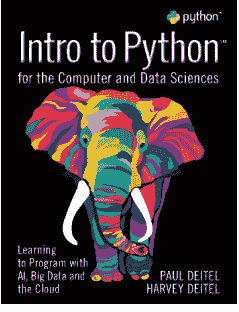

https://deitel.com/pycds

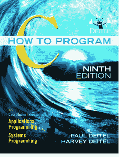

https://deitel.com/chtp9

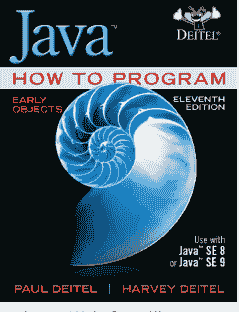

https://deitel.com/jhtp11EOV

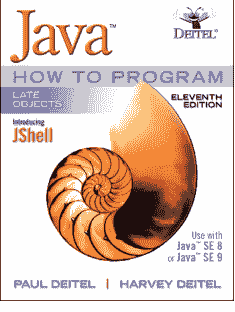

https://deitel.com/jhtp11LOV


## 编程方法

### 一种对象自然式方法


*纪念 Gordon Moore，Intel 联合创始人、摩尔定律之父：*

*为其职业生涯致力于通过技术、创新、产业、创业和慈善事业改善人们的生活。*

*Paul 和 Harvey Deitel*
## 前言

> 优秀的程序员编写人类能理解的代码。^1
>
> —Martin Fowler

欢迎来到*《C++程序设计：对象自然方法，第11版》*。我们以友好、现代、代码密集、面向案例研究的方式介绍C++——根据TIOBE指数，它是世界第三大最受欢迎的编程语言。^2

C++之所以流行，是因为可用于构建高性能的关键业务和关键任务计算系统——操作系统、实时系统、嵌入式系统、游戏系统、银行系统、空中交通管制系统、通信系统等。本书是面向初级到中级水平的大学教材，介绍C++的C++20版本及其相关标准库，并展望C++23和C++26。在本前言中，我们呈现“本书的灵魂”。

### 1 创新的现代C++编程教材

### 实时代码方法与获取代码

本书的核心是Deitel标志性的实时代码方法。我们不是展示代码片段，而是通过255个完整、可运行的真实C++程序及其实时输出，展示C++在预期使用场景中的样子。

请阅读本前言之后的“开始之前”部分，了解如何设置Windows、macOS或Linux计算机来运行代码示例。为方便起见，我们以C++源代码（.cpp和.h）文件形式提供本书示例，供集成开发环境和命令行编译器使用。所有源代码均可在以下地址下载：

- https://github.com/deitel/CPlusPlusHowToProgram11e
- https://www.deitel.com/cpphtp11

第1章的试运行（1.11节）展示如何使用我们首选的各种编译器编译和运行代码示例。在阅读正文的同时执行每个程序，将使你的学习体验“活起来”。如果遇到问题，可以通过deitel@deitel.com联系我们，我们会及时回复。

- 1. Martin Fowler（Kent Beck参与贡献）。*《重构：改善既有代码的设计》*。Addison-Wesley Professional。2018年。
- 2. 2023年2月TIOBE指数。访问于2023年3月8日，https://www.tiobe.com/tiobe-index/。

### 关键计算趋势

几十年来：

- 计算机硬件一直在迅速变得更快、更便宜、更小，
- 互联网带宽（即其信息承载能力）一直在迅速变得更大、更便宜，并且
- 高质量计算机软件变得越来越丰富，并且通过开源运动往往免费或几乎免费。

物联网（IoT）已经连接了数百亿台各种可以想象类型的计算机化设备，而且这一数字很可能快速增长。这些设备以迅速增长的速度和数量产生海量数据（“大数据”的一种形式）。而且大多数计算最终将在“云”中执行——即通过互联网访问计算服务来完成。

对于初学者，本书前几章为编程基础奠定了坚实基础。中高级章节以及50多个更重要的案例研究示例和案例研究练习，将让你逐步进入专业软件开发挑战与实践。

鉴于当今应用对计算机硬件、软件和互联网提出的极高性能要求，专业人士经常选择C++来构建这些应用中性能最关键的部分。贯穿全书，我们强调性能问题，帮助你为行业做好准备。

### 2 现代C++

我们涵盖现代C++——C++20、C++17、C++14和C++11——并展望C++23和预计C++26中的关键特性。我们采用行业最佳实践，强调现代C++惯用法——这些惯用法改变了开发者编写C++程序的方式——同时关注性能、安全和软件工程。我们深入介绍C++20的“四大”特性——范围、概念、模块和协程。我们将在本前言第6节中进一步讨论这些内容。

### 3 目标读者

本书的模块化架构（见下页示意图）使其适合多种读者：

- 计算机科学、计算机工程、信息系统、信息技术、软件工程及相关专业的初级和中级大学编程课程。
- 包含编程内容的科学、技术、工程和数学（STEM）大学课程。
- 专业行业培训课程。
- 经验丰富的专业人士学习最新的现代C++惯用法，为即将到来的项目做准备。

### 《C++程序设计：对象自然方法，第11版》

作者：Paul Deitel & Harvey Deitel

- **第1部分——C++20基础：编程快速入门**
  - 1. **引言：试运行流行的硬件/软件C++编译器**——从硬件/软件到物联网、移动端和桌面端，试运行C++编译器。
  - 2. **C++基础**——C++操作；面向对象编程；基础算法。
  - 3. **操作字符串和对象**——操作字符串和对象；使用字符串对象。
  - 4. **控制语句**——顺序、选择和重复；算法开发；控制语句。
  - 5. **函数和类模板简介**——函数模板；C++标准库。
- **第2部分——容器、范围、指针、智能指针、文件**
  - 6. **数组；向量；范围；函数式编程**——C++20范围；函数式编程；C++标准库。
  - 7. **C++类模板**——类模板；容器和迭代器概念。
  - 8. **字符串、字符串视图、文本文件和正则表达式**——读写文本文件；正则表达式。
  - 9. **文件处理**——顺序访问文件；C++20范围。
- **第3部分——现代面向对象编程：类**
  - 10. **自定义类**——研究Vincentian Secret；关键C++实现细节。
  - 11. **面向对象编程：继承和运行时多态**——继承和多态。
  - 12. **运算符重载；String类**——重载运算符；string类。
  - 13. **C++类层次结构；虚函数**——多态和类层次结构。
  - 14. **模板：自定义类模板**——自定义类模板。
  - 15. **C++20：概念**——概念和约束。
- **第5部分——高级主题：模块、并行算法、并发**
  - 16. **C++20模块：大规模开发**——模块；头文件单元；模块实现分区。
  - 17. **并发：高层视角**——使用C++17并行算法的多核性能；并发；多线程。
  - 18. **C++20协程**——yield、co_await、co_return；协程；支持库。
- **第4部分——泛型编程：模板、概念和元编程**
  - 13. **标准库容器**——管理标准数据结构。
  - 14. **标准库算法和C++20范围**——使用和查看函数式编程。
  - 15. **模板：C++20概念**——元编程和函数模板；缩写函数模板；C++20缩写函数模板；类模板；变量模板；折叠表达式。
- **第6部分——流I/O与C++20其他主题及展望**
  - 20. **其他主题与展望**
  - 21. **计算机科学思维：算法和大O**

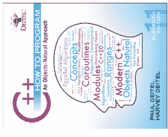

- 编程提示：C++核心准则、C++20范围、性能、安全、错误。
- 开源代码示例。
- 数据科学。
- 附加内容：Docker容器、GitHub和Stack Overflow。
- 博客：https://deitel.com/blog

- C++编程提示：核心准则。
- 其他主题与展望。
- 计算机科学思维：算法和大O。

### 4 “对象自然”学习方法

传统上，面向对象编程教材被划分为“晚对象”或“早对象”。这些教材中真正“晚”或“早”的并不是“对象”。真正早晚的是教授如何开发自定义类——即构建对象所依据的蓝图。我们曾使用这两种方法编写教材。

### 什么是“对象自然”？

在编写Python教材时，³我们注意到，尽管我们的讲述符合“晚对象”模式，但它实际上不止如此——而*那个*特别之处很特别。我们称之为“对象自然方法”，现在正将其应用于C++以及我们撰写的其他面向对象编程语言。

与“晚对象”类似，我们的对象自然方法从编程基础开始，但你将在早期章节中大量使用易于使用、功能强大的现有类来完成重要任务。你将快速创建这些类的对象（通常只需一行代码），并用最少数量的简单C++语句让它们“展示本领”。

即使你是编程新手，也可以在第9章学习如何创建自定义C++类之前很久就执行重要任务。这是使用像C++这样成熟的面向对象语言最引人注目的方面之一。在用对象自然方法介绍编程基础之后，我们从深入介绍自定义类创建开始，深入讲解面向对象编程。

### 大量免费类

我们强调使用C++生态系统中大量有价值的免费类。这些类通常来自：

- C++标准库，
- 平台特定库，例如Microsoft Windows、Apple macOS或各种Linux版本提供的库，以及
- 免费的第三方C++库，通常由开源社区创建。

我们鼓励你查看GitHub等网站上大量免费、开源的C++代码。阅读其他程序员的代码是很好的学习方式。

### Boost项目

Boost提供了168个强大的开源C++库⁴，并充当新能力的“培育场”，这些能力最终可能被纳入C++标准库。以下StackOverflow帖子列出了从Boost库演变而来的现代C++库和语言特性：⁵

https://stackoverflow.com/a/8852421

- 3. *《面向计算机科学与数据科学的Python入门：使用AI、大数据和云学习编程》*（https://deitel.com/pycds）。
- 4. “Boost 1.81.0库文档。”访问于2023年3月8日。https://www.boost.org/doc/libs/1_81_0/。
- 5. Kennym，对“哪些Boost特性与C++11重叠？”的回答。访问于2023年3月8日。https://stackoverflow.com/a/8852421。


我们在关于超大整数（第 3.14 节）和精确货币计算（第 4.14 节）的对象自然案例研究中使用了 Boost Multiprecision 库。

### 对象自然案例研究

第 1 章以友好的方式介绍对象技术的基本概念和术语。在前几章中，你会在第 9 章讨论如何创建自定义类之前很久，就创建并使用现有类的对象。关于第 2～9 章中对象自然案例研究的描述，请参见第 6 节的“本书导览”。对象自然方法的一个完美示例是使用标准库类（如 array 和 vector，第 6 章）的对象，而无需了解通常如何编写类，也无需了解这些类具体如何实现。在本书余下部分，我们会广泛使用 C++ 标准库功能。

### 5 编程智慧与关键 C++20 特性

我们将软件开发智慧、数据科学主题、C++20 模块和 C++20 概念特性顺畅地融入正文脉络中：

- 软件工程观察强调正确构建软件（尤其是较大系统）时的架构和设计问题。
- 安全最佳实践帮助你增强程序抵御攻击的能力。
- 性能提示指出让程序运行更快或尽量减少程序占用内存量的机会。
- 常见编程错误有助于降低你犯同样错误的可能性。
- C++ Core Guidelines 建议（在第 12 节引入）。
- C++20 的新模块特性。
- C++20 的新概念特性。
- 我们在若干示例和练习中展示并使用数据科学主题。

### 6 本书导览

本序言前面的一页式目录图从“四万英尺”的高度提供了本书模块化架构的高层概览。我们建议你在阅读本节时参考该图。

前几章为 C++20 基础知识奠定坚实基础。中高级章节介绍现代 C++ 软件开发。我们讨论 C++ 的编程模型：

- 过程式编程，
- 函数式风格编程，
- 面向对象编程，
- 泛型编程，以及
- 模板元编程。

无论你是正在了解将使用哪本教材的学生、正在规划课程大纲的教师，还是正在为项目做准备并决定阅读哪些章节的专业软件开发人员，这份详细的“本书导览”都将帮助你做出最佳决策。

## 第 1 部分：编程基础快速入门

**第 1 章，C++ 简介与热门免费 C++ 编译器的试驾**，用有趣的事实和数据吸引编程新手，激发他们学习计算机和计算机编程的兴趣。本章包括当前技术趋势、硬件、软件和互联网概念，以及从位到字节、字段、记录和数据库的示例数据层次结构。它为第 2～21 章中的 C++ 编程讨论以及大量综合案例研究示例、练习和项目奠定基础。

我们讨论你在开发软件时可能会使用的编程语言类型和技术。我们介绍 C++ 标准库——现有、可复用、高质量、高性能的功能，帮助你避免“重复造轮子”。通过使用库来执行重要任务，同时只需编写少量指令，你将提高生产力。我们还介绍互联网、万维网、“云”和物联网（IoT），为现代应用程序开发奠定基础。

本章的试驾演示如何使用三种最流行的 C++ 开发环境编译和执行 C++ 代码：

- Windows 上 Visual Studio 中的 Microsoft Visual C++，
- macOS/Linux 上的 GNU g++，以及
- macOS/Linux 上 LLVM Compiler Infrastructure 的 clang++。

我们使用每种编译器测试了本书的 255 个代码示例。⁶ 选择你喜欢的任意一种——本书也能与许多其他编译器良好配合。编译器安装说明请参见本序言之后的“开始之前”部分。

我们还演示了使用 Docker 容器运行 g++ 和 clang++。Docker 是一个重要工具，使你能够在 Windows、macOS 或 Linux 上运行这些编译器的最新版本。有关 Docker 和 Docker 容器的更多细节，请参见本序言第 7 节。

你将了解“大数据”究竟有多大，以及它变得更大的速度有多快。本章最后介绍人工智能（AI）——计算机科学与数据科学之间的一个关键交叉领域。AI 和数据科学很可能在你的计算职业生涯中发挥重要作用。

**第 2 章，C++ 编程简介**，介绍 C++ 基础知识并说明关键语言特性，包括输入、输出、基本数据类型、算术运算符及其优先级，以及决策。作为我们对象自然方法的一部分，第 2.8 节的**对象自然案例研究**演示如何创建和使用 C++ 标准库类 **string** 的对象——而你无需了解通常如何开发自定义类，也无需了解庞大复杂的 string 类具体如何实现。

6. 我们指出了编译器不支持某个特定特性的少数情况。

**第 3 章，算法开发与控制语句：第 1 部分**，是编程新手最重要的章节之一。它重点讲解使用 C++ 控制语句进行问题求解和算法开发。你将通过自顶向下、逐步求精来开发算法，使用 **if** 和 **if...else** 选择语句、用于计数器控制和哨兵控制的 **while** 迭代语句，以及递增、递减和赋值运算符。本章呈现三个算法开发案例研究——**计数器控制的迭代、哨兵控制的迭代和嵌套控制语句**。第 3.14 节的**对象自然案例研究**演示如何使用开源 Boost Multiprecision 库的 **cpp_int** 类创建超大整数。

**第 4 章，控制语句：第 2 部分**，介绍 C++ 的其他控制语句——**for、do...while、switch、break 和 continue**——以及逻辑运算符。本章的一个关键特性是其**结构化编程总结**。我们介绍 **C++20 的 format 函数**，它提供强大的新文本格式化功能。C++20 之前的文本格式化复杂而冗长。format 函数使用基于 Python 编程语言文本格式化的简洁语法，大大简化数据格式化。我们在全书中展示若干 C++20 文本格式化特性，然后在第 19 章深入探讨。在计算机科学入门课程中，教师可能希望在 C++20 文本格式化于第 4 章引入之后，再讲授第 19.9 节。第 4.14 节的**对象自然案例研究**演示如何使用开源 Boost Multiprecision 库的 **cpp_dec_float_50** 类进行精确货币计算。

**第 5 章，函数与函数模板简介**，介绍自定义函数。我们介绍**随机数生成**和模拟技术，并在本书若干**随机数模拟案例研究**的第一个案例研究中使用它们，以实现一款流行的赌场骰子游戏。我们讨论 C++ 的安全随机数功能库，它可以产生“非确定性”随机数——一组无法预测的随机数。此类随机数生成器用于模拟以及不希望具有可预测性的安全场景。我们还讨论在函数之间传递信息，以及**函数调用栈和栈帧**如何支持函数调用/返回机制。我们开始深入讲解递归这一强大的计算机科学主题。


第 5.19 节的**对象自然案例研究标题——Pqyoaf X Nylfomigrob Qwbbfbmh Mndogvk: Rboqlrut yua Boklnxhmnywex**——看起来像乱码。这不是错误！这个案例研究延续了我们对安全性的强调，介绍**密码学**，它在当今互联世界中至关重要。每天，密码学都在幕后用于确保你基于互联网的通信私密且安全。你将使用我们实现的 **Vigenère 秘密密钥密码⁷**算法来加密和解密消息，并解密本节的标题。然后，在第 9 章的**对象自然案例研究**中，你将学习我们使用类和数组处理技术实现 Vigenère 秘密密钥密码的类。在第 9 章的案例研究练习中，你还将使用 **RSA 算法**探索安全得多的公钥密码学。

7. “Vigenère 密码。”访问于 2023 年 4 月 29 日。https://en.wikipedia.org/wiki/Vigenère_cipher.


## 第 2 部分：数组、指针与字符串

**第 6 章，数组、向量、范围与函数式编程**，开始我们早期对 C++ 标准库容器、迭代器和算法的介绍。我们介绍 C++ 标准库的 array 容器，用于表示值列表和表格。你将定义并初始化数组，并访问其元素。我们讨论将数组传递给函数、对数组进行排序和搜索以及操作多维数组。

与许多现代语言一样，C++ 提供“函数式风格”编程特性。这些特性可以帮助你编写更简洁的代码，更不容易包含错误，也更易于阅读、调试和修改。第 6 章开始介绍使用数组、lambda 表达式（匿名函数）和 C++20 范围（ranges）进行函数式风格编程——C++20 的“四大”特性之一，它简化了调用许多 C++ 标准库预定义算法的方式。我们将在第 13 章和第 14 章继续讨论。

6.15 节的“对象自然”案例研究演示了 **C++ 标准库类模板 vector**。第 6 章本质上是一个大型的 **数组和向量的“对象自然”案例研究**。本章代码是现代 C++ 编码惯用法的良好示例。本章练习包括一个关于著名 **骑士巡游问题** 的案例研究，我们以多种方式处理该问题，包括一种称为 **启发式编程** 的 AI 策略。

**第 7 章，（淡化）现代 C++ 中的指针**，解释指针概念，例如声明指针、初始化指针、获取变量的内存地址、解引用指针、指针算术，以及内置指针、基于指针的数组和基于指针的字符串之间的密切关系，这些都是 C++ 从 C 编程语言继承而来的。指针功能强大，但使用起来具有挑战性。因此，我们重点介绍现代 C++ 特性，这些特性消除了对大多数指针的需求，并使你的代码更健壮、更安全，包括引用、“智能指针”对象、数组和向量、字符串、C++20 span 和 C++17 string_view。我们仍然介绍内置数组，因为它们在 C++ 中仍然有用，这样你就能阅读在行业中遇到的遗留 C++ 代码。在新开发中，你应该优先使用现代 C++ 能力。7.10 节的 **“对象自然”案例研究** 演示了其中一种能力——**C++20 span**。这些特性使你能够查看和操作连续容器的元素，例如基于指针的数组以及标准库 array 和 vector，而无需直接使用指针。

在一个 **随机数模拟** 案例研究练习中，你将实现 **著名的龟兔赛跑**。本章还包含我们的两个系统编程案例研究练习中的第一个——**构建你自己的计算机（作为虚拟机）**。在若干案例研究练习的背景下，你将“剖析”一台假想计算机，并查看其内部结构。我们介绍简单的机器语言编程，并为这台称为 Simpletron 的计算机编写几个小型机器语言程序。顾名思义，它是一台简单的机器，但正如你将看到的，它也是一台强大的机器。Simpletron 运行用其唯一直接理解的语言编写的程序——即 Simpletron 机器语言，简称 SML。为了使这成为一次特别有价值的体验，你还将构建一台计算机（通过基于软件的模拟技术），并实际上可以在其上运行你的机器语言程序！Simpletron 体验将向你基本介绍 **虚拟机——现代计算中最重要的系统架构概念之一**。第 13 章包含密切相关的 **系统编程案例研究练习——构建你自己的编译器**。

**第 8 章，字符串、string_view**，文本文件、CSV 文件和正则表达式，介绍标准库 string 类的许多特性；展示如何写入和读取纯文本文件与逗号分隔值（CSV）文件（常用于表示数据科学数据集）中的文本；并介绍使用标准库正则表达式能力进行字符串模式匹配。C++ 提供两种字符串——string 对象和 C 风格基于指针的字符串。我们使用 string 对象使程序更健壮，并消除 C 字符串的许多安全问题。在新开发中，你应该优先使用 string 对象。我们还介绍 C++17 的 string_view——一种轻量、灵活的机制，用于将任何类型的字符串传递给函数。本章介绍两个 **“对象自然”案例研究**：

- 8.19 节通过读取并 **分析包含泰坦尼克号灾难数据集的 CSV 文件** 来介绍数据分析。
- 8.20 节介绍 **正则表达式模式匹配** 和文本替换。

本章包括三个 **AI/数据科学案例研究练习**。在第一个案例研究中，**使用简单线性回归的机器学习：统计可能具有欺骗性**，你将了解到数据分析的一个基本方面是“了解你的数据”。一种方法是使用描述性统计——但这些可能具有欺骗性。为了说明这一点，我们将考虑 **安斯库姆四重奏⁸** 的可视化（练习 8.40）——这是一个著名示例，包含四组截然不同的数据集，其中的 x–y 坐标对具有几乎相同的描述性统计。然后你将研究一个 **完整编码的示例**，其中我们使用流行的人工智能/**机器学习**统计技术——**简单线性回归**：给定一组表示 **自变量 (x)** 和 **因变量 (y)** 的 x–y 坐标对，确定最拟合数据的直线方程（y = mx + b）。该方程描述因变量与自变量之间的关系，使我们能够预测任意给定 x 对应的 y 值。它还允许我们绘制 **回归线**。你将看到，对于所有四组截然不同的数据集，**安斯库姆四重奏的回归线在视觉上完全相同**。你将研究的代码使用流行的 **开源 gnuplot 包** 来创建安斯库姆四重奏的吸引人的可视化。gnuplot 包使用自己的绘图语言，与 C++ 不同，因此我们提供了大量代码注释来解释 gnuplot 命令。

在 **AI/数据科学案例研究练习：使用简单线性回归的机器学习：时间序列分析**（练习 8.41）中，你将运用前一个练习学到的知识来分析时间序列，即与时间点相关联的一系列值（称为 **观测值**）。时间序列示例包括每日收盘股价、每小时温度读数、飞行中飞机位置的变化、年度作物产量和季度公司利润。你将 **对纽约市 126 年的 1 月平均气温数据运行简单线性回归**（存储在 CSV 文件中），并使用 **gnuplot 绘制数据和回归线**，以便判断是否存在降温或变暖趋势。

本章最后一个 **AI/数据科学案例研究**（练习 8.42）介绍 **使用非常基础的自然语言处理（NLP）进行相似度检测**——一个重要的数据科学和人工智能主题。NLP 帮助计算机理解、分析和处理文本。在编写本书时，我们使用付费的（NLP）工具 Grammarly⁹ 来帮助调整写作，并确保文本对广大读者具有可读性。有些人认为，威廉·莎士比亚的作品实际上可能出自克里斯托弗·马洛或弗朗西斯·培根爵士等人之手。^10,11^ 在这个练习中，你将使用数组、字符串和文件处理技术，对 *莎士比亚的《罗密欧与朱丽叶》* 和马洛的 *《爱德华二世》* 执行简单的 **相似度检测**。你将通过比较计算出的统计数据（例如每部戏剧中每个独特单词占所有单词的百分比）来确定它们的相似程度。你可能会对结果感到惊讶。

## 第 3 部分：面向对象编程

**第 9 章，自定义类**，开始我们大幅升级、多章的现代 C++ 面向对象编程论述。C++ 是可扩展的——你创建的每个类都会成为可用于创建对象的新类型。在第 9 章至第 11 章中，你将学习 C++ 中用于精心构建有价值的类并操作这些类的对象的特性。

在 9.22 节中，我们通过研究 **维吉尼亚秘密密钥密码类实现** 来结束 **“对象自然”案例研究系列**，该实现已在第 5 章的“对象自然”案例研究中演示过。**“对象自然”案例研究练习 9.32–9.33** 演示 **如何使用 JSON（JavaScript 对象表示法）序列化对象**——一种流行、人类和机器均可读的数据格式，通常用于在互联网上传输数据。

在若干 **随机数模拟案例研究练习** 的背景下，你将使用字符串数组、随机数生成和模拟技术来实现一个 **基于文本的洗牌发牌程序**。在一个 **安全与密码学案例研究练习** 中，你还将探索使用 RSA 算法的公钥密码学。该技术使用公钥进行加密，任何可能想向特定接收者发送秘密消息的发送者都知晓该公钥。公钥可用于加密消息，但不能解密消息。消息只能使用接收者才知道的配对私钥解密，因此它比秘密密钥密码学中的秘密密钥安全得多。RSA 是世界上使用最广泛的公钥密码学技术之一。你将构建一个可运行的小规模课堂版 RSA 密码系统。

**第 10 章，面向对象编程：继承与运行时多态**，重点介绍继承层次结构中类之间的关系，以及这些关系所支持的强大运行时多态处理能力（用于“通用编程”）。在本章的 **运行时多态案例研究** 中，你将实现一个 **执行多态工资计算的应用程序中的 Employee 类层次结构**。

本章的一个重要方面是理解多态如何工作。**本章的一个关键特性是详细图示并解释 C++ 通常如何“在底层”实现多态、虚函数和动态绑定。** 你将看到，它可以使用一种优雅的基于指针的数据结构。我们还讨论针对接口而非实现编程。在第 20 章中，我们讨论实现运行时多态的其他更高级机制，包括非虚接口惯用法（NVI）和 `std::variant`/`std::visit`。

- 8. “安斯库姆四重奏。”访问于 2023 年 3 月 8 日。https://en.wikipedia.org/wiki/Anscombe%27s_quartet。
- 9. Grammarly 有免费版和付费版（https://www.grammarly.com）。他们提供免费插件，可在多个流行网络浏览器中使用。
- 10. “莎士比亚真的写了自己的戏剧吗？”访问于 2020 年 11 月 13 日。https://www.history.com/news/did-shakespeare-really-write-his-own-plays。
- 11. “莎士比亚作者身份问题。”访问于 2020 年 11 月 13 日。https://en.wikipedia.org/wiki/Shakespeare_authorship_question。


**第11章 运算符重载、拷贝/移动语义与智能指针**，展示如何让C++现有运算符作用于自定义类对象，并介绍智能指针和动态内存管理。智能指针通过提供内置指针之外的功能，帮助你避免动态内存管理错误和“资源泄漏”。本章讨论`unique_ptr`，第20章“其他主题与C++未来展望”讨论`shared_ptr`和`weak_ptr`。

第11章的一个关键方面是精心打造有价值的类。我们先进行一次字符串类试用，在你自己实现带重载运算符的自定义类之前，展示运算符重载的一种优雅用法。然后，在**精心打造有价值的类案例研究——本书最重要的示例之一**中，你将使用重载运算符和其他能力构建自己的自定义MyArray类，以解决C++原生基于指针的数组所面临的各种问题。¹² 我们介绍并实现可在每个类中定义的五个特殊成员函数——拷贝构造函数、拷贝赋值运算符、移动构造函数、移动赋值运算符和析构函数。我们讨论拷贝语义和移动语义，它们使编译器能够将资源从一个对象移动到另一个对象，以避免代价高昂且不必要的拷贝。我们介绍C++20的三路比较运算符（`<=>`；也称为“宇宙飞船运算符”），并展示如何实现自定义转换运算符。在第15章，你将把MyArray类的一部分转换为类模板，使其能存储指定类型的元素。届时，你将真正“精心打造出有价值的类”。

¹² 在工业级系统中，你会使用标准库类来完成这项工作，但这个示例使我们能够“深入底层”，演示许多现代C++概念。

**第12章 异常与契约展望**，继续第6章开始的异常处理讨论。我们通过讨论何时使用异常、异常安全保证，以及在构造函数和析构函数语境中使用异常，增强了第12章的内容。我们展示如何处理动态内存分配失败。我们讨论为什么有些库提供双重接口，使开发者能够选择使用抛出异常的函数版本，还是设置错误码的版本。本章以一个案例研究作结，介绍契约——一种可能出现在C++26中的特性。**契约的目标之一是让大多数函数成为noexcept——即不抛出异常——这可能使编译器能够执行额外优化，并消除异常处理的开销和复杂性。另一个目标是更快地发现错误，在开发期间消除它们，并有望为部署创建更健壮的代码。** 我们介绍前置条件、后置条件和断言，并讨论如何将它们实现为在执行时测试的契约。我们在https://godbolt.org上使用GCC的实验性契约实现来演示示例代码。

## 第4部分：标准库容器、迭代器与算法

**第13章 标准库容器与迭代器**，开始对三个关键C++标准库组件进行更广泛、更深入的讲解：

- 容器（模板化数据结构），
- 迭代器（用于遍历容器并访问其元素），以及
- 算法（使用迭代器来操作容器）。

本章的一个特色是**精心打造有价值的类案例研究**——你将把第11章的**MyArray案例研究**重新实现为一个带自定义迭代器的类模板，使大多数C++标准库算法能够操作MyArray对象。我们还定义一个自定义算法，可以处理MyArray元素和标准库容器类对象。我们展示可以使用概念根据参数的类型要求重载函数。最后，我们介绍用于执行编译期计算的模板元编程，使你能够改善程序的执行期性能，可能同时减少执行时间和内存消耗。

**第16章 C++20模块**，介绍C++20“四大”特性中的另一个。模块提供了一种新方式来组织代码、精确控制向客户端代码暴露哪些声明，并封装实现细节。模块帮助你提高生产力，尤其是在构建、维护和演进大型软件系统时。模块帮助此类系统更快地构建，并使其更具可扩展性。C++创造者Bjarne Stroustrup说：“*模块为改进C++的代码卫生和编译时间提供了历史性机遇（把C++带入21世纪）。*”¹³ 你将看到，即使在小型系统中，模块也能通过消除对C++预处理器的需求，在每个程序中带来立竿见影的好处。在几个**软件工程案例研究**中，你将学习多种**使用模块将接口与实现分离**的方法。

¹³ Bjarne Stroustrup，“Modules and Macros.” 2018年2月11日。访问于2023年3月8日。http://www.open-std.org/jtc1/sc22/wg21/docs/papers/2018/p0955r0.pdf.

**第17章 并行算法与并发：高层视角**，是关于并发和多核编程的两篇详尽章节中的第一篇。第17章是本书最重要的章节之一，介绍C++中用于构建创建和管理多个任务的应用程序的特性。这些特性可以显著改善程序在当今多核处理器上的性能和响应能力。

本章介绍几个**多线程与多核系统性能案例研究**。在**分析顺序排序与并行排序算法性能的案例研究**中，我们展示如何使用预打包的并行算法创建多线程程序，使其在当今多核计算机体系结构上运行得更快（通常快得多）。例如，我们使用顺序排序对1亿个值排序，然后使用并行排序。**我们使用C++的`<chrono>`库特性中的计时操作，来分析随着我们使用更多核心，在当今流行的多核系统上获得的性能提升。你将看到，在我们配备8核Intel处理器的计算机上，并行排序比顺序排序快6.76倍。**

在**生产者—消费者：同步访问共享可变数据的案例研究**中，我们讨论生产者—消费者关系，并演示使用低级和高级C++并发原语实现它的各种方式。我们还介绍几个**使用C++20新增的闩锁、屏障和信号量能力协调线程的案例研究**。我们强调，并发编程很难正确实现，因此应优先使用更易用、更高层的并发特性。像信号量和原子操作这样的低级特性可用于实现像闩锁这样的高层特性。

**第18章 C++20协程**，是我们关于并发和多核编程的第二章。本章介绍协程——C++20“四大”特性中的最后一个。**协程是一种可以暂停执行并稍后恢复执行的函数，使你能够以简单的类顺序编码风格进行并发编程。** 支持这一点的机制完全由编译器为你编写的代码来处理。包含`co_await`、`co_yield`或`co_return`中任一关键字的函数就是协程。


协程需要复杂的基础设施，你可以自己编写，但这样做复杂、繁琐且容易出错。相反，大多数专家认为应使用高层协程支持库，这也是我们展示的方法。开源社区已经创建了几个实验性库，用于快速便捷地开发协程——我们在讲解中使用了其中两个。C++23已为生成器协程提供标准库支持，预计C++26会提供更多协程支持。

我们介绍三个**多线程与多核系统性能案例研究：**

- 使用`co_yield`和generator库创建生成器协程
- 使用`concurrencpp`启动任务
- 使用`co_await`和`co_return`创建协程

为帮助读者理解协程的工作方式，第一个和第三个案例研究包含图示，说明每个应用程序的控制流。

**第19章 流I/O与C++20文本格式化**，讨论C++流输入/输出能力和格式化特性。我们纳入流格式化内容，主要是为了那些可能在遗留代码中遇到它的人。第19.9节深入介绍C++20新增文本格式化特性的案例研究。在计算机科学导论课程中，讲师可能希望在我们于第4章介绍C++20文本格式化之后，再讲授第19.9节。

**第20章 其他主题与C++未来展望**，通过以下案例研究继续第10章关于运行时多态的讨论：运行时类型信息（RTTI）、继承基类构造函数、非虚接口惯用法、使用`std::variant`和`std::visit`进行鸭子类型（用于与继承无关的类对象之间的运行时多态），以及多重继承。本章还介绍其他杂项C++主题，包括存储类、存储期、可变类成员、命名空间、运算符关键字、指向类成员的指针、`[[nodiscard]]`属性、`std::shared_ptr`和`std::weak_ptr`智能指针、使用`decltype`在编译期确定类型，以及`[[likely]]`和`[[unlikely]]`属性。本章最后展望C++23和C++26标准中即将到来的特性。

**第21章 计算机科学思维：搜索、排序与大O**，介绍一些经典的计算机科学主题。我们考虑若干算法，并比较它们的处理器需求和内存消耗。我们通俗地介绍计算机科学中的大O表示法，它表示算法根据必须处理的数据项数量，解决问题时可能需要付出多大的工作量。

本章包含两个案例研究，通过可视化**高速二分查找**和**归并排序算法**来说明这些算法的工作方式。在计算机科学导论课程中，讲师可以在第6章之后讲授本章。

## 现代C++数据结构课程

我们的递归（第5章）、数组（第6章）、搜索（第6章和第21章）、排序（第6章和第21章）、大O（第21章）、容器（第13章）、迭代器（第13章）


## 7 编译器、Docker 和静态代码分析工具

### 工业级编译器

我们在 Windows、macOS 和 Linux 操作系统上，使用以下最新版本测试了所有代码的正确性：

- Windows® 上 Microsoft® Visual Studio® 社区版中的 Visual C++®，
- GNU® C++（g++），以及
- Clang C++（clang++）。

有关软件安装说明，请参见本前言之后的“开始之前”一节。

这些编译器现在已完整实现大多数 C++20 特性。我们会在适当之处指出例外情况。随着支持范围扩大，我们会将代码更新发布到本书的 GitHub 仓库：https://github.com/deitel/CPlusPlusHowToProgram11e，并将代码和文本更新发布到本书网站：https://www.deitel.com/books/cpphtp11

在撰写本书时，Apple 的 Xcode 集成开发环境（IDE）不支持我们使用的多项关键 C++20 特性。一旦这些特性在 Xcode 中可用，我们将在前述网站上发布 Xcode 使用说明。

### Docker

Docker 是一种将软件打包到容器中的工具，这些容器打包了跨平台便捷且可移植地执行该软件所需的一切。Docker 提供了一种简单方式，帮助你在台式机或笔记本电脑上快速、便捷且经济地开始使用新技术。我们展示如何安装并执行预配置了以下内容的 Docker 容器：

- GNU 编译器集合（GCC），其中包含 g++ 编译器，以及
- 最新版本的 Clang clang++ 编译器。

每种编译器都可以在 Windows、macOS 和 Linux 上的 Docker 中运行，使用户能够试用这些编译器的最新版本。第 1 章包含试用演练，展示如何编译程序并在跨平台 Docker 容器环境中运行它们。

### 静态代码分析工具

静态代码分析工具让你快速检查代码中的常见错误和安全问题，并提供代码改进的洞见。使用这些工具就像让世界级专家检查你的代码。为了帮助我们遵循 C++ 核心准则并总体改进代码，我们使用了以下静态代码分析器：

- `clang-tidy`—https://clang.llvm.org/extra/clang-tidy/
- `cppcheck`—https://cppcheck.sourceforge.io/
- Microsoft 的 C++ Core Guidelines 静态代码分析工具，这些工具内置于 Visual Studio 的静态代码分析器中

我们对本书所有代码示例使用了这三种工具，以检查：

- 是否遵循 C++ 核心准则，
- 是否遵循编码标准，
- 是否遵循现代 C++ 惯用法，
- 可能的安全问题，
- 常见缺陷，
- 可能的性能问题，
- 代码可读性，
- 等等。

我们还在 GNU g++ 和 LLVM clang++ 编译器中使用了编译器标志 -Wall，以启用所有编译器警告。我们的大多数程序编译时没有警告消息。有关在 Microsoft Visual C++ 中配置 C++ 核心准则检查器的信息，请参见本前言之后的“开始之前”一节。

## 8 像开发者一样思考——GitHub、StackOverflow 及更多

> *“准备[成为程序员]的最佳方式是编写程序，并研究其他人编写的优秀程序。就我而言，我曾去计算机科学中心的垃圾桶里，翻找出他们操作系统的代码清单。”*<sup>14</sup>—威廉·盖茨

你将使用 GitHub 和 StackOverflow 等热门网站，并进行大量互联网研究。

- StackOverflow 是最受欢迎的编程问答网站之一。你可能遇到的许多问题已经在这里讨论过。它是提出面向代码问题的好地方。在我们整个写作过程中，针对各种往往复杂的问题进行的许多 Google 搜索，其第一条结果都返回了 StackOverflow 帖子。
- GitHub 是寻找免费开源代码以探索并纳入你的项目的绝佳场所——如果你愿意，也可以向开源社区贡献你的代码。一亿开发者使用 GitHub。<sup>15</sup> 该网站托管着超过 3.3 亿个使用多种编程语言的代码仓库<sup>16</sup>——开发者们在 2022 年向仓库贡献了 4.13 亿次贡献。<sup>17</sup>

GitHub 是专业软件开发人员武器库中的关键要素，其版本控制工具帮助开发团队管理公共开源项目和私有项目。GitHub 上有一个庞大的 C++ 开源社区，开发者们向近 58,000 个 C++ 代码仓库贡献代码。我们鼓励你研究和执行大量开发者的开源 C++ 代码。这是一种很好的学习方式，也是我们实时编码教学方法的自然延伸。

- 14. William Gates，引自 Susan Lammers 的 *《工作中的程序员：与 19 位塑造计算机行业的程序员访谈》*。Microsoft Press，1986 年，第 83 页。
- 15. “Let’s build from here: The complete developer platform to build, scale, and deliver secure software.” 访问于 2023 年 3 月 8 日。https://github.com/about。
- 16. “Let’s build from here: The complete developer platform to build, scale, and deliver secure software.” 访问于 2023 年 3 月 8 日。https://github.com/about。
- 17. “OCTOVERSE 2022: The state of open source software.” 访问于 2023 年 3 月 8 日。https://octoverse.github.com。
- 18. “C++”。访问于 2023 年 3 月 8 日。https://github.com/topics/cpp。
- 19. 你需要熟悉 GitHub 上软件的各种开源许可证。

## 9 计算与数据科学课程体系

本书面向遵循以下一项或多项 ACM/IEEE 计算机科学及相关课程体系的课程，这些课程体系要求涵盖安全、数据科学、伦理、隐私和性能概念，并使用真实世界数据：

- 《计算机科学课程体系 2013》
- 《CC2020：计算课程体系愿景》
- 《计算课程体系 2020》建议
- 《信息技术课程体系 2017》
- 《网络安全课程体系 2017》
- 由 NSF 和高等研究院资助的教师小组制定的 2016 年数据科学倡议“数据科学本科项目课程指南”，以及
- ACM 数据科学任务组的《数据科学本科课程计算能力最终报告》。


- 20. ACM/IEEE（计算机协会/电气与电子工程师协会，2013）。*《计算机科学课程体系 2013：计算机科学本科学位项目课程指南》*（纽约：ACM）。访问于 2023 年 3 月 8 日。http://ai.stanford.edu/users/sahami/CS2013/final-draft/CS2013-final-report.pdf。
- 21. A. Clear、A. Parrish、G. van der Veer 和 M. Zhang，“CC2020: A Vision on Computing Curricula。”访问于 2023 年 3 月 8 日。https://dl.acm.org/citation.cfm?id=3017690。
- 22. CC2020 任务组，*《计算课程体系 2020》*。访问于 2023 年 3 月 8 日。https://www.acm.org/binaries/content/assets/education/curricula-recommendations/cc2020.pdf。
- 23. *《信息技术课程体系 2017》*。访问于 2023 年 3 月 8 日。http://www.acm.org/binaries/content/assets/education/it2017.pdf。
- 24. *《网络安全课程体系 2017》*。访问于 2023 年 3 月 8 日。https://cybered.hosting.acm.org/wp-content/uploads/2018/02/newcover_csec2017.pdf。
- 25. “Curriculum Guidelines for Undergraduate Programs in Data Science。”访问于 2023 年 3 月 8 日。http://www.annualreviews.org/doi/full/10.1146/annurev-statistics-060116-053930。
- 26. ACM 数据科学任务组，*《数据科学本科课程计算能力》*。访问于 2023 年 3 月 8 日。https://dsf.acm.org/DSFT_Final_Report.pdf。

- 附录 A“字符集”包含 ASCII 字符集的字母、数字和符号。
- 附录 B“数制”概述二进制、八进制、十进制和十六进制数制。
- 附录 C“预处理器”讨论 C++ 预处理器的其他特性。模板元编程（第 15 章）和 C++20 模块（第 16 章）消除了对本附录许多特性的需要。
- 附录 D“位操作”讨论用于操作整型操作数各个位的按位运算符，以及用于紧凑表示整数数据的位字段。

## deitel.com 上的其他网络资源

本书网页还包含：

- 指向我们的 GitHub 仓库的链接，其中包含可下载的 C++ 源代码
- 博客文章——https://deitel.com/blog
- 图书更新

有关下载代码示例和设置 C++ 开发环境的更多信息，请参见本前言之后的“开始之前”一节。

## 12 C++ 核心准则

C++ Core Guidelines https://isocpp.github.io/CppCoreGuidelines/CppCoreGuidelines 是“帮助人们有效使用现代 C++”的建议。<sup>32</sup> 它们由 Bjarne Stroustrup（C++ 的创造者）和 Herb Sutter（ISO C++ 标准委员会召集人）编辑。根据其概述：

> > “这些准则侧重于相对高层的问题，例如接口、资源管理、内存管理和并发。此类规则会影响应用程序架构和库设计。遵循这些规则将产生静态类型安全、无资源泄漏、并能比当今常见代码捕获更多编程逻辑错误的代码。而且它运行得很快——你完全有条件把事情做对。”<sup>33</sup>

在本书中，我们会在适当之处遵循这些准则。你会希望密切关注其中的智慧。我们用 CG 图标指出许多 C++ 核心准则建议。核心准则有数百条，分为数十个类别和子类别。尽管这看起来可能让人不知所措，但我们前面讨论的静态代码分析工具可以对照这些准则检查你的代码。


- 32. C++ 核心准则，“摘要”。访问于 2023 年 3 月 8 日。https://isocpp.github.io/CppCoreGuidelines/CppCoreGuidelines#s-abstract。
- 33. C++ 核心准则，“摘要”。


## 指南支持库

C++核心准则经常提及指南支持库（GSL）的能力，该库提供可复用的C++组件，支持各种建议。³⁴ Microsoft在GitHub上提供了一个开源GSL实现：

https://github.com/Microsoft/GSL

为方便起见，我们在本书的代码示例中附带了在少数示例中使用的该库版本。部分GSL特性已被纳入C++标准库。

## 13 教学特性与约定

***《C++程序设计：对象自然方法（第11版）》*** 包含数百个实时代码示例。我们强调程序清晰性，并专注于构建精心设计的软件。

### 使用字体进行强调

我们的C++代码使用等宽字体（例如 x = 5）。我们将屏幕组件置于粗体Helvetica字体中（例如文件菜单）。

### 语法着色

为了可读性，我们为所有代码进行语法着色。我们的电子书语法着色约定如下：

- 注释显示为绿色
- 关键字显示为深蓝色
- 常量和字面值显示为浅蓝色
- 错误显示为红色
- 所有其他代码显示为黑色

### 目标与大纲

每章开头都有目标，告诉你将会学到什么。

### 表格与插图

书中包含大量表格和线条图。

### 编程提示与关键特性

我们通过页边空白处的图标标出编程提示和关键特性（见第5节）。

### 索引

为便于参考，我们加入了详尽的索引，关键术语的定义性出现处用**粗体**页码突出显示。

### C++编程基础

在我们对C++基础的丰富讲解中：

- 我们强调问题求解和算法开发。
- 为帮助学生为进入行业工作做好准备，我们优先使用最新C++标准文档中的术语，而非通用编程术语。
- 我们避免繁重数学，将其留给高年级课程。为科学和工程课程提供可选的数学练习和项目。

### 创新：采用“入门式”教学法的452个集成检查点练习

本书采用我们新的“入门”教学法，配有集成检查点练习和答案。我们在教材*《计算机科学与数据科学Python入门：用AI、大数据和云学习编程》*（https://deitel.com/pycds）中引入了这种教学法。章节篇幅有意保持简短。我们采用“读一点、编一点、测一点”的方法。在核心计算机科学章节（第1—12章和第21章）中，你阅读新概念，研究和执行相应代码示例，然后通过集成的填空、判断正误、讨论和基于代码的检查点练习测试理解，练习后紧随答案。这将帮助你保持轻快的学习节奏。

### KIS（保持简单）、KIS（保持小巧）、KIT（保持切题）

- 保持简单——我们力求简洁清晰。
- 保持小巧——书中许多示例较小。我们在适当情况下使用更充实的代码示例、练习和项目，尤其是在作为本教材核心特色的案例研究中。
- 保持切题——为了给现代C++“把脉”——它改变了开发者编写C++程序的方式——我们阅读、浏览或观看了约6,000篇当前文章、研究论文、白皮书、书籍、文档片段、博客文章、论坛帖子、网络研讨会和视频。
- 我们通过丰富的应用程序编程和系统编程案例研究展示C++的预期用法，聚焦于计算机科学、人工智能、数据科学及其他领域。

### 超过700个当代示例、练习和项目（EEPs）

与我们的实时代码和对象自然方法一致，你将通过精选的255个真实世界示例和案例研究，以及476个来自计算机科学、数据科学及其他领域的练习和项目进行动手学习：

- 我们的代码示例、练习和项目让学生熟悉开发者当前感兴趣的主题。第1章首先简要浏览当前感兴趣的主题，包括开源软件、虚拟化、仿真、Web服务、多线程、多核硬件架构、系统编程、人工智能、自然语言处理、数据科学、稳健安全编程、密码学、Docker、GitHub、Stack Overflow、论坛、元宇宙、区块链、NFT（非同质化代币）、加密货币（如比特币和以太坊）、生成式AI（ChatGPT、DALL-E）、通用人工智能等。
- 我们增加了多种系统编程和应用程序编程案例研究。有些是完整讲解源代码的书中章节，有些是带有详细规范的练习，你应能据此自行开发代码解决方案，还有些是需要额外研究的练习。本前言列举了50个案例研究和案例研究练习。
- 在较大的案例研究中，你将应对激动人心且富有趣味的挑战，例如构建赌场游戏、构建自己的计算机（使用仿真构建虚拟机）、使用AI/数据科学技术（如基础自然语言处理）、构建自己的编译器、编写多线程代码以利用当今多核计算机架构从计算机中获得最佳性能，以及更多。
- 研究和项目练习要求你更深入地学习所学内容并探索其他技术。我们鼓励你使用计算机和互联网解决重要问题。项目通常比练习更复杂——有些可能需要数天或数周的实施工作。许多项目适合课堂项目、学期项目、指导学习课程、顶点课程项目和论文研究。我们不提供这些项目的解答。
- 我们增强了现有案例研究，并新增了聚焦AI和数据科学的案例，包括随机数生成仿真、安斯库姆四重奏、自然语言处理（NLP）以及通过启发式编程实现的人工智能。
- 教师可以根据学生的独特需求调整课程，并在每个学期变化实验和考试题目。

### 大量视频

在本书的Pearson交互式电子书和Revel版本中，我们提供大量视频，Paul Deitel在其中讨论“开始之前”部分和第1—10章的材料。

### 术语表条目

在本书的Pearson交互式电子书和Revel版本中，我们为核心计算机科学章节（第1—12章和第21章）增加了300多个术语表条目。这些条目也用于学生学习工具中创建抽认卡和匹配练习。

### 性能

软件开发者偏好使用C++（和C）开发性能密集型操作系统、实时系统、嵌入式系统、游戏系统和通信系统，因此我们关注性能问题。

### 安全重点与密码学案例研究

与我们更丰富的安全处理一致，我们增加了秘密密钥密码学和公钥密码学的案例研究。后者是一个项目练习，包含对极受欢迎的RSA算法步骤的详细讲解，并提供提示以帮助你构建一个可运行、简单、小规模的课堂实现。

### 使用开源软件

开源是任何人都可以检查、修改和增强源代码的软件。³⁵ 我们鼓励你尝试大量演示并查看免费开源代码示例（可在GitHub等网站上获取）以获取灵感。

34. C++核心准则，“GSL：指南支持库。”访问于2023年3月8日。https://isocpp.github.io/CppCoreGuidelines/CppCoreGuidelines#S-gsl.

35. “什么是开源？”访问于2023年3月8日。https://opensource.com/resources/what-open-source.


## 数据体验

在第9章，你将使用真实世界的文本数据。你将阅读和分析泰坦尼克灾难数据集——该数据集是数据分析入门的热门选择。数据集通常存储在CSV（逗号分隔值）文件中，我们将在第9章介绍。你还将从Project Gutenberg下载并分析莎士比亚的戏剧*罗密欧与朱丽叶*和克里斯托弗·马洛的戏剧*爱德华二世*——Project Gutenberg是一个提供免费可下载文本供分析的网站。该网站包含超过60,000本各种格式的电子书，包括纯文本文件——这些在美国已不受版权保护。

## 隐私

ACM/IEEE的计算机科学、信息技术和网络安全课程建议<sup>36</sup>中提到了隐私超过200次。每位编程学生和专业人员都需要敏锐地意识到隐私问题和关注点。学生将在第1章和第3章的四个练习中研究隐私。我们还在第5章和第10章讨论了对维护隐私至关重要的密码学。

在第1章的练习中，你将通过研究日益严格的隐私法律来开始思考这些问题，例如美国的HIPAA（健康保险携带与责任法案）、加州消费者隐私法案（CCPA）以及欧盟的GDPR（通用数据保护条例）。

## 伦理

ACM的计算机科学、信息技术和网络安全课程建议<sup>37</sup>中提到了伦理超过100次。在第1章的多个练习中，你将通过互联网研究专注于伦理问题。你将调查围绕智能助手（如Amazon Alexa、Apple Siri、Google Assistant和Microsoft Cortana）的隐私和伦理问题。我们还将探讨围绕OpenAI的ChatGPT<sup>38</sup>和DALL-E 2<sup>39</sup>的兴奋与争议。

36. “课程建议。”访问于2023年3月8日。https://www.acm.org/education/curricula-recommendations.
37. “课程建议。”访问于2023年3月8日。https://www.acm.org/education/curricula-recommendations.
38. “介绍ChatGPT。”访问于2023年3月8日。https://openai.com/blog/chatgpt.
39. “DALL-E 2。”访问于2023年3月8日。https://openai.com/product/dall-e-2.

## 14 教师补充材料

以下补充材料仅通过Pearson Education的教师资源中心（https://pearsonhighered.com/irc）提供给合格教师：

- 教师解决方案手册包含大部分章末练习的解决方案。不提供“项目”练习的解决方案。
- 包含多项选择题和答案的测试题文件。
- 包含图表、表格和项目符号的讲稿幻灯片，总结文本中的关键点。

讲稿幻灯片不包含源代码——本书GitHub仓库中数百个实时代码示例的源代码文件<sup>40</sup>可供教师和学生使用，位于

https://github.com/pdeitel/CPlusPlusHowToProgram11e

如果你不是GitHub用户，请点击绿色Code按钮并选择Download ZIP以下载包含代码的ZIP文件。有关更多信息，请参阅“开始之前”部分。

**请不要写信给我们要求访问Pearson教师资源中心。访问权限仅限于采用本书作为教材的大学教师。** 教师只能通过其Pearson代表获得访问权限。如果您不是注册的教职人员，请联系您的Pearson代表或访问

https://pearson.com/replocator

## 15 一些关键C++文档和资源

这本书包含了近800个引用，指向我们在编写手稿时研究的视频、博客文章、文章、白皮书和在线文档。您可能希望访问其中一些资源以研究更高级的特性和惯用法。网站cppreference.com已成为事实上的C++文档站点。我们经常引用它，以便您能够更详细地了解本书中使用的标准C++类和函数。我们还经常引用C++20标准文档的最终草案，该草案可在GitHub上免费获取，网址为

https://timsong-cpp.github.io/cppwp/n4861/

C++标准委员会不断演进的工作草案（目前为C++23）可在以下位置获取：

https://eel.is/c++draft/

在您学习本书的过程中，您可能还会发现以下C++资源对您有所帮助。

### 文档

- C++参考：https://cppreference.com/
- Microsoft的C++语言文档：https://docs.microsoft.com/en-us/cpp/cpp/
- GNU C++标准库参考手册：https://gcc.gnu.org/onlinedocs/libstdc++/manual/index.html

## 16 获取问题解答

热门的C++和通用编程在线论坛包括

- https://stackoverflow.com
- https://www.reddit.com/r/cpp/
- https://groups.google.com/g/comp.lang.c++

40. 我们建议教师在喜爱的C++集成开发环境（IDE）或面向代码的文本编辑器中展示源代码。这些通常提供可自定义的语法高亮和可调整的字体大小，便于演示。

对于其他有价值网站的列表，请参阅

https://www.geeksforgeeks.org/stuck-in-programming-get-the-solution-from-these-10-best-websites/

此外，供应商通常为其工具和库提供论坛。许多库在github.com上管理和维护。一些库维护者通过给定库的GitHub页面上的Issues选项卡提供支持。

### 与作者沟通

在阅读本书时，如果您有问题，可以轻松联系我们：

deitel@deitel.com

我们会及时回复。

## 17 加入Deitel & Associates, Inc.的社交媒体社区

您可以通过以下社交媒体平台了解Deitel的最新动态：

- LinkedIn®—https://www.linkedin.com/company/deitel-&-associates/
- YouTube®—https://youtube.com/DeitelTV
- Twitter®—https://twitter.com/deitel
- Facebook®—https://facebook.com/DeitelFan
- Instagram®—https://instagram.com/DeitelFan

## 18 保罗·戴特尔的实时讲师培训

保罗·戴特尔已向学术和职业受众教授编程语言长达三十年。他提供各种一至五天的C++、C、Python和Java课程，并为加州大学洛杉矶分校安德森管理学院的商业分析理学硕士（MSBA）项目教授Python和数据科学导论。较长的课程包括密集的实践实验室。他的课程在全球范围内现场或在线交付。请联系deitel@deitel.com，获取根据您的编程语言培训需求定制的提案。

## 19 大学教材数字格式

我们的大学教材*C++ How to Program: An Objects-Natural Approach, 11/e*提供三种数字格式：

- 通过热门电子书提供商提供的在线电子书。
- 交互式Pearson eText（见下文）。
- 带评估的交互式Pearson Revel（见下文）。

所有这些教材版本都包含标准的“How to Program”功能，例如：

- 介绍硬件、软件和互联网概念的章节。
- 面向新手的编程入门。
- 带答案的节末编程和非编程Checkpoint自测练习。
- 章末练习。

Deitel Pearson eTexts和Revels包括：

- 保罗·戴特尔讨论本书核心CS1章节（1-10）内容的视频。
- 带答案的交互式编程和非编程Checkpoint自测练习。
- 词汇表、闪卡、匹配练习和其他学习工具。

此外，Pearson Revels还包括交互式编程和非编程自动评分练习，以及教师课程管理工具，如成绩册。

提供给使用该教材的合格大学教师的补充材料包括：

- **教师解决方案手册**，包含大部分章末练习的解决方案。
- **测试题文件**，包含带答案的四部分、基于代码和非基于代码的多项选择题。
- 可定制的**PowerPoint**讲稿幻灯片。

如需更多信息，请写信至**deitel@deitel.com**。

## 20 致谢

我们感谢Barbara Deitel为本项目投入大量时间进行互联网研究。我们有幸与Pearson的敬业出版专业人士团队合作。我们感谢Tracy Johnson（Pearson Education，全球内容经理，计算机科学）的指导、智慧、精力和编辑才能——在我们所有的学术出版物中。她在每一个环节都激励我们“做好”并编写最好的书籍。Bob Engelhardt负责本书的制作。Erin Sullivan招募并管理学术审稿人；Charvi Arora招募并管理专业审稿人。我们选择了封面设计，Chuti Prasertsith设计了封面，增添了他独特的图形魔法。

### 审稿人

在这个项目中，我们有幸邀请了14位杰出的学者和专业人士审阅手稿。大多数专业审稿人要么是ISO C++标准委员会的成员，要么曾在该委员会任职，要么与该委员会有工作关系。他们中的许多人为该语言贡献了特性。他们帮助我们编写了一本更好的书——任何剩余的缺陷都是我们自己的。

学术审稿团队——Jeffrey Davis教授，佐治亚理工学院电气与计算机工程学院；M. Michael Hadavi，The MathWorks, Inc.，波士顿大学MET计算机科学；Ningfang Mi博士，副教授


东北大学电气与计算机工程系；Patrice Roy 教授，舍布鲁克大学，ISO C++ 标准委员会成员。

专业评审团队——Andreas Fertig，独立 C++ 培训师和顾问，cppinsights.io 创建者，*C++20 编程* 作者；Marc Gregoire，Nikon Metrology 软件架构师，Microsoft Visual C++ MVP，*C++ 专业编程* 第5版作者；Daisy Hollman 博士，ISO C++ 标准委员会成员；Danny Kalev 博士，认证系统分析师和软件工程师，前 ISO C++ 标准委员会成员；Dietmar Kühl，Bloomberg L.P. 高级软件开发人员，ISO C++ 标准委员会成员；Inbal Levi，SolarEdge Technologies，ISO C++ 基金会董事，ISO C++ SG9（Ranges）主席，ISO C++ 标准委员会成员；Arthur O’Dwyer，C++ 培训师，CppCon 的 Back to Basics 专题主席，多项已通过的 C++17/20/23 提案及 *精通 C++17 STL* 一书的作者；Saar Raz，Swimm.io 高级软件工程师，Clang 中 C++20 Concepts 的实现者；José Antonio González Seco，安达卢西亚议会；Anthony Williams，英国标准协会 C++ 标准小组成员，Just Software Solutions Ltd. 董事，*C++并发编程实战*（第2版）作者（Anthony 是许多 C++ 标准委员会论文的作者或合著者，这些论文促成了 C++ 的标准化并发特性）。

## Google 搜索

感谢 Google，其搜索引擎能在任何时候以几分之一秒的时间回答我们源源不断的查询，而且免费。它是过去20年里我们为研究流程增添的最佳生产力提升工具。

## Grammarly

我们在所有书稿上使用 Grammarly 付费版。他们将其工具描述为通过其“AI 驱动的写作助手”帮助你“写出大胆、清晰、无错误的文字”。⁴¹ Grammarly 还提供免费工具，你可以将其集成到多款流行的 Web 浏览器、Microsoft® Office 365™ 和 Google Docs™ 中。

当你阅读本书并完成代码示例时，我们感谢你的评论、批评、更正和改进建议。请将所有信件（包括问题）发送至

deitel@deitel.com

我们会及时回复。

欢迎来到激动人心的 C++ 编程世界。过去30年，我们乐于撰写11个版本的学术和专业 C++ 内容。我们希望你在学习 *C++ 程序设计教程：一种对象自然的方法，第11版* 时获得富有知识性、挑战性和趣味性的学习体验，并享受这次对现代 C++ 软件开发的探索。

*Paul Deitel*
*Harvey Deitel*

41. “Grammarly。”访问于 2023 年 3 月 8 日。https://www.grammarly.com。

## 21 关于作者

**Paul J. Deitel**，Deitel & Associates, Inc. 首席执行官兼首席技术官，麻省理工学院毕业生，拥有43年计算领域经验。他是世界上经验最丰富的编程语言培训师之一，自1992年以来一直为软件开发人员讲授专业课程。他已向 Deitel & Associates, Inc. 的国际学术、行业、政府和军事客户讲授了数百门编程课程，包括 UCLA、SLB（原斯伦贝谢）、Cisco、IBM、Siemens、Sun Microsystems（现 Oracle）、Dell、Fidelity、肯尼迪航天中心的 NASA、国家强风暴实验室、白沙导弹靶场、Rogue Wave Software、Boeing、Puma、iRobot 等众多客户。

**Dr. Harvey M. Deitel**，Deitel & Associates, Inc. 董事长兼首席战略官，拥有62年计算领域经验。Deitel 博士在麻省理工学院获得电气工程学士和硕士学位，并在波士顿大学获得数学博士学位——在这些项目分拆出计算机科学系之前，他在每个项目中都学习了计算。他拥有丰富的大学和专业教学经验，包括在1991年与儿子 Paul 共同创立 Deitel & Associates 之前，在波士顿学院获得终身教职并担任计算机科学系主任。Deitel 父子的出版物获得了国际认可，已有100多种译本以日语、德语、俄语、西班牙语、法语、波兰语、意大利语、简体中文、繁体中文、韩语、葡萄牙语、希腊语、乌尔都语和土耳其语出版。Deitel 博士已为学术、企业、政府和军事客户讲授了数百门编程课程。

## 22 Deitel® & Associates, Inc.

Deitel & Associates, Inc. 由 Paul Deitel 和 Harvey Deitel 创立，是国际公认的教材编写和企业培训机构，专长于计算机编程语言、对象技术、移动应用开发以及互联网和 Web 软件技术。该公司的培训客户包括一些全球最大的公司、政府机构、军队分支和学术机构。公司提供由讲师主导的培训课程，以虚拟形式以及在全球客户现场实时形式授课，并通过 O’Reilly Online Learning（https://learning.oreilly.com，原名 Safari Books Online）为 Pearson Education 提供全球虚拟培训。

通过与 Pearson 长达48年的出版合作，Deitel & Associates, Inc. 出版前沿的计算机编程大学教材和专业书籍（纸质和数字格式）、LiveLessons 视频课程、O’Reilly Online Learning 直播培训课程，以及 Revel™ 和 eText 交互式多媒体大学课程。

如需联系 Deitel & Associates, Inc. 和作者，或申请全球虚拟或现场讲师主导培训方案，请写信至

deitel@deitel.com

欲了解更多关于 Deitel 虚拟和现场企业培训的信息，请访问

https://deitel.com/training

希望购买 Deitel 图书的个人可访问

https://amazon.com
https://www.barnesandnoble.com/

企业、政府、军队和学术机构的大宗订单应直接向 Pearson 下单。企业和政府销售请发送电子邮件至

corpsales@pearsoned.com

Deitel 电子书有多种格式，可从以下渠道获取：

|  |  |
| --- | --- |
| https://www.amazon.com/ | https://www.vitalsource.com/ |
| https://www.barnesandnoble.com/ | https://www.redshelf.com/ |
| https://www.informit.com/ | https://www.chegg.com/ |

如需注册 O’Reilly Online Learning 的10天免费试用，请访问

```
https://learning.oreilly.com/register/
```

*此页有意留白*


## 开始之前

使用本书前，请阅读本节，以了解我们的约定，并设置好计算机以编译和运行示例程序。如果此处说明有变更，我们将在本书网页 https://deitel.com/cpphtp11 上发布更新。

### 字体与命名约定

我们使用字体将应用程序元素和 C++ 代码元素与普通文本区分开：

- 我们使用**粗体无衬线字体**表示屏幕上的应用程序元素，例如“**文件**菜单”。
- 对于命令和 C++ 代码元素，我们使用无衬线字体，如 `sqrt(9)`。

### 获取代码示例

从我们的 GitHub 仓库 https://github.com/pdeitel/CPlusPlusHowToProgram11e 下载 *C++ 程序设计教程：一种对象自然的方法，第11版* 的代码示例。

如果你熟悉 Git 和 GitHub，请将仓库克隆到你的系统。如果你不是 GitHub 用户，请单击绿色的 **代码** 按钮并选择 **下载 ZIP**，以下载包含代码的 ZIP 文件。要解压 ZIP 文件的内容：

- **Windows：** 右键单击 ZIP 文件，选择 **全部提取...**，选择用户账户的 **文档** 文件夹，然后单击 **提取**。
- **macOS：** 将 ZIP 文件移到用户账户的 **文档** 文件夹，然后双击该 ZIP 文件。
- **Linux**（因发行版而异）：在 Ubuntu Linux 上下载 ZIP 文件时，你可以选择用 **归档管理器** 打开该文件，或将其保存。选择 **归档管理器**，然后在出现的窗口中单击 **提取**。选择用户账户的 **文档** 文件夹，然后再次单击 **提取**。

在本书中，我们的说明假定代码示例位于用户账户的 **文档** 文件夹中名为 **examples** 的子文件夹中。

如果你不熟悉 Git 和 GitHub，但有兴趣了解这些重要开发者工具，请查看 https://guides.github.com/activities/hello-world/


## 我们使用的编译器

请确保你安装了最新的 C++ 编译器。我们使用以下免费编译器测试了本书中的代码示例：

- 对于 Microsoft Windows，我们使用了 Microsoft Visual Studio Community 版，其中包含 Visual C++ 编译器和其它 Microsoft 开发工具。
- 对于 Linux，我们使用了 GNU C++ 编译器（g++）——它是 GNU 编译器套件（GCC）的一部分。通常，大多数 Linux 系统上会预装某个版本的 GNU C++。你可能需要将编译器更新到更新的版本。GNU C++ 也可以安装在 macOS 和 Windows 系统上。
- 对于 macOS，我们同时使用了 GNU C++ 编译器（g++）和 Apple Xcode<sup>2</sup> C++ 编译器，后者使用的是 LLVM Clang C++ 编译器（clang++）的一个版本。
- 你可以通过 Docker 容器在 Windows、macOS 和 Linux 上方便地运行最新版本的 GNU C++（g++）和 LLVM Clang C++（clang++）<sup>3</sup>。请参阅本“开始之前”章节中的“Docker 与 Docker 容器”一节。

**在撰写本文时，Apple Xcode 不支持我们在本书中使用的若干关键 C++20 特性，因此我们建议使用最新版本的 g++。当 Xcode 对 C++20 的支持发生变化时，我们会在以下网址发布更新：**

https://deitel.com/cpphtp11

本“开始之前”章节介绍了编译器和 Docker 的安装。第 1.11 节的测试驱动演示了如何使用这些编译器编译和运行 C++ 程序。

- 1. 撰写本文时使用的是 GNU C++（g++）13.1。
- 2. 撰写本文时使用的是 Xcode 14.3.1。
- 3. 撰写本文时使用的是 Clang C++（clang++）16。

### 在 Windows 上安装 Visual Studio Community 版

如果你是 Windows 用户，首先请确保你的系统满足 Microsoft Visual Studio Community 版的要求，请访问：

https://docs.microsoft.com/en-us/visualstudio/releases/2022/system-requirements

接下来，访问：

https://visualstudio.microsoft.com/downloads/

然后执行以下安装步骤：

- 1. 在 **Community** 下方点击 **免费下载**。
- 2. 根据你的网络浏览器，屏幕底部可能会弹出一个窗口，你可以在其中点击 **运行** 以启动安装过程。如果没有，请在下载完成后双击 **Downloads** 文件夹中的安装程序文件。
- 3. 在 **用户帐户控制** 对话框中，点击 **是** 以允许安装程序对系统进行更改。
- 4. 在 **Visual Studio 安装程序** 对话框中，点击 **继续** 以允许安装程序下载配置安装所需的组件。
- 5. 对于本书中的示例，请选择 **使用 C++ 的桌面开发** 选项，其中包含 Visual C++ 编译器和 C++ 标准库。
- 6. 点击 **安装**。安装过程可能需要相当长的时间。

### 在 macOS 上安装 Xcode

在 macOS 上，执行以下步骤安装 Xcode：

- 1. 点击 Apple 菜单并选择 **App Store...**，或者点击 Mac 屏幕底部 Dock 中的 App Store 图标。
- 2. 在 App Store 的 **搜索** 字段中，输入 Xcode。
- 3. 点击 **获取** 按钮安装 Xcode。

### 在 macOS 上安装 GNU C++（g++）13

在 macOS 上，执行以下步骤安装 GNU C++：

- 1. 在 Finder 的 **前往** 菜单中，选择 **实用工具**，然后双击 **终端** 打开一个 **终端**（命令行）窗口。
- 2. 输入 `brew` 并按 *Enter*（或 *return*）检查 brew 命令是否已安装。如果 macOS 无法识别该命令，请访问 https://brew.sh 并复制 Install Homebrew 下方的安装命令。将此命令粘贴到终端窗口中，然后按 *Enter*（或 *return*）。
- 3. 输入以下命令，然后按 *Enter*（或 *return*）安装包含 g++ 的 GNU 编译器套件（GCC）：

```
brew install gcc@13
```

### 在 Linux 上安装 GNU C++（g++）13

Linux 发行版众多，且通常使用不同的软件升级技术。请查阅你所使用的发行版的在线文档，了解如何将 GNU C++ 升级到最新版本。你也可以在以下网址为各种平台下载 GNU C++：

```
https://gcc.gnu.org/install/binaries.html
```

### Docker 与 Docker 容器

[Docker](https://www.docker.com/) 是一种将软件打包到[容器](https://www.docker.com/resources/what-container/)（也称为[镜像](https://docs.docker.com/get-started/docker-concepts/the-basics/what-is-a-container/)）中的工具，容器捆绑了跨平台执行该软件所需的全部内容，这对于安装和配置复杂的软件包尤其有用。对于许多此类软件包，都有免费的预置 Docker 容器（通常位于 https://hub.docker.com），你可以下载并在本地系统上执行。Docker 是快速上手新技术、尝试新编译器版本的绝佳方式。

#### 安装 Docker

要使用 Docker 容器，你必须先安装 Docker。Windows 和 macOS 用户应从以下网址下载并运行 **Docker Desktop** 安装程序：

```
https://www.docker.com/get-started
```

然后按照屏幕上的说明操作。同时，请在该网站上注册一个 **Docker Hub** 帐户，该帐户可让你访问 `https://hub.docker.com` 上的大量容器。Linux 用户应从以下网址安装 **Docker Engine**：

```
https://docs.docker.com/engine/install/
```

#### 获取 GNU 编译器套件 Docker 容器

GNU 团队在以下网址维护官方 Docker 容器：

```
https://hub.docker.com/_/gcc
```

Docker 安装并运行后，打开命令提示符⁴（Windows）、终端（macOS/Linux）或 shell（Linux），然后执行命令：

```
docker pull gcc:latest
```

Docker 会下载一个配置了 GNU 编译器套件（GCC）最新版本——撰写本文时为 13.1——的容器。在第 1.11 节的某个测试驱动中，我们将演示如何执行该容器并使用它编译和运行 C++ 程序。

#### 获取 LLVM Clang C++ Docker 容器

目前，LLVM Clang 团队不提供官方 Docker 容器，但 `https://hub.docker.com` 上有许多可用的容器。对于本书，我们使用了以下网址中的一个流行容器：

```
https://hub.docker.com/r/teeks99/clang-ubuntu
```

打开命令提示符（Windows）、终端（macOS/Linux）或 shell（Linux），然后执行命令：

```
docker pull teeks99/clang-ubuntu:16
```

Docker 会下载一个配置了 LLVM Clang 最新版本——撰写本文时为 16——的容器。在第 1.11 节的某个测试驱动中，我们将演示如何执行该容器并使用它编译和运行 C++ 程序。

## 获取 C++ 相关问题解答

在阅读本书时，如果你有问题，可以通过以下方式轻松联系我们：

```
deitel@deitel.com
```

以及

```
https://deitel.com/contact-us
```

我们会及时回复。

互联网上充斥着编程信息。对非程序员和程序员来说，一个非常宝贵的资源是网站：

```
https://stackoverflow.com
```

在该网站上，你可以：

- 搜索常见编程问题的答案，
- 搜索错误信息，了解它们的成因，
- 提出编程问题，从世界各地的程序员那里获得答案，
- 并深入了解有关编程的一般性见解。

如需进行 C++ 实时讨论，请查看 Slack 频道 cpplang：

```
https://cpplang-inviter.cppalliance.org
```

以及 Discord 服务器 #include<C++>：

```
https://www.includecpp.org/discord/
```

## 在线 C++ 文档

有关 C++ 标准库文档，请访问：

```
https://cppreference.com
```

另外，请务必查看 C++ FAQ：

```
https://isocpp.org/faq
```

## 静态代码分析工具

我们使用了以下静态代码分析器来检查代码示例是否遵循 C++ 核心指南、是否符合编码标准、是否使用现代 C++ 惯用法、是否存在潜在安全问题、常见错误、潜在性能问题、代码可读性等：

- **clang-tidy**——https://clang.llvm.org/extra/clang-tidy/
- **cppcheck**——https://cppcheck.sourceforge.io/
- **Microsoft 的 C++ 核心指南静态代码分析工具**，内置于 Visual Studio 的静态代码分析器中

你可以使用以下命令在 Linux 上安装 clang-tidy：

```
sudo apt-get update -y
sudo apt-get install -y clang-tidy
```

你可以按照 https://cppcheck.sourceforge.io/ 上的说明，为各种操作系统平台安装 cppcheck。

对于 Visual C++，一旦你在第 1.11 节的测试驱动中学会了如何创建项目，就可以按如下方式配置 Microsoft 的 C++ 核心指南静态代码分析工具：

- 1. 在**解决方案资源管理器**中右键单击项目名称，然后选择**属性**。
- 2. 在出现的对话框中，在左列选择**代码分析 > 常规**，然后在右列将**对生成启用代码分析**设置为**是**。
- 3. 接下来，在左列选择**代码分析 > Microsoft**。然后在右列中，你可以从下拉列表中选择部分分析规则。我们使用了**<选择多个规则集...>** 选项来选择所有以 **C++ Core Check** 开头的规则。点击**另存为...**，为自定义规则集命名，点击**保存**，然后点击**应用**。


本页有意留白

# 1 计算机与C++入门


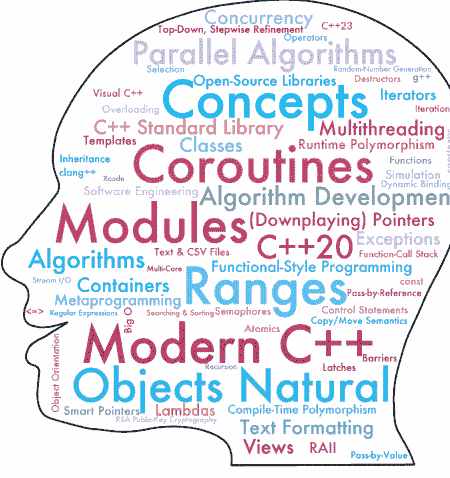

## 目标

本章中，你将：

- 学习计算机硬件、软件和互联网基础知识。
- 理解从位到数据库的数据层次结构。
- 理解编程语言的类型。
- 理解C++和其他语言的优势。
- 了解由可复用组件组成的C++标准库。
- 使用我们首选的三种编译器和Docker容器编译并运行一个C++应用程序。
- 了解“对象自然”案例研究（第2–9章）中使用的对象技术概念，并在面向对象编程第9–11章中详细讨论。
- 理解并发编程如何帮助在多核处理器上最大化性能。
- 了解大数据和数据科学。
- 了解计算领域令人兴奋的最新发展，包括元宇宙、人工智能及相关技术。

## 大纲

- 1.1 引言
- 1.2 硬件
    - 1.2.1 计算机组成
    - 1.2.2 摩尔定律、多核处理器与并发编程
- 1.3 数据层次结构
- 1.4 机器语言、汇编语言与高级语言
- 1.5 操作系统
- 1.6 C与C++
- 1.7 C++标准库与开源库
- 1.8 其他流行编程语言
- 1.9 面向对象入门
- 1.10 C++开发环境的简化视图
- 1.11 以多种方式测试驱动C++20应用程序
    - 1.11.1 在Windows上使用Visual Studio社区版编译和运行
    - 1.11.2 在Linux上使用GNU C++编译和运行
    - 1.11.3 在GCC Docker容器中使用g++编译和运行
    - 1.11.4 在Docker容器中使用clang++编译和运行
    - 1.11.5 在macOS上使用Xcode编译和运行
- 1.12 互联网、万维网、云与物联网
    - 1.12.1 互联网：网络的网络
    - 1.12.2 万维网：让互联网更易用
    - 1.12.3 云
    - 1.12.4 物联网（IoT）
    - 1.12.5 边缘计算
    - 1.12.6 混搭应用
- 1.13 元宇宙
    - 1.13.1 虚拟现实（VR）
    - 1.13.2 增强现实（AR）
    - 1.13.3 混合现实
    - 1.13.4 区块链
    - 1.13.5 比特币与加密货币
    - 1.13.6 以太坊
    - 1.13.7 非同质化代币（NFTs）
    - 1.13.8 Web3
- 1.14 软件开发技术
- 1.15 大数据有多大？
    - 1.15.1 大数据分析
    - 1.15.2 数据科学与大数据正在发挥作用：用例
- 1.16 AI——计算机科学与数据科学的交叉领域
    - 1.16.1 人工智能（AI）
    - 1.16.2 通用人工智能（AGI）
    - 1.16.3 人工智能里程碑
    - 1.16.4 机器学习
    - 1.16.5 深度学习
    - 1.16.6 强化学习
    - 1.16.7 生成式AI——ChatGPT与DALL-E 2
- 1.17 小结
- 练习

## 1.1 引言

欢迎来到C++——世界上历史最悠久的计算机编程语言之一，并且根据各种编程语言排名，也是世界上最流行的语言之一。^1,2,3 你可能已经熟悉计算机执行的许多强大任务。本教材提供高强度的动手实践体验，你将编写C++指令，命令计算机执行其中许多任务及其他任务。软件——你编写的C++指令，也称为代码——控制硬件（即计算机及相关设备）。

C++在工业界被广泛使用。^4 当今最流行的桌面操作系统——Windows^5和macOS^6——的部分内容就是用C++编写的。许多应用和系统部分使用C++编写，包括流行的Web浏览器（例如Google Chrome^7和Mozilla Firefox^8）、数据库管理系统（例如Microsoft SQL Server^9、Oracle^10、MySQL^11）、Adobe的创意应用、Amazon.com、Bloomberg、Facebook、各种Microsoft应用（包括Office和Visual Studio）以及更多。^12

本章介绍术语和概念，为你将从第2章开始学习的C++编程奠定基础。我们介绍硬件和软件概念。我们概述一个示例数据层次结构——从位（1和0）到数据库，数据库存储组织实现当代应用所需的大量数据，例如Google搜索、Netflix、Twitter、Waze、Uber、Airbnb以及无数其他应用。

我们讨论编程语言的类型。我们介绍C++标准库以及各种C++“开源”库，它们帮助你避免“重复造轮子”——你只需编写少量C++指令，就能让这些库执行强大的任务。

我们概述你在职业生涯中构建软件时可能使用的其他技术。我们讨论互联网、Web、云和物联网（IoT）。我们介绍元宇宙及其相关技术——区块链、加密货币、NFT、Web3、增强现实、虚拟现实和混合现实。最后，我们介绍大数据、数据科学和人工智能（AI）技术——机器学习、深度学习，以及最近引起极大兴趣的ChatGPT和DALL-E 2等生成式AI。

### 编译器

你可以在许多开发环境中编译、构建和运行C++应用程序。你将完成第1.11节中一个或多个测试驱动示例，这些示例展示如何使用以下工具编译和执行C++代码：

- 用于Windows的Microsoft Visual Studio社区版。
- macOS终端窗口或Linux shell中的GNU g++。
- macOS终端窗口或Linux shell中的LLVM clang++。

- 4. “C++.” 维基百科。维基媒体基金会。访问日期：2023年3月18日。https://en.wikipedia.org/wiki/C%2B%2B.
- 5. “Windows 11.” 维基百科。维基媒体基金会。访问日期：2023年3月18日。https://en.wikipedia.org/wiki/Windows_11.
- 6. “macOS.” 维基百科。维基媒体基金会。访问日期：2023年3月18日。https://en.wikipedia.org/wiki/MacOS.
- 7. “Google Chrome.” 维基百科。维基媒体基金会。访问日期：2023年3月18日。https://en.wikipedia.org/wiki/Google_Chrome.
- 8. “Firefox.” 维基百科。维基媒体基金会。访问日期：2023年3月18日。https://en.wikipedia.org/wiki/Firefox.
- 9. “Microsoft SQL Server.” 维基百科。维基媒体基金会。访问日期：2023年3月18日。https://en.wikipedia.org/wiki/Microsoft_SQL_Server.
- 10. “Oracle Database.” 维基百科。维基媒体基金会。访问日期：2023年3月18日。https://en.wikipedia.org/wiki/Oracle_Database.
- 11. “MySQL.” 维基百科。维基媒体基金会。访问日期：2023年3月18日。https://en.wikipedia.org/wiki/MySQL.
- 12. Bjarne Stroustrup，“C++ Applications.” 访问日期：2023年3月18日。https://www.stroustrup.com/applications.html.

此外，我们将介绍Docker，并展示如何在可运行于Windows、macOS或Linux的Docker容器中使用g++和clang++。Docker对本书的macOS用户尤为重要。Apple的Xcode环境尚不支持我们在本书中使用的若干关键C++20特性。Docker将使macOS用户（以及Windows和Linux用户）能够使用最新的g++和clang++版本编译C++程序。你可能只想阅读课程或业界项目所需的测试驱动示例。

### 本书架构

在你“深入”之前，我们建议先从“四万英尺”的视角了解本书架构，以便在准备学习C++20这门强大语言时理解自己的前进方向。为此，我们建议查看以下内容：

- 在前言中，一页全彩目录图提供了本书架构的高层概览。你可以在 https://deitel.com/cpphtp11 查看该图的可缩放PDF版本。
- 上述网站还包含本书的简要介绍、其关键特性的项目符号列表，以及审阅出版前书稿的大学教授和C++领域专家提供的推荐语。
- 前言阐述了“本书的灵魂”以及我们讲解现代C++编程的方法。我们介绍前几章的“对象自然方法”，在该方法中，你将使用少量简单的C++语句，让强大的现有类执行重要任务——这远早于你在第9章学习如何创建自己的自定义类。请务必阅读“本书导览”，其中指出了各章的关键特性，并列出了本书50多个更重要的案例研究和案例研究练习。阅读“本书导览”时，你可能还想参考目录图。

## 1.2 硬件

计算机在称为程序的指令控制下处理数据。这些程序引导计算机执行由称为计算机程序员的人指定的有序操作。

计算机硬件由各种物理设备组成，例如键盘、屏幕、鼠标、固态硬盘、内存和处理单元。由于硬件和软件技术的快速发展，计算成本正在大幅下降。几十年前可能占满大房间、耗资数百万美元的计算机，如今被刻在比指甲还小的硅计算机芯片上，每块可能只需几美元。具有讽刺意味的是，硅是地球上最丰富的材料之一——它是普通沙子的成分。硅芯片技术使计算变得如此经济，以至于计算机和计算机化设备已成为商品。

### 1.2.1 计算机组成

无论物理差异如何，计算机都具有各种逻辑单元或部分。


#### 输入单元

这个“接收”部分从输入设备获取信息（数据和计算机程序），并将其交由其他单元处理。计算机通过键盘、触摸屏、鼠标和触摸板接收大多数用户输入。其他输入形式包括：

- 接收语音命令，
- 扫描图像、条形码或二维码，
- 从辅助存储设备读取数据（如固态硬盘、蓝光光盘™驱动器和USB闪存驱动器——也称为“拇指驱动器”或“记忆棒”），
- 从网络摄像头接收视频，
- 从互联网接收信息（例如从YouTube®流式传输视频或从亚马逊下载电子书时），
- 从GPS设备接收位置数据，
- 从加速度计接收运动与方向信息，加速度计是一种对向上/向下、向左/向右和向前/向后加速度做出响应的设备，内置于智能手机或无线游戏控制器（如Microsoft® Xbox®、Nintendo Switch®和Sony® PlayStation®的控制器）中，
- 接收来自智能助手（如Apple® Siri®、Amazon® Alexa®、Microsoft® Cortana®和Google Home™）的语音输入。

#### 输出单元

这个“发送”部分获取计算机已处理的信息，并将其置于各种输出设备上，使其在计算机外部可用。当今大多数从计算机输出的信息：

- 显示在屏幕上，
- 打印在纸上（“绿色环保”理念不鼓励这种做法），
- 通过3D打印机打印，
- 在智能手机、平板电脑、个人电脑和体育场馆巨幕上以音频或视频形式播放，
- 通过互联网传输，或
- 用于控制其他设备，如自动驾驶汽车、机器人和“智能”家电。

信息通常也会输出到辅助存储设备，如固态硬盘（SSD）、硬盘、USB闪存驱动器和DVD驱动器。近来流行的输出形式包括智能手机和游戏控制器的振动、虚拟现实设备（如Meta Quest® 2、Meta Quest® Pro、Sony® PlayStation® VR和Samsung Gear VR®），以及混合现实设备（如Magic Leap® 2和Microsoft HoloLens® 2）。

#### 内存单元

这个快速访问、相对低容量的“仓库”部分保留通过输入单元输入的信息，使其在需要时立即可用于处理。内存单元还保留已处理的信息，直到输出单元能够将其置于输出设备上。内存单元中的信息是**易失的**——当计算机电源关闭时，信息通常会丢失。内存单元通常被称为**内存**、**主存储器**或**RAM**（随机存取存储器）。台式机和笔记本电脑上的主内存最多包含128 GB的RAM，不过8到32 GB最为常见。GB代表千兆字节；**千兆字节**约等于十亿字节。**字节**是八位。**位**（“二进制数字”的简称）是0或1。

#### 算术逻辑单元（ALU）

这个“制造”部分执行计算（例如加法、减法、乘法和除法）并做出决策（例如比较内存单元中的两个项目以确定它们是否相等）。在当今的系统中，ALU是下一个逻辑单元CPU的一部分。

#### 中央处理单元（CPU）

这个“管理”部分协调并监督其他部分的运行。CPU指示：

- 输入单元何时将信息读入内存单元，
- ALU何时在计算中使用来自内存单元的信息，以及
- 输出单元何时将信息从内存单元发送到特定输出设备。

当今大多数计算机都配备**多核处理器**，可在单个集成芯片上经济地实现多个处理器。此类处理器可以同时执行许多操作。我们将在第1.2.2节中详细讨论。

#### 辅助存储单元

这是长期、高容量的“仓储”部分。其他单元未积极使用的程序和数据被放置在辅助存储设备上，直到再次需要它们，可能是几小时、几天、几个月甚至几年之后。辅助存储设备上的信息是**持久性的**——即使计算机电源关闭，信息也会被保留。访问辅助存储信息所花费的时间比访问主存储器中的信息长得多，但其成本远低于RAM。辅助存储设备的示例包括固态硬盘（SSD）、USB闪存驱动器和可读写蓝光驱动器。许多当前的驱动器可容纳数太字节（TB）的数据——每个**太字节**约为一万亿字节。典型的台式机和笔记本电脑辅助存储设备可容纳高达8 TB，一些最新的台式机硬盘可容纳高达26 TB。¹³ 最大的商用SSD可容纳高达100 TB（成本约为40,000美元）。¹⁴

- 13. “硬盘驱动器历史。”维基百科。维基媒体基金会。访问于2023年3月18日。https://en.wikipedia.org/wiki/History_of_hard_disk_drives.
- 14. Desire Athow。“截至2023年最大的SSD和硬盘。”访问于2023年3月18日。https://www.techradar.com/best/large-hard-drives-and-ssds.

#### 多核处理器与性能

他们正在致力于制造工艺的进步，以实现每个芯片上集成更多晶体管。[18,19] 计算机处理能力持续提升，但这依赖于新的处理器设计，例如多核处理器（第1.2.1节）。

当今大多数计算机都配备多核处理器，可在单个集成电路芯片上经济地实现多个处理器。双核处理器有两个CPU，四核处理器有四个，八核处理器有八个。英特尔有些处理器拥有多达72个核心。我们的主要测试计算机使用八核英特尔处理器。Apple最新的M2 Pro和M2 Max处理器具有12核CPU。此外，顶配M2 Pro拥有19核图形处理单元（GPU），而顶配M2 Max处理器拥有28核GPU。两者都配备了用于机器学习的16核“神经引擎”。[20] 英特尔正在研发拥有多达80个核心的处理器。[21] AMD正在研发拥有192核和256核的处理器。[22] 核心数量将继续增长。当今用于高端游戏计算机和人工智能应用的最强大GPU通常拥有数千个核心。例如，在撰写本文时，即将推出的NVIDIA RTX 4090 Ti预计将拥有18,176个核心！[23]

在多核系统中，硬件可以让多个处理器真正同时处理任务的不同部分，从而使程序更快完成。充分利用多核架构需要编写多线程应用程序（第17章）。当程序将任务拆分为单独的线程时，多核系统可以在有足够核心可用时并行运行这些线程。

由于多核系统的普及，人们对多线程的兴趣正在迅速上升。标准C++多线程是C++11中引入的最重要更新之一。此后的每个C++标准都增加了更高级别的功能，以简化多线程应用程序的开发。第17章“并行算法与并发：高级视角”讨论了创建和管理多线程C++应用程序。第18章介绍C++20协程，它支持以简单、类似顺序的编码风格进行并发编程。

- 18. Esther Shein。“摩尔定律迎来55周年：它仍然重要吗？”2020年4月17日。访问于2023年3月18日。https://www.techrepublic.com/article/moores-law-turns-55-is-it-still-relevant/.
- 19. Leswing, Kif。“英特尔表示摩尔定律依然生机勃勃。英伟达表示它已经终结。”2022年9月27日。访问于2023年3月18日。https://www.cnbc.com/2022/09/27/intel-says-moores-law-is-still-alive-nvidia-says-its-ended.html.
- 20. “Apple发布M2 Pro和M2 Max：为更高水平工作流程打造的下一代芯片。”2023年1月23日。访问于2023年3月18日。https://www.apple.com/newsroom/2023/01/apple-unveils-m2-pro-and-m2-max-next-generation-chips-for-next-level-workflows/.
- 21. Anton Shilov，“根据新的芯片照片，英特尔的Sapphire Rapids可能拥有72-80个核心。”2021年4月30日。访问于2023年3月18日。https://www.tomshardware.com/news/intel-sapphire-rapids-could-feature-80-cores.
- 22. Anthony Garreffa，“AMD EPYC‘Venice’CPU：Zen 6拥有256个核心、512个线程……甚至更多！”2022年5月22日。访问于2023年3月18日。https://www.tweaktown.com/news/85915/amd-epyc-venice-cpu-zen-6-with-256-cores-512-threads-or-more/index.html.
- 23. “据传NVIDIA GeForce RTX 4090 Ti将配备18176个核心和24GB/24Gbps内存。”访问于2023年3月18日。https://videocardz.com/newz/nvidia-geforce-rtx-4090-ti-rumored-to-feature-18176-cores-and-24gb-24gbps-memory.


### 计算能力的发展历程

数据正变得愈发庞大，处理这些数据所需的计算能力也在不断提升。当今处理器性能通常以FLOPS（每秒浮点运算次数）衡量。20世纪90年代早期至中期，最快的超级计算机速度以千兆次浮点运算（gigaflops，10⁹ FLOPS）衡量。到20世纪90年代末，英特尔生产了首批万亿次浮点运算（teraflop，10¹² FLOPS）超级计算机。21世纪00年代早期至中期，速度达到数百teraflops，随后在2008年，IBM发布了首台千万亿次浮点运算（petaflop，10¹⁵ FLOPS）超级计算机。截至2022年11月，慧与公司（Hewlett Packard Enterprise）的Frontier是全球最快的超级计算机，²⁴,²⁵ 它每秒可执行1.102百亿亿次计算（1.102 exaflops——10¹⁸ FLOPS）。²⁶ IBM等公司也在研发百亿亿次（exaflop）超级计算机。²⁷

目前正在开发的量子计算机，理论上能以当今“传统计算机”速度的18,000,000,000,000,000,000倍运行！²⁸ 这个数字如此惊人，以至于理论上，量子计算机在一秒内完成的计算量，可能比自时间伊始以来所有计算设备完成的计算总量还要多得多，令人瞠目结舌。这种几乎难以想象的计算能力可能会对比特币等基于区块链的加密货币造成严重破坏。工程师们已经在重新思考区块链²⁹，以应对计算能力如此巨大的增长。³⁰

计算能力成本持续下降，尤其是在处理器架构和云计算进步的推动下。人们过去常问：“我的本地系统需要多少计算能力，才能应对峰值处理需求？”如今，这种思路已转变为：“我能否在云中快速划出所需的临时资源，以应对要求最高的计算工作负载？”你只需为完成特定任务所使用的资源付费。

### 检查点

- 1. **（填空）** 几十年来，每隔一两年，计算机的容量就会以较低成本大约翻一番。这一显著趋势通常被称为________。**答案：** 摩尔定律。
- 2. **（填空）** 要充分利用多核架构，需要编写________。**答案：** 多线程应用程序。

- 24. “Top 500。”维基百科。维基媒体基金会。访问于2023年3月18日。https://en.wikipedia.org/wiki/TOP500#TOP_500。
- 25. “Frontier（超级计算机）。”维基百科。维基媒体基金会。访问于2023年3月18日。https://en.wikipedia.org/wiki/Frontier_(supercomputer)。
- 26. “Flops。”维基百科。维基媒体基金会。访问于2023年3月18日。https://en.wikipedia.org/wiki/FLOPS。
- 27. “一种由超级计算驱动的新天气模型可能让我们为百亿亿次计算时代做好准备。”访问于2023年3月18日。https://www.ibm.com/blogs/research/2017/06/supercomputing-weather-model-exascale/。
- 28. 诺伯特·别德日茨基（Norbert Biedrzycki），《只有上帝才能数得那么快——量子计算世界》。2017年5月12日。访问于2023年3月18日。https://medium.com/@n.biedrzycki/only-god-can-count-that-fast-the-world-of-quantum-computing-406a0a91fcf4。
- 29. “区块链。”维基百科。维基媒体基金会。访问于2023年3月18日。https://en.wikipedia.org/wiki/Blockchain。
- 30. 纳塔娜·夏尔马（Nathana Sharma），《量子计算是对区块链技术的生存威胁吗？》2017年11月5日。访问于2023年3月18日。https://singularityhub.com/2017/11/05/is-quantum-computing-an-existential-threat-to-blockchain-technology/。

Unicode包含世界上许多语言的字符。ASCII是Unicode的一个（很小的）子集，表示字母（a–z和A–Z）、数字以及一些常见特殊字符。你可以在https://www.unicode.org/charts/PDF/U0000.pdf查看Unicode的ASCII子集。

有关所有语言、符号、表情符号等的冗长Unicode图表，请访问http://www.unicode.org/charts/。

### 字段

正如字符由位组成，字段由字符或字节组成。字段是传达含义的一组字符或字节。例如，由大写和小写字母组成的字段可以表示一个人的姓名，而由十进制数字组成的字段可以表示一个人的年龄（以年为单位）。

### 记录

若干相关字段可以组成一条记录。例如，在工资系统中，一名员工的记录可能由以下字段组成（这些字段可能的类型显示在括号中）：

- 员工识别号（整数）。
- 姓名（一组字符）。
- 地址（一组字符）。
- 小时工资率（带小数点的数字）。
- 年初至今收入（带小数点的数字）。
- 预扣税款金额（带小数点的数字）。

因此，记录是一组相关字段。上面列出的所有字段都属于同一名员工。一家公司可能有许多员工，并且每名员工都有一条工资记录。

### 文件

文件是一组相关记录。更一般地说，文件包含任意格式的任意数据。某些操作系统仅将文件视为字节序列——文件中字节的任何组织方式（例如组织成记录）都是应用程序员创建的一种视图。你将在第8章看到如何做到这一点。一个组织拥有许多文件并不罕见，其中一些文件包含数十亿甚至数万亿个字符的信息。正如我们将在下文看到的，随着大数据的发展，大得多的文件大小正变得越来越普遍。

### 数据库

数据库是为便于访问和操作而组织的数据集合。最流行的模型是关系数据库，其中数据存储在简单的行列表格中。表包含记录和字段。例如，学生表可能包括名字、姓氏、专业、年级、学生ID号和平均绩点等字段。每名学生的数据是一条记录，而每条记录中的各项信息就是字段。你可以根据数据与多个表或数据库的关系来搜索、排序以及以其他方式操作数据。例如，一所大学可能会将学生数据库中的数据与课程、校内住宿、膳食计划等数据库中的数据结合使用。

### 大数据

下表列出了一些常见的字节度量单位：

| 单位 | 字节数 | 大约相当于 |
| --- | --- | --- |
| 1千字节（KB） | 1024字节 | 10³字节（正好1024字节） |
| 1兆字节（MB） | 1024千字节 | 10⁶（1,000,000）字节 |
| 1吉字节（GB） | 1024兆字节 | 10⁹（1,000,000,000）字节 |
| 1太字节（TB） | 1024吉字节 | 10¹²（1,000,000,000,000）字节 |
| 1拍字节（PB） | 1024太字节 | 10¹⁵（1,000,000,000,000,000）字节 |
| 1艾字节（EB） | 1024拍字节 | 10¹⁸（1,000,000,000,000,000,000）字节 |
| 1泽字节（ZB） | 1024艾字节 | 10²¹（1,000,000,000,000,000,000,000）字节 |

全球产生的数据量极其庞大，而且其增长正在加速。大数据应用处理海量数据。

### Twitter®——备受青睐的大数据来源

开发者青睐的一个大数据来源是Twitter。截至2023年3月，每天大约有900,000,000条推文。³² 尽管推文限制为280个字符，但分析推文的程序员可以请求额外的元数据——例如谁发送了推文、图像、视频、链接、对其他用户的提及等——每条推文的元数据总量大约可达10,000字节。因此，900,000,000乘以10,000约为9,000,000,000,000字节，即每天9太字节（TB）数据。这是大数据的一个很好的例子。³³

预测是一个具有挑战性且往往成本高昂的过程，但准确预测的潜在回报非常可观。数据挖掘是搜索大量数据集合（通常是大数据）以发现有价值的洞见的过程，这些洞见对个人和组织可能很有价值。你从推文中挖掘出的情感倾向可以帮助预测选举结果、一部新电影可能产生的收入以及公司营销活动的成功与否。它还可以帮助公司发现竞争对手产品供应中的弱点。


### 检查点

- 1. *（填空）* ______是“binary digit”（二进制位）的缩写——一种可以取两个值之一的数字，是计算机最小的数据项。**答案：** 位（bit）。
- 2. *（填空）* 数据库是为便于访问和操作而组织的数据集合。最流行的模型是______数据库，其中数据存储在简单的表中。**答案：** 关系型。

- 32. “Worldometer。”访问于2023年3月18日。https://www.worldometers.info/。
- 33. 在撰写本文时，Twitter已宣布对其API和限制进行更改，因此你可以通过其API访问的数据量可能会发生变化。


## 1.4 机器语言、汇编语言和高级语言

程序员使用各种编程语言编写指令，有些可被计算机直接理解，另一些则需要中间翻译步骤。如今有数百种此类语言在使用。它们大致可分为三种类型：

- 机器语言。
- 汇编语言。
- 高级语言。

### 机器语言

任何计算机只能直接理解由其硬件设计定义的自身机器语言。机器语言通常由数字串（最终归约为 1 和 0）组成，这些数字串指示计算机一次执行一个最基本的操作。机器语言依赖于机器——一种特定的机器语言只能用于一种类型的计算机。此类语言对人类来说很繁琐。例如，下面是一段早期的机器语言工资单程序，它将加班费加到基本工资上，并将结果存入总工资：

```text
+1300042774
+1400593419
+1200274027
```

在我们的“构建你自己的计算机”案例研究（练习 7.9–7.11）中，你将“打开”一台“虚构的”计算机并查看其内部结构。我们将介绍机器语言编程，你将编写几个机器语言程序。为了使这段经历特别有价值，你随后将构建一个计算机软件模拟器，以便在其上执行你的机器语言程序。这将友好地向你介绍当代计算机体系结构中的“虚拟机”概念。

### 汇编语言与汇编器

对大多数程序员来说，用机器语言编程太慢且太繁琐。程序员不再使用计算机可以直接理解的数字串，而是开始使用类似英语的缩写来表示基本操作。这些缩写构成了汇编语言的基础。人们开发了称为汇编器的翻译程序，以计算机速度将汇编语言程序转换为机器语言。下面这段汇编语言工资单程序同样将加班费加到基本工资上，并将结果存入总工资：

```text
    load    basepay
    add     overpay
    store   grosspay
```

尽管此类代码对人类来说更清晰，但在翻译成机器语言之前，计算机无法理解它。

### 高级语言与编译器

随着汇编语言的出现，计算机的使用迅速增加。然而，程序员仍然必须使用大量指令才能完成甚至简单的任务。为了加快编程过程，人们开发了高级语言，在其中单条语句即可完成大量任务。一个典型的高级语言程序包含许多语句，这些语句称为程序的源代码。

称为编译器的翻译程序将高级语言源代码转换为机器语言。高级语言允许你编写看起来几乎像日常英语并包含常见数学符号的指令。用高级语言编写的工资单程序可能包含如下语句

```text
grossPay = basePay + overTimePay
```

从程序员的角度来看，高级语言比机器语言和汇编语言更可取。C++ 是世界上使用最广泛的高级编程语言之一。

在我们的“构建你自己的编译器”案例研究（练习 13.29–13.34）中，你将构建一个编译器，它接收用简单的“虚构的”高级编程语言编写的程序，并将其转换为你在练习 7.9 中学习的 Simpletron 机器语言。练习 13.29–13.34 将整个编程过程“串联”起来。你将用一种简单的高级语言编写程序，使用你构建的编译器编译这些程序，然后在你在练习 7.10 中构建的 Simpletron 模拟器虚拟机上运行这些程序。

### 解释器

将大型高级语言程序编译成机器语言可能耗费相当多的计算机时间。解释器直接执行高级语言程序，避免了编译延迟，但你的代码运行速度比编译后的程序慢。一些编程语言，如 Java³⁴、Python³⁵ 和 C#³⁶，使用编译与解释的巧妙混合方式来运行程序。


### 检查点

- 1. **（填空）** ______ 程序旨在直接执行高级语言程序，避免了编译延迟，尽管它们比编译后的程序运行得慢  
  **答案：** 解释器。
- 2. **（判断正误）** 高级语言允许你编写看起来几乎像日常英语并包含常见数学符号的指令。  
  **答案：** 正确。

- 34. “Java 虚拟机。”维基百科。维基媒体基金会。2023年3月18日访问。https://en.wikipedia.org/wiki/Java_virtual_machine#Bytecode_interpreter_and_just-in-time_compiler.
- 35. “字节码解释器。”2023年3月18日访问。https://devguide.python.org/internals/interpreter/
- 36. “公共语言运行时（CLR）概述。”2023年3月18日访问。https://learn.microsoft.com/en-us/dotnet/standard/clr.

## 1.5 操作系统

操作系统是使用户、软件开发人员和系统管理员更方便地使用计算机的软件。它们提供服务，使应用程序能够安全、高效地相互并发执行。包含核心操作系统组件的软件称为内核。Linux、Windows 和 macOS 是流行的台式机/笔记本电脑操作系统——你可以使用其中任何一种来学习本书。智能手机和平板电脑中最流行的移动操作系统是谷歌的 Android 和苹果的 iOS。

### Windows——专有操作系统

20世纪80年代中期，微软开发了 Windows 操作系统，它由构建在 DOS（磁盘操作系统）之上的图形用户界面组成——DOS 是一种极其流行的台式机/笔记本电脑操作系统，用户通过键入命令与之交互。Windows 11 是微软最新的操作系统。Windows 是由微软独家控制的专有操作系统。它是世界上使用最广泛的台式机和笔记本电脑操作系统，市场份额接近72%（2023年2月）。

### Linux——开源操作系统

Linux 操作系统是开源运动最伟大的成功之一。用于销售或租赁的专有软件在软件发展的早期占据主导地位。借助开源，个人和公司共同参与软件的开发、维护和演进。然后任何人都可以将该软件用于自己的目的——通常免费，但须遵守各种（通常宽松的）许可要求。开源代码通常比专有软件受到更多人的审查，因此错误可以更快被消除，使软件更加健壮。开源提高了生产力，并推动了创新的爆发。你将在本书中用到各种流行的开源库和工具。

开源社区的一些重要组织包括：

- GitHub 提供用于管理开源软件开发项目的工具。它有数百万个项目正在进行中。
- Apache 软件基金会创建了 Apache Web 服务器，现在监管350多个开源项目，包括许多大数据基础设施技术。
- Eclipse 基金会监管400多个开源项目，包括 Eclipse 集成开发环境。
- Mozilla 基金会是 Firefox Web 浏览器的创造者，还创建了其他几个项目，包括 Firefox Reality（虚拟现实 Web 浏览器）、Hubs（虚拟现实会议空间）、Project Things（用于构建物联网应用）、WebXR Viewer（增强现实查看器）和 Spoke（用于构建可通过虚拟现实设备访问的3D社交环境）。

- 37. Alison DeNisco Rayome 和 Shelby Brown。“你应该关心的 Windows 10 与 Windows 11 之间的每一处差异。”2022年11月5日。2023年3月18日访问。https://www.cnet.com/tech/computing/every-difference-you-should-care-about-between-windows-10-and-windows-11/.
- 38. “全球桌面操作系统市场份额。”2023年3月18日访问。https://gs.statcounter.com/os-market-share/desktop/worldwide.
- 39. “欢迎来到 Apache 项目目录。”2023年3月18日访问。https://projects.apache.org/.
- 40. “Eclipse 基金会。”维基百科。维基媒体基金会。2023年3月18日访问。https://en.wikipedia.org/wiki/Eclipse_Foundation.
- 41. “欢迎来到 Mozilla 实验室。”2023年3月18日访问。https://labs.mozilla.org/projects/.


-   OpenML专注于机器学习的开源工具和数据。
-   OpenAI研究人工智能，并发布用于AI研究的开源工具。他们还是ChatGPT和DALL-E 2的创造者，这两者都引发了人们对人工智能的巨大兴趣。有关这些技术的更多信息，参见第1.16节。
-   OpenCV专注于可在各种操作系统和编程语言中使用的开源计算机视觉工具。
-   Python软件基金会负责Python编程语言。
-   Boost组织管理开源Boost C++库的开发（见第1.7节）。

计算与通信的快速进步、成本的下降以及开源软件，使得如今创建基于软件的企业比仅仅十年前容易得多、经济得多。一个很好的例子是Facebook，它从一间大学宿舍上线，并使用开源软件构建。

Linux内核是最流行的开源、免费分发、功能齐全的操作系统的核心。它由一个组织松散的志愿者团队开发，在服务器、个人计算机和嵌入式系统（例如位于智能手机、智能电视和汽车系统核心处的计算机系统）中广受欢迎。与Microsoft的Windows和Apple的macOS源代码不同，Linux源代码可供公众检查和修改，并可免费下载和安装。因此，Linux用户受益于积极调试和改进内核的庞大开发者社区，以及定制操作系统以满足特定需求的能力。

## Apple的macOS与用于iPhone®和iPad®设备的Apple iOS

Apple由Steve Jobs和Steve Wozniak于1976年创立，迅速成为个人计算领域的领导者。1979年，Jobs和几名Apple员工参观了Xerox PARC（帕洛阿尔托研究中心），了解Xerox推出的具有图形用户界面（GUI）的台式计算机。该GUI启发了1984年推出的Apple Macintosh。

Objective-C编程语言由Stepstone在20世纪80年代初创建，为C编程语言增加了面向对象编程（OOP）能力。Steve Jobs于1985年离开Apple并创立NeXT Inc.。1988年，NeXT从Stepstone获得Objective-C许可。NeXT开发了Objective-C编译器和库，它们被用作NeXTSTEP操作系统用户界面和Interface Builder（用于构建图形用户界面）的平台。

Jobs于1996年Apple收购NeXT时回到Apple。Apple的macOS操作系统是NeXTSTEP的后代。Apple还有其他几个源自macOS的专有操作系统：

-   iOS用于iPhone。
-   iPadOS用于iPad。
-   watchOS用于Apple Watch。
-   tvOS用于Apple TV设备。

-   **2.（判断题）** 专有代码通常比开源软件受到大得多的受众审查，因此错误往往能更快被移除。  
    **答案：** 错误。开源代码通常比专有软件受到大得多的受众审查，因此错误往往能更快被移除。

## 1.6 C与C++

### C编程语言

C由Dennis Ritchie于1972年在贝尔实验室实现。它最初作为UNIX操作系统的开发语言而广为人知。如今，大多数通用操作系统的代码都是用C或C++编写的。C可用于大多数计算机，并且与硬件无关。通过精心设计，可以编写可移植到大多数计算机的C程序。

C在各种计算机（有时称为硬件平台）上的广泛使用导致了许多变体。美国国家标准学会（ANSI）与国际标准化组织（ISO）合作，在全球范围内标准化C——联合标准文件于1990年发布。更新版标准目前正在制定中。

### C++编程语言

C++^44^由Bjarne Stroustrup于1979年在贝尔实验室作为C的扩展开发。它最初称为“C with Classes”，在20世纪80年代初更名为C++——该名称源自C的增量运算符++，该运算符将数字加1。它提供了许多“美化”C的功能，但更重要的是，它包含受Simula仿真编程语言启发的面向对象编程能力。正如你将看到的，C++在过去40年中不断演进，使程序员能够使用五种不同的编程模型，你将在本书中学习每一种：

-   过程式编程，
-   面向对象编程，
-   函数式编程，
-   泛型编程，以及
-   模板元编程。

**C++是构建高性能、业务关键型和任务关键型计算系统的首选语言**，包括操作系统、实时系统、嵌入式系统、游戏系统、银行系统、空中交通管制系统、通信系统等。即使对于主要用其他语言编写的系统，C++也常用于构建这些系统中性能密集的部分。Stroustrup在其网站上维护了一份很长的C++应用列表：

https://www.stroustrup.com/applications.html

^44^ Stroustrup, Bjarne。“C++的历史：1979–1991。”访问于2023年3月18日。https://www.stroustrup.com/holm12.pdf.

### 现代C++

如今的C++程序员使用现代C++构建系统和系统组件，现代C++包括C++20、C++17、C++14和C++11标准——每个名称中的数字表示该版本在2000年代获得ISO C++标准委员会批准的年份。这些标准引入的许多语言和库特性使C++更易于使用，提高运行时性能和软件质量，并使应用程序能够利用当今的多核系统。

C++已有四十多年历史，因此存在大量使用较旧编程惯用法的现有C++代码——这通常被称为遗留代码。本书强调现代C++惯用法。

### C++核心准则

Bjarne Stroustrup、Herb Sutter（ISO C++委员会主席）以及其他几位贡献者^45^创建了不断发展的C++核心准则，^46^其中包含大量建议和示例代码，帮助你正确有效地使用现代C++。各种代码分析工具（在前言第7节中讨论）使你能够检查代码，确保其遵循这些建议。本书通篇频繁引用C++核心准则。

### ✓ 检查点

-   **1.（填空题）** 大多数通用操作系统的代码是用__________编写的。  
    **答案：** C或C++。
-   **2.（填空题）** __________提供建议和示例代码，帮助你正确有效地使用现代C++。  
    **答案：** C++核心准则。

## 1.7 C++标准库与开源库

C++程序由称为函数和类的部件组成。你可以自己编写所需的所有部件。相反，大多数C++程序员复用C++标准库中丰富的类和函数集合。因此，学习C++编程实际上有两个部分：

-   学习C++语言本身（通常称为“核心语言”），以及
-   学习如何使用C++标准库的类和函数。

### Boost项目与其他开源库

有大量开源C++库，可以帮助你只需编写少量代码就能完成重要任务。Boost C++库提供168个强大的开源库。^47^ Boost充当新能力的“培育场”。

^45^ “C++核心准则——致谢。”访问于2023年3月18日。https://isocpp.github.io/CppCoreGuidelines/CppCoreGuidelines#SS-ack.

^46^ “C++核心准则。”访问于2023年3月18日。https://isocpp.github.io/CppCoreGuidelines/

^47^ “Boost 1.81.0库文档。”访问于2023年3月18日。https://www.boost.org/doc/libs/1_81_0/.


最终可能被纳入 C++ 标准库的功能。下面这篇 StackOverflow 帖子列出了从 Boost 库演变而来的现代 C++ 库和语言特性。<sup>48</sup>

https://stackoverflow.com/a/8852421

在关于超大整数（第 3.14 节）和精确货币计算（第 4.14 节）的对象自然案例研究中，我们使用了 **Boost Multiprecision 库**。

在 GitHub 上，开发者向近 56,000 个 C++ 代码仓库贡献代码：

https://github.com/topics/cpp

此外，诸如  
https://github.com/fffaraz/awesome-cpp  
https://github.com/rigtorp/awesome-modern-cpp  
等页面提供了面向许多应用领域的常用 C++ 库精选列表——你会喜欢探索这些网站的。

## C++ 开发的构建块方法

在本书中，我们鼓励采用构建块方法来创建程序。使用 C++ 编程时，你通常会使用以下构建块：

- C++ 标准库类和函数，
- 开源 C++ 库类和函数，
- 你创建的函数和类（分别在学习第 5 章和第 9 章之后），以及
- 其他人创建并提供给你的类和函数。

创建自己的类和函数的优势在于能确切了解它们的工作方式。劣势在于设计、开发、调试和性能调优它们需要耗费大量时间。在本书中，我们侧重于使用现有的 C++ 标准库和各种开源库，以提升你的程序开发成效并避免“重复造轮子”。这称为软件复用，也是我们对象自然教学方法的关键部分。

### ✓ 检查点

- 1. *（填空）* 大多数 C++ 程序员会利用称为 ______ 的丰富现有函数集合。  
  **答案：** C++ 标准库。
- 2. *（填空）* 避免“重复造轮子”。相反，应使用代码库中的现有组件。这是 ______ 的一个例子。  
  **答案：** 软件复用。

48. Kenytn，对“Which Boost Features Overlap with C++11?”的回答。访问于 2023 年 3 月 18 日。https://stackoverflow.com/a/8852421.

## 1.8 其他流行编程语言

下面简要介绍几种其他流行编程语言：

- **Python** 是一种开源、面向对象的语言，于 1991 年公开发布。它由阿姆斯特丹国家数学与计算机科学研究中心的 Guido van Rossum 开发。Python 迅速成为世界上最流行的编程语言之一，尤其在科学计算、数据科学和人工智能领域。它拥有广泛的标准库和数千个第三方开源库。<sup>49</sup>
- **Java**<sup>50</sup>——一种基于 C++ 的面向对象编程语言——创建于 1991 年，当时 Sun Microsystems 资助了一个由 James Gosling 领导的内部企业研究项目。Java 的一个关键目标是“一次编写，到处运行”，使开发者能够编写可在各种计算机系统上运行的程序。Java 用于许多类型的应用，包括大数据（第 1.15 节）、物联网（第 1.12 节；连接到互联网的设备，如传感器、智能手机、平板电脑、电视机顶盒、家用电器和汽车）、企业应用、Web 服务器（为我们的 Web 浏览器提供内容的计算机）、视频游戏等。<sup>51</sup> 最初，Java 是官方的 Android 应用开发语言，不过现在超过 60% 的 Android 应用开发者使用 Kotlin。<sup>52</sup>
- **C#**<sup>53</sup>（基于 C++ 和 Java）是 Microsoft 的三种主要面向对象编程语言之一——另外两种是 Visual C++ 和 Visual Basic。C# 的开发目的是将 Web 集成到计算机应用中，如今已广泛用于开发多种类型的应用。它是 Microsoft 开发元宇宙（第 1.13 节）的主要语言。<sup>54</sup> Microsoft 现在提供 C# 和 Visual Basic 的开源版本。
- **Visual Basic**<sup>55</sup> 最初基于 BASIC 编程语言，BASIC 于 20 世纪 60 年代在达特茅斯学院开发，旨在让初学者熟悉编程。C# 和 Visual Basic 都使用 Microsoft **.NET 平台**的庞大代码库。用这两种语言编写的组件通常可以互换使用，使开发者能够使用自己偏好的编程语言来构建强大的基于 .NET 的应用程序。
- **JavaScript**<sup>56</sup> 被广泛用于为网页添加可编程能力（例如动画、用户交互等）。所有主流 Web 浏览器都支持它。其他编程语言中的许多可视化库会输出 JavaScript，以创建可在 Web 浏览器中查看的交互式可视化。NodeJS 等工具还使 JavaScript 能够在 Web 浏览器之外运行。现代 JavaScript 开发的一个关键方面是使用 React、Angular、Vue 等 JavaScript 框架创建强大的 Web 应用。<sup>57,58</sup>
- **Swift**<sup>59</sup> 由 Apple 于 2014 年推出，是 Apple 用于开发 iOS 和 macOS 应用的编程语言。Swift 是一种现代语言，融合了 Objective-C、Java、C#、Ruby、Python 和其他语言的流行特性。Swift 是开源的，因此也可用于非 Apple 平台。
- **Go**<sup>60</sup> 是 Google 于 2009 年推出的一种高性能、开源系统编程语言。它专门设计用于开发系统，以利用当今的多核、网络化系统。该语言在 Google 内部以及许多流行的开源应用中被广泛使用。
- **Rust**<sup>61</sup> 是一种高性能、开源、通用编程语言，最初是 Mozilla 研究开发者 Graydon Hoare 在 2006 年的个人项目，后来成为 Mozilla 的官方项目并于 2015 年发布。该语言的一个关键特性是支持并发。使用 Rust 的公司包括 Amazon、Google、Microsoft、Facebook 和 Dropbox。

### 检查点

- 1. *（填空）* 如今，通用操作系统和其他性能关键型系统的大多数代码都是用 ________ 编写的。  
  **答案：** C 或 C++。
- 2. *（填空）* ________ 编程语言的一个关键目标是“一次编写，到处运行”，使开发者能够编写可在多种计算机系统和计算机控制的设备上运行的程序。  
  **答案：** Java。

49. “Python programming language.” 维基百科。维基媒体基金会。访问于 2023 年 3 月 18 日。https://en.wikipedia.org/wiki/Python_(programming_language).  
50. “Java programming language.” 维基百科。维基媒体基金会。访问于 2023 年 3 月 18 日。https://en.wikipedia.org/wiki/Java_(programming_language).  
51. “What is Java used for?” 2022 年 3 月 14 日。访问于 2023 年 3 月 18 日。https://www.future-learn.com/info/blog/what-is-java-used-for.  
52. “Build Better Apps with Kotlin.” 访问于 2023 年 3 月 18 日。https://developer.android.com/kotlin/build-better-apps.  
53. “C Sharp (programming language).” 维基百科。维基媒体基金会。访问于 2023 年 3 月 18 日。https://en.wikipedia.org/wiki/C_Sharp_(programming_language).  
54. Mahesh Chand，“What is Microsoft Mesh?” 2022 年 1 月 5 日。访问于 2023 年 3 月 18 日。https://www.c-sharpcorner.com/article/what-is-microsoft-mesh/.  
55. “Visual Basic (.NET).” 维基百科。维基媒体基金会。访问于 2023 年 3 月 18 日。https://en.wikipedia.org/wiki/Visual_Basic_(.NET).  
56. “JavaScript.” 维基百科。维基媒体基金会。访问于 2023 年 3 月 18 日。https://en.wikipedia.org/wiki/JavaScript.  
57. Eric Elliott，“Top JavaScript Frameworks and Technology 2023.” 2023 年 2 月 19 日。访问于 2023 年 3 月 18 日。https://medium.com/javascript-scene/top-javascript-frameworks-and-technology-2023-4e4a06d6be93.  
58. Simran Kaur Arora，“10 Best JavaScript Frameworks to Use in 2023.” 2022 年 12 月 29 日。访问于 2023 年 3 月 18 日。https://hackr.io/blog/best-javascript-frameworks.  
59. “Swift (programming language).” 维基百科。维基媒体基金会。访问于 2023 年 3 月 18 日。https://en.wikipedia.org/wiki/Swift_(programming_language).  
60. “Go (programming language).” 维基百科。维基媒体基金会。访问于 2023 年 3 月 18 日。https://en.wikipedia.org/wiki/Go_(programming_language).  
61. “Rust (programming language).” 维基百科。维基媒体基金会。访问于 2023 年 3 月 18 日。https://en.wikipedia.org/wiki/Rust_(programming_language).


## 1.9 面向对象简介

在人们对更新、更强大的软件需求急剧上升的时代，快速、正确且经济地构建软件仍然是一个难以实现的目标。对象，或者更准确地说——正如我们将在第9章看到的——对象所属的类，本质上是可复用的软件组件。存在日期对象、时间对象、音频对象、视频对象、汽车对象、人对象等。几乎任何名词都可以合理地表示为软件对象，通过**属性**（例如名称、颜色和大小）和**行为**（例如计算、移动和通信）来描述。软件开发人员已经发现，使用模块化的、面向对象的设计与实现方法，可以使软件开发团队比早期技术下更具生产力——面向对象的程序通常更容易理解、修正和修改。

### 汽车作为对象

让我们从一个简单的类比开始。假设你想开车，并通过踩加速踏板使它跑得更快。在此之前必须发生什么？嗯，在你开车之前，必须有人**设计**这辆车。汽车通常始于工程图纸，类似于描述房屋设计的**蓝图**。这些图纸包括加速踏板的设计。踏板向驾驶员隐藏了使汽车加速的复杂机制，就像制动踏板隐藏了使汽车减速的机制，方向盘隐藏了使汽车转向的机制一样。这使得对发动机、制动和转向机制知之甚少或一无所知的人也能轻松驾驶汽车。

在你能够驾驶汽车之前，必须根据描述它的工程图纸**建造**汽车。一辆完工的汽车有实际的加速踏板来使汽车加速，但即使这样也不够——汽车不会自行加速（但愿如此！），所以驾驶员必须**踩下**踏板来加速汽车。

### 函数、成员函数和类

让我们用汽车示例来介绍一些关键的面向对象编程概念。在程序中执行任务需要一个函数。函数包含执行其任务的程序语句。它向用户隐藏这些语句，就像汽车的加速踏板向驾驶员隐藏使汽车加速的机制一样。在 C++ 中，我们通常创建一个称为类的程序单元，来容纳执行该类任务的一组函数——这些函数称为类的成员函数。例如，表示银行账户的类可能包含一个成员函数来向账户**存入**资金，另一个成员函数从账户**取出**资金，第三个成员函数**查询**账户的当前余额。类类似于汽车的工程图纸，其中包含加速踏板、制动踏板、方向盘等的设计。

### 实例化

正如在你能够驾驶汽车之前，必须有人根据工程图纸**建造**汽车一样，在程序能够执行类成员函数所定义的任务之前，你必须从类**构建一个对象**。这一过程称为**实例化**，然后该对象称为其类的一个实例。

### 复用

正如汽车的工程图纸可以被多次复用以建造许多汽车一样，你可以多次复用类来构建许多对象。在构建新类和程序时复用现有类可以节省时间和精力。复用还有助于你构建更可靠、更有效的系统，因为现有类和组件通常已经过广泛测试、调试和性能调优。正如可互换零件的概念对工业革命至关重要一样，可复用类对由对象技术推动的软件革命也至关重要。

### 消息和成员函数调用

当你驾驶汽车时，踩下油门踏板会向汽车发送一条消息以执行任务——也就是“加速”。同样，你向对象发送消息。每条消息都实现为成员函数调用，告诉对象的一个成员函数执行其任务。例如，程序可能调用某个银行账户对象的存款成员函数，以按存款金额增加账户余额。

### 属性和数据成员

除了具有完成任务的能力外，汽车还具有属性，例如颜色、车门数量、油箱中的汽油量、当前速度以及总行驶里程记录（即里程表读数）。与其能力一样，汽车的属性作为其设计的一部分在工程图纸中表示（例如，其中包括里程表和燃油表）。当你驾驶汽车时，这些属性“随车携带”。每辆汽车维护自己的属性。例如，每辆汽车知道自己油箱中有多少汽油，但不知道其他汽车油箱中有多少汽油。

类似地，对象在程序中使用时也携带属性。这些属性作为对象类的一部分指定。例如，银行账户对象有一个余额属性，表示账户中的金额。每个银行账户对象知道它所代表账户的余额，但不知道银行中其他账户的余额。属性由类的数据成员指定。

### 封装

类将属性和成员函数封装（即包装）到由这些类创建的对象中——对象的属性和成员函数密切相关。对象之间可以通信，但通常不允许知道其他对象内部是如何实现的。这些细节隐藏在对象内部。正如我们将看到的，这种信息隐藏对良好的软件工程至关重要。

### 继承

通过继承可以快速方便地创建新的一类对象。新类吸收现有类的特征，可能对它们进行定制，并添加自己独有的特征。在我们的汽车类比中，“敞篷车”类的对象当然也是更一般的“汽车”类的对象，但更具体地说，其车顶可以升起或降下。

### 面向对象分析与设计

很快你将用 C++ 编写程序。你将如何为程序创建代码？也许，像许多程序员一样，你会打开电脑并开始输入。这种方法可能适用于小型程序（比如我们在本书早期章节中展示的程序），但如果你被要求创建一个软件系统来控制一家大型银行的数千台自动取款机呢？或者假设你被要求加入一个由数千名软件开发人员组成的团队，构建下一代美国空中交通管制系统呢？对于如此庞大而复杂的项目，你不应该只是坐下来就开始编写程序。

为了创建最佳解决方案，你应该遵循详细的分析过程来确定项目需求（即定义系统应该做什么），并开发满足这些需求的设计（即决定系统应该如何做）。理想情况下，你会经历这一过程，并在编写任何代码之前仔细审查设计（并让其他软件专业人士审查你的设计）。如果这一过程涉及从面向对象的角度分析和设计系统，则称为面向对象分析与设计（OOAD）过程。C++ 具有面向对象编程（OOP）能力，使你能够将面向对象设计实现为可工作的系统。

### 检查点

- **1.** *（填空）* 对象的大小、形状、颜色和重量是对象类的__________。  
  **答案：** 属性。
- **2.** *（判断正误）* 对象，或者更准确地说，对象所属的类，本质上是可复用的软件组件。  
  **答案：** 正确。

## 1.10 C++ 开发环境的简化视图

C++ 系统通常由三部分组成：程序开发环境、语言和 C++ 标准库。C++ 程序通常经历六个阶段：编辑、预处理、编译、链接、加载和执行。以下讨论解释典型的 C++ 程序开发环境。

### 阶段 1：编辑 C++ 程序

阶段 1 包括使用编辑器程序编辑文件，通常简称为编辑器：


你使用编辑器输入 C++ 程序的源代码，进行任何必要的修正，并将程序保存到计算机磁盘上。C++ 源代码文件名通常以 .cpp、.cxx、.cc 或 .C（大写）扩展名结尾，这表示文件包含 C++ 源代码。有关文件名扩展名的更多信息，请参阅你的 C++ 编译器文档。Linux 系统上广泛使用的两个编辑器是 vim 和 emacs。你也可以使用简单的文本编辑器，例如 macOS 上的 TextEdit、Windows 上的记事本，或 Microsoft 的 Visual Studio Code（一个跨平台、面向代码的文本编辑器，带有支持多种语言的插件）。


集成开发环境（IDE）可从许多主要软件供应商处获得。IDE 提供支持软件开发过程的工具，包括用于编写和编辑程序的编辑器，以及用于定位逻辑错误的调试器——这些错误会导致程序执行不正确。一些流行的 IDE 包括 Microsoft® Visual Studio Community Edition（一个完整的 IDE）、Eclipse、JetBrains CLion®、Apple 的 Xcode® 和 CodeLite。

## 阶段 2：预处理 C++ 程序

在阶段 2 中，你发出编译程序的命令：


在 C++ 系统中，预处理器程序会在编译器的翻译阶段开始之前自动执行（因此我们把预处理称为阶段 2，把编译称为阶段 3）。C++ 预处理器遵循称为预处理指令的命令，这些指令指示在编译之前要对程序执行某些操作。这些操作通常包括复制（即复制到程序文件中）其他要编译的文本文件，以及执行各种文本替换。最常见的预处理指令将在前几章讨论；预处理器功能的详细讨论见 https://deitel.com/cpphtp11 的“预处理器”(Preprocessor) 附录。

## 阶段 3：编译 C++ 程序

在阶段 3 中，编译器将 C++ 程序翻译成机器语言代码——也称为目标代码：

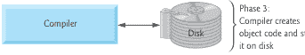

## 阶段 4：链接以创建可执行程序

阶段 4 称为链接。C++ 程序通常包含对在其他地方定义的函数和数据的引用，例如在标准库中，或在从事特定项目的程序员组的私有库中：

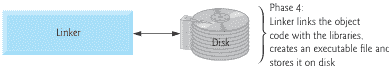

C++ 编译器生成的目标代码通常因这些缺失部分而包含“空洞”。链接器将目标代码与缺失函数的代码链接起来，以生成可执行程序（没有缺失部分）。

## 阶段 5：加载可执行程序

阶段 5 称为加载。程序在执行之前，必须先被放入内存：


net。还有一个标准错误流称为 `cerr`。cerr 流（通常连接到屏幕）显示错误消息。

诸如除以零之类的错误会在程序运行时发生，因此它们被称为运行时错误或执行时错误。致命运行时错误会导致程序立即终止，而未能成功完成其任务。非致命运行时错误允许程序运行至完成，但通常会产生不正确的结果。


## 检查点

- **1. （填空）** C++ 程序通常要经过六个阶段才能执行：_______、_______、_______、_______、_______ 和 _______。
  - **答案：** 编辑、预处理、编译、链接、加载、执行。
- **2. （填空）** 当编译器因语句违反语言规则而无法识别它时，就会发生 ______；而程序运行时发生的错误称为 ______ 或执行时错误。
  - **答案：** 语法错误、运行时错误。

## 1.11 以多种方式试运行 C++20 应用程序

在阅读本节并尝试任何试运行之前，请先阅读“开始之前”一节。在本节中，你将编译、运行第一个 C++ 应用程序<sup>62</sup>并与之交互——这是一个猜数字游戏，它会从 1 到 1,000 中选取一个随机数，并提示你猜它。如果你猜中随机选出的数字，游戏结束。如果你猜错，应用程序会提示你的猜测高于还是低于正确数字。猜测次数没有限制。这个游戏背后有一些不错的计算机科学知识——在后面的章节中，你将探索二分查找技术。你将在练习 5.22 中编写猜数字游戏。

### 编译器和 IDE 试运行概述

我们将展示如何使用以下方式编译和执行 C++ 代码：

- 适用于 Windows 的 Microsoft Visual Studio Community 版（1.11.1 节），<sup>63</sup>
- Linux 上 shell 中的 GNU g++（1.11.2 节），
- 在 GNU 编译器集合（GCC）Docker 容器内运行的 shell 中的 g++（1.11.3 节），以及
- Docker 容器内运行的 shell 中的 LLVM clang++（Clang C++ 编译器的命令行版本）（1.11.4 节）。
- macOS 上的 Apple Xcode（1.11.5 节）。

**你可以只阅读与你平台对应的那一节。** 要使用用于 g++ 和 clang++ 的 Docker 容器，你必须安装并运行 Docker，如序言之后的**开始之前**一节所述。

62. 我们有意不在这里介绍这个 C++ 程序的代码。其目的只是演示使用本节讨论的每个编译器来编译和运行程序。我们将在第 5 章介绍安全的随机数生成。

63. 如果你有兴趣使用 Microsoft 的 Visual Studio Code 跨平台代码编辑器编写 C++ 程序，请参阅 https://code.visualstudio.com/docs/languages/cpp 中的说明。

## 1.11.1 在 Windows 上使用 Visual Studio Community 版编译和运行

在本节中，你将使用 Microsoft Visual Studio Community 版在 Windows 上运行一个 C++ 程序。Visual Studio 有多个版本可用——在某些版本上，我们提供的选项、菜单和说明可能略有不同。

### 步骤 1：检查你的设置

如果你还没有这样做，请阅读“开始之前”一节，以安装 IDE 并下载本书的代码示例。

### 步骤 2：启动 Visual Studio

从开始菜单打开 Visual Studio。按 Esc 键关闭这个初始 Visual Studio 窗口。不要单击右上角的 X——那会终止 Visual Studio。你可以随时通过选择 File > Start Window 访问此窗口。我们用 > 表示从菜单中选择菜单项，因此 File > Open 表示“从 File 菜单中选择 Open 菜单项。”

### 步骤 3：创建项目

项目是一组相关文件，例如组成应用程序的 C++ 源代码文件。Visual Studio 将应用程序组织为项目和解决方案。一个解决方案包含一个或多个项目。本书中的每个应用程序只需要单项目解决方案。多项目解决方案用于创建大规模应用程序。对于我们的代码示例，你将从一个空项目（Empty Project）开始并向其中添加文件。

首次打开 Visual Studio 时，会出现一个对话框，其中“最近打开”(Open Recent) 列包含指向你最近打开的解决方案的链接，“入门”(Get Started) 列包含若干快捷方式。对于本次试运行，我们将直接在 Visual Studio 中创建新项目，因此按 Esc 键关闭此初始对话框。要创建项目：

- **1.** 选择 File > New > Project... 以显示“创建新项目”对话框。
- **2.** 根据你的 Visual Studio 版本及其已安装功能，可能会显示许多项目类型。你可以使用“搜索模板”(Search for templates) 文本框及其下方的下拉列表筛选选项。在最初显示“所有语言”(All languages) 的下拉列表中，选择 C++。
- **3.** 选择带有 C++、Windows 和 Console 标签的 Empty Project 模板。此项目模板适用于在“命令提示符”(Command Prompt) 窗口中执行的程序——这是一个基于文本的窗口，程序可在其中显示文本并接收用户在键盘上键入的文本。单击“下一步”(Next) 以显示“配置新项目”(Configure your new project) 对话框。
- **4.** 提供“项目名称”(Project name) 和“位置”(Location)。对于项目名称，我们指定了 cpp20_test。对于位置，我们选择了本书的 examples 文件夹。单击“创建”(Create) 将项目放入以下文件夹（或你指定的文件夹），并在 Visual Studio 中打开新项目：

    ```
    C:\Users\YourUserAccount\Documents\examples
    ```

编辑 C++ 代码时，Visual Studio 会在窗口中将每个文件显示为单独的选项卡。解决方案资源管理器（Solution Explorer）——停靠在 Visual Studio 的左侧或右侧——用于查看-

……以及管理应用程序的文件。在本书的示例中，你通常会将每个程序的代码文件放在**源文件**文件夹中。如果**解决方案资源管理器**未显示，可以选择**视图 > 解决方案资源管理器**来显示它。

### 步骤 4：将 GuessNumber.cpp 文件添加到项目

接下来，你将向在*步骤 3*中创建的项目添加文件 GuessNumber.cpp，该文件包含实现猜数字游戏的 C++ 代码。在**解决方案资源管理器**中：

- 1. 右键单击**源文件**文件夹，然后选择**添加 > 现有项...**
- 2. 在出现的对话框中，导航到本书示例文件夹的 ch01 子文件夹，选择 GuessNumber.cpp，然后单击**添加**。[^64]

### 步骤 5：将项目配置为使用 C++20

Visual Studio 中的 Visual C++ 编译器支持多个 C++ 版本。本书使用 C++20，你必须在项目设置中配置它：

- 1. 在**解决方案资源管理器**中右键单击项目节点——**cpp20_test**——然后选择**属性**，以显示项目的 **cpp20_test 属性页**对话框。
- 2. 在**配置**下拉列表中，选择**所有配置**。在**平台**下拉列表中，选择**所有平台**。
- 3. 在**配置属性**下方的左栏中，展开 **C/C++** 节点，然后选择**语言**。
- 4. 在右栏中，单击 **C++ 语言标准**右侧的字段，单击下拉箭头，然后选择 **ISO C++20 标准 (/std:c++20)**[^65]，并单击**确定**。

### 步骤 6：编译并运行项目

要编译并运行项目，以便试用猜数字游戏，请选择**调试 > 开始执行(不调试)**，或键入 *Ctrl + F5*。如果程序编译正确，Visual Studio 会打开一个**命令提示符**窗口并执行程序。为了便于阅读，我们更改了**命令提示符**的颜色方案和字体大小：


标题栏显示当前执行项目的位置和名称。

### 步骤 7：输入你的第一次猜测

在 ? 提示符处，输入 **500**，然后按 *Enter* 键——每次运行程序时，程序都会随机选择一个数字，因此每次执行时你与程序的交互都会有所不同。在本例中，应用程序显示“太低。再试一次。”，表示输入值小于应用程序所选定的正确猜测数字：

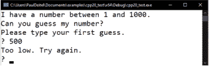

### 步骤 8：输入另一次猜测

在下一个提示符处，如果你的系统说第一次猜测太低，请输入 **750** 并按 *Enter* 键；否则，输入 **250** 并按 *Enter* 键。在本例中，我们输入了 **750**，应用程序显示“太高。再试一次。”，因为输入值大于正确的猜测数字：

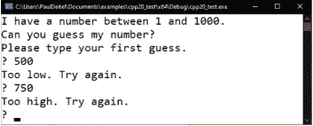

### 步骤 9：输入更多猜测

继续输入值来玩游戏，直到猜出正确数字。当你猜对时，应用程序显示“太好了！你猜对了！”。

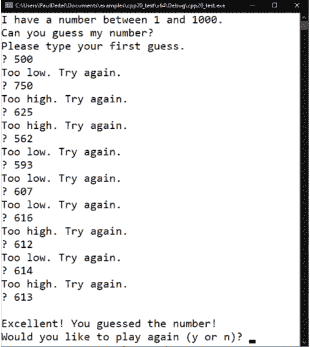

### 步骤 10：再次玩游戏或退出应用程序

在猜出正确数字后（你应当始终能够在 10 次或更少的猜测内做到），应用程序会询问你是否想再玩一局。在“你想再玩一次吗（y 或 n）？”提示符处，输入 y 会让应用程序选择新数字并开始新游戏。输入 n 会终止应用程序。

## 在后续示例中重用此项目

你可以按照本节中的步骤为本书中的每个应用程序创建单独的项目。不过，对于我们的示例，你可能会发现从项目中移除当前程序，然后添加新程序更方便。要从项目中移除文件（而不是从系统中删除），请在**解决方案资源管理器**中选择该文件，然后按 *Del*（或 *Delete*）键。然后你可以重复*步骤 4*，向项目添加另一个程序。当你开始自己创建程序时，可以右键单击**源文件**文件夹，选择**添加 > 新建项...**，以显示用于添加新文件的对话框。

## 在适用于 Linux 的 Windows 子系统（WSL）中使用 Ubuntu Linux

有些 Windows 用户可能希望在 Windows 上使用 GNU g++ 编译器。你可以使用 GNU 编译器集合 Docker 容器（1.11.3 节）来做到这一点，也可以在适用于 Linux 的 Windows 子系统中运行的 Ubuntu Linux 中使用 g++。要安装适用于 Linux 的 Windows 子系统，请按照以下地址中的说明操作

```text
https://docs.microsoft.com/en-us/windows/wsl/install
```

在 Windows 系统上安装并启动 Ubuntu 应用后，可以使用以下命令切换到 Windows 系统中包含试用代码示例的文件夹：

```text
cd /mnt/c/Users/YourUserName/Documents/examples/ch01
```

然后可以继续执行 1.11.2 节中的*步骤 2*。

## 1.11.2 在 Linux 上使用 GNU C++ 编译并运行

在本节中，你将使用 GNU C++ 编译器 (g++) 在 Linux shell 中运行一个 C++ 程序。[^66] 对于本次试用，我们假设你已经阅读了*开始之前*一节，并已将本书示例放在你用户账户的 Documents/examples 文件夹中。

### 步骤 1：切换到 ch01 文件夹

在 Linux shell 或终端窗口中，使用 cd 命令切换到本书示例文件夹的 ch01 子文件夹：

```bash
~$ cd ~/Documents/examples/ch01
~/Documents/examples/ch01$
```

在本节的图中，我们用**粗体**突出显示用户输入。我们的 Ubuntu Linux shell 中的提示符使用波浪号 (~) 表示主目录。每个提示符都以美元符号 ($) 结尾。你的 Linux 系统上的提示符可能有所不同。

### 步骤 2：编译应用程序

在运行应用程序之前，必须先用 g++ 命令编译它。[^67]

- `-std=c++20` 选项表示我们使用的是 C++20。
- `-o` 选项命名用于运行程序的可执行文件（GuessNumber）。如果不包含此选项，g++ 会自动将可执行文件命名为 a.out。

```text
~/Documents/examples/ch01$ g++ -std=c++20 GuessNumber.cpp -o GuessNumber
~/Documents/examples/ch01$
```

### 步骤 3：运行应用程序

在提示符处输入 ./GuessNumber，然后按 *Enter* 键运行程序：

```text
~/Documents/examples/ch01$ ./GuessNumber
I have a number between 1 and 1000.
Can you guess my number?
Please type your first guess.
?
```

GuessNumber 前面的 ./ 告诉 Linux 从当前目录运行 GuessNumber。

### 步骤 4：输入你的第一次猜测

应用程序显示“请输入你的第一次猜测。”，然后在下一行显示问号 (?) 作为提示符。在提示符处输入 500——每次运行程序时，程序都会随机选择一个数字，因此每次执行时你与程序的交互都会有所不同：

```text
~/Documents/examples/ch01$ ./GuessNumber
I have a number between 1 and 1000.
Can you guess my number?
Please type your first guess.
? 500
Too high. Try again.
?
```

在本例中，应用程序显示“太高。再试一次。”，因为输入值大于应用程序所选定的正确猜测数字。

[^64]: 对于你将在后续章节中看到的多个源代码文件程序，请选择给定程序的所有文件。

[^65]: 要在 Microsoft 向 Visual C++ 添加新 C++ 功能时尝试这些功能，请选择 **预览——最新 C++ 工作草案中的功能 (/std:c++latest)**，而不是 **ISO C++20 标准 (/std:c++20)**。

[^66]: 在撰写本书时，当前的 g++ 版本是 13.1。你可以使用命令 `g++ --version` 确定系统的 g++ 版本号。如果你的 g++ 版本较旧，可以考虑在线搜索适用于你的 Linux 发行版的 GNU 编译器集合（GCC）升级说明，或考虑使用 1.11.3 节中讨论的 GCC Docker 容器。

[^67]: 如果你安装了多个 g++ 版本，可能需要使用 `g++-##`，其中 `##` 是 g++ 版本号。例如，运行 g++ 版本 13 可能需要命令 `g++-13`。


### 步骤 5：输入另一个猜测

在下一个提示符处，如果你的系统说第一次猜测太低，输入 750 并按 *Enter*；否则，输入 250 并按 *Enter*。在本例中，我们输入了 250，应用程序显示“太高了。再试一次。”，因为该值大于正确猜测：

```text
~/Documents/examples/ch01 ./GuessNumber
I have a number between 1 and 1000.
Can you guess my number?
Please type your first guess.
? 500
Too high. Try again.
? 250
Too high. Try again.
?
```

### 步骤 6：输入更多猜测

继续输入值来玩游戏，直到你猜中正确数字。当你猜对时，应用程序会显示“太好了！你猜对了。”：

```text
? 125
Too high. Try again.
? 62
Too low. Try again.
? 93
Too low. Try again.
? 109
Too high. Try again.
? 101
Too low. Try again.
? 105
Too high. Try again.
? 103
Too high. Try again.
? 102

Excellent! You guessed the number!
Would you like to play again (y or n)?
```

### 步骤 7：再次玩游戏或退出应用程序

在猜中正确数字后（你应始终能够在 10 次或更少猜测内做到），应用程序会询问你是否想再玩一局。在“你想再玩一次吗（y 或 n）？”提示符处，输入 y 会使应用程序选择一个新数字并开始新游戏。输入 n 会终止应用程序并返回 shell。

## 1.11.3 在 GCC Docker 容器中使用 g++ 编译和运行

无论你的操作系统是什么，你都可以在系统上使用最新的 GNU C++ 编译器。实现这一点最方便的跨平台方法之一是使用 GNU 编译器集合（GCC）Docker 容器。本节假设你已经执行了前言之后的“开始之前”一节中描述的以下步骤：

- 1. 已安装 **Docker Desktop**（Windows 或 macOS）或 **Docker Engine**（Linux）。
- 2. 已安装 **GCC Docker 容器**。
- 3. 已将本书的示例放入你的用户账户的 `Documents/examples` 文件夹中。

### 执行 GNU 编译器集合（GCC）Docker 容器

打开命令提示符（Windows）、终端（macOS/Linux）或 shell（Linux），然后执行以下步骤来启动 GCC Docker 容器：

- 1. 使用 `cd` 导航到包含本书示例的 examples 文件夹。
- 2. Windows 用户：使用以下命令⁶⁸启动 GCC Docker 容器：

  ```bash
  docker run --rm -it -v "%CD%":/usr/src gcc:latest
  ```

- 3. macOS/Linux 用户：使用以下命令启动 GCC Docker 容器：

  ```bash
  docker run --rm -it -v "$(pwd)":/usr/src gcc:latest
  ```

在上述命令中：

- `--rm` 在你最终关闭容器时清理容器资源。
- `-it` 以交互模式运行容器，因此你可以输入命令来切换文件夹，并使用 GNU C++ 编译器编译和运行程序。
- `-v "%CD%":/usr/src`（Windows）或 `-v "$(pwd)":/usr/src`（macOS/Linux）将 Docker 容器的 `/usr/src` 文件夹映射到你执行 Docker run 命令时所在的本地计算机文件夹，使 Docker 容器能够访问本地文件夹中的文件。你将使用 `cd` 命令导航到 `/usr/src` 的子文件夹，以编译和运行本书的示例。
- `gcc:latest` 是容器名称。`:latest` 指定你要使用 gcc 容器的最新版本。⁶⁹

容器运行后，你将看到类似以下的提示符：

```text
root@67773f59d9ea:/#
```

该容器使用 Linux 操作系统。其提示符在 `:` 和 `#` 之间显示当前文件夹位置。

### 在 Docker 容器中切换到 ch01 文件夹

上面指定的 `docker run` 命令会将你的示例文件夹挂载到容器的 `/usr/src` 文件夹。在 Docker 容器中，使用 `cd` 命令切换到 `/usr/src` 的 ch01 子文件夹：

```text
root@01b4d47cadc6:/# cd /usr/src/ch01
root@01b4d47cadc6:/usr/src/ch01#
```

要在 Docker 容器中编译、运行 GuessNumber 应用程序并与之交互，请按照 1.11.1.2 节“在 Linux 上使用 GNU C++ 编译和运行”中的*步骤 2–7*进行操作。

### 终止 Docker 容器

你可以在容器的提示符处输入 *Ctrl + d* 来终止 Docker 容器。

## 1.11.4 在 Docker 容器中使用 clang++ 编译和运行

与 g++ 一样，无论你的操作系统是什么，你都可以在系统上使用最新的 LLVM/Clang C++⁷⁰（clang++）命令行编译器。目前，LLVM/Clang 团队没有官方 Docker 容器，但 https://hub.docker.com 上有许多可用的容器。本节假设你已经执行了前言之后的“开始之前”一节中描述的以下步骤：

- 1. 已安装 **Docker Desktop**（Windows 或 macOS）或 **Docker Engine**（Linux）。
- 2. 已安装 **teeks99/clang-ubuntu Docker 容器**。
- 3. 已将本书的示例放入你的用户账户的 `Documents/examples` 文件夹中。

### 执行 teeks99/clang-ubuntu Docker 容器

打开 **命令提示符**（Windows）、**终端**（macOS/Linux）或 **shell**（Linux），然后执行以下步骤来启动 **teeks99/clang-ubuntu** Docker 容器：

- 1. 使用 `cd` 导航到包含本书示例的 examples 文件夹。
- 2. Windows 用户：使用以下命令⁷¹启动 Docker 容器：

  ```bash
  docker run --rm -it -v "%CD%":/usr/src teeks99/clang-ubuntu:16
  ```

- 3. macOS/Linux 用户：使用以下命令启动 Docker 容器：

  ```bash
  docker run --rm -it -v "$(pwd)":/usr/src teeks99/clang-ubuntu:16
  ```

在上述命令中：

- `--rm` 在你最终关闭容器时清理容器的资源。
- `-it` 以交互模式运行容器，因此你可以输入命令来切换文件夹，并使用 clang++ 编译器编译和运行程序。
- `-v "%CD%":/usr/src`（Windows）或 `-v "$(pwd)":/usr/src`（macOS/Linux）将 Docker 容器的 `/usr/src` 文件夹映射到你执行 `docker run` 命令时所在的本地计算机文件夹，使 Docker 容器能够访问本地文件夹中的文件。你将使用 `cd` 命令导航到 `/usr/src` 的子文件夹，以编译和运行本书的示例。
- `teeks99/clang-ubuntu:16` 是容器名称。

容器运行后，你将看到类似以下的提示符：

```text
root@9753bace2e87:/#
```

该容器使用 Linux 操作系统。其提示符在 `:` 和 `#` 之间显示当前文件夹位置。

### 在 Docker 容器中切换到 ch01 文件夹

上面指定的 `docker run` 命令会将你的示例文件夹挂载到容器的 `/usr/src` 文件夹。在 Docker 容器中，使用 `cd` 命令切换到 `/usr/src` 的 ch01 子文件夹：

```text
root@9753bace2e87:/# cd /usr/src/ch01
root@9753bace2e87:/usr/src/ch01#
```

### 编译应用程序

在运行应用程序之前，你必须先编译它。此容器使用 clang++ 命令，如下所示：

```bash
clang++ -std=c++20 GuessNumber.cpp -o GuessNumber
```

其中：

- `-std=c++20` 选项表示我们正在使用 C++20。
- `-o` 选项指定用于运行程序的可执行文件（`GuessNumber`）的名称。如果未包含此选项，clang++ 会自动将可执行文件命名为 a.out。

### 运行应用程序

要在 Docker 容器中运行 GuessNumber 应用程序并与之交互，请按照 1.11.1.2 节“在 Linux 上使用 GNU C++ 编译和运行”中的*步骤 3–7*进行操作。

### 终止 Docker 容器

你可以在容器的提示符处输入 `Ctrl + d` 来终止 Docker 容器。

## 1.11.5 在 macOS 上使用 Xcode 编译和运行

在本节中，你将使用 Apple 的 Xcode IDE 在 macOS 上运行一个 C++ 程序。⁷² Xcode 使用某个版本的 LLVM/Clang C++ 编译器；在撰写本文时，该编译器缺少我们在本书中使用的若干重要 C++20 特性。请访问

```text
https://deitel.com/cpphtp11
```

获取有关使用 Xcode 运行本书第 4 章及更高章节示例的说明。

### 步骤 1：检查你的设置

如果你尚未这样做，请阅读 **开始之前** 一节，以安装 Xcode 并下载本书的代码示例。

### 步骤 2：启动 Xcode

在 Finder 的“前往”菜单中，选择“应用程序”，然后双击 Xcode 图标：


如果这是你第一次运行 Xcode，会出现 **欢迎使用 Xcode** 窗口。关闭此窗口——你可以通过选择 **窗口 > 欢迎使用 Xcode** 来访问它。我们使用 > 字符

68. 可能会出现一条通知，要求你允许 Docker 访问当前文件夹中的文件。你必须允许此操作；否则，你将无法在 Docker 中访问我们的源代码文件。
69. 如果你希望让 GCC 容器保持为最新版本，可以在运行容器之前执行命令 `docker pull gcc:latest`。
72. 在撰写本文时，Xcode 版本为 14.2。


字符，用于表示从菜单中选择一个菜单项。例如，**文件 > 打开...** 表示你应从 **文件** 菜单中选择 **打开...** 菜单项。

## 第 3 步：创建项目

项目是一组相关文件，例如构成应用程序的 C++ 源代码文件。我们为本书示例创建的 Xcode 项目是 **命令行工具** 项目，你将直接在 IDE 中执行它们。要创建项目：

1. 选择 **文件 > 新建 > 项目...**
2. 在 **为你的新项目选择模板** 对话框顶部，点击 **macOS**。
3. 在 **应用程序** 下，点击 **命令行工具**，然后点击 **下一步**。
4. 在 **产品名称** 中，输入项目名称——我们指定为 **cpp20_test**。
5. 在 **语言** 下拉列表中，选择 **C++**，然后点击 **下一步**。
6. 指定项目保存位置。我们选择了包含本书代码示例的 **examples** 文件夹。
7. 点击 **创建**。

Xcode 创建你的项目并显示 **工作区窗口**，初始显示三个区域——**导航器区域**（左侧）、**编辑器区域**（中间）和 **实用工具区域**（右侧）。

左侧的 **导航器区域** 顶部有图标，用于显示可在其中显示的导航器。对于本书，你主要会使用其中两个导航器：

- **项目**——显示项目中的所有文件和文件夹。
- **问题**——显示编译器生成的警告和错误。

点击导航器按钮会显示对应的导航器面板。

中间的 **编辑器区域** 用于管理项目设置和编辑源代码。该区域始终显示在工作区窗口中。当你在 **项目** 导航器中选择一个文件时，文件内容会显示在 **编辑器区域** 中。右侧的 **实用工具区域** 通常显示 **检查器**。例如，如果你正在构建一个包含可触摸按钮的 iPhone 应用，就可以在此区域配置按钮的属性（其标签、大小、位置等）。本书不会使用 **实用工具区域**。还有一个 **调试区域**，你将在此与正在运行的猜数字程序交互。该区域会显示在 **编辑器区域** 下方。

工作区窗口的工具栏包含用于执行程序以及隐藏或显示左侧（导航器）和右侧（实用工具）区域的选项。它还包含一个显示区域，用于显示 Xcode 中正在执行任务的进度。

## 第 4 步：将项目配置为使用 C++20 编译

Xcode 中的 Apple Clang 编译器支持多个版本的 C++ 标准。对于本书，我们使用 **C++20**，必须在项目设置中配置：

1. 在 **项目** 导航器中，选择你的项目名称（**cpp20_test**）。
2. 在 **编辑器区域** 的左侧，在 **目标** 下选择你的项目名称。
3. 在 **编辑器** 区域顶部，点击 **构建设置**，然后在其正下方点击 **全部**。
4. 滚动到 **Apple Clang - 语言 - C++** 部分。
5. 点击 **C++ 语言方言** 右侧的值，选择 **GNU++20 [std=gnu++20]**。

## 第 5 步：从项目中删除 main.cpp 文件

默认情况下，Xcode 会创建一个 `main.cpp` 源代码文件，其中包含一个显示“Hello, World!”的简单程序。你在此次测试中不会使用 `main.cpp`，因此应删除该文件。在 **项目** 导航器中，右键点击 `main.cpp` 文件并选择 **删除**。在出现的对话框中，选择 **移到废纸篓**。在你清空废纸篓之前，该文件不会从系统中删除。

## 第 6 步：将 GuessNumber.cpp 文件添加到项目中

在 Finder 窗口中，打开本书示例文件夹中的 ch01 文件夹，然后将 GuessNumber.cpp 拖到 **项目** 导航器中的 **cpp20_test** 文件夹上。在出现的对话框中，确保勾选 **如需要，拷贝项目**，然后点击 **完成**。<sup>73</sup>

73. 对于本书后面会看到的包含多个源代码文件的程序，请将给定程序的所有文件拖到项目的文件夹中。当你开始创建自己的程序时，可以右键点击项目的文件夹并选择 **新建文件...**，以显示用于添加新文件的对话框。

## 第 7 步：编译并运行项目

要编译并运行项目以便试运行该应用程序，只需点击 Xcode 工具栏上的运行（▶）按钮。如果程序编译正确，Xcode 会打开 **调试** 区域，并在 **调试** 区域的右半部分执行程序，应用程序会显示“Please type your first guess.”和一个问号（?）作为输入提示：


## 第 8 步：输入你的第一次猜测

点击 **调试** 区域，然后输入 **500** 并按 *回车键*——每次运行程序时，程序都会随机选择一个数字，因此每次执行时你与程序的交互都会不同。在我们的例子中，应用程序显示“Too high. Try again.”，因为该值大于应用程序选择的正确猜测数字。

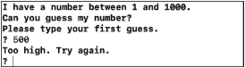

## 第 9 步：再输入一次猜测

在下一个提示处，如果你的系统说第一次猜测太低，请输入 **750** 并按 *回车键*；否则，输入 **250** 并按 *回车键*。在我们的例子中，我们输入了 **250**，应用程序显示“Too high. Try again.”，因为该值大于正确猜测数字：

```
I have a number between 1 and 1000.
Can you guess my number?
Please type your first guess.
? 500
Too high. Try again.
? 250
Too high. Try again.
?
```

## 第 10 步：输入更多猜测

继续输入数值玩游戏，直到你猜中正确数字。当你猜对时，应用程序会显示“Excellent! You guessed the number!”：

```
I have a number between 1 and 1000.
Can you guess my number?
Please type your first guess.
? 500
Too high. Try again.
? 250
Too high. Try again.
? 125
Too low. Try again.
? 187
Too high. Try again.
? 156
Too high. Try again.
? 140
Too low. Try again.
? 148
Too high. Try again.
? 144
Too high. Try again.
? 142
Too low. Try again.
? 143

Excellent! You guessed the number!
Would you like to play again (y or n)?
```

## 再次玩游戏或退出应用程序

在猜中正确数字后（你应始终能够在 10 次或更少次数内做到），应用程序会询问你是否想再玩一局。在“Would you like to play again (y or n)?”提示处，输入 y 会让应用程序选择一个新数字并开始新游戏。输入 n 会终止应用程序。

## 将此项目复用于后续示例

你可以按照本节中的步骤为本书中的每个应用程序创建单独的项目。不过，对于我们的示例，你可能会发现从项目中移除当前程序，然后添加新程序更方便。要从项目中移除文件（而不是从系统中移除），请在项目导航器中右键点击该文件并选择“删除”。在出现的对话框中，选择“移除引用”。然后可以重复第 6 步，将另一个程序添加到项目中。当你开始自己创建程序时，可以按如下方式向项目中添加新的空文件：

1. 右键点击项目中的文件夹，选择 **新建文件...**。
2. 从 **其他** 类别中选择 **空文件** 模板，然后点击 **下一步**。
3. 为文件指定名称，并确保包含 .cpp 扩展名，然后点击 **创建**。

## 1.12 互联网、万维网、云和物联网

20 世纪 60 年代后期，ARPA——美国国防部高级研究计划局——推出了将大约十几所由 ARPA 资助的大学和研究机构的主要计算机系统联网的计划。这些计算机将通过通信线路连接，运行速度约为每秒 50,000 比特；这一速度在当时令人震惊，因为大多数人（即便是少数拥有网络访问权限的人）通过电话线连接计算机的速度只有每秒 110 比特。学术研究即将向前迈出一大步。ARPA 实施了很快被称为 ARPANET 的网络，它是当今互联网的前身。如今最快的互联网速度约为每秒数十亿比特。每秒万亿比特（太比特）的速度已经投入使用——美国的能源科学网络现在能够以每秒 46 太比特的速度传输数据。<sup>74</sup>

事情的发展与最初计划不同。尽管 ARPANET 使研究人员能够将他们的计算机联网，但其主要益处被证明是通过后来被称为电子邮件（e-mail）的方式进行快速便捷通信的能力。即使在当今互联网上也是如此，电子邮件、即时消息、文件传输和社交媒体（如 Snapchat、TikTok、Instagram、Facebook 和 Twitter）使全球数十亿人能够快速便捷地通信。

用于在 ARPANET 上通信的协议（一组规则）被称为传输控制协议（TCP）。TCP 确保消息（由称为数据包的按顺序编号的片段组成）从发送方正确传递到接收方，完整到达并按正确顺序重新组装。

### 1.12.1 互联网：网络的网络

在 ARPANET 演进的同时，世界各地的组织正在实施自己的网络，用于组织内部（即组织内）和组织间（即组织之间）通信。出现了种类繁多的网络硬件和软件。一个挑战是使这些不同的网络能够相互通信。ARPA 通过开发互联网协议（IP）实现了这一点，该协议创建了一个真正的“网络的网络”，即互联网当前的架构。这套组合协议现在称为 TCP/IP。每台联网设备都有一个 IP 地址——这是一种唯一的数字标识符，通过 TCP/IP 通信的设备用它来在互联网上定位彼此。

企业迅速意识到，通过使用互联网，它们可以改善运营，并为客户提供新的更好的服务。公司开始投入大量资金开发和增强其互联网业务。这在通信运营商以及硬件和软件供应商之间引发了激烈竞争，以满足日益增长的基础设施需求。结果，互联网带宽——通信线路的信息承载能力——大幅增加，而硬件成本却急剧下降。


### 1.12.2 万维网：让互联网更易用

**万维网**（简称“Web”）是与互联网相关的一组硬件和软件，使计算机用户能够在几乎任何主题上定位和查看文档（包含文本、图形、动画、音频和视频的各种组合）。1989年，欧洲核子研究组织（CERN）的蒂姆·伯纳斯-李开始开发**超文本标记语言（HTML）**——通过“超链接”文本文档共享信息的技术。他还编写了**超文本传输协议（HTTP）**等通信协议，以构成其新的超文本信息系统的骨干，他将其称为万维网。

1994年，伯纳斯-李成立了**万维网联盟（W3C，https://www.w3.org）**，致力于开发Web技术。W3C的一个关键目标是让每个人都能普遍访问Web，无论其残疾、语言或文化如何。

### 1.12.3 云

如今越来越多的计算是在“云”中完成的——也就是说，使用分布在全球互联网上的软件和数据，而不是本地桌面、笔记本电脑或移动设备上的软件和数据。**云计算**允许你随时增加或减少计算资源以满足需求，这比购买自己的硬件来提供足够的存储和处理能力以满足偶发峰值需求更具成本效益。云计算还通过将管理计算资源（如安装和升级软件、安全性、备份和灾难恢复）的负担转移给服务提供商来节省资金。

你每天使用的应用严重依赖各种**基于云的服务**。这些服务使用大规模的计算资源集群（计算机、处理器、内存、存储等）和数据库，通过互联网相互通信，并与你使用的应用通信。通过互联网提供对自身访问的服务称为**Web服务**。截至2023年，亚马逊云科技（AWS；33%市场份额）、微软Azure（22%）和谷歌云平台（GCP；11%）约占云服务市场的三分之二。75 其他顶级云供应商包括IBM Cloud、Oracle、VMware、Salesforce和阿里巴巴。76

75. Charles Griffiths，“最新的云计算统计数据。”2023年3月6日。访问于2023年3月25日。https://aag-it.com/the-latest-cloud-computing-statistics/。

76. Anina Ot，“2023年排名前16的云服务提供商和公司。”2023年2月22日。访问于2023年3月25日。https://www.datamation.com/cloud/cloud-service-providers/。

### 1.12.4 物联网（IoT）

互联网不再仅仅是计算机网络——它是**物联网（IoT）**。事物是任何具有IP地址并能够通过互联网自动发送（在某些情况下接收）数据的设备。此类事物包括：

-   带有应答器用于支付通行费的汽车，
-   用于监控车库停车位可用性的监视器，
-   植入人体的心脏监测器，
-   水质监测器，
-   报告能源使用情况的智能电表，
-   辐射探测器，
-   仓库中的物品追踪器，
-   可以追踪你移动的移动应用，
-   根据天气预报和家庭活动调整室温的智能恒温器，
-   智能家用电器，以及
-   还有许多其他。

根据为物联网提供市场研究和洞察的IoT Analytics，2021年有122亿个活跃IoT设备，预计到2025年将增长到270亿。^77

77. Mohammad Hasan，“2022年IoT现状：全球连接的IoT设备数量增长18%至144亿。”2022年5月18日。访问于2023年3月18日。https://iot-analytics.com/number-connected-iot-devices/。

### 1.12.5 边缘计算

IoT是**边缘计算**^78的一个例子，其中数据处理和存储发生在产生数据的网络连接设备上或附近——也就是说，在网络的边缘。边缘计算通常用于“需要持续监控并对动态条件或高容量数据流做出快速响应的智能应用”。^79 它使设备能够在本地处理数据并做出决策。例如，如果自动驾驶汽车失去互联网连接，它仍然必须能够做出使其安全行驶的决策。边缘计算用于许多领域，包括自动驾驶汽车、智能电网、医疗保健设备、农业、清洁能源、工业自动化等。

78. “边缘计算。”维基百科。维基媒体基金会。访问于2023年3月25日。https://en.wikipedia.org/wiki/Edge_computing。

79. Robert Napoli，“边缘计算：它是什么以及为什么重要？”2022年4月25日。访问于2023年3月25日。https://www.forbes.com/sites/forbestechcouncil/2022/04/25/edge-computing-what-is-it-and-why-does-it-matter/。

### 1.12.6 混搭（Mashups）

**混搭**的应用程序开发方法使你能够通过组合（通常是免费的）互补Web服务和各种形式的信息源来快速开发强大的软件。最早的混搭之一www.housingmaps.com将www.craigslist.org的房地产列表与Google地图结合起来，显示给定区域内待售或出租房屋的位置。查看www.housingmaps.com，了解一些有趣的事实、历史以及关于它如何影响房地产行业列表的文章。

本书面向对象方法的一个重点是软件复用——你将使用易于使用、功能强大的现有类来完成重要工作。同样，在构建使用Web服务的应用之前，考虑复用互联网上可用的许多强大现有服务。存在许多在线目录，列出了从几十到数千个现有Web服务，包括：

-   GitHub的公共API页面（https://github.com/public-apis/public-apis）列出了51个类别，包含数百个公开可用的Web服务。
-   Google API探索器（https://developers.google.com/apis-explorer）使你无需编写任何代码即可了解和试验266个Google Web服务。
-   Rapid（https://rapidapi.com）声称是世界上最大的API中心，列出了数千个免费和付费API。Rapid还提供工具帮助公司构建和分发自己的API。
-   APILayer（https://apilayer.com）列出了94个Web服务。所有服务都有免费层级，无需信用卡。
-   Any API（https://any-api.com/）在34个类别中列出了1400多个Web服务。

## 检查点

**1.（填空）** ______（简称“Web”）是与互联网相关的一组硬件和软件，使计算机用户能够定位并查看文档（包含文本、图形、动画、音频和视频的各种组合）。

**答案：** 万维网。

**2.（填空）** 在物联网（IoT）中，事物是任何具有______并能够通过互联网发送（在某些情况下接收）数据的对象。

**答案：** IP地址。

## 1.13 元宇宙

“元宇宙”一词由尼尔·斯蒂芬森在1992年的小说*雪崩*中创造，书中人物Hiro“存在于一个计算机生成的世界中，他的计算机将其绘制到他的护目镜中并输入他的耳机……这个想象中的地方被称为元宇宙。”⁸⁰,⁸¹ 高德纳（Gartner）表示，元宇宙是互联网的下一个迭代，并将其定义为“由虚拟增强的物理现实和数字现实融合而成的集体虚拟共享空间。”⁸² 本节介绍几项关键的元宇宙技术。第1.16节介绍人工智能，它通过帮助生成逼真的数字虚拟形象、环境、以你偏好的口语进行的自然语言对话等，提升元宇宙的沉浸感。⁸³

### 1.13.1 虚拟现实（VR）

虚拟现实（VR）通常指模拟的三维（3D）环境，你通过以下方式与之交互：

-   非沉浸式VR——使用计算机屏幕在二维空间中查看3D环境，
-   半沉浸式VR——使用大屏幕电视或视频墙等大型显示器在二维空间中查看3D环境，或

80. Neal Stephenson，*Snow Crash*。Bantam Books，1993年。第24页。

81. “元宇宙。”维基百科。维基媒体基金会。访问于2023年3月18日。https://en.wikipedia.org/wiki/Metaverse。

82. Jackie Wiles，“什么是元宇宙？你应该购买它吗？”2022年10月21日。访问于2023年3月18日。https://www.gartner.com/en/articles/what-is-a-metaverse。

83. Hanna Hryshkevich，“AI和元宇宙如何协同工作。”2023年2月2日。访问于2023年3月27日。https://www.aitimejournal.com/how-ai-and-the-metaverse-work-together/。


- 完全沉浸式VR——在其中，你通过头戴式显示器（如头显）和其他设备（如手持控制器）与3D环境交互，使你感觉自己仿佛身处该环境之中。

### 1.13.2 增强现实（AR）

增强现实（AR）将计算机实时生成的内容——如图像、声音、视频、动画等——投射到你现实世界所见之物上，通常通过内置摄像头的设备，如智能手机、平板电脑和计算机化眼镜，使你能够同时看到现实世界和虚拟内容。⁸⁴,⁸⁵

最流行的增强现实示例之一是移动游戏应用 Pokémon Go™，其中宝可梦角色被投射到你通过移动设备GPS找到的现实世界地点。⁸⁶

其他用途包括：

- 在棒球和冰球等运动中，转播方通过显示一条线来帮助你追踪棒球或冰球，该线描绘棒球投球的轨迹或冰球在冰面上传递的路径。
- 美国国家橄榄球联盟®转播会在球场上显示彩色线，标示开球线和球队需要推进到何处以获得首攻。
- 导航应用可以在现实世界地图和街景视图上显示实时导航和交通信息。
- 家居装饰应用可以向你展示房间在重新粉刷或添加特定家具后的样子。
- 服装零售商通常可以向你展示你穿着正在考虑购买的某件服装时的样子。
- 博物馆可以通过显示你正在观看的特定展品的信息，使展品更具互动性。

许多公司正在研发AR眼镜和头显。⁸⁷ 例如，在2022年Google I/O大会上，Google发布了其AR眼镜，可实时翻译文本并将翻译投射到镜片上。⁸⁸

### 1.13.3 混合现实

混合现实与增强现实类似，但更进一步，使你能够与投射到现实世界视野中的虚拟对象交互。从这个意义上说，混合现实结合了增强现实和虚拟现实的某些方面。与虚拟现实一样，最佳混合现实体验通常需要头显。⁸⁹,⁹⁰ 扩展现实一词涵盖虚拟现实、增强现实和混合现实。⁹¹

### 1.13.4 区块链

会计系统使用账本跟踪交易。区块链⁹²,⁹³是一种基于软件的账本，分布在互联网上的节点中。它以经过加密保护的块——称为区块——维护交易数据，这些区块相互链接，新块始终添加在末尾。一旦创建，每个区块都是不可变的（不可修改），因此区块链维护永久交易记录。区块链是去中心化的，因此没有任何个人或团体拥有控制权。这种去中心化是去中心化应用（dApps）的基础，这些应用使元宇宙中的数字所有权成为可能。

区块链是过去几年人气暴涨的各种数字技术背后的技术，例如加密货币（1.13.5节）和不可替代代币（1.13.7节）。它还用于实现许多其他类型的应用，⁹⁴包括

- 去中心化金融（DeFi）应用（借贷、转账），
- 智能合约，
- 更安全的物联网（IoT）应用，
- 安全的数字身份以帮助防止欺诈，
- 保护和共享医疗保健信息，
- 商业物流，以及
- 保护知识产权（IP）。

### 1.13.5 比特币与加密货币

“加密货币是一种由密码学保障的数字或虚拟货币。”⁹⁵ 加密货币（或Crypto）存储在数字钱包中，通常使用区块链技术进行安全、去中心化的交易跟踪和处理。⁹⁶ 最初、最著名且最有价值的加密货币是比特币，它创建于2009年。⁹⁷ 它是一种使用区块链技术构建的去中心化加密货币。⁹⁸

### 1.13.6 以太坊

以太坊是一个可编程平台，使你能够“在其网络上构建和部署去中心化应用（dApps）……这些应用使用区块链存储数据或控制你的应用可以做什么。”其关键特性之一是**智能合约**，用于实现借贷应用、去中心化交易交易所、保险、众筹应用等。⁹⁹ 其原生加密货币是**以太币**——世界第二有价值的加密货币。¹⁰⁰

### 1.13.7 不可替代代币（NFT）

不可替代代币（NFT）¹⁰¹是基于区块链的“密码学上唯一的代币，与数字或物理内容相关联，提供所有权证明。”它们通常用于使个人能够拥有独特物品，例如数字或物理艺术品和照片；限量版数字收藏品；游戏和元宇宙中的虚拟房地产和商品；物理房地产；知识产权；以及数字书籍。¹⁰²

一些艺术品NFT已以巨额资金售出：¹⁰³

- 有史以来售出的最昂贵NFT是Pak的“The Merge”，由29,983名个人买家以9180万美元购买——每位买家拥有该NFT的一小部分。
- 有史以来售给单一买家的最昂贵NFT是数字艺术家Mike “Beeple” Winkelmann的“Everydays: The First 5000 Days”，售价为6930万美元。

### 1.13.8 Web3

与元宇宙一样，有些人将Web3称为互联网的下一代。¹⁰⁴,¹⁰⁵ Web3和元宇宙有时会彼此混淆，因为它们共享一些相同的技术。《福布斯》将Web3定义为“去中心化的互联网——建立在区块链等分布式技术之上……而不是集中在由……拥有的服务器上

- 84. Alexander S. Gillis，“什么是增强现实（AR）？”访问于2023年3月18日。https://www.techtarget.com/whatis/definition/augmented-reality-AR。
- 85. “增强现实。”维基百科。维基媒体基金会。访问于2023年3月18日。https://en.wikipedia.org/wiki/Augmented_reality。
- 86. Nick Statt，“Niantic为Pokémon Go添加‘现实融合’，让你的虚拟伙伴更加逼真。”2020年5月26日。访问于2023年3月18日。https://www.theverge.com/2020/5/26/21269862/niantic-pokemon-go-reality-blending-ar-features-release-update。
- 87. Michael Sawh。“2023年最佳智能眼镜与AR眼镜：来自Snap、Meta和Amazon的实测精选。”2022年11月15日。访问于2023年3月18日。https://www.wareable.com/ar/the-best-smartglasses-google-glass-and-the-rest。
- 88. Mike Elgan，“Google的‘翻译眼镜’有何了不起之处？”2022年5月20日。访问于2023年3月18日。https://www.computerworld.com/article/3661209/what-s-so-great-about-google-s-translation-glasses.html。
- 89. Bernard Marr，“增强现实与混合现实之间的重要区别。”访问于2023年3月18日。https://bernardmarr.com/the-important-difference-between-augmented-reality-and-mixed-reality/。
- 90. “混合现实。”维基百科。维基媒体基金会。访问于2023年3月18日。https://en.wikipedia.org/wiki/Mixed_reality。
- 91. “扩展现实。”维基百科。维基媒体基金会。访问于2023年3月25日。https://en.wikipedia.org/wiki/Extended_reality。
- 92. “区块链。”维基百科。维基媒体基金会。访问于2023年3月18日。https://en.wikipedia.org/wiki/Blockchain。
- 93. Xiaojie Liu，“什么是区块链？”访问于2023年3月18日。https://www.investopedia.com/terms/b/blockchain.asp。
- 94. Sam Daley，“33个区块链应用和现实世界用例。”2023年3月2日。访问于2023年3月18日。https://builtin.com/blockchain/blockchain-applications。
- 95. Jake Frankenfield，“加密货币投资利弊解析。”2023年2月4日。访问于2023年3月18日。https://www.investopedia.com/terms/c/cryptocurrency.asp。
- 96. “加密货币。”维基百科。维基媒体基金会。访问于2023年3月18日。https://en.wikipedia.org/wiki/Cryptocurrency。
- 97. Julie Pinkerton，“比特币——第一种加密货币的历史。”2023年2月27日。访问于2023年3月18日。https://money.usnews.com/investing/articles/the-history-of-bitcoin。
- 98. “比特币。”维基百科。维基媒体基金会。访问于2023年3月18日。https://en.wikipedia.org/wiki/Bitcoin。
- 99. “什么是以太坊？”访问于2023年3月18日。https://ethereum.org/en/what-is-ethereum/。
- 100. “以太坊。”维基百科。维基媒体基金会。访问于2023年3月18日。https://en.wikipedia.org/wiki/Ethereum。
- 101. “不可替代代币。”维基百科。维基媒体基金会。访问于2023年3月18日。https://en.wikipedia.org/wiki/Non-fungible_token。
- 102. Melanie Kramer；Stephen Graves和Daniel Phillips，“NFT初学者指南：什么是不可替代代币？”2022年1月12日。访问于2023年3月18日。https://decrypt.co/resources/non-fungible-tokens-nfts-explained-guide-learn-blockchain。
- 103. “世界上已售出的26个最昂贵NFT。”访问于2023年3月25日。https://metav.rs/blog/most-expensive-nfts/。
- 104. Thomas Stackpole，“什么是Web3？”《哈佛商业评论》，2022年5月10日。访问于2023年3月18日。https://hbr.org/2022/05/what-is-web3。
- 105. “Web3。”维基百科。维基媒体基金会。访问于2023年3月18日。https://en.wikipedia.org/wiki/Web3。


个人或企业。¹⁰⁶ Web3 的一个关键关注点是，区块链及其相关技术（如 NFT、加密货币和智能合约）将使用户对其数据和在线互动拥有更大的控制权。


### 检查点

- 1. **（填空）** ________ 以其沉浸式用户体验，被许多人视为互联网的下一代。
  **答案：** 元宇宙。
- 2. **（填空）** ________ 是作为去中心化应用（dApp）基础的技术，这些应用使元宇宙中的数字所有权成为可能。
  **答案：** 区块链。

## 1.14 软件开发技术

在开发软件时，你会经常遇到以下流行术语：

- **重构：** 重写程序，使其更清晰、更易于维护，同时保持其正确性和功能，有时还提升性能。许多 IDE 包含内置重构工具，可自动完成大部分重写工作。¹⁰⁷
- **设计模式：** 用于构建灵活且可维护的面向对象软件的经过验证的架构。设计模式领域试图列举这些反复出现的模式，鼓励软件设计人员复用它们，以更少的金钱、时间和精力，更快地开发出更高质量的软件。¹⁰⁸
- **软件开发工具包（SDK）：** 开发者用于编写应用程序的工具、库和文档。例如，SDK 可以帮助你为特定操作系统、游戏平台、云平台等创建应用程序。¹⁰⁹
- **版本控制系统（VCS）：** 使你能够随着软件的持续开发，管理和跟踪所做更改的工具。根据 Stack Overflow 的 2022 年开发者调查，Git——GitHub 背后的技术——是迄今为止使用最广泛的版本控制系统，近 94% 的开发者表示他们使用它。¹¹⁰
- **敏捷软件开发：** 一种软件开发过程，侧重于通过迭代和增量方式开发高质量软件，并让开发团队与客户之间保持持续互动。该过程旨在使客户能够更快地开始使用软件，即使软件尚未满足其所有需求，或者这些需求发生变化。¹¹¹
- **测试驱动开发（TDD）：** 敏捷软件开发的一个方面，开发者在创建软件本身之前先创建软件测试用例。然后，在开发软件的过程中，他们持续确保软件通过所有测试用例，从而确认软件满足系统需求。¹¹²
- **微服务：** 一种由小型、独立的软件服务组成的软件架构，这些服务可以组合成更大的应用程序。微服务通常实现为 Web 服务。¹¹³
- **容器化：** 在第 1.11.3 节和第 1.11.4 节中，我们讨论了在 Docker 容器中运行 g++ 和 clang++ 编译器。容器配置了使用其软件所需的一切，为你提供了一种跨平台运行该软件的便捷机制。容器化使用一种称为虚拟化的技术来隐藏底层平台细节，使容器能够跨平台执行。¹¹⁴ Docker 是当今使用最流行的容器化平台。¹¹⁵

### 检查点

- 1. **（填空）** ________ 是重写程序以使其更清晰、更易于维护，同时保持其正确性和功能的过程。
  **答案：** 重构。

## 1.15 大数据有多大？

对于计算机科学家和数据科学家来说，理解如何获取、存储、处理和从数据中提取价值，与编写高效程序同样关键。根据 IBM 2016 年的一篇文章，每天大约产生 2.5 百亿亿字节（2.5 艾字节）的数据，¹¹⁶ 并且全球 90% 的数据是在过去两年中产生的。¹¹⁷ 这种数据生成的大部分要归因于互联网。根据 IDC 的数据，到 2025 年，全球数据供应量每年将达到 175 泽字节（相当于 175 万亿吉字节或 1750 亿太字节）。¹¹⁸ 请考虑以下各种常见数据度量单位的现实示例。

- 111. “敏捷软件开发。” 维基百科。维基媒体基金会。访问于 2023 年 3 月 18 日。https://en.wikipedia.org/wiki/Agile_software_development.
- 112. “测试驱动开发。” 维基百科。维基媒体基金会。访问于 2023 年 3 月 18 日。https://en.wikipedia.org/wiki/Test-driven_development.
- 113. “微服务。” 维基百科。维基媒体基金会。访问于 2023 年 3 月 18 日。https://en.wikipedia.org/wiki/Microservices.
- 114. “容器化（计算）。” 维基百科。维基媒体基金会。访问于 2023 年 3 月 25 日。https://en.wikipedia.org/wiki/Containerization_(computing).
- 115. “容器化。” 访问于 2023 年 3 月 25 日。https://6sense.com/tech/containerization.
- 116. “欢迎来到人工智能世界。” 访问于 2023 年 3 月 18 日。https://www.ibm.com/blogs/watson/2016/06/welcome-to-the-world-of-a-i/.
- 117. “加速研究与发现。” 访问于 2023 年 3 月 18 日。https://www.ibm.com/watson/advantages/accelerate.
- 118. Andy Patrizio，“IDC：预计到 2025 年全球数据量将达到 175 泽字节，” 2018 年 12 月 3 日。访问于 2023 年 3 月 18 日。https://www.networkworld.com/article/3325397/storage/idc-expect-175-zettabytes-of-data-worldwide-by-2025.html.

### 兆字节

一兆字节（MB）约为一百万（实际上是 2²⁰）字节。高质量 MP3 格式音频文件每分钟需要 1 到 2.4 MB。¹¹⁹ 用数码相机拍摄的 JPEG 格式照片每张可能需要 8 到 10 MB。在我们的一台 iPhone 上，相机设置应用报告称，30 帧/秒（FPS）的 1080p 视频需要 65 MB/分钟，而 60 FPS 的 4K 视频需要 440 MB/分钟。

### 吉字节

一吉字节（GB）是 1024 兆字节。一张 DVD 最多可存储 8.5 GB¹²⁰，可容纳 141 小时的 MP3 音频、1000 张来自 1600 万像素相机的照片、7.7 分钟的 30 帧/秒（FPS）1080p 视频，或 2.85 分钟的 30 FPS 4K 视频。当前最高容量的超高清蓝光光盘最多可存储 100 GB 视频。¹²¹ 流媒体播放一部 4K 电影每小时可能使用 7 到 10 GB（高度压缩）。

### 太字节

一太字节（TB）是 1024 吉字节。最近台式计算机磁盘驱动器的容量可达 20 TB，¹²² 可容纳 28 年的 MP3 音频、168 万张来自 1600 万像素相机的照片、226 小时的 30 帧/秒（FPS）1080p 视频，或 84 小时的 30 FPS 4K 视频。Nimbus Data 目前拥有最大的固态硬盘（SSD），容量为 100 TB，可存储上述 20 TB 示例中音频、照片和视频的五倍。¹²³

### 拍字节、艾字节和泽字节

全球有超过 40 亿人在线，每天产生约 2.5 百亿亿字节的数据¹²⁴——即 2500 拍字节（每个拍字节为 1024 太字节）或 2.5 艾字节（每个艾字节为 1024 拍字节）。2016 年 3 月的一篇 *AnalyticsWeek* 文章指出，到 2021 年，将有超过 500 亿台设备连接到互联网（其中大多数通过物联网；第 1.2.4 节），并且到 2020 年，全球每个人每秒将产生 1.7 兆字节的新数据。¹²⁵ 按当今 80.23 亿人口计算¹²⁶，这大约是每秒 13.55 拍字节新数据、每分钟 813 拍字节、每小时 48,780 拍字节（48.78 艾字节），或每天 1,171 艾字节——也就是说，每天 1.171 泽字节（ZB）（每个泽字节为 1024 艾字节）。这相当于每天 573 万小时的 4K 视频，或每天约 1210 亿张照片！

- 119. “音频文件大小计算。” 访问于 2023 年 3 月 18 日。https://www.audiomountain.com/tech/audio-file-size.html.
- 120. “DVD。” 维基百科。维基媒体基金会。访问于 2023 年 3 月 18 日。https://en.wikipedia.org/wiki/DVD.
- 121. “超高清蓝光。” 维基百科。维基媒体基金会。访问于 2023 年 3 月 18 日。https://en.wikipedia.org/wiki/Ultra_HD_Blu-ray.
- 122. “硬盘驱动器历史。” 维基百科。维基媒体基金会。访问于 2023 年 3 月 18 日。https://en.wikipedia.org/wiki/History_of_hard_disk_drives.
- 123. Jakob Han，“Nimbus Data 100TB SSD——全球最大 SSD。” 2018 年 3 月 29 日。访问于 2023 年 3 月 18 日。https://www.cined.com/nimbus-data-100tb-ssd-worlds-largest-ssd/.
- 124. Aditya Rayaprolu，“2020 年每天会产生多少数据？” 2023 年 2 月 27 日。访问于 2023 年 3 月 18 日。https://techjury.net/blog/how-much-data-is-created-every-day/#gref.
- 125. Vishal Kumar，“大数据事实。” 访问于 2023 年 3 月 18 日。https://analyticsweek.com/content/big-data-facts/.
- 126. “当前世界人口。” 访问于 2023 年 3 月 18 日。https://www.worldometers.info/world-population/.


## 更多大数据统计

要想实时了解大数据情况，可以访问 https://www.worldometers.info/，那里有各种统计数据，包括当天的 Google 搜索次数、推文数和电子邮件发送数。其他一些有趣的大数据事实：

- 每小时，YouTube 用户上传 3 万小时的视频，每天在 YouTube 上观看的视频时长接近 10 亿小时。¹²⁷
- 每秒钟，互联网流量为 103,777 GB（即 103.77 TB），发送 9204 条推文，进行 87,015 次 Google 搜索，观看 86,617 个 YouTube 视频。¹²⁸
- 每天，Facebook 上有 32 亿次“点赞”和评论，¹²⁹ 并通过 Facebook Messenger 发送 50 亿个表情符号。¹³⁰

Domo 公司的“数据永不眠”信息图展示了关于每分钟生成多少数据的有趣统计，包括：¹³¹

- Instagram 上发布 66,000 张照片。
- 上传到 YouTube 的视频总时长 500 小时。
- Facebook 上发布 170 万条帖子。
- SnapChat 上发送 243 万条快拍。
- 观看 100 万小时的流媒体视频。
- Twitter 上发送 347,200 条推文。
- 在 Zoom 会议中花费 104,600 小时。

## 处理全球数据需要大量电力

2015 年的一篇文章指出，处理全球数据的能源消耗以每年 20% 的速度增长，约占全球电力的 3%–5%。文章称，到 2025 年，数据处理的总电力消耗可能达到 20%。¹³²

另一个巨大的电力消耗者是基于区块链的加密货币比特币。仅处理一笔比特币交易所需的能源，就大约相当于普通美国家庭一周的用电量。这些能源消耗来自比特币“矿工”用来证明交易数据有效的过程。¹³³

摩根士丹利在 2018 年预测，“今年创建加密货币所需的电力消耗，实际上可能会超过该公司对 2025 年全球电动汽车需求的预测。”¹³⁴ 这种情况是不可持续的，尤其是考虑到人们对基于区块链的应用的巨大兴趣，甚至超出了加密货币的爆发。区块链社区正在努力修复。¹³⁵,¹³⁶


## 检查点

- **1.（填空）** 可能对基于区块链的加密货币（如比特币）和其他基于区块链的技术造成严重破坏的技术是 ________。
  
  **答案：** 量子计算机。

- **2.（判断）** 使用云计算时，无论使用多少云服务，都需支付固定价格。
  
  **答案：** 错误。云计算的一个关键优势是，你只需为完成给定任务所使用的资源付费。

### 1.15.1 大数据分析

“数据分析”一词于 1962 年被创造，¹³⁷ 尽管人们使用统计学分析数据已有数千年历史，可以追溯到古埃及人。¹³⁸ “大数据”一词大约在 1987 年被创造。¹³⁹

考虑大数据的四个“V”：¹⁴⁰,¹⁴¹

- **1. 体量**——世界正在产生的数据呈指数级增长。
- **2. 速度**——数据产生的速度、数据在组织中流动的速度以及数据变化的速度都在快速增长。¹⁴²,¹⁴³,¹⁴⁴

## 1.16 AI——计算机科学与数据科学的交汇点

当婴儿第一次睁开眼睛时，他们是否“看见”了父母的脸？他们是否理解什么是脸，甚至什么是简单的形状？婴儿必须“学习”周围的世界。这正是被称为机器学习的人工智能（AI）技术所做的。它审视海量数据并从中学习。人工智能技术正被用于玩游戏、实现计算机视觉应用、驱动自动驾驶汽车、让机器人学会执行新任务、诊断疾病、将近实时地将语音翻译成其他语言、创建聊天机器人——这些机器人在被称为大型语言模型的海量文本数据库上训练后，能够流畅准确地回答任意问题——以及应用于更多领域。谁又能想到，就在几年前，人工智能自动驾驶汽车会被允许上路，甚至变得普遍？AI 领域的最终目标是通用人工智能——即执行人类所能执行的任何任务的能力。¹⁵⁰

### 1.16.1 人工智能（AI）

人工智能（AI）的两种定义¹⁵¹ 是：

- “计算机科学的一个分支，处理计算机中智能行为的模拟”，以及
- “机器模仿人类智能行为的能力。”

“AI”一词由约翰·麦卡锡于 1956 年创造。基于 AI 的系统如今已渗透到我们的日常生活中。例子包括计算机视觉、语音识别、自然语言翻译、推荐系统（如亚马逊推荐你可能喜欢的产品，或 Netflix 推荐你可能喜欢的节目和电影）、自动化游戏系统、自动驾驶汽车，以及最近出现的杰出工具，如与人类对话几乎无法区分的 ChatGPT 聊天机器人，以及仅凭文字描述就能生成原创图片的 Dall-E 2 图像生成器。¹⁵²

几十年来，AI 一直是一个问题重重却无解法的领域。这是因为一旦某个特定问题被解决，人们就会说：“嗯，那不是智能；那只是一个告诉计算机具体该做什么的计算机程序。”然而，借助机器学习（第 1.16.4 节）和深度学习（第 1.16.5 节）等 AI 技术，我们并不是在预先编程解决特定问题。相反，我们让计算机通过从数据（通常是大数据）中学习来解决问题。许多最有趣、最具挑战性的问题正通过深度学习来攻克。仅谷歌一家就有超过一千个正在进行中的深度学习项目。¹⁵³,¹⁵⁴

¹²⁷. Kit Smith，“57 个引人入胜且令人难以置信的 YouTube 统计数据。”2020 年 2 月 21 日。访问于 2023 年 3 月 18 日。https://www.brandwatch.com/blog/youtube-stats/。

¹²⁸. “世界实时统计数据。”访问于 2023 年 3 月 18 日。https://www.worldometers.info/。

¹²⁹. Matt McGee。“Facebook：每天 32 亿次点赞和评论。”访问于 2023 年 3 月 18 日。https://marketingland.com/facebook-3-2-billion-likes-comments-every-day-19978。

¹³⁰. Samantha Schölzo，“Facebook 通过发布一些相当令人印象深刻的统计数据来庆祝世界表情符号日。”访问于 2023 年 3 月 18 日。https://mashable.com/2017/07/17/facebook-world-emoji-day/。

¹³¹. “数据永不眠。”访问于 2023 年 3 月 18 日。https://www.domo.com/data-never-sleeps。

¹³². “‘数据海啸’到 2025 年可能消耗全球五分之一的电力。”访问于 2023 年 3 月 18 日。https://www.theguardian.com/environment/2017/dec/11/tsunami-of-data-could-consume-fifth-global-electricity-by-2025。

¹³³. “一笔比特币交易消耗的能源相当于你家一周的用电量。”访问于 2023 年 3 月 18 日。https://motherboard.vice.com/en_us/article/ywwbm/bitcoin-mining-electricity-consumption-ethereum-energy-climate-change。

¹³⁴. “电力博弈：加密货币将对全球公用事业产生什么影响？”访问于 2023 年 3 月 18 日。https://www.morganstanley.com/ideas/cryptocurrencies-global-utilities。

¹³⁵. Mike Orcutt，“区块链消耗大量能源——但已有修复计划。”2017 年 11 月 16 日。访问于 2023 年 3 月 18 日。https://www.technologyreview.com/s/609480/bitcoin-uses-massive-amounts-of-energy-but-theres-a-plan-to-fix-it/。

¹³⁶. Stan Schroeder，“如何解决比特币的能源消耗问题。”2017 年 12 月 1 日。访问于 2023 年 3 月 18 日。https://mashable.com/article/2017/12/01/bitcoin-energy/。

¹³⁷. “数据科学极简史。”访问于 2023 年 3 月 18 日。https://www.forbes.com/sites/gilpress/2013/05/28/a-very-short-history-of-data-science/。

¹³⁸. “数据分析简史。”访问于 2023 年 3 月 18 日。https://www.flydata.com/blog/a-brief-history-of-data-analysis/。

¹³⁹. Diebold, Francis. (2012). On the Origin(s) and Development of the Term “Big Data”. SSRN Electronic Journal. 10.2139/ssrn.2152421. https://www.researchgate.net/publication/255967292_On_the_Origin(s)_and_Development_of_the_Term_。

¹⁴⁰. “大数据的四个 V——什么是大数据？”2021 年 12 月。访问于 2023 年 3 月 18 日。https://www.analyticsinsight.net/the-four-vs-of-big-data-what-is-big-data/。

¹⁴¹. 有许多文章和论文在这个列表中增加了许多其他“V 词”。

¹⁴². David Gewirtz，“体量、速度和多样性：理解大数据的三个 V。”2018 年 3 月 21 日。访问于 2023 年 3 月 18 日。https://www.zdnet.com/article/volume-velocity-and-variety-understanding-the-three-vs-of-big-data/。

¹⁴³. Ben Lutkevich，“3Vs（体量、多样性和速度）。”访问于 2023 年 3 月 18 日。https://what-is.techtarget.com/definition/3Vs。

¹⁴⁴. Brent Dykes，“大数据：忘掉体量和多样性，专注于速度。”2017 年 6 月 28 日。访问于 2023 年 3 月 18 日。https://www.forbes.com/sites/brentdykes/2017/06/28/big-data-forget-volume-and-variety-focus-on-velocity。

¹⁵⁰. “人工通用智能。”维基百科。维基媒体基金会。访问于 2023 年 3 月 18 日。https://en.wikipedia.org/wiki/Artificial_general_intelligence。

¹⁵¹. “人工智能。”Merriam-Webster.com。2023 年。访问于 2023 年 3 月 18 日。https://www.merriam-webster.com/dictionary/artificial%20intelligence。

¹⁵². “人工智能。”维基百科。维基媒体基金会。访问于 2023 年 3 月 18 日。https://en.wikipedia.org/wiki/Artificial_intelligence。

¹⁵³. Kelly Gonsalves，“谷歌正在进行超过 1000 个人工智能项目。”访问于 2023 年 3 月 18 日。https://theweek.com/speedreads/654463/google-more-than-1000-artificial-intelligence-projects-in-works。

¹⁵⁴. Tiernan Ray，“谷歌称 AI 的‘指数级’增长正在改变计算的性质。”访问于 2023 年 3 月 18 日。https://www.zdnet.com/article/google-says-exponential-growth-of-ai-is-changing-nature-of-compute/。


## 1.16.2 通用人工智能（AGI）

通用人工智能（AGI）^155^是指能够“执行人类所能完成的任何任务”的人工智能。^156,157^ 专家们对于通用人工智能何时或是否可能成为现实存在分歧——从最快本十年内，到未来100年内的某个时候，再到永远不会。^158,159^

## 1.16.3 人工智能里程碑

若干人工智能里程碑事件吸引了人们的注意力和想象力，使普通公众开始认为AI是真实的，并让企业开始考虑将其商业化：

- 在1997年IBM的“深蓝”计算机系统与国际象棋特级大师加里·卡斯帕罗夫的一场比赛中，“深蓝”成为第一台在锦标赛条件下击败卫冕世界国际象棋冠军的计算机。^160^ IBM为“深蓝”加载了数十万盘特级大师对局。“深蓝”能够使用暴力计算每秒评估多达2亿步棋！^161^ 这是大数据在发挥作用。IBM获得了卡内基梅隆大学的弗雷德金奖；该奖在1980年设立，向第一台击败世界国际象棋冠军的计算机的创造者提供10万美元。^162^

- 2011年，IBM的“沃森”在一场奖金为100万美元的比赛中击败了两位最优秀的人类《危险边缘！》选手。“沃森”同时使用数百种语言分析技术，在2亿页内容（包括整个维基百科）中定位正确答案，这需要4太字节的磁盘存储空间。^163,164^ “沃森”使用AI机器学习与强化学习（第1.16.6节）技术进行了训练。^165^

- 围棋——一种几千年前在中国创造的棋盘游戏^166^——被广泛认为是有史以来发明的最复杂的游戏之一，其可能的棋盘配置有10^170^种。^167^ 为了理解这个数字有多大，据信已知宇宙中（只有）10^78^到10^82^个原子！^168^ 2015年，由谷歌DeepMind团队创造的**AlphaGo**使用深度学习（第1.16.5节）这一AI技术，借助两个神经网络击败了欧洲围棋冠军樊麾。围棋被认为比国际象棋复杂得多。

- 更近些时候，谷歌将其AlphaGo AI泛化，创造出**AlphaZero**——一种能自学玩其他游戏的游戏AI。2017年12月，AlphaZero学习了规则，并使用强化学习这一AI技术，在不到四小时内自学学会下国际象棋。随后，它在一场100局比赛中击败了世界冠军国际象棋程序Stockfish 8——每一局都获胜或弈和。在仅用八小时进行围棋自我训练后，AlphaZero能够在100局比赛中击败其前身AlphaGo 60局。^169^

## 1.16.4 机器学习

**机器学习**是“人工智能的一个子领域，它使计算机能够在没有明确编程的情况下学习”。^170^ 机器学习通常使用预定义算法来构建从训练数据中学习的模型。然后，这些模型可用于做出预测。^171^ 例如，给定包含合法电子邮件和垃圾（也称为垃圾邮件）电子邮件的带标签训练数据，机器学习模型可以从训练数据中学习，然后用于将其从未“见过”的电子邮件分类为垃圾邮件或非垃圾邮件。Microsoft Outlook和Google Gmail等电子邮件应用使用此类技术将垃圾邮件移出收件箱。

## 1.16.5 深度学习

**深度学习**是机器学习的一个子集，涉及构建人工神经网络，这些网络使用“受大脑结构和功能启发的算法”。^172^ “深度”一词来自人工神经网络中软件“层”的数量——层数越多，网络越深。网络在穿过各网络层时会从训练数据中学到更多。^173^ 大数据、强大的处理器能力、更快的互联网速度以及并行计算硬件和软件的进步，使得更多组织和个人能够采用资源密集型深度学习解决方案；这些方案在计算机视觉、语音识别、语音合成和更新的生成式AI应用（第1.16.7节）中正产生令人印象深刻的结果。^174^

## 1.16.6 强化学习

**强化学习**^175^是机器学习的一个子集，其中的算法从环境中学习，类似于人类学习的方式——例如，电子游戏爱好者学习一款新游戏，或婴儿学习走路或认出父母。该算法实现一个智能体，它通过尝试执行任务、接收关于成功或失败的反馈、做出调整然后再次尝试来学习。目标是最大化奖励。智能体因做正确的事而获得正奖励，因做错误的事而获得负奖励（即惩罚）。智能体利用这些信息来确定下一步要执行的动作，并且必须努力最大化奖励。

## 1.16.7 生成式AI——ChatGPT与DALL-E 2

生成式AI衍生出的算法能够基于用户作为输入提供的提示来生成新内容——包括文本、图像、音频和视频。^176,177^

### ChatGPT

OpenAI的ChatGPT是一种基于AI的聊天机器人，你可以使用自然语言与之交谈。^178^ 例如，你可以用类似下面的文本提示它：

- “告诉我C++的历史”
- “谁创造了Metaverse（元宇宙）这个词？”或者
- “总结这篇文章，网址是”后接文章链接。

然后，ChatGPT会以看起来和感觉上仿佛由人类生成的答案来回应。ChatGPT基于一个名为GPT（生成式预训练Transformer）的**大语言模型**，^179^该模型使用多种人工智能技术在海量文本上进行了训练。^180^ 在撰写本书时，GPT-4刚刚发布。

- 155. “通用人工智能。”维基百科。维基媒体基金会。访问于2023年3月18日。https://en.wikipedia.org/wiki/Artificial_general_intelligence.
- 156. Kerem Gülen。“我们距离具备人类能力的AI还有多近？”2022年10月6日。访问于2023年3月18日。https://dataconomy.com/2022/10/artificial-general-intelligence-definition/.
- 157. “技术奇点。”维基百科。维基媒体基金会。访问于2023年3月18日。https://en.wikipedia.org/wiki/Technological_singularity.
- 158. Gary Marcus。“通用人工智能并不像你想象的那么迫在眉睫。”2022年7月1日。访问于2023年3月25日。https://www.scientificamerican.com/article/artificial-general-intelligence-is-not-as-imminent-as-you-might-think1/.
- 159. Max Roser。“AI时间线：人工智能专家对未来有何预期？”2023年2月7日。访问于2023年3月25日。https://ourworldindata.org/ai-timelines.
- 160. “深蓝对阵加里·卡斯帕罗夫。”维基百科。维基媒体基金会。访问于2023年3月18日。https://en.wikipedia.org/wiki/Deep_Blue_versus_Garry_Kasparov.
- 161. “深蓝（国际象棋计算机）。”维基百科。维基媒体基金会。访问于2023年3月18日。https://en.wikipedia.org/wiki/Deep_Blue_(chess_computer).
- 162. “IBM深蓝团队获得10万美元奖金。”访问于2023年3月18日。https://articles.latimes.com/1997/jul/30/news/mn-17696.
- 163. Jo Best。“IBM Watson：这台赢得《危险边缘！》的超级计算机如何诞生的内幕，以及它接下来想做什么。”访问于2023年3月18日。https://www.techrepublic.com/article/ibm-watson-the-inside-story-of-how-the-jeopardy-winning-supercomputer-was-born-and-what-it-wants-to-do-next/.
- 164. “沃森（计算机）。”维基百科。维基媒体基金会。访问于2023年3月18日。https://en.wikipedia.org/wiki/Watson_(computer).
- 165. Ferrucci, D., Brown, E., Chu-Carroll, J., Fan, J., Gondek, D., Kalyanpur, A. A., Lally, A., Murdock, J. W., Nyberg, E., Prager, J., Schlaefer, N., & Welty, C. (2010)。“构建沃森：DeepQA项目概述。”《AI Magazine》，31(3)，59-79。https://doi.org/10.1609/aimag.v31i3.2303.
- 166. “围棋简史。”访问于2023年3月18日。http://www.usgo.org/brief-history-go.
- 167. Nsikan Akpan，“谷歌人工智能在世界最复杂的棋盘游戏中击败冠军。”访问于2023年3月18日。https://www.pbs.org/newshour/science/google-artificial-intelligence-beats-champion-at-worlds-most-complicated-board-game.
- 168. John Carl Villanueva，“宇宙中有多少个原子？”访问于2023年3月18日。https://www.universetoday.com/36302/atoms-in-the-universe/.
- 169. Samuel Gibbs，“AlphaZero AI在四小时内自学后击败冠军国际象棋程序。”访问于2023年3月18日。https://www.theguardian.com/technology/2017/dec/07/alphazero-google-deepmind-ai-beats-champion-program-teaching-itself-to-play-four-hours.
- 170. Sara Brown，“机器学习详解。”2021年4月21日。访问于2023年3月18日。https://mitsloan.mit.edu/ideas-made-to-matter/machine-learning-explained.
- 171. “机器学习。”维基百科。维基媒体基金会。访问于2023年3月18日。https://en.wikipedia.org/wiki/Machine_learning.
- 172. Jason Brownlee，“什么是深度学习？”2019年8月16日。访问于2023年3月18日。https://machinelearningmastery.com/what-is-deep-learning/.
- 173. “深度学习。”维基百科。维基媒体基金会。访问于2023年3月18日。https://en.wikipedia.org/wiki/Deep_learning.
- 174. Sharon Goldman，“10年后，深度学习‘革命’仍在继续，AI先驱Hinton、LeCun和Li说。”2022年9月14日。访问于2023年3月27日。https://venturebeat.com/ai/10-years-on-ai-pioneers-hinton-lecun-li-say-deep-learning-revolution-will-continue/.
- 175. M. Tim Jones，“通过强化学习训练软件智能体理性行为。”2017年10月11日。访问于2023年3月27日。https://developer.ibm.com/articles/cc-reinforcement-learning-train-a-software-agent/.
- 176. “什么是生成式AI？”2023年1月19日。访问于2023年3月18日。https://www.mckinsey.com/featured-insights/mckinsey-explains/what-is-generative-ai.
- 177. “生成式人工智能。”维基百科。维基媒体基金会。访问于2023年3月18日。https://en.wikipedia.org/wiki/Generative_artificial_intelligence.
- 178. “ChatGPT简介。”访问于2023年3月18日。https://openai.com/blog/chatgpt.
- 179. “大语言模型。”维基百科。维基媒体基金会。访问于2023年3月18日。https://en.wikipedia.org/wiki/Large_language_model.
- 180. “ChatGPT。”维基百科。维基媒体基金会。访问于2023年3月18日。https://en.wikipedia.org/wiki/ChatGPT.


由于具备同时处理文本和图像输入的能力，¹⁸¹ 像 ChatGPT 和 Google 的 Bard¹⁸² 这样强大的大语言模型应用有时会产生不正确的结果或“幻觉”，¹⁸³ 因此你应当核实这类工具所提供的信息。

当你与 ChatGPT 及类似工具对话时，它可能看起来像是在与另一个人聊天。1950 年，艾伦·图灵提出了模仿游戏——即现在众所周知的图灵测试——作为一种判断计算机是否表现出智能行为的方法。¹⁸⁴ 在该测试中，三个计算机终端相互隔离，其中两个终端由人通过文本输入操作，第三个终端由计算机操作。一个人会提出基于文本的问题，发送到另外两个终端。第二个人和计算机会发送文本回复。如果提问的人无法判断答案究竟来自另一个人还是计算机，那么就可以认为该计算机表现出了智能行为。

### Dall-E 2

OpenAI 的 Dall-E 2 是一种生成式 AI，可根据自然语言文本提示创建图像，¹⁸⁵ ¹⁸⁶ 例如：“以克劳德·莫奈的风格生成一张金毛寻回犬的图像。”访问 https://labs.openai.com/ 可查看由 Dall-E 2 创建的示例图像——将鼠标悬停在图像上会显示该图像所依据的文本提示。一些生成过炫酷图像的文本提示包括：

- “一个牛油果形状的扶手椅。”
- “一张未来风格的霓虹灯发光机器人脸。”
- “一幅梵高风格的美国橄榄球运动员画作。”
- “一辆在霓虹灯道路上行驶的一级方程式赛车。”
- “一只戴着贝雷帽和黑色高领毛衣的柴犬。”
- “一个戴着耳机的超级英雄漫画封面。”

### 检查点

1. **（填空）** AI 的最终目标是产生一种 ________。

    **答案：** 通用人工智能。

2. **（填空）** IBM 的 Watson 击败了两位最优秀的人类《危险边缘》选手。Watson 是通过结合使用 ________ 学习和 ________ 学习技术进行训练的。

    **答案：** 机器，强化。

## 1.17 本章小结

本章介绍了基本的计算机硬件、软件和互联网概念。我们探讨了计算机如何按逻辑单元进行组织。我们讨论了摩尔定律，并指出其多年来预测得颇为准确的持续改进似乎正在结束。因此，计算机硬件设计者已转向多核硬件架构，我们将在第 17 章“并行算法与并发：高层视角”和第 18 章“C++20 协程”中深入讨论用于这类架构编程的并发编程技术。

我们展示了数据项如何被视为一个由日益复杂的类型组成的层次结构，从位到字节、到字段、到记录、到数据库。我们讨论了计算机语言的演变，从机器语言到汇编语言，再到像 C++ 这样的高级语言，并且我们还提到了其他流行的高级编程语言。

我们考察了流行的台式机和笔记本电脑操作系统，包括专有的 Microsoft Windows 和开源的 Linux。我们还考察了移动操作系统，包括 Apple 为其 iPhone 推出的专有 iOS，以及运行在来自其他厂商的各种智能手机上的 Google 开源 Android。

我们鼓励你在开发新软件时避免重新发明轮子，而应使用来自 C++ 标准库和开源 C++ 库（如 Boost）的现有软件组件。在我们九个“面向对象自然案例研究”中的两个里，我们使用了 Boost 类。

我们通过汽车类比友好地介绍了面向对象的基本概念，讨论了类、对象、继承和多态。这为我们第 2 章至第 9 章的面向对象自然案例研究，以及第 9–11 章中对面向对象编程原理的详细讲解奠定了基础，这些内容随后将在本书其余部分中持续使用。

我们讨论了 C++ 开发环境的简化视图以及 C++ 程序开发所涉及的步骤，包括编辑、预处理、编译、链接、加载和执行。结合“开始之前”部分中的软件安装讨论和第 1.11 节的“试驾”部分，你已经安装了用于编译本书程序以及你为解答练习而编写的程序所需的编译器。

我们讨论了互联网、万维网、云和物联网（IoT）。我们介绍了元宇宙及其相关技术，包括区块链、加密货币、非同质化代币（NFT）、Web3、增强现实（AR）、虚拟现实（VR）和混合现实。

我们考察了各种关键软件开发技术，包括重构、设计模式、软件开发工具包（SDK）、版本控制系统（VCS）、敏捷软件开发、测试驱动开发（TDD）、微服务和容器化。

我们考虑了大数据以及从兆字节到艾字节的各种数据规模。最后，我们讨论了人工智能（AI）——计算机科学与数据科学之间的一个交叉领域——介绍了各种 AI 技术，包括通用人工智能（AGI）、机器学习、深度学习和强化学习，并展示了各种 AI 里程碑，包括 ChatGPT 和 Dall-E 2 等生成式 AI。在第 2 章中，我们将开始讲解 C++ 编程。

## 练习

- 1.1 将下列各项归类为硬件或软件：
    - a) CPU。
    - b) C++ 编译器。
    - c) ALU。
    - d) C++ 预处理器。
    - e) 输入单元。
    - f) 编辑器程序。

- 1.2 **（计算机组成）** 在下列各陈述的空白处填写适当内容：
    - a) 从计算机外部接收信息以供计算机使用的逻辑单元是 ________。
    - b) ________ 是将计算机已处理的信息发送到各种设备以供外部使用的逻辑单元。
    - c) ________ 和 ________ 是计算机中保留信息的逻辑单元。
    - d) ________ 是计算机执行计算的逻辑单元。
    - e) ________ 是计算机进行逻辑决策的逻辑单元。
    - f) ________ 是计算机协调其他逻辑单元活动的逻辑单元。

- 1.3 讨论下列各项的用途：
    - a) `cin`
    - b) `cout`
    - c) `cerr`

- 1.4 在下列各陈述的空白处填写适当内容：
    - a) 计算机存储单元中的信息是 ________——当计算机断电时，这些信息通常会丢失。
    - b) 作为计算机内存大小的度量单位，TB 代表 ________——即 1024 千兆字节。
    - c) 如今大多数计算机都拥有 ________ 处理器，可以在单个集成电路芯片上经济地实现多个处理器。
    - d) ________ 使得以类似顺序风格的编码方式编写并发程序成为可能。
    - e) 最流行的数据库模型是 ________ 数据库，其中数据存储在以行和列组成的简单表格中。
    - f) ________ 是指在大量数据集合中进行搜索以发现有价值见解的过程。
    - g) 借助 ________ 软件，个人可以为软件的开发、维护和演进做出贡献。随后任何人都可以将该软件用于自己的目的——通常免费，但需遵守各种（通常很宽松的）许可要求。
    - h) 如今，通用操作系统的大部分代码都是用 ________ 编写的。
    - i) C++ 编程模型包括 ________、________、________、________、________。
    - j) 使用较旧编码风格的现有旧 C++ 代码被称为 ________ 代码。
    - k) 编写新软件时，应避免 ________。相反，应使用代码库中的现有组件。
    - l) Microsoft 用于元宇宙的主要语言是 ______。
    - m) 对象所源自的 ______ 本质上是可复用的软件组件。
    - n) 在 ARPANET 上通信的协议后来被称为 ______。
    - o) TCP 确保了由顺序编号的片段（称为 ______）组成的消息能够正确地从发送方传送到接收方、完好到达并按正确顺序重新组装。
    - p) 在物联网（IoT）中，“物”是指任何具有 ______ 并能通过互联网自动发送（有时也接收）数据的设备。
    - q) ______ 的应用开发方法使你能够通过组合（通常是免费的）互补性 Web 服务和各种形式的信息源，快速开发出强大的软件应用。
    - r) ______ 通常指你与之交互的模拟 3D 环境。
    - s) ______ 是一种分布在互联网各节点上的基于软件的账本。
    - t) ______ 是一种通过密码学保障安全的数字或虚拟货币。
    - u) ______ 是基于区块链的“与数字或物理内容关联的密码学唯一代币，提供所有权证明。”
    - v) ______ 是目前使用最广泛的版本控制系统。
    - w) 大数据的“四个 V”是 ______、______、______ 和 ______。
    - x) 有些人认为，AI 要解决的终极问题是 ______。
    - y) ChatGPT 是 ______ 领域的一个例子。

- 1.5 指出下列陈述中哪些为真，哪些为假。如果为假，请说明原因。
    - a) 由于硬件、软件和互联网技术的惊人发展，计算成本正在迅速下降。
    - b) 几十年来，计算机性能大约每年在成本几乎不变的情况下翻一番。这一显著趋势被称为摩尔定律。
    - c) 充分利用多核架构需要编写多线程应用程序。
    - d) 任何计算机只能直接理解它自己的汇编语言。
    - e) 包含核心操作系统组件的软件被称为内核。
    - f) iOS 是使用最广泛的手机操作系统。
    - g) C++ 是构建高性能、业务关键型和任务关键型操作系统的首要语言。
    - h) 与“一次编写，到处运行”这一表述联系最紧密的编程语言是 Java。
    - i) Swift 被广泛用于为网页添加可编程性，例如动画和用户交互。
    - j) 随着 ARPANET 的发展，为了使种类繁多的网络硬件和软件能够相互通信，ARPA 开发了互联网协议（IP），从而创造了一个真正的“网络的网络”。
    - k) 云计算允许你在任何给定时间增加或减少计算资源以满足你的需求。
    - l) IoT 是边缘计算的一个例子。


- m) 增强现实（AR）将实时计算机生成的内容投射到你现实世界所看到的事物上。
- n) 以太坊是一个可编程平台，使你能够“在其网络上构建和部署去中心化应用（dApps），这些应用使用区块链存储数据或控制你的应用能做什么。”
- o) 福布斯将 Web3 定义为“中心化互联网——建立在区块链等分布式技术之上……而不是建立在个人或公司拥有的服务器上。”
- p) 根据一些估计，处理仅仅一笔比特币交易消耗的能量大约相当于为普通美国家庭供电一个月。
- q) 人工智能常被称为一个已有解决方案却没有问题的领域。
- r) 在机器学习中，计算机会用人类专业知识进行显式编程，以解决特定问题。
- s) OpenAI 的 DALL-E 2 可以根据文本描述生成原创图像。

### **1.6** *(时钟作为对象)*

时钟是世界上最常见的物体之一。讨论以下每个术语和概念如何适用于时钟这一概念：类、对象、实例化、数据成员、重用、成员函数、继承（例如考虑闹钟）、基类和派生类。

### **1.7** *(自动驾驶汽车)*

就在几年前，街道上出现无人驾驶车辆的想法似乎还不可能。你将在本书中读到的许多技术正在使自动驾驶汽车成为可能。如今，它们在某些地区已经很常见。

- a) 如果你招手叫出租车，一辆无人驾驶出租车为你停下，你会坐到后排吗？你会放心告诉它你想去哪里，并相信它能把你送到吗？你希望落实哪些安全措施？
- b) 如果两辆自动驾驶汽车从相反方向驶近一座单车道桥，会怎样？它们应遵循什么协议来决定哪辆车先行？
- c) 如果你在一辆停在红灯前的车后面，灯变绿了，而那辆车不动，会怎样？你按喇叭，但毫无反应。你下车后注意到没有驾驶员。你会怎么做？
- d) 如果警察拦下一辆超速的自动驾驶汽车，而你是车上唯一的乘客，那么谁——或什么实体——应该支付罚单？
- e) 自动驾驶汽车一个特别严重的担忧是它们可能被黑客入侵。如果黑客把速度设得很高（或很低），可能造成危险，会怎样？如果黑客锁上所有车门，然后把车辆设定为朝错误方向驶离，会怎样？

### **1.8** *(研究：通用人工智能)*

人工智能领域最雄心勃勃的目标之一是实现通用人工智能——即机器智能与人类智能相当的那个节点。研究这个引人入胜的话题。预测何时会发生？这会引发哪些伦理问题？人类智能似乎在很长时期内保持稳定。具备通用人工智能的强大计算机可以想象（且迅速地）演化出远超人类的智能。研究并讨论由此引发的问题。

### **1.9** *(研究：智能助手)*

许多公司现在提供计算机化智能助手，例如 Amazon Alexa、Apple Siri、Google Assistant 和 Microsoft Cortana。研究这些及其他助手，并列出可改善人们生活的用途。研究智能助手的隐私和伦理问题。研究智能助手的轶事。你会按照智能助手告诉你的去做吗？

### **1.10** *(研究：医疗保健中的人工智能)*

研究医疗保健中快速发展的人工智能大数据应用领域。例如，假设一个诊断医疗应用能够访问曾经拍摄的每一张 X 光片及相关诊断——那无疑是大数据。“深度学习”计算机视觉应用可以利用这些“带标签的”数据来学习诊断医疗问题。研究诊断医学中的深度学习，并列出其一些最重要的成就。让机器而非人类医生进行医学诊断有哪些伦理问题？你会信任机器生成的诊断吗？你会向另一台诊断机器寻求第二意见吗？你会坚持要求人类医生提供第二意见吗？

### **1.11** *(研究：隐私与数据完整性立法)*

一些关键隐私法律包括 HIPAA（《健康保险流通与责任法案》）和《加州消费者隐私法案》（CCPA）——二者均在美国——以及欧盟的 GDPR（《通用数据保护条例》）。此类法律正变得越来越普遍且更严格。调查这些法律及其为你的隐私提供的主要保护。

### **1.12** *(研究：个人可识别信息)*

保护用户的个人可识别信息（PII）是隐私的重要方面。研究并评论这一问题。

### **1.13** *(研究：大数据、人工智能与云——公司如何使用这些技术)*

选择一家大型组织，研究其可能如何使用以下各项技术：人工智能、大数据、云、移动、自然语言处理、语音识别、语音合成、数据库、机器学习、深度学习、强化学习、物联网（IoT）和 Web 服务。

### **1.14** *(研究：树莓派与物联网)*

现在，几乎任何设备的核心都可以有一台计算机，并且这些设备可以连接到互联网。这催生了物联网（IoT），而物联网已经连接了数十亿台设备。树莓派是一种经济型计算机，常常处于物联网设备的核心，并且可以用 C++ 编程。研究树莓派及其所应用的众多物联网应用中的一些。

### **1.15** *(研究：深度伪造的伦理)*

人工智能深度学习技术使创建深度伪造成为可能——即逼真的虚假人物视频，捕捉其外貌、声音、身体动作和面部表情。你可以让它们说任何你指定的话、做任何你指定的事。研究深度伪造的伦理。如果你打开电视，看到一段深度伪造视频，其中一位知名政府官员或新闻主播报道即将发生袭击，会怎样？这方面一个著名的低技术版本是奥森·威尔斯 1938 年的广播剧《世界大战》，他在其中宣布火星人正在攻击新泽西，从而制造了大规模恐慌。

### **1.16** *(研究：区块链——充满机遇的世界)*

比特币和以太坊等加密货币基于区块链技术，而区块链技术在过去几年经历了爆炸式增长。研究区块链的起源、应用以及它如何成为加密货币的基础。研究区块链的其他主要应用。预计区块链技术将对实现元宇宙至关重要。在未来许多年里，透彻理解区块链应用开发的软件开发者将拥有非凡机遇。

### **1.17** *(公钥密码学)*

密码学是隐私和安全的关键技术。在本书中，你将有机会学习秘密密钥密码学和公钥密码学。研究公钥密码学如何用于实现比特币加密货币。

### **1.18** *(程序员的责任与法律责任)*

假设你是医疗保健行业的一名程序员，你某个程序中的软件缺陷导致一名癌症患者接受了过量的放射治疗剂量，造成严重伤害或死亡。讨论这些问题。

### **1.19** *(2010年“闪电崩盘”)*

我们对计算机依赖所造成后果的一个例子是所谓的“闪电崩盘”，它发生于 2010 年 5 月 6 日，当时美国股市在几分钟内暴跌，抹去了数万亿美元的投资——随后又在几分钟内恢复。利用互联网调查这次崩盘的原因，并讨论它引发的问题。


# 2 C++20 编程简介

### 目标

在本章中，你将：

- 编写简单的 C++ 应用程序。
- 使用输入和输出语句。
- 使用基本数据类型。
- 理解基本内存概念。
- 使用算术运算符。
- 理解算术运算符的优先级。
- 编写决策语句。
- 使用关系运算符和相等运算符。
- 通过方便地创建和使用 C++ 标准库 `string` 类的强大对象，开始体会“对象自然”（Objects Natural）学习方法，即使你将在后续章节才学习编写自己的自定义类。

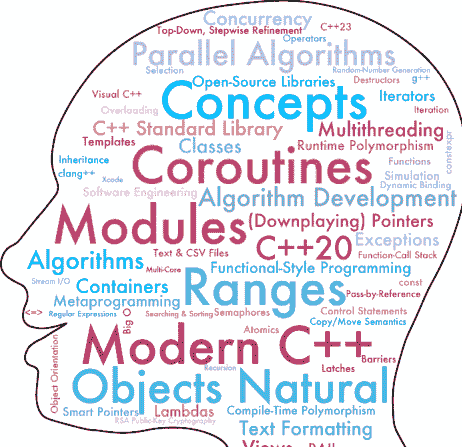

| # | 小节 | # | 小节 |
|---|---|---|---|
| 2.1 | 引言 | 2.7 | 决策制定：相等与关系运算符 |
| 2.2 | 第一个 C++ 程序：显示一行文本 | 2.8 | “对象自然”案例研究：创建和使用标准库类 string 的对象 |
| 2.3 | 修改我们的第一个 C++ 程序 | 2.9 | 小结 |
| 2.4 | 另一个 C++ 程序：整数相加 |  | 练习 |
| 2.5 | 内存概念 |  |  |
| 2.6 | 算术 |  |  |

## 2.1 引言

本章给出几个代码示例，演示程序如何显示消息、从用户处获取数据并进行处理。前三个示例在屏幕上输出消息。第四个示例从键盘获取两个数，计算它们的和并显示结果——随附的讨论介绍 C++ 的算术运算符。第五个示例演示决策制定，展示如何比较两个数，然后根据比较结果显示消息。

### “对象自然”学习方法

在程序中，你将创建并使用许多来自预先存在的、经过精心开发和测试的类的对象，这些类使你即使在本书的早期章节也能以最少的代码完成重要任务。这些类通常来自：

- C++ 标准库，
- 平台特定库（例如 Microsoft 提供的用于创建 Windows 应用程序的库，或 Apple 提供的用于创建 macOS 应用程序的库），以及
- 围绕关键编程语言发展起来的大型开源社区创建的自由第三方库。

为了帮助你在本书的入门章节就领会这种编程风格，你将方便地创建和使用预先存在的 C++ 标准库类的对象，而无需先了解如何创建自己的自定义类。我们称之为“对象自然”方法。你将从本章最后一个示例中创建和使用 string 对象开始。从第 9 章开始，你将编写有价值的自定义类，供自己使用并供其他程序员重用。

### 编译和运行程序

有关编译和运行程序的说明，请参见第 1 章的测试运行。

## 2.2 第一个 C++ 程序：显示一行文本

考虑一个显示一行文本的简单程序（图 2.1）。行号不是程序的一部分。

```cpp
// fig02_01.cpp
// Text-printing program.
#include <iostream> // enables program to output data to the screen

// function main begins program execution
int main() {
    std::cout << "Welcome to C++!\n"; // display message

    return 0; // indicate that program ended successfully
} // end function main
```


**图 2.1** | 文本打印程序。

### 注释

第 1 行和第 2 行

```cpp
// fig02_01.cpp
// Text-printing program.
```

都以 `//` 开头，表示每行剩余部分是注释。插入注释是为了记录程序并帮助其他人阅读和理解程序。程序运行时，注释不会让计算机执行任何动作——它们会被 C++ 编译器忽略。在我们的程序中，第一行注释包含程序的文件名。第二行注释“Text-printing program.”描述程序的目的。以 `//` 开头的注释称为单行注释，因为它在当前行末尾终止。你可以通过将注释括在 `/*` 和 `*/` 中创建单行或多行注释，例如

```cpp
/* fig02_01.cpp: Text-printing program. */
```

或

```cpp
/* fig02_01.cpp
   Text-printing program. */
```

### `#include` 预处理指令

第 3 行

```cpp
#include <iostream> // enables program to output data to the screen
```

是一条预处理指令——发给 C++ 预处理器的消息，编译器在编译程序之前会调用预处理器。该行通知预处理器将输入/输出流头文件 `<iostream>` 的内容包含到程序中。该头文件是一个文件，包含编译器在使用 C++ 的流输入/输出编译任何向屏幕输出数据或从键盘输入数据的程序时所需的信息。图 2.1 中的程序向屏幕输出数据。第 5 章将更详细地讨论头文件，第 19 章将更详细地解释 `<iostream>` 的内容。在从键盘输入数据或向屏幕输出数据的程序中忘记包含 `<iostream>` 会导致编译器发出错误消息。

### 空行和空白

第 4 行是空行。空行、空格和制表符使程序更易读。这些字符统称为空白——它们通常会被编译器忽略。

### main 函数

第 6 行

```cpp
int main() {
```

是每个 C++ 程序的一部分。main 后面的圆括号表示它是一个函数。C++ 程序通常由一个或多个函数和类组成。每个程序中必须有一个名为 main 的函数。这是 C++ 程序开始执行的地方。关键字 `int` 表示 main 执行完毕后“返回”一个整数（whole number）值。像 `return` 这样的关键字由 C++ 保留使用。我们将在第 3 章展示 C++ 关键字的完整列表。我们将在第 5 章演示如何创建自己的函数时解释函数“返回值”的含义。现在，只需在每个程序的 main 左侧包含关键字 `int`。

左花括号 `{`（第 6 行末尾）必须开始每个函数体，函数体包含函数执行的指令。相应的右花括号 `}`（第 10 行）必须结束每个函数体。

### 输出语句

第 7 行

```cpp
std::cout << "Welcome to C++!\n"; // display message
```

显示双引号之间包含的字符。引号及其之间的字符称为字符串、字符串字面量或字符串字面常量。我们简单地把双引号之间的字符称为字符串。字符串中的空白字符不会被编译器忽略。第 7 行整行——包括 `std::cout`、`<<` 运算符、字符串 `"Welcome to C++!\n"` 和分号（`;`）——称为一条语句。大多数 C++ 语句以分号结尾。预处理指令（如 `#include`）不是 C++ 语句，不以分号结尾。

通常，C++ 中的输出和输入通过数据流完成。前面的语句执行时，它将字符流 `Welcome to C++!\n` 发送到标准输出流对象（`std::cout`），该对象通常“连接”到屏幕。


省略 C++ 语句末尾的分号是语法错误。编程语言的语法规定了在该语言中创建正确程序的规则。当编译器遇到违反 C++ 语言规则（即语法）的代码时，就会发生语法错误。编译器会发出错误消息，帮助你定位并修复不正确的代码。语法错误也称为编译器错误、编译时错误或编译错误，因为编译器在编译阶段检测到它们。在改正所有语法错误之前，你无法执行程序。正如你将看到的，有些编译错误不是语法错误。

### 缩进

将每个函数体在界定函数体的花括号内缩进一级。这会使程序的功能结构更加突出，使程序更易读。为你偏好的缩进大小设定一个约定，然后统一应用。可以使用 Tab 键创建缩进，但制表位可能不同。我们偏好每级缩进三个空格。


### std 命名空间

当我们使用从标准库头文件（如 <iostream>）引入程序的名称时，cout 前面的 std:: 是必需的。记号 std::cout 表明我们使用的是名称 cout，它属于命名空间 std。^1 我们将在第 16 章讨论命名空间。目前，在每次提到 cout 时都要在前面加上 std::。我们很快会介绍 using 声明和 using 指令，它们使你能够在每次使用 std 命名空间中的名称时省略 std::。

1\. 我们把“std::”读作“standard”，而不是读作单个字母 s、t 和 d。

### 流插入运算符与转义序列

与 cout 一起使用时，<< 运算符是流插入运算符。运算符右侧的值（右操作数）被插入到输出流中。注意，<< 指向数据要去的位置。字符串的字符通常完全按照引号内键入的内容显示。然而，在图 2.1 的输出中不会显示字符 `\n`。反斜杠（`\`）是转义字符。当 C++ 在字符串中遇到反斜杠时，会将下一个字符与反斜杠组合成转义序列。转义序列 `\n` 表示换行。它使光标——即当前屏幕位置指示器——移动到屏幕上下一行的开头。下表列出了一些常见的转义序列：

| 转义序列 | 说明 |
| --- | --- |
| `\n` | 换行。将屏幕光标定位到下一行的开头。 |
| `\t` | 水平制表。将屏幕光标向右移动到下一个制表位。 |
| `\r` | 回车。将屏幕光标定位到当前行的开头；不前进到下一行。 |
| `\a` | 警报。发出系统响铃声。 |
| `\\` | 反斜杠。在字符串中包含一个反斜杠字符。 |
| `\'` | 单引号。在字符串中包含一个单引号字符。 |
| `\"` | 双引号。在字符串中包含一个双引号字符。 |

### return 语句

第 9 行

```cpp
return 0; // indicate that program ended successfully
```

是我们将用来退出函数的几种方式之一。在 main 末尾的这个 return 语句中，值 0 表示程序成功终止。如果程序执行到达右花括号时没有遇到 **return 语句**，则 main 函数会隐式返回 0。因此，在后续成功终止的程序中，我们省略 main 的 return 语句。

### 检查点

- 1. *（填空）* 空行、空格和制表符统称为 ______，并且通常会被编译器忽略。  
  **答案：** 空白字符。
- 2. *（代码）* 编写一条语句，输出字符串“Hello world”，然后将光标移到下一行的开头。

  ```cpp
  std::cout << "Hello World\n";  // display message
  ```
- 3. *（对/错）* 下面的语句在 `main` 末尾执行时，表示程序没有正确执行：

  ```cpp
  return 0;
  ```

  **答案：** 错。该语句表示程序成功执行。

## 2.3 修改我们的第一个 C++ 程序

接下来的两个示例修改图 2.1 的程序。第一个使用多条语句在一行上显示文本。第二个使用一条语句在多行上显示文本。

### 用多条语句显示一行文本

图 2.2 在多条语句（第 7—8 行）中执行流插入，却产生与图 2.1 相同的输出。每次流插入都从上一个流插入停止的位置继续显示。第 7 行显示 Welcome，后跟一个空格。该字符串没有以 `\n` 结尾，因此第 8 行紧跟在空格之后在同一行开始显示。

```cpp
// fig02_02.cpp
// Displaying a line of text with multiple statements.
#include <iostream> // enables program to output data to the screen

// function main begins program execution
int main() {
    std::cout << "Welcome ";
    std::cout << "to C++!\n";
} // end function main
```


**图 2.2** | 用多条语句显示一行文本。

### 用一条语句显示多行文本

一条语句可以通过使用额外的换行符来显示多行，如图 2.3 的第 7 行所示。每当在输出流中遇到 `\n`（换行）转义序列时，光标就定位到下一行的开头。要在输出中得到一个空行，请将两个换行符背靠背放置，如第 7 行所示。

```cpp
// fig02_03.cpp
// Displaying multiple lines of text with a single statement.
#include <iostream> // enables program to output data to the screen

// function main begins program execution
int main() {
    std::cout << "Welcome to C++!\n\n";
} // end function main
```

**图 2.3** | 用一条语句显示多行文本。（第 1 部分，共 2 部分。）


**图 2.3** | 用一条语句显示多行文本。（第 2 部分，共 2 部分。）

### 检查点

- 1. *（对/错）* 下面的语句显示字符串 `"Hello"`，然后将输出光标定位到下一行。

  `std::cout << "Hello";`

  **答案：** 错。该语句显示字符串 `"Hello"`，并将输出光标留在 `"Hello"` 中的 `o` 之后。
- 2. *（对/错）* 一条语句可以通过使用额外的换行符显示多行。

  **答案：** 对。
- 3. *（代码）* 编写一条输出单个字符串的语句，显示以下内容，并将输出光标定位在新的一行：

  ```text
  Hello

  World
  ```

  **答案：** `std::cout << "Hello\n\nWorld\n";`

## 2.4 另一个 C++ 程序：整数相加

我们的下一个程序获取用户在键盘上输入的两个整数，计算它们的和，并使用 `std::cout` 输出结果。图 2.4 显示了该程序以及示例输入和输出。在示例执行中，我们的约定是用**粗体**显示用户的输入。

```cpp
// fig02_04.cpp
// Addition program that displays the sum of two integers.
#include <iostream> // enables program to perform input and output

// function main begins program execution
int main() {
    // declaring and initializing variables
    int number1{0}; // first integer to add (initialized to 0)
    int number2{0}; // second integer to add (initialized to 0)
    int sum{0}; // sum of number1 and number2 (initialized to 0)

    std::cout << "Enter first integer: "; // prompt user for data
    std::cin >> number1; // read first integer from user into number1

    std::cout << "Enter second integer: "; // prompt user for more data
    std::cin >> number2; // read second integer from user into number2
```

**图 2.4** | 显示两个整数之和的加法程序。（第 1 部分，共 2 部分。）

C++ 基本类型名称通常由一个或多个关键字组成，并且必须全部使用小写字母。有关 C++ 基本类型及其取值范围的完整列表，请参见 https://en.cppreference.com/w/cpp/language/types

### 标识符与驼峰式命名

变量名（例如 number1）可以是任何有效的标识符。标识符是由字母、数字和下划线（_）组成的一系列字符，不能以数字开头，也不能是关键字。C++ 区分大小写——大写字母和小写字母不同。因此，a1 和 A1 是不同的标识符。

C++ 允许任意长度的标识符。不要用下划线加大写字母或两个下划线作为标识符的开头。C++ 编译器会在内部将这些名称用于自身目的。

按照惯例，变量名标识符以小写字母开头，名称中第一个单词之后的每个单词都以大写字母开头。例如，firstNumber 的第二个单词 Number 以大写 N 开头。这种命名约定称为驼峰式命名法，因为大写字母像骆驼的驼峰一样突出。选择有意义的标识符有助于使程序自我说明——人们只需阅读程序就能理解它，而不必参考程序注释或外部文档。避免在标识符中使用缩写。虽然这可能需要你多敲一些键，但它提高了程序的可读性。

### 变量声明的位置

变量声明几乎可以放在程序中的任何位置，但必须出现在变量使用之前。例如，第 8 行中的声明

```cpp
int number1{0}; // first integer to add (initialized to 0)
```

本可以紧挨着第 13 行之前放置：

```cpp
std::cin >> number1; // read first integer from user into number1
```

第 9 行中的声明：

```cpp
int number2{0}; // second integer to add (initialized to 0)
```

本可以紧挨着第 16 行之前放置：

```cpp
std::cin >> number2; // read second integer from user into number2
```

以及第 10 行中的声明：

```cpp
int sum{0}; // sum of number1 and number2 (initialized to 0)
```

本可以紧挨着第 18 行之前放置：

```cpp
sum = number1 + number2; // add the numbers, store result in sum
```

事实上，第 10 行和第 18 行可以合并为下面的声明，并放在第 20 行之前：

```cpp
int sum{number1 + number2}; // initialize sum with number1 + number2
```

### 从用户处获取第一个值

第 12 行

```cpp
std::cout << "Enter first integer: "; // prompt user for data
```

显示 Enter first integer:，后跟一个空格。该消息称为提示符，因为它指示用户执行特定操作。第 13 行

```cpp
std::cin >> number1; // read first integer from user into number1
```

使用标准输入流对象 cin（属于命名空间 std）和流提取运算符 >>，从键盘获取一个值。

当前面的语句执行时，程序会等待你为变量 number1 输入一个值。你通过键入一个整数（以字符形式）来响应，然后按 Enter 键（有时称为 Return 键），将这些字符发送给程序。cin 对象将该数字的字符表示转换为整数值，并将此值赋给变量 number1。按 Enter 键还会使光标移到屏幕上下一行的开头。

当你的程序期望用户输入一个整数时，用户可能输入字母字符、特殊符号（如 # 或 @）或带小数点的数字（如 73.5）。在这些早期程序中，我们假设用户输入有效数据。稍后我们将介绍处理数据输入问题的各种技术。

### 从用户处获取第二个值

第 15 行

```cpp
std::cout << "Enter second integer: "; // prompt user for data
```

在屏幕上显示 Enter second integer:，提示用户采取操作。第 16 行

```cpp
std::cin >> number2; // read second integer from user into number2
```

从用户处获取变量 number2 的值。

### 计算用户输入的值之和

第 18 行的赋值语句

```cpp
sum = number1 + number2; // add the numbers; store result in sum
```

将 number1 和 number2 的值相加，并使用赋值运算符 = 将结果赋给 sum。大多数计算都在赋值语句中执行。= 运算符和 + 运算符都是二元运算符——每个都有两个操作数。对于 + 运算符，两个操作数是 number1 和 number2。对于前面的 = 运算符，两个操作数是 sum 和表达式 number1 + number2 的值。在二元运算符两侧各放一个空格可以使该运算符更醒目，并使程序更易读。

### 显示结果

第 20 行

```cpp
std::cout << "Sum is " << sum << '\n'; // display sum
```

显示字符串 "Sum is"，后跟变量 sum 的数值和一个换行符。此语句输出多种类型的值。流插入运算符“知道”如何输出每种数据类型。在单个语句中使用多个流插入运算符（<<）称为连接、链式或级联流插入操作。

计算也可以在输出语句中执行。我们可以通过将第 18 行和第 20 行的语句合并为以下语句来省去变量 sum

```cpp
std::cout << "Sum is " << number1 + number2 << '\n';
```

C++ 的一个标志性特性是，你可以创建自己的数据类型，称为类，我们将在第 9 章及后续章节中深入讨论。然后，你可以分别使用 `>>` 和 `<<` 运算符“教”C++ 如何输入和输出这些新数据类型的值。这称为**运算符重载**，我们将在第 11 章中探讨。

### 检查点

- 1. *（代码）* 编写一条语句，使用花括号初始化将 int 变量 `total` 初始化为 0。
  
  **答案：** `int total{0};`
- 2. *（代码）* 假设 int 变量 `billAmount` 和 `tip` 已存在并已初始化。编写一条初始化语句，将 `billAmount` 和 `tip` 的值相加，并将结果存入新的 int 变量 `totalBill`。
  
  **答案：** `int totalBill{billAmount + tip};`
- 3. *（对/错）* 变量在使用前必须用类型和名称定义。
  
  **答案：** 正确。

## 2.5 内存概念

变量名（如 number1、number2 和 sum）对应于计算机内存中的位置。每个变量都有名称、类型、大小（由类型决定）和值。

在图 2.4 的加法程序中，当以下语句（第 13 行）执行时

```cpp
std::cin >> number1;  // read first integer from user into number1
```

程序将用户键入的整数放入编译器分配了名称 number1 的内存位置。如果用户为 number1 输入 45，程序会将 45 放入位置 number1，如下所示：


当一个值被放入内存位置时，新值会覆盖该位置中的前一个值——前一个值将丢失。

回到我们的加法程序，假设当以下语句（第 16 行）执行时，用户输入 72：

```cpp
std::cin >> number2;  // read second integer from user into number2
```

程序将 72 放入位置 number2，内存如下所示：

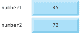

变量的位置在内存中不一定相邻。

程序获取 number1 和 number2 的值后，会将这些值相加，并将总和放入变量 sum。语句（第 18 行）

```cpp
sum = number1 + number2;
```

将 `number1` 和 `number2` 计算出的和放入变量 `sum`，之后内存如下所示：

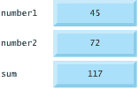

执行计算会使用 `number1` 和 `number2` 的值，但不会修改它们。

### ✓ 检查点

- 1. *（填空）* 每个变量都有一个名称、一个 ______、一个 ______ 和一个 ______。
  
  **答案：** 类型、大小、值。
- 2. *（对/错）* 将值存入变量会替换对应内存位置中的前一个值。
  
  **答案：** 正确。
- 3. *（对/错）* 像 `number1 + number2` 这样的表达式会使用变量 `number1` 和 `number2` 的值，但不会修改它们。
  
  **答案：** 正确。

## 2.6 算术

下表总结了算术运算符：

| 运算 | 算术运算符 | 代数表达式 | C++ 表达式 |
|---|---|---|---|
| 加法 | `+` | *f + 7* | `f + 7` |
| 减法 | `-` | *p − c* | `p - c` |
| 乘法 | `*` | *bm* 或 *b · m* | `b * m` |
| 除法 | `/` | *x / y* 或 *x ÷ y* | `x / y` |
| 求余 | `%` | *r mod s* | `r % s` |

星号（*）表示乘法，百分号（%）是求余运算符，我们稍后会讨论。这些算术运算符都是二元运算符。

### 整数除法

分子和分母都是整数的整数除法会得到整数商。因此，表达式 `7 / 4` 的求值结果为 1，表达式 `17 / 5` 的求值结果为 3。整数除法产生的任何小数部分都会被截断——不会进行舍入。

### 求余运算符

求余运算符 %（也称为取模运算符）给出整数除法后的余数，并且只能用于整数操作数。表达式 `x % y` 给出 x 除以 y 后的余数。因此，`7 % 4` 得到 3，`17 % 5` 得到 2。

### 用于分组子表达式的括号

括号在 C++ 表达式中的使用方式与在代数表达式中相同。例如，要将 x 乘以 y + z 这个量，我们写作 x × (y + z)。

### 运算符优先级规则

C++ 会按照以下运算符优先级规则所确定的精确顺序，在算术表达式中应用运算符；这些规则通常与代数中的规则相同：

- 1. 括号中的表达式首先求值。括号被认为处于“最高优先级”。在嵌套或内嵌括号的情况下，如下面的语句，最内层括号中的表达式首先求值：
  
  `(a * (b + c))`
- 2. 乘法、除法和求余运算接下来求值。在包含多个这类运算的表达式中，它们从左到右应用。这三个运算符具有相同的优先级。
- 3. 加法和减法运算最后求值，并且从左到右应用。加法和减法具有相同的优先级。

你可以在 https://en.cppreference.com/w/cpp/language/operator_precedence 查看完整的运算符优先级表。**注意：** 在具有两组“同一层级”括号的表达式中，例如 `(a + b) * (c − d)`，C++ 标准并未规定这些带括号子表达式的求值顺序。

### 运算符分组

当我们说 C++ 从左到右应用某些运算符时，我们指的是运算符的分组（有时称为结合性）。例如，在表达式

```
a + b + c
```

中，加法运算符（+）从左到右分组，就好像我们将表达式加括号为 `(a + b) + c`。大多数相同优先级的 C++ 运算符都从左到右分组。我们将会看到，有些运算符从右到左分组。

### 代数表达式与 C++ 表达式示例

现在根据运算符优先级规则来考虑几个表达式。每个示例列出一个代数表达式及其对应的 C++ 表达式。下面是一个五项算术平均值（平均数）的示例：

代数：m = (a + b + c + d + e) / 5

C++：m = (a + b + c + d + e) / 5;

括号是必需的，因为除法的优先级高于加法。整个量 (a + b + c + d + e) 要除以 5。如果错误地省略括号，我们会得到 a + b + c + d + e / 5，其求值结果错误地为

a + b + c + d + e / 5

下面是一个直线方程的示例：

代数：y = mx + b

C++：y = m * x + b;


不需要括号。乘法先执行，因为它的优先级高于加法。

## 二次多项式求值

为了更好地理解运算符优先级规则，考虑二次多项式 *y* = *ax² + bx + c* 的求值：

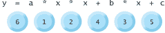

在 C++ 中没有幂运算的算术运算符，因此我们将 *x²* 表示为 `x * x`。语句下方带圆圈的数字表示 C++ 应用运算符的顺序。赋值运算符最后应用，因为它在语句中的优先级最低。

假设上述二次多项式中的变量 *a*、*b*、*c* 和 *x* 按如下方式初始化：`a = 2`、`b = 3`、`c = 7` 和 `x = 5`。下图说明了运算符的应用顺序以及表达式的最终值：

- 1. `y = 2 * 5 * 5 + 3 * 5 + 7;` — 最左边的乘法。`2 * 5 is 10`。
- 2. `y = 10 * 5 + 3 * 5 + 7;` — 最左边的乘法。`10 * 5 is 50`。
- 3. `y = 50 + 3 * 5 + 7;` — 乘法先于加法。`3 * 5 is 15`。
- 4. `y = 50 + 15 + 7;` — 最左边的加法。`50 + 15 is 65`。
- 5. `y = 65 + 7;` — 最后的加法。`65 + 7 is 72`。
- 6. `y = 72` — 低优先级赋值；将 72 存入 *y*。

## 冗余括号

与代数中一样，在表达式中放置不必要的括号以使其更清晰是可接受的。这些括号称为冗余括号。例如，二次多项式可以加括号如下：

```
y = (a * x * x) + (b * x) + c;
```

## 使用 if 语句

图 2.5 中的程序（后面有多次执行示例）使用六个 if 语句来比较用户输入的两个整数。如果某个 if 语句的条件为真，则该 if 语句体中的输出语句执行。如果条件为假，则跳过体中的输出语句。

```cpp
// fig02_05.cpp
// Comparing integers using if statements, relational operators
// and equality operators.
#include <iostream> // enables program to perform input and output

using std::cout; // program uses cout
using std::cin; // program uses cin

// function main begins program execution
int main() {
   int number1{0}; // first integer to compare (initialized to 0)
   int number2{0}; // second integer to compare (initialized to 0)

   cout << "Enter two integers to compare: "; // prompt user for data
   cin >> number1 >> number2; // read two integers

   if (number1 == number2) {
      cout << number1 << " == " << number2 << "\n";
   }

   if (number1 != number2) {
      cout << number1 << " != " << number2 << "\n";
   }

   if (number1 < number2) {
      cout << number1 << " < " << number2 << "\n";
   }

   if (number1 > number2) {
      cout << number1 << " > " << number2 << "\n";
   }

   if (number1 <= number2) {
      cout << number1 << " <= " << number2 << "\n";
   }

   if (number1 >= number2) {
      cout << number1 << " >= " << number2 << "\n";
   }
} // end function main
```

```text
Enter two integers to compare: 3 7
3 != 7
3 < 7
3 <= 7
```

**图 2.5** | 使用 if 语句、关系运算符和相等运算符比较整数。（第 1 部分，共 2 部分。）

```text
Enter two integers to compare: 22 12
22 != 12
22 > 12
22 >= 12
```

```text
Enter two integers to compare: 7 7
7 == 7
7 <= 7
7 >= 7
```

**图 2.5** | 使用 if 语句、关系运算符和相等运算符比较整数。（第 2 部分，共 2 部分。）

### using 声明

第 6–7 行

```cpp
using std::cout; // program uses cout
using std::cin; // program uses cin
```

是 using 声明，它消除了像早期程序中那样重复 std:: 前缀的需要。现在我们在程序的其余部分可以直接写 cout 而不是 std::cout，写 cin 而不是 std::cin。

### using 指令

许多程序员倾向于使用 using 指令来代替第 6–7 行

```cpp
using namespace std;
```

它使你的程序无需 std:: 限定即可使用 std 命名空间中的名称。在早期章节中，我们将使用此指令来简化代码，² 但在第 6 章中，我们将重新使用 std::，这被认为是良好实践，并且可以帮助你避免一些微妙的编码错误。


### 变量声明与从用户读取输入

第 11–12 行

```cpp
int number1{0}; // first integer to compare (initialized to 0)
int number2{0}; // second integer to compare (initialized to 0)
```

声明程序中使用的变量并将它们初始化为 0。

第 15 行

```cpp
cin >> number1 >> number2; // read two integers from user
```

使用级联的流提取运算来输入两个整数。回想一下，由于第 7 行的原因，我们可以写 cin（而不是 std::cin）。该语句首先读取一个值到 number1，然后读取另一个值到 number2。

2. 在第 20 章中，我们将讨论在大型系统中使用 using 指令的一些缺点。

### 比较数字

第 17–19 行中的 if 语句

```cpp
if (number1 == number2) {
    cout << number1 << " == " << number2 << "\n";
}
```

确定变量 number1 和 number2 的值是否相等。如果相等，则输出语句（第 18 行）显示一行文本，指示这两个数字相等。对于从第 21、25、29、33 和 37 行开始的其他 if 语句中每个为真的条件，相应的输出语句会显示一行适当的文本。

### 花括号与块

图 2.5 中的每个 if 语句都包含一个缩进的单条语句体，以增强可读性。此外，请注意我们将每个语句体都括在一对花括号 { } 中，这形成了所谓的复合语句或块。

对于单条语句体，你不需要使用花括号，但对于多条语句体，必须包含花括号。忘记将多条语句体括在花括号中会导致错误。为避免此类错误，作为规则，始终将 if 语句的语句体括在花括号中。此外，缩进 if 语句块中的语句以增强可读性。


### 常见逻辑错误：在条件后放置分号

在 if 语句条件的右括号后紧跟一个分号通常是逻辑错误（虽然不是语法错误）。分号使 if 语句体为空，因此无论条件是否为真，if 语句都不执行任何操作。更糟糕的是，if 语句原来的语句体现在变成与 if 语句顺序执行的一条语句，并且总是执行，这常常导致程序产生不正确的结果。我们首选的三个编译器都会对此逻辑错误发出警告。


### 拆分过长语句

过长的语句可以分布在多行中。如果必须这样做，请选择有意义的断点，例如在逗号分隔列表中的逗号之后，或在长表达式中的运算符之后。如果一条语句被拆分为两行或多行，缩进所有后续行是一种良好的实践。

### 运算符优先级与结合性

除赋值运算符 = 外，本章介绍的所有运算符都从左到右结合。赋值运算符（=）从右到左结合。因此，像 `x = y = 0` 这样的表达式求值时，就如同写成了 `x = (y = 0)`，它首先将 0 赋给 y，然后将该赋值的结果——即 y 的值（现在为 0）——赋给 x。

在编写包含许多运算符的表达式时，请参阅 https://en.cppreference.com/w/cpp/language/operator_precedence 上的完整运算符优先级表。确认表达式中的运算符按你期望的顺序执行。如果你不确定复杂表达式中的求值顺序，可以将表达式拆分为一系列较小的语句，或使用括号来强制求值顺序，就像在代数表达式中那样。


### 检查点

- 1. *(代码)* 编写一条 using 指令，使你可以使用 `cin` 和 `cout` 而无需 `std::` 限定。
  
  **答案：** `using namespace std;`

- 2. *(代码)* 假设 `number1` 为 12，`number2` 为 23。以下代码会输出什么？

  ```cpp
  if (number1 > number2) {
      cout << number1 << " > " << number2 << "\n";
  }
  ```

  **答案：** 该语句不会输出任何内容，因为条件为假，所以语句体将被跳过。

- 3. *(代码)* 假设 `number1` 为 23，`number2` 为 23。以下代码会输出什么？[编写并运行一个简短程序，看看这段代码实际做了什么。]

  ```cpp
  if (number1 != number2); {
      cout << number1 << " != " << number2 << "\n";
  }
  ```

  **答案：** 这段代码会错误地输出 23 != 23，因为一个分号被错误地放在了 if 语句条件之后。

## 2.8 对象自然案例研究：创建和使用标准库类 string 的对象

在整本书中，我们强调使用 C++ 标准库和 C++ 开源社区中的各种库中宝贵的既有类。你将专注于了解有哪些库可供使用，为你的应用选择合适的库，从现有库类创建对象，并让这些对象发挥其能力。所谓“对象自然”（Objects Natural），我们的意思是，即使在你于第 9 章学习创建自己的自定义类之前，你也能够方便地创建功能强大的对象并使用它们进行编程。

你已经使用过 C++ 对象——具体来说，`cout` 和 `cin` 对象分别封装了输出和输入的机制。这些对象是在幕后使用 `<iostream>` 头文件中的类为你创建的。在本节中，你将创建并操作 C++ 标准库 `string`<sup>3</sup> 类的对象。

### 测试驱动 string 类

类不能自行执行。一个 `Person` 对象可以通过告诉 `Car` 对象做什么（加速、减速、左转、右转等）来“驾驶”它，而无需了解汽车内部机制如何工作。类似地，`main` 函数可以通过调用 `string` 对象的成员函数来“驱动”它，而无需了解该类是如何实现的。在这个意义上，下面程序中的 `main` 被称为驱动程序。图 2.6 的 `main` 函数测试驱动了几个 `string` 对象。

```cpp
// fig02_06.cpp
// Standard library string class test program.
#include <iostream>
#include <string>
using namespace std;

int main() {
   string s1{"happy"};
   string s2{"birthday"};
   string s3; // creates an empty string

   // display the strings and show their lengths
   cout << "s1: \"" << s1 << "\", length: " << s1.length()
      << "\ns2: \"" << s2 << "\", length: " << s2.length()
      << "\ns3: \"" << s3 << "\", length: " << s3.length();

   // compare strings with == and !=
   cout << "\n\nThe results of comparing s2 and s1:" << boolalpha
      << "\ns2 == s1: " << (s2 == s1)
      << "\ns2 != s1: " << (s2 != s1);

   // test string member function empty
   cout << "\n\nTesting s3.empty():\n";

   if (s3.empty()) {
      cout << "s3 is empty; assigning to s3;\n";
      s3 = s1 + s2; // assign s3 the result of concatenating s1 and s2
      cout << "s3: \"" << s3 << "\"\n";
   }

   // testing new C++20 string member functions
   cout << "\n\ns1 starts with \"ha\": " << s1.starts_with("ha") << "\n";
   cout << "s2 starts with \"ha\": " << s2.starts_with("ha") << "\n";
   cout << "s1 ends with \"ay\": " << s1.ends_with("ay") << "\n";
   cout << "s2 ends with \"ay\": " << s2.ends_with("ay") << "\n";
}
```

```text
s1: "happy", length: 5
s2: "birthday", length: 9
s3: "", length: 0

The results of comparing s2 and s1:
s2 == s1: false
s2 != s1: true

Testing s3.empty():
s3 is empty; assigning to s3;
s3: "happy birthday"

s1 starts with "ha": true
s2 starts with "ha": false
s1 ends with "ay": false
s2 ends with "ay": true
```

**图 2.6** | 标准库 string 类测试程序。

### 实例化对象

通常，除非你创建了某个类的对象⁴——也称为实例化对象——否则不能调用该类的成员函数。第 8–10 行创建了三个 `string` 对象：

- `s1` 用字符串字面量 `"happy"` 的副本初始化；
- `s2` 用字符串字面量 `"birthday"` 的副本初始化；
- `s3` 默认初始化为空字符串（即 `""`）。

当我们像之前那样声明 `int` 变量时，编译器知道 `int` 是什么——它是 C++ 内置的基本类型。然而，在第 8–10 行中，编译器不会预先知道 `string` 是什么类型——它是来自 C++ 标准库的类类型。

如果封装得当，类可以被其他程序员重用。这是使用像 C++ 这样支持面向对象编程的语言最重要的好处之一。这类语言拥有丰富的、功能强大的预建类库。例如，你可以通过包含适当的头文件——在本例中是 `<string>` 头文件（第 4 行）——在任何程序中重用 C++ 标准库中的类。名称 `string` 和名称 `cout` 一样，属于命名空间 `std`。

### string 成员函数 length

第 13–15 行输出每个字符串及其长度。`string` 类的 `length` 成员函数返回特定 `string` 对象中存储的字符数。在第 13 行中，表达式

```cpp
s1.length()
```

通过调用对象的 `length` 成员函数返回 `s1` 的长度。要为特定对象调用此成员函数，你需要指定对象名（`s1`），后跟点运算符（`.`），再跟成员函数名（`length`）和一组圆括号。空括号表示 `length` 无需额外信息即可执行其任务。很快你将看到，某些成员函数需要称之为实参的额外信息来执行任务。

从 `main` 的角度来看，当调用 `length` 成员函数时：

- 1. 程序将执行从调用处（`main` 中的第 13 行）转移到成员函数 `length`。由于 `length` 是通过 `s1` 对象调用的，`length` “知道”要操作哪个对象的数据。
- 2. 接着，成员函数 `length` 执行其任务——也就是，将 `s1` 的长度返回到第 13 行调用处。`main` 函数不知道 `length` 如何执行其任务，就像汽车驾驶员不知道发动机、变速箱、转向机构和刹车是如何实现的一样。
- 3. `cout` 对象显示成员函数 `length` 返回的字符数，然后程序继续执行，显示字符串 `s2` 和 `s3` 及其长度。

⁴ 在第 9.20 节中你将看到，可以不创建类的对象就调用类的静态成员函数。

### 使用相等运算符比较 string 对象

与数字一样，字符串之间也可以相互比较。第 18–20 行使用相等运算符将 `s2` 与 `s1` 进行比较——字符串比较是区分大小写的。⁵

通常，当你输出条件的值时，C++ 对于 false 显示 0，对于 true 显示 1。来自 `<iostream>` 头文件的流操纵符 `boolalpha`（第 18 行）告诉输出流更自然地以单词 `false` 或 `true` 显示条件值。

### string 成员函数 empty

第 25 行调用 string 成员函数 `empty`，如果字符串为空——即字符串长度为 0——则返回 `true`，否则 `empty` 返回 `false`。对象 `s3` “默认”初始化为空字符串，所以它确实是空的，`if` 语句体将执行。

### string 连接与赋值

第 27 行使用 `+` 运算符“相加”字符串 `s1` 和 `s2`，将产生的新值赋给 `s3`——这称为字符串连接。赋值后，`s3` 包含 `s1` 的字符后跟 `s2` 的字符——“happy birthday”。第 28 行输出 `s3`，以证明赋值操作正确完成。

### C++20 string 成员函数 `starts_with` 和 `ends_with`

第 32–35 行演示了 C++20 的 string 成员函数 `starts_with` 和 `ends_with`，它们分别在该字符串以指定子字符串开头或结尾时返回 `true`；否则返回 `false`。第 32 和 33 行显示 `s1` 以 `"ha"` 开头，但 `s2` 不是。第 34 和 35 行显示 `s1` 不以 `"ay"` 结尾，但 `s2` 以 `"ay"` 结尾。


### 检查点

- 1. *(代码)* 假设 string 对象 `name` 存在并已初始化。编写一个 string 成员函数调用，如果 `name` 以 `"Je"` 开头，则返回 `true`。
  
  **答案：** `name.starts_with("Je")`

- 2. *(代码)* 假设 string 对象 `name` 存在并已初始化。编写一个 string 成员函数调用，如果 `name` 以 `"on"` 结尾，则返回 `true`。
  
  **答案：** `name.ends_with("on")`

## 2.9 小结

在本章中，我们介绍了许多重要的 C++ 特性，包括在屏幕上显示数据、从键盘输入数据以及声明基本类型的变量。你学习了使用输出流对象 `cout` 和输入流对象 `cin` 来构建简单的交互式程序。我们声明并初始化变量，使用算术运算符执行计算。我们讨论了 C++ 应用运算符的顺序（即运算符优先级规则），以及运算符的分组方式（也称为运算符的结合性）。你看到了 C++ 的 `if` 语句如何让程序进行决策。我们引入了相等运算符和关系运算符，并用它们在 `if` 语句中形成条件。

⁵ 在第 8 章中，你将看到字符串使用每个字符串中字符的数值进行“字典序”比较。


- c) `y = a * (x * x * x) + 7;`
- f) `y = a * x * (x * x + 7);`

**2.9** *(求值顺序)* 说明下列每条 C++ 语句中各运算符的求值顺序，并给出每条语句执行后 `x` 的值。

- a) `x = 7 + 3 * 6 / 2 - 1;`
- b) `x = 2 % 2 + 2 * 2 - 2 / 2;`
- c) `x = (3 * 9 * (3 + (9 * 3 / (3))));`

**2.10** 编写一条语句（或注释）来完成下列各项（假设已经为 `cin`、`cout` 和 `endl` 使用了 using 声明）：

- a) 注释说明一个程序计算三个整数的乘积。
- b) 将变量 x、y、z 和 result 声明为 `int` 类型（用单独语句）并各自初始化为 0。
- c) 提示用户输入三个整数。
- d) 从键盘读取三个整数并存储到变量 x、y 和 z 中。
- e) 计算变量 x、y 和 z 中三个整数的乘积，并将结果赋给变量 result。
- f) 打印 "The product is "，后跟变量 result 的值。

**2.11** 使用你在练习 2.10 中编写的语句，编写一个完整程序来计算并显示三个整数的乘积。在适当的地方为代码添加注释。 [注意：你需要编写必要的 using 声明或指令。]

**2.12** *(算术)* 编写一个程序，要求用户输入两个整数，从用户处获取这两个数，并打印它们的和、积、差和商。

**2.13** *(打印)* 编写一个程序，在同一行打印数字 1 到 4，每对相邻数字之间用一个空格分隔。用几种方式完成：

- a) 使用一条带一个流插入运算符的语句。
- b) 使用一条带四个流插入运算符的语句。
- c) 使用四条语句。

**2.14** *(比较整数)* 编写一个程序，要求用户输入两个整数，从用户处获取这两个数，然后打印较大的数，后跟单词 "is larger."。如果两个数相等，则打印消息 "These numbers are equal."。

**2.15** *(算术、最小值和最大值)* 编写一个程序，从键盘输入三个整数，并打印这些数的和、平均值、乘积、最小值和最大值。屏幕对话框应如下所示：

```
Input three different integers: 13 27 14
Sum is 54
Average is 18
Product is 4914
Smallest is 13
Largest is 27
```

**2.16** *(圆的直径、周长和面积)* 编写一个程序，读取一个整数作为圆的半径，并打印圆的直径、周长和面积。对 π 使用常量值 3.14159。所有计算都在输出语句中完成。 [注意：在本章中，我们只讨论了整数常量和整数变量。在第 4 章中，我们将讨论浮点数，即带有小数点的值。]

**2.17** 下面的代码打印什么？

```
cout << "\n\n\n***\n*****\n*******\n*********\n";
```

**2.18** *(最大和最小整数)* 编写一个程序，读取五个整数，并确定和打印这组数中最大和最小的整数。只使用本章学到的编程技术。

**2.19** *(奇数或偶数)* 编写一个程序，读取一个整数，并确定和打印它是奇数还是偶数。 *[提示：使用余数运算符 (%)。偶数是 2 的倍数。任何 2 的倍数除以 2 时余数都为 0。]*

**2.20** *(倍数)* 编写一个程序，读入两个整数，并确定和打印第一个数是否是第二个数的倍数。 *[提示：使用余数运算符 (%)。]*

**2.21** *(棋盘图案)* 用八条输出语句显示下面的棋盘图案，然后使用尽可能少的语句显示相同的图案。

```
        * * * * * * * *
         * * * * * * *
        * * * * * * * *
         * * * * * * *
        * * * * * * * *
         * * * * * * *
        * * * * * * * *
         * * * * * * *
```

**2.22** *(字符的整数等价)* 这里是一个前瞻。在本章中，你学习了整数和 `int` 类型。C++ 还可以表示大写字母、小写字母和各种特殊符号。C++ 在内部使用小整数来表示每个不同的字符。计算机使用的字符集以及这些字符对应的整数表示称为该计算机的字符集。你可以通过将字符放在单引号中来打印该字符，例如

```
cout << 'A'; // print an uppercase A
```

你可以使用 static_cast 打印字符的整数等价，如下所示：

```
cout << static_cast<int>('A'); // print 'A' as an integer
```

这称为强制转换操作。表达式 `static_cast<int>('A')` 将字符 'A' 转换为其整数等价 65（在使用 ASCII 字符集或 Unicode 字符集的系统上）。编写一个程序，打印用户在键盘上输入的字符的整数等价。将输入存储在 `char` 类型的变量中。多次测试你的程序，使用大写字母、小写字母、数字和特殊字符（如 $）。

**2.23** *(整数的各位数字)* 编写一个程序，输入一个五位整数，将该整数分离为各位数字，并在每个数字之间打印三个空格。例如，如果用户输入 42339，程序应打印：

```
4    2    3    3    9
```

*[提示：使用整数除法和余数运算符。]*

**2.24** *(表)* 仅使用本章的技术，编写一个程序计算 0 到 10 的整数的平方和立方。使用制表符打印下面格式整洁的值表：

| 整数 | 平方 | 立方 |
| --- | --- | --- |
| 0 | 0 | 0 |
| 1 | 1 | 1 |
| 2 | 4 | 8 |
| 3 | 9 | 27 |
| 4 | 16 | 64 |
| 5 | 25 | 125 |
| 6 | 36 | 216 |
| 7 | 49 | 343 |
| 8 | 64 | 512 |
| 9 | 81 | 729 |
| 10 | 100 | 1000 |

在后面的章节中，你将学习解决此问题的更优雅的方法。

此页有意留白

# 3 算法开发与控制语句：第 1 部分


## 目标

在本章中，你将：

- 学习基本的解决问题技术。
- 通过自顶向下、逐步细化的过程开发算法。
- 使用 `if` 和 `if...else` 选择语句在备选动作之间进行选择。
- 使用 `while` 迭代语句在程序中重复执行语句。
- 使用计数器控制迭代和哨兵控制迭代。
- 使用嵌套控制语句。
- 使用复合赋值运算符以及自增和自减运算符。
- 学习为什么基本数据类型不可移植。
- 通过一个创建和操作任意大整数的案例研究，继续我们的“自然对象”方法。

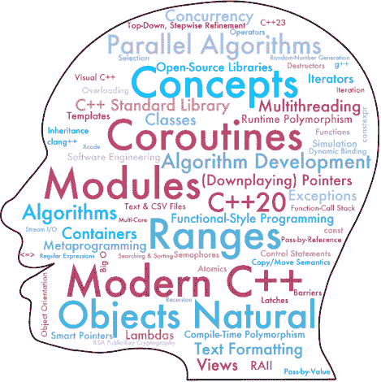

## 目录

- 3.1 引言
- 3.2 算法
- 3.3 伪代码
- 3.4 控制结构
  - 3.4.1 顺序结构
  - 3.4.2 选择语句
  - 3.4.3 迭代语句
  - 3.4.4 控制语句小结
- 3.5 `if` 单选择语句
- 3.6 `if...else` 双选择语句
  - 3.6.1 嵌套的 `if...else` 语句
  - 3.6.2 块
  - 3.6.3 条件运算符 (`?:`)
- 3.7 `while` 迭代语句
- 3.8 制定算法：计数器控制迭代
  - 3.8.1 带计数器控制迭代的伪代码算法
  - 3.8.2 实现计数器控制迭代
  - 3.8.3 整数除法与截断
  - 3.8.4 算术溢出
  - 3.8.5 输入验证
- 3.9 制定算法：哨兵控制迭代
  - 3.9.1 自顶向下、逐步细化：顶层和第一次细化
  - 3.9.2 进行到第二次细化
  - 3.9.3 实现哨兵控制迭代
  - 3.9.4 混合类型表达式与隐式类型提升
  - 3.9.5 格式化浮点数
- 3.10 制定算法：嵌套控制语句
  - 3.10.1 问题陈述
  - 3.10.2 自顶向下、逐步细化：顶层的伪代码表示
  - 3.10.3 自顶向下、逐步细化：第一次细化
  - 3.10.4 自顶向下、逐步细化：第二次细化
  - 3.10.5 伪代码的完整第二次细化
  - 3.10.6 实现程序
  - 3.10.7 使用花括号初始化防止窄化转换
- 3.11 复合赋值运算符
- 3.12 自增和自减运算符
- 3.13 基本类型不可移植
- 3.14 “自然对象”案例研究：超大整数
- 3.15 小结
- 练习

## 3.1 引言

在编写程序解决问题之前，你应该对问题有透彻的理解，并有一个仔细规划的解决方法。编写程序时，你还应该理解可用的构建块，并采用经过验证的程序构造技术。在本章和下一章中，我们将介绍结构化编程的理论和原理。正如我们将在后面的章节中看到的，这里介绍的概念对于构建类和操作对象将至关重要。

我们将更详细地讨论 `if` 语句，并介绍 `if...else` 和 `while` 语句——所有这些构建块都允许你指定函数执行任务所需的逻辑。我们还将介绍复合赋值运算符以及自增和自减运算符。我们讨论为什么基本类型不可移植。我们通过一个创建和操作超大整数的案例研究继续我们的“自然对象”方法，这些整数可以表示超出计算机硬件支持的整数范围的值。


## 3.2 算法

任何计算问题都可以通过按特定顺序执行一系列操作来解决。算法是解决问题的一种过程，涉及

- 1. 要执行的操作，以及
- 2. 这些操作的执行顺序

下面的示例表明，正确指定操作的执行顺序至关重要。

考虑某位高管遵循的“起床—出门算法”，用于起床并去上班：(1) 起床；(2) 脱掉睡衣；(3) 洗澡；(4) 穿好衣服；(5) 吃早餐；(6) 拼车上班。这个日常流程能让这位高管到岗时做好充分准备，以做出关键决策。假设同样的步骤以稍有不同的顺序执行：(1) 起床；(2) 脱掉睡衣；(3) 穿好衣服；(4) 洗澡；(5) 吃早餐；(6) 拼车上班。在这种情况下，我们的高管浑身湿透地出现在工作场所。在程序中指定语句（操作）的执行顺序称为程序控制。本章使用 C++ 的控制语句来研究程序控制。

### 检查点

- 1. *(填空)* 在程序中指定语句（操作）的执行顺序称为________。
  **答案：** 程序控制。
- 2. *(填空)* 一种根据要执行的________以及这些操作执行的________来解决问题的过程称为算法。
  **答案：** 操作，顺序。

## 3.3 伪代码

伪代码是一种非正式语言，可帮助你开发算法，而无需担心 C++ 语言语法的严格细节。我们展示的伪代码对于开发将转换为 C++ 程序结构化部分的算法特别有用。伪代码类似于日常英语（或你偏好的语言）——它方便且用户友好，但它并不是实际的计算机编程语言。你稍后将看到用伪代码编写的算法。

伪代码不在计算机上执行。相反，它帮助你在尝试用 C++ 等编程语言编写程序之前“理清”程序。本章提供了几个使用伪代码开发 C++ 程序的示例。

我们展示的伪代码风格完全由字符组成，因此你可以使用任何文本编辑器程序方便地输入伪代码。精心编写的伪代码程序可以轻松转换为相应的 C++ 程序。

伪代码通常只描述表示操作的语句，这些操作在你将程序从伪代码转换为 C++ 并运行程序后发生。此类操作可能包括输入、输出、赋值或计算。在我们的伪代码中，我们通常不包含变量声明，但有些程序员会选择列出变量并说明其用途。

### 加法程序伪代码

让我们看一个伪代码示例，它可能有助于程序员创建图 2.4 的加法程序。下面的伪代码对应于这样的算法：从用户处输入两个整数，将它们相加并显示它们的和。这里我们展示完整的伪代码清单。本章后面将展示如何根据问题描述创建伪代码。

- 1. 提示用户输入第一个整数
- 2. 输入第一个整数
- 3.
- 4. 提示用户输入第二个整数
- 5. 输入第二个整数
- 6.
- 7. 将第一个整数和第二个整数相加，存储结果
- 8. 显示结果

这些伪代码语句只是用英语表达在 C++ 中要执行什么任务的语句。第 1–2 行对应于图 2.4 中第 12–13 行的 C++ 语句。第 4–5 行对应于第 15–16 行中的语句，第 7–8 行对应于第 18 行和第 20 行中的语句。

### 检查点

- 1. **(填空)** 伪代码描述的操作可能包括________、________、________或________。
  **答案：** 输入、输出、赋值、计算。
- 2. **(填空)** ________是一种非正式语言，可帮助你开发算法而无需担心 C++ 语言语法的严格细节。
  **答案：** 伪代码。

## 3.4 控制结构

通常，程序语句按照书写的顺序一个接一个地执行。这个过程称为顺序执行。我们很快会讨论的各种 C++ 语句使你能够指定下一个要执行的语句不一定是序列中的下一个。这称为控制转移。

20 世纪 60 年代，人们逐渐清楚地认识到，不加区分地使用控制转移是软件开发团队遇到的许多问题的根源。责任被指向 goto 语句（当时大多数编程语言都使用它），它允许你指定将控制转移到程序中众多目的地之一。

Böhm 和 Jacopini¹ 的研究表明，程序可以完全不使用任何 goto 语句来编写。那个时代的程序员面临的挑战是将他们的风格转变为“无 goto 编程”。“结构化编程”这一术语几乎成为

- 1. C. Böhm 和 G. Jacopini，“流图、图灵机以及仅含两条构造规则的语言”，《ACM 通讯》，第 9 卷，第 5 期，1966 年 5 月，第 366–371 页。

活动图顶部的实心圆表示初始状态——程序执行所建模操作之前工作流的起点。图底部被空心圆包围的实心圆表示最终状态——即程序执行其操作之后工作流的终点。

前面的顺序结构活动图还包括右上角折起的矩形。这些是 UML 注释（类似 C++ 注释）——描述图中符号用途的说明性备注。虚线将每个注释与其所描述的元素连接起来。此图的 UML 注释显示了该图与每个动作状态的 C++ 代码之间的关系。活动图通常不显示 C++ 代码。

### 3.4.2 选择语句

C++ 有三种类型的选择语句。if 选择语句在条件为真时执行（选择）一个操作（或一组操作），在条件为假时跳过它。if…else 选择语句在条件为真时执行一个操作（或一组操作），并在条件为假时执行不同的操作（或一组操作）。switch 选择语句（第 4 章）根据表达式的值执行众多不同操作（或操作组）之一。

if 语句称为单选择语句，因为它选择或忽略单个操作（或一组操作）。if…else 语句称为双选择语句，因为它在两个不同操作（或操作组）之间进行选择。switch 语句称为多选择语句，因为它在许多不同操作（或操作组）之间进行选择。

### 3.4.3 迭代语句

C++ 提供四种迭代语句——也称为重复语句或循环语句——用于在循环继续条件保持为真时重复执行语句。这些迭代语句是 while、do…while、for 和基于范围的 for。while 和 for 语句执行其操作（或一组操作）零次或多次。如果循环继续条件最初为假，则该操作（或一组操作）不执行。do…while 语句执行其操作（或一组操作）一次或多次。第 4 章介绍 do…while 和 for 语句。第 6 章介绍基于范围的 for 语句。

### 关键字

if、else、switch、while、do 和 for 中的每个单词都是 C++ 关键字。关键字不能用作标识符（例如变量名），并且只能包含小写字母（有时包含下划线）。下表显示了 C++ 关键字的完整列表：

| C++ 关键字 |  |  |  |  |
|---|---|---|---|---|
| alignas | alignof | and | and_eq | asm |
| auto | bitand | bitor | bool | break |
| case | catch | char | char16_t | char32_t |
| class | compl | const | const_cast | constexpr |


| C++关键字（续） | | | | |
|---|---|---|---|---|
| continue | decltype | default | delete | do |
| double | dynamic_cast | else | enum | explicit |
| export | extern | false | final | float |
| for | friend | goto | if | import |
| inline | int | long | module | mutable |
| namespace | new | noexcept | not | not_eq |
| nullptr | operator | or | or_eq | override |
| private | protected | public | register | reinterpret_cast |
| return | short | signed | sizeof | static |
| static_assert | static_cast | struct | switch | template |
| this | thread_local | throw | true | try |
| typedef | typeid | typename | union | unsigned |
| using | void | volatile | virtual | wchar_t |
| while | xor | xor_eq | | |
| **C++20新增关键字** | | | | |
| char8_t | concept | consteval | constinit | co_await |
| co_return | co_yield | requires | | |

### 3.4.4 控制语句小结

C++只有三种控制结构，从本章开始，我们将其称为控制语句：

- 顺序，
- 选择（`if`、`if…else`和`switch`）以及
- 迭代（`while`、`do…while`、`for`和基于范围的`for`）。

你根据所实现算法的需要组合这些语句，从而构成每一个程序。我们可以将每个控制语句建模为活动图。每张图都包含初始状态和最终状态，分别表示控制语句的入口点和出口点。单入口/单出口控制语句使构建可读程序变得容易——我们只需使用控制语句堆叠，将一个控制语句的出口点连接到下一个控制语句的入口点。连接控制语句只有另一种方式——控制语句嵌套，即一个控制语句出现在另一个控制语句内部。因此，C++程序中的算法仅由三种控制语句以仅两种方式组合而成。这就是简单的本质。


### 检查点

- **1.（填空）** 伯姆和雅各皮尼的工作表明，所有程序都可以只用三种控制结构来编写——______、______和______结构。  
  **答案：** 顺序、选择、迭代。
- **2.（判断题）** while、for和do...while语句执行其操作（或一组操作）零次或多次。  
  **答案：** 错误。while和for语句执行其操作（或一组操作）零次或多次。do...while语句执行其操作（或一组操作）一次或多次。
- **3.（填空）** ________控制语句通过使用控制语句堆叠将一个控制语句的出口点连接到下一个控制语句的入口点，使构建可读程序变得容易。  
  **答案：** 单入口/单出口。

## 3.5 *if* 单选择语句

我们在2.7节简要介绍了`if`单选择语句。程序使用选择语句在备选行动方案中做出选择。例如，假设考试及格分数为60分。以下伪代码表示一个`if`语句，它测试条件“学生成绩大于或等于60”：

```text
if student's grade is greater than or equal to 60
    print "Passed"
```

如果该条件为真，该语句打印“Passed”——否则，`print`语句被忽略。缩进该选择语句的第二行是可选的，但为了清晰起见建议这样做——它强调`print`语句位于`if`语句的语句体中。

前面的伪代码可以用C++写成

```cpp
if (studentGrade >= 60) {
    cout << "Passed";
}
```

这段C++代码与伪代码非常对应。

### bool数据类型

在第2章中，你使用关系运算符或相等运算符创建了条件。实际上，任何求值为零或非零的表达式都可以用作条件。零被视为`false`，非零被视为`true`。C++还提供了数据类型`bool`，用于只能保存值`true`和`false`的布尔变量——这两个值都是C++关键字。编译器可以将`true`隐式转换为`1`，将`false`转换为`0`。

### if语句的UML活动图

以下UML活动图说明了单选择`if`语句。

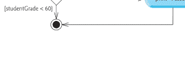

该图包含活动图中最重要的符号——菱形，或称判定符号，它表示需要做出判定。工作流沿着由该符号关联的守卫条件所确定的路径继续，这些条件可以为真或为假。从UML判定符号引出的每条转换箭头都有一个守卫条件（在箭头旁的方括号中指定）。如果守卫条件为真，工作流进入该转换箭头所指向的动作状态。该图表明，如果成绩大于或等于60（即条件为真），程序打印“Passed”，然后转换到活动的最终状态。如果成绩小于60（即条件为假），程序立即转换到最终状态，不显示任何消息。if语句是单入口/单出口控制语句。

### 检查点

- **（伪代码）** 编写一个伪代码*if*语句，判断count是否大于10，如果是，则打印“Count is greater than 10.”
  
  **答案：**
  
  ```text
  if count is greater than 10
      print "Count is greater than 10."
  ```
- **（代码）** 编写一个实现上一练习题伪代码的if语句。假设int变量count已经存在。
  
  **答案：**
  
  ```cpp
  if (count > 10) {
      cout << "Count is greater than 10.";
  }
  ```
- **（填空）** 活动图中的菱形（或称判定符号）表示需要做出判定。工作流沿着由该符号关联的______所确定的路径继续。
  
  **答案：** 守卫条件。

## 3.6 if…else双选择语句

if-then选择语句仅在条件为真时执行指定的操作。if…else双选择语句允许你指定条件为真时要执行的一个操作，以及条件为假时要执行的另一个操作。例如，以下伪代码表示一个if…else语句：如果学生成绩大于或等于60，则打印“Passed”；如果小于60，则打印“Failed”：

```text
if student’s grade is greater than or equal to 60
    print “Passed”
else
    print “Failed”
```

无论哪种情况，在打印发生后，按顺序的下一条语句就会“执行”。前面的if…else伪代码语句可以用C++写成

```cpp
if (studentGrade >= 60) {
    cout << "Passed";
}
else {
    cout << "Failed";
}
```

if和else语句体都采用相同的缩进。无论你选择哪种缩进约定，都应在整个程序中一致应用。如果有多个缩进层级，每一层都应缩进相同的额外空格量。我们倾向于使用三个空格的缩进。IDE通常会为你自动缩进代码。

### if...else语句的UML活动图

下图说明了前面if...else语句中的控制流：

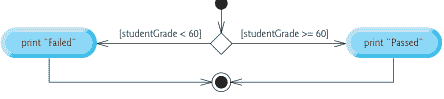

### 3.6.1 嵌套if...else语句

程序可以通过将一个if...else语句放在另一个if...else语句内部来测试多种情况，从而创建嵌套if...else语句。例如，以下伪代码表示一个嵌套if...else语句：对于大于或等于90的考试成绩打印"A"，对于80到89的成绩打印"B"，对于70到79的成绩打印"C"，对于60到69的成绩打印"D"，对于所有其他成绩打印"F"。我们使用底纹来突出显示嵌套：

```text
if student’s grade is greater than or equal to 90
   print “A”
else
   if student’s grade is greater than or equal to 80
      print “B”
   else
      if student’s grade is greater than or equal to 70
         print “C”
      else
         if student’s grade is greater than or equal to 60
            print “D”
         else
            print “F”
```


这个伪代码可以写成如下 C++ 形式：

```cpp
if (studentGrade >= 90) {
    cout << "A";
}
else {
    if (studentGrade >= 80) {
        cout << "B";
    }
    else {
        if (studentGrade >= 70) {
            cout << "C";
        }
        else {
            if (studentGrade >= 60) {
                cout << "D";
            }
            else {
                cout << "F";
            }
        }
    }
}
```

如果变量 `studentGrade` 大于或等于 90，嵌套 if...else 语句中的前四个条件都将为真，但只有第一个 if...else 语句的 if 部分中的语句会执行。该语句执行后，“最外层” if...else 语句的 else 部分会被跳过。在嵌套 if...else 语句中，要确保测试所有可能的情况。

前面的嵌套 if...else 语句也可以写成以下形式，二者功能相同，但使用的花括号更少，空格和缩进也更少：

```cpp
if (studentGrade >= 90) {
    cout << "A";
}
else if (studentGrade >= 80) {
    cout << "B";
}
else if (studentGrade >= 70) {
    cout << "C";
}
else if (studentGrade >= 60) {
    cout << "D";
}
else {
    cout << "F";
}
```

这种形式避免了代码向右深度缩进，而深度缩进有时会迫使行换行。在本书中，我们将控制语句体括在花括号（{ 和 }）中，从而避免称为“悬垂 else”问题的逻辑错误。我们将在练习 3.13–3.15 中研究此问题。

### 3.6.2 块

if 语句的主体只期望包含一条语句。要在 if 或 else 的主体中包含多条语句，请用花括号将这些语句括起来。始终使用花括号是一种好习惯。一对花括号中的语句（例如控制语句或函数的主体）构成一个块。块可以放在函数中任何可以放置单条语句的位置。

下面的示例在 if...else 语句的 else 部分包含一个由多条语句组成的块：

```cpp
if (studentGrade >= 60) {
    cout << "Passed";
}
else {
    cout << "Failed\n";
    cout << "You must retake this course.";
}
```

如果 studentGrade 小于 60，程序将执行 else 主体中的两条语句并打印

```text
Failed
You must retake this course.
```

如果没有包围 else 子句中两条语句的花括号，那么语句

```cpp
cout << "You must retake this course.";
```

将位于 if...else 语句 else 部分的主体之外，并且无论 studentGrade 是否小于 60 都会执行——这是一个逻辑错误。

### 语法错误和逻辑错误

编译器会捕获语法错误，例如程序漏掉了块中的一个花括号。逻辑错误（例如计算不正确）会在执行时产生影响。致命逻辑错误会导致程序失败并提前终止。非致命逻辑错误允许程序继续执行，但会导致程序产生不正确的结果。

### 空语句

正如块可以放在任何可以放置单条语句的位置一样，也可以有空语句，它就是在通常应放置语句的位置只写一个分号（;）。空语句不起任何作用。

在 if 或 if...else 语句中，将分号放在带括号的条件之后，会在单分支 if 语句中导致逻辑错误，并在双分支 if...else 语句中导致语法错误（当 if 部分包含主体语句时）。

### 3.6.3 条件运算符 (?:)

C++ 提供了条件运算符（?:），可用于代替 if...else 语句。这可以使代码更短、更清晰。条件运算符是 C++ 中唯一的三元运算符（即接受三个操作数的运算符）。操作数与 ?: 符号一起构成条件表达式。例如，下面的语句打印条件表达式的值：

```cpp
cout << (studentGrade >= 60 ? "Passed" : "Failed");
```

? 左侧的操作数是条件。第二个操作数（位于 ? 和 : 之间）是条件为真时条件表达式的值。: 右侧的操作数是条件为假时条件表达式的值。此语句中的条件表达式在条件

```text
studentGrade >= 60
```

为真时求值为字符串 "Passed"，在条件为假时求值为字符串 "Failed"。因此，这条使用条件运算符的语句所执行的功能，与 3.6 节中的第一个 if...else 语句基本相同。条件运算符的优先级较低，因此整个条件表达式通常放在括号中。

### 检查点

- **1. (伪代码)** 编写一个伪代码 if...else 语句，判断 counter 是否大于 10。如果是，该语句应打印“counter is greater than 10.”。否则，应打印“counter is less than or equal to 10.”

**答案：**

```text
if counter is greater than 10
    print “counter is greater than 10.”
else
    print “counter is less than or equal to 10.”
```

- **2. (代码)** 编写一个实现上一练习伪代码的 if...else 语句。假设 int 变量 counter 已经存在。

**答案：**

```cpp
if (counter > 10) {
    cout << "counter is greater than 10.";
}
else {
    cout << "counter is less than or equal to 10.";
}
```

- **3. (代码)** 编写一个嵌套 if...else 语句，显示 counter 的值是大于 10、等于 10 还是小于 10。

**答案：**

```cpp
if (counter > 10) {
    cout << "counter is greater than 10.";
}
else if (counter == 10) {
    cout << "counter is equal to 10.";
}
else {
    cout << "counter is less than 10.";
}
```

## 3.7 while 迭代语句

迭代语句允许指定程序在某条件保持为真时重复执行某个动作。下面的伪代码语句

```text
while there are more items on my shopping list
    purchase next item and cross it off my list
```

描述了购物行程中的迭代。条件“我的购物清单上还有更多物品”可能为*真*或*假*。如果为*真*，则执行动作“购买下一件物品并将其从我的清单中划掉”。只要条件保持为*真*，该动作就会*重复地*执行。*while* 迭代语句中包含的语句构成其主体，主体可以是单条语句或一个块。最终，条件将变为*假*（当购物清单上的最后一项已被购买并划掉时）。此时，迭代终止，并执行迭代语句之后的第一条语句。

作为 *while* 迭代语句的示例，考虑以下程序段，它查找大于 100 的第一个 3 的幂：

```cpp
int product{3};

while (product <= 100) {
    product = 3 * product;
}
```

此 *while* 语句执行后，变量 `product` 包含结果。*while* 语句的每次迭代都将 `product` 乘以 3，因此 `product` 依次取值为 9、27、81 和 243。当 `product` 变为 243 时，`product <= 100` 变为*假*。这会终止迭代，因此 `product` 的最终值为 243。此时，程序执行将继续进行 *while* 语句之后的下一条语句。如果 *while* 语句的主体中未提供最终使条件变为*假*的动作，则会导致称为*无限循环*的逻辑错误（循环永不终止）。

### *while* 语句的 UML 活动图

下面的 *while* 语句 UML 活动图引入了合并符号：

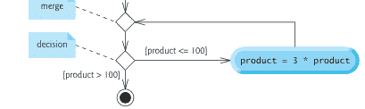

UML 将合并符号和判定符号都表示为菱形。合并符号将两个活动流合并为一个。在此图中，合并符号连接来自初始状态和动作状态的转移，因此它们都流入决定循环是否应开始（或继续）执行的判定。

可以通过传入和传出转移箭头的数量来区分判定符号和合并符号。判定符号有一个指向菱形的转移箭头，以及两个或更多从它指向外的箭头，以表示从该判定可能发生的转移。此外，从判定符号指向外的每个箭头都有一个守卫条件。合并符号有两个或更多指向它的转移箭头，并且只有一个从它指向外的箭头，以表示多个活动流合并后继续该活动。与合并符号关联的转移箭头都没有守卫条件。


```text
1. set total to zero
2. set grade counter to one
3.
4. while grade counter is less than or equal to ten
   5. prompt the user to enter the next grade
   6. input the next grade
   7. add the grade into the total
   8. add one to the grade counter
9.
10. set the class average to the total divided by ten
11. print the class average
```

注意前面算法中对 total 和 counter 的引用。total 是用于累加若干值之和的变量。counter 是用于计数的变量——grade counter 表示用户即将输入的是 10 个成绩中的哪一个。用于存储总计值的变量在程序中使用前必须初始化为零。在伪代码中，我们没有用花括号括起构成伪代码 while 循环体的语句，但你可以这样做。

经验表明，用计算机解决问题最具挑战性的部分是开发求解算法。一旦指定了正确的算法，据此生成一个可运行的 C++ 程序通常很直接。

## 3.8.2 实现计数器控制的迭代

在图 3.1 中，main 函数使用计数器控制的迭代计算班级平均成绩。它允许用户输入 10 个成绩，然后计算并显示班级平均成绩。

```cpp
// fig03_01.cpp
// Solving the class-average problem using counter-controlled iteration.
#include <iostream>
using namespace std;

int main() {
   // initialization phase
   int total{0}; // initialize sum of grades entered by the user
   int gradeCounter{1}; // initialize grade # to be entered next

   // processing phase uses counter-controlled iteration
   while (gradeCounter <= 10) { // loop 10 times
      cout << "Enter grade: "; // prompt
      int grade;
      cin >> grade; // input next grade
      total = total + grade; // add grade to total
      gradeCounter = gradeCounter + 1; // increment counter by 1
   }
```

**图 3.1** | 使用计数器控制的迭代求解班级平均成绩问题。（第 1 部分，共 2 部分。）

```cpp
   // termination phase
   int average{total / 10}; // int division yields int result

   // display total and average of grades
   cout << "\nTotal of all 10 grades is " << total;
   cout << "\nClass average is " << average << "\n";
}
```

```text
Enter grade: 67
Enter grade: 78
Enter grade: 89
Enter grade: 67
Enter grade: 87
Enter grade: 98
Enter grade: 93
Enter grade: 85
Enter grade: 82
Enter grade: 100

Total of all 10 grades is 846
Class average is 84
```

**图 3.1** | 使用计数器控制的迭代求解班级平均成绩问题。（第 2 部分，共 2 部分。）

### main 中的局部变量

第 8、9、14 和 21 行分别声明 int 变量 total、gradeCounter、grade 和 average。变量 grade 存储用户输入。在块（例如函数体）中声明的变量是局部变量，只能从它的声明行使用到该块的右花括号。局部变量的声明必须出现在使用该变量之前。变量 grade——在第 14 行的 while 循环体中声明——只能在该块中使用。

### 初始化变量 total 和 gradeCounter

第 8–9 行声明 total 并将其初始化为 0，声明 gradeCounter 并将其初始化为 1。这些初始化发生在变量用于计算之前。每个总计变量和计数器变量都要初始化，可以在其声明中初始化，也可以在赋值语句中初始化。总计变量通常初始化为 0，计数器变量通常初始化为 0 或 1，具体取决于其用途。我们将展示何时使用 0 或 1 的示例。

### 从用户读取 10 个成绩

while 语句（第 12–18 行）在 gradeCounter 的值小于或等于 10 时持续迭代。第 13 行显示提示“Enter grade: ”。第 15 行输入用户输入的成绩，并将其赋给变量 grade。然后第 16 行将用户输入的新成绩加到 total 上，并将结果赋给 total，替换其先前的值。第 17 行将 gradeCounter 加 1，表示程序已处理一个成绩，并准备从用户输入下一个成绩。递增 gradeCounter 最终会使其超过 10，从而终止循环。

### 计算并显示班级平均成绩

当循环终止时，第 21 行在变量 average 的初始化器中执行平均计算。第 24 行显示文本“Total of all 10 grades is ”，后跟变量 total 的值。然后，第 25 行显示文本“Class average is ”，后跟 average 的值。当执行到达第 26 行时，程序终止。

## 3.8.3 整数除法与截断

此示例的平均计算产生 int 结果。程序的示例执行表明成绩之和为 846——除以 10 时，本应得到 84.6。像 84.6 这样包含小数点的数是浮点数。然而，在班级平均成绩程序中，total / 10 产生整数 84，因为 total 和 10 都是整数。两个整数相除会得到整数除法——计算中的任何小数部分都会被截断。下一节将展示如何从平均计算中获得浮点结果。例如，7 / 4 在常规算术中得 1.75，但在整数算术中会截断为 1，而不是四舍五入为 2。假设整数除法会四舍五入（而不是截断）可能导致错误结果。

## 3.8.4 算术溢出

在图 3.1 中，第 16 行

```cpp
total = total + grade; // add grade to total
```

将用户输入的每个成绩加到 total 上。即使是这条简单语句也有潜在问题——将这些整数相加可能产生一个太大而无法存储在 int 变量中的值。这称为算术溢出，会导致未定义行为，从而可能造成意外结果和安全问题。例如，参见

```text
https://en.wikipedia.org/wiki/Integer_overflow#Security_ramifications
```

以下表达式返回你系统的最大和最小 int 值：

```cpp
std::numeric_limits<int>::max()
std::numeric_limits<int>::min()
```

每个表达式都使用 C++ 标准库头文件 `<limits>` 中的 numeric_limits 类。你可以通过替换这些表达式中的 int，对任何整数类型或浮点类型使用类似表达式。

## 3.8.5 输入验证

当程序接收用户输入时，可能发生各种问题。例如，图 3.1 的第 15 行

```cpp
cin >> grade; // input next grade
```

假设用户将输入 0 到 100 的整数成绩，但用户可能输入：

- 小于 0 的整数，
- 大于 100 的整数，
- 超出可存储在 int 变量中的值范围的整数，
- 包含小数点的数字，或
- 包含字母或特殊符号、甚至不表示数字的值。

工业级程序必须测试所有可能的错误情况，以确保输入有效。输入成绩的程序应使用范围检查来验证成绩，确保它们是 0 到 100 的值。然后，你可以要求用户重新输入任何超出范围的值。如果程序要求输入来自特定值集合（例如非连续产品代码），则应确保每个输入都与该集合中的某个值匹配。

### ✔️ 检查点

- 1. （判断正误）两个整数相除会得到整数除法——计算中的任何小数部分都会四舍五入到最接近的整数。
  
  答案：错误。实际上，计算中的任何小数部分都会被截断。

- 2. （填空）在 _______（例如函数体）中声明的变量是局部变量，只能从它的声明行使用到对应的右花括号。
  
  答案：块。

- 3. （代码）重写以下代码中的初始化，使循环迭代 5 次。

  ```cpp
  int count{0};

  while (count < 5) {
      count = count + 1;
      cout << "count is: " << count << "\n";
  }
  ```

  答案：

  ```cpp
  int count{0};

  while (count < 5) {
      count = count + 1;
      cout << "count is: " << count << "\n";
  }
  ```

  ```text
  count is: 1
  count is: 2
  count is: 3
  count is: 4
  count is: 5
  ```

## 3.9 算法设计：哨兵控制的迭代

让我们推广 3.8 节的班级平均成绩问题。考虑以下问题：

> 开发一个班级平均成绩程序，每次运行时处理任意数量学生的成绩。

在前面的班级平均成绩示例中，问题描述指定了学生人数，因此成绩数量（10）是预先已知的。对于这个问题，我们不知道用户在程序执行期间会输入多少个成绩。程序必须处理任意数量的成绩。


伪代码语句

```
initialize variables
```

可以细化为：

```
initialize total to zero
initialize counter to zero
```

只有变量 *total* 和 *counter* 需要在使用前初始化。变量 *average* 和 *grade*（分别用于计算出的平均值和用户输入）不需要初始化，因为它们的值将被计算或用户输入替换。尽管如此，许多程序员选择初始化所有变量——正如你将在本书后面看到的，这有助于避免细微错误。

伪代码语句

```
input, sum and count the quiz grades
```

需要使用迭代来输入每个成绩。我们事先不知道成绩的数量，因此将使用哨兵控制迭代。用户一次输入一个成绩。在最后一个成绩之后，用户输入哨兵值。程序在每次输入成绩后检查哨兵值，并在用户输入哨兵值时终止循环。前述伪代码语句的第二次细化是：

```
prompt the user to enter the first grade
input the first grade (possibly the sentinel)
while the user has not yet entered the sentinel
    add this grade into the running total
    add one to the grade counter
    prompt the user to enter the next grade
    input the next grade (possibly the sentinel)
```

我们只是将 *while* 下的语句缩进，以表明它们属于其循环体。同样，伪代码只是一种非正式的程序开发辅助工具。

伪代码语句

```
calculate and print the class average
```

可以细化为：

```
if the counter is not equal to zero
    set the average to the total divided by the counter
    print the average
else
    print “No grades were entered”
```

这里我们要小心测试**除零**的可能性——这是一种逻辑错误，如果未被发现，会导致程序失败或产生无效输出。根据 C++ 标准，浮点运算中除以零的结果是未定义的。在执行除法（/）或求余（%）计算时，如果右操作数可能为零，应测试并处理这种情况（例如，显示错误消息），而不是让计算继续执行。以下是班级平均分问题伪代码的完整第二次细化：

```
1  initialize total to zero
2  initialize counter to zero
3
4  prompt the user to enter the first grade
5  input the first grade (possibly the sentinel)
6
7  while the user has not yet entered the sentinel
8      add this grade into the running total
9      add one to the grade counter
10     prompt the user to enter the next grade
11     input the next grade (possibly the sentinel)
12
13 if the counter is not equal to zero
14     set the average to the total divided by the counter
15     print the average
16 else
17     print “No grades were entered”
```

我们使用空行使伪代码更易读，并使用缩进来强调应放在控制语句体中的操作。空行将算法分隔成各个阶段，并衬托出控制语句；缩进则强调控制语句的体。

我们的伪代码算法解决了更一般的班级平均分问题。该算法只需要两次细化——有时需要更多次。当你觉得伪代码算法已有足够细节，可以将算法转换为 C++ 时，就终止自顶向下、逐步细化的过程。

有些程序员不使用伪代码之类的程序开发工具。他们认为最终目标是在计算机上解决问题，而编写伪代码只会延迟最终产品。对于简单且熟悉的问题，这可能行得通，但在大型、复杂的项目中，可能会导致重大错误和延误。

## 3.9.3 实现哨兵控制迭代

图 3.2 实现了哨兵控制迭代。尽管用户输入的每个成绩都是整数，但平均值计算很可能会产生浮点数，而 int 无法表示浮点数。C++ 提供了 `float`、`double` 和 `long double` 类型来存储浮点数：

- 与 float 相比，double 变量通常存储数值范围更大、细节更精细的数——即小数点右侧更多位数，也称为该数的**精度**。
- 类似地，long double 变量通常存储数值范围更大、精度更高的值。

为了在本例中计算浮点平均值，我们将把 total 存储为 `double`——这是 C++ 中浮点字面量（如 `-7.2`、`0.0` 或 `98.6`）的默认类型。

```cpp
// fig03_02.cpp
// Solving the class-average problem using sentinel-controlled iteration.
#include <iostream>
#include <iomanip> // parameterized stream manipulators
using namespace std;

int main() {
   // initialization phase
   double total{0.0}; // initialize sum of grades
   int gradeCounter{0}; // initialize # of grades entered so far

   // processing phase
   // prompt for input and read grade from user
   cout << "Enter grade or -1 to quit: ";
   int grade;
   cin >> grade;

   // loop until sentinel value is read from user
   while (grade != -1) {
      total = total + grade; // add grade to total
      gradeCounter = gradeCounter + 1; // increment counter

      // prompt for input and read next grade from user
      cout << "Enter grade or -1 to quit: ";
      cin >> grade;
   }

   // termination phase
   // if user entered at least one grade...
   if (gradeCounter != 0) { // avoid division by zero
      // calculate average of grades
      double average{total / gradeCounter};

      // display total and average (with two digits of precision)
      cout << "\nTotal of the " << gradeCounter
           << " grades entered is " << total;
      cout << setprecision(2) << fixed;
      cout << "\nClass average is " << average << "\n";
   }
   else { // no grades were entered, so output appropriate message
      cout << "No grades were entered\n";
   }
}
```

```text
Enter grade or -1 to quit: 97
Enter grade or -1 to quit: 88
Enter grade or -1 to quit: 72
Enter grade or -1 to quit: -1

Total of the 3 grades entered is 257
Class average is 85.67
```

**图 3.2** | 使用哨兵控制迭代解决班级平均分问题。（第 1 部分，共 2 部分。）

```text
Enter grade or -1 to quit: -1
No grades were entered
```

**图 3.2** | 使用哨兵控制迭代解决班级平均分问题。（第 2 部分，共 2 部分。）

回想一下，整数除法产生整数结果。该程序将变量 total 声明为 double（第 9 行）。正如你将看到的，这将使平均值计算产生浮点结果。该程序还按顺序堆叠控制语句——while 语句后面依次跟着 if...else 语句。该程序的大部分代码与图 3.1 相同，因此我们只关注新概念。

### 哨兵控制迭代与计数器控制迭代的程序逻辑

第 10 行将 gradeCounter 初始化为 0，因为尚未输入任何成绩。请记住，该程序使用哨兵控制迭代来输入成绩。仅当用户输入有效成绩时，程序才递增 gradeCounter。第 32 行声明 double 变量 average，它将班级平均分存储为浮点数。

将该程序中哨兵控制迭代的逻辑与图 3.1 中计数器控制迭代的逻辑进行比较：

- 在计数器控制迭代中，每次循环迭代（图 3.1 的第 12—18 行）都会在指定的迭代次数内从用户处读取一个值。
- 在哨兵控制迭代中，程序在到达 while 之前提示并读取第一个值（图 3.2 的第 14 行和第 16 行）。该值决定控制流是否应进入 while 的循环体。如果条件为假，说明用户输入了哨兵值，因此没有输入成绩，循环体不会执行。如果条件为真，则执行循环体，将该成绩值加到 total 中，并递增 gradeCounter。然后第 24—25 行提示并输入下一个成绩。此时，程序控制到达循环的右花括号（第 26 行）。执行继续，测试 while 的条件（第 19 行），使用最近输入的成绩来决定是否应再次执行循环体。

下一个成绩总是在测试 while 条件之前立即从用户处输入。这使程序能够在处理刚输入的值（即将其加到 total 中）之前，判断该值是否为哨兵值。如果 grade 包含哨兵值，循环将终止，而不会将 −1 加到 total 中。在哨兵控制循环中，提示应提醒用户哨兵值。

循环终止后，第 30—42 行的 if...else 语句执行。第 30 行的条件判断是否输入了任何成绩。如果没有输入，则执行 if...else 语句的 else 部分，并显示消息 "No grades were entered"。if...else 执行完毕后，程序终止。

## 3.9.4 混合类型表达式与隐式类型提升

如果至少输入了一个成绩，则第 32 行

```
double average(total / gradeCounter);
```

将 total 除以 gradeCounter 来计算平均值。回想一下，total 是 double，gradeCounter 是 int。对于算术运算，编译器只知道如何求值表达式。

其中所有操作数类型都相同的表达式。为确保这一点，编译器会对选定的操作数执行一种称为**提升**（也称为**隐式转换**）的操作。在包含 `double` 和 `int` 数据类型的值的表达式中，C++ 会将任何 `int` 操作数提升为 `double` 值。因此，在第 32 行，C++ 会将 gradeCounter 值的临时副本提升为 `double` 类型，然后执行除法。

## 3.9.5 格式化浮点数

这里简要介绍图 3.2 的格式化特性。第 19 章将深入解释这些特性。第 4 章将介绍 C++20 新的文本格式化特性，它们可以更简洁地表达我们这里展示的格式化。

### 参数化流操纵器 `setprecision`

第 37 行对 `setprecision` 的调用——`setprecision(2)`——表示浮点值应输出为小数点右侧两位**精度**（例如 92.37）。`setprecision` 是**参数化流操纵器**，因为它需要一个参数（本例中为 2）来执行任务。使用参数化流操纵器的程序必须包含头文件 `<iomanip>`（第 4 行）。

### 非参数化流操纵器 `fixed`

**非参数化流操纵器 `fixed`**（第 37 行）不需要参数，并指示浮点值应以**定点格式**输出。这与**科学计数法**³相对，后者显示一个从 1.0 到（但不包括）10.0 的数乘以 10 的幂。因此，在科学计数法中，值 3,100.0 显示为 3.1e+03（即 3.1 × 10³）。这种格式适用于显示非常大或非常小的值（即具有负指数的值）。

定点格式强制浮点数在不使用科学计数法的情况下显示。定点格式还会强制打印小数点和尾随零，即使该值是整数（如 88.00）。如果没有定点格式选项，88.00 会打印为 88，不带尾随零和小数点。

流操纵器 `setprecision` 和 `fixed` 执行的是**粘性设置**——程序中格式化的所有浮点值都将使用这些设置，直到你更改它们。第 19 章展示如何在应用粘性设置之前捕获流格式设置，以便之后恢复原始格式设置。

### 浮点数舍入

当使用流操纵器 `fixed` 和 `setprecision` 时，格式化后的值会**舍入**到当前精度指定的小数位数。内存中的值保持不变。对于精度 2，87.946 和 67.543 将分别舍入为 87.95 和 67.54。⁴

图 3.2 的第 37 行和第 38 行输出四舍五入到最接近百分位的班级平均分，小数点右侧恰好两位数字。图 3.2 中程序执行期间输入的三个成绩总和为 257，得到平均值 85.666…，并显示舍入后的值 85.67。

- 3. 第 19 章将进一步讨论使用科学计数法的格式化。
- 4. 在图 3.2 中，如果未指定 `setprecision` 和 `fixed`，C++ 默认使用四位精度。如果只指定 `fixed`，C++ 使用六位精度。

## 检查点

- 1. *（判断正误）* 任何值都可以用作哨兵值。  
  **答案：** 错误。必须选择一个不会与可接受的输入值混淆的哨兵值。

- 2. *（填空）* 对于基本类型上的算术运算，编译器只知道如何求值所有操作数类型都相同的表达式。为确保这一点，编译器会对选定的操作数执行一种称为 ________（也称为 ________）的操作。  
  **答案：** 提升、隐式转换。

- 3. *（代码）* 编写一个程序段，从用户处读取任意数量的整数华氏温度并计算其平均值。假设用户至少输入一个温度，且温度范围在 −212 到 212 之间。显示平均值。  
  **答案：**

  ```
  double total{0.0};
  int counter{0};

  cout << "Enter a temperature or 9999 to quit: ";
  int temperature;
  cin >> temperature;

  while (temperature != 9999) {
      total = total + temperature;
      counter = counter + 1;

      cout << "Enter a temperature or 9999 to quit: ";
      cin >> temperature;
  }

  double average{total / counter};
  cout << "Average temperature is: " << average << "\n";
  ```

  ```
  Enter a temperature or 9999 to quit: 12
  Enter a temperature or 9999 to quit: -22
  Enter a temperature or 9999 to quit: 17
  Enter a temperature or 9999 to quit: 9999
  Average temperature is: 2.33333
  ```

## 3.10 算法表述：嵌套控制语句

我们已经看到，控制语句可以彼此堆叠（按顺序）。在本案例研究中，我们考察将一个控制语句嵌套在另一个控制语句中——这是控制语句可以连接的另一种结构化方式。

### 3.10.1 问题陈述

考虑以下问题陈述：

> 一所学院开设了一门课程，为学生参加房地产经纪人的州执照考试做准备。去年，完成这门课程的 10 名学生参加了考试。学院想知道其学生考试表现如何。你被要求编写一个程序来汇总结果。你已获得这 10 名学生的名单。每个名字旁边，如果学生通过考试则标为 1，如果学生未通过则标为 2。
>
> 你的程序应按如下方式分析考试结果：
>
> - 1. 输入每个测试结果（即 1 或 2）。每次程序请求另一个测试结果时，在屏幕上显示“Enter result”。
> - 2. 统计每种测试结果的数量。
> - 3. 显示测试结果摘要，指出通过和未通过的学生人数。
> - 4. 如果超过八名学生通过，打印“Bonus to instructor!”

**对问题陈述的观察**

仔细阅读问题陈述后，我们做出以下观察：

- 1. 程序必须处理 10 名学生的测试结果。因为预先知道测试结果的数量，所以我们可以使用计数器控制的迭代。
- 2. 每次程序读取一个测试结果时，必须判断它是 1 还是 2。我们的算法测试是否为 1。如果该数字不是 1，我们就假定它是 2。（练习 3.10 考虑了这一假设的后果。）
- 3. 使用两个计数器来跟踪考试结果——一个统计通过考试的学生人数，另一个统计未通过的学生人数。
- 4. 程序处理完所有结果后，必须判断是否有超过八名学生通过考试。

### 3.10.2 自顶向下、逐步细化：顶层的伪代码表示

让我们继续采用自顶向下、逐步细化。我们从顶层的伪代码表示开始：

```
analyze exam results and decide whether a bonus should be paid
```

同样，顶层是程序的完整表示，但在伪代码能够自然演化为 C++ 程序之前，我们很可能还需要若干次细化。

### 3.10.3 自顶向下、逐步细化：第一次细化

我们的第一次细化是：

```
initialize variables
input the 10 exam results, and count passes and failures
print a summary of the exam results and decide whether a bonus should be paid
```

这里同样，虽然我们已经有了整个程序的完整表示，但仍需要进一步细化。现在我们来确定具体变量。我们需要计数器来记录通过和未通过次数，一个计数器来控制循环过程，以及一个变量来存储用户输入。我们不需要初始化存储用户输入的变量，因为它的值在每次循环迭代中从用户处读取。

### 3.10.4 自顶向下、逐步细化：第二次细化

伪代码语句

```
initialize variables
```

可细化如下：

```
initialize passes to zero
initialize failures to zero
initialize student counter to one
```

注意，在算法开始时只初始化了计数器。

伪代码语句

```
input the 10 exam results, and count passes and failures
```

需要一个循环来依次输入每次考试的结果。我们预先知道恰好有 10 个考试结果，因此适合使用计数器控制的循环。在循环内部（即嵌套在循环中），一个双选择结构将判断每个考试结果是及格还是不及格，然后递增相应的计数器。前面的伪代码语句可细化如下：

```
while student counter is less than or equal to 10
    prompt the user to enter the next exam result
    input the next exam result

    if the student passed
        add one to passes
    else
        add one to failures

    add one to student counter
```

我们使用空行来隔离嵌套的 *if…else* 语句，这提高了可读性。

伪代码语句

```
print a summary of the exam results and decide whether a bonus should be paid
```

可细化如下：

```
print the number of passes
print the number of failures
if more than eight students passed
    print “Bonus to instructor!”
```

### 3.10.5 伪代码的完整第二次细化

这里展示完整的第二次细化。现在的伪代码已经足够细化，可以转换为 C++。

```
1  initialize passes to zero
2  initialize failures to zero
3  initialize student counter to one
4
```

## 3.10.6 实现程序

图3.3用计数器控制的迭代实现了该程序，并展示了两个示例执行。第8—10行和第16行声明了用于处理考试结果的变量。第13—29行循环10次。在每次迭代中，循环输入并处理一个考试结果。注意，用于处理每个结果的 if...else 语句（第20—25行）嵌套在 while 语句中。如果结果为1，则 if...else 语句递增 passes；否则，它假定结果为2并递增 failures。⁵ 第28行在再次测试第13行的循环条件之前递增 studentCounter。

```text
5  while student counter is less than or equal to 10
6      prompt the user to enter the next exam result
7      input the next exam result

9      if the student passed
10         add one to passes
11     else
12         add one to failures

14     add one to student counter

16 print the number of passes
17 print the number of failures

19 if more than eight students passed
20     print "Bonus to instructor!"
```

```cpp
1  // fig03_03.cpp
2  // Analysis of examination results using nested control statements.
3  #include <iostream>
4  using namespace std;

6  int main() {
7      // Initializing variables in declarations
8      int passes{0};
9      int failures{0};
10     int studentCounter{1};
```

**图3.3** | 使用嵌套控制语句分析考试结果。（第1部分，共2部分。）

5. 如果用户输入无效数据，假定结果为2可能是一个糟糕的假设。我们稍后将讨论数据验证技术。

```cpp
// process 10 students using counter-controlled loop
while (studentCounter <= 10) {
    // prompt user for input and obtain value from user
    cout << "Enter result (1 = pass, 2 = fail): ";
    int result;
    cin >> result;

    // if...else is nested in the while statement
    if (result == 1) {
        passes = passes + 1;
    }
    else {
        failures = failures + 1;
    }

    // increment studentCounter so loop eventually terminates
    studentCounter = studentCounter + 1;
}

// termination phase: prepare and display results
cout << "Passed: " << passes << "\nFailed: " << failures << "\n";

// determine whether more than 8 students passed
if (passes > 8) {
    cout << "Bonus to instructor!\n";
}
}
```

```text
Enter result (1 = pass, 2 = fail): 1
Enter result (1 = pass, 2 = fail): 2
Enter result (1 = pass, 2 = fail): 1
Enter result (1 = pass, 2 = fail): 1
Enter result (1 = pass, 2 = fail): 1
Enter result (1 = pass, 2 = fail): 1
Enter result (1 = pass, 2 = fail): 1
Enter result (1 = pass, 2 = fail): 1
Enter result (1 = pass, 2 = fail): 1
Enter result (1 = pass, 2 = fail): 1
Passed: 9
Failed: 1
Bonus to instructor!
```

```text
Enter result (1 = pass, 2 = fail): 1
Enter result (1 = pass, 2 = fail): 2
Enter result (1 = pass, 2 = fail): 1
Enter result (1 = pass, 2 = fail): 2
Enter result (1 = pass, 2 = fail): 1
Enter result (1 = pass, 2 = fail): 2
Enter result (1 = pass, 2 = fail): 2
Enter result (1 = pass, 2 = fail): 1
Enter result (1 = pass, 2 = fail): 1
Enter result (1 = pass, 2 = fail): 1
Passed: 6
Failed: 4
```

**图3.3** | 使用嵌套控制语句分析考试结果。（第2部分，共2部分。）

在输入10个值后，循环终止，第32行显示通过和未通过的数量。第35—37行中的 `if` 语句判断是否有超过八名学生通过了考试，如果是，则输出消息 "Bonus to instructor!" 图3.3展示了两个示例执行中的输入和输出。在第一个示例中，第35行的条件为真——超过八名学生通过了考试，因此程序输出一条消息，给教师一个奖励。

## 3.10.7 使用花括号初始化防止窄化转换

考虑图3.3第10行中的花括号初始化：

```cpp
int studentCounter{1};
```

它也可以写成

```cpp
int studentCounter = 1;
```

对于基本类型变量，花括号初始化器可防止可能导致数据丢失的**窄化转换**。例如，以下声明试图将 `double` 值 `12.6` 赋给 `int` 变量 `x`：

```cpp
int x = 12.6;
```

这里，C++通过截断浮点部分（`.6`）将 `double` 值转换为 `int`，因此该声明将 `12` 赋给 `x`。这种窄化转换会丢失数据。编译器通常会对此发出警告，但仍会编译代码。

然而，使用花括号初始化，如下所示：

```cpp
int x{12.6};
```

会产生**编译错误**，帮助你避免潜在的细微逻辑错误。即使你指定一个整数值的 `double` 值（如 `12.0`），仍然会得到**编译错误**。决定是否发生编译错误的是初始化器的类型（`double`），而不是它的值（`12.0`）。


C++标准文档没有规定错误消息的措辞。对于前面的声明，Visual Studio给出错误

```text
conversion from 'double' to 'int' requires a narrowing conversion
```

GNU C++给出错误

```text
error: narrowing conversion of '1.26e+1' from
    'double' to 'int' [-Wnarrowing]
```

而 clang++ 编译器给出错误

```text
error: type 'double' cannot be narrowed to 'int' in initializer list
    [-Wc++11-narrowing]
```

后面还有更多解释

```text
warning: implicit conversion from 'double' to 'int' changes value
from 12.6 to 12 [-Wliteral-conversion]
```

我们将在后续章节中讨论花括号初始化器的更多特性。

### 回顾图3.1

你可能会认为图3.1中的以下语句

```cpp
int average{total / 10}; // int division yields int result
```

包含窄化转换，但 total 和 10 都是 int 值，因此初始化器值是 int。如果前面语句中的 total 是 double，或者我们对分母使用 double 字面量 10.0，那么初始化器值将是 double 类型，编译器会发出窄化转换的错误消息。

### 检查点

- **1.** *（代码）* 为 `int` 变量 `temperature` 编写一条初始化语句。尝试用 double 值 `98.6` 初始化该变量，但要以能防止窄化转换的方式编写该语句。

  **答案：** `int temperature{98.6};`

- **2.** *（代码）* 在以下语句中，`average` 的初始值是什么？

  `int average{128 / 3};`

  **答案：** 在该语句中，128 和 3 都是整数，因此 128 / 3 产生整数结果。变量 average 的值将是 42。

- **3.** *（代码）* 编写一个循环三次的程序段。在每次迭代中，从用户处输入一个整数，然后使用嵌套的 `if...else` 语句判断并显示该数字是偶数还是奇数。

  **答案：**

  ```cpp
  int counter{1};

  while (counter <= 3) {
      cout << "Enter an integer: ";
      int number;
      cin >> number;

      if (number % 2 == 0) {
          cout << number << " is even\n";
      }
      else {
          cout << number << " is odd\n";
      }

      counter = counter + 1;
  }
  ```

  ```text
  Enter an integer: 2
  2 is even
  Enter an integer: 3
  3 is odd
  Enter an integer: 5
  5 is odd
  ```

## 3.11 复合赋值运算符

你可以将语句

```cpp
c = c + 3;
```

用加法复合赋值运算符 `+=` 缩写为

```cpp
c += 3;
```

`+=` 运算符将其右操作数的值加到左侧变量的值上，然后将结果存入左侧变量。因此，赋值表达式 `c += 3` 将 3 加到 `c` 上。下表列出了所有算术复合赋值运算符、示例表达式以及这些运算符作用的说明：

*假设：int c = 3, d = 5, e = 4, f = 6, g = 12：*

| 运算符 | 示例表达式 | 说明 | 赋值结果 |
|---|---|---|---|
| `+=` | `c += 7` | `c = c + 7` | 将 10 赋给 c |
| `-=` | `d -= 4` | `d = d - 4` | 将 1 赋给 d |
| `*=` | `e *= 5` | `e = e * 5` | 将 20 赋给 e |
| `/=` | `f /= 3` | `f = f / 3` | 将 2 赋给 f |
| `%=` | `g %= 9` | `g = g % 9` | 将 3 赋给 g |

### 检查点

- **1.** *（代码）* 编写一条语句，使用复合赋值运算符将变量 `total` 除以 5。

  **答案：** `total /= 5;`

## 3.12 自增和自减运算符

下表总结了 C++ 中用于将数值变量的值加 1 或减 1 的两个一元运算符——即一元自增运算符 `++` 和一元自减运算符 `--`：

| 运算符 | 运算符名称 | 示例表达式 | 说明 |
|---|---|---|---|
| `++` | 前缀自增 | `++number` | 将 number 加 1，然后在包含 number 的表达式中使用 number 的新值。 |
| `++` | 后缀自增 | `number++` | 在包含 number 的表达式中使用 number 的当前值，然后将 number 加 1。 |
| `--` | 前缀自减 | `--number` | 将 number 减 1，然后在包含 number 的表达式中使用 number 的新值。 |
| `--` | 后缀自减 | `number--` | 在包含 number 的表达式中使用 number 的当前值，然后将 number 减 1。 |


置于变量之前（前缀）的递增或递减运算符分别称为前缀递增或前缀递减运算符。置于变量之后（后缀）的递增或递减运算符分别称为后缀递增或后缀递减运算符。

使用前缀递增（或递减）运算符将变量加 1（或减 1）称为对变量进行前递增（或前递减）。变量先被递增（或递减）1，然后其新值用于所在表达式。

使用后缀递增（或递减）运算符将变量加 1（或减 1）称为对变量进行后递增（或后递减）。变量在递增（或递减）之前的值用于表达式。与二元运算符不同，按惯例，一元递增和递减运算符应紧邻其操作数，中间不留空格。

### 前缀递增与后缀递增

图 3.4 演示了 `++` 递增运算符的前缀递增和后缀递增版本之间的区别。递减运算符（`--`）的工作原理类似。

```cpp
// fig03_04.cpp
// Prefix increment and postfix increment operators.
#include <iostream>
using namespace std;

int main() {
    // demonstrate postfix increment operator
    int c{5};
    cout << "c before postincrement: " << c << "\n"; // prints 5
    cout << "    postincrementing c: " << c++ << "\n"; // prints 5
    cout << "c after postincrement: " << c << "\n"; // prints 6

    cout << "\n"; // skip a line

    // demonstrate prefix increment operator
    c = 5;
    cout << "c before preincrement: " << c << "\n"; // prints 5
    cout << "    preincrementing c: " << ++c << "\n"; // prints 6
    cout << "c after preincrement: " << c << "\n"; // prints 6
}
```

```text
c before postincrement: 5
    postincrementing c: 5
c after postincrement: 6

c before preincrement: 5
    preincrementing c: 6
c after preincrement: 6
```

**图 3.4** | 前缀递增和后缀递增运算符。

第 8 行将变量 c 初始化为 5，第 9 行输出 c 的初始值。第 10 行输出表达式 c++ 的值。该表达式对变量 c 进行后递增，因此先输出 c 的原始值（5），然后将 c 的值递增（为 6）。因此，第 10 行再次输出 c 的初始值（5）。第 11 行输出 c 的新值（6），以证明变量的值在第 10 行被递增。第 16 行将 c 的值重置为 5，第 17 行输出 c 的值。第 18 行输出表达式 ++c 的值。该表达式对 c 进行前递增，因此其值先被递增，然后输出新值（6）。第 19 行再次输出 c 的值，以表明执行第 18 行后 c 仍为 6。

### 使用算术复合赋值运算符、递增和递减运算符简化语句

算术复合赋值运算符以及递增和递减运算符可用于简化程序语句。例如，图 3.3 中的三条赋值语句（第 21、24 和 28 行）

```cpp
passes = passes + 1;
failures = failures + 1;
studentCounter = studentCounter + 1;
```

可以使用复合赋值运算符更简洁地写成

```cpp
passes += 1;
failures += 1;
studentCounter += 1;
```

使用前缀递增运算符写成

```cpp
++passes;
++failures;
++studentCounter;
```

或使用后缀递增运算符写成

```cpp
passes++;
failures++;
studentCounter++;
```

当在语句中单独递增或递减变量时，前缀递增和后缀递增形式的效果相同，前缀递减和后缀递减形式的效果也相同。只有当变量出现在更大的表达式中时，前递增或后递增变量才会产生不同的效果（前递减或后递减也是如此）。

尝试对不是可赋值表达式的表达式使用递增或递减运算符会导致编译错误。例如，编写 `++(x + 1)` 是语法错误，因为 `(x + 1)` 不是变量。

### 运算符优先级与结合性

下表显示了到目前为止介绍的运算符的优先级和结合性。运算符按优先级从高到低自上而下排列。第二列表示每个优先级级别下运算符的结合性。注意，条件运算符（`?:`）、一元运算符前递增（`++`）、前递减（`--`）、正（`+`）和负（`-`），以及赋值运算符 `+=`、`-=`、`*=`、`/=` 和 `%=` 从右到左结合。此表中的所有其他运算符从左到右结合。

| 运算符 | 结合性 |
|---|---|
| `++ (后缀)` `-- (后缀)` | 从左到右 |
| `+` `-` `++ (前缀)` `-- (前缀)` | 从右到左 |
| `*` `/` `%` | 从左到右 |
| `+` `-` | 从左到右 |
| `<<` `>>` | 从左到右 |
| `<` `<=` `>` `>=` | 从左到右 |
| `==` `!=` | 从左到右 |
| `?:` | 从右到左 |
| `=` `+=` `-=` `*=` `/=` `%=` | 从右到左 |

### 检查点

- **1. （代码）** 假设 `int` 变量 `counter` 的值为 10。执行以下语句后，`result` 和 `counter` 的值分别是多少？

  ```cpp
  int result{counter--};
  ```

  **答案：** 初始化表达式使用了后缀递减运算符，因此 `result` 将包含 10，`counter` 将包含 9。

- **2. （代码）** 假设 `int` 变量 `counter` 的值为 10。执行以下语句后，`result` 和 `counter` 的值分别是多少？

  ```cpp
  int result{++counter};
  ```

  **答案：** 初始化表达式使用了前缀递增运算符，因此 `result` 和 `counter` 都将包含 11。

## 3.13 基本类型不可移植

你可以在以下网址查看 C++ 基本类型的完整列表及其典型范围：

https://en.cppreference.com/w/cpp/language/types

在 C 和 C++ 中，一台机器上的 `int` 可能由 16 位（2 字节）内存表示，第二台机器上由 32 位（4 字节）表示，另一台机器上由 64 位（8 字节）表示。因此，使用整数的代码并不总是跨平台可移植的。你可以编写多个版本的程序，在不同平台上使用不同的整数类型。或者使用各种技术来实现不同程度的可移植性。⁶ 在下一节中，我们将展示实现可移植性的一种方法。

C++ 的整数类型包括 `int`、`long` 和 `long long`。C++ 标准要求 `int` 类型至少为 16 位，`long` 类型至少为 32 位，`long long` 类型至少为 64 位。标准还要求 `int` 的大小小于或等于 `long` 的大小，并且 `long` 的大小小于或等于 `long long` 的大小。这种“弹性”要求带来了可移植性挑战，但允许编译器实现者通过将基本类型大小与机器硬件相匹配来优化性能。

### 检查点

- **1. （对/错）** 所有计算机都以相同的字节数表示 `int`。

  **答案：** 错。一台机器上的 `int` 可能由 16 位（2 字节）内存表示，第二台机器上由 32 位（4 字节）表示，另一台机器上由 64 位（8 字节）表示。

- **2. （对/错）** C++ 标准要求 `int` 的大小小于或等于 `long` 的大小，并且 `long` 的大小小于或等于 `long long` 的大小。

  **答案：** 对。

## 3.14 对象自然案例研究：超大整数

互联网通信和联网设备上数据存储的爆炸式增长，极大地提高了隐私和安全的重要性。密码学已被使用了数千年，用于对数据进行编码，使未经授权的用户难以（并希望不可能）读取。⁷,⁸ 这在当今互联世界中至关重要。大多数网站（包括 deitel.com）现在都使用 HTTPS（超文本传输安全协议）来加密和解密你的互联网交互。

### 某些应用需要超出 `long long` 整数范围的整数

许多密码学算法使用的整数远大于我们甚至可以用 C++ 的 `long long` 类型存储的整数。在大多数系统上，`long long` 整数可以存储的范围是 −9,223,372,036,854,775,808 到 9,223,372,036,854,775,807——最多 19 个十进制数字（可以表示千亿亿数量级的整数）。

最流行的加密/解密方案之一是 RSA 公钥密码学，通常用于保护通过互联网传输的数据。⁹,¹⁰,¹¹ 工业级强度的 RSA 实现使用由数百位数字组成的巨大素数。

RSA 如此安全的一个关键原因是，即使对于当今最强大的超级计算机来说，分解这些素数的乘积所需的时间也是巨大的。公钥密码学也用于保护比特币等加密货币背后的区块链技术。¹² 在本书后面，我们将讨论并实现使用 RSA 的公钥密码学。

- 7. “Cryptography.” January 15, 2023. https://en.wikipedia.org/wiki/Cryptography#History.

- 8. Binance Academy, “History of Cryptography.” Accessed April 14, 2023. https://www.binance.vision/security/history-of-cryptography.

- 9. “RSA (Cryptosystem).” Accessed April 14, 2023. https://en.wikipedia.org/wiki/RSA_(cryptosystem).

- 10. “RSA Algorithm.” Accessed April 14, 2023. https://simple.wikipedia.org/wiki/RSA_algorithm.

- 11. K. Moriarty, B. Kaliski, J. Jonsson and A. Rusch, “PKCS #1: RSA Cryptography Specifications Version 2.2,” November 2016. Accessed April 14, 2023. https://tools.ietf.org/html/rfc8017.

- 12. Sarah Rothrie, “How Blockchain Cryptography Is Fighting the Rise of Quantum Machines,” December 28, 2018. Accessed April 14, 2023. https://coincentral.com/blockchain-cryptography-quantum-machines/.


## 超出 `long long` 范围的整数需要自定义编程

那么，我们如何操作任意位数的巨大整数呢？C++ 标准库并未提供此类能力，因此需要超出 `long long` 范围的整数的应用程序需要自定义编程。我们可以使用 C++ 的类机制（在第 1.9 节提到，并在第 9 章详细讨论）来开发一个处理巨大整数运算的自定义类——但这可能需要数月的工作。Objects Natural 方法鼓励我们首先检查免费的开源类库，看看是否已经存在这样的“巨大整数”类。

## 使用 Boost Multiprecision 开源库的 `cpp_int` 类处理巨大整数

确实，有许多预先存在的 C++ 开源类可用于创建和操作巨大整数。对于这个示例，我们将演示来自以下地址的 Boost Multiprecision 开源库的 `cpp_int` 类：

```
https://github.com/boostorg/multiprecision/
```

为了方便，我们将该库放在示例文件夹的 libraries 子文件夹中。¹³ Boost 提供了 168 个开源 C++ 库。¹⁴ 它也是新能力的“培育场”，这些能力常常被纳入 C++ 标准库。¹⁵

使用图 3.5 中的 Objects Natural 方法，我们可以方便地使用 `cpp_int` 类，而无需理解它是如何实现的。¹⁶,¹⁷ 我们包含其头文件（第 4 行），轻松创建 `cpp_int` 对象（第 11–12 行），然后使用熟悉的算术运算在我们的代码中方便地操作它们（第 22–29 行）。在展示代码之后，我们将展示如何在每个首选编译器上编译和运行此示例。

- 13. 在撰写本文时，该库的最新版本是 1.80。Boost 库使用开源 Boost Software License 1.0 条款，允许分发以及商业和私人使用。请参阅该库的 LICENSE 文件中的完整许可条款：https://github.com/boostorg/multiprecision/blob/develop/LICENSE。
- 14. “Boost 1.80.0 Library Documentation.” 访问于 2022 年 8 月 31 日。https://www.boost.org/doc/libs/1_80_0/。
- 15. Kennytm，回答“Which Boost Features Overlap with C++11?” 访问于 2022 年 8 月 31 日。https://stackoverflow.com/a/8852421。这个 StackOverflow 回答列出了从 Boost 库演变而来的现代 C++ 库和语言特性。
- 16. 如果你开车，你可以有效地使用它，而无需理解汽车发动机、转向、刹车和传动系统的内部工作原理。在你深入学习 C++ 之后，你可能想研究 `cpp_int` 的源代码（约 1,000 行）以了解它是如何实现的。在本书后面面向对象编程的讲解中，你将学习各种可用于创建自己的巨大整数类的技术。
- 17. 你可能会说：“我坚持要了解我在 C++ 中使用的所有东西是如何实现的。”请想一想，你正在使用 C++ 编译器将你的 C++ 程序翻译成你计算机的机器语言。你知道编译器是如何实现的吗？你确定它能正确翻译你的每个 C++ 程序，使它们正常运行并产生正确结果吗？

### using 声明

第 2.7 节展示了 using 声明可以消除重复 C++ 标准库组件（如 `std::cin` 和 `std::cout`）的 `"std::"` 前缀的需要。Boost Multiprecision 库的能力必须类似地用

```
boost::multiprecision::
```

限定，如

```
boost::multiprecision::cpp_int
```

第 7 行的 using 声明使你能够使用类名 `cpp_int`，而不是完全限定类名 `boost::multiprecision::cpp_int`。

### 初始化 `cpp_int`

第 11 行和第 12 行分别用字符串和 `long long` 初始化 `cpp_int` 的 `value1` 和 `value2`。对于 `cpp_int` 的初始化值超过 C++ 支持的最大整数值的情况，例如第 11 行中的 30 位整数，可以用表示整数值的字符串初始化 `cpp_int`。你也可以使用任何有效整数作为初始化器，如第 12 行所示，我们选择使用 `long long` 的最大值。¹⁸ 值末尾的 LL（“el”）后缀表示它是 `long long` 整数。第 13 行还定义了基本类型 `int` 变量 `value3`，我们马上会用到它。第 15–18 行显示了这些变量的初始值。

### 像使用基本整数类型进行算术运算一样简单地执行 `cpp_int` 算术运算

类 `cpp_int` 支持与 C++ 的 `int`、`long` 和 `long long` 基本类型相同的算术运算。第 21–24 行演示了 `cpp_int` 的 `value1` 和 `value2` 的加法、减法和乘法。¹⁹ **`cpp_int` 能正确处理任意位数的整数。** 每个结果都是位数超过 C++ 基本整数类型所能表示的值。例如，第 24 行的乘法产生一个 48 位整数。尽管 `cpp_int` 可以表示任何整数值，但它并非内建于系统硬件中（即它不是基本类型）。因此，使用 `cpp_int` 的计算比使用基本整数类型的计算运行得（可能慢得多）。

### C++ 的算术运算符和 `<<` 运算符如何理解 `cpp_int`？

编译器已经知道如何对基本数值类型使用算术运算符和 `<<` 运算符，但必须教会它如何为自定义的 `cpp_int` 类对象处理这些运算符。第 11 章详细讨论了如何使用称为运算符重载的强大技术来做到这一点。

- 18. 我们测试本书代码的平台的最大 `long long` 整数值均为 9,223,372,036,854,775,807。你可以使用表达式 `std::numeric_limits<long long>::max()` 以编程方式确定此值，该表达式使用 C++ 标准库头文件 `<limits>` 中的 `numeric_limits` 类。该表达式中使用的 `<>` 和 `::` 表示法将在后续章节中介绍，因此我们在图 3.5 中只使用了字面值 9223372036854775807。
- 19. 练习 3.27 要求你尝试将 `cpp_int` 对象与除法（/）和取模（%）运算符一起使用，以及与 Boost Multiprecision 算术函数 `pow` 和 `sqrt` 一起使用。

### 在 `cpp_int` 和整数之间执行混合类型算术运算

类 `cpp_int` 还支持包含 `cpp_int` 和 C++ 基本类型整数的混合类型表达式。第 27–29 行通过将 `cpp_int` 对象 `value1` 乘以 `int` 变量 `value3`，以及乘以 `int` 值 17 来演示这一点。

### 在 Microsoft Visual Studio 中编译和运行示例

在 Microsoft Visual Studio 中：

- 1. 按照第 1.11 节所述创建一个新项目。
- 2. 在解决方案资源管理器中，右键单击项目的 Source Files 文件夹，然后选择“添加”>“现有项...”。
- 3. 导航到 ch03 文件夹，选择 `fig03_05.cpp`，然后单击“添加”。
- 4. 在解决方案资源管理器中，右键单击项目名称，然后选择“属性...”。
- 5. 在“配置属性”下，展开“C/C++”，选择“常规”，选择“附加包含目录”，然后单击向下箭头并选择“编辑...”以显示“附加包含目录”对话框。
- 6. 单击黄色文件夹图标添加新条目，然后单击“...”按钮打开“选择目录”对话框。
- 7. 导航到系统中的 `libraries\multiprecision-Boost_1_80_0` 文件夹，选择 include，然后单击“选择文件夹”。
- 8. 单击“确定”关闭“附加包含目录”对话框，然后单击“确定”关闭项目属性对话框。
- 9. 键入 `Ctrl + F5` 编译并运行程序。²⁰

### 在 GNU g++ 或 clang++ 中编译和运行示例

对于 GNU g++：

- 1. 在命令行中，切换到 ch03 文件夹。
- 2. 要编译程序，键入以下命令（在一行上）——`-I` 选项指定编译器应搜索头文件的附加文件夹：

    ```bash
    g++ --std=c++20 -I ../libraries/multiprecision-Boost_1_80_0/include fig03_05.cpp -o fig03_05
    ```

- 3. 键入以下命令执行程序：

    ```bash
    ./fig03_05
    ```

对于 clang++，执行相同步骤，但将 g++ 替换为 clang++。在某些平台上，编译器命令可能只是 clang++-16 而不是 clang++。

### 在 Apple Xcode 中编译和运行示例

在 Apple Xcode 中：

- 1. 按照第 1.11 节所述创建一个新项目，并删除 `main.cpp`。
- 2. 将 Finder 中 ch03 文件夹中的 `fig03_05.cpp` 拖到 Xcode 中的项目源代码文件夹上，然后在出现的对话框中单击“完成”。


- 3. 在 **项目导航器** 中选择你的项目名称，然后在 **构建设置** 标签页中的 **搜索路径** 下，双击 **头文件搜索路径** 右侧，然后输入你的系统上 `libraries/multiprecision-Boost_1_80_0/include` 文件夹的完整路径。对于我们的系统，该位置如下——你应将 *account* 替换为你账户的用户名：

  ```text
  /Users/account/Documents/examples/libraries/multiprecision-Boost_1_80_0/include
  ```

- 4. 键入 ⌘ + R 以编译并运行程序。


## 检查点

- 1. (*正确/错误*) 使用 `cpp_int` 对象进行的计算，其性能与使用 C++ 内置整数类型大致相当。

  **答案：** 错误。虽然 `cpp_int` 可以表示任意整数，但它与你的系统硬件并不匹配。因此，你将牺牲性能，以换取 `cpp_int` 提供的灵活性。

- 2. (*代码*) 使用乘法运算符计算并显示整数 100,000,000,000,000（100 万亿）的立方。

  **答案：**

  ```cpp
  cpp_int value{"100000000000000"};
  cout << "         value is: " << value
       << "\nvalue cubed is: " << value * value * value << "\n";
  ```

  ```text
           value is: 100000000000000
  value cubed is: 1000000000000000000000000000000000000
  ```

## 3.15 小结

在本章中，我们使用伪代码以及自顶向下、逐步求精的方法开发了算法。你看到，开发任何算法只需要三种类型的控制语句——顺序、选择和迭代。我们演示了 `if` 单选择语句、`if...else` 双选择语句和 `while` 迭代语句。我们使用控制语句堆叠，通过计数器控制和哨兵控制迭代，对一组学生成绩求和并计算平均值。我们使用控制语句嵌套，根据一组考试成绩进行分析并做出决策。我们介绍了复合赋值运算符以及自增和自减运算符。

我们讨论了为什么 C++ 的基本类型不保证能跨平台可移植。然后，借助我们的 Objects Natural 方法，我们方便地创建和操作了开源 Boost Multiprecision 库的 `cpp_int` 类对象，以对超出我们系统支持范围的值执行整数运算。第 4 章将继续讨论控制语句，介绍 `for`、`do...while` 和 `switch` 语句。它还介绍用于创建复合条件的逻辑运算符。

## 练习

### 3.1（改正代码错误）

找出并改正以下每个程序段中的错误：

- a)
  ```cpp
  if (age >= 65) {
      cout << "Age is greater than or equal to 65\n";
  }
  else {
      cout << "Age is less than 65\n";
  }
  ```

- b)
  ```cpp
  int x{1};
  int total;

  while (x <= 10)
      total += x;
      ++x;
  ```

- c)
  ```cpp
  int y{10};

  while (y > 0) {
      cout << y << "\n";
      ++y;
  }
  ```

### 3.2（这个程序做什么？）

以下程序打印什么？

```cpp
// ex03_02.cpp
#include <iostream>
using namespace std;

int main() {
    int x{};
    int total{0};

    while (x <= 10) {
        int y = x * x;
        cout << y << "\n";
        total += y;
        ++x;
    }

    cout << "Total is " << total << "\n";
}
```

**对于练习 3.3–3.6，执行以下每个步骤：**

- a) 阅读问题描述。
- b) 使用伪代码以及自顶向下、逐步求精的方法制定算法。
- c) 编写一个 C++ 程序。
- d) 测试、调试并执行该 C++ 程序。

### 3.3（汽车里程）

驾驶员关心其汽车获得的里程。一位驾驶员通过记录每次行程的行驶英里数和所用加仑数，跟踪了多次行程。开发一个使用 while 语句的 C++ 程序，输入每次行程的行驶英里数和所用加仑数。程序应计算并显示每次行程获得的每加仑英里数，并打印到目前为止所有满箱油合计获得的每加仑英里数。

```text
Enter miles driven (-1 to quit): 287
Enter gallons used: 13
MPG this trip: 22.076923
Total MPG: 22.076923

Enter miles driven (-1 to quit): 200
Enter gallons used: 10
MPG this trip: 20.000000
Total MPG: 21.379139

Enter miles driven (-1 to quit): 120
Enter gallons used: 5
MPG this trip: 24.000000
Total MPG: 21.678571

Enter miles driven (-1 to quit): -1
```

### 3.4（信用额度）

开发一个 C++ 程序，以确定服装店客户是否超出了赊购账户的信用额度。对于每位客户，可获得以下信息：

- a) 账号（一个整数）
- b) 月初余额
- c) 该客户本月所有赊购商品总额
- d) 本月记入该客户账户的所有贷方金额总计
- e) 允许的信用额度

程序应使用 while 语句输入上述每一项信息，计算新余额（= 月初余额 + 赊购额 − 贷方额），并确定新余额是否超过客户的信用额度。对于信用额度被超出的客户，程序应显示该客户的账号、信用额度、新余额以及消息“信用额度已超出。”

```text
Enter account number (or -1 to quit): 100
Enter beginning balance: 5394.78
Enter total charges: 1000.00
Enter total credits: 500.00
Enter credit limit: 5500.00
New balance is 5894.78
Account:      100
Credit limit: 5500.00
Balance:      5894.78
Credit Limit Exceeded

Enter account number (or -1 to quit): 200
Enter beginning balance: 1000.00
Enter total charges: 123.45
Enter total credits: 321.00
Enter credit limit: 1500.00
New balance is 802.45

Enter account number (or -1 to quit): -1
```

### 3.5（销售佣金计算器）

一家大公司按佣金制向销售人员支付报酬。每位销售人员每周获得 200 美元，再加上其每周总销售额的 9%。例如，一位销售了价值 5000 美元化学品的销售人员获得 200 美元加上 5000 美元的 9%，总计 650 美元。开发一个使用 `while` 语句的 C++ 程序，输入每位销售人员上周的总销售额，并计算和显示该销售人员的收入。每次处理一位销售人员的数据。

```text
Enter sales in dollars (-1 to end): 5000
Salary is: $650.00

Enter sales in dollars (-1 to end): 6000
Salary is: $740.00

Enter sales in dollars (-1 to end): 7000
Salary is: $830.00

Enter sales in dollars (-1 to end): -1
```

### 3.6（工资计算器）

开发一个使用 `while` 语句的 C++ 程序，以确定若干员工各自的应发工资。公司对每位员工工作的前 40 小时支付“正常工时”工资，对超过 40 小时的所有工作时间支付“1.5 倍工资”。给定公司员工名单、每位员工上周的工作小时数以及每位员工的时薪。程序应为每位员工输入这些信息，并确定和显示该员工的应发工资。

```text
Enter hours worked (-1 to end): 39
Enter hourly rate of the employee: 10.00
Salary is $390.00

Enter hours worked (-1 to end): 40
Enter hourly rate of the employee: 10.00
Salary is $400.00

Enter hours worked (-1 to end): 41
Enter hourly rate of the employee: 10.00
Salary is $415.00

Enter hours worked (-1 to end): -1
```

### 3.7（查找最大值）

查找最大数（即一组数中的最大值）的过程在计算机应用中经常使用。例如，一个确定销售竞赛获胜者的程序会输入每位销售人员售出的单位数。售出单位数最多的销售人员赢得竞赛。编写一个使用 `while` 语句的 C++ 程序，以确定并打印用户输入的 10 个整数中的最大值。程序应使用以下三个变量：

- a) `counter`——用于计数到 10，以跟踪已经输入了多少个数字。
- b) `number`——当前输入到程序中的数字。
- c) `largest`——到目前为止找到的最大数字。

### 3.8（表格输出）

编写一个使用 `while` 语句和制表符转义序列 `\t` 的 C++ 程序，以打印以下数值表：

| N | 10*N | 100*N | 1000*N |
|---|---:|---:|---:|
| 1 | 10 | 100 | 1000 |
| 2 | 20 | 200 | 2000 |
| 3 | 30 | 300 | 3000 |
| 4 | 40 | 400 | 4000 |
| 5 | 50 | 500 | 5000 |

### 3.9（找出两个最大的数）

使用与练习 3.7 类似的方法，在 10 个数中找出两个最大的值。**[注意：** 每个数只能输入一次。]**

### 3.10（验证用户输入）

图 3.3 的考试成绩程序假定用户输入的任何不是 1 的值都必定是 2。修改该应用程序以验证其输入。如果输入的值不是 1 或 2，就继续循环，直到用户输入正确的值。

### 3.11（这个程序做什么？）

下面的程序输出什么？

```cpp
// ex03_11.cpp
#include <iostream>
using namespace std;

int main() {
    int count{1};

    while (count <= 10) {
        cout << (count % 2 == 1 ? "*****" : "+++++++") << "\n";
        ++count;
    }
}
```

### 3.12（这个程序做什么？）

下面的程序输出什么？

```cpp
// ex03_12.cpp
#include <iostream>
using namespace std;

int main() {
    int row{10};

    while (row >= 1) {
        int column{1};

        while (column <= 10) {
            cout << (row % 2 == 1 ? "<" : ">");
            ++column;
        }

        --row;
        cout << "\n";
    }
}
```

### 3.13（悬垂 else 问题）

C++ 编译器总是将 `else` 与紧邻的前一个 `if` 关联，除非通过花括号（`{` 和 `}`）的位置另行指定。这种行为可能导致所谓悬垂 else 问题。下面嵌套语句的缩进

```cpp
if (x > 5)
    if (y > 5)
        cout << "x and y are > 5";
else
    cout << "x is <= 5";
```

看起来表明，如果 x 大于 5，则嵌套的 `if` 语句会判断 y 是否也大于 5。如果是，该语句输出字符串 "x and y are > 5"。否则，看起来如果 x 不大于 5，则 `if...else` 的 `else` 部分输出字符串 "x is <= 5"。注意！这个嵌套的 `if...else` 语句**并不会**按它看起来那样执行。编译器实际上将该语句解释为

```cpp
if (x > 5)
    if (y > 5)
        cout << "x and y are > 5";
    else
        cout << "x is <= 5";
```

其中第一个 `if` 的主体是一个嵌套的 `if...else`。外层 `if` 语句测试 x 是否大于 5。如果是，则继续执行，测试 y 是否也大于 5。如果第二个条件为*真*，则显示正确的字符串——"x and y are > 5"。然而，如果第二个条件为*假*，则会显示字符串 "x is <= 5"，即使我们知道 x 大于 5。同样糟糕的是，如果外层 `if` 语句的条件为*假*，则内层 `if...else` 会被跳过，什么也不会显示。对于本练习，请在前面的代码片段中添加花括号，以强制嵌套的 `if...else` 语句按原本的意图执行。

### 3.14（另一个悬垂 else 问题）

根据练习 3.13 中关于悬垂 else 的讨论，给出当 x 为 9、y 为 11 时，以及当 x 为 11、y 为 9 时，下列每个代码片段的输出。我们删除了下面代码中的缩进，以使问题更具挑战性。*[提示：应用你学过的缩进约定。]*

```cpp
a) if (x < 10)
       if (y > 10)
           cout << "*****\n";
       else
           cout << "#####\n";
           cout << "$$$$$\n";

b) if (x < 10)
   {
       if (y > 10)
           cout << "*****\n";
   }
   else
   {
       cout << "#####\n";
       cout << "$$$$$\n";
   }
```

### 3.15（另一个悬垂 else 问题）

根据练习 3.13 中关于悬垂 else 的讨论，修改下面的代码以产生所示的输出。使用正确的缩进技巧。除了插入花括号外，你不得做任何其他更改。我们删除了下面代码中的缩进，以使问题更具挑战性。[*注意：* 可能不需要修改。]

```cpp
if ( y == 8 )
if ( x == 5 )
cout << "@@@@@\n";
else
cout << "#####\n";
cout << "$$$$$\n";
cout << "&&&&&\n";
```

- a) 假设 x = 5 且 y = 8，产生以下输出。

    ```text
    @@@@@
    $$$$$
    &&&&&
    ```

- b) 假设 x = 5 且 y = 8，产生以下输出。

    ```text
    @@@@@
    ```

- c) 假设 x = 5 且 y = 8，产生以下输出。

    ```text
    @@@@@
    &&&&&
    ```

- d) 假设 x = 5 且 y = 7，产生以下输出。[*注意：* else 之后的最后三个输出语句都属于一个块。]

    ```text
    #####
    $$$$$
    &&&&&
    ```

### 3.16（星号正方形）

编写一个程序，输入正方形边长的大小，然后使用星号和空格打印该大小的空心正方形。你的程序应适用于边长在 1 到 20 之间的所有正方形。例如，如果你的程序读取大小为 5，则应打印


### 3.17（回文）

回文是指正读和反读都相同的数字或文本短语。例如，以下每个五位整数都是回文：12321、55555、45554 和 11611。编写一个程序，读入一个五位整数并判断它是否为回文。[*提示：* 使用除法和求余运算符将该数分离成各个数字。]

### 3.18（打印二进制数的十进制等价值）

输入一个仅包含 0 和 1 的整数（即一个“二进制”整数），并打印其十进制等价值。使用求余和除法运算符，从右到左逐个取出该“二进制”数的数字。在十进制数系统中，最右边的数字位值为 1，向左下一位的位值为 10，然后是 100，然后是 1000，依此类推。类似地，在二进制数系统中，最右边的数字位值为 1，向左下一位的位值为 2，然后是 4，然后是 8，依此类推。因此，十进制数 234 可以解释为 2 * 100 + 3 * 10 + 4 * 1。二进制 1011 的十进制等价值为 1 * 1 + 0 * 2 + 1 * 4 + 1 * 8，或 1 + 0 + 4 + 8，即 13。[注意：要了解有关二进制数的更多信息，请参阅 https://deitel.com/cpphtp11 上的四个数制附录。]

### 3.19（星号棋盘图案）

编写一个程序，显示以下棋盘图案。你的程序只能使用三个输出语句，以下每种形式各一个：

```cpp
cout << "* ";
cout << " * ";
cout << "\n";
```


### 3.20（使用无限循环的 2 的倍数）

编写一个程序，打印整数 2 的幂，即 2、4、8、16、32、64 等。你的 while 循环不应终止（即，你应创建一个无限循环）。为此，只需使用关键字 `true` 作为 while 语句的表达式。运行该程序时会发生什么？

### 3.21（计算圆的直径、周长和面积）

编写一个程序，输入圆的半径（作为 double 值），计算并打印直径、周长和面积。π 使用值 3.14159。

### 3.22

下面的语句有什么问题？提供一条正确的语句，以完成程序员可能想要做的事情。

```cpp
cout << ++(x + y);
```

### 3.23（三角形的边）

编写一个程序，读取三个非零 double 值，并判断并打印它们是否可以表示一个三角形的三条边。

### 3.24（直角三角形的边）

编写一个程序，读取三个非零整数，并判断并打印它们是否是一个直角三角形的三条边。

### 3.25（阶乘）

非负整数 *n* 的阶乘写作 *n!*（读作“n 的阶乘”），定义如下：

*n!* = *n* · (*n* − 1) · (*n* − 2) · … · 1   （对于大于 1 的 *n* 值）

以及

*n!* = 1   （对于 *n* = 0 或 *n* = 1）。

例如，5! = 5 · 4 · 3 · 2 · 1，即 120。在下列各题中使用 while 语句：

- a) 编写一个程序，读取一个非负整数，计算并打印其阶乘。[注意：阶乘值增长很快，会超出 C++ 基本整数类型所能表示的范围。考虑在此使用 Boost Multiprecision 的 `cpp_int` 类型，如第 3.14 节所示。]

- b) 编写一个程序，使用以下公式估算数学常数 $e$ 的值：

  $$e = 1 + \frac{1}{1!} + \frac{1}{2!} + \frac{1}{3!} + \cdots$$

  提示用户输入所需的 $e$ 精度（即求和中的项数）。

- c) 编写一个程序，使用以下公式计算 $e^x$ 的值：

  $$e^x = 1 + \frac{x}{1!} + \frac{x^2}{2!} + \frac{x^3}{3!} + \cdots$$

  提示用户输入所需的 $e$ 精度（即求和中的项数）。

### 3.26 **（用密码学保护隐私）**

互联网通信的爆炸式增长以及联网计算机上的数据存储，极大地增加了人们对隐私的担忧。密码学领域关注的是对数据进行编码，使未经授权的用户难以读取（并且希望——借助最先进的方案——不可能读取）。在本练习中，你将研究一种简单的数据加密和解密方案。在本书后面，你将学习复杂的秘密密钥密码学和公钥密码学。一家公司希望通过互联网发送数据，并要求你编写一个程序来加密数据，以便更安全地传输。所有数据都以四位整数传输。你的应用程序应读取用户输入的四位整数，并按如下方式加密：将每个数字替换为将该数字加 7 后对新值除以 10 所得余数的结果。然后将第一位数字与第三位数字交换，将第二位数字与第四位数字交换。然后打印加密后的整数。编写另一个应用程序，输入一个加密的四位整数，并将其解密（通过反转加密方案）以形成原始数字。

### 3.27 **（其他 Boost Multiprecision 算术运算）**

第 3.14 节介绍了 Boost Multiprecision 库的 `cpp_int` 类，并将 `cpp_int` 对象与加法、减法和乘法运算符一起使用。你也可以使用除法（`/`）和取模（`%`）运算符。此外，Boost Multiprecision 库提供了许多执行常见算术计算的函数，例如 `pow` 用于将某个值提升到指定幂，或 `sqrt` 用于计算一个数的平方根。要使用 `sqrt` 和 `pow` 函数，请在 `main` 之前添加以下 using 声明：²¹

```
using boost::multiprecision::pow;
using boost::multiprecision::sqrt;
```

这些函数的工作方式如下：

- `pow` 函数接收两个参数，并返回其第一个参数的值提升到第二个参数所指定幂后的结果。例如，你可以通过调用 `pow(x, 3)` 来求 `cpp_int` 对象 `x` 的立方。
- `sqrt` 函数需要一个参数，并返回该值的平方根。例如，你可以通过调用 `sqrt(x)` 来获取 `cpp_int` 对象 `x` 的平方根。

修改图 5.3，使用变量 `value1` 和 `value2` 执行除法（/）和取模（%）运算。此外，计算 `value1` 的平方，然后创建包含 `1000000000000000000000000000000000000`（一个 1 后面跟 36 个 0）的 `cpp_int` 对象 `value4`，并计算 `value4` 的平方根。更新后的程序最终输出应为：

```text
INITIAL VALUES
cpp_int value1: 1000000000000000000000000000000000000
cpp_int value2: 9223372036854775807
    int value3: 3

USE CPP_INT OBJECTS WITH THE +, -, *, / AND % OPERATORS
value1 + value2: 100000000000000000009223372036854775807
value1 - value2: 99999999999999977662796314522419243
value1 / value2: 9223372036854775807000000000000000000000000000000000000000000000000000000000000000000
value1 % value2: 7886392067356368732

MULTIPLY A CPP_INT OBJECT BY INT VALUES
value1 * value3: 3000000000000000000000000000000000000
    value1 * 17: 17000000000000000000000000000000000000

USING BOOST MULTIPRECISION LIBRARY FUNCTIONS POW AND SQRT
value1 squared: 1000000000000000000000000000000000000000000000000000000000000000000000000000000000000
square root of value4: 1000000000000000000
```

*本页有意留空*

# 4 控制语句（第 2 部分）

### 目标

在本章中，你将：

- 确定计数器控制迭代的基本要素。
- 使用 C++20 的文本格式化功能，它比早期 C++ 版本中的功能更简洁、更强大。
- 使用 for 和 do...while 迭代语句。
- 使用 switch 选择语句执行多重选择。
- 在 switch 语句中使用 [[fallthrough]] 属性。
- 使用带初始化器的选择语句。
- 使用 break 和 continue 语句改变控制流。
- 使用逻辑运算符在控制语句中形成复合条件。
- 理解处理货币金额时的一些挑战。
- 理解为什么不应使用浮点数据保存货币值。
- 在我们的对象自然案例研究中，使用 Boost Multiprecision 库中某个类的对象来表示和操作精确的货币金额。

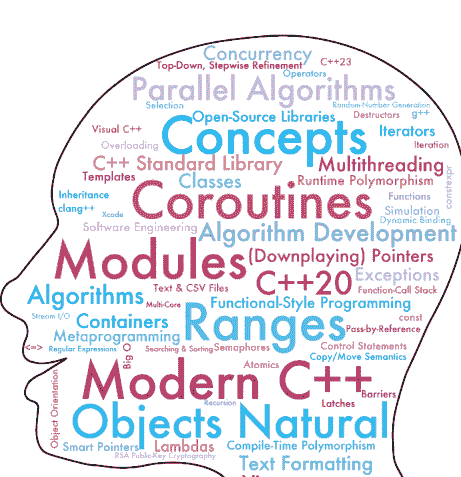

## 大纲

- 4.1 引言
- 4.2 计数器控制迭代的基本要素
- 4.3 for 迭代语句
- 4.4 使用 for 语句的示例
- 4.5 应用：对偶数整数求和；介绍 C++20 文本格式化
- 4.6 应用：复利计算；介绍格式说明符
- 4.7 do...while 迭代语句
- 4.8 switch 多选择语句
- 4.9 带初始化器的选择语句
- 4.10 break 和 continue 语句
- 4.11 逻辑运算符
  - 4.11.1 逻辑 AND（&&）运算符
  - 4.11.2 逻辑 OR（||）运算符
  - 4.11.3 短路求值
  - 4.11.4 逻辑非（!）运算符
  - 4.11.5 示例：生成逻辑运算符真值表
- 4.12 混淆相等（==）和赋值（=）运算符
- 4.13 结构化编程总结
- 4.14 对象自然案例研究：使用 Boost Multiprecision 库进行精确货币计算
- 4.15 小结
- 练习

## 4.1 引言

本章继续介绍结构化编程理论和原则，介绍 C++ 其余控制语句中除一个之外的所有语句——for、do...while、switch、break 和 continue。我们探讨计数器控制迭代的基本要素。我们使用复利计算开始研究处理货币金额的问题，以及与浮点类型相关的表示误差。

我们使用 switch 语句统计一组数值成绩中相当于 A、B、C、D 和 F 等级的数量。我们展示 if 和 switch 语句的能力，允许在这些语句的头部初始化一个或多个变量。我们讨论逻辑运算符，它使你能够组合简单条件以形成复合条件。我们还总结 C++ 的控制语句以及本章和第 3 章中介绍的行之有效的问题求解技术。

我们介绍 C++20 强大且富有表现力的文本格式化功能，它基于 Python、Microsoft 的 .NET 语言（如 C# 和 Visual Basic）以及 Rust 中的相应功能。¹ C++20 的功能比早期 C++ 版本中的功能更简洁、更强大。

我们讨论使用 double 等浮点类型处理货币金额的挑战。然后，在第 4.14 节的对象自然案例研究中，我们使用 Boost Multiprecision 库中某个类的对象精确地表示和操作货币金额。你将看到，该类提供了与内置数值类型相同的数学能力，因此使用起来很方便。

## 4.2 计数器控制迭代的基本要素

让我们使用 while 迭代语句（第 3.7 节）来形式化计数器控制迭代的要素：

- 1. 一个控制变量（或循环计数器）

1. Victor Zverovich，“Text Formatting，”2019 年 7 月 16 日。访问于 2023 年 4 月 14 日，http://www.open-std.org/jtc1/sc22/wg21/docs/papers/2019/p0645r10.html。


- 2. 控制变量的初始值
- 3. 决定循环是否应继续的循环继续条件，以及
- 4. 在每次循环迭代期间应用的控制变量增量。

考虑图 4.1，它使用一个循环显示 1 到 10。

```cpp
// fig04_01.cpp
// Counter-controlled iteration with the while iteration statement.
#include <iostream>
using namespace std;

int main()
{
    int counter{1}; // declare and initialize control variable

    while (counter <= 10) { // loop-continuation condition
        cout << counter << " ";
        ++counter; // increment control variable
    }

    cout << "\n";
}
```

```text
1  2  3  4  5  6  7  8  9  10
```

**图 4.1**  |  使用 while 迭代语句进行计数控制迭代。

第 7、9 和 11 行定义了计数控制迭代的要素。第 7 行将控制变量（counter）声明为 int，在内存中为它预留空间并将其初始化为 1。需要初始化的声明是可执行语句。同时预留内存的变量声明是定义。除非这种区别很重要，否则我们通常使用术语“声明”。

第 10 行在每次循环迭代中显示一次 counter 的值。第 11 行在每次循环迭代中将控制变量递增 1。循环继续条件（第 9 行）测试控制变量的值是否小于或等于 10——这是条件为真的最终值。当控制变量超过 10 时，循环终止。

始终使用整数控制计数循环。浮点值是近似的。使用浮点变量控制计数循环可能导致计数器值不精确以及终止测试不准确，从而使循环无法终止。在 while 头的右括号后立即放置分号会使该 while 的主体成为空语句。这通常是一个逻辑错误。

## 检查点

- 1. *（填空）* 计数控制迭代使用一个控制变量和另外三个关键要素——控制变量的 ______、______ 以及控制变量的 ______。
  
  答案：初始值、循环继续条件、增量。

- 2. *（判断正误）* 同时预留内存的变量声明是定义。
  
  答案：正确。

- 3. *（这段代码有什么问题？）* 找出以下代码中的错误并解释如何修复：

  ```cpp
  int x{1};

  while (x <= 10); {
      cout << x << "\n";
      ++x;
  }
  ```

  **答案：** 右括号后的分号会导致无限循环。要修正代码，请删除 `while` 头后的分号。

## 4.3 for 迭代语句

for 迭代语句在一行代码中指定计数控制迭代的细节。图 4.2 使用 for 语句重新实现了图 4.1 的循环。

```cpp
1  // fig04_02.cpp
2  // Counter-controlled iteration with the for iteration statement.
3  #include <iostream>
4  using namespace std;

6  int main() {
7      // for statement header includes initialization,
8      // loop-continuation condition and increment.
9      for (int counter{1}; counter <= 10; ++counter) {
10         cout << counter << " ";
11     }

13     cout << "\n";
14 }
```


**图 4.2** | 使用 for 迭代语句进行计数控制迭代。

当第 9–11 行开始执行时，for 语句声明控制变量 `counter` 并将其初始化为 1。接下来，它测试两个必需分号之间的循环继续条件（`counter <= 10`）。因为 `counter` 的初始值为 1，所以条件为真。因此，第 10 行显示 `counter` 的值（1）。执行第 10 行后，循环执行 `++counter` 将 `counter` 递增 1。然后程序再次执行循环继续测试，以确定是否继续循环的下一次迭代。此时，`counter` 的值为 2，条件仍为真，因此程序再次执行第 10 行。此过程继续，直到循环显示数字 1–10，且 `counter` 的值变为 11。此时，循环继续测试失败，迭代终止，程序继续执行循环之后的第一个语句（第 13 行）。

如果你错误地将图 4.2 的循环继续条件指定为 `counter < 10` 而不是 `counter <= 10`，循环将只迭代九次。这是一个常见的逻辑错误，称为差一错误。循环继续条件中错误的最终值也可能导致差一错误。在输出 1 到 10 的循环中，循环继续条件应为 counter <= 10，而不是 counter < 10（这会导致差一错误）或 counter < 11（这是正确的）。**许多程序员更喜欢从零开始的计数方式，在这种方式中，要计数 10 次，counter 将被初始化为零，并且循环继续测试将是 counter < 10。**

### 深入了解 for 语句的头部

下图更仔细地展示了图 4.2 中的 for 语句：

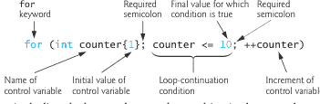

第一行——包括关键字 for 以及 for 之后括号中的所有内容（图 4.2 中的第 9 行）——有时称为 for 语句头部。for 头部“完成所有工作”，指定计数控制迭代所需的每一项。

### for 语句的一般格式

for 语句的一般格式是

```cpp
for (initialization; loopContinuationCondition; increment) {
    statement(s)
}
```

其中

- *initialization* 声明循环的控制变量并提供其初始值，
- *loopContinuationCondition*——位于两个必需分号之间——决定循环是否应继续执行，以及
- *increment* 修改控制变量的值，以便循环继续条件最终变为假。

如果 *loopContinuationCondition* 最初为假，程序不会执行 for 语句的主体。相反，执行将继续执行 for 之后的语句。*initialization* 和 *increment* 表达式可以是包含多个初始化表达式或多个增量表达式的逗号分隔列表——每个列表中的表达式从左到右求值。

在 for 头的右括号后立即放置分号会使该 for 的主体成为空语句。这通常是一个逻辑错误。

当迭代语句的 *loopContinuationCondition* 永远不会变为假时，就会发生无限循环。为了防止在计数控制循环中出现这种情况，请在每次循环迭代期间修改控制变量，以便循环继续条件最终变为假。

### for 语句控制变量的作用域

如果 *initialization* 表达式声明了控制变量，则该变量只能在该 for 语句中使用——不能超出该语句。这种受限的使用称为变量的作用域，它定义了变量的生存期以及它在程序中可以使用的位置。例如，变量的作用域从它在块中的声明点开始，到关闭该块的右花括号结束。正如你将在第 5 章中看到的，将每个变量的作用域限制为仅在需要的地方使用是一种好做法。

### for 语句头部中的表达式是可选的

for 头部的三个表达式是可选的：

- 如果省略 *loopContinuationCondition*，条件始终为真，从而创建无限循环。有时这是需要的。
- 如果程序在循环之前初始化控制变量，则可以省略 *initialization* 表达式。
- 如果程序在循环体中计算增量，或者不需要增量，则可以省略 *increment* 表达式。

for 中的**增量表达式**的作用类似于 for 主体末尾的独立语句。因此，以下增量表达式在 for 中等价：

```cpp
counter = counter + 1
counter += 1
++counter
counter++
```

增量表达式不会出现在更大的表达式中，因此前递增和后递增具有相同的效果。我们更倾向于前递增。在第 11 章关于运算符重载的讨论中，你将看到前递增可能具有性能优势。

### 在语句体中使用 for 语句的控制变量

程序经常在循环体中显示控制变量的值或在计算中使用它，但这不是必需的。此外，控制变量的值可以在循环体中更改，但这样做可能导致微妙的错误。如果程序必须在循环体中修改控制变量的值，请优先使用 while 而不是 for。

### for 语句的 UML 活动图

以下是图 4.2 的 for 语句的 UML 活动图。它清楚地表明初始化只发生一次——在第一次测试条件之前。递增发生在主体语句执行之后：

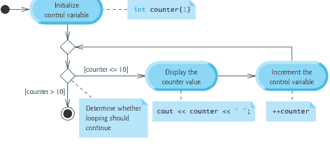


### 检查点

- 1. **（判断正误）** for 语句初始化表达式中声明的变量的作用域是该 for 语句所在块的其余部分。

  **答案：** 错误。如果初始化表达式声明了控制变量，则该变量只能在该 for 语句中使用——不能超出该语句。

- 2. **（代码）** 创建一个 for 语句，从 11 计数到 20，并显示每个值后跟两个空格。

  ```cpp
  for (int counter{11}; counter <= 20; ++counter) {
      cout << counter << "  ";
  }
  ```


## 4.4 使用 for 语句的示例

下面的 for 语句头演示了改变 for 语句控制变量的不同方式。注意递减控制变量的循环中关系运算符的变化。

- a) 将控制变量从 1 变化到 100，增量为 1。

  ```cpp
  for (int i{1}; i <= 100; ++i)
  ```

- b) 将控制变量从 100 递减到 1，递减量为 1。

  ```cpp
  for (int i{100}; i >= 1; --i)
  ```

- c) 将控制变量从 7 变化到 77，增量为 7。

  ```cpp
  for (int i{7}; i <= 77; i += 7)
  ```

- d) 将控制变量从 20 递减到 2，递减量为 2。

  ```cpp
  for (int i{20}; i >= 2; i -= 2)
  ```

- e) 将控制变量依次取值为 2、5、8、11、14、17、20。

  ```cpp
  for (int i{2}; i <= 20; i += 3)
  ```

- f) 将控制变量依次取值为 99、88、77、66、55、44、33、22、11、0。

  ```cpp
  for (int i{99}; i >= 0; i -= 11)
  ```

如果循环的控制变量递增或递减超过 1，不要在循环继续条件中使用相等运算符（== 或 !=）。例如，在下面的 for 语句头中，counter != 10 永远不会变为 false，从而导致无限循环，因为 counter 在每次迭代后递增 2，只产生奇数值 3、5、7、9、11、…。

```cpp
for (int counter{1}; counter != 10; counter += 2)
```

在向下计数的循环的循环继续条件中使用错误的关系运算符通常是逻辑错误——例如，在向下计数到 1 的循环中使用 i <= 1 而不是 i >= 1。

### 检查点

- 1. **（代码）** 编写一个 `for` 头，使控制变量 `i` 依次取值为 10、20、30、40、50。

  **答案：** `for (int i{10}; i <= 50; i += 10)`

- 2. **（代码）** 编写一个 `for` 头，使控制变量 `i` 依次取值为 50、40、30、20、10。

  **答案：** `for (int i{50}; i >= 10; i -= 10)`

- 3. **（代码）** 使用 `for` 语句对 1 到 99 的奇数求和。使用 `int` 变量 `sum` 和 `count`。

  **答案：**

  ```cpp
  int sum{0};

  for (int count{1}; count <= 99; count += 2) {
     sum += count;
  }
  ```

## 4.5 应用：对偶数整数求和；介绍 C++20 文本格式化

图 4.3 中的应用使用 `for` 语句对 2 到 20 的偶数整数求和，并将结果存储在 `int` 变量 `total` 中。当执行第 11–13 行时，每次循环迭代将控制变量 number 的值加到 total 的当前值上，并将结果存储在 total 中。代码之后，我们将解释第 15 行使用的 C++20 文本格式化。

```cpp
// fig04_03.cpp
// Summing integers with the for statement; introducing text formatting.
#include <format>
#include <iostream>
using namespace std;

int main() {
   int total{0};

   // total even integers from 2 through 20
   for (int number{2}; number <= 20; number += 2) {
      total += number;
   }

   cout << format("Sum is {}\n", total);
}
```

```text
Sum is 110
```

**图 4.3** | 使用 for 语句对整数求和；介绍文本格式化。

### C++20：使用函数 `format` 进行文本格式化

C++20 通过 `format` 函数（位于头文件 `<format>` 中）引入了强大的新字符串格式化功能。这些功能使用类似于 Python、Microsoft 的 .NET 语言（如 C# 和 Visual Basic）以及较新语言 Rust 中格式化的语法，极大地简化了 C++ 格式化。今后我们将主要使用这种新式格式化。第 19 章“流 I/O 与 C++20 文本格式化”介绍了旧式格式化的细节，以防你使用采用旧式格式的遗留软件。它还更深入地介绍 C++20 文本格式化特性。

### 格式字符串占位符

第 15 行演示了 format 函数：

```cpp
cout << format("Sum is {}\n", total);
```

format 的第一个参数是一个格式字符串，其中包含一个或多个由花括号（{ 和 }）分隔的占位符。该函数用函数其他参数的值替换这些占位符——在本例中，是 total 的值。你很快会看到，每个占位符可以指定额外的格式化指令。占位符按从左到右的顺序，用格式字符串后面的相应参数替换。


### 检查点

- 1. *（填空）* C++20 通过头文件 ________ 中的 format 函数引入了强大的新字符串格式化功能。

  **答案：** `<format>`。

- 2. *（代码）* 给定两个变量，分别表示 212 华氏度和对应的 100 摄氏度，编写一条语句，使用 cout 和 format 函数显示包含这两个温度的格式化字符串。

  **答案：** `cout << format("{} degrees Fahrenheit is {} degrees Celsius\n", fahrenheit, celsius);`

212 华氏度等于 100 摄氏度

## 4.6 应用：复利计算；介绍格式说明符

让我们用 for 语句计算复利。考虑以下问题：

> 一个人将 1,000 美元存入储蓄账户，年利率为 5%。假设所有利息都留在存款中，计算并打印 10 年中每年年末的账户价值。使用以下公式确定金额：
>
> `a = p (1 + r)^n`
>
> 其中
>
> - `p` 是初始投资金额（即本金），
> - `r` 是年利率（例如，5% 使用 0.05），
> - `n` 是年数，并且
> - `a` 是第 n 年末的存款金额。

2. Victor Zverovich，“文本格式化”，2019 年 7 月 16 日。访问于 2023 年 4 月 14 日。http://www.open-std.org/jtc1/sc22/wg21/docs/papers/2019/p0645r10.html。

我们的解决方案（图 4.4）使用循环对资金留在存款中的 10 年中的每一年执行计算。这里我们使用 double 值进行货币计算，然后讨论使用浮点类型表示货币金额的问题。工业级金融应用需要精确到分的货币计算。我们在第 4.14 节的 Objects Natural 案例研究展示了如何使用 Boost Multiprecision 库重新实现此示例以执行精确的货币计算。在那里，你会注意到其结果与使用 double 类型的结果略有不同。

图 4.4 的第 9–10 行将 double 变量 principal 初始化为 1000.00，将 double 变量 rate 初始化为 0.05。C++ 将 1000.00 和 0.05 这样的浮点字面量视为 double 类型。同样，C++ 将 7 和 -22 这样的整数视为 int 类型。

```cpp
// fig04_04.cpp
// Compound-interest calculations with for
#include <format>
#include <iostream>
#include <cmath> // for pow function
using namespace std;

int main() {
    double principal{1000.00}; // initial amount before interest
    double rate{0.05}; // interest rate

    cout << format("Initial principal: {:>7.2f}\n", principal);
    cout << format("        Interest Rate: {:>7.2f}\n", rate);

    // display headers
    cout << format("{:<10}{:>20}\n", "Year", "Amount on deposit");

    // calculate amount on deposit at the end of 10 years
    for (int year{1}; year <= 10; ++year) {
        // calculate amount on deposit at the end of the specified year
        double amount{principal * pow(1.0 + rate, year)};

        // display the year and the amount
        cout << format("{:>4}{:>20.2f}\n", year, amount);
    }
}
```

**图 4.4** | 使用 for 进行复利计算。（第 1 部分，共 2 部分。）


初始本金：1000.00  
利率：0.05

| 年份 | 存款金额 |
|---:|---:|
| 1 | 1050.00 |
| 2 | 1102.50 |
| 3 | 1157.63 |
| 4 | 1215.51 |
| 5 | 1276.28 |
| 6 | 1340.10 |
| 7 | 1407.10 |
| 8 | 1477.46 |
| 9 | 1551.33 |
| 10 | 1628.89 |

**图 4.4** | 使用 `for` 的复利计算。（第 2 部分，共 2 部分。）

### 格式化本金和利率

图 4.3 介绍了 C++20 的 `format` 函数。在那个示例的格式字符串中，我们使用一个空占位符（`{}`）将变量的值插入到字符串中该占位符的位置。在图 4.4 中，第 12–13 行使用占位符格式化 `principal` 和 `rate` 的值，这些占位符简洁地指定了格式说明。格式化结果显示在图 4.4 输出的前两行中。

第 12–13 行中的每个 format 调用都使用以下占位符：

```cpp
{:>7.2f}
```

冒号（`:`）引入格式说明符，指示如何格式化相应的值。在格式说明符 `>7.2f` 中：

- `>7` 表示该值应在宽度为 7 个字符位置的字段中右对齐（`>`），并且
- `.2f` 表示我们正在格式化一个浮点数（`f`），小数点右侧保留两位精度（`.2`）。

`principal` 的值（1000.00）显示时正好需要七个字符（包括小数点），因此它填满整个 7 个字符位置。然而，`rate` 的值（0.05）总共只需要四个字符位置，因此它将在 7 个字符位置中右对齐，并从左侧用前导空格填充，如下图所示：

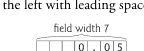

数值默认右对齐，因此这里的 `>` 不是必需的。你也可以通过 `<` 在字段宽度内将数值左对齐。如果我们在这里对 `0.05` 这样做，该值将被格式化为带有三个尾随空格。

### 格式化 "Year" 和 "Amount on Deposit" 列标题

在第 16 行的格式字符串 `"\n{:<20}\n"` 中，字符串 "Year" 只是被放在第一个占位符的位置——该占位符 `{}` 没有指定任何格式。

占位符 `{:>20}` 表示其对应参数——17 个字符的字符串 "Amount on Deposit"——应在 20 个字符的字段中右对齐（`>`）。因此，`format` 插入三个前导空格，使这个 17 字符的字符串在 20 字符的字段中右对齐。字符串默认左对齐，因此这里需要 `>` 来强制右对齐。如果要显示的字符串字符数超过指定字段宽度，字段宽度会扩展以容纳所有字符。

### 使用标准库函数 pow 执行利息计算

`for` 语句（第 19–25 行）迭代 10 次，使 `int` 控制变量 `year` 从 1 到 10 以 1 为增量变化。变量 `year` 表示题目陈述中的 *n*。C++ 不包含幂运算符，因此我们使用头文件 `<cmath>`（第 5 行）中的标准库函数 `pow`（第 21 行）——`pow(x, y)` 计算 *x* 的 *y* 次幂。该函数接收两个 `double` 参数并返回一个 `double` 值。第 21 行执行计算 *a* = *p*(1 + *r*)ⁿ，其中 *a* 是金额，*p* 是本金，*r* 是利率，*n* 是年份。

函数 `pow` 的第一个参数——计算式 `1.0 + r`——在每次循环中都会产生相同结果，因此在循环的每次迭代中重复它是浪费的。当今许多优化编译器会在编译后的代码中将这类计算放到循环之前，以提高程序性能。


### 在 for 循环中格式化年份和存款金额值

第 24 行的格式字符串使用两个占位符来格式化年份和金额值：

```cpp
"{:>4d}{:>20.2f}\n"
```

- 占位符 `{:>4d}` 表示 `year` 的值应格式化为整数（`d` 表示十进制整数），并在宽度为 4 的字段中右对齐（`>`）。这会将所有年份值右对齐到四字符的 "Year" 列下方。
- 占位符 `{:>20.2f}` 将 `amount` 的值格式化为在宽度为 20 的字段中右对齐（`>`）的浮点数，小数点右侧保留两位数字（`.2f`）。以这种方式格式化金额，会使它们的小数点垂直对齐，这是金额的典型做法。字段宽度 20 会将这些金额右对齐到列标题 "Amount on Deposit" 下方。

### 浮点数的精度和内存需求

`float` 表示单精度浮点数。当今大多数系统将这些值存储在 4 字节内存中，约有 7 位有效数字。`double` 表示双精度浮点数。当今大多数系统将这些值存储在 8 字节内存中，约有 15 位有效数字——大约是 `float` 精度的两倍。大多数程序员使用 `double` 类型。C++ 默认将程序源代码中的 3.14159 这类浮点数视为 `double` 值。源代码中的这类值称为浮点字面量。C++ 标准只要求 `double` 类型提供的精度至少与 `float` 一样高。还有 `long double` 类型，它提供的精度至少与 `double` 一样高。⁴

4. “基础类型”，访问于 2023 年 4 月 14 日。https://en.cppreference.com/w/cpp/language/types。本页展示了所有 C++ 基础类型及其典型范围。

### 浮点数是近似值

在常规算术中，浮点数常常因除法而产生。用 10 除以 3，结果是 3.3333333...，其中数字 3 无限重复。计算机分配固定大小的空间来保存这样的值，因此存储的值只能是近似值。像 `double` 这样的浮点类型会存在所谓的 *表示误差*。假设浮点数被精确表示（例如，在相等性比较中使用它们）可能会导致错误结果。

浮点数有许多应用，尤其适用于测量值。例如，当我们说 98.6 华氏度的“正常”体温时，并不需要精确到很多位数字。当我们在温度计上读到 98.6 时，实际温度可能是 98.594732103。对大多数体温计算来说，把这个数称为 98.6 是可以的。通常，`double` 比 `float` 更受青睐，因为 `double` 能更精确地表示浮点数。<sup>5</sup>

### 关于显示舍入值的警告

本示例将变量 `amount`、`principal` 和 `rate` 声明为 `double` 类型。不幸的是，浮点数在处理小数金额时可能会引发问题。下面简单解释：当使用浮点数表示小数点后显示两位的金额时，可能会出现什么问题。机器中存储的两个计算金额可能是 14.234（为显示而舍入为 14.23）和 18.673（为显示而舍入为 18.67）。当这些金额相加时，产生的内部和为 32.907，为显示通常会舍入为 32.91。因此，你的输出可能如下所示：

```text
      14.23
    + 18.67
    -------
      32.91
```

但一个人按显示出来的各个数字相加，会期望总和为 32.90。你已受到警告！

### 即使是常见金额也可能存在浮点表示误差

即使是以 `double` 存储的简单金额，也可能存在表示误差。为了说明这一点，我们创建了一个简单程序，其中定义变量 `d` 如下：

```cpp
double d{123.02};
```

我们以小数点后 20 位精度显示了 `d` 的值。结果输出将 123.02 显示为 123.0199999...，这是表示误差的另一个例子。虽然有些金额可以用 `double` 精确表示，但许多金额不能。在第 4.14 节的对象自然案例研究中，我们使用 Boost Multiprecision 库精确表示金额。

### 检查点

- 1. *（填空）* 字段宽度指定显示值时使用的 _______。
  - **答案：** 字符位置的数量。

5. 通常，标准浮点表示是 IEEE 754（https://en.wikipedia.org/wiki/IEEE_754）。


- **2.（判断正误）** 对于精确的货币计算，应始终使用 `double` 变量。

  **答案：** 错误。`double` 等浮点类型存在表示误差，这可能会给小数货币金额带来问题。因此，需要精确货币计算的应用程序应使用 Boost Multiprecision 库或其他类似库。

- **3.（代码）** 假设餐厅账单的税率为 6.25%，税前账单金额为 $37.45。计算账单总额，然后使用 `format` 创建一个保留小数点后两位的格式化字符串并显示该字符串。

  **答案：** `cout << format("Total bill: {:.2f}\n", 37.45 * 1.0625);`

  ```text
  Total bill: 39.79
  ```

## 4.7 do...while 迭代语句

在 while 语句中，程序在执行循环体之前测试循环继续条件。如果该条件为假，循环体将永远不会执行。do...while 迭代语句在执行循环体之后测试循环继续条件，因此循环体至少执行一次。图4.5使用 do...while 输出数字1–10。第7行声明并初始化变量 counter。进入 do...while 语句后，第10行输出 counter 的值，第11行递增 counter。然后程序在循环底部（第12行）计算循环继续测试。如果条件为真，循环继续执行循环体的第一条语句（第10行）。如果条件为假，循环终止，程序继续执行循环之后的下一语句。

```cpp
// fig04_05.cpp
// do...while iteration statement.
#include <iostream>
using namespace std;

int main() {
    int counter{1};

    do {
        cout << counter << " ";
        ++counter;
    } while (counter <= 10); // end do...while

    cout << '\n';
}
```

```text
1  2  3  4  5  6  7  8  9  10
```

**图4.5** | do...while 迭代语句。

### do...while 迭代语句的 UML 活动图

do...while 的 UML 活动图清楚地表明，循环继续条件直到循环至少执行一次动作状态之后才会被计算：

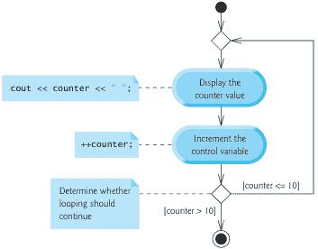

## 检查点

- **1.（判断正误）** do...while 语句执行其循环体零次或多次。

  **答案：** 错误。do...while 语句在执行循环体之后测试其循环继续条件。因此，循环体至少执行一次。

- **2.（代码）** 修改图4.5中的代码清单7–12，使程序显示0到9的值。

  **答案：**

  ```cpp
  int counter{0};
  do {
      cout << counter << " ";
      ++counter;
  } while (counter <= 9); // end do...while
  ```

  ```text
  0  1  2  3  4  5  6  7  8  9
  ```

## 4.8 switch 多路选择语句

C++ 提供 switch 多路选择语句，用于根据变量或表达式的可能值在多个不同动作之间进行选择。每个动作都与一个整型常量表达式的值相关联——即任何可求值为常量整数值的字符常量和整数常量的组合。

### 使用 switch 语句统计 A、B、C、D 和 F 成绩

图4.6计算用户输入的一组数值成绩的班级平均分。switch 语句确定每个成绩对应的字母等级（A、B、C、D 或 F），并递增相应的成绩计数器。程序还汇总获得每个等级的学生人数。

```cpp
// fig04_06.cpp
// Using a switch statement to count letter grades.
#include <format>
#include <iostream>
using namespace std;

int main() {
    double total{0.0}; // sum of grades
    int gradeCounter{0}; // number of grades entered
    int aCount{0}; // count of A grades
    int bCount{0}; // count of B grades
    int cCount{0}; // count of C grades
    int dCount{0}; // count of D grades
    int fCount{0}; // count of F grades

    cout << "Enter the integer grades in the range 0-100.\n"
         << "Type the end-of-file indicator to terminate input:\n"
         << "  On UNIX/Linux/macOS type <Ctrl> d then press Enter\n"
         << "  On Windows type <Ctrl> z then press Enter\n";

    int grade;

    // loop until user enters the end-of-file indicator
    while (cin >> grade) {
        total += grade; // add grade to total
        ++gradeCounter; // increment number of grades

        // increment appropriate letter-grade counter
        switch (grade / 10) {
            case 9: // grade was between 90
            case 10: // and 100, inclusive
                ++aCount;
                break; // exits switch

            case 8: // grade was between 80 and 89
                ++bCount;
                break; // exits switch

            case 7: // grade was between 70 and 79
                ++cCount;
                break; // exits switch

            case 6: // grade was between 60 and 69
                ++dCount;
                break; // exits switch

            default: // grade was less than 60
                ++fCount;
                break; // optional; exits switch anyway
        } // end switch
    } // end while

    // display grade report
    cout << "\nGrade Report:\n";

    // if user entered at least one grade...
    if (gradeCounter != 0) {
        // calculate average of all grades entered
        double average{total / gradeCounter};

        // output summary of results
        cout << format("Total of the {} grades entered is {}\n",
                       gradeCounter, total)
             << format("Class average is {:.2f}\n", average)
             << "Summary of student's grades:\n"
             << format("A: {}\nB: {}\nC: {}\nD: {}\nF: {}\n",
                       aCount, bCount, cCount, dCount, fCount);
    }
    else { // no grades were entered, so output appropriate message
        cout << "No grades were entered\n";
    }
}
```

```text
Enter the integer grades in the range 0-100.
Type the end-of-file indicator to terminate input:
   On UNIX/Linux/macOS type <Ctrl> d then press Enter
   On Windows type <Ctrl> z then press Enter
99
92
45
57
63
71
76
85
90
100
^Z

Grade Report:
Total of the 10 grades entered is 778
Class average is 77.80

Summary of student's grades:
A: 4
B: 1
C: 2
D: 1
F: 2
```

**图4.6** | 使用 switch 语句统计字母等级成绩。（第1和第2部分，共2部分。）

图4.6声明局部变量 total（第8行）和 gradeCounter（第9行），用于跟踪用户输入的成绩总和以及输入的成绩数量。第10–14行声明每个成绩类别的计数器变量，并将每个变量初始化为0。第24–51行使用哨兵控制迭代输入任意数量的整数成绩，更新

### 控制表达式产生整数值

第29行的控制表达式执行整数除法，这会截断结果的小数部分。当我们将0到100的 int 值除以10时，结果始终是0到10的 int 值。我们在 case 标签中使用其中几个值。如果用户输入整数85，控制表达式的求值结果为8。switch 将8与每个 case 标签进行比较。如果发生匹配（第35行的 case 8:），则执行该 case 的语句。对于8，第36行递增 bCount，因为80多分的成绩是 B。break 语句（第37行）退出 switch。在此程序中，我们到达 while 循环末尾，因此控制返回到第24行的循环继续条件，以确定循环是否应继续执行。

### 为多个 case 执行相同语句

我们的 switch 语句的 case 显式测试值10、9、8、7和6。注意第30–31行的 case 测试值9和10（两者都表示成绩 A）。将多个 case 连续列出且其间没有语句，可使这些 case 执行同一组语句。因此，当控制表达式的求值结果为9或10时，第32–33行的语句执行。switch 语句不提供测试值范围的机制，因此需要测试的每个值都必须列在单独的 case 标签中。每个 case 可以有多个语句。switch 语句与其他控制语句的不同之处在于，除非需要在 case 中声明变量，否则它不要求用花括号括起 case 中的多个语句。

### 不带 break 语句的 case——[[fallthrough]] 属性

通常，每个 case 都以 break 语句结束。如果没有 break 语句，每次在 switch 中发生匹配时，该 case 及其后续 case 的语句都会执行，直到遇到 break 语句或到达 switch 末尾。这称为“贯穿”到后续 case 的语句。⁶

在需要 break 语句时忘记它是逻辑错误。为了提醒你注意这个可能的问题，许多编译器会在 case 标签后跟一个或多个语句且不包含 break 语句时发出警告。对于希望采用“贯穿”行为的此类情况，你可以使用 [[fallthrough]] 属性，通过将语句

```cpp
[[fallthrough]];
```

放在通常出现 break 语句的位置，来告诉编译器“贯穿”到下一个 case 是正确行为。

### default 分支

如果控制表达式的值与任何 case 标签都不匹配，则执行 default 分支（第47–49行）。在此示例中，我们使用 default 分支处理所有小于6的控制表达式值——即所有不及格成绩。如果未发生匹配且 switch 不包含 default 分支，程序控制将直接继续执行

6. 此功能非常适合编写一个简洁的程序，显示重复歌曲《圣诞节的十二天》。练习4.24要求你编写此程序。作为此练习的有趣增强，你可以尝试使用众多免费开源文本转语音程序之一来朗读这首歌，还可以尝试将你的程序接入一个免费开源的 MIDI（“乐器数字接口”）程序，以创建伴有音乐的歌唱版程序。


switch 之后的第一条语句。在 switch 中，良好的做法是测试控制表达式的所有可能值。此外，提供 default 分支能让你关注处理异常条件的需要。

## 显示成绩报告

第 54–71 行根据输入的成绩输出一份报告。第 57 行判断用户是否至少输入了一个成绩。这有助于我们避免除以零：对于整数除法，除以零会导致程序失败；对于浮点除法，则会产生值 nan（“非数”）。如果至少输入了一个成绩，第 59 行会计算成绩的平均值——回想一下，double 除以 int 会产生 double 结果。随后第 62–67 行输出所有成绩的总和、班级平均分以及获得每个字母等级的学生人数。如果没有输入任何成绩，第 70 行会输出一条适当的消息。图 4.6 中的输出展示了基于 10 个成绩的示例成绩报告。

## switch 语句 UML 活动图

下面是通用 switch 语句的 UML 活动图：

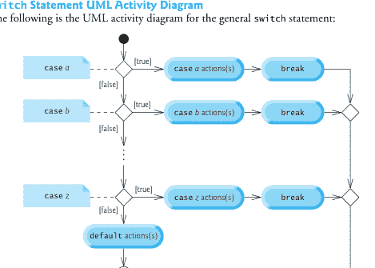

大多数 switch 语句在每个 case 中使用 break，以便在处理完该 case 后终止 switch。该图通过包含 break 并展示 case 末尾的 break 会使控制立即退出 switch 来强调这一点。对于 switch 的最后一个 case，或者当可选的 default 分支出现在最后时，并不需要 break 语句，因为执行会继续执行 switch 之后的下一语句。

## 关于 case 的说明

switch 语句中的每个 case 都必须包含一个常量整型表达式——也就是任何求值为常量整数值的表达式。你也可以使用枚举常量（在第 5.9 节介绍）和字符字面量——即单引号中的特定字符，例如 'a'、'A' 或 '$'，它们表示字符的整数值。⁷

在第 10 章《OOP：继承与运行时多态》中，我们介绍一种更优雅的实现 switch 逻辑的方法。我们使用一种称为**多态**的技术来创建程序，这些程序通常比使用 switch 逻辑的程序更清晰、更易于维护和扩展。

## 检查点

- **1.（对/错）** 大多数 switch 语句不会在每个 case 中使用 break 语句。
  **答案：** 错误。大多数 switch 语句在每个 case 中使用 break，以便在处理完该 case 后终止 switch。
- **2.（对/错）** 在 switch 中提供 default 分支能让你关注处理异常条件的需要。
  **答案：** 正确。
- **3.（这段代码有什么问题？）** 找出以下代码中的错误，并说明如何改正。

```cpp
switch (n) {
    case 1:
        cout << "The number is 1\n";
    case 2:
        cout << "The number is 2\n";
        break;
    default:
        cout << "The number is not 1 or 2\n";
        break;
}
```

**答案：** 代码在第一个 case 中缺少 break 语句。因此，如果 n 的值为 1，case 1 和 case 2 中的输出语句都会执行。要修正这一点，请在第一个 case 的输出语句之后添加一条 break 语句。

## 4.9 带初始化器的选择语句

前面我们介绍了 for 迭代语句。在 for 头部的初始化部分，我们声明并初始化了一个控制变量，这将该变量的作用域限制在 for 语句内。带初始化器的选择语句使你能够在 if 或 if...else 语句的条件之前，以及在 switch 语句的控制表达式之前包含变量初始化器。与 for 语句一样，这些变量只在其被声明的语句中可见。图 4.7 展示了带初始化器的 if...else 语句（第 8–13 行和第 15–20 行）。我们将在图 5.5 中使用带初始化器的 if...else 和 switch 语句，该图实现了一个流行的赌场骰子游戏。

```cpp
// fig04_07.cpp
// if statements with initializers.
#include <format>
#include <iostream>
using namespace std;

int main() {
    if (int value{7}; value == 7) {
        cout << format("value is {}\n", value);
    }
    else {
        cout << format("value is not 7; it is {}\n", value);
    }

    if (int value{13}; value == 9) {
        cout << format("value is {}\n", value);
    }
    else {
        cout << format("value is not 9; it is {}\n", value);
    }
}
```

```text
value is 7
value is not 9; it is 13
```

**图 4.7** | 带初始化器的 `if` 语句。

### 带初始化器的选择语句的语法

对于 `if` 或 `if...else` 语句，你把初始化器放在条件括号的最前面。对于 `switch` 语句，你把初始化器放在控制表达式括号的最前面。初始化器必须以分号（`;`）结尾，如第 8 行和第 15 行所示。初始化器可以在以逗号分隔的列表中声明多个相同类型的变量。

### 在初始化器中声明的变量的作用域

在 `if`、`if...else` 或 `switch` 语句的初始化器中声明的任何变量，都可以在该语句的剩余部分中使用。在第 8–13 行中，我们使用变量 `value` 来决定执行 `if...else` 语句的哪个分支，然后在两个分支的输出语句中都使用 `value`。当 `if...else` 语句终止时，`value` 不再存在，因此我们可以在第二个 `if...else` 语句中再次使用该标识符来声明一个新变量，该变量只在该语句中可见。


## 检查点

- **1.（对/错）** 在 `if`、`if...else` 或 `switch` 语句的初始化器中声明的变量的作用域，是定义该语句的块的剩余部分。
  **答案：** 错误。此类变量的作用域是该 `if`、`if...else` 或 `switch` 语句的剩余部分。

## 4.10 break 和 continue 语句

除了选择语句和迭代语句之外，C++ 还提供 break 和 continue 语句来改变控制流。上一节展示了如何使用 break 来终止 switch 语句的执行。本节讨论如何在迭代语句中使用 break。

### break 语句

在 while、for、do…while 或 switch 中执行 break 语句会导致立即退出该语句——执行会继续从该控制语句之后的第一条语句开始。break 的常见用途包括提前跳出循环或退出 switch（如图 4.6 所示）。图 4.8 演示了 break 语句提前退出 for 语句。

```cpp
1  // fig04_08.cpp
2  // break statement exiting a for statement.
3  #include <iostream>
4  using namespace std;
5
6  int main() {
7      int count; // control variable also used after loop
8
9      for (count = 1; count <= 10; ++count) { // loop 10 times
10         if (count == 5) {
11             break; // terminates for loop if count is 5
12         }
13
14         cout << count << " ";
15     }
16
17     cout << "\nBroke out of loop at count = " << count << "\n";
18  }
```

```text
1 2 3 4
Broke out of loop at count = 5
```

**图 4.8** | `break` 语句退出 `for` 语句。

当嵌套在 for 语句（第 9–15 行）中的第 10–12 行 if 语句检测到 count 为 5 时，第 11 行的 break 语句会执行。这会终止 for 语句，程序继续执行第 17 行（紧接在 for 语句之后），该行显示一条消息，指出循环终止时控制变量的值。循环体只完整执行了四次，而不是十次。请注意，我们本可以在第 7 行初始化 count，并把 for 头部的初始化部分留空，如下所示：

```cpp
for ( ; count <= 10; ++count) { // loop 10 times
```

### continue 语句

在 while、for 或 do…while 中执行 continue 语句会跳过循环体中剩余的语句，并继续执行循环的下一次迭代。在 while 和 do…while 语句中，程序会在紧接着之后立即求值循环继续测试


`continue` 语句执行时，在 `for` 语句中，先执行递增表达式，然后程序会评估循环继续测试。图 4.9 使用 `continue`（第 9 行）在嵌套的 `if` 判断出 `count` 的值为 5 时跳过第 12 行的语句。当 `continue` 语句执行时，程序控制继续转到 `for` 语句中控制变量的递增（第 7 行）。

```cpp
// fig04_09.cpp
// continue statement terminating an iteration of a for statement.
#include <iostream>
using namespace std;

int main() {
    for (int count{1}; count <= 10; ++count) { // loop 10 times
        if (count == 5) {
            continue; // skip remaining code in loop body if count is 5
        }

        cout << count << " ";
    }

    cout << "\nUsed continue to skip printing 5\n";
}
```

```text
1 2 3 4 6 7 8 9 10
Used continue to skip printing 5
```

**图 4.9** | `continue` 语句终止 `for` 语句的一次迭代。

## 软件工程与性能的权衡

有些程序员认为 `break` 和 `continue` 违反了结构化编程。由于相同的效果可以通过结构化编程技术实现，这些程序员倾向于避免使用 `break` 和 `continue`（但这会略微降低性能）。在实现高质量软件工程和实现最佳性能软件之间存在着一种张力。有时，其中一个目标的实现是以牺牲另一个目标为代价的。除去大多数对性能要求极高的情况，你应该首先让代码简单且正确，然后再让它变得快速且精简——但仅在必要时这样做。

## 检查点

- **1.** *(判断正误)* 在 `while`、`for` 或 `do...while` 语句中执行 `continue` 语句会跳过循环体中的剩余语句，并继续进行循环继续测试。**答案：** 错误。在 `while` 或 `do...while` 语句中，`continue` 会跳过循环体中的剩余语句，并继续进行循环继续测试。在 `for` 语句中，程序在评估循环继续测试之前，会先执行 `for` 的递增表达式。
- **2.** *(判断正误)* 在 `while`、`for`、`do...while` 或 `switch` 语句中执行 `break` 语句会导致立即退出该语句——程序继续执行控制语句之后的第一条语句。**答案：** 正确。

## 4.11 逻辑运算符

`if`、`if...else`、`while`、`do...while` 和 `for` 语句中的条件决定了程序的控制流如何继续。到目前为止，我们只介绍了简单的条件，例如 `count <= 10`、`number != sentinelValue` 和 `total > 1000`。你可以使用关系运算符（`<`、`>`、`>=` 和 `<=`）和相等性运算符（`==` 和 `!=`）来表达简单条件。有时控制语句需要更复杂的条件来确定程序的控制流。C++ 的逻辑运算符使你可以组合简单条件。逻辑运算符是 `&&`（逻辑与）、`||`（逻辑或）和 `!`（逻辑非）。

### 4.11.1 逻辑与（&&）运算符

2023 年，在新冠疫情三年之后，美国经历了一场导致空中交通混乱的飞行员短缺。为了缓解飞行员短缺，政府考虑将强制性飞行员退休年龄从 65 岁提高到 67 岁，这样身体健康的高级飞行员可以继续飞行两年。

假设一家航空公司想询问每位 63 岁及以上的高级飞行员，是否愿意申请继续飞行至 67 岁，而不是在 65 岁退休。航空公司可以编写一个程序来搜索其计算机化的员工记录，并确定 63 岁及以上高级飞行员的数量。该程序可以包含以下语句：

```cpp
if (employeeType == PILOT && age >= 63) {
    ++seniorPilots;
}
```

假设 `PILOT` 是一个常量。`if` 语句包含两个简单条件：

- `employeeType == PILOT` 判断员工是否为飞行员。
- `age >= 63` 判断员工是否接近退休年龄。

`if` 语句考虑组合条件，只有当两个简单条件都为真时，组合条件才为真。如果为真，`if` 语句的体会将 `seniorPilots` 增加 1；否则，程序跳过递增操作。有些程序员发现上述组合条件使用冗余的括号更易读，例如：

```cpp
if ((employeeType == PILOT) && (age >= 63)) {
    ++seniorPilots;
}
```

下面的真值表总结了 `&&` 运算符，显示了 `expression1` 和 `expression2` 的布尔值 `false` 和 `true` 的组合。C++ 会将所有包含关系运算符、相等性运算符或逻辑运算符的表达式评估为 false 或 true：

**逻辑与（&&）运算符真值表**

| expression1 | expression2 | expression1 && expression2 |
|---|---|---|
| false | false | false |
| false | true | false |
| true | false | false |
| true | true | true |

### 4.11.2 逻辑或（||）运算符

现在假设我们希望确保两个条件中的一个或两个为真，然后再选择某条执行路径。在这种情况下，我们使用 `||`（逻辑或）运算符，例如：

```cpp
if ((semesterAverage >= 90) || (finalExam >= 90)) {
    cout << "Student grade is A\n";
}
```

这条语句同样包含两个简单条件：

- `semesterAverage >= 90` 判断学生整个学期表现是否扎实，从而是否值得在该课程中获得 A。
- `finalExam >= 90` 判断学生期末考试是否表现出色，从而是否值得在该课程中获得 A。

然后 `if` 语句考虑组合条件：

```cpp
(semesterAverage >= 90) || (finalExam >= 90)
```

如果两个简单条件中的一个或两个为真，就授予学生 A。唯一不会打印 `"Student grade is A"` 的情况是两个简单条件都为假。以下是逻辑或（||）运算符的真值表：

**逻辑或（||）运算符真值表**

| expression1 | expression2 | expression1 \|\| expression2 |
|---|---|---|
| false | false | false |
| false | true | true |
| true | false | true |
| true | true | true |

运算符 `&&` 的优先级高于运算符 `||`。两者都是从左向右结合。一般来说，如果对求值顺序存在歧义，请使用括号。

### 4.11.3 短路求值

包含 `&&` 或 `||` 运算符的表达式的各个部分仅在知道条件为真或假之前才进行求值。因此，对以下条件的求值：

```cpp
(employeeType == PILOT) && (age >= 63)
```

如果 `employeeType` 不等于 `PILOT`（即整个表达式为假），则立即停止；如果 `employeeType` 等于 `PILOT`（即如果 `age >= 63` 为真，整个表达式仍可能为真），则继续。这种短路求值是逻辑与和逻辑或表达式的性能特性。

在使用 `&&` 运算符的表达式中，一个条件（我们称之为依赖条件）可能需要另一个条件为真，这样对依赖条件的求值才有意义。在这种情况下，依赖条件应放在 `&&` 运算符之后以防止错误。考虑以下条件：

```cpp
(i != 0) && (10 / i == 2)
```

依赖条件 `(10 / i == 2)` 必须出现在 `&&` 运算符之后，以防止除以零的可能性。


### 4.11.4 逻辑非（!）运算符

`!` 逻辑非运算符（也称为逻辑 NOT 或逻辑补运算符）“反转”条件的意思。逻辑非运算符是一元运算符，只有一个条件作为操作数。要仅在条件为假时执行代码，请在原始条件前放置 `!`，例如：

```cpp
if (!(grade == sentinelValue)) {
    cout << "The next grade is " << grade << "\n";
}
```

只有在 `grade` 不等于 `sentinelValue` 时，才会执行循环体语句。条件 `grade == sentinelValue` 周围的括号是必需的，因为逻辑非运算符的优先级高于相等性运算符。

在大多数情况下，你可以通过使用适当的关系运算符或相等性运算符来表达条件，从而避免使用逻辑非。例如，使用 `!=` 运算符会使前面的语句更易读：

```cpp
if (grade != sentinelValue) {
    cout << "The next grade is " << grade << "\n";
}
```

以下是 `!` 逻辑非运算符的真值表：

**逻辑非（!）运算符真值表**

| expression | !expression |
|---|---|
| false | true |
| true | false |

### 4.11.5 示例：生成逻辑运算符真值表

图 4.10 生成了 `&&`、`||` 和 `!` 的逻辑运算符真值表（第 9–13、16–20 和 23–25 行）。输出显示了每个被求值的表达式及其布尔结果。默认情况下，`cout` 和流插入运算符将布尔值 `true` 和 `false` 显示为 1 和 0，但 `format` 函数会显示单词 `true` 或 `false`。

```cpp
// fig04_10.cpp
// Logical operators.
#include <format>
#include <iostream>
using namespace std;

int main() {
    // create truth table for && (logical AND) operator
    cout << "logical AND (&&)\n"
         << format("false && false: {}\n", false && false)
         << format("false && true: {}\n", false && true)
         << format("true && false: {}\n", true && false)
         << format("true && true: {}\n", true && true);
```

**图 4.10** | 逻辑运算符。（第 1 部分，共 2 部分。）


```cpp
// create truth table for || (logical OR) operator
cout << "Logical OR (||)\n"
     << format("false || false: {}\n", false || false)
     << format("false || true: {}\n", false || true)
     << format("true || false: {}\n", true || false)
     << format("true || true: {}\n\n", true || true);

// create truth table for ! (logical negation) operator
cout << "Logical negation (!)\n"
     << format("!false: {}\n", !false)
     << format("!true: {}\n", !true);
}
```

```text
Logical AND (&&)
false && false: false
false && true: false
true && false: false
true && true: true

Logical OR (||)
false || false: false
false || true: true
true || false: true
true || true: true

Logical negation (!)
!false: true
!true: false
```

**图 4.10** | 逻辑运算符。（第 2 部分，共 2 部分）

### 目前介绍的运算符的优先级与结合性

下表展示了目前介绍的 C++ 运算符的优先级与结合性——从上到下按优先级递减的顺序排列：

| 运算符 | 结合性 |
|---|---|
| `++ (postfix)` `-- (postfix)` | 从左到右 |
| `+` `-` `!` `++ (prefix)` `-- (prefix)` | 从右到左 |
| `*` `/` `%` | 从左到右 |
| `+` `-` | 从左到右 |
| `<<` `>>` | 从左到右 |
| `<` `<=` `>` `>=` | 从左到右 |
| `==` `!=` | 从左到右 |
| `&&` | 从左到右 |
| \|\| | 从左到右 |
| `?:` | 从右到左 |
| `=` `+=` `-=` `*=` `/=` `%=` | 从右到左 |

### 检查点

- 1. *（填空）* 表达式中包含 `&&` 或 `||` 运算符的部分，只会计算到能够确定条件为真还是为假为止。这称为 ______。  
  **答案：** 短路求值。
- 2. *（代码）* 假设变量 x、y 以及 a 和 b 存在并包含数值，编写一个条件，当 x 大于 y 或 a 小于 b 或两者同时成立时，该条件求值为 true。  
  **答案：** `(x > y || a < b)`
- 3. *（代码）* 给定一个 bool 变量 gameOver，编写一个 while 循环头，使得只要游戏尚未结束就继续迭代。  
  **答案：** `while (!gameOver)`

## 4.12 混淆相等运算符（==）与赋值运算符（=）

有一种逻辑错误，无论经验多么丰富的 C++ 程序员都常常会犯，以至于我们觉得有必要单独用一节来讨论。这个错误就是不小心把运算符 `==`（相等）和 `=`（赋值）弄混。它之所以危害如此之大，是因为它通常不会导致编译错误。含有这类错误的语句往往能正确编译并运行到结束，却常常通过运行时逻辑错误产生错误结果。如今的编译器通常会在本应使用 `==` 的上下文中使用了 `=` 时发出警告（有关启用此功能的详细信息，请参见本节末尾）。

C++ 的两个方面导致了这些问题。其一，任何产生值的表达式都可以用在任何控制语句的判断部分。如果表达式的值为零，就视为 false；如果值非零，就视为 true。其二，赋值会产生一个值——即赋值运算符左侧变量的值。例如，假设我们想写

```cpp
if (payCode == 4) { // good
    cout << "You get a bonus!\n";
}
```

却意外写成了

```cpp
if (payCode = 4) { // bad
    cout << "You get a bonus!\n";
}
```

这条语句包含一个逻辑错误：它把 if 条件中的赋值求值为 4。任何非零值都为 true，因此该条件始终求值为 true，无论薪资代码是什么，这个人都会得到奖金！更糟的是，本应只检查薪资代码，它却被修改了！

### 左值和右值

可以用一个简单的技巧来防止这个问题。首先，了解赋值运算符左侧允许出现什么会很有帮助。变量名被称为左值（lvalue，意为“left value”），因为它们可以用于赋值运算符的左侧。字面量被称为右值（rvalue，意为“right value”）——它们只能用于赋值运算符的右侧。在赋值运算符右侧，可以把左值当作右值使用，但反之不行。

程序员通常把条件写成 `x == 7` 这样，变量名（一个*左值*）在左边，字面量（一个*右值*）在右边。把字面量放在左边，如 `7 == x`（这种写法在风格上是正确的，有时被称为“尤达条件”[^8]），这样如果你不小心把 `==` 运算符替换成 `=`，编译器就能报错。编译器会将其视为编译错误，因为不能改变字面量的值。

### 用 `==` 代替 `=`

还有另一种同样令人不快的情况。假设你想用如下简单语句给变量赋值

```cpp
x = 1;
```

却写成了

```cpp
x == 1;
```

这里同样不是语法错误。相反，编译器只是对该表达式求值。如果 x 等于 1，条件为 true，表达式求值为 true。如果 x 不等于 1，条件为 false，表达式求值为 false。无论表达式的值是什么，由于没有赋值运算符，该值就丢失了。x 的值保持不变，很可能导致执行时逻辑错误。将运算符 `==` 用于赋值，以及将运算符 `=` 用于相等比较，都是逻辑错误。

### 启用警告

Xcode 会在本应使用 `==` 的地方使用了 `=` 时自动发出警告。有些编译器需要你先启用警告，然后才会发出警告消息。对于 g++ 和 clang++，请在编译命令中添加 `-Wall`（启用所有警告）标志。对于 Visual C++：

- 1. 在解决方案中，右键单击项目名称，然后选择 **属性**。
- 2. 展开 **代码分析**，然后选择 **常规**。
- 3. 对于 **在生成时启用代码分析**，选择 **是**，然后单击 **确定**。

对于某些库，这可能会导致显示许多警告。

### 检查点

- 1. **（判断正误）** 在条件中使用 `=` 通常是逻辑错误。  
  **答案：** 正确。
- 2. **（这段代码有什么问题）** 假设 `done` 是 bool 变量，下面的 `while` 语句头有什么问题？

  ```cpp
  while (done = true)
  ```

  **答案：** `while` 语句的条件是一个赋值表达式，每次 while 语句测试其条件时都会将 `true` 赋给变量 `done`。该条件始终为 true，从而造成无限循环。把 `=` 替换为 `==`，这样当 `done` 为 false 时循环就会终止。

[^8]: “尤达条件。”访问于 2023 年 4 月 14 日。https://en.wikipedia.org/wiki/Yoda_conditions.

## 4.13 结构化编程总结

正如建筑师运用其行业的集体智慧来设计建筑，程序员也应当如此设计程序。我们的领域比建筑学年轻得多，我们的集体智慧也相当稀少。我们已经认识到，结构化编程所产生的程序，比非结构化程序更容易理解、测试、调试、修改，甚至在数学意义上证明其正确性。

### C++ 控制语句是单入口/单出口的

图 4.11 使用 UML 活动图总结了 C++ 的控制语句。

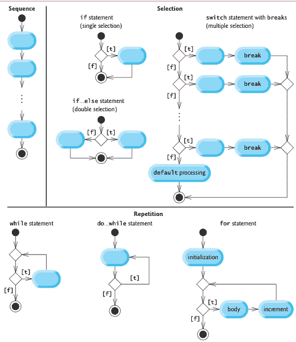

**图 4.11** | C++ 的单入口/单出口顺序、选择和迭代语句。

初始状态和最终状态表示每个控制语句的**单一入口点**和**单一出口点**。在活动图中任意连接各个符号，可能导致非结构化程序。因此，编程界选择了一组有限的控制语句，这些语句只能通过两种简单方式组合起来构建结构化程序。

为简单起见，C++ 只包含**单入口/单出口**控制语句——每个控制语句只有一个入口和一个出口。按顺序连接控制语句以形成结构化程序很简单。一个控制语句的最终状态连接到下一个控制语句的初始状态——也就是说，控制语句按顺序一个接一个地放入程序中。我们称之为控制语句堆叠。形成结构化程序的规则还允许使用**嵌套控制语句**。

### 形成结构化程序的规则

图 4.12 展示了形成结构化程序的规则。这些规则假设动作状态可用于表示*任何*动作。这些规则还假设我们从最简单的活动图（图 4.13）开始，该活动图仅由初始状态、动作状态、最终状态和转移箭头组成。

**形成结构化程序的规则**

- 1. 从最简单的活动图（图 4.13）开始。
- 2. 任何动作状态都可以替换为按顺序排列的两个动作状态。
- 3. 任何动作状态都可以替换为任何控制语句（动作状态序列、if、if…else、switch、while、do…while 或 for）。
- 4. 规则 2 和规则 3 可以按任意顺序、任意多次应用。

**图 4.12** | 形成结构化程序的规则。

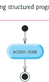

**图 4.13** | 最简单的活动图。


应用图4.12中的规则，总能得到结构正确的活动图，具有整洁的积木式外观。例如，对最简单的活动图反复应用规则2，会得到一个包含许多顺序动作状态的活动图（图4.14）。规则2生成一叠控制语句，因此我们称规则2为堆叠规则。图4.14中的垂直虚线不属于UML——我们用它们分隔四个活动图，这些图演示了图4.12中规则2的应用。

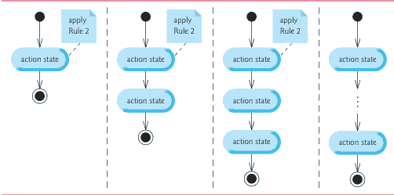

**图 4.14** | 对最简单的活动图反复应用图4.12中的规则2。

规则3称为嵌套规则。对最简单的活动图反复应用规则3，会得到一个具有整齐嵌套控制语句的活动图。例如，在图4.15中，最简单的活动图中的动作状态被替换为一个双选择（if…else）语句。然后再次对双选择语句中的动作状态应用规则3，将每个动作状态替换为一个双选择语句。每个双选择语句周围的虚线动作状态符号表示被替换的动作状态。图4.15中显示的虚线箭头和虚线动作状态符号不属于UML。我们在这里用它们来说明任何动作状态都可以替换为控制语句。

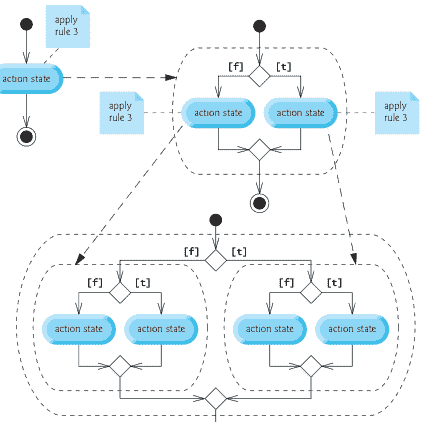

**图 4.15** | 对最简单的活动图反复应用图4.12中的规则3。

规则4生成更大、更复杂且嵌套更深的语句。应用图4.12中的规则所产生的图，构成了所有可能的结构化活动图的集合，因而也构成了所有可能的结构化程序的集合。结构化方法的美妙之处在于，我们只使用*七种*简单的单入口/单出口控制语句，并且只用*两种*简单方式将它们组合起来。

如果遵循图4.12中的规则，就无法创建“非结构化”活动图（如图4.16中的活动图）。如果你不确定某个特定图是否为结构化图，可以反向应用图4.12中的规则，将其化简为最简单的活动图。如果能将其化简，则原图是结构化的；否则就不是。

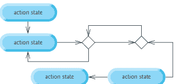

**图 4.16** | “非结构化”活动图。

### 三种控制形式

结构化程序设计倡导简单性。实现算法只需要三种控制形式：

- 顺序
- 选择
- 迭代

顺序结构很简单。只需按语句应执行的顺序列出要执行的语句。选择通过以下三种方式之一实现：

- `if` 语句（单选择）
- `if`…`else` 语句（双选择）
- `switch` 语句（多选择）

事实上，很容易证明，简单的 `if` 语句就足以提供*任何*形式的选择——用 `if`…`else` 语句和 `switch` 语句能完成的一切，都可以通过组合 `if` 语句来实现（尽管可能不那么清晰和高效）。

迭代通过以下三种方式之一实现：

- `while` 语句
- `do`…`while` 语句
- `for` 语句⁹

很容易证明，`while` 语句就足以提供*任何*形式的迭代。用 `do`…`while` 和 `for` 能完成的一切，都可以用 `while` 语句完成（尽管可能不那么方便）。

综合这些结果可以看出，C++ 程序中曾经需要的*任何*控制形式都可以用以下内容表示：

- 顺序
- `if` 语句（选择）
- `while` 语句（迭代）

并且这些只能通过两种方式组合——*堆叠*和*嵌套*。

9. 在第6.6节中，你会看到还有 `range-based for` 语句。

## 4.14 Objects Natural 案例研究：使用 Boost Multiprecision 库进行精确货币计算

许多应用要求精确表示带小数点的数字。像银行这样每天处理数百万甚至数十亿笔交易的机构，必须将其货币交易核对到“精确到分”。我们之前提到，使用 `double` 值处理货币金额（如图4.4的复利示例）会引入表示误差和舍入问题，从而可能妨碍“精确到分”的准确性：

1. 存在表示误差，因为我们把精确的十进制货币金额和利率存储为 `double`。
2. 浮点值存在舍入，因为利息计算常常产生不足一分的零头。必须将这些值舍入到百分位以表示美分。在存在浮点表示误差的情况下，舍入可能不可预测。

货币计算中常常有许多可能发生舍入的环节。例如，在餐厅账单上，税可以按每件商品分别计算，从而产生多次独立的舍入操作；也可以只对账单总额计算一次。这些不同方法可能得出不同结果。

### 用于精确货币计算的自定义类型

你将在第9章“自定义类”中看到，C++ 是一种可扩展语言。因此，我们可以为货币计算以及其他需要精确表示和操作带小数点数字的应用创建自定义类。然而，要把它做对可能需要大量时间和精力。与其“重新发明轮子”，我们可以利用已有的库，例如**Boost Multiprecision 开源库**<sup>10</sup>，它提供了精确到分的类型。我们将创建 Boost Multiprecision 对象，并使用 Boost 的运算符和函数来操作这些对象，就像使用 `double` 等内置类型一样方便。

### 用货币金额进行表示和计算是一个复杂问题

处理货币金额可能远比我们这里展示的复杂。银行必须处理诸如在计算账户日利息时使用“公平舍入算法”等问题。舍入规则可能因货币、政府、公司等而异。此外，世界上有大量货币，其千位分隔符、小数点分隔符、货币符号等惯例各不相同。各种 C++ 库可处理这类问题。

### 演示 Boost Multiprecision 的 cpp_dec_float_50 类

- 为消除与浮点类型相关的表示误差，Boost Multiprecision 库的 `cpp_dec_float_50` 类使用一种内部编码方案，该方案需要额外内存来保存最多具有 50 位精度的数字。使用这个类，我们可以创建表示精确货币金额（如 123.02）的对象，并执行精确到分的算术运算，而不会产生表示……

10. “Boost Multiprecision Library.” 访问于 2023 年 4 月 14 日，https://github.com/boostorg/multiprecision/.

这里，我们用整数 1000 初始化 principal（第12行），并用字符串 "0.05" 初始化 rate（第13行）。

### C++20 文本格式化与 cpp_dec_float_50 对象

Boost Multiprecision 类型尚不支持 C++20 文本格式化中使用 `{:.2f}` 这类占位符将浮点数舍入到指定精度的功能。不过，这些类型确实支持旧式 C++ 格式化，即使用图3.2中介绍的 fixed 和 setprecision 流操纵器。也可以为自定义类类型自定义 C++20 文本格式化。

因此，对于这个示例，我们在 decimalformatter.h（图4.17，第6行）中定义了自定义格式化，使 format 能够获得舍入到两位精度的 cpp_dec_float_50 对象的字符串表示。我们的自定义格式化器使用 fixed 和 setprecision 流操纵器。只需 #include 我们的头文件，就能让 format 使用自定义格式化器。

第15–16行使用占位符 `{:>7}` 将 principal 和 rate 格式化为字符串，每个字符串在 7 个字符位置的字段中右对齐（>）。第24行使用占位符 `{:>20}` 将 amount 格式化为字符串，该字符串在 20 个字符位置的字段中右对齐（>）。在本案例研究中，我们始终将 cpp_dec_float_50 货币金额格式化为两位精度，以便右对齐字符串的小数点垂直对齐。

### 执行利息计算

第23行的计算与图4.4中的计算相同，但使用 cpp_dec_float_50 对象而不是 double，以避免 double 类型的表示误差。Boost Multiprecision 类型支持内置算术运算符（如 * 和 +）以及常见数学函数（如 pow），因此这里使用了它们。它们知道如何使用 cpp_dec_float_50 对象执行精确算术运算。

### 策略问题：半向上舍入与银行家舍入法

比较图4.4和图4.17的输出。注意第3年的输出略有不同——图4.4中为 1157.63，而图4.17中为 1157.62。这是由于 double 和 cpp_dec_float_50 使用了不同的舍入算法，也可能是因为使用 double 计算时的表示误差。

在第3年，第28行计算

```
1000.00 * pow(1 + 0.05, 3)
```

pow 返回 1.157625（即 1.05³），因此前面的计算得到 1157.625。

默认情况下，double 金额使用半向上舍入⁽⁹⁾保留小数点后两位：如果第三位数字是 5 或更大，就将前一位数字向上舍入；否则向下舍入。因此在图4.4中，1157.625 被舍入为 1157.63。

### 银行家舍入法

不幸的是，常用的半向上舍入是一种有偏技术。对于数字 1、2、3 和 4，我们将前一位数字向下舍入；对于 5、6、7、8 和 9，我们将前一位数字向上舍入——四个值向下舍入，五个值向上舍入。向上舍入的值多于向下舍入的值，这可能导致货币计算中出现差异。为修正这种偏差，Boost 的 cpp_dec_float_50 使用银行家舍入法¹¹——当用于确定舍入的数字是 5（本例中的第三位数字）时，该算法会将前一位数字（第二……

（本例中的第二位数字）舍入到最接近的偶数。因此，使用 `cpp_dec_float_50` 时，值 1157.625 向下舍入为 1157.62。类似地，

- 1157.635 将向上舍入为 1157.64，
- 1157.645 将向下舍入为 1157.64，
- 1157.655 将向上舍入为 1157.66，
- 1157.665 将向下舍入为 1157.66，
- 等等。

## 4.15 小结

在本章中，我们完成了对 C++ 中除一个之外所有控制语句的介绍，这些语句使你能够控制函数中的执行流程。第 3 章讨论了 `if`、`if...else` 和 `while`。第 4 章演示了 `for`、`do...while` 和 `switch`。我们介绍了 C++20 中来自 `<format>` 头文件的新文本格式化功能。

我们展示了在 `if` 和 `switch` 语句的头部初始化变量。你使用 `break` 语句退出 `switch` 语句并立即终止循环。你使用 `continue` 语句终止循环的当前迭代并继续循环的下一次迭代，我们还提到 `while` 和 `do...while` 循环会立即进入其循环继续条件，而 `for` 循环会先执行其增量。我们介绍了 C++ 的逻辑运算符，用于在控制语句中创建更复杂的条件表达式。

在第一个复利示例中，我们讨论了与浮点类型相关的表示误差。然后，在 Objects-Natural 案例研究中，我们使用 Boost Multiprecision 库的预定义类 `cpp_dec_float_50` 执行精确的货币计算，以精确表示浮点数并执行“精确到分”的算术运算。我们展示了内置类型 `double` 使用有偏差的四舍五入算法，而 `cpp_dec_float_50` 通过使用银行家舍入法消除了该偏差。

在第 5 章中，你将创建自己的自定义函数，学习使用随机数生成进行模拟的技术，使用函数模板定义执行相同任务或处理不同类型的函数族，了解私钥加密等内容。

11. “舍入”，维基百科。维基媒体基金会。访问于 2023 年 4 月 14 日。https://en.wikipedia.org/wiki/Rounding.

## 练习

- 4.1 描述计数器控制迭代的四个基本要素。
- 4.2 比较和对比 `while` 和 `for` 迭代语句。
- 4.3 讨论一种使用 `do...while` 语句比 `while` 语句更合适的情况。解释原因。
- 4.4 比较和对比 `break` 和 `continue` 语句。
- 4.10（修改后的复利程序）修改图 4.17 的复利应用程序——该程序引入了 Boost.Multiprecision 的 cpp_dec_float_50 类——对其步骤进行重复，以处理 5%、6%、7%、8%、9% 和 10% 的利率。使用 for 循环改变利率。你将看到复利在实际运作中的奇妙之处。
- 4.11（三角形打印程序）编写一个应用程序，分别显示以下图案，一个位于另一个下方。使用 for 循环生成这些图案。所有星号（*）应通过形式为 cout << '*'; 的单条语句打印，这会使星号并排打印。形式为 cout << '\n'; 的语句可用于移到下一行。形式为 cout << ' '; 的语句可用于为最后两个图案显示一个空格。程序中不应有其他输出语句。[提示：最后两个图案要求每行以适当数量的空白字符开头。]

```text
(a)        (b)        (c)        (d)
*          *********         *        *********
**         ********        **         ********
***        *******       ***          *******
****       ******       ****           ******
*****      *****       *****            *****
******     ****       ******             ****
*******    ***       *******              ***
********   **       ********               **
*********  *       *********                *
```

- 4.12（条形图打印程序）计算机的一个有趣应用是显示图形和条形图。编写一个应用程序，读取 1 到 30 之间的五个数字。对于读取的每个数字，程序应显示相同数量的相邻星号。例如，如果程序读取数字 7，则应显示 *******。在读取全部五个数字后显示星号条。
- 4.13（计算销售额）一家在线零售商销售五种产品，其零售价格如下：产品 1，$2.98；产品 2，$4.50；产品 3，$9.98；产品 4，$4.49；产品 5，$6.87。编写一个应用程序，读取一系列数字对，如下所示：
  - a) 产品编号
  - b) 售出数量
  
  使用 switch 语句确定每种产品的零售价格。它应计算并显示所有售出产品的总零售额。使用哨兵控制循环来确定程序何时应停止循环并显示最终结果。
- 4.14 假设 i = 1、j = 2、k = 3 且 m = 2。以下每条语句分别打印什么？

```cpp
a) cout << (i == 1) << '\n';
b) cout << (j == 3) << '\n';
c) cout << (i >= 1 && j < 4) << '\n';
d) cout << (m <= 99 && k < m) << '\n';
e) cout << (j >= i || k == m) << '\n';
f) cout << (k + m < j || 3 - j >= k) << '\n';
g) cout << (!m) << '\n';
h) cout << (!(j - m)) << '\n';
i) cout << (!(k > m)) << '\n';
```

- **4.15** *(计算 π 的值)* 根据以下无穷级数计算 π 的值

  π = 4 − 4/3 + 4/5 − 4/7 + 4/9 − 4/11 + …

  打印一个如下所示的表格，显示通过计算该级数的前 200,000 项所近似得到的 π 值。你必须使用多少项才能首次得到以 3.14159 开头的值？

  精度设置为：200000

  | 项 | π |
  | ---: | ---: |
  | 1 | 4.00000000 |
  | 2 | 2.66666667 |
  | 3 | 3.46666667 |
  | 4 | 2.89523810 |
  | 5 | 3.33968254 |
  | ... | ... |

- **4.16** *(勾股三元组)* 直角三角形可以有三条边长均为整数的边。构成直角三角形三边长度的一组三个整数值称为勾股三元组。三条边的长度必须满足以下关系：其中两条边的平方和等于斜边的平方。编写一个应用程序，显示 side1、side2 和斜边的勾股三元组表格，所有值均不大于 500。使用三重嵌套 for 循环尝试所有可能性。这是一个“暴力”计算的例子。你将在更高级的计算机科学课程中了解到，对于许多有趣的问题，除了使用纯粹的暴力方法外，没有已知的算法方法。

- **4.17** *(修改后的三角形打印程序)* 修改练习 4.11，将四个独立星号三角形中的代码组合起来，使所有四个图案并排打印。*[提示：巧妙使用嵌套 for 循环。]*

- **4.18** *(德摩根定律)* 本章介绍了逻辑运算符 `&&`、`||` 和 `!`。德摩根定律有时可以使我们更方便地表达逻辑表达式。这些定律指出，表达式 `!(condition1 && condition2)` 在逻辑上等价于表达式 `(!condition1 || !condition2)`。此外，表达式 `!(condition1 || condition2)` 在逻辑上等价于表达式 `(!condition1 && !condition2)`。使用德摩根定律为以下每个表达式写出等价表达式，然后编写一个应用程序，证明每种情况下原始表达式和新表达式都产生相同的值：

  - a) `!(x < 5) && (y >= 7)`
  - b) `!(a == b) || !(g != 5)`
  - c) `!((x <= 8) && (y > 4))`
  - d) `!((i > 4) || (j <= 6))`

- **4.19** *(菱形打印程序)* 编写一个应用程序，打印以下菱形。你可以使用输出语句打印单个星号（`*`）、单个空格或单个字符。最大限度地使用迭代（使用嵌套 `for` 语句），并尽量减少输出语句的数量。


### 4.20（修改后的菱形打印程序）

修改你在练习 4.19 中编写的应用程序，读取 1 到 19 范围内的一个奇数，以指定菱形中的行数。然后程序应显示大小合适的菱形。

### 4.21（移除 break 和 continue）

对 break 和 continue 语句的一种批评是，它们都是非结构化的。实际上，这些语句总是可以用结构化语句替换，尽管这样做可能很别扭。概括描述你会如何从程序中的循环里移除任何 break 语句，并用某种结构化等价形式替换它。[提示：break 语句从循环体内部退出循环。另一种退出方式是循环条件测试失败。考虑在循环继续测试中使用第二个测试，指示“由于‘break’条件而提前退出”。] 使用你在此开发的技术，从图 4.8 的应用程序中移除 break 语句。

### 4.22（这段代码做什么？）

以下程序段做什么？

```cpp
for (int i{1}; i <= 5; i++) {
    for (int j{1}; j <= 5; j++) {
        for (int k{1}; k <= 4; k++) {
            cout << '*';
        }
        cout << '\n';
    }
    cout << '\n';
}
```

### 4.23（用结构化等价形式替换 continue）

概括描述你会如何从程序中的循环里移除任何 continue 语句，并用某种结构化等价形式替换它。使用你在此开发的技术，从图 4.9 的程序中移除 continue 语句。

### 4.24（“圣诞十二日”歌曲）

在网上找到歌曲《圣诞十二日》的歌词，然后编写一个使用迭代和 switch 打印这首歌的应用程序。应使用一个 switch 语句打印日期（“first”“second”等）。应使用另一个 switch 语句打印每一段歌词的剩余部分。

### 4.25（彼得·米纽伊特问题）

传说 1626 年，彼得·米纽伊特以价值 24.00 美元的物品交换购得曼哈顿岛。这是一笔好投资吗？要回答这个问题，请修改图 4.4 的复利程序，使其以 24.00 美元本金开始，并计算如果这笔钱一直存到今年（例如，截至 2023 年的 397 年）的存款利息金额。将执行复利计算的 for 循环放在一个外层 for 循环中，让利率从 5% 变化到 10%，以观察复利的奇妙之处。

本页有意留白

# 5 函数与函数模板简介

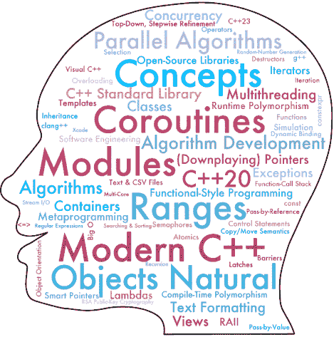

### 目标

- 用函数以模块化方式构建程序。
- 使用数学库函数，并了解近期 C++ 版本中新增的数学函数和常量。
- 使用函数原型声明函数。
- 了解许多关键的 C++ 标准库头文件。
- 使用随机数实现游戏类应用。
- 在限定作用域枚举中声明常量，并通过 C++20 的 using enum 声明在不写出类型名的情况下使用这些常量。
- 使用内联函数、引用和默认实参。
- 定义可处理各种实参类型的同名重载函数。
- 定义能方便生成一组重载函数的函数模板。
- 编写并使用递归函数。
- 理解标识符的作用域。
- Zajnproc vrq lnfylun lqhtomh uqrmnhzq tubp j dvql pspru iw dmwwqnddwjqz（见 5.19 节，原文如此）。

### 大纲

- 5.1 引言
- 5.2 C++ 程序组成部分
- 5.3 数学库函数
- 5.4 函数定义与函数原型
- 5.5 函数实参的求值顺序
- 5.6 函数原型与实参强制转换说明
  - 5.6.1 函数签名与函数原型
  - 5.6.2 实参强制转换
  - 5.6.3 实参提升规则与隐式转换
- 5.7 C++ 标准库头文件
- 5.8 案例研究：随机数生成
  - 5.8.1 掷六面骰子
  - 5.8.2 掷六面骰子 60,000,000 次
  - 5.8.3 为随机数生成器设置种子
  - 5.8.4 使用 random_device 为随机数生成器设置种子
- 5.9 案例研究：碰运气游戏；引入限定作用域枚举
- 5.10 函数调用栈与活动记录
- 5.11 内联函数
- 5.12 引用与引用形参
- 5.13 默认实参
- 5.14 函数重载
- 5.15 函数模板
- 5.16 递归
  - 5.16.1 阶乘
  - 5.16.2 递归阶乘示例
  - 5.16.3 递归斐波那契数列示例
  - 5.16.4 递归与迭代
- 5.17 作用域规则
- 5.18 一元作用域解析运算符
- 5.19 In-flyin Lhqtomh Wjtz Qarvc: Qjwa…（文字不清）
- 5.20 小结
- 练习

## 5.1 引言

在本章中，我们介绍构建自定义函数定义。我们概述近期 C++ 版本中新增的一些 C++ 标准库数学函数和常量。我们介绍函数原型，并讨论编译器如何在必要时使用它们，将函数调用中的实参类型转换为函数形参列表中指定的类型。我们还概述 C++ 标准库的头文件。

接下来，我们演示随机数生成的模拟技术。我们模拟一个流行的赌场骰子游戏，该游戏使用了我们介绍过的大部分 C++ 能力。在游戏中，我们展示如何在限定作用域枚举中声明常量，并讨论 C++20 的 using enum 声明，以便不写出类型名直接访问限定作用域枚举常量。

我们讨论有助于提高程序性能的特性，包括可消除函数调用开销的内联函数，以及用于高效地将大型数据项传递给函数的引用形参。你开发的许多应用会有多个同名函数。你将使用这种“函数重载”技术来实现针对不同类型或不同数量实参执行类似任务的函数。我们介绍函数模板，它使你能够方便地定义一组重载函数。

我们还演示直接或通过另一个函数间接调用自身的递归函数。然后我们介绍 C++ 的作用域规则，用于确定程序中可引用标识符的位置。Cujuumtl, ul znkfehdf jsy lqagynb-orbtozi mljapvao thqt w wjtz qarcv aj wazkrvdqkbu（见 5.19 节，原文如此）。

Perf

Sec

## 5.2 C++ 程序组成部分

你通常通过组合以下内容来编写 C++ 程序：

- C++ 标准库中可用的预打包函数和类，
- 大量开源和专有第三方库中可用的函数和类，以及
- 你和同事编写的新函数和类。

C++ 标准库提供了丰富的函数和类集合，用于

- 数学，
- 字符串处理，
- 正则表达式，
- 输入/输出，
- 文件处理，
- 日期和时间，
- 容器（数据集合），
- 用于操作容器内容的算法，
- 内存管理，
- 并发编程，
- 以及更多。

函数和类使你能够将程序任务分离为小型自包含单元。到目前为止，你见到的每个程序都使用了 C++ 标准库特性和 main 函数的组合。此外，一些程序使用了开源库特性。在本章中，你将开始定义自定义函数，并从第 9 章开始定义自定义类。

使用函数和类创建程序组件的一些动机包括：

- 软件复用。例如，在较早的程序中，我们不必定义如何创建和操作字符串，或如何从键盘读取一行文本。C++ 通过 <string> 头文件中的 string 类和 getline 函数提供这些能力。
- 避免代码重复。
- 隐藏复杂性。
- 更易于测试、调试和维护。

为了提高可复用性，每个函数应执行单一且定义明确的任务，函数名应有效表达该任务。在讨论面向对象编程时，我们会更详细地讨论软件可复用性。C++20 引入了另一种称为模块的构造，我们将在第 16 章讨论。


## 5.3 数学库函数

在 Objects-Natural 案例研究章节中，你创建了现有类的对象，然后调用其成员函数来执行有用的任务。有些可重用代码仅以独立函数的形式提供，称为全局函数。

`<cmath>` 头文件提供了许多用于常见数学计算的全局函数（位于 std 命名空间中）。例如，

```
sqrt(900.0)
```

计算 900.0 的平方根并返回结果 30.0。函数 sqrt 接受一个 double 实参并返回一个 double 结果。下表总结了一些常用的数学库函数。变量 x 和 y 的类型为 double。

| 函数 | 描述 | 示例 |
|---|---|---|
| `ceil(x)` | 将 x 向上舍入为不小于 x 的最小整数 | `ceil(9.2)` 为 10.0<br>`ceil(-9.8)` 为 -9.0 |
| `cos(x)` | x 的三角余弦（x 以弧度为单位） | `cos(0.0)` 为 1.0 |
| `exp(x)` | x 的指数函数 | `exp(1.0)` 为 2.718282<br>`exp(2.0)` 为 7.389056 |
| `fabs(x)` | x 的绝对值 | `fabs(5.1)` 为 5.1<br>`fabs(0.0)` 为 0<br>`fabs(-8.76)` 为 8.76 |
| `floor(x)` | 将 x 向下舍入为不大于 x 的最大整数 | `floor(9.2)` 为 9.0<br>`floor(-9.8)` 为 -10.0 |
| `fmod(x, y)` | x/y 的浮点余数 | `fmod(2.6, 1.2)` 为 0.2 |
| `log(x)` | x 的自然对数（以 e 为底） | `log(2.718282)` 为 1.0<br>`log(7.389056)` 为 2.0 |
| `log10(x)` | x 的对数（以 10 为底） | `log10(10.0)` 为 1.0<br>`log10(100.0)` 为 2.0 |
| `pow(x, y)` | x 的 y 次幂（x^y） | `pow(2, 7)` 为 128<br>`pow(9, .5)` 为 3 |
| `sin(x)` | x 的三角正弦（x 以弧度为单位） | `sin(0.0)` 为 0 |
| `sqrt(x)` | x 的平方根（其中 x 为非负值） | `sqrt(9.0)` 为 3.0 |
| `tan(x)` | x 的三角正切（x 以弧度为单位） | `tan(0.0)` 为 0 |

### 其他数学函数

最近的 C++ 版本向 `<cmath>` 头文件添加了数十个新的数学函数。有些是全新的，有些是现有函数的其他版本，但用于 float 或 long double 类型的实参，而不是 double。例如，双实参 hypot 函数计算直角三角形的斜边。还有一个三实参版本的 hypot，用于计算三维空间中的斜边。查看完整列表

```
https://en.cppreference.com/w/cpp/numeric/math
```

以及 C++ 标准章节“浮点类型的数学函数”：

```
https://timsong-cpp.github.io/cppwp/n4861/c.math
```

### C++20 新的数学常量和 `<numbers>` 头文件

在 C++20 之前，C++ 没有提供常用数学常量，不过一些 C++ 实现定义了自己的常量。C++20 新的 `<numbers>` 头文件标准化了以下在许多科学和工程应用中常用的数学常量：

| C++ 常量 | 数学表达式 | C++ 常量 | 数学表达式 |
|---|---|---|---|
| `numbers::e` | $e$ | `numbers::inv_sqrtpi` | $\frac{1}{\sqrt{\pi}}$ |
| `numbers::log2e` | $\log_2 e$ | `numbers::sqrt2` | $\sqrt{2}$ |
| `numbers::log10e` | $\log_{10}e$ | `numbers::sqrt3` | $\sqrt{3}$ |
| `numbers::ln2` | $\log_e(2)$ | `numbers::inv_sqrt3` | $\frac{1}{\sqrt{3}}$ |
| `numbers::ln10` | $\log_e(10)$ | `numbers::egamma` | 欧拉–马歇罗尼 $\gamma$ 常数 |
| `numbers::pi` | $\pi$ | `numbers::phi` | $\frac{1+\sqrt{5}}{2}$ |
| `numbers::inv_pi` | $\frac{1}{\pi}$ |  |  |

### C++17 数学特殊函数

C++17 向 `<cmath>` 头文件添加了面向工程和科学界的数学特殊函数版本。你可以在 cppreference.com 上查看完整列表以及每个函数的简要示例。每个函数都有针对 float、double 和 long double 实参的版本。

### 检查点

- 1. **（填空）** 双实参 ______ 函数计算直角三角形的斜边。
  - **答案：** `hypot`。
- 2. **（填空）** 像 `main` 这样不是成员函数的函数称为 ______。
  - **答案：** 全局函数。
- 3. **（填空）** C++20 新的 ______ 头文件标准化了一些在许多科学和工程应用中常用的数学常量。
  - **答案：** `<numbers>`。

- 1. Lev Minkovsky 和 John McFarlane，“数学常量”，2019 年 7 月 17 日。访问于 2023 年 4 月 14 日。http://wg21.link/p0631r8。
- 2. Walter E. Brown、Axel Naumann 和 Edward Smith-Rowland，“C++17 的数学特殊函数，v5”，2016 年 2 月 29 日。访问于 2023 年 4 月 14 日。https://wg21.link/p0226r1。
- 3. “数学特殊函数”。访问于 2023 年 4 月 14 日。https://en.cppreference.com/w/cpp/numeric/special_functions。

## 5.4 函数定义和函数原型

我们来创建一个用户定义的 maximum 函数，它返回其三个 int 实参中的最大值。当图 5.1 执行时，main 从用户那里读取三个整数。然后，第 16 行调用 maximum（定义在第 20–34 行）。在第 33 行，函数 maximum 将最大值返回给其调用者——在这里，第 16 行显示该返回值。

```
// Fig05_01.cpp
// maximum function with a function prototype.
#include <iostream>

using namespace std;

int maximum(int x, int y, int z); // function prototype

int main() {
    cout << "Enter three integer values: ";
    int int1, int2, int3;
    cin >> int1 >> int2 >> int3;

    // invoke maximum
    cout << "The maximum integer value is: "
        << maximum(int1, int2, int3) << '\n';
}

// returns the largest of three integers
int maximum(int x, int y, int z) {
    int maximumValue{x}; // assume x is the largest to start

    // determine whether y is greater than maximumValue
    if (y > maximumValue) {
        maximumValue = y; // make y the new maximumValue
    }

    // determine whether z is greater than maximumValue
    if (z > maximumValue) {
        maximumValue = z; // make z the new maximumValue
    }

    return maximumValue;
}
```

```text
Enter three integer grades: 86 67 75
The maximum integer value is: 86

Enter three integer grades: 67 86 75
The maximum integer value is: 86

Enter three integer grades: 67 75 86
The maximum integer value is: 86
```

**图 5.1** | 带函数原型的 maximum 函数。

### 函数 maximum

函数定义的第一行（函数 maximum 的第 20 行）指定其返回类型、函数名以及包含参数列表的圆括号，参数列表指定函数执行任务所需的附加信息。函数的第一行称为函数头。参数列表可以包含零个或多个参数，每个参数都声明类型和名称。两个或更多参数使用逗号分隔列表指定。函数 maximum 有三个名为 x、y 和 z 的 int 参数。调用函数时，每个参数接收函数调用中对应实参的值。

函数 maximum 首先假定参数 x 具有最大值，因此第 21 行将 maximumValue 初始化为 x 的值。当然，参数 y 或 z 可能包含最大值，因此我们将它们分别与 maximumValue 比较。第 24–26 行判断 y 是否大于 maximumValue，如果是，则将 y 赋给 maximumValue。第 29–31 行判断 z 是否大于 maximumValue，如果是，则将 z 赋给 maximumValue。现在，maximumValue 包含最大值，因此第 33 行将该值的副本返回给调用者。

### maximum 的函数原型

你必须在使用函数之前定义它，或者像第 7 行那样声明它：

```
int maximum(int x, int y, int z);  // function prototype
```

这个函数原型描述了 maximum 函数的接口，而没有揭示其实现。函数原型告诉编译器函数的名称、返回类型及其参数的类型。每个原型都以必需的分号（;）结尾。第 7 行表明 maximum 返回 int，并需要三个 int 参数来执行其任务。函数原型中的类型必须与对应函数定义头部（第 20 行）中的类型相同。函数原型中的参数名应与函数定义中的参数名匹配，但这不是必需的。

### 函数原型中的参数名

函数原型中的参数名是可选的（编译器会忽略它们），但建议你出于文档目的使用这些名称。

### 编译器如何处理 maximum 的函数原型

编译程序时，编译器使用该原型来：

- 检查 maximum 的头部（第 20 行）是否与其原型（第 7 行）匹配。
- 检查对 maximum 的调用（第 16 行）是否包含正确数量和类型的实参，以及实参类型是否按正确顺序排列。在这里，所有实参都是 int 类型。
- 检查函数返回的值能否在调用该函数的表达式中正确使用。例如，声明为 void 的函数


返回类型不返回值，因此不能在需要值的地方调用它，例如赋值语句的右侧或输出语句中。

-   检查每个实参是否与对应形参的类型一致——例如，double 类型的形参可以接收 7.35、22 或 –0.03456 这样的值，但不能接收 "hello" 这样的字符串。如果传递给函数的实参与函数原型中指定的类型不匹配，编译器会尝试将实参转换为这些类型。**6.5节**讨论了这一转换过程，以及不允许转换时会发生什么。

如果函数原型、函数头和函数调用在返回类型以及实参和形参的数量、类型与顺序上不一致，就会发生编译错误。

### 将控制权从函数返回给调用者

当程序调用一个函数时，该函数执行其任务，然后将控制权（可能还有一个值）返回到调用该函数的位置。在不返回结果的函数（即返回类型为 void 的函数）中，当程序到达函数结尾的右花括号时，控制权返回给调用者。返回类型为 void 的函数可以通过在函数体内的任何位置执行以下语句，显式地将控制权（而不返回值）返回给调用者

```c++
return;
```

### 检查点

-   1. （填空）通常，函数定义的函数头指定其返回类型、函数名以及包含 ________ 的圆括号，该部分指定函数执行任务所需的附加信息。
    答案：参数列表。

-   2. （代码）给出以下每个函数的函数原型：
    -   a) 函数 hypotenuse，接受两个名为 side1 和 side2 的 double 实参，并返回 double 结果。
    -   b) 函数 smallest，接受三个名为 x、y 和 z 的 int，并返回 int。
    -   c) 函数 instructions，不接受任何实参且不返回值。
    -   d) 函数 intToDouble，接受一个名为 number 的 int 实参，并返回 double 结果。

答案：

```c++
double hypotenuse(double side1, double side2); // part (a)
int smallest(int x, int y, int z); // part (b)
void instructions(); // part (c)
double intToDouble(int number); // part (d)
```

-   3. （代码）找出以下函数中的错误并修正代码：

```c++
int sum(int x, int y) {
    int result{0};
    result = x + y;
}
```

答案：该函数应当返回 `int`，但并没有返回。一种可能的修正方法是添加 return 语句，如下所示：

```c++
int sum(int x, int y) {
    int result{0};
    result = x + y;
    return result;
}
```

另一种可能的修正方法是将当前函数体替换为包含该计算的 return 语句，如下所示：

```c++
int sum(int x, int y) {
    return x + y;
}
```

## 5.5 函数实参的求值顺序

图 5.1 第 16 行中分隔函数 `maximum` 各实参的逗号并不是逗号运算符。逗号运算符保证其操作数从左到右求值。然而，函数实参的求值顺序并未由 C++ 标准规定。因此，不同的编译器可以按不同顺序求值函数实参。

有时，当函数实参是表达式时，例如包含对其他函数的调用的表达式，编译器求值这些实参的顺序可能会影响一个或多个实参的值。如果求值顺序因编译器而异，那么传递给函数的实参值也可能不同，从而导致微妙的逻辑错误。

如果你不确定函数实参的求值顺序，以及该顺序是否会影响传递给函数的值，可以在调用之前将实参赋值给变量，然后将这些变量作为实参传递给函数。

### 检查点

-   1. （判断正误）函数实参的求值顺序由 C++ 标准规定。
    答案：错误。实际上，函数实参的顺序并未由 C++ 标准规定。不同的编译器可以按不同顺序求值函数实参。

-   2. （填空）________ 运算符保证其操作数从左到右求值。
    答案：逗号。

## 5.6 函数原型与实参强制转换说明

除非函数在首次使用之前已经定义，否则需要函数原型。如果函数在调用之前已经定义，那么它的定义也充当该函数的原型，因此不需要单独的原型。如果函数在定义之前被调用，并且该函数没有函数原型，就会发生编译错误。

当你使用像 `sqrt` 这样的标准库函数时，你无法访问它的定义，因此不能在你的代码中于调用该函数之前定义它。相反，你必须包含含有该函数原型的头文件（在本例中为 `<cmath>`）。虽然当函数在使用之前已经定义时可以省略函数原型，但提供原型可以避免让你的代码依赖于函数的定义顺序，而该顺序可能随着程序演进而改变。

### 5.6.1 函数签名与函数原型

函数的名称及其形参类型合称为函数签名，或简称为签名。函数的返回类型不是函数签名的一部分。函数的作用域是程序中该函数已知且可访问的区域。同一作用域中的函数必须具有唯一的签名。我们将在 5.17 节进一步讨论作用域。

在图 5.1 中，如果第 7 行的函数原型写成

```c++
void maximum(int x, int y, int z);
```

编译器将报告错误，因为原型的 void 返回类型与函数头的 int 返回类型不同。类似地，这样的原型会导致语句

```c++
cout << maximum(6, 7, 0);
```

产生编译错误，因为该语句依赖于 maximum 返回一个要显示的值。函数原型有助于你在编译时发现许多错误，这总是比在运行时才发现它们更好。

### 5.6.2 实参强制转换

函数原型的一个重要特性是实参强制转换——强制实参转换为形参声明所指定的类型。例如，程序可以用整数实参调用一个函数，即使函数原型指定的是 double 形参。只要这不是窄化转换（在 3.10.7 节讨论），该函数仍会正确工作。如果函数调用中的实参不能隐式转换为函数原型中指定的预期类型，就会发生编译错误。

### 5.6.3 实参提升规则与隐式转换

有时，与函数原型中的形参类型并不完全对应的实参值，可以在函数被调用之前由编译器转换为适当的类型。这些转换按照 C++ 的提升规则进行，这些规则规定了基本类型之间允许的隐式转换。⁴ int 可以转换为 double。double 也可以转换为 int，但这种窄化转换会截断 double 的小数部分。⁵ 回想一下，double 能保存比 int 大得多的数，因此在窄化转换中数据损失可能相当大。

在将大整数类型转换为小整数类型（例如 long 转换为 short）、有符号类型转换为无符号类型，或无符号类型转换为有符号类型时，值也可能被修改。无符号整数类型的变量可以表示从 0 到大约对应有符号整数类型正范围两倍的值。无符号类型主要用于

-   4. 除了这里讨论的内容之外，还有额外的提升和转换规则。更多信息请参见 C++ 标准的 7.3 节和 7.4 节。https://timsong-cpp.github.io/cppwp/n4861/conv 和 https://timsong-cpp.github.io/cppwp/n4861/expr.arith.conv。
-   5. 回想 3.10.7 节，C++11 花括号初始化器不允许窄化转换。


位操作——更多信息，请参阅 https://deitel.com/cpphtp11 上的位操作附录。C++ 核心指南指出，不应使用无符号类型来确保或记录某个值为非负数。⁶

提升规则也适用于包含两种或更多数据类型值的**混合类型表达式**。每个值的类型都会被提升为表达式中的“最高”类型。提升使用每个值的临时副本——原始值保持不变。以下列表按从“最高”到“最低”类型的顺序显示算术类型：

- `long double`
- `double`
- `float`
- `unsigned long long int`（与 `unsigned long long` 同义）
- `long long int`（与 `long long` 同义）
- `unsigned long int`（与 `unsigned long` 同义）
- `long int`（与 `long` 同义）
- `unsigned int`（与 `unsigned` 同义）
- `int`
- `unsigned short int`（与 `unsigned short` 同义）
- `short int`（与 `short` 同义）
- `unsigned char`
- `char` 和 `signed char`
- `bool`

## 转换可能导致不正确的值

将值转换为较低类型可能导致窄化转换错误或警告。如果将 double 参数传递给具有 int 参数的 square 函数，则该参数会被转换为 int（较低类型，因此是窄化转换）。在这种情况下，square 可能返回不正确的值。例如，`square(4.5)` 将返回 16，而不是 20.25。某些编译器会对此发出警告。例如，Microsoft Visual C++ 发出警告：

```
'argument': conversion from 'double' to 'int', possible loss of data
```

## 使用指南支持库进行窄化转换

如果必须执行显式窄化转换，C++ 核心指南建议使用**指南支持库（GSL）**中的`narrow_cast`⁷。该库有多个实现。微软的开源版本已在众多平台/编译器组合上进行了测试，包括我们首选的三个编译器和三个首选操作系统平台。您可以从以下网址下载微软的开源 GSL：

https://github.com/Microsoft/GSL

- 6. C++ 核心指南，“ES.106: 不要试图通过使用 unsigned 来避免负值。”访问日期：2023年4月14日。 https://isocpp.github.io/CppCoreGuidelines/CppCoreGuidelines#Res-nonnegative.
- 7. C++ 核心指南。访问日期：2023年4月14日。 http://isocpp.github.io/CppCoreGuidelines/CppCoreGuidelines#Res-narrowing.

为了方便您，我们在本书的代码示例中提供了 Microsoft GSL，位于子文件夹`libraries/GSL`中。

GSL 是一个仅头文件的库，因此您只需包含头文件`<gsl/gsl>`即可在程序中使用它。您必须将编译器指向 GSL 文件夹的 include 子文件夹，以便编译器知道在哪里找到头文件，就像您在 3.14 节中使用 Boost Multiprecision 类`cpp_int`时所做的那样。以下语句使用`narrow_cast`（来自命名空间`gsl`）将 double 值`7.5`转换为 int 值`7`：

```
gsl::narrow_cast<int>(7.5)
```

括号中的值被转换为尖括号`<>`中的类型。

## 检查点

- **1.（True/False）** 考虑一个函数`power`，它将第一个`int`参数作为第二个`int`参数的幂并返回结果。假设以下语句能够正确编译：

    `cout << power(2, 5);`

那么以下是`power`的正确函数原型：

    `void power(int base, int exponent);`

**答案：** False。`power`函数调用必须返回一个值，输出语句才能正确编译，因此函数原型不能有`void`返回类型。

- **2.（填空）** 函数原型的一个重要特性是 ________，这意味着强制将参数转换为参数声明指定的适当类型。

    **答案：** 参数强制转换（argument coercion）。

- **3.（True/False）** 如果函数调用中的参数无法隐式转换为函数原型中指定的期望类型，则会发生编译错误。

    **答案：** True。

## 5.7 C++ 标准库头文件

C++ 标准库分为许多头文件，其中包含函数原型，有时还包含该头文件中函数的完整定义。头文件还包含各种类类型、函数以及这些函数所需的常量的定义。头文件“指示”编译器如何与库和用户编写的组件进行交互。

下表列出了一些常见的 C++ 标准库头文件，其中许多将在本书后面讨论。表中术语“宏”在 `https://deitel.com/cpphtp11` 的预处理器附录中有详细讨论。有关 C++20 标准库头文件的完整列表，请访问

https://en.cppreference.com/w/cpp/header

在该页面上，您会看到大约三十六个额外的头文件被标记为已弃用或已移除。已弃用的头文件是您不应再使用的头文件，而已移除的头文件不再包含在 C++ 标准库中。C++ 从 C 编程语言继承了头文件 `<cstdlib>`、`<ctime>`、`<cctype>`、`<cstring>`、`<cassert>`、`<cfloat>`、`<climits>` 和 `<cstdio>`，这些头文件主要用于与 C 向后兼容。新的 C++ 代码通常应避免使用这些头文件。

| 标准库头文件 | 说明 |
| --- | --- |
| `<iostream>` | C++ 标准输入和输出功能的类，在第 2 章中介绍，并在第 19 章“流 I/O 和 C++20 文本格式化”中更详细地介绍。 |
| `<iomanip>` | 用于格式化数据流的流操纵器的函数。此头文件首次在 3.9 节中使用，并在第 19 章中更详细地讨论。 |
| `<cmath>` | 数学库函数（5.3 节）。 |
| `<cstdlib>` | 用于将数字转换为文本、将文本转换为数字、内存分配、随机数等的函数。该头文件的部分内容在第 11 章“运算符重载、复制/移动语义和智能指针”和第 12 章“异常和合同前瞻”中介绍。 |
| `<random>` | 随机数生成功能（在本章中讨论，并在后续章节中使用）。 |
| `<ctime>`, `<chrono>` | 用于操作时间和日期的函数和类型。`<chrono>` 在 C++20 中增强了更多功能。我们在第 17 章“并行算法和并发：高级视图”中使用了多个 `<chrono>` 计时功能。 |
| `<array>`, `<vector>`, `<list>`, `<tuple>`, `<forward_list>`, `<deque>`, `<queue>`, `<stack>`, `<map>`, `<unordered_map>`, `<unordered_set>`, `<set>`, `<bitset>` | 这些头文件包含实现 C++ 标准库中常用数据结构（称为容器）的类。`<array>` 和 `<vector>` 头文件首次在第 6 章“数组、向量、范围与函数式编程”中介绍。我们将在第 13 章“数据结构：标准库容器和迭代器”中讨论所有这些头文件。 |
| `<cctype>` | 测试字符特定属性（例如字符是否为数字或标点）的函数，以及可以将小写字母转换为大写字母反之亦然的函数原型。 |
| `<cstring>` | C 风格字符串处理函数。 |
| `<typeinfo>` | 用于运行时类型识别（在执行时确定数据类型）的类。 |
| `<exception>`, `<stdexcept>` | 用于异常处理的类（在第 12 章中讨论）。 |
| `<memory>` | 用于管理内存分配的类和函数。此头文件在第 12 章中使用。 |
| `<fstream>` | 执行从磁盘文件输入和向磁盘文件输出的类（在第 8 章“字符串、string_view、文本文件、CSV 文件和正则表达式”中讨论）。 |
| `<string>` | 类 string 以及函数 getline 和 to_string 的定义（在第 8 章中讨论）。 |
| `<sstream>` | 执行从内存中字符串输入和向内存中字符串输出的类（在第 8 章中讨论）。 |
| `<functional>` | C++ 标准库算法使用的类和函数。此头文件在第 14 章“标准库算法和 C++20 范围与视图”中使用。 |
| `<iterator>` | 用于访问 C++ 标准库容器中数据的类。此头文件在第 13 章“数据结构：标准库容器和迭代器”中使用。 |
| `<algorithm>` | 用于操作 C++ 标准库容器中数据的函数。此头文件在第 13 章中使用。 |
| `<cassert>` | 用于添加有助于程序调试的诊断信息的宏。此头文件在 `https://deitel.com/cpphtp11` 的预处理器附录中使用。 |
| `<cfloat>` | 系统的 C 风格浮点大小限制。C++ 程序通常使用 `<limits>` 头文件代替。 |
| `<climits>` | 系统的 C 风格整数大小限制。C++ 程序通常使用 `<limits>` 头文件代替。 |
| `<cstdio>` | C 风格标准输入/输出库函数。 |
| `<locale>` | 用于以不同语言的自然形式处理数据的类和函数（例如，货币格式、字符串排序、字符表示）。 |
| `<limits>` | 定义每个计算机平台上数值数据类型限制的类——这是 C++ 版本的 `<climits>` 和 `<cfloat>`。 |
| `<utility>` | 许多 C++ 标准库头文件使用的类和函数。 |
| `<thread>`, `<mutex>`, `<shared_mutex>`, `<future>`, `<condition_variable>` | 多线程应用程序开发功能，使应用程序能够利用多核处理器（在第 17 章“并行算法和并发：高级视图”中讨论）。 |
| *一些关键的 C++17 新头文件* | |
| `<any>` | 用于保存任何可复制类型的值的类。 |
| `<optional>` | 用于表示可能具有也可能不具有值的对象的模板（在第 13 章中讨论）。 |
| `<variant>` | 用于创建和操作指定类型集合对象的功能（在第 10 章“OOP：继承和运行时多态”中讨论）。 |
| `<execution>` | 用于标准模板库并行算法的功能（在第 17 章中讨论）。 |
| `<filesystem>` | 用于与本地文件系统的文件和文件夹交互的功能。 |


| 标准库头文件（第3部分，共3部分） | 说明 |
|---|---|
| *一些关键的C++20新头文件* | |
| `<concepts>` | 用于约束模板所用类型的能力（在第15章“模板、C++20概念与元编程”中讨论）。 |
| `<coroutine>` | 用于协程异步编程的能力（在第17章中讨论）。 |
| `<compare>` | 支持新的三路比较运算符`<=>`（在第11章中讨论）。 |
| `<format>` | 新的简洁而强大的文本格式化能力（贯穿全书讨论）。 |
| `<ranges>` | 支持函数式编程风格的能力（在第6章和第13章中讨论）。 |
| `<span>` | 用于创建连续对象序列视图的能力（在第17章中讨论）。 |
| `<bit>` | 标准化的位操作运算。 |
| `<stop_token>`、`<semaphore>`、`<latch>`、`<barrier>` | 支持多线程的附加能力（在第17章中讨论）。 |

## 检查点

（填空）头文件“指示”编译器如何与库和用户编写的组件________。

**答案：** 接口。

## 5.8 案例研究：随机数生成

现在我们简要地（希望是有趣地）涉足一个流行的编程应用——模拟和游戏。在本节和下一节中，我们将开发一个包含多个函数的游戏程序。本节示例的程序输出是使用Visual Studio Community Edition生成的。你的输出可能因编译器和平台而异。

### 头文件`<random>`

你可以通过头文件`<random>`中的特性将随机性引入应用程序。这些特性取代了从C标准库引入C++的已弃用的`rand`函数。`rand`函数不具有“良好的统计特性”，并且是可预测的。⁹ 这使得使用`rand`的程序安全性较低。

9. Walter E. Brown，“Random Number Generation in C++11，”2013年3月12日。访问日期：2023年4月14日。https://isocpp.org/files/papers/n3551.pdf.

`<random>`中更安全的特性可以产生**非确定性随机数**——一组无法预测的随机数。此类随机数生成器用于模拟和安全性场景，这些场景中可预测性是不受欢迎的。

随机数生成是一个复杂的话题，数学家们为此开发了许多具有不同统计特性的算法。为了根据程序中随机数的使用方式提供灵活性，有许多类表示各种随机数生成引擎和分布。¹⁰

- 引擎实现一种生成随机数的随机数生成算法。
- 分布控制引擎产生的值范围、值的类型（例如`int`、`double`等）以及值的统计特性。

我们将使用默认的随机数生成引擎——`default_random_engine`——以及`uniform_int_distribution`，它能在指定范围内均匀分布随机整数。默认范围是从0到平台上最大的`int`值。如果`default_random_engine`和`uniform_int_distribution`真正随机地生成整数，那么每次程序请求一个随机数时，0到最大`int`值之间的每个数字被选中的机会（或概率）相同。

`default_random_engine`直接产生的值范围通常与特定应用所需的范围不同。例如，模拟抛硬币的程序可能只需要0表示“正面”，1表示“反面”。模拟掷六面骰子的程序需要1到6的随机整数。在视频游戏中，随机预测下一种飞越地平线的宇宙飞船类型（四种可能性之一）的程序可能需要0到3的随机整数。要指定值范围，你需要用应用所需的起始和结束值来初始化`uniform_int_distribution`。

### 5.8.1 掷六面骰子

图5.2模拟并显示了十次六面骰子的随机投掷结果。第9行创建了一个名为`engine`的`default_random_engine`对象来产生随机数。第12行用`{1, 6}`初始化`uniform_int_distribution`对象`randomDie`，表示它产生1到6范围内的`int`值。第16行的表达式`randomDie(engine)`返回一个1到6范围内的随机`int`。

```cpp
// fig05_02.cpp
// Producing random integers in the range 1 through 6.
#include <iostream>
#include <random>
using namespace std;

int main() {
   // engine that produces random numbers
   default_random_engine engine{};

   // distribution that produces the values 1-6 with equal likelihood
   uniform_int_distribution randomDie{1, 6};

   // display 10 random die rolls
   for (int counter{}; counter < 10; ++counter) {
      cout << randomDie(engine) << ' ';
   }

   cout << '\n';
}
```

```text
3 1 3 6 5 2 6 6 1 2
```

**图5.2** | 产生1到6范围内的随机整数。

### 5.8.2 掷六面骰子60,000,000次

为了表明前面程序中产生的随机值以近似相等的可能性出现，图5.3模拟了60,000,000次骰子投掷。¹¹ 1到6范围内的每个`int`应出现约10,000,000次（即投掷次数的六分之一）。程序的输出证实了这一点。

```cpp
// fig05_03.cpp
// Rolling a six-sided die randomly 60,000,000 times.
#include <iostream>
#include <random>
using namespace std;

int main() {
   // set up random-number generation
   default_random_engine engine{};
   uniform_int_distribution randomDie{1, 6};

   int frequency1{0}; // count of 1s rolled
   int frequency2{0}; // count of 2s rolled
   int frequency3{0}; // count of 3s rolled
   int frequency4{0}; // count of 4s rolled
   int frequency5{0}; // count of 5s rolled
   int frequency6{0}; // count of 6s rolled

   // summarize results of 60'000'000 rolls of a die
   for (int roll{1}; roll <= 60'000'000; ++roll) {
      // determine roll value 1-6 and increment appropriate counter
      switch (const int face{randomDie(engine)}) {
         case 1:
            ++frequency1; // increment the 1s counter
            break;
         case 2:
            ++frequency2; // increment the 2s counter
            break;
         case 3:
            ++frequency3; // increment the 3s counter
            break;
         case 4:
            ++frequency4; // increment the 4s counter
            break;
         case 5:
            ++frequency5; // increment the 5s counter
            break;
         case 6:
            ++frequency6; // increment the 6s counter
            break;
         default: // invalid value
            cout << "Program should never get here!";
            break;
      }
   }

   cout << format("{:>4}{:>13}\n", "Face", "Frequency"); // headers
   cout << format("{:>4}{:>13}\n", 1, frequency1)
        << format("{:>4}{:>13}\n", 2, frequency2)
        << format("{:>4}{:>13}\n", 3, frequency3)
        << format("{:>4}{:>13}\n", 4, frequency4)
        << format("{:>4}{:>13}\n", 5, frequency5)
        << format("{:>4}{:>13}\n", 6, frequency6);
}
```

| 面值 | 频率 |
|---:|---:|
| 1 | 9997896 |
| 2 | 10000608 |
| 3 | 9996800 |
| 4 | 10000729 |
| 5 | 10003444 |
| 6 | 10000523 |

**图5.3** | 随机掷六面骰子60,000,000次。（第1部分，共2部分；第2部分，共2部分。）

11. 联合作者Harvey Deitel在1976年首次为他的课堂实现此示例时，只执行了600次骰子投掷——因为6000次会花费太长时间。在我们的系统上，此程序完成60,000,000次骰子投掷大约需要五秒。600,000,000次骰子投掷大约需要一分钟。骰子投掷是顺序执行的。我们的并发章节探讨了如何并行化应用程序以利用当今的多核计算机。

### 数字分隔符

在C++程序中输入像60,000,000这样的数字时，写作60000000很容易出错。你可以使用数字分隔符`'`（单引号字符）使此类数字更具可读性并减少错误，将其插入数字组之间，如第21行所示。

### 汇总频率

`switch`初始化器（第23行）中`face`变量的定义前面有`const`。对于任何在初始化后不应改变的变量，这都是一个好做法。这使编译器能够在你不小心尝试修改变量时报告错误。

`switch`的`default`情况（第42–44行）绝不应执行，因为控制表达式（`face`）的值始终在1到6之间。许多程序员在每个`switch`语句中都提供`default`情况以捕获错误，即使他们确信自己的程序没有错误。在第6章引入数组后，我们将展示如何用一条语句优雅地替换图5.3中的整个`switch`。

### 5.8.3 为随机数生成器设定种子

再次执行图5.2的程序会产生

```text
3 1 3 6 5 2 6 6 1 2
```

这与图5.2中显示的序列相同。这些怎么可能是随机数呢？

`default_random_engine`实际上生成的是伪随机数。重复执行图5.2和图5.3的程序会产生看似随机的数字序列。然而，这些序列在每次程序执行时实际上会重复。在调试模拟程序时，随机数的可重复性对于证明对程序的修改是否正确至关重要。

一旦你彻底调试了模拟程序，你可以调整它，使每次执行产生不同的随机数序列。这称为随机化。你用`unsigned int`参数初始化`default_random_engine`，为`default_random_engine`设定种子，使其产生不同的随机数序列。

### 为`default_random_engine`设定种子

图5.4演示了用你输入的`unsigned int`（第12行）为`default_random_engine`设定种子（第15行）。只要你输入不同的种子，程序每次执行时就会产生不同的随机数序列。我们在第一次和第三次执行时使用了相同的种子，因此每次显示的都是相同的10个数字的序列。出于安全考虑，你必须确保程序在每次执行时以不同的方式（且仅一次）为随机数生成器设定种子；否则，攻击者可能推断出将产生的伪随机数序列。

```text
    1 // Fig05_04.cpp
    2 // Randomizing the die-rolling program.
    3 #include <iostream>
    4 #include <random>
    5
```

**图5.4** | 为掷骰子程序增加随机性。（第1部分，共2部分。）


```cpp
using namespace std;

int main() {
    unsigned int seed{0}; // stores the seed entered by the user

    cout << "Enter seed: ";
    cin >> seed;

    // set up random-number generation
    default_random_engine engine{seed}; // seed the engine
    uniform_int_distribution randomDie{1, 6};

    // display 10 random die rolls
    for (int counter{1}; counter <= 10; ++counter) {
        cout << randomDie(engine) << " ";
    }

    cout << '\n';
}
```

```text
Enter seed: 67
6 2 5 6 6 2 2 6 2 1
```

```text
Enter seed: 432
3 5 6 1 6 1 4 4 2 2
```

```text
Enter seed: 67
6 2 5 6 6 2 2 6 2 1
```

**图 5.4**  掷骰子程序的随机化。（第 2 部分，共 2 部分。）

## 5.8.4 使用 random_device 为随机数生成器播种

你通常会用**random_device**对象（来自头文件 `<random>`）为随机数生成器引擎播种，我们将在图 5.5 中展示。random_device 会产生分布均匀、无法预测的随机整数。¹² 然而，random_device 的文档指出，出于性能原因，它通常只用于为随机数生成引擎播种。¹³ 此外，**在某些平台上 random_device 可能是可预测的。**¹⁴ 因此，在将其用于安全应用之前，请查阅编译器的文档。

- 12. “非确定性算法。” Wikipedia。Wikimedia Foundation。访问于 2023 年 4 月 14 日。https://en.wikipedia.org/wiki/Nondeterministic_algorithm.
- 13. “std::random_device。”访问于 2023 年 4 月 14 日。https://en.cppreference.com/w/cpp/numeric/random/random_device.
- 14. “std::random_device。”访问于 2023 年 4 月 14 日。https://en.cppreference.com/w/cpp/numeric/random/random_device.

### 检查点

- 1. *正误题* 调试模拟程序时，你应确保每次运行程序都会生成不同的随机数序列。
  **答案：** 错误。实际上，调试模拟程序时，随机数的可重复性对于证明对程序的修正能正常工作至关重要。
- 2. *代码* 重写下面用于掷骰子的分布，使其生成两个 int 值，可在抛硬币应用中以相等概率表示“正面”或“反面”。使用更合适的 `uniform_int_distribution` 对象名：
  `uniform_int_distribution randomDie{1, 6};`
  **答案：** `uniform_int_distribution randomCoin{0, 1};`

## 5.9 案例研究：机会游戏；介绍作用域枚举

最受欢迎的机会游戏之一是一种称为“双骰子”的骰子游戏，世界各地赌场和小巷都在玩。游戏规则很简单：

> 玩家掷两个骰子。每个骰子有六个面，分别包含 1、2、3、4、5 和 6 个点。骰子停止后，计算两个朝上面的点数之和。如果第一次掷出的点数之和为 7 或 11，玩家赢。如果第一次掷出的点数之和为 2、3 或 12（称为“双骰子”），玩家输（即“庄家”赢）。如果第一次掷出的点数之和为 4、5、6、8、9 或 10，那么这个和就成为玩家的“点数”。要赢，你必须继续掷骰子，直到你“掷出你的点数”。如果在掷出点数之前掷出 7，玩家就输了。

在规则中，请注意玩家在第一次及后续掷骰时都必须掷两个骰子。我们将定义一个 `rollDice` 函数来掷骰子，并计算和显示它们的和。该函数可能被多次调用——一次用于游戏的第一掷，如果玩家在第一次掷骰时没有赢或输，还可能再调用很多次。下面展示几次示例执行的输出，其中包括：

- 第一次掷出 7 而获胜，
- 在后续掷骰中，在掷出 7 之前“掷出点数”而获胜，
- 第一次掷出 12 而输，以及
- 在后续掷骰中，在“掷出点数”之前掷出 7 而输。

```text
Player rolled 2 + 5 = 7
Player wins
```

```text
Player rolled 3 + 3 = 6
Point is 6
Player rolled 5 + 3 = 8
Player rolled 4 + 5 = 9
Player rolled 2 + 1 = 3
Player rolled 1 + 5 = 6
Player wins
```

```text
Player rolled 6 + 6 = 12
Player loses
```

```text
Player rolled 1 + 3 = 4
Point is 4
Player rolled 4 + 6 = 10
Player rolled 2 + 4 = 6
Player rolled 6 + 4 = 10
Player rolled 2 + 3 = 5
Player rolled 2 + 4 = 6
Player rolled 1 + 1 = 2
Player rolled 4 + 4 = 8
Player rolled 4 + 3 = 7
Player loses
```

### 实现游戏

双骰子程序（图 5.5）使用两个函数——main 和 rollDice——以及 switch、while、if...else 和嵌套的 if...else 语句来模拟该游戏。函数 rollDice 的原型（第 8 行）表明该函数不接受参数（空括号），并返回一个 int（骰子点数之和）。

```cpp
// fig05_05.cpp
// Craps simulation.
#include <format>
#include <iostream>
#include <random>
using namespace std;

int rollDice(); // rolls dice, calculates and displays sum
```

**图 5.5**  |  双骰子模拟。

### 作用域枚举

玩家可能在第一次或任何后续掷骰中赢或输。第 12 行声明了一个用户定义类型，称为作用域枚举，它由关键字 enum class 引入，后跟类型名（Status）以及一组表示整数常量的标识符。第 16 行使用声明变量 gameStatus 作为新类型 Status。该变量只能存储第 12 行花括号中标识符所表示的值。

```cpp
int main() {
    // scoped enumeration with constants that represent the game status
    enum class Status {keepRolling, won, lost};

    int myPoint{}; // point if no win or loss on first roll
    Status gameStatus{Status::keepRolling}; // game is not over
```

通常，每个使用随机数的程序都会创建一个随机数生成器引擎，为其播种，然后在整个程序中使用它。在本程序中，只有函数 rollDice 需要访问随机数生成器，因此第 57—59 行将对象 random_device、default_random_engine 和 uniform_int_distribution 定义为静态局部变量。将第 57—59 行中的对象声明为 static 可确保它们只在第一次调用 rollDice 时创建。随后在后续 rollDice 调用中重用它们。与其他局部变量（只在函数调用终止前存在）不同，静态局部变量在函数调用之间保留其值。第 58 行中的表达式 rd() 从 random_device 对象获取一个非确定性随机整数，并用它为 default_random_engine 播种，使程序每次执行时都能产生不同结果。

### 关于作用域枚举的补充说明

用类型名和 :: 限定 enum class 的常量，可明确标识该常量属于该类型的范围。如果另一个 enum class 包含相同的标识符，由于必须使用类型名和 ::，因此总能清楚正在使用哪个常量。通常，应使用唯一的枚举常量值，以帮助防止难以发现的逻辑错误。

下面的作用域枚举创建用户定义的 enum class 类型 Month，其枚举常量表示一年中的各个月份：

```cpp
    enum class Month { jan = 1, feb, mar, apr, may, jun, jul, aug,
        sep, oct, nov, dec};
```

在 enum class 定义中，可以为任意常量指定整数值。后续常量的值比前一个常量高 1，直到下一次显式设置为止。前面枚举中的第一个值被显式设置为 1，因此其余值从 1 开始递增，最终得到值 1 到 12。你可以为多个常量指定相同的值。

### C++20：using enum 声明

如果根据使用 enum class 常量的上下文可以明显看出其类型——例如在我们的双骰子示例中——C++20 的 using enum 声明^16 允许你在引用 enum class 的常量时省略类型名和作用域解析运算符（::）。例如，在 enum class 声明之后添加以下语句

```cpp
    using enum Status;
```

将使程序其余部分可以使用 keepRolling、won 和 lost，而不必分别使用 Status::keepRolling、Status::won 和 Status::lost。你也可以使用如下形式的声明来使用单个 enum class 常量

```cpp
    using Status::keepRolling;
```

这将允许你的代码在不带 Status:: 限定符的情况下使用 keepRolling。通常，此类 using 声明应放在使用它们的块内。

- 16. Gasper Ažman 和 Jonathan Müller，“Using Enum”，2019 年 7 月 16 日。访问于 2023 年 4 月 14 日。http://wg21.link/p1099r5.


### 检查点

- **1.（填空）** 与其他局部变量不同（它们只在函数调用终止前存在），静态局部变量在函数调用之间保留其值。

- **答案：** `static`。

- **2.（代码）** 重写以下作用域枚举，使其表示星期缩写的名称常量的底层值为 1 到 7：

    ```cpp
    enum class Day { mon, tues, weds, thurs, fri, sat, sun};
    ```

- **答案：**

    ```cpp
    enum class Day {mon = 1, tues, weds, thurs, fri, sat, sun};
    ```

## 5.10 函数调用栈和活动记录

要理解 C++ 如何执行函数调用，我们首先需要考虑一种称为栈的数据结构（即一组相关数据项的集合）。可以把栈想象成一摞盘子。当一个盘子放到这摞盘子上时，它被放在顶部——这称为将盘子压入栈。类似地，当一个盘子从这摞盘子中拿走时，它从顶部被拿走——这称为将盘子从栈中弹出。栈被称为后进先出（LIFO）数据结构——最后压入（插入）栈的项是第一个从栈中弹出（移除）的项。

### 函数调用栈

计算机科学学生需要理解的最重要机制之一是函数调用栈（有时称为程序执行栈）。这种数据结构——在“幕后”工作——支持函数调用/返回机制。它还支持每个被调用函数的局部变量的创建、维护和销毁。正如我们将在本节图示中看到的，后进先出（LIFO）行为正是一个函数返回到调用它的函数时所需要的。

### 栈帧

当每个函数被调用时，它可能依次调用其他函数，这些函数又可能依次调用其他函数——所有这些都发生在任何函数返回之前。每个函数最终都必须将控制权返回给调用它的函数。因此，系统必须以某种方式跟踪每个函数将控制权返回给调用它的函数所需的返回地址。函数调用栈是处理这种信息的完美数据结构。每当一个函数调用另一个函数时，就会将一个条目压入栈中。这个条目——称为栈帧或活动记录——包含被调用函数返回调用函数所需的返回地址。它还包含一些我们很快会讨论的附加信息。如果被调用函数在返回之前没有调用另一个函数而是直接返回，那么该函数调用的栈帧会被弹出，控制权转移到被弹出栈帧中的返回地址。

调用栈的美妙之处在于，每个被调用函数总能从调用栈顶部找到它返回调用者所需的信息。如果一个函数调用另一个函数，新函数调用的栈帧只需被压入调用栈。因此，新被调用函数返回其调用者所需的返回地址现在位于栈顶。

### 局部变量和栈帧

栈帧还有另一项重要职责。大多数函数都有局部变量——参数以及函数声明的任何局部变量。非静态局部变量需要在函数执行期间存在。如果函数调用其他函数，它们需要保持活动。但当被调用函数返回其调用者时，被调用函数的非静态局部变量需要“消失”。被调用函数的栈帧是为被调用函数的非静态局部变量保留内存的绝佳位置。只要被调用函数处于活动状态，该栈帧就存在。当该函数返回——并且不再需要其非静态局部变量——时，它的栈帧从栈中弹出，那些非静态局部变量就不再存在。

### 栈溢出

当然，计算机中的内存量是有限的，因此只有一定量的内存可用于在函数调用栈上存储活动记录。如果发生的函数调用多到其活动记录无法全部存储在函数调用栈上，就会发生称为栈溢出的致命错误。

### 函数调用栈实际运行

现在让我们考虑调用栈如何支持由 `main` 调用的 `square` 函数的操作（图 5.6 的第 9–13 行）。

```cpp
// fig05_06.cpp
// square function used to demonstrate the function
// call stack and activation records.
#include <iostream>
using namespace std;

int square(int); // prototype for function square

int main()
{
    int a{10}; // value to square (local variable in main)

    int result{square(a)}; // calculate a squared and store in result
}

// returns the square of an integer
int square(int x) { // x is a local variable
    return x * x; // calculate square and return result
}
```

**图 5.6** | 用于演示函数调用栈和活动记录的 square 函数。

17. 这就是网站 stackoverflow.com 得名的由来。这是一个获取编程问题答案的优秀网站。

**步骤 1：操作系统调用 `main` 来执行应用程序**

首先，操作系统调用 `main`——这会将一个栈帧压入栈中，如下图所示：

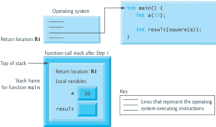

该栈帧告诉 `main` 如何返回到操作系统（即转移到返回地址 R1），并包含 `main` 的局部变量 `a` 的空间（初始化为 10）以及局部变量 `result` 的空间（尚未初始化）。

**步骤 2：`main` 调用函数 `square` 来执行计算**

在返回操作系统之前，`main` 调用图 5.6 第 12 行中的函数 `square`。这会将 `square` 的栈帧（第 16–18 行）压入函数调用栈。

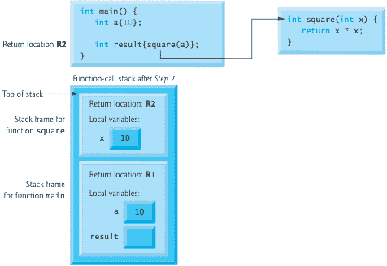

该栈帧包含 square 返回 main 所需的返回地址（即 R2）以及 square 的局部变量 x 的内存。

**步骤 3：square 将结果返回给 main**

在 square 计算出其参数的平方后，它需要返回 main——并且不再需要其变量 x 的内存。于是栈被弹出，给 square 提供 main 中的返回位置（即 R2），并丢失 square 的局部变量。下图展示了在 square 的栈帧被弹出且 square 的返回值已存入 result 之后的函数调用栈：

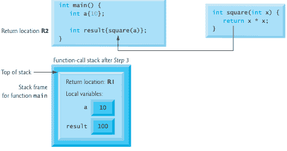

到达 main 的右花括号会将其栈帧从栈中弹出。这给 main 提供了返回操作系统所需的地址（上图中的 R1）。此时，main 的局部变量和 result 不再可用。

### 数据结构

你现在已经看到栈数据结构在支持程序执行方面有多么重要。数据结构在计算机科学中有许多重要应用。我们已经介绍了 C++ 的数组和向量数据结构，并将在第 13 章“数据结构：标准库容器和迭代器”中继续讨论这些以及更多内容。

## 5.11 内联函数

从软件工程的角度来看，将程序实现为一组函数是好的，但函数调用涉及执行时开销。C++ 提供内联函数来帮助减少函数调用开销。在函数定义中将 `inline` 放在函数的返回类型之前，建议编译器在调用该函数的每个位置（在适当情况下）生成函数体代码的副本，以避免函数调用。这可能会使程序更大。编译器可以忽略 `inline` 限定符。可复用的内联函数通常放在头文件中，以便其定义可以在每个使用它们的源文件中内联。

如果更改内联函数的定义，则必须重新编译调用该函数的任何代码。编译器可以内联你未显式声明为内联的代码。How-

然而，C++ 核心准则建议将“小型且时间关键”的函数声明为**内联**。[18,19] 图 5.7 使用内联函数 `cube`（第 9–11 行）计算立方体的体积。

```cpp
// fig05_07.cpp
// inline function that calculates the volume of a cube.
#include <iostream>
using namespace std;

// Definition of inline function cube. Definition of function appears
// before function is called, so a function prototype is not required.
// First line of function definition also acts as the prototype.
inline double cube(double side) {
    return side * side * side; // calculate cube
}

int main() {
    double sideValue; // stores value entered by user
    cout << "Enter the side length of your cube: ";
    cin >> sideValue; // read value from user

    // calculate cube of sideValue and display result
    cout << "Volume of cube with side "
         << sideValue << " is " << cube(sideValue) << '\n';
}
```

```text
Enter the side length of your cube: 3.5
Volume of cube with side 3.5 is 42.875
```

**图 5.7** | *计算立方体体积的内联函数。*

### 检查点

- 1. **(判断正误)** 在函数定义中将 `inline` 放在函数返回类型之前，会强制编译器在函数被调用的每个位置（在适当情况下）生成函数体代码的副本，以避免函数调用。
  **答案：** 错误。实际上，编译器可以忽略 `inline` 限定符。
- 2. **(填空)** 可重用的内联函数通常放在 ______ 中，以便其定义可以在使用它们的每个源文件中内联。
  **答案：** 头文件。
- 3. **(判断正误)** 如果更改内联函数的定义，任何调用该函数的代码都会自动重新编译。
  **答案：** 错误。实际上，如果更改内联函数的定义，必须重新编译任何调用该函数的代码。

18. C++ 核心准则。访问日期：2023 年 4 月 14 日。https://isocpp.github.io/CppCoreGuidelines/CppCoreGuidelines#Rf-inline。

19. 关于内联函数细微之处的详尽常见问题解答，请访问 https://isocpp.org/wiki/faq/inline-functions。

```cpp
int squareByValue(int number);  // prototype (for value pass)
void squareByReference(int& numberRef);  // prototype (for reference pass)

int main() {
    int x{2};  // value to square using squareByValue
    int z{4};  // value to square using squareByReference

    // demonstrate squareByValue
    cout << "x = " << x << " before squareByValue\n";
    cout << "Value returned by squareByValue: "
         << squareByValue(x) << '\n';
    cout << "x = " << x << " after squareByValue\n";

    // demonstrate squareByReference
    cout << "z = " << z << " before squareByReference\n";
    squareByReference(z);
    cout << "z = " << z << " after squareByReference\n";
}

// squareByValue multiplies number by itself, stores the
// result in number and returns the new value of number
int squareByValue(int number) {
    return number *= number;  // caller's argument not modified
}

// squareByReference multiplies numberRef by itself and stores the result
// in the variable to which numberRef refers in function main
void squareByReference(int& numberRef) {
    numberRef *= numberRef;  // caller's argument modified
}
```

```text
x = 2 before squareByValue
Value returned by squareByValue: 4
x = 2 after squareByValue

z = 4 before squareByReference
z = 16 after squareByReference
```

图 5.8 | 按值传递实参和按引用传递实参。（第 2 部分，共 2 部分。）

### 函数内作为别名的引用

引用也可以在函数内用作其他变量的别名（不过它们通常与函数一起使用，如图 5.8 所示）。例如，以下代码

```cpp
int count{1};  // declare integer variable count
int& cRef{count};  // create cRef as an alias for count
++cRef;  // increment count (using its alias cRef)
```

通过别名 cRef 递增 count。引用变量必须在其声明中初始化，并且不能重新赋值为其他变量的别名。在这个意义上，引用是常量。对别名（即引用）执行的所有操作实际上都是对原始变量执行的。别名只是原始变量的另一个名称。除非它是对常量的引用（下面讨论），否则引用的初始化器必须是左值——即可以出现在赋值左侧的内容，例如变量名。引用不能用常量或*值*表达式初始化——也就是只能出现在赋值右侧的内容，例如计算结果。

### const 引用

若要指定不允许引用形参修改调用方中的对应实参，请在形参声明中把 const 限定符放在类型名之前。例如，考虑一个 displayName 函数：

```cpp
void displayName(std::string name) {
    std::cout << name << '\n';
}
```

调用时，它接收其 string 实参的一个*副本*。由于 string 对象可能很大，这种复制操作可能会降低应用程序的性能。因此，string 对象（以及一般对象）应通过引用传递给函数。

此外，displayName 函数不需要修改其实参。因此，遵循最小权限原则，我们会将形参声明为

```cpp
const std::string& name
```

从右向左读，name 形参是一个对常量 string 的引用。我们获得了按引用传递 string 的性能。此外，displayName 将实参视为常量，因此 displayName 不能修改调用方中的值。

### 返回局部变量的引用是危险的

当返回对局部非静态变量的引用时，该引用指向一个在函数返回时被丢弃的变量。试图访问这样的变量会产生未定义行为，常常导致程序崩溃或数据损坏。²² 对未定义变量的引用称为悬空引用。这是一种逻辑错误，编译器通常会发出警告。软件工程团队通常有策略要求代码在部署前必须无警告地编译。你可以通过使用编译器的选项让编译器将警告视为错误，从而在你的团队中强制执行这一点。

### 检查点

- 1. **(判断正误)** 无论你通过按值传递，还是通过带引用形参的按引用传递来传递变量，在函数调用中都只是按名称提及这些变量。编译器会检查函数原型和定义，以确定你采用的是按值传递还是按引用传递。
  **答案：** 正确。
- 2. **(判断正误)** 引用变量可以重新赋值为其他变量的别名。
  **答案：** 错误。引用变量必须在其声明中初始化，并且不能重新赋值为其他变量的别名。在这个意义上，引用是常量。
- 3. **(填空)** 若要指定不允许引用形参修改调用方中的对应实参，请在形参声明中把 ________ 限定符放在类型名之前。
  **答案：** const。

22. C++ 核心准则。访问日期：2023 年 4 月 14 日。https://isocpp.github.io/CppCoreGuidelines/CppCoreGuidelines#Rf-dangle。

## 5.13 默认实参

程序经常从多个位置以相同的实参值调用某个特定形参对应的函数。在这种情况下，可以为相应形参指定默认实参。当程序在函数调用中省略具有默认实参的形参对应的实参时，编译器会重写该函数调用，插入该实参的默认值。

### 带默认实参的 boxVolume 函数

图 5.9 演示了使用默认实参计算盒子体积。boxVolume 的函数原型（第 7 行）通过在每个形参右侧放置 = 1，指定所有三个形参的默认值均为 1。

```cpp
// fig05_09.cpp
// Using default arguments.
#include <iostream>
using namespace std;

// function prototype that specifies default arguments
int boxVolume(int length = 1, int width = 1, int height = 1);

int main() {
   // no arguments--use default values for all dimensions
   cout << "The default box volume is: " << boxVolume();

   // specify length; default width and height
   cout << "\nThe volume of a box with length 10,\n"
        << "width 1 and height 1 is: " << boxVolume(10);

   // specify length and width; default height
   cout << "\nThe volume of a box with length 10,\n"
        << "width 5 and height 1 is: " << boxVolume(10, 5);

   // specify all arguments
   cout << "\nThe volume of a box with length 10,\n"
        << "width 5 and height 2 is: " << boxVolume(10, 5, 2)
        << '\n';
}

// function boxVolume calculates the volume of a box
int boxVolume(int length, int width, int height) {
   return length * width * height;
}
```

```text
The default box volume is: 1

The volume of a box with length 10,
width 1 and height 1 is: 10
```

**图 5.9** | 使用默认实参。（第 1 部分，共 2 部分。）


```text
一个长为 10、宽为 5、高为 1 的盒子的体积是：50

一个长为 10、宽为 5、高为 2 的盒子的体积是：100
```

**图 5.9** | 使用默认参数。（第 2 部分，共 2 部分。）

第一次调用 `boxVolume`（第 11 行）没有指定参数，因此使用了全部三个默认值 1。第二次调用（第 15 行）只传递了长度参数，因此宽度和高度参数使用了默认值 1。第三次调用（第 19 行）只传递了长度和宽度参数，因此高度参数使用了默认值 1。最后一次调用（第 23 行）传递了长度、宽度和高度参数，因此没有使用任何默认值。显式传递给函数的任何参数都会从左到右赋给函数的参数。因此，当 `boxVolume` 接收到一个参数时，函数会将该参数的值赋给它的长度参数（即参数列表中最左边的参数）。当 `boxVolume` 接收到两个参数时，函数会按顺序将这些参数的值赋给长度和宽度参数。最后，当 `boxVolume` 接收到全部三个参数时，函数会将这些参数的值分别赋给长度、宽度和高度参数。

## 关于默认参数的说明

默认参数必须是函数参数列表中最右边（尾部）的参数。当调用一个具有两个或更多默认参数的函数时，如果省略的参数不是最右边的参数，那么该参数右侧的所有参数也必须被省略。默认参数必须在函数名第一次出现时指定——通常是在函数原型中。如果因为函数定义本身充当原型而省略了函数原型，则应在函数头中指定默认参数。默认值可以是任何表达式，包括常量、全局变量或函数调用。默认参数也可以用于内联函数。使用默认参数可以简化函数调用的编写，但有些程序员认为显式指定所有参数更清晰。

### 检查点

- **1.** *（判断正误）* 当程序在函数调用中省略了带有默认参数的某个参数时，编译器会重写该函数调用，并插入该参数的默认值。
  **答案：** 正确。
- **2.** *（判断正误）* 默认参数必须在函数名第一次出现时指定——通常是在函数原型中。如果因为函数定义本身充当原型而省略了函数原型，则应在函数头中指定默认参数。
  **答案：** 正确。
- **3.** *（判断正误）* 默认参数不能用于内联函数。
  **答案：** 错误。实际上，默认参数可以用于内联函数。

## 5.14 函数重载

C++ 允许定义同名函数，前提是它们具有不同的签名。这称为函数重载。C++ 编译器通过检查调用中参数的数量、类型和顺序来选择要调用的适当函数。函数重载用于创建多个同名函数，这些函数执行类似的任务，但处理不同数据类型的数据。例如，数学库中的许多函数都针对不同的数值类型进行了重载——C++ 标准要求第 5.3 节中介绍的每个数学库函数都有 float、double 和 long double 版本。重载执行密切相关任务的函数可以使程序更清晰。

### 重载的 square 函数

图 5.10 使用重载的 square 函数来计算 int（第 7–10 行）和 double（第 13–16 行）的平方。第 19 行通过传递字面值 7 调用了 int 版本。C++ 将整数字面值视为 int。类似地，第 21 行通过传递字面值 7.5 调用了 double 版本，C++ 将其视为 double。在每种情况下，编译器都会根据参数的类型选择要调用的适当函数。²³ 输出确认了在每种情况下都调用了正确的函数。

```cpp
// fig05_10.cpp
// 重载的 square 函数。
#include <iostream>
using namespace std;

// 用于 int 值的函数 square
int square(int x) {
   cout << "square of integer " << x << " is ";
   return x * x;
}

// 用于 double 值的函数 square
double square(double y) {
   cout << "square of double " << y << " is ";
   return y * y;
}

int main() {
   cout << square(7); // 调用 int 版本
   cout << '\n';
   cout << square(7.5); // 调用 double 版本
   cout << '\n';
}
```

```text
square of integer 7 is 49
square of double 7.5 is 56.25
```

**图 5.10** 重载的 square 函数。

> 23. C++ 标准在 https://timsong-cpp.github.io/cppwp/n4861/over.match 描述了重载决议。更详细的解释请参见 https://en.cppreference.com/w/cpp/language/overload_resolution。

### （可选）编译器如何区分重载函数

重载函数通过它们的签名来区分。签名是函数名称及其参数类型（按顺序）的组合。类型安全链接确保调用正确的函数，并确保参数的类型与参数的类型一致。为了实现类型安全链接，编译器在内部使用其参数类型对每个函数标识符进行编码——这一过程称为名称修饰。这些编码因编译器而异，因此要为给定平台创建可执行文件而链接的所有内容都必须使用该平台的同一编译器进行编译。图 5.11 是使用 GNU C++ 编译的。我们没有像通常那样显示程序的执行输出，而是展示了 GNU C++ 在汇编语言中生成的修饰后函数名。^24

```cpp
// fig05_11.cpp
// 名称修饰以实现类型安全链接。

// 用于 int 值的函数 square
int square(int x) {
    return x * x;
}

// 用于 double 值的函数 square
double square(double y) {
    return y * y;
}

// 接收类型为
// int、float、char 和 int& 的参数的函数
void nothing1(int a, float b, char c, int& d) { }

// 接收类型为
// char、int、float& 和 double& 的参数的函数
int nothing2(char a, int b, float& c, double& d) {
    return 0;
}

int main() { }
```

```text
_Z6squarei
_Z6squared
_Z8nothing1ifcRi
_Z8nothing2ciRfRd
main
```

**图 5.11** | 名称修饰以实现类型安全链接。

24. 命令 g++ -S fig05_11.cpp 会生成汇编语言文件 fig05_11.s。

对于 GNU C++，每个修饰后的名称（除 main 外）都以下划线（_）开头，后跟字母 Z、一个数字和函数名。Z 后面的数字指定函数名中有多少个字符。例如，函数 square 的名称中有 6 个字符，因此其修饰后的名称以 `_Z6` 为前缀。函数名后面是其参数列表的编码：

- 对于接收 `int`（第 5 行）的函数 square，`i` 表示 int，如输出的第一行所示。
- 对于接收 `double`（第 10 行）的函数 square，`d` 表示 double，如输出的第二行所示。
- 对于函数 `nothing1`（第 16 行），`i` 表示 int，`f` 表示 float，`c` 表示 char，`Ri` 表示 int&（即对 int 的引用），如输出的第三行所示。
- 对于函数 `nothing2`（第 20 行），`c` 表示 char，`i` 表示 int，`Rf` 表示 float&，`Rd` 表示 double&。

编译器通过它们的参数列表来区分两个 square 函数——一个为 int 指定 `i`，另一个为 double 指定 `d`。修饰后的名称中未指定函数的返回类型。重载函数可以有不同的返回类型，但它们也必须具有不同的参数列表。函数名修饰是编译器特定的。例如，Visual C++ 为第 5 行的 square 函数生成名称 `square@@YAHH@Z`。GNU C++ 编译器没有修饰 main 的名称，但有些编译器会——Visual C++ 使用 `_main`。


创建具有相同参数列表但不同返回类型的重载函数是编译错误。编译器仅使用参数列表来区分重载函数。此类函数不必具有相同数量的参数。


省略了默认参数的函数调用可能与另一个重载函数的调用方式完全相同；这是一个编译错误。例如，如果程序中同时包含一个显式不接受任何参数的函数和一个同名但包含所有默认参数的函数，那么当尝试在调用中不传递任何参数地使用该函数名时，会导致编译错误。编译器无法明确确定应选择该函数的哪个版本。

### 重载运算符

第 11 章将讨论如何重载运算符以定义它们应如何作用于用户自定义数据类型的对象。（事实上，到目前为止我们已经在使用许多重载运算符，包括流插入运算符 `<<` 和流提取运算符 `>>`。这些运算符已针对所有基本类型进行了重载。我们将在第 11 章中进一步讨论重载 `<<` 和 `>>`，以便能够处理用户自定义类型的对象。）


### 检查点

- **1.（填空）** ______ 用于创建多个同名函数，这些函数执行类似的任务，但处理不同数据类型的数据。
  **答案：** 函数重载。
- **2.（判断正误）** 创建具有相同参数列表但不同返回类型的重载函数是编译错误。编译器仅使用参数列表来区分重载函数。此类函数不必具有相同数量的参数。
  **答案：** 正确。


- 3（判断题）使用运算符重载时，程序中可以包含一个显式不接受任何参数的函数，以及一个同名但包含所有默认参数的函数。

  **答案：** 错误。这会导致编译错误，因为编译器不知道应选择该函数的哪个版本来满足无参数调用。

## 5.15 函数模板

重载函数通常会对不同的数据类型执行类似的操作。如果针对每种数据类型的程序逻辑和操作都相同，那么使用函数模板可以更紧凑、更方便地执行重载。你只需编写一个函数模板定义，C++ 就会自动生成单独的函数模板特化（也称为模板实例化），以便针对所提供的实参类型正确处理每种类型的调用。因此，单个函数模板定义了一组重载函数。使用模板进行编程也称为泛型编程。在本节中，我们将定义一个自定义函数模板。在后续章节中，你将使用许多 C++ 标准库模板，而在第 15 章中，我们将详细讨论如何定义自定义模板。

### maximum 函数模板

图 5.12 定义了一个 maximum 函数模板，它返回三个值中的最大值。所有函数模板定义都以 **template** 关键字开头（第 3 行），后面跟着一个用尖括号（< 和 >）括起来的模板参数列表。模板参数列表中的每个参数前面都有 **typename** 关键字或 **class** 关键字（在此上下文中它们是同义词）。类型参数是基本类型或用户定义类型的占位符。这些占位符——在本例中为 T——用于指定函数参数的类型（第 4 行）、指定函数的返回类型（第 4 行），以及在函数定义体内声明变量（第 5 行）。函数模板的定义与其他函数类似，但使用类型参数作为实际数据类型的占位符。

```cpp
// Fig. 5.12: maximum.h
// Function template maximum header.
template <typename T> // or template <class T>
T maximum(T value1, T value2, T value3) {
   T maximumValue{value1}; // assume value1 is maximum

   // determine whether value2 is greater than maximumValue
   if (value2 > maximumValue) {
      maximumValue = value2;
   }

   // determine whether value3 is greater than maximumValue
   if (value3 > maximumValue) {
      maximumValue = value3;
   }

   return maximumValue;
}
```

**图 5.12** | 函数模板 maximum 头文件。

### 使用函数模板 maximum

图 5.13 使用 maximum 函数模板分别确定三个 int 值、三个 double 值和三个 char 值中的最大值（第 15、24 和 33 行）。每次调用都使用不同类型的实参，因此“在幕后”，编译器会为每种类型分别创建一个单独的函数定义——一个期望三个 int 值，一个期望三个 double 值，一个期望三个 char 值。

```cpp
// fig05_13.cpp
// Function template maximum test program.
#include <iostream>
#include "maximum.h" // include definition of function template maximum
using namespace std;

int main() {
   // demonstrate maximum with int values
   cout << "Input three integer values: ";
   int int1, int2, int3;
   cin >> int1 >> int2 >> int3;

   // invoke int version of maximum
   cout << "The maximum integer value is: "
        << maximum(int1, int2, int3);

   // demonstrate maximum with double values
   cout << "\nInput three double values: ";
   double double1, double2, double3;
   cin >> double1 >> double2 >> double3;

   // invoke double version of maximum
   cout << "The maximum double value is: "
        << maximum(double1, double2, double3);

   // demonstrate maximum with char values
   cout << "\nInput three characters: ";
   char char1, char2, char3;
   cin >> char1 >> char2 >> char3;

   // invoke char version of maximum
   cout << "The maximum character value is: "
        << maximum(char1, char2, char3) << '\n';
}
```

**图 5.13** | 函数模板 maximum 测试程序。（第 1 部分，共 2 部分。）

可能更可取。递归将在高年级计算机科学课程中详细讨论。

### 5.16.1 阶乘

考虑正整数 *n* 的阶乘，写作 *n*!，读作“*n* 的阶乘”。它是乘积

*n* · (*n* − 1) · (*n* − 2) · … · 1

其中 1! 等于 1，0! 定义为 1。例如，5! 是乘积 5 · 4 · 3 · 2 · 1，等于 120。可以用 `for` 语句迭代计算 5!，如下所示：

```cpp
using boost::multiprecision::cpp_int;
cpp_int factorial{1};
int number{5};
for (int counter{number}; counter >= 1; --counter) {
    factorial *= counter;
}
```

### 5.16.2 递归阶乘示例

递归问题求解方法有几个共同要素。当你调用递归函数来解决问题时，它只能解决最简单的情形，即所谓*基准情形*。如果你用基准情形调用该函数，它会立即返回结果。如果你用更复杂的问题调用该函数，它通常会将问题分成两部分——一部分是该函数知道如何做的，另一部分是它不知道如何做的。为了使递归可行，后一部分必须是原问题略微更简单或更小的版本。由于这个新问题类似于原问题，函数会调用自身的一个新副本来处理这个更小的问题——这称为*递归调用*，也称为*递归步骤*。这种将问题分成两个较小部分的概念称为*分治*方法。

*递归步骤*在原函数调用仍处于活动状态（即尚未执行完毕）时执行。随着函数将每个新子问题分成两个概念部分，它可能导致更多递归调用。为了使递归最终终止，每当函数用原问题的一个更简单版本调用自身时，越来越小的问题序列必须*收敛到某个基准情形*。当函数识别出基准情形时，它会将结果返回给该函数的前一个副本。随后会发生一系列返回，直到原函数调用将最终结果返回给调用者。

#### 递归阶乘方法

通过观察 *n*! 可以写成如下形式，你可以得到阶乘的递归表示：

*n*! = *n* · (*n* − 1)!

例如，5! 等于 5 · 4!，如下所示：

5! = 5 · 4 · 3 · 2 · 1
5! = 5 · (4 · 3 · 2 · 1)
5! = 5 · (4!)

```cpp
int main() {
   // calculate the factorials of 0 through 10
   for (int counter{}; counter <= 10; ++counter) {
      cout << format("{:>2}! = ", counter) << factorial(counter)
           << '\n';
   }

   // display factorials of 20, 30 and 40
   cout << format("\n{:>2}! = ", 20) << factorial(20)
        << format("\n{:>2}! = ", 30) << factorial(30)
        << format("\n{:>2}! = ", 40) << factorial(40) << '\n';
}

// recursive definition of function factorial
cpp_int factorial(int number) {
   if (number <= 1) { // test for base case
      return 1; // base cases: 0! = 1 and 1! = 1
   }
   else { // recursion step
      return number * factorial(number - 1);
   }
}
```

```text
0! = 1
1! = 1
2! = 2
3! = 6
4! = 24
5! = 120
6! = 720
7! = 5040
8! = 40320
9! = 362880
10! = 3628800

20! = 2432902008176640000
30! = 265252859812191058636308480000000
40! = 815915283247897734345611269596115894272000000000
```

**图 5.14** | 递归函数 factorial。（第 2 部分，共 2 部分。）

### 阶乘值增长很快

函数 factorial 接收一个 int，并返回一个 Boost Multiprecision cpp_int 对象（在第 3.14 节介绍）。该函数生成大值的速度非常快，以至于 long long 类型在达到其最大值之前，无法帮助我们计算很多阶乘值。在大多数系统上，long long 可以存储从 −9,223,372,036,854,775,808 到 9,223,372,036,854,775,807 的值——最多 19 个十进制数字（可以表示百京量级的整数）。从该程序的输出可以看出，20 的阶乘是一个 19 位数，而随后显示的值则显著多于 19 位。

### 间接递归

递归函数可以调用另一个函数，而后者又可能反过来调用该递归函数。这称为间接递归调用或间接递归。


例如，函数 A 调用函数 B，而函数 B 又回调函数 A。这仍然是递归，因为对函数 A 的第二次调用是在对函数 A 的第一次调用仍处于活动状态时进行的。也就是说，对函数 A 的第一次调用尚未执行完毕（因为它正在等待函数 B 向它返回结果），并且尚未返回给函数 A 的原始调用者。

## 栈溢出与无限递归

计算机中的内存量是有限的，因此只有一定量的内存可用于在函数调用栈上存储活动记录。如果发生的递归函数调用多到其活动记录无法全部存储在栈上，就会发生一种称为栈溢出的致命错误。这通常由无限递归引起，而无限递归可能是由于遗漏基本情况或错误地编写递归步骤，使其无法收敛到基本情况而造成的。无限递归类似于迭代解法中的无限循环。

## 递归与函数调用栈

在第 5.10 节中，我们在理解 C++ 如何执行函数调用的背景下介绍了栈数据结构。我们讨论了**函数调用栈**和**栈帧**。那部分讨论也适用于递归函数调用。每个递归函数调用都会在函数调用栈上获得自己的栈帧。当某个调用完成时，系统会从栈中弹出该函数的栈帧，控制权返回给调用者，这个调用者可能是同一函数的另一个副本。

## 检查点

- 1. *（对/错）* 为了使递归可行，递归解法中的递归步骤必须类似于原始问题，但要是它的一个稍大的版本。

**答案：** 错误。为了使递归可行，递归解法中的递归步骤必须类似于原始问题，但要是它的一个稍小或更简单的版本。

- 2. *（代码）* 下面的代码应递归计算从 0 到参数值 `number` 的整数之和。找出以下函数中的错误并改正代码：

```cpp
int sum(int number) {  // assume n is nonnegative
    if (number == 0)
        return 0;
    else
        number + sum(number - 1);
}
```

**答案：** 递归步骤应返回 `number + sum(number - 1)` 的结果：

```cpp
int sum(int number) {  // assume n is nonnegative
    if (number == 0)
        return 0;
    else
        return number + sum(number - 1);
}
```

25. 网站 stackoverflow.com 就是这样得名的。这是一个获取编程问题答案的极好网站。

- 3. **（代码）** 重写下面的迭代阶乘计算代码，使循环向上计数而不是向下计数：

```cpp
using boost::multiprecision::cpp_int;
cpp_int factorial{1};
for (int counter{number}; counter >= 1; --counter) {
    factorial *= counter;
}
```

**答案：**

```cpp
using boost::multiprecision::cpp_int;
cpp_int factorial{1};
for (int counter{1}; counter <= number; ++counter) {
    factorial *= counter;
}
```

## 5.16.3 递归斐波那契数列示例

斐波那契数列，

0, 1, 1, 2, 3, 5, 8, 13, 21, …

以 0 和 1 开始，并且具有这样的性质：随后的每个斐波那契数都是前两个数之和。这个数列在自然界中出现，并描述了一种螺旋形态。

相邻斐波那契数之比收敛于常数 1.618…，这个数称为**黄金比例**或**黄金均值**。许多人认为黄金均值具有美感。建筑师经常按照黄金均值的比例设计窗户、房间和建筑物的长和宽。明信片通常按照黄金均值的长宽比来设计。

## 递归斐波那契定义

斐波那契数列可以递归地定义如下：

- fibonacci(0) 定义为 0
- fibonacci(1) 定义为 1
- fibonacci(*number*) 定义为 fibonacci(*number* − 1) + fibonacci(*number* − 2)

斐波那契计算有两个基本情况：

- fibonacci(0) 为 0，并且
- fibonacci(1) 为 1。

## 函数 fibonacci

图 5.15 的程序使用函数 fibonacci 递归计算第 *n* 个斐波那契数。斐波那契数会很快变大，尽管比阶乘慢得多。图 5.15 还展示了程序的执行情况，其中显示若干数字的斐波那契值。

```cpp
// fig05_15.cpp
// Recursive function fibonacci.
#include <format>
#include <iostream>
using namespace std;

long fibonacci(long number); // function prototype

int main() {
   // calculate the fibonacci values of 0 through 10
   for (int counter{0}; counter <= 10; ++counter) {
      cout << format("fibonacci({}) = {}\n",
         counter, fibonacci(counter));
   }

   // display higher fibonacci values
   cout << format("fibonacci(20) = {}\n", fibonacci(20))
      << format("fibonacci(30) = {}\n", fibonacci(30))
      << format("fibonacci(35) = {}\n", fibonacci(35));
}

// recursive function fibonacci
long fibonacci(long number) {
   if ((0 == number) || (1 == number)) { // base cases
      return number;
   }
   else { // recursion step
      return fibonacci(number - 1) + fibonacci(number - 2);
   }
}
```

```text
fibonacci(0) = 0
fibonacci(1) = 1
fibonacci(2) = 1
fibonacci(3) = 2
fibonacci(4) = 3
fibonacci(5) = 5
fibonacci(6) = 8
fibonacci(7) = 13
fibonacci(8) = 21
fibonacci(9) = 34
fibonacci(10) = 55

fibonacci(20) = 6765
fibonacci(30) = 832040
fibonacci(35) = 9227465
```

**图 5.15** | 递归函数 fibonacci。

函数 fibonacci（第 23–30 行）递归计算第 n 个斐波那契数。从 main 对函数 fibonacci 的每次初始调用都不是递归调用。然而，随后从函数 fibonacci 的函数体中执行的所有 fibonacci 调用都是递归调用，因为此时这些调用是由该函数自身发起的。每次调用 fibonacci 都会立即测试基本情况——number 等于 0 或 number 等于 1。如果 number 匹配某个基本情况，第 25 行会返回 number，因为 `fibonacci(0)` 为 0，且 `fibonacci(1)` 为 1。有趣的是，如果 number 大于 1，递归步骤会产生两个递归调用，每个调用处理的问题都比对 `fibonacci` 的原始调用稍小。

### 测试函数 `fibonacci`

第 11–14 行中的 for 循环测试 `fibonacci`，显示 0–10 的斐波那契值。变量 counter 指示在循环的每次迭代中要计算哪个斐波那契数。第 17–19 行还计算数字 20、30 和 35 的斐波那契值。你会注意到，对于更高的斐波那契值，计算速度会显著变慢。

### 分析对函数 `fibonacci` 的调用

下图展示了函数 `fibonacci` 如何求值 `fibonacci(3)`：

- 在图的底部，我们得到值 1、0 和 1——这些是求值基本情况的结果。
- 前两个返回值（从左到右）1 和 0，分别作为调用 `fibonacci(1)` 和 `fibonacci(0)` 的值返回。
- 1 加 0 的和作为 `fibonacci(2)` 的值返回。这个值被加到最右侧对 `fibonacci(1)` 的调用结果（1）上，得到值 2。
- 然后这个最终值作为 `fibonacci(3)` 的值返回。

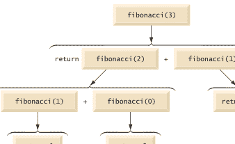

### 复杂度问题

对于像我们这里用来生成斐波那契数的递归程序，有必要提出一点警告。对 `fibonacci` 函数的每次调用，如果不匹配某个基本情况（0 或 1），都会导致对 `fibonacci` 函数的**另外两次递归调用**。因此，这组递归调用会迅速失控。使用递归实现计算 20 的斐波那契值需要对 `fibonacci` 函数进行 21,891 次调用；计算 30 的斐波那契值需要 2,692,537 次调用！

当你尝试计算更大的斐波那契值时，你会注意到，每计算一个后续斐波那契数，计算时间以及对 `fibonacci` 函数的调用次数都会大幅增加。例如，31 的斐波那契值需要 4,356,617 次调用，32 的斐波那契值需要 7,049,155 次调用！当你


### 检查点

- 1. **（填空题）** 连续斐波那契数之比收敛于一个常数值 1.618...，这个数字被称为______或______。  
  **答案：** 黄金比例、黄金均值。
- 2. **（判断题）** 在复杂性理论领域，计算机科学家研究算法完成其任务所需的努力程度。  
  **答案：** 正确。
- 3. **（代码题）** 创建一个名为 `iterative_fibonacci` 的函数，使用循环而非递归来计算斐波那契数。  
  **答案：**

```cpp
long iterative_fibonacci(long number) {
    long result{0};
    long temp{1};

    for (int counter{0}; counter < number; ++counter) {
        long previousResult{result};
        result = result + temp;
        temp = previousResult;
    }

    return result;
}
```

## 5.16.4 递归与迭代

我们已经学习了阶乘和斐波那契函数，它们既可以用递归实现，也可以用迭代实现。在本节中，我们将比较这两种方法，并讨论在特定情况下为什么你会选择其中一种而不是另一种。

迭代和递归都基于控制语句：迭代使用迭代语句（例如 `for` 或 `while`），而递归使用选择语句（例如 `if` 或 `if...else` 或嵌套的 `if...else`）：

- 迭代和递归都涉及重复执行任务：迭代使用迭代语句，而递归使用重复的函数调用。
- 迭代和递归都包含一个**终止测试**：当循环继续条件失败时迭代终止，而当达到基本情况时递归终止。
- 计数器控制的迭代和递归都会**逐渐接近终止**：迭代不断修改计数器，直到循环继续条件失败，而递归不断产生原问题的更小版本，直到达到基本情况。
- 迭代和递归都可能**无限发生**：如果循环继续测试永远不会变为假，则发生无限循环；如果递归步骤没有每次以收敛于基本情况的方式缩减问题，或者错误地未测试基本情况，则发生无限递归。

### 递归的缺点

递归有许多缺点。它反复调用机制，因此会产生**函数调用的开销**。这种开销在处理器时间和内存空间方面可能代价高昂。每次递归调用都会导致函数的另一个副本被创建（实际上，只是存储在堆栈帧中的函数变量）。这组副本可能**消耗大量内存空间**。迭代避免了这些重复的函数调用和额外的内存分配。然而，对于某些使用递归容易表达和理解的问题，迭代解决方案并不那么显而易见。

### 何时选择递归与迭代

任何可以递归解决的问题也可以迭代解决。当递归方法更自然地反映问题，并且使程序更易于理解和调试时，通常会选择递归方法。选择递归解决方案的另一个原因是，当递归解决方案显而易见时，迭代解决方案可能并不明显。如果可能，避免在性能要求高的场景中使用递归。递归调用需要时间并消耗额外内存。

### 本书中递归示例和练习的总结

下表总结了文中的递归示例和练习。

| 文中位置 | 递归示例和练习 |
|---|---|
| *第 5 章* | |
| 第 5.16.2 节，图 5.14 | 阶乘函数 |
| 第 5.16.3 节，图 5.15 | 斐波那契函数 |
| 练习 5.24 | 递归幂运算 |
| 练习 5.26 | 汉诺塔 |
| 练习 5.28 | 可视化递归 |
| 练习 5.29 | 最大公约数 |
| 练习 5.31、练习 5.32 | “这个程序做什么？”练习 |
| *第 6 章* | |
| 练习 6.13 | “这个程序做什么？”练习 |
| 练习 6.16 | “这个程序做什么？”练习 |
| 练习 6.29 | 判断字符串是否为回文 |
| 练习 6.30 | 八皇后 |
| 练习 6.31 | 打印数组 |
| 练习 6.32 | 反向打印字符串 |
| 练习 6.33 | 数组中的最小值 |
| *第 21 章* | |
| 第 21.7 节，图 21.5 | 归并排序 |
| 练习 21.8 | 线性搜索 |
| 练习 21.9 | 二分搜索 |
| 练习 21.10 | 快速排序 |


### 检查点

- 1. **（填空题）** 迭代和递归都有一个终止测试。迭代在循环继续条件失败时终止。递归在__________时终止。  
  **答案：** 识别到基本情况时。
- 2. **（判断题）** 每次递归调用都会创建函数变量的另一个副本；这可能会消耗大量内存。  
  **答案：** 正确。
- 3. **（判断题）** 在性能要求高的场景中，递归优于迭代。  
  **答案：** 错误。如果可能，避免在性能要求高的场景中使用递归。递归调用需要时间并消耗额外内存。

## 5.17 作用域规则

程序中可以使用标识符的部分称为其*作用域*。例如，当我们在块中声明局部变量时，它只能被引用：

- 从该块中声明点到该块结束，以及
- 在变量声明之后出现在该块内的嵌套块中。

本节讨论块作用域和全局命名空间作用域。函数原型中的参数名具有*函数参数作用域*，并且仅在其出现的原型中已知。稍后我们将看到其他作用域，包括第 9 章中的*类作用域*和第 20 章中的*函数作用域*和*命名空间作用域*。

### 块作用域

在块中声明的标识符具有*块作用域*，它从标识符的声明处开始，到块的右花括号（}）处结束。局部变量具有块作用域，以下变量也是如此：

用于讨论目的的输出。只有第一部分有图注——在本书后续许多大型代码示例中我们都会这样做。第 10 行声明并将全局变量 x 初始化为 1。我们将展示该全局变量在任何声明了名为 x 的变量的块（或函数）中被隐藏。

```cpp
// fig05_16.cpp
// 作用域示例。
#include <iostream>
using namespace std;

void useLocal(); // 函数原型
void useStaticLocal(); // 函数原型
void useGlobal(); // 函数原型

int x{1}; // 全局变量
```

**图 5.16** | 作用域示例。

### 函数 main

在 main 中，第 13 行显示全局变量 x 的值。第 15 行将局部变量 x 初始化为 5。第 17 行输出该变量，以表明全局 x 在 main 中被隐藏。接下来，第 19–23 行在 main 中定义一个新块，其中另一个局部变量 x 被初始化为 7（第 20 行）。第 22 行输出该变量，以表明它隐藏了 main 外部块中的 x 以及全局 x。当块退出时，值为 7 的 x 被自动销毁。接下来，第 25 行输出 main 外部块中的局部变量 x，以表明它不再被隐藏。

```cpp
int main() {
    cout << "global x in main is " << x << '\n';

    const int x{5}; // main 的局部变量

    cout << "local x in main's outer scope is " << x << '\n';

    { // 开始一个新作用域
        const int x{7}; // 隐藏外部作用域中的 x 和全局 x

        cout << "local x in main's inner scope is " << x << '\n';
    }

    cout << "local x in main's outer scope is " << x << '\n';
}
```

```text
global x in main is 1
local x in main's outer scope is 5
local x in main's inner scope is 7
local x in main's outer scope is 5
```

为了演示其他作用域，程序定义了三个函数——useLocal（第 38–44 行）、useStaticLocal（第 49–57 行）和 useGlobal（第 60–64 行）——每个函数


它不接受任何参数，也不返回任何内容。`main` 的其余部分（如下所示）在第 27–32 行中分别调用每个函数两次。在分别调用每个函数两次之后，程序再次打印 `main` 中的局部变量 `x`，以表明这些函数调用都没有修改该值，因为它们引用的都是其他作用域中的变量。

```cpp
27   useLocal(); // useLocal has local x
28   useStaticLocal(); // useStaticLocal has static local x
29   useGlobal(); // useGlobal uses global x
30   useLocal(); // useLocal reinitializes its local x
31   useStaticLocal(); // static local x retains its prior value
32   useGlobal(); // global x also retains its prior value
33
34   cout << "\nlocal x in main is " << x << '\n';
35 } // end of main
36
```

```text
local x is 25 on entering useLocal
local x is 26 on exiting useLocal

local static x is 50 on entering useStaticLocal
local static x is 51 on exiting useStaticLocal

global x is 1 on entering useGlobal
global x is 10 on exiting useGlobal

local x is 25 on entering useLocal
local x is 26 on exiting useLocal

local static x is 51 on entering useStaticLocal
local static x is 52 on exiting useStaticLocal

global x is 10 on entering useGlobal
global x is 100 on exiting useGlobal

local x in main is 5
```

### 函数 useLocal

函数 `useLocal` 将局部变量 `x` 初始化为 25（第 39 行）。当 `main` 调用 `useLocal` 时（第 27 行和第 30 行），该函数会打印变量 `x`，将其递增，再次打印，然后将程序控制权返回给调用者。程序每次调用该函数时，都会重新创建局部变量 `x` 并将其重新初始化为 25。

```cpp
37 // useLocal reinitializes local variable x during each call
38 void useLocal() {
39    int x{25}; // initialized each time useLocal is called
40
41    cout << "\nlocal x is " << x << " on entering useLocal\n";
42    ++x;
43    cout << "local x is " << x << " on exiting useLocal\n";
44 }
45
```

### 函数 useStaticLocal

函数 useStaticLocal 声明静态变量 x，并将其初始化为 50。局部静态变量即使在其作用域之外（即包含它的函数未执行时）也会保留其值。当 main 中的第 28 行调用 useStaticLocal 时，该函数会打印其局部 x，将其递增，再次打印，然后将程序控制权返回给调用者。在下一次调用该函数时（第 31 行），静态局部变量 x 仍然包含值 51。第 50 行的初始化只在第一次调用 useStaticLocal 时（第 28 行）发生。

```cpp
// useStaticLocal initializes static local variable x only the
// first time the function is called, value of x is saved
// between calls to this function
void useStaticLocal() {
    static int x{50}; // initialized first time useStaticLocal is called

    cout << "\nlocal x is " << x
         << " on entering useStaticLocal\n";
    ++x;
    cout << "local static x is " << x
         << " on exiting useStaticLocal\n";
}
```

### 函数 useGlobal

函数 useGlobal 不声明任何变量。因此，当它引用变量 x 时，使用的是全局 x（第 10 行，位于 main 之前）。当 main 调用 useGlobal 时（第 29 行），该函数会打印全局变量 x，将其乘以 10，再次打印，然后将程序控制权返回给调用者。下一次 main 调用 useGlobal 时（第 32 行），该全局变量仍然保留其修改后的值 10。

```cpp
// useGlobal modifies global variable x during each call
void useGlobal() {
    cout << "\nglobal x is " << x << " on entering useGlobal\n";
    x *= 10;
    cout << "global x is " << x << " on exiting useGlobal\n";
}
```

### 检查点

- 1. **(正确/错误)** 在嵌套块中，如果外层块中的标识符与内层块中的标识符同名，则内层块中的标识符会被“隐藏”，直到外层块终止。  
  **答案：** 错误。实际上，在嵌套块中，如果外层块中的标识符与内层块中的标识符同名，则外层块中的标识符会被“隐藏”，直到内层块终止。

- 2. **(正确/错误)** 一般来说，变量应在其需要被访问的最宽作用域中声明。  
  **答案：** 错误。实际上，变量应在其需要被访问的最窄作用域中声明。

（代码）对于以下程序，指出下列每个元素的作用域（全局命名空间作用域或块作用域）：

- a) main 中的变量 x。
- b) 函数 cube 定义中的变量 y。
- c) 函数 cube。
- d) 函数 main。
- e) cube 的函数原型。

```cpp
#include <iostream>
using namespace std;

int cube(int y); // function prototype

int main() {
    int x{0};

    for (x = 1; x <= 10; x++) { // loop 10 times
        cout << cube(x) << '\n'; // calculate cube of x and output results
    }
}

// definition of function cube
int cube(int y) {
    return y * y * y;
}
```

答案：a）块作用域。b）块作用域。c）全局命名空间作用域。d）全局命名空间作用域。e）全局命名空间作用域。

## 5.18 一元作用域解析运算符

C++ 提供了一元作用域解析运算符（::），用于在局部变量同名且处于作用域内时访问全局变量。一元作用域解析运算符不能用于访问外层块中同名的局部变量。如果全局变量的名称与作用域内局部变量的名称不同，则无需使用一元作用域解析运算符即可直接访问该全局变量。

图 5.17 展示了一元作用域解析运算符与同名全局变量和局部变量的使用（第 6 行和第 9 行）。为了强调变量 number 的局部版本和全局版本是不同的，该程序将其中一个变量声明为 int，将另一个声明为 double。一般来说，应避免在程序中将同名变量用于不同目的。尽管在许多情况下这是允许的，但它可能导致错误。通常不鼓励使用全局变量。如果使用全局变量，请始终使用一元作用域解析运算符（::）来引用它（即使它与局部变量名没有冲突）。这样可以清楚地表明你正在访问全局变量。它还可以通过降低与非全局变量发生名称冲突的风险，使程序更易于修改，并消除因局部变量隐藏全局变量而可能出现的逻辑错误。


```cpp
1  // Fig05_17.cpp
2  // Unary scope resolution operator.
3  #include <iostream>
4  using namespace std;
5
6  const int number{7}; // global variable named number
7
8  int main() {
9      const double number{10.5}; // local variable named number
10
11     // display values of local and global variables
12     cout << "Local double value of number = " << number
13         << "\nGlobal int value of number = " << ::number << '\n';
14 }
```

```text
Local double value of number = 10.5
Global int value of number = 7
```

图 5.17 | 一元作用域解析运算符。

### 检查点

- 1. *(正确/错误)* 一元作用域解析运算符可用于访问外层块中同名的局部变量。  
  **答案：** 错误。实际上，一元作用域解析运算符不能访问外层块中同名的局部变量。它只能用于在局部变量同名且处于作用域内时访问全局变量。

## 5.19 5.19 Vigenère 密码：...

你可能已经注意到，本章最后一条目标要点、本章大纲中最后一个小节名称、5.1 节最后一句话以及上面的小节标题看起来都像乱码。这些并不是错误！在本小节中，我们继续对象自然（Objects-Natural）演示。你将使用一个由预先存在的类创建的对象来方便地加密和解密消息，该类实现了维吉尼亚密钥密码。²⁶

在之前的对象自然小节中，你创建了内置 C++ 标准库类 string 的对象，以及来自开源库的类的对象。有时你会使用由你的组织或团队成员构建的类，用于内部使用或特定项目。对于这个示例，我们编写了自己的 Cipher 类（位于头文件 "cipher.h" 中），并将其提供给你。

在这个对象自然小节中，我们将向你展示使用预先存在的类的对象进行加密和解密是多么容易。在第9章“自定义类”中，你将构建自定义类。9.22 节解释了维吉尼亚密钥密码算法，并让你有机会研究我们的自定义类，了解它如何实现该密码。

26. “维吉尼亚密码。”维基百科。维基媒体基金会。访问日期：2023年4月14日，https://en.wikipedia.org/wiki/Vigenère_cipher。


## 密码学

密码学已被使用数千年⁽²⁷,²⁸⁾，在当今互联世界中至关重要。每天，密码学都在幕后使用，以确保你的基于互联网的通信私密且安全。例如，大多数网站现在使用 HTTPS 协议来加密和解密你的网络交互，就像我们在 `deitel.com` 所做的那样。

### 凯撒密码

尤利乌斯·凯撒使用一种简单的替换密码来加密军事通信。⁽²⁹⁾他的技术——被称为凯撒密码⁽³⁰⁾——将通信中的每个字母替换为字母表中向后数三位的字母。因此，A 被替换为 D，B 替换为 E，C 替换为 F，…… X 替换为 A，Y 替换为 B，Z 替换为 C。因此，明文

```
Caesar Cipher
```

将被加密为

```
Fdhvdu Flskhu
```

加密后的文本称为密文。

### 维吉尼亚密码

像凯撒密码这样的简单替换密码相对容易解密。例如，字母“e”是英语中最常用的字母。因此，你可以研究用凯撒密码加密的密文，并高度自信地假设出现最频繁的字符很可能是“e”。

在这个示例中，你将使用维吉尼亚密码，它是一种密钥替换密码。该密码使用 26 个凯撒密码实现——字母表中每个字母对应一个。维吉尼亚密码使用明文和密钥中的字母，在各种凯撒密码中查找替换字符。⁽³¹⁾

对于该密码，密钥必须由字母组成。与密码一样，密钥不应容易被猜到。我们使用了 11 个随机选择的字符

```
XMWUJBVYHXZ
```

密钥中可使用的字符数量没有限制。然而，解密该密文的人必须知道最初用于创建该密文的密钥。想必你会提前提供该密钥——可能是在面对面会议中。

- 27. “密码学。”维基百科。维基媒体基金会。访问于 2023 年 4 月 14 日。https://en.wikipedia.org/wiki/Cryptography#History_of_cryptography_and_cryptanalysis。
- 28. Binance Academy。“密码学史。”更新于 2022 年 12 月 23 日。访问于 2023 年 4 月 14 日。https://www.binance.vision/security/history-of-cryptography。
- 29. “凯撒密码。”维基百科。维基媒体基金会。访问于 2023 年 4 月 14 日。https://en.wikipedia.org/wiki/Caesar_cipher。
- 30. 要想以有趣的方式体验凯撒密码及许多其他密码技术，请访问网站 https://cryptii.com/pipes/caesar-cipher，它是开源 cryptii 项目的在线实现：https://github.com/cryptii/cryptii。
- 31. 请参阅 https://en.wikipedia.org/wiki/Vigen%C3%A8re_cipher 了解其实现。

### 使用我们的 Cipher 类

对于图 5.18 中的示例，你将使用我们的 `Cipher` 类，它实现了维吉尼亚密码。来自 ch05 示例文件夹的头文件 `"cipher.h"`（第 3 行）定义了该类。

你无需阅读并理解该类的代码即可使用其加密和解密功能。你只需创建 Cipher 类的对象，然后分别调用其 encrypt 和 decrypt 成员函数来加密和解密文本。第 11 行和第 15 行调用 getline 函数读取你输入的所有字符，直到按下 Enter 键。这里，字符来自 cin，并被放入第二个参数中的 string。

```cpp
// fig05_18.cpp
// Encrypting and decrypting text with a Vigenère cipher.
#include "cipher.h"
#include <iostream>
#include <string>
using namespace std;

int main() {
    string plainText;
    cout << "Enter the text to encrypt:\n";
    getline(cin, plainText);

    string secretKey;
    cout << "\nEnter the secret key:\n";
    getline(cin, secretKey);

    Cipher cipher;

    // encrypt plainText using secretKey
    string cipherText{cipher.encrypt(plainText, secretKey)};
    cout << "\nEncrypted:\n" << cipherText << '\n';

    // decrypt cipherText
    cout << "\nDecrypted:\n"
         << cipher.decrypt(cipherText, secretKey) << '\n';

    // decrypt ciphertext entered by the user
    cout << "\nEnter the ciphertext to decrypt:\n";
    getline(cin, cipherText);
    cout << "\nDecrypted:\n"
         << cipher.decrypt(cipherText, secretKey) << '\n';
}
```

```text
Enter the text to encrypt:
Welcome to Modern C++ application development with C++20!

Enter the secret key:
XMWJUBYHXZ

Encrypted:
  Tqhwx zrv Jnaqnh L++ bknsfbxfeiw eztlinmyahc xdro Z++20!

Decrypted:
  Welcome to Modern C++ application development with C++20!
```

**图 5.18** | 使用维吉尼亚密码加密和解密文本。（第 1 部分，共 2 部分。）

```text
Enter the ciphertext to decipher:
Lnfyun Lhqtomh Wjtz Qarcv: Qjwazkrplm xzz Xndmwwqhlz

Decrypted:
    Objects Natural Case Study: Encryption and Decryption
```

**图 5.18** | 使用维吉尼亚密码加密和解密文本。（第 2 部分，共 2 部分。）

### Cipher 类的成员函数

该类提供两个*关键*成员函数：

- `encrypt` 接收表示待加密明文和密钥的字符串，使用维吉尼亚密码加密文本，然后返回包含密文的 `string`。
- `decrypt` 接收表示待解密密文和密钥的字符串，逆向执行维吉尼亚密码以解密文本，然后返回包含明文的 `string`。

程序首先要求你输入要加密的文本和密钥。第 17 行创建 `Cipher` 对象。第 20–21 行加密你输入的文本并显示加密后的文本。然后，第 24–25 行解密文本，以显示你输入的明文 string。

尽管本章最后一个*目标*要点、5.1 节的最后一句以及本节标题看起来像乱码，但它们都是我们使用 `Cipher` 类和密钥

```
XMQWUJBVYVHXZ
```

创建的密文。第 28–29 行提示并输入现有密文，然后第 30–31 行解密密文并显示我们加密的原始明文。

### 检查点

- 1. *（填空）* 大多数网站现在使用 ________ 协议来加密和解密你的网络交互。**答案：** HTTPS。
- 2. *（填空）* 凯撒密码是一种简单 ________ 密码的示例。**答案：** 替换。

## 5.20 小结

本章介绍了函数特性，包括函数原型、函数签名、函数头和函数体。我们概述了数学库函数以及 C++20、C++17 和 C++11 中新增的数学函数和常量。

你学习了*实参强制转换*——强制将实参转换为函数参数声明所指定的适当类型。我们概述了 C++ 标准库的头文件。我们演示了如何生成非确定性随机数。我们使用作用域枚举定义常量集合，并介绍了 C++20 的 `using enum` 声明。

### 5.4 **（数字舍入）**

函数 `floor` 可用于将数字舍入到指定的小数位。语句

```cpp
y = floor(x * 10 + 0.5) / 10;
```

将 x 舍入到十分位（小数点右侧第一位）。语句

```cpp
y = floor(x * 100 + 0.5) / 100;
```

将 x 舍入到百分位（小数点右侧第二位）。编写一个程序，定义四个函数以不同方式对数字 x 进行舍入：

- a) `roundToInteger(number)`
- b) `roundToTenths(number)`
- c) `roundToHundredths(number)`
- d) `roundToThousandths(number)`

对于读取的每个值，你的程序应打印原始值、舍入到最接近整数的数字、舍入到最接近十分位的数字、舍入到最接近百分位的数字以及舍入到最接近千分位的数字。

### 5.5 **（简答题）**

回答以下每个问题：

- a) 选择数字“随机”是什么意思？
- b) 为什么 rand 函数可用于模拟概率游戏？
- c) 为什么要对程序进行随机化？在什么情况下不宜进行随机化？
- d) 为什么对现实世界情境进行计算机模拟是一种有用的技术？

### 5.6 **（随机数）**

编写语句，将随机整数赋给变量 n，范围如下：

- a) 1 ≤ n ≤ 2
- b) 1 ≤ n ≤ 100
- c) 0 ≤ n ≤ 9
- d) 1000 ≤ n ≤ 1112
- e) −1 ≤ n ≤ 1
- f) −3 ≤ n ≤ 11

### 5.7 **（随机数）**

编写语句，从以下每个集合中随机打印一个数字：

- a) 2, 4, 6, 8, 10。
- b) 3, 5, 7, 9, 11。
- c) 6, 10, 14, 18, 22。

### 5.8 **（幂运算）**

编写一个函数 `integerPower(base, exponent)`，返回以下表达式的值

$base^{exponent}$

例如，`integerPower(3, 4) = 3 * 3 * 3 * 3`。假设 `exponent` 是正的非零整数，且 `base` 是整数。不要使用任何数学库函数。

### 5.9 **（斜边计算）**

定义一个函数 `hypotenuse`，在已知直角三角形另外两条边时计算斜边。该函数应接受两个 double 实参，并以 double 返回斜边。在一个程序中使用该函数，确定下图中每个三角形的斜边。


| 三角形 | 边 1 | 边 2 |
| --- | ---: | ---: |
| 1 | 3.0 | 4.0 |
| 2 | 5.0 | 12.0 |
| 3 | 8.0 | 15.0 |

### 5.10（倍数）
编写一个函数 `isMultiple`，判断对于一对整数，第二个整数是否为第一个整数的倍数。该函数应接受两个整数参数，如果第二个整数是第一个整数的倍数则返回 `true`，否则返回 `false`。在一个程序中输入一系列整数对，并使用该函数。

### 5.11（偶数）
编写一个程序，输入一系列整数，并将它们一次一个地传递给函数 `isEven`，该函数使用求余运算符判断一个整数是否为偶数。该函数应接受一个整数参数，如果该整数是偶数则返回 `true`，否则返回 `false`。

### 5.12（分离数字）
编写程序段，分别完成以下各项：

- a) 计算整数 `a` 除以整数 `b` 时商的整数部分。
- b) 计算整数 `a` 除以整数 `b` 时的整数余数。
- c) 使用 (a) 和 (b) 中开发的程序片段编写一个函数，输入一个 1 到 32767 之间的整数，并将其打印为一系列数字，每两个数字之间用两个空格分隔。例如，整数 4562 应打印如下：

```
4  5  6  2
```

### 5.13（计算秒数）
编写一个函数，接受三个整数参数表示时间（小时、分钟和秒），并返回自时钟上次“敲响 12 点”以来经过的秒数。使用该函数计算两个时间之间相隔的秒数，这两个时间都位于时钟的一个 12 小时周期内。

### 5.14（摄氏温度与华氏温度）
实现以下整数函数：

- a) 函数 `celsius` 返回与华氏温度等价的摄氏温度。
- b) 函数 `fahrenheit` 返回与摄氏温度等价的华氏温度。
- c) 使用这些函数编写一个程序，打印图表，显示从 0 到 100 摄氏度的所有摄氏温度对应的华氏温度，以及从 32 到 212 华氏度的所有华氏温度对应的摄氏温度。以整洁的表格格式打印输出，在保持可读性的同时尽量减少输出行数。

### 5.15（求最小值）
编写一个程序，输入三个双精度浮点数，并将它们传递给一个返回最小值的函数。

### 5.16（完全数）
如果一个整数的约数（包括 1，但不包括该数本身）之和等于该数，则称该整数为*完全数*。例如，6 是完全数，因为 6 = 1 + 2 + 3。编写一个函数 `isPerfect`，判断参数数字是否为完全数。在一个程序中使用该函数，确定并打印 1 到 1000 之间的所有完全数。打印每个完全数的约数，以确认该数确实是完全数。

### 5.17（素数）
如果一个整数只能被 1 和自身整除，则称该整数为素数。例如，2、3、5 和 7 是素数，但 4、6、8 和 9 不是。

- a) 编写一个函数，判断一个数是否为素数。
- b) 在一个程序中使用该函数，确定并打印 2 到 10000 之间的所有素数。在确信已找到所有素数之前，你需要测试其中多少个数？
- c) 起初你可能认为 n/2 是判断一个数是否为素数时必须测试的上限，但实际上只需测试到 n 的平方根。为什么？重写程序，并分别用两种方式运行。估计性能提升。

### 5.18（反转数字）
编写一个函数，接受一个整数值并返回将其数字反转后得到的数。例如，给定数字 7631，该函数应返回 1367。

### 5.19（最大公约数）
两个整数的最大公约数（GCD）是能同时整除这两个整数的最大整数。编写一个函数 gcd，返回两个整数的最大公约数。

### 5.20（数字成绩的质量分）
编写一个函数 qualityPoints，输入学生的平均分，如果平均分为 90–100 则返回 4，如果平均分为 80–89 则返回 3，如果平均分为 70–79 则返回 2，如果平均分为 60–69 则返回 1，如果平均分低于 60 则返回 0。

### 5.21（掷硬币）
编写一个程序模拟掷硬币。每次掷硬币时，程序应打印 Heads 或 Tails。让程序掷硬币 100 次，并统计硬币每一面出现的次数。打印结果。程序应调用一个单独的函数 flip，该函数不接受参数，反面返回 0，正面返回 1。[注意：如果程序真实地模拟掷硬币，那么硬币的每一面出现的次数应大约各占一半。]

### 5.22（猜数字游戏）
编写一个程序，按如下方式玩“猜数字”游戏：程序通过随机选择 1 到 1000 范围内的一个整数来确定要猜的数字。然后程序显示以下内容：

```
I have a number between 1 and 1000.
Can you guess my number?
Please type your first guess.
```

然后玩家输入第一次猜测。程序用以下之一响应：

```
1. Excellent! You guessed the number!
   Would you like to play again (y or n)?
2. Too low. Try again.
3. Too high. Try again.
```

如果玩家的猜测不正确，程序应循环，直到玩家最终猜对数字。程序应不断告诉玩家“太高”或“太低”，以帮助玩家“逼近”正确答案。

### 5.23（猜数字游戏修改版）
修改习题 5.22 的程序，统计玩家猜测的次数。如果次数为 10 或更少，打印“Either you know the secret or you got lucky!”如果玩家在 10 次尝试内猜中数字，打印“Aha! You know the secret!”如果玩家猜测超过 10 次，打印“You should be able to do better!”为什么不应超过 10 次猜测？因为每次“好的猜测”，玩家都应能排除一半的数字。现在说明为什么 1 到 1000 中的任何数都能在 10 次或更少内猜中。

### 5.24（递归求幂）
编写一个递归函数 `power(base, exponent)`，调用时返回

$$base^{exponent}$$

例如，`power(3, 4) = 3 * 3 * 3 * 3`。假设 exponent 是大于等于 1 的整数。*提示：* 递归步骤使用关系

$$base^{exponent} = base \cdot base^{exponent-1}$$

终止条件在 exponent 等于 1 时发生，因为

$$base^1 = base$$

### 5.25（斐波那契数列的迭代解法）
编写图 5.15 中函数 fibonacci 的非递归版本。

### 5.26（汉诺塔）
在本章中，你学习了可以轻松递归和迭代实现的函数。在本练习中，我们提出一个问题，其递归解法展示了递归的优雅，而其迭代解法可能不那么明显。

汉诺塔是每个初出茅庐的计算机科学家都必须应对的最著名的经典问题之一。传说在亚洲的一座寺庙里，祭司们试图将一叠金盘从一根钻石柱移到另一根钻石柱。初始叠放有 64 个圆盘穿在一根柱子上，从下到上按尺寸递减排列。祭司们试图在以下约束下将整叠圆盘从一根柱子移到另一根柱子：一次恰好移动一个圆盘，且任何时候都不能将较大的圆盘放在较小的圆盘上方。提供了三根柱子，其中一根用于临时存放圆盘。据说，当祭司们完成任务时，世界就会终结，因此我们几乎没有动力去帮助他们。下图展示了四个圆盘情况下的汉诺塔：

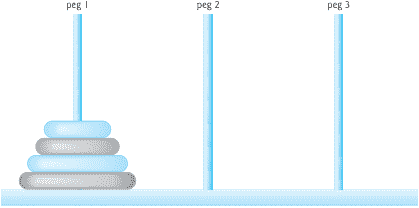


假设僧侣们正尝试将盘子从柱1移动到柱3。我们希望开发一种算法，能够打印出柱与柱之间盘子移动的精确顺序。

如果我们用常规方法处理这个问题，很快就会发现自己陷入管理盘子的绝望困境。相反，用递归的思路来攻克这个问题，步骤就会变得简单。移动 *n* 个盘子可以看作只需移动 *n* − 1 个盘子（因此产生递归），如下所示：

- a) 将 *n* − 1 个盘子从柱1移动到柱2，以柱3作为临时存放区。
- b) 将最后一个盘子（最大的那个）从柱1移动到柱3。
- c) 将 *n* − 1 个盘子从柱2移动到柱3，以柱1作为临时存放区。

当最后一项任务涉及移动 *n* = 1 个盘子时（即基准情况），过程结束。这项任务只需直接移动该盘子，无需临时存放区。编写一个程序来解决汉诺塔问题。使用一个带四个参数的递归函数：

- a) 要移动的盘子数量
- b) 这些盘子初始穿在哪个柱上
- c) 这叠盘子要移动到哪个柱上
- d) 用作临时存放区的柱

显示将盘子从起始柱移动到目标柱的精确指令。要将一叠三个盘子从柱1移动到柱3，程序显示以下移动步骤：

- 1 → 3（这表示将一个盘子从柱1移动到柱3。）
- 1 → 2
- 3 → 2
- 1 → 3
- 2 → 1
- 2 → 3
- 1 → 3

### 5.27（汉诺塔：迭代版本）

任何可以用递归实现的程序都可以用迭代方式实现，尽管有时会更困难且不够清晰。尝试编写汉诺塔的迭代版本。如果成功了，请将你的迭代版本与练习5.26中开发的递归版本进行比较。研究性能、清晰度以及你证明程序正确性的能力等问题。

### 5.28（可视化递归）

观察递归“实际运行”很有趣。修改图5.14中的阶乘函数，使其打印局部变量和递归调用参数。对于每次递归调用，将输出显示在单独一行上，并增加一级缩进。尽最大努力使输出清晰、有趣且有意义。你的目标是设计并实现一种有助于人们更好理解递归的输出格式。你可能希望将这种显示功能添加到全书中许多其他递归示例和练习中。

### 5.29（递归最大公约数）

整数 x 和 y 的最大公约数是能同时整除 x 和 y 的最大整数。编写一个递归函数 `gcd`，返回 x 和 y 的最大公约数，按如下方式递归定义：如果 y 等于 0，则 gcd(x, y) 为 x；否则，gcd(x, y) 为 gcd(y, x % y)，其中 % 是取余运算符。[注意：对于此算法，x 必须大于 y。]

### 5.30（点间距离）

编写函数 `distance`，计算两点 (x₁, y₁) 和 (x₂, y₂) 之间的距离。所有数字和返回值均应为 `double` 类型。

### 5.31

以下程序做什么？

```cpp
// ex05_31.cpp
// 这个程序做什么？
#include <iostream>
using namespace std;

int mystery(int, int); // 函数原型

int main() {
    cout << "Enter two integers: ";
    int x{};
    int y{};
    cin >> x >> y;
    cout << "The result is " << mystery(x, y) << endl;
}

// 参数 b 必须是正整数，以防止无限递归
int mystery(int a, int b) {
    if (1 == b) { // 基准情况
        return a;
    }
    else { // 递归步骤
        return a + mystery(a, b - 1);
    }
}
```

### 5.32

在你确定练习题5.31的程序做什么之后，修改该程序，使其在移除第二个参数必须非负的限制后也能正确运行。

### 5.33（数学库函数）

编写一个程序，测试第5.3节表格中的数学库函数。让你的程序打印出各种参数值的返回值表格，从而逐一测试这些函数。

### 5.34（找错误）

找出以下每个程序段中的错误，并解释如何改正：

```cpp
a) float cube(float); // 函数原型

   cube(float number) { // 函数定义
       return number * number * number;
   }

b) double square(double number) {
       double number{0};
       return number * number;
   }

c) int sum(int n) {
       if (0 == n) {
           return 0;
       }
       else {
           return n + sum(n);
       }
   }
```

### 5.35（掷骰子游戏修改）

修改图5.5中的掷骰子程序，以允许下注。将程序中运行一局掷骰子游戏的部分封装为函数。将变量 `bankBalance` 初始化为 1000。提示玩家输入赌注（wager）。使用 `while` 循环检查赌注是否小于或等于 `bankBalance`，如果不是，则提示用户重新输入赌注，直到输入有效赌注为止。输入正确的赌注后，运行一局掷骰子游戏。如果玩家获胜，则将 `bankBalance` 增加赌注并打印新的 `bankBalance`。如果玩家输掉，则将 `bankBalance` 减少赌注，打印新的 `bankBalance`，检查 `bankBalance` 是否变为零，如果变为零，则打印消息“Sorry. You busted!”。随着游戏进行，打印各种消息以制造一些“闲聊”，例如“Oh, you're going for broke, huh?”、“Aw c'mon, take a chance!”或“You're up big. Now's the time to cash in your chips!”。

### 5.36（圆的面积）

编写一个 C++ 程序，提示用户输入圆的半径，然后调用内联函数 `circleArea` 计算该圆的面积。

### 5.37（按值传递与按引用传递）

编写一个完整的 C++ 程序，包含下面指定的两个备用函数，每个函数都只是将 `main` 中定义的变量 `count` 变为原来的三倍。然后比较并对比这两种方式。这两个函数是：

- a) 函数 `tripleByValue`，按值传递 `count` 的副本，将副本乘以三并返回新值；以及
- b) 函数 `tripleByReference`，通过引用参数按引用传递 `count`，并通过其别名（即引用参数）将 `count` 的原始值乘以三。

### 5.38（一元作用域解析运算符）

一元作用域解析运算符的用途是什么？

### 5.39（函数模板 minimum）

编写一个程序，使用名为 `minimum` 的函数模板来确定两个参数中较小的一个。分别使用整数、字符和浮点数参数测试该程序。

### 5.40（函数模板 maximum）

编写一个程序，使用名为 `maximum` 的函数模板来确定两个参数中较大的一个。分别使用整数、字符和浮点数参数测试该程序。

### 5.41（找错误）

确定以下程序段是否包含错误。对于每个错误，解释如何改正。[*注意：*对于特定程序段，有可能不存在任何错误。]

```cpp
a) template <typename A>
   int sum(int num1, int num2, int num3) {
       return num1 + num2 + num3;
   }

b) template <A>
   A product(A num1, A num2, A num3) {
       return num1 * num2 * num3;
   }

c) double cube(int);
   int cube(int);
```

### 5.42（受限枚举）

创建一个名为 `AccountType` 的受限枚举，包含名为 `savings`、`checking` 和 `investment` 的常量。

### 5.43（函数原型与函数定义）

解释函数原型与函数定义之间的区别。

## 计算机辅助教学

计算机为改善全世界所有学生的学习体验创造了令人兴奋的可能性，接下来的五个练习说明了这一点。

### 5.44（计算机辅助教学）

计算机在教育中的使用被称为*计算机辅助教学（CAI）。*编写一个程序，帮助小学生学习乘法。使用 `rand` 函数产生两个正的一位整数。然后程序应提示用户一个问题，例如：

> 6 乘以 7 等于多少？

然后学生输入答案。接下来，程序检查学生的答案。如果正确，显示消息“Very good!”并再问一个乘法问题。如果答案错误，显示消息“No. Please try again.”，并让学生反复尝试同一个问题，直到最终答对为止。应使用一个单独的函数来生成每个新问题。此函数应在应用程序开始执行时调用一次，并且每次用户正确回答问题后调用一次。

### 5.45（计算机辅助教学：减少学生疲劳）

CAI 环境中的一个问题是学生疲劳。这可以通过变换计算机的回应来吸引学生的注意力，从而减轻疲劳。修改练习5.44中的程序，使每次回答都显示不同的评语，如下所示：

正确答案的可能回应：

- 非常好！
- 太棒了！
- 干得好！
- 继续加油！

错误答案的可能回应：

- 不对。请再试一次。
- 错了。再试一次。
- 别放弃！
- 不对。继续尝试。

使用随机数生成从1到4中选一个数字，用于从四种适当的回应中选择一种，对应每次正确或错误的答案。使用 `switch` 语句来发出这些回应。


# 6 数组、向量、范围与函数式编程

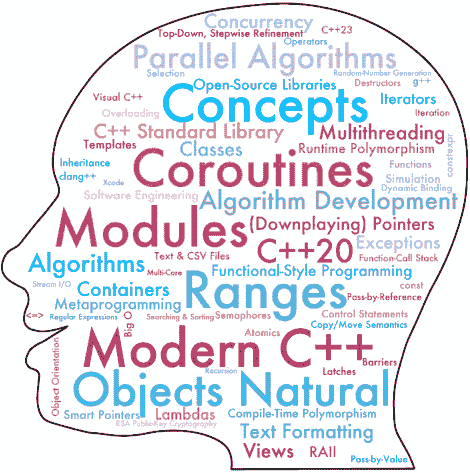

## 目标

在本章中，你将：

- 使用 C++ 标准库类模板 `array`——一种固定大小的、由相关的可索引数据项组成的集合。
- 声明数组、初始化数组并引用数组元素。
- 使用基于范围的 `for` 语句减少迭代错误。
- 将数组传递给函数。
- 执行常见的数组操作。
- 可视化数组的数据。
- 按升序对数组元素排序。
- 使用高性能的 `binary_search` 函数快速判断排序数组中是否包含特定值。
- 声明并操作多维数组。
- 在函数式编程中使用 C++20 的范围。
- 通过一个使用 C++ 标准库类模板 `vector` 的案例研究，继续我们的 Objects-Natural 方法——`vector` 是一种可变大小的、由相关数据项组成的集合。

## 大纲

| 小节 | 主题 | 小节 | 主题 |
|---|---|---|---|
| 6.1 | 简介 | 6.11 | 使用数组汇总调查结果 |
| 6.2 | 数组 | 6.12 | 数组排序与搜索 |
| 6.3 | 声明数组 | 6.13 | 多维数组 |
| 6.4 | 在循环中初始化数组元素 | 6.14 | 函数式编程简介 |
| 6.5 | 使用初始化列表初始化数组 | 6.14.1 | 做什么与怎么做 |
| 6.6 | 基于范围的 for 语句 | 6.14.2 | 将函数作为参数传递给其他函数：Lambda 表达式简介 |
| 6.7 | 计算数组元素值及 constexpr 简介 | 6.14.3 | 过滤、映射和归约：C++20 范围库简介 |
| 6.8 | 数组元素求和 | 6.15 | Objects-Natural 案例研究：C++ 标准库类模板 vector |
| 6.9 | 使用基本条形图以图形方式显示数组数据 | 6.16 | 小结 |
| 6.10 | 使用数组元素作为计数器 |  |  |

## 6.1 简介

本章介绍数据结构——相关数据项的集合。C++ 标准库将数据结构称为容器。我们讨论两种容器：

- 固定大小的数组¹，以及
- 可在执行时动态增大和缩小的可变大小向量。

要使用它们，必须分别包含 `<array>` 和 `<vector>` 头文件。

在讨论如何声明、创建和初始化数组之后，我们将演示各种数组操作。我们将展示如何搜索数组以查找特定项，以及如何对数组排序以使其数据按升序排列。我们将说明，尝试访问数组或向量边界之外的数据可能会导致异常——这是运行时表明发生了问题的指示。然后，我们使用异常处理来解决（或处理）该异常。第 12 章将更深入地讨论异常。

与许多现代语言一样，C++ 提供了“函数式”编程特性。这些特性可以帮助你编写更简洁、更不容易包含错误，并且更易于阅读、调试和修改的代码。**函数式程序也更容易并行化，从而提升当今多核处理器上的性能。** 我们将通过 C++20 新增的 `<ranges>` 库介绍函数式编程。

最后，我们通过一个创建并操作 C++ 标准库类模板 vector 对象的案例研究，继续我们的 Objects-Natural 讲解。阅读本章后，你将熟悉两种类似数组的集合——数组和向量。

### 完全限定的标准库名称

从第 2.7 节开始，我们在每个程序中包含 `using namespace std;`，因此你不需要用 `std::` 限定每个 C++ 标准库特性。在较大的系统中，using 指令可能导致隐蔽、难以发现的错误。今后，我们将完全限定 C++ 标准库中的大多数标识符。

¹. 在第 7 章中，你将看到 C++ 还提供了一种称为数组的语言元素（不同于 array 容器）。现代 C++ 代码应使用类模板 array，而不是传统数组。

### ✓ 检查点

- 1. *（填空）* ______ 是运行时表明发生了问题的指示。  
  **答案：** 异常。
- 2. *（填空）* 两种类似数组的 C++ 集合是数组和 ______。  
  **答案：** 向量。
- 3. *（判断正误）* 在较大的系统中，using 指令可能导致隐蔽、难以发现的错误，因此建议完全限定 C++ 标准库中的大多数标识符。  
  **答案：** 正确。

## 6.2 数组

数组的元素（数据项）在内存中连续排列。下图展示了一个名为 `c` 的整数数组，它包含五个元素：

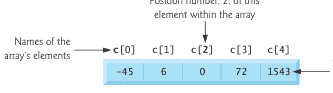

引用数组元素的一种方法是先指定数组名，然后在方括号（`[]`）中指定该元素的位置编号。位置编号更正式地称为索引或下标。第一个元素位于索引 0（零）处。因此，数组 `c` 的元素是 `c[0]`（读作“c 下标零”）到 `c[4]`。`c[0]` 的值为 −45，`c[2]` 的值为 0，`c[4]` 的值为 1543。

最高索引（本例中为 4）总是比数组的元素个数（本例中为 5）小 1。每个数组都知道自己的大小，你可以通过其 size 成员函数获取，如下所示：

```cpp
c.size()
```

索引必须是整数表达式。括住索引的方括号是一个具有第二高优先级的运算符。该运算符的结果是一个*左值*——它可以像变量名一样用于赋值语句的左侧。例如，下面的语句会替换 `c[4]` 的值：

```cpp
c[4] = 7;
```

请参阅 `https://en.cppreference.com/w/cpp/language/operator_precedence` 查看完整的运算符优先级表。

### ✓ 检查点

- 1. *（填空）* 5 元素数组 `c` 的元素名称为 ______。  
  **答案：** `c[0]` 到 `c[4]`。
- 2. *（判断正误）* 数组中的最高索引总是等于数组的元素个数。  
  **答案：** 错误。实际上，数组中的最高索引总是比数组的元素个数小 1。
- 3. *（代码）* 编写一条语句，将数组元素 `c[0]` 和 `c[1]` 的和放入数组元素 `c[2]`。  
  **答案：** `c[2] = c[0] + c[1];`

## 6.3 声明数组

要指定数组的元素类型和元素个数，请使用如下形式的声明：

```cpp
std::array<type, arraySize> arrayName;
```

记号 `<type, arraySize>` 表示 array 是一个类模板。与函数模板一样，编译器可以使用类模板为各种类型创建类模板特化——例如包含五个 int 的数组、包含七个 double 的数组或包含 100 个 Employee 的数组。你将从第 2 章开始创建自定义类型。编译器会根据类型和 arraySize 预留适当的内存量。要告诉编译器为整数数组 `c` 预留五个元素，请使用以下声明：

```cpp
std::array<int, 5> c; // c is an array of 5 int values
```

### 检查点

- 1. *（填空）* 记号  
  `std::array<type, arraySize> arrayName;`  
  表示 array 是一个类 ____。  
  **答案：** 模板。
- 2. *（填空）* 与函数模板一样，编译器可以使用类模板为各种类型创建 ____，例如包含五个 int 的数组、包含七个 double 的数组或包含 100 个 Employee 的数组。  
  **答案：** 类模板特化。

## 6.4 在循环中初始化数组元素

图 6.1 中的程序声明了一个包含五个元素的整数数组 values（第 8 行）。第 5 行包含 `<array>` 头文件，其中含有类模板 array 的定义。

```cpp
1  // fig06_01.cpp
2  // Initializing an array
3  #include <format>
4  #include <iostream>
5  #include <array>
6
7  int main() {
8      std::array<int, 5> values; // values is an array of 5 int values
```

**图 6.1** | 将数组元素初始化为零并打印数组。（第 1 部分，共 2 部分。）


```cpp
// initialize elements of array values to 0
for (size_t i{0}; i < values.size(); ++i) {
   values[i] = 0; // set element at location i to 0
}

std::cout << std::format("{:>7}{:>10}\n", "Element", "Value");

// output each array element
for (size_t i{0}; i < values.size(); ++i) {
   std::cout << std::format("{:>7}{:>10}\n", i, values[i]);
}

std::cout << std::format("\n{:>7}{:>10}\n", "Element", "Value");

// access elements via the at member function
for (size_t i{0}; i < values.size(); ++i) {
   std::cout << std::format("{:>7}{:>10}\n", i, values.at(i));
}

// accessing an element outside the array
values.at(10); // throws an exception
}
```

| 元素 | 值 |
| ---: | ---: |
| 0 | 0 |
| 1 | 0 |
| 2 | 0 |
| 3 | 0 |
| 4 | 0 |

| 元素 | 值 |
| ---: | ---: |
| 0 | 0 |
| 1 | 0 |
| 2 | 0 |
| 3 | 0 |
| 4 | 0 |

```text
terminate called after throwing an instance of
  what():  array::at: __n (which is 10) >= _Nm (which is 5)
Aborted
```

**图 6.1** | 将数组元素初始化为零并打印该数组。（第 2 部分，共 2 部分。）

### 在循环中为数组元素赋值

第 11–13 行使用 for 语句将 0 赋给每个数组元素。与其他非静态局部变量一样，数组元素不会被隐式初始化为零，但静态数组的元素会。在处理数组元素的循环中，要确保循环条件能防止访问数组边界之外的元素。6.6 节介绍基于范围的 for 语句，它提供了一种更安全的方式来处理数组的每个元素。

### 类型 `size_t`

第 11、18 和 25 行将每个循环的控制变量声明为 `size_t` 类型。C++ 标准规定，`size_t` 是一种无符号整型，能够表示任何对象的大小。<sup>2</sup> 对于表示数组大小或下标的任何变量，请使用此类型。类型 `size_t` 定义在 `std` 命名空间中，位于头文件 `<cstddef>` 中；使用 `size_t` 的其他标准库头文件通常会为你包含该头文件。如果你编译程序时收到错误，指出 `size_t` 未定义，请在程序中添加 `#include <cstddef>`。

### 显示数组元素

第一条输出语句（第 15 行）显示后续 for 语句（第 18–20 行）所打印各行的列标题。这些输出语句使用 4.6 节介绍的 C++20 文本格式化功能，以表格形式输出数组。

### 避免安全漏洞：数组下标的边界检查

当你使用 `[]` 运算符访问数组元素时（如第 11–13 行和第 18–20 行所示），C++ **不提供自动数组边界检查**来防止你引用**不存在的元素**。因此，正在执行的程序可能在没有警告的情况下“越界访问”数组的任一端。然而，类模板 `array` 的 `at` 成员函数会执行边界检查。第 25–27 行演示了通过 `at` 成员函数访问元素的值。你也可以在赋值号左侧使用 `at` 为数组元素赋值，如下所示

```cpp
values.at(0) = 10;
```

第 30 行试图访问数组边界之外的元素。**当成员函数 `at` 遇到越界下标时，它会生成一种称为异常的运行时错误。** 在本程序中（我们使用 GNU g++ 编译并在 Linux 上运行），第 30 行导致以下运行时错误消息，随后程序终止：

```text
terminate called after throwing an instance of
  what():  array::at: __n (which is 10) >= _Nm (which is 5)
Aborted
```

此错误消息表明，`at` 成员函数（`array::at`）检查名为 `__n` 的变量（其值为 10）是否大于或等于名为 `_Nm` 的变量（其值为 5）。在本例中，下标越界。在 GNU 对 `array` 的 `at` 成员函数的实现中，`__n` 表示元素的下标，`_Nm` 表示数组的大小。6.15 节介绍如何使用异常处理来处理运行时错误。第 12 章深入讨论异常处理。

**允许程序读写数组边界之外的数组元素是常见的安全缺陷。** 从越界数组元素读取可能导致程序崩溃，甚至可能在使用错误数据的情况下看似正确执行。写入越界元素（称为缓冲区溢出³）可能破坏程序在内存中的数据并导致程序崩溃。攻击者有时可以通过用恶意代码覆盖程序的可执行代码来利用缓冲区溢出。

- 2. C++ 标准，“17.2.4 大小、对齐和偏移。”访问于 2023 年 4 月 14 日。https://timsong-cpp.github.io/cppwp/n4861/support.types#layout-3。
- 3. 有关缓冲区溢出的更多信息，请参见 http://en.wikipedia.org/wiki/Buffer_overflow。


### 检查点

- 1. *（正/误）* C++ 提供自动数组边界检查，以防止你引用不存在的数组元素。因此，正在执行的程序不能在无警告的情况下“越界访问”数组的任一端。
  
  **答案：** 错误。实际上，C++ 不提供自动数组边界检查来防止你引用不存在的元素。因此，正在执行的程序可能在没有警告的情况下“越界访问”数组的任一端。
- 2. *（代码）* 假设数组 numbers 存在并包含 int 值。以下代码做什么？
  
  ```cpp
  for (size_t i{0}; i < numbers.size(); ++i) {
      numbers[i] = 1; // set element at location i to 1
  }
  ```
  
  **答案：** 该代码将 numbers 的每个元素设置为 1。

## 6.5 使用初始化列表初始化数组

数组元素也可以在数组声明中初始化：在数组名后跟一个用花括号限定、以逗号分隔的初始化器列表。图 6.2 中的程序使用初始化列表将一个 int 数组初始化为五个值（第 8 行），并将一个 double 数组初始化为四个值（第 18 行），然后显示每个数组的内容：

- 第 8 行显式告诉编译器数组的元素类型（`int`）和大小（5）。
- 第 18 行让编译器根据初始化列表中的值确定数组的元素类型（`double`），并根据初始化器的数量确定数组的大小（4）。这种能力称为类模板实参推导（CTAD）⁴，当你事先知道容器的初始元素值时，它可以简化代码。

```cpp
// fig06_02.cpp
// Initializing an array in a declaration.
#include <format>
#include <iostream>
#include <array>

int main() {
    std::array<int, 5> values{32, 27, 64, 18, 95}; // braced initializer

    // output each array element
    for (size_t i{0}; i < values.size(); ++i) {
        std::cout << std::format("{} ", values.at(i));
    }

    std::cout << "\n\n";
}
```

**图 6.2** 在声明中初始化数组。（第 1 部分，共 2 部分。）

- 4. “类模板实参推导（CTAD）。”访问于 2023 年 4 月 14 日。https://en.cppreference.com/w/cpp/language/class_template_argument_deduction。

## 6.6 基于范围的 for 语句

处理数组的所有元素是很常见的。基于范围的 for 语句允许你在不使用计数器的情况下做到这一点。在处理数组的所有元素时，请使用基于范围的 for 语句，以确保你的代码不会“越出”数组边界。本节末尾，我们将比较计数器控制的 for 语句和基于范围的语句。图 6.3 使用基于范围的 for 显示数组内容（第 12–14 行和第 23–25 行），并将每个元素的值乘以 2（第 17–19 行）。

```cpp
// fig06_03.cpp
// Using range-based for.
#include <format>
#include <iostream>
#include <array>

int main() {
    std::array items{1, 2, 3, 4, 5}; // type inferred as array<int, 5>

    // display items before modification
    std::cout << "items before modification: ";
    for (const int& item : items) { // item is a reference to a const int
        std::cout << std::format("{} ", item);
    }

    // multiply the elements of items by 2
    for (int& item : items) { // item is a reference to an int
        item *= 2;
    }

    // display items after modification
    std::cout << "\nitems after modification: ";
    for (const int& item : items) {
        std::cout << std::format("{} ", item);
    }

    // sum elements of items using range-based for with initialization
    std::cout << "\n\ncalculating a running total of items";
    for (int runningTotal{0}; const int& item : items) {
        runningTotal += item;
        std::cout << std::format("item: {}; running total: {}\n",
            item, runningTotal);
    }
}
```

```text
items before modification: 1 2 3 4 5
items after modification: 2 4 6 8 10

calculating a running total of items
item: 2; running total: 2
item: 4; running total: 6
item: 6; running total: 12
item: 8; running total: 20
item: 10; running total: 30
```

**图 6.3** | 使用基于范围的 for。


基于范围的 for 语句使用内部迭代，向你隐藏迭代细节。你指定基于范围的 for 应处理哪个数组，它知道如何从数组中获取每个值，并在没有更多值时停止迭代。

### 检查点

- 1. *（判断正误）* 处理数组的所有元素时，应使用基于范围的 for 语句，因为它确保你的代码不会“越出”数组边界。

  **答案：** 正确。

- 2. *（判断正误）* 在基于范围的 for 的初始化器中定义的变量在循环终止后仍然存在。

  **答案：** 错误。实际上，在基于范围的 for 的初始化器中定义的变量只在循环终止前存在。

- 3. *（代码）* 下面的计数器控制的 for 语句输出数组 grades 中的 int 整数。

  ```cpp
  for (int counter{0}; counter < grades.size(); ++counter) {
      std::cout << std::format("{}", grades[counter]);
  }
  ```

  将这个计数器控制的 for 语句转换为基于范围的 for 语句。

  **答案：**

  ```cpp
  for (const int& grade : grades) {
      std::cout << std::format("{}", grade);
  }
  ```

## 6.7 计算数组元素值以及 constexpr 简介

图 6.4 将名为 values 的 5 元素数组的元素设置为偶数整数 2、4、6、8 和 10（第 13—15 行），并打印该数组（第 18—20 行）。第 14 行通过将循环计数器 i 的每个连续值乘以 2 再加 2 来生成值。

```cpp
// fig06_04.cpp
// Set array values to the even integers from 2 to 10.
#include <format>
#include <iostream>
#include <array>

int main() {
    // constant can be used to specify array size
    constexpr size_t arraySize{5}; // must initialize in declaration

    std::array<int, arraySize> values{}; // array values has 5 elements

    for (int i{0}; i < values.size(); ++i) { // set the values
        values.at(i) = 2 + 2 * i;
    }
```

**图 6.4** | 将数组元素设置为从 2 到 10 的偶数整数。（第 1 部分，共 2 部分。）

```cpp
// output contents of array values in tabular format
for (const int& value : values) {
    std::cout << std::format("{} ", value);
}

std::cout << '\n';
}
```

```text
2  4  6  8  10
```

**图 6.4** | 将数组元素设置为从 2 到 10 的偶数整数。（第 2 部分，共 2 部分。）

### 常量

在第 5 章中，我们使用 const 限定符来表示变量的值在初始化后不再改变。有时，编译器会通过在编译期初始化 const 变量来优化代码以获得更好的性能；但这并不保证。constexpr 限定符也可用于声明常量变量。这样的变量隐式地是 const，并且显式地在编译期初始化，从而消除了运行时初始化的可能性。

将数组的大小定义为常量而不是字面量值，可以使程序更清晰、更易于更新。这种技术消除了魔法数——即没有上下文帮助你理解其含义的字面数值。使用常量可以为字面量值提供名称，并有助于解释该值在程序中的用途。

### 初始化后不能修改 constexpr 变量

第 9 行使用 constexpr 声明值为 5 的常量 arraySize。在 arraySize 初始化后尝试修改它，如下所示：

```cpp
arraySize = 7;
```

会导致编译错误。⁶

- Visual C++:

  ```text
  error C3892:
      that is const
  ```

- g++:

  ```text
  error: assignment of read-only variable
  ```

- clang++:

  ```text
  error: cannot assign to variable
  const-qualified type
  ```

6. 在错误消息中，一些编译器将 const 基本类型变量称为“const 对象”。C++ 标准将“对象”定义为任何“存储区域”。与类对象一样，基本类型变量也占用内存空间，因此它们通常被称为“对象”。

### 现代 C++：在编译期做更多事

现代 C++ 的一个主题是在编译期做更多事，以获得更好的运行时性能。**constexpr** 是我们将要介绍的若干特性之一，这些特性可消除运行时开销并提高性能。自 C++11 以来的每个 C++ 标准都扩展了 constexpr 的用途。

在第 15.13 节中，你将看到 constexpr 可以应用于函数。当你使用 constexpr 实参调用这样的函数时，编译器可以确定该调用的最终结果，并用常量替换该调用，从而消除运行时函数调用开销并提高性能。现在，C++ 标准库中的许多函数都声明为 constexpr，以利用这种优化。

今后，我们将把每个值可在编译期确定的变量定义为 constexpr。当我们在第 15.13 节介绍构造函数时，我们将演示 constexpr 函数调用的编译期求值。


### ✓ 检查点

- 1. *（填空）* ______ 限定符使你能够声明可在编译期求值并得到常量的变量。

  **答案：** constexpr。

- 2. *（判断正误）* const 变量必须在编译期初始化，但 constexpr 变量可以在执行期初始化。

  **答案：** 错误。实际上，constexpr 变量必须在编译期初始化，但 const 变量可以在执行期初始化。

## 6.8 对数组元素求和

通常，数组元素表示用于计算的一系列值。例如，如果数组的元素表示考试成绩，教授可能希望先将数组元素求和，然后计算该考试的班级平均分。将一组值处理为单个值称为归约——正如我们在第 6.14 节中讨论的，这是一种常见的函数式编程操作。图 6.5 使用基于范围的 for 语句（第 12—14 行）对包含四个 int 元素的数组中的值求和。第 6.14 节展示了如何使用 C++ 标准库的 accumulate 函数执行此计算。

```cpp
// fig06_05.cpp
// Compute the sum of an array
#include <format>
#include <iostream>
#include <array>

int main() {
    std::array items{10, 20, 30, 40}; // type inferred as array<int, 4>
    int total{0};
```

**图 6.5** | 计算数组元素之和（第 1 部分，共 2 部分。）

- 第 8 行使用 `constexpr` 声明该数组，因为程序从不修改 frequencies，并且其值在编译期已知。

- 为了标记每个条形，第 15—21 行根据 `i` 的当前值输出一个成绩范围（例如 "70-79: "）。在第 16—17 行中，格式说明符 `:02d` 表示整数（由 `d` 表示）应使用字段宽度 2 进行格式化，如果整数少于两位，则使用前导 0。在第 20 行中，格式说明符 `:>5d` 表示整数应在字段宽度 5 中右对齐（`>`）。

- 嵌套的 `for` 语句（第 26—28 行）输出当前条形的星号。第 26 行中的循环继续条件（`stars < frequency`）使内层循环从 0 计数到 frequency。因此，frequencies 中的一个值决定要显示的星号数量。在此示例中，frequencies 元素 0—5 包含零，因为没有学生成绩低于 60。因此，程序在前六个成绩范围旁边不显示星号。

```cpp
// fig06_06.cpp
// Printing a student grade distribution as a primitive bar chart.
#include <format>
#include <iostream>
#include <array>

int main() {
    constexpr std::array frequencies{0, 0, 0, 0, 0, 0, 1, 2, 4, 2, 1};

    std::cout << "Grade distribution:\n";

    // for each element of frequencies, output a bar of the chart
    for (int i{0}; const int& frequency : frequencies) {
        // output bar labels ("00-09", ... , "90-99", "100")
        if (i < 10) {
            std::cout << std::format("{:02d}-{:02d}: ",
                i * 10, (i * 10) + 9);
        }
        else {
            std::cout << std::format("{:>5d}: ", 100);
        }

        ++i;

        // print bar of asterisks
        for (int stars{0}; stars < frequency; ++stars) {
            std::cout << '*';
        }

        std::cout << '\n'; // start a new line of output
    }
}
```

**图 6.6** | 将学生成绩分布打印为原始条形图。（第 1 部分，共 2 部分。）


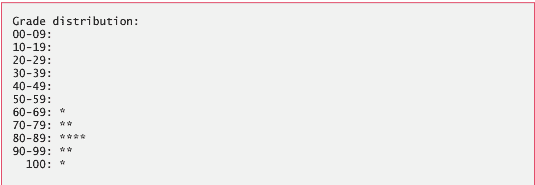

**图 6.6** | 将学生成绩分布打印为基本条形图。（第 2 部分，共 2 部分。）

## 6.10 使用数组元素作为计数器

有时，程序使用计数器变量汇总数据，例如调查结果。图 5.3 的掷骰子模拟使用单独的计数器来跟踪程序掷骰子 60,000,000 次时每个骰子面的出现频数。图 6.7 使用频数计数器数组重新实现该模拟。

```cpp
// fig06_07.cpp
// Die-rolling program using an array instead of switch.
#include <format>
#include <iostream>
#include <array>
#include <random>

int main() {
   // set up random-number generation
   std::random_device rd; // used to seed the default_random_engine
   std::default_random_engine engine{rd()}; // rd() produces a seed
   std::uniform_int_distribution randomDie{1, 6};

   constexpr size_t arraySize{7}; // ignore element zero
   std::array<int, arraySize> frequency{}; // initialize to 0s

   // roll die 60,000,000 times; use die value as frequency index
   for (int roll{1}; roll <= 60'000'000; ++roll) {
      ++frequency.at(randomDie(engine));
   }

   std::cout << std::format("{}{:>13}\n", "Face", "Frequency");

   // output each array element
   for (size_t face{1}; face < frequency.size(); ++face) {
      std::cout << std::format("{:>4}{:>13}\n", face, frequency.at(face));
   }
}
```

**图 6.7** | 使用数组代替 switch 的掷骰子程序。（第 1 部分，共 2 部分。）

| 面值 | 频数 |
| --- | --- |
| 1 | 9997901 |
| 2 | 9999110 |
| 3 | 10001172 |
| 4 | 10003619 |
| 5 | 9997606 |
| 6 | 10000592 |

**图 6.7** | 使用数组代替 switch 的掷骰子程序。（第 2 部分，共 2 部分。）

图 6.7 使用数组 frequency（第 15 行）统计骰子值的出现次数。第 19 行取代了图 5.3 中第 23–45 行的 switch 语句。它使用随机骰子值作为索引，来确定每次掷骰子时要递增哪个 frequency 元素。第 19 行中的点（.）运算符优先级高于 ++ 运算符，因此该语句先选择一个 frequency 元素，再递增其值。

调用 randomDie(engine) 会生成 1 到 6 的随机索引，因此 frequency 必须足够大以存储六个计数器。我们使用一个七元素数组，并忽略元素 0——让骰子值 1 递增 frequency.at(1) 而不是 frequency.at(0) 更清晰。因此，每个面值直接用作 frequency 的索引。我们还通过遍历数组 frequency 来输出结果（图 6.7，第 25–27 行），从而取代图 5.3 的第 49–54 行。这里我们使用计数器控制的 for 语句，而不是基于范围的 for 语句，这样可以跳过打印 frequency 的元素 0。

### 检查点

- 1. *(代码)* 重写图 6.7 的第 22–27 行，使各列左对齐，如下所示：

```cpp
Face   Frequency
1      9997901
2      9999110
3      10001172
4      10003619
5      9997606
6      10000592
```

**答案：**

```cpp
std::cout << std::format("{:<8}{}\n", "Face", "Frequency");

// output each array element
for (size_t face{1}; face < frequency.size(); ++face) {
    std::cout << std::format("{:<8}{}\n", face, frequency.at(face));
}
```

## 6.11 使用数组汇总调查结果

下一个示例使用数组汇总调查中收集的数据。考虑以下问题陈述：

> 二十名学生被要求按 1 到 5 的等级评价学生食堂的食品质量，其中 1 表示“糟糕”，5 表示“极好”。将这 20 个回答放入一个 int 值数组中，并确定每个评分的频数。

这是一种常见的数组处理应用（图 6.8）。我们希望汇总每个评分（即 1–5）的回答数量。数组 responses（第 9–10 行）是一个包含学生调查回答的 20 元素整数数组。它被声明为 `constexpr`，因为其值不会（也不应）改变，并且在编译时已知。我们使用一个六元素数组 frequency（第 18 行）来统计每个回答的出现次数。每个 frequency 元素用作一个调查回答的计数器，并初始化为零。与图 6.7 一样，我们忽略元素 0。

```cpp
// Fig06_08.cpp
// Poll analysis program.
#include <format>
#include <iostream>
#include <array>

int main() {
   // place survey responses in array responses
   constexpr std::array responses{
      1, 2, 5, 4, 3, 5, 2, 1, 3, 1, 4, 3, 3, 2, 3, 3, 2, 2, 2, 5};

   // initialize frequency counters to 0
   constexpr size_t frequencySize{6}; // size of array frequency
   std::array<int, frequencySize> frequency{};

   // for each response in responses, use that value
   // as the index to determine element to increment
   for (const int& response : responses) {
      ++frequency.at(response);
   }

   std::cout << std::format("{:>6}{:>12}\n", "Rating", "Frequency");

   // output each array element
   for (size_t rating{1}; rating < frequency.size(); ++rating) {
      std::cout << std::format("{:>6}{:>12}\n",
         rating, frequency.at(rating));
   }
}
```

| 评分 | 频数 |
|---:|---:|
| 1 | 3 |
| 2 | 5 |
| 3 | 7 |
| 4 | 2 |
| 5 | 3 |

**图 6.8** | 调查分析程序。

第一个 for 语句（第 18–20 行）每次从 responses 中取出一个回答（每个都是 1–5 范围内的值），并递增 frequency.at(1) 到 frequency.at(5) 中的一个计数器。关键语句是第 19 行，它根据 response 的值递增相应的计数器。无论调查中处理多少个回答，程序只需要一个六元素数组（忽略元素零）即可汇总结果，因为所有回答值都在 1 到 5 之间，而六元素数组的索引值为 0 到 5。

## 6.12 对数组排序和搜索

将数据按升序或降序排序是最重要的计算应用之一。几乎每个组织都必须对某些数据进行排序，而且在许多情况下，数据量巨大。排序是一个引人入胜的问题，吸引了计算机科学中一些最密集的研究努力。通常可能需要确定数组是否包含与特定键值匹配的值。查找键值的过程称为搜索。本节使用内置的 C++ 标准库 sort 函数将数组中的元素按升序排列，并使用内置的 binary_search 函数确定某个值是否存在于已排序数组中。

### 演示函数 sort 和 binary_search

图 6.9 创建一个名为 colors 的、包含七个 string 对象的未排序数组（第 13–14 行）。第 10 行的 using 声明使我们能够使用 string 对象字面量初始化该数组。在字符串的结束引号后放置一个 s，即可构成 string 对象字面量。例如，在 "red"s 中，字面量后面的 s 告诉编译器该字面量是 std::string 对象。在这里使用 string 对象字面量使编译器能够从初始化器推断出数组的元素类型是 std::string。第 18–20 行显示 colors 的内容。注意，循环的控制变量声明为

```cpp
const std::string&
```

对范围变量 color 使用引用可防止循环在每次迭代时将当前 string 对象复制到 color 中。在处理大量字符串的程序中，这种复制操作会降低性能。

```cpp
// fig06_09.cpp
// Sorting and searching arrays.
#include <array>
#include <algorithm> // contains sort and binary_search
#include <format>
#include <iostream>
#include <string>

int main() {
    using namespace std::string_literals; // enables string object literals

    // colors is inferred to be an array<string, 7>
    std::array colors{"red"s, "orange"s, "yellow"s,
        "green"s, "blue"s, "indigo"s, "violet"s};

    // output original array
    std::cout << "Unsorted colors array: ";
    for (const std::string& color) {
        std::cout << std::format("{} ", color);
    }
}
```

**图 6.9** | 对数组排序和搜索。（第 1 部分，共 2 部分。）


## ✓ **检查点**

- 1. *(填空题)* 参数 `std::begin(colors)` 和 `std::end(colors)` 返回的迭代器分别表示 colors 数组的开头和结尾。  
  **答案：** 迭代器。
- 2. *(对/错)* 标准库函数 `binary_search`（来自头文件 `<algorithm>`）可以判断某个值是否位于已排序数组中。  
  **答案：** 对。
- 3. *(对/错)* 对未排序数组执行 `binary_search` 是一种语法错误，可能导致不正确的结果。  
  **答案：** 错。实际上，对未排序数组执行二分查找是一种逻辑错误，可能导致不正确的结果。

## 6.13 多维数组

你可以使用二维数组（即具有两个索引的数组）来表示按行和列排列的数据表。要标识表中的特定元素，必须指定两个索引。按照惯例，第一个索引标识行，第二个索引标识列。需要两个索引来标识特定元素的数组称为二维数组，或称 **2-D 数组**。具有两个或更多维度的数组称为多维数组。下图展示了一个名为 `a` 的二维数组：

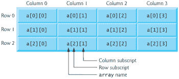

该数组包含三行四列，因此称为 3×4 数组。通常，具有 *m* 行和 *n* 列的数组称为 *m*×*n* 数组。

在上图中，我们用 `a[row][column]` 形式的元素名称标识了每个元素。类似地，你可以通过赋值 `a.at(i).at(j)` 访问每个元素。

第 0 行中的所有元素名称的第一个索引均为 0；第 3 列中的所有元素名称的第二个索引均为 3。

图 6.10 演示了在声明中初始化二维数组。第 11–12 行各自创建一个包含两行三列的数组的数组。

```cpp
// fig06_10.cpp
// Initializing multidimensional arrays.
#include <iostream>
#include <array>

constexpr size_t rows{2};
constexpr size_t columns{3};
void printArray(const std::array<std::array<int, columns>, rows>& a);

int main() {
   constexpr std::array values1{std::array{1, 2, 3}, std::array{4, 5, 6}};
   constexpr std::array values2{std::array{1, 2, 3}, std::array{4, 5, 0}};

   std::cout << "values1 by row:\n";
   printArray(values1);

   std::cout << "\nvalues2 by row:\n";
   printArray(values2);
}

// output array with two rows and three columns
void printArray(const std::array<std::array<int, columns>, rows>& a) {
   // loop through array
   for (const auto& row : a) {
      // loop through columns of current row
      for (const auto& element : row) {
         std::cout << element << ' ';
      }

      std::cout << '\n'; // start new line of output
   }
}
```

```text
values1 by row:
1 2 3
4 5 6

values2 by row:
1 2 3
4 5 0
```

图 6.10 | 初始化多维数组。

### 声明数组的数组

在第 11–12 行中，编译器推断 `values1` 和 `values2` 是数组的数组，具有两行、每行三列，并且其中的元素类型为 `int`。考虑 `values1` 的两个初始化器：

```cpp
std::array{1, 2, 3};
std::array{4, 5, 6};
```

根据这些初始化器，编译器推断 `values1` 有两行。每个初始化器创建一个包含三个元素的数组，因此编译器推断 `values1` 的每一行有三列。最后，这些行初始化器中的值是 `int`，因此编译器推断 `values1` 的元素类型为 `int`。

### 显示数组的数组

程序调用函数 `printArray` 输出每个数组的元素。函数原型（第 8 行）和定义（第 22–32 行）指明，`printArray` 通过 `const` 引用接收一个两行三列、元素为 `int` 的数组。在类型

```cpp
const std::array<std::array<int, columns>, rows>&
```

中，外层数组类型表明它具有 `rows`（2）个元素，元素类型为

```cpp
array<int, columns>
```

因此，外层数组的每个元素都是一个包含 `columns`（3）个元素的 `int` 数组。该参数以 `const` 引用接收数组，因为 `printArray` 不会修改元素。

### 嵌套的基于范围的 for 语句

为了处理二维数组的元素，我们使用了嵌套循环：

- 外层循环遍历各行，并且
- 内层循环遍历给定行的各列。

函数 `printArray` 的嵌套循环使用基于范围的 `for` 语句实现。第 24 和 26 行引入了 `auto` 关键字，它告诉编译器根据变量的初始化器值推断（确定）变量的数据类型。外层循环的范围变量 `row` 用参数 `a` 中的一个元素初始化。查看数组的声明可以看到，它包含的元素类型为

```cpp
array<int, columns>
```

因此编译器推断 `row` 指代一个包含三个 `int` 值的数组（同样，`columns` 为 3）。`row` 声明中的 `const&` 表明该引用不能用于修改行，并防止每一行被复制到范围变量中。内层循环的范围变量 `element` 用 `row` 所表示数组中的一个元素初始化。因此，编译器推断 `element` 是对 `const int` 的引用，因为每一行包含三个 `int` 值。在许多 IDE 中，将鼠标光标悬停在用 `auto` 声明的变量上会显示该变量的推断类型。第 27 行显示给定行和列中的元素值。

### 嵌套的计数控制 for 语句

我们也可以用计数器控制的迭代实现嵌套循环，如下所示：

```cpp
for (size_t row{0}; row < a.size(); ++row) {
    for (size_t column{0}; column < a.at(row).size(); ++column) {
        cout << a.at(row).at(column) << ' '; // or a[row][column]
    }
    cout << '\n';
}
```


### 用全花括号初始化列表初始化数组的数组

如果在声明数组时显式指定其维度，就可以简化其初始化列表。例如，第 11 行可以写成

```cpp
constexpr std::array<std::array<int, columns>, rows> values{
    {{1, 2, 3}, // row 0
     {4, 5, 6}} // row 1
};
```

在这种情况下，如果某个初始化子列表的元素少于列数，该行剩余元素将进行值初始化。

### 常见的二维数组操作：设置一行的值

让我们考虑使用第 6.13 节开头示意图中的三行四列数组 a 进行其他几种常见操作。下面的 for 语句将第 2 行的所有元素设置为零：

```cpp
for (size_t column{}; column < a.at(2).size(); ++column) {
    a.at(2).at(column) = 0; // or a[2][column] = 0;
}
```

该 for 语句只改变第二个索引（即列索引）。前面的 for 语句等价于以下赋值语句：

```cpp
a.at(2).at(0) = 0; // or a[2][0] = 0;
a.at(2).at(1) = 0; // or a[2][1] = 0;
a.at(2).at(2) = 0; // or a[2][2] = 0;
a.at(2).at(3) = 0; // or a[2][3] = 0;
```

### 常见的二维数组操作：使用嵌套计数器控制的 for 循环对所有元素求和

下面的嵌套计数器控制 for 语句对数组 a 中的元素求和：

```cpp
int total{};
for (size_t row{}; row < a.size(); ++row) {
    for (size_t column{}; column < a.at(row).size(); ++column) {
        total += a.at(row).at(column); // a[row][column]
    }
}
```

该 for 语句一次一行地对数组元素求和。外层循环首先将行索引设为 0，因此内层循环可以对第 0 行的元素求和。然后外层循环将 row 递增为 1，因此可以对第 1 行的元素求和。接着，外层 for 语句将 row 递增为 2，因此可以对第 2 行的元素求和。

### 常见的二维数组操作：使用嵌套基于范围的 for 循环对所有元素求和

嵌套的基于范围的 for 语句是实现前面循环的首选方式：

```cpp
int total{};
for (const auto& row : a) { // for each row in a
    for (const auto& column : row) { // for each column in row
        total += column;
    }
}
```

## 使用 accumulate 进行函数式归约

图 6.11 将图 6.5 中基于范围的 for 语句替换为对 C++ 标准库 `accumulate` 算法（来自头文件 `<numeric>`）的调用。默认情况下，该函数知道*如何*计算一个范围中各个值之和，将它们归约为单个值。这称为归约，是一种常见的函数式编程操作。

```cpp
// Fig06_11.cpp
// Compute the sum of the elements of an array using accumulate.
#include <array>
#include <format>
#include <iostream>
#include <numeric>

int main() {
    constexpr std::array integers{10, 20, 30, 40};
    std::cout << std::format("Total of array elements: {}\n",
        std::accumulate(std::begin(integers), std::end(integers), 0));
}
```

```
Total of array elements: 100
```

**图 6.11** | 使用 accumulate 计算数组元素之和。

与 6.12 节中的函数 `sort` 一样，函数 `accumulate` 的前两个参数（第 11 行）指定要求和的元素范围——在本例中，是从 `integers` 开头到结尾的元素。该函数*在内部*将处理过的元素累加到运行总计中，隐藏这些计算。第三个参数是运行总计的初始值（0），该参数的类型就是 `accumulate` 的返回类型。稍后你将看到如何自定义 `accumulate` 的归约。

函数 `accumulate` 使用*内部迭代*，这对你同样是隐藏的。该函数知道*如何*遍历一个元素范围，并将每个元素加到运行总计中。说明你*想做什么*，并让库决定*如何做*，这称为**声明式编程**——这是函数式编程的另一个标志。

## 6.14.2 将函数作为参数传递给其他函数：介绍 Lambda 表达式

许多标准库函数允许通过传入其他函数作为参数来自定义其工作方式。接收其他函数作为参数的函数称为**高阶函数**，在函数式编程中很常用。考虑函数 `accumulate`，它默认对元素求和。它还提供了一个重载，其第四个参数接收一个定义如何执行归约的函数。图 6.12 不是简单地对值求和，而是计算值的乘积。

**图 6.12** | 计算数组的乘积。（第 1 部分，共 2 部分。）

```cpp
// Fig06_12.cpp
// Compute the product of an array
#include <array>
#include <format>
#include <iostream>
#include <numeric>

int multiply(int x, int y) {
    return x * y;
}

int main() {
    constexpr std::array integers{1, 2, 3, 4, 5};

    std::cout << std::format("Product of integers: {}\n", std::accumulate(
        std::begin(integers), std::end(integers), 1, multiply));

    std::cout << std::format("Product of integers with a lambda: {}\n",
        std::accumulate(std::begin(integers), std::end(integers), 1,
            [](const auto& x, const auto& y){return x * y;}));
}

Product of integers: 120
Product of integers with a lambda: 120
```

**图 6.12** | 使用 `accumulate` 计算数组元素的乘积。（第 2 部分，共 2 部分。）

### 使用命名函数调用 `accumulate`

第 15–16 行对数组 integers（在第 13 行定义）调用 accumulate。我们要计算乘积，因此第三个参数（即归约的初始值）是 1 而不是 0；否则最终乘积将为 0。第四个参数是要对每个数组元素调用的函数——在本例中为 multiply（在第 8–10 行定义）。要计算乘积，该函数必须接收两个参数：

- 到目前为止的乘积，以及
- 数组中的一个值

并且必须返回一个值，该值成为新的乘积。当 accumulate 遍历 integers 时，它将当前乘积和下一个元素作为参数传入。对于本例，accumulate 在内部调用 multiply 五次：

- 第一次调用传入初始乘积（1，指定为 accumulate 的第三个参数）和数组的第一个元素（1），得到乘积 1。
- 第二次调用传入当前乘积（1）和数组的第二个元素（2），得到乘积 2。
- 第三次调用传入 2 和数组的第三个元素（3），得到乘积 6。
- 第四次调用传入 6 和数组的第四个元素（4），得到乘积 24。
- 最后，最后一次调用传入 24 和数组的第五个元素（5），得到总体结果 120，accumulate 将其返回给调用者。

### 使用 Lambda 表达式调用 accumulate

有时你不需要复用某个函数，在这种情况下，可以使用 lambda 表达式（或简称为 lambda）在需要的地方定义函数。lambda 表达式是一个*匿名函数*——即没有名称的函数。第 19–20 行对 `accumulate` 的调用使用以下 lambda 表达式来完成与 `multiply` 相同的任务：

```cpp
[](const auto& x, const auto& y){ return x * y;}
```

Lambda 以 lambda 引导符（`[]`）开始，后面是逗号分隔的参数列表和函数体。这个 lambda 接收两个参数，计算它们的乘积并返回结果。

你在 6.13 节中已经看到，auto 使编译器能够根据变量的初始值推断其类型。将 lambda 参数的类型指定为 auto，使编译器能够根据调用 lambda 的上下文推断类型。在本例中，`accumulate` 对每个数组元素调用一次该 lambda，将当前乘积和元素值作为 lambda 的参数传入。由于初始乘积（`1`）是 `int`，并且数组包含 `int`，编译器将 lambda 参数的类型推断为 `int`。前面的 lambda 是一个泛型 lambda——它使用 auto 推断每个参数的类型。编译器还会从表达式 `x * y` 推断该 lambda 的返回类型——x 和 y 都是 int，因此该 lambda 返回 int。

我们将参数声明为 `const` 引用：

- 它们是 const，因此 lambda 的函数体不能修改调用者的变量。
- **它们使用引用是为了性能，确保当 lambda 与大型对象一起使用时不会复制这些对象。**

这个 lambda 可用于任何支持 `*` 运算符的类型。第 14 章将详细讨论 lambda 表达式。

## 6.14.3 筛选、映射和归约：C++20 范围库简介

C++ 标准库多年来一直支持函数式编程。C++20 新增的范围库（头文件 `<ranges>`）使函数式编程更加方便。这里我们介绍该库的两个关键方面——范围和视图：

- 范围是可以迭代的元素集合。因此，例如数组就是一个范围。
- 视图使你能够指定对范围进行操作的运算。视图是可组合的——你可以将它们链接起来，通过多个操作处理一个范围的元素。

图 6.13 被我们分成几部分进行讨论，它演示了使用 C++20 范围的几个函数式操作。我们将在第 14 章介绍更多内容。在撰写本文时，此示例无法在 Xcode 中编译。

### 用于显示此应用程序结果的 showValues Lambda

在整个示例中，我们使用基于范围的 `for` 语句显示各种范围操作的结果。与其重复那段代码，我们可以定义一个接收范围并显示其值的函数。相反，我们定义了一个泛型 lambda（第 12–20 行），以说明你可以将 lambda 存储在局部变量（`showValues`；第 11–21 行）中。然后，你可以使用该变量的名称调用 lambda，如我们在第 24、29、34、40 和 51 行所做的那样。


```cpp
// fig06_13.cpp
// 使用 C++20 ranges 和 views 进行函数式风格编程。
#include <array>
#include <format>
#include <iostream>
#include <numeric>
#include <ranges>

int main() {
    // 用于显示范围操作结果的 lambda 表达式
    auto showValues{
        [](auto& values, const std::string& message) {
            std::cout << std::format("{}: ", message);

            for (const auto& value : values) {
                std::cout << std::format("{} ", value);
            }

            std::cout << '\n';
        }
    };
```

**图 6.13** | 使用 C++20 ranges 和 views 进行函数式风格编程。

### 使用 `views::iota` 生成整数序列范围

在本章的许多示例中，我们先创建了一个数组，然后处理其值。这需要预先分配具有适当元素数量的数组。有时，你可以*按需*生成值，而不是提前创建并存储这些值。**按需生成值的操作采用惰性求值，这可以减少程序的内存消耗，并且在不需要一次性获得所有值时提高性能。** 第 23 行使用 `<ranges>` 库中的 `views::iota` 从其第一个参数（1）开始生成整数范围，直到（但不包括）其第二个参数（11）。这被称为半开区间。**这些值直到程序迭代结果时才生成**，例如我们在第 24 行调用 `showValues` 显示这些值时。

Perf

```cpp
auto values1{std::views::iota(1, 11)}; // 生成整数 1-10
showValues(values1, "Generate integers 1-10");
```

```text
Generate integers 1-10: 1 2 3 4 5 6 7 8 9 10
```

### 使用 `views::filter` 过滤元素

一种常见的函数式编程操作是过滤元素，只选择满足条件的元素。这通常会产生比被过滤范围更少的元素。实现过滤的一种方法是使用循环遍历元素，用 if 语句检查每个元素是否满足条件。然后你可以对该元素执行某些操作，例如将其添加到容器中。这需要显式定义迭代控制语句和可变变量，正如 6.6 节所讨论的那样，这种方法容易出错。

使用 ranges 和 views，我们可以使用 `views::filter` 来关注*想要*完成什么——在本例中，获取 1-10 范围内的偶数。第 27-28 行中的 `values2` 初始化器使用 `|` 运算符连接多个操作。第一个操作（来自第 23 行的 `values1`）生成 1-10，第二个操作过滤这些结果。这些操作共同构成一个管道。每个管道以一个范围开始，该范围是数据源（由 `values1` 产生的值 1-10），随后是任意数量的操作，每个操作之间用 `|` 分隔。

```cpp
26    // 过滤 values1 中的每个值，只保留偶数
27    auto values2{values1 |
28        std::views::filter([](const auto& x) {return x % 2 == 0;})};
29    showValues(values2, "Filtering even integers");
30
```

```text
Filtering even integers: 2 4 6 8 10
```

`views::filter` 的参数必须是一个函数，该函数接收一个要处理的值并返回一个 `bool`，指示是否保留该值。我们传入了一个 lambda，如果其参数能被 2 整除，则返回 `true`。

第 27-28 行执行后，`values2` 表示一个*惰性*管道，它可以生成整数 1-10 并过滤这些值，只保留偶数。该管道简洁地表示了*想要*做什么，但没有说明*如何*做：

- `views::iota` 知道*如何*生成整数；
- `views::filter` 知道*如何*使用其函数参数来确定是否保留从管道前部接收到的每个值。

然而，该管道是惰性的——在你迭代 `values2` 之前不会产生任何结果。

当 `showValues` 迭代 `values2` 时，`views::iota` 产生一个值，然后 `views::filter` 调用其函数参数来确定是否保留该值。如果该函数返回 `true`，基于范围的 `for` 语句从管道接收该值并显示它。否则，处理步骤将使用 `views::iota` 生成的下一个值重复执行。

### 使用 `views::transform` 映射元素

另一种常见的函数式编程操作是将元素映射为新值，这些新值可能是不同类型的。映射产生的结果元素数量与原始被映射范围相同。使用 C++20 ranges，`views::transform` 执行映射操作。第 32-33 行中的管道在第 27-28 行的管道上添加了另一个操作，将 `values2` 的过滤结果通过第 33 行传递给 `views::transform` 的 lambda 表达式映射为其平方。

```cpp
31    // 将 values2 中的每个值映射为其平方
32    auto values3{
33        values2 | std::views::transform([](const auto& x) {return x * x;})};
34    showValues(values3, "Mapping even integers to squares");
35
```

```text
Mapping even integers to squares: 4 16 36 64 100
```

`views::transform` 的参数是一个函数，该函数接收一个要处理的值并返回映射后的值，该值可能是其他类型的。当 `showValues` 迭代 `values3` 管道的结果时：

- 1. `views::iota` 产生一个值。
- 2. `views::filter` 确定该值是否为偶数。如果是，则将该值传递到第 3 步。否则，处理继续进行，使用第 1 步中 `views::iota` 生成的下一个值。
- 3. `views::transform` 计算该偶数的平方（如第 33 行的 lambda 所指定），然后 `showValues` 中的基于范围的 `for` 循环显示该值，处理继续进行，使用第 1 步中 `views::iota` 生成的下一个值。

### 将过滤和映射操作组合成一个管道

管道中可以包含任意数量由 `|` 运算符分隔的操作。第 37-39 行中的管道将前面的操作组合成一个单独的管道，第 40 行显示结果。

```cpp
// 组合过滤和变换，得到偶数的平方
auto values4{
    values1 | std::views::filter([](const auto& x) { return x % 2 == 0; })
             | std::views::transform([](const auto& x) { return x * x; });
showValues(values4, "Squares of even integers");
}
```

```text
Squares of even integers: 4 16 36 64 100
```

### 使用 accumulate 归约范围管道

C++ 标准库函数如 `accumulate` 也可以与惰性范围管道一起使用。第 44 行执行一次归约，对第 37-39 行管道产生的偶数的平方求和。

```cpp
// 计算偶数的平方之和
std::cout << std::format("Sum squares of even integers 2-10: {}\n",
    std::accumulate(std::begin(values4), std::end(values4), 0));
```

```text
Sum squares of even integers 2-10: 220
```

### 过滤和映射现有容器的元素

各种 C++ 容器（包括数组和 vector（6.15 节））都可以用作范围管道中的数据源。第 47 行创建一个包含 1-10 的数组，然后在管道中使用该数组，计算数组中偶数的平方。

```cpp
// 处理一个容器
constexpr std::array numbers{1, 2, 3, 4, 5, 6, 7, 8, 9, 10};
auto values5{
    numbers | std::views::filter([](const auto& x) { return x % 2 == 0; })
            | std::views::transform([](const auto& x) { return x * x; });
showValues(values5, "Squares of even integers in array numbers");
}
```

```text
Squares of even integers in array numbers: 4 16 36 64 100
```

### 检查点

- **（填空）** 接收其他函数作为参数的函数称为 ______，常用于函数式编程。**答案：** 高阶函数。
- **（填空）** 视图使你可以指定操作范围的操作。视图是 ______，你可以将它们链接在一起，通过多个操作处理范围的元素。**答案：** 可组合的。
- **（填空）** `<ranges>` 库中的 `views::iota` 生成从第一个参数到（但不包括）第二个参数的整数范围，称为 ______ 范围。**答案：** 半开。

## 6.15 对象的自然案例研究：C++ 标准库类模板 vector

现在，我们将 C++ 标准库类模板 vector⁷（来自头文件 <vector>）的对象拿出来试用（图 6.14），继续我们“对象的自然”展示。vector 与数组相似，但支持动态调整大小。在本节末尾，我们将演示 vector 的边界检查功能，该功能也是可用的。在那里，我们将通过检测和处理越界的 vector 索引，介绍 C++ 的异常处理机制。那时，我们将讨论 `<stdexcept>` 头文件（第 5 行）。第 7-8 行是函数 `outputVector`（第 93-99 行）和 `inputVector`（第 102-106 行）的函数原型，它们分别显示 vector 的内容和向 vector 输入值。

```cpp
// fig06_14.cpp
// 演示 C++ 标准库类模板 vector。
#include <iostream>
#include <vector>
#include <stdexcept>

void outputVector(const std::vector<int>& items); // 显示 vector
void inputVector(std::vector<int>& items); // 向 vector 输入值
```

**图 6.14**  演示 C++ 标准库类模板 vector。

7. 第 13 章将讨论更多 vector 的功能。


## 创建 vector 对象

第11–12行创建两个存储 `int` 类型值的 vector 对象——`integers1` 包含七个元素，`integers2` 包含10个元素。默认情况下，每个 vector 对象的元素被设置为0。与数组一样，vector 可以存储大多数数据类型——只需将 `std::vector<int>` 中的 `int` 替换为适当的类型。

```cpp
10   int main() {
11       std::vector<int> integers1(7);  // 7-element vector<int>
12       std::vector<int> integers2(10); // 10-element vector<int>
13
```

注意我们使用圆括号而不是花括号初始化器将大小参数传递给每个 vector 对象的构造函数。创建 vector 时，如果花括号包含 vector 元素类型的一个值，编译器会将花括号视为单元素初始化列表，而不是 vector 的大小。因此，以下声明实际上创建了一个包含值7的单元素 vector<int>，而不是七元素 vector：

```cpp
std::vector<int> integers1{7};
```

如果在编译时知道 vector 的内容，可以使用初始化列表和类模板实参推导（CTAD）来定义 vector，就像我们对数组所做的那样。例如，以下语句定义了一个包含四个 double 的 vector：

```cpp
std::vector integers1{1.1, 2.2, 3.3, 4.4};
```

## vector 成员函数 size；函数 outputVector

第15行使用 vector 成员函数 size 获取 integers1 的元素个数。⁸ 第17行将 integers1 传递给函数 outputVector（第93–99行），该函数显示这些整数。

```cpp
14      // print integers1 size and contents
15      std::cout << "Size of vector integers1 is " << integers1.size()
16           << "\nvector after initialization:";
17      outputVector(integers1);
18
19      // print integers2 size and contents
20      std::cout << "\nSize of vector integers2 is " << integers2.size()
21           << "\nvector after initialization:";
22      outputVector(integers2);
23
```

```text
Size of vector integers1 is 7
vector after initialization: 0 0 0 0 0 0 0

Size of vector integers2 is 10
vector after initialization: 0 0 0 0 0 0 0 0 0 0
```

## 函数 inputVector

第26–27行将 integers1 和 integers2 传递给函数 inputVector（第102–106行），以从用户读取每个 vector 元素的值。

```cpp
// input and print integers1 and integers2
std::cout << "\nEnter 17 integers:\n";
inputVector(integers1);
inputVector(integers2);

std::cout << "\nAfter input, the vectors contain:\n"
          << "integers1:";
outputVector(integers1);
std::cout << "integers2: ";
outputVector(integers2);
```

```text
Enter 17 integers:
1 2 3 4 5 6 7 8 9 10 11 12 13 14 15 16 17

After input, the vectors contain:
integers1: 1 2 3 4 5 6 7
integers2: 8 9 10 11 12 13 14 15 16 17
```

## 比较 vector 对象是否不相等

在第5章中，我们介绍了函数重载。一个类似的概念是运算符重载，它允许你定义内置运算符如何作用于自定义类型。C++ 标准库定义了重载运算符 == 和 !=，分别用于比较两个数组或两个 vector 是否相等或不相等。第38行使用 != 运算符比较两个 vector 对象，如果两个 vector 的内容不相等则返回 true，否则返回 false。如果两个 vector 长度不同，或相同索引处的元素不相等，则它们不相等。

```cpp
// use inequality (!=) operator with vector objects
std::cout << "\nEvaluating: integers1 != integers2\n";

if (integers1 != integers2) {
   std::cout << "integers1 and integers2 are not equal\n";
}
```

```text
Evaluating: integers1 != integers2
integers1 and integers2 are not equal
```

## 用一个 vector 的内容初始化另一个 vector

可以通过复制现有 vector 的内容来初始化新 vector。第44行创建 vector 对象 integers3，并用 integers1 的副本初始化它。这里，我们使用 CTAD 从 integers1 的元素类型推断 integers3 的元素类型。第44行调用类模板 vector 的复制构造函数执行复制操作。你将在第11章详细了解复制构造函数。第46–48行输出 integers3 的大小和内容，以证明它被正确初始化。

```cpp
// create vector integers3 using integers1 as an
// initializer; print size and contents
std::vector integers3{integers1}; // copy constructor

std::cout << "\nSize of vector integers3 is " << integers3.size()
          << "\nVector after initialization: ";
outputVector(integers3);
```

```text
Size of vector integers3 is 7
vector after initialization: 1 2 3 4 5 6 7
```

## 赋值 vector 并比较 vector 是否相等

第52行将 integers2 赋值给 integers1，演示赋值（=）运算符被重载以适用于 vector 对象。第54–57行输出两个对象的内容，以表明它们现在包含相同的值。然后第62行使用相等（==）运算符比较 integers1 和 integers2，以确定赋值后两个对象的内容是否相等，它们确实相等。

```cpp
// use overloaded assignment (=) operator
std::cout << "\nAssigning integers2 to integers1:\n";
integers1 = integers2; // assign integers2 to integers1

std::cout << "\nintegers1: ";
outputVector(integers1);
std::cout << "\nintegers2: ";
outputVector(integers2);

// use equality (==) operator with vector objects
std::cout << "\nEvaluating: integers1 == integers2\n";

if (integers1 == integers2) {
    std::cout << "integers1 and integers2 are equal\n";
}
```

```text
Assigning integers2 to integers1:
integers1: 8 9 10 11 12 13 14 15 16 17
integers2: 8 9 10 11 12 13 14 15 16 17

Evaluating: integers1 == integers2
integers1 and integers2 are equal
```

## 使用 at 成员函数访问和修改 vector 元素

第67行和第71行使用 vector 成员函数 at 分别获取一个元素并用它从 vector 中获取值以及替换 vector 中的值。如果索引有效，at 返回以下之一：

- 对该元素的引用，可用于更改 vector 元素的值，或者

## try 语句

默认情况下，异常会导致 C++ 程序终止。为了处理异常并可能使程序继续执行，请将可能抛出异常的代码放在 try 语句中（第76–82行）。try 块（第76–79行）包含可能抛出异常的代码，catch 块（第80–82行）包含在发生异常时处理异常的代码。分隔 try 块和 catch 块主体的花括号是必需的。你将在第12章看到，单个 try 块可以有多个 catch 块来处理可能抛出的不同类型的异常。如果 try 块中的代码成功执行，则忽略第80–82行。

## 执行 catch 块

当程序以参数15（第78行）调用 vector 成员函数 at 时，该函数尝试访问位置15处的元素，这超出了 vector 的边界——此时 integers1 只有10个元素。边界检查在执行时进行，因此 at 生成一个异常。具体来说，第78行抛出一个 out_of_range 异常（来自头文件 <stdexcept>），以通知程序此问题。这会立即终止 try 块，跳过该块中任何剩余的语句。然后，catch 块开始执行。如果你在 try 块中声明了任何变量，它们现在已超出作用域，catch 块无法访问它们。

catch 块应将其异常参数（ex）声明为 const 引用——我们将在第12章进一步说明。catch 块可以处理指定类型的异常。在块内，你可以使用参数的标识符与被捕获的异常对象交互。

## 异常对象的 what 成员函数

当第80–82行捕获异常时，程序显示一条消息（因编译器而异），指示发生的问题。第81行调用异常对象的 what 成员函数以获取错误消息。在本例中显示消息后，异常被视为已处理，程序继续执行 catch 块右花括号后的下一条语句。在本例中，接下来执行第85–89行。

## 更改 vector 的大小

vector 和数组的一个关键区别是，vector 可以随着元素数量的变化而动态增长和收缩。为了演示这一点，第85行显示 integers3 的当前大小，第86行调用 vector 的 push_back 成员函数向 vector 末尾添加一个包含1000的新元素，第87行显示 integers3 的新大小。然后第89行显示 integers3 的新内容。

```cpp
// changing the size of a vector
std::cout << "\nCurrent integers3 size: " << integers3.size();
integers3.push_back(1000); // add 1000 to the end of the vector
std::cout << "\nNew integers3 size: " << integers3.size()
          << "\nintegers3 now contains: ";
outputVector(integers3);
}
```


```
Current integers3 size is: 7
New integers3 size is: 8
integers3 now contains: 1 2 3 4 5 6 7 1000
```

### 函数 outputVector 和 inputVector

函数 outputVector 使用基于范围的 for 语句获取 vector 中每个元素的值进行输出。你可以使用计数器控制的循环，但推荐使用基于范围的 for。类似地，函数 inputVector 使用基于范围的 for 语句和一个 `int&` 范围变量，该变量可用于将输入值存储到对应的 vector 元素中。

```cpp
// output vector contents
void outputVector(const std::vector<int>& items) {
    for (const int& item : items) {
        std::cout << item << ' ';
    }

    std::cout << '\n';
}

// input vector contents
void inputVector(std::vector<int>& items) {
    for (int& item : items) {
        std::cin >> item;
    }
}
```

### 直线式代码

在学习本章示例的过程中，你看到了许多 for 循环。你可能已经注意到，在我们的 Objects-Natural 部分中，许多创建和使用对象的代码都是直线式顺序代码，控制语句很少。使用对象通常会将代码“扁平化”为大量顺序函数调用。


### 检查点

- 1. *（对/错）* 下面的声明创建了一个包含七个元素的 `vector<int>`：
  
  `std::vector<int> integers1{7};`
  
  **答案：** 错误。实际上，该声明创建的是一个包含一个元素的 `vector<int>`，其中值为 7，而不是包含七个元素的 vector。

- 2. *（对/错）* 当 try 块抛出异常时，这会立即终止 try 块，跳过该块中任何剩余的语句。然后，catch 块开始执行。如果你在 try 块中声明了任何变量，它们仍然在作用域内，并且 catch 块可以访问它们。
  
  **答案：** 错误。实际上，try 块中的变量会离开作用域，catch 块无法访问它们。

- 3. **（对/错）** 一个 catch 块应将其异常参数声明为 const 引用。该 catch 块可以处理指定类型的异常。在该块内，你可以使用参数的标识符来与捕获的异常对象交互。
  
  **答案：** 正确。

## 6.16 小结

本章开始介绍数据结构，使用 C++ 标准库类模板 array 和 vector 在列表和值表中存储数据以及从中检索数据。我们演示了如何声明数组、初始化数组以及引用数组的单个元素。我们通过引用将数组传递给函数，并使用 const 限定符防止被调用函数修改数组元素。你学习了如何使用基于范围的 for 语句来操作数组或 vector 的每个元素。我们还演示了 C++ 标准库函数 sort 对未排序数组进行排序，以及 binary_search 在已排序数组中搜索。

你学习了如何声明和操作二维数组。我们使用嵌套的计数器控制的 for 语句和嵌套的基于范围的 for 语句来遍历二维数组的所有行和列。我们还展示了如何使用 auto 根据初始化值推断变量类型。我们介绍了 C++ 中的函数式风格编程，使用 C++20 范围和视图来组合惰性操作流水线。

在本章的 Objects-Natural 案例研究中，我们演示了 C++ 标准库类模板 vector 的能力。我们讨论了在带边界检查的情况下访问数组和 vector 元素，并演示了基本的异常处理概念。在后续章节中，我们将继续介绍数据结构。

第 7 章介绍 C++ 最强大的特性之一——指针。指针记录数据在内存中的存储位置，使我们能够以有趣的方式操作这些项。你将看到，C++ 还提供了一种称为数组（与类模板 array 不同）的语言元素，它与指针密切相关。在现代 C++ 代码中，使用 array 类模板而不是传统数组被认为是更好的做法。

## 练习

- 6.1 **（填空题）** 填写下列各题中的空白：
  
  - a) 数组 p 的四个元素的名称是 ______、______、______ 和 ______。
  - b) 为数组命名、说明其类型并指定数组中元素的数量，称为 ______ 该数组。
  - c) 访问数组元素时，按照惯例，二维数组中的第一个下标标识元素的 ______，第二个下标标识元素的 ______。
  - d) 一个 *m 乘 n* 数组包含 ______ 行、______ 列和 ______ 个元素。
  - e) 数组 d 中第 3 行第 5 列的元素名称是 ______。
  - f) ______ 通过使编译器能够根据初始化列表中的值推断（即确定）数组的元素类型，从而简化代码。
  - g) 一个 ______ 将一组值处理为单个值——这是函数式风格编程中的关键操作之一。
  - h) 一个 ______ 接收另一个函数作为参数。
  - i) C++20 的 ______ 是一个可以迭代的元素集合。
  - j) 函数式风格编程中常见的称为 ______ 的操作只选择那些满足条件的元素。
  - k) 函数式风格编程中常见的称为 ______ 的操作将范围中的值转换为新值，这些新值的类型可能不同。

- 6.2 **（对/错）** 判断下列各项是 *对* 还是 *错*。如果错误，请解释原因。
  
  - a) 要引用特定的数组元素，我们指定数组的名称和元素的值。
  - b) 数组定义会为数组预留空间。
  - c) 要为整型数组 p 预留 100 个位置，你可以写
    
    ```cpp
    p[100];
    ```
    
  - d) 将 15 个元素的数组的所有元素都初始化为零的唯一方法是使用循环为每个元素赋零。
  - e) 函数式风格编程强调不可变性，通常执行会修改变量值的操作。
  - f) accumulate 算法可用于执行归约，对数组元素求和。
  - g) 按需生成值的操作使用惰性求值，当不需要一次性获取所有值时，这可以减少程序的内存消耗并提高性能。
  - h) view::range 从其第一个参数生成一个整数范围，直到但不包括第二个参数。

- 6.3 **（编写 C++ 语句）** 编写 C++ 语句以完成下列各项：
  
  - a) 显示字符数组 alphabet 中元素 6 的值。
  - b) 向一维浮点数组 grades 的元素 4 输入一个值。
  - c) 将一维整型数组 values 的 5 个元素分别初始化为 8。
  - d) 对包含 100 个 double 元素的数组 temperatures 的元素求和并显示。
  - e) 确定并显示包含 99 个 double 元素的数组 values 中的最小值和最大值。

- 6.4 **（一维数组问题）** 编写语句以执行下列一维数组操作：
  
  - a) 将整型数组 counts 的 10 个元素初始化为零。
  - b) 将整型数组 bonus 的 15 个元素各加 1。
  - c) 从键盘为名为 monthlyTemperatures 的 double 数组读取 12 个值。
  - d) 打印整型数组 bestScores 的 5 个值。

- 6.5 **（二维数组问题）** 考虑一个 2 乘 3 的整型数组 t。
  
  - a) 为 t 编写一个声明。
  - b) t 有多少行？
  - c) t 有多少列？
  - d) t 有多少个元素？
  - e) 写出 t 的第 1 行中所有元素的名称。
  - f) 写出 `t` 的第 2 列中所有元素的名称。
  - g) 编写一条语句，将 `t` 中第 0 行第 1 列的元素设置为零。
  - h) 编写一系列语句，将 `t` 的每个元素初始化为零。不要使用循环。
  - i) 编写一个嵌套的计数器控制的 `for` 语句，将 `t` 的每个元素初始化为零。
  - j) 编写一个嵌套的基于范围的 `for` 语句，将 `t` 的每个元素初始化为零。
  - k) 编写一条语句，从键盘输入 `t` 各元素的值。
  - l) 编写一系列语句，确定并显示数组 `t` 中的最小值。
  - m) 编写一条语句，显示 `t` 第 0 行中的元素。
  - n) 编写一条语句，对 `t` 第 2 列中的元素求和。
  - o) 编写一系列语句，以整齐的表格格式打印数组 `t`。在顶部横向列出列下标作为标题，并在每一行左侧列出行下标。

### 6.6（销售人员工资范围）

使用一维数组解决以下问题。一家公司按佣金制支付销售人员工资。每位销售人员每周获得 200 美元，加上其每周总销售额的 9%。例如，某销售人员一周总销售额为 5000 美元，则获得 200 美元加上 5000 美元的 9%，总计 650 美元。编写一个程序（使用计数器数组），确定有多少销售人员的工资落在以下各个范围内（假设每位销售人员的工资被截断为整数金额）：

- a) $200–299
- b) $300–399
- c) $400–499
- d) $500–599
- e) $600–699
- f) $700–799
- g) $800–899
- h) $900–999
- i) $1000 及以上

### 6.7（使用 array 消除重复）

使用一维数组解决以下问题。读入 20 个数字，每个数字都在 10 到 100 之间（含 10 和 100）。每读入一个数字时，验证它，并且仅当它不是已读数字的重复项时才将其存入数组。读取所有值后，仅显示用户输入的独特值。考虑“最坏情况”，即所有 20 个数字都互不相同。使用尽可能小的数组解决此问题。

### 6.8（使用 vector 消除重复）

使用 vector 重新实现练习 6.7。从一个空 vector 开始，并使用其 `push_back` 函数将每个唯一值添加到该 vector 中。

### 6.9（二维数组初始化）

标记一个 3 乘 5 的二维数组 `sales` 的元素，以指出下列程序段将它们设置为零的顺序：

```cpp
for (size_t row{0}; row < sales.size(); ++row) {
    for (size_t column{0}; column < sales[row].size(); ++column) {
        sales[row][column] = 0;
    }
}
```

### 6.10 (随机句子)

编写一个程序，使用随机数生成来组成句子。使用四个字符串数组，分别称为 *冠词*、*名词*、*动词* 和 *介词*。按以下顺序从每个数组中随机选择一个单词来创建句子：*冠词*、*名词*、*动词*、*介词*、*冠词* 和 *名词*。每选中一个单词，就将其连接到句子中前面的单词之后。单词之间应使用空格分隔。输出最终句子时，应以大写字母开头并以句号结尾。程序应生成并显示 20 个句子。

### 6.11 (数据科学入门：抛硬币)

修改 6.10 节中的掷骰子模拟，以模拟抛硬币。使用随机生成的 1 和 2 分别表示正面和反面。最初，不要在柱状图上方包含频数和百分比。然后修改代码，加入频数和百分比。运行 200 次、20,000 次和 200,000 次抛硬币的模拟。你得到的大约是 50% 正面和 50% 反面吗？你在这里看到“大数定律”在起作用吗？

### 6.12 (数据科学入门：掷两个骰子)

编写一个程序，模拟掷两个骰子。然后应计算这两个值之和。[*注意：* 每个骰子可显示 1 到 6 的整数值，因此两个值之和将在 2 到 12 之间变化，其中 7 是最常见的和，2 和 12 是最不常见的和。] 下图显示了两个骰子的 36 种可能组合：

|   | 1 | 2 | 3 | 4 | 5 | 6 |
|---|---|---|---|---|---|---|
| 1 | 2 | 3 | 4 | 5 | 6 | 7 |
| 2 | 3 | 4 | 5 | 6 | 7 | 8 |
| 3 | 4 | 5 | 6 | 7 | 8 | 9 |
| 4 | 5 | 6 | 7 | 8 | 9 | 10 |
| 5 | 6 | 7 | 8 | 9 | 10 | 11 |
| 6 | 7 | 8 | 9 | 10 | 11 | 12 |

如果你掷骰子 36,000,000 次：

- 值 2 和 12 各出现 1/36（2.778%）的次数，因此每种值应期望出现约 1,000,000 次。
- 值 3 和 11 各出现 2/36（5.556%）的次数，因此每种值应期望出现约 2,000,000 次，依此类推。

掷两个骰子 36,000,000 次。使用一维数组汇总每个可能和的频数。以表格格式打印结果。另外，判断总数是否合理（即，掷出 7 有六种方式，因此所有掷骰中大约六分之一应为 7）。

```cpp
constexpr size_t arraySize{10};
void someFunction(const std::array<int, arraySize>&, size_t); // prototype

int main() {
    std::array<int, 10> a{1, 2, 3, 4, 5, 6, 7, 8, 9, 10};

    std::cout << "The values in the array are:\n";
    someFunction(a, 0);
    std::cout << '\n';
}

// What does this function do?
void someFunction(const std::array<int, arraySize>& b, size_t current) {
    if (current < b.size()) {
        someFunction(b, current + 1);
        std::cout << b[current] << ' ';
    }
}
```

### 6.17 (销售汇总)

使用二维数组解决以下问题。一家公司有四名销售人员（1 到 4），他们销售五种不同的产品（1 到 5）。每天，每位销售人员为所售出的每种不同产品提交一张销售单。每张销售单包含：

- a) 销售人员编号，
- b) 产品编号，以及
- c) 当天售出的该产品的总金额。

因此，每位销售人员每天提交 0 到 5 张销售单。假设可以获得上个月所有销售单的信息。编写一个程序，读取上个月销售的所有信息（一次读取一位销售人员的数据），并按销售人员、按产品汇总总销售额。所有总计应存储在二维数组 sales 中。处理完上个月的所有信息后，以表格格式打印结果，其中每一列代表一位特定销售人员，每一行代表一种特定产品。对每一行进行横向合计，以得到上个月每种产品的总销售额；对每一列进行横向合计，以得到上个月每位销售人员的总销售额。你的表格打印输出应包含这些横向合计，放在各行合计的右侧和各列合计的底部。

### 6.18 (从五个字母的单词创建三字母字符串)

编写一个程序，从用户处读取一个五个字母的单词，并基于该单词的字母生成所有可能的三字母字符串。例如，从单词 “bathe” 生成的三字母单词包括 “ate”、“bat”、“bet”、“tab”、“hat”、“the” 和 “tea”。

### 6.19 (电话号码单词生成器)

标准电话键盘包含数字 0 到 9。数字 2 到 9 每个都关联三个字母，如下表所示：

| 数字 | 字母 | 数字 | 字母 |
|---|---|---|---|
| 2 | A B C | 6 | M N O |
| 3 | D E F | 7 | P Q R S |
| 4 | G H I | 8 | T U V |
| 5 | J K L | 9 | W X Y Z |

图 6.15 电话数字到字母的映射。

许多人觉得记住电话号码很困难，因此他们利用数字与字母之间的对应关系，构造出与其电话号码相对应的七字母单词。例如，电话号码为 686-2377 的人可以使用上表所示的对应关系，构造出七字母单词 “NUMBERS”。

企业经常试图获得易于客户记住的电话号码。如果企业能宣传一个简单的单词供客户拨打，那么毫无疑问，该企业将多接到几个电话。每个七字母单词恰好对应一个七位电话号码。希望增加外卖业务的餐厅完全可以使用号码 825-3688（即 “TAKEOUT”）来做到这一点。每个七位电话号码对应许多不同的七字母单词。不幸的是，其中大多数都是无法辨认的字母并置。然而，一家理发店的店主可能会很高兴得知，该店的电话号码 424-7288 对应 “HAIRCUT”。一位电话号码为 738-2273 的兽医会很高兴得知，该号码对应 “PETCARE”。

编写一个程序，给定一个七位数字，显示与该数字对应的所有可能的七字母单词。这样的单词有 2187 个（3 的 7 次方）。避免使用包含数字 0 和 1 的电话号码。

- 6.20 (函数式风格编程：整数求立方) 使用 6.14 节中的技术计算数字 1–5 的立方。
- 6.21 (函数式风格编程：对 2 到 10 的偶数求三倍后求和) 使用 6.14 节中的技术计算 2 到 10 的偶数各自三倍后的总和。
- 6.22 (函数式风格编程：使用数组进行过滤和映射) 创建一个名为 numbers 的数组，包含 1 到 15，然后执行以下任务并显示结果：
  - a) 过滤 numbers 的元素，仅保留偶数元素。
  - b) 将 numbers 的元素映射为其平方。
  - c) 过滤 numbers 的元素，仅保留偶数元素，然后将它们映射为其平方。
- 6.23 (骑士巡游：用启发式编程初识 AI) 对国际象棋爱好者来说，更有趣的谜题之一是骑士巡游问题。问题如下：被称为骑士的棋子能否在一个空棋盘上移动，并且恰好访问 64 个方格中的每一个一次且仅一次？我们在本练习中深入研究这个引人入胜的问题。

  编写程序，让骑士在棋盘上移动。运行该程序。骑士移动了多少步？

  - c) 在尝试编写并运行骑士巡游程序之后，你可能已经形成了一些有价值的见解。我们将利用这些见解来开发一种移动骑士的启发式（或策略）。启发式并不能保证成功，但精心开发的启发式可以显著提高成功的机会。你可能已经观察到，外围方格比靠近棋盘中心的方格更麻烦。事实上，最麻烦（或最难到达）的方格是四个角。

    直觉可能建议你先尝试将骑士移动到最麻烦的方格，并保留那些最容易到达的方格，这样当巡游接近尾声、棋盘变得拥堵时，成功的机会会更大。

    我们可以通过根据每个方格的可访问程度对其进行分类，来开发一种“可访问性启发式”，然后总是将骑士移动到可访问性最低的方格（当然，使用骑士的 L 形移动）。我们用一个二维数组 accessibility 来标记，其中的数字表示从某个特定方格可以到达多少个方格。在一个空棋盘上，每个中心方格被评为 8，每个角方格被评为 2，其他方格的可访问性数字为 3、4 或 6，如下所示：

|   |   |   |   |   |   |   |   |
|---|---|---|---|---|---|---|---|
| 2 | 3 | 4 | 4 | 4 | 4 | 3 | 2 |
| 3 | 4 | 6 | 6 | 6 | 6 | 4 | 3 |
| 4 | 6 | 8 | 8 | 8 | 8 | 6 | 4 |
| 4 | 6 | 8 | 8 | 8 | 8 | 6 | 4 |
| 4 | 6 | 8 | 8 | 8 | 8 | 6 | 4 |
| 4 | 6 | 8 | 8 | 8 | 8 | 6 | 4 |
| 3 | 4 | 6 | 6 | 6 | 6 | 4 | 3 |
| 2 | 3 | 4 | 4 | 4 | 4 | 3 | 2 |

    现在编写一个使用可访问性启发式的骑士巡游程序。在任何时候，骑士都应移动到可访问性数字最低的方格。如果出现并列，则选择任意一个并列方格。因此，巡游可以从四个角中的任意一个开始。[注意：随着骑士移动，程序应随着越来越多方格被占据而减少可访问性数字。这样，在巡游期间的任何给定时刻，每个可用方格的可访问性数字将始终精确等于可以从多少个方格到达该方格。] 运行这个版本的程序。你得到完整巡游了吗？现在修改程序，运行 64 次巡游，每次从棋盘的一个方格开始。你得到了多少次完整巡游？

  - d) 编写一个骑士巡游程序版本，当在两个或多个方格之间遇到并列时，通过向前查看从这些“并列”方格可到达的方格来决定选择哪个方格。你的程序应移动到这样的方格：从该方格进行下一步将到达一个可访问性数字最低的方格。

### 6.24 (骑士巡游：暴力方法)

在练习 6.23 中，我们开发了骑士巡游问题的一个解决方案。所使用的方法称为“可访问性启发式”，它能生成许多解并且执行效率高。


随着计算机性能不断增强，我们将能够凭借纯粹的计算机算力和相对简单的算法解决更多问题。这就是解决问题的“暴力”方法。

- a) 使用随机数生成，使骑士按照合法的 L 形走法在棋盘上随机行走。你的程序应运行一次巡游并打印最终的棋盘。骑士走了多远？
- b) 前面的程序很可能产生了一次相对较短的巡游。现在修改程序，尝试 1000 次巡游。使用一维数组记录每种长度的巡游次数。当程序完成 1000 次巡游尝试后，应以整齐的表格格式打印这些信息。最佳结果是什么？
- c) 前面的程序很可能给出了一些“还算不错”的巡游，但没有完整巡游。现在，让程序一直运行，直到产生一次完整巡游。[注意：在强大的计算机上这可能要运行数小时。] 记录每种长度的巡游次数，并在程序遇到第一次完整巡游时打印结果表。你的程序在产生完整巡游之前尝试了多少次巡游？花费了多少时间？
- d) 比较骑士巡游的暴力法版本与可访问性启发式版本。哪一个需要对问题作更仔细的研究？哪一种算法更难开发？哪一个需要更多计算机算力？对于可访问性启发式方法，我们能否（提前）确定会获得一次完整巡游？对于暴力法，我们能否（提前）确定会获得一次完整巡游？讨论暴力法解决问题的一般优缺点。

**6.25**（八皇后）国际象棋爱好者面临的另一个谜题是八皇后问题。简单来说：能否在空棋盘上放置八个皇后，使得任何皇后都不“攻击”其他皇后，即没有两个皇后位于同一行、同一列或同一条对角线上？运用练习 6.23 中发展的思路，构造一种求解八皇后问题的启发式方法。运行你的程序。[提示：可以为棋盘的每个方格分配一个值，表示如果在该方格放置一个皇后，空棋盘上有多少个方格会被“消除”。每个角上的方格都会被赋值为 22，如下图所示：]

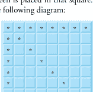

一旦将这些“消除数”填入全部 64 个方格，一种合适的启发式方法可能是：将下一个皇后放在消除数最小的方格中。为什么这种策略在直觉上具有吸引力？

**6.26** *(八皇后：暴力法)* 在本次练习中，你将开发几种暴力法来求解练习 6.25 中介绍的八皇后问题。

- a) 使用练习 6.24 中开发的随机暴力法技术求解八皇后练习。
- b) 使用穷举技术，即尝试八个皇后的所有可能组合。
- c) 你认为为什么穷举暴力法可能不适合求解骑士巡游问题？
- d) 一般性地比较和对比随机暴力法与穷举暴力法。

**6.27** *(骑士巡游：闭合巡游测试)* 在骑士巡游中，当骑士走完 64 步，恰好访问棋盘上的每个方格一次且仅一次时，就出现完整巡游。当第 64 步距离骑士开始巡游的位置仅一步之遥时，就出现闭合巡游。修改你在练习 6.23 中编写的骑士巡游程序，以便在出现完整巡游时测试是否为闭合巡游。

**6.28** *(埃拉托斯特尼筛法)* 质数是只能被自身和 1 整除的整数。埃拉托斯特尼筛法是一种寻找质数的方法。其工作方式如下：

- a) 创建一个 bool 数组，将所有元素初始化为 true。质数下标对应的数组元素将保持为 true。所有其他数组元素最终都会被置为 false。本练习中忽略元素 0 和 1。
- b) 从数组下标 2 开始，每当发现一个值为 true 的数组元素时，就遍历数组的剩余部分，并将所有下标为该 true 值元素下标倍数的元素置为 false。对于数组下标 2，数组中 2 之后所有为 2 的倍数的元素都将被置为 false（下标 4、6、8、10 等）；对于数组下标 3，数组中 3 之后所有为 3 的倍数的元素都将被置为 false（下标 6、9、12、15 等）；依此类推。

当这一过程完成时，仍被置为 true 的数组元素表示其下标是质数。随后可以打印这些元素的索引。编写一个使用包含 1000 个元素的数组来确定并打印 2 到 999 之间质数的程序。

## 递归练习

**6.29** *(回文)* 回文是正着拼写和倒着拼写都相同的字符串。回文的例子包括 "radar" 和 "able was i ere i saw elba"。编写一个递归函数 testPalindrome，如果字符串是回文则返回 true，否则返回 false。注意，与数组一样，方括号 ([]) 运算符可用于遍历字符串中的字符。

**6.30** *(八皇后)* 修改你在练习 6.25 中创建的八皇后程序，以递归方式求解该问题。

**6.31** *(打印向量)* 编写一个递归函数 printVector，接收一个 int 向量、起始下标和结束下标作为参数，不返回值并打印该向量。当起始下标等于结束下标时，函数应停止处理并返回。

**6.32（打印字符串的反向）** 编写一个递归函数 `stringReverse`，接收一个字符串和起始下标作为参数，反向打印该字符串并且不返回值。当遇到字符串末尾时，函数应停止处理并返回。注意，与数组一样，方括号 (`[]`) 运算符可用于遍历字符串中的字符。

**6.33（查找数组中的最小值）** 编写一个递归函数 `recursiveMinimum`，接收一个整数数组、起始下标和结束下标作为参数，并返回数组中最小的元素。当起始下标等于结束下标时，函数应停止处理并返回。

# 7 （淡化）现代 C++ 中的指针

## 7

### 目标

在本章中，你将：

- 了解指针是什么。
- 声明并初始化指针。
- 使用指针运算符 `&`（地址）和 `*`（间接引用）。
- 比较指针和引用的能力。
- 使用指针按引用向函数传递参数。
- 主要在遗留代码中使用基于指针的数组和字符串。
- 将 `const` 与指针及其指向的数据一起使用。
- 使用 `sizeof` 确定存储特定类型值所需的字节数。
- 理解遗留代码中的指针表达式和指针算术。
- 使用 `nullptr` 表示不指向任何对象的指针。
- 对基于指针的数组使用函数 `begin` 和 `end`。
- 学习 C++ 核心准则，以避免使用指针和基于指针的数组，从而创建更安全、更健壮的程序。
- 使用 C++20 的 `to_array` 函数将内置数组和初始化列表转换为 `std::array` 对象。
- 继续我们的 Objects-Natural 方法，使用 C++20 span 创建指向内置数组、`std::array` 和 `std::vector` 的视图，并安全地处理内置数组。

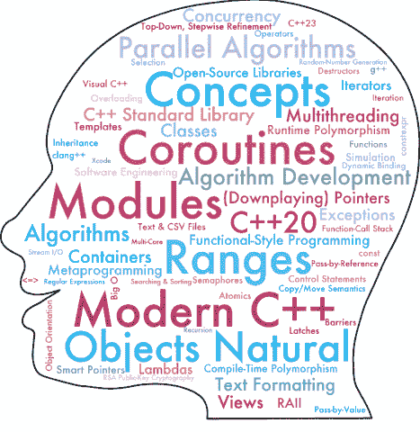

### 大纲

| 节 | 主题 |
|---|---|
| 7.1 | 引言 |
| 7.2 | 指针变量的声明与初始化 |
| 7.2.1 | 声明指针 |
| 7.2.2 | 初始化指针 |
| 7.2.3 | 空指针 |
| 7.3 | 指针运算符 |
| 7.3.1 | 地址（&）运算符 |
| 7.3.2 | 间接（*）运算符 |
| 7.3.3 | 使用地址（&）和间接（*）运算符 |
| 7.4 | 使用指针进行按引用传递 |
| 7.5 | 内置数组 |
| 7.5.1 | 声明和访问内置数组 |
| 7.5.2 | 初始化内置数组 |
| 7.5.3 | 将内置数组传递给函数 |
| 7.5.4 | 声明内置数组参数 |
| 7.5.5 | 标准库函数 begin 和 end |
| 7.5.6 | 内置数组的限制 |
| 7.6 | 使用 C++20 的 to_array 将内置数组转换为 std::array |
| 7.7 | 将 const 与指针及所指向的数据一起使用 |
| 7.7.1 | 使用指向非常量数据的非常量指针 |
| 7.7.2 | 使用指向常量数据的非常量指针 |
| 7.7.3 | 使用指向非常量数据的常量指针 |
| 7.7.4 | 使用指向常量数据的常量指针 |
| 7.8 | sizeof 运算符 |
| 7.9 | 指针表达式与指针算术 |
| 7.9.1 | 将整数加到指针和从指针减去整数 |
| 7.9.2 | 从一个指针减去另一个指针 |
| 7.9.3 | 指针赋值 |
| 7.9.4 | 不能解引用 void* 指针 |
| 7.9.5 | 比较指针 |
| 7.10 | Objects-Natural 案例研究：C++20 span——连续容器元素的视图 |
| 7.11 | 基于指针的字符串简介 |
| 7.11.1 | 命令行参数 |
| 7.11.2 | 重新审视 C++20 的 to_array 函数 |
| 7.12 | 展望其他指针主题 |
| 7.13 | 小结 |
|  | 练习 |

## 7.1 引言

本章讨论指针、内置的基于指针的数组和基于指针的字符串（也称为 C 字符串），这些均继承自 C 编程语言。

### 现代 C++ 中淡化指针

指针功能强大，但使用起来具有挑战性且容易出错。因此，现代 C++（C++20、C++17、C++14 和 C++11）增加了消除大多数指针需求的功能。新的软件开发项目通常应优先：

- 使用引用或“智能指针”对象（11.5 节）而非指针，
- 使用 `std::array` 和 `std::vector` 对象（第 6 章）而非基于指针的内置数组，以及
- 使用 `std::string` 对象（第 2 章和第 8 章）和 `std::string_view` 对象（8.11 节）而非基于指针的 C 字符串。

### 有时仍然需要指针

在庞大的遗留 C++ 代码安装基础中，你会经常遇到指针、基于指针的数组（也称为 C 风格数组）和基于指针的 C 字符串。在以下情况下需要指针：

- 创建和操作动态数据结构，如链表、队列、栈和树，这些结构可在执行时增长和收缩——尽管大多数程序-

程序员会使用 C++ 标准库现有的动态容器，如 `vector`，以及我们在第 13 章讨论的容器，

- 处理命令行参数，程序以基于指针的 C 字符串数组形式接收这些参数，以及
- 如果可能存在 `nullptr`¹（即不指向任何对象的指针；第 7.2.2 节），就通过引用传递参数——引用必须引用实际对象。²

## 与指针相关的 C++ Core Guidelines

我们提到 C++ Core Guidelines 中关于避免使用指针以使代码更安全、更健壮的建议，以及基于指针的数组和基于指针的字符串。例如，若干准则建议使用引用而不是指针来实现按引用传递。³

## 避免指针的 C++20 特性

对于仍然需要基于指针的数组的程序（例如命令行参数），C++20 增加了两个新特性，有助于使程序更安全、更健壮：

- 函数 `to_array` 将基于指针的数组转换为 `std::array`，因此你可以利用我们在第 6 章演示的特性。
- span 提供了一种更安全的方式，将内置数组传递给函数。它们可迭代，因此可以与基于范围的 `for` 语句一起使用，方便地处理元素，而不会有越界访问数组的风险。此外，由于 span 可迭代，你还可以将它们与标准库的容器处理算法（如 `accumulate` 和 `sort`）一起使用。在本章的 Objects-Natural 案例研究（第 7.10 节）中，你会看到 span 也可用于 `std::array` 和 `std::vector`。

**阅读本章的关键要点是：尽可能避免使用指针、基于指针的数组和基于指针的字符串。如果必须使用它们，请利用 `to_array` 和 span。**

## 本章介绍的其他概念

我们声明并初始化指针，并演示指针运算符 `&` 和 `*`。在第 5 章中，我们使用引用实现了按引用传递。这里，我们展示指针也可以实现按引用传递。我们演示内置的基于指针的数组及其与指针的密切关系。我们展示如何将 `const` 与指针及其指向的数据一起使用。我们介绍 `sizeof` 运算符，用于确定存储特定基本类型值和指针所用的字节数。我们还演示指针表达式和指针算术。

C 字符串曾在较旧的 C++ 软件中广泛使用。本章简要介绍 C 字符串。你将看到如何处理命令行参数——这是一个简单的任务，但 C++ 仍然需要 C 字符串和基于指针的数组来完成它。

- 1. C++ Core Guidelines，“F.60：当“无参数”是有效选项时，优先使用 T* 而非 T&。”访问于 2023 年 4 月 14 日。https://isocpp.github.io/CppCoreGuidelines/CppCoreGuidelines#Rf-ptr-ref.
- 2. 在现代 C++ 中，可以用 `std::optional` 表示对象存在或不存在（https://en.cppreference.com/w/cpp/utility/optional）。
- 3. C++ Core Guidelines，“F：函数。”访问于 2023 年 4 月 14 日。https://isocpp.github.io/CppCoreGuidelines/CppCoreGuidelines#Rf-functions.

### 检查点

- 1. **（正误判断）** 指针强大且易于使用。  
  **答案：** 错误。实际上，指针虽然强大，但使用起来具有挑战性且容易出错。
- 2. **（正误判断）** 通常，应优先使用 `std::array` 和 `std::vector` 对象，而不是内置的基于指针的数组；并优先使用 `std::string` 对象和 `std::string_view` 对象，而不是基于指针的 C 字符串。  
  **答案：** 正确。

## 7.2 指针变量的声明与初始化

指针变量以内存地址作为其值。通常，变量直接包含一个特定值。指针包含某个变量的内存地址，而该变量又包含一个特定值。在这个意义上，变量名直接引用一个值，而指针间接引用一个值，如下图所示：

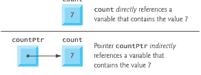

通过指针引用值称为**间接引用**。

### 7.2.1 声明指针

以下声明将变量 `countPtr` 声明为 `int*` 类型（即指向一个 `int` 值的指针），并从右向左读作“countPtr 是一个指向 int 的指针”：

```
int* countPtr{nullptr};
```

这个 `*` 不是运算符；它表示其右侧的变量是一个指针。我们喜欢在每个指针变量名中包含字母 Ptr，以明确该变量是指针，必须相应地处理。

### 7.2.2 初始化指针

请用 `nullptr` 或内存地址初始化每个指针。**空指针**的值为 `nullptr`，并且“不指向任何对象”。从现在起，当我们提到“空指针”时，指的是值为 `nullptr` 的指针。请初始化所有指针，以防止指向未知或未初始化的内存区域。

### 7.2.3 空指针

在旧版 C++ 中，空指针用 0 或 NULL 表示。NULL 在若干标准库头文件中定义为表示值 0。用 NULL 初始化指针等价于将其初始化为 0。对于现代 C++，C++ Core Guidelines 建议始终使用 `nullptr`，因为它更具可读性，且不会与 `int` 值混淆。

### 检查点

- 1. *（填空）* 变量名直接引用一个值，而指针 ______ 引用一个值。  
  **答案：** 间接地。
- 2. *（填空）* 现代 C++ 使用 ______ 表示空指针，而不是 0 或 NULL。  
  **答案：** `nullptr`。

## 7.3 指针运算符

一元运算符 & 和 * 分别创建指针值和对指针进行“解引用”。我们将在以下各节中展示如何使用这些运算符。

### 7.3.1 取地址（&）运算符

取地址运算符（&）是一个一元运算符，用于获取其操作数的内存地址。例如，假设有如下声明

```
int y{5}; // declare variable y
int* yPtr{nullptr}; // declare pointer variable yPtr
```

以下语句将变量 y 的地址赋给指针变量 yPtr：

```
yPtr = &y; // assign address of y to yPtr
```

称变量 yPtr“指向”y。现在，yPtr 间接引用变量 y 的值。

上一条语句中的 & 不是引用变量声明——在那种上下文中，& 前面会有一个类型名，且 & 是类型的一部分。在像 &y 这样的表达式中，& 是取地址运算符。

下图展示了前一条赋值语句之后的内存表示：

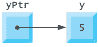

“指向关系”通过从内存中表示指针 yPtr 的方框画一个箭头到内存中表示变量 y 的方框来表示。

下图展示了另一种指针内存表示，其中 int 变量 y 存储在内存位置 600000，指针变量 yPtr 位于位置 500000。

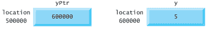

取地址运算符的操作数必须是*左值*——取地址运算符不能应用于字面量或会产生临时值的表达式（如计算结果）。

### 检查点

- 1. *（代码）* 假设存在 `int` 变量 `grade`。编写一条语句，声明指针 `gradePtr` 并用变量 `grade` 的地址初始化它。  
  **答案：** `int* gradePtr{&grade};`
- 2. **（正误判断）** 在引用变量声明中，& 前面有一个类型名，且 & 是类型的一部分。  
  **答案：** 正确。
- 3. *（填空）* 取地址运算符的操作数必须是 ______——该运算符不能应用于字面量或会产生临时值的表达式（如计算结果）。  
  **答案：** 左值。

### 7.3.2 间接引用（*）运算符

将一元 * 运算符应用于指针，会得到一个左值，表示其指针操作数所指向的对象。该运算符称为间接引用运算符或解引用运算符。如果 yPtr 指向 y，且 y 包含 5（如前面的图所示），则以下语句显示 y 的值（5）：

```c++
std::cout << *yPtr << '\n';
```

如下语句也会如此：

```c++
std::cout << y << '\n';
```

以这种方式使用 * 称为对指针解引用。解引用后的指针也可以在赋值中用作左值。以下语句将 9 赋给 y：

```c++
*yPtr = 9;
```

在此语句中，*yPtr 是引用 y 的左值。解引用后的指针也可以用于接收输入值，如下所示：

```c++
cin >> *yPtr;
```

这会将输入值放入 y。

### 未定义行为

对未初始化的指针或不再指向对象的指针进行解引用会导致未定义行为，可能引发致命的运行时错误。这也可能导致意外修改数据，使程序得以运行至完成，但结果可能不正确。攻击者可能利用这一潜在安全漏洞来访问数据、覆盖数据，甚至执行恶意代码。^6,7 使用对空指针或不再指向对象的指针进行解引用的结果，属于未定义行为，常常导致致命的执行时错误。如果必须使用指针，请确保在解引用之前指针不是 nullptr。

- 5. “未定义行为。”维基百科。维基媒体基金会。访问于 2023 年 4 月 14 日。https://en.wikipedia.org/wiki/Undefined_behavior.
- 6. “通用弱点枚举。”CWE。访问于 2023 年 4 月 14 日。https://cwe.mitre.org/data/definitions/824.html.
- 7. “悬空指针。”维基百科。维基媒体基金会。访问于 2023 年 4 月 14 日。https://en.wikipedia.org/wiki/Dangling_pointer.


## 检查点

1. *（正确/错误）* 如果 `countPtr` 指向 `count`，并且 `count` 包含 17，则以下语句显示 `count` 的值（17）：
   
   `std::cout << countPtr* << '\n';`
   
   **答案：** 错误。`countPtr*` 应为 `*countPtr`。

2. *（正确/错误）* 编译器会忽略对未初始化指针或不再指向对象的指针进行解引用的操作。
   
   **答案：** 错误。实际上，这些操作是未定义行为，可能导致致命的运行时错误。

3. *（正确/错误）* 如果必须使用指针，请确保在解引用指针之前，该指针不是 `nullptr`。
   
   **答案：** 正确。

### 7.3.3 使用地址运算符（&）和间接寻址运算符（\*）

图 7.1 演示了 & 和 \* 指针运算符，它们的优先级排在第三高。完整的运算符优先级表请参见 https://en.cppreference.com/w/cpp/language/operator_precedence。本例中，内存地址由 << 以十六进制（即基数为 16）整数形式输出。（有关十六进制整数的更多信息，请参见 https://deitel.com/cpphtp11 上的“数制”附录。）输出表明，变量 a 的地址（第 9 行）与 aPtr 的值（第 10 行）相同，证实 a 的地址确实被赋给了 aPtr（第 7 行）。第 11–12 行的输出证实，`*aPtr` 的值与 a 相同。显示的内存地址取决于编译器和平台。它们通常会在每次程序执行时发生变化，因此你可能会看到不同的地址。

```cpp
// fig07_01.cpp
// Pointer operators & and *.
#include <iostream>

int main() {
   constexpr int a{7}; // initialize a with 7
   const int* aPtr{&a}; // initialize aPtr with address of int variable a

   std::cout << "The address of a is " << &a
      << "\nThe value of aPtr is " << aPtr;
   std::cout << "\n\nThe value of a is " << a
      << "\nThe value of *aPtr is " << *aPtr << '\n';
}
```

```text
The address of a is 000000D649EFFD00
The value of aPtr is 000000D649EFFD00

The value of a is 7
The value of *aPtr is 7
```

**图 7.1** | 指针运算符 & 和 \*。

## 7.4 使用指针进行按引用传递

C++ 中有三种向函数传递实参的方式：

- 按值传递；
- 使用引用实参的按引用传递；以及
- 使用指针实参的按引用传递（有时称为按指针传递）。

第 5 章介绍了前两种。这里，我们解释使用指针的按引用传递。指针与引用一样，可用于修改调用者中的变量，或按引用传递大型数据对象，以避免复制对象的开销。调用接收指针的函数时，通过对变量名应用地址运算符（&）来传递变量的地址。

#### 按值传递示例

图 7.2 和 7.3 展示了两个对整数求立方的函数。图 7.2 将变量 number 按值传递（第 12 行）给函数 cubeByValue（第 17–19 行），该函数对其实参的局部副本求立方，并使用 return 语句（第 18 行）将结果返回给 main。⁸ 我们将新值存入 number（第 12 行），覆盖其原值。

```cpp
// fig07_02.cpp
// Pass-by-value used to cube a variable's value.
#include <format>
#include <iostream>

int cubeByValue(int n); // prototype

int main() {
    int number{5};

    std::cout << std::format("Original value of number is {}\n", number);
    number = cubeByValue(number); // pass number by value to cubeByValue
    std::cout << std::format("New value of number is {}\n", number);
}

// calculate and return cube of integer argument
int cubeByValue(int n) {
    return n * n * n; // cube local variable n and return result
}
```

```text
Original value of number is 5
New value of number is 125
```

**图 7.2** | 使用按值传递对变量的值求立方。

#### 使用指针的按引用传递示例

图 7.3 使用带指针实参的按引用传递，将变量 number 传递给 cubeByReference（第 13 行）。因此，number 的地址被传递给该函数。函数 cubeByReference（第 18–20 行）指定参数 nPtr（指向 int 的指针）来接收其实参。该函数使用解引用后的指针——`*nPtr`，即 main 中 number 的别名——对 nPtr 所指向的值求立方（第 19 行）。这直接改变了 main 中 number 的值（第 10 行）。第 19 行可以通过冗余的圆括号表达得更清晰：

```cpp
*nPtr = (*nPtr) * (*nPtr) * (*nPtr); // cube *nPtr
```

```cpp
// fig07_03.cpp
// Pass-by-reference with a pointer argument used to cube a
// variable's value
#include <format>
#include <iostream>

void cubeByReference(int* nPtr); // prototype

int main() {
    int number{5};

    std::cout << std::format("Original value of number is {}\n", number);
    cubeByReference(&number); // pass number address to cubeByReference
    std::cout << std::format("New value of number is {}\n", number);
}

// calculate cube of *nPtr; modifies variable number in main
void cubeByReference(int* nPtr) {
    *nPtr = *nPtr * *nPtr * *nPtr; // cube *nPtr
}
```

```text
Original value of number is 5
New value of number is 125
```

**图 7.3** | 使用指针实参的按引用传递对变量的值求立方

接收地址作为实参的函数必须定义一个指针形参来接收该地址。例如，函数 cubeByReference 的头部（第 18 行）指定该函数接收一个指向 int 的指针作为实参，将地址存入 nPtr，并且不返回值。它不需要返回值，因为第 19 行将求立方后的值直接赋给 main 中的 number。

#### 深入理解：使用指针的按引用传递实际上按值传递指针

使用指针按引用传递变量实际上并未按引用传递任何内容。相反，指向该变量的指针是按值传递的。该指针的值被复制到函数相应的指针形参中。然后，被调函数可以解引用该指针形参来访问调用者的变量，从而实现按引用传递。

#### 按值传递和按引用传递的图形分析

图 7.4 和 7.5 分别以图形方式分析了图 7.2 和 7.3 的执行过程。给定表达式或变量上方的矩形包含该图中某一步骤产生的值。每个图的右列仅在函数 cubeByValue（图 7.2）和 cubeByReference（图 7.3）执行时显示它们。

**步骤 1：** 在 `main` 调用 `cubeByValue` 之前：

```cpp
int main() {
    int number{5};

    number = cubeByValue(number);
}
```

`number` = 5

**步骤 2：** 在 `cubeByValue` 接收到调用之后：

```cpp
int main() {
    int number{5};

    number = cubeByValue(number);
}
```

`number` = 5

```cpp
int cubeByValue(int n) {
    return n * n * n;
}
```

`n` = 5

**步骤 3：** 在 `cubeByValue` 对形参 `n` 求立方之后、`cubeByValue` 返回 `main` 之前：

```cpp
int main() {
    int number{5};

    number = cubeByValue(number);
}
```

`number` = 5

```cpp
int cubeByValue(int n) {
    return n * n * n;
}
```

`n` = 5; result = 125

**步骤 4：** 在 `cubeByValue` 返回 `main` 之后、将结果赋给 `number` 之前：

```cpp
int main() {
    int number{5};

    number = cubeByValue(number);
}
```

`number` = 5; returned result = 125

**步骤 5：** 在 `main` 完成对 `number` 的赋值之后：

```cpp
int main() {
    int number{5};

    number = cubeByValue(number);
}
```

`number` = 125

**图 7.4** | 图 7.2 程序的按值传递分析。

**步骤 1：** 在 main 调用 `cubeByReference` 之前：

```cpp
int main() {
    int number{5};

    cubeByReference(&number);
}
```

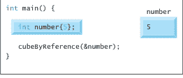

**步骤 2：** 在 `cubeByReference` 接收到调用之后、对 `*nPtr` 求立方之前：

```cpp
int main() {
    int number{5};

    cubeByReference(&number);
}
```

```cpp
void cubeByReference(int* nPtr) {
    *nPtr = *nPtr * *nPtr * *nPtr;
}
```

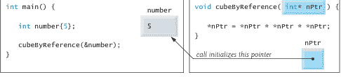

**步骤 3：** 在将计算结果 `5 × 5 × 5` 赋给 `*nPtr` 之前：

```cpp
int main() {
    int number{5};

    cubeByReference(&number);
}
```

```cpp
void cubeByReference(int* nPtr) {
    *nPtr = *nPtr * *nPtr * *nPtr;
}
```

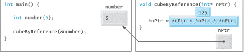

**步骤 4：** 在 `*nPtr` 被赋值为 `125` 之后、程序控制权返回 `main` 之前：

```cpp
int main() {
    int number{5};

    cubeByReference(&number);
}
```

```cpp
void cubeByReference(int* nPtr) {
    *nPtr = *nPtr * *nPtr * *nPtr;
}
```

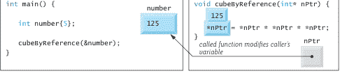

**步骤 5：** 在 `cubeByReference` 返回 `main` 之后：

```cpp
int main() {
    int number{5};

    cubeByReference(&number);
}
```


**图 7.5** | 图 7.3 程序的按引用传递分析。


### 检查点

- 1. **（填空题）** 在 C++ 中，向函数传递实参有三种方式——按值传递、使用引用参数的按引用传递，以及使用指针参数的按引用传递。
  **答案：** 使用指针参数的按引用传递（有时称为按指针传递）

- 2. **（判断题）** 指针和引用一样，可用于修改调用方中的变量，或按引用传递大型数据对象以避免复制对象的开销。
  **答案：** 正确。

- 3. **（判断题）** 调用接收指针的函数时，应对变量名应用 `*` 运算符来传递变量的地址。
  **答案：** 错误。实际上，调用接收指针的函数时，应对变量名应用 `&`（取地址运算符）来传递变量的地址。

## 7.5 内置数组

这里介绍内置数组，它和 `std::array` 一样，是固定大小的数据结构。我们介绍这部分内容，主要是因为你会在这类旧式 C++ 代码中看到内置数组。新应用程序通常应使用 `std::array` 和 `std::vector` 来创建更安全、更健壮的应用程序。

特别是，`std::array` 和 `std::vector` 对象始终知道自己的大小——即使被传递给其他函数也是如此，而内置数组并非如此。如果你处理包含内置数组的应用程序，可以

- 使用 C++20 的 `to_array` 函数（7.6 节）将它们转换为 `std::array`，或者
- 使用 C++ 的 `span`（7.10 节）更安全地处理它们。

有时必须使用内置数组，例如处理命令行参数时（7.11 节）。

### 检查点

- 1. **（判断题）** 与使用内置数组相比，新应用程序通常应使用 `std::array` 和 `std::vector` 来创建更安全、更健壮的应用程序。
  **答案：** 正确。

- 2. **（判断题）** 内置数组、`std::array` 对象和 `std::vector` 对象始终知道自己的大小，即使被传递给其他函数也是如此。
  **答案：** 错误。实际上，只有 `std::array` 和 `std::vector` 对象即使被传递给其他函数也知道自己的大小。

### 7.5.1 声明和访问内置数组

与 `std::array` 一样，必须指定内置数组的元素类型和元素个数，但语法不同。例如，要为名为 `c` 的 int 内置数组预留五个元素，可使用

```cpp
int c[5]; // c is a built-in array of 5 integers
```

使用下标（`[]`）运算符访问内置数组的元素。回忆第 6 章，下标（`[]`）运算符不为 `std::array` 提供边界检查——内置数组也是如此。当然，`std::array` 的 `at` 成员函数会进行边界检查。内置数组没有带范围检查的 `at` 索引函数，但你可以使用指南支持库（GSL）函数 `gsl::at`，它接收数组和索引作为参数。该函数的第一个参数必须是数组名，而不是指向数组首元素的指针。

### 检查点

- 1. **（代码题）** 编写代码，为名为 `counts` 的 int 内置数组预留七个元素。
  **答案：** `int counts[7];`

- 2. **（判断题）** 下标（`[]`）运算符不为 `std::arrays` 或内置数组提供边界检查。
  **答案：** 正确。

- 3. **（填空题）** `std::array` 的 `_____` 会进行边界检查。
  **答案：** at 成员函数。

### 7.5.2 初始化内置数组

可以使用初始化列表初始化内置数组的元素。例如，

```cpp
int n[5]{50, 20, 30, 10, 40};
```

创建并初始化一个包含五个 int 的内置数组。如果提供的初始化器少于元素个数，其余元素默认进行值初始化：

- 基本数值类型设置为 0，
- bool 值设置为 false，
- 指针设置为 nullptr，以及
- 对象接收由其类定义指定的默认初始化（我们将在第 9 章讨论）。

如果提供的初始化器过多，就会发生编译错误。

编译器可以通过统计初始化列表中的元素来确定内置数组的大小。例如，以下代码创建一个包含五个元素的数组：

```cpp
int n[]{50, 20, 30, 10, 40};
```

### 检查点

- 1. **（代码题）** 编写代码，将 double 内置数组 temperatures 的四个元素初始化为 97.4、99.1、98.3 和 98.6。
  **答案：** `double temperatures[]{97.4, 99.1, 98.3, 98.6};`

- 2. **（判断题）** 以下代码将产生编译错误：

  ```cpp
  int n[]{50, 20, 30};
  ```

  **答案：** 错误。即使方括号为空，编译器也会根据初始化器的数量推断出该内置数组的大小为 3。

### 7.5.3 将内置数组传递给函数

内置数组名的值可隐式转换为指向数组首元素的指针。这称为退化为指针。给定数组

```cpp
int n[]{50, 20, 30, 10, 40};
```

名称 n 可隐式转换为 &n[0]，它是指向包含 50 的元素的指针。不需要取内置数组的地址（&）就能将其传递给函数——只需传递其名称即可。正如你在 7.4 节所见，接收调用方中变量指针的函数可以修改调用方中的该变量。对于内置数组，被调用函数可以修改调用方中该数组的所有元素——除非参数被声明为 const，以防止调用方中的实参数组被修改（将在 7.7 节讨论）。

### 检查点

- 1. **（判断题）** 必须取内置数组的地址（&）才能将其传递给函数。
  **答案：** 错误。只需传递数组名即可，它会退化为指向数组首元素的指针。

- 2. **（填空题）** 接收调用方中内置数组变量指针的函数可以修改调用方中的该数组，除非参数被声明为 ________。
  **答案：** const。

### 7.5.4 声明内置数组参数

可以按如下方式在函数头中声明内置数组参数：

```cpp
int sumElements(const int values[], size_t numberOfElements)
```

这里，函数的第一个参数应为一维的 const int 内置数组。与 std::array 和 std::vector 不同，内置数组不知道自己的大小，因此处理内置数组的函数还应接收该内置数组的大小。

前面的函数头也可以写成

```cpp
int sumElements(const int* values, size_t numberOfElements)
```

编译器不区分接收指针的函数和接收内置数组的函数。事实上，编译器会在底层将 const int values[] 转换为 const int* values。这意味着函数必须“知道”自己接收的是指向内置数组首元素的指针，还是按引用传递的单个变量。

> C++ 核心准则指出，不要只将内置数组作为单个指针传递给函数。相反，应传递 C++20 的 span，因为它们维护指向数组首元素的指针和数组大小。在 7.10 节中，我们将演示 span，你会看到，传递 span 优于将内置数组及其大小传递给函数。

> 9. C++ 核心准则，“I.13：不要将数组作为单个指针传递。”访问于 2023 年 4 月 14 日。https://isocpp.github.io/CppCoreGuidelines/CppCoreGuidelines#slcon-arrays

### 检查点

- 1. **（判断题）** 内置数组不知道自己的大小，因此处理内置数组的函数还应接收其大小。
  **答案：** 正确。

- 2. *（代码题）* 使用指针表示法重写以下函数头中的数组参数：

  ```cpp
  double average(const int grades[], size_t numberOfStudents)
  ```

  **答案：** `double average(const int* grades, size_t numberOfStudents)`

- 3. *（判断题）* 将 span 传递给函数优于将内置数组及其大小传递给函数。

  **答案：** 正确。

### 7.5.5 标准库函数 begin 和 end

在 6.12 节中，我们按如下方式对名为 colors 的字符串 `std::array` 进行排序：

```cpp
std::sort(std::begin(colors), std::end(colors));
```

函数 begin 和 end 指定应对整个 `std::array` 进行排序。函数 sort（以及许多其他 C++ 标准库函数）也可以应用于内置数组。例如，要对内置数组 n（7.5.2 节）进行排序，可以编写

```cpp
std::sort(std::begin(n), std::end(n));  // sort built-in array n
```

**对于内置数组，begin 和 end 的工作方式与数组名相同，不会得到指向数组首元素的指针。** 再次说明，应使用 C++20 的 span 将内置数组传递给其他函数，我们将在 7.10 节演示。


### 检查点

- 1. *（判断题）* 函数 sort（以及许多其他 C++ 标准库函数）也可以应用于内置数组。

  **答案：** 正确。

- 2. *（代码题）* 编写一行代码，使用 `std::sort` 以及 `std::begin` 和 `std::end` 对内置数组 values 进行排序。

  ```cpp
  Answer: std::sort(std::begin(values), std::end(values));
  ```

### 7.5.6 内置数组的限制

内置数组有几个限制：

- 它们不能使用关系运算符和相等运算符进行比较。必须使用循环逐元素比较两个内置数组。如果有两个名为 array1 和 array2 的 int 数组，条件 array1 == array2 将始终为 false，即使数组内容完全相同。请记住，数组名会退化为指向数组首元素的 const 指针。而且，对于不同的数组，这些元素当然位于不同的内存位置。
- 它们的元素不能通过简单赋值一次性赋给其他内置数组，例如 `builtInArray1 = builtInArray2`。
- 它们不知道自己的大小，因此处理内置数组的函数通常需要同时接收内置数组的名称和大小作为参数。
- 它们不提供自动边界检查。必须确保数组访问表达式使用的下标位于内置数组的边界之内。


## 7.6 使用 C++20 的 to_array 将内置数组转换为 std::array

在工业界，你会遇到包含内置数组的 C++ 遗留代码。C++ 核心准则指出，应优先使用 `std::arrays` 和 `std::vectors`，而不是内置数组，因为它们更安全，并且传递给函数时不会退化为指针。<sup>10</sup> C++20 的 `std::to_array` 函数<sup>11</sup>（头文件 `<array>`）可方便地从内置数组或初始化列表创建 `std::array`。图 7.6 演示了 `to_array`。我们使用泛型 lambda 表达式（第 9–15 行）显示每个 `std::array` 的内容。同样，将 lambda 参数的类型指定为 `auto`，可使编译器根据 lambda 出现的上下文推断参数类型。在此程序中，泛型 lambda 会自动确定其迭代的 `std::array` 的元素类型。

```cpp
1   // Fig07_06.cpp
2   // C++20: Creating std::arrays with to_array.
3   #include <format>
4   #include <iostream>
5   #include <array>
6
7   int main() {
8      // generic lambda to display a collection of items
9      const auto display{
10        [](const auto& items) {
11           for (const auto& item : items) {
12              std::cout << std::format("{: }", item);
13           }
14        }
15     };
16
17     const int values1[]{10, 20, 30};
18
19     // creating a std::array from a built-in array
20     const auto array1{std::to_array(values1)};
21
22     std::cout << std::format("array1.size() = {}\n", array1.size())
23        << "array1: ";
24     display(array1); // use lambda to display contents
25
26     // creating a std::array from an initializer list
27     const auto array2{std::to_array({1, 2, 3, 4})};
28     std::cout << std::format("\narray2.size() = {}\n", array2.size())
29        << "array2: ";
30     display(array2); // use lambda to display contents
31
32     std::cout << '\n';
33  }
```

**图 7.6 |** C++20：使用 to_array 创建 std::arrays。（第 1 部分，共 2 部分。）

10. C++ 核心准则，“SL.con.1：优先使用 STL array 或 vector，而不是 C 数组。”访问日期：2023 年 4 月 14 日。https://isocpp.github.io/CppCoreGuidelines/CppCoreGuidelines#Rsl-arrays。

11. Zhihao Yuan，《来自 LFTS 的 to_array 及更新》，2019 年 7 月 17 日。访问日期：2023 年 4 月 14 日。https://wg21.link/p0325。

```
array1.size() = 3
array1: 10 20 30

array2.size() = 4
array2: 1 2 3 4
```

**图 7.6** | C++20：使用 to_array 创建 std::arrays。（第 2 部分，共 2 部分。）

### 使用 to_array 从内置数组创建 std::array

第 20 行通过复制内置数组 values1 的内容，创建一个包含三个 int 元素的 std::array。我们使用 auto 推断该 std::array 变量的类型和大小。如果我们显式声明数组的类型和大小，而它与 to_array 的返回值不匹配，则会发生编译错误。我们将结果赋给变量 array1。第 22 行和第 24 行显示该 std::array 的大小和内容，以确认其创建正确。

### 使用 to_array 从初始化列表创建 std::array

第 27 行表明 to_array 可以从初始化列表创建 std::array。第 28 行和第 30 行显示该数组的大小和内容，以确认其创建正确。

### 检查点

- 1 **（填空）** ________ 函数（头文件 `<array>`）可方便地从内置数组或初始化列表创建 `std::array`。
  - **答案：** `std::to_array`。
- 2 **（判断正误）** 应使用 `std::arrays` 和 `std::vectors`，而不是内置数组，因为它们更安全，并且在传递给函数时知道自身大小。
  - **答案：** 正确。

## 7.7 将 const 与指针及其指向的数据结合使用

本节讨论将 const 与指针声明结合使用，以贯彻最小权限原则。第 5 章解释了按值传递会将实参的值复制到函数的形参中。如果在被调用函数中修改了该副本，调用方中的原始值不会改变。在某些情况下，甚至不应在被调用函数中更改实参值的副本。

如果传递给函数的值在该函数体内不会（或不应）改变，则将该参数声明为 const。在使用函数之前，请检查其函数原型，以确定它可以修改和不能修改哪些参数。

声明指针有四种方式：

- 指向非常量数据的非常量指针，
- 指向常量数据的非常量指针（图 7.7），
- 指向非常量数据的常量指针（图 7.8），以及
- 指向常量数据的常量指针（图 7.9）。

每种组合提供不同级别的访问权限。

### 7.7.1 使用指向非常量数据的非常量指针

指向非常量数据的非常量指针授予最高权限：

- 可以通过解引用后的指针修改数据，并且
- 可以修改该指针以指向其他数据。

此类指针的声明（例如 int* countPtr）不包含 const。

### 7.7.2 使用指向常量数据的非常量指针

指向常量数据的非常量指针是

- 一种可以修改以指向适当类型的任意数据的指针，但
- 不能通过该指针修改它所指向的数据。

此类指针的声明将 const 放在指针类型的左侧，如下所示<sup>12</sup>

```cpp
const int* countPtr;
```

该声明从右向左读作“countPtr 是指向整数常量的指针”，或者更准确地说，“countPtr 是指向整数常量的非常量指针。”

图 7.7 演示了当你尝试通过指向常量数据的非常量指针修改数据时产生的 GNU C++ 编译错误。

```cpp
1 // fig07_07.cpp
2 // Attempting to modify data through a
3 // nonconstant pointer to constant data.
4
5 int main() {
6     int y{};
7     const int* yPtr{&y};
8     *yPtr = 100; // error: cannot modify a const object
9 }
```

GNU C++ 编译器错误消息

```
fig07_07.cpp: In function 'int main()':
fig07_07.cpp:8:10: error: assignment of read-only location '* yPtr'
    8 |     *yPtr = 100; // error: cannot modify a const object
      |         ^~~~~~
```

图 7.7 | 尝试通过指向常量数据的非常量指针修改数据。

使用按值传递来传递基本类型实参（例如 int、double 等），除非被调用函数必须直接修改调用方中的值。这是最小权限原则的另一个例子。如果大对象不需要由被调用函数修改，请使用指向常量数据的引用或指针传递它们——不过首选引用。这既提供了按引用传递的性能优势，又避免了按值传递的复制开销。使用指向常量数据的引用或指向常量数据的指针传递大对象，还提供了按值传递的安全性。

12. 有些程序员更喜欢将其写成 int const* countPtr;。他们会将该声明从右向左读作“countPtr 是指向常量整数的指针。”

### 7.7.3 使用指向非常量数据的常量指针

指向非常量数据的常量指针是一种指针，

- 始终指向同一内存位置，并且
- 可以通过该指针修改该位置的数据。

声明为 const 的指针必须在声明时初始化。如果该指针是函数参数，则用传递给函数的指针初始化它。每次后续调用该函数都会重新初始化该函数参数。

图 7.8 尝试修改一个常量指针。第 9 行将指针 ptr 声明为 int* const 类型。该声明从右向左读作“ptr 是指向非常量整数的常量指针。”该指针用整数变量 x 的地址初始化。第 12 行尝试将 y 的地址赋给 ptr，但编译器生成错误消息。第 11 行将值 7 赋给 *ptr 时不会发生错误。即使 ptr 本身已声明为 const，也可以使用解引用后的 ptr 修改 ptr 所指向的非常量值。

```cpp
1  // fig07_08.cpp
2  // Attempting to modify a constant pointer to nonconstant data.
3
4  int main() {
5      int x, y;
6
7      // ptr is a constant pointer to an integer that can be modified
8      // through ptr, but ptr always points to the same memory location.
9      int* const ptr{&x}; // const pointer must be initialized
10
11     *ptr = 7; // allowed: *ptr is not const
12     ptr = &y; // error: ptr is const; cannot assign to it a new address
13 }
```

*Microsoft Visual C++ 编译器错误消息：*

> 错误 C3892: 'ptr': 不能对 const 变量赋值

**图 7.8** | 尝试修改指向非常量数据的常量指针。

### 7.7.4 使用指向常量数据的常量指针

指向常量数据的常量指针授予最低访问权限：

- 此类指针始终指向同一内存位置，并且
- 不能通过该指针修改该位置的数据。

图 7.9 将指针变量 ptr 声明为 const int* const 类型（第 12 行）。该声明从右向左读作“ptr 是指向整数常量的常量指针。”该图显示了在 Xcode 中由 Clang 生成的错误消息，这些错误消息源于尝试修改 ptr 所指向的数据（第 16 行）以及尝试修改存储在指针变量中的地址（第 17 行）。在第 14 行中不会发生错误，因为指针及其指向的数据都没有被修改。


```cpp
// fig07_09.cpp
// Attempting to modify a constant pointer to constant data.
#include <iostream>

int main() {
   int x{5};
   int y{6};

   // ptr is a constant pointer to a constant integer.
   // ptr always points to the same location; the integer
   // at that location cannot be modified.
   const int* const ptr{&x};

   std::cout << *ptr << '\n';

   *ptr = 7; // error: *ptr is const; cannot assign new value
   ptr = &y; // error: ptr is const; cannot assign new address
}
```

*Xcode 中 Clang 的编译器错误消息：*

```text
fig07_09.cpp:16:9: error: read-only variable is not assignable
    *ptr = 7; // error: *ptr is const; cannot assign new value
    ~~~~~^

fig07_09.cpp:17:8: error: cannot assign to variable 'ptr' with const-qualified type 'const int *const'
    ptr = &y; // error: ptr is const; cannot assign new address
    ~~~ ^
```

**图 7.9** 尝试修改指向常量数据的常量指针。

### 检查点

- 1. *(代码)* 编写代码，将 `temperaturePtr` 声明为指向常量 `double` 数据的非常量指针，并将该指针初始化为 `nullptr`。
  **答案：** `const double* temperaturePtr{nullptr};`

- 2. *(代码)* 考虑以下代码：
  
  ```cpp
  int x{3};
  int y{5};
  int* const ptr{&x};
  *ptr = 7;
  ptr = &y;
  ```
  
  为什么第一个赋值是允许的，而第二个赋值是不允许的？
  **答案：** 第一个赋值是允许的，因为 `*ptr` 不是 const。第二个赋值是不允许的，因为 `ptr` 是 const，所以它不能指向另一个变量。

- 3. *(代码)* 以下声明有什么问题？
  
  ```cpp
  const double* const temperaturePtr;
  ```
  
  **答案：** `temperaturePtr` 是一个常量指针，因此必须将其初始化为指向一个 double 变量。

## 7.8 `sizeof` 运算符

编译期一元运算符 `sizeof` 在*程序编译期间*确定内置数组、类型、变量或常量的大小（以字节为单位）。当应用于内置数组的名称时，如图 7.10¹³（第 13 行），`sizeof` 返回该内置数组的总字节数，其类型为 `size_t`。我们用来编译此程序的计算机将 double 变量存储在 8 字节内存中。数组 numbers 有 20 个元素（第 10 行），因此它在内存中使用 160 字节。对指针应用 `sizeof`（第 21 行）返回指针的字节大小（在我们使用的系统上为 8）。

```cpp
// Fig07_10.cpp
// Sizeof operator when used on a built-in array's name
// returns the number of bytes in the built-in array.
#include <format>
#include <iostream>

size_t getSize(double* ptr); // prototype

int main() {
    double numbers[20]; // 20 doubles; occupies 160 bytes on our system

    std::cout << std::format("Number of bytes in numbers is {}\n",
        sizeof(numbers));

    std::cout << std::format("Number of bytes returned by getSize is {}\n",
        getSize(numbers));
}

// return size of ptr
size_t getSize(double* ptr) {
    return sizeof(ptr);
}
```

```text
Number of bytes in numbers is 160
Number of bytes returned by getSize is 8
```

**图 7.10** | 当 `sizeof` 运算符应用于内置数组的名称时，返回该内置数组的字节数。

### 确定基本类型、内置数组和指针的大小

图 7.11 使用 `sizeof` 计算存储各种标准数据类型所用的字节数。该输出是使用 Xcode 中的 Clang 编译器生成的。类型大小取决于平台。当我们在 Windows 系统上运行此程序时，`long` 为 4 字节，`long long` 为 8 字节，而在我们的 Mac 上它们都是 8 字节。在此示例中，第 7–15 行使用初始化列表 { } 将每个变量隐式初始化为 0。

13. 这是一个机械性示例，用于演示 `sizeof` 如何工作。如果你使用静态代码分析工具，例如 Microsoft Visual Studio 中的 C++ Core Guidelines 检查器，你会收到警告，因为不应将内置数组传递给函数。

14. 第 16 行使用 const 而不是 constexpr，以防止类型不匹配的编译错误。int 的内置数组的名称（第 15 行）会退化为 const int*，因此我们必须用该类型声明 ptr。

```cpp
// Fig07_11.cpp
// sizeof operator used to determine standard data type sizes.
#include <format>
#include <iostream>

int main() {
    constexpr char c{}; // variable of type char
    constexpr short s{}; // variable of type short
    constexpr int i{}; // variable of type int
    constexpr long l{}; // variable of type long
    constexpr long long ll{}; // variable of type long long
    constexpr float f{}; // variable of type float
    constexpr double d{}; // variable of type double
    constexpr long double ld{}; // variable of type long double
    constexpr int array[20]{}; // built-in array of int
    const int* const ptr{array}; // variable of type int*

    std::cout << std::format("sizeof c = {}\tsizeof(char) = {}\n",
        sizeof c, sizeof(char));
    std::cout << std::format("sizeof s = {}\tsizeof(short) = {}\n",
        sizeof s, sizeof(short));
    std::cout << std::format("sizeof i = {}\tsizeof(int) = {}\n",
        sizeof i, sizeof(int));
    std::cout << std::format("sizeof l = {}\tsizeof(long) = {}\n",
        sizeof l, sizeof(long));
    std::cout << std::format("sizeof ll = {}\tsizeof(long long) = {}\n",
        sizeof ll, sizeof(long long));
    std::cout << std::format("sizeof f = {}\tsizeof(float) = {}\n",
        sizeof f, sizeof(float));
    std::cout << std::format("sizeof d = {}\tsizeof(double) = {}\n",
        sizeof d, sizeof(double));
    std::cout << std::format("sizeof ld = {}\tsizeof(long double) = {}\n",
        sizeof ld, sizeof(long double));
    std::cout << std::format("sizeof array = {}\n", sizeof array);
    std::cout << std::format("sizeof ptr = {}\n", sizeof ptr);
}
```

```text
sizeof c = 1      sizeof(char) = 1
sizeof s = 2      sizeof(short) = 2
sizeof i = 4      sizeof(int) = 4
sizeof l = 8      sizeof(long) = 8
sizeof ll = 8     sizeof(long long) = 8
sizeof f = 4      sizeof(float) = 4
sizeof d = 8      sizeof(double) = 8
sizeof ld = 16    sizeof(long double) = 16
sizeof array = 80
sizeof ptr = 8
```

**图 7.11** | 用于确定标准数据类型大小的 sizeof 运算符。

存储特定数据类型所用的字节数可能因系统和编译器而异。编写依赖于数据类型大小的程序时，请考虑使用头文件 `<cstdint>` 中的固定大小整数类型。完整列表请参见：

https://en.cppreference.com/w/cpp/types/integer

运算符 `sizeof` 可以应用于任何表达式或类型名。当应用于变量名或表达式时，返回存储相应类型所用的字节数。仅当类型名（例如 `int`）作为其操作数提供时，才需要与 `sizeof` 一起使用的括号。当 `sizeof` 的操作数是表达式时，不需要与 `sizeof` 一起使用的括号。请记住，`sizeof` 是编译期运算符，因此其操作数不会在运行时求值。

### 检查点

- 1. **（判断题）** 对指针应用 `sizeof` 会返回该指针所指向内容的大小（以字节为单位）。
  **答案：** 错误。实际上，对指针应用 `sizeof` 返回的是指针本身的大小（以字节为单位）。

- 2. **（填空）** 存储特定数据类型所用的字节数可能因系统和编译器而异。编写依赖于数据类型大小的程序时，请考虑使用头文件 `<cstdint>` 中的 ______。
  **答案：** 固定大小整数类型。

- 3. **（判断题）** `sizeof` 是编译期运算符，因此其操作数不会在运行时求值。
  **答案：** 正确。

## 7.9 指针表达式与指针算术

C++ 支持**指针算术**——可对指针执行的算术运算。本节介绍带指针操作数的运算符，以及这些运算符如何用于指针。

指针算术仅适用于指向内置数组元素的指针。你很可能在遗留代码中遇到指针算术。然而，C++ **核心准则**指出，指针应只指向单个对象（而不是数组）。它们还指出应避免指针算术，因为它极易出错。如果你需要处理内置数组，请改用 C++20 span（第 7.10 节）。

有效的指针算术运算包括：

- 递增（`++`）或递减（`--`），
- 将整数加到指针（`+` 或 `+=`）或从指针减去整数（`-` 或 `-=`），
- 从同一类型的另一个指针中减去一个指针。

指针算术的结果取决于指针所指向的内存对象的大小，因此指针算术依赖于机器。

如今大多数计算机的整数为四字节（32 位）或八字节（64 位）。在数十亿资源受限的物联网（IoT）设备中，有些使用八位或 16 位硬件构建，其整数为两字节——根据

15. C++ 核心准则，“ES.42：保持指针的使用简单直接。”访问于 2023 年 4 月 14 日。https://isocpp.github.io/CppCoreGuidelines/CppCoreGuidelines#Res-ptr

16. C++ 核心准则，“Pro.bounds：边界安全配置文件。”访问于 2023 年 4 月 14 日。https://isocpp.github.io/CppCoreGuidelines/CppCoreGuidelines#Pro-bounds。


C++标准。假设存在 int v[5]，其第一个元素位于内存位置 3000，且 int 占四个字节。同时，假设指针 vPtr 已初始化为指向 v[0]（即 vPtr 的值为 3000）。下图展示了在整数为四字节的机器上的这种情况：


变量 vPtr 可以用以下任一语句初始化为指向 v（因为内置数组的名称会隐式转换为其第零个元素的地址）：

```cpp
int* vPtr{v};
int* vPtr{&v[0]};
```

### 7.9.1 向指针加整数和从指针减整数

在常规算术中，加法 3000 + 2 得到值 3002。指针算术通常不是这样：

- 向指针加一个整数会使指针增加该整数乘以指针所指向类型的大小。
- 从指针减一个整数会使指针减少该整数乘以指针所指向类型的大小。

字节数取决于对象的数据类型。例如，语句

```cpp
vPtr += 2;
```

将产生 3008（3000 + 2 * 4），假设一个 int 存储在四个字节的内存中。在内置数组 v 中，vPtr 现在将指向 v[2]，如下图所示：


如果 vPtr 已增加到 3016（指向 v[4]），则语句

```cpp
vPtr -= 4;
```

会将 vPtr 设回 3000——内置数组的开头。要使指针增加或减少一个元素，分别使用递增（++）或递减（--）运算符。语句

```cpp
++vPtr;
vPtr++;
```

使指针递增以指向内置数组的下一个元素。语句

```cpp
--vPtr;
vPtr--;
```

使指针递减以指向内置数组的前一个元素。

**指针算术没有边界检查，因此 C++ 核心准则建议改用 `std::span`，我们将在第 7.10 节演示。** 你必须确保每个向指针加整数或从指针减整数的指针算术运算，都使指针引用内置数组边界内的元素。正如你将看到的，**`std::span` 具有边界检查，这有助于你避免错误。**

### 7.9.2 从一个指针减去另一个指针

指向同一内置数组的指针变量可以相互相减。例如，如果 vPtr 包含地址 3000，v2Ptr 包含地址 3008，则表达式

```cpp
v2Ptr - vPtr;
```

将确定从 vPtr 到 v2Ptr 的内置数组元素个数——在本例中为 2。我们不能假设同一类型的两个变量在内存中连续存储，除非它们是内置数组的相邻元素。对不指向同一内置数组元素的两个指针进行相减或比较是逻辑错误。

### 7.9.3 指针赋值

如果两个指针类型相同，则可以将一个指针赋值给另一个指针。¹⁷ 此外，任何指向基本类型或类类型的指针都可以在不进行强制转换的情况下赋值给 `void*`（指向 `void` 的指针）。然而，`void*` 类型的指针不能直接赋值给其他类型的指针——`void*` 类型的指针必须首先用 `static_cast` 转换为合适的指针类型。例如，要将名为 ptr 的 `void*` 强制转换为 `int*`，你会使用

```cpp
int* intPtr{static_cast<int*>(ptr)};
```

### 7.9.4 不能解引用 void* 指针

`void*` 指针不能被解引用。例如，编译器“知道”在整数为四字节的机器上，`int*` 指向四个字节的内存。解引用 `int*` 会创建一个左值，该左值是内存中该 `int` 四个字节的别名。然而，`void*` 包含一个未知数据类型的存储地址。你不能在指针算术中使用 `void*`，也不能解引用 `void*`，因为编译器不知道指针所指向数据的类型或大小。

对 `void*` 指针允许的操作有：

- 将 `void*` 指针与其他指针比较，
- 将 `void*` 指针强制转换为其他指针类型，以及
- 将其他指针类型转换为 `void*` 指针。

对 `void*` 指针的所有其他操作都是编译错误。

17. 当然，`const` 指针不能被修改。

### 函数 displayArray

将内置数组传递给函数通常需要数组的名称和大小。尽管参数 items（第 12 行）使用 [] 声明，但它只是一个指向 int 的指针。它并不“知道”函数实参包含多少个元素。这种方法存在各种问题。例如，调用 displayArray 的代码可能为 size 传递错误的值。在这种情况下，函数

- 可能不会处理 items 的所有元素，或者
- 可能访问 items 边界之外的元素——这是逻辑错误，也是潜在的安全问题。

此外，我们之前讨论了外部迭代的缺点，如第 13–15 行所使用的那样。Visual Studio 中的 C++ 核心准则检查器会针对 displayArray 以及将内置数组传递给函数发出若干警告。我们在本示例中包含函数 displayArray，只是为了将其与在函数 displaySpan 中传递 span 进行比较，后者是推荐的方法。

```cpp
// items parameter is treated as a const int* so we also need the size to
// know how to iterate over items with counter-controlled iteration
void displayArray(const int items[], size_t size) {
    for (size_t i{0}; i < size; ++i) {
        std::cout << std::format("{}", items[i]);
    }
}
```

### 函数 displaySpan

C++ 核心准则指出，指针应只指向一个对象，而不是一个数组。它们还指出，像 displayArray 这样接收指针和大小的函数容易出错。要解决这些问题，应使用 span 将数组传递给函数。函数 displaySpan（第 20–24 行）接收一个包含 const int 的 span——之所以是 const，是因为该函数不需要修改数据。

```cpp
// span parameter contains both the location of the first item
// and the number of elements, so we can iterate using range-based for
void displaySpan(std::span<const int> items) {
    for (const auto& item : items) { // spans are iterable
        std::cout << std::format("{}", item);
    }
}
```

span 同时封装了一个指针和一个表示元素个数的 size_t。当你将内置数组（或 std::array 或 std::vector）传递给 displaySpan 时，C++ 会隐式创建一个 span，其中包含指向数组第一个元素的指针及其大小，大小由编译器根据数组声明确定。这个 span 视图查看你作为实参传入的原始数组中的数据。C++ 核心准则指出，可以按值传递 span，因为它与分别传递指针和大小一样高效，²¹ 正如我们在 displayArray 中所做的那样。

19. C++ 核心准则，“ES.42：保持指针的使用简单直接。”访问于 2023 年 4 月 14 日。https://isocpp.github.io/CppCoreGuidelines/CppCoreGuidelines#es-42

20. C++ 核心准则，“I.13：不要将数组作为单个指针传递。”访问于 2023 年 4 月 14 日。https://isocpp.github.io/CppCoreGuidelines/CppCoreGuidelines#R-arrays

span 具有许多类似于数组和 vector 的能力，例如通过基于范围的 for 语句进行迭代。由于 span 是基于编译器确定的数组原始大小创建的，基于范围的 for 保证我们无法访问数组边界之外的元素。这修复了与 displayArray 相关的各种问题，并有助于防止缓冲区溢出等安全问题。

### 函数 `times2`

因为 span 是对现有容器的视图，所以更改 span 的元素会更改容器的原始数据。函数 times2 将其 span<int> 中的每个项乘以 2。注意，我们使用非 const 引用来修改 span 视图查看的每个元素。

```cpp
// spans can be used to modify elements in the original data structure
void times2(std::span<int> items) {
    for (int& item : items) {
        item *= 2;
    }
}
```

### 将数组传递给函数以显示内容

第 34–36 行创建 int 内置数组 values1、std::array values2 和 std::vector values3。每个都有五个元素，并在内存中连续存储其元素。第 41 行调用 displayArray 显示 values1 的内容。displayArray 函数的第一个参数是指向 int 的指针，因此我们不能使用 std::array 或 std::vector 的名称将这些对象传递给 displayArray。

```cpp
int main() {
    int values1[] = { 1, 2, 3, 4, 5 };
    std::array values2{6, 7, 8, 9, 10};
    std::vector values3{11, 12, 13, 14, 15};

    // must specify size because the compiler treats displayArray’s items
    // parameter as a pointer to the first element of the argument
    std::cout << "values1 via displayArray: ";
    displayArray(values1, 5);
}
```

```text
values1 via displayArray: 1 2 3 4 5
```

21. C++ 核心准则，“F.24：使用 span<T> 或 span_p<T> 来指定半开序列。”访问于 2023 年 4 月 14 日。https://isocpp.github.io/CppCoreGuidelines/CppCoreGuidelines#Rf-range.


## 隐式创建 span 并将其传递给函数

第46行以 `values1` 为实参调用 `displaySpan`。该函数的形参声明为

```cpp
std::span<const int>
```

因此 C++ 会创建一个 span，其中包含一个指向数组首元素的 `const int*`，以及一个表示数组大小的 `size_t`，编译器从 `values1` 的声明（第34行）中获取该大小。由于 span 可以查看任意连续的元素序列，你也可以将 `int` 的 `std::array` 或 `std::vector` 传递给 `displaySpan`（第50行和第52行）。C++ 会创建一个适当的 span，表示指向容器首元素的指针和大小。这使得 `displaySpan` 比 `displayArray` 更灵活，后者在此示例中只能接收内置数组。

```cpp
// compiler knows values1's size and automatically creates a span
// representing &values1[0] and the array's length
std::cout << "\nvalues1 via displaySpan: ";
displaySpan(values1);

// compiler also can create spans from std::arrays and std::vectors
std::cout << "\nvalues2 via displaySpan: ";
displaySpan(values2);
std::cout << "\nvalues3 via displaySpan: ";
displaySpan(values3);
```

```text
values1 via displaySpan: 1 2 3 4 5
values2 via displaySpan: 6 7 8 9 10
values3 via displaySpan: 11 12 13 14 15
```

## 修改 span 的元素会修改原始数据

正如我们提到的，函数 `times2` 将其 span 的元素乘以 2。第55行以 `values1` 为实参调用 `times2`。该函数的形参声明为

```cpp
std::span<int>
```

因此 C++ 会创建一个 span，其中包含一个指向数组首元素的 `int*`，以及一个表示数组大小的 `size_t`，编译器从 `values1` 的声明（第34行）中获取该大小。为了证明 `times2` 修改了原始数组的数据，第57行显示 `values1` 更新后的值。与 `displaySpan` 一样，`times2` 也可以用此程序的 `std::array` 或 `std::vector` 调用。

```cpp
// changing a span’s contents modifies the original data
times2(values1);
std::cout << "\nvalues1 after times2 modifies its span argument: ";
displaySpan(values1);
```

```text
values1 after times2 modifies its span argument: 2 4 6 8 10
```

## 手动创建 span 并与之交互

你可以显式创建 span 并与之交互。第60行创建一个 `span<int>`，用于查看 `values1` 中的数据——编译器使用 CTAD 从 `values1` 的元素推断出元素类型 `int`。第61–62行演示了 span 的 `front` 和 `back` 成员函数，它们分别返回视图的第一个和最后一个元素——因此也就是 `values1` 的第一个和最后一个元素。

```cpp
// spans have various array-and-vector-like capabilities
std::span mySpan{values1}; // span<int>
std::cout << "\nmySpan's first element: " << mySpan.front()
          << "\nmySpan's last element: " << mySpan.back();
```

```text
mySpan's first element: 2
mySpan's last element: 10
```

> C++ Core Guidelines 的一个理念是“优先选择编译期检查而非运行期检查。”[^22] 这使编译器能够在编译期发现并报告错误，而不是由你编写代码来帮助防止运行时错误。在第60行，编译器根据第34行中 `values1` 的声明确定 span 的大小（5）。你可以显式说明 span 的类型和大小，如下所示：
>
> ```cpp
> span<int, 5> mySpan{values1};
> ```
>
> 在这种情况下，编译器会确保 span 声明的大小与 `values1` 的大小匹配；否则会发生编译错误。

## 将 span 与标准库的 accumulate 算法配合使用

正如你在此示例中所见，span 是可迭代的。这意味着你还可以对 span 使用 `begin` 和 `end` 函数，将它们传递给 C++ 标准库算法，例如 `accumulate`（第66行）或 `sort`。我们将在第14章深入讨论标准库算法。

```cpp
// spans can be used with standard library algorithms
std::cout << "\nSum of mySpan's elements: "
          << std::accumulate(std::begin(mySpan), std::end(mySpan), 0);
```

```text
Sum of mySpan's elements: 30
```

## 创建子视图

有时，你可能想处理 span 的子集。span 的 `first`、`last` 和 `subspan` 成员函数可以创建子视图。第70行和第72行使用 `first` 和 `last` 分别获取表示 `values1` 前三个元素和后三个元素的 span。第74行使用 `subspan` 获取一个查看从索引1开始的3个元素的 span。在每种情况下，我们都会将子视图传递给 `displaySpan`，以确认该子视图表示什么。

```cpp
68    // spans can be used to create subviews of a container
69    std::cout << "\n\nFirst three elements of mySpan: ";
70    displaySpan(mySpan.first(3));
71    std::cout << "\nLast three elements of mySpan: ";
72    displaySpan(mySpan.last(3));
73    std::cout << "\nMiddle three elements of mySpan: ";
74    displaySpan(mySpan.subspan(1, 3));
75
```

```text
First three elements of mySpan: 2 4 6
Last three elements of mySpan: 6 8 10
Middle three elements of mySpan: 4 6 8
```

## 修改子视图的元素会修改原始数据

非 const 数据的子视图可以修改该数据。第77行创建一个 span，查看 `values1` 中从索引1开始的3个元素，然后将其传递给函数 `times2`。第79行显示更新后的 `values1` 元素以确认结果。

```cpp
76    // changing a subview's contents modifies the original data
77    times2(mySpan.subspan(1, 3));
78    std::cout << "\n\nvalues1 after modifying elements via span: ";
79    displaySpan(values1);
80
```

```text
values1 after modifying elements via span: 2 8 12 16 10
```

## 通过 [] 运算符访问视图的元素

与内置数组、`std::array` 和 `std::vector` 一样，你可以通过 `[]` 运算符访问和修改 span 元素，该运算符不提供范围检查。第82行显示索引2处的元素。[^23]

```cpp
81    // access a span element via []
82    std::cout << "\n\nThe element at index 2 is: " << mySpan[2];
83 }
```

```text
The element at index 2 is: 12
```


## 检查点

- 1. （正确/错误）span（头文件 `<span>`）使程序能够查看容器中的连续元素，例如内置数组、`std::array` 或 `std::vector`。span 是对容器的“视图”。它“看到”容器的元素，但没有这些元素自己的副本。
  - **答案：** 正确。
- 2. （填空）span 同时封装一个指针和一个表示元素数量的 `______`。
  - **答案：** `size_t`
- 3. （正确/错误）因为 span 是对现有容器的视图，所以修改 span 的元素会修改容器的原始数据。
  - **答案：** 正确。

## 7.11 基于指针的字符串简介

我们已经使用 C++ 标准库的 string 类将字符串表示为成熟的对象。第8章详细介绍了 `std::string` 类。本节介绍从 C 编程语言继承而来的基于指针的字符串。这里，我们将它们称为 C 字符串或字符串，并在指代 C++ 标准库的 string 类时使用 `std::string`。

首选 `std::string`，因为它消除了由操作 C 字符串引起的许多安全问题和错误。但是，在某些情况下需要 C 字符串，例如处理命令行参数时。此外，如果你处理遗留的 C 和 C++ 程序，很可能会遇到基于指针的字符串。

### 字符和字符常量

字符是 C++ 源程序的基本构建块。每个程序都由字符组成——当这些字符按有意义的方式分组时，编译器会将其解释为用于完成任务的指令和数据。程序可以包含字符常量，每个字符常量都是一个整数值，表示为单引号中的字符。字符常量的值是该字符在机器字符集中的整数值。例如，`'z'` 表示字母 z 的整数值（在 ASCII 字符集中为 122；请参阅 https://deitel.com/cpphtp11 上的字符集附录），类型为 char。类似地，`'\n'` 表示换行符的整数值（在 ASCII 字符集中为 10）。

### 基于指针的字符串

C 字符串是一个内置字符数组，以空字符（`'\0'`）结尾，该空字符标记字符串在内存中终止的位置。C 字符串通过指向其第一个字符的指针来访问（无论字符串有多长）。

### 字符串字面量作为初始化器

字符串字面量可以用作内置 char 数组或 `const char*` 类型变量的初始化器。以下每个声明都将一个变量初始化为字符串 `"blue"`：

```cpp
char color[] {"blue"};
const char* colorPtr{"blue"};
```

第一个声明创建一个包含五个元素的内置数组 `color`，其中包含字符 `'b'`、`'l'`、`'u'`、`'e'` 和 `'\0'`。第二个声明创建指针变量 `colorPtr`，指向内存中某处字符串 `"blue"`（以 `'\0'` 结尾）中的字母 `b`。上面的第一个声明也可以使用单个字符的初始化列表来实现，其中你手动包含终止符 `'\0'`，如下所示：

```cpp
char color[] {'b', 'l', 'u', 'e', '\0'};
```

[^22]: C++ Core Guidelines，“P.5：优先选择编译期检查而非运行期检查。”访问于2023年4月14日。https://isocpp.github.io/CppCoreGuidelines/CppCoreGuidelines#Rp-compile-time。

[^23]: `std::span` 不提供带范围检查的 `at` 成员函数，但将来可能会提供。


字符串字面量在程序的整个运行期间都存在。如果同一字符串字面量在程序中的多个位置被引用，则它们可能被共享。字符串字面量是不可变的——它们不能被修改。

## C字符串的问题

在char内置数组中未分配足够空间来存储终止字符串的空字符，是一种逻辑错误。创建或使用不包含终止空字符的C字符串可能导致逻辑错误。

当将字符串存储在char内置数组中时，务必确保该数组足够大，能够容纳将要存储的最大字符串。C++允许任意长度的字符串。如果字符串长于要存储它的char内置数组，那么超出内置数组末尾的字符将覆盖后续内存位置。这可能导致逻辑错误、程序崩溃或安全漏洞。

## 显示C字符串

表示以空字符结尾的字符串的char内置数组可以使用cout和<<输出。语句

```cpp
std::cout << color;
```

显示内置数组color。cout对象不关心char内置数组有多大。字符会一直输出，直到遇到终止空字符。空字符本身不会显示。cin和cout都假定char内置数组应作为以空字符结尾的字符串来处理。它们不为其他内置数组类型提供类似的输入和输出处理能力。

### 7.11.1 命令行参数

有些情况下必须使用内置数组和C字符串。例如，命令行参数通常传递给应用程序，用于指定配置选项、要处理的文件名等。在命令行执行程序时，将命令行参数放在程序名之后即可将其提供给程序。在Windows系统上，命令

```cpp
dir /p
```

使用/p参数列出当前目录的内容，并在每屏信息后暂停。类似地，在Linux或macOS上，以下命令使用-la参数列出当前目录的内容，并显示每个文件和目录的详细信息：

```cpp
ls -la
```

命令行参数作为C字符串传入C++程序。应用程序名被视为第一个命令行参数。要将这些参数用作std::string或其他数据类型（int、double等），必须将参数转换为这些类型。图7.13显示传递给程序的命令行参数数量，然后逐行显示每个参数。

```cpp
// fig07_14.cpp
// C++20: Creating std::arrays from string literals with to_array.
#include <format>
#include <iostream>
#include <array>

int main() {
    // lambda to display a collection of items
    const auto display{
        [](const auto& items) {
            for (const auto& item : items) {
                std::cout << std::format("{} ", item);
            }
        }
    };

    // initializing an array with a string literal
    // creates a one-element array<const char*>
    const auto array1{std::array{"abc"}};
    std::cout << std::format("array1.size() = {}\narray1: ",
        array1.size());
    display(array1); // use lambda to display contents

    // creating std::array of characters from a string literal
    const auto array2{std::to_array("C++20")};
    std::cout << std::format("\narray2.size() = {}\narray2: ",
        array2.size());
    display(array2); // use lambda to display contents

    std::cout << '\n';
}
```

```text
array1.size() = 1
array1: abc

array2.size() = 6
array2: C + + 2 0
```

**图 7.14** | C++20：使用`to_array`从字符串字面量创建`std::array`。

## 从字符串字面量初始化std::array会创建单元素数组

第19行创建一个单元素数组，其中包含一个指向C字符串"abc"的`const char*`。

## 将字符串字面量传递给to_array会创建char的std::array

另一方面，将字符串字面量传递给to_array（第25行）会创建一个char的std::array，其中包含每个字符对应的元素以及终止空字符。第25–26行确认该数组的大小为6。第27行确认该数组的内容。空字符没有可视表示形式，因此不会出现在输出中。

我们讨论了`const`与指针及其所指向数据的各种组合。我们使用`sizeof`运算符来确定存储各种类型的值所用的字节数。我们演示了指针表达式和指针算术。

我们简要讨论了C字符串，然后展示了如何处理命令行参数——这是一项简单的任务，但C++仍然要求同时使用基于指针的C字符串和基于指针的数组。

**阅读本章的关键要点是：应尽可能避免使用指针、基于指针的数组和基于指针的字符串。对于仍在使用基于指针的数组的程序，可以使用C++20的`to_array`函数从内置数组创建`std::arrays`，并使用C++20的span作为处理内置基于指针数组的更安全方式。** 下一章讨论`std::string`提供的典型字符串操作，并介绍文件处理功能。

## 练习

**7.1** 对以下每一项，编写执行指定任务的C++语句。假设双精度浮点数存储在八个字节中，并且内置数组的起始地址位于内存位置1002500。练习的每一部分应在适当情况下使用前面部分的结果。

- a) 声明一个名为`numbers`的`double`类型内置数组，包含10个元素，并将元素初始化为值0.0、1.1、2.2、...、9.9。假设常量size已定义为10。
- b) 声明一个指向`double`类型变量的指针`nPtr`。
- c) 使用`for`语句，通过数组下标表示法显示内置数组`numbers`的元素。显示每个元素时保留小数点后一位数字。
- d) 编写两条独立的语句，分别将内置数组`numbers`的起始地址赋给指针变量`nPtr`。
- e) 使用`for`语句，通过指针`nPtr`的指针/偏移量表示法显示内置数组`numbers`的元素。
- f) 使用`for`语句，通过以内置数组名作为指针的指针/偏移量表示法显示内置数组`numbers`的元素。
- g) 使用`for`语句，通过指针`nPtr`的指针/下标表示法显示内置数组`numbers`的元素。
- h) 分别使用数组下标表示法、以内置数组名作为指针的指针/偏移量表示法、使用`nPtr`的指针下标表示法以及使用`nPtr`的指针/偏移量表示法来引用内置数组`numbers`的元素3。
- i) 假设`nPtr`指向内置数组`numbers`的开头，`nPtr + 8`引用的是什么地址？该位置存储的是什么值？
- j) 假设`nPtr`指向`numbers[5]`，执行`nPtr -= 4`后，`nPtr`引用的是什么地址？该位置存储的是什么值？

**7.2** 对以下每一项，编写一条执行指定任务的语句。假设已声明double变量`number1`和`number2`，并且`number1`已初始化为7.3。

- a) 声明变量`doublePtr`为指向`double`类型对象的指针，并将该指针初始化为`nullptr`。
- b) 将变量`number1`的地址赋给指针变量`doublePtr`。
- c) 显示`doublePtr`所指向对象的值。
- d) 将`doublePtr`所指向对象的值赋给变量`number2`。
- e) 显示`number2`的值。
- f) 显示`number1`的地址。
- g) 显示`doublePtr`中存储的地址。该地址与变量`number1`的地址相同吗？

**7.3** **（找出代码错误）** 找出以下每个程序段中的错误。

假设有以下声明和语句：

```cpp
int* zPtr{nullptr}; // zPtr will reference built-in array z
int number{0};
int z[5]{1, 2, 3, 4, 5};

a) ++zPtr;
b) // use pointer to get first value of a built-in array
   number = zPtr;
c) // assign built-in array element 2 (the value 3) to number
   number = *zPtr[2];
d) // display entire built-in array z
   for (size_t i{0}; i <= 5; ++i) {
      std::cout << zPtr[i] << '\n';
   }
e) ++z;
```

**7.4** **（编写C++语句）** 对以下每一项，编写执行指定任务的C++语句。假设整数存储在四个字节中，并且内置数组的起始地址位于内存位置1002500。

- a) 声明一个`int`内置数组`values`，包含五个元素，并初始化为从2到10的偶数。假设常量size已定义为5。
- b) 声明一个指向`int`类型对象的指针`vPtr`。
- c) 使用`for`语句，通过数组下标表示法显示内置数组`values`的元素。
- d) 编写两条独立的语句，分别将内置数组`values`的起始地址赋给指针变量`vPtr`。
- e) 使用`for`语句，通过指针/偏移量表示法显示内置数组`values`的元素。
- f) 使用`for`语句，通过以内置数组名作为指针的指针/偏移量表示法显示内置数组`values`的元素。
- g) 使用`for`语句，通过下标表示法和指向该内置数组的指针显示内置数组`values`的元素。
- h) 分别使用数组下标表示法、以内置数组名作为指针的指针/偏移量表示法、指针下标表示法和指针/偏移量表示法来引用`values`的元素4。
- i) `vPtr + 3`引用的是什么地址？该位置存储的是什么值？
- j) 假设`vPtr`指向`values[4]`，`vPtr - 4`引用的是什么地址？该位置存储的是什么值？


### 7.5 *（编写 C++ 语句）*

对于以下每一项，编写一条执行指定任务的语句。假设 long 变量 value1 和 value2 已声明，并且 value1 已初始化为 200000。

- a) 将变量 longPtr 声明为指向 long 类型对象的指针。
- b) 将变量 value1 的地址赋给指针变量 longPtr。
- c) 显示 longPtr 所指向对象的值。
- d) 将 longPtr 所指向对象的值赋给变量 value2。
- e) 显示 value2 的值。
- f) 显示 value1 的地址。
- g) 显示 longPtr 中存储的地址。它显示的结果与 value1 的地址相同吗？

### 7.6 *（找出代码错误）*

找出以下各个片段中的错误。如果错误可以纠正，请说明如何纠正。

- a)

    int* number;
    cout << number << '\n';

- b)

    double* realPtr{nullptr};
    long* integerPtr{nullptr};
    integerPtr = realPtr;

- c)

    char s[]{"this is a character array"};
    for (; *s != '\0'; ++s) {
        std::cout << *s << ' ';
    }

- d)

    double x{19.34};
    double xPtr{&x};
    cout << xPtr << '\n';

### 7.7 *（对 span 的元素求立方）*

使用图 7.12 中演示的技术创建一个 cubeElements 函数，该函数对其参数的各元素求立方。使该函数能够接收内置数组、std::array 或 std::vector 作为其参数。使用 values1、values2 和 values3 测试你的函数：

```
int values1[]{1, 2, 3, 4, 5};
std::array values2{6, 7, 8, 9, 10};
std::vector values3{11, 12, 13, 14, 15};
```

使用图 7.12 的 dispSpan 函数，在分别对 values1、values2 和 values3 求立方之前和之后显示它们。

### 7.8 *（模拟：龟兔赛跑）*

让我们重现龟兔赛跑的经典比赛（https://en.wikipedia.org/wiki/The_Tortoise_and_the_Hare）。你将使用随机数生成来开发一个关于这一令人难忘的事件的模拟。

我们的参赛者从 70 个方格中的“第 1 格”开始比赛。每个方格代表赛道上的一个位置，终点线在第 70 格。第一个到达或超过第 70 格的参赛者将获得一桶新鲜的胡萝卜和生菜。赛道沿着湿滑的山坡蜿蜒而上，因此参赛者偶尔会后退。

有一个时钟每秒滴答一次。每次时钟滴答时，你的程序应使用 moveTortoise 和 moveHare 函数根据图 7.15 的规则调整动物的位置。这些函数应使用基于指针的按引用传递来修改乌龟和兔子的位置。

| 动物 | 移动类型 | 时间百分比 | 实际移动 |
|---|---|---|---|
| 乌龟 | 快步走 | 50% | 向右 3 格 |
|  | 滑倒 | 20% | 向左 6 格 |
|  | 慢步走 | 30% | 向右 1 格 |
| 兔子 | 睡觉 | 20% | 完全不移动 |
|  | 大跳 | 20% | 向右 9 格 |
|  | 大滑 | 10% | 向左 12 格 |
|  | 小跳 | 30% | 向右 1 格 |
|  | 小滑 | 20% | 向左 2 格 |

**图 7.15** | 移动乌龟和兔子的规则。

使用变量来跟踪动物的位置（即位置编号为 1–70）。让每只动物从位置 1（即“起跑门”）出发。如果动物向左滑到第 1 格之前，则将该动物移回第 1 格。

通过生成范围在 1 ≤ *i* ≤ 10 的随机整数 *i* 来产生图 7.15 中的百分比。对于乌龟，当 1 ≤ *i* ≤ 5 时执行“快步走”，当 6 ≤ *i* ≤ 7 时执行“滑倒”，当 8 ≤ *i* ≤ 10 时执行“慢步走”。使用类似的技术来移动兔子。

通过显示以下内容开始比赛：

```
BANG !!!!!!
AND THEY'RE OFF !!!!!!
```

对于每次时钟滴答（即每次循环迭代），显示一行 70 个位置，在乌龟的位置显示字母 T，在兔子的位置显示字母 H。当参赛者落在同一个方格时，乌龟会咬兔子，你的程序应从该位置开始显示“OUCH!!!”。除 T、H 或 OUCH!!!（在平局的情况下）之外的所有位置都应为空白。

在显示每一行后，检查是否有动物到达或超过第 70 格。如果是，显示获胜者并终止模拟。如果乌龟获胜，显示“TORTOISE WINS!!! YAY!!!”；如果兔子获胜，显示“Hare wins. Yuch.”。如果两只动物在同一时钟滴答时都获胜，你可以偏向乌龟（“弱者”），或者你可以显示“It’s a tie”。如果两只动物都没有获胜，则再次执行循环以模拟下一个时钟滴答。

## 特别章节——构建你自己的计算机作为虚拟机

接下来的几个练习将暂时偏离高级语言编程的世界。我们将“拆开”一台假想的简单计算机，观察其内部结构。我们介绍这台计算机的简单机器语言编程，并编写几个机器语言程序。为了使这成为一次特别有价值的体验，我们随后构建这台计算机的基于软件的*模拟*，你可以在其上实际执行你的机器语言程序！这种模拟计算机通常被称为虚拟机。

### 7.9 （机器语言编程）

让我们创建一台我们称之为 Simpletron 的计算机。顾名思义，它是一台简单的机器，但我们很快就会看到，它功能强大。Simpletron 运行用它能直接理解的唯一语言——Simpletron 机器语言（简称 SML）编写的程序。

Simpletron 包含一个累加器——一个“特殊寄存器”，在 Simpletron 使用该信息进行计算或以各种方式检查它之前，信息被放入其中。

Simpletron 中的所有信息都以字为单位处理。字是一个带符号的四位十进制数，例如 +3364、−1293、+0007、−0001 等。

Simpletron 配备了一个容量为 100 个字的内存，这些字通过其位置编号 00、01、……、99 来引用。

在运行 SML 程序之前，我们必须将程序加载到内存中。每个 SML 程序的第一条指令（或语句）总是放在位置 00。

每条 SML 指令占用 Simpletron 内存的一个字，因此指令是带符号的四位十进制数。我们假设 SML 指令的符号总是正号，但数据字的符号可以是正号或负号。Simpletron 的每个内存位置可以包含一条指令、一个程序使用的数据值，或一个未使用（因而未定义）的内存区域。每条 SML 指令的前两位是操作码，指定要执行的操作。SML 操作码总结在下表中。它们应定义在一个名为 OperationCodes 的作用域枚举中——每个常量都显示了应显式赋给它的值：

| 操作码 | 含义 |
|---|---|
| *输入/输出操作：* | |
| `read = 10` | 从键盘读取一个字到特定的内存位置。 |
| `write = 11` | 将特定内存位置的一个字写到屏幕。 |
| *加载/存储操作：* | |
| `load = 20` | 将特定内存位置的一个字加载到累加器中。 |
| `store = 21` | 将累加器中的一个字存储到特定的内存位置。 |
| *算术操作：* | |
| `add = 30` | 将特定内存位置的一个字与累加器中的字相加（结果留在累加器中）。 |
| `subtract = 31` | 从累加器中的字减去特定内存位置的一个字（结果留在累加器中）。 |
| `divide = 32` | 将累加器中的字除以特定内存位置的一个字（结果留在累加器中）。 |
| `multiply = 33` | 将累加器中的字乘以特定内存位置的一个字（结果留在累加器中）。 |
| *控制转移操作：* | |
| `branch = 40` | 分支到特定的内存位置。 |
| `branchNeg = 41` | 如果累加器为负，则分支到特定的内存位置。 |
| `branchZero = 42` | 如果累加器为零，则分支到特定的内存位置。 |
| `halt = 43` | 停止——即程序已完成其任务。 |

SML 指令的后两位是操作数——包含操作所作用的字的内存位置。


### 将两个数字相加的示例 SML 程序

让我们考虑几个简单的 SML 程序。下面的 SML 程序从键盘读取两个数字，然后计算并打印它们的和：

| 位置 | 编号 | 指令 |
|---|---|---|
| 00 | +1007 | （读取 A） |
| 01 | +1008 | （读取 B） |
| 02 | +2007 | （加载 A） |
| 03 | +3008 | （加 B） |
| 04 | +2109 | （存储 C） |
| 05 | +1109 | （写入 C） |
| 06 | +4300 | （停机） |
| 07 | +0000 | （变量 A） |
| 08 | +0000 | （变量 B） |
| 09 | +0000 | （结果 C） |

指令 +1007 从键盘读取第一个数字并将其放入位置 07。然后 +1008 读取下一个数字到位置 08。*加载*指令 +2007 将第一个数字复制到累加器中。*加法*指令 +3008 将第二个数字加到累加器中的数字上。*所有 SML 算术指令都会将结果留在累加器中。* *存储*指令 +2109 将结果从累加器复制到内存位置 09，随后*写入*指令 +1109 从该位置取出数字，并将其作为带符号的四位十进制数打印到屏幕上。*停机*指令 +4300 终止执行。

### 确定两个值中较大值的示例 SML 程序

下一个 SML 程序从键盘读取两个数字，然后确定并打印较大的值：

| 位置 | 编号 | 指令 |
|---|---|---|
| 00 | +1009 | （读取 A） |
| 01 | +1010 | （读取 B） |
| 02 | +2009 | （加载 A） |
| 03 | +3110 | （减去 B） |
| 04 | +4107 | （若为负则分支到 07） |
| 05 | +1109 | （写入 A） |
| 06 | +4300 | （停机） |
| 07 | +1110 | （写入 B） |
| 08 | +4300 | （停机） |
| 09 | +0000 | （变量 A） |
| 10 | +0000 | （变量 B） |

指令 +4107 是条件控制转移，类似于 if 语句。

现在编写 SML 程序来完成以下各项任务。

- a) 使用哨兵控制循环读取正整数，然后计算并打印它们的和。
- b) 使用计数器控制循环读取七个数字，其中一些为正数，一些为负数。计算并打印它们的平均值。
- c) 读取一系列数字。确定并打印最大的数字。读取的第一个数字表示应处理多少个数字。

## 7.10（计算机模拟器）

乍一看可能显得离谱，但在本练习中你将构建自己的计算机。不，你不会把元件焊接在一起。相反，你将使用基于软件的模拟这一强大技术来创建 Simpletron 的软件模型。你不会失望的。你的 Simpletron 模拟器将把你正在使用的计算机变成一台 Simpletron，并且你实际上能够运行、测试和调试你在练习 7.9 中编写的 SML 程序！

当你运行 Simpletron 模拟器时，它应首先打印：

```text
***                 Welcome to Simpletron                 ***
***                                                       ***
*** Please enter your program one instruction           ***
*** (or data word) at a time. I will type the           ***
*** location number and a question mark (?).            ***
*** You then type the word for that location.           ***
*** Type the sentinel -99999 to stop entering           ***
*** your program.                                        ***
```

使用一个包含 100 个元素的一维数组 memory 来模拟 Simpletron 的内存。现在假设模拟器正在运行，让我们检查在输入练习 7.9 中示例 2 的程序时的对话：

```text
00 ? +1009
01 ? +1010
02 ? +2009
03 ? +3110
04 ? +4107
05 ? +1109
06 ? +4300
07 ? +1110
08 ? +4300
09 ? +0000
10 ? +0000
11 ? -99999
*** Program loading completed ***
*** Program execution begins  ***
```

SML 程序现在已被放置（或加载）到数组内存中。接下来，Simpletron 执行该 SML 程序。它从位置 00 的指令开始，并按顺序继续执行，除非通过控制转移被引导到程序的其他部分。

使用变量 `accumulator` 表示累加器寄存器。使用变量 `instructionCounter` 存储正在执行的指令所在内存位置（00 到 99）的编号。使用变量 `operationCode` 存储当前正在执行的操作（指令字的左侧两位数字）。使用变量 `operand` 存储当前指令所操作的内存位置的编号。因此，如果一条指令有操作数，它就是当前正在执行的指令的最右侧两位数字。不要直接从内存执行指令。相反，将下一条要执行的指令从内存传送到名为 `instructionRegister` 的变量中。然后“取出”左侧两位数字并将它们放入变量 `operationCode`，并“取出”右侧两位数字并将它们放入 `operand`。

当 Simpletron 开始执行时，特殊寄存器按如下方式初始化：

| 寄存器 | 初始值 |
|---|---:|
| `accumulator` | `+0000` |
| `instructionCounter` | `00` |
| `instructionRegister` | `+0000` |
| `operationCode` | `00` |
| `operand` | `00` |

现在让我们“走查”第一条 SML 指令的执行，即内存位置 00 中的 +1009。这个过程称为指令执行周期。

`instructionCounter` 告诉我们下一条要执行的指令的位置。我们通过使用 C 语句从内存中取回该位置的内容

```
instructionRegister = memory[instructionCounter];
```

操作码和操作数通过以下语句从指令寄存器中提取

```
operationCode = instructionRegister / 100;
operand = instructionRegister % 100;
```

现在 Simpletron 必须确定操作码实际上是 `read`（而不是 `write`、`load` 等）。switch 语句区分 SML 的十二种操作。该 switch 按如下方式模拟各种 SML 指令的行为（其余留给读者）：

- `read`：

  ```cpp
  cin >> memory[operand];
  ```

- `load`：

  ```cpp
  accumulator = memory[operand];
  ```

- `add`：

  ```cpp
  accumulator += memory[operand];
  ```

- 各种分支指令：我们稍后讨论这些。

- `halt`——该指令打印 `*** Simpletron execution terminated ***`，然后打印每个寄存器的名称和内容以及所有 100 个内存位置的完整内容。这样的打印输出通常称为计算机转储。为帮助你编写转储函数，下面的输出展示了一个示例转储：

```text
REGISTERS:
accumulator                         +0000
instructionCounter                    00
instructionRegister                 +0000
operationCode                          00
operand                                00

MEMORY:
       0      1      2      3      4      5      6      7      8      9
 0  +0000  +0000  +0000  +0000  +0000  +0000  +0000  +0000  +0000  +0000
10  +0000  +0000  +0000  +0000  +0000  +0000  +0000  +0000  +0000  +0000
20  +0000  +0000  +0000  +0000  +0000  +0000  +0000  +0000  +0000  +0000
30  +0000  +0000  +0000  +0000  +0000  +0000  +0000  +0000  +0000  +0000
40  +0000  +0000  +0000  +0000  +0000  +0000  +0000  +0000  +0000  +0000
50  +0000  +0000  +0000  +0000  +0000  +0000  +0000  +0000  +0000  +0000
60  +0000  +0000  +0000  +0000  +0000  +0000  +0000  +0000  +0000  +0000
70  +0000  +0000  +0000  +0000  +0000  +0000  +0000  +0000  +0000  +0000
80  +0000  +0000  +0000  +0000  +0000  +0000  +0000  +0000  +0000  +0000
90  +0000  +0000  +0000  +0000  +0000  +0000  +0000  +0000  +0000  +0000
```

执行 Simpletron 程序后的转储将显示执行终止时指令和数据值的实际值。你可以在格式说明符中，在字段宽度前放置 `0` 格式标志，从而在短于其字段宽度的整数前打印前导 0，例如 `"%02d"`。你可以使用 `+` 格式标志在值前放置 `+` 或 `-` 号。因此，要生成形式为 `+0000` 的数字，可以使用格式说明符 `"%+05d"`。

让我们继续执行程序的第一条指令，即位置 00 中的 +1009。正如我们所示，switch 语句通过执行以下语句来模拟它

```cpp
cin >> memory[operand];
```

屏幕上应显示一个问号（?）以提示用户输入。Simpletron 等待用户输入一个值，然后按 Return（或 Enter）键。随后该值被读入位置 09。

此时，第一条指令的模拟已完成。剩下要做的是准备 Simpletron 执行下一条指令。由于刚刚执行的指令不是控制转移，我们只需按如下方式递增指令计数器寄存器：

```
++instructionCounter;
```

这就完成了第一条指令的模拟执行。整个过程（即指令执行周期）会重新开始，取下一条要执行的指令。

现在让我们考虑如何模拟分支指令——即控制转移。我们需要做的只是适当地调整指令计数器中的值。因此，无条件分支指令（40）在 switch 中按如下方式模拟

```
instructionCounter = operand;
```


条件“若累加器为零则分支”指令模拟如下：

```
if (accumulator == 0) {
    instructionCounter = operand;
}
```

此时，你应当实现自己的 Simpletron 模拟器，并运行你在练习 7.9 中编写的 SML 程序。你可以为 SML 添加额外特性，并在模拟器中支持这些特性。练习 7.11 列出了几种可能的扩展。

你的模拟器应检查各种类型的错误。例如，在程序加载阶段，用户输入到 Simpletron 内存中的每个数字都必须位于 -9999 到 +9999 的范围内。你的模拟器应使用 while 循环测试输入的每个数字是否在此范围内；如果不在，就持续提示用户重新输入该数字，直到输入正确的数字为止。

在执行阶段，你的模拟器应检查严重错误，例如试图除以零、试图执行无效操作码以及累加器溢出（即算术运算结果大于 +9999 或小于 -9999）。此类严重错误是致命错误。检测到致命错误时，打印如下错误消息：

```
*** Attempt to divide by zero ***
*** Simpletron execution abnormally terminated ***
```

并按我们之前讨论的格式打印完整的计算机转储。这将帮助用户定位程序中的错误。

*实现说明：* 实现 Simpletron 模拟器时，将内存数组和所有寄存器定义为 main 中的变量。程序还应包含另外三个函数——load、execute 和 dump。函数 load 从键盘读取用户输入的 SML 指令。（一旦你学习第 8 章的文件处理，就能从文件读取 SML 指令。）函数 execute 执行当前加载到内存数组中的 SML 程序。函数 dump 显示内存内容以及存储在 main 变量中的所有寄存器。根据需要将内存数组和寄存器传递给其他函数，以完成其任务。函数 load 和 execute 需要修改在 main 中定义的变量，因此需要使用指针以引用方式将这些变量传递给函数。你需要修改本问题描述中展示的语句，以使用适当的指针表示法。

### 7.11（挑战项目：对 Simpletron 模拟器的修改）

在本练习中，我们提出对练习 7.10 的 Simpletron 模拟器的若干修改和增强。在练习 13.31 和 13.32 中，我们提议构建一个编译器，将用高级编程语言（BASIC 的一种变体）编写的程序转换为 Simpletron 机器语言。执行该编译器生成的程序可能需要以下部分修改和增强：

- a) 将 Simpletron 模拟器的内存扩展到包含 1000 个内存位置（000 到 999），使 Simpletron 能够处理更大的程序。
- b) 允许模拟器执行余数计算。这需要一条额外的 Simpletron 机器语言指令。
- c) 允许模拟器执行幂运算。这需要一条额外的 Simpletron 机器语言指令。
- d) 修改模拟器，使用十六进制值而非整数值来表示 Simpletron 机器语言指令。请参阅 https://deitel.com/cpphtp11 上的数制附录，了解十六进制。
- e) 修改模拟器，允许输出换行符。这需要一条额外的 Simpletron 机器语言指令。
- f) 修改模拟器，使其除整数外还能处理浮点值。
- g) 修改模拟器，以检测除以 0 的逻辑错误。
- h) 修改模拟器，以检测算术溢出错误。
- i) 修改模拟器，以处理字符串输入。[提示：每个 Simpletron 字都可以划分为若干组，每组存放一个两位整数。每个两位整数表示一个字符的 ASCII 十进制等价值。添加一条机器语言指令，用于输入字符串并将其从指定的 Simpletron 内存位置开始存储。该位置处字的前半部分将是字符串中的字符数（即字符串长度）。后续每个半字包含一个以两位十进制数字表示的 ASCII 字符。该机器语言指令将每个字符转换为其 ASCII 等价值，并将其分配给左半字或右半字。]
- j) 修改模拟器，以处理按第 (i) 部分格式存储的字符串的输出。[提示：添加一条机器语言指令，用于打印从指定 Simpletron 内存位置开始的字符串。该位置处字的前半部分是字符串的字符长度。后续每个半字包含一个以两位十进制数字表示的 ASCII 字符。该机器语言指令检查长度，并通过将每个两位数字转换为其等价字符来打印字符串。]

# 8 字符串、string_views、文本文件、CSV 文件和正则表达式


## 目标

在本章中，你将：

- 执行各种字符串操作，包括赋值、拼接、比较、获取子串、在字符串中搜索、修改字符串以及将字符串转换为数字。
- 使用 `string_views` 获得连续字符的轻量级视图。
- 写入和读取顺序文本文件。
- 输入和输出带引号的文本。
- 从内存中的字符串输入以及向内存中的字符串输出。
- 使用原始字符串字面量自动转义字符串中的特殊字符并创建多行字符串。
- 使用 rapidcsv 开源库完成一个 Objects-Natural 数据科学案例研究，从 CSV（逗号分隔值）文件中读取并处理有关泰坦尼克号灾难的数据。
- 使用正则表达式和 C++ 的 `<regex>` 库完成一个 Objects-Natural 数据科学案例研究，在字符串中搜索模式、验证数据并替换子串。

## 大纲

- 8.1 引言
- 8.2 字符串赋值与拼接
- 8.3 比较字符串
- 8.4 子串
- 8.5 交换字符串
- 8.6 字符串特性
- 8.7 在字符串中查找子串和字符
- 8.8 在字符串中替换和删除字符
- 8.9 在字符串中插入字符
- 8.10 数值转换
- 8.11 string_view
- 8.12 文件与流
- 8.13 创建顺序文件
- 8.14 从顺序文件读取数据
- 8.15 读取和写入带引号的文本
- 8.16 更新顺序文件
- 8.17 字符串流处理
- 8.18 原始字符串字面量
- 8.19 Objects-Natural 数据科学案例研究：读取和分析包含泰坦尼克号灾难数据的 CSV 文件
  - 8.19.1 使用 rapidcsv 读取 CSV 文件的内容
  - 8.19.2 读取和分析泰坦尼克号灾难数据集
- 8.20 Objects-Natural 数据科学案例研究：正则表达式简介
  - 8.20.1 将完整字符串与模式匹配
  - 8.20.2 替换子串
  - 8.20.3 搜索匹配项
- 8.21 小结
- 练习

## 8.1 引言

本章讨论更多 `std::string` 特性，并介绍 `string_views`、文本文件处理、CSV 文件处理和正则表达式。

### std::string

从第 2 章开始，我们就一直在使用 `std::string` 对象。这里，我们介绍更多 `std::string` 操作，包括赋值、比较、提取子串、搜索子串以及修改 `std::string` 对象。我们还会讨论将 `std::string` 对象转换为数值，以及反向转换。

### std::string_view

我们介绍 `string_views`——C 字符串或 `std::string` 对象的只读视图。与 `std::span` 一样，`string_view` 并不拥有它所查看的数据。你将看到，`string_views` 具有与 `std::string` 对象相似的能力，因此适合不需要可修改字符串的场景。

### 文本文件与字符串流处理

内存中的数据是临时的。文件用于数据持久化——永久保留数据。计算机将文件存储在辅助存储设备上，例如闪存驱动器，如今还经常存储在云端。我们解释如何构建创建、更新和处理文本文件的 C++ 程序。我们还会展示如何使用 `ostringstreams` 和 `istringstreams` 将数据输出到内存中的 `std::string`，以及从其中读取数据。

### Objects-Natural 数据科学案例研究：CSV 文件与泰坦尼克号灾难数据集

本章三个 Objects-Natural 案例研究中的第一个介绍 CSV（逗号分隔值）文件格式。CSV 在大数据、数据分析以及

```cpp
20    std::cout << "\n\nAfter concatenations:\n";
21    std::string s4{s1 + "apult"}; // concatenation
22    s1.append("acomb"); // create "catacomb"
23    s3 += "pet"; // create "carpet" with overloaded +=
24    std::cout << std::format("s1: {}\ns2: {}\ns3: {}\ns4: {}\n", s1, s2, s3, s4);
25
26    // append locations 4 through end of s1 to
27    // create string "comb" (s5 has initially empty)
28    std::string s5{}; // initialized to the empty string
29    s5.append(s1, 4, s1.size() - 4);
30    std::cout << std::format("s5: {}\n", s5);
31 }
```

```text
s1: cat
s2: cat
s3: cat

After changes:
s2: rat
s3: car

After concatenations:
s1: catacomb
s2: rat
s3: carpet
s4: catapult
s5: comb
```

**图 8.1** | 演示字符串赋值和拼接。（第 2 部分，共 2 部分。）

### 字符串赋值

第 8～10 行创建字符串变量 s1、s2 和 s3。第 12 行使用赋值运算符将 s1 的内容复制到 s2。第 13 行使用成员函数 assign 将 s1 的内容复制到 s3。assign 的这个特定版本等效于使用 = 运算符，但 assign 也有许多重载。¹ 例如，有一个重载会复制指定数量的字符，如下所示：

```cpp
target.assign(source, start, numberOfChars);
```

其中 source 是要复制的字符串，start 是起始索引，numberOfChars 是要复制的字符数。

### 通过索引访问字符串元素

第 16～17 行使用 string 成员函数 at 将 'r' 赋给索引 0 处的 s2（形成 "rat"），并将 'r' 赋给索引 2 处的 s3（形成 "car"）。还可以使用成员函数 at 获取字符串中特定索引处的字符。与 std::array 和 std::vector 一样，std::string 的 at 成员函数会执行范围检查，如果索引不在字符串边界内，则抛出 out_of_range 异常。字符串下标运算符 [] 不检查索引是否在边界内。这与它在 std::array 和 std::vector 中的用法一致。还可以使用基于范围的 for 循环遍历字符串中的字符，如下所示：

```cpp
for (char c : s3) {
    cout << c;
}
```

这可确保你不会访问字符串边界之外的元素。

### 字符串拼接

第 21 行将 s4 初始化为 s1 的内容后接 "apult"。对于 std::string，+ 运算符表示字符串拼接。第 22 行使用成员函数 append 拼接 s1 和 "acomb"。接下来，第 23 行使用重载的加法赋值运算符 += 拼接 s3 和 "pet"。然后第 29 行将字符串 "comb" 追加到空字符串 s5。参数分别是 std::string 对象 s1、起始索引（4）和要追加的字符数（s1.size() - 4）。

### 检查点

- 1. *(代码)* 使用 string 成员函数 assign 将字符串 id1 的内容复制到字符串 id2。

  **答案：** `id2.assign(id1);`

- 2. *(填空)* std::string 的 at 成员函数会执行范围检查，如果索引不在字符串边界内，则抛出 __________ 异常。

  **答案：** `out_of_range`。

- 3. *(代码)* 使用基于范围的 for 语句一次一个地显示 my_string 的字符。

  **答案：**
  ```cpp
  for (char c : my_string) {
      std::cout << c;
  }
  ```

1. 有关每个重载的详细信息，请参见 https://en.cppreference.com/w/cpp/string/basic_string/assign。

## 8.3 比较字符串

std::string 提供用于比较字符串的成员函数（图 8.2）。在此示例中，我们调用函数 displayResult（第 7～17 行）来显示每个比较的结果。程序声明四个字符串（第 20～23 行），并输出每个字符串（第 25～26 行）。

```cpp
// fig08_02.cpp
// Comparing strings.
#include <format>
#include <iostream>
#include <string>

void displayResult(const std::string& s, int result) {
    if (result == 0) {
        std::cout << std::format("{} == 0\n", s);
    }
    else if (result > 0) {
        std::cout << std::format("{} > 0\n", s);
    }
    else {
        std::cout << std::format("{} < 0\n", s);
    }
}

int main() {
    const std::string s1{"Testing the comparison functions."};
    const std::string s2{"Hello"};
    const std::string s3{"string"};
    const std::string s4{s2}; // "Hello"

    std::cout << std::format("s1: {}\ns2: {}\ns3: {}\ns4: {}\n\n",
        s1, s2, s3, s4);

    // comparing s1 and s4
    if (s1 > s4) {
        std::cout << "s1 > s4\n";
    }

    // comparing s1 and s2
    displayResult("s1.compare(s2)", s1.compare(s2));

    // comparing s1 (elements 2-6) and s3 (elements 0-4)
    displayResult("s1.compare(2, 5, s3, 0, 5)",
        s1.compare(2, 5, s3, 0, 5));

    // comparing s2 and s4
    displayResult("s4.compare(0, s2.size(), s2)",
        s4.compare(0, s2.size(), s2));

    // comparing s2 and s4
    displayResult("s2.compare(0, 3, s4)", s2.compare(0, 3, s4));
}
```

```text
s1: Testing the comparison functions.
s2: Hello
s3: string
s4: Hello

s1 > s4

s1.compare(s2) > 0
s1.compare(2, 5, s3, 0, 5) == 0
s4.compare(0, s2.size(), s2) == 0
s2.compare(0, 3, s4) < 0
```

**图 8.2** | 比较字符串。（第 1 部分，共 2 部分。）

**图 8.2** | 比较字符串。（第 2 部分，共 2 部分。）

### 使用关系运算符和相等运算符比较字符串

`std::string` 对象可以相互比较，也可以与 C 字符串使用关系运算符和相等运算符进行比较。比较按字典序执行——即基于每个字符的整数值。例如，'A' 的值为 65，'a' 的值为 97（参见 https://deitel.com/cpphtp11 上的字符集附录），因此即使 "Apple" 和 "apple" 是同一个单词，也会认为 "Apple" 小于 "apple"。第 29 行使用重载的 > 运算符测试 s1 是否大于 s4。在此例中，s1 以大写 T 开头，s4 以大写 H 开头。因此，s1 大于 s4，因为 T（84）的数值高于 H（72）。

### 使用成员函数 compare 比较字符串

第 34 行使用 std::string 成员函数 compare 比较 s1 和 s2。如果字符串相等，该函数返回 0；如果 s1 按字典序大于 s2，则返回正数；如果 s1 按字典序小于 s2，则返回负数。由于以 'T' 开头的字符串被认为按字典序大于以 'H' 开头的字符串，因此结果是一个大于 0 的值，输出结果证实了这一点。

第 38 行中的 compare 调用使用一个 compare 重载比较 s1 和 s3 的部分内容。前两个参数（2 和 5）指定 s1 中要与 s3 比较的部分的起始索引和长度（"string"）。第三个参数是用于比较的字符串。最后两个参数（0 和 5）是 s3 中要比较的部分的起始索引和长度（同样是 "string"）。被比较的两个片段相同，因此 compare 返回 0，输出结果证实了这一点。

第 42 行使用另一个 compare 重载比较 s4 和 s2。前两个参数是起始索引和长度，最后一个参数是用于比较的字符串。被比较的 s4 和 s2 片段相同，因此 compare 返回 0。

第 45 行将 s2 中的前 3 个字符与 s4 比较。由于 "Hel" 的前三个字母与 "Hello" 相同，但总体字母数更少，因此认为 "Hel" 小于 "Hello"，compare 返回一个小于零的值。

### ✓ 检查点

- 1. **(正/误)** `std::string` 对象可以相互比较，也可以与 C 字符串使用关系运算符和相等运算符进行比较——每个都返回 bool。

  **答案：** 正确。

- 2. **(正/误)** 当使用 `std::string` 成员函数 compare 将字符串 s1 与字符串 s2 比较时，如果字符串相等，函数返回 1；如果 s1 按字典序大于 s2，返回 2；如果 s1 按字典序小于 s2，返回 3。

  **答案：** 错误。实际上，如果字符串相等，compare 返回 0；如果 s1 按字典序大于 s2，返回正值；如果 s1 按字典序小于 s2，返回负值。

## 8.4 子字符串

`std::string` 的成员函数 `substr`（图 8.3）返回字符串中的子字符串。结果是一个新字符串对象，其内容复制自源字符串。第 8 行使用成员函数 `substr` 从 s 中获取一个从索引 3 开始、包含 4 个字符的子字符串。

```cpp
1  // fig08_03.cpp
2  // Demonstrating string member function substr.
3  #include <iostream>
4  #include <string>
```

**图 8.3** | 演示字符串成员函数 substr。（第 1 部分，共 2 部分。）


```cpp
    5 int main() {
    6    const std::string s{"airplane"};
    7    std::cout << s.substr(3, 4) << '\n'; // retrieve substring "plan"
    8 }
```

```text
plan
```

**图 8.3** | 演示 string 成员函数 substr。（第 2 部分，共 2 部分。）

### 检查点

- 1. *(代码)* 使用 `std::string` 的成员函数 `substr` 获取一个新字符串，其中包含 `my_string` 开头的三个字符。  
  答案：`std::string sub{my_string.substr(0, 3)};`

## 8.5 交换字符串

`std::string` 的 `swap` 成员函数用于交换两个字符串的内容。图 8.4 交换 `s1` 和 `s2` 的值，这两个字符串不要求长度相同。

```cpp
    1 // Fig08_04.cpp
    2 // Using the swap function to swap two strings.
    3 #include <format>
    4 #include <iostream>
    5 #include <string>
    6
    7 int main() {
    8    std::string s1{"one"};
    9    std::string s2{"two"};
    10
    11   std::cout << std::format("Before swap:\ns1: {}; s2: {}\n\n", s1, s2);
    12   s1.swap(s2); // swap strings
    13   std::cout << std::format("After swap:\ns1: {}; s2: {}\n", s1, s2);
    14 }
```

```text
Before swap:
s1: one; s2: two

After swap:
s1: two; s2: one
```

**图 8.4** | 使用 swap 函数交换两个字符串。

### 检查点

- 1. *(代码)* 编写一条语句，交换字符串 `name1` 和 `name2` 的内容。  
  答案：`name1.swap(name2);`

## 8.6 string 的特性

std::string 提供成员函数，用于获取字符串的大小、容量、最大长度及其他特性信息：

- 字符串的大小是当前存储在字符串中的字符数。
- 字符串的容量是在字符串必须分配更多内存以存储额外字符之前，可以存储在字符串中的字符数。字符串会在后台为你执行内存分配。字符串的容量始终至少等于字符串当前大小，但也可以更大。具体容量取决于实现。
- 最大大小是字符串可能具有的最大大小。如果超过此值，将抛出 length_error 异常。在实践中，大多数实现中的最大大小非常大，因此你不会遇到此异常。

图 8.5 演示用于确定这些特性的 string 成员函数。为便于讨论，我们将示例分成几部分。函数 printStatistics（第 8—12 行）接收一个字符串，并显示其容量（使用成员函数 capacity）、最大大小（使用成员函数 max_size）、大小（使用成员函数 size）以及该字符串是否为空（使用成员函数 empty）。

```cpp
// fig08_05.cpp
// Printing string characteristics.
#include <format>
#include <iostream>
#include <string>

// display string statistics
void printStatistics(const std::string& s) {
    std::cout << std::format(
        "capacity: {}\nmax size: {}\nsize: {}\nempty: {}\n",
        s.capacity(), s.max_size(), s.size(), s.empty());
}
```

**图 8.5** | 打印 string 特性。

程序声明空字符串 string1（第 15 行），并将其传递给函数 printStatistics（第 18 行）。这次对 printStatistics 的调用表明 string1 的初始大小为 0——它不包含任何字符。字符串的最大大小通常比你实际需要的大。对象 string1 是空字符串，因此函数 empty 返回 true。

```cpp
int main() {
    std::string string1; // empty string

    std::cout << "Statistics before input:\n";
    printStatistics(string1);
}
```

```text
Statistics before input:
capacity: 15
max size: 9223372036854775807
size: 0
empty: true
```

第 21 行输入一个字符串（我们输入了 tomato）。第 24 行调用 printStatistics 输出更新后的 string1 统计信息。现在大小为 6，且 string1 不再为空。

```cpp
20    std::cout << "\n\nEnter a string: ";
21    std::cin >> string1; // delimited by whitespace
22    std::cout << std::format("The string entered was: {}\n", string1);
23    std::cout << "Statistics after input:\n";
24    printStatistics(string1);
```

```text
Enter a string: tomato
The string entered was: tomato
Statistics after input:
capacity: 15
max size: 9223372036854775807
size: 6
empty: false
```

第 27 行输入另一个字符串（我们输入了 soup），并将其存储到 string1 中，替换 "tomato"。第 30 行调用 printStatistics 输出更新后的 string1 统计信息。注意现在长度为 4。

```cpp
26    std::cout << "\n\nEnter a string: ";
27    std::cin >> string1; // delimited by whitespace
28    std::cout << std::format("The string entered was: {}\n", string1);
29    std::cout << "Statistics after input:\n";
30    printStatistics(string1);
```

```text
Enter a string: soup
The string entered was: soup
Statistics after input:
capacity: 15
max size: 9223372036854775807
size: 4
empty: false
```

第 33 行使用 += 将一个 46 字符的字符串连接到 string1。第 36 行调用 printStatistics 输出更新后的 string1 统计信息。由于 string1 的容量不足以容纳新的字符串大小，容量被自动增加到 63 个元素，且 string1 的大小现在为 50。容量如何增长由实现定义。

```cpp
// append 46 characters to string1
string1 += "1234567890abcdefghijklmnopqrstuvwxyz1234567890";
std::cout << std::format("\nstring1 is now: {}\n", string1);
std::cout << "Statistics after concatenation:\n";
printStatistics(string1);
```

```text
string1 is now: soup1234567890abcdefghijklmnopqrstuvwxyz1234567890
Statistics after concatenation:
capacity: 63
max size: 9223372036854775807
size: 50
empty: false
```

第 38 行使用成员函数 `resize` 将 string1 的大小增加 10 个字符。额外元素被设置为空字符。`printStatistics` 的输出显示容量没有改变，但大小现在为 60。

```cpp
string1.resize(string1.size() + 10); // add 10 elements to string1
std::cout << "\n\nStatistics after resizing to add 10 characters:\n";
printStatistics(string1);
std::cout << '\n';
}
```

```text
Statistics after resizing to add 10 characters:
capacity: 63
max size: 9223372036854775807
size: 60
empty: false
```

### 检查点

- 1. **（填空）** 字符串的最大大小是它可能具有的最大大小。如果超过此值，将抛出 ______ 异常。在实践中，最大大小非常大，因此你很可能永远不会遇到此异常。  
  **答案：** `length_error`。
- 2. **（判断正误）** 字符串的容量就是字符串的当前大小。  
  **答案：** 错误。实际上，字符串的容量始终至少等于字符串的当前大小，但也可以更大。具体容量取决于实现。

## 8.7 在 string 中查找子串和字符

`std::string` 提供成员函数，用于在字符串中查找子串和字符。图 8.6 演示 find 函数。为便于讨论，我们将此示例分成几部分。字符串 s 在第 8 行声明并初始化。

```cpp
// fig08_06.cpp
// Demonstrating the string find member functions.
#include <format>
#include <iostream>
#include <string>

int main() {
    const std::string s{"noon is 12pm; midnight is not"};
    std::cout << "Original string: " << s;
}
```

```text
Original string: noon is 12pm; midnight is not
```

**图 8.6** | 演示 string 的 find 成员函数。

### 成员函数 find 和 rfind

第 12—13 行尝试使用成员函数 find 和 rfind 在 s 中查找 "is"，这两个函数分别从 s 的开头和末尾开始搜索。如果找到 "is"，则返回该字符串起始位置的索引。如果未找到该字符串，则 string 的 find 相关函数返回常量 `std::string::npos`，表示在字符串中未找到子串或字符。本节介绍的其余 find 函数除非另有说明，否则返回相同类型。

```cpp
// find "is" from the beginning and end of s
std::cout << std::format("\n.s.find(\"is\"): {}\n.s.rfind(\"is\"): {}",
    s.find("is"), s.rfind("is"));
```

```text
s.find("is"): 5
s.rfind("is"): 23
```

### 成员函数 find_first_of

第 16 行使用成员函数 `find_first_of` 定位 s 中 "misop" 里任意字符的第一次出现。搜索从 s 的开头进行。字符 'o' 在索引 1 处被找到。

```cpp
// find 'o' from beginning
int location{s.find_first_of("misop")};
std::cout << std::format("\n.s.find_first_of(\"misop\") found {} at {}",
    s.at(location), location);
```

```text
s.find_first_of("misop") found o at 1
```

### 成员函数 find_last_of

第 21 行使用成员函数 `find_last_of` 查找 s 中 "misop" 里任意字符的最后一次出现。搜索从 s 的末尾进行。字符 'o' 在该字符串的索引 27 处被找到。


```cpp
20  // find 'o' from end
21  location = s.find_last_of("misop");
22  std::cout << std::format("\ns.find_last_of(\"misop\") found {} at {}",
23    s.at(location), location);
24
```

```
s.find_last_of("misop") found o at 27
```

### 成员函数 find_first_not_of

第 26 行使用成员函数 `find_first_not_of` 从 `s` 的开头查找第一个不包含在 `"noi spm"` 中的字符，在索引 8 处找到 `'1'`。第 32 行使用成员函数 `find_first_not_of` 查找第一个不包含在 `"12noi spm"` 中的字符。它从 `s` 的开头开始搜索，并在索引 12 处找到 `';'`。第 38 行使用成员函数 `find_first_not_of` 查找第一个不包含在 `"noon is 12pm; midnight is not"` 中的字符。在这种情况下，被搜索的 string 包含字符串参数中指定的每个字符。由于未找到字符，因此返回 `string::npos`。

```cpp
25 // find '1' from beginning
26 location = s.find_first_not_of("noi spm");
27 std::cout << std::format(
28   "\ns.find_first_not_of(\"noi spm\") found {} at {}",
29   s.at(location), location);
30
31 // find ';' at location 12
32 location = s.find_first_not_of("12noi spm");
33 std::cout << std::format(
34   "\ns.find_first_not_of(\"12noi spm\") found {} at {}",
35   s.at(location), location);
36
37 // search for characters not in "noon is 12pm; midnight is not"
38 location = s.find_first_not_of("noon is 12pm; midnight is not");
39
40 if (location == std::string::npos) {
41   std::cout << std::format("\n{}: not found\n",
42     "s.find_first_not_of(\"noon is 12pm; midnight is not\")");
43 }
44 }
```

```
s.find_first_not_of("noi spm") found 1 at 8
s.find_first_not_of("12noi spm") found ; at 12
s.find_first_not_of("noon is 12pm; midnight is not"): not found
```

### 检查点

- **1.** *（正确/错误）* string 成员函数 `find` 和 `rfind` 分别从 string 的开头和结尾开始搜索。
  
  **答案：** 正确。
- **2.** *（代码）* 编写一个 string 成员函数调用，用于查找 string `s` 中的第一个元音。
  
  **答案：** `s.find_first_of("aeiou")`。
- **3.** *（代码）* 编写一个 string 成员函数调用，用于查找 string `s` 中的最后一个元音。
  
  **答案：** `s.find_last_of("aeiou")`。

## 8.8 替换和删除 string 中的字符

图 8.7 演示了用于替换和删除字符的 string 成员函数。我们将此示例分成几个部分进行讨论。第 9–13 行声明并初始化 `string1`。当 string 字面量仅由空白分隔时，编译器会将它们拼接成一个 string 字面量。以这种方式拆分冗长的 string 可以使代码更具可读性。

```cpp
// fig08_07.cpp
// Demonstrating string member functions erase and replace.
#include <format>
#include <iostream>
#include <string>

int main() {
    // compiler concatenates all parts into one string
    std::string string1{"The values in any left subtree"
        "\nare less than the value in the"
        "\nparent node and the values in"
        "\nany right subtree are greater"
        "\nthan the value in the parent node"};

    std::cout << std::format("Original string:\n{}\n\n", string1);
```


**图 8.7** | 演示 string 成员函数 erase 和 replace。

第 17 行使用 string 成员函数 `erase` 删除从位置 62 的字符（包括该字符）到 `string1` 末尾的所有内容。每个换行符在 string 中占用一个字符。

```cpp
string1.erase(62); // remove from index 62 through end of string1
std::cout << std::format("string1 after erase:\n{}\n\n", string1);
```


```
After second replacement:
The:;alues:;n:;my:;eft:;ubtree
are:;ess:;han:;he:;alue:;n:;he
```

### 检查点

- **1.** *（正确/错误）* string 成员函数 `replace` 接受三个参数——string 中开始替换的字符索引、要替换的字符数以及替换 string。
  
  **答案：** 正确。
- **2.** *（填空）* 成员函数 _______ 在未找到搜索字符时返回 `string::npos`。
  
  **答案：** `find`。

## 8.9 将字符插入 string

`std::string` 提供了用于将字符插入 string 的重载成员函数（图 8.8）。第 14 行使用 string 成员函数 `insert` 在 `s1` 的索引 10 之前插入 `"middle "`。第 15 行使用 `insert` 在 `s2` 的索引 3 之前插入 `"xx"`。最后两个参数指定要插入的 `"xx"` 的起始元素和最后元素。使用 `string::npos` 会插入整个 string。

```cpp
// fig08_08.cpp
// Demonstrating std::string insert member functions.
#include <format>
#include <iostream>
#include <string>

int main() {
    std::string s1{"beginning end"};
    std::string s2{"12345678"};

    std::cout << std::format("Initial strings:\ns1: {}\ns2: {}\n\n",
        s1, s2);

    s1.insert(10, "middle "); // insert "middle " at location 10
    s2.insert(3, "xx", 0, std::string::npos); // insert "xx" at location 3

    std::cout << std::format("Strings after insert:\ns1: {}\ns2: {}\n",
        s1, s2);
}
```

```
Initial strings:
s1: beginning end
s2: 12345678

Strings after insert:
s1: beginning middle end
s2: 123xx45678
```

**图 8.8** | 演示 `std::string` 的 insert 成员函数。

### 检查点

**（代码）** 编写一条语句，在 string `"Khan Zara"` 中的 `"Khan"` 后插入一个逗号，使更新后的 string 包含 `"Khan, Zara"`。假设该 string 存储在变量 `name` 中。

**答案：** `name.insert(4, ",");`

## 8.10 数值转换

C++ 提供了将数值转换为 string 以及将 string 转换为数值的函数。

### 将数值转换为 string 对象

`to_string` 函数（来自头文件 `<string>`）返回其数值参数的 string 表示。该函数针对基本数值类型 `int`、`unsigned int`、`long`、`unsigned long`、`long long`、`unsigned long long`、`float`、`double` 和 `long double` 进行了重载。

### 将 string 对象转换为数值

`<string>` 头文件提供了八个函数，用于将 string 对象转换为数值：

| 函数 | 返回类型 | 函数 | 返回类型 |
|---|---|---|---|
| *转换为整型的函数* |  | *转换为浮点型的函数* |  |
| `stoi` | `int` | `stof` | `float` |
| `stol` | `long` | `stod` | `double` |
| `stoul` | `unsigned long` | `stold` | `long double` |
| `stoll` | `long long` |  |  |
| `stoull` | `unsigned long long` |  |  |

每个函数都会尝试将其 string 参数的开头转换为数值。如果无法执行转换，每个函数都会抛出 `invalid_argument` 异常。如果转换结果超出该函数返回类型的范围，每个函数都会抛出 `out_of_range` 异常。

### 将 string 转换为整型的函数

考虑一个将 string 转换为整型值的示例。假设 string 为

```cpp
string s{"100hello"};
```

以下语句将 string 的开头转换为 `int` 值 100，并将该值存储到 `convertedInt` 中。

```cpp
int convertedInt{stoi(s)};
```

每个将 string 转换为整型的函数都接受三个参数——最后两个参数有默认实参。这些参数是

- 一个包含要转换字符的 string。
- 指向 `size_t` 变量的指针。函数使用该指针存储第一个未转换字符的索引。默认实参是 `nullptr`，在这种情况下函数不存储索引。
- 一个 `int`，其值为 0 或 2~36 范围内的值，表示数字的基数——默认基数为 10。如果基数为 0，函数会自动检测基数。

因此，前面的语句等价于

```cpp
int convertedInt{stoi(s, nullptr, 10)};
```

给定一个名为 `index` 的 `size_t` 变量，语句

```cpp
int convertedInt{stoi(s, &index, 2)};
```

将二进制数 `"100"`（基 2）转换为 `int`（二进制中的 100 是 `int` 值 4），并将字母 `"h"` 的位置（第一个未转换的字符）存储到 `index` 中。有关二进制、八进制（基 8）和十六进制（基 16）数制的概述，请参见 https://deitel.com/cpphtp11 上的 Number Systems 附录。

### 将 string 转换为浮点型的函数

将 string 转换为浮点型的函数各接受两个参数：

- 一个包含要转换字符的 string。
- 指向 `size_t` 变量的指针，函数在该变量中存储第一个未转换字符的索引。默认实参是 `nullptr`，在这种情况下函数不存储索引。

考虑一个将以下 string 转换为浮点值的示例：

```cpp
string s{"123.45hello"};
```

语句

```cpp
double convertedDouble{stod(s)};
```

将 `s` 的开头转换为 `double` 值 123.45，并将该值存储到变量 `convertedDouble` 中。同样，第二个参数默认是 `nullptr`。


### 检查点

- **1.** **（填空）** 函数 ______（头文件 `<string>`）返回其数值参数的 string 表示。该函数针对基本数值类型进行了重载。
  
  **答案：** `to_string`。
- **2.** **（代码）** 假设 string `s` 定义为：
  
  ```cpp
  string s{"27amendments to US Constitution"};
  ```
  
  编写一条语句，将 `s` 的开头转换为 `int` 值 27，并将该值存储到整型变量 `amendments` 中。
  
  **答案：** `int amendments{stoi(s)};`

## 8.11 `string_view`

`string_view`（头文件 `<string_view>`）是对 C 字符串、string 对象或容器（如 `char` 的数组或 vector）中字符范围内容的只读视图。`string_view` 不能修改其查看的内容。

与 `std::span` 一样，`string_view` 不拥有其查看的数据。它包含

- 指向连续字符序列中第一个字符的指针，以及
- 字符数量的计数。


如果 `string_view` 查看的内容在你初始化 `string_view` 后大小发生变化，`string_view` 不会自动更新。

`string_view` 可以在 C 字符串上启用许多字符串风格的操作，而无需创建和初始化 string 对象（这会复制 C 字符串内容）的开销。C++ 核心准则指出，如果你需要“拥有字符序列”——例如，以便修改字符串的内容——则应优先使用 string 对象。² 如果你需要连续字符序列的只读视图，C++ 核心准则建议使用 `string_view`。³

### 创建 string_view

图 8.9 演示了 `string_view` 的若干特性。为便于讨论，我们将此示例分成多个部分。第 6 行包含头文件 `<string_view>`。第 9 行创建 string 对象 s1，第 10 行将 s1 复制到 string 对象 s2。第 11 行使用 s1 初始化一个 `string_view`。

```cpp
// fig08_09.cpp
// Demonstrating string_view.
#include <format>
#include <iostream>
#include <string>
#include <string_view>

int main() {
   std::string s1{"red"};
   std::string s2{s1};
   std::string_view v1{s1}; // v1 “sees” the contents of s1
   std::cout << std::format("s1: {}\ns2: {}\nv1: {}\n", s1, s2, v1);
}
```

```text
s1: red
s2: red
v1: red
```

**图 8.9** | 演示 string_view。

### string_view 能“看到”其查看字符的更改

`string_view` 不拥有其查看的字符序列，但会“看到”原始字符的任何更改。第 15 行修改 `std::string` s1。然后第 16 行显示 s1、s2 和 `string_view` v1 的内容。注意 s2 未被修改，因为它拥有 s1 内容的副本。

```cpp
// string_views see changes to the characters they view
s1.at(0) = 'R'; // capitalize s1
std::cout << std::format("s1: {}\ns2: {}\nv1: {}\n\n", s1, s2, v1);
```

```text
s1: Red
s2: red
v1: Red
```

### string_view 可与 std::string 或 string_view 比较

与 string 一样，`string_view` 支持关系运算符和相等运算符。你也可以像第 20 行的 `==` 比较那样混用 `std::string` 和 `string_view`。

```cpp
// string_views are comparable with strings or string_views
std::cout << std::format("s1 == v1: {}\ns2 == v1: {}\n\n",
    s1 == v1, s2 == v1);
```

```text
s1 == v1: true
s2 == v1: false
```

### string_view 可移除前缀或后缀

你可以轻松地从 `string_view` 的开头或末尾移除指定数量的字符。对于 `string_view` 来说，这些是快速操作。它们会调整字符计数，并在必要时将指针移到 `string_view` 剩余的第一个字符。第 23–24 行调用 `string_view` 成员函数 `remove_prefix` 和 `remove_suffix`，分别从 v1 的开头移除一个字符、从末尾移除一个字符。注意 s1 保持不变。

性能提示

```cpp
// string_view can remove a prefix or suffix
v1.remove_prefix(1); // remove one character from the front
v1.remove_suffix(1); // remove one character from the back
std::cout << std::format("s1: {}\nv1: {}\n\n", s1, v1);
```

```text
s1: Red
v1: e
```

### string_view 可迭代

第 28 行从 C 字符串初始化一个 `string_view`。与 string 一样，`string_view` 可迭代，因此可以将其用于基于范围的 `for` 语句，如第 30–32 行所示。

```cpp
// string_views are iterable
std::string_view v2{"C-string"};
std::cout << "The characters in v2 are: ";
for (char c : v2) {
    std::cout << c << " ";
}
```

```text
The characters in v2 are: C - s t r i n g
```

### string_view 可在 C 字符串上启用各种字符串操作

许多不修改字符串内容的 string 成员函数也为 `string_view` 定义。例如，

- 第 35 行调用 `size` 来确定 `string_view` 能“看到”多少个字符，
- 第 36 行调用 `find` 获取 `'-'` 在 `string_view` 中的索引，以及
- 第 37–38 行使用 C++20 新增的 `starts_with` 函数判断 `string_view` 是否以 `'C'` 开头。

```cpp
34    // string_view enables various string operations on C-Strings
35    std::cout << std::format("\nv2.size(): {}\n", v2.size());
36    std::cout << std::format("v2.find('-'): {}\n", v2.find('-'));
37    std::cout << std::format("v2.starts_with('C'): {}\n",
38        v2.starts_with('C'));
39 }
```

```text
v2.size(): 8
v2.find('-'): 1
v2.starts_with('C'): true
```

### ✓ 检查点

- 1. **（对/错）** 与 span 一样，`string_view` 拥有其查看的数据。  
  **答案：** 错。实际上，两者都不拥有其查看的数据。
- 2. **（对/错）** 从 `string_view` 的开头或末尾移除字符的代价很高。  
  **答案：** 错。实际上，从 `string_view` 的开头或末尾移除指定数量的字符很快。这些操作会调整字符计数，并在必要时将指针移到 `string_view` 剩余的第一个字符。
- 3. **（填空）** 与 string 一样，`string_view` 是 __________，因此可以将其用于基于范围的 `for` 语句。  
  **答案：** 可迭代的。

## 8.12 文件和流

C++ 将每个文件简单地视为一个字节序列：


每个文件要么以文件结束标记结尾，要么在操作系统维护的管理数据结构中记录的特定字节号处结束。打开文件时，会创建一个对象，并将一个流与该对象关联。对象 `cin`、`cout`、`cerr` 和 `clog` 是为头文件 `<iostream>` 创建的。与这些对象关联的流提供程序与特定文件或设备之间的通信通道。`cin` 对象（标准输入流对象）使程序能够从键盘或其他设备输入数据。`cout` 对象（标准输出流对象）使程序能够将数据输出到屏幕或其他设备。`cerr` 和 `clog` 标准错误流对象使程序能够将错误消息输出到屏幕或其他设备。写入 `cerr` 的消息会立即输出。相比之下，写入 `clog` 的消息存储在称为缓冲区的内存对象中。当缓冲区已满时，其内容会写入标准错误流。

### 文件处理流

文件处理需要头文件 `<fstream>`，其中包含以下定义：

- `ifstream` 用于文件输入。
- `ofstream` 用于文件输出。
- `fstream` 结合了 `ifstream` 和 `ofstream` 的功能。

我们目前讨论的 `cout` 和 `cin` 功能，以及第 19 章介绍的其他 I/O 特性，也可以应用于文件流。

### 检查点

- 1. **（填空）** C++ 将每个文件简单地视为 ________。  
  **答案：** 一个字节序列。
- 2. **（填空）** 每个文件要么以 ________ 结尾，要么在操作系统维护的管理数据结构中记录的特定字节号处结束。  
  **答案：** 文件结束标记。
- 3. **（填空）** 写入 `cerr` 的消息会立即输出，而写入 `clog` 的消息存储在称为 ________ 的内存对象中。当此对象已满（或被刷新）时，其内容会写入标准错误流。  
  **答案：** 缓冲区。

## 8.13 创建顺序文件

C++ 不对文件施加任何结构。因此，不存在像包含相关数据项的记录这样的概念。你根据应用程序的需求来组织文件。以下示例展示如何对文件施加简单的记录结构。

图 8.10 创建一个顺序文件，该文件可用于应收账款系统，帮助跟踪信用客户欠公司的款项。对于每个客户，程序获取客户的账号、姓名和余额（即客户因过去收到的商品和服务而欠公司的金额）。为每个客户获取的数据构成该客户的一条记录。

```cpp
// fig08_10.cpp
// Creating a sequential file.
#include <cstdlib> // exit function prototype
#include <format>
#include <fstream> // contains file stream processing types
#include <iostream>
#include <string>

int main() {
   // ofstream opens the file
   if (std::ofstream output{"clients.txt", std::ios::out}) {
      std::cout << "Enter the account, name, and balance.\n"
                << "Enter end-of-file to end input.\n\n";

      int account;
      std::string name;
      double balance;

      // read account, name and balance from cin, then place in file
      while (std::cin >> account >> name >> balance) {
         output << std::format("{} {} {}\n", account, name, balance);
         std::cout << "? ";
      }
   }
   else {
      std::cerr << "File could not be opened\n";
      std::exit(EXIT_FAILURE);
   }
}
```

```text
Enter the account, name, and balance.
Enter end-of-file to end input.
? 100 Dey 24.98
? 200 Taylor 345.67
? 300 Huber 0.00
? 400 Karimov -42.16
? 500 Sosa 224.62
? ^Z
```

**图 8.10** | 创建顺序文件。

### 打开文件

图 8.10 将数据写入文件，因此我们通过创建一个 `ofstream` 对象（第 11 行）并用文件名和文件打开模式初始化它，来打开文件以进行输出。文件打开模式是 `ios::out`，这是 `ofstream` 对象的默认模式，因此第 11 行中的第二个参数不是必需的。打开现有文件以进行输出（`ios::out`）时要小心。以 `ios::out` 模式打开的现有文件会被截断——文件中的所有数据都会被丢弃，且没有任何警告。如果文件不存在，`ofstream` 对象会创建该文件。

第 11 行创建与文件 `clients.txt` 关联的 `ofstream` 对象 `output`，并打开它以进行输出。我们没有指定磁盘上文件的路径，因此它会被放在与程序可执行文件相同的文件夹中。在旧版 C++ 代码中，文件名被指定为基于指针的字符串。现代 C++ 允许将文件名指定为 string 对象。


`<filesystem>` 头文件提供用于操作文件和文件夹的功能。你还可以将要打开的文件指定为 `filesystem::path` 对象。下表列出了文件打开模式。这些模式可以通过使用 `|` 运算符分隔来组合：

| 模式 | 描述 |
|---|---|
| `ios::app` | 将所有输出追加到文件末尾，而不修改文件中已有的任何数据。 |
| `ios::ate` | 打开文件用于输出并移动到文件末尾。用于向文件追加数据。数据可以写入文件中的任意位置。 |
| `ios::in` | 打开文件用于输入。 |
| `ios::out` | 打开文件用于输出。 |
| `ios::trunc` | 丢弃文件内容。这是 `ios::out` 的默认操作。 |
| `ios::binary` | 打开文件用于二进制（即非文本）输入或输出。 |

### 测试文件是否成功打开

创建 `ofstream` 对象并尝试打开文件后，`if` 语句将文件对象输出用作条件（第 11 行），以确定打开操作是否成功。对于文件对象，如果文件成功打开，重载的 `operator bool` 会隐式地将文件对象求值为 `true`，否则求值为 `false`。打开文件可能失败的一些原因包括

- 尝试打开一个不存在的文件进行读取，
- 尝试在无权访问的目录中打开文件进行读取或写入，以及
- 在没有可用二级存储空间时打开文件进行写入。

如果尝试打开文件失败，第 26 行会输出错误消息，第 27 行调用函数 `exit`（来自 `<cstdlib>`）以终止程序——该参数会返回给调用该程序的环境。将 `EXIT_SUCCESS`（来自 `<cstdlib>`）传递给 `exit` 表示程序正常终止；传递任何其他值（例如 `EXIT_FAILURE`）表示程序因错误而终止。

### 处理数据

如果第 11 行成功打开文件，程序开始处理数据。第 12–13 行提示用户输入每条记录的各字段，或者在数据输入完成时输入文件结束指示符。在 Linux 或 macOS 上输入文件结束指示符时，请单独一行输入 `<Ctrl-d>`。在 Microsoft Windows 上，输入 `<Ctrl-z>`，然后按 Enter。

`while` 语句的条件（第 20 行）隐式调用 `cin` 上的 operator `bool` 函数。只要每次使用 `cin` 的输入操作都成功，该条件就保持为 true。输入文件结束指示符会使 operator `bool` 成员函数返回 false。你还可以在输入对象上调用成员函数 `eof`，以确定是否已输入文件结束指示符。

5. 在 `main` 中，你可以返回 `EXIT_SUCCESS` 或 `EXIT_FAILURE`，而不是调用 `std::exit`。当 `main` 终止时，其局部变量被销毁，然后 `main` 调用 `std::exit`，并传入 `main` 的 return 语句中的值（https://en.cppreference.com/w/cpp/language/main_function）。如果你未指定 return 语句，`main` 会隐式返回 0 以表示执行成功。

第 20 行将每组数据提取到变量 `account`、`name` 和 `balance` 中，并确定是否已输入文件结束指示符。当遇到文件结束（即用户输入文件结束组合键）或输入操作失败时，operator bool 返回 false，while 语句终止。

第 21 行使用流插入运算符 `<<` 和我们在程序开头与该文件关联的输出对象，将一组数据写入文件 `clients.txt`。这些数据可由旨在读取该文件的程序检索（参见 8.14 节）。图 8.10 中创建的文件只是一个文本文件，可由任何文本编辑器查看。

### 关闭文件

一旦用户输入文件结束指示符，`while` 循环就会终止。此时，我们到达 `if` 语句的右花括号，因此输出对象离开作用域，这会自动关闭文件。在程序中不再需要文件时，应始终尽快关闭它。

### 示例执行

在图 8.10 的示例执行中，我们输入了五个账户的信息，然后通过输入文件结束指示符来表示数据输入完成（在 Microsoft Windows 中显示为 ^Z）。此对话框窗口不显示数据记录在文件中的样子。下一节展示如何创建一个读取此文件并打印其内容的程序。

### 检查点

- 1. **（正/误）** C++ 对文件和记录施加严格的结构。这使你能够方便快捷地开发基于文件和基于记录的应用程序。
  
  **答案：** 错误。实际上，C++ 不对文件施加任何结构。因此，像记录文件这样每个记录包含相关数据项的概念并不存在。你根据应用程序的需求来组织文件结构。
- 2. **（正/误）** 创建 `ofstream` 对象时，必须指定 `ios::out` 文件打开模式。
  
  **答案：** 错误：`ios::out` 文件打开模式是 `ofstream` 构造函数的默认第二个参数，因此不需要指定此打开模式。
- 3. **（代码）** 编写一条语句，打开文件 `inventory_report.txt`，但不指定文件打开模式。
  
  **答案：** `std::ofstream output{"inventory_report.txt"};`

## 8.14 从顺序文件读取数据

图 8.10 创建了一个顺序文件。图 8.11 从文件 `clients.txt` 中顺序读取数据并显示记录。创建 `ifstream` 对象会打开一个文件用于输入。`ifstream` 使用文件名和文件打开模式进行初始化。第 11 行创建一个名为 `input` 的 `ifstream` 对象，该对象打开 `clients.txt` 文件用于读取。⁶ 如果文件的 con-

6. 文件 `clients.txt` 必须与该程序的可执行文件位于同一文件夹中。

### 从文件中读取

第 20 行从文件中读取一组数据（即一条记录）。第 20 行第一次执行后，account 的值为 100，name 的值为 "Devi"，balance 的值为 24.98。每次执行第 20 行时，都会将另一条记录读入变量 account、name 和 balance。第 21–22 行显示每条记录。当到达文件末尾时，while 条件中对 operator bool 的隐式调用返回 false，ifstream 对象在第 24 行离开作用域（这会自动关闭文件），程序终止。

### 文件位置指针

程序通常从文件开头顺序读取，并连续读取所有数据，直到找到所需数据。在程序执行期间，可能需要多次（从开头）顺序处理该文件。istream 和 ostream 提供成员函数 seekg（“seek get”）和 seekp（“seek put”），用于重新定位文件位置指针。它表示文件中下一个要读取或写入的字节的字节编号。每个 istream 对象都有一个 get 指针，它指示文件中下一次输入要来自的字节编号。每个 ostream 对象都有一个 put 指针，它指示下一次输出应放置于文件中的字节编号。以下语句

```cpp
input.seekg(0);
```

将附加到 input 的 get 文件位置指针重新定位到文件开头（位置 0）。seekg 的参数是一个整数。如果已设置文件结束指示符，你还需要执行

```cpp
input.clear();
```

以重新启用从流中读取。

可选的第二个参数指示查找方向：

- `ios::beg`（默认）用于相对于流的开头定位，
- `ios::cur` 用于相对于流中的当前位置定位，或
- `ios::end` 用于相对于流的末尾向后定位。

从文件开头查找时，文件位置指针是一个整数值，它指定从文件起始位置算起的字节数所表示的位置。这也称为从文件开头算起的偏移量。以下是一些移动 get 文件位置指针的示例

```cpp
// position to the nth byte of fileObject (assumes ios::beg)
fileObject.seekg(n);

// position n bytes forward from the current position in fileObject
fileObject.seekg(n, ios::cur);

// position n bytes back from end of fileObject
fileObject.seekg(n, ios::end);

// position at end of fileObject
fileObject.seekg(0, ios::end);
```

使用 ostream 成员函数 seekp 可以执行相同的操作。成员函数 tellg 和 tellp 返回 get 和 put 指针的当前位置，


## 写入带引号的文本

类似地，你可以将带引号的文本写入流。例如，如果 name 包含 Silvio Flores，则语句

```
outputStream << std::quoted(name);
```

会向 outputStream 写入

```
"Silvio Flores"
```

如果字符串包含 `"` 或 `\`，则它会显示为 `\"` 或 `\\`。

## 检查点

- **1.（填空）** 流操纵器 ________（头文件 `<iomanip>`）用于从流中读取带引号的文本。它会包含带引号文本中的任何空白字符，并丢弃双引号分隔符。**答案：** quoted。
- **2.（代码）** 编写一条语句，以带引号的形式输出字符串 "Nella Chirwa"。**答案：** `std::cout << std::quoted("Nella Chirwa");`

## 8.16 更新顺序文件

如第 8.13 节所示，格式化并写入顺序文件的数据无法就地修改，否则会有破坏文件中其他数据的风险。例如，如果需要将名字“Devi”改为“Manirakiza”，则旧名字不能在不损坏文件的情况下被覆盖。Devi 的记录写入文件后如下

```
300 Devi 0.00
```

如果使用较长的名字从文件中的同一位置开始重写该记录，则该记录会变成

```
300 Manirakiza 0.00
```

新记录比原记录多六个字符。“Manirakiza”中“i”之后的任何字符都会覆盖分隔名字与 0.00 的空格、值 0.00，以及文件中下一条顺序记录的开头。使用流插入运算符 << 和流提取运算符 >> 的格式化输入/输出模型的问题在于，字段——因而记录——的大小可能不同。例如，值 7、14、−117、2074 和 27383 都是 int，它们在内部存储相同数量的“原始数据”字节。然而，当作为格式化文本（字符序列）输出时，这些整数会根据其实际值变成大小不同的字段。因此，格式化输入/输出模型通常不用于就地更新记录。

这种更新可以用顺序文件完成，但很笨拙。例如，要在顺序文件中完成前面的名字更改，我们可以：

- 将 `300 Devi 0.00` 之前的记录复制到新文件，
- 将更新后的记录写入新文件，然后
- 将 `300 Devi 0.00` 之后的记录写入新文件。

然后我们可以删除旧文件并重命名新文件。这需要处理文件中的每条记录才能更新一条记录。不过，如果在文件的一次遍历中要更新许多记录，这种技术是可以接受的。

## 检查点

**（判断正误）** 格式化并写入顺序文件的数据无法就地修改，否则会有破坏文件中其他数据的风险。  
**答案：** 正确。

## 8.17 字符串流处理

除了标准流 I/O 和文件流 I/O 之外，C++ 还包含从内存中的字符串输入以及向内存中的字符串输出的功能。这些功能通常称为内存内 I/O 或字符串流处理。你可以使用 `istringstream` 从字符串读取，并使用 `ostringstream` 向字符串写入，二者都来自头文件 `<sstream>`。

类模板 `istringstream` 和 `ostringstream` 提供与类 `istream` 和 `ostream` 相同的功能，外加其他特定于内存内格式化的成员函数。`ostringstream` 对象使用一个字符串对象来存储输出数据。其 `str` 成员函数返回该字符串的副本。

字符串流处理的一个应用是数据验证。程序可以一次从输入流中读取一整行到字符串中。接下来，验证例程可以仔细检查字符串的内容，并在必要时更正（或修复）数据。然后，程序可以从该字符串输入，因为它知道输入数据格式正确。

为了协助数据验证，C++ 提供了强大的模式匹配正则表达式功能。例如，在需要美国格式电话号码（例如 (800) 555-1212）的程序中，你可以使用正则表达式来确认字符串是否匹配该格式。许多网站提供用于验证电子邮件地址、URL、电话号码、地址和其他常见数据类型的正则表达式。我们将在第 8.20 节介绍正则表达式并提供几个示例。

### 演示 ostringstream

图 8.12 创建一个 `ostringstream` 对象，然后使用流插入运算符将一系列字符串和数值输出到该对象。

```cpp
// Fig08_12.cpp
// Using an ostringstream object.
#include <iostream>
#include <sstream> // header for string stream processing
#include <string>

int main() {
    std::ostringstream output; // create ostringstream object

    const std::string string1{"Output of several data types"};
    const std::string string2{"to an ostringstream object:"};
    const std::string string3{"\n double: "};
    const std::string string4{"\n   int: "};

    constexpr double d{123.4567};
    constexpr int i{2};

    // output strings, double and int to ostringstream
    output << string1 << string2 << string3 << d << string4 << i;

    // call str to obtain string contents of the ostringstream
    std::cout << "output contains:\n" << output.str();

    // add additional characters and call str to output string
    output << "\nmore characters added";
    std::cout << "\n\noutput now contains:\n" << output.str() << '\n';
}
```

```text
output contains:
Output of several data types to an ostringstream object:
double: 123.457
    int: 2

output now contains:
Output of several data types to an ostringstream object:
double: 123.457
    int: 2
more characters added
```

**图 8.12** | 使用 ostringstream 对象。

第 19 行将 string1、string2、string3、double d、string string4 和 int i 全部输出到内存中的 output。第 22 行显示 output.str()，它返回第 19 行由 output 创建的字符串。第 25 行通过简单地向 output 再发出一次流插入操作，将更多数据追加到内存中的字符串，然后第 26 行显示更新后的内容。

### 演示 istringstream

`istringstream` 对象从内存中的字符串输入数据。数据以字符形式存储在 `istringstream` 对象中。从 `istringstream` 对象输入的工作方式与从任何文件输入完全相同。字符串的末尾会被 `istringstream` 对象解释为文件结束。

图 8.13 演示从 `istringstream` 对象输入。第 9 行创建字符串 `inputString`，它由表示两个字符串（"Atonia" 和 "test"）、一个 `int`（123）、一个 `double`（4.7）和一个 `char`（'A'）的字符组成。第 10 行创建 `istringstream` 对象 `input`，并将其初始化为从 `inputString` 读取。第 17 行将 `inputString` 中的数据项读入变量 `s1`、`s2`、`i`、`d` 和 `c`，然后在第 19–20 行显示。接下来，我们在第 23 行再次尝试从 `input` 读取，但操作失败，因为 `inputString` 中没有更多数据可读。因此，`input` 对象求值为 false，`if...else` 语句的 `else` 部分执行。

```cpp
// fig08_13.cpp
// Demonstrating input from an istringstream object.
#include <format>
#include <iostream>
#include <sstream>
#include <string>

int main() {
    const std::string inputString{"Atonia test 123 4.7 A"};
    std::istringstream input{inputString};
    std::string s1;
    std::string s2;
    int i;
    double d;
    char c;

    input >> s1 >> s2 >> i >> d >> c;

    std::cout << "Items extracted from the istringstream object:\n"
              << std::format("{}\n{}\n{}\n{}\n{}\n", s1, s2, i, d, c);

    // attempt to read from empty stream
    if (long value; input >> value) {
        std::cout << std::format("\nlong value is: {}\n", value);
    }
    else {
        std::cout << std::format("\ninput is empty\n");
    }
}
```

```text
Items extracted from the istringstream object:
Atonia
test
123
4.7
A

input is empty
```

**图 8.13** 演示从 istringstream 对象输入。

## 检查点

- **1.（填空）** C++ 包含从内存中的字符串输入以及向内存中的字符串输出的功能。这些功能通常称为内存内 I/O 或 ________。**答案：** 字符串流处理。
- **2.（填空）** ________ 和 ________ 提供与 `istream` 和 `ostream` 相同的功能，外加其他特定于内存内格式化的成员函数。**答案：** `istringstream`、`ostringstream`。
- **3.（讨论）** 解释字符串流处理如何用于数据验证。**答案：** 程序可以一次从输入流中读取一整行到字符串中。接下来，验证例程可以仔细检查字符串的内容，并在必要时更正（或修复）数据。然后，程序可以从该字符串输入，因为它知道输入数据格式正确。


## 8.18 原始字符串字面量

回忆一下，字符串中的反斜杠字符会引入转义序列，如 `\n` 表示换行，`\t` 表示制表符。如果希望在字符串中包含反斜杠，必须使用两个反斜杠字符（`\\`），这使得某些字符串难以阅读。例如，Microsoft Windows 在指定文件位置时使用反斜杠分隔文件夹名称。要在 Windows 上表示文件位置，你可能会编写：

```cpp
std::string windowsPath{"C:\\MyFolder\\MySubFolder\\MyFile.txt"};
```

对于这种情况，原始字符串字面量更方便。其格式为：

```cpp
R"(rawCharacters)"
```

组成原始字符串字面量的 `rawCharacters` 必须用圆括号括起来。编译器会在需要时自动在原始字符串字面量中插入反斜杠，以正确转义特殊字符，如双引号（`"`）、反斜杠（`\`）等。使用原始字符串字面量，我们可以将前面的字符串写成：

```cpp
std::string windowsPath{R"(C:\MyFolder\MySubFolder\MyFile.txt)"};
```

原始字符串可以使代码更可读，尤其是在使用我们在 8.20 节讨论的正则表达式时。正则表达式通常包含许多反斜杠字符。

原始字符串字面量可以在左圆括号 `(` 之前和右圆括号 `)` 之后包含最多 16 个字符的可选分隔符，如：

```cpp
R"MYDELIMITER(...\d[0-35-9]\d\d-\d\d)MYDELIMITER"
```

如果提供了可选分隔符，则必须完全相同。如果原始字符串字面量可能包含一个或多个右圆括号，则需要使用可选分隔符。否则，遇到的第一个右圆括号将被视为原始字符串字面量的结束。

原始字符串字面量还可以包含换行，此时编译器会插入换行字符。例如，原始字符串字面量

```cpp
R"(multiple lines
of text)"
```

被当作字符串字面量

```cpp
"multiple lines\nof text"
```

**注意：** 原始字符串字面量第二行及后续行中的任何缩进都会包含在原始字符串字面量中。

### 自测题

- 1. *（填空）* 编译器会在需要时自动在 ________ 中插入反斜杠，以正确转义特殊字符，如双引号（`"`）、反斜杠（`\`）等。  
  **答案：** 原始字符串字面量。
- 2. *（判断正误）* 正则表达式通常包含许多反斜杠字符，因此原始字符串字面量使正则表达式难以阅读。  
  **答案：** 错误。实际上，原始字符串字面量使正则表达式更易读。
- 3. *（判断正误）* 原始字符串字面量可用于任何需要字符串字面量的上下文。它们还可以包含换行，此时编译器会插入换行字符。  
  **答案：** 正确。

## 8.19 对象-自然数据科学案例研究：读取并分析包含 *泰坦尼克号* 灾难数据的 CSV 文件

CSV（逗号分隔值）文件格式使用 `.csv` 文件扩展名，特别流行，尤其适用于大数据、数据分析和数据科学中的数据集，以及机器学习和深度学习等人工智能应用。这里，我们将演示如何从 CSV 文件读取数据。

### 数据集

网上有大量免费数据集。OpenML 机器学习资源网站

```text
https://openml.org
```

包含超过 21,000 个 CSV 格式的免费数据集。另一个很好的数据集来源是：

```text
https://github.com/awesomedata/awesome-public-datasets
```

### accounts.csv

在第一个示例中，我们在 ch08 文件夹中的 accounts.csv 里提供了一个简单数据集。该文件包含图 8.11 输出中显示的账户信息，但采用以下格式：

```csv
account,name,balance
100,Devi,24.98
200,Taylor,345.67
300,Huber,0.0
400,Karimov,-42.16
500,Sosa,224.62
```

CSV 文件的第一行通常包含列名。每一后续行包含一条数据记录，表示这些列的值。该数据集有三列，分别表示账户、姓名和余额。

### 8.19.1 使用 rapidcsv 读取 CSV 文件的内容

rapidcsv⁷ 头文件库

```text
https://github.com/d99kris/rapidcsv
```

提供了 `rapidcsv::Document` 类，可用于读取和操作 CSV 文件。⁸ 许多其他库内置了 CSV 支持。为了方便起见，我们在示例文件夹的 `libraries/rapidcsv` 子文件夹中提供了 rapidcsv。与之前使用开源库的示例一样，你需要让编译器指向 rapidcsv 子文件夹中的 `src` 文件夹，以便可以包含 `<rapidcsv.h>`（图 8.14，第 5 行）。

```cpp
// Fig08_14.cpp
// Reading from a CSV file.
#include <format>
#include <iostream>
#include <rapidcsv.h>
#include <vector>

int main() {
    rapidcsv::Document document{"accounts.csv"}; // loads accounts.csv
    std::vector<int> accounts{document.GetColumn<int>("account")};
    std::vector<std::string> names{
        document.GetColumn<std::string>("name")};
    std::vector<double> balances{document.GetColumn<double>("balance")};

    std::cout << std::format(
        "{:<10}{:<13}{:>7}\n", "Account", "Name", "Balance");

    for (size_t i{0}; i < accounts.size(); ++i) {
        std::cout << std::format("{:<10}{:<13}{:>7.2f}\n",
            accounts.at(i), names.at(i), balances.at(i));
    }
}
```

| Account | Name | Balance |
|---|---|---|
| 100 | Devi | 24.98 |
| 200 | Taylor | 345.67 |
| 300 | Huber | 0.00 |
| 400 | Karimov | -42.16 |
| 500 | Sosa | 224.62 |

**图 8.14** | 从 CSV 文件读取。

第 9 行创建并初始化了一个名为 `document` 的 `rapidcsv::Document` 对象。该语句加载指定的文件（`"accounts.csv"`）。`Document` 类的成员函数使你可以按行、按列或按特定行和列中的单个值来处理 CSV 数据。在本示例中，第 10–13 行使用类的 `GetColumn` 模板成员函数获取数据。此函数返回指定列的数据，以 `std::vector` 形式包含尖括号中指定的类型元素。第 10 行的调用 `document.GetColumn<int>("account")` 返回一个 `vector<int>`，包含每条记录的账户号。类似地，第 11–12 行和第 13 行的调用分别返回 `vector<string>` 和 `vector<double>`，包含所有记录的姓名和余额。第 15–21 行格式化并显示文件内容，以确认数据被正确读取。

### 注意：CSV 数据字段中的逗号

处理包含嵌入式逗号的字符串时要小心，例如名字 "Flores, Silvio"。如果这个名字被意外存储为两个字符串 "Flores" 和

9. 文件 accounts.csv 必须与该程序的可执行文件位于同一文件夹中。

### 缺失数据

错误的数据值和缺失值会显著影响数据分析。Titanic 数据集中有 263 名乘客的年龄缺失。这些在 CSV 文件中表示为 ?。在本示例中，当我们为乘客年龄生成描述性统计时，将过滤并忽略缺失值。一些数据科学家建议不要尝试插入“合理值”。相反，他们主张明确标记缺失数据，并交由数据分析包处理该问题。其他人则提出了强烈的警告。

### 加载数据集

图 8.15 使用了我们在 6.14 节介绍的一些 C++20 范围库功能。为了便于讨论，我们将程序拆分成了多个部分。第 15–17 行创建并初始化了一个名为 `titanic` 的 `rapidcsv::Document` 对象，用于加载 `"titanic.csv"`。第 16 行中的第二和第三个参数是仅通过指定 CSV 文件名创建 `Document` 对象时用于初始化该对象的两个默认参数。回顾我们对默认函数参数的讨论，当为某个参数显式指定参数时，参数列表中所有位于其前面的参数也必须显式指定。我们提供第二和第三个参数只是为了能够指定第四个参数。

```cpp
// fig08_15.cpp
// Reading the Titanic dataset from a CSV file, then analyzing it.
#include <format>
#include <algorithm>
#include <cmath>
#include <iostream>
#include <numeric>
#include <ranges>
#include <rapidcsv.h>
#include <string>
#include <vector>

int main() {
    // load Titanic dataset; treat missing age values as NaN
    rapidcsv::Document titanic{"titanic.csv",
        rapidcsv::LabelParams{}, rapidcsv::SeparatorParams{},
        rapidcsv::ConverterParams{true}};
}
```

**图 8.15** | 从 CSV 文件读取 Titanic 数据集，然后对其进行分析。


第34–40行的代码显示每列数据的最后五个元素。为了确定控制变量的起始值，第36行调用 rapidcsv::Document 的 GetRowCount 成员函数。然后第37行将控制变量初始化为比行数少5。注意值 nan，表示年龄列中某个值缺失。

```cpp
    33  // display last 5 rows
    34  std::cout << std::format("\nLast five rows:\n{:10}{:8}{:6}{}\n",
    35      "survived", "sex", "age", "class");
    36  const auto count(titanic.GetRowCount());
    37  for (size_t i{count - 5}; i < count; ++i) {
    38      std::cout << std::format("{:10}{:8}{:6.1f}{}\n",
    39          survived.at(i), sex.at(i), age.at(i), pclass.at(i));
    40  }
    41
```

```text
    Last five rows:
    survived    sex     age   class
    0           female  14.5  3
    0           female  nan   3
    0           male    26.5  3
    0           male    27.0  3
    0           male    29.0  3
```

## 基本描述性统计

作为了解数据集的一部分，数据科学家经常使用统计量来描述和汇总数据。让我们计算年龄列的几个描述性统计量，包括我们有年龄数据的乘客人数，以及平均、最小、最大和中位年龄值。在执行这些计算之前，必须移除 nan 值。包含值 nan 的计算会以 nan 作为计算结果。第43–44行使用第6.14节的 C++20 ranges 过滤技术，只保留 age 向量中不是 nan 的值。函数 isnan（头文件 `<cmath>`）在值为 nan 时返回 true。接下来，第45–46行创建一个名为 `cleanAge` 的 `vector<double>`。该向量通过遍历 removeNaN 管道中的过滤结果来初始化其元素。

```cpp
    42  // use C++20 ranges to eliminate missing values from age column
    43  auto removeNaN{
    44      std::views::filter([](const auto& x) {return !std::isnan(x);})};
    45  std::vector<double> cleanAge(
    46      std::begin(removeNaN), std::end(removeNaN));
    47
```

### 清洗后年龄列的基本描述性统计

现在，我们可以计算描述性统计量。第49行对 cleanAge 排序，这将有助于我们确定最小值、最大值和中位数。为了统计具有有效年龄的人数，我们只需获取 cleanAge 的大小（第50行）。

```cpp
48    // descriptive statistics for cleaned ages column
49    std::sort(std::begin(cleanAge), std::end(cleanAge));
50    size_t size{cleanAge.size()};
51    double median{};
52
53    if (size % 2 == 0) { // find median value for even number of items
54        median = (cleanAge.at(size / 2 - 1) + cleanAge.at(size / 2)) / 2;
55    }
56    else { // find median value for odd number of items
57        median = cleanAge.at(size / 2);
58    }
59
60    std::cout << "\nDescriptive statistics for the age column:\n"
61        << std::format(" Passengers with age data: {}\n", size)
62        << std::format(" Average age: {:.2f}\n", std::accumulate(
63            std::begin(cleanAge), std::end(cleanAge), 0.0) / size)
64        << std::format(" Minimum age: {:.2f}\n", cleanAge.front())
65        << std::format(" Maximum age: {:.2f}\n", cleanAge.back())
66        << std::format(" Median age: {:.2f}\n", median);
67
```

```text
Descriptive statistics for the age column:
 Passengers with age data: 1046
 Average age: 29.88
 Minimum age: 0.17
 Maximum age: 80.00
 Median age: 28.00
```

第51–58行确定中位数。如果 `cleanAge` 的大小为偶数，中位数是中间两个元素的平均值（第54行）；否则，是中间元素（第57行）。第60–66行显示描述性统计量。第62–63行使用 `accumulate` 算法对年龄求和，再将结果除以 `size` 来计算平均年龄。由于向量已排序，第64–65行通过调用向量的 `front` 和 `back` 成员函数分别获取第一个和最后一个元素，从而确定最小值和最大值。平均值和中位数是集中趋势的度量。它们各自都是一种产生单个值的方式，该值表示一组值中的“中心”值——也就是说，在某种意义上，是其他值的典型代表。

对于1046名年龄有效的人，平均年龄为29.88岁。最年轻的乘客（即最小值）刚过两个月大（0.17 * 12 为 2.04），最年长的乘客（即最大值）为80岁。中位年龄为28。

### 按舱位确定乘客人数

让我们计算每个舱位的乘客人数。第69–73行定义一个 lambda，用于统计特定舱位的乘客人数。C++20 的 `std::ranges::count_if` 算法统计其第一个参数中所有使第二个参数中的 lambda 返回 true 的元素。`std::ranges` 算法的一个好处是无需指定容器的开头和结尾——`std::ranges` 算法会替你处理，从而简化代码。本例中 `count_if` 的第一个参数将是名为 `pclass` 的 `vector<int>`。第72行的 lambda `[classNumber](int x) {return classNumber == x;}` 中，lambda 引导符 [classNumber] 指定 countClass lambda 的参数 classNumber 将在此 lambda 的主体中使用——这称为捕获 classNumber 变量。默认情况下，捕获按值进行，因此第72行的 lambda 捕获 classNumber 值的副本。我们将在第14章进一步讨论捕获 lambda 和 std::ranges 算法。第75–77行为三个乘客舱位定义常量。第78–80行对每个乘客舱位调用 countClass lambda，第82–84行显示计数。

```cpp
68  // passenger counts by class
69  auto countClass{
70      [](const auto& column, const int classNumber) {
71          return std::ranges::count_if(column,
72              [classNumber](int x) {return classNumber == x;});
73      };
74
75  constexpr int firstClass{1};
76  constexpr int secondClass{2};
77  constexpr int thirdClass{3};
78  const auto firstCount{countClass(pclass, firstClass)};
79  const auto secondCount{countClass(pclass, secondClass)};
80  const auto thirdCount{countClass(pclass, thirdClass)};
81
82  std::cout << "\nPassenger counts by class:\n"
83      << std::format("1st: {:>3}\n2nd: {:>3}\n3rd: {}\n\n",
84          firstCount, secondCount, thirdCount);
85
```

```text
Passenger counts by class:
1st: 323
2nd: 277
3rd: 709
```

### 清洗后年龄列的基本描述性统计

假设你想确定一些关于幸存者的统计数据。第87–89行定义一个 lambda，使用 C++20 的 `std::ranges::count_if` 算法统计幸存者。回想一下，survived 列包含 1 或 0，分别表示幸存或死亡。这些也是 C++ 可以视为 true (1) 或 false (0) 的值，因此第88行的 lambda `[](auto x) {return x;}` 只是返回该列的值。如果该值为1，count_if 会统计该元素。为了确定有多少人死亡，第92行只需从 survived 向量的大小中减去 survivorCount。第94行计算幸存者的百分比。

```cpp
86  // percentage of people who survived
87  const auto survivorCount{
88      std::ranges::count_if(survived, [](auto x) {return x;})
89  };
90

std::cout << std::format("Survived count: {}\nDied count: {}\n",
                         survivorCount, survived.size() - survivorCount);
std::cout << std::format("Percent who survived: {:.2f}%\n",
                         100.0 * survivorCount / survived.size());
```

```text
Survived count: 500
Died count: 809
Percent who survived: 38.20%
```

### 按性别和乘客舱位统计幸存人数

第97–117行遍历 survived 列，将其 1 或 0 值用作条件（第104行）。对于每位幸存者，我们递增其性别计数器（第105行中的 survivingFemales 和 survivingMales）和舱位计数器（第107–115行中的 surviving1st、surviving2nd 和 surviving3rd）。我们将使用这些计数来计算百分比。

```cpp
// count who survived by male/female, 1st/2nd/3rd class
int survivingMales{};
int survivingFemales{};
int surviving1st{};
int surviving2nd{};
int surviving3rd{};

for (size_t i{}; i < survived.size(); ++i) {
    if (survived.at(i)) {
        sex.at(i) == "female" ? ++survivingFemales : ++survivingMales;

        if (firstClass == pclass.at(i)) {
            ++surviving1st;
        }
        else if (secondClass == pclass.at(i)) {
            ++surviving2nd;
        }
        else { // third class
            ++surviving3rd;
        }
    }
}
```

### 计算幸存者百分比

第120–129行计算并显示以下百分比：
- 幸存女性，
- 幸存男性，
- 幸存头等舱乘客，
- 幸存二等舱乘客，以及
- 幸存三等舱乘客。


在幸存者中，约三分之二是女性，且头等舱乘客的幸存率高于其他乘客舱位。

```cpp
// percentages who survived by male/female, 1st/2nd/3rd class
std::cout << std::format("Female survivor percentage: {:.2f}%\n",
    100.0 * survivingFemales / survivorCount)
    << std::format("Male survivor percentage: {:.2f}%\n",
        100.0 * survivingMales / survivorCount)
    << std::format("1st class survivor percentage: {:.2f}%\n",
        100.0 * surviving1st / survivorCount)
    << std::format("2nd class survivor percentage: {:.2f}%\n",
        100.0 * surviving2nd / survivorCount)
    << std::format("3rd class survivor percentage: {:.2f}%\n",
        100.0 * surviving3rd / survivorCount);
```

```text
Female survivor percentage: 67.80%
Male survivor percentage: 32.20%

1st class survivor percentage: 40.00%
2nd class survivor percentage: 23.80%
3rd class survivor percentage: 36.20%
```

## 检查点

1. *(填空)* CSV 文件的第一行通常包含________。  
   **答案：** 列名。

2. *(填空)* 在表示数据集的 CSV 文件中，行包含数据，而列通常被称为数据集的________。  
   **答案：** 特征。

3. *(判断正误)* `std::ranges` 算法的一个优点是，你不需要指定容器的开头和结尾——`std::ranges` 算法会为你处理这一点，从而简化代码。  
   **答案：** 正确。

## 8.20 对象——自然数据科学案例研究：正则表达式入门

有时你需要识别文本中的模式，例如电话号码、电子邮件地址、邮政编码、网页地址、社会安全号码等。正则表达式字符串描述了一种搜索模式，用于匹配其他字符串中的字符。正则表达式可以帮助你从非结构化文本（如社交媒体帖子）中提取数据。它们对于在尝试处理数据之前确保数据格式正确也很重要。

### 验证数据

在处理文本数据之前，你通常会使用正则表达式来验证它。例如，你可能会检查：

- 美国邮政编码由五位数字（如 02215）组成，或由五位数字后跟一个连字符和另外四位数字（如 02215-4775）组成。

### 匹配字面字符

`<regex>` 函数 `regex_match` 在其第一个参数中的整个字符串与第二个参数中的模式匹配时返回 true。默认情况下，模式匹配区分大小写。稍后你将看到如何执行不区分大小写的匹配。让我们从匹配字面字符开始——即与自身匹配的字符。第 9 行创建了一个正则表达式对象 `r1`，用于模式 `"02215"`，其中只包含按指定顺序与自身匹配的字面数字。第 12 行对字符串 `"02215"` 和 `"51220"` 调用 `regex_match`。两者具有相同的数字，但只有 `"02215"` 的数字顺序正确，能够匹配。

```cpp
// fig08_16.cpp
// Matching entire strings to regular expressions.
#include <format>
#include <iostream>
#include <regex>

int main() {
    // fully match a pattern of literal characters
    std::regex r1{"02215"};
    std::cout << std::format("Matching against: 02215\n"
        "02215: {}; 51220: {}\n\n",
        std::regex_match("02215", r1), std::regex_match("51220", r1));
}
```

```text
Matching against: 02215
02215: true; 51220: false
```

**图 8.16**  将整个字符串与正则表达式匹配。

### 元字符、字符类和量词

正则表达式通常包含各种称为元字符的特殊符号：

- `[]`  `{}`  `()`  `\`  `*`  `+`  `^`  `$`  `?`  `.`  `|`

`\` 元字符会开始每个预定义字符类，下表列出了其中几个字符类及其匹配的字符组。

| 字符类 | 匹配 |
|---|---|
| `\d` | 任意数字（0–9）。 |
| `\D` | 任意非数字字符。 |
| `\s` | 任意空白字符（如空格、制表符和换行符）。 |
| `\S` | 任意非空白字符。 |
| `\w` | 任意单词字符（也称为字母数字字符）——即任意大写或小写字母、任意数字或下划线。 |
| `\W` | 任意非单词字符。 |

要将任意元字符匹配为其字面值，请在其前面加上反斜杠。例如，`\$` 匹配美元符号（`$`），`\` 匹配反斜杠（`\`）。

### 匹配数字

让我们验证一个五位邮政编码。在正则表达式 `\d{5}`（由第 15 行的原始字符串字面量创建）中，`\d` 是表示数字（0–9）的字符类。字符类是一种匹配单个字符的正则表达式转义序列。要匹配多个字符，请在字符类后跟一个量词。量词 `{5}` 将 `\d` 重复五次，就像我们写了 `\d\d\d\d\d` 来匹配五个连续数字一样。第 18 行第二次调用 `regex_match` 返回 false，因为 `"9876"` 只包含四个连续数字。

```cpp
// fully match five digits
std::regex r2{R"(\d{5})"};
std::cout << R"(Matching against: \d{5})" << "\n"
    << std::format("02215: {}; 9876: {}\n",
        std::regex_match("02215", r2), std::regex_match("9876", r2));
```

```text
Matching against: \d{5}
02215: true; 9876: false
```

### 自定义字符类

方括号 `[]` 中的字符定义了一个自定义字符类，用于匹配单个字符。例如，`[aeiou]` 匹配小写元音字母，`[A-Z]` 匹配大写字母，`[a-z]` 匹配小写字母，`[a-zA-Z]` 匹配任意小写或大写字母。第 21 行定义了一个自定义字符类，用于验证不包含空格或标点符号的简单名字。

```cpp
// match a word that starts with a capital letter
std::regex r3{"[A-Z][a-z]*"};
std::cout << "Matching against: [A-Z][a-z]*\n"
    << std::format("Angel: {}; tina: {}\n",
        std::regex_match("Angel", r3), std::regex_match("tina", r3));
```

```text
Matching against: [A-Z][a-z]*
Angel: true; tina: false
```

名字可能包含许多字母。在正则表达式 `r3`（第 21 行）中，`[A-Z]` 匹配一个大写字母，`[a-z]*` 匹配任意数量的小写字母。`*` 量词匹配其左侧子表达式（此处为 `[a-z]`）的零次或多次出现。因此 `[A-Z][a-z]*` 匹配 `"Vivian"`、`"An"`，甚至 `"A"`。

当自定义字符类以脱字符（`^`）开头时，该类匹配任何未指定的字符。因此 `[^a-z]`（第 27 行）匹配任何不是小写字母的字符。

```cpp
// match any character that's not a lowercase letter
std::regex r4{"[^a-z]"};
std::cout << "Matching against: [^a-z]\n"
    << std::format("A: {}; a: {}\n\n",
        std::regex_match("A", r4), std::regex_match("a", r4));
```

```text
Matching against: [^a-z]
A: true; a: false
```

自定义字符类中的元字符会被视为字符本身。因此 `[*+$]`（第 33 行）匹配单个 `*`、`+` 或 `$` 字符。

```cpp
// match metacharacters as literals in a custom character class
std::regex r5{"[*+$]"};
std::cout << "Matching against: [*+$]\n"
    << std::format("*: {}; !: {}\n\n",
        std::regex_match("*", r5), std::regex_match("!", r5));
```

```text
Matching against: [*+$]
*: true; !: false
```

### * 与 + 量词

要要求名字中至少有一个小写字母，请将第 21 行中的 `*` 量词替换为 `+`（第 39 行）。这会匹配其左侧子表达式的至少一次出现。

```cpp
// matching a capital letter followed by at least one lowercase letter
std::regex r6{"[A-Z][a-z]+"};
std::cout << "Matching against: [A-Z][a-z]+\n"
    << std::format("Angel: {}; T: {}\n\n",
        std::regex_match("Angel", r6), std::regex_match("T", r6));
```

```text
Matching against: [A-Z][a-z]+
Angel: true; T: false
```

`*` 和 `+` 都是贪婪的——它们会尽可能多地匹配字符。因此正则表达式 `[A-Z][a-z]+` 匹配任何以大写字母开头、后跟至少一个小写字母的单词。你可以让 `*` 和 `+` 变为懒惰的，即通过在量词后附加问号（`?`）使它们尽可能少地匹配字符，如 `*?` 或 `+?`。

### 其他量词

`?` 量词本身匹配其左侧子表达式的零次或一次出现。在正则表达式 `labell?ed`（第 45 行）中，子表达式是字面字符 `"l"`。因此，在第 48-49 行的 `regex_match` 调用中，该正则表达式匹配 `labelled`（英式英语拼写）和 `labeled`（美式英语拼写），但在第 50 行的 `regex_match` 调用中，该正则表达式不匹配拼写错误的单词 `label1ed`。


```cpp
// matching zero or one occurrences of a subexpression
std::regex r7{"label?ed"};
std::cout << "Matching against: label?ed\n"
          << std::format("labelled: {}; labeled: {}; label||ed: {}\n",
                         std::regex_match("labelled", r7),
                         std::regex_match("labeled", r7),
                         std::regex_match("label||ed", r7));
```

```text
Matching against: label?ed
labelled: true; labeled: true; label||ed: false
```

你可以使用 `{n,}` 量词来匹配其左侧子表达式的**至少 n 次出现**。第 53 行中的正则表达式匹配包含至少三个数字的字符串。

```cpp
// matching {3} or more occurrences of a subexpression
std::regex r8(R"(\d{3,})");
std::cout << R"(Matching against: \d{3,})" << "\n"
          << std::format("123: {}; 1234567890: {}; 12: {}\n",
                         std::regex_match("123", r8),
                         std::regex_match("1234567890", r8),
                         std::regex_match("12", r8));
```

```text
Matching against: \d{3,}
123: true; 1234567890: true; 12: false
```

你可以使用 `{n,m}` 量词来匹配子表达式的**介于 n 到 m 次（含端点）出现**。第 61 行中的正则表达式匹配包含 3 到 6 个数字的字符串。

```cpp
// matching n to m inclusive (3-6), occurrences of a subexpression
std::regex r9(R"(\d{3,6})");
std::cout << R"(Matching against: \d{3,6})" << "\n"
          << std::format("123: {}; 123456: {}; 1234567: {}; 12: {}\n",
                         std::regex_match("123", r9), std::regex_match("123456", r9),
                         std::regex_match("1234567", r9), std::regex_match("12", r9));
}
```

```text
Matching against: \d{3,6}
123: true; 123456: true; 1234567: false; 12: false
```

## 检查点

- 1. *(代码)* 编写一个自定义字符类，仅匹配小写辅音字母。

  **答案：** `[b-df-hj-np-tv-z]`。

- 2. *(代码)* 编写一个正则表达式，匹配其左侧子表达式的至少 7 次出现。

  **答案：** `{7,}`。

- 3. **(代码)** 编写一个量词，匹配其左侧子表达式最少 3 次、最多 5 次出现。

  **答案：** `{3,5}`。

## 8.20.2 替换子字符串

头文件 `<regex>` 提供了函数 `regex_replace`，用于替换字符串中的模式。让我们将一个制表符分隔的字符串转换为逗号分隔的字符串（图 8.17）。`regex_replace` 函数（第 13 行）接收三个参数：

- 要搜索的字符串（`"1\t2\t3\t4"`）
- 要匹配的正则表达式模式（制表符 `"\t"`），以及
- 替换文本（`","`）。

它返回一个包含修改内容的新字符串。表达式 `std::regex{"\t"}` 创建一个临时正则表达式对象，初始化它，并立即将其传递给函数 `regex_replace`。如果你不需要多次复用某个正则表达式，这会很有用。

```cpp
// fig08_18.cpp
// Regular expression replacements.
#include <format>
#include <iostream>
#include <regex>
#include <string>

int main() {
    // replace tabs with commas
    std::string s1{"1\t2\t3\t4"};
    std::cout << std::format("Original string: {}\n", R"(1\t2\t3\t4)")
              << std::format("After replacing tabs with commas: {}\n",
                   std::regex_replace(s1, std::regex{"\t"}, ","));
}
```


**图 8.17** | 正则表达式替换。

## 8.20.3 搜索匹配项

你可以使用函数 `regex_search`（图 8.18）在字符串中匹配子字符串；如果任意字符串的任何部分与正则表达式匹配，该函数就返回 true。可选地，该函数还会通过你作为参数传入的类模板 `match_results` 对象，让你访问匹配的子字符串。针对不同的字符串类型，存在 `match_results` 别名：

- 对于在 `std::strings` 中的搜索，使用 s_match（读作“ess match”）。
- 对于在 C 字符串和字符串字面量上的搜索，使用 c_match（读作“see match”）。

`<regex>` 头文件尚未针对 `string_views` 更新。

### 在字符串中任意位置查找匹配项

第 14–16 行对函数 `regex_search` 的调用会在 `s1`（"Programming is fun"）中搜索与正则表达式匹配的子字符串的第一次出现——在这里，是字面量字符串 "Programming"、"fun" 和 "fn"。函数 `regex_search` 的双参数版本返回 true 或 false 来表示是否匹配。

```cpp
// fig08_19.cpp
// Matching patterns throughout a string.
#include <format>
#include <iostream>
#include <regex>
#include <string>

int main() {
   // performing a simple match
   std::string s1{"Programming is fun"};
   std::cout << std::format("s1: {}\n\n", s1);
   std::cout << "Search anywhere in s1:\n"
      << std::format("Programming: {}; fun: {}; fn: {}\n",
            std::regex_search(s1, std::regex{"Programming"}),
            std::regex_search(s1, std::regex{"fun"}),
            std::regex_search(s1, std::regex{"fn"}));
}
```

```text
s1: Programming is fun

Search anywhere in s1:
Programming: true; fun: true; fn: false
```

**图 8.18**  |  在字符串中匹配模式。

### 在正则表达式中忽略大小写并查看匹配文本

头文件 `<regex>` 中的 `regex` 常量可以自定义正则表达式执行匹配的方式。例如，默认情况下匹配区分大小写。使用常量 `regex_constants::icase`，你可以执行不区分大小写的搜索。

```cpp
// ignoring case
std::string s2{"AZURE MAGAR"};
std::smatch match; // store the text that matches the pattern
std::cout << std::format("s2: {}\n\n", s2);
std::cout << "Case insensitive search for Azure in s2:\n"
   << std::format("Azure: {}\n", std::regex_search(s2, match,
         std::regex("Azure", std::regex_constants::icase)))
   << std::format("Matched text: {}\n", match.str());
```

```text
s2: AZURE MAGAR

Case insensitive search for Azure in s2:
Azure: true
Matched text: AZURE
```

第 23–24 行调用 regex_search 的三参数版本，其中的参数是

- 要搜索的字符串（`s2`；第 23 行），在本例中它包含全部大写字母，
- 匹配对象（`match`；第 23 行），如果存在匹配，它会存储该匹配，以及
- 要匹配的正则表达式模式（第 24 行）。

这里，我们使用第二个参数创建了该正则表达式

```cpp
std::regex{"Azure", std::regex_constants::icase}
```

该正则表达式匹配字面字符 "Azure"，而不论其大小写。因此，在 s2 中，"AZURE" 会匹配正则表达式 "Azure"，因为两者具有相同的字母，尽管 "AZURE" 只包含大写字母。为了确认匹配文本，第 25 行通过调用匹配对象的成员函数 str 来获取该匹配的字符串表示。

### 在字符串中查找所有匹配项

让我们从字符串中提取所有形式为 ###-###-#### 的美国电话号码。以下代码在 contact（第 28–29 行）中查找与正则表达式 phone（第 30 行）匹配的每个子字符串，并显示匹配文本。

```cpp
// finding all matches
std::string contact{
    "Ando Devi, Home: 555-555-1234, Work: 555-555-4321"};
std::regex phone{R"(\d{3}-\d{3}-\d{4})"};

std::cout << std::format("Finding phone numbers in:\n{}\n", contact);
while (std::regex_search(contact, match, phone)) {
    std::cout << std::format("  {}\n", match.str());
    contact = match.suffix().str();
}
```

```text
Finding phone numbers in:
Ando Devi, Home: 555-555-1234, Work: 555-555-4321
    555-555-1234
    555-555-4321
```

只要 regex_search 返回 true，while 语句就会迭代——也就是说，只要它找到匹配项。循环的每次迭代

- 显示与正则表达式匹配的子字符串（第 34 行），然后
- 用调用匹配对象的成员函数 suffix 的结果（第 35 行）替换 contact，该函数返回字符串中尚未搜索的部分。这个新的 contact 字符串会在下一次调用 regex_search 时使用。


### ✓ 检查点

- **1.** *（填空）* 可以使用函数 ______ 在字符串中匹配子字符串；只要任意字符串的任意部分与该正则表达式匹配，该函数就返回 true。  
  **答案：** `regex_search`。
- **2.** *（判断题）* `regex_constants` 可以自定义正则表达式执行匹配的方式。常量 `regex_constants::icase` 启用不区分大小写的搜索。  
  **答案：** 对。

### 8.2.1 小结

本章介绍了更多字符串特性，并介绍了 `string_views`、文本文件处理、CSV 文件处理、ZIP 文件处理和正则表达式。我们介绍了更多 `std::string` 操作，包括赋值、比较、提取子字符串、交换、确定字符串特征、搜索子字符串以及修改字符串。我们还讨论了将 `std::string` 对象转换为数值，以及反向转换。

我们介绍了 `string_views`，用于创建 C 字符串和字符串对象的只读视图。你已经看到，与 span 一样，`string_views` 并不拥有它们所查看的数据。你将会看到，`string_views` 具有与 `std::strings` 类似的能力，因此适用于不需要可修改字符串的场景。

我们指出，内存中的数据是临时的，而文件可用于永久保留数据。然后，我们展示了如何创建和处理文本文件。我们介绍了类似的技术，使用 `ostringstreams` 和 `istringstreams` 将数据输出到内存中的 `std::strings`，以及从内存中的 `std::strings` 读取数据。我们使用原始字符串字面量自动转义字符串中的特殊字符，并创建多行字符串。

在本章三个 Objects-Natural 案例研究的第一个中，我们介绍了 CSV（逗号分隔值）文件格式，它通常用于存储数据集。我们使用 `rapidcsv` 开源库从 CSV 文件中读取 *泰坦尼克号* 数据集的内容，然后执行了一些基本数据分析。在第二个 Objects-Natural 案例研究中，我们介绍了 ZIP 归档文件格式，用于将文件和文件夹压缩为单个文件，通常用于通过 Web 高效分发。在第三个 Objects-Natural 案例研究中，我们介绍了正则表达式及其常见应用，例如为分析清理和准备数据、数据挖掘，以及将数据转换为其他格式。我们创建了表示正则表达式的 regex 对象，然后将它们与各种 `<regex>` 头文件函数一起使用，以匹配文本中的模式。

现在，我们已经介绍了控制语句、函数、数组、向量、字符串和文件的基本概念。你已经在我们的许多示例和 Objects-Natural 案例研究中看到，C++ 应用程序通常通过创建和操作对象来完成工作。在第 9 章中，你将学习如何实现自己的自定义类，然后在应用程序中创建和使用这些类的对象。我们将开始讨论类设计以及相关的软件工程概念。

## 字符串练习

- **8.1** *（单词结尾）* 编写一个程序，读入若干字符串，仅打印以“r”或“ay”结尾的字符串。只应考虑小写字母。

- **8.2** *（字符串拼接）* 编写一个程序，分别输入名字和姓氏，并将两者以空格分隔拼接成一个新字符串。展示两种实现此操作的技术。

- **8.3** *（反向打印字符串）* 编写一个程序，输入一个字符串并将其反向打印。将所有大写字符转换为小写，将所有小写字符转换为大写。

- **8.4** *（识别回文）* 回文是指正读和反读都相同的单词或短语。例如，"radar" 和 "noon" 是回文。编写一个程序，输入一行文本并显示该文本是否为回文。忽略空白字符和标点符号。用下面这个著名短语测试你的程序，该短语指西奥多·罗斯福及其完成巴拿马运河的计划：

    ```
    a man a plan a canal panama
    ```

- **8.5** *（Pig Latin）* 编写一个程序，将英语短语编码为一种称为 pig Latin 的编码语言形式。为简单起见，使用以下算法从英语短语构成 pig Latin 短语：将短语分词（即拆分为单词）。要将每个英语单词转换为 pig Latin 单词，请将该英语单词的首字母移到单词末尾，并添加字母“ay”。因此，单词“jump”变成“umpjay”，单词“the”变成“hetay”，单词“computer”变成“omputercay”。如果单词以元音开头，只需添加“ay”。单词之间的空白保持为空白，单字母单词不修改。假设如下：每个短语由以空白分隔的单词组成，且没有标点符号。允许用户输入一个句子，然后以 pig Latin 显示该句子。

- **8.6** *（反转句子）* 编写一个程序，将一行文本读取为字符串，然后按相反顺序输出单词。例如，

    ```
    welcome to C++ programming
    ```

    将输出为

    ```
    programming C++ to welcome
    ```

- **8.7** *（显示以 b 开头的字符串）* 编写一个程序，一次一个单词地读取一行文本，并仅输出以字母 b 开头的单词。

- **8.8** *（显示以 ed 结尾的字符串）* 编写一个程序，一次一个单词地读取一行文本，并仅输出以字母 ed 结尾的单词。

- **8.9** *（将整数转换为字符）* C++20 的 format 函数可以使用 C 表示类型将整数格式化为字符。例如，以下语句会将值 65 输出为其对应的字符，即大写字母 A：

    ```
    std::cout << std::format("{:c}\n", 65);
    ```

  使用此技术创建一张表，列出 0 到 255 范围内的字符编码及其对应的 Unicode 字符。

- **8.10** *（将整数转换为表情符号）* 修改上一题，以显示 10 个表情符号，从笑脸开始，其值为 0x1F600:17

    

  值 0x1F600 是一个十六进制（基数为 16）整数。有关十六进制数制的信息，请参阅 https://deitel.com/cpphtp11 上的“数制”附录。你可以通过在线搜索“Unicode full emoji list”找到表情符号代码。18 Unicode 网站在每个字符代码前加上“U+”（表示 Unicode）。将“U+”替换为“0x”，即可将该代码正确格式化为十六进制整数。

- **8.11** *（简单加密）* 一种称为“rot13”的简单加密算法将每个字母字符在字母表中旋转 13 个位置。因此，‘a’对应‘n’，‘x’对应‘k’。rot13 是对称密钥加密的一个示例。在对称密钥加密中，加密者和解密者使用相同的私钥。

    - a) 编写一个程序，使用 rot13 加密消息。
    - b) 编写一个程序，使用 13 作为密钥解密乱序后的消息。
    - c) 在编写完 (a) 部分和 (b) 部分的程序后，简要回答以下问题：如果你不知道 (b) 部分的密钥，你认为破解该密码会有多困难？练习 8.12 要求你编写一个程序来完成这件事。

- **8.12** *（简单解密）* 在练习 8.11 中，你编写了一个使用 rot13 对称密钥加密的简单加密程序。编写一个程序，尝试使用简单的频率替换来解密一条“rot13”消息。（假设你不知道密钥。）加密短语中出现频率最高的字母应替换为最常用的英语字母（a、e、i、o、u、s、t、r 等）。将各种可能性写入文件。是什么让密码破解变得容易？如何改进加密机制？

- **8.13** *（密码字谜）* 编写一个程序，从字符串创建一个密码字谜。密码字谜是一种消息或单词，其中每个字母都被替换为另一个字母。例如，字符串

    ```
    The bird was named squawk
    ```

  可能被打乱为

    ```
    cin vrjs otz ethns zxqtop
    ```

  空格不会被打乱。在此例中，‘T’被替换为‘x’，每个‘a’被替换为‘h’，等等。在密码字谜中，大写字母会变为小写字母。使用与练习 8.11 类似的技术。

- **8.14** *（求解密码字谜）* 修改练习 8.13，允许用户求解该密码字谜。用户应一次输入两个字符——第一个指定密码字谜中的一个字母，第二个指定替换字母。如果替换字母正确，则用该替换字母的大写形式替换密码字谜中的字母。


## 文件练习

**8.15** *（班级平均分：将成绩写入纯文本文件）* 图 3.2 展示了一个班级平均分程序，你可以在其中输入任意数量的成绩，然后输入一个哨兵值，再计算班级平均分。另一种方法是从文件中读取成绩。编写一个程序，使你能够将任意数量的成绩存储到 `grades.txt` 纯文本文件中。

**8.16** *（班级平均分：从纯文本文件读取成绩）* 编写一个程序，从上一练习中创建的 `grades.txt` 文件读取成绩。显示各个成绩及其总分、数量和平均分。

**8.17** *（班级平均分：从 CSV 文件读取学生记录）* 一位教师教授一个班级，其中每位学生参加三次考试。班级信息存储在名为 `grades.csv` 的文件中。每条记录具有以下格式：

`firstname,lastname,exam1grade,exam2grade,exam3grade`

使用你在第 8.19 节学到的技术读取 `grades.csv`。以表格格式显示数据。

**8.18** *（班级平均分：从 CSV 文件创建成绩报告）* 修改上一练习的解决方案，创建一份成绩报告，在每位学生所在行的右侧显示该学生的平均分，并在每场考试对应列的下方显示该考试的全班平均分。

**8.19** *（电话号码单词生成器增强）* 修改你在练习 6.19 中编写的程序，将与七位电话号码对应的所有可能的七字母单词写入文件。然后你可以方便地用文本编辑器浏览该文件，查找可识别的单词。

**8.20** *（sizeof 运算符）* 编写一个程序，使用 sizeof 运算符确定你的计算机系统上各种数据类型的字节大小。将结果写入 `datatype.txt` 文件，以便之后打印结果。结果应格式化为两列，左列为类型名，右列为类型大小，如下所示：

| 类型 | 大小（字节） |
|------|--------------|
| char | 1 |
| unsigned char | 1 |
| short int | 2 |
| unsigned short int | 2 |
| int | 4 |
| unsigned int | 4 |
| long int | 4 |
| unsigned long int | 4 |
| long long int | 8 |
| unsigned long long int | 8 |
| float | 4 |
| double | 8 |
| long double | 10 |

我们从最小到最大大小列出整数类型，然后从最小到最大大小列出浮点类型。这些类型在你的计算机和编译器上的大小可能与这里列出的不同。

## 正则表达式练习

**8.21** *（正则表达式：将空格压缩为单个空格）* 检查句子中单词之间是否包含多个空格。如果是，删除多余空格并显示结果。例如，`"Hello    World"` 应变为 `"Hello World"`。

**8.22** *（正则表达式：捕获子串）* 使用可捕获匹配子串的正则表达式重新实现练习 8.7，然后显示它们。

**8.23** *（正则表达式：统计字符和单词）* 使用正则表达式统计字符串中数字字符、非数字字符、空白字符和单词的数量。

**8.24** *（正则表达式：匹配数值）* 编写一个正则表达式，在字符串中搜索并匹配有效数字。一个数字可以有任意位数，但只能包含数字、一个小数点，并且可能有一个前导符号。小数点可选，但如果数字中出现小数点，则只能有一个，且其左右都必须有数字。有效数字的两侧应有空白字符或行首/行尾字符。

**8.25** *（正则表达式：密码格式验证器）* 在网上搜索安全密码建议，然后研究用于验证安全密码的现有正则表达式。密码要求的两个示例是：

- 密码必须至少包含五个单词，每个单词由连字符、空格、句点、逗号或下划线分隔。
- 密码必须至少包含 8 个字符，并且至少各包含一个大写字符、小写字符、数字和标点字符（例如 `"!@#$%^&*?"` 中的字符）。

为上述两个要求分别编写正则表达式，然后用它们测试示例密码。

**8.26** *（正则表达式：在线测试正则表达式）* 在代码中使用任何正则表达式之前，应彻底测试它以确保满足你的需求。使用类似 regex101.com 的正则表达式网站来探索和测试现有正则表达式，然后编写你自己的正则表达式测试器。

**8.27** *（正则表达式：整理日期）* 在数据科学中，为分析准备数据称为数据清理或数据整理。日期以几种常见格式存储和显示。三种常见的月-日-年格式是

```
    042555
    04/25/1955
    April 25, 1955
```

使用正则表达式搜索包含日期的字符串，找到匹配这些格式的子串，并将它们转换为其他格式。原始字符串中每种格式应有一个日期，因此将有六次转换。

## 更具挑战性的字符串与文件操作练习

本节包含中级和高级字符串与文件操作练习。你会发现这些问题具有挑战性，并且希望它们有趣。问题难度差异很大。有些需要一两个小时的编码。其他问题可用于可能需要两三周学习和实现的实验作业。有些是具有挑战性的学期项目。有些适合作为论文题目。

**8.28** *（项目：公制转换）* 编写一个程序，帮助用户进行一些常见的公制到美国惯用单位制（USCS 或 USC）的转换。你的程序应允许用户以字符串形式指定单位名称（即公制中的厘米、升、克等，以及 USCS 制中的英寸、夸脱、磅等），并应回答简单问题，例如

How many inches are in 2 meters?

How many liters are in 10 quarts?

你的程序应能识别无效转换。例如，以下问题没有意义，因为“feet”是长度单位，而“kilograms”是质量单位：

How many feet are in 5 kilograms?

假设所有问题都采用上述形式。使用正则表达式捕获重要子串，例如上面第一个示例问题中的 "inches"、"2" 和 "meters"。

**8.29** *（项目：垃圾邮件扫描器）* 垃圾邮件（或垃圾电子邮件）每年使组织在防垃圾邮件软件、设备、网络资源、带宽和生产力损失方面花费数十亿美元。在线研究一些常见的垃圾邮件消息和词语，并检查你的垃圾邮件文件夹。创建包含垃圾邮件中常见的 30 个单词和短语的列表。编写一个程序，用户在其中输入电子邮件消息。将消息读入字符串。然后在消息中搜索这 30 个关键词或短语中的每一个。对于消息中每出现一次这些关键词或短语，就给该消息的“垃圾邮件评分”加一分。接下来，根据该消息获得的分数评估其是垃圾邮件的可能性。

**8.30** *（项目：评估数学应用题）* 编写一个程序，使用户能够输入数学应用题，例如“two times three”和“seven minus five”。使用字符串处理将字符串拆分为数字和运算，并返回结果。因此“two times three”将返回 6，“seven minus five”将返回 2。为简单起见，假设用户只输入数字 0 到 9 的单词，以及仅输入 "plus"、"minus"、"times" 和 "divided by" 这些运算。

**8.31** *（研究：跨语言翻译）* 本练习将帮助你探索自然语言处理和人工智能中最具挑战性的问题之一。互联网以多种方式将我们联系在一起，使跨语言翻译特别有价值。

随着机器学习、人工智能和自然语言处理的进步，Google Translate（130 多种语言）和 Bing Microsoft Translator（100 多种语言）等服务提供免费版和付费版服务，可即时进行语言互译。

自然语言翻译社区面临的一个挑战是，不同翻译工具可能产生不同结果。为了了解这一点，请使用 Bing Microsoft

- 19. “Google 翻译学习 24 种新语言。”访问于 2023 年 4 月 14 日。https://blog.google/products/translate/24-new-languages/。
- 20. “Microsoft Translator：功能。”访问于 2023 年 4 月 14 日。https://www.microsoft.com/en-us/translator/languages/。


使用 Translator 和 Google Translate（以及你选择的其他工具）完成以下任务：

- a) 从一句英文短语开始，例如“眼不见，心不烦。”
- b) 将该句子从一种语言翻译成另一种语言，并最终翻译回英语。例如，你可以从英语翻译成西班牙语，再翻译成法语，再翻译成意大利语，再翻译成中文，再翻译成俄语，再翻译成日语，然后再翻译回英语。

你能得到原句吗？

### 8.32（数据科学项目：使用 diamonds.csv 数据集）

数据科学家会大量处理数据集，其中许多是 CSV 格式。几乎任何你想研究的内容都有对应的数据集可用。有许多数据集仓库可供你下载 CSV 及其他格式的数据集，包括

https://vincentarelbundock.github.io/Rdatasets/datasets.html

以及

https://github.com/awesomedata/awesome-public-datasets

Kaggle 竞赛网站（由 Google 拥有）：

https://www.kaggle.com/datasets?filetype=csv

拥有超过 50,000 个公开数据集。美国政府 data.gov 网站：

https://catalog.data.gov/dataset?res_format=CSV&res_format_limit=0

拥有约 250,000 个数据集，其中超过 21,500 个为 CSV 格式。

在本练习中，你将使用 diamonds 数据集执行与第 8.19 节中所见类似的任务。该数据集可从多种来源以 diamonds.csv 形式获得，包括上面列出的 Kaggle 和 Rdatasets 网站。该数据集包含 53,940 颗钻石的信息，包括每颗钻石的 carats、cut、color、clarity、depth、table（平坦顶面）、price 以及 x、y 和 z 测量值。Kaggle 网站上该数据集的网页描述了每一列的内容。

执行以下任务以研究和分析 diamonds 数据集：

- a) 从某个数据集仓库下载 diamonds.csv。
- b) 使用你在第 8.19 节中学到的 rapidcsv 技术将数据集的各列加载到向量中。
- c) 显示数据集的前七行。
- d) 显示数据集的最后七行。
- e) 计算并显示数值列——carat、depth、table、price、x、y 和 z——的描述性统计信息。对于每一列，显示计数、平均值、最小值、最大值和中位数。
- f) 你也可以计算数据集中非数值列——cut、color 和 clarity——的描述性统计信息，每一列都包含文本。此类列称为分类数据。对于 cut、color 和 clarity 列，显示每一列的计数、唯一值数量、出现最频繁的值以及该最频繁值的出现次数。
- g) 对于每个分类数据列，显示其唯一类别值。

21. 要从 Kaggle 下载数据，你必须注册一个免费账户。其他许多数据集仓库网站也是如此。

22. https://www.kaggle.com/shivam2503/diamonds

即使是最简单的填字游戏生成器应用，你也必须解决许多问题。例如，你如何在计算机内部表示填字游戏的方格网格？考虑使用一个二维列表，其中每个元素是一个方格。有些元素将是“黑色”，有些将是“白色”。许多“白色”单元格将包含一个数字，对应于横向和纵向线索中的一个数字。

你需要一个可供程序读取的单词来源（即词典文件）。这些单词应以什么形式存储，以便于应用所需的复杂操作？

你会希望打印包含每个横向和纵向单词定义的线索。仅仅打印空白谜题并不是一个简单的问题，尤其是当你希望黑格区域像已出版的填字游戏中常见的那样对称时。

### 8.38（项目：拼写检查器）

你每天使用的许多应用都内置了拼写检查器。在这个项目中，你将采用一种更机械化的方法。你需要一个计算机化词典作为单词来源。

为什么我们会拼错这么多单词？有时我们不知道正确拼写，所以会猜。另一些时候，是因为我们调换了两个字母（例如，把“default”写成“defualt”）。有时我们不小心重复输入了一个字母（例如，把“handy”写成“hanndy”）。有时我们输入了附近的一个键，而不是原本想按的键（例如，把“birthday”写成“biryh-day”），等等。

设计并实现一个拼写检查器应用。创建一个文本文件，其中一些单词拼写正确，一些单词拼写错误。你的程序应在词典中查找每个单词。你的程序应指出每个错误单词，并建议一些可能是原本意图的正确替代词。

例如，你可以尝试相邻字母所有可能的单次调换，以发现单词“defualt”直接匹配“default”。当然，这意味着你的应用将检查所有其他单次调换，例如“defalut”“defualt”“defalut”和“defautl”。当你发现一个与词典中某个单词匹配的新调换时，将其打印在消息中，例如

```
Did you mean "default"?
```

实现其他测试，例如将每个双字母替换为单字母。考虑实现其他测试以证明你的拼写检查器的价值。

### 8.39（项目：用更健康的食材烹饪）

编写一个程序，帮助用户在烹饪时选择更健康的食材，并帮助对某些食物过敏的人（例如坚果、麸质）找到替代品。程序应从用户那里读取一份食谱，并为其中一些食材建议更健康的替代品。为简单起见，假设食谱中没有茶匙、杯和汤匙等计量单位的缩写，并且使用数字表示数量（例如 1 egg、2 cups），而不是拼写出来（one egg、two cups）。下表显示了一些常见替代品。你的程序可以显示类似这样的警告：“在对饮食做出重大改变之前，务必咨询你的医生。”

| 配料 | 替代品 |
|---|---|
| 1 杯酸奶油 | 1 杯酸奶 |
| 1 杯牛奶 | 1/2 杯淡奶和 1/2 杯水 |
| 1 茶匙柠檬汁 | 1/2 茶匙醋 |
| 1 杯糖 | 1/2 杯蜂蜜、1 杯糖蜜或 1/4 杯龙舌兰蜜 |
| 1 杯黄油 | 1 杯人造黄油或酸奶 |
| 1 杯面粉 | 1 杯黑麦粉或米粉 |
| 1 杯蛋黄酱 | 1 杯白软干酪，或 1/8 杯蛋黄酱和 7/8 杯酸奶 |
| 1 个鸡蛋 | 2 汤匙玉米淀粉、竹芋粉或土豆淀粉，或 2 个蛋清，或半根大香蕉（捣碎） |
| 1 杯牛奶 | 1 杯豆奶 |
| 1/4 杯油 | 1/4 杯苹果酱 |
| 白面包 | 全麦面包 |

你的程序应考虑到替代并不总是一对一的。例如，如果蛋糕食谱需要三个鸡蛋，它可能会改用六个蛋清。计量和替代的转换数据可以从各种网站获得。你的程序应考虑用户的健康问题，例如高胆固醇、高血压、减肥、麸质过敏等。对于高胆固醇，程序应建议鸡蛋和乳制品的替代品；如果用户希望减肥，则应建议糖等配料的低热量替代品。

## AI/数据科学案例研究——使用简单线性回归的机器学习


### 8.40 项目：使用简单线性回归的机器学习：统计数字可能具有欺骗性

机器学习是人工智能中最令人兴奋和最有前景的子领域之一。我们的目标是为你提供一个友好、动手实践的简单机器学习技术入门。

### 预测

机器学习通常用于基于现有数据——而且往往是大量数据——做出预测。如果你能改进天气预报以拯救生命，并尽量减少伤害和财产损失，那岂不是很好？如果我们能改进癌症诊断和治疗方案以拯救生命，或者改进商业预测以最大化利润并保障人们的工作，那会怎样？检测欺诈性信用卡消费和保险索赔呢？预测房屋可能卖出的价格、新电影的票房，以及更一般地，预测新产品和服务的预期收入，又如何？预测教练和球员为赢得更多比赛和冠军而采用的最佳策略，又如何？所有这些类型的预测如今都在通过机器学习实现。


## Boost 数学库与 gnuplot

在本案例研究中，你将研究一个完整编码的程序，它演示了一种称为**简单线性回归**的机器学习技术，该技术通过开源 Boost 数学库中的一个函数来执行：https://github.com/boostorg/math。为方便起见，我们也在本书示例的 libraries 文件夹中提供了该库。这个库定义了许多工程、科学和数学中常用的算法。随后，你将研究的程序会把命令传给二维和三维绘图应用程序 gnuplot，以创建若干绘图图像。正如你将看到的，gnuplot 使用其自己的绘图语言，与 C++ 不同，因此在我们的代码中，我们提供了大量注释来解释 gnuplot 命令。为简化与 gnuplot 的交互，我们使用了免费开源库 gnuplot-cpp，25 为方便起见，我们也在本书示例的 libraries 文件夹中提供了该库。

## 描述性统计

在数据科学中，你经常会使用统计量来描述和汇总数据。一些基本的描述性统计量包括：

- **最小值**——一组值中的最小值。
- **最大值**——一组值中的最大值。
- **极差**——最大值与最小值之间的差。
- **计数**——一组值中值的个数。
- **总和**——一组值中所有值的总计。

离散程度度量（也称变异性度量），例如**极差**，用于确定数值的分散程度。其他离散程度度量包括**方差**和**标准差**。26,27,28

其他描述性统计量包括均值、中位数和众数。这些是集中趋势度量。每一种都能产生一个单一值，用来表示一组值中的“中心”值——也就是在某种意义上具有其他值代表性的值。我们在第8.19.2节讨论了计数、最小值、最大值、均值和单位数。

## 安斯库姆四重奏

数据分析中的一个重要步骤是“了解你的数据”。上面的**基本描述性统计量**当然能帮助你更多地了解数据。不过需要提醒的是，差异极大的数据集实际上可能具有相同或几乎相同的描述性统计量。关于这一现象的一个例子，请考虑**安斯库姆四重奏**：https://en.wikipedia.org/wiki/Anscombe%27s_quartet，它由以下四组 *x-y* 坐标对组成，每组有11个数据样本：

25. “gnuplot-cpp。”访问于2023年4月14日。https://github.com/martinruenz/gnuplot-cpp。
26. “理解描述性统计。”访问于2023年4月14日。https://towardsdatascience.com/understanding-descriptive-statistics-c9c2b0641291。
27. “标准差。”访问于2023年4月14日。https://en.wikipedia.org/wiki/Standard_deviation。
28. “方差。”访问于2023年4月14日。https://en.wikipedia.org/wiki/Variance。

| x1 | y1 | x2 | y2 | x3 | y3 | x4 | y4 |
|---:|---:|---:|---:|---:|---:|---:|---:|
| 10.0 | 8.04 | 10.0 | 9.14 | 10.0 | 7.46 | 8.0 | 6.58 |
| 8.0 | 6.95 | 8.0 | 8.14 | 8.0 | 7.67 | 8.0 | 5.76 |
| 13.0 | 7.58 | 13.0 | 8.74 | 13.0 | 12.74 | 8.0 | 7.71 |
| 9.0 | 8.81 | 9.0 | 8.77 | 9.0 | 7.11 | 8.0 | 8.84 |
| 11.0 | 8.33 | 11.0 | 9.26 | 11.0 | 7.81 | 8.0 | 8.47 |
| 14.0 | 9.96 | 14.0 | 8.10 | 14.0 | 8.84 | 8.0 | 7.04 |
| 6.0 | 7.24 | 6.0 | 6.13 | 6.0 | 8.08 | 8.0 | 5.25 |
| 4.0 | 4.26 | 4.0 | 3.10 | 4.0 | 5.39 | 19.0 | 12.50 |
| 12.0 | 10.84 | 12.0 | 9.13 | 12.0 | 10.85 | 8.0 | 5.56 |
| 7.0 | 4.82 | 7.0 | 7.26 | 7.0 | 6.42 | 8.0 | 7.91 |
| 5.0 | 5.68 | 5.0 | 4.74 | 5.0 | 5.73 | 8.0 | 6.89 |

有趣的是，这些数据集有若干几乎相同的描述性统计量。例如，在全部四个数据集中，x 坐标均值为9，y 坐标均值为7.5。

以下图表——由我们完整编码的案例研究示例生成——分别绘制 *x1-y1*、*x2-y2*、*x3-y3* 和 *x4-y4* 数据集：


我们稍后将讨论这些直线（称为回归线）。正如你在可视化中看到的——但仅通过查看上表数据未必能看出——这些安斯库姆四重奏数据集差异极大。然而，与它们的描述性统计量一样，它们的回归线看起来相同。这表明你不能仅凭描述性统计量得出结论。你必须使用额外工具，如上文的可视化，来了解你的数据。

## 简单线性回归

给定一组表示**自变量**（*x*）和**因变量**（*y*）的点（*x-y* 坐标对），简单线性回归用一条称为**回归线**的直线描述因变量与自变量之间的线性关系。前面图表中的直线是*安斯库姆四重奏*中四个数据集各自的**回归线**。

首先，让我们考虑摄氏度与华氏度温度之间的线性关系。给定一个摄氏度温度，我们可以使用以下公式计算相应的华氏度温度：

```
fahrenheit = 9 / 5 * celsius + 32
```

在此公式中，`celsius` 是**自变量**，`fahrenheit` 是**因变量**。每个 `fahrenheit` 温度都**取决于**计算中使用的 `celsius` 温度。如果我们绘制每个摄氏度温度对应的华氏度温度，所有点都会出现在同一条直线上，揭示两种温标之间的**线性关系**。

### 简单线性回归方程的组成部分

任何直线（二维中）上的点——如前面图表所示的**回归线**——都可用以下方程计算：

```
y = mx + b
```

其中

- *m* 是直线的**斜率**，
- *b* 是直线与 y 轴的交点（在 *x* = 0 处），或简称为 **y 轴截距**，
- *x* 是自变量，且
- *y* 是因变量。

在将摄氏度温度转换为华氏度温度的公式中：

- *m* 是 **9 / 5**，
- *b* 是 **32**，
- *x* 是 `celsius`——自变量的摄氏温度，且
- *y* 是 `fahrenheit`——计算得到的因变量华氏温度。

在简单线性回归中，*y* 是给定 *x* 的**预测值**。当然，一条直线有无数个点。如果你能通过简单线性回归，根据适量有限个样本点确定一条直线的方程，那么你就有办法进行无限次预测，甚至可对从未见过的自变量值进行预测。

### 简单线性回归如何工作

简单线性回归是一种**机器学习**技术，用于确定一条“最佳拟合”数据的直线的斜率（*m*）和 *y* 轴截距（*b*）。简单线性回归算法会迭代调整斜率和截距，并在每次调整时计算每个点到直线距离的平方。当斜率和截距的取值使这些平方距离之和最小时，就出现“最佳拟合”。这称为**普通最小二乘计算**。<sup>29</sup>

单击“Next >”直到进入 **Select Additional Tasks** 步骤，然后：

- 在 **Select gnuplot’s default terminal** 下，选择 Windows 单选按钮。
- 滚动到设置底部，勾选 **Add application directory to your PATH environment variable** 复选框。

单击“Next >”，然后单击“Install”。安装完成后，重启计算机。

## 在 Windows 上编译和运行程序

确保已安装 gnuplot。在 Visual Studio 解决方案中：

- 将本章示例文件夹的 AnscombesQuartet 子文件夹中的文件 `anscombe_windows.cpp` 添加到项目。
- 修改第17行，指定用户账户的 Documents 文件夹位置。
- 确保项目的头文件包含路径包含本书示例文件夹的 libraries 子文件夹中的以下文件夹：

  ```text
  rapidcsv\src
  gnuplot-cpp-windows\include
  math-boost-1.81.0\include
  ```

- 生成并运行项目。

运行程序时，它将在用户账户的 Documents 文件夹中创建四个 PNG 图像文件。使用**文件资源管理器**导航到该文件夹，然后打开图像文件以查看四个图。

## 使用 g++ 编译和运行程序

首先，通过运行以下两条命令在 Docker 容器中安装 gnuplot：

```
apt-get update -y
apt-get install -y gnuplot
```

要在 g++ Docker 容器中编译程序，请将文件夹切换到本章示例文件夹的 AnscombesQuartet 子文件夹，然后执行：

```
g++ -std=c++20 -I ../../libraries/gnuplot-cpp/include/ \
    -I ../../libraries/math-boost-1.81.0/include \
    -I ../../libraries/rapidcsv/src anscombe_gnu.cpp
```

## 使用 clang++ 编译和运行程序

首先，通过运行以下两条命令在 Docker 容器中安装 gnuplot：

```
apt-get update -y
apt-get install -y gnuplot
```

要在 clang++ Docker 容器中编译程序，请将文件夹切换到本章示例文件夹的 AnscombesQuartet 子文件夹，然后执行：

```
clang++ -std=c++20 -I ../../libraries/fmt/include/ \
        -I ../../libraries/math-boost-1.81.0/include \
        -I ../../libraries/rapidcsv/src/ \
        -I ../../libraries/gnuplot-cpp/include \
        ../../libraries/fmt/src/format.cc anscombe_clang.cpp
```


## 注释详尽的代码

接下来，研究代码，学习如何使用 Boost Math 库的 `simple_ordinary_least_squares` 函数执行简单线性回归，以及如何从 C++ 程序向 gnuplot 应用程序发送 gnuplot 命令。可以考虑调整 gnuplot 命令，看看你的更改会如何影响我们程序生成的图。例如，你可以更改绘图的 `pointtype`、`linewidth` 和 `linecolor` 值。

## AI/数据科学案例研究——使用简单线性回归的机器学习

### **8.41** *（项目：使用简单线性回归的机器学习：时间序列分析）*

既然你已经研究了安斯库姆四重奏的代码，就可以将其改编用于其他简单线性回归问题。简单线性回归常用于分析时间序列——与时间点相关联的数值序列（称为观测值）。一些例子包括每日收盘股价、每小时温度读数、飞行中飞机的位置变化、年度作物产量和季度公司利润。也许终极的大数据时间序列，是来自全球 Twitter 用户的带时间戳推文流。

### 时间序列

在本练习中，你将使用简单线性回归分析一个时间序列，其中包含按年份排序的1895—2023年纽约市1月平均气温。这是一个单变量时间序列——每个时间点包含**一个观测值**。多变量时间序列每个时间点包含**两个或更多观测值**，例如天气应用中的每小时温度、湿度和气压读数。本练习的目标是确定回归线是否具有：

-   一个**负斜率**，表示该时间段内平均气温呈下降趋势，
-   一个**零斜率**，表示该时间段内平均气温趋势平稳，
-   一个**正斜率**，表示该时间段内平均气温呈上升趋势。

### 从 NOAA 获取天气数据

美国国家海洋和大气管理局（NOAA）https://www.noaa.gov 提供大量公开的历史天气数据，包括特定城市在不同时间区间内的平均气温时间序列。

我们从 NOAA 的“气候一览”（Climate at a Glance）时间序列中获取了1895—2023年纽约市1月平均气温（撰写本文时可用的最大日期范围），网址为：

https://www.ncei.noaa.gov/access/monitoring/climate-at-a-glance/city/time-series

你可以选择整个美国、美国境内各地区、各州、各城市等范围的天气数据。选择所需数据和分析时间范围后，点击**绘图**以显示图表，并查看所选数据的表格。该表格顶部有一些图标，你可以点击它们以下载多种格式的数据，包括 CSV。

为方便起见，我们提供了文件 `nyc_ave_january_temps.csv`，其中包含本练习要使用的数据。该文件位于本章示例文件夹的 `nycdata` 子文件夹中。我们还“清理”了数据，因此文件中每个观测值包含以下两列：

-   **日期**——形式为 YYYY 的值（例如 2023）。下载的数据形式为 YYYYMM（例如 202301），其中 01 表示1月。我们从此列的每个数据项中删除了 01，只留下年份。
-   **温度**——一个浮点华氏温度。我们将此列从下载数据中的 Value 重命名而来。

我们删除了名为 Anomaly 的第三列，本练习不需要它。

### **执行回归**

修改安斯库姆四重奏代码，以使用纽约市1月平均气温数据执行简单线性回归，并绘制带有回归线的数据图。在过去的129年中，你看到了什么趋势？

## AI/数据科学案例研究：NLP 入门——谁写了莎士比亚的作品？

### **8.42** *（项目：使用非常基础的自然语言处理进行相似度检测入门）*

每天，我们以多种沟通形式使用自然语言，包括：

-   你阅读短信并查看最新新闻片段。
-   你与家人、朋友和同事交谈，并倾听他们的回应。
-   你有一位聋人朋友，你通过手语与其交流，而这位朋友喜欢带有隐藏字幕的视频节目。
-   你有一位盲人同事，其阅读盲文、听有声书，并听屏幕阅读器朗读电脑屏幕上的内容。
-   你阅读电子邮件，区分垃圾邮件和重要通信。
-   你收到客户用西班牙语发来的电子邮件，在线翻译后，用英语回复，并且知道客户可以轻松将你的邮件翻译回西班牙语。
-   你开车时观察“停车”、“限速35”和“前方施工”等道路标志。
-   你向汽车发出“打电话回家”或“播放古典音乐”之类的语音指令，或问“最近的加油站在哪里？”
-   你教孩子说话和阅读。
-   你学习一门外语。

自然语言处理（NLP）帮助计算机理解、分析和处理人类文本与语音。自然语言处理针对由推文、Facebook 帖子、对话、电影评论、莎士比亚戏剧、历史文献、新闻条目、会议记录等众多内容组成的文本集合进行。文本集合称为语料库（corpus），其复数为语料库（corpora）。

32. 本自然语言处理入门的大部分内容借鉴自我们 Pearson 教材 *《Python 计算机科学与数据科学入门：用 AI、大数据和云学习编程》* 的第12章“自然语言处理”（https://deitel.com/pyds）。

一些常见的 NLP 应用包括：

-   **自然语言理解**——理解文本或口语。
-   **情感分析**——判断文本具有正面、中性还是负面情感。例如，公司分析关于其产品的推文情感。
-   **可读性评估**——根据词汇、词长、句长、句子结构、所涉主题等判断文本的可读性。在撰写本书时，我们使用了付费 NLP 工具 Grammarly³³来帮助调整写作，以确保文本对广泛读者具有可读性。
-   **智能虚拟助手**——帮助你执行日常任务的软件。流行的智能虚拟助手包括 Amazon Alexa、Apple Siri、Microsoft Cortana 和 Google Assistant。
-   **文本摘要**——总结长篇文本的要点。这可以为忙碌的人节省宝贵时间。
-   **语音识别**——将语音转换为文本。
-   **语音合成**——将文本转换为语音。
-   **语言识别**——在事先不知道语言的情况下接收文本，然后自动确定语言。
-   **跨语言翻译**——将文本转换为其他口语语言。
-   **命名实体识别**——定位并分类日期、时间、数量、地点、人物、事物、组织等条目。
-   **聊天机器人**——人类通过自然语言与之交互的基于 AI 的软件。一种流行的聊天机器人应用是自动客户支持。
-   **相似度检测**——检查文档以确定它们的相似程度。基本相似度指标包括平均句长、句长频率分布、平均词长、词长频率分布、词语使用频率分布等。

许多底层 NLP 任务在执行任务时支持上述应用，包括：

-   **分词**——将文本拆分为*词元*（tokens），即单词和数字等有意义的单位。
-   **词性（POS）标注**——识别每个单词的词性，例如名词、动词、形容词等。
-   **名词短语提取**——定位表示名词的单词组，例如“红砖厂”。³⁴
-   **拼写检查和拼写纠正。**

33. Grammarly 也有免费版本（https://www.grammarly.com）。

34. “红砖厂”这一短语说明了自然语言为何是一门如此困难的学科。“红砖厂”是制造红砖的工厂吗？是制造任何颜色砖的红色工厂吗？是用红砖建造、生产任何类型产品的工厂吗？在当今音乐界，它甚至可能是一支摇滚乐队的名称，或者你智能手机上一款游戏的名称。


- **词干提取**——通过删除前缀或后缀将单词缩减为其词干。例如，“varieties”的词干是“varieti。”
- **词形还原**——类似词干提取，但根据原单词的上下文生成真实单词。例如，“varieties”的词形还原形式是“variety。”
- **词频统计**——确定每个单词在语料库中出现的频率。
- **停用词消除**——删除常见单词，如 *a*、*an*、*the*、*I*、*we*、*you* 等，以分析语料库中的重要单词。
- **n-gram**——生成语料库中连续单词的集合，以识别频繁相邻出现的单词。n-gram 常用于预测性文本输入，例如当你用智能手机输入短信时，它会建议可能的下一个单词。

本案例研究练习有两个目的：

- 第一，它介绍了人工智能的一个关键子主题——自然语言处理，这将在当今任何学习编程的人的未来中发挥关键作用。
- 第二，它介绍了自然语言处理（NLP）的子主题——相似度检测，你将使用直接的数组、字符串和文件处理技术来执行。

## 古腾堡计划

用于分析的绝佳文本来源是古腾堡计划庞大的免费电子书集合：

https://www.gutenberg.org

该网站包含 70,000 多本各种格式的电子书，包括纯文本文件。这些电子书在美国已不受版权保护。有关古腾堡计划的使用条款和其他国家/地区版权信息，请参见：

https://gutenberg.org/policy/terms_of_use.html

在本案例研究练习中，你将使用威廉·莎士比亚的*《罗密欧与朱丽叶》*的纯文本电子书文件：

https://gutenberg.org/ebooks/1513

以及克里斯托弗·马洛的*《爱德华二世》*：

https://gutenberg.org/ebooks/20288

这些都可以在古腾堡计划免费下载。

### 从古腾堡计划下载电子书

古腾堡计划不允许以程序化方式访问其电子书。在分析之前，你必须将书籍下载到你自己的系统中。<sup>35</sup> 要将*《罗密欧与朱丽叶》*下载为纯文本文件，请在该剧网页上右键单击“纯文本 UTF-8”链接，然后选择

- 另存链接为...（Chrome/Firefox/Microsoft Edge），
- 下载链接文件为...（Safari），或

将该剧保存到用于放置本练习解答的文件夹中。将文件命名为 RomeoAndJuliet.txt 和 EdwardTheSecond.txt。

## 谁写了莎士比亚的作品？

有些人认为威廉·莎士比亚的作品可能是由克里斯托弗·马洛、弗朗西斯·培根爵士或其他人的执笔。你可以在以下网址了解更多关于这一争议的信息：

https://en.wikipedia.org/wiki/Shakespeare_authorship_question

借助一些简单的相似度检测技术，你可以开始将莎士比亚的作品与其他作者的作品进行比较。在本案例研究练习中，你的最终目标是在*《罗密欧与朱丽叶》*和克里斯托弗·马洛的*《爱德华二世》*之间执行相似度检测，以确定克里斯托弗·马洛是否可能创作了莎士比亚的作品。我们在 Pearson Education 教材*《Python 计算机科学与数据科学导论：用 AI、大数据和云学习编程》*的“自然语言处理”一章中探讨更复杂的相似度检测技术（https://deitel.com/pycds）。

## 分析《罗密欧与朱丽叶》以准备简单的相似度检测

你现在将执行一些简单的统计分析来确定文档相似度。首先关注莎士比亚的*《罗密欧与朱丽叶》*。稍后，你将对*《爱德华二世》*执行相同的任务，然后比较分析结果。作为对照，你还可以分析一位未卷入这一争议的第三位作者的戏剧。当你的程序读取并处理*《罗密欧与朱丽叶》*时，它应跟踪以下项目，然后使用它们显示各种统计信息：

- 句子总数。
- 单词总数。
- 字符总数。
- 每种长度的句子数量。
- 每种长度的单词数量。
- 唯一单词的频率。

### 在分析前清理*《罗密欧与朱丽叶》*

数据并不总是可以直接用于分析。例如，它可能格式不正确。数据科学家在执行分析之前会花大量时间准备数据。为分析准备数据称为数据清理或数据整理。

你从古腾堡计划下载的每本电子书都包含你不希望纳入分析的信息和法律段落。你应该在文本编辑器中打开*《罗密欧与朱丽叶》*，并通过删除古腾堡计划的文本对其进行“清理”。删除从文档开头一直到并包括标题“THE TRAGEDY OF ROMEO AND JULIET”在内的所有内容，然后删除从以下文本到文件末尾的所有内容：

```text
End of the Project Gutenberg EBook of Romeo and Juliet,
by William Shakespeare
```

在对该剧运行分析之前，你还应使用文本编辑器进行一些额外的文本清理：

- 每次角色说话时都会提到该角色的名字——这是戏剧的惯例。在本案例研究中要运行的特定分析并不需要角色名字。事实上，它们会“碍事”。对于更复杂的相似度检测，你可能想保留它们。
- **戏剧还包含舞台指示，说明角色何时上下场、何时相互决斗、何时中毒倒地而亡等。** 这些指示也应删除。

你可以编写程序来处理这些清理工作。不过要小心——仔细检查手稿可能会发现许多代码需要处理的特殊情况。为这些情况编程可能耗时且容易出错。

### 执行分析所需的向量

你现在已准备好分析*《罗密欧与朱丽叶》*，以创建用于简单相似度检测的统计信息。使用四个向量记录表征该剧文本的各种计数。

- **sentenceLengths** 将记录由一个词、两个词、三个词等组成的句子数量。
- **wordLengths** 将记录由一个字符、两个字符、三个字符等组成的单词数量。
- **words** 将包含该剧中每个唯一单词。
- **frequencies** 将包含 **words** 中对应索引处的单词在该剧中出现的次数。

### 分析一个句子

考虑：

> *“O Romeo, Romeo! Wherefore art thou Romeo?”*<sup>36</sup>

- 有七个单词，因此你的程序会将 `sentenceLengths[7]` 加 1。
- 第一个词（“O”）有一个字母，因此你的程序会将 `wordLengths[1]` 加 1。
- 第二个词（“Romeo”）有五个字母，因此你的程序会将 `wordLengths[5]` 加 1，依此类推。

要进行词频统计，请将单词转换为小写字母，以便同一单词的所有出现都能按相等进行比较。处理每个单词时，在 **words** 向量中搜索，以确定该单词是否已在向量中。如果是，则将该单词在 **frequencies** 中对应索引处的计数加一。否则，按字母顺序将该单词插入 **words**，并在 **frequencies** 的同一索引处插入计数 1。

例如，将文本全部转换为小写字母后，当程序在以下文本中遇到第一个“romeo”时：

> *“o romeo, romeo! wherefore art thou romeo?”*

它会按字母顺序将“romeo”插入 **words**，并在 **frequencies** 的同一位置插入 1。当程序遇到后续每次出现的“romeo”时，它会在 **words** 中找到“romeo”的索引，然后递增相应的 **frequencies** 元素。

36. 莎士比亚，威廉。《罗密欧与朱丽叶》，第二幕，第二场。访问于 2023 年 4 月 14 日。http://shakespeare.mit.edu/romeo_juliet/full.html。

### 实现你的分析代码

使用你学过的字符串和文件处理技术读取*《罗密欧与朱丽叶》*的内容，并执行以下任务：

- 每个句子都以**句子终止符**结尾——句号（.）、问号（?）或感叹号（!）。定义一个 **processSentence** 函数，该函数读取单词直到遇到句子终止符。此函数在你处理每个单词时更新句子、单词和字符计数器。当到达句子末尾时，将 **sentenceLengths** 向量中相应的计数器加一，并将单词计数器重置为零。
- 对于每个单词，**processSentence** 应调用 **processWord** 函数，在 **words** 向量中搜索该单词，并要么将 frequencies 中对应索引处的该单词计数器加一，要么按字母顺序将该单词插入 words，并在 **frequencies** 中对应索引处插入计数 1。

记住要跟踪句子、单词和字符的总数。

### 分析报告

接下来，显示*《罗密欧与朱丽叶》*的以下统计信息：

- 句子总数。
- 单词总数。
- 字符总数。
- 句子长度的均值（平均数）。
- 单词长度的均值。
- 句子长度的中位数。
- 单词长度的中位数。
- 句子长度及其在所有句子长度中所占百分比的表格。
- 单词长度及其在所有单词长度中所占百分比的表格。
- 一个频率分布表，包含该剧的唯一单词、它们的频率以及它们在该剧所有单词中所占百分比。按频率降序显示这些内容。

你的程序还应将这些统计结果输出到文件，以便更容易研究你产生的结果并在不同戏剧之间进行比较。

## 分析克里斯托弗·马洛的戏剧*《爱德华二世》*

分析完*《罗密欧与朱丽叶》*后，使用文本编辑器清理克里斯托弗·马洛的戏剧*《爱德华二世》*。作为任何数据科学研究的一部分，了解你的数据很重要。*《爱德华二世》*中用于标明说话者和该剧舞台指示的约定与你在*《罗密欧与朱丽叶》*中看到的不同。因此，在清理*《爱德华二世》*时，请注意观察这些差异。清理文本后，对*《爱德华二世》*运行你的分析程序。将分析结果与你为*《罗密欧与朱丽叶》*生成的结果进行比较。评论你发现的这些戏剧之间的相似之处。


*本页有意留白*

# 9 自定义类

### 目标

在本章中，你将：

- **定义自定义类**，并使用它创建对象。
- **将类的行为实现为成员函数**，并将属性实现为数据成员。
- **强制实现数据封装**，即使用公共 get 和 set 函数处理私有数据成员。
- **使用构造函数**初始化对象的数据。
- **将类的接口**与其实现分离以便重用。
- **访问类成员**，通过点（.）和箭头（->）运算符。
- **使用析构函数**在对象离开作用域时执行“终止清理工作”。
- **将一个对象的数据成员赋值**给另一个对象的数据成员。
- **创建由其他对象组成的对象**。
- **使用友元函数**并声明友元类。
- **通过 this 指针访问非静态类成员**。
- **使用静态数据成员**和成员函数。
- **通过结构体创建聚合类型**，并使用 C++20 指定初始化器初始化聚合成员。
- **通过研究早先案例研究中使用的 Vigenère 秘密密钥密码实现，结束我们的 Objects-Natural 学习路线**。


创建一个名为 myAccount 的对象。该变量的类型是 Account——我们将在图 9.2 中定义的类。

### 头文件与源代码文件

当我们声明 int 变量时，编译器知道 int 是什么——它是内建于 C++ 的基本类型。然而，在第 9 行，编译器事先并不知道 Account 是什么类型——它是用户定义的类型。

如果打包得当，新类可以被其他程序员重用。通常的做法是将可重用的类定义放在一个称为头文件的文件中，其文件名扩展名为 .h。³ 在需要使用该类的地方包含该头文件，正如你在本书中一直对 C++ 标准库和第三方库类所做的那样。

我们通过包含 Account 的头文件来告诉编译器 Account 是什么，如第 6 行所示：

```cpp
#include "Account.h"
```

如果省略这一行，那么在我们使用 Account 类及其功能的地方，编译器都会发出错误消息。你在程序中定义的头文件应放在双引号（`""`）中，而不是尖括号（`<>`）中。双引号告诉编译器，在编译器的头文件搜索路径之前，先检查包含 AccountTest.cpp（图 9.1）的文件夹。⁴

### 调用 Account 类的 getName 成员函数

Account 类的 getName 成员函数返回存储在特定 Account 对象中的名称。第 13 行调用 myAccount.getName() 来获取 myAccount 对象的初始名称，即空字符串。我们稍后会进一步说明。

### 调用 Account 类的 setName 成员函数

setName 成员函数将名称存储到特定的 Account 对象中。第 19 行调用 myAccount 的 setName 成员函数，将 name 的值存储到 myAccount 中。

### 显示用户输入的名称

为了确认 myAccount 现在包含你输入的名称，第 23 行再次调用 myAccount 的 getName 成员函数并显示其结果。

### 检查点

- 1. **（填空）** 当你在程序中 `#include` 一个自定义头文件时，应将其放在 ______ 中，而不是尖括号（`<>`）中。
  **答案：** 双引号（`""`）。
- 2. **（代码）** 假设你的程序包含一个自定义类 Employee。编写一条预处理指令，从头文件 Employee.h 中包含该类的定义。
  **答案：** `#include "Employee.h"`

3. C++ 标准库头文件（如 `<iostream>`）不使用 .h 文件名扩展名，一些 C++ 程序员更喜欢 .hpp 扩展名。

4. 甚至你的自定义类头文件也可以通过将其放在尖括号（`<` 和 `>`）中，并将程序文件夹指定为编译器头文件搜索路径的一部分来 `#include`，正如你在 Objects-Natural 案例研究中对第三方库所做的那样。

## 9.3 带有数据成员以及 *Set* 和 *Get* 成员函数的 Account 类

既然我们已经看到了 Account 类的实际运行（图 9.1），现在介绍其内部细节。

### 9.3.1 类定义

Account 类（图 9.2）包含数据成员 m_name（第 19 行），用于存储账户持有人的姓名。类的每个对象都有该类数据成员的自己的副本。⁵ 在 9.6 节中，我们将添加一个 balance 数据成员来跟踪每个 Account 的余额。Account 类还包含成员函数：

- `setName`（第 10–12 行）将名称存储到 Account 中，以及
- `getName`（第 15–17 行）从 Account 中检索名称。

```cpp
// Fig. 9.2: Account.h
// Account class with a data member and
// member functions to set and get its value.
#include <string>
#include <string_view>

class Account {
public:
    // member function that sets m_name in the object
    void setName(std::string_view name) {
        m_name = name; // replace m_name’s value with name
    }

    // member function that retrieves the account name from the object
    const std::string& getName() const {
        return m_name; // return m_name’s value to this function’s caller
    }

private:
    std::string m_name; // data member containing account holder’s name
}; // end class Account
```

**图 9.2** | 带有数据成员以及用于设置和获取其值的成员函数的 Account 类。

5. 在 9.20 节中，你将看到静态数据成员是一个例外。

### 关键字 `class` 与类体

类定义以关键字 `class`（第 7 行）开始，紧接着是类的名称（Account）。按照惯例：

- 类名中的每个单词首字母大写，并且
- 数据成员和成员函数名称的首字母小写，后续每个单词的首字母大写。

每个类的主体都括在花括号 `{}`（第 7 行和第 20 行）中。类定义以必需的分号（第 20 行）结束。

### 类型为 `std::string` 的数据成员 `m_name`

回想 1.9 节，对象具有属性。这些属性实现为数据成员。每个对象在其生命周期内——也就是对象存在于内存中时——都维护这些数据成员的自己的副本。通常，类还包含成员函数，你可以用这些函数来操作特定对象的数据成员。

数据成员在类定义内部声明，但在类的成员函数之外。Account.h 的第 19 行

```cpp
std::string m_name;  // data member containing account holder's name
```

声明了一个名为 m_name 的 string 数据成员。“m_”前缀是一种常见命名约定，用于表示该变量代表数据成员。如果有很多 Account 对象，每个对象都有自己的 m_name。由于 m_name 是数据成员，因此它可以由类的成员函数操作。回想一下，string 的默认值是空字符串（""），这就是 main（图 9.1）中第 13 行没有显示名称的原因。

按照惯例，C++ 程序员通常将类的数据成员放在类主体的最后。你可以在类中成员函数定义之外的任何位置声明数据成员，但分散放置数据成员可能导致代码难以阅读。

### 在头文件中使用 std:: 限定标准库组件

在整个 Account.h（图 9.2）中，我们在引用 string_view（第 10 行）和 string（第 15 行和第 19 行）时使用了 std::。头文件不应包含全局作用域的 using 指令或 using 声明。这些内容会被 #include 到其他源文件中，可能导致命名冲突。从第 6 章开始，作为一种良好实践，我们已经用 std:: 限定每个标准库类名、函数名和对象（例如 std::cout）。

### `setName` 成员函数

成员函数 setName（第 10–12 行）接收一个表示 Account 名称的 string_view，并将 name 参数赋值给数据成员 m_name。回想一下，string_view 是对字符序列的只读视图，例如 std::string 或 C 字符串。第 11 行将 name 参数的字符串复制到 m_name 中。m_name 中的“m_”便于区分参数 name 和数据成员 m_name。

### `getName` 成员函数

成员函数 getName（第 15–17 行）没有参数，并以 const std::string& 的形式向调用者返回特定 Account 对象的名称。将返回的引用声明为 const 可确保调用者不能通过该引用修改对象的数据。

### const 成员函数

注意 getName 参数列表右侧的 const（第 15 行）。在返回 m_name 时，成员函数 getName 不会也不应修改调用它的 Account 对象。将成员函数声明为 const 会告诉编译器：“该函数不应修改调用它的对象——如果它这样做了，请发出编译错误。”如果你意外地在该成员函数中插入了会修改对象的代码，这可以帮助你定位错误。它还告诉编译器，getName 可以在 const Account 对象上调用，或通过指向 const Account 的引用或指针调用。


## 检查点

- 1. **（判断正误）** 一个类的所有对象共享该类数据成员的一份副本。
  **答案：** 错误。实际上，类的每个对象都有自己的一份该类数据成员的副本。
- 2. **（填空）** 将成员函数声明为 `const` 会告诉编译器：“此函数不应修改调用它的对象。”
  **答案：** `const`。
- 3. **（代码）** 编写两个字符串声明，可用于类 `Account` 中，以指定该类的每个对象都有一个名和一个姓。
  **答案：**
  ```cpp
  std::string m_firstName;
  std::string m_lastName;
  ```

### 9.3.2 访问说明符：private 和 public

关键字 `private`（第 18 行）是一个访问说明符。每个访问说明符后都必须跟一个冒号（`:`）。数据成员 `m_name` 的声明（第 19 行）出现在 `private:` 之后，表示 `m_name` 只能被类 `Account` 的成员函数访问。⁶ 这称为信息隐藏（或隐藏实现细节），是 C++ 核心准则⁷以及一般面向对象编程所推荐的做法。数据成员 `m_name` 被封装（隐藏），只能在类 `Account` 的 `setName` 和 `getName` 成员函数中使用。大多数数据成员声明出现在访问说明符 `private` 之后。⁸

该类还包含 `public` 访问说明符（第 8 行）：

```cpp
public:
```

列在 `public` 之后——如果有下一个访问说明符，则在其之前——的类成员是“可供公众使用的”。在该类对象所在的任何作用域中都可以使用它们。将类的数据成员设为私有有助于调试，因为数据操作问题被局限在该类的成员函数中。在 9.7 节中，我们将进一步讨论 `private` 的好处。在第 10 章中，我们将介绍访问说明符 `protected`。

### 类成员的默认访问权限

默认情况下，类成员是私有的，除非你另有指定。在列出某个访问说明符后，后续每个类成员都具有该访问级别，直到你列出不同的访问说明符。public 和 private 访问说明符可以重复出现，但这可能会造成混淆。我们更倾向于将类的所有公有成员归在一个 public 访问说明符下，并将类的所有私有成员归在一个 private 访问说明符下。

6. 或者对类的“友元”可访问，正如你将在 9.18 节中看到的。
7. C++ 核心准则，“C.9：尽量减少成员的暴露。”访问于 2023 年 4 月 14 日。https://isocpp.github.io/CppCoreGuidelines/CppCoreGuidelines#Rc-private。
8. 在句子中提到 private 和 public 时，我们通常省略冒号，如本脚注所示。

### 检查点

- 1. **（填空）** 出现在 `private:` 之后的数据成员声明表示这些声明只能被该类的成员函数访问。这称为__________，尤其是 C++ 核心准则以及一般面向对象编程所推荐的做法。
  **答案：** 信息隐藏。
- 2. **（判断正误）** 默认情况下，类成员是公有的，除非你另有指定。
  **答案：** 错误。实际上，默认情况下，类成员是私有的，除非你另有指定。
- 3. **（判断正误）** 在列出某个访问说明符后，后续每个类成员都具有该访问级别。
  **答案：** 错误。实际上，在列出某个访问说明符后，后续每个类成员都具有该访问级别，直到你列出不同的访问说明符。

## 9.4 Account 类：自定义构造函数

正如你在 9.3 节中所见，创建 Account 对象时，默认会将其 string 数据成员 `m_name` 初始化为空字符串。但如果你想在创建 Account 对象时提供姓名呢？每个类都可以定义构造函数，为其实例对象指定自定义初始化。**构造函数是一种特殊的成员函数，必须与类同名。** 构造函数不能返回值，因此不指定返回类型，连 `void` 也不指定。当你创建类类型的对象时，C++ 保证会调用构造函数，因此这是初始化对象数据成员的理想时机。在本书中到目前为止你每次创建对象时，都会调用相应类的构造函数来初始化该对象。你很快就会看到，类可以拥有重载构造函数。

与成员函数一样，构造函数可以有参数——相应的实参值有助于初始化对象的数据成员。例如，你可以在创建 Account 对象时指定其姓名，正如你将在图 9.4 的第 10 行中所做的那样：

```cpp
Account account1{"Mia Gonzalez"};
```

这里，将 "Mia Gonzalez" 传递给 Account 类的构造函数，以初始化 `account1` 对象的数据。前面的语句假设 Account 类有一个可以接收 string 实参的构造函数。

### Account 类定义

图 9.3 定义了 Account 类，其构造函数接收一个 name 参数，并在创建 Account 对象时用它初始化数据成员 `m_name`。

**图 9.3** | 带有初始化账户姓名的构造函数的 Account 类。（第 1 部分，共 2 部分。）

```cpp
// Fig. 9.3: Account.h
// Account class with a constructor that initializes the account name.
#include <string>
#include <string_view>

class Account {
public:
    // constructor initializes data member m_name with the parameter name
    explicit Account(std::string_view name)
        : m_name{name} { // member initializer
    } // empty body

    // function to set the account name
    void setName(std::string_view name) {
        m_name = name;
    }

    // function to retrieve the account name
    const std::string& getName() const {
        return m_name;
    }
private:
    std::string m_name; // account name
}; // end class Account
```

**图 9.3** | 带有初始化账户姓名的构造函数的 Account 类。（第 2 部分，共 2 部分。）

### Account 类的自定义构造函数定义

图 9.3 的第 9–12 行定义了 Account 的构造函数。通常，构造函数是公有的，因此任何能访问类定义的代码都可以创建并初始化该类的对象。第 9 行表明该构造函数有一个 `string_view` 参数。创建新的 Account 对象时，必须将一个人的姓名传递给构造函数的 `string_view` 参数。然后构造函数用该参数的内容初始化数据成员 `m_name`。图 9.3 的第 9 行没有指定返回类型，连 `void` 也没有，因为构造函数不能返回值。此外，构造函数不能声明为 `const`——初始化对象必然要修改该对象。

构造函数的成员初始化列表（第 10 行）

```cpp
: m_name{name}
```

初始化 `m_name` 数据成员。成员初始化器出现在构造函数的参数列表与开始构造函数体的左花括号之间。用冒号（`:`）将成员初始化列表与参数列表分隔开。

每个成员初始化器由数据成员的变量名后跟包含其初始值的花括号组成。⁹ 这个成员初始化器调用 `std::string` 类中接收 `string_view` 的构造函数。如果一个类有多个数据成员，则每个成员初始化器之间用逗号分隔。成员初始化器按你在类中声明数据成员的顺序执行。为清晰起见，请按相同顺序列出成员初始化器——如果不这样做，一些编译器会发出警告。成员初始化列表在构造函数体之前执行。

9. 偶尔可能需要使用圆括号而不是花括号，例如在初始化指定大小的 vector 时，就像我们在图 6.14 中所做的那样。

尽管你可以在构造函数体中使用赋值语句进行初始化，但 C++ 核心准则建议使用成员初始化器。¹⁰ 你稍后会看到，成员初始化器可能更高效。此外，你还会看到，某些数据成员必须使用成员初始化器语法初始化，因为不能在构造函数体中对它们赋值。

### `explicit` 关键字

如果构造函数可以用一个实参调用——也就是说，它有一个参数，或者有其他带默认值的参数——就将其声明为 `explicit`。这可以阻止编译器使用该构造函数执行隐式类型转换。¹¹ 关键字 `explicit` 表示必须显式调用 `Account` 的构造函数，如下所示：

```cpp
Account account1{"Mia Gonzalez"};
```

目前，只需将所有单参数构造函数声明为 `explicit`。在 11.9 节中，你将看到，不带 `explicit` 的单参数构造函数可以被隐式调用以执行类型转换。这种隐式构造函数调用可能导致难以察觉的错误，通常不鼓励这样做。

### 在创建 `Account` 对象时初始化它们

图 9.4 中的程序使用构造函数初始化两个 `Account` 对象。第 10 行创建名为 `account1` 的 `Account` 对象：

```cpp
Account account1{"Mia Gonzalez"};
```

这会调用 `Account` 构造函数（图 9.3 的第 9–12 行），它使用实参“Mia Gonzalez”初始化新对象的 `m_name` 数据成员。图 9.4 的第 11 行重复此过程，传递实参“Asahi Suzuki”来初始化对象 `account2` 的 `m_name`：

```cpp
Account account2{"Asahi Suzuki"};
```

为确认对象已正确初始化，第 14–16 行在每个 `Account` 对象上调用 `getName` 成员函数以获取其姓名。输出显示每个 `Account` 都有不同的姓名，从而确认每个对象都有自己的一份数据成员 `m_name`。

```cpp
1  // Fig. 9.4: AccountTest.cpp
2  // Using the Account constructor to initialize the m_name
3  // data member when each Account object is created.
4  #include <format>
5  #include <iostream>
6  #include "Account.h"
7
```

**图 9.4** | 在每个 `Account` 对象创建时使用 `Account` 构造函数初始化 `m_name` 数据成员。（第 1 部分，共 2 部分。）

10. C++ 核心准则，“C.49：在构造函数中优先使用初始化而不是赋值。”访问于 2023 年 4 月 14 日，https://isocpp.github.io/CppCoreGuidelines/CppCoreGuidelines#Rc-initialize。
11. C++ 核心准则，“C.46：默认将单参数构造函数声明为 explicit。”访问于 2023 年 4 月 14 日。https://isocpp.github.io/CppCoreGuidelines/CppCoreGuidelines#Rc-explicit。


```cpp
int main() {
    // create two Account objects
    Account account1{"Mia Gonzalez"};
    Account account2{"Asahi Suzuki"};

    // display each Account's corresponding name
    std::cout << std::format(
        "account1 name is: {}\naccount2 name is: {}\n",
        account1.getName(), account2.getName());
}
```

```text
account1 name is: Mia Gonzalez
account2 name is: Asahi Suzuki
```

**图 9.4** | 使用 Account 构造函数在每个 Account 对象创建时初始化 m_name 数据成员。（第 2 部分，共 2 部分。）

### 默认构造函数

回顾一下，图 9.1 的第 9 行在对象变量名右侧使用空花括号创建了一个 Account 对象。

```cpp
Account myAccount{};
```

在此语句中，C++ 会隐式调用 Account 的默认构造函数。编译器会为任何未定义构造函数的类生成一个无参数的默认构造函数。默认构造函数不会初始化类的基本类型数据成员，但会为每个作为另一个类的对象的数据成员调用默认构造函数。例如，尽管你在第一个 Account 类的代码（图 9.2）中看不到这一点，但 Account 的默认构造函数会调用 std::string 类的默认构造函数，将数据成员 m_name 初始化为空字符串（""）。

当你像前面的语句那样使用空花括号声明对象时，未显式初始化的数据成员会进行值初始化（在第 6.5 节中介绍）。如果没有花括号，此类数据成员将包含未定义的（“垃圾”）值。

### 定义了构造函数的类中没有默认构造函数

如果你提供了自定义构造函数，编译器将不会为该类创建默认构造函数。在这种情况下，除非你定义的自定义构造函数具有空参数列表，或者其所有参数都有默认实参，否则你将无法通过不传参数调用构造函数来创建 Account 对象。我们稍后会展示，即使你定义了非默认构造函数，也可以强制编译器创建默认构造函数。除非类数据成员的默认初始化是可接受的，否则你应在声明中初始化它们，或提供一个用有意义的值初始化它们的自定义构造函数。

### C++ 的特殊成员函数

除默认构造函数外，编译器还可以生成其他五个特殊成员函数的默认版本——复制构造函数、移动构造函数、复制赋值运算符、移动赋值运算符和析构函数——以及 C++20 新增的三路比较运算符。本章简要介绍复制构造、复制赋值和析构函数。第 11 章介绍三路比较运算符，并详细讨论所有这些特殊成员函数，包括

- 何时可能需要为每个特殊成员函数定义自定义版本，以及
- 针对这些特殊成员函数的各种 C++ Core Guidelines 准则。

你将看到，应该这样设计类，以便编译器能为你自动生成这些特殊成员函数。这称为“零规则”，意味着在类定义中不提供任何特殊成员函数。

### 检查点

- 1. *（讨论）* 构造函数通常为什么是 public 的？  
  答案：这样任何能够访问该类定义的代码都可以创建并初始化该类的对象。
- 2. *（讨论）* 在任何未定义构造函数的类中，编译器会生成一个无参数的默认构造函数。这个默认构造函数做什么？  
  答案：默认构造函数不会初始化类的基本类型数据成员，但会为每个作为另一个类的对象的数据成员调用默认构造函数。
- 3. *（代码）* 假设类 `Account` 有两个名为 `m_firstName` 和 `m_lastName` 的数据成员。定义一个构造函数，使用传给构造函数的字符串来初始化这两个数据成员。此构造函数必须用两个实参调用，因此不需要将其声明为 `explicit`。  
  答案：

  ```cpp
  Account(std::string_view firstName, std::string_view lastName)
      : m_firstName{firstName}, m_lastName{lastName} {
  } // empty body
  ```

## 9.5 使用 Set 和 Get 成员函数进行软件工程

正如你将在下一节看到的，set 成员函数可以验证修改私有数据的尝试，get 成员函数可以控制该数据呈现给调用者的方式。这些都是很有说服力的软件工程优势。

类的客户端是任何调用该类成员函数的其他代码。如果数据成员是 public 的，任何客户端都能看到该数据，并随心所欲地处理它，包括将其设置为无效值。

你可能会认为，即使客户端不能直接访问私有数据成员，客户端仍可以通过调用 public 的 set 和 get 函数来随意处理该变量。你可能会认为，可以调用 public 的 get 函数窥视私有数据，准确了解它在对象中如何存储，并且可以调用 public 的 set 函数随意修改私有数据。

实际上，set 函数可以编写成验证其参数，并拒绝任何将数据设置为不正确值的尝试，例如

- 负的体温，
- 3 月中超出 1 到 31 范围的日子，或
- 不在公司产品目录中的产品代码。

`get` 函数可以以不同形式呈现数据，从而对用户隐藏对象的实际数据表示。例如，`Grade` 类可能将数值成绩存储为 0 到 100 之间的 `int`，但 `getGrade` 成员函数可能以 `string` 返回字母成绩，例如 90 到 100 分的成绩返回 "A"，80 到 89 分的成绩返回 "B"，等等。严格控制私有数据的访问和呈现方式，可以减少错误，同时提高程序的健壮性、安全性和可用性。

### 具有封装数据的 Account 对象的概念视图

你可以将 `Account` 对象看作如下图所示。内圈中的私有数据成员 `m_name` 隐藏在对象内部，只能通过外层 `public` 成员函数访问，这些函数由包含 `getName` 和 `setName` 的阴影外环表示。任何需要与 `Account` 对象交互的客户端只能调用外层的 `public` 成员函数。


通常，数据成员是 `private` 的，而类的客户端需要使用的成员函数是 `public` 的。稍后我们会讨论为什么可能会使用 `public` 数据成员或 `private` 成员函数。使用 `public` 的 `set` 和 `get` 函数控制对 `private` 数据的访问，可使程序更清晰、更易于维护。变化是常态，而非例外。你应该预见到代码会被修改——而且可能经常修改。

### ✓ 检查点

- 1. *（填空）* `set` 成员函数可以验证修改私有数据的尝试，而 ______ 成员函数可以控制数据呈现给调用者的方式。  
  **答案：** `get`。
- 2. *（判断正误）* 即使类的客户端不能直接访问类的私有数据成员，客户端仍然可以通过 `public` 的 `set` 和 `get` 函数随意处理该变量。  
  **答案：** 错误。实际上，`set` 函数可以编写成验证其参数，并拒绝任何将数据 `set` 为不正确值的尝试。`get` 函数可以以不同形式呈现数据，从而对用户隐藏对象的实际数据表示。
- 3. *（判断正误）* 通常，数据成员是 private 的，而类的客户端需要使用的成员函数是 `public` 的。  
  **答案：** 正确。

## 9.6 **带余额的 Account 类**

图 9.5 定义了一个 Account 类，它维护两项相关数据——账户持有人的姓名和银行余额。C++ Core Guidelines 建议在类中定义相关的数据项（或在 struct 中定义，你将在第 9.21 节看到）。¹²

```cpp
// Fig. 9.5: Account.h
// Account class with m_name and m_balance data members, and a
// constructor and deposit function that each perform validation.
#include <algorithm>
#include <string>
#include <string_view>

class Account {
public:
    // Account constructor with two parameters
    Account(std::string_view name, double balance)
        : m_name{name}, m_balance{std::max(0.0, balance)} { // member init
        // empty body
    }

    // function that deposits (adds) only a valid amount to the balance
    void deposit(double amount) {
        if (amount > 0.0) { // if the amount is valid
            m_balance += amount; // add it to m_balance
        }
    }

    // function that returns the account balance
    double getBalance() const {
        return m_balance;
    }

    // function that sets the account name
    void setName(std::string_view name) {
        m_name = name; // replace m_name’s value with name
    }

    // function that returns the account name
    const std::string& getName() const {
        return m_name;
    }

private:
    std::string m_name;
    double m_balance;
}; // end class Account
```

**图 9.5** | Account 类，具有 m_name 和 m_balance 数据成员，以及各自执行验证的构造函数和 deposit 函数。

12. C++ Core Guidelines，“C.1：将相关数据组织到结构体（struct 或 class）中。” 访问于 2023 年 4 月 14 日。https://isocpp.github.io/CppCoreGuidelines/CppCoreGuidelines#Rc-org.


```cpp
// Fig. 9.6: AccountTest.cpp
// Displaying and updating Account balances.
#include <format>
#include <iostream>
#include "Account.h"

int main() {
    Account account1{"Mia Gonzalez", 50.00};
    Account account2{"Asahi Suzuki", -7.00};

    // display initial balance of each object
    std::cout << std::format("account1: {} balance is ${:.2f}\n",
        account1.getName(), account1.getBalance());
    std::cout << std::format("account2: {} balance is ${:.2f}\n",
        account2.getName(), account2.getBalance());
}
```

```text
account1: Mia Gonzalez balance is $50.00
account2: Asahi Suzuki balance is $0.00
```

**图 9.6** | 显示并更新 Account 余额。

### 从用户读取存款金额并进行存款

第 17–21 行提示输入、读取并显示 account1 的存款金额。第 22 行调用对象 account1 的 deposit 成员函数，传入要加到 account1 余额中的金额。第 25–28 行再次输出两个 Account 的名称和余额，以表明只有 account1 的余额发生了变化。

```cpp
std::cout << "Enter deposit amount for account1: "; // prompt
double amount;
std::cin >> amount; // obtain user input
std::cout << std::format(
    "adding ${:.2f} to account1 balance\n", amount);
account1.deposit(amount); // add to account1's balance

// display balances
std::cout << std::format("account1: {} balance is ${:.2f}\n",
    account1.getName(), account1.getBalance());
std::cout << std::format("account2: {} balance is ${:.2f}\n",
    account2.getName(), account2.getBalance());
```

```text
Enter deposit amount for account1: 25.37
adding $25.37 to account1 balance

account1: Mia Gonzalez balance is $75.37
account2: Asahi Suzuki balance is $0.00
```

第 30–33 行提示输入、读取并显示 account2 的存款金额。第 34 行以实参 amount 调用对象 account2 的 deposit 成员函数，将该值加到 account2 的余额中。最后，第 37–40 行再次输出两个 Account 的名称和余额，以表明只有 account2 的余额发生了变化。

```cpp
30    std::cout << "Enter deposit amount for account2: "; // prompt
31    std::cin >> amount; // obtain user input
32    std::cout << std::format(
33        "adding ${:.2f} to account2 balance\n", amount);
34    account2.deposit(amount); // add to account2 balance
35
36    // display balances
37    std::cout << std::format("account1: {} balance is ${:.2f}\n",
38        account1.getName(), account1.getBalance());
39    std::cout << std::format("account2: {} balance is ${:.2f}\n",
40        account2.getName(), account2.getBalance());
41 }
```

```text
Enter deposit amount for account2: 123.45
adding $123.45 to account2 balance

account1: Mia Gonzalez balance is $75.37
account2: Asahi Suzuki balance is $123.45
```

### 检查点

- 1.（填空）______ 标准库函数返回其两个实参中较大的那个。
  答案：std::max。

## 9.7 Time 类案例研究：将接口与实现分离

我们之前每个自定义类定义都把一个类放在头文件中以便复用，然后将该头文件包含到含有 `main` 的源代码文件中，这样我们就能创建并操作该类的对象。遗憾的是，将完整的类定义放在头文件中会向类的客户端暴露该类的整个实现。头文件不过是一个任何人都可以打开并阅读的文本文件。

传统的软件工程智慧认为，要使用某个类的对象，客户端代码（例如 `main`）只需要知道

- 要调用哪些成员函数，
- 要向每个成员函数提供哪些实参，以及
- 要从每个成员函数期望什么返回类型。

客户端代码不需要知道这些函数是如何实现的。这是最小权限原则的又一个例子。

如果编写客户端代码的程序员知道一个类是如何实现的，该程序员可能会根据类的实现细节来编写客户端代码。如果该实现发生变化，类的客户端应该不必更改。隐藏类的实现细节使得更改实现更容易，同时尽量减少并有望消除对客户端代码的更改。

我们的下一个示例创建并操作一个 Time 类的对象。[^14] 我们演示两个重要的 C++ 软件工程概念：

- **将接口与实现分离**，以及
- 在头文件中使用预处理指令“#pragma once”，以防止头文件代码在同一源代码文件中被多次包含——一个类只能定义一次，因此这可以防止多重定义错误。

### C++20 模块改变了你将接口与实现分离的方式

正如你将在第 16 章看到的，C++20 模块[^15]消除了对诸如 #pragma once 之类预处理指令的需要。你还将看到，模块使你能够在单个源代码文件中或通过使用多个源代码文件来分离接口与实现。

### 9.7.1 类的接口

接口定义并标准化了人与系统相互交互的方式。例如，收音机的控件充当用户与其内部组件之间的接口。这些控件允许用户执行特定操作，例如更换电台、调节音量以及在 AM 和 FM 电台之间选择。各种收音机可能以不同方式实现这些操作——有些提供按钮，有些提供旋钮，还有些支持语音命令。接口规定了收音机允许用户执行*什么*操作，但没有规定这些操作在收音机内部是*如何*实现的。

类似地，**类的接口**描述了类的客户端可以使用*什么*服务以及如何请求这些服务，但没有描述该类是*如何*实现这些服务的。类的公共接口由该类的公共成员函数（也称为该类的**公共服务**）组成。你很快就会看到，可以通过编写一个类定义来指定类的接口，该定义只在类的公共部分列出类的成员函数原型。

### 9.7.2 将接口与实现分离

为了将类的接口与其实现分离，我们将 Time 类拆分为两个文件——Time.h（图 9.7）定义 Time 类，Time.cpp（图 9.8）定义 Time 类的成员函数。这种拆分

- 有助于使类可复用，
- 确保类的客户端知道该类提供哪些成员函数、如何调用它们以及应期望什么返回类型，并且
- 使客户端无需关心类的成员函数是如何实现的。

此外，这种拆分可以减少编译时间，因为实现文件可以编译一次，之后除非实现发生变化，否则不需要重新编译。

按照惯例，成员函数定义放在与类头文件基名相同（例如 Time）的 .cpp 文件中。一些编译器也支持其他文件名扩展名。图 9.9 定义了函数 main，它使用我们 Time 类的对象。

[^14]: 与其自己构建类来表示时间和日期，你通常会使用 C++ 标准库头文件 <chrono> 中的功能（https://en.cppreference.com/w/cpp/chrono）。

[^15]: 在撰写本文时，我们使用的三个编译器尚未完全实现 C++20 模块特性，因此我们在单独的一章中讨论它们。

### 9.7.3 类定义

头文件 `Time.h`（图 9.7）包含 Time 的类定义（第 8–17 行）。该类包含的是函数原型（第 10–12 行），而不是函数定义；这些原型描述了类的公共接口，但没有揭示成员函数的实现。第 10 行的函数原型表明 `setTime` 需要三个 `int` 参数并返回 `void`。`to24HourString` 和 `to12HourString` 的原型（第 11–12 行）指定它们不接受参数并返回一个 `string`。具有一个或多个构造函数的类也会在头文件中声明它们，正如我们将在后续示例中所做的那样。

```cpp
// Fig. 9.7: Time.h
// Time class definition.
// Member functions are defined in Time.cpp
#pragma once // prevent multiple inclusions of header
#include <string>

// Time class definition
class Time {
public:
    void setTime(int hour, int minute, int second);
    std::string to24HourString() const; // 24-hour string format
    std::string to12HourString() const; // 12-hour string format
private:
    int m_hour{};   // 0 - 23 (24-hour clock format)
    int m_minute{}; // 0 - 59
    int m_second{}; // 0 - 59
};
```

**图 9.7** | Time 类定义。

该头文件仍然指定了类的私有数据成员（第 14–16 行）。每个数据成员都使用类内初始化器将其设置为 0。编译器必须知道类的数据成员，才能确定为该类的每个对象保留多少内存。在客户端代码中包含头文件 `Time.h`，可以为编译器提供所需的信息，以确保客户端代码正确调用 `Time` 的成员函数。

C++ 核心准则建议，当数据成员应使用常量初始化时，使用类内初始化器。¹⁶ 该核心准则还建议，在可能的情况下，用类内初始化器初始化所有数据成员，并让编译器为你的类生成默认构造函数——这个构造函数可能比你定义的构造函数更高效。¹⁷

### #pragma once

在较大的程序中，头文件还会包含其他定义和声明。无意中多次包含头文件的尝试，常常出现在具有许多

16. C++ 核心准则，“C.48：对于常量初始化器，优先使用类内初始化器而非构造函数中的成员初始化器。”访问于 2023 年 4 月 14 日。https://isocpp.github.io/CppCoreGuidelines/CppCoreGuidelines#Rc-in-class-initializer.

17. C++ 核心准则，“C.45：不要定义仅初始化数据成员的默认构造函数；改用类内成员初始化器。”访问于 2023 年 4 月 14 日。https://isocpp.github.io/CppCoreGuidelines/CppCoreGuidelines#Rc-default.


头文件可能包含其他头文件。如果同一定义在预处理文件中出现多次，就可能导致编译错误。`#pragma once` 指令（第 4 行）防止 `.h` 的内容在同一源代码文件中被多次包含。这有时称为包含守卫。第 16 章将讨论 C++20 模块如何帮助防止此类问题。

### 9.7.4 成员函数

Time.cpp（图 9.8）定义了 Time 类的成员函数，这些函数已在图 9.7 的第 10–12 行声明。对于成员函数 to24HourString 和 to12HourString，const 关键字必须同时出现在函数原型（图 9.7 第 11–12 行）和函数定义（图 9.8 第 23 行和第 28 行）中。

```cpp
// Fig. 9.8: Time.cpp
// Time class member-function definitions.
#include <format>
#include <stdexcept> // for invalid_argument exception class
#include <string>
#include "Time.h" // include definition of class Time from Time.h

// set new Time value using 24-hour time
void Time::setTime(int hour, int minute, int second) {
   // validate hour, minute and second
   if ((hour < 0 || hour >= 24) || (minute < 0 || minute >= 60) ||
       (second < 0 || second >= 60)) {
      throw std::invalid_argument{
         "hour, minute or second was out of range"};
   }

   m_hour = hour;
   m_minute = minute;
   m_second = second;
}

// return Time as a string in 24-hour format (HH:MM:SS)
std::string Time::to24HourString() const {
   return std::format("{:02d}:{:02d}:{:02d}", m_hour, m_minute, m_second);
}

// return Time as a string in 12-hour format (HH:MM:SS AM or PM)
std::string Time::to12HourString() const {
   return std::format("{:02d}:{:02d}:{:02d} {}",
      ((m_hour % 12 == 0) ? 12 : m_hour % 12), m_minute, m_second,
      (m_hour < 12 ? "AM" : "PM"));
}
```

**图 9.8** | Time 类的成员函数定义。

### 9.7.5 在源代码文件中包含类头文件

为了表明 `Time.cpp` 中的成员函数属于 `Time` 类，我们必须先包含 `Time.h` 头文件（图 9.8 第 6 行）。这使我们能够在 Time.cpp 文件中使用类名 Time（第 9、23 和 28 行）。编译 Time.cpp 时，编译器使用 Time.h 中的信息来确保

- 每个成员函数的第一行与其在 Time.h 中的原型匹配，并且
- 每个成员函数都了解该类的数据成员和其他成员函数。

### 9.7.6 作用域解析运算符（::）

每个成员函数的名称（第 9、23 和 28 行）前面都有类名和作用域解析运算符（::）。这会将它们“绑定”到（现在独立的）Time 类定义（图 9.7），该定义声明了类的成员。Time:: 告诉编译器，每个成员函数都位于该类的作用域中，并且其名称对其他类成员是已知的。

如果每个函数名前面没有 "Time::"，编译器就会将这些函数视为与 Time 类无关的全局函数。这类函数也称为“自由”函数，它们在不接收 Time 对象或其指针/引用的情况下，无法访问 Time 的私有数据或调用该类的成员函数。因此，编译器无法编译这些函数，因为它不知道 Time 类声明了变量 m_hour、m_minute 和 m_second。在图 9.8 中，第 17–19、24 和 30–31 行会导致编译错误，因为 m_hour、m_minute 和 m_second 既没有在每个函数中声明为局部变量，也没有声明为全局变量。

### 9.7.7 成员函数 setTime 与抛出异常

函数 setTime（第 9–20 行）是一个 public 函数，它声明三个 int 参数，并使用这些参数设置时间。第 11–12 行测试每个实参以确定其值是否在范围内。如果在范围内，第 17–19 行会分别将这些值赋给 m_hour、m_minute 和 m_second 数据成员。hour 实参必须大于或等于 0 且小于 24，因为 24 小时时间格式将小时表示为 0 到 23 的整数。同样，minute 和 second 实参必须大于或等于 0 且小于 60。

如果任一值超出其范围，setTime 会抛出 invalid_argument 类型的异常（第 13–14 行）（头文件 <stdexcept>），通知客户端代码收到了无效实参。正如你在 6.15 节所见，可以使用 try...catch 捕获异常并尝试从中恢复，我们将在图 9.9 中这样做。throw 语句创建一个新的 invalid_argument 对象，并用自定义错误消息字符串初始化它。异常对象创建后，throw 语句会终止函数 setTime。随后，异常被返回给调用 setTime 的代码。

无效值无法存储到 Time 对象中，因为

- 创建 Time 对象时会调用其默认构造函数，并且每个数据成员都按图 9.7 第 14–16 行的规定初始化为 0——这相当于凌晨 12 点（午夜）——并且
- 客户端随后对数据成员进行的所有修改尝试都会受到函数 setTime 的审查。

### 9.7.8 成员函数 to24HourString 和 to12HourString

成员函数 to24HourString（图 9.8 第 23–25 行）不接受任何实参，并返回一个格式化的 24 小时字符串，其中包含三对用冒号分隔的数字。因此，如果时间是下午 1:30:07，该函数返回 "13:30:07"。第 24 行中的每个 `{:02d}` 占位符将整数（d）格式化为字段宽度为 2 的形式。字段宽度前的 0 表示少于两位的数字应使用前导零格式化。

函数 to12HourString（第 28–32 行）不接受任何实参，并返回一个格式化的 12 小时时间字符串，其中包含用冒号分隔的 m_hour、m_minute 和 m_second 值，后跟 AM 或 PM 指示符（例如 10:54:27 AM 和 1:27:06 PM）。该函数使用占位符 `{:02d}` 将 m_minute 和 m_second 格式化为必要时带前导零的两位数值。第 30 行使用条件运算符（`?:`）确定 m_hour 应如何格式化。如果 m_hour 为 0 或 12（分别对应 AM 或 PM），则显示为 12；否则，我们使用求余运算符（`%`）得到 1 到 11 的值。第 31 行的条件运算符决定是否包含 AM 或 PM。

### 9.7.9 隐式内联成员函数

如果成员函数在类体内完整定义（如我们的 Account 类示例），它会被隐式声明为 `inline`（5.11 节）。这可以提高性能。请记住，编译器保留不对任何函数进行内联的权利。同样，优化编译器也保留将函数内联的权利，即使这些函数没有使用 `inline` 关键字声明，前提是编译器能够访问该函数的定义。

只有最简单、最稳定的成员函数（即其实现不太可能改变的函数）以及性能最敏感的成员函数才应在类头文件中定义。每次更改头文件都要求你重新编译依赖于该头文件的每个源代码文件——在大型系统中这是一项耗时的任务。

### 9.7.10 成员函数与全局函数

成员函数 `to24HourString` 和 `to12HourString` 不接受任何实参。它们隐式地了解并可以访问调用它们时所针对的 Time 对象的数据成员。这是面向对象编程的一个优点。一般来说，与非面向对象程序中的函数调用相比，成员函数调用要么不接收实参，要么接收更少的实参。这降低了传递错误实参、错误数量的实参或顺序错误的实参的可能性。

### 9.7.11 使用 Time 类

一旦定义了 Time 类，它就可以在声明中用作类型，例如：

```
Time sunset{};                         // object of type Time
std::array<Time, 5> arrayOfTimes{};     // std::array of 5 Time objects
Time& dinnerTimeRef{sunset};             // reference to a Time object
Time* timePtr{&sunset};                   // pointer to a Time object
```

图 9.9 创建并操作一个 Time 对象。将 Time 的接口与其成员函数的实现分离，不会影响此客户端代码使用该类的方式。第 8 行包含 Time.h，以便编译器知道要为 Time 对象 t（第 17 行）预留多少空间，并能确保在客户端代码中正确创建和操作 Time 对象。


```cpp
// fig09_09.cpp
// Program to test class Time.
// NOTE: This file must be linked with Time.cpp.
#include <format>
#include <iostream>
#include <stdexcept> // invalid_argument exception class
#include <string_view>
#include "Time.h" // definition of class Time from Time.h

// displays a Time in 24-hour and 12-hour formats
void displayTime(std::string_view message, const Time& time) {
    std::cout << std::format("{0}\n24-hour time: {1}\n12-hour time: {2}\n\n",
        message, time.to24HourString(), time.to12HourString());
}

int main() {
    Time t{}; // instantiate object t of class Time

    displayTime("Initial time:", t); // display t's initial value
    t.setTime(13, 27, 6); // change time
    displayTime("After setTime:", t); // display t's new value

    // attempt to set the time with invalid values
    try {
        t.setTime(99, 99, 99); // all values out of range
    }
    catch (const std::invalid_argument& e) {
        std::cout << std::format("Exception: {}\n\n", e.what());
    }

    // display t's value after attempting to set an invalid time
    displayTime("After attempting to set an invalid time:", t);
}
```

```
Initial time:
24-hour time: 00:00:00
12-hour time: 12:00:00 AM

After setTime:
24-hour time: 13:27:06
12-hour time: 1:27:06 PM

Exception: hour, minute and/or second was out of range

After attempting to set an invalid time:
24-hour time: 13:27:06
12-hour time: 1:27:06 PM
```

**图 9.9** 测试 `Time` 类的程序。

在整个程序中，我们使用 `displayTime` 函数（第 11—14 行）显示 Time 对象的字符串表示形式，该函数会调用 Time 的 `to24HourString` 和 `to12HourString` 成员函数。第 17 行创建 Time 对象 `t`。回想一下，`Time` 类没有定义构造函数，因此该语句会调用编译器生成的默认构造函数。于是，`t` 的 `m_hour`、`m_minute` 和 `m_second` 会通过 `Time` 类定义中的初始化器设为 0。接着，第 19 行以 24 小时制和 12 小时制显示时间，以确认这些成员已正确初始化。第 20 行通过调用成员函数 `setTime` 设置一个新的有效时间，第 21 行再次以两种格式显示该时间。

### 使用无效值调用 setTime

为了表明 `setTime` 会验证其参数，第 25 行用无效参数 99 分别作为小时、分钟和秒参数来调用 `setTime`。我们将该语句放在一个 `try` 块中（第 24—26 行），以防 `setTime` 抛出 `invalid_argument` 异常；在本例中它确实会这样做。异常发生时，会在第 27—29 行被捕获，第 28 行通过调用异常对象的 `what` 成员函数显示其错误消息。第 32 行显示时间，以确认在提供无效参数时 `setTime` 没有改变时间。

### 9.7.12 对象大小

刚接触面向对象编程的人常常认为对象一定相当大，因为对象包含数据成员和成员函数。从逻辑上讲，这是对的。你可能会认为对象在物理上包含数据和函数（我们的讨论确实鼓励了这种看法）。然而，事实并非如此。

内存中的对象只包含数据，不包含类的成员函数。成员函数的代码与类的所有对象分开维护。每个对象需要自己的数据，因为不同对象的数据通常不同。函数代码对于类的所有对象都是相同的，并且可以在它们之间共享。

### 检查点

- 1. *（代码）* 编写一个预处理指令，你会把它放在头文件中，以防止该头文件的代码在同一源代码文件中被多次包含。  
  **答案：** `#pragma once`
- 2. *（填空）* 类的 \_\_\_\_\_\_ 描述类的客户端可以使用*什么*服务以及如何请求这些服务，但不描述类*如何*实现它们。  
  **答案：** 接口
- 3. *（判断对错）* 一般来说，与非面向对象程序中的函数调用相比，成员函数调用接收的参数要么没有，要么更少。这降低了传递错误参数、错误数量的参数或顺序错误的参数的可能性。  
  **答案：** 正确。

## 9.8 编译与链接过程

类的接口和实现通常由一位程序员创建，并由另一位实现客户端代码的程序员使用。负责创建可复用 `Time` 类的类实现程序员会创建头文件 `Time.h` 和包含该头文件的源代码文件 `Time.cpp`，然后将这些文件提供给客户端代码程序员。可复用类的源代码通常以库的形式提供给客户端代码程序员，他们可以从像 `github.com` 这样的网站下载。

客户端代码程序员只需了解 Time 的接口即可使用该类，并且必须能够编译 `Time.cpp` 并链接其目标代码。由于类的接口是 `Time.h` 头文件中类定义的一部分，客户端代码程序员必须在其源代码文件中 `#include` 此文件。编译器使用 `Time.h` 中的类定义来确保客户端代码正确地创建和操作 Time 对象。

创建可执行的 Time 应用程序的最后一步是链接：

- main 函数的目标代码（即客户端代码），
- Time 类成员函数实现的目标代码，以及
- 类实现者和客户端代码程序员所使用的 C++ 类（如 `std::string`）的 C++ 标准库目标代码。

对于第 9.7 节的程序，链接器的输出是最终的可执行应用程序，用户可以运行它来创建和操作 Time 对象。编译器和 IDE 通常会在编译代码后为你调用链接器。

### 编译包含两个或更多源代码文件的程序

第 1.11 节展示了如何编译和运行包含一个源代码（`.cpp`）文件的 C++ 应用程序。要编译并链接多个源代码文件：

- 在 Microsoft Visual Studio 中，将构成程序的所有自定义头文件和源代码文件添加到项目中（如第 1.11.1 节所示），然后生成并运行项目。你可以将头文件放在项目的 **头文件** 文件夹中，将源代码文件放在项目的 **源文件** 文件夹中，但这些文件夹主要用于在大型项目中组织文件。如果将所有这些文件都放在 **源文件** 文件夹中，程序也能编译。
- 对于命令行中的 g++ 或 clang++，打开 shell 并切换到包含程序文件的目录。然后在编译命令中，要么按名称列出每个 `.cpp` 文件，要么使用 `*.cpp` 来编译当前文件夹中的所有 `.cpp` 文件。预处理器会自动在该文件夹中定位程序专用的头文件。

### 检查点

- 1. *（判断对错）* 编译器和 IDE 通常会在编译代码后为你调用链接器。  
  **答案：** 正确。

## 9.9 类作用域与访问类成员

类的数据成员和成员函数属于该类的作用域。非成员函数默认定义在全局命名空间作用域中。（我们将在第 20 章更详细地讨论命名空间。）在类的作用域内，成员可以被该类的所有成员函数直接访问，并且可以按名称引用。在类的作用域外，公有类成员通过以下方式引用：

- 对象名，
- 对象的引用，
- 对象的指针，或
- 指向特定类成员的指针（第 20 章将简要讨论）。

我们将这些称为对象上的句柄。句柄的类型帮助编译器确定客户端通过该句柄可以访问的接口（即成员函数）。我们将在第 9.19 节看到，每次从对象内部引用数据成员或成员函数时，编译器都会插入一个称为 `this` 指针的隐式句柄。

18. 这一过程在 C++20 模块中会发生变化，我们将在第 16 章讨论。

### 点（.）和箭头（->）成员选择运算符

如你所知，可以使用对象名或对象的引用，后接点成员选择运算符（.）来访问对象的成员。要通过指向对象的指针引用对象的成员，请在指针名后接箭头成员选择运算符（->）和成员名，如 *pointerName->memberName*。

### 通过对象、引用和指针访问公有类成员

考虑一个具有公有 deposit 成员函数的 Account 类。给定以下声明：

```
Account account{}; // an Account object
Account& ref{account}; // ref refers to an Account object
Account* ptr{&account}; // ptr points to an Account object
```

可以使用点（.）和箭头（->）成员选择运算符按如下方式调用成员函数 deposit：

```
account.deposit(123.45); // call deposit via account object’s name
ref.deposit(123.45); // call deposit via reference to account object
ptr->deposit(123.45); // call deposit via pointer to account object
```

再次强调，只要可能，就应优先使用引用而不是指针。在必要时，我们将继续展示指针，并让你为处理在业界遇到的遗留代码中的指针做好准备。

### 检查点

- *（填空）* 要通过指向对象的指针访问对象的成员，请使用 ______，后接成员名。  
  **答案：** 箭头成员选择运算符（->）。
- 2. *（代码）* 假设 `timePtr` 是指向 `Time` 对象的指针。编写一条语句，使用 `timePtr` 调用 `Time` 对象的 `setTime` 成员函数，参数值为 6、45 和 0。  
  **答案：** `timePtr->setTime(6, 45, 0);`

## 9.10 访问函数与工具函数

### 访问函数

访问函数可以读取或显示数据，但不能修改数据。访问函数的另一种用途是测试某个条件为真还是为假。这类函数通常称为谓词

函数。例如，`std::array` 或 `std::vector` 的 empty 函数。程序在尝试从容器对象读取项之前，可能会先测试 empty。[^19]

### 工具函数

工具函数（也称为辅助函数）是一种私有成员函数，用于支持类中其他成员函数的操作，并不打算供类的客户端使用。通常，工具函数包含原本会在其他多个成员函数中重复的代码。许多代码库对私有成员函数有命名约定，例如在名称前加下划线（`_`）。

### 检查点

- 1. *(填空)* 一个 ________ 是访问函数，用于测试条件为真还是为假。  
    **答案：** 谓词函数。
- 2. *(填空)* 一个 ________ 通常包含原本会在其他多个成员函数中重复的代码。  
    **答案：** 工具函数。

## 9.11 Time 类案例研究：带默认实参的构造函数

图 9.10–9.12 的程序增强了 Time 类，以演示带默认实参的构造函数。

### 9.11.1 Time 类

与其他函数一样，构造函数可以指定默认实参。图 9.10 的第 11 行声明了一个 Time 构造函数，其每个形参的默认实参值均为 0。所有形参都有默认实参的构造函数也是默认构造函数——也就是说，它可以在不传实参的情况下被调用。每个类只能有一个默认构造函数。[^20] 对函数默认实参值的任何更改都要求重新编译客户端代码（以确保程序仍能正确运行）。

```cpp
// Fig. 9.10: Time.h
// Time class containing a constructor with default arguments.
// Member functions defined in Time.cpp.
#pragma once // prevent multiple inclusions of header
#include <string>

// Time class definition
class Time {
public:
   // default constructor because it can be called with no arguments
   explicit Time(int hour = 0, int minute = 0, int second = 0);

   // set functions
   void setTime(int hour, int minute, int second);
   void setHour(int hour);        // set hour (after validation)
   void setMinute(int minute);    // set minute (after validation)
   void setSecond(int second);    // set second (after validation)

   // get functions
   int getHour() const;            // return hour
   int getMinute() const;          // return minute
   int getSecond() const;          // return second

   std::string to24HourString() const; // 24-hour time format string
   std::string to12HourString() const; // 12-hour time format string

private:
   int m_hour{};   // 0 - 23 (24-hour clock format)
   int m_minute{}; // 0 - 59
   int m_second{}; // 0 - 59
};
```

**图 9.10** | 包含带默认实参构造函数的 Time 类。

### Time 类的构造函数

在图 9.11 中，第 9–11 行定义了 Time 构造函数，它调用 setTime 来验证并为数据成员赋值。函数 setTime（第 14–31 行）确保 hour 在 0–23 范围内，minute 和 second 各自在 0–59 范围内。如果任一实参超出范围，setTime 会抛出异常——在这种情况下，Time 对象将无法完成构造，也不会存在于程序中供使用。此版本的 setTime 使用单独的 if 语句来验证实参，以便我们提供精确的错误消息，指出哪个实参超出范围。函数 setHour、setMinute 和 setSecond（第 34–40 行）各自调用 setTime。每个函数都传入自己的实参以及其他两个数据成员的当前值。例如，要更改 m_hour，setHour 会传入其 hour 实参以及 m_minute 和 m_second 的当前值。

```cpp
// Fig. 9.11 Time.cpp
// Member-function definitions for class Time.
#include <format>
#include <stdexcept>
#include <string>
#include "Time.h" // include definition of class Time from Time.h

// Time constructor initializes each data member
Time::Time(int hour, int minute, int second) {
   setTime(hour, minute, second);
}

// set new Time value using 24-hour time
void Time::setTime(int hour, int minute, int second) {
   // validate hour, minute and second
   if (hour < 0 || hour >= 24)
      throw std::invalid_argument{"hour was out of range"};

   if (minute < 0 || minute >= 60) {
      throw std::invalid_argument{"minute was out of range"};
   }

   if (second < 0 || second >= 60) {
      throw std::invalid_argument{"second was out of range"};
   }

   m_hour = hour;
   m_minute = minute;
   m_second = second;
}

// set hour value
void Time::setHour(int hour) {setTime(hour, m_minute, m_second);}

// set minute value
void Time::setMinute(int minute) {setTime(m_hour, minute, m_second);}

// set second value
void Time::setSecond(int second) {setTime(m_hour, m_minute, second);}

// return hour value
int Time::getHour() const {return m_hour;}

// return minute value
int Time::getMinute() const {return m_minute;}

// return second value
int Time::getSecond() const {return m_second;}

// return Time as a string in 24-hour format (HH:MM:SS)
std::string Time::to24HourString() const {
   return std::format("{:02d}:{:02d}:{:02d}",
      getHour(), getMinute(), getSecond());
}

// return Time as a string in 12-hour format (HH:MM:SS AM or PM)
std::string Time::to12HourString() const {
   return std::format("{:02d}:{:02d}:{:02d} {}",
      (getHour() % 12 == 0) ? 12 : getHour() % 12,
      getMinute(), getSecond(), (getHour() < 12 ? "AM" : "PM"));
}
```

**图 9.11** | Time 类的成员函数定义。

C++ 核心准则提供了许多构造函数建议。我们将在接下来的两章中看到更多内容。如果一个类具有类不变式[^21]——也就是说，它要求其数据成员具有特定值或值范围（如 `Time` 类中那样）——该类应定义一个构造函数来验证其实参，并在任何实参无效时抛出异常，以防止对象被创建。[^22][^23][^24]

### 测试更新后的 `Time` 类

图 9.12 中的函数 `main` 初始化五个 `Time` 对象：

- 一个在隐式构造函数调用中三个实参全部采用默认值（第 16 行），
- 一个指定了一个实参（第 17 行），
- 一个指定了两个实参（第 18 行），
- 一个指定了三个实参（第 19 行），以及
- 一个指定了三个无效实参（第 29 行）。

程序以 24 小时制和 12 小时制格式显示每个对象。程序会为 `Time` 对象 `t5`（第 29 行）显示错误消息，因为其构造函数实参超出范围。变量 `t5` 在此程序中从未表示一个完全构造的对象，因为异常是在构造期间抛出的。

```cpp
// fig09_12.cpp
// Constructor with default arguments.
#include <format>
#include <iostream>
#include <stdexcept>
#include <string>
#include "Time.h" // include definition of class Time from Time.h

// displays a Time in 24-hour and 12-hour formats
void displays(std::string_view message, const Time& time) {
    std::cout << std::format("\n24-hour time: {}\n12-hour time: {}\n",
        message, time.to24HourString(), time.to12HourString());
}

int main() {
    const Time t1{}; // all arguments defaulted
    const Time t2{2}; // hour specified; minute & second defaulted
    const Time t3{21, 34}; // hour & minute specified; second defaulted
    const Time t4{12, 25, 42}; // hour, minute & second specified
}
```

**图 9.12** | 带默认实参的构造函数。（第 1 部分，共 2 部分。）

[^19]: 许多程序员喜欢用单词“is”作为谓词函数名称的开头。例如，对于我们的 Time 类，有用的谓词函数可能是 `isAM` 和 `isPM`。此类函数还应在其前面加上属性 `[[nodiscard]]`，以便编译器确认返回值在调用方被使用，而不是被忽略。

[^20]: 你会看到，C++20 概念（第 15 章）使你能够重载任何函数或成员函数，以便与匹配特定要求的类型一起使用。

[^21]: “类不变式。”维基百科，维基媒体基金会。访问于 2023 年 4 月 14 日。https://en.wikipedia.org/wiki/Class_invariant。

[^22]: C++ 核心准则，“C.40：如果类具有不变式，则定义构造函数。”访问于 2023 年 4 月 14 日。https://isocpp.github.io/CppCoreGuidelines/CppCoreGuidelines#Rc-ctor。

[^23]: C++ 核心准则，“C.41：构造函数应创建完全初始化的对象。”访问于 2023 年 4 月 14 日。https://isocpp.github.io/CppCoreGuidelines/CppCoreGuidelines#Rc-complete。

[^24]: C++ 核心准则，“C.42：如果构造函数无法创建完全初始化的对象，则抛出异常。”访问于 2023 年 4 月 14 日。https://isocpp.github.io/CppCoreGuidelines/CppCoreGuidelines#Rc-throw。


```cpp
std::cout << "Constructed with:\n\n";
displayTime("t1: all arguments defaulted", t1);
displayTime("t2: hour specified; minute and second defaulted", t2);
displayTime("t3: hour and minute specified; second defaulted", t3);
displayTime("t4: hour, minute and second specified", t4);

// attempt to initialize t5 with invalid values
try {
    const Time t5{27, 74, 99}; // all bad values specified
}
catch (const std::invalid_argument& e) {
    std::cerr << std::format("t5 not created: {}\n", e.what());
}
```

```
Constructed with:

t1: all arguments defaulted
24-hour time: 00:00:00
12-hour time: 12:00:00 AM

t2: hour specified; minute and second defaulted
24-hour time: 02:00:00
12-hour time: 2:00:00 AM

t3: hour and minute specified; second defaulted
24-hour time: 21:34:00
12-hour time: 9:34:00 PM

t4: hour, minute and second specified
24-hour time: 12:25:42
12-hour time: 12:25:42 PM

t5 not created: hour was out of range
```

**图 9.12** | 带默认实参的构造函数。（第 2 部分，共 2 部分。）

## 关于 Time 类的 set 和 get 函数及其构造函数的软件工程说明

Time 的 `set` 和 `get` 函数在整个类体中被调用。特别地，构造函数（图 9.11，第 9–11 行）调用 `setTime`，而 `to24HourString` 和 `to12HourString` 在第 54 行以及第 60–61 行调用 `getHour`、`getMinute` 和 `getSecond`。在每种情况下，我们本可以直接访问类的私有数据。

在 int 为四字节的系统上，我们的内部时间表示需要 12 字节内存。考虑将其改为自午夜以来的总秒数——一个仅需四字节内存的单个 int。如果进行此更改，只有直接访问私有数据的函数体需要更改。在这个类中，我们会修改 `setTime` 以及针对 `m_hour`、`m_minute` 和 `m_second` 的 `set` 函数体。无需修改构造函数或函数 `to24HourString` 或 `to12HourString`，因为它们不直接访问数据。

在多个函数或构造函数中重复语句会使更改类的内部数据表示更加困难。如本例所示，实现 Time 构造函数以及函数 to24HourString 和 to12HourString，可降低更改类实现时出错的可能性。

一般规则：避免重复代码。这一原则称为 DRY——“不要重复自己。”²⁵ 与其重复代码，不如将其放在可由类的构造函数或其他成员函数调用的成员函数中。这简化了代码维护，并降低了在修改代码实现时出错的可能性。

25. “不要重复自己。”维基百科。维基媒体基金会。访问于 2023 年 4 月 14 日，https://en.wikipedia.org/wiki/Don%27t_repeat_yourself.

构造函数可以调用类的其他成员函数。这样做时必须小心。构造函数初始化对象，因此被调用函数中使用的数据成员可能尚未初始化。如果在正确初始化数据成员之前使用它们，可能会发生逻辑错误。

将数据成员设为私有，并通过公有成员函数控制对这些数据成员的访问（尤其是写访问），有助于确保数据完整性。数据完整性的好处并不会仅仅因为数据成员是私有的就自动获得。必须提供适当的有效性检查。

### 检查点

- 1. *（讨论）* 构造函数可以调用类的其他成员函数。解释为什么这样做时必须小心。

   **答案：** 构造函数初始化对象，因此被调用函数中使用的数据成员可能尚未初始化。如果在数据成员被正确初始化之前使用它们，可能会发生逻辑错误。

- 2. *（判断正误）* 将数据成员设为私有可确保获得数据完整性的好处。

   **答案：** 错误。实际上，数据完整性的好处并不会仅仅因为数据成员是私有的就自动获得。必须提供适当的有效性检查。

- 3. *（讨论）* 考虑一个 Time 类定义，它包含以下两个构造函数原型：

   ```cpp
   Time(int h = 0, int m = 0, int s = 0);  
   Time();
   ```

   这个类能否用于默认构造一个 Time 对象？如果不能，请解释原因。

   **答案：** 这个类不能用于默认构造一个 Time 对象，因为两个构造函数都可能在没有参数的情况下被调用。如果调用有歧义，C++ 编译器将发出错误消息。

## 9.11.2 重载构造函数与委托构造函数

第 5.14 节展示了如何重载函数。类的构造函数和成员函数也可以重载。重载构造函数允许用不同类型和/或数量的实参初始化对象。要重载构造函数，请为每个重载版本提供原型和定义。这也适用于重载成员函数。

在图 9.10–9.12 中，Time 类的构造函数为每个形参都有一个默认实参。我们本可以改为将该构造函数定义为四个重载构造函数，其原型如下（并在 Time.cpp 中提供适当定义）：

```cpp
Time(); // default m_hour, m_minute and m_second to 0
explicit Time(int hour); // default m_minute & m_second to 0
Time(int hour, int minute); // default m_second to 0
Time(int hour, int minute, int second); // no default values
```

正如构造函数可以调用类的其他成员函数来执行任务一样，构造函数也可以调用同一类中的其他构造函数。发起调用的构造函数称为委托构造函数——它将其工作委托给另一个构造函数。C++ Core Guidelines 建议在一个构造函数中定义重载构造函数的公共代码，然后使用委托构造函数调用它。26

26. C++ Core Guidelines，“C.51：使用委托构造函数表示类中所有构造函数的公共操作。”访问于 2023 年 4 月 14 日。https://isocpp.github.io/CppCoreGuidelines/CppCoreGuidelines#Rc-delegating.

前面四个 Time 构造函数声明中的前三个可以将工作委托给带三个 int 实参的构造函数，并为额外形参传递 0 作为默认值。为此，使用以类名命名的成员初始化器，如下所示：

```cpp
Time::Time() : Time{0, 0, 0} {}
Time::Time(int hour) : Time{hour, 0, 0} {}
Time::Time(int hour, int minute) : Time{hour, minute, 0} {}
```

### 检查点

- 1. *（判断正误）* 重载构造函数允许用不同类型和/或数量的实参初始化对象。

   **答案：** 正确。

- 2. *（判断正误）* 构造函数不能调用同一类中的其他构造函数。

   **答案：** 错误。实际上，委托构造函数可以调用同一类中的其他构造函数来委托其工作。

## 9.12 析构函数

析构函数是一种特殊的成员函数，不能指定形参或返回类型。类的析构函数名是波浪号字符（~）后跟类名，例如 ~Time。

当对象被销毁时，通常会隐式调用类的析构函数，通常是在程序控制离开创建该对象的作用域时。析构函数本身实际上并不从内存中移除对象。它在对象内存被回收以供后续使用之前执行终止清理工作（例如关闭文件并清理对象使用的其他资源）。

尽管到目前为止所介绍的类尚未定义析构函数，但每个类都恰好有一个析构函数。如果没有显式定义析构函数，编译器会定义一个默认析构函数，该析构函数会调用任何类类型数据成员的析构函数。27 在第 12 章中，我们将解释为什么不应从析构函数中抛出异常。

27. 我们将看到，这种默认析构函数也会销毁通过继承创建的类对象（第 10 章）。

### 检查点

- 1. *（判断正误）* 当对象被销毁时，通常会隐式调用类的析构函数，通常是在程序控制离开创建该对象的作用域时。

   **答案：** 正确。

- 2. *（填空）* 每个类都有一个析构函数。如果没有显式定义一个析构函数，编译器会定义一个 ________ 析构函数，该析构函数会调用任何类类型数据成员的析构函数。

   **答案：** 默认。

## 9.13 构造函数和析构函数何时被调用

构造函数和析构函数的调用顺序取决于对象的作用域。通常，析构函数的调用顺序与对应构造函数的调用顺序相反，但正如我们将在图 9.13–9.15 中看到的，全局对象和静态对象可以改变析构函数的调用顺序。

### 全局作用域中对象的构造函数和析构函数

对于在全局作用域（也称为全局命名空间作用域）中定义的对象，会在该文件中执行任何其他函数之前调用其构造函数。多个文件之间的全局对象构造函数执行顺序无法保证，因此不同文件中的全局对象不应相互依赖。当 `main` 通过 `return` 语句终止或执行到其右花括号时，会按构造顺序的相反顺序调用相应的析构函数。

### 程序终止时的析构函数

当发生致命且不可恢复的错误时，通常会调用 `exit` 函数立即终止程序。在这种情况下，局部对象的析构函数不会执行。^28 函数 `abort` 的行为与函数 `exit` 类似，但强制程序立即终止，不允许调用任何程序员定义的清理代码。

函数 `abort` 通常用于表示程序异常终止。^29

### 非静态局部对象的构造函数和析构函数

当执行到达非静态局部对象的定义时，会调用其构造函数。当其执行离开该对象的作用域时——即定义该对象的块正常执行完毕或由于异常而执行完毕时——会调用其析构函数。如果程序通过调用函数 `exit` 或 `abort` 终止，则不会为局部对象调用析构函数。

### 静态局部对象的构造函数和析构函数

静态局部对象的构造函数仅在执行首次到达该对象定义点时被调用一次。相应的析构函数在 `main` 终止或程序调用函数 `exit` 时被调用。全局对象和静态对象在

按其创建顺序的逆序。如果程序通过调用 abort 终止，则不会为静态对象调用析构函数。

## 演示构造函数和析构函数何时被调用

图 9.13–9.15 中的程序演示了为类 CreateAndDestroy 的全局对象、局部对象和局部静态对象调用构造函数和析构函数的顺序（图 9.13 和图 9.14）。这个机械的示例纯粹用于教学目的。你创建的大多数类都不需要自定义析构函数，除非该类的对象管理动态分配的内存（第 11 章讨论）。

图 9.13 声明了类 CreateAndDestroy。第 13–14 行声明了该类的数据成员——一个整数（m_ID）和一个字符串（m_message），用于在程序输出中标识每个对象。

```cpp
// Fig. 9.13: CreateAndDestroy.h
// CreateAndDestroy class definition.
// Member functions defined in CreateAndDestroy.cpp.
#pragma once // prevent multiple inclusions of header
#include <string>
#include <string_view>

class CreateAndDestroy {
public:
   CreateAndDestroy(int ID, std::string_view message); // constructor
   ~CreateAndDestroy(); // destructor
private:
   int m_ID; // ID number for object
   std::string m_message; // message describing object
};
```

**图 9.13** | CreateAndDestroy 类定义。

构造函数和析构函数的实现（图 9.14）都会显示输出行，以指示它们何时被调用。在析构函数中，条件表达式（第 18 行）判断被销毁对象的 m_ID 值是否为 1 或 6，如果是，则输出一个换行符，使程序输出更易读。

```cpp
// Fig. 9.14: CreateAndDestroy.cpp
// CreateAndDestroy class member-function definitions.
#include <format>
#include <iostream>
#include "CreateAndDestroy.h" // include CreateAndDestroy class definition

// constructor sets object's ID number and descriptive message
CreateAndDestroy::CreateAndDestroy(int ID, std::string_view message)
    : m_ID{ID}, m_message{message} {
       std::cout << std::format("Object {}   constructor runs   {}\n",
           m_ID, m_message);
}
```

**图 9.14** | CreateAndDestroy 类成员函数定义。（第 1 部分，共 2 部分。）

```cpp
// destructor
CreateAndDestroy::~CreateAndDestroy() {
   // output newline for certain objects; helps readability
   std::cout << std::format("{}Object {} destructor runs {}\n",
      (m_ID == 1 || m_ID == 6 ? "\n" : ""), m_ID, m_message);
}
```

**图 9.14** | CreateAndDestroy 类成员函数定义。（第 2 部分，共 2 部分。）

图 9.15 在全局作用域中定义了对象 first（第 9 行）。它的构造函数在 main 中任何语句执行之前被调用，而它的析构函数在程序终止时、所有具有自动存储期的对象的析构函数运行之后被调用。

```cpp
// Fig09_15.cpp
// Order in which constructors and
// destructors are called.
#include <iostream>
#include "CreateAndDestroy.h" // include CreateAndDestroy class definition

void create(); // prototype

const CreateAndDestroy first{1, "(global before main)"}; // global object

int main() {
   std::cout << "\nMAIN FUNCTION: EXECUTION BEGINS\n";
   const CreateAndDestroy second{2, "(local in main)"};
   static const CreateAndDestroy third{3, "(local static in main)"};

   create(); // call function to create objects

   std::cout << "\nMAIN FUNCTION: EXECUTION RESUMES\n";
   const CreateAndDestroy fourth{4, "(local in main)"};
   std::cout << "\nMAIN FUNCTION: EXECUTION ENDS\n";
}

// function to create objects
void create() {
   std::cout << "\nCREATE FUNCTION: EXECUTION BEGINS\n";
   const CreateAndDestroy fifth{5, "(local in create)"};
   static const CreateAndDestroy sixth{6, "(local static in create)"};
   const CreateAndDestroy seventh{7, "(local in create)"};
   std::cout << "\nCREATE FUNCTION: EXECUTION ENDS\n";
}
```

```text
Object 1   constructor runs   (global before main)

MAIN FUNCTION: EXECUTION BEGINS
Object 2   constructor runs   (local in main)
Object 3   constructor runs   (local static in main)
```

**图 9.15** | 构造函数和析构函数的调用顺序。（第 1 部分，共 2 部分。）

```text
CREATE FUNCTION: EXECUTION BEGINS
Object 5  constructor runs  (local in create)
Object 6  constructor runs  (local static in create)
Object 7  constructor runs  (local in create)

CREATE FUNCTION: EXECUTION ENDS
Object 7  destructor runs    (local in create)
Object 5  destructor runs    (local in create)

MAIN FUNCTION: EXECUTION RESUMES
Object 4  constructor runs  (local in main)

MAIN FUNCTION: EXECUTION ENDS
Object 4  destructor runs    (local in main)
Object 2  destructor runs    (local in main)

Object 6  destructor runs    (local static in create)
Object 3  destructor runs    (local static in main)

Object 1  destructor runs    (global before main)
```

**图 9.15** | 构造函数和析构函数的调用顺序。（第 2 部分，共 2 部分。）

函数 main（第 11–21 行）定义了三个对象。对象 second（第 13 行）和 fourth（第 19 行）是局部对象，对象 third（第 14 行）是静态局部对象。每个对象的构造函数在执行到达该对象定义的位置时被调用。当执行到达 main 末尾时，对象 fourth 和 second 的析构函数会按与其构造函数相反的顺序调用（先 fourth，后 second）。对象 third 是静态的，因此它一直存在到程序终止。对象 third 的析构函数在全局对象 first 的析构函数之前调用，但在非静态局部对象被销毁之后调用。

函数 create（第 24–30 行）定义了三个对象——fifth（第 26 行）和 seventh（第 28 行）是局部自动对象，sixth（第 27 行）是静态局部对象。当 create 终止时，对象 seventh 和 fifth 的析构函数会按与其构造函数相反的顺序调用（先 seventh，后 fifth）。因为 sixth 是静态的，所以它一直存在到程序终止。对象 sixth 的析构函数在对象 third 和 first 的析构函数之前调用，但在所有其他非静态对象被销毁之后调用。作为练习，修改此程序以调用 create 两次——你会看到，第一次调用 create 时，静态对象 sixth 的构造函数只会被调用一次。


## 检查点

- 1. *（正/误）* 通常，析构函数的调用顺序与相应构造函数的调用顺序相反，但全局对象和静态对象可能改变析构函数的调用顺序。**答案：** 正确。
- 2. *（正/误）* 在调用该文件中任何其他函数之前，会为在全局作用域（也称为全局命名空间作用域）中定义的对象调用构造函数。**答案：** 正确。
- 3. *（正/误）* 全局对象和静态对象按其创建顺序销毁。**答案：** 错误。实际上，全局对象和静态对象按其创建顺序的逆序销毁。

## 9.14 Time 类案例研究：一个微妙的陷阱——返回对 `private` 数据成员的引用或指针

对象的引用是该对象名称的别名，因此可用于赋值语句的左侧。在此上下文中，该引用是一个完全可接受的左值，你可以向其赋值。

成员函数可以返回对该类某个私有数据成员的引用。如果引用返回类型声明为 const，如本章前面为 Account 类的成员函数所做的那样，则该引用是不可修改的左值，不能用于修改数据。然而，如果引用返回类型未声明为 const，则可能发生微妙的错误。

图 9.16–9.18 中的程序是一个机械的示例，它使用简化的 Time 类来演示返回对私有数据成员的引用所存在的风险。成员函数 badSetHour（在图 9.16 第 12 行声明，并在图 9.17 第 30–33 行定义）返回对 m_hour 数据成员的 int&。这样的引用返回使调用成员函数 badSetHour 的结果成为私有数据成员 m_hour 的别名！该函数调用可以像私有数据成员一样，在赋值语句中作为左值使用。因此，该类的客户端可以随意覆写类的私有数据！如果该函数返回指向私有数据的指针，也会出现类似问题。

```cpp
// Fig. 9.16: Time.h
// Time class definition.
// Member functions defined in Time.cpp

// prevent multiple inclusions of header
#pragma once

class Time {
public:
    void setTime(int hour, int minute, int second);
    int getHour() const;
    int& badSetHour(int hour); // dangerous reference return
private:
    int m_hour{0};
    int m_minute{0};
    int m_second{0};
};
```

**图 9.16** | Time 类声明。

```cpp
// Fig. 9.17: Time.cpp
// Time class member-function definitions.
#include <iostream>
#include "Time.h" // include definition of class Time
```

**图 9.17** | Time 类成员函数定义。（第 1 部分，共 2 部分。）


```cpp
// set new Time value using 24-hour time
void Time::setTime(int hour, int minute, int second) {
   // validate hour, minute and second
   if (hour < 0 || hour >= 24) {
      throw std::invalid_argument("hour was out of range");
   }

   if (minute < 0 || minute >= 60) {
      throw std::invalid_argument("minute was out of range");
   }

   if (second < 0 || second >= 60) {
      throw std::invalid_argument("second was out of range");
   }

   m_hour = hour;
   m_minute = minute;
   m_second = second;
}

// return hour value
int Time::getHour() const { return m_hour; }

// poor practice: returning a reference to a private data member
int& Time::badSetHour(int hour) {
   setTime(hour, m_minute, m_second);
   return m_hour; // dangerous reference return
}
```

**图 9.17** | Time 类成员函数定义。（第 2 部分，共 2 部分。）

图 9.18 声明了 Time 对象 *t*（第 9 行）和引用 *hourRef*（第 12 行），我们用 *t.badSetHour(20)* 返回的引用来初始化它。第 14—15 行显示 *hourRef* 的值，以表明 *hourRef* 破坏了类的封装。*main* 中的语句不应访问 Time 对象中的私有数据。接下来，第 16 行使用 *hourRef* 将 *hour* 的值设置为无效值 30。第 17—18 行调用 *getHour*，以表明对 *hourRef* 赋值修改了 *t* 的私有数据。第 22 行将 *badSetHour* 函数调用用作 *左值*，并把无效值 74 赋给该函数返回的引用。第 24—25 行再次调用 *getHour*，以表明第 22 行修改了 Time 对象 *t* 中的私有数据。

```cpp
// fig09_18.cpp
// public member function that
// returns a reference to private data.
#include <iostream>
#include <format>
#include "Time.h" // include definition of class Time

int main() {
   Time t{}; // create Time object

   // initialize hourRef with the reference returned by badSetHour
   int& hourRef(t.badSetHour(20)); // 20 is a valid hour

   std::cout << std::format(
       "Valid hour before modification: {}\n", hourRef);
   hourRef = 30; // use hourRef to set invalid value in Time object
   std::cout << std::format(
       "Invalid hour after modification: {}\n", t.getHour());

   // Dangerous: Function call that returns a reference can be
   // used as an lvalue! POOR PROGRAMMING PRACTICE!!!!!!!!
   t.badSetHour(12) = 74; // assign another invalid value to hour

   std::cout << "After using t.badSetHour(12) as an lvalue, "
       << std::format("hour is: {}\n", t.getHour());
}
```

```text
Valid hour before modification: 20
Invalid hour after modification: 30

After using t.badSetHour(12) as an lvalue, hour is: 74
```

**图 9.18** | 返回私有数据引用的公有成员函数。

返回指向私有数据成员的引用或指针会破坏类的封装，使客户端代码依赖于类的数据表示。有些情况下这样做是合适的。我们将在第 11.6 节构建自定义 MyArray 类时展示一个示例。

## 检查点

- **1.** *(判断正误)* 对象的引用是该对象名字的别名，因此可以用在赋值语句的左侧。在此上下文中，该引用是一个完全可以接受的左值，可以向其赋一个值。
  **答案：** 正确。
- **2.** *(讨论)* 返回指向私有数据成员的引用或指针会导致什么问题？
  **答案：** 它会破坏类的封装，使客户端代码依赖于类的数据表示。

## 9.15 默认赋值运算符

赋值运算符（=）可以将一个对象赋给另一个同类型的对象。编译器生成的默认赋值运算符[^30]会把右操作数的每个数据成员复制到左操作数中对应的数据成员。图 9.19 和图 9.20 定义了一个 Date 类。图 9.21 的第 15 行使用默认赋值运算符将 Date 对象 date1 赋给 Date 对象 date2。在这种情况下，date1 的 m_year、m_month 和 m_day 成员分别被赋给 date2 的 m_year、m_month 和 m_day 成员。

```cpp
// Fig. 9.19: Date.h
// Date class declaration. Member functions are defined in Date.cpp.
#pragma once // prevent multiple inclusions of header
#include <string>

// class Date definition
class Date {
public:
    Date(int year, int month, int day);
    std::string toString() const;
private:
    int m_year;
    int m_month;
    int m_day;
};
```

**图 9.19** | Date 类声明

```cpp
// Fig. 9.20: Date.cpp
// Date class member-function definitions.
#include <format>
#include <string>
#include "Date.h" // include definition of class Date from Date.h

// Date constructor (should do range checking)
Date::Date(int year, int month, int day)
    : m_year{year}, m_month{month}, m_day{day} {}

// return string representation of a Date in the format yyyy-mm-dd
std::string Date::toString() const {
    return std::format("{}-{:02d}-{:02d}", m_year, m_month, m_day);
}
```

**图 9.20** | Date 类成员函数定义。

```cpp
// fig09_21.cpp
// Demonstrating that class objects can be assigned
// to each other using the default assignment operator.
#include <format>
#include <iostream>
#include "Date.h" // include definition of class Date from Date.h
using namespace std;

int main() {
    const Date date1{2006, 7, 4};
    Date date2{2022, 1, 1};

    std::cout << std::format("date1: {}\ndate2: {}\n",
        date1.toString(), date2.toString());
    date2 = date1; // uses the default assignment operator
    std::cout << std::format("After assignment, date2: {}\n",
        date2.toString());
}
```

```text
date1: 2006-07-04
date2: 2022-01-01

After assignment, date2: 2006-07-04
```

**图 9.21** | 可以使用默认赋值运算符将类对象相互赋值。

### 复制构造函数

对象可以作为函数实参传递，也可以从函数返回。这种传递和返回默认采用按值传递——**传递或返回的是对象的副本。** 在这种情况下，C++ 会创建一个新对象，并使用复制构造函数将原对象的数据复制到新对象中。对于目前我们展示的每个类，编译器都提供了一个默认复制构造函数，它会把原对象的每个成员复制到新对象对应的成员中。[^31] 例如，可以用下面的语句将 date1 的数据成员值复制到一个新的 Date 对象中：

```cpp
Date date3{date1};
```

### 检查点

- **1.** *(填空)* 对象可以作为函数实参传递，也可以从函数返回。这种传递和返回默认采用按值传递——传递或返回的是对象的副本。在这种情况下，C++ 会创建一个新对象，并使用一个 ______ 将原对象的数据复制到新对象中。
  **答案：** 复制构造函数。

## 9.16 const 对象和 const 成员函数

我们来看最小权限原则如何应用于对象。有些对象不需要被修改，因此应将其声明为 const。任何修改 const 对象的尝试都会导致编译错误。语句

```cpp
const Time noon{12, 0, 0};
```

声明了一个 const Time 对象 noon，并将其初始化为中午 12 点（12 PM）。可以实例化同一个类的 const 对象和非 const 对象。

除非成员函数被声明为 const，否则 C++ 不允许在 const 对象上调用该成员函数。因此，任何不修改其调用对象的成员函数都应声明为 const。

必须允许构造函数修改对象以初始化它。必须允许析构函数在对象内存被……之前执行其终止清理工作。

[^30]: 这实际上是默认复制赋值运算符。在第 11 章中，我们将区分复制赋值运算符和移动赋值运算符。
[^31]: 在第 11 章中，我们将讨论编译器使用移动构造函数而不是复制构造函数的情况。


被系统回收。因此，将构造函数或析构函数声明为 `const` 是编译错误。`const` 对象的“常量性”在对象构造完成后的整个生命周期内都会得到强制实施。

### 使用 const 和非 const 成员函数

图 9.22 的程序使用了图 9.10 和图 9.11 中 `Time` 类的副本，但删除了函数 `to12HourString` 原型和定义中的 `const`，以强制产生编译错误。我们创建两个 `Time` 对象——非 const 对象 `wakeUp`（第 6 行）和 const 对象 `noon`（第 7 行）。程序尝试在 const 对象 `noon` 上调用非 const 成员函数 `setHour`（第 11 行）和 `to12HourString`（第 15 行）。在每种情况下，编译器都会生成错误消息。该程序还演示了另三种对对象成员函数的调用组合：

-   在非 const 对象上调用非 const 成员函数（第 10 行），
-   在非 const 对象上调用 const 成员函数（第 12 行），以及
-   在 const 对象上调用 const 成员函数（第 13–14 行）。

针对在 const 对象上调用非 const 成员函数而生成的错误消息显示在输出窗口中。我们添加了空行以提高可读性。

```cpp
// fig09_22.cpp
// const objects and const member functions.
#include "Time.h" // include Time class definition

int main() {
    Time wakeUp{6, 45, 0}; // non-constant object
    const Time noon{12, 0, 0}; // const object

    // OBJECT       MEMBER FUNCTION
    wakeUp.setHour(18);       // non-const   non-const
    noon.setHour(12);         // const       non-const
    wakeUp.getHour();         // non-const   const
    noon.getMinute();         // const       const
    noon.to24HourString();    // const       const
    noon.to12HourString();    // const       non-const
}
```

*clang++ 编译器错误消息：*

```text
fig09_22.cpp:11:4: error: 'this' argument to member function 'setHour' has
  type 'const Time', but function is not marked const
    noon.setHour(12);          // const       non-const
    ^~~~

./Time.h:15:9: note: 'setHour' declared here
  void setHour(int hour); // set hour (after validation)
       ^
```

**图 9.22** | const 对象和 const 成员函数。（第 1 部分，共 2 部分。）

```text
fig09_22.cpp:15:4: error: 'this' argument to member function 'to12HourString' has type 'const Time', but function is not marked const
    noon.to12HourString();  // const        non-const
    ^~~~
./Time.h:25:16: note: 'to12HourString' declared here
    std::string to12HourString(); // 12-hour time format string
2 errors generated.
```

**图 9.22** | const 对象和 const 成员函数。（第 2 部分，共 2 部分。）

构造函数必须是非 const 成员函数，但它仍然可以初始化 const 对象（图 9.22 第 7 行）。回顾图 9.11，`Time` 构造函数的定义调用了非 const 成员函数 `setTime` 来初始化 `Time` 对象。从 const 对象的构造函数中调用非 const 成员函数是允许的。同样，在构造函数完成对象初始化之前，该对象并不是 const 的。

图 9.22 中的第 15 行产生编译错误，即使 `Time` 的成员函数 `to12HourString` 不会修改其被调用的对象。这还不够——你必须显式地将函数声明为 `const`，编译器才允许这次调用。

### 检查点

-   **1.** *（填空）* C++ 不允许在 const 对象上调用成员函数，除非该成员函数是 ______。  
    **答案：** const。
-   **2.** *（判断正误）* 必须允许构造函数修改对象以对其进行初始化。必须允许析构函数在对象的内存被系统回收之前执行其终止清理工作。因此，将构造函数或析构函数声明为 `const` 是编译错误。  
    **答案：** 正确。
-   **3.** *（判断正误）* const 对象的“常量性”在对象构造完成后的整个生命周期内都会被强制实施。  
    **答案：** 正确。

## 9.17 组合：类的成员对象

`AlarmClock` 对象需要知道何时应该响铃，那么为什么不将 `Time` 对象作为 `AlarmClock` 类的成员呢？这种软件复用能力称为组合，有时也称为 has-a（有一个）关系——一个类可以将其他类的对象作为成员。^32 在本章的 `Account` 类示例中，你已经使用了组合。`Account` 类包含一个 `string` 对象作为数据成员。

你已经看到了如何向构造函数传递参数。现在，让我们看看类的构造函数如何通过成员初始化器将参数传递给成员对象的构造函数。下一个程序使用 `Date` 类（图 9.23 和 9.24）和 `Employee` 类（图 9.25 和 9.26）来演示组合。`Employee` 类的定义（图 9.25）具有私有数据成员 `m_firstName`、`m_lastName`、`m_birthDate` 和 `m_hireDate`。成员 `m_birthDate` 和 `m_hireDate` 是 `Date` 类的对象，`Date` 类具有私有数据成员 `m_year`、`m_month` 和 `m_day`。

32. 正如你将在第 10 章看到的，类也可以从其他类派生，这些类提供新类可以使用的属性和行为——这称为继承。

```cpp
// Fig. 9.23: Date.h
// Date class definition; member functions defined in Date.cpp
#pragma once // prevent multiple inclusions of header
#include <string>

class Date {
public:
   static const int monthsPerYear{12}; // months in a year
   Date(int year, int month, int day);
   std::string toString() const; // date string in yyyy-mm-dd format
   ~Date(); // implementation displays when destruction occurs
private:
   int m_year; // any year
   int m_month; // 1-12 (January-December)
   int m_day; // 1-31 based on month

   // utility function to check if day is proper for month and year
   bool checkDay(int day) const;
};
```

**图 9.23** | Date 类定义。

```cpp
// Fig. 9.24: Date.cpp
// Date class member-function definitions.
#include <array>
#include <format>
#include <iostream>
#include <stdexcept>
#include "Date.h" // include Date class definition

// constructor confirms proper value for month; calls
// utility function checkDay to confirm proper value for day
Date::Date(int year, int month, int day)
   : m_year(year), m_month(month), m_day(day) {
   if (m_month < 1 || m_month > monthsPerYear) { // validate the month
      throw std::invalid_argument{"month must be 1-12"};
   }

   if (!checkDay(day)) { // validate the day
      throw std::invalid_argument{
         "Invalid day for current month and year"};
   }

   // output Date object to show when its constructor is called
   std::cout << std::format("Date object constructor: {}\n", toString());
}

// gets string representation of a Date in the form yyyy-mm-dd
std::string Date::toString() const {
    return std::format("{}-{:02d}-{:02d}", m_year, m_month, m_day);
}

// output Date object to show when its destructor is called
Date::~Date() {
    std::cout << std::format("Date object destructor: {}\n", toString());
}

// utility function to confirm proper day value based on
// month and year; handles leap years, too
bool Date::checkDay(int day) const {
    // we ignore element 0
    static const std::array daysPerMonth{
        0, 31, 28, 31, 30, 31, 30, 31, 31, 30, 31, 30, 31};

    // determine whether the day is valid for specified month
    if (1 <= day && day <= daysPerMonth.at(m_month)) {
        return true;
    }

    // February 29 check for leap year
    if ((m_month == 2 && day == 29 && (m_year % 400 == 0 ||
        (m_year % 4 == 0 && m_year % 100 != 0)))) {
        return true;
    }

    return false; // invalid day, based on current m_month and m_year
}
```

**图 9.24** | Date 类成员函数定义。（第 1 和 2 部分，共 2 部分。）

```cpp
// Fig. 9.25: Employee.h
// Employee class definition showing composition.
// Member functions defined in Employee.cpp.
#pragma once // prevent multiple inclusions of header
#include <string>
#include <string_view>
#include "Date.h" // include Date class definition

class Employee {
public:
    Employee(std::string_view firstName, std::string_view lastName,
        const Date& birthDate, const Date& hireDate);
    std::string toString() const;
    ~Employee(); // provided to confirm destruction order
```

**图 9.25** | Employee 类定义，演示组合。（第 1 部分，共 2 部分。）


```cpp
15    private:
16       std::string m_firstName; // composition: member object
17       std::string m_lastName; // composition: member object
18       Date m_birthDate; // composition: member object
19       Date m_hireDate; // composition: member object
20    };
```

**图 9.25** | 展示组合的 Employee 类定义。（第 2 部分，共 2 部分。）

```cpp
1    // Fig. 9.26: Employee.cpp
2    // Employee class member-function definitions.
3    #include <format>
4    #include <iostream>
5    #include "Employee.h" // Employee class definition
6    using namespace std;
7
8    // constructor uses member initializer list to pass initializer
9    // values to constructors of member objects
10   Employee::Employee(std::string_view firstName, std::string_view lastName,
11      const Date &birthDate, const Date &hireDate)
12      : m_firstName{firstName}, m_lastName{lastName},
13        m_birthDate{birthDate}, m_hireDate{hireDate} {
14      // output Employee object to show when constructor is called
15      std::cout << std::format("Employee object constructor: {} {}\n",
16         m_firstName, m_lastName);
17   }
18
19   // gets string representation of an Employee object
20   std::string Employee::toString() const {
21      return std::format("{}, {} Hired: {} Birthday: {}", m_lastName,
22         m_firstName, m_hireDate.toString(), m_birthDate.toString());
23   }
24
25   // output Employee object to show when destructor is called
26   Employee::~Employee() {
27      cout << std::format("Employee object destructor: {}, {}\n",
28         m_lastName, m_firstName);
29   }
```

**图 9.26** | Employee 类的成员函数定义。

### Employee 构造函数的成员初始化列表

Employee 构造函数的原型（图 9.25，第 11–12 行）指定该构造函数有四个参数（firstName、lastName、birthDate 和 hireDate）。在构造函数定义中（图 9.26，第 12–13 行），前两个参数通过成员初始化器传递给数据成员 firstName 和 lastName 的 string 构造函数。后两个参数通过成员初始化器传递给数据成员 birthDate 和 hireDate 的 Date 类构造函数。数据成员按照它们在 Employee 类中声明的顺序构造，而不是按照它们在成员初始化列表中出现的顺序构造。同样，为清晰起见，C++ 核心准则建议按照成员在类中声明的顺序列出成员初始化器。<sup>33</sup>

### Date 类的默认复制构造函数

在学习 Date 类（图 9.23）时，注意它没有提供带 Date 参数的构造函数。那么，为什么 Employee 构造函数的成员初始化器花括号可以通过将 Date 对象传递给 `m_birthDate` 和 `m_hireDate` 对象的构造函数来初始化这些对象呢？如第 9.15 节所述，编译器为每个类提供一个默认复制构造函数，该构造函数将构造函数实参的每个数据成员复制到正在初始化的对象的对应成员中。第 11 章讨论如何定义自定义复制构造函数。

### 测试 Date 和 Employee 类

图 9.27 创建两个 Date 对象（第 9–10 行），然后将它们作为实参传递给第 11 行创建的 Employee 对象的构造函数。创建 Employee 时，其构造函数会

- 调用 string 类的构造函数两次（图 9.26 第 12 行），并且
- 调用 Date 类的默认复制构造函数两次（图 9.26 第 13 行）。

图 9.27 第 13 行显示 Employee 的数据，以表明它已被正确初始化。

```cpp
// Fig. 9.27.cpp
// Demonstrating composition—an object with member objects.
#include <format>
#include <iostream>
#include "Date.h" // Date class definition
#include "Employee.h" // Employee class definition

int main() {
  const Date birth{1987, 7, 24};
  const Date hire{2018, 3, 12};
  const Employee manager{"Aisha", "Khan", birth, hire};

  std::cout << std::format("{:}\n\n", manager.toString());
}
```

```text
Date object constructor: 1987-07-24
Date object constructor: 2018-03-12
Employee object constructor: Aisha Khan

Khan, Aisha  Hired: 2018-03-12  Birthday: 1987-07-24

Employee object destructor: Khan, Aisha
Date object destructor: 2018-03-12
Date object destructor: 1987-07-24
Date object destructor: 2018-03-12
Date object destructor: 1987-07-24
```

**图 9.27** | 演示组合——一个包含成员对象的对象。

33. C++ 核心准则，“C.47：按成员声明顺序定义并初始化成员变量。” 访问于 2023 年 4 月 14 日。https://isocpp.github.io/CppCoreGuidelines/CppCoreGuidelines#Rc-order。

当在第 9–10 行创建每个 Date 对象时，Date 构造函数（图 9.24 第 11–24 行）会显示一行输出，以表明构造函数已被调用（见示例输出的前两行）。然而，图 9.27 第 11 行导致两次 Date 复制构造函数调用（图 9.26 第 13 行），这些调用不会出现在该程序的输出中。由于编译器可以定义类的复制构造函数，因此它不包含任何用于演示其何时被调用的输出语句。

Date 类和 Employee 类都包含一个析构函数（分别为图 9.24 第 32–34 行和图 9.26 第 26–29 行），当其类的对象被析构时，该析构函数会打印一条消息。这些析构函数有助于我们展示对象是由外向内析构的。Date 成员对象在包含它们的 Employee 对象之后析构。

注意图 9.27 输出中的最后四行。最后两行分别是 Date 析构函数作用于 Date 对象 hire（图 9.27 第 10 行）和 birth（第 9 行）的输出。这些输出确认，在 main 中创建的三个对象按构造的逆序析构。Employee 析构函数的输出是从底部数第五行。从底部数第四行和第三行显示 Employee 的成员对象 m_hireDate（图 9.25 第 19 行）和 m_birthDate（第 18 行）的析构函数正在运行。

这些输出确认 Employee 对象是由外向内析构的。Employee 析构函数首先运行（见倒数第五行的输出）。然后，成员对象按构造的逆序析构。string 类的析构函数不包含输出语句，因此我们看不到 firstName 和 lastName 对象被析构。

### 如果不使用成员初始化列表会发生什么？

如果没有显式初始化成员对象，则会隐式调用其默认构造函数来初始化它。如果没有默认构造函数，则会发生编译错误。默认构造函数设置的值之后可以更改——例如，通过设置函数更改。然而，对于复杂的初始化，这种方法可能需要大量额外的工作和时间。通过成员初始化器初始化成员对象可消除“双重初始化”成员对象的开销。

### 检查点

- **1.（判断题）** 类的构造函数可以通过成员初始化器向成员对象的构造函数传递实参。  
  **答案：** 正确。
- **2.（判断题）** 数据成员按照它们在成员初始化列表中出现的顺序构造。  
  **答案：** 错误。实际上，成员初始化器的顺序无关紧要。数据成员按照它们在类中声明的顺序构造，而不是按照它们在成员初始化列表中出现的顺序构造。为清晰起见，C++ 核心准则建议按照成员在类中声明的顺序列出成员初始化器。
- **3.（判断题）** 对象通常由外向内析构。  
  **答案：** 正确。

## 9.18 友元函数和友元类

友元函数可以访问类的公有成员和非公有成员。一个类可以将以下内容作为友元：

- 独立函数，
- 整个类（因而包括其所有函数），或
- 其他类的特定成员函数。

本节给出一个友元函数如何工作的机械示例。在第 11 章“运算符重载、复制/移动语义和智能指针”中，我们将展示为自定义类对象重载运算符的友元函数。你会看到，有时成员函数不能用于定义某些重载运算符。

### 声明友元

要将非成员函数声明为类的友元，请将该函数原型放在类定义中，并在其前面加上关键字 friend。要将现有类 ClassTwo 的所有成员函数声明为类 ClassOne 的友元，请在 ClassOne 的定义中放置如下形式的声明：

```cpp
friend class ClassTwo;
```

### 友元关系规则

以下是基本的友元关系规则：

- **友元关系是授予的，而不是获取的**——要使类 B 成为类 A 的友元，类 A 必须声明类 B 是它的友元。
- **友元关系不是对称的**——如果类 A 是类 B 的友元，不能推断类 B 是类 A 的友元。
- **友元关系不具有传递性**——如果类 A 是类 B 的友元，且类 B 是类 C 的友元，不能推断类 A 是类 C 的友元。

### 友元不受访问修饰符限制

`public`、`protected`（第 10 章）和 `private` 的成员访问概念不适用于友元声明，因此友元声明可以放在类定义中的任何位置。我们倾向于将友元声明放在类定义体内的最前面，并且不在它们前面加任何访问说明符。

### 使用友元函数修改类的私有数据

图 9.28 将自由函数 modifyX 定义为类 Count 的友元（第 8 行），因此 modifyX 可以设置 Count 的私有数据成员 m_x。

```cpp
// fig09_28.cpp
// Friends can access private members of a class.
#include <format>
#include <iostream>
```

**图 9.28** | 友元可以访问类的私有成员。（第 1 部分，共 2 部分。）


```cpp
// Count class definition
class Count {
  friend void modifyX(Count& c, int value); // friend declaration
public:
  int getX() const { return m_x;}
private:
  int m_x{0};
};

// function modifyX can modify private data of Count
// because modifyX is declared as a friend of Count (line 8)
void modifyX(Count& c, int value) {
  c.m_x = value; // allowed because modifyX is a friend of Count
}

int main() {
  Count counter{}; // create Count object

  std::cout << std::format("Initial counter.m_x: {}\n", counter.getX());
  modifyX(counter, 8); // change X's value using a friend function
  std::cout << std::format("counter.m_x after modifyX: {}\n",
      counter.getX());
}
```

```text
Initial counter.m_x: 0
counter.m_x after modifyX: 8
```

**图 9.28** | 友元可以访问类的私有成员。（第 2 部分，共 2 部分。）

函数 modifyX（第 17—19 行）是一个独立（自由）函数，不是 Count 的成员函数。因此，当我们在 main 中调用 modifyX 来修改 Count 对象 counter（第 25 行）时，必须将 counter 作为参数传给 modifyX。函数 modifyX 能访问类 Count 的私有数据成员 m_x（第 18 行），仅仅是因为该函数被声明为类 Count 的友元（第 8 行）。如果删除友元声明，你将收到错误消息，指出函数 modifyX 无法访问类 Count 的私有数据成员 m_x。

## 检查点

- 1. *（讨论）* 描述一个类可以将哪些内容声明为友元。  
  **答案：** 一个类可以将独立函数、整个类（因而包括其所有函数）或其他类的特定成员函数声明为友元。
- 2. *（判断正误）* public、protected 和 private 的成员访问概念适用于友元声明，就像它们适用于数据成员和成员函数一样。  
  **答案：** 错误。实际上，public、protected 和 private 的成员访问概念不适用于友元声明，因此友元声明可以放在类定义中的任何位置。
- 3. *（代码）* 编写一条语句，放在 ClassA 中，将 ClassB 的所有成员函数声明为类 ClassA 的友元。  
  **答案：** `friend class ClassB;`

## 9.19 this 指针

每个类的功能只有一份副本，但一个类可以有许多对象。那么，成员函数如何知道要操作哪个对象的数据成员呢？每个对象的成员函数都通过一个名为 `this` 的指针（C++ 关键字）来访问该对象，该指针用传递给对象每个非静态成员函数的隐式参数初始化。

### 使用 this 指针避免命名冲突

成员函数可以隐式地（如我们到目前为止所做的那样）或显式地使用 `this` 指针来引用对象的数据成员和其他成员函数。`this` 指针的一种显式用法是避免类的数据成员与构造函数或成员函数参数之间的命名冲突。如果成员函数使用同名局部变量和数据成员，则称该局部变量隐藏或遮蔽了该数据成员。在成员函数体中仅使用变量名时，引用的是局部变量而不是数据成员。

你可以通过用 `this->` 限定数据成员的名称来显式访问该数据成员。例如，如果类 Account 有一个 string 数据成员 name，我们可以如下实现其 `setName` 函数：

```cpp
void Account::setName(std::string_view name) {
    this->name = name; // use this-> to access data member
}
```

其中 `this->name` 表示名为 name 的数据成员。你可以通过以不同方式命名数据成员来避免这种命名冲突——例如，使用 "m_" 前缀，正如我们到目前为止的类中所展示的那样。

### this 指针的类型

`this` 指针的类型取决于对象的类型，以及使用 `this` 的成员函数是否声明为 const：

- 在类 Time 的非 const 成员函数中，`this` 指针的类型是 `Time*`——指向 Time 对象的指针。
- 在 const 成员函数中，`this` 的类型是 `const Time*`——指向 Time 常量的指针。

### 9.19.1 隐式和显式使用 this 指针访问对象的数据成员

图 9.29 是一个演示示例，展示在成员函数中隐式和显式使用 `this` 指针来显示 Test 对象的私有数据 m_x。在 9.19.2 节和第 11 章中，我们将展示一些重要而微妙的 `this` 使用示例。

```cpp
1  // Fig09_29.cpp
2  // Using the this pointer to refer to object members.
3  #include <format>
4  #include <iostream>
5
6  class Test {
7  public:
8      explicit Test(int value);
9      void print() const;
10 private:
11     int m_x{};
12 };
13
14 // constructor
15 Test::Test(int value) : m_x{value} {} // initialize m_x to value
16
17 // print m_x using implicit then explicit this pointers;
18 // the parentheses around *this are required due to precedence
19 void Test::print() const {
20     // implicitly use the this pointer to access the member m_x
21     std::cout << std::format("        m_x = {}\n", m_x);
22
23     // explicitly use the this pointer and the arrow operator
24     // to access the member m_x
25     std::cout << std::format("  this->m_x = {}\n", this->m_x);
26
27     // explicitly use the dereferenced this pointer and
28     // the dot operator to access the member m_x
29     std::cout << std::format("(*this).m_x = {}\n", (*this).m_x);
30 }
31
32 int main() {
33     const Test testObject{12}; // instantiate and initialize testObject
34     testObject.print();
35 }
```

```text
        m_x = 12
  this->m_x = 12
(*this).m_x = 12
```

**图 9.29** | 使用 this 指针引用对象成员。

为便于说明，成员函数 print（第 19—30 行）首先隐式地使用 `this` 指针显示 m_x（第 21 行）——只指定了数据成员的名称。然后 print 使用两种不同的表示法通过 `this` 指针访问 m_x：

- `this->m_x`（第 25 行）和
- `(*this).m_x`（第 29 行）。

`*this` 两侧的圆括号（第 29 行）是必需的，因为点运算符（`.`）的优先级高于 `*` 指针解引用运算符。如果没有圆括号，表达式 `*this.m_x` 将被求值为 `*(this.m_x)`。点运算符不能用于指针，因此这会导致编译错误。

### 9.19.2 使用 this 指针实现级联函数调用

`this` 指针的另一种用途是实现级联成员函数调用——也就是说，在同一条语句中依次调用多个函数，正如你将在图 9.32 的第 11 行看到的那样。图 9.30—9.32 的程序修改了类 Time 的 setTime、setHour、setMinute 和 setSecond 函数，使每个函数都返回对其所调用 Time 对象的引用。这个引用使级联成员函数调用成为可能。在图 9.31 中，setTime 函数体中的最后一条语句返回对 `*this` 的引用（第 30 行）。函数 setHour、setMinute 和 setSecond 各自调用 setTime 并返回其 Time& 结果。

```cpp
// Fig. 9.30: Time.h
// Time class modified to enable cascaded member-function calls.
#pragma once // prevent multiple inclusions of header
#include <string>

class Time {
public:
   // default constructor because it can be called with no arguments
   explicit Time(int hour = 0, int minute = 0, int second = 0);

   // set functions
   Time& setTime(int hour, int minute, int second);
   Time& setHour(int hour); // set hour (after validation)
   Time& setMinute(int minute); // set minute (after validation)
   Time& setSecond(int second); // set second (after validation)

   int getHour() const; // return hour
   int getMinute() const; // return minute
   int getSecond() const; // return second
   std::string to24HourString() const; // 24-hour time format string
   std::string to12HourString() const; // 12-hour time format string
private:
   int m_hour{0}; // 0 - 23 (24-hour clock format)
   int m_minute{0}; // 0 - 59
   int m_second{0}; // 0 - 59
};
```

**图 9.30** | 为支持级联成员函数调用而修改的 Time 类。

```cpp
// Fig. 9.31: Time.cpp
// Time class member-function definitions.
#include <format>
#include <stdexcept>
#include "Time.h" // Time class definition

// Time constructor initializes each data member
Time::Time(int hour, int minute, int second) {
   setTime(hour, minute, second);
}
```

**图 9.31** | 为支持级联成员函数调用而修改的 Time 类成员函数定义。（第 1 部分，共 3 部分。）


```cpp
63  // return Time as string in 12-hour format (HH:MM:SS AM or PM)
64  std::string Time::to12HourString() const {
65      return std::format("{:}:{:02d}:{:02d} {}",
66          (getHour() % 12 == 0) ? 12 : getHour() % 12,
67          getMinute(), getSecond(), (getHour() < 12 ? "AM" : "PM"));
68  }
```

**图 9.31** | 经修改以支持级联成员函数调用的 Time 类成员函数定义。（第 3 部分，共 3 部分。）

在图 9.32 中，我们创建 Time 对象 `t`（第 9 行），然后在级联成员函数调用中使用它（第 11 行和第 19 行）。

```cpp
1  // fig09_32.cpp
2  // Cascading member-function calls with this pointer.
3  #include <format>
4  #include <iostream>
5  #include "Time.h" // Time class definition
6  using namespace std;
7
8  int main() {
9      Time t{}; // create Time object
10
11     t.setHour(18).setMinute(30).setSecond(22); // cascaded function calls
12
13     // output time in 24-hour and 12-hour formats
14     std::cout << std::format("24-hour time: {}\n12-hour time: {}\n",
15         t.to24HourString(), t.to12HourString());
16
17     // cascaded function calls
18     std::cout << std::format("New 12-hour time: {}\n",
19         t.setTime(20, 20, 20).to12HourString());
20 }
```

```text
24-hour time: 18:30:22
12-hour time: 6:30:22 PM
New 12-hour time: 8:20:20 PM
```

**图 9.32** | 使用 `this` 指针进行级联成员函数调用。

为什么将 `*this` 作为引用返回的技术有效？点运算符（`.`）从左到右分组，因此第 11 行

```cpp
t.setHour(18).setMinute(30).setSecond(22);
```

首先对 `t.setHour(18)` 求值，它返回对（已更新的）对象 `t` 的引用，作为此函数调用的值。然后剩余表达式被解释为

```cpp
t.setMinute(30).setSecond(22);
```

`t.setMinute(30)` 调用执行并返回对（进一步更新后的）对象 `t` 的引用。剩余表达式被解释为

```cpp
t.setSecond(22);
```

第 19 行（图 9.32）也使用了级联。我们不能在 `to12HourString` 之后继续链式调用另一个 Time 成员函数，因为它不返回 `Time&`。不过，我们可以链式调用一个字符串成员函数，因为 `to12HourString` 返回一个字符串。第 11 章给出了级联函数调用的实际示例，例如在使用 `<<` 运算符的 `cout` 语句中，以及在使用 `>>` 运算符的 `cin` 语句中。

## 检查点

- 1. *（代码）* 假设类 `Time` 包含数据成员 `m_totalSeconds`。给出两个表达式，可用于在成员函数内通过 `this` 指针访问 `m_totalSeconds`。  
  **答案：** `this->m_totalSeconds`  
  `(*this).m_totalSeconds`
- 2. *（判断题）* `this` 指针的另一个用途是支持级联成员函数调用——即在同一语句中依次调用多个函数。  
  **答案：** 正确。
- 3. *（讨论）* 通过解释下面这行代码如何工作，说明为什么将 `*this` 作为引用返回的技术有效：  
  `t.setHour(11).to12HourString();`  
  **答案：** 点运算符（`.`）从左到右分组，因此前一条语句首先调用 `setHour` 将 `t` 的小时设置为 11。表达式 `t.setHour(11)` 返回对已更新对象 `t` 的引用，随后该语句使用它调用 `to12HourString`，以获取已更新对象 `t` 的字符串表示。

## 9.20 静态类成员：类范围数据和成员函数

每个对象都有其类数据成员自己副本这一规则存在例外。在某些情况下，一个类的所有对象应只共享变量的一份副本。静态数据成员用于这些以及其他原因。这样的变量表示“类范围”信息——即由该类的所有对象共享的数据。当一个类的所有对象可以共享数据的一份副本时，可以使用静态数据成员来节省存储空间。

### 为何需要类范围数据

让我们用一个例子进一步探讨对静态类范围数据的需求。假设我们有一个包含火星人和其他 SpaceCreatures 的视频游戏。当火星人意识到至少存在五个火星人时，每个火星人往往很勇敢，并愿意攻击其他 SpaceCreatures。如果存在的火星人少于五个，每个火星人就会变得胆小。因此每个火星人都需要知道 martianCount。我们可以为 Martian 类的每个对象赋予 martianCount 作为数据成员。如果这样做，每个 Martian 都会拥有该数据成员自己的副本。每次创建新的 Martian 时，我们都必须更新所有 Martian 对象中的数据成员 martianCount。这样做要求每个 Martian 对象都了解内存中的所有其他 Martian 对象。这既会因为冗余的 martianCount 副本而浪费空间，也会因更新各个独立副本而浪费时间。相反，我们将 martianCount 声明为 static，使其成为类范围数据。每个 Martian 都可以像访问数据成员一样访问 martianCount，但程序中只维护静态 martianCount 的一份副本。这节省了空间。我们让 Martian 构造函数递增静态变量 martianCount，并让 Martian 析构函数递减 martianCount。由于只有一份副本，我们不必为每个 Martian 对象递增或递减 martianCount 的独立副本。

### 静态数据成员的作用域和初始化

类的静态数据成员具有类作用域。静态数据成员必须恰好初始化一次。基本类型静态数据成员默认初始化为 0。静态 const 数据成员可以有类内初始化器。对于非 const 静态数据成员，也可以通过在其声明前加上 inline 关键字来使用类内初始化器（如图 9.33 所示）。如果静态数据成员是某个提供默认构造函数的类的对象，则该静态数据成员无需显式初始化，因为将调用其默认构造函数。

### 访问静态数据成员

即使该类的对象不存在，类的静态成员也存在。要访问公有静态类数据成员或成员函数，只需在成员名前加上类名和作用域解析运算符（`::`）。例如，如果我们的 martianCount 变量是公有的，即使没有 Martian 对象，也可以通过 `Martian::martianCount` 访问它。

类的私有（以及受保护；第 10 章）静态成员通常通过类的公有成员函数或友元访问。当类对象不存在时，要访问私有静态或受保护静态数据成员，可提供一个公有静态成员函数，并通过在函数名前加上类名和作用域解析运算符来调用该函数。静态成员函数是整个类的服务，而不是类中某个特定对象的服务。

### 演示静态数据成员

本示例演示一个名为 `m_count` 的私有内联静态数据成员，它被初始化为 0（图 9.33，第 22 行），以及一个名为 `getCount` 的公有静态成员函数（图 9.33，第 16 行）。静态数据成员也可以在类的实现文件中于文件作用域初始化。例如，我们可以在包含 `Employee.h` 头文件之后，将以下语句放在 `Employee.cpp`（图 9.34）中：

```cpp
int Employee::m_count{};
```

```cpp
// Fig. 9.33: Employee.h
// Employee class definition with a static data member to
// track the number of Employee objects in memory
#pragma once
#include <string>
#include <string_view>

class Employee {
public:
   Employee(std::string_view firstName, std::string_view lastName);
   ~Employee(); // destructor
   const std::string& getFirstName() const; // return first name
   const std::string& getLastName() const; // return last name

   // static member function
   static int getCount(); // return # of objects instantiated
private:
   std::string m_firstName;
   std::string m_lastName;

   // static data member
   inline static int m_count{}; // number of objects instantiated
};
```

**图 9.33** | 带有静态数据成员的 Employee 类定义，用于跟踪内存中 Employee 对象的数量。

在图 9.34 中，第 10 行定义了静态成员函数 `getCount()`——注意这里不包含 static 关键字，因为不能将其应用于出现在类定义之外的成员定义。在此程序中，数据成员 `m_count` 维护给定时间内存中 Employee 对象的数量计数。当 Employee 对象存在时，可以通过 Employee 对象的任何成员函数引用成员 `m_count`，如构造函数（第 16 行）和析构函数（第 25 行）所示。

```cpp
// Fig. 9.34: Employee.cpp
// Employee class member-function definitions.
#include <format>
#include <iostream>
#include "Employee.h" // Employee class definition
using namespace std;

// define static member function that returns number of
// Employee objects instantiated (declared static in Employee.h)
int Employee::getCount() { return m_count; }

// constructor initializes non-static data members and
// increments static member m_count
Employee::Employee(string_view firstName, string_view lastName)
   : m_firstName(firstName), m_lastName(lastName) {
   ++m_count; // increment static count of employees
   std::cout << std::format("Employee constructor called for {} {}\n",
      m_firstName, m_lastName);
}
```

**图 9.34** | Employee 类成员函数定义。（第 1 部分，共 2 部分。）


```cpp
21  // destructor decrements the count
22  Employee::~Employee() {
23      std::cout << std::format("~Employee() called for {} {}\n",
24          m_firstName, m_lastName);
25      --m_count; // decrement static count of employees
26  }
27
28  // return first name of employee
29  const string& Employee::getFirstName() const {return m_firstName;}
30
31  // return last name of employee
32  const string& Employee::getLastName() const {return m_lastName;}
```

**图 9.34** | Employee 类成员函数定义。（第 2 部分，共 2 部分。）

图 9.35 使用静态成员函数 getCount 来确定程序中不同位置内存中 Employee 对象的数量。该程序调用 Employee::getCount()：

- 在创建任何 Employee 对象之前（第 11 行），
- 在创建两个 Employee 对象之后（第 23 行），以及
- 在这些 Employee 对象被销毁之后（第 34 行）。

当 Employee 对象在作用域内时，你也可以在这些对象上调用 getCount。例如，在第 23 行，我们可以写成 e1.getCount() 或 e2.getCount()。两者都会返回类 Employee 的静态 m_count 的当前值。

```cpp
1   // Fig09_35.cpp
2   // static data member tracking the number of objects of a class.
3   #include <format>
4   #include <iostream>
5   #include "Employee.h" // Employee class definition
6
7   int main() {
8       // no objects exist; use class name and scope resolution
9       // operator to access static member function getCount
10      std::cout << std::format("Initial employee count: {}\n",
11          Employee::getCount()); // use class name
12
13      // the following scope creates and destroys
14      // Employee objects before main terminates
15      {
16          const Employee e1{"Alma", "Rusu"};
17          const Employee e2{"Grilo", "Perez"};
18
19          // two objects exist; call static member function getCount again
20          // using the class name and the scope resolution operator
21          std::cout << std::format(
22              "Employee count after creating objects: {}\n\n",
23              Employee::getCount());
```

**图 9.35** | 跟踪类对象数量的静态数据成员。（第 1 部分，共 2 部分。）

```cpp
std::cout << std::format("Employee 1: {} {}\nEmployee 2: {} {}\n",
    e1.getFirstName(), e1.getLastName(),
    e2.getFirstName(), e2.getLastName());
}

// no objects exist, so call static member function getCount again
// using the class name and the scope resolution operator
std::cout << std::format(
    "Employee count after objects are destroyed: {}\n",
    Employee::getCount());
}
```

```text
Initial employee count: 0
Employee constructor called for Alma Rusu
Employee constructor called for Grilo Perez
Employee count after creating objects: 2

Employee 1: Alma Rusu
Employee 2: Grilo Perez

~Employee() called for Grilo Perez
~Employee() called for Alma Rusu
Employee count after objects are destroyed: 0
```

**图 9.35** | 跟踪类对象数量的静态数据成员。（第 2 部分，共 2 部分。）

main 中的第 15–28 行定义了一个嵌套作用域。回想一下，局部变量会一直存在，直到定义它们的作用域终止。在这个例子中，我们在嵌套作用域中创建了两个 Employee 对象（第 16–17 行）。每个构造函数执行时，都会递增类 Employee 的静态数据成员 m_count。当程序执行到第 28 行时，这些 Employee 对象被销毁。此时，每个对象的析构函数执行，并递减类 Employee 的静态数据成员 m_count。

### 静态成员函数说明

如果成员函数不访问类的非静态数据成员或非静态成员函数，则应将其声明为 static。**静态成员函数没有 this 指针，因为静态数据成员和静态成员函数独立于类的任何对象而存在。** this 指针必须指向特定对象，但当内存中没有其类的对象时，也可以调用静态成员函数。因此，在静态成员函数中使用 this 指针会导致编译错误。

静态成员函数不能被声明为 const。const 限定符作用于 this 指针所指向的对象，并表明函数不能修改该对象的内容。然而，静态成员函数独立于类的任何对象而存在和操作，因此将静态成员函数声明为 const 会导致编译错误。

### 检查点

1. **（填空）** 类的静态成员即使在该类没有对象存在时也仍然存在。要访问公有静态类数据成员或成员函数，只需在成员名前加上类名和 ________。
   **答案：** 作用域解析运算符（::）

2. **（讨论）** 解释当类没有对象存在时，如何访问私有静态或受保护静态数据成员。
   **答案：** 提供一个公有静态成员函数，并通过在函数名前加上类名和作用域解析运算符来调用该函数。

3. **（讨论）** 解释为什么静态成员函数没有 this 指针。
   **答案：** 这是因为静态数据成员和静态成员函数独立于类的任何对象而存在。this 指针必须指向特定对象，但当内存中没有其类的对象时，也可以调用静态成员函数。因此，在静态成员函数中使用 this 指针会导致编译错误。

## 9.21 C++20 中的聚合

C++ 标准文档 http://wg21.link/n4861 的第 9.4.1 节将聚合类型描述为内置数组、数组对象或满足以下条件的类对象：

- 没有用户声明的构造函数，
- 没有私有或受保护（第 10 章）的非静态数据成员，
- 没有虚函数（第 10 章），以及
- 没有私有（第 10 章）、受保护（第 10 章）或虚（第 10 章）基类。

你可以使用所有数据均为公有的类来定义聚合。然而，**struct 是一种默认只包含公有成员的类。** 下面的 struct 定义了一个名为 Record 的聚合类型，其中包含四个公有数据成员：

```cpp
struct Record {
    int account;
    string first;
    string last;
    double balance{0.0};
};
```

CG ⦿ 如果任何数据成员或成员函数需要为非公有，C++ Core Guidelines 建议使用 class 而不是 struct。³⁵

### ✓ 检查点

1. *（代码）* 定义一个名为 Point 的聚合类型，其中包含名为 x 和 y 的公有 int 数据成员。

   **答案：**

   ```cpp
   struct Point {
       int x;
       int y;
   };
   ```

2. *（判断正误）* 如果任何数据成员或成员函数需要为非公有，C++ Core Guidelines 建议使用 struct 而不是 class。

   **答案：** 错误。实际上，如果任何数据成员或成员函数需要为非公有，C++ Core Guidelines 建议使用 class 而不是 struct。

### 9.21.1 初始化聚合

可以按如下方式初始化聚合类型 Record（上文）的对象：

```cpp
Record record{100, "Abilio", "Sain", 123.45};
```

如果你用比对象中数据成员数量更少的初始化器来初始化聚合类型对象，例如

```cpp
Record record{0, "Abilio", "Sain"};
```

其余数据成员按如下方式初始化：

- 带有类内初始化器的数据成员使用这些值——在前面的例子中，record 的 balance 被设置为 0.0。
- 没有类内初始化器的数据成员用空花括号（{}）初始化。空花括号初始化将基本类型变量设置为 0，将 bool 设置为 false，并对对象进行值初始化。

### ✓ 检查点

1. *（代码）* 使用你之前创建的聚合类型 Point 创建一个 Point 对象，并将其 x 和 y 数据成员初始化为 10。

   **答案：** `Point point{10, 10};`

2. *（讨论）* 解释如果用比对象中数据成员数量更少的初始化器来初始化聚合类型对象会发生什么。

   **答案：** 其余数据成员如果有类内初始化器，则用这些初始化器初始化。否则，它们用空花括号（{}）初始化，将基本类型变量设置为 0，将 bool 设置为 false，并对对象进行值初始化。

### 9.21.2 C++20 指定初始化器

从 C++20 开始，聚合现在支持指定初始化器，你可以在其中按名称指定要初始化哪些数据成员。使用第 9.21 节开头的 struct Record 定义，我们可以按如下方式初始化 Record 对象：

```cpp
Record record{.first{"Cour"}, .last{"Malonga"}};
```


它只显式初始化数据成员的一个子集。每个显式命名的数据成员前面都有一个点号（`.`）。你指定的标识符必须按照它们在聚合类型中声明的顺序列出。前面的语句将数据成员 first 和 last 分别初始化为 "Couro" 和 "Malonga"。其余数据成员则获取它们的默认初始化值：

- account 被设置为 0，并且
- balance 被设置为其类型定义中的默认值——本例中为 0.0。

## 指定初始化器的其他好处[^36]

向聚合类型添加新的数据成员不会破坏使用指定初始化器的现有语句。任何未显式初始化的新数据成员都会简单地获取它们的默认初始化值。指定初始化器还提高了与 C 编程语言的兼容性，C 语言自 C99 起就具备了该特性。

### 检查点

**（代码）** 使用指定初始化器创建一个 `Point` 对象，其 *x* 坐标为 10，*y* 坐标设置为其默认值。

**答案：** `Point point{.x{10}};`

## 9.22 结束我们的 Objects Natural 案例研究系列：研究 Vigenère 密钥密码实现

在前面的章节中，我们展示了九个 Objects Natural 案例研究，在这些案例研究中，你无需知道如何构建自定义类就能执行强大的任务。在第 5.19 节的 Objects Natural 案例研究中，我们：

- 介绍了用于保护通信安全的密码学，并且
- 讨论了凯撒替换密码和 Vigenère 密钥密码。[^37][^38]

在这里，我们将介绍 Vigenère 密钥密码算法，并研究实现该算法的 `Cipher` 类。你会看到该类包含 171 行代码（包括空白行和注释）。我们为设计、编写、测试和调试这个类付出了大量努力。然而，在第 5.19 节中，你已经能够使用这个实现来方便地探索私钥密码学的一个很好的例子。

所以你已了解到，成为一名 C++ 开发者的重要部分是“避免重新发明轮子”——利用编程社区在 C++ 四十年间开发出的海量类库。其中数量庞大的库是免费开源的，你可以在 GitHub 等网站上获取。每个仓库都包含一个库、项目或应用程序的源文件，而 C++ 库仓库通常包含许多类。

[^36]: “指定初始化（Designated Initialization）。”访问于 2023 年 4 月 14 日。 http://wg21.link/p0329r0.

[^37]: “Crypto Corner—Vigenère 密码。”访问于 2023 年 4 月 14 日。 https://crypto.interactive-maths.com/vigenere-cipher.html.

[^38]: “Vigenère 密码。”访问于 2023 年 4 月 14 日。 https://en.wikipedia.org/wiki/Vigen%C3%A8re_cipher.

你还使用了 C++ 标准库中的各种现有类，例如 string、array、vector、span 和 string_view，其中大多数都包含在我们的 Objects Natural 案例研究中。在第 13–20 章中，我们将了解 C++ 标准库的其他关键方面，包括：

- 第 11 章和第 20 章——**智能指针（Smart pointers）**，它们提供了超越内置指针的附加功能，帮助你避免错误。
- 第 12 章——异常（Exceptions）。
- 第 13 章——标准库**容器（containers）**和**迭代器（iterators）**。
- 第 14 章——标准库**算法（algorithms）**以及 **C++20 范围（ranges）**和视图（views）。
- 第 15 章——**C++20 概念（Concepts）**以及用于模板编译期编程的各种类和函数模板。
- 第 17 章和第 18 章——C++ **预打包并行算法（prepackaged parallel algorithms）**，以及用于构建在当今**多核计算机架构**上运行更快（通常快得多）程序的**并发（concurrency）**和 **C++20 协程（Coroutines）**能力。我们还演示了 C++ **`<chrono>` 库**的一些功能，以分析性能改进情况。
- 第 19 章——**输入/输出流（Input/output streams）**和 **C++20 文本格式化（text formatting）**。
- 第 20 章——**更多智能指针**、额外的**编译期编程**能力等。

### 使用我们的 Cipher 类

图 9.36 包含图 5.18 中主应用程序的修改版本，该版本使用明文 "Welcome to encryption" 演示了 Cipher 类。我们将讨论如何加密和解密此文本。

```cpp
// Fig09_36.cpp
// Encrypting and decrypting text with a Vigenère cipher.
#include "Cipher.h"
#include <iostream>
#include <string>

int main() {
   std::string plainText;
   std::cout << "Enter the text to encrypt:\n";
   std::getline(std::cin, plainText);

   std::string secretKey;
   std::cout << "\nEnter the secret key:\n";
   std::getline(std::cin, secretKey);
```

**图 9.36** | 使用 Vigenère 密码加密和解密文本。（第 1/2 部分）

```cpp
   Cipher cipher;

   // encrypt plainText using secretKey
   std::string cipherText(cipher.encrypt(plainText, secretKey));
   std::cout << "\nEncrypted:\n    " << cipherText << "\n";

   // decrypt cipherText
   std::cout << "\nDecrypted:\n    "
             << cipher.decrypt(cipherText, secretKey) << "\n";
}
```

```text
Enter the text to encrypt:
Welcome to encryption

Enter the secret key:
XMIJWBVHX

Encrypted:
    Tqhwx nzv bmzdujcjjl

Decrypted:
    Welcome to encryption
```

**图 9.36** 使用 Vigenère 密码加密和解密文本。（第 2/2 部分）

### Cipher 类

图 9.37 定义了 Cipher 类，为了便于讨论，我们将其分成几部分。第一部分（第 1–14 行）显示了我们的 Vigenère 实现所需的头文件以及类定义的开头。

```cpp
// Fig. 9.37: cipher.h
// Vigenère cipher implementation.
#pragma once
#include <algorithm>
#include <array>
#include <iostream>
#include <string>
#include <string_view>
#include <cctype>
#include <stdexcept>
#include <gsl/gsl>

class Cipher {
public:
```

**图 9.37** Vigenère 密码实现

### Vigenère 方格

正如我们在第 5.19 节提到的，像凯撒密码这样的简单替换密码相对容易解密。例如，“e” 是英语中使用最频繁的字母。[^39] 因此，你可以研究英语密文并假设出现最频繁的字符可能是“e”。

Vigenère 密钥密码使用明文和密钥中的字母，在 26 个独立的凯撒密码（每个字母一个）中定位替换字符。这 26 个密码构成一个 26×26 的二维数组，称为 Vigenère 方格：

|   | A | B | C | D | E | F | G | H | I | J | K | L | M | N | O | P | Q | R | S | T | U | V | W | X | Y | Z |
|---|---|---|---|---|---|---|---|---|---|---|---|---|---|---|---|---|---|---|---|---|---|---|---|---|---|---|---|
| A | A | B | C | D | E | F | G | H | I | J | K | L | M | N | O | P | Q | R | S | T | U | V | W | X | Y | Z |
| B | B | C | D | E | F | G | H | I | J | K | L | M | N | O | P | Q | R | S | T | U | V | W | X | Y | Z | A |
| C | C | D | E | F | G | H | I | J | K | L | M | N | O | P | Q | R | S | T | U | V | W | X | Y | Z | A | B |
| D | D | E | F | G | H | I | J | K | L | M | N | O | P | Q | R | S | T | U | V | W | X | Y | Z | A | B | C |
| E | E | F | G | H | I | J | K | L | M | N | O | P | Q | R | S | T | U | V | W | X | Y | Z | A | B | C | D |
| F | F | G | H | I | J | K | L | M | N | O | P | Q | R | S | T | U | V | W | X | Y | Z | A | B | C | D | E |
| G | G | H | I | J | K | L | M | N | O | P | Q | R | S | T | U | V | W | X | Y | Z | A | B | C | D | E | F |
| H | H | I | J | K | L | M | N | O | P | Q | R | S | T | U | V | W | X | Y | Z | A | B | C | D | E | F | G |
| I | I | J | K | L | M | N | O | P | Q | R | S | T | U | V | W | X | Y | Z | A | B | C | D | E | F | G | H |
| J | J | K | L | M | N | O | P | Q | R | S | T | U | V | W | X | Y | Z | A | B | C | D | E | F | G | H | I |
| K | K | L | M | N | O | P | Q | R | S | T | U | V | W | X | Y | Z | A | B | C | D | E | F | G | H | I | J |
| L | L | M | N | O | P | Q | R | S | T | U | V | W | X | Y | Z | A | B | C | D | E | F | G | H | I | J | K |
| M | M | N | O | P | Q | R | S | T | U | V | W | X | Y | Z | A | B | C | D | E | F | G | H | I | J | K | L |
| N | N | O | P | Q | R | S | T | U | V | W | X | Y | Z | A | B | C | D | E | F | G | H | I | J | K | L | M |
| O | O | P | Q | R | S | T | U | V | W | X | Y | Z | A | B | C | D | E | F | G | H | I | J | K | L | M | N |
| P | P | Q | R | S | T | U | V | W | X | Y | Z | A | B | C | D | E | F | G | H | I | J | K | L | M | N | O |
| Q | Q | R | S | T | U | V | W | X | Y | Z | A | B | C | D | E | F | G | H | I | J | K | L | M | N | O | P |
| R | R | S | T | U | V | W | X | Y | Z | A | B | C | D | E | F | G | H | I | J | K | L | M | N | O | P | Q |
| S | S | T | U | V | W | X | Y | Z | A | B | C | D | E | F | G | H | I | J | K | L | M | N | O | P | Q | R |
| T | T | U | V | W | X | Y | Z | A | B | C | D | E | F | G | H | I | J | K | L | M | N | O | P | Q | R | S |
| U | U | V | W | X | Y | Z | A | B | C | D | E | F | G | H | I | J | K | L | M | N | O | P | Q | R | S | T |
| V | V | W | X | Y | Z | A | B | C | D | E | F | G | H | I | J | K | L | M | N | O | P | Q | R | S | T | U |
| W | W | X | Y | Z | A | B | C | D | E | F | G | H | I | J | K | L | M | N | O | P | Q | R | S | T | U | V |
| X | X | Y | Z | A | B | C | D | E | F | G | H | I | J | K | L | M | N | O | P | Q | R | S | T | U | V | W |
| Y | Y | Z | A | B | C | D | E | F | G | H | I | J | K | L | M | N | O | P | Q | R | S | T | U | V | W | X |
| Z | Z | A | B | C | D | E | F | G | H | I | J | K | L | M | N | O | P | Q | R | S | T | U | V | W | X | Y |

你可以使用左侧和顶部标记行列的粗体字母来查找替换。Cipher 类的私有数据定义在类定义的底部，包括：

- 一个静态常量 `m_size`（在第 153 行声明），表示该 Vigenère 方格中的行数和列数
- 一个二维 `std::array m_square`（在第 156 行声明），表示 Vigenère 方格。

[^39]: “最常见的字母是什么？”访问于 2023 年 4 月 14 日。 https://www.thesaurus.com/e/ways-to-say/most-common-letter/.


### Cipher 构造函数

Cipher 构造函数（第16–39行）用26个凯撒密码初始化 m_square。

```cpp
15 // constructor to initialize the Vigenère square
16 Cipher() {
17   // array to store the 26 characters A-Z that will be
18   // used to initialize each row of the Vigenère square
19   std::array<char, m_size> alphabet{};
20
21   // fill alphabet with A-Z
22   for (size_t i{0}; i < m_size; ++i) {
23     // convert 'A' + i to a char and place in alphabet
24     alphabet.at(i) = gsl::narrow_cast<char>('A' + i);
25   }
26
27   // copy alphabet into row 0 of the Vigenère square
28   m_square.at(0) = alphabet;
29
30   // for each remaining row of the Vigenère square, move alphabet's
31   // first letter to the end then copy alphabet into the row
32   for (int row{1}; row < m_size; ++row) {
33     // rotate alphabet, moving its first letter to the end
34     std::ranges::rotate(alphabet, std::begin(alphabet) + 1);
35
36     // copy alphabet into current row of the Vigenère square
37     m_square.at(row) = alphabet;
38   }
39 }
```

该构造函数的工作过程如下：

- 第19行定义 char 数组 alphabet，它最初将存储字母 A–Z。
- 第22–25行用 A–Z 填充 alphabet。回顾第8章，'A' 在底层字符集中的值为65。将0–25加到 'A' 上会得到 'A' 到 'Z' 的整数值。第24行使用 gsl::narrow_cast（第5.6节）将 int 值转换为 char 并放入 alphabet。
- 第28行将 alphabet 的元素复制到 m_square 的第0行。
- 对于维吉尼亚方阵剩余的每一行，第32–38行将 alphabet 的第一个字母移到末尾，然后将 alphabet 复制到当前行。
- 第34行使用 C++20 ranges 算法 rotate 将 alphabet 的第一个字母移到末尾，并将其余元素向开头移动，从而“旋转”这些元素。第一个参数（alphabet）是要旋转的范围，第二个参数指示该范围中应旋转到开头的剩余元素中的第一个。表达式 std::begin(alphabet) + 1 表示 alphabet 开头之后一个位置的元素——即它的第二个元素。位于第二个参数之前的元素会移到该范围的末尾。

因此，如果 alphabet 最初包含 A–Z，

- 第一次调用 rotate 后，它将包含 B–Z，后跟 A，
- 第二次调用后，它将包含 C–Z，后跟 A–B，
- 第三次调用后，它将包含 D–Z，后跟 A–C，依此类推。

回顾第8.19节，**`std::ranges` 算法的优势**在于，你不需要指定要迭代的范围的开头和结尾——`std::ranges` 算法会为你处理这一点，从而简化你的代码。

## 秘密密钥要求

对于这里描述的维吉尼亚密码，秘密密钥必须只包含字母。与密码一样，秘密密钥不应容易被猜到。为了创建图9.36所示的密文，我们使用以下11个随机选择的字符作为秘密密钥：

```
XMWUJBVYHXZ
```

你的密钥可以包含任意多个字符。**解密该密文的人必须知道用于创建该密文的秘密密钥。**⁴⁰ 想必你会提前提供它——可能是在面对面会议中。必须小心保护秘密密钥。

## 维吉尼亚密码加密算法

为了了解维吉尼亚密码如何工作，我们使用密钥 "XMWUJBVYHXZ" 加密以下明文字符串：

```
Welcome to encryption
```

我们的加密和解密实现会保留明文原本的大小写。我们选择将明文中的非字母字符——如空格、数字和标点符号——原样传递到密文中，反之亦然。

首先，我们重复秘密密钥，直到其长度与明文匹配：

| 明文 | W | e | l | c | o | m | e | t | o | e | n | c | r | y | p | t | i | o | n |
|---|---|---|---|---|---|---|---|---|---|---|---|---|---|---|---|---|---|---|---|
| 重复密钥文本 | X | M | W | U | J | B | V | Y | H | X | Z | X | M | W | U | J | B | V | Y |

在此图中，我们用浅蓝色突出显示了秘密密钥，然后用深蓝色突出显示了秘密密钥中重复的八个字母。

我们通过使用重复密钥文本中的第一个字母（'X'）在维吉尼亚方阵中选择一行，并使用明文中的第一个字母（'w'）选择一列来开始加密。该行与该列的交点（如下所示突出显示）包含用于在密文中替换 'W' 的字母——在本例中为 'T'。

| 行 | 字母 |
|---|---|
| A | ABCDEFGHIJKLMNOPQRSTUVWXYZ |
| B | BCDEFGHIJKLMNOPQRSTUVWXYZA |
| C | CDEFGHIJKLMNOPQRSTUVWXYZAB |
| D | DEFGHIJKLMNOPQRSTUVWXYZABC |
| E | EFGHIJKLMNOPQRSTUVWXYZABCD |
| F | FGHIJKLMNOPQRSTUVWXYZABCDE |
| G | GHIJKLMNOPQRSTUVWXYZABCDEF |
| H | HIJKLMNOPQRSTUVWXYZABCDEFG |
| I | IJKLMNOPQRSTUVWXYZABCDEFGH |
| J | JKLMNOPQRSTUVWXYZABCDEFGHI |
| K | KLMNOPQRSTUVWXYZABCDEFGHIJ |
| L | LMNOPQRSTUVWXYZABCDEFGHIJK |
| M | MNOPQRSTUVWXYZABCDEFGHIJKL |
| N | NOPQRSTUVWXYZABCDEFGHIJKLM |
| O | OPQRSTUVWXYZABCDEFGHIJKLMN |
| P | PQRSTUVWXYZABCDEFGHIJKLMNO |
| Q | QRSTUVWXYZABCDEFGHIJKLMNOP |
| R | RSTUVWXYZABCDEFGHIJKLMNOPQ |
| S | STUVWXYZABCDEFGHIJKLMNOPQR |
| T | TUVWXYZABCDEFGHIJKLMNOPQRS |
| U | UVWXYZABCDEFGHIJKLMNOPQRST |
| V | VWXYZABCDEFGHIJKLMNOPQRSTU |
| W | WXYZABCDEFGHIJKLMNOPQRSTUV |
| X | XYZABCDEFGHIJKLMNOPQRSTUVW |
| Y | YZABCDEFGHIJKLMNOPQRSTUVWX |
| Z | ZABCDEFGHIJKLMNOPQRSTUVWXY |

对于来自秘密密钥和明文的每一对字母，该过程都会继续：

|  | 文本 |
|---|---|
| 明文： | Welcome to encryption |
| 重复密钥文本： | XMWUJBVYHXZXMWUJBVY... |
| 密文： | Tqhwxnz rv bmzdujcjjl |

### 成员函数 encrypt

函数 encrypt（第43–49行）接收要加密的明文和秘密密钥，并返回包含加密文本的字符串：

```cpp
// encrypt receives the plaintext and secret key, applies
// the Vigenère cipher and returns the ciphertext
std::string encrypt(
    std::string_view plaintext, std::string_view secret) {

    checkKey(secret); // ensure secret key contains only letters

    std::string ciphertext{}; // stores encrypted text
    size_t keyIndex{0}; // current letter index in secret key

    // iterate through each character in plaintext
    for (size_t i{0}; i < plaintext.size(); ++i) {
        // determine whether the character at i is lowercase so we can
        // place a corresponding lowercase letter in the ciphertext
        const bool lower{std::islower(plaintext.at(i)) ? true : false};

        // convert currentChar to uppercase; for uppercase
        // letters and non-letters the character remains the same
        const char currentChar{gsl::narrow_cast<char>(
            std::toupper(plaintext.at(i)))};

        // if the current character is a letter, encrypt it
        // and add it to ciphertext in its original case
        if ('A' <= currentChar && currentChar <= 'Z') {
            // to get the index in the Vigenère square, select the
            // character at keyIndex in the secret key, convert it to
            // uppercase and subtract 'A' from it
            const int row{std::toupper(secret.at(keyIndex)) - 'A'};

            // increment the keyIndex, ensuring that it is
            // reset to 0 if keyIndex reaches secret.size()
            keyIndex = (keyIndex + 1) % secret.size();

            // to get the column index in the Vigenère square,
            // subtract 'A' from the currentChar
            const int column{currentChar - 'A'};

            // select the substitute character from the Vigenère square
            const char substituteChar{m_square.at(row).at(column)};

            // add substituteChar to the ciphertext, ensuring that
            // it's lowercase if the plaintext character was lowercase
            ciphertext +=
                (lower ? std::tolower(substituteChar) : substituteChar);
        }
        else {
            ciphertext += currentChar; // add non-letter to ciphertext
        }
    }
    return ciphertext; // return the encrypted text
}
```

该函数的工作过程如下：

- 第46行调用工具函数 checkKey（定义于第160–170行），以确保秘密密钥只包含字母。
- 第48行定义字符串 ciphertext，它将存储加密文本。
- 第49行定义 size_t keyIndex，它将跟踪秘密密钥中当前字符的索引。该字符用于选择维吉尼亚方阵中的一行。


- 对于 `plaintext` 中的每个字符，第 52–89 行要么加密该字母并将其添加到 `ciphertext`，要么在该字符不是字母时直接将其传递到 `ciphertext`。
- 第 55 行判断原字符是否为小写，以便在生成密文时保持该大小写。
- 第 59–60 行将当前字符转换为大写。如果它已经是大写或不是字母，`std::toupper` 会返回原字符。函数 `std::toupper` 的结果是字符的 `int` 表示，因此我们将其转换为 `const char` 并放入 `currentChar`。
- 如果 `currentChar` 是字母（第 64 行），则第 68–84 行对其进行加密。
- 第 68 行将密钥中 `keyIndex` 处的字母转换为大写，然后减去 `'A'`，生成 0–26 的值，表示要选择的维吉尼亚方阵行。
- 第 72 行将 `keyIndex` 递增到密钥中的下一个位置；如果已到达密钥末尾，则将其重置为 0。
- 第 76 行通过从 `currentChar` 中减去 `'A'` 来计算列索引，生成 0–26 的值，表示要选择的维吉尼亚方阵列。
- 第 79 行对 `currentChar` 执行维吉尼亚密码加密算法，并将其对应的密文存入 `substituteChar`。
- 第 83–84 行随后使用 `currentChar` 的原始大小写将 `substituteChar` 追加到 `ciphertext`。
- 如果 `currentChar` 不是字母，第 87 行直接将其追加到 `ciphertext`。

## 使用维吉尼亚密码解密

解密过程将密文还原为原始明文。它与我们上面描述的过程类似，并且需要使用与加密文本时相同的密钥。与加密算法一样，解密算法也会循环使用密钥中的字母。因此，我们同样重复密钥，直到其长度与密文匹配：

| **密文：** | T | q | h | w | x | n | z | r | v | b | m | z | d | u | j | c | j | l |
|---|---|---|---|---|---|---|---|---|---|---|---|---|---|---|---|---|---|---|
| **重复密钥文本：** | X | M | W | U | J | B | V | Y | H | X | Z | X | M | W | U | J | B | V |

我们开始解密时，使用重复密钥文本中的第一个字母（`'X'`）在维吉尼亚方阵中选择一行。接下来，在该行中找到密文中的第一个字母（`'T'`）。最后，用该列顶部的明文字母（`'W'`）替换密文字母，如下面的维吉尼亚方阵中高亮所示：

|   | A | B | C | D | E | F | G | H | I | J | K | L | M | N | O | P | Q | R | S | T | U | V | W | X | Y | Z |
|---|---|---|---|---|---|---|---|---|---|---|---|---|---|---|---|---|---|---|---|---|---|---|---|---|---|---|---|
| A | A | B | C | D | E | F | G | H | I | J | K | L | M | N | O | P | Q | R | S | T | U | V | W | X | Y | Z |
| B | B | C | D | E | F | G | H | I | J | K | L | M | N | O | P | Q | R | S | T | U | V | W | X | Y | Z | A |
| C | C | D | E | F | G | H | I | J | K | L | M | N | O | P | Q | R | S | T | U | V | W | X | Y | Z | A | B |
| D | D | E | F | G | H | I | J | K | L | M | N | O | P | Q | R | S | T | U | V | W | X | Y | Z | A | B | C |
| E | E | F | G | H | I | J | K | L | M | N | O | P | Q | R | S | T | U | V | W | X | Y | Z | A | B | C | D |
| F | F | G | H | I | J | K | L | M | N | O | P | Q | R | S | T | U | V | W | X | Y | Z | A | B | C | D | E |
| G | G | H | I | J | K | L | M | N | O | P | Q | R | S | T | U | V | W | X | Y | Z | A | B | C | D | E | F |
| H | H | I | J | K | L | M | N | O | P | Q | R | S | T | U | V | W | X | Y | Z | A | B | C | D | E | F | G |
| I | I | J | K | L | M | N | O | P | Q | R | S | T | U | V | W | X | Y | Z | A | B | C | D | E | F | G | H |
| J | J | K | L | M | N | O | P | Q | R | S | T | U | V | W | X | Y | Z | A | B | C | D | E | F | G | H | I |
| K | K | L | M | N | O | P | Q | R | S | T | U | V | W | X | Y | Z | A | B | C | D | E | F | G | H | I | J |
| L | L | M | N | O | P | Q | R | S | T | U | V | W | X | Y | Z | A | B | C | D | E | F | G | H | I | J | K |
| M | M | N | O | P | Q | R | S | T | U | V | W | X | Y | Z | A | B | C | D | E | F | G | H | I | J | K | L |
| N | N | O | P | Q | R | S | T | U | V | W | X | Y | Z | A | B | C | D | E | F | G | H | I | J | K | L | M |
| O | O | P | Q | R | S | T | U | V | W | X | Y | Z | A | B | C | D | E | F | G | H | I | J | K | L | M | N |
| P | P | Q | R | S | T | U | V | W | X | Y | Z | A | B | C | D | E | F | G | H | I | J | K | L | M | N | O |
| Q | Q | R | S | T | U | V | W | X | Y | Z | A | B | C | D | E | F | G | H | I | J | K | L | M | N | O | P |
| R | R | S | T | U | V | W | X | Y | Z | A | B | C | D | E | F | G | H | I | J | K | L | M | N | O | P | Q |
| S | S | T | U | V | W | X | Y | Z | A | B | C | D | E | F | G | H | I | J | K | L | M | N | O | P | Q | R |
| T | T | U | V | W | X | Y | Z | A | B | C | D | E | F | G | H | I | J | K | L | M | N | O | P | Q | R | S |
| U | U | V | W | X | Y | Z | A | B | C | D | E | F | G | H | I | J | K | L | M | N | O | P | Q | R | S | T |
| V | V | W | X | Y | Z | A | B | C | D | E | F | G | H | I | J | K | L | M | N | O | P | Q | R | S | T | U |
| W | W | X | Y | Z | A | B | C | D | E | F | G | H | I | J | K | L | M | N | O | P | Q | R | S | T | U | V |
| X | X | Y | Z | A | B | C | D | E | F | G | H | I | J | K | L | M | N | O | P | Q | R | S | T | U | V | W |
| Y | Y | Z | A | B | C | D | E | F | G | H | I | J | K | L | M | N | O | P | Q | R | S | T | U | V | W | X |
| Z | Z | A | B | C | D | E | F | G | H | I | J | K | L | M | N | O | P | Q | R | S | T | U | V | W | X | Y |

对密钥和密文中的每一对字母重复此过程：

| **密文：** | T | q | h | w | x | n | z | r | v | b | m | z | d | u | j | c | j | l |  |
|---|---|---|---|---|---|---|---|---|---|---|---|---|---|---|---|---|---|---|---|
| **重复密钥文本：** | X | M | W | U | J | B | V | Y | H | X | Z | X | M | W | U | J | B | V |  |
| **明文：** | W | e | l | c | o | m | e | t | o | e | n | c | r | y | p | t | i | o | n |

### 成员函数 decrypt

函数 decrypt（第 96–150 行）接收要解密的密文和密钥，并返回包含原始明文的字符串：

```cpp
// decrypt receives the ciphertext and secret key, reverses
// Vigenère cipher process and returns the unencrypted plaintext
std::string decrypt(
    std::string_view ciphertext, std::string_view secret) {

    checkKey(secret); // ensure secret key contains only letters

    std::string plaintext{}; // stores unencrypted text
    size_t keyIndex{0}; // current letter index in secret key

    for (size_t i{}; i < ciphertext.size(); ++i) {
        // determine whether character at i is lowercase so we can
        // place a corresponding lowercase letter in plaintext
        const bool lower{std::islower(ciphertext.at(i)) ? true : false};

        // convert currentChar to uppercase; for uppercase
        // letters and non-letters the character remains the same
        const char currentChar{gsl::narrow_cast<const char>(
            std::toupper(ciphertext.at(i)))};

        // if current is a letter decrypt it
        if ('A' <= currentChar && currentChar <= 'Z') {
            // to get the row index in the Vigenere square, select the
            // character at keyIndex in the secret key, convert it to
            // uppercase and subtract 'A' from it
            const int row{std::toupper(secret.at(keyIndex)) - 'A'};

            // increment the keyIndex, ensuring that it is
            // reset to 0 if keyIndex reaches secret.size()
            keyIndex = (keyIndex + 1) % secret.size();

            // column in the Vigenère square
            int column{};

            // find currentChar's column in Vigenère square's current row
            for (int i{}; i < m_square.at(row).size(); ++i) {
                if (m_square.at(row).at(i) == currentChar) {
                    column = i;
                    break;
                }
            }

            // determine original character
            const char originalChar{
                gsl::narrow_cast<const char>('A' + column)};

            // add originalChar to plaintext in the correct case
            plaintext +=
                (lower ? std::tolower(originalChar) : originalChar);
        }
        else {
            plaintext += currentChar; // add non-letter to plaintext
        }
    }

    return plaintext; // return the unencrypted text
}
```


该函数的操作如下：

- 第99行调用实用函数 `checkKey`（定义在第160–170行），以确保密钥仅包含字母。
- 第101行定义字符串 `plaintext`，它将存储未加密的文本。
- 第102行定义 `size_t keyIndex`，它将跟踪密钥中的当前字符。该字符用于选择维吉尼亚方阵（Vigenère square）的一行。
- 对于 `plaintext` 中的每个字符，第104–147行要么解密该字母并将其添加到 `plaintext`，要么如果该字符不是字母，则直接将其添加到 `plaintext`。
- 第107行判断原字符是否为小写，以便我们在生成明文时保持该大小写。
- 第111–112行将当前字符转换为大写。如果它已经是大写或不是字母，`std::toupper` 会返回原字符。我们将 `std::toupper` 的结果（一个 `int`）转换为 `char`，并将其放入 `currentChar`。
- 如果 `currentChar` 是字母（第115行），则第119–142行对其进行解密。
- 第119行将 `keyIndex` 处的密钥字母转换为大写，然后减去 'A'，得到一个 0–25 的值，表示要选择的维吉尼亚方阵行。
- 第123行将 `keyIndex` 递增到密钥中的下一个位置；如果已到达密钥末尾，则将其重置为0。
- 第126–138行对一个字符执行维吉尼亚密码解密算法。我们通过遍历当前行来定位与 `currentChar` 匹配的字符的索引（i），从而确定维吉尼亚方阵的列索引。然后，第137–138行将该列索引与 'A' 相加，以确定 `originalChar`。
- 第141–142行随后使用 `currentChar` 的原始大小写将 `originalChar` 追加到 `plaintext`。
- 如果 `currentChar` 不是字母，第145行会直接将其追加到 `plaintext`。

### 私有数据和实用函数 checkKey

第153行定义静态常量 `m_size`，表示维吉尼亚方阵的行数和列数。第156行定义字符的二维数组 `m_square`，构造函数（第16–39行）用维吉尼亚方阵填充它。静态实用函数 `checkKey`（第160–170行）接收一个密钥字符串，并确保它仅包含字母；否则，该函数抛出 `invalid_argument` 异常，因为该密钥不能用于我们的维吉尼亚密码实现。

```cpp
private:
  // number of rows and columns in the Vigenère square
  static constexpr size_t m_size{26};

  // 26-by-26 array of characters to store the Vigenère square
  std::array<std::array<char, m_size>, m_size> m_square;

  // utility function checks that secret key contains only letters;
  // throws an invalid_argument exception if key contains non-letters
  static void checkKey(std::string_view secret) {
    for (size_t i{0}; i < secret.size(); ++i) {
      // if the uppercase version of the character at index i
      // is not a letter throw an invalid_argument exception
      if (std::toupper(secret.at(i)) > 'Z') {
        throw std::invalid_argument(
          "key must contain only letters A-Z or a-z");
      }
    }
  }
};
```

### 秘密密钥密码学的弱点：审视公钥密码学

秘密密钥加密和解密有一个弱点——密文的安全性仅与密钥相当。任何发现或窃取密钥的人都可以解密该密文。**公钥密码学**使用公钥进行加密，而该公钥为每个可能想向特定接收者发送秘密消息的发送者所知。公钥可用于加密消息，但不能解密消息。消息只能使用接收者独知的配对私钥解密，因此它比秘密密钥密码学中的密钥安全得多。最流行的公钥密码学方案之一是 RSA。[41][42]

### 关于密码学与计算能力的说明

理想情况下，密文应当无法被“破解”——也就是说，在没有解密密钥的情况下，不应能够从密文确定明文。由于各种原因，这一目标并不切实际。因此，密码学方案的设计者满足于让它们变得极其难以破解。当今计算能力日益强大的计算机带来的一个问题是，它们使破解过去几十年中使用的大多数加密方案成为可能。

- 41. “RSA（密码系统）。” 访问于2023年4月14日。https://en.wikipedia.org/wiki/RSA_(Cryptosystem).
- 42. “RSA 算法。” 访问于2023年4月14日。https://simple.wikipedia.org/wiki/RSA_Algorithm.

密码学是比特币等加密货币的根基。^43 量子计算将带来的极其强大的计算机正使密码学方案和加密货币面临风险。^44,45 加密货币社区正在努力应对这些挑战。^46,47,48

## 9.23 小结

在本章中，你创建了自己的类，实例化了这些类的对象，并调用这些对象的成员函数来执行有用的操作。你声明了类的数据成员，以维护该类每个对象的数据，并定义了成员函数来操作这些数据。你还学习了如何使用类的构造函数来初始化对象的数据成员。

我们使用 Time 类案例研究介绍了各种附加特性。我们展示了如何将类的接口与其实现分离。你使用箭头运算符通过指向对象的指针访问对象的成员。你看到成员函数具有类作用域——成员函数的名称只对该类的其他成员函数可见，除非类的客户端通过对象名、对类对象的引用、指向类对象的指针或作用域解析运算符来引用它。我们还讨论了访问函数（通常用于获取数据成员的值或测试条件为真还是假）和实用函数（支持类公共成员函数操作的私有成员函数）。

你看到构造函数可以指定默认实参，从而能够以多种方式调用。你还看到，任何可以在没有实参的情况下调用的构造函数都是默认构造函数。我们演示了如何使用委托构造函数在构造函数之间共享代码。我们讨论了析构函数，用于在对象被销毁之前对该对象执行终止清理工作，并演示了对象的构造函数和析构函数的调用顺序。

我们展示了当成员函数返回对私有数据成员的引用或指针时可能出现的问题，这会破坏类的封装。我们还展示了同一类型的对象可以使用默认赋值运算符相互赋值。

你学习了如何指定 const 对象和 const 成员函数以防止修改对象，从而执行最小特权原则。你还了解到

- 43. “加密货币。” 访问于2023年4月14日。https://www.investopedia.com/terms/c/cryptocurrency.asp.
- 44. “量子计算对现有密码学的影响。” 访问于2023年4月14日。https://arxiv.org/pdf/1804.00200.pdf.
- 45. “量子计算及其对密码学的影响。” 访问于2023年4月14日。https://www.cryptomathic.com/news-events/blog/quantum-computing-and-its-impact-on-cryptography.
- 46. “加密货币如何为谷歌的‘量子霸权’做准备？” 访问于2023年4月14日。https://www.coindesk.com/how-should-crypto-prepare-for-googles-quantum-supremacy.
- 47. “这就是为什么量子计算不会破坏加密货币。” 访问于2023年4月14日。https://www.forbes.com/sites/rogerhuang/2020/12/21/heres-why-quantum-computing-will-not-break-cryptocurrencies/.
- 48. “加密世界如何为量子计算做准备，解释如下。” 访问于2023年4月14日。https://cointelegraph.com/explained/how-the-crypto-world-is-preparing-for-quantum-computing-explained.


也就是说，通过组合，一个类可以拥有其他类的对象作为成员。我们演示了如何声明和使用友元函数。

你已看到，每个非静态成员函数都隐式拥有一个 `this` 指针，使其能够访问正确对象的数据成员和其他非静态成员函数。我们显式使用了 `this` 指针来访问类的成员，并支持级联成员函数调用。我们引出了静态数据成员和成员函数的概念，并演示了如何声明和使用它们。

我们介绍了聚合类型以及 C++20 针对聚合的指定初始化器。最后，我们通过展示 Vigenère 秘密密钥密码的实现，完成了 Objects-Natural 案例研究；你在第 5.19 节的 Objects Natural 案例研究中使用了该实现来加密明文和解密密文。

在下一章中，我们将通过介绍继承来继续讨论类。我们将看到，共享共同属性和行为的类可以从一个共同的“基”类继承它们。然后，我们将介绍多态，它使我们能够编写程序，方便地操作由继承关联的类的对象，从而使我们能够按惯例进行“通用编程”。

## 习题

- 1. **（类作为蓝图）** 在第 1 章对面向对象的介绍中，我们提到类就像蓝图。请结合图 9.5 的 `Account` 类解释为什么这是正确的。

- 2. **（默认构造函数）** 什么是默认构造函数？如果一个类只有编译器定义的默认构造函数，那么对象的数据成员如何初始化？

- 3. **（静态数据成员）** 判断下列说法是否正确；如果错误，请解释原因：类的每个对象都拥有该类所有数据成员的一份自己的副本。

- 4. **（set 和 get 函数）** 解释为什么一个类可能为某个数据成员提供 set 函数和 get 函数。

- 5. **（修改后的 Account 类）** 修改类 `Account`（图 9.5），提供一个名为 `withdraw` 的成员函数，用于从 `Account` 中取款。如果参数为负数，余额应保持不变。修改类 `AccountTest`（图 9.6），以测试成员函数 `withdraw`。

- 6. **（Square 类）** 编写一个实现正方形形状的类。该类应包含一个数据成员 `m_side` 属性。提供一个接受 int 类型边长作为参数的构造函数。提供一个 `getSide` 函数来返回边长。此外，提供以下成员函数：
  
  - a) perimeter 返回 4 × 边长。
  - b) area 返回 边长 × 边长。
  - c) diagonal 返回表达式（2 × 边长²）的平方根。

  perimeter、area 和 diagonal 函数不应有对应的数据属性；相反，它们应在计算中使用 `m_side` 来返回所需的值。创建一个 Square 对象，并显示其 `m_side`、perimeter、area 和 diagonal 值。

- 7. **（操作 struct 聚合类型）** 编写一条语句或一组语句来完成以下各项：
  
  - a) 定义一个聚合类型 `Part`，其中包含一个 int 变量 `m_partNumber` 和一个 string `m_partName`。
  - b) 使用单独的语句声明变量 `part` 为 `Part` 类型，并声明 `parts` 为包含 10 个 `Parts` 的 `std::array`。
  - c) 从键盘读取零件编号和零件名称，存入变量 `part` 的成员中。
  - d) 将变量 `part` 的成员值赋给数组 `parts` 的元素 3。
  - e) 打印 `parts` 元素 3 的成员值。

- **9.8** ***发票类*** 创建一个名为 `Invoice` 的类，五金店可以用它来表示商店中所售商品的发票。`Invoice` 应包含四个数据成员——零件编号（类型 `int`）、零件描述（类型 `string`）、所购商品数量（类型 `int`）和每件商品价格（类型 `int`）。你的类应有一个初始化这四个数据成员的构造函数。为每个数据成员提供 `set` 函数和 `get` 函数。此外，提供一个名为 `getInvoiceAmount` 的成员函数，用于计算发票金额（即，将数量乘以每件商品价格），然后以 `int` 值返回金额。如果数量不为正，应将其设为 0。如果每件商品价格不为正，应将其设为 0。编写一个测试程序，演示类 `Invoice` 的功能。

- **9.9** ***Employee 类*** 创建一个名为 `Employee` 的类，其中包含三项信息作为数据成员——名（类型 `string`）、姓（类型 `string`）和月薪（类型 `int`）。你的类应有一个初始化这三个数据成员的构造函数。为每个数据成员提供 `set` 函数和 `get` 函数。如果月薪不为正，将其设为 0。编写一个测试程序，演示类 `Employee` 的功能。创建两个 `Employee` 对象，并显示每个对象的年薪。然后给每位 Employee 加薪 10%，并再次显示每位 Employee 的年薪。

- **9.10** ***Date 类*** 创建一个名为 `Date` 的类，其中包含三项信息作为数据成员——月（类型 `int`）、日（类型 `int`）和年（类型 `int`）。你的类应有一个带三个参数的构造函数，使用这些参数初始化三个数据成员。就本题而言，假设为年和日提供的值是正确的，但要确保月份值在 1–12 范围内；如果不是，则将月份设为 1。为每个数据成员提供 `set` 函数和 `get` 函数。提供一个成员函数 `displayDate`，用于显示用正斜杠（`/`）分隔的月、日、年。编写一个测试程序，演示类 `Date` 的功能。

- **9.11** ***Time 类修改*** 图 9.10–9.11 的 `Time` 类在内部将时间表示为自午夜以来的秒数，而不是三个整数值 `m_hour`、`m_minute` 和 `m_second`，这将是完全合理的。客户端可以使用相同的公有成员函数并得到相同的结果。修改图 9.10 的 `Time` 类，将时间实现为自午夜以来的秒数，并表明该类客户端在功能上没有可见变化。**[注意：** 本题很好地展示了实现隐藏的优点。]

- **9.12** ***删除 main 函数中的重复代码*** 在图 9.6 中，main 函数包含六条语句（第 12–13、14–15、25–26、27–28、37–38 和 39–40 行），每条语句都显示一个 `Account` 对象的 `m_name` 和 `m_balance`。研究这些语句，你会发现它们仅在所操作的 `Account` 对象上不同——`account1` 或 `account2`。在本练习中，你将定义一个新的 `displayAccount` 函数，其中包含该输出语句的一份副本。该成员函数的参数将是一个 Account 对象，该成员函数将输出该对象的名称和余额。然后，你将把 main 中的六条重复语句替换为对 displayAccount 的调用，并将要输出的特定 Account 对象作为参数传入。

  修改图 9.6，在 `main` **之前**定义以下 `displayAccount` 函数：

  ```cpp
  void displayAccount(const Account& account) {
      // place the statement that displays
      // account's name and balance here
  }
  ```

  将成员函数体中的注释替换为显示 account 的名称和余额的语句。

  定义 `displayAccount` 后，修改 `main`，将显示每个 Account 名称和余额的语句替换为以下形式的 `displayAccount` 调用：

  ```cpp
  displayAccount(nameOfAccountObject);
  ```

  每次调用的参数应酌情为 `account1` 或 `account2` 对象。然后，测试更新后的程序，确保其产生的输出与图 9.6 所示相同。

- **9.13（Complex 类）** 创建一个名为 `Complex` 的类，用于执行复数运算。编写一个程序来测试你的类。复数的形式为
  
  $$\mathrm{realPart} + \mathrm{imaginaryPart} * i$$
  
  其中 $i$ 为
  
  $$\sqrt{-1}$$
  
  使用 double 变量表示该类的私有数据。提供一个构造函数，使该类的对象在声明时能够被初始化。该构造函数应包含默认值，以防未提供初始化器。提供执行以下任务的公有成员函数：
  
  - a) **add**——将两个 Complex 数相加：要形成结果的实部，将两个 Complex 数的实部相加。要形成结果的虚部，将两个 Complex 数的虚部相加。
  - b) **subtract**——将两个 Complex 数相减：要形成结果的实部，从调用 subtract 的 Complex 对象的实部中减去 Complex 参数的实部。要形成结果的虚部，从调用 subtract 的 Complex 对象的虚部中减去 Complex 参数的虚部。
  - c) **toString**——以 `(a, b)` 形式返回 Complex 数的字符串表示，其中 a 是实部，b 是虚部。
  
  在第 11 章中，你将学习如何重载 +、− 和 <<，从而可以编写像 a + b 和 a - b 以及 cout << a 这样的表达式，以相加、相减和输出 Complex 对象。**[注意：** C++ 标准库提供了自己的 `complex` 类用于复数运算。有关该类的信息，请访问 http://en.cppreference.com/w/cpp/numeric/complex]。


## **9.14**（标准库类 complex）

C++ 通过来自 `<complex>` 头文件的类型 complex 支持复数。创建以下复数：

```cpp
std::complex<double> x{2, 4};
std::complex<double> y{5, -1};
```

然后，使用这些复数演示：

- a) 使用 + 运算符将两个复数相加。
- b) 使用 - 运算符将两个复数相减。
- c) 使用 `std::cout` 打印复数。
- d) 将复数传递给函数 `std::real` 以获取实部。
- e) 将复数传递给函数 `std::imag` 以获取虚部。

## **9.15**（组合：Circle“有一个”位于其圆心的 Point）

圆有一个位于其圆心的点。创建一个表示 (x-y) 坐标对的 Point 类，并提供：

- a) 私有 int 数据成员 `m_x` 和 `m_y`，默认值为 0。
- b) 公有的 set 和 get 函数。
- c) 一个构造函数接收 x 和 y 坐标值以初始化 Point。
- d) 一个 move 函数，接收 x 和 y 坐标值并设置 Point 的新位置。
- e) 一个 `toString` 函数，返回 Point 的字符串表示。

创建一个 Circle 类，提供：

- a) 私有 Point 数据成员 `m_center`。
- b) 私有 double 数据成员 `m_radius`。
- c) 一个构造函数，接收表示 Circle 圆心的 Point 和表示 Circle 半径的 double。
- d) 一个 `toString` 函数，返回 Circle 的字符串表示，包括其圆心和半径。
- e) 一个 move 函数，接收 x 和 y 坐标值，并通过调用组合的 Point 对象的 move 函数为 Circle 设置新位置。

通过创建一个 Circle 对象、显示其字符串表示、移动该 Circle 并再次显示其字符串表示，来测试你的 Circle 类。

## **9.16**（Fraction 类）

创建一个名为 Fraction 的类，用于执行分数运算。编写一个程序来测试你的类。使用整型变量表示该类的私有数据——`m_numerator` 和 `m_denominator`。提供一个构造函数，使该类的对象在声明时能够被初始化。该构造函数应包含默认值，以防未提供初始化器，并应以约分形式存储分数。例如，分数

```
1/2
```

将在对象中存储为 `m_numerator` 中的 1 和 `m_denominator` 中的 2。提供执行以下各项任务的公有成员函数：

- a) `add`——将两个 Fraction 相加。结果应以约分形式存储。
- b) `subtract`——将两个 Fraction 相减。以约分形式存储结果。
- c) `multiply`——将两个 Fraction 相乘。以约分形式存储结果。
- d) `divide`——将两个 Fraction 相除。结果应以约分形式存储。
- e) `toString`——返回 Fraction 的字符串表示，形式为 a/b，其中 a 是分子，b 是分母。
- f) `toDouble`——以 double 形式返回 Fraction。

在第 11 章中，你将学习如何重载 +、-、*、/ 和 <<，以便编写诸如 a + b、a - b、a * b、a / b 和 `cout << a` 这样的表达式，来对 Fraction 进行加、减、乘、除和输出。

## **9.17** *（增强 Time 类）*

修改图 9.10–9.11 中的 Time 类，使其包含一个 tick 成员函数，该函数将 Time 对象中存储的时间增加一秒。编写一个程序，在循环中测试 tick 成员函数，在循环的每次迭代中按标准格式打印时间，以说明 tick 成员函数工作正常。确保测试以下情况：

- a) 增加到下一分钟。
- b) 增加到下一小时。
- c) 增加到下一天（即，11:59:59 PM 到 12:00:00 AM）。

## **9.18** *（增强 Date 类）*

修改图 9.19–9.20 中的 Date 类，对数据成员 `m_month`、`m_day` 和 `m_year` 的初始化值执行错误检查。此外，提供一个成员函数 `nextDay`，将日期增加一天。在循环中测试函数 `nextDay`，在每次迭代中打印日期，以说明 `nextDay` 工作正常。确保测试以下情况：

- a) 增加到下个月。
- b) 增加到下一年。

## **9.19** *（组合 Time 类和 Date 类）*

将练习 9.17 中修改后的 Time 类和练习 9.18 中修改后的 Date 类组合成一个名为 DateAndTime 的类。修改 tick 函数，使其在时间增加到下一天时调用 nextDay 函数。修改函数 `toStandardString` 和 `toUniversalString`，使它们各自返回包含日期和时间的字符串。编写一个程序来测试新类 DateAndTime。具体来说，测试将时间增加到下一天。

## **9.20** *（从 Time 类的 set 函数返回错误指示）*

修改图 9.10–9.11 中 Time 类的 set 函数，以便在尝试将 Time 类对象的数据成员设置为无效值时返回适当的错误值。编写一个程序来测试你新版本的 Time 类。当 set 函数返回错误值时显示错误消息。

## **9.21** *（Rectangle 类）*

创建一个 Rectangle 类，其属性为 `m_length` 和 `m_width`，二者均默认为 1。提供计算矩形周长和面积的成员函数。此外，为 `m_length` 和 `m_width` 属性提供 set 和 get 函数。set 函数应验证 `m_length` 和 `m_width` 均大于 0.0 且小于 20.0。

## **9.22** *（SavingsAccount 类）*

创建一个 SavingsAccount 类。使用静态数据成员 `m_annualInterestRate` 存储每个储户的年利率。每个账户都有一个私有数据成员 `m_savingsBalance`，表示存款金额。提供成员函数 `calculateMonthlyInterest`，通过将 `m_savingsBalance` 乘以 `m_annualInterestRate` 再除以 12 来计算月利息；该利息应加到 `m_savingsBalance` 中。提供一个静态成员函数 `modifyInterestRate`，将静态 `m_annualInterestRate` 设置为新值。编写一个驱动程序来测试 `SavingsAccount` 类。实例化 `SavingsAccount` 类的两个不同对象 saver1 和 saver2，余额分别为 $2000.00 和 $3000.00。将 `m_annualInterestRate` 设置为 3%。然后计算月利息，并为每个储户打印新余额。然后将 `m_annualInterestRate` 设置为 4%，计算下个月的利息，并为每个储户打印新余额。

## **9.23** *（IntegerSet 类）*

创建 `IntegerSet` 类，其每个对象可以保存 0 到 100 范围内的整数。在内部将该集合表示为 bool 值 vector。如果整数 i 在集合中，则元素 `m_boolSet[i]` 为 true。如果整数 j 不在集合中，则元素 `m_boolSet[j]` 为 false。默认构造函数将集合初始化为所谓的“空集”，即所有元素都包含 false 的集合。

- a) 为常见集合操作提供成员函数。例如，提供一个 `unionOfSets` 成员函数，创建一个第三个集合，它是两个现有集合的集合论并集（即，如果某个元素在现有集合的任一或两者中为 true，则结果中的该元素被设置为 true；如果某个元素在每个现有集合中均为 false，则结果中的该元素被设置为 false）。
- b) 提供一个 `intersectionOfSets` 成员函数，创建一个第三个集合，它是两个现有集合的集合论交集（即，如果某个元素在现有集合的任一或两者中为 false，则结果中的该元素被设置为 false；如果某个元素在每个现有集合中均为 true，则结果中的该元素被设置为 true）。
- c) 提供一个 `insertElement` 成员函数，通过将 `m_boolSet[k]` 设置为 true 来将新整数 *k* 放入集合中。提供一个 `deleteElement` 成员函数，通过将 `m_boolSet[m]` 设置为 false 来删除整数 *m*。
- d) 提供一个 `toString` 成员函数，将集合作为字符串返回，其中包含以空格分隔的数字列表。仅包含集合中存在的那些元素（即，它们在 vector 中的位置值为 true）。对于空集，返回空字符串。
- e) 提供一个 `isEqualTo` 成员函数，用于确定两个集合是否相等。
- f) 提供一个额外的构造函数，接收一个整数数组，并使用该数组初始化一个集合对象。

现在编写一个驱动程序来测试你的 `IntegerSet` 类。实例化几个 `IntegerSet` 对象。测试你的所有成员函数是否正常工作。

## **9.24** *（洗牌和发牌）*

创建一个程序来洗牌并发出（deal）一副牌。该程序应由 `Card` 类、`DeckOfCards` 类和驱动程序组成。`Card` 类应提供：

- a) 数据成员 `m_face` 和 `m_suit`——使用枚举表示点数和花色。
- b) 一个构造函数，接收两个表示点数和花色的枚举常量，并使用它们初始化数据成员。
- c) 两个字符串静态数组，分别表示点数和花色。
- d) 一个 `toString` 函数，将 `Card` 作为字符串返回，形式为“face of suit”。你可以使用 + 运算符连接字符串。

`DeckOfCards` 类应包含：

- a) 一个名为 `m_deck` 的 `Cards` 数组，用于存储这些牌。

- b) 一个整数 currentCard，表示下一张要发的牌。
- c) 一个默认构造函数，用于初始化牌堆中的牌。
- d) 一个 shuffle 函数，用于洗牌堆中的牌。洗牌算法应遍历牌数组。对于每张牌，随机选择牌堆中的另一张牌，并交换这两张牌。
- e) 一个 dealCard 函数，返回牌堆中的下一张 Card 对象。
- f) 一个 moreCards 函数，返回一个 bool 值，表示是否还有更多牌要发。

驱动程序应创建一个 DeckOfCards 对象，洗牌，然后发出 52 张牌——输出应与以下内容类似：

| | | | |
|---|---|---|---|
| 黑桃6 | 黑桃8 | 梅花6 | 红桃9 |
| 红桃Q | 梅花7 | 黑桃9 | 红桃K |
| 方块3 | 梅花2 | 红桃A | 黑桃10 |
| 黑桃4 | 梅花A | 方块7 | 红桃4 |
| 梅花3 | 红桃2 | 黑桃5 | 方块J |
| 梅花K | 红桃10 | 红桃3 | 方块6 |
| 梅花Q | 方块8 | 方块2 | 方块10 |
| 黑桃3 | 方块K | 梅花9 | 红桃6 |
| 黑桃A | 方块4 | 红桃7 | 梅花8 |
| 黑桃2 | 红桃8 | 红桃5 | 黑桃Q |
| 红桃J | 黑桃7 | 梅花4 | 方块9 |
| 方块A | 方块Q | 梅花5 | 黑桃K |
| 方块5 | 梅花10 | 黑桃J | 梅花J |

**9.25** *（洗牌与发牌）* 修改你在练习 9.24 中开发的程序，使其发出一手五张牌的扑克牌。然后编写函数以完成以下各项：

- a) 判断这手牌是否包含一对。
- b) 判断这手牌是否包含两对。
- c) 判断这手牌是否包含三条（例如三张 J）。
- d) 判断这手牌是否包含四条（例如四张 A）。
- e) 判断这手牌是否包含同花（即五张牌均为同一花色）。
- f) 判断这手牌是否包含顺子（即五张牌的点数连续）。

**9.26** *（项目：洗牌与发牌）* 使用练习 9.25 中的函数编写一个程序，发出两手五张牌的扑克牌，评估每手牌并确定哪手牌更好。

**9.27** *（项目：洗牌与发牌）* 修改你在练习 9.26 中开发的程序，使其能够模拟庄家。庄家的五张牌以“面朝下”的方式发出，因此玩家看不到。然后程序应评估庄家的手牌，并根据牌的质量，庄家应再抽一张、两张或三张牌，以替换原手牌中相应数量的不需要的牌。然后程序应重新评估庄家的手牌。

**9.28** *（项目：洗牌与发牌）* 修改你在练习 9.27 中开发的程序，使其处理庄家的手牌，但允许玩家决定替换自己手牌中的哪些牌。然后程序应评估两手牌并确定谁获胜。现在使用这个新程序与计算机玩 20 局。谁赢的局数更多，你还是计算机？让你的一个朋友与计算机玩 20 局。谁赢的局数更多？根据这些对局的结果，进行适当的修改以改进你的扑克程序。再玩 20 局。你修改后的程序是否玩得更好？

9.29（项目：增强 Time 类）在 http://en.cppreference.com/w/cpp/chrono 上研究 C++ 标准库的 `<chrono>` 头文件的功能。然后，提供一个 Time 构造函数，使用当前系统时间初始化一个 Time 对象。

9.30（项目：TicTacToe 类）创建一个 TicTacToe 类，使你能够编写一个完整程序来玩井字棋（https://en.wikipedia.org/wiki/Tic-tac-toe）。该类包含一个 3×3 的整数二维数组作为私有数据。构造函数应将空棋盘初始化为全零。允许两名人类玩家。无论第一名玩家在哪里落子，都在指定方格中放置 1。无论第二名玩家在哪里落子，都放置 2。每次移动都必须走到空方格。每次移动后，判断游戏是已经获胜还是平局。如果你觉得有雄心，可以修改程序，让计算机为其中一名玩家走棋。此外，允许玩家指定先走还是后走。如果你觉得特别有雄心，可以开发一个在 4×4×4 棋盘上玩三维井字棋的程序。[注意：这是一个极具挑战性的项目，可能需要数周的努力！]

9.31（项目：维吉尼亚密码修改——支持数字）我们的维吉尼亚密码实现只加密和解密字母 A–Z。所有其他字符都按原样通过。修改该实现以支持字母 A–Z 和数字 0–9。提示：这将需要一个 36×36 的维吉尼亚方阵，并且密钥可以由字母和数字组成。

## 对象-自然案例研究练习：使用 JSON 序列化

9.32（使用 JSON 序列化）如今，越来越多的计算是在“云”中完成的——也就是分布在整个互联网上。你每天使用的许多应用程序通过互联网与基于云的服务通信，这些服务使用庞大的计算资源集群（计算机、处理器、内存、磁盘驱动器、数据库等）。

通过互联网提供对自身访问的服务称为 Web 服务。应用程序通常通过发送和接收 JSON 对象来与 Web 服务通信。JSON（JavaScript Object Notation，JavaScript 对象表示法）是一种基于文本、人类和计算机均可读的数据交换格式，它将对象表示为名称–值对的集合。JSON 已成为跨平台传输对象的首选数据格式。在本案例研究练习中，我们将探索如何在 C++ 中使用 JSON。

### JSON 数据格式

每个 JSON 对象都包含一个用花括号括起来的、以逗号分隔的属性名称和值列表。例如，以下名称–值对可能表示一条客户记录：

```json
{"account": 100, "name": "Ito", "balance": 24.98}
```

JSON 还支持用方括号括起来的、以逗号分隔的值数组。例如，以下内容表示一个数字 JSON 数组：

```json
[100, 200, 300]
```

JSON 对象和数组中的值可以是

- 双引号中的字符串（如 "Ito"），
- 数字（如 100 或 24.98），
- JSON 布尔值（表示为 true 或 false），
- null（表示没有值），
- 任意有效 JSON 值的数组，以及
- 其他 JSON 对象。

JSON 数组可以包含相同或不同类型的元素。

### 序列化

将对象转换为另一种格式以便本地存储或通过互联网传输，称为序列化。类似地，从序列化数据重建对象称为反序列化。JSON 只是几种序列化格式之一。另一种常见格式是 XML（可扩展标记语言）。

第9.7节

### 序列化安全

有些编程语言拥有自己的序列化机制，使用语言原生格式。使用这些原生序列化格式反序列化对象是各种安全问题的来源。根据开放 Web 应用程序安全项目（OWASP）的说法，这些原生机制“在处理不可信数据时，可被重新利用以产生恶意效果。已发现针对反序列化器的攻击可导致拒绝服务、访问控制和远程代码执行（RCE）攻击。”⁴⁹ OWASP 还指出，通过避免使用语言原生序列化格式，转而使用 JSON 或 XML 等“纯数据”格式，可以显著降低攻击风险。

### cereal 仅头文件序列化库

cereal 仅头文件库⁵⁰可将对象序列化为 JSON（我们将演示）、XML 或二进制格式，并从这些格式反序列化对象。该库支持基本类型，并且如果你包含每种类型相应的 cereal 头文件，它可以处理大多数标准库类型。正如你将在下一节中看到的，cereal 还支持自定义类型。cereal 文档可在以下网址获取：

```
https://uscilab.github.io/cereal/index.html
```

为方便起见，我们已将 cereal 库包含在本书示例的 libraries 文件夹中。你必须像在之前几个对象-自然案例研究中那样，让 IDE 或编译器指向该库的 include 文件夹。

### 序列化包含公有数据的对象 vector

我们先从序列化仅包含公有数据的对象开始。在图 9.38 中，我们

- 创建一个由 Record 对象组成的 vector，并显示其内容，
- 使用 cereal 将其序列化到文本文件，然后

49. 《反序列化速查表》。OWASP 速查表系列。访问日期：2023年4月14日。https://cheatsheetseries.owasp.org/cheatsheets/Deserialization_Cheat_Sheet.html。

50. 版权所有 © 2017。W. Shane Grant 和 Randolph Voorhies，cereal——一个用于序列化的 C++11 库。http://uscilab.github.io/cereal/。保留所有权利。


- 将文件内容反序列化为 Record 对象组成的 vector，并显示反序列化后的 Record。

要执行 JSON 序列化，请包含 cereal 头文件 `json.hpp`（第 3 行）。要序列化 `std::vector`，请包含 cereal 头文件 `vector.hpp`（第 4 行）。

```cpp
// fig09_38.cpp
// Serializing and deserializing objects with the cereal library.
#include <cereal/archives/json.hpp>
#include <cereal/types/vector.hpp>
#include <format>
#include <fstream>
#include <iostream>
#include <vector>
```

**图 9.38** | 使用 cereal 库序列化和反序列化对象。

## 聚合类型 Record

Record 是一种定义为结构体的聚合类型。回顾一下，聚合类型的数据必须是公有的，而这也是结构体定义的默认访问权限。

```cpp
struct Record {
    int account{};
    std::string first{};
    std::string last{};
    double balance{};
};
```

## 用于 Record 对象的 serialize 函数

cereal 库允许你通过多种方式指定如何执行序列化。如果要序列化的类型所有数据都是公有的，你可以简单地定义一个函数模板 serialize（第 19–25 行），它接收一个 Archive 作为第一个参数，并接收你的类型的一个对象作为第二个参数。无论是序列化还是反序列化 Record 对象，都会调用这个函数。使用函数模板使你能够通过传入相应 cereal archive 类型的对象，在 JSON、XML 或二进制格式的序列化和反序列化之间进行选择。该库为每种情况都提供了 archive 实现。

```cpp
// function template serialize is responsible for serializing and
// deserializing Record objects to/from the specified Archive

template <typename Archive>
void serialize(Archive& archive, Record& record) {
    archive(cereal::make_nvp("account", record.account),
            cereal::make_nvp("first", record.first),
            cereal::make_nvp("last", record.last),
            cereal::make_nvp("balance", record.balance));
}
```

每种 cereal archive 类型都有一个重载的圆括号运算符，使你能够将 archive 参数用作函数名，如第 21–24 行所示。根据你是在序列化还是反序列化 Record，这个函数将执行以下操作之一：

- 将 Record 的内容输出到指定流，或者
- 从指定流输入先前序列化的数据，并创建一个 Record 对象。

每次调用 `cereal::make_nvp`（“make name–value pair”的缩写），如第 21 行

```cpp
cereal::make_nvp("account", record.account);
```

主要用于序列化步骤。它用第一个参数中的名称（此处为 "account"）和第二个参数中的值（此处为 int 值 record.account）组成一个名称-值对。为值命名不是必需的，但这会让 JSON 输出更具可读性，你很快就会看到。否则，cereal 会使用 value0、value1 等名称。

## displayRecords 函数

我们提供了 displayRecords 函数，用于展示 Record 对象在反序列化前后的内容。该函数只是显示它作为参数接收的 vector 中每个 Record 的内容：

```cpp
// display record at command line
void displayRecords(const std::vector<Record>& records) {
    for (const auto& r : records)
        std::cout << std::format("{} {} {} {:.2f}\n",
            r.account, r.first, r.last, r.balance);
}
```

## 创建要序列化的 Record 对象

main 中的第 36–39 行创建了一个 vector，并用两个 Record 初始化它（第 37 和 38 行）。编译器使用类模板实参推导（CTAD）根据初始化列表中的 Record 确定 vector 的元素类型。每个 Record 都通过聚合初始化进行初始化。第 42 行输出 vector 的内容，以确认这两个 Record 已正确初始化。

```cpp
int main() {
    std::vector<Record> records{
        Record{100, "Bakary", "Zongo", 123.45},
        Record{200, "Sofia", "Smirnova", 987.65}
    };

    std::cout << "Records to serialize:\n";
    displayRecords(records);
}
```

```text
Records to serialize:
100 Bakary Zongo 123.45
200 Sofia Smirnova 987.65
```

### 使用 cereal::JSONOutputArchive 序列化 Record 对象

cereal::JSONOutputArchive 将 JSON 格式的数据序列化到指定流，例如标准输出流或表示文件的流。第 45 行尝试打开文件 records.json 以进行写入。如果成功，第 46 行创建一个名为 archive 的 cereal::JSONOutputArchive 对象，并用 ofstream 对象 output 初始化它，以便 archive 可以将 JSON 数据写入文件。第 47 行使用 archive 对象输出一个名称-值对，其名称为 "records"，值为 Record 的 vector。序列化该 vector 的一部分就是序列化它的每个元素。因此，第 47 行还会对 vector 中的每个 Record 对象各产生一次对 serialize（第 19–25 行）的调用。

```cpp
44 // serialize vector of Records to JSON and store in text file
45 if (std::ofstream output{"records.json"}) {
46   cereal::JSONOutputArchive archive{output};
47   archive(cereal::make_nvp("records", records)); // serialize records
48 }
49
```

### records.json 的内容

第 47 行执行后，文件 records.json 包含以下 JSON 数据：

```json
{
  "records": [
    {
      "account": 100,
      "first": "Bakary",
      "last": "Zongo",
      "balance": 123.45
    },
    {
      "account": 200,
      "first": "Sofia",
      "last": "Smirnova",
      "balance": 987.65
    }
  ]
}
```

外层花括号表示整个 JSON 文档。较深的框突出显示了该文档中唯一一个名为 "records" 的名称-值对，它的值是一个 JSON 数组，其中包含较浅框中的两个 JSON 对象。该 JSON 数组表示我们在第 47 行序列化的 vector records。数组中的每个 JSON 对象都包含一个 Record 的四个名称-值对，这些名称-值对由 serialize 函数序列化。

### 使用 cereal::JSONInputArchive 反序列化 Record 对象

接下来，让我们反序列化这些数据，并用它填充另一个由 Record 对象组成的 vector。为了让 cereal 在内存中重建对象，它必须能够访问每种类型的默认构造函数。它将使用该构造函数创建一个对象，然后直接访问该对象的数据成员，将数据放入对象中。与类一样，如果你没有定义自定义构造函数，编译器会为结构体提供一个公有的默认构造函数。

```cpp
// deserialize JSON from text file into vector of Records
if (std::ifstream input{"records.json"}) {
    cereal::JSONInputArchive archive{input};
    std::vector<Record> deserializedRecords{};
    archive(deserializedRecords); // deserialize records
    std::cout << "\nDeserialized records:\n";
    displayRecords(deserializedRecords);
}
```

```text
Deserialized records:
100 Bakary Zongo 123.45
200 Sofia Smirnova 987.65
```

cereal::JSONInputArchive 从指定流反序列化 JSON 格式。第 51 行尝试打开文件 records.json 以进行读取。如果成功，第 52 行创建 cereal::JSONInputArchive 对象 archive，并用 ifstream 对象 input 初始化它，以便 archive 可以从 records.json 文件读取 JSON 数据。第 53 行创建一个空的 Record 的 vector，我们将把 JSON 数据读入其中。第 54 行使用 archive 对象将文件的数据反序列化到 deserializedRecords 对象中。反序列化该 vector 的一部分就是反序列化它的元素。这同样会导致对 serialize（第 19–25 行）的调用，但由于 archive 是 cereal::JSONInputArchive，每次调用 serialize 都会读取一个 Record 的数据，创建一个 Record 对象并将数据插入其中。

**9.33（项目：序列化包含私有数据的对象 vector）** 也可以序列化包含私有数据的对象。为此，你必须将 serialize 函数声明为该类的友元，这样它才能访问该类的私有数据。为了演示序列化私有数据，请创建图 9.38 的副本，并将聚合类型 Record 的定义替换为类 Record。这个 Record 类应包含私有数据、一个构造函数，以及返回每个数据成员值的 get 成员函数。构造函数的参数都应具有默认实参，使 cereal 在反序列化 Record 对象时能将其用作默认构造函数。在类 Record 中使用以下代码指定 serialize 函数是该类的友元：

```cpp
template<typename Archive>
friend void serialize(Archive& archive, Record& record);
```

现在，serialize 函数可以访问类 Record 的私有数据成员。函数 displayRecords 应使用每个 Record 的 get 函数来访问要显示的数据。现在需要修改 main 函数，并且它应产生与前面所示相同的结果。


## 安全案例研究：公钥密码学

**9.34**（RSA^{51,52,53} *公钥密码学*）在第 9.22 节中，你开始学习秘密密钥密码学。发送方的明文用秘密密钥加密以形成密文。接收方使用*同一个*秘密密钥来解码密文，形成原始明文——这一过程称为对称加密。秘密密钥密码学的一个问题在于，密文的安全性仅取决于秘密密钥的安全性，而该密钥会有多份副本“流传在外”。为了解决这个问题，Diffie–Hellman 提出了公钥密码学。^{54}

在本案例研究练习中，我们逐步讲解 RSA 公钥密码学算法。特别地，我们关注如何生成：

- 任何发送方都可以用来为特定接收方将明文加密成密文的公钥，以及
- 只有该特定接收方才能用来解密密文的私钥。

RSA 基于复杂的数学，但生成公钥和私钥、用公钥加密消息以及用私钥解密消息所需执行的步骤很直接，我们马上就会展示。工业级 RSA 使用由数百位数字组成的巨大质数。为了让解释简单，并让你快速构建一个小规模可用的 RSA 版本，我们在解释中将只使用小质数。这种小质数 RSA 版本不太安全，但有助于你理解 RSA 的工作原理。

### 公钥密码学

Whitfield Diffie 和 Martin Hellman 在其论文《密码学的新方向》^{55} 中引入了公钥密码学，以解决秘密密钥密码学的弱点——即秘密密钥必须同时被发送方和接收方知晓这一脆弱性。他们提出了这一想法，但没有给出该方案的实现。

### RSA 公钥密码学

Rivest、Shamir 和 Adleman 最先发表了公钥密码学的一个可用实现。该方案称为 RSA，^{56} 名称取自他们姓氏的首字母。RSA 是世界上应用最广泛的公钥密码学方案之一。^{57}

由于 RSA 可能较慢，⁵⁸ 许多组织更倾向于使用更快的私钥加密，并用 RSA 安全地发送秘密密钥。

### 历史注释

英国的 Clifford Cocks 在 RSA 论文发表数年前就创建了一个可行的公钥方案，⁵⁹ 但他的工作被列为机密，因此直到 RSA 出现约 20 年后才被公开。

RSA Security 公司曾持有 RSA 算法的专利。2000 年，该专利即将到期续展——他们没有续展，而是将该算法放入公有领域。⁶⁰

### RSA 算法步骤

下面的第 1–5 步使用小整数值解释 RSA 算法如何生成公钥/私钥对。然后，第 6 步使用公钥将明文加密为密文，第 7 步使用私钥将密文解密回原始明文。我们展示的步骤基于原始 RSA 论文⁶¹ 和 RSA 算法维基百科页面。⁶²

### RSA 算法第 1 步——选择两个质数

选择两个不同的质数 p 和 q。在本案例研究中，我们将使用小质数——p = 13 和 q = 17。这将使我们的讨论中的计算以及使用 C++ 有限范围的内置整数数据类型时都易于处理。在商业级 RSA 密码学系统中，这些质数通常各有数百位数字，并且是随机选择的。要了解 RSA 中整数可能有多大，请访问 RSA Numbers 网页 https://en.wikipedia.org/wiki/RSA_numbers，其中展示了长度从 100 到 617 位不等的各种整数。C++ 整数数据类型 int、long int 和 long long int 无法容纳这么大的整数，因此需要特殊处理来容纳如此大的数字，例如 Boost Multiprecision 库中的任意大小整数。

### RSA 算法第 2 步——计算模数 (n)，它是公钥和私钥的一部分

计算模数 n，它就是 p 和 q 的乘积：

n = p * q

基于 p = 13 和 q = 17，n 为 221。如你所见，n 是公钥和私钥的一部分。p 和 q 的值保持私有。

### RSA 算法第 3 步——计算欧拉函数

计算 Φ(n)——读作“phi of n”——即欧拉函数。⁶³ 其计算很简单：

Φ(n) = (p − 1) * (q − 1)

给定 p = 13 和 q = 17，Φ(n) 为

Φ(n) = 12 * 16 = 192

这个数用于确定**加密指数 (e)**和**解密指数 (d)**的计算中；如下文所示，它们将分别帮助我们加密明文和解密密文。

### RSA 算法第 4 步——选择用于加密计算的公钥指数 (e)

接下来，我们选择一个**用于加密的指数 e**，它须满足以下规则：

- 1 < e < Φ(n)
- e 必须与 Φ(n) 互质。

两个整数如果除 1 外没有其他公因数，则它们互质。

在我们的示例中，对于 Φ(n) = 192，满足第一条规则的整数是 2–191 这些值。192 的质因数分解为

192 = 2 * 2 * 2 * 2 * 2 * 2 * 3

e 的取值必须与 Φ(n) 互质，因此我们必须从 e 的候选中排除任何质因数及其所有倍数。因此，值 2 以及 2–190 中的所有其他偶数都被排除，值 3 及其所有倍数也被排除。这样便留下以下奇数值作为 e 的可能取值：

```
5 7 11 13 17 19 23 25 29 31 35 37 41 43 47 49
53 55 59 61 65 67 71 73 77 79 83 85 89 91 95 97
101 103 107 109 113 115 119 121 125 127 131 133 137 139 143 145
149 151 155 157 161 163 167 169 173 175 179 181 185 187 191
```

这些值中的任何一个都可以用作公钥加密密钥的指数 (e)。在后续讨论中，我们将选择 37，因此**我们的公钥是 (37, 221)。**

### RSA 算法第 5 步——选择用于加密计算的私钥指数 (d)

最后一步是**确定用于解密的私钥指数 d。** 我们必须为 d 选择一个值，使得

(d * e) mod Φ(n) = 1

在我们的示例中，使该式成立的第一个 d 值是 109。我们可以代入 d、e 和 Φ(n) 的值，检查前面的计算是否得到 1：

(109 * 37) mod 192

- 51. [RSA（密码系统）](https://en.wikipedia.org/wiki/RSA_(cryptosystem))。访问于 2023 年 4 月 14 日。
- 52. [RSA 算法](https://simple.wikipedia.org/wiki/RSA_algorithm)。访问于 2023 年 4 月 14 日。
- 53. [PKCS #1：RSA 密码学规范 2.2 版](https://tools.ietf.org/html/rfc8017)。访问于 2023 年 4 月 14 日。
- 54. [密码学的新方向](https://ee.stanford.edu/~hellman/publications/24.pdf)。访问于 2023 年 4 月 14 日。
- 55. [密码学的新方向](https://ee.stanford.edu/~hellman/publications/24.pdf)。访问于 2023 年 4 月 14 日。
- 56. R. Rivest; A. Shamir; L. Adleman（1978 年 2 月）。[一种获取数字签名和公钥密码系统的方法](https://people.csail.mit.edu/rivest/Rsapaper.pdf)（PDF）。《ACM 通讯》。21 (2)：120–126。
- 57. [RSA 算法（Rivest–Shamir–Adleman）](https://searchsecurity.techtarget.com/definition/RSA)。访问于 2023 年 4 月 14 日。
- 58. [RSA（密码系统）](https://en.wikipedia.org/wiki/RSA_Cryptosystem)。访问于 2023 年 4 月 14 日。
- 59. [克利福德·科克斯](https://en.wikipedia.org/wiki/Clifford_Cocks)。访问于 2023 年 4 月 14 日。
- 60. [RSA Security 将 RSA 加密算法发布到公有领域](https://web.archive.org/web/20071120112201/http://www.rsa.com/press_release.aspx?id=261)。访问于 2023 年 4 月 14 日。
- 61. R. Rivest; A. Shamir; L. Adleman（1978 年 2 月）。[一种获取数字签名和公钥密码系统的方法](https://people.csail.mit.edu/rivest/Rsaper.pdf)（PDF）。《ACM 通讯》。21 (2)：120–126。
- 62. [RSA 算法](https://simple.wikipedia.org/wiki/RSA_algorithm)。访问于 2023 年 4 月 14 日。
- 63. [欧拉函数](https://en.wikipedia.org/wiki/Euler%27s_totient_function)。访问于 2023 年 4 月 14 日。


109 × 37 的值是 4033。如果将 192 乘以 21，结果是 4032，余数为 1。因此，109 是 d 的一个有效值。d 有许多可能的值——每个值都是 109 加上欧拉函数值（192）的某个倍数。例如，301（109 + 1 * 192）：

(301 × 37) mod 192

301 × 37 是 11137，除以 192 时余数为 1——192 × 58 是 11136，余数为 1。因此，如下 d 值可行：

109, 301, 493, 685, 877, ...

我们选择了 109，因此我们的私钥是 (109, 221)。

## 使用 RSA 加密消息

一旦拥有公钥，使用 RSA 加密消息就很容易。**给定一个要加密为密文 (C) 的明文整数消息 (m)，以及一个由两个正整数 e（用于加密）和 n 组成的公钥——通常表示为 (e, n)——消息发送方可以使用以下计算来加密 M：**

C = Mᵉ mod n

M 的值必须在 0 <= M < n 范围内。否则，必须将消息拆分为该范围内的值，并分别加密每个值。

让我们使用公钥 (37, 221) 加密 M 值 122：

C = 122³⁷ mod 221

122³⁷ 是一个巨大的数，但你可以使用 Wolfram Alpha 网站执行此计算，网址为

https://www.wolframalpha.com/input/

按如下方式输入计算（在 Wolfram Alpha 中，^ 表示乘方）：

122^37 mod 221

你会看到结果是 5，这就是我们的密文。

## 使用 RSA 解密消息

如果你有私钥，解密消息也很容易。**给定一个要解密为原始明文消息 (M) 的密文整数消息 (C)，以及一个由两个正整数 d 和 n 组成的私钥——通常表示为 (d, n)——消息接收方可以使用以下计算来解密密文 C：**

M = Cᵈ mod n

让我们使用私钥 (109, 221) 解密密文 C 值 5：

C = 5¹⁰⁹ mod 221

同样，5¹⁰⁹ 是一个巨大的数，但你可以使用 Wolfram Alpha 执行此计算，按如下方式输入计算：

5^109 mod 221

你会看到结果是 122，这就是我们的明文。

**注意，n 同时是公钥和私钥的一部分。你还会看到，指数 d 的值基于指数 e 和模数值 n。**

在实现 RSA 算法时，请记住以下提示：

- **模幂运算：** 将明文消息提升到很大的指数（例如 122³⁷）会产生巨大值，C++ 的内置整数类型无法表示。如你所知，RSA 加密和解密计算同时执行乘方和取模运算。可以使用模幂运算将它们结合起来，使 RSA 加密和解密计算保持在可管理的范围内。定义一个名为 `modularPow` 的函数来执行模幂运算。有关模幂运算算法，请参阅 https://w.wiki/6bz9 处的伪代码。

- **计算最大公约数：** e 的候选值（**第 4 步**）必须与欧拉函数值互质——同样，它们唯一的公因子是 1。要判断两个数是否互质，你需要一个计算**两个整数的最大公约数**的函数 `gcd`。你的程序应显示 e 的所有可能候选值。在练习 5.19 中，你被要求编写一个 gcd 函数。

- **检查质数：** RSA 算法需要两个质数 p 和 q。定义一个函数 `isPrime` 来判断一个整数是否为质数。用它来确认用户输入的 p 和 q 值是质数。练习 6.28 要求你实现埃拉托斯特尼筛法来寻找质数。

你的程序还应定义以下函数：

- 一个**使用公钥 (e, n) 加密明文消息 M**的函数：

```
int encrypt(int M, int e, int n);
```

- 一个**使用私钥 (d, n) 解密密文消息 C**的函数：

```
int decrypt(int C, int d, int n);
```

- 一个**通过为字符串的每个字符调用 encrypt 函数，并将结果放入 vector<int> 来加密字符串**的函数：

```
void encryptString(std::string_view plaintext,
    std::vector<int>& ciphertext, int e, int n);
```

- 一个**从 vector<int> 解密密文**的函数，通过为每个整数调用 decrypt 函数。该函数应返回明文字符串：

```
std::string decryptString(
    std::vector<int>& ciphertext, int d, int n);
```

## 参考文献

有关 RSA 算法的视频讲解，请观看这个由两部分组成的视频演示：

- RSA 加密算法（第 1 部分，共 2 部分：计算一个示例）：⁶⁵
  https://www.youtube.com/watch?v=4zahvcJ9glg
- RSA 加密算法（第 2 部分，共 2 部分：生成密钥）：⁶⁶
  https://www.youtube.com/watch?v=o0cTVTpuSPQ

65. Woo, Eddie (misterwootube)。《RSA 加密算法（第 1 部分，共 2 部分：计算一个示例）》，2014 年 11 月 4 日。https://www.youtube.com/watch?v=4zahvcJ9glg。
66. Woo, Eddie (misterwootube)。《RSA 加密算法（第 2 部分，共 2 部分：生成密钥）》，2014 年 11 月 4 日。https://www.youtube.com/watch?v=o0cTVTpuSPQ。

**9.35** *（RSA 算法的一项改进）* 1998 年，对 RSA 算法进行了一项改进，用 λ(n)（读作“n 的 lambda”）替换 Φ(n)。⁶⁷,⁶⁸

λ(n) = lcm((p − 1), (q − 1))

其中 lcm 表示最小公倍数。⁶⁹ 在之前的 RSA 练习中，我们使用 Φ(n)，其中 p = 13、q = 17。对应的新 λ(n) 计算将是

λ(n) = lcm(12, 16)

其中 12 和 16 的最小公倍数是 48，如下面的倍数所示：

| 12 的倍数 | 16 的倍数 |
|---:|---:|
| 12, 24, 36, **48**, … | 16, 32, **48**, … |

复制你在上一个练习中的代码解决方案，并将每一处 Φ(n) 替换为 λ(n)，然后使用相同的质数 p 和 q 值测试更新后的代码。当你使用 λ(n) 方法加密明文时，密文很可能会不同，但解密后的明文应该相同。

**9.36** *（压力测试你的 RSA 算法极限）* 尝试让你的程序使用逐渐增大的 p 和 q 值。在程序不再能使用内置数据类型工作之前，它们能变得多大？同时，使用越来越大的 e 和 d 候选值测试你的程序。

**9.37** *（增强你的 RSA 代码）* 按如下方式修改你的 RSA 程序：

- a) 你的程序显示了加密指数 e 的所有可能候选值。修改你的程序，显示解密指数 d 的前五个可能值（即 d 的第一个值加 1 * 欧拉函数值，d 的第一个值加 2 * 欧拉函数值，等等）。在你的可能性列表后加上省略号（…）。

- b) 随着质数 p 和 q 变大，你最终会超过 int 类型的最大值限制。修改你的代码，使用 Boost Multiprecision 库中的 `cpp_int` 类执行所有 RSA 整数计算。

**9.38** *（挑战项目：RSA 问题）*⁷⁰ 在本练习中，你将研究针对工业级 RSA 实现实施过的攻击。然后，你将尝试亲手破解由你在练习 9.34 中构建的小规模 RSA 实现所创建的 RSA 密文。再次强调，这种小规模实现并不安全。

- a) 研究针对工业级 RSA 系统实施过的各类攻击。注意哪些类型的攻击成功了，哪些失败了。

- b) RSA 的强度来自用于计算更庞大的 n 值（即 p * q）的巨大质数 p 和 q（通常各有数百位数字），以及分解 n 以找出 p 和 q 的计算开销。“RSA 问题”是指仅给定公钥 (e, n) 的情况下解密密文的任务。这要求你找出 n 的质因数 p 和 q，然后据此推导出 d 并解密密文。

  假设你有一个公钥 (e, n) 以及使用该密钥通过你的小规模 RSA 实现加密的密文，但你并不

67. “RSA 算法。”访问于 2023 年 4 月 14 日。https://simple.wikipedia.org/wiki/RSA_algorithm。

68. “PKCS #1：RSA 密码学规范，版本 2.0。”访问于 2023 年 4 月 14 日。https://tools.ietf.org/html/rfc2437。

69. “最小公倍数。”访问于 2023 年 4 月 14 日。https://en.wikipedia.org/wiki/Least_common_multiple。

70. “RSA 问题。”访问于 2023 年 4 月 14 日。https://en.wikipedia.org/wiki/RSA_problem。


需要知道解密密文所需的私钥。使用暴力计算技术找出 n 的质因数 p 和 q。然后，执行必要的计算来恢复 d 并解密消息。

### 9.39 *（挑战性研究项目：椭圆曲线加密）*

[注：本研究项目的部分内容需要较高深的数学知识。] 练习 9.34 介绍了使用 RSA 的公钥加密——RSA 是世界上最广泛使用的密码系统。由于计算能力的快速增强和质因数分解算法的突破，RSA 加密可能很快就会被破解。⁷¹

椭圆曲线加密（ECC）⁷²,⁷³——基于椭圆曲线的复杂数学性质——正成为 RSA 的有力替代方案。它可以用更小的密钥实现同等级别的安全性——使用更大的密钥则可实现非凡级别的安全性。ECC 使用的处理器带宽、存储和能量明显少于 RSA，因此它被广泛用于资源受限的系统，如物联网设备、电池电量有限的手机以及比特币和以太坊等加密货币网络。ECC 在保护呈指数级增长的互联网通信方面尤其受欢迎。在加密货币网络的巨大能源需求引发人们对其未来增长以及其他基于区块链的解决方案的增长产生担忧之时，其较低的能源需求颇具吸引力。

ECC 的数学原理比 RSA 复杂得多。尽管这使得 ECC 系统的构建和维护更具挑战性，但它们的破解难度远高于 RSA。公钥加密依赖于找到这样的函数：沿一个方向易于执行，但在相反方向上（在时间上）极其困难——这些函数被称为陷门函数。例如，在 RSA 中，将两个大质数相乘得到它们的非质数乘积相对快速且容易。然而，反向操作——找出一个大数的质因数——极其困难且耗时，可能需要数百万年的计算时间。据一些估计，破解 ECC 系统所需的时间可能与宇宙的寿命相当。⁷⁴

在线研究椭圆曲线加密，并解决以下各项：

- a) 解释 ECC 如何使用以下形式的椭圆曲线方程来查找公钥/私钥对：

  \(y^2 = x^3 + ax + b\)

- b) 在 GitHub 上找到一个 C++ ECC 实现并研究其代码。
- c) 该实现使用的是哪条椭圆曲线？
- d) 解释该实现所使用的陷门函数中“容易”的部分。
- e) 解释要破解该 ECC 系统，这个陷门函数的“困难”部分需要什么。
- f) 简要说明 ECC 的已知漏洞。

71. Yan, Bao 等，“在超导量子处理器上用亚线性资源分解整数”，2022年12月23日。访问于2023年4月18日。https://arxiv.org/pdf/2212.12372.pdf.

72. “椭圆曲线加密。”访问于2023年4月18日。https://en.wikipedia.org/wiki/Elliptic-curve_cryptography.

73. Matt Rickard，“面向初学者的椭圆曲线加密。”2022年3月27日。访问于2023年4月18日。https://matt-rickard.com/elliptic-curve-cryptography.

74. Ryan Sanders，“椭圆曲线加密：它是什么？如何工作？”2022年11月29日。访问于2023年5月7日。https://www.keyfactor.com/blog/elliptic-curve-cryptography-what-is-it-how-does-it-work/.

# 10 面向对象编程：继承与运行时多态

### 目标

在本章中，你将：

- 使用传统和现代的继承惯用法，并理解基类和派生类。
- 理解 C++ 在继承层次结构中调用构造函数和析构函数的顺序。
- 了解运行时多态如何使编程更方便、系统更容易扩展。
- 使用 override 告诉编译器：派生类函数覆盖了基类虚函数。
- 在函数原型末尾使用 final 以表明该函数不能被覆盖。
- 在类定义中的类名之后使用 final 以表明该类不能作为基类。
- 使用抽象类和具体类进行继承。
- 了解 C++ 如何实现虚函数和动态绑定——并了解虚函数的开销。
- 使用接口创建更灵活的运行时多态系统。


### 大纲

- **10.1** 引言
- **10.2** 基类和派生类
  - 10.2.1 CommunityMember 类层次结构
  - 10.2.2 Shape 类层次结构和 `public` 继承
- **10.3** 基类和派生类之间的关系
  - 10.3.1 创建和使用 `SalariedEmployee` 类
  - 10.3.2 创建 `SalariedEmployee`–`CommissionEmployee` 继承层次结构
- **10.4** 派生类中的构造函数和析构函数
- **10.5** 运行时多态简介：多态视频游戏
- **10.6** 继承层次结构中对象之间的关系
  - 10.6.1 从派生类对象调用基类函数
  - 10.6.2 将派生类指针指向基类对象
  - 10.6.3 通过基类指针调用派生类成员函数
- **10.7** 虚函数和虚析构函数
  - 10.7.1 为什么虚函数有用
  - 10.7.2 声明虚函数
  - 10.7.3 调用虚函数
  - 10.7.4 `SalariedEmployee` 层次结构中的虚函数
  - 10.7.5 虚析构函数
  - 10.7.6 `final` 成员函数和类
- **10.8** 抽象类和纯虚函数
  - 10.8.1 纯虚函数
  - 10.8.2 设备驱动程序：操作系统中的多态性
- **10.9** 案例研究：使用运行时多态的工资系统
  - 10.9.1 创建抽象基类 `Employee`
  - 10.9.2 创建具体派生类 `SalariedEmployee`
  - 10.9.3 创建具体派生类 `CommissionEmployee`
  - 10.9.4 演示运行时多态处理
- **10.10** 运行时多态、虚函数和动态绑定“底层实现”
- **10.11** 针对接口编程，而非针对实现编程
  - 10.11.1 重新思考 Employee 层次结构：`CompensationModel` 接口
  - 10.11.2 `Employee` 类
  - 10.11.3 `CompensationModel` 实现
  - 10.11.4 测试新的层次结构
  - 10.11.5 依赖注入的设计优势
- **10.12** 小结
- 练习

## 10.1 引言

本章继续我们的面向对象编程（OOP）讨论，引入继承和运行时多态。通过继承，你将创建吸收现有类能力、然后定制或增强它们的类。

在创建类时，你可以指定新类应继承现有类的成员。这个现有类称为基类，新类称为派生类。有些编程语言（如 Java 和 C#）使用超类和子类这两个术语来表示基类和派生类。

### Has-a 与 Is-a 关系

我们区分 has-a 关系和 is-a 关系：

- *has-a* 关系表示组合（见第 9.17 节），其中一个对象包含一个或多个其他类的对象作为成员。例如，一辆 Car *拥有*一个方向盘、*拥有*一个制动踏板、*拥有*一个发动机、*拥有*一个变速箱，等等。
- *is-a* 关系表示继承。在 *is-a* 关系中，派生类对象也可以被视为其基类类型的对象。例如，Car *是一种* Vehicle，因此 Car 也表现出 Vehicle 的行为和属性。

### 运行时多态

我们将通过继承层次结构来说明和演示运行时多态。¹ 运行时多态**使您能够方便地“针对一般情况编程”，而不是“针对特定情况编程”。** 程序可以处理通过继承关联的类的对象，就像它们都是基类类型的对象一样。您将看到，运行时多态代码——正如我们最初将使用继承和虚函数实现的那样——通过基类指针或基类引用来引用对象。

### 为实现可扩展性而编程

借助运行时多态，您可以设计和实现更易于扩展的系统。只要新类是程序继承层次结构的一部分，就可以在很少修改甚至不修改程序通用部分的情况下添加新类。您只需修改那些需要直接了解新类的代码。假设一个新类 Car 继承自类 Vehicle。我们只需编写新类以及创建 Car 对象并将其添加到系统中的代码——新类直接“即插即用”。处理 Vehicle 的通用代码可以保持不变。

### 使用虚函数讨论运行时多态“底层实现”

本章的一个关键特点是讨论运行时多态、虚函数和动态绑定的“底层实现”。C++ 标准没有规定语言特性应如何实现。我们使用详细的图示来解释如何在 C++ 中实现带有虚函数的运行时多态。

本章对继承和运行时多态进行传统介绍，使您熟悉基础至中级水平的思维，并确保您理解这些技术运作的机制。在本书后面，我们将讨论当前的思维和编程惯用法。

### 接口与依赖注入

为了解释继承机制，我们的前几个示例侧重于**实现继承**，它主要用于定义具有许多相同数据成员和成员函数实现的密切相关的类。几十年来，实现继承在面向对象编程社区中被广泛采用。然而，随着时间的推移，经验揭示了它的弱点。C++ 被用于构建现实世界中的、业务关键型和任务关键型系统——通常规模宏大。多年来构建此类基于实现继承的系统的实证结果表明，它们可能难以维护和修改。

因此，我们将重构一个**实现继承**示例，改用**接口继承**。**基类将不提供任何实现细节。** 相反，它将包含“占位符”，告诉派生类它们必须实现的函数。**派生类将提供实现细节**——数据成员和成员函数实现。作为该示例的一部分，我们将介绍**依赖注入**，其中类包含一个指向提供行为的对象的指针

1. 我们稍后将看到，运行时多态不一定需要通过继承层次结构实现，我们还将在第 15 章“模板、C++20 概念和元编程”中讨论编译时多态。


類對象所需的——在我們的示例中，即計算員工的收入。這個指針可以重新指向——例如，如果員工升職，我們可以將指針指向合適的對象來改變計算出的收入。然後，我們將討論這個重構後的示例如何更容易演變。

## 本章目标

本章的目標是讓您熟悉繼承和運行時多態機制，以便更好地理解現代的**編譯時多態**方法，這些方法可以促進可修改性和更好的性能。您將在第15章“模板、C++20概念與元編程”以及第20章“其他主題與C++未來展望”中看到其中一些方法。在第20章中，我們將討論：

- 非虛接口慣用法（NVI），
- 通過`std::variant`和`std::visit`實現的運行時多態，以及
- 其他與繼承相關的主題。

## 检查点

- 1. *(填空)* 運行時______使程序能夠處理由繼承關聯的類的對象，就像它們是基類類型的對象一樣。  
  **答案：** 多態。
- 2. *(填空)* 在______系統中，只要新類是程序繼承層次結構的一部分，就可以在幾乎不修改程序通用部分的情況下添加新類。  
  **答案：** 可擴展。

## 10.2 基类和派生类

下表列出了幾個簡單的基類和派生類示例。基類往往*更一般*，派生類則*更具體*。

| 基類 | 派生類 |
|---|---|
| Student | GraduateStudent, UndergraduateStudent |
| Shape | Circle, Triangle, Rectangle, Sphere, Cube |
| Loan | CarLoan, HomeImprovementLoan, MortgageLoan |
| Vehicle | Car, Motorcycle, Boat |
| Employee | Faculty, Staff |
| Account | CheckingAccount, SavingsAccount |

每個派生類對象*都是*其基類類型的對象，一個基類可以有多個派生類。因此，基類表示的對象集通常大於派生類表示的對象集。例如，基類Vehicle表示所有車輛，包括汽車、卡車、船、飛機、自行車等。相比之下，派生類Car表示所有車輛中一個更小、更具體的子集。

### 10.2.1 CommunityMember 类层次结构

繼承關係自然形成類層次結構。基類與其派生類之間存在層次關係。一旦類被用在繼承層次結構中，它們就會與其他類耦合。[^2] 一個類可以是：

- 1. 向其他類提供成員的基類，
- 2. 從其他類繼承成員的派生類，或
- 3. 兩者兼有。[^3]

讓我們開發由以下UML類圖表示的簡單繼承層次結構。此類圖說明了層次結構中各類之間的關係：


大學社區可能有數千名CommunityMembers，例如Employees、Students和校友（每人屬於Alumnus類）。Employees要麼是Faculty要麼是Staff，而Faculty要麼是Administrators要麼是Teachers。有些Administrators同時也是Teachers。使用單繼承時，派生類從一個基類繼承。使用多重繼承時，派生類從兩個或多個基類繼承。在此層次結構中，我們使用多重繼承來形成AdministratorTeacher類。

圖中每個向上的箭頭表示一個is-a關係。沿著箭頭向上，我們可以說“Employee是CommunityMember”和“Teacher是Faculty member”。CommunityMember是Employee、Student和Alumnus的直接基類。CommunityMember是層次結構中所有其他類的間接基類。間接基類在類層次結構中位於其派生類之上兩級或更多級。

您可以沿著箭頭向上追溯多個層級，應用is-a關係。因此，AdministratorTeacher是一個Administrator（同時也是一個Teacher），是一個Faculty成員，是一個Employee，也是一個CommunityMember。

[^2]: 我們將看到，緊耦合的類會使系統難以修改。我們將展示避免緊耦合的替代方案。

[^3]: 軟體工程界的一些領袖不鼓勵最後一種選項。參見Scott Meyers，“Item 33: Make Non-Leaf Classes Abstract”，*More Effective C++: 35 New Ways to Improve Your Programs and Designs*。Addison-Wesley，1995年。另見Herb Sutter，“Virtuality”，*C/C++ Users Journal*，第19卷，第9期，2001年9月，http://www.gotw.ca/publications/mill18.htm。

### 检查点

- 1. *(判斷題)* 基類與其派生類之間存在層次關係。一旦類被用在繼承層次結構中，它們就會與其他類耦合。一個類可以是向其他類提供成員的基類、從其他類繼承成員的派生類，或兩者兼有。  
  Answer: True.
- 2. *(填空)* 使用______時，派生類從一個基類繼承。使用______時，派生類從兩個或多個基類繼承。  
  Answer: single inheritance, multiple inheritance.
- 3. *(填空)* 一個______基類在類層次結構中位於其派生類之上兩級或更多級。  
  Answer: indirect.

### 10.2.2 Shape 类层次结构与公有继承

讓我們考慮一個Shape繼承層次結構：


類TwoDimensionalShape和ThreeDimensionalShape派生自基類Shape，因此TwoDimensionalShape是一個Shape，ThreeDimensionalShape也是一個Shape。該層次結構的第三層包含具體的TwoDimensionalShapes和ThreeDimensionalShapes。我們可以沿著箭頭向上識別直接和間接的is-a關係。例如，Triangle是一個TwoDimensionalShape，也是一個Shape；而Sphere是一個ThreeDimensionalShape，也是一個Shape。

下面的類頭說明了TwoDimensionalShape繼承自Shape：

```
class TwoDimensionalShape : public Shape
```

這就是**公有繼承**，我們將在本章中使用。在公有繼承中，基類的**公有**成員成為派生類的**公有**成員，基類的**受保護**成員成為派生類的**受保護**成員。<sup>4</sup> 雖然基類的**私有**成員在派生類中不能直接訪問，但這些成員仍然被繼承，並且是派生類對象的一部分。派生類可以通過繼承的基類**公有**和**受保護**成員函數來操作基類的私有成員——如果這些函數提供了這樣的功能。我們將在第20章“其他主題與C++未來展望”中討論私有繼承和受保護繼承。

繼承並不適合所有的類關係。組合的*有一個*關係有時更合適。例如，對於*Employee*、*BirthDate*和*PhoneNumber*類，說一個*Employee*是一個*BirthDate*或一個Employee是一個PhoneNumber是不恰當的。但是，一個Employee有一個BirthDate和一個PhoneNumber。

可以類似地處理基類對象和派生類對象——它們的共同點體現在基類成員中。在本章稍後，我們將考慮利用這種關係的示例。

### 检查点

- 1. **(判斷題)** 使用公有繼承時，派生類可以通過繼承的基類公有和受保護成員函數來操作基類的私有成員——如果這些基類成員函數提供了這樣的功能。  
  **答案：** 正確。
- 2. **(填空)** 基類對象和派生類對象之間的共同點體現在__________中。  
  **答案：** 基類成員。
- 3. **(代碼)** 編寫一個類定義的頭部，表明類Square是TwoDimensionalShape的子類。  
  **答案：** `class Square : public TwoDimensionalShape`

## 10.3 基類和派生類之間的關係

本節使用公司薪資應用程序中的員工類型繼承層次結構來演示基類和派生類之間的關係：

- 基類的薪水制員工每週領取固定薪水。
- 派生類的薪水加傭金制員工每週領取薪水*加上*其銷售額的一定百分比。

### 10.3.1 創建和使用 SalariedEmployee 類

讓我們檢查SalariedEmployee的類定義（圖10.1–10.2）。其頭文件（圖10.1）指定了類的公有服務：

- 構造函數（第9行），
- 成員函數earnings（第17行），
- 成員函數toString（第18行），以及
- 操作類數據成員m_name和m_salary的公有set和get函數（聲明於第20–21行）。

成員函數setSalary的實現（圖10.2，第22–28行）在修改數據成員m_salary之前驗證其參數。

```
1  // Fig. 10.1: SalariedEmployee.h
2  // SalariedEmployee class definition.
3  #pragma once // prevent multiple inclusions of header
```

**圖 10.1**  |  SalariedEmployee 類定義。（第1部分，共2部分）


```cpp
#include <string>
#include <string_view>

class SalariedEmployee {
public:
    SalariedEmployee(std::string_view name, double salary);

    void setName(std::string_view name);
    std::string getName() const;

    void setSalary(double salary);
    double getSalary() const;

    double earnings() const;
    std::string toString() const;
private:
    std::string m_name{};
    double m_salary{0.0};
};
```

**图 10.1** | `SalariedEmployee` 类定义。（第 2 部分，共 2 部分。）

```cpp
// Fig. 10.2: SalariedEmployee.cpp
// Class SalariedEmployee member-function definitions.
#include <format>
#include <stdexcept>
#include "SalariedEmployee.h" // SalariedEmployee class definition

// constructor
SalariedEmployee::SalariedEmployee(std::string_view name, double salary)
    : m_name{name} {
    setSalary(salary);
}

// set name
void SalariedEmployee::setName(std::string_view name) {
    m_name = name; // should validate
}

// return name
std::string SalariedEmployee::getName() const { return m_name; }

// set salary
void SalariedEmployee::setSalary(double salary) {
    if (salary < 0.0) {
        throw std::invalid_argument("Salary must be >= 0.0");
    }

    m_salary = salary;
}
    30 // return salary
    31 double SalariedEmployee::getSalary() const {return m_salary;}
    32
    33 // calculate earnings
    34 double SalariedEmployee::earnings() const {return getSalary();}
    35
    36 // return string representation of SalariedEmployee object
    37 std::string SalariedEmployee::toString() const {
    38     return std::format("Name: {}; \nSalary: ${:.2f}\n", getName(),
    39         getSalary());
    40 }
```

**图 10.2** | 类 `SalariedEmployee` 的成员函数定义。

### SalariedEmployee 构造函数

该类的构造函数（图 10.2，第 8–11 行）使用成员初始化列表初始化 m_name。我们可以验证姓名，例如确保其长度合理。构造函数调用 setSalary 来验证并初始化数据成员 m_salary。

### SalariedEmployee 成员函数 earnings 和 toString

函数 earnings（第 34 行）调用 getSalary 并返回结果。函数 toString（第 37–40 行）返回一个包含 SalariedEmployee 对象信息的字符串。

### 测试类 SalariedEmployee

图 10.3 测试类 SalariedEmployee。第 9 行创建 SalariedEmployee 对象 employee。第 12–14 行演示 employee 的 get 函数。第 16 行使用 setSalary 更改 employee 的 m_salary 值。然后，第 17–18 行调用 employee 的 toString 成员函数，以获取并输出 employee 的更新信息。最后，第 21 行使用更新后的 m_salary 值显示 employee 的 earnings。

```cpp
    1 // Fig10_03.cpp
    2 // SalariedEmployee class test program.
    3 #include <format>
    4 #include <iostream>
    5 #include "SalariedEmployee.h" // SalariedEmployee class definition
    6
    7 int main() {
    8     // instantiate a SalariedEmployee object
    9     SalariedEmployee employee{"Sierra Dembo", 300.0};
    10
    11    // get SalariedEmployee data
    12    std::cout << "Employee information obtained by get functions:\n"
    13        << std::format("Name: {}; \nSalary: ${:.2f}\n", employee.getName(),
    14            employee.getSalary());
    15
    16    employee.setSalary(500.0); // change salary
    17    std::cout << "Updated employee information from function toString:\n"
    18        << employee.toString();
    19

    // display only the employee's earnings
    std::cout << std::format("\nearnings: ${:.2f}\n", employee.earnings());
}
```

```
Employee information obtained by get functions:
name: Sierra Dembo
salary: $300.00

Updated employee information from function toString:
name: Sierra Dembo
salary: $500.00

earnings: $500.00
```

**图 10.3** | SalariedEmployee 类测试程序。

## 10.3.2 创建 SalariedEmployee–SalariedCommissionEmployee 继承层次结构

现在，让我们创建一个 SalariedCommissionEmployee 类（图 10.4–10.5），它继承自 SalariedEmployee（图 10.1–10.2）。SalariedCommissionEmployee 对象是一个 SalariedEmployee——公有继承传递了 SalariedEmployee 的能力。SalariedCommissionEmployee 还具有 m_grossSales 和 m_commissionRate 数据成员（图 10.4，第 22–23 行），我们将它们相乘来计算所赚取的佣金。第 13–17 行声明用于操作该类 m_grossSales 和 m_commissionRate 成员的公有 set 和 get 函数。

```cpp
// Fig. 10.4: SalariedCommissionEmployee.h
// SalariedCommissionEmployee class derived from class SalariedEmployee.
#pragma once
#include <string>
#include <string_view>
#include "SalariedEmployee.h"

class SalariedCommissionEmployee : public SalariedEmployee {
public:
    SalariedCommissionEmployee(std::string_view name, double salary,
        double grossSales, double commissionRate);

    void setGrossSales(double grossSales);
    double getGrossSales() const;

    void setCommissionRate(double commissionRate);
    double getCommissionRate() const;

    double earnings() const;
    std::string toString() const;
private:
    double m_grossSales{0.0};
    double m_commissionRate{0.0};
};
```

**图 10.4** | SalariedCommissionEmployee 类定义，表明与类 SalariedEmployee 的继承关系。

### 继承

第 8 行中的冒号（:）表示继承，其右侧的 public 指定继承种类。在公有继承中，基类的公有成员在派生类中仍为公有，受保护成员（在第 20 章讨论）仍为受保护。类 SalariedCommissionEmployee 继承 SalariedEmployee 的所有成员，但其构造函数和析构函数除外。构造函数和析构函数特定于定义它们的类，因此派生类有自己的构造函数和析构函数。

### SalariedCommissionEmployee 成员函数

类 SalariedCommissionEmployee 的公有服务（图 10.4）包括

- 它自己的构造函数（第 10–11 行），
- 成员函数 setGrossSales、getGrossSales、setCommissionRate、getCommissionRate、earnings 和 toString（第 13–20 行），以及
- 从类 SalariedEmployee 继承的公有成员函数。

尽管 SalariedCommissionEmployee 的源代码不包含这些继承成员，但它们仍然是该类的一部分。SalariedCommissionEmployee 对象还包含 SalariedEmployee 的私有成员，但在派生类中不能直接访问它们。只能通过继承的 SalariedEmployee 公有（或受保护）成员函数访问它们。

### SalariedCommissionEmployee 的实现

图 10.5 显示了 SalariedCommissionEmployee 的成员函数实现。每个派生类构造函数都必须调用基类构造函数。SalariedCommissionEmployee 构造函数（第 8–15 行）通过基类初始化器（第 11 行）显式完成这一点——这是一个成员初始化器，它按名称使用适当参数调用基类构造函数。在本例中，我们使用参数 name 和 salary 初始化继承的数据成员。函数 setGrossSales（第 18–24 行）和 setCommissionRate（第 32–41 行）在修改数据成员 m_grossSales 和 m_commissionRate 之前验证其参数。

```cpp
// Fig. 10.5: SalariedCommissionEmployee.cpp
// Class SalariedCommissionEmployee member-function definitions.
#include <format>
#include <stdexcept>
#include "SalariedCommissionEmployee.h"

// constructor
SalariedCommissionEmployee::SalariedCommissionEmployee(
    std::string_view name, double salary, double grossSales,
    double commissionRate)
    : SalariedEmployee{name, salary} { // call base-class constructor

    setGrossSales(grossSales); // validate & store gross sales
    setCommissionRate(commissionRate); // validate & store commission rate
}

// set gross sales amount
void SalariedCommissionEmployee::setGrossSales(double grossSales) {
    if (grossSales < 0.0) {
        throw std::invalid_argument("Gross sales must be >= 0.0");
    }

    m_grossSales = grossSales;
}

// return gross sales amount
double SalariedCommissionEmployee::getGrossSales() const {
    return m_grossSales;
}

// set commission rate
void SalariedCommissionEmployee::setCommissionRate(
    double commissionRate) {

    if (commissionRate <= 0.0 || commissionRate >= 1.0) {
        throw std::invalid_argument(
            "Commission rate must be > 0.0 and < 1.0");
    }

    m_commissionRate = commissionRate;
}

// get commission rate
double SalariedCommissionEmployee::getCommissionRate() const {
    return m_commissionRate;
}

// calculate earnings--uses SalariedEmployee::earnings()
double SalariedCommissionEmployee::earnings() const {
    return SalariedEmployee::earnings() +
        getGrossSales() * getCommissionRate();
}

// returns string representation of SalariedCommissionEmployee object
std::string SalariedCommissionEmployee::toString() const {
    return std::format(
        "{}Gross sales: ${:.2f}\ncommission rate: {:.2f}%\n",
        SalariedEmployee::toString(), getGrossSales(), getCommissionRate());
}
```

**图 10.5** | 类 SalariedCommissionEmployee 的成员函数定义。

5. 在派生类构造函数中，通常只需将其参数传递给相应的基类构造函数，而不做其他事情。第 20 章“其他主题”展示了如何继承基类的构造函数。


## SalariedCommissionEmployee 成员函数 earnings

SalariedCommissionEmployee 的 earnings 函数（第 49–52 行）重定义了类 SalariedEmployee（图 10.2 第 34 行）的 earnings，以计算 SalariedCommissionEmployee 的收益。SalariedCommissionEmployee 版本中的第 50 行使用表达式 `SalariedEmployee::earnings()` 获取基于工资的那部分收益，然后将该值加到佣金上以计算总收益。

要从派生类调用重定义的基类成员函数，请将基类名称和作用域解析运算符（`::`）放在基类成员函数名之前。此处需要 `SalariedEmployee::` 以避免无限递归。此外，我们通过从 SalariedCommissionEmployee 的 earnings 函数调用 SalariedEmployee 的 earnings 函数来避免重复代码。

## SalariedCommissionEmployee 成员函数 toString

类似地，SalariedCommissionEmployee 的 toString 函数（图 10.5 第 55–59 行）重定义了 SalariedEmployee 的 toString 函数（图 10.2 第 37–40 行）。新版本返回一个字符串，其中包含

- 调用 `SalariedEmployee::toString()` 的结果（图 10.5 第 58 行）
- SalariedCommissionEmployee 的总销售额和佣金率。

## 测试类 SalariedCommissionEmployee

图 10.6 创建了 SalariedCommissionEmployee 对象 employee（第 9 行）。第 12–16 行通过调用其 get 函数获取对象的数据成员值来输出 employee 的数据。第 18–19 行分别使用 setGrossSales 和 setCommissionRate 更改 employee 的 m_grossSales 和 m_commissionRate 值。然后，第 20–21 行调用 employee 的 toString 成员函数以显示 employee 的更新信息。最后，第 24 行显示 employee 更新后的收益。

```cpp
// Fig10_06.cpp
// SalariedCommissionEmployee class test program.
#include <format>
#include <iostream>
#include "SalariedCommissionEmployee.h"

int main() {
   // instantiate SalariedCommissionEmployee object
   SalariedCommissionEmployee employee{"Ivano Lal", 300.0, 5000.0, .04};

   // get SalariedCommissionEmployee object data
   std::cout << "Employee information obtained by get functions:\n"
             << std::format("{:}: {:}\n{:}: {:}\n{:}: {:}\n{:}: {:}\n",
                            "name", employee.getName(), "salary", employee.getSalary(),
                            "gross sales", employee.getGrossSales(),
                            "commission", employee.getCommissionRate());
```

**图 10.6** | SalariedCommissionEmployee 类测试程序。（第 1 部分，共 2 部分。）

- 6. 避免代码重复是优点。缺点是这会在基类和派生类之间产生耦合，从而使大规模系统难以修改。

```cpp
   employee.setGrossSales(8000.0); // change gross sales
   employee.setCommissionRate(0.1); // change commission rate
   std::cout << "\nUpdated employee information from function toString:\n"
             << employee.toString();

   // display the employee's earnings
   std::cout << std::format("earnings: ${:.2f}\n", employee.earnings());
}
```

```text
Employee information obtained by get functions:
name: Ivano Lal
salary: $300.00
gross sales: $5000.00
commission: 0.04

Updated employee information from function toString:
name: Ivano Lal
salary: $300.00
gross sales: $8000.00
commission rate: 0.10

earnings: $1100.00
```

**图 10.6** | SalariedCommissionEmployee 类测试程序。（第 2 部分，共 2 部分。）

### 派生类构造函数必须调用其基类的构造函数

如果 SalariedCommissionEmployee 的构造函数没有显式调用 SalariedEmployee 的构造函数，编译器将报错。在这种情况下，编译器会尝试调用 SalariedEmployee 的默认构造函数，但该构造函数不存在，因为基类显式定义了构造函数。如果基类提供默认构造函数，则派生类构造函数可以隐式调用基类构造函数。

### 关于派生类中构造函数的说明

派生类构造函数必须使用任何必需的参数调用其基类的构造函数；否则会发生编译错误。这确保继承的私有基类成员（派生类无法直接访问）得到初始化。派生类的数据成员初始化器通常放在成员初始化列表中的基类初始化器之后。

### 基类的 private 成员在派生类中不可直接访问

C++ 严格执行对访问 private 数据成员的限制。即使是与其基类关系密切的派生类，也不能直接访问其基类的 private 数据。例如，类 SalariedEmployee 的 private 数据成员 m_salary 虽然是每个 SalariedCommissionEmployee 对象的一部分，但不能由类 SalariedCommissionEmployee 的成员函数直接访问。如果它们尝试这样做，编译器会产生错误消息，例如 GNU g++ 的以下消息：

> 'double SalariedEmployee::m_salary' 在此上下文中是 private

然而，正如你在图 10.5 中看到的，SalariedCommissionEmployee 的成员函数可以访问从 SalariedEmployee 继承的公有成员。

## 在派生类头文件中包含基类头文件

注意，我们在派生类的头文件中 #include 基类的头文件（图 10.4 第 6 行）。这有几个必要原因：

- 为了使派生类在第 8 行（图 10.4）从基类继承，编译器需要来自 `SalariedEmployee.h` 的基类定义。
- **编译器根据类的定义确定对象的大小**，因此它必须知道类定义，以便为新对象保留适当数量的内存。**派生类对象的大小取决于其类定义中显式声明的数据成员以及从直接和间接基类继承的数据成员。**⁷ 包含基类的定义使编译器能够确定为构成派生类对象总大小的所有数据成员的完整内存需求。
- 基类定义还使编译器能够确定派生类是否正确使用基类继承的成员。例如，**编译器使用基类的函数原型来验证派生类对继承的基类函数的函数调用。**

## 通过实现继承消除重复代码

使用实现继承时，基类声明层次结构中所有类的共同数据成员和成员函数。当这些共同特征需要更改时，只需在基类中进行更改。派生类随后继承这些更改，并且必须重新编译。如果没有继承，则需要对所有包含相关代码副本的源代码文件进行更改。⁸


## 检查点

- 1. *（填空）* 派生类构造函数可以通过一个 ______——即向基类构造函数传递参数的成员初始化器——来调用其基类的构造函数。**答案：** 基类初始化器。
- 2. *（代码）* 假设类 `SalariedEmployee` 有一个不接受参数的 `print` 成员函数。同时，假设类 `SalariedCommissionEmployee` 继承自 `SalariedEmployee` 并重定义 `print`。编写一个表达式，从 `SalariedCommissionEmployee` 的 `print` 函数中调用 `SalariedEmployee` 的 `print` 函数。**答案：** `SalariedEmployee::print()`
- 3. *（判断正误）* C++ 严格执行对访问私有数据成员的限制。即使是与其基类关系密切的派生类，也不能直接访问其基类的私有数据。**答案：** 正确。

- 7. 一个类的所有对象共享该类成员函数的一份副本，这些函数与对象分开存储，并且不属于对象大小的一部分。
- 8. 同样，实现继承的缺点（尤其是在深层继承层次结构中）是它在层次结构的类之间造成紧密耦合，使其难以修改。


## 10.4 派生类中的构造函数和析构函数

### 构造函数调用顺序

实例化派生类对象会启动一串构造函数调用。*在执行自身任务之前，派生类构造函数会通过基类成员初始化器显式调用其直接基类的构造函数，或通过调用基类的默认构造函数隐式调用它。* 该过程会在层次结构的每一层继续，直到调用层次结构顶端基类的构造函数。该构造函数*最先*执行完毕，而最派生类构造函数体*最后*执行完毕。

每个基类构造函数都会初始化其派生类继承的基类数据成员。在我们一直研究的 `SalariedEmployee`/`SalariedCommissionEmployee` 层次结构中，创建 `SalariedCommissionEmployee` 对象时：

-   它的构造函数会立即调用 `SalariedEmployee` 构造函数。
-   `SalariedEmployee` 是该层次结构的基类，因此 `SalariedEmployee` 构造函数执行，初始化 `SalariedCommissionEmployee` 对象继承自 `SalariedEmployee` 的数据成员 `m_name` 和 `m_salary`。
-   `SalariedEmployee` 的构造函数将控制权返回给 `SalariedCommissionEmployee` 的构造函数，后者初始化 `m_grossSales` 和 `m_commissionRate`。

### 析构函数调用顺序

销毁派生类对象时，程序会调用该对象的析构函数。这会启动一串析构函数调用。*析构函数的执行顺序与构造函数相反。* 调用派生类对象的析构函数时，它先执行自己的任务，然后调用层次结构中上一层类的析构函数。如此重复，直到调用层次结构顶端基类的析构函数。

### 组合对象的构造函数和析构函数

假设我们创建一个派生类对象，其中基类和派生类都由其他类的对象组成。创建派生类对象时：

-   基类的成员对象的构造函数按这些对象的声明顺序执行，
-   然后执行基类构造函数体，
-   然后派生类的成员对象的构造函数按这些对象在派生类中的声明顺序执行，
-   然后执行派生类构造函数体。

**数据成员的析构函数按其对应构造函数的相反顺序调用。**

### 检查点

-   1. *（填空）* 实例化派生类对象会启动一串构造函数调用。该调用链中最后调用的构造函数是 ________ 的构造函数。
    **答案：** 层次结构顶端的基类。
-   2. *（判断正误）* 调用派生类对象的析构函数时，它先执行自己的任务，然后调用层次结构中上一层类的析构函数。如此重复，直到调用层次结构顶端基类的析构函数。
    **答案：** 正确。
-   3. *（判断正误）* 数据成员的析构函数按其对应构造函数的相同顺序调用。
    **答案：** 错误。实际上，数据成员的析构函数按其对应构造函数的相反顺序调用。

## 10.5 运行时多态入门：多态视频游戏

假设我们正在设计一个包含火星人、金星人、冥王星人、SpaceShip 和 LaserBeam 的视频游戏。每个类都继承自具有成员函数 draw 的基类 SpaceObject，并以适合该派生类的方式实现此函数。

### 屏幕管理器

屏幕管理器程序维护一个 SpaceObject 指针的 vector，这些指针指向各种类的对象。屏幕管理器定期向每个对象发送相同的 draw 消息以刷新屏幕。每个对象以其独特的方式响应。例如，

-   火星人可能用红色绘制自己，并带有适当数量的触角，
-   SpaceShip 可能将自己绘制成一架银色飞碟，并且
-   LaserBeam 可能将自己绘制成一道横跨屏幕的亮红色光束。

同一条 draw 消息会产生多种形式的结果——因此有了**多态**这个术语。

### 向系统添加新类

多态屏幕管理器有助于以最少的代码修改向系统添加新类。假设我们要向游戏中添加 Mercurian 对象。我们构建一个继承自 SpaceObject 并定义 draw 的 Mercurian 类，然后将该对象的地址添加到 SpaceObject 指针的 vector 中。无论对象是什么类型，屏幕管理器代码都以相同方式对 vector 指向的每个对象调用 draw 成员函数。因此，新的 Mercurian 对象可以直接“接入”。

运行时多态使你能够处理**一般性**，而让执行时环境关注**具体细节**。只要对象属于同一类层次结构并通过基类指针或引用访问，你就可以在不知道其类型的情况下指示对象以适当方式行为。⁹

运行时多态促进**可扩展性**。调用多态行为的软件在编写时独立于消息发送到的具体对象类型。因此，能够响应现有消息的新对象类型可以接入此类系统，而无需修改基础系统。只有实例化新对象的代码必须修改，以容纳新类型。

9. 在第 15 章和第 20 章中，我们将看到存在不依赖继承层次结构的编译时多态和运行时多态形式。

### 检查点

-   1. **（判断正误）** 多态屏幕管理器有助于以最少的代码修改向系统添加新类。能够响应现有消息的新对象类型可以直接接入此类系统，而无需修改基础系统。只有实例化新对象的代码必须修改，以容纳新类型。
    **答案：** 正确。
-   2. **（判断正误）** 运行时多态使你能够处理具体细节，而让执行时环境关注一般性。
    **答案：** 错误。实际上，运行时多态使你能够处理一般性，而让执行时环境关注具体细节。

## 10.6 继承层次结构中对象之间的关系

让我们更仔细地考察继承层次结构中各类之间的关系。接下来的几节将使用 10.3 节的类层次结构给出示例，这些示例让基类指针和派生类指针分别指向基类对象和派生类对象，并展示如何使用这些指针调用操作这些对象的成员函数：

-   在 10.6.1 节中，我们将派生类对象的地址赋给基类指针，然后展示通过基类指针调用函数时，调用的是派生类对象中的*基类*功能。句柄的类型决定**调用哪个函数。**
-   在 10.6.2 节中，我们将基类对象的地址赋给派生类指针，以展示由此产生的编译错误。我们讨论错误消息，并探究编译器为何不允许这样的赋值。
-   在 10.6.3 节中，我们将派生类对象的地址赋给基类指针，然后考察如何仅使用基类指针调用基类功能。**当我们试图通过基类指针调用仅属于派生类的成员函数时，会发生编译错误。**
-   最后，10.7 节介绍虚函数，演示如何从指向派生类对象的基类指针获得**运行时多态行为**。然后，我们将派生类对象的地址赋给基类指针，并使用该指针调用派生类功能。这正是实现**运行时多态行为**所需要的。

这些示例表明，使用**公有继承**时，派生类对象可以被当作其基类对象处理。这支持各种有趣的操作。例如，程序可以创建一个基类指针的 vector，这些指针指向许多派生类类型的对象。编译器允许这样做，因为每个派生类对象*是*其基类的一个对象。

另一方面，**不能将基类对象当作派生类对象处理。** 例如，SalariedEmployee 不是 SalariedCommissionEmployee——它缺少数据成员 m_grossSales 或 m_commissionRate，也没有相应的 **set** 和 **get** 成员函数。**is-a 关系**仅适用于从**派生类**到其直接和间接基类。


### 10.6.1 从派生类对象调用基类函数

图 10.7 复用了第 10.3 节的 `SalariedEmployee` 和 `SalariedCommissionEmployee` 类。该示例演示了将基类指针和派生类指针分别指向基类对象和派生类对象。前两种方式很自然且直接：

- 我们将基类指针指向基类对象，并调用基类功能。
- 我们将派生类指针指向派生类对象，并调用派生类功能。

然后，我们通过将基类指针指向派生类对象，并展示基类功能在派生类对象中可用，来演示派生类与基类之间的**is-a**关系。

```cpp
// fig10_07.cpp
// Aiming base-class and derived-class pointers at base-class
// and derived-class objects, respectively.
#include <format>
#include <iostream>
#include "SalariedEmployee.h"
#include "SalariedCommissionEmployee.h"

int main() {
   // create base-class object
   SalariedEmployee salaried{"Sierra Dembo", 500.0};

   // create derived-class object
   SalariedCommissionEmployee salariedCommission{
      "Ivano Lai", 300.0, 5000.0, 0.04};

   // output objects salaried and salariedCommission
   std::cout << std::format("{}\n{}\n{}\n",
      "DISPLAY BASE-CLASS AND DERIVED-CLASS OBJECTS:",
      salaried.toString(), // base-class toString
      salariedCommission.toString()); // derived-class toString

   // natural: aim base-class pointer at base-class object
   SalariedEmployee* salariedPtr{&salaried};
   std::cout << std::format("{}\n{}\n{}\n",
      "CALLING TOSTRING WITH BASE-CLASS POINTER TO",
      "BASE-CLASS OBJECT INVOKES BASE-CLASS FUNCTIONALITY:",
      salariedPtr->toString()); // base-class version

   // natural: aim derived-class pointer at derived-class object
   SalariedCommissionEmployee* salariedCommissionPtr{&salariedCommission};

   std::cout << std::format("{}\n{}\n{}\n",
      "CALLING TOSTRING WITH DERIVED-CLASS POINTER TO",
      "DERIVED-CLASS OBJECT INVOKES DERIVED-CLASS FUNCTIONALITY:",
      salariedCommissionPtr->toString()); // derived-class version

   // aim base-class pointer at derived-class object
   salariedPtr = &salariedCommission;
   std::cout << std::format("{}\n{}\n{}\n",
      "CALLING TOSTRING WITH BASE-CLASS POINTER TO DERIVED-CLASS",
      "OBJECT INVOKES BASE-CLASS FUNCTIONALITY:",
      salariedPtr->toString()); // base class version
}
```

**图 10.7** | 将基类和派生类对象的地址赋给基类和派生类指针。（第 1 部分，共 2 部分。）

**图 10.7** | 将基类和派生类对象的地址赋给基类和派生类指针。（第 2 部分，共 2 部分。）

```text
DISPLAY BASE-CLASS AND DERIVED-CLASS OBJECTS:
name: Sierra Dembo
salary: $500.00

name: Ivano Lai
salary: $300.00
gross sales: $5000.00
commission rate: 0.04

CALLING TOSTRING WITH BASE-CLASS POINTER TO
BASE-CLASS OBJECT INVOKES BASE-CLASS FUNCTIONALITY:
name: Sierra Dembo
salary: $500.00

CALLING TOSTRING WITH DERIVED-CLASS POINTER TO
DERIVED-CLASS OBJECT INVOKES DERIVED-CLASS FUNCTIONALITY:
name: Ivano Lai
salary: $300.00
gross sales: $5000.00
commission rate: 0.04

CALLING TOSTRING WITH BASE-CLASS POINTER TO DERIVED-CLASS
OBJECT INVOKES BASE-CLASS FUNCTIONALITY:
name: Ivano Lai
salary: $300.00
```

回想一下，`SalariedCommissionEmployee` 对象 *是一个* `SalariedEmployee`，并根据总销售额赚取佣金。`SalariedCommissionEmployee` 的 earnings 成员函数（图 10.5，第 49–52 行）重新定义了 `SalariedEmployee` 的版本（图 10.2，第 34 行），以包含佣金。`SalariedCommissionEmployee` 的 `toString` 成员函数（图 10.5，第 55–59 行）重新定义了 `SalariedEmployee` 的版本（图 10.2，第 37–40 行），以返回相同的信息以及雇员的佣金。

### 创建对象并显示其内容

在图 10.7 中，第 11 行创建了一个 `SalariedEmployee` 对象，第 14–15 行创建了一个 `SalariedCommissionEmployee` 对象。第 20 和 21 行使用每个对象的名称来调用其 `toString` 成员函数。

### 将基类指针指向基类对象

第 24 行用基类对象 `salaried` 的地址初始化 `SalariedEmployee` 指针 `salariedPtr`。第 28 行使用该指针从基类 `SalariedEmployee` 调用 `salaried` 对象的 `toString` 成员函数。

### 将派生类指针指向派生类对象

第 31 行用派生类对象 `salariedCommission` 的地址初始化 `SalariedCommissionEmployee` 指针 `salariedCommissionPtr`。第 36 行使用该指针从派生类 `SalariedCommissionEmployee` 调用 `salariedCommission` 对象的 `toString` 成员函数。

### 将基类指针指向派生类对象

第 39 行将派生类对象 `salariedCommission` 的地址赋给基类指针 `salariedPtr`。这种“跨界”是允许的，因为派生类对象*是*其基类的一个对象。第 43 行使用此指针调用 `toString`。即使基类 `SalariedEmployee` 指针指向一个 `SalariedCommissionEmployee` 派生类对象，调用的仍是*基类*的 `toString` 成员函数。总销售额和佣金率未显示，因为它们不是基类成员。

此程序的输出表明，所调用的函数取决于用于调用函数的指针类型（或引用类型，稍后你会看到），而不是被调用成员函数的对象类型。在第 10.7 节中，我们将看到虚函数使得调用对象类型的功能成为可能——这是实现运行时多态行为的重要方面。

### 10.6.2 将派生类指针指向基类对象

现在，让我们尝试将派生类指针指向基类对象（图 10.8）。第 7 行创建了一个 `SalariedEmployee` 对象。第 11 行尝试用基类 `salaried` 对象的地址初始化 `SalariedCommissionEmployee` 指针。编译器会生成错误，因为 `SalariedEmployee` *不是* `SalariedCommissionEmployee`。

```cpp
 1  // fig10_08.cpp
 2  // Aiming a derived-class pointer at a base-class object.
 3  #include "SalariedEmployee.h"
 4  #include "SalariedCommissionEmployee.h"
 5
 6  int main() {
 7      SalariedEmployee salaried{"Sierra Dembo", 500.0};
 8
 9      // aim derived-class pointer at base-class object
10      // Error: a SalariedEmployee is not a SalariedCommissionEmployee
11      SalariedCommissionEmployee* salariedCommissionPtr{&salaried};
12  }
```

Microsoft Visual C++ 编译器错误信息：

```text
fig10_08.cpp(11,63): error C2440: 'initializing': cannot convert from
'SalariedEmployee *' to 'SalariedCommissionEmployee *'
```

**图 10.8** | 将派生类指针指向基类对象。

考虑一下如果编译器允许这种赋值会有什么后果。通过 `SalariedCommissionEmployee` 指针，我们可以调用该类的任何成员函数，包括 `setGrossSales` 和 `setCommissionRate`，对指针所指向的对象——即基类对象 `salaried`。然而，`SalariedEmployee` 对象既没有 `setGrossSales` 和 `setCommissionRate` 成员函数，也没有要设置的数据成员 `m_grossSales` 和 `m_commissionRate`。如果允许这样做，可能会引发问题，因为成员函数 `setGrossSales` 和 `setCommissionRate` 会假定数据成员 `m_grossSales` 和 `m_commissionRate` 存在于 `SalariedCommissionEmployee` 对象的“通常位置”。`SalariedEmployee` 对象的内存中没有这些数据成员，因此 `setGrossSales` 和 `setCommissionRate` 可能会覆盖内存中的其他数据。

### 10.6.3 通过基类指针调用派生类成员函数

编译器只允许我们通过基类指针调用基类成员函数。因此，如果基类指针指向派生类对象，并尝试访问仅属于派生类的成员函数，就会发生编译错误。图 10.9 显示了通过基类指针调用仅属于派生类的成员函数（第 22–24 行）时的编译器错误。

```cpp
// fig10_09.cpp
// Attempting to call derived-class-only functions
// via a base-class pointer.
#include <string>
#include "SalariedEmployee.h"
#include "SalariedCommissionEmployee.h"

int main() {
   SalariedCommissionEmployee salariedCommission{
      "Ivano Lai", 300.0, 5000.0, 0.04};

   // aim base-class pointer at derived-class object (allowed)
   SalariedEmployee* salariedPtr{&salariedCommission};

   // invoke base-class member functions on derived-class
   // object through base-class pointer (allowed)
   std::string name{salariedPtr->getName()};
   double salary{salariedPtr->getSalary()};

   // attempt to invoke derived-class-only member functions
   // on derived-class object through base-class pointer (disallowed)
   double grossSales{salariedPtr->getGrossSales()};
   double commissionRate{salariedPtr->getCommissionRate()};
   salariedPtr->setGrossSales(8000.0);
}
```

*GNU C++ 编译器错误信息：*

```text
fig10_09.cpp: In function ‘int main()’:
fig10_09.cpp:22:35: error: ‘class SalariedEmployee’ has no member named
‘getGrossSales’
   22 |     double grossSales{salariedPtr->getGrossSales()};
      |                       ~~~~~~~~~~~~^~~~~~~~~~~~~~~
```

**图 10.9** 尝试通过基类指针调用仅属于派生类的函数。（第 1 部分，共 2 部分。）


```text
fig10_09.cpp:23:39: error: ‘class SalariedEmployee’ has no member named ‘getCommissionRate’
   23 |     double commissionRate{salariedPtr->getCommissionRate()};
      |                                         ^~~~~~~~~~~~~~~~~~~
fig10_09.cpp:24:17: error: ‘class SalariedEmployee’ has no member named ‘setGrossSales’
   24 |     salariedPtr->setGrossSales(8000.0);
      |                  ^~~~~~~~~~~~~~
```

**图 10.9** | 尝试通过基类指针调用仅派生类才有的函数。（第 2 部分，共 2 部分。）

第 9–10 行创建了一个 SalariedCommissionEmployee 对象。第 13 行用派生类对象 salariedCommission 的地址初始化基类指针 salariedPtr。同样，这是允许的，因为 SalariedCommissionEmployee *是一个* SalariedEmployee。

第 17–18 行通过基类指针调用基类成员函数。这些调用是允许的，因为 SalariedCommissionEmployee 继承了这些函数。

我们知道 salariedPtr 指向一个 SalariedCommissionEmployee 对象，因此第 22–24 行尝试调用仅属于 SalariedCommissionEmployee 的成员函数 getGrossSales、getCommissionRate 和 setGrossSales。编译器会生成错误，因为这些函数不是基类 SalariedEmployee 的成员函数。通过 salariedPtr，我们只能调用该句柄的类类型中的成员函数——在本例中，即基类 SalariedEmployee 的成员函数。

### 检查点

- **1.** *(判断正误)* 在公有继承下，基类的对象可以被当作其派生类的对象。
  **答案：** 错误。在公有继承下，派生类的对象可以被当作其基类的对象。
- **2.** *(填空)* *is-a* 关系仅适用于从 _______ 到其直接和间接 _______。
  **答案：** 派生类，基类。
- **3.** *(判断正误)* 编译器只允许我们通过基类指针调用基类成员函数。
  **答案：** 正确。

## 10.7 虚函数与虚析构函数

在 10.6.1 节中，我们让一个基类 SalariedEmployee 指针指向一个派生类 SalariedCommissionEmployee 对象，然后用它调用成员函数 toString。在这种情况下，调用的是 SalariedEmployee 类的 toString。我们如何通过基类指针调用派生类的 toString 函数呢？

### 10.7.1 虚函数为什么有用

假设 shape 类 Circle、Triangle、Rectangle 和 Square 派生自基类 Shape。每个类都可以通过成员函数 draw 获得绘制该类对象的能力，但每个形状的实现都相当不同。在绘制许多不同形状的程序中，将它们都一般地当作基类 Shape 对象来处理会很方便。使用基类 Shape 指针调用函数 draw，我们就可以绘制任何形状。在运行时，程序会根据基类 Shape 指针所指向对象的类型，动态确定使用哪个派生类的 draw 函数。这就是运行时多态行为。**使用虚函数时，被指向（或引用）的对象的类型——而不是指针（或引用）的类型——决定调用哪个成员函数。**

### 10.7.2 声明虚函数

要启用这种运行时多态行为，请将基类成员函数 draw 声明为 `virtual`，然后在每个派生类中重写它，以绘制相应的形状。**派生类中重写的函数必须与其重写的基类函数具有*相同的签名*。** 要声明虚函数，请在其原型前加上关键字 `virtual`。例如，

```cpp
virtual void draw() const;
```

会出现在基类 Shape 中，表示 draw 是一个不接受参数也不返回任何值的虚函数。该函数被声明为 const，因为 draw 函数不应修改调用它的 Shape 对象。虚函数不必是 const，并且可以适当地接收参数和返回值。**一旦函数被声明为 virtual，它在直接或间接派生自该基类的所有类中都是虚函数。** 如果派生类没有重写其基类的某个虚函数，则该派生类会继承其基类的虚函数实现。

### ✓ 检查点

- **1.** **(判断正误)** 派生类中重写的函数必须与其重写的基类函数具有相同的签名。
  **答案：** 正确。
- **2.** **(判断正误)** 一旦函数被声明为 virtual，就必须在直接或间接派生自该基类的所有类中显式声明为 virtual。
  **答案：** 错误。实际上，一旦函数被声明为 virtual，它在直接或间接派生自该基类的所有类中都是虚函数。
- **3.** **(讨论)** 假设类 Shape 包含以下函数原型：

    ```cpp
    virtual void draw() const;
    ```

  如果类 Square 继承自 Shape 但没有重写 draw，那么类 Square 会有 draw 成员函数吗？解释为什么会有或为什么没有。

  **答案：** 是的，类 Square 会有 draw 成员函数，因为它会继承其基类 Shape 的虚函数实现。

### 10.7.3 调用虚函数

如果程序通过以下方式调用虚函数：

- 指向派生类对象的基类指针（例如，`shapePtr->draw()`），或
- 指向派生类对象的基类引用（例如，`shapeRef.draw()`），

程序将在执行时根据对象的类型——而不是指针或引用的类型——选择正确的*派生类*函数。在执行时选择要调用的适当函数称为动态绑定或晚绑定。

当通过点运算符使用特定对象的*名称*调用虚函数时（例如，`squareObject.draw()`），优化编译器可以在*编译期*确定要调用的函数。这称为静态绑定。将被调用的虚函数是为该对象的类定义的那个函数。


### 检查点

- **1.** *(填空)* 在执行时选择要调用的适当虚函数称为 ________。
  **答案：** 动态绑定、晚绑定。
- **2.** *(填空)* 当通过点运算符使用特定对象的名称调用虚函数时，优化编译器可以在编译期确定要调用的函数。这称为 ________。
  **答案：** 静态绑定。

### 10.7.4 SalariedEmployee 层次结构中的虚函数

让我们看看虚函数如何在我们这个层次结构中启用运行时多态行为。我们只对每个类的头文件做了两处修改，以启用你将在图 10.10 中看到的行为。在类 `SalariedEmployee` 的头文件（图 10.1）中，我们修改了 earnings 和 `toString` 原型（第 17–18 行）

```cpp
double earnings() const;
std::string toString() const;
```

以包含 **virtual** 关键字：

```cpp
virtual double earnings() const;
virtual std::string toString() const;
```

在类 `SalariedCommissionEmployee` 的头文件（图 10.4）中，我们修改了 earnings 和 `toString` 原型（第 19–20 行）

```cpp
double earnings() const;
std::string toString() const;
```

以包含 **override** 关键字（在图 10.10 之后讨论）：

```cpp
double earnings() const override;
std::string toString() const override;
```

基类的 `earnings` 和 `toString` 函数是虚函数，因此派生类 `SalariedCommissionEmployee` 的版本会重写 `SalariedEmployee` 的版本。`SalariedEmployee` 或 `SalariedCommissionEmployee` 的成员函数实现没有更改，因此我们重用了图 10.2 和图 10.5 中的版本。

### 运行时多态行为

现在，如果我们让一个基类 SalariedEmployee 指针指向一个派生类 SalariedCommissionEmployee 对象，并使用该指针调用 earnings 或 toString，那么将以多态方式调用派生类对象的函数。图 10.10 演示了这种运行时多态行为。首先，第 10–21 行创建一个 SalariedEmployee 和一个 SalariedCommissionEmployee，然后使用它们的对象名称显示它们的 toString 结果。这将帮助你在程序后面确认动态绑定结果。第 27–38 行再次表明：

- 指向 SalariedEmployee 对象的 SalariedEmployee 指针可用于调用 SalariedEmployee 功能，并且
- 指向 SalariedCommissionEmployee 对象的 SalariedCommissionEmployee 指针可用于调用 SalariedCommissionEmployee 功能。

第 41 行让基类指针 salariedPtr 指向派生类对象 salariedCommission。第 48 行通过基类指针调用 toString。正如你在输出中所看到的，调用的是派生类 salariedCommission 对象的 toString。将成员函数声明为 virtual 并通过基类指针或引用调用它，会使程序在执行时根据对象的类型确定要调用哪个函数。

```cpp
// fig10_10.cpp
// Introducing polymorphism, virtual functions and dynamic binding.
#include <format>
#include <iostream>
#include "SalariedEmployee.h"
#include "SalariedCommissionEmployee.h"

int main() {
   // create base-class object
   SalariedEmployee salaried{"Sierra Dembo", 500.0};

   // create derived-class object
   SalariedCommissionEmployee salariedCommission{
      "Ivano La", 300.0, 5000.0};

   // output objects using static binding
   std::cout << std::format("\n{}\n{}\n{}\n{}\n",
      "INVOKING TOSTRING FUNCTION ON BASE-CLASS AND",
      "DERIVED-CLASS OBJECTS WITH STATIC BINDING",
      salaried.toString(), // static binding
      salariedCommission.toString()); // static binding

   std::cout << "INVOKING TOSTRING FUNCTION ON BASE-CLASS AND\n"
      << "DERIVED-CLASS OBJECTS WITH DYNAMIC BINDING\n";

   // natural: aim base-class pointer at base-class object
   SalariedEmployee* salariedPtr{&salaried};
```

**图 10.10** | 通过指向派生类对象的基类指针调用派生类虚函数来演示多态。（第 1 部分，共 2 部分。）


```cpp
28    std::cout << std::format("{}\n{}\n{}\n",
29        "CALLING VIRTUAL FUNCTION TOSTRING WITH BASE-CLASS POINTER",
30        "TO BASE-CLASS OBJECT INVOKES BASE-CLASS FUNCTIONALITY",
31        salariedPtr->toString()); // base-class version
32
33    // aim derived-class pointer at derived-class object
34    SalariedCommissionEmployee* salariedCommissionPtr{&salariedCommission};
35    std::cout << std::format("{}\n{}\n{}\n",
36        "CALLING VIRTUAL FUNCTION TOSTRING WITH DERIVED-CLASS POINTER",
37        "TO DERIVED-CLASS OBJECT INVOKES DERIVED-CLASS FUNCTIONALITY",
38        salariedCommissionPtr->toString()); // derived-class version
39
40    // aim base-class pointer at derived-class object
41    salariedPtr = &salariedCommission;
42
43    // runtime polymorphism: invokes SalariedCommissionEmployee
44    // via base-class pointer to derived-class object
45    std::cout << std::format("{}\n{}\n{}\n",
46        "CALLING VIRTUAL FUNCTION TOSTRING WITH BASE-CLASS POINTER",
47        "TO DERIVED-CLASS OBJECT INVOKES DERIVED-CLASS FUNCTIONALITY",
48        salariedPtr->toString()); // derived-class version
49 }
```

```text
INVOKING TOSTRING FUNCTION ON BASE-CLASS AND
DERIVED-CLASS OBJECTS WITH STATIC BINDING:
name: Sierra Dembo
salary: $500.00

name: Ivano Lai
salary: $300.00
gross sales: $5000.00
commission rate: 0.04

INVOKING TOSTRING FUNCTION ON BASE-CLASS AND
DERIVED-CLASS OBJECTS WITH DYNAMIC BINDING

CALLING VIRTUAL FUNCTION TOSTRING WITH BASE-CLASS POINTER
TO BASE-CLASS OBJECT INVOKES BASE-CLASS FUNCTIONALITY:
name: Sierra Dembo
salary: $500.00

CALLING VIRTUAL FUNCTION TOSTRING WITH DERIVED-CLASS POINTER
TO DERIVED-CLASS OBJECT INVOKES DERIVED-CLASS FUNCTIONALITY:
name: Ivano Lai
salary: $300.00
gross sales: $5000.00
commission rate: 0.04

CALLING VIRTUAL FUNCTION TOSTRING WITH BASE-CLASS POINTER
TO DERIVED-CLASS OBJECT INVOKES DERIVED-CLASS FUNCTIONALITY:
name: Ivano Lai
salary: $300.00
gross sales: $5000.00
commission rate: 0.04
```

**图 10.10** | 通过基类指针指向派生类对象来调用派生类虚函数，演示多态。（第 2 部分，共 2 部分。）

当 `salariedPtr` 指向一个 `SalariedEmployee` 对象时，会调用类 `SalariedEmployee` 的 `toString` 函数（第 31 行）。当 `salariedPtr` 指向一个 `SalariedCommissionEmployee` 对象时，会调用类 `SalariedCommissionEmployee` 的 `toString` 函数（第 48 行）。因此，通过基类指针向不同对象发出的同一个 `toString` 调用会呈现多种形式（在本例中是两种形式）。这就是运行时多态行为。

### 不要从构造函数和析构函数中调用虚函数

从基类的构造函数或析构函数中调用虚函数时，调用的是基类版本，即使该基类构造函数或析构函数是在创建或销毁派生类对象期间被调用的。这不是你期望虚函数具有的行为，因此 C++ Core Guidelines 建议不要从构造函数或析构函数中调用虚函数。

### `override` 关键字

使用 `override` 关键字声明 `SalariedCommissionEmployee` 的 earnings 和 `toString` 函数，会告诉编译器检查基类是否具有签名相同的虚成员函数。如果没有，编译器会生成错误。这确保你重写的是合适的基类函数。它还能防止你不小心隐藏一个名称相同但签名不同的基类函数。因此，为帮助你防止错误，请对每个重写基类虚函数的派生类函数的原型应用 `override`。

C++ Core Guidelines 指出

- `virtual` 专门用于在类层次结构中引入一个新的虚函数，并且
- `override` 专门表示派生类函数重写基类虚函数。

因此，在每个虚函数的原型中，你应只使用 `virtual` 或 `override`。

### 检查点

- **1.（代码）** 假设类 `Shape` 包含以下函数原型：

  ```cpp
  virtual void draw() const;
  ```

  并且你正在定义类 `Square`，它继承自 `Shape`，并将重写 `draw`。写出你会放在类 `Square` 定义中的 `draw` 函数原型。

  **答案：** `void draw() const override;`

- **2.（填空）** 当通过基类指针向不同对象发出的同一个成员函数调用呈现多种形式时，这就是运行时 ______ 行为。

  **答案：** 多态。

- **3.（判断正误）** 为帮助你防止错误，请对每个重写基类虚函数的派生类函数的原型应用 `override`。

  **答案：** 正确。[洞见：使用 `override` 关键字声明派生类函数，会告诉编译器检查基类是否具有签名相同的虚成员函数。如果没有，编译器会生成错误。这确保你重写的是合适的基类函数，并防止你不小心隐藏一个名称相同但签名不同的基类函数。]

### 10.7.5 虚析构函数

C++ Core Guidelines 建议在*每个*包含虚函数的类中都包含**虚析构函数**。¹³ 这有助于在派生类具有自定义析构函数时防止微妙的错误。**在没有析构函数的类中，编译器会为你生成一个析构函数，但生成的析构函数不是虚函数。** 因此，在现代 C++ 中，大多数类的虚析构函数定义写为

```cpp
virtual ~SalariedEmployee() = default;
```

这使你能够将析构函数声明为虚函数，同时仍通过 `= default` 表示法让编译器为该类生成默认析构函数。

### 检查点

- **1. *（讨论）*** 解释为什么在现代 C++ 中，大多数类的虚析构函数定义写为

  ```cpp
  virtual ~ClassName() = default;
  ```

  **答案：** 这使你能够将析构函数声明为虚函数，同时仍通过 `= default` 表示法让编译器为该类生成默认析构函数。

### 10.7.6 final 成员函数和类

在原型中声明为 `final` 的虚函数，如下所示

```cpp
returnType someFunction(parameters) final;
```

不能在任何派生类中被重写。**在多级类层次结构中，这保证最终成员函数定义将被所有后续直接和间接派生类使用。**

你可以将类声明为 `final`，以防止它被用作基类，如下所示

```cpp
class MyClass final {
    // class body
};
```

或

```cpp
class DerivedClass : public BaseClass final {
    // class body
};
```

尝试重写 `final` 成员函数或从 `final` 基类继承会导致编译错误。

将 `virtual` 函数声明为 `final` 的一个好处是，一旦编译器知道某个 `virtual` 函数不能被重写，它就可以执行各种优化。例如，编译器可能能够在编译时确定要调用的正确函数。¹⁴ 这种优化称为去虚拟化（devirtualization）。¹⁵

在某些情况下，即使 `virtual` 函数未声明为 `final`，编译器也可以对 `virtual` 函数调用进行去虚拟化。例如，有时编译器能够识别运行时将使用的对象类型。在这种情况下，对非 `final` 的 `virtual` 函数的调用可以在编译时绑定。¹⁶,¹⁷

### 检查点

- **1. *（填空）*** 在原型中声明为 ______ 的 `virtual` 函数不能在任何后续派生类中被重写。

  **答案：** `final`。[洞见：在多级类层次结构中，这保证 `final` 成员函数定义将被所有后续直接和间接派生类使用。]

- **2. *（代码）*** 写出继承自类 `Shape` 的 `Square` 类定义的第一行。表明类 `Square` 不能作为基类。

  **答案：** `class Square : public Shape final`

- **3. *（填空）*** 将 `virtual` 函数声明为 `final` 的一个好处是，一旦编译器知道某个 `virtual` 函数不能被重写，编译器就可能能够在编译时确定要调用的正确函数。这是一种称为 __________ 的优化。

  **答案：** 去虚拟化（devirtualization）。

## 10.8 抽象类和纯 `virtual` 函数

**在某些情况下，定义一些你从不打算从中实例化任何对象的类是有用的。** 这样的抽象类为从它派生的类定义了一个公共 **public** 接口。由于抽象类在继承层次结构中用作基类，我们称它们为抽象基类。这样的类不能用于创建对象，因为正如我们将看到的，抽象类缺少一些部分。派生类必须先定义这些“缺少的部分”，然后才能实例化派生类对象。我们将在 10.9 节和 10.11 节中构建使用抽象类的程序。

可用于实例化对象的类称为具体类。这样的类定义或继承它们或其基类声明的*每个*成员函数的实现。抽象类的一个很好的例子是 10.2.2 节层次结构中的 Shape。然后我们有一个抽象基类 TwoDimensionalShape，以及派生的具体类 Circle、Square 和 Triangle。我们还有一个抽象基类 ThreeDimensionalShape，以及派生的具体类 Cube、Sphere 和 Tetrahedron。**抽象基类过于一般化，无法定义对象。** 例如，如果有人告诉你去“画这个二维

---

¹³. “C.35：基类析构函数应为 public 且 virtual，或 protected 且非 virtual。” 访问于 2023 年 4 月 18 日。https://isocpp.github.io/CppCoreGuidelines/CppCoreGuidelines#Rc-dtor-virtual.

14. Matt Godbolt，“C++ 编译器中的优化”，2019 年 11 月 12 日。访问于 2023 年 4 月 18 日。https://queue.acm.org/detail.cfm?id=3372264.

15. 尽管 C++ 标准文档讨论了许多可能的优化，但并未要求这些优化。它们由编译器实现者自行决定。

16. Godbolt，“C++ 编译器中的优化。”

17. Sy Brand，“final 类的性能优势”，2020 年 3 月 2 日。访问于 2023 年 4 月 18 日。https://devblogs.microsoft.com/cppblog/the-performance-benefits-of-final-classes/.


“形状”，你会画什么形状？**具体类提供了具体细节，使得实例化对象成为可能。**

### 10.8.1 纯虚函数

通过声明一个或多个 `pure virtual` 函数，类就变为抽象类；每个纯虚函数都在其函数原型中放置“= 0”来指定，如下所示：

```cpp
virtual void draw() const = 0; // pure virtual function
```

“= 0”是纯虚说明符。纯虚函数不提供实现。**每个具体派生类都必须用具体实现重写其基类的纯虚函数。** 否则，该派生类也是抽象类。相比之下，常规虚函数有实现，使派生类可以选择重写该函数，或直接继承基类的实现。抽象类也可以有数据成员和具体函数。正如你将在 10.11 节看到的，**所有函数都是纯虚函数的抽象类有时称为纯抽象类或接口。**

**当基类不知道如何实现某个函数，但所有具体派生类都应实现它时，就使用纯虚函数。** 回到前面的 SpaceObjects 示例，基类 SpaceObject 实现 draw 函数没有意义。在不知道正在绘制哪种具体类型的空间对象的情况下，无法绘制一个通用的空间对象。

虽然不能实例化抽象基类的对象，**但可以声明抽象基类类型的指针和引用。** 这些指针和引用可以指向从该抽象基类派生的任何具体类的对象。程序通常使用这样的指针和引用来在运行时以多态方式操作派生类对象。

### 10.8.2 设备驱动程序：操作系统中的多态

多态对于实现分层软件系统特别有效。例如，在操作系统中，每种物理输入/输出设备的操作方式可能与其他设备大不相同。即便如此，从设备读取数据或向设备写入数据的命令可能具有一定的一致性。发送给设备驱动程序对象的 write 消息，需要在该设备驱动程序的上下文中具体解释，以及该设备驱动程序如何操作给定类型的设备。然而，write 调用本身与向系统中任何其他设备写入并无不同——将内存中的一些字节放到该设备上。

考虑一个面向对象的操作系统，它使用抽象基类来提供适合所有设备驱动程序的接口。通过从该抽象基类继承，形成所有操作方式相似的派生类。设备驱动程序提供的 `public` 函数是抽象基类中的纯虚函数。这些纯虚函数的实现由对应于特定类型设备驱动程序的派生类提供。

这种架构还允许轻松向系统添加新设备。用户只需插入设备并安装其设备驱动程序。操作系统通过其设备驱动程序与这个新设备“对话”，该设备驱动程序具有与所有其他设备驱动程序相同的公有成员函数——这些函数在设备驱动程序抽象基类中定义。

派生类可以从基类继承接口和/或实现。**为接口继承而设计的层次结构，其功能的具体定义往往位于层次结构较低的位置。** 基类声明一个或多个应由每个派生类定义的函数，但各个派生类提供该函数的实现。

以下小节实现 Employee 类层次结构。前三个小节分别定义抽象类或具体类之一。最后一节包含一个测试程序，它构建具体类对象，并通过运行时多态处理它们。

### 10.9.1 创建抽象基类 Employee

Employee 类（图 10.11–10.12，稍后将进一步详细讨论）提供 `earnings` 和 `toString` 函数，以及操作 Employee 的 `m_name` 数据成员的 `get` 和 `set` 函数。earnings 函数通常适用于所有 Employee，但每种计算取决于 Employee 的种类。因此，我们在基类 Employee 中将所有 earnings 声明为纯虚函数，因为默认实现对该函数没有意义。没有足够的信息来确定 earnings 应返回什么金额。

每个派生类都用适当的实现重写 `earnings`。要计算员工的 earnings，程序将员工对象的地址赋给基类 Employee 指针，然后调用该对象的 `earnings` 函数。

测试程序包含一个 Employee 指针的 vector。每个指针都指向一个 **是** Employee 的对象——具体来说，是 Employee 的某个具体派生类的任何对象。程序遍历该 vector，并多态地调用每个 Employee 的 `earnings` 函数。**在 Employee 中将 earnings 设为纯虚函数，会迫使每个希望成为具体类的 Employee 派生类重写 earnings。**

Employee 的 `toString` 函数返回包含 Employee 姓名的字符串。从 Employee 派生的每个类都将重写 `toString`，以返回姓名，后跟 Employee 的其余信息。每个派生类的 `toString` 也可以调用 `earnings`，即使 `earnings` 是 Employee 中的纯虚函数。每个具体类都保证有 earnings 实现。甚至 Employee 类的 `toString` 函数也可以调用 earnings。当你在运行时通过 Employee 指针或引用调用 `toString` 时，你总是在一个具体派生类对象上调用它。

下图左侧沿列显示层次结构中的三个类，顶部横向显示 `earnings` 和 `toString` 函数。对于每个类，图中显示每个函数的期望返回值。

| 类 | earnings | toString |
|---|---|---|
| Employee | 纯虚函数 | 姓名：`m_name` |
| SalariedEmployee | `m_salary` | 姓名：`m_name`<br>薪水：`m_salary` |
| CommissionEmployee | `m_commissionRate * m_grossSales` | 姓名：`m_name`<br>销售总额：`m_grossSales`<br>佣金率：`m_commissionRate` |

*斜体文本表示在 earnings 和 toString 函数中使用了特定对象的哪些值。类 Employee 为函数 earnings 指定“纯虚函数”，表示它不提供实现。每个派生类重写该函数以提供适当的实现。我们没有列出基类 Employee 的 `get` 和 `set` 函数，因为派生类不会重写它们。每个函数都由派生类继承并“按原样”使用。*

### Employee 类头文件

考虑 Employee 类的头文件（图 10.11）。其公有成员函数包括

- 一个以姓名为参数的构造函数（第 9 行），
- 一个默认虚析构函数（第 10 行），
- 一个设置姓名的 `set` 函数（第 12 行），
- 一个返回姓名的 `get` 函数（第 13 行），
- 纯虚函数 `earnings`（第 16 行），以及
- 虚函数 `toString`（第 17 行）。

回想一下，我们将 earnings 声明为纯虚函数，因为必须知道具体的 Employee 类型才能确定适当的 earnings 计算。每个具体派生类都必须提供 earnings 实现。然后，使用基类 Employee 指针或引用，程序可以对 Employee 的任何具体派生类的对象多态地调用函数 earnings。

```cpp
// Fig. 10.11: Employee.h
// Employee abstract base class.
#pragma once // prevent multiple inclusions of header
#include <string>
#include <string_view>

class Employee {
public:
    explicit Employee(std::string_view name);
    virtual ~Employee() = default; // compiler generates virtual destructor

    void setName(std::string_view name);
    std::string getName() const;

    // pure virtual function makes Employee an abstract base class
    virtual double earnings() const = 0; // pure virtual
    virtual std::string toString() const; // virtual
private:
    std::string m_name;
};
```

**图 10.11** | Employee 抽象基类。

### Employee 类成员函数定义

图 10.12 包含 Employee 类的成员函数定义。没有为虚函数 earnings 提供实现。虚函数 toString 的实现（第 17–19 行）将在每个派生类中被重写。那些派生类的 toString 函数将调用 Employee 的 toString，以获得包含 Employee 层次结构中所有类共有信息（即姓名）的字符串。


```cpp
// Fig. 10.12: Employee.cpp
// Abstract-base-class Employee member-function definitions.
// Note: No definitions are given for pure virtual functions.
#include <format>
#include "Employee.h" // Employee class definition

// constructor
Employee::Employee(std::string_view name) : m_name{name} {} // empty body

// set name
void Employee::setName(std::string_view name) {m_name = name;}

// get name
std::string Employee::getName() const {return m_name;}

// return string representation of an Employee
std::string Employee::toString() const {
    return std::format("name: {}", getName());
}
```

**图 10.12** | Employee 类实现文件。

### 10.9.2 创建具体派生类 `SalariedEmployee`

类 `SalariedEmployee`（图 10.13–10.14）派生自类 `Employee`（图 10.13，第 8 行）。`SalariedEmployee` 的公有成员函数包括

- 一个构造函数，它接受姓名和薪水作为参数（第 10 行），
- 一个默认虚析构函数（第 11 行），
- 一个 `set` 函数，用于为数据成员 `m_salary` 赋新的非负值（第 13 行），以及一个 `get` 函数，用于返回 `m_salary` 的值（第 14 行），
- 一个对 `Employee` 的虚函数 `earnings` 的重写，用于计算 `SalariedEmployee` 的收入（第 17 行），以及
- 一个对 `Employee` 的虚函数 `toString` 的重写（第 18 行），用于返回 `SalariedEmployee` 的字符串表示。

```cpp
// Fig. 10.13: SalariedEmployee.h
// SalariedEmployee class derived from Employee.
#pragma once
#include <string> // C++ standard string class
#include <string_view>
#include "Employee.h" // Employee class definition

class SalariedEmployee final : public Employee {
public:
    SalariedEmployee(std::string_view name, double salary);
    virtual ~SalariedEmployee() = default; // virtual destructor

    void setSalary(double salary);
    double getSalary() const;
```

**图 10.13** | `SalariedEmployee` 类头文件。（第 1 部分，共 2 部分。）

```cpp
    // keyword override signals intent to override
    double earnings() const override; // calculate earnings
    std::string toString() const override; // string representation
private:
    double m_salary{0.0};
};
```

**图 10.13** | `SalariedEmployee` 类头文件。（第 2 部分，共 2 部分。）

### SalariedEmployee 类成员函数定义

图 10.14 定义了 SalariedEmployee 的成员函数：

- 其构造函数将姓名传递给 Employee 构造函数（第 9 行），以初始化在派生类中不能直接访问的继承私有数据成员。
- 函数 earnings（第 27 行）重写 Employee 的纯虚函数 earnings，以提供返回周薪的具体实现。如果我们没有重写 earnings，SalariedEmployee 将继承 Employee 的纯虚 earnings 函数并成为抽象类。
- SalariedEmployee 的 toString 函数（第 30–33 行）重写 Employee 的 toString。如果它没有重写，该类将继承 Employee 的 toString，后者返回包含员工姓名的字符串。SalariedEmployee 的 toString 返回一个字符串，其中包含 Employee::toString() 的结果和 SalariedEmployee 的薪水。

SalariedEmployee 的头文件将成员函数 earnings 和 toString 声明为 override，以确保我们正确地重写它们。它们在基类 Employee 中是虚函数，因此在整个类层次结构中保持为虚函数。

```cpp
// Fig. 10.14: SalariedEmployee.cpp
// SalariedEmployee class member-function definitions.
#include <format>
#include <stdexcept>
#include "SalariedEmployee.h" // SalariedEmployee class definition

// constructor
SalariedEmployee::SalariedEmployee(std::string_view name, double salary)
    : Employee{name} {
    setSalary(salary);
}

// set salary
void SalariedEmployee::setSalary(double salary) {
    if (salary < 0.0) {
        throw std::invalid_argument("Weekly salary must be >= 0.0");
    }

    m_salary = salary;
}
```

**图 10.14** | SalariedEmployee 类实现文件。（第 1 部分，共 2 部分。）

```cpp
// return salary
double SalariedEmployee::getSalary() const {return m_salary;}

// calculate earnings;
// override pure virtual function earnings in Employee
double SalariedEmployee::earnings() const {return getSalary();}

// return a string representation of SalariedEmployee
std::string SalariedEmployee::toString() const {
    return std::format("{}\n{}: ${:.2f}", Employee::toString(),
        "salary", getSalary());
}
```

**图 10.14** | SalariedEmployee 类实现文件。（第 2 部分，共 2 部分。）

### 10.9.3 创建具体派生类 CommissionEmployee

类 CommissionEmployee（图 10.15–10.16）派生自 Employee（图 10.15，第 8 行）。图 10.16 中的成员函数实现包括

- 一个构造函数（第 8–12 行），它接受姓名、总销售额和佣金率，然后将姓名传递给 Employee 的构造函数（第 9 行）以初始化继承的数据成员，
- *set* 函数（第 15–21 行和第 27–34 行），用于为数据成员 `m_grossSales` 和 `m_commissionRate` 赋新值，
- *get* 函数（第 24 行和第 37–39 行），用于返回 `m_grossSales` 和 `m_commissionRate` 的值，
- 一个对 Employee 的 *earnings* 函数的重写（第 42–44 行），用于计算 CommissionEmployee 的收入，以及
- 一个对 Employee 的 *toString* 函数的重写（第 47–51 行），用于返回包含 `Employee::toString()` 结果、总销售额和佣金率的字符串。

```cpp
// Fig. 10.15: CommissionEmployee.h
// CommissionEmployee class derived from Employee.
#pragma once
#include <string>
#include <string_view>
#include "Employee.h" // Employee class definition

class CommissionEmployee final : public Employee {
public:
   CommissionEmployee(std::string_view name, double grossSales,
      double commissionRate);
   virtual ~CommissionEmployee() = default; // virtual destructor

   void setGrossSales(double grossSales);
   double getGrossSales() const;
```

**图 10.15** | CommissionEmployee 类头文件。（第 1 部分，共 2 部分。）

```cpp
    void setCommissionRate(double commissionRate);
    double getCommissionRate() const;

    // keyword override signals intent to override
    double earnings() const override; // calculate earnings
    std::string toString() const override; // string representation
private:
    double m_grossSales{0.0};
    double m_commissionRate{0.0};
};
```

**图 10.15** | CommissionEmployee 类头文件。（第 2 部分，共 2 部分。）

```cpp
// Fig. 10.16: CommissionEmployee.cpp
// CommissionEmployee class member-function definitions.
#include <format>
#include <stdexcept>
#include "CommissionEmployee.h" // CommissionEmployee class definition

// constructor
CommissionEmployee::CommissionEmployee(std::string_view name,
    double grossSales, double commissionRate) : Employee{name} {
    setGrossSales(grossSales);
    setCommissionRate(commissionRate);
}

// set gross sales amount
void CommissionEmployee::setGrossSales(double grossSales) {
    if (grossSales < 0.0) {
        throw std::invalid_argument("Gross sales must be >= 0.0");
    }

    m_grossSales = grossSales;
}

// return gross sales amount
double CommissionEmployee::getGrossSales() const {return m_grossSales;}

// set commission rate
void CommissionEmployee::setCommissionRate(double commissionRate) {
    if (commissionRate <= 0.0 || commissionRate >= 1.0) {
        throw std::invalid_argument(
            "Commission rate must be > 0.0 and < 1.0");
    }

    m_commissionRate = commissionRate;
}
```

**图 10.16** | CommissionEmployee 类实现文件。（第 1 部分，共 2 部分。）

```cpp
// return commission rate
double CommissionEmployee::getCommissionRate() const {
   return m_commissionRate;
}

// calculate earnings
double CommissionEmployee::earnings() const {
   return getGrossSales() * getCommissionRate();
}

// return string representation of CommissionEmployee object
std::string CommissionEmployee::toString() const {
   return std::format("{:s}\n{:s}{:,.2f}\n{:s}{:.2f}", Employee::toString(),
      "gross sales", getGrossSales(),
      "commission rate", getCommissionRate());
}
```

**图 10.16** | `CommissionEmployee` 类实现文件。（第 2 部分，共 2 部分。）

### 10.9.4 演示运行时多态处理

为了测试我们的 Employee 层次结构，图 10.17 中的程序创建每个具体类——SalariedEmployee 和 CommissionEmployee——的对象。该程序首先通过这些对象的对象名操作它们，然后使用由 Employee 基类指针组成的 vector 进行运行时多态处理。第 16–17 行创建每个具体派生类的对象。第 20–23 行输出每个员工的信息和收入。这些行使用每个对象的变量名，因此编译器可以在编译期识别每个对象的类型，以确定调用哪个 toString 和 earnings 函数。

```cpp
// fig10_17.cpp
// Processing Employee derived-class objects with variable-name handles
// then polymorphically using base-class pointers and references
#include <format>
#include <iostream>
#include <vector>
#include "Employee.h"
#include "SalariedEmployee.h"
#include "CommissionEmployee.h"

void virtualViaPointer(const Employee* baseClassPtr); // prototype
void virtualViaReference(const Employee& baseClassRef); // prototype

int main() {
   // create derived-class objects
   SalariedEmployee salaried{"Pierre Simon", 800.0};
   CommissionEmployee commission{"Sierra Dembo", 10000, .06};
```

**图 10.17** | 通过变量名句柄处理 Employee 派生类对象，然后使用基类指针和引用进行多态处理。（第 1 部分，共 3 部分。）


```cpp
// output each Employee
std::cout << "EMPLOYEES PROCESSED INDIVIDUALLY VIA VARIABLE NAMES\n"
          << std::format("{}\n{}\n{}\n{}\n",
                         salaried.toString(), "earned $", salaried.earnings(),
                         commission.toString(), "earned $", commission.earnings());

// create and initialize vector of base-class pointers
std::vector<Employee*> employees{&salaried, &commission};

std::cout << "EMPLOYEES PROCESSED POLYMORPHICALLY VIA"
          << " DYNAMIC BINDING\n\n";

// call virtualViaPointer to print each Employee
// and earnings using dynamic binding
std::cout << "VIRTUAL FUNCTION CALLS MADE VIA BASE-CLASS POINTERS\n";

for (const Employee* employeePtr : employees) {
    virtualViaPointer(employeePtr);
}

// call virtualViaReference to print each Employee
// and earnings using dynamic binding
std::cout << "VIRTUAL FUNCTION CALLS MADE VIA BASE-CLASS REFERENCES\n";

for (const Employee* employeePtr : employees) {
    virtualViaReference(*employeePtr); // note dereferenced pointer
}

// call Employee virtual functions toString and earnings via a
// base-class pointer using dynamic binding
void virtualViaPointer(const Employee* baseClassPtr) {
    std::cout << std::format("{}\nearned ${:.2f}\n",
                             baseClassPtr->toString(), baseClassPtr->earnings());
}

// call Employee virtual functions toString and earnings via a
// base-class reference using dynamic binding
void virtualViaReference(const Employee& baseClassRef) {
    std::cout << std::format("{}\nearned ${:.2f}\n",
                             baseClassRef.toString(), baseClassRef.earnings());
}
```


**图 10.17** | 先通过变量名句柄处理 Employee 派生类对象，再使用基类指针和引用以多态方式处理这些对象。（第 2 部分，共 3 部分。）

## 10.10 虚函数表

Kimi K2 是月之暗面推出的大模型，其能力完全对标 OpenAI o1 正式版，因此我们选择 DeepSeek V3 作为主要对比对象。

| 评测集 | 模型 | 分数 |
| --- | --- | --- |
| MATH-500 (数学) | Kimi K2 | 96.5 |
|  | DeepSeek V3 | 90.2 |
| AIME'24/MATH-500 (数学竞赛) | Kimi K2 | 60.0 |
|  | DeepSeek V3 | 39.4 |
| Codeforces (编程竞赛) | Kimi K2 | 163.0 |
|  | DeepSeek V3 | 171.0 |
| SWE-bench Verified (编程实战) | Kimi K2 | 65.8 |
|  | DeepSeek V3 | 42.0 |
| Aider Polyglot (编程语言) | Kimi K2 | 69.0 |
|  | DeepSeek V3 | 47.0 |
| GPQA Diamond (科学) | Kimi K2 | 67.4 |
|  | DeepSeek V3 | 59.1 |
| MMMLU (综合知识) | Kimi K2 | 55.2 |
|  | DeepSeek V3 | 46.6 |
| H-MMLU (综合知识) | Kimi K2 | 64.7 |
|  | DeepSeek V3 | 58.3 |
| MMMLU-Pro (综合知识) | Kimi K2 | 64.2 |
|  | DeepSeek V3 | 67.2 |

注：以上数据来源于官方公开的评测结果，实际效果可能因场景而异。


**图 10.18** | 虚函数调用如何工作。

### Employee 类的虚函数表

Employee 类虚函数表中的第一个函数指针被设置为 0（即 nullptr），因为 earnings 是没有实现的纯虚函数。第二个指针指向 toString，它返回包含员工姓名的字符串。为了节省空间，我们在本图中缩写了每个 toString 函数的输出——注意，虚函数表中的指针实际上指向每个函数的代码。任何在其虚函数表中具有一个或多个纯虚函数（用值 0 表示）的类都是抽象类。SalariedEmployee 和 CommissionEmployee 是具体类——它们的虚函数表中没有 nullptr。

### SalariedEmployee 类的虚函数表

SalariedEmployee 虚函数表中的 earnings 函数指针指向该类对 earnings 函数的覆盖，该函数返回薪水。SalariedEmployee 还覆盖了 toString，因此相应的函数指针指向 SalariedEmployee 的 toString 函数，该函数返回员工姓名和薪水。

### CommissionEmployee 类的虚函数表

CommissionEmployee *虚函数表*中的 earnings 函数指针指向 CommissionEmployee 的 earnings 函数，该函数返回员工的销售总额乘以佣金比例。toString 函数指针指向该函数的 CommissionEmployee 版本，该函数返回员工姓名、佣金比例和销售总额。与 SalariedEmployee 类一样，这两个函数都覆盖了 Employee 类的函数。

### 继承具体虚函数

在 Employee 案例研究中，每个具体类都提供了虚函数 earnings 和 toString 的实现。你已经了解到，由于 earnings 是纯虚函数，Employee 的每个直接派生类都必须实现 earnings 才能成为具体类。直接派生类不需要实现 toString 也可以被视为具体类。它们可以继承 Employee 类的 toString 实现。在我们的例子中，两个派生类都覆盖了 Employee 的 toString。

如果某个派生类继承 toString 而不覆盖它，则该函数的 *虚函数表* 指针将指向继承来的实现。例如，如果 CommissionEmployee 没有覆盖 toString，那么 CommissionEmployee 的 *虚函数表* 中的 toString 函数指针将指向与 Employee 类的 *虚函数表* 中相同的 toString 函数。

### 实现运行时多态的三级指针

运行时多态可以通过一种涉及三级指针的优雅数据结构来实现。我们已经讨论过一级——*虚函数表*中的函数指针。这些指针指向调用虚函数时执行的函数。

现在我们考虑第二级指针。**每当实例化一个具有一个或多个虚函数的对象时，编译器都会给每个对象附加一个指向该类 *虚函数表* 的指针。** 这个指针通常位于对象的前部，但实现上并不要求如此。在 *虚函数表* 图中，这些指针与图 10.17 中定义的 SalariedEmployee 和 CommissionEmployee 对象相关联。该图显示了每个对象的数据成员值。

第三级指针包含将在其上调用虚函数的对象的地址。*虚函数表* 图的最右列描绘了包含这些 Employee 指针的 vector employees。

现在让我们看看一个典型的虚函数调用如何执行。考虑函数 virtualViaPointer 中的调用 **baseClassPtr->toString()**（图 10.17，第 52 行）。假设 baseClassPtr 包含 employees[1]，即 commission 在 employees 中的地址。当编译这条语句时，编译器看到该调用是通过基类指针进行的，并且 toString 是虚函数。编译器看到 toString 是每个 *虚函数表* 中的第二项。因此，它包含一个偏移量，用于在机器语言目标代码指针表中查找将执行该虚函数调用的代码。

编译器生成的代码执行以下操作——列表中的编号对应图 10.18 中的带圈编号：

- 1. 选择第 *i* 个员工的条目——commission 对象的地址——并将其作为参数传递给函数 virtualViaPointer。这使 baseClassPtr 参数指向 commission 对象。
- 2. 解引用该指针以访问 commission 对象，该对象以一个指向 CommissionEmployee 类 *虚函数表* 的指针开始。
- 3. 解引用 *虚函数表* 指针以访问类 `CommissionEmployee` 的 *虚函数表*。
- 4. 跳过偏移量以选择 `toString` 函数指针。¹⁸
- 5. 对 `commission` 对象执行 `toString`，返回包含员工姓名、销售总额和佣金比例的字符串。

*虚函数表* 图的数据结构可能看起来很复杂。**编译器会向你隐藏这种复杂性**，使运行时多态编程变得简单直接。每次 `virtual` 函数调用的指针解引用操作和内存访问都需要额外的执行时间。添加到对象中的 *虚函数表* 和 *虚函数表* 指针需要一些额外的内存。

**运行时多态是高效的，正如 C++ 中通常用 `virtual` 函数和动态绑定实现的那样。** 对于大多数应用，你可以使用这些能力，而对执行性能和内存消耗的影响很小。在某些情况下，多态的开销可能过高——例如在具有严格执行时序性能要求的实时应用中，或在包含大量 *小型* 对象、且 *虚函数表* 指针的大小相对于每个对象的大小较大的应用中。

### 检查点

- 1. （*正/误*）运行时多态的开销——就额外的内存消耗和处理器时间而言——是微不足道的，因此你可以在应用中随意使用它。  
  **答案：** 误。实际上，理解运行时多态的开销——就额外的内存消耗和处理器时间而言——可以帮助你判断在应用中何时使用运行时多态，何时避免使用它。
- 2. （*填空*）当 C++ 编译一个具有一个或多个 `virtual` 函数的类时，它会为该类构建一个 ______。其中包含指向该类 `virtual` 函数的指针。  
  **答案：** 虚函数表（*vtable*）
- 3. （*正/误*）*虚函数表* 图的复杂性会阻碍程序员进行多态编程。  
  **答案：** 误。实际上，尽管 *虚函数表* 图的数据结构可能看起来复杂，但编译器会向你隐藏这种复杂性，使运行时多态编程变得简单直接。

## 10.11 **面向接口编程，而非面向实现编程**¹⁹

实现继承主要用于定义彼此密切相关的类，这些类具有许多相同的数据成员和成员函数实现。这种继承会创建紧耦合的类，其中基类的数据成员和成员函数被继承到派生类中。对基类的更改会直接影响所有相应的派生类。

- 18. 在实践中，步骤 3 和步骤 4 可以实现为一条机器指令。
- 19. 定义于 Gamma 等人，第 17–18 页；也在 Joshua Bloch 的 *Effective Java* 中讨论。Upper Saddle River, NJ: Addison-Wesley, 2008.


**紧耦合会使修改类层次结构变得困难。** 考虑修改10.9节的 `Employee` 层次结构以支持退休计划。退休计划有很多类型，包括401(k)和IRA。我们可能向 `Employee` 类添加一个纯虚成员函数 `makeRetirementDeposit`。然后我们会定义各种派生类，例如 `SalariedEmployeeWith401k`、`SalariedEmployeeWithIRA`、`CommissionEmployeeWith401k`、`CommissionEmployeeWithIRA` 等，每个派生类都有合适的 `makeRetirementDeposit` 实现。你可以看到，很快就会产生大量派生类，使该层次结构更难以实现和维护。

由一个人控制的小型继承层次结构，比由许多人维护的大型继承层次结构更易于管理。即使存在与实现继承相关的紧耦合，这一点也成立。

## 重新思考 Employee 层次结构：组合与依赖注入

多年来，程序员们写了大量论文、文章和博客文章，讨论像10.9节 `Employee` 层次结构这样紧耦合类层次结构的问题。在本例中，我们将重构 `Employee` 层次结构，使 `Employee` 的报酬模型不再“硬编码”到类层次结构中。²⁰

**为此，我们将使用组合和依赖注入，即一个类包含一个指向对象的指针，该对象提供该类对象所需的行为。** 在我们的 `Employee` 薪资示例中，该行为计算每个 `Employee` 的收入。我们将定义一个新的 `Employee` 类，它有一个指向 `CompensationModel` 对象的指针，该对象具有 `earnings` 和 `toString` 成员函数。这个 `Employee` 类将不是基类——为了强调这一点，我们会将其设为 `final`。然后，我们将定义 `CompensationModel` 类的派生类，用于实现员工获得报酬的方式：

- 固定工资，以及
- 基于总销售额的佣金。

当然，我们也可以定义其他 `CompensationModel`。

## 接口继承最有利于灵活性

对于我们的 `CompensationModel`，我们将使用接口继承。每个 `CompensationModel` 具体类都将继承自一个**仅包含纯虚函数**的类。这样的类称为**接口**或**纯抽象类**。C++ Core Guidelines 建议从纯抽象类继承，而不是从包含实现细节的类继承。²¹,²²,²³,²⁴

- 20. 我们要感谢 Oracle 的 Java 语言架构师 Brian Goetz，他在审阅我们最近一版教材 *Java How to Program* 时建议了本节使用的类架构。
- 21. “I.25：优先将抽象类作为接口，而不是类层次结构。”访问于2023年4月18日。https://isocpp.github.io/CppCoreGuidelines/CppCoreGuidelines#Ri-abstract。
- 22. “C.121：如果基类被用作接口，就将其设为纯抽象类。”访问于2023年4月18日。https://isocpp.github.io/CppCoreGuidelines/CppCoreGuidelines#C-hb-abstract。
- 23. “C.122：当需要完全分离接口与实现时，使用抽象类作为接口。”访问于2023年4月18日。https://isocpp.github.io/CppCoreGuidelines/CppCoreGuidelines#Rh-separation。
- 24. “C.129：设计类层次结构时，要区分实现继承和接口继承。”访问于2023年4月18日。https://isocpp.github.io/CppCoreGuidelines/CppCoreGuidelines#Rh-kind。

接口通常没有数据成员。接口继承可能比实现继承需要更多工作，因为具体类必须提供数据以及接口纯虚成员函数的实现，即使这些函数在类之间相似或相同。正如我们将在本示例末尾讨论的，这种方法通过消除类之间的紧耦合，为你提供了额外的灵活性。10.8节末尾在抽象类背景下对设备驱动程序的讨论，就是一个很好的例子，说明接口如何使系统易于修改。

### 10.11.1 重新思考 Employee 层次结构——CompensationModel 接口

我们用组合和接口来重构10.9节的 `Employee` 层次结构。我们可以说每个 `Employee` 都有一个 `CompensationModel`。图10.19定义了接口 `CompensationModel`，它是一个纯抽象类，因此没有 `.cpp` 文件。该类有一个编译器生成的虚析构函数和两个纯虚函数：

- `earnings` 用于根据其 `CompensationModel` 计算员工的薪酬，以及
- `toString` 用于创建 `CompensationModel` 的字符串表示形式。

任何继承自 `CompensationModel` 并重写其纯虚函数的类，都是实现了该接口的 `CompensationModel`。

```cpp
1  // Fig. 10.19: CompensationModel.h
2  // CompensationModel "interface" is a pure abstract base class.
3  #pragma once // prevent multiple inclusions of header
4  #include <string>
5
6  class CompensationModel {
7  public:
8     virtual ~CompensationModel() = default; // generated destructor
9     virtual double earnings() const = 0; // pure virtual
10    virtual std::string toString() const = 0; // pure virtual
11 };
```

**图 10.19** | `CompensationModel`“接口”是纯抽象基类。

### 10.11.2 类 Employee

图10.20定义了我们新的 `Employee` 类。每个 `Employee` 都有一个指向其 `CompensationModel` 实现的指针（第16行）。该类被声明为 `final`，因此不能用作基类。

```cpp
1  // Fig. 10.20: Employee.h
2  // An Employee "has a" CompensationModel.
3  #pragma once // prevent multiple inclusions of header
4  #include <string>
5  #include <string_view>
6  #include "CompensationModel.h"
7
8  class Employee final {
9  public:
10     Employee(std::string_view name, CompensationModel* modelPtr);
11     void setCompensationModel(CompensationModel* modelPtr);
12     double earnings() const;
13     std::string toString() const;
14 private:
15     std::string m_name{};
16     CompensationModel* m_modelPtr{}; // pointer to an implementation object
17 };
```

**图 10.20** | 一个 `Employee`“拥有一个”`CompensationModel`。

图10.21定义了 `Employee` 的成员函数：

- 构造函数（第10–11行）初始化 `Employee` 的名称，并使其 `CompensationModel` 指针指向一个实现 `CompensationModel` 接口的对象。这种技术称为构造函数注入。构造函数接收指向另一个对象的指针（或引用），并将其存储到正在构造的对象中。²⁵
- `setCompensationModel` 成员函数（第15–17行）使客户端代码能够通过将 `m_modelPtr` 指向不同的 `CompensationModel` 对象来更改 `Employee` 的 `CompensationModel`。这种技术称为属性注入。
- `earnings` 成员函数（第20–22行）通过 `CompensationModel` 指针 `m_modelPtr` 调用 `CompensationModel` 实现的 `earnings` 成员函数，来确定 `Employee` 的收入。
- `toString` 成员函数（第25–27行）创建 `Employee` 的字符串表示形式。该表示形式由 `Employee` 的名称，以及我们通过 `m_modelPtr` 调用 `CompensationModel` 实现的 `toString` 成员函数所得到的报酬信息组成。

> 构造函数注入和属性注入都是依赖注入的形式。**你通过提供指向定义该行为的对象的指针或引用来指定对象的部分行为。**²⁶ 在本例中，`CompensationModel` 提供了使 `Employee` 能够计算收入并生成字符串表示形式的行为。

```cpp
// Fig. 10.21: Employee.cpp
// Class Employee member-function definitions.
#include <format>
#include <string>
#include "CompensationModel.h"
```

**图 10.21** | 类 Employee 的成员函数定义。（第1部分，共2部分。）

- 25. 使用依赖注入时，`CompensationModel` 对象必须比 `Employee` 对象存在更久，以防止一种称为悬空指针的运行时逻辑错误。我们在11.6节讨论悬空指针。
- 26. “依赖注入。”维基百科。维基媒体基金会。访问于2023年4月18日。https://en.wikipedia.org/wiki/Dependency_injection。


```cpp
#include "Employee.h"

// constructor performs "constructor injection" to initialize
// the CompensationModel pointer to a CompensationModel implementation
Employee::Employee(std::string_view name, CompensationModel* modelPtr)
    : m_name{name}, m_modelPtr{modelPtr} {}

// set function performs "property injection" to change the
// CompensationModel pointer to a new CompensationModel implementation
void Employee::setCompensationModel(CompensationModel* modelPtr) {
    m_modelPtr = modelPtr;
}

// use the CompensationModel to calculate the Employee's earnings
double Employee::earnings() const {
    return m_modelPtr->earnings();
}

// return string representation of Employee object
std::string Employee::toString() const {
    return std::format("{}\n{}", m_name, m_modelPtr->toString());
}
```

**图 10.21** | 类 `Employee` 的成员函数定义。（第 2 部分，共 2 部分。）

### 10.11.3 CompensationModel 实现

接下来，让我们定义 CompensationModel 的实现。这些类的对象将被注入到 Employee 对象中，以指定如何计算其收入。

### CompensationModel 的 Salaried 派生类

受薪薪酬模型（图 10.22–10.23）定义如何向领取固定薪水的 Employee 支付报酬。该类包含一个 m_salary 数据成员，并重写接口 CompensationModel 的 earnings 和 toString 成员函数。**Salaried 被声明为 final**（第 7 行），因此它是 **CompensationModel** 层次结构中的叶节点。它不能用作基类。

```cpp
// Fig. 10.22: Salaried.h
// Salaried implements the CompensationModel interface.
#pragma once
#include <string>
#include "CompensationModel.h" // CompensationModel definition

class Salaried final : public CompensationModel {
public:
    explicit Salaried(double salary);
    double earnings() const override;
    std::string toString() const override;
private:
    double m_salary{0.0};
};
```

**图 10.22** | Salaried 实现 CompensationModel 接口。

```cpp
// Fig. 10.23: Salaried.cpp
// Salaried compensation model member-function definitions.
#include <format>
#include <stdexcept>
#include "Salaried.h" // class definition

// constructor
Salaried::Salaried(double salary) : m_salary{salary} {
    if (m_salary < 0.0) {
        throw std::invalid_argument("Weekly salary must be >= 0.0");
    }
}

// override CompensationModel pure virtual function earnings
double Salaried::earnings() const { return m_salary; }

// override CompensationModel pure virtual function toString
std::string Salaried::toString() const {
    return std::format("salary: ${:.2f}", m_salary);
}
```

**图 10.23** | Salaried 薪酬模型的成员函数定义。

### CompensationModel 的 Commission 派生类

佣金薪酬模型（图 10.24–10.25）定义如何根据总销售额向 Employee 支付佣金。该类包含数据成员 m_grossSales 和 m_commissionRate，并重写接口 CompensationModel 的 earnings 和 toString 成员函数。与类 Salaried 一样，类 Commission 被声明为 final（第 7 行），因此它是 CompensationModel 层次结构中的叶节点。它不能用作基类。

```cpp
// Fig. 10.24: Commission.h
// Commission implements the CompensationModel interface.
#pragma once
#include <string>
#include "CompensationModel.h" // CompensationModel definition

class Commission final : public CompensationModel {
public:
    Commission(double grossSales, double commissionRate);
    double earnings() const override;
    std::string toString() const override;
private:
    double m_grossSales{0.0};
    double m_commissionRate{0.0};
};
```

**图 10.24** | Commission 实现 CompensationModel 接口。

```cpp
// Fig. 10.25: Commission.cpp
// Commission member-function definitions.
#include <format>
#include <stdexcept>
#include "Commission.h" // class definition

// constructor
Commission::Commission(double grossSales, double commissionRate)
   : m_grossSales{grossSales}, m_commissionRate{commissionRate} {

   if (m_grossSales < 0.0) {
      throw std::invalid_argument("Gross sales must be >= 0.0");
   }

   if (m_commissionRate <= 0.0 || m_commissionRate >= 1.0) {
      throw std::invalid_argument(
         "Commission rate must be > 0.0 and < 1.0");
   }
}

// override CompensationModel pure virtual function earnings
double Commission::earnings() const {
   return m_grossSales * m_commissionRate;
}

// override CompensationModel pure virtual function toString
std::string Commission::toString() const {
   return std::format("gross sales: ${:.2f}; commission rate: {:.2f}",
      m_grossSales, m_commissionRate);
}
```

**图 10.25** | Commission 成员函数定义。

### 10.11.4 测试新层次结构

我们已经创建了 CompensationModel 接口以及定义 Employee 如何获得报酬的派生类实现。现在，让我们创建 Employee 对象，并用合适的具体 CompensationModel 实现来初始化每个对象（图 10.26）。

```cpp
// fig_10_26.cpp
// Processing Employees with various CompensationModels.
#include <format>
#include <iostream>
#include <vector>
#include "Employee.h"
#include "Salaried.h"
#include "Commission.h"
```

**图 10.26** | 使用各种 CompensationModel 处理 Employee 对象。（第 1 部分，共 2 部分。）

```cpp
int main() {
    // create CompensationModels and Employees
    Salaried salaried{800.0};
    Employee salariedEmployee{"Pierre Simon", &salaried};

    Commission commission{10000, .06};
    Employee commissionEmployee{"Sierra Dembo", &commission};

    // create and initialize vector of Employees
    std::vector<Employee> employees{salariedEmployee, commissionEmployee};

    // print each Employee's information and earnings
    for (const Employee& employee : employees) {
        std::cout << std::format("{}\nearned: ${:.2f}\n\n",
            employee.toString(), employee.earnings());
    }
}
```

```
Pierre Simon
salary: $800.00
earned: $800.00

Sierra Dembo
gross sales: $10000.00; commission rate: 0.06
earned: $600.00
```

**图 10.26** | 使用各种 CompensationModel 处理 Employee 对象。（第 2 部分，共 2 部分。）

第 12 行创建一个 Salaried 薪酬模型对象（salaried）。第 13 行创建 Employee 对象 salariedEmployee，并注入其 CompensationModel，将指向 salaried 的指针作为第二个构造函数参数传入。第 15 行创建一个 Commission 薪酬模型对象（commission）。第 16 行创建 Employee 对象 commissionEmployee，并注入其 CompensationModel，将指向 commission 的指针作为第二个构造函数参数传入。<sup>27</sup> 第 19 行创建一个 Employee 对象的 vector，并用 salariedEmployee 和 commissionEmployee 对象初始化它。最后，第 22–25 行遍历该 vector，显示每个 Employee 的字符串表示和收入。

### 10.11.5 依赖注入设计的好处

### 如果 CompensationModel 发生变化时的灵活性

将 CompensationModel 声明为实现同一接口的独立类，为未来的变化提供了灵活性。假设公司增加了新的员工薪酬支付方式。我们只需定义一个带有适当 earnings 函数的新 CompensationModel 派生类即可。

27. 在本例中，两个 CompensationModel 的生存期都将长于其对应的 Employee 对象，因此本例不存在脚注 25 中提到的运行时逻辑错误的可能性。

### 如果 Employee 被晋升时的灵活性

本例中使用的基于接口、组合和依赖注入的方法比 10.9 节的类层次结构更灵活。在 10.9 节中，如果某个 Employee 被晋升，你需要通过创建适当 Employee 派生类的新对象，然后将数据移入新对象，来改变其对象类型。**使用依赖注入，你可以调用 Employee 的 setCompensationModel 成员函数，并注入一个指向不同 CompensationModel 的指针来替换现有的指针。**

### 如果 Employee 获得新能力时的灵活性

基于接口的组合和依赖注入方法在增强 Employee 类时也更灵活。如果我们决定支持退休计划（例如 401(k) 和 IRA），我们可以说每个 Employee 都有一个 RetirementPlan。首先，我们会定义一个带有 makeRetirementPlan 成员函数的 RetirementPlan 接口，并提供适当的派生类实现。

如本例所示，使用基于接口的组合和依赖注入，只需对 Employee 类做少量修改即可支持 RetirementPlan：

- 一个指向 RetirementPlan 的数据成员，
- 一个额外的构造函数参数，用于初始化 RetirementPlan 指针，以及
- 一个 setRetirementPlan 成员函数，在需要更改 RetirementPlan 时可以调用。

## 检查点

- 1. *（判断题）* 实现继承会创建紧耦合的类，其中基类的数据成员和成员函数被继承到派生类中。**答案：** 正确。
- 2. *（讨论题）* 描述你会如何在 C++ 中定义接口。**答案：** 定义一个只包含纯虚函数的类。这样的类称为纯抽象类。
- 3. *（填空题）* 通过 ________，类包含一个指向对象的指针，该对象提供该类对象所需的行为。**答案：** 依赖注入。

## 10.12 小结

本章继续了我们对面向对象编程（OOP）的讨论，介绍了继承和运行时多态。你创建了继承基类能力的派生类，然后对它们进行自定义或增强。我们区分了 has-a 组合关系和 is-a 继承关系。

我们通过继承层次结构解释并演示了运行时多态。你编写了处理同一类层次结构中各个类的对象的程序，就像它们都是该层次结构基类的对象一样。你通过基类指针和引用来操作这些对象。

我们解释了运行时多态有助于你设计和实现更易于扩展的系统，使你能够添加新类，而只需很少或无需修改现有代码。


程序的通用部分。我们使用了一个详细的示例，帮助你理解运行时多态、虚函数和动态绑定如何在“底层”实现。

我们最初关注实现继承，然后指出，数十年来在真实世界、业务关键型和任务关键型系统中的经验表明，维护和修改这类系统可能很困难。因此，我们重构了 `Employee` 工资单示例，改用接口继承；其中基类只包含纯 `virtual` 函数，派生具体类必须实现这些函数。在该示例中，我们介绍了组合与依赖注入方法；在这种方法中，一个类包含一个指向对象的指针，该对象提供该类对象所需的行为。然后，我们讨论了这种基于接口的方法如何使示例更易于修改和演进。

本章的一个关键目标是让你熟悉继承机制以及使用 `virtual` 函数的运行时多态。现在，你将能更好地领会本书后文介绍的新多态惯用法和技术，它们可以提升可修改性并带来更好的性能。

在第 11 章，我们将通过运算符重载继续介绍面向对象编程，它使现有运算符能够用于自定义类对象。例如，你将看到如何重载 `<<` 运算符来输出完整数组，而无需显式使用迭代语句。你将使用“智能指针”来管理动态分配的内存，并确保在不再需要时释放它。我们将介绍其余特殊成员函数，并讨论使用它们的规则和准则。我们将考虑移动语义，它使对象资源（例如动态分配的内存）能够在对象离开作用域时从一个对象移动到另一个对象。正如你将看到的，这可以节省内存并提高性能。

## 练习

- 10.1 **（继承的优势）** 讨论继承如何在程序开发期间节省时间并帮助防止错误。
- 10.2 **（通用编程）** 多态如何使你能够“通用地”编程，而不是“具体地”编程？讨论“通用地”编程的优点。
- 10.3 **（继承接口与继承实现）** 区分继承接口和继承实现。为继承接口而设计的继承层次结构与为继承实现而设计的继承层次结构有何不同？
- 10.4 **（虚函数）** 什么是 `virtual` 函数？描述一种适合使用 `virtual` 函数的情形。
- 10.5 **（动态绑定与静态绑定）** 区分静态绑定和动态绑定。解释 `virtual` 函数和 `vtable` 在动态绑定中的用途。
- 10.6 **（虚函数与纯虚函数）** 区分 `virtual` 函数和纯 `virtual` 函数。
- 10.7 **（多态与可扩展性）** 多态如何促进可扩展性？

### 继承练习

- **10.8** *（学生继承层次结构）* 绘制一个类似 10.2.1 节中那样的大学学生继承层次结构。使用 Student 作为该层次结构的基类，然后包含派生自 Student 的类 UndergraduateStudent 和 GraduateStudent。继续将该层次结构扩展到多个层级。例如，Freshman、Sophomore、Junior 和 Senior 可以派生自 UndergraduateStudent，而 DoctoralStudent 和 MastersStudent 可以派生自 GraduateStudent。[*注意：* 本练习不需要编写任何代码。]
- **10.9** *（四边形继承层次结构）* 为 Quadrilateral、Trapezoid、Parallelogram、Rectangle 和 Square 类绘制一个继承层次结构。使用 Quadrilateral 作为该层次结构的基类。
- **10.10** *（更丰富的形状层次结构）* 形状的世界远比 10.2.2 节继承层次结构中包含的形状丰富得多。写下你能想到的所有形状——包括二维和三维形状——并将它们构成一个更完整的 Shape 层次结构，层级尽可能多。你的层次结构应具有基类 Shape，类 TwoDimensionalShape 和类 ThreeDimensionalShape 从它派生。[*注意：* 本练习不需要编写任何代码。]
- **10.11** *（用组合替代继承）* 许多继承层次结构可以改用组合来编写。重写 10.3.2 节中的 SalariedCommissionEmployee 类。不要从 SalariedEmployee 类继承，而应使用组合。因此，SalariedCommissionEmployee 应有一个 SalariedEmployee 对象作为数据成员。确保 SalariedCommissionEmployee 类的接口包含先前从 SalariedEmployee 类继承的成员函数——每个函数都应调用组合的 SalariedEmployee 对象上的相应成员函数。完成此操作后，评估设计 SalariedEmployee 和 SalariedCommissionEmployee 类的两种方法的相对优点。哪种方法更自然？为什么？
- **10.12** *（账户继承层次结构）* 创建一个银行可能用来表示客户银行账户的继承层次结构。该银行的所有客户都可以向账户存款，也可以从账户取款。还存在更具体的账户类型。例如，储蓄账户对其持有的资金赚取利息，而支票账户按每笔交易收取费用。

  创建一个包含基类 Account 的继承层次结构。派生类 SavingsAccount 和 CheckingAccount 继承自 Account。Account 类应包含一个类型为 cpp_dec_float_50（来自 Boost Multiprecision；4.14 节）的数据成员，用来表示账户余额。该类应提供：

  - 构造函数——构造函数应接收初始余额，并用它初始化该数据成员。验证初始余额，确保其大于或等于 0.0。如果不是，则应将余额设为 0.0，并且构造函数应显示一条错误消息，指出初始余额无效。
  - 成员函数 `deposit`——该函数向 Account 存入资金，确保存款金额为正；如果不是，则抛出 `invalid_argument` 异常。
  - 成员函数 `withdraw`——该函数从 Account 取款，确保取款金额为正且不超过 Account 的余额。如果取款金额无效，则抛出一个带有适当消息的 `invalid_argument` 异常。
  - 成员函数 `getBalance`——该函数返回当前余额。

  派生类 `SavingsAccount` 应继承 Account 的功能，并包含一个类型为 `cpp_dec_float_50`（来自 Boost Multiprecision）的数据成员，表示分配给该 Account 的利率（百分比）。该类应提供：

  - 构造函数——构造函数应接收初始余额和利率的初始值。
  - 成员函数 `calculateInterest`——该函数返回一个类型为 `cpp_dec_float_50` 的对象，表示账户赚取的利息金额。利息金额为利率（例如 5% 对应 0.05）乘以账户余额。

  `SavingsAccount` 应原样继承成员函数 `deposit` 和 `withdraw`，而无需重新定义它们。

  派生类 `CheckingAccount` 应继承自基类 Account，并包含一个额外的、类型为 `cpp_dec_float_50`（来自 Boost Multiprecision）的数据成员，表示每笔交易收取的费用。该类应提供：

  - 构造函数——构造函数接收初始余额和每笔交易费用金额。
  - 重新定义的成员函数 `deposit` 和 `withdraw`——只要任一交易成功执行，这些函数就从账户余额中扣除费用。函数 `deposit` 和 `withdraw` 应调用其基类 Account 版本以更新账户余额。`withdraw` 函数应仅在确实取出资金时（即金额不超过账户余额）收取费用。

  *提示：* 将 Account 的 `withdraw` 函数定义为返回一个 bool，表示是否取出了资金。然后使用该返回值判断是否应收取费用。

  定义 Account 层次结构后，编写一个程序，为每个类创建一个对象并测试其成员函数。

### 多态练习

- **10.13** *（工资单系统修改）* 修改 10.9 节的工资单系统，在 Employee 类中包含私有数据成员 `m_birthDate`。使用图 9.25–9.26 中的 Date 类表示员工的生日。假设工资单每月处理一次。创建一个 Employee 指针的 vector，用来存储各种员工对象。在循环中以多态方式计算每个 Employee 的工资单，如果当前月份是 Employee 生日所在的月份，则在该人员的工资单金额中加上 100.00 美元奖金。
- **10.14** *（使用 Account 层次结构的多态银行程序）* 使用练习 10.12 中创建的 Account 层次结构开发一个多态银行程序。将 Account 类中的 `deposit` 和 `withdraw` 函数修改为虚函数，以支持多态

多态处理。创建一个 Account 指针的 vector，指向 SavingsAccount 和 CheckingAccount 对象。对于 vector 中的每个 Account，允许用户指定取款金额和存款金额。处理完一个 Account 后，打印通过调用基类成员函数 `getBalance` 获得的更新后的账户余额。

**10.15**  **（工资系统修改）** 修改 10.9 节的工资系统，加入一个额外的 Employee 子类，名为 HourlyWorker，表示其报酬基于每小时工资和工作小时数的员工。对于工作超过 40 小时的所有小时，小时工获得加班工资（每小时工资的 1.5 倍）。

HourlyWorker 类应包含私有数据成员 `m_wage`（用于存储员工的每小时工资）和 `m_hours`（用于存储工作小时数）。提供成员函数 earnings 的具体实现，通过将工作小时数乘以每小时工资来计算员工的收入。如果工作小时数超过 40，则向 HourlyWorker 支付加班小时数的工资。在 `main` 中的 Employee 指针 vector 中添加一个指向 HourlyWorker 对象的指针，并测试新对象在 main 以多态方式显示每个 Employee 的字符串表示和收入时是否正确工作。

### 面向接口编程练习

**10.16**  **（面向接口编程修改）** 修改 10.11 节的工资系统，加入额外的 CompensationModel 子类 Hourly，它根据每小时工资和工作小时数确定员工报酬，对于工作超过 40 小时的所有小时，按每小时工资的 1.5 倍计算。创建一个 Employee 对象，其报酬为每小时 20 美元，工作了 45 小时。将新的 Employee 对象添加到 `main` 中工资系统的 Employees vector 中，以测试你的 CompensationModel 新子类是否正确工作。

**10.17**  **（项目：重构类层次结构以使用接口继承和依赖注入）** 重构练习 10.12 和 10.14 的 Account 继承层次结构，以使用 10.11 节中的接口继承和依赖注入技术。对于本练习，Account 类应为一个最终类，包含两个数据成员：

- 一个 `cpp_dec_float_50`（来自 Boost Multiprecision）用于余额，以及
- 一个指向实现 AccountModel 接口的对象的指针。

AccountModel 接口应具有派生类 Savings 和 Checking，分别实现储蓄账户和支票账户的存款和取款具体细节。用一个使用 Savings 模型的 Account 和一个使用 Checking 模型的 Account 来测试重构后的代码。

*此页有意留白*

# 11 运算符重载、复制/移动语义和智能指针


### 目标

在本章中，你将：

- 使用内置 string 类的重载运算符。
- 使用运算符重载来帮助你构建有价值的类。
- 理解何时为自定义类型实现特殊成员函数。
- 理解对象何时应移动而不是复制。
- 使用右值引用和移动语义，在对象离开作用域时消除不必要的复制，从而提高性能。
- 使用智能指针自动管理动态内存。
- 构建一个 MyArray 类，定义五个特殊成员函数以支持复制和移动语义，并重载许多一元和二元运算符。
- 使用 C++20 的三路比较运算符（<=>）。
- 将对象转换为其他类型。
- 使用 explicit 防止构造函数和转换运算符被用于隐式转换。
- 体验一个“顿悟时刻”，届时你将真正体会到类概念的优雅和美感。


| 小节 | 主题 | 小节 | 主题 |
|---|---|---|---|
| **11.1** | 简介 | **11.6.6** | 复制构造函数和复制赋值运算符 |
| **11.2** | 使用标准库类 `string` 的重载运算符 | **11.6.7** | 移动构造函数和移动赋值运算符 |
| **11.3** | 运算符重载基础 | **11.6.8** | 析构函数和 size 函数 |
| 11.3.1 | 运算符重载不是自动的 | **11.6.9** | 重载相等（`==`）和不相等（`!=`）运算符 |
| 11.3.2 | 不能重载的运算符 | **11.6.10** | 重载下标（`[]`）运算符 |
| 11.3.3 | 不必重载的运算符 | **11.6.11** | 重载一元 `bool` 转换运算符 |
| 11.3.4 | 运算符重载的规则和限制 | **11.6.12** | 重载前置递增运算符 |
| **11.4** | （淡化）使用 `new` 和 `delete` 的动态内存管理 | **11.6.13** | 重载后置递增运算符 |
| **11.5** | 现代 C++ 动态内存管理：RAII 和智能指针 | **11.6.14** | 重载加法赋值运算符（`+=`） |
| 11.5.1 | 智能指针 | **11.6.15** | 重载二元流提取（`>>`）和流插入（`<<`）运算符 |
| 11.5.2 | 演示 `unique_ptr` | **11.6.16** | 友元函数 `swap` |
| 11.5.3 | `unique_ptr` 所有权 | **11.6.17** | C++20 三路比较运算符（`<=>`） |
| 11.5.4 | 指向内置数组的 `unique_ptr` | **11.7** | 在类型之间转换 |
| **11.6** | MyArray 案例研究：使用运算符重载构建有价值的类 | **11.8** | `explicit` 构造函数和转换运算符 |
| 11.6.1 | 特殊成员函数 | **11.9** | 重载函数调用运算符 `()` |
| 11.6.2 | 使用类 MyArray | **11.10** | 小结 |
| 11.6.3 | MyArray 类定义 |  | 练习 |
| 11.6.4 | 指定 MyArray 大小的构造函数 |  |  |
| 11.6.5 | 向构造函数传递花括号初始化器 |  |  |

## 11.1 简介

本章介绍**运算符重载**，它使 C++ 现有的运算符能够与自定义类对象一起工作。标准 C++ 中重载运算符的一个例子是 `<<`，我们将其用作

- 流插入运算符，以及
- 按位左移运算符（参见 https://deitel.com/cpphtp11 的位操作附录）。

同样，我们将 `>>` 用作

- 流提取运算符，以及
- 按位右移运算符（参见 https://deitel.com/cpphtp11 的位操作附录）。

你已经使用过许多重载运算符。有些内置于 C++ 核心语言本身。例如，`+` 运算符在对基本类型数据进行整数、浮点数和指针算术时会根据上下文执行不同的操作。类 `string` 也重载了 `+` 来连接字符串。你可以为大多数运算符重载，以便与自定义类对象一起使用。编译器根据操作数类型生成适当的代码。重载运算符所完成的工作也可以通过显式函数调用来完成，但运算符表示法通常更自然、更方便。

### String 类重载运算符演示

在 2.8 节 Objects-Natural 案例研究中，我们介绍了标准库的 `string` 类，并演示了它的一些特性，例如使用 `+` 运算符连接字符串。这里，我们演示许多其他 string 类重载运算符，以便你在自己的自定义类中实现运算符重载之前，体会到它在一个关键标准库类中是多么有价值。接下来，我们将介绍运算符重载基础。

### 动态内存管理和智能指针

我们介绍动态内存管理，它使程序能够在运行时而非编译时获取对象所需的额外内存，并在不再需要该内存时释放它，以便将其用于其他目的。我们讨论动态分配内存的潜在问题，例如忘记释放不再需要的内存——这称为内存泄漏。然后，我们介绍智能指针，它可以自动为你释放动态分配的内存。正如你将看到的，当与 RAII（资源获取即初始化）策略结合使用时，智能指针使你能够消除隐蔽的内存泄漏问题。

### MyArray 案例研究

接下来，我们展示本书的一个顶点案例研究。我们构建一个自定义 MyArray 类，它使用重载运算符和其他功能来解决 C++ 原生基于指针的数组的各种问题。我们介绍并实现可以在每个类中定义的五个特殊成员函数——复制构造函数、复制赋值运算符、移动构造函数、移动赋值运算符和析构函数。有时默认构造函数也被视为特殊成员函数。我们介绍复制语义和移动语义，它们有助于告诉编译器何时可以将资源从一个对象移动到另一个对象，以避免代价高昂且不必要的复制。

MyArray 使用智能指针和 RAII，并重载许多一元和二元运算符，包括

- `=`（赋值）
- `==`（相等）
- `!=`（不相等）
- `[]`（下标）
- `++`（递增）
- `+=`（加法赋值）
- `>>`（流提取）和
- `<<`（流插入）。

我们还展示如何定义转换运算符，将 MyArray 转换为真或假的 bool 值，指示 MyArray 是否有元素。


我们的许多读者说，学习 **MyArray** 案例研究是一个“顿悟时刻”，帮助他们真正领会类和对象技术的意义所在。一旦你掌握了这个 MyArray 类，你就确实会理解对象技术的精髓——创建、使用和复用有价值的类，并与整个 C++ 开源社区中的同事和同行分享它们。

## C++20 的三路比较运算符（<=>）

我们介绍 C++20 新的三路比较运算符（<=>）——被称为“太空船运算符”。¹

¹ “太空船运算符”一词由 Randal L. Schwartz 创造，当时他正在一门 Perl 编程课程中教授同一个运算符——该运算符让他想起早期电子游戏中的一艘飞船。https://groups.google.com/a/dartlang.org/g/misc/c/wS5xFt0p14/m/jcItrMqA8g?pli=1

## 转换运算符

我们更深入地讨论重载转换运算符和转换构造函数，演示隐式转换如何导致微妙的问题。然后，我们使用 **explicit** 来防止这些问题。

## 检查点

- 1. *（填空）* 忘记释放不再需要的动态分配内存会导致 ________。
  **答案：** 内存泄漏。
- 2. *（填空）* 智能指针与 ________ 结合，可以消除微妙的内存泄漏问题。
  **答案：** RAII（资源获取即初始化）
- 3. *（填空）* 你可以在每个类中定义的 ________ 包括复制构造函数、复制赋值运算符、移动构造函数、移动赋值运算符和析构函数。
  **答案：** 特殊成员函数

## 11.2 使用标准库类 `string` 的重载运算符

第8章介绍了 string 类。图11.1演示了 string 的许多重载运算符和其他有用的成员函数，包括 empty、substr 和 at：

- `empty` 判断字符串是否为空，
- `substr`（表示“子串”）返回现有字符串的一部分，以及
- `at` 返回字符串中特定索引处的字符（先检查索引是否在范围内）。

为便于讨论，我们将此示例拆分为若干小段代码，每段代码后跟其输出。

```
The results of comparing s2 and s1:
s2 == s1: false
s2 != s1: true
s2 > s1: false
s2 < s1: true
s2 >= s1: false
s2 <= s1: true
```

### string 成员函数 empty

第30行使用 string 成员函数 empty，如果字符串为空则返回 true；否则返回 false。对象 s3 为空，因为我们使用默认构造函数对其进行了初始化。

```cpp
// test string member function empty
std::cout << "Testing s3.empty():\n";

if (s3.empty()) {
    std::cout << "s3 is empty; assigning s1 to s3;\n";
    s3 = s1;
    std::cout << std::format("s3 is {}\n\n", s3);
}
```

```text
Testing s3.empty():
s3 is empty; assigning s1 to s3;
s3 is "happy"
```

### string 复制赋值运算符

第32行通过将 s1 赋值给 s3 演示 string 的重载复制赋值运算符。第33行输出 s3，以演示赋值正确工作。

### string 拼接与 string 对象字面量

第37行演示 string 的重载 += 运算符用于字符串拼接赋值。我们将 s2 的内容追加到 s1，修改其值。然后第38行输出更新后的 s1。第41行演示还可以使用 += 将 C 字符串字面量追加到 string 对象。第42行显示结果。类似地，第46行将 s1 与 string 对象字面量拼接，方法是在字符串字面量的结束引号 " 后立即放置字母 s，如下所示：

    ", have a great day!"s

前面的字面量实际上调用一个 C++ 标准库函数，该函数返回包含该字面量字符的 string 对象。第47–48行显示 s1 的新值。

```cpp
// test overloaded string concatenation assignment operator
s1 += s2; // test overloaded concatenation
std::cout << std::format("s1 += s2 yields s1 = {}\n\n", s1);

// test string concatenation with a C string
s1 += " to you";
std::cout << std::format("s1 += \" to you\" yields s1 = {}\n\n", s1);

// test string concatenation with a string-object literal
using namespace std::string_literals;
s1 += ", have a great day!"s; // s after " for string-object literal
std::cout << std::format(
    "s1 += \", have a great day!\"s yields\ns1 = {}\n\n", s1);
```

```text
s1 += s2 yields s1 = happy birthday

s1 += " to you" yields s1 = happy birthday to you

s1 += ", have a great day!"s yields
s1 = happy birthday to you, have a great day!
```

### String 成员函数 `substr`

string 类提供成员函数 `substr`（第53行和第58行），用于返回一个 string，其中包含调用该函数的 string 对象的一部分。第53行获取 s1 从位置0开始的14个字符的子串。第58行获取从 s1 位置15开始的子串。如果不向 `substr` 提供第二个参数，它将返回字符串的剩余部分。

```cpp
// test string member function substr
std::cout << std::format("{}\n{}\n\n",
    "The substring of s1 starting at location 0 for",
    "14 characters, s1.substr(0, 14), is:", s1.substr(0, 14));

// test substr "to-end-of-string" option
std::cout << std::format("{}\n{}\n\n",
    "The substring of s1 starting at",
    "location 15, s1.substr(15), is:", s1.substr(15));
```

```text
The substring of s1 starting at location 0 for 14 characters,
s1.substr(0, 14), is:
happy birthday

The substring of s1 starting at location 15, s1.substr(15), is:
to you, have a great day!
```

### String 复制构造函数

第61行创建 string 对象 s4，并用 s1 的副本初始化它。这会调用 string 的复制构造函数，将 s1 的内容复制到新对象 s4 中。你将在第11.6节看到如何为自定义类定义复制构造函数。

```cpp
// test copy constructor
std::string s4{s1};
std::cout << std::format("s4 = {}\n", s4);
```

```text
s4 = happy birthday to you, have a great day!
```

### 使用 string 复制赋值运算符测试自赋值

第66行使用 string 的重载复制赋值（=）运算符演示它能正确执行自赋值，因此自赋值后 s4 仍具有相同的值。本章稍后构建 MyArray 类时，我们将展示如何为管理自身内存的对象正确实现自赋值。

```cpp
// test overloaded copy assignment (=) operator with self-assignment
std::cout << "assigning s4 to s4\n";
s4 = s4;
std::cout << std::format("s4 = {}\n\n", s4);
```

```text
assigning s4 to s4
s4 = happy birthday to you, have a great day!
```

### 使用 string_view 初始化 string

第71行演示 string 的构造函数接收一个 string_view，在本例中将 string_view（第12行）表示的字符数据复制到新 string s5 中。

```cpp
// test string's string_view constructor
std::cout << "initializing s5 with string_view v\n";
std::string s5{v};
std::cout << std::format("s5 is {}\n\n", s5);
```

```text
initializing s5 with string_view v
s5 is hello
```

### string 的 [] 运算符

第75–76行在赋值中使用 string 的重载 [] 运算符来创建左值，以替换 s1 中的字符。第77–78行输出 s1 的新值。[] 运算符将指定位置的字符作为可修改的左值或不可修改的左值（例如 const 引用）返回，具体取决于表达式出现的上下文。例如：

- 在非 const string 上使用 [] 时，该函数返回可修改的 *左值*，你可以将其放在赋值（=）运算符的左侧，以便为该 string 中的该位置赋予新值，如第77–78行所示。
- 在 const string 上使用 [] 时，该函数返回不可修改的 *左值*，你可以使用它获取该 string 中该位置的值，但不能修改该值。

**重载的 [] 运算符不执行边界检查。因此，你必须确保使用此运算符的操作不会意外操作 string 边界之外的元素。**


```cpp
74     // test using overloaded subscript operator to create lvalue
75     s1[0] = 'H';
76     s1[6] = 'B';
77     std::cout << std::format("{}\n{}\n",
78         "after s1[0] = 'H' and s1[6] = 'B', s1 is", s1);
79
```

> 在 s1[0] = 'H' 和 s1[6] = 'B' 之后，s1 为
> 祝你生日快乐，度过美好的一天！

### *string* 的 *at* 成员函数

类 *string* 的 *at* 成员函数在其参数是无效的越界索引时会抛出异常。如果索引有效，*at* 函数会返回指定位置的字符，作为可修改的*左值*或不可修改的*左值*（例如 const 引用），具体取决于调用出现的上下文。第 83 行演示了以无效索引调用函数 *at* 导致 *out_of_range* 异常的情况。这里我们展示 GNU C++ 产生的错误消息。

```cpp
80     // test index out of range with string member function "at"
81     try {
82         std::cout << "Attempt to assign 'd' to s1.at(100) yields:\n";
83         s1.at(100) = 'd'; // ERROR: subscript out of range
84     }
85     catch (const std::out_of_range& ex) {
86         std::cout << std::format("An exception occurred: {}\n", ex.what());
87     }
88 }
```

> 尝试将 'd' 赋值给 s1.at(100) 会产生：
> 发生异常：basic_string::at: __n（即 100）>= this->size()
> （即 40）

### 检查点

- 1. **(判断正误)** *string* 的重载 `[]` 运算符会执行边界检查。
  **答案：** 错。实际上，重载的 `[]` 运算符不执行边界检查，因此你必须确保在 `[]` 中指定的索引在 *string* 的边界内。
- 2. **(代码)** 编写一条语句，获取 `myString` 从位置 0 开始的 17 字符子字符串。
  **答案：** `myString.substr(0, 17);`
- 3. **(代码)** 编写一条语句，返回 `myString` 在索引 10 处的字符。使用一个 *string* 成员函数，如果索引越界则抛出 `std::out_of_range` 异常。
  **答案：** `myString.at(10);`

## 11.3 运算符重载基础

正如你在图 11.1 中看到的，string 的重载运算符为操作 string 对象提供了一种简洁的表示法。你也可以将运算符用于自己的用户自定义类型。C++ 允许你通过定义**运算符函数**来重载大多数现有运算符。一旦你为给定运算符和自定义类定义了运算符函数，该运算符对你的类对象就有了适当的含义。

### 11.3.1 运算符重载不是自动的

你必须编写执行所需操作的运算符函数。你可以通过编写非静态成员函数定义或非成员函数定义来重载运算符。运算符函数的名字是关键字 **operator**，后跟要重载的运算符符号。例如，函数名 operator+ 将重载加法运算符 (+)。**当你将运算符重载为成员函数时，它们必须是非静态的。** 你在类的对象上调用它们，并操作该对象。

### 11.3.2 不能被重载的运算符

以下运算符不能被重载：<sup>2</sup> .（点）成员选择运算符、.* 指向成员的指针运算符<sup>3</sup>、:: 作用域解析运算符和 ?: 条件运算符——尽管将来它可能是可重载的。<sup>4</sup> 有关可重载运算符的完整列表，请参阅 https://en.cppreference.com/w/cpp/language/operators。

### 11.3.3 不必重载的运算符

默认情况下，有三个运算符可用于每个新类的对象：

- 对于大多数类，**赋值运算符 (=)** 可以执行数据成员的**逐成员赋值**。默认的 = 运算符将每个数据成员从“源”对象（右侧）赋值给“目标”对象（左侧）。正如你将在第 11.6.6 节看到的，对于有指针成员的类，这可能是危险的。因此，你要么显式重载赋值运算符，要么显式禁止编译器定义默认赋值运算符。对于**移动赋值运算符**也是如此，我们将在第 11.6 节讨论。
- **地址 (&) 运算符**返回指向该对象的指针。
- **逗号 (,) 运算符**先计算左边的表达式，再计算右边的表达式，并返回后者的值。虽然这个运算符可以重载，但通常不会重载。<sup>5</sup>

2. 虽然可以重载地址 (&)、逗号 (,)、&& 和 || 运算符，但你应该避免这样做，以免产生微妙的错误。参见 https://isocpp.org/wiki/faq/operator-overloading。访问日期：2023 年 4 月 18 日。

3. .* 运算符超出了本书的范围。

4. Matthias Kretz，“让运算符 ?: 可重载”，2019 年 10 月 7 日。访问日期：2023 年 4 月 18 日。https://wg21.link/p0917。

5. “运算符重载”。访问日期：2023 年 4 月 18 日。https://isocpp.org/wiki/faq/operator-overloading。

### 11.3.4 运算符重载的规则与限制

当你准备为自己的类重载运算符时，应记住以下几条规则和限制：

- **运算符的优先级不能通过重载改变。** 括号可用于改变表达式中重载运算符的计算顺序。
- **运算符的结合性（即分组）不能通过重载改变。** 如果运算符通常从左到右结合，那么其重载版本也是如此。
- **运算符的“元数”（运算符操作数的数量）不能通过重载改变。** 重载的一元运算符仍是一元运算符，重载的二元运算符仍是二元运算符。唯一的三元运算符（`?:`）不能被重载。运算符 `&`、`*`、`+` 和 `-` 都有可以分别重载的一元和二元版本。
- **只能重载现有的运算符。** 你不能创建新的运算符。
- **你不能重载运算符来改变运算符仅作用于基本类型值时的行为。** 例如，你不能使 `+` 对两个 int 执行减法。
- 运算符重载仅适用于**用户自定义类型的对象**，或**用户自定义类型的对象与基本类型对象的混合**。
- **相关运算符，如 `+` 和 `+=`，通常必须分别重载。** 在 C++20 中，如果你为你的类定义了 `==`，C++ 会为你提供 `!=`——它只返回 `==` 的反值。
- **重载 `()`、`[]`、`->` 或 `=` 时，运算符重载函数必须声明为类成员。** 稍后你会看到，当左操作数必须是自定义类类型的对象时，这是必需的。所有其他可重载运算符的运算符函数可以是成员函数或非成员函数。

你应该为类类型重载运算符，使其尽可能接近基本类型的使用方式。避免过度或不一致地使用运算符重载，因为这会使程序难以理解且难以阅读。

### 检查点

- 1. **(填空)** 重载运算符函数的名字是关键字 ______ 后跟运算符的符号。
  **答案：** operator。
- 2. **(判断正误)** 作为成员函数重载的运算符必须声明为静态。
  **答案：** 错。实际上，它们必须是非静态的，因为它们在类的对象上被调用并操作该类对象。
- 3. **(讨论)** 赋值运算符 (`=`) 可用于大多数类，以对数据成员执行逐成员赋值。默认赋值运算符将每个数据成员从“源”对象（右侧）赋值给“目标”对象（左侧）。这种逐成员赋值在什么时候可能是危险的？
  **答案：** 对于有指针成员的类，这可能是危险的。

## 11.4 （弱化）使用 new 和 delete 进行动态内存管理

你可以在程序中为对象以及任何内置或用户自定义类型的数组**分配**和**释放**内存。这称为**动态内存管理**。在第 7 章中，我们介绍了指针，并展示了各种你在遗留代码中可能会看到的旧式技术，然后我们展示了改进的现代 C++ 技术。这里我们也这样做。几十年来，C++ 动态内存管理一直使用运算符 **new** 和 **delete** 执行。C++ 核心指南建议不要直接使用这些运算符。⁶,⁷ 你可能会在遗留 C++ 代码中看到它们，所以我们在这里讨论它们。第 11.5 节讨论现代 C++ 动态内存管理技术，我们将在第 11.6 节的 MyArray 案例研究中使用这些技术。

### 旧方式：运算符 new 和 delete

你可以使用 new 运算符动态预留（即分配）保存对象或内置数组所需的确切内存量。对象或内置数组在**自由存储区**上创建——自由存储区是分配给每个程序用于存储动态分配对象的内存区域。一旦分配了内存，你就可以通过 operator new 返回的指针访问它。当不再需要该内存时，可以使用 delete 运算符释放（即释放）内存，将其归还给自由存储区，然后可被未来的 new 操作重用。

### 使用 new 获取动态内存

考虑以下语句：

```cpp
Time* timePtr{new Time{}};
```

new 运算符为 Time 对象分配内存，调用默认构造函数对其进行初始化，并返回一个 Time*——即 new 运算符右侧指定类型的指针。前面的语句调用了 Time 的默认构造函数，因为我们没有提供构造函数参数。如果 new 无法在内存中找到足够空间来容纳该对象，它会抛出 **bad_alloc** 异常。第 12 章将展示如何处理 new 失败的情况。

### 使用 delete 释放动态内存

要销毁动态分配的对象并释放该对象的空间，请使用 delete：

```cpp
delete timePtr;
```

这会调用 timePtr 所指向对象的析构函数，然后释放该对象的内存，将其归还给自由存储区。当不再需要动态分配的内存时不释放，可能会导致内存泄漏，最终使系统过早耗尽内存。有时问题可能更严重。如果

6. C++ 核心指南，“R.11：避免显式调用 new 和 delete。”访问日期：2023 年 4 月 18 日。https://isocpp.github.io/CppCoreGuidelines/CppCoreGuidelines#Rr-newdelete.

7. 运算符 new 和 delete 可以被重载。如果你重载了 new，你应该在同一作用域内重载 delete，以避免微妙的动态内存管理错误。重载 new 和 delete 通常是为了精确控制内存的分配和释放方式，通常是为了性能。例如，这可以用于预分配内存池，然后在该池中创建新对象以减少运行时内存分配开销。关于 placement new 和 delete 运算符的概述，请参阅 https://en.wikipedia.org/wiki/Placement_syntax。


泄漏的内存包含管理其他资源的对象时，这些对象的析构函数将不会被调用以释放资源，从而导致额外的泄漏。

不要删除不是由 `new` 分配的内存。这样做会导致**未定义行为**。删除动态分配的内存后，务必不要再次删除同一内存，因为这通常会导致程序崩溃。防止这种情况的一种方法是立即将指针设置为 `nullptr`——删除这样的指针没有效果。

## 初始化动态分配的对象

可以使用构造函数参数初始化新分配的对象，如下所示：

```
Time* timePtr{new Time{12, 45, 0}};
```

这将一个新的 Time 对象初始化为 12:45:00 PM，并将其指针赋给 timePtr。

## 使用 new[] 动态分配内置数组

还可以使用 new 运算符动态分配内置数组。以下语句动态分配一个包含 10 个元素的 int 内置数组：

```
int* gradesArray{new int[10]};
```

该语句将 int 指针 gradesArray 指向动态分配数组的第一个元素。`new int[10]` 后面的空花括号初始化器会对数组元素进行值初始化，这会将基本类型元素设置为 0，将 bool 设置为 false，将指针设置为 nullptr。花括号初始化器还可以包含用逗号分隔的数组元素初始化器列表。对对象进行值初始化会调用其默认构造函数（如果可用）。对于没有默认构造函数的对象，规则会变得更复杂。有关更多详细信息，请参阅以下网址中的值初始化规则：

```
https://en.cppreference.com/w/cpp/language/value_initialization
```

编译时创建的内置数组的大小必须使用整型常量表达式指定。然而，动态分配数组的大小可以使用任何非负整型表达式指定。

## 使用 delete[] 释放动态分配的内置数组

要释放 gradesArray 所指向的内存，请使用以下语句：

```
delete[] gradesArray;
```

如果该指针指向一个对象内置数组，此语句会先调用数组中每个对象的析构函数，然后释放整个数组的内存。与 delete 一样，对 nullptr 使用 `delete[]` 没有效果。

**对使用 new[] 分配的数组使用 delete 而不是 delete[] 会导致未定义行为。** 某些编译器只会调用数组中第一个对象的析构函数。为确保数组中的每个对象都收到析构函数调用，**始终使用 delete[] 删除由 new[] 分配的内存。** 我们将展示更好的动态分配内存管理技术，使你能够避免使用 new 和 delete。

如果只有一个指针指向一块动态分配的内存，而该指针离开了作用域，或者你将其赋值为 nullptr 或不同的内存地址，就会发生**内存泄漏。**

删除动态分配的内存后，将指针的值设置为 `nullptr`，以表明它不再指向自由存储区中的内存。这确保你的代码不会无意中访问先前分配的内存——这样做可能会导致微妙的逻辑错误。

## 基于范围的 `for` 不适用于动态分配的内置数组

你可能想使用基于范围的 for 语句来遍历动态分配的数组。不幸的是，这无法编译。要使用基于范围的 for 遍历数组，编译器必须在编译时知道元素数量。作为一种变通方法，你可以创建一个 C++20 span 对象，表示动态分配的数组及其元素数量，然后使用基于范围的 for 遍历该 span 对象。

### 检查点

- 1. **（填空）** 删除动态分配的内存后，务必不要再次删除同一内存，因为这通常会导致程序崩溃。防止这种情况的一种方法是立即将指针设置为 `nullptr`——删除这样的指针没有效果。  
  **答案：** `nullptr`。

- 2. **（讨论）** 不能使用基于范围的 `for` 语句遍历动态分配的数组，因为编译器必须在编译时知道元素数量。动态分配数组的大小是在执行时确定的。请描述一种解决此问题的变通方法。  
  **答案：** 创建一个表示动态分配数组及其元素数量的 C++20 span，然后使用基于范围的 `for` 遍历该 span。

- 3. **（代码）** 编写一条语句，动态分配一个 `std::string` 对象，通过调用默认构造函数初始化它，并返回指向新对象的指针。  
  **答案：** `std::string* stringPtr{new std::string{}};`

## 11.5 现代 C++ 动态内存管理：RAII 与智能指针

一种常见的设计模式是

- 分配动态内存，
- 将该内存的地址赋给一个指针，
- 使用该指针操作内存，以及
- 在不再需要时释放该内存。

如果在内存分配成功之后、但在 `delete` 或 `delete[]` 语句执行之前发生异常，就可能发生内存泄漏。因此，C++ Core Guidelines 建议使用 RAII（Resource Acquisition Is Initialization，资源获取即初始化）来管理动态内存等资源。⁸,⁹ 这个概念很直接。对于程序使用完毕后必须归还给系统的任何资源，程序应该

- 在函数中将对象创建为局部变量——对象的构造函数应在初始化对象时获取资源，
- 在程序中按需使用该对象，然后
- 当函数调用终止时，对象离开作用域——对象的析构函数应释放资源。

8. C++ Core Guidelines，“R：资源管理”。访问于 2023 年 4 月 18 日。https://isocpp.github.io/CppCoreGuidelines/CppCoreGuidelines#R-resource。

9. C++ Core Guidelines，“R.1：使用资源句柄和 RAII（资源获取即初始化）自动管理资源”。访问于 2023 年 4 月 18 日。https://isocpp.github.io/CppCoreGuidelines/CppCoreGuidelines#R-rami。

### 11.5.1 智能指针

智能指针使用 RAII 为你管理动态分配的内存。标准库头文件 `<memory>` 定义了三种智能指针类型：

- `unique_ptr`
- `shared_ptr`
- `weak_ptr`

一个 **unique_ptr** 维护一个指向动态分配内存的指针，该内存一次只能属于一个 **unique_ptr**。当 **unique_ptr** 对象离开作用域时，其析构函数使用 `delete` 或 `delete[]` 释放该 unique_ptr 管理的内存。11.5 节的其余部分将演示 unique_ptr，我们也会在 MyArray 案例研究中使用它。我们将在第 20 章“其他主题与 C++ 未来展望”中介绍 shared_ptr 和 weak_ptr。

### 11.5.2 演示 unique_ptr

图 11.2 演示了一个 unique_ptr 指向类 Integer 的动态分配对象（第 7–22 行）。出于教学目的，该类的构造函数和析构函数在被调用时都会显示信息。第 29 行创建一个 unique_ptr 对象 ptr，并用一个指向包含值 7 的动态分配 Integer 对象的指针来初始化它。为了初始化该 unique_ptr，第 29 行调用 make_unique 函数模板，该模板使用 new 分配动态内存，然后返回指向该内存的 unique_ptr。在此示例中，make_unique<Integer> 返回一个 unique_ptr<Integer>——第 29 行使用 auto 关键字从初始化器推断 ptr 的类型。

```cpp
// Fig11_02.cpp
// Demonstrating unique_ptr.
#include <format>
#include <iostream>
#include <memory>

class Integer {
public:
   // constructor
   Integer(int i) : value{i} {
      std::cout << std::format("Constructor for Integer {}\n", value);
   }

   // destructor
   ~Integer() {
       std::cout << std::format("Destructor for Integer {}\n", value);
   }

   int getValue() const {return value;} // return Integer value
private:
   int value{};
};

// use unique_ptr to manipulate Integer object
int main() {
   std::cout << "Creating a unique_ptr that points to an Integer\n";

   // create a unique_ptr object and "aim" it at a new Integer object
   auto ptr{std::make_unique<Integer>(7)};

   // use unique_ptr to call an Integer member function
   std::cout << std::format("Integer value: {}\n\nMain ends\n",
       ptr->getValue());
}
```

**图 11.2** | 演示 `unique_ptr`。（第 1 部分，共 2 部分。）

**图 11.2** | 演示 `unique_ptr`。（第 2 部分，共 2 部分。）

```text
Creating a unique_ptr that points to an Integer
Constructor for Integer 7
Integer value: 7

Main ends
Destructor for Integer 7
```

第 33 行使用 unique_ptr 类的重载 -> 运算符，对 ptr 管理的 Integer 对象调用 getValue。表达式 ptr->getValue() 也可以写成

```cpp
(*ptr).getValue()
```

它使用 unique_ptr 重载的 * 运算符解引用 ptr，然后使用点（.）运算符对 Integer 对象调用 getValue。

由于 ptr 是 main 中的局部变量，因此当 main 终止时它会被销毁。unique_ptr 的析构函数会删除动态分配的 Integer 对象，这会调用 Integer 对象的析构函数。无论程序控制是通过 return 语句正常离开该块、到达该块末尾，还是由于异常而离开，程序都会释放该 Integer 对象的内存。

最重要的是，使用 unique_ptr 可以防止资源泄漏。例如，假设一个函数返回一个指向某个动态分配对象的指针。不幸的是，接收到该指针的函数调用者可能不会删除该对象，从而导致内存泄漏。然而，如果函数返回指向该对象的 unique_ptr，那么当 unique_ptr 对象的析构函数被调用时，该对象将被自动删除。


## 11.5.3 unique_ptr 所有权

只有一个 `unique_ptr` 可以拥有动态分配的对象，因此将一个 `unique_ptr` 赋值给另一个 `unique_ptr` 会将所有权转移到目标 `unique_ptr`。将一个 `unique_ptr` 作为参数传给另一个 `unique_ptr` 的构造函数时也是如此。这些操作使用了 `unique_ptr` 的移动赋值运算符和移动构造函数，我们将在 11.6 节讨论。**最后一个拥有动态内存的 unique_ptr 对象会删除该内存。这使得 unique_ptr 成为将动态分配对象的所有权返回给客户端代码的理想机制。**

## 11.5.4 unique_ptr 与内置数组

你还可以使用 `unique_ptr` 来管理动态分配的内置数组，正如我们将在 11.6 节的 MyArray 案例研究中所做的那样。例如，在下面的语句中：

```cpp
auto ptr{std::make_unique<int[]>(10)};
```

`make_unique` 的类型实参被指定为 `int[]`。因此 `make_unique` 会动态分配一个内置数组，其元素数量由实参 `(10)` 指定。默认情况下，`int` 元素会被值初始化为 `0`。前面的语句使用 `auto` 从其初始化器推断出 `ptr` 的类型（`unique_ptr<int[]>`）。

管理数组的 `unique_ptr` 提供了一个**重载的下标运算符（`[]`）**来访问其元素。例如，语句

```cpp
ptr[2] = 7;
```

将 7 赋值给 `ptr[2]` 处的 `int`，下面的语句显示该 `int`：

```cpp
std::cout << ptr[2] << '\n';
```

### 检查点

- 1. *（讨论）* 描述一种称为 RAII——资源获取即初始化（Resource Acquisition Is Initialization）的策略，该策略用于管理内存等动态分配的资源。
  - **答案：** 对于任何程序使用完毕后必须归还给系统的资源，将该对象创建为函数中的局部变量——对象的构造函数应在对象初始化期间获取资源。接下来，在程序中使用该对象。当函数调用终止时，对象离开作用域。此时，对象的析构函数应释放资源。
- 2. *（代码）* 创建一个 `unique_ptr` 对象，并让它指向一个初始化为 "hello" 的新 `std::string` 对象：
  - **答案：** `auto ptr{std::make_unique<std::string>("hello")};`
- 3. *（判断正误）* 只有一个 `unique_ptr` 可以拥有动态分配的对象，因此将一个 `unique_ptr` 赋值给另一个 `unique_ptr` 是编译错误。
  - **答案：** 错误。实际上，将一个 `unique_ptr` 赋值给另一个 `unique_ptr` 会将所有权转移到目标 `unique_ptr`。

## 11.6 MyArray 案例研究：使用运算符重载打造有价值的类

类开发是一项有趣、富有创造性且对智力具有挑战性的活动——始终以打造有价值的类为目标。在本案例研究中，当我们提到“数组”时，指的是第 7 章讨论的内置数组。这些基于指针的数组存在许多问题，包括：

- C++ 不检查数组索引是否越界。如果忘记在代码中检查这种可能性，程序很容易从数组的任一端“越出”，很可能会导致致命的运行时错误。
- 大小为 *n* 的数组必须使用 0 到 *n* − 1 范围内的索引值。不允许使用其他索引范围。
- 你不能使用流提取运算符（`>>`）输入整个数组，也不能使用流插入运算符（`<<`）输出整个数组。你必须逐个读取或写入每个元素。¹⁰
- 两个数组不能使用相等或关系运算符进行有意义的比较。数组名只是指向数组在内存中起始位置的指针。两个数组总是位于不同的内存位置。
- 当你将数组传递给一个处理任意大小数组的通用函数时，必须将数组的大小作为额外参数传递。如你在 7.10 节所见，C++20 的 span 有助于解决这个问题。
- 你不能使用赋值运算符将一个数组赋值给另一个数组。

借助 C++，你可以通过类和运算符重载实现更强大的数组功能，正如 C++ 标准库类模板 `array` 和 `vector` 所做的那样。

在本节中，我们将开发自己的自定义 `MyArray` 类，它比数组更可取。在内部，`MyArray` 类将使用 `unique_ptr` 智能指针来管理动态分配的 `int` 值内置数组。¹¹

我们将创建一个功能强大的 `MyArray` 类，具备以下能力：

- `MyArray` 对象在通过下标（`[]`）运算符访问时会执行范围检查，以确保索引不越界。否则，`MyArray` 对象将抛出标准库的 `out_of_range` 异常。
- 整个 `MyArray` 对象可以通过重载的流提取（`>>`）和流插入（`<<`）运算符进行输入或输出，客户端代码程序员无需编写迭代语句。
- `MyArray` 对象可以使用相等运算符 `==` 和 `!=` 相互比较。该类可以轻松地扩展以包含关系运算符。
- `MyArray` 对象知道自己的大小，使它们更容易传递给函数。
- `MyArray` 对象可以使用赋值运算符相互赋值。
- `MyArray` 对象可以转换为 `bool`（`false` 或 `true`）值，以确定它们是空的还是包含元素。
- `MyArray` 提供前缀和后缀递增（`++`）运算符，为每个元素加 1。我们可以轻松地添加前缀和后缀递减（`--`）运算符。
- `MyArray` 提供一个加法赋值运算符（`+=`），将指定值加到每个元素上。该类可以轻松增强以支持 `-=`、`*=`、`/=` 和 `%=` 赋值运算符。

`MyArray` 类将演示五个特殊成员函数和用于管理动态分配内存的 `unique_ptr` 智能指针。我们将在整个示例中使用 RAII（资源获取即初始化）来管理动态分配的内存资源。类的构造函数将在 `MyArray` 对象初始化时动态分配内存。类的析构函数将在对象离开作用域时释放内存，**防止内存泄漏**。我们的 `MyArray` 类并非要取代标准库类模板 `array` 和 `vector`，也不是要模仿它们的功能。它演示了你在构建自己的类时会发现很有用的关键 C++ 语言和库功能。

### 检查点

- 1. *（判断正误）* 两个基于指针的数组的内容可以使用数组名在类似下面的表达式中通过相等或关系运算符进行有意义的比较：

  ```cpp
  a1 == a2
  ```

  - **答案：** 错误。实际上，它们不能。数组名只是指向数组在内存中起始位置的指针，因此上面的表达式比较的是数组第一个元素的内存地址。

### 11.6.1 特殊成员函数

你定义的每个类都可以有五个特殊成员函数，我们在 `MyArray` 类中定义了全部五个：

- 拷贝构造函数，
- 拷贝赋值运算符，
- 移动构造函数，
- 移动赋值运算符，以及
- 析构函数。

拷贝构造函数和拷贝赋值运算符实现了类的**拷贝语义**——即当 `MyArray` 按值传递给函数、从函数按值返回或赋值给另一个 `MyArray` 时如何进行拷贝。移动构造函数和移动赋值运算符实现了类的**移动语义**，它消除了对即将被销毁的对象进行昂贵且不必要的拷贝。在本案例研究中，我们会根据需要讨论这些特殊成员函数的细节。

### 检查点

- 1. *（判断正误）* 拷贝构造函数和拷贝赋值运算符实现了类的拷贝语义。
  - **答案：** 正确。
- 2. *（讨论）* 使用移动语义的主要优势是什么？
  - **答案：** 移动构造函数和移动赋值运算符有助于消除对即将被销毁的对象进行昂贵且不必要的拷贝。

### 11.6.2 使用 MyArray 类

图 11.3–11.5 中的程序演示了 `MyArray` 类及其丰富的重载运算符集合。图 11.3 中的代码测试了 `MyArray` 的各种能力。我们在图 11.4 中给出了类定义，并在图 11.5 中给出了其成员函数定义。为了便于讨论，我们将代码和输出拆分成了小片段。出于教学目的，`MyArray` 类的许多成员函数（包括其所有特殊成员函数）都会显示输出，以表明它们被调用的时机。

#### getArrayByValue 函数

在本程序后面，我们将调用 `getArrayByValue` 函数（图 11.3，第 10–13 行），通过调用接收初始化列表的 `MyArray` 构造函数来创建一个局部 `MyArray` 对象。`getArrayByValue` 函数按值返回该局部对象。

```cpp
1  // Fig11_03.cpp
2  // MyArray class test program.
3  #include <format>
4  #include <iostream>
5  #include <stdexcept>
6  #include <utility> // for std::move
7  #include "MyArray.h"
8
9  // function to return a MyArray by value
10 MyArray getArrayByValue() {
11    MyArray localInts{10, 20, 30}; // create three-element MyArray
12    return localInts; // return by value creates an rvalue
13 }
14
```

**图 11.3** | MyArray 类测试程序。

#### 创建 MyArray 对象并显示其大小和内容

第 16–17 行创建了具有七个元素的 `ints1` 对象和具有十个元素的 `ints2` 对象。每个对象都调用接收元素数量并将元素初始化为零的 `MyArray` 构造函数。第 20–21 行显示 `ints1` 的大小，然后使用 `MyArray` 重载的流插入运算符（`<<`）输出其内容。第 24–25 行对 `ints2` 执行相同操作。


```cpp
15  int main() {
16      MyArray ints1(7);  // 7-element MyArray; note () rather than {}
17      MyArray ints2(10); // 10-element MyArray; note () rather than {}

19      // print ints1 size and contents
20      std::cout << std::format("\nints1 size: {}\ncontents: ", ints1.size())
21          << ints1; // uses overloaded <<

23      // print ints2 size and contents
24      std::cout << std::format("\nints2 size: {}\ncontents: ", ints2.size())
25          << ints2; // uses overloaded <<
```

```text
MyArray(size_t) constructor
MyArray(size_t) constructor

ints1 size: 7
contents: {0, 0, 0, 0, 0, 0, 0}

ints2 size: 10
contents: {0, 0, 0, 0, 0, 0, 0, 0, 0, 0}
```

## 使用圆括号而非花括号调用构造函数

到目前为止，我们一直使用花括号初始化器 `{}` 向构造函数传递参数。第16-17行使用圆括号 `()` 调用接收 size 的 MyArray 构造函数。我们这样做是因为我们的类——和标准库的 array 和 vector 类一样——也支持从包含 MyArray 元素值的花括号初始化器列表构造 MyArray。当编译器看到类似下面的语句时

```cpp
MyArray<int> ints1{7};
```

它会调用接受整数花括号初始化器列表的构造函数，而不是接收 size 的单参数构造函数。

## 使用重载的流提取运算符填充 MyArray

接下来，第28行提示用户输入17个整数。第29行使用 MyArray 重载的流提取运算符 `>>` 将前七个值读入 ints1，其余10个值读入 ints2（回想一下，每个 MyArray 都知道自己的 size）。第31行使用重载的流插入运算符 `<<` 显示每个 MyArray 更新后的内容。

```cpp
27      // input and print ints1 and ints2
28      std::cout << "\nEnter 17 integers: ";
29      std::cin >> ints1 >> ints2; // uses overloaded >>

31      std::cout << "\nints1: " << ints1 << "\nints2: " << ints2;
```

```text
Enter 17 integers: 1 2 3 4 5 6 7 8 9 10 11 12 13 14 15 16 17

ints1: {1, 2, 3, 4, 5, 6, 7}
ints2: {8, 9, 10, 11, 12, 13, 14, 15, 16, 17}
```

## 使用重载的不等于运算符(!=)

第36行通过计算条件 `ints1 != ints2` 来测试 MyArray 重载的不等于运算符 `!=`。程序输出显示这两个 MyArray 对象不相等。两个 MyArray 对象如果具有相同数量的元素且对应元素值相同，则它们相等。正如你将看到的，我们只定义了 MyArray 重载的 `==` 运算符。在 C++20 中，如果你为你的类型提供了 `==` 运算符，编译器会自动生成 `!=`。运算符 `!=` 仅仅是返回 `==` 的反面。

```cpp
// use overloaded inequality (!=) operator
std::cout << "\n\nEvaluating: ints1 != ints2\n";

if (ints1 != ints2) {
    std::cout << "ints1 and ints2 are not equal\n\n";
}
```

```text
Evaluating: ints1 != ints2
ints1 and ints2 are not equal
```

## 用现有 MyArray 的副本初始化新的 MyArray

第41行实例化 MyArray 对象 ints3，并用 ints1 数据的副本初始化它。这会调用 MyArray 的复制构造函数，将 ints1 的元素复制到 ints3 中。每当需要对象的副本时，就会调用复制构造函数，例如：

- 按值将对象传递给函数，
- 按值从函数返回对象，或
- 用同一类的另一个对象的副本初始化对象。

第44-45行显示 ints3 的 size 和内容，以确认 ints3 的元素已被复制构造函数正确设置。

```cpp
// create MyArray ints3 by copying ints1
MyArray ints3{ints1}; // invokes copy constructor

// print ints3 size and contents
std::cout << std::format("\nints3 size: {}\ncontents: ", ints3.size())
          << ints3;
```

```text
MyArray copy constructor

ints3 size: 7
contents: {1, 2, 3, 4, 5, 6, 7}
```

当像 MyArray 这样的类同时包含复制构造函数和移动构造函数时，编译器会根据上下文选择正确的一个。在第41行，编译器选择了 MyArray 的复制构造函数，因为像 ints1 这样的变量名是左值（lvalue）。很快你将看到，移动构造函数接收一个*右值*（*rvalue*）引用，这是移动语义的一部分。*右值*引用不能引用*左值*（*lvalue*）。

也可以通过将第41行写成如下形式来调用复制构造函数：

```cpp
MyArray ints3 = ints1;
```

在对象定义中，等号*并不*表示赋值。它调用单参数复制构造函数，将 `=` 符号右侧的值作为参数传递。

## 使用重载的复制赋值运算符(=)

第49行将 `ints2` 赋值给 `ints1` 以测试重载的复制赋值运算符 `=`。内置数组无法处理这种赋值。数组名不是可修改的左值，因此对数组名赋值会导致编译错误。第51行显示两个对象的内容，以确认它们现在相同。MyArray `ints1` 最初保存七个整数，但重载的运算符会重新调整动态分配的内置数组的大小，以保存 `ints2` 的10个元素的副本。与复制构造函数和移动构造函数一样，如果一个类同时包含复制赋值运算符和移动赋值运算符，编译器会根据参数决定调用哪一个。在这种情况下，`ints2` 是一个变量，因此是左值，所以调用复制赋值运算符。注意在输出中，第49行还导致调用了 MyArray 的复制构造函数和析构函数——在 11.6.6 节给出赋值运算符的实现时，你会明白原因。

```cpp
// use overloaded copy assignment (=) operator
std::cout << "\n\nAssigning ints2 to ints1:\n";
ints1 = ints2; // note target MyArray is smaller

std::cout << "\nints1: " << ints1 << "\nints2: " << ints2;
```

```text
Assigning ints2 to ints1:
MyArray copy assignment operator
MyArray copy constructor
MyArray destructor

ints1: {8, 9, 10, 11, 12, 13, 14, 15, 16, 17}
ints2: {8, 9, 10, 11, 12, 13, 14, 15, 16, 17}
```

## 使用重载的相等运算符(==)

第56行使用重载的相等运算符 `==` 比较 `ints1` 和 `ints2`，以确认在第49行赋值后它们确实相同。

```cpp
// use overloaded equality (==) operator
std::cout << "\n\nEvaluating: ints1 == ints2\n";

if (ints1 == ints2) {
    std::cout << "ints1 and ints2 are equal\n";
}
```

```text
Evaluating: ints1 == ints2
ints1 and ints2 are equal
```

## 使用重载的下标运算符(`[]`)

第61行使用重载的下标运算符 `[]` 来引用 `ints1[5]`——`ints1` 的一个*范围内*元素。这个带索引（下标）的名称用于获取存储在 `ints1[5]` 中的值。第65行在赋值左侧使用 `ints1[5]` 作为可修改的*左值*，将新值1000赋给 `ints1` 的第5个元素。我们将看到，在确认5是有效索引后，`operator[]` 返回一个引用用作可修改的*左值*。第71行尝试将1000赋给 `ints1[15]`。该索引超出 `ints1` 的范围，因此重载的 `operator[]` 会抛出 `out_of_range` 异常。第73-75行捕获该异常并通过调用异常的 `what` 成员函数显示其错误消息。

```cpp
// use overloaded subscript operator to create an rvalue
std::cout << std::format("ints1[5] is {}\n", ints1[5]);

// use overloaded subscript operator to create an lvalue
std::cout << "Assigning 1000 to ints1[5]\n";
ints1[5] = 1000;
std::cout << "ints1: " << ints1;

// attempt to use out-of-range subscript
try {
    std::cout << "\n\nAttempt to assign 1000 to ints1[15]\n";
    ints1[15] = 1000; // ERROR: subscript out of range
}
catch (const std::out_of_range& ex) {
    std::cout << std::format("An exception occurred: {}\n", ex.what());
}
```

```text
ints1[5] is 13

Assigning 1000 to ints1[5]
ints1: {8, 9, 10, 11, 12, 1000, 14, 15, 16, 17}

Attempt to assign 1000 to ints1[15]
An exception occurred: Index out of range
```

数组下标运算符 `[]` 可以用于其他类型的对象——例如，从字符串（字符集合）和映射（键-值对集合，我们将在第13章“数据结构：标准库容器与迭代器”中讨论）中选择元素。此外，当定义了重载的 `operator[]` 函数时，索引不要求必须是整数。在第13章中，我们将讨论允许使用其他类型索引（如字符串）的标准库 map 类。

## 创建 MyArray ints4 并用函数 getArrayByValue 返回的 MyArray 初始化

第80行使用调用函数 `getArrayByValue`（第10-13行）的结果初始化 `MyArray ints4`，该函数创建一个包含10、20和30的局部 MyArray，然后按值返回它。接着，第82-83行显示新的 MyArray 的 size 和内容。

12. 回想一下，*左值*可以声明为 const，在这种情况下它将是不可修改的。


```cpp
77    // initialize ints4 with contents of the MyArray returned by
78    // getArrayByValue; print size and contents
79    std::cout << "\nInitialize ints4 with temporary MyArray object\n";
80    MyArray ints4{getArrayByValue()};
81
82    std::cout << std::format("\nints4 size: {}\ncontents: ", ints4.size())
83              << ints4;
84
```

```text
Initialize ints4 with temporary MyArray object
MyArray(initializer_list) constructor

ints4 size: 3
contents: {10, 20, 30}
```

### 命名返回值优化（NRVO）

回顾函数 getArrayByValue 的定义（第 10–13 行），它使用接收 int 值 initializer_list 的构造函数创建并初始化一个局部 MyArray（第 11 行）。该构造函数每次被调用时都会显示

```text
MyArray(initializer_list) constructor
```

接着，getArrayByValue 按值返回该局部数组（第 12 行）。您可能认为按值返回对象会为该对象创建一个临时副本供调用者使用。如果真是这样，就会调用 MyArray 的复制构造函数来复制局部 MyArray。您还可能认为，当 getArrayByValue 返回给调用者时，局部 MyArray 对象会离开作用域并调用其析构函数。然而，这里复制构造函数和析构函数都没有显示输出行。

这是由于一种称为命名返回值优化（NRVO）的编译器性能优化。当编译器看到局部对象被构造、按值从函数返回，然后用于初始化调用者中的对象时，编译器会改为直接在调用者中将使用该对象的位置构造该对象，从而消除上述临时对象以及额外的构造函数和析构函数调用。

### 创建 MyArray ints5 并用函数 std::move 返回的右值初始化它

当用一个由左值表示的 MyArray 初始化另一个 MyArray 时，会调用复制构造函数。复制构造函数会复制其参数的内容。这类似于文本编辑器的复制粘贴——操作之后，您拥有两份数据副本。

C++ 还支持移动语义，^13 它有助于编译器消除不必要地复制对象的开销。移动类似于文本编辑器中的剪切粘贴操作——数据从剪切位置移动到粘贴位置。移动构造函数将一个不再需要的对象的资源移动到一个新对象中。这样的构造函数接收一个右值引用，您将看到它使用 TypeName&& 声明。右值引用只能引用右值。通常，这些是临时对象或即将销毁的对象——称为将亡值（expiring values）或 xvalues。

13. Klaus Iglberger，“Back to Basics: Move Semantics”，YouTube 视频，2019 年 6 月 16 日。访问于 2023 年 4 月 18 日。https://www.youtube.com/watch?v=St0MNEU5b0o。

第 88 行使用类 MyArray 的移动构造函数初始化 ints5，然后第 90–91 行显示新 MyArray 的大小和内容。对象 ints4 是一个 *左值*——因此不能直接传递给 MyArray 的移动构造函数。如果您不再需要某个对象的资源，可以通过将该对象传递给标准库函数 `std::move`（来自头文件 `<utility>`）来将其从 *左值* 转换为 *右值引用*。该函数将其实参强制转换为 *右值引用*，告诉编译器不再需要 ints4 的内容。因此，第 88 行强制调用 MyArray 的移动构造函数，并将 ints4 的内容 *移动* 到 ints5。

```cpp
// convert ints4 to an rvalue reference with std::move and
// use the result to initialize MyArray ints5
std::cout << "\nInitialize ints5 with result of std::move(ints4)\n";
MyArray ints5{std::move(ints4)};  // invokes move constructor

std::cout << std::format("\nints5 size: {}\ncontents: ", ints5.size())
          << ints5
          << std::format("\n\nSize of ints4 is now: {}", ints4.size());
```

```text
Initialize ints5 with result of std::move(ints4)
MyArray move constructor

ints5 size: 3
contents: {10, 20, 30}

Size of ints4 is now: 0
```

建议*仅当您知道传递给 `std::move` 的源对象将永远不会再被使用时*，才像这里所示那样使用 `std::move`。对象被移动后，可以对其执行两种有效操作：

- 销毁它，以及
- 在赋值左侧使用它，以赋予它一个新值。

一般来说，不应在被移动后的对象上调用成员函数。*我们在第 92 行这样做只是为了证明移动构造函数确实移动了 ints4 的资源*——输出显示 ints4 的大小现在为 0。

### 使用移动赋值运算符将 MyArray ints5 赋值给 ints4

第 96 行使用类 MyArray 的 *移动赋值运算符* 将 ints5 的内容（10、20 和 30）移回 ints4，然后第 98–99 行显示 ints4 的大小和内容。第 96 行使用 `std::move` *显式地* 将 *左值* ints5 转换为 *右值引用*。这表明 ints5 不再需要其资源，因此该类可以将它们 *移动* 到 ints4。在这种情况下，编译器调用 MyArray 的移动赋值运算符。*仅用于演示，第 100 行输出 ints5 的大小，以表明移动赋值运算符确实移动了其资源。* 同样，不应在被移动后的对象上调用成员函数。

14. 更准确地说，这称为 *xvalue*（即将亡值）。

```cpp
94    // move contents of ints5 into ints4
95    std::cout << "\n\nMove ints5 into ints4 via move assignment\n";
96    ints4 = std::move(ints5); // invokes move assignment
97
98    std::cout << std::format("\nints4 size: {}\ncontents: ", ints4.size())
99        << ints4
100       << std::format("\n\nSize of ints5 is now: {}", ints5.size());
```

```text
Move ints5 into ints4 via move assignment
MyArray move assignment operator

ints4 size: 3
contents: {10, 20, 30}

Size of ints5 is now: 0
```

### 将 MyArray ints5 转换为 bool 以测试其是否为空

许多编程语言允许您将像 MyArray 这样的容器类对象用作条件，以确定容器是否包含元素。对于类 MyArray，我们定义了一个 bool 转换运算符：如果 MyArray 对象包含元素（即其大小大于 0），则返回 true，否则返回 false。在需要 bool 值的上下文中，例如控制语句条件，C++ 可以隐式调用对象的 bool 转换运算符。这称为语境转换（contextual conversion）。第 103 行将 MyArray ints5 用作条件，这会调用 MyArray 的 bool 转换运算符。由于我们刚刚将 ints5 的资源移动到 ints4，ints5 现在为空，运算符返回 false。再次强调，不应在被移动后的对象上调用成员函数——我们在这里这样做只是为了证明 ints5 的资源已被移动。

```cpp
102   // check if ints5 is empty by contextually converting it to a bool
103   if (ints5) {
104       std::cout << "\n\nints5 contains elements\n";
105   }
106   else {
107       std::cout << "\n\nints5 is empty\n";
108   }
109
```

```text
ints5 is empty
```

### 使用重载的 ++ 运算符前置递增 ints4 的每个元素

一些库支持“广播”操作，这些操作将相同的操作应用于数据结构的每个元素。例如，考虑流行的高性能 Python 编程语言库 NumPy。该库的 ndarray（n 维数组）数据结构重载了许多算术运算符，可方便地对 ndarray 的每个元素执行数学运算。在 NumPy 中，以下 Python 代码为名为 numbers 的 ndarray 的每个元素加一——无需迭代：

```python
numbers += 1  # Python does not have a ++ operator
```

我们为 MyArray 类添加了类似的能力。第 111 行显示 `ints4` 的当前内容，然后第 112 行使用 `++ints4` 前置递增 MyArray，为每个元素加一。该表达式的结果是更新后的 MyArray。然后我们使用 MyArray 重载的 **流插入运算符**（`<<`）来显示内容。

```cpp
// add one to every element of ints4 using preincrement
std::cout << "\nints4: " << ints4;
std::cout << "\npreincrementing ints4: " << ++ints4;
```

```text
ints4: {10, 20, 30}
preincrementing ints4: {11, 21, 31}
```

### 使用重载的 ++ 运算符后置递增 ints4 的每个元素

第 115 行使用表达式 `ints4++` 对整个 MyArray 进行后置递增。回想一下，后置递增返回其操作数的 **先前的值**，程序输出证实了这一点。后置递增运算符的实现（我们将在第 11.6.14 节讨论）产生的输出显示 MyArray 的 **复制构造函数** 和 **析构函数** 被调用。

```cpp
// add one to every element of ints4 using postincrement
std::cout << "\npostincrementing ints4: " << ints4++ << "\n";
std::cout << "\nints4 now contains: " << ints4;
```

```text
postincrementing ints4: MyArray copy constructor
{11, 21, 31}
MyArray destructor

ints4 now contains: {12, 22, 32}
```

### 使用重载的 += 运算符为 ints4 的每个元素加上一个值

类 MyArray 还提供了一个 **广播赋值重载加法** 运算符（`+=`），用于为每个 MyArray 元素加上一个 int 值。第 119 行给每个 ints4 元素加 7，然后显示其新内容。请注意，`++` 和 `+=` 的非重载版本仍然也可用于单个 MyArray 元素——它们只是 int 值。

```cpp
// add a value to every element of ints4 using +=
std::cout << "\nAdd 7 to every ints4 element: " << (ints4 += 7)
          << "\n";
}
```

```text
Add 7 to every ints4 element: {19, 29, 39}
```

### 销毁剩余的 MyArray 对象

当 main 终止时，会为 main 中创建的五个 MyArray 对象调用析构函数，产生程序输出的最后五行。


```
MyArray destructor
MyArray destructor
MyArray destructor
MyArray destructor
MyArray destructor
```

## 检查点

- 1. **(正/误)** 当类同时包含复制构造函数和移动构造函数时，编译器出于性能原因会选择移动构造函数。
  - **答案：** 错误。实际上，当类同时包含复制构造函数和移动构造函数时，编译器会根据上下文选择要使用的正确构造函数。
- 2. **(填空)** ______ 引用通常指向临时对象或即将被销毁的对象。此类对象称为将亡值或 ______。
  - **答案：** *右值、xvalues。*
- 3. **(填空)** 当编译器看到局部对象被构造、按值从函数返回，然后用于初始化调用方中的对象时，编译器会执行称为 ______ 的性能优化。
  - **答案：** 具名返回值优化（NRVO）。

### 11.6.3 MyArray 类定义

现在，让我们逐步查看 MyArray 的头文件（图 11.4）。当我们提到头文件中的每个成员函数时，我们会讨论该函数在图 11.5 中的实现。为了便于讨论，我们将成员函数实现文件分成了几个小段。

在图 11.4 中，第 53–54 行声明了 MyArray 的私有数据成员：

- `m_size` 存储其元素个数。
- `m_ptr` 是一个 unique_ptr，它管理一个动态分配的、基于指针的 int 数组，该数组包含 MyArray 对象的元素。当 MyArray 离开作用域时，其析构函数将调用 unique_ptr 的析构函数，自动删除动态分配的内存。

在本类的成员函数实现中，我们使用了第 6 章和第 7 章讨论的一些 C++ 声明式、函数式编程能力。我们还介绍了另外三个标准库算法——copy、for_each 和 equal。

```cpp
// Fig. 11.4: MyArray.h
// MyArray class definition with overloaded operators.
#pragma once
#include <initializer_list>
#include <iostream>
#include <memory>

class MyArray final {
    // overloaded stream extraction operator
    friend std::istream& operator>>(std::istream& in, MyArray& a);

    // used by copy assignment operator to implement copy-and-swap idiom
    friend void swap(MyArray& a, MyArray& b) noexcept;

public:
    explicit MyArray(size_t size); // construct a MyArray of size elements

    // construct a MyArray with a brace-initializer list of ints
    explicit MyArray(std::initializer_list<int> list);

    MyArray(const MyArray& original); // copy constructor
    MyArray& operator=(const MyArray& right); // copy assignment operator

    MyArray(MyArray&& original) noexcept; // move constructor
    MyArray& operator=(MyArray&& right) noexcept; // move assignment

    ~MyArray(); // destructor

    size_t size() const noexcept {return m_size;} // return size
    std::string toString() const; // create string representation

    // equality operator
    bool operator==(const MyArray& right) const noexcept;

    // subscript operator for non-const objects returns modifiable lvalue
    int& operator[](size_t index);

    // subscript operator for const objects returns non-modifiable lvalue
    const int& operator[](size_t index) const;

    // convert MyArray to a bool value: true if non-empty; false if empty
    explicit operator bool() const noexcept {return size() != 0;}

    // preincrement every element, then return updated MyArray
    MyArray& operator++();

    // postincrement every element, and return copy of original MyArray
    MyArray operator++(int);

    // add value to every element, then return updated MyArray
    MyArray& operator+=(int value);
private:
    size_t m_size{}; // pointer-based array size
    std::unique_ptr<int[]> m_ptr; // smart pointer to integer array
};

// overloaded operator<< is not a friend—does not access private data
std::ostream& operator<<(std::ostream& out, const MyArray& a);
```

**图 11.4** | 带重载运算符的 MyArray 类定义。（第 1 部分，共 2 部分。）

**图 11.4** | 带重载运算符的 MyArray 类定义。（第 2 部分，共 2 部分。）

### 11.6.4 指定 MyArray 大小的构造函数

图 11.4 第 16 行 `explicit MyArray(size_t size); // construct a MyArray of size elements` 声明了一个指定 MyArray 元素个数的构造函数。该构造函数的定义（图 11.5 第 15–19 行）执行若干任务：

- 第 16 行使用参数 `size` 初始化 `m_size` 成员。
- 第 17 行将 `m_ptr` 成员初始化为标准库 `make_unique` 函数模板（见 11.5 节）返回的 `unique_ptr`。在这里，我们用它创建一个包含 size 个元素的动态分配 int 数组。函数 `make_unique` 会对其分配的动态内存进行值初始化，因此 int 数组的元素被设置为 0。
- 出于教学目的，第 18 行显示构造函数已被调用。我们在 MyArray 的所有特殊成员函数和其他构造函数中都这样做，以便让你直观确认这些函数正在被调用。

```cpp
// Fig. 11.5: MyArray.cpp
// MyArray class member- and friend-function definitions.
#include <algorithm>
#include <format>
#include <initializer_list>
#include <iostream>
#include <memory>
#include <span>
#include <sstream>
#include <stdexcept>
#include <utility>
#include "MyArray.h"  // MyArray class definition

// MyArray constructor to create a MyArray of size elements containing 0
MyArray::MyArray(size_t size)
    : m_size{size},
      m_ptr{std::make_unique<int[]>(size)} {
    std::cout << "MyArray(size_t) constructor\n";
}
```

**图 11.5** | MyArray 类的成员函数和友元函数定义。


## 检查点

- 1. **(正/误)** 函数 `make_unique` ______ 它分配的动态内存。
  - **答案：** 值初始化。

### 11.6.5 向构造函数传递花括号初始化器

在图 6.2 中，我们使用花括号初始化列表初始化了一个 `std::array` 对象，如下所示：

`std::array<int, 5> n{32, 27, 64, 18, 95};`

通过提供带有 `std::initializer_list` 参数的**构造函数**，你可以为自己的类对象使用花括号初始化器，如图 11.4 第 19 行所声明：

`explicit MyArray(std::initializer_list<int> list);`

`std::initializer_list` 类模板定义在 `<initializer_list>` 中。使用此构造函数，我们可以创建在构造时初始化其元素的 MyArray 对象，如下所示：

`MyArray ints{10, 20, 30};`

或

`MyArray ints = {10, 20, 30};`

每个都会创建一个包含 10、20 和 30 的三个元素的 MyArray。在**提供 initializer_list 构造函数的类**中，该类的其他单参数构造函数必须使用圆括号而不是花括号来调用。花括号初始化构造函数（图 11.5 第 22–29 行）有一个名为 `list` 的 `initializer_list<int>` 参数。你可以通过调用其 **size 成员函数**（第 23 行）来确定 `list` 的元素个数。

```cpp
// MyArray constructor that accepts an initializer list
MyArray::MyArray(std::initializer_list<int> list)
    : m_size{list.size()}, m_ptr{std::make_unique<int[]>(list.size())} {
    std::cout << "MyArray(initializer_list) constructor\n";

    // copy list argument's elements into m_ptr's underlying int array
    // m_ptr.get() returns the int array's starting memory location
    std::copy(std::begin(list), std::end(list), m_ptr.get());
}
```

为了将每个初始化列表值复制到新的 MyArray 对象中，第 28 行使用标准库 `copy` 算法（来自头文件 `<algorithm>`）将每个 `initializer_list` 元素复制到新的 MyArray 中。该算法复制由其前两个参数指定的范围中的每个元素——`initializer_list` 的开头和结尾。这些元素被复制到 `copy` 的第三个参数指定的目标中。`unique_ptr` 的 **get 成员函数** 返回指向 MyArray 底层 `int` 数组第一个元素的 `int*`。

## 检查点

- 1. **(正/误)** 在提供 `initializer_list` 构造函数的类中，该类的其他单参数构造函数必须使用圆括号而不是花括号来调用。
  - **答案：** 正确。


### 11.6.6 拷贝构造函数和拷贝赋值运算符

第9.15和9.17节介绍了编译器生成的默认拷贝赋值运算符和默认拷贝构造函数。默认情况下，它们执行按成员拷贝操作。C++核心指南建议设计你的类，使编译器能够自动生成拷贝构造函数、拷贝赋值运算符、移动构造函数、移动赋值运算符和析构函数。这被称为**零规则**。¹⁵ 你可以通过使用基本类型成员和不需要你实现自定义资源处理的类对象（如标准库类 `vector`，它使用RAII管理资源）来组合每个类的数据，从而实现这一点。

### 五规则

默认特殊成员函数对于基本类型值（如 `int` 和 `double`）工作良好。但是，对于管理自己资源的类型对象（如指向动态分配内存的指针）呢？管理自己资源的类应该定义五个特殊成员函数。C++核心指南指出，如果一个类需要一个特殊成员函数，它就应该定义所有五个，¹⁶ 正如我们在本案例研究中做的那样。这被称为**五规则**。

即使对于具有编译器生成的特殊成员函数的类，一些专家也建议在类定义中显式地使用 `= default`（第10章引入）声明它们。这被称为**五规则默认值**。¹⁷ 你也可以显式地删除编译器生成的特殊成员函数，方法是在其函数原型后跟 `= delete`，以阻止指定功能。类 `unique_ptr` 实际上对拷贝构造函数和拷贝赋值运算符就是这样做的。

### 浅拷贝

编译器生成的拷贝构造函数和拷贝赋值运算符执行按成员的浅拷贝。如果成员是指向动态分配内存的指针，则只拷贝指针中的地址。在下图中，考虑对象x，它包含其元素数量（3）和一个指向动态分配数组的指针。为了便于讨论，我们假设指针成员只是一个 `int*`，而不是 `unique_ptr`。


现在，假设我们想把x拷贝到一个名为y的新对象中。如果拷贝构造函数只是简单地将x中的指针拷贝到目标对象y的指针中，那么两者将指向同一块动态分配的内存，如图右侧所示。第一个执行的析构函数将删除这两个对象共享的内存。另一个对象的指针随后将指向已不再分配的内存。这种情况称为**悬空指针**。通常，如果程序解引用该指针，将导致严重的运行时错误（例如提前终止程序），因为访问已删除的内存是未定义行为。

### 深拷贝

在管理自己资源的类中，必须小心地进行拷贝，以避免浅拷贝的陷阱。管理其对象资源的类应该定义自己的拷贝构造函数和重载的拷贝赋值运算符来执行*深拷贝*。下图显示，在对象x被深拷贝到对象y之后，两个对象都有各自的动态分配数组副本，其中包含10、20和30。当类的对象包含指向动态分配内存的指针时，不为该类提供拷贝构造函数和重载的赋值运算符是一个潜在的逻辑错误。


### 实现拷贝构造函数

图11.4第21行

```cpp
MyArray(const MyArray& original); // copy constructor
```

声明了类的拷贝构造函数（第32-41行定义）。它的参数必须是**const引用**，以防止构造函数修改参数对象的数据。

```cpp
31 // copy constructor: must receive a reference to a MyArray
32 MyArray::MyArray(const MyArray& original)
33     : m_size(original.size()),
34       m_ptr{std::make_unique<int[]>(original.size())} {
35     std::cout << "MyArray copy constructor\n";
36
37     // copy original's elements into m_ptr's underlying int array
38     const std::span<const int> source{
39         original.m_ptr.get(), original.size()};
40     std::copy(std::begin(source), std::end(source), m_ptr.get());
41 }
42
```

当调用拷贝构造函数通过拷贝现有MyArray来初始化新MyArray时，它执行以下任务：

- 第33行使用 `original` 的 `size` 成员函数的返回值初始化 `m_size` 成员。
- 第34行将 `m_ptr` 成员初始化为标准库的 `make_unique` 函数模板返回的 `unique_ptr`，该模板创建一个包含 `original.size()` 个元素的动态分配 `int` 数组。
- 第35行输出已调用拷贝构造函数。
- 回忆一下，`span` 是连续项目集合（如数组）的视图。第38-39行创建一个名为 `source` 的 `span`，表示参数MyArray的动态分配 `int` 数组，我们将从中拷贝元素。
- 第40行将源 `span` 的开始和结束所表示范围内的元素拷贝到MyArray的底层 `int` 数组中。

### 拷贝赋值运算符(=)

图11.4第22行

```cpp
MyArray& operator=(const MyArray& right); // copy assignment operator
```

声明了类的重载拷贝赋值运算符(=)。该函数的定义（第44-49行）使一个MyArray可以赋值给另一个MyArray，将右操作数的内容拷贝到左操作数。当编译器看到语句

```cpp
ints1 = ints2;
```

它调用成员函数 `operator=`，调用方式为

```cpp
ints1.operator=(ints2)
```

```cpp
// copy assignment operator: implemented with copy-and-swap idiom
MyArray& MyArray::operator=(const MyArray& right) {
    std::cout << "MyArray copy assignment operator\n";
    MyArray temp{right}; // invoke copy constructor
    swap(*this, temp); // exchange contents of this object and temp
    return *this;
}
```

我们可以像拷贝构造函数一样实现重载的拷贝赋值运算符。然而，有一种优雅的方式可以使用拷贝构造函数来实现重载的拷贝赋值运算符——**拷贝并交换惯用法**。该惯用法操作如下。

- 首先，它使用**拷贝构造函数**（第46行）将参数right拷贝到局部MyArray对象（temp）中。如果为temp的数组分配内存失败，将发生**bad_alloc**异常。在这种情况下，重载的拷贝赋值运算符将终止，而不会修改赋值左侧的对象。
- 第47行使用类MyArray的友元函数 `swap`（在第169-172行定义）交换 `*this`（赋值左侧的对象）与temp的内容。
- 最后，函数返回对当前对象（第48行的 `*this`）的引用，从而支持级联MyArray赋值，如 `x = y = z`。

当函数返回调用者时，temp对象的析构函数被调用，以释放由temp对象的 `unique_ptr` 管理的内存。第46行的拷贝构造函数调用和temp超出作用域时的析构函数调用，是你在我们演示将 `ints2` 赋给 `ints1`（图11.3第49行）时看到额外两行输出的原因。

### 检查点

- 1. *(填空)* C++核心指南建议设计你的类，使编译器能够自动生成五个特殊成员函数——称为__________。类似地，如果你定义了其中任何一个函数，你应该定义所有五个——称为__________。
  **答案：** 零规则，五规则。
- 2. *(填空)* C++核心指南指出，如果一个类需要一个特殊成员函数，它就应该定义所有五个。这被称为__________。
  **答案：** 五规则。
- 3. *(填空)* 编译器生成的拷贝构造函数和拷贝赋值运算符执行按成员的深拷贝。
  **答案：** 错误。实际上，它们执行按成员的浅拷贝。管理自己资源的类应该定义自己的拷贝构造函数和重载的拷贝赋值运算符来执行深拷贝。

### 11.6.7 移动构造函数和移动赋值运算符

通常，被拷贝的对象即将被销毁，例如从函数按值返回的局部对象。将该对象的内容移动到目标对象中更高效，可以消除拷贝开销。这就是移动构造函数和移动赋值运算符的目的，它们在11.4图第24-25行中声明：

```cpp
MyArray(MyArray&& original) noexcept; // move constructor
MyArray& operator=(MyArray&& right) noexcept; // move assignment
```

每个都接收用 `&&` 声明的右值引用，以区别于左值引用。右值引用有助于实现移动语义。移动构造函数和移动赋值运算符不是拷贝参数，而是移动其参数对象的数据，使原始对象处于可以被正确析构的状态。

- 15. C++核心指南，“C.20：如果可以避免定义任何默认操作，请避免。”访问于2023年4月18日。https://isocpp.github.io/CppCoreGuidelines/CppCoreGuidelines#Rc-zero.
- 16. C++核心指南，“C.21：如果定义或 `=delete` 任何拷贝、移动或析构函数，请定义或 `=delete` 它们全部。”访问于2023年4月18日。https://isocpp.github.io/CppCoreGuidelines/CppCoreGuidelines#Rc-five.
- 17. Scott Meyers，“关于零规则的担忧，”2014年3月13日。访问于2023年4月18日。http://scottmeyers.blogspot.com/2014/03/a-concern-about-rule-of-zero.html.


## noexcept 说明符

如果函数不抛出任何异常，也不调用任何会抛出异常的函数，则应明确说明该函数不抛出异常。<sup>21</sup> 只需在原型和定义的函数签名后添加 `noexcept`。对于常量成员函数，`noexcept` 必须放在 `const` 之后。如果 `noexcept` 函数调用了另一个会抛出异常的函数，而该 `noexcept` 函数没有处理该异常，则程序会立即终止。

`noexcept` 说明符后面可以选择性地跟一对括号，其中包含一个求值为 `true` 或 `false` 的 `bool` 表达式。单独的 `noexcept` 等价于 `noexcept(true)`。在函数签名后跟 `noexcept(false)` 表示类的设计者已经考虑过该函数是否可能抛出异常，并决定它可能会抛出异常。在这种情况下，客户端代码程序员可以决定是否将对该函数的调用包装在 `try` 语句中。

## MyArray 类的移动构造函数

**移动构造函数**（第52–56行）声明一个*右值引用*（`&&`）参数，表示其 `MyArray` 实参必须是临时对象。成员初始化列表将成员 `m_size` 和 `m_ptr` 从实参移动到正在构造的对象中。

```cpp
// move constructor: must receive an rvalue reference to a MyArray
MyArray::MyArray(MyArray&& original) noexcept
    : m_size{std::exchange(original.m_size, 0)},
      m_ptr{std::move(original.m_ptr)} { // move original.m_ptr into m_ptr
    std::cout << "MyArray move constructor\n";
}
```

回顾第11.6.2节，对被移动对象唯一有效的操作是给它赋另一个对象或销毁它。**从对象移动资源时，应使该对象处于能够被正确析构的状态。此外，它不应再引用已移动到新对象的资源。<sup>22</sup>** 为了对 `m_size` 成员做到这一点，第53行：

- 调用标准库 `exchange` 函数（头文件 `<utility>`），该函数将其第一个参数（`original.m_size`）设置为第二个参数的值（`0`），并返回其第一个参数的原值，然后
- 用 `exchange` 返回的值初始化新对象的 `m_size`。

当 `unique_ptr` 被**移动构造**时，如第54行所示，其**移动构造函数**将源 `unique_ptr` 的动态内存所有权转移给目标 `unique_ptr`，并将源 `unique_ptr` 设置为 `nullptr`。<sup>23</sup> 如果你的类管理原始指针，则必须显式将源指针设置为 `nullptr`——或者类似第53行使用 `exchange`。

21. C++ Core Guidelines，“F.6：如果你的函数可能不抛出异常，就将其声明为 `noexcept`。”访问日期：2023年4月18日。https://isocpp.github.io/CppCoreGuidelines/CppCoreGuidelines#Rf-noexcept。
22. C++ Core Guidelines，“C.64：移动操作应移动其源对象并使其保持有效状态。”访问日期：2023年4月18日。https://isocpp.github.io/CppCoreGuidelines/CppCoreGuidelines#Rc-move-semantics。
23. “`std::unique_ptr<T,Deleter>::unique_ptr`。”访问日期：2023年4月18日。https://en.cppreference.com/w/cpp/memory/unique_ptr/unique_ptr。

### 移动并不移动任何东西

尽管我们说移动构造函数将 `m_size` 和 `m_ptr` 成员从实参对象“移动”到正在构造的对象中，但它实际上并没有移动任何东西。<sup>24</sup>

- 对于像 `size_t` 这样的基础类型（它只是一个无符号整数），值从源对象的成员复制到新对象的成员。
- 对于原始指针，源对象指针中存储的地址被复制到新对象的指针中。
- 对于对象，调用该对象的移动构造函数。`unique_ptr` 的移动构造函数通过将动态分配内存的地址从源 `unique_ptr` 的底层原始指针复制到新对象的底层原始指针，然后将 `nullptr` 赋给源 `unique_ptr` 以表示它不再管理任何数据，从而**转移动态内存的所有权**。

下图展示了将带有原始指针成员的源对象 x 移动到名为 y 的新对象的概念。注意移动后 x 的两个成员都为 0——指针成员中的 0 表示空指针。


## MyArray 类的移动赋值运算符（=）

移动赋值运算符（=）（第59–69行）定义一个*右值引用*（`&&`）参数，表示其 MyArray 实参的资源应被移动（而非复制）。第62行测试自赋值，即一个 MyArray 对象被赋值给自身。<sup>25</sup> 当 `this` 等于右操作数的地址时，赋值两侧是同一个对象，因此无需移动任何内容。

```cpp
// move assignment operator
MyArray& MyArray::operator=(MyArray&& right) noexcept {
    std::cout << "MyArray move assignment operator\n";

    if (this != &right) { // avoid self-assignment
        // move right's data into this MyArray
        m_size = std::exchange(right.m_size, 0); // indicate right is empty
        m_ptr = std::move(right.m_ptr);
    }

    return *this; // enables x = y = z, for example
}
```

如果不是自赋值，第64–65行：

- 通过调用 `exchange` 将 `right.m_size` 移动到目标 MyArray 的 `m_size` 中——这会将 `right.m_size` 设置为 0 并返回其原值，我们用该值设置目标 MyArray 的 `m_size` 成员，并且
- 将 `right.m_ptr` 移动到目标 MyArray 的 `m_ptr` 中。

与移动构造函数中一样，当 `unique_ptr` 被移动赋值时，其动态内存的所有权转移到新的 `unique_ptr`，移动赋值运算符将原 `unique_ptr` 设置为 `nullptr`。无论这是否为自赋值，成员函数都返回当前对象（`*this`），从而支持级联的 MyArray 赋值，例如 `x = y = z`。

## 移动操作应为 noexcept

移动构造函数和移动赋值运算符绝不应抛出异常。它们不获取任何新资源——只是移动现有资源。因此，C++ Core Guidelines 建议将移动构造函数和移动赋值运算符声明为 `noexcept`。<sup>26</sup> 这也是能够将类的移动能力与标准库容器（如 vector）一起使用的要求。

26. C++ Core Guidelines，“C.66：使移动操作 noexcept。”访问日期：2023年4月18日。https://isocpp.github.io/CppCoreGuidelines/CppCoreGuidelines#rc-move-noexcept。

## 检查点

1. **（填空）** 一个声明为 ________ 的函数不抛出任何异常，也不调用任何会抛出异常的函数。一个声明为 ________ 的函数表示程序员已经考虑过该函数是否可能抛出异常，并决定它可能会。

   **答案：** `noexcept`、`noexcept(false)`。

2. **（填空）** `unique_ptr` 的移动构造函数将源 `unique_ptr` 的动态内存所有权转移给目标 `unique_ptr`，并将源 `unique_ptr` 设置为 ________。

   **答案：** `nullptr`。

3. *(代码)* 如何为名为 `value` 的函数参数声明类型为 `std::string` 的**右值**引用？

   **答案：** `std::string&& value`。

### 11.6.8 析构函数

图11.4第27行

```cpp
~MyArray(); // destructor
```

声明类的析构函数（定义在第73–75行），当 MyArray 对象超出作用域时调用。这将自动调用 `m_ptr` 的析构函数，释放 MyArray 对象构造时创建的动态分配 int 数组。C++ Core Guidelines 指出，析构函数抛出异常是糟糕的设计。因此，建议将析构函数声明为 `noexcept`。<sup>27</sup> 然而，除非你的类派生自析构函数声明为 `noexcept(false)` 的基类，否则编译器默认隐式将析构函数声明为 `noexcept`。

27. C++ Core Guidelines，“C.37：使析构函数 noexcept。”访问日期：2023年4月18日。https://isocpp.github.io/CppCoreGuidelines/CppCoreGuidelines#Rc-dtor-noexcept。

```cpp
// destructor: This could be compiler-generated. We included it here so
// we could output when each MyArray is destroyed.
MyArray::~MyArray() {
    std::cout << "MyArray destructor\n";
}
```

### 11.6.9 toString 和 size 函数

图11.4第29行

```cpp
size_t size() const noexcept { return m_size; } // return size
```

定义一个内联 `size` 成员函数，返回 MyArray 的元素个数。

图11.4第30行

```cpp
std::string toString() const; // create string representation
```

声明一个 `toString` 成员函数（定义在第78–91行），返回 MyArray 内容的字符串表示。函数 `toString` 使用 `ostringstream`（第8.17节介绍）构建一个字符串，其中包含用花括号（{}）括起来的 MyArray 元素值，并用逗号和空格分隔每个项。


### 11.6.10 重载相等（==）和不等（!=）运算符

图11.4第33行

```cpp
bool operator==(const MyArray& right) const noexcept;
```

声明了重载相等运算符（==）。比较不应抛出异常，因此应声明为 noexcept。

当编译器看到像 `ints1 == ints2` 这样的表达式时，它会通过以下调用调用此重载运算符：

```cpp
ints1.operator==(ints2)
```

成员函数 `operator==`（定义在第95–101行）的工作方式如下：

-   第97行创建 span `lhs`，表示左侧操作数（`ints1`）中动态分配的 `int` 数组。
-   第98行创建 span `rhs`，表示右侧操作数（`ints2`）中动态分配的 `int` 数组。
-   第99–100行使用标准库算法 `equal`（来自头文件 `<algorithm>`）比较每个 span 中的对应元素。前两个参数指定 `lhs` 对象的元素范围。后两个参数指定 `rhs` 对象的元素范围。如果 `lhs` 和 `rhs` 对象长度不同，或者任意一对对应元素不同，`equal` 返回 false。如果每一对元素都相等，`equal` 返回 true。

[28] C++ Core Guidelines，“C86：使 == 在操作数类型和 noexcept 方面保持对称。”访问于 2023 年 4 月 18 日。https://isocpp.github.io/CppCoreGuidelines/CppCoreGuidelines#c86-make--symmetric-with-respect-of-operand-types-and-noexcept.

C++ 遵循一组复杂的重载解析规则，以确定为每个运算符表达式调用哪个函数。如果 `operator==` 是 MyArray 的成员函数，则左操作数必须是 MyArray。C++ 不会为了调用该成员函数而将另一个操作数隐式转换为 MyArray，因此表达式

```
other == ints
```

左侧为 OtherType 对象时会导致编译错误。这可能会让那些期望该表达式能够编译的程序员感到困惑，这就是核心准则 C.86 建议使用非成员 `operator==` 函数的原因。

### 检查点

**（代码）** 假设类 MyArray 不允许将其他类型的对象隐式转换为 MyArray 类型，也不允许反向转换，请将 MyArray 的 `operator==` 原型改写为该类的成员函数。

**答案：** `bool operator==(const MyArray& right) noexcept;`

### 11.6.11 重载下标（`[]`）运算符

图11.4第36行和第39行

```
int& operator[](size_t index);
const int& operator[](size_t index) const;
```

声明了重载下标运算符（定义在第105–112行和第116–123行）。当编译器看到像 `ints1[5]` 这样的表达式时，它通过生成以下调用来调用适当的重载 `operator[]` 成员函数：

```
ints1.operator[](5)
```

当在 const MyArray 对象上使用下标运算符时，编译器会调用 `operator[]` 的 const 版本（第116–123行）。例如，如果你将一个 MyArray 传递给一个以名为 `z` 的 `const MyArray&` 接收该 MyArray 的函数，那么执行如下语句就需要 `operator[]` 的 const 版本：

```
std::cout << z[3];
```

请记住，当对象为 const 时，程序只能调用该对象的 const 成员函数。

```cpp
// overloaded subscript operator for non-const MyArrays;
// operator function creates a modifiable lvalue
int& MyArray::operator[](size_t index) {
    // check for subscript out-of-range error
    if (index >= m_size) {
        throw std::out_of_range{"Index out of range"};
    }

    return m_ptr[index]; // reference return
}

// overloaded subscript operator for const MyArrays;
// const reference return creates a non-modifiable lvalue
const int& MyArray::operator[](size_t index) const {
    // check for subscript out-of-range error
    if (index >= m_size) {
        throw std::out_of_range{"Index out of range"};
    }

    return m_ptr[index]; // returns copy of this element
}
```

每个 **operator[]** 定义都会判断参数 index 是否在范围内。如果不在范围内，它会抛出 **out_of_range** 异常（头文件 **<stdexcept>**）。如果 index 在范围内，**operator[] 的非 const 版本**会将相应的 MyArray 元素作为引用返回。这可在赋值左侧作为可修改的*左值*使用，以修改数组元素。**operator[] 的 const 版本**返回对相应数组元素的 const 引用。

第111行和第122行使用的下标运算符属于 **unique_ptr** 类。当 **unique_ptr** 管理动态分配的数组时，**unique_ptr** 重载的 `[]` 运算符使你能访问该数组的元素。

### 检查点

> *讨论* 为什么类 MyArray 提供以下两个 operator[] 函数？

```cpp
int& operator[](size_t index);
const int& operator[](size_t index) const;
```

**答案：** 这些使 `[]` 可用于非 const 和 const MyArray。非 const operator[] 只能对非 const MyArray 对象调用，并可用于获取或设置特定元素的值。const 版本只能对 const MyArray 对象调用，以获取特定元素的值。

### 11.6.12 重载一元 bool 转换运算符

你可以定义自己的转换运算符，用于在类型之间转换——这些也称为重载强制转换运算符。图11.4第42行

```cpp
explicit operator bool() const { return size() != 0; }
```

定义了一个内联重载 operator bool，如果 MyArray 非空则将 MyArray 对象转换为 true，如果为空则转换为 false。我们将此运算符声明为 **explicit**，以防止编译器将其用于隐式转换（我们可能希望在 11.9 节中提交我们的对象）。**重载转换运算符不在 operator 关键字左侧指定返回类型。** 返回类型就是转换运算符的类型——在此例中为 **bool**。

在图11.3中，第103行将 MyArray ints5 用作 if 语句的条件，以判断它是否包含元素。在这种情况下，C++ 调用了这个 **operator bool 函数，将 ints5 对象上下文转换为 bool 值以用作条件。** 你也可以使用如下表达式显式调用此函数：

```cpp
static_cast<bool>(ints5)
```

我们将在 11.8 节进一步讨论类型之间的转换。

### 检查点

**（讨论）** 重载转换运算符不在 operator 关键字左侧指定返回类型。返回类型是定义该运算符的 ______。  
答案：运算符的类型。

### 11.6.13 重载前置递增运算符

你可以重载前缀和后缀递增及递减运算符。我们在此处以及 11.6.14 节针对 `++` 展示的概念也适用于 `--` 运算符。11.6.14 节将说明编译器如何区分前缀版本和后缀版本。

```
MyArray& operator++();
```

声明 MyArray 的一元重载 **前置递增运算符（`++`）**。当编译器看到像 `++ints4` 这样的表达式时，它会通过生成以下调用来调用 MyArray 的重载前置递增运算符（`++`）函数：

```
ints4.operator++()
```

这会调用第126–132行中的函数，该函数通过以下方式为每个元素加一：

-   创建 span `items` 来表示动态分配的 `int` 数组，然后
-   使用标准库的 `for_each` 算法调用一个函数，该函数对 span 的每个元素执行一次任务。

```cpp
// preincrement every element, then return updated MyArray
MyArray& MyArray::operator++() {
    // use a span and for_each to increment every element
    const std::span<int> items{m_ptr.get(), m_size};
    std::for_each(std::begin(items), std::end(items),
        [](auto& i){++i;});
    return *this;
}
```

与 copy 算法一样，for_each 的前两个参数表示要处理的元素范围。第三个参数是一个接收一个参数并用它执行任务的函数。在此例中，我们指定一个 **lambda 表达式**，它对范围内的每个元素调用一次。当 `for_each` 在内部遍历 span 的元素时，它将当前元素作为 lambda 的参数（`item`）传递。然后 lambda 使用该值执行任务。此 lambda 的参数是非 const 引用（`auto&`），因此 lambda 体中的表达式 `++item` 会修改 MyArray 中的原始元素。

该运算符返回对 MyArray 对象的引用。这使前置递增后的 MyArray 对象可用作*左值*，内置前缀递增运算符对基本类型的工作方式正是如此。


## 检查点

- **1.（代码）** 下面的代码做什么？

```cpp
MyArray& operator++();
```

**答案：** 这声明了 MyArray 的一元重载前置自增运算符（++）。

- **2.（判断题）** 可以使用标准库的 `for_each` 算法调用一个函数，对 span 的每个元素执行一次任务。

**答案：** 正确。

### 11.6.14 重载后置自增运算符

重载后置自增运算符会带来一个挑战。编译器必须能够区分重载的前置和后置自增运算符函数的签名。按照惯例，当编译器看到像 `ints4++` 这样的后置自增表达式时，会生成成员函数调用

```cpp
ints4.operator++(0)
```

参数 0 严格来说是一个**哑值**，编译器用它来区分前置和后置自增运算符函数。同样的语法也用于区分前置和后置自减运算符函数。

图 11.4 的第 48 行

```cpp
MyArray operator++(int);
```

声明了 MyArray 的一元重载后置自增运算符（++），其 int 参数接收哑值 0。该参数未被使用，因此声明时不带参数名。为了模拟后置自增的效果，我们必须返回 MyArray 对象的一个**未递增的副本**。因此，该函数的定义（第 135–139 行）

- 使用 `MyArray` 拷贝构造函数创建原始 `MyArray` 的局部副本，
- 调用前置自增运算符将 `MyArray` 的每个元素加一^32，然后
- *按值*返回未递增的 `MyArray` 局部副本——这是编译器可以使用命名返回值优化（NRVO）的另一种情况。

后置自增（或自减）运算符创建的额外局部对象可能导致性能问题，尤其是在循环中使用该运算符时。因此，应优先使用前置自增和自减运算符。

```cpp
134 // postincrement every element, and return copy of original MyArray
135 MyArray MyArray::operator++(int) {
136     MyArray temp(*this);
137     ++(*this); // call preincrement operator++ to do the incrementing
138     return temp; // Return the temporary copy made before incrementing
139 }
140
```

32. Herb Sutter，“GotW #2 解决方案：临时对象”，2013 年 5 月 13 日。访问于 2023 年 4 月 18 日。https://herbsutter.com/2013/05/13/gotw-2-solution-temporary-objects/。

## 检查点

- **1.（讨论）** 按照惯例，当编译器看到像 `ints4++` 这样的后置自增表达式时，会生成成员函数调用 `ints4.operator++(0)`。编译器为什么要提供 0 参数？

**答案：** 0 参数严格来说是一个哑值，编译器用它来区分前置和后置自增运算符函数。

- **2.（判断题）** 前置自增（或自减）运算符创建的额外局部对象可能导致性能问题，尤其是在循环中使用该运算符时。因此，应优先使用后置自增和后置自减运算符。

**答案：** 错误。实际上，后置自增（或自减）运算符才有这个性能问题。因此，应优先使用前置自增和自减运算符。

### 11.6.15 重载加法赋值运算符（+=）

图 11.4 的第 51 行

```cpp
MyArray& operator+=(int value);
```

声明了 MyArray 的**重载加法赋值运算符**（`+=`），它将一个值加到 MyArray 的每个元素上，然后返回对修改后对象的引用，以支持级联调用。与前置自增运算符一样，我们使用 span 和标准库函数 `for_each` 来处理 MyArray 中的每个元素。在这个例子中，作为 `for_each` 最后一个参数传入的 lambda（第 146 行）在其函数体中使用 `operator+=` 函数的 value 参数。lambda 引导符 `[value]` 指定编译器应捕获 value 以便在 lambda 函数体中使用。

```cpp
141  // add value to every element, then return updated MyArray
142  MyArray& MyArray::operator+=(int value) {
143      // use a span and for_each to increment every element
144      const std::span<int> items{m_ptr.get(), m_size};
145      std::for_each(std::begin(items), std::end(items),
146          [value](auto& item) {item += value;});
147      return *this;
148  }
149
```

### 11.6.16 重载二元流提取（>>）和流插入（<<）运算符

可以使用**流提取运算符**（`>>`）和**流插入运算符**（`<<`）输入和输出基本类型数据。C++ 标准库为每种基本类型重载了这些运算符，包括指针和 `char*` 字符串。你也可以重载这些运算符，以便对自定义类型执行输入和输出。

图 11.4 的第 10 行

```cpp
friend std::istream& operator>>(std::istream& in, MyArray& a);
```

以及图 11.4 的第 58 行

```cpp
std::ostream& operator<<(std::ostream& out, const MyArray& a);
```

声明了非成员**重载流提取运算符（>>）**和**重载流插入运算符（<<）**。我们在类中将 **operator>>** 声明为友元，因为它为了性能会直接访问 MyArray 的私有数据。**operator<<** 未声明为友元。你将看到，它调用 MyArray 的 toString 成员函数获取 MyArray 的字符串表示，然后输出该字符串。

### 实现流提取运算符

重载流提取运算符（>>）（第 152–160 行）以 istream 引用和 MyArray 引用作为参数。它返回 istream 引用参数，以支持级联输入，例如

```cpp
std::cin >> ints1 >> ints2;
```

当编译器看到像 `cin >> ints1` 这样的表达式时，会通过以下调用调用**非成员函数 operator>>**

```cpp
operator>>(std::cin, ints1)
```

稍后我们会说明为什么它需要是**非成员函数**。该调用完成后，会返回对 `cin` 的引用，然后在上面的 `cin` 语句中使用该引用来向 `ints2` 输入值。该函数创建一个 span（第 153 行），表示 MyArray 动态分配的 `int` 数组。然后第 155–157 行遍历 span 的元素，每次从输入流读取一个值，并将该值放入动态分配的 `int` 数组的对应元素中。

```cpp
// overloaded input operator for class MyArray.
// inputs values for entire MyArray
std::istream& operator>>(std::istream& in, MyArray& a) {
    std::span<int> items{a.m_ptr.get(), a.m_size};

    for (auto& item : items) {
        in >> item;
    }

    return in; // enables cin >> x >> y;
}
```

### 实现流插入运算符

重载流插入函数（<<）（第 163–166 行）接收一个 `ostream` 引用和一个 const MyArray 引用作为参数，并返回一个 `ostream` 引用。该函数调用 MyArray 的 toString 成员函数，然后输出结果字符串。该函数返回 `ostream` 引用参数，以支持级联**输出语句**，例如

```cpp
std::cout << ints1 << ints2;
```

当编译器看到像 `std::cout << ints1` 这样的表达式时，会通过以下调用调用**非成员函数 operator<<**

```cpp
operator<<(std::cout, ints1)
```

```cpp
// overloaded output operator for class MyArray
std::ostream& operator<<(std::ostream& out, const MyArray& a) {
    out << a.toString();
    return out; // enables std::cout << x << y;
}
```

### 为什么 operator>> 和 operator<< 必须是非成员函数

operator>> 和 operator<< 函数被定义为非成员函数，因此我们可以在每个函数的参数列表中指定其操作数的顺序。在作为非成员函数实现的二元重载运算符中，第一个参数是左操作数，第二个参数是右操作数。

对于运算符 >> 和 <<，MyArray 对象应当是每个运算符的右操作数，这样你就可以按照 C++ 程序员预期的方式使用它们，如下面的语句所示

```cpp
std::cin >> ints4;
std::cout << ints4;
```

如果将这些函数定义为 MyArray 成员函数，程序员将不得不编写以下笨拙的语句来输入或输出 MyArray 对象：

```cpp
ints4 >> std::cin;
ints4 << std::cout;
```

这样的语句会令人困惑，并且在某些情况下会导致编译错误。程序员习惯于 cin 和 cout 始终出现在这些运算符的左侧。

重载的二元运算符只有在运算符左操作数所属的类中才能作为成员函数。为了让 operator>> 和 operator<< 成为成员函数，我们将不得不修改标准库类 istream 和 ostream，这是不允许的。

### 选择成员函数还是非成员函数

重载运算符函数以及一般函数可以是

- 可直接访问类内部实现细节的成员函数，
- 可直接访问类内部实现细节的友元函数，或
- 非成员、非友元函数——通常称为自由函数——通过类的公共接口与类的对象交互。

C++ 核心准则指出，只有当函数需要直接访问类的内部实现细节（例如其私有数据）时，它才应该是成员函数。<sup>33</sup>

使用非成员函数的另一个原因是定义可交换运算符。考虑一个用于任意大小整数的类 HugeInt。若有一个名为 bigInt 的 HugeInt 对象，我们可能会编写如下表达式

```cpp
bigInt + 7
7 + bigInt
```

33. C++ 核心准则，“C4：只有当函数需要直接访问类的表示时才将其设为成员函数。”访问于 2023 年 4 月 18 日。https://isocpp.github.io/CppCoreGuidelines/CppCoreGuidelines#Rc-member。


每个版本都会将一个 `int` 值和一个 `HugeInt` 相加。与内置的 `+` 运算符类似，每个版本都会生成一个包含求和结果的临时 `HugeInt` 对象。为了支持这些表达式，你需要定义两个版本的 `operator+`，通常作为非成员友元函数：

```cpp
friend HugeInt operator+(const HugeInt& left, int right);
friend HugeInt operator+(int left, const HugeInt& right);
```

为了避免代码重复，第二个函数通常会调用第一个函数。

## 检查点

- 1. *填空* 重载的流提取运算符（`>>`）以 `istream` 引用作为其参数之一，并返回该引用以支持______。
  **答案：** 级联输入（cascaded inputs）。

- 2. *填空* 重载的流插入函数（`<<`）接收 `ostream` 引用作为其参数之一，并返回该引用以支持______。
  **答案：** 级联输出（cascaded outputs）。

- 3. *填空* 重载的运算符函数以及一般函数，可以是能够直接访问类内部实现细节的成员函数，可以是能够直接访问类内部实现细节的友元函数，也可以是非成员、非友元函数——通常称为______——它们通过类的公共接口与类的对象交互。
  **答案：** 自由函数（free functions）。

### 11.6.7 友元函数 swap

图 11.4 中的第 13 行

```cpp
friend void swap(MyArray& a, MyArray& b) noexcept;
```

声明了拷贝赋值运算符用于实现拷贝并交换（copy-and-swap）惯用法的 swap 函数。该函数声明为 `noexcept`——交换两个现有对象的内容不会分配新资源，因此不应失败。[^34]

```cpp
168  // 用于实现拷贝并交换拷贝赋值运算符的 swap 函数
169  void swap(MyArray& a, MyArray& b) noexcept {
170      std::swap(a.m_size, b.m_size); // 使用 std::swap 进行交换
171      a.m_ptr.swap(b.m_ptr); // 使用 unique_ptr 的 swap 成员函数进行交换
172  }
```

[^34]: C++ 核心指南，“C.84: 一个 swap 函数不应失败。”访问时间：2023 年 4 月 18 日。https://isocpp.github.io/CppCoreGuidelines/CppCoreGuidelines#Rc-swap-fail.

## 11.7 C++20 三向比较运算符（<=>）

你经常需要比较自定义类类型的对象。例如，要使用标准库的 `sort` 函数（第 6.12 节；第 14 章有更多细节）将对象按升序或降序排序，这些对象必须是可比较的。为了支持比较，你可以为你的类重载相等（`==` 和 `!=`）和关系（`<`、`<=`、`>` 和 `>=`）运算符。一种常见做法是先定义 `<` 和 `==` 运算符函数，然后基于 `<` 和 `==` 定义 `!=`、`<=`、`>` 和 `>=`。例如，对于表示一天中时间的类 `Time`，它的 `<=` 运算符可以基于 `<` 运算符实现为内联成员函数：

```cpp
bool operator<=(const Time& right) const {
    return ! (right < *this);
}
```

这会导致大量“样板”代码，其中不同类的重载 `!=`、`<=`、`>` 和 `>=` 运算符的定义仅在参数类型上有所不同。

对于大多数类型，编译器可以通过 C++20 的三向比较运算符（`<=>`）的默认生成实现来为你处理比较运算符，该运算符也被称为宇宙飞船运算符，并且需要包含头文件 `<compare>`。图 11.6 演示了类 `Time`（第 8–23 行）的 `<=>`，该类包含

- 一个构造函数（第 10–11 行），用于初始化其私有数据成员（第 20–22 行），
- 一个 `toString` 函数（第 13–15 行），用于创建 `Time` 的字符串表示，以及
- 一个默认的重载 `<=>` 运算符定义（第 18 行）。

编译器默认生成的 `operator<=>` 适用于任何包含所有支持相等和关系运算符的数据成员的类。此外，对于包含内置数组作为数据成员的类，编译器在比较两个对象的数组元素类型时，会逐个元素地应用默认的 `operator<=>`。

```cpp
// fig11_06.cpp
// C++20 三向比较（宇宙飞船）运算符。
#include <format>
#include <iostream>
#include <string>

class Time {
public:
    Time(int hr, int min, int sec) noexcept
        : m_hr{hr}, m_min{min}, m_sec{sec} {}

    std::string toString() const {
        return std::format("hr={}, min={}, sec={}", m_hr, m_min, m_sec);
    }

    // <=> 运算符自动支持相等/关系运算符
    auto operator<=>(const Time& t) const noexcept = default;
private:
    int m_hr{0};
    int m_min{0};
    int m_sec{0};
};

int main() {
    const Time t1(12, 15, 30);
    const Time t2(12, 15, 30);
    const Time t3(6, 30, 0);

    std::cout << std::format("t1: {}\nt2: {}\nt3: {}\n\n",
                t1.toString(), t2.toString(), t3.toString());
}
```

```text
t1: hr=12, min=15, sec=30
t2: hr=12, min=15, sec=30
t3: hr=6, min=30, sec=0
```

**图 11.6** | C++20 三向比较（宇宙飞船）运算符。（第 1 部分，共 2 部分。）

[^35]: “C++ Russia 2018: Herb Sutter, C++20 的新内容：宇宙飞船运算符，” YouTube 视频，2018 年 6 月 25 日。访问时间：2023 年 4 月 18 日。https://www.youtube.com/watch?v=luLkwk5ag0Yk.
[^36]: Sy Brand，“宇宙飞船运算符，” 2018 年 8 月 23 日。访问时间：2023 年 4 月 18 日。https://blog.tartanllama.xyz/spaceship-operator/.
[^37]: Cameron DaCamara，“用火箭科学简化你的代码：C++20 的宇宙飞船运算符，” 2019 年 6 月 27 日。访问时间：2023 年 4 月 18 日。https://devblogs.microsoft.com/cppblog/simplify-your-code-with-rocket-science-c20s-spaceship-operator/.
[^38]: “宇宙飞船运算符”一词由 Randal L. Schwartz 在教授 Perl 编程课程时创造——这个运算符让他想起了早期电子游戏中的宇宙飞船。https://groups.google.com/a/dartlang.org/g/misc/c/WS5xftlpt14/m/jcItTrMq8ag?pli=1.

**图 11.6** | C++20 三向比较（宇宙飞船）运算符。（第 2 部分，共 2 部分。）

在 main 中，第 26–28 行创建了三个我们将用于各种比较的 `Time` 对象，然后显示它们的字符串表示。`Time` 对象 `t1` 和 `t2` 都表示 12:15:30 PM，而 `t3` 表示 6:30:00 AM。程序的其余部分为了便于讨论被分解成更小的片段。

### 使用 <=>，编译器支持所有比较运算符

当你让编译器为你生成重载的三向比较运算符（`<=>`）时，你的类将支持所有关系和相等运算符，我们在第 34–46 行进行了演示。在每种情况下，编译器都会将类似

```cpp
t1 == t2
```

的表达式重写为使用 `<=>` 运算符的表达式，如下所示：

```cpp
(t1 <=> t2) == 0
```

表达式 `t1 <=> t2` 在对象相等时计算结果为 `0`，在 `t1` 小于 `t2` 时结果为负值，在 `t1` 大于 `t2` 时结果为正值。如你所见，第 34–46 行编译并产生了正确的输出，即使类 `Time` 没有定义任何相等或关系运算符。

## 检查点

- 1. **填空** 对于大多数类型，编译器可以通过编译器生成的 `C++20` 的 _____ 的默认实现来处理比较运算符。
  **答案：** 三向比较运算符（`<=>`）。

- 2. **判断对错** 在包含内置数组数据成员的类中，编译器会针对对象的这些内置数组数据成员逐个元素地应用 `operator<=>`。
  **答案：** 对。

- 3. **代码** 给定以下字符串：
  ```cpp
  std::string s1{"hello"};
  std::string s2{"goodbye"};
  ```
  表达式 `s1 <=> s2` 的值是什么？
  **答案：** 该表达式产生一个正值，表示 `s1` 大于 `s2`。

## 11.8 **类型之间的转换**

大多数程序处理多种类型的信息。有时所有操作都“保持在一种类型内”。例如，将 `int` 与 `int` 相加产生 `int`。然而，通常需要将一种类型的数据转换为另一种类型的数据。这可能发生在赋值、计算、将值传递给函数以及从函数返回值时。编译器知道如何在基本类型之间执行某些转换。你可以使用强制转换运算符来强制进行基本类型之间的转换。

但是用户定义的类型呢？编译器不知道如何在用户定义类型之间或用户定义类型与基本类型之间进行转换。你必须指定如何实现。这种转换可以通过转换构造函数来执行。这些构造函数使用一个参数调用（我们称之为单参数构造函数）。这样的构造函数可以将其他类型（包括基本类型）的对象转换为特定类的对象。

### 转换运算符

转换运算符（也称为强制转换运算符）也可以将类的对象转换为另一种类型。这种转换运算符必须是非静态成员函数。在 `MyArray` 案例研究中，我们实现了一个重载的转换运算符，将 `MyArray` 转换为 `bool` 值，以确定 `MyArray` 是否包含元素。

### 强制转换运算符和转换构造函数的隐式调用

强制转换运算符和转换构造函数的一个特点是编译器可以*隐式*调用它们来创建对象。例如，你看到当我们的类 `MyArray` 的对象出现在需要 `bool` 的程序中时，例如

```cpp
if (ints1) {  // if 需要一个条件
    ...
}
```

编译器可以调用重载的强制转换运算符函数 `operator bool` 将对象转换为 `bool`，并在表达式中使用生成的 `bool`。


当使用转换构造函数或转换运算符执行隐式转换时，C++ 对每个表达式只能应用一次隐式构造函数或运算符函数调用（即一次用户定义的转换）来尝试满足该表达式的需求。编译器不会通过执行一系列隐式的用户定义转换来满足表达式的需求。

### 检查点

- 1. *(填空)* ________ 构造函数使编译器能够在用户定义类型之间或在用户定义类型与基本类型之间进行转换。  
  **答案：** 转换。
- 2. *(判断正误)* 编译器可以隐式使用强制转换运算符和转换构造函数来创建对象。  
  **答案：** 正确。
- 3. *(判断正误)* C++ 可以通过执行一系列隐式的用户定义转换来满足表达式的需求。  
  **答案：** 错误。实际上，C++ 对每个表达式只能应用一次用户定义的转换。

## 11.9 explicit 构造函数和转换运算符

回想一下，我们一直将每个可以用一个参数调用的构造函数声明为 `explicit`，包括我们为其指定了默认参数的多参数构造函数。除了复制构造函数和移动构造函数外，任何可以用*单个参数*调用且未声明为 `explicit` 的构造函数，都可以被编译器用来执行*隐式转换*。该构造函数的参数被转换为一个该构造函数所在类的对象。这种转换是自动的——无需强制转换。

在某些情况下，隐式转换是不受欢迎的或容易出错的。例如，我们的 `MyArray` 类定义了一个接受单个 `size_t` 参数的构造函数。该构造函数的意图是创建一个包含指定数量元素的 `MyArray` 对象。然而，如果这个构造函数没有声明为 `explicit`，它就可能被编译器滥用来执行隐式转换。

不幸的是，编译器可能会在你没有预料到的情况下使用隐式转换，从而导致运行时逻辑错误或产生编译错误的歧义表达式。

### 意外地将单参数构造函数用作转换构造函数

程序（图 11.7）使用第 11.6 节的 `MyArray` 类来演示一次不恰当的隐式转换。为了允许这种隐式转换，我们从 `MyArray.h`（图 11.4）的第 16 行删除了 `explicit` 关键字。

```cpp
// fig11_07.cpp
// 单参数构造函数和隐式转换。
#include <iostream>
#include "MyArray.h"
using namespace std;

void outputArray(const MyArray&); // 原型

int main() {
    MyArray ints1(7); // 7 个元素的 MyArray
    outputArray(ints1); // 输出 MyArray ints1
    outputArray(3); // 将 3 转换为 MyArray 并输出内容
}

// 打印 MyArray 内容
void outputArray(const MyArray& arrayToOutput) {
    std::cout << "The MyArray received has " << arrayToOutput.size()
              << " elements. The contents are: " << arrayToOutput << "\n";
}
```

```
MyArray(size_t) constructor
The MyArray received has 7 elements. The contents are: {0, 0, 0, 0, 0, 0, 0}
MyArray(size_t) constructor
The MyArray received has 3 elements. The contents are: {0, 0, 0}
MyArray destructor
MyArray destructor
```

**图 11.7** | 单参数构造函数和隐式转换。

main（图 11.7）中的第 10 行实例化了 MyArray 对象 ints1，并调用*单参数构造函数*，传入值 7 来指定 ints1 的元素个数。回想一下，接收 size_t 参数的 MyArray 构造函数会将所有 MyArray 元素初始化为 0。第 11 行调用函数 outputArray（在第 16–19 行定义），该函数接收一个 const MyArray& 作为其参数。该函数输出其参数的元素个数和内容。在此例中，MyArray 的大小为 7，因此 outputArray 显示七个 0。

第 12 行以值 3 作为参数调用 outputArray。该程序*没有*包含接受 int 参数的 outputArray 函数。因此，编译器判断参数 3 是否可以转换为 MyArray 对象。由于类 MyArray 提供了一个带有一个 size_t 参数（可以接收 int）的构造函数，并且该构造函数未声明为 *explicit*，编译器假定该构造函数是一个*转换构造函数*，并使用它将参数 3 转换成一个包含三个元素的临时 MyArray 对象。然后，编译器将这个临时 MyArray 对象传递给函数 outputArray，后者显示临时 MyArray 的大小和内容。因此，即使我们没有*显式*提供接受 int 的 outputArray 函数，编译器也能编译第 12 行。输出显示了包含 0 的三个元素的 MyArray 的内容。

### 使用单参数构造函数防止隐式转换

我们将每个单参数构造函数都声明为 *explicit* 的原因，是为了在不应允许此类转换时，*抑制通过转换构造函数进行的隐式转换*。

声明为 **explicit** 的构造函数不能用于隐式转换。我们的下一个程序使用来自第 11.6 节的 MyArray 类，该类在其接收 `size_t` 的单参数构造函数的声明中包含了关键字 `explicit`：

```cpp
explicit MyArray(size_t size);
```

图 11.8 展示了图 11.7 中程序的一个稍作修改的版本。当编译图 11.8 中的程序时，编译器会产生一条错误消息，例如

```
error: invalid initialization of reference of type ‘const MyArray&’
from expression of type ‘int’
```

在 g++ 上，这表明第 12 行传递给 outputArray 的整数值无法转换为 const MyArray&。第 13 行演示了如何使用 explicit 构造函数创建一个包含 3 个元素的临时 MyArray 并将其传递给 outputArray。

```cpp
// fig11_08.cpp
// 演示 explicit 构造函数。
#include <iostream>
#include "MyArray.h"
using namespace std;

void outputArray(const MyArray&); // 原型

int main() {
   MyArray ints1{7}; // 7 个元素的 MyArray
   outputArray(ints1); // 输出 MyArray ints1
   outputArray(3); // 将 3 转换为 MyArray 并输出其内容
   outputArray(MyArray(3)); // 显式调用单参数构造函数
}

// 打印 MyArray 内容
void outputArray(const MyArray& arrayToOutput) {
   std::cout << "The MyArray received has " << arrayToOutput.size()
      << " elements. The contents are: " << arrayToOutput << "\n";
}
```

**图 11.8** | 演示 explicit 构造函数。

除非单参数构造函数旨在被隐式用作转换构造函数，否则你应始终对其使用 **explicit** 关键字。在这种情况下，你应该将单参数构造函数声明为 `explicit(false)`。这会向类的用户表明你希望允许使用该构造函数执行隐式转换。

### explicit 转换运算符

正如你可以将单参数构造函数声明为 explicit，你也可以将转换运算符声明为 explicit——或者在 C++20 中，`explicit(true)`——以防止编译器使用它们执行隐式转换。例如，在类 MyArray 中，原型

```cpp
explicit operator bool() const noexcept;
```

将 `bool` 强制转换运算符声明为 `explicit`，因此你通常必须使用 `static_cast` 显式调用它，例如

```cpp
static_cast<bool>(myArrayObject)
```

`static_cast` 运算符将其参数显式转换为尖括号中的类型。正如我们在 MyArray 案例研究中所展示的，C++ 仍然可以使用显式的 `bool` 转换运算符，在条件中将对象转换为 `bool` 值来执行上下文转换。


### 检查点

- 1. *(判断正误)* 任何可以用一个参数调用且未声明为 `explicit` 的构造函数都可以用来执行隐式转换。  
  **答案：** 错误。复制构造函数和移动构造函数各自接收一个参数，但不执行隐式转换。
- 2. *(代码)* 在单参数构造函数或转换运算符之前，你应该写什么来标明它可用于隐式转换？  
  **答案：** `explicit(false)`。
- 3. *(代码)* 在单参数构造函数或转换运算符之前，你应该写什么来标明它不能用于隐式转换？  
  **答案：** `explicit` 或 `explicit(true)`。

## 11.10 重载函数调用运算符 ()

重载函数调用运算符 `()` 非常强大，因为函数可以接受任意数量的逗号分隔参数。我们将在第 14.5 节的一个自然场景中演示重载的函数调用运算符。

## 11.11 小结

本章演示了如何通过运算符重载来精心设计有价值的类，使 C++ 现有的运算符能够用于自定义类对象。首先，我们使用了一些 string 类的重载运算符。接下来，我们介绍了运算符重载的基础知识，包括哪些运算符可以被重载，以及运算符重载的各种规则和限制。

我们介绍了使用运算符 `new` 和 `delete` 进行动态内存管理，这些运算符在运行时为对象和基于指针的内置数组获取和释放内存。我们讨论了使用旧式 `new` 和 `delete` 语句的问题，例如忘记使用 `delete` 来释放不再需要的内存。我们介绍了 RAII（资源获取即初始化），并演示了智能指针。你看到了在创建 unique_ptr 智能指针对象时如何动态分配内存。该 unique_ptr 在对象超出作用域时自动释放内存，从而防止内存泄漏。

接下来，我们介绍了本章的重点 MyArray 案例研究，该研究使用重载运算符和其他功能来解决基于指针的数组的各种问题。我们实现了在自己管理资源的类中通常会定义的五种特殊成员函数——复制构造函数、复制赋值运算符、移动构造函数、移动赋值运算符和析构函数。我们还讨论了如何自动生成


这些特殊成员函数用 = default 定义，并用 = delete 删除它们。该类重载了许多运算符，并定义了从 MyArray 到 bool 的转换，用于判断 MyArray 是空还是包含元素。

我们介绍了 C++20 新的三路比较运算符（<=>）——也称为飞船运算符。你看到，对于某些类，编译器默认生成的 <=> 运算符使类能够支持全部六个相等和关系运算符，而无需显式重载它们。最后，我们更详细地讨论了类型之间的转换、由单参数构造函数定义的隐式转换所带来的问题，以及如何使用关键字 explicit 防止这些问题。

我们已经介绍了一些异常处理基础知识。下一章将详细讨论异常处理，以便你能创建更健壮、容错能力更强的应用程序，这些程序能够处理问题并继续执行或优雅地终止。我们将展示当 operator new 无法为对象分配内存时如何处理异常。我们还将介绍几个 C++ 标准库异常处理类，并展示如何创建自己的异常处理类。

## 练习题

- **11.1（内存分配和释放运算符）** 比较并对比动态内存分配和释放运算符 new、new []、delete 和 delete[]。

- **11.2（IntegerSet 类）** 修改练习 9.23 中的 IntegerSet 类，将成员函数 unionOfSets 重新实现为重载的 + 运算符，将 intersectionOfSets 重新实现为重载的 - 运算符。修改应用程序的 main 函数以测试新的运算符。

- **11.3（Complex 类）** 考虑图 11.9–11.11 所示的 Complex 类，它支持对形式为

  realPart + imaginaryPart * *i*

  的复数进行运算，其中 *i* 是 √-1。

  - a) 修改该类，使其能够通过 >> 和 << 运算符输入和输出复数。
  - b) 重载乘法运算符，以像代数中那样相乘两个复数。

完成本练习后，你可能想阅读有关标准库的 complex 类的内容（来自头文件 <complex>）。

```cpp
// Fig. 11.9: Complex.h
// Complex class definition.
#pragma once
#include <string>
```

**图 11.9** | Complex 类定义。（第 1 部分，共 2 部分。）

```cpp
std::cout << std::format("x: {}\ny: {}\nz: {}\n",
    x.toString(), y.toString(), z.toString());

x = y + z;
std::cout << std::format("{} = {} + {}\n",
    x.toString(), y.toString(), z.toString());

x = y - z;
std::cout << std::format("{} = {} - {}\n",
    x.toString(), y.toString(), z.toString());
```

```text
x: (0.00, 0.00)
y: (4.30, 8.20)
z: (3.30, 1.10)

(7.60, 9.30) = (4.30, 8.20) + (3.30, 1.10)

(1.00, 7.10) = (4.30, 8.20) - (3.30, 1.10)
```

*图 11.11* | Complex 类测试程序。（第 2 部分，共 2 部分。）

### 11.4（HugeInteger 类）

一台使用 32 位整数的机器可以表示大约 −20 亿到 +20 亿范围内的整数。这种固定大小的限制很少带来麻烦，但在有些应用中，你希望能使用范围大得多的整数。这正是 C++ 被设计来做的事情，即创建强大的新数据类型。在第 3 章的“Objects-Natural 案例研究”中，我们通过 Boost Multiprecision 库强大的 cpp_int 类的对象介绍了超大整数。在本练习中，你将增强图 11.12–11.14 所示的自定义类 HugeInteger。本练习旨在让你练习重载类运算符。对于实际应用，与其重新发明轮子，不如使用 Boost Multiprecision 库或其他类似的库来处理超大整数。

仔细研究 HugeInteger 类，然后回答以下问题：

- a) 准确描述它如何运作。
- b) 该类有什么限制？
- c) 重载 * 乘法运算符。
- d) 重载 / 除法运算符。
- e) 重载所有关系和相等运算符。

> *[注意：我们没有展示 HugeInteger 类的赋值运算符或复制构造函数，因为编译器提供的赋值运算符和复制构造函数能够正确复制整个数组数据成员。]*

```cpp
// Fig. 11.12: HugeInteger.h
// HugeInteger class definition.
#pragma once

#include <array>
#include <iostream>
#include <string>

class HugeInteger {
    friend std::ostream& operator<<(std::ostream&, const HugeInteger&);
public:
    static const int digits{40}; // maximum digits in a HugeInteger

    HugeInteger(long long value = 0); // conversion/default constructor
    HugeInteger(const std::string& value); // conversion constructor

    // addition operator: HugeInteger + HugeInteger
    HugeInteger operator+(const HugeInteger& other) const;

    // addition operator: HugeInteger + int
    HugeInteger operator+(long long other) const;

    // addition operator:
    // HugeInteger + string that represents large integer value
    HugeInteger operator+(const std::string& other) const;
private:
    std::array<short, digits> integer{}; // default init to 0s
};
```

**图 11.12**  HugeInteger 类定义。

```cpp
// Fig. 11.13: HugeInteger.cpp
// HugeInteger member-function and friend-function definitions.
#include <cctype> // isdigit function prototype
#include "HugeInteger.h" // HugeInteger class definition

// default constructor: conversion constructor that converts
// a long long int into a HugeInteger object
HugeInteger::HugeInteger(long long value) {
    // place digits of argument into array
    for (int j{digits - 1}; value != 0 && j >= 0; j--) {
        integer[j] = value % 10;
        value /= 10;
    }
}
```

**图 11.13**  HugeInteger 成员函数和友元函数定义。（第 1 部分，共 3 部分。）

```cpp
// conversion constructor that converts a character string
// representing a large integer into a HugeInteger object
HugeInteger::HugeInteger(const std::string& value) {
    // place digits of argument into array
    size_t length(value.size());

    for (size_t j{digits - length}, k{0}; j < digits; ++j, ++k) {
        if (std::isdigit(value[k])) { // ensure that character is a digit
            integer[j] = value[k] - '0';
        }
    }
}

// addition operator: HugeInteger + HugeInteger
HugeInteger HugeInteger::operator+(const HugeInteger& other) const {
    HugeInteger temp; // temporary result
    int carry{0};

    for (int i{digits - 1}; i >= 0; i--) {
        temp.integer[i] = integer[i] + other.integer[i] + carry;

        // determine whether to carry a 1
        if (temp.integer[i] > 9) {
            temp.integer[i] %= 10; // reduce to 0-9
            carry = 1;
        }
        else { // no carry
            carry = 0;
        }
    }

    return temp; // return copy of temporary object
}

// addition operator: HugeInteger + int
HugeInteger HugeInteger::operator+(long long other) const {
    // convert other to a HugeInteger, then invoke
    // operator+ for two HugeInteger objects
    return *this + HugeInteger(other);
}

// addition operator:
// HugeInteger + string that represents large integer value
HugeInteger HugeInteger::operator+(const std::string& other) const {
    // convert other to a HugeInteger, then invoke
    // operator+ for two HugeInteger objects
    return *this + HugeInteger(other);
}

// overloaded output operator
std::ostream& operator<<(std::ostream& output, const HugeInteger& num) {
    size_t i;
```

**图 11.13**  HugeInteger 成员函数和友元函数定义。（第 2 部分，共 3 部分。）

```cpp
    // skip leading zeros
    for (i = 0; i < HugeInteger::digits && 0 == num.integer[i]; ++i) { }

    if (i == HugeInteger::digits) {
        output << 0;
    }
    else {
        for (; i < HugeInteger::digits; ++i) {
            output << num.integer[i];
        }
    }

    return output;
}
```

**图 11.13** | HugeInteger 成员函数和友元函数定义。（第 3 部分，共 3 部分。）

```cpp
// fig11_14.cpp
// HugeInteger test program.
#include <iostream>
#include "HugeInteger.h"

int main() {
    HugeInteger n1{7654321};
    HugeInteger n2{7891234};
    HugeInteger n3{"99999999999999999999999999999999999999"};
    HugeInteger n4{"1"};
    HugeInteger n5{};

    std::cout << "n1: " << n1 << "\nn2: " << n2 << "\nn3: " << n3
              << "\nn4: " << n4 << "\nn5: " << n5 << "\n\n";

    n5 = n1 + n2;
    std::cout << n1 << " + " << n2 << " = " << n5 << "\n\n";

    std::cout << n3 << " + " << n4 << " = " << (n3 + n4) << "\n\n";

    n5 = n1 + 9;
    std::cout << n1 << " + " << 9 << " = " << n5 << "\n\n";

    n5 = n2 + "10000";
    std::cout << n2 << " + " << "10000" << " = " << n5 << "\n";
}
```

```text
n1: 7654321
n2: 7891234
n3: 99999999999999999999999999999999999999
n4: 1
n5: 0

7654321 + 7891234 = 15545555
```

**图 11.14** | HugeInteger 测试程序。（第 1 部分，共 2 部分。）


```
999999999999999999999999999999 + 1 = 1000000000000000000000000000000
7654321 + 9 = 7654330
7891234 + 10000 = 7901234
```

图 11.14 | HugeInteger 测试程序（第 2 部分，共 2 部分）。

**11.5** *（Fraction 类）* 创建一个与练习 9.16 中相似的 Fraction 类。提供以下功能：

- a) 创建一个构造函数，防止分数中出现 0 分母，对未处于最简形式的分数进行约分或化简，并避免负分母。
- b) 为两个 Fraction 重载加法、减法、乘法和除法运算符。
- c) 为两个 Fraction 重载关系运算符和相等运算符。

**11.6** *（Polynomial 类）* 开发 Polynomial 类。Polynomial 的内部表示是一个项数组。每个项包含一个系数和一个指数。例如，项 2x^4 的系数为 2，指数为 4。开发一个完整的类，包含适当的构造函数和析构函数以及 set 和 get 函数。该类还应提供以下重载运算符功能：

- a) 重载加法运算符（+），以将两个 Polynomial 相加。
- b) 重载减法运算符（-），以将两个 Polynomial 相减。
- c) 重载赋值运算符，以将一个 Polynomial 赋值给另一个 Polynomial。
- d) 重载乘法运算符（*），以将两个 Polynomial 相乘。
- e) 重载加法赋值运算符（+=）、减法赋值运算符（-=）和乘法赋值运算符（*=）。

*本页有意留白*

# 12 异常与对契约的展望

### 目标

在本章中，你将：

- 理解使用 `try`、`catch` 和 `throw` 进行异常处理的控制流。
- 为你的代码提供异常保证。
- 理解标准库异常层次结构。
- 定义自定义异常类。
- 理解栈展开如何使在一个作用域中未捕获的异常能够在封闭作用域中被捕获。
- 处理动态内存分配失败。
- 使用 `catch(...)` 捕获任意类型的异常。
- 理解未捕获异常会发生什么。
- 理解哪些异常不应被处理，哪些可以处理。
- 理解为什么一些组织禁止使用异常，以及这可能对软件开发工作产生的影响。
- 理解异常处理的性能开销。
- 展望契约如何消除许多异常的使用场景，使更多函数能够成为 `noexcept`。


### 大纲

- 12.1 引言
- 12.2 异常处理的控制流
  - 12.2.1 定义自定义异常类
  - 12.2.2 演示异常处理
  - 12.2.3 将代码包含在 try 块中
  - 12.2.4 为 DivideByZeroExceptions 定义 catch 处理程序
  - 12.2.5 异常处理的终止模型
  - 12.2.6 用户输入非零分母时的控制流
  - 12.2.7 用户输入零分母时的控制流
- 12.3 异常安全保证与 noexcept
- 12.4 重新抛出异常
- 12.5 栈展开与未捕获异常
- 12.6 何时使用异常处理
  - 12.6.1 assert 宏
  - 12.6.2 快速失败
- 12.7 构造函数、析构函数与异常处理
  - 12.7.1 从构造函数抛出异常
  - 12.7.2 通过函数 try 块在构造函数中捕获异常
  - 12.7.3 异常与析构函数：重新审视 noexcept(false)
- 12.8 处理 new 失败
  - 12.8.1 new 在失败时抛出 bad_alloc
  - 12.8.2 new 在失败时返回 nullptr
  - 12.8.3 使用函数 set_new_handler 处理 new 失败
- 12.9 标准库异常层次结构
- 12.10 C++ 对 *Finally* 块的替代方案：资源获取即初始化（RAII）
- 12.11 一些库同时支持异常和错误码
- 12.12 日志记录
- 12.13 展望契约
- 12.14 小结
  - 练习

## 12.1 引言

C++ 用于构建现实世界中任务关键型和业务关键型软件。Bjarne Stroustrup（C++ 的创造者）在其网站上维护着一份内容广泛的清单¹，列出了约 150 个部分或全部用 C++ 编写的应用程序和系统。以下仅列举几个：

- 大多数主流操作系统的部分内容，例如 Apple macOS 和 Microsoft Windows，
- 本书中使用的所有编译器（GNU g++、Clang 和 Visual C++），
- Amazon.com，
- Facebook 中需要高性能和高可靠性的部分，
- Bloomberg 的实时金融信息系统，
- Adobe 的许多创作、图形和多媒体应用程序，
- 各种数据库系统，例如 MongoDB 和 MySQL，
- 许多 NASA 项目，包括火星探测车软件的部分内容，
- 以及更多。

有关另外 100 多个应用程序和系统的广泛清单，请参阅 *The Programming Languages Beacon*。

- 1. Bjarne Stroustrup，“C++ Applications”，2020 年 10 月 27 日。访问于 2023 年 4 月 18 日。https://www.stroustrup.com/applications.html。
- 2. Vincent Lextrait，“The Programming Languages Beacon v16”，2016 年 3 月。访问于 2023 年 4 月 18 日。https://www.mentofacturing.com/vincent/implementations.html。

其中许多系统非常庞大。考虑“代码库：数百万行代码信息图”（该信息图并非专门针对 C++）中的一些统计数据：³

- 一架波音 787 飞机的航空电子设备和在线支持系统有 650 万行代码，其飞行软件有 1400 万行代码。
- F-35 战斗机有 2400 万行代码。
- 大型强子对撞机——世界上最大的粒子加速器⁴——位于瑞士日内瓦，拥有 5000 万行代码。
- Facebook 有 6200 万行代码。
- 一辆普通现代高端汽车有 1 亿行代码，预计到 2030 年⁵将拥有 3 亿行代码——分布在数百个处理器和控制器上。⁶

**预计自动驾驶汽车将需要 10 亿行代码。⁷** 对于任何规模的代码库，在开发过程中消除缺陷并处理软件部署到实际产品后可能出现的问题都至关重要。这正是本章的重点。

- 3. “代码库：数百万行代码信息图”，2015 年 9 月 24 日。访问于 2023 年 4 月 18 日。https://www.informationisbeautiful.net/visualizations/million-lines-of-code/。有关该信息图数据源的电子表格，请参阅 http://bit.ly/CodeBasesInfographicData。
- 4. “大型强子对撞机”。访问于 2023 年 4 月 18 日。https://home.cern/science/accelerators/large-hadron-collider。
- 5. Anthony Martin，“Vehicle Cybersecurity: Control the Code, Control the Road”，2020 年 3 月 18 日。访问于 2023 年 4 月 18 日。https://www.vehiclecybersecurityinternational.com/features/vehicle-cybersecurity-control-the-code-control-the-road.html。
- 6. Ferenc Valenta 对“How many lines of code are in a car?”的回答，2019 年 1 月 10 日。访问于 2023 年 4 月 18 日。https://www.quora.com/How-many-lines-of-code-are-in-a-car/answer/Ferenc-Valenta。
- 7. “Jaguar Land Rover Finds the Teenagers Writing the Code for a Self-Driving Future”，2019 年 4 月 15 日。访问于 2023 年 4 月 18 日。https://media.jaguarlandrover.com/news/2019/04/jaguar-land-rover-finds-teenagers-writing-code-self-driving-future。

**异常与异常处理**

如你所知，异常表示程序执行期间发生的问题。异常可能通过以下方式出现：

- try 块中显式出现的代码，
- 对其他函数（包括库调用）的调用，以及
- 运算符错误，例如 new 在执行时未能获取额外内存（12.8 节）。

异常处理可帮助你编写健壮、容错的程序，这些程序能够捕获不常发生的问题，并

- 处理这些问题并继续执行，
- 对无法处理或不应处理的异常执行适当的清理，并在退出时优雅终止，或者
- 在遇到未预料到的异常时立即终止——这一概念称为快速失败，我们将在 12.6.2 节讨论。


## 异常处理、栈展开与异常重抛

你已经看到异常被抛出（第6.15节）以及使用try…catch来处理异常（第9.7.11节）。本章通过一个示例回顾这些异常处理概念，该示例演示了控制流：

- 程序成功执行时，以及
- 异常发生时。

我们讨论捕获异常后重新抛出异常的使用场景，并展示C++如何处理在特定作用域中未被捕获的异常。我们介绍将异常记录到文件或数据库中，以便开发人员日后复查以进行调试。

### 何时使用异常以及异常安全保证

异常并非适用于所有类型的错误处理，因此我们讨论何时使用以及何时不使用异常。我们还介绍了可以在代码中提供的异常安全保证——从完全不提供，到使用noexcept表明你的代码不会抛出异常。

### 构造函数和析构函数中的异常

我们讨论为什么使用异常来表示构造过程中的错误，以及为什么析构函数不应抛出异常。我们还演示如何使用函数try块捕获构造函数成员初始化列表中的异常。

### 处理动态内存分配失败

默认情况下，当动态内存分配失败时，new会抛出异常。我们演示如何捕获此类bad_alloc异常。我们还展示了在bad_alloc加入C++之前，旧代码如何处理动态内存分配失败。

### 标准库异常层次结构和自定义异常类

我们介绍C++标准库异常处理类的层次结构。我们创建一个自定义异常类，它继承自C++标准库异常类之一。你将明白为什么通过引用捕获异常很重要，这能让异常处理程序捕获派生类的异常类型。

### 异常并非被普遍使用

大多数C++特性遵循零开销原则，即除非使用某个特性，否则无需为其付出代价。⁸ 异常违反了这一原则——带有异常处理的程序会占用更大的内存空间。由于此原因及其他原因，一些组织禁止使用异常处理。我们将讨论为什么一些库提供双重接口，使开发人员能够选择使用抛出异常的函数版本，还是设置错误码的版本。

### 展望契约（Contracts）

本章最后介绍契约。该特性最初计划用于C++20，但被推迟到未来版本。我们将介绍前置条件、后置条件和断言，你会看到它们作为在运行时测试的契约来实现。如果这些条件失败，就会发生契约违例。默认情况下，代码会立即终止，使您能够更快地发现错误、在开发过程中消除它们，并有望创建更健壮的部署代码。您将在 https://godbolt.org 上使用GCC的实验性契约实现来测试示例代码。

### 异常使您能够将错误处理与程序逻辑分离

异常处理提供了一种处理错误的标准机制。这在大型项目中尤为重要。您将看到，使用try...catch可以将执行的成功路径与错误路径分开⁹,¹⁰，使您的代码更易于阅读和维护。¹¹ 此外，一旦异常发生，它就无法被忽略——在第12.5节中，您将看到忽略异常可能导致程序终止。¹²,¹³

#### 通过返回值指示错误

在没有异常处理的情况下，函数通常会在成功时计算并返回一个值，或在失败时返回一个错误指示符：

- 这种架构的一个问题是在后续计算中使用返回值时，没有首先检查该值是否为错误指示符。
- 此外，在某些情况下无法返回错误码，例如在构造函数和重载运算符中。

异常处理消除了这些问题。

#### 检查点

- **1.** *（正确/错误）* 异常可能通过try块中的代码、对其他函数的调用以及运算符错误（例如在运行时未能获取额外内存）而出现。  
  **答案：** 正确。
- **2.** *（正确/错误）* C++允许您忽略异常以提高程序性能。  
  **答案：** 错误。实际上，一旦发生异常，忽略它会导致程序终止。
- **3.** *（讨论）* 在没有异常处理的情况下，函数通常会在成功时计算并返回一个值，或在失败时返回一个错误指示符。讨论这种架构的问题。  
  **答案：** 一个问题是在后续计算中使用返回值时，没有首先检查该值是否为错误指示符。此外，返回错误码并不总是可行的，例如在构造函数和重载运算符中。

## 12.2 异常处理的控制流

让我们演示控制流：

- 程序成功执行时，以及
- 异常发生时。

为了演示目的，图12.1–12.2展示了如何处理一个常见的算术问题——除以零。在C++中，整数和浮点算术中的除以零都是未定义行为。我们首选的每个编译器如果在编译时检测到整数除以零，都会发出警告或错误。Visual C++如果检测到浮点除以零，也会发出错误。在运行时，整数除以零通常会导致程序崩溃。一些C++实现允许浮点除以零并产生正无穷或负无穷——分别显示为inf或-inf。对于我们每个首选编译器都是如此。

该示例由两个文件组成：

- `DivideByZeroException.h`（图12.1）定义了一个**自定义异常类**，表示该示例中可能发生的问题类型。
- `fig12_02.cpp`（图12.2）定义了quotient函数和调用它的main函数。我们将使用这些来解释异常处理的控制流。

### 12.2.1 定义自定义异常类

图12.1定义了`DivideByZeroException`——一个自定义异常类，当程序检测到除以零的尝试时，将抛出该类。我们将其定义为标准库类`runtime_error`（来自`<stdexcept>`）的派生类。典型的`runtime_error`派生类只定义一个构造函数（例如第10–11行），该构造函数将错误消息字符串传递给基类构造函数。

```cpp
// Fig. 12.1: DivideByZeroException.h
// Class DivideByZeroException definition
#include <stdexcept> // stdexcept header contains runtime_error

// DivideByZeroException objects should be thrown
// by functions upon detecting division-by-zero
class DivideByZeroException : public std::runtime_error {
public:
    // constructor specifies default error message
    DivideByZeroException()
        : std::runtime_error{"attempted to divide by zero"} {}
};
```

**图12.1.** | `DivideByZeroException` 类的定义


通常，您应该从C++标准库中的异常类派生自定义异常类，并为您的类命名，以便清楚发生了什么问题。C++核心指南指出，此类异常类不太可能与其他库（如C++标准库）抛出的异常混淆。⁴ 我们将在第12.9节中进一步介绍标准异常类。

- **8.** Herb Sutter，“去碎片化C++：让异常和RTTI更经济、更易用”，2021年9月23日。访问于2023年4月18日。https://www.youtube.com/watch?v=ARPY83yNAwk。
- **9.** “C++性能技术报告”，2006年2月15日。访问于2023年4月18日。https://www.open-std.org/jtc1/sc22/wg21/docs/TR18015.pdf （第34页）。
- **10.** “异常将良好路径（或快乐路径）与错误路径分离意味着什么？” 访问于2023年4月18日。https://isocpp.org/wiki/faq/exceptions#exceptions-separate-good-and-bad-path。
- **11.** Barbara Thompson，“C++异常处理：try、catch、throw示例”，更新于2022年1月1日。访问于2023年4月18日。https://www.guru99.com/cpp-exceptions-handling.html。
- **12.** “C++性能技术报告”，2006年2月15日。访问于2023年4月18日。https://www.open-std.org/jtc1/sc22/wg21/docs/TR18015.pdf （第34页）。
- **13.** Manoj Piyumal，“使用C++异常前需要了解的一些有用事实”，2017年12月5日。访问于2023年4月18日。https://dzone.com/articles/some-useful-facts-to-know-when-using-c-exceptions。


### 检查点

1. **（填空）** runtime_error 的典型派生类只定义了一个 ________。
   **答案：** 将错误消息字符串传递给基类构造函数的构造函数。
2. **（填空）** 通常，应从 ________ 派生自定义异常类，并选择一个能清楚表明发生了什么问题的名称。
   **答案：** C++ 标准库异常类。

### 12.2.2 演示异常处理

图 12.2 使用异常处理来包装可能抛出 DivideByZeroException 的代码，并在发生该异常时处理它。quotient 函数接收两个 double 值，用第一个除以第二个并返回 double 结果。该函数将所有除以零的尝试都视为错误。如果第二个实参为零，它会抛出 DivideByZeroException（第 13 行），以向调用者表明此问题。throw 操作数可以是任何可复制构造类型的对象，而不仅是 exception 及其派生类型。之所以要求可复制构造类型，是因为异常机制会把异常复制到一个临时异常对象中。^15

```cpp
// fig12_02.cpp
// Example that throws an exception on
// an attempt to divide by zero.
#include <format>
#include <iostream>
#include "DivideByZeroException.h" // DivideByZeroException class

// performs division only if the denominator is not zero;
// otherwise, throws DivideByZeroException object
double quotient(double numerator, double denominator) {
    // throw DivideByZeroException if trying to divide by zero
    if (denominator == 0.0) {
        throw DivideByZeroException{};
    }

    // return division result
    return numerator / denominator;
}

int main() {
    int number1{}; // user-specified numerator
    int number2{}; // user-specified denominator

    std::cout << "Enter two integers (end-of-file to end): ";

    // enable user to enter two integers to divide
    while (std::cin >> number1 >> number2) {
       // try block contains code that might throw exception
       // and code that will not execute if an exception occurs
       try {
          double result{quotient(number1, number2)};
          std::cout << std::format("The quotient is: {:.2f}\n", result);
       }
       catch (const DivideByZeroException& divideByZeroException) {
          std::cout << std::format("Exception occurred: {}\n",
             divideByZeroException.what());
       }

       std::cout << "\nEnter two integers (end-of-file to end): ";
    }

    std::cout << '\n';
}
```

**图 12.2** | 在尝试除以零时抛出异常的示例。（第 1 部分，共 2 部分。）

**图 12.2** | 在尝试除以零时抛出异常的示例。（第 2 部分，共 2 部分。）


假设用户没有将 0 指定为除法的分母，`quotient` 会返回除法结果。如果用户为分母输入 0，`quotient` 会抛出异常。在这种情况下，main 会处理该异常，然后在再次调用 `quotient` 之前要求用户输入两个新值。这样，即使输入不当，程序也能继续执行，使程序更健壮。在示例输出中，前两行显示一次成功计算，接下来两行显示因尝试除以零而导致的失败。讨论完代码后，我们将考虑产生图 12.3 所示输出的用户输入和控制流。

### 检查点

- **（填空）** throw 的操作数可以是任何 ______ 类型，而不仅是直接或间接派生自 exception 的类型的对象。
  
  **答案：** 可复制构造

### 12.2.3 将代码包含在 try 块中

程序提示用户输入两个整数，然后在 while 循环的条件中（第 27 行）输入它们。第 31 行将这些值传递给 `quotient`（第 10–18 行），该函数要么对整数进行除法并返回结果，要么在用户尝试除以零时抛出异常。

`quotient` 中的第 13 行称为抛出点。异常处理适用于检测到错误的函数无法执行其任务的情况。¹⁶

第 30–33 行的 try 块执行两条语句：

- 对 `quotient` 函数的调用（第 31 行），它可能抛出异常，以及
- 显示除法结果的语句（第 32 行）。

仅当 `quotient` 成功返回结果时，第 32 行才会执行。

### 12.2.4 为 DivideByZeroException 定义 catch 处理程序

每个 try 块后必须立即至少有一个 catch 处理程序（第 34–37 行）。**异常参数应声明为对要处理的异常类型的 const 引用**——在本例中，即对 DivideByZeroException 的 const 引用。这有两个关键好处：

- 它防止在 catch 操作过程中复制异常。
- 它使得能够捕获派生类异常而不会发生切片（见下文）。

### 按引用捕获可避免切片

当 try 块中发生异常时，C++ 会执行**第一个 catch 处理程序**，其参数类型与所抛出异常的类型相同，或者是该类型的基类类型。如果基类 catch 处理程序**按值**捕获派生类异常对象，则只会将派生类异常对象的基类部分复制到异常参数中。这种逻辑错误称为切片，当派生类对象被复制或赋值给基类对象时就会发生。始终按**引用捕获异常以防止切片**。

### catch 参数名

包含*可选*参数名的异常参数（如第 34 行）使 catch 处理程序能够与被捕获的异常交互。第 36 行调用其 `what` 成员函数以获取异常的错误消息。

### catch 处理程序中执行的任务

catch 处理程序执行的典型任务包括

- 将错误记录到文件中，供开发人员研究以进行调试，
- 优雅地终止程序，
- 尝试替代策略以完成失败的任务，
- 将异常重新抛给当前函数的调用者，或
- 抛出不同的异常类型。

为演示目的，本示例的 catch 处理程序仅报告用户试图除以零。

16. C++ 核心准则，“E.2：抛出异常以表明函数无法执行其分配的任务。”访问于 2023 年 4 月 18 日。https://isocpp.github.io/CppCoreGuidelines/CppCoreGuidelines#e-throw.

### 定义 catch 处理程序时的常见错误

刚接触异常处理的程序员应注意几种常见的编码错误：

- 在 try 块与其对应的 catch 处理程序之间，或在各 catch 处理程序之间放置代码，属于语法错误。
- 每个 catch 处理程序只能有一个参数——指定以逗号分隔的异常参数列表属于语法错误。
- 在单个 try 块后的多个 catch 处理程序中捕获相同类型，属于编译错误。
- 在派生类异常之前捕获基类异常，属于逻辑错误——发生这种情况时，编译器通常会警告你。

### 检查点

1. **（填空）** 将每个异常参数声明为 ________，以防止复制异常对象并能够捕获派生类异常。
   **答案：** 对要处理的异常类型的 const 引用。
2. **（填空）** 当 try 块中发生异常时，C++ 执行第一个 catch 处理程序，其参数类型与所抛出异常的类型相同，或者是该类型的 ________。
   **答案：** 基类类型
3. **（填空）** 当派生类对象被复制到基类对象中或赋值给基类对象时，会发生称为 ________ 的逻辑错误。
   **答案：** 切片。

### 12.2.5 异常处理的终止模型

如果 try 块中没有发生异常，程序控制会继续执行该 try 块后最后一个 catch 之后的第一个语句。如果确实发生异常，try 块会立即终止——该块中定义的任何局部变量都会离开作用域。这是异常处理的一个优势。try 块局部变量的析构函数保证会运行，使程序能够避免资源泄漏。¹⁷ 接下来，程序会搜索并执行第一个匹配的 catch 处理程序。如果执行到达该 catch 处理程序的右花括号 (})，则认为异常已处理。catch 处理程序中的任何局部变量（包括 catch 参数）都会离开作用域。

C++ 使用异常处理的终止模型，在这种模型中，程序控制不能返回到抛出点。相反，控制会从 try 块最后一个 catch 处理程序之后的第一个语句（第 39 行）继续。

如果函数中发生异常且未在该函数中捕获，该函数会立即终止。程序会尝试在调用函数中定位一个外围 try 块。这一过程称为栈展开，将在第 12.5 节讨论。

17. “C++ 性能技术报告”，2006 年 2 月 15 日。访问于 2023 年 4 月 18 日。http://www.open-std.org/jtc1/sc22/wg21/docs/TR18015.pdf（第 34 页）。


## 12.3 异常安全保证与 noexcept

客户端代码程序员在使用你的代码时需要知道会发生什么。是否存在异常的可能性？如果存在，发生异常时程序的状态会怎样？设计代码时，请考虑你将做出哪些**异常安全保证**。¹⁸,¹⁹

- **无保证**——如果发生异常，程序可能处于无效状态，并且像动态分配的内存这样的资源可能会泄漏。
- **基本异常保证**——如果发生异常，对象的状态保持有效但可能被修改，并且没有资源泄漏。通常，可能引发异常的代码应至少提供基本异常保证。
- **强异常保证**——如果发生异常，对象的状态保持不变；或者如果对象已被修改，它们会恢复到导致异常的操作之前的原始状态。我们在第11章的MyArray类中通过拷贝并交换惯用法实现了具有强异常保证的拷贝赋值运算符。该运算符首先复制其参数，这可能会分配资源失败。在这种情况下，赋值失败而不修改原对象；否则，赋值成功完成。
- **不抛出异常保证**——该操作不抛出异常。例如，在第11章中，MyArray类的移动构造函数、移动赋值运算符和友元函数swap被声明为noexcept。它们使用现有资源而不是分配新资源，因此不会失败。只有真正不会失败的函数才应声明为noexcept。如果在noexcept函数中发生异常，程序会立即终止。

### ✓ 检查点

- 1. *（判断对错）* 在没有异常安全保证的情况下，如果发生异常，程序可能处于无效状态，并且像动态分配的内存这样的资源可能会泄漏。  
  **答案：** 正确。
- 2. *（判断对错）* 在基本异常保证下，如果发生异常，对象的状态保持有效但可能被修改，并且没有资源泄漏。  
  **答案：** 正确。
- 3. *（判断对错）* 在强异常保证下，如果发生异常，对象的状态保持不变，或恢复到导致异常的操作之前的原始状态。  
  **答案：** 正确。

```cpp
// fig12_03.cpp
// Rethrowing an exception.
#include <iostream>
#include <exception>

// throw, catch and rethrow exception
void throwException() {
    // throw exception and catch it immediately
    try {
        std::cout << "Function throwException throws an exception\n";
        throw std::exception{}; // generate exception
    }
    catch (const std::exception&) { // handle exception
        std::cout << "Exception handled in function throwException"
                  << "\n Function throwException rethrows exception";
        throw; // rethrow exception for further processing
    }

    std::cout << "This should not print\n";
}

int main() {
    // call throwException
    try {
        std::cout << "main invokes function throwException\n";
        throwException();
        std::cout << "This should not print\n";
    }
    catch (const std::exception&) { // handle exception
        std::cout << "\n\nException handled in main\n";
    }

    std::cout << "Program control continues after catch in main\n";
}
```

```text
main invokes function throwException
 Function throwException throws an exception
 Exception handled in function throwException
 Function throwException rethrows exception

Exception handled in main
Program control continues after catch in main
```

**图 12.3** | 重新抛出异常。

### 检查点

- 1. **（填空）** 重新抛出异常表示______。  
  **答案：** 该异常尚未被处理。
- 2. **（填空）** 在catch处理程序中，你可能想抛出一个对你的库或应用程序更具体的不同异常类型。在这种情况下，你可以使用______类将原始异常包装到新异常中。  
  **答案：** `nested_exception`。
- 3. *（代码）* 写一条语句，你会将其放在catch处理程序中，以将当前异常返回给下一个外层try块。  
  答案：`throw;`

## 12.5 栈展开与未捕获异常

当你在特定作用域中没有捕获异常时，函数调用栈会“展开”，试图在封闭作用域中捕获该异常——也就是下一个外层try块的catch块。你可以嵌套try块，在这种情况下，下一个外层try块可能位于同一函数中。当try块没有嵌套时，就会发生栈展开。未捕获异常的函数会终止，其现有局部变量离开作用域。在栈展开期间，控制权返回到调用该函数的语句。如果该语句位于try块中，则该块终止，并尝试捕获异常。如果该语句不在try块中，或者异常未被捕获，栈展开会继续。事实上，这种机制正是你不应在每个可能抛出异常的函数调用周围都包裹try...catch的原因之一。^21 有时更合适的做法是让调用链中较早的函数来处理问题。图12.4演示了栈展开。

```cpp
// fig12_04.cpp
// Demonstrating stack unwinding.
#include <iostream>
#include <stdexcept>

// function3 throws runtime error
void function3() {
    std::cout << "In function 3\n";

    // no try block, stack unwinding occurs, return control to function2
    throw std::runtime_error{"runtime_error in function3"};
}

// function2 invokes function3
void function2() {
    std::cout << "function3 is called inside function2\n";
    function3(); // stack unwinding occurs, return control to function1
}

// function1 invokes function2
void function1() {
    std::cout << "function2 is called inside function1\n";
    function2(); // stack unwinding occurs, return control to main
}
```

**图 12.4** | 演示栈展开。（第1部分，共2部分。）

21. C++核心准则，“E.17：不要试图在每个函数中捕获每个异常。”访问于2023年4月18日。https://isocpp.github.io/CppCoreGuidelines/CppCoreGuidelines#Re-not-al-ways.

```cpp
// demonstrate stack unwinding
int main() {
    // invoke function1
    try {
        std::cout << "function1 is called inside main\n";
        function1(); // call function1 which throws runtime_error
    }
    catch (const std::runtime_error& error) { // handle runtime_error
        std::cout << "Exception occurred: " << error.what()
                  << "\nException handled in main\n";
    }
}
```

```text
function1 is called inside main
function2 is called inside function1
function3 is called inside function2
In function 3
Exception occurred: runtime_error in function3
Exception handled in main
```

**图 12.4** | 演示栈展开（第2部分，共2部分）

在main中，try块中的第31行调用function1（第21–24行），然后function1调用function2（第15–18行），后者又调用function3（第7–12行）。function3的第11行抛出一个runtime_error对象——这就是抛出点。此时，控制流程如下：

- 没有try块包围第11行，因此栈展开开始。function3终止，将控制权返回到function2中的第17行。
- 没有try块包围第17行，因此栈展开继续。function2终止，将控制权返回到function1中的第23行。
- 同样，没有try块包围第23行，因此再次发生栈展开。function1终止，将控制权返回到main中的第31行。
- 第29–32行的try块包围第31行，因此该try块的第一个匹配catch处理程序（第33–36行）捕获并处理该异常，显示异常消息。

### 未捕获异常

如果在栈展开期间异常未被捕获，C++会调用标准库函数terminate，后者调用abort来终止程序。为了演示这一点，我们删除了fig12_04.cpp中main的try...catch，只保留图12.4中try块的第30–31行。修改后的版本fig12_04modified.cpp位于fig12_04示例文件夹中。当你执行这个修改版本并且异常在main中未被捕获时，程序会终止。以下输出是在我们使用GNU C++编译然后运行程序时产生的。注意其中提到调用了terminate：

```text
function1 is called inside main
function2 is called inside function1
function3 is called inside function2
In function 3
terminate called after throwing an instance of 'std::runtime_error'
  what():  runtime_error in function3
Aborted (core dumped)
```

### 检查点

- 1. **（填空）** 当你在特定作用域中没有捕获异常时，函数调用栈会 ______，试图在外围作用域中捕获该异常——也就是下一个外层 try 块的 catch 块。
  **答案：** 展开。
- 2. **（填空）** 如果在栈展开期间没有捕获异常，C++ 会调用标准库函数 ________，该函数调用 abort 来终止程序。
  **答案：** terminate。
- 3. **（判断正误）** 你应该在每一个可能抛出异常的函数调用周围包裹 `try...catch`。
  **答案：** 错误。实际上，有时让栈展开更合适，这样调用链中较早的函数可以处理该问题。

## 12.6 何时使用异常处理

异常处理旨在处理不常发生的同步错误，这类错误会在语句执行时发生，即使你的代码是正确的，²² 例如

- 访问暂时不可用的 Web 服务，
- 尝试读取不存在的文件，
- 尝试访问没有相应权限的文件，
- 动态内存分配失败，等等。

异常处理并非旨在处理与异步事件相关的错误，这些事件与程序的控制流并行发生且独立于控制流。示例包括 I/O 完成、网络消息到达、鼠标点击和击键。

复杂应用通常由预定义软件组件（如标准库类）和使用这些预定义组件的应用特定组件组成。当预定义组件遇到问题时，它需要将问题传达给应用特定组件——预定义组件无法知道每个应用将如何处理问题。有时，必须将问题传达给导致异常的函数调用链中更早的某个函数（即早若干次调用之前的函数）。

异常处理提供了一种单一、统一的问题处理技术。这有助于大型项目中的程序员理解彼此的错误处理代码。它还使预定义软件组件（如标准库类）能够将问题传达给应用特定组件。你应该从系统设计之初²³就将异常处理策略纳入系统——在系统实现之后再做这件事可能会很困难。

### 何时不应使用异常处理

isocpp.org 上关于异常的 FAQ 部分列出了若干应避免使用异常的场景。²⁴ 这些场景包括

- **预期会发生失败的情况**，例如将格式不正确的字符串转换为数值，而这些字符串可能没有正确的格式；
- **具有严格性能要求的应用，其中抛出异常和栈展开的开销不可接受**，例如美国联合攻击战斗机使用的实时系统——该系统有 C++ 编码标准；²⁵ 以及
- **代码中不应发生的频繁错误**，例如访问越界数组元素、解引用空指针和除以零。²⁶ 有趣的是，C++ 标准包含 `out_of_range` 异常类，并且各种 C++ 标准库类（如 array 和 vector）都有会抛出 `out_of_range` 异常的成员函数。

**异常处理可能会增大程序的可执行文件大小，**²⁷ **这在内存受限的设备（如嵌入式系统）中可能不可接受。** 然而，根据 isocpp.org 上关于异常处理的 FAQ，“当你没有抛出异常时，异常处理的成本极低。在某些实现中它不产生任何成本。所有成本都发生在你抛出异常时——也就是说，正常代码比使用错误返回码和检查的代码更快。只有出现错误时你才会付出成本。”²⁸

存在常见错误的函数通常应返回 `nullptr`、0 或其他适当值（如 bool 值），而不是抛出异常。调用此类函数的程序可以检查返回值，以确定调用是成功还是失败。Herb Sutter——ISO C++ 语言标准委员会（WG21）召集人、微软软件架构师——指出：“程序缺陷不是可恢复的运行时错误，因此不应作为异常或错误码报告。”他接着表示，将 C++ 标准库从对此类错误抛出异常迁移出去的工作已经在进行中。²⁹ 在 12.13 节“展望契约”中，我们将看到新的契约能力——最初计划纳入 C++20，现在至少推迟到 C++23——可以帮助减少标准库中对异常的需求。

- 23. C++ Core Guidelines，“E.1：在设计早期制定错误处理策略。”访问日期：2023 年 4 月 18 日。https://isocpp.github.io/CppCoreGuidelines/CppCoreGuidelines#Re-design。
- 24. “我不应把异常用于哪些情况？”访问日期：2023 年 4 月 18 日。https://isocpp.org/wiki/faq/exceptions#why-not-exceptions。
- 25. “联合攻击战斗机飞行器 C++ 编码标准，”2005 年 12 月。访问日期：2023 年 4 月 18 日。https://www.stroustrup.com/JSF-AV-rules.pdf。
- 26. 我们使用除以零作为异常处理控制流的机械演示。
- 27. Vishal Chovatiya，“C++ 异常处理最佳实践：需要了解的 7 件事，”2019 年 11 月 3 日。访问日期：2023 年 4 月 18 日。http://www.vishalchovatiya.com/7-best-practices-for-exception-handling-in-cpp-with-example/。
- 28. “为什么使用异常？”访问日期：2023 年 4 月 18 日。https://isocpp.org/wiki/faq/exceptions#why-exceptions。

C++ Core Guidelines 指出，代码中大量 try…catch 语句可能意味着低层资源管理过多。³⁰ 为避免这种情况，我们建议在设计类时使用 RAII（在第 11.5 节介绍），这样对象的构造函数获取资源，析构函数释放资源。因此，如果对象因任何原因离开作用域（包括因异常离开），对象的资源都将被释放。

### 12.6.1 assert 宏

在实现和调试程序时，有时有用的是声明在函数中特定点应为真的条件。这些条件称为断言，有助于在开发期间捕获潜在缺陷并识别可能的逻辑错误，从而帮助确保程序的有效性。断言是对条件进行的运行时检查，如果你的代码正确，该条件应始终为真。如果条件为假，程序会立即终止，并显示一条错误消息，其中包含问题发生的文件名和行号以及失败的条件。你使用来自 `<cassert>` 头文件的 `assert` 宏来实现断言，³¹ 如下所示

```cpp
assert(condition);
```

断言主要是开发时的辅助手段³²，用于提醒程序员注意需要修复的编码错误。例如，你可能会在处理数组的函数中使用断言，以确保数组索引大于 0 且小于数组长度。调试完成后，你可以通过在 `<cassert>` 头文件的 `#include` 之前添加以下预处理指令来禁用断言：

```cpp
#define NDEBUG
```

编译器通常提供一种设置，使你无需修改代码即可禁用断言。例如，g++ 允许使用命令行选项 `-DNDEBUG`。

### 12.6.2 快速失败

C++ Core Guidelines 建议：“如果你不能抛出异常，就考虑快速失败。”³³ 快速失败是一种开发风格，在这种风格中，程序不会捕获异常、处理异常并让程序处于以后可能失败的状态，而是立即终止。³⁴ 这似乎有悖直觉。其理念是，快速失败实际上


帮助你通过更早地发现并修复开发中的错误，构建更健壮的软件。这样，最终产品中存在的错误可能会更少。³⁵

### 检查点

- **1.** *(填空)* ______ 是一种开发风格，即程序不会捕获异常、处理异常并将程序置于可能在之后失败的状态，而是立即终止程序。  
  - **答案：** 快速失败（Fail-fast）。
- **2.** *(填空)* ______ 通过在开发过程中捕获潜在的错误并识别可能的逻辑错误，帮助确保程序的有效性。  
  - **答案：** 断言（Assertions）。
- **3.** *(对/错)* 具有常见错误的函数应始终抛出异常。  
  - **答案：** 错误。实际上，具有常见错误的函数通常应返回 `nullptr`、`0` 或其他合适的值（如 `bool`），而不是抛出异常。

## 12.7 构造函数、析构函数与异常处理

在构造函数和析构函数的上下文中，存在一些微妙的问题。在本节中，你将看到：

- 为什么构造函数在遇到错误时应该抛出异常，
- 如何捕获构造函数成员初始化器中发生的异常，
- 以及为什么析构函数不应抛出异常。

### 12.7.1 从构造函数抛出异常

考虑一个我们已提及但尚未解决的问题。当在构造函数中检测到错误时会发生什么？例如，当对象的构造函数接收到无效数据时应该如何响应？**构造函数无法返回一个值来指示错误**，那么我们如何指示对象未被正确构造呢？一种方案是返回一个构造不当的对象，并希望使用它的人会进行适当的测试以确定其处于不一致的状态。另一种方案是设置构造函数之外的变量，例如全局错误变量，但这被认为是糟糕的软件工程实践。首选的替代方案是要求构造函数抛出一个包含错误信息的异常。但是，不要从全局对象的构造函数中抛出异常。此类异常无法被捕获，因为它们是在 `main` 执行*之前*构造的。

如果在初始化对象时出现问题，构造函数应抛出异常。如果构造函数在没有使用智能指针的情况下管理动态分配的内存，它应在抛出异常之前释放该内存以防止内存泄漏。析构函数不会被调用来释放资源，但已构造完成的数据成员的析构函数会被调用。**始终使用智能指针来管理动态分配的内存。**

35. Jim Shore，“快速失败[软件调试]。”*IEEE Software* 21，第 5 期（2004 年 9 月/10 月）：21–25 页。由 Martin Fowler 编辑。https://martinfowler.com/ieeeSoftware/failFast.pdf。

### 检查点

- **1.** **(讨论)** 构造函数如何指示发生了错误？
  - **答案：** 由于构造函数无法返回一个值来指示错误，构造函数可以抛出一个包含错误信息的异常。
- **2.** **(讨论)** 如果构造函数在没有使用智能指针的情况下分配内存，当发生错误时构造函数应当怎么做？
  - **答案：** 由于析构函数不会被调用来释放资源，构造函数应在抛出异常前释放内存。

### 12.7.2 通过函数 try 块捕获构造函数中的异常

回顾一下，基类初始化器和成员初始化器在构造函数体执行之前执行。因此，如果你希望捕获这些初始化器抛出的异常，不能简单地将构造函数体语句包装在 try 块中。相反，你必须使用函数 try 块，我们在图 12.5 中演示了这一点。

```cpp
// fig12_05.cpp
// Demonstrating a function try block.
#include <format>
#include <iostream>
#include <limits>
#include <stdexcept>

// Class Integer purposely throws an exception from its constructor
class Integer {
public:
   explicit Integer(int i) : value{i} {
      std::cout << std::format("Integer constructor called\n", value);
      // Purposely throwing exception from Integer constructor
      throw std::runtime_error("Integer constructor failed");
   }
private:
   int value{};
};

class ResourceManager {
public:
   ResourceManager(int i) try : myInteger{i} {
      std::cout << "ResourceManager constructor called\n";
   }
   catch (const std::runtime_error& ex) {
      std::cout << std::format(
         "Exception while constructing ResourceManager: {}", ex.what())
         << "\nAutomatically throwing the exception\n";
   }
private:
   Integer myInteger;
};
```

**图 12.5** | 演示函数 try 块。（第 1 部分，共 2 部分。）

```cpp
int main() {
    try {
        const ResourceManager resource{};
    }
    catch (const std::runtime_error& ex) {
        std::cout << std::format("Rethrown exception caught in main: {}\n",
            ex.what());
    }
}
```

```text
Integer constructor: 7
Purposely throwing exception from Integer constructor
Exception while constructing ResourceManager: Integer constructor failed
Automatically rethrowing the exception
Rethrown exception caught in main: Integer constructor failed
```

**图 12.5** | 演示函数 try 块。（第 2 部分，共 2 部分。）

为了帮助演示函数 try 块，类 Integer（第 9–18 行）通过从其构造函数中故意抛出异常（第 14 行）来模拟“获取资源”失败。类 ResourceManager（第 20–32 行）包含一个 Integer 类的对象（第 31 行），该对象将在 ResourceManager 构造函数的成员初始化器列表中被初始化。

在构造函数中，你通过将 try 关键字放在构造函数的参数列表之后、引入成员初始化器列表的冒号（:）之前来定义函数 try 块（第 22 行）。成员初始化器列表后跟构造函数体（第 22–24 行）。成员初始化器列表或构造函数体中发生的任何异常都可以由构造函数体之后的 catch 块处理——在此示例中，即第 25–29 行的 catch 块。此示例中的控制流如下：

- 第 36 行的 main 创建了一个 ResourceManager 类的对象，该对象调用了类的构造函数。
- 构造函数中的第 22 行调用 Integer 类的构造函数（第 11–15 行）来初始化 myInteger 对象，产生前两行输出。第 14 行故意抛出异常，以便我们演示 ResourceManager 构造函数的函数 try 块。这会终止 Integer 类的构造函数，并将异常抛回给第 22 行的初始化器，该初始化器位于 ResourceManager 构造函数的函数 try 块中。
- 函数 try 块（也包括构造函数体）终止。
- ResourceManager 构造函数第 25–29 行的 catch 处理程序捕获该异常，并显示接下来两行输出。
- 构造函数函数 try 块的主要目的是使你能够进行初步的异常处理，例如记录异常或抛出一个更适合你的代码的不同异常。**你的对象无法被完全构造，因此函数 try 块之后的每个 catch 处理程序都必须抛出新的异常或重新抛出现有的异常——显式地或隐式地（通过编译器的隐式 `throw;` 行为）**。

如果在对象构造期间发生异常，析构函数可能会被调用：

- 如果在对象完全构造之前抛出异常，则会为迄今已构造的任何成员对象或基类子对象调用析构函数。
- 如果对象数组在发生异常时已被部分构造，则只会为该数组中已构造的对象调用析构函数。

当 catch 处理程序开始执行时，栈展开保证已经完成。如果**因栈展开而调用的析构函数抛出了异常，程序将会终止。** 根据 isocpp.org 常见问题解答，³⁸ 选择终止是因为 C++ 不知道应该：

- 继续处理最初导致栈展开的异常，还是
- 处理从析构函数抛出的新异常。

### ✓ 检查点

- **1.** **(对/错)** 编译器会隐式地将所有析构函数声明为 noexcept，除非你通过声明析构函数为 noexcept(false) 来明确说明，或者直接或间接基类的析构函数被声明为 noexcept(false)。
  - **答案：对。**
- **2.** **(对/错)** 如果在对象构造期间发生异常，成员对象和基类子对象的析构函数将不会被调用。
  - **答案：** 错误。如果在对象构造期间发生异常，则会为迄今已构造的任何成员对象或基类子对象调用析构函数。如果对象数组在发生异常时已被部分构造，则只会为该数组中已构造的对象调用析构函数。
- **3.** **(对/错)** 在销毁派生类对象期间，如果基类析构函数可能抛出异常，你可以在派生类析构函数上使用函数 try 块，以确保有机会捕获该异常。
  - **答案：对。**

## 12.8 处理 new 失败

第 11.4 节演示了使用 new 动态分配内存。然后，第 11.5 节展示了使用 RAII（**资源获取即初始化**）、类模板 unique_ptr 和函数模板 make_unique 进行现代 C++ 内存管理，它们在“幕后”使用 new 运算符。如果 new 未能分配所请求的内存，它会抛出一个 bad_alloc 异常（定义在头文件 <new> 中）。

在本节中，图 12.6–12.7 展示了两个 new 失败的示例。每个示例都试图获取大量动态分配的内存：

- 第一个示例演示了 new 抛出 bad_alloc 异常。
- 第二个示例调用 set_new_handler 来指定一个在 new 失败时调用的函数。此技术主要用于在编译器支持抛出 bad_alloc 异常之前编写的旧式 C++ 代码中。


当在 *new* 表达式中创建的对象从其构造函数抛出异常时，为该对象动态分配的内存会被释放。

### 持有指向动态分配内存的原始指针时不要抛出异常

第 11.5 节展示了，`unique_ptr` 使你能够确保动态分配的内存被正确释放，无论 `unique_ptr` 是由于正常控制流还是异常而离开作用域。当通过旧式原始指针管理动态分配的内存时（遗留 C++ 代码中可能如此），不要在释放内存之前允许未捕获的异常发生。<sup>39</sup> 例如，假设一个函数包含以下一系列语句：

```cpp
int* ptr{new int[100]}; // acquire dynamically allocated memory
processArray(ptr); // assume this function might throw an exception
delete[] ptr; // return the memory to the system
// ...
```

如果 `processArray` 抛出异常，就会发生内存泄漏——代码不会执行到 `delete[]` 语句。为防止这种泄漏，你必须捕获异常并在允许异常传播回调用者之前删除内存。相反，你应该像第 11 章讨论的那样使用 `unique_ptr` 管理内存。

### 12.8.1 *new* 失败时抛出 `bad_alloc`

图 12.6 演示了 *new* 在未能分配内存时抛出 `bad_alloc`。<sup>40</sup> `try` 块内的 `for` 语句（第 15–19 行）遍历名为 *items* 的 `unique_ptr` 对象数组，并为每个元素分配一个包含 500,000,000 个 double 的数组。我们的主要测试计算机有 32 GB RAM 和 8 TB 磁盘空间。我们必须分配数量巨大的元素才能迫使动态内存分配失败。我们使用一台单独的测试机（16 GB RAM 和 256 GB 磁盘空间）来生成该程序的输出，并且仍然必须分配五十亿个 double 才能引发内存分配失败。在你的系统上，你也许可以指定少于 500,000,000 的数量。如果 *new* 在调用 `make_unique` 期间失败并抛出 `bad_alloc` 异常，循环就会终止。程序从第 21 行继续，在那里 `catch` 处理程序捕获并处理该异常。第 22–23 行打印“Exception occurred:”，后面跟着函数 `what` 返回的消息。通常，这是一条由实现定义的、特定于异常的消息，例如“bad allocation”或“`std::bad_alloc`”。输出显示，在 *new* 失败并抛出 `bad_alloc` 异常之前，程序只执行了 10 次循环迭代。你的输出可能因系统的物理内存、系统上可用于虚拟内存的磁盘空间以及你使用的编译器而有所不同。

> 39. C++ 核心准则，“E.13：作为对象的直接所有者时绝不抛出异常。”访问于 2023 年 4 月 18 日。https://isocpp.github.io/CppCoreGuidelines/CppCoreGuidelines#Re-never-throw。

> 40. 该程序的输出是在 Windows 上使用 Visual C++ 生成的。由 g++ 和 clang++ 生成的可执行文件得到的是消息“killed”，而不是 `bad_alloc` 异常。

```cpp
// fig12_06.cpp
// Demonstrating standard new throwing bad_alloc when memory
// cannot be allocated.
#include <array>
#include <format>
#include <iostream>
#include <memory>
#include <new> // bad_alloc class is defined here

int main() {
    std::array<std::unique_ptr<double[]>, 1000> items{};

    // aim each unique_ptr at a big block of memory
    try {
        for (int i{}; auto& item : items) {
            item = std::make_unique<double[]>(500'000'000);
            std::cout << std::format(
                "items[{}] points to 500,000,000 doubles\n", i++);
        }
    }
    catch (const std::bad_alloc& memoryAllocationException) {
        std::cerr << std::format("Exception occurred: {}\n",
            memoryAllocationException.what());
    }
}
```


**图 12.6** | new 在失败时抛出 `bad_alloc`。

### 12.8.2 *new* 失败时返回 `nullptr`

你应该使用在失败时抛出 `bad_alloc` 异常的 `new` 版本。然而，C++ 标准规定你也可以使用在失败时返回 `nullptr` 的 `new` 版本——这个版本在不允许异常处理的系统中很有用。为此，头文件 `<new>` 定义了对象 `std::nothrow`（类型为 `nothrow_t`），其用法如下：

```cpp
std::unique_ptr<double[]> ptr{
    new(std::nothrow) double[500'000'000]};
```

这里不能使用 `make_unique`，因为它使用的是默认版本的 `new`。

### 12.8.3 使用函数 `set_new_handler` 处理 `new` 失败

在遗留 C++ 代码中，你可能会遇到另一个处理 new 失败的特性——`set_new_handler` 函数（头文件 `<new>`）。该函数的参数可以是

- 指向不接受参数并返回 `void` 的函数的指针，或者
- 不接受参数并返回 `void` 的 lambda。

如果 `new` 失败，就会调用该函数或 lambda。一旦 `set_new_handler` 在程序中注册了新的处理程序，`operator new` 在失败时就不会抛出 `bad_alloc`。相反，它将错误处理委托给 new 处理程序函数。

new 处理程序函数应执行以下任务之一：

- 1. 通过删除其他动态分配的内存或告诉用户关闭其他应用程序来提供更多可用内存，然后再次尝试分配内存。
- 2. 抛出类型为 `bad_alloc`（或 `bad_alloc` 的派生类）的异常。
- 3. 调用函数 `abort` 或 `exit`（二者都在头文件 `<cstdlib>` 中）来终止程序。`abort` 函数立即终止程序，而 `exit` 在终止程序之前会执行全局对象和局部静态对象的析构函数。调用这两个函数中的任何一个时，非静态局部对象都不会被销毁。

图 12.7 演示了 `set_new_handler`（第 21 行）。函数 `customNewHandler`（第 11–14 行）打印一条错误消息（第 12 行），然后调用 `exit`（第 13 行）终止程序。常量 `EXIT_FAILURE` 定义在头文件 `<cstdlib>` 中。输出显示，在 `new` 失败并调用函数 `customNewHandler` 之前，循环迭代了九次。你的输出可能因编译器以及系统上可用于虚拟内存的物理内存和磁盘空间而有所不同。

```cpp
// fig12_07.cpp
// Demonstrating set_new_handler.
#include <array>
#include <cstdlib>
#include <format>
#include <iostream>
#include <memory>
#include <new> // set_new_handler is defined here

// handle memory allocation failure
void customNewHandler() {
    std::cerr << "customNewHandler was called\n";
    std::exit(EXIT_FAILURE);
}

int main() {
    std::array<std::unique_ptr<double[]>, 1000> items{};

    // specify that customNewHandler should be called on
    // memory allocation failure
    std::set_new_handler(customNewHandler);

    // aim each unique_ptr at a big block of memory
    for (int i{0}; i < items.size(); ++i) {
        items[i] = std::make_unique<double[]>(500'000'000);
        std::cout << std::format(
            "items[{}] points to 500,000,000 doubles\n", i);
    }
}
```

```text
items[0] points to 500,000,000 doubles
items[1] points to 500,000,000 doubles
items[2] points to 500,000,000 doubles
items[3] points to 500,000,000 doubles
items[4] points to 500,000,000 doubles
items[5] points to 500,000,000 doubles
items[6] points to 500,000,000 doubles
items[7] points to 500,000,000 doubles
items[8] points to 500,000,000 doubles
customNewHandler was called
```

**图 12.7** | `set_new_handler` 指定当 `new` 失败时要调用的函数。

### 检查点

- 1. *（正确/错误）* 当通过旧式原始指针管理动态分配的内存时（通常在遗留 C++ 代码中），在释放内存之前允许未捕获的异常发生是可以的。

  **答案：** 错误。实际上，在这种情况下，你不应在释放内存之前允许未捕获的异常发生，因为这会导致内存泄漏。

- 2. *（正确/错误）* 一旦 `set_new_handler` 在程序中注册了新的处理程序，`operator new` 在失败时就不会抛出 `bad_alloc`。相反，它将错误处理委托给 new 处理程序函数。

  **答案：** 正确。

## 12.9 标准库异常层次结构

异常分为若干类别。C++ 标准库包含一个异常类层次结构，其中一些如下图所示：


有关 C++ 标准库异常类型的列表——包括新的 C++20 异常类型 `nonexistent_local_time`、`ambiguous_local_time` 和 `format_error`——请参阅

https://en.cppreference.com/w/cpp/error/exception

你可以构建可抛出以下内容的程序：

- 标准异常，
- 派生自标准异常的异常，
- 你自己定义的、不派生自标准异常的异常，或
- 非类类型的实例，例如基本类型值和指针。

**exception** 类层次结构是创建自定义异常类型的良好起点。事实上，**C++ 核心准则建议创建特定于你的应用程序的派生类异常类型。** 此类自定义类型比像 `runtime_error` 这样通用命名的异常类型能传达更多含义。[^41]

### 基类 `exception`

标准库异常层次结构的顶端是基类 exception（定义于头文件 `<exception>` 中）。此类包含虚函数 what，派生类可以重写该函数并提供适当的错误消息。如果 catch 处理程序指定对基类异常类型的引用，则它可以捕获从该基类公开派生的所有异常类的对象。

### `exception` 的派生类

exception 的直接派生类包括 `runtime_error` 和 `logic_error`（两者均定义于头文件 `<stdexcept>` 中），它们各自都有若干派生类。同样派生自 exception 的还有 C++ 运算符抛出的异常：

- `bad_alloc` 由 `new` 抛出（第 12.8 节）。
- `bad_cast` 由 `dynamic_cast` 抛出（第 20 章），以及
- `bad_typeid` 由 `typeid` 抛出（第 20 章）。

### `runtime_error` 的派生类

`runtime_error` 类曾在第 12.2 节和第 12.5 节中简要使用，它是若干其他指示执行时错误的标准异常类的基类：

- `overflow_error` 类描述**算术溢出错误**（即结果大于给定数值类型可存储的最大正数，或小于给定数值类型可存储的最大负数）。
- `underflow_error` 类描述**算术下溢错误**。这针对“次正规浮点值”。[^42]

### `logic_error` 的派生类

`logic_error` 类是若干指示程序逻辑错误的标准异常类的基类：

- 我们在 *set* 函数中（从第 9 章开始）使用 `invalid_argument` 类来指示何时尝试设置无效值。当然，正确的编码可以防止无效参数到达函数。
- `length_error` 类表示用于某个对象的长度大于该对象所允许的最大大小。
- `out_of_range` 类表示某个值（例如数组下标）超出了其允许的值范围。

### 捕获通过继承相关的异常类型

通过继承相关的异常可以通过指定对基类异常类型引用的 catch 来捕获——你可能这样做是为了在重新抛出异常之前记录异常（见第 12.12 节）。如果你将基类 catch 处理程序放在捕获该基类某个派生类型的处理程序之前，这就是逻辑错误——编译器会对此发出警告。基类 catch 会匹配从该基类公开派生的所有类的对象，因此派生类 catch 永远不会执行。

### 捕获所有异常

**C++ 异常不必派生自 exception，因此捕获 exception 类型并不保证能捕获程序可能遇到的所有异常。你可以使用 `catch(...)` 捕获 try 块中抛出的所有异常类型。这种方法存在一些弱点：**

- 被捕获异常的类型未知。
- 此外，如果没有命名参数，你就无法在异常处理程序内部引用异常对象。

`catch(...)` 处理程序主要用于执行不依赖于异常类型的恢复操作，例如释放公共资源。**可以将该异常重新抛出，以通知外层的 catch 处理程序。**

### 检查点

1. **（正确/错误）** 你可以使用 `catch(...)` 捕获 try 块中抛出的所有异常类型，但被捕获异常的类型未知，并且你无法在异常处理程序内部引用异常对象。

**答案：** 正确。

2. **（正确/错误）** 捕获 exception 类型保证能捕获程序可能遇到的所有异常。

**答案：** 错误。实际上，C++ 异常不必派生自 exception 类，因此捕获 exception 类型并不保证能捕获程序可能遇到的所有异常。

3. *（正确/错误）* C++ 核心准则建议创建特定于你的应用程序的派生类异常类型。此类自定义类型比像 `runtime_error` 这样通用命名的异常类型能传达更多含义。

**答案：** 正确

## 12.10 C++ 对 `finally` 块的替代方案：资源获取即初始化（RAII）

在 C++ 之后创建的几种编程语言中——例如 Java、C# 和 Python——`try` 语句都有一个可选的 `finally` 块，无论相应的 `try` 块成功完成还是因异常而终止，该块都保证执行。`finally` 块放在 `try` 块最后一个异常处理程序之后；如果没有异常处理程序，则紧接在 `try` 块之后（这在这些语言中是允许的，但在 C++ 中不允许）。这使得其他语言中的 `finally` 块成为保证资源释放以防止资源泄漏的良好机制。

作为使用另一种语言的程序员，你可能会想，为什么 C++ 的 `try` 语句没有添加 `finally` 块。在 C++ 中，由于 RAII（资源获取即初始化）、智能指针和析构函数，我们不需要 `finally`。如果你设计一个使用 RAII 的类，该类的对象将在对象构造期间获取资源，并在对象析构期间释放资源。

多年来，Java、C# 和 Python 中也添加了类似能力：

- Java 有 try-with-resources 语句。
- C# 有 using 语句。
- Python 有 with 语句。

当程序控制进入这些语句时，每个语句都会创建获取资源的对象，然后你可以在语句体中使用这些资源。当这些语句终止时——无论成功还是因异常而终止——它们会自动释放资源。

### 检查点

3. *（填空）* 如果你设计一个使用 RAII 的类，该类的对象将在对象构造期间获取资源，并在 ______ 期间释放资源。

**答案：** 对象析构。

## 12.11 一些库同时支持异常和错误码

异常并非被普遍使用。一项 2018 年 ISO 全球 C++ 开发者调查显示，52% 的项目部分或完全禁止使用异常。[^44] 例如，

- **Google C++ Style Guide** [^45] 表明 Google 不使用异常，并且
- 联合攻击战斗机飞行器（JSF AV）C++ 编码标准[^46]明确禁止使用 try、catch 和 throw。

当组织禁止异常时，它们也会禁止使用包含可能抛出异常的函数库——例如 C++ 标准库。

在项目中不允许异常会带来各种缺点。某位开发者在禁止异常的项目中遇到的一些问题包括[^47]：

- 与使用异常的类库之间的互操作性问题，
- 处理错误条件所需的代码量，
- 对象构造期间出错的问题，
- 重载赋值运算符的问题，
- 错误处理控制流的困难，
- 将逻辑和错误处理混合在一起而使代码杂乱，
- 资源分配和释放的问题，以及
- 代码的效率问题。

为了给程序员选择是否使用异常的灵活性，一些库支持双重接口，每个函数都有两个版本：

- 一个在遇到问题时抛出异常，以及
- 一个在遇到问题时设置或返回错误指示符。

例如，考虑 `<filesystem>` 库中的函数。[^48] 这些函数使你能够从 C++ 应用程序中操作文件和文件夹。在此库中，每个函数都有两个版本——一个抛出 `filesystem_error` 异常，另一个会在你按引用传给函数的 `error_code` 参数中设置一个值。

### 检查点

1. *（填空）* 为了给程序员选择是否使用异常的灵活性，一些库支持双重接口，每个函数都有两个版本：一个在遇到问题时抛出异常，另一个 ____________。

**答案：** 一个在遇到问题时设置或返回错误指示符。

2. *（正确/错误）* 当组织禁止异常时，它们也会禁止使用包含可能抛出异常的函数库——例如 C++ 标准库。

**答案：** 正确。

[^41]: C++ 核心准则，“E.15：按引用捕获层次结构中的异常。”访问于 2023 年 4 月 18 日。https://isocpp.github.io/CppCoreGuidelines/CppCoreGuidelines#Re-exception-ref.
[^42]: “次正规数。”维基百科。维基媒体基金会。访问于 2023 年 4 月 18 日。https://en.wikipedia.org/wiki/Subnormal_number.
[^44]: “C++ 开发者调查‘精简版’：2018–02。”2018 年 2 月。访问于 2023 年 4 月 18 日。https://isocpp.org/files/papers/CppDevSurvey-2018-02-summary.pdf.
[^45]: “Google C++ 风格指南。”访问于 2023 年 4 月 18 日。https://google.github.io/styleguide/cppguide.html.
[^46]: “联合攻击战斗机飞行器 C++ 编码标准，”2005 年 12 月。访问于 2023 年 4 月 18 日。https://www.stroustrup.com/JSF-AV-rules.pdf.
[^47]: Lucian Radu Teodorescu 对“为什么有些人建议不要在 C++ 中使用异常处理？这仅仅是 C++ 社区中的一种‘文化’，还是背后确实存在一些真实原因？”的回答，2015 年 8 月 2 日。访问于 2023 年 4 月 18 日。https://www.quora.com/Why-do-some-people-recommend-not-using-exception-handling-in-C++-Is-this-just-a-culture-in-C++-community-or-do-some-real-reasons-exist-behind-this/answer/Lucian-Radu-Teodorescu.
[^48]: “文件系统库。”访问于 2023 年 4 月 18 日。https://en.cppreference.com/w/cpp/filesystem.


## 12.12 日志记录

处理异常时的一项常见任务是将异常发生的位置记录到人类可读的文本文件中，以便开发者之后分析以进行调试。日志记录可以在开发阶段用于帮助定位和修复问题。它也可以在应用程序发布后使用——如果应用程序崩溃，它可能会写入一个日志文件，用户随后可以将该文件发送给开发者。

C++ 标准库并未内置日志记录功能，不过你可以使用 C++ 的文件处理能力创建自己的日志记录机制。然而，有许多开源 C++ 日志记录库：

- Boost.Log——https://www.boost.org/doc/libs/1_75_0/libs/log/doc/html/
- Easylogging++——https://github.com/amrayn/easyloggingpp。
- Google Logging Library (glog)——https://github.com/google/glog。
- Loguru——https://github.com/emilk/loguru。
- Plog——https://github.com/SergiusTheBest/plog。
- spdlog——https://github.com/gabime/spdlog。

其中一些是仅头文件库，你可以直接包含到项目中。另一些则需要安装步骤。

### 检查点

*（填空）* 日志记录已内置于 C++ 标准库中。

**答案：** 错误。实际上，日志记录并未内置于 C++ 标准库中，不过你可以使用 C++ 的文件处理能力创建自己的日志记录机制。有许多开源 C++ 日志记录库。

## 12.13 展望契约⁴⁹

为了加强程序的错误处理架构，你可以分别使用前置条件和后置条件来指定函数执行之前和之后所期望的状态。我们将定义这两者，展示前置条件代码示例，并解释当契约被违反时会发生什么：

- 前置条件⁵⁰在调用函数时必须为真。前置条件描述对函数参数的约束，以及函数在开始执行之前所具有的任何其他期望。如果前置条件未满足，则函数的行为是未定义的——它可能抛出异常、使用非法值继续执行，或尝试从错误中恢复。如果允许具有未定义行为的代码继续执行，结果可能不可预测，并且不可跨平台移植。每个函数可以有多个前置条件。
- 后置条件⁵¹在函数成功返回后为真。后置条件描述对返回值或函数可能产生的副作用的保证。定义函数时，你应记录所有后置条件，以便其他人在调用你的函数时知道可以期望什么。你还应确保函数在满足其前置条件时遵守其后置条件。每个函数可以有多个后置条件。

- 49. **契约尚不是 C++ 的标准特性。** 我们在此展示的语法可能会发生变化。
- 50. “前置条件。”维基百科。维基媒体基金会。访问于 2023 年 4 月 18 日。https://en.wikipedia.org/wiki/Precondition。

### 前置条件和后置条件的违反

如今，前置条件和后置条件的违反通常通过抛出异常来处理。考虑数组和 vector 的 at 函数，它接收一个指向容器的索引。作为前置条件，at 函数要求其索引参数大于或等于 0 且小于容器的大小。如果前置条件满足，at 的后置条件规定该函数将返回该索引处的元素；否则，at 抛出 out_of_range 异常。作为数组或 vector 的客户端，我们相信 at 函数会满足其后置条件，前提是我们满足前置条件。

前置条件和后置条件是断言，因此你可以在程序控制进入或退出函数时，使用 assert 预处理宏（12.6.1 节）来实现它们。预处理宏在 C++ 中通常已被弃用。在契约成为 C++ 的一部分之前，你将继续使用 assert 宏或自定义 C++ 代码来表达前置条件、断言和后置条件。

### 不变式

不变式是代码中应始终为真的条件——即永不改变的条件。类不变式必须对类的每个对象为真。它们通常与对象的生命周期相关联。类不变式从对象构造时起直到其被析构时止始终为真。例如：

- 9.6 节的 Account 类要求其 m_balance 数据成员始终为非负。
- 9.7 节的 Time 类要求其 m_hour 数据成员的值始终在 0 到 23 范围内，其 m_minute 和 m_second 成员的值始终在 0 到 59 范围内。

这些不变式确保这些类的对象在其整个生命周期中始终维护有效的状态信息。

函数也可以包含不变式。例如，在一个在 vector<int> 中搜索指定值的函数中，不变式是：如果该值在 vector 中，则该值的索引必须大于或等于 0 且小于 vector 的大小。

### 契约式设计

契约式设计（DbC）⁵²,⁵³,⁵⁴ 是 Bertrand Meyer 在 20 世纪 80 年代创建的一种软件设计方法，并用于他的 Eiffel 编程语言的设计中。使用这种方法，

- 函数期望客户端代码满足函数的前置条件，
- 如果前置条件为真，函数保证其后置条件将为真，并且
- 任何不变式都得到维护。

一项向 C++ 标准添加基于契约的编程支持（通常称为“契约”）的提案于 2012 年首次提出，后来被否决。⁵⁵ 另一项提案最终被接受纳入 C++20，但在 C++20 开发周期后期因“持续存在的设计分歧和担忧”而被移除⁵⁶。⁵⁷ 因此，契约至少被推迟到 C++23。

### C++ 标准库逐步转向契约

Herb Sutter 说：“在 Java 和 .NET 中，大约 90% 的异常都是因前置条件违反而抛出的。”他还说：“编程界现在广泛认识到，编程错误（例如越界访问、空指针解引用，以及一般来说所有前/后/断言条件违反）会导致损坏状态，无法以编程方式恢复，因此绝不应将它们作为调用代码能够以某种方式处理的异常或错误码报告给调用代码。”⁵⁸

**纳入契约的一个关键思想是：我们目前通过异常处理的许多错误，可以通过前置条件和后置条件定位，然后通过修复代码来消除。**⁵⁹

- 52. Bertrand Meyer，*《面向对象软件构造》*。Prentice Hall，1988。
- 53. Bertrand Meyer，*《接触类：用对象和契约学好编程》*，xvii。Springer Berlin AN，2016。
- 54. “契约式设计。”维基百科。维基媒体基金会。访问于 2023 年 4 月 18 日。https://en.wikipedia.org/wiki/Design_by_contract。
- 55. Nathan Meyers，“C++20 契约发生了什么？”2019 年 8 月 5 日。访问于 2023 年 4 月 18 日。https://www.reddit.com/r/cpp/comments/cm7ek/what_happened_to_c20_contracts/。
- 56. Meyers，“C++20 契约发生了什么？”
- 57. Herb Sutter，“旅行报告：夏季 ISO C++ 标准会议（科隆）”，2019 年 7 月。访问于 2023 年 4 月 18 日。https://herbsutter.com/2019/07/20/trip-report-summer-iso-c-standards-meeting-cologne/。
- 58. Herb Sutter，“旅行报告：夏季 ISO C++ 标准会议（拉珀斯维尔）”，2018 年 7 月。访问于 2023 年 4 月 18 日。https://herbsutter.com/2018/07/20/trip-report-summer-iso-c-standards-meeting-rapperswil/。
- 59. Glennan Carnie，“契约杀手（现代 C++ 中）”，2019 年 9 月 18 日。访问于 2023 年 4 月 18 日。https://blog.feabhas.com/2019/09/contract-killing-in-modern-c/。


契约的一个目标是使大多数函数成为 **noexcept**，这可能使编译器能够执行额外的优化。Sutter 说：“逐步将前置条件违反从异常改为契约，有望最终消除标准库抛出的绝大多数异常。”<sup>60,61</sup>

### 契约属性

契约提案<sup>63</sup>引入了三个属性，形式为

```text
[[contractAttribute optionalLevel optionalIdentifier: condition]]
```

你可以使用它们为函数指定前置条件、后置条件和断言。**optionalIdentifier** 是函数的一个局部变量，用于后置条件，如图 12.9 所示。契约属性包括：

- **expects**——用于指定函数的前置条件，在函数体开始执行之前检查；
- **ensures**——用于指定函数的后置条件，在函数返回之前检查；
- **assert**——用于指定断言，在函数执行过程中遇到时检查。

如果你指定多个前置条件和后置条件，它们将按声明顺序检查。

### 契约级别

有三种契约级别：

- **default** 指定与函数典型执行时间相比运行时开销很小的契约。如果未指定级别，编译器假定为 **default**。
- **audit** 指定与函数典型执行时间相比运行时开销显著的契约。此类契约主要用于程序开发期间。
- **axiom** 指定旨在由静态代码检查器而非运行时强制执行的契约。


- 60. Sutter，“旅行报告：夏季 ISO C++ 标准会议（拉珀斯维尔）。”
- 61. Sutter，“旅行报告：夏季 ISO C++ 标准会议（拉珀斯维尔）。”
- 62. 为了了解 C++ 及其库抛出异常的数量，我们在 C++ 标准文档最终草案（位于 https://isocpp.org/files/papers/N4860.pdf）中搜索了单词“throws”。该文档超过 1,800 页——450 页涵盖语言，1,000 多页涵盖标准库，其余是附录、参考书目、交叉引用和索引。“Throws”出现了 422 次——其中 92 次出现“throws nothing”，13 次出现“throws nothing unless…”（表示由于栈展开而抛出的异常），329 次出现函数抛出异常。这 329 种情况中的许多都是契约将有助于消除抛出异常需求的例子。
- 63. G. Dos Reis、J. D. Garcia、J. Lakos、A. Meredith、N. Meyers 和 B. Stroustrup，“Support for Contract Based Programming in C++”，2018 年 6 月 8 日。访问于 2023 年 4 月 18 日。http://www.open-std.org/jtc1/sc22/wg21/docs/papers/2018/p0542r5.html。


## 指定前置条件、后置条件和断言

前置条件契约（expects）和后置条件契约（ensures）在函数原型中指定——它们列在函数签名之后、分号之前。例如，一个计算 double 值的实数（而非虚数）平方根的函数，期望其参数大于或等于零。你可以用 expects 前置条件契约来指定这一点：

```cpp
double squareRoot(double value)
    [[expects: value >= 0.0]];
```

如果函数定义同时充当函数原型，则前置条件和后置条件契约列在函数签名与开头的左花括号之间。

断言在函数体中以语句形式指定。例如，要断言一个整数考试分数在 0 到 100 的范围内，你会写：

```cpp
[[assert: grade >= 0 && grade <= 100]];
```

前面语句中的 assert 不是 assert 宏。

## 早期访问实现

GNU C++<sup>64</sup> 中有一个早期访问的契约实现，你可以通过 Compiler Explorer 网站<sup>65</sup>（https://godbolt.org）进行测试，该网站支持多种编程语言中的许多编译器版本。你可以选择 “x86-64 gcc (contracts)” 作为编译器，并使用以下位置描述的编译器选项来编译基于契约的代码：

```text
https://gitlab.com/lock3/gcc-new/-/wikis/contract-assertions
```

我们提供了一个 godbolt.org URL，你可以使用早期访问实现尝试我们的每个示例。GNU C++ 早期访问契约实现为前置条件和后置条件使用了不同的关键字：

- 用 pre 而不是 expects，以及
- 用 post 而不是 ensures。

## 示例：除以零

图 12.8 重新实现了图 12.3 中的 quotient 函数。这里，我们在 quotient 函数的原型中（第 5–6 行）指定了一个默认级别的前置条件契约，表明分母不得为 0.0。default 关键字也可以显式指定，如下所示：

```cpp
[[pre default: denominator != 0.0]]
```

此示例可在 https://godbolt.org/z/jn4MK3o9T 找到。

当你在 Compiler Explorer 编辑器中输入代码，或加载现有示例时，Compiler Explorer 会自动编译并运行它，或显示任何编译错误。

```cpp
// fig12_08.cpp
// quotient function with a contract precondition.
#include <iostream>

double quotient(double numerator, double denominator)
  [[pre: denominator != 0.0]];

int main() {
  std::cout << "quotient(100, 7): " << quotient(100, 7)
            << "\nquotient(100, 0): " << quotient(100, 0) << '\n';
}

// perform division
double quotient(double numerator, double denominator) {
  return numerator / denominator;
}
```

**图 12.8** 带契约前置条件的 quotient 函数。

我们为此示例预设的编译器选项为

`-std=c++20 -fcontracts`

它会使用 C++20 和实验性契约支持编译代码。Compiler Explorer 通常至少显示两个标签页——代码编辑器和编译器。我们的示例还显示输出标签页，以便你能看到已执行程序的结果——编译错误也会在此处显示。编译器标签页顶部有两个下拉列表。一个用于选择编译器。另一个用于查看和编辑编译器选项，或者你可以单击向下箭头选择常用编译器选项。

第 9 行的 quotient 调用满足前置条件并成功执行，产生：

```text
quotient(100, 7): 14.2857
```

然而，第 10 行的 quotient 调用会导致**契约违反**。因此，**默认违反处理程序（handle_contract_violation）**被隐式调用，显示以下错误消息，然后终止程序：

```text
default std::handle_contract_violation called:
./example.cpp 6 quotient denominator != 0.0 default default 0
```

将编译选项改为

`-std=c++2a -fcontracts -fcontract-build-level=off`

会禁用契约检查，并允许第 10 行执行，产生输出

```text
quotient(100, 0): inf
```

除以零在 C++ 中是未定义行为，但许多编译器——包括本书通篇使用的三个主要编译器——在这种情况下会返回正无穷（inf）或负无穷（-inf）。这是 IEEE 754 浮点运算标准所规定的行为，现代编程语言广泛支持该标准。

## 契约继续模式

契约违反的默认继续模式是立即终止程序。要允许程序继续执行，可以添加编译器选项

`-fcontract-continuation-mode=on`

## 示例：需要已排序 vector 的搜索函数

考虑图 12.9，它定义了一个带有两个前置条件的 binarySearch 函数模板——参数必须包含元素，并且必须已排序。你可以在以下地址测试该示例：

https://godbolt.org/z/obMSY5Wo4

在此示例中，我们在 main 之前定义函数，并将前置条件放在参数列表之后、函数体之前。

```cpp
// fig12_09.cpp
// binarySearch function with a precondition requiring a sorted vector.
#include <algorithm>
#include <iostream>
#include <vector>

template<typename T>
int binarySearch(const std::vector<T>& items, const T& key)
   [[pre: items.size() > 0]]
   [[pre: audit: std::is_sorted(items.begin(), items.end())]] {
   size_t low{0}; // low index of elements to search
   size_t high{items.size() - 1}; // high index
   size_t middle{(low + high + 1) / 2}; // middle element
   int loc{-1}; // key's index; -1 if not found

  do { // loop to search for element
    // if the element is found at the middle
    if (key == items[middle]) {
      loc = middle; // loc is the current middle
    }
    else if (key < items[middle]) { // middle is too high
      high = middle - 1; // eliminate the higher half
    }
    else { // middle element is too low
      low = middle + 1; // eliminate the lower half
    }

    middle = (low + high + 1) / 2; // recalculate the middle
  } while ((low <= high) && (loc == -1));

  return loc; // return location of key
}

int main() {
  // sorted vector v1 satisfies binarySearch's sorted vector precondition
  std::vector v1{10, 20, 30, 40, 50, 60, 70, 80, 90};
  int result1{binarySearch(v1, 70)};
  std::cout << "70 was " << (result1 != -1 ? "" : "not ")
      << "found in v1\n";

  // unsorted vector v2 violates binarySearch's sorted vector precondition
  std::vector v2{60, 70, 80, 90, 10, 20, 30, 40, 50};
  int result2{binarySearch(v2, 60)};
  std::cout << "60 was " << (result2 != -1 ? "" : "not ")
      << "found in v2\n";
}
```

**图 12.9** | 带前置条件和后置条件的 binarySearch 函数。

binarySearch 函数模板对 vector 执行二分搜索，这要求 vector 处于已排序顺序；否则结果可能不正确。我们的实现还要求 vector 包含元素。因此我们声明了以下前置条件：

```cpp
[[pre: items.size() > 0]]
[[pre audit: is_sorted(begin(items), end(items))]]
```

第一个确保 vector 包含元素。第二个调用 C++ 标准库函数 is_sorted（来自头文件 `<algorithm>`<sup>66</sup>）来检查 vector 是否已排序。这可能是一个开销很大的操作。对十亿个元素的有序 vector 进行二分搜索只需要 30 次比较。然而，确定 vector 是否已排序需要 999,999,999 次比较。而使用高效排序算法对十亿个元素排序可能需要约 300 亿次操作。开发者可能希望在开发期间启用此测试，并在生产代码中禁用它。因此，我们指定了前置条件契约级别 audit。

64. 还有一个早期访问的 Clang 契约实现，位于 https://github.com/arcosuc3m/clang-contracts，但你需要自行构建并安装它。

65. 版权所有 © 2012-2019，Compiler Explorer Authors。保留所有权利。Compiler Explorer 由 Matt Godbolt 开发。https://xania.org/MattGodbolt.

66. C++ 标准库的 `<algorithm>` 头文件中有 200 多个函数。我们将在第 14 章概述其中许多函数。


我们将此示例的编译器选项预设为

```text
-std=c++2a -fcontracts
```

这同样会用 C++20 和默认级别的契约支持来编译代码，因此第 10 行的 `audit-level` 前置条件契约会被忽略。在 main 中，我们创建了两个包含相同值的整数向量——v1 是有序的（第 36 行），v2 是无序的（第 42 行）。在初始编译器设置下，确保向量有序的前置条件不会被测试，因此第 16 行和第 21 行中的 `binarySearch` 调用会完成，程序显示输出：

```text
70 was found in v1
60 was not found in v2
```

由于 `audit-level` 前置条件被忽略，我们的程序存在逻辑错误。输出的第二行显示在 v2 中未找到 60。同样，该算法期望 v2 是有序的，因此它未能找到 60，尽管 60 就在 v2 中。在编译器选项中将契约构建级别改为 audit，如下所示

```text
-std=c++2a -fcontracts -fcontract-build-level=audit
```

即可启用审计级别契约检查。当程序在启用审计契约的情况下运行时，第 37 行 `binarySearch` 调用中的向量 v1 满足第 10 行的前置条件，并且和之前一样，第 38–39 行输出

```text
70 was found in v1
```

然而，第 43 行 `binarySearch` 调用中的向量 v2 会导致契约违反，从而产生错误消息：

```text
default std::handle_contract_violation called:
  ./example.cpp 10 binarySearch<int> is_sorted(begin(items), end(items)) audit
  default 0
```

### 自定义契约违反处理程序

到目前为止的示例都使用了默认契约违反处理程序。发生契约违反时，会创建一个包含以下信息的 `contract_violation` 对象：

- 违规所在行号——由成员函数 `line_number` 返回，
- 源代码文件名——由成员函数 `file_name` 返回，
- 发生违规的函数名——由成员函数 `function_name` 返回，
- 被违反条件的描述——由成员函数 `comment` 返回，以及
- 契约级别——由成员函数 `assertion_level` 返回。

`contract_violation` 会传递给形式如下的违反处理函数

```cpp
void handle_contract_violation(const contract_violation& violation) {
    // handler code
}
```

g++ 中的实验性契约实现为该函数提供了默认实现。如果你定义自己的版本，g++ 将调用你的版本。

### 检查点

- 1（判断正误）引入契约背后的一个关键思想是：我们目前通过异常处理的许多错误，可以通过前置条件和后置条件定位，然后通过修复代码来消除。

    答案：正确。

- 2（填空）契约属性 ................ 指定函数的前置条件，这些条件在函数体开始执行之前检查；而属性 ................ 指定函数的后置条件，这些条件在函数返回之前检查。

    答案：expects、ensures。

- 3（代码）编写一个断言，测试整数考试分数是否在 0 到 100 的范围内。

    答案：[[assert: grade >= 0 && grade <= 100]];

    注意，前一条语句中的 assert 不是 assert 宏。

## 12.14 小结

C++ 用于构建真实世界的任务关键型和业务关键型软件。它所服务的系统通常非常庞大。在本章中，你了解到在开发期间消除缺陷，并决定软件投入生产后如何处理问题，是至关重要的。

我们讨论了异常可能在代码中显现的方式。我们讨论了异常处理如何帮助你编写健壮、容错的程序，这些程序能够捕获不常见的问题并继续执行、执行适当的清理并优雅终止，或者在遇到未预期异常时突然终止。

我们通过一个示例回顾了异常处理概念，该示例演示了程序成功执行时以及发生异常时的控制流。我们讨论了捕获异常然后重新抛出异常的用例。我们展示了栈展开如何使其他函数能够处理未在特定作用域中捕获的异常。

你学习了何时使用异常。我们还介绍了可以在代码中提供的异常保证——无保证、基本异常保证、强异常保证和不抛出异常保证。我们讨论了为什么使用异常来表示构造期间的错误，以及为什么析构函数不应抛出异常。我们还展示了如何使用函数 try 块来捕获构造函数的成员初始化列表中的异常，或在销毁派生类对象时捕获基类析构函数中的异常。

你看到当动态内存分配失败时，operator new 会抛出 bad_alloc 异常。我们还展示了在遗留 C++ 代码中如何使用 set_new_handler 处理动态内存分配失败。

我们介绍了 C++ 标准库异常类层次结构，并创建了一个继承自 C++ 标准库异常类的自定义异常类。你了解了为什么按引用捕获异常很重要，这样才能让异常处理程序捕获通过继承相关联的异常类型，并且不会发生对象切片。我们还介绍了将异常记录到文件中，以便开发人员之后分析以进行调试。

我们讨论了为什么有些组织禁止使用异常处理。你还看到一些库提供双重接口，因此开发人员可以选择使用抛出异常的函数版本，还是设置错误码的函数版本。

本章最后介绍了 contracts 特性，它最初被 C++20 采纳，但被推迟到未来的 C++ 版本。我们展示了如何使用契约在运行时测试前置条件、后置条件和断言。你了解到这些测试条件在正确代码中应始终为真。你看到如果此类条件为假，就会发生契约违反，并且默认情况下代码会立即终止。这使你能够更快地发现错误、在开发期间消除错误并创建更健壮的代码。

第 6 章介绍了 array 和 vector 标准库类。在第 13 章中，你将学习许多其他 C++ 标准库容器以及迭代器，标准库算法使用迭代器遍历容器并操作其元素。

## 练习

- 12.1 如果 try 块中没有抛出异常，那么 try 块执行完毕后控制流将前往何处？

- 12.2 如果在 try 块之外抛出异常，会发生什么？

- 12.3 给出使用 catch(...) 的一个关键优点和一个关键缺点。

- 12.4 如果没有 catch 处理程序与所抛出对象的类型匹配，会发生什么？

- 12.5 如果有多个处理程序与所抛出对象的类型匹配，会发生什么？

- 12.6 假设有一个与异常对象类型精确匹配的 catch 处理程序可用。在什么情况下，该类型的异常对象可能会由不同的处理程序执行？

- 12.7 catch 处理程序中的语句 throw; 有什么作用？

- 12.8 *（异常条件）* 列出本教材中出现的各种异常条件。尽可能列出更多额外的异常条件。对于这些异常中的每一个，简要描述程序通常如何使用本章讨论的异常处理技术来处理该异常。一些典型异常包括除零、算术溢出、数组下标越界、自由存储区耗尽等。

- 12.9 *（catch 参数）* 在什么情况下，你在定义将由处理程序捕获的对象类型时不会提供参数名？

- 12.10 **（throw 语句）** 在程序中，你通常会在哪里找到以下语句？

    ```cpp
    throw;
    ```

    如果该语句出现在程序的其他部分，会发生什么？

- 12.11 **（异常处理与其他方案）** 比较并对比异常处理与正文中讨论的各种其他错误处理方案。

- 12.12 **（处理相关异常）** 描述一种处理相关异常的技术。

- 12.13 **（从 catch 中抛出异常）** 假设程序抛出异常，并且相应的异常处理程序开始执行。现在假设该异常处理程序自身又抛出同一个异常。这会创建无限递归吗？编写程序验证你的观察。

- 12.14 **（捕获派生类异常）** 编写一个使用 C++ 标准库异常层次结构中的类的程序，以证明指定基类异常类型的 catch 处理程序可以捕获派生类异常。

- 12.15 **（局部变量析构函数）** 编写一个程序，说明在从某个块中抛出异常之前，该块中构造的所有对象的析构函数都会被调用。

- 12.16 **（成员对象析构函数）** 编写一个程序，说明只为异常发生前已构造的成员对象调用成员对象析构函数。

- 12.17 **（捕获所有异常）** 编写一个程序，演示使用 `catch(...)` 异常处理程序捕获多种异常类型。

- 12.18 **（异常处理程序的顺序）** 编写一个程序，说明异常处理程序的顺序很重要。第一个匹配的处理程序会执行。尝试以两种不同方式编译并运行程序，以展示两个不同的处理程序执行并产生两种不同的效果。

- 12.19 **（构造函数抛出异常）** 编写一个程序，展示构造函数在 try 块之后将构造函数失败的信息传递给异常处理程序。

- 12.20 **（重新抛出异常）** 编写一个程序，说明重新抛出异常。

- 12.21 **（未捕获异常）** 编写一个程序，说明带有自己的 try 块的函数不必捕获 try 内生成的所有可能错误。有些异常应当漏过，并在外层作用域中处理。

- 12.22 **（栈展开）** 编写一个程序，从深度嵌套的函数中抛出异常，而包围 `main` 中初始调用的 try 块之后的 catch 处理程序仍能捕获该异常。


# 13 数据结构：标准库容器与迭代器


### 目标

在本章中，你将：

- 进一步了解 C++ 标准库中可复用的容器、迭代器和算法。
- 理解容器与 C++20 范围之间的关系。
- 使用 I/O 流迭代器从标准输入流读取值，并向标准输出流写入值。
- 使用迭代器访问容器元素。
- 使用 vector、list 和 deque 序列容器。
- 将 ostream_iterators 与 std::copy 和 std::ranges::copy 算法配合使用，以在单条语句中输出容器元素。
- 使用 set、multiset、map 和 multimap 有序关联容器。
- 理解有序关联容器与无序关联容器之间的区别。
- 使用 stack、queue 和 priority_queue 容器适配器。
- 使用 bitset“近容器”来操作一组位标志。

### 大纲

- 13.1  引言
- 13.2  大O简介
- 13.3  哈希表简介
- 13.4  容器简介
  - 13.4.1  序列容器和关联容器中常见的嵌套类型
  - 13.4.2  常见容器成员函数
  - 13.4.3  容器元素的要求
- 13.5  使用迭代器
  - 13.5.1  使用 istream_iterator 进行输入、使用 ostream_iterator 进行输出
  - 13.5.2  迭代器类别
  - 13.5.3  容器对迭代器的支持
  - 13.5.4  预定义迭代器类型名
  - 13.5.5  迭代器运算符
- 13.6  算法简介
- 13.7  序列容器
- 13.8  vector 序列容器
  - 13.8.1  使用 vector 和迭代器
  - 13.8.2  vector 元素操作函数
- 13.9  list 序列容器
- 13.10  deque 序列容器
- 13.11  关联容器
  - 13.11.1  multiset 关联容器
  - 13.11.2  set 关联容器
  - 13.11.3  multimap 关联容器
  - 13.11.4  map 关联容器
- 13.12  容器适配器
  - 13.12.1  stack 适配器
  - 13.12.2  queue 适配器
  - 13.12.3  priority_queue 适配器
- 13.13  bitset 近容器
- 13.14  小结
- 练习

## 13.1 引言

标准库定义了强大的、基于模板的、可复用的组件，这些组件实现了许多常见的数据结构以及用于处理这些数据结构的算法。我们在第5～6章开始介绍模板，并在此处以及第14章和第15章中广泛使用它们。历史上，本章介绍的特性被称为标准模板库（Standard Template Library，STL）。¹ 在 C++ 标准文档中，它们只被简单地称为 C++ 标准库的一部分。

### 容器、迭代器与算法

本章介绍三个关键的标准库组件——容器（模板化数据结构）、迭代器和算法。我们将介绍容器、容器适配器和近容器。

### 容器间的常见成员函数

每个容器都有关联的成员函数——其中一部分成员函数在所有容器中都有定义。我们将在 array（第6章介绍）、vector（也在第6章介绍，并在此更深入地讨论）、list（13.9节）和 deque（读作“deck”；13.10节）的示例中说明大部分这类常见功能。

### 迭代器

迭代器具有类似指针的属性，用于操作容器元素。标准库算法也可以使用指针作为迭代器来操作内置数组。我们将看到，当迭代器与标准库算法结合使用时，通过迭代器操作容器可提供极强的表达力——有时能把许多行代码缩减为一条语句。

1. STL 由惠普（Hewlett-Packard）的 Alexander Stepanov 和 Meng Lee 开发，基于他们的泛型编程研究，David Musser 也作出了重要贡献。https://en.wikipedia.org/wiki/History_of_the_Standard_Template_Library；访问于 2023 年 4 月 18 日。

### 算法

标准库算法（我们将在第14章介绍）是函数模板，用于执行常见的数据操作，例如搜索、排序、复制、转换和比较元素或整个容器。标准库提供了 100 多个算法：

- `<algorithm>` 头文件的 `std` 命名空间中有 90 个——其中 82 个还在 `std::ranges` 命名空间中重载，以便与 C++20 范围一起使用。
- `<numeric>` 头文件的 `std` 命名空间中有 11 个，
- `<memory>` 头文件的 `std` 命名空间中有 14 个——这 14 个也都在 `std::ranges` 命名空间中重载，以便与 C++20 范围一起使用，并且
- `<cstdlib>` 头文件中有 2 个。

有关算法的完整列表及其描述链接，请访问：

https://en.cppreference.com/w/cpp/algorithm

大多数算法使用迭代器来访问容器元素。每个算法对可与其一起使用的迭代器类型都有最低要求。我们将看到，容器支持特定种类的迭代器，有些比其他更强大。容器支持的迭代器决定了该容器能否与特定算法一起使用。迭代器封装了用于遍历容器和访问其元素的机制，使许多算法能够应用于实现差异很大的容器。这也使你能够创建可处理多种容器类型元素的新算法。

### C++20 范围

第6章介绍了 C++20 的范围和视图。你已看到，范围是可以迭代遍历的元素集合。因此，数组和 vector 都是范围。你还使用了视图来指定操作元素范围的操作管道。任何具有表示其开始和结束的迭代器的容器都可以被视为 C++20 范围。在本章中，我们将使用 C++20 标准库算法 `std::ranges::copy` 和较早的 C++ 标准库算法 `std::copy` 来演示范围如何简化你的代码。在第14章中，我们将使用 `std::ranges` 命名空间中的更多 C++20 算法来演示更多范围和视图特性。

### 自定义模板化数据结构

一些常见的数据结构包括链表、队列、栈和二叉树：

- 链表是逻辑上“排成一行”的数据项集合。插入和删除可以在链表中的任何位置进行。
- **栈**在编译器和操作系统中很重要。插入和删除**只**在栈的一端——即**栈顶**——进行。
- 队列表示等待队列。插入在尾部（也称为**队尾**）进行，删除在头部（也称为**队头**）进行。
- 二叉树是非线性的层次化数据结构，有助于**搜索**和**排序**数据以及**消除重复项**。

这些数据结构中的每一种都有许多其他有趣的应用。我们可以用指针将链接对象仔细地编织在一起，但基于指针的代码很复杂，并且容易出错。最细微的遗漏或疏忽都可能导致严重的**内存访问违规**和**内存泄漏**，而编译器不会预先警告。

避免重复造轮子。只要可能，就使用 C++ 标准库中已有的容器、迭代器和算法。² 预打包的容器类提供了大多数应用所需的数据结构。使用标准库经过验证的容器、迭代器和算法有助于减少测试和调试时间。它们在构思和设计时都以性能和灵活性为目标。

2. C++ Core Guidelines，“SL.1：尽可能使用库。”访问于 2023 年 4 月 18 日。https://isocpp.github.io/CppCoreGuidelines/CppCoreGuidelines#Rsl-lib。

本章以两个专门的计算机科学小节开始，分别讨论：

- **大O表示法**，用于表示算法根据其处理的项目数量而必须做多少工作，以及
- 哈希表，用于在具有常见现实世界特征的应用中高速存储和检索数据。

## 13.2 大O简介

在本节中，我们将讨论大O的含义，并解释几种常见大O表示法的意义，包括 *O(1)*、*O(n)*、*O(log n)* 和 *O(n²)*。在第21章中，我们将解释 *O(n log n)* 的大O。在今天的台式计算机上——它们通常每秒执行数十亿次操作——算法以其大O表示的效率，意味着程序是几乎瞬间运行，还是需要几秒、几分钟、几小时、几天、几个月甚至几年才能完成。显然，即使算法可能处理的项目数量 *n* 很大，你也更希望算法能快速完成。在当今的大数据计算应用领域尤其如此。我们在这里简要提及大O，在第14章中广泛使用它来描述标准库算法的效率，并在第21章中使用它来描述我们将实现的各种常见搜索和排序算法的效率。

### O(1) 算法

假设一个算法测试数组的第一个元素是否等于第二个元素。如果数组有 10 个元素，该算法需要一次比较。如果数组有 1,000 个元素，它仍然只需要一次比较。事实上，该算法与数组中元素的数量 *n* 无关。这个算法被称为具有常量运行时间，在大O表示法中表示为 *O(1)*，读作“一阶”。一个 *O(1)* 算法不一定只要求一次比较。*O(1)* 只是表示比较次数是常量——它不会随着数组规模的增大而增长。一个测试数组第一个元素是否等于接下来的三个元素中任意一个的算法仍然是 *O(1)*，即使它需要三次比较。

### O(n) 算法

一个测试数组第一个元素是否等于其他任意数组元素的算法，最多需要 *n − 1* 次比较，其中 *n* 是数组元素的数量。如果数组有 10 个元素，该算法最多需要九次比较。如果数组

有1,000个元素时，最多需要999次比较。随着 n 变大，表达式 n - 1 中的 n 部分会“起主导作用”，减去1变得无关紧要。大 O 旨在突出这些主导项，并忽略随着 n 增长而变得不重要的项。因此，一个总共需要 n - 1 次比较的算法（例如我们之前描述的那个算法）被称为 O(n)。O(n) 算法被称为具有线性运行时间。O(n) 读作“按 n 的量级”或简称为“n 阶”。

### O(n^2) 算法

现在假设你有一个算法，用于测试数组中的任一元素是否在数组其他地方重复出现。第一个元素必须与数组中的所有其他元素进行比较。第二个元素必须与除第一个元素之外的所有元素进行比较（它已经与第一个元素比较过了）。第三个元素必须与除前两个元素之外的所有元素进行比较。最终，这个算法会进行 (n - 1) + (n - 2) + ... + 2 + 1 次比较，即 n^2/2 - n/2 次比较。随着 n 增大，n^2 项占主导地位，n 项变得无关紧要。同样，大 O 表示法突出 n^2 项，忽略 n/2。

大 O 关注的是算法的运行时间相对于所处理项目数量的增长方式。假设一个算法需要 n^2 次比较。对于四个元素，该算法需要16次比较；对于八个元素，需要64次比较。使用这个算法，元素数量**加倍**会使比较次数**变为四倍**。考虑一个类似的算法，需要 n^2/2 次比较。对于四个元素，该算法需要8次比较；对于八个元素，需要32次比较。同样，元素数量**加倍**会使比较次数**变为四倍**。这两种算法都按 n 的平方增长，因此大 O 忽略常数因子，两种算法都被视为 O(n^2)，这被称为二次运行时间，读作“按 n 平方的量级”或简称为“n 平方阶”。

### 线性查找的效率 O(n)

线性查找算法通常用于搜索未排序数组，其运行时间为 O(n)。该算法的最坏情况是：必须检查每个元素，以确定搜索键是否存在于数组中。如果数组大小加倍，算法必须执行的比较次数也会加倍。如果与搜索键匹配的元素位于数组前部或靠近前部，线性查找可以提供出色的性能。但我们寻求的是在平均情况下、在所有查找中都表现良好的算法，包括匹配搜索键的元素位于数组末尾或靠近末尾的查找。

线性查找易于编程，但与其他查找算法相比可能较慢，尤其是当 n 变得很大时。如果程序需要在大型数组上执行多次查找，最好使用更高效的算法，例如 C++ 标准库算法 binary_search，我们在第6章使用过它，并将在第14章再次使用。我们将在第21章展示如何实现二分查找算法。

有时最简单的算法表现很差。它们的优点通常在于易于编程、测试和调试。有时需要更复杂的算法来实现最大性能。

### 二分查找的效率 O(log n)

在最坏情况下，使用二分查找在1,023个元素（2^10 - 1）的有序数组中搜索只需10次比较。该算法将搜索键与中间项进行比较

## 13.3 哈希表简介

当程序创建对象时，可能需要高效地存储和检索它们。如果数据的某个方面直接匹配数值键值，并且这些键是**唯一**且**紧密排列**的，那么使用数组存储和检索信息是高效的。如果你有100名员工，他们的社会安全号码是九位数，并且你想使用社会安全号码作为数组索引来存储和检索员工数据，那么这项任务将需要一个超过8亿个元素的数组，因为根据社会保障局网站：
https://www.ssa.gov/employer/randomization.html
九位社会安全号码必须以001–899开头（不包括666）。

拥有如此大数组的程序只需使用社会安全号码作为数组索引，就可以在存储和检索员工记录方面实现高性能。对于大多数使用社会安全号码作为键的应用程序来说，这是不切实际的。

许多应用程序都有这个问题——即键要么类型错误（例如，不是可用作数组下标的正整数），要么类型正确，但稀疏地分布在巨大的范围内，例如小型公司员工的社会安全号码。需要一种高速方案，将键——例如社会安全号码、库存零件编号等——转换为大小适中的数组中的唯一数组索引。然后，当应用程序需要存储数据项时，该方案可以快速将应用程序的键转换为数组索引（这一过程称为哈希），并且该项可以存储在该数组槽中。检索也以相同方式完成：一旦应用程序有了想要检索数据的键，它只需对该键应用转换（同样称为哈希），生成存储和检索数据所在的数组索引。

为什么叫哈希？当我们将键转换为数组索引时，我们实际上打乱了位，形成一种“杂乱拼凑的”或哈希后的数字。这个数字除了在存储和检索特定数据方面有用之外，实际上没有真正的意义。

该方案中的一个故障称为冲突，当两个不同的键“哈希到”同一个数组元素（或单元）时就会发生冲突。我们不能在同一空间中存储两个值，因此我们需要为所有哈希到同一数组索引的第一个值之后的值找到替代位置。有许多方案可以做到这一点。一种是“再次哈希”——即对前一个哈希结果应用另一次哈希变换，以提供数组中的下一个候选单元。哈希过程旨在将值分布在整个表中，因此有望通过一次或几次哈希就能找到可用单元。

另一种方案使用一次哈希来定位第一个候选单元。如果该单元已被占用，则依次搜索相邻单元，直到找到可用单元。检索的工作方式相同：对键哈希一次以确定初始位置，并检查该位置是否包含所需数据。如果包含，则搜索结束；否则，依次搜索后续单元，直到找到所需数据。哈希表冲突的一种流行解决方案是让表的每个单元成为一个哈希桶——通常是所有哈希到该单元的键值对的列表。

哈希表的负载因子会影响哈希方案的性能。负载因子是哈希表已占用单元数与总单元数的比率。这个比率越接近1.0，发生冲突的机会就越大，而冲突会减慢数据插入和检索。

哈希表的负载因子是**内存空间/执行时间权衡**的经典例子：通过提高负载因子，我们获得更好的内存利用率，但由于哈希冲突增加，程序运行得更慢。通过降低负载因子，我们获得更好的程序速度，因为哈希冲突减少，但内存利用率变差，因为哈希表中更大一部分保持为空。

C++ 的关联容器 **unordered_set, unordered_multiset, unordered_map** 和 **unordered_multimap**（我们将在本章学习）在“底层”实现为哈希表。当你使用这些容器时，你可以获得高速数据存储和检索的好处，而无需构建自己的哈希表机制——这是软件复用的经典例子。

哈希的另一个有趣应用是虚拟内存<sup>3</sup>操作系统。程序和数据保存在海量二级存储上，并被调入更有限的初级内存（以及更有限且更快的缓存内存）中执行。高效运行应用程序的诀窍是：将给定时间需要执行的那部分程序保留在初级内存（和缓存内存）中。在虚拟内存中找到这些程序片段涉及搜索定义虚拟内存的非常大的数据结构。哈希通常用于该目的。

## 13.4 容器简介<sup>4</sup>

标准库容器分为四大类：

- 序列容器，
- 有序关联容器，
- 无序关联容器，以及
- 容器适配器。

我们在此简要总结这些容器，并在后续各节中展示许多实时代码示例。

### 序列容器

序列容器表示线性数据结构，其所有元素在概念上“排成一行”，例如数组、向量和链表，所有这些都可以排序。这五种序列容器是

- **array**（第6章）——固定大小。元素在内存中连续存放。**可直接访问（也称为随机访问）任意元素。**
- **vector**（13.8节）——可调整大小。元素在内存中连续存放。可在尾部快速插入和删除。可直接访问任意元素。
- **list**（13.9节）——可调整大小的双向链表，可在任意位置快速插入和删除。双向链表支持向前或向后遍历列表，通常用两个“起始指针”实现——一个指向列表的第一个元素，一个指向最后一个元素。每个节点包含指向前一个

3. 《虚拟内存》。维基百科。维基媒体基金会。访问于2023年4月18日。https://en.wikipedia.org/wiki/Virtual_memory。

4. 本节旨在作为面向参考的章节的引言。阅读本章的实时代码示例时，你可以快速浏览本节，并在需要时回看。


四种**无序关联容器**（使用散列⁷,⁸实现）是

- **`unordered_multiset`**——快速查找，允许重复。
- **`unordered_set`**——快速查找，不允许重复。
- **`unordered_multimap`**——一对多映射，允许重复，基于键的快速查找。
- **`unordered_map`**——一对一映射，不允许重复，基于键的快速查找。

## 容器适配器

标准库将 **`stack`**、**`queue`** 和 **`priority_queue`** 实现为容器适配器，使程序能够以受限方式查看序列容器。这三种容器适配器是

- **`stack`**——后进先出（LIFO）数据结构。
- **`queue`**——先进先出（FIFO）数据结构。
- **`priority_queue`**——最高优先级元素总是最先出队。

## 近容器

还有其他容器类型被视为近容器——内置数组（第7章）、用于维护标志值集合的 bitsets（第13.13节）、用于执行高速数学向量运算的 strings 和 valarrays⁹（不要与 vector 容器混淆）。这些类型被视为近容器，因为它们展现了**序列容器和关联容器**的部分（而非全部）能力。

### 13.4.1 序列容器和关联容器中的常见嵌套类型

下表展示了每个序列容器和关联容器的类定义中定义的常见类型。这些嵌套类型用于基于模板的变量声明、函数参数和函数返回类型，正如你将在本章和第14章中看到的那样。例如，每个容器的 `value_type` 始终表示该容器的元素类型。

| 嵌套类型 | 描述 |
|---|---|
| `allocator_type` | 用于分配容器内存的对象类型——不包含在 array 容器中。使用分配器的容器各自提供一个默认分配器，这对大多数程序员来说已经足够。自定义分配器超出本书范围。 |
| `value_type` | 容器元素的类型。 |
| `reference` | 用于声明对容器元素引用的类型。 |
| `const_reference` | 用于声明对 const 容器元素引用的类型。 |
| `pointer` | 用于声明指向容器元素指针的类型。 |
| `const_pointer` | 用于声明指向 const 容器元素指针的类型。 |
| `iterator` | 指向容器元素的迭代器。 |
| `const_iterator` | 指向 const 容器元素的迭代器。仅用于读取元素和执行 const 操作。 |
| `reverse_iterator` | 指向容器元素的反向迭代器。从后到前遍历容器。`forward_list` 不提供。 |
| `const_reverse_iterator` | 指向容器元素的反向迭代器，只能用于读取元素和执行 const 操作。用于反向遍历容器。`forward_list` 不提供。 |
| `difference_type` | 一种有符号类型，表示指向同一容器元素的两个迭代器之间的元素数量。迭代器重载的减（-）运算符和函数 `std::distance` 返回该类型的值。 |
| `size_type` | 用于统计容器中项目数量，以及通过随机访问序列容器进行索引的无符号类型。 |

### 13.4.2 常见容器成员函数和非成员函数

大多数容器提供类似功能。许多操作适用于所有容器，而其他操作适用于特定容器类别。以下各表描述了大多数标准库容器中常用的函数。在使用任何容器之前，你应研究其能力。有关所有容器成员函数以及哪些容器支持它们的完整列表，请参见 **cppreference.com 成员函数表**。<sup>10</sup> 本节未列出的若干成员函数，将在本章介绍各种序列容器、关联容器和容器适配器时贯穿讲解。

10. “容器库——成员函数表。”访问于2023年4月18日。https://en.cppreference.com/w/cpp/container。

### 容器特殊成员函数

下表描述了每个容器提供的特殊成员函数。此外，每个容器类通常提供许多重载构造函数，以便以多种方式初始化容器和容器适配器。例如，每个序列容器和关联容器都可以从 `initializer_list` 初始化。

| 容器特殊成员函数 | 描述 |
|---|---|
| 默认构造函数 | 初始化空容器的构造函数。 |
| 复制构造函数 | 将容器初始化为同类型现有容器副本的构造函数。 |
| 复制赋值运算符 | 将一个容器的元素复制到另一个容器中。 |
| 移动构造函数 | 将现有容器的内容移动到同类型的新容器中。旧容器不再包含数据。这避免了复制现有容器每个元素的开销。 |
| 移动赋值运算符 | 将一个容器的内容移动到同类型的另一个容器中。旧容器不再包含数据。这避免了复制现有容器每个元素的开销。 |
| 析构函数 | 用于销毁容器元素的析构函数。 |

### 非成员关系运算符和相等运算符

大多数容器支持 `<`、`<=`、`>`、`>=`、`==` 和 `!=` 运算符。在 C++17 及更早版本中，这些运算符被重载为非成员函数。在 C++20 中，`<`、`<=`、`>`、`>=` 和 `!=` 运算符由编译器使用新的三路比较运算符 `<=>` 和 `==` 运算符合成。正如我们在第11.7节所示，C++ 编译器可以通过按 `<=>` 重写每种关系和相等比较，来使用 `<=>` 实现这些比较。例如，编译器将 `x < y` 改写为

`(x <=> y) < 0`

无序关联容器不支持 `<`、`<=`、`>` 和 `>=`。`priority_queue` 不支持关系运算符和相等运算符。

### 返回迭代器的成员函数

下表展示了返回迭代器的容器成员函数。容器 `forward_list` 没有成员函数 `rbegin`、`rend`、`crbegin` 和 `crend`。

| 容器成员函数 | 描述 |
|---|---|
| `begin` | 返回指向容器第一个元素的迭代器或 `const_iterator`（取决于容器是否为 const）。 |
| `end` | 返回指向容器末尾之后下一位置的迭代器或 `const_iterator`（取决于容器是否为 const）。 |
| `cbegin` | 返回指向容器第一个元素的 `const_iterator`。 |
| `cend` | 返回指向容器末尾之后下一位置的 `const_iterator`。 |
| `rbegin` | 返回指向容器最后一个元素的反向迭代器或 `const_reverse_iterator`（取决于容器是否为 const）。 |
| `rend` | 返回指向容器第一个元素之前位置的反向迭代器或 `const_reverse_iterator`（取决于容器是否为 const）。 |
| `crbegin` | 返回指向容器最后一个元素的 `const_reverse_iterator`。 |
| `crend` | 返回指向容器第一个元素之前位置的 `const_reverse_iterator`。 |

### 其他成员函数

下表列出了各种额外的容器成员函数。如果某个函数并非所有容器都支持，我们会说明哪些容器不支持它。有关容器的完整成员函数列表，请参见其文档页面，你可以从以下网址访问

https://en.cppreference.com/w/cpp/container

| 容器成员函数 | 描述 |
|---|---|
| `clear` | 从容器中移除所有元素。array 容器不支持。 |
| `contains` | 如果指定的键存在于容器中，则返回 true；否则返回 false。仅关联容器支持。 |
| `empty` | 如果容器为空，则返回 true；否则返回 false。 |
| `emplace` | 在元素将驻留于容器中的位置就地构造该项。如果该位置已经有一个项，则它会在单独的位置构造该对象，然后通过移动赋值将其移动到该位置。array 容器不支持。`forward_list` 支持 `emplace_after` 和 `emplace_front`，不支持 `emplace`。关联容器提供 `emplace` 和 `emplace_hint`。 |
| `erase` | 从容器中移除一个或多个元素。array 容器不支持。`forward_list` 支持 `erase_after`，不支持 `erase`。 |
| `extract` | 关联容器是由包含值的节点构成的链式数据结构。关联容器成员函数 `extract` 从容器中移除一个节点，并返回该容器 `node_type` 类型的对象。 |
| `insert` | 在容器中插入一项。此函数被重载以支持复制语义和移动语义。array 容器不支持。`forward_list` 支持 `insert_after`，不支持 `insert`。 |
| `max_size` | 返回容器的最大元素数量。 |
| `size` | 返回容器中当前元素的数量。`forward_list` 不支持。 |
| `swap` | 交换两个容器的内容。 |


### 13.4.3 容器元素的要求

在使用标准库容器之前，确保元素类型支持最基本的功能集很重要。例如：

- 如果向容器中插入一项需要对象的**副本**，则对象类型应提供**拷贝构造函数**和**拷贝赋值运算符**。
- 如果向容器中插入一项需要移动对象，则对象类型应提供**移动构造函数**和**移动赋值运算符**——第11章讨论了**移动语义**。
- 有序关联容器和许多算法要求元素能够进行比较。因此，对象类型应支持比较操作。

在查看每个容器的文档时，无论是在 C++ 标准文档本身还是在 cppreference.com 等网站上，你都会看到各种**具名要求**，例如**可拷贝构造（CopyConstructible）**、**可移动赋值（MoveAssignable）**或**可相等比较（EqualityComparable）**。这些要求有助于你确定自己的类型是否与各种 C++ 标准库容器和算法兼容。可以查看具名要求及其描述的列表，网址为

https://en.cppreference.com/w/cpp/named_req

在 C++20 中，许多具名要求被形式化为**概念**，我们将在第14章和第15章中讨论。

## 13.5 使用迭代器

迭代器与指针有许多相似之处。它们指向顺序容器和关联容器中的元素，同时它们也保存着对其所操作的特定容器敏感的状态信息。因此，迭代器是为每种类型的容器实现的。迭代器的操作语法在各种容器上是统一的。例如，对迭代器应用`*`会对其进行解引用，从而访问所引用的元素。对迭代器应用`++`会将其移动到容器的下一个元素。这种统一性是迭代器的一个关键特性，使得标准库算法能够利用编译时多态性在不同类型的容器上操作。

顺序容器和关联容器提供成员函数`begin`和`end`。`begin`函数返回一个指向容器第一个元素的迭代器。`end`函数返回一个指向容器末尾之后第一个元素（即最后一个元素的下一个位置）的迭代器——这是一个不存在的元素，通常用于判断是否到达容器的末尾。你经常会将其用于相等或不相等比较，以确定递增后的迭代器是否已到达容器末尾。

### 13.5.1 使用`istream_iterator`进行输入和使用`ostream_iterator`进行输出

我们将迭代器与序列（也称为范围）一起使用。这些序列可以位于容器中，也可以是输入序列或输出序列。图13.1演示了

- 使用`istream_iterator`从标准输入（程序输入的数据序列）进行输入，以及
- 使用`ostream_iterator`向标准输出（程序输出的数据序列）进行输出。

该程序从用户输入两个整数并显示它们的和。正如你将在本章后面看到的，`istream_iterators`和`ostream_iterators`可以与标准库算法一起使用，从而创建强大的语句。例如，后续示例将使用`ostream_iterator`结合`copy`算法，用一条语句将容器的元素复制到标准输出流。

```cpp
// fig13_01.cpp
// Demonstrating input and output with iterators.
#include <iostream>
#include <iterator> // ostream_iterator and istream_iterator

int main() {
    std::cout << "Enter two integers: ";

    // create istream_iterator for reading int values from cin
    std::istream_iterator<int> inputInt{std::cin};

    const int number1{*inputInt}; // read int from standard input
    ++inputInt; // move iterator to next input value
    const int number2{*inputInt}; // read int from standard input

    // create ostream_iterator for writing int values to cout
    std::ostream_iterator<int> outputInt{std::cout};

    std::cout << "The sum is: ";
    *outputInt = number1 + number2; // output result to cout
    std::cout << "\n";
}
```

```text
Enter two integers: 12 25
The sum is: 37
```

**图13.1** | 演示使用迭代器进行输入和输出。

**istream_iterator**

第10行创建了一个`istream_iterator`，它能够从标准输入对象`cin`提取（输入）int值。第12行解引用迭代器`inputInt`，从cin读取第一个整数，并用该值初始化`number1`。对`inputInt`应用解引用操作符`*`会从流中获取值。第13行将`inputInt`定位到输入流中的下一个值。第14行从`inputInt`输入下一个int，并用它初始化`number2`。可以使用前置或后置递增。出于性能原因，我们使用前置形式，因为它不会创建临时对象。

**ostream_iterator**

第17行创建了一个`ostream_iterator`，它能够向标准输出对象`cout`插入（输出）int值。第20行将`number1`和`number2`的和赋给解引用后的迭代器`(*outputInt)`，从而向`cout`输出一个整数。

### 13.5.2 迭代器类别

下表描述了迭代器的类别。每一类都提供一组特定的功能。在本章中，我们将讨论每个容器支持哪种迭代器类别。在第14章中，你将看到算法的最低迭代器要求决定了哪些容器可用于该算法。

| 迭代器类别 | 描述 |
|---|---|
| **输入** | 用于从容器中读取元素。一次只能从容器开头向前移动一个元素直到末尾。**输入迭代器仅支持单遍算法。同一个输入迭代器不能用于遍历序列两次。** |
| **输出** | 用于向容器中写入元素。一次只能向前移动一个元素。**输出迭代器仅支持单遍算法。同一个输出迭代器不能用于遍历序列两次。** 对于本表中后续的迭代器类型，如果它们指向非const数据，则这些迭代器可用于向容器写入。 |
| **前向** | 具有输入和输出迭代器的能力，并能在容器中保持其位置。**此类迭代器可以多次遍历序列，以支持多遍算法。** |
| **双向** | 具有前向迭代器的能力，并增加了从容器末尾向开头反向移动的能力。**双向迭代器支持多遍算法。** |
| **随机访问** | 具有双向迭代器的能力，并增加了直接访问容器中任意元素的能力——即可向前或向后跳转任意数量的元素。这些迭代器还可以使用关系运算符进行比较。 |
| **连续** | 一种随机访问迭代器，要求元素存储在连续的内存位置中。 |

### 13.5.3 容器对迭代器的支持

每个容器支持的迭代器类别决定了该容器能否用于特定算法。**支持随机访问迭代器的容器可用于所有标准库算法。** 指向内置数组的指针可以用作迭代器。下表显示了每个容器的迭代器类别。顺序容器、关联容器、字符串和内置数组都可以使用迭代器进行遍历。

| 容器 | 迭代器类型 | 容器 | 迭代器类型 |
|---|---|---|---|
| **顺序容器** |  | **有序关联容器** |  |
| **vector** | 连续 | **set** | 双向 |
| **array** | 连续 | **multiset** | 双向 |
| **deque** | 随机访问 | **map** | 双向 |
| **list** | 双向 | **multimap** | 双向 |
| **forward_list** | 前向 |  |  |
| 无序关联容器 |  | 容器适配器 |  |
| `unordered_set` | 前向 | `stack` | 无 |
| `unordered_multiset` | 前向 | `queue` | 无 |
| `unordered_map` | 前向 | `priority_queue` | 无 |
| `unordered_multimap` | 前向 |  |  |

### 13.5.4 预定义的迭代器类型名

下表显示了标准库容器类定义中的预定义迭代器类型名。并非每个容器都定义了所有迭代器类型名。**const迭代器用于遍历不应修改的容器。反向迭代器**以相反方向遍历容器。

| 预定义的迭代器类型名 | ++的方向 | 能力 |
|---|---|---|
| `iterator` | 前向 | 读/写 |
| `const_iterator` | 前向 | 读 |
| `reverse_iterator` | 反向 | 读/写 |
| `const_reverse_iterator` | 反向 | 读 |

**对`const_iterator`执行的操作返回对`const`的引用，以防止修改容器元素。** 在适当的地方使用`const_iterator`是“最小特权原则”的另一个例子。

### 13.5.5 迭代器操作符

下表显示了每种迭代器类型的操作符。除了适用于所有迭代器的操作符外，迭代器还必须提供**默认构造函数**（前向迭代器及更高类型）、**拷贝构造函数和拷贝赋值运算符**。前向迭代器支持++以及输入和输出迭代器的所有能力。**双向迭代器**支持--以及前向迭代器的所有能力。**随机访问迭代器和连续迭代器**支持表中所示的所有操作。对于输入迭代器和输出迭代器，无法保存迭代器后再使用保存的值。

| 迭代器操作 | 描述 |
|---|---|
| **所有迭代器** |  |
| `++p` | 前置递增迭代器，使其移动到下一个元素。 |
| `p++` | 后置递增迭代器，使其移动到下一个元素。 |
| `p = p1` | 将一个迭代器赋值给另一个迭代器。 |


范围（ranges）。也可以创建自己的新算法，这些算法以类似方式运行，从而可与标准库容器和迭代器一起使用。本章中，我们将用 copy 算法在许多示例中把一个容器的内容复制到标准输出。第 14 章将讨论许多标准库算法。

## 13.7 序列容器

C++ 标准库提供五种序列容器——**array、vector、deque、list** 和 **forward_list**。array、vector 和 deque 容器通常基于内置数组。list 和 forward_list 容器实现链表数据结构。我们已在第 6 章广泛讨论并使用 array，因此这里不再赘述。我们也在第 6 章介绍了 vector——这里将更详细讨论。

### 性能与选择合适的容器

13.4.2 节介绍了大多数标准库容器共有的操作。除这些操作外，每种容器通常还提供各种其他能力。许多能力为若干容器共有，但它们并不总是同样高效。C++ Core Guidelines 指出：**vector 对大多数应用来说令人满意。**¹¹ 但是，你应对应用进行性能分析，以确保所选容器适合你的用例和性能要求。

**在 vector 尾部插入是高效的。** 如有必要，vector 会增长以容纳新元素。在 vector 前端或中间插入（或删除）元素代价高昂。插入（或删除）点之后的每个元素都必须移动，因为 **vector 元素在内存中占用连续的存储单元。**

对于需要在容器两端频繁插入和删除的应用，应使用 **deque** 而不是 vector。deque 在前端插入和删除时不会移动任何元素，¹² 因此比 vector 更高效。¹³

需要在容器中间和/或两端频繁插入和删除的应用有时会使用 **list**，因为它在数据结构中的任意位置都能高效实现插入和删除。

- 11. C++ Core Guidelines，“SL.con.2：除非有理由使用其他容器，否则优先默认使用 STL vector。”访问于 2023 年 4 月 18 日。https://isocpp.github.io/CppCoreGuidelines/CppCoreGuidelines#Rsl-vector。
- 12. “std::deque。”访问于 2023 年 4 月 18 日。https://en.cppreference.com/w/cpp/container/deque。
- 13. “std::vector。”访问于 2023 年 4 月 18 日。https://en.cppreference.com/w/cpp/container/vector。

## 13.8 vector 序列容器

**vector** 容器（在第 6.15 节介绍）是一种具有连续内存位置的动态数据结构。它通过重载的下标运算符 **[]** 提供快速的索引访问。**若要在可增长的容器中获得最佳随机访问性能，请选择 vector 容器。** 当 vector 的容量被超出时，它会

- 分配一个更大的内置数组，
- 将原始元素复制或移动（取决于元素类型支持的操作）到新的内置数组，
- 释放旧的内置数组。

### 13.8.1 使用 vector 和迭代器

图 13.2 展示了若干 vector 成员函数，其中许多函数在每个序列容器和关联容器中都可使用。在本例中，当我们向一个 vector<int> 添加项时，会调用 showResult 函数（第 9—12 行）来显示新值以及该 vector 的

- **size**——它当前包含的元素个数，以及
- **capacity**——在需要动态调整自身大小以容纳更多元素之前，它能存储的元素个数。

```cpp
// fig13_02.cpp
// Standard library vector class template.
#include <format>
#include <iostream>
#include <ranges>
#include <vector> // vector class-template definition

// display value appended to vector and updated vector size and capacity
void showResult(int value, size_t size, size_t capacity) {
    std::cout << std::format("appended: {}; size: {}; capacity: {}\n",
                              value, size, capacity);
}
```

**图 13.2** | 标准库 vector 类模板。

### 创建 vector 并显示其初始大小和容量

第 15 行定义 vector<int> 对象 integers。vector 的默认构造函数创建一个空 vector，其大小和容量均设为 0。因此，向其中添加元素时，vector 将必须分配内存。第 17—18 行显示大小和容量。函数 size 返回容器当前存储的元素个数。¹⁴ 函数 capacity 返回 vector 的当前容量。

- 14. forward_list 没有 size 成员函数。

```cpp
int main() {
    std::vector<int> integers{}; // create vector of ints

    std::cout << "Size of integers: " << integers.size()
              << "\nCapacity of integers: " << integers.capacity() << "\n\n";
}
```

```text
Size of integers: 0
Capacity of integers: 0
```

### vector 成员函数 push_back

第 21—24 行调用 push_back 一次向 vector 追加一个元素。每次循环迭代都调用 showResult 来显示所添加的项以及 vector 的新大小和容量。函数 push_back 在除 array 和 forward_list 之外的序列容器中可用。除 array 和 vector 之外的序列容器还提供 push_front 函数。添加新元素时，如果 vector 的 **size 等于其 capacity**，vector 会增加其容量以容纳更多元素。

```cpp
// append 1-10 to integers and display updated size and capacity
for (int i : std::views::iota(1, 11)) {
    integers.push_back(i);  // push_back is in vector, deque and list
    showResult(i, integers.size(), integers.capacity());
}
```

```text
appended: 1; size: 1; capacity: 1
appended: 2; size: 2; capacity: 2
appended: 3; size: 3; capacity: 3
appended: 4; size: 4; capacity: 4
appended: 5; size: 5; capacity: 6
appended: 6; size: 6; capacity: 6
appended: 7; size: 7; capacity: 9
appended: 8; size: 8; capacity: 9
appended: 9; size: 9; capacity: 9
appended: 10; size: 10; capacity: 13
```

### 修改 vector 后更新的大小和容量

C++ 标准并未规定 vector 如何增长以容纳更多元素——这是一项耗时操作。**有些实现会将 vector 的容量翻倍。** 其他实现则将容量增加 1.5 倍，如 Visual C++ 的输出所示。从大小和容量都为 4 开始，这一点就变得明显：

- 当我们追加 5 时，vector 将容量从 4 增加到 6，大小变为 5，从而留出再容纳一个元素的空间。
- 当我们追加 6 时，容量保持为 6，大小变为 6。
- 当我们追加 7 时，vector 将容量从 6 增加到 9，大小变为 7，从而留出再容纳两个元素的空间。
- 当我们追加 8 时，容量保持为 9，大小变为 8。
- 当我们追加 9 时，容量保持为 9，大小变为 9。
- 当我们追加 10 时，vector 将容量从 9 增加到 13（9 的 1.5 倍向下取整到最接近的整数），大小变为 10，从而在 vector 需要分配更多空间之前留出再容纳三个元素的空间。

### g++ 中的 vector 增长

C++ 库实现者使用各种方案来最小化 vector 调整大小的开销，因此该程序的输出可能因编译器的 vector 增长实现而异。例如，GNU g++ 在需要更多空间时会将 vector 的容量翻倍，产生以下输出：

```text
appended: 1; size: 1; capacity: 1
appended: 2; size: 2; capacity: 2
appended: 3; size: 3; capacity: 4
appended: 4; size: 4; capacity: 4
appended: 5; size: 5; capacity: 8
appended: 6; size: 6; capacity: 8
appended: 7; size: 7; capacity: 8
appended: 8; size: 8; capacity: 8
appended: 9; size: 9; capacity: 16
appended: 10; size: 10; capacity: 16
```

### 其他 vector 大小方面的考虑

有些程序员会分配很大的初始容量。如果 vector 存储的元素很少，这样的容量可能会浪费空间。然而，如果程序向 vector 添加许多元素，并且不必重新分配内存来容纳这些元素，那么它可以极大地提高性能。这是经典的空间—时间权衡。库实现者必须在所用内存量与执行各种 vector 操作所需时间之间进行平衡。

在需要更多空间时将 vector 的大小翻倍可能会造成浪费。例如，在需要空间时就将已分配内存翻倍的 vector 实现中，一个包含 1,000,000 个元素的满 vector 即使只添加一个新元素，也会调整大小以容纳 2,000,000 个元素。这会留下 999,999 个未使用元素。你可以使用成员函数 **reserve** 更好地控制空间使用。

### 使用迭代器输出 vector 内容

第 28—31 行输出 vector 的内容。第 28 行使用 vector 成员函数 cbegin 初始化控制变量 const_iterator，该函数返回指向 vector 第一个元素的 const_iterator。我们使用 **auto** 推断控制变量的类型 `vector<int>::const_iterator`，这简化了代码，并在处理更复杂的类型时减少错误。

```cpp
26      std::cout << "\nOutput integers using iterators: ";
27
28      for (auto constIterator{integers.cbegin()};
29           constIterator != integers.cend(); ++constIterator) {
30          std::cout << *constIterator << ' ';
31      }
32
```

```text
Output integers using iterators: 1 2 3 4 5 6 7 8 9 10
```

循环只要 constIterator 尚未到达 vector 末尾就会继续。这是通过将 constIterator 与调用 vector 的 cend 函数的结果进行比较来确定的。当 constIterator 等于该值时，循环终止。**试图解引用位于其容器之外的迭代器是逻辑错误。由 end 或 cend 返回的迭代器绝不应被解引用或递增。**


第30行解引用 `constIterator` 以获取当前元素的值。请记住，迭代器的作用类似于指向元素的指针，并且运算符 `*` 被重载以返回对该元素的引用。表达式 `++constIterator`（第29行）将迭代器定位到 vector 的下一个元素。你可以将这段循环替换为以下更直接的基于范围的 `for` 语句：

```cpp
for (auto const& item : integers) {
    std::cout << item << ' ';
}
```

基于范围的 `for` 在“底层”使用迭代器。

### 使用 const_reverse_iterators 反向显示 vector 的内容

第36–39行反向遍历 vector。vector 的成员函数 `crbegin` 和 `crend` 分别返回 `const_reverse_iterator`，表示反向遍历容器时的起始点和结束点。大多数序列容器和有序关联容器支持反向迭代。类 `vector` 还提供成员函数 `rbegin` 和 `rend` 来获得非 `const` 的 `reverse_iterator`。

```cpp
33        std::cout << "\nOutput integers in reverse using iterators: ";
34
35        // display vector in reverse order using const_reverse_iterator
36        for (auto reverseIterator{integers.crbegin()};
37             reverseIterator != integers.crend(); ++reverseIterator) {
38           std::cout << *reverseIterator << ' ';
39        }
40
41        std::cout << "\n";
42    }
```

```text
Output integers in reverse using iterators: 10 9 8 7 6 5 4 3 2 1
```

### shrink_to_fit

你可以调用成员函数 `shrink_to_fit`，请求 vector 或 deque 将不需要的内存归还给系统，将其容量缩减到容器当前元素数量。根据 C++ 标准，实现可以忽略此请求，以便执行特定于实现的优化。

### 13.8.2 vector 元素操作函数

图13.3 展示了用于获取和操作 vector 元素的函数。第12行使用花括号初始化器初始化一个 `vector<int>`。在本例中，我们将 vector 的类型声明为 `std::vector`。编译器使用类模板实参推导（CTAD）从初始化列表中的 `int` 值推断元素类型。第13行使用一个接受两个迭代器作为实参的 vector 构造函数，用范围 `values.cbegin()` 到但不包括 `values.cend()` 中元素的副本初始化其元素。

```cpp
// fig13_03.cpp
// Testing standard library vector class template
// element-manipulation functions.
#include <algorithm> // copy algorithm
#include <format>
#include <iostream>
#include <ranges>
#include <iterator> // ostream_iterator iterator
#include <vector>

int main() {
   std::vector values{1, 2, 3, 4, 5}; // class template argument deduction
   std::vector<int> integers{values.cbegin(), values.cend()};
   std::ostream_iterator<int> output{std::cout, " "};
}
```

**图 13.3** | vector 容器元素操作函数。

### ostream_iterator

第14行定义了一个名为 output 的 ostream_iterator，可用于通过 cout 输出以单个空格分隔的整数。`ostream_iterator<int>` 只输出 `int` 类型的值。构造函数的第一个实参指定输出流，第二个实参是指定输出值分隔符的字符串——在本例中是一个空格字符。本例中我们使用 `ostream_iterator`（头文件 `<iterator>`）输出 vector 的内容。

### copy 算法

第17行使用标准库算法 `copy`（头文件 `<algorithm>`）将 `integers` 的内容输出到标准输出。该版本的算法接受三个实参。前两个是指定从 vector `integers` 复制哪些元素的迭代器——从 `integers.cbegin()` 到但不包括 `integers.cend()`。它们必须满足输入迭代器要求，例如 `const_iterator`，从而能够从容器读取值。它们还必须引用同一个容器，以便对第一个迭代器反复应用 `++` 最终会到达第二个迭代器实参。第三个实参指定将元素复制到哪里。它必须是一个输出迭代器，可以通过它存储或输出值。输出迭代器是附加到 `cout` 的 `ostream_iterator`，因此第17行将元素复制到标准输出。

```cpp
std::cout << "integers contains: ";
std::copy(integers.cbegin(), integers.cend(), output);
```

```text
integers contains: 1 2 3 4 5
```

### 公共范围

在 C++20 之前，容器元素的“范围”由指定起始位置和末尾后一位置的迭代器来描述，通常通过调用容器的 `begin` 和 `end`（或类似）成员函数来实现。从 C++20 起，C++ 标准将此类范围称为公共范围，以免与 C++20 ranges 混淆。此后，在讨论由两个迭代器确定的范围时，我们将使用术语“公共范围”，而在讨论 C++20 ranges 时使用术语“range”。

### vector 成员函数 `front` 和 `back`

第19–20行通过成员函数 `front` 和 `back` 获取 vector 的第一个和最后一个元素，大多数序列容器都提供这些函数。注意函数 `front` 与 `begin` 的区别。函数 `front` 返回对 vector 第一个元素的引用，而函数 `begin` 返回指向 vector 第一个元素的迭代器。类似地，函数 `back` 返回对 vector 最后一个元素的引用，而 `end` 返回指向最后一个元素之后位置的迭代器。对空 vector 调用 `front` 和 `back` 的结果是未定义的。

```cpp
std::cout << std::format("\nfront: {}\nback: {}\n",
    integers.front(), integers.back());
```

```text
front: 1
back: 5
```

### 访问 vector 元素

第22–23行展示了访问 vector（或 deque）元素的两种方式。第22行使用 `[]` 运算符，它返回对指定位置值的引用，或返回对该 const 值的引用，取决于容器是否为 const。函数 `at`（第23行）执行相同操作，但会进行边界检查。`at` 成员函数首先检查其实参并确定它是否在 vector 的边界内。如果不在，`at` 函数会抛出 `out_of_range` 异常，如第6.15节所示。

```cpp
integers[0] = 7;  // set first element to 7
integers.at(2) = 10; // set element at position 2 to 10
```

### vector 成员函数 `insert`

第26行使用了每个序列容器提供的若干重载 `insert` 成员函数之一（`array` 大小固定，`forward_list` 改用函数 `insert_after`，二者除外）。第26行将值22插入到第一个实参中迭代器指定位置处的元素之前。这里，迭代器指向第二个元素，因此22成为第二个元素，原来的第二个元素现在成为第三个。`insert` 的其他版本允许

- 从给定位置开始插入同一值的多个副本，或
- 从给定位置开始插入来自另一个容器的一段值。

第26行中的 `insert` 版本返回一个指向所插入项的迭代器。

```cpp
// insert 22 as second element
integers.insert(integers.cbegin() + 1, 22);

std::cout << "Contents of vector integers after changes: ";
std::ranges::copy(integers, output);
```

```text
Contents of vector integers after changes: 7 22 2 10 4 5
```

### C++20 ranges 算法 `copy`

第29行使用 `std::ranges` 命名空间中的 C++20 `copy` 算法将 `integers` 的元素复制到标准输出。该版本的 `copy` 仅接收要复制的范围以及表示将范围元素复制到何处的输出迭代器。第一个实参是表示元素范围的对象，其输入迭代器表示该范围的开始和结束——在本例中是一个 vector。`<algorithm>` 头文件中大多数 C++20 之前的算法现在在 `std::ranges` 命名空间中都有 C++20 ranges 版本。`std::ranges` 算法通常重载为一个接受范围对象的版本和一个接受迭代器与哨兵的版本。在 C++20 ranges 中，哨兵是表示已到达容器末尾的对象。第14章演示了许多 C++20 ranges 算法。

### vector 成员函数 `erase`

第31行和第36行使用了大多数序列容器和关联容器都提供的两个 `erase` 成员函数——`array` 大小固定，`forward_list` 改用函数 `erase_after`，二者除外。第31行删除其迭代器实参指定位置处的元素——在本例中是第一个元素。第36行删除两个迭代器实参指定的公共范围内的元素——在本例中是所有元素。第38行使用成员函数 `empty`（为所有容器和适配器定义）确认 vector 为空。

```cpp
integers.erase(integers.cbegin()); // erase first element
std::cout << "\n\nintegers after erasing first element: ";
std::ranges::copy(integers, output);

// erase remaining elements
integers.erase(integers.cbegin(), integers.cend());
std::cout << std::format("\nErased all elements: integers {} empty\n",
    integers.empty() ? "is" : "is not");
```

```text
integers after erasing first element: 22 2 10 4 5
Erased all elements: integers is empty
```

通常，`erase` 会销毁它删除的对象。然而，删除作为指向动态分配对象的指针的元素并不会删除它指向的对象，可能导致内存泄漏。这也是你不应使用原始指针管理动态分配内存的原因。`unique_ptr`（第11.5节）元素会释放动态分配的内存。如果元素是 `shared_ptr`（第20章），则引用


## forward_list 容器

`forward_list` 顺序容器（头文件 `<forward_list>`）以单向链表实现——每个节点包含一个指向 `forward_list` 中下一个节点的指针。这使得 `forward_list` 支持前向迭代器，从而可以沿前向方向遍历容器。任何需要输入、输出或前向迭代器的算法都可以在 `forward_list` 上操作。

## list 成员函数

除了第13.4节讨论的常见顺序容器成员函数外，`list` 还提供了成员函数 `splice`、`push_front`、`pop_front`、`emplace_front`、`emplace_back`、`remove`、`remove_if`、`unique`、`merge`、`reverse` 和 `sort`。其中一些是我们在第14章展示的标准库算法的 `list` 优化实现。`forward_list` 和 `deque` 也支持 `push_front` 和 `pop_front`。图13.4演示了几个 `list` 特性。图13.2–13.3中展示的许多函数也可用于 `list`。我们在本示例的讨论中重点关注新特性。

```cpp
1  // Fig13_04.cpp
2  // Standard Library list class template.
3  #include <algorithm> // copy algorithm
4  #include <iostream>
5  #include <iterator> // ostream_iterator
6  #include <list> // list class-template definition
7  #include <vector>
8
9  // printList function template definition; uses
10 // ostream_iterator and copy algorithm to output list elements
11 template <typename T>
12 void printList(const std::list<T>& items) {
13    if (items.empty()) { // list is empty
14       std::cout << "List is empty";
15    }
16    else {
17       std::ostream_iterator<T> output{std::cout, " "};
18       std::ranges::copy(items, output);
19    }
20 }
21
```

**图13.4** | 标准库 `list` 类模板。

函数模板 `printList`（第11–20行）检查其 `list` 参数是否为空（第13行），如果为空则显示相应消息。否则，`printList` 使用 `ostream_iterator` 和 `std::ranges::copy` 算法将 `list` 的元素复制到标准输出，如图13.3所示。

### 创建 list 对象

第23行创建了一个能够存储 int 的 list 对象。第26–27行使用其成员函数 `push_front` 在 `values` 开头插入整数。该成员函数是 `forward_list`、`list` 和 `deque` 类特有的。第28–29行使用 `push_back` 将整数追加到 `values`。`push_back` 函数是所有顺序容器共有的，除了 `array` 和 `forward_list`。第31–32行显示 `values` 的当前内容。

```cpp
22  int main() {
23    std::list<int> values{}; // create list of ints
24
25    // insert items in values
26    values.push_front(1);
27    values.push_front(2);
28    values.push_back(4);
29    values.push_back(3);
30
31    std::cout << "values contains: ";
32    printList(values);
33
```

```text
values contains: 2 1 4 3
```

### list 成员函数 sort

第34行使用 list 成员函数 `sort` 按升序排列元素。`sort` 的第二个版本允许你提供一个二元谓词函数，该函数接受两个参数（列表中的值），执行比较并返回一个 bool 值，指示在排序后的内容中第一个参数是否应排在第二个参数之前。此函数决定元素的排序顺序。这个版本对于按降序排序列表或自定义元素比较方式以确定排序顺序非常有用。

```cpp
34    values.sort(); // sort values
35    std::cout << "\nvalues after sorting contains: ";
36    printList(values);
37
```

```text
values after sorting contains: 1 2 3 4
```

### list 成员函数 splice

第46行使用 list 成员函数 `splice` 移除 `otherValues` 中的元素，并将它们插入到 `values` 中由第一个参数指定的迭代器位置之前。带三个参数的 `splice` 函数允许从由第二个参数指定的容器中，在由第三个参数指定的迭代器位置处移除一个元素。带四个参数的 `splice` 函数使用最后两个参数指定一个公共范围，从第二个参数中的列表移除该范围，并插入到第一个参数指定的位置。`forward_list` 提供了类似的成员函数，名为 `splice_after`。

```cpp
// insert elements of ints into otherValues
std::vector<int> ints{2, 6, 4, 8};
std::list<int> otherValues{}; // create list of ints
otherValues.insert(otherValues.cbegin(), ints.cbegin(), ints.cend());
std::cout << "\nAfter insert, otherValues contains: ";
printList(otherValues);

// remove otherValues elements and insert at end of values
values.splice(values.cend(), otherValues);
std::cout << "\nAfter splice, values contains: ";
printList(values);
```

```text
After insert, otherValues contains: 2 6 4 8
After splice, values contains: 1 2 3 4 2 6 4 8
```

### list 成员函数 merge

在向 `otherValues` 中插入更多元素并对 `values` 和 `otherValues` 都排序后，第61行使用 list 成员函数 `merge` 移除 `otherValues` 的所有元素，并按排序顺序将它们插入 `values`。在执行此操作之前，两个列表必须按相同顺序排序。`merge` 的第二个版本允许你提供一个二元谓词函数，该函数接受两个参数（列表中的值）并返回一个 bool 值。谓词函数指定 `merge` 使用的排序顺序，如果谓词的第一个参数应排在第二个参数之前，则返回 true。

```cpp
values.sort(); // sort values
std::cout << "\nAfter sort, values contains: ";
printList(values);

// insert elements of ints into otherValues
otherValues.insert(otherValues.cbegin(), ints.cbegin(), ints.cend());
otherValues.sort(); // Sort the list
std::cout << "\nAfter insert and sort, otherValues contains: ";
printList(otherValues);

// remove otherValues elements and insert into values in sorted order
values.merge(otherValues);
std::cout << "\nAfter merge:\n  values contains: ";
printList(values);
std::cout << "\n  otherValues contains: ";
printList(otherValues);
```

```text
After sort, values contains: 1 2 2 3 4 4 6 8
After insert and sort, otherValues contains: 2 4 6 8
After merge:
   values contains: 1 2 2 2 3 4 4 4 6 6 8 8
   otherValues contains: List is empty
```

### list 成员函数 pop_front 和 pop_back

第67行使用 `pop_front` 移除列表的第一个元素，第68行使用 `pop_back` 移除最后一个元素。此函数可用于顺序容器，但 `array` 和 `forward_list` 除外。

```cpp
67    values.pop_front(); // remove element from front
68    values.pop_back();  // remove element from back
69    std::cout << "\nAfter pop_front and pop_back:\n  values contains: ";
70    printList(values);
```

```text
After pop_front and pop_back:
    values contains: 2 2 2 3 4 4 4 6 6 8
```

### list 成员函数 unique

第72行使用 list 函数 `unique` 移除相邻的重复元素。如果列表已排序，则所有重复项都会被消除。`unique` 的第二个版本允许你提供一个谓词函数，该函数接受两个参数（列表中的值）并返回一个 bool 值，指定两个元素是否等价。

```cpp
72    values.unique(); // remove duplicate elements
73    std::cout << "\nAfter unique, values contains: ";
74    printList(values);
75
```

```text
After unique, values contains: 2 3 4 6 8
```

### list 成员函数 swap

第76行使用 list 成员函数 `swap` 将 `values` 的内容与 `otherValues` 的内容交换。此函数可用于所有顺序容器和关联容器。

```cpp
76    values.swap(otherValues); // swap elements of values and otherValues
77    std::cout << "\nAfter swap:\n  values contains: ";
78    printList(values);
79    std::cout << "\n  otherValues contains: ";
80    printList(otherValues);
81
```

```text
After swap:
    values contains: List is empty
    otherValues contains: 2 3 4 6 8
```

### list 成员函数 assign 和 remove

第83行使用 list 成员函数 `assign`（所有顺序容器均可用）将 `values` 的内容替换为来自 `otherValues` 的一段范围元素。`assign` 的第二个版本将列表的内容替换为指定数量的……的副本。


其第二个参数中指定的值。第 92 行使用列表成员函数 `remove` 从列表中删除值 4 的所有副本。

```cpp
// replace contents of values with elements of otherValues
values.assign(otherValues.begin(), otherValues.end());
std::cout << "\nAfter assign, values contains: ";
printList(values);

// remove otherValues elements and insert into values in sorted order
values.merge(otherValues);
std::cout << "\nAfter merge, values contains: ";
printList(values);

values.remove(4); // remove all 4s
std::cout << "\nAfter remove(4), values contains: ";
printList(values);
std::cout << "\n";
}
```

```text
After assign, values contains: 2 3 4 6 8
After merge, values contains: 2 2 3 3 4 4 6 8 8
After remove(4), values contains: 2 2 3 3 6 8 8
```

## 13.10 **deque 序列容器**

类 deque（头文件 `<deque>`）——是“double-ended queue”的简称——在一个容器中提供了 vector 和 list 的许多优点。它的实现可提供高效的索引访问（使用下标操作）来读取和修改元素，就像 vector 或数组一样。它还像 list 一样，**能在其前端和后端高效插入和删除**。类 deque 支持随机访问迭代器，因此 deque 可用于所有标准库算法。deque 的一个常见用途是维护元素先进先出队列。事实上，deque 是队列适配器<sup>16</sup>（第 13.12.2 节）的默认容器。

deque 的额外存储空间可以在任一端按内存块分配，这些内存块通常维护为**指向这些块的指针的内置数组**。<sup>17</sup> 由于 deque 的**非连续内存布局**，其迭代器必须比 vector、数组或内置数组的迭代器更“智能”。deque 提供与 vector 相同的操作，但像 list 一样，增加了成员函数 `push_front` 和 `pop_front`，以便在 deque 开头高效插入和删除。

图 13.5 演示了 deque 的若干特性。图 13.2 至图 13.4 中介绍的许多函数也可用于 deque。

```cpp
// fig13_05.cpp
// Standard library deque class template.
#include <algorithm> // copy algorithm
#include <deque> // deque class-template definition
#include <iostream>
#include <iterator> // ostream_iterator

int main() {
    std::deque<double> values; // create deque of doubles
    std::ostream_iterator<double> output(std::cout, " ");

    // insert elements in values
    values.push_front(2.2);
    values.push_front(3.5);
    values.push_back(1.1);

    std::cout << "Values contains: ";

    // use subscript operator to obtain elements of values
    for (size_t i{0}; i < values.size(); ++i) {
        std::cout << values[i] << ' ';
    }

    values.pop_front(); // remove first element
    std::cout << "\nAfter pop_front, values contains: ";
    std::ranges::copy(values, output);

    // use subscript operator to modify element at location 1
    values[1] = 5.4;
    std::cout << "\nAfter values[1] = 5.4, values contains: ";
    std::ranges::copy(values, output);
    std::cout << "\n";
}
```

```text
Values contains: 3.5 2.2 1.1
After pop_front, values contains: 2.2 1.1
After values[1] = 5.4, values contains: 2.2 5.4
```

**图 13.5**  标准库 deque 类模板。

第 9 行实例化一个可存储 double 值的 deque，然后第 13–15 行使用成员函数 **push_front** 和 **push_back** 在 deque 的开头和末尾插入元素。第 20–22 行使用下标运算符获取每个元素的值以便输出。循环条件使用成员函数 size 确保我们不会尝试访问 deque 边界之外的元素。这里我们使用计数器控制的 for 循环，仅仅是为了演示 [] 运算符。通常，应使用基于范围的 for 循环来处理容器的所有元素。

第 24 行使用 **pop_front** 删除 deque 的第一个元素。第 29 行使用下标运算符获得左值，并用其为 deque 的第 1 个元素赋新值。

## 13.11 **关联容器**

关联容器提供通过键直接存储和检索元素的能力。四种有序关联容器是 **multiset、set、multimap** 和 **map**。它们中的每一种都按键的排序顺序维护键。还有四种对应的无序关联容器——**unordered_multiset、unordered_set、unordered_multimap** 和 **unordered_map**——它们提供与有序对应容器大致相同的能力。**有序关联容器与无序关联容器的主要区别在于，无序关联容器不按键的排序顺序维护键。** 如果键不可比较，则必须使用无序容器。本节重点介绍有序关联容器。

在不需要按键的排序顺序维护键的情况下，无序关联容器通过哈希提供更好的查找性能——**O(1)**，最坏情况为 **O(n)**，而有序关联容器为 **O(log n)**。但是，这要求键可哈希。有关可哈希类型的要求，请参阅 `std::hash` 的文档。有关哈希的介绍，请参阅第 13.3 节。

遍历有序关联容器时，会按该容器的排序顺序进行遍历。类 multiset 和 set 提供用于操作值集合的操作，其中值本身就是键。**multiset 与 set 的主要区别在于，multiset 允许重复键，而 set 不允许。** 类 multimap 和 map 提供用于操作与键关联的值的操作（这些值有时称为映射值）。**multimap 与 map 的主要区别在于，multimap 允许同一个键对应多个值，而 map 每个键只允许一个值。** 除了常见的容器成员函数外，有序关联容器还支持若干关联容器特有的成员函数。可以使用 **merge** 函数合并同类型关联容器的内容。接下来几个小节将介绍有序关联容器及其常见成员函数的示例。

### 13.11.1 **multiset 关联容器**

**multiset** 有序关联容器（来自头文件 `<set>`）提供键的快速存储和检索，并允许重复键。元素的顺序由比较器函数对象确定。函数对象是重载了圆括号运算符的类的实例，使得该对象可以像函数一样被“调用”。例如，在整数 **multiset** 中，可以通过使用比较器函数对象 `less<int>` 对键排序，从而按升序排列元素；该函数对象知道如何比较两个 int 值以确定第一个是否小于第二个。这使得整数 **multiset** 能按升序排列其元素。第 14.5 节详细讨论函数对象。这里，我们只展示在声明有序关联容器时如何使用 `less<int>`。

所有有序关联容器中键的数据类型都必须支持基于**比较器函数对象**的比较——使用 `less<T>` 排序的键必须支持用 `operator<` 进行比较。如果有序关联容器中使用的键是用户定义的数据类型，则这些类型必须提供比较运算符。**multiset 支持双向迭代器。** 如果键的顺序不重要，可考虑 **unordered_multiset**（头文件 `<unordered_set>`），但请记住它只支持前向迭代器。

### 创建 multiset

图 13.6 演示了键为 int 且按升序排序的 **multiset 有序关联容器**。容器 **multiset** 和 **set**（第 13.11.2 节）提供相同的基本功能。第 12 行创建该 multiset，使用函数对象 `std::less<int>` 指定键的排序顺序。编译器知道该 multiset 包含 int 值，因此可以将 `std::less<int>` 简写为 `std::less<>`——编译器会推断 `std::less` 比较的是 int 值。此外，`std::less<>` 是 **multiset** 的默认值，因此第 12 行可以简化为

```
std::multiset<int> ints{};  // multiset of int values
```

```cpp
// fig13_06.cpp
// Standard library multiset class template
#include <algorithm> // copy algorithm
#include <format>
#include <iostream>
#include <iterator> // ostream_iterator
#include <ranges>
#include <set> // multiset class-template definition
#include <vector>

int main() {
    std::multiset<int, std::less<int>> ints{}; // multiset of int values
```

**图 13.6**  |  标准库 multiset 类模板。

### multiset 成员函数 count

第 13 行使用函数 **count**（所有关联容器均可用）统计当前 **multiset** 中值 15 的出现次数。

```
std::cout << std::format("15s in ints: {}\n", ints.count(15));
```

```text
15s in ints: 0
```

### multiset 成员函数 insert

第 16–17 行使用 **insert** 成员函数的若干重载版本之一，将值 15 两次添加到 multiset 中。**insert** 的第二个版本接受一个迭代器和一个值作为参数，并从指定的迭代器位置开始搜索插入点。**insert** 的第三个版本接受两个指定公共范围的迭代器，从另一个容器向 **multiset** 添加元素。有关其他若干重载版本，请参见

https://en.cppreference.com/w/cpp/container/multiset/insert


### multiset 成员函数 find

第21–28行使用成员函数find（第22行），该函数可用于所有关联容器，用于搜索multiset中值15和20的首次出现位置。基于范围的for循环遍历{15, 20}中的每个项，这会创建一个initializer_list。函数find返回迭代器或const_iterator，具体取决于multiset是否为const。迭代器指向找到该值的位置。如果未找到该值，find返回一个与容器end成员函数返回值相等的迭代器或const_iterator。通常，当你需要使用指向已找到元素的迭代器时，你会使用find。在这里，我们本可以使用count成员函数——如果它返回0，则该项不在multiset中。

```cpp
20 // search for 15 and 20 in ints; find returns an iterator
21 for (int i : {15, 20}) {
22   if (auto result{ints.find(i)}; result != ints.end()) {
23     std::cout << std::format("Found {} in ints\n", i);
24   }
25   else {
26     std::cout << std::format("Did not find {} in ints\n", i);
27   }
28 }
29
```

```text
Found 15 in ints
Did not find 20 in ints
```

### multiset 成员函数 contains (C++20)

第31–38行使用C++20成员函数contains（第32行）来确定值15和20是否在multiset中。该函数可用于所有关联容器，返回一个bool值，指示该值是否存在于容器中。基于范围的for循环遍历{15, 20}中的每个项。

```cpp
30 // search for 15 and 20 in ints; contains returns a bool
31 for (int i : {15, 20}) {
32   if (ints.contains(i)) {
33     std::cout << std::format("Found {} in ints\n", i);
34   }
35   else {
36     std::cout << std::format("Did not find {} in ints\n", i);
37   }
38 }
39
```

```text
Found 15 in ints
Did not find 20 in ints
```

### 将另一个容器的元素插入到 multiset 中

第42行使用成员函数`insert`将vector的元素插入到multiset中，然后第44行将multiset的元素复制到标准输出。这些值按升序显示，因为multiset是一个有序容器，默认会按升序维护元素。在第44行，请注意下面的表达式：

```cpp
std::ostream_iterator<int>{std::cout, " "}
```

这会创建一个临时ostream_iterator并立即将其传给copy。我们选择这种方法是因为ostream_iterator在该示例中只使用一次。

```cpp
// insert elements of vector values into ints
const std::vector<int> values{ 7, 22, 9, 1, 18, 30, 100, 22, 85, 13};
ints.insert(values.cbegin(), values.end());
std::cout << "\nAfter insert, ints contains:\n";
std::ranges::copy(ints, std::ostream_iterator<int>{std::cout, " "});
```

```text
After insert, ints contains:
1 7 9 13 15 15 18 22 22 30 85 100
```

### multiset 成员函数 lower_bound 和 upper_bound

第49行使用lower_bound和upper_bound函数（可用于所有有序关联容器）来定位multiset中值22的第一次出现位置以及multiset中值22最后一次出现之后的元素。这两个函数返回指向相应位置的迭代器或const_iterator，如果值不在multiset中，则返回end迭代器。lower_bound和upper_bound共同表示包含值22的元素的范围。

```cpp
// determine lower and upper bound of 22 in ints
std::cout << std::format(
    "\nlower_bound(22): {}\nupper_bound(22): {}\n",
    *ints.lower_bound(22), *ints.upper_bound(22));
```

```text
lower_bound(22): 22
upper_bound(22): 30
```

### pair 对象与 multiset 成员函数 equal_range

multiset的equal_range函数返回一个pair，其中包含调用lower_bound和upper_bound的结果。pair将两个值关联起来。第52行创建并初始化一个名为p的pair对象。我们使用auto从初始化器推断变量的类型。equal_range返回的pair将包含两个迭代器或const_iterator，具体取决于multiset是否为const。pair包含两个公有数据成员first和second，它们的类型取决于pair的初始化器。

```cpp
// use equal_range to determine lower and upper bound of 22 in ints
auto p{ints.equal_range(22)};
std::cout << std::format(
    "lower_bound(22): {}\nupper_bound(22): {}\n",
    *(p.first), *(p.second));
}
```

```text
lower_bound(22): 22
upper_bound(22): 30
```

第52行使用equal_range确定multiset中22的lower_bound和upper_bound。第55行使用p.first和p.second访问lower_bound和upper_bound。我们解引用迭代器以输出equal_range返回的位置处的值。虽然这里我们没有这样做，但在解引用之前，你应该始终确保lower_bound和equal_range返回的迭代器不等于容器的end迭代器。

### 异构查找

在C++14之前，在关联容器中搜索键时，提供给find等搜索函数的参数必须具有容器的键类型。例如，如果键类型是string，你可以传递一个基于指针的字符串来在容器中定位。在这种情况下，参数会被转换为键类型（string）的临时对象，然后传递给find。在C++14及更高版本中，find（以及其他类似函数）的参数可以是任何类型，前提是有重载的比较运算符可以将参数类型的值与容器键类型的值进行比较。如果有，就不会创建临时对象。这被称为异构查找。

### 13.11.2 set 关联容器

**set关联容器**（来自头文件 **<set>**）用于快速存储和检索唯一键。set的实现与multiset相同，只是**set必须具有唯一键**。插入重复值时会被忽略。这是set在数学上的预期行为，因此不算作错误。set支持双向迭代器。如果键的顺序不重要，可以考虑**unordered_set**（头文件 **<unordered_set>**），但请注意它仅支持前向迭代器，且其键必须可哈希。

### 创建 set

图13.7演示了一个double类型的set。第10行使用**类模板实参推导（CTAD）**创建set，以推断元素类型。第10行等价于

```cpp
std::set<double, std::less<double>> doubles{2.1, 4.2, 9.5, 2.1, 3.7};
```

set的**initializer_list**构造函数将所有元素插入到set中。第14行使用**std::ranges**算法copy输出set的内容。注意，初始化列表中出现两次的值2.1在doubles中只出现了一次。再次强调，**set不允许重复**。

```cpp
1 // Fig13_07.cpp
2 // Standard Library set class template.
3 #include <algorithm>
4 #include <format>
5 #include <iostream>
6 #include <iterator> // ostream_iterator
7 #include <set>
8
9 int main() {
10    std::set doubles{2.1, 4.2, 9.5, 2.1, 3.7}; // CTAD
11
12    std::ostream_iterator<double> output{std::cout, " "};
13    std::cout << "doubles contains: ";
14    std::ranges::copy(doubles, output);
15 }
```

```text
doubles contains: 2.1 3.7 4.2 9.5
```

**图 13.7** | 标准库 set 类模板。

### 向 set 中插入新值

第19行定义并初始化一个pair，用于存储调用set成员函数`insert`的结果。该pair包含一个指向set中该项的`iterator`和一个`bool`，指示该项是否被插入——如果该项之前不在set中则为true，否则为`false`。在本例中，第19行使用函数`insert`将值13.8放入set中，并返回一个`pair`，其中`p.first`指向set中的值13.8，`p.second`为`true`，因为该值已被插入。

```cpp
16 // insert 13.8 in doubles; insert returns pair in which
17 // p.first represents location of 13.8 in doubles and
18 // p.second represents whether 13.8 was inserted
19 auto p{doubles.insert(13.8)}; // value not in set
20 std::cout << std::format("\n{} {} inserted\n", *(p.first),
21    (p.second ? "was" : "was not"));
22 std::cout << "doubles contains: ";
23 std::ranges::copy(doubles, output);
24
```

```text
13.8 was inserted
doubles contains: 2.1 3.7 4.2 9.5 13.8
```

### 向 set 中插入已有值

第26行尝试插入9.5，而该值已在set中。输出显示9.5未被插入，因为set不允许重复键。在这种情况下，返回的`pair`中的`p.first`指向set中已有的9.5，`p.second`为`false`。


```cpp
// insert 9.5 in doubles
p = doubles.insert(9.5); // value already in set
std::cout << std::format("\n{} {} inserted\n", *p.first,
    (p.second ? "was" : "was not"));
std::cout << "doubles contains: ";
std::ranges::copy(doubles, output);
std::cout << "\n";
}
```

```text
9.5 was not inserted
doubles contains: 2.1 3.7 4.2 9.5 13.8
```

### 13.11.3 multimap 关联容器

**multimap 关联容器**用于快速存储和检索键及关联值（通常称为键值对）。许多用于**多重集合**和**集合**的函数也用于**多重映射**和**映射**。multimap 和 map 的元素是键值对。向 multimap 或 map 插入元素时，使用包含键和值的 pair 对象。键的顺序由**比较器函数对象**确定。例如，在使用整数作为键类型的 multimap 中，可以通过比较器函数对象 `less<int>` 对键排序，使其按升序排列。

在 multimap 中，多个值可以与单个键关联。这称为一对多关系。例如，在信用卡交易处理系统中，一个信用卡账户可以有许多关联交易；在大学中，一个学生可以选修多门课程，一位教授可以教许多学生；在军队中，一个军衔（如“列兵”）有许多人。**multimap** 支持双向迭代器。

### 创建包含键值对的 multimap

图 13.8 演示了 **multimap 关联容器**（头文件 `<map>`）。如果键的顺序不重要，可以改用 **unordered_multimap**（头文件 `<unordered_map>`）。multimap 的实现能够高效地定位与给定键配对的所有值。第 8 行创建了一个 multimap，其中键类型为 int，键的关联值类型为 double，元素默认按升序排列。这等价于

```cpp
std::multimap<int, double, std::less<int>> pairs{};
```

```cpp
// fig13_08.cpp
// Standard library multimap class template.
#include <format>
#include <iostream>
#include <map> // multimap class-template definition

int main() {
    std::multimap<int, double> pairs{}; // create multimap
```

**图 13.8** | 标准库 multimap 类模板。

### 统计特定键的键值对数量

第 10 行使用成员函数 count 确定键为 15 的键值对数量——在本例中为 0，因为容器当前为空。

```cpp
 9        std::cout << std::format("Number of 15 keys in pairs: {}\n",
10          pairs.count(15));
11
```

Number of 15 keys in pairs: 0

### 插入键值对

第 13 行使用成员函数 insert 向 multimap 添加新的键值对。标准库函数 make_pair 创建一个 pair 对象，并推断其参数的类型。在本例中，first 表示类型为 int 的键（15），second 表示类型为 double 的值（99.3）。第 14 行插入另一个 pair 对象，其键为 15、值为 2.7。然后第 15–16 行输出键为 15 的键值对数量。

```cpp
12        // insert two pairs
13        pairs.insert(std::make_pair(15, 99.3));
14        pairs.insert(std::make_pair(15, 2.7));
15        std::cout << std::format("Number of 15 keys in pairs: {}\n\n",
16          pairs.count(15));
17
```

Number of 15 keys in pairs: 2

### 使用花括号初始化器而非 make_pair 插入键值对

可以对 pair 对象使用花括号初始化，因此第 13–14 行可以简化为

```cpp
pairs.insert({15, 99.3});
pairs.insert({15, 2.7});
```

第 19–23 行向 multimap 中再插入五个键值对。第 28–30 行输出键和值。我们推断循环控制变量的类型——在本例中，是一个包含 int 键和 double 值的 pair。第 29 行访问每个 pair 的成员。注意键按升序出现，因为 multimap 按键的升序维护键。

```cpp
18        // insert five pairs
19        pairs.insert({30, 111.11});
20        pairs.insert({10, 22.22});
21        pairs.insert({25, 33.333});
22        pairs.insert({20, 9.345});
23        pairs.insert({5, 77.54});
24
25        std::cout << "Multimap pairs contains:\nKey\tValue\n";
26
27        // walk through elements of pairs
28        for (const auto& mapItem : pairs) {
29          std::cout << std::format("{}\t{}\n", mapItem.first, mapItem.second);
30        }
31
```

Multimap pairs contains:

| 键 | 值 |
| --- | --- |
| 5 | 77.54 |
| 10 | 22.22 |
| 15 | 99.3 |
| 15 | 2.7 |
| 20 | 9.345 |
| 25 | 33.333 |
| 30 | 111.11 |

### 花括号初始化键值对容器

本示例使用对成员函数 `insert` 的单独调用来将键值对放入 multimap。如果事先知道键值对，可以在创建 multimap 时使用花括号初始化。例如，下面的语句用三个键值对初始化一个 multimap，这些键值对由主初始化器列表中的子列表表示：

```cpp
std::multimap<int, double> pairs{
   {10, 22.22}, {20, 9.345}, {5, 77.54}};
```

### 13.11.4 map 关联容器

map 关联容器（来自头文件 `<map>`）用于快速存储和检索唯一键及关联值。每个唯一键可以关联一个值。这称为一对一映射。例如，一家使用唯一员工编号（如 100、200 和 300）的公司，可以有一个将员工编号与其电话分机——分别为 4321、4115 和 5217——关联起来的 map。在 map 的下标运算符 `[]` 中提供键，即可定位 map 中与该键关联的值。如果键的顺序不重要，可以考虑 `unordered_map`（头文件 `<unordered_map>`），但要记住键必须是可哈希的。

图 13.9 演示了一个 map（第 9–10 行）。初始的八个键值对中只有六个被插入，因为有两个键重复。与某些编程语言中的类似数据结构不同，插入两个具有相同键的键值对不会用第二个键值对的值替换第一个键的值。如果插入的键值对中的键已经在 map 中，则该键值对被忽略。

```cpp
// fig13_09.cpp
// Standard library class map class template.
#include <iostream>
#include <format>
#include <map> // map class-template definition

int main() {
   // create a map; duplicate keys are ignored
   std::map<int, double> pairs{{15, 2.7}, {30, 111.11}, {5, 1010.1},
      {10, 22.22}, {25, 33.333}, {5, 77.54}, {20, 9.345}, {15, 99.3}};
}
```

**图 13.9** | 标准库 map 类模板。（第 1 部分，共 2 部分。）

```cpp
// walk through elements of pairs
std::cout << "pairs contains:\nKey\tValue\n";
for (const auto& pair : pairs) {
    std::cout << std::format("{}\t{}\n", pair.first, pair.second);
}

pairs[25] = 9999.99; // use subscripting to change value for key 25
pairs[40] = 8765.43; // use subscripting to insert value for key 40

// walk through elements of pairs
std::cout << "\nAfter updates, pairs contains:\nKey\tValue\n";
for (const auto& pair : pairs) {
    std::cout << std::format("{}\t{}\n", pair.first, pair.second);
}
```

pairs contains:

| 键 | 值 |
| --- | --- |
| 5 | 1010.1 |
| 10 | 22.22 |
| 15 | 2.7 |
| 20 | 9.345 |
| 25 | 33.333 |
| 30 | 111.11 |

After updates, pairs contains:

| 键 | 值 |
| --- | --- |
| 5 | 1010.1 |
| 10 | 22.22 |
| 15 | 2.7 |
| 20 | 9.345 |
| 25 | 9999.99 |
| 30 | 111.11 |
| 40 | 8765.43 |

**图 13.9** | 标准库 map 类模板。（第 2 部分，共 2 部分。）

第 18–19 行使用 `[]` map 下标运算符。当下标是 map 中已有的键时，该运算符返回对关联值的引用。当下标是 map 中不存在的键时，下标运算符会在 map 中插入一个新的键值对，其中包含指定的键和容器值类型的默认值。第 18 行将键 25 的值（先前为第 10 行指定的 33.333）替换为新值 9999.99。第 19 行在 map 中插入一个新的键值对。

## 13.12 容器适配器

三种容器适配器是 **stack**、**queue** 和 **priority_queue**。容器适配器不提供可存储元素的数据结构实现，也不支持迭代器。使用适配器类时，你可以选择底层序列容器，或使用适配器的默认选择——**deque** 用于**栈**和**队列**，或 **vector** 用于 **priority_queue**。适配器类提供成员函数 **push** 和 **pop**：


- **push** 正确地将一个元素插入适配器的底层容器中。
- **pop** 正确地从适配器的底层容器中移除一个元素。

我们来看适配器类的示例。

### 13.12.1 Stack 适配器

类 stack（来自头文件 `<stack>`）允许在底层容器的一端（顶部）插入和删除元素。因此，stack 通常被称为后进先出（last-in, first-out）数据结构。stack 可以用 vector、list 或 deque 实现。默认情况下，stack 用 deque 实现。²⁰ stack 的操作包括

- **push** 在 stack 的**顶部**插入一个元素——通过调用底层容器的 **push_back** 成员函数实现，
- **emplace** 在 stack 的**顶部**就地构造一个元素，
- **pop** 移除 stack 的**顶部**元素——通过调用底层容器的 **pop_back** 成员函数实现，
- **top** 获取对 stack 的**顶部**元素的引用——通过调用底层容器的 **back** 成员函数实现，
- **empty** 判断 stack 是否为空——通过调用底层容器的 **empty** 成员函数实现，以及
- **size** 获取 stack 的元素个数——通过调用底层容器的 **size** 成员函数实现。

图 13.10 演示了 stack。该示例创建三个 int 类型的 stack，分别使用 **deque**（第 26 行）、**vector**（第 27 行）和 **list**（第 28 行）作为底层数据结构。

```cpp
// fig13_10.cpp
// Standard library stack adaptor class
#include <iostream>
#include <list> // list class-template definition
#include <ranges>
#include <stack> // stack adaptor definition
#include <vector> // vector class-template definition

// pushElements generic lambda to push values onto a stack
auto pushElements = [](auto& stack) {
    for (auto i : std::views::iota(0, 10)) {
        stack.push(i); // push element onto stack
        std::cout << stack.top() << ' '; // view (and display) top element
    }
};

// popElements generic lambda to pop elements off a stack
auto popElements = [](auto& stack) {
    while (!stack.empty()) {
        std::cout << stack.top() << ' '; // view (and display) top element
        stack.pop(); // remove top element
    }
};

int main() {
    std::stack<int> dequeStack{}; // uses a deque by default
    std::stack<int, std::vector<int>> vectorStack{}; // use a vector
    std::stack<int, std::list<int>> listStack{}; // use a list

    // push the values 0-9 onto each stack
    std::cout << "Pushing onto dequeStack: ";
    pushElements(dequeStack);
    std::cout << "\nPushing onto vectorStack: ";
    pushElements(vectorStack);
    std::cout << "\nPushing onto listStack: ";
    pushElements(listStack);

    // display and remove elements from each stack
    std::cout << "\n\nPopping from dequeStack: ";
    popElements(dequeStack);
    std::cout << "\nPopping from vectorStack: ";
    popElements(vectorStack);
    std::cout << "\nPopping from listStack: ";
    popElements(listStack);
    std::cout << '\n';
}
```

```text
Pushing onto dequeStack: 0 1 2 3 4 5 6 7 8 9
Pushing onto vectorStack: 0 1 2 3 4 5 6 7 8 9
Pushing onto listStack: 0 1 2 3 4 5 6 7 8 9

Popping from dequeStack: 9 8 7 6 5 4 3 2 1 0
Popping from vectorStack: 9 8 7 6 5 4 3 2 1 0
Popping from listStack: 9 8 7 6 5 4 3 2 1 0
```

**图 13.10** | 标准库 stack 适配器类。

泛型 lambda pushElements（第 10–15 行）将 0–9 压入一个 stack。第 32、34 和 36 行对每个 stack 调用此 lambda。第 12 行使用函数 push（每个适配器类都提供）将一个整数放到 stack 的顶部。第 13 行使用 stack 函数 top 获取 stack 的顶部元素用于输出。函数 top 不会移除顶部元素。

泛型 lambda popElements（第 18–23 行）从 stack 中弹出元素。第 40、42 和 44 行对每个 stack 调用此 lambda。第 20 行使用 stack 函数 top 获取 stack 的顶部元素用于输出。第 21 行使用函数 pop（每个适配器类都提供）移除 stack 的顶部元素。函数 pop 不返回值。因此，在从 stack 中弹出该元素之前，必须先调用 top 获取顶部元素的值。

### 13.12.2 queue 适配器

queue 类似于排队等待的队伍。排在队伍最前面的元素最先被移除。因此，queue 被称为先进先出（FIFO）数据结构。类 queue（来自头文件 `<queue>`）只允许在底层数据结构的后端插入，并且只允许从前端删除。queue 将其元素存储在 list 或 deque 序列容器对象中——默认是 deque。²¹ queue 的常用操作包括

- **push** 在 queue 的**后端**插入一个元素——通过调用底层容器的 **push_back** 成员函数实现，
- **emplace** 在 queue 的**后端**就地构造一个元素，
- **pop** 移除 queue 的**前端**元素——通过调用底层容器的 **pop_front** 成员函数实现，
- **front** 获取对 queue 的**第一个**元素的引用——通过调用底层容器的 **front** 成员函数实现，
- **back** 获取对 queue 的**最后一个**元素的引用——通过调用底层容器的 **back** 成员函数实现，
- **empty** 判断 queue 是否为空——这会调用底层容器的 **empty** 成员函数，以及
- **size** 获取 queue 的元素个数——这会调用底层容器的 **size** 成员函数。

图 13.11 演示了 queue 适配器类。第 7 行实例化一个 double 类型的 queue。第 10–12 行使用 push 向 queue 添加元素。第 17–20 行中的 while 语句使用 empty（所有容器都提供）判断 queue 是否为空（第 17 行）。当 queue 中还有更多元素时，第 18 行使用 front 读取（但不移除）queue 的第一个元素用于输出。第 19 行使用 pop（所有适配器类都提供）移除 queue 的第一个元素。

```cpp
// fig13_11.cpp
// Standard library queue adaptor class template.
#include <iostream>
#include <queue> // queue adaptor definition

int main() {
    std::queue<double> values{}; // queue with doubles

    // push elements onto queue values
    values.push(3.2);
    values.push(9.8);
    values.push(5.4);

    std::cout << "Popping from values: ";

    // pop elements from queue
    while (!values.empty()) {
        std::cout << values.front() << ' '; // view front element
        values.pop(); // remove element
    }

    std::cout << '\n';
}
```

```text
Popping from values: 3.2 9.8 5.4
```

**图 13.11** | 标准库 queue 适配器类模板。

### 13.12.3 priority_queue 适配器

类 priority_queue（来自头文件 `<queue>`）允许按排序顺序插入底层数据结构，并允许从底层数据结构的前端删除。默认情况下，priority_queue 将其元素存储在 vector 中。²² 添加到 priority_queue 的元素按优先级顺序插入，因此最高优先级的元素将最先被移除。这通常通过将元素组织为堆²³来实现，该堆始终将其最高优先级元素保持在数据结构的前端。元素比较默认使用比较器函数对象 `less<T>` 执行。

priority_queue 的操作包括

- **push** 根据**优先级顺序**将元素插入适当位置。
- **emplace** 就地构造元素，并重新将 priority_queue 按优先级顺序排序。
- **pop** 移除 priority_queue 中最高优先级的元素。
- **top** 获取对 priority_queue 顶部元素的引用——通过调用底层容器的 **front** 成员函数实现。
- **empty** 判断 priority_queue 是否为空——通过调用底层容器的 **empty** 成员函数实现。
- **size** 获取 priority_queue 的元素个数——通过调用底层容器的 **size** 成员函数实现。

图 13.12 演示了 priority_queue。第 7 行实例化一个 double 类型的 priority_queue，并使用 vector 作为底层数据结构。第 10–12 行使用成员函数 push 向 priority_queue 添加元素。第 17–20 行使用 empty 成员函数（所有容器都提供）判断 priority_queue 是否为空（第 17 行）。如果不为空，第 18 行使用 priority_queue 函数 top 获取 priority_queue 中最高优先级的元素（即最大值）用于输出。第 19 行调用 pop（所有适配器类都提供）移除 priority_queue 中最高优先级的元素。

21. “queue。”访问于 2023 年 4 月 18 日。https://en.cppreference.com/w/cpp/container/queue.
22. “std::priority_queue。”访问于 2023 年 4 月 18 日。https://en.cppreference.com/w/cpp/container/priority_queue
23. 不要与用于动态分配内存的堆混淆。参见第 14.4.14 节。


## 13.13 bitset 近容器

类 bitset（头文件 `<bitset>`）便于创建和操作位，以表示一组位标志。bitset 的大小在编译时固定。类 bitset 是进行位操作的另一种工具（参见 https://deitel.com/cpphtp11 的附录）。

下面的声明创建 bitset b，其中 size 个位最初均为 0（“关”）：

```cpp
bitset<size> b;
```

语句

```cpp
b.set(bitNumber);
```

将第 bitNumber 位置为“开”。还可以用第二个 bool 实参调用该函数，指定将该位置为“开”（true）还是“关”（false）。表达式 b.set() 将 b 中的所有位置为“开”。

语句

```cpp
b.reset(bitNumber);
```

将第 bitNumber 位置为“关”。表达式 b.reset() 将 b 中的所有位置为“关”。

语句

```cpp
b.flip(bitNumber);
```

切换第 bitNumber 位——如果该位为“开”，flip 将其置为“关”，反之亦然。表达式 b.flip() 翻转 b 中的所有位。

表达式

```cpp
b[bitNumber]
```

对于非 const 的 bitset，返回一个 `std::bitset::reference`[^24]，使你能操作位置 bitNumber 处的 bool；否则，返回该 bool 的副本。

表达式

```cpp
b.test(bitNumber);
```

首先对 bitNumber 进行范围检查。如果 bitNumber 在范围内（基于 bitset 中的位数），则当该位为开时 test 返回 true，为关时返回 false。否则，test 抛出 `out_of_range` 异常。

表达式

```cpp
b.size()
```

返回位数。

表达式

```cpp
b.count()
```

返回已置位（true）的位数。

表达式

```cpp
b.any()
```

如果有任一位被置位，则返回 true。

表达式

```cpp
b.all()
```

如果所有位均已置位（true），则返回 true。

表达式

```cpp
b.none()
```

如果没有任何位被置位（即所有位均为 false），则返回 true。

表达式

```cpp
b == b1
b != b1
```

分别比较两个 bitset 是否相等和不等。

每个按位赋值运算符 `&=`、`|=` 和 `^=` 都可用于组合 bitset。例如，

```cpp
b &= b1;
```

在 b 和 b1 之间执行逐位 AND，如果某位在 b 和 b1 中均为“开”，则将 b 中该位置为“开”。按位 OR

```cpp
b |= b1;
```

如果某位在 b 或 b1 中至少一个为“开”，则将 b 中该位置为“开”。按位 XOR

```cpp
b ^= b1;
```

如果某位仅在 b 和 b1 之一中为“开”（而非两者同时为“开”），则将 b 中该位置为“开”。

[^24]: “std::bitset<N>::reference。”访问于 2023 年 4 月 18 日。https://en.cppreference.com/w/cpp/utility/bitset/reference。

还可以执行按位 NOT 运算。下面的表达式返回一个所有位均翻转的 bitset 副本：

```cpp
~b
```

语句

```cpp
b >>= n;
```

将位右移 n 位。表达式

```cpp
b <<= n;
```

将位左移 n 位。

表达式

```cpp
b.to_string()
b.to_ulong()
b.to_ullong()
```

分别将 bitset 转换为字符串、无符号 long 或无符号 long long。

## 13.14 小结

本章开头用两个专门的计算机科学小节，介绍了用于表示算法根据其处理项目数量需要付出多大工作量的 Big O 表示法，以及用于在具有常见现实世界特征的应用中高速存储和检索数据的哈希表。

接下来，我们介绍了标准库的三个关键组件——容器、迭代器和算法。你学习了线性序列容器 **array**（第 6 章）、**vector**（第 6 章和本章）、**deque**、**forward_list** 和 **list**，它们都表示线性数据结构。我们讨论了非线性关联容器 **set**、**multiset**、**map** 和 **multimap** 及其无序版本。你还了解到，容器适配器 **stack**、**queue** 和 **priority_queue** 可用于限制序列容器 **vector**、**deque** 和 **list** 的操作，以实现这些容器适配器所表示的专用数据结构。你学习了迭代器的类别，以及每个算法都可以与任何支持该算法所需最低迭代器功能的容器一起使用。我们区分了常规范围和 C++20 范围，并演示了 `std::ranges::copy` 算法。你还学习了类 bitset 的特性，它作为近容器使创建和操作位集变得容易。

第 14 章将继续讨论标准库的容器、迭代器和算法，并详细讲解算法。你将看到，C++20 概念已在最新版本的标准库中得到广泛使用。我们将讨论决定哪些容器可与每个算法一起使用的最低迭代器要求。我们将继续讨论 lambda 表达式，并了解函数指针和函数对象——即重载函数调用（圆括号）运算符的类的实例——可以传递给算法。在第 15 章中，你将看到当我们构建自定义容器和自定义迭代器时，C++20 概念如何发挥作用。

## 自测练习

13.1 指出下列各项是*真*还是*假*。如果为假，请解释原因。

- a) `deques` 可在前端或后端快速插入和删除，并可直接访问任意元素。
- b) `lists` 可在任意位置快速插入和删除。
- c) `multimaps` 提供允许重复的一对多映射，并支持快速的基于键的查找。
- d) 关联容器是非线性数据结构，通常能快速定位容器中存储的元素。
- e) 容器成员函数 `cbegin` 返回一个指向容器首元素的 `iterator`。
- f) 对迭代器执行 `++` 运算会将其移动到容器的下一个元素。
- g) 当一元 `*` 运算符作用于 `const_iterator` 时，返回对容器元素的 `const` 引用，从而允许使用非 `const` 成员函数。
- h) 函数 `capacity` 返回 vector 在需要动态调整自身大小以容纳更多元素之前可存储的元素数量。
- i) `deque` 最常见的用途之一是维护元素的先进先出队列。事实上，`deque` 是 queue 适配器的默认底层实现。
- j) `push_front` 仅适用于类 `list`。
- k) 只能在 `map` 的前端和后端进行插入和删除。
- l) 类 `queue` 实现先进先出数据结构，允许在底层容器的前端插入、从后端删除。

13.2 填空：

- a) 标准库中“STL”部分的三个关键组件是 ______、______ 和 ______。
- b) 内置数组可由标准库算法操作，使用 ______ 作为迭代器。
- c) 与后进先出（LIFO）插入和删除规则最密切相关的标准库容器适配器是 ______。
- d) 序列容器和 ______ 容器统称为第一类容器。
- e) ______ 容器成员函数在容器中没有元素时返回 `true`；否则返回 `false`。
- f) ______ 容器成员函数将一个容器的元素移动到另一个容器中——这避免了复制实参容器中每个元素的开销。
- g) 容器成员函数 ______ 被重载为返回指向容器首元素的 `iterator` 或 `const_iterator`。
- h) 对 `const_iterator` 执行的操作返回 ______，以防止修改正在被操作的容器元素。
- i) 序列容器有 `array`、`vector`、`deque`、______ 和 ______。
- j) 在可增长的容器中，为获得最佳随机访问性能，应选择 ______ 容器。


- k) 函数 `push_back` 可用于除 ________ 之外的序列容器，它将一个元素添加到容器末尾。
- l) vector 成员函数 `crbegin` 和 `crend` 返回 ________，它们表示反向遍历容器时的起始点和结束点。
- m) 一元 ________ 函数接受单个参数，使用该参数执行比较并返回指示结果的 bool 值。
- n) 有序关联容器与无序关联容器的主要区别在于 ________。
- o) `multimap` 与 `map` 的主要区别在于 ________。
- p) map 关联容器能够快速存储和检索唯一键及关联值。每个唯一键可关联一个值。这称为 ________ 映射。
- q) 类 ________ 提供的功能使得能在底层数据结构中按排序顺序插入元素，并从底层数据结构的前端删除元素。
- r) 来自 ________ 命名空间的 C++20 copy 算法只接收要复制的范围和表示将范围元素复制到何处的输出迭代器。
- s) `std::ranges` 算法通常重载为接受范围对象的版本和接受 ________ 和 ________ 的版本。

**13.3** 写出执行下列每个 bitset 任务的语句或表达式：

- a) 编写一个声明，创建大小为 size 的 bitset flags，其中每个位初始为 0。
- b) 编写一条语句，将 bitset flags 的 bitNumber 位设置为“off”。
- c) 编写一条语句，返回对 bitset flags 的 bitNumber 位的引用。
- d) 编写一个表达式，返回 bitset flags 中被置位的位数。
- e) 编写一个表达式，如果 bitset flags 中的所有位都被置位，则返回 true。
- f) 编写一个表达式，比较 bitset flags 和 otherFlags 是否不相等。
- g) 编写一个表达式，将 bitset flags 中的位左移 n 位。

## 自测练习答案

**13.1**

- a) 正确。
- b) 错误。它们是双向链表。
- c) 正确。
- d) 正确。
- e) 错误。它返回一个 `const_iterator`。
- f) 正确。
- g) 错误。它禁止使用非 const 成员函数。
- h) 正确。
- i) 正确。
- j) 错误。它也可用于 deque 类。
- k) 错误。在 map 中，插入和删除可以发生在任意位置。
- l) 错误。插入只能发生在尾部，删除只能发生在头部。

**13.2**

- a) 容器、迭代器和算法。
- b) 指针。
- c) stack。
- d) 关联式。
- e) empty。
- f) `operator=` 的移动版本。
- g) begin。
- h) `const` 引用。
- i) list 和 forward_list。
- j) vector。
- k) array。
- l) `const_reverse_iterators`。
- m) 谓词。
- n) 无序容器不按键的排序顺序维护键。
- o) `multimap` 允许每个键有多个值，而 map 允许每个键有一个值。
- p) 一对一。
- q) `priority_queue`。
- r) `std::ranges`。
- s) 迭代器，哨兵。

**13.3**

- a) `bitset<size> flags;`
- b) `flags.reset(bitNumber);`
- c) `flags[bitNumber];`
- d) `flags.count()`
- e) `flags.all()`
- f) `flags != otherFlags`
- g) `flags <<= n;`

## 练习题

**13.4** 判断下列各项是*真*还是*假*。如果为*假*，请解释原因。

- a) 许多标准库算法可以独立于底层容器实现应用于各种容器。
- b) array 的大小固定，并提供对任意元素的直接访问。
- c) `forward_list` 是单向链表，只能在前端和后端提供快速插入和删除。
- d) set 提供快速查找，并且允许重复元素。
- e) 在 `priority_queue` 中，优先级最低的元素最先被移除。
- f) 序列容器表示非线性数据结构。
- g) swap 非成员函数使用移动操作而非复制操作交换其两个参数的内容（这两个参数必须是不同的容器类型）。
- h) 容器成员函数 `erase` 从容器中移除所有元素。
- i) 类型为 iterator 的对象引用容器中可修改的元素。
- j) 我们使用迭代器的 const 版本来遍历只读容器。
- k) 在 `deque` 中间进行插入和删除时，会优化以减少复制的元素数量，因此对于这种修改，它比 `vector` 更高效，但比 `list` 效率低。
- l) 容器 `set` 不允许重复元素。
- m) 后进先出数据结构 `stack`（来自头文件 `<stack>`）允许在底层数据结构的一端进行插入和删除。
- n) 除了 `deque` 之外，所有容器都提供函数 `empty`。

**13.5** 填写下列各陈述中的空白：

- a) 容器类有三种样式：一等容器、________ 和近容器。
- b) 容器分为四大类——序列容器、有序关联容器、________ 和容器适配器。
- c) 标准库容器适配器中，与先进先出（FIFO）插入和移除规则最密切相关的是 ________。
- d) 内置数组、`bitsets` 和 `valarrays` 都是 ________ 容器。
- e) ________ 容器成员函数返回容器中当前元素的个数。
- f) 如果第一个容器的内容不等于第二个容器的内容，则 ________ 容器成员函数返回 `true`；否则返回 `false`。
- g) 我们对序列使用迭代器——这些序列可以是输入序列、输出序列，也可以是 ________。
- h) 标准库算法通过 ________ 间接操作容器元素。

## 编程练习

**13.20** *(基本描述性统计)* 在数据科学中，你通常会使用统计量来描述和汇总数据。一些基本的描述性统计量包括：

- 最小值——一组值中最小的值。
- 最大值——一组值中最大的值。
- 极差——从最小值到最大值的取值范围。
- 计数——一组值中值的个数。
- 总和——一组值的总和。

编写一个程序，使用哨兵控制的输入从用户读取非负 int 值，并将它们存储在一个 vector 中。计算并显示 vector 元素的最小值、最大值、极差、计数和总和。

**13.21** *(回文)* 编写一个函数模板 palindrome，它接受一个 vector 参数，并根据该 vector 从前向后读与从后向前读是否相同而返回 true 或 false（例如，包含 1、2、3、2、1 的 vector 是回文，但包含 1、2、3、4 的 vector 不是）。

**13.22** *(使用 bitset 的厄拉多塞筛法)* 本题重新讨论练习 6.28 中讨论过的用于查找素数的*厄拉多塞筛法*。使用 bitset 实现该算法。你的程序应显示从 2 到 1023 的所有素数，然后允许用户输入一个数字以判断该数字是否为素数。

**13.23** *(使用 bitset 的厄拉多塞筛法修改)* 修改练习 13.22 中的厄拉多塞筛法，以便用户输入的数字不是素数时，程序显示该数字的质因数。记住，素数的因数只有 1 和该素数本身。每个合数都有唯一的质因数分解。例如，54 的因数是 2、3、3 和 3。将这些值相乘，结果为 54。

**13.24** *(学生成绩的 map)* 编写一个应用程序，将教师的成绩簿表示为 map，该 map 将每个学生的姓名（字符串）映射到包含该学生三次考试成绩的 int 值列表。使用存储在 map 中的数据，计算每个学生三次考试的平均分，并计算整个班级的平均分。例如，给定学生数据：

- Susan: 92, 85, 100
- Eduardo: 83, 95, 79
- Azizi: 91, 89, 82
- Pantipa: 97, 91, 92

程序应产生以下输出：

```
Average for Susan is 92.33
Average for Eduardo is 85.67
Average for Azizi is 87.33
Average for Pantipa is 93.33
Class's average is: 89.67
```


### 13.25 *(单词频率统计)*

编写一个程序，使用映射（map）统计用户输入句子中每个单词的出现次数。将大写字母和小写字母视为相同，并假设句子中没有标点符号。该映射的键应为唯一的单词（字符串），其值应为每个单词在句子中出现次数的整数计数。你可以使用我们在第 8 章介绍的 `std::string` 的 `find` 和 `substr` 函数，将句子拆分为各个单词（或标记）。给定以下输入

```
this is sample text with several words this is more sample text with
some different words
```

你的程序应产生以下输出：

```
WORD          COUNT
different     1
is            2
more          1
sample        2
several       1
some          1
text          2
this          2
with          2
words         2
Number of unique words: 10
```

### 13.26 *(字符计数)*

使用与练习 13.25 类似的技术编写一个程序，从用户处输入一个句子，然后使用映射（map）汇总每个字母的出现次数。忽略大小写，忽略空白，并假设用户不输入任何标点符号。以字母排序顺序显示一个包含字母及其计数的两列表格。

### 13.27 *(重复单词删除)*

编写一个函数，接收一个单词列表，然后按字母顺序确定并仅显示唯一的单词。将大写字母和小写字母视为相同。该函数应使用 `set` 获取列表中的唯一单词。用几个句子测试你的函数。

### 13.28 *(分析双骰子游戏)*

修改图 5.5 的程序，以进行 1,000,000 局双骰子游戏。使用 `wins` 映射记录在特定掷骰次数中获胜的局数。类似地，使用 `losses` 映射记录在特定掷骰次数中失败的局数。随着模拟的进行，持续更新这些映射。

`wins` 映射中的一个典型键值对可能是 4 和 50217，表示在第 4 次掷骰时赢了 50217 局。显示结果摘要，包括：

- a) 获胜局数占总游戏局数的百分比。
- b) 失败局数占总游戏局数的百分比。
- c) 在给定掷骰次数中获胜或失败局数占总游戏局数的百分比（示例输出的第 2 列）。
- d) 截至并包括给定掷骰次数为止，获胜或失败局数占总游戏局数的累计百分比（示例输出的第 3 列）。

你的输出应类似于以下内容：

获胜百分比：50.2%
失败百分比：49.8%
基于总掷骰次数的获胜/失败百分比

| 掷骰次数 | 本次掷骰解决的百分比 | 已解决游戏的累计百分比 |
|---:|---:|---:|
| 1 | 30.10% | 30.10% |
| 2 | 20.80% | 50.90% |
| 3 | 14.10% | 65.00% |
| 4 | 9.80% | 74.90% |
| 5 | 7.40% | 82.30% |
| 6 | 4.60% | 86.90% |
| 7 | 3.70% | 90.60% |
| 8 | 2.40% | 93.00% |
| 9 | 1.90% | 94.90% |
| 10 | 1.10% | 96.00% |
| 11 | 0.90% | 96.90% |
| 12 | 0.80% | 97.70% |
| 13 | 0.80% | 98.50% |
| 14 | 0.30% | 98.80% |
| 15 | 0.30% | 99.10% |
| 16 | 0.30% | 99.40% |
| 17 | 0.50% | 99.90% |
| 25 | 0.10% | 100.00% |

## 专题：系统软件案例研究——构建你自己的编译器

在第 7 章中，我们介绍了虚构的 Simpletron 机器语言（SML）。在练习 7.10 中，你使用模拟创建了 Simpletron 计算机——一个**虚拟机**——来执行用 SML 编写的程序。在这个挑战部分，你将构建一个“玩具”编译器，将用 Simple 编写的程序——一种虚构的、简洁的高级编程语言——转换为 SML。本节将编程过程中的关键部分“串联”起来。你将：

- **编写**几个 Simple 高级语言程序，
- 使用你将构建的编译器**编译**这些程序，生成 SML 机器语言代码并写入文件，
- 从该文件**加载** SML 机器语言代码到 Simpletron 的内存中，以及
- 在你于练习 7.10 中构建的 Simpletron 虚拟机上**执行**这些 SML 机器语言程序。

本节包含六个练习。前两个练习涵盖实现编译器所需的一些关键计算机科学技术。第三个练习介绍 Simple 高级语言，并给出一些完整编码的示例，要求你编写几个自己的 Simple 程序。第四个练习指导你构建 **Simple 编译器**。第五个练习介绍一个关键主题——**编译器优化**——你将修改编译器以减少其生成的 SML 指令数量，这将使你的 SML 程序更节省内存并能更快执行。最后一个练习挑战你修改编译器以添加更多有用功能。

### 13.29 *(中缀转后缀转换器)*

编译器使用栈来帮助求值表达式并生成机器语言代码。在本练习和下一个练习中，我们研究编译器如何求值仅由一位整数常量、运算符和括号组成的算术表达式。你也可以轻松修改我们给出的算法，以处理多位整数和浮点数。

人们通常将 3 + 4 和 7 / 9 这样的表达式中的运算符写在两个操作数之间。这称为**中缀表示法**。计算机“偏好”**后缀表示法**，其中**运算符写在其两个操作数的右侧**。前面的中缀表达式在后缀表示法中会写成 3 4 + 和 7 9 /。

为了求值中缀表达式，一些编译器会

- 首先将表达式转换为后缀表示法，然后
- 求值后缀版本。

这些**面向栈的算法需要**对表达式进行一次从左到右的扫描。在本练习中，你将实现**中缀转后缀转换算法**。在下一个练习中，你将实现**后缀表达式求值算法**。

编写一个程序，将有效的中缀算术表达式（使用一位整数）转换为后缀表达式，例如

(6 + 2) * 5 - 8 / 4

转换为后缀表达式。前面中缀表达式的后缀版本是

6 2 + 5 * 8 4 / -

注意后缀表达式不包含括号。程序应将表达式读入字符串 infix，并在字符串 postfix 中创建后缀表达式。

创建后缀表达式的算法如下：

1. 将左括号 '(' 压入栈。
2. 将右括号 ')' 追加到 infix 的末尾。
3. 当栈不为空时，从左到右读取 infix，并执行以下操作：
   - 如果 infix 的当前字符是数字，则将其追加到 postfix。
   - 如果 infix 的当前字符是左括号，则将其压入栈。
   - 如果 infix 的当前字符是运算符：
     - 当栈顶运算符（如果有）的优先级等于或高于当前运算符时，弹出栈顶运算符，并将弹出的运算符追加到 postfix。
     - 将 infix 中的当前字符压入栈。
   - 如果 infix 的当前字符是右括号：
     - 从栈顶弹出运算符并追加到 postfix，直到栈顶为左括号。
     - 从栈中弹出（并丢弃）左括号。

表达式中允许以下算术运算：

- `+` 加法
- `-` 减法
- `*` 乘法
- `/` 除法

你的解决方案应由 `main` 和以下函数组成：

- a) `evaluatePostfixExpression` 接收表示后缀表达式的字符串，求值并返回 `int` 结果。
- b) `calculate` 接收两个 `int` 操作数和一个表示运算符的 `char`，求值操作数1 运算符 操作数2 并返回其结果。
- c) `printStack` 打印 `std::deque<int>` 的内容。

### 13.3 Simple 编程语言——编写 Simple 程序

在构建编译器之前，让我们讨论一种简单但强大的高级语言，它类似于早期版本的 BASIC 编程语言。我们称这种语言为 Simple。每条 Simple 语句由行号和一条 Simple 指令组成。行号必须按升序出现。每条指令以下列 Simple 命令之一开头：`rem`、`input`、`let`、`print`、`goto`、`if...goto` 或 `end`，如下表所述。Simple 仅使用 `+`、`-`、`*` 和 `/` 运算符求值整数表达式。这些运算符的优先级与 C++ 中相同。括号可以改变表达式的求值顺序。练习 13.34 建议对 Simple 编译器进行增强。若干增强（例如添加浮点能力）还需要修改 Simpletron 虚拟机。

| 命令 | 示例语句 | 描述 |
|---|---|---|
| `rem` | `50 rem this is a remark` | 命令 rem 后面的文本仅用于文档目的的注释，会被忽略——不会生成 SML 代码。 |
| `input` | `30 input x` | 显示一个问号以提示用户输入一个整数。从键盘读取该整数并将其存储在变量 x 中。 |
| `let` | `80 let u = 4 * (j - 7)` | 将 4 * (j - 7) 的值赋给变量 u。等号右侧可以出现任意复杂的中缀表达式。 |
| `print` | `10 print w` | 显示变量 w 的值。 |
| `goto` | `70 goto 45` | 将程序控制转移到第 45 行的语句。 |
| `if...goto` | `35 if i == z goto 80` | 比较 i 和 z 的值是否相等，如果条件为真，则将控制转移到第 80 行的语句；否则继续执行下一条语句。 |
| `end` | `99 end` | 终止程序执行。 |

### 其他 Simple 语言规则

Simple 还具有以下语言规则：

- Simple 编译器只识别小写字母——Simple 程序中的所有字符都应为小写。
- 变量名是单个字母。不允许使用多字符变量名，因此 Simple 程序应在其 `rem` 语句中记录其变量。
- Simple 仅使用 `int` 变量。


```
50 rem   t is greater than s, so print t
60 print t
70 goto 99
75 rem
80 rem   s is greater than or equal to t, so print s
90 print s
99 end
```

```
? 3
? 7
7
```

```
? 7
? 3
7
```

Simple 没有像 C++ 的 *for*、*while* 或 *do...while* 那样的重复语句。不过，可以使用 *if...goto* 和 *goto* 语句来模拟这些语句。下面的 Simple 程序使用*哨兵控制循环*来计算若干个整数的平方。每个整数从键盘输入并存储在变量 *j* 中。如果输入的值为*哨兵值 -9999*，控制转移到第 99 行，程序在那里终止。否则，将 *j* 的平方赋给 *k*，将 *k* 输出到屏幕，并将控制转到第 20 行，在那里输入下一个整数。

```
10 rem   calculate squares of integers until user enters -9999 sentinel to end
20 input j
23 rem
25 rem   test for sentinel value
30 if j == -9999 goto 99
33 rem
35 rem   calculate square of j and assign result to k
40 let k = j * j
50 print k
53 rem
55 rem   loop to get next j
60 goto 20
99 end
```

```
? 3
9

? 7
49

? -9999
```

## 编写你自己的 Simple 程序

以本练习中展示的 Simple 程序为指导，编写 Simple 程序来完成以下各项：

- a) 输入三个整数，求它们的平均值并打印结果。
- b) 使用哨兵控制循环输入 10 个整数，计算并打印它们的和。
- c) 使用计数器控制循环输入七个整数（其中一些为正数，一些为负数），计算并打印它们的平均值。
- d) 输入一系列整数，确定并打印最大的那个。输入的第一个整数表示应处理多少个数字。
- e) 输入 10 个整数并打印最小的那个。
- f) 计算并打印从 2 到 30 的偶数之和。
- g) 计算并打印从 1 到 9 的奇数之积。

## 13.32（构建编译器，先修要求：完成练习 7.9、7.10、13.29、13.30 和 13.31）

既然我们已经介绍了 Simple 语言（练习 13.31），现在来讨论如何构建一个 Simple 编译器。下图总结了将 Simple 程序编译为 SML，然后在 Simpletron 模拟器中执行它的过程：


编译器读取包含 Simple 程序的文件，将其编译为 SML 代码，然后按每行一条 SML 指令将 SML 写入文本文件。接下来，Simpletron 模拟器将 SML 文件加载到 Simpletron 的 100 个元素的内存数组中，执行程序，并将结果输出到屏幕和文件。我们还将所有屏幕输出发送到文件，以便轻松打印纸质副本。

你在练习 7.10 中开发的 Simpletron 模拟器从键盘而不是文件获取输入。你必须修改 Simpletron 以从文件读取输入（使用你在第 8 章学到的文件处理技术），这样它才能运行你的 Simple 编译器生成的程序。

编译器对 Simple 程序执行**两遍**处理，将其转换为 SML：

- **第一遍**构造符号表（下面详细讨论）。编译器将 Simple 程序的每个行号、变量名和常量存储到符号表中。每个符号都与其类型和在最终 SML 代码中的位置一起存储。第一遍还为每条 Simple 语句生成相应的 SML 指令。正如你将看到的，如果 Simple 程序包含将控制转移到程序中后面行的语句，第一遍会生成包含一些**不完整指令**的 SML 程序。
- **第二遍**定位并完成**未完成的指令**，并将 SML 程序输出到文件。

### 第一遍

编译器首先将 Simple 程序的第一条语句读入内存。编译器将该行拆分为各个词法单元（即语句的“片段”）进行处理和编译。你可以使用第 8 章介绍的 `std::string` 的 `find` 和 `substr` 函数来确定语句的词法单元。回想一下，每条语句都以行号开头，后面跟着命令。当编译器将语句的其余部分拆分为词法单元时，如果某个词法单元是行号、变量或常量，它就会被放入符号表。只有当行号是语句中的第一个词法单元时，它才会被放入符号表——你很快就会看到编译器如何处理作为条件分支或无条件分支目标的各行号。

**symbolTable** 对象是一个由 **TableEntry** 对象组成的 `std::array`，表示程序中的每个符号。程序中可出现的符号数量没有限制，因此 symbolTable 可能很大——现在将其设为 200 个元素。一旦编译器可以工作，你就可以调整其大小。

TableEntry 声明为聚合结构体类型：

```
struct TableEntry {
    int symbol;
    char type;   // 'C' (constant), 'L' (line number), 'V' (variable)
    int location; // 00 to 99
};
```

每个 TableEntry 包含三个成员：

- **symbol** 是一个整数，包含变量的字符表示（同样，变量名是**单个**字符）、行号或整数常量。回想一下，像 'x' 这样的字符具有底层整数值。
- **type** 是一个字符，指示符号的类型——常量用 **'C'**，行号用 **'L'**，变量用 **'V'**。
- **location** 包含与该符号关联的 Simpletron 内存位置（**00 到 99**）。Simpletron 内存是一个包含 100 个整数的数组，其中存储 SML 指令和数据。对于行号，位置是该 Simple 语句的 SML 指令开始处的 Simpletron 内存数组元素。对于变量或常量，位置是存储该变量或常量的 Simpletron 内存数组元素。变量和常量从 Simpletron 内存的位置 99 向下分配。第一个变量或常量存储在位置 99，下一个存储在位置 98，依此类推。

### 符号表

符号表在将 Simple 程序转换为 SML 的过程中起着不可或缺的作用。我们在练习 7.10 中了解到，**SML 指令**是一个有符号的四位整数，由两部分组成——**操作码**和**操作数**。操作码由 Simple 命令决定。例如，**Simple 命令 input** 对应于 **SML 操作码 10**（SML 读取命令），而 **Simple 命令 print** 对应于 **SML 操作码 11**（SML 写入命令）。操作数是一个**内存位置**，包含操作码执行其任务所需的数据。例如，**操作码 10** 从键盘读取一个值，并将其存储到操作数指定的内存位置。编译器搜索 symbolTable 以确定 Sim-

为了在编译器中启用这个“钩子”，必须修改后缀求值算法，使其：

- 搜索它遇到的每个**符号**的**符号表**（并可能插入它），
- 确定该符号对应的**内存位置**，并且
- **将内存位置而不是符号压入栈中。**

当在**后缀表达式**中遇到运算符时，会弹出栈顶的两个内存位置，并使用**内存位置作为操作数**生成实现该操作的 SML。每个子表达式的结果都存储在一个**临时内存位置，并压回栈中**，以便后缀表达式的求值可以继续。当**后缀求值完成**时，**结果的内存位置是栈上唯一剩下的位置**。它被弹出，并生成 SML 指令，将结果赋给 `let` 语句左侧的变量。

### 第二遍

编译器的第二遍执行两项任务：

- **解决所有未解析的引用**，并且
- **将 SML 代码输出到文件。**

每个引用的解析过程如下：

- 1. 在 `flags` 数组中搜索**未解析的引用**（即值不为 -1 的元素）。
- 2. 在 `symbolTable` 中定位包含 `flags` 数组中所存符号的元素（确保该符号的类型为**行号 'L'**）。
- 3. 将结构成员 `location` 中的内存位置插入到带有**未解析引用**的指令中（记住，包含**未解析引用的指令操作数为 00**）。
- 4. 重复*步骤 1–3*，直到到达 `flags` 数组末尾。

解析过程完成后，编译器将 SML 代码输出到文件，每行一条 SML 指令。Simpletron 可以读取该文件并执行其指令（当然，是在**模拟器被修改为从文件读取输入**之后）。

### 一个完整示例

下面的示例说明了将 Simple 程序完整转换为 SML 的过程。考虑一个 Simple 程序，它输入一个整数，求从 1 到该整数的值之和，并打印该和。因此，如果用户输入 4，程序将计算 1 + 2 + 3 + 4，即 10，并打印该值。图 13.13 显示了该程序以及编译器第一遍生成的 SML 指令。图 13.14 显示了编译器第一遍构造的符号表。图 13.15 显示了编译器如何从单元 99 向下分配 Simpletron 内存。稍后，我们将进行逐步演示，准确展示编译器如何创建这些表。


| Simple 程序 | SML 位置与指令 | 说明 |
|---|---|---|
| `5 rem sum 1 to x` | `none` | rem 被忽略 |
| `10 input x` | `00  +1099` | 将 x 读入位置 99 |
| `15 rem check y == x` | `none` | rem 被忽略 |
| `20 if y == x goto 60` | `01  +2098` | 将 y（位置 98）装入累加器 |
|  | `02  +3199` | 从累加器中减去 x（位置 99） |
|  | `03  +4200` | 若为零则分支到未解析位置 |
| `25 rem increment y` | `none` | rem 被忽略 |
| `30 let y = y + 1` | `04  +2098` | 将 y（位置 98）装入累加器 |
|  | `05  +3097` | 将 1（位置 97）加到累加器 |
|  | `06  +2196` | 存入临时位置 96 |
|  | `07  +2096` | 从临时位置 96 装入 |
|  | `08  +2198` | 将累加器存入 y（位置 98） |
| `35 rem add y to total t` | `none` | rem 被忽略 |
| `40 let t = t + y` | `09  +2095` | 将 t（位置 95）装入累加器 |
|  | `10  +3098` | 将 y（位置 98）加到累加器 |
|  | `11  +2194` | 存入临时位置 94 |
|  | `12  +2094` | 从临时位置 94 装入 |
|  | `13  +2195` | 将累加器存入 t（位置 95） |
| `45 rem loop to y == x test` | `none` | rem 被忽略 |
| `50 goto 20` | `14  +4001` | 分支到位置 01 |
| `55 rem output result` | `none` | rem 被忽略 |
| `60 print t` | `15  +1195` | 将 t（位置 95）输出到屏幕 |
| `99 end` | `16  +4300` | 终止执行 |

**图 13.13** | 编译器第一遍之后生成的 SML 指令。

| 符号 | 类型 | 位置 |
|---|---|---|
| 5 | L | 00 |
| 10 | L | 00 |
| 'x' | V | 99 |
| 15 | L | 01 |
| 20 | L | 01 |
| 'y' | V | 98 |
| 25 | L | 04 |
| 30 | L | 04 |
| 1 | C | 97 |
| *已分配临时变量 96* |  |  |
| 35 | L | 09 |
| 40 | L | 09 |
| 't' | V | 95 |
| *已分配临时变量 94* |  |  |
| 45 | L | 14 |
| 50 | L | 14 |
| 55 | L | 15 |
| 60 | L | 15 |
| 99 | L | 16 |

**图 13.14** | 图 13.13 所示程序的符号表。（第 1 部分，共 2 部分）

**图 13.14** | 图 13.13 所示程序的符号表。（第 2 部分，共 2 部分）

| 数据计数器 | 值 | 类型 |
|---|---|---|
| ... |  |  |
| 93 |  | 下一个要分配的 Simpletron 内存单元 |
| 94 | *无* | *临时变量* |
| 95 | 't' | 变量 |
| 96 | *无* | *临时变量* |
| 97 | 1 | 常量 |
| 98 | 'y' | 变量 |
| 99 | 'x' | 变量 |

**图 13.15** | 编译器从内存的最后一个单元（99）开始向下分配 Simpletron 内存。

当查看 Simple 程序及相应的 SML 指令时，请记住：Simple 没有变量声明，Simpletron 会将所有内存单元初始化为零。因此，当变量第一次出现时，编译器会创建该变量；如果它没有被初始化，其默认值为零。

大多数 Simple 语句直接转换为单条 SML 指令。该程序中的例外是 rem 语句、第 20 行的 if...goto 语句以及第 30 行和第 40 行的 let 语句。注释不会被转换为机器语言。但是，注释的行号仍会被放入符号表，以防该行号被 goto 或 if...goto 语句引用——Simple 允许这两种情况。

程序的第 20 行规定，如果条件 y == x 为真，程序控制应转移到第 60 行。由于第 60 行在程序后面才出现，编译器第一遍尚未将 60 放入符号表——只有行号作为编译器已处理语句的第一个记号出现时，才会被放入符号表。因此，目前还无法确定 SML 指令数组中位置 03 处的 SML 零分支指令的操作数。编译器将 60 放入标志数组的位置 03，以表示第二遍将补全这条指令。

我们必须跟踪 SML 数组中下一条指令的位置，因为 Simple 语句与 SML 指令之间并非一一对应。例如，第 20 行的 if...goto 语句会编译成三条 SML 指令。每生成一条指令，我们都必须将指令计数器递增到 SML 数组的下一个位置。Simpletron 有限的内存大小可能会给包含许多语句、变量和常量的 Simple 程序带来问题。可以想象，编译器可能会耗尽 Simpletron 内存。为了检测这种情况，你的程序应包含一个数据计数器，用于跟踪下一个变量或常量将在 SML 数组中存储的位置。如果指令计数器的值大于数据计数器的值，则 SML 数组已满。在这种情况下，编译过程应终止，编译器应显示“内存不足”错误消息。练习 13.34 要求你修改 Simpletron 的内存，使其能容纳编号为 000 到 999 的 1000 个单元。这将帮助你编译更大型的 Simple 程序。

## 编译过程第一遍的逐步说明

让我们逐步了解图 13.13 中 Simple 程序的编译过程。

### 编译第 5 行

编译器读取程序的第一行：

```text
5 rem sum 1 to x
```

你可以使用我们在第 8 章介绍的 `std::string` 的 `find` 和 `substr` 函数来确定语句中的记号。可以考虑定义自己的函数，将字符串标记化，并返回一个包含这些记号的 `std::vector<std::string>`。

对于每条语句，第一个记号是行号——在本例中是 "5"——你可以使用 `<string>` 头文件中的 `stoi` 函数将其转换为 int，这样符号 5 就可以放入符号表。如果找不到该符号，就将它插入符号表。由于我们位于程序开头，而且这是第一行，表中还没有任何符号。因此，5 以类型 'L'（行号）插入符号表，并被分配到 SML 内存数组的第一个位置（00）。尽管这一行是注释，仍会在符号表中为行号分配一个条目（以防它是 goto 或 if...goto 的目标）。如果程序分支到 rem 语句的行号，控制流将从 rem 之后的第一条可执行语句继续执行。rem 语句不会生成 SML 指令，因此指令计数器不递增。

### 编译第 10 行

接下来，编译器对以下语句进行标记化：

```text
10 input x
```

行号 10 以类型 'L' 放入符号表，并被分配到 SML 数组的第一个位置（00）——程序以一条注释（rem）开始，因此指令计数器仍然为 00。input 命令表示下一个记号是一个变量（只有变量才能作为 input 语句的参数）。由于 input 直接对应一个 SML 操作码，编译器只需确定 x 在 SML 数组中的位置。符号 x 未在符号表中找到。因此，它以 x 的 ASCII 表示形式插入符号表，类型为 'V'（变量），并被分配到 SML 数组中的位置 99。数据存储从 99 开始，并向下分配——98、97，依此类推。现在可以为该语句生成 SML 代码了。操作码 10（SML 读操作码）乘以 100，再加上 x 的位置（由符号表确定），从而构成指令 +1099。然后将其存储在 SML 数组的位置 00。指令计数器递增 1，因为生成了一条 SML 指令。

### 编译第 15 行

接下来，编译器对以下语句进行标记化：

```text
15 rem check y == x
```

在符号表中查找行号 15，但未找到。该行号以类型 'L' 插入，并被分配到 SML 数组的下一个位置（01）。同样，rem 语句不会生成代码，因此指令计数器不递增。

### 编译第 20 行

接下来，编译器对以下语句进行标记化：

```text
20 if y == x goto 60
```

行号 20 被插入符号表，类型为 'L'，对应 SML 数组中的下一个位置 01。命令 if 表示需要对条件进行求值。变量 y 未在符号表中找到，因此将其插入，类型为 'V'，SML 位置为 98。接下来，生成 SML 指令来求值该条件。SML 中没有与 if...goto 直接等价的指令，因此必须通过使用 x 和 y 进行计算并根据结果进行分支来模拟。如果 y 等于 x，则 y 减去 x 的结果为零。因此，可以使用 SML 的零分支指令配合计算结果来模拟 if...goto 语句。

第一步需要将 y（从 SML 位置 98）装入累加器。这会生成指令 01 +2098。接下来，从累加器中减去 x。这会生成指令 02 +3199。累加器中的值可能为零、正数或负数。由于运算符是 ==，我们希望进行零分支。首先，在符号表中查找分支位置（60），但未找到。因此，将 60 放入标志数组的位置 03，并生成指令 03 +4200。我们还不能加上分支位置，因为尚未在 SML 数组中为第 60 行分配位置——该位置将在稍后解析。指令计数器递增到 04。

### 编译第 25 行

编译器继续处理以下语句：

```text
25 rem increment y
```

行号 25 以类型 'L' 插入符号表，并被分配到 SML 位置 04。指令计数器不递增。

### 编译第 30 行

当遇到以下语句时：

```text
30 let y = y + 1
```


当进行词法分析时，行号30以类型'L'插入符号表，并分配SML位置04。命令`let`表示该行是赋值语句。首先，该行上的所有符号都插入符号表（如果尚未存在）。常量整数1以类型C插入，并分配SML位置97。接下来，赋值语句右侧从中缀转换为后缀表示法。然后对后缀表达式`(y 1 +)`求值。符号y在符号表中定位，其对应的内存位置98被压入栈。符号1也在符号表中定位，其对应的内存位置97被压入栈。遇到运算符+时，后缀求值器从栈中弹出值作为运算符的右操作数，再次从栈中弹出值作为左操作数，然后生成SML指令

```
04 +2098    (load y)
05 +3097    (add 1)
```

将y递增的结果通过指令存储到**内存中的临时位置**（96）

```
06 +2196    (store temporary)
```

并且该临时位置被**压入栈**。现在表达式已求值，结果必须存储到let语句的变量y中。因此，临时位置被加载到累加器，累加器通过指令存储到y中

```
07 +2096    (load temporary)
08 +2198    (store y)
```

注意，这些SML指令中的一些——将累加器存储到临时位置96，然后立即从位置96重新加载累加器——看起来是**冗余的**。消除这种冗余是编译器优化的一个例子，我们稍后会详细说明。

## 编译第35行

当编译器对语句进行词法分析时

```
35 rem   add y to ytotal
```

它将行号35以类型'L'插入符号表，并为其分配位置09。

## 编译第40行

以下语句与第30行类似：

```
40 let t = t + y
```

变量t以类型'V'插入符号表，并分配SML位置95。这些指令遵循与第30行相同的逻辑和格式，并生成指令

```
09 +2095
10 +3098
11 +2194
12 +2094
13 +2195
```

t + y的结果在赋值给t（95）之前先赋给临时位置94。内存位置11和12中的指令看起来也是冗余的。同样，我们稍后会讨论这个优化问题。

## 编译第45行

语句

```
45 rem    loop to y == x test
```

是注释，因此行45以类型'L'插入符号表，并分配SML位置14。

## 编译第50行

语句

```
50 goto 20
```

将控制转移到第20行。行号50以类型'L'插入符号表，并分配SML位置14。SML中goto的等价物是无条件分支（40）指令，它将控制转移到特定SML位置。编译器在符号表中搜索第20行，发现它对应于SML位置01。操作码（40）乘以100，再加上位置01，在位置14生成指令+4001。

## 编译第55行

语句

```
55 rem    output result
```

是注释，因此行55以类型'L'插入符号表，并分配SML位置15。

## 编译第60行

语句

```
60 print t
```

是输出语句。行号60以类型'L'插入符号表，并分配SML位置15。print的SML等价物是操作码11（write）。变量t的位置从符号表确定，然后加到操作码乘以100的结果上。这形成位置15处的指令+1195。

## 编译第99行

语句

```
99 end
```

是程序的最后一行。行号99以类型'L'存储在符号表中，并分配SML位置16。end命令生成SML指令+4300（43在SML中是halt）。这被写为SML内存数组中的最后一条指令。halt指令没有操作数。

## 编译过程的第二遍

在编译器的*第二遍*中，我们首先搜索*flags数组*中不等于-1的值。位置03包含60，因此编译器知道指令03不完整。编译器通过在符号表中搜索60、确定其位置并将该位置加到不完整指令中，从而完成该指令。在此情况下，搜索确定第60行对应于SML位置15，因此编译器完成位置03处的指令，将+4200替换为+4215。Simple程序现在已经成功编译。

## 构建你的编译器

要构建编译器，你必须执行以下各项任务：

- a) 修改你在练习7.10中编写的Simpletron模拟器程序，使其从用户指定的文件读取输入（参见第8章）。模拟器还应以与屏幕输出相同的格式将结果输出到文件。
- b) 修改练习13.29的中缀到后缀求值算法，以处理多位整数操作数和单字母变量名操作数。可以使用类`std::string`的`find`和`substr`函数来定位表达式中的每个常量和变量。可以使用`<string>`头文件的`stoi`函数将常量从字符串转换为整数。后缀表达式的数据表示必须修改，以支持变量名和整数常量。
- c) 修改后缀求值算法，以处理多位整数操作数和单字母变量名操作数。该算法现在应实现前面讨论的“钩子”，从而生成SML指令，而不是直接对表达式求值。可以使用类`std::string`的`find`和`substr`函数来定位表达式中的每个常量和变量，并且可以使用`<string>`头文件的`stoi`函数将常量从字符串转换为整数。后缀表达式的数据表示必须修改，以支持变量名和整数常量。
- d) 构建编译器——合并部分b和部分c以对`let`语句中的表达式求值。你的程序应包含执行编译器第一遍的函数和执行第二遍的函数。

## 13.33（优化Simple编译器）

当程序被编译并转换为SML时，会生成一组指令。某些指令组合经常重复出现，通常以称为产生式的三元组形式出现。一个产生式通常由三条指令组成，例如*加载*、*加法*和*存储*。例如，下面是编译图13.13中的程序时生成的五条未优化SML指令：

```
04 +2098    (load)
05 +3097    (add)
06 +2196    (store)
07 +2096    (load)
08 +2198    (store)
```

前三条指令是给y加1的产生式。指令06和07将累加器的值存入临时位置96，然后立即从该位置把值重新加载到累加器，以便指令08可以将该值存入位置98。通常一个产生式后面会跟着一条加载指令，加载刚刚存储过的同一位置。可以通过消除对同一内存位置进行操作的存储指令和随后的加载指令来优化此代码。这种优化将使SML程序的“内存占用”减少25%，并提高其执行速度。图13.16显示了图13.13程序的**优化SML**。优化后的代码中指令**少了四条**。修改你的编译器，以执行本练习中学到的优化。

| Simple程序 | SML位置和指令 | 描述 |
|---|---|---|
| 5 rem sum 1 to x | *无* | 忽略rem |
| 10 input x | 00 &nbsp; +1099 | 将x读入位置99 |
| 15 rem &nbsp; check y == x | *无* | 忽略rem |
| 20 if y == x goto 60 | 01 &nbsp; +2098 | 将y（98）加载到累加器 |
|  | 02 &nbsp; +3199 | 从累加器中减去x（99） |
|  | 03 &nbsp; +4211 | 若为零则分支到位置11 |
| 25 rem &nbsp; increment y | *无* | 忽略rem |
| 30 let y = y + 1 | 04 &nbsp; +2098 | 将y加载到累加器 |
|  | 05 &nbsp; +3097 | 将1（97）加到累加器 |
|  | 06 &nbsp; +2198 | 将累加器存入y（98） |
| 35 rem &nbsp; add y to total | *无* | 忽略rem |
| 40 let t = t + y | 07 &nbsp; +2096 | 从位置（96）加载t |
|  | 08 &nbsp; +3098 | 将y（98）加到累加器 |
|  | 09 &nbsp; +2196 | 将累加器存入t（96） |
| 45 rem &nbsp; loop to y == x test | *无* | 忽略rem |
| 50 goto 20 | 10 &nbsp; +4001 | 分支到位置01 |
| 55 rem &nbsp; output result | *无* | 忽略rem |
| 60 print t | 11 &nbsp; +1196 | 将t（96）输出到屏幕 |
| 99 end | 12 &nbsp; +4300 | 终止执行 |

**图13.16** 图13.13程序的优化代码。

## 13.34（增强Simple编译器）

对Simple编译器执行以下修改。其中一些可能还需要修改你在练习7.10中编写的Simpletron模拟器程序。许多修改相当具有挑战性，可能需要大量工作。

- a) 将Simpletron的内存修改为1000个单元（000–999）。修改编译器，以生成适用于1000元素Simpletron内存的机器语言。
- b) 允许编译器除整数外还处理浮点值。Simpletron模拟器也必须修改以处理浮点值。
- c) 添加对**一元负号**的支持，以指定负整数值。
- d) 允许在let语句中使用**取模运算符（%）**。修改Simpletron机器语言以包含取模指令。
- e) 允许在let语句中使用**幂运算**，使用^作为幂运算符。修改Simpletron机器语言以包含幂运算指令。


- f) 允许编译器识别 Simple 语句中的**大写**和**小写**字母。因此，x 和 X 将被视为不同的变量。无需修改 Simpletron 模拟器。

- g) 允许 **input** 语句读取多个变量的值，例如 **input x, y**。无需修改 Simpletron 模拟器。

- h) 允许编译器在**单个 print 语句中输出多个值**——例如 **print a, b, c**——每个值之间用一个空格分隔。无需修改 Simpletron 模拟器。

- i) 允许 print 语句的操作数为**中缀表达式**。

- j) 为编译器添加**语法检查**功能，以便在 Simple 程序中遇到语法错误时输出**错误消息**。无需修改 Simpletron 模拟器。

- k) 允许**整数数组**。无需修改 Simpletron 模拟器。

- l) 允许由 Simple 命令 **gosub** 和 **return** 指定的子程序。**gosub** 命令将程序控制权传递给子程序，**return** 命令将控制权返回到 gosub 之后的语句。这类似于 C++ 函数调用。同一个子程序可以从程序中分布的各处 gosub 调用。无需修改 Simpletron 模拟器。

- m) 允许如下形式的重复结构

  ```
  for x = 2 to 10
      rem Simple statements
  next
  ```

  该 for 语句从 2 循环到 10，默认增量为 **1**。无需修改 Simpletron 模拟器。

- n) 允许如下形式的**重复结构**

  ```
  for x = 2 to 10 step 2
      rem Simple statements
  next
  ```

  该 for 语句从 2 循环到 10，**增量为 2**。下一行标记 for 语句体的结束。无需修改 Simpletron 模拟器。

*本页有意留空*

# 14 标准库算法与 C++20 范围与视图

## 目标

- 理解使用标准库容器和算法所需的最小迭代器要求。
- 捕获局部变量以在 lambda 表达式主体中使用。
- 使用许多 C++20 std::ranges 算法。
- 理解与 C++20 std::ranges 算法最小迭代器要求相对应的 C++20 概念。
- 比较 std::ranges 算法与其较早的普通范围版本。
- 将迭代器与算法一起使用来访问和操作容器元素。
- 将 lambda、函数指针和函数对象几乎可互换地传递给标准库算法。
- 使用投影转换范围中的对象，同时使用 C++20 范围算法处理它们。
- 使用 C++20 视图和惰性求值与 C++20 范围。
- 了解可能的 C++23 范围特性。
- 介绍用于性能增强的并行算法——我们将在第 17 章讨论这些。


## 目录

| 章节 | 章节 |
|---|---|
| **14.1** 引言 | **14.4.10** 集合运算 |
| **14.2** 算法要求：C++20 概念 | **14.4.11** `lower_bound`、`upper_bound` 和 `equal_range` |
| **14.3** Lambda 与算法 | **14.4.12** `min`、`max` 和 `minmax` |
| **14.4** 算法<br>&nbsp;&nbsp;14.4.1 `fill`、`fill_n`、`generate` 和 `generate_n`<br>&nbsp;&nbsp;14.4.2 `equal`、`mismatch` 和 `lexicographical_compare`<br>&nbsp;&nbsp;14.4.3 `remove`、`remove_if`、`remove_copy` 和 `remove_copy_if`<br>&nbsp;&nbsp;14.4.4 `replace`、`replace_if`、`replace_copy` 和 `replace_copy_if`<br>&nbsp;&nbsp;14.4.5 洗牌、计数以及最小和最大元素算法<br>&nbsp;&nbsp;14.4.6 搜索和排序算法<br>&nbsp;&nbsp;14.4.7 `swap`、`iter_swap` 和 `swap_ranges`<br>&nbsp;&nbsp;14.4.8 `copy_backward`、`merge`、`unique`、`reverse`、`copy_if` 和 `copy_n`<br>&nbsp;&nbsp;14.4.9 `inplace_merge`、`unique_copy` 和 `reverse_copy` | **14.4.13** 算法 `gcd`、`lcm`、`iota`、`reduce` 和 `partial_sum`<br>头文件 `<numeric>`<br>**14.4.14** 堆排序和优先级队列<br>**14.5** 函数对象（仿函数）<br>**14.6** 投影<br>**14.7** C++20 视图与函数式编程<br>&nbsp;&nbsp;14.7.1 范围适配器<br>&nbsp;&nbsp;14.7.2 使用范围适配器和视图<br>**14.8** 并行算法简介<br>**14.9** 标准库算法总结<br>**14.10** 未来范围增强<br>**14.11** 小结<br>&nbsp;&nbsp;练习 |

## 14.1 引言

本章介绍许多标准库算法。重点讨论常见的容器操作，包括填充值、生成值、比较元素或整个容器、移除元素、替换元素、数学运算、搜索、排序、交换、复制、合并、集合运算、确定边界以及计算最小值和最大值。标准库提供了许多预打包的、模板化的算法：

- `<algorithm>` 头文件 `std` 命名空间中有 90 个——其中 82 个也在 `C++20 std::ranges` 命名空间中重载。
- `<numeric>` 头文件 `std` 命名空间中有 11 个，以及
- `<memory>` 头文件 `std` 命名空间中有 14 个——所有 14 个也在 `C++20 std::ranges` 命名空间中重载。

有关算法的完整列表及其描述，请访问

https://en.cppreference.com/w/cpp/algorithm

## 最小算法要求和 C++20 概念

标准库的算法指定了最小要求，帮助您确定哪些容器、迭代器和函数可以传递给每个算法。`std::ranges` 命名空间中的 C++20 基于范围的算法使用 C++20 概念指定其要求。我们将在需要时简要介绍 C++20 概念，以便您理解使用这些算法的要求。我们将在第 15 章构建模板时更深入地讨论概念。

### C++20 基于范围的算法与较早的普通范围算法

本章介绍的大多数算法都有以下重载：

- `std::ranges` 命名空间中用于 C++20 范围的重载，以及
- `std` 命名空间中用于 C++20 之前普通范围的重载——即表示范围第一个元素和范围末尾之后一个元素的迭代器对。

我们将主要关注 C++20 范围版本。<sup>1,2</sup>

### Lambda、函数指针和函数对象

第 6.14.2 节介绍了 lambda 表达式。在第 14.3 节中，我们将重新讨论它们并介绍更多细节。您将看到，各种算法可以接收 lambda、函数指针或函数对象作为参数。本章大多数示例使用 lambda，因为它们便于表达小型任务。在第 14.5 节中，您将看到 lambda 表达式通常可以与函数指针或函数对象（也称为仿函数）互换。函数对象的类重载了 `operator()` 函数，允许对象名称像函数名一样使用，例如 `objectName(arguments)`。在本章中，当我们说算法可以接收一个函数作为参数时，我们指的是它可以接收函数、lambda 或函数对象。

### C++20 视图和惰性求值的函数式编程

与许多现代语言一样，C++ 提供了函数式编程功能，我们在第 6.14.3 节中开始介绍。特别是，我们演示了 `filter`、`map` 和 `reduce` 操作。在第 14.7 节中，我们将继续介绍使用 C++20 新 `<ranges>` 库的函数式编程。

### 并行算法

C++17 在 `<algorithm>` 头文件中为 69 个标准库算法引入了并行重载，使您能够在多核架构上提高程序性能。第 14.8 节简要概述了并行重载。我们在第 14.9 节的标准库算法总结表中列举了具有并行版本的算法。第 17 章“并行算法与并发：高级视图”演示了几种并行算法。在该章中，我们将使用 `<chrono>` 头文件中的功能来计时标准库算法在单核上顺序运行和在多核上并行运行的情况，以便您看到性能提升。

### 展望范围的未来

一些 C++20 算法——包括 `<numeric>` 头文件中的算法和 `<algorithm>` 头文件中的并行算法——没有 `std::ranges` 重载。第 14.10 节概述了未来 C++ 版本中预期的更新，并提到了开源项目 `rangesnext`<sup>3</sup>，其中包含一些提议更新的实现。

- 1. Tristan Brindle, “An Overview of Standard Ranges,” September 29, 2019. Accessed April 18, 2023. https://www.youtube.com/watch?v=5YlG7GZ5Zws.
- 2. Tristan Brindle, “C++20 Ranges in Practice,” October 8, 2020. Accessed April 18, 2023. https://www.youtube.com/watch?v=d_E-VLyUnzc.
- 3. Corentin Jabot, “Ranges for C++23,” Accessed April 18, 2023. https://github.com/cor3ntin/rangesnext.


## 14.2 **算法要求：C++20 概念**

C++ 标准库将容器与操作容器的算法分离。大多数算法通过迭代器间接操作容器元素。**这种架构使得编写适用于各种容器的泛型算法更加容易**——这是标准库算法的一个优势。

容器类模板及其对应的迭代器类模板通常位于同一个头文件中。例如，`<vector>` 头文件包含 vector 及其迭代器类的模板。容器会在内部创建其迭代器类的对象，并通过容器成员函数（如 `begin`、`end`、`cbegin` 和 `cend`）返回它们。

### 迭代器要求

为了最大程度地复用，**每个算法都可以对满足该算法最低迭代器要求的任何容器进行操作。**⁴ 例如，要求前向迭代器的算法可以对任何至少提供**前向迭代器**的容器进行操作。所有标准库算法都可以对 **vector 和数组** 进行操作，因为它们支持连续迭代器，而连续迭代器提供 13.5 节讨论的所有迭代器操作。

在 C++20 之前，

- 每个容器的文档都会说明其支持的迭代器级别，以及
- 每个算法的文档都会说明其最低迭代器要求。

你应当只使用迭代器满足这些要求的容器，以遵守算法文档中的要求。如果传入了错误的迭代器类型，编译器会在整个算法的模板定义中替换该类型，并且正如 Bjarne Stroustrup 所观察到的，会产生“极其糟糕的错误消息。”⁵

### C++20 概念

C++20 的“四大”特性之一是**概念**——一种用于约束与模板一起使用的类型的技术。Stroustrup 指出，“概念完善了最初设想的 C++ 模板”⁶，而这一设想在数十年前就已提出。每个概念都指定类型的要求或类型之间的关系。⁷

当算法的参数受某个概念约束时，编译器可以在函数调用中检查这些要求，然后再在整个函数模板中替换实参的类型。如果你的实参类型不满足概念的要求，概念的一个好处是：与较旧的通用范围算法相比，编译器产生的错误消息要少得多，也清晰得多。这使你更容易理解错误并修正代码。

本章的主要焦点是 C++20 新的基于范围的算法，它们**受许多 C++20 预定义概念约束。** 标准中有 76 个预定义概念。⁸⁹ 尽管我们在第 6 章和第 13 章中广泛使用了标准库模板，并且在这里还会再次使用，但我们在代码中尚未使用概念，本章中也不会使用。负责创建 **C++20 的基于范围的算法** 的程序员在算法的函数模板签名中使用了概念，以指定算法的迭代器和范围要求。

调用 **C++20 的基于范围的算法** 时，必须传入满足算法要求的容器和迭代器实参。因此，对于本章介绍的算法，我们会提及算法原型中指定的预定义概念名称，并简要解释它们如何约束算法的实参。我们将用本段旁边页边空白处所示的图标来标示这些概念。在第 15 章中，我们将从完整的开发者视角演示如何使用概念实现自定义模板。

### C++20 迭代器概念

当你查看 C++20 基于范围的算法文档时，经常会在其原型中看到以下 C++20 迭代器概念，它们定义在 `<iterator>` 头文件的 `std` 命名空间中：

- `input_iterator`
- `output_iterator`
- `forward_iterator`
- `bidirectional_iterator`
- `random_access_iterator`
- `contiguous_iterator`

这些概念指定了第 13 章介绍的迭代器类别的类型要求。有关迭代器概念的完整列表，请参见以下位置的“C++20 迭代器概念”一节：

`https://en.cppreference.com/w/cpp/iterator`

### C++20 范围概念

范围概念描述一种类型，它带有**起始**迭代器和**结束**哨位，二者类型可能不同。你经常会在 **C++20 基于范围的算法** 的原型中看到以下 **C++20 范围概念**：

- `input_range`——支持 `input_iterators` 的范围
- `output_range`——支持 `output_iterators` 的范围
- `forward_range`——支持 `forward_iterators` 的范围
- `bidirectional_range`——支持 `bidirectional_iterators` 的范围
- `random_access_range`——支持 `random_access_iterators` 的范围
- `contiguous_range`——支持 `contiguous_iterators` 的范围

### 算法 `copy`

第 13 行仅用**两个参数**——`values` 容器和一个 `ostream_iterator`——调用 `std::ranges` 版本的 `copy`。这个版本的 `copy` 会通过调用 `std::ranges::begin(values)` 和 `std::ranges::end(values)` 为你确定 `values` 的起始和结束。

**任何支持 `begin` 和 `end` 迭代器的容器都可以视为 C++20 范围。** `std::ranges::copy` 算法的第一个参数必须是 **input_range**，第二个参数必须是**输出迭代器**。这里，我们写入标准输出流，但也可以写入另一个范围。**输出迭代器**有几个要求：

- 它必须是 **std::weakly_incrementable**，这意味着它必须支持 `++` 运算符，以便能够遍历一个序列。所有迭代器都支持该运算符。
- 它还必须满足 **std::indirectly_copyable**，这指定了 `copy` 的 **input_range** 的迭代器与**输出迭代器**之间的关系。具体来说，**input_range** 的迭代器必须是 **std::indirectly_readable**，使 `copy` 能够解引用迭代器以读取给定类型的元素；而**输出迭代器**必须是 **std::indirectly_writable**，使 `copy` 能够解引用迭代器，将复制后的该类型元素写入目标范围。

而 **`indirectly_readable`** 和 **`indirectly_writable`** 这两个概念又有许多额外要求。为简化后续说明，当算法要求一个 **weakly_incrementable** 输出迭代器时，我们将简称为**输出迭代器**。

**优先使用 C++20 的基于范围的算法，而不是较旧的通用范围算法。** 传入整个容器，而不是 `begin` 和 `end` 迭代器，可以简化代码，并消除意外不匹配的迭代器——即一个 `begin` 迭代器指向一个容器，而一个 `end` 迭代器指向另一个容器。

### 算法 `for_each`

本示例两次使用 C++20 `std::ranges` 命名空间中的 `for_each` 算法。第 17 行中的第一次调用将每个 `values` 元素乘以 2 并显示结果。

```cpp
// output each element multiplied by two
std::cout << "\nDisplay each element multiplied by two: ";
std::ranges::for_each(values, [](auto i) {std::cout << i * 2 << " ";});
```

```text
Display each element multiplied by two: 2 4 6 8
```

`std::ranges::for_each` 算法的两个参数是

- 一个 **input_range**（`values`），包含要处理的元素，以及
- 一个接受一个参数的函数，该函数可以修改其 **input_range** 中的参数。

`for_each` 算法反复调用其第二个参数中的函数，每次从其 `input_range` 参数中传入一个元素。

4. Alexander Stepanov 和 Meng Lee，“标准模板库，第 2 节：库的结构，”1995 年 10 月 31 日。访问于 2023 年 4 月 18 日。http://stepanovpapers.com/SLT/DOC.PDF。

5. Bjarne Stroustrup，“概念：泛型编程的未来——1. 一点背景，”2017 年 1 月 31 日。访问于 2023 年 4 月 18 日。http://wg21.link/p0557r0。

6. Bjarne Stroustrup，“概念：泛型编程的未来——结论，”2017 年 1 月 31 日。访问于 2023 年 4 月 18 日。http://wg21.link/p0557r0。

7. Bjarne Stroustrup，“概念：泛型编程的未来——3.1 指定模板接口，”2017 年 1 月 31 日。访问于 2023 年 4 月 18 日。http://wg21.link/p0557r0。

8. “库概念索引。”访问于 2023 年 4 月 18 日。`https://timsong-cpp.github.io/cppwp/n4861/conceptindex`。

9. 标准还规定了 30 个仅用于讨论目的的“仅说明性”概念。“C++ 标准中的仅说明性。”回答于 2015 年 12 月 28 日。访问于 2023 年 4 月 18 日。`https://stackoverflow.com/questions/34493104/exposition-only-in-the-c-standard`。


## 带有空引导符的 Lambda

第17行的 lambda 将其参数 i 乘以2并显示结果。Lambda 以 lambda 引导符（`[]`）开头，后面跟着参数列表和函数体。这个 lambda 引导符是空的，因此它不捕获任何局部变量。参数的类型是 auto，所以这是一个泛型 lambda，编译器会根据上下文推断其类型。因为我们遍历的是 int 值，所以编译器将参数 i 的类型推断为 int。

第17行的 lambda 在针对 int 特化时，类似于以下独立函数

```cpp
void timesTwo(int i) {
    cout << i * 2 << "\n";
}
```

如果我们定义了这个函数，就可以像下面这样将它传给 `for_each`：

```cpp
std::ranges::for_each(values, timesTwo);
```

## 带有非空引导符的 Lambda：捕获局部变量

第21行调用 for_each 对 values 的元素求和。lambda 引导符 `[&sum]` 按引用（&）捕获局部变量 sum（在第20行定义），因此该 lambda 可以修改 sum 的值。¹²,¹⁴ for_each 算法将 values 的每个元素传给该 lambda，lambda 再将该元素加到 sum 中。第22行显示 sum。如果没有与号，sum 将被按值捕获，并且会发生编译错误，因为 lambda 的参数默认被视为 const。

```cpp
19    // add each element to sum
20    int sum{0};  // initialize sum to zero
21    std::ranges::for_each(values, [&sum](auto i) {sum += i;});
22    std::cout << "\nSum of values' elements is: " << sum << "\n";
23 }
```

> values 的元素之和为：10

## Lambda 引导符 `[&]` 和 `[=]`

lambda 引导符可以通过提供逗号分隔的变量列表，从外围函数的作用域中捕获多个变量。你也可以使用形式为 `[&]` 或 `[=]` 的 lambda 引导符来捕获多个变量：

- lambda 引导符 `[&]` 表示 lambda 函数体中使用的来自外围作用域的每个变量都应按引用捕获。
- lambda 引导符 `[=]` 表示 lambda 函数体中使用的来自外围作用域的每个变量都应按值捕获。

最好明确指定要捕获哪些变量。如果你指定了要捕获的变量列表，那么每个前面带有 `&` 的变量都将按引用捕获。

- 12. C++ Core Guidelines，“F.50：当函数无法胜任时使用 Lambda（用于捕获局部变量或编写局部函数）。”访问于2023年4月18日。https://isocpp.github.io/CppCoreGuidelines/CppCoreGuidelines#Rf-capture-vs-overload。
- 13. C++ Core Guidelines，“F.52：对于将在本地使用的 Lambda（包括传递给算法），优先按引用捕获。”访问于2023年4月18日。https://isocpp.github.io/CppCoreGuidelines/CppCoreGuidelines#Rf-reference-capture。
- 14. C++ Core Guidelines，“F.53：避免在将在非本地使用的 Lambda 中按引用捕获，包括返回、存储在堆上或传递给另一个线程的 Lambda。”访问于2023年4月18日。https://isocpp.github.io/CppCoreGuidelines/CppCoreGuidelines#Rf-value-then-reference。

## Lambda 返回类型

编译器可以从 lambda 函数体中的 return 语句推断其返回类型。你也可以使用尾置返回类型语法显式指定 lambda 的返回类型：

`[] (parameterList) -> type {lambdaBody}`

尾置返回类型（`-> type`）放在参数列表的右括号与 lambda 函数体之间。

## 14.4 算法

第14.4.1–14.4.14节演示了许多标准库算法。我们介绍的大多数算法都是 C++20 `std::ranges` 版本。

### 14.4.1 fill、fill_n、generate 和 generate_n

图 14.2 演示了 C++20 的 `std::ranges` 命名空间中的 `fill`、`fill_n`、`generate` 和 `generate_n` 算法：

- 算法 `fill` 和 `fill_n` 将范围中的每个元素或前 *n* 个元素设置为特定值。
- 算法 `generate` 和 `generate_n` 使用生成器函数¹⁵为范围中的每个元素或前 *n* 个元素创建值。生成器函数不接受参数并返回一个值。

第9–12行定义了一个 `nextLetter` 函数，用于生成字母。我们还将把它实现为 lambda，以便你看到相似之处。¹⁶ 第15行定义了 `chars`——一个包含10个元素的 `std::array`，其中的值将在本示例中进行操作。

```cpp
// fig14_02.cpp
// Algorithms fill, fill_n, generate and generate_n.
#include <algorithm> // algorithm definitions
#include <array> // array class-template definition
#include <iostream>
#include <iterator> // ostream_iterator

// returns the next letter (starts with A)
char nextLetter() {
    static char letter{'A'};
    return letter++;
}

int main() {
    std::array<char, 10> chars{};
```

**图 14.2** | 算法 `fill`、`fill_n`、`generate` 和 `generate_n`。

15. 不要与 C++20 生成器协程混淆（第18章，C++20 协程）。

16. 函数 `nextLetter` 不是线程安全的。第17章讨论创建线程安全的函数。

### fill 算法

第16行使用 C++20 `std::ranges::fill` 算法将 '5' 放入每个字符。第一个参数必须是 `output_range`，以便该算法能够

- 通过使用 `++` 递增其迭代器来遍历范围，并且
- 解引用迭代器以将新值写入当前元素。

数组具有 `contiguous_iterators`，支持所有迭代器操作。因此 `fill` 可以使用 `++` 递增迭代器。另外，数组 `chars` 是非 const 的，因此 `fill` 可以解引用迭代器以将值写入范围。第20行显示 chars 的元素。在本示例的输出中，我们使用粗体文本突出显示每个算法对 chars 的更改。

```cpp
std::ranges::fill(chars, '5'); // fill chars with 5s
std::cout << "\nchars after filling with 5s: ";
std::ranges::copy(chars, output);
```

```text
chars after filling with 5s: 5 5 5 5 5 5 5 5 5 5
```

### fill_n 算法

第23行使用 C++20 `std::ranges::fill_n` 算法将字符 'A'（第三个参数）放入 chars 的前五个元素（由第二个参数指定）。第一个参数必须至少是 `output_iterator`。数组对象支持 `contiguous_iterators`，并且 `chars` 是非 const 的，因此调用 `chars.begin()` 返回一个迭代器，`fill_n` 可以使用该迭代器将值写入 chars。

```cpp
// fill first five elements of chars with 'A's
std::ranges::fill_n(chars.begin(), 5, 'A');

std::cout << "\nchars after filling five elements with 'A's: ";
std::ranges::copy(chars, output);
```

```text
chars after filling five elements with 'A's: A A A A A 5 5 5 5 5
```

### generate 算法

第29行使用 C++20 `std::ranges::generate` 算法为每个 chars 元素生成值。第一个参数必须是 `output_range`。第二个参数是一个不接受参数并返回值的函数。函数 `nextLetter`（第9–12行）定义了一个静态局部 char 变量 letter，并将其初始化为 'A'。第11行返回当前 letter 值，并对其进行后置递增，以便在下一次调用该函数时使用。

```cpp
// generate values for all elements of chars with nextLetter
std::ranges::generate(chars, nextLetter);

std::cout << "\nchars after generating letters A-J: ";
std::ranges::copy(chars, output);
```

```text
chars after generating letters A-J: A B C D E F G H I J
```

### generate_n 算法

第35行使用 C++20 `std::ranges::generate_n` 算法，将每次调用 `nextLetter` 的结果放入从 `chars.begin()` 开始的 chars 的五个元素中。第一个参数必须至少是 `input_or_output_iterator` 且为 `indirectly_writable`，以便该算法可以解引用迭代器以写入目标范围。

```cpp
34    // generate values for first five elements of chars with nextLetter
35    std::ranges::generate_n(chars.begin(), 5, nextLetter);
36
37    std::cout << "\nchars after generating K-O into elements 0-4: ";
38    std::ranges::copy(chars, output);
39
```

```text
chars after generating K-O into elements 0-4: K L M N O F G H I J
```

### 将 generate_n 算法与 Lambda 一起使用

第41–46行调用 C++20 `std::ranges::generate_n` 算法，传入一个无参数 lambda（第42–45行），该 lambda 返回生成的字母。编译器从 return 语句推断出该 lambda 的返回类型是 `char`。

```cpp
40    // generate values for first three elements of chars with a lambda
41    std::ranges::generate_n(chars.begin(), 3,
42       []() { // lambda that takes no arguments
43          static char letter{'A'};
44          return letter++;
45       }
46    );
47
48    std::cout << "\nchars after generating A-C into elements 0-2: ";
49    std::ranges::copy(chars, output);
50    std::cout << "\n";
51 }
```

```text
chars after generating A-C into elements 0-2: A B C N O F G H I J
```

### 14.4.2 equal、mismatch 和 lexicographical_compare

图 14.3 演示了使用 C++20 `std::ranges` 命名空间中的 `equal`、`mismatch` 和 `lexicographical_compare` 算法比较值序列是否相等。第12–14行创建并初始化三个数组，然后第17–22行显示它们的内容。


```cpp
// fig14_03.cpp
// Algorithms equal, mismatch and lexicographical_compare.
#include <algorithm> // algorithm definitions
#include <array> // array class-template definition
#include <format>
#include <iomanip>
#include <iostream>
#include <iterator> // ostream iterator
#include <string>

int main() {
    std::array a1{1, 2, 3, 4, 5, 6, 7, 8, 9, 10};
    std::array a2{a1}; // initializes a2 with copy of a1
    std::array a3{1, 2, 3, 4, 1000, 6, 7, 8, 9, 10};
    std::ostream_iterator<int> output{std::cout, " "};

    std::cout << "a1 contains: ";
    std::ranges::copy(a1, output);
    std::cout << "\na2 contains: ";
    std::ranges::copy(a2, output);
    std::cout << "\na3 contains: ";
    std::ranges::copy(a3, output);
}
```

```
a1 contains: 1 2 3 4 5 6 7 8 9 10
a2 contains: 1 2 3 4 5 6 7 8 9 10
a3 contains: 1 2 3 4 1000 6 7 8 9 10
```

**图 14.3** | 算法 equal、mismatch 和 lexicographical_compare。

### equal 算法

第26和30行使用 C++20 的 `std::ranges::equal` 算法比较两个 `input_ranges` 是否相等。如果序列长度不同，该算法返回 false。否则，它用 `==` 运算符比较每个范围中对应的元素，若全部相等则返回 true，否则返回 false。第26行比较 `a1` 中的元素与 `a2` 中的元素。在本例中，`a1` 和 `a2` 相等。第30行比较 `a1` 和 `a3`，它们不相等。

```cpp
// compare a1 and a2 for equality
std::cout << std::format("\na1 is equal to a2: {}\n",
    std::ranges::equal(a1, a2));

// compare a1 and a3 for equality
std::cout << std::format("\na1 is equal to a3: {}\n",
    std::ranges::equal(a1, a3));
```

```
a1 is equal to a2: true
a1 is equal to a3: false
```

### 带二元谓词函数的 equal 算法

许多比较元素的标准库算法允许你传入一个函数，以自定义元素的比较方式。例如，你可以向 **equal 算法** 传入一个函数，该函数接收要比较的两个元素作为实参，并返回一个 bool 值，表示它们是否相等。由于该函数接收两个实参并返回 bool，因此它被称为 **二元谓词函数**。这在包含未定义 `==` 运算符的对象或包含指针的对象的范围中很有用。例如，你可以按年龄、ID 编号或位置比较 `Employee` 对象，而不是比较整个对象。你可以比较指针所指向的内容，而不是比较指针中存储的地址。

C++20 的 `std::ranges` 算法还支持投影，使算法能够处理范围中每个对象的子集。例如，要按工资对 `Employee` 对象排序，你可以使用一个选择每个 `Employee` 工资的投影。对 `Employee` 排序时，仅根据工资比较以确定排序顺序，`Employee` 对象会相应排列。我们将在 14.6 节执行此排序。

### mismatch 算法

C++20 的 `std::ranges::mismatch` 算法（第33行）比较两个 **input_ranges**。该算法返回一个 `std::ranges::mismatch_result`，其中包含名为 `in1` 和 `in2` 的迭代器，分别指向每个范围中不匹配的元素。如果所有元素都匹配，`in1` 等于第一个范围的哨兵，`in2` 等于第二个范围的哨兵。第33行用 `auto` 推断变量 `location` 的类型。第35行用表达式

`location.in1 - a1.begin()`

确定不匹配的索引，该表达式求值为两个迭代器之间的元素个数——这类似于指针算术（第7章）。与 `equal` 一样，`mismatch` 可以接收一个 **二元谓词函数** 来自定义比较（14.6节）。

```cpp
32     // check for mismatch between a1 and a3
33     auto location{std::ranges::mismatch(a1, a3)};
34     std::cout << std::format("a1 and a3 mismatch at index {} ({} vs. {})\n",
35        (location.in1 - a1.begin()), *location.in1, *location.in2);
36
```

```
a1 and a3 mismatch at index 4 (5 vs. 1000)
```

### 关于 auto 与算法返回类型的说明

模板类型声明可能很快变得复杂且容易出错，标准库算法返回类型通常就是这种情况。当我们用算法返回值初始化变量时（如第33行），我们会使用 **auto** 推断类型。为帮助你理解原因，请考虑第33行 `std::ranges::mismatch` 算法的返回类型：

```cpp
std::ranges::mismatch_result<borrowed_iterator_t<R1>,
    borrowed_iterator_t<R2>>
```

R1 和 R2 是传给 `mismatch` 的范围类型。根据 a1 和 a3 的声明，第33行算法的返回类型是

```cpp
std::ranges::mismatch_result<borrowed_iterator_t<array<int, 10>>,
                             borrowed_iterator_t<array<int, 10>>>
```

如你所见，简单地说 `auto` 并让编译器为你确定这个复杂声明要方便得多。类模板实参推导（CTAD）也可用于推断类型实参。因此，我们可以将变量的类型简单声明为 `std::ranges::mismatch_result`。

### lexicographical_compare 算法

C++20 的 `std::ranges::lexicographical_compare` 算法（第41–42行）比较两个 input_ranges 的内容——在本例中是字符串。与容器一样，字符串具有迭代器，使它们能被当作 C++20 范围处理。在遍历这些范围时，如果它们的对应元素之间出现不匹配，并且第一个范围中的元素小于第二个范围中的对应元素，则算法返回 true。否则，算法返回 false。该算法可用于按字典序排列序列。它也可以接收一个二元谓词函数，当其第一个实参应被视为小于第二个实参时返回 true。当然，字符串可以用关系运算符和相等运算符进行比较，因此第42行对函数 lexicographical_compare 的调用可以替换为 s1 < s2。该算法主要旨在用于无法直接相互比较的范围，例如两个 std::spans。

```cpp
37        std::string s1{"HELLO"};
38        std::string s2{"BYE BYE"};

40        // compare lexicographical comparison of s1 and s2
41        std::cout << std::format("{} < {}: {}\n", s1, s2,
42             std::ranges::lexicographical_compare(s1, s2));
43    }
```

```
"HELLO" < "BYE BYE": false
```

### 14.4.3 remove、remove_if、remove_copy 和 remove_copy_if

图14.4 演示使用 C++20 `std::ranges` 命名空间中的 `remove`、`remove_if`、`remove_copy` 和 `remove_copy_if` 算法从序列中移除值。第9行创建一个 `vector<int>`，我们将在本例中用其初始化其他 vector。

```cpp
// fig14_04.cpp
// Algorithms remove, remove_if, remove_copy and remove_copy_if.
#include <algorithm> // algorithm definitions
#include <iostream>
#include <iterator> // ostream_iterator
#include <vector>

int main() {
    std::vector<int> init{10, 2, 15, 4, 10, 6};
    std::ostream_iterator<int> output{std::cout, " "};
}
```

**图 14.4** | 算法 remove、remove_if、remove_copy 和 remove_copy_if。

### remove 算法

第12–14行用 init 元素的副本初始化 vector v1，然后输出 v1 的内容。

第17行使用 C++20 的 `std::ranges::remove` 算法从 v1 中消除所有值为10的元素。第一个实参必须是 **前向范围（forward_range）**，它具有 **前向迭代器（forward_iterators）**。迭代器还必须满足 **std::permutable**，从而在该算法移除元素时支持交换和移动元素等操作。vector 支持更强大的 **随机访问迭代器（random_access_iterators）**，因此它可以与任何要求较弱迭代器的算法一起使用。该算法不会销毁被消除的元素。相反，它将剩余元素放在容器开头，并返回一个指定不再有效元素的子范围。不应使用该子范围，因此其元素通常从容器中擦除，我们稍后将讨论。

概念

概念

```cpp
std::vector v1{init}; // initialize with copy of init
std::cout << "v1: ";
std::ranges::copy(v1, output);

// remove all 10s from v1
auto removed{std::ranges::remove(v1, 10)};
v1.erase(removed.begin(), removed.end());
std::cout << "\nv1 after removing 10s: ";
std::ranges::copy(v1, output);
```

```
v1: 10 2 15 4 10 6
v1 after removing 10s: 2 15 4 6
```

### 擦除–移除惯用法

第18行使用 vector 的 `erase` 成员函数删除子范围 removed，它表示无效的 vector 元素。这将 vector 的大小减小到其剩余元素数量。第20行输出 v1 的更新内容。

第17和18行中 remove 与 erase 的组合执行一种称为“擦除–移除惯用法”的技术。¹⁷ 你通过 **remove** 或 **remove_if** 移除元素，然后调用 vector 的 `erase` 成员函数消除现在不再使用的元素。

Perf


非 range 的 `std::remove` 和 `std::remove_if` 算法各自返回一个单独的迭代器，指向向量中第一个无效元素。使用这些非 range 算法时，你可以在一条语句中执行 erase-remove 惯用法，如下所示：

```cpp
v1.erase(std::remove(v1.begin(), v1.end(), 10), v1.end());
```

像 `erase` 这样的容器成员函数尚不支持 C++20 的 Ranges。

## C++20 的 std::erase 和 std::erase_if

为了简化 erase-remove 惯用法，C++20 新增了 `std::erase` 和 `std::erase_if` 函数。这两个函数都在头文件 `<string>`、`<vector>`、`<deque>`、`<list>` 和 `<forward_list>` 中提供了重载，而 `std::erase_if` 还在 `<map>`、`<set>`、`<unordered_map>` 和 `<unordered_set>` 中提供了重载。每个函数都通过一次函数调用完成 erase-remove 惯用法，并将给定容器作为第一个参数。例如，第 17–18 行可以替换为：

```cpp
std::erase(v1, 10);
```

## remove_copy 算法

第 28 行使用 `std::ranges::remove_copy` 算法，将 v2 中所有值不等于 10 的元素复制到向量 c1 中。第一个参数必须是 input_range，它支持 input_iterator 来读取范围。同样，向量支持更强大的 random_access_iterator，因此满足 `remove_copy` 的最低要求。我们稍后会讨论第二个参数。第 30 行输出 c1 的所有元素。

```cpp
std::vector v2{init}; // initialize with copy of init
std::cout << "\n\nv2: ";
std::ranges::copy(v2, output);

// copy from v2 to c1, removing 10s in the process
std::vector<int> c1{};
std::ranges::remove_copy(v2, back_inserter(c1), 10);
std::cout << "\n\nc1 after copying v2 without 10s: ";
std::ranges::copy(c1, output);
```

```text
v2: 10 2 15 4 10 6
c1 after copying v2 without 10s: 2 15 4 6
```

## 迭代器适配器：back_inserter、front_inserter 和 inserter

第二个参数指定了一个输出迭代器，指示复制的元素将被写入的位置——通常是另一个容器。`remove_copy` 算法不会检查目标容器是否有足够空间来存储所有复制的元素。因此，第二个参数中的迭代器必须引用一个具有足够空间容纳所有元素的容器。与其预先分配内存，不如使用迭代器适配器来增长容器，使其在插入新元素时能够分配更多元素。在第 28 行，表达式 `std::back_inserter(c1)` 使用 `back_inserter` 迭代器适配器（头文件 `<iterator>`）创建一个 `back_insert_iterator`。当算法使用此迭代器向 c1 中插入元素时，该迭代器会调用容器的 **push_back** 函数将元素放在 c1 的末尾。如果容器需要更多空间，它会增长以容纳新元素。**back_insert_iterator** 不能用于数组，因为数组是固定大小的容器，没有 **push_back** 函数。

17. “Erase–remove idiom（擦除-移除惯用法）。”维基百科. 维基媒体基金会. 访问于2023年4月18日. https://en.wikipedia.org/wiki/Erase-remove_idiom.

还有另外两种 inserter：

- **front_inserter** 创建一个 **front_insert_iterator**，它使用容器的 **push_front** 成员函数将元素插入容器的开头。
- inserter 创建一个 **insert_iterator**，它使用容器的 **insert** 成员函数，在适配器第一个参数指定的容器中、适配器第二个参数中的 **迭代器** 所指定的位置插入元素。

## remove_if 算法

第 38 行调用 C++20 的 **std::ranges::remove_if** 算法，从 v3 中删除所有使一元谓词函数 **greaterThan9** 返回 true 的元素。第一个参数必须是 **forward_range**，它使 **remove_if** 能够读取范围内的元素。一元谓词函数必须接收一个参数并返回 bool 值。

```cpp
32    std::vector v3{init};  // initialize with copy of init
33    std::cout << "\nv3: ";
34    std::ranges::copy(v3, output);
35
36    // remove elements greater than 9 from v3
37    auto greaterThan9{[](auto x){ return x > 9; }};
38    auto removed2{std::ranges::remove_if(v3, greaterThan9)};
39    v3.erase(removed2.begin(), removed2.end());
40    std::cout << "\nv3 after removing elements greater than 9: ";
41    std::ranges::copy(v3, output);
```

```text
v3: 10 2 15 4 10 6
v3 after removing elements greater than 9: 2 4 6
```

第 37 行将一元谓词函数定义为泛型 lambda：

```cpp
[](auto x){return x > 9;}
```

如果其参数大于 9，则返回 true；否则返回 false。编译器会推断 lambda 的参数类型和返回类型：

- 向量包含 int，因此编译器将参数类型推断为 int。
- lambda 返回条件求值的结果，因此编译器将返回类型推断为 bool。

与 **remove** 一样，**remove_if** 不会修改容器中元素的数量。相反，它会将所有未删除的元素放到容器的开头。它返回一个由不再有效的元素组成的子范围。在第 39 行，我们使用该子范围来擦除 v3 中的这些元素。第 41 行输出 v3 更新后的内容。第 38–39 行可以用 C++20 的 **std::erase_if** 替换：

```cpp
std::erase_if(v3, greaterThan9);
```

## remove_copy_if 算法

第 49 行调用 C++20 的 `std::ranges::remove_copy_if` 算法，从它的 `input_range` 参数 v4 中复制所有使一元谓词函数（第 37 行的 lambda）返回 true 的元素。第二个参数必须是 `output_iterator`，以便正在复制的元素可以被写入目标范围。我们使用 `back_inserter` 将复制的元素插入向量 c2。第 51 行输出 c2 的内容。

```cpp
43    std::vector v4{init}; // initialize with copy of init
44    std::cout << "\nv4: ";
45    std::ranges::copy(v4, output);
46
47    // copy elements from v4 to c2, removing elements greater than 9
48    std::vector<int> c2{};
49    std::ranges::remove_copy_if(v4, std::back_inserter(c2), greaterThan9);
50    std::cout << "\nc2 after copying v4 without elements greater than 9: ";
51    std::ranges::copy(c2, output);
52    std::cout << '\n';
53 }
```

```text
v4: 10 2 15 4 10 6
c2 after copying v4 without elements greater than 9: 2 4 6
```

### 14.4.4 replace、replace_if、replace_copy 和 replace_copy_if

图 14.5 演示了使用 C++20 的 `std::ranges` 算法 `replace`、`replace_if`、`replace_copy` 和 `replace_copy_if` 替换序列中的值。

```cpp
1  // fig14_05.cpp
2  // Algorithms replace, replace_if, replace_copy and replace_copy_if.
3  #include <algorithm>
4  #include <array>
5  #include <iostream>
6  #include <iterator> // ostream_iterator
7
8  int main() {
9     std::ostream_iterator<int> output{std::cout, " "};
10
```

**图 14.5**  |  算法 replace、replace_if、replace_copy 和 replace_copy_if。

### replace 算法

第 16 行调用 C++20 的 `std::ranges::replace` 算法，将 `input_range` a1 中所有 10 替换为 100。第一个参数必须支持 `indirectly_writable` 迭代器，这样 `replace` 才能解引用迭代器以替换范围内的值。数组 a1 是非 const 的，因此它的迭代器可以用于写入数组。

```cpp
11    std::array a1{10, 2, 15, 4, 10, 6};
12    std::cout << "a1: ";
13    std::ranges::copy(a1, output);
14
15    // replace all 10s in a1 with 100
16    std::ranges::replace(a1, 10, 100);
17    std::cout << "\na1 after replacing 10s with 100s: ";
18    std::ranges::copy(a1, output);
```

```text
a1: 10 2 15 4 10 6
a1 after replacing 10s with 100s: 100 2 15 4 100 6
```

### replace_copy 算法

第 26 行调用 C++20 的 `std::ranges::replace_copy` 算法，复制 `input_range` a2 中的所有元素，并将每个 10 替换为 100。第二个参数必须是输出迭代器，表示将复制的元素写入到哪里。该算法会复制或替换 `input_range` 的每个元素，因此我们为 c1 分配了与 a2 相同数量的元素，但我们本可以使用一个空向量和 back_inserter。

```cpp
20    std::array a2{10, 2, 15, 4, 10, 6};
21    std::array<int, a2.size()> c1{};
22    std::cout << "\na2: ";
23    std::ranges::copy(a2, output);
24
25    // copy from a2 to c1, replacing 10s with 100s
26    std::ranges::replace_copy(a2, c1.begin(), 10, 100);
27    std::cout << "\nc1 after replacing a2's 10s with 100s: ";
28    std::ranges::copy(c1, output);
```

```text
a2: 10 2 15 4 10 6
c1 after replacing a2's 10s with 100s: 100 2 15 4 100 6
```

### replace_if 算法

第 36 行调用 C++20 的 `std::ranges::replace_if` 算法，将 `input_range` a3 中使**一元谓词函数**（第 35 行的 `greaterThan9`）返回 true 的每个元素进行替换。第一个参数必须支持输出迭代器，这样 `replace_if` 才能替换范围内的值。这里，我们将每个大于 9 的值替换为 100。

```cpp
30    std::array a3{10, 2, 15, 4, 10, 6};
31    std::cout << "\na3: ";
32    std::ranges::copy(a3, output);
33
34    // replace values greater than 9 in a3 with 100
35    auto greaterThan9{[](auto x) { return x > 9; }};
36    std::ranges::replace_if(a3, greaterThan9, 100);
37    std::cout << "\na3 after replacing values greater than 9 with 100s: ";
38    std::ranges::copy(a3, output);
39 }
```


## 建筑师说明——无障碍设计

除通用说明和结构说明外，以下无障碍设计事项应无条件予以考虑：

- 1. 入口通道和入口区域应设计为无台阶，并可无障碍通行。
- 2. 门系统应设计为自动滑动门或自动平开门。
- 3. 所有楼梯均应增设尺寸足够的坡道或无障碍电梯。本要求不适用于仅作为辅助逃生路线的楼梯。

所有所需图纸均应按照 DIN 18040-1 编制。

红色图纸：初步规划阶段的变更。

```text
a1: 1 2 3 4 5 6 7 8 9 10
```

**图 14.6** | 标准库中的数学算法。（第 2 部分，共 2 部分。）

### Shuffle 算法

第 18 行调用 C++20 的 `std::ranges::shuffle` 算法，随机重排 a1 的元素。这要求使用带有 `random_access_iterators` 的 `random_access_range`，因此可用于容器 `array`、`vector` 和 `deque`（以及内置数组）。该算法的声明表明，范围的迭代器必须是 `permutable`，这允许交换和移动元素等操作。非 const 数组的迭代器允许此类操作。`shuffle` 算法的第二个参数是随机数生成器引擎（第 5.8 节）。第 20 行显示重排后的结果。

```cpp
// create random-number engine and use it to help shuffle a1
std::default_random_engine randomEngine{std::random_device()()};
std::ranges::shuffle(a1, randomEngine); // randomly order elements
std::cout << "\na1 shuffled: ";
std::ranges::copy(a1, output);
```

```text
a1 shuffled: 5 4 7 6 3 9 1 8 10 2
```

### Count 算法

第 27 行调用 C++20 的 `std::ranges::count` 算法，统计 a2 中具有特定值（此处为 8）的元素个数。第一个参数必须是 `input_range`，以便 `count` 能读取范围内的元素。

```cpp
std::array a2{100, 2, 8, 1, 50, 3, 8, 8, 9, 10};
std::cout << "\na2: ";
std::ranges::copy(a2, output);

// count number of elements in a2 with value 8
auto result1{std::ranges::count(a2, 8)};
std::cout << "\nCount of 8s in a2: " << result1;
```

```text
a2: 100 2 8 1 50 3 8 8 9 10
Count of 8s in a2: 3
```

### count_if 算法

第 31 行调用 C++20 的 `std::ranges::count_if` 算法，在其 `input_range` 参数 a2 中统计一元谓词函数返回 true 的元素个数。这里我们再次使用 lambda 定义一元谓词，对大于 9 的值返回 true。

```cpp
// count number of elements in a2 that are greater than 9
auto result2{std::ranges::count_if(a2, [](auto x){return x > 9;})};
std::cout << "\nCount of elements of a2 that are greater than 9: " << result2;
```

```text
Count of elements of a2 that are greater than 9: 3
```

### min_element 算法

第 35 行调用 C++20 的 `std::ranges::min_element` 算法，在其 **前向范围**参数 `a2` 中定位最小元素。此类范围支持 **前向迭代器**，使 `min_element` 能够读取范围内的元素。该算法返回一个迭代器，指向范围中最小元素的首次出现位置；如果范围为空，则返回其哨兵。与许多比较元素的算法一样，你可以提供自定义二元谓词函数，指定如何比较两个元素，并在第一个元素应被视为小于第二个元素时返回 true。在解引用可能表示范围哨兵的迭代器之前，应检查它是否不等于哨兵，如第 35 行所示。

C++ 概念

Err X

```cpp
34      // locate minimum element in a2
35      if (auto result{std::ranges::min_element(a2)}; result != a2.end()) {
36          std::cout << "\na2 minimum element: " << *result;
37      }
38
```

```text
a2 minimum element: 1
```

### max_element 算法

第 40 行调用 C++20 的 `std::ranges::max_element` 算法，在其 **前向范围**参数 `a2` 中定位最大元素。此类范围支持 **前向迭代器**，使 `max_element` 能够读取范围内的元素。该算法返回一个迭代器，指向范围中最大元素的首次出现位置；如果范围为空，则返回其哨兵。同样，你可以提供自定义二元谓词函数，指定如何比较元素。

C++ 概念

```cpp
39      // locate maximum element in a2
40      if (auto result{std::ranges::max_element(a2)}; result != a2.end()) {
41          std::cout << "\na2 maximum element: " << *result;
42      }
43
```

```text
a2 maximum element: 100
```

### minmax_element 算法

第 45 行调用 C++20 的 `std::ranges::minmax_element` 算法，在其 **前向范围**参数 `a2` 中定位最小和最大元素。该算法返回一个 `std::ranges::minmax_element_result`，其中包含名为 `min` 和 `max` 的迭代器，分别指向最小和最大元素：

- 如果有重复的最小元素，第一个迭代器位于最小值的第一个位置。
- 如果有重复的最大元素，第二个迭代器位于最大值的最后一个位置——注意，这与 `max_element` 的工作方式不同。

你可以提供自定义二元谓词函数，指定如何比较元素。

```cpp
// locate minimum and maximum elements in a2
auto [min, max]{std::ranges::minmax_element(a2)};
std::cout << "a2 minimum and maximum elements: "
          << *min << " and " << *max;
```

```text
a2 minimum and maximum elements: 1 and 100
```

## 结构化绑定

第 45 行使用 **minmax_element** 返回的 **minmax_element_result**，通过结构化绑定声明初始化变量 `min` 和 `max`。^18,19 这有时称为解包元素，可用于将内置数组、`std::array` 对象、`std::pair` 或 `std::tuple`（每个的大小在编译时已知）的元素提取到各个变量中。结构化绑定还可用于解包结构体或类对象的可访问数据成员。在第 13 章的每个示例中，如果函数返回 `std::pair`，我们也可以使用结构化绑定来解包其成员。

### transform 算法

第 51–52 行使用 C++20 的 **std::ranges::transform** 算法，将其 **输入范围** a1 的元素转换为新值。每个新值写入该算法第二个参数指定的范围，该参数必须是输出迭代器，并且可以指向与 **输入范围** 相同的容器或不同容器。作为 **transform** 第三个参数提供的函数接收一个值并返回一个新值。无法保证该函数对范围内元素的调用顺序，因此它不应修改 **输入范围** 的元素。若要修改原始范围的元素，请使用 **std::foreach** 算法。^20

```cpp
// calculate cube of each element in a1; place results in cubes
std::array<int, a1.size()> cubes{};
std::ranges::transform(a1, cubes.begin(),
    [](auto& x) { return x * x * x; });
std::cout << "\na1 values cubed: ";
std::ranges::copy(cubes, output);
std::cout << "\n";
}
```

```text
a1 values cubed: 125 64 343 216 27 729 1 512 1000 8
```

**transform** 的一个重载接受两个 **输入范围**、一个输出迭代器，以及一个接受两个参数并返回结果的函数。此版本的 **transform** 将每个 `input_range` 中的对应元素传递给其函数参数，然后通过 `output iterator` 输出函数结果。

- 18. “结构化绑定声明”。访问日期：2023 年 4 月 18 日。https://en.cppreference.com/w/cpp/language/structured_binding.
- 19. Dominik Berner，“使用结构化绑定在 C++ 中快速轻松地解包”。2018 年 5 月 24 日。访问日期：2023 年 4 月 18 日。https://dominikk.com/structured-bindings/.
- 20. “算法库——修改序列操作——Transform”。访问日期：2023 年 4 月 18 日。https://timsong-cpp.github.io/cppwp/n4861/alg.transform.

### 14.4.6 搜索与排序算法

图 14.7 演示了一些基本的搜索和排序算法，包括 C++20 `std::ranges` 命名空间中的 `find`、`find_if`、`sort`、`binary_search`、`all_of`、`any_of`、`none_of` 和 `find_if_not`。

```cpp
// fig14_07.cpp
// Standard library search and sort algorithms.
#include <algorithm> // algorithm definitions
#include <array> // array class-template definition
#include <iostream>
#include <iterator>

int main() {
    std::array values{10, 2, 17, 5, 16, 8, 13, 11, 20, 7};
    std::ostream_iterator<int> output{std::cout, " "};

    std::cout << "values contains: ";
    std::ranges::copy(values, output); // display output vector
}
```

```text
values contains: 10 2 17 5 16 8 13 11 20 7
```

**图 14.7** | 标准库搜索和排序算法。

## find 算法

C++20 的 `std::ranges::find` 算法（第 16 行）执行 O(n) 线性搜索，在其 `input_range` 参数（`values`）中查找值（16）。该算法返回指向第一个包含该值的元素的迭代器；否则返回范围的哨兵（第 24–29 行演示了这一点）。我们在第 17 行使用返回的迭代器计算找到该值的索引位置。

```cpp
// locate first occurrence of 16 in values
if (auto loc1{std::ranges::find(values, 16)}; loc1 != values.cend()) {
    std::cout << "\nFound 16 at index: " << (loc1 - values.cbegin());
}
else { // 16 not found
    std::cout << "\n16 not found";
}

// locate first occurrence of 100 in values
if (auto loc2{std::ranges::find(values, 100)}; loc2 != values.cend()) {
    std::cout << "\nFound 100 at index: " << (loc2 - values.cbegin());
}
else { // 100 not found
    std::cout << "\n100 not found";
}
```


```text
Found 16 at index: 4
100 not found
```

### find_if 算法

C++20 `std::ranges::find_if` 算法（第35行）执行 *O(n)* 线性搜索，在其输入范围参数（values）中定位第一个使一元谓词函数（第32行的 `isGreaterThan10`）返回 true 的值。该算法返回一个迭代器，指向第一个包含使谓词函数返回 true 的值的元素；否则，返回该范围的哨兵。

```cpp
// create variable to store lambda for reuse later
auto isGreaterThan10([](auto x){return x > 10;});

// locate first occurrence of value greater than 10 in values
auto loc3(std::ranges::find_if(values, isGreaterThan10));

if (loc3 != values.cend()) { // found value greater than 10
    std::cout << "\n\nFirst value greater than 10: " << *loc3
              << "\nfound at index: " << (loc3 - values.cbegin());
} else { // value greater than 10 not found
    std::cout << "\n\nNo values greater than 10 were found";
}
```

```text
First value greater than 10: 17
found at index: 3
```

### sort 算法

C++20 `std::ranges::sort` 算法（第46行）执行 *O(n log n)* 排序，将其参数 values 中的元素按升序排列。该参数必须是 `random_access_range`，它支持 `random_access_iterators`，因此可与容器 array、vector 或 deque（以及内置数组）一起使用。该算法还可以接收一个二元谓词函数，该函数接受两个参数并返回一个表示排序顺序的 bool。谓词比较正在排序的序列中的两个值。如果二元谓词返回 true，则这两个元素已按排序顺序排列；否则，这两个元素需要在序列中重新排序。

```cpp
// sort elements of values
std::ranges::sort(values);
std::cout << "\n\nvalues after sort: ";
std::ranges::copy(values, output);
```

```text
values after sort: 2 5 7 8 10 11 13 16 17 20
```

### binary_search 算法

C++20 `std::ranges::binary_search` 算法（第51行）执行 `O(log n)` 二分搜索，以确定值 13 是否在 `forward_range` 参数（values）中。该范围必须按升序排序。该算法返回一个 `bool`，表示是否在序列中找到该值。第59行演示了一次未找到该值的 `binary_search` 调用。该算法还可以接收一个二元谓词函数，该函数接受两个参数并返回一个 `bool`。如果要比较的两个元素按排序顺序排列，则该函数应返回 `true`。如果你需要知道搜索键在容器中的位置，请使用 `lower_bound` 或 `find` 算法，而不是 `binary_search`。

```cpp
// use binary_search to check whether 13 exists in values
if (std::ranges::binary_search(values, 13)) {
    std::cout << "\n13 was found in values";
}
else {
    std::cout << "\n13 was not found in values";
}

// use binary_search to check whether 100 exists in values
if (std::ranges::binary_search(values, 100)) {
    std::cout << "\n100 was found in values";
}
else {
    std::cout << "\n100 was not found in values";
}
```

```text
13 was found in values
100 was not found in values
```

### all_of 算法

C++20 `std::ranges::all_of` 算法（第67行）执行 `O(n)` 线性搜索，以确定其第二个参数中的一元谓词函数（在本例中为 lambda `isGreaterThan10`）是否对其 `input_range` 参数（values）中的所有元素都返回 `true`。如果是，则 `all_of` 返回 `true`；否则，返回 `false`。

```cpp
// determine whether all of values' elements are greater than 10
if (std::ranges::all_of(values, isGreaterThan10)) {
    std::cout << "\nAll values elements are greater than 10";
}
else {
    std::cout << "\nSome values elements are not greater than 10";
}
```

```text
Some values elements are not greater than 10
```

### any_of 算法

C++20 `std::ranges::any_of` 算法（第75行）执行 *O(n)* 线性搜索，以确定其第二个参数中的一元谓词函数（在本例中为 lambda `isGreaterThan10`）是否对其 `input_range` 参数（values）中的至少一个元素返回 true。如果是，则 `any_of` 返回 true；否则，返回 false。

```cpp
// determine whether any of values' elements are greater than 10
if (std::ranges::any_of(values, isGreaterThan10)) {
    std::cout << "\n\nSome values elements are greater than 10";
}
else {
    std::cout << "\n\nNo values elements are greater than 10";
}
```

```text
Some values elements are greater than 10
```

### none_of 算法

C++20 `std::ranges::none_of` 算法（第83行）执行 *O(n)* 线性搜索，以确定其第二个参数中的一元谓词函数（在本例中为 lambda `isGreaterThan10`）是否对其 `input_range` 参数（values）中的所有元素都返回 false。如果是，则 `none_of` 返回 true；否则，返回 false。

```cpp
// determine whether none of values' elements are greater than 10
if (std::ranges::none_of(values, isGreaterThan10)) {
    std::cout << "\n\nNo values elements are greater than 10";
}
else {
    std::cout << "\n\nSome values elements are greater than 10";
}
```

```text
Some values elements are greater than 10
```

### find_if_not 算法

C++20 `std::ranges::find_if_not` 算法（第91行）执行 *O(n)* 线性搜索，以在其 `input_range` 参数（values）中定位第一个使一元谓词函数（lambda `isGreaterThan10`）返回 false 的值。该算法返回一个迭代器，指向第一个包含使谓词函数返回 false 的值的元素；否则，返回该范围的哨兵。

```cpp
// locate first occurrence of value that is not greater than 10
auto loc4{std::ranges::find_if_not(values, isGreaterThan10)};

if (loc4 != values.cend()) { // found a value less than or equal to 10
    std::cout << "\n\nFirst value not greater than 10: " << *loc4
              << "\nfound at index: " << (loc4 - values.begin());
}
else { // no values less than or equal to 10 were found
    std::cout << "\n\nOnly values greater than 10 were found";
}

std::cout << "\n";
}
```

```text
First value not greater than 10: 2
found at index: 0
```

### 14.4.7 swap、iter_swap 和 swap_ranges

图14.8演示了用于交换元素的算法——来自 std 命名空间的 **swap** 和 **iter_swap**，以及来自 C++20 的 **std::ranges** 命名空间的算法 **swap_ranges**。

```cpp
// fig14_08.cpp
// Algorithms swap, iter_swap and swap_ranges.
#include <algorithm>
#include <array>
#include <iostream>
#include <iterator>

int main() {
    std::array values{1, 2, 3, 4, 5, 6, 7, 8, 9, 10};
    std::ostream_iterator<int> output{std::cout, " "};

    std::cout << "values contains: ";
    std::ranges::copy(values, output);
```

```text
values contains: 1 2 3 4 5 6 7 8 9 10
```

**图 14.8** | swap、iter_swap 和 swap_ranges 算法。

### swap 算法

第15行使用 `std::swap` 算法交换其两个参数的值——这不是范围算法或公共范围算法。该函数接收对被交换的两个值的引用。在本例中，我们传入对该数组第一个和第二个元素的引用。

```cpp
std::swap(values[0], values[1]); // swap elements at index 0 and 1

std::cout << "\nafter std::swap of values[0] and values[1]: ";
std::ranges::copy(values, output);
```

```text
after std::swap of values[0] and values[1]: 2 1 3 4 5 6 7 8 9 10
```

### iter_swap 算法

第21行使用 `std::iter_swap` 算法交换其 **公共范围前向迭代器** 参数指定的两个元素。这些迭代器可以指向同一类型的任意两个元素。

```cpp
// use iterators to swap elements at locations 0 and 1
std::iter_swap(values.begin(), values.begin() + 1);
std::cout << "\n\nAfter std::iter_swap of values[0] and values[1]: ";
std::ranges::copy(values, output);
```

```text
after std::iter_swap of values[0] and values[1]: 1 2 3 4 5 6 7 8 9 10
```

### swap_ranges 算法

第31行使用 C++20 `std::ranges::swap_ranges` 算法交换其两个 **input_range** 参数的元素。如果两个范围长度不同，该算法会将较短的序列与较长序列中的对应元素交换。这些 **范围** 还必须支持 **indirectly_swappable 迭代器**，以便该算法可以解引用迭代器，与每个范围中的对应元素进行交换。

```cpp
// swap values and values2
std::array values2{10, 9, 8, 7, 6, 5, 4, 3, 2, 1};
std::cout << "\n\nBefore swap_ranges\nvalues contains: ";
std::ranges::copy(values, output);
std::cout << "\nvalues2 contains: ";
std::ranges::copy(values2, output);
std::ranges::swap_ranges(values, values2);
std::cout << "\n\nAfter swap_ranges\nvalues contains: ";
std::ranges::copy(values, output);
std::cout << "\nvalues2 contains: ";
std::ranges::copy(values2, output);
```

```text
Before swap_ranges
values contains: 1 2 3 4 5 6 7 8 9 10
values2 contains: 10 9 8 7 6 5 4 3 2 1

After swap_ranges
values contains: 10 9 8 7 6 5 4 3 2 1
values2 contains: 1 2 3 4 5 6 7 8 9 10
```

第38–39行调用 C++20 `std::ranges::swap_ranges` 重载，指定要交换的两个 **input_ranges** 的部分。在这里，我们将 values 的前五个元素与 values2 的前五个元素交换，并将要交换的两个范围表示为 **迭代器对**：

- `values.begin()` 和 `values.begin() + 5` 指定 values 中的前五个元素。
- `values2.begin()` 和 `values2.begin() + 5` 指定 values2 的前五个元素。


指定迭代器对也可与 std 命名空间中的常见 ranges 版本配合使用。在此示例中，两个范围位于不同容器中，但范围也可以位于同一容器中，此时这些范围不得重叠。

```cpp
37    // swap first five elements of values and values2
38    std::ranges::swap_ranges(values.begin(), values.begin() + 5,
39                            values2.begin(), values2.begin() + 5);
40
41    std::cout << "\nAfter swap_ranges for 5 elements"
42              << "\nvalues contains: ";
43    std::ranges::copy(values, output);
44    std::cout << "\nvalues2 contains: ";
45    std::ranges::copy(values2, output);
46    std::cout << "\n";
47 }
```

```
After swap_ranges for 5 elements
values contains: 1 2 3 4 5 5 4 3 2 1
values2 contains: 10 9 8 7 6 6 7 8 9 10
```

### 14.4.8 copy_backward、merge、unique、reverse、copy_if 和 copy_n

图 14.9 演示了来自 C++20 的 std::ranges 命名空间的算法 copy_backward、merge、unique、reverse、copy_if 和 copy_n。

```cpp
1    // fig14_09.cpp
2    // Algorithms copy_backward, merge, unique, reverse, copy_if and copy_n.
3    #include <algorithm>
4    #include <array>
5    #include <iostream>
6    #include <iterator>
7    #include <vector>
8
9    int main() {
10      std::array a1{1, 3, 5, 7, 9};
11      std::array a2{2, 4, 5, 7, 9};
12      std::ostream_iterator<int> output{std::cout, " "};
13
14      std::cout << "array a1 contains: ";
15      std::ranges::copy(a1, output); // display a1
16      std::cout << "\narray a2 contains: ";
17      std::ranges::copy(a2, output); // display a2
18
```

图 14.9 | 算法 copy_backward、merge、unique、reverse、copy_if 和 copy_n。（第 1 部分，共 2 部分。）

```
array a1 contains: 1 3 5 7 9
array a2 contains: 2 4 5 7 9
```

**图 14.9** | 算法 copy_backward、merge、unique、reverse、copy_if 和 copy_n。（第 2 部分，共 2 部分。）

### copy_backward 算法

C++20 的 `std::ranges::copy_backward` 算法（第 21 行）将其第一个参数的 *双向范围*（`a1`）复制到其第二个参数中 *输出迭代器* 指定的范围——在此例中，即目标容器的末尾（`results.end()`）。该算法按相反顺序复制元素，将每个元素放入目标容器时从 `results.end()` 之前的元素开始，并向容器开头推进。该算法返回一个 `std::ranges::copy_backward_result`，其中包含两个迭代器：

- 第一个位于 `a1.end()`。
- 第二个位于复制到目标范围中的最后一个元素——即 `results` 的开头，因为复制是向后执行的。

尽管元素按相反顺序复制，但它们在 `results` 中的放置顺序与 `a1` 相同。`copy` 与 `copy_backward` 的一个区别是

- `copy` 返回的迭代器位于所复制的最后一个元素之后，而
- `copy_backward` 返回的迭代器位于所复制的最后一个元素处，也就是该范围中的第一个元素。

```cpp
19 // place elements of a1 into results in reverse order
20 std::array<int, a1.size()> results{};
21 std::ranges::copy_backward(a1, results.end());
22 std::cout << "\nAfter copy_backward, results contains: ";
23 std::ranges::copy(results, output);
24
```

```
After copy_backward, results contains: 1 3 5 7 9
```

### move 和 move_backward 算法

可以将移动语义与 ranges 一起使用。C++20 的 `std::ranges` 算法 `move` 和 `move_backward`（来自头文件 `<algorithm>`）的工作方式与 `copy` 和 `copy_backward` 算法类似，但会移动指定范围中的元素，而不是复制它们。

### merge 算法

C++20 的 `std::ranges::merge` 算法（第 27 行）合并两个均按升序排序的 *输入范围*，并将结果写入第三个参数的 *输出迭代器* 所指定的目标容器。此操作后，`results2` 按排序顺序包含两个范围的值。`merge` 的第二个版本接受表示这两个范围的迭代器/哨兵对。两个版本都允许你提供一个 *二元谓词函数*，它通过比较两个参数来指定排序顺序，并在排序时第一个参数应被视为小于第二个参数时返回 `true`。

```cpp
25        // merge elements of a1 and a2 into results2 in sorted order
26        std::array<int, a1.size() + a2.size()> results2;
27        std::ranges::merge(a1, a2, results2.begin());
28
29        std::cout << "\n\nAfter merge of a1 and a2, results2 contains: ";
30        std::ranges::copy(results2, output);
31
```

合并 a1 和 a2 后，results2 包含：1 2 3 4 5 5 7 7 9 9

### unique 算法

概念 C

C++20 的 `std::ranges::unique` 算法（第 34 行）确定由其 *前向范围* 参数指定的已排序值范围中的唯一值。将 *unique* 应用于包含重复值的已排序范围后，每个值在范围中仅保留一份副本。该算法返回一个子范围，从最后一个唯一值之后的元素直到原始范围的末尾。容器中最后一个唯一值之后的所有元素的值都是未定义的。不应使用它们，因此这是另一种可以擦除未使用元素的情况（第 35 行）。你还可以提供一个 *二元谓词函数*，指定如何比较两个元素是否相等。

```cpp
32        // eliminate duplicate values from v
33        std::vector<int> v(results2.begin(), results2.end());
34        auto [first, last]{std::ranges::unique(v)};
35        v.erase(first, last); // remove elements that no longer contain values
36
37        std::cout << "\n\nAfter unique, v contains: ";
38        std::ranges::copy(v, output);
39
```

执行 unique 后，v 包含：1 2 3 4 5 7 9

### reverse 算法

概念 C

C++20 的 `std::ranges::reverse` 算法（第 41 行）反转其参数中的元素——一个支持 *双向迭代器* 的 *双向范围*。

```cpp
40        std::cout << "\n\nAfter reverse, a1 contains: ";
41        std::ranges::reverse(a1); // reverse elements of a1
42        std::ranges::copy(a1, output);
43
```

反转后，a1 包含：9 7 5 3 1

### copy_if 算法

概念 C

C++20 的 `std::ranges::copy_if` 算法（第 47–48 行）接收一个 *输入范围*、一个输出迭代器和一个 *一元谓词函数* 作为参数。该算法对 *输入范围* 中的每个元素调用 *一元谓词函数*，并且仅复制该函数返回 true 的元素。输出迭代器指定将元素输出到何处——在此例中，我们使用 **back_inserter** 将元素添加到 vector。该算法返回一个 **std::ranges::in_out_result**，其中包含两个迭代器：

- 第一个是 **输入迭代器**，位于 **input_range** 的末尾，而
- 第二个是 **输出迭代器**，位于复制到输出容器中的最后一个元素之后。

```cpp
44 // copy odd elements of a2 into v2
45 std::vector<int> v2{};
46 std::cout << "\nAfter copy_if, v2 contains: ";
47 std::ranges::copy_if(a2, std::back_inserter(v2),
48     [](auto x){return x % 2 == 0;});
49 std::ranges::copy(v2, output);
50
```

执行 copy_if 后，v2 包含：2 4

### copy_n 算法

C++20 的 **std::ranges::copy_n** 算法（第 54 行）从其第一个参数（a2.begin()）中 **input_iterator** 指定的位置开始，复制其第二个参数（3）指定的元素数量。这些元素输出到第三个参数中 **output_iterator** 指定的位置——在此例中，我们使用 **back_inserter** 将元素添加到 vector。

概念

```cpp
51 // copy three elements of a2 into v3
52 std::vector<int> v3{};
53 std::cout << "\nAfter copy_n, v3 contains: ";
54 std::ranges::copy_n(a2.begin(), 3, std::back_inserter(v3));
55 std::ranges::copy(v3, output);
56 std::cout << "\n";
57 }
```

执行 copy_n 后，v3 包含：2 4 5

### 14.4.9 inplace_merge、unique_copy 和 reverse_copy

图 14.10 演示了来自 C++20 的 **std::ranges** 命名空间的算法 **inplace_merge**、**unique_copy** 和 **reverse_copy**。

```cpp
1 // fig14_10.cpp
2 // Algorithms inplace_merge, unique_copy and reverse_copy.
3 #include <algorithm>
4 #include <array>
5 #include <iostream>
6 #include <iterator>
7 #include <vector>
8
```

**图 14.10** | 算法 inplace_merge、unique_copy 和 reverse_copy。（第 1 部分，共 2 部分。）


```cpp
int main() {
    std::array a1{1, 3, 5, 7, 9, 1, 3, 5, 7, 9};
    std::ostream_iterator<int> output(std::cout, " ");

    std::cout << "array a1 contains: ";
    std::ranges::copy(a1, output);
}
```

```text
array a1 contains: 1 3 5 7 9 1 3 5 7 9
```

**图 14.10** | 算法 inplace_merge、unique_copy 和 reverse_copy。（第 2 部分，共 2 部分。）

### inplace_merge 算法

第 18 行调用 C++20 的 `std::ranges::inplace_merge` 算法，以合并其 **双向范围** 参数中的两个已排序元素范围。此示例处理范围 a1（第一个参数），将 a1.begin() 到（但不包括）a1.begin() + 5（第二个参数）的元素，与从 a1.begin() + 5（第二个参数）开始到（但不包括）范围末尾的元素合并。还可以传入一个 **二元谓词函数**，它比较两个子范围中的元素，并在第一个元素应被视为小于第二个元素时返回 true。

```cpp
// merge first half of a1 with second half of a1 such that
// a1 contains sorted set of elements after merge
std::ranges::inplace_merge(a1, a1.begin() + 5);
std::cout << "\nAfter inplace_merge, a1 contains: ";
std::ranges::copy(a1, output);
```

```text
After inplace_merge, a1 contains: 1 1 3 3 5 5 7 7 9 9
```

### unique_copy 算法

第 24 行调用 C++20 的 `std::ranges::unique_copy` 算法，复制其第一个参数的已排序 **输入范围** 中的唯一元素——重复项会被忽略。作为第二个参数提供的输出迭代器指定复制元素的位置——在本例中，**back_inserter** 会将新元素添加到 vector results1 中，并根据需要扩展它。还可以传入一个 **二元谓词函数**，指定如何比较元素是否相等。

```cpp
// copy only unique elements of a1 into results1
std::vector<int> results1{};
std::ranges::unique_copy(a1, std::back_inserter(results1));
std::cout << "\nAfter unique_copy, results1 contains: ";
std::ranges::copy(results1, output);
```

```text
After unique_copy, results1 contains: 1 3 5 7 9
```

### reverse_copy 算法

第 30 行调用 C++20 的 `std::ranges::reverse_copy` 算法，创建其第一个参数 `bidirectional_range` 的反向副本。作为第二个参数提供的输出迭代器指定复制元素的位置——在本例中，`back_inserter` 会将新元素添加到 vector `results2` 中，并根据需要扩展它。

```cpp
// copy elements of a1 into results2 in reverse order
std::vector<int> results2{};
std::ranges::reverse_copy(a1, std::back_inserter(results2));
std::cout << "\nAfter reverse_copy, results2 contains: ";
std::ranges::copy(results2, output);
std::cout << "\n";
}
```

```text
After reverse_copy, results2 contains: 9 9 7 7 5 5 3 3 1 1
```

### 14.4.10 集合操作

图 14.11 演示了 C++20 `std::ranges` 命名空间的集合操作算法：includes、`set_difference`、`set_intersection`、`set_symmetric_difference` 和 `set_union`。除了我们展示的功能外，还可以通过传入一个二元谓词函数来自定义每个算法的元素比较；该函数接收两个元素，并在第一个元素应被视为小于第二个元素时返回 true。

```cpp
// figure 14.11.cpp
// Algorithms includes, set_difference, set_intersection,
// set_symmetric_difference and set_union.
#include <array>
#include <algorithm>
#include <format>
#include <iostream>
#include <iterator>
#include <vector>

int main() {
    std::array a1{1, 2, 3, 4, 5, 6, 7, 8, 9, 10};
    std::array a2{4, 5, 6, 7, 8};
    std::array a3{4, 5, 6, 11, 15};
    std::ostream_iterator<int> output{std::cout, " "};

    std::cout << "a1 contains: ";
    std::ranges::copy(a1, output); // display array a1
    std::cout << "\na2 contains: ";
    std::ranges::copy(a2, output); // display array a2
    std::cout << "\na3 contains: ";
    std::ranges::copy(a3, output); // display array a3
}
```

**图 14.11** | 算法 includes、set_difference、set_intersection、set_symmetric_difference 和 set_union。（第 1 部分，共 2 部分。）

```text
a1 contains: 1 2 3 4 5 6 7 8 9 10
a2 contains: 4 5 6 7 8
a3 contains: 4 5 6 11 15
```

**图 14.11** | 算法 includes、set_difference、set_intersection、set_symmetric_difference 和 set_union。（第 2 部分，共 2 部分。）

### includes 算法

第 26 行和第 30 行分别调用 C++20 的 `std::ranges::includes` 算法，比较两个已排序的 **输入范围**，并判断第二个范围中的每个元素是否都在第一个范围中。这些范围必须使用相同的比较函数进行排序。如果第二个范围的所有元素都在第一个范围中，该算法返回 true；否则返回 false。第 26 行中，a2 的元素全都在 a1 中，因此 includes 返回 true。第 30 行中，a3 的元素并非全都在 a1 中，因此 includes 返回 false。

```cpp
24    // determine whether a2 is completely contained in a1
25    std::cout << std::format("\n\na1 {} a2",
26        std::ranges::includes(a1, a2) ? "includes" : "does not include");
27
28    // determine whether a3 is completely contained in a1
29    std::cout << std::format("\n\na1 {} a3",
30        std::ranges::includes(a1, a3) ? "includes" : "does not include");
```

```text
a1 includes a2

a1 does not include a3
```

### set_difference 算法

第 34 行调用 C++20 的 `std::ranges::set_difference` 算法，找出第一个已排序 **输入范围** 中不在第二个已排序 **输入范围** 中的元素。这些范围必须使用相同的比较函数进行排序。不同的元素会被复制到第三个参数的 **输出迭代器** 所指定的位置——在本例中，**back_inserter** 会将它们添加到 vector difference 中。

```cpp
32    // determine elements of a1 not in a2
33    std::vector<int> difference{};
34    std::ranges::set_difference(a1, a2, std::back_inserter(difference));
35    std::cout << "\n\nset_difference of a1 and a2 is: ";
36    std::ranges::copy(difference, output);
```

```text
set_difference of a1 and a2 is: 1 2 3 9 10
```

### set_intersection 算法

第 40–41 行调用 C++20 的 `std::ranges::set_intersection` 算法，确定第一个已排序 **输入范围** 中位于第二个已排序 **输入范围** 中的元素。这些范围必须使用相同的比较函数进行排序。两个范围共有的元素会被复制到第三个参数的输出迭代器所指定的位置——在本例中，`back_inserter` 会将它们添加到 vector intersection 中。

```cpp
// determine elements in both a1 and a2
std::vector<int> intersection{};
std::ranges::set_intersection(a1, a2,
    std::back_inserter(intersection));
std::cout << "\n\nset_intersection of a1 and a2 is: ";
std::ranges::copy(intersection, output);
```

```text
set_intersection of a1 and a2 is: 4 5 6 7 8
```

### set_symmetric_difference 算法

第 48–49 行调用 C++20 的 `std::ranges::set_symmetric_difference` 算法，确定第一个已排序 `input_range` 中不在第二个 `input_range` 中的元素，以及第二个范围中不在第一个范围中的元素。这些范围必须使用相同的比较函数进行排序。每个 `input_range` 中不同的元素会被复制到第三个参数的输出迭代器所指定的位置——在本例中，`back_inserter` 会将它们添加到 `symmetricDifference` 中。

```cpp
// determine elements of a1 that are not in a3 and
// elements of a3 that are not in a1
std::vector<int> symmetricDifference{};
std::ranges::set_symmetric_difference(a1, a3,
    std::back_inserter(symmetricDifference));
std::cout << "\n\nset_symmetric_difference of a1 and a3 is: ";
std::ranges::copy(symmetricDifference, output);
```

```text
set_symmetric_difference of a1 and a3 is: 1 2 3 7 8 9 10 11 15
```

### set_union 算法

第 55 行调用 C++20 的 `std::ranges::set_union` 算法，创建由其两个已排序 `input_ranges` 中任一范围或两个范围所包含元素组成的集合；这些范围必须使用相同的比较函数进行排序。元素会被复制到第三个参数的输出迭代器所指定的位置——在本例中，`back_inserter` 会将它们添加到 `unionSet`。同时出现在两个集合中的元素只从第一个集合复制。

```cpp
// determine elements that are in either or both sets
std::vector<int> unionSet{};
std::ranges::set_union(a1, a3, std::back_inserter(unionSet));
std::cout << "\n\nset_union of a1 and a3 is: ";
std::ranges::copy(unionSet, output);
std::cout << "\n";
}
```


```text
set_union of a1 and a3 is: 1 2 3 4 6 7 8 9 10 11 15
```

### 14.4.11 lower_bound、upper_bound 和 equal_range

图 14.12 演示了 C++20 `std::ranges` 命名空间中的算法 **lower_bound**、**upper_bound** 和 **equal_range**。除了我们展示的功能外，你还可以通过传入一个二元谓词函数来自定义每个算法的元素比较；该函数接收两个元素，并在第一个元素应被视为小于第二个元素时返回 true。

```cpp
// fig14_12.cpp
// Algorithms lower_bound, upper_bound and
// equal_range for a sorted sequence of values.
#include <algorithm>
#include <array>
#include <iostream>
#include <iterator>

int main() {
   std::array values{2, 2, 4, 4, 4, 6, 6, 6, 8};
   std::ostream_iterator<int> output{std::cout, " "};
   std::cout << "values contains: ";
   std::ranges::copy(values, output);
}
```

```text
values contains: 2 2 4 4 4 6 6 6 8
```

**图 14.12** | 用于有序值序列的 lower_bound、upper_bound 和 equal_range 算法。

### lower_bound 算法

第 17 行调用 C++20 `std::ranges::lower_bound` 算法，在已排序的 forward_range 中查找可插入第二个参数且使范围仍按升序排序的第一个位置。该算法返回指向该位置的迭代器。

概念

```cpp
// determine lower-bound insertion point for 6 in values
auto lower{std::ranges::lower_bound(values, 6)};
std::cout << "\nLower bound of 6 is index:"
   << (lower - values.begin());
```

```text
Lower bound of 6 is index: 5
```

### upper_bound 算法

第 22 行调用 C++20 **std::ranges::upper_bound** 算法，在已排序的 **forward_range** 中查找可插入第二个参数且使范围仍保持排序的最后一个位置。该算法返回指向该位置的迭代器。

```cpp
// determine upper-bound insertion point for 6 in values
auto upper{std::ranges::upper_bound(values, 6)};
std::cout << "\nUpper bound of 6 is index: "
          << (upper - values.begin());
```

```text
Upper bound of 6 is index: 9
```

### equal_range 算法

C++20 **std::ranges::equal_range** 算法（第 27 行）执行 **lower_bound** 和 **upper_bound** 操作，然后将它们的结果作为 **std::ranges::subrange** 返回，我们将其解包到变量 first 和 last 中。

```cpp
// use equal_range to determine the lower and upper bound of 6
auto [first, last]{std::ranges::equal_range(values, 6)};
std::cout << "\nUsing equal_range:\n Lower bound of 6 is index: "
          << (first - values.begin());
std::cout << "\n Upper bound of 6 is index: "
          << (last - values.begin());
```

```text
Using equal_range:
  Lower bound of 6 is index: 5
  Upper bound of 6 is index: 9
```

### 在有序序列中定位插入点

算法 **lower_bound**、**upper_bound** 和 **equal_range** 常用于在有序序列中定位新值的插入点。第 36 行使用 **lower_bound** 定位在 values 中按顺序插入 3 的第一个位置。第 43 行使用 **upper_bound** 定位在 values 中按顺序插入 7 的最后一个位置。

```cpp
// determine lower-bound insertion point for 3 in values
std::cout << "\nLower bound to locate the first point "
          << "at which 3 can be inserted in order";
lower = std::ranges::lower_bound(values, 3);
std::cout << "\n  Lower bound of 3 is index: "
          << (lower - values.begin());

// determine upper-bound insertion point for 7 in values
std::cout << "\n\nUse upper_bound to locate the last point "
          << "at which 7 can be inserted in order";
upper = std::ranges::upper_bound(values, 7);
std::cout << "\n  Upper bound of 7 is index: "
          << (upper - values.begin()) << "\n";
}
```

```text
Use `lower_bound` to locate the first point at which 3 can be inserted in order
Lower bound of 3 is index: 2

Use `upper_bound` to locate the last point at which 7 can be inserted in order
Upper bound of 7 is index: 9
```

### 14.4.12 min、max 和 minmax

图 14.13 演示了 `std` 命名空间中的算法 `min`、`max` 和 `minmax`，以及 C++20 `std::ranges` 命名空间中的 `minmax` 重载。与我们在 14.4.5 节中介绍的操作于范围的算法不同，`std` 命名空间的 `min`、`max` 和 `minmax` 算法操作于作为参数传入的两个值。`std::ranges::minmax` 算法返回一个范围中的最小值和最大值。

### 带两个参数的 `min` 和 `max` 算法

`min` 和 `max` 算法（第 8–12 行）各接收两个参数，并返回最小值或最大值。每个算法还有一个重载，它接收一个二元谓词函数作为第三个参数，用于自定义比较，以确定第一个参数是否应被视为小于第二个参数。

```cpp
    1  // fig14_13.cpp
    2  // Algorithms min, max and minmax.
    3  #include <array>
    4  #include <algorithm>
    5  #include <iostream>

    7  int main() {
    8      std::cout << "Minimum of 12 and 7 is: " << std::min(12, 7)
    9          << "\nMaximum of 12 and 7 is: " << std::max(12, 7)
    10         << "\nMinimum of 'G' and 'Z' is: " << std::min('G', 'Z') << '\n'
    11         << "\nMaximum of 'G' and 'Z' is: " << std::max('G', 'Z') << '\n'
    12         << "\nMinimum of 'z' and 'Z' is: " << std::min('z', 'Z') << '\n';
    13 }
```

```text
    Minimum of 12 and 7 is: 7
    Maximum of 12 and 7 is: 12
    Minimum of 'G' and 'Z' is: 'G'
    Maximum of 'G' and 'Z' is: 'Z'
    Minimum of 'z' and 'Z' is: 'Z'
```

**图 14.13** | 算法 `min`、`max` 和 `minmax`。

### 带两个参数的 `minmax` 算法

带两个参数的 `minmax` 算法（第 15 行）返回一对值，分别包含较小项和较大项。这里我们使用结构化绑定将这些值解包到 smaller 和 larger 中。`minmax` 的第二个版本接收一个二元谓词函数作为第三个参数，用于自定义比较，以确定第一个参数是否应被视为小于第二个参数。

```cpp
// determine which argument is the min and which is the max
auto [smaller, larger]{std::minmax(12, 7)};
std::cout << "\nMinimum of 12 and 7 is: " << smaller
          << "\nMaximum of 12 and 7 is: " << larger;
```

```text
Minimum of 12 and 7 is: 7
Maximum of 12 and 7 is: 12
```

### 用于 C++20 范围的 minmax 算法

C++20 **std::ranges::minmax** 算法（第 25 行）返回一对值，包含其 **input_range** 或 **initializer_list** 参数中的最小项和最大项。同样，我们使用结构化绑定将这些值分别解包到 **smallest** 和 **largest** 中。你也可以传入一个二元谓词函数作为第二个参数，用于比较元素，以确定第一个是否应被视为小于第二个。

```cpp
std::array items{3, 100, 52, 77, 22, 31, 98, 13, 40};
std::ostream_iterator<int> output{std::cout, " "};

std::cout << "\nitems: ";
std::ranges::copy(items, output);

auto [smallest, largest]{std::ranges::minmax(items)};
std::cout << "\nMinimum value in items: " << smallest
          << "\nMaximum value in items is: " << largest << "\n";
```

```text
items: 3 100 52 77 22 31 98 13 40
Minimum value in items: 3
Maximum value in items is: 100
```

### 14.4.13 头文件 <numeric> 中的算法 gcd、lcm、iota、reduce 和 partial_sum

8.19.2 节介绍了 **accumulate** 算法（头文件 **<numeric>**）。图 14.14 演示了 **<numeric>** 中的算法 **gcd**、**lcm**、**iota**、**reduce** 和 **partial_sum**。该头文件中的算法要求公共范围，并预计在 C++23 中提供范围重载。

### gcd 算法

gcd 算法（第 14 和 15 行）接收两个整数参数，并返回它们的**最大公约数**。

```cpp
// Fig14_14.cpp
// Demonstrating algorithms gcd, lcm, iota, reduce and partial_sum.
#include <array>
#include <algorithm>
#include <functional>
#include <iostream>
#include <iterator>
#include <numeric>

int main() {
    std::ostream_iterator<int> output{std::cout, " "};

    // calculate the greatest common divisor of two integers
    std::cout << "std::gcd(75, 20): " << std::gcd(75, 20)
              << "\nstd::gcd(17, 13): " << std::gcd(17, 13);
}
```

```text
std::gcd(75, 20): 5
std::gcd(17, 13): 1
```

**图 14.14** | 演示算法 gcd、lcm、iota、reduce 和 partial_sum。

### lcm 算法

lcm 算法（第 18 和 19 行）接收两个整数参数，并返回它们的最小公倍数。

```cpp
// calculate the least common multiple of two integers
std::cout << "\nstd::lcm(3, 5): " << std::lcm(3, 5)
          << "\nstd::lcm(12, 9): " << std::lcm(12, 9);
```

```text
std::lcm(3, 5): 15
std::lcm(12, 9): 36
```

### iota 算法

iota 算法（第 23 行）用从第三个参数中的值开始的值序列填充一个公共范围。前两个参数必须是表示要填充的公共范围的前向迭代器。最后一个参数的类型必须支持 ++ 运算符。

```cpp
// fill an array with integers using the std::iota algorithm
std::array<int, 5> ints{};
std::iota(ints.begin(), ints.end(), 1);
std::cout << "\nints: ";
std::ranges::copy(ints, output);
```

```text
ints: 1 2 3 4 5
```


## reduce 算法

reduce 算法（第 29 和 31 行）将**公共范围**的元素归约为单个值。第一个和第二个参数必须是**输入迭代器**。第 29 行的调用隐式地对**公共范围**的元素求和。第 31 行的调用提供了一个自定义初始值（1）和一个**二元函数**，用于指定如何执行**归约**。在此例中，我们使用了 `std::multiplies{}`（头文件 `<functional>`）——一个预定义的**二元函数对象**<sup>22</sup>，它将其两个参数相乘并返回结果。`{}` 创建一个临时的 `std::multiplies` 对象并调用其构造函数。每个函数对象都有一个重载的 `operator()` 函数。在 **reduce** 算法内部，它会在函数对象上调用 **operator()** 函数以产生结果。任何可交换且可结合的二元函数，只要接受两个相同类型的值并返回该类型的结果，都可以作为第四个参数传入。在第 14.5 节中，你将看到头文件 `<functional>` 为加法、减法、乘法、除法和取模等运算定义了**二元函数对象**。

```cpp
// reduce elements of a container to a single value
std::cout << "\n\nsum of ints: "
    << std::reduce(ints.begin(), ints.end())
    << "\nproduct of ints: "
    << std::reduce(ints.begin(), ints.end(), 1, std::multiplies{});
```

```text
sum of ints: 15
product of ints: 120
```

## reduce 与 accumulate

**reduce** 算法与 **accumulate** 算法类似，但不保证元素处理的顺序。在第 17 章中，你将看到这一操作差异正是 **reduce** 算法可以并行化以获得更好性能，而 **accumulate** 算法不能的原因。<sup>23</sup>

## partial_sum 算法

`partial_sum` 算法（第 37 和 39 行）计算其**公共范围**中从范围起始到当前元素的部分和。默认情况下，此版本的 **partial_sum** 使用 `std::plus` 函数对象，该对象将其两个参数相加并返回它们的和。对于 ints，第 23 行将其填充为值 1、2、3、4 和 5，第 37 行的调用输出以下和：

- 1（这只是 ints 第一个元素的值）
- 3（1 + 2 的和）
- 6（1 + 2 + 3 的和）
- 10（1 + 2 + 3 + 4 的和）
- 15（1 + 2 + 3 + 4 + 5 的和）

22. 我们在第 14.5 节中进一步讨论预定义函数对象。
23. Sy Brand，“std::accumulate vs. std::reduce，”2018 年 5 月 15 日。访问于 2023 年 4 月 18 日。https://blog.tartanllama.xyz/accumulate-vs-reduce/.

```cpp
33 // calculate the partial sums of 'ints' elements
34 std::cout << "\nints: ";
35 std::ranges::copy(ints, output);
36 std::cout << "\npartial_sum of ints using std::plus by default: ";
37 std::partial_sum(ints.begin(), ints.end(), output);
38 std::cout << "\npartial_sum of ints using std::multiplies: ";
39 std::partial_sum(ints.begin(), ints.end(), output, std::multiplies{});
40 std::cout << '\n';
41 }
```

```text
ints: 1 2 3 4 5

partial_sum of ints using std::plus by default: 1 3 6 10 15
partial_sum of ints using std::multiplies: 1 2 6 24 120
```

第二次调用（第 39 行）使用了 **partial_sum** 的重载版本，该版本接收一个**二元函数**来指定如何执行部分计算。在此例中，我们使用了预定义的**二元函数对象 std::multiplies**，得到从容器开头到当前元素的值的乘积：

- 1（这只是 ints 第一个元素的值）
- 2（1 * 2 的乘积）
- 6（1 * 2 * 3 的乘积）
- 24（1 * 2 * 3 * 4 的乘积）
- 120（1 * 2 * 3 * 4 * 5 的乘积）

这次 **partial_sum** 调用实际上计算的是 1–5 的阶乘（即 1!、2!、3!、4! 和 5!）。

### 14.4.14 堆排序与优先队列

第 13.12.3 节介绍了 **priority_queue** 容器适配器。添加到 **priority_queue** 的元素按一种能够以**优先级顺序**移除它们的方式存储。最高优先级的元素总是最先被移除——通常，最高优先级的元素具有最大值，但这可以自定义。通过将元素排列在一种称为**堆**的数据结构中，可以高效地找到最高优先级的元素——注意不要与 C++ 的内存分配混淆。优先队列的一个常见用途是操作系统进程调度。

#### 堆数据结构

堆通常实现为二叉树。**最大堆**将其最大值存储在根节点中，并且任意给定子节点的值小于或等于其父节点的值。堆可能包含重复值。堆也可以是**最小堆**，其中最小值位于根节点，并且任意给定子节点的值大于或等于其父节点的值。下图展示了一棵表示**最大堆**的二叉树：


堆通常存储在类似数组的数据结构中，例如 **array、vector 或 deque**，它们各自使用**随机访问迭代器**。下图展示了前面图中的最大堆表示为数组的形式：

你可以确认这个数组表示一个最大堆。对于任意给定的数组索引 *n*，你可以通过计算以下表达式来找到父节点的数组索引：

$(n - 1) / 2$

使用整数运算。然后你可以确认子节点的值小于或等于父节点的值。**最大堆的**最大值始终位于二叉树的顶部，这对应于索引 0 处的数组元素。

## 堆相关算法

图 14.15 演示了四个与堆相关的 **C++20 std::ranges** 命名空间算法。首先，我们展示 **make_heap** 和 **sort_heap**，它们实现堆排序算法中的两个步骤，该算法的最坏情况运行时间为 $O(n \log n)$。²⁴

- *步骤 1* 将容器中的元素排列成堆。
- *步骤 2* 从堆中移除元素以产生排序序列。

然后，我们展示 **push_heap** 和 **pop_heap**，**priority_queue 容器适配器**²⁵ 在“底层”使用它们来在添加和移除元素时维护其堆。

```cpp
// fig14_15.cpp
// Algorithms make_heap, sort_heap, push_heap and pop_heap.
#include <iostream>
#include <algorithm>
#include <array>
#include <vector>
#include <iterator>

int main() {
    std::ostream_iterator<int> output{std::cout, " "};
```

**图 14.15** | 算法 make_heap、sort_heap、push_heap 和 pop_heap。

24. “Heapsort.” Wikipedia。Wikimedia Foundation。访问于 2023 年 4 月 18 日。https://en.wikipedia.org/wiki/Heapsort.

25. 你可以在 https://github.com/microsoft/STL/blob/main/stl/inc/queue 查看使用 push_heap 和 pop_heap 的 priority_queue 的开源 Microsoft C++ 标准库实现。访问于 2023 年 4 月 18 日。

## 初始化并显示 heapArray

第 12 行创建并初始化数组 `heapArray`，其中包含 10 个不同的未排序整数。第 14 行在我们将其内容转换为**堆**并对元素排序之前显示 `heapArray`。

```cpp
12      std::array heapArray{3, 100, 52, 77, 22, 31, 1, 98, 13, 40};
13      std::cout << "heapArray before make_heap:\n";
14      std::ranges::copy(heapArray, output);
15
```

```text
heapArray before make_heap:
3 100 52 77 22 31 1 98 13 40
```

## make_heap 算法

第 16 行调用 C++20 **std::ranges::make_heap** 算法，将其 **random_access_range** 参数的元素排列成堆，然后可以将其与 **sort_heap** 一起使用以产生排序序列。第 18 行显示元素已排列成堆的 heapArray。**random_access_range** 支持 **random_access_iterators**，因此该算法适用于 **array**、**vector** 和 **deque**。

```cpp
16      std::ranges::make_heap(heapArray); // create heap from heapArray
17      std::cout << "\nheapArray after make_heap:\n";
18      std::ranges::copy(heapArray, output);
19
```

```text
heapArray after make_heap:
100 98 52 77 40 31 1 3 13 22
```

## sort_heap 算法

第 20 行调用 C++20 **std::ranges::sort_heap** 算法对其 **random_access_range** 参数的元素进行排序。该范围必须已经是一个堆。第 22 行显示排序后的堆。

```cpp
20      std::ranges::sort_heap(heapArray); // sort elements with sort_heap
21      std::cout << "\nheapArray after sort_heap:\n";
22      std::ranges::copy(heapArray, output);
23
```

```text
heapArray after sort_heap:
1 3 13 22 31 40 52 77 98 100
```

## 使用 push_heap 和 pop_heap 维护堆

接下来，我们将演示 **priority_queue** 在“底层”用于向堆中插入新项和从堆中移除项所使用的算法。这两个操作都是 O(log n)。<sup>26</sup> 第 25–33 行定义了 lambda push，它向存储在 vector 中的堆添加一个 int 值。为此，push 执行以下任务：

> 26. “Binary Heap.” Wikipedia。Wikimedia Foundation。访问于 2023 年 4 月 18 日。https://en.wikipedia.org/wiki/Binary_heap.


- 第 28 行将一个 `int` 追加到 `vector` 参数 `heap` 中。
- 第 29 行调用 C++20 的 `std::ranges::push_heap` 算法，该算法将 `random_access_range` 参数（`heap`）的最后一个元素取出，并将其插入到 `heap` 数据结构中。每次调用 `push_heap` 时，它都假定最后一个元素是要添加到堆中的元素，并且其余元素已经按堆结构排列。如果第 28 行追加的元素是该范围内唯一的元素，则该范围已经是一个堆；否则，`push_heap` 会重新排列元素，使之成为一个堆。
- 第 31 行在每次添加值后显示更新后的堆数据结构。

```cpp
24 // lambda to add an int to a heap
25 auto push =
26     [&](std::vector<int>& heap, int value) {
27     std::cout << "\npushing " << value << " onto heap";
28     heap.push_back(value); // add value to the heap
29     std::ranges::push_heap(heap); // insert last element into heap
30     std::cout << "\nheap: ";
31     std::ranges::copy(heap, output);
32 }
33 };
34
```

第 36–44 行定义了 lambda `pop`，它从堆数据结构中移除最大值。为此，`pop` 执行以下任务：

- 第 38 行调用 C++20 的 `std::ranges::pop_heap` 算法来移除堆中的最大值。该算法假定其 `random_access_range` 表示一个堆数据结构。首先，它将堆中最大的元素（位于 `heap.begin()`）与最后一个堆元素（即 `heap.end()` 之前的那个元素）进行交换；然后，它确保从范围开头到范围最后一个元素（但不包括该元素）之间的元素仍然构成一个堆。`pop_heap` 算法不会修改范围内元素的数量。
- 第 39 行显示 `vector` 最后一个元素的值——即刚从堆中移除但仍然留在 `vector` 中的值。
- 第 40 行移除 `vector` 的最后一个元素，只留下仍然表示堆数据结构的 `vector` 元素。
- 第 42 行显示当前堆数据结构的内容。

```cpp
35 // lambda to remove an item from the heap
36 auto pop =
37     [&](std::vector<int>& heap) {
38     std::ranges::pop_heap(heap); // remove max item from heap
39     std::cout << "\npopping highest priority item: " << heap.back();
40     heap.pop_back(); // remove vector's last element
41     std::cout << "\nheap: ";
42     std::ranges::copy(heap, output);
43 }
44 };
45
```

## 演示堆数据结构

第 46 行定义了一个空的 `vector<int>`，我们将在其中维护堆数据结构。第 49–51 行调用 **push** lambda 将值 3、52 和 100 添加到堆中。每次添加值时，请注意最大值始终存储在 `vector` 的第一个元素中，并且元素并非按有序顺序存储。

```cpp
46    std::vector<int> heapVector{};
47
48    // place five integers into heapVector, maintaining it as a heap
49    for (auto value : {3, 52, 100}) {
50        push(heapVector, value);
51    }
52
```

> pushing 3 onto heap
> heap: 3
>
> pushing 52 onto heap
> heap: 52 3
>
> pushing 100 onto heap
> heap: 100 3 52

接下来，第 53 行调用 **pop** lambda 从堆中移除最高优先级项（100）。请注意，剩余的最大值（52）现在位于 `vector` 的第一个元素中。第 54 行将值 22 添加到堆中。

```cpp
53    pop(heapVector);  // remove max item
54    push(heapVector, 22); // add new item to heap
```

> popping highest priority item: 100
> heap: 52 3
>
> pushing 22 onto heap
> heap: 52 3 22

接下来，第 56 行从堆中移除最高优先级项（52）。同样，剩余的最大值（22）现在位于 `vector` 的第一个元素中。第 57 行将值 77 添加到堆中。该值现在是最大的，因此它成为 `vector` 的第一个元素。

```cpp
56    pop(heapVector);  // remove max item
57    push(heapVector, 77); // add new item to heap
58
```

> popping highest priority item: 52
> heap: 22 3
>
> pushing 77 onto heap
> heap: 77 3 22

最后，第 59–61 行移除堆中剩余的三项。请注意，在第 59 行执行后，剩余的最大元素（22）成为 `vector` 的第一个元素。

```cpp
59    pop(heapVector);  // remove max item
60    pop(heapVector);  // remove max item
61    pop(heapVector);  // remove max item
62    std::cout << '\n';
63 }
```

```text
popping highest priority item: 77
heap: 22 3

popping highest priority item: 22
heap: 3

popping highest priority item: 3
heap:
```

## 14.5 函数对象（functor）

正如我们所展示的，许多标准库算法允许您将 lambda 或函数指针传递给算法，以帮助其执行任务。任何能够接收 lambda 或函数指针的标准库算法也可以接收函数对象（也称为 functor）——即类的对象，该类使用名为 **operator()** 的函数重载函数调用运算符（括号）。重载的 **operator()** 必须在参数数量和返回类型方面满足算法的要求。

函数对象在语法和语义上都可以像 lambda 或函数指针一样使用。通过使用对象名后跟包含实参的括号来调用 **operator()** 函数。大多数算法可以互换地使用 lambda、函数指针和函数对象。

### 函数对象的优点

与函数和函数指针相比，函数对象具有以下几个优点：

- 函数对象是类的对象，因此它可以包含非静态数据以维护特定函数对象的状态，也可以包含静态数据以维护该类类型的所有函数对象共享的状态。此外，函数对象的类类型可以用作模板类型参数的默认类型实参。
- 也许最重要的是，编译器可以内联函数对象以提高性能。函数对象的 **operator()** 函数通常定义在类的体内，从而使其隐式内联。当在类体外定义时，可以将 **operator()** 函数显式声明为内联。编译器将 lambda 实现为函数对象，因此 lambda 也可以内联。另一方面，编译器通常不会内联通过函数指针调用的函数——这类指针可能指向任何具有适当参数和返回类型的函数，因此编译器不知道该内联哪个函数。

27. 《C++ 标准库中的函数对象》，2019 年 3 月 15 日。访问日期：2023 年 4 月 18 日。https://docs.microsoft.com/en-us/cpp/standard-library/function-objects-in-the-stl.

28. Scott Meyers. *Effective STL：改善标准模板库使用的 50 种具体方法*。第 201–202 页。Pearson Education，2001 年。

### 标准库中预定义的函数对象

头文件 `<functional>` 包含许多**预定义函数对象**。每一个都以类模板的形式实现。下表列出了标准库中一些常用的函数对象。每个关系和相等函数对象在 C++20 的 `std::ranges` 命名空间中都有一个同名的对应项。大多数是接收两个参数并返回一个结果的二元函数对象。`logical_not` 和 `negate` 都是接收一个参数并返回一个结果的一元函数对象。

| 函数对象 | 类型 | 函数对象 | 类型 |
|---|---|---|---|
| `divides<T>` | 算术 | `logical_or<T>` | 逻辑 |
| `equal_to<T>` | 关系 | `minus<T>` | 算术 |
| `greater<T>` | 关系 | `modulus<T>` | 算术 |
| `greater_equal<T>` | 关系 | `negate<T>` | 算术 |
| `less<T>` | 关系 | `not_equal_to<T>` | 关系 |
| `less_equal<T>` | 关系 | `plus<T>` | 算术 |
| `logical_and<T>` | 逻辑 | `multiplies<T>` | 算术 |
| `logical_not<T>` | 逻辑 |  |  |

考虑下面这个用于比较两个 `int` 值的函数对象：

```cpp
std::less<int> smaller{};
```

我们可以使用对象名（`smaller`）来调用它的 **operator() 函数**，如下所示：

```cpp
smaller(10, 7)
```

在这里，`smaller` 将返回 `false`，因为 10 不小于 7。像 **sort** 这样的算法会利用这一信息将这些值重新排列为升序。我们在 13.11 节的演示中使用了函数对象 `less<T>` 来指定有序 set 和 map 容器中键的顺序。

您可以在以下网址查看**函数对象**的完整列表：

https://en.cppreference.com/w/cpp/utility/functional

以及 C++ 标准的“函数对象”一节。²⁹ 在 `std::ranges` 算法中，那些按顺序比较元素的算法默认使用 `less<T>` 作为**谓词函数参数**。回想一下，许多执行比较操作的标准库重载算法都可以接收一个**二元函数**，该函数判断其第一个参数是否小于第二个参数——这正是 `less<T>` 函数对象的用途。

29. 《通用工具库——函数对象》。访问日期：2023 年 4 月 18 日。https://timsong-cpp.github.io/cppwp/n4861/function.objects.

30. Christopher D. Bella，《数值算法的概念设计》，2019 年 8 月 2 日。访问日期：2023 年 4 月 18 日。http://wg21.link/p1813r0.


三参数版本默认将**公共范围**的元素相加。四参数版本接收一个**二元函数**作为其最后一个参数，用于自定义如何执行计算。该参数可以通过以下形式提供：

- 一个**指向二元函数的函数指针**，该二元函数接受两个**公共范围**元素类型的参数并返回该类型的结果，
- 一个二元函数对象，其中 **operator()** 函数接受两个**公共范围**元素类型的参数并返回该类型的结果，或者
- 一个 **lambda**，它接受两个**公共范围**元素类型的参数并返回该类型的结果。

此示例分别用函数指针、函数对象和 lambda 调用 **accumulate**。

```cpp
// fig14_16.cpp
// Demonstrating function objects.
#include <array>
#include <algorithm>
#include <functional>
#include <iostream>
#include <iterator>
#include <numeric>
```

**图 14.16** 演示函数对象。

### 函数 sumSquares

第 12–14 行定义了一个函数 **sumSquares**，它接受两个相同类型的参数并返回该类型的值——这是 **accumulate** 可作为参数接收的**二元函数**的要求。sumSquares 函数返回其第一个参数 total 与第二个参数 value 的平方之和。

```cpp
// binary function returns the sum of its first argument total
// and the square of its second argument value
int sumSquares(int total, int value) {
    return total + value * value;
}
```

### 类 SumSquaresClass

第 19–25 行定义类 SumSquaresClass。³¹ 其重载的 **operator()** 有两个 int 参数并返回一个 int。这满足 accumulate 在处理 int 的**公共范围**时可调用的二元函数的要求。函数 **operator()** 返回其第一个参数 total 与第二个参数 value 的平方之和。

31. 该类只处理 int 值，但可以实现为处理多种类型的类模板——我们将在第 15 章定义自定义类模板。

```cpp
// class SumSquaresClass defines overloaded operator()
// that returns the sum of its first argument total
// and the square of its second argument value
class SumSquaresClass {
public:
    // add square of value to total and return result
    int operator()(int total, int value) {
        return total + value * value;
    }
};
```

### 调用算法 accumulate

我们三次调用 accumulate：

- 第 36–37 行以指向 sumSquares 的指针作为最后一个参数调用 **accumulate**。
- 第 44–45 行以 **SumSquaresClass** 函数对象作为最后一个参数调用 **accumulate**。第 45 行中的 **SumSquaresClass{}** 创建一个临时 **SumSquaresClass** 对象并调用其构造函数。然后该函数对象被传递给 **accumulate**，后者调用 **SumSquaresClass** 对象的 **operator()** 函数。
- 第 50–51 行以等价的 lambda 调用 **accumulate**。该 lambda 执行与函数 **sumSquares** 以及 **SumSquaresClass** 中重载的 **operator()** 函数相同的任务。

```cpp
int main() {
    std::array integers{1, 2, 3, 4};
    std::ostream_iterator<int> output{std::cout, " "};

    std::cout << "array integers contains: ";
    std::ranges::copy(integers, output);

    // calculate sum of squares of elements of array integers
    // using binary function sumSquares
    int result{std::accumulate(integers.cbegin(), integers.cend(),
        0, sumSquares)};

    std::cout << "\n\nSum of squares\n"
        << "via binary function sumSquares: " << result;

    // calculate sum of squares of elements of array integers
    // using binary function object
    result = std::accumulate(integers.cbegin(), integers.cend(),
        0, SumSquaresClass{});

    std::cout << "\n\nvia a SumSquaresClass function object: " << result;

    // calculate sum of squares array
    result = std::accumulate(integers.cbegin(), integers.cend(),
        0, [](auto total, auto value){return total + value * value;});

    std::cout << "\n\nvia a lambda: " << result << "\n";
}
```

```text
array integers contains: 1 2 3 4

Sum of squares
via binary function sumSquares: 30
via a SumSquaresClass function object: 30
via a lambda: 30
```

每次调用 **accumulate** 时，其函数参数的使用方式如下：

- 在第一次调用其函数参数时，**accumulate** 传入其第三个参数的值（本例中为 0）和 `integers` 第一个元素的值（本例中为 1）。这会计算并返回 0 + 1 * 1 的结果，即 1。
- 在第二次调用其函数参数时，**accumulate** 传入先前的结果（1）和 `integers` 下一个元素的值（2）。这会计算并返回 1 + 2 * 2 的结果，即 5。
- 在第三次调用其函数参数时，**accumulate** 传入先前的结果（5）和 `integers` 下一个元素的值（3）。这会计算并返回 5 + 3 * 3 的结果，即 14。
- 在最后一次调用其函数参数时，**accumulate** 传入先前的结果（14）和 `integers` 下一个元素的值（4）。这会计算并返回 14 + 16 的结果，即 30。

此时，**accumulate** 到达其前两个参数指定的公共范围的末尾，因此返回对其函数参数最后一次调用的结果（30）。

## 14.6 投影

在处理包含多个数据项的对象时，每个 C++20 **std::ranges 算法**都可以使用投影来选择每个对象中更窄的一部分进行处理。考虑每个都有名、姓和薪水的 Employee 对象。与其基于全部三个数据成员对 Employee 对象排序，你可以仅使用它们的薪水进行排序。图 14.17 按薪水对一个 Employee 对象数组排序——先按升序，再按降序。第 11–22 行定义类 Employee。第 25–29 行提供了一个重载的 operator<< 函数，以便方便地输出 Employee 对象。

```cpp
// Fig14_17.cpp
// Demonstrating projections with C++20 range algorithms.
#include <array>
#include <algorithm>
#include <format>
#include <iostream>
#include <iterator>
#include <string>
#include <string_view>
```

**图 14.17** | 演示 C++20 范围算法中的投影。

```cpp
class Employee {
public:
    Employee(std::string_view first, std::string_view last, int salary)
        : m_first{first}, m_last{last}, m_salary{salary} {}
    std::string getFirst() const { return m_first; }
    std::string getLast() const { return m_last; }
    int getSalary() const { return m_salary; }
private:
    std::string m_first;
    std::string m_last;
    int m_salary;
};

// operator<< for an Employee
std::ostream& operator<<(std::ostream& out, const Employee& e) {
    out << std::format("{:10}{:10}{}",
        e.getLast(), e.getFirst(), e.getSalary());
    return out;
}
```

**图 14.17** | 演示 C++20 范围算法中的投影。

### 定义并显示一个 array<Employee>

第 32–36 行定义一个 array<Employee>，并用三个 Employee 对象初始化它。第 41 行显示这些 Employee 对象，以便我们稍后确认它们已正确排序。

```cpp
int main() {
    std::array<Employee> employees{
        Employee{"Jo-woon", "Woo", 5000},
        Employee{"Amaia", "Jones", 7600},
        Employee{"Titania", "Makaya", 3587}
    };

    std::ostream_iterator<Employee> output{std::cout, "\n"};

    std::cout << "Employees:\n";
    std::ranges::copy(employees, output);
}
```

```text
Employees:
Woo       Jo-woon   5000
Jones     Amaia     7600
Makaya    Titania   3587
```

### 使用投影按升序对 array<Employee> 排序

第 45–46 行调用 `std::ranges::sort` 算法，传入三个参数：

- 第一个参数（employees）是要排序的范围。
- 第二个参数（{}）是 sort 用来在确定排序顺序时比较元素的二元谓词函数。记号 {} 表示

该 sort 应使用 sort 定义中指定的默认二元谓词函数——即 `std::ranges::less`。这会使 sort 将元素按升序排列。less 函数对象比较它的两个参数，如果第一个小于第二个则返回 true。如果 less 返回 false，则这两个工资不满足升序，因此 sort 会重新排列相应的 Employee 对象。

- 最后一个参数指定 **投影**。这个一元函数接收范围中的一个元素，并返回该元素的一部分。这里，我们将该一元函数实现为一个 lambda，它返回其 Employee 参数的工资。**投影** 在 sort 比较元素 *之前* 应用，因此 sort 不是比较整个 Employee 对象来确定排序顺序，而是只比较 Employees 的工资。

```cpp
// sort Employees by salary; {} indicates that the algorithm should
// use its default comparison function.
std::ranges::sort(employees, {},
    [](const auto& e) { return e.getSalary(); });
std::cout << "\nEmployees sorted in ascending order by salary:\n";
std::ranges::copy(employees, output);
```

```text
Employees sorted in ascending order by salary:
Makaya   Titania  3587
Wu       Joo-won  5000
Jones    Amaia    7600
```

### 投影的简写表示法

我们可以用简写表示法替换第 46 行中作为 lambda 实现的一元函数

```cpp
&Employee::getSalary
```

这会创建一个指向 Employee 类的 getSalary 成员函数的指针，将第 45–46 行缩短为

```cpp
std::ranges::sort(employees, {}, &Employee::getSalary);
```

要作为投影使用，该成员函数必须是 public 的，且不能被重载。此外，它必须没有参数，因为 `std::ranges` 算法无法接收额外参数来传递给投影中指定的成员函数。³²

### 投影可以是指向 public 数据成员的指针

如果类有一个 public 数据成员，你可以将指向它的指针作为投影参数传递。例如，如果我们的 Employee 类有一个名为 salary 的 public 数据成员，我们可以将 sort 的投影参数指定为

```cpp
&Employee::salary
```

32. “在底层”，`std::ranges::sort` 使用 `std::invoke` 函数（头文件 `<functional>`）对每个 Employee 对象调用所提供的比较器。

### 使用投影按降序对 array<Employee> 排序

在像 sort 这样带有函数参数的算法中，你可以组合自定义函数和投影。例如，第 51–52 行同时指定了一个二元谓词函数对象和一个投影，以按工资降序对 Employees 排序。同样，我们传递三个参数：

- 第一个参数（`employees`）是要排序的范围。
- 第二个参数创建一个 `std::ranges::greater` 函数对象。这会使 `sort` 将元素按降序排列。greater 函数对象比较它的两个参数，如果第一个大于第二个则返回 true。如果 greater 返回 false，则这两个工资不满足降序，因此 sort 会重新排列相应的 Employee 对象。
- 最后一个参数是投影。在此调用中，`std::ranges::greater` 将比较 Employees 的 int 工资以确定排序顺序。

```cpp
// sort Employees by salary in descending order
std::ranges::sort(employees, std::ranges::greater{},
    &Employee::getSalary);
std::cout << "\nEmployees sorted in descending order by salary:\n";
std::ranges::copy(employees, output);
}
```

```text
Employees sorted in descending order by salary:
Jones    Anuja    7600
Wu       Joo-won  5000
Makaya   Titania  3587
```

## 14.7 C++20 视图与函数式编程

在 6.14.3 节中，我们展示了视图对范围执行操作。我们展示了视图是可组合的，因此你可以将它们链接起来，通过一条操作流水线处理范围的元素。视图并不拥有范围元素的副本——它只是让元素通过一条操作流水线。视图是 C++20 的关键函数式编程能力之一。

到目前为止，本章介绍的算法都是贪婪的——当你调用一个算法时，它会立即执行其指定的任务。你在 6.14.3 节中看到，视图是惰性的——直到你在循环中遍历它们，或将它们传递给会遍历它们的算法时，它们才产生结果。正如我们在 6.14.3 节中讨论的，惰性求值按需产生值，当不需要一次获得所有值时，这可以减少程序的内存消耗并提高性能。

### 14.7.1 范围适配器

6.14.3 节还演示了使用以下内容进行函数式风格的 filter 和 map 操作：

- `std::views::filter` 仅保留谓词函数返回 true 的视图元素，以及
- `std::views::transform` 将每个视图元素映射为新值，新值的类型可能不同。

这些就是范围适配器。视图就像一扇窗口，使你能够“看到”某个范围并观察其元素——视图并不拥有这些元素的副本。每个范围适配器接收一个 `std::ranges::viewable_range` 作为参数，并返回该范围的一个视图，以便在操作流水线中使用（在 6.14 节中介绍）。`viewable_range` 是能够“安全转换为视图”的范围。³³ 由于视图不拥有它们所“看到”的数据，因此临时对象不能转换为 `viewable_range`。

下表列出了许多 C++20 范围适配器（头文件 `<ranges>`），³⁴ 它们支持 **函数式编程**（在 6.14 节中介绍）。**范围适配器** 定义在命名空间 `std::ranges::views` 中，通常通过别名 `std::views` 访问。

| 范围适配器 | 描述 |
|---|---|
| `filter` | 创建一个视图，仅表示 **谓词** 返回 true 的范围元素。 |
| `transform` | 创建一个将元素映射为新值的视图。 |
| `common` | 用于将视图转换为 `std::ranges::common_range`，这使范围可用于要求同类型 begin/end 迭代器对的 common-range 算法。 |
| `all` | 创建一个表示范围所有元素的视图。 |
| `counted` | 创建一个视图，包含从范围开头或从特定迭代器位置开始的指定数量的元素。 |
| `reverse` | 创建一个用于按相反顺序处理双向视图的视图。 |
| `drop` | 创建一个视图，忽略另一个视图开头的指定数量的元素。 |
| `drop_while` | 创建一个视图，只要谓词返回 true，就忽略另一个视图开头的元素。 |
| `take` | 创建一个视图，包含另一个视图开头的指定数量的元素。 |
| `take_while` | 创建一个视图，只要谓词返回 true，就包含另一个视图开头的元素。 |
| `join` | 创建一个合并多个范围元素的视图。 |
| `split` | 基于分隔符拆分视图。新视图为每个子范围包含一个单独的视图。 |
| `keys` | 创建一个键值对中键的视图，例如 map 中的键值对。键是键值对中的第一个元素。 |
| `values` | 创建一个键值对中值的视图，例如 map 中的键值对。值是键值对中的第二个元素。 |
| `elements` | 对于包含 tuple、pair 或 array 的视图，创建一个由每个对象中指定索引处的元素组成的视图。 |

33. “`std::ranges::viewable_range`。”访问于 2023 年 4 月 18 日。https://en.cppreference.com/w/cpp/ranges/viewable_range

34. “Ranges Library。”访问于 2023 年 4 月 18 日。https://en.cppreference.com/w/cpp/ranges。

### 14.7.2 使用范围适配器和视图

图 14.18 演示了上表中的几个 `std::views`，并介绍了 `std::views::iota` 的无限版本。第 13 行定义了一个 lambda，如果其参数是偶数整数则返回 true。我们将在流水线中使用这个 lambda。

```cpp
// fig14_18.cpp
// Working with C++20 std::views.
#include <algorithm>
#include <iostream>
#include <iterator>
#include <map>
#include <ranges>
#include <string>
#include <vector>

int main() {
    std::ostream_iterator<int> output{std::cout, " "};
    auto isEven{[](int x) { return x % 2 == 0; }}; // true if x is even
```

**图 14.18** | 使用 C++20 `std::views`。

### 使用 `std::views::iota` 创建无限范围

在图 6.13 中，我们介绍了 `std::views::iota`，它被称为范围工厂——它是一个视图，当你遍历它时，会惰性地创建一连串连续整数。图 6.13 中的 `iota` 版本需要两个参数——起始整数值，以及 `iota` 应生成的序列末尾之后的值。第 16 行使用 `iota` 的无限范围版本，它只接收序列中的起始整数（0），并将其递增 1，直到你告诉它停止——你马上就会看到如何做到。第 16 行中的流水线创建一个视图，过滤 `iota` 生成的整数，仅保留 lambda `isEven` 返回 true 的整数。此时，尚未生成任何整数。同样，视图是惰性的——直到你用循环或标准库算法遍历它们时，它们才会执行。视图是可以存储在变量中的对象，因此你可以复用它们的处理步骤，甚至以后添加更多处理步骤。我们将这个视图存储在 `evens` 中，甚至将用它来构建几个增强的流水线。

```cpp
// infinite view of even integers starting at 0
auto evens{std::views::iota(0) | std::views::filter(isEven)};
```

### take 范围适配器

尽管无限范围在逻辑上是无限的，³⁵ 但要在循环中处理它，或将它传递给标准库算法，你必须限制流水线将产生的元素数量；否则，你的程序将包含无限循环。做到这一点的一种方法是使用限制要处理元素数量的范围适配器。此类适配器可与

无限范围和固定大小范围。例如，第19行使用`take`范围适配器仅从我们在第16行定义的evens管道中取出前五个值。我们将结果视图传递给`std::ranges::copy`（第19行），它遍历管道，使其执行各步骤：

- **`iota`** 生成一个整数，
- **`filter`** 检查它是否为偶数，如果是，
- **`take`** 将该值传递给 **`copy`**。

如果`iota`生成的值不是偶数，`filter`会丢弃该值，`iota`接着生成序列中的下一个值。此过程重复进行，直到`take`已将指定数量的元素传递给`copy`。你可以从无限范围中获取任意数量的项，或从固定大小范围中获取最多项数。为了演示目的，我们将在后续讨论的每个管道中仅处理少量项。

```cpp
std::cout << "First five even ints: ";
std::ranges::copy(evens | std::views::take(5), output);
```

```
First five even ints: 0 2 4 6 8
```

### take_while 范围适配器

第22–23行创建了一个增强的管道，使用`take_while`范围适配器限制evens无限范围。此范围适配器返回一个视图，当`take_while`的一元谓词返回true时，从管道更早的步骤中获取元素。在本例中，我们在这些值小于12时获取偶数。第一个大于或等于12的值会终止管道。我们将`take_while`返回的视图存储在变量`lessThan12`中，供后续语句使用。第24行将`lessThan12`传递给`std::ranges::copy`，它遍历视图——执行其管道步骤——并显示结果。

```cpp
std::cout << "\nEven ints less than 12: ";
auto lessThan12{
    evens | std::views::take_while([](int x) { return x < 12; })};
std::ranges::copy(lessThan12, output);
```

```
Even ints less than 12: 0 2 4 6 8 10
```

### reverse 范围适配器

第27行使用reverse范围适配器来反转来自第22–23行lessThan12视图的整数。我们将`reverse`返回的视图传递给`std::ranges::copy`，它遍历视图——执行其管道步骤——并显示结果。

```cpp
std::cout << "\nEven ints less than 12 reversed: ";
std::ranges::copy(lessThan12 | std::views::reverse, output);
```

```
Even ints less than 12 reversed: 10 8 6 4 2 0
```

### transform 范围适配器

我们在图6.13中介绍了**transform范围适配器**。第31–33行中的管道创建了一个视图，该视图获取`lessThan12`生成的整数，将其反转，然后使用**transform**对它们的值求平方。我们将结果视图传递给`std::ranges::copy`，它遍历视图——执行其管道步骤——并显示结果。

```cpp
29    std::cout << "\nSquares of even ints less than 12 reversed: ";
30    std::ranges::copy(
31        lessThan12
32            | std::views::reverse
33            | std::views::transform([](int x) { return x * x; }),
34        output);
```

```
Squares of even ints less than 12 reversed: 100 64 36 16 4 0
```

### drop 范围适配器

第38行中的管道以**evens**产生的无限偶数序列开始，使用**drop**范围适配器跳过前1,000个偶数，然后使用**take**范围适配器取出序列中接下来的五个偶数。我们将结果视图传递给`std::ranges::copy`，它遍历视图——执行其管道步骤——并显示结果。

```cpp
36    std::cout << "\nSkip 1000 even ints, then take five: ";
37    std::ranges::copy(
38        evens | std::views::drop(1000) | std::views::take(5),
39        output);
```

```
Skip 1000 even ints, then take five: 2000 2002 2004 2006 2008
```

### drop_while 范围适配器

您还可以在一元谓词保持为true时跳过元素。第43–45行中的管道以**evens**产生的无限偶数序列开始。它使用**drop_while**范围适配器跳过无限序列开头小于或等于1,000的偶数。然后使用**take**范围适配器取出序列中接下来的五个偶数。我们将结果视图传递给`std::ranges::copy`，它遍历视图——执行其管道步骤——并显示结果。

```cpp
41    std::cout << "\nFirst five even ints greater than 1000: ";
42    std::ranges::copy(
43        evens
44            | std::views::drop_while([](int x) { return x <= 1000; })
45            | std::views::take(5),
46        output);
```

```
First five even ints greater than 1000: 1002 1004 1006 1008 1010
```

### 创建并显示罗马数字及其十进制值的map

到目前为止，为了简单起见，我们一直专注于处理整数范围，但您也可以处理更复杂类型的范围以及各种容器。接下来，我们将处理一个map中的键值对，其中键是string对象，值是int。键是罗马数字，值是对应的十进制值。第49行的using声明使我们能够在第51–52行构建每个键值对时使用string对象字面量。例如，在值`"I"s`中，字符串字面量后面的`s`表示该字面量是一个string对象。第53–54行创建了一个lambda，我们在第56行使用std::ranges::for_each显示map中的每个键值对。

```cpp
48     // allow std::string object literals
49     using namespace std::string_literals;
50
51     std::map<std::string, int> romanNumerals{
52         {"I"s, 1}, {"II"s, 2}, {"III"s, 3}, {"IV"s, 4}, {"V"s, 5}};
53     auto displayPair{[](const auto& p) {
54         std::cout << p.first << " = " << p.second << '\n';
55     }};
56     std::ranges::for_each(romanNumerals, displayPair);
```

```
romanNumerals:
I = 1
II = 2
III = 3
IV = 4
V = 5
```

### keys 和 values 范围适配器

在管道中处理map时，每个键值对被视为包含键和值的pair对象。您可以使用范围适配器keys（第60行）和values（第63行）分别仅获取键和值的视图：

- **keys** 创建一个视图，仅选择每个**pair**中的*第一*项。
- **values** 创建一个视图，仅选择每个**pair**中的*第二*项。

我们将每个管道传递给`std::ranges::copy`，它遍历管道并显示结果。

```cpp
58     std::ostream_iterator<std::string> stringOutput{std::cout, " "};
59     std::cout << "\nKeys in romanNumerals: ";
60     std::ranges::copy(romanNumerals | std::views::keys, stringOutput);
61
62     std::cout << "\nValues in romanNumerals: ";
63     std::ranges::copy(romanNumerals | std::views::values, output);
```

```
Keys in romanNumerals: I II III IV V
Values in romanNumerals: 1 2 3 4 5
```

### elements 范围适配器

有趣的是，**keys**和**values范围适配器**也适用于每个元素为**tuple**或**array**的范围。即使每个元素包含多于两个元素，**keys始终选择第一项**，**values始终选择第二项**。如果范围中的**tuple或array**元素包含多于两个元素，elements范围适配器可以按索引选择**项**，正如我们使用romanNumerals的**键值对**所演示的那样。第67行仅选择范围中每个pair对象的元素0，第70行仅选择元素1。在这两种情况下，我们将管道传递给`std::ranges::copy`，它遍历管道并显示结果。

```cpp
65     std::cout << "\nKeys in romanNumerals via std::views::elements: ";
66     std::ranges::copy(
67         romanNumerals | std::views::elements<0>, stringOutput);
68
69     std::cout << "\nValues in romanNumerals via std::views::elements: ";
70     std::ranges::copy(romanNumerals | std::views::elements<1>, output);
71     std::cout << "\n";
72 }
```

```
Keys in romanNumerals via std::views::elements: I II III IV V
Values in romanNumerals via std::views::elements: 1 2 3 4 5
```

## 14.8 并行算法简介

几十年来，每隔几年，计算机处理能力大约以低廉的成本翻一番。这就是所谓的摩尔定律——以英特尔联合创始人戈登·摩尔命名，他在20世纪60年代指出了这一趋势。计算机处理器公司NVIDIA和Arm的高管们表示，摩尔定律已不再适用。³⁶,³⁷ 计算机处理能力仍在不断提高，但硬件供应商现在依赖于新的处理器设计，例如**多核处理器**，它能够实现真正的并行处理以获得更好的性能。C++一直专注于性能。然而，直到C++11——该语言诞生32年后——才首次在标准中支持并行。

并行化一个算法并非像“拨动开关”那样简单地说“我想并行运行这个算法”。并行化对算法所做的事情以及哪些部分能够在多核硬件上真正并行运行非常敏感。程序员必须仔细确定如何划分任务以进行并行执行。此类算法必须能够扩展到任意数量的核心——给定时间内可用的核心数量可能多也可能少，因为它们是

36. Esther Shein，“摩尔定律迎来55岁：它仍然重要吗？”，2020年4月17日。访问于2023年4月18日。https://www.techrepublic.com/article/moores-law-turns-55-is-it-still-relevant/

37. Nick Heath，“摩尔定律已死：关于未来计算机的三个预测”，2018年9月19日。访问于2023年4月18日。https://www.techrepublic.com/article/moores-law-is-dead-three-predictions-about-the-computers-of-tomorrow/


在所有计算机任务之间共享。此外，随着计算机体系结构的演进，核心数量会随时间不断增加，因此算法应足够灵活，以利用这些额外的核心。尽管编写并行算法颇具挑战，但最大化应用性能的激励很强。

多年来，人们已经清楚，设计能够在多个核心上执行的算法既复杂又容易出错。许多编程语言现在提供内置库能力，提供“现成的”并行特性。C++ 已经拥有一组有价值的算法。为帮助程序员避免“重复造轮子”，C++17 引入了**针对 69 个常见范围算法的并行重载**，使它们能够利用多核体系结构以及当今 CPU 和 GPU 上可用的高性能“向量数学”操作。向量操作可以同时地对许多数据项执行相同的操作。³⁸

此外，C++17 新增了七个新的并行算法，其中每个算法也有一个串行版本：

- `for_each_n`
- `exclusive_scan`
- `inclusive_scan`
- `transform_exclusive_scan`
- `transform_inclusive_scan`
- `reduce`
- `transform_reduce`

这些算法重载将并行编程的负担在很大程度上从程序员肩上卸下，并将其放到预先打包的库算法上，从而改善编程过程。不幸的是，C++20 的 **std::ranges 算法**尚未并行化，不过它们可能会在 C++23 中实现并行化。³⁹

**第 17 章，并行算法与并发：高层视角**将

- 概述并行算法，
- 讨论四种“执行策略”，这些策略决定并行算法如何使用系统的并行处理能力来执行任务，
- 演示如何调用并行算法，以及
- 使用 `<chrono>` 头文件中的函数来计时标准库算法串行运行与并行运行分别需要多长时间，以便你看到性能差异。

你会看到，算法的并行版本并不总是比串行版本运行得更快——我们会解释原因。我们还将介绍包含 C++ 并发和并行编程能力的各种标准库头文件。然后，在第 18 章，我们将介绍 C++20 的新协程特性。

38. “通用工具库——执行策略——未定序执行策略。” 访问于 2023 年 4 月 18 日。https://timsong-cpp.github.io/cppwp/n4861/execpol.unseq.

39. Barry Revzin、Conor Hoekstra 和 Tim Song，“C++23 范围计划”，2020 年 10 月 14 日。访问于 2023 年 4 月 18 日。https://wg21.link/p2214r0.

## 14.9 标准库算法概述

C++ 标准规定了 117 个算法——其中许多被重载为两个或更多版本。标准将这些算法分为以下几类：

- 可变序列算法（`<algorithm>`），
- 非修改序列算法（`<algorithm>`），
- 排序及相关算法（`<algorithm>`），
- 广义数值操作（`<numeric>`），以及
- 专用内存操作（`<memory>`）。

要了解本章未介绍的算法，请访问如下网站

```text
https://en.cppreference.com/w/cpp/algorithm
https://docs.microsoft.com/en-us/cpp/standard-library/algorithm
```

在本节的各表中：

- 本章介绍的算法分组在每个表的顶部，并以**粗体**显示。
- 具有 C++20 **`std::ranges`** 重载的算法用上标“R”标记。⁴⁰
- 具有并行版本的算法用上标“P”标记。⁴¹
- 在 C++11、17 和 20 版本中新增的算法用上标版本号标记。

例如，算法 **copy** 标记为“PR”，表示它有并行化版本和一个 `std::ranges` 版本；算法 **is_sorted_until** 标记为“PR11”，表示它有并行化版本和一个 `std::ranges` 版本，并且它是在 C++11 中引入标准库的。

### 可变序列算法

下表展示了许多可变序列算法——即会修改其所操作容器的算法。shuffle 算法取代了安全性较低的 `random_shuffle` 算法。“在底层”，`random_shuffle` 使用了函数 `rand()`——该函数是从 C 标准库继承到 C++ 中的。C 的 `rand` 不具有“良好的统计特性”，并且可能可预测，⁴² 这使得使用 `rand` 的程序安全性较低。较新的 **shuffle** 算法使用非确定性的**随机数生成**能力。

40. “受约束算法。” 访问于 2023 年 4 月 18 日。https://en.cppreference.com/w/cpp/algorithm/ranges.

41. “并行性扩展。” 访问于 2023 年 4 月 18 日。https://en.cppreference.com/w/cpp/experimental/parallelism/. [尽管此链接包含“experimental”，这些并行版本已正式成为 C++ 标准的一部分。]

42. “不要使用 `rand()` 函数生成伪随机数。” 最后修改于 2021 年 4 月 23 日。访问于 2023 年 4 月 18 日。https://wiki.sei.cmu.edu/confluence/display/c/MSC30-C.+Do+not+use+the+rand%28%29+function+for+generating+pseudorandom+numbers.

**来自头文件 `<algorithm>` 的可变序列算法**

| | | | |
|---|---|---|---|
| `copy`<sup>PR</sup> | `copy_backward`<sup>R</sup> | `copy_if`<sup>PR11</sup> | `copy_n`<sup>PR11</sup> |
| `fill`<sup>PR</sup> | `fill_n`<sup>PR</sup> | `generate`<sup>PR</sup> | `generate_n`<sup>PR</sup> |
| `iter_swap` | `remove`<sup>PR</sup> | `remove_copy`<sup>PR</sup> | `remove_copy_if`<sup>PR</sup> |
| `remove_if`<sup>PR</sup> | `replace`<sup>PR</sup> | `replace_copy`<sup>PR</sup> | `replace_copy_if`<sup>PR</sup> |
| `replace_if`<sup>PR</sup> | `reverse`<sup>PR</sup> | `reverse_copy`<sup>PR</sup> | `shuffle`<sup>R11</sup> |
| `swap_ranges`<sup>PR</sup> | `transform`<sup>PR</sup> | `unique`<sup>PR</sup> | `unique_copy`<sup>PR</sup> |
| `move`<sup>PR11</sup> | `move_backward`<sup>R11</sup> | `rotate`<sup>PR</sup> | `rotate_copy`<sup>PR</sup> |
| `sample`<sup>R17</sup> | `shift_left`<sup>20</sup> | `shift_right`<sup>20</sup> | |

### 非修改序列算法

下表展示非修改序列算法——即不修改其所操作容器的算法。

**来自头文件 `<algorithm>` 的非修改序列算法**

| | | | |
|---|---|---|---|
| `all_of`<sup>PR11</sup> | `any_of`<sup>PR11</sup> | `count`<sup>PR</sup> | `count_if`<sup>PR</sup> |
| `equal`<sup>PR</sup> | `find`<sup>PR</sup> | `find_if`<sup>PR</sup> | `find_if_not`<sup>PR11</sup> |
| `for_each`<sup>PR</sup> | `mismatch`<sup>PR</sup> | `none_of`<sup>PR11</sup> | |
| `adjacent_find`<sup>PR</sup> | `find_end`<sup>PR</sup> | `find_first_of`<sup>PR</sup> | `for_each_n`<sup>PR17</sup> |
| `is_permutation`<sup>R11</sup> | `search`<sup>PR</sup> | `search_n`<sup>PR</sup> | |

### 排序及相关算法

下表展示排序及相关算法。

**来自头文件 `<algorithm>` 的排序及相关算法**

| | | |
|---|---|---|
| `binary_search`<sup>R</sup> | `equal_range`<sup>R</sup> | `includes`<sup>PR</sup> |
| `inplace_merge`<sup>PR</sup> | `lexicographical_compare`<sup>PR</sup> | `lower_bound`<sup>R</sup> |
| `make_heap`<sup>R</sup> | `max`<sup>R</sup> | `max_element`<sup>PR</sup> |
| `merge`<sup>PR</sup> | `min`<sup>R</sup> | `min_element`<sup>PR</sup> |
| `minmax`<sup>R11</sup> | `minmax_element`<sup>PR11</sup> | `pop_heap`<sup>R</sup> |
| `push_heap`<sup>R</sup> | `set_difference`<sup>PR</sup> | `set_intersection`<sup>PR</sup> |
| `set_symmetric_difference`<sup>PR</sup> | `set_union`<sup>PR</sup> | `sort`<sup>PR</sup> |
| `sort`<sup>PR</sup> | `upper_bound`<sup>R</sup> | |
| `sort_heap`<sup>R</sup> | | |

**来自头文件 `<algorithm>` 的排序及相关算法（续）**

| | | |
|---|---|---|
| `clamp`<sup>R17</sup> | `is_heap`<sup>PR11</sup> | `is_heap_until`<sup>PR11</sup> |
| `is_partitioned`<sup>PR11</sup> | `is_sorted`<sup>PR11</sup> | `is_sorted_until`<sup>PR11</sup> |
| `lexicographical_compare_three_way`<sup>20</sup> | | `next_permutation`<sup>R</sup> |
| `nth_element`<sup>PR</sup> | `partial_sort`<sup>PR</sup> | `partial_sort_copy`<sup>PR</sup> |
| `partition`<sup>PR</sup> | `partition_copy`<sup>PR11</sup> | `partition_point`<sup>R11</sup> |
| `prev_permutation`<sup>R</sup> | `stable_partition`<sup>PR</sup> | `stable_sort`<sup>PR</sup> |

### 数值算法

下表展示头文件 `<numeric>` 的数值算法。该头文件中的算法尚未针对 C++20 范围进行更新，不过正在努力将其纳入 C++23。<sup>43,44</sup>

**来自头文件 `<numeric>` 的广义数值操作**

| | | |
|---|---|---|
| `accumulate` | `gcd`<sup>17</sup> | `iota`<sup>11</sup> |
| `lcm`<sup>17</sup> | `partial_sum` | `reduce`<sup>P17</sup> |
| `adjacent_difference`<sup>P</sup> | `exclusive_scan`<sup>P17</sup> | `inclusive_scan`<sup>P17</sup> |
| `inner_product`<sup>P</sup> | `midpoint`<sup>20</sup> | `transform_reduce`<sup>P17</sup> |
| `transform_exclusive_scan`<sup>P17</sup> | `transform_inclusive_scan`<sup>P17</sup> | |

### 专用内存操作

下表展示头文件 `<memory>` 的专用内存算法，该头文件包含用于动态内存操作的功能，这些内容超出本书范围。有关该头文件及这些算法的概述，请参见

https://en.cppreference.com/w/cpp/header/memory

**专用内存操作**

| | |
|---|---|
| `construct_at`<sup>R20</sup> | `destroy`<sup>R17</sup> |
| `destroy_at`<sup>R17</sup> | `destroy_n`<sup>R17</sup> |
| `uninitialized_copy`<sup>PR</sup> | `uninitialized_copy_n`<sup>PR11</sup> |
| `uninitialized_default_construct`<sup>PR17</sup> | `uninitialized_default_construct_n`<sup>PR17</sup> |
| `uninitialized_fill`<sup>PR</sup> | `uninitialized_fill_n`<sup>PR</sup> |
| `uninitialized_move`<sup>PR17</sup> | `uninitialized_move_n`<sup>PR17</sup> |
| `uninitialized_value_construct`<sup>PR17</sup> | `uninitialized_value_construct_n`<sup>PR17</sup> |

43. Christopher Di Bella，“数值的概念设计”，2019 年 8 月 2 日。访问于 2023 年 4 月 18 日。http://www.open-std.org/jtc1/sc22/wg21/docs/papers/2019/p1813r0.pdf.

44. Tristan Brindle，“C++20 的数值范围算法”，2020 年 5 月 19 日。访问于 2023 年 4 月 18 日。https://tristanbrindle.com/posts/numeric-ranges-for-cpp20.


## 14.10 **未来范围增强**

尽管许多算法在 **C++20 `std::ranges` 命名空间**中都有重载，但各种 C++20 算法——包括 `<numeric>` 头文件中的算法以及 `<algorithm>` 头文件中的并行算法——尚未具有 C++20 `std::ranges` 重载。C++23 中还有各种额外的范围功能。其中一些能力仍在开发中，现在可以通过开源项目“Ranges for C++23”使用。C++20 的范围功能以及为 C++23 提议的许多新特性都基于开源项目 range-v3 中的能力。

### ["C++23 范围计划"](https://wg21.link/p2214r2)

本文概述了 **C++23 范围**的总体计划，并详细介绍了许多可能的新范围特性。所提议的特性按重要性分为三个层级，其中第 1 层包含最重要的特性。在简要介绍之后，本文讨论了几类可能的新增内容：

- **视图辅助功能：** 本节简要讨论两个关键特性——用于将视图转换为各种容器类型的重载 `ranges::to` 函数，以及为方便输出而对视图和范围进行格式化的能力。这些内容分别在论文“`ranges::to`：将任意范围转换为容器的函数”和“格式化范围”中详细讨论。
- **算法：** 本节概述了各种 `<numeric>` 算法可能新增的 `std::ranges` 重载，论文“数值算法的概念设计”对这些重载进行了更详细的讨论。本节还简要概述了为并行算法生成 `std::ranges` 重载可能存在的问题。论文“将并行性引入范围 TS”对这些问题的讨论更加深入。
- **操作：** 这是 `range-v3` 项目中与范围和视图分开的第三类能力。操作与视图一样，可以用 `|` 运算符组合，但与 `std::ranges` 算法一样，操作是贪婪的，因此会立即产生结果。根据本节内容，尽管操作会使编码更方便，但添加它们是低优先级，因为你可以通过在多条语句中调用现有的 `std::ranges` 算法来完成相同的任务。

- 45. Corentin Jabot，“Ranges for C++23”。访问于2023年4月18日。https://github.com/cor3ntin/rangesnext。
- 46. Eric Niebler，“range-v3”。访问于2023年4月18日。https://github.com/ericniebler/range-v3。
- 47. Barry Revzin、Conor Hoekstra 和 Tim Song，“C++23 范围计划”，2022年2月18日。访问于2023年4月18日。https://wg21.link/p2214r2。
- 48. Corentin Jabot、Eric Niebler 和 Casey Carter，“ranges::to：将任意范围转换为容器的函数”，2021年11月22日。访问于2023年4月18日。https://wg21.link/p1206r3。
- 49. Barry Revzin，“格式化范围”，2021年2月19日。访问于2023年4月18日。https://wg21.link/p2286。
- 50. Christopher Di Bella，“数值算法的概念设计”，2019年8月2日。访问于2023年4月18日。http://wg21.link/p1813r0。
- 51. Gordon Brown、Christopher Di Bella、Michael Haidl、Toomas Remmell、Ruyman Reyes、Michel Steuwer 和 Michael Wong，“P0836R1 将并行性引入范围 TS”，2018年5月7日。访问于2023年4月18日。https://wg21.link/p0836r1。

## 14.11 小结

在本章中，我们演示了许多标准库算法，包括用值填充容器、生成值、比较元素或整个容器、移除元素、替换元素、数学运算、搜索、排序、交换、复制、合并、集合操作、确定边界以及计算最小值和最大值。我们主要关注这些算法的 C++20 `std::ranges` 版本。

你已看到，标准库算法规定了各种最低要求，帮助你确定哪些容器、迭代器和函数可以传递给每个算法。我们概述了通用范围算法使用的一些具名要求，然后指出 C++20 基于范围的算法使用 C++20 概念来指定其要求，这些要求会在编译时检查。我们简要介绍了为所展示的每个基于范围的算法指定的 C++20 概念。并非所有算法都有基于范围的版本。

我们重新讨论了 lambda，并介绍了捕获外围作用域变量的额外能力。你已看到，许多算法可以接收 lambda、函数指针或函数对象作为参数，并调用它们来自定义算法的行为。

我们继续讨论函数式风格编程。我们展示了如何创建逻辑上无限的值序列，以及如何使用范围适配器限制通过管道处理的元素总数。我们将视图保存在变量中以供以后使用，并向之前保存的管道添加更多步骤。我们介绍了用于操作键值对中键和值的范围适配器，并展示了一个类似的范围适配器，用于从固定大小的对象（如 pair、tuple 和数组）中选择任意带索引的元素。

你了解到，C++17 为 `<algorithm>` 头文件中的 69 个标准库算法引入了新的并行重载。正如你将在第 17 章中看到的，这些重载将使你能够利用计算机的多核硬件来提升程序性能。在第 17 章中，我们将演示几个并行算法，并使用 `<chrono>` 头文件的能力来对顺序和并行算法调用计时，以便你看到性能差异。我们将解释为什么并行算法并不总是比其顺序版本运行得更快，因此使用并行版本并不总是值得的。

你已看到，各种 C++20 算法——包括 `<numeric>` 头文件中的算法以及 `<algorithm>` 头文件中的并行算法——没有 `std::ranges` 重载。我们提到了 C++23 中预期会有的更新，并指引你查看 GitHub 项目 rangesnext，其中包含许多拟议更新的实现。

在下一章中，我们将使用自定义模板构建一个简单容器、迭代器和一个简单算法，并在适当的时候在模板中使用 C++20 概念。

### 自测练习

- 14.1 指出下列各项是*正确*还是*错误*。如果是*错误*，请说明原因。
  - a) 标准库算法被封装为每个容器类中的成员函数。
  - b) 在容器上使用 `remove` 算法时，该算法不会减小正在从中移除元素的容器的大小。
  - c) 使用标准库算法的一个缺点是，它们依赖于其所操作容器的实现细节。
  - d) `remove_if` 算法不会修改容器中元素的数量，但会将所有未被移除的元素移动到容器开头。
  - e) `find_if_not` 算法定位范围中所有使指定一元谓词函数返回 false 的值。
  - f) 使用 `set_union` 算法创建一个集合，包含两个已排序集合中任一集合或两者中所有的元素——两个值集合都必须按升序排列。

- 14.2 填写下列各句中的空白：
  - a) 标准库算法通过 ______ 间接操作容器元素。
  - b) `sort` 算法要求一个 ______ 迭代器。
  - c) 算法 ______ 和 ______ 将容器元素范围中的每个元素设置为指定值。
  - d) ______ 算法比较两个值序列是否相等。
  - e) ______ 算法定位范围中的最小和最大元素。
  - f) `back_inserter` 调用容器的 ______ 函数，在容器末尾插入元素。如果向没有更多可用空间的容器插入元素，容器的大小会增长。
  - g) 任何可以接收函数指针的标准库算法也可以接收定义了重载 `operator()` 函数的类的对象，前提是该重载运算符满足算法的要求。这种类的对象称为 ______，并且可以在语法和语义上像函数或函数指针一样使用。

- 14.3 编写语句以完成下列各项任务：
  - a) 使用 `fill` 算法用 "hello" 填充名为 `items` 的字符串数组。
  - b) 函数 `nextInt` 在第一次调用时返回从 0 开始的下一个 `int` 值。使用 `generate` 算法和 `nextInt` 函数填充名为 `integers` 的整数数组。
  - c) 使用 `equal` 算法比较两个列表（`strings1` 和 `strings2`）是否相等。将结果存储在 `bool` 变量 `result` 中。
  - d) 使用 `remove_if` 算法从名为 `colors` 的字符串向量中移除所有以 "b" 开头的字符串。如果其参数字符串以 "b" 开头，函数 `startsWithB` 返回 true。将算法返回的迭代器存储在 `newEnd` 中。
  - e) 使用 `replace_if` 算法将名为 `values` 的整数数组中所有值大于 100 的元素替换为 0。如果其参数大于 100，函数 `greaterThan100` 返回 true。
  - f) 使用 `minmax_element` 算法查找名为 `temperatures` 的双精度浮点数数组中的最小值和最大值。将返回的迭代器对存储在 `result` 中。
  - g) 使用 `sort` 算法对名为 `colors` 的字符串数组进行排序。
  - h) 使用 `reverse` 算法反转名为 `colors` 的字符串数组中元素的顺序。
  - i) 使用 `merge` 算法将两个已排序数组 `values1` 和 `values2` 的内容合并到名为 `results` 的第三个数组中。
  - j) 编写一个 lambda 表达式，返回其 `int` 参数的平方，并将该 lambda 表达式赋给变量 `squareInt`。


## 自测练习答案

- **14.1** a) 错误。标准库算法不是成员函数。它们通过迭代器间接作用于容器。b) 正确。c) 错误。标准库算法不依赖于其所操作容器的实现细节。d) 正确。e) 错误。它只定位范围内使指定一元谓词函数返回 `false` 的第一个值。f) 正确。
- **14.2** a) 迭代器。b) 随机访问。c) `fill`、`fill_n`。d) `equal`。e) `minmax_element`。f) `push_back`。g) 函数对象。
- **14.3**
  - a) `std::ranges::fill(items, "hello");`
  - b) `std::ranges::generate(integers, nextInt);`
  - c) `bool result{std::ranges::equal(strings1, strings2)};`
  - d) `auto newEnd {std::ranges::remove_if(colors, startsWithBL)};`
  - e) `std::ranges::replace_if(values, greaterThan100, 0);`
  - f) `auto result {std::ranges::minmax_element(temperatures)};`
  - g) `std::ranges::sort(colors);`
  - h) `std::ranges::reverse(colors);`
  - i) `std::ranges::merge(values1, values2, results.begin());`
  - j) `auto squareInt{[](int i) {return i * i;}};`

## 练习

**14.4** 说明下列各项是 *真* 还是 *假*。如果为 *假*，请解释原因。

- a) 由于标准库算法直接处理容器，因此一个算法通常可以与许多不同的容器一起使用。
- b) 使用 `for_each` 算法将一个通用函数应用于范围内的每个元素；`for_each` 不修改序列。
- c) 默认情况下，`sort` 算法按升序排列范围内的元素。
- d) 使用 `merge` 算法通过将第二个序列放在第一个序列之后来形成新序列。
- e) 使用 `set_intersection` 算法找出第一个已排序值集合中不在第二个已排序值集合中的元素（两组值都必须按升序排列）。
- f) 算法 `lower_bound`、`upper_bound` 和 `equal_range` 常用于在已排序序列中定位插入点。
- g) Lambda 表达式也可以用在算法中使用函数指针和函数对象的地方。
- h) Lambda 表达式可以“捕获”（按值或按引用）外围函数的局部变量，然后在 lambda 的函数体中操作这些变量。

**14.5** 填空。

- a) 只要容器的 ______ 满足算法的要求，该算法就能作用于该容器。
- b) 算法 `generate` 和 `generate_n` 使用一个 ______ 函数为容器元素范围内的每个元素创建值。这种函数不接受参数，并返回一个可放入容器元素中的值。
- c) 使用 ______ 算法（头文件 `<numeric>`）对范围内的值求和。
- d) 当你需要修改范围内的元素时，使用 ______ 算法将一个通用函数应用于范围内的每个元素。
- e) `binary_search` 算法要求值序列必须是 ______。
- f) 使用函数 `iter_swap` 交换两个 ______ 迭代器所指向的元素，并交换这些元素中的值。
- g) 双参数 `minmax` 算法返回一个 ______，其中较小的项存储在第一个位置，较大的项存储在第二个位置。
- h) ______ 算法会修改它们所操作的容器。

**14.6** 列出函数对象相对于函数指针提供的若干优点。

**14.7** 当对范围内已排序的元素序列应用 unique 算法时会发生什么？

**14.8** *（重复消除）* 将 20 个整数读入一个数组。接下来，对该数组排序，然后使用 `unique` 算法将数组缩减为用户输入的唯一值。使用 `copy` 算法显示这些唯一值。

**14.9** *（重复消除）* 修改练习 14.8 以使用 `unique_copy` 算法。将唯一值插入一个最初为空的 vector 中。使用 `back_inserter` 随着新值的添加来扩展该 vector。使用 `copy` 算法显示这些唯一值。

**14.10** *（从文件读取数据）* 使用 `istream_iterator<int>`、`copy` 算法和 `back_inserter` 读取一个文本文件的内容，该文件包含以空白分隔的 int 值。将这些 int 值放入一个 int 的 vector 中。`copy` 算法的第一个参数应当是与该文本文件的 ifstream 对象关联的 `istream_iterator<int>` 对象。第二个参数应当是一个使用类模板 `istream_iterator` 的默认构造函数初始化的 `istream_iterator<int>` 对象——所得对象可用作“结束”迭代器。读取文件内容后，显示所得 vector 的内容。

**14.11** *（合并有序列表）* 编写一个程序，使用标准库算法将两个有序的字符串列表合并为一个有序的字符串列表，然后显示结果列表。

**14.12** *（回文测试器）* 回文是指正读和反读拼写都相同的字符串。回文的例子包括“radar”和“able was i ere i saw elba”。编写一个函数 `palindromeTester`，它在一个字符串的副本上使用 `reverse` 算法，然后比较原始字符串和反转后的字符串，以确定原始字符串是否为回文。与标准库容器一样，string 对象也是范围。假设原始字符串仅包含小写字母且不包含任何标点符号。在一个程序中使用函数 `palindromeTester`。

**14.13** *（增强型回文测试器）* 增强练习 14.12 的 `palindromeTester` 函数，使其允许包含大写字母、小写字母和标点符号的字符串。在测试原始字符串是否为回文之前，函数 `palindromeTester` 应将字符串转换为小写字母并消除所有标点符号。为简单起见，假设标点字符只能是 `, . ! ; : ( )`。你可以使用 `copy_if` 算法和 `back_inserter` 复制原始字符串、消除标点字符并将这些字符放入一个新的 string 对象中。

**14.14** 解释为什么使用能产生可接受性能的“最弱迭代器”有助于产生最大程度可复用的组件。

**14.15** *（函数式编程：求 1 到 9 的奇整数的立方和）* 使用图 14.18 中的技术生成 1 到 9 的奇整数的立方，然后计算并显示它们的和。

**14.16** *（函数式编程：过滤和排序）* 生成 50 个范围在 1 到 999 的随机数，然后使用图 14.18 中的技术过滤结果，仅保留奇数。按排序顺序显示结果。

**14.17** *（函数式编程：Invoice 数组）* 使用本章示例的 exercises 文件夹中提供的 Invoice 类创建一个 Invoice 对象数组。使用下表所示的示例数据：

| 零件编号 | 零件描述 | 数量 | 价格 |
|---:|---|---:|---:|
| 83 | 电动打磨机 | 7 | 57.98 |
| 24 | 电锯 | 18 | 99.99 |
| 7 | 大锤 | 11 | 21.50 |
| 77 | 锤子 | 76 | 11.99 |
| 39 | 割草机 | 3 | 79.50 |
| 68 | 螺丝刀 | 106 | 6.99 |
| 56 | 曲线锯 | 21 | 11.00 |
| 3 | 扳手 | 34 | 7.50 |

一个 Invoice 包含 partNumber（string 类型）、partDescription（string 类型）、所购买物品的数量（int 类型）和 pricePerItem（double 类型），以及相应的 *get* 成员函数。使用第 14.6–14.7 节中的技术，对 Invoice 对象数组执行以下查询并显示结果：

- a) 按 partDescription 对 Invoice 对象排序，然后显示结果。
- b) 按 pricePerItem 对 Invoice 对象排序，然后显示结果。
- c) 将每个 Invoice 映射到其 partDescription 和 quantity，按 quantity 对结果排序，然后显示结果。
- d) 将每个 Invoice 映射到其 partDescription 和 Invoice 的值（即 quantity * pricePerItem）。按 Invoice 值对结果排序。
- e) 修改第 (d) 部分，以选择 200 到 500 美元范围内的 Invoice 值。

**14.18** *（函数式编程：按部门计算员工平均工资）* 创建一个 Employee 聚合类型，包含数据成员 firstName（string 类型）、lastName（string 类型）、salary（double 类型）和 department（string 类型）。创建一个 Employee 的 vector，其中在 "IT"、"Sales" 和 "Marketing" 每个部门中各有三名 Employee。使用第 14.6–14.7 节中的技术按部门计算并显示 Employee 的平均工资。


## 大纲

- 15.1 引言
- 15.2 自定义类模板与编译期多态
- 15.3 C++20 函数模板增强
  - 15.3.1 C++20 缩写函数模板
  - 15.3.2 C++20 模板化 lambda
- 15.4 C++20 概念：初步了解
  - 15.4.1 无约束函数模板 multiply
  - 15.4.2 带 C++20 概念 `requires` 子句的约束函数模板
  - 15.4.3 C++20 预定义概念
- 15.5 类型特征
- 15.6 C++20 概念：深入探讨
  - 15.6.1 创建自定义概念
  - 15.6.2 使用概念
  - 15.6.3 在缩写函数模板中使用概念
  - 15.6.4 基于概念的重载
  - 15.6.5 `requires` 表达式
  - 15.6.6 C++20 仅用于说明的概念
  - 15.6.7 C++20 概念之前的技术：SFINAE 与标签分派
- 15.7 使用 `static_assert` 测试 C++20 概念
- 15.8 创建自定义算法
- 15.9 创建自定义容器和迭代器
  - 15.9.1 类模板 ConstIterator
  - 15.9.2 类模板 Iterator
  - 15.9.3 类模板 MyArray
  - 15.9.4 用于花括号初始化的 MyArray 推导指引
  - 15.9.5 将 MyArray 与 `std::ranges` 算法一起使用
- 15.10 模板类型参数的默认实参
- 15.11 变量模板
- 15.12 可变参数模板与折叠表达式
  - 15.12.1 元组可变参数类模板
  - 15.12.2 可变参数函数模板与折叠表达式简介
  - 15.12.3 折叠表达式的类型
  - 15.12.4 一元折叠表达式如何应用其运算符
  - 15.12.5 二元折叠表达式如何应用其运算符
  - 15.12.6 使用逗号运算符重复执行操作
  - 15.12.7 将参数包元素约束为同一类型
- 15.13 模板元编程
  - 15.13.1 C++ 模板是图灵完备的
  - 15.13.2 在编译期计算值
  - 15.13.3 使用模板元编程和 `constexpr if` 进行条件编译
  - 15.13.4 类型元函数
- 15.14 章末练习

## 15.1 引言

自 1998 年 C++ 标准发布^1 以来，使用模板进行泛型编程就已存在于 C++ 中，并且随着每个新版本的发布而变得越来越重要。现代 C++ 的一个主题是在编译期做更多事情，以实现更好的类型检查和运行时性能。^2,3,4 你已经广泛使用了模板。正如你将看到的，模板和模板元编程是强大的编译期操作的关键。在本章中，我们将更深入地研究模板，解释如何开发自定义类模板、探索概念——C++20 最重要的新特性——并介绍模板元编程。下表总结了本书全部 20 章中涉及的模板内容。

| 章 | 模板相关内容 |
|---|---|
| 第1章 | 泛型编程简介。 |
| 第2–4章 | **字符串**（它们是类模板——`string` 是 `basic_string<char>` 的别名）。 |
| 第5章 | 5.8节：用于随机数生成的 **uniform_int_distribution** 类模板。5.15节：定义函数模板。 |
| 第6章 | **标准库容器类模板** array 和 vector。 |
| 第7章 | 7.10节：类模板 span，用于创建指向连续元素容器（如 array 或 vector）的视图。 |
| 第8章 | 8.2–8.9节：深入讨论**字符串**（它们是类模板）。8.12–8.16节：文件流处理类（它们是类模板）。8.17节：**字符串流类模板**。8.19节：用于操作 CSV 数据的 **rapidcsv** 库函数模板。 |
| 第9章 | Objects Natural 案例研究练习：使用 JSON 序列化——**cereal** 库函数模板，用于使用 JavaScript 对象表示法（JSON）序列化和反序列化数据。 |
| 第11章 | 用于管理动态分配内存的**智能指针**，包括类模板 **unique_ptr**、函数模板 **make_unique**，以及用于向函数传递初始化器列表的类模板 **initializer_list**。 |
| 第12章 | 12.8节：**unique_ptr** 类模板。 |
| 第13章 | 标准库容器类模板和迭代器（它们也实现为类模板）。 |
| 第14章 | 通过迭代器操作标准库容器类模板的标准库算法函数模板。 |
| 第15章 | **自定义类模板、迭代器模板、函数模板、缩写函数模板、模板化 lambda、类型特征、C++20 概念、基于概念的重载、变量模板、别名模板、可变参数模板、折叠表达式和模板元编程。** |
| 第16章 | 并行标准库算法，以及与多线程应用开发相关的各种其他函数模板和类模板。 |
| 第19章 | 流 I/O 类（它们是类模板）。 |
| 第20章 | 20.3节：使用 **std::variant** 类模板和 **std::visit** 函数模板实现运行时多态。20.2节：**shared_ptr** 和 **weak_ptr** 智能指针类模板。 |

- 1. “C++ 历史。”访问于2023年4月18日。https://www.cplusplus.com/info/history/。
- 2. C++ 核心准则，“Per: Performance。”访问于2023年4月18日。https://isocpp.github.io/CppCoreGuidelines/CppCoreGuidelines#S-performance。
- 3. “大局问题——泛型编程有什么大不了的？”访问于2023年4月18日。https://isocpp.org/wiki/faq/big-picture#generic-paradigm。
- 4. “C++ 中的编译期多态与运行期多态：优点/缺点。”访问于2023年4月18日。https://stackoverflow.com/questions/16875989/compile-time-vs-run-time-polymorphism-in-c-advantages-disadvantages。

### 自定义模板

5.15节展示了编译器使用函数模板生成重载函数——实例化函数模板。类似地，编译器使用类模板生成相关类——这称为实例化类模板。实例化模板可实现编译期（静态）多态。在本章中，你将创建自定义类模板，并学习与模板相关的关键技术。

### C++20 模板特性

我们将讨论 C++20 的新模板能力，包括缩写函数模板、模板化 lambda 和概念——这是 C++20 的“四大”特性之一，它使使用模板进行泛型编程更加方便和强大。调用 C++20 基于范围的算法时，你看到必须传入满足算法要求的容器或迭代器实参。本章从模板开发者的视角出发，开发使用预定义和自定义 C++20 概念来指定其要求的自定义模板。^5,6,7,8 编译器在实例化模板主体之前检查概念，通常会产生更少、更精确的错误消息。

### 类型特征

我们将介绍类型特征，用于在编译期测试内置类型和自定义类类型的属性。你将看到，许多 C++20 概念都是根据类型特征实现的。概念简化了使用类型特征来约束模板参数的过程。

### 构建自定义容器、迭代器和算法

第11章的 MyArray 类只存储 int 值。我们将创建一个 MyArray 类模板，它可以被特化以存储各种类型的元素（例如，float 的 MyArray 或 Employee 的 MyArray）。我们将定义自定义迭代器，使 MyArray 对象与许多标准库算法兼容。我们还将定义一个自定义算法，它可以处理 MyArray 元素和标准库容器类对象。

### 可变参数模板与折叠表达式

我们将构建一个接收可变数量参数的可变参数函数模板。我们还将介绍折叠表达式，它使你能够方便地对传递给可变参数模板的所有项应用一个操作。

### 模板元编程

C++ 核心准则将模板元编程（TMP）定义为“创建在编译期组合代码的程序”。^9 编译器也可以使用它们执行编译期计算和类型操作。编译期计算使你能够提高程序的执行期性能，可能减少执行时间和内存消耗。你将看到，类型特征在模板元编程中被广泛用于根据模板实参属性生成代码。我们还将编写一个函数模板，它在编译期根据其容器实参支持随机访问迭代器还是较弱迭代器来生成不同代码。你将看到这如何使我们能够优化程序的运行时性能。在 C++20 之前，许多 C++ 程序员认为模板元编程过于复杂。C++20 概念使其某些方面更友好、更易于访问。尽管如此，

- 5. Marius Bancila，“概念与基于 SFINAE 的约束。”访问于2023年4月18日。https://mariusbancila.ro/blog/2019/10/04/concepts-versus-sfinae-based-constraints/。
- 6. Saar Raz，“C++20 概念：生命中的一天，”YouTube 视频，2019年10月17日。https://www.youtube.com/watch?v=qawSiMXtE4t。
- 7. “约束与概念。”访问于2023年4月18日。https://en.cppreference.com/w/cpp/language/constraints。
- 8. “概念库。”访问于2023年4月18日。https://en.cppreference.com/w/cpp/concepts。
- 9. C++ 核心准则，“T：模板与泛型编程。”访问于2023年4月18日。https://isocpp.github.io/CppCoreGuidelines/CppCoreGuidelines#t-templates。


## 15.2 自定义类模板与编译时多态

Google 的 C++ 风格指南建议“避免复杂的模板编程。”^10 同样，C++ 核心指南指出，应该“仅在确实需要时使用模板元编程”，而且它“很难正确实现，……而且通常很难维护。”^11 当开发者在使用 C++20 概念和未来的 C++ 增强功能方面获得更多经验时，这些指南可能会更新。

### 创建类模板 Stack<T>

模板通过泛化地指定能力，然后让编译器实例化模板，按需生成特定于类型的代码特化，从而实现编译时（或静态）多态^12,13。类模板被称为参数化类型，因为它们需要一个或多个参数来告诉编译器如何定制类模板，以形成一个可以从其实例化对象的类模板特化。你编写一个类模板定义。当你需要特定的特化时，你使用简洁、简单的表示法来实例化模板。然后，编译器只为你编写那些特化。例如，一个 Stack 类模板可以成为创建许多类模板特化的基础，例如“double 的 Stack”、“int 的 Stack”、“Employee 的 Stack”、“Bill 的 Stack”或“ActivationRecord 的 Stack”。

要将类型与模板一起使用，该类型必须满足模板的要求。例如，模板可能要求指定类型的对象：

- 可以通过默认构造函数初始化，
- 可复制或可移动，
- 可以与 operator < 进行比较以确定其排序顺序，
- 具有特定的成员函数等等。

当你使用不满足模板要求的类型实例化模板时，通常会发生编译错误。

让我们直接进入自定义 Stack 类模板的编码。独立于你放入栈或从栈中移除的项的种类来理解栈的概念是可能的。栈只是一个后进先出（LIFO）数据结构。类模板通过使编译器能够从单个类模板实例化许多特定于类型的类模板特化来鼓励软件重用——正如你在 13.12.1 节中看到的栈容器适配器那样。这里（图 15.1），我们泛化地定义一个栈，然后实例化并使用类型特定的栈（图 15.2）。图 15.1 的 Stack 类模板定义看起来像一个常规的类定义，但有几个关键区别。

```cpp
// Fig. 15.1: Stack.h
// Stack class template.
#pragma once
#include <deque>

template<typename T>
class Stack {
public:
    // return the top element of Stack
    const T& top() const {return stack.front();}

    // push an element onto Stack
    void push(const T& pushValue) {stack.push_front(pushValue);}

    // pop an element from Stack
    void pop() {stack.pop_front();}

    // determine whether Stack is empty
    bool isEmpty() const {return stack.empty();}

    // return size of Stack
    size_t size() const {return stack.size();}
private:
    std::deque<T> stack{}; // internal representation of Stack
};
```

**图 15.1** | Stack 类模板。

### 模板头

第一个关键区别是模板头（第 6 行），它以 `template` 关键字开头，后跟一对尖括号（< 和 >）括起来的逗号分隔的模板参数列表：

```cpp
template<typename T>
```

每个表示类型的模板参数必须以前缀 typename 或 class 之一开头的可互换关键字。有些程序员更喜欢 typename，因为模板的类型参数可能不是类类型。（在其他情况下，必须使用 typename 而不是 class。^14,15）类型参数 T 是 Stack 元素类型的占位符。类型参数名称可以是任何有效标识符，但必须在模板定义中是唯一的。在 Stack 类模板中，只要我们需要访问 Stack 的元素类型，就会提到 T：

- 声明成员函数返回类型（第 10 行），
- 声明成员函数参数（第 13 行），以及
- 声明变量（第 24 行）。

当你实例化类模板时，编译器将类型参数与**类型实参**相关联。此时，编译器会生成类模板的一个副本，其中类型参数的所有出现都被替换为指定的类型。**编译器只为代码中使用的模板部分生成定义。**

Stack 类模板与我们定义的其他类之间的另一个区别是，我们**没有将类模板的接口与其实现分离**。你在头文件中定义模板，然后将它们 `#include` 到客户端代码文件中。每次用**新的类型实参**实例化模板时，编译器都需要完整的**模板定义**来生成相应的代码。对于类模板，这意味着成员函数也在头文件中定义——通常是在类定义的体内，如图 15.1 所示。

### 类模板 Stack<T> 的数据表示

13.12.1 节表明，标准库的 **stack 适配器类**可以使用各种容器来存储其元素。栈只需要在**顶部**进行插入和删除，因此 **vector** 或 **deque** 可以存储栈的元素。vector 支持在其尾部快速插入和删除。deque 支持在其头部和尾部快速插入和删除。deque 是标准库 stack 适配器的默认表示，因为 **deque 比 vector 增长更高效**：

- **vector** 的元素存储在连续的内存块中。当该块已满并且你添加新元素时，vector 会执行昂贵的**分配更大的连续内存块并将旧元素复制或移动**到该新块的操作。
- **deque** 通常实现为固定大小的内置数组的列表——在必要时添加新的数组。**当向 deque 的头部或尾部添加新项时，不会复制或移动现有元素。**

由于这些原因，我们使用 deque（第 24 行）作为 Stack 类的底层容器。

### 类模板 Stack<T> 的成员函数

类模板的成员函数定义类似于函数模板。**当你在类模板体内定义它们时，不需要在它们前面加上模板头。** 它们仍然使用模板参数 T 来表示元素类型。Stack 类模板没有定义自己的构造函数——**类的默认构造函数调用 deque 数据成员的默认构造函数。**

Stack（图 15.1）提供以下成员函数：

- **top**（第 10 行）返回对 Stack 顶部元素的 const 引用，但不将其移除。你也可以用非 const 版本重载 `top`。

10. “Google C++ Style Guide—Template Metaprogramming。” 访问于 2023 年 4 月 18 日。https://google.github.io/styleguide/cppguide.html#Template_metaprogramming.
11. “C++ Core Guidelines, T.120: Use Template Metaprogramming Only When You Really Need To。” 访问于 2023 年 4 月 18 日。https://isocpp.github.io/CppCoreGuidelines/CppCoreGuidelines#Rt-metameta.
12. “C++—Static Polymorphism。” Wikipedia. Wikimedia Foundation. 访问于 2023 年 4 月 18 日。https://en.wikipedia.org/wiki/C%2B%2B#Static_polymorphism.
13. Kateryna Bondarenko, “Static Polymorphism in C++,” 2019 年 5 月 6 日。访问于 2023 年 4 月 18 日。https://medium.com/@kateolena/static-polymorphism-in-c-9e1ae27a945b.
14. Scott Meyers, “Item 42: Understand the Meanings of typename,” *Effective C++*, 3/e. Pearson Education, Inc., 2005.
15. John Lakos, “1.3 Declarations, Definitions, and Linkage,” *Large-Scale C++*. Addison-Wesley, 2020. 脚注 56 和 57。
16. Andreas Fertig, “Back to Basics: Templates (Part 1 of 2),” 2020 年 9 月 25 日。访问于 2023 年 4 月 18 日。https://www.youtube.com/watch?v=VNJ4wiuxJM4.
17. “13.9.2 Implicit Instantiation [temp.inst]。” 访问于 2023 年 4 月 18 日。https://timsong-cpp.github.io/cppwp/n4861/temp.inst#4.
18. “std::stack.” 访问于 2023 年 4 月 18 日。https://en.cppreference.com/w/cpp/container/stack.


- **push**（第13行）将一个 new 元素放到栈顶。
- **pop**（第16行）移除栈顶元素。
- **isEmpty**（第19行）如果栈为空则返回 true；否则返回 false。
- **size**（第22行）返回栈中元素的数量。

每个函数都调用一个 **deque** 成员函数来执行其任务——这称为委托。

## 测试类模板 Stack<T>

图15.2测试 Stack 类模板。第8行实例化 doubleStack。该变量声明为 **Stack<double>** 类型——读作“double 的 Stack”。编译器将两个 **double** 与类模板中的类型参数 **T** 关联，以生成一个包含 double 元素的 Stack 类的源代码，该类将其元素存储在 **deque<double>** 中。第15–19行调用 push（第16行），将 double 值 1.1、2.2、3.3、4.4 和 5.5 放到 doubleStack 上。接下来，第24–27行在 while 循环中调用 isEmpty、top 和 pop 来移除栈中的元素。输出显示这些值确实以后进先出顺序弹出。当 doubleStack 为空时，弹出循环终止。

```cpp
// fig15_02.cpp
// Stack class template test program.
#include <iostream>
#include "Stack.h" // Stack class template definition
using namespace std;

int main() {
    Stack<double> doubleStack{}; // create a Stack of double
    constexpr size_t doubleStackSize{5}; // stack size
    double doubleValue{1.1}; // initial value to push

    cout << "Pushing elements onto doubleStack\n";

    // push 5 doubles onto doubleStack
    for (size_t i{0}; i < doubleStackSize; ++i) {
        doubleStack.push(doubleValue);
        cout << doubleValue << ' '; // display top element
        doubleValue += 1.1;
    }

    cout << "\n\nPopping elements from doubleStack\n";

    // pop elements from doubleStack
    while (!doubleStack.isEmpty()) { // loop while Stack is not empty
        cout << doubleStack.top() << ' '; // display top element
        doubleStack.pop(); // remove top element
    }

    cout << "\nStack is empty, cannot pop.\n";

    Stack<int> intStack{}; // create a Stack of int
    constexpr size_t intStackSize{10}; // stack size
    int intValue{}; // first value to push

    cout << "\nPushing elements onto intStack\n";

    // push 10 integers onto intStack
    for (int i{0}; i < intStackSize; ++i) {
        intStack.push(intValue);
        cout << intValue++ << ' ';
    }

    cout << "\n\nPopping elements from intStack\n";

    // pop elements from intStack
    while (!intStack.isEmpty()) { // loop while Stack is not empty
        cout << intStack.top() << ' '; // display top element
        intStack.pop(); // remove top element
    }

    cout << "\nStack is empty, cannot pop.\n";
}
```

```text
Pushing elements onto doubleStack
1.1 2.2 3.3 4.4 5.5

Popping elements from doubleStack
5.5 4.4 3.3 2.2 1.1
Stack is empty, cannot pop.

Pushing elements onto intStack
1 2 3 4 5 6 7 8 9 10

Popping elements from intStack
10 9 8 7 6 5 4 3 2 1
Stack is empty, cannot pop.
```

**图 15.2** | Stack 类模板测试程序。（第1部分，共2部分。）
**图 15.2** | Stack 类模板测试程序。（第2部分，共2部分。）

第31行将 `intStack` 实例化为 `Stack<int>`（读作“int 的 Stack”）。第38–41行重复调用 `push`（第39行），将值放到 `intStack` 上。然后，第46–49行重复调用 `isEmpty`、`top` 和 `pop`，从 `intStack` 中移除值，直到它为空。同样，输出确认了元素被移除的后进先出顺序。

尽管编译器不会向你展示为 `Stack<double>` 和 `Stack<int>` 生成的代码，但你可以使用以下网站查看示例生成代码：

https://cppinsights.io

该网站展示了 Clang C++ 编译器生成的模板实例化。¹⁹

19. 该网站要求将所有代码粘贴到其代码窗格中。要用我们的示例尝试此操作，请移除主程序中针对 `Stack.h` 的 #include 指令，并将 Stack 类模板的代码粘贴到 `main` 上方。另外，移除 `#pragma once` 指令。

## 在类模板之外定义类模板成员函数

成员函数定义可以在类模板定义之外定义。在这种情况下，每个成员函数定义都必须以与类模板相同的模板头开始。另外，必须用类名和作用域解析运算符限定每个成员函数。例如，你会在类模板定义之外将 pop 函数定义为

```cpp
template<typename T>
void Stack<T>::pop() {stack.pop_front();}
```

`Stack<T>::` 表示 `pop` 位于类模板 `Stack<T>` 的作用域中。标准库类模板在类模板体内定义一些成员函数，在类模板体外定义另一些成员函数。

## 15.3 C++20 函数模板增强

除了概念之外，C++20 还添加了缩写函数模板和模板化 lambda 表达式。

### 15.3.1 C++20 缩写函数模板

使用传统的函数模板语法，我们可以定义一个带有如下模板头的 printContainer 函数模板：

```cpp
template <typename T>
void printContainer(const T& items) {
    for (const auto& item : items) {
        std::cout << item << " ";
    }
}
```

该函数模板接收一个容器引用（items），并使用基于范围的 for 语句显示元素。C++20 缩写函数模板（图15.3）使你能够通过使用 auto 关键字作为参数类型（第10行）来定义不带模板头（第10–14行）的函数模板。

```cpp
// fig15_03.cpp
// Abbreviated function template.
#include <array>
#include <iostream>
#include <string>
#include <vector>

// abbreviated function template printContainer displays a
// container's elements separated by spaces
void printContainer(const auto& items) {
    for (const auto& item : items) {
        std::cout << item << " ";
    }
}

int main() {
    using namespace std::string_literals; // for string object literals

    std::array ints{1, 2, 3, 4, 5};
    std::vector strings{"red"s, "green"s, "blue"s};

    std::cout << "ints: ";
    printContainer(ints);
    std::cout << "\nstrings: ";
    printContainer(strings);
    std::cout << "\n";
}
```

```text
ints: 1 2 3 4 5
strings: red green blue
```

**图 15.3** | 缩写函数模板。（第1部分，共2部分。）
**图 15.3** | 缩写函数模板。（第2部分，共2部分。）

第19–20行定义了一个 int 数组和一个 string 向量（第20行），我们用 **string 对象字面量** 对其进行了初始化。编译器使用 CTAD 推导它们的 **从每个初始化列表推导元素类型**（以及数组的大小）。在第23行和第25行的 `printContainer` 调用中，编译器从作为参数传递的容器推断参数类型，并为每个调用生成适当的模板实例化。

### 有时需要使用传统函数模板语法

缩写函数模板语法类似于常规函数定义，但**并不总是适用**。考虑 5.15 节中函数模板 maximum 的前两行，它接收 **三个相同类型的参数**：

```cpp
template <typename T>
T maximum(T value1, T value2, T value3) {
```

这些行展示了确保 **所有三个参数具有相同类型** 的正确方式。如果我们将 `maximum` 写为缩写函数模板

```cpp
auto maximum(auto value1, auto value2, auto value3) {
```

编译器会根据相应的实参独立推断每个 **auto** 参数的类型。因此，`maximum` 可能接收三个不同类型的实参。

### 将 printContainer 与不兼容类型一起使用

当编译器尝试实例化 `printContainer` 函数模板时，如果出现以下情况，将发生错误：

- 我们传递的对象与基于范围的 for 语句不兼容，或者
- **容器的元素类型对象无法使用 `<<` 运算符输出。**

这类错误通常令人困惑，因为它们提到了 `printContainer` 的内部实现细节，而调用者不需要知道这些细节。如果实参不兼容，那么对客户端代码程序员来说，如果错误消息直接说明原因会更好。在 15.4 和 15.6 节中，我们将展示 **C++20 概念可以约束传递给函数模板的类型，并阻止编译器尝试实例化模-**


模板。正如您将看到的，您还会收到通常更容易理解的错误消息。

### 15.3.2 C++20 模板化 Lambda 表达式

在 C++20 中，lambda 可以指定模板参数。考虑来自图 14.16 的以下 lambda，我们用它计算数组整数的平方和：

```
[](auto total, auto value) {return total + value * value;}
```

编译器根据实参独立推断 `total` 和 `value` 的（可能不同的）类型。**您可以通过使用模板化 lambda 强制该 lambda 要求两者具有相同类型**：

```
[]<typename T>(T total, T value) {return total + value * value;}
```

模板参数列表位于 lambda 的引入符和参数列表之间。**当您使用一个类型参数（T）声明两个 lambda 参数时，编译器要求两个实参具有相同的类型；** 否则，会发生编译错误。

## 15.4 C++20 概念：初探

**概念**（在第 14.2 节中简要介绍过）简化了泛型编程。C++ 专家表示，“概念是编写模板的一种革命性方法”²⁰，并且“C++20 在元编程的使用方式上创造了一种范式转变。”²¹ C++ 的创造者 Bjarne Stroustrup 说，“概念完善了最初构想中的 C++ 模板”，并且它们将“显著改善您的泛型编程，使当前的工作区（例如 traits 类）和底层技术（例如基于 enable_if 的重载）感觉像是容易出错且乏味的汇编编程。”²²

正如您将看到的，概念约束了为模板参数指定的实参。您将使用 **requires 子句**和 **requires 表达式**来指定约束，这些约束可以

- **测试类型的属性**（例如，“该类型是整数类型吗？”）以及
- **测试类型是否支持各种操作**（例如，“某类型是否支持比较操作？”）。

C++ 标准提供了 74 个**预定义概念**（参见第 15.4.3 节），并且您可以创建自定义概念。每个概念定义了一个类型的要求或类型之间的关系。²³ **概念可以应用于任何模板参数以及任何使用 auto 的地方。**²⁴ 我们将在第 15.6 节更深入地讨论概念。首先，我们将重点介绍如何使用概念来约束函数模板的类型参数。

### 概念的动机与目标

Stroustrup 说：“概念支持重载，并消除了对大量临时元编程和许多元编程脚手架代码的需求，从而大大简化了元编程以及泛型编程。”²⁵

传统上，**模板要求是隐式的**，基于模板如何在运算符表达式、函数调用等中使用其参数。²⁶ 图 15.3 中简写的函数模板 `printContainer` 就是这种情况。函数定义没有指明参数必须可被基于范围的 for 语句迭代，也没有指明元素类型必须支持 `<<` 运算符以进行输出。虽然此类要求通常会在程序注释中记录，但**编译器无法强制执行注释**。为了确定某个类型与模板不兼容，编译器首先必须尝试实例化模板，以“看到”该类型不支持模板的隐式要求。这导致了大量往往是难以理解的编译错误。

**概念在代码中显式指定模板要求。它们使编译器能够在实例化模板之前确定某个类型与模板不兼容**——从而产生更少、更精确的错误消息以及潜在的编译时性能改进。²⁷

**概念还使您能够基于每个函数模板的要求，重载具有相同签名的函数模板。**²⁸ 例如，我们将定义一个函数模板的两个不同重载，它们具有相同的签名：

- 一个将**支持任何具有输入迭代器的容器**，
- 另一个将**针对具有随机访问迭代器的容器进行优化**。

### 15.4.1 无约束函数模板 `multiply`

当您调用函数时，编译器会使用其**重载解析规则**²⁹ 和一种称为**参数依赖查找（ADL）**³⁰,³¹,³²,³³ 的技术来定位可能满足该函数调用的所有函数定义。这些统称为重载集。此过程通常包括根据函数调用的实参类型实例化函数模板。然后编译器从重载集中选择最佳匹配。**无约束函数模板不显式指定任何要求。** 因此，编译器会将调用的实参类型替换到函数模板的声明中，以检查它是否是可匹配的，如果是，则检查它是否是最佳匹配。如果它是最佳匹配，编译器将实例化模板的定义，并确定参数类型是否支持函数模板主体中使用的操作。

考虑**无约束函数模板** `multiply`（图 15.4 的第 5–6 行），它接收**两个相同类型的值**（T）并返回它们的乘积。

```cpp
// fig15_04.cpp
// Simple unconstrained multiply function template.
#include <iostream>

template<typename T>
T multiply(T first, T second) {return first * second;}

int main() {
    std::cout << "Product of 5 and 3: " << multiply(5, 3)
              << "\nProduct of 7.25 and 2.0: " << multiply(7.25, 2.0) << "\n";
}
```

```
Product of 5 and 3: 15
Product of 7.25 and 2.0: 14.5
```

**图 15.4** | 简单的无约束 multiply 函数模板。

此模板具有**隐式要求**，您可以从代码中推断出来：

- 参数类型（第 6 行）不是指针或引用，因此**实参按值接收**。类似地，返回类型不是指针或引用，因此结果按值返回。因此，**实参的类型必须支持复制或移动**。
- 实参被相乘，因此**实参的类型必须支持二元 `*` 运算符**，无论是原生支持（如 int 和 double 等内置类型）还是通过运算符重载。

当编译器针对给定类型实例化 `multiply` 并确定参数与模板的隐式要求不兼容时，**它会从重载集中消除该函数**。在本示例中，第 9 行和第 10 行分别使用两个 int 值和两个 double 值调用 `multiply`。**C++ 中的所有数值类型都支持此模板的隐式要求**，因此编译器可以为每种类型实例化 `multiply`。有趣的是，**您不能使用不同类型的参数调用 `multiply`**，即使一个参数的类型可以隐式转换为另一个参数的类型。由于只有一个类型参数，因此两个实参必须具有相同的类型。

### 对 `multiply` 使用不兼容的类型

如果我们向 `multiply` 传递**不支持**模板隐式要求的参数，并且没有其他函数声明能更好地匹配该函数调用，会怎样？编译器将生成错误消息。例如，以下代码尝试计算两个字符串的乘积。³⁴

**脚注**

20. Bartlomiej Filipek，《C++20 概念——快速入门》，2021 年 5 月 5 日。访问日期：2023 年 4 月 18 日。https://www.cppstories.com/2021/concepts-intro/.
21. Inbal Levi，《探索 C++20 元编程》，2020 年 9 月 29 日。访问日期：2023 年 4 月 18 日。https://www.youtube.com/watch?v=XgrjybKaIW8.
22. Bjarne Stroustrup，“概念：泛型编程的未来——3.1 指定模板接口”，2017 年 1 月 31 日。访问日期：2023 年 4 月 18 日。http://wg21.link/p0557r0.
23. Bjarne Stroustrup，“概念：泛型编程的未来——3.1 指定模板接口”，2017 年 1 月 31 日。访问日期：2023 年 4 月 18 日。http://wg21.link/p0557r0.
24. “占位符类型说明符”。访问日期：2023 年 4 月 18 日。https://en.cppreference.com/w/cpp/language/auto.
25. Bjarne Stroustrup，“概念：泛型编程的未来——3 使用概念”，2017 年 1 月 31 日。访问日期：2023 年 4 月 18 日。https://wg21.link/p0557r0.
26. Hendrik Niemeyer，“C++20 概念入门”，2020 年 7 月 25 日。访问日期：2023 年 4 月 18 日。https://www.youtube.com/watch?v=N_kPd20K1L8.
27. 错误消息的质量和数量在不同编译器之间仍然差异很大。
28. 这使得甚至类的无参数构造函数也可以使用特定约束进行重载。
29. “重载解析”。访问日期：2023 年 4 月 18 日。https://en.cppreference.com/w/cpp/language/overload_resolution.
30. C++ 标准，“6.5.4 参数依赖名称查找 [basic.lookup.argdep]”。访问日期：2023 年 4 月 18 日。https://timsong-cpp.github.io/cppwp/n4861/basic.lookup.argdep#:~:text=lookup,argument-dependent.
31. “参数依赖查找”。访问日期：2023 年 4 月 18 日。https://en.cppreference.com/w/cpp/language/adl.
32. Inbal Levi，《探索 C++20 元编程》，2020 年 9 月 29 日。访问日期：2023 年 4 月 18 日。https://www.youtube.com/watch?v=XgrjybKaIW8.
33. Arthur O’Dwyer，“什么是 ADL？”，2019 年 4 月 26 日。访问日期：2023 年 4 月 18 日。https://quuxplusone.github.io/blog/2019/04/26/what-is-adl/.
34. 为了方便起见，此代码在源代码文件中以注释形式放在 main 的末尾。


```cpp
std::string s1{"hi"};
std::string s2{"bye"};
auto result(multiply(s1, s2)); // string does not have * operator
```

类 `string` 不支持 `*` 运算符。如果我们将这些行添加到图 15.4 的 `main` 中并重新编译，我们会从首选编译器得到以下错误消息——为了可读性，我们添加了垂直间距。Clang 生成

```text
fig15_04.cpp:6:45: error: invalid operands to binary expression
('std::basic_string<char>' and 'std::basic_string<char>')
T multiply(T first, T second) { return first * second; }
                                      ~~~~~ ^ ~~~~~~

fig15_04.cpp:14:16: note: in instantiation of function template
specialization 'multiply<std::basic_string<char>>' requested here
auto result(multiply(s1, s2)); // string does not have * operator
                 ^
1 error generated.
```

GNU g++ 生成

```text
fig15_04.cpp: In instantiation of 'T multiply(T, T) [with T =
std::__cxx11::basic_string<char>]':
fig15_04.cpp:14:24:   required from here
fig15_04.cpp:6:45: error: no match for 'operator*' (operand types are
'std::__cxx11::basic_string<char>' and 'std::__cxx11::basic_string<char>')
    6 | T multiply(T first, T second) { return first * second; }
      |                                        ~~~~~~^~~~~~~~
```

Visual C++ 生成

```text
1>fig15_04.cpp
1>c:\pauldeitel\Documents\examples\ch15\fig15_04.cpp(6,45): error C2676: binary '*': 'std::string' does not define this operator or a conversion to a type acceptable to the predefined operator
1>          with
1>          [
1>              T=std::string
1>          ]
1>
1>c:\pauldeitel\Documents\examples\ch15\fig15_04.cpp(14): message : see reference to function template instantiation 'T multiply<std::string,T>()' being compiled
1>          with
1>          [
1>              T=std::string
1>          ]
1>Done building project "concurrencpp_test.vcxproj" -- FAILED.
```

这些错误相对较小且直接，但这并不典型。更复杂的模板往往会导致冗长的错误消息列表。例如，将错误类型的迭代器传递给一个未受概念约束的标准库算法，可能会产生数百行错误消息。我们尝试编译一个只包含以下两条简单语句的程序，这两条语句试图对 `std::list` 进行排序：

```cpp
std::list integers{10, 2, 33, 4, 7, 1, 80};
std::sort(integers.begin(), integers.end());
```

`std::list` 具有双向迭代器，但 `std::sort` 要求随机访问迭代器。我们的一个首选编译器为 `std::sort` 调用生成了超过 1,000 行错误消息。只需改用受概念约束的 `std::ranges::sort` 算法，产生的消息就会少得多，并表明需要随机访问迭代器。

### 15.4.2 带 C++20 概念 requires 子句的受约束函数模板

C++20 概念使您能够指定约束。每个约束都是一个在编译期求值为 true 或 false 的谓词表达式。<sup>35</sup> 编译器使用约束在实例化模板之前检查类型要求。C++ 核心准则建议

- 为每个模板参数指定概念<sup>36</sup>，并且
- 尽可能使用标准预定义的概念。<sup>37</sup>

您可以将概念应用于函数模板参数，以明确说明对应类型实参的要求。如果某个类型实参满足要求，编译器就会实例化该模板；否则，该模板会被忽略。当编译器找不到函数调用的匹配项时，概念相对于其部分或完全取代的先前技术的一个好处是，编译器通常会产生（可能少得多）更少、更精确的错误消息。

### requires 子句

图 15.5 使用 C++20 `requires` 子句（第 8 行）来约束 `multiply` 的模板参数 `T`。关键字 `requires` 后面跟着一个约束表达式，该表达式由一个或多个编译期 `bool` 表达式组成，并结合逻辑 `&&` 和 `||` 运算符。

```cpp
// fig15_05.cpp
// Constrained multiply function template that allows
// only integers and floating-point values.
#include <concepts>
#include <iostream>

template<typename T>
  requires std::integral<T> || std::floating_point<T>
T multiply(T first, T second) { return first * second; }
```

**图 15.5** | 受约束的 `multiply` 函数模板，仅允许整数和浮点值。输出显示了 g++ 编译器的错误消息。（第 1 部分，共 2 部分。）

35. C++ 标准，“13.5 模板约束”。访问于 2023 年 4 月 18 日。https://timsong-cpp.github.io/cppwp/n4861/temp.constr.

36. C++ 核心准则，“T.10：为所有模板实参指定概念”。访问于 2023 年 4 月 18 日。https://isocpp.github.io/CppCoreGuidelines/CppCoreGuidelines#Rt-concepts.

37. C++ 核心准则，“T.11：尽可能使用标准概念”。访问于 2023 年 4 月 18 日。https://isocpp.github.io/CppCoreGuidelines/CppCoreGuidelines#Rt-std-concepts.

```cpp
int main() {
    std::cout << "Product of 5 and 3: " << multiply(5, 3)
        << "\nProduct of 7.25 and 2.0: " << multiply(7.25, 2.0) << "\n";

    std::string s1{"hi"};
    std::string s2{"bye"};
    auto result{multiply(s1, s2)};
}
```

```text
fig15_05.cpp: In function ‘int main()’:
fig15_05.cpp:17:24: error: no matching function for call to
‘multiply(std::string&, std::string&)’
   17 |     auto result{multiply(s1, s2)};
      |                 ~~~~~~~~^~~~~~~~
fig15_05.cpp:9:3: note: candidate: ‘template<class T> requires (integral<T>) || (floating_point<T>) T multiply(T, T)’
    9 | T multiply(T first, T second) { return first * second; }
      |   ^~~~~~~~
fig15_05.cpp:9:3: note:   template argument deduction/substitution failed:
fig15_05.cpp:9:3: note: constraints not satisfied
fig15_05.cpp: In substitution of ‘template<class T> requires (integral<T>) || (floating_point<T>) T multiply(T, T) [with T = std::__cxx11::basic_string<char>]’:
fig15_05.cpp:17:24:   required from here
fig15_05.cpp:9:3:   required by the constraints of ‘template<class T> requires (integral<T>) || (floating_point<T>) T multiply(T, T)’
fig15_05.cpp:8:30: note: no operand of the disjunction is satisfied
    8 |     requires std::integral<T> || std::floating_point<T>
      |              ~~~~~~~~~~~~~~~~~^~~~~~~~~~~~~~~~~~~~~~~~~
```

**图 15.5** | 受约束的 `multiply` 函数模板，仅允许整数和浮点值。输出显示了 g++ 编译器的错误消息。（第 2 部分，共 2 部分。）

第 8 行指定有效的 `multiply` 类型实参必须满足以下概念之一，其中每个概念都是**对参数 `T` 的约束**：

- `std::integral<T>` 表示 `T` 可以是任意整数数据类型。
- `std::floating_point<T>` 表示 `T` 可以是任意浮点数据类型。

所有整数和浮点类型都支持算术运算符，因此我们知道这些类型的值可与第 9 行的 `*` 运算符配合使用。如果上述两个约束都不满足，则类型实参与 `multiply` 函数模板不兼容，编译器将不会实例化该模板。如果没有其他函数匹配该调用，编译器会生成错误消息。

你很快会看到，**有些概念指定了许多单独的约束。** 前面的概念来自头文件 `<concepts>`，它们是 C++20 的 74 个预定义概念中的两个。

38. C++ 标准，“库概念索引”。访问于 2023 年 4 月 18 日。https://timsong-cpp.github.io/cppwp/n4861/library/conceptindex.

15.4.3 节列出了预定义概念类别、每个类别中的概念以及定义它们的头文件。

### 析取与合取

在第 8 行中，逻辑 OR（`||`）运算符构成一个**析取**。至少有一个操作数必须为 true，编译器才会实例化该模板。如果两个操作数都为 false，编译器会忽略该模板，不将其视为对 `multiply` 调用的潜在匹配项。函数 `multiply` 只定义了一个类型参数，因此**两个操作数必须具有相同类型**。因此，在此示例中，对于每次 `multiply` 调用，第 8 行中只有一个概念可以为 true。

您可以使用逻辑 AND（`&&`）运算符构成一个**合取**，以表明两个操作数都必须为 true，编译器才会实例化该模板。析取和合取使用**短路求值**（4.11.3 节）。

### 用满足其约束的实参调用 multiply

第 12 行和第 13 行分别用两个 `int` 值和两个 `double` 值调用 `multiply`。当编译器查找与这些调用匹配的函数定义时，它只会遇到第 7–9 行中的 `multiply` 函数模板。它将检查实参的类型，以确定它们是否满足第 8 行 **requires 子句**中的任一概念。每次调用中的两个实参都满足该**析取**的要求之一，因此编译器将为第 12 行中的类型 `int` 和第 13 行中的类型 `double` 实例化该模板。再次强调，**multiply 只有一个类型参数，因此两个实参必须是同一类型**。否则，编译器将不知道使用哪个类型来实例化该模板，并会生成错误。

### 用不满足其约束的实参调用 multiply

第 17 行用两个 `string` 实参调用 `multiply`。当编译器查找与此调用匹配的函数定义时，它只会遇到 `multiply` 函数模板。接下来，它将检查实参的类型，以确定它们是否满足第 8 行 **requires 子句**中列出的任一概念。**string 类型两者都不满足**。此外，没有其他 `multiply` 函数可以接收两个 `string` 实参，因此编译器会生成错误消息。图 15.5 显示了 g++ 的错误消息。我们用粗体突出显示了若干消息，并添加了垂直间距以便阅读。请注意此输出的最后几行，编译器在其中指出**“析取中没有任何操作数得到满足”**，并指向第 8 行的 **requires** 子句。对于此示例，Visual C++ 在我们三个首选编译器中产生了最简单的错误消息：

```text
1>c:\pauldeitel\Documents\examples\ch15\fig15_05.cpp(17,16): error
   C2672: 'multiply': no matching overloaded function found

1>c:\pauldeitel\Documents\examples\ch15\fig15_05.cpp(17,31): error
   C7602: 'multiply': the associated constraints are not satisfied

1>c:\pauldeitel\Documents\examples\ch15\fig15_05.cpp(9): message :
   see declaration of 'multiply'
```

### 15.4.3 C++20 预定义概念

C++ 标准的“库概念索引”<sup>39</sup> 按字母顺序列出了标准中定义的概念。下表按头文件——`<concepts>`——列出了所有标准概念。

39. C++ 标准，“库概念索引”。访问于 2023 年 4 月 18 日。https://timsong-cpp.github.io/cppwp/n4861/conceptindex.


`<concepts>`、`<iterator>`、`<ranges>`、`<compare>` 和 `<random>`。我们将 `<concepts>` 头文件的 31 个概念划分为子类别——核心语言概念、比较概念、对象概念和可调用概念。许多概念的名称不言自明。有关每个概念的详细信息，请参见 cppreference.com 上相应头文件的页面。

### 74 个预定义 C++20 概念

**`<concepts>` 头文件核心语言概念**

|  |  |  |
|---|---|---|
| assignable_from | default_initializable | same_as |
| common_reference_with | derived_from | signed_integral |
| common_with | destructible | swappable |
| constructible_from | floating_point | swappable_with |
| convertible_to | integral | unsigned_integral |
| copy_constructible | move_constructible |  |

**`<concepts>` 头文件比较概念**

|  |  |  |
|---|---|---|
| equality_comparable | totally_ordered | totally_ordered_with |
| equality_comparable_with |  |  |

**`<concepts>` 头文件对象概念**

|  |  |  |
|---|---|---|
| copyable | regular | semi_regular |
| movable |  |  |

**`<concepts>` 头文件可调用概念**

|  |  |  |
|---|---|---|
| equivalence_relation | predicate | relation |
| invocable | regular_invocable | strict_weak_order |

**`<iterator>` 头文件概念**

|  |  |  |
|---|---|---|
| bidirectional_iterator | indirectly_copyable_storable | input_or_output_iterator |
| contiguous_iterator | indirectly_movable | mergeable |
| forward_iterator | indirectly_movable_storable | output_iterator |
| incrementable | indirectly_readable | permutable |
| indirect_binary_predicate | indirectly_regular_unary_invocable | random_access_iterator |
| indirect_equivalence_relation | indirectly_swappable | sentinel_for |
| indirect_strict_weak_order | indirectly_unary_invocable | sized_sentinel_for |
| indirect_unary_predicate | indirectly_writable | sortable |
| indirectly_comparable | input_iterator | weakly_incrementable |
| indirectly_copyable |  |  |

**`<ranges>` 头文件概念**

|  |  |  |
|---|---|---|
| bidirectional_range | forward_range | random_access_range |
| borrowed_range | input_range | sized_range |
| common_range | output_range | view |
| contiguous_range | range | viewable_range |

**`<compare>` 头文件概念**

|  |  |  |
|---|---|---|
| three_way_comparable | three_way_comparable_with |  |

**`<random>` 头文件概念**

|  |  |  |
|---|---|---|
| uniform_random_bit_generator |  |  |

## 15.5 类型特征

`<type_traits>` 头文件<sup>40</sup> 用于

- 在编译时测试类型是否具有各种特征，以及
- 基于这些特征生成模板代码。

例如，你可以检查一个类型是

- 像 `int` 这样的基础类型（使用类型特征 `std::is_fundamental`），还是
- 类类型（使用类型特征 `std::is_class`）

并使用不同的模板代码处理每种情况。后续每个 C++ 版本都添加了更多类型特征，少数已被弃用或移除。

### 在 C++20 之前使用类型特征

在概念出现之前，你会在无约束的模板定义中使用类型特征来检查类型实参是否满足模板的要求。与概念一样，这些检查在编译时执行，但*是在模板实例化期间*，通常会导致许多晦涩的错误消息。另一方面，编译器在*实例化模板之前*测试概念，通常比在无约束模板中使用类型特征产生更少、更精确的错误消息。

### C++20 预定义概念通常使用类型特征

C++20 概念通常基于类型特征实现。例如：

- 概念 `std::integral` 基于类型特征 `std::is_integral` 实现，
- 概念 `std::floating_point` 基于类型特征 `std::is_floating_point` 实现，以及
- 概念 `std::destructible` 基于类型特征 `std::is_nothrow_destructible` 实现。

### 演示类型特征

图 15.6 展示了与图 15.5 中概念对应的类型特征。

```cpp
1  // fig15_06.cpp
2  // Using type traits to test whether types are
3  // integral types, floating-point types or arithmetic types.
4  #include <format>
5  #include <iostream>
6  #include <string>
7  #include <type_traits>
```

**图 15.6** | 使用类型特征测试类型是否为整型、浮点型或算术类型。（第 1 部分，共 2 部分）

40. “标准库头文件 `<type_traits>`。” 访问于 2023 年 4 月 18 日。https://en.cppreference.com/w/cpp/header/type_traits。

### 按类别划分的类型特征（续）

| 类别 | 第 1 列 | 第 2 列 | 第 3 列 |
|---|---|---|---|
| **主要类型类别** | `is_void`<br>`is_null_pointer`<sup>14</sup><br>`is_integral`<br>`is_floating_point`<br>`is_array` | `is_enum`<br>`is_union`<br>`is_class`<br>`is_function`<br>`is_pointer` | `is_lvalue_reference`<br>`is_rvalue_reference`<br>`is_member_object_pointer`<br>`is_member_function_pointer` |
| **复合类型类别** | `is_fundamental`<br>`is_arithmetic`<br>`is_scalar` | `is_object`<br>`is_compound` | `is_reference`<br>`is_member_pointer` |
| **类型属性** | `has_unique_object_representations`<sup>17</sup><br>`is_const`<br>`is_volatile`<br>`is_trivial`<br>`is_trivially_copyable`<sup>17</sup> | `is_standard_layout`<br>`is_empty`<br>`is_polymorphic`<br>`is_abstract`<br>`is_final`<sup>14</sup><br>`is_aggregate`<sup>17</sup> | `is_signed`<br>`is_unsigned`<br>`is_bounded_array`<sup>20</sup><br>`is_unbounded_array`<sup>20</sup><br>`is_scoped_enum`<sup>23</sup> |
| **支持的操作** | `is_constructible`<br>`is_trivially_constructible`<br>`is_nothrow_constructible`<br>`is_default_constructible`<br>`is_trivially_default_constructible`<br>`is_nothrow_default_constructible`<br>`is_copy_constructible`<br>`is_trivially_copy_constructible`<br>`is_nothrow_copy_constructible` | `is_move_constructible`<br>`is_trivially_move_constructible`<br>`is_nothrow_move_constructible`<br>`is_assignable`<br>`is_trivially_assignable`<br>`is_nothrow_assignable`<br>`is_copy_assignable`<br>`is_trivially_copy_assignable`<br>`is_nothrow_copy_assignable`<br>`is_move_assignable` | `is_trivially_move_assignable`<br>`is_nothrow_move_assignable`<br>`is_destructible`<br>`is_trivially_destructible`<br>`is_nothrow_destructible`<br>`is_swappable_with`<sup>17</sup><br>`is_swappable`<sup>17</sup><br>`is_nothrow_swappable_with`<sup>17</sup><br>`is_nothrow_swappable`<sup>17</sup> |
| **属性查询** | `alignment_of` | `rank` | `extent` |
| **类型关系** | `is_same`<br>`is_base_of`<br>`is_convertible`<br>`is_nothrow_convertible`<sup>20</sup> | `is_layout_compatible`<sup>20</sup><br>`is_pointer_interconvertible_base_of`<sup>20</sup><br>`is_invocable`<sup>17</sup> | `is_invocable_r`<sup>17</sup><br>`is_nothrow_invocable`<sup>17</sup><br>`is_nothrow_invocable_r`<sup>17</sup> |
| **const-volatile 说明符** | `remove_cv`<br>`remove_const` | `remove_volatile`<br>`add_cv` | `add_const`<br>`add_volatile` |
| **引用** | `remove_reference` | `add_lvalue_reference` | `add_rvalue_reference` |
| **指针** | `remove_pointer` | `add_pointer` |  |
| **符号修饰符** | `make_signed` | `make_unsigned` |  |
| **数组** | `remove_extent` | `remove_all_extents` |  |
| **杂项变换** | `aligned_storage` | `conditional` | `underlying_type` |
|  | `aligned_union` | `common_type` | `invoke_result`<sup>17</sup> |
|  | `decay` | `common_reference`<sup>20</sup> | `void_t`<sup>17</sup> |
|  | `remove_cvref`<sup>20</sup> | `basic_common_reference`<sup>20</sup> | `type_identity`<sup>20</sup> |
|  | `enable_if` |  |  |
| **对特征的操作** | `conjunction`<sup>17</sup> | `disjunction`<sup>17</sup> | `negation`<sup>17</sup> |
| **函数** |  |  |  |
| **成员关系** | `is_pointer_interconvertible_with_class`<sup>20</sup> | `is_corresponding_member`<sup>20</sup> |  |

## 15.6 C++20 概念：深入探讨

既然我们已经介绍了如何通过 `requires` 子句和预定义概念来约束模板参数，接下来我们将创建一个自定义概念，它聚合两个预定义概念，并介绍概念的其他特性。

### 15.6.1 创建自定义概念

C++20 的预定义概念通常聚合多个约束，有时包括来自其他预定义概念的约束，实际上创建了一些开发者所称的类型类别。<sup>43</sup> 你也可以使用模板定义自己的自定义概念。让我们创建一个自定义概念，它聚合我们在图 15.5 中使用的预定义概念 `std::integral` 和 `std::floating_point`，以约束 multiply 函数模板：

```cpp
template<typename T>
concept Numeric = std::integral<T> || std::floating_point<T>;
```

概念以模板头开始，后面跟着

- C++20 关键字 `concept`，
- 概念名称（`Numeric`），
- 等号（`=`），以及
- 约束表达式（`std::integral<T> || std::floating_point<T>`）。

43. Inbal Levi，《C++20 元编程探索》，2020 年 9 月 29 日。访问于 2023 年 4 月 18 日。https://www.youtube.com/watch?v=XgrjjbKaIV8。


**约束表达式**是一个编译期逻辑表达式，用于确定模板实参是否满足一组特定要求——在本例中，是整数或浮点类型。约束表达式通常包括预定义概念、类型特征，以及（如你将在 15.6.5 节中看到的）**requires 表达式**，后者使你能够指定其他要求。**Numeric** 概念的模板头有一个类型参数，表示要测试的类型。

具有多个模板参数的概念也可以指定类型之间的关系。[44] 例如，如果模板有两个类型参数，你可以使用预定义概念 **std::same_as** 来确保两个类型实参具有相同类型，如下所示：

```cpp
template<typename T, typename U>
    requires std::same_as<T, U>
// rest of template definition
```

在 15.12 节中，我们将介绍可变参数模板，它们可以拥有任意数量（类型或非类型）的模板实参。在那里，我们将在一个可变参数函数模板中使用 **std::same_as**，该模板要求其所有实参具有相同类型。

### 15.6.2 使用概念

定义概念后，你可以用四种方式之一来约束模板参数。这里展示前三种，第四种在 15.6.5 节展示。

### 位于模板头之后的 requires 子句

任何概念都可以放在模板头之后的 **requires** 子句中，就像我们在图 15.5 中所做的那样。下面是使用自定义概念 `Numeric<T>` 的 multiply 函数模板：

```cpp
template<typename T>
    requires Numeric<T>
T multiply(T first, T second) {return first * second;}
```

### 位于函数模板签名之后的 requires 子句

你也可以将 **requires** 子句放在函数模板签名之后、函数模板体之前，如下所示：

```cpp
template<typename T>
T multiply(T first, T second) requires Numeric<T> {
    return first * second;
}
```

尾置 **requires** 子句必须在两种场景中使用：[45]

- 在类模板体内定义的成员函数没有模板头，因此必须使用尾置 requires 子句。
- 要在约束中使用函数模板的参数名，必须使用尾置 requires 子句，以便在编译器求值 requires 子句之前，参数名已在作用域内。

### 将概念作为模板头中的类型

当你只有一个受概念约束的类型参数时，C++ 核心准则建议在模板头中用概念名代替 typename。[46] 这样做通过**消除 requires 子句：**简化了模板定义：

```cpp
template<Numeric T>
T multiply(T first, T second) {return first * second;}
```

现在，每个参数都必须满足概念 Numeric 的要求。该函数模板仍然只有一个类型参数，因此函数的实参必须具有相同类型；否则会发生编译错误。

### 15.6.3 在缩写函数模板中使用概念

图 15.3 介绍了缩写函数模板，其中的参数声明为 **auto**，以便编译器能够推断函数的参数类型。**在代码中任何可以使用 auto 的地方，都可以在它前面加上概念名来约束允许的类型。**[47] 这包括

- 缩写函数模板参数列表，
- 指定为函数返回类型的 auto，
- 从初始化器推断变量类型的 auto 局部变量定义，以及
- 泛型 lambda 表达式。

图 15.7 将 multiply 重新实现为**缩写函数模板**。在本例中，我们为每个参数使用了**受约束的 auto**，并使用我们的 **Numeric 概念**来限制可以作为实参传递的类型。我们还使用 **auto** 作为**返回类型**，因此编译器将从第 12 行表达式的类型推断它。

```cpp
// fig15_07.cpp
// Constrained multiply abbreviated function template.
#include <concepts>
#include <iostream>

// Numeric concept aggregates std::integral and std::floating_point
template<typename T>
concept Numeric = std::integral<T> || std::floating_point<T>;

// abbreviated function template with constrained auto
auto multiply(Numeric auto first, Numeric auto second) {
    return first * second;
}
```

**图 15.7** | 受约束的 multiply 缩写函数模板。（第 1 部分，共 2 部分。）

```cpp
int main() {
    std::cout << "Product of 5 and 3: " << multiply(5, 3)
        << "\nProduct of 7.25 and 2.0: " << multiply(7.25, 2.0)
        << "\nProduct of 5 and 7.25: " << multiply(5, 7.25) << "\n";
}
```

```text
Product of 5 and 3: 15
Product of 7.25 and 2.0: 14.5
Product of 5 and 7.25: 36.25
```

**图 15.7** | 受约束的 `multiply` 缩写函数模板。（第 2 部分，共 2 部分。）

这个**缩写函数模板**与 15.4.2 节中受约束的 `multiply` 函数模板之间的关键区别在于，编译器将第 11 行中的每个 **auto** 视为一个**单独的模板类型参数**。因此，first 和 second 可以具有**不同的数据类型**，如第 18 行所示，它传递了一个 `int` 和一个 `double`。我们之前受概念约束的 `multiply` 版本会对不同类型的实参产生编译错误。第 11–13 行实际上等价于一个具有**两个类型参数**的模板：

```cpp
template<Numeric T1, Numeric T2>
auto multiply(T1 first, T2 second) { return first * second;}
```

如果你要求两个或更多参数具有相同类型，

- 使用常规函数模板而不是缩写函数模板，并且
- 对每个必须具有相同类型的函数参数使用相同的类型参数名。

### 15.6.4 基于概念的重载

函数模板与重载密切相关。**当重载函数对不同类型执行语法上相同的操作时，可以使用函数模板更紧凑、更方便地表达它们。** 然后，你可以编写具有不同实参类型的函数调用，并让编译器为每个函数调用适当地实例化模板。这些实例化都具有相同的函数名，因此编译器使用**重载解析**来调用正确的那个。

### 重载函数的匹配过程

在确定要调用哪个函数时，编译器会查看函数和函数模板，以定位与调用匹配的现有函数，或生成与调用匹配的函数模板特化：

- 如果没有匹配项，编译器会发出错误消息。
- 如果函数调用有**多个匹配项**，编译器会尝试确定**最佳匹配**。
- 如果**最佳匹配不止一个**，则该调用是**有歧义的**，编译器会发出错误消息。

### 重载函数模板

你也可以重载函数模板。例如，你可以提供具有不同签名的其他函数模板。还可以通过提供具有相同函数名但不同参数的非模板函数来重载函数模板。

### 使用概念重载函数模板

在 C++20 中，你可以在函数模板中使用概念，根据类型要求选择重载。[50] 考虑来自 `<iterator>` 头文件的标准函数 `std::distance` 和 `std::advance`——它们各自通过迭代器对容器进行操作：

- `std::distance` 计算两个迭代器之间的元素数量。[51]
- `std::advance` 将迭代器从其当前位置向前移动 *n* 个位置。[52]

这些操作中的每一个都可以实现为 *O(n)* 操作：

- `std::distance` 可以使用 ++ 从开始迭代器迭代到结束迭代器（但不包括结束迭代器），并统计递增次数（*n*）。
- `std::advance` 可以循环 *n* 次，每次循环迭代将迭代器递增一次。

某些算法可以针对特定迭代器类型进行优化。对于*随机访问迭代器*，`std::distance` 和 `std::advance` 都可以实现为 *O(1)* 操作：

- `std::distance` 可以使用 operator- 从结束迭代器中减去开始迭代器，以一次操作计算迭代器之间的项数。
- `std::advance` 可以使用 operator+ 将一个整数 *n* 加到一个迭代器上，以一次操作将迭代器向前移动 *n* 个位置。

图 15.8 实现了**重载的 `customDistance` 函数模板**。每个模板都需要两个迭代器实参，并计算它们之间的元素数量。我们使用基于概念的重载（也称为概念重载），使编译器能够根据我们用来约束每个模板参数的概念，在**这些重载之间进行选择**。

```cpp
// fig15_08.cpp
// Using concepts to select overloads.
#include <array>
#include <iostream>
#include <iterator>
#include <list>
```

**图 15.8** | 使用概念选择重载。（第 1 部分，共 2 部分。）

- 44. Bjarne Stroustrup，“概念：泛型编程的未来——3.1 指定模板接口，”2017 年 1 月 31 日。访问于 2023 年 4 月 18 日，https://wg21.link/p0557r0。
- 45. “向模板应用约束的三种方式之间有什么区别？”访问于 2023 年 4 月 18 日。https://stackoverflow.com/a/61875483。[注：原始 stackoverflow.com 问题提到了向模板应用约束的三种方式，但实际上有四种，引用的回答中提到了每一种。]
- 46. C++ 核心准则，“T.13：对于简单的单类型实参概念，优先使用简写表示法。”访问于 2023 年 4 月 18 日。https://isocpp.github.io/CppCoreGuidelines/CppCoreGuidelines#t-shorthand。
- 47. “占位符类型说明符。”访问于 2023 年 4 月 18 日。https://en.cppreference.com/w/cpp/language/auto。
- 48. 编译器解析函数调用的过程很复杂。完整细节在 C++ 标准“12.2 重载解析。”中讨论。访问于 2023 年 4 月 18 日。https://timsong-cpp.github.io/cppwp/n4861/over.match。
- 49. Jeff Preshing，“C++ 如何解析函数调用。”2021 年 3 月 15 日。访问于 2023 年 5 月 7 日。https://preshing.com/20210315/how-cpp-resolves-a-function-call/。
- 50. Bjarne Stroustrup，“概念：泛型编程的未来——6. 概念重载，”2017 年 1 月 31 日。访问于 2023 年 4 月 18 日。http://wg21.link/p0557r0。
- 51. “std::distance。”访问于 2023 年 4 月 18 日。https://en.cppreference.com/w/cpp/iterator/distance。
- 52. “std::advance。”访问于 2023 年 4 月 18 日。https://en.cppreference.com/w/cpp/iterator/advance。


```cpp
// calculate the distance (number of items) between two iterators
// using input iterators; requires incrementing between iterators,
// so this is an O(n) operation
template <std::input_iterator Iterator>
auto customDistance(Iterator begin, Iterator end) {
    std::cout << "Called customDistance with input iterators\n";
    std::ptrdiff_t count{};

    // increment from begin to end and count number of iterations
    for (auto& iter{begin}; iter != end; ++iter) {
        ++count;
    }

    return count;
}

// calculate the distance (number of items) between two iterators
// using random-access iterators and an O(1) operation
template <std::random_access_iterator Iterator>
auto customDistance(Iterator begin, Iterator end) {
    std::cout << "Called customDistance with random access iterators\n";
    return end - begin; // returns a std::ptrdiff_t value
}

int main() {
    std::array ints1{1, 2, 3, 4, 5}; // has random-access iterators
    std::list ints2{1, 2, 3}; // has bidirectional iterators

    auto result1{customDistance(ints1.begin(), ints1.end())};
    std::cout << "ints1 number of elements: " << result1 << "\n";
    auto result2{customDistance(ints2.begin(), ints2.end())};
    std::cout << "ints2 number of elements: " << result2 << "\n";
}
```

```
Called customDistance with random-access iterators
ints1 number of elements: 5
Called customDistance with input iterators
ints2 number of elements: 3
```

**图 15.8** | 使用概念选择重载函数。（第 2 部分，共 2 部分。）

为了区分这些函数模板，我们使用 `<iterator>` 头文件中预定义的概念 `std::random_access_iterator` 和 `std::input_iterator`：

-   第 11–22 行的 O(n) `customDistance` 函数要求两个参数满足 `std::input_iterator` 概念。
-   第 26–30 行的 O(1) `customDistance` 函数要求两个参数满足 `std::random_access_iterator` 概念。

C++ 使用类型 `std::ptrdiff_t`（第 14 行）来表示两个指针或两个迭代器之间的差值。`std::distance` 算法返回此类型，因此我们在 `customDistance` 实现中也返回此类型。

第 33–34 行定义了一个数组和一个列表。第 36 行对数组 `ints1` 调用 `customDistance`，该数组具有随机访问迭代器。我们那个要求输入迭代器的函数也可以接收随机访问迭代器。然而，当多个函数模板都满足一个函数调用时，编译器会调用约束最严格的版本。因此第 36 行调用 `customDistance` 的 O(1) 版本（第 26–30 行）。根据它们的定义，编译器知道 `random_access_iterator` 比 `input_iterator` 约束更严格。对于第 38 行的调用，列表的双向迭代器不满足第 26–30 行函数模板的约束。因此，该版本被排除考虑，而调用较慢的 O(n) `customDistance`（第 11–22 行）。

### 15.6.5 requires 表达式

C++ 核心指南建议使用标准概念。对于无法通过 `requires` 子句中的标准概念表达的自定义要求，可以使用 requires 表达式，它有两种形式：

```
requires {
  requirement-definitions
}

or

requires (parameter-list) {
  requirements-definitions that optionally use the parameters
}
```

参数列表看起来像函数的参数列表，但不能有默认参数。编译器仅使用 requires 表达式的参数来检查类型是否满足表达式花括号中定义的要求。花括号中可以包含下面描述的四种要求类型的任意组合——简单要求、类型要求、复合要求和嵌套要求。每个要求以分号（;）结尾。

### 简单要求

简单要求检查一个表达式是否有效。考虑 `<ranges>` 头文件的 range 概念的定义，它检查对象的类型是否表示一个具有 begin 迭代器和 end 哨兵的 C++20 范围：

```cpp
template<class T>
concept range =
  requires(T& t) {
    std::ranges::begin(t);
    std::ranges::end(t);
  };
```

这些要求可以引用模板头中表达式的参数和模板参数。这个 *range* 概念定义了一个 `T&` 参数 `t`。第 4–5 行定义了**简单要求**，指示 `t` 仅在我们可以通过将 `t` 分别传递给函数 `std::ranges::begin` 和 `std::ranges::end` 来获取 `t` 的 **begin** 迭代器和 **end** 哨兵时才是范围。如果这些**简单要求**中的任何一个无法编译，则 `t` 不是范围。

简单要求可以指定运算符表达式。以下概念指定了任何整数或浮点算术类型都应支持的操作：

```cpp
template<class T>
concept ArithmeticType =
    requires(T a, T b) {
        a + b;
        a - b;
        a * b;
        a / b;
        a += b;
        a -= b;
        a *= b;
        a /= b;
    };
```

我们没有包含取模（`%`），因为它要求整数操作数。当然，内置算术类型支持更多操作，例如类型之间的隐式转换，因此一个“真正的” `ArithmeticType` 概念会更复杂。类型特征 `is_arithmetic` 测试内置算术类型——对于自定义类类型，它始终求值为 `false`。

### 类型要求

类型要求以 `typename` 开头，后跟一个类型，并确定指定的类型是否有效。例如，如果你的代码要求一个类型参数具有名为 `value_type` 的嵌套类型（标准库容器就是这种情况），你可以定义一个带有类型要求的概念，如下所示：

```cpp
template<typename T>
concept HasValueType = requires {
    typename T::value_type;
};
```

仅当 `T::value_type` 是有效类型时，类型 `T` 才能满足 `HasValueType`。如果类型 `T` 不包含嵌套的 `value_type`，则此要求将求值为 `false`。

### 复合要求

复合要求允许你指定一个表达式，同时对其结果有要求。此类要求的形式为：

```
{ expression } -> return-type-requirement
```

例如，标准库 `<iterator>` 头文件的 `incrementable` 概念包含以下 `requires` 表达式，指定 `incrementable` 迭代器必须支持后置递增运算符 `(++)`。[^57]

```cpp
requires(I i) {
  { i++ } -> same_as<I>;
}
```

**-> 表示法表示对 `i++` 表达式结果的要求。** 在这种情况下，结果必须与对象 `i` 的类型相同（`I`）。复合要求中的右花括号可选地后跟 `noexcept`，以指示表达式必须为 noexcept。当我们之前介绍 `std::same_as` 时，我们使用了两个模板参数，但这里只使用了一个。当你对表达式结果指定约束时，编译器会将表达式的类型作为第一个类型参数插入到约束中。因此，前面的约束中实际上有两个类型参数——在本例中，两者都是类型 `I`。[^58]

**`incrementable`** 对象还必须支持 **`weakly_incrementable`** 概念，该概念在其它要求中包含以下复合要求：

```cpp
{ ++i } -> same_as<I>;
```

因此，**incrementable 对象还必须支持前置递增，并且表达式的结果必须与对类型参数 I 的引用具有相同的类型。**

### 嵌套要求

嵌套要求是**嵌套在 requires 表达式中的 requires 子句**。你可以使用嵌套要求将现有概念和类型特征应用于 requires 表达式的参数。

### requires requires——临时约束

直接放在 **requires 子句** 中的 **requires 表达式** 是一种临时约束。在下面的 `printRange` 函数模板中，我们复制了 `std::ranges::range` 概念的 requires 表达式，并将其直接放在 requires 子句中：

```cpp
template<typename T>
  requires requires(const T& t) {
    std::ranges::begin(t);
    std::ranges::end(t);
  }
void printRange(const T& range) {
  for (const auto& item : range) {
    std::cout << item << " ";
  }
}
```

**requires requires** 这种表示法是正确的：

-   第一个 requires 引入 **requires 子句**。
-   第二个 requires 引入 **requires 表达式**。

临时约束的好处在于，如果你只需要使用一次，就可以在用到它的地方定义它。**具名概念是首选。**

[^53]: Hendrik Niemeyer，“C++20 概念介绍”，2020年7月25日。访问于2023年4月18日。https://www.youtube.com/watch?v=N_kPd20KlI8.
[^54]: C++ 标准，“13.5 模板约束”。访问于2023年4月18日。https://timsong-cpp.github.io/cppwp/n4861/temp.constr.
[^55]: C++ 核心指南，“T.11：尽可能使用标准概念”。访问于2023年4月18日。https://isocpp.github.io/CppCoreGuidelines/CppCoreGuidelines#rst-std-concepts.
[^56]: C++ 标准，“24.4.2 范围”。访问于2023年4月18日。https://timsong-cpp.github.io/cppwp/n4861/ranges#range.
[^57]: C++ 标准，“23.3.4.5 概念 incrementable”，访问于2023年4月18日，https://timsong-cpp.github.io/cppwp/n4861/iterator.concepts#iterator.concept.inc.
[^58]: C++ 标准，“13.2 模板参数”。访问于2023年4月18日。https://timsong-cpp.github.io/cppwp/n4861/temp.param#4.


### 15.6.6 C++20 仅用于阐述的概念

在整个 C++ 标准文档中，**“为便于阐述”**或**“仅用于阐述”**这类短语出现了 400 多次。这些短语以*斜体*显示，表示这些条目**仅用于讨论目的**。⁵⁹ 它们通常展示某项功能可以如何实现。例如，标准在 ranges 库中使用了以下**仅用于阐述的 has-arrow 概念**，来描述支持 `operator ->` 的迭代器类型。⁶⁰

```cpp
template<class I>
concept has-arrow =
    input_iterator<I> && requires (I i) {
        i.operator->();
    };
```

类似地，标准在 ranges 库中使用了以下仅用于阐述的 **decrementable 概念**，来描述支持 `--` 运算符的迭代器类型。⁶¹

```cpp
template<class I>
concept decrementable =
    incrementable<I> && requires(I i) {
        { --i } -> same_as<I&>;
        { i-- } -> same_as<I>;
    };
```

你可能会好奇为什么 **decrementable** 要求 **incrementable**。回想一下，所有迭代器都支持 `++`，因此一个 **decrementable** 迭代器也必须是 **incrementable** 的。

标准使用了下表中列出的 **31 个仅用于阐述的概念**。你可以通过标准的“库概念索引”找到每一个。⁶²

| 31 个仅用于阐述的概念 |  |  |
|---|---|---|
| **C++20 概念库** |  |  |
| `boolean-testable` | `same-as-impl` |  |
| `boolean-testable-impl` | `weakly-equality-comparable-with` |  |
| **迭代器库** |  |  |
| `can-reference` | `cpp17-input-iterator` | `dereferenceable` |
| `cpp17-bidirectional-iterator` | `cpp17-iterator` | `indirectly-readable-impl` |
| `cpp17-forward-iterator` | `cpp17-random-access-iterator` | `simple-view` |
| **C++20 ranges 库** |  |  |
| `advanceable` | `has-tuple-element` | `pair-like-convertible-from` |
| `convertible-to-non-slicing` | `iterator-sentinel-pair` | `stream-extractable` |
| `decrementable` | `not-same-as` | `tiny-range` |
| `has-arrow` | `pair-like` |  |

## 15.6.6 仅用于阐述的概念（续）

|  |  |
|---|---|
| **语言支持库中的比较** |  |
| `compares-as` | `partially-ordered-with` |
| **内存库** |  |
| `no-throw-forward-iterator` | `no-throw-input-iterator` · `no-throw-sentinel` |
| `no-throw-forward-range` | `no-throw-input-range` |

### 15.6.7 C++20 概念之前的技术：SFINAE 与标签分派

随着每一个新的 C++ 标准的出现，元编程变得更加强大和便捷。一系列技术推动了 C++20 概念的发展，包括 SFINAE、标签分派和 constexpr if（第 15.13.3 节展示了 constexpr）。关于这些技术演进过程的概述，请参见博客文章“Notes on C++ SFINAE, Modern C++ and C++20 Concepts”。⁶³

### SFINAE——替换失败不是错误

之前我们提到，当你调用一个函数时，编译器会定位所有可能满足该函数调用的函数——称为重载集。编译器从这些重载中选出最佳匹配。这个过程通常包括根据函数调用的参数类型来实例化函数模板。

在概念出现之前，开发者必须对模板特化规则有相当深入的了解。由于模板调试并不简单，这使得代码更容易出错。涉及 `std::enable_if` 的模板元编程技术通常与类型特征一起使用，以检查函数模板参数是否满足模板的要求。如果不满足，编译器会生成无效代码，然后忽略这些代码，将其从重载集中移除。SFINAE（替换失败不是错误）⁶⁴,⁶⁵,⁶⁶ 描述了编译器在确定要调用的正确函数时如何丢弃无效的模板代码。SFINAE 防止编译器在首次实例化模板时立即生成可能很长的错误列表。只有在重载集中找不到与函数调用匹配的项时，编译器才会生成错误消息。

### 标签分派

使用标签分派⁶⁷ 技术，你可以根据模板类型参数以及这些类型的属性，告诉编译器要调用重载函数的哪个版本。Bjarne Stroustrup 在他的论文“ Concepts: The Future of Generic Programming”中将类型的属性称为“概念”，并讨论了 C++20 基于概念的重载（第 15.6.4 节）如何取代标签分派。⁶⁸

## 15.7 使用 static_assert 测试 C++20 概念

概念产生编译期布尔值，你可以在编译期使用 static_assert 声明来测试它们。⁶⁹ **static_assert** 是为了添加编译期断言支持，用于报告模板库的错误使用而开发的。⁷⁰ 图 15.9 在一个未受概念约束的 multiply 函数模板中测试了我们自定义的 Numeric 概念（来自第 15.6.1 节）。⁷¹

```cpp
 1   // Fig15_09.cpp
 2   // Testing custom concepts with static_assert.
 3   #include <iostream>
 4   #include <string>
 5
 6   template<typename T>
 7   concept Numeric = std::integral<T> || std::floating_point<T>;
 8
 9   template<typename T>
10   auto multiply(T a, T b) {
11      static_assert(Numeric<T>);
12      return a * b;
13   }
14
15   int main() {
16      using namespace std::string_literals;
17      multiply(2, 5); // OK: int is Numeric
18      multiply(2.5, 5.5); // OK: double is Numeric
19      multiply("2"s, "5"s); // error: string is not Numeric
20   }
```

```text
fig15_09.cpp:11:4: error: static_assert failed
  static_assert(Numeric<T>);
  ^
  ~~~~~~~~~~~~

fig15_09.cpp:19:4: note: in instantiation of function template specialization
'multiply<std::basic_string<char>>' requested here
  multiply("2"s, "5"s); // error: string is not Numeric
  ^
```

**图 15.9** | 使用 static_assert 测试自定义概念。（第 1 部分，共 2 部分）

```text
fig15_09.cpp:11:18: note: because 'std::basic_string<char>' does not satisfy 'Numeric'
  static_assert(Numeric<T>);
                 ^

fig15_09.cpp:7:24: note: because 'std::basic_string<char>' does not satisfy 'integral'
concept Numeric = std::integral<T> || std::floating_point<T>;
                   ^

/usr/bin/../lib/gcc/x86_64-linux-gnu/10/../../../../include/c++/10/concepts:102:24: note: because 'is_integral_v<std::basic_string<char> >' evaluated to false
  concept integral = is_integral_v<_Tp>;
                     ^

fig15_09.cpp:7:44: note: and 'std::basic_string<char>' does not satisfy 'floating_point'
concept Numeric = std::integral<T> || std::floating_point<T>;
                                          ^

/usr/bin/../lib/gcc/x86_64-linux-gnu/10/../../../../include/c++/10/concepts:111:30: note: because 'is_floating_point_v<std::basic_string<char> >' evaluated to false
  concept floating_point = is_floating_point_v<_Tp>;
                           ^

fig15_09.cpp:12:13: error: invalid operands to binary expression ('std::basic_string<char>' and 'std::basic_string<char>')
  return a * b;
         ~ ^ ~

2 errors generated.
```

**图 15.9** | 使用 `static_assert` 测试自定义概念。（第 2 部分，共 2 部分）

当 **static_assert** 参数为 false 时，编译器会输出一条错误消息，告诉你错误是什么以及错误在哪里。如果 **static_assert** 参数为 true，编译器不会输出任何消息——它只是继续编译代码。第 11 行的表达式

```cpp
static_assert(Numeric<T>);
```

检查 `multiply` 的参数类型（T）是否满足 **Numeric** 概念的要求。如果满足，`Numeric<T>` 求值为 true，编译器继续编译代码。当我们从第 17 行和第 18 行调用 `multiply` 时，`Numeric<T>` 求值为 true，因为参数类型 int 和 double 都满足概念 `Numeric`。

然而，当我们在第 19 行使用字符串对象字面量调用 `multiply` 时，第 11 行的 `Numeric<T>` 求值为 false，因为字符串不是 Numeric。输出窗口显示了 **Clang C++** 产生的错误消息。我们用粗体突出显示了关键消息，并添加了空行以提高可读性。

对于 **Numeric** 概念，编译器会告诉你

```text
note: because 'std::basic_string<char>' does not satisfy 'Numeric'
```

- 59. “Exposition-Only in the C++ Standard?” 回答于 2015 年 12 月 28 日。访问于 2023 年 4 月 18 日。 https://stackoverflow.com/questions/34493104/exposition-only-in-the-c-standard.
- 60. C++ 标准，“24.5.1 Helper Concepts.” 访问于 2023 年 4 月 18 日。 https://timsong-cpp.github.io/cppwp/n4861/range.utility.
- 61. C++ 标准，“24.6.4.2 Class Template iota_view.” 访问于 2023 年 4 月 18 日。 https://timsong-cpp.github.io/cppwp/n4861/range.factories#range.iota.view-2.
- 62. C++ 标准，“Index of Library Concepts.” 访问于 2023 年 4 月 18 日。 https://timsong-cpp.github.io/cppwp/n4861/conceptindex.
- 63. Bartlomiej Filipek, “Notes on C++ SFINAE, Modern C++ and C++20 Concepts,” 2020 年 4 月 20 日。访问于 2023 年 4 月 18 日。 https://www.bfilipek.com/2016/02/notes-on-c-sfinae.html.
- 64. “Substitution failure is not an error.” Wikipedia, Wikimedia Foundation. 访问于 2023 年 4 月 18 日。 https://en.wikipedia.org/wiki/Substitution_failure_is_not_an_error.
- 65. Filipek, “Notes on C++ SFINAE, Modern C++ and C++20 Concepts.”
- 66. David Vandevoorde and Nicolai M. Josuttis, C++ Templates: The Complete Guide. Addison-Wesley Professional, 2002.
- 67. “Generic Programming—Tag Dispatching.” 访问于 2023 年 4 月 18 日。 https://www.boost.org/community/generic_programming.html#tag_dispatching.
- 68. Bjarne Stroustrup, “Concepts: The Future of Generic Programming (Section 6),” 访问于 2023 年 4 月 18 日， https://www.stroustrup.com/good_concepts.pdf.
- 69. C++ Core Guidelines, “T.150: Check That a Class Matches a Concept Using static_assert,” 访问于 2023 年 4 月 18 日， https://isocpp.github.io/CppCoreGuidelines/CppCoreGuidelines#Rt-check-class.
- 70. Robert Klarer, John Maddock, Beman Dawes and Howard Hinnant, “Proposal to Add Static Assertions to the Core Language (Revision 3),” 2004 年 10 月 20 日。访问于 2023 年 4 月 18 日， https://www.open-std.org/jtc1/sc22/wg21/docs/papers/2004/n1720.html.
- 71. 使用概念时，你并不需要像这里所示的那样使用 static_assert。


这些消息还提供了更多细节，称

> 注意：因为 `std::basic_string<char>` 不满足 `integral`

并且

> 注意：并且 `std::basic_string<char>` 不满足 `floating_point`

`static_assert` 声明可以选择指定一个字符串作为第二个参数，以便在断言为假时将其包含在错误消息中。

## 15.8 创建自定义算法

我们在第 13 章和第 14 章中看到，标准库分为容器、迭代器和算法。我们展示了通过迭代器对容器元素进行操作的算法。您可以利用这种架构来**定义能够对任何支持该算法迭代器要求的容器进行操作的自定义算法**。图 15.10 定义了一个受约束的 average 算法，其中参数必须满足第 14–17 行中的自定义 `NumericInputRange` 概念，我们将在图后进行描述。

```cpp
// Fig15_10.cpp
// A custom algorithm to calculate the average of
// a numeric input range's elements.
#include <algorithm>
#include <array>
#include <concepts>
#include <iostream>
#include <iterator>
#include <list>
#include <ranges>
#include <vector>

// concept for an input range containing integer or floating-point values
template<typename T>
concept NumericInputRange = std::ranges::input_range<T> &&
    (std::integral<typename T::value_type> ||
     std::floating_point<typename T::value_type>);

// calculate the average of a NumericInputRange's elements
auto average(NumericInputRange auto const& range) {
    long double total{};

    for (auto i{range.begin()}; i != range.end(); ++i) {
        total += *i; // dereference iterator and add value to total
    }

    // divide total by the number of elements in range
    return total / std::ranges::distance(range);
}
```

**图 15.10** 一个用于计算数值输入范围平均值的自定义算法。（第 1 部分，共 2 部分。）

```cpp
int main() {
    std::ostream_iterator<int> outputInt(std::cout, " ");
    const std::array<int> ints{1, 2, 3, 4, 5};
    std::cout << "array ints: ";
    std::ranges::copy(ints, outputInt);
    std::cout << "\naverage of ints: " << average(ints);

    std::ostream_iterator<double> outputDouble(std::cout, " ");
    const std::vector doubles{10.1, 20.2, 35.3};
    std::cout << "\nvector doubles: ";
    std::ranges::copy(doubles, outputDouble);
    std::cout << "\naverage of doubles: " << average(doubles);

    std::ostream_iterator<long double> outputLongDouble(std::cout, " ");
    const std::list longDoubles{10.1, 20.2, 35.3};
    std::cout << "\nlist longDoubles: ";
    std::ranges::copy(longDoubles, outputLongDouble);
    std::cout << "\naverage of doubles: " << average(longDoubles)
              << "\n";
}
```

```text
array ints: 1 2 3 4 5
average of ints: 3

vector doubles: 10.1 20.2 35.3
average of doubles: 21.8667

list longDoubles: 10.1 20.2 35.3
average of doubles: 21.8667
```

**图 15.10** 一个用于计算数值输入范围平均值的自定义算法。（第 2 部分，共 2 部分。）

### 自定义 NumericInputRange 概念

自定义 `NumericInputRange` 概念（第 14–17 行）检查

- 类型是否满足 `input_range` 概念（第 15 行），因此参数至少支持用于读取其元素的输入迭代器，以及
- 范围的元素是否满足 `std::integral` 或 `std::floating_point` 概念（第 16–17 行），因此它们可用于计算。

回想第 13.4.1 节，每个标准容器都有一个嵌套的 `value_type`，它指示容器的元素类型。我们使用它来检查元素类型是否满足此概念的要求。在第 16 和 17 行中，记法 `typename T::value_type` 表示 `T::value_type` 是范围元素类型的别名。

### 自定义 average 算法

第 20–29 行将 average 定义为缩写函数模板。我们使用自定义概念 `NumericInputRange` 约束其范围参数，因此该算法可以对任何数值类型的 `input_range` 进行操作。为了确保 average 能够支持任何内置数值类型，我们使用 `long double`（第 21 行）来存储元素的总和。

第 23–25 行从范围的**开始迭代器**遍历到其**结束迭代器**（但不包括结束迭代器），并将每个元素的值加到总和中。然后第 28 行将总和除以范围中的元素数量，该数量由 `std::ranges::distance` 算法确定。

### 在标准库容器上使用我们的 average 算法

为了表明我们的自定义 average 算法可以处理各种标准库容器，第 33、39 和 45 行分别定义了一个 int 数组、一个 double 向量和一个 long double 列表。第 36、42 和 48 行分别用这些容器调用 average，以计算其元素的平均值。

## 15.9 创建自定义容器和迭代器

第 11 章介绍了我们的 MyArray 类，以演示特殊成员函数和运算符重载。C++ 核心准则建议使用模板来实现任何表示值容器或值范围的类。[72] 因此，在这里，我们将把 MyArray 定义为一个类模板，并使用各种标准库约定来增强它。[73] 我们还将定义自定义迭代器，以便将 MyArray 对象与各种标准库算法一起使用。

我们的目标是让您了解创建类似标准库的容器涉及哪些内容。实现与标准库的完全兼容性以及与先前 C++ 语言版本的向后兼容性，涉及许多超出本书范围的**条件编译指令**。如果您想构建可复用的类似标准库的容器，请研究编译器供应商提供的代码，并查看我们脚注中引用的研究来源。图 15.11 定义了我们的 MyArray 类模板及其自定义迭代器。我们将该图分成几个部分进行讨论。

### 单个头文件

您会注意到与第 11 章 MyArray 类相比的一处变化是，**整个类及其自定义迭代器都定义在单个头文件中**，这是类模板的典型做法。**编译器在模板被用于实例化之处需要完整定义**。此外，在类模板定义内部定义成员函数可以简化语法，因为您不需要为每个成员函数编写模板头。

### MyArray 支持双向迭代器

我们以标准库的 **array** 类模板为模型来构建此示例，它使用编译时分配的、固定大小的内置数组。如第 13.5 节所述，指向此类数组的指针满足随机访问迭代器的所有要求。然而，对于此示例，我们将使用类模板实现自定义双向迭代器。我们使用的迭代器架构受到 **Microsoft 开源 C++ 标准库 array** 实现的启发，[74] 该实现定义了两个迭代器类：

- 一个用于操作 const 对象的迭代器，以及
- 一个用于操作非 const 对象的迭代器。

您可以在以下网址查看 Microsoft 的实现：
https://github.com/microsoft/STL/blob/main/stl/inc/array

我们定义了以下自定义迭代器类：

- 我们的 **ConstIterator** 类表示只读双向迭代器。
- 我们的 **Iterator** 类表示读/写双向迭代器。

GNU 和 Clang 的 array 实现只是为其数组迭代器使用指针。您可以在以下网址查看它们的实现：
https://github.com/gcc-mirror/gcc/blob/master/libstdc%2B%2B-v3/include/std/array
和
https://github.com/llvm/llvm-project/blob/main/libcxx/include/array

### 为什么我们实现双向迭代器而不是随机访问迭代器

回想我们在第 13.5 节中对迭代器的介绍，标准库容器支持不同级别的迭代器。最强大的是连续迭代器，它们是用于保证连续内存的容器的随机访问迭代器。大多数标准库算法对容器元素范围进行操作。只有 12 个算法需要随机访问迭代器——shuffle 和 11 个与排序相关的算法——并且没有算法需要连续迭代器。MyArray 的双向迭代器使大多数标准库算法能够处理 MyArray 对象。随机访问迭代器有许多附加要求[75]，如下表所示。作为练习，您可以使用这些能力增强 MyArray 的自定义迭代器，使其成为随机访问迭代器。

| 随机访问迭代器操作 | 描述 |
| --- | --- |
| `p += i` | 将迭代器 p 增加 i 个位置。 |
| `p -= i` | 将迭代器 p 减少 i 个位置。 |
| `p + i` 或 `i + p` | 结果是一个位于 p 增加 i 个位置处的迭代器。 |
| `p - i` | 结果是一个位于 p 减少 i 个位置处的迭代器。 |
| `p - p1` | 计算同一容器中两个元素之间的距离（即元素数量）。 |
| `p[i]` | 返回对从 p 偏移 i 个位置处元素的引用 |
| `p < p1` | 如果迭代器 p 小于迭代器 p1（即迭代器 p 在容器中位于迭代器 p1 之前），则返回 true；否则返回 false。 |

（续...）

---

### 脚注

72. C++ 核心准则，“T.3：使用模板表达容器和范围。” 访问于 2023 年 4 月 18 日。https://isocpp.github.io/CppCoreGuidelines/CppCoreGuidelines#rt-cont.
73. Jonathan Boccara，“让您的容器遵循 STL 的约定，” 2018 年 4 月 24 日。访问于 2023 年 4 月 18 日。https://www.fluentcpp.com/2018/04/24/following-conventions-stl/.
74. “array 标准头文件。” 最新提交（即文件最后更新时）2021 年 2 月 24 日。访问于 2023 年 4 月 18 日。https://github.com/microsoft/STL/blob/main/stl/inc/array.


| 随机访问迭代器操作 | 描述 |
|---|---|
| `p <= p1` | 如果迭代器 p 小于或等于迭代器 p1（即迭代器 p 在容器中的位置位于 p1 之前或与 p1 相同），则返回 true；否则返回 false。 |
| `p > p1` | 如果迭代器 p 大于迭代器 p1（即迭代器 p 在容器中的位置位于 p1 之后），则返回 true；否则返回 false。 |
| `p >= p1` | 如果迭代器 p 大于或等于迭代器 p1（即迭代器 p 在容器中的位置位于 p1 之后或与 p1 相同），则返回 true；否则返回 false。 |

## 基本迭代器要求

所有迭代器都必须支持：⁷⁶,⁷⁷,⁷⁸

- 默认构造，
- 拷贝构造，
- 拷贝赋值，
- 析构和交换。

我们使用“零规则”（第 11.6.6 节）来实现迭代器类，让编译器生成 **拷贝构造函数、拷贝赋值运算符、移动构造函数、移动赋值运算符** 和 **析构函数** 这些特殊成员函数。

### 15.9.1 类模板 ConstIterator

图 15.11 的第 15–77 行定义了类模板 `ConstIterator`，类 `MyArray` 使用它来创建**只读迭代器**。该模板有一个类型参数 T（第 15 行），表示 MyArray 的元素类型。每个 ConstIterator 都指向该类型的一个元素。

```cpp
// Fig. 15.11: MyArray.h
// Class template MyArray with custom iterators implemented
// by class templates ConstIterator and Iterator
#pragma once

#include <algorithm>
#include <compare>
#include <initializer_list>
#include <iostream>
#include <iterator>
#include <stdexcept>
#include <utility>

// class template ConstIterator for a MyArray const iterator
template <typename T>
class ConstIterator {
public:
    // public iterator nested type names
    using iterator_category = std::bidirectional_iterator_tag;
    using difference_type = std::ptrdiff_t;
    using value_type = T;
    using pointer = const value_type*;
    using reference = const value_type&;

    // default constructor
    ConstIterator() = default;

    // initialize a ConstIterator with a pointer into a MyArray
    ConstIterator(pointer p) : m_ptr{p} {}

    // OPERATIONS ALL ITERATORS MUST PROVIDE
    // increment the iterator to the next element and
    // return a reference to the iterator
    ConstIterator& operator++() noexcept {
        ++m_ptr;
        return *this;
    }

    // increment the iterator to the next element and
    // return the iterator before the increment
    ConstIterator operator++(int) noexcept {
        ConstIterator temp{*this};
        ++(*this);
        return temp;
    }

    // OPERATIONS INPUT ITERATORS MUST PROVIDE
    // return a const reference to the element m_ptr points to
    reference operator*() const noexcept {return *m_ptr;}

    // return a const pointer to the element m_ptr points to
    pointer operator->() const noexcept {return m_ptr;}

    // <=> operator automatically supports equality/relational operators.
    // Only == and != are needed for bidirectional iterators.
    // This implementation would support the <, <=, > and >= required
    // by random-access iterators.
    auto operator<=>(const ConstIterator& other) const = default;

    // OPERATIONS BIDIRECTIONAL ITERATORS MUST PROVIDE
    // decrement the iterator to the previous element and
    // return a reference to the iterator
    ConstIterator& operator--() noexcept {
        --m_ptr;
        return *this;
    }

    // decrement the iterator to the previous element and
    // return the iterator before the decrement
    ConstIterator operator--(int) noexcept {
        ConstIterator temp(*this);
        --(*this);
        return temp;
    }
private:
    pointer m_ptr{nullptr};
};
```

**图 15.11** | 类模板 MyArray，其自定义迭代器由类模板 `ConstIterator` 和 `Iterator` 实现——类 `ConstIterator`。（第 1 部分，共 3 部分。）

**图 15.11** | 类模板 MyArray，其自定义迭代器由类模板 ConstIterator 和 Iterator 实现——类 ConstIterator。（第 2 部分，共 3 部分。）

**图 15.11** | 类模板 `MyArray`，其自定义迭代器由类模板 `ConstIterator` 和 `Iterator` 实现——类 `ConstIterator`。（第 3 部分，共 3 部分。）

### 标准迭代器嵌套类型名称

第 19–23 行定义了 **C++ 标准库期望在迭代器类中出现的嵌套类型名称** 的类型别名：⁷⁹

- **iterator_category：** 迭代器的类别（第 13.5.2 节），此处指定为头文件 `<iterator>` 中的类型 `std::bidirectional_iterator_tag`。该“标签”类型表示双向迭代器。标准库算法使用类型特征和 C++20 概念（Concepts）来确认容器的迭代器具有适用于每个算法的正确类别。
- **difference_type：** 将一个 `ConstIterator` 减去另一个 `ConstIterator` 的结果类型——`std::ptrdiff_t` 是指针减法的结果类型。
- **value_type：** `ConstIterator` 指向的元素类型。
- **pointer：** 指向 `value_type` 的 const 对象的指针类型。`ConstIterator` 的数据成员（第 76 行）即使用此类型声明。
- **reference：** 对 `value_type` 的 const 对象的引用类型。

### 构造函数

类 `ConstIterator` 提供了一个无参默认构造函数（第 26 行），它使用类内初始化器（`nullptr`；第 76 行）初始化 `ConstIterator` 的 `m_ptr` 成员；还提供了一个构造函数，从指向元素的指针初始化 `ConstIterator`（第 29 行）。该类的**拷贝构造函数和移动构造函数是自动生成的。**

- 79. C++ 标准，“23.3.2.3 迭代器特征。” 访问日期：2023 年 4 月 18 日。 https://timsong-cpp.github.io/cppwp/n4861/iterators#iterator.traits.

```cpp
   94       // OPERATIONS ALL ITERATORS MUST PROVIDE
   95       // increment the iterator to the next element and
   96       // return a reference to the iterator
   97       Iterator& operator++() noexcept {
   98          ConstIterator<T>::operator++(); // call base-class version
   99          return *this;
  100       }
  101
  102       // increment the iterator to the next element and
  103       // return the iterator before the increment
  104       Iterator operator++(int) noexcept {
  105          Iterator temp(*this);
  106          ConstIterator<T>::operator++(); // call base-class version
  107          return temp;
  108       }
  109
  110       // OPERATIONS INPUT ITERATORS MUST PROVIDE
  111       // return a reference to the element m_ptr points to; this
  112       // operator returns a non-const reference for output iterator support
  113       reference operator*() const noexcept {
  114          return const_cast<reference>(ConstIterator<T>::operator*());
  115       }
  116
  117       // return a pointer to the element m_ptr points to
  118       pointer operator->() const noexcept {
  119          return const_cast<pointer>(ConstIterator<T>::operator->());
  120       }
  121
  122       // OPERATIONS BIDIRECTIONAL ITERATORS MUST PROVIDE
  123       // decrement the iterator to the previous element and
  124       // return a reference to the iterator
  125       Iterator& operator--() noexcept {
  126          ConstIterator<T>::operator--(); // call base-class version
  127          return *this;
  128       }
  129
  130       // decrement the iterator to the previous element and
  131       // return the iterator before the decrement
  132       Iterator operator--(int) noexcept {
  133          Iterator temp(*this);
  134          ConstIterator<T>::operator--(); // call base-class version
  135          return temp;
  136       }
  137    };
```

**图 15.11** | 类模板 MyArray，其自定义迭代器由类模板 ConstIterator 和 Iterator 实现——类 Iterator。（第 2 部分，共 2 部分）。

### 标准迭代器嵌套类型名称

第 85–89 行定义了 C++ 标准库期望在迭代器类中出现的嵌套类型名称的类型别名。类模板 Iterator 定义了读/写迭代器，因此第 88–89 行定义的 pointer 和 reference 类型别名不带 const。这些类型的指针和引用可用于将新值写入元素。


### 构造函数

ConstIterator 的构造函数知道如何初始化 Iterator 继承的 m_ptr 成员，因此第 92 行只是继承基类的构造函数。

### ++ 和 -- 运算符

第 97–100、104–108、125–128 和 132–136 行定义了前置递增、后置递增、前置递减和后置递减运算符。每个都只是调用 ConstIterator 的对应版本。前缀运算符返回对更新后的 Iterator 的引用。后缀运算符返回递增或递减之前的 Iterator 副本。

### 重载的 \* 和 -> 运算符

第 113–115 和 118–120 行重载 \* 和 -> 运算符。每个都调用 ConstIterator 的版本。这些版本返回将 value_type 视为 const 的指针或引用。由于 Iterator 应允许读取和写入元素值，第 114 和 119 行使用 const_cast 去除基类重载运算符返回的指针或引用的 const 属性（即移除 const）。一般来说，只有当您知道原始数据不是常量时，才应使用 const_cast<sup>80</sup>——如 Iterator 类中那样。

### 15.9.3 类模板 MyArray

图 15.11 的第 141–211 行定义了我们简化的 MyArray 类模板。我们删除了第 11 章中介绍的一些重载运算符和特殊成员函数，以便专注于容器及其迭代器。为了模仿 std::array，我们将 MyArray 定义为聚合类型（9.21 节），这要求所有非静态数据都是公有的——struct 默认具有公有成员。我们还将数据存储在编译时分配的固定大小内置数组（第 210 行）中，而不是使用动态内存。

```cpp
// class template MyArray contains a fixed-size [SIZE] array;
// MyArray is an aggregate type with public data, like std::array
template <typename T, size_t SIZE>
struct MyArray {
    // type names used in standard library containers
    using value_type = T;
    using size_type = size_t;
    using difference_type = ptrdiff_t;
    using pointer = value_type*;
    using const_pointer = const value_type*;
    using reference = value_type&;
    using const_reference = const value_type&;

    // iterator type names used in standard library containers
    using iterator = Iterator<T>;
    using const_iterator = ConstIterator<T>;
    using reverse_iterator = std::reverse_iterator<iterator>;
    using const_reverse_iterator = std::reverse_iterator<const_iterator>;

    // Rule of Zero: MyArray's special member functions are autogenerated

    constexpr size_type size() const noexcept {return SIZE;} // return size

    // member functions that return iterators
    iterator begin() {return iterator(&m_data[0]);}
    iterator end() {return iterator(&m_data[0] + size());}
    const_iterator begin() const {return const_iterator(&m_data[0]);}
    const_iterator end() const {
        return const_iterator(&m_data[0] + size());
    }
    const_iterator cbegin() const {return begin();}
    const_iterator cend() const {return end();}

    // member functions that return reverse iterators
    reverse_iterator rbegin() {return reverse_iterator(end());}
    reverse_iterator rend() {return reverse_iterator(begin());}
    const_reverse_iterator rbegin() const {
        return const_reverse_iterator(end());
    }
    const_reverse_iterator rend() const {
        return const_reverse_iterator(begin());
    }
    const_reverse_iterator crbegin() const {return rbegin();}
    const_reverse_iterator crend() const {return rend();}

    // autogenerated three-way comparison operator
    auto operator<=>(const MyArray& t) const noexcept = default;

    // overloaded subscript operator for non-const MyArrays;
    // reference return creates a modifiable lvalue
    T& operator[](size_type index) {
        // check for index out-of-range error
        if (index >= size()) {
            throw std::out_of_range("Index out of range");
        }

        return m_data[index]; // reference return
    }

    // overloaded subscript operator for const MyArrays;
    // const reference return creates a non-modifiable lvalue
    const T& operator[](size_type index) const {
        // check for subscript out-of-range error
        if (index >= size()) {
            throw std::out_of_range("Index out of range");
        }

        return m_data[index]; // returns copy of this element
    }

    // like std::array the data is public to make this an aggregate type
    T m_data[SIZE]; // built-in array of type T with SIZE elements
};
```

**图 15.11** | 使用类模板 ConstIterator 和 Iterator 实现自定义迭代器的类模板 MyArray——类 MyArray。（第 1–3 部分。）

### MyArray 的模板头

模板头（第 141 行）表明 MyArray 是一个类模板。该头指定两个参数：

-   `T` 表示 MyArray 的元素类型。
-   `SIZE` 是一个**非类型模板参数**，被视为编译期常量。我们使用 SIZE 表示 MyArray 的元素数量。

第 210 行创建了一个类型为 T、包含 SIZE 个元素的内置数组。尽管这里没有这样做，但非类型模板参数可以有默认实参。

### 标准容器嵌套类型名

第 144–156 行为 C++ 标准库在容器类中期望的嵌套类型名定义类型别名。反向迭代器的类型特定于至少具有双向迭代器的容器。[^81]

-   **value_type**：容器的元素类型（T）。
-   **size_type**：表示容器元素数量的类型。
-   **difference_type**：迭代器相减时的结果类型。
-   **pointer**：指向 value_type 对象的指针类型。
-   **const_pointer**：指向 const value_type 对象的指针类型。
-   **reference**：指向 value_type 对象的引用类型。
-   **const_reference**：指向 const value_type 对象的引用类型。
-   **iterator**：MyArray 的读写迭代器类型（Iterator<T>）。
-   **const_iterator**：MyArray 的只读迭代器类型（ConstIterator<T>）。
-   **reverse_iterator**：MyArray 的读写迭代器类型，用于从 MyArray 末尾向后迭代。**迭代器适配器 std::reverse_iterator** 根据其迭代器类型实参创建反向迭代器类型，该实参至少必须是双向迭代器。
-   **const_reverse_iterator**：MyArray 的只读迭代器类型，用于从 MyArray 末尾向后移动——**std::reverse_iterator** 根据其迭代器类型实参创建 const 反向迭代器类型，该实参至少必须是双向迭代器。

[^81]：C++ 标准，“表 73：容器要求。”访问于 2023 年 4 月 18 日。https://timsong-cpp.github.io/cppwp/n4861/container.requirements#tab:container.req.

### 返回迭代器的 MyArray 成员函数

第 163–182 行定义了返回 MyArray 各种迭代器和反向迭代器的 MyArray 成员函数。关键函数是第 163–168 行中的 begin 和 end：

-   **begin**（第 163 行）返回指向 MyArray 第一个元素的迭代器。
-   **end**（第 164 行）返回指向 MyArray 最后一个元素之后位置的迭代器。
-   **begin**（第 165 行）是 const 限定的重载，返回指向 MyArray 第一个元素的 const_iterator。
-   **end**（第 166–168 行）是 const 限定的重载，返回指向 MyArray 最后一个元素之后位置的 const_iterator。

其他返回迭代器的成员函数调用这些 begin 和 end 函数：

-   **cbegin** 和 **cend**（第 169–170 行）调用返回 const 迭代器的 **begin** 和 **end** 版本。
-   **rbegin** 和 **rend**（第 173–174 行）基于 **begin** 和 **end** 的**非 const** 版本返回的迭代器生成 reverse_iterator。
-   **rbegin** 和 **rend**（第 175–180 行）是重载，基于**begin 和 end 的 const 版本**返回的 const_iterator 生成 const_reverse_iterator。
-   **crbegin** 和 **crend**（第 181–182 行）返回调用 rbegin 和 rend 的 const 版本得到的 const_reverse_iterator。

### MyArray 的重载运算符

第 185、189–196 和 200–207 行定义了 MyArray 的重载运算符。尽管本示例中不会使用它，但编译器生成的三路比较运算符（第 185 行）使您能够比较元素类型和大小相同的整个 MyArray 对象。重载的 operator[] 成员函数与第 11 章 MyArray 类中的相同，但现在我们在判断索引是否超出 MyArray 边界时会调用 size 成员函数（第 191 和 202 行）。

### 15.9.4 用于花括号初始化的 MyArray 推导指引

如您所见，可以使用类模板实参推导（CTAD）初始化 `std::array`。例如，当编译器看到以下语句时：

```cpp
std::array ints{1, 2, 3, 4, 5};
```

它会推断该数组的元素类型为 int，因为所有初始化器都是 int，并统计初始化器的数量来确定数组大小。MyArray 没有定义可接收任意数量实参的构造函数。不过，我们可以定义一个推导指引<sup>82</sup>（第 214–215 行），向编译器展示如何从花括号初始化器推导 MyArray 的类型，然后编译器就可以使用聚合初始化（例如图 15.12 中的第 15 行）将初始化器放入 MyArray 聚合类型的内置数组成员中。

> 82. “类模板实参推导。”访问于 2023 年 4 月 18 日。https://en.cppreference.com/w/cpp/language/class_template_argument_deduction.


```cpp
// deduction guide to enable MyArray to be brace initialized
template<typename T, std::same_as<T>... Us>
MyArray(T first, Us... rest) -> MyArray<T, 1 + sizeof...(Us)>;
```

**图 15.11** | 由类模板 ConstIterator 和 Iterator 实现自定义迭代器的类模板 MyArray——MyArray 推导指引。

推导指引是一个模板。此推导指引的模板头使用可变参数模板语法（`...`），我们将在 15.12 节中详细讨论。第 214 行表明编译器正在寻找这样的初始化器列表：

- 至少包含一个初始化器，由 `typename T` 指定，并且
- 可以包含任意数量的、与 `T` 类型相同的额外初始化器，由 `std::same_as<T>... Us` 指定。`...` 表示参数包。参数包的名称（`Us`）通常用复数，因为它可以表示多个项。

在第 215 行的 `->` 左侧，你指定的内容看起来像 `MyArray` 构造函数的开头，该构造函数在名为 `first` 的 `T` 参数中接收其第一个实参，并在 `Us...` 参数实参中接收所有其他实参。在 `->` 右侧，你告诉编译器：当它看到使用类模板实参推导初始化的 `MyArray` 时，应推导出我们想要创建一个 `MyArray`，其元素类型为 `T`，大小由以下表达式指定：

```cpp
1 + sizeof...(Us)
```

在这个表达式中，

- `1` 是初始化器列表中最少初始化器的数量，并且
- `sizeof...(Us)` 使用 `sizeof...` 运算符来确定编译器放入参数包 `Us` 中的额外初始化器数量。

我们的推导指引基于 GNU 和 Clang 为其 `std::array` 实现提供的推导指引。你可以在它们各自的 `<array>` 头文件中查看 GNU 和 Clang 的推导指引：

https://github.com/gcc-mirror/gcc/blob/master/libstdc%2B%2B-v3/include/std/array

以及

https://github.com/llvm/llvm-project/blob/main/libcxx/include/array

### 15.9.5 将 MyArray 与 std::ranges 算法配合使用

图 15.12 创建了三个分别存储 `int`、`double` 和 `string` 的 `MyArray`，然后将它们与各种需要输入、输出、前向或双向迭代器的 **std::ranges** 算法配合使用。我们还使用 **基于范围的 for 语句** 遍历一个 `MyArray`。`MyArray` 具有双向迭代器，因此我们也可以将它用于图 15.10 中自定义的平均值算法，该算法只需要输入迭代器。

```cpp
// fig15_12.cpp
// Using MyArray with range-based for and with
// C++ standard library algorithms.
#include <iostream>
#include <iterator>
#include "MyArray.h"

int main() {
   std::ostream_iterator<int> outputInt{std::cout, " "};
   std::ostream_iterator<double> outputDouble{std::cout, " "};
   std::ostream_iterator<std::string> outputString{std::cout, " "};

   std::cout << "Displaying MyArrays with std::ranges::copy, "
      << "which requires input iterators:\n";
   MyArray ints{1, 2, 3, 4, 5, 6, 7, 8};
   std::cout << "ints: ";
   std::ranges::copy(ints, outputInt);

   MyArray doubles{1.1, 2.2, 3.3, 4.4, 5.5};
   std::cout << "\ndoubles: ";
   std::ranges::copy(doubles, outputDouble);

   using namespace std::string_literals; // for string object literals
   MyArray strings{"red"s, "orange"s, "yellow"s};
   std::cout << "\nstrings: ";
   std::ranges::copy(strings, outputString);

   std::cout << "\n\nDisplaying a MyArray with a range-based for "
      << "statement, which requires input iterators:\n";
   for (const auto& item : strings) {
      std::cout << item << " ";
   }

   std::cout << "\n\nCopying a MyArray with std::ranges::copy, "
      << "which requires an input range and an output iterator:\n";
   MyArray<std::string, strings.size()> strings2{};
   std::ranges::copy(strings, strings2.begin());
   std::cout << "\nstrings2 after copying from strings: ";
   std::ranges::copy(strings2, outputString);

   std::cout << "\n\nFinding min and max elements in a MyArray "
      << "with std::ranges::minmax_element, which requires "
      << "a forward range:\n";
   auto [min, max] {std::ranges::minmax_element(strings)};
   std::cout << "min and max elements of strings are: "
      << *min << ", " << *max;

   std::cout << "\n\nReversing a MyArray with std::ranges::reverse, "
      << "which requires a bidirectional range:\n";
   std::ranges::reverse(ints);
   std::cout << "ints after reversing elements: ";
   std::ranges::copy(ints, outputInt);
   std::cout << "\n";
}
```

**图 15.12** | 将 MyArray 与基于范围的 for 以及 C++ 标准库算法配合使用。*（第 1 部分，共 2 部分。）*

```text
Displaying MyArrays with std::ranges::copy, which requires input iterators:
ints: 1 2 3 4 5 6 7 8
doubles: 1.1 2.2 3.3 4.4 5.5
strings: red orange yellow

Displaying a MyArray with a range-based for statement, which requires input
iterators:
1.1 2.2 3.3 4.4 5.5

Copying a MyArray with std::ranges::copy, which requires an input range and
an output iterator:
strings2 after copying from strings: red orange yellow

Finding min and max elements in a MyArray with std::ranges::minmax_element,
which requires a forward range:
min and max elements of strings are: orange, yellow

Reversing a MyArray with std::ranges::reverse, which requires a
bidirectional range:
ints after reversing elements: 8 7 6 5 4 3 2 1
```

**图 15.12** | 将 MyArray 与基于范围的 for 以及 C++ 标准库算法配合使用。  
（第 2 部分，共 2 部分。）

### 创建 MyArray 并使用 std::ranges::copy 显示它们

在第 13–26 行中，我们创建了三个 `MyArray`（第 15、19 和 24 行），使用类模板实参推导来推断元素类型和大小。第 17、21 和 26 行使用 `std::ranges::copy` 显示每个 `MyArray` 的内容。该算法的第一个实参是一个 `input_range`，它要求范围具有输入迭代器。`MyArray` 与该算法兼容，因为它们具有更强大的双向迭代器。

### 使用基于范围的 for 语句显示 MyArray

第 30–32 行使用基于范围的 `for` 显示 `MyArray` 对象 `doubles`，该语句只需要输入迭代器，因此它适用于任何可迭代对象，包括 `MyArray`。`doubles` 这个 `MyArray` 不是 `const` 对象，因此使用的是 `MyArray` 的读/写迭代器。如果你有一个非 `const` 对象并希望将其当作 `const` 对象处理，可以通过将其传给 `std::as_const` 函数来创建该非 `const` 对象的 `const` 视图。例如，本例中的基于范围的 `for` 不修改 `doubles` 的元素，因此第 30 行本可以写成

```cpp
for (auto& item : std::as_const(doubles)) {
```

在这种情况下，`item` 的类型将被推断为对 `const double` 元素的引用。

### 使用 std::ranges::copy 复制 MyArray

第 36 行创建一个新的 `MyArray`，我们将把 `MyArray` 对象 `strings` 的元素复制到其中。第 37 行使用 `std::ranges::copy` 将 `strings` 的元素复制到 `strings2`。该算法使用输入迭代器从 `strings` 读取每个元素，并使用输出迭代器指定将该元素写入 `strings2` 的位置。`MyArray` 的 **非 const 双向迭代器** 同时支持读取（输入）和写入（输出），因此可以用 `std::ranges::copy` 将一个 `MyArray` 复制到另一个同类型的 `MyArray` 中。

### 使用 `std::ranges::minmax_element` 查找 MyArray 中的最小和最大元素

第 44 行使用 `std::ranges::minmax_element` 算法获取指向包含 `MyArray` 最小值和最大值的元素的迭代器。该算法要求一个 `forward_range`，它提供前向迭代器。`MyArray` 的双向迭代器比前向迭代器更强大，因此该算法可以作用于 `MyArray`。

### 使用 `std::ranges::reverse` 反转 MyArray

第 50 行使用 `std::ranges::reverse` 算法反转 `MyArray` 的 `int` 元素，该算法要求一个带有 **双向迭代器** 的 **bidirectional_range**。这些正是 `MyArray` 提供的迭代器，因此该算法可以作用于 `MyArray`。

### 尝试将 MyArray 与 `std::ranges::sort` 配合使用

`MyArray` 的迭代器不支持随机访问迭代器的所有特性，因此我们不能将 `MyArray` 传给需要随机访问迭代器的算法。为证明这一点，我们编写了一个简短程序，其中只包含以下语句：创建一个 `MyArray`（元素为 `int`），然后尝试用 `std::ranges::sort` 对其排序，而该算法要求随机访问迭代器：

```cpp
MyArray integers{10, 2, 33, 4, 7, 1, 80};
std::ranges::sort(integers);
```

Clang 编译器在下面的输出窗口中产生了这些错误消息。我们用粗体突出显示了关键消息，并为了可读性添加了一些空行。这些消息清楚地表明代码无法编译

**因为 `MyArray<int, 7> &` 不满足 `random_access_range`**

并且

**因为 `iterator_t<MyArray<int, 7> &>`（又名 `Iterator<int>`）不满足 `random_access_iterator`**

```text
test.cpp:9:4: error: no matching function for call to object of type 'const std::ranges::__sort_fn'
    std::ranges::sort(integers);
    ^~~~~~~~~~~~~~~~~~~~~

/usr/bin/../../lib/gcc/x86_64-linux-gnu/10/../../../../include/c++/10/bits/ranges_algo.h:2032:7: note: candidate template ignored: constraints not satisfied
[with _Range = MyArray<int, 7> &, _Comp = std::ranges::less, _Proj = std::identity]
      operator()(_Range&& __r, _Comp __comp = {}, _Proj __proj = {}) const
      ^
/usr/bin/../../lib/gcc/x86_64-linux-gnu/10/../../../../include/c++/10/bits/ranges_algo.h:2028:14: note: because 'MyArray<int, 7> &' does not satisfy 'random_access_range'
          requires random_access_range<_Range,
                   ^
(continued...)
```

```text
/usr/bin/.../lib/gcc/x86_64-linux-gnu/10/../../../.../include/c++/10/bits/range_access.h:934:37: note: because 'iterator_t<MyArray<int, 7> &>' (aka 'Iterator<int>') does not satisfy 'random_access_iterator'
        = bidirectional_range<_Tp> && random_access_iterator<iterator_t<_Tp>>;
                                      ^

/usr/bin/.../lib/gcc/x86_64-linux-gnu/10/../../../.../include/c++/10/bits/iterator_concepts.h:614:10: note: because 'derived_from<__detail::__iter_concept<Iterator<int> >, std::random_access_iterator_tag>' evaluated to false
    && derived_from<__detail::__iter_concept<_Iter>,
       ^

/usr/bin/.../lib/gcc/x86_64-linux-gnu/10/../../../.../include/c++/10/concepts:67:28: note: because '__is_base_of(std::random_access_iterator_tag, std::bidirectional_iterator_tag)' evaluated to false
    concept derived_from = __is_base_of(_Base, _Derived)
                           ^

/usr/bin/.../lib/gcc/x86_64-linux-gnu/10/../../../.../include/c++/10/bits/ranges_algo.h:2019:7: note: candidate function template not viable: requires at least 2 arguments, but 1 was provided
        operator()(_Iter __first, _Sent __last,
        ^

1 error generated.
```

## 15.10 模板类型参数的默认实参

类型参数也可以指定默认类型实参。例如，C++ 标准中的 **栈容器适配器** 类模板开头为：

```cpp
template <class T, class Container = deque<T>>
```

它指定 stack 默认使用 deque 来存储类型为 T 的 stack 元素。当编译器看到声明

```cpp
stack<int> values;
```

时，它会实例化 **int 类型的 stack 类模板**，并使用得到的特化来实例化名为 values 的对象。stack 的元素存储在 **deque<int>** 中。

默认类型参数必须是模板类型参数列表中最右侧（尾部）的参数。当使用两个或更多默认实参实例化模板时，如果省略的实参不是最右侧的，那么它右侧的所有类型参数也必须省略。**在函数模板中，可以为模板类型参数使用默认类型实参。**

## 15.11 变量模板

你已经实例化函数模板和类模板，分别用于定义一组相关函数和一组相关类。可以使用变量模板定义一组相关变量。你在图 15.6 的类型特征演示中使用了几个预定义变量模板。C++ 标准库提供了方便的 **用于访问每个类型特征 value 成员的变量模板**。例如，变量模板：

```cpp
is_arithmetic_v<T>
```

在标准中定义为

```cpp
template<class T>
inline constexpr bool is_arithmetic_v = is_arithmetic<T>::value;
```

这个变量模板定义了一个 **内联 bool** 变量，其求值结果为 **编译期常量**（由 constexpr 表示）。C++ 添加内联变量是为了更好地支持仅头文件库，这类库可以包含在同一应用程序的多个源代码文件（即翻译单元）中。当在头文件中定义常规变量时，在同一应用程序中多次包含该头文件会导致该变量出现多重定义错误。另一方面，**允许在同一应用程序的独立翻译单元中出现相同的内联变量定义**。

83. Alex Pomeranz，“6.8——全局常量与内联变量”，2020 年 1 月 3 日。访问于 2023 年 4 月 18 日。https://www.learncpp.com/cpp-tutorial/global-constants-and-inline-variables/。

84. “inline 说明符。”访问于 2023 年 4 月 18 日。https://en.cppreference.com/w/cpp/language/inline。

## 15.12 可变参数模板与折叠表达式

在 C++11 之前，每个类模板或函数模板都有固定数量的模板参数。定义具有不同数量模板参数的类模板或函数模板需要为每种情况分别提供模板定义。**可变参数模板接受任意数量的实参。** 它们简化了模板编程，因为你可以提供一个可变参数函数模板，而不必提供许多具有不同参数数量的重载版本。

### 15.12.1 tuple 可变参数类模板

tuple 类（来自头文件 <tuple>）是类 **模板 pair**（在第 13.11 节介绍）的可变参数类模板泛化。tuple 是相关值的集合，这些值可能具有混合类型。图 15.13 演示了 tuple 的几项功能。第 9 行的 using 声明为以下类型定义了别名 Part：

```cpp
std::tuple<int, std::string, int, double>
```

这称为别名声明，使你能够为复杂类型创建方便的名称。

```cpp
// fig15_13.cpp
// Manipulating tuples.
#include <format>
#include <iostream>
#include <string>
#include <tuple>

// type alias for a tuple representing a hardware part's inventory
using Part = std::tuple<int, std::string, int, double>;
```

**图 15.13** | 操作 tuple。（第 1 部分，共 2 部分。）

```cpp
// return a part's inventory tuple
Part getInventory(int partNumber) {
    using namespace std::string_literals; // for string object literals

    switch (partNumber) {
    case 1:
        return {1, "Hammer"s, 32, 9.95}; // return a Part tuple
    case 2:
        return {2, "Screwdriver"s, 106, 6.99}; // return a Part tuple
    default:
        return {0, "INVALID PART"s, 0, 0.0}; // return a Part tuple
    }
}

int main() {
    // display the hardware part inventory
    for (int i{1}; i <= 2; ++i) {
        // unpack the returned tuple into four variables;
        // variables' types are inferred from the tuple's element values
        auto [partNumber, partName, quantity, price] {getInventory(i)};

        std::cout << std::format("{}: {}, {}: {}, {}: {:.2f}\n",
            "Part number", partNumber, "Tool", partName,
            "Quantity", quantity, "Price", price);
    }

    std::cout << "\nAccessing a tuple's elements by index number:\n";
    auto hammer{getInventory(1)};
    std::cout << std::format("{}: {}, {}: {}, {}: {:.2f}\n",
        "Part number", std::get<0>(hammer), "Tool", std::get<1>(hammer),
        "Quantity", std::get<2>(hammer), "Price", std::get<3>(hammer));

    std::cout << std::format("A Part tuple has {} elements\n",
        std::tuple_size_v<Part>); // get the tuple size
}
```

```text
Part number: 1, Tool: Hammer, Quantity: 32, Price: 9.95
Part number: 2, Tool: Screwdriver, Quantity: 106, Price: 6.99

Accessing a tuple's elements by index number:
Part number: 1, Tool: Hammer, Quantity: 32, Price: 9.95
A Part tuple has 4 elements
```

**图 15.13** | 操作 tuple。（第 2 部分，共 2 部分。）

第 9 行的 using 声明创建了一个类型别名——为复杂类型提供的方便名称。别名 Part 表示用于硬件零件库存的 tuple。每个 Part 包含

- 一个 int 类型的零件编号，
- 一个 string 类型的零件名称，
- 一个 int 类型的数量，以及
- 一个 double 类型的价格。

在 tuple 声明中，每个模板类型参数都对应 tuple 中同一位置的值。tuple 元素的数量始终与类型参数的数量匹配。我们使用 Part 类型别名来简化其余代码。

#### 打包 tuple

创建 tuple 对象称为打包 tuple。第 12–23 行定义了一个 getInventory 函数，它接收零件编号并返回一个 Part tuple。该函数通过返回一个包含四个元素（一个 int、一个 string、一个 int 和一个 double）的初始化列表（第 17、19 和 21 行）来打包 Part tuple，编译器使用该列表初始化返回的 Part std::tuple 对象。tuple 的大小一旦创建就固定不变。

#### 使用 `std::make_tuple` 创建 tuple

还可以使用 tuple 头文件中的 make_tuple 函数来打包 tuple，该函数从函数实参推断 tuple 的类型参数。例如，可以用如下 make_tuple 调用来创建第 17、19 和 21 行中的 tuple：

```cpp
std::make_tuple(1, "Hammer", 32, 9.95)
```

如果采用这种方法，就可以将 getInventory 的返回类型指定为 **auto**，以便从 make_tuple 的结果推断返回类型。

#### 使用结构化绑定解包 tuple

使用结构化绑定（第 14.4.5 节），可以解包 tuple 以访问其元素。第 30 行将 Part 的成员解包到变量中，我们在第 32–34 行显示这些变量。

#### 使用 `get<index>` 按索引获取 tuple 成员

类模板 pair 包含公有成员 first 和 second，用于访问 pair 的两个成员。创建的每个 tuple 都可以包含任意数量的元素，因此 tuple 没有类似命名的数据成员。相反，`<tuple>` 头文件提供了函数模板 `get<index>(tupleObject)`，它返回对 `tupleObject` 在指定索引处成员的引用。第一个成员的索引为 0。第 38 行获取 hammer 库存的 tuple，然后第 39–41 行按索引访问每个 tuple 元素。

#### 使用 `get<type>` 按类型获取 tuple 成员

如果 tuple 中只包含一个特定类型的成员，则可以将 get 与类型实参一起使用来访问该 tuple 成员。例如，下面的语句获取 hammer tuple 的 string 成员：

```cpp
auto partName{get<std::string>(hammer)};
```

然而，下面的语句

```cpp
auto partNumber{get<int>(hammer)};
```

会生成编译错误，因为该调用是**有歧义的**——hammer tuple 包含两个 int 成员，分别表示零件编号和数量。

#### tuple 的其他功能

下表展示了 **tuple** 类模板的其他几项功能。有关 tuple 类模板的完整详细信息，请参阅

https://en.cppreference.com/w/cpp/utility/tuple/tuple


```cpp
// add one or more arguments with a fold expression
template <typename FirstItem, typename... RemainingItems>
auto foldingSum(FirstItem first, RemainingItems... theRest) {
    return (first + ... + theRest); // expand the parameter
}

int main() {
    using namespace std::literals;

    std::cout << "Recursive variadic function template sum:"
        << std::format("\n{}\n{}\n{}\n{}\n",
            "sum(1): ", sum(1), "sum(1, 2): ", sum(1, 2),
            "sum(1, 2, 3): ", sum(1, 2, 3),
            "sum(\"s\", \"u\", \"m\"): ", sum("s"s, "u"s, "m"s));

    std::cout << "Variadic function template foldingSum:"
        << std::format("\n{}\n{}\n{}\n{}\n",
            "sum(1): ", foldingSum(1), "sum(1, 2): ", foldingSum(1, 2),
            "sum(1, 2, 3): ", foldingSum(1, 2, 3),
            "sum(\"s\", \"u\", \"m\"): ",
            foldingSum("s"s, "u"s, "m"s));
}
```

```text
Recursive variadic function template sum:
sum(1): 1
sum(1, 2): 3
sum(1, 2, 3): 6
sum("s", "u", "m"): sum

Variadic function template foldingSum:
sum(1): 1
sum(1, 2): 3
sum(1, 2, 3): 6
sum("s", "u", "m"): sum
```

**图 15.14** | 可变参数函数模板。（第 2 部分，共 2 部分。）

### 编译时递归

第 8—11 行和第 14—17 行定义了名为 `sum` 的重载函数模板，它们使用编译时递归来处理可变参数包。只有一个模板参数的函数模板 sum（第 8—11 行）表示递归的基本情况，其中 sum 只接收一个实参并返回它。递归函数模板 sum（第 14—17 行）指定了两个类型参数：

- 类型参数 `FirstItem` 表示第一个函数实参。
- 类型参数 `RemainingItems` 表示传递给该函数的所有其他实参。

typename `...` 引入可变参数模板的参数包，表示任意数量的实参。在函数的参数列表（第 15 行）中，可变长度参数必须出现在最后，并在其类型（`RemainingItems`）之后用 `...` 表示。注意，`...` 在模板头和函数参数列表中的位置不同。返回语句将第一个实参与递归调用的结果相加。

```
sum(theRest...)
```

表达式 `theRest...` 是参数包展开——编译器将参数包中的元素转换为以逗号分隔的列表。稍后我们会进一步说明。

### 用一个实参调用 sum

当第 30 行调用

```
sum(1)
```

它有一个实参，编译器会调用 sum 的单实参版本（第 8—11 行）。如果只有一个实参，则和就是该实参的值（本例中为 1）。

### 用两个实参调用 sum

当第 30 行调用

```
sum(1, 2)
```

编译器会调用 sum 的可变参数版本（第 14—17 行），它会在参数 first 中接收 1，并在参数包 theRest 中接收 2。然后，该函数将 1 与使用参数包展开（`...`）调用 sum 的结果相加。参数包中只包含 2，因此这次调用变为 sum(2)，调用 sum 的单实参版本并结束递归。所以最终结果是 3（即 1 + 2）。

尽管 sum 的可变参数版本看起来像传统递归，但编译器会为每次递归调用生成单独的模板实例化。因此，sum(1, 2) 调用变为

```
sum(1, sum(2))
```

或者更准确地说

```
sum<int, int>(1, sum<int>(2))
```

编译器拥有计算中使用的所有值，因此它可以执行这些计算，并将它们作为编译时常量内联到程序中，从而消除执行时的函数调用开销。

- 85. “模板元编程——编译时代码优化。” 维基百科。维基媒体基金会。访问于 2023 年 4 月 18 日。https://en.wikipedia.org/wiki/Template_metaprogramming#Compile-time_code_optimization.

### 用三个实参调用 sum

当第 31 行调用

```
sum(1, 2, 3)
```

编译器再次调用 sum 的可变参数版本（第 14—17 行）：

- 在这次初始调用中，参数 first 接收 1，参数包 theRest 接收 2 和 3。该函数将 1 与使用参数包展开调用 sum 的结果相加，产生调用 sum(2, 3)。
- 在调用 `sum(2, 3)` 中，参数 first 接收 2，参数包 `theRest` 接收 3。然后，该函数将 2 与使用参数包展开调用 `sum` 的结果相加，产生调用 `sum(3)`。
- 调用 `sum(3)` 会以 3 调用 `sum` 的单实参版本（基本情况），它返回 3。此时，`sum(2, 3)` 调用的函数体变为 `2 + 3`（即 5），而 `sum(1, 2, 3)` 调用的函数体变为 `1 + 5`，产生最终结果 6。

实际上，原始调用变为

```
sum(1, sum(2, sum(3)))
```

其中编译器知道最内层调用 `sum(3)` 的值，并能确定其他调用的结果。

### 用三个字符串对象调用 sum

第 32 行的 sum 调用

```
sum("s"s, "u"s, "m"s)
```

接收三个字符串对象字面量。回想一下，字符串的 + 执行字符串拼接，因此原始调用实际上变为

```
sum("s"s, sum("u"s, sum("m"s)))
```

产生字符串 "sum"。

### 折叠表达式

折叠表达式提供了一种便捷的表示法，用于将二元运算符重复应用于可变参数模板参数包中的所有元素。⁸⁶,⁸⁷,⁸⁸ 折叠表达式常用于将参数包中的值归约为单个值。它们还可以对参数包中的每个对象应用操作，例如调用成员函数或用 `cout` 显示参数包中的元素（正如我们将在 15.12.6 节中所做的那样）。

第 20—23 行使用二元左折叠（第 22 行）

```
(first + ... + theRest)
```

它对 `first` 和参数包 `theRest` 中的零个或多个实参求和。折叠表达式必须加括号。二元左折叠表达式有两个二元运算符，它们必须相同——本例中是加法运算符（+）。第一个运算符左侧的实参是该表达式的初始值。`...` 会展开第二个运算符右侧的参数包，用该二元运算符将参数包中的每个参数与下一个参数分隔开。因此，在第 37 行，函数调用

```
foldingSum(1, 2, 3)
```

该二元左折叠表达式展开为

```
((1 + 2) + 3)
```

如果参数包为空，则二元左折叠表达式的值就是初始值——本例中是 first 的值。

C++ 核心准则建议对混合类型的实参使用可变参数函数模板⁸⁹，并对接收相同类型可变数量实参的函数使用 initializer_lists⁹⁰。然而，折叠表达式不能应用于 initializer_lists。

- 86. Jonathan Boccara，“C++ 折叠表达式 101”，2021 年 3 月 12 日。访问于 2023 年 4 月 18 日。https://www.fluentcpp.com/2021/03/12/cpp-fold-expressions/.
- 87. Jonathan Boccara，“C++ 折叠表达式能为你的代码带来什么”，2021 年 3 月 19 日。访问于 2023 年 4 月 18 日。https://www.fluentcpp.com/2021/03/19/what-c-fold-expressions-can-bring-to-your-code/.
- 88. Jonathan Muller，“巧妙的折叠表达式技巧”，2020 年 5 月 5 日。访问于 2023 年 4 月 18 日。https://www.foonathan.net/2020/05/fold-tricks/.

### 15.12.3 折叠表达式的类型

在以下描述中，

- *pack* 表示一个参数包，
- *op* 表示可在折叠表达式中使用的 32 个二元运算符之一⁹¹，以及
- *initialValue* 表示二元折叠表达式的起始值。例如，求和可能以 0 开始，而乘积可能以 1 开始。

折叠表达式有四种类型——每种类型都必须加括号：

- **一元左折叠**有一个二元运算符，参数包展开 `(...)` 作为左操作数，*pack* 作为右操作数：

    ```
    (... op pack)
    ```

- **一元右折叠**有一个二元运算符，参数包展开 `(...)` 作为右操作数，*pack* 作为左操作数：

    ```
    (pack op ...)
    ```

- **二元左折叠**有两个二元运算符，它们必须相同。*initialValue* 位于第一个运算符的左侧，参数包展开 `(...)` 位于两个运算符之间，*pack* 位于第二个运算符的右侧：

    ```
    (initialValue op ... op pack)
    ```

- **二元右折叠**有两个二元运算符，它们必须相同。*initialValue* 位于第二个运算符的右侧，参数包展开 `(...)` 位于两个运算符之间，*pack* 位于第一个运算符的左侧：

    ```
    (pack op ... op initialValue)
    ```

### 15.12.4 一元折叠表达式如何应用其运算符

左折叠表达式和右折叠表达式之间的关键区别在于它们应用运算符的顺序。**左折叠按从左到右分组**，而**右折叠按从右到左分组**。根据运算符的不同，分组方式可能产生不同的结果。图 15.15

演示了使用加法（+）和减法（-）运算符的一元左折叠和一元右折叠操作：

- 第 6–9 行定义了 `unaryLeftAdd`，它使用一元左折叠对其参数包中的项进行相加。
- 第 11–14 行定义了 `unaryRightAdd`，它使用一元右折叠对其参数包中的项进行相加。
- 第 16–19 行定义了 `unaryLeftSubtract`，它使用一元左折叠对其参数包中的项进行相减。
- 第 21–24 行定义了 `unaryRightSubtract`，它使用一元右折叠对其参数包中的项进行相减。

```cpp
1  // fig15_15.cpp
2  // Unary fold expressions.
3  #include <format>
4  #include <iostream>
5
6  template <typename... Items>
7  auto unaryLeftAdd(Items... items) {
8      return (... + items); // unary left fold
9  }
10
11 template <typename... Items>
12 auto unaryRightAdd(Items... items) {
13     return (items + ...); // unary right fold
14 }
15
16 template <typename... Items>
17 auto unaryLeftSubtract(Items... items) {
18     return (... - items); // unary left fold
19 }
20
21 template <typename... Items>
22 auto unaryRightSubtract(Items... items) {
23     return (items - ...); // unary right fold
24 }
25
26 int main() {
27     std::cout << "Unary left and right fold with addition:"
28               << std::format("{}\n{}\n{}\n",
29                    "unaryLeftAdd(1, 2, 3, 4): ", unaryLeftAdd(1, 2, 3, 4),
30                    "unaryRightAdd(1, 2, 3, 4): ", unaryRightAdd(1, 2, 3, 4));
31
32     std::cout << "Unary left and right fold with subtraction:"
33               << std::format("{}\n{}\n{}\n",
34                    "unaryLeftSubtract(1, 2, 3, 4): ",
35                    unaryLeftSubtract(1, 2, 3, 4),
36                    "unaryRightSubtract(1, 2, 3, 4): ",
37                    unaryRightSubtract(1, 2, 3, 4));
38 }
```

**图 15.15** | 一元折叠表达式。（第 1 部分，共 2 部分。）

```text
Unary left and right fold with addition:
unaryLeftAdd(1, 2, 3, 4): 10
unaryRightAdd(1, 2, 3, 4): 10

Unary left and right fold with subtraction:
unaryLeftSubtract(1, 2, 3, 4): -8
unaryRightSubtract(1, 2, 3, 4): -2
```

**图 15.15** | 一元折叠表达式。（第 2 部分，共 2 部分。）

### 加法的一元左折叠和一元右折叠

考虑第 29 行的调用

```cpp
unaryLeftAdd(1, 2, 3, 4)
```

其中参数包包含 1、2、3 和 4。该函数使用 + 运算符执行**一元左折叠**，计算得到

```cpp
(((1 + 2) + 3) + 4)
```

类似地，第 30 行的调用

```cpp
unaryRightAdd(1, 2, 3, 4)
```

执行**一元右折叠**，计算得到

```cpp
(1 + (2 + (3 + 4)))
```

+ 的运算顺序无关紧要，因此在这种情况下两个表达式都产生相同的值（10）。

### 减法的一元左折叠和一元右折叠

某些运算符的运算顺序可能会产生不同的结果。考虑第 35 行的调用

```cpp
unaryLeftSubtract(1, 2, 3, 4)
```

该函数使用 - 运算符执行**一元左折叠**，计算得到

```cpp
(((1 - 2) - 3) - 4)
```

结果为 -8。另一方面，第 37 行的调用

```cpp
unaryRightSubtract(1, 2, 3, 4)
```

使用 - 运算符执行**一元右折叠**，计算得到

```cpp
(1 - (2 - (3 - 4)))
```

结果为 -2。

### 一元折叠表达式中的参数包不能为空

一元折叠表达式只能应用于至少包含一个元素的参数包；否则会产生编译错误。唯一的例外是二元运算符 **&&**、**||** 和逗号（,）：

- 使用**空参数包**的 **&&** 运算结果为 **true**。
- 使用**空参数包**的 **||** 运算结果为 **false**。
- 使用**逗号运算符**对空参数包执行任何运算的结果为 `void()`，表示不执行任何操作。我们将在 15.12.6 节中展示使用逗号运算符的折叠表达式。

### 15.12.5 二元折叠表达式如何应用其运算符

如果可能出现空参数包，可以使用二元左折叠或二元右折叠。两者都需要一个初始值。如果参数包为空，则初始值将用作折叠表达式的值。图 15.16 演示了加法和减法的二元左折叠和二元右折叠：

- 第 6–9 行定义了 `binaryLeftAdd`，它使用二元左折叠从初始值 0 开始对其参数包中的项进行相加。
- 第 11–14 行定义了 `binaryRightAdd`，它使用二元右折叠从初始值 0 开始对其参数包中的项进行相加。
- 第 16–19 行定义了 `binaryLeftSubtract`，它使用二元左折叠从初始值 0 开始对其参数包中的项进行相减。
- 第 21–24 行定义了 `binaryRightSubtract`，它使用二元右折叠从初始值 0 开始对其参数包中的项进行相减。

再次注意，折叠表达式对于加法的分组无关紧要，但对于减法则会导致不同的结果。

```cpp
// fig15_16.cpp
// Binary fold expressions.
#include <format>
#include <iostream>

template <typename... Items>
auto binaryLeftAdd(Items... items) {
    return (0 + ... + items); // binary left fold
}

template <typename... Items>
auto binaryRightAdd(Items... items) {
    return (items + ... + 0); // binary right fold
}

template <typename... Items>
auto binaryLeftSubtract(Items... items) {
    return (0 - ... - items); // binary left fold
}

template <typename... Items>
auto binaryRightSubtract(Items... items) {
    return (items - ... - 0); // binary right fold
}
26 int main() {
27   std::cout << "Binary left and right fold with addition:"
28             << std::format("\n{}\n{}\n{}\n{}\n",
29                "binaryLeftAdd(): ", binaryLeftAdd(),
30                "binaryLeftAdd(1, 2, 3, 4): ", binaryLeftAdd(1, 2, 3, 4),
31                "binaryRightAdd(): ", binaryRightAdd(),
32                "binaryRightAdd(1, 2, 3, 4): ", binaryRightAdd(1, 2, 3, 4));
33
34   std::cout << "Binary left and right fold with subtraction:"
35             << std::format("\n{}\n{}\n{}\n{}\n",
36                "binaryLeftSubtract(): ", binaryLeftSubtract(),
37                "binaryLeftSubtract(1, 2, 3, 4): ",
38                binaryLeftSubtract(1, 2, 3, 4),
39                "binaryRightSubtract(): ", binaryRightSubtract(),
40                "binaryRightSubtract(1, 2, 3, 4): ",
41                binaryRightSubtract(1, 2, 3, 4));
42 }
```

**图 15.16** | 二元折叠表达式。

```text
Binary left and right fold with addition:
binaryLeftAdd(): 0
binaryLeftAdd(1, 2, 3, 4): 10
binaryRightAdd(): 0
binaryRightAdd(1, 2, 3, 4): 10

Binary left and right fold with subtraction:
binaryLeftSubtract(): 0
binaryLeftSubtract(1, 2, 3, 4): -10
binaryRightSubtract(): 0
binaryRightSubtract(1, 2, 3, 4): -2
```

**图 15.16** | 二元折叠表达式。

### 15.12.6 使用逗号运算符重复执行操作

逗号运算符先计算其左侧的表达式，再计算其右侧的表达式。逗号运算符表达式的值是最后一个（最右侧）表达式的值。你可以将逗号运算符与折叠表达式结合，为参数包中的每一项重复执行任务。图 15.17 中的 `printItems` 函数将参数包中的每一项单独显示在一行上。第 7 行对逗号运算符左侧的表达式

```cpp
(std::cout << items << "\n")
```

针对参数包 items 中的每一项执行一次。

```cpp
1 // Fig15_17.cpp
2 // Repeating a task using the comma operator and fold expressions.
3 #include <iostream>
4

template <typename... Items>
void printItems(Items... items) {
    (std::cout << items << "\n", ...); // unary right fold
}

int main() {
    std::cout << printItems(1, 2.2, "hello") << "\n";
    printItems(1, 2.2, "hello");
}
```

**图 15.17** | 使用逗号运算符和折叠表达式重复执行任务。（第 1 部分，共 2 部分。）

```text
printItems(1, 2.2, "hello"):
1
2.2
hello
```

**图 15.17** | 使用逗号运算符和折叠表达式重复执行任务。（第 2 部分，共 2 部分。）

### 15.12.7 将参数包元素约束为相同类型

使用折叠表达式时，有时你可能希望每个元素都具有相同的类型。例如，你可能希望一个可变参数函数模板对其参数求和，并产生与参数相同类型的结果。图 15.18 使用预定义概念 `std::same_as` 来检查参数包中的所有元素是否与另一个类型参数具有相同的类型。

```cpp
// fig15_18.cpp
// Constraining a variadic-function-template parameter pack to
// elements of the same type.
#include <concepts>
#include <iostream>
#include <string>

template <typename T, typename... Us>
concept SameTypeElements = (std::same_as<T, Us> && ...);

// add one or more arguments with a fold expression
template <typename FirstItem, typename... RemainingItems>
requires SameTypeElements<FirstItem, RemainingItems...>
auto foldingSum(FirstItem first, RemainingItems... rest) {
    return (first + ... + rest); // expand the parameter
}

int main() {
    using namespace std::literals;

    foldingSum(1, 2, 3); // valid: all are int values
    foldingSum("s"s, "u"s, "n"s); // valid: all are std::string objects
    foldingSum(1, 2.2, "hello"s); // error: three different types
}
```

**图 15.18** | 将可变参数函数模板的参数包约束为相同类型的元素。（第 1 部分，共 2 部分。）


```text
fig15_18.cpp:23:4: error: no matching function for call to 'foldingSum'
  foldingSum(1, 2, "hello"); // error: three different types
  ^~~~~~~~~~
fig15_18.cpp:14:6: note: candidate template ignored: constraints not satisfied
[with FirstItem = int, RemainingItems = <double, std::basic_string<char>>]
auto foldingSum(FirstItem first, RemainingItems... theRest) {
     ^
fig15_18.cpp:13:13: note: because 'SameTypeElements<int, double,
std::basic_string<char> >' evaluated to false
  requires SameTypeElements<FirstItem, RemainingItems...>
           ^
fig15_18.cpp:9:34: note: because 'std::same_as<int, double>' evaluated to
false
concept SameTypeElements = (std::same_as<T, Us> && ...);
                                  ^
/usr/bin/../lib/gcc/x86_64-linux-gnu/10/../../../../include/c++/10/concepts:63:19: note: because '__detail::__same_as<int, double>' evaluated to
false
      __detail::__same_as<_Tp, _Up> && __detail::__same_as<_Up, _Tp>;
      ^
/usr/bin/../lib/gcc/x86_64-linux-gnu/10/../../../../include/c++/10/concepts:57:27: note: because 'std::is_same_v<int, double>' evaluated to false
    concept __same_as = std::is_same_v<_Tp, _Up>;
                          ^
fig15_18.cpp:9:34: note: and 'std::same_as<int, std::basic_string<char> >'
evaluated to false
concept SameTypeElements = (std::same_as<T, Us> && ...);
                                  ^
/usr/bin/../lib/gcc/x86_64-linux-gnu/10/../../../../include/c++/10/concepts:63:19: note: because '__detail::__same_as<int, std::basic_string<char>
>' evaluated to false
      __detail::__same_as<_Tp, _Up> && __detail::__same_as<_Up, _Tp>;
      ^
/usr/bin/../lib/gcc/x86_64-linux-gnu/10/../../../../include/c++/10/concepts:57:27: note: because 'std::is_same_v<int, std::basic_string<char> >'
evaluated to false
    concept __same_as = std::is_same_v<_Tp, _Up>;
                          ^

1 error generated.
```

**图 15.18** | 将可变参数函数模板的参数包约束为相同类型的元素。（第 2 部分，共 2 部分。）

## 可变参数模板的自定义概念

第 8–9 行定义了一个自定义概念 SameTypeElements，它带有两个类型参数：

- 第一个表示单个类型，以及
- 第二个是**可变参数**类型参数。

## 调用 `foldingSum`

约束

```cpp
std::same_as<T, Us>
```

将类型 T 与参数包 Us 中的一个类型进行比较。该约束位于折叠表达式中，因此**参数包展开**（`...`）会对参数包 Us 中的每个类型应用一次 `std::same_as<T, Us>`，将 Us 中的每个类型与类型 T 进行比较。如果参数包 Us 中的每一项都与 T 相同，则约束求值为 true。`foldingSum` 函数模板中的第 13 行将我们的 `SameTypeElements` 概念应用于该函数的类型参数。

在 `main` 中，第 21 行和第 22 行分别用三个 int 和三个 string 调用 `foldingSum`。每次调用都有三个相同类型的实参，因此这些语句将成功编译。然而，第 23 行尝试用一个 int、一个 double 和一个 string 调用 `foldingSum`。在该调用中，`SameTypeElements` 概念中的类型 T 是 int，而类型 double 和 string 被放入参数包 Us 中。当然，double 和 string 不是 int，因此每次使用概念 `std::same_as<T, Us>` 都会失败。图 15.18 显示了 Clang C++ 编译器的错误消息。我们用粗体突出显示了关键消息，并添加了垂直间距以提高可读性。Clang 指出

```text
error: no matching function for call to 'foldingSum'
```

以及

```text
note: candidate template ignored: constraints not satisfied
```

它还在注释中指出每个因类型与 int 不相同而失败的单独 `std::same_as` 测试：

```text
note: because 'std::same_as<int, double>' evaluated to false
note: and 'std::same_as<int, std::basic_string<char> >' evaluated to false
```

## 15.13 模板元编程

正如我们提到的，现代 C++ 的一个目标是在编译时完成更多工作，使编译器能够针对运行时性能优化你的代码。这些优化工作很大一部分是通过模板元编程（TMP）完成的，它使编译器能够

- 操作类型，
- 执行编译时计算，以及
- 生成优化后的代码。

到目前为止介绍的**概念**、**基于概念的重载**和**类型特征**是关键的模板元编程能力。

模板元编程很复杂。如果使用得当，它可以帮助你提高程序的运行时性能。因此，了解模板元编程的强大能力很重要。

本节的目标是展示易于处理的模板元编程示例。我们提供了许多脚注引用，其中包含进一步学习的资源。我们将展示以下示例：

- 使用元函数在编译时计算值，
- 使用 `constexpr` 函数在编译时计算值，
- 通过 `constexpr if` 语句在编译时使用类型特征以优化运行时性能，以及
- 使用元函数在编译时操作类型。

### 15.13.1 C++ 模板是图灵完备的

Todd Veldhuizen 证明了 C++ 模板是图灵完备的，92,93 因此任何可计算的内容都可以通过 C++ 模板元编程在编译时计算。展示这种编译时计算的早期尝试之一是在 1994 年 C++ 早期标准化工作期间提出的。Erwin Unruh 编写了一个模板元程序来计算小于 30 的素数。94,95 该程序没有编译通过，但编译器的错误消息中包含了素数计算结果。你可以在以下网址查看原始程序（它已不再是有效的 C++）和原始编译器错误消息：

http://www.erwin-unruh.de/primorig.html

以下是这些错误消息中的一些选定行。他的类模板 D 的特化显示了前几个素数，并以粗体突出显示：

```text
|	Type `enum{}' can't be converted to type `D<2>`: ("primes.cpp",L2/C25).
|	Type `enum{}' can't be converted to type `D<3>`: ("primes.cpp",L2/C25).
|	Type `enum{}' can't be converted to type `D<5>`: ("primes.cpp",L2/C25).
|	Type `enum{}' can't be converted to type `D<7>`: ("primes.cpp",L2/C25).
```

### 15.13.2 在编译时计算值

编译时计算的目标是优化程序的运行时性能。96 图 15.19 使用模板元编程在编译时计算阶乘。首先，我们使用由模板实现的递归阶乘定义。然后，我们展示两个编译时 `constexpr` 函数，它们分别使用第 5.16 节介绍的迭代算法和递归算法。C++ 核心准则建议使用 `constexpr` 函数在编译时计算值 97——此类函数使用传统 C++ 语法。

- 92. Todd Veldhuizen，“C++ 模板是图灵完备的”，2003 年。访问于 2023 年 4 月 18 日。https://citeseerx.ist.psu.edu/viewdoc/summary?doi=10.1.1.14.3670。
- 93. “模板元编程。”维基百科。维基媒体基金会。访问于 2023 年 4 月 18 日。https://en.wikipedia.org/wiki/Template_metaprogramming。
- 94. Erwin Unruh，“素数计算”，1994 年。ANSI X3J16-94/005/JISO WG21-94-62。
- 95. Rainer Grimm，“C++ 核心准则：模板元编程的规则”，2019 年 1 月 7 日。访问于 2023 年 4 月 18 日。https://www.modernescpp.com/index.php/c-core-guidelines-rules-for-template-metaprogramming。感谢 Rainer Grimm 的这篇博客文章，它引导我们注意到关于 Erwin Unruh 的历史注记。
- 96. “模板元编程。”维基百科。
- 97. C++ 核心准则，“T.123：使用 constexpr 函数在编译时计算值。”访问于 2023 年 4 月 18 日。https://isocpp.github.io/CppCoreGuidelines/CppCoreGuidelines#Rt-ct。

```cpp
// calling the recursive constexpr function recursiveFactorial
std::cout << "\n\nCALCULATING FACTORIALS AT COMPILE TIME "
          << "WITH A RECURSIVE CONSTEXPR FUNCTION"
          << "\nrecursiveFactorial(0): " << recursiveFactorial(0)
          << "\nrecursiveFactorial(1): " << recursiveFactorial(1)
          << "\nrecursiveFactorial(2): " << recursiveFactorial(2)
          << "\nrecursiveFactorial(3): " << recursiveFactorial(3)
          << "\nrecursiveFactorial(4): " << recursiveFactorial(4)
          << "\nrecursiveFactorial(5): " << recursiveFactorial(5);

// calling the iterative constexpr function iterativeFactorial
std::cout << "\n\nCALCULATING FACTORIALS AT COMPILE TIME "
          << "WITH AN ITERATIVE CONSTEXPR FUNCTION"
          << "\niterativeFactorial(0): " << iterativeFactorial(0)
          << "\niterativeFactorial(1): " << iterativeFactorial(1)
          << "\niterativeFactorial(2): " << iterativeFactorial(2)
          << "\niterativeFactorial(3): " << iterativeFactorial(3)
          << "\niterativeFactorial(4): " << iterativeFactorial(4)
          << "\niterativeFactorial(5): " << iterativeFactorial(5) << "\n";
}
```

```text
CALCULATING FACTORIALS AT COMPILE TIME WITH A RECURSIVE METAFUNCTION
Factorial(0): 1
Factorial(1): 1
Factorial(2): 2
Factorial(3): 6
Factorial(4): 24
Factorial(5): 120

CALCULATING FACTORIALS AT COMPILE TIME WITH A RECURSIVE CONSTEXPR FUNCTION
recursiveFactorial(0): 1
recursiveFactorial(1): 1
recursiveFactorial(2): 2
recursiveFactorial(3): 6
recursiveFactorial(4): 24
recursiveFactorial(5): 120

CALCULATING FACTORIALS AT COMPILE TIME WITH AN ITERATIVE CONSTEXPR FUNCTION
iterativeFactorial(0): 1
iterativeFactorial(1): 1
iterativeFactorial(2): 2
iterativeFactorial(3): 6
iterativeFactorial(4): 24
iterativeFactorial(5): 120
```

**图 15.19** | 在编译时计算阶乘。（第 2 部分，共 2 部分。）

## 元函数

你可以使用元函数执行编译时计算。与你目前定义的函数类似，元函数也有参数和返回值，但它们的语法显著不同。元函数实现为类模板——通常使用结构体。元函数的参数是用于特化类模板的项，其返回值是一个公有类成员。第 15.5 节介绍的类型特征是元函数。


元函数有两种类型：

- **值元函数**是一个类模板，它有一个**通常名为 value 的公有静态 constexpr 数据成员**。该类模板使用其模板实参在编译期计算一个值。我们就是这样实现阶乘计算的。
- **类型元函数**是一个类模板，它有一个**嵌套类型成员**，通常定义为**类型别名**。该类模板使用其模板实参在编译期操作一个类型。15.13.4 节介绍类型元函数。

元函数成员名 value 和 type 是贯穿 C++ 标准库以及一般元编程中的约定⁹⁸。

### 阶乘元函数

我们的 Factorial 元函数（第 6–9 行）使用递归阶乘定义实现：

$$n! = n \cdot (n - 1)!$$

Factorial 有**一个非类型模板参数**——int 参数 N（第 6 行）——表示该元函数的实参。按照 C++ 标准对值元函数的约定，第 8 行定义了一个名为 value 的公有静态 constexpr 数据成员。阶乘增长很快，因此我们将该变量的类型声明为 long long。常量 value 用表达式 `N * Factorial<N - 1>::value` 的结果初始化，该表达式将 N 乘以对 N - 1 “调用” Factorial 元函数的结果。

### “调用”元函数

你**通过实例化元函数的模板来“调用”元函数**，这可能会让你觉得很奇怪。例如，要计算 3 的阶乘，你会使用

`Factorial<3>::value`

其中 3 是模板实参，`::value` 是**“返回值”**。该表达式使编译器创建一个表示 3 的阶乘的新类型。稍后我们会进一步说明这一点。

### 阶乘元函数针对基准情形的特化——`Factorial<0>`

对于递归阶乘计算，0! 是基准情形，定义为 1。在元函数递归中，用完全模板特化（第 12–15 行）指定基准情形。这种特化使用记号 `template <>`（第 12 行）表示模板的所有实参都将在类名后的尖括号中显式指定。完全模板特化 `Factorial<0>` 只匹配实参为 0 的 Factorial 调用。第 14 行将该特化的 value 成员设置为 1。⁹⁹

### 编译器如何对实参 0 求值元函数 Factorial

当编译器遇到元函数调用（例如 main 中第 43 行的 `Factorial<0>::value`）时，它必须确定使用哪个 `Factorial` 类模板。模板实参是 int 值 0。第 6–9 行中的类模板 `Factorial` 可以匹配任意 int 值。第 12–15 行中的完全模板特化 `Factorial<0>` 专门只匹配值 0。**编译器总是从多个匹配的模板中选择最特化的模板。** 因此，`Factorial<0>` 匹配完全模板特化，而 `Factorial<0>::value` 求值为 1。

### 编译器如何对实参 3 求值元函数 Factorial

现在，让我们重新考虑元函数调用 `Factorial<3>::value`（main 中第 46 行）。编译器会生成产生最终结果所需的每个特化，且都在编译期完成。当编译器遇到 `Factorial<3>::value` 时，它以 3 作为实参特化第 6–9 行中的类模板。这样，该特化的第 8 行变为

`3 * Factorial<2>::value`

编译器看到，为了完成 `Factorial<3>` 的定义，它必须再次为 `Factorial<2>` 特化模板。在该特化中，第 8 行变为

`2 * Factorial<1>::value`

接着，编译器看到，为了完成 `Factorial<2>` 的定义，它必须再次为 `Factorial<1>` 特化模板。在该特化中，第 8 行变为

`1 * Factorial<0>::value`

编译器从第 12–15 行的完全特化得知 `Factorial<0>::value` 为 1。至此完成了针对 `Factorial<3>` 的 `Factorial` 特化。

现在，编译器已掌握完成先前 `Factorial` 特化所需的一切：

- `Factorial<1>::value` 存储 1 * 1 的结果，即 1。
- `Factorial<2>::value` 存储 2 * 1 的结果，即 2。
- `Factorial<3>::value` 存储 3 * 2 的结果，即 6。

因此，编译器可以将最终常量值 6 插入到原元函数调用的位置——**没有任何运行时开销。** main 中第 43–48 行的每个 `Factorial` 元函数调用都由编译器以类似方式求值，**使其能够在编译期执行这些计算。**

### 函数式编程

编译器在**模板特化**期间所做的任何事都不会修改变量初始化后的值。¹⁰⁰ **模板元程序中不存在可变变量**——这是**函数式编程。** 的一个标志。本示例中处理的所有值都是编译期常量。

### 使用 `constexpr` 函数执行编译期计算

如你所见，使用元函数在编译期计算值比使用传统的运行时函数更复杂。C++ 为传统函数的编译期求值提供了两种选择：

- 声明为 `constexpr` 的函数可以在编译期或运行时调用。
- 在 C++20 中，可以将函数声明为 `consteval`（而不是 `constexpr`），以表示该函数只能在编译期调用以产生常量。

许多用元函数执行的计算，使用声明为 `constexpr` 或 `consteval` 的传统函数更容易实现。这类函数也是编译期元编程的一部分。事实上，C++ 标准委员会的许多成员更青睐基于 constexpr 的元编程，而不是基于模板的元编程，后者“难以使用、扩展性差，基本上等同于在 C++ 内部发明一种新语言。”¹⁰¹ 他们提出了各种 constexpr 增强，以简化未来 C++ 版本中元编程的其他方面。

第 18–25 行和第 28–36 行使用 5.16 节的算法和传统 C++ 语法定义了 `recursiveFactorial` 和 `iterativeFactorial` 函数。每个函数都声明为 constexpr，因此编译器可以在编译期求值函数结果。第 53–58 行演示 `recursiveFactorial`，第 63–68 行演示 `iterativeFactorial`。

### 15.13.3 使用模板元编程和 `constexpr if` 进行条件编译

在编译期做更多工作以优化运行时执行的另一个方面，是生成在运行时以最优方式执行的代码。15.6.4 节展示了 C++20 中使用基于概念的函数重载来优化 `customDistance` 函数模板运行时执行的方式。在该示例中，编译器根据模板参数的类型约束选择要调用的正确重载函数模板。图 15.20 使用单个 `customDistance` 函数模板重新实现该示例，展示了在概念出现之前如何实现类似功能。在函数内部，我们使用编译期 if 语句——`constexpr if`——配合 `std::is_base_of_v`（用于访问类型特征 `std::is_base_of` 的 value 成员的简写）来决定生成 `O(1)` 还是 `O(n)` 的距离计算，依据是函数的迭代器实参是否为

- 随机访问迭代器（或派生迭代器类别连续迭代器），可用于执行 `O(1)` 距离计算；或
- 较弱的迭代器，对于这些迭代器我们将执行 `O(n)` 距离计算。

```cpp
// fig15_20.cpp
// Implementing customDistance using template metaprogramming.
#include <array>
#include <iterator>
```

**图 15.20**  |  使用模板元编程实现 customDistance。（第 1 部分，共 2 部分。）

98. Jody Hagins，“模板元编程：类型特征（第 1 部分，共 2 部分）”，YouTube 视频，2020 年 9 月 22 日。访问于 2023 年 4 月 18 日。https://www.youtube.com/watch?v=tiAWcjTf6o。
99. 第 5.16 节规定 0 和 1 都是阶乘计算的基准情形。为模拟这一点，我们可以实现第二个名为 `Factorial<1>` 的完全模板特化。如当前实现所示，Factorial 元函数将 `Factorial<1>` 处理为 `1 * Factorial<0>`。
100. “模板元编程。”维基百科。
101. Louis Dionne，“有意为之而非偶然的元编程”，2017 年 6 月 18 日。访问于 2023 年 4 月 18 日。https://wg21.link/p0425r0。


```cpp
#include <iterator>
#include <list>
#include <ranges>
#include <type_traits>

// calculate the distance (number of items) between two iterators;
// requires at least input iterators
template <typename Iterator>
auto customDistance(Iterator begin, Iterator end) {
    // for random-access iterators, subtract the iterators
    if constexpr (std::is_base_of_v<std::random_access_iterator_tag,
        typename Iterator::iterator_category>) {

        std::cout << "customDistance with random-access iterators\n";
        return end - begin; // O(1) operation for random-access iterators
    }
    else { // for all other iterators
        std::cout << "customDistance with non-random-access iterators\n";
        std::ptrdiff_t count{};

        // increment from begin to end and count number of iterations;
        // O(n) operation for non-random-access iterators
        for (auto iter{begin}; iter != end; ++iter) {
            ++count;
        }

        return count;
    }
}

int main() {
    const std::array ints1{1, 2, 3, 4, 5}; // has random-access iterators
    const std::list ints2{1, 2, 3}; // has bidirectional iterators

    auto result1{customDistance(ints1.begin(), ints1.end())};
    std::cout << "ints1 number of elements: " << result1 << "\n";
    auto result2{customDistance(ints2.begin(), ints2.end())};
    std::cout << "ints2 number of elements: " << result2 << "\n";
}
```

```text
customDistance with random-access iterators
ints1 number of elements: 5
customDistance with non-random-access iterators
ints2 number of elements: 3
```

**图 15.20** | 使用模板元编程实现 customDistance。（第 2 部分，共 2 部分。）

第 12–33 行定义了函数模板 customDistance。由于该函数至少需要输入迭代器来执行其任务，第 12 行使用概念 `std::input_iterator` 约束类型参数 `Iterator`。虽然编译期 if 语句在 C++ 标准中称为 constexpr if，但代码中写作 `if constexpr`（第 15 行）。该语句的条件必须在编译期求值为 `bool`。

第 15–16 行使用 `std::is_base_of_v` 比较两个类型：

- `std::random_access_iterator_tag` 和
- `Iterator::iterator_category`。

回顾一下，标准迭代器有一个**名为 `iterator_category` 的嵌套类型**，它使用头文件 `<iterator>` 中以下“标签”类型之一来指定迭代器的类型：

- `input_iterator_tag`
- `output_iterator_tag`
- `forward_iterator_tag`
- `bidirectional_iterator_tag`
- `random_access_iterator_tag`
- `contiguous_iterator_tag`

这些类型以类层次结构实现。¹⁰² 在第 16 行中，表达式

`Iterator::iterator_category`

从实参的迭代器类型中获取迭代器标签，然后 `std::is_base_of_v` 将其与第一个类型实参

`std::random_access_iterator_tag`

进行比较，以确定它们是同一类型，还是 `std::random_access_iterator_tag` 是 `Iterator::iterator_category` 的基类。结果为 true 或 false。如果为 true，编译器会实例化 `if constexpr` 主体中的代码（第 18–19 行），该代码针对**随机访问迭代器**进行了优化，以执行 *O*(1) 计算。否则，编译器会实例化 else 的主体（第 22–31 行），该主体使用适用于所有其他迭代器类型的 *O*(*n*) 方法。g++ 和 clang++ 的 `std::array` 实现使用指针作为迭代器。不过，这些指针无法用于这个 `customDistance` 实现；而 15.6.4 节中基于概念的重载示例则可以使用指针作为迭代器。

### 15.13.4 类型元函数

**类型元函数常用于在编译期向类型添加属性和从类型移除属性。** 这是一种更高级的模板元编程技术，主要供模板类库实现者使用。在图 15.21 中，我们将使用自己编写的类型元函数来添加和移除类型属性，这些元函数模仿 `<type_traits>` 头文件中的元函数，以便你了解它们可能如何实现。**我们还将使用预定义的元函数。始终优先使用 `<type_traits>` 头文件中预定义的类型特征，而不是自己实现。**

```cpp
// Fig15_21.cpp
// Adding and removing type attributes with type metafunctions.
#include <format>
#include <iostream>
#include <type_traits>

// add const to a type T
template <typename T>
struct my_add_const {
    using type = const T;
};

// general case: no pointer in type, so set nested type variable to T
template <typename T>
struct my_remove_ptr {
    using type = T;
};

// partial template specialization: T is a pointer type, so remove *
template <typename T>
struct my_remove_ptr<T*> {
    using type = T;
};

int main() {
    std::cout << std::format("{}\n{}\n{}\n{}\n{}\n",
        "ADD CONST TO A TYPE VIA A CUSTOM TYPE METAFUNCTION",
        "std::is_same_v<const int, my_add_const<int>::type>: ",
        std::is_same_v<const int, my_add_const<int>::type>,
        "std::is_same_v<int* const, my_add_const<int*>::type>: ",
        std::is_same_v<int* const, my_add_const<int*>::type>);

    std::cout << std::format("{}\n{}\n{}\n{}\n{}\n",
        "REMOVE POINTER FROM TYPES VIA A CUSTOM TYPE METAFUNCTION",
        "std::is_same_v<int, my_remove_ptr<int>::type>: ",
        std::is_same_v<int, my_remove_ptr<int>::type>,
        "std::is_same_v<int, my_remove_ptr<int*>::type>: ",
        std::is_same_v<int, my_remove_ptr<int*>::type>);

    std::cout << std::format("{}\n{}\n{}\n{}\n{}\n",
        "ADD REFERENCES TO TYPES USING STANDARD TYPE TRAITS",
        "std::is_same_v<int&, std::add_lvalue_reference<int>::type>: ",
        std::is_same_v<int&, std::add_lvalue_reference<int>::type>,
        "std::is_same_v<int&&, std::add_rvalue_reference<int>::type>: ",
        std::is_same_v<int&&, std::add_rvalue_reference<int>::type>);

    std::cout << std::format("{}\n{}\n{}\n{}\n{}\n",
        "REMOVE REFERENCES FROM TYPES USING STANDARD TYPE TRAITS",
        "std::is_same_v<int, std::remove_reference<int>::type>: ",
        std::is_same_v<int, std::remove_reference<int>::type>,
        "std::is_same_v<int, std::remove_reference<int&>::type>: ",
        std::is_same_v<int, std::remove_reference<int&>::type>);
```

**图 15.21** | 编译期类型操作。（第 1 部分，共 2 部分。）

- 第 20–23 行中的元函数类模板只匹配指针类型。为此，我们定义了一个偏特化。<sup>103</sup> 与以模板头 `template<>` 开头的完全特化不同，偏特化仍会指定一个带有一个或多个参数的模板头（第 20 行），并在类名后的尖括号中使用这些参数（第 21 行）。在本例中，偏特化要求 `T` 必须是指针——用 `T*` 表示。为了从指针类型中移除 `*`，第 22 行中的类型别名将类型成员直接定义为 `T`。

`main` 中的第 36 行和第 38 行演示了我们自定义的 `my_remove_ptr` 类型元函数。让我们考虑编译器调用它们时的匹配过程。

### 为非指针类型实例化 my_remove_ptr

第 36 行中的表达式

`my_remove_ptr<int>::type`

用非指针类型 `int` 实例化模板。编译器必须决定 `my_remove_ptr` 的哪个定义与该表达式匹配。由于类型 `int` 中没有表示指针的 `*`，该表达式只匹配第 14–17 行中的 `my_remove_ptr` 定义，该定义将其类型成员设置为类型实参 `int`。为确认这一点，我们使用 `std::is_same_v` 将类型 `int` 与前一个表达式返回的类型进行比较。它们相同，因此结果为 true。

### 为指针类型实例化 my_remove_ptr

第 38 行中的表达式

`my_remove_ptr<int*>::type`

用指针类型 `int*` 实例化模板，该类型可以匹配 `my_remove_ptr` 的两个定义：

- 第一个定义可以匹配任意类型
- 第二个定义可以匹配任意指针类型。

同样，编译器总是选择最具体的匹配模板。在本例中，类型 `int*` 匹配第 20–23 行中的偏特化：

- 前一个表达式中的 `int` 匹配第 21 行中的 `T`，并且
- 前一个表达式中的 `*` 匹配第 21 行中的 `*`，从而将其与类型 `int` 区分开——这正是偏特化能够从类型中移除指针（`*`）的原因。

为确认 `*` 已被移除，我们使用 `std::is_same_v` 将 `int` 与前一个表达式返回的类型进行比较。它们相同，因此结果为 true。

### 向类型添加左值引用和右值引用

用于修改类型的预定义类型元函数与 `my_add_const` 和 `my_remove_ptr` 类型元函数的工作方式类似。`main` 中的第 43 行和第 45 行演示了预定义类型元函数 `add_lvalue_reference` 和 `add_rvalue_reference`。第

¹⁰² “std::input_iterator_tag, std::output_iterator_tag, std::forward_iterator_tag, std::bidirectional_iterator_tag, std::random_access_iterator_tag, std::contiguous_iterator_tag.” 访问于 2023 年 4 月 18 日。https://en.cppreference.com/w/cpp/iterator/iterator_tags.

103. Inbal Levi，“Exploration of C++20 Metaprogramming”，2020 年 9 月 29 日。访问于 2022 年 4 月 18 日。https://www.youtube.com/watch?v=XgrjybKaIV8.


第 43 行将类型 `int` 转换为类型 `int&`——一种*左值*引用类型。第 45 行将类型 `int` 转换为类型 `int&&`——一种*右值*引用类型。我们使用 `std::is_same_v` 来确认这两个结果。

### 从引用类型中移除*左值*引用和*右值*引用

第 50、52 和 54 行测试 `<type_traits>` 头文件中预定义的 `std::remove_reference` 元函数，它从类型中移除引用。我们分别用类型 `int`、`int&` 和 `int&&` 实例化 `std::remove_reference`：

- 非引用类型（如 `int`）按原样返回，
- *左值*引用类型会移除 `&`，以及
- *右值*引用类型会移除 `&&`。

为确认这一点，我们使用 `std::is_same_v` 将 `int` 与第 50、52 和 54 行中每个表达式返回的类型进行比较。它们相同，因此每种情况的结果都为真。

## 15.14 小结

本章展示了使用模板和概念进行泛型编程与编译期多态的强大能力。我们使用类模板创建相关的自定义类，并区分你编写的模板与编译器在你实例化模板时根据你的代码生成的模板特化。

我们介绍了 C++20 的缩写函数模板和模板化 lambda。我们使用 C++20 概念来约束模板参数，并根据模板参数的类型要求重载函数模板。接下来，我们介绍了类型特征，并展示了它们与 C++20 概念的关系。我们创建了自己的自定义概念，并展示了如何使用 `static_assert` 在编译期测试它。

我们演示了如何创建受概念约束的自定义算法，然后用它操作若干 C++ 标准库容器类的对象。接下来，我们将 `MyArray` 类重建为带有自定义迭代器的自定义容器类模板。我们展示了这些迭代器使 C++ 标准库算法能够操作 `MyArray` 元素。我们还介绍了用于向模板传递编译期常量的非类型模板参数，并讨论了默认模板实参。

我们演示了可变参数模板可以接收任意数量的参数，首先使用标准库的 tuple 可变参数类模板，然后使用可变参数函数模板。我们还展示了如何使用折叠表达式将二元运算符应用于可变参数包。

我们演示的许多技术是执行编译期元编程各个方面的新方法。我们还介绍了其他几种元编程技术，包括如何使用值元函数在编译期计算值、如何使用 `constexpr if` 执行编译期条件编译，以及如何使用类型元函数在编译期修改类型。

下一章中，我们将介绍模块——C++20 的“四大”特性之一（与范围、概念和协程并列），它提供了一种新方式来组织代码、精确控制向客户端代码公开哪些声明，并封装实现细节。

### 自测练习

- **15.1** 指出下列各项中哪些是*正确*的，哪些是*错误*的。如果为错误，请解释原因。
    - a) 现代 C++ 的一个主题是在编译期做更多事情，以实现更好的类型检查和运行时性能。
    - b) 模板通过以泛型方式指定能力，然后让编译器实例化模板、按需生成类型特定的代码特化，从而实现运行时多态。
    - c) C++20 概念可以约束传递给函数模板的类型，并阻止编译器尝试实例化该模板。
    - d) 概念在代码中显式指定模板要求，使编译器能够在实例化模板之后确定某个类型与模板不兼容。
    - e) C++ 核心准则建议为每个模板参数指定自定义的 C++20 概念。
    - f) 在代码中任何可以使用 `auto` 的地方，都可以在它前面加上概念名来约束允许的类型。
    - g) 当多个函数模板满足函数调用时，编译器调用约束最少的版本。
    - h) `static_assert` 的开发目的是增加运行时断言支持，用于报告模板库的错误使用。
    - i) C++ 核心准则建议使用模板来实现任何表示值容器或值范围的类。
    - j) 编译器在使用模板对其进行实例化的位置需要完整定义。
    - k) 可以使用编译期递归来处理可变参数包。
    - l) 模板元编程（TMP）使编译器能够操作类型、执行编译期计算并生成优化代码。

- **15.2** 填写下列各题中的空白：
    - a) 编译器使用类模板生成相关的类——这称为 ________。
    - b) 要将某个类型与模板一起使用，该类型必须 ________。
    - c) 编译器只为 ________ 生成定义。
    - d) C++20 缩写函数模板使你无需模板头即可定义函数模板，方法是使用 ________ 关键字作为参数类型。
    - e) 基于概念的重载使编译器能够 ________ 在重载之间进行选择，即使这些重载具有相同的签名。
    - f) 所有迭代器都必须支持默认构造、拷贝构造、拷贝赋值、析构和 ________。
    - g) 基于范围的 `for` 只需要 ________ 迭代器，因此它可用于任何可迭代对象。
    - h) 创建 tuple 对象称为 ________。
    - i) ________ 提供了一种便捷记法，用于将二元运算符应用于可变参数模板参数包中的所有元素。
    - j) Todd Veldhuizen 证明了 C++ 模板是 ______，因此任何可计算的内容都可以用 C++ 模板元编程在编译期计算。
    - k) 你通过 ______ 来“调用”元函数。
    - l) 模板元程序中没有 ______ 变量。这是函数式编程的一个标志。

### 自测练习答案

**15.1** a) 正确。 b) 错误。模板正是通过这种方式实现编译期多态。 c) 正确。 d) 错误。实际上，它们使编译器能够在实例化模板之前确定某个类型与模板不兼容——从而产生更少、更精确的错误消息，并可能改善编译期性能。 e) 错误。实际上，C++ 核心准则建议尽可能使用标准预定义的概念为每个模板参数指定概念。 f) 正确。 g) 错误。实际上，当多个函数模板满足函数调用时，编译器会调用约束最多的版本。 h) 错误。实际上，`static_assert` 的开发目的是增加编译期断言支持，用于报告模板库的错误使用。 i) 正确。 j) 正确。 k) 正确。 l) 正确。

**15.2** a) 实例化类模板。 b) 满足模板的要求。 c) 代码中使用的模板部分。 d) auto。 e) 基于用于约束参数的概念。 f) 交换。 g) 输入。 h) 打包元组。 i) 折叠表达式。 j) 图灵完备。 k) 实例化其模板。 l) 可变变量。

### 练习题

- **15.3** 指出下列各项中哪些是*正确*的，哪些是*错误*的。如果*错误*，请解释原因。
    - a) 编译器在实例化模板主体之前检查概念，通常会产生更少、更精确的错误消息。
    - b) 一个 Stack 类模板可以成为创建许多 Stack 类模板特化的基础，例如“double 的 Stack”“Employee 的 Stack”“Bill 的 Stack”或“ActivationRecord 的 Stack”。
    - c) 概念可应用于任何模板参数以及任何 auto 的使用。
    - d) C++20 概念指定的每个约束都是运行时谓词表达式。
    - e) 当函数对不同类型执行语法完全相同的操作时，可以使用重载函数更紧凑地表达它们。
    - f) 使用 C++20，你可以在函数模板中使用概念，根据类型要求选择重载。
    - g) 当 `static_assert` 的参数为假时，编译器会输出一条错误消息，告诉你错误是什么以及错误位置。如果参数为真，编译器不输出任何消息——它只是继续编译代码。
    - h) C++ 核心准则建议使用模板来实现任何表示值容器或值范围的类。
    - i) 大多数标准库算法作用于容器元素范围。
    - j) C++ 核心准则建议对混合类型的参数使用 `initializer_lists`，对接收数量可变的同类型参数的函数使用可变参数函数模板。


- k) 逗号运算符先计算其左侧的表达式，再计算其右侧的表达式。逗号运算符表达式的值是其中最右侧表达式的值。你可以将逗号运算符与折叠表达式结合使用，以便对参数包中的每一项重复执行任务。
- l) 始终优先使用 `<type_traits>` 头文件中预定义的类型特征，而不是自行实现。

### 15.4 填写下列各题中的空白：

- a) 实例化模板可实现 ______（静态）多态。
- b) 类模板使编译器能够从单个类模板实例化出许多特定类型的 ______，从而促进软件复用。
- c) 成员函数定义可以定义在类模板定义之外。在这种情况下，每个成员函数定义都必须以与类模板相同的模板头开始。此外，还必须用 ______ 限定每个成员函数。
- d) 调用函数时，编译器使用其重载解析规则以及一种称为参数依赖查找（ADL）的技术来定位所有可能满足该函数调用的函数定义。这些合在一起称为 ______。
- e) 你可以定义自定义算法，使其能够操作任何支持你的算法 ______ 要求的容器。
- f) 你可以使用 ______ 实现迭代器类，让编译器生成复制构造函数、复制赋值运算符、移动构造函数、移动赋值运算符和析构函数这些特殊成员函数。
- g) 如果你有一个非 const 对象，并希望将其视为 const，可以通过将其传递给 ______ 函数来创建该对象的 const 视图。
- h) 你可以使用 ______ 定义一组相关的变量。
- i) 你可以使用 `<tuple>` 头文件中的 ______ 函数来打包一个元组。
- j) 编译期计算的目标是 ______。
- k) C++ Core Guidelines 建议使用 ______ 函数在编译期计算值——此类函数使用传统 C++ 语法。
- l) 在 C++20 中，你可以将函数声明为 ______，以表明该函数只能在编译期调用并产生常量。

### 讨论练习

- **15.5** *（讨论）* 区分“函数模板”和“函数模板特化”这两个术语。
- **15.6** *（讨论）* 解释哪一个更像镂空模板——类模板还是类模板特化？
- **15.7** *（讨论）* 为什么将类模板称为参数化类型是合适的？
- **15.8** *（讨论）* 为什么类模板的成员函数也要在头文件中定义？
- **15.9** *（讨论）* 为什么可能对数组或栈这类容器使用类模板的非类型参数？
- **15.10** *（讨论）* 解释为什么如果希望在约束中使用函数模板的参数名，就必须使用尾随 requires 子句。
- **15.11** *（讨论）* 在确定要调用哪个函数时，编译器会查看函数和函数模板，以定位现有函数或生成与该调用匹配的函数模板特化。如果没有匹配项，编译器会发出错误消息。如果该函数调用有多个匹配项，编译器会尝试确定最佳匹配。如果存在多个最佳匹配，会发生什么？
- **15.12** *（讨论）* 描述函数模板可以如何重载。
- **15.13** *（讨论）* 有些算法可以针对特定迭代器类型进行优化。例如，解释如何将 `std::distance` 实现为针对随机访问迭代器的 O(1) 操作。
- **15.14** *（讨论）* 可变参数模板接受任意数量的实参。为什么它们能简化模板编程？

### 代码练习

- **15.15** *（函数模板）* 创建一个 sumRange 函数模板，它接收一个值范围，对这些值求和并返回结果。使用基于范围的 for 语句和 `+=` 运算符执行计算。分别用 int 容器、double 容器和 string 容器测试你的代码。
- **15.16** *（缩写函数模板）* 修改你对练习 15.15 的解决方案，将 sumRange 重新实现为缩写函数模板。
- **15.17** *（受概念约束的缩写函数模板）* 修改你对练习 15.16 的解决方案，使用 C++20 概念将 sumRange 的参数约束为元素是整数或浮点值的范围。
- **15.18** *（受概念约束的缩写函数模板）* 将图 15.8 中的 `customDistance` 函数模板重新实现为受概念约束的缩写函数模板。
- **15.19** *（模板中的运算符重载）* 为谓词函数 `isEqualTo` 编写一个简单的函数模板，它使用相等运算符（`==`）比较两个同类型实参，若相等则返回 true，否则返回 false。在一个程序中只使用各种基本类型调用 `isEqualTo` 来使用该函数模板。现在编写该程序的另一个版本，使用用户定义的类类型调用 `isEqualTo`，但不重载相等运算符。尝试运行该程序时会发生什么？接下来，定义一个重载的 `operator==`。现在，尝试运行该程序时会发生什么？
- **15.20** *（尾随 requires 子句与临时约束）* 创建一个重载的二元 `*` 运算符，它要求第一个实参为 string，第二个实参为 int。该运算符函数应返回一个新 string，其中包含将第一个实参重复第二个实参所指定次数后的内容。例如，给定

    ```
    std::string s{"ha"};
    ```

    表达式

    ```
    s * 4
    ```

    会将 "ha" 重复四次，并返回一个包含 "hahaha" 的 string。

以及一个 constexpr 迭代函数，用于计算从 1 到该实参值的 int 值的平方和。

- **15.26** *（项目：带自定义随机访问迭代器的 MyArray 容器类模板）* 正如我们在 15.9 节中提到的，我们的 MyArray 容器类模板的迭代器受到 Microsoft 的 `std::array` 迭代器实现的启发。在以下位置研究 Microsoft 的迭代器类实现：

    `https://github.com/microsoft/STL/blob/main/stl/inc/array`

    然后增强 15.9 节的 ConstIterator 和 Iterator 类，以支持随机访问迭代器所需的全部操作。通过使用 MyArray 类对象进行以下操作来测试更新后的迭代器：

    - 使用 `std::ranges::shuffle` 随机排列 MyArray 的元素，然后
    - 使用 `std::ranges::sort` 将 MyArray 的元素按升序排序。

# 16 C++20 模块：大规模开发


### 目标

本章中，你将：

- 理解模块化的动机，尤其是对大型软件系统而言。
- 了解模块如何改进封装。
- `import` 标准库头文件。
- 定义模块的主接口单元。
- 从模块中 `export` 声明，供其他翻译单元使用。
- `import` 模块以使用其导出的声明。
- 通过 `:private` 模块片段或模块实现单元，将模块的接口与其实现分离。
- 了解尝试使用未导出的模块项时出现的编译错误。
- 通过分区将模块单元组织为逻辑组件。
- 将模块划分为“子模块”，以便开发者选择他们希望使用的库的部分。
- 理解声明的可见性与可达性。
- 了解模块如何减小翻译单元大小并缩短编译时间。


### 大纲

- **16.1** 引言
- **16.2** C++20 之前的编译与链接
- **16.3** 模块的优势与目标
- **16.4** 示例：过渡到模块——头文件单元
- **16.5** 模块可以减小翻译单元大小并缩短编译时间
- **16.6** 示例：创建和使用模块
    - 16.6.1 模块接口单元的 `module` 声明
    - 16.6.2 导出声明
    - 16.6.3 导出一组声明
    - 16.6.4 导出命名空间
    - 16.6.5 导出命名空间成员
    - 16.6.6 导入模块以使用其导出的声明
    - 16.6.7 示例：尝试访问未导出的模块内容
- **16.7** 全局模块片段
- **16.8** 将接口与实现分离
    - 16.8.1 示例：模块实现单元
    - 16.8.2 示例：将类模块化
    - 16.8.3 `:private` 模块片段
- **16.9** 分区
    - 16.9.1 示例：模块接口分区单元
    - 16.9.2 模块实现分区单元
    - 16.9.3 示例：“子模块”与分区
- **16.10** 更多模块示例
    - 16.10.1 示例：将 C++ 标准库实现为模块
    - 16.10.2 示例：不允许循环依赖
    - 16.10.3 示例：`imports` 不是传递的
    - 16.10.4 示例：可见性与可达性
- **16.11** 将代码迁移到模块
- **16.12** 模块的未来与模块工具
- **16.13** 小结
- 练习
- 附录：模块视频参考书目
- 附录：模块文章参考书目
- 附录：模块术语表

## 16.1 引言

模块——C++20 的“四大”特性之一（另外三个是范围、概念和协程）——提供了一种新方式来组织代码、精确控制向客户端代码公开哪些声明，并封装实现细节。¹ 每个模块都是一个具有唯一名称、可复用的相关声明和定义组，并具有客户端代码可以使用的明确定义接口。

本章给出了许多完整、可运行的代码示例来介绍模块。模块帮助开发者提高生产力，尤其是在构建、维护和演进大型软件系统时。² 模块还旨在使这类系统更具可扩展性。³ C++ 创造者 Bjarne Stroustrup 说：“模块为改善 C++ 的代码卫生和编译时间提供了历史性机遇（将 C++ 带入 21 世纪）。”⁴


- 1. Daveed Vandevoorde，“C++ 中的模块（第 6 修订版）”，2012 年 1 月 11 日。访问于 2023 年 4 月 18 日。https://wg21.link/n3347。
- 2. Gabriel Dos Reis，“使用 C++20 进行大规模编程：Meeting C++ 2020 主题演讲”，2020 年 12 月 11 日。访问于 2023 年 4 月 18 日。https://www.youtube.com/watch?v=j4du4LNsLiI。
- 3. Vassil Vassilev¹、David Lange¹、Malik Shahzad Muzaffar、Mircho Radozov、Oksana Sadhana 和 Alexander Penev，“ROOT 及更广领域中的 C++ 模块”，2020 年 8 月 25 日。访问于 2023 年 4 月 18 日。https://indico.cern.ch/event/2004.06507.pdf。
- 4. Bjarne Stroustrup，“模块与宏”，2018 年 2 月 11 日。访问于 2023 年 4 月 18 日。https://wg21.link/p0955r0。


即使在小型系统中，模块也能在每个程序里立即带来好处。例如，你可以用 `import` 语句替换 C++ 标准库的 `#include` 预处理指令。这样消除了对 `#included` 内容的重复处理，因为模块式导入的头文件（16.4 节）以及一般意义上的模块都只编译一次，然后在程序中导入它们的地方复用。

### 编译器对模块的支持

在撰写本书时，我们首选的编译器尚未完全支持模块。我们在每个编译器上尝试了每个实时代码示例。我们给出每个示例所需的编译命令，并指出哪些编译器（如果有）不支持给定特性。<sup>5</sup> 如你将看到的，Visual C++ 可以为你编译模块。我们随本章示例提供了一个名为 `compilation_commands.txt` 的文件。它包含每个示例的 `g++` 和 `clang++` 编译命令，因此你可以方便地复制并粘贴它们。

### 用于 g++ 13.1 和 clang++ 16 的 Docker 容器

为了在最新的 g++ 和 clang++ 版本中测试我们的模块示例，我们使用了来自 https://hub.docker.com 的以下免费 Docker 容器——如果你已经按照“开始之前”部分的说明安装了 Docker 和这些 Docker 容器，可以跳过这些命令：

- 对于 g++，我们使用了官方 GNU GCC 容器的最新版本（13.1）：

  ```
  docker pull gcc:latest
  ```

- LLVM/Clang 团队没有官方 Docker 容器，但 hub.docker.com 上有许多可用的容器。我们使用了一个下载量很大的容器，其中包含 clang++ 16 版：

  ```
  docker pull teeks99/clang-ubuntu:16
  ```

### C++20 之前的 C++ 编译与链接

16.2 节讨论传统的 C++ 编译和链接过程以及该模型的各种问题。

### 模块的优势与目标

16.3 节指出模块的各种好处，其中一些纠正了 C++20 之前编译过程中的问题并对其加以改进。

### 模块的未来与模块工具

16.12 节讨论并提供了一些正在开发中的 C++23 模块特性的参考资料。

### 视频和文章参考书目：模块术语表

为了便于你进一步学习，我们在本章末尾提供了附录，其中包含我们在撰写本章时参考的视频、文章、论文和文档列表。我们还提供了模块术语表，包含关键模块术语和定义。

## 16.2 C++20 之前的编译与链接

C++ 一直通过**头文件**和**源代码文件**的组合，拥有一种**用于管理代码的模块化架构**：

- 在**预处理指令**的指导下，**预处理器**对每个**源代码文件**执行文本**替换**和其他文本操作。经过预处理的源代码文件称为翻译单元。<sup>6</sup>
- 编译器将每个**翻译单元**转换为**目标代码文件**。
- **链接器**将程序的**目标代码文件**与库目标文件（例如 C++ 标准库的目标文件）组合起来，创建程序的**可执行文件**。

这种方法自 20 世纪 70 年代以来一直存在，并从 C 继承到 C++ 中。<sup>7</sup> 如果你不熟悉预处理器，可能想先阅读 https://deitel.com/cpphtp11 上的“预处理器”附录，再阅读本章。

### 当前头文件/源代码文件模型的问题

预处理器只是一个**文本替换机制**——它并不理解 C++。为了说明 C++20 模块的动机，C++ 之父 Bjarne Stroustrup 指出了三个预处理器问题：<sup>8</sup>

- 一个头文件的内容可能影响任何后续被 `#included` 的头文件，因此**`#includes` 的顺序很重要**，并且可能导致微妙的错误。
- 给定的 C++ 实体可以在**多个翻译单元中有不同的声明**。编译器和链接器并不总是报告此类问题。
- **重复处理相同的 `#included` 内容会拖慢编译速度**，尤其是在大型程序中，一个头文件可能被包含几十次甚至数百次。在每个**翻译单元**中，预处理器都会插入被 `#included` 头文件的内容，这可能导致相同代码在许多翻译单元中被反复编译。通过将头文件作为**头文件单元**导入（16.4 节）来消除这种重复处理，可以显著改善大型代码库的编译时间。

其他预处理器问题包括：<sup>9</sup>

- 头文件中的定义可能违反 C++ 的**单一定义规则（ODR）**，该规则规定：“任何翻译单元不得包含任何变量、函数、类类型、枚举类型、模板、参数默认实参（对于给定作用域中的函数）或默认模板实参的多于一个定义。”<sup>10</sup>
- 头文件不提供封装——头文件中的所有内容都对 `#include` 该头文件的翻译单元可用。
- 头文件之间意外的循环依赖会导致编译错误和其他问题。<sup>11</sup>
- 头文件常常定义宏——`#define` 预处理指令可创建以符号表示的常量（例如 `#define SIZE 10`），也可创建类似函数的操作（例如 `#define SQUARE(x) ((x) * (x))`）。<sup>12</sup> 预处理器通过文本替换处理宏，因此编译器无法检查宏的语法，也无法在两个或更多头文件定义相同宏名时报告多重定义错误。

## 16.3 模块的优势与目标

使用模块的一些好处包括：<sup>13,14,15,16,17</sup>

- 更好地组织和组件化大型代码库。
- 更小的翻译单元大小。
- 缩短编译时间。<sup>18</sup>
- 消除重复的 `#include` 处理——已编译的模块不必为每个使用它的源代码文件重新处理。
- 消除 `#include` 顺序问题。
- 消除许多可能引入微妙错误的预处理指令。
- 消除违反单一定义规则（ODR）的情况。

### 模块的缺点

使用模块的一些缺点包括：<sup>19,20</sup>

- 在撰写本书时，一些 C++ 编译器对模块的支持并不完整。
- 现有代码库需要修改，才能充分受益于模块。
- 模块并不能解决 C++ 在方便地打包和分发软件方面的问题，而在其他几种流行语言中，我们可以借助包管理器做到这一点。
- 已编译模块具有编译器特定的方面，无法跨编译器和平台移植，因此你仍然需要以源代码形式分发模块。
- 模块的采用最初会较慢，因为组织会谨慎评估其能力、决定如何构建新代码库、可能修改现有代码库，并等待他人的经验信息。
- 目前关于模块的建议和指南很少。例如，C++ Core Guidelines 尚未针对模块更新。

## 16.4 示例：过渡到模块——头文件单元

模块的一个目标是消除对预处理器的需求。现有库数量庞大。如今大多数库以以下形式提供：

- 仅头文件库，
- 头文件和源代码文件的组合，或
- 头文件和平台特定目标代码文件的组合。

库开发者将其库模块化需要时间。有些库可能永远不会被模块化。作为从预处理器过渡到模块的一步，你可以导入 C++ 标准库中（大多数）现有头文件，<sup>21</sup> 如图 16.1 第 3 行所示。这样做会将该头文件视为头文件单元。

```cpp
// Fig16_01.cpp
// Importing a standard library header as a header unit.
import <iostream>; // instead of #include <iostream>

int main() {
    std::cout << "Welcome to C++20 Modules!\n";
}
```

```
Welcome to C++20 Modules!
```

**图 16.1** | 将标准库头文件作为头文件单元导入。

> [6] “翻译单元（编程）。”维基百科。维基媒体基金会。访问于 2023 年 4 月 18 日。https://en.wikipedia.org/wiki/Translation_unit_(programming).
>
> [7] Gabriel Dos Reis，“使用 C++ 模块编程：面向在职软件开发者的指南”，2019 年 10 月 5 日。访问于 2023 年 4 月 18 日。https://www.youtube.com/watch?v=tjSuK0z5HK4.
>
> [8] Stroustrup，“在拥挤且变化的世界中蓬勃发展。”
>
> [9] Bryce Adelstein Lelbach，“模块即将到来”，2020 年 5 月 1 日。访问于 2023 年 4 月 18 日。https://www.youtube.com/watch?v=yee9i2rUF3s.
>
> [10] “C++20 标准：6 基础——6.3 单一定义规则。”访问于 2023 年 4 月 18 日。https://timsong-cpp.github.io/cppwp/n4861/basic.def.odr.
>
> [19] Steve Downey，“编写 C++20 模块”，2021 年 7 月 5 日。访问于 2023 年 4 月 18 日。https://www.youtube.com/watch?v=A04piA1gYmg.
>
> [20] “C++ 模块可能一问世就失败”，2019 年 1 月 27 日。访问于 2023 年 4 月 18 日。https://vector-of-bool.github.io/2019/01/27/modules-doa.html.
>
> [21] “C++20 标准：10 模块——10.3 导入声明。”访问于 2023 年 4 月 18 日。https://timsong-cpp.github.io/cppwp/n4861/module.import.


## 标头单元与标头文件的区别

与预处理器将标头内容包含到源代码文件中不同，编译器将标头作为翻译单元处理，对其进行编译并生成信息，以便将标头视为模块。在大型系统中，这可以提高编译性能，因为标头只编译一次，而不是将其内容插入到包含该标头的每个翻译单元中。标头单元类似于某些 C++ 环境中的**预编译标头**。

与 `#include` 指令不同，导入的顺序无关紧要。例如：

```
import SomeModule;
import SomeOtherModule;
```

与以下代码产生相同的结果：

```
import SomeOtherModule;
import SomeModule;
```

标头单元的声明可用于**导入**它的翻译单元，因为标头单元隐式地“导出”其内容。你将在 16.6 节看到，你定义的模块可以指定它们**导出**（即提供）哪些声明供其他翻译单元使用，从而精确控制每个模块的接口。与 `#include` 不同，导入语句不会向导入它的翻译单元添加源代码。此外，翻译单元中在导入标头单元之前出现的预处理器指令不会影响标头单元的内容。

## 尽可能将所有标头作为标头单元导入

你通常应该**将所有标头作为标头单元导入**。不幸的是，并非所有标头都能被导入。如果将标头作为标头单元导入会产生编译错误，你通常会使用 `#include`。这种情况可能发生在标头依赖于 **#defined** 预处理器宏（即所谓的预处理器状态）时。

## 在 Microsoft Visual Studio 中使用标头单元进行编译

要编译本章中使用标头单元的任何示例，请确保你的 Visual Studio 项目配置正确：

1. 在**解决方案资源管理器**中右键单击项目名称，然后选择**属性**。
2. 在**属性页**对话框中，从**配置**下拉菜单中选择**所有配置**。
3. 在左栏的**配置属性 > C/C++ > 语言**下，将**C++ 语言标准**选项设置为**ISO C++20 标准 (/std:c++20)** 或**预览 - 最新 C++ 工作草案中的功能 (/std:c++latest)**。
4. 在左栏的**配置属性 > C/C++ > 所有选项**下，将**扫描模块依赖项的源文件**选项设置为**是**。
5. 单击**应用**，然后单击**确定**。

将 `fig16_01.cpp` 添加到项目的**源文件**文件夹中，然后编译并运行该项目。

## 在 g++ 中使用标头单元进行编译

在 g++ 中，你必须首先**将每个要导入的标头编译**为标头单元。以下命令将 `<iostream>` 标准库标头编译为标头单元：

```bash
g++ -fmodules-ts -x c++-system-header iostream
```

- 目前，编译任何使用 C++20 模块的代码都需要 **-fmodules-ts** 编译器标志，而不是 `-std=c++20`。
- **-x c++-system-header** 编译器标志表示我们正在将 C++ 标准库标头作为标头单元编译。你指定标头名称时不需要尖括号。

接下来，使用以下命令编译源代码文件 `fig16_01.cpp`：

```bash
g++ -fmodules-ts fig16_01.cpp -o fig16_01
```

这将生成一个名为 `fig16_01` 的可执行文件，你可以使用以下命令运行它：

```bash
./fig16_01
```

## 在 clang++ 中使用标头单元进行编译

在 clang++ 中，你必须首先**将每个要导入的标头预编译**为标头单元。这会创建一个预编译模块（`.pcm`）文件，该文件特定于 clang++ 编译器。以下命令预编译 `<iostream>` 标准库标头，以便我们可以将其用作标头单元：

```bash
clang++ -std=c++20 -xc++-system-header --precompile iostream -o iostream.pcm
```

- **-xc++-system-header** 编译器标志表示我们正在编译 C++ 标准库标头。
- **--precompile** 编译器标志告诉编译器创建一个预编译模块文件。

接下来，使用以下命令编译源代码文件 `fig16_01.cpp`：

```bash
clang++ -std=c++20 -fmodule-file=iostream.pcm fig16_01.cpp -o fig16_01
```

这将生成一个名为 `fig16_01` 的可执行文件，你可以使用以下命令运行它：

```bash
./fig16_01
```

22. Dos Reis，“使用 C++ 模块编程：工作软件开发人员指南。”
23. Cameron DaCamara，“实用 C++20 模块及围绕 C++ 模块的工具未来，”2020 年 5 月 4 日。访问于 2023 年 4 月 18 日。https://www.youtube.com/watch?v=owz2vUOdd9M。
24. Stroustrup，“在拥挤多变的世界中蓬勃发展。”
25. “C++20 标准：10 模块——10.3 导入声明。”访问于 2023 年 4 月 18 日。https://tim-song-cpp.github.io/cppwp/n4861/module.import。
26. “理解 C++ 模块第 3 部分：链接和片段，”2019 年 10 月 7 日。访问于 2023 年 4 月 18 日。https://vector-of-bool.github.io/2019/10/07/modules-3.html。
27. Daniela Engert，“模块：初学者指南，”2020 年 5 月 2 日。访问于 2023 年 4 月 18 日。https://www.youtube.com/watch?v=Kqo-jJq4V3I。

## 16.5 模块可以减小翻译单元大小并缩短编译时间

正如我们所说，模块可以通过消除同一程序中许多翻译单元对相同头文件的重复预处理来缩短编译时间。考虑以下简单程序，它只有不到 90 个字符（包括垂直间距和缩进）：

```cpp
#include <iostream>

int main() {
    std::cout << "Welcome to C++20 Modules!\n";
}
```

编译此程序时，预处理器会将 `<iostream>` 的内容插入翻译单元。我们推荐的每种编译器都有一个标志，可以让你查看预处理源代码文件的结果：

- g++ 和 clang++ 中的 `-E`
- Visual C++ 中的 `/P`

我们使用这些标志对上述程序进行预处理。我们系统上的**预处理后的翻译单元大小**为：

- g++ 中为 1,023,010 字节，
- clang++ 中为 1,883,270 字节，
- Visual C++ 中为 1,497,116 字节。

**预处理后的翻译单元大约是原始源文件大小的 11,000 到 21,000 倍**——每个翻译单元的字节数大幅增加。现在想象一个大型项目，其中有**数千个翻译单元**，每个单元都 `#include` 了许多标头。每个 `#include` 都必须经过预处理以形成编译器随后处理的翻译单元。

**使用标头单元时，每个标头仅作为翻译单元处理一次。** 此外，导入**标头单元不会将标头的内容插入每个翻译单元。** 这些因素共同显著缩短了编译时间。

## 参考资料

有关翻译单元大小和编译性能的更多信息，请参阅以下资源：

- Gabriel Dos Reis 和 Cameron DaCamara，“实现 C++ 模块：经验教训与放弃的教训，”2021 年 12 月 18 日。访问于 2023 年 4 月 18 日。https://www.youtube.com/watch?v=90WgkuyFV8。
- Bjarne Stroustrup，“在拥挤多变的世界中蓬勃发展：C++ 2006–2020——第 9.3.1 节 模块，”2020 年 6 月 12 日。访问于 2023 年 4 月 18 日。https://www.stroustrup.com/hop120main-p5-p-bfc9cd4--final.pdf。
- Cameron DaCamara，“实用 C++20 模块及围绕 C++ 模块的工具未来，”2020 年 5 月 4 日。访问于 2023 年 4 月 18 日。https://www.youtube.com/watch?v=owz2vUOdd9M。
- Rainer Grimm，“C++20：模块的优势，”2020 年 5 月 10 日。访问于 2023 年 4 月 18 日。https://www.modernescpp.com/index.php/cpp20-modules。
- Rene Rivera，“模块快吗？（修订版 1），”2019 年 3 月 6 日。访问于 2023 年 4 月 18 日。https://wg21.link/p1441r1。

## 编译器性能分析工具

有关可用于分析编译性能的工具，请参阅以下资源：

- Kevin Cadieux、Helena Gregg 和 Colin Robertson，“C++ Build Insights 入门，”2019 年 11 月 3 日。访问于 2023 年 4 月 18 日。https://docs.microsoft.com/en-us/cpp/build-insights/get-started-with-cpp-build-insights。
- “Clang 13 文档：与目标无关的编译选项 -ftime-report 和 -ftime-trace。”访问于 2023 年 4 月 18 日。https://clang.llvm.org/docs/ClangCommandLineReference.html#target-independent-compilation-options。
- “分析 C++ 编译过程。”访问于 2023 年 4 月 18 日。https://stackoverflow.com/questions/13559818/profiling-the-c-compilation-process。

## 16.6 示例：创建和使用模块

接下来，让我们定义第一个模块。模块的接口指定了模块可供其他翻译单元使用的模块成员。你可以通过以下四种方式之一使用 `export` 关键字导出成员声明来实现这一点：³⁵

- 直接**导出**其声明，
- **导出**用花括号（`{` 和 `}`）括起来的一组声明，
- **导出**一个命名空间，其中可能包含许多声明，以及
- **导出**一个命名空间成员，这也会导出该命名空间的名称，³⁶ 但不会导出该命名空间的其他成员。

回想一下，如果标识符的首次出现是其定义，那么它也充当该标识符的声明。因此，上述列表中的每一项都可以导出声明或定义。


### 16.6.1 模块接口单元的模块声明

图16.2定义了我们的第一个模块单元^37^——一个属于模块的翻译单元。当一个模块由一个翻译单元组成时，该模块单元通常简称为模块。图16.2中的模块包含四个函数（第8–10、14–16、21–23和28–30行），用于演示导出声明以供其他翻译单元使用。在以下小节中，我们将讨论第14–16、21–23和28–30行函数周围的导出和命名空间“包装器”。

```cpp
1  // Fig. 16.2: welcome.ixx
2  // Primary module interface for a module named welcome.
3  export module welcome; // introduces the module name
4
5  import <string>; // class string is used in this module
6
7  // exporting a function
8  export std::string welcomeStandalone() {
9      return "welcomeStandalone function called";
10 }
11
12 // exporting all items in the braces that follow export
13 export {
14     std::string welcomeFromExportBlock() {
15         return "welcomeFromExportBlock function called";
16     }
17 }
18
19 // exporting a namespace exports all items in the namespace
20 export namespace TestNamespace1 {
21     std::string welcomeFromTestNamespace1() {
22         return "welcomeFromTestNamespace1 function called";
23     }
24 }
25
26 // exporting an item in a namespace exports the namespace name, too
27 namespace TestNamespace2 {
28     export std::string welcomeFromTestNamespace2() {
29         return "welcomeFromTestNamespace2 function called";
30     }
31 }
```

图16.2 | 名为 welcome 的模块的主模块接口。

### 模块声明与模块命名

第3行的模块声明将模块命名为 welcome。模块名（按惯例）是用点（.）^38^分隔的小写标识符——例如 deitel.time 或 deitel.math，我们将在后续示例中使用它们。这些点没有特殊含义——事实上，有一项提案建议从模块中移除用点分隔的命名。<sup>39</sup> `deitel.time` 和 `deitel.math` 都以“deitel.”开头，但这些模块并不是名为 `deitel` 的更大模块的“子模块”。从模块声明到翻译单元末尾的所有声明都属于模块范围，组成该模块的所有其他单元中的声明也是如此。<sup>40</sup> 我们将在后续小节中展示多文件模块。

当你在**模块声明**前加上 `export` 时，它引入一个模块接口单元，该单元指定客户端代码可以访问的模块成员。每个模块都有一个主模块接口单元，其中包含引入模块名的**导出模块声明**。你将在第16.9节看到，**主模块接口单元**可以由**模块接口分区单元**组成。


### 模块接口文件扩展名

Microsoft Visual C++ 对模块接口单元使用 `.ixx` 文件名扩展名。要将模块接口单元添加到 Visual C++ 项目：

- 1. 右键单击项目的 **源文件** 文件夹，选择 **添加 > 模块…**。
- 2. 在 **添加新项** 对话框中，指定文件名（我们使用了名称 `welcome.ixx`），指定文件的保存位置，然后单击 **添加**。
- 3. 用图16.2中的代码替换默认代码。

不要求使用 `.ixx` 文件名扩展名。如果使用不同扩展名命名模块接口单元的文件，请在项目中右键单击该文件，选择 **属性**，并确保该文件的 **项类型** 设置为 **C/C++ 编译器**。

### g++ 和 clang++ 的模块接口文件扩展名

**g++ 和 clang++ 编译器不要求模块接口单元使用特殊文件名扩展名。** 在本节末尾，我们将展示如何使 g++ 和 clang++ 能够编译 `.ixx` 文件，以便你可以为所有三个编译器使用相同的文件名扩展名。

### 其他文件名扩展名

使用 C++20 模块时，你会遇到一些常见的文件名扩展名，包括：

- `.ixx`——Microsoft Visual C++ 用于**主模块接口单元**的文件名扩展名。
- `.ifc`——Microsoft Visual C++ 用于**主模块接口单元**编译版本的文件名扩展名。<sup>41</sup>
- `.cpp`——翻译单元中 C++ 源代码的文件名扩展名，包括模块单元。
- `.cppm`——推荐用于**模块单元**的 clang++ 文件名扩展名。Visual C++ 也识别此扩展名。
- `.pcm`——在 clang++ 中编译**主模块接口单元**时，生成的文件使用此扩展名。

### 16.6.2 导出声明

必须**导出声明**才能使其在模块外部可用。图16.2第8行将 `export` 应用于函数定义，这会导出该函数的声明（即其原型），作为模块接口的一部分。所有导出的声明都必须出现在**翻译单元**中的**模块声明**之后，并且必须出现在**文件作用域**（称为**全局命名空间作用域**）或**具名命名空间的作用域**（第16.6.5节）中。导出语句中的声明不得具有**内部链接**，⁴² 这包括

- **翻译单元**中**全局命名空间作用域**的静态变量和函数，
- **翻译单元**中的 `const` 或 `constexpr` **全局变量**，以及
- 在“**未命名命名空间**”中声明的标识符。⁴³

此外，如果模块定义了任何预处理器宏，它们仅在该模块中使用，不能导出。⁴⁴

### 在模块中定义模板、`constexpr` 函数和 `inline` 函数

与头文件类似，当你在模块中定义模板、**`constexpr` 函数**或**模块中的 `inline` 函数**时，必须导出其完整定义，以便编译器在导入该模块的任何位置都能访问它。

### 16.6.3 导出一组声明

与其将 `export` 应用于各个声明，不如**导出**花括号中的一组声明（第13–17行）。每个**花括号中的声明都会被导出**。花括号不会定义新作用域，因此在此类块中声明的标识符在块结束花括号之后仍然存在。

### 16.6.4 导出命名空间

程序可能包含许多在不同作用域中定义的标识符。有时一个作用域中的变量会与另一个作用域中同名的变量冲突，可能造成命名冲突并导致错误。C++ 使用**命名空间**解决此问题。每个命名空间定义一个作用域，标识符和变量置于其中。如你所知，C++ 标准库的功能定义在 **std 命名空间**中，这有助于确保这些标识符不会与你自己的程序中的标识符冲突。

### 定义和导出命名空间

第20–24行定义命名空间 `TestNamespace1`。命名空间的主体由花括号（`{ }`）界定。命名空间可以包含常量、数据、类和函数。命名空间的定义必须放在**全局命名空间作用域**，或者必须**嵌套**在其他命名空间中。与类不同，命名空间成员可以定义在分开但同名的命名空间块中。例如，每个 C++ 标准库头文件都有一个类似这样的命名空间块

37. “C++ 标准：10 模块——10.1 模块单元与模块范围。”访问于2023年4月18日。https://timsong-cpp.github.io/cppwp/n4861/module.unit。
38. Corwin Joy。“模块命名指南，”2019年6月16日。访问于2023年4月18日。https://wg21.link/P1634R0。
39. Michael Spencer，“P1873R1：从模块名称中移除点分隔命名，”2019年9月17日。`https://wg21.link/p1873r1`。
40. “C++ 标准：10 模块——10.1 模块单元与模块范围。”
41. DaCamara，“实用 C++20 模块与围绕 C++ 模块的工具的未来。”
42. “C++ 标准：10 模块——10.2 导出声明。”
43. “命名空间——未命名命名空间。”访问于2023年4月18日。https://en.cppreference.com/w/cpp/language/namespace#Unnamed_namespaces。
44. Dos Reis，“使用 C++ 模块编程：面向实际软件开发者的指南。”


```cpp
6 int main() {
7   std::cout << welcomeStandalone() << '\n'
8             << welcomeFromExportBlock() << '\n'
9             << TestNamespace1::welcomeFromTestNamespace1() << '\n'
10            << TestNamespace2::welcomeFromTestNamespace2() << '\n';
11 }
```

```text
welcomeStandalone function called
welcomeFromExportBlock function called
welcomeFromTestNamespace1 function called
welcomeFromTestNamespace2 function called
```

**图16.3** | 导入模块并使用其导出项。（第2部分，共2部分。）

### 在 Visual C++ 中编译此示例

在 Visual C++ 中，确保 fig16_03.cpp 位于项目的 Source Files 文件夹中。然后运行项目以编译模块和主应用程序。

### 在 g++ 中编译此示例

在 g++ 中，执行以下命令；一旦 C++20 模块在该编译器中最终确定，这些命令可能会发生变化：

- 1. 将 `<string>` 和 `<iostream>` 头文件分别编译为头文件单元，因为它们分别用于我们的模块和主应用程序：
    ```cpp
    g++ -fmodules-ts -x c++-system-header string
    g++ -fmodules-ts -x c++-system-header iostream
    ```
- 2. 编译模块接口单元——这会生成文件 welcome.o：
    ```cpp
    g++ -fmodules-ts -c -x c++ welcome.ixx
    ```
- 3. 编译主应用程序并将其与 welcome.o 链接——该命令生成可执行文件 fig16_03：
    ```cpp
    g++ -fmodules-ts fig16_03.cpp welcome.o -o fig16_03
    ```

在第2步中：

- `-c` 选项表示编译 welcome.ixx 但不链接它，以及
- `-x c++` 选项表示 welcome.ixx 是一个 C++ 文件。

需要 -x c++，因为 .ixx 不是 g++ 的标准文件名扩展名。如果将 welcome.ixx 命名为 welcome.cpp，则不需要 -x c++ 选项。

### 在 clang++ 中编译此示例

在 clang++ 中，执行以下命令；一旦 C++20 模块在该编译器中最终确定，这些命令可能会发生变化：

- 1. 将 `<string>` 和 `<iostream>` 头文件分别编译为头文件单元，因为它们分别用于我们的模块和主应用程序：
    ```cpp
    clang++ -std=c++20 -xc++-system-header --precompile string
            -o string.pcm
    clang++ -std=c++20 -xc++-system-header --precompile iostream
            -o iostream.pcm
    ```
- 2. 将**模块接口单元**编译为**预编译模块**（.pcm）文件，该文件特定于 C++ 编译器：
    ```cpp
    clang++ -std=c++20 -fmodule-file=string.pcm
        -x c++-module welcome.ixx --precompile -o welcome.pcm
    ```
- 3. 编译主应用程序并将其与 welcome.pcm 链接——该命令生成可执行文件 fig16_03：
    ```cpp
    clang++ -std=c++20 -fmodule-file=iostream.pcm fig16_03.cpp
        -fprebuilt-module-path=. welcome.pcm -o fig16_03
    ```

在第2步中：

- `-fmodule-file` 指定我们的 `welcome.ixx` 模块依赖于头文件单元 `string.pcm`，以及
- `-x c++-module` `welcome.ixx` 指定 `welcome.ixx` 表示一个 C++ 模块。

这里需要 `-x c++-module` 选项，因为 `.ixx` 不是 clang++ 的标准文件名扩展名。如果将文件命名为 `welcome.cppm`，则不需要 `-x c++-module`。在第3步中，`-fprebuilt-module-path=...` 指示 clang++ 可以在哪里定位预编译模块（.pcm）文件。点号（`.`）表示当前文件夹，但也可以是系统中另一位置的相对路径或完整路径。

### 16.6.7 示例：尝试访问未导出的模块内容

模块不会隐式导出声明——这被称为强封装。因此，你可以精确控制导出供其他翻译单元使用的声明。图16.4定义了一个名为 `deitel.math` 的主模块接口单元（第3行），其中包含命名空间 `deitel::math`⁴⁵，该命名空间未被导出。在该命名空间中，我们定义了两个函数——`square`（第7–9行）被导出，而 `cube`（第12–14行）未被导出。导出函数 `square` 会隐式导出其所在命名空间的名称，但不会导出该命名空间的其他成员。由于 `cube` 未被导出，其他翻译单元无法调用它，你很快会在图16.5中看到。这是与头文件的一个关键区别——头文件中声明的所有内容都可以在 `#include` 它的任何地方使用。⁴⁶

```cpp
// Fig. 16.4: deitel.math.ixx
// Primary module interface for a module named deitel.math.
export module deitel.math;  // introduces the module name

namespace deitel::math {
    // exported function square; namespace deitel::math implicitly exported
    export int square(int x) {
        return x * x;
    }

    // non-exported function cube is not implicitly exported
    int cube(int x) {
        return x * x * x;
    }
};
```

**图16.4** | 名为 `deitel.math` 的模块的主模块接口。（第1部分和第2部分，共2部分。）

45. 命名空间 `deitel::math` 定义了一个 `deitel` 命名空间，其中嵌套了命名空间 `math`。这里使用的表示法是在 C++17 中引入的。我们在第20章讨论嵌套命名空间。

46. Dos Reis，《C++ 模块编程：面向实际软件开发者的指南》。

在模块中，**将导出的标识符放在命名空间中，以帮助避免名称冲突**是一种良好做法，尤其是当多个模块导出同一标识符时。我们在研究中发现，命名空间名称通常模仿其模块名⁴⁷——因此对于 `deitel.math` 模块，我们指定了命名空间 `deitel::math`（第5行）。

在图16.5中，第4行导入 `deitel.math` 模块。第9行调用该模块导出的 `deitel::math::square` 函数，并用其所在命名空间的名字限定函数名。这可以编译，因为 `square` 是由 `deitel.math` 模块导出的。然而，第12行会导致编译错误——`deitel.math` 模块没有导出 `cube`。图16.5中的编译错误来自 Visual C++。我们用粗体突出了关键错误消息，并为便于阅读增加了垂直间距。

```cpp
// fig16_05.cpp
// Showing that a module's non-exported identifiers are inaccessible.
import <iostream>;
import deitel.math; // import the deitel.math module

int main() {
    // can call square because it's exported from namespace deitel::math,
    // which implicitly exports the namespace
    std::cout << "square(3) = " << deitel::math::square(3) << '\n';

    // cannot call cube because it's not exported
    std::cout << "cube(3) = " << deitel::math::cube(3) << '\n';
}
```

**图16.5** | 展示模块中未导出的标识符不可访问。（第1部分，共2部分。）

```text
Build started...
1>------ Build started: Project: modules_demo, Configuration: Debug Win32 ----
1>Scanning sources for module dependencies...
1>deitel.math.ixx
1>fig16_05.cpp
1>Compiling...
1>deitel.math.ixx
1>fig16_05.cpp

1>C:\Users\pauldeitel\Documents\examples\ch16\fig16_04-05\fig16_05.cpp(12,47): error C2039: 'cube': is not a member of 'deitel::math'

1>C:\Users\pauldeitel\Documents\examples\ch16\fig16_04-05\fig16_05.cpp(12,49): message : see declaration of 'deitel::math'

1>C:\Users\pauldeitel\Documents\examples\ch16\fig16_04-05\fig16_05.cpp(12,51): error C3861: 'cube': identifier not found
```

**图16.5** | 展示模块中未导出的标识符不可访问。（第2部分，共2部分。）

### g++ 错误消息

要查看 g++ 错误消息，请执行以下命令，我们已在第16.6.6节解释过其中的每条命令：

- 1. `g++ -fmodules-ts -x c++-system-header iostream`
- 2. `g++ -fmodules-ts -c -x c++ deitel.math.ixx`
- 3. `g++ -fmodules-ts fig16_05.cpp deitel.math.o`

我们用粗体突出了关键错误消息：

```text
fig16_05.cpp: In function 'int main()':
fig16_05.cpp:12:49: error: 'cube' is not a member of 'deitel::math'
   12 |   std::cout << "cube(3) = " << deitel::math::cube(3) << '\n';
      |                                      ^~~~
```

### clang++ 错误消息

要查看 clang++ 错误消息，请执行以下命令，我们已在第16.6.6节解释过其中的每条命令：

- 1. `clang++ -std=c++20 -xc++-system-header --precompile iostream -o iostream.pcm`
- 2. `clang++ -std=c++20 -x c++ deitel.math.ixx --precompile -o deitel.math.pcm`
- 3. `clang++ -std=c++20 -fmodule-file=deitel.math.pcm -fmodule-file=iostream.pcm fig16_05.cpp -o fig16_05`

我们用粗体突出了关键错误消息：


```text
fig16_05.cpp:12:47: error: declaration of 'cube' must be imported from module 'deitel.math' before it is required
   std::cout << "cube(3) = " << deitel::math::cube(3) << '\n';
                               ^
/usr/src/lesson16/fig16_04-05/deitel.math.ixx:12:8: note: declaration here is not visible
   int cube(int x) {
   ^
1 error generated.
```

## 16.7 全局模块片段

正如我们提到的，某些头文件无法作为**头文件单元**编译，因为它们需要**预处理状态**，例如在翻译单元或其他头文件中定义的宏。通过将这些头文件放入**全局模块片段**<sup>48</sup>，可以在**模块单元**中 `#included` 它们以供使用

```cpp
module;
```

你应将其放在模块单元开头的 `module` 声明之前。**全局模块片段**只能包含预处理指令。**模块接口单元**可以导出在**全局模块片段**中 `#included` 的声明，因此 `import` 该模块的其他**实现单元**可以使用该声明。<sup>49</sup> 来自所有模块单元的**全局模块片段**都会被放入**全局模块**，该全局模块还包含非模块翻译单元中的非模块化代码，例如包含 `main` 的翻译单元。

## 16.8 将接口与实现分离

在第 9 章和第 10 章中，我们使用 `.h` 头文件和 `.cpp` 源代码文件定义类，以将类的接口与其实现分离。模块也支持将接口与实现分离：

- 你可以将接口和实现拆分到不同文件中（如第 16.8.1—16.8.2 节所示）。
- 你可以在一个源文件中定义接口和实现（在第 16.8.3 节讨论）。

### 16.8.1 示例：模块实现单元

有时将大型模块拆分为更小、更易管理的部分会很有帮助——例如，当一个开发团队正在处理同一模块的不同方面时。你可以将模块定义拆分到多个源文件中。让我们使用**主模块接口单元**来表示模块的接口，并使用单独的源代码文件表示**模块的实现细节**。

- 48. “C++ 标准：10 模块——10.4 全局模块片段。”访问于 2023 年 4 月 18 日。https://timsong-cpp.github.io/cppwp/n4861/module.global.frag。
- 49. Dos Reis，《使用 C++ 模块编程：面向实际软件开发者的指南》。

**主模块接口单元**

`deitel.math` 模块的主模块接口单元（图 16.6）导出 `deitel::math` 命名空间（第 7—10 行），其中包含函数 `average` 的函数原型，该函数计算 `vector<int>` 元素的平均值。

```cpp
// Fig. 16.6 deitel.math.ixx
// Primary module interface for a module named deitel.math.
export module deitel.math; // introduces the module name

import <vector>;

export namespace deitel::math {
   // calculate the average of a vector<int>'s elements
   double average(const std::vector<int>& values);
}
```

**图 16.6**  |  名为 `deitel.math` 的模块的主模块接口。

**模块实现单元**

所有包含模块声明但不含 `export` 关键字（图 16.7 第 3 行）的文件都是模块实现单元（通常定义在 `.cpp` 文件中）。<sup>50</sup> 这些文件可以将较大的模块拆分为多个源文件，使其更易管理。第 3 行表明该文件是 `deitel.math` 模块的模块实现单元。模块实现单元会隐式导入其模块的接口。编译器将主模块接口单元及其对应的模块实现单元合并为一个单一命名模块，其他翻译单元可以导入该模块。<sup>51</sup> 第 10—13 行在命名空间中实现 average 函数，该命名空间必须与主模块接口单元（图 16.6）中包含 average 原型的命名空间同名。

```cpp
// Fig. 16.7 deitel.math-impl.cpp
// Module implementation unit for the module deitel.math.
module deitel.math; // this file's contents belong to module deitel.math

import <numeric>;
import <vector>;

namespace deitel::math {
   // average function's implementation
   double average(const std::vector<int>& values) {
      double total{std::accumulate(values.begin(), values.end(), 0.0)};
      return total / values.size();
   }
}
```

**图 16.7**  |  模块 `deitel.math` 的模块实现单元。

- 50. “C++20 标准：10 模块——10.1 模块单元与范围。”访问于 2023 年 4 月 18 日。https://timsong-cpp.github.io/cppwp/n4861/moduleunit。
- 51. “C++20 标准：10 模块。”访问于 2023 年 4 月 18 日。https://timsong-cpp.github.io/cppwp/n4861/module。

**使用该模块**

图 16.8 中的主程序导入模块 `deitel.math`（第 7 行），并调用其 average 函数（第 17 行）来计算整数 vector 元素的平均值。

```cpp
// fig16_08.cpp
// Using the deitel.math module’s average function.
import <algorithm>;
import <iostream>;
import <iterator>;
import <vector>;
import deitel.math; // import the deitel.math module

int main() {
    std::ostream_iterator<int> output(std::cout, " ");
    std::vector<int> integers{1, 2, 3, 4};

    std::cout << "vector integers: ";
    std::copy(integers.begin(), integers.end(), output);

    std::cout << "\naverage of integers' elements: "
              << deitel.math::average(integers) << '\n';
}
```

```text
vector integers: 1 2 3 4
average of integers' elements: 2.5
```

**图 16.8** | 使用 `deitel.math` 模块的 average 函数

**在 Visual C++ 中编译此示例**

将 `deitel.math.ixx` 文件添加到你的 Visual C++ 项目中，就像你在第 16.6.1 节中所做的那样。确保你的项目在其源文件文件夹中包含：

- `deitel.math.ixx`——主模块接口单元，
- `deitel.math-impl.cpp`——模块实现单元，以及
- `fig16_08.cpp`——主应用程序。

然后，只需运行你的项目即可编译该模块和主应用程序。

**在 g++ 中编译此示例**

在 g++ 中，使用第 16.6.6 节介绍的命令，将标准库头文件 `<algorithm>`、`<iostream>`、`<iterator>`、`<numeric>` 和 `<vector>` 编译为头文件单元。接下来，编译主模块接口单元：

```bash
g++ -fmodules-ts -c -x c++ deitel.math.ixx
```

然后，编译模块实现单元：

```bash
g++ -fmodules-ts -c deitel.math-impl.cpp
```

现在我们有目标文件 `deitel.math.o` 和 `deitel.math-impl.o`，它们分别表示模块的接口和实现。最后，编译主应用程序并将其与 `deitel.math.o` 和 `deitel.math-impl.o` 链接：

```bash
g++ -fmodules-ts fig16_08.cpp deitel.math.o deitel.math-impl.o
             -o fig16_08
```

**在 clang++ 中编译此示例**

在 clang++ 中，使用第 16.6.6 节中的命令，将标准库头文件 `<algorithm>`、`<iostream>`、`<iterator>`、`<numeric>` 和 `<vector>` 编译为头文件单元。接下来，将主模块接口单元编译为预编译模块（`.pcm`）文件：

```bash
clang++ -std=c++20 -fmodule-file=vector.pcm
        -x c++-module deitel.math.ixx --precompile -o deitel.math.pcm
```

接下来，将模块实现单元编译为目标文件：

```bash
clang++ -std=c++20 -fmodule-file=deitel.math.pcm
        -fmodule-file=vector.pcm -fmodule-file=numeric.pcm
        -c deitel.math-impl.cpp -o deitel.math-impl.o
```

选项 `-fmodule-file=deitel.math.pcm` 指定模块的主模块接口单元的名称。最后，编译主应用程序并将其与文件 `deitel.math-impl.o` 和 `deitel.math.pcm` 链接：

```bash
clang++ -std=c++20 -fmodule-file=algorithm.pcm
        -fmodule-file=iostream.pcm -fmodule-file=iterator.pcm
        -fmodule-file=vector.pcm fig16_08.cpp deitel.math-impl.o
        -fprebuilt-module-path=. deitel.math.pcm -o fig16_08
```

### 16.8.2 示例：将类模块化

让我们定义第 9 章 `Time` 类的简化版本，将其接口放在**主模块接口单元**中，将其实现放在**模块实现单元**中。我们将模块命名为 `deitel.time`，并将该类放入 `deitel::time` 命名空间。

**deitel.time 主模块接口单元**

`deitel.time` 模块的主模块接口单元（图 16.9）定义并导出命名空间 `deitel::time`（第 7—19 行），其中包含 `Time` 类定义（第 8—18 行）。

```cpp
1   // Fig. 16.9: deitel.time.ixx
2   // Primary module interface for a simple Time class.
3   export module deitel.time; // declare the primary module interface
4
5   import <string>; // rather than #include <string>
6
7   export namespace deitel::time {
8       class Time {
9       public:
10          // default constructor because it can be called with no arguments
11          explicit Time(int hour = 0, int minute = 0, int second = 0);
12
13          std::string toString() const;
```


```cpp
14    private:
15        int m_hour{0}; // 0 - 23 (24-hour clock format)
16        int m_minute{0}; // 0 - 59
17        int m_second{0}; // 0 - 59
18    };
19
```

图 16.9 | 简单 Time 类的主模块接口。（第 2 部分，共 2 部分。）

### deitel.time 模块实现单元

图 16.10 的第 4 行表明 deitel.time-impl.cpp 是一个 deitel.time 模块实现单元。文件其余部分定义 Time 类的成员函数。第 8 行使该模块实现单元可以访问命名空间 deitel::time 的内容。但是，任何导入 deitel.time 模块的翻译单元都看不到这个 using 指令。因此，其他翻译单元仍必须使用 deitel::time 或通过它们自己的 using 语句来访问我们模块导出的名称。

```cpp
1  // Fig. 16.10: deitel.time-impl.cpp
2  // deitel.time module implementation unit containing the
3  // Time class member function definitions.
4  module deitel.time; // module implementation unit for deitel.time
5
6  import <stdexcept>;
7  import <string>;
8  using namespace deitel::time;
9
10 // Time constructor initializes each data member
11 Time::Time(int hour, int minute, int second) {
12     // validate hour, minute and second
13     if ((hour < 0 || hour >= 24) || (minute < 0 || minute >= 60) ||
14         (second < 0 || second >= 60)) {
15         throw std::invalid_argument{
16             "hour, minute or second was out of range"};
17     }
18
19     m_hour = hour;
20     m_minute = minute;
21     m_second = second;
22 }
23
24 // return a string representation of the Time
25 std::string Time::toString() const {
26     using namespace std::string_literals;
27
28     return "Hour: "s + std::to_string(m_hour) +
29         "\nMinute: "s + std::to_string(m_minute) +
30         "\nSecond: "s + std::to_string(m_second);
31 }
```

图 16.10 | 包含 Time 类成员函数定义的 deitel.time 模块实现单元。

### 从 deitel.time 模块使用 Time 类

图 16.11 中的程序导入 deitel.time 模块（第 7 行）并使用 Time 类。为方便起见，第 8 行表明该程序使用模块的 deitel::time 命名空间，但你也可以完全限定对 Time 类的提及（第 11 和 17 行），如下所示

```cpp
deitel::time::Time
```

```cpp
1  // fig16_11.cpp
2  // Importing the deitel.time module and using its Time class.
3  import <iostream>;
4  import <stdexcept>;
5  import <string>;
6
7  import deitel.time;
8  using namespace deitel::time;
9
10 int main() {
11     const Time t{12, 25, 42}; // hour, minute and second specified
12
13     std::cout << "Time t:\n" << t.toString() << "\n\n";
14
15     // attempt to initialize t2 with invalid values
16     try {
17         const Time t2{27, 74, 99}; // all bad values specified
18     }
19     catch (const std::invalid_argument& e) {
20         std::cout << "t2 not created: " << e.what() << '\n';
21     }
22 }
```

```text
Time t:
Hour: 12
Minute: 25
Second: 42

t2 not created: hour, minute or second was out of range
```

**图 16.11** | 导入 deitel.time 模块并使用其 Time 类。

### 在 Visual C++ 中编译此示例

将 deitel.time.ixx 添加到你的 Visual C++ 项目中，如第 16.6.1 节所述。接下来，确保你的项目在其“源文件”文件夹中包含：

- deitel.time.ixx——主模块接口单元，
- deitel.time-impl.cpp——模块实现单元，以及
- fig16_11.cpp——主应用程序文件。

然后，只需运行你的项目即可编译模块和主应用程序。

### 在 g++ 中编译此示例

在 g++ 中，使用第 16.6.6 节介绍的命令将标准库头文件 `<iostream>`、`<string>` 和 `<stdexcept>` 编译为头文件单元。

接下来，编译主模块接口单元：

```cpp
g++ -fmodules-ts -c -x c++ deitel.time.ixx
```

然后，编译模块实现单元：

```cpp
g++ -fmodules-ts -c deitel.time-impl.cpp
```

现在我们有名为 `deitel.time.o` 和 `deitel.time-impl.o` 的文件，它们表示 `deitel.time` 模块的接口和实现。

最后，编译主应用程序源文件并将其与 `deitel.time.o` 和 `deitel.time-impl.o` 链接。

```cpp
g++ -fmodules-ts fig16_11.cpp deitel.time.o deitel.time-impl.o
    -o fig16_11
```

### 在 clang++ 中编译此示例

在 clang++ 中，使用第 16.6.6 节介绍的命令将标准库头文件 `<iostream>`、`<string>` 和 `<stdexcept>` 编译为头文件单元。

接下来，将主模块接口单元编译为预编译模块（`.pcm`）文件：

```cpp
clang++ -std=c++20 -fmodule-file=string.pcm
    -x c++-module deitel.time.ixx --precompile -o deitel.time.pcm
```

接下来，将模块实现单元编译为对象文件：

```cpp
clang++ -std=c++20 -fmodule-file=deitel.time.pcm
    -fmodule-file=string.pcm -fmodule-file=stdexcept.pcm
    -c deitel.time-impl.cpp -o deitel.time-impl.o
```

选项 `-fmodule-file=deitel.time.pcm` 指定模块主模块接口单元的名称。最后，编译主应用程序并将其与 `deitel.time-impl.o` 和 `deitel.time.pcm` 链接：

```cpp
clang++ -std=c++20 fig16_11.cpp deitel.time-impl.o
    -fmodule-file=iostream.pcm -fmodule-file=stdexcept.pcm
    -fmodule-file=stdexcept.pcm -fprebuilt-module-path=.
    deitel.time.pcm -o fig16_11
```

### 16.8.3 `:private` 模块片段

模块还支持通过在主模块接口单元中使用 `:private` 模块片段，在一个翻译单元中分离接口与实现，如下：<sup>54,55,56</sup>

```cpp
export module name; // introduces the module name
// code that defines the primary module interface
// private module fragment for defining implementation details
module :private;
// implementation details
```

使用这种定义模块的方法时，主模块接口单元必须是该模块唯一的模块单元。对 `:private` 模块片段中实现细节的更改不会影响此模块的接口，也不会影响其他 `import` 此模块的翻译单元。<sup>57</sup>

当你想在一个翻译单元中管理接口和实现细节时，请使用 `:private` 模块片段。`:private` 模块片段本质上是在以下内容之后的模块实现单元：

```cpp
module :private;
```

但你不需要编译单独的 `.cpp` 文件。另一个潜在好处是，将所有代码放在单个接口中可能使编译器更好地优化代码。<sup>58</sup>

## 16.9 分区

你可以将模块的接口和/或其实现划分为称为分区的更小部分。在处理大型项目时，这可以帮助你将模块的组件组织成更小、更易管理的翻译单元。将较大的模块拆分为较小的翻译单元还可以减少大型系统中的编译时间——只有已更改的翻译单元以及依赖这些更改的翻译单元需要重新编译。<sup>59</sup> 各项是否重新编译将由编译器决定。编译器会将模块的分区聚合为单个命名模块，以便导入其他翻译单元。

### 16.9.1 示例：模块接口分区单元

在此示例中，我们将创建一个 `deitel.math` 模块，它在其**主模块接口单元**中导出四个函数——`square`、`cube`、`squareRoot` 和 `cubeRoot`。我们将把这些函数划分到两个**模块接口分区单元**（powers 和 roots）中，以展示分区语法。然后，我们将它们导出的声明聚合到单个主模块接口分区中。

### deitel.math:powers 模块接口分区单元

图 16.12 的第 3 行表明翻译单元 `deitel.math-powers.ixx` 是一个**模块接口分区单元**。记法 `deitel.math:powers` 指定分区名为“powers”，并且该分区是模块 `deitel.math` 的一部分。此模块接口分区**导出** `deitel::math` 命名空间，其中包含函数 `square` 和 `cube`。模块分区在其模块外部不可见，因此它们**不能导入到不属于同一模块的翻译单元中**。<sup>60</sup>

```cpp
// Fig. 16.12: deitel.math-powers.ixx
// Module interface partition unit deitel.math:powers.
export module deitel.math:powers;

export namespace deitel::math {
    double square(double x) {return x * x;}
    double cube(double x) {return x * x * x;}
}
```

**图 16.12** | 模块接口分区单元 `deitel.math:powers`。

### deitel.math:roots 模块接口分区单元

图 16.13 的第 3 行表明翻译单元 `deitel.math-roots.ixx` 是一个分区名为“roots”的**模块接口分区单元**。该分区属于模块 `deitel.math`。此分区导出 `deitel::math` 命名空间，其中包含函数 `squareRoot` 和 `cubeRoot`。对于分区，需要记住几条规则：

```cpp
// Fig. 16.13: deitel.math-roots.ixx
// Module interface partition unit deitel.math:roots.
export module deitel.math:roots;

export namespace deitel::math {
    double squareRoot(double x) {return std::sqrt(x);}
    double cubeRoot(double x) {return std::cbrt(x);}
}
```

**图 16.13** | 模块接口分区单元 `deitel.math:roots`。

- 所有具有相同模块名的模块接口分区都属于**同一模块**（在本例中为 `deitel.math`）。它们不会彼此隐式已知，也不会隐式导入模块的接口。<sup>61</sup>
- 分区只能导入到属于**同一模块**的其他模块单元中。
- 一个模块接口分区单元可以导入同一模块中的另一个分区，以使用另一个分区的功能。


```cpp
// Fig. 16.13: deitel.math-roots.ixx
// Module interface partition unit deitel.math:roots.
export module deitel.math:roots;

import <cmath>;

export namespace deitel::math {
    double squareRoot(double x) { return std::sqrt(x); }
    double cubeRoot(double x) { return std::cbrt(x); }
}
```

**图 16.13** —— 模块接口分区单元 `deitel.math:roots`。

## deitel.math 主模块接口单元

图 16.14 定义了 `deitel.math.ixx` 主模块接口单元。每个模块都必须有一个主模块接口单元，其 `export module` 声明不包含分区名称（第 4 行）。第 8 行和第 9 行 **export import** 了以下模块接口分区单元：

-   首先，每个 **import** 导入冒号（`:`）之后的模块接口分区单元——此处为 `powers` 或 `roots`。
-   其次，每个 **import** 之前的 **export** 关键字表示指定的模块接口分区单元所导出的成员应当是 `deitel.math` 模块主模块接口的一部分。

模块的用户无法看到其分区。[62]

```cpp
// Fig. 16.14: deitel.math.ixx
// Primary module interface unit deitel.math exports declarations from
// the module interface partitions :powers and :roots.
export module deitel.math; // declares the primary module interface unit

// import and re-export the declarations in the module
// interface partitions :powers and :roots
export import :powers;
export import :roots;
```

**图 16.14** —— 从模块接口分区 `:powers` 和 `:roots` 导出声明的主模块接口单元。

你还可以 **export import** 主模块接口单元。假设有名为 A 和 B 的模块。如果模块 A 的主模块接口单元包含以下内容：

```cpp
export import B;
```

那么，导入 A 的翻译单元也会导入 B，并且可以使用 B 导出的声明。

如果你 **export import** 一个头单元，其预处理器宏仅在 **导入翻译单元** 中可用——它们不会被重新导出。因此，要在特定翻译单元中使用头单元中的宏，必须显式 **import** 该头单元。

62. “C++ 标准：10 模块——10.1 模块单元和范围。” 访问日期：2023 年 4 月 18 日。https://timsong-cpp.github.io/cppwp/n4861/module.unit。

## 使用 deitel.math 模块

图 16.15 导入了 deitel.math 模块（第 4 行），第 9–12 行使用其导出的函数，以演示该主模块接口包含了 powers 和 roots 模块接口分区导出的所有函数。

```cpp
// fig16_15.cpp
// Using the deitel.math module's functions.
import <iostream>;
import deitel.math; // import the deitel.math module

using namespace deitel::math;

int main() {
    std::cout << "square(6): " << square(6)
        << "\ncube(5): " << cube(5)
        << "\nsquareRoot(9): " << squareRoot(9)
        << "\ncubeRoot(1000): " << cubeRoot(1000) << '\n';
}
```

```text
square(6): 36
cube(5): 125
squareRoot(9): 3
cubeRoot(1000): 10
```

**图 16.15** | 使用 deitel.math 模块的函数。

### 在 Visual C++ 中编译此示例

按照第 16.6.1 节的步骤，将文件 deitel.math-powers.ixx、deitel.math-roots.ixx 和 deitel.math.ixx 添加到你的 Visual C++ 项目中，然后将文件 fig16_15.cpp 添加到项目的“源文件”文件夹中。运行项目，以编译模块和主应用程序。

### 在 g++ 中编译此示例

在构建带有分区的模块时，必须先构建分区，再构建主模块接口单元。在 g++ 中，使用第 16.6.6 节介绍的命令将标准库头文件 `<cmath>` 和 `<iostream>` 编译为头单元。接下来，编译每个模块接口分区单元：

```bash
g++ -fmodules-ts -c -x c++ deitel.math-powers.ixx
g++ -fmodules-ts -c -x c++ deitel.math-roots.ixx
```

然后，编译主模块接口单元：

```bash
g++ -fmodules-ts -c -x c++ deitel.math.ixx
```

最后，编译主应用程序，并将其与 deitel.math-powers.o、deitel.math-roots.o 和 deitel.math.o 链接：

```bash
g++ -fmodules-ts fig16_15.cpp deitel.math-powers.o deitel.math-roots.o deitel.math.o -o fig16_15
```

### 在 clang++ 中编译此示例

在构建带有分区的模块时，必须先构建分区，再构建主模块接口单元。在撰写本文时，clang++ 还无法将 `<cmath>` 头文件编译为头单元。因此，在 clang++ 中编译此示例之前，请将图 16.13 中第 5 行的 import 语句改为：

```cpp
#include <cmath>
```

在 clang++ 中，使用第 16.6.6 节介绍的命令将标准库头文件 `<iostream>` 编译为头单元。接下来，将每个模块接口分区单元编译为预编译模块（.pcm）文件：

```bash
clang++ -std=c++20 -x c++-module deitel.math-powers.ixx --precompile -o deitel.math-powers.pcm
clang++ -std=c++20 -x c++-module deitel.math-roots.ixx --precompile -o deitel.math-roots.pcm
```

然后，将主模块接口单元编译为预编译模块（.pcm）文件：

```bash
clang++ -std=c++20 -x c++-module deitel.math.ixx -fprebuilt-module-path=. --precompile -o deitel.math.pcm
```

最后，编译主应用程序，并将其与 deitel.math-powers.pcm、deitel.math-roots.pcm 和 deitel.math.pcm 链接：

```bash
clang++ -std=c++20 -fmodule-file=iostream.pcm fig16_15.cpp -fprebuilt-module-path=. -fmodule-file=deitel.math-powers.pcm deitel.math-roots.pcm -o fig16_15
```

### 16.9.2 模块实现分区单元

你也可以将模块实现划分为模块实现分区单元，以便在多个源代码文件中定义模块的实现细节。[63] 同样，这可以帮助你将模块的组件组织成更小、更易于管理的翻译单元，并可能减少大型系统中的编译时间。在模块实现分区中，模块声明不能包含 export 关键字：

```cpp
module ModuleName:PartitionName;
```

模块实现分区单元不会隐式导入主模块接口。[64] 在撰写本文时，我们常用的编译器中没有一个支持模块实现分区，因此这里不再展示它们。

### 16.9.3 示例：“子模块”与分区

有些库（如 C++ 标准库）相当庞大。使用此类库的程序员可能希望灵活地仅导入其中的一部分。库供应商可以将库划分为逻辑上的“子模块”，每个子模块都有自己的主模块接口单元。这些子模块可以被独立导入。此外，库供应商还可以提供一个主模块接口单元，通过导入并重新导出来聚合这些“子模块”。

63. Richard Smith，“合并模块——第 2.2 节 模块分区”，2019 年 2 月 22 日。访问日期：2023 年 4 月 18 日。https://wg21.link/p1103r3。
64. C++ 标准，“10 模块——10.1 模块单元和范围”。

### 在 g++ 中编译此示例

使用第 16.6.6 节介绍的命令将标准库头文件 `<iostream>` 编译为头单元。接下来，编译主模块接口单元：

```bash
g++ -fmodules-ts -c -x c++ deitel.math.powers.ixx
```

然后，编译主应用程序，并将其与 `deitel.math.powers.o` 链接：

```bash
g++ -fmodules-ts fig16_17.cpp deitel.math.powers.o -o fig16_17
```

### 在 clang++ 中编译此示例

使用第 16.6.6 节介绍的命令将标准库头文件 `<iostream>` 编译为头单元。接下来，将主模块接口单元编译为预编译模块（`.pcm` 文件）：

```bash
clang++ -std=c++20 -x c++-module deitel.math.powers.ixx --precompile -o deitel.math.powers.pcm
```

最后，编译主应用程序，并将其与 `deitel.math.powers.pcm` 链接：

```bash
clang++ -std=c++20 -fmodule-file=iostream.pcm fig16_17.cpp -fprebuilt-module-path=. deitel.math.powers.pcm -o fig16_17
```

## deitel.math.roots 主模块接口单元

接下来，我们将文件 `deitel.math-roots.ixx` 重命名为 `deitel.math.roots.ixx`，并使 `deitel.math.roots` 成为主模块接口单元（图 16.18）。与图 16.13 中声明模块接口分区不同：

```cpp
export module deitel.math:roots;
```

图 16.18 的第 3 行使用点分隔名称声明了一个主模块接口单元：

```cpp
export module deitel.math.roots;
```

现在我们可以独立导入 `deitel.math.roots` 并使用其函数（图 16.19）。

```cpp
// Fig. 16.18: deitel.math.roots.ixx
// Primary module interface unit deitel.math.roots.
export module deitel.math.roots;

import <cmath>;

export namespace deitel::math {
    double squareRoot(double x) { return std::sqrt(x); }
    double cubeRoot(double x) { return std::cbrt(x); }
}
```

**图 16.18**  |  主模块接口单元 `deitel.math.roots`。

```cpp
// fig16_19.cpp
// Using the deitel.math.roots module's functions.
import <iostream>;
import deitel.math.roots; // import the deitel.math.roots module
```

**图 16.19**  |  使用 `deitel.math.roots` 模块的函数。（第 1 部分，共 2 部分）


```cpp
using namespace deitel::math;

int main() {
    std::cout << "squareRoot(9): " << squareRoot(9)
              << "cubeRoot(1000): " << cubeRoot(1000) << '\n';
}
```

```text
squareRoot(9): 3
cubeRoot(1000): 10
```

**图 16.19** | 使用 `deitel.math.roots` 模块的函数。（第 2 部分，共 2 部分。）

### 在 Visual C++ 中编译此示例

将 `deitel.math.roots.ixx` 和 `fig16_19.cpp` 文件添加到 Visual C++ 项目中，如第 16.6.1 节所做的那样。运行项目以编译代码并运行应用程序。

### 在 g++ 中编译此示例

使用第 16.6.6 节中介绍的命令，将标准库头文件 `<iostream>` 和 `<cmath>` 编译为头文件单元。接下来，编译主模块接口单元：

```bash
g++ -fmodules-ts -c -x c++ deitel.math.roots.ixx
```

然后，编译主应用程序并将其与 `deitel.math.roots.o` 链接：

```bash
g++ -fmodules-ts fig16_19.cpp deitel.math.roots.o -o fig16_19
```

### 在 clang++ 中编译此示例

在撰写本文时，clang++ 无法将 `<cmath>` 头文件编译为头文件单元。在主模块接口中，`#include` 指令应放在全局模块片段中。因此，在 clang++ 中编译此示例之前，请删除图 16.18 第 5 行中的 `import statement`，并将以下行放在模块声明之前：

```cpp
module;
#include <cmath>
```

使用第 16.6.6 节中介绍的命令，将标准库头文件 `<iostream>` 编译为头文件单元。接下来，将主模块接口单元编译为预编译模块（`.pcm`）文件：

```bash
clang++ -std=c++20 -x c++-module deitel.math.roots.ixx
    --precompile -o deitel.math.roots.pcm
```

最后，编译主应用程序并将其与 `deitel.math.roots.pcm` 链接：

```bash
clang++ -std=c++20 -fmodule-file=system.pcm fig16_19.cpp
    -fprebuilt-module-path=. deitel.math.roots.pcm -o fig16_19
```

## deitel.math 主模块接口单元

图 16.16 和 16.18 现在是独立的模块。名称 `deitel.math.powers` 和 `deitel.math.roots` 暗示它们之间存在逻辑关系，并且两个模块都导出 `deitel::math` 命名空间，但它们并不定义一个模块。为方便起见，我们可以将这些独立模块聚合到一个 **主模块接口单元** 中，该单元 **导出导入这两个“子模块”，** 如图 16.20 第 7 行和第 8 行所示。然后，通过导入 `deitel.math`，我们可以使用两个“子模块”中的所有函数（图 16.21）。

有了这些“子模块”，开发者现在可以灵活地：

- 导入 `deitel.math.powers` 以仅使用 square 和 cube，
- 导入 `deitel.math.roots` 以仅使用 `squareRoot` 和 `cubeRoot`，或者
- 导入聚合模块 `deitel.math` 以使用全部四个函数。

```cpp
// Fig. 16.20: deitel.math.ixx
// Primary module interface unit deitel.math aggregates declarations
// from “submodules” deitel.math.powers and deitel.math.roots.
export module deitel.math; // primary module interface unit

// import and re-export deitel.math.powers and deitel.math.roots
export import deitel.math.powers;
export import deitel.math.roots;
```

**图 16.20** | 主模块接口单元 `deitel.math` 聚合来自“子模块”`deitel.math.powers` 和 `deitel.math.roots` 的声明。

```cpp
// fig16_21.cpp
// Using the deitel.math module's functions.
import <iostream>;
import deitel.math; // import the deitel.math module

using namespace deitel::math;

int main() {
    std::cout << "square(6): " << square(6)
        << "\ncube(5): " << cube(5)
        << "\nsquareRoot(9): " << squareRoot(9)
        << "\ncubeRoot(1000): " << cubeRoot(1000) << '\n';
}
```

```text
square(6): 36
cube(5): 125
squareRoot(9): 3
cubeRoot(1000): 10
```

**图 16.21** | 使用 `deitel.math` 模块的函数。

### 在 Visual C++ 中编译此示例

将图 16.16、16.18 和 16.20 的 `.ixx` 文件以及 `fig16_21.cpp` 添加到 Visual C++ 项目中，如第 16.6.1 节所做的那样。运行项目以编译代码并运行应用程序。

### 在 g++ 中编译此示例

对于这些步骤，我们假设你在编译 `deitel.math.powers.ixx` 和 `deitel.math.roots.ixx` 的同一文件夹中执行命令。编译主模块接口单元：

```sh
g++ -fmodules-ts -c -x c++ deitel.math.ixx
```

然后，编译主应用程序并将其与 `deitel.math.powers.o`、`deitel.math.roots.o` 和 `deitel.math.o` 链接：

```bash
g++ -fmodules-ts fig16_21.cpp deitel.math.powers.o
    deitel.math.roots.o deitel.math.o -o fig16_21
```

### 在 clang++ 中编译此示例

对于这些步骤，我们假设你在编译 `deitel.math.powers.ixx` 和 `deitel.math.roots.ixx` 的同一文件夹中执行命令。将主模块接口单元编译为预编译模块（`.pcm`）文件：

```bash
clang++ -std=c++20 -x c++-module deitel.math.ixx
    -fprebuilt-module-path=. --precompile -o deitel.math.pcm
```

然后，编译主应用程序并将其与 `deitel.math.powers.pcm`、`deitel.math.roots.pcm` 和 `deitel.math.pcm` 链接：

```bash
clang++ -std=c++20 -fmodule-file=iostream.pcm fig16_21.cpp
    -fprebuilt-module-path=. deitel.math.pcm deitel.math.powers.pcm
    deitel.math.roots.pcm -o fig16_21
```

## 16.10 其他模块示例

接下来的几个小节将演示其他模块概念：

- 导入模块化的 Microsoft 和 Clang++ 标准库，
- 一些模块限制，以及违反这些限制时将会收到的编译错误，以及
- 其他翻译单元可按名称使用的模块成员与其他翻译单元可间接使用的模块成员之间的区别。

### 16.10.1 示例：将 C++ 标准库作为模块导入

C++23 要求模块化标准库包含两个名为 `std` 和 `std.compat` 的模块。⁶⁵ 大多数程序将按如下方式导入标准库：

```cpp
import std;
```

65. Stephan T. Lavavej、Gabriel Dos Reis、Bjarne Stroustrup 和 Jonathan Wakely，“标准库模块 std 和 std.compat”，2021 年 10 月 13 日。访问于 2023 年 4 月 18 日。https://wg21.link/p2465.

在撰写本文时，只有 Visual C++ 版本 15 和 16 通过其早期访问的模块化 C++ 标准库支持此导入。

Microsoft Visual C++ 有一个实验性的模块化 C++ 标准库，其中包含若干模块。你可以将以下模块导入 Visual C++ 项目，并“可能根据项目大小加快编译时间”。⁶⁶

66. Colin Robertson 和 Nick Schonnig，“C++ 中的模块概述”，2019 年 12 月 13 日。访问于 2023 年 4 月 18 日。https://docs.microsoft.com/en-us/cpp/cpp/modules-cpp?view=msvc-160.

- `std.core`——此模块包含标准库的大部分内容，但以下项除外。
- `std.filesystem`——包含 `<filesystem>` 头文件功能的模块。
- `std.memory`——包含 `<memory>` 头文件功能的模块。
- `std.regex`——包含 `<regex>` 头文件功能的模块。
- `std.threading`——包含所有并发相关头文件功能的模块：`<atomic>`、`<condition_variable>`、`<future>`、`<mutex>`、`<shared_mutex>` 和 `<thread>`。

图 16.22 导入 **std.core 模块**（第 3 行），然后使用标准库 `<iostream>` 功能中的 cout 输出一个字符串。

```cpp
// fig16_22.cpp
// Importing Microsoft's modularized standard library.
import std.core; // provides access to most of the C++ standard library

int main() {
    std::cout << "Welcome to C++20 Modules!\n";
}
```


**图 16.22** | 导入 Microsoft 的模块化标准库。

### 在 Visual C++ 中编译程序

编译使用 **Microsoft 的模块化标准库** 的程序需要额外的项目设置，这些设置可能会在 Microsoft 的模块实现最终确定后发生变化。首先，必须确保已安装 C++ 模块支持：

1. 在 Visual Studio 中，选择 **工具 > 获取工具和功能...**。
2. 在 **单个组件** 选项卡中，搜索“C++ 模块”，并确保已勾选 **适用于 v### 生成工具的 C++ 模块**——在撰写本文时，### 为 143。如果未勾选，请勾选它，然后单击 **修改** 进行安装。你需要关闭 Visual Studio 才能完成安装。

接下来，必须配置若干项目设置：

1. 在 **解决方案资源管理器** 中，右键单击项目并选择 **属性**，以打开 **属性页** 对话框。
2. 在左列中，选择 **配置属性 > C/C++ > 代码生成**。
3. 在右列中，确保 **启用 C++ 异常** 设置为 **是 (/EHsc)**。
4. 在右列中，如果正在 **发布** 模式下编译，则确保 **运行时库** 设置为 **多线程 DLL (/MD)**；如果正在 **调试** 模式下编译，则设置为 **多线程调试 DLL (/MDd)**。你可以通过更改 **属性页** 对话框顶部 **配置** 下拉列表中的值，选择 **发布** 或 **调试** 模式的设置。
5. 在左列中，选择 **配置属性 > C/C++ > 语言**。
6. 在右列中，确保 **启用实验性 C++ 标准库模块** 设置为 **是 (/experimental:module)**，并且 **C++ 语言标准** 设置为 **ISO C++20 标准 (/std:c++20)**。

现在可以编译并运行图 16.22。


## 在 C++ 中修改和编译程序

要在 clang++ 中编译该程序，请将图 16.22 的第 3 行改为

```cpp
import std;
```

接下来，使用以下命令编译该程序：

```bash
clang++ -std=c++20 -stdlib=libc++ -fimplicit-modules \
    -fmodules-ts -fmodule-maps fig16_22.cpp -o fig16_22
```

### 16.10.2 示例：不允许循环依赖

**不允许模块依赖自身**——也就是说，模块不能直接或间接导入自身。⁶⁷,⁶⁸ 图 16.23 和图 16.24 定义了主模块接口单元 moduleA 和 moduleB——moduleA 导入 moduleB，反之亦然。由于图 16.23 第 5 行和图 16.24 第 5 行中的 import 语句，每个模块都间接依赖自身——moduleA 导入 moduleB，而 moduleB 又导入 moduleA。

```cpp
// Fig. 16.23: moduleA.ixx
// Primary module interface unit that imports moduleB.
export module moduleA; // declares the primary module interface unit

export import moduleB; // import and re-export moduleB
```

**图 16.23**  导入 moduleB 的主模块接口单元。

```cpp
// Fig. 16.24: moduleB.ixx
// Primary module interface unit that imports moduleA.
export module moduleB; // declares the primary module interface unit

export import moduleA; // import and re-export moduleA
```

**图 16.24**  导入 moduleA 的主模块接口单元。

在 Visual C++ 中编译图 16.23 和图 16.24 会得到以下错误消息：

```text
error : Cannot build the following source files because there is a
cycle dependency between them: ch16\fig16_23-24\moduleA.ixx depends
on ch16\fig16_23-24\moduleB.ixx depends on ch16\fig16_23-24\
moduleA.ixx.
```

你无法在 g++ 或 clang++ 中编译此示例，因为每个编译器都要求先编译主模块接口单元，然后才能导入它。由于每个模块都依赖另一个模块，因此这是不可能的。

### 16.10.3 示例：import 不具有传递性

在 16.6.7 节中，我们提到模块具有强封装性，并且不会隐式导出声明。因此，**import 语句不具有传递性**——如果一个翻译单元导入 A，而 A 导入 B，那么导入 A 的翻译单元不会自动访问 B 的导出成员。

考虑 moduleA（图 16.25）和 moduleB（图 16.26）——moduleB 导入但不重新导出 moduleA（图 16.26 第 6 行）。因此，moduleA 导出的 cube 函数不是 moduleB 接口的一部分。

```cpp
// Fig. 16.25: moduleA.ixx
// Primary module interface unit that exports function cube.
export module moduleA; // declares the primary module interface unit

export int cube(int x) { return x * x * x; }
```

**图 16.25**  导出函数 cube 的主模块接口单元。

```cpp
// Fig. 16.26: moduleB.ixx
// Primary module interface unit that imports, but does not export,
// moduleA and exports function square.
export module moduleB; // declares the primary module interface unit

import moduleA; // import but do not export moduleA

export int square(int x) { return x * x; }
```

**图 16.26**  导入但不导出 moduleA，并导出函数 square 的主模块接口单元。

图 16.27 导入 moduleB，并尝试使用 moduleA 的 cube 函数（第 8 行），这会产生错误，因为 cube 的声明未被导入。Visual C++、g++ 和 clang++ 分别生成的关键错误消息如下：

- `error C3861: 'cube': identifier not found`
- `error: 'cube' was not declared in this scope`
- `error: declaration of 'cube' must be imported from module 'moduleA' before it is required`

```cpp
// Fig. 16.27.cpp
// Showing that moduleB does not implicitly export moduleA's function.
import <iostream>;
import moduleB;

int main() {
    std::cout << "square(6): " << square(6) // exported from moduleB
              << "\ncube(5): " << cube(5) << '\n'; // not exported from moduleB
}
```

**图 16.27**  展示 moduleB 不会隐式导出 moduleA 的函数。

### 16.10.4 示例：可见性与可达性

到目前为止，我们使用从模块**导出**的名称的每个示例都演示了可见性的概念。**如果可以在翻译单元中使用某个声明的名称，则该声明在该翻译单元中可见**。正如你所见，任何从模块**导出**的名称都可以在**导入**该模块的翻译单元中使用。

有些声明是可达但不可见的，这意味着你不能在另一个翻译单元中显式提及该声明的名称，但该声明可以间接访问。⁶⁹,⁷⁰,⁷¹ 任何可见的声明都是可达的，但反之不成立。理解这个概念最简单的方法是通过代码。为了演示可达性，我们修改了图 16.9 的主模块接口单元 deitel.time.ixx。⁷² 有两个关键变化（图 16.28）：

- 我们不再导出命名空间 `deitel::time`（第 7 行），因此类 `Time` **不会被导出**，从而**对导入 `deitel.time` 的翻译单元不可见**。
- 我们添加了一个导出函数 `getTime`（第 21 行），它向调用者返回一个 `Time` 对象——我们将使用该函数的返回值来演示可达性。

该模块的实现单元（图 16.10）在此示例中相同，因此我们在此不展示它。

```cpp
// Fig. 16.28: deitel.time.ixx
// Primary module interface unit for the deitel.time module.
export module deitel.time; // declare the primary module interface

import <string>; // rather than #include <string>

namespace deitel::time {
    class Time { // not exported
    public:
        // default constructor because it can be called with no arguments
        explicit Time(int hour = 0, int minute = 0, int second = 0);

        std::string toString() const;
    private:
        int m_hour{0};   // 0 - 23 (24-hour clock format)
        int m_minute{0}; // 0 - 59
        int m_second{0}; // 0 - 59
    };

    // exported function returns a valid Time
    export Time getTime() { return Time(6, 45, 0); }
}
```

**图 16.28**  `deitel.time` 模块的主模块接口单元。

- 69. “C++ 标准：10 模块——10.7 可达性。”访问于 2023 年 4 月 18 日。https://timsong-cpp.github.io/cppwp/n4861/module.reach.
- 70. “理解 C++ 模块：第 2 部分：export、import、可见和可达。”
- 71. Richard Smith，“合并模块——第 2.2 节 模块分区，”2019 年 2 月 22 日。访问于 2023 年 4 月 18 日。https://wg21.link/p1103r3.
- 72. 在撰写本文时，此示例在 g++ 中无法正确链接，在 clang++ 中无法编译。

图 16.29 中的程序导入 deitel.time 模块（第 5 行）。第 10 行调用该模块导出的 getTime 函数以获得一个 Time 对象。注意，我们推断了变量 t 的类型。如果你将第 10 行中的 **auto** 替换为 **deitel::time::Time**，就会得到如下错误（来自 Visual C++）：

> 'Time': is not a member of 'deitel::time'

出现此错误是因为 **Time 在此翻译单元中不可见**。然而，**Time** 的定义是可达的，因为 **getTime** 返回一个 **Time** 对象——编译器知道这一点，因此它可以推断变量 **t** 的类型。当**类定义可达时，该类的成员就变为可见**。因此，即使 **deitel.time** 不导出类 **Time**，此翻译单元仍然可以调用 **Time** 成员函数 **toString**（第 14 行）来获得 **t** 的 **string** 表示。此程序的编译步骤与 16.8.2 节中的步骤相同，不同之处在于 **main** 程序的文件名现在是 **fig16_29.cpp**。

```cpp
 1   // Fig. 16.29.cpp
 2   // Showing that type deitel::time::Time is reachable
 3   // and its public members are visible.
 4   import <iostream>;
 5   import deitel.time;
 6
 7   int main() {
 8       // initialize t with the object returned by getTime; cannot declare t
 9       // as type Time because the type is not exported, and thus not visible
10       auto t{deitel::time::getTime()};
11
12       // Time's toString function is reachable, even though
13       // class Time was not exported by module deitel.time
14       std::cout << "Time t:\n" << t.toString() << "\n";
15   }
```

```text
Time t:
Hour: 6
Minute: 45
Second: 0
```

**图 16.29**  展示类型 **deitel::time::Time** 是可达的，并且其公有成员是可见的。

## 16.11 将代码迁移到模块

我们经常参考 C++ Core Guidelines，以获取关于正确使用各种语言元素的建议和推荐。在撰写本文时，模块技术仍然很新，主流编译器的模块实现尚不完整，并且 C++ Core Guidelines 尚未更新模块相关建议。讨论开发者将现有软件系统迁移到模块的经验的文章和视频也不多。我们最喜欢的一些资源列在这里。Cameron DaCamara（Microsoft）和 Steve Downey（Bloomberg）的视频提供了最新的提示、指南和见解。Daniela Engert 和 Nathan Sidwell 的视频分别演示了将现有代码模块化，而 Yuka Takahashi、Oksana Shadura 和


Vassil Vassilev 的论文讨论了他们在将大型 CERN ROOT C++ 代码库的部分内容模块化方面的经验：

-   Cameron DaCamara，“将项目迁移到 C++ 具名模块”，2021 年 8 月 10 日。访问于 2023 年 4 月 18 日。https://devblogs.microsoft.com/cppblog/moving-a-project-to-cpp-named-modules/。
-   Steve Downey，“编写 C++20 模块”，2021 年 7 月 5 日。访问于 2023 年 4 月 18 日。https://www.youtube.com/watch?v=A04piAqV9mg。
-   Daniela Engert，“模块：初学者指南”，2020 年 5 月 2 日。访问于 2023 年 4 月 18 日。https://www.youtube.com/watch?v=Kqo-JIq4V3I。
-   Yuka Takahashi、Oksana Shadura 和 Vassil Vassilev，“将大型代码库迁移到 C++ 模块”，2019 年 8 月 22 日。访问于 2023 年 4 月 18 日。https://arxiv.org/abs/1906.05092。
-   Nathan Sidwell，“转换为 C++20 模块”，2019 年 10 月 4 日。访问于 2023 年 4 月 18 日。https://www.youtube.com/watch?v=KVSVIEw3TTw。

我们将在 https://deitel.com/c-plus-plus-20-for-programmers 发布更多可用资源。

## 16.12 模块与模块工具的未来

C++ 标准委员会已开始 C++23 的工作，其中一个关键项目将是模块化标准库。77 C++20 模块非常新，因此帮助你使用模块的工具仍在开发中，并将在数年内继续演进。你已经见过一些工具。例如，如果你在本章示例中使用了 Visual C++，你会看到 Visual Studio 允许你向项目中添加模块，并且其构建工具可以编译和链接你的模块化应用程序。

许多流行的编程语言都有模块系统或类似能力：

-   Java 拥有 Java 平台模块系统（JPMS），我们曾在 Java 书籍中为此编写了一章，并在 Oracle 的 Java Magazine 上发表了一篇文章。74
-   Python 拥有成熟的模块系统，我们在 Python 书籍中广泛使用了它。75,76
-   Microsoft 的 .NET 平台语言（如 C# 和 Visual Basic）可以使用程序集将代码模块化。

维基百科列出了几十种具备模块能力的语言。77

-   73. “大胆提议 C++23 的总体计划”，2019 年 11 月 25 日。https://wg21.link/p0592r4
-   74. Paul Deitel，“理解 Java 9 模块”，Oracle Java Magazine，2017 年 9 月/10 月。https://www.oracle.com/a/ocom/docs/corporate/java-magazine-sept-oct-2017.pdf。
-   75. Paul Deitel 和 Harvey Deitel，《Python for Programmers》，2019 年，Pearson Education, Inc.
-   76. Paul Deitel 和 Harvey Deitel，《Intro to Python for Computer Science and Data Science: Learning to Program with AI, Big Data and the Cloud》，2020 年，Pearson Education, Inc.
-   77. “模块化编程”，维基百科。维基媒体基金会。访问于 2023 年 4 月 18 日。https://en.wikipedia.org/wiki/Modular_programming。

许多语言提供工具来帮助你使用其模块系统并将代码模块化。以下工具最终可能会出现在 C++ 生态系统中：

-   **模块感知构建工具**，用于管理软件系统的编译（Visual C++ 已有此功能）
-   **生成跨平台模块接口的工具**，使开发者可以分发模块接口描述和目标代码，而不是源代码
-   **依赖检查工具**，用于确保已安装所需模块
-   **模块发现工具**，用于确定已安装哪些模块和版本
-   **可视化模块依赖关系的工具**，向你展示软件系统中各模块之间的关系
-   **模块打包与分发工具**，帮助开发者跨平台便捷地安装模块及其依赖项
-   以及更多

### 参考文献

Daniel Ruoso 和 Bloomberg 于 2021 年 7 月发表的一篇论文讨论了当今代码复用和构建系统存在的各种问题，旨在鼓励围绕 C++ 模块工具未来的讨论。该论文以及下面的其他资源（按时间倒序排列）讨论了 C++ 标准及第三方供应商在模块感知工具方面的各种机会，这些工具将改进 C++ 开发过程：

-   Daniel Ruoso，“在 Bloomberg 使用 C++ 模块的要求”，2021 年 7 月 12 日。访问于 2023 年 4 月 18 日。https://isocpp.org/files/papers/P2409R0.pdf。
-   Nathan Sidwell，“P1184：模块映射器”，2020 年 7 月 10 日。访问于 2023 年 4 月 18 日。http://www.open-std.org/jtc1/sc22/wg21/docs/papers/2020/p1184r2.pdf。
-   Rob Irving、Jason Turner 和 Gabriel Dos Reis，“模块的现状与未来”，2020 年 6 月 18 日。访问于 2023 年 4 月 18 日。https://cppcast.com/modules-gaby-dos-reis/。
-   Cameron DaCamara，“实用的 C++20 模块与 C++ 模块工具的未来”，2020 年 5 月 4 日。访问于 2023 年 4 月 18 日。https://www.youtube.com/watch?v=ow2zV0udd9M。
-   Nathan Sidwell，“C++ 模块与工具”，2018 年 10 月 4 日。访问于 2023 年 4 月 18 日。https://www.youtube.com/watch?v=4y0Z8Zp_Zfk。
-   Gabriel Dos Reis，“模块是工具化机遇”，2017 年 10 月 16 日。访问于 2023 年 4 月 18 日。http://www.open-std.org/jtc1/sc22/wg21/docs/papers/2017/p0822r0.pdf。

## 16.13 小结

在本章中，我们介绍了模块——C++20 新增“四大”特性之一。你已看到，模块可帮助你组织代码，精确控制向客户端代码公开哪些声明，并封装实现细节。我们讨论了模块的优势，包括它们如何提高开发者生产力、使系统更具可扩展性，以及能够减小翻译单元大小并改善构建时间。我们还指出了一些缺点。

本章给出了许多完整且可运行的模块代码示例。你已看到，即使小型系统也能从模块技术中受益：从使用预处理器 `#include` 指令过渡到将标准库头文件作为头单元导入。我们创建了自定义模块。我们实现了一个主模块接口单元，以指定模块的客户端代码接口，然后将该模块导入应用程序以使用其导出的成员。我们使用命名空间来避免与其他模块内容的命名冲突。你已看到，未导出的成员在导入翻译单元中不能按名称访问。

我们将接口与实现分离——首先在主模块接口单元中，将实现代码放入 `:private` 模块片段；然后使用模块实现单元。我们将模块划分为多个分区，以将其组件组织成更小、更易管理的翻译单元。我们展示了“子模块”比分区更灵活，因为分区不能导入到不属于同一模块的翻译单元中。

我们演示了用单条语句导入 Microsoft 或 clang++ 的模块化标准库是多么容易。我们展示了不允许循环模块依赖，并且导入不是传递性的。我们讨论了可见声明与可达声明之间的区别，并提到任何可见的内容都是可达的，但所有可达的内容不一定可见。

我们提供了资源，其中包含将旧代码迁移到模块的提示——这是考虑部署模块技术的组织非常感兴趣的主题。最后，我们讨论了 C++20 模块的未来以及未来几年可能出现的某些工具类型。为了便于你进一步学习，练习之后的附录提供了我们在撰写本章时参考的视频、文章、技术论文和文档列表。我们还附上了包含模块相关关键术语和定义的术语表。

模块技术很重要。一旦得到合适工具的支持，模块将为 C++ 开发者提供重要机会，以改进库和大型软件系统的设计、实现与演进。

但模块是新的，很少有组织拥有使用经验。一些组织会将新软件模块化——但长达四十年历史的非模块化旧 C++ 软件怎么办？其中一些最终会被模块化。有些则永远不会，可能是因为构建并理解这些系统的人已经离开。

在 Deitel & Associates，我们与许多广泛使用的编程语言打交道。例如，基于我们学习、撰写和教授 Java 平台模块系统（JPMS）的经验，我们相信 C++20 模块的采用将是渐进的。Java 于 2017 年引入 JPMS。编译器供应商 JetBrains 的 2021 年开发者调查（https://www.jetbrains.com/lp/devecosystem-2021/）显示，72% 的 Java 开发者仍在以某种方式使用 Java 8——甚至是在 JPMS 引入之前的 Java 版本。使用 C++ 的组织也可能谨慎行事。许多会等待


## 自测练习

- **16.1** 定义以下每个模块术语：
    - a) `import`
    - b) `export`
    - c) `module`
    - d) `export module`
    - e) `module unit`
    - f) `:private`
    - g) `partition`

- **16.2** 填空：
    - a) ______ 将程序的目标代码文件与库目标文件（例如 C++ 标准库的目标文件）组合起来，以创建程序的可执行文件。
    - b) 模块的接口指定模块提供给其他翻译单元使用的模块成员。你通过______来实现这一点。
    - c) 一个程序可能包含许多在不同作用域中定义的标识符。有时一个作用域中的变量会与不同作用域中的同名变量冲突，可能造成命名冲突并导致错误。C++ 通过______解决此问题，其中每个都定义一个作用域，在该作用域中放置标识符和变量。
    - d) 模块具有______——它们不会隐式导出声明，使你能够精确控制导出供其他翻译单元使用的声明。
    - e) 所有包含不带 `export` 关键字的模块声明的文件都是______（通常在 `.cpp` 文件中定义）。这些文件可以将较大的模块拆分为多个源文件，使代码更易于管理。
    - f) 每个模块都必须有一个主模块接口单元，其中包含一个不包含分区名的______声明。
    - g) 如果在一个翻译单元中可以使用某个声明的名称，则该声明在该翻译单元中是______。正如你所见，从模块导出的任何名称都可以在 `import` 该模块的翻译单元中使用。

- **16.3** 判断下列各项是*正确*还是*错误*。如果错误，请解释原因。
    - a) 模块有助于开发者提高工作效率，尤其是在构建、维护和演进小型软件系统时。
    - b) 因为预处理器理解 C++，所以它能够在编译器执行之前进行代码优化。
    - c) 头文件单元的声明可供导入它的翻译单元使用，因为头文件单元会隐式“导出”其内容。
    - d) 全局模块片段只能包含预处理指令。
    - e) 你可以将模块的接口和/或实现划分为更小的部分，称为分区。处理大型项目时，这有助于将模块的各个组件组织成更小、更易管理的翻译单元。将较大的模块拆分为更小的翻译单元还可以减少大型系统中的编译时间。只有发生更改的翻译单元以及依赖于这些更改的翻译单元才需要重新编译。
    - f) 模块分区在其模块外部可见，并且可以导入到任何翻译单元中。
    - g) 具有相同模块名的所有模块接口分区都属于同一模块，彼此隐式已知，并隐式导入该模块的接口。
    - h) 在模块实现分区中，模块声明必须包含 export 关键字。
    - i) 模块不允许依赖自身——也就是说，模块不能直接或间接导入自身。
    - j) 当类定义可到达时，类的成员变为可见。

## 自测练习答案

- **16.1** 见下方答案：
    - a) 使模块导出的声明在翻译单元中可用。
    - b) 使声明可供导入相应模块的翻译单元使用。
    - c) 每个模块单元都有一个模块声明，指定模块名，可能还指定分区名。
    - d) 表示某个模块单元是主模块接口单元，并引入模块名。
    - e) 包含模块声明的实现单元。
    - f) 主模块接口单元中的一节，使你能够在与接口相同的文件中定义模块的实现，而不会将实现暴露给其他翻译单元。
    - g) 一种模块单元，定义模块接口或实现的一部分。分区对导入该模块的翻译单元不可见。

- **16.2**
    - a) 链接器。
    - b) 使用 export 关键字导出该成员的声明。
    - c) 命名空间。
    - d) 强封装。
    - e) 模块实现单元。
    - f) export module。
    - g) 可见。

- **16.3** 见下方答案：
    - a) 错误。实际上，模块有助于开发者提高工作效率，尤其是在构建、维护和演进大型软件系统时。
    - b) 错误。实际上，预处理器只是一个文本替换机制——它并不理解 C++。
    - c) 正确。
    - d) 正确。
    - e) 正确。
    - f) 错误。实际上，模块分区在其模块外部不可见，因此不能导入到不属于同一模块的翻译单元中。
    - g) 错误。实际上，尽管具有相同模块名的所有模块接口分区都属于同一模块，但它们彼此之间不会隐式已知，也不会隐式导入该模块的接口。
    - h) 错误。实际上，在模块实现分区中，模块声明不得包含 export 关键字。
    - i) 正确。
    - j) 正确。

## 练习

- **16.4** 填空：
    - a) 在预处理指令的指导下，预处理器对每个源代码文件执行文本替换和其他文本操作。经过预处理的源代码文件称为________。
    - b) 你可以导入头文件，而不是在源代码文件中用 #include 包含头文件的内容。编译器会将头文件作为翻译单元处理，编译它并生成将其视为模块的信息。在大型系统中，这会提高编译性能，因为________。
    - c) 在模块中，将导出的标识符放入________是良好做法，有助于在多个模块导出相同标识符时避免名称冲突。
    - d) 模块还支持通过在主模块接口单元中使用________，在一个翻译单元中分离接口与实现。

- **16.5** 判断下列各项是否正确。如果错误，请解释原因。
    - a) 每个模块都有一个主模块接口单元，其中包含引入模块名的 export module 声明。主模块接口单元指定客户端代码可以访问的模块成员。
    - b) 导入模块会将模块代码插入翻译单元。因此，像头文件一样，模块需要包含保护符。
    - c) 可以使用 .h 头文件和 .cpp 源代码文件定义类，以将类的接口与其实现分离。模块也支持分离接口与实现，其中每一部分都必须位于单独的文件中。
    - d) 模块实现单元会隐式导入指定模块名的接口。
    - e) 编译器将模块的各个分区聚合为一个具名模块，以便导入到其他翻译单元中。
    - f) 如果你 export import 一个头文件单元，其预处理器宏会被隐式重新导出，因此可供所有导入你的模块的翻译单元使用。
    - g) 构建带分区的模块时，必须先构建各分区，再构建主模块接口单元。
    - h) 模块实现分区单元会隐式导入主模块接口。
    - i) 模块工具支持的一个示例是，Visual Studio 使你能够将模块添加到项目中，其构建工具可以编译并链接模块化应用程序。

- **16.6**（模块：优势）讨论模块如何能在每个程序中带来立竿见影的好处，即使是在小型系统中也是如此。

- **16.7**（模块：工具）解释以下各类模块相关工具的作用：a) 模块发现工具；b) 依赖检查工具；c) 可视化模块依赖关系的工具；d) 模块感知构建工具。


## 模块代码练习

### 16.8 *（模块：导入不具有传递性）*

解释“导入语句不具有传递性”是什么意思。

### 16.9 *（模块：将标准库头文件作为头单元导入）*

图 14.1 中的程序 `#include` 了多个标准库头文件。修改图 14.1，将每个头文件的 `#include` 替换为对应的 `import` 语句。编译并运行程序，确认其产生的结果与图 14.1 所示相同。

### 16.10 *（模块：创建模块）*

图 5.10 中的程序定义了重载的 square 函数。将该程序的代码重构如下：

- 创建一个名为 `deitel.squares` 的模块，其中包含两个 square 重载函数。
- 在模块中，将函数放在命名空间 `deitel::squares` 中，并导出该命名空间的内容。
- 为 main 函数创建一个单独的 `.cpp` 文件。在此文件中，导入该模块，并修改代码以使用来自 `deitel::squares` 命名空间的重载函数版本。

编译并运行程序，确认其产生的结果与图 5.10 所示相同。

### 16.11 *（模块：创建模块）*

修改你在练习 16.10 中创建的模块，使其不再导出整个 `deitel::squares` 命名空间，而只导出接收 `int` 参数的 square 函数。主应用程序仍然可以编译吗？如果可以，运行它时是否产生与图 5.10 相同的输出？

### 16.12 *（模块：将接口与实现分离）*

第 9.22 节定义了一个自定义的 Cipher 类，该类实现了维吉尼亚密钥加密算法。重构该示例：

- 创建一个名为 `deitel.encryption` 的模块，其中包含 Cipher 类的定义。
- 在模块中，将 Cipher 类的接口与实现分离，如第 16.8.2 节所示。
- 将类放在命名空间 `deitel::encryption` 中，并导出该命名空间。
- 在主应用程序的 `.cpp` 文件中，导入 `deitel.encryption` 模块，并使用 `deitel::encryption` 命名空间限定 Cipher 类的名称。

编译并运行程序，确认其产生的结果与第 9.22 节所示相同。

### 16.13 *（模块：私有模块片段）*

修改你在练习 16.12 中的解决方案，将整个类定义在主模块接口单元中。

### 16.14 *（模块：分区）*

使用第 16.9.1 节所示的技术，修改你在练习 16.10 中的解决方案，将每个 square 函数定义在单独的分区中。

### 16.15 *（模块：减小编译单元大小）*

图 14.1 中的程序 `#include` 了多个标准库头文件。对于你的编译器，使用我们在第 16.5 节讨论的技术对图 14.1 进行预处理，并确定其编译单元的大小（以字节为单位）。然后，将 `#include` 指令改为 import 语句，并再次预处理程序。比较生成的编译单元的大小。

### 16.16 *（模块：不允许循环依赖）*

定义两个模块，它们试图相互导入。展示由这种循环依赖引起的错误。

### 16.17 *（模块：可见性与可达性）*

使用图 9.2 中的 Account 类，创建一个 `detail.account` 模块。在模块中，定义命名空间 `detail::account`，其中包含 Account 类的定义。不要导出该命名空间或类。而是在命名空间中定义一个名为 `createAccount` 的函数，该函数不接受参数，创建一个 Account 对象并按值返回它。然后，导出该函数。修改图 9.1 的主程序，使其导入 `detail.account` 模块。然后，证明虽然 Account 类型在主程序中不可见，但它是可达的。特别地，说明你可以存储 `createAccount` 返回的 Account 对象并与之交互。

## 模块代码项目

### 16.18 *（模块项目：编译性能）*

研究第 16.5 节中引用的编译器性能分析工具，然后比较使用 `#include` 指令与 import 语句导入标准库头文件时，编译图 14.1 的性能。

### 16.19 *（模块项目：导入标准库）*

在 C++23 中，你将能够使用以下语句导入整个 C++ 标准库：

```cpp
import std;
```

研究你的编译器是否支持模块化的 C++ 标准库，如果支持，修改图 14.1 的程序，将四个 `#include` 预处理指令替换为上述 import 语句。编译并运行程序，确认其产生相同的结果。

## 模块研究项目

### 16.20 *（模块研究项目：并非所有头文件都能作为头单元导入）*

在互联网上搜索会导致头文件无法用作头单元的典型头文件内容。

### 16.21 *（模块研究项目：指南）*

在撰写本文时，位于以下地址的 C++ 核心指南

https://isocpp.github.io/CppCoreGuidelines/CppCoreGuidelines

尚未针对 C++20 模块进行更新。在互联网上搜索关于在新代码库中使用模块以及将现有代码库迁移到模块的最新建议和指南。

### 16.22 *（模块研究项目：使用 C++20 模块的公司）*

在互联网上搜索关于公司使用 C++20 模块经验的案例研究。

### 16.23 *（模块研究项目：迁移到 C++20 模块）*

在互联网上搜索关于公司将其现有代码库迁移到 C++20 模块经验的案例研究。

### 16.24 *（模块研究项目：模块工具）*

在互联网上搜索关于你的编译器当前和未来对 C++20 模块的工具支持信息。

## 附录：模块视频参考文献

视频按时间倒序排列。

- Bill Hoffman，“import CMake，CMake 与 C++20 模块——CppCon 2022”，2022 年 11 月 2 日。访问日期：2023 年 4 月 18 日。https://www.youtube.com/watch?v=5X803ceX02Y。
- Chuanqi Xu，“使用 C++ 模块加速编译：案例研究——CppCon 2022”，2022 年 10 月 20 日。访问日期：2023 年 4 月 18 日。https://www.youtube.com/watch?v=0f5N1-JKo4D4&t=1s。
- Gabriel Dos Reis 和 Cameron DaCamara，“实现 C++ 模块：经验教训与放弃的教训”，2021 年 12 月 18 日。访问日期：2023 年 4 月 18 日。https://www.youtube.com/watch?v=90WgGkyuFV8。
- Steve Downey，“编写 C++20 模块”，2021 年 7 月 5 日。访问日期：2023 年 4 月 18 日。https://www.youtube.com/watch?v=A04piAqV9mg。
- Daniela Engert，“C++ 模块的三种秘密调味料”，2021 年 7 月 1 日。访问日期：2023 年 4 月 18 日。https://www.youtube.com/watch?v=1_831vxWgTE。
- Sy Brand，“C++ 模块：2021 年”，2021 年 5 月 6 日。访问日期：2023 年 4 月 18 日。https://www.youtube.com/watch?v=YcZntYwpqVQ。
- Gabriel Dos Reis，“使用 C++20 进行大规模编程：Meeting C++ 2020 主题演讲”，2020 年 12 月 10 日。访问日期：2023 年 4 月 18 日。https://www.youtube.com/watch?v=j4ud4NUsLjI。
- Marc Gregoire，“C++20：（几乎）全面概述”，2020 年 9 月 26 日。访问日期：2023 年 4 月 18 日。https://www.youtube.com/watch?v=FRkJCvHdwMQ。
- Cameron DaCamara，“实用的 C++20 模块及围绕 C++ 模块的工具的未来”，2020 年 5 月 4 日。访问日期：2023 年 4 月 18 日。https://www.youtube.com/watch?v=ow2zV0Udd9M。
- Timur Doumler，“C++20 如何改变我们编写代码的方式”，2020 年 10 月 10 日。访问日期：2023 年 4 月 18 日。https://www.youtube.com/watch?v=ImLF1LjSVeM。
- Daniela Engert，“模块：初学者指南”，2020 年 5 月 2 日。访问日期：2023 年 4 月 18 日。https://www.youtube.com/watch?v=Kqo-jIqJ4vI。
- Bryce Adelstein Lelbach，“模块即将到来”，2020 年 5 月 1 日。访问日期：2023 年 4 月 18 日。https://www.youtube.com/watch?v=yee9i2UrF3s。
- Pure Virtual C++ 2020 会议，2020 年 4 月 30 日。访问日期：2023 年 4 月 18 日。https://www.youtube.com/watch?v=cT1HUEtSF4。
- “演示：C++20 模块”，2020 年 3 月 30 日。访问日期：2023 年 4 月 18 日。https://www.youtube.com/watch?v=6SIKueRaLZE。
- Daniela Engert，“模块博士与 #include 姐妹”，2019 年 12 月 5 日。访问日期：2023 年 4 月 18 日。https://www.youtube.com/watch?v=OCF01e2G-A。
- Boris Kolpackov，“实用的 C++ 模块”，2019 年 10 月 18 日。访问日期：2023 年 4 月 18 日。https://www.youtube.com/watch?v=szHV6RdqDqg。
- Michael Spencer，“构建模块”，2019 年 10 月 6 日。访问日期：2023 年 4 月 18 日。https://www.youtube.com/watch?v=LOSHHkBenss。
- Gabriel Dos Reis，“使用 C++ 模块编程：面向在职软件开发者的指南”，2019 年 10 月 5 日。访问日期：2023 年 4 月 18 日。https://www.youtube.com/watch?v=tjSu-KOz5HK4。
- Nathan Sidwell，“转换到 C++20 模块”，2019 年 10 月 4 日。访问日期：2023 年 4 月 18 日。https://www.youtube.com/watch?v=KVSvIEw3TTw。


- Gabriel Dos Reis，“C++ 模块：你应该知道什么”，2019 年 9 月 13 日。访问于 2023 年 4 月 18 日。https://www.youtube.com/watch?v=MP6SJETb6Ss
- Richard Szalay，“升级到 C++ 模块的坎坷之路”，2019 年 6 月 16 日。访问于 2023 年 4 月 18 日。https://www.youtube.com/watch?v=XJqS8qgn-c
- Nathan Sidwell，“C++ 模块与工具支持”，2018 年 10 月 4 日。访问于 2023 年 4 月 18 日。https://www.youtube.com/watch?v=4y0Z8Zp_Zfk

## 附录：模块文章参考书目

文章按时间倒序排列。

- Cameron DaCamara，“将项目迁移到 C++ 命名模块”，2021 年 8 月 10 日。访问于 2023 年 4 月 18 日。https://devblogs.microsoft.com/cppblog/moving-a-project-to-cpp-named-modules/。
- Cameron DaCamara，“在 MSVC 中从命令行使用 C++ 模块第 1 部分：主模块接口”，2021 年 7 月 21 日。访问于 2023 年 4 月 18 日。https://devblogs.microsoft.com/cppblog/using-cpp-modules-in-msvc-from-the-command-line-part-1/。
- Daniel Ruoso，“在 Bloomberg 使用 C++ 模块的要求”，2021 年 7 月 12 日。访问于 2023 年 4 月 18 日。https://wg21.link/P2409R0。
- Andreas Fertig，《C++20 编程：概念、协程、范围及其他》，2021 年。https://andreasfertig.info/books/programming-with-cpp20/。
- Nathan Sidwell，“C++ 模块：简要导览”，2020 年 10 月 19 日。访问于 2023 年 4 月 18 日。https://accu.org/journals/overload/28/159/sidwell/。
- Cameron DaCamara，“Visual Studio 2019 版本 16.8 中 MSVC 对标准 C++20 模块的支持”，2020 年 9 月 14 日。访问于 2023 年 4 月 18 日。https://devblogs.microsoft.com/cppblog/standard-c20-modules-support-with-msvc-in-visual-studio-2019-version-16-8/。
- Vassil Vassilev、David Lange、Malik Shahzad Muzaffar、Mircho Rodozov、Oksana Shadura 和 Alexander Penev，“ROOT 及更广范围内的 C++ 模块”，2020 年 8 月 25 日。访问于 2023 年 4 月 18 日。https://arxiv.org/pdf/2004.06507.pdf。
- Bjarne Stroustrup，“在拥挤且变化的世界中蓬勃发展：C++ 2006–2020——第 9.3.1 节 模块”，2020 年 6 月 12 日。访问于 2023 年 4 月 18 日。https://www.stroustrup.com/hop120-main-p5-p-bfc9cd4--final.pdf。
- Rainer Grimm，“C++20：关于模块的进一步开放问题”，2020 年 6 月 8 日。访问于 2023 年 4 月 18 日。https://www.modernescpp.com/index.php/c-20-open-questions-to-modules。
- Rainer Grimm，“C++20：模块结构”，2020 年 6 月 1 日。访问于 2023 年 4 月 18 日。https://www.modernescpp.com/index.php/c-20-divide-modules。
- Rainer Grimm，“C++20：模块接口单元与模块实现单元”，2020 年 5 月 25 日。访问于 2023 年 4 月 18 日。https://www.modernescpp.com/index.php/c-20-module-interface-unit-and-module-implementation-unit。
- Rainer Grimm，“C++20：一个简单的数学模块”，2020 年 5 月 17 日。访问于 2023 年 4 月 18 日。https://www.modernescpp.com/index.php/cpp20-a-first-module。
- Corentin Jabot，“我们希望从模块化标准库中得到什么？”，2020 年 5 月 16 日。访问于 2023 年 4 月 18 日。https://wg21.link/p2172r0。
- Rainer Grimm，“C++20：模块的优势”，2020 年 5 月 10 日。访问于 2023 年 4 月 18 日。https://www.modernescpp.com/index.php/cpp20-modules。
- Cameron DaCamara，“Visual Studio 2019 16.5 中 MSVC 的 C++ 模块一致性改进”，2020 年 1 月 22 日。访问于 2023 年 4 月 18 日。https://devblogs.microsoft.com/cppblog/c-modules-conformance-improvements-with-msvc-in-visual-studio-2019-16-5/。
- Colin Robertson 和 Nick Schonning，“C++ 中的模块概述”，2019 年 12 月 13 日。访问于 2023 年 4 月 18 日。https://docs.microsoft.com/en-us/cpp/cpp/modules-cpp?view=msvc-160。
- Arthur O’Dwyer，“使用 C++2a 模块编写 Hello World”，2019 年 11 月 7 日。访问于 2023 年 4 月 18 日。https://quuxplusone.github.io/blog/2019/11/07/modular-hello-world/。
- “理解 C++ 模块：第 3 部分：链接与片段”，2019 年 10 月 7 日。访问于 2023 年 4 月 18 日。https://vector-of-bool.github.io/2019/10/07/modules-3.html。
- Rainer Grimm，“模块的更多细节”，2019 年 5 月 13 日。访问于 2023 年 4 月 18 日。http://modernescpp.com/index.php/c-20-more-details-to-modules。
- Rainer Grimm，“模块”，2019 年 5 月 6 日。访问于 2023 年 4 月 18 日。http://modernescpp.com/index.php/c-20-modules。
- Bryce Adelstein Lelbach 和 Ben Craig，“P1687R1：工具研究组模块生态系统技术报告电话会议摘要”，2019 年 8 月 5 日。访问于 2023 年 4 月 18 日。https://wg21.link/P1687R1。
- Corentin Jabot，“模块命名指南”，2019 年 6 月 16 日。访问于 2023 年 4 月 18 日。https://wg21.link/P1634R0。
- “理解 C++ 模块：第 2 部分：export、import、可见与可达”，2019 年 3 月 31 日。访问于 2023 年 4 月 18 日。https://vector-of-bool.github.io/2019/03/31/modules-2.html。
- “理解 C++ 模块：第 1 部分：Hello 模块与模块单元”，2019 年 3 月 10 日。访问于 2023 年 4 月 18 日。https://vector-of-bool.github.io/2019/03/10/modules-1.html。
- Rene Rivera，“模块快吗？（修订版 1）”，2019 年 3 月 6 日。访问于 2023 年 4 月 18 日。https://wg21.link/p1441r1。
- Richard Smith，“合并模块”，2019 年 2 月 22 日。访问于 2023 年 4 月 18 日。https://wg21.link/n1103r3。
- “C++ 模块可能一推出就失败”，2019 年 1 月 27 日。访问于 2023 年 4 月 18 日。https://vector-of-bool.github.io/2019/01/27/modules-doa.html。
- Richard Smith 和 Gabriel Dos Reis，“合并模块”，2018 年 6 月 22 日。访问于 2023 年 4 月 18 日。https://wg21.link/n1103r0。
- Gabriel Dos Reis 和 Richard Smith，“标准 C++ 的模块”，2018 年 5 月 7 日。访问于 2023 年 4 月 18 日。https://wg21.link/p1087r0。
- Richard Smith，“再看模块（修订版 1）”，2018 年 3 月 6 日。访问于 2023 年 4 月 18 日。https://wg21.link/p0947r1。
- Bjarne Stroustrup，“模块与宏”，2018 年 2 月 11 日。访问于 2023 年 4 月 18 日。https://wg21.link/p0095r0。
- Dmitry Gusev，“关于 C++ 模块的几点说明”，2018 年 1 月 8 日。访问于 2023 年 4 月 18 日。https://medium.com/@dmitryz/brief-article-on-c-modules-f58287a6c64。
- Gabriel Dos Reis（编），“工作草案：C++ 模块扩展”，2018 年 1 月 29 日。访问于 2023 年 4 月 18 日。https://wg21.link/n4720。
- Gabriel Dos Reis 和 Pavel Curtis，“模块、组件化与过渡”，2015 年 10 月 5 日。访问于 2023 年 4 月 18 日。https://wg21.link/p0141r0。
- Gabriel Dos Reis、Mark Hall 和 Gor Nishanov，“C++ 的模块系统”，2014 年 5 月 27 日。访问于 2023 年 4 月 18 日。https://wg21.link/n4047。
- David Vandevoorde，“C++ 中的模块（修订版 6）”，2012 年 1 月 11 日。http://www.open-std.org/jtc1/sc22/wg21/docs/papers/2012/n3347.pdf。

## 文档

- “[第 3.23 节] C++ 模块。”访问于 2023 年 4 月 18 日。https://gcc.gnu.org/onlinedocs/gcc/C_002b_002b-Modules.html。
- “C++20 标准：[第 10 节] 模块。”访问于 2023 年 4 月 18 日。https://timsong-cpp.github.io/cppwp/n4861/module。
- “模块——模块分区。”访问于 2023 年 4 月 18 日。https://en.cppreference.com/w/cpp/language/modules。

## 附录：模块术语表

- **导出声明（export a declaration）**——使声明可供导入相应模块的翻译单元使用。
- **导出定义（export a definition）**——使定义（例如模板）可供导入相应模块的翻译单元使用。
- **export 后跟花括号（export followed by braces）**——模块会导出该块中的所有声明或定义。该块不定义新的作用域。
- **export module 声明（export module declaration）**——表示某个模块单元是主模块接口单元，并引入该模块的名称。
- **全局模块（global module）**——一个未命名模块，包含在非模块翻译单元或全局模块片段中定义的所有标识符。
- **全局模块片段（global module fragment）**——在模块单元中，此片段只能包含预处理指令，并且必须出现在模块声明之前。此片段中的所有声明都属于全局模块，可在该模块单元的其余部分中使用。
- **头文件单元（header unit）**——通过导入而非 #include 包含的头文件。
- **IFC（.ifc）格式**——一种 Microsoft Visual C++ 文件格式，用于存储编译器为模块生成的信息。
- **导入头文件（import a header file）**——使现有头文件能够作为头文件单元处理，从而可缩短大型项目的编译时间。
- **导入模块（import a module）**——使模块导出的声明在翻译单元中可用。
- **import 声明（import declaration）**——用于将模块导入翻译单元的语句。
- **接口依赖（interface dependency）**——如果将模块导入实现单元，则该实现单元依赖于该模块的接口。
- **模块声明（module declaration）**——每个模块单元都有一个模块声明，用于指定模块名称，并可能指定分区名称。
- **模块实现单元（module implementation unit）**——其模块声明不以 export 关键字开头的模块单元。
- **模块接口单元（module interface unit）**——其模块声明以 export 关键字开头的模块单元。
- **模块链接（module linkage）**——从模块导出的模块中的名称仅在该模块中已知。


- **模块名**——模块的模块声明中指定的名称。给定模块中的所有模块单元必须具有相同的模块名。
- **模块分区**——一种模块单元，其模块声明指定模块名，后跟冒号和分区名。同一具名模块中的模块分区名必须唯一。如果模块分区是模块接口分区，则必须由该模块的主接口单元导出。
- **模块范围**——模块单元中从模块声明到翻译单元末尾的标识符集合。
- **模块单元**——包含模块声明的实现单元。
- **具名模块**——具有相同模块名的所有模块单元。
- **具名模块范围**——具名模块中所有模块单元的范围。
- **命名空间**——定义一个作用域，在其中放置标识符和变量，以帮助防止与你自己的程序和库中的标识符发生命名冲突。
- **分区**——一种模块单元，定义模块接口或实现的一部分。分区对导入该模块的翻译单元不可见。
- **预编译模块接口（.pcm）**——一个 clang++ 文件，包含模块接口的信息。在编译依赖于给定模块的其他翻译单元时使用。
- **主模块接口单元**——确定模块导出以供其他翻译单元使用的声明集合。
- **:private 模块片段**——主模块接口单元中的一节，使你能够在与接口相同的文件中定义模块的实现，而不向其他翻译单元暴露该实现。
- **可达声明**——如果你可以在代码中使用某个声明而不直接引用它，则该声明是可达的。例如，如果你将模块导入翻译单元，并且该模块的某个导出函数返回未导出类型的对象，则该类型在导入该模块的翻译单元中是可达的。
- **翻译单元**——已准备好编译的预处理源代码文件。
- **可见声明**——你可以在代码中按名称使用的声明。例如，如果你将模块导入翻译单元，则该模块的导出声明在该翻译单元中可见。

*本页有意留空*

# 17 并行算法与并发：高层视角


### 目标

在本章中，你将：

- 理解并发、并行和多线程。
- 使用高级并发特性，例如并行算法以及 C++20 闩锁和屏障。
- 理解线程生命周期。
- 使用 `<chrono>` 头文件的计时功能来分析多核系统上顺序和并行算法的性能。
- 实现正确的生产者–消费者关系。
- 使用 `std::mutex`、`std::lock_guard`、`std::condition_variable` 和 `std::unique_lock` 同步多个线程对共享可变数据的访问。
- 使用 `std::async` 和 `std::future` 异步执行长时间计算并获取结果。
- 使用其他 C++20 并发特性，例如信号量和增强的原子操作。
- 了解未来可能出现的并发特性。

### 大纲

- **17.1** 引言
- **17.2** 标准库并行算法
  - 17.2.1 示例：分析顺序和并行排序算法的性能
  - 17.2.2 何时使用并行算法
  - 17.2.3 执行策略
  - 17.2.4 示例：分析并行和向量化操作的性能
  - 17.2.5 关于并行算法的补充说明
- **17.3** 多线程编程
  - 17.3.1 线程状态与线程生命周期
  - 17.3.2 死锁与无限期延迟
- **17.4** 使用 `std::jthread` 启动任务
  - 17.4.1 定义在线程中执行的任务
  - 17.4.2 在 `jthread` 中执行任务
  - 17.4.3 `jthread` 如何改进线程
- **17.5** 生产者–消费者关系：第一次尝试
- **17.6** 生产者–消费者：同步对共享可变数据的访问
  - 17.6.1 类 `SynchronizedBuffer`：互斥量、锁与条件变量
  - 17.6.2 测试 `SynchronizedBuffer`
- **17.7** 生产者–消费者：使用循环缓冲区最小化等待
- **17.8** 读者与写者
- **17.9** 协作取消 `jthreads`
- **17.10** 使用 `std::async` 启动任务
- **17.11** 线程安全的一次性初始化
- **17.12** 原子操作简介
- **17.13** 使用 C++20 闩锁和屏障协调线程
  - 17.13.1 C++20 `std::latch`
  - 17.13.2 C++20 `std::barrier`
- **17.14** C++20 信号量
- **17.15** C++23：展望 C++ 并发的未来
  - 17.15.1 并行范围算法
  - 17.15.2 并发容器
  - 17.15.3 其他与并发相关的提案
- **17.16** 小结

## 17.1 引言

如果我们能把注意力集中在一次只执行一个任务并把它做好，那会很好。但在一个同时发生如此多事情的复杂世界里，这可能很难做到。本章介绍 C++ 中用于构建创建和管理多个任务的应用程序的特性。这可以显著提高程序性能和响应能力。

#### 多个任务的顺序、并发与并行运行

当我们说两个任务顺序运行时，是指它们“按顺序”一个接一个地运行。当我们说两个任务并发运行时，是指它们都在取得进展，可能是以很小的增量推进，并且不一定同时进行。

让我们澄清一下。直到 21 世纪初，大多数计算机只有一个处理器。这类计算机上的操作系统通过在任务之间快速切换来并发执行任务，先执行每个任务的一部分，再转向下一个任务，从而使所有任务都持续取得进展。例如，个人计算机通常会并发执行云备份、编译程序、将文件发送到打印机、收发电子邮件和推文、流式传输视频和音频、下载文件等操作。

当我们说两个任务并行运行时，是指它们真正同时执行。从这个意义上说，并行是并发的一个子集。人体会并行执行大量操作。例如，呼吸、血液循环、消化、思考和行走可以并行进行，所有感官——视觉、听觉、触觉、嗅觉和味觉——也可以并行运作。人们认为这种并行之所以可能，是因为人脑被认为包含数十亿个“处理器”。当今的多核计算机具有多个处理器，可以并行执行任务。

#### C++ 并发

C++ 通过语言和标准库为你提供并发能力。执行线程是程序中并发发生的内容。根据 C++ 标准，“执行线程（也称为线程）是程序内的单一控制流，包括对特定顶层函数的初始调用，并递归地包括该线程随后执行的每次函数调用。”^1

程序可以有**多个执行线程**，每个线程都有自己的函数调用栈和程序计数器，使其能够与其他线程并发执行。给定程序中的所有线程可以共享应用程序范围的资源，例如内存和文件。这种能力称为多线程。

**单线程应用程序**的一个可能导致响应性差的问题是，耗时的活动必须先完成，其他活动才能开始。在**多线程应用程序**中，线程可以分布到多个核心（如果可用）上，使任务能够真正并行执行，应用程序也可以更高效地运行。

多线程还可以提高单处理器系统上的性能。当一个线程无法继续时（例如，因为它正在等待 I/O 操作的结果），另一个线程可以使用处理器。

#### 一个并发编程用例：视频流式传输

我们将讨论各种并发编程应用。例如，在通过互联网流式传输视频时，用户可能不希望等到冗长的视频下载完成后才开始播放。可以使用多个线程来解决这个问题。一个线程一次下载视频的一个“块”（我们将此线程称为**生产者**），另一个线程播放视频（我们将此线程称为**消费者**）。这些活动可以并发进行。这些线程经过同步以避免播放卡顿。**它们的动作是协调的**，以便在内存中已有足够部分的视频、能使播放器平稳继续之前，播放器线程不会开始。生产者和消费者线程**共享数据**。我们将展示如何同步线程以确保正确执行。在视频流式传输的情况下，同步线程可以确保观看流畅，即使某一时刻内存中可能只有视频的一部分。

#### 线程安全

当线程共享可变（可修改）数据时，必须确保它们不会破坏数据，这称为使代码线程安全。线程安全方法包括：^2

- **不可变（常量）数据**——常量对象不可修改，因此任意数量的线程可以同时访问常量对象。
- **互斥**——可以协调对共享可变数据的访问，一次只允许一个线程访问数据。
- **原子类型**——可以使用低级类型，这些类型会自动确保其操作是原子的（即不可中断），因此一次只有一个线程可以访问并可能修改数据。


- 线程局部存储——在多线程执行的代码中，用存储类 `thread_local` 声明 `static` 或全局变量，表示每个线程都应拥有该变量自己的副本。**线程不会共享声明为 `thread_local` 的变量，因此这些变量不会引发线程安全问题。**³,⁴

## 并发编程很复杂

编写多线程程序可能很棘手。尽管人脑可以并发执行功能，但人们会觉得在并行的思路之间跳转很困难。尝试下面的实验，看看为什么多线程程序可能难以编写和理解。打开三本不同主题的书，翻到第1页，尝试同时阅读这些书。从第一本书读几个词，然后从第二本读几个词，再从第三本读几个词，接着循环回到第一本读接下来的几个词，依此类推。完成这个实验后，你就会体会到多线程的一些挑战——在书本之间切换、短暂阅读、记住每本书中读到的位置、把正在读的书移近以聚焦文字和图像，并把没在读的书推到一边。而且，在所有这些混乱之中，还要努力理解书的内容！

## C++11 和 C++14：提供低层并发特性

在 C++11 之前，C++ 多线程库是非标准的、特定平台的扩展。C++11 引入了**标准化多线程**。对于 C++11 和 C++14，C++ 标准委员会定义的主要是低层原语。C++11 增加了用于实现多线程应用的标准库特性，包括称为互斥量和锁的低层线程同步原语。⁵ C++14 增加了共享互斥量和共享锁。⁶ 随后，这些能力被用于构建 C++17 和 C++20 的更高层特性。它们也被用于实现 C++23 及以后版本中即将推出的更高层特性。

## C++17 和 C++20：提供便捷的更高层并发特性

C++17 和 C++20 引入的更高层并发特性旨在简化并发编程，为 C++23 提出的特性也是如此；我们将在第17.15节简要介绍这些特性。更高层并发特性至关重要，因为：

- 它们简化并发编程。
- 它们帮助你在通常无法重建每个 bug 出现的确切情形的环境中发现并发 bug。
- 它们帮助你避免常见错误。
- 它们使你的程序更易于维护。

C++17 增加了 69 个并行标准库算法（在第14.8节和第14.9节中提到）。⁷ C++20 增加了更高层的线程同步能力（闩锁、屏障和信号量）、更多并行算法和协程（将在第18章“C++20 协程”中讨论）。⁸ 本章其余部分介绍 C++ 用于实现多线程应用的特性。

## 17.2 标准库并行算法

计算机处理能力持续提升，但摩尔定律⁹基本上已经失效，因此硬件厂商现在依靠多核处理器来获得更好的性能。在本章中，我们强调构建并发应用的高层方法。我们从并行标准库算法重载开始。这些算法通过利用多核架构和高性能“向量数学”从并发执行中获益。¹⁰,¹¹ 向量运算使用许多 CPU 和 GPU 提供的 SIMD（单指令多数据）指令，同时对多个数据项执行相同任务。¹²,¹³

### 17.2.1 示例：分析顺序和并行排序算法

第6.12节使用 **std::sort** 算法在单个执行线程中对 **std::array** 进行排序。让我们将该算法与其**并行重载**进行比较，以确定是否有性能提升。图17.1对存储在 vector 中的 100,000,000 个随机生成的 int 进行排序。我们使用 **<chrono> 头文件中的计时特性** 来展示多核系统上并行排序相对于顺序排序的性能提升。我们在 Visual C++ 中编译此程序，并在使用 8 核 Intel 处理器的 Windows 10 64 位计算机上运行它。根据你的硬件、操作系统和编译器，以及运行示例时系统上的工作负载，结果可能有所不同。注意，此示例使用的排序算法要求**随机访问迭代器**，而不是**随机访问范围**。C++20 的 **std::ranges 算法**尚未并行化。

```cpp
// fig17_01.cpp
// Profiling sequential and parallel sorting with the std::sort algorithm.
#include <algorithm>
#include <chrono> // for timing operations
```

**图 17.1 |** 使用 std::sort 算法分析顺序排序和并行排序的性能。（第1部分，共3部分。）

```cpp
#include <execution> // for execution policies
#include <iostream>
#include <iterator>
#include <random>
#include <vector>

int main() {
    // set up random-number generation
    std::random_device rd;
    std::default_random_engine engine{rd()};
    std::uniform_int_distribution<int> ints{};

    std::cout << "Creating a vector v1 to hold 100,000,000 ints\n";
    std::vector<int> v1(100'000'000); // 100,000,000 element vector

    std::cout << "Filling vector v1 with random ints\n";
    std::ranges::generate(v1, [&]() {return ints(engine);});

    // copy v1 to create identical data sets for each sort demonstration
    std::cout << "Copying v1 to vector v2 to create identical data sets\n";
    std::vector v2(v1);

    // <chrono> library features we'll use for timing
    using std::chrono::steady_clock;
    using std::chrono::duration_cast;
    using std::chrono::milliseconds;

    // sequentially sort v1
    std::cout << "\nSorting 100,000,000 ints sequentially\n";
    auto start1{steady_clock::now()}; // get current time
    std::sort(v1.begin(), v1.end()); // sequential sort
    auto end1{steady_clock::now()}; // get current time

    // calculate and display time in milliseconds
    auto time1{duration_cast<milliseconds>(end1 - start1)};
    std::cout << "Time: " << (time1.count() / 1000.0) << " seconds\n";

    // parallel sort v2
    std::cout << "\nSorting the same 100,000,000 ints in parallel\n";
    auto start2{steady_clock::now()}; // get current time
    std::sort(std::execution::par, v2.begin(), v2.end()); // parallel sort
    auto end2{steady_clock::now()}; // get current time

    // calculate and display time in milliseconds
    auto time2{duration_cast<milliseconds>(end2 - start2)};
    std::cout << "Time: " << (time2.count() / 1000.0) << " seconds\n";
}
```

```text
Creating a vector v1 to hold 100,000,000 ints
Filling vector v1 with random ints
Copying v1 to vector v2 to create identical data sets        (continued...)
```

**图 17.1** | 使用 std::sort 算法分析顺序排序和并行排序的性能。（第2部分，共3部分。）

- 3. 如果显式共享指向 `thread_local` 变量的指针或引用，它们可能引发线程安全问题。
- 4. Paul E. McKenney 和 J. F. Bastien，“线程局部存储的用例”，2014年11月20日。访问于2023年4月18日。https://wg21.link/n4324。
- 5. “C++11。”访问于2023年4月18日。https://en.wikipedia.org/wiki/C%2B%2B11。
- 6. “C++14。”访问于2023年4月18日。https://en.wikipedia.org/wiki/C%2B%2B14。
- 7. “C++17。”访问于2023年4月18日。https://en.wikipedia.org/wiki/C%2B%2B17。
- 8. “C++20。”访问于2023年4月18日。https://en.wikipedia.org/wiki/C%2B%2B20。
- 9. “摩尔定律。”维基百科，Wikimedia Foundation。访问于2022年2月10日。https://en.wikipedia.org/wiki/Moore%27s_law。
- 10. Billy O’Neal（Visual C++ 团队博客），“使用 C++17 并行算法获得更好性能”，2018年9月11日。访问于2023年4月18日。https://devblogs.microsoft.com/cppblog/using-c17-parallel-algorithms-for-better-performance/。
- 11. Dietmar Kuhl，“C++17 并行算法”，2017年10月28日。访问于2023年4月18日。https://www.youtube.com/watch?v=Ve8cH9LNfk。
- 12. C++ 标准，“通用工具库——执行策略——无序执行策略”。访问于2023年4月18日。https://timsong-cpp.github.io/cppwp/n4861/execution.unseq。
- 13. “SIMD。”访问于2023年4月18日。https://en.wikipedia.org/wiki/SIMD。


```
Sorting 100,000,000 ints sequentially
Time: 8.296 seconds

Sorting the same 100,000,000 ints in parallel
Time: 1.227 seconds
```

**图 17.1** | 使用 `std::sort` 算法分析顺序排序和并行排序的性能。（共 3 部分中的第 3 部分。）

### 设置随机数生成

第 13–15 行设置我们在本例中将使用的随机数功能。我们没有指定随机数的范围，因此默认情况下，`uniform_int_distribution` 将生成从 0 到 `std::numeric_limits<int>::max()` 的整数——即系统上的最大 int 值。

### 创建数组

第 18 行创建一个向量以保存 100,000,000 个 int，第 21 行使用 `std::generate` 用随机 int 值填充该向量。第 25 行复制该向量，以便我们可以在内容相同的向量上比较顺序排序和并行排序。

### 使用 `std::chrono` 为操作计时

为了给顺序排序和并行排序计时，我们将使用 C++ 标准库中 `<chrono>` 头文件里的日期和时间工具。第 28–30 行表明我们正在使用命名空间 `std::chrono` 中的 `steady_clock`、`duration_cast` 和 `milliseconds`：

- 我们将使用 `steady_clock` 对象获取排序操作开始前和完成后的时间。建议使用这种类型的对象来为操作计时。¹⁴ 如果需要获取一天中的时间，可以使用 `system_clock` 对象，它返回自 1970 年 1 月 1 日午夜 UTC 以来经过的时间。¹⁵
- `duration_cast` 函数模板将一种持续时间转换为另一种度量。例如，我们将计算两个时间之间的持续时间，然后调用 `duration_cast` 将结果转换为毫秒。
- 我们将使用 `std::chrono::duration` 类型 `milliseconds` 和 `duration_cast` 来确定每次 `sort` 调用的总执行时间。

### 顺序排序

第 33–40 行测试顺序排序并为结果计时。第 34 行和第 36 行获取排序调用（第 35 行）前后的当前时间。第 39 行计算 `end1` 和 `start1` 时间之间的差值，然后将结果转换为毫秒，并作为 `std::chrono::duration` 对象返回。第 40 行调用持续时间的 `count` 成员函数，以毫秒为单位获取排序持续时间，然后将其除以 1000.0，以秒为单位显示结果。

14. “std::chrono::steady_clock。”访问于 2023 年 4 月 18 日。https://en.cppreference.com/w/cpp/chrono/steady_clock.

15. “std::chrono::system_clock。”访问于 2023 年 4 月 18 日。https://en.cppreference.com/w/cpp/chrono/system_clock.

### 使用执行策略 `std::execution::par` 进行并行排序

第 43–50 行测试并行排序并为结果计时。第 44 行和第 46 行获取调用 `sort` 的并行重载（第 45 行）前后的当前时间。每个并行算法重载都要求第一个参数为执行策略，指示是否要并行化任务，如果要，则如何并行化。第 45 行使用 `std::execution::par` 执行策略（来自头文件 `<execution>`）调用 `sort`，该策略指示算法应尝试在多个核心上同时执行其部分工作。第 17.2.3 节概述了四种标准执行策略。

第 49 行计算 `end2` 和 `start2` 时间之间的差值，然后以毫秒为单位获取排序持续时间。第 50 行将其除以 1000.0，并以秒为单位显示结果。该程序的输出显示，在我们的系统上，并行执行比顺序执行快 6.76 倍。在多个核心上并行排序大量数据时，你可以看到明显的性能优势。


### 注意：并行并不总是更快

不能简单地假设使用并行算法就能提高性能。有时并行算法实际上比相应的顺序算法性能更差。¹⁶ 在处理少量元素以及使用非随机访问迭代器时尤其如此。在这些情况下，并行化的开销可能超过并行性能带来的好处。Microsoft 的 C++ 标准库实现将某些并行算法默认设为顺序执行，因为基准测试表明，对于 Visual C++ 面向的各类硬件，并行版本运行得更慢。¹⁷ 由于这些原因，Microsoft 的并行版算法 `copy`、`copy_n`、`fill`、`fill_n`、`move`、`reverse`、`reverse_copy`、`rotate`、`rotate_copy` 和 `swap_ranges` 默认采用顺序执行。Microsoft 的 Billy O'Neal 建议，对于处理至少 2,000 个项目且所需时间超过 O(n) 的任务（例如排序），应考虑使用并行算法。¹⁸


### 17.2.2 何时使用并行算法

为了说明并行执行可能会增加小数据集的排序时间，我们使用包含 100 到 100,000,000 个随机整数的向量（以 10 的倍数递增）运行图 17.1 的程序，并以纳秒为单位测量执行时间。我们在两台计算机上使用 Visual C++：

- 我们日常使用的四核 Windows 10 64 位系统，以及
- 一台更强大的八核 Windows 10 64 位系统（我们经常在该系统上运行处理器密集型机器学习和深度学习人工智能模型训练）。

下表显示了两台计算机上的结果。在每台计算机上，并行执行在 10,000 个随机整数时开始（勉强）优于顺序执行。随着元素数量增加，改进变得更加显著。

16. Lucian Radu Teodorescu，《反对盲目使用 C++ 并行算法的理由》，2021 年 2 月 4–7 日。访问于 2023 年 4 月 18 日。https://accu.org/journals/overload/29/161/teodorescu/.

17. O'Neal，《使用 C++17 并行算法获得更好性能》。

18. O'Neal，《使用 C++17 并行算法获得更好性能》。

| 元素数量 | 4 核顺序执行（单位：ns） | 4 核并行执行（单位：ns） | 8 核顺序执行（单位：ns） | 8 核并行执行（单位：ns） |
|---:|---:|---:|---:|---:|
| 100 | 3,200 | 81,900 | 2,800 | 63,400 |
| 1,000 | 42,500 | 161,900 | 33,300 | 136,400 |
| 10,000 | 880,400 | 711,400 | 433,900 | 431,600 |
| 100,000 | 10,205,300 | 6,308,200 | 5,888,300 | 1,289,500 |
| 1,000,000 | 98,959,700 | 27,816,100 | 75,358,800 | 12,486,400 |
| 10,000,000 | 1,065,163,900 | 415,386,000 | 814,166,200 | 126,300,900 |
| 100,000,000 | 12,361,988,600 | 3,444,056,800 | 8,473,599,400 | 1,230,407,100 |

### 17.2.3 执行策略

图 17.1 演示了 **std::execution::par** 执行策略。共有四种标准执行策略：¹⁹

- **std::execution::seq** 表示算法必须在单线程中执行。它是 **std::execution::sequenced_policy** 类的对象。
- **std::execution::par** 表示算法可以并行化。它是 **std::execution::parallel_policy** 类的对象。
- **std::execution::par_unseq** 表示算法可以并行化和向量化。它是 **std::execution::parallel_unsequenced_policy** 类的对象。同样，向量硬件操作会同时在许多数据项上执行相同的任务。
- **std::execution::unseq**（C++20）表示算法可以向量化。它是 **std::execution::unsequenced_policy** 类的对象。

编译器和库还可以提供**自定义执行策略**。²⁰

C++ 被用于各种设备和操作系统，其中一些不支持并行。这些执行策略只是建议——编译器可以忽略它们或以不同方式处理它们。例如，如果编译器面向不支持向量化的硬件，编译器可能会将 **par_unseq** 策略默认设为 **par**。事实上，Visual C++“以相同方式实现并行和向量化算法策略，因此在使用 par_unseq 时不应期望获得更好的性能。”²¹ 测试你的代码并比较其顺序、并行化和向量化算法的性能，以确定使用并行算法重载是否合理。

19. “std::execution::seq、std::execution::par、std::execution::par_unseq、std::execution::unseq。”访问于 2023 年 4 月 18 日。https://en.cppreference.com/w/cpp/algorithm/execution_policy_tag.

20. C++ 标准，“20.8.1 执行策略。”访问于 2023 年 4 月 18 日。https://timsong-cpp.github.io/cppwp/n4861/execpol#general.

21. O’Neal，《使用 C++17 并行算法获得更好性能》。


### 17.2.4 示例：分析并行与向量化操作

图 17.2 的程序使用 `std::transform` 演示使用 `std::execution::par` 的并行执行与使用 `std::execution::unseq` 的向量化执行：

- 第37–38行分别创建包含1亿个和10亿个元素的向量，第41–44行用随机 `int` 值填充每个向量。
- 第49–58行调用简写函数模板 `timeTransform`（第13–28行），以使用每种执行策略计算对每个向量执行 `std::transform` 操作的耗时。第61–67行显示计时结果。
- 函数 `timeTransform` 的第一个参数是执行策略，我们将其传给 `std::transform`（第21行）。第21–22行计算 `timeTransform` 的向量参数中每个元素的平方根，并将结果写入另一个向量。
- 第20和23行对 `std::transform` 调用计时，然后第26–27行计算并返回以秒为单位的耗时。

我们在一台配备英特尔处理器的 MacBook Pro 上使用 g++ 13.1 编译并运行了此示例。**在我们的系统上，使用 `std::execution::unseq` 执行策略所需的执行时间约为 `std::execution::par` 的一半。** 与图 17.1 一样，你的结果可能会因硬件、操作系统和编译器，以及运行示例时系统的工作负载而有所不同。

```cpp
// fig17_02.cpp
// Performing transforms with execution policies par and unseq.
#include <algorithm>
#include <chrono> // for timing operations
#include <cmath>
#include <execution> // for execution policies
#include <format>
#include <iostream>
#include <random>
#include <vector>

// time each std::transform call and return its duration in seconds
double timeTransform(auto policy, const std::vector<int>& v) {
    // <chrono> library features we'll use for timing
    using std::chrono::steady_clock;
    using std::chrono::duration_cast;
    using std::chrono::milliseconds;

    std::vector<double> result(v.size());
    auto start{steady_clock::now()}; // get current time
    std::transform(policy, v.begin(), v.end(),
        result.begin(), [](auto x) {return std::sqrt(x);});
    auto end{steady_clock::now()}; // get current time

    // calculate and return time in seconds
    auto time{duration_cast<milliseconds>(end - start)};
    return time.count() / 1000.0;
}
```

**图 17.2** | 使用执行策略 `par` 和 `unseq` 执行变换。（第1部分，共2部分。）

```cpp
int main() {
    // set up random-number generation
    std::random_device rd;
    std::default_random_engine eng(rd());
    std::uniform_int_distribution ints{0, 1000};

    std::cout << "Creating vectors\n";
    std::vector<int> v1(100'000'000);
    std::vector<int> v2(1'000'000'000);

    std::cout << "Filling vectors with random ints\n";
    std::generate(std::execution::par, v1.begin(), v1.end(),
                  [&]() { return ints(eng); });
    std::generate(std::execution::par, v2.begin(), v2.end(),
                  [&]() { return ints(eng); });

    std::cout << "\nCalculating square roots:\n";

    // time the transforms on 100,000,000 elements
    std::cout << std::format("{} elements with par\n", v1.size());
    double parTime1{timeTransform(std::execution::par, v1)};
    std::cout << std::format("{} elements with unseq\n", v1.size());
    double unseqTime1{timeTransform(std::execution::unseq, v1)};

    // time the transforms on 1,000,000,000 elements
    std::cout << std::format("{} elements with par\n", v2.size());
    double parTime2{timeTransform(std::execution::par, v2)};
    std::cout << std::format("{} elements with unseq\n", v2.size());
    double unseqTime2{timeTransform(std::execution::unseq, v2)};

    // display table of timing results
    std::cout << "\nExecution times (in seconds):\n\n"
              << std::format("{:>13} {:>17} {:>21}\n", "# of elements",
                              "par (parallel)", "unseq (vectorized)")
              << std::format("{:>13} {:>17.3f} {:>21.3f}\n",
                              v1.size(), parTime1, unseqTime1)
              << std::format("{:>13} {:>17.3f} {:>21.3f}\n",
                              v2.size(), parTime2, unseqTime2);
}
```

```
Creating vectors
Filling vectors with random ints

Calculating square roots:
100000000 elements with par
100000000 elements with unseq
1000000000 elements with par
1000000000 elements with unseq

Execution times (in seconds):
```

| 元素数量 | par（并行） | unseq（向量化） |
| ---: | ---: | ---: |
| 100000000 | 2.401 | 1.215 |
| 1000000000 | 22.969 | 11.787 |

**图 17.2** | 使用执行策略 par 和 unseq 执行变换。（第2部分，共2部分。）

### 17.2.5 其他并行算法说明

除了为69个现有算法添加并行重载外，C++17 还新增了七个并行算法：

- `for_each_n` 对范围中的前 *n* 个元素应用函数。
- `exclusive_scan` 和 `inclusive_scan` 是算法 `partial_sum`（在第14.4.1.3节介绍）的并行化版本。这些并行算法的不同之处在于，**exclusive_scan** 在计算第 *n* 个和时不包含第 *n* 个输入元素，而 **inclusive_scan** 则包含。与 `partial_sum` 一样，这些并行算法可以定制为使用加法以外的二元运算。
- `transform_exclusive_scan` 和 `transform_inclusive_scan` 分别与 `exclusive_scan` 和 `inclusive_scan` 相同，但在计算和（或其他二元运算）之前会对每个元素应用一个变换函数。
- `reduce` 从一组值中产生单个值（例如，计算容器元素的和或查找容器的最大值）。
- `transform_reduce` 对范围中的每个元素或一对范围中的每对元素执行变换，然后将结果归约为单个值。

### 并行算法名称

一些并行算法与它们的顺序版本名称不同。例如，reduce 算法是 accumulate 算法的并行等价物。^27 与 accumulate 不同，**reduce 不保证元素的处理顺序，这使得 reduce 能够并行化以获得更好的性能。**^28

### 限制

除非算法文档另有说明，否则传给算法的函数、lambda 或函数对象不得修改其参数直接或间接引用的任何对象。^29 此外，标准库算法可能会复制其函数对象参数，因此传给标准库算法的函数对象不应维护在函数对象被复制时可能变得不正确的内部状态信息。^30

- 22. “std::for_each_n.” 访问于2023年4月18日。https://en.cppreference.com/w/cpp/algorithm/for_each_n.
- 23. “std::exclusive_scan.” 访问于2023年4月18日。https://en.cppreference.com/w/cpp/algorithm/exclusive_scan.
- 24. “std::inclusive_scan.” 访问于2023年4月18日。https://en.cppreference.com/w/cpp/algorithm/inclusive_scan.
- 25. “std::transform_exclusive_scan.” 访问于2023年4月18日。https://en.cppreference.com/w/cpp/algorithm/transform_exclusive_scan.
- 26. “std::transform_inclusive_scan.” 访问于2023年4月18日。https://en.cppreference.com/w/cpp/algorithm/transform_inclusive_scan.
- 27. Dietmar Kuhl，“C++17 并行算法，”2017年10月28日。访问于2023年4月18日。https://www.youtube.com/watch?v=Ve8cHE9LNfk.
- 28. Sy Brand，“std::accumulate 与 std::reduce，”2018年5月15日。访问于2023年4月18日。https://blog.tartanllama.xyz/accumulate-vs-reduce/.
- 29. C++ 标准，“25.3.2 对用户提供的函数对象的要求。”访问于2023年4月18日。https://timsong-cpp.github.io/cppwp/n4861/algorithms.parallel#algorithms.parallel.exec.
- 30. C++ 标准，“25.2 算法要求。”访问于2023年4月18日。https://timsong-cpp.github.io/cppwp/n4861/algorithms.requirements#10.


## 17.3 多线程编程

在多核系统中，硬件可以让多个处理器真正同时处理你任务的不同部分，从而使程序更快完成。要充分利用多核架构，你需要编写多线程应用程序。当程序的任务被拆分到独立的线程中时，只要有足够的核心可用，多核系统就可以并行运行这些线程。


在现代计算机系统上运行任何程序时，你的程序任务都会与操作系统、其他应用程序以及操作系统代表你执行的其他活动争夺处理器资源。你的系统通常会在后台运行各种任务。运行我们的示例时，执行每个任务所需的时间会因计算机的处理器速度、核心数量以及计算机上正在运行的内容而异。这就像开车去超市。所需时间会因交通状况、天气、是否有应急车辆以及其他因素而异。有些日子开车可能需要10分钟，但在例如高峰时段或恶劣天气下，可能需要更长时间。

### 17.3.1 线程状态与线程生命周期

在任何时刻，线程都处于若干**线程状态**中的一种。下面是我们从操作系统教材中借用的通用线程状态切换图。<sup>31</sup>


<sup>31</sup> Harvey Deitel、Paul Deitel 和 David Choffnes，“第4章，线程概念。” *Operating Systems, 3/e*，第153页。新泽西州上萨德尔河：Prentice Hall，2004。

该图应能让你了解“底层”正在发生的各类状态切换操作。其中一些术语将在后面讨论。C++的并发原语隐藏了大部分这种复杂性，极大地简化了多线程编程，并使其更不容易出错。

**新建状态和就绪状态**

新线程在其生命周期中从新建状态开始，并一直处于该状态，直到程序启动该线程，将其移入就绪状态。在C++中，以一个函数作为参数构造线程对象（如第17.4节所示）会创建线程并立即启动它，使其准备好开始执行该函数所表示的任务。

**运行状态**

当操作系统将就绪线程分配给某个处理器时，该线程进入运行状态（即开始执行）——这也称为分派线程。操作系统为每个线程分配少量处理器时间——称为时间配额或时间片——以便其任务取得进展。决定时间配额应设为多大是操作系统设计中的一个关键课题。当其时间配额用完时，该线程返回就绪状态，操作系统再将另一个线程分配给该处理器。就绪状态与运行状态之间的转换完全由操作系统处理。操作系统用来确定分派哪个线程以及何时分派的过程称为线程调度。必须谨慎做出调度决策，以确保良好性能，并避免等待线程被无限期推迟（将在第17.3.2节讨论）等问题。

**等待状态**

有时，运行中的线程会转换到等待状态，以等待另一个线程执行某项任务。当另一个线程通知等待线程继续执行时，该等待线程会转换回就绪状态。

**限时等待状态**

运行中的线程可以进入限时等待状态并持续指定的时间间隔。当该时间间隔到期或它等待的事件发生时，它会转换回就绪状态。限时等待线程和等待线程即使有可用的处理器，也不能使用处理器。

运行中的线程在等待另一个线程执行任务时，如果提供了一个可选的时间间隔，就可以转换到限时等待状态。此类线程在收到另一个线程的通知或其等待间隔到期时，会返回就绪状态。

让可运行线程休眠也会使该线程转换到限时等待状态。休眠线程会在该状态中停留一段时间（称为休眠间隔），之后返回就绪状态。线程在暂时没有工作可执行时会休眠。例如，文字处理软件可能包含一个定期保存当前文档的线程。如果该线程在连续备份之间不休眠，它就需要一个循环来不断测试是否应保存文档。这会消耗处理器时间却不执行有效工作，从而降低系统性能。在这种情况下，更高效的做法是该线程指定一个等于连续保存之间间隔的休眠间隔，并进入限时等待状态。当休眠间隔到期时，该线程返回就绪状态，此时它会保存文档并重新进入限时等待状态。

**阻塞状态**

当运行中的线程尝试执行一项无法立即完成的任务时，它会转换到阻塞状态。它必须暂时等待，直到该任务完成。例如，当线程发出I/O请求时，操作系统会阻止该线程执行，直到I/O完成。此时，被阻塞的线程转换到就绪状态以恢复执行。被阻塞的线程即使有可用的处理器，也不能使用处理器。

**终止状态**

运行中的线程在完成任务后进入终止状态。

**线程调度**

如前所述，时间片机制使线程能够共享处理器。没有时间片机制时，每个线程都会运行到完成（除非它离开运行状态并进入等待状态或限时等待状态），然后其他线程才有机会执行。使用时间片机制时，即使线程在其时间配额用完时尚未执行完毕，操作系统也会收回处理器，并在有下一个线程可用时将其交给该线程。

操作系统的线程调度器决定下一个运行哪个线程。一种简单的线程调度器实现采用轮转方式，确保每个线程各执行一个时间配额。此过程持续进行，直到所有线程都运行完毕。

线程调度依赖于平台。多线程程序的行为可能因不同的C++实现、不同的硬件和不同的操作系统而异。


### 17.3.2 死锁与无限期推迟

当较高优先级的线程进入就绪状态时，操作系统通常会抢占正在运行的线程（这种操作称为抢占式调度）。取决于操作系统，较高优先级线程的持续涌入可能会推迟——甚至可能无限期推迟——较低优先级线程的执行。这种无限期推迟称为饥饿。操作系统可以采用一种称为老化的技术来防止饥饿。当线程在就绪状态中等待时，操作系统会逐渐提高该线程的优先级，以确保它最终能够运行。

**死锁**

与无限期推迟相关的另一个问题称为死锁。如果线程正在等待一个永远不会发生的特定事件，那么该线程就处于死锁状态。<sup>32,33</sup> 在多线程系统中，资源共享是主要目标之一。当一组线程共享资源，且每个线程对分配给它的特定资源保持独占控制时，就可能出现死锁，使得某些线程永远无法完成执行。例如，当某个等待线程——我们称其为 thread1——因为正在（直接或间接地）等待另一个线程——我们称其为 thread2——继续执行而无法继续执行，同时 thread2 又因为正在等待而无法继续执行时，就会发生死锁

32. S. S. Isloor 和 T. A. Marsland，“死锁问题：概述”，Computer，第13卷，第9期，1980年9月，第58–78页。

33. D. Zobel，“死锁问题：分类书目”，Operating Systems Review，第17卷，第4期，1983年10月，第6–16页。


（直接或间接地）让 *thread1* 继续执行。这两个线程互相等待，因此使每个线程能够继续执行的动作永远不会发生。其结果可能是系统吞吐量降低，甚至系统故障。

## 死锁的四个必要条件

Coffman、Elphick 和 Shoshani[^34] 证明，以下**四个条件是死锁存在的必要条件**：

1. 一个资源一次只能被一个线程获取以供其独占使用（互斥条件）。
2. 已获取独占资源的线程可以在等待获取其他资源时持有该资源（等待条件，也称为占有并等待条件）。
3. 一旦线程获得了某个资源，在线程使用完该资源之前，系统不能将其从该线程的控制中移除（不可抢占条件）。
4. 两个或更多线程被锁定在一个“循环链”中，其中每个线程都在等待链中下一个线程所持有的一个或多个资源（循环等待条件）。

**由于这些是必要条件，因此发生死锁意味着每个条件都必须生效。** 因此，禁止任何一个必要条件都能防止死锁发生。综合来看，所有四个条件都是死锁存在的必要且充分条件（即，如果它们全部成立，系统就处于死锁状态）。

## 无限期推迟

在**无限期推迟**中，一个未死锁的线程可能等待一个可能永远不会发生的事件，或者由于系统资源调度策略中的偏向，该事件可能在不可预测的遥远未来才发生。在某些情况下，使系统无死锁且无无限期推迟的代价很高。在任务关键型系统中，无论代价多高都必须付出，因为允许死锁或无限期推迟发展可能是灾难性的，尤其是当它危及人的生命时。

## 预防死锁

有多种死锁预防技术。Havender 观察到，如果系统阻止**四个必要条件**中的任何一个，死锁就不可能发生，并提出了几种死锁预防策略。[^35]

最实际的方法是每个线程一次性请求其所需的全部资源，并且在所有资源都被授予之前不继续执行。如果一个线程一次性请求并获得其所需的全部资源，运行至完成，然后释放它们，就不可能出现循环等待，该线程也不可能死锁。如果该线程不能一次性获得其全部资源，它应取消请求并在稍后重试，从而允许其他线程继续执行。

一次性请求所有所需资源并不是完美的解决方案——它可能导致无限期推迟，并可能造成系统资源利用率低下。例如，如果一个线程执行一个需要五种资源的 10 分钟任务，

- 其中一种资源在该任务的整个持续时间内都需要，并且
- 其他资源仅在任务执行的最后一分钟需要，

那么，对于直到最后一分钟才需要的那四种资源，利用率会很差。

## 等待的危险

死锁和无限期推迟都涉及某种形式的等待。在并发编程中，这些等待情形常常以不易察觉的微妙方式发展，尤其是随着活动并发任务数量的增长。当人的生命受到威胁时，后果可能是毁灭性的。在处理并发时，你应当培养一种健康的谨慎意识。你能构建正确运行的并发系统吗？是的，你可以。这容易吗？并不总是容易。构建可靠的业务关键型和任务关键型系统的一个关键，是开发和采用更高层并发原语的趋势。本章很大一部分致力于这种更高层的方法，但首先，我们将看几个低层构建块。[^36]

## 17.4 使用 `std::jthread` 启动任务

C++ 标准提供了两个类用于在应用程序中启动并发任务——`std::thread` 和 `std::jthread`（C++20）。[^37] 这两个类都定义在 `<thread>` 头文件中，该头文件还包括实用函数，如 `get_id`、`sleep_for` 和 `sleep_until`。[^38] 本章我们只使用 `std::jthread`，因为它修复了 `std::thread` 的几个问题。

要指定一个可以与其他任务并发执行的任务：

- 创建一个定义要执行任务的函数、lambda 或函数对象，然后
- 用该函数、lambda 或函数对象初始化一个 `std::jthread` 对象，以便在单独的线程中执行它。

任务的返回值会被忽略。正如你将看到的，线程之间使用其他机制来传递数据。

### jthread 中的异常

如果 `std::jthread` 的任务通过异常退出，程序会通过调用 `std::terminate` 终止。

### 17.4.1 定义在线程中执行的任务

本示例由头文件 `printtask.h`（图 17.3）和主应用程序（图 17.4）组成。我们在输出语句中使用函数 `id`（图 17.3，第 11–15 行）来显示：

- 我们用来在程序输出中标识每个任务的名称，以及
- 以毫秒为单位的 `sleepTime`，我们用它强制正在执行的线程至少放弃处理器那么长时间。

当线程调用 `printTask` 时：

- 第 26–27 行显示一条消息，指示当前正在执行任务的名称、唯一线程 ID 以及以毫秒为单位的 `sleepTime`。[^39]
- 第 29 行获取线程进入睡眠之前的时间。
- 第 32 行调用 `std::this_thread` 命名空间的 `sleep_for` 函数，使线程睡眠至少指定的时间量。此时，该线程失去处理器，可能使另一个线程能够执行。我们的示例经常让线程睡眠以模拟执行工作。我们还使用随机睡眠来强调：你无法预测每个线程何时会获得处理器时间来执行其任务。`std::this_thread` 命名空间还提供 `sleep_until`，它会睡眠到指定时间。
- 当线程的睡眠时间到期时，该线程重新进入就绪状态，但不一定会立即开始执行。最终，当操作系统为线程分配处理器时，第 34 行获取时间，第 35 行计算线程未执行的总时间，第 36 行计算总时间与 `sleepTime` 之间的差值。然后，第 37–38 行显示这些时间。
- 当 `printTask` 终止时，其 `jthread` 进入**终止**状态。

### 17.4.2 在 jthread 中执行任务

图 17.4 启动两个并发线程来执行 `printTask`（图 17.3），并展示两个示例输出。第 14–16 行设置随机数生成，以选择最长 5,000 毫秒的随机睡眠时间。第 18 行创建一个向量来存储 `std::jthreads`。我们用它使 `main` 在程序终止之前等待线程完成其任务。我们稍后会对此作更多说明。

```cpp
// Fig. 17.4: printtask.cpp
// Concurrently executing tasks with std::jthreads.
#include <chrono>
#include <format>
#include <iostream>
#include <random>
#include <string>
#include <thread>
#include <vector>
#include "printtask.h"
```

**图 17.4** | 使用 `std::jthreads` 并发执行任务。（第 1 部分，共 2 部分。）

[^34]: E. G. Coffman, Jr.、M. J. Elphick 和 A. Shoshani，“系统死锁”，*Computing Surveys*，第 3 卷，第 2 期，1971 年 6 月，第 69 页。
[^35]: J. W. Havender，“避免多任务系统中的死锁”，*IBM Systems Journal*，第 7 卷，第 2 期，1968 年，第 74–84 页。
[^36]: 我们还将介绍更高层的能力，在这些能力中你不需要显式创建线程。
[^37]: 在 clang++ 中，版本 13 及更高版本支持 `std::jthread`。要在较早的 clang++ 版本上运行使用它的示例，请将 `std::jthread` 替换为 `std::thread`，并按 17.4.3 节所示连接线程。
[^38]: 在 Linux 上，要使用 `std::jthread`，请在编译命令中添加 `-pthread` 编译器标志。
[^39]: 当多个线程使用 `std::cout` 显示输出时，它们的输出可能交错，使输出看起来混乱。防止这种情况需要线程同步（17.6 节）。


```cpp
int main() {
   // set up random-number generation
   std::random_device rd;
   std::default_random_engine engine{rd()};
   std::uniform_int_distribution<int> ints{0, 5000};

   std::vector<std::jthread> threads; // stores the threads

   std::cout << "STARTING JTHREADS\n";

   // start two jthreads
   for (int i{1}; i < 3; ++i) {
      std::chrono::milliseconds sleepTime(ints(engine));
      std::string name{std::format("Task {}", i)};

      // create a jthread that calls printTask, passing name and sleepTime
      // as arguments and store the jthread, so it is not destructed until
      // the vector goes out of scope at the end of main; each jthread's
      // destructor automatically joins the jthread
      threads.push_back(std::jthread{printTask, name, sleepTime});
   }

   std::cout << "\nJTHREADS STARTED\n";
   std::cout << "\nMAIN ENDS\n";
}
```

```text
STARTING JTHREADS
JTHREADS STARTED
MAIN ENDS
Task 2 (ID 15704) going to sleep for 4547 ms
Task 1 (ID 15624) going to sleep for 3648 ms
Task 1 (ID 15624) awakens after 3651 ms (3648 + 3)
Task 2 (ID 15704) awakens after 4555 ms (4547 + 8)
```

```text
STARTING JTHREADS
JTHREADS STARTED
MAIN ENDS
Task 1 (ID 9368) going to sleep for 441 ms
Task 2 (ID 16876) going to sleep for 2614 ms
Task 1 (ID 9368) awakens after 449 ms (441 + 8)
Task 2 (ID 16876) awakens after 2618 ms (2614 + 4)
```

**图 17.4** | 使用 `std::jthreads` 并发执行任务。（第 2 部分，共 2 部分。）

第 23–32 行创建两个 `std::jthread` 对象：

- 第 24 行选择一个随机休眠时间。
- 第 25 行创建一个字符串，用于在输出中标识该任务。
- 第 31 行创建每个 `jthread` 并将其追加到 vector 中。`jthread` 构造函数接收要执行的函数（`printTask`）以及应传递给该函数的参数（name 和 `sleepTime`）。该语句将 `jthread` 创建为临时对象，因此 vector 的 `push_back` 函数（接收一个 *右值* 引用）会将该对象移动到新的 vector 元素中。

用要执行的函数构造 `jthread` 会启动该 `jthread`，因此操作系统可以将其调度到系统的一个核心上执行。第 34 行输出一条消息，表明线程已启动；第 35 行表明 `main` 结束。

### 等待先前调度的任务终止

在调度任务执行后，通常希望等待它们完成——例如，以便使用它们的结果。你通过调用 `jthread` 的 `join` 函数来“连接线程”，从而告诉 `main` 等待某个 `jthread` 完成其任务。这可以显式完成，也可以像本程序中那样通过 `jthread` 的析构函数隐式完成——这是 `jthread` 相对于 `std::thread` 的优点之一（见 17.4.3 节）。如你所知，当 `main` 结束时，其局部变量离开作用域，它们的析构函数会被调用。当 vector 的析构函数执行时，每个 `jthread` 元素的析构函数都会执行，并调用该 `jthread` 的 `join` 函数。当所有已连接的 `jthread` 都完成执行后，程序便可以终止。

### 主线程

`main` 中的代码在主线程中执行。当操作系统在相应的 `jthread` 进入就绪状态后的某个时刻调度它时，函数 `printTask` 才会执行。

### 示例输出

示例输出显示每个任务在对应线程进入休眠时的任务名称和休眠时间。休眠时间最短的线程通常会最先唤醒，但这并不保证。当每个线程继续执行时，它会显示其任务名称、唯一的线程 ID 和计时信息，然后终止。第一个输出显示任务进入休眠的顺序与创建其 `jthreads` 的顺序不同。即使我们知道任务创建和启动的顺序，也无法预测它们开始执行的顺序。这是多线程编程的挑战之一。

### 17.4.3 `jthread` 如何修正 `thread` 的问题

C++ 核心准则指出，应优先选择 `std::jthread` 而不是 `std::thread`。<sup>40</sup> 类 `thread` 存在各种问题。如前一示例所述，`jthread` 会自动连接每个 `thread`，以确保其 `thread` 在程序终止前完成执行。事实上，名称 `jthread` 是“joining thread”（连接线程）的缩写。另一方面，如果在 `thread` 被销毁之前没有 `join` 它（或 `detach` 它），其析构函数会调用 `std::terminate`，立即终止应用程序。<sup>41</sup> 为防止这种情况，必须显式 `join` 每个 `thread`。如果前面的程序使用 `threads`，我们会在 `main` 的右花括号之前添加如下循环：

```cpp
    for (auto& t : threads) {
        t.join();
    }
```

即使有上述循环，仍存在另一个潜在错误。如果启动这些**线程**的函数在连接每个线程之前因未捕获异常而退出，这些**线程**将被销毁，而第一个执行析构的**线程**将调用 **std::terminate**。

通常，应始终 **join**（或 **detach**）每个线程，因此 **jthread** 通过在其析构函数中调用自己的 **join** 函数修复了上述问题。⁴² 当然，只要 **jthread** 离开作用域，析构函数就会执行：

- 在创建该 **jthread** 的代码块结束时，或
- 当该代码块因异常而终止时。

类 **jthread** 还修复了 **thread** 的其他问题。特别是，**jthread** 支持协作式取消（17.9 节），支持正确的移动语义，并且是一种 **RAII** 类型（在 11.5 节中讨论），能够正确清理其使用的资源。⁴³

## 17.5 生产者-消费者关系：第一次尝试

正如你很快会看到的，当**并发线程**共享可变数据，并且该数据被其中一个或多个线程修改时，可能会产生不确定的结果：

- 如果一个线程正在更新某个共享对象，而另一个线程也试图更新它，那么无法确定哪个线程的更新会生效。
- 类似地，如果一个线程正在更新某个共享对象，而另一个线程试图读取它，那么无法确定读取线程看到的是旧值还是新值。

在这种情况下，**程序的行为**不可信。程序有时会产生正确结果，有时则不会。不会有任何迹象表明**共享可变对象**被错误地操作。更糟的是，**多线程代码**可能在某次运行中看起来正常，而下一次运行却不正常。

本节和下一节将给出两个示例。第一个示例演示**并发线程**访问**共享可变数据**时的问题。第二个示例修复这些问题。两个示例都演示**生产者-消费者关系**，其中

- **生产者**线程生成数据并将其存储在一个共享对象中，并且
- **消费者**线程从该共享对象中读取数据。

### 生产者-消费者关系的另一个示例

打印假脱机是生产者-消费者关系的一个示例。打印机是一种**独占资源**。尽管当你从某个应用程序（生产者）执行打印时，打印机可能不可用，但你仍然可以“完成”打印任务。数据会被临时**假脱机**（也就是存储）起来，直到打印机变得可用。类似地，当打印机（一个

<sup>40</sup> C++ 核心准则，“CP.25：优先选择 `gsl::joining_thread` 而非 `std::thread`，” 访问于 2023 年 4 月 18 日。https://isocpp.github.io/CppCoreGuidelines/CppCoreGuidelines#Rcon-joining_thread。[注：该准则指出在 C++20 中应优先选择 `std::jthread`。]

<sup>41</sup> 分离一个 `thread` 会将其与 `thread` 或 `jthread` 分离，但操作系统会继续执行该 `thread`。C++ 核心准则建议不要分离，因为这会“使监视分离的线程并与其通信变得更加困难”。更多细节见“CP.26：不要 `detach()` 线程，” 访问于 2022 年 2 月 10 日，https://isocpp.github.io/CppCoreGuidelines/CppCoreGuidelines#Rconc-detached_thread。

<sup>42</sup> Nicolai Josuttis，“我们为何以及如何用 std::jthread 修复 std::thread，” 2020 年 7 月 29 日。访问于 2023 年 4 月 18 日。https://www.youtube.com/watch?v=eFI2lVhHB。

<sup>43</sup> Nicolai Josuttis，《C++20：完全指南》，第 15 章，“std::jthread 与停止令牌，” 2021 年 11 月 21 日。http://cppstd20.com/。


当（消费者）可用时，它不会等待当前用户想要打印。假脱机的打印作业可以在打印机变为可用时被打印。

### 同步

在多线程的生产者-消费者关系中，生产者线程生成数据，并将其放入一个称为缓冲区的共享对象中。消费者线程从缓冲区读取数据。这种关系需要**同步**来确保值被正确生产和消费。并发线程访问的**共享可变数据**上的所有操作都必须用锁来保护，以防止数据损坏，正如我们将在第17.6节中展示的那样。

### 状态依赖

对共享缓冲区的操作也依赖于状态。只有在缓冲区处于正确状态时，操作才应继续进行：

- 如果缓冲区处于**未满**状态，生产者可以生产。
- 如果缓冲区处于**非空**状态，消费者可以消费。

类似地：

- 如果生产者想要写入新值时缓冲区处于**已满**状态，它必须等待，直到缓冲区中有空间。
- 如果消费者想要读取值时缓冲区处于**空**状态，它必须等待新数据可用。

### 缺少同步导致的逻辑错误

让我们说明并发线程在**没有适当同步**的情况下共享可变数据的危险。在图17.5–图17.6中，生产者线程将数字1到10写入共享缓冲区——在本例中，是图17.5第23行中一个名为`m_buffer`的`int`变量。消费者线程从共享缓冲区读取这些数据并显示它们。虽然这看起来似乎无害，但该程序的输出将会显示出可能发生的错误：不受约束的生产者随意向共享缓冲区写入（生产）值，而不受约束的消费者随意从共享缓冲区读取（消费）这些值。


生产者线程写入共享缓冲区的每个值都必须被消费者线程**恰好一次**消费。本例中的线程未同步，因此

- 如果生产者在消费者读取先前数据之前将新数据放入共享缓冲区，**数据可能会丢失或损坏**，并且
- 如果消费者在生产者产生下一个值之前再次消费相同的数据，**数据可能会被错误地重复**。


为了展示这些可能性，下面示例中的消费者线程会累计它读取的所有值。生产者线程产生1到10的值。如果消费者正确读取每个产生的值恰好一次，总和将是55。你会看到，未同步的生产者-消费者对可能产生不正确的总和（不是55）。有趣的是，未同步的生产者-消费者对也可能错误地产生正确的总和55。我们当然希望确保正确操作。我们将在第17.6节中展示如何做到这一点。

## 未同步缓冲区

在图17.6中，我们将在并发的生产者和消费者线程之间共享一个UnsynchronizedBuffer类（图17.5）的对象。UnsynchronizedBuffer维护一个int数据成员（第22行）。生产者线程将调用类的**put**函数（第12–15行）将一个值放入该int中，消费者线程将调用类的**get**函数（第18–21行）获取该int的值。

```cpp
// Fig. 17.5: UnsynchronizedBuffer.h
// UnsynchronizedBuffer incorrectly maintains a shared integer that is
// accessed by a producer thread and a consumer thread.
#pragma once
#include <format>
#include <iostream>
#include <string>

class UnsynchronizedBuffer {
public:
    // place value into buffer
    void put(int value) {
        std::cout << std::format("Producer writes\t{:2d}", value);
        m_buffer = value;
    }

    // return value from buffer
    int get() const {
        std::cout << std::format("Consumer reads\t{:2d}", m_buffer);
        return m_buffer;
    }

private:
    int m_buffer{-1}; // shared by producer and consumer threads
};
```

**图17.5** | UnsynchronizedBuffer错误地维护了一个由生产者和消费者线程访问的共享整数。该类不是线程安全的。

### 该缓冲区未受同步保护

类UnsynchronizedBuffer不对其数据的访问进行同步，因此它不是线程安全的。第23行将UnsynchronizedBuffer的`m_buffer`成员初始化为−1。我们使用这个值来展示消费者线程在生产者线程从未将值放入`m_buffer`之前就尝试消费一个值的情况。函数`put`简单地将其实参赋给`m_buffer`（第14行），函数`get`简单地返回`m_buffer`的值（第20行）。

### 主应用程序

在图17.6中，第12行创建了UnsynchronizedBuffer对象`buffer`，它存储并发生产者和消费者线程共享的数据。生产者线程将调用lambda `produce`（第15–36行），消费者线程将调用lambda `consume`（第39–60行）。我们稍后将更详细地讨论每个lambda。两个lambda的引入器都按引用捕获了`buffer`，因此执行这些lambda的并发线程共享第12行的buffer对象。第62–63行显示此程序输出的列标题。第65–66行创建两个`jthreads`——producer执行`produce` lambda，consumer执行`consume` lambda。每个都在main结束时超出作用域，这将连接线程。输出中的斜体文本是我们的评论，不是程序输出的一部分。

```cpp
1  // Fig. 17.6: SharedBufferTest.cpp
2  // Application with concurrent jthreads sharing an unsynchronized buffer.
3  #include <chrono>
4  #include <format>
5  #include <iostream>
6  #include <random>
7  #include <thread>
8  #include "UnsynchronizedBuffer.h"
9
10 int main() {
11     // create UnsynchronizedBuffer to store ints
12     UnsynchronizedBuffer buffer;
13
14     // lambda expression that produces the values 1-10 and sums them
15     auto produce(
16         [&buffer]() {
17             // set up random-number generation
18             std::random_device rd;
19             std::default_random_engine engine{rd()};
20             std::uniform_int_distribution ints{0, 3000};
21
22             int sum{0};
23
24             for (int count{1}; count <= 10; ++count) {
25                 // get random sleep time then sleep
26                 std::chrono::milliseconds sleepTime{ints(engine)};
27                 std::this_thread::sleep_for(sleepTime);
28
29                 buffer.put(count); // set value in buffer
30                 sum += count; // add count to sum of values produced
31                 std::cout << std::format("\t{:2d}\n", sum);
32             }
33
34             std::cout << "Producer done producing\nTerminating Producer\n";
35         }
36     );
37
38     // lambda expression that consumes the values 1-10 and sums them
39     auto consume(
40         [&buffer]() {
41             // set up random-number generation
42             std::random_device rd;
43             std::default_random_engine engine{rd()};
44             std::uniform_int_distribution ints{0, 3000};
45
46             int sum{0};
47
48             for (int count{1}; count <= 10; ++count) {
49                 // get random sleep time then sleep
50                 std::chrono::milliseconds sleepTime{ints(engine)};
51                 std::this_thread::sleep_for(sleepTime);
52
53                 sum += buffer.get(); // get buffer value and add to sum
54                 std::cout << std::format("\t\t{:2d}\n", sum);
55             }
56
57             std::cout << std::format("\n{} {}\n\n",
58                 "Consumer read values totaling", sum) << "Terminating Consumer\n\n";
59
60         };
61
62     std::cout << "Action\t\tValue\tSum of Produced\tSum of Consumed\n";
63     std::cout << "------\t\t-----\t-------------\t-------------\n";
64
65     std::jthread producer{produce}; // start producer jthread
66     std::jthread consumer{consume}; // start consumer jthread
67 }
```

**图17.6** | 使用并发jthreads共享未同步缓冲区的应用程序。（注意：UnsynchronizedBuffer不是线程安全的。）（第1部分，共3部分。）

| 操作 | 值 | 生产总和 | 消费总和 | 备注 |
|---|---|---|---|---|
| 生产者写入 | 1 | 1 |  |  |
| 生产者写入 | 2 | 3 |  | — 1 丢失 |
| 消费者读取 | 2 |  | 2 |  |
| 消费者读取 | 2 |  | 4 | — 2 再次读取 |
| 生产者写入 | 3 | 6 |  |  |
| 消费者读取 | 3 |  | 7 |  |
| 生产者写入 | 4 | 10 |  |  |
| 生产者写入 | 5 | 15 |  |  |
| 消费者读取 | 5 |  | 12 | — 4 丢失 |
| 生产者写入 | 6 | 21 |  |  |
| 生产者写入 | 7 | 28 |  |  |
| 消费者读取 | 7 |  | 19 | — 6 丢失 |
| 消费者读取 | 7 |  | 26 | — 7 再次读取 |
| 消费者读取 | 7 |  | 33 | — 7 再次读取 |
| 生产者写入 | 8 | 36 |  |  |
| 生产者写入 | 9 | 45 |  |  |
| 消费者读取 | 9 |  | 42 | — 8 丢失 |
| 生产者写入 | 10 | 55 |  |  |
| 生产者完成生产 |  |  |  |  |
| 终止生产者 |  |  |  |  |
| 消费者读取 | 10 |  | 52 |  |
| 消费者读取 | 10 |  | 62 | — 10 再次读取 |
| 消费者读取值总计62 |  |  |  |  |
| 终止消费者 |  |  |  |  |

**图17.6** | 使用并发jthreads共享未同步缓冲区的应用程序。（注意：UnsynchronizedBuffer不是线程安全的。）（第2部分，共3部分。）


| 操作 | 值 | 已生产值总和 | 已消费值总和 | 备注 |
| --- | --- | --- | --- | --- |
| 消费者读取 | -1 |  | -1 | — 读取到 -1 坏数据（生产者必须先执行） |
| 生产者写入 | 1 | 1 |  |  |
| 生产者写入 | 2 | 3 |  | — 丢失 1 |
| 消费者读取 | 2 |  | 3 | — 再次读取 2 |
| 生产者写入 | 3 | 6 |  |  |
| 消费者读取 | 3 |  | 6 |  |
| 生产者写入 | 4 | 10 |  |  |
| 消费者读取 | 4 |  | 10 |  |
| 消费者读取 | 4 |  | 14 | — 再次读取 4 |
| 生产者写入 | 5 | 15 |  |  |
| 消费者读取 | 5 |  | 19 |  |
| 生产者写入 | 6 | 21 |  |  |
| 消费者读取 | 6 |  | 25 |  |
| 生产者写入 | 7 | 28 |  |  |
| 消费者读取 | 7 |  | 32 |  |
| 生产者写入 | 8 | 36 |  |  |
| 生产者写入 | 9 | 45 |  | — 丢失 8 |
| 生产者写入 | 10 | 55 |  | — 丢失 9 |
| 生产者完成生产 |  |  |  |  |
| 终止生产者 |  |  |  |  |
| 消费者读取 | 10 |  | 42 |  |

消费者读取的值总计为 42

终止消费者

| 操作 | 值 | 已生产值总和 | 已消费值总和 | 备注 |
| --- | --- | --- | --- | --- |
| 生产者写入 | 1 | 1 |  |  |
| 消费者读取 | 1 |  | 1 |  |
| 生产者写入 | 2 | 3 |  |  |
| 生产者写入 | 3 | 6 |  | — 丢失 2 |
| 消费者读取 | 3 |  | 4 |  |
| 生产者写入 | 4 | 10 |  |  |
| 消费者读取 | 4 |  | 8 |  |
| 消费者读取 | 4 |  | 12 | — 再次读取 4 |
| 消费者读取 | 4 |  | 16 | — 再次读取 4 |
| 消费者读取 | 4 |  | 20 | — 再次读取 4 |
| 生产者写入 | 5 | 15 |  |  |
| 生产者写入 | 6 | 21 |  | — 丢失 5 |
| 消费者读取 | 6 |  | 26 |  |
| 生产者写入 | 7 | 28 |  |  |
| 生产者写入 | 8 | 36 |  | — 丢失 7 |
| 生产者写入 | 9 | 45 |  | — 丢失 8 |
| 消费者读取 | 9 |  | 35 |  |
| 生产者写入 | 10 | 55 |  |  |
| 生产者完成生产 |  |  |  |  |
| 终止生产者 |  |  |  |  |
| 消费者读取 | 10 |  | 45 |  |
| 消费者读取 | 10 |  | 55 | — 再次读取 10 |

消费者读取的值总计为 55——意外得到正确总和

终止消费者

**图 17.6** | 使用共享未同步缓冲区的并发线程应用程序。（注意：*UnsynchronizedBuffer* 不是线程安全的。）（第 3 部分，共 3 部分。）

### 生产者线程

**生产者**执行 produce lambda（第 15—36 行）。每次循环迭代会休眠（第 27 行）0 到 3,000 毫秒。线程唤醒后，第 29 行通过将 count 传递给该对象的 **put** 函数来设置共享缓冲区的值。第 30—31 行累计目前已生产的值并显示该总和。循环完成后，第 34 行表示生产者已完成数据生产并正在终止。随后 lambda 执行完毕，**生产者线程终止**。从**线程**任务中调用的任何函数（例如缓冲区的 **put** 函数）都在该线程中执行。这一事实在第 17.6—17.7 节中当我们**同步生产者—消费者关系**时很重要。

### 消费者线程

**消费者线程**执行 consume lambda（第 39—60 行）。第 48—55 行迭代 10 次。每次迭代休眠（第 51 行）随机 0 到 3,000 毫秒的时间间隔。接着，第 53 行使用缓冲区的 **get** 函数获取缓冲区的值，然后将其加到 sum 中。第 54 行显示截至目前已消费值的总和。循环完成后，第 57—58 行显示已消费值的总和，lambda 执行完毕，**消费者线程终止**。两个线程都终止后，程序结束。

### 随机数生成

**随机数生成不是线程安全的。** 为确保每个线程都能安全地生成随机数，我们在 produce lambda（第 18—20 行）和 consume lambda（第 42—44 行）中定义了单独的**随机数生成器**，而不是在它们之间共享一个随机数生成器。<sup>44</sup>

### 我们调用 `std::this_thread::sleep_for` 仅用于演示目的

本章通篇将提及**异步并发线程**。当我们说“异步”时，意思是这些线程彼此几乎独立地工作。<sup>45</sup> 为了强调你**无法预测异步并发线程的相对速度**，我们在 produce 和 consume lambda 中调用函数 `std::this_thread::sleep_for`。因此，我们不知道生产者线程何时写入新值，或消费者线程何时读取值。在**多线程应用程序**中，通常**无法预测每个线程在获得处理器后会何时执行其任务以及执行多长时间**。这些线程调度问题由操作系统控制。

如果没有 sleep_for 调用，并且假设生产者先执行，那么鉴于当今的处理器速度，生产者很可能会在消费者有机会执行之前完成其任务。如果消费者先执行，它很可能会十次消费相同的垃圾数据，然后在生产者能够生产出第一个真实值之前终止。

### 分析输出<sup>46</sup>

回想一下，**生产者线程应首先执行**，并且它生产的每个值都应被**消费者线程**恰好消费一次。我们在输出中高亮了生产者或消费者未按顺序执行的行，以强调未能同步对共享可变数据的访问所导致的问题：

- 在图 17.6 的第一个输出中，注意生产者先写入 1 和 2，消费者才读取其第一个值（2）。因此，值 1 丢失。之后，4、6 和 8 丢失，而 2 和 10 被读取两次，7 被读取三次。因此，第一个输出产生了错误的总和 62，而不是正确的总和 55。
- 在第二个输出中，消费者在生产者尚未写入任何值之前读取了垃圾值 -1。同时，1、8 和 9 全部丢失，2 和 4 被读取两次。结果是消费者总和错误，为 42。
- 在第三个输出中，你会看到消费者有可能在没有恰好一次读取从 1 到 10 的每个值的情况下，意外地读取到总和为 55 的值。在这种情况下，值 2、5、7 和 8 全部丢失，值 4 被读取四次，值 10 被读取两次。

输出清楚地表明，并发线程对共享可变对象的访问必须仔细控制；否则，程序很可能产生错误结果——甚至更糟的是，可能因错误的原因意外产生“正确结果”。

多线程编程的一个挑战是发现错误。这些错误可能发生得如此罕见且不可预测，以至于有问题的程序在测试期间不会产生错误结果，从而造成它是正确的假象。这就是为什么你应使用预定义容器和更高级别的原语来为你处理同步。

为解决数据丢失和重复的问题，下一节将给出一个示例，其中我们同步对共享对象的访问，保证每个值都会被处理一次且仅一次。

- 44. C++ 标准，“16.5.5.10 数据竞争避免”。访问于 2023 年 4 月 18 日。https://timsong-cpp.github.io/cppwp/n4861/res.on.data.races.
- 45. Harvey Deitel、Paul Deitel 和 David Choffnes，第 3 章，“进程概念”。*操作系统，3/e*，第 124 页。新泽西州上萨德尔河：Prentice Hall，2004 年。
- 46. 如图 17.4 所示，该程序的输出可能以某种方式交错，使输出看起来已损坏。防止这种情况需要线程同步，我们将在第 17.6 节讨论。

## 17.6 生产者—消费者：同步对共享可变数据的访问

第 17.5 节程序中的错误可归因于 UnsynchronizedBuffer 不是线程安全的。它允许未协调的并发生产者和消费者线程修改和读取共享可变数据，这会导致数据竞争（也称为竞态条件）。<sup>47,48</sup> 先到达而“赢得竞争”的线程会执行其任务，即使它本不该执行。无法保证并发生产者和消费者线程执行任务的顺序，从而导致以下情况：

- 生产者在先前写入的值被消费之前覆盖它们，导致数据丢失，或者

-   消费者在生产者产生第一个合法值之前读取了无效数据（–1），或者
-   消费者读取了之前已经读过的过期值。

C++ 标准强调：“除非两个线程都是读取访问，否则在没有某种形式锁定的情况下，两个线程不能安全地访问同一内存位置。”49

## 线程同步、互斥与临界区

上一个示例中的问题可以通过在同一时间只允许一个线程独占访问操作共享可变数据的代码来解决。在此期间，其他线程必须等待。当拥有独占访问权的线程完成对共享可变数据的访问后，等待的线程才能继续。这种线程同步过程协调了并发线程对共享可变数据的访问。每个访问共享对象的线程都会阻止其他线程同时访问该对象。这称为互斥。我们使用互斥保护的代码段称为临界区。

## 将一组操作作为一个操作执行

为了使我们的共享缓冲区线程安全，我们必须确保在同一时间只有一个线程可以向缓冲区存储值或从缓冲区读取值。我们还必须确保这些操作不能被分割成更小的子操作——这称为使操作具有原子性。我们通过一次只允许一个线程执行 `put` 或 `get` 来实现这一点。

-   如果生产者正在执行 `put` 时消费者试图执行 `get`，消费者必须等待，直到生产者完成其 `put` 调用。
-   类似地，如果消费者正在执行 `get` 时生产者试图执行 `put`，生产者必须等待，直到消费者完成其 `get` 调用。

## 不可变数据不需要同步

我们在下一个示例中演示的同步仅适用于共享可变数据，这些数据在其生命周期内可能会发生变化。不可变数据不会改变，因此任意数量的并发线程都可以访问这些数据。C++ 核心指南指出：“常量上不可能存在竞态条件”，因此建议你：

-   “使用 `const` 定义构造后值不会改变的对象”，并且
-   “使用 `constexpr` 表示可以在编译时计算的值。”50

这样做表明变量的值在初始化后不会改变，防止可能损害线程安全的意外修改。C++ 核心指南还建议尽量减少共享可变数据的使用，以避免数据竞争。51

-   49. “C++11 Language Extensions—Concurrency.” Accessed April 18, 2023. https://isocpp.org/wiki/faq/cpp11-language-concurrency.
-   50. C++ Core Guidelines, “Const, Constants and Immutability.” Accessed April 18, 2023. https://isocpp.github.io/CppCoreGuidelines/CppCoreGuidelines#S-const.
-   51. C++ Core Guidelines, “CP.3: Minimize Explicit Sharing of Writable Data.” Accessed April 18, 2023. https://isocpp.github.io/CppCoreGuidelines/CppCoreGuidelines#Rconc-data.

### 17.6.1 类 SynchronizedBuffer：互斥量、锁与条件变量

图 17.7–17.8 演示了一个生产者线程和一个消费者线程正确访问同步的共享可变缓冲区。在此示例中：

-   生产者总是先产生一个值，
-   消费者仅在生产者产生值之后正确消费，
-   并且生产者仅在消费者消费了前一个（或第一个）值之后才正确产生下一个值。

正如你将看到的，SynchronizedBuffer 的 put 和 get 函数（图 17.7）处理同步。我们仅出于演示目的从这些函数输出消息。I/O 与处理器操作相比很慢。因此，不应在临界区中执行 I/O，因为最大限度地减少对象被“锁定”的时间至关重要。

```cpp
// Fig. 17.7: SynchronizedBuffer.h
// SynchronizedBuffer maintains synchronized access to a shared mutable
// integer that is accessed by a producer thread and a consumer thread.
#pragma once
#include <condition_variable>
#include <format>
#include <mutex>
#include <iostream>
#include <string>

using namespace std::string_literals;

class SynchronizedBuffer {
public:
   // place value into m_buffer
   void put(int value) {
      // critical section that requires a lock to modify shared data
      // lock on m_mutex to be able to write to m_buffer
      {
         std::unique_lock dataLock{m_mutex};

         if (m_occupied) {
            std::cout << std::format(
               "Producer tries to write.\n{:<40}{}\t{}\n",
               "Buffer full. Producer waits.", m_buffer, m_occupied);

            // wait on condition variable m_cv; the lambda in the second
            // argument ensures that if the thread gets the processor
            // before m_occupied is false, the thread continues waiting
            m_cv.wait(dataLock, [&]() {return !m_occupied;});
         }

         // write to m_buffer
         m_buffer = value;
         m_occupied = true;

         std::cout << std::format("{:<40}{}\t{}\n\n",
             "Producer writes "s + std::to_string(value),
             m_buffer, m_occupied);
      } // dataLock's destructor releases the lock on m_mutex

      // if consumer is waiting, notify it that it can now read
      m_cv.notify_one();
   }

   // return value from m_buffer
   int get() {
      int value; // will store the value returned by get

      // critical section that requires a lock to modify shared data
      {
         // lock on m_mutex to be able to read from m_buffer
         std::unique_lock dataLock(m_mutex);

         if (!m_occupied) {
            std::cout << std::format("{:<40}{}\t\t{}\n\n",
                "Consumer tries to read.\nBuffer empty. Consumer waits.",
                m_buffer, m_occupied);

            // wait on condition variable m_cv; the lambda in the second
            // argument ensures that if the thread gets the processor
            // before m_occupied is true, the thread continues waiting
            m_cv.wait(dataLock, [&]() {return m_occupied;});
         }

         value = m_buffer;
         m_occupied = false;

         std::cout << std::format("{:<40}{}\t\t{}\n\n",
             "Consumer reads "s + std::to_string(m_buffer),
             m_buffer, m_occupied, std::string(34, '-'));
      } // dataLock's destructor releases the lock on m_mutex

      // if producer is waiting, notify it that it can now write
      m_cv.notify_one();

      return value;
   }
private:
   int m_buffer{-1}; // shared by producer and consumer threads
   bool m_occupied{false};
   std::condition_variable m_cv;
   std::mutex m_mutex;
};
```

**图 17.7** | SynchronizedBuffer 维护对共享可变整数的同步访问，该整数由生产者线程和消费者线程访问。（第 1 部分，共 2 部分）

**图 17.7** | SynchronizedBuffer 维护对共享可变整数的同步访问，该整数由生产者线程和消费者线程访问。（第 2 部分，共 2 部分）

### SynchronizedBuffer 的数据成员 m_buffer 和 m_occupied

第 80 行定义了 int 数据成员 m_buffer，生产者线程将向其中写入数据，消费者线程将从其中读取数据。bool 数据成员 m_occupied（第 81 行）指示 m_buffer 当前是否包含数据。我们将使用它来帮助跟踪共享缓冲区的状态，以实现线程同步。变量 m_occupied 和 m_buffer 都是 SynchronizedBuffer 状态信息的一部分，因此你必须同步对两者的访问，以确保缓冲区是线程安全的。

### SynchronizedBuffer 的 std::condition_variable 数据成员

作为同步缓冲区访问的一部分，我们必须确保生产者和消费者线程仅在缓冲区处于适当状态时才各自执行其工作。我们需要一种方法来允许线程**根据某些条件等待**，我们通过 m_occupied 维护这些条件：

-   仅当**缓冲区未满**——即 m_occupied 为 false 时，生产者才能将新项放入缓冲区。
-   仅当**缓冲区不为空**——即 m_occupied 为 true 时，消费者才能从缓冲区读取项。

如果给定条件为真，则相应线程可以继续。如果为假，则相应线程必须等待，直到条件变为真。

我们还需要一种方法让**等待的线程知道条件何时发生变化**，以便它可以继续：

-   如果消费者正在等待读取，而生产者向缓冲区写入了新值，则**缓冲区现在已满**，因此生产者应**通知等待的消费者**它可以读取该值。
-   如果生产者正在等待写入，而消费者读取了缓冲区的当前值，则**缓冲区现在为空**，因此消费者应**通知等待的生产者**它可以向缓冲区写入。

这些等待和通知功能由 **std::condition_variable**⁵²（来自头文件 **<condition_variable>**）提供。第 82 行定义了此类型的 m_cv 数据成员。

### SynchronizedBuffer 的 std::mutex 数据成员

实现对共享可变资源的互斥访问的一种常见方法是创建**临界区**。这些**同步代码块**使用 **<mutex>** 头文件中的功能原子地执行。一个 **std::mutex** 在同一时间只能被一个线程拥有。需要独占访问资源的线程必须首先获取**互斥量**上的锁——通常在代码块的开头。其他试图执行需要同一**互斥量**的操作的线程将被阻塞，直到第一个线程释放锁——通常在代码块结束时。此时，被阻塞的线程可以尝试获取锁并继续操作。⁵³

-   52. “std::condition_variable.” Accessed April 18, 2023. https://en.cppreference.com/w/cpp/thread/condition_variable.
-   53. From a December 6, 2021, email correspondence with Anthony Williams: “There is no requirement on which thread gets the mutex lock when a mutex is unlocked. … it is often most efficient from an OS perspective to allow the thread that has been waiting the shortest time to … acquire the mutex lock, as its data still might be in cache.”


通过将操作放入**临界区**，我们一次只允许一个线程获取锁并执行这些操作。如果多个**临界区**使用同一个**互斥量**进行同步，那么一次只能执行其中一个。第83行定义了**互斥量**数据成员`m_mutex`，我们将把它与`m_cv`一起使用，以保护`SynchronizedBuffer`的**put**和**get**函数中访问该类共享可变数据的**临界区**。对于需要**互斥**访问的数据，C++核心准则建议将该数据与用于保护它的**互斥量**定义在一起。例如，我们将通过使用一个同样是`SynchronizedBuffer`数据成员的**互斥量**来保护`SynchronizedBuffer`的数据成员。⁵⁴

在**多线程程序**中，应将所有对共享可变数据的访问放在使用同一个`std::mutex`进行同步的**临界区**内。该临界区内的所有操作表示一个**原子**操作。当不再需要锁时，应及时释放它。

## SynchronizedBuffer 成员函数

函数**put**（第16–44行）和**get**（第47–78行）提供对共享数据成员`m_occupied`和`m_buffer`的同步访问。对于特定的SynchronizedBuffer对象，一次只能有一个线程进入这两个函数中任意一个的临界区。变量`m_occupied`在**put**和**get**中用于确定轮到生产者写入还是轮到消费者读取：

- 如果`m_occupied`为false，则`m_buffer`为空，因此生产者可以将值放入`m_buffer`，但消费者不能读取`m_buffer`的值。
- 如果`m_occupied`为true，则`m_buffer`已满，因此消费者可以读取`m_buffer`的值，但生产者不能将值放入`m_buffer`。

### 成员函数 `put` 与生产者线程

你将使用该类的**条件变量**、**互斥量**和`std::unique_lock`来同步对SynchronizedBuffer共享可变数据的访问；`std::unique_lock`的能力之一是能够锁定与**条件变量**一起使用的**互斥量**。当生产者线程调用**put**时，它必须首先获取`m_mutex`的锁，以确保对SynchronizedBuffer的共享可变数据拥有独占访问权。你通过创建一个**锁**对象并用**互斥量**初始化它来获取**互斥量**的锁（第20行）。如果**互斥量**的锁不可用，则创建锁对象的线程会被阻塞，必须等到能够获取该锁。一旦线程获取了锁，该代码块的其余部分就被认为受该**互斥量**保护。

你马上会看到，**unique_lock**可以在尚未轮到某个线程执行其任务时释放**互斥量**的锁，然后稍后重新获取该锁。这一能力很重要。当线程无法执行其任务时仍持有SynchronizedBuffer的**互斥量**上的锁，可能会导致**死锁**。

### 获取锁并检查是否轮到生产者

当`m_mutex`的锁可用时，第20行获取该锁。然后，第22行检查`m_occupied`是否为true。如果为true，则`m_buffer`已满，生产者线程必须等到`m_buffer`为空，因此第23–25行输出一条消息，表明

- 生产者线程正试图写入一个值，
- `m_buffer`已满，并且
- 生产者线程正在等待有空间可用。

### 在条件变量上等待

条件变量可用于让线程在条件不满足时等待，然后在条件满足时通知正在等待的线程继续：

- 如果生产者线程获取了**互斥量**的锁，但缓冲区已满，则该线程调用**条件变量**的**wait**函数（第30行），并将**unique_lock**（`dataLock`）作为第一个参数传入。这会使`dataLock`释放**互斥量**的锁，将生产者置于**条件变量**的等待状态，并使该线程不再竞争处理器。这一点很重要，因为生产者线程当前无法执行其任务。因此，应允许消费者访问**SynchronizedBuffer**，以使条件（`m_occupied`）发生变化。现在消费者可以尝试获取`m_mutex`上的锁。
- 当在**get**函数中执行临界区的消费者线程满足了生产者线程可能正在等待的条件——即消费者读取了缓冲区的值，因此缓冲区为空——消费者线程会调用`m_cv`上的**notify_one**（第75行）。这使正在等待该条件生产者线程可以转换到**就绪状态**。⁵⁵ 当操作系统将生产者线程移动到**运行状态**时，它可以尝试重新获取锁。⁵⁶

一旦生产者被通知并隐式重新获取**m_mutex**的锁，**put**就会从**wait**调用之后的下一语句继续执行。

### 虚假唤醒

偶尔，系统可能会在等待线程能够执行其任务之前，将该线程移回就绪状态——这称为虚假唤醒。⁵⁷,⁵⁸ 第30行中**wait**函数的第二个参数是一个无参lambda，用于检查是否轮到生产者线程访问`m_buffer`。当生产者线程获得处理器时，它首先重新获取`m_mutex`的锁，然后调用该lambda。如果lambda返回false，该线程释放锁并返回到**条件变量**`m_cv`的等待状态；否则，生产者线程继续执行。

### 更新 SynchronizedBuffer 的状态

第34行将生产出的值赋给`m_buffer`。第35行将`m_occupied`设置为true，以表示`m_buffer`现在包含一个值（即消费者可以读取该值，但生产者还不能在此放入另一个值）。第37–39行表明生产者正在向`m_buffer`写入一个值。

### 释放锁

此时，执行到达第40行——定义**put**临界区的代码块末尾。当线程使用完由**unique_lock**管理的共享对象后，线程必须通过隐式或显式调用该锁的`unlock`函数来释放锁。锁对象使用RAII（在第11.5节讨论）。如果你没有显式调用`unlock`，那么当锁在**临界区**末尾离开作用域时，类**unique_lock**的析构函数将隐式调用它。如果消费者线程之前在尝试进入**get**的临界区时被**阻塞**，而该临界区由同一个**互斥量**保护，那么消费者线程现在可以获取锁以继续执行。

### 通知消费者线程继续

现在缓冲区已满，生产者线程调用`m_cv`的**notify_one**函数（第43行），以表示缓冲区的状态已改变。如果消费者正在该条件变量上等待，它会进入就绪状态，并变得有资格重新获取锁。函数**notify_one**立即返回，然后**put**返回给其调用者（即生产者线程）。为了提高性能，你应该在调用**notify_one**（或**notify_all**）之前解锁**unique_lock**，以确保被通知的等待线程不必等待互斥锁变为可用。

### 成员函数 `get` 与消费者线程

函数**get**和**put**的实现类似。当消费者线程调用**get**时，第53行创建一个**unique_lock**并尝试获取`m_mutex`的锁。如果该锁不可用（例如，生产者尚未释放它），则**消费者线程会被阻塞，直到该锁变为可用**。如果该锁可用，第53行会获取它，因此消费者线程现在拥有该锁。接下来，第55行检查`m_occupied`是否为false。如果为false，则`m_buffer`为空，因此第56–58行表明

- 消费者线程正试图读取一个值，
- 缓冲区为空，并且
- 消费者线程正在等待。

### 在条件变量上等待

第63行调用`m_cv`的**wait**函数，将消费者线程置于该**条件变量**的等待状态。同样，**wait**会使`dataLock`释放`m_mutex`的锁，以便生产者线程可以尝试获取它并执行其工作。

消费者线程会一直处于**等待状态**，直到生产者线程通知它继续。此时，消费者线程返回到**就绪状态**。当操作系统将该线程移动到**运行状态**时，消费者线程会尝试隐式重新获取`m_mutex`的锁。如果该锁可用，消费者线程会重新获取它，并且**get**会从**wait**之后的下一语句继续执行。`m_cv`的**wait**函数的第二个参数是一个lambda，用于检查是否轮到消费者线程。如果

54. C++核心准则，“CP.50：将互斥量与它所保护的数据一起定义。”访问于2023年4月18日。https://isocpp.github.io/CppCoreGuidelines/CppCoreGuidelines#Rconc-mutex。

55. 摘自2021年12月6日与Anthony Williams的电子邮件通信：“条件变量并未规定调用`notify_one`时会唤醒哪个线程。唤醒*所有*等待线程是有效的。……特别是，从操作系统的角度看，允许等待时间最短的线程被唤醒通常最高效……，因为它的数据可能仍在缓存中。”

56. 在某些应用中，线程重新获取锁时，可能仍然无法执行其任务——在这种情况下，它将重新进入条件变量的等待状态，并隐式释放锁。

57. Marius Bancila，*现代C++编程实战*，第2版，第422页。英国伯明翰：Packt Publishing，2020。

58. “虚假唤醒。”访问于2023年4月18日。https://en.wikipedia.org/wiki/Spurious_wakeup。


消费者线程获得处理器后，若该 lambda 返回 false，线程将返回 `m_cv` 的等待状态。

### 更新 SynchronizedBuffer 的状态并通知生产者继续

第 66 行存储将返回给调用线程的值，第 67 行将 **m_occupied** 设为 false，表示 **m_buffer** 现在为空（即生产者可以生产），第 69–71 行表示消费者正在读取一个值。此时，**dataLock** 离开作用域，其析构函数释放 **m_mutex** 的锁。接下来，第 75 行调用 **m_cv** 的 **notify_one** 函数。如果生产者线程处于 **m_cv** 的等待状态，它将进入就绪状态并有望重新获取 **m_mutex** 的锁。函数 **notify_one** 立即返回，然后 **get** 将值返回给其调用者。

### 配对的等待与通知

当并发线程使用给定 **mutex** 上的锁操作共享对象时，确保如果某个线程调用函数 **wait** 进入 **condition_variable** 的等待状态，另一个线程最终会调用 **condition_variable** 的函数 **notify_one**（或 **notify_all**）使等待线程回到就绪状态。

### 17.6.2 测试 SynchronizedBuffer

图 17.8 与图 17.6 类似。第 19–24 行定义了 lambda `getSleepTime`，它使用 **std::mutex**（第 16 行）和 **std::lock_guard**（第 21 行）来确保对随机数生成器的同步访问，我们将在此示例的线程之间共享该生成器。我们这样做仅仅是为了演示目的，本例中展示如何使用 **lock_guard** 保护不需要 **condition_variable** 的共享资源。当构造 **lock_guard** 时，如果其互斥量参数可用，它将获取该互斥量的锁；否则，创建 **lock_guard** 的线程将被阻塞，直到它能够获取锁。与 **unique_lock** 不同（后者可以释放并重新获取互斥量的锁——这是使用 **condition_variables** 所需的能力），**lock_guard** 拥有互斥量的锁，直到 **lock_guard** 离开作用域。此时，其析构函数会释放互斥量的锁。⁶⁰ 因此，同一时间只有一个线程可以执行 `getSleepTime` 的代码块。对于需要访问由多个互斥量保护的资源的线程，**std::scoped_lock** 可以同时获取多个互斥量的锁，并在 **scoped_lock** 在其包围块末尾离开作用域时全部释放它们。⁶¹

第 27 行创建了在并发生产者和消费者线程之间共享的 `SynchronizedBuffer`。第 30–44 行和第 47–61 行定义了将由生产者和消费者线程（第 67–68 行）调用的 `produce` 和 `consume` lambda。每个 lambda 都按引用捕获 `buffer` 和 `getSleepTime`。第 63–65 行显示输出的列标题。当 `main` 结束时，**threads** 离开作用域，自动加入线程，使它们能够在程序终止前完成执行。

- 60. “std::lock_guard.” 访问日期：2023 年 4 月 18 日。https://en.cppreference.com/w/cpp/thread/lock_guard
- 61. “std::scoped_lock.” 访问日期：2023 年 4 月 18 日。https://en.cppreference.com/w/cpp/thread/scoped_lock

```cpp
 1  // Fig. 17.8: SharedBufferTest.cpp
 2  // Concurrent threads correctly manipulating a synchronized buffer.
 3  #include <chrono>
 4  #include <format>
 5  #include <iostream>
 6  #include <mutex>
 7  #include <random>
 8  #include <thread>
 9  #include "SynchronizedBuffer.h"
10
11 int main() {
12     // set up random-number generation
13     std::random_device rd;
14     std::default_random_engine engine(rd());
15     std::uniform_int_distribution<int> ints{0, 3000};
16     std::mutex intsMutex;
17
18     // lambda for synchronized random sleep time generation
19     auto getSleepTime{
20         [&]() {
21             std::lock_guard lock{intsMutex};
22             return std::chrono::milliseconds{ints(engine)};
23         }
24     };
25
26     // create SynchronizedBuffer to store ints
27     SynchronizedBuffer buffer;
28
29     // lambda expression that produces the values 1-10 and sums them
30     auto produce{
31         [&buffer, &getSleepTime]() {
32             int sum{};
33
34             for (int count{1}; count <= 10; ++count) {
35                 // get random sleep time then sleep
36                 std::this_thread::sleep_for(getSleepTime());
37
38                 buffer.put(count); // set value in buffer
39                 sum += count; // add count to sum of values produced
40             }
41
42             std::cout << "Producer done producing\nTerminating Producer\n";
43         }
44     };
45
46     // lambda expression that consumes the values 1-10 and sums them
47     auto consume{
48         [&buffer, &getSleepTime]() {
49             int sum{};
50
            for (int count{}; count <= 10; ++count) {
                // get random sleep time then sleep
                std::this_thread::sleep_for(getSleepTime());

                sum += buffer.get(); // get buffer value and add to sum
            }

            std::cout << std::format("{}\t{}\n",
                "Consumer read values totaling", sum, "Terminating Consumer");
        }
    };

    std::cout << std::format("{:<40}\t\t{:<40}\t\t{}\n",
        "Operation", "Buffer", "Occupied",
        "----------", "------", "--------");

    std::jthread producer{produce}; // start producer thread
    std::jthread consumer{consume}; // start consumer thread
}
```

图 17.8 | 并发线程正确操作同步缓冲区。（第 1 部分，共 3 部分。）

| 操作 | 缓冲区 | 已占用 |
|---|---:|---|
| 消费者尝试读取。<br>**缓冲区为空。消费者等待。** | -1 | false |
| 生产者写入 1 | 1 | true |
| 消费者读取 1 | 1 | false |
| 生产者写入 2 | 2 | true |
| 生产者尝试写入。<br>**缓冲区已满。生产者等待。** | 2 | true |
| 消费者读取 2 | 2 | false |
| 生产者写入 3 | 3 | true |
| 消费者读取 3 | 3 | false |
| 消费者尝试读取。<br>**缓冲区为空。消费者等待。** | 3 | false |
| 生产者写入 4 | 4 | true |
| 消费者读取 4 | 4 | false |
| 生产者写入 5 | 5 | true |
| 消费者读取 5 | 5 | false |

**图 17.8** 并发线程正确操作同步缓冲区。（第 2 部分，共 3 部分。）

### 关于同步示例中输出语句的备注

除了执行操作 **SynchronizedBuffer** 的实际操作外，我们同步的 **put** 和 **get** 函数还会向控制台打印消息，指示线程在执行这些函数时的进度。我们这样做是为了让消息按正确顺序打印，以显示 **put** 和 **get** 正确同步。我们在后面的示例中继续从临界区输出消息，仅供演示之用。C++ 核心指南建议尽量缩短临界区的持续时间<sup>62</sup>——即对象被“锁定”的时间。**避免在持有锁的同时执行 I/O、冗长计算以及不需要同步的操作。**

此外，为了演示，第 36 行和第 53 行调用 **sleep_for** 以强调线程调度的不可预测性。尽管此处我们没有这样做，但重要的是要注意，在真实应用程序中，线程**绝不应在持有锁的情况下休眠**。

## 17.7 生产者–消费者：使用环形缓冲区最小化等待

第 17.6 节中的程序使用线程同步来保证两个并发线程正确操作共享缓冲区中的数据。然而，该应用程序的性能可能不是最优的。如果线程以不同速度运行，其中一个将花费更多（或大部分）时间等待。例如：

- 如果生产者线程生产值的速度快于消费者消费它们的速度，则生产者线程会因为没有空位置可写而等待。
- 如果消费者消费值的速度快于生产者生产它们的速度，则消费者会等待生产者将下一个值放入共享缓冲区。

即使以大致相同相对速度运行的线程，也可能在一段时间后偶尔变得“失去同步”，导致其中一个等待另一个。

**我们无法预测异步并发线程的相对速度。** 与操作系统、网络、用户及其他组件的交互可能导致线程以不同且不断变化的速度运行。发生这种情况时，线程会等待。**当线程过度等待时，程序可能变得效率较低，交互式程序可能响应变慢，应用程序可能遭受潜在的长时间延迟。**

### 环形缓冲区

使用环形缓冲区，我们可以最小化共享资源且以相同平均速度运行的并发线程之间的等待。这种缓冲区提供固定数量的单元格，生产者可以向其中写入值，消费者可以从中读取这些值。在内部，环形缓冲区管理生产者向缓冲区的写入以及消费者从缓冲区元素的读取，按顺序从第一个单元格向最后一个单元格移动。当环形缓冲区到达其最后一个元素时，它会“环绕”到第一个元素并从这里继续——因此得名“环形”。

使用环形缓冲区的生产者–消费者关系的一个例子是我们在第 17.1 节中讨论的视频流。使用环形缓冲区：

<sup>62</sup> C++ 核心指南，“CP.43：尽量减少在临界区中花费的时间。”访问日期：2023 年 4 月 18 日。https://isocpp.github.io/CppCoreGuidelines/CppCoreGuidelines#Rconc-time。


- 如果生产者暂时比消费者运行得更快，那么生产者可以把额外的值写入额外的缓冲区单元（如果有可用单元）。这使得生产者即使消费者尚未准备好取走当前正在生产的值，也能保持忙碌。
- 如果消费者暂时比生产者运行得更快，那么消费者可以从缓冲区读取额外的值（如果有）。这使得消费者即使生产者尚未准备好生产额外的值，也能保持忙碌。

即使使用循环缓冲区，生产者线程也可能填满缓冲区，从而迫使生产者等待消费者消费一个值以释放缓冲区中的一个元素。同样，如果缓冲区为空，消费者必须等待生产者生产另一个值。

如果生产者和消费者持续以显著不同的平均速度运行，那么即使是循环缓冲区也不合适：

- 如果消费者总是执行得更快，那么包含一个位置（或少量位置）的缓冲区就足够了。
- 如果生产者平均执行得更快，并且程序不要求生产者等待，那么只有具有“无限”数量位置的缓冲区才能吸收额外的生产。

**软件工程（SE）** 如果它们以大致相同的平均速度执行，循环缓冲区有助于平滑任一线程执行中偶尔加速或减速的影响，并减少等待时间，从而提高性能。

**性能（Perf）** 循环缓冲区的关键在于优化其大小，以在不浪费内存的前提下最小化线程等待时间。如果我们确定生产者经常生产的值比消费者能消费的值多出多达三个，就可以提供至少三个单元的缓冲区来处理额外的生产。缓冲区太小会导致线程等待更久。

## 实现循环缓冲区

图 17.9—17.10 演示了并发生产者和消费者线程通过同步访问循环缓冲区（图 17.9）。我们将循环缓冲区实现为一个包含三个 `int` 元素的数组。消费者仅在数组非空时消费一个值，生产者仅在数组未满时生产一个值。同样，此类临界区中使用的输出语句仅用于演示。

```cpp
1  // Fig. 17.9: CircularBuffer.h
2  // Synchronizing access to a shared three-element circular buffer.
3  #pragma once
4  #include <array>
5  #include <condition_variable>
6  #include <format>
7  #include <mutex>
8  #include <iostream>
9  #include <string>
10 #include <string_view>

using namespace std::string_literals;

class CircularBuffer {
public:
    // place value into m_buffer
    void put(int value) {
        // critical section that requires a lock to modify shared data
        {
            // lock on m_mutex to be able to write to m_buffer
            std::unique_lock dataLock{m_mutex};

            // if no empty locations, wait on condition variable m_cv
            if (m_occupiedCells == m_buffer.size()) {
                std::cout << "Buffer is full. Producer waits.\n\n";

                // wait on the condition variable; the lambda argument
                // ensures that if the thread gets the processor before
                // the m_buffer has open cells, the thread continues waiting
                m_cv.wait(dataLock,
                    [&]{ return m_occupiedCells < m_buffer.size();});
            }

            m_buffer[m_writeIndex] = value; // write to m_buffer
            ++m_occupiedCells; // one more m_buffer cell is occupied
            m_writeIndex = (m_writeIndex + 1) % m_buffer.size();
            displayState(std::format("Producer writes {}", value));
        } // dataLock's destructor releases the lock on m_mutex here

        m_cv.notify_one(); // notify threads waiting to read from m_buffer
    }

    // return value from m_buffer
    int get() {
        int readValue; // will temporarily hold the next value read

        // critical section that requires a lock to modify shared data
        {
            // lock on m_mutex to be able to write to m_buffer
            std::unique_lock dataLock{m_mutex};

            // if no data to read, place thread in waiting state
            if (m_occupiedCells == 0) {
                std::cout << "Buffer is empty. Consumer waits.\n\n";

                // wait on the condition variable; the lambda argument
                // ensures that if the thread gets the processor before
                // there is data in the m_buffer, the thread continues waiting
                m_cv.wait(dataLock, [&](){ return m_occupiedCells > 0;});
            }

            readValue = m_buffer[m_readIndex]; // read value from m_buffer
            m_readIndex = (m_readIndex + 1) % m_buffer.size();
            --m_occupiedCells; // one fewer m_buffer cells is occupied
            displayState(std::format("Consumer reads {}", readValue));
        } // dataLock's destructor releases the lock on m_mutex here

        m_cv.notify_one(); // notify threads waiting to write to m_buffer
        return readValue;
    }

    // display current operation and m_buffer state
    void displayState(std::string_view operation) const {
        std::string s;

        // add operation argument and number of occupied m_buffer cells
        s += std::format("{} (buffer cells occupied: {}) {:<15}",
            operation, m_occupiedCells, "buffer cells:");

        // add values in m_buffer
        for (int value : m_buffer) {
            s += std::format(" {:2d} ", value);
        }

        s += std::format("\n{:<15}", ""); // padding

        // add underlines
        for (int i{0}; i < m_buffer.size(); ++i) {
            s += "-----";
        }

        s += std::format("\n{:<15}", ""); // padding

        for (int i{0}; i < m_buffer.size(); ++i) {
            s += std::format("  {}{}  ",
                (i == m_writeIndex ? 'W' : '-'),
                (i == m_readIndex ? 'R' : '-'));
        }

        s += "\n\n";
        std::cout << s; // display the state string
    }

private:
    std::condition_variable m_cv;
    std::mutex m_mutex;

    std::array<int, 3> m_buffer{-1, -1, -1}; // shared m_buffer
    int m_occupiedCells{0}; // number of buffers used
    int m_writeIndex{0}; // index of next element to write to
    int m_readIndex{0}; // index of next element to read
};
```

**图 17.9** | 同步访问共享的三元素循环缓冲区。

### 数据成员

第104—110行定义类的数据成员：

- 第104—105行定义 `std::condition_variable` `m_cv` 和 `std::mutex` `m_mutex`，用于同步对 `CircularBuffer` 其他数据成员的访问。
- 第107行创建并初始化三元素 `int` 数组 `m_buffer`，表示循环缓冲区。
- 变量 `m_occupiedCells`（第108行）统计包含可读数据的 `m_buffer` 元素数量。当 `m_occupiedCells` 为0时，循环缓冲区为空，消费者必须等待。当 `m_occupiedCells` 为3（缓冲区大小）时，循环缓冲区已满，生产者必须等待。
- 变量 `m_writeIndex`（第109行）指示生产者可以放置下一个值的位置。
- 变量 `m_readIndex`（第110行）指示消费者可以读取下一个值的位置。

数据成员 `m_buffer`、`m_occupiedCells`、`m_writeIndex` 和 `m_readIndex` 都属于类的共享可变数据，因此必须同步对这些变量的访问，以确保 `CircularBuffer` 是线程安全的。

### CircularBuffer 函数 put

`put` 函数（第17—41行）执行与图17.7相同的任务，但有几处修改。第24—32行检查 `CircularBuffer` 是否已满。如果已满，生产者必须等待，因此第25行表明生产者正在等待执行其任务。然后，第30—31行调用 `m_cv` 的 `wait` 函数，使生产者线程释放 `m_mutex` 的锁，并等待缓冲区中有空间写入新值。

当执行在第34行继续时，生产者将一个值放入循环缓冲区中 `m_writeIndex` 位置。第35行递增 `m_occupiedCells`，因为缓冲区包含一个消费者可以读取的值。然后第36行更新 `m_writeIndex`，供生产者下一次调用 put 使用。这一行是缓冲区循环性的关键。当 `m_writeIndex` 递增超过缓冲区末尾时，这一行将其重置为0。接下来，第37行调用 `displayState`（第73—102行）显示生产者写入的值、`m_occupiedCells` 计数、各单元内容以及当前的 `m_writeIndex` 和 `m_readIndex`。到达第38行的代码块末尾会释放 `m_mutex` 的锁。第40行在 `m_cv` 上调用 `notify_one`，将一个等待线程转换为就绪状态，以便正在等待的消费者线程（如果有）现在可以再次尝试从缓冲区读取值。

### CircularBuffer 函数 get

`get` 函数（第44—70行）执行与图17.7相同的任务，但有几处细微修改。第53—60行（图17.9）判断所有缓冲区单元是否为空，在这种情况下消费者必须等待。如果是，第54行更新输出以表明消费者正在等待执行其任务。然后第59行调用 `m_cv` 的 `wait` 函数，使消费者线程释放 `m_mutex` 的锁，并等待有可读取的数据。

当执行在第62行继续时，局部变量 `readValue` 被赋值为 `m_buffer` 中 `m_readIndex` 位置的值。然后第63行更新 `m_readIndex`，供下一次调用 `CircularBuffer` 函数 `get` 使用。这一行和第36行实现了缓冲区的循环-

循环性。第 64 行将 m_occupiedCells 递减，因为现在有一个空闲的缓冲区位置，生产者可以在其中放置一个值。第 65 行用正在被消费的值、occupiedCells 计数、各单元格的内容以及当前的 m_writeIndex 和 m_readIndex 更新输出。到达第 66 行时释放 m_mutex 的锁。第 68 行调用 m_cv 的 notify_one 函数，以允许正在等待的生产者线程醒来再次写入。然后第 69 行将消费的值返回给调用者。

## CircularBuffer 函数 displayState

函数 displayState（第 73–102 行）构建并输出一个包含应用程序状态的字符串。第 81–83 行将缓冲区各单元格的值添加到字符串中，对每个单元格的内容使用“:2d”格式说明符；如果是一位数字，则前面加一个空格。第 94–98 行分别用字母 W 和 R 将当前的 m_writeIndex 和 m_readIndex 添加到字符串中。注意，我们仅从临界区调用此函数，以确保线程安全。同样，我们不应在临界区中进行 I/O——我们这样做只是为了生成有用的输出用于演示目的。

## 测试类 CircularBuffer

图 17.10 包含启动应用程序的 main 函数。第 13 行创建一个名为 buffer 的 CircularBuffer 对象，第 14 行显示 buffer 的初始状态。第 17–37 行和第 40–60 行创建 produce 和 consume 这两个 lambda，并发生产者线程和消费者线程将执行它们。第 62–63 行创建调用 produce 和 consume 这两个 lambda 的 std::jthreads。当 main 结束时，std::jthreads 离开作用域，自动 join 这些线程。

```cpp
// Fig. 17.10: SharedBufferTest.cpp
// Concurrent threads manipulating a synchronized circular buffer.
#include <chrono>
#include <format>
#include <iostream>
#include <mutex>
#include <random>
#include <thread>
#include "CircularBuffer.h"

int main() {
    // create CircularBuffer to store ints and display initial state
    CircularBuffer buffer;
    buffer.displayState("Initial State");

    // lambda expression that produces the values 1-10 and sums them
    auto produce{
        [&buffer]() {
            // set up random-number generation
            std::random_device rd;
            std::default_random_engine engine{rd()};
            std::uniform_int_distribution<int> ints{0, 3000};

            int sum{0};

            for (int count{}; count <= 10; ++count) {
                // get random sleep time in this sleep
                std::chrono::milliseconds sleepTime{ints(engine)};
                std::this_thread::sleep_for(sleepTime);

                buffer.put(count); // set value in buffer
                sum += count; // add count to sum of values produced
            }

            std::cout << "Producer done producing\nTerminating Producer\n\n";
        }
    };

    // lambda expression that consumes the values 1-10 and sums them
    auto consume{
        [&buffer]() {
            // set up random-number generation
            std::random_device rd;
            std::default_random_engine engine{rd()};
            std::uniform_int_distribution<int> ints{0, 3000};

            int sum{};

            for (int count{}; count <= 10; ++count) {
                // get random sleep time in this sleep
                std::chrono::milliseconds sleepTime{ints(engine)};
                std::this_thread::sleep_for(sleepTime);

                sum += buffer.get(); // get buffer value and add to sum
            }

            std::cout << std::format("{} {}\n{}",
                "Consumer read values totaling", sum, "Terminating Consumer");
        }
    };

    std::jthread producer{produce}; // start producer thread
    std::jthread consumer{consume}; // start consumer thread
}
```

```text
Initial State (buffer cells occupied: 0)
buffer cells:   -1  -1  -1
                --- --- ---
                    W

Buffer is empty. Consumer waits.

Producer writes 1 (buffer cells occupied: 1)
buffer cells:    1  -1  -1
                --- --- ---
                  R   W

Consumer reads 1 (buffer cells occupied: 0)
buffer cells:   1   -1   -1
                ---  ---  ---
                 WR

Buffer is empty. Consumer waits.

Producer writes 2 (buffer cells occupied: 1)
buffer cells:   1    2   -1
                ---  ---  ---
                 R    W

Consumer reads 2 (buffer cells occupied: 0)
buffer cells:   1    2   -1
                ---  ---  ---
                      WR

Buffer is empty. Consumer waits.

Producer writes 3 (buffer cells occupied: 1)
buffer cells:   1    2    3
                ---  ---  ---
                 W         R

Consumer reads 3 (buffer cells occupied: 0)
buffer cells:   1    2    3
                ---  ---  ---
                      WR

Producer writes 4 (buffer cells occupied: 1)
buffer cells:   4    2    3
                ---  ---  ---
                 R    W

Producer writes 5 (buffer cells occupied: 2)
buffer cells:   4    5    3
                ---  ---  ---
                 R         W

Consumer reads 4 (buffer cells occupied: 1)
buffer cells:   4    5    3
                ---  ---  ---
                      R    W

Consumer reads 5 (buffer cells occupied: 0)
buffer cells:   4    5    3
                ---  ---  ---
                      WR

Producer writes 6 (buffer cells occupied: 1)
buffer cells:   4    5    6
                ---  ---  ---
                 W         R

Producer writes 7 (buffer cells occupied: 2)
buffer cells:    7    5    6
                 ---  ---  ---
                        W    R

Producer writes 8 (buffer cells occupied: 3)
buffer cells:    7    8    6
                 ---  ---  ---
                            WR

Buffer is full. Producer waits.

Consumer reads 6 (buffer cells occupied: 2)
buffer cells:    7    8    6
                 ---  ---  ---
                   R        W

Producer writes 9 (buffer cells occupied: 3)
buffer cells:    7    8    9
                 ---  ---  ---
                        WR

Buffer is full. Producer waits.

Consumer reads 7 (buffer cells occupied: 2)
buffer cells:    7    8    9
                 ---  ---  ---
                   W    R

Producer writes 10 (buffer cells occupied: 3)
buffer cells:    10   8    9
                 ---  ---  ---
                            WR

Producer done producing
Terminating Producer

Consumer reads 8 (buffer cells occupied: 2)
buffer cells:    10   8    9
                 ---  ---  ---
                        W    R

Consumer reads 9 (buffer cells occupied: 1)
buffer cells:    10   8    9
                 ---  ---  ---
                        R    W

Consumer reads 10 (buffer cells occupied: 0)
buffer cells:    10   8    9
                 ---  ---  ---
                            WR

Consumer read values totaling 55
Terminating Consumer
```

**图 17.10** | 并发线程操作一个同步的循环缓冲区。

### 分析输出

当生产者写入一个值或消费者读取一个值时，程序会输出一条消息，指示所执行的操作、`m_buffer` 的内容以及 `m_writeIndex`（`"W"`）和 `m_readIndex`（`"R"`）的位置。在示例输出中，消费者立即等待，因为它在生产者执行之前就尝试消费。接下来，生产者写入 `1`。随后缓冲区在第一个单元格中包含 `1`，在另外两个单元格中包含 `-1`（我们为输出目的使用的默认值）。写索引现在位于第二个单元格，而读索引仍位于第一个单元格。接下来，消费者读取 `1`。缓冲区包含相同的值，但读索引现在位于第二个单元格。然后消费者尝试再次读取，但缓冲区为空，消费者必须等待。消费者在读取 `2` 后也会等待。在输出的后面，生产者两次填满缓冲区，并随后每次都等待。

## 17.8 读者与写者

我们的生产者-消费者示例使用单个生产者和单个消费者——这在许多使用线程共享可变数据的应用程序中很常见。有些系统需要多个读取数据的消费者线程（称为读者）和多个写入数据的生产者线程（称为写者）。这被称为读者与写者问题。

例如，在航空订票系统中，读者可能远多于写者。在客户实际购买某趟航班上的某个座位之前，会对可用航班信息数据库进行许多查询。关键观察是，如果有多个读者，它们**可以同时读取**，而不会出现线程安全问题，因为它们不修改数据。写者仍然需要独占访问修改数据的临界区——不能有其他写者，也不能有读者。

支持多个读者和写者的 C++ 特性是 `std::shared_mutex`、`std::shared_lock` 和 `std::condition_variable_any`。一个 `std::shared_mutex`<sup>63</sup>（来自 `<mutex>` 头文件）允许一个写者或多个读者拥有其锁：

- 如果锁可用，写者通过 `lock_guard` 或 `unique_lock` 获取它。否则，写者被**阻塞**，必须等待锁变为可用。当写者持有 `shared_mutex` 的锁时，其他任何线程都不能获取该锁。
- 如果锁可用，读者通过 `std::shared_lock`<sup>64</sup>（来自 `<mutex>` 头文件）获取它；否则，读者被阻塞，必须等待锁变为可用。当读者持有 `shared_mutex` 的锁时，只有其他读者可以获取该锁。

正如在我们同步的生产者-消费者示例中那样，我们必须确保读者和写者只在轮到它们时执行任务：

- 如果写者到达时有读者正在读取，写者必须等待锁变为可用。此外，随后到达的任何其他读者都必须等待当前正在写入的写者执行完毕并通知它们写入已完成。如果允许源源不断到达的读者进行读取，等待的写者将被**无限期推迟**。

63. `std::shared_mutex`。访问日期：2023 年 4 月 18 日。https://en.cppreference.com/w/cpp/thread/shared_mutex。
64. `std::shared_lock`。访问日期：2023 年 4 月 18 日。https://en.cppreference.com/w/cpp/thread/shared_lock。


- 如果读者到达时某个写者正在写入，那么读者必须**等待**锁变为可用。此外，随后到达的任何其他写者都必须**等待**，直到当前正在等待的读者完成读取。如果允许源源不断的写者到达后写入，那么正在等待的读者将被**无限期推迟**。

再次，我们可以使用条件变量来管理这些情况——一个用于读者，另一个单独用于写者。

读者使用 **shared_locks**，但类 **condition_variable** 需要 **unique_locks**。因此，对于读者，请使用 `std::condition_variable_any` 对象来管理等待中的读者。**condition_variable_any** 的工作方式类似于 **condition_variable**，但支持其他锁类型。当写者完成写入时，它会通过调用 **condition_variable_any** 对象的 **notify_all** 函数来**通知所有**当前等待的读者：可以读取了。所有等待该 **condition_variable** 的读者线程随后将转换为就绪状态，并能够重新获取锁。

写者线程仍然可以使用 **unique_lock** 来独占访问共享的可变数据，因此我们可以用 **condition_variable** 来管理写入。当所有活动读者完成读取时，程序会调用 **condition_variable** 对象的 **notify_all** 函数。所有等待中的写者线程将进入就绪状态，并能够重新获取锁。但是，只有一个写者会重新获取锁并继续执行。

## 17.9 协作取消 jthreads

当多线程应用程序需要终止时，良好的做法是关闭仍在执行任务的线程，以便它们释放正在使用的资源。例如，它们可能需要关闭文件、数据库连接和网络连接。在 C++20 之前，没有标准机制让线程相互协作以优雅地终止。这是 **thread** 的另一个缺陷。

C++20 增加了协作取消来解决这个问题，使程序能够在线程该终止时通知它们。在线程中执行的任务可以监视此类通知，然后完成关键工作、释放资源并终止。

图 17.11 演示了使用 `<stop_token>` 头文件中的功能在线程之间进行协作取消。正如你将看到的，**jthread** 集成了这些功能。

```cpp
// Fig. 17.11: CooperativeCancelation.cpp
// Using a std::jthread's built-in stop_source
// to request that the std::jthread stop executing.
#include <chrono>
#include <format>
#include <iostream>
#include <mutex>
#include <random>
```

**图 17.11** | 使用 `std::jthread` 内置的 `stop_source` 请求 `std::jthread` 停止执行。（第 1 部分，共 3 部分。）

- 65. “`std::condition_variable`。”访问于 2023 年 4 月 18 日。https://en.cppreference.com/w/cpp/thread/condition_variable_any
- 66. Anthony Williams，“C++20 及以后的并发”，2019 年 10 月 16 日。访问于 2023 年 4 月 18 日。https://www.youtube.com/watch?v=jozhw_B3D4U

```cpp
#include <sstream>
#include <stop_token>
#include <string>
#include <string_view>
#include <thread>

// get current thread's ID as a string
std::string id() {
    std::ostringstream out;
    out << std::this_thread::get_id();
    return out.str();
}

int main() {
    // each printTask iterates until a stop is requested by another thread
    auto printTask =
        [&](std::stop_token token, std::string name) {
            // set up random-number generation
            std::random_device rd;
            std::default_random_engine engine{rd()};
            std::uniform_int_distribution<> ints{500, 1000};

            // register a function to call when a stop is requested
            std::stop_callback callback{token, [&]() {
                std::cout << std::format(
                    "  {} told to stop by thread with id {}\n", name, id());
            }};

            while (!token.stop_requested()) { // run until stop requested
                auto sleepTime{std::chrono::milliseconds{ints(engine)}};

                std::cout << std::format(
                    "  {} (id: {}) going to sleep for {} ms\n",
                    name, id(), sleepTime.count());

                // put thread to sleep for sleepTime milliseconds
                std::this_thread::sleep_for(sleepTime);

                // show that task woke up
                std::cout << std::format("{} working.\n", name);
            }

            std::cout << std::format("{} terminating.\n", name);
        };

    std::cout << std::format("MAIN (id: {}) STARTING TASKS\n", id());

    // create two jthreads that each call printTask with a string argument
    std::jthread task1{printTask, "Task 1"};
    std::jthread task2{printTask, "Task 2"};
```

**图 17.11** | 使用 `std::jthread` 内置的 `stop_source` 请求 `std::jthread` 停止执行。（第 2 部分，共 3 部分。）

```cpp
// put main thread to sleep for 2 seconds
std::cout << "\nMAIN GOING TO SLEEP FOR 2 SECONDS\n\n";
std::this_thread::sleep_for(std::chrono::seconds{2});

std::cout << std::format("\nMAIN (id: {}) ENDS\n\n", id());
}
```

```
MAIN (id: 16352) STARTING TASKS

MAIN GOING TO SLEEP FOR 2 SECONDS

Task 1 (id: 14048) going to sleep for 708 ms
Task 2 (id: 10504) going to sleep for 995 ms
Task 1 working.
Task 1 (id: 14048) going to sleep for 940 ms
Task 2 working.
Task 2 (id: 10504) going to sleep for 926 ms
Task 1 working.
Task 1 (id: 14048) going to sleep for 875 ms
Task 2 working.
Task 2 (id: 10504) going to sleep for 519 ms

MAIN (id: 16352) ENDS

Task 2 told to stop by thread with id 16352
Task 2 working.
Task 2 terminating.
Task 1 told to stop by thread with id 16352
Task 1 working.
Task 1 terminating.
```

**图 17.11** | 使用 `std::jthread` 内置的 `stop_source` 请求 `std::jthread` 停止执行。（第 3 部分，共 3 部分。）

每个 `jthread` 在内部维护一个 `std::stop_source`，它有一个关联的 `std::stop_token`。`jthread` 的任务函数可以选择将此令牌作为其第一个参数接收。然后，任务函数可以定期调用该令牌的 `stop_requested` 成员函数，以确定任务是否应停止执行。当

- 另一个线程调用 `jthread` 的 `request_stop` 成员函数，或
- `jthread` 的析构函数在 `jthread` 离开作用域时调用 `request_stop`，

`stop_source` 会通知其关联的 `stop_token` 已请求停止。随后对 `stop_token` 的 `stop_requested` 成员函数的调用将返回 `true`。任务随后可以优雅地终止其执行。如果任务函数从不调用 `stop_requested`，则相应的 `jthread` 会继续执行——因此，这被称为协作取消。

在这个示例中，我们将让 `jthread` 的析构函数调用 `request_stop` 成员函数，使程序能够在 main 完成后不久终止。我们创建两个 `jthreads`（第 58–59 行），它们调用 `printTask` lambda（第 24–53 行）。每个 `jthread` 将其 `stop_token` 传递给该 lambda。lambda 中的第 37–49 行循环连续执行以下操作：

- 打印任务名称、线程 ID 和睡眠时间，
- 睡眠，然后
- 打印任务名称，并说明该 lambda 正在执行工作。

循环会一直执行，直到相应的 **jthread** 内部 **stop_source** 收到对其 **request_stop** 成员函数的调用。在这个程序中，该调用发生在 **jthreads** 在 main 结束时离开作用域时，由 **jthread** 的析构函数执行。

### 可选的 stop_callback

第 32–35 行还演示了可以注册一个可选函数，以便在请求**停止**时调用。`std::stop_callback<sup>67</sup>` 构造函数接收一个 **stop_token** 和一个无参数函数——在本例中是一个 lambda。该构造函数将该函数注册到给定的 **stop_token**。当 **stop_token** 收到已请求停止的通知时，它会在请求停止的线程（本例中为主线程）上调用由 **stop_callback** 注册的函数。可以为给定的 **stop_token** 创建任意数量的 **stop_callbacks**。它们函数的执行顺序未指定。我们的 lambda 只是显示一个字符串，以表明回调确实被调用，但这可用于在线程终止前执行清理操作。<sup>68</sup>

### 分析输出

在整个示例输出中，Task 1 和 Task 2 会睡眠并工作。一旦 main 结束，执行这些任务的 **jthreads** 离开作用域，它们的析构函数会调用每个 **jthread** 的 **request_stop** 成员函数，以通知任务应终止。在输出中 "MAIN (id: 16352) ENDS" 之后，你可以看到每个 **jthread** 何时收到其 **request_stop** 调用——我们的 **stop_callback** 会显示任务名称，随后是一条消息，其中包含告知任务停止的线程 ID（本例中为主线程）。<sup>69</sup> 在每种情况下，相应的任务随后完成其工作并终止。

## 17.10 使用 std::async 启动任务

图 17.12 演示了 **std::async**——一种在单独线程中启动任务的更高级方式。在这个示例中，我们将实现一个可能长时间运行的任务——判断一个大整数是否为素数，如果不是，则确定其质因数。

### 安全性、加密与超大整数的质因数分解

安全性是一个关键应用。质因数分解<sup>70,71,72</sup> 是 RSA 公钥密码算法的一个重要方面，该算法通常用于保护传输的数据

- 67. “std::stop_callback。”访问于 2023 年 4 月 18 日。https://en.cppreference.com/w/cpp/thread/stop_callback.
- 68. Williams，“C++20 及以后的并发”。
- 69. 如果在构造 stop_callback 之前请求停止，则显示的线程 ID 将是构造 stop_callback 的线程的 ID（依据 https://en.cppreference.com/w/cpp/thread/stop_callback）。
- 70. “质因数分解”，2020 年 7 月 2 日。访问于 2023 年 4 月 18 日。https://www.cuemath.com/numbers/prime-factorization/.
- 71. Striver，“大数的质因数”，2021 年 5 月 28 日。https://www.geeksforgeeks.org/prime-factors-big-number/.
- 72. Etrud Shalit，“素数——为何如此令人兴奋？”，2018 年 9 月 7 日。访问于 2023 年 4 月 18 日。https://kids.frontiersin.org/articles/10.3389/frym.2018.00040.


通过互联网。<sup>73,74,75</sup> 工业级 RSA 使用由数百位数字组成的巨大质数。分解这些质数的乘积所需的巨大时间——即使对于当今使用的最强大超级计算机而言——也是 RSA 如此安全的一个关键原因。公钥密码学还被用于保护比特币等加密货币背后的区块链技术。<sup>76</sup> 第 9 章末尾的 RSA 公钥密码学案例研究练习介绍了 RSA 算法。

## 本示例概述

本示例要执行的任务由 `getFactors` 函数（第 27–68 行）定义，该函数判断一个数字是否为质数<sup>77</sup>，如果不是，则确定其质因数。该程序中的每个线程都会执行，直到 `getFactors` 返回其结果——一个 `std::tuple`，其中包含任务名称、`getFactors` 处理的数字、表示该数字是否为质数的 bool 值，以及该数字的因数向量。为确保每个任务至少运行几秒钟，我们使用了两个 19 位数，其中包括来自田纳西大学马丁分校 Prime Pages 网站的一个质数值。<sup>78</sup> 其质数研究包括按数字位数列出的质数值列表。

图 17.12 包含以下函数：

- 函数 `id`（第 13–17 行）将唯一的 `std::thread::id` 转换为 `std::string`。
- 函数 `getFactors`（第 27–68 行）尝试查找某个整数的因数。
- 函数 `proveFactors`（第 71–90 行）确认给定的一组质因数相乘后能重新得到相应的非质数值。
- 函数 `displayResults`（第 93–117 行）显示任务的结果。
- 函数 `main`（第 119–133 行）启动 `getFactors` 任务，等待它们完成，然后显示它们的结果。

为便于讨论，我们将该程序拆分为若干部分。在程序之后，我们会展示示例输出。在图 17.12 中，第 3–10 行通过 `#include` 包含该程序使用的头文件。

- 73. “RSA（密码系统）。”访问日期：2023年4月18日。https://en.wikipedia.org/wiki/RSA_(cryptosystem)。
- 74. “RSA 算法。”访问日期：2023年4月18日。https://simple.wikipedia.org/wiki/RSA_algorithm。
- 75. K. Moriarty、B. Kaliski、J. Jonsson 和 A. Rusch，“PKCS #1：RSA 密码学规范版本 2.2”，2016年11月。访问日期：2023年4月18日。https://tools.ietf.org/html/rfc8017。
- 76. Sarah Rothrie，“区块链密码学如何对抗量子机器的崛起”，2018年12月28日。访问日期：2023年4月18日。https://coincentral.com/blockchain-cryptography-quantum-machines/。
- 77. “素性测试。”访问日期：2023年4月18日。https://en.wikipedia.org/wiki/Primality_test。
- 78. “索引：数字。”访问日期：2023年4月18日。https://primes.utm.edu/curios/index.php。

```cpp
// Fig. 17.12: async.cpp
// Prime-factorization tasks performed in separate threads
#include <cmath>
#include <format>
#include <future>  // std::async
#include <iostream>
#include <sstream>
#include <string>
#include <tuple>
#include <vector>

// get current thread's ID as a string
std::string id() {
    std::ostringstream out;
    out << std::this_thread::get_id();
    return out.str();
}
```

**图 17.12** | 使用 `std::async` 启动的质因数分解任务。

### 类型别名

第 20 行和第 24 行定义了我们用来简化类型声明的类型别名：

- `Factors`（第 20 行）是由 pair 组成的向量的别名，每个 pair 包含一个质因数以及某个整数能被该质因数整除的次数。例如，8 含有三个 2 因子。
- `FactorResults`（第 24 行）是 `getFactors` 函数的返回类型。该别名表示一个元组，其中包含任务名称（`std::string`）、我们要确定其质因数的数字（`long long`）、该数字是否为质数（`bool`）以及质因数（`Factors`）。

```cpp
// type alias for vector of factor/count pairs
using Factors = std::vector<std::pair<long long, int>>;

// type alias for a tuple containing a task name,
// a number, whether the number is prime and its factors
using FactorResults = std::tuple<std::string, long long, bool, Factors>;
```

### 用于确定整数质因数分解的 getFactors 函数

该程序启动多个独立线程，每个线程都调用函数 `getFactors`（第 27–68 行），以查找某个整数的因数或判断它是否为质数。该函数接收用于在输出中显示的任务名称和要分解的数字，并返回一个 `FactorResults` 对象。

```cpp
// performs prime factorization
FactorResults getFactors(std::string name, long long number) {
    std::cout << std::format(
        "{}: Thread {} executing getFactors for {}\n", name, id(), number);

31 long long originalNumber{number}; // copy to place in FactorResults
32 Factors factors; // vector of Factor/count pairs
33
34 // lambda that divides number by a factor and stores factor/count
35 auto factorCount{
36     [&](int factor) {
37         int count{}; // how many times number is divisible by factor
38
39         // count how many times number is divisible by factor
40         while (number % factor == 0) {
41             ++count;
42             number /= factor;
43         }
44
45         // store pair containing the factor and its count
46         if (count > 0) {
47             factors.push_back({factor, count});
48         }
49     }
50 };
51
52 factorCount(2); // count how many times number is divisible by 2
53
54 // number is now odd; store each factor and its count
55 for (int i{3}; i <= std::sqrt(number); i += 2) {
56     factorCount(i); // count how many times number is divisible by i
57 }
58
59 // add last prime factor
60 if (number > 2) {
61     factors.push_back({number, 1});
62 }
63
64 bool isPrime{factors.size() == 1 && std::get<int>(factors[0]) == 1};
65
66 // initialize the FactorResults object returned by getFactors
67 return {name, originalNumber, isPrime, factors};
68 }
```

该函数的工作方式如下：

- 第 28–29 行显示正在执行的任务名称以及执行 getFactors 的线程 ID。
- 如果 number 含有质因数，此算法会修改 number，因此第 31 行复制 number 以便放入 FactorResults。
- 第 32 行定义 Factors 对象——一个由因数/计数对组成的向量。
- 第 35–50 行定义 lambda 表达式 factorCount，它统计 number（以引用方式捕获）能被该 lambda 的 factor 参数整除多少次。当 number 能被 factor 整除时（第 40 行），我们递增计数并将 number 除以 factor。然后，如果计数大于 0，第 47 行会向 factors 对象添加一个新的因数/计数对。
- 第 52 行针对因数 2 调用 `factorCount`。然后，第 55–57 行在 `i` 小于或等于 `number` 的平方根时，针对奇数 3 及更大的值重复调用它。
- 第 60–62 行检查 `number` 是否仍大于 2。如果是，则这是要添加到 `factors` 的最后一个因数。
- 如果 `number` 是质数，`factors` 将只包含该数字本身，且其因数计数为 1。第 64 行检查这一点，并相应地设置 `bool` 变量 `isPrime`。
- 最后，第 67 行使用任务名称、`originalNumber`、`isPrime` 和 `factors` 初始化 `getFactors` 返回的 `FactorResults` 元组。

### 用于确认质因数分解的 proveFactors 函数

第 71–90 行定义 `proveFactors`，它通过计算某个非质整数值的质因数乘积来确认该值可以被重新得到：

- 第 72 行将 `proof` 初始化为 1。
- 对于 `factors` 中的每个质因数/计数对（第 76 行），第 77–79 行迭代 `count` 次，将 `proof` 乘以该因数。
- 第 83–89 行检查 `number` 是否与 `proof` 匹配，并显示相应的消息。

```cpp
70 // multiply the factors and confirm they reproduce number
71 void proveFactors(long long number, const Factors& factors) {
72     long long proof{1};
73
74     // for each factor/count pair, unpack it then multiply proof
75     // by the factor the number of times specified by count
76     for (const auto& [factor, count] : factors) {
77         for (int i{0}; i < count; ++i) {
78             proof *= factor;
79         }
80     }
81
82     // confirm proof and number are equal
83     if (proof == number) {
84         std::cout << std::format(
85             "\nProduct of factors matches original value ({}).\n", proof);
86     }
87     else {
88         std::cout << std::format("\n{} != {}\n", proof, number);
89     }
90 }
91
```

### 用于显示质因数分解的 displayResults 函数

第 93–117 行定义 `displayResults`，`main` 调用它来显示从该程序任务接收到的每个 `FactorResults` 元组：

- 第 96 行将元组解包为变量 `name`（`std::string`）、`number`（`long long`）、`isPrime`（`bool`）和 `factors`（`Factors`）。每个变量的类型都从元组的类型推断而来（第 24 行）。
- 第 98 行显示任务名称。


- 如果该数是素数（第101行），第102行会显示一条消息。否则，第105–110行会显示该非素数的素因子及其计数。
- 最后，如果该数不是素数，第115行会调用 `proveFactors` 来检查这些素因子相乘后是否能重现该数。

```cpp
// show a task's FactorResults
void displayResults(const FactorResults& results) {
    // unpack results into name (std::string), number (long long),
    // isPrime (bool) and factors (std::map)
    const auto& [name, number, isPrime, factors] {results};

    std::cout << std::format("\n{} results:\n", name);

    // display whether value is prime
    if (isPrime) {
        std::cout << std::format("{} is prime\n", number);
    }
    else { // display prime factors
        std::cout << std::format("{}'s prime factors:\n", number);
        std::cout << std::format("{:<12}{:<8}\n", "Factor", "Count");

        for (const auto& [factor, count] : factors) {
            std::cout << std::format("{:<12}{:<8}\n", factor, count);
        }
    }

    // if not prime, prove that factors produce the original number
    if (!isPrime) {
        proveFactors(number, factors);
    }
}
```

## 创建并执行任务：函数模板 `std::async`

`<future>` 头文件（第5行）包含一些特性，使您能够执行异步任务，并在这些任务执行完毕后接收其结果。

```cpp
int main() {
    std::cout << "\nMAIN LAUNCHING TASKS\n";
    auto future1{std::async(std::launch::async,
        getFactors, "Task 1", 1016669066116628993)}; // not prime
    auto future2{std::async(std::launch::async,
        getFactors, "Task 2", 1000000000000000003)}; // prime

    std::cout << "\nWAITING FOR TASK RESULTS\n";

    // wait for results from each task, then display the results
    displayResults(future1.get());
    displayResults(future2.get());

    std::cout << "\nMAIN ENDS\n";
}
```

“在底层”，**async** 使用一个 `std::promise` 对象，并从中获得返回的 **future**。任务完成时，**async** 将任务的结果存入 **promise**。**async** 的调用者使用 **future** 访问 **promise** 中的结果——在我们的例子中，是一个 FactorResults 对象。您无需直接操作 **promise**。

为确保程序在任务完成之前不会终止，并接收每个任务的结果，第129–130行调用每个 **future** 的 get 成员函数。如果任务仍在运行，**get** 会阻塞调用线程，该线程会等待直到任务完成；否则，**get** 会立即返回任务的结果。函数 **get** 的返回类型就是任务函数返回的类型。一旦结果可用，第129–130行将它们传递给函数 displayResults。程序的输出显示了唯一的线程 ID，确认两个 **getFactors** 任务分别在独立的 **线程** 中执行。

如果 **async** 的任务抛出异常，**future** 中会包含该异常，而不是任务的结果，并且调用 **get** 会重新抛出该异常。如果多个线程需要访问某个异步任务的结果，可以使用 `std::shared_future`⁸¹ 对象。

## `std::packaged_task`⁸² 与 `std::async` 对比

启动异步任务的另一种方式是 `std::packaged_task`。**async** 与 **packaged_task** 的主要区别如下：

- 您必须调用其 **get_future** 成员函数来获取关联的 **future** 对象，以便稍后获取任务的结果。
- **packaged_task** 在调用该任务的 `operator()` 函数的线程上执行。
- 要在单独的线程中执行 **packaged_task**，您需要创建该线程，并用 `std::move(yourPackagedTaskObject)` 初始化它。线程完成后，您可以对任务的 **future** 对象调用 **get** 来获取结果。

## 17.11 线程安全的一次性初始化

有时变量应当恰好初始化一次，即使并发线程试图执行该变量的初始化语句也是如此。这里，我们讨论两种实现变量一次性、线程安全初始化的机制。

### `static` 局部变量⁸⁴

当一个函数定义了一个 `static` 局部变量，并且并发线程执行该函数时，C++ 标准⁸³ 规定该变量的初始化“在控制第一次经过其声明时执行”。因此，第一个执行该 `static` 局部变量声明的线程会执行初始化。所有其他试图执行该静态变量声明的线程都会被阻塞，直到第一个线程完成该变量的初始化。随后，调用该函数的其他线程会跳过该声明，并使用已经初始化的静态局部变量。

### Once_flag 与 call_once

类 `std::once_flag`⁸⁵ 和函数 `std::call_once`⁸⁶（来自 **<mutex>** 头文件）一起使用，以确保并发线程恰好执行某个函数、lambda 或函数对象一次。首先，声明一个 **once_flag** 对象：

```
std::once_flag myFlag;
```

然后，使用 **call_once** 调用您的函数：

```
std::call_once(myFlag, myFunction, arguments);
```

第一个执行上述语句的线程将调用 **myFunction**，并传递指定的 *参数*（如果有）。当后续线程执行该语句时，**call_once** 会立即返回，而不会调用 *myFunction*。有关 **call_once** 的常见用例，请参阅 Arthur O’Dwyer 的“Back to Basics: Concurrency”视频。⁸⁷

## 17.12 原子操作简介

第17.6–17.7节的示例使用同步原语 **std::mutex**、**锁** 和 **std::condition_variable** 来确保对共享可变数据的独占访问。原子类型⁸⁸（来自 **<atomic>** 头文件⁸⁹）提供的操作不能被划分为更小的步骤，使线程无需显式同步和加锁即可并发共享可变数据。

从某种意义上说，原子操作比 **互斥量、锁** 和 **条件变量** 层次更高。然而，原子类型及其操作主要被视为低层特性，旨在帮助库开发者实现更高层的并发能力。例如，Visual C++、GNU C++ 和 Clang C++ 标准库都在“底层”使用原子操作来实现 **C++ 的 std::latch、std::barrier** 和 **std::counting_semaphore** 线程协调原语（第17.13–17.14节）。⁹⁰,⁹¹,⁹²

我们给出原子操作的简单示例。大多数开发者会更倾向于高层原语，这些原语有助于他们快速构建正确、健壮、高效的并发应用-

81. “`std::shared_future`。”访问于2023年4月18日。https://en.cppreference.com/w/cpp/thread/shared_future.

82. “`std::packaged_task`。”访问于2023年4月18日。https://en.cppreference.com/w/cpp/thread/packaged_task.

83. C++ 标准，“8.8 声明语句。”访问于2023年4月18日。https://timsong-cpp.github.io/cppwp/n4861/stmt.dcl#4.

84. “存储类说明符——static 局部变量。”访问于2023年4月18日。https://en.cppreference.com/w/cpp/language/storage_duration#Static_local_variables.

85. “std::once_flag。”访问于2023年4月18日。https://en.cppreference.com/w/cpp/thread/once_flag.

86. “std::call_once。”访问于2023年4月18日。https://en.cppreference.com/w/cpp/thread/call_once.

87. Arthur O’Dwyer，“Back to Basics: Concurrency，”2020年10月6日。访问于2023年4月18日。https://www.youtube.com/watch?v=F6Ipn7gC0sY.

88. Hans-J. Boehm 和 Lawrence Crowl，“C++ 原子类型与操作，”2007年10月3日。访问于2023年4月18日。http://www.open-std.org/jtc1/sc22/wg21/docs/papers/2007/n2427.html.

89. “原子操作库。”访问于2023年4月18日。https://en.cppreference.com/w/cpp/atomic.

90. “Microsoft 的 C++ 标准库。”访问于2023年4月18日。https://github.com/microsoft/STL.

91. “libstdc++。”访问于2023年4月18日。https://gcc.gnu.org/onlinedocs/libstdc++/latest-doxygen/files.html.

92. “libc++ 文档。”访问于2023年4月18日。https://github.com/llvm/llvm-project/tree/main/libcxx/.


操作。关于原子操作性能与相关技术性能的广泛讨论，参见博客文章《并发成本层级》。

## 从两个并发线程递增一个 `int`、一个 `std::atomic<int>` 和一个 `std::atomic_ref<int>`

图 17.13 展示了一个简单示例：两个并发线程递增

-   一个未受保护的 `int`，
-   一个 `std::atomic<int>` 类型的对象，以及
-   一个 `std::atomic_ref<int>` 类模板的对象。

类模板 `std::atomic_ref` 在 C++20 中引入，用于对引用变量（本程序中为 `int`）执行原子操作。首先，我们将展示 `std::atomic<int>` 和 `std::atomic_ref<int>` 的实际运行，然后进一步讨论原子类型。

```cpp
// Fig. 17.13: atomic.cpp
// Incrementing integers from concurrent threads
// with and without atomics.
#include <atomic>
#include <format>
#include <iostream>
#include <thread>

int main() {
    int count1{0};
    std::atomic<int> atomicCount{0};
    int count2{0};
    std::atomic_ref<int> atomicRefCount{count2};

    {
        std::cout << "Two concurrent threads incrementing int count1, "
                  << "atomicCount and atomicRefCount\n\n";

        // lambda to increment counters
        auto incrementer{
            [&]() {
                for (int i{0}; i < 1000; ++i) {
                    ++count1; // no synchronization
                    ++atomicCount; // ++ is an atomic operation
                    ++atomicRefCount; // ++ is an atomic operation
                    std::this_thread::yield(); // force thread to give up CPU
                }
            }
        };

        std::jthread t1{incrementer};
        std::jthread t2{incrementer};
    }

    std::cout << std::format("Final count1: {}\n", count1);
    std::cout << std::format("Final atomicCount: {}\n", atomicCount.load());
    std::cout << std::format("Final count2: {}\n", count2);
}
```

**图 17.13** 在并发线程中分别使用和不使用原子操作来递增整数。

```
Two concurrent threads incrementing int count1, atomicCount and
atomicRefCount

Final count1: 2000
Final atomicCount: 2000
Final count2: 2000
```

```
Two concurrent threads incrementing int count1, atomicCount and
atomicRefCount

Final count1: 1554
Final atomicCount: 2000
Final count2: 2000
```

### 定义计数器

第 10–13 行定义了

-   `int` 变量 `count1`，
-   `std::atomic<int>` 变量 `atomicCount`，
-   `int` 变量 `count2`，以及
-   `std::atomic_ref<int>` 变量 `atomicRefCount`。

前三个变量初始化为 0，而 `atomicRefCount` 用一个指向变量 `count2` 的引用初始化。我们将使用 `atomicRefCount` 来展示可以通过引用**以原子方式间接操作 count2**。

### 递增计数器

第 15–33 行使用两个未同步的并发线程，每个线程将计数器递增 1,000 次。如果每次递增都正确工作，那么这些线程完成时，每个计数器的总值应为 2,000。第 20–29 行定义了 lambda 表达式 `incrementer`，它使用 `operator++` 递增 `count1`（第 23 行）、`atomicCount`（第 24 行）和 `atomicRefCount`（第 25 行）中的每一个。`operator++` 是你可以对原子对象执行的有限数量操作之一。当一个线程正在对某个原子对象执行 `++` 时，保证在该线程完成递增之后，另一个线程才能修改或查看该原子对象的值。对于非原子的 `int` 变量，则不保证这一点。有关原子操作的完整列表，参见

https://en.cppreference.com/w/cpp/atomic/atomic

在当今的处理器速度下，线程可以快速执行循环迭代，因此多个线程在未同步的情况下递增一个 `int` 可能看起来工作正常，如本程序的第一个输出所示。因此，第 26 行使用 `std::this_thread` 命名空间的 `yield` 函数，强制当前正在执行的线程在每次循环迭代后让出处理器。与睡眠类似，让出有助于强调：你无法预测异步并发线程的相对速度。

第 31–32 行创建 `std::jthreads`，每个都执行 `incrementer`。然后该代码块结束，`jthreads` 离开作用域，自动汇合这些线程。最后，第 35–37 行显示 `count1`、`atomicCount` 和 `count2` 的值——`atomicCount` 的 load 函数获取该对象的整数值。变量 `count2` 是通过 `atomicRefCount` 间接递增的。

### 分析示例输出

第 20–29 行应将 `count1`、`atomicCount` 和 `count2`（通过 `atomicRefCount` 间接地）递增 2,000 次。然而，示例输出表明，从并发线程**未同步地**递增 `int count` 每次可能产生不同的总数，包括第一个输出中看似正确的总数。从并发线程**未同步地**递增 `atomicCount`，以及通过 `atomicRefCount` 间接递增 `count2`，则保证各自产生正确的总数 2,000。

### 关于原子类型的更多内容<sup>94,95</sup>

对于类型 `bool` 和每种整数类型，都有预定义的 `std::atomic` 类模板特化及相应类型别名。你还可以为以下类型特化 `std::atomic`：

-   指针类型，
-   浮点类型，以及
-   可平凡复制类型<sup>96</sup>——即编译器提供复制和移动构造函数、复制和移动赋值运算符以及析构函数，并且没有虚函数。

针对整数类型、指针类型以及自 C++20 起的浮点类型的特化，都支持向原子数据项加值或从中减值。整数特化还提供原子的按位 `&=`（与）、`|=`（或）和 `^=`（异或）操作。

### C++20 原子智能指针与原子指针<sup>97,98</sup>

C++20 为 `std::atomic<std::shared_ptr<T>>` 和 `std::atomic<std::weak_ptr<T>>` 增加了原子智能指针特化，从而支持对这些智能指针类型进行原子指针操作。

对于所有原子指针，只有指针操作本身是原子的——例如，

-   让指针指向另一个对象，
-   将指针递增一个整数，或
-   将指针递减一个整数。

原子指针可用于实现线程安全的链式数据结构。

## std::atomic_ref 类模板

与 `std::atomic` 一样，`std::atomic_ref` 类模板可以针对任何原始类型、指针类型或可平凡复制类型进行特化。然而，`std::atomic_ref` 对象是用引用而不是值来初始化的。你使用 `atomic_ref` 对引用对象执行原子操作。多个 `atomic_refs` 可以引用同一个对象。被引用的对象必须比 `std::atomic_ref` 存活得更久；否则，将产生悬空引用或指针。

## 17.1.3 使用 C++20 闩锁和屏障协调线程

到目前为止，我们使用 `std::mutex`、`std::condition_variable` 和锁来协调线程。C++20 提供了更高级的线程协调类型 `std::latch` 和 `std::barrier`，它们不需要显式使用互斥量、条件变量和锁。

### 17.1.3.1 C++20 `std::latch`

`std::latch`（来自 `<latch>` 头文件）是代码中的一次性关口，在指定数量的线程到达该闩锁之前一直保持关闭。到那时，该关口将永久保持打开。该关口充当一次性同步点，允许线程等待，直到指定数量的线程到达该点。对于协调线程而言，闩锁比互斥量和条件变量更易于使用。

考虑一个并行排序算法，它

-   启动多个工作线程来对大型数组的各个部分进行排序，
-   等待这些工作线程完成，然后
-   将已排序的子数组合并为最终的有序数组。

假设该算法使用两个工作线程，每个线程对数组的一半进行排序。该算法可以使用一个 `std::latch` 对象来等待工作线程完成：

-   首先，该算法创建一个具有**非零计数**的 `std::latch`。在本例中，它需要两个工作线程完成，因此我们将 `latch` 初始化为 2。
-   每个工作线程都有一个对同一个 `latch` 的引用。
-   启动工作线程后，该算法**等待该闩锁**，这会阻止**算法继续执行**。
-   当一个线程到达 `latch` 时，该线程将 `latch` 的计数减 1（称为向闩锁发信号），以表示它已完成对一个子数组的排序。

99. C++ 标准，“31.7 Class Template atomic_ref.” 访问于 2023 年 4 月 18 日。https://timsong-cpp.github.io/cppwp/n4861/atomics.ref.generic
100. “std::atomic_ref.” 访问于 2023 年 4 月 18 日。https://en.cppreference.com/w/cpp/atomic/atomic_ref
101. C++ 标准，“Thread Support Library—Coordination Types,” 访问于 2023 年 4 月 18 日。https://timsong-cpp.github.io/cppwp/n4861/thread.coord
102. Bryce Adelstein Lelbach，“The C++20 Synchronization Library,” 2019 年 10 月 24 日。2021 年 11 月 30 日。https://www.youtube.com/watch?v=Zcqw3CBWqS4。
103. C++ 标准，“Thread Support Library—Coordination Types—Latches.” 访问于 2023 年 4 月 18 日。https://timsong-cpp.github.io/cppwp/n4861/thread.latch。


- 当 `latch` 的计数变为 0 时，`latch` 会永久打开，解除对算法线程的阻塞，使其能够合并其工作线程的结果。

### 当网关永久打开时尝试等待

任意数量的线程都可以尝试等待给定的 `latch`。然而，一旦 `latch` 打开，其他尝试等待它的线程就会直接通过网关并继续执行。

### 演示闩锁

图 17.14 使用一个名为 `task` 的 lambda（第 22–34 行）来执行必须在 `main` 被允许继续执行之前完成的工作。正如本章通篇所做的那样，我们通过休眠来模拟工作。程序运行如下：

- 第 19 行创建计数为 3 的 `std::latch mainLatch`。任何等待 `mainLatch` 的线程都无法继续执行，直到三个线程到达 `mainLatch`。
- 第 40–46 行启动三个 `jthreads`——每个都执行 `task` lambda。
- 在 `main` 启动 `jthreads` 之后，第 49 行调用 `mainLatch` 的 `wait` 成员函数。如果 `mainLatch` 的计数大于 0，`main` 将在第 49 行等待，直到闩锁的计数达到 0。
- 当每个 `jthread` 的 `task` 调用到达第 32 行时，它会调用 `mainLatch` 的 `count_down` 成员函数来 `signal` 闩锁，从而递减其计数。尽管该任务在此程序中终止，但它本可以继续工作。关键在于，`main` 正在等待的工作应由每个线程在它 `signals` 闩锁之前完成。在输出中，请注意各线程以不同顺序向闩锁发送信号。
- 当 `mainLatch` 的计数达到 0 时，任何等待 `mainLatch` 的线程都会解除阻塞并继续执行。在此程序中，`main` 在第 51 行继续执行。
- 为了表明闩锁是一次性网关，第 53 行再次调用 `mainLatch` 的 `wait` 函数。由于 `mainLatch` 已经打开，`main` 会直接继续执行第 54 行，显示另一条消息，然后终止。

```cpp
1  // Fig. 17.14: LatchDemo.cpp
2  // Coordinate threads with a std::latch object.
3  #include <chrono>
4  #include <format>
5  #include <iostream>
6  #include <latch>
7  #include <random>
8  #include <string_view>
9  #include <thread>
10 #include <vector>
11
12 int main() {
13     // set up random-number generation
14     std::random_device rd;
15     std::default_random_engine engine{rd()};
16     std::uniform_int_distribution ints{2000, 3000};
17
18      // latch that 3 threads must signal before the main thread continues
19      std::latch mainLatch{3};
20
21      // lambda representing the task to execute
22      auto task{
23          [&](std::string_view name, std::chrono::milliseconds workTime) {
24              std::cout << std::format("Proceeding with {} work for {} ms.\n",
25                  name, workTime.count());
26
27              // simulate work by sleeping
28              std::this_thread::sleep_for(workTime);
29
30              // show that task arrived at mainLatch
31              std::cout << std::format("{} done; signals mainLatch.\n", name);
32              mainLatch.count_down();
33          }
34      };
35
36      std::vector<std::jthread> threads;  // stores the threads
37      std::cout << "Main starting three jthreads.\n";
38
39      // start three jthreads
40      for (int i{}; i < 3; ++i) {
41          // create jthread that calls task lambda,
42          // passing a task name and work time
43          threads.push_back(std::jthread(task,
44              std::format("Task {}", i),
45              std::chrono::milliseconds(ints(engine))));
46      }
47
48      std::cout << "\nMain waiting for jthreads to reach the latch.\n";
49      mainLatch.wait();
50
51      std::cout << "\nAll jthreads reached the latch. Main working.\n";
52      std::cout << "Showing that mainLatch is permanently open.\n";
53      mainLatch.wait(); // latch is already open
54      std::cout << "mainLatch is already open. Main continues.\n";
55  }
```

```text
Main starting three jthreads.

Main waiting for jthreads to reach the latch.

Proceeding with Task 3 work for 2648 ms.
Proceeding with Task 2 work for 2705 ms.
Proceeding with Task 1 work for 2024 ms.
Task 1 done; signals mainLatch.
Task 3 done; signals mainLatch.
Task 2 done; signals mainLatch.

All jthreads reached the latch. Main working.
Showing that mainLatch is permanently open.
mainLatch is already open. Main continues.
```

```text
Main starting three jthreads.

Main waiting for jthreads to reach the latch.

Proceeding with Task 2 work for 2571 ms.
Proceeding with Task 1 work for 2462 ms.
Proceeding with Task 3 work for 2248 ms.
Task 3 done; signals mainLatch.
Task 1 done; signals mainLatch.
Task 2 done; signals mainLatch.

All jthreads reached the latch. Main working.
Showing that mainLatch is permanently open.
mainLatch is already open. Main continues.
```

**图 17.14** | 使用 `std::latch` 对象协调线程。

### 17.13.2 C++20 `std::barrier`

考虑对自动化汽车装配线中喷漆步骤的模拟。通常，多个计算机控制的机器人协同工作来执行给定步骤。假设由独立线程控制沿装配线移动的汽车以及两个机器人的操作。一旦对一辆汽车的工作完成，我们希望重置一切、推进装配线，并为下一辆汽车再次执行该工作。前面的场景非常适合 `std::barrier`¹⁰⁴（来自 `<barrier>` 头文件），它就像一个可复用的闩锁。通常，屏障用于循环中的重复任务。

104. C++ 标准，“线程支持库——协调类型——屏障。”访问于 2023 年 4 月 18 日。https://timsong-cpp.github.io/cppwp/n4861/thread.barrier.

- 每个线程先工作，然后到达一个**屏障**并等待它打开。
- 当指定数量的线程到达该**屏障**时，会执行一个可选的完成函数。
- 该**屏障**会重置其计数，从而解除对线程的阻塞，使它们可以继续执行并重复此过程。

使用一个**屏障**（图 17.15），我们来模拟装配线对多辆汽车的喷漆步骤。我们还将手动使用 **stop_source** 和 **stop_token** 来协调装配线关闭时的线程取消。同样，我们将使用休眠来模拟工作。请注意，在输出中，机器人有时会以不同顺序完成对每辆汽车的“工作”。

```cpp
1  // Fig. 17.15: BarrierDemo.cpp
2  // Coordinating threads with a std::barrier object.
3  #include <barrier>
4  #include <chrono>
5  #include <format>
6  #include <iostream>
7  #include <random>
8  #include <string_view>
9  #include <thread>

int main() {
    // simulate moving car into painting position
    auto moveCarIntoPosition =
        [&]() {
            std::cout << "Moving next car into painting position.\n";
            std::this_thread::sleep_for(std::chrono::seconds(2));
            std::cout << "Car ready for painting.\n\n";
        };

    int carsToPaint{3};

    // stop_source used to notify robots assembly line is shutting down
    std::stop_source assemblyLineStopSource;

    // stop_token used by paintingRobotTask to determine when to shut down
    std::stop_token stopToken{assemblyLineStopSource.get_token()};

    // assembly line waits for two painting robots to reach this barrier
    std::barrier syncPoint{2, [&]() noexcept { // lambda called when robots finish
        static int count{}; // # of cars that have been painted
        std::cout << "Painting robots completed tasks\n\n";

        // check whether it's time to shut down the assembly line
        if (++count == carsToPaint) {
            std::cout << "Shutting down assembly line\n\n";
            assemblyLineStopSource.request_stop();
        }
        else {
            moveCarIntoPosition();
        }
    }};

    // lambda that simulates painting work
    auto paintingRobotTask =
        [&](std::string_view name) {
            // set up random-number generation
            std::random_device rd;
            std::default_random_engine engine{rd()};
            std::uniform_int_distribution<int> ints{2500, 5000};

            // check whether the assembly line is shutting down
            // and, if not, do the painting work
            while (!stopToken.stop_requested()) {
                auto workTime{std::chrono::milliseconds(ints(engine))};

                std::cout << std::format("{} painting for {} ms\n",
                    name, workTime.count());
                std::this_thread::sleep_for(workTime); // simulate work
            }
        };
```

**图 17.15** | 使用 `std::barrier` 对象协调线程。


```cpp
// show that task woke up and arrived at continuationBarrier
std::cout << std::format(
    "{} done painting. Waiting for next car.\n", name);

// decrement paintingDone barrier's counter and
// wait for other painting robots to arrive here
paintingDone.arrive_and_wait();
}

std::cout << std::format("{} shut down.\n", name);
}
};

moveCarIntoPosition(); // move the first car into position

// start up two painting robots
std::cout << "Starting robots.\n";
std::jthread leftSideRobot{paintingRobotTask, "Left side robot"};
std::jthread rightSideRobot{paintingRobotTask, "Right side robot"};
}
```

```text
Moving next car into painting position.
Car ready for painting.

Starting robots.

Left side robot painting for 4564 ms
Right side robot painting for 2758 ms
Right side robot done painting. Waiting for next car.
Left side robot done painting. Waiting for next car.
Painting robots completed tasks

Moving next car into painting position.
Car ready for painting.

Left side robot painting for 4114 ms
Right side robot painting for 2860 ms
Right side robot done painting. Waiting for next car.
Left side robot done painting. Waiting for next car.
Painting robots completed tasks

Moving next car into painting position.
Car ready for painting.

Right side robot painting for 4730 ms
Left side robot painting for 3794 ms
Left side robot done painting. Waiting for next car.
Right side robot done painting. Waiting for next car.
Painting robots completed tasks

Shutting down assembly line

Right side robot shut down.
Left side robot shut down.
```

**图 17.15** | 使用 `std::barrier` 对象协调线程。（第 3 部分，共 3 部分。）

主线程代表装配线。程序运行如下：

- 第 13–19 行定义了一个 lambda，用于模拟将下一辆汽车移入装配线的喷漆工位。
- 第 21 行定义了 `carsToPaint`——模拟中要处理的汽车数量。
- 我们使用协作式取消（第 17.9 节）在装配线关闭时终止机器人线程。`jthread` 的析构函数会在加入线程之前调用其 `stop_source` 的 `request_stop` 成员函数。随后，`jthread` 的任务可以检查其 `stop_token` 参数，以确定是否终止。然而，在此模拟中，我们不希望在 `main` 结束时 `jthreads` 离开作用域时机器人线程终止，因此我们手动处理取消。`stop_source`（第 24 行）与机器人线程协调取消。处理完三辆汽车后，我们将对此 `stop_source` 调用 `request_stop`，以通知机器人线程装配线正在关闭。
- 第 27 行获取 `stop_source` 的 `stop_token`。在喷漆之前，每个机器人线程将调用其 `stop_token` 的 `stop_requested` 函数，以检查装配线是否正在关闭。
- 第 30–44 行定义了 `paintingDone` 屏障，将其初始化为计数 2（用于两个喷漆机器人），并设置一个完成函数（第 31–43 行），当 `barrier` 的内部计数达到 0 时调用该函数。静态局部变量 count 跟踪目前已经处理的汽车数量。当 count 等于 `carsToPaint` 时，第 38 行对 `stop_source` 调用 `request_stop`，以表明装配线正在关闭。否则，第 41 行模拟将下一辆汽车移动到工位。
- 第 47–74 行定义了 `paintingRobotTask` lambda。第 56–70 行会一直执行，直到第 56 行判定由于装配线正在关闭而应停止任务。第 57–65 行模拟喷漆工作。喷漆完成后，调用方 `jthread` 到达 `paintingDone` 屏障并调用其 `arrive_and_wait` 函数（第 69 行）。这会递减 `barrier` 的内部计数。如果计数不为 0，调用方 `jthread` 会在此阻塞。如果计数为 0，则执行 `barrier` 的完成函数，将下一辆汽车移动到工位，或关闭装配线。完成函数执行完毕后，`barrier` 重置其内部计数，并解除等待中的 `jthreads` 的阻塞，使它们可以继续执行。
- 为开始模拟，第 76 行将第一辆汽车移动到工位，第 80–81 行启动两个 `jthreads`，分别代表左侧和右侧喷漆机器人。

## 17.14 C++20 信号量

另一种互斥机制是信号量，正如 Dijkstra 在其关于协作顺序进程的开创性论文中所描述的那样。¹⁰⁵,¹⁰⁶,¹⁰⁷ 信号量包含一个整数值，表示可以访问共享资源（例如**共享可变数据**）的最大并发线程数。初始化后，该整数只能通过两个操作 $P$ 和 $V$ 访问和修改。它们分别是荷兰语单词 *proberen*（意为“测试”）和 *verhogen*（意为“增加”）的缩写。¹⁰⁸ 线程想要进入**临界区**时调用 $P$ 操作（也称为**等待操作**），想要退出临界区时调用 $V$ 操作（也称为**信号操作**）。一旦临界区中运行的线程数达到最大值，其他试图进入的线程就必须等待。$P$ 和 $V$ 是封装互斥实现细节的抽象。它们可以支持任意数量的协作线程。C++ 的信号量类将这两个操作称为 **acquire** 和 **release**。关于信号量基础的精彩讨论，请查看 Allen B. Downey 的 *信号量小书*。¹⁰⁹

C++20 的 `<semaphore>` 头文件包含用于实现**计数信号量**和**二元信号量**的特性：

- `std::counting_semaphore` 实现了信号量概念，它比 `std::latch` 和 `std::barrier` 层次更低，但仍比互斥量、锁、条件变量和原子操作层次更高。¹¹⁰,¹¹¹ **counting_semaphore** 可以允许多个线程访问共享资源。其构造函数初始化内部整数计数器。当线程**获取信号量**时，内部计数器减一。如果计数器达到零，试图**获取信号量**的线程将阻塞，直到计数增加以表明共享资源可用。当线程释放信号量时，内部计数器加一（默认情况下），等待**获取信号量**的线程解除阻塞。
- `std::binary_semaphore` 只是一个计数为 1 的 **counting_semaphore**，可以像 `std::mutex` 一样使用。¹¹²

### 使用 C++20 `std::binary_semaphore` 的生产者–消费者

C++ 标准指出，信号量“被广泛用于实现其他同步原语，并且在两者都适用时，可以比条件变量更高效。”¹¹³ 图 17.16 使用 `binary_semaphores` 进行互斥，重新实现了第 17.6 节中 `zeidbuf` 里的 Synchron 类。这为你提供了一种简洁、简单且更高层次的方式来替代较低层次的互斥量代码。我们复用了图 17.8 的 main 函数，因此这里不再重复。

108. “信号量（编程）——操作名称。”访问于 2023 年 4 月 18 日。https://en.wikipedia.org/wiki/Semaphore_(programming)#Operation_names

109. Allen B. Downey，*信号量小书*（版本 2.2.1），第“3.6.4 屏障解决方案”节，2016 年。Green Tea Press。https://greenteapress.com/semaphores/littlebookofsemaphores.pdf。许可证：http://creativecommons.org/licenses/by-nc-sa/4.0。感谢我们的审阅者之一 Anthony Williams 向我们指出 Downey 的工作。

110. C++ 标准，“线程支持库——信号量。”访问于 2023 年 4 月 18 日。https://tim-song-cpp.github.io/cppwp/n4861/thread.sema。

111. `std::counting_semaphore`、`std::binary_semaphore.` 访问于 2023 年 4 月 18 日。https://en.cppreference.com/w/cpp/thread/counting_semaphore。

112. `std::counting_semaphore`、`std::binary_semaphore.` 访问于 2023 年 4 月 18 日。https://en.cppreference.com/w/cpp/thread/counting_semaphore。

113. C++ 标准，“32.7 信号量。”访问于 2023 年 4 月 18 日。https://timsong-cpp.github.io/cppwp/n4861/thread.sema。


```cpp
// Fig. 17.16: SynchronizedBuffer.h
// SynchronizedBuffer using two binary_semaphores to
// maintain synchronized access to a shared mutable int.
#pragma once
#include <format>
#include <iostream>
#include <semaphore>
#include <string>

using namespace std::string_literals;

class SynchronizedBuffer {
public:
    // place value into m_buffer
    void put(int value) {
        // acquire m_produce semaphore to be able to write to m_buffer
        m_produce.acquire(); // blocks if it's not the producer's turn

        m_buffer = value; // write to m_buffer
        m_occupied = true;

        std::cout << std::format("{:<40}\t\t\n",
            "Producer writes "s + std::to_string(value),
            m_buffer, m_occupied);

        m_consume.release(); // allow consumer to read
    }

    // return value from m_buffer
    int get() {
        int value; // will store the value returned by get

        // acquire m_consume semaphore to be able to read from m_buffer
        m_consume.acquire(); // blocks if it's not the consumer's turn

        value = m_buffer; // read from m_buffer
        m_occupied = false;

        std::cout << std::format("{:<40}\t\t\n",
            "Consumer reads "s + std::to_string(m_buffer),
            m_buffer, m_occupied);

        m_produce.release(); // allow producer to write
        return value;
    }
private:
    std::binary_semaphore m_produce{1}; // producer can produce
    std::binary_semaphore m_consume{0}; // consumer can't consume
    bool m_occupied{false};
    int m_buffer{-1}; // shared by producer and consumer threads
};
```

**图 17.16** | 使用两个 `binary_semaphore` 维护共享可变 int 的同步访问的 SynchronizedBuffer（第 1 部分，共 2 部分）。

```text
Operation                  Buffer    Occupied
---------                  ------    --------
Producer writes 1          1         true
Consumer reads 1           1         false
Producer writes 2          2         true
Consumer reads 2           2         false
Producer writes 3          3         true
Consumer reads 3           3         false
Producer writes 4          4         true
Consumer reads 4           4         false
Producer writes 5          5         true
Consumer reads 5           5         false
Producer writes 6          6         true
Consumer reads 6           6         false
Producer writes 7          7         true
Consumer reads 7           7         false
Producer writes 8          8         true
Consumer reads 8           8         false
Producer writes 9          9         true
Consumer reads 9           9         false
Producer writes 10         10        true
Producer done producing
Terminating Producer
Consumer reads 10           10        false

Consumer read values totaling 55
Terminating Consumer
```

**图 17.16** | 使用两个 `binary_semaphores` 维护共享可变 int 的同步访问的 *SynchronizedBuffer*（第 2 部分，共 2 部分）。

图 17.16 使用两个 `std::binary_semaphores` 来协调生产者和消费者线程：

- `m_produce`（第 47 行）初始化为计数 1，表示生产者最初可以生产一个值，因为 `m_buffer` 为空。
- `m_consume`（第 48 行）初始化为计数 0，表示消费者最初不能消费值，因为 `m_buffer` 为空。

此示例仅将 `m_occupied`（第 49 行）用于输出目的——它在本示例的线程同步中不起作用。

### SynchronizedBuffer 成员函数 put

使用 `std::binary_semaphores` 使 `SynchronizedBuffer` 的逻辑得以简化。当生产者线程调用 `put`（在第 15–27 行定义）时，第 17 行调用 `m_produce` 的 acquire 成员函数。如果 `m_produce` 的计数为 0，则生产者线程将被阻塞，直到计数变为 1。如果计数为 1，则生产者线程获取信号量，将其计数减为 0，并将新值写入 `m_buffer`。在 `m_produce` 的计数恢复为 1 之前，生产者无法再次生产，而这种情况只有在消费者消费缓冲区中的值后才会发生。

当生产者完成缓冲区更新后，第 26 行调用 `m_consume` 的 release 成员函数，将该信号量的计数增加到 1。如果有消费者线程被阻塞，正在等待获取 `m_consume`，则它会被解锁以便继续执行。否则，当消费者尝试调用 `get` 时，它可以立即获取 `m_consume` 并继续执行。

由 GCL 的 **buffer_queue** 和 **lock_free_buffer_queue** 类提供。有关并发映射的更多信息，请参阅 C++ 标准委员会提案：

- “Concurrent Associative Data Structure with Unsynchronized View”¹²⁰ 以及
- “Concurrent Map Customization Options (SG1 Version)”¹²¹

以及 **concurrent map reference implementation**，位于

`https://github.com/BlazingPhoenix/concurrent-hash-map`

### 17.15.3 其他与并发相关的提案

以下其他与并发相关的 C++ 标准委员会提案正在考虑纳入 C++23 及更高版本：

- “**Hazard Pointers**”¹²² 和“**Concurrent Data Structures: Read-Copy-Update**”¹²³ 提案引入了安全回收线程之间共享资源的功能。
- “**apply() for synchronized_value<T>**”¹²⁴ 提案增强了一个早期提案，该提案引入了 **synchronized_value<T>**，它自动使用 **mutex** 来同步对类型 T 对象的并发访问。提议的 **apply** 函数将接收一个函数和一个或多个 **synchronized_value<T>** 对象作为参数。然后，它将对每个 **synchronized_value<T>** 调用其函数参数，并使用关联的 **mutex** 来同步来自并发线程的访问。

## 17.16 小结

本章介绍了现代标准化 C++ 并发特性，用于提升多核系统上的应用程序性能。我们比较了顺序执行、并发执行和并行执行，并展示了一个示例性线程安全循环图。我们讨论了为什么并发编程是复杂且容易出错的。**通常，开发人员应优先采用本章强调的更简单、更方便、更高级的预构建并发功能。**

我们展示了高级并行算法如何自动并行化任务以获得更好的性能。我们使用 `<chrono>` 头文件的时间测量功能在多核系统上分析了顺序算法和并行算法的性能，并展示了并行 `std::sort` 算法在足够大的数据集上（使用 `std::execution::par` 执行策略调用时）相比其顺序版本具有显著的性能提升。我们还使用 `std::execution::par`（并行）和 `std::execution::unseq`（向量化）执行策略比较了 `std::transform` 算法的性能。

我们通过 C++20 的 `std::jthread` 类在独立线程中执行任务，C++ Core Guidelines 建议使用它而不是 `std::thread`。我们使用 `jthread` 的集成协作取消支持，使线程能够优雅地终止，以便它们可以完成关键工作并正确释放资源。

我们介绍了生产者-消费者关系，这在并发编程中很常见，并演示了生产者和消费者线程在没有同步的情况下同时访问共享可变数据时出现的问题。我们通过使用低级并发原语 `std::mutex`、`std::condition_variable` 和 `std::unique_lock` 同步对共享可变数据的访问来纠正这些问题。接下来，我们使用这些原语实现了一个同步环形缓冲区，以最小化生产者-消费者的等待时间并提高性能。

我们使用 `std::async` 和 `std::future` 来隐式创建线程、异步执行任务并将其结果传回调用 `async` 的线程。我们讨论了 `async` 如何在“底层”使用 `std::promise` 进行线程间通信，以将任务的结果或异常返回给调用 `async` 的线程。

我们引入了原子类型，它使线程能够方便地共享可变数据，而无需显式同步和锁定。我们概述了 C++20 原子的几个增强功能，并提到 Visual C++、g++ 和 clang++ 的 C++ 标准库实现使用原子操作来实现更高级别的 C++20 原语 `std::latch`、`std::barrier` 和信号量。

我们演示了 `std::latch` 和 `std::barrier` 线程协调原语，表明它们不需要互斥量和锁即可正确工作。接下来，我们使用 C++20 信号量，无需互斥量、锁和条件变量即可同步对共享可变数据的访问。

最后，我们提到了正在为 C++23 及更高版本考虑的一些高级并发功能，包括并发容器和基于范围的算法的并行版本。大多数程序员应该优先使用预构建的并发容器（例如并发队列和映射），它们封装了同步。这有助于避免使用低级同步原语时的常见陷阱和隐患。此类并发容器尚不属于 C++ 标准库的一部分，因此您需要使用现有的第三方库，例如 Google 并发库和 Microsoft 并行模式库。

在下一章中，我们将详细介绍并发特性中的协程——C++20“四大特性”（还包括范围、概念和模块）中的最后一个。您将使用高级的、基于库的方法来方便地创建协程，从而能够以简单的类似顺序的编码风格实现复杂的并发编程。

- 120. Sergey Murylev, Anton Malakhov and Antony Polukhin, “Concurrent Associative Data Structure with Unsynchronized View,” June 13, 2019. Accessed April 18, 2023. http://wg21.link/p0652.
- 121. David Goldblatt, “Concurrent Map Customization Options (SG1 Version),” June 16, 2019. Accessed April 18, 2023. https://wg21.link/P1761.
- 122. Maged M. Michael, Michael Wong, Paul McKenney, Geoffrey Romer, Andrew Hunter, Arthur O’Dwyer, Daisy S. Hollman, JF Bastien, Hans Boehm, David Goldblatt, Frank Birbacher, Mathias Stepan and Jens Maurer, “Hazard Pointers,” April 9, 2021. Accessed April 18, 2023. https://wg21.link/p1121.
- 123. Paul McKenney, Michael Wong, Maged M. Michael, Geoffrey Romer, Andrew Hunter, Arthur O’Dwyer, Daisy Hollman, JF Bastien, Hans Boehm, David Goldblatt, Frank Birbacher, Erik Rigtorp, Tomasz Kaminski and Jens Maurer, “Concurrent Data Structures: Read-Copy-Update,” May 14, 2021. Accessed April 18, 2023. https://wg21.link/p1122.
- 124. Anthony Williams, “apply() for synchronized_value<T>,” March 2, 2017. Accessed April 18, 2023. https://wg21.link/p0290.

## 自测练习

- 17.1 填写以下每条语句中的空白：
    - a) 两个_____的任务都在取得进展，可能是以较小的增量，且不一定同时进行。


- b) C++ 标准说，“________是程序中的单一控制流，包括对特定顶层函数的初始调用，并递归包含该线程随后执行的每次函数调用。”
- c) 实现线程安全的一种方法是只使用 ________ 数据。
- d) 可以使用 ________ 头文件中的计时功能来演示一种算法相对于另一种算法的性能改进。
- e) 每个并行算法重载都要求其第一个参数是一个 ________，指示是否并行化任务，如果是，则如何并行化。
- f) ________ 执行策略表示算法应尝试在多个核心上同时执行其部分工作。
- g) 并行算法 ________ 从一系列值中生成单个值。
- h) 操作系统可以采用一种称为 ________ 的技术来防止饥饿——当线程在就绪状态等待时，操作系统逐渐提高该线程的优先级，以确保它最终会运行。
- i) 如果线程正在等待一个不会发生的特定事件，则该线程是 ________。
- j) Coffman、Elphick 和 Shoshani 证明的死锁存在的四个必要条件为互斥、等待、不可抢占和 ________。
- k) 死锁和无限期推迟都涉及某种形式的 ________。
- l) 并发线程访问共享可变数据时，所有操作都必须用 ________ 加以保护，以防止数据损坏。
- m) 当多线程应用程序需要终止时，良好的做法是关闭仍在执行任务的线程，以便它们可以释放正在使用的资源。C++20 增加了 ________，使程序能够在线程该终止时通知它们。在线程中执行的任务可以监视此类通知，然后完成关键工作、释放资源并终止。
- n) ________ 头文件包含的功能使你能够执行异步任务，并在这些任务执行完成时接收其结果。
- o) 如果多个线程需要访问异步任务的结果，可以使用 ________ 对象。
- p) 通常，屏障用于循环中的重复任务：每个线程工作，然后到达屏障并等待其打开。当指定数量的线程到达屏障时，将执行一个可选的 ________。屏障会重置其计数，从而解除线程的阻塞，使它们可以继续执行并重复此过程。
- q) 在 Dijkstra 关于协作顺序过程的开创性论文中，P 操作也称为 ________ 操作，V 操作也称为 ________ 操作。
- r) std::binary_semaphore 只是一个计数为 ________ 的 counting_semaphore，可以像 std::mutex 一样使用。

### 17.2 判断下列各项是否正确。如果错误，请解释原因。

- a) 并发是并行的子集。
- b) 程序可以具有多个执行线程，每个线程都有自己的函数调用栈和程序计数器，使其能够与其他线程并发执行。
- c) 并行算法总是比顺序算法提高性能。
- d) 即使我们知道任务创建和启动的顺序，也无法预测任务开始执行的顺序。这是多线程编程的挑战之一。
- e) 打印假脱机是生产者–消费者关系的一个常见例子。打印机是一种独占资源。尽管当你希望从应用程序（生产者）打印时打印机可能不可用，你仍然可以“完成”打印任务。数据会被临时存储（称为假脱机），直到打印机变为可用。
- f) 在实际应用中，线程绝不应在持有锁时休眠。
- g) 循环缓冲区永远不会变满。
- h) 在对原子对象使用 ++ 运算符之前，必须同步对该对象的访问。

**17.3** *(互斥)* 讨论如何通过临界区和互斥量实现对共享可变数据的互斥访问。

## 自测练习答案

**17.1**
- a) 并发地。
- b) 一个执行线程。
- c) 不可变。
- d) `<chrono>`。
- e) 执行策略。
- f) `std::execution::par`。
- g) 归约。
- h) 老化。
- i) 死锁。
- j) 循环等待。
- k) 等待。
- l) 锁。
- m) 协作式取消。
- n) `<future>`。
- o) `std::shared_future`。
- p) 完成函数。
- q) 等待、信号。
- r) 1。

**17.2**
- a) 错误。实际上，并行是并发的一个子集。
- b) 正确。
- c) 错误。实际上，不能简单假设使用并行算法会提高性能。有时并行算法实际上比相应的顺序算法性能更差。在处理少量元素以及使用非随机访问迭代器时尤其如此。在这些情况下，并行化的开销可能超过并行性能带来的好处。
- d) 正确。
- e) 正确。
- f) 正确。
- g) 错误。实际上，即使使用循环缓冲区，生产者线程也可能填满缓冲区，迫使生产者等待，直到消费者消费一个值以释放缓冲区中的一个元素。
- h) 错误。实际上，operator++ 是可以对原子对象执行的有限操作之一。当一个线程正在对原子对象执行 ++ 时，保证递增操作在另一个线程可以修改或查看该原子对象的值之前完成。

**17.3** 实现共享可变资源互斥访问的一种常见方法是创建临界区。这些同步代码块使用 `<mutex>` 头文件中的功能以原子方式执行。一个 `std::mutex` 一次只能由一个线程拥有。需要独占访问资源的线程必须首先获取互斥量的锁——通常是在代码块的开头。其他试图执行需要同一互斥量的操作的线程将被阻塞，直到第一个线程释放锁——通常是在代码块末尾。此时，被阻塞的线程可以尝试获取锁并继续执行该操作。

## 练习

**17.4** 填写下列各句中的空白：

- a) 两个正在 ________ 运行的任务是真正同时执行的。
- b) 当线程共享可变（可修改）数据时，必须确保它们不会破坏数据，这称为使代码 ________。
- c) 计算机处理能力持续提升，但摩尔定律基本上已经失效，因此硬件供应商现在依靠 ________ 处理器来获得更好的性能。
- d) 建议使用 ________ 类型的对象来计时操作。
- e) ________ 执行策略表示算法可以并行化和向量化。
- f) 并行算法执行策略只是建议——编译器可以忽略它们或以不同方式处理它们。例如，如果编译器面向不支持向量化的硬件，编译器可能会将 `par_unseq` 策略默认设为 ________。
- g) 为了充分利用多核架构，你需要编写应用程序，使独立线程在有足够核心可用时能够在多核系统上并行运行。
- h) 就绪线程在操作系统将其分配给处理器时进入 ________ 状态（即开始执行）——这也称为分派该线程。
- i) 死锁存在的必要条件之一描述为：“一旦线程获得资源，系统就不能在线程用完该资源之前将其从线程控制中移除”，这个条件是 ________。
- j) 在 ________ 中，一个未死锁的线程可能会等待一个可能永远不会发生、或由于系统资源调度策略中的偏差而可能在不可预测的遥远未来才发生的事件。
- k) C++ 标准提供了两个用于在应用程序中启动并发任务的类——`std::thread` 和 `std::jthread`。你应优先使用 ________。
- l) 调度任务执行后，通常希望等待它们完成——例如，使用它们的结果。通过调用其 ________ 函数来“加入线程”，从而等待 `jthread` 完成任务。
- m) 在多线程生产者–消费者关系中，生产者线程生成数据，并将其放入一个称为缓冲区的共享对象中。消费者线程从缓冲区读取数据。这种关系需要 ________ 来确保值被正确生产和消费。
- n) 条件变量可用于在条件不满足时使线程 ________，然后在条件满足时通知等待线程 ________。
- o) 使用 ________ 缓冲区，可以最大限度地减少共享资源并以相同平均速度运行的并发线程之间的等待。这种缓冲区提供固定数量的单元，生产者可以向其中写入值，消费者可以从其中读取这些值。在内部，缓冲区按顺序管理生产者对缓冲区的写入以及消费者对缓冲区元素的读取，从第一个单元开始并向最后一个单元移动。当缓冲区到达最后一个元素时，它会“回绕”到第一个元素并从那里继续。


- p) 函数 `std::async` 返回类模板 ________ 的对象，它支持调用 async 的线程与 async 执行的任务之间进行线程间通信。C++ 核心准则建议使用 *future* 从异步任务返回结果。

- q) `std::latch` 是代码中的一次性同步工具，在指定数量的线程到达闩锁之前保持关闭。此时，关口 ________。该关口充当一次性同步点，允许线程等待直到指定数量的线程到达该点。

- r) 考虑自动化汽车装配线中喷漆步骤的模拟。通常多个计算机控制的机器人协同工作以执行给定步骤。假设沿装配线移动的汽车和两个机器人的操作都由线程单独控制。一旦一辆车的工作完成，我们希望重置所有内容，推进装配线，并对下一辆车再次执行工作。前述场景非常适合 a(n) ________，它就像可重用的闩锁。

17.5 指出下列各项是 *真* 还是 *假*。如果为假，请解释原因。

- a) 要使多线程有效，你必须拥有多处理器系统。

- b) 对于 C++11 和 C++14，C++ 标准委员会主要定义了高层原语。这些能力随后被用于构建较低层的 C++17 和 C++20 特性。它们也被用于实现 C++23 及以后出现的较低层特性。

- c) 与 `accumulate` 算法不同，`reduce` 算法不保证元素处理顺序，这使 `reduce` 能够并行化以获得更好性能。

- d) 当并发线程共享可变数据，且该数据被其中一个或多个线程修改时，可能出现不确定结果。在这种情况下，程序的行为不可信。

- e) 不可变数据一次只能由一个线程安全访问。

- f) C++ 核心准则指出应尽量缩短临界区的持续时间——即对象“被锁定”的时间。避免在持有锁时执行 I/O、冗长计算以及不需要同步的操作。

- g) 对于环形缓冲区：如果生产者暂时比消费者运行得快，生产者可以将额外的值写入多余的缓冲区单元（如果有可用的）。这使生产者即使消费者尚未准备好取回当前正在产生的值，也能保持忙碌。如果消费者暂时比生产者运行得快，消费者可以从缓冲区读取额外的值（如果有的话）。这使消费者即使生产者尚未准备好产生额外的值，也能保持忙碌。

- h) 通常，你应该创建自己的并发容器。

17.6 *多线程术语* 定义下列每个术语。

- a) 线程

- b) 多线程

- c) *可运行状态*

- d) *限时等待状态*

- e) 抢占式调度

- f) 生产者/消费者关系

- g) 时间片

### 讨论练习

**17.7**（*阻塞状态*）列出进入**阻塞**状态的原因。对于每种原因，描述程序通常如何离开阻塞状态并进入**可运行**状态。

**17.8**（*死锁与无限期推迟*）在允许线程等待的系统中可能出现两个问题：死锁，即一个或多个线程将永远等待一个不可能发生的事件；以及无限期推迟，即一个或多个线程将被延迟不可预测的很长时间。举例说明这些问题在多线程 Java 程序中如何发生。

**17.9**（*有界缓冲区：真实示例*）描述高速公路驶入地方道路的出口匝道如何是带边界缓冲区的生产者/消费者关系的一个好例子。特别讨论设计者可能如何选择出口匝道的大小。

**17.10**（*环形缓冲区的最佳大小*）讨论如何确定环形缓冲区的最佳大小。

**17.11**（*读者与写者*）在读者-写者协议中，我们必须确保它们只在自己的轮次执行任务。考虑以下情况：如果写者到达时读者正在读取，写者必须等待锁变为可用。此外，随后到达的任何额外读者必须等待当前正在等待的写者执行并通知它们已完成写入。如果允许源源不断到达的读者进行读取，等待的写者会发生什么？

**17.12**（*讨论：生产者/消费者关系*）简要梳理生产者/消费者关系及相关读者与写者关系在第 17.5～17.8 节中的演变。对每一节，简要说明：

- a) 该实现试图解决的问题。

- b) 解决问题的方法。

- c) 在解决方案正确性、性能或复杂性方面显现出的任何显著弱点和/或微妙之处。

### 代码练习

**17.13**（*剖析顺序和并行算法*）在图 17.1 中，我们使用 `std::sort` 算法的顺序版和并行版对 1 亿个整数进行了排序。我们显示了每个操作完成所需的时间，以演示它们之间的性能差异。修改图 17.1，用 1 到 1000 范围内的随机 int 值填充一个十亿个元素的向量。使用 `std::reduce` 算法的顺序版和并行版对元素求和。显示每个操作完成所需的时间。使用 `0LL`（long long 值 0）初始化 `std::reduce` 算法的和，并使用 `std::plus{}` 函数对象使 `std::reduce` 能够计算和。

**17.14**（*计时 60,000,000 次掷骰子*）图 6.7 使用随机数生成来掷六面骰子 60,000,000 次。修改该程序，以计算你的系统汇总这 60,000,000 次掷骰子所需的时间。

卡车。一旦四个车门都安装到卡车上，重置所有内容，推进装配线，并对下一辆卡车再次执行工作。

每个线程工作，然后到达屏障并等待其打开。当指定数量的线程到达屏障时，执行一个可选的完成函数。屏障重置其计数，从而解除线程阻塞，使它们可以继续执行，然后重复此过程。

如图 17.15 所示，手动使用 `stop_source` 和 `stop_token` 在装配线关闭时协调线程取消。使用休眠来模拟工作。注意输出中机器人有时以不同顺序完成每辆车的工作。本练习的解答基于图 17.15 的代码。

# 18 C++20 协程


### 目标

在本章中，你将：

- 理解协程是什么以及如何使用它们。

- 使用关键字 `co_yield` 暂停生成器协程并返回结果。

- 使用 `co_await` 运算符在等待结果可用时暂停协程。

- 使用 `co_return` 语句终止协程并将其结果或单纯控制权返回给调用者。

- 使用开源 generator 库简化用 `co_yield` 创建生成器协程。

- 使用开源 `concurrencpp` 库简化用 `co_await` 和 `co_return` 创建协程。

- 了解未来 C++ 版本正在考虑的协程能力。

### 大纲

- **18.1** 简介

- **18.2** 协程支持库

- **18.3** 安装 concurrencpp 和 generator 库

- **18.4** 使用 `co_yield` 和 generator 库创建生成器协程

- **18.5** 使用 concurrencpp 启动任务

- **18.6** 使用 `co_await` 和 `co_return` 创建协程

- **18.7** 底层协程概念

- **18.8** 未来协程增强

- **18.9** 总结

- 练习

## 18.1 简介

当程序包含长时间运行的任务时，你同步调用的函数——即一个接一个地执行任务——通常会异步启动该长时间运行的任务。通常，程序会为该异步任务提供一个回调函数（函数、lambda 或函数对象），在任务完成时调用。这种编码风格通过 **C++20 协程**得到简化——这是我们在本书中介绍的 C++20“四大”特性（范围、概念、模块和协程）中的最后一个。

协程¹是一个可以**暂停执行并在之后恢复**的函数。以下机制：

- 暂停协程并将控制权返回给其调用者，以及

- 在之后继续执行被暂停的协程

完全由编译器为你编写的代码处理。你会看到，包含任何关键字 **co_await**、**co_yield** 或 **co_return** 的函数都是协程。

**协程使你能够以简单的类顺序编码风格进行并发编程。** 该能力需要复杂的基础设施。你可以自己编写基础设施，但这样做复杂、繁琐且容易出错。相反，大多数专家认为**程序员应使用高层协程支持库**，这就是我们演示的方法。开源社区已经创建了几个实验性库，用于快速方便地开发协程。18.2 节列出了几个，并说明了我们在协程示例中使用其中两个的理由。

**协程用例**

一些协程用例²包括：

- Web 服务器处理请求，使函数执行能够跨越游戏编程中的多个动画帧，在数据可用时消费数据（例如长时间运行计算的结果；18.5 节），来自物联网（IoT）设备的数据或大文件下载；³

1. “协程”一词由 Melvin Conway 于 1958 年创造。“Coroutine.” 访问于 2023 年 4 月 18 日。https://en.wikipedia.org/wiki/Coroutine.

2. Geoffrey Romer、Gor Nishanov、Lewis Baker 和 Mihail Mihailov，“Coroutines: Use-Cases and Trade-Offs”，2019 年 2 月 19 日。访问于 2023 年 4 月 18 日。http://www.open-std.org/jtc1/sc22/wg21/docs/papers/2019/p1439r0.pdf.

3. “What Are Use Cases for Coroutines?” 访问于 2023 年 4 月 18 日。https://stackoverflow.com/questions/303760/what-are-use-cases-for-coroutines.


- 惰性计算的序列（称为生成器；第18.4节），按需一次产生一个值；⁴
- 无需回调函数的事件驱动编程⁵——例如，模拟、用户界面、服务器、游戏、非阻塞 I/O；⁶
- 协作式多任务；⁷˒⁸
- 结构化并发；⁹
- 响应式流编程；¹⁰ 以及
- 实现状态机。¹¹

## 18.2 协程支持库

协程需要各种支持类，这些类具有大量成员函数和嵌套类型。自行创建这些类既繁琐、复杂又容易出错。C++20 标准库只包含库作者构建协程支持库所需的底层原语。曾参与多个此类库开发的 Lewis Baker 说，这些原语“可以被视为协程的底层汇编语言。”¹² 大多数开发者会更愿意使用协程支持库。标准库的协程支持预计将在 C++23 中提供。¹³˒¹⁴

在此期间，开源社区已经创建了几个非标准的实验性协程支持库。以下是我们为本次演示考虑的库：

- Lewis Baker 的 **cppcoro**[^15] 在许多书籍、视频和博客文章中经常被提及，但已不再受支持。[^16]
- Facebook 的 **folly::coro** 是其广受欢迎的大型开源 C++ 实用工具库 **folly** 的一个子集。[^17] Lewis Baker 是负责 **folly::coro** 的 Facebook 团队成员。该库的文档表明 **folly::coro** 是实验性的。遗憾的是，**folly::coro** 不能脱离 **folly** 独立安装。
- David Haim 的 **concurrencpp**[^18] 正在积极维护。该库使你能够使用 **co_await**、**co_return** 和 **co_yield** 方便地开发协程。
- Sy Brand 的 **generator**[^19] 是一个仅头文件的库，用于开发通过 **co_yield** 一次返回一个值的协程。生成器协程**按需**产生值，这称为惰性求值。这与贪婪求值形成对比——例如，`std::ranges::generate` 算法（第14.4.1节）会立即生成值并将它们放入一个范围，例如 vector。对于大量元素，创建范围可能占用大量内存和时间。如果程序不需要一次性获取所有值，生成器可以减少程序的内存消耗并提高性能。生成器还可以定义无限序列，例如斐波那契数列（第18.4节）或质数。[^20]

在我们的协程演示中，我们使用 **concurrencpp** 和 **generator**。[^21] **concurrencpp** 安装简单，维护积极，并且有清晰的文档和许多代码示例。它提供高级并发功能，包括：

- 用于**异步地**执行函数的**任务**，
- 用于调度任务的**执行器**，可能在不同线程中执行这些任务，
- 用于在未来执行任务的**定时器**，以及
- 各种实用函数。

在第18.4节的示例中，我们使用 **generator** 库实现一个斐波那契生成器协程，该协程按需生成序列中的下一个斐波那契值，并通过 **co_yield** 将其返回给调用者。第18.5节的示例介绍 **concurrencpp** 的任务和**执行器**——预计 C++23 中会提供它们各自的标准版本。第18.6节的示例使用这些来实现一个演示 **co_await** 和 **co_return** 的协程。

## 18.3 安装 concurrencpp 和 generator 库

### concurrencpp 库

要安装 **concurrencpp**，请按照以下地址中针对你平台的说明操作：

https://github.com/David-Haim/concurrencpp#building-installing-and-testing

如果你使用的是 Visual C++，请执行以下附加步骤：

1. 从该库的 `concurrencpp\build\lib` 中打开 `concurrencpp.sln`，并生成解决方案以生成库文件。
2. 在将使用 **concurrencpp** 的 Visual Studio 解决方案中，按照第3.14节中的说明，将 `concurrencpp\include` 文件夹添加到头文件包含路径中。
3. 接下来，选择 **文件 > 添加 > 现有项目...**，导航到 **concurrencpp** 库的 `concurrencpp\build\lib` 文件夹，并将 `concurrencpp.vcxproj` 添加到你的解决方案中。
4. 最后，右键单击你的项目，选择 **添加 > 引用...**，然后在**添加引用**对话框中，勾选 concurrencpp 项目并单击**确定**。

### generator 库

你可以直接从以下地址下载仅头文件的 **generator** 库：

https://github.com/TartanLlama/generator

并将其包含到你的项目中。如果你愿意，也可以克隆该 GitHub 仓库，然后将该库的 include 文件夹添加到编译器的头文件包含路径中。

## 18.4 使用 co_yield 和 generator 库创建生成器协程

生成器是一种按需产生值的协程。当你调用生成器时，它使用 `co_yield` 表达式来**暂停其执行，并将下一个生成的值返回**给调用者。生成器支持预计将成为 C++23 标准库的一部分。对于此示例，我们将使用 **generator** 库。它的 `tl::generator` 类模板使你能够指定生成器协程的返回类型。它提供了使 `co_yield` 能够将值返回给生成器协程调用者的机制。

图18.1定义了一个生成斐波那契数列的生成器协程

0, 1, 1, 2, 3, 5, 8, 13, 21, …

该数列以0和1开始，并且具有如下性质：后续每个斐波那契数都是前两个斐波那契数之和。

- 4. “协程”，访问于2023年4月18日。https://en.cppreference.com/w/cpp/language/coroutines。
- 5. David Mazières，“我对 C++20 协程的教程与看法”，2021年2月。访问于2023年4月18日。https://www.scs.stanford.edu/~dm/blog/c++-coroutines.html。
- 6. Techmunching，“协程及其在 C++ 中的引入”，2020年5月30日。访问于2023年4月18日。https://techmunching.com/coroutines-and-their-introduction-in-c/。
- 7. Rainer Grimm，“C++20：协程的更多细节”，2020年3月27日。访问于2023年4月18日。http://modernescpp.com/index.php/component/content/article/54-blog/c-20/488-c-20-coroutines-more-details。
- 8. Bobby Priambodo，协作式与抢占式：最大化并发能力之探索，2019年9月3日。访问于2023年4月18日。https://medium.com/traveloka-engineering/cooperative-vs-preemptive-to-maximize-concurrency-power-3b10c5a920fe。
- 9. Lewis Baker，“结构化并发：使用协程和算法编写更安全的并发代码”，2019年10月14日。访问于2023年4月18日。https://www.youtube.com/watch?v=IwYySq3s2rg。
- 10. Jeff Thomas，“探索协程”，2021年4月7日。访问于2023年4月18日。https://blog.coffeecode.com/2021/04/exploring-coroutines/。
- 11. Steve Downey，“将状态机转换为 C++20 协程”，2021年6月29日。访问于2023年4月18日。https://www.youtube.com/watch?v=Z8jHi9Cs6Ug。
- 12. Lewis Baker，“C++ 协程：理解运算符 co_await”，2017年11月17日。访问于2023年4月18日。https://lewissbaker.github.io/2017/11/17/understanding-operator-co-await。
- 13. Ville Voutilainen，“大胆提出 C++23 的总体计划”，2019年11月25日。访问于2023年4月18日。http://www.open-std.org/jtc1/sc22/wg21/docs/papers/2019/p0529r4.html。
- 14. “C++23。”访问于2023年4月18日。https://en.wikipedia.org/wiki/C%2B%2B23。
- 15. Lewis Baker，“cppcoro。”访问于2023年4月18日。https://github.com/lewissbaker/cppcoro。
- 16. 在2021年9月18日的一封电子邮件交流中，Baker 先生表示 cppcoro 已不再受支持。他现在从事 Facebook 的实验性 folly::coro 和 libunifex 库的工作。
- 17. “facebook/folly。”访问于2023年4月18日。https://github.com/facebook/folly。
- 18. David Haim，“concurrencpp。”访问于2023年4月18日。https://github.com/David-Haim/concurrencpp。
- 19. Sy Brand（Microsoft 的 C++ 开发者倡导者），“generator。”访问于2023年4月18日。https://github.com/TartanLlama/generator。
- 20. Visual C++ 在其 <experimental/generator> 头文件中提供了 std::experimental::generator 实现。
- 21. 感谢 Anthony Williams（https://www.linkedin.com/in/anthonyjwilliams）——《C++ Concurrency in Action, Second Edition》（https://www.manning.com/books/c-plus-plus-concurrency-in-action-second-edition）的作者——在我们决定如何编写本协程章节时与我们分享他的想法。


```cpp
// fig18_01.cpp
// Creating a generator coroutine with co_yield.
#include <format>
#include <iostream>
#include <sstream>
#include <thread>
#include <tl/generator.hpp>

// get current thread's ID as a string
std::string id() {
    std::ostringstream out;
    out << std::this_thread::get_id();
    return out.str();
}

// coroutine that repeatedly yields the next Fibonacci value in sequence
tl::generator<int> fibonacciGenerator(int limit) {
    std::cout << std::format(
        "Thread {}: fibonacciGenerator started executing\n", id());

    int value1{0}; // Fibonacci(0)
    int value2{1}; // Fibonacci(1)

    for (int i{0}; i < limit; ++i) {
        co_yield value1; // yield current value of value1

        // update value1 and value2 for next iteration
        int temp{value1 + value2};
        value1 = value2;
        value2 = temp;
    }

    std::cout << std::format(
        "Thread {}: fibonacciGenerator finished executing\n", id());
}

int main() {
    std::cout << std::format("Thread {}: main begins\n", id());

    // display first 10 Fibonacci values
    for (int i{0}; auto value : fibonacciGenerator(10)) {
        std::cout << std::format("Fibonacci({}) is {}\n", i++, value);
    }

    std::cout << std::format("Thread {}: main ends\n", id());
}
```

```text
Thread 7316: main begins
Thread 7316: fibonacciGenerator started executing
Fibonacci(0) is 0
Fibonacci(1) is 1
Fibonacci(2) is 1
Fibonacci(3) is 2
Fibonacci(4) is 3
Fibonacci(5) is 5
Fibonacci(6) is 8
Fibonacci(7) is 13
Fibonacci(8) is 21
Fibonacci(9) is 34
Thread 7316: fibonacciGenerator finished executing
Thread 7316: main ends
```

**图 18.1** | 使用 `co_yield` 创建生成器协程。（第 1 部分，共 2 部分。）

**图 18.1** | 使用 `co_yield` 创建生成器协程。（第 2 部分，共 2 部分。）

### 将线程 ID 转换为 `std::string` 的 id 函数

id 函数（第 10–14 行）使用 `std::thread::id` 对象重载的 operator<< 将线程 ID 转换为 `std::string`。我们将用它来表明 **main** 和 **fibonacciGenerator 在同一线程中执行。**

### `fibonacciGenerator` 协程

第 17–35 行定义了 `fibonacciGenerator` 协程。该函数的 limit 参数决定要生成的斐波那契值的数量，从 Fibonacci(0) 开始。第 18–19 行显示 `fibonacciGenerator` 正在执行的线程 ID。在程序的输出中，你可以看到该线程 ID 与 main 显示的线程 ID 相同，这表明 **协程与 main 在同一线程中执行。** 第 21 和 22 行定义变量 `value1` 和 `value2`。最初，这些变量存储斐波那契序列中的前两个值。**当程序从生成器请求一个新值时，`co_yield`（第 25 行）会挂起协程的执行，并立即返回下一个斐波那契值。** 当代码随后请求下一个值时，协程恢复执行，第 28–30 行更新 `value1` 和 `value2`。然后，循环的下一次迭代会 `co_yields` 下一个斐波那契值，再次挂起协程并向调用方返回一个值。此过程持续到生成最后一个斐波那契值。然后，第 33–34 行再次显示 `fibonacciGenerator` 正在执行的线程 ID，以表明它仍是与 main 相同的线程。

### main 函数

第 38 行显示 main 的线程 ID，因此我们可以**确认 main 和 fibonacciGenerator 在同一线程中执行。** 第 41–43 行请求 Fibonacci(0) 到 Fibonacci(9) 的值。调用 `fibonacciGenerator(10)` 返回一个 `tl::generator<int>`，它提供迭代器，因此你可以在基于范围的 for 循环中使用它。当循环的每次迭代请求下一个值时，`fibonacciGenerator` 协程会恢复执行以生成下一个值，然后**挂起并返回它。** 最后，第 45 行显示 main 的线程 ID，并表明 main 结束。示例输出中的线程 ID 确认 **fibonacciGenerator 在 main 的线程中执行其工作。**

调用协程不会自动为你创建新线程。如果需要任何线程，协程必须创建它们，正如我们将在 18.5 节和 18.6 节中所做的那样。你可以使用第 17 章展示的技术创建和管理这些线程，也可以让像 **concurrencpp** 这样的库为你创建和管理它们。

### 展示生成器协程控制流的示意图

下图展示了此程序中的基本控制流——本描述中的编号与图中的步骤相对应：


- 1. `main` 打印其线程 ID。
- 2. `main` 中的循环从 `fibonacciGenerator` 请求第一个值。
- 3. `fibonacciGenerator` 打印其线程 ID 并初始化其局部变量。
- 4. `fibonacciGenerator` `co_yield` 一个值，这会挂起协程的执行，并将值和控制权返回给 `main`。
- 5. `main` 中的循环处理该值。
- 6. `main` 中的循环从 `fibonacciGenerator` 请求下一个值。
- 7. `fibonacciGenerator` 恢复执行并计算下一个值。
- 8. `fibonacciGenerator` `co_yield` 一个值。同样，这会挂起协程的执行，并将值和控制权返回给 `main`。
- 9. `main` 中的循环处理该值。
- 10. 步骤 6–9 持续进行，直到 `fibonacciGenerator` 完成值的生成。然后，`fibonacciGenerator` 打印其线程 ID，终止并将控制权返回给 `main`。
- 11. `main` 中的循环终止，然后 `main` 打印其线程 ID 并终止。

### 协程是无栈的

编译器管理使协程能够挂起和恢复的机制。它创建协程状态，²² 其中包含恢复协程所需的信息。此状态动态分配在堆上而不是栈上，因此协程被称为无栈的。²³ 如果编译器确定协程的生命周期完全位于其调用方的生命周期内，它可以消除堆分配开销。^24 马克·格雷瓜尔指出，“无栈协程的内存使用量极少，允许数百万甚至数十亿个协程并发运行。”^25

- 22. C++ 标准，“协程定义”，访问于 2023 年 4 月 18 日。https://timsong-cpp.github.io/cppwp/n4861/dcl.fct.def.coroutine#9。
- 23. Varun Ramesh 博客，“无栈协程与有栈协程”，2017 年 8 月 18 日。访问于 2023 年 4 月 18 日。https://blog.varunramesh.net/posts/stackless-vs-stackful-coroutines/。
- 24. “协程——堆分配”。访问于 2023 年 4 月 18 日。https://en.cppreference.com/w/cpp/language/coroutines#Heap_allocation。
- 25. 马克·格雷瓜尔，*Professional C++，第五版*，第 963 页。2021。印第安纳波利斯，印第安纳州：John Wiley & Sons，2021。

## 18.5 使用 concurrencpp 启动任务

在我们使用 **concurrencpp** 实现协程之前，先使用它来调度在独立线程中执行的任务。与标准库线程一样，每个任务执行一个函数、一个 lambda 或一个函数对象。图 18.2 使用了四个 **concurrencpp** 组件：

- 一个 **concurrencpp::runtime** 管理你的 **concurrencpp** 交互。它提供对用于调度任务的各种执行器的访问。它还确保当 **runtime** 被销毁时，执行器正确关闭已调度的任务。你必须创建一个局部 **runtime** 对象，通常位于 `main` 的开头（第 35 行）。当 `main` 结束时，局部 **runtime** 对象离开作用域。其析构函数关闭执行器以及任何尚未完成执行的剩余已调度任务。
- 一个 **concurrencpp::thread_pool_executor**（几种执行器类型之一）调度要执行的任务。它创建并管理一组称为 **线程池** 的线程，并将任务分配给池中的线程执行。此执行器可以重用池中已有的线程，以消除为每个任务创建新线程的开销。它还可以优化线程数量，以确保处理器保持忙碌，同时不会创建过多线程导致应用程序耗尽资源。标准执行器预计会在 C++23 或 C++26 中出现，但像 **concurrencpp**、**libunifex** 和 **folly::coro** 这样的库现在已提供它们。
- 一个 **concurrencpp::task** 表示要执行的任务。**concurrencpp** 执行器在你调度任务时创建这些任务。
- 一个 **concurrencpp::result** 使你能够访问并发任务的结果；如果任务不返回值，则只需等待任务完成执行。当你调度一个 **concurrencpp::task** 时，会收到一个 **concurrencpp::result**。

```cpp
// fig18_02.cpp
// Setting up the concurrencpp::runtime and scheduling tasks with it.
#include <chrono>
#include <concurrencpp/concurrencpp.h>
#include <format>
#include <iostream>
#include <random>
#include <sstream>
#include <thread>
```

**图 18.2**  设置 `concurrencpp::runtime` 并用它调度任务。（第 1 部分，共 3 部分。）

- 26. “线程池”。访问于 2023 年 4 月 18 日。https://en.wikipedia.org/wiki/Thread_pool。
- 27. “libunifex”。访问于 2023 年 4 月 18 日。https://github.com/facebookexperimental/libunifex。


```cpp
#include <vector>

// get current thread's ID as a string
std::string id() {
    std::ostringstream out;
    out << std::this_thread::get_id();
    return out.str();
}

// Function printTask sleeps for a specified period in milliseconds.
// When it continues executing, it prints its name and completes.
void printTask(std::string name, std::chrono::milliseconds sleep) {
    std::cout << std::format(
        "{} (thread ID: {}) going to sleep for {} ms\n",
        name, id(), sleep.count());

    // put the calling thread to sleep for sleep milliseconds
    std::this_thread::sleep_for(sleep);

    std::cout << std::format("{} (thread ID: {}) done sleeping\n",
        name, id());
}

int main() {
    // set up the concurrencpp runtime for scheduling tasks to execute
    concurrencpp::runtime runtime;

    std::cout << std::format("main's thread ID: {}\n\n", id());

    // set up random number generation for random sleep times
    std::random_device rd;
    std::default_random_engine engine{rd()};
    std::uniform_int_distribution<int> sleepTimes{0, 5000};

    // stores the tasks so we can wait for them to complete later;
    // concurrencpp::result<void> indicates that each task returns void
    std::vector<concurrencpp::result<void>> results;

    std::cout << "STARTING THREE CONCURRENCPP TASKS\n";

    // schedule three tasks
    for (int i{1}; i < 4; ++i) {
        std::chrono::milliseconds sleepTime{sleepTimes(engine)};
        std::string name{std::format("Task {}", i)};

        // use a concurrencpp thread_pool_executor to schedule a call
        // to printTask with name and sleepTime as its arguments
        results.push_back(runtime.thread_pool_executor()->submit(
            printTask, name, sleepTime));
    }

    std::cout << "\nALL TASKS STARTED\n";
    std::cout << "\nWAITING FOR TASKS TO COMPLETE\n";

    // wait for each task to complete
    for (auto& result : results) {
        result.get(); // wait for each task to return its result
    }

    std::cout << std::format("main's thread ID: {}\nMAIN ENDS\n", id());
}
```

**图 18.2** | 设置 `concurrencpp::runtime` 并使用它调度任务。（第 2 部分，共 3 部分。）

```text
main's thread ID: 20740

STARTING THREE CONCURRENCPP TASKS

ALL TASKS STARTED

WAITING FOR TASKS TO COMPLETE
Task 3 (thread ID: 18960) going to sleep for 2683 ms
Task 1 (thread ID: 9840) going to sleep for 3856 ms
Task 2 (thread ID: 1700) going to sleep for 904 ms
Task 2 (thread ID: 1700) done sleeping
Task 3 (thread ID: 18960) done sleeping
Task 1 (thread ID: 9840) done sleeping

main's thread ID: 20740
MAIN ENDS
```

**图 18.2** | 设置 `concurrencpp::runtime` 并使用它调度任务。（第 3 部分，共 3 部分。）

### 函数 id

函数 `id`（第 13–17 行）创建当前线程唯一 ID 的 `std::string` 表示。我们将用它来显示 main 以及我们的每个任务在哪个线程中执行。

### 函数 printTask

本示例中我们不创建和管理线程。当你使用 `concurrencpp::thread_pool_executor` 调度任务时，它会使用其线程池为你创建和管理线程。本示例调度对函数 `printTask`（第 21–31 行）的调用，并展示它们在不同线程上执行。第 22–24 行和第 29–30 行显示当前执行线程的唯一 ID，以确认 `printTask` 是从不同线程调用的。

### 函数 main

`main` 与图 17.4 中的类似，因此我们将重点放在 `concurrencpp` 语句上。第 35 行创建 `concurrencpp::runtime`，以便我们可以使用该库的功能。第 37 行显示 `main` 正在其中执行的线程 ID。

### concurrencpp 任务与结果

任务让开发者更高效，“使他们能够更专注于业务逻辑，而更少关注线程管理和线程间同步等底层概念。”²⁸ 你将任务定义为函数（或 lambda 或函数对象）。

28. David Haim，“concurrencpp 概述，”访问于 2023 年 4 月 18 日。https://github.com/David-Haim/concurrencpp#concurrencpp-overview.

当你调度任务时，**concurrencpp** 会为你创建一个 **concurrencpp::task** 对象，并返回一个表示任务结果的 **concurrencpp::result** 对象，该结果可能要到将来某个时候才可用。如果任务的函数返回结果，你可以通过 **concurrencpp::result** 对象访问它，如图 18.3 所示。如果函数返回 `void`，就像 `printTask` 那样，你可以使用 **concurrencpp::result<void>** 对象等待任务完成，类似于 join 一个线程。第 46 行创建一个 **concurrencpp::result<void>** 对象组成的 vector。我们用它存储任务的结果，以便稍后在 `main` 中等待任务完成。

### concurrencpp::thread_pool_executor

像 Java、Go、Python 和 Kotlin 这样的编程语言推荐通过执行器实现并发，而不是直接创建和管理线程。本示例使用 **concurrencpp::thread_pool_executor**（第 57–58 行）调度每个任务。`runtime` 对象的 **thread_pool_executor** 函数返回一个 **shared_ptr**。程序的所有部分都使用 shared_ptr 与给定执行器类型的单个对象交互。执行器的 `submit` 函数调度一个任务执行。它接收可变数量的参数：

- **submit** 的第一个参数是定义要执行任务的函数——在本例中为 `printTask`。
- **submit** 将其额外参数传递给第一个参数中的函数——在本例中，`submit` 将 `name` 和 `sleepTime` 传递给 `printTask`。

每次 `submit` 调用都会创建一个 **task** 对象并返回一个 **result**。同样，`printTask` 返回 `void`，因此在本示例中 `submit` 返回类型 **concurrencpp::result<void>**。

### 等待任务完成执行

调用每个 `result` 对象的 `get` 函数（第 65–67 行）会等待对应任务的结果——类似于 join 一个线程。本示例中的每个任务都返回 `void`，因此调用 `get` 只会让 `main` 等待任务完成。如果 `printTask` 返回一个值，`get` 将返回该值。

### concurrencpp 执行器摘要

**concurrencpp** 文档提供了一份执行器列表以及每种执行器的使用时机²⁹，包括：

- **thread_executor**——对于每个任务，thread_executor 会启动一个单独的线程，该线程在完成后不会被重用。根据 concurrencpp 文档，thread_executor“适合长时间运行的任务，例如运行工作循环的对象，或长时间阻塞操作。”
- **thread_pool_executor**（用于图 18.2 和图 18.3）——回想一下，它使用线程池调度任务。“适合不阻塞的短 CPU 密集型任务。鼓励应用程序将此执行器作为非阻塞任务的默认执行器。”
- **background_executor**——“具有更大线程池的线程池执行器。适合启动短阻塞任务，例如文件 I/O 和 DB [数据库] 查询。”
- **worker_thread_executor**——“维护单个任务队列的单线程执行器。适合应用程序需要专用线程执行许多相关任务时。”
- **inline_executor**（稍后讨论）——“主要用于覆盖其他执行器的行为。将任务入队等同于内联调用它。”

29. “concurrencpp——执行器。”访问于 2023 年 4 月 18 日。https://github.com/David-Haim/concurrencpp#executors. 版权所有 2020 David Haim。

### 任务不必在不同线程上运行

**concurrencpp::inline_executor** 在调用线程上调度任务。为了产生以下输出，我们将 **thread_pool_executor**（图 18.2，第 57 行）替换为 **inline_executor**，它在调用线程（本例中为 main）上执行任务。每次使用 **inline_executor** 运行此程序时，任务都会与 main 在同一线程中按你调度的顺序依次执行。此示例输出显示所有三个任务都具有与 main 相同的线程 ID。当我们调度每个任务时，它会立即进入睡眠，然后最终醒来并在下一个任务启动之前完成。

```text
main's thread ID: 7854

STARTING THREE CONCURRENCPP TASKS
Task 1 (ID: 7854) going to sleep for 2000 ms
Task 1 (ID: 7854) done sleeping
Task 2 (ID: 7854) going to sleep for 4432 ms
Task 2 (ID: 7854) done sleeping
Task 3 (ID: 7854) going to sleep for 3688 ms
Task 3 (ID: 7854) done sleeping

ALL TASKS STARTED

WAITING FOR TASKS TO COMPLETE

main's thread ID: 7854
MAIN ENDS
```

## 18.6 使用 co_await 和 co_return 创建协程

现在，让我们使用 **concurrencpp、co_await** 和 **co_return** 实现一个协程，它执行一项可能长时间运行的任务——对一个包含一亿个 int 值的 vector 进行排序。

### 本示例概述

我们将使用 **concurrencpp 的 thread_pool_executor** 让两个任务并行工作，每个任务对向量的一半进行排序。这些任务完成后，我们将使用标准库算法 **inplace_merge**（第 14.4.9 节）合并向量中两个已排序的半部分。图 18.3 由以下函数组成：

- 函数 id（第 14–18 行）将唯一的线程 ID 转换为字符串。


- 协程 `sortCoroutine`（第 21–78 行）使用 **concurrencpp** 启动两个任务，每个任务对 vector 的一半进行排序。
- 函数 `main`（第 80–107 行）创建包含一亿个元素的 vector，并调用 `sortCoroutine` 对该 vector 进行排序。

为便于讨论，我们将该程序分成若干部分。程序之后，我们展示一个示例输出。

## #include 指令与函数 `id`

在图 18.3 中，第 3–11 行包含本程序使用的头文件，第 14–18 行定义函数 `id`。**concurrencpp** 库（第 3 行）提供本程序所需的协程支持功能。

```cpp
// fig18_03.cpp
// Implementing a coroutine with co_await and co_return.
#include <concurrencpp/concurrencpp.h>
#include <format>
#include <iostream>
#include <memory> // for shared_ptr
#include <random>
#include <sstream>
#include <string>
#include <thread>
#include <vector>

// get current thread's ID as a string
std::string id() {
    std::ostringstream out;
    out << std::this_thread::get_id();
    return out.str();
}
```

**图 18.3** | 使用 `co_await` 和 `co_return` 实现协程。

## 启动两个任务的 sortCoroutine

第 21–78 行定义 `sortCoroutine`，它接收以下参数

- 一个用于调度任务的 `std::shared_ptr<concurrencpp::thread_pool_executor>`，以及
- 一个待排序的 `vector<int>` 的引用。

```cpp
// coroutine that sorts a vector<int> using two tasks
concurrencpp::result<void> sortCoroutine(
    std::shared_ptr<concurrencpp::thread_pool_executor> executor,
    std::vector<int>& values) {

    std::cout << std::format("Thread {}: sortCoroutine started\n\n", id());

    // lambda that sorts a portion of a vector
    auto sortTask{
      [&](auto begin, auto end) {
        std::cout << std::format(
          "Thread {}: Sorting {} elements\n", id(), end - begin);
        std::sort(begin, end);
        std::cout << std::format("Thread {}: Finished sorting\n", id());
      }
    };

    // stores task results
    std::vector<concurrencpp::result<void>> results;

    size_t middle{values.size() / 2}; // middle element index

    std::cout << std::format(
      "Thread {}: sortCoroutine starting first half sortTask\n", id());

    // use a concurrencpp thread_pool_executor to schedule
    // a sortTask call that sorts the first half of values
    results.push_back(
      executor->submit(
        [&]() {sortTask(values.begin(), values.begin() + middle);}
      )
    );

    std::cout << std::format(
      "Thread {}: sortCoroutine starting second half sortTask\n", id());

    // use a concurrencpp thread_pool_executor to schedule
    // a sortTask call that sorts the second half of values
    results.push_back(
      executor->submit(
        [&]() {sortTask(values.begin() + middle, values.end());}
      )
    );

    // suspend coroutine while waiting for all sortTasks to complete
    std::cout << std::format("\nThread {}: {}\n", id(),
      "sortCoroutine co_awaiting sortTask completion");
    co_await concurrencpp::when_all(
      executor, results.begin(), results.end());

    // merge the two sorted sub-vectors
    std::cout << std::format(
      "\nThread {}: sortCoroutine merging results\n", id());
    std::inplace_merge(
      values.begin(), values.begin() + middle, values.end());

    std::cout << std::format("Thread {}: sortCoroutine done\n", id());
    co_return; // terminate coroutine and resume caller
}
```

**sortCoroutine** 的工作方式如下：

- 第 25 行显示一条消息，其中包含 **sortCoroutine** 正在运行的线程 ID，并表明 **sortCoroutine** 已启动。该线程 ID 证实 **sortCoroutine** 与 main 在同一线程中运行。
- **sortCoroutine** 将启动两个 **concurrencpp** 任务，这些任务执行 lambda **sortTask**（第 28–35 行）。该 lambda 接收表示待排序公共范围起始和结束的随机访问迭代器。第 30–31 行显示一条消息，其中包含对 **sortTask** 的特定调用所在的线程 ID 及其正在排序的元素数量。第 32 行调用 `std::sort` 算法对 vector 的指定部分进行排序。排序完成后，第 33 行显示一条消息，其中包含线程 ID，并表明该任务的排序已完成。
- **sortTask** 不返回值，因此每个 **thread_pool_executor** 的 **submit** 函数将为每个任务返回一个 **concurrencpp::result<void>**。我们将这些结果存储在 vector `results` 中（定义于第 38 行）。
- 第 40 行确定 vector 的中间元素，我们将用它把 vector 分成两半。
- 第 42–43 行显示一条消息，指出正在执行的线程 ID，并表明我们正在启动针对 vector 前半部分的 **sortTask**。然后，第 47–51 行使用 **thread_pool_executor** 的 **submit** 函数创建一个任务，该任务调用 **sortTask** 对范围 values.begin() 到中间 values 元素（但不包括该中间元素）中的元素进行排序。我们将 **submit** 返回的 **result** 对象存储在 `results` vector 中。第 53–62 行重复这些步骤，以启动第二个任务，对从中间元素到 vector 末尾的 vector 元素进行排序。
- 第 65–66 行显示一条消息，其中包含 **sortCoroutine** 正在运行的线程 ID，并表明我们正在 **co_awaiting** **sortTask** 的结果。第 67–68 行使用 **concurrencpp** 的 **when_all** 函数来 **co_await** 所有 sortTask 的结果。我们稍后将更详细地讨论这一行。
- 第 71–72 行显示一条消息，其中包含 **sortCoroutine** 正在运行的线程 ID，并表明我们正在合并结果。然后，第 73–74 行使用标准库算法 `inplace_merge` 合并 vector 的两个已排序半部分。
- 最后，第 76 行显示 **sortCoroutine** 当前正在执行的线程的线程 ID，并表明 **sortCoroutine** 已完成。然后，第 77 行使用 C++20 的 **co_return** 语句终止协程并将控制权返回给 main。由于 **sortCoroutine** 不返回值，**concurrencpp** 向协程的调用者返回一个 **concurrencpp::result<void>**。你将看到 main 使用该对象的 **get** 函数等待协程执行完毕。

## 将 when_all 与 C++20 的 co_await 表达式配合使用

我们可能在 C++23 或更高版本中见到的协程工具函数是 **when_all**，它使程序能够等待一组任务完成。函数 **when_all** 接收以下参数

- 第 100 行调用 `result` 对象的 `get` 方法，阻塞 main 继续执行，直到 `sortCoroutine` 的异步任务执行完毕。
- 一旦发生这种情况，第 102–103 行显示一条消息，表明 main 正在确认 values 已排序。然后，第 104 行以 values 为参数调用 `std::ranges::is_sorted`。如果其参数已排序，该算法返回 `true`；否则，返回 `false`。最后，第 105–106 行显示一条消息，表明该 vector 是否已排序。

## 示例输出

让我们详细讨论示例输出。在输出下方，我们为便于讨论将其分成若干部分。

```text
Thread 17276: main creating vector of random ints
Thread 17276: main starting sortCoroutine
Thread 17276: sortCoroutine started

Thread 17276: sortCoroutine starting first half sortTask
Thread 17276: sortCoroutine starting second half sortTask

Thread 17276: sortCoroutine co_awaiting sortTask completion

Thread 17276: main resumed. Waiting for sortCoroutine to complete.
Thread 17144: Sorting 50000000 elements
Thread 6252: Sorting 50000000 elements
Thread 6252: Finished sorting
Thread 17144: Finished sorting

Thread 6252: sortCoroutine merging results
Thread 6252: sortCoroutine done

Thread 17276: main confirming that vector is sorted
Thread 17276: values is sorted
```

首先，main 显示其线程 ID，并创建随机整数 vector：

```text
Thread 17276: main creating vector of random ints
```

接下来，main 显示其线程 ID 并调用 sortCoroutine：

```text
Thread 17276: main starting sortCoroutine
```

然后，sortCoroutine 显示其线程 ID，并表明它已启动：

```text
Thread 17276: sortCoroutine started
```

注意，sortCoroutine 在 main 的线程中执行，因此显示相同的线程 ID。

接下来，sortCoroutine 启动两个任务来对 vector 进行排序：

```text
Thread 17276: sortCoroutine starting first half sortTask
Thread 17276: sortCoroutine starting second half sortTask
```

此时，sortCoroutine 通过 co_await 等待任务完成：

```text
Thread 17276: sortCoroutine co_awaiting sortTask completion
```

如果 sortTask 尚未完成，sortCoroutine 会暂停执行并将控制权返回给 main。我们特意创建了一个很大的 vector，使排序不会立即完成。这使我们能够展示：当协程暂停执行时，main 会继续执行：

```text
Thread 17276: main resumed. Waiting for sortCoroutine to complete.
```

`main` 显示前一行文本，然后调用 `sortCoroutine` 结果对象的 `get` 函数，以阻塞直到 `sortCoroutine` 完成并将控制权返回给 `main`。

与此同时，并行的 `sortTasks` 开始在其他线程中运行，如它们的线程 ID 所示：

```text
    Thread 17144: Sorting 50000000 elements
    Thread 6252: Sorting 50000000 elements
```

我们无法预测异步并发任务的相对速度，因此不知道哪个 `sortTask` 会先完成。在本次运行中，`sortTasks` 完成的顺序与它们开始的顺序相反，这一点由它们的线程 ID 所证实：

```text
    Thread 6252: Finished sorting
    Thread 17144: Finished sorting
```

接下来，`sortCoroutine` 合并两个 `sortTasks` 的结果，然后指示它已完成：

```text
    Thread 6252: sortCoroutine merging results
    Thread 6252: sortCoroutine done
```

执行器在最后一个完成的 `sortTask` 所在的线程上恢复了 `sortCoroutine`。此时，`sortCoroutine` 通过 co_return 将控制权返回给 `main`，后者继续执行，确认 vector 已排序，然后终止：

```text
    Thread 17276: main confirming that vector is sorted
    Thread 17276: values is sorted
```

### 使用 `co_await` 和 `co_return` 的协程控制流

下图展示了该程序的基本控制流——本描述中的编号与图中的步骤相对应：


- 1. `main` 创建并填充随机整数的 vector。
- 2. `main` 调用 `sortCoroutine`。
- 3. `sortCoroutine` 启动两个并行任务，每个任务针对 vector 的一半调用 `sortTask`。这些任务开始并行运行。
- 4. `sortCoroutine` co_await 所有任务的结果，挂起协程的执行并将控制权返回给 `main`。
- 5. `main` 继续执行。
- 6. `main` 尝试获取 `sortCoroutine` 的结果。这会阻塞 `main` 的继续执行，直到 `sortCoroutine` 完成执行并将控制权返回给 `main`。
- 7. 最终，`sortTasks` 完成，此时 `sortCoroutine` 恢复执行。
- 8. `sortCoroutine` 合并已排序的子 vector。
- 9. `sortCoroutine` 通过 co_return 将控制权返回给 `main`，从而终止 `sortCoroutine`。
- 10. `main` 恢复执行。
- 11. `main` 确认 vector 已排序并终止。

## 18.7 底层协程概念

你们现在已经看到，像 **generator** 和 **concurrencpp** 这样的协程支持库使得创建协程变得很方便。对于想在不用“实验性”协程支持库的情况下尝试使用协程的程序员，本节概述了一些底层概念。为了进一步学习，我们在脚注中包含了一些带代码示例的关键文章和视频。<sup>30,31,32,33,34,35</sup>

本节还将加深你对我们在前面小节中采用的高层、基于库的方法的理解。本节所讨论主题的详细信息可在 C++ 标准的 7.6.2.3、7.6.17、8.7.4、9.5.4 和 17.12 节<sup>36</sup>以及 cppreference.com<sup>37,38</sup> 中找到。

- 30. Marius Bancila，*现代 C++ 编程食谱*，第 12 章，第 681–700 页。Packt，2020。
- 31. Simon Toth，“C++20 协程：完整指南”，2021 年 9 月 26 日。访问日期：2023 年 4 月 18 日。https://toth.dev/2019/c20-coroutines-complete-guide-d7c3fc08db89d。
- 32. Rainer Grimm，“从函数到协程的 40 年演变”，2020 年 9 月 25 日。访问日期：2023 年 4 月 18 日。https://www.youtube.com/watch?v=Jd6P9X812bY。
- 33. Jeff Thomas，“探索协程”，2021 年 4 月 7 日。访问日期：2023 年 4 月 18 日。https://blog.coffeetocode.com/2021/04/exploring-coroutines/。
- 34. Panicsoftware，“你的第一个协程”，2019 年 3 月 6 日。访问日期：2023 年 4 月 18 日。https://blog.panicsoftware.com/your-first-coroutine/。
- 35. Panicsoftware，“co_await 协程”，2019 年 4 月 12 日。访问日期：2023 年 4 月 18 日。https://blog.panicsoftware.com/co_awaiting-coroutines/。
- 36. “C++ 标准”。访问日期：2023 年 4 月 18 日。https://timsong-cpp.github.io/cppwp/n4861/。
- 37. “协程（C++20）”。访问日期：2023 年 4 月 18 日。https://en.cppreference.com/w/cpp/language/coroutines。
- 38. “标准库头文件 `<coroutine>`”。访问日期：2023 年 4 月 18 日。https://en.cppreference.com/w/cpp/header/coroutine。

### 协程限制

根据 C++20 标准，以下类型的函数不能是协程：<sup>39</sup>

- `main`，
- 构造函数，
- 析构函数，
- `constexpr` 和 `consteval` 函数，
- 使用**占位类型**（`auto` 或概念）声明的函数，以及
- 具有可变数量参数的函数。

### Promise 对象

每个协程都有一个 **promise 对象**<sup>40</sup>，它在协程首次被调用时创建。协程使用它来

- 向调用者返回结果，或
- 向调用者返回异常。

**promise 对象**是协程状态的一部分。它提供了几个成员函数：

- `get_return_object`——当协程开始执行时，它在 **promise 对象**上调用此函数以获取协程的**结果对象**，该对象将在协程首次挂起时返回给协程的调用者。调用者使用**结果对象**在结果可用时访问协程的结果。
- `initial_suspend`——当协程开始执行时，它在 **promise 对象**上调用此函数，以确定是立即挂起（对于**惰性协程**，如图 18.1 中的 `fibonacciGenerator`）还是继续执行（如图 18.3 中的 `sortCoroutine` 协程）。`<coroutine>` 头文件提供了类型 `suspend_always` 和 `suspend_never` 来支持这两种可能性。
- `unhandled_exception`——如果**未处理的异常**导致协程终止，协程将在 **promise 对象**上调用此函数。
- `return_void`——当执行到达协程的右花括号、一个不含表达式的 `co_return` 语句或一个表达式求值为 `void` 的 `co_return` 语句时，协程将在 **promise 对象**上调用此函数。**promise 对象**只能定义 `return_void` 或 `return_value` 之一，不能同时定义两者。
- `return_value`——当 `co_return` 语句包含**非 void** 表达式时，协程调用此函数。**promise 对象**可以定义 `return_value` 或 `return_void` 之一，但不能同时定义两者。
- `final_suspend`——在调用 `return_void` 或 `return_value` 之后，协程调用此函数将控制权（可能还有结果）返回给协程的调用者。
- `yield_value`——当 `co_yield` 语句执行时，生成器协程调用此函数向协程的调用者返回一个值。

39. C++ 标准，第 6.9.3.1、9.2.5、9.2.8.5、11.4.4、11.4.6 节。访问日期：2023 年 4 月 18 日。https://timsong-cpp.github.io/cppwp/n4861/。

40. Lewis Baker，“C++ 协程：理解 Promise 类型”，2018 年 9 月 5 日。访问日期：2023 年 4 月 18 日。https://lewissbaker.github.io/2018/09/05/understanding-the-promise-type。

### 协程状态

协程状态（有时称为协程帧）维护着

- 协程参数的副本，
- 它的 promise 对象，
- 挂起点的表示，以便协程知道从哪里恢复执行，以及
- 挂起点作用域内的局部变量。

在我们的生成器示例（图 18.1）中，挂起点是 `co_yield` 语句挂起协程并向生成器的调用者返回值的位置。在我们的排序示例（图 18.3）中，挂起点是我们 `co_await` 调用 `concurrencpp::when_all` 的结果的位置。

### 协程句柄

生成器支持库使用 `coroutine_handle`（来自头文件 `<coroutine>`）来引用和操作运行中或已挂起的协程。类模板 `coroutine_handle` 的一些能力包括：

- 从 promise 对象创建 `coroutine_handle`，
- 检查所引用的协程是否已完成执行，
- 恢复已挂起的协程，
- 销毁协程状态，以及
- 获取协程的 promise 对象。

### 可等待对象

`co_await` 的操作数必须是可等待对象，例如 `concurrencpp::result`（图 18.3）。此类对象必须提供几个成员函数：

- `await_ready`——当你 `co_await` 一个可等待对象时，首先调用此函数以确定结果是否已经可用。如果是，协程继续执行。
- `await_suspend`——如果结果未准备好，则调用此函数以确定是挂起协程的执行并将控制权返回给调用者。如果此函数返回另一个已挂起协程的 `coroutine_handle`，则该协程恢复执行。
- `await_resume`——当协程恢复执行时，调用此函数以返回 `co_await` 表达式的结果。


## 18.8 未来的协程增强

18.5 节演示了 `concurrencpp` 执行器，用于启动任务和管理线程。**标准库执行器**和其他支持协程开发的功能预计将在 C++23 及更高版本中引入。各种其他第三方库也有实验性的执行器实现。例如，Facebook 的 **libunifex**（“统一执行器”）库[41] 是当前正在考虑标准化的执行器和其他异步编程设施的原型实现。更多信息，请参阅 C++ 标准委员会提案：

- “std::execution,”[42]
- “A Unified Executors Proposal for C++,”[43] 以及
- “Dependent Execution for a Unified Executors Proposal for C++,”[44]

41. “libunifex,” 访问日期：2023 年 4 月 18 日。 https://github.com/facebookexperimental/libunifex.
42. Michal Dominiak, Lewis Baker, Lee Howes, Kirk Shoop, Michael Garland, Eric Niebler 和 Bryce Adelstein Lelbach，“std::execution，”2021 年 10 月 4 日。访问日期：2023 年 4 月 18 日。 https://wg21.link/p2300.
43. Jared Hoberock, Michael Garland, Chris Kohlhoff, Chris Mysen, Carter Edwards, Gordon Brown, Daisy Hollman, Lee Howes, Kirk Shoop, Lewis Baker 和 Eric Niebler，“A Unified Executors Proposal for C++，”2020 年 9 月 15 日。访问日期：2023 年 4 月 18 日。 https://wg21.link/p0443.
44. Jared Hoberock, Michael Garland, Chris Kohlhoff, Chris Mysen, Carter Edwards 和 Gordon Brown，“Dependent Execution for a Unified Executors Proposal for C++，”2018 年 10 月 8 日。访问日期：2023 年 4 月 18 日。 https://wg21.link/p1244.

## 18.9 小结

本章对协程进行了详细的高层次讲解——这是 C++20“四大特性”（范围、概念、模块和协程）中的最后一个。C++20 对协程的有限库支持旨在供开发者为 C++23 及更高版本创建更高级的协程支持库。我们使用这种高层次、基于库的方法方便地创建协程，从而以类似顺序的简单编码风格实现复杂的并发编程。我们使用 `co_yield` 关键字和生成器库实现了一个惰性生成器协程。我们还介绍了 `concurrencpp` 库的执行器、任务和结果，并使用它们执行任务以及使用 `co_await` 和 `co_return` 关键字定义协程。在下一章中，我们将更深入地讨论 C++ 流式 I/O 和 C++20 文本格式化。

## 自测练习

**18.1** 填写下列各语句中的空白：

- a) 通常，程序会为异步任务提供一个 ________（函数、lambda 或函数对象），以便在任务完成时调用。
- b) ________ 是一种可以暂停执行并在之后恢复执行的函数。
- c) 如果程序不需要一次性获得所有值，________ 可以减少程序的内存消耗并提高性能。
- d) 每个协程都有一个 ________，它在协程首次被调用时创建。协程使用它向调用者返回结果或向调用者返回异常。
- e) 当协程开始执行时，它会调用 promise 对象上的 ________ 函数，以确定是立即暂停（用于惰性协程）还是继续执行。
- f) 生成器支持库使用 ________（来自头文件 `<coroutine>`）来引用和操作正在运行或已暂停的协程。此类模板的一些功能包括：从 promise 对象创建 `coroutine_handle`、检查所引用的协程是否已完成执行、恢复已暂停的协程、销毁协程状态以及获取协程的 promise 对象。
- g) `co_await` 的操作数必须是 ________ 对象，例如 `concurrencpp::result`。
- h) 如果结果尚未就绪，将调用 ________ 函数来确定是否暂停协程的执行并将控制权返回给调用者。如果此函数返回另一个已暂停协程的 `coroutine_handle`，则该协程将恢复执行。

**18.2** 判断下列说法是 *真* 还是 *假*。若为 *假*，请解释原因。

- a) 暂停协程并将控制权返回给调用者，以及之后继续执行已暂停协程的机制，完全由编译器为您编写的代码处理。
- b) 包含关键字 await、yield 或 return 中任何一个的函数都是协程。
- c) 生成器是一种按需产生值的协程。
- d) 无栈协程的内存使用量很大，严重限制了可以并发运行的协程数量。
- e) 任务通过减少对业务逻辑的关注，而更多关注线程管理和线程间同步等低层概念，使开发人员能够提高工作效率。
- f) 我们可以使用 `concurrencpp` 的 `thread_pool_executor` 使多个任务并行工作。
- g) 当协程 `co_await` 多个任务时，如果它们的结果尚不可用，协程将暂停执行；否则，它将直接完成并返回。
- h) 根据 C++20 标准，以下类型的函数不能是协程：`main`、构造函数、析构函数、`constexpr` 和 `consteval` 函数、使用占位类型（`auto` 或 C++20 概念）声明的函数以及具有可变数量参数的函数。

### 自测练习答案

**18.1** a) 回调函数。 b) 协程。 c) 生成器。 d) promise 对象。 e) `initial_suspend`。 f) `coroutine_handle`。 g) 可等待对象。 h) `await_suspend`。

**18.2** a) 真。 b) 假。实际上，包含关键字 `co_await`、`co_yield` 或 `co_return` 中任何一个的函数才是协程。 c) 真。 d) 假。实际上，Marc Grégoire 指出，“对于无栈协程，内存使用量极小，允许数百万甚至数十亿协程并发运行。” e) 假。实际上，任务通过更多地关注业务逻辑，而更少关注线程管理和线程间同步等低层概念，使开发人员能够提高工作效率。 f) 真。 g) 真。 h) 真。

## 练习

**18.3** 填写下列各语句中的空白：

- a) 当程序包含长期运行的任务时，您调用的函数通常会 ________——即一个接一个地执行任务，以便异步启动长期运行的任务。
- b) 协程的用例包括惰性计算的序列，称为 ________，它们按需一次产生一个值。
- c) 当您调用生成器时，它使用 ________ 表达式暂停执行，并将下一个生成的值返回给调用者。
- d) 编译器管理使协程能够暂停和恢复的机制。它创建协程状态，其中包含恢复协程所需的信息。此状态在堆上动态分配，而不是在栈上，因此协程被称为 ________。
- e) 当您调度 `concurrencpp::task` 时，您会收到一个 ________。
- f) 协程状态（有时称为协程帧）维护其 ________ 对象、协程参数的副本、暂停点的表示（以便协程知道从哪里恢复执行）以及暂停点作用域内的局部变量。
- g) 当您 `co_await` 一个可等待对象时，首先会调用 ________ 函数来确定结果是否已经可用。如果是，协程将继续执行。
- h) 当协程恢复执行时，将调用此函数来返回 `co_await` 表达式的结果 ________。

**18.4** 判断下列说法是真是假。若为假，请解释原因。

- a) 协程使您能够以简单的并行编码风格进行并发编程。
- b) 协程需要各种支持类，这些类具有许多成员函数和嵌套类型。自己创建这些是很容易的。
- c) 调用协程会为您创建一个新线程。
- d) 当您使用 `concurrencpp::thread_pool_executor` 调度任务时，它会使用其线程池为您创建和管理线程。
- e) `background_executor` 是“一个拥有更大线程池的线程池执行器。适合启动短阻塞任务，如文件 I/O 和数据库查询。”
- f) `worker_thread_executor` 是单线程执行器，维护单个任务队列。适合希望有专用线程来执行许多相关任务的应用程序。
- g) 我们无法预测异步并发任务的相对速度。
- h) `co_await` 的操作数必须是可等待对象，例如 `concurrencpp::result`。

## 讨论练习

**18.5**（讨论 `concurrencpp::runtime`）讨论 `concurrencpp::runtime` 对象如何管理您的并发交互。


- **18.6**（*讨论 `concurrency::thread_pool_executor`*）描述 `concurrency::thread_pool_executor`（若干执行器类型之一）如何调度任务以执行。

## 代码练习

- **18.7**（*使用协程生成整数范围*）以图 18.1 为指南，创建一个名为 `range` 的生成器协程，用于生成一个整数范围的值。提供三个参数：
  - a) `start` 表示范围中的起始整数。
  - b) `end` 表示范围中的结束整数——你的生成器协程应生成直到但不包括该值的值。
  - c) `step` 表示整数之间的增量，其默认参数值为 1。

  因此，调用 `range(0, 10)` 会生成整数 0–9，调用 `range(0, 10, 2)` 会生成偶数整数 0、2、4、6 和 8，而调用 `range(10, 0, -2)` 会生成偶数整数 10、8、6、4 和 2。请彻底测试你的新生成器函数。

- **18.8**（*使用协程生成元组*）以图 18.1 为指南，创建一个名为 `zip` 的生成器协程，它接收两个长度相同的范围，并返回包含每个范围中对应元素的 `std::tuple` 对象。例如，给定以下数据集合

    ```
    Susan, Eduardo, Pantipa
    ```

    和

    ```
    92, 83, 97
    ```

    zip 生成器会生成包含以下内容的元组

    ```
    Susan, 92
    Eduardo, 83
    Pantipa, 97
    ```

- **18.9**（*使用协程在单独线程中处理异步任务*）以第 18.5–18.6 节的程序为指南，使用协程实现第 17.10 节的质因数分解程序。

# 19 流 I/O 与 C++20 文本格式化

### 目标

在本章中，你将：

- 理解旧版应用程序中使用的 C++ 面向对象流输入/输出。
- 输入和输出单个字符。
- 使用无格式 I/O 以获得高性能。
- 使用流操纵器以八进制和十六进制格式显示整数。
- 指定输入和输出的精度。
- 以科学计数法和定点表示法显示浮点值。
- 设置并恢复格式状态。
- 控制对齐和填充。
- 确定输入/输出操作成功还是失败。
- 将输出流绑定到输入流。
- 了解 C++20 许多简洁方便的文本格式化功能，包括用于指定要格式化的数据类型的表示类型、位置参数、字段宽度、对齐、数值格式化，以及使用占位符指定字段宽度和精度。


### 大纲

- 19.1 引言
- 19.2 流
  - 19.2.1 经典流与标准流
  - 19.2.2 iostream 库头文件
  - 19.2.3 流输入/输出类与对象
- 19.3 流输出
  - 19.3.1 char* 变量输出
  - 19.3.2 使用成员函数 put 输出字符
- 19.4 流输入
  - 19.4.1 get 和 getline 成员函数
  - 19.4.2 istream 成员函数 peek、putback 和 ignore
- 19.5 使用 read、write 和 gcount 进行无格式 I/O
- 19.6 流操纵器
  - 19.6.1 整数流基数 dec、oct、hex 和 setbase
  - 19.6.2 浮点精度（setprecision、precision）
  - 19.6.3 字段宽度（width、setw）
  - 19.6.4 用户定义的输出流操纵器
  - 19.6.5 填充零和小数点（showpoint）
  - 19.6.6 对齐（left、right 和 internal）
  - 19.6.7 填充（fill、setfill）
  - 19.6.8 整数流基数（dec、oct、hex、showbase）
  - 19.6.9 浮点数：科学计数法和定点表示法（scientific、fixed）
  - 19.6.10 大写/小写控制（uppercase）
  - 19.6.11 指定布尔格式（boolalpha）
  - 19.6.12 通过成员函数 flags 设置和重置格式状态
- 19.7 流错误状态
- 19.8 将输出流绑定到输入流
- 19.9 C++20 文本格式化
  - 19.9.1 C++20 std::format 表示类型
  - 19.9.2 C++20 std::format 字段宽度和对齐
  - 19.9.3 C++20 std::format 数值格式化
  - 19.9.4 C++20 std::format 字段宽度和精度占位符
- 19.10 小结
  - 练习

## 19.1 引言

本章讨论输入/输出格式化功能。首先，我们介绍你可能在 C++ 旧版代码中看到的 I/O 流格式化功能。然后，我们讨论 C++20 新文本格式化功能中的特性。在第 19.9 节中，你将看到 C++20 文本格式化比第 19.6 节介绍的 I/O 流格式化功能更简洁、更方便。

C++ 使用类型安全的 I/O。每个 I/O 操作都以对数据类型敏感的方式执行。如果某个 I/O 函数已定义为处理特定数据类型，那么就会调用该函数来处理该数据类型。如果实际数据的类型与处理该类型数据的函数之间不匹配，编译器会生成错误。正如你在第 11 章所见，你可以通过重载流插入运算符（`<<`）和流提取运算符（`>>`）来指定如何为用户定义类型的对象执行 I/O。

## 19.2 流

C++ I/O 发生在流中，流是字节序列。在输入操作中，字节从设备（例如键盘、磁盘驱动器、网络连接）流向主存。在输出操作中，字节从主存流向设备（例如显示屏、打印机、磁盘驱动器、网络连接）。

应用程序为字节赋予含义。这些字节可以表示字符、原始数据、图形图像、音频、视频或应用程序所需的其他信息。系统

尽管本章不使用它，但 `basic_iostream` 提供流输入和流输出操作。

对于每个类模板 `basic_istream`、`basic_ostream` 和 `basic_iostream`，iostream 库都为基于 char 的 I/O 定义了类型别名：

- `istream` 是用于 char 输入的 `basic_istream<char>`——这是 `cin` 的类型。
- `ostream` 是用于 char 输出的 `basic_ostream<char>`——这是 `cout`、`cerr` 和 `clog` 的类型。
- `iostream` 是用于 char 输入和输出的 `basic_iostream<char>`。

在第 11 章中重载流提取和流插入运算符时，我们使用了别名 `istream` 和 `ostream`。该库还为基于 wchar_t 的 I/O 定义了这些类型的版本——分别命名为 `wistream`、`wostream` 和 `wiostream`。这里我们只讨论基于 char 的流。

#### 标准流对象 cin、cout、cerr 和 clog

预定义对象 `cin` 是一个 `istream`，它连接到标准输入设备——通常是键盘。在如下流提取操作（`>>`）中

```
int grade{0};
std::cin >> grade;  // data "flows" in the direction of the arrows
```

编译器会根据变量 grade 的类型（此处为 int）选择合适的重载流提取运算符。`>>` 运算符被重载以输入基本类型值、字符串和指针值。

预定义对象 `cout` 是一个 `ostream`，它连接到标准输出设备。标准输出通常出现在

- Microsoft Windows 中的命令提示符或 PowerShell 窗口，
- macOS 或 Linux 中的终端，或
- Linux 中的 shell 窗口。

流插入运算符（`<<`）将其右操作数输出到标准输出设备：

```
std::cout << grade;  // data "flows" in the direction of the arrows
```

编译器会为 grade 的类型选择合适的流插入运算符——`<<` 被重载以输出基本类型、字符串和指针值的数据项。

预定义对象 `cerr` 是一个 `ostream`，它连接到标准错误设备——通常与标准输出设备相同。对对象 `cerr` 的输出是无缓冲的，意味着每次向 `cerr` 的流插入都会立即执行输出——这适合及时通知用户错误。

预定义对象 `clog` 是一个 `ostream`，它连接到标准错误设备。对 `clog` 的输出是带缓冲的。每次输出可能会保存在缓冲区（即内存中的一块区域）中，直到缓冲区被填满或缓冲区被刷新。缓冲是一种 I/O 性能增强技术。

## 19.3 流输出

`ostream` 同时提供格式化和无格式化输出能力，包括

- 使用流插入运算符（`<<`）输出标准数据类型；

- 在 Microsoft Windows 系统上使用 `<Ctrl> z`，或
- 在 Linux 和 Mac 系统上使用 `<Ctrl> d`。

第14行读取每个字符，第15行使用成员函数 put 将其输出到 cout。当遇到文件结束符时，while 语句结束，第19–20行显示最后读取的字符的整数值（文件结束符为 -1）以及 `cin.eof()` 的当前值（此时返回 true），以表明已在 `cin` 上设置文件结束标志。函数 eof 仅在程序尝试读取超过流中最后一个字符之后才返回 true。

```cpp
// fig19_02.cpp
// get, put and eof member functions.
#include <format>
#include <iostream>

int main() {
    int character{0}; // use int, because char cannot represent EOF

    // prompt user to enter line of text
    std::cout << std::format("Before input, cin.eof(): {}", std::cin.eof())
              << "\nEnter a sentence followed by Enter and end-of-file:\n";

    // use get to read each character; use put to display it
    while ((character = std::cin.get()) != EOF) {
        std::cout.put(character);
    }

    // display end-of-file character
    std::cout << std::format("\nEOF on this system is: {}\n", character)
              << std::format("After EOF input, cin.eof(): {}\n", std::cin.eof());
}
```

```text
Before input, cin.eof(): false
Enter a sentence followed by Enter and end-of-file:
Testing the get and put member functions
Testing the get and put member functions
^Z

EOF on this system is: -1
After EOF input, cin.eof(): true
```

**图 19.2** | get、put 和 eof 成员函数。

## 其他 get 版本

带字符引用参数的 get 成员函数从输入流中输入下一个字符，并将其存储在字符参数中。此版本的 get 返回对其调用该函数的 istream 对象的引用。

get 的第三个版本接受三个参数——一个内置 char 数组、一个大小限制和一个分隔符（默认值为 '\n'）。此版本可从输入流中读取多个字符。它要么读取比指定最大字符数少一个的字符后终止，要么在读取到分隔符时立即终止。会插入一个空字符来终止字符数组参数中的输入字符串。分隔符不会放入字符数组。相反，它保留在输入流中，如果程序执行更多输入，它将成为下一个被读取的字符。因此，连续第二次调用 get 的结果是空行（可能是逻辑错误），除非从输入流中移除该分隔符字符——只需调用 cin.ignore() 即可做到。

## 比较 cin 和 cin.get

图 19.3 比较了使用流提取运算符与 cin 的输入（第14行），它会读取字符直到遇到空白字符；以及使用三参数版本的 cin.get（其第三个参数默认为 '\n' 字符）的输入。

```cpp
// fig19_03.cpp
// Contrasting input of a string via cin and cin.get.
#include <format>
#include <iostream>

int main() {
   // create two char arrays, each with 80 elements
   constexpr int size{80};
   char buffer1[size]{};
   char buffer2[size]{};

   // use cin to input characters into buffer1
   std::cout << "Enter a sentence:\n";
   std::cin >> buffer1;

   // display buffer1 contents
   std::cout << std::format("\nThe cin input was:\n{}\n", buffer1);

   // use cin.get to input characters into buffer2
   std::cin.get(buffer2, size);

   // display buffer2 contents
   std::cout << std::format("The cin.get input was:\n{}\n", buffer2);
}
```

```text
Enter a sentence:
Contrasting string input with cin and cin.get

The cin input was:
Contrasting

The cin.get input was:
 string input with cin and cin.get
```

**图 19.3** | 对比通过 cin 和 cin.get 输入字符串。

在 C++20 之前，第14行可能写入超过 buffer1 末尾的位置——这是一个可能致命的逻辑错误。在 C++20 中，`operator>>` 的 char 数组重载是一个函数模板，编译器会使用其 char 数组参数的大小来实例化它。在第14行中，编译器知道 buffer1 包含80个字符（如第9行所定义），因此它会实例化一个 `operator>>` 函数，将输入字符数限制为最多79个，从而为 C 风格字符串的终止 '\0' 字符保留一个数组元素。

### 使用成员函数 getline

成员函数 getline 的操作与 get 成员函数的第三个版本类似，并在内置 char 数组中的该行之后插入一个空字符。getline 函数从流中移除分隔符（即读取该字符并将其丢弃），但不将其存储在字符数组中。图 19.4 的程序使用 getline 输入一行文本（第12行）。同样，应避免使用内置数组和指针。因此，C++ 还在 `<string>` 头文件中提供了 `std::getline`。[^2] 此版本的 getline 读取数据并将其放入 string 对象中。

```cpp
// fig19_04.cpp
// Inputting characters using cin member function getline.
#include <format>
#include <iostream>

int main() {
    const int size{80};
    char buffer[size]{}; // create array of 80 characters

    // input characters in buffer via cin function getline
    std::cout << "Enter a sentence:\n";
    std::cin.getline(buffer, size);

    // display buffer contents
    std::cout << std::format("\nYou entered:\n{}\n", buffer);
}
```

```text
Enter a sentence:
Using the getline member function

You entered:
Using the getline member function
```

**图 19.4** | 使用 cin 成员函数 getline 输入字符。

### 19.4.2 istream 成员函数 peek、putback 和 ignore

istream 成员函数 ignore 读取并丢弃字符。它接收以下参数：

- 指定数量的字符——默认参数值为 1——以及
- 停止忽略字符的分隔符——默认分隔符为 EOF。

该函数丢弃指定数量的字符。如果在输入流中遇到分隔符，则丢弃的字符会更少。

putback 成员函数将由 get 从输入流获得的前一个字符放回该流中。这对于扫描输入流以查找以特定字符开头的字段的应用程序很有帮助。当输入该字符时，应用程序将该字符返回到流中，以供下一次输入操作使用。

peek 成员函数返回输入流中的下一个字符，但不会从流中移除该字符。

[^2]: “std::getline。”访问于 2023 年 4 月 18 日，https://en.cppreference.com/w/cpp/string/basic_string/getline。

## 19.5 使用 read、write 和 gcount 进行无格式 I/O

无格式输入/输出分别使用 `istream` 的 `read` 和 `ostream` 的 `write` 成员函数执行：

- `read` 将字节输入到内存中的内置 char 数组。
- `write` 从内置 char 数组输出字节。

这些字节仅作为“原始”字节输入或输出——它们不以任何方式进行格式化。例如，以下调用输出 `buffer` 的前10个字节，包括可能存在的空字符（如果有的话），这些空字符会导致使用 `cout` 和 `<<` 的输出终止：

```cpp
char buffer[] {"HAPPY BIRTHDAY"};
std::cout.write(buffer, 10);
```

类似地，以下调用显示字母表的前10个字符：

```cpp
std::cout.write("ABCDEFGHIJKLMNOPQRSTUVWXYZ", 10);
```

`read` 成员函数将指定数量的字符输入到内置 char 数组中。如果读取的字符数少于指定数量，则设置 `failbit`。第19.7节展示了如何确定是否已设置 `failbit`。成员函数 `gcount` 报告最后一次输入操作读取的字符数。

图 19.5 演示了 `istream` 成员函数 `read` 和 `gcount` 以及 `ostream` 成员函数 `write`。该程序使用 `read` 将20个字符（来自更长的输入序列）输入到数组 `buffer` 中（第10行），使用 `gcount` 确定输入的字符数（第14行），并使用 `write` 输出 `buffer` 中的字符（第14行）。

```cpp
// fig19_05.cpp
// Unformatted I/O using read, gcount and write.
#include <iostream>

int main() {
   char buffer[80]{}; // create array of 80 characters

   // use function read to input characters into buffer
   std::cout << "Enter a sentence:\n";
   std::cin.read(buffer, 20);

   // use functions write and gcount to display buffer characters
   std::cout << "\nThe sentence entered was:\n";
   std::cout.write(buffer, std::cin.gcount());
   std::cout << '\n';
}
```


**图 19.5** | 使用 read、gcount 和 write 进行无格式 I/O。


### 19.6.1 整数流基数：dec、oct、hex 和 setbase

整数通常按十进制（基 10）值处理。要改变这一点，可以插入 `hex` 流操纵符将基数设置为十六进制（基 16），或插入 `oct` 操纵符将基数设置为八进制（基 8）。插入 `dec` 操纵符可将流基数重置为十进制。这些流操纵符都是粘性的——也就是说，这些设置会一直生效，直到你更改它们。

你也可以通过 `setbase` 参数化流操纵符（头文件 `<iomanip>`）设置流的整数基数。参数化流操纵符接受一个参数——在这里是值 10、8 或 16，用于将基数设置为十进制、八进制或十六进制。³ 流基数值会保持不变，直到被显式更改，因此 setbase 设置是粘性的。图 19.6 演示了流操纵符 hex（第 14 行）、dec（第 17 行）、oct（第 18 行）和 setbase（第 21 行）。

```cpp
// fig19_06.cpp
// Using stream manipulators dec, oct, hex and setbase.
#include <iomanip>
#include <iostream>

int main() {
    int number{0};

    std::cout << "Enter a decimal number: ";
    std::cin >> number; // input number

    // use hex stream manipulator to show hexadecimal number
    std::cout << number << " in hexadecimal is: "
        << std::hex << number << "\n";

    // use oct stream manipulator to show octal number
    std::cout << std::dec << number << " in octal is: "
        << std::oct << number << '\n';

    // use setbase stream manipulator to show decimal number
    std::cout << std::setbase(10) << number << " in decimal is: "
        << number << "\n";
}
```

```text
Enter a decimal number: 20
20 in hexadecimal is: 14
20 in octal is: 24
20 in decimal is: 20
```

**Fig. 19.6** | 使用流操纵符 dec、oct、hex 和 setbase。

### 19.6.2 浮点精度（setprecision、precision）

你可以使用 `setprecision` 流操纵符或 `ostream` 成员函数 `precision` 控制浮点数的精度——也就是小数点右侧的位数。两者都是粘性的——调用其中任何一个都会为后续所有输出操作设置精度，直到下一次设置精度调用。无参数调用成员函数 `precision` 会返回当前精度设置。你可以利用这一点保存当前精度设置，以便之后恢复。图 19.7 同时使用成员函数 `precision`（第 16 行）和 `setprecision` 操纵符（第 24 行）打印一个表格，展示 2 的平方根，精度从 0 到 9 变化。流操纵符 `fixed`（第 12 行）强制浮点数以定点表示法打印，并按成员函数 `precision` 或流操纵符 `setprecision` 指定的位数在小数点右侧显示。

```cpp
// fig19_07.cpp
// Controlling precision of floating-point values.
#include <iomanip>
#include <iostream>
#include <cmath>

int main() {
    double root2{std::sqrt(2.0)}; // calculate square root of 2

    std::cout << "Square root of 2 with precision 0-9.\n"
        << "Precision set by ostream member function precision:\n";
    std::cout << std::fixed; // use fixed-point notation

    // display square root using ostream function precision
    for (int places{0}; places <= 9; ++places) {
        std::cout.precision(places);
        std::cout << root2 << "\n";
    }

    std::cout << "\nPrecision set by stream manipulator setprecision:\n";

    // set precision for each digit, then display square root
    for (int places{0}; places <= 9; ++places) {
        std::cout << std::setprecision(places) << root2 << "\n";
    }
}
```

```text
Square root of 2 with precision 0-9.
Precision set by ostream member function precision:
1
1.4
1.41
1.414
1.4142
1.41421
1.414214
1.4142136
1.41421356
1.414213562
```

**Fig. 19.7** | 控制浮点值的精度。（第 1 部分，共 2 部分）

```text
Precision set by stream manipulator setprecision:
1
1.4
1.41
1.414
1.4142
1.41421
1.414214
1.4142136
1.41421356
1.414213562
```

**Fig. 19.7** | 控制浮点值的精度。（第 2 部分，共 2 部分。）

### 19.6.3 字段宽度（`width`、`setw`）

`width` 成员函数（属于 `istream` 和 `ostream` 类）设置**字段宽度**——也就是一个值应输出时占用的字符位置数，或应输入的最大字符数。该函数还会返回先前的字段宽度，以便你可以保存它并在之后恢复该值。如果输出的值比字段宽度窄，则会插入填充字符作为填充。当字段宽度不足以处理输出时，输出会按所需宽度打印，这可能会产生令人困惑的输出。**宽度设置不是粘性的**——它仅适用于下一次插入或提取。之后，宽度会被隐式设置为 0，因此后续输入或输出将使用默认设置执行。无参数调用 `width` 会返回当前设置。

图 19.8 演示了用于输入（第 10 行和第 16 行）和输出（第 14 行）的 `width` 成员函数。对于输入到 `char` 数组，最多读取比宽度少一个的字符，从而保留一个元素用于在 C 风格字符串末尾放置空字符。请记住，当遇到非前导空白字符时，流提取会终止。在图 19.8 中提示输入时，输入一行文本并按 *Enter*，然后按文件结束符（在 Microsoft Windows 系统上为 `<Ctrl> z`，在 Linux 和 OS X 系统上为 `<Ctrl> d`）。也可以通过 `setw` 参数化流操纵符，在 `cin` 或 `cout` 语句中插入对它的调用来设置字段宽度。

```cpp
// Fig19_08.cpp
// width member function of classes istream and ostream.
#include <iostream>

int main() {
    int widthValue{4};
    char sentence[10]{};

    std::cout << "Enter a sentence:\n";
    std::cin.width(5); // input up to 4 characters from sentence

    // set field width, then display characters based on that width
    while (std::cin >> sentence) {
        std::cout.width(widthValue++);
        std::cout << sentence << '\n';
        std::cin.get(); // input up to 4 more characters from sentence
    }
}
```


**Fig. 19.8** | istream 和 ostream 类的 width 成员函数。（第 1 部分，共 2 部分。）

**Fig. 19.8** | istream 和 ostream 类的 width 成员函数。（第 2 部分，共 2 部分。）

### 19.6.4 用户定义的输出流操纵符

你可以创建自己的流操纵符。图 19.9 展示了如何创建和使用自定义的非参数化输出流操纵符 bell（第 7–9 行）和 tab（第 12–14 行）。它们被定义为函数，返回类型和参数类型均为 ostream&。当第 19 行和第 21 行将 bell 和 tab 插入输出流时，会调用它们对应的函数，这些函数又分别输出 \a（警报）和 \t（制表符）转义序列。bell 操纵符不显示任何文本。相反，它会播放系统的警报声。

```cpp
// fig19_09.cpp
// Creating and testing user-defined, nonparameterized
// stream manipulators.
#include <iostream>

// bell manipulator (using escape sequence \a)
std::ostream& bell(std::ostream& output) {
    return output << '\a'; // issue system beep
}

// tab manipulator (using escape sequence \t)
std::ostream& tab(std::ostream& output) {
    return output << '\t'; // issue tab
}

int main() {
    // use tab and bell manipulators
    std::cout << "Testing the tab manipulator:\n"
        << 'a' << tab << 'b' << tab << 'c' << '\n';
    std::cout << "Testing the bell manipulator\n" << bell;
}
```

```text
Testing the tab manipulator:
a   b   c
Testing the bell manipulator
```

**Fig. 19.9** | 创建并测试用户定义的非参数化流操纵符。（第 1 部分，共 2 部分。）

**Fig. 19.9** | 创建并测试用户定义的非参数化流操纵符。（第 2 部分，共 2 部分。）

### 19.6.5 尾随零和小数点（showpoint）

流操纵符 showpoint（图 19.10）是一个粘性设置，它强制浮点数显示小数点和尾随零。例如，浮点值 79.0 在不使用 showpoint 时打印为 79，在使用 showpoint 时打印为 79.0000。尾随零的数量由当前精度决定。要重置 showpoint 设置，请输出流操纵符 noshowpoint。浮点数的默认精度为 6，你可以从第 13–17 行产生的输出中看到这一点。当既不使用 fixed 也不使用 scientific 流操纵符时，精度表示要显示的有效数字位数（即要显示的总数字位数），而不是小数点后要显示的数字位数。

```cpp
// fig19_10.cpp
// Displaying trailing zeros and decimal points in floating-point values.
#include <iostream>

int main() {
    // display double values with default stream format
    std::cout << "Before using showpoint"
        << "\n9.9900 prints as: " << 9.9900
        << "\n9.9000 prints as: " << 9.9000
        << "\n9.0000 prints as: " << 9.0000;

    // display double value after showpoint
    std::cout << std::showpoint
        << "\nAfter using showpoint"
        << "\n9.9900 prints as: " << 9.9900
        << "\n9.9000 prints as: " << 9.9000
        << "\n9.0000 prints as: " << 9.0000 << '\n';
}
```

```text
Before using showpoint
9.9900 prints as: 9.99
9.9000 prints as: 9.9
9.0000 prints as: 9
```

**Fig. 19.10** | 控制浮点值中尾随零和小数点的打印。（第 1 部分，共 2 部分。）


### 19.6.7 填充（fill, setfill）

fill 成员函数指定用于对齐字段的填充字符，并返回之前的填充字符。默认使用空格进行填充。setfill 操纵器也设置填充字符。图 19.13 演示了使用 fill（第 29 行）和 setfill（第 33 和 38 行）设置填充字符。

```cpp
1 // fig19_13.cpp
2 // Using member function fill and stream manipulator setfill to change
3 // the padding character for fields larger than the printed value.
4 #include <iomanip>
5 #include <iostream>
6
7 int main() {
8    int x{10000};
9
10    // display x
11    std::cout << x << " printed as int right and left aligned\n"
12        << "and as hex with internal alignment.\n"
13        << "Using the default pad character (space):\n";
14
15    // display x
16    std::cout << std::setw(10) << x << "\n";
17
18    // display x with left alignment
19    std::cout << std::left << std::setw(10) << x << "\n";
20
21    // display x with base as hex with internal alignment
22    std::cout << std::showbase << std::internal << std::setw(10)
23              << std::hex << x << "\n\n";
24
25    std::cout << "Using various padding characters:\n";
26
27    // display x using padded characters (right alignment)
28    std::cout << std::right << std::setw(10);
29    std::cout.fill('*');
30    std::cout << std::setw(10) << std::dec << x << "\n";
31
32    // display x using padded characters (left alignment)
33    std::cout << std::left << std::setw(10) << std::setfill('%')
34              << x << "\n";
35
36    // display x using padded characters (internal alignment)
37    std::cout << std::internal << std::setw(10)
38              << std::setfill('^') << std::hex << x << "\n";
39 }
```

```text
10000 printed as int right and left aligned
and as hex with internal alignment.
Using the default pad character (space):
       10000
10000
0x     2710

Using various padding characters:
********10000
10000%%%%%%
0x^^^^^^2710
```

**图 19.13** | 使用成员函数 `fill` 和流操纵器 `setfill` 更改大于所打印值的字段的填充字符。

### 19.6.8 整型流基数（dec, oct, hex, showbase）

C++ 提供了流操纵器 dec、oct 和 hex，分别指定整数应显示为十进制、十六进制和八进制值。整数默认以十进制（基数为 10）显示。使用流提取时，以 0 为前缀的整数被视为八进制值，以 0x 或 0X 为前缀的整数被视为十六进制值，所有其他整数被视为十进制值。一旦指定了流的基数，它将使用该基数处理所有整数，直到指定了另一个基数或程序终止。

流操纵器 showbase 使八进制数以 0 开头输出，十六进制数以 0x 或 0X 开头输出——19.6.10 节表明，流操纵器 uppercase 决定十六进制值选择哪种选项。图 19.14 演示了 showbase。要重置 showbase 设置，请在流中插入流操纵器 noshowbase。

```cpp
// fig19_14.cpp
// Stream manipulator showbase.
#include <iostream>

int main() {
    int x{100};

    // use showbase to show number base
    std::cout << "Printing octal and hexadecimal values with showbase:\n"
              << std::showbase;

    std::cout << x << "\n"; // print decimal value
    std::cout << std::oct << x << "\n"; // print octal value
    std::cout << std::hex << x << "\n"; // print hexadecimal value
}
```


**图 19.14** | 流操纵器 showbase。

### 19.6.9 浮点数；科学计数法与定点表示法（scientific, fixed）

当您显示浮点数而未指定其格式时，其值将决定输出格式。某些数字以科学计数法显示，其他数字以定点表示法显示。粘性流操纵器 scientific 和 fixed 控制浮点数的输出格式：

- `scientific` 强制浮点数以科学计数法格式显示。
- `fixed` 强制浮点数以定点表示法显示，小数点右侧的数字位数由成员函数 `precision` 或流操纵器 `setprecision` 指定。

图 19.15 使用流操纵器 scientific（第 15 行）和 fixed（第 19 行）以固定格式和科学计数法格式显示浮点数。科学计数法中的指数格式可能因编译器而异。

```cpp
// fig19_15.cpp
// Floating-point values displayed in system default,
// scientific and fixed formats.
#include <iostream>

int main() {
    double x{0.01234567};
    double y{1.946e9};
10  // display x and y in default format
11  std::cout << "Displayed in default format:\n" << x << '\t' << y;

13  // display x and y in scientific format
14  std::cout << "\nDisplayed in scientific format:\n"
15      << std::scientific << x << '\t' << y;

18  // display x and y in fixed format
19  std::cout << "\nDisplayed in fixed format:\n"
20      << std::fixed << x << '\t' << y << "\n";
21  }
```

```text
Displayed in default format:
0.00123457       1.946e+09

Displayed in scientific format:
1.234567e-03     1.946000e+09

Displayed in fixed format:
0.001235         1946000000.000000
```

**图 19.15** | 以系统默认、科学计数法和固定格式显示的浮点数。

### 19.6.10 大小写控制（uppercase）

流操纵器 uppercase 输出十六进制整数值时使用大写 X，输出科学计数法浮点值时使用大写 E（图 19.16；第 11 行）。使用 uppercase 还会以大写形式显示十六进制数字 A–F。这些数字默认以小写形式显示。要重置 uppercase 设置，请输出 nouppercase。

```cpp
1  // fig19_16.cpp
2  // Stream manipulator uppercase.
3  #include <iostream>
4
5  int main() {
6      std::cout << "Printing uppercase letters in scientific\n"
7          << "notation exponents and hexadecimal values:\n";
8
9      // use std::uppercase to display uppercase letters; use std::hex and
10     // std::showbase to display hexadecimal value and its base
11     std::cout << std::uppercase << 4.345e10 << "\n"
12         << std::hex << std::showbase << 123456789 << "\n";
13 }
```

```text
Printing uppercase letters in scientific
notation exponents and hexadecimal values:
4.345E+10
0X75BCD15
```

**图 19.16** | 流操纵器 uppercase。

### 19.6.11 指定布尔格式（boolalpha）

C++ bool 值可以为 false 或 true。请记住，0 也表示 false，任何非零值表示 true。bool 值默认显示为 0 或 1。您可以使用流操纵器 boolalpha 将输出流设置为将 bool 值显示为字符串 "true" 和 "false"，并使用流操纵器 noboolalpha 将输出流恢复为将 bool 值显示为整数 0 和 1。图 19.17 演示了这些流操纵器。第 9 行将 booleanValue（第 16 行将其设置为 true）显示为整数。第 13 行使用 boolalpha 将 bool 值显示为字符串。第 16–17 行随后将 booleanValue 更改为 false 并使用操纵器 noboolalpha，因此第 20 行可以将 bool 值显示为整数。第 24 行使用操纵器 boolalpha 将 bool 值显示为字符串。boolalpha 和 noboolalpha 都是粘性设置。

```cpp
// fig19_17.cpp
// Stream manipulators boolalpha and noboolalpha.
#include <iostream>

int main() {
   bool booleanValue{true};

   // display default true booleanValue
   std::cout << "booleanValue is " << booleanValue;

   // display booleanValue after using boolalpha
   std::cout << "\nbooleanValue (after using boolalpha) is "
      << std::boolalpha << booleanValue;

   std::cout << "\n\nswitch booleanValue and use noboolalpha\n";
   booleanValue = false; // switch booleanValue
   std::cout << std::noboolalpha; // use noboolalpha

   // display default false booleanValue after using noboolalpha
   std::cout << "\nbooleanValue is " << booleanValue;

   // display booleanValue after using boolalpha again
   std::cout << "\nbooleanValue (after using boolalpha) is "
      << std::boolalpha << booleanValue << "\n";
}
```

```text
booleanValue is 1
booleanValue (after using boolalpha) is true

switch booleanValue and use noboolalpha

booleanValue is 0
booleanValue (after using boolalpha) is false
```

**图 19.17** | 流操纵器 boolalpha 和 noboolalpha。


### 19.6.12 通过成员函数 flags 设置和重置格式状态

你已经了解了如何使用流操纵器来更改输出格式特征，但在更改输出流的格式后，如何将其格式恢复到之前的状态呢？不带参数的成员函数 `flags` 返回当前格式状态设置，类型为 `fmtflags` 对象。带 `fmtflags` 参数的成员函数 `flags` 按参数指定设置格式状态，并返回先前的状态设置。`flags` 返回值的初始设置可能因编译器而异。图 19.18 使用成员函数 `flags` 保存流的原始格式状态（第 16 行），然后恢复原始格式设置（第 24 行）。在 C++20 文本格式化中，不再要求具备捕获格式状态并恢复它的能力。每次 `std::format` 调用的格式化仅用于该次调用，不会影响任何其他 `std::format` 调用，从而简化了输出格式化。

```cpp
// fig19_18.cpp
// flags member function.
#include <format>
#include <iostream>

int main() {
   int integerValue{1000};
   double doubleValue{0.0947628};

   // display flags value, int and double values (original format)
   std::cout << std::format("flags value: {}\n", std::cout.flags())
      << "int and double in original format:\n"
      << integerValue << '\t' << doubleValue << "\n\n";

   // save original format, then change the format
   auto originalFormat{std::cout.flags()};
   std::cout << std::showbase << std::oct << std::scientific;

   // display flags value, int and double values (new format)
   std::cout << std::format("flags value: {}\n", std::cout.flags())
      << "int and double in new format:\n"
      << integerValue << '\t' << doubleValue << "\n\n";

   std::cout.flags(originalFormat); // restore format

   // display flags value, int and double values (original format)
   std::cout << std::format("flags value: {}\n", std::cout.flags())
      << "int and double in original format:\n"
      << integerValue << '\t' << doubleValue << "\n";
}
```

**图 19.18** | flags 成员函数。（第 1 部分，共 2 部分。）

```text
flags value: 513
int and double in original format:
1000    0.0947628

flags value: 5129
int and double in new format:
01750    9.476280e-02

flags value: 513
int and double in original format:
1000    0.0947628
```

**图 19.18** | flags 成员函数。（第 2 部分，共 2 部分。）

## 19.7 流错误状态

每个流对象都包含一组表示流状态的状态位——粘性格式设置、错误指示符等。你可以利用这些信息来测试输入是否成功等。这些状态位定义在类 `ios_base` 中——它是流类的基类。如果输入的数据类型错误，流提取会把流的 `failbit` 设置为 true。类似地，如果操作以不可恢复的方式失败——例如，程序从磁盘读取文件时该磁盘发生故障——流提取会把流的 `badbit` 设置为 true。图 19.19 展示了如何使用 `failbit` 和 `badbit` 之类的位来确定流的状态。⁴ 有关位和位操作的更多信息，请参阅 https://deitel.com/cpphtp11 上的位操作附录。

```cpp
// fig19_19.cpp
// Testing error states.
#include <iostream>

int main() {
   int integerValue{0};

   // display results of cin functions
   std::cout << std::boolalpha << "Before a bad input operation:"
      << "\n  cin.rdstate(): " << std::cin.rdstate()
      << "\n  cin.eof(): " << std::cin.eof()
      << "\n  cin.fail(): " << std::cin.fail()
      << "\n  cin.bad(): " << std::cin.bad()
      << "\n  cin.good(): " << std::cin.good()
      << "\n\n expects an integer, but enter a character: ";

   std::cin >> integerValue; // enter character value
```

**图 19.19** | 测试错误状态。（第 1 部分，共 2 部分。）

```cpp
   // display results of cin functions after bad input
   std::cout << "\nAfter a bad input operation:"
             << "\n  cin.rdstate(): " << std::cin.rdstate()
             << "\n  cin.eof(): " << std::cin.eof()
             << "\n  cin.fail(): " << std::cin.fail()
             << "\n  cin.bad(): " << std::cin.bad()
             << "\n  cin.good(): " << std::cin.good();

   std::cin.clear(); // clear stream

   // display results of cin functions after clearing cin
   std::cout << "\nAfter cin.clear()"
             << "\n  cin.fail(): " << std::cin.fail()
             << "\n  cin.good(): " << std::cin.good() << "\n";
}
```

```text
Before a bad input operation:
  cin.rdstate(): 0
  cin.eof(): false
  cin.fail(): false
  cin.bad(): false
  cin.good(): true

 expects an integer, but enter a character: A

After a bad input operation:
  cin.rdstate(): 2
  cin.eof(): false
  cin.fail(): true
  cin.bad(): false
  cin.good(): false

After cin.clear()
  cin.fail(): false
  cin.good(): true
```

**图 19.19** | 测试错误状态。（第 2 部分，共 2 部分。）

### 成员函数 eof

程序首先显示在从用户接收任何输入之前流的状态（第 9～14 行）。第 11 行使用成员函数 `eof` 判断流上是否遇到了文件结束。在本例中，该函数返回 0（false）。该函数检查流的 `eofbit` 数据成员的值；对于输入流，在尝试提取超出流末尾的数据而遇到文件结束后，该位会被设置为 true。

### 成员函数 fail

第 12 行使用 `fail` 成员函数判断流操作是否失败。该函数检查流的 `failbit` 数据成员的值；当发生格式错误并因此没有输入任何字符时，该位会在流上被设置为 true。例如，当你尝试读取一个数字，而用户输入了字符串时，就可能发生这种情况。在本例中，该函数返回 0（false）。当输入发生此类错误时，字符不会丢失。通常，从这类输入错误中恢复是可能的。

### 成员函数 bad

第 13 行使用 `bad` 成员函数判断流操作是否失败。该函数检查流的 `badbit` 数据成员的值；当发生导致数据丢失的错误时，该位会在流上被设置为 true——例如，从文件读取时，存储该文件的磁盘发生故障。在本例中，该函数返回 0（false）。一般来说，这类严重故障是不可恢复的。

### 成员函数 good

第 14 行使用 `good` 成员函数；如果 `bad`、`fail` 和 `eof` 函数都返回 false，则该函数返回 true。该函数检查流的 `goodbit`；如果流中的 `eofbit`、`failbit` 或 `badbit` 均未设置为 true，则该位会在流上被设置为 true。在本例中，该函数返回 1（true）。只应在“good”流上执行 I/O 操作。

### 成员函数 rdstate

`rdstate` 成员函数（第 10 行）以整数值返回流的总体错误状态。例如，可以用 `switch` 语句检查该函数的返回值，以检查 `eofbit`、`badbit`、`failbit` 和 `goodbit`。测试流状态的首选方法是使用成员函数 `eof`、`bad`、`fail` 和 `good`——使用这些函数不需要你熟悉特定的状态位。

### 在输入流中引发错误并重新显示流的状态

第 17 行将一个值读入 `int` 变量。输入字符串而不是 `int`，以强制输入流中发生错误。此时，输入失败，第 20～25 行再次调用流的状态函数。在本例中，`fail` 返回 1（true），因为输入失败。函数 `rdstate` 也返回非零值（true），因为成员函数 `eof`、`bad` 和 `fail` 中至少有一个返回了 true。一旦流中发生错误，函数 `good` 就返回 0（false）。

### 清除错误状态，以便继续使用流

发生错误后，在重置流的错误状态之前，你不能再使用该流。`clear` 成员函数（第 27 行）用于将流的状态恢复为“good”，以便可以在该流上继续执行 I/O。第 30～32 行表明 `fail` 返回 0（false），`good` 返回 1（true），因此输入流可以再次使用。

`clear` 的默认参数是 `goodbit`，因此语句

```cpp
std::cin.clear();
```

清除 `cin` 并为该流设置 `goodbit`。语句

```cpp
std::cin.clear(ios::failbit)
```

设置 `failbit`。当你使用用户定义类型在 `cin` 上执行输入并遇到问题时，可能希望这样做。`clear` 这个名称在此上下文中可能显得不合适，但它是正确的。

⁴ 此程序输出的实际值可能因编译器而异。


### 重载运算符 `!` 和 `bool`

重载运算符可用于在条件中测试流的状态。`operator!` 成员函数——从类 `basic_ios` 继承到流类中——如果 `badbit`、`failbit` 或两者均为 `true`，则返回 `true`。`operator bool` 成员函数如果 `badbit` 为 `true`、`failbit` 为 `true` 或两者均为 `true`，则返回 `false`。当在选择语句或迭代语句的控制下测试 `true`/`false` 条件时，这些函数在 I/O 处理中很有用。例如，你可以使用如下形式的 `if` 语句

```cpp
if (!std::cin) {
    // process invalid input stream
}
```

以在 `cin` 的流由于输入失败而无效时执行代码。类似地，你已经见过如下形式的 `while` 条件

```cpp
while (std::cin >> variableName) {
    // process valid input
}
```

它使循环在每次输入操作成功时执行，并在输入失败或遇到文件结束指示符时终止循环。

## 19.8 将输出流绑定到输入流

交互式命令行应用程序通常使用 `istream` 进行输入，使用 `ostream` 进行输出。当提示消息出现在屏幕上时，用户通过输入适当的数据来响应。显然，提示需要在输入操作继续之前出现。使用输出缓冲时，输出仅在

- 缓冲区填满时
- 程序显式刷新输出时，或
- 程序结束时自动出现。

C++ 提供成员函数 `tie` 来同步（即“绑定在一起”）一个 `istream` 和一个 `ostream`，以确保输出在后续输入之前发生（即被刷新）。调用

```cpp
std::cin.tie(&cout);
```

将 `cout`（一个 `ostream`）绑定到 `cin`（一个 `istream`）。这个特定调用是多余的，因为 C++ 会自动为标准输出和输入流执行此操作。但是，你可以将其用于其他输入/输出流对。要解除输入流 `inputStream` 与输出流的绑定，请使用调用

```cpp
inputStream.tie(0);
```

## 19.9 C++20 文本格式化

正如我们在第 3 章中提到的，C++20 通过 `format` 函数（在头文件 `<format>` 中）提供了强大的字符串格式化能力。这些能力使用基于 Python 编程语言文本格式化的简洁语法，极大地简化了格式化。正如你在本章中所见，C++20 之前的输出格式化相当冗长。C++20 的文本格式化能力更简洁、更强大。

### 19.9.1 C++20 `std::format` 表示类型

当你在格式字符串中为某个值指定占位符时，除非你指定另一种类型，否则 `std::format` 函数假定该值应显示为字符串。在某些情况下，类型是必需的——例如，如果你想指定浮点数的精度或更改显示整数时使用的基数。在这些情况下，你可以在每个占位符中指定表示类型。图 19.20 展示了各种表示类型。

```cpp
// fig19_20.cpp
// C++20 text formatting presentation types.
#include <format>
#include <iostream>

int main() {
    // floating-point presentation types
    std::cout << "Display 17.489 with default, .1 and .2 precisions:\n"
        << std::format("f: {:f}\n.1f: {:.1f}\n.2f: {:.2f}\n\n", 17.489);

    std::cout << "Display 1000000000000000000.0 with f, e, g and a\n"
        << std::format("f: {:f}\ne: {:e}\ng: {:g}\na: {:a}\n\n",
            1000000000000000000.0);

    // integer presentation types; # displays a base prefix
    std::cout << "Display 100 with d, #b, #o and #x:\n"
        << std::format("d: {0:d}\n#b: {0:#b}\n#o: {0:#o}\n#x: {0:#x}\n", 100);

    // character presentation types
    std::cout << "Display 65 and 97 with c:\n"
        << std::format("{:c} {:c}\n", 65, 97);

    // string presentation type
    std::cout << "Display the \"hello\" with s:\n"
        << std::format("{:s}\n", "hello");
}
```

```text
Display 17.489 with default, .1 and .2 precisions:
f: 17.489000
.1f: 17.5
.2f: 17.49

Display 1000000000000000000.0 with f, e, g and a
f: 1000000000000000000.000000
e: 1e+18
g: 1e+18
a: 1.1c37937e08p+53

Display 100 with d, #b, #o and #x:
d: 100
#b: 0b1100100
#o: 0144
#x: 0x64

Display 65 and 97 with c:
A a

Display "hello" with s:
hello
```

**图 19.20** C++20 文本格式化表示类型。（第 1 部分，共 2 部分。）

**图 19.20** | C++20 文本格式化表示类型。（第 2 部分，共 2 部分。）

### 浮点值和 C++20 表示类型 `f`

你已经使用表示类型 `f` 来格式化浮点值。格式化依赖于类型，因此需要此表示类型来指定浮点数的精度。第 9 行使用 `f` 表示类型以默认精度（6）格式化 double 值 `17.489`，并四舍五入到十分位和百分位。函数 `std::format` 使用表示类型来确定给定类型是否允许其他格式化选项。有关所有表示类型、它们的格式化选项以及必须指定选项的顺序，请参见

<https://en.cppreference.com/w/cpp/utility/format/formatter>

### 按位置索引参数

在第 9 行中，注意每个格式说明符冒号（`:`）左侧的 `0`。你可以通过从索引 `0` 开始的索引号**按位置**引用格式字符串之后的参数。这允许你

- 多次引用同一个参数，如我们在第 9 行中做了三次，或
- 以任意顺序引用参数，这在为单词在句子中顺序不同的口语语言本地化应用程序时很有帮助。

### 浮点值和 C++20 表示类型 `e`、`g` 和 `a`

你还可以使用以下表示类型格式化浮点值，如第 12–13 行所示：

- `e` 或 `E`——它们使用指数（科学）记数法格式化浮点值。在格式化字符串中，指数前面有一个 `e` 或 `E`。此程序输出中的值 `1e+18` 等价于 1 × 10^18。
- `g` 或 `G`——它们根据值的大小在定点记数法和指数记数法之间选择。对于指数记数法，`g` 显示小写 `e`，而 `G` 显示大写 `E`。
- `a` 或 `A`——它们分别使用小写字母（`a`）或大写字母（`A`）以十六进制记数法格式化浮点值。

### C++20 整数表示类型

第 17–18 行使用各种整数数制显示 int 值 100。⁵

- `d`——以十进制（基 10）格式显示整数。
- `b` 或 `B`——当二进制值显示其基数时（第 19.9.3 节），它们使用小写 b 或大写 B 以二进制（基 2）格式显示整数。
- `o` 表示类型——以八进制（基 8）格式显示整数。
- `x` 或 `X` 表示类型——它们分别使用小写或大写字母以十六进制（基 16）格式显示整数。

### C++20 字符表示类型

`c` 表示类型将整数字符代码格式化为对应的字符，如第 22 行所示。

### C++20 字符串表示类型

当占位符未指定表示类型时，默认将相应值格式化为字符串。`s` 表示类型指示相应值必须专门是字符串、产生字符串的表达式或字符串字面量，如第 26 行所示。

### C++20 区域设置特定的数字和 bool 格式化

如果你的应用程序需要对数字或 bool 值进行区域设置特定的格式化，请在整数或浮点表示类型前加上 `L`。

### 19.9.2 C++20 `std::format` 字段宽度和对齐

之前你使用字段宽度将文本格式化为指定数量的字符位置。图 19.21 演示了字段宽度、默认对齐和显式对齐。我们将每个格式化值括在方括号（`[]`）中，以便你更好地看到格式化结果。默认情况下，`std::format` 将数字右对齐，将字符串左对齐，如第 8 行所示。对于字符数少于字段宽度的值，其余字符位置用空格填充。⁶ 字符数多于指定字段宽度的值使用它们所需的任意多个字符位置。

```cpp
// Fig19_21.cpp
// C++20 text formatting with field widths and alignment.
#include <format>
#include <iostream>

int main() {
```

**图 19.21** | C++20 带字段宽度和对齐的文本格式化。（第 1 部分，共 2 部分。）

- 5. 有关二进制、八进制和十六进制数制的信息，请参见 `https://deitel.com/cpphtp11` 上的数制附录。
- 6. C++20 允许你在格式说明符冒号（`:`）的右侧紧挨着指定任意填充字符（除了分隔占位符的 `{` 和 `}` 之外）。


```cpp
  7      std::cout << "Default alignment with field width 10:\n"
  8                << std::format("[{:10}]\n[{:10f}]\n[{:10}]\n", 27, 3.5, "hello");
  9
 10      std::cout << "Specifying left or right alignment in a field:\n"
 11                << std::format("[{:<15d}]\n[{:<15f}]\n[{:>15}]\n",
 12                                27, 3.5, "hello");
 13
 14      std::cout << "Centering text in a field:\n"
 15                << std::format("[{:^7d}]\n[{:^7.1f}]\n[{:^7}]\n", 27, 3.5, "hello");
 16      }
```

```text
Default alignment with field width 10:
[        27]
[  3.500000]
[hello     ]

Specifying left or right alignment in a field:
[27           ]
[3.500000     ]
[         hello]

Centering text in a field:
[  27  ]
[ 3.5  ]
[ hello ]
```

**图 19.21** | 使用字段宽度和对齐方式的 C++20 文本格式化。（第 2 部分，共 2 部分。）

回顾一下，可以使用 `<` 和 `>` 指定左对齐和右对齐。第 11–12 行将数值 27 和 3.5 **左对齐**，并将字符串 `"hello"` 在 15 个字符的字段中**右对齐**。

本章前面展示的 I/O 流输出格式化不支持文本居中对齐，但 `std::format` 可以使用 `^` 方便地做到这一点，如第 15 行所示。居中对齐会尝试将未占用的字符位置均匀分布到格式化值的左侧和右侧。如果剩余的字符位置数为奇数，`std::format` 会将多余的空格放在右侧，正如值 27 所示，其左侧有两个空格，右侧有三个空格。

### 19.9.3 C++20 std::format 数值格式化

图 19.22 演示了各种 C++20 数值格式化功能。默认情况下，负数值显示时带 - 号。有时希望强制正数显示 + 号。格式说明符中的 +（第 8 行）表示数值前应始终带有符号（+ 或 -）。要用 0 而不是空格填充字段的剩余字符，请将 0 放在字段宽度之前，并且如果存在 +，则放在 + *之后*，如第 8 行的第二个格式说明符所示。格式说明符中的空格（如第 11 行的第二个和第三个格式说明符）表示正数应在符号位置显示一个空格字符。这对于出于显示目的对齐正数和负数值很有用。请注意，格式说明符中带空格的两个值会对齐。如果指定了字段宽度，请将空格放在字段宽度之前。要在二进制、八进制或十六进制数前加上其基数指示符，请在格式说明符中使用 #，如第 14 行所示。

```cpp
// fig19_22.cpp
// C++20 text formatting numeric formatting options.
#include <format>
#include <iostream>

int main() {
   std::cout << "Displaying signs and padding with leading 0s:\n"
             << std::format("{:+010d}\n{:+010d}\n", 27, -27);

   std::cout << "Displaying a space before a positive value:\n"
             << std::format("{:0d}\n{: d}\n{: d}\n", 27, 27, -27);

   std::cout << "Displaying a base indicator before a number:\n"
             << std::format("{}\n{:#b}\n{:#o}\n{:#x}\n", 100);
}
```

```text
Displaying signs and padding with leading 0s:
[+00000027]
[-00000027]

Displaying a space before a positive value:
27
 27
-27

Displaying a base indicator before a number:
100
0b1100100
0144
0x64
```

**图 19.22** | C++20 文本格式化数值格式化选项。

### 19.9.4 C++20 `std::format` 字段宽度和精度占位符

可以使用格式说明符中的嵌套占位符以编程方式指定字段宽度和精度。图 19.23 在 8 个字符的字段中显示 double 值 123.456，精度为 0–4。在第 13 行，参数 value 是要格式化的数字。在格式说明符 `{:{}.{}f}` 中，冒号（:）右侧的嵌套占位符从左到右分别由参数 width 和 precision 的值替换。

```cpp
// fig19_23.cpp
// C++20 text formatting field width and precision placeholders.
#include <format>
#include <iostream>

int main() {
   std::cout << "Demonstrating field width and precision placeholders:\n";

   double value{123.456};
   int width{8};

   for (int precision{0}; precision < 5; ++precision) {
      std::cout << std::format("{:{}.{}f}\n", value, width, precision);
   }
}
```


**图 19.23** | C++20 文本格式化字段宽度和精度占位符。

## 19.10 小结

本章展示了使用流的 C++ 输入/输出格式化。你学习了流 I/O 类和预定义对象。我们讨论了 ostream 由 put 和 write 函数执行的有格式化和无格式化输出能力。你学习了 istream 由 eof、get、getline、peek、putback、ignore 和 read 函数执行的有格式化和无格式化输入能力。我们讨论了执行格式化任务的流操纵器和成员函数：

- `dec`、`oct`、`hex` 和 `setbase` 用于显示整数
- `precision` 和 `setprecision` 用于控制浮点精度
- `width` 和 `setw` 用于设置字段宽度。

你还学习了使用 iostream 操纵器和成员函数进行其他格式化：

- `showpoint` 用于显示小数点和尾随零
- `left`、`right` 和 `internal` 用于对齐
- `fill` 和 `setfill` 用于填充
- `scientific` 和 `fixed` 用于以科学记数法和定点记数法显示浮点数
- `uppercase` 用于大写/小写控制
- `boolalpha` 用于指定布尔格式
- `flags` 和 `fmtflags` 用于重置格式状态。

你会在遗留 C++ 代码中遇到上述许多功能。

最后，我们介绍了 C++20 中许多更简洁、更方便的文本格式化功能，包括用于指定要格式化的数据类型的表示类型、位置参数、字段宽度、对齐方式、数值格式化，以及使用占位符指定字段宽度和精度。

## 自测练习

- **19.1** 填空：完成下列各句。

  - a) C++ 使用 ______ I/O——每个 I/O 操作都以对数据类型敏感的方式执行。
  - b) `<iostream>` 头文件定义了 ________、________、________ 和 ________ 对象，它们分别对应于标准输入流、标准输出流、无缓冲标准错误流和缓冲标准错误流。
  - c) `<<` 运算符将 `char *` 输出为以空字符结尾的 C 风格字符串。要输出地址，请将 `char *` 转换为 ________。
  - d) `oct`、`dec` 和 `hex` 流操纵器都是 ______——这些设置在更改之前一直有效。
  - e) left 和 right 流操纵器使字段能够分别左对齐并在右侧填充字符，或右对齐并在左侧填充字符。填充字符由 ______ 成员函数或 ______ 带参数的流操纵器指定。
  - f) 流操纵器 `uppercase` 在十六进制整数值中输出大写 X，在科学记数法浮点值中输出大写 E。使用 uppercase 还会以大写形式显示十六进制数字 A–F。默认情况下这些以小写形式显示。要重置 uppercase 设置，请输出 ______。
  - g) 发生错误后，在重置流的错误状态之前，不能再使用该流。______ 成员函数用于将流的状态恢复为“good”，以便可以在该流上继续进行 I/O。
  - h) I/O 流输出格式化不支持文本居中对齐，但 `std::format` 可以使用 ______ 方便地做到这一点。
  - i) 可以使用格式说明符中的 ______ 以编程方式指定字段宽度和精度。

- **19.2** 判断下列各题是*对*还是*错*。如果答案是*错*，请解释原因。

  - a) C++ 通过 `wchar_t`、`char16_t` 和 `char32_t` 以及 `char8_t`（C++20）类型支持 Unicode。
  - b) 预定义对象 `clog` 是一个连接到标准错误设备的 ostream。输出到对象 `clog` 是无缓冲的。
  - c) ostream 的 `width` 成员函数设置字段宽度——即应输出一个值所用的字符数。当字段宽度不足以处理输出时，输出会被截断。
  - d) C++ `bool` 值可以为 false 或 true。回顾一下，0 也表示 false，任何非零值表示 true。bool 值默认显示为 0 或 1。可以使用流操纵器 `boolalpha` 将输出流设置为将 bool 值显示为字符串 "true" 和 "false"，并使用流操纵器 `noboolalpha` 将输出流恢复为将 bool 值显示为整数 0 和 1。
  - e) 如果 `bad`、`fail` 和 `eof` 函数都返回 false，则 `good` 成员函数返回 true。该函数检查流的 `goodbit`；如果流的 `failbit` 或 `badbit` 中没有任何位设置为 true，则流的 `goodbit` 设置为 true。


对于该流。在这种情况下，函数返回 1（真）。I/O 操作只应在“良好”的流上执行。

- f) 你可以使用任何 `std::format` 表示类型来指定精度。
- g) `s` 表示类型表明 `std::format` 的对应值必须特指为字符串、产生字符串的表达式或字符串字面量。

**19.3** *（编写 C++ 语句）* 对于以下每一项，编写一条执行所述任务的单条语句。不要使用 `std::format`。

- a) 输出字符串 "Enter your name: "。
- b) 使用一个流操纵符，使科学计数法中的指数和十六进制值中的字母以大写字母打印。
- c) 输出 `char*` 类型变量 `myString` 的地址。
- d) 使用一个流操纵符，确保浮点值以科学计数法打印。
- e) 输出 `int*` 类型变量 `integerPtr` 中的地址。
- f) 使用一个流操纵符，使得当输出整数值时，显示八进制和十六进制值的整数基数。
- g) 输出 `float*` 类型指针 `floatPtr` 所指向的值。
- h) 使用流成员函数将填充字符设置为 `'*'`，以便在大于输出值的字段宽度中打印。使用流操纵符重复此语句。
- i) 使用 `ostream` 函数 `put` 在一条语句中输出字符 'O' 和 'K'。
- j) 获取下一个要输入的字符的值，但不将其从流中提取出来。
- k) 使用 `istream` 成员函数 `get` 以两种不同方式将单个字符输入到 `char` 类型变量 `charValue` 中。
- l) 输入并丢弃输入流中的下六个字符。
- m) 使用 `istream` 成员函数 `read` 将 50 个字符输入到 `char` 数组 `line` 中。
- n) 将 10 个字符读入字符数组 `name`。如果遇到 `'.'` 分隔符则停止读取字符。不要从输入流中移除分隔符。再编写一条语句，执行此任务并从输入中移除分隔符。
- o) 使用 `istream` 成员函数 `gcount` 确定上次调用 `istream` 成员函数 `read` 时输入到字符数组 `line` 的字符数，并使用 `ostream` 成员函数 `write` 输出该数量的字符。
- p) 输出 124、18.376、'Z'、10000000 和 "String"，用空格分隔。
- q) 显示 cout 的当前精度设置。
- r) 将一个整数值输入到 `int` 变量 `months` 中，将一个浮点值输入到 `float` 变量 `percentageRate` 中。
- s) 使用流操纵符打印 1.92、1.925 和 1.9258，用制表符分隔，精度为 3 位。
- t) 使用流操纵符以八进制、十六进制和十进制打印整数 100，并用制表符分隔。
- u) 使用流操纵符更改基数，以十进制、八进制和十六进制打印整数 100，并用制表符分隔。
- v) 在 10 位字段中右对齐打印 1234。
- w) 将字符读入字符数组 line，直到遇到字符 'z' 为止，最多 20 个字符（包括终止空字符）。不要从流中提取分隔符字符。
- x) 使用整型变量 x 和 y 指定用于显示 double 值 87.4573 的字段宽度和精度，并显示该值。

## 自测练习答案

19.1 a) 类型安全。b) cin、cout、cerr、clog。c) void*。d) 粘性的。e) fill、setfill。f) nouppercase。g) clear。h) ^。i) 嵌套占位符。

19.2 a) 正确。b) 错误。实际上，cerr 的输出是无缓冲的——clog 的输出是带缓冲的。c) 错误。实际上，当字段宽度不足以容纳输出时，输出会按所需宽度打印，这可能会产生令人困惑的输出。d) 正确。e) 正确。f) 错误。实际上，精度只能使用浮点表示类型 f、e 或 E 来指定。g) 正确。

```
19.3 a) cout << "Enter your name: ";
     b) cout << uppercase;
     c) cout << static_cast<void*>(myString);
     d) cout << scientific;
     e) cout << integerPtr;
     f) cout << showbase;
     g) cout << *floatPtr;
     h) cout.fill('*');
        cout << setfill('*');
     i) cout.put('O').put('K');
     j) cin.peek();
     k) charValue = cin.get();
        cin.get(charValue);
     l) cin.ignore();
     m) cin.read(line, 50);
     n) cin.get(name, 10, '.');
        cin.getline(name, 10, '.');
     o) cout.write(line, cin.gcount());
     p) cout << 124 << ' ' << 18.376 << ' ' << 'Z' << ' ' << 10000000 << ' ' << "String";
     q) cout << cout.precision();
     r) cin >> months >> percentageRate;
     s) cout << setprecision(3) << 1.92 << '\t' << 1.925 << '\t' << 1.9258;
     t) cout << oct << 100 << '\t' << hex << 100 << '\t' << dec << 100;
     u) cout << 100 << '\t' << setbase(8) << 100 << '\t' << setbase(16)
        << 100;
     v) cout << setw(10) << 1234;
     w) cin.get(line, 20, 'z');
     x) cout << setw(x) << setprecision(y) << 87.4573;
```

## 练习

**19.4** 填写下列每项陈述中的空白。

- a) C++ 同时提供“底层”和“高层”I/O 功能。底层 ______ I/O 功能指定若干字节应直接传输到内存或从内存传输到设备。高层 ______ I/O 将字节分组为有意义的单元，例如整数、浮点数、字符、字符串和自定义类型。
- b) 预定义对象 `clog` 是连接到标准错误设备的 `ostream`。输出到 `clog` 是 ______ 的，它们可能会暂时保存在内存中，直到该区域被填满或刷新。这是一种 I/O 性能增强技术。
- c) 输入流的 ______ 成员函数返回流中的下一个字符，但不会将该字符从流中移除。
- d) 你可以通过 ______ 参数化流操纵符（头文件 `<iomanip>`）设置流的整数基数。
- e) ______ 流操纵符是一种粘性设置，强制浮点数显示小数点和尾随零。
- f) ______ 流操纵符指示数字的符号应在字段内左对齐，数字的数值部分应右对齐，中间的空格应使用填充字符填充。
- g) ______ 成员函数以整数值形式返回流的整体错误状态。
- h) ______ 表示类型将整数字符代码格式化为相应的字符。

**19.5** 指出以下各项是*正确*还是*错误*。如果答案是*错误*，请解释原因。

- a) 成员函数 `getline` 在内置 char 数组中的行的末尾插入一个空字符。
- b) 浮点数的精度指定该数字的总位数。
- c) 如果输入了错误类型的数据，流提取会将流的 `badbit` 设置为 true。
- d) 当你在格式字符串中为值指定占位符时，`std::format` 函数假定该值应显示为字符串，除非你指定了其他类型。
- e) 表示类型 `f` 和 `F` 使用指数（科学）计数法来格式化浮点值。
- f) 默认情况下，`std::format` 左对齐数字，右对齐字符串。

**19.6** *（编写 C++ 语句）* 为以下每一项编写一条语句——不要使用 `std::format` 函数：

- a) 在 15 位字段中左对齐打印整数 40000。
- b) 将字符串读入字符数组变量 `state`。
- c) 分别带符号和不带符号地打印 200。
- d) 以十六进制形式打印十进制值 100，并在前面加上 0x。
- e) 将字符读入数组 `charArray`，直到遇到字符 'p' 为止，最多 10 个字符（包括终止空字符）。从输入流中提取分隔符并将其丢弃。
- f) 在 9 位字段中打印 1.234，前面补零。

**19.7** *（编写 C++ 语句）* 使用 `std::format` 函数为以下每一项编写一条语句：

- a) 在 15 位字段中左对齐打印整数 40000。
- b) 分别带符号和不带符号地打印 200。
- c) 以十六进制形式打印十进制值 100，并在前面加上 0x。
- d) 在 9 位字段中打印 1.234，前面补零。

**19.8** *（输入十进制、八进制和十六进制值）* 编写一个程序来测试以十进制、八进制和十六进制格式输入整数值。以所有三种格式输出程序读取的每个整数。使用以下输入数据测试程序：`10, 010, 0x10`。

**19.9** *（以整数形式打印指针值）* 编写一个程序，通过强制转换为所有整数数据类型来打印指针值。哪些会打印奇怪的值？哪些会导致错误？

**19.10** *（使用字段宽度打印）* 编写一个程序，测试在不同大小的字段中打印整数值 12345 和浮点值 1.2345 的结果。不要使用 `std::format` 函数。

**19.11** *（使用 std::format 以字段宽度打印）* 使用 `std::format`，编写一个程序，测试在不同大小的字段中打印整数值 12345 和浮点值 1.2345 的结果。不要使用 `std::format` 函数。

**19.12** *（舍入）* 编写一个程序，打印值 100.453627 四舍五入到个位、十分位、百分位、千分位和万分位的结果。不要使用 `std::format` 函数。

**19.13** *（使用 std::format 舍入）* 使用 `std::format`，编写一个程序，打印值 100.453627 四舍五入到个位、十分位、百分位、千分位和万分位的结果。

**19.14** *（显示华氏和摄氏温度）* 编写一个程序，将 0 到 212 度的整数华氏温度转换为具有 3 位精度的浮点摄氏温度。使用以下公式进行计算：

`celsius = 5.0 / 9.0 * (fahrenheit - 32);`

在两列中右对齐显示输出，并在正负值的摄氏温度前显示符号。不要使用 `std::format` 函数。

**19.15** *（使用 std::format 显示华氏和摄氏温度）* 使用 `std::format`，编写一个程序，将 0 到 212 度的整数华氏温度转换为具有 3 位精度的浮点摄氏温度。使用以下公式进行计算：

`celsius = 5.0 / 9.0 * (fahrenheit - 32);`

在两列中右对齐显示输出，并在正负值的摄氏温度前显示符号。


- **19.16** *（显示ASCII值表）* 编写一个程序，使用`for`语句打印ASCII字符集中从33到126的字符的ASCII值表。程序应打印每个字符的十进制值、八进制值、十六进制值和字符值。使用流操纵符`dec`、`oct`和`hex`打印整数值。不要使用`std::format`函数。

- **19.17** *（使用`std::format`显示ASCII值表）* 编写一个程序，使用`for`语句打印ASCII字符集中从33到126的字符的ASCII值表。程序应打印每个字符的十进制值、八进制值、十六进制值和字符值。使用`std::format`函数打印整数值。不要使用流操纵符`dec`、`oct`和`hex`。

- **19.18** *（字符串终止空字符）* 编写一个程序，证明`getline`和三参数`get` istream成员函数都以字符串终止空字符结束输入字符串。另外，证明`get`将分隔符字符留在输入流中，而`getline`提取分隔符字符并将其丢弃。流中未读取的字符会发生什么？

*此页有意留空*

# 20 其他主题与C++未来展望


### 目标

- 在运行时确定对象的类型。
- 继承基类构造函数。
- 学习更高级的运行时多态技术。
- 使用多重继承。
- 理解存储类别和存储持续时间。
- 在const对象中使用mutable成员。
- 使用命名空间确保标识符唯一。
- 使用运算符关键字代替运算符符号。
- 使用智能指针管理共享对象的动态内存。
- 使用decltype在编译时确定类型。
- 使用[[nodiscard]]指示函数的返回值不应被忽略。
- 了解一些关键的C++23特性。

### 目录

- **20.1** 引言
- **20.2** `shared_ptr` 和 `weak_ptr` 智能指针
  - 20.2.1 引用计数的 `shared_ptr`
  - 20.2.2 `weak_ptr`：`shared_ptr` 观察者
- **20.3** 使用 `std::variant` 和 `std::visit` 的运行时多态
- **20.4** `protected` 类成员：深入探讨
- **20.5** 非虚接口（NVI）惯用法
- **20.6** 继承基类构造函数
- **20.7** 多重继承
  - 20.7.1 菱形继承
  - 20.7.2 通过 `virtual` 基类继承消除重复子对象
- **20.8** `public`、`protected` 和 `private` 继承
- **20.9** 命名空间：深入探讨
  - 20.9.1 定义命名空间
  - 20.9.2 使用限定名称访问命名空间成员
  - 20.9.3 using 指令不应放在头文件中
  - 20.9.4 嵌套命名空间
  - 20.9.5 命名空间别名
- **20.10** 存储类别和存储持续时间
  - 20.10.1 存储持续时间
  - 20.10.2 局部变量和自动存储持续时间
  - 20.10.3 静态存储持续时间
  - 20.10.4 mutable 类成员
- **20.11** 运算符关键字
- **20.12** `decltype` 运算符
- **20.13** 函数的尾返回类型
- **20.14** `[[nodiscard]]` 属性
- **20.15** 一些关键的C++23特性
- **20.16** 总结

## 20.1 引言

本章继续我们在第10章开始的继承和运行时多态的讨论，介绍额外的C++特性，并引入一些关键的C++23特性。在本章中，我们将：

- 使用**shared_ptr**和**weak_ptr**智能指针来管理共享的动态分配对象。
- 使用`std::variant`类模板和`std::visit`函数，为不通过继承关联的类对象实现**运行时多态**。对不相关类型的对象调用公共函数称为鸭子类型（duck typing）。
- 演示一种称为**非虚接口（NVI）惯用法**的运行时多态方法，其中每个基类函数仅服务于一个目的——要么作为客户端代码可以调用以执行任务的函数，要么作为派生类可以自定义的函数。你将看到，可自定义函数是类的内部实现细节，使得系统更易于维护和发展，无需更改客户端应用程序中的代码。
- 表明派生类可以继承其**基类构造函数**，而不是定义自己的构造函数来执行相同任务。
- 演示**多重继承**，它使派生类能够继承两个或多个基类的成员。我们讨论多重继承的潜在问题以及虚继承如何解决这些问题。
- 继续讨论**命名空间**（在第16.6节中介绍），它有助于确保程序中的每个标识符都有唯一的名称，从而避免名称冲突（例如，在你的代码和库代码之间）。这些对于大型软件项目至关重要。
- 讨论存储类别和存储持续时间，它们共同决定对象的生命周期。
- 为键盘不支持某些运算符符号中特定字符（如!、&、^和|）的程序员介绍运算符关键字。
- 介绍编译时`decltype`运算符，用于从表达式推导类型，通常用于模板元编程（第15.13节）。
- 重新讨论函数的尾返回类型（在第14.3节中介绍），通常用于更复杂的函数模板定义。
- 使用`[[nodiscard]]`属性指示函数的返回值不应被忽略，使编译器能够在程序中未使用返回值时发出警告。我们还展示了C++20的`[[nodiscard]]`增强功能，其中包含一个字符串，编译器将显示该字符串作为函数调用者不应忽略返回值的原因。
- 介绍一些关键的C++23特性。

## 20.2 `shared_ptr` 和 `weak_ptr` 智能指针

第11.4–11.5节介绍了动态内存分配和智能指针。你了解到C++代码中的许多常见错误与指针和动态分配内存有关，而智能指针通过提供增强内存分配和释放的额外功能，帮助你避免此类错误。智能指针还帮助你编写异常安全的代码（在第12.3节中介绍）。如果在调用动态分配内存指针上的`delete`之前程序抛出异常，就会发生内存泄漏。另一方面，智能指针使用资源获取即初始化（RAII；第11.5节）。智能指针是一个对象，因此当智能指针因任何原因（包括异常）超出作用域时，智能指针的析构函数仍将被调用，从而有助于避免内存泄漏。第11.5节介绍了`unique_ptr`类模板。在这里，我们讨论`shared_ptr`和`weak_ptr`。

### 20.2.1 引用计数的 `shared_ptr`

`shared_ptr`（头文件`<memory>`）持有一个指向资源（例如动态分配的对象）的内部指针，该资源可以在整个程序中共享。你可以拥有许多指向同一资源的`shared_ptr`。正如类型名称所暗示的，`shared_ptr`共享一个资源——如果你用一个`shared_ptr`更改资源，其他`shared_ptr`也将“看到”这些更改。当指向资源的最后一个`shared_ptr`被销毁时，内部指针将被删除。在内部，`shared_ptr`使用引用计数来确定有多少个`shared_ptr`指向该资源。每次你创建一个指向资源的新`shared_ptr`时，引用计数就会增加；每次销毁一个时，引用计数就会减少。当引用计数达到零时，内部指针被删除，内存被释放。

1. “std::shared_ptr.” 访问于2023年4月18日。https://en.cppreference.com/w/cpp/memory/shared_ptr.


## shared_ptr 与 unique_ptr

C++ Core Guidelines 指出，如果给定资源在同一时间只有一个所有者，则应优先使用 unique_ptr 而不是 shared_ptr。

### 使用 shared_ptr 的示例

图 20.1 定义了一个简单的 Book 类（第 12–17 行），其中包含一个表示 Book 标题的字符串。Book 的析构函数（第 15 行）显示一条消息，指示哪个 Book 对象正在被销毁。我们使用这个类来演示 shared_ptr 的基本功能。

```cpp
// fig20_01.cpp
// Demonstrate shared_ptrs.
#include <algorithm>
#include <format>
#include <iostream>
#include <memory>
#include <string>
#include <string_view>
#include <vector>

// class Book
class Book {
public:
   explicit Book(std::string_view bookTitle) : title{bookTitle} {}
   ~Book() {std::cout << std::format("Destroying Book: {}\n", title);}
   std::string title; // title of the Book
};

// a custom delete function for a pointer to a Book
void deleteBook(Book* book) {
   std::cout << "Custom deleter for a Book, ";
   delete book; // delete the Book pointer
}

// compare the titles of two Books for sorting
bool compareTitles(
   std::shared_ptr<Book> ptr1, std::shared_ptr<Book> ptr2) {
   return (ptr1->title < ptr2->title);
}

int main() {
   // create a shared_ptr to a Book and display the reference count
   std::shared_ptr<Book> bookPtr{
      std::make_shared<Book>("C++ How to Program")};
   std::cout << std::format("Reference count for Book {} is: {}\n",
      bookPtr->title, bookPtr.use_count());
```

*图 20.1* | shared_ptr 示例程序。（第 1 部分，共 3 部分。）

2. C++ Core Guidelines，“F.27：使用 `shared_ptr<T>` 共享所有权。”访问日期：2023 年 4 月 18 日。https://isocpp.github.io/CppCoreGuidelines/CppCoreGuidelines#Rr-shared-ptr.

```cpp
38    // create another shared_ptr to the Book and display reference count
39    std::shared_ptr<Book> bookPtr2{bookPtr};
40    std::cout << std::format("Reference count for Book {} is: {}\n",
41        bookPtr->title, bookPtr.use_count());
42
43    // change the Book's title and access it from both pointers
44    bookPtr2->title = "Java How to Program";
45    std::cout << std::format(
46        "Updated Book title:\nbookPtr: {}\nbookPtr2: {}\n",
47        bookPtr->title, bookPtr2->title);
48
49    // create a std::vector of shared_ptrs to Books (BookPtrs)
50    std::vector<std::shared_ptr<Book>> books{
51        std::make_shared<Book>("C How to Program"),
52        std::make_shared<Book>("Intro to Python"),
53        std::make_shared<Book>("C# How to Program"),
54        std::make_shared<Book>("C++ How to Program")};
55
56    // print the Books in the vector
57    std::cout << "\nBooks before sorting:\n";
58    for (auto book : books) {
59        std::cout << book->title << "\n";
60    }
61
62    // sort the vector by Book title and print the sorted vector
63    std::sort(books.begin(), books.end(), compareTitles);
64    std::cout << "\nBooks after sorting:\n";
65    for (auto book : books) {
66        std::cout << book->title << "\n";
67    }
68
69    // create a shared_ptr with a custom deleter
70    std::cout << "\nshared_ptr with a custom deleter.\n";
71    std::shared_ptr<Book> bookPtr3{
72        new Book("Android How to Program"), deleteBook};
73    bookPtr3.reset(); // release the Book this shared_ptr manages
74
75    // shared_ptrs are going out of scope
76    std::cout << "\nEnd of main: shared_ptr objects going out of scope.\n";
77 }
```

```text
Reference count for Book C++ How to Program is: 1
Reference count for Book C++ How to Program is: 2
Updated Book title:
bookPtr: Java How to Program
bookPtr2: Java How to Program

Books before sorting:
C How to Program
Intro to Python
C# How to Program
C++ How to Program
```

图 20.1 | shared_ptr 示例程序。（第 2 部分，共 3 部分。）

```text
Books after sorting:
C How to Program
C# How to Program
C++ How to Program
Intro to Python

shared_ptr with a custom deleter.
Custom deleter for a Book, Destroying Book: Android How to Program

End of main: shared_ptr objects going out of scope.
Destroying Book: C How to Program
Destroying Book: C# How to Program
Destroying Book: C++ How to Program
Destroying Book: Intro to Python
Destroying Book: Java How to Program
```

**图 20.1.** | shared_ptr 示例程序。（第 3 部分，共 3 部分。）

### 创建 shared_ptr

该程序使用 shared_ptr 来管理多个 Book 实例。第 33–34 行使用标准库函数 make_shared 创建一个指向动态分配的 Book 对象的 shared_ptr，该对象的标题为“C++ How to Program”。³ 这是创建 shared_ptr 的推荐方式。⁴ 你可以通过声明 bookPtr 为 auto 来简化这条语句。shared_ptr 管理 Book 对象，并最初将其引用计数设置为 1——当前有一个 shared_ptr 引用该动态分配的对象。如果一个新 shared_ptr 用现有 shared_ptr 初始化，则它们都共享该资源的所有权，引用计数加 1。如果你用同一个指针创建多个 shared_ptr，这些 shared_ptr 不会相互识别，引用计数将会出错。当 shared_ptr 被销毁时，它们会使引用计数减 1。将共享资源的引用计数减到 0 的那个 shared_ptr 析构函数调用也会删除该资源。

3. “std::make_shared, std::make_shared_for_overwrite。”访问日期：2023 年 4 月 18 日。https://en.cppreference.com/w/cpp/memory/shared_ptr/make_shared。
4. C++ Core Guidelines，“R.22：使用 make_shared() 创建 shared_ptr。”访问日期：2023 年 4 月 18 日。https://isocpp.github.io/CppCoreGuidelines/CppCoreGuidelines#Rsmart-shared。

### 操作 shared_ptr

第 35–36 行显示 Book 的标题以及引用该对象的 shared_ptr 的数量，即当前引用计数。我们使用 -> 运算符访问 Book 的数据成员 title——shared_ptr 重载了指针运算符 -> 和 *，因此你可以像使用原始指针一样使用它们。shared_ptr 的成员函数 use_count 返回引用计数。

第 39 行使用接受 shared_ptr 参数的 shared_ptr 构造函数创建了指向同一 Book 的另一个 shared_ptr——这使 Book 的引用计数加 1。你也可以使用 shared_ptr 的赋值运算符 (=) 创建指向同一资源的 shared_ptr。第 40–41 行再次显示 Book 的标题和引用计数，以说明当我们创建第二个 shared_ptr 时引用计数增加了 1。

如前所述，对 shared_ptr 资源所做的更改，该资源的所有 shared_ptr 都能“看到”。第 44 行使用 bookPtr2 更改 Book 的标题，然后第 45–47 行使用 bookPtr 和 bookPtr2 显示 Book 的标题，以表明 bookPtr “看到”了该更改。

### 在 STL 容器中操作 shared_ptr

接下来，我们演示在 STL 容器中使用 shared_ptr。第 50–54 行创建一个 `shared_ptr<Book>` 对象的 vector，并添加四个元素，使用 make_shared 动态分配每个 Book 并返回指向它的 shared_ptr。第 58–60 行显示 vector 的初始内容。然后，第 63 行使用函数 compareTitles（第 26–29 行）按标题对 Books 排序，以自定义排序算法比较 Book 对象的方式——本例中是通过比较 Books 的标题。第 65–67 行显示 vector 排序后的内容。

### 使用自定义删除器定制共享资源的销毁方式

shared_ptr 还允许你决定资源如何被销毁。对于大多数动态分配的对象，会使用 delete。然而，某些资源需要更复杂的清理。在这种情况下，你可以向 shared_ptr 构造函数提供一个自定义删除器函数（函数指针、lambda 或函数对象）。该删除器指定如何销毁资源。当引用计数达到零且资源准备好被销毁时，shared_ptr 会调用自定义删除器函数。

第 71–72 行使用自定义删除器函数 deleteBook（第 20–23 行）创建一个 shared_ptr，该函数作为第二个参数传递给 shared_ptr 构造函数。自定义删除器函数必须接受一个 shared_ptr 内部指针类型的参数。当某个 Book 对象的最后一个 shared_ptr 被销毁时，shared_ptr 会将其内部 Book* 传递给自定义删除器，后者必须删除所管理的资源。在此示例中，deleteBook 显示一条消息表明自定义删除器被调用，然后删除动态分配的 Book 对象。

### 重置 shared_ptr

第 73 行调用 shared_ptr 的成员函数 reset，该函数将 shared_ptr 设置为 nullptr，因此它不再指向共享资源。由于 bookPtr3 是唯一指向第 71–72 行创建的 Book 对象的 shared_ptr，shared_ptr 会调用其自定义删除器来释放资源。其他版本的 reset 允许你传递一个新的资源来进行管理。

### shared_ptr 在离开作用域时被销毁

当 main 终止时，本例中所有 shared_ptr 和 vector 都离开作用域并被销毁。在 vector 被销毁之前，其 shared_ptr 元素先被销毁。输出显示每个 Book 对象都由 shared_ptr 自动销毁。

### 20.2.2 weak_ptr：shared_ptr 观察者

weak_ptr 指向由 shared_ptr 管理的资源，但不承担任何责任。⁵ 当 weak_ptr 引用该资源时，shared_ptr 的引用计数不会增加。因此，即使仍有 weak_ptr 指向某个 shared_ptr 的资源，该资源也可能被删除。当指向某个资源的最后一个 shared_ptr 被销毁时，任何剩余的 weak_ptr 都会被设置为 nullptr。C++ Core Guidelines 建议使用

5. “std::weak_ptr。”访问日期：2023 年 4 月 18 日。https://en.cppreference.com/w/cpp/memory/weak_ptr


weak_ptr 用于“打破 shared_ptr 的循环引用”。[^6] 正如我们将在本节后面演示的，这有助于避免由循环引用引起的内存泄漏。

weak_ptr 不能直接访问它所指向的资源——你必须从 weak_ptr 创建一个 shared_ptr 才能访问该资源。这使程序能够确定资源是否仍然存在。有两种从 weak_ptr 创建 shared_ptr 的方法：

- 你可以将 weak_ptr 传递给 shared_ptr 构造函数，该构造函数会创建一个指向 weak_ptr 所指向资源的 shared_ptr，并正确增加引用计数。如果资源已被删除，shared_ptr 构造函数将抛出 bad_weak_ptr 异常。
- 你也可以调用 weak_ptr 的成员函数 lock，它返回一个指向 weak_ptr 所指向资源的 shared_ptr。[^7] 如果 weak_ptr 当前不指向任何资源，lock 会返回一个空的 shared_ptr（即内部指针设置为 nullptr 的 shared_ptr）。如果你的应用程序上下文中不将空 shared_ptr 视为错误，则应使用 lock。

weak_ptr 的一个典型用例是循环引用数据——即两个对象在内部相互引用的情况，如图 20.2–20.5 中的示例所示。另一个用例是避免悬空指针[^8]——即指向随后被删除的动态分配对象的指针。使用这样的指针是未定义行为，通常会导致程序崩溃。由于 weak_ptr 不能直接访问它所指向的资源，因此该资源可能已被删除。如果程序随后尝试使用 weak_ptr 的 lock 函数获取 shared_ptr，lock 会返回 nullptr 以指示资源不再存在。

## 类 Author 和 Book 的类定义

我们将使用类 Author 和 Book（图 20.2–20.5）来演示 weak_ptr。每个类都包含指向另一个类对象的指针。这里我们仅为了简化代码而使用公共数据成员。这就在类定义之间创建了循环类型引用：

- 类 Author 定义了一个指向 Book 的 weak_ptr 和一个指向 Book 的 shared_ptr（图 20.2 中的第 20–21 行），以及
- 类 Book 定义了一个指向 Author 的 weak_ptr 和一个指向 Author 的 shared_ptr（图 20.3 中的第 20–21 行）。

要声明这些指针，每个类都需要知道另一个类的存在，这通常通过包含相应类的头文件来实现。然而，我们在这里不能这样做，因为类 Author 依赖于类 Book，而类 Book 又依赖于类 Author。在 Author.h 中包含 Book.h 并在 Book.h 中包含 Author.h 会导致编译错误。有趣的是，声明一个指针并不需要完整的类型定义——只需要知道该类型存在即可。这就是图 20.2 和图 20.3 第 8 行中前置类声明的目的。要使用指针与对象交互，必须提供完整的类定义，正如你将在类 Author（图 20.4）和 Book（图 20.5）的 .cpp 文件中看到的那样。

```cpp
// Fig. 20.2: Author.h
// Author class definition.
#pragma once
#include <memory>
#include <string>
#include <string_view>

class Book; // forward declaration of class Book

// Author class definition
class Author {
public:
    explicit Author(std::string_view authorName);
    ~Author();

    // print the title of the Book this Author wrote
    void printBookTitle();

    std::string name; // name of the Author
    std::weak_ptr<Book> weakBookPtr; // Book the Author wrote
    std::shared_ptr<Book> sharedBookPtr; // Book the Author wrote
};
```

**图 20.2** | Author 类定义。

```cpp
// Fig. 20.3: Book.h
// Book class definition.
#pragma once
#include <memory>
#include <string>
#include <string_view>

class Author; // forward declaration of class Author

// Book class definition
class Book {
public:
    explicit Book(std::string_view bookTitle);
    ~Book();

    // print the name of this Book's Author
    void printAuthorName();

    std::string title; // title of the Book
    std::weak_ptr<Author> weakAuthorPtr; // Author of the Book
    std::shared_ptr<Author> sharedAuthorPtr; // Author of the Book
};
```

**图 20.3** | Book 类定义。

```cpp
// Fig. 20.5: Book.cpp
// Book member-function definitions.
#include <format>
#include <iostream>
#include <memory>
#include <string>
#include <string_view>
#include "Author.h"
#include "Book.h"

Book::Book(std::string_view bookTitle) : title{bookTitle} {}

Book::~Book() {
    std::cout << std::format("Destroying Book: {}\n", title);
}

// print the name of this Book's Author
void Book::printAuthorName() {
    // if weakAuthorPtr.lock() returns a non-empty shared_ptr
    if (std::shared_ptr<Author> authorPtr{weakAuthorPtr.lock()}) {
        // show the reference count increase and print the Author's name
        std::cout << std::format("Reference count for Author {} is {}\n",
            authorPtr->name, authorPtr.use_count());
        std::cout << std::format("The book {} was written by {}\n",
            title, authorPtr->name);
    }
    else { // weakAuthorPtr points to NULL
        std::cout << "This Book has no Author.\n";
    }
}
```

**图 20.5** | Book 成员函数定义。

这两个类都定义了析构函数，以显示一条消息来指示任一类的对象何时被销毁（图 20.4 和图 20.5 的第 13–15 行）。类 Author 的 printBookTitle 函数（图 20.4 的第 18–30 行）显示其 Book 的标题和引用计数（第 22–23 行），然后显示该 Author 撰写了那本 Book（第 24–25 行）。类似地，类 Book 的 printAuthorName 函数（图 20.5 的第 18–30 行）显示其 Author 的姓名和引用计数（第 22–23 行），然后显示该 Book 是由该 Author 撰写的（第 24–25 行）。

回想一下，你不能直接通过 weak_ptr 访问资源。为了让 printBookTitle 和 printAuthorName 执行各自第 22–25 行的任务，这些函数必须首先通过调用 weak_ptr 的 lock 函数（每个图中的第 20 行）从 weak_ptr 数据成员创建一个 shared_ptr。如果 weak_ptr 未引用资源，lock 函数将返回包含 nullptr 的 shared_ptr，它在第 20 行中求值为 false。否则，新的 shared_ptr 包含指向 weak_ptr 所指向资源的有效指针，第 20 行的条件求值为 true，每个图中的第 22–25 行可以访问相应资源。每个函数的第 22–23 行显示了 shared_ptr 的引用计数，以表明创建新的 shared_ptr 增加了相应 Book（图 20.4）或 Author（图 20.5）的引用计数。每个图中第 20 行创建的新 shared_ptr 是局部对象，因此当包含它的代码块结束时它会被销毁。此时，相应的引用计数减一。

## main 函数

图 20.6 演示了 Author 和 Book 之间的循环引用导致的**内存泄漏**。第 11–14 行创建指向每个类对象的 shared_ptr。第 17 行将 Book 的 weak_ptr 数据成员设置为指向 Author，第 18 行将 Author 的 weak_ptr 数据成员设置为指向 Book。类似地，第 21–22 行设置每个对象的 shared_ptr 数据成员。现在 Author 和 Book 对象相互引用。


```cpp
// fig20_06.cpp
// Demonstrate use of weak_ptr.
#include <format>
#include <iostream>
#include <memory>
#include "Author.h"
#include "Book.h"

int main() {
   // create a Book and an Author
   std::shared_ptr<Book> bookPtr{
      std::make_shared<Book>("C++ How to Program")};
   std::shared_ptr<Author> authorPtr{
      std::make_shared<Author>("Deitel & Deitel")};

   // reference the Book and Author to each other
   bookPtr->weakAuthorPtr = authorPtr;
   authorPtr->weakBookPtr = bookPtr;

   // set the shared_ptr data members to create the memory leak
   bookPtr->sharedAuthorPtr = authorPtr;
   authorPtr->sharedBookPtr = bookPtr;

   // reference count for bookPtr and authorPtr is two
   std::cout << std::format("Reference count for Book {} is {}\n",
      bookPtr->title, bookPtr.use_count());
   std::cout << std::format("Reference count for Author {} is {}\n\n",
      authorPtr->name, authorPtr.use_count());

   // access the cross references to print the data they point to
   std::cout << "Access Author name and Book title via weak_ptrs:\n";
   bookPtr->printAuthorName();
   std::cout << "\n";
   authorPtr->printBookTitle();

   // reference count for each shared_ptr is two
   std::cout << std::format("Reference count for Book {} is {}\n",
      bookPtr->title, bookPtr.use_count());
   std::cout << std::format("Reference count for Author {} is {}\n\n",
      authorPtr->name, authorPtr.use_count());

   // the shared_ptrs go out of scope, the Book and Author are not destroyed
   std::cout << "End of main, shared_ptrs going out of scope.\n";
}
```

**图 20.6** | shared_ptr 在循环引用数据中导致内存泄漏。（第 1 部分，共 2 部分。）

[^6]: C++ 核心指南，“R.24：使用 std::weak_ptr 打破 shared_ptr 的循环引用。” 访问日期：2023 年 4 月 18 日。https://isocpp.github.io/CppCoreGuidelines/CppCoreGuidelines#Rr-weak_ptr.

[^7]: “std::weak_ptr::lock。” 访问日期：2023 年 4 月 18 日。https://en.cppreference.com/w/cpp/memory/weak_ptr/lock.

[^8]: “std::weak_ptr 何时有用？” 访问日期：2023 年 4 月 18 日。https://stackoverflow.com/questions/12030650/when-is-stdweak-ptr-useful.


```text
Reference count for Book C++ How to Program is 2
Reference count for Author Deitel & Deitel is 2

Access Author name and Book title via weak_ptrs:
Reference count for Author Deitel & Deitel is 3
The book C++ How to Program was written by Deitel & Deitel

Reference count for Book C++ How to Program is 3
Author Deitel & Deitel wrote the book C++ How to Program

Reference count for Book C++ How to Program is 2
Reference count for Author Deitel & Deitel is 2

End of main. shared_ptrs going out of scope.
```

**图 20.6** | shared_ptr 会在循环引用数据中导致内存泄漏。（第 2 部分，共 2 部分。）

接下来，第 25–28 行显示 shared_ptr 的引用计数，以表明每个对象都被两个 shared_ptr 引用：

- Book 对象由第 11–12 行中的 shared_ptr 以及 Author 对象中的 shared_ptr（第 22 行）引用，并且
- Author 对象由第 13–14 行中的 shared_ptr 以及 Book 对象中的 shared_ptr（第 21 行）引用。

注意，weak_ptr 不会影响引用计数。第 32 行调用 Book 对象的 printAuthorName 函数，以显示存储在 Book 的 weak_ptr 数据成员中的信息。第 34 行调用 Author 对象的 printBookTitle 函数，以显示存储在 Author 的 weak_ptr 数据成员中的信息。这些函数还都会显示：在函数调用期间创建了另一个 shared_ptr，从而使 Book 和 Author 的引用计数增加到 3。最后，第 37–40 行再次显示 Book 和 Author 的引用计数，以表明在 printAuthorName 和 printBookTitle 中创建的额外 shared_ptr 在函数执行完毕后被销毁，从而使每个对象的引用计数减少到 2。随后，main 终止。

### 内存泄漏

在 main 结束时，我们创建的指向 Author 和 Book 实例的 shared_ptr 离开作用域并被销毁，但请注意，输出中并未显示类 Author 和 Book 的析构函数。这个程序存在内存泄漏——Author 和 Book 对象因其 shared_ptr 数据成员而未被销毁。当 bookPtr 在 main 函数结束时被销毁，类 Book 对象的引用计数变为 1——Author 对象仍有一个指向 Book 对象的 shared_ptr，因此它不会被删除。当 authorPtr 离开作用域并被销毁时，类 Author 对象的引用计数也变为 1——Book 对象仍有一个指向 Author 对象的 shared_ptr。两个对象都没有被删除，因为它们的引用计数都仍然是 1。


### 修复内存泄漏

现在，在 main 中第 21–22 行的每一行开头放置 // 将它们注释掉。这样可防止代码设置类 Author 和 Book 的 shared_ptr 数据成员。重新编译代码并再次运行程序，以产生以下输出。我们用粗体显示了最后两行，表明 Author 和 Book 对象已被正确销毁。

```text
Reference count for Book C++ How to Program is 1
Reference count for Author Deitel & Deitel is 1

Access Author name and Book title via weak_ptrs:
Reference count for Author Deitel & Deitel is 2
The book C++ How to Program was written by Deitel & Deitel

Reference count for Book C++ How to Program is 2
Author Deitel & Deitel wrote the book C++ How to Program

Reference count for Book C++ How to Program is 1
Reference count for Author Deitel & Deitel is 1

End of main. shared_ptrs going out of scope.
Destroying Author: Deitel & Deitel
Destroying Book: C++ How to Program
```

注意，现在每个对象的初始引用计数为 1 而不是 2，因为我们没有设置 shared_ptr 数据成员。输出的最后两行表明，Author 和 Book 对象在 main 结束时被销毁。我们仅通过使用 weak_ptr 数据成员消除了内存泄漏；这些 weak_ptr 不影响引用计数，但在需要时仍允许我们通过创建指向资源的临时 shared_ptr 来访问该资源。**当我们在 main 中创建的 shared_ptr 被销毁时，它们的引用计数变为 0，类 Author 和 Book 的实例会被正确销毁。**

## 20.3 使用 std::variant 和 std::visit 的运行时多态

到目前为止，我们的运行时多态示例使用了实现继承或接口继承——两者都需要类层次结构。如果你有一些不相关类的对象，但仍希望在运行时以多态方式处理这些对象，该怎么办？可以使用类模板 `std::variant` 和标准库函数 `std::visit`（来自头文件 `<variant>`）来实现。⁹,¹⁰,¹¹,¹² 需要注意的是，你必须预先知道程序通过运行时多态需要处理的所有类型——这称为封闭类型集。一个 `std::variant` 对象一次可以存储在你创建该 `std::variant` 对象时指定的任意类型的一个对象。正如你将看到的，你可以使用 `std::visit` 函数调用 `std::variant` 对象中对象上的函数。

这种在类型之间没有类层次关系的对象上调用计算的能力通常称为鸭子类型：

> “如果它走起来像鸭子，叫起来也像鸭子，那么它一定是鸭子。”¹³

- 9. Nevin Liber，“`std::variant` 的多种变体”，YouTube 视频，2019 年 6 月 16 日。访问于 2023 年 4 月 18 日。https://www.youtube.com/watch?v=JUxhwf7YgLg.
- 10. “`std::variant`”。访问于 2023 年 4 月 18 日。https://en.cppreference.com/w/cpp/utility/variant.html.
- 11. Bartłomiej Filipek，“使用 `std::variant` 和 `std::visit` 的运行时多态”，2020 年 11 月 2 日。访问于 2023 年 4 月 18 日。https://www.bfilipek.com/2020/04/variant-virtual-polymorphism.html.
- 12. Bartłomiej Filipek，“关于 C++17 中 `std::variant` 你需要知道的一切”，2018 年 6 月 4 日。访问于 2023 年 4 月 18 日。https://www.bfilipek.com/2018/06/variant.html.
- 13. “鸭子类型”。维基百科。维基媒体基金会。访问于 2023 年 4 月 18 日。https://en.wikipedia.org/wiki/Duck_typing.

也就是说，如果一个对象具有合适的成员函数，并且其类型被指定为 `std::variant` 的成员，那么该对象就能工作，正如你将在下一个示例中看到的。

为了演示使用 `std::variant` 和鸭子类型实现的运行时多态，我们将重新实现第 10.11 节中的接口继承示例。这里使用的类几乎完全相同，因此我们只指出不同之处。

### 薪酬模型：Salaried

类 `Salaried`（图 20.7–20.8）定义了按固定工资获得报酬的 Employee 的薪酬模型。这个类与第 10.11 节中的类的唯一区别是，**这个 Salaried 不是派生类。因此，它的 earnings 和 toString 成员函数不会重写基类的虚函数。**

```cpp
// Fig. 20.7: Salaried.h
// Salaried compensation model.
#pragma once
#include <string>

class Salaried {
public:
  Salaried(double salary);
  double earnings() const;
  std::string toString() const;
private:
  double m_salary{0.0};
};
```

**图 20.7** | Salaried 薪酬模型。

```cpp
// Fig. 20.8: Salaried.cpp
// Salaried compensation model member-function definitions.
#include <format>
#include <stdexcept>
#include "Salaried.h" // class definition

// constructor
Salaried::Salaried(double salary) : m_salary{salary} {
  if (m_salary < 0.0) {
    throw std::invalid_argument("Weekly salary must be >= 0.0");
  }
}

// calculate earnings
double Salaried::earnings() const { return m_salary; }

// return string containing Salaried compensation model information
std::string Salaried::toString() const {
  return std::format("salary: ${:.2f}", m_salary);
}
```

**图 20.8** | Salaried 薪酬模型的成员函数定义。

### 薪酬模型：Commission

类 Commission（图 20.9–20.10）定义了按销售总额获得佣金的 Employee 的薪酬模型。与 Salaried 一样，这个 Commission 不是派生类。因此，它的 earnings 和 toString 成员函数不会像第 10.11 节中那样重写基类的虚函数。

```cpp
// Fig. 20.9: Commission.h
// Commission compensation model.
#pragma once
#include <string>

class Commission {
public:
   Commission(double grossSales, double commissionRate);
   double earnings() const;
   std::string toString() const;
private:
   double m_grossSales{0.0};
   double m_commissionRate{0.0};
};
```

**图 20.9** | Commission 薪酬模型。

```cpp
// Fig. 20.10: Commission.cpp
// Commission member-function definitions.
#include <format>
#include <stdexcept>
#include "Commission.h" // class definition

// constructor
Commission::Commission(double grossSales, double commissionRate)
   : m_grossSales{grossSales}, m_commissionRate{commissionRate} {

   if (m_grossSales < 0.0) {
      throw std::invalid_argument("Gross sales must be >= 0.0");
   }

   if (m_commissionRate <= 0.0 || m_commissionRate >= 1.0) {
      throw std::invalid_argument(
         "Commission rate must be > 0.0 and < 1.0");
   }
}

// calculate earnings
double Commission::earnings() const {
   return m_grossSales * m_commissionRate;
}
```

**图 20.10** | Commission 成员函数定义。（第 1 部分，共 2 部分。）


```cpp
// return string containing Commission information
std::string Commission::toString() const {
    return std::format("gross sales: ${:.2f}; commission rate: {:.2f}",
        m_grossSales, m_commissionRate);
}
```

**图 20.10** | Commission 成员函数定义。（第 2 部分，共 2 部分。）

### Employee 类定义

与 10.11 节一样，每个 Employee（图 20.11）都有一个薪酬模型（第 21 行）。不过，在本例中，该薪酬模型是一个 `std::variant` 对象，其中包含 Commission 对象或 Salaried 对象——注意，这是一个对象，而不是指向对象的指针。第 11 行的 using 声明：

```cpp
using CompensationModel = std::variant<Commission, Salaried>;
```

为 `std::variant` 类型定义了别名 CompensationModel：

```cpp
std::variant<Commission, Salaried>
```

此类 using 声明属于别名声明。它们让你能为复杂类型创建方便的名称——例如可能有许多类型参数的 `std::variant` 类型。在任何给定时刻，我们的 `std::variant` 类型对象都可以存储一个 Commission 对象或一个 Salaried 对象。我们在第 21 行使用 CompensationModel 别名来定义存储 Employee 薪酬模型的 `std::variant` 对象。

```cpp
// Fig. 20.11: Employee.h
// An Employee “has a” CompensationModel.
#pragma once // prevent multiple inclusions of header
#include <string>
#include <string_view>
#include <variant>
#include "Commission.h"
#include "Salaried.h"

// define a convenient name for the std::variant type
using CompensationModel = std::variant<Commission, Salaried>;

class Employee {
public:
    Employee(std::string_view name, CompensationModel model);
    void setCompensationModel(CompensationModel model);
    double earnings() const;
    std::string toString() const;
private:
    std::string m_name{};
    CompensationModel m_model; // note this is not a pointer
};
```

**图 20.11** | Employee“拥有一个”CompensationModel。

### 类型安全的 union

union<sup>14</sup> 是一块内存区域，随着时间推移可以包含各种类型的对象。union 的成员共享同一存储空间，因此一个 union 一次最多只能包含一个对象，并且需要足够的内存来容纳其最大的成员。`std::variant` 对象通常被称为类型安全的 union。<sup>15</sup>

- 14. “Union 声明。”访问于 2023 年 4 月 18 日。https://en.cppreference.com/w/cpp/language/union
- 15. “std::variant。”访问于 2023 年 4 月 18 日。https://en.cppreference.com/w/cpp/utility/variant。

### Employee 构造函数与 setCompensationModel 成员函数

Employee 类的成员函数（图 20.12）执行与图 10.21 相同的任务，但有几处修改。Employee 类的构造函数（第 8–9 行）和 setCompensationModel 成员函数（第 12–14 行）各自接收一个 `CompensationModel` 对象。与组合加依赖注入的方法不同，`std::variant` 对象存储的是实际对象，而不是指向对象的指针。

```cpp
// Fig. 20.12: Employee.cpp
// Class Employee member-function definitions.
#include <format>
#include <string>
#include "Employee.h"

// constructor
Employee::Employee(std::string_view name, CompensationModel model)
   : m_name{name}, m_model{model} {}

// change the Employee's CompensationModel
void Employee::setCompensationModel(CompensationModel model) {
   m_model = model;
}

// return the Employee's earnings
double Employee::earnings() const {
   auto getEarnings{[](const auto& model){return model.earnings();}};
   return std::visit(getEarnings, m_model);
}

// return string representation of an Employee object
std::string Employee::toString() const {
   auto getString{[](const auto& model){return model.toString();}};
   return std::format("{}\n{}", m_name, std::visit(getString, m_model));
}
```

**图 20.12** | Employee 类的成员函数定义。

### Employee 的 earnings 和 toString 成员函数：使用 std::variant 调用成员函数

通过类层次结构实现的运行时多态与通过 `std::variant` 实现的运行时多态之间的一个关键区别是，`std::variant` 对象不能调用其内部所包含对象的成员函数。相反，你要使用标准库函数 `std::visit` 对存储在 `std::variant` 中的对象调用函数。考虑成员函数 earnings 中的第 18–19 行：

```cpp
auto getEarnings([](const auto& model){return model.earnings();});
return std::visit(getEarnings, m_model);
```

第 18 行定义变量 getEarnings，并用一个泛型 lambda 表达式初始化它；该表达式接收对象引用（model），并调用该对象的 earnings 成员函数。这个 lambda 表达式可以对任何具有无参数且有返回值的 earnings 成员函数的对象调用 earnings。第 19 行将 getEarnings lambda 表达式和 `std::variant` 对象 m_model 传给函数 std::visit。函数 std::visit 将 m_model 传给该 lambda 表达式，然后返回调用 m_model 的 earnings 成员函数的结果。

类似地，Employee 的 toString 成员函数中第 24 行创建了一个 lambda 表达式，它返回调用某个对象的 toString 成员函数的结果。第 25 行调用 std::visit，将 m_model 传给该 lambda 表达式，该表达式返回 m_model 的 toString 结果。

### 使用 std::variant 和 std::visit 测试运行时多态

在 main 中，第 11–12 行创建两个 Employee 对象——第一个在其 std::variant 中存储一个 Salaried 对象，第二个存储一个 Commission 对象。表达式

```cpp
Salaried{800.0}
```

在第 11 行创建一个 Salaried 对象，并立即用它初始化该 Employee 的 CompensationModel。类似地，表达式

```cpp
Commission{10000.0, .06}
```

在第 12 行创建一个 Commission 对象，并立即用它初始化该 Employee 的 CompensationModel。第 15 行创建一个 Employee 的 vector，然后第 18–21 行遍历它，调用每个 Employee 的 earnings 和 toString 成员函数，以演示运行时多态处理，产生与 10.11 节相同的结果。

```cpp
1   // fig20_13.cpp
2   // Processing Employees with various compensation models.
3   #include <format>
4   #include <iostream>
5   #include <vector>
6   #include "Employee.h"
7   #include "Salaried.h"
8   #include "Commission.h"
9
10  int main() {
11      Employee salariedEmployee{"Pierre Simon", Salaried{800.0}};
12      Employee commissionEmployee{"Sierra Dembo", Commission{10000.0, .06}};
13
14      // create and initialize vector of Employees
15      std::vector employees{salariedEmployee, commissionEmployee};

    // print each Employee's information and earnings
    for (const Employee& employee : employees) {
        std::cout << std::format("{}\nearned: ${:.2f}\n",
            employee.toString(), employee.earnings());
    }
}
```

**图 20.13** | 处理具有各种薪酬模型的 Employee。

```text
Pierre Simon
salary: $800.00
earned: $800.00

Sierra Dembo
gross sales: $10000.00; commission rate: 0.06
earned: $600.00
```

## 20.4 `protected` 类成员：深入探讨

第 9 章介绍了访问说明符 `public` 和 `private`。基类的 `public` 成员可在其类内，以及程序能够访问该类的对象或其某个派生类的对象的任何位置访问。基类的 `private` 成员只能在其类体内以及向其友元访问。访问说明符 `protected` 在 `public` 和 `private` 之间提供了一种中间级别的保护。此类成员可在以下范围内访问

- 在该基类内，
- 由该基类的成员和友元访问，以及
- 由从该基类派生的任何类的成员和友元访问。

在公有继承中，所有 `public` 和 `protected` 基类成员在成为派生类成员时都保留其原始访问权限：

- `public` 基类成员成为 `public` 派生类成员，并且
- `protected` 基类成员成为 `protected` 派生类成员。

基类的 **private** 成员在类本身之外*不可*访问。派生类只能通过从基类继承的 `public` 或 `protected` 成员函数访问基类的 `private` 成员。派生类成员函数可以通过成员名称引用从基类继承的 public 和 protected 成员。

### 受保护数据的问题

受保护的数据成员可能造成一些严重问题：

- 派生类对象不必使用成员函数来设置基类受保护数据成员的值。因此，可能赋入无效值，使对象处于不一致状态。例如，如果 `CommissionEmployee` 的数据成员 `m_grossSales` 是 `protected`（且该类不是 `final`），则派生类对象可以将负值赋给 `m_grossSales`。


-   派生类成员函数更可能被编写为依赖基类的数据。派生类应只依赖非私有基类成员函数。如果我们更改某个基类受保护数据成员的名称，就需要修改每个直接引用该数据的派生类。这样的软件被称为脆弱或易碎的。基类中的一个小改动就可能“破坏”派生类。这被称为脆弱基类问题 16，也是 C++ Core Guidelines 建议避免使用受保护数据的关键原因。17 你应当能够更改基类而无需更改其派生类。

使用私有数据成员更有利于良好的软件工程。将基类数据成员声明为私有，可以让你更改基类实现而无需更改派生类实现。这使代码更易于维护、修改和调试。

派生类只能通过继承到派生类中的非私有基类成员函数来更改私有基类数据成员的状态。如果派生类能够访问其基类的私有数据成员，那么从该派生类继承的类也能访问这些数据成员，信息隐藏的好处就会丧失。

### 受保护的基类成员函数

protected 的一种用途是定义不应暴露给客户端代码但应可在派生类中访问的基类成员函数。一个用例是使派生类能够重写基类的受保护虚函数，并从派生类的实现中调用原始基类版本。18 我们在下一节中使用了这一能力。

## 20.5 非虚接口（NVI）惯用法

非虚接口（NVI）惯用法 19,20——由 Herb Sutter（ISO C++ 标准委员会召集人）在其“Virtuality”论文 21 中首次提出——是使用类层次结构实现运行时多态的另一种方式。该惯用法侧重于将类的接口与其实现分离的良好软件工程实践。在第 10 章的运行时多态示例中，每个公有虚函数实际上服务于两个目的：

1.  它描述了类接口的一部分，指明客户端代码如何与该类的对象交互，并且
2.  它描述了类实现的一部分，使派生类能够通过重写该虚函数来自定义行为（一个实现细节）。

因此，每个公有虚函数既是类接口的一部分，也是其实现的一部分。

因此，Sutter 说每个函数应只服务于这两个目的之一。有趣的是，派生类可以重写其基类的**私有虚函数**。因此，他推荐以下在类层次结构中实现成员函数的方法：

-   **将每个虚函数设为私有**，这样它就是实现细节，而不是类公有接口的一部分。这样做可确保其唯一目的是让派生类通过重写该虚函数来自定义基类行为。如果每个派生类都需要在其重写函数定义中调用基类虚函数，则可以将该虚函数设为 protected。
-   **在基类中使用公有非虚函数来调用该虚函数。** 这个公有非虚函数将被所有派生类继承，且不能被重写，因此它只服务于一个目的——供客户端代码调用来执行任务。当在派生类对象上调用该公有非虚函数时，它会在内部调用派生类重写后的基类虚函数版本。

### 为 NVI 惯用法重构 Employee 类

按照 Sutter 的准则，我们来重构 Employee 类（图 10.11–10.12）。大部分代码相同，因此我们重点关注图 20.14 中的以下关键更改：

-   Employee 的公有 earnings（第 15 行）和 toString（第 16 行）成员函数不再声明为虚函数，而且如你将看到的，earnings 将有一个实现。函数 earnings 和 toString 现在各自只服务于一个目的——分别允许客户端代码获取 Employee 的收益和字符串表示。它们原先的第二个目的——**派生类的定制点**——现在将通过新的成员函数实现。
-   我们添加了**受保护的虚函数 getString（第 18 行）作为派生类的定制点。** 该函数由非虚函数 toString 调用。基类的**受保护成员可被其派生类访问。** 如你将看到的，我们派生类的 getString 函数将重写并调用 Employee 类的 getString。
-   我们添加了**私有纯虚函数 getPay（第 21 行）作为派生类的定制点。** 该函数由非虚函数 earnings 调用。派生类重写 getPay 以指定自定义收益计算。

```cpp
// Fig. 20.14: Employee.h
// Employee abstract base class.
#pragma once // prevent multiple inclusions of header
#include <string>
#include <string_view>

class Employee {
public:
    Employee(std::string_view name);
    virtual ~Employee() = default;

    void setName(std::string_view name);
    std::string getName() const;

    double earnings() const; // not virtual
    std::string toString() const; // not virtual
protected:
    virtual std::string getString() const; // virtual
private:
    std::string m_name;
    virtual double getPay() const = 0; // pure virtual
};
```

**图 20.14** | Employee 抽象基类。

图 20.15 包含 Employee 类成员函数实现中的几项关键更改：

-   成员函数 `earnings`（第 17 行）现在提供一个具体实现，返回调用私有纯虚函数 `getPay` 的结果。即使 `getPay` 尚未实现，也允许此调用，因为在执行时，earnings 将在 Employee 的具体派生类对象上被调用。
-   成员函数 `toString`（第 20 行）现在返回调用受保护虚函数 `getString` 的结果。
-   我们现在定义新的受保护成员函数 `getString`（第 23–25 行），用于指定 Employee 的默认字符串表示，其中包含 Employee 的名称。该函数是受保护的，以便派生类可以重写它并调用它来获取派生类字符串表示中的基类部分。

```cpp
// Fig. 20.15: Employee.cpp
// Abstract-base-class Employee member-function definitions.
// Note: No definitions are given for pure virtual functions.
#include <format>
#include "Employee.h" // Employee class definition

// constructor
Employee::Employee(std::string_view name) : m_name{name} {} // empty body
```

**图 20.15** | 抽象基类 Employee 的成员函数定义。（第 1 部分，共 2 部分。）

```cpp
// set name
void Employee::setName(std::string_view name) {m_name = name;}

// get name
std::string Employee::getName() const {return m_name;}

// public non-virtual function; returns Employee's earnings
double Employee::earnings() const {return getPay();}

// public non-virtual function; returns Employee's string representation
std::string Employee::toString() const {return getString();}

// protected virtual function that derived classes can override and call
std::string Employee::getString() const {
    return std::format("name {}", getName());
}
```

**图 20.15** | 抽象基类 `Employee` 的成员函数定义。（第 2 部分，共 2 部分。）

### 更新后的 SalariedEmployee 类

我们重构后的 `SalariedEmployee` 类（图 20.16–20.17）有几项关键更改：

-   该类的头文件（图 20.16）不再包含 `earnings` 和 `toString` 成员函数的原型。这些**公有非虚**基类函数现在继承自 `Employee`。
-   该类的私有部分现在声明对基类的私有纯虚函数 `getPay` 和受保护虚函数 `getString` 的重写（图 20.16，第 19–20 行）。函数 `getString` 在 `SalariedEmployee` 中是私有的，因为该类是 final 的，所以没有其他类可以从它派生。
-   该类的成员函数实现（图 20.17）现在包括重写函数 `getPay`（第 27 行）以返回薪水，以及重写函数 `getString`（第 30–33 行）以获取 `SalariedEmployee` 的字符串表示。注意，`SalariedEmployee` 的 `getString` 调用 `Employee` 的受保护 `getString` 来获取字符串表示的一部分。

```cpp
// Fig. 20.16: SalariedEmployee.h
// SalariedEmployee class derived from Employee.
#pragma once
#include <string> // C++ standard string class
#include <string_view>
#include "Employee.h" // Employee class definition

class SalariedEmployee final : public Employee {
public:
    SalariedEmployee(std::string_view name, double salary);
    virtual ~SalariedEmployee() = default; // virtual destructor

    void setSalary(double salary);
    double getSalary() const;
```

**图 20.16** | 从 `Employee` 派生的 `SalariedEmployee` 类。（第 1 部分，共 2 部分。）


```cpp
private:
   double m_salary{0.0};

   // keyword override signals intent to override
double getPay() const override; // calculate earnings
std::string getString() const override; // string representation
};
```

**图20.16** | 从Employee派生的SalariedEmployee类。（第2部分，共2部分。）

```cpp
// Fig. 20.17: SalariedEmployee.cpp
// SalariedEmployee class member-function definitions.
#include <format>
#include <stdexcept>
#include "SalariedEmployee.h" // SalariedEmployee class definition

// constructor
SalariedEmployee::SalariedEmployee(std::string_view name, double salary)
   : Employee{name} {
   setSalary(salary);
}

// set salary
void SalariedEmployee::setSalary(double salary) {
   if (salary < 0.0)
      throw std::invalid_argument("Weekly salary must be >= 0.0");

   m_salary = salary;
}

// return salary
double SalariedEmployee::getSalary() const { return m_salary; }

// calculate earnings
// override pure virtual function getPay in Employee
double SalariedEmployee::getPay() const { return getSalary(); }

// return a string representation of SalariedEmployee
std::string SalariedEmployee::getString() const {
   return std::format("{}\n{}: {:.2f}", Employee::getString(),
      "salary", getSalary());
}
```

**图20.17** | SalariedEmployee类成员函数定义。

### 更新后的CommissionEmployee类

我们重构后的CommissionEmployee类（图20.18–20.19）有几个关键更改：

- 类的头文件（图20.18）不再包含earnings和toString成员函数的原型。这些公有的非虚基类函数现在从Employee继承。
- 类的私有部分现在声明了对基类私有纯虚函数`getPay`和受保护虚函数`getString`的覆盖（图20.18，第24-25行）。同样，我们将`getString`声明为私有，因为该类是`final`的，所以没有其他类可以从它派生。
- 类的成员函数实现（图20.19）现在包含重写的函数`getPay`（第42-44行）以返回佣金计算结果，以及重写的函数`getString`（第47-52行）以获取`CommissionEmployee`的字符串表示。函数`getString`调用`Employee`的受保护`getString`来获取字符串表示的一部分。

```cpp
// Fig. 20.18: CommissionEmployee.h
// CommissionEmployee class derived from Employee.
#pragma once
#include <string>
#include <string_view>
#include "Employee.h" // Employee class definition

class CommissionEmployee final : public Employee {
public:
    CommissionEmployee(std::string_view name, double grossSales,
        double commissionRate);
    virtual ~CommissionEmployee() = default; // virtual destructor

    void setGrossSales(double grossSales);
    double getGrossSales() const;

    void setCommissionRate(double commissionRate);
    double getCommissionRate() const;
private:
    double m_grossSales{0.0};
    double m_commissionRate{0.0};

    // keyword override signals intent to override
    double getPay() const override; // calculate earnings
    std::string getString() const override; // string representation
};
```

**图20.18** | 从Employee派生的CommissionEmployee类。

```cpp
// Fig. 20.19: CommissionEmployee.cpp
// CommissionEmployee class member-function definitions.
#include <format>
#include <stdexcept>
#include "CommissionEmployee.h" // CommissionEmployee class definition

// constructor
CommissionEmployee::CommissionEmployee(std::string_view name,
    double grossSales, double commissionRate) : Employee{name} {
    setGrossSales(grossSales);
    setCommissionRate(commissionRate);
}

// set gross sales amount
void CommissionEmployee::setGrossSales(double grossSales) {
    if (grossSales < 0.0) {
        throw std::invalid_argument("Gross sales must be >= 0.0");
    }

    m_grossSales = grossSales;
}

// return gross sales amount
double CommissionEmployee::getGrossSales() const { return m_grossSales; }

// set commission rate
void CommissionEmployee::setCommissionRate(double commissionRate) {
    if (commissionRate <= 0.0 || commissionRate >= 1.0) {
        throw std::invalid_argument(
            "Commission rate must be > 0.0 and < 1.0");
    }

    m_commissionRate = commissionRate;
}

// return commission rate
double CommissionEmployee::getCommissionRate() const {
    return m_commissionRate;
}

// calculate earnings
double CommissionEmployee::getPay() const {
    return getGrossSales() * getCommissionRate();
}

// return string representation of CommissionEmployee object
std::string CommissionEmployee::getString() const {
    return std::format(
        "{}\n{}: ${:.2f}\n{}: {:.2f}", Employee::getString(),
        "gross sales", getGrossSales(),
        "commission rate", getCommissionRate());
}
```

**图20.19** | CommissionEmployee类成员函数定义。（第1部分，共2部分。）
**图20.19** | CommissionEmployee类成员函数定义。（第2部分，共2部分。）

### 使用NVI的Employee层次结构的运行时多态

此示例的测试应用程序与图10.17中的完全相同，因此我们仅在图20.20中显示输出。程序的输出也与图10.17相同，表明即使基类虚函数是受保护的和私有的，我们仍然可以实现多态处理。**我们的客户端代码现在只调用非虚函数。然而，每个派生类通过覆盖受保护和私有的基类虚函数来提供自定义行为。虚函数现在成为类层次结构的内部实现细节，对客户端代码程序员隐藏。** 我们可以更改这些虚函数的实现——甚至可能更改它们的签名——而不影响客户端代码。

```text
EMPLOYEES PROCESSED INDIVIDUALLY VIA VARIABLE NAMES
name: Pierre Simon
salary: $800.00
earned $800.00

name: Sierra Dembo
gross sales: $10000.00
commission rate: 0.06
earned $600.00

EMPLOYEES PROCESSED POLYMORPHICALLY VIA DYNAMIC BINDING

VIRTUAL FUNCTION CALLS MADE VIA BASE-CLASS POINTERS
name: Pierre Simon
salary: $800.00
earned $800.00

name: Sierra Dembo
gross sales: $10000.00
commission rate: 0.06
earned $600.00

VIRTUAL FUNCTION CALLS MADE VIA BASE-CLASS REFERENCES
name: Pierre Simon
salary: $800.00
earned $800.00

name: Sierra Dembo
gross sales: $10000.00
commission rate: 0.06
earned $600.00
```

**图20.20** | 使用静态绑定处理Employee派生类对象，然后使用动态绑定进行多态处理。

## 20.6 继承基类构造函数

派生类可以继承其基类的构造函数。为此，请在派生类定义中的任何位置包含以下形式的using声明：

`using BaseClass::BaseClass;`

其中*BaseClass*是基类的名称。我们建议将此using声明放在通常放置构造函数原型的位置。当编译器遇到此声明时，它会为每个对应的基类构造函数生成一个派生类构造函数，并将派生类构造函数的参数传递给相应的基类构造函数。

当您继承构造函数时：^22,23

- 每个生成的构造函数与其对应的基类构造函数具有相同的访问说明符。
- 如果通过在构造函数原型中放置`= delete`来删除基类中的构造函数，则相应的派生类构造函数也会被删除。
- 如果派生类没有显式定义构造函数，编译器仍会在派生类中生成默认构造函数。
- 如果您在派生类中显式定义的构造函数与基类构造函数具有相同的参数列表，则使用派生类版本。
- 基类构造函数的默认参数不被继承。相反，编译器会在派生类中生成重载的构造函数。例如，如果基类声明构造函数

    ```cpp
    BaseClass(int x = 0, double y = 0.0);
    ```

    编译器会生成以下没有默认参数的派生类构造函数

    ```cpp
    DerivedClass();
    DerivedClass(int x);
    DerivedClass(int x, double y);
    ```

    这些构造函数各自调用指定默认参数的`BaseClass`构造函数。

## 20.7 多重继承

到目前为止，我们已经讨论了单继承，即每个类恰好从一个基类派生。C++还支持多重继承——一个类可以继承两个或多个基类的成员。多重继承是一个复杂的特性，只应由经验丰富的程序员使用。某些多重继承问题非常微妙，以至于较新的编程语言（如Java和C#）只支持单继承。^24 设计正确使用多重继承的系统需要非常小心。当单继承和/或组合可以完成工作时，不应使用多重继承。

多重继承的一个常见问题是每个基类可能包含同名的数据成员或成员函数。这可能导致编译时出现歧义问题。isocpp.org FAQ建议仅从纯抽象基类进行多重继承，以避免此问题以及我们将在本节和20.7.1节中讨论的其他问题。^25

- 22. “using声明。”访问日期：2022年3月10日。https://en.cppreference.com/w/cpp/language/using_declaration
- 23. C++标准。“9.9 using声明。”访问日期：2022年3月10日。https://timsong-cpp.github.io/cppwp/n4861/namespace.udecl
- 24. 更准确地说，Java和C#只支持单实现继承。它们确实允许多接口继承。
- 25. “继承——多重继承和虚继承。”访问日期：2023年4月18日。https://isocpp.org/wiki/faq/multiple-inheritance.


## 多重继承示例

让我们考虑一个使用实现继承的多重继承示例（图 20.21–20.25），以揭示一个并不那么隐蔽的问题。类 Base1（图 20.21）包含

- 一个私有 int 数据成员（m_value；第 11 行），
- 一个构造函数（第 8 行），用于设置 m_value，以及
- 一个公有成员函数 getData（第 9 行），返回 m_value。

```cpp
// Fig. 20.21: Base1.h
// Definition of class Base1
#pragma once

// class Base1 definition
class Base1 {
public:
    explicit Base1(int value) : m_value{value} {}
    int getData() const { return m_value; }
private: // accessible to derived classes via getData member function
    int m_value;
};
```

**图 20.21** | 演示多重继承——Base1.h。

类 Base2（图 20.22）与类 Base1 类似，不同之处在于其私有数据是一个名为 m_letter 的 char（第 11 行）。与类 Base1 一样，Base2 有一个公有成员函数 getData，但该函数返回 m_letter 的值。

```cpp
// Fig. 20.22: Base2.h
// Definition of class Base2
#pragma once

// class Base2 definition
class Base2 {
public:
    explicit Base2(char letter) : m_letter{letter} {}
    char getData() const { return m_letter; }
private: // accessible to derived classes via getData member function
    char m_letter;
};
```

**图 20.22** | 演示多重继承——Base2.h。

类 Derived（图 20.23–20.24）通过多重继承从类 Base1 和 Base2 继承。类 Derived 具有

- 一个名为 m_real 的 double 类型私有数据成员（图 20.23，第 16 行），
- 一个构造函数，用于初始化类 Derived 的所有数据（第 12 行），
- 一个公有成员函数 getReal，返回 m_real 的值（第 13 行），以及
- 一个公有成员函数 toString，返回 Derived 对象的字符串表示（第 14 行）。

其中，一个来自类 Base1，另一个来自类 Base2。通过使用作用域解析运算符，这个问题很容易解决。Base1::getData() 获取从类 Base1 继承的变量（即名为 m_value 的 int 变量）的值，而 Base2::getData() 获取从类 Base2 继承的变量（即名为 m_letter 的 char 变量）的值。

## 测试多重继承层次结构

图 20.25 测试了图 20.21–20.24 中的类。第 10 行创建 Base1 对象 base1，并将其初始化为 int 值 10。第 11 行创建 Base2 对象 base2，并将其初始化为 char 值 'Z'。第 12 行创建 Derived 对象 derived，并将其初始化为包含 int 值 7、char 值 'A' 和 double 值 3.5。

```cpp
// fig20_25.cpp
// Driver for multiple-inheritance example.
#include <format>
#include <iostream>
#include "Base1.h"
#include "Base2.h"
#include "Derived.h"

int main() {
   Base1 base1{10}; // create Base1 object
   Base2 base2{'Z'}; // create Base2 object
   Derived derived{7, 'A', 3.5}; // create Derived object

   // print data in each object
   std::cout << std::format("{} {} {} {}\n",
      "Object base1 contains ", base1.getData(),
      "Object base2 contains ", base2.getData(),
      "Object derived contains ", derived.toString());

   // print data members of derived-class object
   // scope resolution operator resolves getData ambiguity
   std::cout << std::format("{} {} {} {}\n",
      "Data members of Derived can be accessed individually:",
      "int", derived.Base1::getData(),
      "char", derived.Base2::getData(),
      "double", derived.getReal());

   std::cout << "Derived can be treated as an object"
      << " of either base class.\n";

   // treat Derived as a Base1 object
   Base1* base1Ptr{&derived};
   std::cout << std::format("base1Ptr->getData() yields {}\n",
      base1Ptr->getData());

   // treat Derived as a Base2 object
   Base2* base2Ptr{&derived};
   std::cout << std::format("base2Ptr->getData() yields {}\n",
      base2Ptr->getData());
}
```

**图 20.25** | 演示多重继承。（第 1 部分，共 2 部分。）

```text
Object base1 contains: 10
Object base2 contains the character: Z
Object derived contains: int: 7; char: A; double: 3.5

Data members of Derived can be accessed individually:
int: 7
char: A
double: 3.5

Derived can be treated as an object of either base class:
base1Ptr->getData() yields 7
base2Ptr->getData() yields A
```

图 20.25 | 演示多重继承。（第 2 部分，共 2 部分。）

第 15–18 行显示每个对象的数据值。对于对象 `base1` 和 `base2`，我们调用每个对象的 `getData` 成员函数。尽管此示例中有两个 `getData` 函数，这些调用并不存在歧义。在第 16 行，编译器知道 `base1` 是类 `Base1` 的对象，因此调用类 `Base1` 的 `getData`。在第 17 行，编译器知道 `base2` 是类 `Base2` 的对象，因此调用类 `Base2` 的 `getData`。第 18 行通过调用 `derived` 的 `toString` 成员函数获取其内容。

第 22–26 行使用类 `Derived` 的 `get` 成员函数再次输出 `derived` 的内容。同样，这里存在歧义问题——该对象包含来自类 `Base1` 和类 `Base2` 的 `getData` 函数。表达式 `derived.Base1::getData()` 获取从类 `Base1` 继承的 `m_value` 的值，而 `derived.Base2::getData()` 获取从类 `Base2` 继承的 `m_letter` 的值。

### 演示多重继承中的*是-a*关系

单继承中的*是-a*关系同样适用于多重继承关系。为了演示这一点，第 32 行用 `&derived` 初始化 `Base1` 指针 `base1Ptr`。这是允许的，因为 `Derived` 对象*是一个* `Base1` 对象。第 34 行通过 `base1Ptr` 调用 `Base1` 成员函数 `getData`，以仅获取对象 `derived` 中 `Base1` 部分的值。第 37 行用 `&derived` 初始化 `Base2` 指针 `base2Ptr`。这是允许的，因为 `Derived` 对象*是一个* `Base2` 对象。第 39 行通过 `base2Ptr` 调用 `Base2` 成员函数 `getData`，以仅获取对象 `derived` 中 `Base2` 部分的值。

### 20.7.1 菱形继承

前面的示例展示了多重继承，即一个类从两个或更多类继承的过程。例如，C++ 标准库中使用多重继承来构成类 `basic_iostream`，如下图所示：


类 `basic_ios` 是 `basic_istream` 和 `basic_ostream` 二者的基类。二者均通过单继承形成。类 `basic_iostream` 同时继承自 `basic_istream` 和 `basic_ostream`。这使得类 `basic_iostream` 对象能够提供 `basic_istreams` 和 `basic_ostreams` 的功能。在多重继承层次结构中，此图所描述的继承称为菱形继承。

类 `basic_istream` 和 `basic_ostream` 各自继承自 `basic_ios`，因此 `basic_iostream` 存在一个潜在问题。它可能继承 `basic_ios` 成员的两份副本——一份经由 `basic_istream`，一份经由 `basic_ostream`。这会产生歧义并导致编译错误——编译器将不知道应使用 `basic_ios` 成员的哪一份副本。让我们看看**使用虚基类如何解决这个问题**。

#### 菱形继承中出现歧义时产生的编译错误

图 20.26 演示了菱形继承中可能出现的歧义。类 Base（第 8–11 行）包含纯虚函数 `print`（第 10 行）。类 DerivedOne（第 14–18 行）和 DerivedTwo（第 21–25 行）各自公有继承自 Base，并重写函数 `print`。类 DerivedOne 和类 DerivedTwo 各自包含一个基类子对象——在本示例中即类 Base 的成员。

```cpp
// fig20_26.cpp
// Attempting to polymorphically call a function that is
// inherited from each of two base classes.
#include <array>
#include <iostream>

// class Base definition
class Base {
public:
    virtual void print() const = 0; // pure virtual
};
```

**图 20.26**  |  尝试以多态方式调用分别继承自两个基类的函数。（第 1 部分，共 2 部分。）


```cpp
// class DerivedOne definition
class DerivedOne : public Base {
public:
    // override print function
    void print() const override {std::cout << "DerivedOne\n";}
};

// class DerivedTwo definition
class DerivedTwo : public Base {
public:
    // override print function
    void print() const override {std::cout << "DerivedTwo\n";}
};

// class Multiple definition
class Multiple : public DerivedOne, public DerivedTwo {
public:
    // qualify which version of function print
    void print() const override {DerivedTwo::print();}
};

int main() {
    Multiple both{}; // instantiate a Multiple object
    DerivedOne one{}; // instantiate a DerivedOne object
    DerivedTwo two{}; // instantiate a DerivedTwo object
    std::array<Base*, 3> objects; // create array of base-class pointers

    objects[0] = &both; // ERROR—ambiguous
    objects[1] = &one;
    objects[2] = &two;

    // polymorphically invoke print
    for (int i{0}; i < 3; ++i) {
        objects[i]->print();
    }
}
```

*Microsoft Visual C++ 编译器错误消息：*

```text
fig20_26.cpp(40,22): error C2594: 'a': ambiguous conversions from 'Multiple *' to 'T*'
```

**图 20.26**  尝试多态地调用一个分别继承自两个基类的函数。（第 2 部分，共 2 部分。）

类 Multiple（第 28–32 行）同时继承自类 DerivedOne 和类 DerivedTwo。在类 Multiple 中，函数 print 被重写为调用 DerivedTwo 的 print（第 31 行）。注意，我们必须限定 print 调用——在本例中，我们使用了类名 DerivedTwo——以指定要调用哪个版本的 print。

函数 main（第 34–48 行）声明了类 Multiple（第 35 行）、DerivedOne（第 36 行）和 DerivedTwo（第 37 行）的对象。第 38 行声明了一个 Base* 指针数组。每个元素都被赋以一个对象的地址（第 40–42 行）。当把 both 的地址——一个 `Multiple` 类的对象——赋给 `objects[0]` 时，会发生错误。对象 both 实际上包含两个 Base 子对象。编译器不知道指针 `objects[0]` 应指向哪个子对象，因此会生成一个指示二义性转换的编译错误。

### 20.7.2 使用虚基类继承消除重复子对象

重复子对象的问题通过虚继承得到解决。当一个基类以 virtual 方式继承时，派生类中只会出现一个子对象。图 20.27 修改了图 20.26 的程序，以使用虚基类。

```cpp
// fig20_27.cpp
// Using virtual base classes.
#include <array>
#include <iostream>

// class Base definition
class Base {
public:
   virtual void print() const = 0; // pure virtual
};

// class DerivedOne definition
class DerivedOne : virtual public Base {
public:
   // override print function
   void print() const override {std::cout << "DerivedOne\n";}
};

// class DerivedTwo definition
class DerivedTwo : virtual public Base {
public:
   // override print function
   void print() const override {std::cout << "DerivedTwo\n";}
};

// class Multiple definition
class Multiple : public DerivedOne, public DerivedTwo {
public:
   // qualify which version of function to print
   void print() const override {DerivedTwo::print();}
};

int main() {
   Multiple both; // instantiate Multiple object
   DerivedOne one; // instantiate DerivedOne object
   DerivedTwo two; // instantiate DerivedTwo object
   std::array<Base*, 3> objects{}; // create array of base-class pointers
   objects[0] = &both; // allowed now
   objects[1] = &one;
   objects[2] = &two;

   // polymorphically invoke function print
   for (int i = 0; i < 3; ++i) {
       objects[i]->print();
   }
}
```

```text
DerivedTwo
DerivedOne
DerivedTwo
```

**图 20.27** | 使用虚基类。（第 1 部分，共 2 部分。）

**图 20.27** | 使用虚基类。（第 2 部分，共 2 部分。）

关键变化在于，类 DerivedOne（第 13 行）和 DerivedTwo（第 20 行）都使用 virtual public Base 从 Base 继承。由于这两个类都继承自 Base，因此它们各自包含一个 Base 子对象。直到类 Multiple 从 DerivedOne 和 DerivedTwo 继承（第 27 行）时，虚继承的好处才显现出来。由于每个基类都使用了**虚继承**，编译器确保 Multiple 只继承一个 **Base 子对象**。这消除了图 20.26 中编译器生成的二义性错误。现在，编译器允许在 main 的第 39 行将派生类指针（&both）隐式转换为基类指针 objects[0]。第 44–46 行的 for 语句会多态地调用每个对象的 print。

### 具有 virtual 基类的多重继承层次结构中的构造函数

如果为基类使用默认构造函数，那么实现带有虚基类的层次结构会更简单。图 20.26 和图 20.27 使用编译器生成的默认构造函数。如果虚基类提供了一个需要参数的构造函数，派生类的实现就会变得更复杂。最派生类必须**显式调用虚基类的构造函数**。因此，考虑为虚基类提供默认构造函数，以便可以隐式调用基类构造函数。[^26]

[^26]: “继承——多重继承与虚继承：使用虚继承时，我需要了解哪些特殊注意事项？” 访问于 2023 年 4 月 18 日。https://isocpp.org/wiki/faq/multiple-inheritance#virtual-inheritance-abcs.

## 20.8  public、protected 和 private 继承

你可以选择 public、protected 和 private 继承。public 继承最常见，protected 继承很少见。下图总结了每种继承类型下，基类成员在派生类中的可访问性。第一列包含基类成员的访问说明符。

| 基类访问说明符 | public 继承 | protected 继承 | private 继承 |
|---|---|---|---|
| public | 在派生类中为 public。<br><br>可由成员函数、友元函数和非成员函数直接访问。 | 在派生类中为 protected。<br><br>可由成员函数和友元函数直接访问。 | 在派生类中为 private。<br><br>可由成员函数和友元函数直接访问。 |
| protected | 在派生类中为 protected。<br><br>可由成员函数和友元函数直接访问。 | 在派生类中为 protected。<br><br>可由成员函数和友元函数直接访问。 | 在派生类中为 private。<br><br>可由成员函数和友元函数直接访问。 |
| private | 在派生类中不可访问。<br><br>可通过从基类继承的 public 或 protected 成员函数，由成员函数和友元函数访问。 | 在派生类中不可访问。<br><br>可通过从基类继承的 public 或 protected 成员函数，由成员函数和友元函数访问。 | 在派生类中不可访问。<br><br>可通过从基类继承的 public 或 protected 成员函数，由成员函数和友元函数访问。 |

使用 public 继承时

- public 基类成员成为 public 派生类成员，并且
- protected 基类成员成为 protected 派生类成员。

基类的 private 成员在派生类中永远不能直接访问，但可以通过调用继承来的、旨在访问这些 private 成员的 public 和 protected 基类成员函数来访问。

使用 protected 继承派生类时，public 和 protected 基类成员会成为 protected 派生类成员。使用 private 继承时，public 和 protected 基类成员会成为 private 派生类成员。

使用 private 和 protected 继承创建的类与其基类不具有 is-a 关系，因为派生类的客户端代码无法访问基类的 public 成员。

### 类与 struct 的默认继承

class 和 struct（在第 9.21 节中定义）都可以定义新类型。然而，class 与 struct 之间存在两个关键区别。第一个区别是，默认情况下，class 成员是 private，而 struct 成员是 public。另一个区别在于默认继承类型。如下所示的类定义：

```cpp
class Derived : Base {
  // ...
};
```

默认使用私有继承，而像下面这样的 struct 定义

```cpp
struct Derived : Base {
    // ...
};
```

默认使用公有继承。

## 20.9 命名空间：深入探讨

你在 16.6.4 节了解到，命名空间有助于避免代码中的命名冲突。命名空间在现代 C++ 中很常用，如今在 C++20 模块中也很常用。图 20.28 中的代码示例更详细地探讨了命名空间。

```cpp
// fig20_28.cpp
// Demonstrating namespaces.
#include <format>
#include <iostream>

int integer1{98}; // global variable

// create namespace Example
namespace Example {
    // declare two constants and one variable
    const double pi{3.14159};
    const double e{2.71828};
    int integer1{8};

    void printValues(); // prototype

    // nested namespace
    namespace Inner {
        // define variable in nested namespace
        int year{2023};
    }
}

// create unnamed namespace
namespace {
    double doubleInUnnamed{88.22}; // declare variable
}

int main() {
    // output value doubleInUnnamed of unnamed namespace
    std::cout << std::format("doubleInUnnamed = {}\n", doubleInUnnamed);

    // output global variable
    std::cout << std::format("(global) integer1 = {}\n", integer1);

    // output values of Example namespace
    std::cout << std::format("pi = {}, e = {}, integer1 = {}, year = {}\n",
        Example::pi, Example::e, Example::integer1, Example::Inner::year);

    Example::printValues(); // invoke printValues function
}

// display variable and constant values
void Example::printValues() {
    std::cout << "\nIn printValues:\n";
    std::cout << std::format(
        "integer1 = {}\npi = {}\ne = {}\n", integer1, pi, e);
    std::cout << std::format(
        "doubleInUnnamed = {}\n(global) integer1 = {}\nyear = {}\n",
        doubleInUnnamed, ::integer1, Inner::year);
}
```

**图 20.28** | 演示命名空间的使用。（第 1 部分，共 2 部分。）

```text
doubleInUnnamed = 88.22
(global) integer1 = 98
pi = 3.14159
e = 2.71828
integer1 = 8
year = 2023

In printValues:
integer1 = 8
pi = 3.14159
e = 2.71828
doubleInUnnamed = 88.22
(global) integer1 = 98
year = 2023
```

**图 20.28** | 演示命名空间的使用。（第 2 部分，共 2 部分。）

### 20.9.1 定义命名空间

第 9—22 行使用关键字 `namespace` 定义命名空间 `Example`，它和类一样，具有由花括号（{}）界定的主体。Example 的成员包括两个常量（第 11—12 行的 pi 和 e）、一个 `int`（第 13 行的 `integer1`）、一个函数（第 15 行的 `printValues`）以及一个嵌套命名空间（第 18—21 行的 `Inner`）。Example 的 `integer1` 成员与全局变量 `integer1`（第 6 行）同名。同名变量必须具有不同的作用域；否则会发生编译错误。命名空间可以包含常量、数据、类、嵌套命名空间、函数等。命名空间的定义必须位于全局作用域中，或嵌套在其他命名空间内。与类不同，不同的命名空间成员可以定义在单独的命名空间块中。例如，每个标准库头文件都有一个命名空间块，将其内容放入命名空间 `std` 中。

第 25—27 行创建一个匿名命名空间，其中包含 `doubleInUnnamed`。匿名命名空间中的变量、类和函数只能在当前翻译单元中访问。然而，与具有静态链接的变量、类或函数不同，匿名命名空间中的这些实体可以用作模板实参。匿名命名空间有一个隐式的 using 指令，因此其成员看起来占据全局命名空间。它们可以直接访问，不必用命名空间名限定。全局变量也是全局命名空间的一部分，并且在该文件中的声明之后的所有作用域中都可访问。每个单独的翻译单元都有自己唯一的匿名命名空间。

### 20.9.2 使用限定名访问命名空间成员

第 31 行输出 doubleInUnnamed 的值，该变量作为匿名命名空间的一部分可以直接访问。第 34 行输出全局变量 integer1 的值。对于这两个变量，编译器首先尝试在 main 中查找变量的局部声明。由于没有局部声明，编译器假定这些变量位于全局命名空间中。

第 37—39 行输出 Example 命名空间中 pi、e、integer1 和 year 的值。每个名称都必须用 Example:: 限定，因为程序没有提供任何 using 指令或 using 声明来表明它将使用 Example 的成员。此外，成员 integer1 必须限定，因为有一个全局变量同名。否则，输出的将是全局变量的值。year 是嵌套命名空间 Inner 的成员，因此必须用 Example::Inner:: 限定。

函数 printValues（定义于第 45—52 行）位于 Example 命名空间中，因此它可以直接访问其他 Example 成员，而不需要使用命名空间限定符。第 47—51 行输出 integer1、pi、e、doubleInUnnamed、全局变量 integer1 和 year。注意，pi 和 e 没有用 Example 限定。变量 doubleInUnnamed 仍然可以访问，因为它位于匿名命名空间中，并且该变量名不与任何其他 Example 成员冲突。全局版本的 integer1 必须用作用域解析运算符（::）限定，因为它的名称与一个 Example 成员冲突。此外，year 必须用 Inner:: 限定。访问嵌套命名空间的成员时，这些成员必须用命名空间名限定，除非该成员是在该嵌套命名空间内使用。将 main 放在命名空间中会导致编译错误。

### 20.9.3 using 指令不应放在头文件中

命名空间在使用许多类库的大规模应用程序中特别有用。在这种情况下，发生命名冲突的可能性更高。头文件中绝不应出现 using 指令。这会把相应的名称引入任何包含该头文件的文件，可能导致名称冲突以及隐蔽、难以发现的错误。因此，在头文件中应只使用完全限定名（例如 std::string）。

### 20.9.4 嵌套命名空间

嵌套命名空间（例如第 18—21 行中的 Inner）可以与它的外围命名空间分开定义。例如，我们可以删除第 18—21 行，并按如下方式定义嵌套命名空间 Inner：

```cpp
namespace Example::Inner {
    // define variable in nested namespace
    int year{2023};
}
```

表示法 Example::Inner 表明 Example 是外围命名空间，而 Inner 是 Example 的嵌套命名空间。

### 20.9.5 命名空间名的别名

命名空间可以使用别名。²⁷ 在处理长命名空间标识符或嵌套命名空间时，这可能很有用。例如，假设我们有命名空间标识符 CPlusPlusHowToProgram11，则语句

```cpp
namespace CPPHTP11 = CPlusPlusHowToProgram11;
```

为 CPlusPlusHowToProgram11 创建更短的命名空间别名 CPPHTP11。类似地，可以为图 20.28 中的嵌套命名空间 Inner 定义别名，如下所示：

```cpp
namespace Innermost = Example::Inner;
```

## 20.10 存储类与存储期

如你所知，程序使用标识符来表示变量名、函数名和类名。变量的属性包括**名称、类型、大小和值**。程序中的每个标识符还有其他属性，包括作用域、链接和存储期。

如 5.17 节所讨论的，标识符的作用域是指该标识符在程序中可以被引用的位置。有些标识符可以在整个程序中引用；另一些则只能在程序的有限部分中引用。标识符的链接决定它是仅在声明它的源文件中已知，还是在多个分别编译后链接在一起的文件中已知。C++20 模块（第 16 章）为仅在定义它们的模块中已知的标识符引入了*模块链接*。标识符的存储类说明符有助于确定其存储期和链接。

### 存储类说明符

C++ 提供了若干存储类说明符来确定变量的存储期：`extern`、`mutable`、`static` 和 `thread_local`。存储类说明符 `mutable` 仅用于类，而 `thread_local` 用于多线程应用程序。

### 20.10.1 存储期

标识符的存储期决定该标识符的存储存在于内存中的时间段。<sup>28</sup> 有些存在时间很短，有些会被反复创建和销毁，还有些则在整个程序执行期间都存在。

存储类说明符可以分为四种存储期：`automatic`、`static`、`dynamic` 和 `thread`。在第 11 章中，你了解到可以在执行时动态分配额外内存。动态分配的变量具有**动态存储期**。本节其余部分重点讨论自动存储期和静态存储期，以及可变数据成员。

### 20.10.2 局部变量与自动存储期

具有自动存储期的变量包括：

- 在函数中声明的局部变量
- 函数参数

这类自动变量在程序执行进入定义它们的块时创建。它们在块活动期间存在，并在程序退出该块时销毁。自动变量仅从定义它的位置存在到


### 20.10.4 mutable 类成员

15.9.2 节介绍了 const_cast 运算符，用于移除类型的“const 性质”。这可以在该对象所属类的 const 成员函数体内应用于 const 对象的数据成员。这使得 const 成员函数能够修改该数据成员，即使该成员函数认为对象是 const。

例如，考虑一个按排序顺序维护其内容的链表。搜索该链表不需要修改其数据，因此搜索函数可以是 const 成员函数。然而，可以设想，一个链表对象——为了使后续搜索更高效——可能会跟踪最后一次成功匹配。如果下一次搜索操作试图定位一个在链表中出现得更靠后的项，搜索可以从最后一次成功匹配的位置开始，而不是从链表开头开始。为此，执行搜索的 const 成员函数必须能够修改跟踪最后一次成功搜索的数据成员。

对于具有应始终可修改的“秘密”实现细节的类——例如我们的链表示例——C++ 核心准则建议使用存储类说明符 `mutable` 来指定数据成员始终可修改，即使在 const 成员函数或 const 对象中也是如此。³⁰,³¹ 尽管 mutable 是存储类说明符，但它不影响变量的存储期或链接。

图 20.29 展示了一个 mutable 成员的示例，以证明这样的成员始终可修改。类 TestMutable（第 6—15 行）包含

- 一个构造函数（第 8 行），
- 函数 getValue（第 10—12 行），它是一个 const 成员函数，返回 value 的副本，以及
- 一个声明为 mutable 的私有数据成员 value（第 14 行）。

```cpp
// fig20_29.cpp
// Demonstrating storage-class specifier mutable.
#include <iostream>

// Class TestMutable definition
class TestMutable {
public:
    TestMutable(int v = 0) : value{v} { }

    int getValue() const {
        return ++value; // increments value
    }

private:
    mutable int value; // mutable member
};

int main() {
    const TestMutable test{99};

    std::cout << "Initial value: " << test.getValue()
              << "\nModified value: " << test.getValue() << "\n";
}
```

```text
Initial value: 100
Modified value: 101
```

**图 20.29** | 演示一个 mutable 数据成员。（第 1 部分，共 2 部分。）

**图 20.29** | 演示一个 mutable 数据成员。（第 2 部分，共 2 部分。）

第 18 行声明了 const TestMutable 对象 test 并将其初始化为 99。第 20 行调用 const 成员函数 getValue，该函数将 value 加一并返回其新值。编译器允许在对象 test 上调用 getValue，因为 test 是 const 对象，而 getValue 是 const 成员函数。然而，getValue 修改了 value。因此，当第 20 行调用 getValue 时，输出新值（100），以证明 mutable 数据成员已被修改。第 21 行再次演示这一点，显示 101。

30. C++ 核心准则，“ES.50：不要移除 const。”访问于 2023 年 4 月 18 日。https://isocpp.github.io/CppCoreGuidelines/CppCoreGuidelines#Res-cast-const.

31. “cv（const 和 volatile）类型限定符——mutable 说明符。”访问于 2023 年 4 月 18 日。https://en.cppreference.com/w/cpp/language/cv.

## 20.11 运算符关键字

下表列出了可用于替代相应 C++ 运算符的运算符关键字。

| 运算符 | 运算符关键字 | 描述 |
| --- | --- | --- |
| *逻辑运算符关键字* | | |
| `&&` | `and` | 逻辑与 |
| `\|\|` | `or` | 逻辑或 |
| `!` | `not` | 逻辑非 |
| *不等运算符关键字* | | |
| `!=` | `not_eq` | 不等于 |
| *按位运算符关键字* | | |
| `&` | `bitand` | 按位与 |
| `\|` | `bitor` | 按位或 |
| `^` | `xor` | 按位异或 |
| `~` | `compl` | 按位取反 |
| *按位赋值运算符关键字* | | |
| `&=` | `and_eq` | 按位与赋值 |
| `\|=` | `or_eq` | 按位或赋值 |
| `^=` | `xor_eq` | 按位异或赋值 |

图 20.30 演示了几个运算符关键字。该程序声明并初始化两个 bool 变量（第 7—8 行）。第 13—19 行使用逻辑运算符关键字对 bool 变量 a 和 b 执行各种逻辑运算。

```cpp
// fig20_30.cpp
// Demonstrating operator keywords.
#include <format>
#include <iostream>

int main() {
   bool a{true};
   bool b{false};

   std::cout << std::format("a = {}; b = {}\n\n", a, b);

   std::cout << "Logical operator keywords:\n"
      << std::format("   a and a: {}\n", a and a)
      << std::format("   a and b: {}\n", a and b)
      << std::format("   a or a: {}\n", a or a)
      << std::format("   a or b: {}\n", a or b)
      << std::format("   not a: {}\n", not a)
      << std::format("   not b: {}\n", not b)
      << std::format("a not_eq b: {}\n", a not_eq b);
}
```

```text
a = true; b = false

Logical operator keywords:
   a and a: true
   a and b: false
   a or a: true
   a or b: true
   not a: false
   not b: true
a not_eq b: true
```

**图 20.30** | 演示运算符关键字。

## 20.12 decltype 运算符

**decltype** 运算符在编译时确定表达式的类型。³² 如果表达式是函数调用，**decltype** 确定函数的返回类型，对于函数模板，该返回类型通常根据模板的类型实参而变化。

**decltype** 运算符在复杂的模板元编程中特别有用，因为在这种情况下，提供甚至确定合适的类型声明可能很困难。与其编写复杂的类型声明，你可以将表达式放在 **decltype** 的括号中，让编译器“自行推断”。C++ 标准库类模板经常这样做。

`decltype` 表达式的格式为

```cpp
decltype(expression)
```

该表达式不会被求值。`decltype` 通常与尾置返回类型一起使用（20.13 节）。你也可以使用 `decltype(auto)` 来推断函数的返回类型，如下所示：

```cpp
decltype(auto) functionName(parameters)
```

有关 `decltype` 的更多信息，请参见

https://timsong-cpp.github.io/cppwp/n4861/dcl.type.decltype

32. “decltype 说明符。”访问于 2023 年 4 月 18 日。https://en.cppreference.com/w/cpp/language/decltype.

## 20.13 函数的尾置返回类型

6.14.2 节介绍了 lambda 表达式。如你所见，返回值的 lambda 使用尾置返回类型声明，其中返回类型指定在参数列表的右侧。此语法也可用于函数和成员函数。要指定尾置返回类型，请将关键字 `auto` 放在函数名之前，然后在函数参数列表后跟 `->` 和返回类型。例如，要为函数模板 `maximum` 指定尾置返回类型，该模板查找三个相同类型 `T` 的值中的最大值，你可以编写

```cpp
template <typename T>
auto maximum(T x, T y, T z) -> T {
    // statements
}
```

在某些情况下，只有尾置返回类型才合适，例如当返回类型取决于使用函数参数的表达式的值时。例如，下面的函数模板*相乘*两个可能不同类型的值：

```cpp
template <typename T, typename U>
auto multiply(T left, U right) -> decltype(left * right) {
    return left * right;
}
```

实例化 `multiply` 模板时，编译器查看传递给 `left` 和 `right` 的实参类型。它使用这些类型来确定 `decltype` 括号中表达式将产生的类型。考虑调用

```cpp
multiply(10, 7.3)
```

它接收一个 `int` 和一个 `double`。回想一下，在混合类型表达式中，`int` 会被提升为 `double`，因此将 10 乘以 7.3 会产生一个 `double`。使用 `decltype` 的尾置返回类型使编译器能够在编译时根据函数的实参自定义 `multiply` 的返回类型。有关尾置返回类型的更多信息，请参见

https://timsong-cpp.github.io/cppwp/n4861/dcl.fct

## 20.14 `[[nodiscard]]` 属性

有些函数返回你不应忽略的值。例如，2.8 节介绍了 string 成员函数 `empty`。当你想知道一个 string 是否为空时，不仅必须调用 `empty`，还必须在条件中检查其返回值，例如：


```cpp
if (s.empty()) {
    // do something because the string s is empty
}
```

在 C++20 中，string 的 empty 函数使用 `[[nodiscard]]` 属性声明——如果调用者不使用返回值，编译器会发出警告。³³ 自 C++17 起，许多库函数已通过 `[[nodiscard]]` 得到增强，以帮助你编写正确的代码。

## `[[nodiscard("with reason")]]` 属性

你可以包含一条描述性消息，编译器会将其作为警告消息的一部分显示，如下所示：

```cpp
[[nodiscard("Insight goes here")]]
```

你也可以在自己的函数定义上使用此属性。图 20.31 展示了一个使用 `[[nodiscard]]` 声明的 cube 函数。你将属性放在返回类型之前——通常为了可读性单独占一行（第 4 行）。第 10 行调用 cube，但没有使用返回值。三个输出分别显示了来自 Visual C++、clang++ 和 g++ 的编译器警告。这些只是警告，因此程序仍会编译并运行。本示例的主要目的是演示 `[[nodiscard]]` 产生的编译器警告消息。该程序运行时不会产生任何输出，因为它在不应忽略 cube 返回值时忽略了它。

```cpp
// fig20_31.cpp
// [[nodiscard]] attribute.

[[nodiscard("Do not ignore! Otherwise, you won't know the cube of x")]]
int cube(int x) {
    return x * x * x;
}

int main() {
    cube(10); // generates a compiler warning
}
```

```text
C:\Users\pauldeitel\examples\ch20\fig20_31.cpp(10,8): warning C4858: discarding return value. Do not ignore! Otherwise, you won't know the cube of x.
```

```text
fig20_31.cpp:10:4: warning: ignoring return value of function declared with
'nodiscard' attribute: Do not ignore! Otherwise, you won't know the cube of
x. [-Wunused-result]
    cube(10); // generates a compiler warning
    ^~~~
1 warning generated.
```

```text
fig20_31.cpp: In function 'int main()':
fig20_31.cpp:10:8: warning: ignoring return value of 'int cube(int)', declared with attribute 'nodiscard' [-Wunused-result]. Otherwise, you won't know the cube of x.
   10 |     cube(10); // generates a compiler warning
      |     ~~~~^~~~
fig20_31.cpp:5:5: note: declared here
    5 | int cube(int x) {
      |     ^~~~
```

**图 20.31** | `[[nodiscard]]` 属性。

33. “C++ [dcl.attr.nodiscard]。”访问于 2023 年 4 月 18 日。https://timsong-cpp.github.io/cppwp/n4861/dcl.attr.nodiscard.

## 20.15 一些关键的 C++23 特性

在我们完成本书时，C++23 标准已接近完成，且编译器支持很少，因此本节的代码片段和示例输出是虚构的，尚未经过测试。在这里，我们概述几个关键的 C++23 特性。³⁴,³⁵,³⁶ 之前，我们提到了一些 C++23 特性以及一些可能的未来 C++ 特性，包括

- `std::mdarray` 容器（第 6.13 节），
- 契约（第 12.13 节），
- ranges 增强（第 14.10 节），
- 模块化标准库（第 16.12 节），
- 并发数据结构（第 17.15 节），
- 并行 ranges 算法（第 17.15 节）以及
- 执行器（第 18.5 和 18.8 节）。

cppreference.com 上展示 C++23 编译器支持的表格（https://en.cppreference.com/w/cpp/compiler_support/23）列出了 120 多个条目，其中一些涵盖了许多新特性。其中许多在 https://en.wikipedia.org/wiki/C%2B%2B23 上进行了总结。

C++23 是与 C++20 不同的一种更新，C++20 有四个主要新特性——ranges、concepts、modules 和协程。

有 25 个新的 C++23 条目被归类为“缺陷报告”（defect report）改进（在编译器支持表中标记为 DR）——它们是针对现有特性的缺陷修复的组合。其他条目是新特性或对现有特性的增强，例如新的 ranges 和 views 能力，提供额外的函数式编程能力。

34. “C++23。”Wikipedia。Wikimedia Foundation。访问于 2023 年 4 月 18 日。https://en.wikipedia.org/wiki/C%2B%2B23.

35. “C++23 的编译器支持。”访问于 2023 年 4 月 18 日。https://en.cppreference.com/w/cpp/compiler_support/23.

36. Bryce Adelstein Lelbach、Fabio Fracassi、Ben Craig、Billy Baker、Nevin Liber、Ville Voutilainen 和 Inbal Levi，“完成 C++23 的库演化计划”，2021 年 11 月 9 日。访问于 2023 年 4 月 18 日。https://wg21.link/p2489.

### C++23 格式化输出

我们在本书中通篇使用 C++20 的 `std::format` 函数进行文本格式化，第 19 章介绍了更多 C++20 文本格式化特性。C++23 的 `<print>` 头文件提供了函数 `std::print` 和 `std::println`（“打印行”），它们默认将格式化字符串直接输出到标准输出流。它们还提供了将格式化文本写入其他流的重载。`std::println` 在输出其参数后自动输出一个换行符。

假设存在 `int` 变量 `total` 且其值为 385。使用新的格式化输出函数，像这样的语句

```cpp
std::cout << std::format("Sum is {}\n", total);
```

可以用 `std::print` 更简洁地写为

```cpp
std::print("Sum is {}\n", total);
```

或者用 `std::println` 写为

```cpp
std::println("Sum is {}", total);
```

上述每个语句都会产生以下输出，并将输出光标移到下一行的开头：

```text
Sum is 385
```

有关 `std::print` 和 `std::println` 的更多信息，请参见 https://en.cppreference.com/w/cpp/header/print。

### C++23 ranges 增强

C++20 的 ranges 和 views 已通过 11 个新的 `std::ranges` 算法和 14 个新的 `std::views` 函数式编程能力得到增强。一些关键的新特性包括：

- `ranges::to` 使你能够将范围转换为元素容器，从而方便地存储每个函数式操作管道的结果。例如，给定 lambda 表达式 `isEven`（第 1 行），如果其参数能被 2 整除，则返回 `true`，第 3-6 行中的管道从 0 开始生成整数（第 3 行），仅保留 `isEven` 返回 `true` 的整数（第 4 行），取这些偶数中的前五个（第 5 行），并将管道的结果收集到一个 `vector` 中（第 6 行）。此代码执行后，变量 `results` 是一个 `vector<int>`，包含 0、2、4、6 和 8。

```cpp
1  auto isEven = [](int x) {return x % 2 == 0;};
2  auto results{
3      std::views::iota(0)
4      | std::views::filter(isEven)
5      | std::views::take(5)
6      | std::ranges::to<std::vector>()
7  };
```

- 用于在范围中搜索项目的算法，例如 `ranges::contains`、`ranges::contains_subrange`、`ranges::find_last`、`ranges::find_last_if`、`ranges::find_last_if_not`、`ranges::starts_with` 和 `ranges::ends_with`。

- 视图操作 `views::zip` 和 `views::zip_transform`，用于处理元素的并行范围。例如，以下代码片段使用 `views::zip` 生成包含来自 `studentNames` 和 `gradePointAverages` 向量的对应元素的元组，然后显示这些元组的元素：

```cpp
std::vector studentNames{"Meriem", "Pierre", "Sierra"};
std::vector gradePointAverages{3.9, 3.5, 4.0};

for (std::tuple<std::string&, double&> student :
     std::views::zip(studentNames, gradePointAverages)) {
  std::println("{}: {}",
     std::get<0>(student), std::get<1>(student));
}
```

```text
Meriem: 3.9
Pierre: 3.5
Sierra: 4.0
```

- 视图操作 `views::enumerate` 提供了一种便捷机制，用于访问范围中元素的索引和值。例如，以下代码遍历向量 `colors`，显示每个元素的索引和值，而无需可变的计数器变量：

```cpp
std::vector colors{"red", "orange", "yellow"};

for (const auto& [i, color] : std::views::enumerate(colors)) {
  std::println("{}: {}", i, color);
}
```

```text
0: red
1: orange
2: yellow
```

有关 C++23 ranges 和 views 增强的更多信息，请参见 https://en.cppreference.com/w/cpp/header/ranges 中标记为 C++23 的条目。

### C++23 生成器协程

在第 18.4 节中，我们使用 Sy Brand 的 `std::generator` 库创建了一个生成器协程。C++23 现在提供了 `std::generator`，因此你无需第三方库即可创建生成器协程。`std::generator` 应该可以一对一替换图 18.1 中的 `tl::generator`。有关 `std::generator` 的更多信息，请参见：³⁷

37. 以 https://wg21.link 开头的链接会带你前往描述新特性的 C++ 标准委员会论文的最新版本。


https://wg21.link/p2502
https://en.cppreference.com/w/cpp/header/generator

### C++23 多维下标运算符

第 6.13 节介绍了多维数组，并说明访问每个元素的一种方式是对每个维度分别使用 []——给定一个名为 values 的 int 二维数组，可以使用如下形式的表达式访问每个元素：

```
values[row][column]
```

遗憾的是，前面的语法不适用于自定义类，但程序员可以重载函数调用运算符 ()，它可以接受任意数量的参数。在表示二维数据的类中，可以使用如下表达式在名为 values 的对象上调用重载的 () 运算符：

```
values(row, column)
```

C++23 允许自定义类型通过接受任意数量以逗号分隔的参数来重载多维 [] 运算符，就像重载的 () 运算符一样。因此，前面的表达式可以用如下记法实现：

```
values[row, column]
```

### C++23 std::mdspan

第 7.10 节介绍了 std::span，用于创建数组、vector 和内置数组等容器中连续元素的视图。C++23 提供了 **std::mdspan**，用于创建**连续数据的多维视图**。它还支持选择该数据的子视图，称为**切片**。类 mdspan 实现了重载的多维 [] 运算符，用于访问 mdspan 视图中的元素。下面的代码片段使用一个 mdspan（第 2 行）将一个包含六个 int 元素的一维数组视为 2×3 数据，并按行显示元素：

```
1  std::array values{2, 3, 5, 7, 11, 13};
2  auto values2d{std::mdspan(values.data(), 2, 3)};
3
4  for (size_t row{0}; row != values2d.extent(0); ++row) {
5    for (size_t column{0}; column != values2d.extent(1); ++column) {
6      std::print("{:>2d} ", values2d[row, column]);
7    }
8
9    std::println("");
10 }
```

| 2 | 3 | 5 |
| --- | --- | --- |
| 7 | 11 | 13 |

有关 mdspan 的更多信息，请参见：

https://en.cppreference.com/w/cpp/container/mdspan

### C++23 容器增强

C++23 有多项容器增强：

- 现在可以从表示其他容器中元素范围的迭代器对初始化 stack 和 queue 容器适配器。例如，下面的代码片段从 int 的 vector 初始化一个 queue。有关更多信息，请参见 https://wg21.link/p1425。

  ```
  std::vector values{2, 3, 5, 7, 11, 13};
  std::queue myQueue(values.begin(), values.end());
  ```

- 关联容器（第 13.1.1 节）支持异构查找——可以使用兼容类型的值搜索键，而无需先将这些值转换为容器的键类型。例如，如果键是 std::string，可以向搜索函数传入 C 风格字符串或 std::string_views。现在，关联容器的成员函数 erase 和 extract 也支持这种异构查找能力。有关更多信息，请参见 https://wg21.link/p2077。

- `<flat_map>` 和 `<flat_set>` 头文件提供了容器适配器，用于将有序序列容器（默认是 vector）作为 map 和 set 来操作（第 13.1.1 节）。这些新的容器适配器比有序关联容器具有更好的性能特征。有关更多信息，请参见
  - https://www.sandordargo.com/blog/2022/10/05/cpp23-flat_map
  - https://en.cppreference.com/w/cpp/container/flat_map
  - https://en.cppreference.com/w/cpp/header/flat_set

### C++23 属性 `[[assume]]`

可以指出编译器应对源代码做出的假设，以便优化生成的目标代码。例如，下面代码片段中的第 2 行告诉编译器假定 denominator 不等于 0，因此编译器无需为除以 0 生成任何代码，这可能使代码更紧凑或更快：

```
int quotient(int numerator, int denominator) {
    [[assume(denominator != 0)]];
    return numerator / denominator;
}
```

有关更多信息，请参见

https://en.cppreference.com/w/cpp/language/attributes/assume

### C++23 `<stacktrace>` 头文件

第 12 章讨论了 C++ 的异常处理机制。Java、C# 和 Python 等各种编程语言允许在发生异常时以编程方式访问函数调用栈上有关函数的信息。新的 `<stacktrace>` 头文件为 C++ 增加了这些能力。有关更多信息，请参见

https://en.cppreference.com/w/cpp/header/stacktrace

### 为未来 C++ 版本考虑的特性

- 异步能力：提议的新特性包括三类组件——调度器、发送器和接收器——以及可自定义的**异步算法。** 要查看本文档的当前版本，请访问 https://wg21.link/P2300。

- **将列表初始化器传递给标准算法：** 在第 11.6 节中，我们演示了创建一个可以接收列表初始化器作为参数的函数。论文《P2248: Enabling List-Initialization For Algorithms》提出了新的标准库算法重载，它们接受初始化器列表作为参数。要查看本文档的当前版本，请访问 https://wg21.link/P2248。

### 视频参考资料

查看以下视频以了解更多 C++23 细节：

- Sy Brand，《C++23 有什么新特性》。
  - https://www.youtube.com/watch?v=mQzijnbnT04
- Timur Doumler，《C++23 如何改变我们编写代码的方式》。
  - https://www.youtube.com/watch?v=OH3PnMe02gs
- Marc Gregoire，《C++23——它能为你带来什么？》
  - https://www.youtube.com/watch?v=b0NkuoUkv0M

## 20.16 小结

在本章中，我们概述了其他 C++ 主题。我们展示了如何使用智能指针标准库类 shared_ptr 和 weak_ptr 来管理共享资源。我们演示了如何使用自定义删除器函数，使 shared_ptr 能够管理需要特殊销毁过程的资源。我们还解释了如何使用 weak_ptr 来防止循环引用数据中的内存泄漏。

接下来，我们介绍了另一种实现运行时多态的方法：通过 std::variant 类模板和标准库函数 std::visit 进行鸭子类型，处理彼此没有继承关系的类的对象。我们介绍了 protected 访问说明符——派生类的成员函数和派生类的友元可以访问基类的 protected 成员。

我们介绍了非虚接口（NVI）惯用法，其中每个基类函数只服务于一个目的——要么是客户端代码调用以执行任务的公有非虚函数，要么是派生类可以自定义的私有（或 protected）虚函数。你会看到，使用这种惯用法时，虚函数是隐藏于客户端代码的内部实现细节，使系统更易于维护和演进。

我们展示了如何继承基类构造函数，使编译器能够生成与基类构造函数匹配的派生类构造函数——当派生类构造函数只是调用相应的基类构造函数时，这尤其方便。我们演示了多重继承，讨论了它的潜在问题，并展示了虚继承如何解决这些问题。我们还解释了三种继承类型——public、protected 和 private——以及使用每种类型时基类成员在派生类中的可访问性。

我们讨论了存储类和存储期，以及它们如何影响对象生存期。我们展示了如何使用命名空间来避免命名冲突。你会看到，某些运算符符号可以表示为运算符关键字。

我们讨论了函数的尾置返回类型，并展示了 decltype 运算符使编译器能够在编译时确定表达式的类型。这两种能力在模板元编程（第 15 章）中被广泛使用。

我们介绍了 `[[nodiscard]]` 属性，用于指示不应忽略函数的返回值，并使用 C++20 对 `[[nodiscard]]` 的增强来指定为什么不应忽略返回值。如果你不使用 `[[nodiscard]]` 函数的返回值，编译器会在警告消息中显示原因。

最后，我们介绍了最近发布的 C++23 标准中的一些关键新特性。在下一章中，我们将实现各种搜索和排序算法。我们还将讨论用于表示算法效率的大 O 记法，并用它来比较各种流行搜索和排序算法的性能。


*此页有意留空*

# 21 计算机科学思维：搜索、排序与大 O


### 目标

在本章中，你将：

- 使用大 O 表示法来表达搜索和排序算法的效率，并比较它们的性能。
- 使用线性搜索和二分搜索在数组中查找给定值。
- 使用插入排序、选择排序和递归归并排序算法对数组进行排序。
- 理解常数、线性和二次运行时间算法的本质。

### 目录

- **21.1 引言**
- **21.2 算法的效率：大 O**
  - 21.2.1 O(1) 算法
  - 21.2.2 O(n) 算法
  - 21.2.3 O(n²) 算法
- **21.3 线性搜索**
  - 21.3.1 实现
  - 21.3.2 线性搜索的效率
- **21.4 二分搜索**
  - 21.4.1 实现
  - 21.4.2 二分搜索的效率
- **21.5 插入排序**
  - 21.5.1 实现
  - 21.5.2 插入排序的效率
- **21.6 选择排序**
  - 21.6.1 实现
  - 21.6.2 选择排序的效率
- **21.7 归并排序（递归实现）**
  - 21.7.1 实现
  - 21.7.2 归并排序的效率
  - 21.7.3 总结各种算法的大 O 表示法
- **21.8 小结**
  - 练习题

## 21.1 引言

在第 6.12 节中，你学习了排序如何根据一个或多个排序键将数据按升序或降序排列，以及搜索如何确定数组中是否存在与特定键值匹配的值。在本章中，我们首先介绍*大 O 表示法*，用以描述算法在解决问题时可能需要做多少工作，以便我们能够比较所介绍的搜索和排序算法的效率。接下来，我们介绍两种流行的搜索算法——简单的*线性搜索*（21.3 节）和更快但更复杂的*二分搜索*（21.4 节）。然后，我们介绍三种排序算法——*插入排序*（21.5 节）、*选择排序*（21.6 节）以及更高效但更复杂的*递归归并排序*（21.7 节）。

**排序数组时，无论使用哪种排序算法，结果都是相同的，因此你对算法的选择只会影响程序的运行时间和内存使用。** 正如你将看到的，容易编程的算法（如线性搜索、插入排序和选择排序）通常不如难以编程的算法（如二分搜索和递归归并排序）高效。

练习中还介绍了其他排序算法，例如*递归快速排序*和*桶排序*，后者通过巧妙地使用比我们讨论的其他排序多得多的内存来实现高性能。下表总结了本书示例和练习中介绍的搜索和排序算法：

| *算法* | *位置* | *算法* | *位置* |
|---|---|---|---|
| ***搜索算法*** | | ***排序算法*** | |
| 线性搜索 | 21.3 节 | 插入排序 | 21.5 节 |
| 二分搜索 | 21.4 节 | 选择排序 | 21.6 节 |
| 递归线性搜索 | 练习 21.8 | 递归归并排序 | 21.7 节 |
| 递归二分搜索 | 练习 21.9 | 冒泡排序 | 练习 21.5–21.6 |
| binary_search 标准库函数 | 6.12 和 14.4.6 节 | 桶排序 | 练习 21.7 |
| | | 递归快速排序 | 练习 21.10 |
| | | sort 标准库函数 | 6.12 和 14.4.6 节 |

### 关于本章示例的说明

本章中的搜索和排序算法是作为操作数组类模板对象的函数模板实现的。一些示例会在搜索或排序过程中显示数组元素的值，以帮助你直观地了解算法的工作原理。这些输出会降低算法的性能，因此不会包含在工业级代码中。

### 检查点

1. *（填空）* ______ 描述算法在解决问题时可能需要做多少工作。  
   答案：大 O 表示法。
2. *（讨论）* 与线性搜索相比，二分搜索的关键优势是什么？  
   答案：二分搜索比线性搜索更快（但实现起来更复杂）。
3. *（讨论）* 为什么你可能会更喜欢插入排序而不是归并排序？  
   答案：插入排序更容易实现（但效率较低）。

## 21.2 算法的效率：大 O

描述算法工作量的方法之一是使用**大 O 表示法**，它表示算法在解决问题时可能需要付出的努力。对于搜索和排序算法，这主要取决于数据元素的数量。在本章中，我们使用大 O 来表示各种排序算法的最坏情况运行时间。

### 21.2.1 O(1) 算法

假设一个算法测试数组的第一个元素是否等于第二个元素。如果数组有 10 个元素，该算法需要进行一次比较。如果数组有 1,000 个元素，该算法仍然只需要进行一次比较。事实上，该算法完全与数组的元素数量无关。这种算法被称为具有**常数运行时间**，我们用大 O 表示法记作 *O*(1)，并读作“1 阶”。*O*(1) 算法并不一定只需要一次比较。*O*(1) 意味着比较次数是*常数*——不会随着数组大小的增加而增长。一个测试第一个数组元素是否等于接下来三个元素中任何一个的算法仍然是 *O*(1)，即使它需要进行三次比较。

### 21.2.2 O(n) 算法

一个测试数组的第一个元素是否等于数组中*任意*其他元素的算法，最多需要 *n* − 1 次比较，其中 *n* 是数组的元素数量。如果数组有 10 个元素，该算法最多需要进行 9 次比较。如果数组有 1,000 个元素，该算法最多需要进行 999 次比较。

随着 *n* 增大，表达式 *n* − 1 中的 *n* 占主导地位，因此减去 1 变得无关紧要。大 O 表示法的设计初衷就是突出这些主导项，并忽略那些随着 *n* 增长而变得不重要的项。因此，需要 *n* − 1 次比较的算法被称为 *O(n)*。*O(n)* 算法被称为具有**线性运行时间**。*O(n)* 通常读作“*n* 的数量级”或简称为“*n* 阶”。

### 21.2.3 O(n²) 算法

假设一个算法测试数组中*任意*元素是否在数组中的其他位置重复出现。该算法将第一个元素与数组中的所有其他元素进行比较。然后，该算法将第二个元素与除第一个元素之外的所有其他元素进行比较——第二个元素已经与第一个元素比较过了。接着，该算法将第三个元素与除前两个元素之外的所有其他元素进行比较。最终，该算法总共进行 (n − 1) + (n − 2) + ... + 2 + 1 次比较，即 n²/2 − n/2 次比较。随着 n 增大，n² 项占主导地位，n 项变得无关紧要。大 O 表示法突出 n² 项，剩下 n²/2。但正如我们很快将看到的，常数因子（如 1/2）在大 O 表示法中被省略。

大 O 关注的是算法的运行时间如何随处理的元素数量增长。假设一个算法需要 n² 次比较。对于 4 个元素，该算法需要 16 次比较；对于 8 个元素，该算法需要 64 次比较。对于这个算法，元素数量加倍会使比较次数*变为原来的四倍*。考虑一个类似的算法，它需要 n²/2 次比较。对于 4 个元素，该算法需要 8 次比较；对于 8 个元素，该算法需要 32 次比较。同样，元素数量加倍会使比较次数*变为原来的四倍*。这两个算法的增长都与 n 的平方成正比，因此大 O 忽略常数，两个算法都被视为 O(n²)。这被称为二次运行时间，读作“n 平方的数量级”或简称为“n 平方阶”。

当 n 较小时，O(n²) 算法（在如今每秒执行十亿次操作的个人计算机上运行）不会对性能产生明显影响。但随着 n 的增长，你会开始注意到性能下降。一个在百万元素数组上运行的 O(n²) 算法将需要一万亿次“操作”，而每次操作可能需要若干条机器指令。这可能需要几个小时才能执行完。而十亿元素数组将需要一百京次操作，这个数字大到算法可能需要几十年才能完成！正如你将在本章中看到的，O(n²) 算法很容易编写。你还将看到一种具有更优大 O 度量值的算法。高效算法通常需要巧妙的编码和更多的创造工作。它们的优越性能值得付出额外的努力，尤其是当 n 变大时。

### 检查点

1. *（判断正误）* 在如今每秒执行十亿次操作的个人计算机上，O(n²) 算法不会对性能产生明显影响。  
   **答案：** *错误。* 实际上，当 n *较小*时，O(n²) 算法不会对性能产生明显影响。但随着 n 增长，即使在当今强大的系统上，你也会开始注意到性能下降。
2. *（判断正误）* O(1) 算法只需要一次比较。  
   **答案：** *错误。* O(1) 意味着比较次数是*常数*。算法可能需要进行多次比较，但这个次数不会随着数组大小的增加而增长。
3. *（填空）* O(n) 算法被称为具有______运行时间。  
   **答案：** 线性。


## 21.3 线性查找

简单的线性查找可以确定一个未排序数组——即元素值没有特定顺序的数组——是否包含指定的查找键。练习 21.8 要求你实现递归线性查找。

### 21.3.1 实现

函数模板 `linearSearch`（图 21.1，第 10–19 行）将数组的每个元素与查找键进行比较（第 11 行）。由于数组没有特定顺序，查找键在第一个元素中被找到的可能性与在最后一个元素中被找到的可能性一样大。因此，平均而言，程序必须将查找键与数组中一半的元素进行比较。程序必须将查找键与每个数组元素进行比较，才能确定某个值不在数组中。线性查找适用于小型或未排序数组，但对大型数组效率低下。如果数组已排序（即其元素按升序排列），可以使用高速二分查找技术（21.4 节）。

```cpp
// Fig. 21.1: LinearSearch.cpp
// Linear search of an array.
#include <format>
#include <iostream>
#include <array>

// compare key to every element of array until location is
// found or until end of array is reached; return location of
// element if key is found or -1 if key is not found
template <typename T, size_t size>
int linearSearch(const std::array<T, size>& items, const T& key) {
    for (int i{0}; i < items.size(); ++i) {
        if (key == items[i]) { // if found,
            return i; // return location of key
        }
    }

    return -1; // key not found
}

int main() {
    std::array<int, 100> arrayToSearch;

    for (int i{0}; i < arrayToSearch.size(); ++i) {
        arrayToSearch[i] = 2 * i; // create some data
    }

    std::cout << "Enter integer search key: ";
    int searchKey; // value to locate
    std::cin >> searchKey;

    // attempt to locate searchKey in arrayToSearch
    int element{linearSearch(arrayToSearch, searchKey)};

35 // display results
36 if (element != -1) {
37     std::cout << std::format("Found value in element {}\n", element);
38 }
39 else {
40     std::cout << "Value not found\n";
41 }
42 }
```

```
Enter integer search key: 36
Found value in element 18

Enter integer search key: 37
Value not found
```

**图 21.1** | 数组的线性查找。（第 1 部分，共 2 部分。）

**图 21.1** | 数组的线性查找。（第 2 部分，共 2 部分。）

### 21.3.2 线性查找的效率

线性查找算法以 O(n) 时间运行。线性查找的最坏情况是检查每个元素以确定查找键是否在数组中。如果数组的大小翻倍，比较次数也会翻倍。如果与查找键匹配的元素恰好位于数组开头或靠近开头的位置，线性查找可以提供出色的性能。但我们寻求的是在平均情况下、在所有查找中都表现良好的算法，包括匹配查找键的元素位于数组末尾附近的情况。如果程序需要对大型数组执行多次查找，那么实现更高效的算法可能更好，例如二分查找（21.4 节）。

有时最简单的算法表现不佳——它们的优点在于易于编程、测试和调试。通常需要更复杂的算法来最大化性能。

## 检查点

1. （对/错）线性查找通常用于确定已排序数组是否包含指定的查找键。
**答案：** 错。实际上，线性查找通常用于确定**未排序数组**是否包含指定的查找键。

2. (*多项选择*) 以下关于线性查找的陈述中哪一项是*错误的*？
   - a) 它将每个数组元素与查找键进行比较。
   - b) 由于数组没有特定顺序，值在第一个元素中被找到的可能性与在最后一个元素中被找到的可能性一样大。
   - c) 平均而言，它将查找键与数组中一半的元素进行比较。
   - d) 它适用于小型或未排序数组，但对大型数组效率低下。
**答案：** a) 是错误的。它可能在到达数组末尾之前找到匹配项，在这种情况下，它会在将每个元素与查找键比较之前终止查找。

## 21.4 二分查找

二分查找算法比线性查找更高效，但需要**已排序**的数组。只有当数组经过一次排序后会被查找多次——或者应用程序有严格的性能要求时——这样做才值得。该算法的第一次迭代测试**数组中间元素**。如果它与查找键匹配，算法结束。假设数组按升序排序。如果查找键**小于中间元素**，则查找键不可能与数组后半部分的任何元素匹配。因此，算法仅在前半部分继续——从第一个元素直到但不包括中间元素。如果查找键**大于中间元素**，则查找键不可能与数组前半部分的任何元素匹配。因此，算法仅在后半部分继续——从中间元素之后的元素直到最后一个元素。每次迭代测试**数组剩余元素的中间值**。如果该元素与查找键不匹配，算法会排除剩余元素的一半。算法通过以下方式结束：

-   找到一个与查找键匹配的元素，或
-   将子数组大小减小到零，表示未找到查找键。

### 对 15 个整数值进行二分查找

例如，考虑以下已排序的 15 元素数组

```
2   3   5   10   27   30   34   51   56   65   77   81   82   93   99
```

让我们使用二分查找算法查找查找键 65。二分查找首先检查中间元素（51）是否为查找键。查找键（65）大于 51，因此 51 连同数组的前半部分——即所有小于 51 的元素——一起被排除，剩下

```
56   65   77   81   82   93   99
```

接下来，算法检查 81——剩余元素的中间元素——以确定它是否与查找键匹配。查找键（65）小于 81，因此 81 连同大于 81 的元素一起被排除，剩下

```
56   65   77
```

仅经过两次测试，算法已将需要检查的元素数量缩小到三个。然后算法检查 65，它与查找键匹配。因此算法返回该元素的索引（9）。在这种情况下，算法只需三次比较就确定了数组是否包含查找键。使用线性查找算法则需要 10 次比较。

在这个例子中，我们使用了一个有 15 个元素的数组，因此总会有一个明显的中间数组元素。当元素个数为偶数时，数组的中间位置位于两个元素之间。我们将实现该算法以选择索引号较大的元素。

### 21.4.1 实现

图 21.2 实现并演示了二分查找算法。在整个程序执行过程中，我们使用函数模板 `displayElements`（第 10–23 行）显示当前正在查找的数组部分。


```cpp
1  // Fig. 21.2: BinarySearch.cpp
2  // Binary search of an array.
3  #include <algorithm>
4  #include <array>
5  #include <format>
6  #include <iostream>
7  #include <random>
8
9  // display array elements from index low through index high
10 template <typename T, size_t size>
11 void displayElements(const std::array<T, size>& items,
12    size_t low, size_t high) {
13
14    for (size_t i{0}; i < items.size() && i < low; ++i) {
15       std::cout << "   "; // display spaces for alignment
16    }
17
18    for (size_t i{low}; i < items.size() && i <= high; ++i) {
19       std::cout << std::format("{:>4}", items[i]); // display element
20    }
21
22    std::cout << "\n";
23 }
24
25 // perform a binary search on the data
26 template <typename T, size_t size>
27 int binarySearch(const std::array<T, size>& items, const T& key) {
28    int low{0}; // low index of elements to search
29    int high{static_cast<int>(items.size()) - 1}; // high index
30    int middle{(low + high + 1) / 2}; // middle element
31    int location{-1}; // key's index; -1 if not found
32
33    do { // loop to search for element
34       // display remaining elements of array to be searched
35       displayElements(items, low, high);
36
37       // output spaces for alignment
38       for (int i{0}; i < middle; ++i) {
39          std::cout << "   ";
40       }
41
42       std::cout << " *\n"; // indicate current middle
43
44       // if the element is found at the middle
45       if (key == items[middle]) {
46          location = middle; // location is the current middle
47       }
48       else if (key < items[middle]) { // middle is too high
49          high = middle - 1; // eliminate the higher half
50       }
51       else { // middle element is too low
52          low = middle + 1; // eliminate the lower half
53       }
```

**图 21.2** | 数组的二分查找。（第 1 部分，共 3 部分。）


```cpp
54        middle = (low + high + 1) / 2; // recalculate the middle
55    } while ((low <= high) && (location == -1));
56
57    return location; // return location of key
58
59 }
60
61 int main() {
62    // use the default random-number generation engine to produce
63    // uniformly distributed pseudorandom int values from 10 to 99
64    std::random_device rd; // used to seed the default_random_engine
65    std::default_random_engine engine{rd()}; // rd() produces a seed
66    std::uniform_int_distribution<int> randomInt{10, 99};
67
68    std::array<int, 15> arrayToSearch; // create 15-element array
69
70    // fill arrayToSearch with random values
71    for (int& item : arrayToSearch) {
72        item = randomInt(engine);
73    }
74
75    std::sort(arrayToSearch.begin(), arrayToSearch.end());
76
77    // display arrayToSearch's values
78    displayElements(arrayToSearch, 0, arrayToSearch.size() - 1);
79
80    // get input from user
81    std::cout << "\nPlease enter an integer value (-1 to quit): ";
82    int searchKey; // value to locate
83    std::cin >> searchKey; // read an int from user
84    std::cout << "\n";
85
86    // repeatedly input an integer; -1 terminates the program
87    while (searchKey != -1) {
88        // use binary search to try to find integer
89        int position{binarySearch(arrayToSearch, searchKey)};
90
91        // return value of -1 indicates integer was not found
92        if (position == -1) {
93            std::cout << std::format("{} was not found.\n", searchKey);
94        }
95        else {
96            std::cout << std::format("{} was found in position {}.\n",
97                searchKey, position);
98        }
99
100        // get input from user
101        std::cout << "\n\nPlease enter an integer value (-1 to quit): ";
102        std::cin >> searchKey; // read an int from user
103        std::cout << "\n";
104    }
105 }
```

**图 21.2** | 数组的二分查找。（第 2 部分，共 3 部分。）

```text
10 23 27 48 52 55 58 60 62 63 68 72 75 92 97

Please enter an integer value (-1 to quit): 48
10 23 27 48 52 55 58 60 62 63 68 72 75 92 97
                         *
10 23 27 48 52 55 58
             *
48 was found in position 3.

Please enter an integer value (-1 to quit): 92

10 23 27 48 52 55 58 60 62 63 68 72 75 92 97
                         *
                         62 63 68 72 75 92 97
                                             *
                                             75 92 97
                                                *
92 was found in position 13.

Please enter an integer value (-1 to quit): 22
10 23 27 48 52 55 58 60 62 63 68 72 75 92 97
                         *
10 23 27 48 52 55 58
             *
10 23 27
   *
10
*
22 was not found.

Please enter an integer value (-1 to quit): -1
```

**图 21.2** | 数组的二分查找。（第 3 部分，共 3 部分。）

## 函数模板 binarySearch

第 26–59 行定义了 `binarySearch` 函数模板。其函数参数为：

- 对要搜索数组的引用，以及
- 对搜索键的引用

第 28–30 行计算算法当前搜索的数组部分的低端索引、高端索引和中间索引。首次调用 binarySearch 时，low 为 0，high 为数组大小减 1，middle 为这两个值的平均值。第 31 行将 location 初始化为 −1——这是 binarySearch 在未找到搜索键时返回的值。第 33–56 行循环直到

- low 大于 high，表示未找到该元素，或
- location 不等于 -1，表示已找到搜索键。

第 45 行测试中间元素的值是否等于 key。若是，第 46 行将中间索引赋给 location，循环终止，函数将 location 返回给调用者。每个未找到搜索键的循环迭代都会测试单个值（第 48 行），并排除数组中剩余值的一半（第 49 行或第 51 行）。

## 函数 main

第 64–66 行设置一个用于生成 10–99 的 int 值的随机数生成器。第 68–73 行创建一个数组并用随机 int 填充。回想二分查找算法要求数组有序，因此第 75 行使用 `std::sort` 将 arrayToSearch 的元素按升序排序。然后，第 78 行显示 arrayToSearch 排序后的内容。

第 87–104 行循环直到用户输入值 −1。对于用户输入的每个搜索键，程序对 arrayToSearch 执行二分查找，以确定它是否包含该搜索键。首先，我们按升序显示 arrayToSearch 的内容。当用户指示程序查找 48 时，binarySearch 测试中间元素——60，如 * 所示。搜索键小于 60，因此程序排除数组的后半部分，并测试数组前半部分的中间元素。搜索键等于 48，因此程序仅进行两次比较后就返回索引 3。输出还显示了查找值 92 和 22 的结果。

### 21.4.2 二分查找的效率

在最坏情况下，使用二分查找搜索一个包含 1,023 个元素（2¹⁰ − 1）的有序数组只需 **10 次比较**。该算法将搜索键与有序数组的中间元素进行比较。如果匹配，搜索结束。否则，如果搜索键大于中间元素，我们可以排除数组的前半部分，不再进一步考虑；如果小于，则可以排除数组的后半部分。这产生了折半效应——后续搜索只需搜索 511、255、127、63、31、15、7、3 和 1 个元素。数字 1,023（2¹⁰ − 1）只需折半 10 次，就能找到该键或确定它不在数组中。

将除以 2 等同于二分查找算法中的一次比较。因此，一个包含 1,048,575（2²⁰ − 1）个元素的数组最多需要 **20 次比较** 就能找到该键，而一个约十亿个元素的数组最多需要 **30 次比较** 就能找到该键——与线性查找相比，性能提升巨大。对于十亿个元素的数组，这就是线性查找平均 5 亿次比较与二分查找最多仅 30 次比较之间的差异！

对于任何有序数组的二分查找，所需的最大比较次数是大于数组元素个数的 2 的第一个幂的指数，表示为 log₂ n。所有对数都以“大致相同的速率”增长，因此为了大 O 表示，可以省略底数。这导致二分查找的大 O 为 O(log n)，称为对数运行时间，读作“log n 阶”。


## 检查点

1. *（填空）* 线性查找和二分查找是截然不同的搜索算法。然而，对于两者，最坏情况运行时间都发生在 ________ 时。
   **答案：** 未找到搜索键。

2. *（讨论）* 为了能用二分查找算法高效搜索而对数组进行排序，代价很高。请指出两种值得这样做的情况。
   **答案：** 1. 当数组将被搜索很多次时。2. 当应用有严格的性能要求时。

3. *（讨论）* 比较在未排序的万亿个元素数组上进行线性查找的最坏情况性能，与在已排序的万亿个元素数组上进行二分查找的最坏情况性能。
   **答案：** 线性查找将需要进行约一万亿次比较，才能确定搜索键与未排序数组中的任何一项都不匹配，或与接近数组末尾的元素匹配。二分查找将需要进行约 40 次比较，才能确定搜索键与已排序数组中的任何一项都不匹配，或在最后几次比较中与某一项匹配。

## 21.5 插入排序

接下来，让我们实现一种排序算法。插入排序算法的第一次迭代取数组的第二个元素，如果它小于第一个元素，就将其与第一个元素交换——也就是说，算法将第二个元素插入到第一个元素前面。第二次迭代查看第三个元素，并将其插入到相对于前两个元素的正确位置，使所有三个元素都有序。

### 第一次迭代

图 21.3 的第 27 行声明并初始化名为 `data` 的数组，其值如下：

```text
34   56   4   10   77   51   93   30   5   52
```

第 36 行将该数组传递给 `insertionSort` 函数，该函数在参数 `items` 中接收该数组。该函数首先查看 items[0] 和 items[1]，它们的值分别为 34 和 56。这两个元素已经有序，因此算法继续。如果它们无序，算法会交换它们。

### 第二次迭代

在第二次迭代中，算法查看 items[2] 的值（即 4）。该值小于 56，因此算法将 4 存储在临时变量中，并将 56 向右移动一个元素。然后算法确定 4 小于 34，因此将 34 向右移动一个元素。此时，算法已到达数组开头，因此将 4 放入 items[0]。数组现在为：

```text
4   34   56   10   77   51   93   30   5   52
```

### 第三次及后续迭代

在第三次迭代中，算法将 items[3] 的值（即 10）放到相对于前四个数组元素的正确位置。算法将 10 与 56 比较，因为 56 大于 10，所以将 56 向右移动一个元素。接下来，算法将 10 与 34 比较，将 34 向右移动一个元素。当算法将 10 与 4 比较时，它观察到 10 大于 4，并将 10 放入 items[1]。数组现在为：

```text
4   10   34   56   77   51   93   30   5   52
```

使用该算法，经过第 *i* 次迭代后，数组的前 *i* + 1 个元素已排序。然而，它们可能不在最终位置，因为算法之后可能会在数组后面遇到更小的值。


### 21.5.1 实现

图 21.3 使用简单但低效的插入排序算法将一个 10 元素数组的值按升序排序。函数模板 `insertionSort`（第 8–24 行）实现了该算法。

```cpp
// Fig. 21.3: InsertionSort.cpp
// Sorting an array into ascending order with insertion sort.
#include <array>
#include <format>
#include <iostream>

// sort an array into ascending order
template <typename T, size_t size>
void insertionSort(std::array<T, size>& items) {
  // loop over the elements of the array
  for (size_t next{1}; next < items.size(); ++next) {
    T insert{items[next]}; // save value of next item to insert
    size_t moveIndex{next}; // initialize location to place element

    // search for the location in which to put the current element
    while ((moveIndex > 0) && (items[moveIndex - 1] > insert)) {
      // shift element one slot to the right
      items[moveIndex] = items[moveIndex - 1];
      --moveIndex;
    }

    items[moveIndex] = insert; // place insert item back into array
  }
}

int main() {
  std::array<int, 10> data{34, 56, 4, 10, 77, 51, 93, 30, 5, 52};

  std::cout << "Unsorted array:\n";

  // output original array
  for (size_t i{0}; i < data.size(); ++i) {
    std::cout << std::format("{:>4}", data[i]);
  }

  insertionSort(data); // sort the array

  std::cout << "\nSorted array:\n";

  // output sorted array
  for (size_t i{0}; i < data.size(); ++i) {
    std::cout << std::format("{:>4}", data[i]);
  }

  std::cout << "\n";
}
```

```text
Unsorted array:
34  56  4  10  77  51  93  30  5  52
Sorted array:
 4   5  10  30  34  51  52  56  77  93
```

**图 21.3** | 使用插入排序将数组按升序排序。

`insertionSort` 中的第 11–23 行执行排序。在每次迭代中，第 12 行将待插入数组已排序部分的元素值临时存储在变量 `insert` 中。第 13 行声明并初始化变量 `moveIndex`，它跟踪元素应插入的位置。第 16–20 行循环查找元素应插入的正确位置。当循环到达数组的第一个元素或遇到小于待插入值的元素时，循环终止。第 18 行将一个元素向右移动一位，第 19 行将插入下一个元素的位置减 1。`while` 循环结束后，第 22 行将元素插入到位。当第 11–23 行的 `for` 语句终止时，数组的元素已被排序。

### 21.5.2 插入排序的效率

插入排序的低效性在排序大型数组时变得明显。该算法迭代 *n − 1* 次，将一个元素插入到已排序元素的适当位置。在每次迭代中，确定插入位置可能需要将该元素与每个前面的元素进行比较——最坏情况下进行 *n − 1* 次比较。每个单独的迭代语句运行时间为 *O(n)*，因此通过将比较次数相乘来确定嵌套语句的大 O 表示法。对于外层循环的每次迭代，内层循环会有一定次数的迭代。在该算法中，对于外层循环的每次 *O(n)* 迭代，内层循环将有 *O(n)* 次迭代，因此大 O 为 *O(n × n)* 或 *O(n²)*。

### 检查点

1. *（填空）* 插入排序算法的第一次迭代取数组的第二个元素，如果它小于第一个元素，则与第一个元素交换。第二次迭代查看第三个元素，并将它插入到与前两个元素相关的正确位置，因此所有三个元素都是有序的。在算法的第 *i* 次迭代之后，数组的 _____ 个元素将被排序。

   **答案：** 前 *i* + 1 个。

## 21.6 选择排序

选择排序算法的第一次迭代选择最小的元素值，并与第一个元素的值交换。第二次迭代选择第二小的元素值，并与第二个元素的值交换。该算法持续进行，直到最后一次迭代选择第二大的元素，并与倒数第二个元素的值交换，将最大值留在最后一个元素中。在第 *i* 次迭代后，最小的 *i* 个值将按递增顺序排序在数组的前 *i* 个元素中。

### 第一次迭代

图 21.4 中的第 29 行声明并初始化名为 `data` 的数组，其值如下：

34  56  4  10  77  51  93  30  5  52

选择排序首先确定数组中的最小值（4），它位于索引 2 处。该算法将 4 与索引 0 处的值（34）交换，结果为

**4**  56  **34**  10  77  51  93  30  5  52

### 第二次迭代

然后，算法确定剩余元素（除 4 之外的所有元素）中的最小值，即 5，位于索引 8 处。程序将 5 与索引 1 处的 56 交换，结果为

4  **5**  34  10  77  51  93  30  **56**  52

### 第三次迭代

在第三次迭代中，程序确定下一个最小值 10，并将它与索引 2 处的值（34）交换。

4  5  **10**  **34**  77  51  93  30  56  52

该过程持续进行，直到数组完全排序。

4  5  10  30  34  51  52  56  77  93

第一次迭代后，最小的元素位于第一个位置；第二次迭代后，最小的两个元素按顺序位于前两个位置，依此类推。

### 21.6.1 实现

图 21.4 使用简单但低效的*选择排序*算法将一个 10 元素数组的值按升序排序。函数模板 `selectionSort`（第 8–26 行）实现了该算法。

```cpp
// Fig. 21.4: SelectionSort.cpp
// Sorting an array into ascending order with selection sort.
#include <array>
#include <format>
#include <iostream>

// sort an array into ascending order
template <typename T, size_t size>
void selectionSort(std::array<T, size>& items) {
    // loop over size - 1 elements
    for (size_t i{0}; i < items.size() - 1; ++i) {
        size_t indexOfSmallest{i}; // will hold index of smallest element

        // loop to find index of smallest element
        for (size_t index{i + 1}; index < items.size(); ++index) {
            if (items[index] < items[indexOfSmallest]) {
                indexOfSmallest = index;
            }
        }

        // swap the elements at positions i and indexOfSmallest
        T hold{items[i]};
        items[i] = items[indexOfSmallest];
        items[indexOfSmallest] = hold;
    }
}

int main() {
    std::array<int, 10> data{34, 56, 4, 10, 77, 51, 93, 30, 5, 52};

    std::cout << "Unsorted array:\n";

    // output original array
    for (size_t i{0}; i < data.size(); ++i) {
        std::cout << std::format("{:4}", data[i]);
    }

    selectionSort(data); // sort the array

    std::cout << "\nSorted array:\n";

    // output sorted array
    for (size_t i{0}; i < data.size(); ++i) {
        std::cout << std::format("{:4}", data[i]);
    }

    std::cout << "\n";
}
```

```text
Unsorted array:
  34 56 4 10 77 51 93 30 5 52
Sorted array:
  4 5 10 30 34 51 52 56 77 93
```

**图 21.4** | 使用选择排序将数组按升序排序。

函数模板 `selectionSort` 在第 8–26 行执行排序。该循环迭代 size - 1 次。第 12 行声明并初始化变量 `indexOfSmallest`，它存储数组中未排序部分最小元素的索引。第 15–19 行遍历剩余的数组元素。对于每个元素，第 16 行将当前元素的值与 `indexOfSmallest` 处的值进行比较。如果当前元素更小，第 17 行将当前元素的索引赋给 `indexOfSmallest`。当此循环结束时，`indexOfSmallest` 包含数组剩余元素中最小元素的索引。然后第 22–24 行交换位置 *i* 和 `indexOfSmallest` 处的元素，使用临时变量 `hold` 存储 `items[i]` 的值，同时将 `items[indexOfSmallest]` 赋给该元素。

### 21.6.2 选择排序的效率

选择排序算法迭代 *n − 1* 次，每次将剩余的最小元素交换到其已排序位置。定位剩余最小元素在第一次迭代时需要 *n − 1* 次比较，第二次迭代需要 *n − 2* 次，然后是 *n − 3, …, 3, 2, 1*。这导致总比较次数为 *n(n − 1)/2* 或 *(n² − n)/2*。在大 O 表示法中，较低阶项被省略，常数项被忽略，剩下大 O 为 *O(n²)*。我们能否开发出性能优于 *O(n²)* 的排序算法？

### 检查点

1. *（讨论）* 考虑以下数组，它反映了选择排序第一趟的结果：

   `4    56    34    10    77    51    93    30    5    52`

   第二趟做什么？展示结果数组。

   **答案：** 第二趟将 56 与 5（第二小的元素）交换，结果为：

   `4    5    34    10    77    51    93    30    56    52`

2. *（讨论）* 插入排序和选择排序算法都以 *O(n²)* 时间运行。它们各自有什么程序结构导致 *O(n²)* 运行时间？

   **答案：** 它们各自都有一个嵌套的 for 循环。

## 21.7 归并排序（递归实现）

归并排序是一种高效的排序算法，但概念上比插入排序和选择排序更复杂。归并排序算法通过将数组分成两个大小相等的子数组，对每个子数组进行排序，然后将它们合并成一个更大的数组来操作数组。当元素个数为奇数时，算法创建两个子数组，使一个子数组比另一个多一个元素。

归并排序通过查看每个子数组的第一个元素——每个子数组中最小的元素——来执行合并。归并排序取其中最小的元素，并将其放入合并后已排序数组的第一个元素中。如果子数组中还有元素，归并排序会查看第二个元素（现在是最小的剩余元素），并将其与另一个子数组中的第一个元素进行比较。归并排序继续这一过程，直到合并后的数组被填满。一旦一个子数组没有更多元素，合并操作就会将另一个子数组的剩余元素复制到合并后的数组中。


## 归并示例

假设算法已经合并了较小的数组，生成了有序数组 A：

4 10 34 56 77

和 B：

5 30 51 52 93

归并排序将这些数组合并成一个有序数组。A 中的最小值是 4（位于 A 的第 0 个元素）。B 中的最小值是 5（位于 B 的第 0 个元素）。为了确定较大数组中的最小元素，算法比较 4 和 5。来自 A 的值较小，因此 4 成为合并后数组的第一个元素。算法继续将 10（A 的第二个元素）与 5（B 的第一个元素）进行比较。来自 B 的值较小，因此 5 成为较大数组的第二个元素。算法继续比较 10 和 30，10 成为数组的第三个元素，以此类推。

### 21.7.1 实现

我们的归并排序实现是递归的。基本情况是单元素数组。当然，这样的数组已经有序，所以当使用单元素数组调用归并排序时，它会立即返回。递归步骤将包含两个或更多元素的数组拆分为两个大小相等的子数组，递归地对每个子数组排序，然后将它们合并成一个更大的有序数组。如果元素个数为奇数，一个子数组将比另一个多一个元素。

图 21.5 实现并演示了归并排序算法。在程序执行过程中，我们使用函数模板 displayElements（第 9–21 行）来显示当前正在拆分和合并的数组部分。函数模板 merge（第 24–71 行）和 mergeSort（第 74–97 行）实现了归并排序算法。函数 main（第 99–123 行）创建一个数组，用随机整数填充，执行算法（第 118 行）并显示排序后的数组。该程序的输出显示了归并排序执行的拆分和合并，展示了算法每一步的排序进展。

```cpp
// Fig. 21.5: MergeSort.cpp
// Sorting an array into ascending order with merge sort.
#include <array>
#include <format>
#include <iostream>
#include <random>

// display array elements from index low through index high
template <typename T, size_t size>
void displayElements(const std::array<T, size>& items,
    size_t low, size_t high) {
    for (size_t i{0}; i < items.size() && i < low; ++i) {
        std::cout << "   "; // display spaces for alignment
    }
    for (size_t i{low}; i < items.size() && i <= high; ++i) {
        std::cout << std::format("{:4}", items[i]); // display element
    }

    std::cout << "\n";
}

// merge two sorted subarrays into one sorted subarray
template <typename T, size_t size>
void merge(std::array<T, size>& items,
    size_t left, size_t middle1, size_t middle2, size_t right) {
    size_t leftIndex{left}; // index into left subarray
    size_t rightIndex{middle2}; // index into right subarray
    size_t combinedIndex{left}; // index into temporary working array
    std::array<T, size> combined; // working array

    // output two subarrays before merging
    std::cout << "merge:          ";
    displayElements(items, left, middle1);
    std::cout << "               ";
    displayElements(items, middle2, right);
    std::cout << "\n";

    // merge arrays until reaching end of either
    while (leftIndex <= middle1 && rightIndex <= right) {
        // place smaller of two current elements into result
        // and move to next space in array
        if (items[leftIndex] <= items[rightIndex]) {
            combined[combinedIndex++] = items[leftIndex++];
        }
        else {
            combined[combinedIndex++] = items[rightIndex++];
        }
    }

    if (leftIndex == middle2) { // if at end of left array
        while (rightIndex <= right) { // copy in rest of right array
            combined[combinedIndex++] = items[rightIndex++];
        }
    }
    else { // at end of right array
        while (leftIndex <= middle1) { // copy in rest of left array
            combined[combinedIndex++] = items[leftIndex++];
        }
    }

    // copy values back into original array
    for (size_t i = left; i <= right; ++i) {
        items[i] = combined[i];
    }

    // output merged array
    std::cout << "    ";
    displayElements(items, left, right);
    std::cout << '\n';
}

// split array, sort subarrays and merge subarrays into sorted array
template<typename T, size_t size>
void mergeSort(std::array<T, size>& items, size_t low, size_t high) {
    // test base case for size of array equals 1
    if ((high - low) >= 1) { // if not base case
        size_t middle1{(low + high) / 2}; // calculate middle of array
        size_t middle2{middle1 + 1}; // calculate next element over

        // output split step
        std::cout << "split: ";
        displayElements(items, low, high);
        std::cout << "    ";
        displayElements(items, low, middle1);
        std::cout << "    ";
        displayElements(items, middle2, high);
        std::cout << '\n';

        // split array in half; sort each half (recursive calls)
        mergeSort(items, low, middle1); // first half of array
        mergeSort(items, middle2, high); // second half of array

        // merge two sorted arrays after split calls return
        merge(items, low, middle1, middle2, high);
    }
}

int main() {
    // use the default random-number generation engine to produce
    // uniformly distributed pseudorandom integers from 10 to 99
    std::random_device rd; // used to seed the default_random_engine
    std::default_random_engine engine{rd()}; // produces a seed
    std::uniform_int_distribution<int> randomInt{10, 99};

    std::array<int, 10> data; // create array

    // fill data with random values
    for (int &item : data) {
        item = randomInt(engine);
    }

    // display data's values before mergeSort
    std::cout << "Unsorted array:\n";
    displayElements(data, 0, data.size() - 1);
    std::cout << '\n';

    mergeSort(data, 0, data.size() - 1); // sort the array data

    // display data's values after mergeSort
    std::cout << "Sorted array:\n";
    displayElements(data, 0, data.size() - 1);
}
```

图 21.5 | 使用归并排序将数组按升序排序。（第 1 部分，共 5 部分。）

图 21.5 | 使用归并排序将数组按升序排序。（第 2 部分，共 5 部分。）

图 21.5 | 使用归并排序将数组按升序排序。（第 3 部分，共 5 部分。）


图 21.5 | 使用归并排序将数组按升序排序。（第 4 部分，共 5 部分。）


图 21.5 | 使用归并排序将数组按升序排序。（第 5 部分，共 5 部分。）

### 函数 mergeSort

merge 函数定义在 mergeSort 之前，因此 mergeSort 可以调用它，但让我们先讨论 mergeSort。递归函数 mergeSort（第 74–97 行）接收要排序的数组以及要排序元素范围的低索引和高索引作为参数。第 77 行测试基本情况。如果高索引减去低索引为 0，则该子数组只有一个元素，因此函数直接返回。如果两个索引之差大于或等于 1，函数将数组对半拆分——第 78–79 行确定拆分点。接下来，第 91 行递归地对数组的前一半调用 mergeSort，第 92 行递归地对数组的后一半调用 mergeSort。当这两个调用返回时，每一半都已排好序。第 95 行对两半调用 merge（第 24–71 行），将有序子数组合并成一个更大的有序数组。

### 函数 merge

在 merge 中，第 40–49 行循环，直到程序到达任一子数组的末尾。第 40 行测试两个子数组开头的哪个元素更小。如果左子数组中的元素更小或两者相等，第 44 行将其放入合并数组中的适当位置。如果右子数组中的元素更小，第 47 行将其放入合并数组中的适当位置。当 while 循环完成时，一个完整的子数组已经放入合并数组，但另一个子数组仍包含数据。第 51 行测试左子数组是否已到达末尾。如果是，第 52–54 行用右子数组的元素填充合并数组。如果左子数组未到达末尾，那么右子数组必定已到达末尾，第 57–59 行用左子数组的元素填充合并数组。最后，第 63–65 行将合并数组复制回原数组。


### 21.7.2 归并排序的效率

归并排序是比插入排序或选择排序高效得多的算法——尽管查看图21.5繁忙的输出时可能很难相信这一点。考虑第一次非递归的 mergeSort 调用（第118行）。这会导致

-   两次递归的 mergeSort 调用，其子数组各自大约为原数组大小的一半，以及
-   一次 merge 调用。

merge 调用最坏情况下需要 *n* − 1 次比较来填充原数组，即 *O(n)*。（回想一下，每个数组元素都是通过比较每个子数组中的一个元素来选出的。）两次 mergeSort 调用会导致

-   另外四次递归 mergeSort 调用，每个子数组大约为原数组大小的四分之一，以及
-   两次 merge 调用。

这两次 merge 调用最坏情况下各需要 *n/2* − 1 次比较，总共为 *O(n)* 次比较。这个过程持续进行：每次 mergeSort 调用都会再生成两次 mergeSort 调用和一次 merge 调用，直到算法将数组拆分为单元素子数组。在每一层，合并子数组都需要 *O(n)* 次比较。每一层都会将数组一分为二，因此数组大小翻倍需要多一层，数组大小变为四倍需要多两层。这种模式是对数的，总共产生 log₂ *n* 层，因此总效率为 *O(n log n)*。

### 21.7.3 总结各种算法的大O表示法

下图总结了本章介绍的查找和排序算法，并列出每种算法的大O。

| 算法 | 位置 | 大O |
|---|---|---|
| *查找算法* |  |  |
| 线性查找 | 第21.3节 | *O(n)* |
| 二分查找 | 第21.4节 | *O(log n)* |
| 递归线性查找 | 练习21.8 | *O(n)* |
| 递归二分查找 | 练习21.9 | *O(log n)* |
| *排序算法* |  |  |
| 插入排序 | 第21.5节 | *O(n²)* |
| 选择排序 | 第21.6节 | *O(n²)* |
| 归并排序 | 第21.7节 | *O(n log n)* |
| 冒泡排序 | 练习21.5–21.6 | *O(n²)* |
| 快速排序 | 练习21.10 | 最坏情况：*O(n²)*<br>平均情况：*O(n log n)* |

比较输出的这些部分。你的观察结果与归并排序的工作方式如何一致？

**答案：**
-   1. 在最后的合并阶段，每个子数组都对应于算法第一次拆分过程中产生的一个未排序子数组。
-   2. 进入最后合并阶段的每个子数组都是有序的。
-   3. 最终的10元素合并数组包含与进入第一次拆分过程的原始未排序数组相同的元素。
-   4. 最终的10元素合并数组实际上是有序的。递归归并排序将原始未排序数组拆分成越来越小的片段，直到它们成为单元素片段；它最终合并这些片段，形成原数组的最小有序片段。它不断合并这些有序片段，形成越来越大的有序片段，直到最后将原始未排序数组的两个——现在已排序的——半部分合并，形成最终的有序数组。

## 21.8 **小结**

本章讨论了数据的查找和排序。我们首先介绍了大O表示法，通过衡量算法的最坏情况运行时间来表达算法的效率。在本章中，你看到大O对于比较算法性能很有用，以便你可以选择最高效的算法。

接下来，我们讨论了查找。我们介绍了简单但低效的线性查找算法。然后，我们介绍了二分查找算法，它比线性查找更快，但更复杂。

最后，我们讨论了数据排序。你学习了两种简单但低效的排序技术——插入排序和选择排序。然后，我们介绍了递归归并排序算法，它比插入排序或选择排序更高效，但编程更复杂。

感谢阅读 *C++ 程序设计：一种面向对象自然方法，第11版*。我们希望你喜欢这本书，并觉得它既有娱乐性又有知识性。最重要的是，我们希望你有能力将所学技术应用于职业生涯中面临的挑战。

## 练习

-   **21.1** 填空完成下列各句：
    -   a) 选择排序应用在128元素数组上运行所需时间大约是在32元素数组上的__________倍。
    -   b) 归并排序的效率是__________。
-   **21.2** 二分查找和归并排序的哪个关键方面分别导致了它们各自大O中的对数部分？
-   **21.3** 在什么意义上插入排序优于归并排序？在什么意义上归并排序优于插入排序？
-   **21.4** 在正文中，我们说归并排序将数组拆分成两个子数组后，会对这两个子数组进行排序并将它们合并。为什么有人可能会对我们“然后对这两个子数组进行排序”的说法感到困惑？
-   **21.5** *（冒泡排序）* 在本练习中，你将实现冒泡排序算法，这是另一种简单但低效的排序算法。它被称为冒泡排序，是因为较小的值会像水中上升的气泡一样逐渐“冒泡”到数组顶部（即朝第一个元素方向）。它也被称为下沉排序，因为较大的值会下沉到数组底部（末尾）。该技术使用嵌套循环对数组进行多趟遍历。每趟比较相邻的元素对。如果一对元素按递增顺序排列（或值相等），冒泡排序保持这些值不变。如果一对元素按递减顺序排列，冒泡排序会在数组中交换它们的值。

    第一趟比较前两个元素值，如有必要则交换它们。然后比较数组中的第二个和第三个元素值，如有必要则交换它们。如此继续，直到本趟结束时比较数组中的最后两个元素值，如有必要则交换它们。一趟之后，最大值将位于最后一个元素中。两趟之后，最大的两个值将位于最后两个元素中，依此类推。实现并测试冒泡排序算法。

-   **21.6（增强冒泡排序）** 进行以下修改，以提高你在练习21.5中开发的冒泡排序的性能：
    -   a) 第一趟之后，最大值保证位于编号最大的数组元素中；第二趟之后，两个最大值“就位”，依此类推。与其在每一趟对 *n* 元素数组进行 *n* − 1 次比较，不如修改冒泡排序，使第二趟只进行必要的 *n* − 2 次比较，第三趟进行 *n* − 3 次比较，依此类推。
    -   b) 数组中的数据可能已经处于正确顺序或接近正确顺序，因此如果更少的趟数就足够，为什么还要进行 *n* − 1 趟（对 *n* 元素数组）呢？修改排序，在每一趟结束时检查是否进行了任何交换。如果没有进行交换，则数据已排序，因此程序应终止。如果进行了交换，则至少还需要一趟。
-   **21.7（桶排序）** 桶排序首先从一个待排序的正整数一维数组和一个整数二维数组开始，该二维数组的行索引从0到9，列索引从0到 *n* − 1，其中 *n* 是待排序值的个数。二维数组的每一行称为一个桶。编写一个名为 `bucketSort` 的类，其中包含一个名为 sort 的函数，其操作如下：
    -   a) 根据每个值的“个位”（最右边）数字，将一维数组中的每个值放入桶数组的某一行。例如，97放入第7行，3放入第3行，100放入第0行。此过程称为*分配趟*。
    -   b) 逐行遍历桶数组，并将这些值复制回原数组。此过程称为*收集趟*。前面这些值在一维数组中的新顺序为100、3和97。
    -   c) 对后续每个数字位置（十位、百位、千位等）重复此过程。

    在第二趟（十位）中，100放入第0行，3放入第0行（因为3没有十位数字），97放入第9行。收集趟之后，一维数组中值的顺序为100、3和97。在第三趟（百位）中，100放入第1行，3放入第0行，97放入第0行（在3之后）。在这最后一次收集趟之后，原数组就处于有序顺序。

    注意，桶的二维数组长度是待排序整数数组长度的10倍。这种排序技术比冒泡排序性能更好，但需要多得多的内存——冒泡排序只需要一个额外元素的空间。


数据的管理。这个比较是空间—时间权衡的一个例子：桶排序比冒泡排序使用更多内存，但性能更好。这个版本的桶排序要求在每一趟中将所有数据复制回原数组。另一种可能是创建第二个二维桶数组，并在两个桶数组之间反复交换数据。

### 2.1.8 递归线性查找

修改图 21.1，定义一个名为 `recursiveLinearSearch` 的线性查找函数，对数组执行递归线性查找。该函数应接收数组、查找键和起始索引作为参数。如果找到查找键，则返回其在数组中的索引；否则返回 −1。每次调用该递归函数时，应检查数组中的一个元素值。

### 2.1.9 递归二分查找

修改图 21.2，定义一个名为 `recursiveBinarySearch` 的二分查找函数，对数组执行递归二分查找。该函数应接收数组、查找键、起始索引和结束索引作为参数。如果找到查找键，则返回其在数组中的索引。如果未找到查找键，则返回 −1。

### 2.1.10 快速排序

这种称为快速排序的递归排序技术对一维值数组使用以下基本算法：

- a) **划分步骤：** 取未排序数组的第一个元素，并确定其在已排序数组中的最终位置（即数组中该元素左侧的所有值都小于该元素的值，而数组中该元素右侧的所有值都大于该元素的值——下面展示如何做到这一点）。现在，我们有一个值位于正确位置，并得到两个未排序的子数组。
- b) **递归步骤：** 对每个未排序的子数组执行*划分步骤*。

每次对子数组执行*步骤 1*时，都会将另一个元素放入已排序数组的最终位置，并创建两个未排序的子数组。当子数组只包含一个元素时，它必然已经有序；因此，该元素位于其最终位置。

基本算法看起来很简单，但我们如何确定每个子数组第一个元素的最终位置？例如，考虑以下值集合（粗体元素是划分元素——它将被放入已排序数组中的最终位置）：

**37**  2  6  4  89  8  10  12  68  45

从数组最右侧的元素开始，将每个元素与 **37** 比较，直到找到一个小于 **37** 的元素。然后交换 **37** 与该元素。第一个小于 **37** 的元素是 12，因此交换 **37** 和 12。现在数组中的值如下：

12  2  6  4  89  8  10  **37**  68  45

元素 12 以斜体显示，表示它刚刚与 **37** 交换。

从数组左侧开始，但从 12 之后的元素开始，将每个元素与 **37** 比较，直到找到一个大于 **37** 的元素。然后交换 **37** 与该元素。第一个大于 **37** 的元素是 89，因此交换 **37** 和 89。现在数组中的值如下：

12  2  6  4  **37**  8  10  *89*  68  45

从右侧开始，但从 89 之前的元素开始，将每个元素与 **37** 比较，直到找到一个小于 **37** 的元素。然后交换 **37** 与该元素。第一个小于 **37** 的元素是 **10**，因此交换 **37** 和 **10**。现在数组中的值如下：

12　2　6　4　_10_　8　**37**　89　68　45

从左侧开始，但从 10 之后的元素开始，将每个元素与 **37** 比较，直到找到一个大于 **37** 的元素。然后交换 **37** 与该元素。没有更多大于 **37** 的元素，因此当我们将 **37** 与自身比较时，就知道 **37** 已被放入已排序数组中的最终位置。

一旦对该数组应用了划分，就得到两个未排序的子数组。值小于 **37** 的子数组包含 12、2、6、4、10 和 8。值大于 **37** 的子数组包含 89、68 和 45。排序继续对两个子数组按照与原始数组相同的方式进行划分。

根据前面的讨论，编写一个递归的 `quickSort` 函数来排序整数数组。该函数应接收整数数组、起始下标和结束下标作为参数。函数 `partition` 应由 `quickSort` 调用，以执行划分步骤。

## C

- **C++**：提供了许多“修饰”C 的特性，但更重要的是，它包含了受 Simula 仿真编程语言启发的面向对象编程特性。
- **驼峰命名法**：一种命名约定，其中标识符以小写字母开头，名称中第一个单词之后的每个单词都以大写字母开头。
- **字符串容量**：在字符串必须分配更多内存以存储额外字符之前，该字符串可以存储的字符数。
- **捕获一个变量**：使 lambda 表达式能够在其引导符中指定：编译器应允许在 lambda 表达式主体中使用来自外围作用域的局部变量。
- **捕获变量**：当 lambda 引导符包含来自 lambda 外围作用域的变量时发生。使该变量可在 lambda 主体中使用。
- **脱字符 ^，在正则表达式中**：当自定义字符类以该符号开头时，该类匹配任何未指定的字符。
- **区分大小写**：C++ 将大写和小写字母视为不同。
- **catch(...) 处理程序**：可以捕获 `try` 块中抛出的所有异常类型。主要用于执行不依赖于异常类型的恢复。捕获的异常可以重新抛出，以提醒外围的 `try` 语句。
- **构造函数调用链**：实例化派生类对象时开始此链，以初始化该对象。
- **析构函数调用链**：当派生类对象离开作用域以清理对象资源时启动。
- **字符类**：匹配一个字符的正则表达式转义序列。
- **字符常量**：用单引号中的字符表示的整数值。
- **密文**：加密文本。
- **类层次结构**：继承关系自然形成这种关系之一。基类与其派生类存在这种关系。
- **类不变式**：要求类的数据成员具有特定值或值范围。
- **类作用域**：用类名和作用域解析运算符（`::`）限定函数定义，表示它是该类的一部分，并且其名称对其他类成员已知。
- **类的客户端**：在类的对象上调用成员函数的任何代码。
- **命令行参数**：通常在应用程序开始执行时传递，以指定配置选项、要处理的文件名等。
- **逗号运算符**：该运算符保证其操作数从左到右求值。
- **注释**：插入这些内容以记录程序，并帮助其他人阅读和理解它们。程序运行时它们不会导致计算机执行任何操作——它们会被 C++ 编译器忽略。
- **编译器**：这些将高级语言源代码转换为机器语言。
- **组合**：类可以将其他类的对象作为成员（也称为 *has-a* 关系）。
- **组合**：也称为 *has-a* 关系。
- **复合语句或块**：括在一对花括号 `{ }` 中的多条语句。
- **连接、链式或级联流插入操作**：使一条语句能够使用 `cout` 和多个 `<<` 运算符显示多个值。
- **具体类**：可用于实例化对象的类。
- **const**：在变量定义前使用此关键字，对于初始化后不应更改的任何变量都是良好实践。这使编译器在您意外修改变量时报告错误。


### 常量运行时间

如果一个算法的运行时间与数组元素数量无关，则称其具有常量运行时间。

### 构造函数

指定如何初始化其类的对象。

### 构造函数注入

一种技术，构造函数接收指向另一对象的指针或引用，并将其存储到正在初始化的对象中。

### 上下文转换

在需要 `bool` 值的上下文中，例如控制语句条件，C++ 可以隐式调用对象的 `bool` 转换运算符。

### continue 语句

在 `while`、`for` 或 `do...while` 中执行此语句会跳过循环体中的剩余语句，并继续循环的下一次迭代。

### 控制语句嵌套

一个控制语句出现在另一个控制语句内部。

### 控制语句堆叠

将一个控制语句的出口点连接到下一个控制语句的入口点。

### 转换构造函数

可以将其他类型（包括基本类型）的对象转换为特定类的对象。

### 转换运算符

将类的对象转换为另一种类型。必须是非静态成员函数。

### 复制并交换惯用法

### 复制构造函数

复制其实参对象的每个成员以及新对象的对应成员。

### 复制语义

当对象按值传递给函数、从函数按值返回或赋值给另一对象时，如何复制该对象。

### 计数器控制迭代

使用一个变量来控制一组语句将执行的次数。

### C 字符串

基于指针的字符串，继承自 C++ 的前身编程语言。

### CSV（逗号分隔值）

大数据、机器学习和深度学习中数据集常用的文件格式。这里，我们将演示从 CSV 文件读取。

## D

### 悬空

对未定义变量的引用就是这种引用。这是逻辑错误，编译器通常会发出警告。

### 悬空指针

指向不再表示有效对象的内存的指针。

### 数据库

为便于访问和操作而组织的数据集合。

### 数据挖掘

在大量数据集合（通常是大数据）中搜索，以发现对个人和组织可能有价值的见解的过程。

### 数据持久化

文件用于此目的——永久保留数据。

### 声明

指定变量的名称和类型。

### 深复制

复制一个对象以及其成员所指向或引用的任何其他对象。

### 默认实参

程序通常会从多个位置调用函数，并为某个特定形参使用相同的实参值。在这种情况下，可以指定该形参具有这种实参——编译器会为你插入要传递给该形参的值。

### 默认赋值运算符

编译器会为类生成这个运算符。它将右操作数的每个数据成员复制到左操作数中相同的数据成员。

### 定义

同时保留内存的变量声明。

### 委托构造函数

调用同一类中的另一个构造函数来完成其工作。

### 依赖注入

构造函数注入和属性注入都是依赖注入的形式。

### 解引用指针

对指针应用 `*` 以访问它所指向的数据。

### 描述性统计

应用技术来了解数据集——包括数据集的数量、平均值、最小值、最大值和中位数等。

### 指定初始化器

按名称指定在结构体对象中要初始化哪些数据成员子集。

### 析构函数

在对象的内存被回收以供以后使用之前，对对象执行终止清理工作。

### 去虚化

一种编译时优化，使编译器能够确定要调用哪个虚函数。

### 菱形符号

在 UML 活动图中，这表示要做出决策。

### 点运算符（.）

指定对象名，后跟此运算符、成员函数名和一组圆括号，即可调用成员函数。

### 双精度浮点数

当今大多数系统将其存储在 8 字节内存中，约 15 位有效数字。

### do...while 迭代语句

在执行循环体后测试循环继续条件，因此循环体至少执行一次。

### 驱动程序

一个带有 main 函数并调用对象成员函数的程序，而无需

### DRY

“不要重复自己。”

### 动态绑定

也称为后期绑定，此过程在执行时选择要调用的适当函数。

### 动态内存管理

为对象以及任何内置类型或

## E

### 类 string 的 empty 成员函数

如果字符串不包含任何字符（即字符串长度为 0），则返回 true。

### 空字符串

不包含字符的字符串对象（即 `""`）。

### 封装

类将属性和成员函数包装到由这些类创建的对象中——对象的属性与成员函数密切相关。

### 文件结束指示符

一种依赖系统的按键组合，表示没有更多数据可输入。

### 类 string 的 `ends_with` 成员函数

如果字符串以指定子字符串结尾，则返回 true；否则返回 false。

### 异常

表示程序执行期间发生的问题。

### 异常处理

帮助你编写健壮、容错的程序。

### 异常安全保证

设计代码时，你要决定提供哪个级别的异常安全保证，从“无”到“强”。

### exit 函数

用于在发生致命且不可恢复的错误时终止程序。

### 指数复杂度

这种性质的问题甚至能让世界上最强大的计算机束手无策。

### 可扩展编程语言

C++ 就是其中之一——你创建的每个类都会成为可用于创建对象的新类型。

### 可扩展系统

只要新类属于程序的继承层次结构的一部分，就可以在很少或完全不修改程序通用部分的情况下添加新类。

## F

### 快速失败

一种开发风格，程序不捕获异常、处理异常并让程序处于以后可能失败的状态，而是立即终止。

### 致命逻辑错误

导致程序失败并提前终止。

### 致命运行时错误

导致程序立即终止，而未能成功完成其任务。

### 字段

一组传达含义的字符或字节。

### 文件

一些操作系统仅将其视为字节序列——这些字节的任何组织方式（例如组织成记录）都是应用程序员创建的视图。

### 文件位置指针

表示文件中下一个要读取或写入的字节的字节编号。

### 最终状态

UML 活动图底部由一个空心圆包围的实心圆表示这种状态。

### span 的 first 和 last 成员函数

返回表示 span 开头或结尾指定数量元素的 span。

### 浮点数

像 118.45 这样包含小数点的数。

### FLOPS

每秒浮点运算次数。

### for 迭代语句

在单行代码中指定计数器控制迭代的细节。

### 格式化函数

C++20 通过它引入了强大的新 `string` 格式化功能。

### 格式说明符 `>7.2f`

表示要格式化的浮点值（f）应在宽度为 7 个字符位置的字段中右对齐（>），且小数点右侧保留两位精度（.2）。

### 自由存储区

分配给每个程序用于存储动态分配对象的内存区域。

### 友元函数

可以访问类的 `public` 和非 `public` 成员。

### span 的 front 和 back 成员函数

返回 span 的第一个和最后一个元素。

### 函数调用运算符

`()` 运算符，它很强大，因为函数可以接受任意数量的逗号分隔参数。

### 函数头

函数的第一行也称为函数头。

### 函数重载

可以定义同名函数，只要它们的签名不同。

### 函数签名

函数名及其形参类型合称为函数签名。

### 函数模板

重载函数通常对不同数据类型执行类似操作。如果每种数据类型的程序逻辑和操作相同，则使用函数模板进行重载可能更紧凑、更方便。

### 基本类型

C++ 内置的类型，例如 `int`、`double`、`char` 和 `long`。

## G

### 泛型编程

使用模板进行编程也称为泛型编程。

### get 指针

指示文件中下一个输入应读取的字节编号。

### 吉字节

约 10 亿字节。

### GitHub

提供用于管理开源软件开发项目的工具。它有数百万个此类项目正在进行中。

### 全局函数

像 `main` 这样不是成员函数的函数。

### 全局命名空间

在任何函数或类之外声明的标识符具有这种作用域。

### 黄金比例

连续斐波那契数的比值收敛于常数 1.618，人类往往认为这个比例在美学上令人愉悦。

### goto 语句

允许你指定将控制转移到程序中范围广泛的目标之一。

### 贪婪量词

描述尽可能多匹配字符的正则表达式量词。

### 分组

也称为结合性，它指定 C++ 对某些运算符采用从左到右还是从右到左的结合方式。

### 守卫条件

从 UML 决策符号引出的每条转换箭头都有一个守卫条件。

## H

### 折半

在每一轮中，如果二分查找尚未找到搜索键，它就会执行折半，从剩余的数组元素中排除一部分，因此平均而言，它能比线性查找快得多地找到搜索键。

### 硬件

计算机及相关设备被归类为硬件。

### has-a 关系

表示组合关系，其中一个对象包含一个或多个其他类的对象作为成员。

### 带 .h 文件名扩展名的头文件

通常将可复用的类定义放在这种类型的文件中，然后在需要使用该类的地方包含此文件。

### 高级语言

为了加速编程过程，开发了高级语言，其中单条语句可以完成大量任务。这些语言允许你编写几乎像日常英语并包含常见数学符号的指令。


- **HTTPS（超文本传输协议安全版）**
  现在大多数网站使用它来加密和解密你的互联网交互。

- **HTTPS 协议**
  大多数网站使用它来加密和解密你的 Web 交互。

- **hypot**
  这个双参数函数计算直角三角形的斜边。

## I

- **标识符**
  由字母、数字和下划线（_）组成的一系列字符，不以数字开头且不是关键字。

- **if 选择语句**
  如果条件为真则执行一个动作（或一组动作），如果条件为假则跳过。

- **if 语句**
  允许程序根据条件为真还是为假执行不同的动作。

- **if...else 双选择语句**
  允许你指定条件为真时执行的动作，以及该条件为假时执行的另一动作。

- **if...else 选择语句**
  如果条件为真则执行一个动作（或一组动作），如果条件为假则执行不同的动作（或一组动作）。

- **实现继承**
  主要用于定义密切相关的类，这些类具有许多相同的数据成员和成员函数实现。

- **类内初始化器**
  在类声明数据成员的位置设置该数据成员的初始值。

- **包含守卫**
  防止头文件内容在同一源代码文件中被多次包含。

- **缩进**
  有助于突出程序结构，使程序更易读。

- **间接基类**
  在类层次结构中比其派生类高两级或更多级的类。

- **间接引用**
  通过指针引用值的过程。

- **无限循环**
  没有为 `while` 语句的循环体提供最终使条件变为 `false` 的动作，会导致这种逻辑错误。

- **继承**
  用于创建吸收现有类能力、然后定制或增强这些能力的类。

- **内联函数**
  编译器可以展开这些函数以替代函数调用，从而帮助减少函数调用开销。

- **插入排序算法**
  一种易于实现但效率低下的排序算法。该算法的第一次迭代取数组的第二个元素，如果它小于第一个元素，则将其与第一个元素交换。第二次迭代查看第三个元素，并将其插入相对于前两个元素的正确位置，使这三个元素都有序。在该算法的第 i 次迭代中，原始数组中的前 i 个元素将被排序。

- **整数**
  一个整数值，例如 3、−22、0 或 12345。存储整数的变量可以用 `int` 类型声明。

- **整数除法**
  分子和分母均为整数的除法；产生整数结果。在这种计算中，结果的任何小数部分都会被截断。

- **集成开发环境——IDE**
  提供支持软件开发过程的工具，包括用于编写和编辑程序的编辑器，以及用于定位逻辑错误（导致程序执行不正确的错误）的调试器。

- **接口继承**
  为这种继承设计的层次结构，其功能的具体定义通常位于层次结构的较低层。

- **类的接口**
  描述类的客户端可以使用*哪些服务*以及如何请求这些服务，但不描述类*如何*实现它们。

- **解释器**
  直接执行高级语言程序，避免编译延迟，但代码运行速度比编译后的程序慢。

- **invalid_argument 异常**
  用于通知客户端代码向函数传递了错误值的异常。

- **不变式**
  不变式是代码中应始终为真的条件——即永远不会改变的条件。

- **ios::app**
  文件打开模式，将所有输出追加到文件末尾，而不修改文件中已有的任何数据。

- **ios::ate**
  文件打开模式，打开文件用于输出并移动到文件末尾。用于将数据追加到文件。数据可以写入文件中的任何位置。

- **ios::beg**
  查找方向，用于相对于流的开头定位文件位置指针。

- **ios::binary**
  文件打开模式，打开文件用于二进制（即非文本）输入或输出。

- **ios::cur**
  查找方向，用于相对于流中的当前位置定位文件位置指针。

- **ios::end**
  查找方向，用于相对于流的末尾向后定位文件位置指针。

- **ios::in**
  文件打开模式，打开文件用于输入。

- **ios::out**
  文件打开模式，打开文件用于输出。

- **ios::trunc**
  文件打开模式，丢弃文件内容。这是 `ios::out` 的默认操作。

- **IP 地址**
  每个连接到互联网的设备都有一个唯一的数字标识符，通过 TCP/IP 通信的设备用它来在互联网上相互定位。

- **is-a 关系**
  表示一种继承关系，其中派生类对象也可以被视为其基类类型的对象。

- **迭代语句**
  也称为重复语句或循环语句。

## K

- **关键字**
  C++ 保留用于特定用途的单词。

## L

- **惰性量词**
  描述尽可能少匹配字符的正则表达式量词。

- **左花括号，{**
  开始每个函数体，函数体包含函数执行的指令。

- **按字典序**
  字符比较按此方式进行，使用每个字符的整数值。例如，'A' 的值为 65，'a' 的值为 97，因此 "Apple" 会被认为小于 "apple"。

- **线性运行时间**
  一个 O(n) 算法被认为具有这种运行时间。

- **线性查找**
  确定未排序数组是否包含指定的搜索键。

- **线性查找算法**
  其运行时间为 O(n)。

- **Linux 操作系统**
  属于开源运动最伟大成功之一的操作系统。

- **局部变量**
  在块中声明的变量——只能从声明它的行使用到该块的右花括号。

- **逻辑运算符**
  使你能够组合简单条件。

- **逻辑错误**
  例如不正确的计算，其影响在执行时显现。

- **循环语句**
  在继续条件保持为真时重复执行一条语句或一组语句。

- *左值*
  变量名就是左值，因为它们可以用于赋值的左侧。

## M

- **机器语言**
  通常由数字串（最终归约为 1 和 0）组成，指示计算机一次执行其最基本的操作。

- **main 函数**
  它是每个 C++ 程序的一部分，也是每个 C++ 程序开始执行的地方。

- **make_unique 函数模板**
  要初始化 `unique_ptr`，请调用此函数模板，它使用运算符 `new` 分配动态内存，然后返回指向该内存的 `unique_ptr`。

- **数学特殊函数**
  C++17 为工程和科学界在 `<cmath>` 头文件中添加了许多这类函数。

- **集中趋势度量**
  平均值和中位数是这类度量的例子——每种都是一种产生单个值的方法，该值在某种意义上代表了其他值。

- **成员初始化列表**
  它前面有一个冒号（:），位于构造函数的参数列表和开始构造函数体的左花括号之间。它初始化类的指定数据成员。

- **内存**
  也称为主存或 RAM（随机存取存储器）。

- **内存泄漏**
  动态分配内存的一个潜在问题——忘记释放不再需要的内存。

- **归并排序**
  通过将数组拆分为两个大小相等的子数组来排序数组，对每个子数组排序，然后将它们合并为一个更大的有序数组。

- **摩尔定律**
  这个名称指这样一个事实：数十年来，计算机处理能力大约每两年就会以低廉成本翻一番。

- **移动语义**
  消除对即将被销毁的对象进行代价高昂且不必要的复制。

- **多核处理器**
  它们在单个集成电路芯片上实现多个处理器。此类处理器可以同时执行许多操作。

- **多行注释**
  用分隔符 `/*` 和 `*/` 括起来的注释。此类注释在程序中可以跨越多行。

- **多重继承**
  从两个或更多基类继承的派生类使用这种继承。

- **多线程应用程序**
  要充分利用多核架构，就需要编写这类应用程序。

## N

- **命名返回值优化（NRVO）**
  当编译器看到局部对象被构造、按值从函数返回，然后用于初始化调用者中的对象时，编译器改为直接在调用者中将使用该对象的位置构造该对象，从而消除上述临时对象以及额外的构造函数和析构函数调用。

- **narrow_cast**
  如果你必须执行显式窄化转换，C++ 核心准则建议使用准则支持库（GSL）中的这种类型转换。

- **窄化转换**
  对于基本类型变量，花括号初始化器会阻止这些可能导致数据丢失的操作。

- **嵌套或内嵌括号**
  这些括号中的表达式首先求值；它们被认为处于“最高优先级”。

- **换行符**
  由转义序列 `\n` 表示。

- **noexcept**
  表示函数不抛出任何异常，也不调用任何抛出异常的函数。

- **非确定性随机数**
  无法预测的随机数。

- **非致命逻辑错误**
  允许程序继续执行，但会导致其产生不正确的结果。

- **空字符，`'\0'`**
  标记 C 字符串在内存中终止的位置。

- **nullptr**
  具有此值的指针“不指向任何对象”。

## O

- **O(log n)**
  用于表示对数运行时间的大 O 记法。

- **objects-natural**
  一种教育方法，使你能够方便地创建和编写强大的面向对象系统。

- **差一错误**
  如果你打算循环 10 次，但错误地指定了循环继续条件或初始循环计数器值，循环可能只迭代九次，从而导致这种常见的逻辑错误。

- **OpenAI**
  ChatGPT 和 DALL-E 2 的创建者，这两个产品都引起了人们对人工智能的巨大兴趣。

- **操作系统**
  使计算机对用户、软件开发人员和系统管理员来说使用更便捷的软件。提供使应用程序能够安全、高效且彼此并发执行的服务。


### 运算符函数

一旦你为某个给定运算符和自定义类定义了其中之一，该运算符就会对你的类的对象具有适当的意义。

### 运算符重载

“教会”C++ 如何将现有运算符用于新类类型的对象。

### 运算符重载

使 C++ 的现有运算符能够处理自定义类对象。

### 重写基类虚函数

当派生类重新定义基类函数的工作方式，使其特定于派生类对象时。

### override 关键字

告诉编译器检查基类是否具有相同签名的 `virtual` 成员函数。

## P

### 带参数的流操纵符

需要参数来执行任务的流操纵符。

### 参数列表

通常，函数定义的第一行包含返回类型、函数名和包含参数列表的括号，参数列表指定了函数执行任务所需的任何附加信息。

### 按引用传递

当变量以这种方式传递时，调用者赋予被调用函数直接访问调用者中该变量并修改该变量的能力。

### 持久

这描述了辅助存储设备上的信息，即使计算机的电源关闭，这些信息也会保留。

### 指针算术

将一个整数与指针相加或从指针中减去一个整数，以移动到连续元素范围（如数组）中的不同位置。

### 后置条件

函数成功返回后为真的事物。用于描述保证。

### 前置条件

调用函数时必为真的事物。用于描述对函数参数的限制以及函数在开始执行前所拥有的任何其他期望。如果这些条件不满足，则函数的行为是未定义的。

### 谓词函数

测试条件为 `true` 还是 `false`，并返回结果。

### 私有（private）

一种访问说明符，表示数据成员或成员函数在类外部不可用。

### 程序

程序引导计算机执行由计算机程序员规定的有序操作。

### 提示

指示用户采取特定操作的消息。

### 属性注入

一种技术，其中 set 成员函数接收指向另一个对象的指针或引用，并将其存储在调用该函数的对象中，以修改该对象的能力。

### 伪代码

一种非正式语言，帮助你开发算法，而无需担心 C++ 语言语法的严格细节。

### 伪随机

`default_random_engine` 实际上生成的就是这类数字。

### 纯虚函数

通过至少声明一个纯虚函数，类就变成了抽象类。

### put 指针

指示文件中下一个输出应放置处的字节编号。

## Q

### 二次运行时间

O(n²) 算法被称为具有二次运行时间。

### 量词

在正则表达式中，指定匹配前面子表达式的出现次数。

### 量子计算机

目前正在开发中。理论上，在一秒内能完成的计算量可能比有史以来所有计算设备完成的总计算量还要惊人地多。

## R

### RAII——资源获取即初始化

对于程序使用完毕后必须归还给系统的任何资源，程序应在函数中创建该对象作为局部变量。对象的构造函数应在初始化对象时获取资源。然后程序应根据需要使用该对象。当函数调用终止时，对象超出作用域。此时，对象的析构函数应释放资源。

### random_device

正确的随机化方式是使用这种类型的对象（来自头文件 `<random>`）作为随机数生成器引擎的种子。

### 原始字符串字面量

一种字符串字面量，编译器在必要时自动插入反斜杠来转义特殊字符，如双引号（`\"`）、反斜杠（`\\`）等。

### 递归函数

直接或间接（通过另一个函数）调用自身的函数。

### 引用参数

函数调用中其对应实参的别名。

### 正则表达式

描述一种搜索模式的字符串，用于匹配其他字符串中的字符。

### 关系运算符和相等运算符

运算符 >、>=、<、<=、== 和 !=，用于构成比较值的条件。

### 关系数据库

数据以简单的行和列表格形式存储。包括记录和字段。

### 取余运算符，%

也称为模运算符，它返回整数除法后的余数，并且只能用于整数操作数。

### 表示误差

由于这一点，10 / 3 无法在固定数量的内存中精确表示。

### resize

这个字符串成员函数将字符串的大小增加指定数量的字符。

### 重新抛出异常

这样做会通知调用者该异常尚未被处理。

### return 0;

当它出现在 main 的末尾时，值 0 表示程序成功终止。

### 右花括号，}

结束每个函数体，函数体包含该函数执行的指令。

### 五法则

C++ Core Guidelines 指出，如果某个类需要某个特殊成员函数，它应该定义所有这些函数。

### 五法则的默认实现

对于具有编译器生成的特殊成员函数的类，一些专家建议在类定义中使用 = default 显式声明它们。

### 零法则

C++ Core Guidelines 建议设计你的类，使编译器能够自动生成复制构造函数、复制赋值运算符、移动构造函数、移动赋值运算符和析构函数。

### 运算符优先级规则

指定 C++ 在表达式中应用运算符的顺序。

### 运行时多态

使你能够方便地“针对一般情况编程”而不是“针对特定情况编程”。

### 右值引用

通常，这些引用指向临时对象或即将被销毁的对象。

### 右值

字面量被称为右值，因为在赋值中，它们只能用在赋值运算符的右侧。

## S

### 科学计数法

这种格式对于显示非常大或非常小的值（即具有负指数的值）非常有用。

### 作用域

定义变量的生命周期以及在程序中可以使用的范围。

### 作用域

程序中可以使用特定标识符的部分。

### 作用域枚举

这种用户定义类型由关键字 enum class 引入，后跟类型名和一组表示整数常量的标识符。

### 爬取

从文本中提取数据。最常用于描述从网站提取数据。

### 搜索

确定数据中是否存在某个值。

### 搜索键

搜索算法确定这个值是否出现在数据中。

### 辅助存储设备

计算机将文件存储在这些设备上——例如闪存盘，以及当今常见的云。

### 选择排序

一种易于实现但效率较低的排序算法。该算法的第一次迭代选择最小的元素值，并将其与第一个元素的值交换。第二次迭代选择第二小的元素值（剩余的最小值），并将其与第二个元素的值交换。算法继续进行，直到最后一次迭代选择第二大的元素，并将其与倒数第二个元素的值交换，将最大的值留在最后一个元素中。

### 带初始化器的选择语句

使你能够在 `if` 或 `if...else` 语句的条件之前以及 `switch` 语句的控制表达式之前包含变量初始化器。

### 自赋值

对于字符串 `myString`，语句 `myString = myString;` 就是自赋值的一个例子。

### 分号

大多数 C++ 语句以分号结尾。在需要时省略它是一个语法错误。

### 哨兵值

当输入和处理一系列值时，这表示数据输入的结束。

### 字节序列

C++ 将每个文件简单地视为字节序列。

### 顺序结构、选择结构和循环结构

Böhm 和 Jacopini 的工作表明，所有程序都可以仅用这些控制结构来编写。

### 浅拷贝

如果数据成员是指针，则拷贝的是指针本身，而不是它指向的内容。

### 短路求值

包含 `&&` 或 `||` 运算符的表达式的各个部分只在已知条件为 `true` 或 `false` 之前被求值。

### 单入口/单出口控制语句

每个控制语句只有一种进入方式和一种退出方式。

### 单继承

从一个基类继承的派生类使用这种继承。

### sizeof

这个编译时一元运算符在程序编译期间确定内置数组、类型、变量或常量的字节大小。

### 字符串的大小

存储在 `string` 中的字符数。

### 切片

当派生类对象被拷贝到基类对象或赋值给基类对象时，会发生这种逻辑错误。

### 软件

你编写的 C++ 指令，也称为代码。

### 软件复用

利用现有的 C++ 标准库和各种开源库来提升你的程序开发效率，避免“重新发明轮子”。

### 排序

将数据按升序或降序排列。

### 排序键

排序根据一个或多个排序键将数据按升序或降序排列。

### 飞船运算符

C++20 新的三路比较运算符（`<=>`）。

### span（来自头文件 `<span>`）

使程序能够查看容器的连续元素，例如内置数组、`std::array` 或 `std::vector`。

### 特殊成员函数

默认构造函数、复制构造函数、移动构造函数、复制赋值运算符、移动赋值运算符和析构函数被称为特殊成员函数。

### 特殊成员函数

类的复制构造函数、复制赋值运算符、移动构造函数、移动赋值运算符和析构函数。

### 栈展开

如果异常发生在函数中且未在该函数中被捕获，该函数会立即终止。程序会尝试在调用函数中定位一个包含的 `try` 块。

### 标准输入流对象 cin

程序使用它从键盘获取值。

### 标准库函数 pow

C++ 不包含指数运算符，因此我们改用头文件 `<cmath>` 中的这个函数。

### 标准库函数 terminate

调用 `abort` 以终止程序。

### 标准库 swap 函数

交换两个对象的内容。

### string 类的 starts_with 成员函数

如果字符串以指定的子串开头，则返回 true；否则，返回


### throw 语句
在 catch 处理程序中执行，以将当前异常返回到下一个封闭的 `try` 块。

### 紧耦合
描述使用实现继承创建的紧密相关类。对基类的更改会直接影响所有相应的派生类。

### to_string 函数
返回其数值参数的 `string` 表示。此函数对基本数值类型进行了重载。

### 顶层
一条伪代码语句，传达程序的总体功能。

### 自顶向下、逐步求精
这是开发结构良好程序所必需的过程。

### 截断
这是用模式 `ios::out` 打开的现有文件发生的情况——文件中的所有数据都会被丢弃，且没有任何警告。

### 类型安全链接
确保调用正确的函数，并且实参的类型符合形参的类型。

## U

### UML 类图
说明层次结构中各类之间的关系。

### 一元作用域解析运算符，`::`
C++ 提供此运算符，用于当同名的局部变量在作用域内时访问全局变量。

### 未定义行为
根据 C++ 标准，这是浮点算术中除以零的结果。

### 用户定义类型
自定义类。

### using 声明
在使用特定标准库组件（如 `cout` 或 `cin`）时，无需重复 `std::` 前缀。

### using 指令
使程序例如可以使用 `std` 命名空间中的名称，而无需 `std::` 限定。

### 工具函数（也称为辅助函数）
一种 `private` 成员函数，支持类其他成员函数的操作，不供类的客户端使用。

## V

### 变量
计算机内存中可存储值供程序使用的位置。

### 虚析构函数
每个包含虚函数的类都应该有一个这种特殊的

### 虚函数
使用这些函数时，所指向（或引用）的对象的类型——而不是指针（或引用）的类型——决定调用哪个成员函数。

### void*
此类型可以表示任何指针类型。

### volatile
它描述内存单元中的信息，当计算机断电时，这些信息通常会丢失。

## W

### 异常对象的 what 成员函数
在异常对象上调用以获取其错误消息。

### 空白
使程序更易读的空行、空格和制表符。编译器通常会忽略它们。

### Windows 操作系统
由 Microsoft 独家控制的一种专有操作系统。它是世界上使用最广泛的桌面和笔记本操作系统。

### 工作流
UML 活动图对此建模。

## X

### 将亡值（xvalue）
将亡值。

## Z

### 零开销原则
除非使用某项特性，否则不需要为其付出代价。

## “

### 计算机的“管理”部分
这是**中央处理器（CPU）**，它协调并监督其他逻辑部分的操作。

### “广播”操作
对数据结构的每个元素应用相同的操作。

### “自由”函数
这些函数不属于类。

### 计算机的“制造”部分
这是算术逻辑单元（ALU），它执行计算并做出决策。

### 计算机的“接收”部分
这是输入单元，它从输入设备获取信息（数据和计算机程序），并将其置于其他单元可供处理的位置。

### 计算机的“发送”部分
这是输出单元，它获取计算机处理过的信息，并将其放到各种输出设备上，使计算机外部可以使用。

### 计算机的“仓库”部分
这是快速访问、容量相对较低的**存储单元**，它保留通过输入单元输入的信息，在需要时立即可用于处理。

### 计算机的“仓储”部分
这是二级存储单元，提供长期、高容量存储。


# 索引

## 符号

1076

- `: in inheritance` **539**
- `:: (scope resolution operator)` **244, 451**, 488
- `unary` 1181
- `! (logical negation)` 169, **171**
- `! (logical negation)` 1185
- `!= (inequality operator)` 79, 1185
- `? (quantifier in regex)` **403**
- `?: (ternary conditional operator)` **104**
- `. (member selection operator)` 456
- `' (digit separator)` **207**
- `'\0' (null character)` **340**
- `'\n' (newline character)` 340
- “**The Twelve Days of Christmas**”歌曲练习 187
- `[[assume]]` 属性 1193
- `[[nodiscard]]` 属性 **1188**
- `[] (operator for map)` 738
- `[] (regex character class)` **402**
- `[&] (lambda introducer, capture by reference)` 780
- `[=] (lambda introducer, capture by value)` **780**
- `{n,} (quantifier in regex)` **404**
- `{n,m} (quantifier in regex)` **404**
- `* (multiplication operator)` 76
- `* (pointer dereference or indirection operator)` **314**, 315
- `* (quantifier in regex)` **402**
- `*= (multiplication assignment operator)` 125
- `/ (division operator)` 76
- `/* */ (multiline comment)` 67
- `// (single-line comment)` **67**
- `/= (division assignment operator)` 125
- `\\ (regex metacharacter)` **401**
- `\\' (single-quote-character escape sequence)` 69
- `\\" (double-quote-character escape sequence)` 69
- `\\\\ (backslash-character escape sequence)` 69
- `\a (alert escape sequence)` 69
- `\D (regex character class)` **401**
- `\d (regex character class)` **401**, **402**
- `\n (newline escape sequence)` 69
- `\r (carriage-return escape sequence)` 69
- `\S (regex character class)` **401**
- `\s (regex character class)` **401**
- `\t (tab escape sequence)` 69
- `\W (regex character class)` **401**
- `\w (regex character class)` **401**
- `& (address operator)` 315, 1185
- `& (to declare reference)` 219
- `&& (logical AND operator)` 1185
- `&& (logical AND operator)` 170
- `&= (bitwise AND assignment operator)` 745, 1185
- `% (remainder operator)` 76
- `%= (remainder assignment operator)` 125
- `^ (bitwise exclusive OR operator)` 1185
- `^ (regex metacharacter)` **402**
- `^= (bitwise exclusive OR assignment operator)` 745, 1185
- `+ (addition operator)` 74, 76
- `? (quantifier in regex)` **403**
- `-- (postfix decrement operator)` **125**
- `++ (postfix increment operator)` **125**
- `-- on an iterator` 710
- `-- (prefix decrement operator)` **125**
- `++ (prefix increment operator)` **125**
- `++ on an iterator` 710
- `+= (addition assignment operator)` **125**
- `string concatenation` 361
- `< (less-than operator)` 79
- `<< (stream insertion operator)` **68**, 74
- `<= (less-than-or-equal-to operator)` 79
- `<=> (three-way comparison operator)` 590, **636**, **637**, 708
- `<stacktrace>` 头文件（C++23）1193
- `= (assignment operator)` 74, 76, 470, 596, 710
- `-= (subtraction assignment operator)` 125
- `= 0 (pure specifier for a pure virtual function)` **559**
- `==`（相等运算符）79
- `->`（箭头成员选择）456
- `>`（大于运算符）79
- `->`（在复合 C++20 概念要求中）876
- `>=`（大于或等于运算符）79
- `>>`（流提取运算符）74
- `|`（按位包含 OR 运算符）1185
- `|`（C++20 范围管道中的运算符）288
- `|=`（按位包含 OR 赋值运算符）745, 1185
- `||`（逻辑 OR 运算符）169, 170, 1185
- `~`（按位求补运算符）1185

## A

- A（或 a）表示类型 1129, 1130
- 缩写函数模板（C++20）854, 854, 870, 871, 882
  - 受约束的 auto 870
- 缩写函数模板练习 929
- abort 标准库函数 464, 668, 679
- 绝对值 192
- 抽象类 558, 559, 560, 571
  - Employee 560
    - 纯 559
- 加速度计 5
- 访问全局变量 244
- 访问函数 456
- 访问非静态类数据成员和成员函数 491
- 访问权限 325, 327
- 访问共享数据 1015
- 访问说明符 437, 437, 480
  - private 437
  - public 437
- 访问调用者的数据 219
- 访问冲突 700
- Account 继承层次练习 583
- 应收账款系统 378
- accumulate 算法 284, 813, 822, 825, 838
- 累加器 349, 350, 354
- 累加器溢出 354
- ACM 数据科学工作组 xxxix
- 获取
  - 锁 1019
  - 信号量 1059
- `std::binary_semaphore` 的 acquire 成员函数 1061, 1062
- 动作 106
- UML 中的动作表达式 176
- UML 中的动作状态 97, 176
  - 符号 97
- 要执行的动作 95
- 活动记录 214
- 活动块 1182
- UML 中的活动图 97, 106, 177
- UML 中的活动 97
- 特设约束（C++20 概念）876
- 适配器 739
- 将整数加到指针上 331
- 字符串相加 86
- 加法 6, 76, 77
  - 复合赋值运算符，`+=` 125
- 地址运算符（`&`）313, 315, 316, 596
- adjacent_difference 算法 838
- adjacent_find 算法 837
- ADL（实参依赖查找）857
- 计算机的“管理”部分 6
- advance 函数 872
- 聚合初始化 893
- 聚合类型 492, 517, 890
  - 指定初始化器 493
- 敏捷软件开发 48
- AI（人工智能）xliv
- AI 与数据科学案例研究练习 xxxi
- AI/数据科学案例研究练习 xxii, 423, 424
- 让派生类指针指向基类对象 549
- 空中交通管制系统 xxiii, 18
- 警报转义序列（`'\a'`）69
- 代数表达式 77
- 算法 95, 114, 237
  - 开发 xxxix, xl, xli
- `<algorithm>` 头文件 202, 618, 627, 692, 704, 774, 837
- 算法开发案例研究 xxix
- 算法
  - 二分查找 1203
  - 冒泡排序 1221, 1222
  - 桶排序 1222
  - 插入排序 1209, 1210
  - 归并排序 1213
  - 并行 xxxv
  - 快速排序 1223
  - 递归二分查找 1223


- 算法（续）
  - 递归线性查找 1223
  - rotate 498
  - 选择排序 1211
- 算法（标准库）699, 714
  - accumulate 284, 813, 822
  - binary_search 277
  - copy_backward 803
  - 用于操作容器的算法 191
  - for_each 631
  - gcd 813, 813
  - iota 813, 814
  - is_sorted 692
  - iter_swap 800, 801
  - lcm 813, 814
  - max 445, 812, 812
  - min 812, 812
  - minmax 812, 812
  - 多遍（multipass）712
  - partial_sum 813, 815
  - reduce 813, 815
  - 与容器分离 776
  - sort 277, 991
  - 专用内存算法 838
  - swap 800, 800
  - swap_ranges 800
- 别名 220
  - 声明（using）899, 1157
  - 用于类型 899, 900, 1157
  - 用于对象名 468
- 对齐字段 1118
- 对齐 1130
- all
  - 算法 745
  - 范围适配器（C++20）829
- all_of 算法 837
  - 范围版本（C++20）796, 798
- 分配内存 201, 598, 598, 600
- allocator_type 707
- AlphaGo 56
- 字母数字字符 401
- AlphaZero 56
- ALU（算术逻辑单元）6
- Amazon Alexa xix, 63
- Amazon Web Services（AWS）42
- 歧义问题 1171, 1173
- 美国国家标准学会（ANSI）18
- 分析掷双骰游戏练习题 752
- and 运算符关键字 1185
- and_eq 运算符关键字 1185
- Android
  - 操作系统 17
  - 智能手机 17
- 尖括号（`<` 和 `>`）227
  - 在模板中 850
- 匿名函数 286, 778
- 安斯库姆四重奏 418, 420
- 安斯库姆四重奏练习题 xxxi
- ANSI（美国国家标准学会）18
- any 算法 745
- `<any>` 头文件 202
- any_of 算法 799, 837
  - 范围版本（C++20）796, 799
- Apache 软件基金会
  - API 43, 44
- append 361
  - 将数据追加到文件 380
- Apple 16
  - Macintosh 16
  - Siri xlv, 63
  - TV 16
  - Watch 16
  - Xcode xxviii, liv
- Apple Code xxxvii
- 应用程序编程
  - 案例研究 xliii
- AR（增强现实）45
- 任意精度整数
  - 来自 Boost Multiprecision 库的 cpp_int 类 130
- JSON 序列化中的存档
  - 使用 cereal 517
- 实参强制转换 198
- 实参依赖查找（ADL）857
- 实参按正确顺序传递 195
- 传递给成员对象构造函数的实参 474
- 算术
  - 复合赋值运算符 125
  - 函数对象 822
  - 运算 349
  - 运算符 xxviii, 76
  - 溢出 681
  - 下溢 681
- 算术逻辑单元（ALU）6
- 算术平均值 77
- 算术溢出 110
- 运算符的“元数” 597
- ARPANET 41
- 数组
  - 内置数组 320
  - C 风格数组 310
  - 基于指针的数组 310
- array 类模板 260, 670, 704
  - 边界检查 263, 264, 264
  - 容器 xxx
  - 多维数组 279
  - `<array>` 头文件 201, 262, 278
  - to_array 函数（C++20）311, 324
- 数组名退化为指针 322
- 数组下标运算符（`[]`）610
- 箭头成员选择运算符（`->`）456, 483
- 通用人工智能 **54**, 62
- 通用人工智能（AGI）55
- 人工智能 xxxi
- 人工智能（AI）xxviii, 54
  - 启发式编程 xxx
- `as_const` 函数 **896**
- ASCII（美国信息交换标准代码）字符集 90
  - 字符集 **10**
- ASCII（美国信息交换标准代码）字符集 340
- 汇编器 **13**
- 汇编语言 **13**
- assert
  - 契约关键字 **688**
  - 宏 **671**, 686
  - 用于禁用断言的宏 671
- 断言 **671**
- 赋值（assign）
  - 将基类和派生类对象的地址赋给基类和派生类指针 547
  - 类对象的赋值 471
  - 将一个迭代器赋给另一个迭代器 713
- assign 成员函数
  - list **727**
  - string **360**
- 赋值运算符 **125**, 470, 596, 710
  - `*= 125`
  - `/= 125`
  - `%= 125`
  - `+=` **125**
  - `-=` **125**
  - `=` **74**
- 赋值语句 74
- 帮助残障人士 53
- 关联容器 712, 713, 730, 732
  - insert 函数 731, 735
  - map 730
  - multimap 730
  - multiset 730
  - 有序 704, **705**, 705, 730
  - set 730
  - 无序 704, 706, 708, 730
  - `unordered_map` 730
  - `unordered_multimap` 730
  - `unordered_multiset` 730
  - `unordered_set` 730
- 关联容器成员函数
  - contains 732
  - count **731**, 737
  - equal_range **733**
  - extract 成员函数 709
  - find **732**
  - insert **733**, 737
  - lower_bound **733**
  - merge 成员函数 730
  - upper_bound **733**
- 运算符的结合性 77
- 星号（*）**76**
- 异步
  - 并发线程 1014
  - 事件 **669**
  - 任务 1076, 1089
  - 任务完成 1074
- at 成员函数 721
  - array **264**, 686
  - string **360**, 595
  - vector **293**, 686
- 原子计数器练习题 1070
- `<atomic>` 头文件 **1048**
- 原子操作 **1016**
- 原子指针 1051
- 原子类型 **1048**
  - `std::atomic` 类模板 **1049**, 1049
  - `std::atomic_ref` 类模板（C++20）**1049**, 1049, 1052
  - 线程安全 989
- `atomic_ref` 类模板（C++20）**1049**, 1049, 1052
- 属性
  - `[[nodiscard]]` **1188**
  - `[[fallthrough]]` **163**
  - 对象的属性 23, 24
- audit
  - 契约级别 **688**
  - 级别预测 693
- 增强现实（AR）**45**, 46
- auto 关键字 **281**, 718
- 自动
  - 隐藏式字幕 53
- 自动局部变量 1182
- 自动存储类别 **1182**
- 自动存储期 1182, 1183
- 自动销毁 241
- 汽车作为对象 23
- 平均值 77
  - 平均值计算 107, 109, 114
- 避免
  - 命名冲突 482
  - 重复代码 462
- 可等待对象（协程）的 `await_ready` 函数 **1095**
- 可等待对象（协程）的 await_resume 函数 1095
- 可等待对象（协程）的 await_suspend 函数 1095
- 可等待对象（协程）1089, 1095
  - await_ready 函数 1095
  - await_resume 函数 1095
  - await_suspend 函数 1095
- awesome-public-datasets 414
- axiom 契约级别 688

## B

- back 成员函数
  - queue 742
  - 序列容器 721
  - span 类模板（C++）338
  - vector 396
- back_inserter 函数模板 788, 806, 807
- background_executor（concurrencpp）1085
- 反斜杠
  - `\\` 69
  - 转义序列，`\\` 69
- 坏数据 393, 394
- bad 成员函数 1126
- bad_alloc 异常 598, 676, 681
- bad_cast 异常 681
- bad_typeid 异常 681
- bad_weak_ptr 异常 1148
- 流的 badbit 1124, 1126
- 带宽 41
- 银行家舍入法 182
- 银行系统 xxii, 18
- 条形图 185, 272
  - 打印程序 273
- 星号条形图 272
- 条形图打印程序
  - 练习题 185
- 条形码 5
- 屏障（C++20）1052, 1055
- `<barrier>` 头文件（C++20）203, 1055
- 屏障练习题 1070
- 基线条件 230, 235, 236
- 基类 530, 534
  - catch（捕获）682
  - 默认构造函数 544
  - 异常 681
  - 初始化器 539, 539
  - 指向基类对象的指针 547
  - 指向派生类对象的指针 547
  - 私有成员 1160
  - 子对象 1174
- 底数 e 192
- 十进制数制 192, 1111
- 十六进制数制 1111
- 八进制数制 1111
- 基础描述性统计 751
- 基础描述性统计练习题 751
- 基本异常安全保证 664
- BASIC 编程语言 21
- 标准库的基本查找与排序算法 796
- basic_ios 类 1174
- basic_iostream 类 1104, 1174
- basic_istream 类 1103, 1174
- basic_ostream 类 1174
- begin
  - 函数 278, 323
  - `<array>` 头文件 278
  - 容器的成员函数 708
  - 一等容器的成员函数 710
- 文件开头 383
- 流开头 383
- 行为
  - 类的行为 23
- 响铃 69
- 贝尔实验室 18
- 双向迭代器 712, 723, 731, 734, 736, 884
  - 操作 714
- bidirectional_iterator
  - 概念（C++20）777, 804
- bidirectional_range 概念（C++20）777, 803, 804, 806, 807
- 大数据 xxiv, xxviii, 12, 52, 358, 390
- C++20 的四大特性 xxiv, xxxiv, 848
- 大 O 1213, 1220
  - 二分查找 O(log n) 1219
  - 冒泡排序，O(n²) 1219
  - 插入排序，O(n²) 1219
  - 线性查找，O(n) 1219
  - 归并排序，O(n log n) 1219
  - 表示法 xxxvi, 700, 702, 1198, 1199, 1207, 1210, 1213, 1219
  - 快速排序，最佳情况 O(n log n) 1219
  - 快速排序，最差情况 O(n²) 1219
  - 递归二分查找 O(log n) 1219
  - 递归线性查找，O(n) 1219
  - 选择排序，O(n²) 1219
- 二进制（基 2）格式 1130
- 二进制数字（bit）10
- 二元函数 823
  - 对象 823
- 二进制整数 140
- 二元左折叠 905, 906, 909
- 二进制数制 10
- 二元运算符 74, 76


- 二元谓词函数 725, 785, 797, 803, 807, 810
- 二元右折叠 906, 909
- 二分查找 28, 691, 1198, 1203, 1207, 1219
  - 算法 701, 1207
  - `binary_search` 标准库算法 277, 278, 837
  - `binary_search` 标准库算法 ranges 版本（C++20） 796, 798
- 二分查找效率 1207
- 二叉树 699
- `binary_semaphore`（C++20） 1059
- `<bit>` 头文件 203
- 位（“二进制数字”） 6, 10
- 位操作 744
- bitand 运算符关键字 1185
- 比特币 9, 47, 51, 63, 129, 507, 1041
- bitor 运算符关键字 1185
- 位集 706, 744
- `<bitset>` 头文件 201
- 按位
  - 赋值运算符 745
  - 左移运算符（`<<`） 588
  - 运算符 xxi
  - 右移运算符（`>>`） 588
- 按位与赋值 1185
- 按位赋值运算符关键字 1185
- 按位取反 1185
- 按位异或 1185
- 按位或 1185
- 按位运算符关键字 1185
- 空行 114
- 块 82, 104, 239, 241, 1182, 1183
  - 处于活动状态 1182
  - 已退出 1182
  - 内存块 728
  - 作用域 239, 239
  - 阻塞线程直到锁释放 1019
- 区块链 9, 46, 51, 63, 129, 1041
- 阻塞状态讨论练习 1069
- 阻塞线程状态 1001
- 主体
  - 函数体 68, 68
  - if 语句体 80
  - 循环体 106
- Bohm, C. 96
- bool
  - 上下文转换 613
  - 数据类型 100
  - 流的 bool 转换运算符 1106
- boolalpha 流操纵器 86, 1111, 1122
- 布尔 100
- JSON 中的布尔值 516
- Boost 16
  - Math 库 418, 421
  - Boost C++ 库 xxvi, 19, 130
  - Boost Multiprecision 库 20
  - Boost Math 库 `simple_ordinary_least_squares` 函数 421
  - Boost Multiprecision 算术运算练习 142
  - Boost Multiprecision 库 232
  - `cpp_dec_float_50` 类 xxix
  - `cpp_int` 类 xxix
- Boost Multiprecision 开源库 130
- Boost Multiprecision 开源库 157, 158, 180
  - `cpp_dec_float_50` 180
- Boost.Log 日志库 685
- 出生线程状态 1000
- 有界缓冲区
  - 一个真实示例讨论练习 1069
- 边界检查 264
- 花括号形式 618
- 花括号初始化器 72, 599
  - 列表 618
  - 作为构造函数参数的花括号初始化器列表 618
  - 自定义类的花括号初始化器列表 618
  - 窄化转换 198
- 作为构造函数参数的花括号初始化器 618
- 花括号（{ }） 68, 82, 104
  - 非必需 163
- 方括号（[]） 261
- 大脑映射 53
- 分支 761
  - 指令 353
  - 负分支 761
  - 零分支 761, 764, 766, 768
- break 语句 163, 167, 187
- 脆弱
  - 基类问题 1161
  - 软件 1161
- 广播操作 613
- 暴力计算 55
- 冒泡排序 1219, 1221, 1222
  - 提高性能 1222
- 桶 1222
- 桶排序 1222, 1222
- 缓冲区 1009
  - 缓冲区被填满 1104
  - 缓冲区被刷新 1104
  - 缓冲区溢出 264
  - 缓冲输出 1104
  - 缓冲标准错误流 1103
- 缓冲 1127
- 构建级别（契约） 693
- 构建块外观 177
- 构建块方法 20
- 构建你自己的编译器
  - 案例研究 xxxv, xxxiv, xlvi, 13, 351, 753, 757, 759, 760, 763, 765, 766, 767, 769, 771
- 内置数组 xxx, 310, 320
- 字节 6, 10

## C

- C xxxv, xlvi
- .C 扩展名 25
- 类 C 的基于指针的数组 706
- c 表示类型 409, 1130, 1130
- C 编程语言 18
- C 字符串 310, 340
- C 风格数组 310
- C 风格字符串 310
- C# 编程语言 21
- C++
  - 代码仓库（在 GitHub 上） xxxix
  - 语言参考 xlvi
  - 开源社区 xxxix
- C++ 核心准则 xxvii, xli, 19, 19, 972
  - 显式单参数构造函数 440
  - 准则支持库 199
  - 重写 556
- C++ 文档 xlvi
- 《C++ How to Program》 xlvii
  - 教师资源 xlv
- C++ 语言文档（Microsoft） xlvi
- C++ 预处理器 67
- C++ 编程语言
  - C++ 标准库 19
  - 代码仓库（在 GitHub 上） 20
  - 编译器 26
  - 预处理器 26
- C++ 标准文档 xlvii
- C++ 标准库 xxvi, 19, 66, 191
  - array 类模板 260
  - 容器 260
  - 异常类型 681
  - 头文件 200
  - string 类 83, 436
  - <string> 头文件 85
  - vector 类模板 290
- C++11 xxiv, 19
- C++14 xxiv, 19
- C++17 xxiv, 19
- C++20 xxiv, 19
  - 简写函数模板 854, 854
  - 概念中的临时约束 876
  - <barrier> 头文件 1055
  - bidirectional_iterator 概念 804
  - bidirectional_range 概念 803, 804, 806, 807
  - “四大”特性 xxiv, xxxiv, 848
  - 概念中的约束表达式 860, 868
  - 概念中的约束 860, 861
  - contiguous_iterator 概念 782
  - 契约（推迟到后续标准） 687
  - 协程 1074
  - 协程 xxxv
  - 约束或概念中的析取 862
  - string 类的 ends_with 成员函数 86
  - forward_iterator 概念 787, 794
  - forward_range 概念 787, 789, 794, 798, 804, 810, 811
  - indirectly_copyable 概念 779
  - indirectly_readable 概念 779
  - indirectly_swappable 概念 801
  - indirectly_writable 概念 779, 790
  - input_iterator 概念 788, 805
  - input_or_output_iterator 概念 783
  - input_range 概念 779, 784, 785, 786, 788, 790, 791, 792, 793, 795, 796, 797, 798, 799, 801, 803, 804, 805, 806, 808, 809, 813
  - 迭代器概念 777
  - <latch> 头文件 1052
  - 模块 xxvii, xxxv
  - output_iterator 概念 782
  - output_range 概念 782
  - permutable 概念 793
  - 格式字符串中的位置参数 1129
  - ranges 算法中的投影 785
  - std::ranges 算法中的投影 825
  - random_access_iterator 概念 793, 797, 818
  - random_access_range 概念 793, 797
  - 范围 650, 696
  - 范围适配器 829
  - 范围概念 777
  - 基于范围的算法 xxxiv
  - ranges xxx, xxxiv
  - <ranges> 头文件 286
  - ranges 库 286, 393
  - requires 子句 860
  - requires 表达式 874
  - <semaphore> 头文件 1059
  - 范围的哨兵 722
  - 按头文件划分的标准概念 862
  - std::all_of 算法（ranges） 796, 798
  - std::any_of 算法（ranges） 796, 799
  - std::atomic_ref 类模板 1049, 1049, 1052
  - std::barrier 1052, 1055
  - std::binary_search 算法（ranges） 796, 798
  - std::binary_semaphore 1059
  - std::copy 算法（ranges） 722, 778
  - std::copy_backward 算法（ranges） 802, 803
  - std::copy_if 算法（ranges） 802, 804
  - std::copy_n 算法（ranges） 802, 805
  - std::count 算法（ranges） 792, 793
  - std::count_if 算法（ranges） 792, 793
  - std::counting_semaphore 1059
  - std::equal 算法（ranges） 783, 784
  - std::equal_range 算法（ranges） 810
  - std::fill 算法（ranges） 781, 782
  - std::fill_n 算法（ranges） 781, 782
  - std::find 算法（ranges） 796, 796
  - std::find_if 算法（ranges） 796, 797
  - std::find_if_not 算法（ranges） 796, 799
  - std::for_each 算法（ranges） 779
  - 来自头文件 <format> 的 std::format 函数 152, 155, 1127
  - std::generate 算法（ranges） 781, 782
  - std::generate_n 算法（ranges） 781, 783
  - std::includes 算法（ranges） 807, 808
  - std::inplace_merge 算法（ranges） 805, 806
  - std::jthread 1003, 1003, 1008
  - std::latch 1052, 1052, 1052, 1053
  - std::lexicographical_compare 算法（ranges） 783, 786
  - std::lower_bound 算法（ranges） 810, 810
  - std::make_heap 算法（ranges） 818
  - std::max_element 算法（ranges） 792, 794
  - std::merge 算法（ranges） 802, 803
  - std::min_element 算法（ranges） 792, 794
  - std::minmax 算法（ranges） 813
  - std::minmax_element 算法（ranges） 792, 794
  - std::mismatch 算法（ranges） 783, 785
  - std::move 算法（ranges） 803
  - std::move_backward 算法（ranges） 803
  - std::none_of 算法（ranges） 796, 799
  - std::pop_heap 算法（ranges） 819
  - std::push_heap 算法（ranges） 819
  - std::ranges 命名空间 722, 778, 779, 781, 783, 786, 790, 792, 796, 800, 802, 805, 807, 810, 812, 817
  - std::remove 算法（ranges） 786, 787
  - std::remove_copy 算法（ranges） 786, 788
  - std::remove_copy_if 算法（ranges） 786, 790
  - std::remove_if 算法（ranges） 786, 789
  - std::replace 算法（ranges） 790, 790
  - std::replace_copy 算法（ranges） 790, 791
- C++ 标准文档 xlvi
- co_await 运算符（协程） 1074
- co_return 语句（协程） 1074, 1088
- co_yield 表达式（协程） 1074, 1077, 1079
- <compare> 头文件 637
- concept 关键字 868
  - 概念 xxvii, xxxiv, 774, 776, 856, 860, 872
- 按头文件划分的概念 862
- <concepts> 头文件 861
- 约束或概念中的合取 862
- consteval 函数 919
- 受约束的 auto 870


## C++20（续）

- std::replace_copy_if 算法（ranges）790, 792
- std::replace_if 算法（ranges）790, 791
- std::reverse 算法（ranges）802, 804
- std::reverse_copy 算法（ranges）805, 807
- std::same_as 概念 869
- std::set_difference 算法（ranges）807, 808
- std::set_intersection 算法（ranges）807, 808
- std::set_symmetric_difference 算法（ranges）807, 809
- std::set_union 算法（ranges）809
- std::shuffle 算法（ranges）792, 793
- std::sort 算法（ranges）796, 797, 826, 827, 828
- std::sort_heap 算法（ranges）818
- std::span 类模板（头文件 `<span>`）311, 334
- string 类的 std::starts_with 成员函数 86
- std::stop_callback（用于协作式取消）1040
- std::stop_source（用于协作式取消）1039
- std::stop_token（用于协作式取消）1039
- std::swap_ranges 算法（ranges）801, 801
- std::to_array 函数（头文件 `<array>`）311, 324
- std::transform 算法（ranges）792
- std::unique 算法（ranges）802, 804
- std::unique_copy 算法（ranges）805, 806
- std::upper_bound 算法（ranges）810, 811
- `<stop_token>` 头文件 1037
- 模板 lambda 856
- 文本格式化 xxi, 1127
- 三向比较运算符（<=>）637, 708
- 视图 286, 699, 828
- viewable_range 829
- weakly_incrementable 概念 779
- C++20 模块
  - 从预处理器迁移 938
- C++20 范围库
  - 范围管道中的 | 运算符 288
  - 管道 288
- rotate 算法 498
- std::views::filter 288
- std::views::iota 287
- C++20 spans xxx
- C++20 文本格式化 xxxvi
- 格式说明符 155
- C++23 xv
- [[assume]] 1193
- `<stacktrace>` 头文件 1193
- 并发 map 1063
- 并发队列 1062
- 容器增强 1192

## C++23（续）

- 契约（可能晚于 C++23）687
- 缺陷报告 1189
- 生成器 1191
- 模块化标准库 973
- printf 函数 1190
- printfn 函数 1190
- 范围库 1190
- ranges::contains_subrange 1190
- ranges::ends_with 1191
- ranges::find_last 1190
- ranges::find_last_if 1190
- ranges::find_last_if_not 1191
- ranges::starts_with 1191
- ranges::to 1190
- std::mdspan 容器 283
- std::mdspan 1192
- views::enumerate 1191
- views::zip 1191
- views::zip_transform 1191
- C++23
  - ranges 和视图增强 1190
  - (C++23) 1189
- C++26 xxiv
- C++/How to Program 代码下载 liii
- 凯撒密码 246
- 凯撒替换密码 494
- 计算销售人员的收入 137
- 计算圆的直径、周长和面积练习 141
- 计算秒数练习 251

- **案例研究（续）**
  - 使用 Employee 类层次结构的运行时多态性 xxxii
  - 哨兵控制的迭代 xxxix
  - 研究 Vigenère 密钥密码的实现 xxxii
  - 使用 Boost 多精度库的超大整数 xxxix
  - 系统编程 xliii
  - 龟兔赛跑练习 xxx
  - 可视化高速二分查找算法 xxxvi
  - 可视化高速归并排序算法 xxxvi

- **赌场** 209

- **`<cassert>` 头文件** 202, 671

- **强制转换** 90
  - 强制转换运算符 333, 640
    - 去除 const 限定 890
    - 重载 630

- **catch 块** 295
  - 在构造函数中捕获异常 673

- **catch 处理程序** 663, 668
  - 使用 catch(...) 捕获所有异常 682
  - 基类异常 682
  - 捕获相关错误 682
  - catch(...)（捕获所有异常）682

- **捕获所有异常** 696

- **捕获派生类异常** 696

- **分类数据** 414

- **cbegin**
  - 容器的成员函数 708
  - vector 的成员函数 718

- **CCPA（加州消费者隐私法案）** xlv, 63

- **`<cctype>` 头文件** 201

- **ceil 函数** 192

- **摄氏温度和华氏温度练习** 251

- **cend**
  - 容器的成员函数 708
  - vector 的成员函数 718

- **cend 容器成员函数** 718

- **文本居中对齐** 1131

- **中央处理器（CPU）** 6

- **cereal 仅头文件库** 390, 516
  - JSONInputArchive 520
  - JSONOutputArchive 519

- **cerr（标准错误流）** 28, 377, 1103, 1104

- **`<cfloat>` 头文件** 202

- **构造函数调用链** 544

- **析构函数调用链** 544

- **流插入运算符的链式调用** 74

- **挑战项目：RSA 问题** 527

- **挑战性研究项目：椭圆曲线密码学练习** 528

- **char 数据类型** 72, 199

- **char16_t** 1103

- **char32_t** 1103

- **char8_t** 1103

- **字符** 10
  - 字符集 10

- **字符数组** 340

- **字符类（正则表达式）** 401, 402
  - 自定义 402

- **字符常量** 340

- **字符字面量** 164, 164

- **字符表示** 202

- **字符序列** 385, 436

- **字符集** 90

- **字符串** 68

- **聊天机器人** 54, 425

- **ChatGPT** xlv, 16, 57

- **棋盘图案** 90, 141
  - 星号练习 141

- **检查点练习** xliii

- **国际象棋** 55

- **`<chrono>` 头文件** 201, 448, 993
  - duration_cast 993
  - steady_clock 993

- **chrono 库** 515

- **cin（标准输入流）** 27, 74, 377, 380, 1103, 1104

- **cin.eof** 1106

- **cin.get 函数** 1108

- **密码**
  - 凯撒 246
  - 替换 246, 246
  - 维吉尼亚 246, 248, 502, 505

- **密文** 246, 497, 522

- **密码学中的密文** 497

- **圆面积练习** 256

- **环形缓冲区** 1027

- **使用信号量的环形缓冲区练习** 1070

- **循环类型引用** 1148

- **循环等待（死锁的必要条件）** 1002

- **循环引用数据** 1148

- **clamp 算法** 838

- **Clang C++** xxxvii, liv

- **Docker 容器中的 clang++** 28

- **clang++ 编译器** xxxviii

- **clang-tidy 静态分析工具** xxxvii, lvii

- **类** 19, 23
  - class 关键字 227, 435, 435, 850
  - 构造函数 438
  - 数据成员 24
  - 默认构造函数 441
  - 类的开发 604
  - UML 中的类图 533
  - 类层次结构 533
  - 实现程序员 454
  - 接口 448
  - 由函数原型描述的接口 195
  - 不变式 460, 686
  - 公共服务 448

- **班级平均分练习**
  - 从 CSV 文件创建成绩报告 411
  - 从纯文本文件读取成绩 411
  - 从 CSV 文件读取学生记录 411
  - 将成绩写入纯文本文件 411

- **班级平均分问题** 107, 108, 115

- **类作用域** 239, 451, 455
  - 静态类成员 488

- **类模板** 262, 847, 849
  - 定义 849
  - 成员函数模板 851
  - 作用域 854
  - 特化 849
  - Stack 850, 852

- **类模板实参推导（CTAD）** 265, 291, 719, 734, 786, 893, 896

- **类模板特化** 262

- **类**
  - array 类模板 260
  - bitset 类 706, 744
  - Complex 类 645
  - deque 类 715, 728
  - 异常类 681
  - forward_list 类 715
  - HugeInt 类 647
  - invalid_argument 类 682
  - list 类 715, 723
  - multimap 类 736
  - MyArray 类 606
  - numeric_limits 类 110, 132
  - out_of_range 异常类 295
  - Polynomial 类 651
  - priority_queue 类 743, 816, 817, 818
  - queue 类 742, 742
  - Rational Number 类 651
  - runtime_error 类 658, 668
  - shared_ptr 类 1143
  - stack 类 940
  - steady_clock 类 993
  - string 类 83, 436
  - system_clock 类 993
  - tuple 类 899
  - unique_ptr 类 601, 1143
  - vector 类 290

- **经典流库** 1103

- **数据清洗** 400

- **ios_base 的 clear 函数** 1126

- **容器的 clear 成员函数** 709, 723

- **客户端**
  - 类的客户端 442

- **客户端代码程序员** 454

- **Climate at a Glance 时间序列** 423

- **Climate at a Glance 时间序列** 423

- **`<climits>` 头文件** 202

- **CLion IDE（JetBrains）** 26

- **clog（带缓冲的标准错误流）** 377, 1103, 1104

- **封闭类型集合** 1154

- **云** xxiv, 42, 515
  - 计算 42

- **云服务**
  - Amazon Web Services（AWS）42
  - Google Cloud Platform（GCP）42
  - Microsoft Azure 42

- **基于云的服务** 42, 515

- **cmatch** 405

- **`<cmath>` 头文件** 156, 192, 201
  - isnan 函数 395
  - 函数列表 192, 193
  - 数学特殊函数 193

- **co_await 表达式（C++20）** 1089

- **co_await 运算符（C++20）** 1074

- **co_return 语句（C++20）** 1074, 1088

- **co_yield 表达式（C++20）** 1074, 1077, 1079

- **代码** 2, 24

- **代码下载** lii

- **GitHub 上的代码仓库** xxxiv, 20

- **CodeLite** 26

- **系数** 651

- **Coffman, E. G.** 1002

- **抛硬币** 204, 252

- **抛硬币练习** 252

- **可哈希对象中的冲突** 703

- **冒号（:）** 1171
  - 在继承中 539

- **列** 279

- **列标题** 264

- **组合 Class Time 和 Class Date 的练习** 512

- **以两种方式组合控制语句** 173

- **逗号运算符（,）** 910

- **逗号分隔的列表** 72, 82, 149
  - 基类 1171
  - 参数 195

- **命令行参数** 341

- **命令提示符窗口** 30

- **注释** 67, 73
  - 多行 67
  - 单行 67

- **CommissionEmployee 类**
  - 头文件 565
  - 实现文件 566
  - 测试程序 537


- 常见编程错误
  - xxvii
- common range 721, 775, 778
- common range 适配器 (C++20) 829
- 通信系统 xxiii, xliv, 18
- CommunityMember 类层次结构 533
- 交换运算符 635
- 比较器函数对象 730, 736
  - less 730, 743
- \<compare\> 头文件 203, 637
- 比较迭代器 714
- string 类的 compare 成员函数 363
- 比较字符串 361
- 编译错误 68, 123
  - 也称为编译时错误 68
- 编译阶段 68
- 编译过程 765
- 编译 26, 899
  - 使用 clang++ 36
  - 使用 g++ 33
  - 使用 Visual C++ 30
  - 将头文件编译为头文件单元 940
- 编译时
  - 计算 xxxv, 848
- 编译时
  - 常量 899
  - 多态 710, 847, 849
  - 谓词 860
  - 编写代码的程序 848
  - 递归 902, 903
  - 静态多态 847
- 编译器 14, 67, 68, 116
  - Apple Xcode liv
  - GNU g++ liv, 3, 28, 32
  - LLVM clang++ 3, 28
  - Microsoft Visual Studio liv, 28
  - Visual Studio Community 版 3
  - macOS 上的 Xcode 28
- 编译器错误 68
- Compiler Explorer 网站 (godbolt.org) 689
- -pthread 编译器标志 1003
- 编译器优化 767
- 编译器警告
  - 启用 174
- 编译器
  - clang++ xviii, xxviii
  - g++ xxviii, xxxviii
  - Visual C++ xxviii, xxxviii, liv
  - Xcode xxxvii
- compile 运算符关键字 1185
- 完成函数 1055, 1058
  - 屏障 1055
- Compiler 类 510, 645
  - 练习 510
- Compiler 类的成员函数定义 646
- 复数 510, 645
- 复杂性理论 237
- 组件 23
- 可组合 286
- 可组合视图 286, 828
- 组合 474, 478, 530, 534
  - 作为继承的替代方案 583
  - 练习 511
- 复合赋值运算符 125, 127
- 复利 153, 185, 187
- C++20 概念中的复合要求 874, 875
  - -> 876
- 复合语句 82
- 复利程序（修改版）练习 185
- 计算思维 xl
- 计算机辅助教学 (CAI) 257, 258
- 计算机辅助教学 (CAI)：难度级别 258
- 计算机辅助教学 (CAI)：监控学生表现 258
- 计算机辅助教学 (CAI)：减少学生疲劳 257
- 计算机辅助教学 (CAI)：改变问题类型 258
- 计算机转储 352
- 计算机硬件 xxiv
- 计算机科学 xxxvii
- 计算机科学主题 xxxvi
- 计算机模拟器 351
- 计算机软件 xxiv
- 计算机视觉 53, 63
  - 应用 54
- 教育中的计算机 257
- *本科数据科学课程计算能力最终报告* xxxix
- *计算课程体系 2020* xxxix
- 计算数组元素之和 271, 284
- 在编译时计算值练习 930
- 拼接 361
- 拼接流插入操作 74
- 基于概念的重载 (C++20) 872, 879, 913, 919
- 概念约束的缩写函数模板练习 929
- concept 关键字 (C++20) 868
- 概念 (C++20) xxxiv, 776, 856, 860, 872
  - → 在复合要求中 876
  - 临时约束 876
  - bidirectional_iterator 777, 804
  - bidirectional_range 777, 803, 804, 806, 807
  - 复合要求 874, 875
  - concept 关键字 868
  - 合取 862
  - 约束 860, 861
  - 约束表达式 860, 868
  - contiguous_iterator 777, 782
  - contiguous_range 777
  - 自定义 868
  - 析取 862
  - forward_iterator 777, 787, 794
  - forward_range 777, 787, 789, 794, 798, 804, 810, 811
  - indirectly_copyable 779
  - indirectly_readable 779
  - indirectly_swappable 801
  - indirectly_writable 779, 790
  - input_iterator 777, 788, 805, 873
  - input_or_output_iterator 783
  - input_range 777, 779, 784, 785, 786, 788, 790, 791, 792, 793, 795, 796, 797, 798, 799, 801, 803, 804, 805, 806, 808, 809, 813
  - 迭代器 777
  - 按头文件列出 862
  - 约束中的逻辑与 (&&) 运算符 862
  - 约束中的逻辑或 (||) 运算符 862
  - 嵌套要求 874, 876
  - output_iterator 777, 782
  - output_range 777, 782
  - permutable 793
  - random_access_iterator 777, 787, 788, 793, 797, 818, 873
  - random_access_range 777, 793, 797, 818, 819
  - ranges 777
  - requires 子句 860
  - requires 表达式 874
  - 简单要求 874, 874
  - 标准 860
  - std::floating_point 861, 868
  - std::integral 861, 868
  - std::same_as 869
  - 类型要求 874, 875
  - weakly_incrementable 779
- \<concepts\> 头文件 (C++20) 203, 861
- 概念 (C++20) xxvii
- 具体类 558
- 具体派生类 562
- concurrencpp 协程支持库 1076
  - background_executor 1085
  - executor 1076
  - inline_executor 1085
  - 安装 1077
  - result 1081
  - runtime 1081, 1083
  - 执行器的 submit 函数 1084
  - task 1076, 1081
  - thread_executor 1084
  - thread_pool_executor 1081, 1084, 1084
  - timer 1076
  - 实用函数 1076
  - when_all 函数 1088
  - when_any 函数 1089
  - worker_thread_executor 1085
- concurrencpp::runtime 讨论练习 1098, 1099
- 并发
  - vector 硬件操作 991
- 并发容器
  - Google Concurrency Library (GCL) 1062
  - Microsoft Parallel Patterns Library 1062
- 并发 map (C++23) 1063
  - 参考实现 1063
- 并发操作 988
- 并发编程 191, 989
  - 采用简单的类顺序编码风格 1074
- 并发队列 (C++23) 1062
  - 参考实现 1062
- 并发线程 1015
- 将空格压缩为单个空格练习 412
- 条件 79, 105, 158
  - Yoda 174
- 条件变量 1021
  - condition_variable wait 函数 1021
- condition_variable 类 1019
- \<condition_variable\> 头文件 202, 1019
- condition_variable_any 类 1037
- 条件表达式 104
- 条件运算符 ?: 104
- 条件控制转移 351
- 混淆相等 (==) 和赋值 (=) 运算符 173
- C++20 约束或概念中的合取 862
- 节省内存 1183
- const 472
  - 关键字 207
  - 成员函数 436, 472
  - 非 const 对象上的成员函数 473
  - 对象和成员函数 473
  - 限定符 270
  - 参数声明中类型说明符前的限定符 221
  - operator [] 的 const 版本 629
- const_cast
  - 去除 const 性质 890
  - const_cast 运算符 1184
- const_iterator 707, 708, 713, 732
- const_pointer 707
- const_reference 707
- const_reverse_iterator 707, 708, 709, 713, 719
- 常量 754
  - 编译时 899
- 常量整型表达式 164
- 常量指针
  - 指向整型常量 327
  - 指向常量数据 325, 327, 328
  - 指向非常量数据 325, 327
- 常量运行时间 1199
- 常量运行时间 700
- \<condition_variable\> 270
- consteval 函数
  - (C++20) 919
- constexpr 函数 919
- constexpr if 919
- constexpr 限定符 270,
- “const 性质” 1184
- 受约束的 auto (C++20) 870
- 概念 860, 868
- 约束（C++20 概念）860, 861
- 约束表达式（C++20 概念）860, 868
- 构造函数 438, 441
  - 花括号初始化列表 618
  - 调用链 544
  - 转换 640, 642
  - 拷贝 620, 621
  - 默认实参 460
  - 删除的 1169
  - 异常处理 672
  - 显式 642
  - 函数原型 449
  - 类层次结构中的 544
  - 继承 1169
  - 从基类继承 1168
  - 注入 576
  - 多个参数 444
  - 单个实参 642, 643
- 抛出异常的构造函数 696
- 消耗内存 238
- 消费者 989, 1008
  - 线程 1009
- 容器 191, 201, 698, 704
  - begin 函数 708
  - cbegin 函数 708
  - cend 函数 708
  - clear 函数 709
  - crbegin 函数 709
  - crend 函数 709
  - emplace 函数 709
  - empty 函数 709
  - end 函数 708
  - erase 函数 709
  - insert 函数 709
  - map 关联容器 730
  - map 类模板 705
  - max_size 函数 709
  - multimap 关联容器 730
  - multimap 类模板 705
  - multiset 关联容器 730
  - multiset 类模板 705
  - 嵌套类型名 892
  - priority_queue 类模板 706
  - queue 类模板 706
  - rbegin 函数 708
  - rend 函数 709
  - 序列 704, 704
  - set 关联容器 730
  - set 类模板 705
  - size 函数 709
  - 特殊成员函数 707
  - stack 类模板 706
  - swap 函数 709
  - unordered_map 关联容器 730
  - unordered_multimap 关联容器 730
  - unordered_multiset 关联容器 730
  - unordered_set 关联容器 730
- 容器 (Docker) xxxvii, lv
- 容器适配器 704, 706, 706, 713, 739, 739
  - priority_queue 743, 816, 817, 818
  - queue 742
  - stack 740


- 容器适配器函数
  - 弹出 739, 740
  - 压入 739, 740
- C++ 标准库中的容器 260
- 容器成员函数完整列表 707
- 容器化 49
- 关联容器的 contains 函数 732
- 语境转换 613, 630, 644
- 到 bool 的语境转换 613
- 连续迭代器 712, 776
- contiguous_iterator 概念（C++20） 777, 782
- 延续模式（用于契约违约） 691
- continue 语句 167, 187
- 契约 685, 687
  - assert 契约关键字 688
  - 属性 688
  - 审计契约级别 688
  - 公理契约级别 688
  - 构建级别 693
  - 延续模式 691
  - contract_violation 693
  - 默认契约级别 688
  - 默认违约处理器 690
  - 契约式设计 687
  - 禁用契约检查 691
  - 早期访问实现（GNU C++） 689
  - ensures 契约关键字 688, 689
  - expects 契约关键字 688, 689, 694
  - 实验性实现 xxxiii, 657
  - handle_contract_violation 默认契约违约处理器 690
  - post 契约关键字（GNU C++ 早期访问实现） 689
  - pre 契约关键字（GNU C++ 早期访问实现） 689
  - 提案 688
  - 违约 690, 693
  - 处理器 694
- contract_violation 对象 693
- 控制语句 xxix, 95, 97, 99, 237
  - do...while 158
  - for 98, 148, 148, 156
  - if 79
  - 嵌套 99, 177
  - 堆叠 99, 176
  - switch 159
  - while 106, 147
- 控制变量 107, 146, 147, 148
- switch 的控制表达式 162
- 收敛于基准情形 230
- 转换构造函数 590, 640, 642
- 转换运算符 590, 630, 640
  - explicit 643
- 在用户定义类型和内置类型之间转换 640
- 在类型之间转换 640
- 转换小写字母 201
- 将字符串转换为浮点类型 373
- 将字符串转换为整型类型 373
- 将整数转换为字符练习 409
- 将整数转换为表情符号练习 410
- 用更健康的食材烹饪 416
- 协作的 1037
- 协作取消 1008, 1037, 1039
  - std::stop_callback 1040
  - std::stop_source 1039
  - std::stop_token 1039
- 协作式多任务 1075
- 协作式线程取消 1037
- 协调类型（线程同步） 1052
- 互质 523
- 复制 659
- copy 算法 615, 618, 720, 837
  - ranges 版本（C++20） 722, 777
- 复制并交换惯用法 621, 636
  - 强异常保证 664
- 复制赋值运算符（=） xxxiii, 441, 589, 605, 621, 710
  - 重载的 592
- 可复制构造类型 659
- 复制构造函数 xxxiii, 441, 472, 478, 589, 593, 605, 608, 611, 620, 621, 708, 710
  - 默认 478
- 实参的副本 325
- 复制语义 xxxiii, 589, 605
- copy_backward 算法 803, 837
  - ranges 版本（C++20） 802, 803
- copy_if 算法 837
  - ranges 版本（C++20） 802, 804
- copy_n 算法 837
  - ranges 版本（C++20） 802, 805
- CopyConstructor 710
- 协程 1080
  - 协程（C++20） 1074
  - 可等待对象 1095
  - co_yield 表达式 1077, 1079
  - 协程帧 1095
  - 协程状态 1095
  - 协程支持库 1075, 1089
  - coroutine_handle 1095
  - 生成器 1077
  - 生成器协程支持库（Sy Brand） 1077
  - 承诺对象 1094
  - 无栈 1080
  - suspend_always 1094
  - suspend_never 1094
  - 挂起点 1095
- `<coroutine>` 头文件 203
- `<coroutine>` 头文件（C++20） 1094
- 协程库
  - concurrencpp 1076
  - cppcoro 1076
  - folly::coro 1076
  - generator（Sy Brand） 1076, 1077
- 协程（C++20） xxxv
- 语料库 424
  - corpora（corpus 的复数） 424
- 正确的实参数目 195
- 正确的实参顺序 195
- cos 函数 192
- 余弦 192
- count 算法 837
  - ranges 版本（C++20） 792, 793
- 关联容器的 count 函数 731
- multimap 的计数 737
- 计数统计 418, 751
- std::latch 的 count_down 成员函数 1053
- count_if 算法 837
  - ranges 版本（C++20） 792, 793
- count_if ranges 算法（C++20） 396, 397
- 计数范围适配器（C++20） 829
- 计数器 107, 113, 119
- 计数器控制迭代 xxix, 107, 108, 116, 119, 120, 146, 147, 148, 238
- 计数字符和单词练习 412
- 计数循环 147
- 统计单词频率 426
- counting_semaphore（C++20） 1059
- cout（标准输出流） 27, 68, 71, 377, 1103, 1104
- .cpp 扩展名 25
- .cpp 文件名扩展名 944
- cpp_dec_float_50（Boost Multiprecision 开源库） 180
- Boost Multiprecision 库中的 cpp_int 类 130
- cppcheck 静态分析工具 xxxvii, xxxviii, lvii
- cppcoroutines 库 1076
- cpplang Slack 频道 lvii
- .cppm 文件名扩展名 944
- CPU（中央处理器） 6, 27, 991
- 破解 RSA 密文 527
- 精心设计有价值的类案例研究 xxxiii, xxxv
- 使用运算符重载精心设计有价值的类 604
- Craigslist 43
- Craps 游戏修改练习 256, 301
- Craps 模拟 209, 210, 256
- crbegin
  - 容器的成员函数 709
  - vector 的成员函数 719
- crbegin 容器成员函数 719
- Visual Studio Community Edition 中的“创建新项目”对话框 29
- 创建顺序文件 379
- 从内置数组或初始化器列表创建数组对象 324
- 创建对象（实例） 85, 433
- 创建你自己的数据类型 75
- CreateAndDestroy 类定义 465
  - 成员函数定义 465
- 创建 xxviii
- 创建算法 xl
- 从五字母单词创建三字母字符串练习 302
- 赊账账户的信用额度 136
- 信用额度练习 136
- crend
  - 容器的成员函数 709
  - vector 的成员函数 719
- crend 容器成员函数 719
- 犯罪预防 53
- CRISPR（成簇规律间隔短回文重复序列）基因编辑 53
- 临界区 1016, 1019, 1020, 1027, 1059
- 临界区 1020
- 作物产量提高 53
- 填字游戏生成器 415
- 加密货币 46, 51, 64, 129, 507, 1041
- 密码信 410
  - 练习 410
- 密码学 xxxi, xxxii, xlv, 46, 494
  - 密文 497
  - 椭圆曲线密码学（ECC） 528
  - 明文 497
- 密码学安全密钥 xliv
- 密钥密码学 xliv
- `<cstdint>` 头文件 128, 330
- `<cstdio>` 头文件 202
- `<cstdlib>` 头文件 201, 679
- `<cstring>` 头文件 201
- CSV（逗号分隔值）
  - .csv 文件扩展名 390
  - 文件格式 358, 390
  - rapidcsv 仅头文件库 390
- .csv 文件名扩展名 421
- CTAD（类模板实参推导） 265, 719
- `<ctime>` 头文件 201
- `<Ctrl>-d` 162, 380, 1114
- `<Ctrl>` 键 162
- `<Ctrl>-z` 162, 380, 1114
- 对 span 的元素求立方练习 347
- 格式字符串中的花括号 153
- 流中的当前位置 383
- 当前技术趋势 xxviii
- 光标 69
- 自定义字符类 402
- 自定义概念 868
- 自定义概念练习 930
- shared_ptr 的自定义分隔符 1147
- 自定义删除器函数 1147
- 自定义异常类 658
- 自定义函数 xxix
- 自定义流操纵器 1115
- 客户服务代理 53
- 定制点 1162
  - 用于派生类 1162
- .cxx 扩展名 25
- 网络安全 xl

## D

- d 表示类型 1130
- DALL-E 2 xlvi, 16, 58
- 悬空 else 问题 139, 139, 139, 140
- 悬空指针 620
- 悬空指针 1148
- 悬空引用 221
- 悬空 else 问题练习 139, 140
- dApps（去中心化应用） 47
- 数据 4
  - 分类的 414
  - 了解 xxxi
  - 可变的 989
  - 数值的 414, 415
- 数据分析 xxxi, 358, 390, 392
- 数据计数器（简单编译器） 765
- 数据层次结构 xxviii, 10
- 数据交换格式
  - JSON 515
- 数据成员 24
- 数据挖掘 12
- 数据整理 412, 427
- 数据持久性 358
- 数据竞争 1015
- 数据样本 418
- 数据科学 xxvii, xxviii, xl, 53, 359, 390, 412, 418, 429, 751
  - 了解你的数据 392, 394, 429
  - 用例 53
- 数据科学课程提案 xl
- 数据科学项目练习
  - 使用 diamonds.csv 数据集 414
  - 使用 iris.csv 数据集 415
- 数据科学家 427
- 数据结构 xl, 260, 698
- 数据类型
  - char 199
  - float 199
  - int 72
  - long double 199
  - long int 199
  - long long 199
  - long long int 199
  - unsigned char 199
  - unsigned int 199
  - unsigned long 199
  - unsigned long int 199
  - unsigned long long int 199
  - unsigned short 199
  - unsigned short int 199
- 数据可视化 53
- 数据整理 412, 427
- data.gov 数据集 414
- 数据库 xl, 11, 1036
- 数据集 358, 390, 414, 418
  - awesome-public-datasets 414
  - data.gov 414
  - diamonds 414
  - Iris 415
  - Kaggle 竞赛网站 414
  - Rdatasets 414
  - 仓库 414
  - 泰坦尼克号灾难 392


- 契约式设计（DbC；Bertrand Meyer）687
- 设计模式 48, 600
- 设计过程 25
- 指定初始化器（聚合）493
- 析构函数 xxxiii, 441, 463, 589, 605, 708
  - 按逆序调用 544
  - 按构造函数的逆序调用 464
  - 在类层次结构中 544
  - 不应抛出异常 672, 675
- 派生类中的析构函数 544
- 分离线程 1007
- 开发算法 xxxix
- 开发环境 xl
- 设备驱动程序
  - 操作系统中的多态性 559
- 去虚化 558
- 有助于程序调试的诊断信息 202
- UML 中的菱形 97, 186
- 菱形继承（多重继承中）1174
- 打印菱形程序
  - 练习 186
  - 修改版 187
- diamonds 数据集 414
- 骰子游戏 209
- 掷骰子
  - 练习 300
  - 使用数组代替 switch 274
- difference_type 707
  - 迭代器中的嵌套类型 887
- 数字 72
- 数字分隔符 ' 207
- 数字所有权 46
- 直接访问容器元素 704
- 直接基类 533, 533
- 直接引用值 312
- 禁用断言 671
- Discord 服务器 `#include <C++>` lvii
- C++20 约束或概念中的析取 682
- 磁盘 27
- 磁盘驱动器 1102
- 磁盘空间 677, 679
- 调度线程 1000
- 显示一行文本 66
- 显示屏 1102
- 显示以 ed 结尾的字符串 练习 409
- 显示以 b 开头的字符串 练习 409
- distance 算法 872
  - std::ranges 883
- 点之间的距离 练习 255
- 分布（随机数生成）204
- 桶排序中的分配趟 1222
- 分治法 230
- 除以零 27, 113, 354
- DivideByZeroException 663
- divides 函数对象 822
- 除法 6, 76, 77
  - 除以零 658
  - 复合赋值运算符 /= 125
- do...while 迭代语句 98, 158, 179
- Docker xxxvii, lv, 4
  - clang++ 容器 xxxvii, 28, 935
  - 容器 xxxvii, lv, 935
  - 容器 xxxvii, 4
  - Docker Desktop 35, 36
  - Docker Desktop 安装程序 lv
  - Docker Engine 35, 36
  - Docker Hub 账户 lvi
  - GCC Docker 容器 35
  - GNU g++ 容器 xxxvii, 28, 34, 35
  - 镜像 lv
- Docker 容器 liv
  - 文档
    - C++ xlvi
- DOS（磁盘操作系统）15
- 点运算符（.）85, 456, 483, 553, 602
- UML 中的虚线 98
- double 数据类型 72, 114, 198
- 双端队列 728
- 双精度浮点数 156
- 双引号 69
- 双分支选择语句 98, 120, 179
- “重复初始化”成员对象 479
- 双向链表 704, 704, 723
- 下载代码 liii
- 下载代码示例 xxiii
- 驱动程序 83
- drop 范围适配器（C++20）829, 832
- drop_while 范围适配器（C++20）829, 832
- 双核处理器 8
- 鸭子类型 xxvi, 1142, 1154
- 转储 352
- 重复消除
  - 练习 299, 843
- 重复键 730
- 删除重复单词 练习 752
- duration_cast 函数模板 993
- 动态
  - 驾驶路线 53
  - 动态绑定 553, 569, 570, 573
- 动态绑定与静态绑定 练习 582
- 动态数据结构 310
- 动态内存分配 344, 589, 598, 599, 600, 601, 669, 677
  - 整数数组 615
- 动态存储期 1182
- dynamic_cast 681
- 动态确定要执行的函数 552, 554
- E（或 e）表示类型 1129
- Easylogging++ 日志库 685
- Eclipse
  - 基金会 15
  - IDE 26
- 边缘计算 43
- 编辑程序 25
- 编辑器 25
- 编辑器区域（Xcode）38
- EEPs（示例、练习和项目）xlii
- 效率
  - 二分查找 701, 1207
  - 冒泡排序 1222
  - 线性查找 701, 1202
  - 归并排序 1219
  - 选择排序 1213
- 八皇后
  - 暴力方法 练习 307
  - 练习 306
  - 使用递归 练习 307
- 电子健康记录 53
- 数组元素 261
- elements 范围适配器（C++20）829, 834
- 椭圆曲线密码学（ECC）528
- 椭圆曲线密码学项目 练习 528
- else 关键字 102
- emacs 编辑器 25
- 电子邮件 41
- 嵌入括号 77
- 嵌入式系统 xxiii, xliv, 7, 16, 18, 670
- 情绪检测 53
- emplace 成员函数
  - 容器的 709
  - 队列的 742
  - 栈的 740
- emplace_after 709
- emplace_front 709
- emplace_hint 709
- Employee 抽象类 560
- Employee 类 475
  - 展示组合的定义 476
  - 带静态数据成员以跟踪内存中 Employee 对象数量的定义 488
  - 练习 509
  - 头文件 562
  - 实现文件 563
  - 成员函数定义 477, 489
- 员工识别号 11
- empty 成员函数
  - 容器的 709
  - priority_queue 的 743
  - 队列的 742
  - 序列容器的 722
  - 栈的 740
  - string 的 86, 365, 592
- 空项目模板 29
- 空语句 104, 147, 149
- 空字符串 85, 365, 434
- 启用编译器警告 174
- 封装 24, 437, 470
- 编码作用域 667
- 加密 142, 410
- end
  - 函数 278, 323
  - 头文件 `<array>` 中的函数 278
  - 容器的成员函数 708, 710
- 流结束 383
- “数据输入结束” 112
- 文件结束（EOF）
  - 指示符 162, 380, 381, 1125
  - 组合键 381
  - 标记 377
- string 类的 ends_with 成员函数（C++20）86
- Energy Sciences Network 太比特互联网 41
- 使用密码学加强隐私 练习 142
- 引擎（随机数生成）204
- 类英文缩写 13
- 增强 Date 类 练习 512
- 增强 Time 类 练习 512, 515
- ensures 契约关键字 688, 689
- Enter 键 74
- 入口点 176
- 枚举类 210
- 枚举 210
  - 常量 211
- EOF 1106, 1109
- eof 成员函数 1106, 1125
- 流的 eofbit 1125
- equal 算法 615, 627, 837
  - 范围版本（C++20）783, 784
- 等于 79
- equal_range
  - 算法 837
  - 算法，范围版本（C++20）810
  - 关联容器的函数 733
- equal_to 函数对象 822
- 相等运算符 79, 80
  - != 100
  - == 604
  - == 和 != 100
- EqualityComparable 710
- 直线方程 77
- erase 370
  - 头文件 `<vector>` 中的算法 788
  - 容器的成员函数 709
  - 第一类容器的成员函数 722
  - `string` 的成员函数 370
  - vector 的成员函数 787
- erase-remove 惯用法 787, 787, 788
- 头文件 `<vector>` 中的 erase_if 算法 788
- 电子阅读器设备 17
- 构造函数中检测到的错误 672
- 流的错误状态 1124
- error_code 类 684
- 转义字符 69
- 转义序列 69, 70, 389
  - `'\''`（单引号字符）69
  - `'\"'`（双引号字符）69
  - `'\\'`（反斜杠字符）69
  - `\a`（警报）69
  - `\n`（换行）69
  - `\r`（回车）69
  - `\t`（制表符）69
- eText（Pearson）xlvii
- 以太币（以太坊平台的加密货币）47
- 以太坊 47, 63
- 伦理 xl, xlv, 63
- 欧拉函数 523
- 评估应用题 练习 413
- 偶数 184
- 偶数 练习 251
- 艾字节（EB）50
- exaflops（百亿亿次浮点运算）7, 9
- 示例（下载）xxiii
- 示例、练习和项目（EEPs）xlii
- 异常 264, 295, 655
  - `bad_alloc` 598
  - 处理程序 294
  - 处理 290
  - 在构造函数和析构函数的上下文中 xxxiii
  - `invalid_argument` 373
  - 内存占用 656
  - `out_of_bounds` 604
  - `out_of_range` 295, 373
  - 参数 295
  - 安全性 xxxiii
  - 异常对象的 what 成员函数 295
  - 何时使用 xxxiii
- 异常类 681, 681
  - what 虚函数 661
- 异常保证
  - 复制并交换惯用法 664
- 异常处理 201, 655
  - 控制流 656, 694
- `<exception>` 头文件 201, 681
- 线程中的异常 1003
- 异常参数 661
- 异常安全代码 664, 1143
- 异常安全保证
  - 基本异常安全保证 664
  - 无保证 664
  - 不抛出异常安全保证 664
  - 强异常安全保证 664
- C++ 标准库中的异常类型 681
- 异常
  - `bad_alloc` 676
  - `bad_cast` 681
  - `bad_typeid` 681
  - `filesystem_error` 684
  - `length_error` 682
  - `logic_error` 681
  - `out_of_range` 682
  - `overflow_error` 681
  - `underflow_error` 681
- exchange 函数（头文件 `<utility>`）623
- 独占 1008
- 独占资源 1008
- exclusive_scan
  - 算法 838
  - 并行算法 998
- 可执行文件
  - 映像 27
  - 程序 26
- 执行程序 25, 27
- 执行
  - 并行 996
  - `<execution>` 头文件 202, 994
  - 执行策略 994, 995
  - `std::execution::par` 994
- 执行时错误 28
- 执行时开销 570
- 执行器（并发协程支持库）1081, 1084
- 调度任务 1076
- 退出函数 69
- exit 函数 380, 464, 679
- 退出点 176
  - 控制语句的 99
- EXIT_FAILURE 380, 679
- EXIT_SUCCESS 380
- 已退出块 1182
- 退出 for 语句 167
- exp 函数 192
- expects 契约关键字 688, 689, 694
- 将亡值 611
- 显式
  - 窄化转换 199
- explicit 关键字 440, 643
  - 构造函数 642
  - 转换运算符 643
- 指数 651


- 指数函数 192
- 指数记数法 1129, 1129
- 幂运算 156
  - 练习 250
  - 模 526
- 导出（C++20 模块）
  - 块 942
  - 声明 942, 942, 945
  - 命名空间 942
  - 命名空间成员 942
- 导出导入（C++20 模块）960
- 导出模块（C++20 模块）944
  - 模块接口分区的声明 960
- 表达式 100, 116
- 扩展现实 46
- 可扩展 531, 545
  - 编程语言 432
- extern 关键字 1183
- extern 存储类说明符 1182
- 外部迭代 268
- 关联容器的 extract 成员函数 709
- 从文本中提取数据 400

## F
- f 表示类型 1129
- fabs 函数 192
- Facebook 16
- 面部识别 53
- 阶乘 141, 184, 230
  - 使用 partial_sum 816
- 阶乘练习 141
- 阶乘函数 230
- 阶乘 816
- 快速失败 671
- fail 成员函数 1125
- 流的 failbit 1110, 1124, 1125
- 公平舍入算法 180
- [[fallthrough]] 属性 163
- false 80, 100, 1122
- 致命错误 104, 354
  - 致命逻辑错误 104
- 致命运行时错误 28
- 容错程序 294, 655
- 数据集中的特征 392
- Fertig, Andreas xlix
- 取指 352
- 取下一条指令 353
- 斐波那契函数 236
- 斐波那契数列 234, 236, 1076
  - 递归定义 234
  - 生成器协程 1077
- 斐波那契数列练习 253
- 字段 11, 113
- 字段对齐 1130
- 字段宽度 155, 1111, 1114, 1130
- 字段大于所打印的值 1118
- FIFO（先进先出）706, 728, 742
- 文件 11, 358, 382
  - 文件打开模式 379, 381
    - ios::app 380
    - ios::ate 380
    - ios::binary 380
    - ios::in 380, 382
    - ios::out 379
    - ios::trunc 380
- 文件位置指针 383
- 文件处理 191
- 文件作用域 240, 455, 945
- 文件名 379, 381
- 文件扩展名 25
  - .cpp 944
  - .cppm 944
  - .h 434
  - .ifc 944
  - .ixx 944, 944
  - .pcm 944
- <filesystem> 头文件 202, 380, 684
- filesystem_error 类 684
- filesystem::path 380
- fill 算法 837
  - 范围版本（C++20）781, 782
- 填充字符 1111, 1114, 1118, 1130
- fill 成员函数 1117, 1118, 1126
- 用 0 填充 1131
- fill_n 算法 837
  - 范围版本（C++20）781, 782
- 筛选 828
- filter 范围适配器（C++20）829
- 函数式编程中的筛选 287, 828
- final
  - 类 557
  - 成员函数 557, 558
- UML 中的最终状态 98, 176
- 最终值 147
- 协程 promise 对象的 final_suspend 函数 1095
- find 算法 837
  - 范围版本（C++20）796, 796
- 关联容器的 find 函数 732
- string 类的 find 成员函数 368, 368
- string_view 的 find 成员函数 377
- 查找错误练习 255, 256
- 查找最大值练习 137
- 查找最小值练习 251
- 在数组中查找最小值练习 308
- 查找最小值练习 184
- 格式化字符串 1127
- 制定算法 107
- 论坛
  - groups.google.com/g/com.lang.c++ xlvi
  - reddit.com/r/cpp/ xlvi
  - stackoverflow.com xlvi
- forward 1148
- 前向类声明 1148
- 前向迭代器 712, 724, 776, 801
  - 操作 714
- 前向引用（简单编译器）761
- forward_iterator 概念（C++20）777, 787, 794
- 前向列表类模板 705, 715, 724
  - splice_after 成员函数 725
- <forward_list> 头文件 201, 724
- forward_range 概念（C++20）777, 787, 789, 794, 798, 804, 810, 811
- 大数据的四个 V 52
- fprebuilt-module-path/fmodule-file 编译器标志（clang++）948
- Fraction 类练习 651
- 脆弱
  - 基类问题 1161
  - 软件 1161
- 欺诈检测 53
- 自由函数 451, 481, 635
- 自由存储区 598, 599
- 友元
  - 基类的 1160
  - 派生类的 1160
- 友元函数 480
  - 可以访问类的私有成员 480
- 友元关系是授予的，不是取得的 480
- 友元关系
  - 不对称 480
  - 不可传递 480
- front
  - queue 的成员函数 742
  - 序列容器的成员函数 721
  - span 类模板的成员函数（C++20）338
  - vector 的成员函数 396
- front_inserter 函数模板 789
- fstream 378
- <fstream> 头文件 201, 378
- 完全模板特化 917
- 函数 xxix, 19, 23, 27, 68
  - 匿名 286
  - 调用开销 217
  - 调用栈 xxix, 214, 233
  - 调用/返回机制 xxix
  - constexpr 919
  - consteval 919
  - 定义 240
  - 自由 451, 635
  - 头文件 195
  - hypot 192
  - 名称 1183
  - 重载 224
  - 参数 195
  - 参数列表 195
  - 原型 195, 197, 219, 240
  - 签名 198, 225
- 函数调用运算符 () 644, 1192
- 函数对象 730, 730, 736, 746, 775, 821
  - 也称为仿函数 775, 821
  - 算术 822
  - 二元 823
  - divides 822
  - equal_to 822
  - greater 822
  - greater_equal 822
  - less 822
  - less_equal 822
  - less<int> 730
  - less<T> 736, 743
  - 逻辑 822
  - logical_and 822
  - logical_not 822
  - logical_or 822
  - minus 822
  - modulus 822
  - multiplies 822
  - negate 822
  - not_equal_to 822
  - plus 822
  - 在 STL 中预定义 822
  - 关系 822
- 函数重载 292
- 函数参数作用域 239
- 函数指针 344, 571, 775, 823
- 函数原型 195, 480
  - 在类定义中 449
- 函数作用域 239
- 函数模板 227, 847, 872
  - 简写（C++20）854, 854
  - 最大值 256
  - 最大值练习 256
  - 最小值 256
  - 无约束 857
- 函数模板练习 929
- 函数模板特化 227, 228, 229
- 函数 try 块 673, 674, 675
- 函数式 844
- <functional> 头文件 202, 822
- 函数式编程 918
- 程序的函数结构 68
- 函数式风格编程 xxvii, 18, 203, 287, 615, 775, 828
  - 发票数组练习 844
  - 按部门计算员工平均工资练习 844
  - 整数求立方练习 303
  - 筛选 287
  - 筛选和排序练习 844
  - 映射 288
  - 归约 271, 284
  - 求 2 到 10 中偶数的三元组之和练习 303
- 仿函数（函数对象）775, 821
- 基本类型 xxviii, 72, 128
  - bool 100
  - char 72, 199
  - double 114
  - float 114
  - int 125
  - long 128, 128
  - long double 114, 156
  - long long 128, 129, 232
  - 提升 117
- future 类模板
  - get 成员函数 1047
- <future> 头文件 202, 1045

## G
- G（或 g）表示类型 1129
- g++ 编译器 xxviii, 32
  - 在 Docker 容器中 28
- “猜数字”游戏 252
- 概率游戏 209
- 双骰子游戏 210
- 博弈 203
- 游戏系统 xxiii, xliv, 18
- 垃圾值 441
- Garry Kasparov 55
- 油耗练习 135
- 桶排序中的收集过程 1222
- GCC Docker 容器 35
- gcd 算法 254, 813, 813, 838
- istream 的 gcount 函数 1110
- GDPR（通用数据保护条例）xlv, 63
- 一般班级平均分问题 1111
- 通用数据保护条例（GDPR）xlv
- 一般性 545
- 广义数值操作 836
- generate 算法 837
  - 范围版本（C++20）781, 782
- generate_n 算法 837
  - 范围版本（C++20）781, 783
- 用协程生成整数范围练习 1099
- 用协程生成元组练习 1099
- 生成要放入数组元素的值 269
- 生成式 AI 57
- 生成式预训练 Transformer（GPT）大语言模型 57
- 生成器协程 1077, 1079
  - 斐波那契数列 1077
- 生成器协程支持库 1076
  - Sy Brand 1077
- tl::generator 类模板 1077
- 生成器函数 781
- 泛型算法 776
- 泛型 lambda 286, 286, 324, 780, 1159
- 泛型 lambda 286
- 泛型编程 xxvii, 18, 227
- 用于获取元组成员的 get 函数 901
- get 成员函数 1106, 1107
- unique_ptr 的 get 成员函数 618
- future 类模板的 get 成员函数 1047
- get 指针 383
- 了解你的数据 392, 419, 429
- std::this_thread 命名空间的 get_id 函数 1004
- 协程 promise 对象的 get_return_object 函数 1094
- cin 的 getline 函数 1109
- string 头文件的 getline 函数 247
- 获取……的值 79
- 获得问题解答 xlvi
- 了解你的数据 xxxi
- 吉字节（GB）6, 50
- 千兆浮点运算 9
- Git liii
- Git 版本控制系统 48
- GitHub xxvi, xxxviii, xxxix, xliv, xlvii, liii, 115, 20, 48
  - C++20 标准文档 xlvii
- 全局 451
- 全局函数 192
- 全局模块 951
  - 片段 951
- 全局命名空间 1180
- 全局命名空间作用域 239, 240, 464, 945, 946


- 全局对象构造函数 464
- 全局作用域 464, 466, 1180
- 全局变量 240, 240, 241, 243, 244, 1180, 1183
- GNU C++ xxxvii, liv, 28
- g++ xxviii, 3
- GNU 编译器套件（GCC）Docker 容器 28, 34, 35, 935
  - 标准库参考手册 xlvi
- gnuplot xxxi, 418
  - 安装 421
- 围棋棋盘游戏 56
- Go 编程语言 22
- godbolt.org
  - 编译器探索者网站 689
- 黄金分割（斐波那契）234
- 黄金比例（斐波那契）234
- ios_base 的良好函数 1126
- Google Assistant xlv, 63
- Google Bard 58
- Google C++ 风格指南 683
- Google 云平台（GCP）42
- Google 并发库（GCL）并发容器 1062
- Google 日志库（glog）685
- Google 地图 43
- Google 搜索 xlix
- Google 翻译 413
- Gosling, James 21
- goto 消除 96, 97
- goto 语句 96
- GPS（全球定位系统）设备 5
- GPT（生成式预训练变换器）大语言模型 57
- GPU（图形处理单元）991
- Grammarly xlix
- 图信息 185, 272
- 图形用户界面（GUI）16
- 图形处理单元（GPU）8
- greater 函数对象 822
- `greater_equal` 函数对象 822
- 大于运算符 79
- 大于或等于运算符 79
- 最大公约数（GCD）252, 254, 526, 813
  - 练习 252
- 贪婪求值 828, 1076
- 贪婪量词 403
- Gregoire, Marc xlix
- 总工资 137
- 分组（运算符）77
- 重载不改变分组 597
- groups.google.com/g/comp.lang.c++ xlvi
- `<gsl/gsl>` 头文件 200
- UML 中的守卫条件 101
- 用锁保护代码 1020
- 猜数字游戏练习 252
- 猜数字游戏修改练习 252
- GUI（图形用户界面）16
- 指南支持库（GSL）199, 321
- Guido van Rossum 21

## H

- `.h` 文件扩展名（头文件）434
- Hadavi, M. Michael xlviii
- 半开区间 287, 714
- 四舍五入 182
- 大语言模型中的幻觉 58
- 停机 352
- 停机指令 761
- 对象的句柄 456
- `handle_contract_violation` 默认契约违反处理器 690
- 硬拷贝打印机 27
- 硬件 xxiv, xxviii, 2, 4, 13
- 硬件平台 18
- has-a 关系 474, 530
- 哈希（可哈希键）730
- 哈希桶 703
- 哈希表 703
- 哈希表冲突 703, 704
- 可哈希的 734, 738
  - 类型要求 730
- 哈希处理 703, 730
- Havender（死锁预防）1002
- 队列头 699
- 头文件 200, 449, 685
  - `.h` 文件 434, 434
- 函数头 195
- 仅头文件的库 200, 938
  - 内联变量 899
- 头单元（C++20 模块）938, 939, 940, 947
  - 编译头单元 940
  - 预编译头单元 940
- 头文件 374
- `<algorithm>` 618, 627, 692, 720, 774, 837
- `<array>` 262
- `<atomic>` 1048
- `<barrier>`（C++20）1055
- `<cassert>` 671
- `<chrono>` 448, 993
- `<cmath>` 156, 192, 193
- if 单选择语句 — 79, 98, 100, 179
  - 带初始化器的 if 单选择语句 — 165
- if...else 双选择语句 — 98, 101, 102, 116, 179
  - 带初始化器的 if...else 双选择语句 — 165
- .ifc 文件扩展名 — 944
- ifstream — 378, 381, 382
- istream 的 ignore 函数 — 1109
- IGNORECASE 正则表达式标志 — 406
- 镜像（Docker）— lv
- 模仿游戏 — 58
- 不可变的 — 283
  - 数据 — 1016
  - 数据与线程安全 — 989
  - 键 — 705
  - 字符串字面量 — 341
- 实现接口 — 575
- 实现继承 — 543, 1154
- 成员函数实现的变更 — 462
- 归并排序的实现 — 1214
- 隐式转换 — 117, 440, 641, 642
  - 导入器 — 641
  - 用户定义的 — 641
  - 通过转换构造函数 — 642
- 隐式第一个参数 — 482
- 隐式句柄 — 456
- import 语句（C++20 模块）— 946
  - 将现有头文件作为头单元 — 938
- 提高冒泡排序的性能 — 1222
- 类内初始化器 — 449
- 内存中的
  - 格式化 — 386
  - I/O — 386
- 并行地 — 988
- 包含守卫 — 450, 946
- #include <iostream> — 67
- includes 算法 — 837
  - 范围版本（C++20）— 807, 808
- 多次包含头文件 — 449
- inclusive_scan
  - 算法 — 838
  - 并行算法 — 998
- 递增 — 149
  - 控制变量 — 147, 147
  - 指针 — 331
  - 迭代器 — 714, 884
  - 表达式 — 168
  - 运算符 — 631
- 无限期推迟 — 1000, 1001, 1002, 1069
- 缩进 — 102, 103
- 自变量 — 420, 420
- 索引 — 261
- 索引访问 — 728
- 用作右值的索引名 — 610
- 间接基类 — 533, 533
- 间接递归 — 232
- 间接寻址 — 312
  - 运算符（*）— 314
  - 三重间接 — 570
- 间接引用值 — 312
- indirectly_copyable 概念（C++20）— 779
- indirectly_readable 概念（C++20）— 779
- indirectly_swappable 概念（C++20）— 801
- indirectly_writable 概念（C++20）— 779, 790
- 不等式 — 1185
  - 运算符关键字 — 1185
- 不等运算符（!=）— 604
- -infinity（负无穷大）— 658
- inf（正无穷大）— 658
- 推断（确定）变量的数据类型 — 281
- 推断 lambda 参数的类型 — 286, 324, 780
- 无限循环 — 106, 141, 149, 150, 151, 233
- 无限范围 — 830
- 无限递归 — 233, 238
- 无限序列 — 1076
- 计算 π 的无穷级数 — 186
- 中缀表示法 — 754
- 中缀转后缀转换 — 754
- 中缀转后缀转换器练习 — 754
- 信息隐藏 — 24, 437
- 继承 — 24, 474, 530, 530, 534
  - 构造函数 — 1168, 1169
  - 层次结构 — 533
  - 实现 — 582, 1154
  - 接口 — 574, 582, 1154
  - 现有类的成员 — 530
  - 多重继承 — 1169, 1170, 1171
  - 公有继承 — 534
  - 虚继承 — 1176
- 继承优势练习 — 582
- 继承接口与实现 — 582
- 继承接口与实现练习 — 582
- UML 中的初始状态 — 98, 176
- 控制变量的初始值 — 147
- 协程 promise 对象的 initial_suspend 函数 — 1094
- 初始化
  - 一次性、线程安全 — 1047
  - std::call_once — 1048
  - std::once — 1048
- 初始化指针 — 312
- 语言间翻译 413, 425
- 内部 284
- 内部迭代 269
- 内部链接 945
- 内部流操纵符 1111, 1117
- 国际标准化组织（ISO）18
- 互联网 41
  - 带宽 41
  - 太比特 41
- 互联网带宽 xxiv
- 物联网（IoT）xxiv, 17, 42, 53, 63
- 网际协议（IP）41
- 解释器 14
- 使用非常基础的自然语言处理进行相似性检测简介 42
- 使用非常基础的自然语言处理进行相似性检测简介案例研究练习 424
- intToFloat 196
- 无效操作码 354
- invalid_argument 异常 373, 451, 682
- 不变量 686
  - 类不变量 686
- 库存控制 53
- Invoice 类（练习）509
- invoke 函数 827
- `<iomanip>` 头文件 117, 201, 1103, 1112
- iOS 15, 16
- ios_base 类 1124
  - precision 函数 1113
  - width 成员函数 1114
- ios::app 文件打开模式 380
- ios::ate 文件打开模式 380
- ios::beg 查找方向 383
- ios::binary 文件打开模式 380
- ios::cur 查找方向 383
- ios::end 查找方向 383
- ios::in 文件打开模式 380, 382
- ios::out 文件打开模式 379
- ios::trunc 文件打开模式 1103
- `<iostream>` 头文件 67, 201, 1103
- IoT（物联网）53
- iota
  - 算法 813, 814, 838
  - 范围工厂（C++20）830
  - 范围工厂（C++20），无限范围 830
- IP 地址 41, 42
- iPad 16
- iPadOS 16
- iPhone 16
- Iris 数据集 415
- is-a 关系（继承）530, 1178
- is_arithmetic 类型特征 875
- is_base_of 类型特征 919
- is_heap 算法 838
- is_heap_until 算法 838
- is_partitioned 算法 838
- is_permutation 算法 837
- is_sorted 算法 692, 838
- is_sorted_until 算法 838
- 栈的 isEmpty 成员函数 852
- `<cmath>` 头文件的 isnan 函数 395
- Issue 导航器 38
- istream 类 383, 386
  - peek 函数 1109
  - seekg 函数 383
  - tellg 函数 383
- istream_iterator 710
- istringstream 类 386, 387
- iter_swap 算法 800, 801, 837
- 迭代 99, 179, 237
  - 循环的迭代 167
  - 语句 237
- 迭代语句 xxix, 97, 98, 105
  - do...while 158, 179, 179
  - for 179
  - while 106, 147, 179
- 迭代终止 106
- 迭代（非递归）解法 230, 238
- 迭代器 698
  - 连续迭代器 712
  - 最低要求 776
  - 嵌套类型名 887, 889
  - 指向容器的第一个元素 710
  - 指向容器末尾之后的一个位置 710
  - 可读/可写 888
  - 只读 885
  - 字符串迭代器 786
  - 类型名 713
- 迭代器 707, 708, 710, 713, 733, 735
- 迭代器适配器 788
  - back_inserter 788
  - std::reverse_iterator 892
- 迭代器概念（C++20）777
  - 完整列表 777
- `<iterator>` 头文件 202, 788
- 迭代器操作 884
- 迭代器中的 iterator_category 嵌套类型 887
- .ixx 文件扩展名 944, 944


## J
- Jacopini, G. 96
- Java 平台模块系统（JPMS）973
- Java 编程语言 17, 21
- JavaScript 编程语言 22
- Jobs, Steve 16
- `std::jthread` 的 join 函数 1007
- 连接线程 1084
- 联合打击战斗机飞行器（JSF AV）C++ 编码标准（2005）684
- JSON（JavaScript 对象表示法）515, 516
  - 数组 515, 516
  - 布尔值 516
  - cereal 库 390
  - 数据交换格式 515
  - false 516
  - JSON 对象 515
  - null 516
  - 数字 516
  - RapidJSON 库 390
  - 序列化 516
  - 字符串 516
  - true 516
- JSONInputArchive（cereal 库）520
- JSONOutputArchive（cereal 库）519
- `jthread` 类（C++20）1003, 1003, 1008

## K
- Kaggle 数据集 414
- Kalev, Danny Ph.D. dlix
- 操作系统内核 14
- 键 730
- 键值对 703, 705, 736, 737, 739
- 键盘 4, 27, 74, 378, 1102, 1104
- keys 范围适配器（C++20）829, 833
- 关键字 68, 98
  - and 1185
  - and_eq 1185
  - auto 281
  - bitand 1185
  - bitor 1185
  - break 163
  - case 162
  - class 227, 435, 850
  - co_await (C++20) 1074
  - co_return (C++20) 1074
  - co_yield (C++20) 1074
  - compl 1185
  - concept (C++20) 868
  - const 207
  - constexpr 270
  - continue 167
  - default 162
  - do 98, 158
  - else 98
  - enum class 210
  - explicit 440, 642
  - extern 1183
  - for 98, 148
  - if 98
  - inline 217
  - mutable 1184
  - namespace 945, 1180
  - not 1185
  - not_eq 1185
  - operator 596
  - or 1185
  - or_eq 1185
  - private 437, 437
  - public 437
  - static 213, 240, 1183
  - switch 98
  - template 850, 850
  - thread_local 990
  - throw 663
  - typename 227, 850
  - unsigned 198
  - while 98, 158
  - xor 1185
  - xor_eq 1185
- 骑士巡游 xxx
  - 暴力求解法 练习 305
  - 闭合巡游测试 练习 307
  - 练习 303
- Kotlin 编程语言 17, 21
- Kühl, Dietmar xlix

## L
- switch 中的标签 162
- lambda 286, 775, 778
  - 捕获变量 397, 633
  - 表达式 286, 631
  - 泛型 286, 324, 1159
  - 推断参数类型 286, 324, 780
  - 引入符 286, 397, 633, 780
  - 引入符 `[&]`（按引用捕获）780
  - 引入符 `[=]`（按值捕获）780
  - 模板化的（C++20）856
  - 模板化 854
- 语言识别 425
- 大语言模型 57
  - GPT（生成式预训练变换器）57
  - 幻觉 58
- 大语言模型 54
- 后进先出（LIFO）
  - 数据结构 706, 740
  - 顺序 849, 852
- span 类模板的 last 成员函数（C++20）338
- 后进先出（LIFO）214
- 闩锁（C++20）1052, 1052, 1052, 1053
- `<latch>` 头文件 203
- 闩锁 练习 1070
- 后期绑定 553
- 异步启动长时间运行的任务 1074
- launch 枚举 1046
  - async 1046
- 启动策略（多线程）1046
- 使用 `std::async` 启动任务 练习 1070
- 惰性计算序列（生成器）1075
- 惰性求值 287, 828, 1076
- 惰性流水线 288
- lcm 算法 813, 814, 838
- 前导 0 1119
- 前导 0x 和前导 0X 1111, 1119
- 类层次结构中的叶节点 560
- 最小公倍数 527, 814
- 账本（区块链）46
- 左对齐 1117
- 字符串格式化中的左对齐（<）155, 1130, 1131
- 左花括号（{）68
- 左折叠
  - 二元 909
  - 一元 908
- 左对齐 102
- 左移运算符（<<）588
- 赋值的左侧 173, 261, 468, 610
- left 流操纵符 1111, 1117, 1117
- 从左到右求值 77
- 左值 173
- 左对齐文本 1131
- 遗留代码 19, 598
- 词形还原 426
- string 类的 length 成员函数 85
- 字符串长度 341
- length_error 异常 365, 682
- less 函数对象 822
- 小于运算符 79
- 小于等于运算符 79
- less_equal 函数对象 822
- list <integer> 730, 736
- 字母 10
- 缩进级别 102
- Levi, Inbal xlix
- 字典序的 362, 363
  - 比较 86, 591
  - 排序 278
- lexicographical_compare_three_way_algorithm 838
- 对象的生命周期 436
- LIFO（后进先出）214, 706, 740
  - 顺序 852
- “顿悟时刻”590
- `<limits>` 头文件 110, 132, 202
- 行 77
- 行号 756, 759
- 文本行 109
- 线性回归 420
- 线性关系 420, 420
- 线性运行时间 701, 1199
- 线性查找 1198, 1203, 1219
  - 数组的 1201
- 线性查找算法 702, 1207
- 链接 25
- 链接性 1182
  - 模块（C++20）1182
  - 标识符的 1183
- 链表 699
- 链接器 26
- Linux
  - Shell 提示符 3, 28
- Linux 操作系统 15
  - 内核 16
- list 类 715, 723
- list 类模板 704
- `<list>` 头文件 201, 723
- list 成员函数
  - assign 727
  - merge 726
  - pop_back 727
  - pop_front 727
  - push_front 725
  - remove 728
  - sort 725
  - splice 725
  - swap 727
  - unique 727
- 字面量
  - 字符 401
  - 数字 401
  - 浮点 156
- live-code 方法 xxiii
- Paul Deitel 实时讲师指导培训 xlvii
- long 整数字面量的 LL 后缀 132
- LLVM Clang C++ liv
- LLVM clang++ 3, 28
- LLVM Compiler Infrastructure clang++ xxviii
- 加载 25, 769
- 将程序加载到内存 349
- 负载因子 703
- `std::atomic` 的 load 函数 1051
- 加载/存储操作 349
- 加载器 26, 27
- 加载阶段 354
- 局部自动对象 467
- 局部变量 109, 109, 241, 482, 1183
  - 析构函数 696
  - 静态 240
- `<locale>` 头文件 202
- 区域设置特定的数字格式 1130
- 本地化格式化字符串 1129
- 内存中的位置 75
- 基于位置的服务 53
- 锁
  - 锁定对象 1021, 1022, 1023
  - 释放 1019
- weak_ptr 类的 lock 成员函数 1148, 1151
- lock_guard 类 1023
- log 函数 192
- log10 函数 192
- 对数 192
- 对数运行时间 702, 1207
- 日志记录 685
- 日志库
  - Boost.Log 685
  - Easylogging++ 685
  - Google 日志库（glog）685
  - Loguru 685
  - Plog 685
  - spdlog 685
- 逻辑错误 26, 79, 104, 148, 151
  - 切片 661
- logic_error 异常 681
- 逻辑与（&&）运算符 170, 1185
  - 在约束中 862
- 逻辑取反运算符，! 171
- 逻辑函数对象 822
- 逻辑非，! 171
- 逻辑非（!）1185
- 逻辑运算符关键字 1185
- 逻辑运算符 169
- 逻辑或（||）运算符 xxix, 169, 170, 1185
  - 在约束中 862
- 逻辑单元 4
- logical_and 函数对象 822
- logical_not 函数对象 822
- logical_or 函数对象 822
- Loguru 日志库 685
- long 数据类型 128, 128, 199
- long double 数据类型 114, 156, 199
- long long（整数）数据类型 128, 128, 129, 199, 232
  - 字面量的 LL 后缀 132
- 长时间运行的任务 1074
- 循环
  - 循环体 158
  - 继续条件 98, 147, 148, 149, 158, 167
  - 计数器 146
  - 无限 106
  - 循环内嵌套 120
  - 语句 98
- 数据丢失 1126
- lower_bound 算法 837
  - ranges 版本（C++20）810, 810
- 关联容器的 lower_bound 函数 733
- 小写字母 11, 73, 90, 201
- “最低类型”199
- 底层 I/O 能力 1103
- *左值* 174
- *左值*（“左值”）173, 220, 261, 313, 314, 468, 610, 630, 729
- *左值*作为*右值* 173

## M
- *m*×*n* 数组 279
- 机器相关的 13, 331
- 机器语言 13
  - 编程 xxx, 13, 348
- 机器学习 xxxi, xl, 56, 359, 390, 417, 420
  - 使用简单线性回归的机器学习：统计可能具有欺骗性 案例研究练习 xxxi, 417
  - 时间序列分析 案例研究练习 423
- 使用简单线性回归的机器学习 练习 xxxi
- 使用简单线性回归的机器学习：时间序列分析 423
- Macintosh 16
- macOS 16
  - 终端窗口 3
- 宏 200, 937
- 魔术数字 270
- 量值 1117
- main 68
  - 线程 1007
- “阐明要点”209
- make_heap 算法 837
  - ranges 版本（C++20）818
- make_pair 函数 737
- 标准库函数 make_shared 1146
- make_tuple 函数 901
- make_unique 函数 601, 603, 621
- 恶意软件检测 53
- 修饰后的函数名 225
- 计算机的“制造”部分 6
- map 关联容器 730
- map 容器类模板 705
- `<map>` 头文件 201, 736, 738
- 学生成绩的 map 练习 751
- 映射值 730
- 函数式编程中的映射 288, 828
- 市场营销
  - 分析 53
- 混搭 43
- match_results 类 405
  - match_results 类的 suffix 成员函数 407
- 匹配数值 练习 412


- 数学库函数 191, 201
  - ceil 192
  - cos 192
  - exp 192
  - fabs 192
  - floor 192
  - fmod 192
  - log 192
  - log10 192
  - pow 192
  - sin 192
  - sqrt 192
  - tan 192
- 数学库函数练习 255
- 标准库的数学算法 792
- 数学常量 193
- 数学特殊函数 193
- 数学 xl
- max 算法 445, 812, 837
- 最大堆 816
- max_element 算法 837
  - 范围版本 (C++20) 792, 794
- max_size 成员函数
  - 容器 709
  - 字符串 365
- maximum 函数 194
- 系统中整数的最大值 993
- 字符串的最大大小 365, 365
- 最大值统计量 418, 751
- mdarray 容器 (C++23) 283
- mdspan (C++23) 1192
- 均值 77
- 集中趋势度量 396, 418
- 离散程度度量 418
  - 标准差 418
  - 方差 418
- 变异性度量 418
- 医疗设备监控 53

- 兆字节 (MB) 50
- 成员函数 23
  - 调用 24
  - 在类定义中定义 452
  - 无参数 452
  - 参数 195
- 成员初始化列表 439, 477, 1171
- 成员对象
  - 析构函数 696
  - 初始化器 478
- 成员选择运算符 (.) 456, 553, 602
- 逐成员赋值 596
- 内存 6, 7, 72, 75, 1183
  - 地址 312
  - 分配 598, 598
  - 消耗 570
  - 释放 598
  - 异常的内存占用 656
  - 泄漏 589, 598, 600, 605, 700
  - 泄漏，防止 602
  - 管理 191
  - 单元 5
  - 利用率 704
- 内存访问违规 700
- 内存占用 769
- <memory> 头文件 201, 601, 774, 838, 1143
- 内存泄漏 1143
- 内存位置 75
- 内存空间/执行时间权衡 704
- 合并
  - 算法 837
  - 算法，范围版本 (C++20) 802, 803
  - 关联容器的成员函数 730
  - list 的成员函数 726
- 关联容器的 merge 成员函数 730

- 归并排序算法 1213, 1214, 1219
  - 递归实现 1213, 1214
- 归并排序算法效率 1219
- UML 中的合并符号 106
- 合并两个数组 1213
- 合并两个有序 list 对象 843
- 合并有序列表 843
- 元字符（正则表达式）401
- 元函数 916
  - 返回值 917
  - 模板实参 917
  - 类型 917
  - 值 917
- 元编程 xxvii, 18
- 元宇宙 44
- 度量转换练习 413
- Meyer, Bertrand
  - 契约式设计 687
- Mi, Ningfang xlviii
- 微服务 49
- Microsoft 1062
  - C++ 语言文档 xlvi
  - Cortana xlv, 63
  - Visual C++ xxviii
- Microsoft Azure 42
- Microsoft 模块化标准库 968
- Microsoft 开源 C++ 标准库 883
- Microsoft 并行模式库并发容器 1062
- Microsoft Visual Studio Code 编辑器 28
- Microsoft Visual Studio Community 版 liv, 29
- Microsoft Windows 162
- 中点算法 838

- 汽车行驶里程 135
- 毫秒对象 993
- min 算法 812, 812, 837
- 最小堆 816
- min_element 算法 837
  - 范围版本 (C++20) 792, 794
- 最小迭代器要求
  - 标准库算法 774, 776
- 最小值统计量 418, 751
- minmax 算法 812, 812, 837
  - 范围版本 (C++20) 813
- minmax_element 算法 837
  - 范围版本 (C++20) 792, 794
- minus 函数对象 822
- mismatch 算法 837
  - 范围版本 (C++20) 783, 785
- mismatch_result 785
- mismatch 算法的 mismatch_result 785
- 缺失数据 393, 394
- 混合现实 46
- 混合类型表达式 199, 133
- 移动应用 17
- 现代 C++ xiv, xxvi, xxvii, xxx, xxxii, xxxiv, xxxvii, xxxviii, xli, xliii, xlix, 19, 20, 310
  - 在编译期做更多事情 271, 846
- 可修改数据 989
- 可修改左值 594, 595, 610, 630
- 修改常量指针 327
- 修改存储在指针变量中的地址 327
- 模幂运算 526

- 模块化标准库
  - C++23 973
  - Microsoft 967
- 模块 1182
- 模块链接 (C++20) 1182
- 模块 980
  - 私有模块片段练习 979
  - 优点讨论练习 978
  - 创建模块练习 979
  - 创建模块练习修改 979
  - 不允许循环依赖练习 980
  - 将标准库头文件作为头文件单元导入练习 979
  - 导入不是传递的讨论练习 979
  - 减小翻译单元大小练习 979
  - 将接口与实现分离练习 979
  - 工具讨论练习 978
  - 可见性与可达性练习 980
- 模块 (C++20) xxvii, xxxv, 934, 951
  - 使用分区构建模块 961, 962
  - clang++ 预编译模块 (.pcm) 文件 940, 948
  - 导出一组声明 942
  - 导出声明 942, 942, 945, 984
  - 导出命名空间 942

- 模块 (C++20)（续）
  - 导出命名空间成员 942
  - export 后跟花括号 984
  - export module 944
  - export module 声明 984
  - 文件扩展名 .cpp 944
  - 文件扩展名 .cppm 944
  - 文件扩展名 .ifc 944
  - 文件扩展名 .ixx 944, 944
  - 文件扩展名 .pcm 944
  - -fmodule-file 编译器标志 (clang++) 948
  - -fmodules-ts 编译器标志 (clang++) 940
  - -fprebuilt-module-path 编译器标志 (clang++) 948
  - 全局模块 984
  - 全局模块片段 984
  - 头文件单元 938, 984
  - IFC (.ifc) 格式 984
  - 导入头文件 984
  - 导入模块 984
  - import 声明 946, 984
  - 将现有头文件作为头文件单元导入 938
  - 提高编译器性能 939
  - 接口 942
  - 链接 984
  - Microsoft 模块化标准库 968
  - 模块化标准库 (C++23) 973
  - 模块声明 943, 944, 952, 984

- 模块 (C++20)（续）
  - 模块实现分区单元 962
  - 模块实现单元 952, 984
  - 模块接口 942
  - 模块接口分区单元 944, 959, 959, 959, 960, 961, 962
  - 模块接口分区单元 export module 声明 960
  - 模块接口单元 944, 984
  - 在 clang++ 中编译模块接口单元 948
  - 在 g++ 中编译模块接口单元 947
  - 模块链接 1182
  - 模块名 943, 985
  - 模块分区 985
  - 模块范围 944, 985
  - 模块单元 943, 985
    - 命名的 952
    - 命名模块 958, 985
    - 命名模块范围 985
    - 分区 958, 985
    - 分区规则 959
    - --precompile 编译器标志 (clang++) 940
    - 预编译模块接口 985
    - 主模块接口单元 944, 960, 985
    - 私有模块片段 958, 985
    - 范围 944
    - 可达性 971
    - 可达声明 985
    - 模板 945
    - 可见性 971
    - 可见声明 985
    - -x c++-module 编译器标志 (clang++) 948

- 模块 (C++20)（续）
  - -x c++-system-header 编译器标志 (g++) 940
  - -xc++-system-header 编译器标志 (clang++) 940
- 模块项目
  - 编译性能练习 980
  - 导入标准库 980
- 模块函数对象 822
- 取模运算符，% 76
- 货币计算 cpp_decimal_float_50（Boost Multiprecision 开源库）180
- 货币格式 202
- 摩尔定律 7, 7
- 摩尔定律 834, 991
- 最派生类 1177
- 运动信息 5
- 鼠标 4
  - move 611, 622
  - move 算法 837
    - 范围版本 (C++20) 803
- 移动赋值运算符 xxxiii, 441, 589, 605, 622, 624, 710
- 移动构造函数 xxxiii, 441, 589, 605, 611, 612, 622, 623, 708, 710
- 移动语义 xxxiii, 589, 609, 710
  - 移动赋值运算符 612
  - 移动构造函数 612
  - std::move 函数 612, 612
- move_backward 算法 837
  - 范围版本 (C++20) 803
- MoveAssignable 710
- Mozilla 基金会 15

- multi 991
- 多核 775
  - 架构 835, 991
  - 处理器 260, 283
  - 系统 xxxv
- 多核处理器 xliv, 6, 8
- 多核 835
- 多维数组 279
- 连续数据的多维视图 1192
- 多行注释 67
- multimap 关联容器 705, 730, 736
- 多遍算法 712
- 多重继承 533, 533, 1169, 1170, 1171, 1172, 1174
  - 演示 1170
  - 菱形继承 1174
- 多路选择语句 98
- 多源文件程序的编译和链接过程 454
- 倍数练习 251
- 使用无限循环的 2 的倍数练习 141
- 乘法 76
  - 复合赋值运算符，*= 125
- multiples 函数对象 822
- multiset 关联容器 705, 730
- 多线程 xliv, 8, 989, 989
  - 条件变量 1021
  - launch 枚举 1046
  - std::async 函数模板 1046
  - std::future 类模板 1046
  - std::packaged_task 函数模板 1047
  - std::shared_future 类模板 1047


- 多线程与多核系统性能案例研究 xxx, xxxvi
- 多元时间序列 423
- 日期整理练习 412
- 可变的
  - 数据成员 1184, 1184
  - 演示 1184
  - 关键字 1182, 1184
- 可变（可修改）数据 989, 1016
- 可变数据 989
- 变序算法 836, 836
- 互斥锁调用 1019, 1020
- `<mutex>` 头文件 202, 1019, 1036
- 互斥 1016, 1019, 1020, 1059
  - 死锁的必要条件 1002
  - 线程安全 989
- 互斥讨论练习 1066
- MyArray 类 604, 606, 883, 893
  - 定义 615
  - 带运算符重载的定义 615
  - 测试程序 606
- MyArray 类模板练习 930
- 带自定义随机访问迭代器的 MyArray 容器类模板项目练习 931
- 神秘递归练习 238, 239

## N

- 名称句柄 456
  - 在对象上 456
- 名称改编 225
  - 以启用类型安全链接 225
- 变量的名称 75, 1182
- 数组的名称 261
- 命名实体识别 425
- 命名模块（C++20 模块）952, 958
- 命名需求 710
- 命名返回值优化（NRVO）611, 632
- 命名空间 1179
  - 别名 1182
  - 全局 1180
  - 关键字 945, 1180
  - 成员 946
- 嵌套的 1180
  - 限定符 946, 1181
  - 作用域 239
  - std:: 69
  - std::chrono 993
  - 未命名 1180
- 命名冲突 482, 945
- NaN（非数值）394
- narrow_cast 运算符 199
- 窄化转换 123, 198, 199
  - 花括号初始化器 198
  - 显式 199
- 美国国家海洋和大气管理局（NOAA）423
- 自然 425
- 自然语言 424
- 自然语言处理（NLP）xxxi, xliv, 53, 359, 415, 425, 442
- 自然对数 192
- 导航器区域（Xcode）38
- 导航器
  - 问题 38
  - 项目 38
- NDEBUG 以禁用断言 671
- 近容器 706
- 取反函数对象 822
- 负无穷大（-inf）658
- 嵌套 1180, 1180
  - 块 239
  - 构建块 179
  - 控制语句 118, 121, 177, 179
  - for 语句 273, 282
  - if...else 选择语句 139
  - if...else 语句 102
  - 括号 77
  - 格式说明符中的占位符 1132
  - C++20 概念中的需求 874, 876
  - try 块 667
  - 类型 706
  - 容器中的类型名 892
  - 迭代器中的类型名 887
- nested_exception 665
- 嵌套规则 177
- 网络连接 1102
- 网络消息到达 669
- 神经网络 56
- new
  - 失败 676
  - 失败处理程序 679
  - 运算符 598
- `<new>` 头文件 676
- new 运算符
  - 调用构造函数 598
  - 放置版本 598
  - 失败时返回 nullptr 678
  - 失败时抛出 bad_alloc 677, 678
- 换行符（'\n'）或转义序列 69, 340, 1106
- next_permutation 算法 838
- NeXTSTEP 操作系统 16
- n-grams 426
- NLP（自然语言处理）415
- NLP（自然语言处理）53
- [[nodiscard]] 属性 457, 1188
- 无保证（异常发生时会发生什么）664
- 不可抢占（死锁的必要条件）1002
- 不抛异常安全性保证 664
- noboolalpha 流操纵符 1122
- 关联容器中的 node_type 709
- NodeJS 22
- noexcept 623
- noexcept 关键字 623, 664, 675, 688
- 非 const 成员函数 474
  - 在 const 对象上 473
  - 在非 const 对象上 473
- 非类型模板参数 892
- 指向常量数据的非常量指针 326
- 指向非常量数据的非常量指针 326
- deque 的非连续内存布局 728
- 非确定性随机数 204
- none_of 算法 837
  - 范围版本（C++20）796, 799
- 非致命逻辑错误 104
- 非致命运行时错误 28
- 非同质化代币（NFT）47
- 用于重载运算符的非成员函数 635
- 不可修改的左值 594, 595
- 非修改序列算法 836, 837
- 非模块翻译单元 951
- 非参数化流操纵符 117
- 不可恢复的失败 1126
- 非静态成员函数 482, 640
- 非虚拟接口惯用法（NVI）1142, 1161
- 非零视为真 173
- noshowbase 流操纵符 1111, 1119
- noshowpoint 流操纵符 1116
- noshowpos 流操纵符 1111, 1118
- noskipws 流操纵符 1111, 1118
- 非数值 164
- 不相等 79
- not 运算符关键字 1185
- not_eq 运算符关键字 1185
- not_equal_to 函数对象 822
- UML 中的注释 98
- nothrow 对象 678
- nothrow_t 类型 678
- std::condition_variable 的 notify_all 函数 1037
- std::condition_variable 的 notify_one 函数 1021, 1022, 1023, 1031
- 名词短语提取 425
- nouppercase 流操纵符 1111, 1121
- NRVO（命名返回值优化）611, 632
- nth_element 算法 838
- NULL 312
- 空字符（'\0'）340, 1111
- JSON 中的 null 516
- 空指针（0）312, 314
- 以空字符结尾的字符串 341, 1105
- nullptr 312, 670
  - 在 new 失败时 678
- 参数数量 195
- deitel.com 上的数制附录 xli
- 数字
  - 使用符号（+）格式化 1131
- `<number>` 头文件 193
- JSON 中的数字 516
- 数值算法 822, 838
- 数值格式化
  - 特定于区域设置 1130
- `<numeric>` 头文件 284, 774, 813, 838
- `numeric_limits` 类模板 110, 132
  - max 函数 993
- 数值数据 414, 415
- 数值数据类型限制 202
- NVI（非虚拟接口惯用法）1161

## O

- O 表示类型 1130
- O(1) 700, 1199
- O(log n) 702, 1207
- O(n log n) 1219
- O(n) 701, 1199, 1202, 1210, 1219
- O(n²) 701, 1200, 1213
- 对象
  - 离开作用域 463
  - 生命周期 436
  - 类的对象 23, 24
  - 派生类的对象 546, 549
  - 实例化的派生类对象 544
- 目标代码 26
- 面向对象
  - 分析与设计（OOAD）25
  - 程序设计（OOP）16, 18, 25
- 面向对象程序设计（OOP）xviii, 18, 530
- 对象的 vtable 指针 573
- Objective-C 16
- 对象只包含数据 454
- Objects-Natural 方法 4, 66
- Objects Natural 案例研究
  - 超大整数 129
- objects-natural 案例研究 xxvii, xxviii, xxix, xxx, xxxi, xxxii, 83
  - 创建和使用标准库类 string 的对象 83
  - 使用 Boost Multiprecision 库进行精确货币计算 180
- 时间序列中的观测值 xxxi, 423
- oct 流操纵符 1111, 1112, 1119
- 八核处理器 8
- 八进制（基数为 8）数制 1130
- 八进制（基数为 8）数制 1111, 1112
- 八进制数 1105, 1119
- 奇整数 184
- O'Dwyer, Arthur xlix
- 差一错误 148
- 偏移量
  - 从文件开头 383
  - 到变量内部 572
- ofstream 类 378, 379, 380
- once_flag 1048
- 单一定义规则（ODR）936, 937
- 单遍算法 712
- 对象的一次性线程安全初始化 1047
- 一对多
  - 映射 705, 706
  - 关系 736
- 一对一映射 705, 706, 738
- 在线论坛 xlvi
- OOAD（面向对象分析与设计）25
- OOP（面向对象程序设计）18, 25, 530
- 打开文件
  - 用于输入 380
  - 用于输出 380
  - 不存在的文件 380
- 开源 15, 17
  - 代码 xxxviii
  - 社区 xxxix
  - 提高生产力 15
  - Microsoft C++ 标准库 883
  - 运动 xxiv
  - 软件 xliv
- 开放Web应用程序安全项目（OWASP）516
- OpenAI 16, 57
- OpenCV 16
- 已打开 377
- OpenML 16
- 开源库
  - Boost Multiprecision xxix, 180
- 操作数 69, 74, 349, 760
- 操作系统 xxiii, xliv, 14, 16, 18
  - 设备驱动程序多态性 559
- 操作码 349, 760
- 运算符
  - *（指针解引用或间接引用）314, 315
  - ++（自增）361
  - 取地址（&）315
  - 箭头成员选择（->）456
  - co_await 1089
  - delete 598
  - 成员选择（.）456
  - narrow_cast 199
  - new 598
  - 重载 226
  - 优先级和分组表 127
  - 作用域解析（::）451
  - sizeof 329, 329
  - sizeof... 894
  - static_cast 644
  - 不能被重载的运算符 596
  - 不必重载的运算符 596
  - 一元作用域解析（::）244
  - 函数 596
  - 关键字 596, 596
- operator bool 成员函数 380, 383, 1127
- 运算符关键字 1185, 1186
  - 演示 1186
- 运算符重载 132, 292, 588
  - 赋值运算符（=）614
  - 加法运算符（+）596, 597
  - 二元运算符 597
  - 转换运算符 630
  - 选择成员函数还是非成员函数 635
  - 可交换运算符 635
  - 构造函数 1169
  - 转换运算符 630
  - 复制赋值（=）592, 609, 621
  - 自减运算符 631
  - 相等运算符（==）609, 627
  - 函数调用运算符（）644, 644, 1192
  - 在模板中 929
  - 自增运算符 631
  - 不等运算符 608, 628
  - 不是自动的 596
  - 成员函数与非成员函数 635
  - operator[] 629
  - operator+ 596


- 运算符重载（续）
  - operator++ 631, 632
  - operator<< 634
  - operator-= 621
  - operator== 627
  - operator>> 634
  - 后置递增运算符（++）632
  - 前置递增运算符（++）631, 632
  - 规则和限制 597
  - 自赋值 594
  - 流提取运算符 >> 634
  - 流插入和流提取运算符 606, 607, 614
  - 下标运算符 610, 629
  - operator! 成员函数 1127
  - operator[]
    - const 版本 629
    - 非 const 版本 629
  - operator+ 596
  - operator<< 634
  - operator= 621, 708
  - operator== 627, 784
  - operator>> 634

- 运算符 xxix
  - --（前置递减/后置递减）125, 126
  - !（逻辑非）169, 171
  - !=（不等于）79
  - ?:（三目条件）104
  - ()（圆括号）77
  - *（乘法）76
  - *=（乘法赋值）125
  - /（除法）76
  - /=（除法赋值）125
  - &&（逻辑与）170
  - %（求余）76
  - %=（求余赋值）125
  - +（加法）74, 76
  - ++（前缀递增/后缀递增）126
  - ++（前置递增/后置递增）125
  - +=（加法赋值）125
  - <（小于运算符）79
  - <<（流插入）68, 74
  - <=（小于或等于）79
  - =（赋值）74, 76
  - -=（减法赋值）125
  - ==（相等）79
  - >（大于）79
  - >=（大于或等于）79
  - >>（流提取）74
  - ||（逻辑或）169, 170
  - 结合性 77
  - 复合赋值 125, 127
  - 条件运算符，?: 104
  - decltype 1186
  - 递减运算符，-- 125, 126
  - 点（.）85
  - 分组 77
  - 逻辑与，&& 170
  - 逻辑补，! 171
  - 逻辑非，! 171
  - 逻辑运算符 169, 171
  - 逻辑或，|| 169, 170
  - 取模，% 76
  - 重载 75
  - 后缀递减 126
  - 后缀递增 126
  - 优先级 77
  - 优先级和分组表 82
  - 前缀递减 126
  - 前缀递增 126
  - 求余，% 76, 140, 251, 255

- 环形缓冲区最优大小讨论练习 1069
- 优化
  - 代码 770
  - 编译器 156
  - 简单编译器 769
- optional 类 311
- <optional> 头文件 202
- operator 关键字 1185
- or_eq 运算符关键字 1185
- 操作应按何种顺序执行 95
- 构造函数和析构函数的调用顺序 464, 466, 544
- 运算符的求值顺序 89
- 异常处理器的顺序 696
- 有序关联容器 704, 705, 705, 730
- 普通最小二乘 420
- O’Reilly 在线学习
  - 免费试用链接
- 原始格式设置 1123
- OS X 16
- ostream 类 383, 1103
  - seekp 函数 383
  - tellp 函数 383
- ostream_iterator 710
- ostringstream 类 386, 386, 626
- 越界数组元素 264
- 超出作用域 243
- out_of_bounds 异常 604, 721
- out_of_range 异常 295, 360, 373, 682
  - 头文件 <stdexcept> 630
- 外层块 240
- 外层 for 语句 282
- 离群值 400

- 输出 xxviii
  - 缓冲 1127
  - char * 变量 1105
  - 字符 1104
  - 内置类型的数据项 1104
  - 浮点值 1105, 1111
  - 浮点数格式 1120
  - 整数 1105
  - 标准数据类型 1104
  - 大写字母 1105
- 输出设备 5
- 输出迭代器 712, 713, 714, 778
- 输出序列 710
- 输出流 720
- 输出到内存中的字符串 202
- 输出单元 5
- `output_iterator` 概念（C++20）777, 782
- `output_range` 概念（C++20）777, 782
- 输出到内存中的字符串 386
- `overflow_error` 异常 681
- 运行时多态的开销 570
- 重载解析中的重载集合 857, 857, 878
- 重载函数定义 224
- 重载圆括号运算符 730
- 重载流插入运算符 << 634
- 重载 75, 224
  - 基于概念 872
  - 构造函数 462
  - 函数模板 871
  - 函数 871
  - 解析 871
- 重载 << 和 >> 226
- 重载解析规则 629
- 重写 553, 556
- 重写函数 552, 552
- override 关键字 553, 556
- OWASP（开放 Web 应用安全项目）516

## P

- Dijkstra 信号量上的 P 操作 1059
- 打包 tuple 901, 901
- 数据包（互联网上）41
- 用指定字符填充 1105
- 填充字符 1111, 1114, 1117, 1118
- pair 733
- pair 类模板 899
- 一对花括号 {} 82
- 回文练习 140, 307, 409, 843
- 回文函数 751
- 回文练习 751
- 并行算法的 par 执行策略 994, 995
- 并行算法的 par_unseq 执行策略 995
- 并行算法 xxxv, 835
  - `std::execution::par` 执行策略 994, 995
  - `std::execution::par_unseq` 执行策略 995
  - `std::execution::par_policy` 类 995
  - `std::execution::parallel_sequenced_policy` 类 995
  - `std::execution::seq` 执行策略 995
  - `std::execution::sequenced_policy` 类 995
  - `std::execution::unseq` 执行策略 995
  - `std::execution::unsequenced_policy` 类 995
  - 并行执行 996
  - 并行操作 988, 988
  - 并行策略类 995
  - `parallel_sequenced_policy` 类 995
- 并行化 60,000,000 次掷骰子练习 1070
- 参数 195
  - 列表 195
- 参数包 894, 903
  - 展开 904
  - 可变参数模板 905
- 参数化流操纵器 117
  - quoted 384
- 参数化类型 849
- 圆括号运算符 () 77
- 用圆括号强制求值顺序 82
- 停车费练习 249
- 部分模板特化 924, 924
- `partial_sort` 算法 838
- `partial_sort_copy` 算法 838
- `partial_sum` 算法 813, 815, 838
- 划分 985
- 划分算法 838
- C++20 模块中的分区 958
  - 名称 959
- 快速排序中的划分步骤 1223
- `partition_copy` 算法 838
- `partition_point` 算法 838

- 分区（C++20 模块）
  - 使用分区构建模块 961, 962
  - 规则 959
- 词性（POS）标注 425
- 按指针传递 316
- 按引用传递 219, 311, 316, 317, 319
  - 使用指针参数计算变量值的立方 317
  - 使用指针参数 316
  - 使用引用参数 219, 316
- 按值传递 219, 219, 316, 318, 326
  - 与按引用传递对比 219
  - 与按引用传递对比练习 256
- 密码格式验证器
  - 练习 412
- 路径 380
- 1 和 0 的模式 10
- Paul Deitel
  - 实时讲师指导培训 xlvii
- 工资系统修改 584
  - 练习 584, 585
- 使用运行时多态的工资系统 560
- .pcm（预编译模块）
  - clang++ 中的文件 940, 944, 948
- Pearson 电子教材 xlvii
- Pearson 讲师资源中心 xlv
- Pearson Revel xlvii
- istream 的 peek 函数 1109
- 百分号（%）（求余运算符）76
- 完全数 251
  - 练习 251
- 顺序执行操作 988
- 性能 20
- 异常的性能问题 661, 670
- 性能提示 xxviii
- 性能密集型系统 xliv
- 并发执行操作 988
- permutable 概念（C++20）793
- 持久存储 6
- 个人助理
  - Amazon Echo 17
  - Apple HomePod 17
  - Google Home 17
- 个性化医疗 53
- 个人可识别信息（PII）63
- 拍字节（PB）50
- 千万亿次浮点运算/秒 9
- Peter Minuit 练习 187
- 消除网络钓鱼 53
- Pi（π）89
- Pig Latin 练习 409
- C++20 ranges 中的管道 288
- 占位符（在文本格式化中）153, 155
- 占位符类型 1094
- placement delete 598
- placement new 598
- 明文 522
- 密码学中的明文 497
- 平台依赖性 1001
- Plog 日志库 685
- plus 函数对象 822
- 加号 1118
- 指针 310, 311, 331
  - 算术 331
  - 算术，依赖机器 331
  - 比较 334
  - 声明为 const 327
  - 解引用（*）运算符 314, 315
  - 表达式 331
  - 句柄 456
  - 运算符 & 315
  - 指向函数 570, 570
  - 指向实现 575
  - 指向动态分配的存储 620
  - 指向 void（void *）333
- 指针 707
- 基于指针的数组 xxx, 310, 311
- 基于指针的字符串 310, xxx, 310, 311, 340
- 迭代器中的指针嵌套类型 887
- 指针 xxx
- 扑克牌游戏程序 515
- 民意调查分析程序 276
- 减少污染 53
- 使用 Account 层次结构的多态银行程序练习 584
- 多态行为 553
- 多态处理 344
- 多态视频游戏 545
- 在派生类中以多态方式调用函数 1174
- 多态 165, 508, 573
  - 编译期（静态）710, 847, 849
  - 运行时 531
- 多态与可扩展性 582
- Polynomial 类 651
- pop
  - 栈的成员函数 852
  - 容器适配器的成员函数 739, 740
  - priority_queue 的成员函数 743
  - queue 的成员函数 742
  - stack 的成员函数 740


- 从栈中弹出 214
- list 的 pop_back 成员函数 727
- pop_front 724, 729, 742
- pop_heap 算法 837
  - 范围版本（C++20）819
- 可移植性 94, 128
- 可移植的 18
- 位置编号 261
- 格式字符串中的位置参数 1129
- 位置值 141
- 正无穷大（inf）658
- post 契约关键字（GNU C++ 早期访问实现）689
- 后置条件 686
  - 违反 686
- 后缀递减运算符 126
- 后缀求值 761
- 后缀表达式求值器练习 755
- 后缀递增运算符 126
- 后缀记法 754, 761
- 后缀表达式求值算法 754
- 后递增 126, 126, 127
- 后递增迭代器 713
- pow 函数 156, 192
- 幂 192
- 大于 100 的 2 的幂 106
- #pragma once 448, 450
- pre 契约关键字（GNU C++ 早期访问实现）689
- 优先级 77, 78
  - 算术运算符的 xxviii
- 优先级和分组图表 127
- 优先级图表 82
- 重载不改变优先级 597
- 精确的货币计算 180
  - cpp_dec_float_50（Boost Multiprecision 开源库）180
- 精度 117, 1105, 1111
  - 浮点数 1112
  - 浮点值 114, 155
  - 设置 1113
- ios_base 的 precision 函数 1113
- 精准医学 53
- --precompile 编译器标志（clang++）940
- 将头文件预编译为头文件单元 940
- 预编译模块（.pcm）文件（clang++）940, 948
- 前置条件 685
  - 违反 686
- 前驱 126
- 预定义函数对象 822
- 谓词函数 456, 725, 785, 789, 791, 797, 798, 799, 803, 807, 810
- 简单线性回归中的预测值 420
- 抢占式调度 1001
- 前缀递减运算符 126
- 前缀递增运算符 126
- 前递增 126, 126, 127
- 前递增运算符（++）重载 631, 632
- “预打包”函数 191
- 预处理指令 26
- 预处理器 xli, 25, 26
  - 指令 67
  - 状态 939
- 呈现类型（C++20 文本格式化）
  - a（或 A）1129
  - b（或 B）1130
  - c 1130
  - d 1130
  - e（或 E）1129
  - f 1129
  - g（或 G）1129
  - o 1130
  - x（或 X）1130
- 呈现类型（字符串格式化）
  - c 409
- prev_permutation 算法 838
- 防止内存泄漏 602
- 预防医学 53
- 主存储器 6, 26
- 主模块接口单元（C++20 模块）944, 960
- 质数 252, 526, 751
  - 练习 252
  - 因式分解 751, 1040
  - 田纳西大学马丁分校 Prime Pages 网站 1041
- 本金 187
  - 在利息计算中 153
- 最小权限原则 240, 326, 447, 472, 713
- 递归反向打印字符串练习 308
- 递归打印数组练习 307
- print 函数（C++23）1190
- 打印后台处理 1008
- 打印机 27, 1102
- 打印
  - 二进制数的十进制等值练习 140
  - 用多条语句输出一行文本 70
  - 用单条语句输出多行文本 70
  - 字符串反向练习 409
- println 函数（C++23）1190
- queue 的 priority_emplace 成员函数 743
- priority_queue 适配器类 743, 816, 817, 818
  - emplace 函数 743
  - empty 函数 743
  - pop 函数 743
  - push 函数 743, 750
  - size 函数 743
  - top 函数 743
- priority_queue 容器类模板 706
- 隐私 xxix, xl, xlv, 63, 64, 129, 246
- private
  - 访问说明符 437, 437
  - 基类 1178
  - 派生类无法访问基类数据 539
  - 继承 534, 1177
  - 基类的成员 534
  - 静态数据成员 488
- 私钥 521, 522, 524
- 私有库 26
- : private 模块片段（C++20 模块）958
- private 虚函数 1162
- 概率 204
- 问题求解 xxx, xlii
- 过程式编程 xxvii, 18
- 解决问题过程 95
- 使用协程在单独线程中处理异步任务练习 1099
- 处理单元 4
- 生产者 989, 1008, 1009
- 生产者/消费者关系讨论练习 1069
- 生产者–消费者关系 1008
- 奇整数之积练习 184
- 产生式（简单编译器）769
- 性能剖析 xxxv, 495, 991, 996
- 剖析顺序算法和并行算法练习 1069
- 程序 4, 4
- 程序控制 95
- 程序开发环境 25
- 程序开发工具 114
- 程序执行栈 214
- 一般性编程 531, 582
- 特定编程 531
- 程序终止 467
- 面向接口编程，而非面向实现编程 573
- 程序员 4
- 编程 xl
- 编程基础 xxiv, xl
- 一般性编程练习 582
- 编程语言 xxviii
  - BASIC 21
  - C 18
  - C# 21
  - Go 22
  - Java 21
  - JavaScript 22
  - Kotlin 21
  - Python 21
  - Rust 22
  - Swift 22
  - Visual C++ 21
- 编程范式
  - 函数式风格 xxvii, 18
  - 泛型 xxvii, 18
  - 元编程 xxvii, 18
  - 面向对象 xxvii, 18
  - 过程式 xxvii, 18
- 编程提示
  - C++ 核心准则 xxvii, xli
  - C++20 模块 xxvii
  - 常见编程错误 xxvii
  - 性能提示 xxvii
  - 安全最佳实践 xxvii
  - 软件工程观察 xxviii
- 面向接口编程修改练习 585
- 项目 29, 38
- 古腾堡计划 xlv, 426
- 项目导航器 38
- C++20 中的投影
  - std::ranges 算法 785, 825
- promise 对象（协程）
  - final_suspend 成员函数 1095
  - get_return_object 成员函数 1094
  - initial_suspend 成员函数 1094
  - return_value 成员函数 1094
  - return_void 成员函数 1094
  - unhandled_exception 成员函数 1094
  - yield_value 成员函数 1095
- 将 int 提升为 double 117
- 提升 117
- 提升规则 198
- 提示符 74
- 提示消息 1127
- 属性注入 576
- 专有软件 15
- protected 1160
  - 基类 1178
  - 基类成员函数 1161
  - 数据，应避免 1161
  - 继承 534, 1177, 1178
  - 类的成员 1160
  - 虚函数 1162
- protected 数据（避免）1161
- 保护环境 53
- 伪代码 95, 101
  - 第一次细化 112, 119
  - 第二次细化 112, 120
- 伪随机数 207
- -pthread 编译器标志 1003
- public
  - 子类的成员 1160
  - 方法 451
- public 访问说明符 437
- public 基类 1178
- 公开加密密钥 521, 523
- public 继承 534, 1177
- 公钥 521, 522, 524
- public 关键字 437
- 派生类的 public 成员 534
- 类的 public 服务 448
- public static
  - 类成员 488
  - 成员函数 488
- 公钥密码学 xxi, xxii, xliv, 506, 521
- 公钥/私钥对 522
- 纯抽象类 559, 574
- 虚函数的纯说明符（= 0）559
- 纯虚函数 559
- 视域（C++20 模块）944
- push 成员函数
  - 容器适配器 739, 740
  - priority_queue 743
  - queue 742
  - stack 740, 852
- priority_queue 的 push 成员函数 750
- 压入栈 214
- vector 的 push_back 成员函数 295, 717
- deque 的 push_front 成员函数 728
- list 的 push_front 成员函数 725
- push_heap 算法 837
  - 范围版本（C++20）819
- put 成员函数 105, 1106
- put 指针 383
- istream 的 putback 函数 1109
- 毕达哥拉斯三元组练习 186
- Python 编程语言 21
- Python 软件基金会 16

## Q
- 二维码 5
- 四核处理器 8
- 二次运行时间 1200
- 二次运行时间 701
- 四边形继承层次结构练习 583
- 数值成绩的质量点 252
- 质量点 252
- 量词
  - ? 403
  - {n,} 404
  - {n,m} 404
  - * 402
  - + 403
  - 贪婪 403
  - 在正则表达式中 402
- 量子 1000
- 量子计算机 9
- 问题：获得解答 xlvi
- 队列 699
- queue 适配器类 742
  - back 函数 742
  - emplace 函数 742
  - empty 函数 742
  - front 函数 742
  - pop 函数 742
  - push 函数 742
  - size 函数 742
- queue 容器类模板 706
- <queue> 头文件 201, 742, 743
- 快速排序算法 1219, 1223
- 引号 68
- quoted 流操纵符 384

## R
- 竞态条件 1015
- 弧度 192
- 圆的半径 141
- RAII（资源获取即初始化）589, 600, 605, 671, 676, 683, 1008, 1022
- 求幂 192
- RAM（随机存取存储器）6
- 随机访问迭代器 712, 728
  - 操作 714, 884
- 对容器元素的随机访问 704
- <random> 头文件 201, 203
- 1 到 6 范围内的随机整数 204
- 随机数 207
  - 生成 xxix
  - 用于生成句子 300
- 随机数生成分布 204
- 引擎 204


- 随机句子练习 300
- random_access_iterator 概念（C++20）777, 787, 788, 793, 797, 818, 873
- random_access_range 概念（C++20）777, 793, 797, 818, 819
- random_device 随机数源 208, 213
- 随机化 207
  - 掷骰子程序 207
- 随机数模拟案例研究 xxxix, xxx
  - 练习 xxxii
- 范围（C++20）286, 699, 710
- 范围适配器（C++20）829
  - all 829
  - common 829
  - counted 829
  - drop 829, 832
  - drop_while 829, 832
  - elements 829, 834
  - filter 829
  - keys 829, 833
  - reverse 829, 831
  - split 829
  - take 829, 831
  - take_while 829, 831
  - transform 829, 832
  - values 829, 833
- 基于范围的算法（C++20）xxxiv
- 基于范围的 for 语句 267, 360
  - 带初始化器 268
- 范围检查 111, 360, 604
- 范围概念（C++20）777
- 范围工厂（C++20）830
  - 用于无限范围的 iota 830, 830
- 元素范围 722
- 范围统计量 418, 751
- range-v3 项目 839
- 范围变量 268, 281
- ranges（C++20）xxx, xxxiv
- ranges 概念（C++20）777
- \<ranges\> 头文件（C++20）203, 286
- ranges 库（C++20）286, 393
- rapidcsv 仅头文件库 390
  - Document 类 391
  - Document 类的 GetColumn 成员函数 391, 394
  - Document 类的 GetRowCount 成员函数 395
- rapidcsv 库 359
- RapidJSON 库 390
- 连续斐波那契数之比 234
- RationalNumber 类 651
- 原始数据 385
- 原始字符串字面量 389
- Raz, Saeed xlix
- rbegin
  - 容器的成员函数 708
  - vector 的成员函数 719
- RDataSets 仓库 414
- ios_base 的 rdstate 函数 1126
- 可达性（C++20 模块）971
- 读取 761, 885
- 读取并打印顺序文件 382
- 从文件顺序读取数据 381
- istream 的 read 成员函数 1110, 1110
- 可读性 120, 425
- 读者与写者讨论练习 1069
- 读者写者问题 1036
  - std::shared_mutex 类 1036
- 就绪线程状态 1000
- 实时系统 xxiii, xliv, 18
- 真实世界数据 xl
- 计算机的“接收”部分 5
- 识别回文练习 409
- 推荐系统 53
- 记录 11, 378
- 从错误中恢复 1126
- Rectangle 类练习 512
- 递归 xxix, 229, 254
  - 二分查找 239
  - 二分查找练习 1223
  - 判断字符串是否为回文练习 307
  - 八皇后练习 307
  - 示例与练习 238
  - 阶乘 231
  - 在数组中查找最小值练习 308
  - 线性查找练习 1223
  - 开销 238
  - 反向打印字符串练习 308
  - 打印数组练习 307
  - 递归步骤 230, 236
  - 递归调用 230, 235, 236
  - 递归解决方案 238
  - 递归生成斐波那契数 236
  - 步骤 1223
  - 可视化 231
  - 与迭代对比 237
- 递归的
  - 调用 231
  - 检查字符串是否为回文 239
  - 八皇后练习 239
  - 求幂练习 253
- list 的 remove 成员函数 728
- remove_copy 算法 837
  - 范围版本（C++20）786, 788
- remove_copy_if 算法 837
  - 范围版本（C++20）786, 789
- string_view 的 remove_prefix 成员函数 376
- string_view 的 remove_suffix 成员函数 376
- 移除 break 和 continue 练习 187
- rend
  - 容器的成员函数 709
  - vector 的成员函数 719
- 重复
  - 计数器控制 116, 119, 120
  - 确定次数 107
  - 哨兵控制 111, 113, 115, 116
- 重复语句 98, 113
  - do...while 98
  - for 98
  - while 98, 109, 116
- 用 = 替换 == 运算符 173
- replace 算法 790, 837
  - 范围版本（C++20）790, 790
- string 类的 replace 成员函数 370, 371
- replace_copy 算法 837
  - 范围版本（C++20）790, 791
- replace_copy_if 算法 837
  - 范围版本（C++20）790, 792
- replace_if 算法 837
  - 范围版本（C++20）790, 791
- 用结构化等价物替换 continue 练习 187
- 表示误差 157, 180
  - 浮点中 157
- std::thread 的 request_stop 成员函数 1039, 1040
- 要求 25
- requires 子句（C++20）860
- requires 表达式（C++20）874
- 研究与项目练习 xliv
- 保留字 98
  - false 100, 101
  - true 100
- 重置 744
- shared_ptr 类的 reset 成员函数 1147
- string 类的 resize 成员函数 367
- 资源获取即初始化（RAII）589, 600, 671, 676, 683
- 资源泄漏 602, 662, 683
- 资源共享 1001
- 将流状态恢复为“good” 1126
- 结果（concurrencpp）1081
- 重新抛出异常 665
- 重新抛出异常 696
- 返回值 68
- 回车键 74
- 回车键 353
- return 语句 69, 70, 196
- 协程 promise 对象的 return_value 函数 1094
- 协程 promise 对象的 return_void 函数 1094
- 从函数返回引用 221
- 返回私有数据成员的引用 468
- 从 Time 类的 set 函数返回错误指示符练习 512
- 可复用软件组件 23
- 复用 24, 85, 434
- Revel（Pearson）xlvii
- reverse 算法 837
  - 范围版本（C++20）802, 804
- 反转数字练习 252
- reverse 范围适配器（C++20）829, 831
- reverse_copy 算法 837
  - 范围版本（C++20）805, 807
- reverse_iterator 707, 708, 713, 719
- 反转句子练习 409
- string 类的 rfind 成员函数 368
- 更丰富的形状层次结构 583
- 拼车 53
- 右对齐 1117
  - \>（C++20 文本格式化）155, 156, 1130, 1131
- 右花括号（}）68, 109, 116
- 右折叠
  - 二元 909
  - 一元 908
- 右操作数 69
- 右移运算符（>>）588
- 右流操纵符 1111, 1117
- 直角三角形 141
- 右值 173
- 右对齐文本 1131
- 最右侧（尾部）实参 223
- rise-and-shine 算法 95
- Ritchie, Dennis 18
- 机器人顾问 53
- 健壮应用 655
- 掷骰子 205, 209
- 罗密欧与朱丽叶 xlv
- rotate 算法 498, 837
- rotate_copy 算法 837
- 为显示目的对浮点数取整 117
- 轮转调度 1001
- 舍入
  - 公平舍入算法 180
- 数字舍入 110, 117, 157, 192, 1138
- 数字舍入练习 249, 250
- 行 279
- Roy, Patrice xlix
- RSA 公钥密码算法 xxvii, xxxii, 129, 521, 1040
  - 密文破解 527
  - 问题 527
- 五法则（用于特殊成员函数）619
  - 五法则默认 619
- 零法则（用于特殊成员函数）442, 619, 885
- 构造结构化程序的规则 176
- 运算符优先级规则 77
- 运行状态 1000
- 累计总和 112
- 运行时（concurrencpp）1081, 1083
- 运行时错误 28
- 运行时多态 531
  - 使用类层次结构 1161
  - 使用虚函数 554
- runtime_error 类 658, 668, 681
  - what 函数 663
- 运行时多态案例研究 xxxii
- Rust 编程语言 22
- 右值（“右值”）173, 174, 221
- 右值引用（&&）609, 611, 612, 622, 623, 624

## S

- SalariedEmployee 类
  - 头文件 563
  - 实现文件 564
- 薪资计算器练习 137
- 销售佣金计算器练习 137
- 销售汇总练习 302
- 销售人员薪资范围练习 299
- same_as 概念（C++20）869
- sample 算法 837
- 样本（数据集中）418
- 储蓄账户 153
- SavingsAccount 类 512
- 扫描图像 5
- 调度任务执行 1084
- 调度线程 1001
- 科学、技术、工程和数学（STEM）xxiv
- 科学计算 21
- 科学记数法 117, 1105, 1120, 1121, 1129
- 科学流操纵符 1111, 1120
- 作用域 239, 945
  - 类作用域 239
  - 示例 241
  - 文件作用域 240
  - 函数作用域 239
  - 函数参数作用域 239
  - 命名空间作用域 239
  - 标识符的作用域 1182
- 变量的作用域 149
- 作用域解析运算符（::）211, 213, 451, 488, 854, 946, 1172, 1181
- 作用域枚举（enum class）210
- scoped_lock 类 1023
- 抓取 400
- 屏幕 4, 5, 27, 67
- 屏幕管理程序 545
- 审查数据 451
- SDK（软件开发工具包）48
- 查找算法 1198
  - 二分查找 1203
  - 递归二分查找 1223
  - 递归线性查找 1223
- 查找算法 837
- search_n 算法 837
- 搜索键 1201, 1203
- 搜索模式（正则表达式）399
- 查找 699, 796, 1198
  - 数组 xxx, 277
- pair 的 second 数据成员 733
- 自顶向下逐步求精中的第二次求精 120
- 二级存储 7
  - 单元 6
- 二级存储设备 358
- 二次多项式 78
- “秘密”实现细节 1184
- 秘密密钥密码 494
- 秘密密钥密码学 xliv


- 安全密码验证 412
- 安全性 xxix, xl, 64, 129, 246
  - 最佳实践 xxvii
  - 缺陷 264
- 种子
  - 随机数生成器 207, 208
- 定位
  - 方向 383
  - get 指针 383
  - put 指针 383
- istream 的 seekg 函数 383
- ostream 的 seekp 函数 383
- 选择排序 1213, 1219
  - 算法 1211
  - 效率 1210
  - 使用按引用调用 1211
- 选择语句 xxix, 97, 98, 99, 112, 177, 179
  - if 98, 100, 179
  - if...else 98, 101, 102, 116, 179
  - switch 98, 164, 179
  - 带初始化器 165
- 自赋值 624
  - 在运算符重载中 594
- 自文档化 73
- 自动驾驶汽车 655
- 自动驾驶汽车 53, 54
- 信号量 1058
  - acquire 1059
  - release 1059
- `<semaphore>` 头文件（C++20）203, 1059
- 分号（;）68, 82
- 向对象发送消息 24
- 情感分析 53, 425
- 哨兵（C++20 范围）722
- 哨兵控制迭代 xxix, 113, 115, 116, 185
- 哨兵值 112, 113, 116
- 将接口与实现分离 448
- 分离数字练习 251
- 将接口与其实现分离 1161
- seq 执行策略 995
- 序列 97, 99, 176, 179, 278, 710
- 序列容器 704, 704, 704, 712, 715, 721, 725, 742
  - back 函数 721
  - empty 函数 722
  - front 函数 721
  - insert 函数 721
- 随机数序列 207
- `sequenced_policy` 类 995
- 顺序文件 378, 379, 381, 382, 385
- 序列化
  - 避免语言原生序列化 516
  - 纯数据格式 516
  - 安全性 516
- 使用 JSON 的序列化练习 515
- 序列化数据 516
- set 关联容器 705, 730, 734
- set 函数
  - 验证数据 442
- `<set>` 头文件 201, 730, 734
- `set_new_handler` 函数 676, 679
- 标准库的集合操作 807
- `set_difference` 算法 837
  - 范围版本（C++20）807, 808
- `set_intersection` 算法 837
  - 范围版本（C++20）807, 808
- `set_symmetric_difference` 算法 837
  - 范围版本（C++20）807, 809
- `set_union` 算法 837
  - 范围版本（C++20）809
- `setbase` 流操纵符 1112
- `setfill` 流操纵符 1117, 1118
- `setprecision` 流操纵符 1112, 1117
- `setw` 流操纵符 1114, 1117
- SFINAE（替换失败不是错误）878
- 遮蔽数据成员 482
- 莎士比亚 xxxii, 426, 427
- 浅拷贝 619
- Shape 类层次结构 534, 583
- 共享数据 989
- 共享缓冲区 1009
- 共享可变数据 989, 1016
- `shared_lock` 类 1036
- `shared_mutex` 类 1036
- `<shared_mutex>` 头文件 202
- `shared_ptr` 类 601, 1143, 1143, 1144, 1146, 1147, 1151, 1153
  - 自定义删除器函数 1147
  - 循环引用数据中的内存泄漏 1152
  - 类 `shared_ptr` 的 reset 成员函数 1147
  - 类 `shared_ptr` 的 use_count 成员函数 1146
- `shared_ptr` 智能指针
  - 自定义删除器 1147
- Linux 中的 shell 提示符 3, 28
- `shift_left` 算法 837
- `shift_right` 算法 837
- 字符串的大小 365
- 变量的大小 75, 1182
- size_t 类型 263, 329
- size_type 707
- sizeof 运算符 329, 329, 411
  - 应用于数组名时返回数组中的字节数 329
  - 练习 411
  - 用于确定标准数据类型的大小 330
- sizeof... 运算符 894
- 跳过空白字符 1111
- skipws 流操纵符 1111
- 睡眠间隔 1000
- std::this_thread 命名空间的 sleep_for 函数 1005
- std::this_thread 命名空间的 sleep_until 函数 1005
- 睡眠线程 1000
- 切片（逻辑错误）661
- 斜率 420
- UML 中的小圆圈 97
- 最小值 196
- 几个整数中的最小值 184
- 智能合约 46, 47
- 智能家居 53
- 智能指针 601, 1143
  - shared_ptr 类 1143, 1143, 1144, 1146, 1147, 1151, 1153
  - unique_ptr 605, 1143
  - weak_ptr 类 1147
- 智能指针
  - make_unique 函数模板 601, 603
- 智能恒温器 53
- 智能交通控制 53
- 智能电表 53
- 智能手机 17
- smatch 405
  - str 成员函数 407
- 笑脸表情符号 410
- SML（Simpletron 机器语言）349, 351, 354
  - 指令 349
- 软件 xxiv, xxvii, 2
  - 基于软件的模拟 xxx, 348, 351
- 软件开发工具包（SDK）48
- 软件工程
  - 案例研究 xxxv
  - 信息隐藏 437
  - 观察结果 xxvii
  - 复用 85, 434, 447
  - 将接口与实现分离 448
- 软件模型 351
- 软件复用 20, 191, 849
- UML 中的实心圆 98
- UML 中被空心圆包围的实心圆 98
- 固态硬盘 4
- 解决方案 29
- 解决方案资源管理器 29, 30
- 解决问题 xl
- 排序算法 277, 278, 636, 837, 991
  - 范围版本（C++20）796, 797, 826, 827, 828
- 排序算法
  - 冒泡排序 1221, 1222
  - 桶排序 1222
  - 插入排序 1209, 1210
  - 归并排序 1213
  - 快速排序 1223
  - 选择排序 1211
- 排序键 1198
- list 的 sort 成员函数 725
- 标准库函数 sort 1207
- sort_heap 算法 837
  - 范围版本（C++20）818
- 排序 699, 796, 1198
  - 数组 xxx
  - 数组 277
  - 顺序 797, 803
  - 相关算法 836
  - 字符串 202
- 排序算法 1208
- 源代码 14, 25
  - 时空权衡 718
- 用于填充的空格 1118
- 太空船运算符（<=>）xxiii, 636
- 垃圾邮件检测 53
- 垃圾邮件扫描器练习 413
- span 类模板（C++20）311, 334
  - back 成员函数 338
  - first 成员函数 338
  - front 成员函数 338
  - last 成员函数 338
  - subspan 成员函数 338
- `<span>` 头文件（C++20）203, 311, 334
- spdlog 日志库 685
- 与计算机对话 5
- 特殊字符 72
- 特殊成员函数 xxxiii, 441, 589, 605, 605
  - 构造函数 438, 441
  - 容器 707
  - 拷贝赋值运算符 xxxiii, 441, 589, 592, 621
  - 拷贝构造函数 xxxiii, 441, 589, 620
  - 析构函数 xxxiii, 441, 463, 589
  - 移动赋值运算符 xxxiii, 441, 589
  - 移动构造函数 xxxiii, 441, 589
  - 使用 = delete 移除 619
  - 五法则 619
  - 零法则 619
- 特殊符号 10
- 专用内存算法 838
- 专用内存操作 836
- 语音识别 425
- 语音合成 425
- 拼写检查 425
- 拼写纠正 425
- 螺旋 234
- `list` 的 splice 成员函数 725
- 类模板 `forward_list` 的 splice_after 成员函数 725
- 拆分范围适配器（C++20）829
- 在归并排序中拆分数组 1213
- 假脱机 1008
- 虚假唤醒 1021
- `<cmath>` 头文件的 sqrt 函数 192
- 正方形 140
- Square 类（练习）508
- 平方函数 199
- 星号正方形练习 140
- 平方根 192, 1113
- `<sstream>` 头文件 202, 386
- stable_partition 算法 838
- stable_sort 算法 838
- 栈 214, 699
  - 帧 238
  - 溢出 233
- 栈适配器类 706, 740
  - emplace 函数 740
  - empty 函数 740
  - pop 函数 740
  - push 函数 740
  - size 函数 740
  - top 函数 740
- Stack 类模板 849, 852, 853
- 栈数据结构 233, 849
- 栈帧 214
- 栈帧 233
- `<stack>` 头文件 201, 740
- 栈溢出 215
- 栈展开 662, 667, 676, 696
- 有栈协程 1080
- 堆叠
  - 构建块 179
  - 控制语句 179
  - 规则 177
- 无栈协程 1080
- StackOverflow（stackoverflow.com）xxxviii, xlvi
- 过期值 1016
- 按头文件分类的标准 C++20 概念 862
- 标准概念（C++20）860
- 标准数据类型大小 330
- 标准差 418
- 标准文档（C++）xlvi
- 标准错误流（cerr）28
- 标准异常类 681
  - bad_alloc 676, 681
  - bad_cast 681
  - bad_typeid 681
  - exception 681, 681
  - invalid_argument 682
  - length_error 682
  - logic_error 681
  - out_of_range 682, 682
  - overflow_error 681
  - runtime_error 658, 668, 681
  - underflow_error 681
- 标准输入流（cin）27, 1103
- 标准输入流对象（cin）378
- 标准库 191
  - 类 string 84, 591
  - deque 类模板 729
  - 异常层次结构 680
  - 头文件 202
  - list 类模板 724
  - map 类模板 738
  - multimap 类模板 736
  - multiset 类模板 731
  - priority_queue 适配器类 744
  - queue 适配器类模板 742
  - set 类模板 735
  - stack 适配器类 740
  - vector 类模板 716
- 标准库算法
  - 最低要求 774
- 标准库异常
  - filesystem_error 684
- 标准库异常层次结构 680
- 标准输出对象（cout）68, 1103
- 标准输出流（cout）27
- 标准输出流对象（cout）378
- 标准流库 1103
- 标准模板库（STL）698
- Visual Studio 中的启动窗口
  - 社区版 29
- 类 string 的 starts_with 成员函数（C++20）86
- string_view 的 starts_with 成员函数 377
- 饥饿 1001
- 状态位 1124, 1126
- 状态依赖 1009
- 语句 68, 113, 756
  - break 163, 167, 187
  - continue 167, 187
  - 控制语句 95, 97, 99


- 语句 68, 113, 756
  - 控制语句嵌套 99
  - 控制语句堆叠 99
- do...while 98, 158, 179
- 双选择 98, 120
- 空语句 104
- for 98, 148, 156, 179
- if 79, 98, 100, 179
- if...else 98, 101, 102, 116, 179
- 迭代 97, 105
- 循环 98
- 多选择 98
- 嵌套控制语句 118
  - 嵌套 if...else 102, 139
- 重复 98
- return 69, 70
- 选择 97, 98
- 单选择 98
- 跨多行展开 82
- switch 98, 159, 164, 179
- throw 451
- try 295
- while 98, 106, 109, 116, 147, 179
- static
  - 数据成员 487, 488
  - 跟踪类对象数量的数据成员 490
  - 关键字 213, 240, 1183
  - 局部对象 464, 465, 467
  - 局部变量 240, 243, 782
  - 局部变量的线程安全初始化 1047, 1048
  - 成员 488
  - 成员函数 488
  - 静态绑定 553
  - 静态代码分析工具 xxxvii
    - clang-tidy xxxvii, lvii
    - cppcheck xxxvii, xxxviii, lvii

- 静态多态（编译期）847, 849
- 静态存储类 1183
- 静态存储期 1182, 1183
- 静态存储类说明符 1182
- static_assert 声明 879
- static_cast 运算符 644
- 统计思维 xl
- 统计学
  - 计数 418, 751
  - 最大值 418, 751
  - 集中趋势度量 396, 418
  - 离散程度度量 418
  - 变异性度量 418
  - 最小值 418, 751
  - 极差 418, 751
  - 标准差 418
  - 求和 418, 751
  - 方差 418
- std 命名空间 69
- std::add_const 元函数 923
- std::advance 函数 872
- std::as_const 函数 896
- std::async 函数模板 1040, 1046
- std::atomic
  - load 函数 1051
- std::atomic 类模板 1049
- std::atomic 类型 1049
- std::atomic_ref 类模板（C++20）1049, 1049, 1052
- std::barrier（C++20）1052, 1055
- std::begin 函数 323
- std::binary_semaphore（C++20）1059
  - acquire 成员函数 1061, 1062
  - release 成员函数 1061, 1062

- std::call_once 1048
- std::chrono 命名空间 993
- std::chrono::duration 类 993
- std::cin 74
- std::condition_variable 类 1019
  - notify_one 函数 1021, 1022, 1023, 1031
- std::condition_variable_any 类 1037
  - notify_all 函数 1037
- std::counting_semaphore（C++20）1059
- std::cout 68
- std::distance 函数 872
- std::end 函数 323
- std::exclusive_scan 并行算法 998
- std::execution::par 执行策略 994, 994, 995, 995, 995, 995
- std::execution::par_unseq 执行策略 995
- std::execution::parallel_policy 类 995
- std::execution::parallel_sequenced_policy 类 995
- std::execution::seq 执行策略 995
- std::execution::sequenced_policy 类 995
- std::execution::unseq 执行策略 995
- std::execution::unsequenced_policy 类 995
- std::filesystem::path 380
- std::floating_point 概念 861, 868
- std::for_each_n 并行算法 998
- std::forward_list 类模板 705
- std::future 类模板 1046
- std::hash 730
- std::inclusive_scan 并行算法 998
- std::initializer_list 类模板 618
- std::integral 概念 861, 868
- std::invoke 函数 827
- std::iota 算法 838
- std::jthread（C++20）
  - join 函数 1007
  - request_stop 函数 1039, 1040
- std::latch（C++20）1052, 1052, 1052, 1053
  - count_down 成员函数 1053
  - wait 成员函数 1053, 1053
- std::launch 枚举
  - async 1046
  - deferred 1046
- std::lock_guard 类 1023
- std::make_unique 函数模板 601, 603
- std::mdspan（C++23）1192
- std::minmax 算法 812
- std::move 函数 612, 612
- std::mutex 类 1019, 1020
- std::numeric_limits::max() 993
- std::once_flag 1048
- std::optional 类 311
- std::optional 类模板 311
- std::packaged_task 函数模板 1047
- std::promise 1047

- std::quoted 流操纵器 384
- std::random_device 随机数源 208, 213
- std::ranges 命名空间 699, 774
  - all_of 算法 796, 798
  - any_of 算法 796
- std::ranges 命名空间（C++20）722, 778, 779, 781, 783, 786, 790, 792, 796, 800, 802, 805, 807, 810, 812, 817
- std::ranges::count_if 算法（C++20）396, 397
- std::ranges::distance 算法 883
- std::reduce 并行算法 998
- std::reverse_iterator 迭代器适配器 892
- std::same_as 概念（C++20）869
- std::scoped_lock 类 1023
- std::shared_future 类模板 1047
- std::shared_lock 类 1036
- std::shared_mutex 类 1036
- std::shared_ptr 类模板 601
- std::size 全局函数 291
- std::stop_callback（C++20）1040
- std::stop_source 用于协作取消（C++20）1039
- std::stop_token 用于协作取消（C++20）1039
- stop_requested 函数 1039

- std::string_literals 277
- std::string_view 310, 374, 436
- std::this_thread 命名空间
  - yield 函数 1050
- std::this_thread::get_id 函数 1004
- std::this_thread::sleep_for 函数 1005
- std::this_thread::sleep_until 函数 1005
- std::thread 1003
- std::thread 类 1003
- std::thread::id 1004
- std::to_string 函数 373
- std::transform_exclusive_scan 并行算法 998
- std::transform_inclusive_scan 并行算法 998
- std::transform_reduce 并行算法 998
- std::unique_lock 类 1020, 1021, 1021
- std::unique_ptr 类模板 601, 601, 603
- std::unordered_multimap 类模板 706
- std::unordered_multiset 类模板 706
- std::unordered_set 类模板 706
- std::variant 类模板 1154
  - 用于运行时多态 1154
- std::visit 标准库函数 1154, 1159
- std::weak_ptr 类模板 601
- std::jthread（C++20）1003, 1003, 1008
- Microsoft 模块化标准库中的 std.core 967
- Microsoft 模块化标准库中的 std.filesystem 967
- Microsoft 模块化标准库中的 std.memory 967
- Microsoft 模块化标准库中的 std.regex 968
- Microsoft 模块化标准库中的 std.threading 968
- `<stdexcept>` 头文件 201, 658, 681
- `out_of_range` 630
- `steady_clock` 类 993
- 词干提取 426
- 粘性设置 117
- 粘性流操纵器
- STL（标准模板库）698
- 股市预测 53
- stod 函数 373
- stof 函数 373
- stoi 函数 373, 765, 769
- stol 函数 373
- stold 函数 373
- 停用词消除 426
- `std::stop_token` 的 stop_requested 成员函数 1039
- `<stop_token>` 头文件（C++20）1037, 1052
- 存储类说明符 1182
  - extern 1182
  - mutable 1182
  - static 1182
- 存储期 1182, 1182
  - 自动 1182
  - 动态 1182
  - 静态 1182
  - 线程 1182

- 存储 769
- stoul 函数 373
- stoull 函数 373
- `smatch` 的 str 成员函数 407
- `ostringstream` 类的 str 成员函数 386, 387
- 直线形式 77
- 流基类 1112
- 流提取运算符 >> 74, 81, 226, 588, 633
- 流提取运算符 >>（“从……获取”）1104, 1106
- 流输入/输出 67
- 流插入运算符 << 69, 70, 74, 226, 381, 588, 633, 1104
- 流操纵器 1103, 1111
  - boolalpha 86
  - 自定义 1115
  - quoted 384
  - 粘性 1112
- 流操纵器 117
  - boolalpha 1122
  - dec 1112
  - fixed 117, 1113, 1120
  - hex 1112
  - internal 1117
  - left 1117
  - noboolalpha 1122
  - noshowbase 1119
  - noshowpoint 1116
  - noshowpos 1111, 1118
  - noskipws 1111
  - nouppercase 1111, 1121
  - oct 1112
  - right 1117
  - scientific 1120
  - setbase 1112
  - setfill 1118
  - setprecision 117, 1112
  - setw 1114
  - showbase 1119
  - showpoint 1116
  - showpos 1118
  - skipws 1111

- 字节流 1102
- 字符流 68
- 流操作失败 1125
- 流式处理 989
- `<strstream>` 头文件 201
- string 833
  - C 风格 310
  - 基于指针 310
  - 处理 xxxi
- string
  - 迭代器 786
- JSON 中的 string 内置类型 516
- string 类 83, 85, 201, 436, 589, 591, 705
  - 赋值 359
  - at 成员函数 595
  - 拼接 359
  - 拼接练习 409
  - empty 成员函数 86, 592
  - ends_with 成员函数（C++20）86
  - find 函数 368
  - find 成员函数 368
  - insert 函数 372
  - insert 成员函数 372
  - length 成员函数 85
  - starts_with 成员函数（C++20）86
  - 下标运算符 [] 360
  - substr 成员函数 593
- 字符串拼接 86, 905
- 字符串拼接赋值 592
- 字符串格式化 152
- `<string>` 头文件 85
- 字符串字面量 68
  - 原始字符串字面量 389
- 字符串对象字面量 277, 592, 833, 855
- 字符序列 68


## 索引

- 字符串处理 191
- 字符串流处理 386
- 字符串字面量 277
- string_view 类 310, 374, 436
  - find 成员函数 377
  - remove_prefix 成员函数 376
  - remove_suffix 成员函数 376
  - size 成员函数 377
  - starts_with 成员函数 377
- <string_view> 头文件 374
- string::npos 368
- 字符串对象字面量 592
- 字符串作为完整对象 340
- 强封装 948, 970
- 强异常保证 621
  - 复制并交换惯用法 664
- 强异常安全保证 664
- Stroustrup, B. 18
- Stroustrup, Bjarne 19
- struct 492
- 结构化绑定 812, 813
  - 解包元素 795
- 结构化绑定声明 795
- 结构化编程 96, 146, 168, 176
  - 小结 175
- 学生继承层次结构 583
- 学生投票分析程序 276
- 子类 530
- concurrencpp 执行器的 submit 函数 1084
- 基类的子对象 1174
- 下标 261
- 下标运算符 729
  - map 738, 739
- 用作右值的下标名称 610
- 下标 728
- span 类模板的 subspan 成员函数（C++20） 338
- 替换密码 246, 246, 494, 497
- substr 363
- string 类的 substr 成员函数 363, 593
- 字符串的子串 363
- 指针相减 331
- 减法 6, 76, 77
- 减法复合赋值运算符，-= 125
- 死锁的充分条件 1002
- match_results 类的 suffix 成员函数 407
- 数组元素之和 271, 284
- 静态 sum 418, 751
- 文本摘要 53
- 超类 530
- 超级计算机 7
- 超大整数 129
- 调查 275, 276
- 暂停协程的执行 1079
- suspend_always（协程） 1094
- suspend_never（协程） 1094
- 挂起点（协程） 1095
- Sutter, Herb 19, 1161
  - 博客 670, 687
  - ISO C++ 召集人 687
- swap 算法 800
- string 类的 swap 成员函数 364
  - unique_ptr 类的 636
  - 容器的 709
  - list 的 727
- 标准库函数 636
- swap_ranges 算法 800, 837
  - ranges 版本（C++20） 801, 801
- 交换字符串 364
- 交换值 1208, 1210
- Swift 编程语言 17, 22
- switch 逻辑 165
- switch 多选择语句 98, 159, 164, 179
  - case 标签 162, 163
  - 控制表达式 162
  - default 分支 162, 164
- 带初始化器的 switch 165
- 符号表 760
  - 简单编译器 759
- 对称加密 521
- 对称密钥加密 410
- 同步 1016, 1017
- 同步点 1052
- istream 和 ostream 的同步操作 1127
- 同步代码块 1019
- 同步线程 989
- 同步错误 669
- 语法 68
- 本书中的语法着色约定 xlii
- 语法错误 68
- system_clock 类 993
- 系统编程案例研究 xliii
- 系统编程案例研究练习
  - 构建你自己的编译器 xxx, xxxiv
  - 构建你自己的计算机 xxxiv

## T

- Tab 键 68
- 制表位 69
- 数值表 **279**
- 平板电脑 17
- 表格格式 264
- 表格输出练习 137
- 标签分派 **878**
- 队列尾部 699
- 尾部 204
- take 范围适配器（C++20） 829, **831**
- take_while 范围适配器（C++20） 829, **831**
- tan 函数 192
- 正切 192
- 任务（concurrencpp） **1081**
- 用于异步操作的任务 1076
- TCP（传输控制协议） **41**
- TCP/IP **41**
- 电话号码单词生成器 302, 411
- 电话号码单词生成器练习 411
- istream 的 tellg 函数 **383**
- ostream 的 tellp 函数 **383**
- 模板
  - 推导指引 893
  - 类型参数的默认类型实参 **898**
  - 类型实参 850
- 模板定义 228
- 模板函数 228
- 模板头 **850**
- 模板实例化 **227**
- template 关键字 **227**, 850
- 模板元编程（TMP） xxvi, 18, 848, **913**
  - 元函数 916
  - 图灵完备 914
  - 类型参数化 917
  - 值元函数 917
- 模板参数 **850**
- 模板参数列表 **227**
- 模板化 lambda（C++20） 856
- 模板化 lambda 表达式 854
- 模板
  - 在 C++20 模块中定义 945
  - 偏特化 **924**
  - 变量模板 **898**
- 临时值 199
- 太比特互联网 41
- 太字节（TB） **6**, 50
- 太浮点运算 9
- 终止循环 113
- 终止程序 679
- 正常终止 380
- terminate 标准库函数 **668**
- 成功终止 69
- 终止状态 **1001**
- 终止条件 231
- 块的终止右花括号（}） 239
- 终止
  - abort 函数 **668**, 679
  - exit 函数 679
  - terminate 函数 **668**
- 终止清理 **463**
- 异常处理的终止模型 **662**
- 终止测试 238
- 三元运算符 **104**
- 测试 745
- 测试字符 201
- 测试驱动开发（TDD） **49**
- 测试正则表达式
  - 在线练习 412
- 文本编辑器 381
- 文本格式化（C++20） xxix, **1127**, **1128**, 1129
  - # 用于显示数字的基数 1131
  - + 用于显示符号 1131
  - 0 用于以前导 0 填充字段 1131
  - a（或 A）表示类型 **1129**, **1130**
  - c 表示类型 **1130**
  - d（整数） **156**
  - d 表示类型 **1130**
  - e（或 E）表示类型 **1129**
  - f（浮点数） **155**
  - f 表示类型 **1129**
  - 字段宽度 **155**
  - 用 0 填充 1131
  - 格式说明符 155
  - 格式字符串 **153**
  - g（或 G）表示类型 **1129**
  - 左对齐（<） 1130, 1131
  - 嵌套占位符 1132
  - Boost Multiprecision 尚不支持 182
  - 带符号的数字
    - (+) 1131
  - o 表示类型 **1130**
  - 占位符 **153**, 155
  - 浮点数的精度 155
  - 表示类型 **1128**, 1129
  - 右对齐（>） 1130, 1131
  - 右对齐 > 155
  - 格式说明符中的空格 1131
  - x（或 X）表示类型 **1130**
- 文本打印程序 67
- 文本摘要 **425**
- 云 xxiv, 42, 515
- 防盗 53
- 像开发者一样思考 xxxviii
- this 指针 **482**, 483, 491, 622, 625
  - 显式使用 482
  - 隐式和显式用于访问对象的成员 483
- transform_inclusive_scan 并行算法 838, 998
- transform_reduce 算法 838
- transform_reduce 并行算法 998
- 转换数据 400
- UML 中的转换箭头 97
- 从预处理器到模块的过渡 938
- 转置 54
- 翻译 13, 26
  - 翻译服务
    - 必应微软翻译器 413
    - 谷歌翻译 413
- 翻译单元 899, 936, 939, 958, 1180
  - 非模块 951
  - 模块的一部分 943
- 翻译程序 13
- 传输控制协议（TCP） 41
- 陷门函数 528
- 将警告视为错误 221
- 趋势发现 53
- 三角形打印程序
  - 练习 185
  - 修改版 186
- 三角余弦 192
- 三角正弦 192
- 三角正切 192
- 三级间接 570
- tripleByReference 256
- tripleByValue 256
- 可平凡复制类型 1051, 1052
- true 80, 100
- 截断 76, 379
  - 计算的小数部分 110
  - double 的小数部分 198
- 逻辑运算符的真值表 169, 170
- try 块 295, 665, 668
  - 过期 662
  - 嵌套 667
- try 语句 295
- 元组
  - 包 901, 901
  - 解包 901
- tuple 类模板 899
  - 获取元组成员 901
- make_tuple 函数 901
- <tuple> 头文件 201, 899
- 结构化成绩的元组练习 930
- 图灵完备 914
- 图灵测试 58
- tvOS 16
- 二维数组 279, 279
- 两个最大值 138
- 类型别名 900, 901
- 类型实参 603, 821, 850
- 类型类别 868
- 类型相关格式化 1129
- 类型元函数 917
  - 预定义 924
- 类型名称
  - 别名 899, 1157
  - 变量的类型 75, 1182
- this 指针的类型 482
- 类型参数 227, 228, 850
- C++20 中的类型要求
  - 概念 860, 874, 875
  - 类型安全链接 225
  - 类型安全联合 1158
- 类型特征 848
  - is_base_of 919
  - value 成员 866
- <type_traits> 头文件 921, 864
- typedef
  - iostream 1104
  - istream 1104
  - ostream 1104
- typeid 681
- <typeinfo> 头文件 201
- typename 关键字 227, 850
- 可变参数模板中的 typename... 903
- 编程语言的类型 xxviii
- Ubuntu Linux 32
  - 在 Linux 的 Windows 子系统中 32
- UML（统一建模语言）
  - 活动图 97, 97, 106, 158
  - 箭头 97
  - 菱形 101
  - 虚线 98
  - 最终状态 98
  - 守卫条件 101
  - 合并符号 106
  - 注释 98
  - 实心圆 98
  - 空心圆包围的实心圆 98
- UML 类图 533
- 一元左折叠 906, 908
- 一元运算符 171, 313
- 一元运算符重载 597
- 一元谓词函数 789, 791
- 一元右折叠 906, 908
- 一元作用域解析运算符（::） 244
- 无缓冲输出 1104
- 无缓冲标准错误流 1103
- 未捕获异常 667, 668
- 未捕获异常 696
- 无条件分支 768
- 无约束函数模板 857
- 未定义行为 110, 314, 599, 620
  - 除以零 658
- 未定义值 441


- underflow_error 异常 681
- 底层数据结构 743
- 下划线 (_) 73
- 未格式化 I/O 1103, 1110
- 未格式化输出 1104, 1106
- unhandled_exception
  - 协程的函数
  - promise 对象 1094
- Unicode 字符集 10, 90, 1103
- uniform_int_distribution 204
- 对象的未自增副本 632
- union 1158
- unique 算法 837
  - ranges 版本 (C++20) 802, 804
- 唯一键 734, 738
- list 的 unique 成员函数 727
- unique_copy 算法 837
  - ranges 版本 (C++20) 805, 806
- unique_lock 类 1020, 1021
  - unlock 函数 1022
- unique_ptr 605
- unique_ptr 类 601, 601, 604, 605, 1143
  - 内置数组 603
  - 使用 make_unique 函数模板创建 621
  - get 成员函数 618
  - swap 成员函数 636
- 单变量时间序列 423
- 通用时间格式 451
- 田纳西大学马丁分校 Prime Pages 网站 1041
- UNIX 162, 380
- unique_lock 的 unlock 函数 1022
- 未命名命名空间 1180
- 无序关联容器 704, 706, 708, 730
- unordered_map 关联容器类模板 706, 730, 738
- <unordered_map> 头文件 201, 736, 738
- unordered_multimap 关联容器类模板 706, 730, 736
- unordered_multiset 关联容器类模板 706, 730, 731
- unordered_set 关联容器类模板 706, 730, 734
- <unordered_set> 头文件 201, 731, 734
- 解包元素 (C++17 结构化绑定) 795
- 通过结构化绑定解包元素 795
- 解包 tuple 901
- 未解析的前向引用（Simple 编译器）761
- Unruh, Erwin 914
- unseq 执行策略 995
- unsequenced_policy 类 995
- 无符号数据类型 199
  - 整数类型 198
  - unsigned char 199
  - unsigned int 199
  - unsigned long 199
  - unsigned long int 199
  - unsigned long long 199
  - unsigned long long int 199
  - unsigned short 199
  - unsigned short int 199
- 从输出流解包流 1127
- 展开函数调用栈 667
- upper_bound 算法 837
  - ranges 版本 (C++20) 810, 811
- 关联容器的 upper_bound 函数 733
- 大写字母 72, 90, 201
- uppercase 流操纵符 1111, 1119, 1121
- 用例 53
- shared_ptr 类的 use_count 成员函数 1146
- 用户定义函数 194
  - 类型 210, 211
- 用户定义类型 434, 640
- 使用动态分配的 ostringstream 对象 386
- 使用函数模板 227
- 使用静态数据成员维护类的对象数量 488
- 使用数组代替 switch 274
- using 声明 81, 132, 946
  - 在头文件中 436
- 使用 using 声明为类型创建别名 899, 900, 1157
- using 指令 81, 946
  - 在头文件中 436
- using enum 语句 213
- 使用函数 swap 交换两个字符串 364
- 使用标准库函数执行堆排序 817
- 使用虚基类 1176
- 实用工具区 (Xcode) 38
- 实用函数 457
- <utility> 头文件 202
  - exchange 函数 623

## V

- 信号量上的 V 操作 1059
- 大数据的 V 特征 52
- 验证名字 402
- 验证数据 111
- 在 set 函数中验证数据 442
- 验证数据（正则表达式）399
- “验证用户输入”练习 138
- 值初始化 266, 321, 441, 493, 599, 902
  - 内存 617
  - 对象 599
  - 规则 599
- 类型萃取类的 value 成员 866
- value 元函数 917
- 变量的值 75, 1182
- 数组元素的值 261
- value_type 706, 707
  - 迭代器中的嵌套类型 887
- values 范围适配器 (C++20) 829, 833
- 变量 72
- 变量名 75, 756, 759
- 变量作用域 149
- 变量大小 75
- 变量模板 866, 898
- 变量类型 75
- 可变参数函数模板 906
  - 编译期递归 902
  - typename... 903
- 可变参数模板 848, 894, 899
  - 参数包 894, 903
  - sizeof... 运算符 894
- 可变参数模板参数包 905
- 方差 418
- <variant> 头文件 1154
- variant 标准库类模板 1154
- 多样性（大数据）53
- vector 851
  - 容量 715
- vector 类 290, 670
- vector 类模板 260, 704, 716
  - capacity 函数 716
  - crbegin 函数 719
  - crend 函数 719
  - push_back 函数 717
  - push_back 成员函数 295
  - push_front 函数 717
  - rbegin 函数 719
  - rend 函数 719
  - shrink_to_fit 成员函数 719
- vector 类模板元素操作函数 720
- vector 容器
  - erase 成员函数 787
- <vector> 头文件 201, 290
- 向量硬件操作 991
- 向量数学 835, 991
- 向量化执行 996
- 速度（大数据）52
- 真实性（大数据）53
- 版本控制系统 (VCS) 48
  - Git 48
- 版本控制工具 xxxix
- 视频流 1027
- 视图 (C++20) 286, 699, 828
  - all 范围适配器 829
  - common 范围适配器 829
  - 可组合的 286
  - 组合 828
  - counted 范围适配器 829
  - drop 范围适配器 829, 832
  - drop_while 范围适配器 829, 832
  - elements 范围适配器 829, 834
  - filter 范围适配器 829
  - iota 范围工厂 830
  - 用于无限范围的 iota 范围工厂 830
  - keys 范围适配器 829, 833
  - reverse 范围适配器 829, 831
  - split 范围适配器 829
  - take 范围适配器 829, 831
  - take_while 范围适配器 829, 831
  - transform 范围适配器 829, 832
  - values 范围适配器 829, 833
- 容器的视图 334
- viewable_range (C++20) 829
- 连续容器元素的视图 334
- views::filter 288
- views::iota 287
- 维吉尼亚密码 502, 505
  - 维吉尼亚方阵 497
- 维吉尼亚密钥密码 245, 246, 248
- 维吉尼亚密钥密码 xxix, 494
- vim 编辑器 25
- 违规处理程序（契约）694
  - 默认 690
- 虚基类 1174, 1176
- 虚析构函数 557
- 虚函数 531, 552, 570, 572, 1174
  - 作为内部实现细节 1167, 1194
  - 调用 572
  - 调用示意 571
  - 开销 570
  - 私有 1162
  - 受保护 1162
  - 虚函数表 (vtable) 570
  - “底层机制” 570
- “虚函数”练习 582
- “虚函数与纯虚函数”练习 582
- 虚继承 1176
- 虚拟机 xxx, xliv, 348, 753
- 虚拟内存 677, 679
- 虚拟现实 (VR) 44, 46
  - 全沉浸式 45
  - 非沉浸式 44
  - 半沉浸式 44
- Virtuality（Herb Sutter 的论文）1161
- 虚拟化 49
- 可见性（C++20 模块）971
- visit 标准库函数 1154, 1159
- Visual C++ xxxvii
- Visual C++ 编译器 xxviii, liv, lv
- Visual C++ 编程语言 21
- 视觉产品搜索 53
- Visual Studio
  - 社区版 3
- Visual Studio Code 25
- Visual Studio Code 编辑器 28
- Visual Studio 社区版 liv, 26, 28
  - 命令提示符窗口 30
  - 配置你的新项目 29
  - 创建新项目 29
  - 空项目 29
  - 解决方案资源管理器 29, 30
  - 起始窗口 29
- 可视化 xl, 419
  - 二分查找 xxxvi
  - 归并排序 xxxvi
- 可视化 231
- 可视化递归 231, 238, 254
- “可视化搜索与排序算法”案例研究 xxxvi
- 语音识别 53
- void * 333
- void 返回类型 195, 196, 198
- 易失信息 6
- 体量（大数据）52
- 立方体的体积 218
- VR（虚拟现实）44
- vtable 570, 573
  - 指针 573

## W

- W3C（万维网联盟）42
- 等待（死锁的必要条件）1002
- condition_variable 的 wait 函数 1021
- std::latch 的 wait 成员函数 1053, 1053
- 信号量上的 wait 操作 1059
- 等待线程 1022
  - 状态 1000
- 从数组任一端“越界” 604
- -Wall GNU g++ 编译器标志 174
- 计算机的“仓库”部分 6
- 警告
  - 视为错误 221
- watchOS 16
- wchar_t 字符类型 1103
- weak_ptr 类 601, 1147
  - bad_weak_ptr 异常 1148
  - weak_ptr 类的 lock 成员函数 1148, 1151
- weakly_incrementable 概念 (C++20) 779
- 天气预报 53
- 网页抓取 400
- Web 服务 42, 49, 515
- Web 服务
  - Any API 44
  - API 层 44
  - GitHub 公共 API 43
  - Google APIs Explorer 43
  - Rapid API 44
- Web3 47
- “Welcome to Xcode”窗口 37
- “这段代码做什么？”练习 184, 187
- “这个程序做什么？”练习 138
- exception 类的 what 虚函数 295, 661, 663, 677
- “这段代码有什么问题？”练习 184
- 何时使用异常 xxxiii
- when_all 函数（并发库）1088
- when_any 函数（并发库）1089
- while 迭代语句 98, 106, 109, 116, 147, 179
- 空白字符 68, 68, 1106, 1108, 1111
- 整数 72
- ios_base 类的 width 成员函数 1114
- 宽度设置 1114
  - 隐式设置为 0 1114
- William Gates xxxiii
- Williams, Anthony xlix
- Windows 162
- Windows 操作系统 15
- 适用于 Linux 的 Windows 子系统 (WSL) 32
- wiostream 1104
- 单词字符 401
- “词尾”练习 408
- 词频统计 426
- “词频统计”练习 752


## 索引

- 单词 349
- worker_thread_executor（概念） 1085
- workflow（工作流） 97
- 使用 diamonds.csv 数据集练习 414
- 使用 iris.csv 数据集练习 415
- workspace window（工作区窗口） 38
- 万维网 42, 42
- 算法的最坏情况运行时间 1199
- wostream 1104
- Wozniak, Steve 16
- write（写入） 761
- ostream 的 write 函数 1105, 1110

## X

- X（或 x）演示类型 1130
- -x c++-module 编译器标志（clang++） 948
- -x c++-system-header 编译器标志（g++） 940
- x86-64 gcc（契约） 689
- -xc++-system-header 编译器标志（clang++） 940
- Xcode xxxvii, liv, 26
  - **调试**区域 38
  - **编辑器**区域 38
  - **导航器**区域 38
  - **实用工具**区域 38
  - **欢迎使用 Xcode**窗口 37
- Xcode 导航器
  - **问题** 38
  - **项目** 38
- Mac OS X 上的 Xcode 28
- 施乐帕洛阿尔托研究中心（Xerox PARC） 16
- XML（可扩展标记语言） 516
- xor 运算符关键字 1185
- xor_eq 运算符关键字 1185
- xvalue（即将失效的值） 611

## Y

- y 截距 420, 421
- 命名空间 std::this_thread 的 yield 函数 1050
- 让出处理器 1050
- 协程 promise 对象的 yield_value 函数 1095
- Yoda 条件 174

## Z

- 从零开始的计数 149
- C++ 特性的零开销原则 656
- 泽字节（ZB） 50

