# C++ 大学教程


## 在线访问

感谢您购买新版 C++ *程序设计*，第九版教材。您的教材包含十二个月的付费预访问权限，可访问该书的配套网站。此预付费订阅为您提供以下学生支持区域的完整访问权限：

- VideoNotes 是分步视频教程，专门旨在增强本教科书中介绍的编程概念
- 高级 Web 章节和附录
- 源代码

**用硬币刮开涂层，即可显示您的学生访问代码。**  
**请勿使用刀子或其他尖锐物品，以免损坏代码。**

要首次访问 *C++ 程序设计*（第九版）的配套网站，您需要使用一台连接互联网并带有浏览器的计算机进行在线注册。整个过程只需几分钟，且只需完成一次。

1. 访问 **http://www.pearsonhighered.com/deitel/**
2. 单击 **配套网站**。
3. 单击 **注册** 按钮。
4. 在注册页面上，输入刮开面板下方找到的学生访问代码\*。不要输入破折号。可以使用小写或大写。
5. 按照屏幕上的说明操作。如果在在线注册过程中任何时候需要帮助，只需单击 **需要帮助？** 图标。
6. 一旦您的个人登录名和密码被确认，您就可以开始使用 C++ *程序设计* 配套网站！

### 注册后登录：

您只需为这个配套网站注册一次。之后，您可以在 **http://www.pearsonhighered.com/deitel/** 上随时登录，在提示时提供您的登录名和密码。

\*重要提示：访问代码只能使用一次。此订阅在激活后有效期为十二个月，且不可转让。如果此访问代码已被刮开，它可能不再有效。如果是这种情况，您可以访问 **http://www.pearsonhighered.com/deitel/** 并按照屏幕上的说明购买订阅。

> “语言的首要优点是清晰……”
> —盖伦

欢迎学习 C++ 计算机编程语言和*《C++ 大学教程（第九版）》*。本书介绍了前沿计算技术。本书适用于基于两个重要专业组织——ACM 和 IEEE——课程建议的入门课程序列。如果你还没有读过，请阅读封底和封底内页——它们简明扼要地概括了本书的精髓。在本前言中，我们为学生、教师和专业人员提供更详细的内容。

本书的核心是 Deitel 标志性的*活代码方法*——我们在完整可运行程序的上下文中呈现概念，并随后给出丰富的程序摘录，而不是使用零散的代码片段。请阅读在线的“开始之前”部分（www.deitel.com/books/cpphtp9/cpphtp9_BVB.pdf），了解如何配置基于 Linux、Windows 或 Apple OS X 的计算机，以运行数百个代码示例。所有源代码可在 www.deitel.com/books/cpphtp9 和 www.pearsonhighered.com/deitel 获取。在学习时，请使用我们提供的源代码来*运行每个程序*。

我们相信，本书及其配套资料将为您带来信息丰富、富有挑战且趣味盎然的 C++ 入门体验。在阅读本书的过程中，如果您有任何问题，我们欢迎您通过 deitel@deitel.com 联系我们——我们会及时回复。如需了解本书更新，请访问 www.deitel.com/books/cpphtp9，加入我们在 Facebook（www.deitel.com/DeitelFan）、Twitter（@deitel）、Google+（plus.to/deitel）和 LinkedIn（bit.ly/DeitelLinkedIn）上的社交媒体社区，并订阅 Deitel® *Buzz Online* 新闻通讯（www.deitel.com/newsletter/subscribe.html）。

## C++11 标准

2011 年发布的新 C++11 标准促使我们撰写了*《C++ 大学教程（第九版）》*。在整本书中，每个新的 C++11 特性都标有你在页边距看到的“11”图标。以下是本新版的一些关键 C++11 特性：

- *符合新的 C++11 标准。* 全面覆盖新的 C++11 特性（图 1）。
- *在三个流行的工业级 C++11 编译器上进行了充分测试。* 我们在 GNU C++ 4.7、Microsoft® Visual C++® 2012 和 Xcode® 4.5 中的 Apple® LLVM 上测试了代码示例。
- *智能指针。* 智能指针通过提供超出内置指针的额外功能，帮助你避免动态内存管理错误。我们将在第 17 章讨论 `unique_ptr`，在第 24 章讨论 `shared_ptr` 和 `weak_ptr`。

**《*C++ 大学教程（第九版）*》中的 C++11 特性**

|  |  |  |
|---|---|---|
| all_of 算法<br>any_of 算法<br>array 容器<br>用于类型推断的 auto<br>begin/end 函数<br>cbegin/cend 容器成员函数<br>对模板类型中 >> 的编译器修复<br>copy_if 算法<br>copy_n 算法<br>cref/cbegin/cend 容器成员函数<br>decltype<br>函数模板中的默认类型实参<br>defaulted 成员函数<br>委托构造函数<br>deleted 成员函数<br>显式转换运算符<br>final 类<br>final 成员函数<br>find_if_not 算法<br>forward_list 容器<br>关联容器中的不可变键<br>类内初始化器 | 继承基类构造函数<br>insert 容器成员函数返回迭代器<br>is_heap 算法<br>is_heap_until 算法<br>C++11 新增关键字<br>Lambda 表达式<br>键值对的列表初始化<br>pair 对象的列表初始化<br>返回值的列表初始化<br>列表初始化动态分配的数组<br>列表初始化 vector<br>构造函数调用中的列表初始化器<br>long long int 类型<br>带 initializer_list 参数的 min 和 max 算法<br>minmax 算法<br>minmax_element 算法<br>move 算法<br>移动赋值运算符<br>move_backward 算法<br>移动构造函数<br>noexcept | 非确定性随机数生成<br>none_of 算法<br>数值转换函数<br>nullptr<br>override 关键字<br>基于范围的 for 语句<br>正则表达式<br>右值引用<br>作用域枚举<br>shared_ptr 智能指针<br>shrink_to_fit vector/deque 成员函数<br>指定枚举常量的类型<br>用于文件名的 static_assert 对象<br>用于文件名的 string 对象<br>swap 非成员函数<br>函数的尾置返回类型<br>tuple 可变参数模板<br>unique_ptr 智能指针<br>unsigned long long int<br>weak_ptr 智能指针 |

**图 1** | 《*C++ 大学教程（第九版）*》中的 C++11 特性示例。

- *更早地介绍标准库容器、迭代器和算法，并以 C++11 功能加以增强。* 我们将标准库容器、迭代器和算法的内容从上一版的第 22 章移至第 15 和 16 章，并增加了额外的 C++11 特性。你的绝大多数数据结构需求都可以通过复用这些标准库功能来满足。我们将在第 19 章展示如何构建你自己的*自定义*数据结构。

- *在线第 24 章：C++11 附加主题。* 在本章中，我们介绍额外的 C++11 主题。新的 C++11 标准自 2011 年起就已可用，但并非所有 C++ 编译器都已完全实现这些特性。如果在编写本书时，我们使用的三个主要编译器都已经实现了某个 C++11 特性，我们通常会在正文中通过活代码示例对之进行讨论。如果这些编译器中有任何一个*尚未*实现该特性，我们就会添加一个粗体斜体标题，随后对该特性进行简要讨论。随着这些特性得到实现，其中许多讨论将在在线第 24 章中展开。

用于面向对象系统建模的行业标准图形语言。我们在前几章介绍 UML。在线第 25 章和第 26 章包含一个使用 UML 进行面向对象设计的*可选*案例研究。我们设计并实现一个简单自动取款机（ATM）的软件。我们分析一份规定待构建系统的典型需求文档。我们确定实现该系统所需的类、这些类需要具有的属性、需要展现的行为，并指定这些类如何相互交互以满足系统需求。根据设计，我们生成完整的 C++ 实现。学生们经常反馈说，这个案例研究帮助他们“融会贯通”，真正理解了面向对象。

- *异常处理。* 我们在本书早期就融入了基本的异常处理。教师可以轻松地从第 17 章“异常处理：深入探讨”中提取更详细的材料。
- *基于模板的自定义数据结构。* 我们用多个章节对数据结构进行了详细的讲解——参见章节依赖关系图中的数据结构模块（图 6）。
- *三种编程范式。* 我们讨论了*结构化编程*、*面向对象编程*和*泛型编程*。

## 教学特色

- *全面覆盖 C++ 基础知识。* 我们用清晰的两章讲解控制语句和算法开发。
- *第 2 章对 C++ 编程进行简单介绍。*
- *示例。* 我们包含了大量示例程序，选自计算机科学、商业、仿真、游戏和其他主题（图 2）。

| 示例 |  |
|---|---|
| Array 类案例研究 | Craps 骰子游戏模拟 |
| Author 类 | 信用查询程序 |
| 银行账户程序 | Date 类 |
| 条形图打印程序 | 向下转换与运行时类型信息 |
| BasePlusCommissionEmployee 类 | Employee 类 |
| 二叉树构建与遍历 | explicit 构造函数 |
| BinarySearch 测试程序 | fibonacci 函数 |
| 洗牌和发牌 | fill 算法 |
| ClientData 类 | 函数模板 `printArray` 的函数模板特化 |
| CommissionEmployee 类 | generate 算法 |
| 字符串比较 | GradeBook 类 |
| 编译和链接过程 | 在声明中初始化数组 |
| 使用 `for` 的复利计算 | 从 `istringstream` 对象输入 |
| 将 string 对象转换为 C 字符串 | 迭代阶乘解决方案 |
| 计数器控制的循环 |  |

**图 2** | 本书示例的一小部分。（第 1 部分，共 2 部分。）


## 示例

|  |  |
| --- | --- |
| Lambda表达式 | SalesPerson 类 |
| 链表操作 | 标准库的查找与排序算法 |
| map 类模板 | 顺序文件 |
| 标准库的数学算法 | set 类模板 |
| maximum 函数模板 | shared_ptr 程序 |
| 归并排序程序 | stack 适配器类 |
| multiset 类模板 | Stack 类 |
| 失败时抛出 bad_alloc 的 new | 栈展开（Stack unwinding） |
| PhoneNumber 类 | 标准库 string 类程序 |
| 投票分析程序 | 流操纵符演示 |
| 多态演示 | string 赋值与连接 |
| 前自增与后自增 | string 成员函数 substr |
| priority_queue 适配器类 | 使用 for 语句对整数求和 |
| queue 适配器类 | Time 类 |
| 随机访问文件 | unique_ptr 对象管理动态分配的内存 |
| 随机数生成 | 使用正则表达式验证用户输入 |
| 递归函数阶乘 | vector 类模板 |
| 掷六面骰子 6,000,000 次 |  |
| SalariedEmployee 类 |  |

**图 2** 本书示例的抽样。（第 2 部分，共 2 部分。）

- **读者对象。**这些示例可供计算机科学、信息技术、软件工程和商务专业的初学者及中级 C++ 课程的学生使用。本书也被专业程序员使用。
- **自测练习与答案。**书中包含了大量的自测练习与答案，供自学使用。
- **有趣、引人入胜且富有挑战性的练习。**每章末尾都有大量练习，包括简单回顾重要术语和概念、识别代码示例中的错误、编写单个程序语句、编写部分 C++ 类及成员与非成员函数、编写完整程序以及实现大型项目。图 3 列出了本书部分练习的抽样，其中包括我们的*“有所作为”（Making a Difference）*练习，这些练习鼓励你使用计算机和互联网来研究并解决重要的社会问题。我们希望你能以*自己的*价值观、政治立场和信念来对待这些练习。

## 练习

|  |  |  |
| --- | --- | --- |
| 航空公司订票系统 | 冒泡排序 | 计算薪水 |
| 高级字符串操作练习 | 构建自己的编译器 | CarbonFootprint 抽象类 |
|  | 构建自己的计算机 | 多态 |
| 洗牌与发牌<br>计算机辅助教学<br>计算机辅助教学：难度级别<br>计算机辅助教学：监控学生表现<br>计算机辅助教学：减少学生疲劳<br>计算机辅助教学：变换问题类型<br>用更健康的食材烹饪<br>骰子游戏修改<br>信用额度<br>填字游戏生成器<br>密码图<br>德摩根定律<br>掷骰子 | 八皇后问题<br>应急响应<br>用加密技术保护隐私<br>Facebook 用户增长<br>斐波那契数列<br>油耗<br>全球变暖知识问答<br>猜数字游戏<br>刽子手游戏<br>健康记录<br>骑士巡游<br>迷宫遍历：随机生成迷宫<br>摩尔斯电码<br>工资系统修改<br>Peter Minuit 问题<br>钓鱼扫描器<br>猪拉丁文<br>使用账户层次结构的多态银行程序 | 勾股三元组<br>薪水计算器<br>埃拉托斯特尼筛法<br>简单解密<br>简单加密<br>SMS 语言<br>垃圾邮件扫描器<br>拼写检查器<br>目标心率计算器<br>税收方案替代方案；“公平税”<br>电话号码单词生成器<br>《圣诞十二天》歌曲<br>龟兔赛跑模拟<br>汉诺塔<br>世界人口增长 |

**图 3** 本书部分练习的抽样。（第 1 部分，共 2 部分。）

**图 3** 本书部分练习的抽样。（第 2 部分，共 2 部分。）

- *插图和图表。*书中包含大量表格、线条图、UML 图、程序及程序输出。图 4 展示了本书部分绘图和图表的抽样。

## 绘图与图表

*正文中的绘图与图表*

|  |  |  |
| --- | --- | --- |
| 数据层次结构<br>多源文件程序的编译与链接过程<br>二次多项式的求值顺序<br>GradeBook 类图<br>if 单选择语句活动图<br>if...else 双选择语句活动图 | while 循环语句 UML 活动图<br>for 循环语句 UML 活动图<br>do...while 循环语句 UML 活动图<br>switch 多选择语句活动图<br>C++ 的单入口/单出口顺序、选择和循环语句 | 程序传值与传引用分析<br>继承层次结构图<br>函数调用栈与活动记录<br>函数 fibonacci 的递归调用<br>指针运算图<br>CommunityMember 继承层次结构<br>Shape 继承层次结构 |

**图 4** 本书部分绘图和图表的抽样。（第 1 部分，共 2 部分。）


## 防错提示（Error-Prevention Tips）

这些提示提供了发现和消除程序中错误（bug）的建议；其中许多描述了 C++ 中从一开始就能防止错误进入程序的特性。


## 性能提示（Performance Tips）

这些提示指出了让程序运行更快或尽量减少内存占用的机会。


## 可移植性提示（Portability Tips）

可移植性提示帮助你编写能够在多种平台上运行的代码。


## 软件工程观察（Software Engineering Observations）

软件工程观察强调了影响软件系统（尤其是大规模系统）构建的架构和设计问题。

***章节小结。***我们以逐节的项目符号列表形式呈现章节小结。我们包含每个术语在章节中定义的页码，以便查阅。

***索引。***我们编写了详尽的索引，关键术语的定义位置以**粗体蓝色**页码突出显示。

## 获取《C++ 大学教程（第九版）》中使用的软件

- 微软免费的 Visual Studio Express 2012 for Windows Desktop，其中包含 Visual C++ 和其他微软开发工具。它可在 Windows 7 和 8 上运行，并可从以下地址下载：

  ```
  www.microsoft.com/visualstudio/eng/downloads#d=express-windows-desktop
  ```

- GNU 免费的 GNU C++（gcc.gnu.org/install/binaries.html），它已预装在大多数 Linux 系统中，也可以安装在 Mac OS X 和 Windows 系统中。

- 苹果免费的 Xcode，OS X 用户可从 Mac App Store 下载。

## 教师辅助材料

以下辅助材料仅对*合格的教师*开放，可通过 Pearson Education 的教师资源中心（www.pearsonhighered.com/irc）获取：

- **解答手册（Solutions Manual）**包含*大多数*章末练习的解答。我们新增了许多*“有所作为”*练习，其中大部分附有解答。**请不要来信索取** Pearson 教师资源中心的访问权限。访问权限**仅限于使用本书授课的大学教师**。教师只能通过其 Pearson 代表获得访问权限。如果你不是注册的教员，请联系你的 Pearson 代表或访问 www.pearsonhighered.com/educator/replocator/。练习解答*不*提供给“项目”类练习。


请查看我们的编程项目资源中心，那里有大量额外的练习和项目机会

www.deitel.com/ProgrammingProjects

-   **测试题库**，包含多项选择题（每节大约两道）
-   **可定制的PowerPoint®幻灯片**，包含文本中的所有代码和图表，以及总结文本要点的项目符号项

## 使用MyProgrammingLab™进行在线练习和评估

MyProgrammingLab™帮助学生全面掌握编程的逻辑、语义和语法。通过练习和即时、个性化的反馈，MyProgrammingLab提高了初学者的编程能力，这些初学者常常在流行高级编程语言的基本概念和范式上遇到困难。

作为自学和作业工具，MyProgrammingLab课程包含数百个围绕本教科书结构组织的小型练习问题。对学生来说，系统会自动检测他们提交代码中的逻辑和语法错误，并提供有针对性的提示，帮助学生找出哪里出了问题以及为什么出错。对教师来说，一个全面的成绩册会跟踪正确和错误的答案，并存储学生输入的代码以供审查。

如需完整演示、查看教师和学生的反馈，或开始在课程中使用MyProgrammingLab，请访问www.myprogramminglab.com。

## 致谢

我们感谢Deitel & Associates, Inc.的Abbey Deitel和Barbara Deitel为此项目投入的大量时间。Abbey合著了第1章，她和Barbara对C++11的新功能进行了艰苦的研究。

我们很幸运能与培生高等教育出版社的专业出版团队合作。我们感谢计算机科学执行编辑Tracy Johnson的指导、智慧和精力。Carole Snyder在招募本书审稿人和管理审稿过程方面做出了非凡的工作。Bob Engelhardt在将本书付印方面做出了出色的工作。

**审稿人**

我们要感谢审稿人的努力。本书由开发C++11的C++标准委员会的现任和前任成员、教授C++课程的学者以及行业专家进行了仔细审查。他们为改进本书的呈现方式提供了无数建议。书中任何剩余的缺陷都是我们自己的。

*第九版审稿人：* Dean Michael Berris（谷歌，ISO C++委员会成员），Danny Kalev（C++专家，认证系统分析师，C++标准委员会前成员），Linda M. Krause（埃尔姆赫斯特学院），James P. McNellis（微软公司），Robert C. Seacord（SEI/CERT安全编码经理，*C和C++安全编码*的作者）以及José Antonio González Seco（安达卢西亚议会）。

*其他近期版本审稿人：* Virginia Bailey（杰克逊州立大学），Thomas J. Borrelli（罗切斯特理工学院），Ed Brey（科勒公司），Chris Cox（Adobe Systems）

软件技术。公司的客户包括许多世界上最大的公司、政府机构、军队部门和学术机构。公司提供由讲师指导的培训课程，在世界各地的客户现场进行，涵盖主要编程语言和平台，包括C++、Visual C++®、C、Java™、Visual C#®、Visual Basic®、XML®、Python®、对象技术、互联网和Web编程、Android应用开发、Objective-C和iPhone应用开发，以及越来越多的其他编程和软件开发课程。

通过与Prentice Hall/Pearson长达36年的出版合作，Deitel & Associates, Inc.出版了前沿的编程大学教科书、专业书籍和*LiveLessons*视频课程。可通过以下方式联系Deitel & Associates, Inc.和作者：

    deitel@deitel.com

要了解关于Deitel的*Dive-Into®系列*企业培训课程的更多信息，请访问：

    www.deitel.com/training

如需请求在贵组织进行全球现场讲师指导培训的提案，请发送电子邮件至deitel@deitel.com。

希望购买Deitel书籍和*LiveLessons*视频培训的个人可以通过www.deitel.com购买。公司、政府、军队和学术机构的大宗订单应直接与Pearson联系。如需更多信息，请访问

    www.pearsonhighered.com/information/index.page

-   1.1 引言
-   1.2 工业与研究中的计算机与互联网
-   1.3 硬件与软件
    -   1.3.1 摩尔定律
    -   1.3.2 计算机组织
-   1.4 数据层次结构
-   1.5 机器语言、汇编语言和高级语言
-   1.6 C++
-   1.7 编程语言
-   1.8 对象技术简介
-   1.9 典型的C++开发环境
-   1.10 试运行C++应用程序
-   1.11 操作系统
    -   1.11.1 Windows
    -   1.11.2 Linux
    -   1.11.3 苹果的OS X
    -   1.11.4 谷歌的Android
-   1.12 互联网与万维网
-   1.13 一些关键的软件开发术语
-   1.14 C++与开源Boost库
-   1.15 跟上信息技术的最新发展
-   1.16 Web资源

*自我复习练习* | *自我复习练习答案* | *练习* | *有所作为* | *有所作为资源*

## 1.1 引言

欢迎学习C++——一种强大的计算机编程语言，适合技术导向、几乎没有或没有编程经验的人，也适合经验丰富的程序员用于构建大型信息系统。你已经熟悉计算机执行的强大任务。使用这本教科书，你将编写指令来指挥计算机执行这些任务。*软件*（即你编写的指令）控制*硬件*（即计算机）。

你将学习*面向对象编程*——当今关键的编程方法论。你将创建许多模拟现实世界事物的*软件对象*。

C++是当今最流行的软件开发语言之一。本书介绍了C++11编程——这是通过国际标准化组织（ISO）和国际电工委员会（IEC）标准化的最新版本。

如今在使用的通用计算机超过十亿台，此外还有数十亿手机、智能手机和手持设备（如平板电脑）。根据eMarketer的一项研究，到2013年，移动互联网用户数量将达到约1.34亿。¹ 2011年，智能手机销量超过了个人电脑销量。² 预计到2015年，平板电脑销量将占所有个人电脑销量的20%以上。³ 到2014年，智能手机应用市场规模预计将超过400亿美元。⁴ 这种爆炸性增长为移动应用编程创造了重大机遇。

1.  www.circleid.com/posts/mobile_internet_users_to_reach_134_million_by_2013/.
2.  www.mashable.com/2012/02/03/smartphone-sales-overtake-pcs/.
3.  www.forrester.com/ER/Press/Release/0,1769,13400,00.html.
4.  *Inc.*, December 2010/January 2011, pages 116–123.


## 1.2 工业与研究中的计算机与互联网

现在是计算机领域激动人心的时代。过去二十年中最具影响力和最成功的企业中有许多是科技公司，包括Apple、IBM、Hewlett-Packard

### 1.3.1 摩尔定律

每年，你可能预计大多数产品和服务的价格至少会稍微上涨。但在计算机和通信领域，情况恰恰相反，尤其是在支持这些技术的硬件成本方面。几十年来，硬件成本迅速下降。每隔一两年，计算机的容量大约以低成本翻一番。这一显著趋势通常被称为摩尔定律，以20世纪60年代发现该定律的人——Intel联合创始人戈登·摩尔的名字命名，Intel是当今计算机和嵌入式系统处理器的主要制造商。摩尔定律及相关观察尤其适用于计算机用于程序的存储容量、在较长时间内保存程序和数据的辅助存储（如磁盘存储）容量，以及处理器速度——计算机执行程序（即完成工作）的速度。通信领域也出现了类似的增长，由于对通信带宽（即信息承载能力）的巨大需求吸引了激烈竞争，成本大幅下降。我们不知道还有哪些领域的技术进步如此之快、成本下降如此之迅速。这种惊人的进步确实正在推动信息革命。

### 1.3.2 计算机组织

尽管物理外观有所不同，但计算机可以被设想为划分为各种逻辑单元或部分（图1.2）。

| 逻辑单元 | 描述 |
|---|---|
| **输入单元** | 这个“接收”部分从输入设备获取信息（数据和计算机程序），并将其交由其他单元处理。大多数信息通过键盘、触摸屏和鼠标设备输入计算机。其他输入形式包括接收语音命令、扫描图像和条形码、从辅助存储设备（如硬盘驱动器、DVD驱动器、Blu-ray Disc™驱动器和USB闪存驱动器——也称为“拇指驱动器”或“记忆棒”）读取、从网络摄像头接收视频，以及让计算机从互联网接收信息（例如从YouTube™流式传输视频或从Amazon下载电子书）。较新的输入形式包括GPS设备的位置数据，以及智能手机或游戏控制器（如Microsoft® Kinect™、Wii™ Remote和索尼的PlayStation® Move）中加速度计的运动和方向信息。 |
| **输出单元** | 这个“发送”部分将计算机已处理的信息置于各种输出设备上，使其可供计算机外部使用。当今计算机输出的大多数信息显示在屏幕上、打印在纸上（“绿色环保”不鼓励这样做）、在个人电脑和媒体播放器（如Apple广受欢迎的iPod）以及体育场馆的巨大屏幕上以音频或视频播放、通过互联网传输，或用于控制其他设备，如机器人和“智能”家电。 |

*图1.2 | 计算机的逻辑单元。（第1部分，共2部分。）*


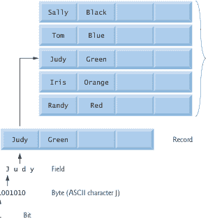

**图 1.3** | 数据层次结构。

| 层级 | 描述 |
|---|---|
| 位 | 计算机中最小的数据项可以取 0 或 1。这样的数据项称为**位**（“二进制数字”的简称——可取两个值之一的数字）。令人惊叹的是，计算机所执行的众多强大功能仅涉及对 0 和 1 的最简单操作——**检查位的值、设置位的值和反转位的值**（从 1 到 0 或从 0 到 1）。 |
| 字符 | 对于人类来说，以位这种底层形式处理数据非常繁琐。相反，人们更愿意使用十进制数字（0–9）、字母（A–Z 和 a–z）以及特殊符号（如 $、@、%、&、*、(、)、-、+、"、! 等）。**数字、字母和特殊符号统称为字符。** 计算机的**字符集**是用于编写程序并表示数据的所有字符的集合。计算机只处理 1 和 0，因此每个字符都表示为 1 和 0 的一种模式。**Unicode** 字符集包含世界上许多语言的字符。C++ 支持多种字符集，包括由两个字节（每个字节由八位组成）组成的 16 位 Unicode® 字符。有关 **ASCII（美国信息交换标准代码）**字符集的更多信息，请参见附录 B；该字符集是 Unicode 的常用子集，表示大小写字母、数字和一些常见特殊字符。 |
| 字段 | 正如字符由位组成，**字段**由字符或字节组成。字段是传达含义的一组字符或字节。例如，由大小写字母组成的字段可用于表示人名，由十进制数字组成的字段可表示年龄。 |
| **记录** | 若干相关字段可组成一条**记录**。例如，在工资系统中，员工的记录可能由以下字段组成（这些字段的可能类型显示在括号中）：<br>• 员工标识号（整数）<br>• 姓名（字符串）<br>• 地址（字符串）<br>• 小时工资率（带小数点的数字）<br>• 年初至今收入（带小数点的数字）<br>• 预扣税款金额（带小数点的数字）<br>因此，记录是一组相关字段。在前面的示例中，所有字段都属于同一个员工。一家公司可能有许多员工，并且每个员工都有一条工资记录。 |
| **文件** | **文件**是一组相关记录。*[注：更一般地，文件包含任意格式的任意数据。在某些操作系统中，文件仅被视为一个字节序列——文件内字节的任何组织方式，例如将数据组织成记录，都是应用程序程序员创建的一种视图。]* 一个组织拥有许多文件并不罕见，有些文件包含数十亿甚至数万亿个字符的信息。 |
| **数据库** | **数据库**是以易于访问和操作的方式组织的电子数据集合。最流行的数据库模型是关系数据库，其中数据存储在简单的*表*中。一张表包含*记录*和*字段*。例如，学生表可能包含名、姓、专业、年级、学号和平均绩点。每个学生的数据是一条记录，每条记录中的各个信息片段是字段。你可以根据数据与多个表或数据库的关系来搜索、排序和操作这些数据。例如，大学可以结合学生数据库中的数据以及课程、校内住宿、膳食计划等数据库。 |

**图 1.4** | 数据层次结构的级别。

## 1.5 机器语言、汇编语言和高级语言

程序员使用各种编程语言编写指令，有些指令计算机可以直接理解，而另一些则需要中间的*翻译*步骤。

### 机器语言

任何计算机都只能直接理解由其硬件架构定义的**机器语言**（也称为*机器码*）。机器语言通常由数字组成（实际上简化为一串 1 和 0）。这类语言对人类来说非常繁琐。

### 汇编语言

用机器语言编程对大多数程序员来说太慢、太繁琐了。于是，他们开始使用类似英语的*缩写*来表示基本操作。

我们还提供了一个*可选的*自动取款机（ATM）案例研究，位于第 25–26 章，其中包含一个完整的 C++ 实现。该案例研究以循序渐进的节奏介绍了如何使用 UML（一种用于开发面向对象系统的行业标准图形建模语言）进行面向对象设计。我们引导你完成一次面向初学者的友好设计体验。

## *C++ 标准库*

C++ 程序由称为**类**和**函数**的部件组成。你可以自己编写每个部件，但大多数 C++ 程序员会利用 **C++ 标准库**中丰富的类和函数集合。因此，学习 C++“世界”实际上有两个部分：第一部分是学习 C++ 语言本身；第二部分是学习如何使用 C++ 标准库中的类和函数。我们讨论了其中的许多类和函数。P. J. Plauger 的著作 *标准 C 库*（新泽西州上萨德尔河：Prentice Hall PTR，1992）是那些需要深入理解 C++ 中包含的 ANSI C 库函数的程序员的必读之作。许多专用类库由独立软件供应商提供。

> **软件工程观察 1.1**
>
> 采用“构建块”方法创建程序。避免重复造轮子。尽可能使用现有部件。这种做法被称为*软件复用*，是面向对象编程的核心。


> **软件工程观察 1.2**
>
> 使用 C++ 编程时，你通常会使用以下构建块：来自 C++ 标准库的类和函数、你和同事创建的类与函数，以及各种流行的第三方库中的类和函数。


自己创建函数和类的优点是你会确切知道它们如何工作。你将能够检查 C++ 代码。缺点是，设计、开发和维护正确且高效运行的新函数和类需要耗费大量时间，并且非常复杂。

> **性能提示 1.2**
>
> 使用 C++ 标准库函数和类而不是自己编写版本，可以提高程序性能，因为它们经过精心编写，能够高效运行。这种技术还能缩短程序开发时间。


> **可移植性提示 1.1**
>
> 使用 C++ 标准库函数和类而不是自己编写，可以提高程序的可移植性，因为它们包含在每一个 C++ 实现中。


## 1.7 编程语言

在本节中，我们对几种流行的编程语言进行简要说明（图 1.5）。

| 编程语言 | 描述 |
|---|---|
| Fortran | Fortran（FORmula TRANslator，即“公式翻译器”）由 IBM 公司在 20 世纪 50 年代中期开发，用于需要复杂数学计算的科学和工程应用。它仍被广泛使用，其最新版本支持面向对象编程。 |
| COBOL | COBOL（COmmon Business Oriented Language，即“面向商业的通用语言”）是在 20 世纪 50 年代末由计算机厂商、美国政府以及工业计算机用户基于 Grace Hopper（一位职业美国海军军官和计算机科学家）开发的一种语言而开发的。COBOL 仍广泛用于需要精确高效地处理大量数据的商业应用。其最新版本支持面向对象编程。 |
| Pascal | 20 世纪 60 年代的研究催生了*结构化编程*——一种规范的编程方法，用这种方法编写的程序比用以往技术生成的大型程序更清晰、更易于测试和调试，也更易于修改。这项研究较为具体的成果之一是 Niklaus Wirth 教授于 1971 年开发了 Pascal。它专为教授结构化编程而设计，几十年来在大学课程中一直很受欢迎。 |
| Ada | Ada 基于 Pascal，由美国国防部（DOD）在 20 世纪 70 年代至 80 年代初赞助开发。DOD 希望有一种单一语言能满足其大部分需求。这种基于 Pascal 的语言以诗人拜伦勋爵的女儿 Ada Lovelace 夫人命名。她被公认为在 19 世纪初编写了世界上第一个计算机程序（为 Charles Babbage 设计的分析机机械计算设备而编写）。Ada 也支持面向对象编程。 |
| Basic | Basic 于 20 世纪 60 年代在达特茅斯学院开发，目的是让初学者熟悉编程技术。其许多最新版本都是面向对象的。 |
| C | C 语言于 1972 年由 Dennis Ritchie 在贝尔实验室实现。它最初作为 UNIX 操作系统的开发语言而广为人知。如今，通用操作系统的大部分代码是用 C 或 C++ 编写的。 |
| Objective-C | Objective-C 是一种基于 C 的面向对象语言。它于 20 世纪 80 年代初开发，后来被 NeXT 收购，而 NeXT 又被 Apple 收购。它已成为 OS X 操作系统和所有 iOS 设备（如 iPod、iPhone 和 iPad）的关键编程语言。 |

**图 1.5** | 其他一些编程语言。（第 1 部分，共 3 部分。）


| 编程语言 | 描述 |
| --- | --- |
| Ruby on Rails | Ruby——由松本行弘（Yukihiro Matsumoto）于 20 世纪 90 年代中期创建——是一种开源、面向对象的编程语言，其语法简单，与 Perl 和 Python 类似。Ruby on Rails 将脚本语言 Ruby 与 37Signals 开发的 Rails Web 应用框架结合在一起。他们的著作《*务实*》（可在 gettingreal.37signals.com/toc.php 免费获取）是 Web 开发人员的必读书籍。许多 Ruby on Rails 开发人员表示，在开发数据库密集型 Web 应用时，Ruby on Rails 比其他语言更能提高生产力。Ruby on Rails 曾被用来构建 Twitter 的用户界面。 |
| Scala | Scala（www.scala-lang.org/node/273）是“可扩展语言”（scalable language）的缩写，由瑞士洛桑联邦理工学院（EPFL）教授 Martin Odersky 设计。Scala 于 2003 年发布，同时使用面向对象编程和函数式编程范式，并设计为与 Java 集成。使用 Scala 编程可以显著减少应用程序中的代码量。Twitter 和 Foursquare 使用 Scala。 |

**图 1.5** 其他一些编程语言。（第 3 部分，共 3 部分。）

## 1.8 面向对象技术简介

在人们对新的、更强大的软件需求激增之际，快速、正确且经济地构建软件仍然是一个难以实现的目标。*对象*，或者更准确地说——正如我们将在第 3 章看到的——对象所源自的类，本质上是可复用的软件组件。有日期对象、时间对象、音频对象、视频对象、汽车对象、人对象等等。几乎任何*名词*都可以根据*属性*（如名称、颜色和大小）和*行为*（如计算、移动和通信）合理地表示为软件对象。软件开发人员发现，使用模块化的、面向对象的设计与实现方法，可以使软件开发团队的生产力远高于早期技术所能达到的水平——面向对象程序通常更容易理解、纠正和修改。

### *汽车作为对象*

让我们从一个简单的类比开始。假设你想*驾驶汽车*，并*通过踩油门踏板使其加速*。在你能这样做之前，必须发生什么？好吧，在你驾驶汽车之前，必须有人先设计它。汽车通常始于工程图纸，类似于描述房屋设计的*蓝图*。这些图纸包括油门踏板的设计。踏板向驾驶员*隐藏*了真正让汽车加速的复杂机制，就像刹车踏板隐藏了让汽车减速的机制，方向盘隐藏了让汽车转向的机制一样。这使得对发动机、刹车和转向机制的工作原理知之甚少或一无所知的人也能轻松驾驶汽车。

在你能驾驶汽车之前，必须根据描述它的工程图纸将其*建造*出来。一辆完成的汽车有一个*实际的*油门踏板可以让汽车加速，但即便如此还不够——汽车不会自己加速（希望如此！），所以驾驶员*必须踩*踏板才能让汽车加速。

### *成员函数和类*

让我们用汽车示例来介绍一些关键的面向对象编程概念。在程序中执行任务需要一个*成员函数*。成员函数包含实际执行其任务的程序语句。它向用户隐藏这些语句，就像汽车的油门踏板向驾驶员隐藏让汽车加速的机制一样。在 C++ 中，我们创建一个称为*类*的程序单元来容纳执行该类任务的一组成员函数。例如，一个表示银行账户的类可能包含一个向账户*存款*的成员函数、一个从账户*取款*的成员函数，以及一个*查询*账户当前余额的成员函数。类在概念上类似于汽车的工程图纸，后者包含了油门踏板、方向盘等的设计。

### *实例化*

正如在你能真正驾驶汽车之前，必须有人根据工程图纸*制造汽车*一样，在程序能够执行类的方法定义的任务之前，你必须根据类*构建一个对象*。这样做被称为*实例化*。然后，对象被称为其类的一个*实例*。

### *复用*

正如汽车的工程图纸可以被*复用*多次来制造多辆汽车一样，你可以*复用*一个类多次来构建多个对象。在构建新类和程序时，复用现有类可以节省时间和精力。复用还有助于构建更可靠、更有效的系统，因为现有类和组件通常已经过广泛的*测试、调试*和*性能调优*。正如*可互换零件*的概念对工业革命至关重要一样，可复用类对由面向对象技术推动的软件革命也至关重要。

### *消息和成员函数调用*

当你驾驶汽车时，踩下油门踏板会向汽车发送一个*消息*，让其执行一项任务——即加速。类似地，你向对象发送*消息*。每个消息都实现为一次*成员函数调用*，它告诉对象的某个成员函数执行其任务。例如，程序可能会调用某个特定银行账户对象的*存款*成员函数来增加账户余额。

### *属性和数据成员*

一辆汽车除了具有完成任务的能力外，还具有*属性*，如颜色、车门数量、油箱中的汽油量、当前速度以及总行驶里程记录（即里程表读数）。与能力一样，汽车的属性也作为其设计的一部分体现在工程图中（例如，图中包含里程表和燃油表）。当你驾驶实际汽车时，这些属性随汽车一起携带。每辆汽车都维护着*自己的*属性。例如，每辆汽车都知道自己的油箱里有多少汽油，但*不知道*其他汽车油箱里有多少。

类似地，对象在程序中使用时也带有属性。这些属性被指定为对象类的一部分。例如，银行账户对象有一个*余额属性*，表示账户中的金额。每个银行账户对象都知道它所代表的账户中的余额，但*不知道*银行中其他账户的余额。属性由类的**数据成员**指定。

### *封装*

类将属性和成员函数**封装**（即包装）到对象中——对象的属性和成员函数密切相关。对象之间可以相互通信，但通常不允许知道其他对象是如何实现的——实现细节*隐藏*在对象自身内部。正如我们将看到的，这种**信息隐藏**对良好的软件工程至关重要。

### *继承*

通过**继承**可以快速便捷地创建新的对象类——新类吸收现有类的特征，可能对它们进行定制并添加自己独有的特征。在我们汽车的类比中，“敞篷车”类的对象当然*是*更一般的“汽车”类的对象，但更*具体*地说，其车顶可以升起或降下。

### *面向对象分析与设计（OOAD）*

很快你将用 C++ 编写程序。你如何为程序创建**代码**（即程序指令）？也许像许多程序员一样，你会直接打开电脑开始打字。这种方法可能适用于小型程序（比如我们在本书前几章中介绍的那些），但如果你被要求为一个大型银行创建控制数千台自动取款机的软件系统呢？或者假设你被要求加入一个由数千名软件开发人员组成的团队，构建下一代美国空中交通管制系统？对于如此庞大而复杂的项目，你不应该只是坐下来开始编写程序。

为了创建最佳解决方案，你应该遵循一个详细的**分析**过程来确定项目的**需求**（即定义*系统应该做什么*），并开发满足这些需求的**设计**（即决定*系统应该如何做*）。理想情况下，你会在编写任何代码之前经历这个过程并仔细审查设计（并让你的设计接受其他软件专业人士的审查）。如果这个过程涉及从面向对象的角度分析和设计系统，那么它被称为**面向对象分析与设计（OOAD）过程**。像 C++ 这样的语言是面向对象的。用这种语言编程，称为**面向对象编程（OOP）**，可以让你将面向对象的设计实现为可工作的系统。

### *UML（统一建模语言）*

尽管存在许多不同的 OOAD 过程，但一种用于传达任何 OOAD 过程结果的单一图形语言已被广泛使用。这种语言被称为统一建模语言（UML），现在是用于建模面向对象系统的最广泛使用的图形方案。我们将在第 3 章和第 4 章中首次展示 UML 图，然后在我们对面向对象编程的更深入讨论中持续使用它们，直至第 12 章。在第 25 章至第 26 章的*可选* ATM 软件工程案例研究中，我们将介绍 UML 的一个简单子集，引导你完成一次面向对象设计的体验。


## 1.9 典型的 C++ 开发环境

C++ 系统通常由三部分组成：程序开发环境、语言本身和 C++ 标准库。C++ 程序通常经历六个阶段：编辑、预处理、编译、链接、加载和执行。下面的讨论将解释一个典型的 C++ 程序开发环境。

### 阶段 1：编辑程序

阶段 1 是使用*编辑器程序*（通常简称为编辑器）编辑文件（图 1.6）。你使用编辑器键入 C++ 程序（通常称为*源代码*），进行必要的更正，并将程序保存到辅助存储设备（如硬盘）上。C++ 源代码文件名通常以 .cpp、.cc 或 .C 扩展名结尾（注意 C 是大写），这表明文件包含 C++ 源代码。有关文件名扩展名的更多信息，请参阅 C++ 编译器的文档。


**图 1.6** | *典型的 C++ 开发环境——编辑阶段。*

Linux 系统中广泛使用的两种编辑器是 vi 和 emacs。适用于 Microsoft Windows 的 C++ 软件包（如 Microsoft Visual C++（microsoft.com/express））已将编辑器集成到编程环境中。你也可以使用简单的文本编辑器（如 Windows 中的记事本）来编写 C++ 代码。

对于开发大型信息系统的组织，许多主要软件供应商都提供**集成开发环境（IDE）**。IDE 提供了支持软件开发过程的工具，包括用于编写和编辑程序的编辑器，以及用于定位**逻辑错误**（导致程序执行不正确的错误）的调试器。流行的 IDE 包括 Microsoft® Visual Studio 2012 Express Edition、Dev C++、NetBeans、Eclipse、Apple 的 Xcode 和 CodeLite。

### 阶段 2：预处理 C++ 程序

在阶段 2 中，你发出**编译**程序的命令（图 1.7）。在 C++ 系统中，**预处理器**程序在编译器的翻译阶段开始之前自动执行（因此我们将预处理称为阶段 2，将编译称为阶段 3）。C++ 预处理器遵循称为**预处理指令**的命令，这些指令指示在编译之前要对程序执行某些操作。这些操作通常包括要编译的其他文本文件，并执行各种文本替换。最常用的预处理指令在前几章中讨论；预处理功能的详细讨论见附录 E“预处理器”。


**图 1.7** | *典型的 C++ 开发环境——预处理阶段。*

### 阶段 6：执行

最后，计算机在其 CPU 的控制下，一次一条指令地执行程序（图 1.11）。一些现代计算机体系结构可以并行执行多条指令。

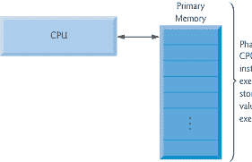

**图 1.11** | *典型的 C++ 开发环境——执行阶段。*

### 执行时可能出现的问题

程序可能不会在第一次尝试时就成功运行。前面的每个阶段都可能因为我们在本书中将要讨论的各种错误而失败。例如，正在执行的程序可能会尝试除以零（在 C++ 中，这对于整数运算来说是非法的）。这将导致 C++ 程序显示错误消息。如果发生这种情况，你必须返回编辑阶段，进行必要的更正，然后再次经历其余阶段，以确定更正是否解决了问题。[注意：大多数 C++ 程序都会输入或输出数据。某些 C++ 函数从 cin（标准输入流；发音为“see-in”）获取输入，cin 通常是键盘，但 cin 可以被重定向到其他设备。数据通常输出到 cout（标准输出流；发音为“see-out”），cout 通常是计算机屏幕，但 cout 也可以被重定向到其他设备。当我们说程序打印结果时，通常意味着结果显示在屏幕上。数据可以输出到其他设备，例如磁盘和硬拷贝打印机。还有一个称为 cerr 的标准错误流。cerr 流（通常连接到屏幕）用于显示错误消息。

> **常见编程错误 1.1**
> 
> *诸如除以零之类的错误在程序运行时发生，因此它们被称为运行时错误或执行时错误。致命运行时错误会导致程序立即终止，而无法成功完成其任务。非致命运行时错误允许程序运行到完成，但通常会生成错误的结果。*

## 1.10 测试运行 C++ 应用程序

在本节中，你将运行并操作你的第一个 C++ 应用程序。你将从运行一个有趣的猜数字游戏开始，该游戏会从 1 到 1000 中挑选一个数字，并提示你猜测它。如果你的猜测正确，游戏结束。如果你的猜测不正确，应用程序会提示你的猜测是高于还是低于正确的数字。你可以猜测的次数没有限制。[注意：仅针对此测试运行，我们修改了你在第 6 章“函数与递归入门”中将要创建的练习中的应用程序。通常，此应用程序会在你执行程序时随机选择正确答案。修改后的应用程序在每次执行程序时都使用相同的正确答案（尽管这可能因编译器而异），因此你可以使用我们本节中使用的*相同*猜测，并在我们指导你操作第一个 C++ 应用程序时看到*相同*的结果。]

我们将演示使用 Windows 命令提示符和 UNIX 平台上的 shell 运行 C++ 应用程序。该应用程序在两个平台上的运行方式类似。有许多开发环境可供你编译、构建和运行 C++ 应用程序，例如 GNU C++、Microsoft Visual C++、Apple Xcode、Dev C++、CodeLite、NetBeans、Eclipse 等。有关你的特定开发环境的信息，请咨询你的导师。

在以下步骤中，你将运行该应用程序并输入各种数字来猜测正确的数字。你在该应用程序中看到的元素和功能与你在本书中将学到的编程内容具有代表性。我们使用字体来区分你在屏幕上看到的功能（例如**命令提示符**）与屏幕不直接相关的元素。我们使用**无衬线 Helvetica**字体强调屏幕功能，如标题和菜单（例如**文件**菜单），并使用无衬线 Lucida 字体强调文件名、应用程序显示的文本以及你应输入到应用程序中的值（例如 GuessNumber 或 500）。正如你所注意到的，每个术语的**定义出现处**均以蓝色粗体字显示。对于本节中的图，我们指出了应用程序的重要部分。为了使这些功能更明显，我们修改了**命令提示符**窗口的背景颜色（仅适用于 Windows 测试运行）。要修改系统上的**命令提示符**颜色，请打开**命令提示符**，选择**开始 > 所有程序 > 附件 > 命令提示符**，然后右键单击标题栏并选择**属性**。在出现的**“命令提示符”属性**对话框中，单击**颜色**选项卡，然后选择你偏好的文本和背景颜色。

### 从 Windows 命令提示符运行 C++ 应用程序

- 1. **检查你的设置。** 务必阅读 `www.deitel.com/books/cpphtp9/` 上的“开始之前”部分，以确保你已将本书的示例正确复制到硬盘上。
- 2. **定位已完成的应用程序。** 打开命令提示符窗口。要更改到已完成的 GuessNumber 应用程序的目录，请键入 `cd C:\examples\ch01\GuessNumber\Windows`，然后按 **Enter**（图 1.12）。此命令用于更改目录。

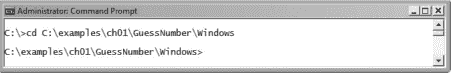

**图 1.12** | 打开命令提示符窗口并更改目录


## 使用Linux上的GNU C++运行C++应用程序

在此测试运行中，我们假定您知道如何将示例复制到您的主目录。如果您对将文件复制到Linux系统有任何疑问，请咨询您的指导老师。另外，在本节的图中，我们使用粗体突出显示来指出每个步骤所需的用户输入。我们系统上的shell提示符使用波浪号（~）字符表示主目录，并且每个提示符以美元符号（$）结尾。提示符在不同Linux系统上可能有所不同。

- 1. **定位已完成的应用程序。** 在Linux shell中，通过输入以下命令切换到已完成的GuessNumber应用程序目录（图1.19）：

    ```
    cd examples/ch01/GuessNumber/GNU_Linux
    ```

    然后按*Enter*键。命令cd用于切换目录。

    ```text
    ~$ cd examples/ch01/GuessNumber/GNU_Linux
    ~/examples/ch01/GuessNumber/GNU_Linux$
    ```

    **图1.19** | 切换到GuessNumber应用程序的目录。

- 2. **编译GuessNumber应用程序。** 要在GNU C++编译器上运行应用程序，必须首先编译它，输入以下命令，如图1.20所示：

    ```
    g++ GuessNumber.cpp -o GuessNumber
    ```

    此命令编译应用程序并生成一个名为GuessNumber的可执行文件。

    ```text
    ~/examples/ch01/GuessNumber/GNU_Linux$ g++ GuessNumber.cpp -o GuessNumber
    ~/examples/ch01/GuessNumber/GNU_Linux$
    ```

    **图1.20** | 使用g++命令编译GuessNumber应用程序。

- 3. **运行GuessNumber应用程序。** 要运行可执行文件GuessNumber，请在下一个提示符处输入./GuessNumber，然后按*Enter*键（图1.21）。

    ```text
    ~/examples/ch01/GuessNumber/GNU_Linux$ ./GuessNumber
    I have a number between 1 and 1000.
    Can you guess my number?
    Please type your first guess.
    ?
    ```

    **图1.21** | 运行GuessNumber应用程序。

- 4. **输入您的第一次猜测。** 应用程序显示“Please type your first guess.”，然后在下一行显示一个问号（?）作为提示符（图1.21）。在提示符处，输入500（图1.22）。*[注：这是我们为Windows修改并测试运行的同一应用程序，但输出可能因所使用的编译器而异。]*

- 3. **运行GuessNumber应用程序。** 现在您已进入包含GuessNumber应用程序的目录，输入命令`GuessNumber`（图1.13）并按Enter键。[注：GuessNumber.exe是应用程序的实际名称；但是，Windows默认采用`.exe`扩展名。]

    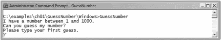

    **图1.13** | 运行GuessNumber应用程序。

- 4. **输入您的第一次猜测。** 应用程序显示“Please type your first guess.”，然后在下一行显示一个问号（?）作为提示符（图1.13）。在提示符处，输入500（图1.14）。

    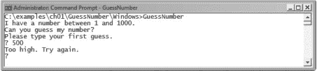

    **图1.14** | 输入您的第一次猜测。

- 5. **输入另一个猜测。** 应用程序显示“Too high. Try again.”，表示您输入的值大于应用程序选择的正确答案数。因此，您应该在下次猜测时输入一个较小的数字。在提示符处，输入250（图1.15）。应用程序再次显示“Too high. Try again.”，因为您输入的值仍然大于应用程序选择的正确答案数。

    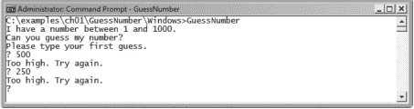

    **图1.15** | 输入第二次猜测并接收反馈。

- 6. **输入更多猜测。** 继续输入数值进行游戏，直到猜对正确的数字。应用程序将显示“Excellent! You guessed the number!”（图1.16）。

    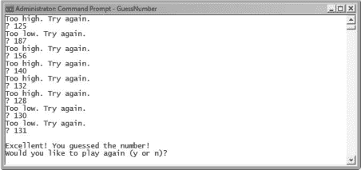

    **图1.16** | 输入更多猜测并猜中正确的数字。

- 7. **再次玩游戏或退出应用程序。** 猜对后，应用程序会询问您是否想再玩一局（图1.16）。在“Would you like to play again (y or n)?”提示符处，输入字符y将使应用程序选择一个新的数字，并显示消息“Please type your first guess.”，随后出现一个问号提示符（图1.17），以便您在新一局中进行第一次猜测。输入字符n则结束应用程序，并返回到命令提示符下的应用程序目录（图1.18）。每次从头开始执行此应用程序（即步骤3），它都会为您选择相同的数字来猜测。

- 8. **关闭命令提示符窗口。**

    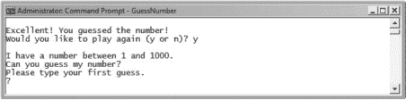

    **图1.17** | 再次玩游戏。

    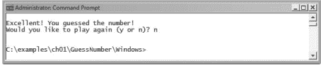

    **图1.18** | 退出游戏。

操作系统——其功能包括增强的用户界面、更快的启动时间、进一步改进的安全功能、触屏和多点触控支持等。Windows是一个*专有*操作系统——它由微软独家控制。Windows是迄今为止世界上使用最广泛的桌面操作系统。

### 1.11.2 Linux——一种开源操作系统

Linux操作系统也许是最伟大的*开源*运动的成功。**开源软件**背离了在软件发展早期占主导地位的*专有*软件开发风格。在开源开发中，个人和公司*贡献*他们的努力来开发、维护和发展软件，以换取将该软件用于自己目的的权利，通常是*免费*的。开源代码经常受到比专有软件多得多的受众审查，因此错误通常会被更快地消除。开源还鼓励创新。诸如IBM、Oracle等许多企业系统公司在Linux开源开发上投入了大量资金。

开源社区中的一些关键组织包括Eclipse基金会（Eclipse集成开发环境帮助程序员方便地开发软件）、Mozilla基金会（Firefox网络浏览器的创造者）、Apache软件基金会（用于开发基于网络的应用的Apache网络服务器的创造者）以及SourceForge（提供用于管理开源项目的工具——它有成百上千个正在开发中的项目）。计算和通信技术的快速进步、成本的降低以及开源软件，使得现在创建软件业务比十年前更加容易和经济。一个很好的例子是Facebook，它从大学宿舍起步，并利用开源软件构建。

**Linux**内核是最流行的开源、自由分发、功能齐全的操作系统的核心。它由一个松散组织的志愿者团队开发，在服务器、个人电脑和嵌入式系统中很受欢迎。与微软Windows和苹果OS X等专有操作系统不同，Linux源代码（程序代码）可供公众检查和修改，并且可以免费下载和安装。因此，Linux用户受益于一个积极调试和改进内核的开发者社区，以及能够定制操作系统以满足特定需求的能力。

一系列问题——例如微软的市场影响力、用户友好的Linux应用程序数量少以及Linux发行版的多样性，如Red Hat Linux、Ubuntu Linux等——阻碍了Linux在桌面电脑上的广泛使用。Linux在服务器和嵌入式系统（如基于Android的谷歌智能手机）中变得非常流行。

### 1.11.3 苹果的OS X；用于iPhone®、iPad®和iPod Touch®设备的苹果iOS

苹果公司由史蒂夫·乔布斯和史蒂夫·沃兹尼亚克于1976年创立，迅速成为个人计算领域的领导者。1979年，乔布斯和几名苹果员工参观了施乐PARC（帕洛阿尔托研究中心），了解施乐公司配备图形用户界面（GUI）的桌面电脑。该GUI成为了苹果Macintosh的灵感来源，Macintosh于1984年在令人难忘的超级碗广告中隆重推出。


Objective-C 编程语言由 Brad Cox 和 Tom Love 于 20 世纪 80 年代初在 Stepstone 公司创造，它为 C 编程语言增加了面向对象编程（OOP）的能力。在撰写本书时，Objective-C 的流行程度与 C++ 相当。⁶ 史蒂夫·乔布斯于 1985 年离开苹果公司，创立了 NeXT 公司。1988 年，NeXT 从 Stepstone 获得了 Objective-C 的许可，并开发了 Objective-C 编译器和库，这些被用作 NeXTSTEP 操作系统的用户界面和 Interface Builder（用于构建图形用户界面）的平台。

乔布斯于 1996 年苹果收购 NeXT 时重返苹果。苹果的 OS X 操作系统是 NeXTSTEP 的后代。苹果专有操作系统 iOS 源自苹果的 OS X，用于 iPhone、iPad 和 iPod Touch 设备。

### 1.11.4 谷歌的 Android

Android——增长最快的移动和智能手机操作系统——基于 Linux 内核和 Java。经验丰富的 Java 程序员可以快速投入 Android 开发。开发 Android 应用的一个好处是平台的开放性。该操作系统是开源且免费的。

Android 操作系统由 Android 公司开发，该公司于 2005 年被谷歌收购。2007 年，开放手持设备联盟™——最初由 34 家公司组成，到 2011 年已有 84 家——成立，以继续开发 Android。截至 2012 年 6 月，每天有超过 90 万台 Android 设备被激活！⁷ Android 智能手机在美国的销量现已超过 iPhone。⁸ Android 操作系统被用于众多智能手机（如摩托罗拉 Droid、HTC One S、三星 Galaxy Nexus 等）、电子阅读器设备（如 Kindle Fire 和 Barnes and Noble Nook™）、平板电脑（如戴尔 Streak 和三星 Galaxy Tab）、店内触摸屏自助终端、汽车、机器人、多媒体播放器等。

## 1.12 互联网与万维网

互联网——一个全球性的计算机网络——得益于计算与通信技术的融合而成为现实。20 世纪 60 年代末，ARPA（高级研究计划局）为大约十几个受 ARPA 资助的大学和研究机构的主计算机系统联网推出了蓝图。学术研究即将实现巨大飞跃。ARPA 着手实施了 ARPANET，它最终演变为今天的互联网。人们很快发现，通过电子邮件快速便捷地交流是 ARPANET 早期的关键好处。即使在今天的互联网上也是如此，它促进了世界各地互联网用户之间的各种通信。

### 分组交换

ARPANET 的一个主要目标是允许多个用户通过相同的通信路径（如电话线）同时发送和接收信息。该网络采用一种称为分组交换的技术运行，其中数字数据以称为分组的小包发送。分组包含地址、错误控制和排序信息。

具有 Web 2.0 特征的公司包括 Google（网页搜索）、YouTube（视频分享）、Facebook（社交网络）、Twitter（微博客）、Groupon（社交商务）、Foursquare（移动签到）、Salesforce（以“云端”在线服务形式提供的商业软件）、Craigslist（大多为免费分类广告）、Flickr（照片分享）、Skype（互联网电话、视频通话和视频会议）以及 Wikipedia（免费在线百科全书）。

Web 2.0 涉及用户——他们不仅创建内容，还帮助组织、分享、重组、评论、更新内容等。Web 2.0 是一场对话，每个人都有机会发言和分享观点。理解 Web 2.0 的公司意识到，他们的产品和服务也是一种对话。

### *参与架构*

Web 2.0 拥抱**参与架构**——一种鼓励用户互动和社区贡献的设计。你，用户，是 Web 2.0 最重要的方面——事实上如此重要，以至于 2006 年《时代》杂志的“年度人物”就是“你”。¹⁰ 该文章认可了 Web 2.0 的社会现象——从*少数强大者*向*众多赋权者*的转变。如今，热门博客与传统媒体巨头竞争，许多 Web 2.0 公司几乎完全建立在用户生成的内容之上。对于像 Facebook、Twitter、YouTube、eBay 和 Wikipedia 这样的网站，用户创建内容，而公司提供输入、操作和分享信息的*平台*。

## 1.13 一些关键的软件开发术语

图 1.27 列出了你会在软件开发社区听到的一些流行语。我们已经就大多数这些主题创建了资源中心，并且还有更多在筹备中。

| 技术 | 描述 |
|---|---|
| Ajax | **Ajax** 是主要的 Web 2.0 软件技术之一。Ajax 帮助基于互联网的应用表现得像桌面应用——考虑到这类应用在数据于你的计算机和互联网服务器之间来回传输时会遭受传输延迟，这是一项艰巨的任务。 |
| 敏捷软件开发 | **敏捷软件开发**是一组方法论，它们试图比以往的方法论更快、用更少的资源实现软件。查看敏捷联盟（www.agilealliance.org）和敏捷宣言（www.agilemanifesto.org）。 |
| 重构 | **重构**涉及重写程序，使其更清晰、更易于维护，同时保持其正确性和功能性。它被广泛用于敏捷开发方法论中。许多 IDE 包含*重构*工具来自动完成大部分重写工作。 |

**图 1.27** | 软件技术。（第 1 部分，共 2 部分。）

| 技术 | 描述 |
|---|---|
| 设计模式 | **设计模式**是构建灵活且可维护的面向对象软件的成熟架构。设计模式领域试图枚举那些反复出现的模式，鼓励软件设计者重用它们，以用更少的时间、金钱和精力开发更高质量的软件。 |
| LAMP | **LAMP** 是许多开发者用来构建 Web 应用的一组开源技术的缩写——它代表 Linux、Apache、MySQL 和 PHP（或 Perl 或 Python——用于类似目的的另外两种语言）。MySQL 是一个开源数据库管理系统。PHP 是用于开发基于互联网应用的最流行的开源服务器端互联网“脚本”语言。 |
| 软件即服务（SaaS） | 软件通常被视为产品；大多数软件仍然以这种方式提供。如果你想运行一个应用，你会从软件供应商那里购买一个软件包——通常是 CD、DVD 或网络下载。然后你将软件安装到计算机上并根据需要运行。当软件出现新版本时，你升级软件，这通常需要大量时间和可观的费用。对于在各种各样的计算机设备上维护数万个系统的组织来说，这个过程可能变得繁琐。使用**软件即服务（SaaS）**，软件运行在互联网其他地方的服务器上。当该服务器更新时，世界各地的所有客户端都会看到新功能——无需本地安装。你通过浏览器访问该服务。浏览器非常便携，因此你可以在世界任何地方的各种计算机上运行相同的应用。Salesforce.com、Google 以及 Microsoft 的 Office Live 和 Windows Live 都提供 SaaS。SaaS 是云计算的一种能力。 |
| 平台即服务（PaaS） | **平台即服务（PaaS）**，云计算的另一种能力，提供一种计算平台，通过 Web 以服务形式开发和运行应用，而不是在计算机上安装工具。PaaS 提供商包括 Google App Engine、Amazon EC2、Bungee Labs 等。 |
| 软件开发工具包（SDK） | **软件开发工具包（SDK）**包含开发者用于编写应用的工具和文档。 |

**图 1.27** | 软件技术。（第 2 部分，共 2 部分。）

图 1.28 描述了软件产品发布类别。

| 版本 | 描述 |
|---|---|
| Alpha | *alpha* 版本是仍处于积极开发中的软件产品的最早发布版本。Alpha 版本通常有缺陷、不完整且不稳定，发布给相对较少的开发者，用于测试新功能、获取早期反馈等。 |

**图 1.28** | 软件产品发布术语。（第 1 部分，共 2 部分。）

6. www.tiobe.com/index.php/content/paperinfo/tpci/index.html。
7. mashable.com/2012/06/11/900000-android-devices/。
8. www.pcworld.com/article/196035/android_outsells_the_iphone_no_big_surprise.html。
10. www.time.com/time/magazine/article/0,9171,1570810,00.html。


# 2 C++ 编程简介、输入/输出与运算符

> 名字有什么关系？我们
> 称之为玫瑰的，
> 即使换个名字，
> 依然芬芳如故。
>
> ——威廉·莎士比亚

> 崇高的思想必须用
> 崇高的语言表达。
>
> ——阿里斯托芬

> 一个人可以有所作为，
> 每个人都应该
> 尝试。
>
> ——约翰·F·肯尼迪

## 目标

在本章中，你将学习：

- 用 C++ 编写简单的计算机程序。
- 编写简单的输入和输出语句。
- 使用基本类型。
- 计算机内存的基本概念。
- 使用算术运算符。
- 算术运算符的优先级。
- 编写简单的决策语句。


### 注释

第 1 行和第 2 行

```cpp
// Fig. 2.1: fig02_01.cpp
// Text-printing program.
```

每一行都以 `//` 开头，表示该行的其余部分是**注释**。插入注释是为了*记录*你的程序，并帮助其他人阅读和理解它们。注释在程序运行时不会导致计算机执行任何操作——它们会被 C++ 编译器*忽略*，并且*不会*生成任何机器语言目标代码。注释“Text-printing program”描述了程序的用途。以 `//` 开头的注释称为**单行注释**，因为它会在当前行的末尾结束。（*注意：*你也可以使用包含一行或多行的注释，并将其放在 `/*` 和 `*/` 中。）


> **良好编程实践 2.1**
>
> 每个程序都应该以一条描述程序用途的注释开头。

### #include 预处理指令

第 3 行

```cpp
#include <iostream> // allows program to output data to the screen
```

是一个**预处理指令**，它是发送给 C++ 预处理器（在 1.9 节介绍）的消息。以 `#` 开头的行会在程序编译*之前*由预处理器处理。这一行通知预处理器将**输入/输出流头文件 `<iostream>`** 的内容包含到程序中。该头文件是一个包含编译器在编译任何使用 C++ 的流输入/输出向屏幕输出数据或从键盘输入数据的程序时所需信息的文件。图 2.1 中的程序会向屏幕输出数据，我们很快就会看到。我们将在第 6 章更详细地讨论头文件，并在第 13 章解释 `<iostream>` 的内容。


> **常见编程错误 2.1**
>
> 在需要从键盘输入数据或向屏幕输出数据的程序中，忘记包含 `<iostream>` 头文件会导致编译器产生错误消息。

### 空行和空白

第 4 行只是一个空行。你可以使用空行、空格字符和制表符（即“tab”）来使程序更易于阅读。这些字符统称为**空白**。空白字符通常会被编译器*忽略*。

### main 函数

第 5 行

```cpp
// function main begins program execution
```

是另一个单行注释，表示程序执行从下一行开始。

第 6 行

```cpp
int main()
```

是每个 C++ 程序的一部分。main 后面的括号表示 **main** 是一个称为**函数**的程序构建块。C++ 程序通常由一个或多个函数和类组成（你将在第 3 章中学习）。每个程序中*必须*有且仅有一个名为 main 的**函数**。图 2.1 中只包含一个函数。C++ 程序从 main 函数开始执行，即使 main 不是程序中定义的第一个函数。main 左侧的关键字 int 表示 main “返回”一个整数（整型）值。**关键字**是代码中 C++ 保留用于特定用途的单词。完整的 C++ 关键字列表参见图 4.3。我们将在 3.3 节演示如何创建自己的函数时解释函数“返回值”的含义。现在，只需在每个程序的 main 左侧包含关键字 int。

**左花括号** `{`（第 7 行）必须*开始*每个函数的**函数体**。相应的**右花括号** `}`（第 11 行）必须*结束*每个函数的函数体。

### 输出语句

第 8 行

```cpp
std::cout << "Welcome to C++!\\n"; // display message
```

指示计算机执行一个**操作**——即打印双引号之间的字符。双引号及其之间的字符合称为**字符串**、**字符序列**或**字符串字面量**。在本书中，我们将双引号之间的字符简称为字符串。字符串中的空白字符不会被编译器忽略。

整个第 8 行，包括 `std::cout`、**<< 运算符**、字符串 `"Welcome to C++!\n"` 和**分号 (;)**，称为**语句**。大多数 C++ 语句以分号结尾，分号也称为**语句终止符**（我们很快就会看到一些例外）。预处理指令（如 `#include`）不以分号结尾。通常，C++ 中的输出和输入是通过**字符流**来完成的。因此，当执行上述语句时，它会将字符流 Welcome to C++!\n 发送到**标准输出流对象——std::cout**——该对象通常与屏幕“连接”。

> **常见编程错误 2.2**
>
> *在 C++ 语句末尾省略分号是一个语法错误。编程语言的语法规定了用该语言创建正确程序的规则。当编译器遇到违反 C++ 语言规则（即语法）的代码时，就会发生语法错误。编译器通常会发出错误消息，以帮助你定位并修复错误的代码。语法错误也称为编译器错误、编译时错误或编译错误，因为编译器在编译阶段会检测到它们。在修正程序中所有的语法错误之前，你无法运行程序。正如你将看到的，有些编译错误并不是语法错误。*


> **良好编程实践 2.2**
>
> 将每个函数的函数体在界定函数体的花括号内缩进一级。这会使程序的功能结构更加突出，并使程序更易于阅读。


> **良好编程实践 2.3**
>
> 为你喜欢的缩进大小设定一个约定，然后统一应用。可以使用 Tab 键创建缩进，但制表位可能不同。我们更喜欢每级缩进三个空格。


### std 命名空间

当我们使用通过预处理指令 `#include <iostream>` 引入程序中的名称时，需要在 cout 之前加上 std::。符号 `std::cout` 表示我们正在使用一个属于命名空间 std 的名称，即 cout。名称 cin（标准输入流）和 cerr（标准错误流）——在第 1 章中介绍——也属于命名空间 std。命名空间是 C++ 的高级特性，我们将在第 23 章“其他主题”中深入讨论。目前，你只需记住在程序中每次提到 cout、cin 和 cerr 时，都要加上 `std::` 前缀。这可能会很繁琐——下一个示例将引入 using 声明和 using 指令，使你可以省略 std 命名空间中每个名称前的 `std::`。

### 流插入运算符与转义序列

在输出语句的上下文中，<< 运算符被称为流插入运算符。当此程序执行时，运算符右侧的值（右操作数）会被插入到输出流中。注意，该运算符指向数据流动的方向。字符串字面量的字符通常会按照双引号之间的形式原样打印。但是，字符 \n 不会打印在屏幕上（图 2.1）。反斜杠（\\）称为转义字符。它表示将要输出一个“特殊”字符。当在字符串中遇到反斜杠时，下一个字符会与反斜杠组合成一个转义序列。转义序列 \n 表示换行。它会使光标（即当前屏幕位置指示器）移动到屏幕下一行的开头。图 2.2 列出了一些常见的转义序列。

| 转义序列 | 描述 |
|---|---|
| `\n` | 换行。将屏幕光标定位到下一行的开头。 |
| `\t` | 水平制表。将屏幕光标移动到下一个制表位。 |
| `\r` | 回车。将屏幕光标定位到当前行的开头；不前进到下一行。 |
| `\a` | 警报。发出系统铃声。 |
| `\\` | 反斜杠。用于打印反斜杠字符。 |
| `\'` | 单引号。用于打印单引号字符。 |
| `\"` | 双引号。用于打印双引号字符。 |

**图 2.2**  |  转义序列。

### return 语句

第 10 行

```cpp
return 0; // indicate that program ended successfully
```

是我们用于退出函数的几种方法之一。当 return 语句用在 main 的末尾时（如此处所示），值 0 表示程序已成功终止。右花括号 }（第 11 行）表示 main 函数的结束。根据


C++ 标准规定，如果程序执行到 `main` 的末尾而没有遇到 return 语句，则视为程序成功终止——就像 `main` 中的最后一条语句是值为 0 的 return 语句一样。因此，在后续的程序中，我们省略 `main` 末尾的 return 语句。

## 2.2 关于注释的说明

在编写新程序或修改现有程序时，应使注释与程序代码保持同步。你经常需要修改现有程序——例如，修复导致程序无法正常运行的错误（通常称为 bug）或增强程序功能。在修改代码时更新注释，有助于确保注释准确反映代码的功能。这将使你的程序在将来更容易理解和修改。

## 2.3 修改我们的第一个 C++ 程序

现在我们给出两个示例，它们修改图 2.1 中的程序，分别使用多条语句在一行上打印文本，以及使用一条语句在多行上打印文本。

### 使用多条语句打印单行文本

“Welcome to C++!” 可以通过多种方式打印。例如，图 2.3 多次执行流插入（第 8–9 行），但产生的输出与图 2.1 的程序相同。[注意：从现在开始，我们使用浅蓝色背景来突出显示每个程序引入的关键特性。] 每次流插入都会从上次停止的位置继续打印。第一次流插入（第 8 行）打印 Welcome 后跟一个空格，由于该字符串没有以 \n 结尾，第二次流插入（第 9 行）将在同一行紧接着空格处开始打印。

```cpp
// Fig. 2.3: fig02_03.cpp
// Printing a line of text with multiple statements.
#include <iostream> // allows program to output data to the screen

// function main begins program execution
int main()
{
    std::cout << "Welcome ";
    std::cout << "to C++!\n";
} // end function main
```


**图 2.3**  使用多条语句打印单行文本。

### 使用单条语句打印多行文本

一条语句可以使用换行字符打印多行，如图 2.4 的第 8 行所示。每当输出流中遇到 \n（换行）转义序列时，屏幕光标就会定位到下一行的开头。若要在输出中插入一个空行，可将两个换行字符紧挨着放置，如第 8 行所示。

```cpp
// Fig. 2.4: fig02_04.cpp
// Printing multiple lines of text with a single statement.
#include <iostream> // allows program to output data to the screen

// function main begins program execution
int main()
{
   std::cout << "Welcome\nto\nC++!\n";
} // end function main
```


**图 2.4** | 使用单条语句打印多行文本。

## 2.4 另一个 C++ 程序：整数相加

我们的下一个程序从键盘获取用户输入的两个整数，计算这两个值的和，并使用 `std::cout` 输出结果。图 2.5 显示了程序以及示例输入和输出。在示例执行中，我们用粗体突出显示用户的输入。程序从 `main` 函数（第 6 行）开始执行。左花括号（第 7 行）开始 `main` 的函数体，相应的右花括号（第 22 行）结束函数体。

```cpp
// Fig. 2.5: fig02_05.cpp
// Addition program that displays the sum of two integers.
#include <iostream> // allows program to perform input and output

// function main begins program execution
int main()
{
   // variable declarations
   int number1 = 0; // first integer to add (initialized to 0)
   int number2 = 0; // second integer to add (initialized to 0)
   int sum = 0; // sum of number1 and number2 (initialized to 0)

   std::cout << "Enter first integer: "; // prompt user for data
   std::cin >> number1; // read first integer from user into number1

   std::cout << "Enter second integer: "; // prompt user for data
   std::cin >> number2; // read second integer from user into number2

   sum = number1 + number2; // add the numbers; store result in sum

   std::cout << "Sum is " << sum << std::endl; // display sum; end line
} // end function main
```

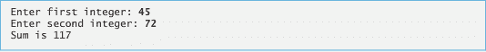

**图 2.5** | 显示两个整数之和的加法程序。

### 变量声明

第 9–11 行

```cpp
int number1 = 0; // first integer to add (initialized to 0)
int number2 = 0; // second integer to add (initialized to 0)
int sum = 0;     // sum of number1 and number2 (initialized to 0)
```

是声明。标识符 number1、number2 和 sum 是变量的名称。变量是计算机内存中的一个位置，可以存储值供程序使用。这些声明指定变量 number1、number2 和 sum 是 int 类型的数据，这意味着这些变量将保存整数值，即整数，例如 7、−11、0 和 31914。声明还将这些变量中的每一个都初始化为 0。

> **错误预防提示 2.1**
>
> 虽然并非总是需要显式初始化每个变量，但这样做有助于你避免许多类型的问题。

所有变量在使用前都必须使用名称和数据类型进行声明。几个相同类型的变量可以在一条声明中声明，也可以在多条声明中声明。我们可以使用逗号分隔的列表在一条声明中声明全部三个变量，如下所示：

```cpp
int number1 = 0, number2 = 0, sum = 0;
```

这会使程序的可读性降低，并且使我们无法提供描述每个变量用途的注释。

> **良好编程实践 2.4**
>
> 在每条声明中只声明一个变量，并提供一条解释该变量在程序中用途的注释。

### 基本类型

我们很快将讨论用于指定实数的 double 类型，以及用于指定字符数据的 char 类型。实数是带有小数点的数，例如 3.4、0.0 和 −1.19。char 变量只能保存一个小写字母、一个大写字母、一个数字或一个特殊字符（例如 $、* 或 ^）。诸如 int、double 和 char 之类的类型称为基本类型。基本类型的名称由一个或多个关键字组成，因此必须全部使用小写字母。附录 C 包含基本类型的完整列表。

### 标识符

变量名（例如 number1）是任何不是关键字的有效标识符。标识符是由字母、数字和下划线（_）组成的字符序列，且不能以数字开头。C++ 区分大小写——大写字母和小写字母是不同的，因此 a1 和 A1 是不同的标识符。

> **可移植性提示 2.1**
>
> C++ 允许任意长度的标识符，但你的 C++ 实现可能会限制标识符的长度。请使用 31 个字符或更少的标识符以确保可移植性。

> **良好编程实践 2.5**
>
> 选择有意义的标识符可以使程序**自文档化**——人们只需阅读程序就能理解它，而无需参考程序注释或文档。

> **良好编程实践 2.6**
>
> 避免在标识符中使用缩写。这可以提高程序的可读性。

> **良好编程实践 2.7**
>
> 不要使用以下划线或双下划线开头的标识符，因为 C++ 编译器可能会在内部出于自己的目的使用此类名称。这样可以防止你选择的名称与编译器选择的名称混淆。

### 变量声明的放置位置

变量声明几乎可以放在程序中的任何位置，但它们必须出现在程序中相应变量使用之前。例如，在图 2.5 的程序中，第 9 行的声明

```cpp
int number1 = 0; // first integer to add (initialized to 0)
```

本可以紧挨着放在第 14 行之前

```cpp
std::cin >> number1; // read first integer from user into number1
```

第 10 行的声明

```cpp
int number2 = 0; // second integer to add (initialized to 0)
```

本可以紧挨着放在第 17 行之前

```cpp
std::cin >> number2; // read second integer from user into number2
```

第 11 行的声明

```cpp
int sum = 0; // sum of number1 and number2 (initialized to 0)
```

本可以紧挨着放在第 19 行之前

```cpp
sum = number1 + number2; // add the numbers; store result in sum
```

### 获取用户的第一个值

第 13 行

```cpp
std::cout << "Enter first integer: "; // prompt user for data
```

显示 Enter first integer: 后跟一个空格。这条消息称为**提示符**，因为它指示用户执行特定操作。我们喜欢将前面的语句读作“std::cout 获取字符串 'Enter first integer: '.”。第 14 行

```cpp
std::cin >> number1; // read first integer from user into number1
```

使用**标准输入流对象 cin**（位于命名空间 std 中）和**流提取运算符 >>** 从键盘获取一个值。将流提取运算符与 std::cin 一起使用时，会从标准输入流中获取字符输入，标准输入流通常是

键盘。我们喜欢将上述语句表述为：“std::cin 给 number1 一个值”或简称为“std::cin 给 number1 赋值”。

当计算机执行上述语句时，它会等待用户为变量 number1 输入一个值。用户的响应方式是输入一个整数（以字符形式），然后按下 *Enter* 键（有时也称为 *Return* 键）将字符发送给计算机。计算机将该数字的字符表示转换为整数，并将这个数字（或*值*）赋值（即复制）给变量 number1。此后程序中任何对 number1 的引用都将使用这个相同的值。

std::cout 和 std::cin 流对象促进了用户与计算机之间的交互。

当然，用户可以从键盘输入*无效*的数据。例如，当你的程序期望用户输入一个整数时，用户可能输入字母字符、特殊符号（如 # 或 @）或带有小数点的数字（如 73.5），等等。在这些早期程序中，我们假设用户输入的是*有效*数据。随着你学习本书的深入，你将学到各种处理各类数据输入问题的技术。

### 从用户处获取第二个值

第 16 行

```cpp
std::cout << "Enter second integer: "; // prompt user for data
```

在屏幕上打印 `Enter second integer:`，提示用户采取行动。第 17 行

```cpp
std::cin >> number2; // read second integer from user into number2
```

从用户处获取变量 number2 的值。

### 计算用户输入值的总和

第 19 行的赋值语句

```cpp
sum = number1 + number2; // add the numbers; store result in sum
```

使用*赋值运算符*将变量 number1 和 number2 的值相加，并将结果赋值给变量 sum。我们喜欢将此语句读作“sum 获取 number1 + number2 的值。”大多数计算都是在赋值语句中执行的。= 运算符和 + 运算符被称为*二元运算符*，因为每个运算符都有*两个*操作数。对于 + 运算符，两个操作数是 number1 和 number2。对于前面的 = 运算符，两个操作数是 sum 和表达式 number1 + number2 的值。

> **良好编程实践 2.8**
>
> *在二元运算符两侧放置空格。这能使运算符更加突出，并使程序更易读。*

### 显示结果

第 21 行

```cpp
std::cout << "Sum is " << sum << std::endl; // display sum; end line
```

显示字符串 `Sum is`，后跟变量 sum 的数值，再后跟 std::endl——一种所谓的*流操纵符*。名称 endl 是“end line”的缩写，属于命名空间 std。std::endl 流操纵符输出一个换行符，然后“刷新输出缓冲区”。这仅仅意味着，在某些系统中，输出会在机器中累积，直到有足够的输出“值得”显示在屏幕上时，std::endl 会强制所有累积的输出立即显示。当输出正在提示用户采取某个操作（如输入数据）时，这一点可能很重要。

前面的语句输出了多种不同类型的值。流插入运算符“知道”如何输出每种类型的数据。在单个语句中使用多个流插入运算符（<<）被称为连接、链接或级联流插入操作。

计算也可以在输出语句中执行。我们可以将第 19 行和第 21 行的语句合并为一个语句

```cpp
std::cout << "Sum is " << number1 + number2 << std::endl;
```

从而无需使用变量 sum。

C++ 的一个强大特性是你可以创建自己的数据类型，称为类（我们将在第 3 章介绍这一功能，并在第 9 章深入探讨）。然后你可以使用 >> 和 << 运算符“教会”C++ 如何输入和输出这些新数据类型的值（这称为运算符重载——我们将在第 10 章探讨这一主题）。

## 2.5 内存概念

诸如 number1、number2 和 sum 这样的变量名实际上对应于计算机内存中的位置。每个变量都有一个名称、一个类型、一个大小和一个值。

在图 2.5 的加法程序中，当执行第 14 行的语句

```cpp
std::cin >> number1; // read first integer from user into number1
```

时，用户输入的整数被放入一个内存位置，该位置已被编译器分配了名称 number1。假设用户为 number1 输入了 45。计算机将 45 放入位置 number1，如图 2.6 所示。当一个值被放入内存位置时，该值会覆盖该位置的先前值；因此，将一个新值放入内存位置被称为破坏性操作。


**图 2.6** | 显示变量 number1 名称和值的内存位置。

回到我们的加法程序，假设当执行语句

```cpp
std::cin >> number2; // read second integer from user into number2
```

时，用户输入了 72。该值被放入位置 number2，内存状态如图 2.7 所示。这些变量的位置在内存中不一定相邻。一旦程序获得了 number1 和 number2 的值，它就会将这些值相加，并将总和放入变量 sum 中。语句

```cpp
sum = number1 + number2; // add the numbers; store result in sum
```

*替换*了 sum 中原先存储的任何值。number1 和 number2 的计算总和被放入变量 sum 中，而不考虑 sum 中可能已有的值——该值会丢失。计算 sum 之后，内存状态如图 2.8 所示。


**图 2.7** | 在变量 number1 和 number2 中存储值后的内存位置。

number1 和 number2 的值与计算前完全一样。这些值被使用了，但并未被破坏，因为计算机执行了计算。因此，当从一个内存位置读出值时，该操作是非破坏性的。


**图 2.8** | 计算并存储 number1 和 number2 的总和后的内存位置。

## 2.6 算术

大多数程序执行算术计算。图 2.9 总结了 C++ 的**算术运算符**。注意使用了标准中不使用的各种特殊符号。**星号（*）** 表示*乘法*，**百分号（%）** 是*取模运算符*，稍后将讨论。图 2.9 中的算术运算符都是二元运算符，即接受两个操作数的运算符。例如，表达式 number1 + number2 包含二元运算符 + 以及两个操作数 number1 和 number2。

**整数除法**（即分子和分母都是整数）产生整数商；例如，表达式 7 / 4 求值为 1，表达式 7 % 4 求值为 3。

| 运算符 | 操作 | 求值顺序（优先级） |
| --- | --- | --- |
| `( )` | 括号 | 首先求值。如果括号是嵌套的，例如在表达式 `a * (b + c / d + e)` 中，最内层括号中的表达式首先求值。**注意：** 如果你有一个表达式如 `(a + b) * (c - d)`，其中两组括号不是嵌套的，而是出现在“同一层级”，C++ 标准并未指定这些带括号的子表达式的求值顺序。 |
| `*` | 乘法 | 其次求值。如果有多个，则从左到右求值。 |
| `/` | 除法 | 其次求值。如果有多个，则从左到右求值。 |
| `%` | 取模 | 其次求值。如果有多个，则从左到右求值。 |
| `+` | 加法 | 最后求值。如果有多个，则从左到右求值。 |
| `-` | 减法 | 最后求值。如果有多个，则从左到右求值。 |

**图 2.10** 算术运算符的优先级。

### 代数表达式和 C++ 表达式示例

现在根据运算符优先级规则考虑几个表达式。每个示例都列出了一个代数表达式及其 C++ 等效表达式。以下是五项算术平均值（平均数）的示例：

```
Algebra:       m = (a + b + c + d + e) / 5
C++:           m = ( a + b + c + d + e ) / 5;
```

括号是必需的，因为除法的*优先级*高于加法。*整个量* `(a + b + c + d + e)` 要被 5 除。如果错误地省略了括号，我们会得到 `a + b + c + d + e / 5`，它会被错误地求值为

```
a + b + c + d + e / 5
```

以下是直线方程的示例：

```
Algebra:       y = mx + b
C++:           y = m * x + b;
```

不需要括号。乘法首先应用，因为乘法的*优先级*高于加法。

以下示例包含取模（%）、乘法、除法、加法、减法和赋值运算：

```
Algebra:       z = p%q + w/x − y
C++:           z = p % q + w / x − y;
```


语句下的圆圈数字表示C++应用运算符的顺序。乘法、模和除法先按从左到右的顺序计算（即它们从左到右结合），因为它们的优先级高于加法和减法。加法和减法其次应用，它们也从左到右应用。赋值运算符最后应用，因为它的优先级低于任何算术运算符。

## 二次多项式求值

为了更深入地理解运算符优先级规则，考虑二次多项式 $y = ax^2 + bx + c$ 的求值。

```
y = a * x * x + b * x + c;

Operator order: 6, 1, 2, 4, 3, 5
```

语句下的圆圈数字表示C++应用运算符的顺序。*C++中没有用于幂运算的算术运算符*，因此我们用 $x * x$ 表示 $x^2$。在第5章中，我们将讨论执行幂运算的标准库函数 `pow`（“幂”）。

假设前面二次多项式中的变量a、b、c和x初始化如下：a = 2，b = 3，c = 7，x = 5。图2.11说明了运算符应用的顺序以及表达式的最终值。

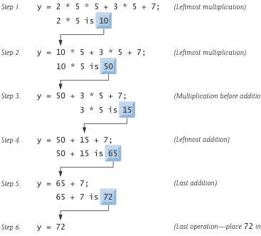

**图2.11**  |  二次多项式求值的顺序。

## 冗余括号

与代数中一样，在表达式中放置不必要的括号以使表达式更清晰是可以接受的。这些括号称为冗余括号。例如，前面的赋值语句可以加括号如下：

```
y = (a * x * x) + (b * x) + c;
```

## 2.7 决策：相等运算符和关系运算符

我们现在介绍C++的if语句的一个简单版本，它允许程序根据条件为真还是为假采取不同的行动。如果条件为真，则执行if语句体中的语句。如果条件为假，则不执行if体语句。我们很快会看到一个例子。

if语句中的条件可以使用图2.12中总结的关系运算符和相等运算符来形成。关系运算符都具有相同的优先级级别，并且从左到右结合。相等运算符都具有相同的优先级级别，该级别低于关系运算符的级别，并且从左到右结合。

| 代数关系或相等运算符 | C++关系或相等运算符 | C++条件示例 | C++条件的含义 |
|---|---|---|---|
| **关系运算符** |  |  |  |
| > | > | x > y | x大于y |
| < | < | x < y | x小于y |
| ≥ | >= | x >= y | x大于或等于y |
| ≤ | <= | x <= y | x小于或等于y |
| **相等运算符** |  |  |  |
| = | == | x == y | x等于y |
| ≠ | != | x != y | x不等于y |

**图2.12**  关系运算符和相等运算符。


> **常见编程错误 2.3**
>
> 反转运算符 !=、>= 和 <= 中符号对的顺序（分别写成 =!、=> 和 =<）通常是语法错误。在某些情况下，将 != 写成 =! 不会是语法错误，但几乎肯定会导致在运行时产生影响的逻辑错误。当你在第5章学习逻辑运算符时，就会明白原因。致命逻辑错误会导致程序失败并提前终止。非致命逻辑错误允许程序继续执行，但通常会产生不正确的结果。


> **常见编程错误 2.4**
>
> 混淆相等运算符 == 和赋值运算符 = 会导致逻辑错误。我们喜欢将相等运算符读作“等于”或“双等号”，将赋值运算符读作“得到”或“获取…的值”或“被赋值为…的值”。正如你将在5.9节看到的，混淆这些运算符可能不一定会导致容易识别的语法错误，但可能会导致微妙的逻辑错误。

## 使用if语句

下面的示例（图2.13）使用六个if语句来比较用户输入的两个数字。如果其中任何一个if语句的条件满足，则执行与该if语句关联的输出语句。

```cpp
// Fig. 2.13: fig02_13.cpp
// Comparing integers using if statements, relational operators
// and equality operators.
#include <iostream> // allows program to perform input and output

using std::cout; // program uses cout
using std::cin; // program uses cin
using std::endl; // program uses endl

// function main begins program execution
int main()
{
    int number1 = 0; // first integer to compare (initialized to 0)
    int number2 = 0; // second integer to compare (initialized to 0)

    cout << "Enter two integers to compare: "; // prompt user for data
    cin >> number1 >> number2; // read two integers from user

    if ( number1 == number2 )
        cout << number1 << " == " << number2 << endl;

    if ( number1 != number2 )
        cout << number1 << " != " << number2 << endl;

    if ( number1 < number2 )
        cout << number1 << " < " << number2 << endl;

    if ( number1 > number2 )
        cout << number1 << " > " << number2 << endl;

    if ( number1 <= number2 )
        cout << number1 << " <= " << number2 << endl;

    if ( number1 >= number2 )
        cout << number1 << " >= " << number2 << endl;
} // end function main
```

```text
Enter two integers to compare: 3 7
3 != 7
3 < 7
3 <= 7
```

**图2.13**  |  使用if语句、关系运算符和相等运算符比较整数。（第1部分，共2部分。）

```text
Enter two integers to compare: 22 12
22 != 12
22 > 12
22 >= 12
```

**图2.13**  |  使用if语句、关系运算符和相等运算符比较整数。  
（第2部分，共2部分。）

### using声明

第6–8行

```
using std::cout;  // program uses cout
using std::cin;   // program uses cin
using std::endl;  // program uses endl
```

是**using声明**，它们消除了像早期程序中那样重复std::前缀的需要。现在，在程序的其余部分，我们可以分别写cout而不是std::cout，cin而不是std::cin，endl而不是std::endl。

许多程序员更喜欢编写**using指令**来代替第6–8行：

```
using namespace std;
```

它使程序能够使用程序可能包含的任何标准C++头文件（如<iostream>）中的所有名称。从本书此后的内容开始，我们将在程序中使用上述指令。¹

### 变量声明和从用户读取输入

第13–14行

```
int number1 = 0;  // first integer to compare (initialized to 0)
int number2 = 0;  // second integer to compare (initialized to 0)
```

声明程序中使用的变量并将它们初始化为0。

程序使用级联流提取操作（第17行）输入两个整数。请记住，由于第7行，我们可以写cin而不是std::cin。首先将一个值读入变量number1，然后将一个值读入变量number2。

### 比较数字

第19–20行的if语句

```
if ( number1 == number2 )
    cout << number1 << " == " << number2 << endl;
```

比较变量number1和number2的值以测试相等性。如果值相等，第20行的语句将显示一行文本，表明这些数字相等。如果从第22、25、28、31和34行开始的一个或多个if语句中的条件为真，则相应的主体语句将显示一行适当的文本。

图2.13中的每个if语句在其主体中只有一个语句，并且每个主体语句都是缩进的。在第4章中，我们将展示如何指定具有多语句主体的if语句（通过将主体语句括在一对花括号{ }中，从而创建所谓的**复合语句**或**块**）。

1. 在第23章“其他主题”中，我们将讨论在大规模系统中使用using指令的一些问题。


### 良好编程实践 2.9

将 *if* 语句体中的语句缩进，以增强可读性。


### 常见编程错误 2.5

在 *if* 语句的条件右括号之后紧跟一个分号通常是逻辑错误（尽管不是语法错误）。该分号会导致 *if* 语句体为空，因此无论条件是否为真，*if* 语句都不会执行任何操作。更糟的是，*if* 语句原本的语句体现在变成了与 *if* 语句顺序执行的一条语句，并且总是会执行，这常常导致程序产生不正确的结果。

### 空白符

注意图 2.13 中空白符的使用。回想一下，空白符字符（如制表符、换行符和空格）通常会被编译器忽略。因此，语句可以拆分为多行，并且可以根据你的偏好进行间距调整。将标识符、字符串（如 `"hello"`）和常量（如数字 1000）拆分为多行是语法错误。


### 良好编程实践 2.10

长语句可以跨越多行。如果必须将一条语句拆分为多行，请选择有意义的断点，例如在以逗号分隔的列表中的逗号之后，或在长表达式的运算符之后。如果一条语句被拆分为两行或更多行，请缩进所有后续行，并使这些缩进行组左对齐。

### 运算符优先级

图 2.14 显示了本章介绍的运算符的优先级和结合性。运算符按优先级从高到低自上而下排列。除赋值运算符 `=` 外，所有这些运算符都是从左到右结合的。加法是左结合的，因此像 `x + y + z` 这样的表达式会按 `(x + y) + z` 的形式求值。赋值运算符 `=` 从右到左结合，因此像 `x = y = 0` 这样的表达式会按 `x = (y = 0)` 的形式求值，正如我们很快将看到的，这首先将 0 赋给 `y`，然后将该赋值的结果——0——赋给 `x`。

| 运算符 | 结合性 | 类型 |
|---|---|---|
| `()` | *[参见图 2.10 中的警告]* | 分组括号 |
| `/` `%` | 从左到右 | 乘法 |
| `+` `-` | 从左到右 | 加法 |
| `<<` `>>` | 从左到右 | 流插入/提取 |
| `<` `<=` `>` `>=` | 从左到右 | 关系 |
| `==` `!=` | 从左到右 | 相等 |
| `=` | 从右到左 | 赋值 |

**图 2.14**  |  迄今讨论的运算符的优先级和结合性。


### 良好编程实践 2.11

在编写包含许多运算符的表达式时，请参考运算符优先级和结合性表（附录 A）。确认表达式中的运算符按你期望的顺序执行。如果你不确定复杂表达式中的求值顺序，请将表达式分解为较小的语句，或使用括号强制求值顺序以及操作顺序。务必注意某些运算符（如赋值运算符 `=`）是从右到左结合，而不是从左到右。

## 2.8 小结

在本章中，你学习了 C++ 的许多重要基本特性，包括在屏幕上显示数据、从键盘输入数据以及声明基本类型的变量。特别是，你学习了使用输出流对象 `cout` 和输入流对象 `cin` 来构建简单的交互式程序。我们解释了变量如何存储到内存以及如何从内存中检索。你还学习了如何使用算术运算符执行计算。我们讨论了 C++ 应用运算符的顺序（即运算符优先级规则），以及运算符的结合性。你还学习了 C++ 的 `if` 语句如何让程序做出决策。最后，我们介绍了相等运算符和关系运算符，你可以用它们在 `if` 语句中构成条件。

这里介绍的非面向对象应用程序让你了解了基本编程概念。正如你将在第 3 章中看到的，C++ 应用程序在 `main` 函数中通常只包含几行代码——这些语句通常会创建执行应用程序工作的对象，然后由这些对象“接管后续工作”。在第 3 章中，你将学习如何实现自己的类，并在应用程序中使用这些类的对象。

## 小结

### 第 2.2 节 C++ 中的第一个程序：打印一行文本

- 单行注释（第 40 页）以 `//` 开头。插入注释是为了记录程序并提高其可读性。
- 程序运行时，注释不会导致计算机执行任何操作（第 41 页）——它们会被编译器忽略，并且不会生成任何机器语言目标代码。
- 预处理指令（第 40 页）以 # 开头，是发送给 C++ 预处理器的消息。预处理指令在程序编译之前被处理。
- 行 `#include <iostream>`（第 40 页）告诉 C++ 预处理器包含输入/输出流头文件的内容，该头文件包含编译使用 `std::cin`（第 46 页）和 `std::cout`（第 41 页）以及流插入（`<<`，第 42 页）和流提取（`>>`，第 46 页）运算符的程序所需的信息。
- 空白符（即空行、空格字符和制表符，第 40 页）使程序更易于阅读。字符串字面量之外的空白字符会被编译器忽略。
- C++ 程序从 `main`（第 41 页）开始执行，即使 `main` 不是程序中的第一个函数。
- `main` 左侧的关键字 `int` 表示 `main` “返回”一个整数值。
- 每个函数的函数体（第 41 页）都必须包含在花括号（{ 和 }）中。
- 双引号中的字符串（第 41 页）有时被称为字符串、消息或字符串字面量。字符串中的空白字符*不会*被编译器忽略。
- 大多数 C++ 语句（第 41 页）以分号结尾，分号也称为语句终止符（我们很快就会看到一些例外情况）。
- C++ 中的输出和输入是通过字符流（第 41 页）完成的。
- 输出流对象 `std::cout`——通常连接到屏幕——用于输出数据。可以通过串联流插入（`<<`）运算符来输出多个数据项。
- 输入流对象 `std::cin`——通常连接到键盘——用于输入数据。可以通过串联流提取（`>>`）运算符来输入多个数据项。
- 符号 `std::cout` 表示我们正在使用来自“命名空间”`std` 的 `cout`。
- 当在字符串中遇到反斜杠（即转义字符）时，下一个字符会与反斜杠组合形成转义序列（第 42 页）。
- 换行转义序列 `\n`（第 42 页）将光标移动到屏幕上一行的开头。
- 指示用户采取特定操作的消息称为提示符（第 46 页）。
- C++ 关键字 `return`（第 42 页）是退出函数的几种方式之一。

### 第 2.4 节 另一个 C++ 程序：整数相加

- C++ 程序中的所有变量（第 45 页）在使用前必须先声明。
- 变量名是任何不是关键字的有效标识符（第 45 页）。标识符是由字母、数字和下划线（`_`）组成的字符序列。标识符不能以数字开头。标识符可以是任意长度，但某些系统或 C++ 实现可能会施加长度限制。
- C++ 区分大小写（第 45 页）。
- 大多数计算在赋值语句（第 47 页）中执行。
- 变量是内存（第 48 页）中的一个位置，可以在其中存储值供程序使用。
- `int` 类型的变量（第 45 页）保存整数值，即整数，如 7、−11、0、31914。

### 第 2.5 节 内存概念

- 存储在计算机内存中的每个变量都有名称、值、类型和大小。
- 每当在内存位置放入新值时，该过程是破坏性的（第 48 页）；也就是说，新值会替换该位置中的先前值。先前的值会丢失。
- 从内存中读取值时，该过程是非破坏性的（第 49 页）；也就是说，读取的是值的副本，原始值仍保留在内存位置中。
- `std::endl` 流操纵符（第 47 页）输出换行符，然后“刷新输出缓冲区”。

### 第 2.6 节 算术

- C++ 按照由运算符优先级（第 50 页）和结合性（第 50 页）规则确定的精确顺序来计算算术表达式（第 49 页）。
- 可以使用括号对表达式进行分组。
- 整数除法（第 49 页）产生整数商。整数除法中的任何小数部分都会被截断。
- 模运算符 `%`（第 50 页）产生整数除法后的余数。


### 第2.7节 决策：相等运算符与关系运算符

- if语句（第53页）允许程序根据条件是否满足来采取替代操作。if语句的格式为

```cpp
if ( condition )
    statement;
```

- if语句中的条件通常使用相等运算符和关系运算符（第53页）构成。使用这些运算符的结果始终是true或false。

- using声明（第55页）

```cpp
using std::cout;
```

告知编译器在哪里找到cout（命名空间std），并免去重复编写std::前缀的需要。

- using指令（第55页）

```cpp
using namespace std;
```

使程序能够使用所包含的任何C++标准库头文件中的所有名称。

### 自测练习题

- **2.1** 填空。
  - a) 每个C++程序从函数______开始执行。
  - b) 一个______开始每个函数体，一个______结束函数体。
  - c) 大多数C++语句以______结束。
  - d) 转义序列`\n`表示______字符，它使光标移动到屏幕下一行开头。
  - e) ______语句用于做出决策。

- **2.2** 判断下列各项是否正确。如果错误，请解释原因。假设使用了语句`using std::cout;`。
  - a) 注释使计算机在执行程序时将`//`后面的文本打印在屏幕上。
  - b) 转义序列`\n`，当与`cout`和流插入运算符一起输出时，使光标移动到屏幕下一行开头。
  - c) 所有变量必须在使用前声明。
  - d) 所有变量在声明时必须给定类型。
  - e) C++认为变量number和NumBer是相同的。
  - f) 声明几乎可以出现在C++函数体的任何位置。
  - g) 取模运算符（%）只能用于整数操作数。
  - h) 算术运算符`+`、`/`、`%`、`*`和`−`都具有相同的优先级。
  - i) 一个打印三行输出的C++程序必须包含三条使用`cout`和流插入运算符的语句。

- **2.3** 编写一条C++语句完成以下各项（假设既没有使用using声明也没有使用using指令）：
  - a) 声明变量c、thisIsAVariable、q76354和number为int类型（用一条语句）。
  - b) 提示用户输入一个整数。以冒号（:）后跟一个空格结束提示消息，并将光标留在空格之后。
  - c) 从键盘读取用户输入的一个整数，并将其存储在整型变量age中。
  - d) 如果变量number不等于7，打印“The variable number is not equal to 7”。
  - e) 在一行上打印消息“This is a C++ program”。
  - f) 在两行上打印消息“This is a C++ program”。第一行以C++结束。
  - g) 打印消息“This is a C++ program”，每个单词占一行。
  - h) 打印消息“This is a C++ program”。用制表符分隔每个单词。

- **2.4** 编写一条语句（或注释）来完成以下各项（假设已经使用了cin、cout和endl的using声明）：
  - a) 说明一个程序计算三个整数的乘积。
  - b) 声明变量x、y、z和result为int类型（用单独的语句）并各自初始化为0。
  - c) 提示用户输入三个整数。
  - d) 从键盘读取三个整数，并将它们存储在变量x、y和z中。
  - e) 计算变量x、y和z中三个整数的乘积，并将结果赋给变量result。
  - f) 打印“The product is ”后跟变量result的值。
  - g) 从main返回一个值，表示程序成功终止。

- **2.5** 使用你在练习2.4中编写的语句，编写一个完整的程序，计算并显示三个整数的乘积。在适当的地方为代码添加注释。[注意：你需要编写必要的using声明或指令。]

- **2.6** 找出并更正下列每条语句中的错误（假设使用了语句using std::cout;）：

```cpp
a)  if ( c < 7 )
    cout << "c is less than 7\n";

b)  if ( c >= 7 )
    cout << "c is equal to or greater than 7\n";
```

### 自测练习题答案

- **2.1**
  - a) main。
  - b) 左花括号（{），右花括号（}）。
  - c) 分号。
  - d) 换行。
  - e) if。

- **2.2**
  - a) 错误。注释在执行程序时不会引起任何操作。它们用于记录程序并提高其可读性。
  - b) 正确。
  - c) 正确。
  - d) 正确。
  - e) 错误。C++区分大小写，因此这些变量是不同的。
  - f) 正确。
  - g) 正确。
  - h) 错误。运算符/和%具有相同的优先级，而运算符+和-的优先级较低。
  - i) 错误。一条使用cout和多个\n转义序列的语句可以打印多行。

- **2.3**

```cpp
a)  int c, thisIsAVariable, q76354, number;
b)  std::cout << "Enter an integer: ";
c)  std::cin >> age;
d)  if ( number != 7 )
        std::cout << "The variable number is not equal to 7\n";
e)  std::cout << "This is a C++ program\n";
f)  std::cout << "This is a C++\nprogram\n";
g)  std::cout << "This is a\nC++ program\n";
h)  std::cout << "This\tis\ta\tC++\tprogram\n";
```

- **2.4**
  - a) `// Calculate the product of three integers`
  - b)
    ```cpp
    int x = 0;
    int y = 0;
    int z = 0;
    int result = 0;
    ```
  - c) `cout << "Enter three integers: ";`
  - d) `cin >> x >> y >> z;`
  - e) `result = x * y * z;`
  - f) `cout << "The product is " << result << endl;`
  - g) `return 0;`

- **2.5** （见下面的程序。）

```cpp
// Calculate the product of three integers
#include <iostream> // allows program to perform input and output
using namespace std; // program uses names from the std namespace

// function main begins program execution
int main()
{
   int x = 0; // first integer to multiply
   int y = 0; // second integer to multiply
   int z = 0; // third integer to multiply
   int result = 0; // the product of the three integers

   cout << "Enter three integers: "; // prompt user for data
   cin >> x >> y >> z; // read three integers from user
   result = x * y * z; // multiply the three integers; store result
   cout << "The product is " << result << endl; // print result; end line
} // end function main
```

- **2.6**
  - a) *错误：* if语句条件右括号后有分号。
    
    *更正：* 删除右括号后的分号。*[注意：]* 该错误的结果是无论if语句中的条件是否为真，输出语句都会执行。右括号后的分号是一个空语句，不执行任何操作。我们将在第4章中了解更多关于空语句的内容。
    
  - b) *错误：* 关系运算符`=>`。
    
    *更正：* 将`=>`改为`>=`，您可能也想将“equal to or greater than”改为“greater than or equal to”。

### 练习题

- **2.7** 讨论下列每个对象的含义：
  - a) `std::cin`
  - b) `std::cout`

- **2.8** 填空：
  - a) __________用于记录程序并提高其可读性。
  - b) 用于在屏幕上打印信息的对象是__________。
  - c) 做出决策的C++语句是__________。
  - d) 大多数计算通常由__________语句执行。
  - e) __________对象从键盘输入值。

- **2.9** 编写一条C++语句或一行来完成以下各项：
  - a) 打印消息“Enter two numbers”。


**2.16** _(算术)_ 编写一个程序，要求用户输入两个数字，从用户那里获取这两个数字，并打印这两个数字的和、积、差和商。

**2.17** _(打印)_ 编写一个程序，在同一行上打印数字1到4，每对相邻数字之间用一个空格分隔。用几种方式实现：

- a) 使用一条语句和一个流插入运算符。
- b) 使用一条语句和四个流插入运算符。
- c) 使用四条语句。

**2.18** _(比较整数)_ 编写一个程序，要求用户输入两个整数，从用户那里获取这两个数字，然后打印较大的数字，后跟单词“is larger.”。如果数字相等，则打印消息“These numbers are equal.”

**2.19** _(算术、最小值和最大值)_ 编写一个程序，从键盘输入三个整数，并打印这些数的和、平均值、乘积、最小值和最大值。屏幕对话框应如下所示：

```
Input three different integers: 13 27 14
Sum is 54
Average is 18
Product is 4914
Smallest is 13
Largest is 27
```

**2.20** _(圆的直径、周长和面积)_ 编写一个程序，将圆的半径作为整数读入，并打印圆的直径、周长和面积。对π使用常量值3.14159。在输出语句中进行所有计算。 _[注意：在本章中，我们只讨论了整数常量和变量。在第4章中，我们将讨论浮点数，即可以有小数点的值。]_

**2.21** _(用星号显示形状)_ 编写一个程序，打印一个方框、一个椭圆、一个箭头和一个菱形，如下所示：

```
**********        ****             **          *
*        *       *    *           *  *        * *
*        *      *      *         *    *      *   *
*        *      *      *         *     *    *     *
*        *      *      *         *      **  *      *
*        *      *      *         *        **       *
*        *       *    *           *       **      *
**********        ****             *      *       *
                                  *      *
                                     *
```

**2.22** 下面的代码打印什么？

```
cout << "\n\n\n\n\n\n\n\n\n" << endl;
```

**2.23** _(最大和最小整数)_ 编写一个程序，读入五个整数，确定并打印这组数中最大和最小的整数。只使用本章学过的编程技术。

**2.24** _(奇数或偶数)_ 编写一个程序，读入一个整数，确定并打印它是奇数还是偶数。 _[提示：使用取模运算符。偶数是2的倍数。任何2的倍数除以2时余数为0。]_

**2.25** *(倍数)* 编写一个程序，读入两个整数，确定并打印第一个是否是第二个的倍数。[提示：使用取模运算符。]

**2.26** *(棋盘图案)* 用八条输出语句显示下面的棋盘图案，然后使用尽可能少的语句显示相同的图案。

```
        * * * * * * * *
         * * * * * * * *
        * * * * * * * *
         * * * * * * * *
        * * * * * * * *
         * * * * * * * *
        * * * * * * * *
         * * * * * * * *
```

**2.27** *(字符的整数等价物)* 这里先预习一下。在本章中，你学习了整数和int类型。C++还可以表示大写字母、小写字母和大量特殊符号。C++在内部使用小整数来表示每个不同的字符。计算机使用的字符集以及这些字符对应的整数表示被称为该计算机的**字符集**。你可以通过将字符放在单引号中来打印该字符，如下所示：

```
cout << 'A'; // print an uppercase A
```

你可以使用`static_cast`打印字符的整数等价物，如下所示：

```
cout << static_cast< int > ('A'); // print 'A' as an integer
```

这被称为**强制转换**操作（我们在第4章正式介绍强制转换）。当上述语句执行时，它会打印值65（在使用**ASCII字符集**的系统上）。编写一个程序，打印从键盘输入的字符的整数等价物。将输入存储在char类型的变量中。使用大写字母、小写字母、数字和特殊字符（如$）多次测试你的程序。

**2.28** _(整数的各位数字)_ 编写一个程序，输入一个五位整数，将该整数分离成各个数字，并打印它们，每个数字之间用三个空格分隔。[提示：使用整数除法和取模运算符。] 例如，如果用户输入42339，程序应打印：

```
4    2    3    3    9
```

**2.29** _(表格)_ 使用本章的技术，编写一个程序，计算从0到10的整数的平方和立方。使用制表符打印下面格式整齐的值表：

| 整数 | 平方 | 立方 |
|---:|---:|---:|
| 0 | 0 | 0 |
| 1 | 1 | 1 |
| 2 | 4 | 8 |
| 3 | 9 | 27 |
| 4 | 16 | 64 |
| 5 | 25 | 125 |
| 6 | 36 | 216 |
| 7 | 49 | 343 |
| 8 | 64 | 512 |
| 9 | 81 | 729 |
| 10 | 100 | 1000 |

# 3 类、对象和字符串简介

> 没有使用价值的对象，
> 就没有价值。
>
> —卡尔·马克思

> 你们的公务员为你们服务
> 是理所应当的。
>
> —阿德莱·E·史蒂文森

> 知道如何回应
> 说话的人，
> 回答
> 捎来消息的人。
>
> —阿内莫内佩尔

## 目标

- 如何定义一个类并使用它创建对象。
- 如何将类的行为实现为成员函数。
- 如何将类的属性实现为数据成员。
- 如何调用对象的成员函数来执行任务。
- 类的数据成员与函数的局部变量之间的区别。
- 如何在创建对象时使用构造函数初始化对象的数据。
- 如何设计一个类，使其接口与实现分离，并鼓励复用。
- 如何使用string类的对象。


```cpp
// GradeBook class definition
class GradeBook
{
public:
   // function that displays a welcome message to the GradeBook user
   void displayMessage() const
   {
      cout << "Welcome to the Grade Book!" << endl;
   } // end function displayMessage
}; // end class GradeBook

// function main begins program execution
int main()
{
   GradeBook myGradeBook; // create a GradeBook object named myGradeBook
   myGradeBook.displayMessage(); // call object's displayMessage function
} // end main
```

Welcome to the Grade Book!

**图3.1** | 定义带有成员函数`displayMessage`的类`GradeBook`，创建`GradeBook`对象并调用其`displayMessage`函数。（第2部分，共2部分。）

### 类 *GradeBook*

在函数main（第19–23行）能够创建GradeBook对象之前，我们必须告诉编译器哪些成员函数和数据成员属于该类。GradeBook类定义（第8–16行）包含一个名为`displayMessage`的成员函数（第12–15行），它在屏幕上显示一条消息（第14行）。我们需要创建一个GradeBook类的对象（第21行）并调用其`displayMessage`成员函数（第22行），以便执行第14行并显示欢迎消息。我们很快就会详细解释第21–22行。

类定义从第8行的关键字`class`开始，后面跟着类名GradeBook。按照惯例，用户定义的类名以大写字母开头，并且为了可读性，类名中每个后续单词也以大写字母开头。这种大写风格通常被称为**帕斯卡大小写**，因为该惯例在Pascal编程语言中被广泛使用。偶尔出现的大写字母类似于骆驼的驼峰。更一般地，**驼峰大小写**风格允许第一个字母是小写或大写（例如，第21行的`myGradeBook`）。

每个类的**主体**都包含在一对左右花括号（`{`和`}`）中，如第9行和第16行所示。类定义以分号（第16行）结束。


### 常见编程错误3.1

> *忘记在类定义末尾加分号是语法错误。*

回想一下，当你执行程序时，函数`main`总是被自动调用。大多数函数*不会*被自动调用。正如你很快将看到的，你必须显式地调用成员函数`displayMessage`来让它执行任务。

第10行包含关键字`public`，它是一个**访问说明符**。第12–15行定义了成员函数`displayMessage`。该成员函数出现在访问说明符*之后*。


`public:` 用于表示该函数“对公众可用”——也就是说，它可以被程序中的其他函数（如 `main`）以及其他类的成员函数（如果有的话）调用。访问限定符总是后跟冒号（`:`）。在本文的其余部分，当我们提到访问限定符 `public` 时，我们将像本句中那样省略冒号。第3.4节介绍了访问限定符 `private`。在本书后面，我们将学习访问限定符 `protected`。

程序中的每个函数执行一项任务，并在完成任务时可能**返回值**——例如，函数可能执行计算，然后返回计算结果。定义函数时，必须指定**返回类型**，以指示函数完成任务时返回的值的类型。在第12行中，函数名 `displayMessage` 左侧的关键字 `void` 是函数的返回类型。返回类型 `void` 表示 `displayMessage` 在完成任务时将**不**向它的**调用函数**（在本例中是 `main` 的第22行，我们稍后会看到）返回任何数据。在图3.5中，您将看到一个*确实*返回值的函数示例。

成员函数名 `displayMessage` 跟在返回类型之后（第12行）。按照惯例，我们的函数名使用*驼峰式*风格，首字母小写。成员函数名后的圆括号表示这是一个函数。一对空圆括号（如第12行所示）表示该成员函数*不*需要额外数据来执行其任务。您将在第3.3节中看到一个*确实*需要额外数据的成员函数示例。

我们在第12行将成员函数 `displayMessage` 声明为 **const**，因为在显示“欢迎使用成绩册！”的过程中，该函数*不会*也*不应该*修改调用它的 `GradeBook` 对象。将 `displayMessage` 声明为 **const** 告诉编译器：“此函数不应修改调用它的对象——如果修改了，请发出编译错误。”如果您不小心在 `displayMessage` 中插入了*可能*修改对象的代码，这可以帮助您定位错误。第12行通常称为**函数头**。

每个函数的*函数体*由左、右花括号（`{` 和 `}`）分隔，如第13行和第15行所示。*函数体*包含执行函数任务的语句。在本例中，成员函数 `displayMessage` 包含一条语句（第14行），该语句显示消息“欢迎使用成绩册！”。该语句执行完毕后，函数即完成了任务。

## 测试类 *GradeBook*

接下来，我们希望在程序中使用类 `GradeBook`。如您在第2章中所见，`main` 函数（第19–23行）开始每个程序的执行。

在这个程序中，我们希望调用类 `GradeBook` 的 `displayMessage` 成员函数来显示欢迎消息。通常，在*创建该类的对象*之前，您不能调用该类的成员函数。（正如您将在第9.14节学到的，静态成员函数是个例外。）第21行创建了一个名为 `myGradeBook` 的 `GradeBook` 类对象。该变量的类型是 `GradeBook`——即我们在第8–16行定义的类。当我们像第2章那样声明 `int` 类型的变量时，编译器知道 `int` 是什么——它是 C++“内置”的*基本类型*。然而，在第21行，编译器不会自动知道 `GradeBook` 是什么类型——它是一个*用户定义类型*。我们通过包含*类定义*（第8–16行）来告诉编译器 `GradeBook` 是什么。如果省略这些行，编译器将发出错误消息。您创建的每个类都会成为一种*新类型*，它

成员函数可以要求一个或多个参数，这些参数表示它执行任务所需的额外数据。函数调用为每个函数参数提供值——称为**实参**。例如，要向银行账户存款，假设 `Account` 类的 `deposit` 成员函数指定一个表示*存款金额*的参数。当 `deposit` 成员函数被调用时，表示存款金额的实参值被复制到该成员函数的参数中。然后该成员函数将该金额添加到账户余额中。

## 定义和测试类 GradeBook

我们的下一个示例（图3.3）重新定义了类 GradeBook（第9–18行），其中包含一个 displayMessage 成员函数（第13–17行），该函数将课程名称显示为欢迎消息的一部分。displayMessage 的新版本需要一个*参数*（第13行中的 courseName），该参数表示要输出的课程名称。

```cpp
// Fig. 3.3: fig03_03.cpp
// Define class GradeBook with a member function that takes a parameter,
// create a GradeBook object and call its displayMessage function.
#include <iostream>
#include <string> // program uses C++ standard string class
using namespace std;

// GradeBook class definition
class GradeBook
{
public:
   // function that displays a welcome message to the GradeBook user
   void displayMessage( string courseName ) const
   {
      cout << "Welcome to the grade book for\n" << courseName << "!"
           << endl;
   } // end function displayMessage
}; // end class GradeBook

// function main begins program execution
int main()
{
   string nameOfCourse; // string of characters to store the course name
   GradeBook myGradeBook; // create a GradeBook object named myGradeBook

   // prompt for and input course
   cout << "Please enter the course name:" << endl;
   getline( cin, nameOfCourse ); // read a course name with blanks
   cout << endl; // output a blank line

   // call myGradeBook's displayMessage function
   // and pass nameOfCourse as an argument
   myGradeBook.displayMessage( nameOfCourse );
} // end main
```

**图 3.3** | 定义一个带有接受参数的成员函数的类 GradeBook，创建一个 GradeBook 对象并调用其 displayMessage 函数。（第1部分，共2部分。）

## 关于实参和形参的更多内容

要在函数定义中指定该函数需要数据来执行任务，您需要在函数的*参数列表*中放置附加信息，参数列表位于函数名后的圆括号中。参数列表可以包含任意数量的参数，包括*根本没有参数*（如图3.1第12行中的空圆括号所示），以表明函数不需要任何参数。`displayMessage` 成员函数的参数列表（图3.3第13行）声明该函数需要一个参数。每个参数指定一个*类型*和一个*标识符*。类型 `string` 和标识符 `courseName` 表明成员函数 `displayMessage` 需要一个字符串来执行其任务。成员函数体使用参数 `courseName` 来访问函数调用（`main` 中的第33行）中传递给该函数的值。第15–16行将参数 `courseName` 的值显示为欢迎消息的一部分。参数变量的名称（第13行中的 `courseName`）可以*与*实参变量的名称（第33行中的 `nameOfCourse`）*相同*或*不同*——您将在第6章中了解原因。

函数可以通过逗号分隔多个参数来指定它们。函数调用中实参的数量和顺序*必须*与被调用成员函数头参数列表中的参数数量和顺序一致。此外，函数调用中的实参类型必须与函数头中相应参数的类型一致。（正如您将在后续章节中学到的，实参的类型与其对应参数的类型并不总是需要*完全相同*，但它们必须“一致”。）在我们的示例中，函数调用中的一个字符串实参（即 `nameOfCourse`）与成员函数定义中的一个字符串参数（即 `courseName`）*完全匹配*。

## 针对类 GradeBook 的更新后的 UML 类图

图3.4的UML类图对图3.3中的类 `GradeBook` 进行建模。与图3.1中定义的类 `GradeBook` 一样，这个 `GradeBook` 类包含公有成员函数 `displayMessage`。然而，这个版本的 `displayMessage` 有一个*参数*。UML通过列出参数名，后跟冒号和参数类型（位于操作名后的圆括号中）来对参数建模。UML拥有自己的数据类型，*类似于* C++ 的数据类型。UML是*语言无关的*——它用于许多不同的编程语言——因此其术语与C++不完全一致。例如，UML类型 `String` 对应于C++类型 `string`。类 `GradeBook` 的成员函数 `displayMessage`（图3.3第13–17行）有一个名为 `courseName` 的字符串参数，因此图3.4在操作方法名后的圆括号中列出了 `courseName : String`。这个版本的 `GradeBook` 类仍然没有任何数据成员。

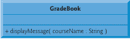

**图 3.4** | UML类图，表明类 `GradeBook` 具有一个公有 `displayMessage` 操作，该操作带有一个 UML 类型为 `String` 的 `courseName` 参数。


```cpp
// function that gets the course name
string getCourseName() const
{
   return courseName; // return the object's courseName
} // end function getCourseName

// function that displays a welcome message
void displayMessage() const
{
   // this statement calls getCourseName to get the
   // name of the course that GradeBook represents
   cout << "Welcome to the grade book for\n" << getCourseName() << "!\n"
      << endl;
} // end function displayMessage
private:
   string courseName; // course name for this GradeBook
}; // end class GradeBook

// function main begins program execution
int main()
{
   string nameOfCourse; // string of characters to store the course name
   GradeBook myGradeBook; // create a GradeBook object named myGradeBook

   // display initial value of courseName
   cout << "Initial course name is: " << myGradeBook.getCourseName()
      << endl;

   // prompt for input and set course name
   cout << "\nPlease enter the course name: " << endl;
   getline(cin, nameOfCourse); // read a course name with blanks
   myGradeBook.setCourseName(nameOfCourse); // set the course name

   cout << endl; // outputs a blank line
   myGradeBook.displayMessage(); // display message with new course name
} // end main
```

```
Initial course name is:

Please enter the course name:
CS101 Introduction to C++ Programming

Welcome to the grade book for
CS101 Introduction to C++ Programming!
```

**图 3.5** | 定义并测试带有数据成员以及set和get成员函数的GradeBook类。（第2部分，共2部分。）

一个典型的构造函数会教授多门课程，每门课程都有自己的课程名称。第34行声明`courseName`是`string`类型的变量。由于该变量在类定义中（第10–35行）声明，但位于类的成员函数定义体（第14–17行、第20–23行和第26–32行）之外，因此它是一个数据成员。每个实例

都需要额外的数据来执行其任务。该函数指定其返回一个`string`。当一个返回类型不是`void`的函数被调用并完成其任务时，函数使用`return`语句（如第22行）将结果返回给其调用函数。例如，当你去自动取款机（ATM）查询账户余额时，你期望ATM返回一个代表余额的值。类似地，当一条语句调用某个`GradeBook`对象上的成员函数`getCourseName`时，该语句期望接收到该`GradeBook`的课程名称（在此例中，是一个`string`，如函数返回类型所指定）。

如果你有一个函数`square`，它返回其参数的平方，那么语句

```
result = square( 2 );
```

会从函数`square`返回4，并将值4赋给变量`result`。如果你有一个函数`maximum`，它返回三个整数参数中最大的一个，那么语句

```
biggest = maximum( 27, 114, 51 );
```

会从函数`maximum`返回114，并将该值赋给变量`biggest`。

第16行和第22行的语句都使用了变量`courseName`（第34行），即使它没有在任何成员函数中声明。我们可以这样做，因为`courseName`是类的*数据成员*，而数据成员可以从类的成员函数中访问。

## 成员函数 *displayMessage*

成员函数`displayMessage`（第26–32行）完成其任务时*不*返回任何数据，因此其返回类型是`void`。该函数*不*接收参数，因此其参数列表为空。第30–31行输出一条欢迎消息，其中包含数据成员`courseName`的值。第30行调用成员函数`getCourseName`来获取`courseName`的值。成员函数`displayMessage`也可以直接访问数据成员`courseName`，就像成员函数`setCourseName`和`getCourseName`所做的那样。我们稍后将解释为什么从软件工程的角度来看，调用成员函数`getCourseName`来获取`courseName`的值更为可取。

## 测试类 *GradeBook*

`main`函数（第38–54行）创建一个`GradeBook`类的对象，并使用其每个成员函数。第41行创建一个名为`myGradeBook`的`GradeBook`对象。第44–45行通过调用对象的`getCourseName`成员函数来显示初始课程名称。输出的第一行没有显示课程名称，因为对象的`courseName`数据成员（即一个`string`）初始为空——默认情况下，`string`的初始值是所谓的*空字符串*，即不包含任何字符的字符串。当显示空字符串时，屏幕上不会出现任何内容。

第48行提示用户输入课程名称。局部字符串变量`nameOfCourse`（在第40行声明）被设置为用户输入的课程名称，该名称通过调用`getline`函数（第49行）获得。第50行调用对象`myGradeBook`的`setCourseName`成员函数，并将`nameOfCourse`作为函数的参数提供。当函数被调用时，参数的值被复制到成员函数`setCourseName`的参数`name`（第14行）中。该参数的值被赋给数据成员`courseName`（第16行）。第52行跳空一行；然后第53行调用对象`myGradeBook`的`displayMessage`成员函数，以显示包含课程名称的欢迎消息。

## *使用set和get函数进行软件工程*

类的私有数据成员只能由该类的成员函数（以及类的"友元"，你将在第9章看到）操作。因此，**对象**的**客户端**——即从对象外部调用该对象成员函数的任何语句——调用类的公有成员函数来请求该类的服务，以作用于该类的特定对象。这就是为什么`main`函数中的语句会在一个`GradeBook`对象上调用成员函数`setCourseName`、`getCourseName`和`displayMessage`。类通常提供公有成员函数，以允许类的客户端**设置**（即赋值给）或**获取**（即获取值）私有数据成员。这些成员函数名不必以set或get开头，但这种命名约定很常见。在此示例中，*设置*`courseName`数据成员的成员函数称为`setCourseName`，而*获取*`courseName`数据成员值的成员函数称为`getCourseName`。Set函数有时被称为**mutators**（因为它们mutate，即改变值），而get函数也被称为**accessors**（因为它们访问值）。

回顾一下，使用访问说明符`private`声明数据成员可以强制实现数据隐藏。提供公有的`set`和`get`函数允许类的客户端访问隐藏的数据，但只能间接访问。客户端知道它正在尝试修改或获取对象的数据，但客户端*不*知道对象如何执行这些操作。在某些情况下，类可能在内部以一种方式表示一条数据，但以另一种方式向客户端公开该数据。例如，假设一个`Clock`类将一天中的时间表示为一个私有的`int`数据成员，该成员存储自午夜以来的秒数。然而，当客户端调用`Clock`对象的`getTime`成员函数时，该对象可以以"HH:MM:SS"格式的字符串返回时间，包含小时、分钟和秒。类似地，假设`Clock`类提供一个名为`setTime`的`set`函数，该函数接受一个"HH:MM:SS"格式的`string`参数。利用第21章介绍的字符串功能，`setTime`函数可以将该字符串转换为秒数，并将其存储在私有数据成员中。`set`函数还可以检查其接收的值是否表示有效的时间（例如，"12:30:45"有效，但"42:85:70"无效）。`set`和`get`函数允许客户端与对象交互，但对象的私有数据仍安全地*封装*（即隐藏）在对象本身中。

类的`set`和`get`函数应被类*内部*的其他成员函数用于操作类的私有数据，即使这些成员函数可以直接访问私有数据。在图3.5中，成员函数`setCourseName`和`getCourseName`是公有成员函数，因此它们既可供类的客户端访问，也可供类本身访问。成员函数`displayMessage`调用成员函数`getCourseName`来获取数据成员`courseName`的值以用于显示，即使`displayMessage`可以直接访问`courseName`——通过`get`函数访问数据成员会创建一个更好、更健壮的类（即一个更易于维护且不太可能出故障的类）。如果我们决定以某种方式更改数据成员`courseName`，`displayMessage`的定义将无需修改——只有直接操作该数据成员的`get`和`set`函数体需要更改。例如，假设我们想将课程名称表示为两个独立的数据成员——`courseNumber`（例如，"CS101"）和`courseTitle`（例如，"Introduction to C++ Programming"）。成员函数`displayMessage`仍然可以调用成员函数`getCourseName`一次，以获取完整的课程名称并作为欢迎消息的一部分显示。在这种情况下，`getCourseName`需要构建并返回一个包含


构造函数与类同名，因此编译器能将其与类的其他成员函数区分开来。构造函数与其他函数的一个重要区别在于，构造函数不能返回值，所以不能指定返回类型（甚至不能指定 `void`）。通常，构造函数声明为 public。在早期章节中，我们的类一般只有一个构造函数——在后续章节中，你将看到如何使用*函数重载*技术创建带多个构造函数的类，我们将在第 6.18 节介绍这一点。

C++ 会自动为每个创建的对象调用构造函数，这有助于确保对象在程序中使用前被正确初始化。构造函数调用发生在对象创建时。如果类没有显式包含构造函数，编译器会提供一个无参数的默认构造函数。例如，当图 3.5 中的第 41 行创建 GradeBook 对象时，会调用默认构造函数。编译器提供的默认构造函数会创建一个 GradeBook 对象，但不会为对象的基本类型数据成员赋予任何初始值。对于作为其他类对象的数据成员，默认构造函数会隐式调用每个数据成员的默认构造函数，以确保该数据成员被正确初始化。这就是为什么 string 数据成员 courseName（图 3.5 中）被初始化为空字符串——string 类的默认构造函数会将字符串的值设置为空字符串。

在图 3.7 的示例中，我们在创建 GradeBook 对象时为其指定课程名称（例如第 47 行）。在这种情况下，参数 `"CS101 Introduction to C++ Programming"` 被传递给 GradeBook 对象的构造函数（第 14–18 行），并用于初始化 courseName。图 3.7 定义了一个修改后的 GradeBook 类，其中包含一个带有 string 参数的构造函数，该参数接收初始课程名称。

```cpp
// Fig. 3.7: fig03_07.cpp
// Instantiating multiple objects of the GradeBook class and using
// the GradeBook constructor to specify the course name
// when each GradeBook object is created.
#include <iostream>
#include <string> // program uses C++ standard string class
using namespace std;

// GradeBook class definition
class GradeBook
{
public:
   // constructor initializes courseName with string supplied as argument
   explicit GradeBook( string name )
      : courseName( name ) // member initializer to initialize courseName
   {
      // empty body
   } // end GradeBook constructor

   // function to set the course name
   void setCourseName( string name )
   {
      courseName = name; // store the course name in the object
   } // end function setCourseName

   // function to get the course name
   string getCourseName() const
   {
      return courseName; // return object's courseName
   } // end function getCourseName

   // display a welcome message to the GradeBook user
   void displayMessage() const
   {
      // call getCourseName to get the courseName
      cout << "Welcome to the grade book for\n" << getCourseName()
           << "!" << endl;
   } // end function displayMessage
private:
   string courseName; // course name for this GradeBook
}; // end class GradeBook

// function main begins program execution
int main()
{
   // create two GradeBook objects
   GradeBook gradeBook1( "CS101 Introduction to C++ Programming" );
   GradeBook gradeBook2( "CS102 Data Structures in C++" );

   // display initial value of courseName for each GradeBook
   cout << "gradeBook1 created for course: " << gradeBook1.getCourseName()
        << "\ngradeBook2 created for course: " << gradeBook2.getCourseName()
        << endl;
} // end main
```

```text
gradeBook1 created for course: CS101 Introduction to C++ Programming
gradeBook2 created for course: CS102 Data Structures in C++
```

**图 3.7** 实例化 GradeBook 类的多个对象，并在创建每个 GradeBook 对象时使用 GradeBook 构造函数指定课程名称。

## 定义构造函数

图 3.7 中第 14–18 行为 GradeBook 类定义了一个构造函数。构造函数与其类同名，即 GradeBook。构造函数在其参数列表中指定执行任务所需的数据。当你创建新对象时，将数据放在对象名后面的括号中（如第 47–48 行所做的那样）。第 14 行表明 GradeBook 类的构造函数有一个名为 name 的 string 参数。我们将此构造函数声明为 **explicit**，因为它接受*单个*参数——这一点很重要，原因微妙，你将在第 10.13 节中了解。现在，只需将所有单参数构造函数声明为 explicit。第 14 行没有指定返回类型，因为构造函数不能返回值（甚至不能返回 void）。此外，构造函数不能声明为 const（因为初始化对象会修改它）。

构造函数使用**成员初始化器列表**（第 15 行）将 courseName 数据成员初始化为构造函数参数 name 的值。*成员初始化器*出现在构造函数的参数列表和构造函数体开始的左花括号之间。

### 软件工程观察 3.2

数据成员可以在构造函数中初始化，也可以稍后在对象创建后设置其值。然而，确保对象在客户端代码调用其成员函数之前被完全初始化是一个良好的软件工程实践。你不应依赖客户端代码来确保对象被正确初始化。

## 将构造函数添加到 GradeBook 类的 UML 类图中

图 3.8 的 UML 类图对图 3.7 中的 GradeBook 类进行了建模，该类有一个带 string 类型 name 参数的构造函数（在 UML 中表示为 String 类型）。与操作类似，UML 在类图的第三栏中建模构造函数。为了将构造函数与类的操作区分开来，UML 在构造函数名称前放置“constructor”一词，并用尖括号（«和»）括起来。按照惯例，在第三栏中将类的构造函数列在其他操作之前。

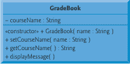

**图 3.8** UML 类图，表明 GradeBook 类有一个名为 name 的 UML 类型 *String* 参数构造函数。

## 3.6 将类放在单独文件中以实现可重用性

创建类定义的好处之一是，如果打包得当，你的类可以被其他程序员重用。例如，你可以通过包含头文件 `<string>`（并且，如你将要看到的，能够链接到库的目标代码）在任何 C++ 程序中重用 C++ 标准库类型 string。

希望使用我们的 GradeBook 类的程序员不能简单地将图 3.7 中的文件包含到另一个程序中。正如你在第 2 章中学到的，函数 main 开始每个程序的执行，并且每个程序必须恰好有一个 main 函数。如果其他程序员包含图 3.7 中的代码，他们会得到额外的“包袱”——我们的 main 函数——那么他们的程序就会有多个 main 函数。尝试编译具有两个 main 函数的程序会产生错误。因此，将 main 与类定义放在同一个文件中会阻止该类被其他程序重用。在本节中，我们将演示如何通过将 GradeBook 类从 main 函数分离到另一个文件中来使其可重用。

### 头文件

本章前面的每个示例都由单个 .cpp 文件（也称为源代码文件）组成，其中包含 GradeBook 类定义和 main 函数。在构建面向对象的 C++ 程序时，通常将可重用的源代码（如类）定义在按惯例具有 .h 文件扩展名的文件中——称为头文件。程序使用 #include 预处理指令来包含头文件并使用其功能


可复用软件组件，例如C++标准库中提供的`string`类型，以及像`GradeBook`类这样的用户自定义类型。

我们的下一个示例将图3.7中的代码拆分为两个文件——`GradeBook.h`（图3.9）和`fig03_10.cpp`（图3.10）。在查看图3.9中的头文件时，请注意它只包含`GradeBook`类定义（第7–38行）以及该类所依赖的头文件。使用`GradeBook`类的`main`函数定义在源代码文件`fig03_10.cpp`（图3.10）的第8–18行中。为了帮助您为本书后面以及行业中遇到的更大规模程序做好准备，我们经常使用包含`main`函数的独立源代码文件来测试我们的类（这称为驱动程序）。您很快将学习到，包含`main`的源代码文件如何利用头文件中的类定义来创建类的对象。

```cpp
// Fig. 3.9: GradeBook.h
// GradeBook类定义在与main分开的文件中。
#include <iostream>
#include <string> // GradeBook类使用C++标准string类

// GradeBook类定义
class GradeBook
{
public:
   // 构造函数用提供的字符串参数初始化courseName
   explicit GradeBook( std::string name )
      : courseName( name ) // 成员初始化器初始化courseName
   {
      // 空函数体
   } // 结束GradeBook构造函数

   // 设置课程名称的函数
   void setCourseName( std::string name )
   {
      courseName = name; // 将课程名称存储在对象中
   } // 结束setCourseName函数

   // 获取课程名称的函数
   std::string getCourseName() const
   {
      return courseName; // 返回对象的courseName
   } // 结束getCourseName函数

   // 向GradeBook用户显示欢迎信息
   void displayMessage() const
   {
      // 调用getCourseName获取courseName
      std::cout << "Welcome to the grade book for\n" << getCourseName()
                << "!" << std::endl;
   } // 结束displayMessage函数
private:
   std::string courseName; // 此GradeBook的课程名称
}; // 结束GradeBook类
```

**图3.9** | *GradeBook类定义在与main分开的文件中。*

```cpp
// Fig. 3.10: fig03_10.cpp
// 从GradeBook.h文件中包含GradeBook类以供main使用。
#include <iostream>
#include "GradeBook.h" // 包含GradeBook类的定义
using namespace std;

// main函数开始程序执行
int main()
{
    // 创建两个GradeBook对象
    GradeBook gradeBook1( "CS101 Introduction to C++ Programming" );
    GradeBook gradeBook2( "CS102 Data Structures in C++" );

    // 显示每个GradeBook的courseName初始值
    cout << "gradeBook1 created for course: " << gradeBook1.getCourseName()
         << endl;
    cout << "gradeBook2 created for course: " << gradeBook2.getCourseName()
         << endl;
} // 结束main
```

```
gradeBook1 created for course: CS101 Introduction to C++ Programming
gradeBook2 created for course: CS102 Data Structures in C++
```

**图3.10** | 从GradeBook.h文件中包含GradeBook类以供main使用。

## 在头文件中使用std::来引用标准库组件

在整个头文件（图3.9）中，我们在引用`string`（第11、18、24和37行）以及`cout`（第33行）和`endl`（第34行）时使用了`std::`。由于一些微妙的原因，我们将在后面的章节中解释，头文件不应包含using指令或using声明（第2.7节）。

## 包含含有用户自定义类的头文件

像`GradeBook.h`（图3.9）这样的头文件不能作为一个完整的程序使用，因为它不包含`main`函数。要测试`GradeBook`类（在图3.9中定义），您必须编写一个包含`main`函数的独立源代码文件（例如图3.10），该函数实例化并使用该类的对象。

编译器不知道`GradeBook`是什么，因为它是一种用户自定义类型。事实上，编译器甚至不知道C++标准库中的类。为了帮助它理解如何使用一个类，我们必须显式地向编译器提供该类的定义——这就是为什么，例如，要使用`string`类型，程序必须包含`<string>`头文件。这使编译器能够确定为每个`string`对象保留多少内存，并确保程序正确调用`string`的成员函数。

要在图3.10的第11–12行创建`GradeBook`对象`gradeBook1`和`gradeBook2`，编译器必须知道`GradeBook`对象的大小。虽然对象通常包含数据成员和成员函数，但C++对象实际上只包含数据。编译器只为类的成员函数创建一份副本，并在该类的所有对象之间共享该副本。当然，每个对象都需要自己的数据成员，因为它们的内容在不同对象之间可能不同（例如两个不同的`BankAccount`对象具有不同的余额）。然而，成员函数代码是不可修改的，因此可以在类的所有对象之间共享。因此，对象的大小取决于存储类数据成员所需的内存量。通过在第4行包含`GradeBook.h`，我们向编译器提供了所需的信息（图3.9，第37行），以确定`GradeBook`对象的大小，并确定类的对象是否被正确使用（图3.10的第11–12行和第15–16行）。

第4行指示C++预处理器在程序编译之前将该指令替换为`GradeBook.h`内容的副本（即`GradeBook`类定义）。当源代码文件`fig03_10.cpp`被编译时，它现在包含了`GradeBook`类定义（由于`#include`），并且编译器能够确定如何创建`GradeBook`对象，并确认其成员函数被正确调用。现在类定义放在头文件中（没有`main`函数），我们可以在任何需要重用`GradeBook`类的程序中包含该头文件。

## 头文件的查找方式

请注意，图3.10第4行中`GradeBook.h`头文件的名称用引号（" "）括起来，而不是尖括号（< >）。通常，程序的源代码文件和用户自定义头文件放在同一目录中。当预处理器遇到引号中的头文件名时，它会尝试在与包含`#include`指令的文件相同的目录中查找该头文件。如果预处理器在该目录中找不到该头文件，它会像查找C++标准库头文件一样在相同位置搜索它。当预处理器遇到尖括号中的头文件名（例如`<iostream>`）时，它假定该头文件是C++标准库的一部分，并且不会在正在预处理的程序的目录中查找。

> **错误预防提示 3.3**
>
> 为确保预处理器能正确定位头文件，`#include`预处理指令应将用户自定义头文件名放在引号中（例如 `"GradeBook.h"`），并将C++标准库头文件名放在尖括号中（例如 `<iostream>`）。


## 其他软件工程问题

现在`GradeBook`类定义在头文件中，该类是可复用的。不幸的是，像图3.9那样将类定义放在头文件中仍然会向类的客户公开整个类的实现——`GradeBook.h`只是一个任何人都可以打开和阅读的文本文件。传统软件工程智慧认为，要使用类的对象，客户端代码只需要知道调用哪些成员函数、为每个成员函数提供什么参数以及期望每个成员函数返回什么类型。客户端代码不需要知道这些函数是如何实现的。

如果客户端代码确实知道类是如何实现的，程序员可能会基于类的实现细节编写客户端代码。理想情况下，如果实现发生变化，类的客户端不应需要更改。隐藏类的实现细节使得更改类的实现更加容易，同时最大限度地减少，并希望消除对客户端代码的更改。

在第3.7节中，我们将展示如何将`GradeBook`类拆分为两个文件，以便

- 该类是可复用的，
- 类的客户端知道该类提供了哪些成员函数、如何调用它们以及期望什么返回类型，并且
- 客户端不知道类的成员函数是如何实现的。


## 3.7 将接口与实现分离

在前一节中，我们展示了如何通过将类定义与使用该类的客户端代码（例如main函数）分离来提升软件的可重用性。现在我们引入良好软件工程的另一个基本原则——将接口与实现分离。

### 类的接口

接口定义并标准化了人与系统等事物之间相互交互的方式。例如，收音机的控制旋钮是收音机用户与其内部组件之间的接口。这些控件允许用户执行有限的操作集（例如更换电台、调节音量以及选择AM或FM波段）。不同的收音机可能以不同方式实现这些操作——有些提供按钮，有些提供旋钮，有些支持语音命令。接口规定了收音机允许用户执行*哪些*操作，但不规定这些操作在收音机内部*如何*实现。

类似地，*类的接口*描述了类的客户端可以使用*哪些服务*以及*如何请求*这些服务，但不描述类*如何*执行这些服务。类的公共接口由类的公共成员函数（也称为类的**公共服务**）组成。例如，GradeBook类的接口（图3.9）包含一个构造函数和成员函数setCourseName、getCourseName和displayMessage。GradeBook的客户端（例如图3.10中的main）使用这些函数来请求类的服务。稍后你将看到，可以通过编写类定义来指定类的接口，该定义只*列出*成员函数的名称、返回类型和参数类型。

### 将接口与实现分离

在之前的示例中，每个类定义都包含了类的公共成员函数的完整定义及其私有数据成员的声明。但是，更好的软件工程做法是在类定义*外部*定义成员函数，以便其实现细节可以*隐藏*在客户端代码之外。这种做法*确保*你不会编写依赖类实现细节的客户端代码。

图3.11–3.13中的程序通过将图3.9中的类定义拆分为两个文件——定义类GradeBook的头文件GradeBook.h（图3.11）和定义GradeBook成员函数的源代码文件GradeBook.cpp（图3.12）——将GradeBook类的接口与其实现分离。按照惯例，成员函数定义放在与类头文件同名的源代码文件中（例如GradeBook），但扩展名改为.cpp。源代码文件fig03_13.cpp（图3.13）定义了main函数（客户端代码）。图3.13中的代码和输出与图3.10中的完全相同。图3.14从GradeBook类程序员和客户端代码程序员的角度展示了这个三文件程序是如何编译的——我们将详细解释此图。

### GradeBook.h：使用函数原型定义类的接口

头文件GradeBook.h（图3.11）包含另一个版本的GradeBook类定义（第8–17行）。此版本与图3.9中的版本类似，但图3.9中的函数定义在这里被替换为描述类公共接口的**函数原型**（第11–14行）。图3.12中的成员函数定义与图3.9中第11–35行的成员函数定义几乎相同。注意，`const`关键字*必须*同时出现在函数原型（图3.11，第13–14行）和函数`getCourseName`和`displayMessage`的函数定义（第22和28行）中。

```cpp
// Fig. 3.12: GradeBook.cpp
// GradeBook member-function definitions. This file contains
// implementations of the member functions prototyped in GradeBook.h.
#include <iostream>
#include "GradeBook.h" // include definition of class GradeBook
using namespace std;

// constructor initializes courseName with string supplied as argument
GradeBook::GradeBook( string name )
   : courseName( name ) // member initializer to initialize courseName
{
   // empty body
} // end GradeBook constructor

// function to set the course name
void GradeBook::setCourseName( string name )
{
   courseName = name; // store the course name in the object
} // end of function setCourseName

// function to get the course name
string GradeBook::getCourseName() const
{
   return courseName; // return object's courseName
} // end function getCourseName

// display a welcome message to the GradeBook user
void GradeBook::displayMessage() const
{
   // call getCourseName to get the courseName
   cout << "Welcome to the grade book for\n" << getCourseName()
        << "!" << endl;
} // end function displayMessage
```

**图3.12** | *GradeBook*成员函数定义表示了类*GradeBook*的实现。

每个成员函数名（第9、16、22和28行）前面都有类名和`::`，这被称为*作用域解析运算符*。它将每个成员函数“绑定”到（现在分离的）GradeBook类定义（图3.11），该定义声明了类的成员函数和数据成员。如果每个函数名前没有“GradeBook::”，编译器将不会识别这些函数是GradeBook类的成员函数——编译器会将它们视为“自由”或“松散”的函数，就像`main`一样。这些函数也被称为*全局函数*。这样的函数不能访问GradeBook的私有数据，也不能在未指定对象的情况下调用类的成员函数。因此，编译器*无法*编译这些函数。例如，图3.12中访问变量`courseName`的第18和24行会导致编译错误，因为`courseName`在每个函数中都没有被声明为局部变量——编译器不知道`courseName`已在GradeBook类中声明为一个数据成员。

### 常见编程错误3.3


> *在类外部定义类的成员函数时，省略函数名前的类名和作用域解析运算符（`::`）会导致错误。*

### 测试GradeBook类

图3.13执行与图3.10相同的GradeBook对象操作。将GradeBook的接口与其成员函数的实现分离并不影响此客户端代码使用该类的方式。它只影响程序的编译和链接方式，我们稍后将详细讨论。

```cpp
// Fig. 3.13: fig03_13.cpp
// GradeBook class demonstration after separating
// its interface from its implementation.
#include <iostream>
#include "GradeBook.h" // include definition of class GradeBook
using namespace std;

// function main begins program execution
int main()
{
   // create two GradeBook objects
   GradeBook gradeBook1( "CS101 Introduction to C++ Programming" );
   GradeBook gradeBook2( "CS102 Data Structures in C++" );

   // display initial value of courseName for each GradeBook
   cout << "gradeBook1 created for course: " << gradeBook1.getCourseName()
        << "\ngradeBook2 created for course: " << gradeBook2.getCourseName()
        << endl;
} // end main
```

**图3.13** | 将接口与实现分离后的GradeBook类演示。（第1部分，共2部分。）


```
gradeBook1 created for course: CS101 Introduction to C++ Programming
gradeBook2 created for course: CS102 Data Structures in C++
```

**图 3.13** | 将接口与实现分离后的 GradeBook 类演示。（第 2 部分，共 2 部分。）

如图 3.10 所示，图 3.13 的第 5 行包含了 GradeBook.h 头文件，以便编译器能够确保在客户端代码中正确创建和操作 GradeBook 对象。在执行此程序之前，图 3.12 和图 3.13 中的源代码文件都必须先编译，然后链接在一起——也就是说，客户端代码中的成员函数调用需要与类的成员函数实现绑定——这一工作由链接器完成。

## 编译与链接过程

图 3.14 中的示意图展示了编译和链接过程，该过程最终生成可供教师使用的可执行 GradeBook 应用程序。通常，类的接口和实现由一位程序员创建并编译，而另一位实现客户端代码的程序员则使用它们。因此，该图展示了类实现程序员和客户端代码程序员各自所需的内容。图中的虚线分别展示了类实现程序员、客户端代码程序员和 GradeBook 应用程序用户所需的部分。[*注：图 3.14 不是 UML 图。*]

负责创建可重用 GradeBook 类的类实现程序员会创建头文件 GradeBook.h 和源代码文件 GradeBook.cpp（其中 #includes 该头文件），然后编译源代码文件以生成 GradeBook 的目标代码。为了隐藏类的成员函数实现细节，类实现程序员会向客户端代码程序员提供头文件 GradeBook.h（该头文件指定了类的接口和数据成员）以及 GradeBook 目标代码（即表示 GradeBook 成员函数的机器码指令）。客户端代码程序员*不会*获得 GradeBook.cpp，因此客户端始终无法了解 GradeBook 的成员函数是如何实现的。

客户端代码程序员要使用该类，只需要了解 GradeBook 的接口，并且必须能够链接其目标代码。由于类的接口是 GradeBook.h 头文件中类定义的一部分，因此客户端代码程序员必须能够访问该文件，并且必须在客户端的源代码文件中 #include 它。当客户端代码被编译时，编译器使用 GradeBook.h 中的类定义来确保 main 函数正确创建和操作 GradeBook 类的对象。

- 要创建可编译的 GradeBook 应用程序，最后一步是链接：

  1. main 函数的目标代码（即客户端代码），
  2. GradeBook 类成员函数实现的目标代码，
  3. 类实现程序员和客户端代码程序员所使用的 C++ 类（如 string）的 C++ 标准库目标代码。

链接器的输出是*可执行*的 GradeBook 应用程序，教师可以用它来管理学生的成绩。编译器和 IDE 通常会在编译完代码后为你调用链接器。

很有可能。假设一所大学可以打印课程名称不超过 25 个字符的学生成绩单。如果该大学使用包含 GradeBook 对象的系统来生成成绩单，我们可能希望 GradeBook 类确保其数据成员 courseName 永远不会超过 25 个字符。图 3.15–3.17 中的程序增强了 GradeBook 的成员函数 setCourseName 以执行此验证（也称为有效性检查）。

## GradeBook 类定义

GradeBook 的类定义（图 3.15）——因而也是其接口——与图 3.11 的完全相同。由于接口保持不变，当成员函数 setCourseName 的定义被修改时，该类的客户端无需更改。这使得客户端只需将客户端代码链接到更新后的 GradeBook 目标代码，即可利用改进后的 GradeBook 类。

```cpp
// Fig. 3.15: GradeBook.h
// GradeBook class definition presents the public interface of the class.
// the class-member-function definitions appear in GradeBook.cpp.
#include <string> // program uses C++ standard string class

// GradeBook class definition
class GradeBook
{
public:
   explicit GradeBook( std::string ); // constructor initialize courseName
   void setCourseName( std::string ); // sets the course name
   std::string getCourseName() const; // gets the course name
   void displayMessage() const; // displays a welcome message
private:
   std::string courseName; // course name for this GradeBook
}; // end class GradeBook
```

**图 3.15** | GradeBook 类定义展示了类的公共接口。

## 使用 GradeBook 成员函数 setCourseName 验证课程名称

对 GradeBook 类的更改体现在构造函数（图 3.16 的第 9–12 行）和 setCourseName（第 16–29 行）的定义中。构造函数现在不再使用成员初始化器，而是调用 setCourseName。通常，所有数据成员都应使用成员初始化器进行初始化。然而，有时构造函数还必须验证其参数——这通常在构造函数体内处理（第 11 行）。调用 setCourseName 会验证构造函数的参数并设置数据成员 courseName。最初，在构造函数体执行之前，courseName 的值会被设置为空字符串，然后 setCourseName 会修改 courseName 的值。

在 setCourseName 中，第 18–19 行的 if 语句判断参数 name 是否包含有效的课程名称（即长度不超过 25 个字符的字符串）。如果课程名称有效，第 19 行将其存储到数据成员 courseName 中。注意第 18 行中的表达式 name.size()。这是一个成员函数调用，就像 myGradeBook.displayMessage() 一样。C++ 标准库的 string 类定义了一个成员函数 size，它返回字符串对象中的字符数。参数 name 是一个 string 对象，因此调用 name.size() 会返回 name 中的字符数。如果该值小于或等于 25，则 name 有效，并执行第 19 行。

```cpp
// Fig. 3.16: GradeBook.cpp
// Implementations of the GradeBook member-function definitions.
// The setCourseName function performs validation.
#include <iostream>
#include "GradeBook.h" // include definition of class GradeBook
using namespace std;

// constructor initializes courseName with string supplied as argument
GradeBook::GradeBook( string name )
{
   setCourseName( name ); // validate and store courseName
} // end GradeBook constructor

// function that sets the course name;
// ensures that the course name has at most 25 characters
void GradeBook::setCourseName( string name )
{
   if ( name.size() <= 25 ) // if name has 25 or fewer characters
      courseName = name; // store the course name in the object

   if ( name.size() > 25 ) // if name has more than 25 characters
   {
      // set courseName to first 25 characters of parameter name
      courseName = name.substr( 0, 25 ); // start at 0, length of 25

      cerr << "Name \"" << name << "\" exceeds maximum length (25)\n"
           << "Limiting courseName to first 25 characters.\n" << endl;
   } // end if
} // end function setCourseName

// function to get the course name
string GradeBook::getCourseName() const
{
   return courseName; // return object's courseName
} // end function getCourseName

// display a welcome message to the GradeBook user
void GradeBook::displayMessage() const
{
   // call getCourseName to get the courseName
   cout << "Welcome to the grade book for\n" << getCourseName()
        << "!" << endl;
} // end function displayMessage
```

**图 3.16** | GradeBook 类的成员函数定义，其中的 set 函数验证数据成员 `courseName` 的长度。

第 21–28 行的 if 语句处理 setCourseName 收到*无效*课程名称（即长度超过 25 个字符的名称）的情况。即使参数 name 太长，我们仍然希望让 GradeBook 对象保持*一致的状态*——也就是说，

很有可能。假设一所大学可以打印课程名称不超过 25 个字符的学生成绩单。


对象的数据成员 courseName 包含有效值（即不超过 25 个字符的字符串）的状态。因此，我们截断指定的课程名称，并将 name 的前 25 个字符赋给 courseName 数据成员（不幸的是，这可能会使课程名称截断得很不自然）。标准类 string 提供了成员函数 `substr`（“substring”的缩写），它通过复制现有 string 对象的一部分来返回一个新的 string 对象。第 24 行中的调用（即 `name.substr(0, 25)`）向 name 的成员函数 substr 传递两个整数（0 和 25）。这些参数指明了应该返回的字符串 name 的部分。第一个参数指定从原字符串中复制字符的起始位置——每个字符串的第一个字符都认为处于位置 0。第二个参数指定要复制的字符数。因此，第 24 行的调用返回从位置 0 开始的 name 的 25 个字符子串（即 name 的前 25 个字符）。例如，如果 name 的值为 "CS101 Introduction to Programming in C++"，则 substr 返回 "CS101 Introduction to Pro"。在调用 substr 之后，第 24 行将 substr 返回的子串赋给数据成员 courseName。这样，setCourseName 确保 courseName 始终被赋为包含 25 个或更少字符的字符串。如果成员函数必须截断课程名称以使其有效，第 26–27 行会使用 cerr 显示一条警告消息，如第 1 章所述。

第 21–28 行的 if 语句包含两条函数体语句——一条将 courseName 设置为参数 name 的前 25 个字符，另一条向用户打印附带消息。当 name 太长时，两条语句都应执行，因此我们将它们放在一对花括号 `{ }` 中。回想第 2 章所述，这将创建一个块。你将在第 4 章学习更多关于在控制语句的函数体中放置多条语句的内容。

第 26–27 行的语句也可以不在语句第二行开头使用流插入运算符，如下所示：

```
cerr << "Name \"" << name << "\" exceeds maximum length (25).\n"
     << "Limiting courseName to first 25 characters.\n" << endl;
```

*C++ 编译器会合并相邻的字符串字面量，即使它们出现在程序的不同行中。因此，在上述语句中，C++ 编译器会将字符串字面量 `"\" exceeds maximum length (25).\n"` 和 `"Limiting courseName to first 25 characters.\n"` 合并为单个字符串字面量，其输出与图 3.16 中第 26–27 行的输出相同。这种行为允许你在程序中跨行打印长字符串，而无需包含额外的流插入操作。*

## 测试 GradeBook 类

图 3.17 演示了带有验证的 GradeBook 类的修改版本（图 3.15–3.16）。第 12 行创建了一个名为 gradeBook1 的 GradeBook 对象。回想一下，GradeBook 构造函数调用 setCourseName 来初始化数据成员 courseName。在该类的先前版本中，在构造函数中调用 setCourseName 的好处并不明显。然而现在，构造函数利用了 setCourseName 提供的验证。构造函数只是调用 setCourseName，而不是重复其验证代码。当图 3.17 的第 12 行将初始课程名称 "CS101 Introduction to Programming in C++" 传递给 GradeBook 构造函数时，构造函数将该值传递给 setCourseName，实际初始化在此发生。由于课程名称包含超过 25 个字符，第二个 if 语句的函数体执行，导致 courseName 被初始化为截断后的 25 个字符的课程 "CS101 Introduction to Pro"（截断的部分在第 12 行中以蓝色突出显示）。图 3.17 中的输出包含了成员函数 setCourseName 中图 3.16 第 26–27 行输出的警告消息。第 13 行创建了另一个名为 gradeBook2 的 GradeBook 对象——传递给构造函数的有效课程名称恰好是 25 个字符。

```cpp
// Fig. 3.17: fig03_17.cpp
// Create and manipulate a GradeBook object; illustrate validation.
#include <iostream>
#include "GradeBook.h" // include definition of class GradeBook
using namespace std;

// function main begins program execution
int main()
{
    // create two GradeBook objects;
    // initial course name of gradeBook1 is too long
    GradeBook gradeBook1( "CS101 Introduction to Programming in C++" );
    GradeBook gradeBook2( "CS102 C++ Data Structures" );

    // display each GradeBook's courseName
    cout << "gradeBook1's initial course name is: "
         << gradeBook1.getCourseName()
         << "\ngradeBook2's initial course name is: "
         << gradeBook2.getCourseName() << endl;

    // modify gradeBook1's courseName (with a valid-length string)
    gradeBook1.setCourseName( "CS101 C++ Programming" );

    // display each GradeBook's courseName
    cout << "\ngradeBook1's course name is: "
         << gradeBook1.getCourseName()
         << "\ngradeBook2's course name is:"
         << gradeBook2.getCourseName() << endl;
} // end main
```

```text
Name "CS101 Introduction to Programming in C++" exceeds maximum length (25).
Limiting courseName to first 25 characters.

gradeBook1's initial course name is: CS101 Introduction to Pro
gradeBook2's initial course name is: CS102 C++ Data Structures

gradeBook1's course name is: CS101 C++ Programming
gradeBook2's course name is: CS102 C++ Data Structures
```

**图 3.17** | 创建并操作一个课程名称长度限制为 25 个字符的 GradeBook 对象。

图 3.17 的第 16–19 行显示了 gradeBook1 的截断课程名称（在程序输出中以蓝色突出显示）和 gradeBook2 的课程名称。第 22 行直接调用 gradeBook1 的 setCourseName 成员函数，将 GradeBook 对象中的课程名称改为一个不需要截断的较短名称。然后，第 25–28 行再次输出 GradeBook 对象的课程名称。

## 设置函数的补充说明

像 setCourseName 这样的公有设置函数应仔细审查任何修改数据成员（例如 courseName）值的尝试，以确保新值对该数据项是合适的。例如，将日期中的日设为 37 的尝试应被拒绝，将一个人的体重设为零或负值的尝试应被拒绝，将考试分数设为 185（当正确范围是 0 到 100 时）的尝试应被拒绝，等等。


> **软件工程观察 3.3**  
> _将数据成员设为私有，并通过公有成员函数控制对这些数据成员的访问（尤其是写访问），有助于确保数据完整性。_


> **错误预防提示 3.4**  
> _仅仅将数据成员设为私有并不会自动带来数据完整性的好处——你必须提供适当的有效性检查并报告错误。_

设置函数可以返回一个值，指示是否有人尝试向类对象赋予无效数据。然后，客户可以测试设置函数的返回值，以确定修改对象的尝试是否成功，如果未成功则采取适当的措施。我们将在后面的章节中介绍更多编程技术后这样做。在 C++ 中，对象的客户还可以通过_异常处理机制_得到问题通知，我们将在第 7 章开始讨论该机制，并在第 17 章深入介绍。

## 3.9 小结

在本章中，你创建了用户自定义类，并创建和使用了这些类的对象。我们声明了类的数据成员，以维护类的每个对象的数据。我们还定义了操作这些数据的成员函数。你了解到，不修改类数据的成员函数应声明为 const。我们展示了如何调用对象的成员函数来请求对象提供的服务，以及如何将数据作为参数传递给这些成员函数。我们讨论了成员函数的局部变量与类的数据成员之间的区别。我们还展示了如何使用构造函数和成员初始化列表来确保每个对象都被正确初始化。你了解到，单参数构造函数应声明为 explicit，并且构造函数不能声明为 const，因为它会修改正在初始化的对象。我们演示了如何将类的接口与其实现分离，以促进良好的软件工程实践。你了解到，using 指令和 using 声明绝不应放在头文件中。我们给出了一个图示，展示了类实现程序员和客户代码程序员编译其所编写代码所需的文件。我们演示了如何使用设置函数来验证对象的数据，并确保对象保持一致的状态。UML 类图被用于对类及其构造函数、成员函数和数据成员进行建模。在下一章中，我们将开始介绍控制语句，控制语句指定函数中操作执行的顺序。


## 摘要

### 第3.2节 用成员函数定义类

- 类定义（第68页）包含数据成员和成员函数，分别定义类的属性和行为。
- 类定义以关键字 `class` 开头，后紧跟类名。
- 按照惯例，用户自定义类（第69页）的类名以大写字母开头，并且为了可读性，类名中后续每个单词的首字母也大写。
- 每个类的类体（第68页）都括在一对花括号（`{` 和 `}`）中，并以分号结尾。
- 出现在访问说明符 `public`（第68页）之后的成员函数可以被程序中的其他函数以及其他类的成员函数调用。
- 访问说明符后面总是跟着冒号（`:`）。
- 关键字 `void`（第69页）是一种特殊的返回类型，表示函数将执行一项任务，但在完成任务时不会向调用它的函数返回任何数据。
- 按照惯例，函数名（第69页）以小写字母开头，后续每个单词的首字母大写。
- 函数名后的一对空圆括号表示该函数不需要额外数据来执行其任务。
- 一个不修改其调用对象、也不应修改其调用对象的函数应声明为 `const`。
- 通常，必须创建类的一个对象之后，才能调用该类的成员函数。
- 你创建的每个新类都会成为 C++ 中的新类型。
- 在 UML 中，每个类都在类图（第70页）中建模为一个矩形，分为三个栏，从上到下分别包含类名、属性和操作。
- UML 将操作建模为操作名称后跟圆括号。名称前的加号（+）表示公共操作（即 C++ 中的公共成员函数）。

### 第3.3节 用参数定义成员函数

- 成员函数可以要求一个或多个参数（第70页），这些参数表示执行其任务所需的额外数据。函数调用为每个函数参数提供一个实参（第71页）。
- 调用成员函数时，在对象名后跟一个点（`.`）运算符（第70页）、函数名以及包含函数实参的一对圆括号。
- C++ 标准库类 `string` 的变量是一个字符串。该类定义在头文件 `<string>` 中，名称 `string` 属于命名空间 `std`。
- 函数 `getline`（来自头文件 `<string>`，第72页）从其第一个实参读取字符，直到遇到换行符，然后将这些字符（不包括换行符）放入其第二个实参指定的字符串变量中。换行符会被丢弃。
- 参数列表（第73页）可以包含任意数量的参数，也可以不包含任何参数（用空圆括号表示），表示函数不需要任何参数。
- 函数调用中的实参数量必须与所调用成员函数头中参数列表的参数数量匹配。此外，函数调用中的实参类型必须与函数头中对应参数的类型一致。
- UML 通过列出参数名，后跟冒号和参数类型（在操作名后的圆括号内）来建模操作的参数。
- UML 有自己的数据类型。并非所有 UML 数据类型都与相应的 C++ 类型同名。UML 类型 `String` 对应于 C++ 类型 `string`。

**3.10** *（设置和获取函数）* 解释为什么类可能会为数据成员提供 *set* 函数和 *get* 函数。

**3.11** *（修改 GradeBook 类）* 如下修改 GradeBook 类（图3.11–3.12）：

- a) 增加一个 `string` 数据成员，表示课程讲师的姓名。
- b) 提供一个 *set* 函数来更改讲师姓名，并提供一个 *get* 函数来获取该姓名。
- c) 修改构造函数，使其指定课程名称和讲师姓名参数。
- d) 修改函数 `displayMessage`，输出欢迎消息和课程名称，然后输出字符串 "This course is presented by: "，后跟讲师姓名。

在测试程序中使用你修改后的类，以演示该类的新功能。

**3.12** *（Account 类）* 创建一个 `Account` 类，银行可以用它来表示客户的银行账户。包含一个 `int` 类型的数据成员来表示账户余额。[注意：在后续章节中，我们将使用包含小数点的数字（例如 2.75）——称为浮点值——来表示美元金额。] 提供一个接收初始余额的构造函数，并用它来初始化数据成员。构造函数应验证初始余额，确保其大于或等于 0。如果不是，则将余额设置为 0，并显示错误消息，指示初始余额无效。提供三个成员函数。成员函数 `credit` 应将金额添加到当前余额。成员函数 `debit` 应从 `Account` 中取款，并确保取款金额不超过 `Account` 的余额。如果超过，则余额应保持不变，并且函数应打印一条消息 "Debit amount exceeded account balance."。成员函数 `getBalance` 应返回当前余额。创建一个程序，创建两个 `Account` 对象并测试类 `Account` 的成员函数。

**3.13** *（Invoice 类）* 创建一个名为 `Invoice` 的类，五金店可以用它来表示店里售出物品的发票。`Invoice` 应包含四个数据成员——零件编号（`string` 类型）、零件描述（`string` 类型）、所购物品数量（`int` 类型）和单价（`int` 类型）。[注意：在后续章节中，我们将使用包含小数点的数字（例如 2.75）——称为浮点值——来表示美元金额。] 你的类应有一个构造函数初始化这四个数据成员。接收多个实参的构造函数定义形式如下：

```
ClassName( TypeName1 parameterName1, TypeName2 parameterName2, . . . )
```

为每个数据成员提供 *set* 和 *get* 函数。此外，提供一个名为 `getInvoiceAmount` 的成员函数，计算发票金额（即数量乘以单价），然后将金额作为 `int` 值返回。如果数量不是正数，则应将其设置为 0。如果单价不是正数，则应将其设置为 0。编写一个测试程序，演示类 `Invoice` 的功能。

**3.14** *（Employee 类）* 创建一个名为 `Employee` 的类，包含三个信息作为数据成员——名字（`string` 类型）、姓氏（`string` 类型）和月薪（`int` 类型）。[注意：在后续章节中，我们将使用包含小数点的数字（例如 2.75）——称为浮点值——来表示美元金额。] 你的类应有一个构造函数初始化这三个数据成员。为每个数据成员提供 *set* 和 *get* 函数。如果月薪不是正数，则将其设置为 0。编写一个测试程序，演示类 `Employee` 的功能。创建两个 `Employee` 对象并显示每个对象的年薪。然后给每位员工加薪 10%，并再次显示每位员工的年薪。

**3.15** *（Date 类）* 创建一个名为 `Date` 的类，包含三个信息作为数据成员——月（`int` 类型）、日（`int` 类型）和年（`int` 类型）。你的类应有一个带三个参数的构造函数，使用这些参数初始化这三个数据成员。在本练习中，假设提供的年和日值是正确的，但确保月值在 1–12 范围内；如果不是，则将月设置为 1。为每个数据成员提供 *set* 和 *get* 函数。提供一个成员函数 `displayDate`，显示月、日


且年份用正斜杠（/）分隔。编写一个测试程序，演示 Date 类的功能。

## 做出改变

- **3.16** *（目标心率计算器）* 锻炼时，你可以使用心率监测器来确保自己的心率保持在教练和医生建议的安全范围内。根据美国心脏协会（AHA）的资料（www.americanheart.org/presenter.jhtml?identifier=4736），计算最大心率（单位：次/分钟）的公式为 220 减去你的年龄（岁）。你的目标心率是一个范围，为最大心率的 50%–85%。[注：这些公式仅为 AHA 提供的估算值。最大心率和目标心率可能因个人的健康状况、体能和性别而异。在开始或调整锻炼计划前，务必咨询医生或合格的医疗保健专业人员。] 创建一个名为 HeartRates 的类。类的属性应包括此人的名字、姓氏和出生日期（由分别表示出生月、日和年的属性组成）。你的类应有一个构造函数，接收这些数据作为参数。为每个属性提供 set 和 get 函数。该类还应包含一个计算并返回此人年龄（岁）的 getAge 函数、一个计算并返回此人最大心率的 getMaximumHeartRate 函数，以及一个计算并返回此人目标心率的 getTargetHeartRate 函数。由于你还不知道如何从计算机获取当前日期，因此 getAge 函数应在计算年龄之前提示用户输入当前的月、日和年。编写一个应用程序，提示输入个人信息，实例化一个 HeartRates 类的对象并打印该对象中的信息——包括此人的名字、姓氏和出生日期——然后计算并打印此人的年龄（岁）、最大心率和目标心率范围。

- **3.17** *（健康记录计算机化）* 近来新闻中经常出现的一个医疗保健议题是健康记录的计算机化。由于涉及敏感隐私和安全等问题，人们正在谨慎地对待这种可能性。[我们将在后面的练习中讨论这些问题。] 将健康记录计算机化可以让患者更轻松地在不同的医疗保健专业人员之间共享其健康档案和病史。这可以提高医疗保健质量，帮助避免药物冲突和错误处方，降低成本，并在紧急情况下挽救生命。在本练习中，你将为一个“入门版”HealthProfile 类进行设计。类的属性应包括此人的名字、姓氏、性别、出生日期（由分别表示出生月、日和年的属性组成）、身高（以英寸为单位）和体重（以磅为单位）。你的类应有一个构造函数接收这些数据。为每个属性提供 set 和 get 函数。该类还应包含一些函数，用于计算并返回用户的年龄（岁）、最大心率、目标心率范围（见练习 3.16）和身体质量指数（BMI；见练习 2.30）。编写一个应用程序，提示输入个人信息，为该人实例化一个 HealthProfile 类的对象并打印该对象中的信息——包括此人的名字、姓氏、性别、出生日期、身高和体重——然后计算并打印此人的年龄（岁）、BMI、最大心率和目标心率范围。该程序还应显示练习 2.30 中的“BMI 值”图表。使用与练习 3.16 相同的技术来计算此人的年龄。


# 控制语句：第 1 部分；赋值、++ 与 -- 运算符

> 我们都往前挪一位。
> ——刘易斯·卡罗尔
>
> 命运之轮已周而复始。
> ——威廉·莎士比亚
>
> 我们所知的一切进化，都是从模糊走向明确。
> ——查尔斯·桑德斯·皮尔士

## 目标

在本章中，你将学习：

- 基本的问题求解技巧。
- 通过自顶向下、逐步求精的过程来开发算法。
- 使用 if 和 if...else 选择语句在备选操作中进行选择。
- 使用 while 循环语句让程序中的语句重复执行。
- 计数器控制循环和哨兵控制循环。
- 使用自增、自减和赋值运算符。


- 4.1 引言
- 4.2 算法
- 4.3 伪代码
- 4.4 控制结构
- 4.5 if 选择语句
- 4.6 if...else 双选择语句
- 4.7 while 循环语句
- 4.8 算法的构造：计数器控制循环
- 4.9 算法的构造：哨兵控制循环
- 4.10 算法的构造：嵌套控制语句
- 4.11 赋值运算符
- 4.12 自增与自减运算符
- 4.13 小结

小结 | 自测练习 | 自测练习答案 | 练习题 | 做出改变

## 4.1 引言

在编写程序解决问题之前，我们必须对问题有透彻的理解，并仔细规划解决问题的步骤。编写程序时，我们还必须了解可用的构造块，并运用成熟的程序构造技术。在本章以及第 5 章“控制语句：第 2 部分；逻辑运算符”中，我们将在介绍结构化编程的理论和原理时讨论这些问题。这里介绍的概念对于构建有效的类和操作对象至关重要。

在本章中，我们将介绍 C++ 的 if、if...else 和 while 语句，这三个构造块允许你指定成员函数执行任务所需的逻辑。我们把本章（以及第 5～7 章）的一部分内容用于进一步开发 GradeBook 类。具体来说，我们将向 GradeBook 类添加一个成员函数，该函数使用控制语句计算一组学生成绩的平均值。另一个示例演示了组合控制语句的其他方式。我们将介绍 C++ 的赋值、自增和自减运算符。这些额外的运算符可以缩写并简化许多程序语句。

## 4.2 算法

任何可解的计算问题都可以通过按特定顺序执行一系列操作来解决。根据以下两方面来定义问题求解过程的形式称为算法：

1.  要执行的**操作**；
2.  执行这些操作的**顺序**。

下面的示例说明了正确指定操作执行顺序的重要性。

请考虑一位初级主管起床并去上班所遵循的“起床算法”：(1) 起床，(2) 脱下睡衣，(3) 洗澡，(4) 穿好衣服，(5) 吃早餐，(6) 拼车上班。这套流程能让这位主管准备好去公司做出关键决策。假设相同的步骤以不同的顺序执行：(1) 起床，(2) 脱下睡衣，(3) 穿好衣服，(4) 洗澡，(5) 吃早餐，(6) 拼车上班。在这种情况下，我们的初级主管就会浑身湿透地去上班。指定语句（操作）执行顺序的过程称为**程序控制**。本章使用 C++ 的**控制语句**来研究程序控制。

## 4.3 伪代码

**伪代码**（即“虚构的”代码）是一种人为的、非正式的语言，它可以帮助你开发算法，而无需担心 C++ 语言语法的细节。我们展示的伪代码有助于开发可转换成结构化 C++ 程序的算法。伪代码类似于日常英语；它方便且用户友好，尽管它不是一种实际的计算机编程语言。

伪代码不会在计算机上执行。相反，它帮助你在尝试用 C++ 等编程语言编写程序之前，先把程序“想明白”。

我们使用的伪代码风格完全由字符组成，因此你可以使用任何编辑器方便地输入伪代码。一份精心准备的伪代码程序可以轻松转换成相应的 C++ 程序。在许多情况下，只需将伪代码语句替换为对应的 C++ 语句即可。

伪代码通常只描述**可执行语句**；当程序从伪代码转换为 C++ 并在计算机上编译运行后，这些语句会引发具体的操作。声明（没有初始化器或不涉及构造函数调用的声明）*不是可执行语句*。例如，声明

```cpp
int counter;
```

告诉编译器变量 counter 的类型，并指示编译器在内存中为该变量保留空间。当程序执行时，这个声明*不会*引起任何操作——例如输入、输出或计算。我们通常不会在伪代码中包含变量声明。有些程序员选择在伪代码程序的开头列出变量并说明其用途。

我们来看一个伪代码示例，它可能是为了帮助程序员创建图 2.5 中的加法程序而编写的。这段伪代码（图 4.1）对应这样一个算法：从用户输入两个整数，将这两个整数相加并显示它们的和。我们在此展示完整的伪代码清单——在本章后面，我们将展示如何*根据问题描述编写伪代码*。

第 1～2 行对应于图 2.5 中的第 13～14 行语句。请注意，伪代码语句只是用英文句子说明需要在 C++ 中执行什么任务。同样，第 4～5 行对应于图 2.5 中的第 16～17 行语句，第 7～8 行对应于图 2.5 中的第 19 行和第 21 行语句。

```text
1   Prompt the user to enter the first integer
2   Input the first integer

4   Prompt the user to enter the second integer
5   Input the second integer

7   Add first integer and second integer, store result
8   Display result
```

**图 4.1**  |  图 2.5 的加法程序的伪代码。


## 4.4 控制结构

通常，程序中的语句按照书写顺序一条接一条地执行。这称为**顺序执行**。我们即将讨论的各种 C++ 语句使你可以指定*下一个*要执行的语句可以不是顺序上的下一条，这称为**控制转移**。

在 20 世纪 60 年代，人们逐渐清楚地认识到，不加区分地使用控制转移是软件开发团队遇到诸多困难的根源。问题归咎于 **goto 语句**，它允许你将控制转移指定到程序中大量可能目标之一（这常常导致所谓的“意大利面条式代码”）。所谓**结构化编程**的概念几乎成了“**消除 goto**”的同义词。

Böhm 和 Jacopini 的研究表明，程序可以*完全不用* `goto` 语句来编写。当时程序员面临的挑战是如何将风格转变为“无 goto 编程”。直到 20 世纪 70 年代，程序员才开始认真对待结构化编程。其成果令人瞩目，软件开发团队报告称开发时间缩短、系统按时交付更频繁、软件项目在预算内完成的概率也更高。这些成功的关键在于结构化程序更清晰、更易于调试、测试和修改，并且从一开始就更可能没有缺陷。

Böhm 和 Jacopini 的工作证明，所有程序都可以仅用三种**控制结构**来编写，即**顺序结构**、**选择结构**和**循环结构**。“控制结构”一词来源于计算机科学领域。当我们介绍 C++ 对控制结构的实现时，我们将按照 C++ 标准文档的术语将其称为“控制语句”。

### C++ 中的顺序结构

*顺序结构*内置于 C++ 中。除非另有指示，计算机按照语句书写的顺序一条接一条地执行 C++ 语句——即按顺序执行。图 4.2 的 UML 活动**图**展示了一个典型的顺序结构，其中

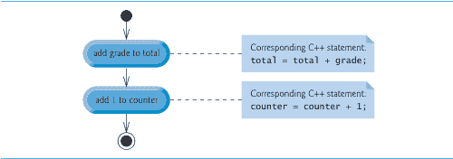

**图 4.2** | 顺序结构活动图。

1. Böhm, C., and G. Jacopini, “Flow Diagrams, Turing Machines, and Languages with Only Two Formation Rules,” *Communications of the ACM*, Vol. 9, No. 5, May 1966, pp. 366–371.

称为**双选择语句**，因为它在两个不同的动作（或动作组）之间进行选择。switch 选择语句称为**多选择语句**，因为它在许多不同的动作（或动作组）之间进行选择。

### C++ 中的循环语句

C++ 提供了三种类型的循环语句（也称为**循环语句**或**循环**），用于在条件（称为**循环继续条件**）保持为真时重复执行语句。它们是 **while**、**do...while** 和 **for** 语句。（第 5 章介绍 do...while 和 for 语句，第 7 章介绍 for 语句的一个专门版本，用于所谓的数组和容器。）while 和 for 语句执行其主体中的动作（或动作组）零次或多次——如果循环继续条件最初为假，则动作（或动作组）**不会**执行。do...while 语句至少执行其主体中的动作（或动作组）**一次**。

if、else、switch、while、do 和 for 这些词都是 C++ 关键字。关键字**不能**用作标识符（如变量名），并且必须仅使用小写字母拼写。图 4.3 提供了 C++ 关键字的完整列表。

| C++ 关键字 |  |  |  |  |
|---|---|---|---|---|
| *C 和 C++ 编程语言共有的关键字* |  |  |  |  |
| auto | break | case | char | const |
| continue | default | do | double | else |
| enum | extern | float | for | goto |
| if | int | long | register | return |
| short | signed | sizeof | static | struct |
| switch | typedef | union | unsigned | void |
| volatile | while |  |  |  |
| *仅 C++ 的关键字* |  |  |  |  |
| and | and_eq | asm | bitand | bitor |
| bool | catch | class | compl | const_cast |
| delete | dynamic_cast | explicit | export | false |
| friend | inline | mutable | namespace | new |
| not | not_eq | operator | or | or_eq |
| private | protected | public | reinterpret_cast | static_cast |
| template | this | throw | true | try |
| typeid | typename | using | virtual | wchar_t |
| xor | xor_eq |  |  |  |
| *C++11 关键字* |  |  |  |  |
| alignas | alignof | char16_t | char32_t | constexpr |
| decltype | noexcept | nullptr | static_assert | thread_local |

**图 4.3** | C++ 关键字。

图 4.4 说明了单选择 if 语句。它包含了活动图中也许最重要的符号——菱形或**判定符号**，它表示需要做出一个*决策*。判定符号表示工作流将沿着由该符号关联的**监护条件**（可以为真或假）所确定的路径继续。从判定符号出发的每个转移箭头在转移流的上方或旁边都有一个用*方括号*指定的监护条件。如果某个监护条件为真，工作流将进入该转移箭头指向的动作状态。在图 4.4 中，如果成绩大于或等于 60，程序将向屏幕打印“Passed”，然后转换到该活动的最终状态。如果成绩小于 60，程序将立即转换到最终状态，而不显示任何消息。

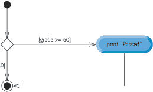

**图 4.4** | *if* 单选择语句活动图。

你在第 2 章中已经看到，决策可以基于包含关系运算符或相等运算符的条件。实际上，在 C++ 中，决策可以基于*任何*表达式——如果表达式的值为零，则将其视为*假*；如果表达式的值为*非零*，则将其视为*真*。C++ 提供了 **bool** 数据类型，用于只能保存 **true** 和 **false** 这两个值的变量——这两个值都是 C++ 关键字。

> **可移植性提示 4.1**
>
> 为了与早期使用整数表示布尔值的 C 版本兼容，bool 值 true 也可以用任何非零值（编译器通常使用 1）表示，bool 值 false 也可以用零表示。

if 语句是一个*单入口/单出口*语句。我们将看到，其余控制语句的活动图也包含初始状态、转移箭头、表示要执行动作的动作状态、表示要做出决策的判定符号（带有相关的监护条件）以及最终状态。

设想七个箱子，每个箱子中只装有七种控制语句类型之一的空的 UML 活动图。你的任务是按照算法所要求的每种控制语句的数量，从活动图中组装程序，仅以两种可能的方式（堆叠或嵌套）组合活动图，然后用适当的动作表达式和监护条件填充动作状态和决策，从而为算法形成结构化实现。我们将继续讨论编写动作和决策的各种方式。

## 4.6 `if...else` 双选择语句

`if` 单选择语句仅当条件为真时执行指定的动作；否则跳过该动作。`if...else` 双选择语句允许你指定条件为真时执行一个动作，条件为假时执行另一个不同的动作。例如，伪代码语句

```
如果学生的成绩大于或等于 60
    打印 "Passed"
否则
    打印 "Failed"
```

如果学生的成绩大于或等于 60，则打印“Passed”；如果学生的成绩小于 60，则打印“Failed”。在任何一种情况下，打印发生后，顺序中的下一条伪代码语句就被“执行”。

前面的 `If...Else` 语句可以用 C++ 编写为

```
if ( grade >= 60 )
    cout << "Passed";
else
    cout << "Failed";
```

else 的主体也是缩进的。

> **良好编程实践 4.1**
>
> *如果有几级缩进，每一级都应缩进相同的额外空格量，以提高可读性和可维护性。*

图 4.5 说明了 `if...else` 语句的控制流。

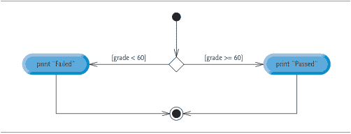

**图 4.5** | `if...else` 双选择语句活动图。


这看起来表明，如果x大于5，嵌套的if语句会判断y是否也大于5。如果是，则输出"x and y are > 5"。否则，看起来如果x不大于5，if...else中的else部分会输出"x is <= 5"。

当心！这个嵌套的if...else语句的执行方式与它表面上看起来并不相同。编译器实际上会将该语句解释为：

```cpp
if ( x > 5 )
    if ( y > 5 )
        cout << "x and y are > 5";
    else
        cout << "x is <= 5";
```

其中第一个if的语句体是一个嵌套的if...else。外层if语句测试x是否大于5。如果是，则继续执行，测试y是否也大于5。如果第二个条件为真，则显示相应的字符串——"x and y are > 5"。然而，如果第二个条件为假，则会显示字符串"x is <= 5"，尽管我们知道x大于5。

为了强制嵌套的if...else语句按最初意图执行，我们可以将其编写如下：

```cpp
if ( x > 5 )
{
    if ( y > 5 )
        cout << "x and y are > 5";
}
else
    cout << "x is <= 5";
```

花括号（{ }）向编译器表明，第二个if语句位于第一个if的语句体内，并且else与第一个if关联。练习4.23–4.24将进一步探讨悬空else问题。

## 块

if选择语句在其语句体中*仅*期望一条语句。类似地，if...else语句的if部分和else部分各自*仅*期望一条语句体语句。要在if的语句体中或在if...else的任何一部分中包含*多条*语句，请使用花括号（{ 和 }）将这些语句括起来。包含在一对花括号中的一组语句被称为**复合语句**或**块**。从现在起，我们使用术语“块”。

> **软件工程观察 4.2**
>
> *块可以放置在程序中任何可以放置单条语句的位置。*


下面的示例在if...else语句的else部分中包含了一个块。

```cpp
if ( studentGrade >= 60 )
    cout << "Passed.\n";
else
{
    cout << "Failed.\n";
    cout << "You must take this course again.\n";
}
```


> **性能提示 4.3**
>
> 对于在循环中多次执行的代码，小小的性能改进可能会带来显著的总体性能提升。

## 4.8 制定算法：计数器控制循环

为了说明程序员如何开发算法，本节和4.9节将解决班级平均分问题的两个变体。请考虑以下问题陈述：

*一个由十名学生组成的班级进行了一次测验。你已获得此次测验的成绩（0到100）。请计算并显示成绩总和及班级平均分。*

班级平均分等于成绩总和除以学生人数。在计算机上解决此问题的算法必须输入每个成绩，计算平均值并打印结果。

### 带计数器控制循环的伪代码算法

让我们使用伪代码列出要执行的动作，并指定这些动作应该发生的顺序。我们使用**计数器控制循环**一次一个地输入成绩。该技术使用一个称为**计数器**的变量来控制一组语句将执行的次数（也称为循环的**迭代**次数）。

计数器控制循环通常被称为**确定循环**，因为在循环开始执行*之前*就已知重复次数。在此示例中，当计数器超过10时循环终止。本节给出了一个完整的伪代码算法（图4.7）以及一个在C++成员函数中实现该算法的GradeBook类版本（图4.8–4.9）。然后，本节提供了一个应用程序（图4.10）来演示该算法的实际运行。在4.9节中，我们将演示如何使用伪代码从头开发这样的算法。


> **软件工程观察 4.3**
>
> 在计算机上解决问题最困难的部分是开发算法。从算法生成可运行的C++程序通常很简单。

1. 将总成绩设置为零
2. 将成绩计数器设置为1

4. 当成绩计数器小于或等于10时
   5. 提示用户输入下一个成绩
   6. 输入下一个成绩
   7. 将该成绩加入总成绩
   8. 将成绩计数器加1

10. 将班级平均分设置为总成绩除以10
11. 打印班级中所有学生的成绩总和
12. 打印班级平均分

**图4.7** | 使用计数器控制循环解决班级平均分问题的伪代码。

```cpp
// Fig. 4.9: GradeBook.cpp
// Member-function definitions for class GradeBook that solves the
// class average program with counter-controlled repetition.
#include <iostream>
#include "GradeBook.h" // include definition of class GradeBook
using namespace std;

// constructor initializes courseName with string supplied as argument
GradeBook::GradeBook( string name )
{
   setCourseName( name ); // validate and store courseName
} // end GradeBook constructor

// function to set the course name
// ensures that the course name has at most 25 characters
void GradeBook::setCourseName( string name )
{
   if ( name.size() <= 25 ) // if name has 25 or fewer characters
      courseName = name; // store the course name in the object
   else // if name is longer than 25 characters
   { // set courseName to first 25 characters of parameter name
      courseName = name.substr( 0, 25 ); // select first 25 characters
      cerr << "Name \"" << name << "\" exceeds maximum length (25).\n"
           << "Limiting courseName to first 25 characters.\n" << endl;
   } // end if...else
} // end function setCourseName

// function to retrieve the course name
string GradeBook::getCourseName() const
{
   return courseName;
} // end function getCourseName

// display a welcome message to the GradeBook user
void GradeBook::displayMessage() const
{
   cout << "Welcome to the grade book for\n" << getCourseName() << "!\n"
        << endl;
} // end of function displayMessage

// determine class average based on 10 grades entered by user
void GradeBook::determineClassAverage() const
{
   // initialization phase
   int total = 0; // sum of grades entered by user
   unsigned int gradeCounter = 1; // number of grade to be entered next

   // processing phase
   while ( gradeCounter <= 10 ) // loop 10 times
   {
      cout << "Enter grade: "; // prompt for input
      int grade = 0; // grade value entered by user
      cin >> grade; // input next grade
      total = total + grade; // add grade to total
      gradeCounter = gradeCounter + 1; // increment counter by 1
   } // end while

   // termination phase
   int average = total / 10; // ok to mix declaration and calculation

   // display total and average of grades
   cout << "\nTotal of all 10 grades is " << total << endl;
   cout << "Class average is " << average << endl;
} // end function determineClassAverage
```

**图4.9** | 使用计数器控制循环的班级平均分问题：`GradeBook`源代码文件。

由于`gradeCounter`变量（图4.9，第46行）在此程序中用于从1数到10（所有正数），我们将其声明为**unsigned int**，它只能存储*非负*值（即0和更大的值）。局部变量`total`（图4.9，第45行）、`grade`（第52行）和`average`（第59行）被声明为`int`类型。变量`grade`存储用户输入。注意，前面的声明出现在成员函数`determineClassAverage`的语句体中。此外，变量`grade`在while语句的语句体中声明，因为它*仅*在循环中使用——通常，变量应在使用之前声明。我们将`grade`初始化为0（第52行）是一种良好做法，即使第53行会立即为grade输入新值。

> **良好编程实践 4.2**
>
> *在单独一行上声明每个变量，并带有自己的注释，以提高可读性。*

在本章的GradeBook类版本中，我们只是读取并处理一组成绩。平均值的计算在成员函数determineClassAverage中使用*局部变量*执行——我们不会在类的数据成员中保留任何关于学生成绩的信息。在第7章中，我们将修改GradeBook类，使用引用一种称为*数组*的数据结构的数据成员在内存中保存成绩。这允许GradeBook对象对一组成绩执行各种计算，而无需用户多次输入成绩。

第45–46行在`total`和`gradeCounter`用于计算之前，分别将它们初始化为0和1。通常，计数器变量会根据它们在算法中的使用方式而初始化为0或1。未初始化的变量包含一个“**垃圾**”值（也称为**未定义值**）——即最后存储在该变量保留的内存位置中的值。

> **错误预防提示 4.3**
>
> *始终在声明变量时对其初始化。这有助于避免在使用未初始化变量进行计算时出现的逻辑错误。*

> **错误预防提示 4.4**
>
> *在某些情况下，如果你尝试使用未初始化变量的值，编译器会发出警告。你应该始终通过解决所有错误和警告来获得干净的编译。*


第49行表明，只要`gradeCounter`的值小于或等于10，`while`语句就应继续循环（也称为迭代）。只要此条件保持为真，`while`语句就会反复执行其主体界定的大括号之间的语句（第49–50行）。

第51行显示提示"Enter grade: "。此行对应于伪代码语句“提示用户输入下一个成绩”。第53行读取用户输入的成绩并将其赋给变量`grade`。此行对应于伪代码语句“输入下一个成绩”。第54行将用户输入的新成绩加到`total`上，并将结果赋给`total`，从而替换其先前的值。

第55行将`gradeCounter`加1，以表明程序已处理当前成绩，并准备从用户处输入下一个成绩。对`gradeCounter`进行递增最终会使`gradeCounter`超过10。此时，`while`循环终止，因为其条件（第49行）变为假。

当循环终止时，第59行执行平均值计算并将其结果赋给变量`average`。第62行显示文本"Total of all 10 grades is "后跟变量`total`的值。第63行随后显示文本"Class average is "后跟变量`average`的值。成员函数`determineClassAverage`随后将控制权返回给调用函数（即图4.10中的`main`）。

## 演示类 GradeBook

图4.10包含此应用程序的`main`函数，该函数创建类`GradeBook`的一个对象并演示其功能。图4.10的第9行创建一个名为`myGradeBook`的新`GradeBook`对象。第9行的字符串被传递给`GradeBook`构造函数（图4.9的第9–12行）。图4.10的第11行调用`myGradeBook`的`displayMessage`成员函数向用户显示欢迎消息。第12行随后调用`myGradeBook`的`determineClassAverage`成员函数，允许用户输入10个成绩，该成员函数随后计算并打印平均值——该成员函数执行图4.7伪代码中所示的算法。

```cpp
// Fig. 4.10: fig04_10.cpp
// Create GradeBook object and invoke its determineClassAverage function.
#include "GradeBook.h" // include definition of class GradeBook

int main()
{
   // create GradeBook object myGradeBook and
   // pass course name to constructor
   GradeBook myGradeBook( "CS101 C++ Programming" );

   myGradeBook.displayMessage(); // display welcome message
   myGradeBook.determineClassAverage(); // find average of 10 grades
} // end main
```

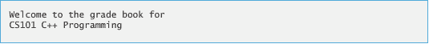

**图4.10** 使用计数器控制循环的班级平均分问题：创建GradeBook对象（图4.8–图4.9）并调用其determineClassAverage成员函数。（第2部分，共2部分。）

```text
Enter grade: 67
Enter grade: 78
Enter grade: 89
Enter grade: 67
Enter grade: 87
Enter grade: 98
Enter grade: 93
Enter grade: 85
Enter grade: 82
Enter grade: 100

Total of all 10 grades is 846
Class average is 84
```

**图4.10** | 使用计数器控制循环的班级平均分问题：创建GradeBook对象（图4.8–图4.9）并调用其determineClassAverage成员函数。（第2部分，共2部分。）

## *关于整数除法与截断的说明*

对图4.10第12行函数调用所执行的平均值计算产生一个整数结果。示例执行表明成绩之和为846，除以10应为84.6——一个带小数点的数。然而，计算`total / 10`（图4.9第59行）的结果是整数84，因为`total`和10都是整数。两个整数相除得到整数除法——计算的任何小数部分都被截断（即丢弃）。我们将在下一节看到如何从平均值计算中得到包含小数点的结果。


> **常见编程错误4.3**
>
> *假设整数除法会舍入（而不是截断）可能导致错误结果。例如，7 ÷ 4 在常规算术中为1.75，但在整数算术中会截断小数部分（.75）。因此结果是1。类似地，−7 ÷ 4 得到 −1。*

在图4.9中，如果第59行使用`gradeCounter`而不是10，则此程序的输出将显示错误值76。这是因为在`while`语句的最后一次迭代中，`gradeCounter`在第55行被递增到值11。


> **常见编程错误4.4**
>
> *在循环之后使用循环的计数器控制变量进行计算通常会导致一种常见的逻辑错误，称为差一错误。在每次循环计数增加一的计数器控制循环中，当计数器的值比其最后一个合法值高一（即从1计数到10时，为11）时，循环终止。*

## *关于算术溢出的说明*

在图4.9中，第54行

```text
total = total + grade; // add grade to total
```

将用户输入的每个成绩添加到`total`中。即使这样简单的语句也有一个潜在问题——整数相加可能导致值过大，无法存储在`int`变量中。这称为算术溢出，会导致未定义行为，即

已输入。哨兵控制的重复通常称为**不定重复**，因为在循环开始执行之前*不*知道重复次数。

哨兵值必须选择为不会与可接受输入值混淆的值。成绩通常是非负整数，因此−1是可接受的哨兵值。因此，程序的一次运行可能会处理诸如95、96、75、74、89和−1等输入。程序随后将打印成绩95、96、75、74和89的班级平均分。由于−1是哨兵值，它不应计入平均值计算中。

## 使用自顶向下、逐步细化方法开发伪代码算法：顶层和首次细化

我们使用一种称为**自顶向下、逐步细化**的技术来处理班级平均分程序，这种技术有助于开发结构良好的程序。我们从**顶层**的伪代码表示开始——一个传达程序整体功能的单一语句：

```text
Determine the class average for the quiz for an arbitrary number of students
```

顶层实际上是一个程序的*完整*表示。不幸的是，顶层（如此处的情况）很少提供足够的细节来编写程序。因此，现在我们开始细化过程。我们将顶层划分为一系列较小的任务，并按需要执行这些任务的顺序列出它们。这产生了以下**首次细化**。

- 初始化变量
- 输入、求和并统计测验成绩
- 计算并打印所有学生成绩的总和及班级平均分

此细化仅使用顺序结构——这些步骤按顺序执行。


> **软件工程观察 4.4**
>
> 每次细化以及顶层本身都是算法的完整规范；只是详细程度不同。


> **软件工程观察 4.5**
>
> 许多程序可以在逻辑上划分为三个阶段：初始化阶段，初始化程序变量；处理阶段，输入数据值并相应地调整程序变量（如计数器和总和）；终止阶段，计算并输出最终结果。

## 继续进行第二次细化

前面的*软件工程观察*通常就是在自顶向下过程中进行首次细化所需的全部内容。在**第二次细化**中，我们确定具体的变量。在此示例中，我们需要一个数字的累加总和、一个已处理数字数量的计数、一个在用户输入每个成绩时接收其值的变量，以及一个保存计算所得平均值的变量。伪代码语句

```text
Initialize variables
```

可以细化如下：

- 将`total`初始化为零
- 将`counter`初始化为零


伪代码语句

```
Input, sum and count the quiz grades
```

需要一条重复语句（即循环）来依次输入每个成绩。我们事先不知道要处理多少个成绩，因此将使用哨兵控制的重复。用户一次输入一个合法成绩。输入最后一个合法成绩后，用户输入哨兵值。程序在每次输入成绩后检查哨兵值，当用户输入哨兵值时终止循环。上述伪代码语句的第二次细化如下：

```
Prompt the user to enter the first grade
Input the first grade (possibly the sentinel)
While the user has not yet entered the sentinel
    Add this grade into the running total
    Add one to the grade counter
    Prompt the user to enter the next grade
    Input the next grade (possibly the sentinel)
```

在伪代码中，我们不在构成While结构体的语句周围使用花括号。我们只需缩进While下方的语句，以表明它们属于该While。再次强调，伪代码仅仅是一种非正式的程序开发辅助工具。

伪代码语句

```
Calculate and print the total of all student grades and the class average
```

可以按如下方式细化：

```
If the counter is not equal to zero
    Set the average to the total divided by the counter
    Print the total of the grades for all students in the class
    Print the class average
else
    Print "No grades were entered"
```

我们测试除以零的可能性——这通常是一种致命的逻辑错误，如果未被发现，将导致程序失败（通常称为“崩溃”）。班级平均分问题的伪代码的完整第二次细化如图4.11所示。


> **常见编程错误 4.5**
>
> *除以零会导致未定义行为，通常会造成致命的运行时错误。*

```
1    Initialize total to zero
2    Initialize counter to zero
3
4    Prompt the user to enter the first grade
5    Input the first grade (possibly the sentinel)
6
7    While the user has not yet entered the sentinel
8        Add this grade into the running total
9        Add one to the grade counter
10       Prompt the user to enter the next grade
11       Input the next grade (possibly the sentinel)
12
13   If the counter is not equal to zero
14       Set the average equal to the total divided by the counter
15       Print the total of the grades for all students in the class
16       Print the class average
17   else
18       Print "No grades were entered"
```

**图4.11** | 使用哨兵控制的班级平均分问题的伪代码算法。

> **错误预防提示 4.5**
>
> 当除法的表达式值可能为零时，请显式测试这种可能性，并在程序中适当处理（例如打印错误消息），而不是让致命错误发生。在讨论异常处理（第7、9和17章）时，我们将进一步介绍如何处理这类错误。


图4.11中的伪代码解决了更一般的班级平均分问题。该算法只需要两级细化。有时需要更多级别。

> **软件工程观察 4.6**
>
> 当伪代码算法已详细到足以让你将其转换为C++时，就终止自顶向下、逐步细化的过程。通常，实现C++程序随后就会变得直接明了。


> **软件工程观察 4.7**
>
> 许多经验丰富的程序员编写程序时从不使用诸如伪代码之类的程序开发工具。这些程序员认为，他们的最终目标是在计算机上解决问题，而使用伪代码之类的程序开发工具只会推迟最终输出的产生。尽管这种方法可能适用于简单且熟悉的问题，但在大型复杂项目中可能会导致严重困难。


## 在GradeBook类中实现哨兵控制的重复

图4.12–4.13展示了包含成员函数determineClassAverage的GradeBook类，该函数实现了图4.11中的伪代码算法（该类在图4.14中演示）。尽管输入的每个成绩都是整数，但平均值计算很可能产生带小数点的数字——换句话说，是实数或浮点数（例如7.33、0.0975或1000.12345）。int类型无法表示这种数字，因此该类必须使用另一种类型来实现。C++提供了多种用于在内存中存储浮点数的数据类型，包括float和double。这些类型之间的主要区别在于，与float变量相比，double变量通常可以存储数值更大、精度更细的数字（即小数点右侧更多位数——也称为数字的精度）。该程序引入了一种称为**强制转换运算符**的特殊运算符，以强制平均值计算产生浮点数结果。

```cpp
// Fig. 4.12: GradeBook.h
// Definition of class GradeBook that declares a class average.
// Member functions are defined in GradeBook.cpp
#include <string> // program uses C++ standard string class

// GradeBook class definition
class GradeBook
{
public:
   explicit GradeBook( std::string ); // initializes course name
   void setCourseName( std::string ); // set the course name
   std::string getCourseName() const; // retrieve the course name
   void displayMessage() const; // display a welcome message
   void determineClassAverage() const; // averages user-entered grades
private:
   std::string courseName; // course name for this GradeBook
}; // end class GradeBook
```

**图4.12** | 使用哨兵控制的重复的班级平均分问题：GradeBook头文件。

```cpp
// Fig. 4.13: GradeBook.cpp
// Member-function definitions for class GradeBook that solves the
// class average program with sentinel-controlled repetition.
#include <iostream>
#include <iomanip> // parameterized stream manipulators
#include "GradeBook.h" // include definition of class GradeBook
using namespace std;

// constructor initializes courseName with string supplied as argument
GradeBook::GradeBook( string name )
{
   setCourseName( name ); // validate and store courseName
} // end GradeBook constructor

// function to set the course name;
// ensures that the course name has at most 25 characters
void GradeBook::setCourseName( string name )
{
   if ( name.size() <= 25 ) // if name has 25 or fewer characters
      courseName = name; // store the course name in the object
   else // if name is longer than 25 characters
   { // set courseName to first 25 characters of parameter name
      courseName = name.substr( 0, 25 ); // select first 25 characters
      cerr << "Name \"" << name << "\" exceeds maximum length (25).\n"
         << "Limiting courseName to first 25 characters.\n" << endl;
   } // end if...else
} // end function setCourseName

// function to retrieve the course name
string GradeBook::getCourseName() const
{
   return courseName;
} // end function getCourseName

// display a welcome message to the GradeBook user
void GradeBook::displayMessage() const
{
   cout << "Welcome to the grade book for\n" << getCourseName() << "\n\n"
        << endl;
} // end function displayMessage

// determine class average based on grades entered by user
void GradeBook::determineClassAverage() const
{
   // initialization phase
   int total = 0; // sum of grades entered by user
   unsigned int gradeCounter = 0; // number of grades entered

   // processing phase
   // prompt for input and read grade from user
   cout << "Enter grade or -1 to quit: ";
   int grade = 0; // grade value
   cin >> grade; // input grade or sentinel value

   // loop until sentinel value read from user
   while (grade != -1) // while grade is not -1
   {
      total = total + grade; // add grade to total
      gradeCounter = gradeCounter + 1; // increment counter

      // prompt for input and read next grade from user
      cout << "Enter grade or -1 to quit: ";
      cin >> grade; // input grade or sentinel value
   } // end while

   // termination phase
   if (gradeCounter != 0) // if user entered at least one grade...
   {
      // calculate average of all grades entered
      double average = static_cast< double > (total) / gradeCounter;

      // display total and average (with two digits of precision)
      cout << "\nTotal of all " << gradeCounter << " grades entered is "
           << total << endl;
      cout << setprecision(2) << fixed;
      cout << "Class average is " << average << endl;
   } // end if
```

**图4.13** | 使用哨兵控制的重复的班级平均分问题：GradeBook源代码文件。


## 良好编程实践 4.3

每次键盘输入时都应提示用户。提示应指明输入的形式以及任何特殊输入。在哨兵控制循环中，请求数据输入的提示应明确提醒用户哨兵值是什么。

## 哨兵控制循环与计数器控制循环的程序逻辑

比较图 4.9 中哨兵控制循环与计数器控制循环的程序逻辑。在计数器控制循环中，while 语句（图 4.9 中的第 49–56 行）的每次迭代都会从用户那里读取一个值，迭代次数是指定的。在哨兵控制循环中，程序在到达 while 之前读取第一个值（图 4.13 中的第 51–53 行）。该值决定程序的控制流是否应进入 while 循环体。如果条件为 false，则用户输入了哨兵值，因此循环体不执行（即未输入任何成绩）。另一方面，如果条件为 true，则循环体开始执行，循环将成绩值加到 total 中（第 58 行），并将 gradeCounter 加 1（第 59 行）。然后循环体中的第 62–63 行提示用户并输入下一个值。接下来，程序控制到达第 64 行 while 循环体的右花括号（}），因此继续执行 while 条件的测试（第 56 行）。该条件使用用户最近输入的成绩来决定是否应再次执行循环体。变量 grade 的值总是在程序测试 while 条件之前立即由用户输入。这使得程序能够在处理该值（即将其加到 total 中并使 gradeCounter 加 1）之前确定刚输入的值是否为哨兵值。如果输入的是哨兵值，则循环终止，程序不会将 −1 加到 total 中。

循环终止后，执行 if...else 语句（第 67–79 行）。第 67 行的条件确定是否输入了任何成绩。如果没有输入，则执行 if...else 语句的 else 部分（第 78–79 行），显示消息“未输入任何成绩”，并且成员函数将控制返回给调用函数。

注意图 4.13 中 while 循环中的块。如果没有花括号，while 循环体中的最后三条语句将落在循环之外，导致计算机错误地解释此代码，如下所示：

```cpp
// loop until sentinel value read from user
while (grade != -1)
    total = total + grade; // add grade to total
gradeCounter = gradeCounter + 1; // increment counter
// prompt for input and read next grade from user
cout << "Enter grade or -1 to quit: ";
cin >> grade;
```

如果用户没有在第一次输入成绩（第 53 行）时输入 −1，这将导致程序出现无限循环。


## 常见编程错误 4.6

省略界定块的左右花括号可能导致逻辑错误，例如无限循环。为防止此问题，一些程序员将每个控制语句的主体都用花括号括起来，即使主体只包含一条语句。

## *浮点数精度与内存需求*

float 类型的变量表示*单精度浮点数*，在当今大多数系统上约有 7 个有效数字。double 类型的变量表示*双精度浮点数*。它们所需的内存是 float 变量的两倍，并且在当今大多数系统上提供约 15 个有效数字——约为 float 变量精度的两倍。大多数程序员使用 double 类型来表示浮点数。实际上，默认情况下，C++ 会将您在程序源代码中键入的所有浮点数（例如 7.33 和 0.0975）都视为 double 值。源代码中的这些值称为*浮点字面量*。有关 float 和 double 的取值范围，请参见附录 C“基本类型”。

在常规算术中，浮点数常常是除法运算的结果——当我们用 10 除以 3 时，结果是 3.3333333...，其中 3 的序列无限重复。计算机只分配固定的空间来保存这样的值，因此显然存储的浮点值只能是一个*近似值*。

> **常见编程错误 4.7**
>
> 以假设浮点数被精确表示的方式使用它们（例如，在相等性比较中使用它们）可能导致不正确的结果。浮点数只是近似表示的。


尽管浮点数并不总是 100% 精确，但它们有许多应用。例如，当我们说到“正常”体温为 98.6 华氏度时，我们不需要精确到很多位。当我们从温度计上读到温度为 98.6 时，它实际上可能是 98.5999473210643。在大多数涉及体温的应用中，将这个数字简单地称为 98.6 是可以的。由于浮点数的不精确性，double 类型优于 float 类型，因为 double 变量可以更准确地表示浮点数。因此，本书通篇使用 double 类型。

## *基本类型之间的显式与隐式转换*

变量 average 被声明为 double 类型（图 4.13 中的第 70 行），以捕获我们计算的小数结果。然而，total 和 gradeCounter 都是整数变量。回想一下，两个整数相除的结果是整数除法，其中计算的任何小数部分都会丢失（即被截断）。在以下语句中：

```cpp
double average = total / gradeCounter;
```

除法*首先*发生——结果的小数部分在赋值给 average 之前就*已经*丢失了。要用整数执行浮点计算，我们必须创建*临时*浮点值。C++ 提供了 **static_cast 运算符**来完成此任务。第 70 行使用强制转换运算符 `static_cast<double>(total)` 创建其括号内操作数 total 的一个临时浮点副本。以这种方式使用强制转换运算符称为*显式转换*。存储在 total 中的值仍然是整数。

现在，计算由一个浮点值（total 的临时 double 版本）除以整数 gradeCounter 组成。编译器只知道如何计算操作数类型*相同*的表达式。为了确保操作数类型相同，编译器会对选定的操作数执行称为**提升**（也称为*隐式转换*）的操作。例如，在包含 int 和 double 数据类型值的表达式中，C++ 会将 int 操作数提升为 double 值。在我们的示例中，我们将 total 视为 double（通过使用 `static_cast` 运算符），因此编译器将 `gradeCounter` 提升为 double，从而允许执行计算——浮点除法的结果被赋给 `average`。在第 6 章“函数与递归入门”中，我们将讨论所有基本数据类型及其提升顺序。

强制转换运算符可用于所有数据类型，也可用于类类型。`static_cast` 运算符的写法是：在关键字 `static_cast` 后面跟上尖括号（`<` 和 `>`），括号内为数据类型名。`static_cast` 运算符是一元运算符——即只接受一个操作数的运算符。在第 2 章中，我们学习了二元算术运算符。C++ 还支持加号（`+`）和减号（`-`）的一元版本，因此您可以编写诸如 −7 或 +5 的表达式。强制转换运算符的优先级高于其他一元运算符，例如一元 `+` 和一元 `-`。该优先级高于乘法运算符 `*`、`/` 和 `%`，低于括号。在我们的优先级图表中，我们用 `static_cast<type>()` 表示强制转换运算符。

### *浮点数的格式化*

这里简要讨论图 4.13 中的格式化功能，并在第 13 章“流输入/输出：深入探讨”中深入说明。第 75 行对 `setprecision` 的调用（参数为 2）表示 double 变量 `average` 应打印到小数点右侧两位精度（例如 92.37）。这种调用称为参数化流操纵符（因为括号中有 2）。使用这些调用的程序必须包含预处理指令（第 5 行）

```cpp
#include <iomanip>
```

操纵符 `endl` 是一个非参数化流操纵符（因为它后面没有括号中的值或表达式），并且不需要 `<iomanip>` 头文件。如果未指定精度，浮点值通常以六位精度输出（即在当今大多数系统上的默认精度），尽管稍后我们会看到一个例外。

流操纵符 `fixed`（第 75 行）表示浮点值应以所谓的定点格式输出，而不是科学计数法。科学计数法是一种将数字显示为介于 1.0 和 10.0 之间的浮点数乘以 10 的幂的方式。例如，值 3,100.0 以科学计数法显示为 3.1 × 10³。科学计数法在显示非常大或非常小的值时很有用。第 13 章将进一步讨论使用科学计数法的格式化。另一方面，定点格式用于强制浮点数显示指定位数的数字。指定定点格式还会强制打印小数点和小数点后的尾随零，即使该值是整数，例如 88.00。如果没有定点格式选项，这样的值在 C++ 中打印为 88，不带尾随零，也不带小数点。当在程序中使用流操纵符 `fixed` 和 `setprecision` 时，打印的值会四舍五入到传递给 `setprecision` 的值所指示的小数位数（例如第 75 行中的值 2），而内存中的值保持不变。例如，值 87.946 和 67.543 分别输出为 87.95 和 67.54。也可以使用流操纵符 `showpoint` 强制显示小数点。如果指定了 `showpoint` 而没有 `fixed`，则不会打印尾随零。与 `endl` 一样，流操纵符 `fixed` 和 `showpoint` 不使用参数，也不需要 `<iomanip>` 头文件。两者都可以在头文件 `<iostream>` 中找到。


3. 显示测试结果摘要，指出通过考试的学生人数和未通过的学生人数。
4. 如果超过八名学生通过考试，则打印消息“给教员奖金！”。

仔细阅读问题陈述后，我们有以下观察：

1. 程序必须处理10名学生的测试结果。因为测试结果的数量事先已知，所以可以使用*计数器控制循环*。
2. 每个测试结果是一个数字——要么是1，要么是2。每次程序读取一个测试结果时，必须确定该数字是1还是2。为简单起见，我们在算法中只测试是否为1。如果数字不是1，我们假定它是2。（请务必完成练习4.20，该练习考虑了这种假设的后果。）
3. 使用两个计数器来跟踪考试结果——一个统计通过考试的学生人数，一个统计未通过考试的学生人数。
4. 程序处理完所有结果后，必须判断是否超过八名学生通过了考试。

让我们继续采用自顶向下、逐步求精的方法。我们先用伪代码表示顶层：

```text
Analyze exam results and decide whether a bonus should be paid
```

同样重要的是要强调，顶层是程序的*完整*表示，但在伪代码自然演化为C++程序之前，可能需要进行若干次细化。

我们的第一次细化是

```text
Initialize variables
Input the 10 exam results, and count passes and failures
Display a summary of the exam results and decide whether a bonus should be paid
```

这里同样，即使我们拥有整个程序的*完整*表示，仍需要进一步细化。我们现在确定具体变量。需要计数器来记录通过和失败的人数，一个计数器将用于控制循环过程，还需要一个变量来存储用户输入。

伪代码语句

```text
Initialize variables
```

可以细化如下：

```text
Initialize passes to zero
Initialize failures to zero
Initialize student counter to one
```

注意，在算法开始时，只初始化了计数器。

伪代码语句

```text
Input the 10 exam results, and count passes and failures
```

需要一个循环，依次输入每次考试的结果。这里事先已知恰好有10个考试结果，因此计数器控制循环是合适的。在循环内部（即嵌套在循环内），一个`if...else`语句将确定每个考试结果是通过还是失败，并递增相应的计数器。上述伪代码语句的细化如下：

```text
While student counter is less than or equal to 10
    Prompt the user to enter the next exam result
    Input the next exam result

    If the student passed
        Add one to passes
    Else
        Add one to failures

    Add one to student counter
```

我们使用空行来分隔`If...Else`控制结构，以提高可读性。伪代码语句

```text
Display a summary of the exam results and decide whether a bonus should be paid
```

可以细化如下。

```text
Display the number of passes
Display the number of failures
If more than eight students passed
    Display “Bonus to instructor!”
```

完整的第二次细化出现在图4.15中。空行分隔了`While`结构，以提高可读性。该伪代码现已足够细化，可转换为C++。

```text
1  Initialize passes to zero
2  Initialize failures to zero
3  Initialize student counter to one

5  While student counter is less than or equal to 10
6      Prompt the user to enter the next exam result
7      Input the next exam result

9      If the student passed
10         Add one to passes
11     Else
12         Add one to failures

14     Add one to student counter

16  Display the number of passes
17  Display the number of failures

19  If more than eight students passed
20      Display "Bonus to instructor!"
```

**图4.15** | 考试结果问题的伪代码。


## 转换为类分析

实现该伪代码算法的程序如图4.16所示。此示例不包含类——它只有一个源代码文件，其中函数main执行应用程序的所有工作。在本章和第3章中，你已经看到了由单个类（包括该类的头文件和源代码文件）以及另一个测试该类的源代码文件组成的示例。该源代码文件包含函数main，它创建了该类的一个对象并调用其成员函数。偶尔，当尝试创建可复用类来演示某个概念没有意义时，我们将使用完全包含在单个源代码文件的main函数中的示例。

第9–11行和第18行声明并初始化了用于处理考试结果的变量。循环程序有时需要在每次重复开始时进行初始化；这种重新初始化将通过赋值语句而不是在声明中执行，或者通过将声明移动到循环体内来执行。

```cpp
// Fig. 4.16: fig04_16.cpp
// Examination-results problem: Nested control statements.
#include <iostream>
using namespace std;

int main()
{
   // initializing variables in declarations
   unsigned int passes = 0; // number of passes
   unsigned int failures = 0; // number of failures
   unsigned int studentCounter = 1; // student counter

   // process 10 students using counter-controlled loop
   while ( studentCounter <= 10 )
   {
      // prompt user for input and obtain value from user
      cout << "Enter result (1 = pass, 2 = fail): ";
      int result = 0; // one exam result (1 = pass, 2 = fail)
      cin >> result; // input result

      // if...else nested in while
      if ( result == 1 )
         passes = passes + 1; // increment passes
      else
         failures = failures + 1; // increment failures

      // increment studentCounter so loop eventually terminates
      studentCounter = studentCounter + 1;
   } // end while

   // termination phase: display number of passes and failures
   cout << "Passed " << passes << "\nFailed " << failures << endl;

   // determine whether more than eight students passed
   if ( passes > 8 )
      cout << "Bonus to instructor!" << endl;
} // end main
```


```text
Enter result (1 = pass, 2 = fail): 1
Enter result (1 = pass, 2 = fail): 2
Enter result (1 = pass, 2 = fail): 2
Enter result (1 = pass, 2 = fail): 1
Enter result (1 = pass, 2 = fail): 1
Enter result (1 = pass, 2 = fail): 2
Enter result (1 = pass, 2 = fail): 1
Enter result (1 = pass, 2 = fail): 1
Enter result (1 = pass, 2 = fail): 1
Enter result (1 = pass, 2 = fail): 2
Passed 6
Failed 4
```

```text
Enter result (1 = pass, 2 = fail): 1
Enter result (1 = pass, 2 = fail): 1
Enter result (1 = pass, 2 = fail): 1
Enter result (1 = pass, 2 = fail): 1
Enter result (1 = pass, 2 = fail): 2
Enter result (1 = pass, 2 = fail): 1
Enter result (1 = pass, 2 = fail): 1
Enter result (1 = pass, 2 = fail): 1
Enter result (1 = pass, 2 = fail): 1
Enter result (1 = pass, 2 = fail): 1
Passed 9
Failed 1
Bonus to instructor!
```

**图4.16** | 考试结果问题：嵌套控制语句。

while语句（第14–29行）循环10次。每次迭代输入并处理一个考试结果。用于处理每个结果的`if...else`语句（第22–25行）嵌套在while语句中。如果结果是1，`if...else`语句递增passes；否则，它假定结果为2并递增failures。第28行在循环条件于第15行再次测试之前递增studentCounter。输入10个值后，循环终止，第32行显示通过和失败的人数。第35–36行的if语句判断是否超过八名学生通过考试，如果是，则输出消息“给教员奖金！”。

图4.16显示了程序两次示例执行的输入和输出。在第二次示例执行的末尾，第35行的条件为真——超过八名学生通过了考试，因此程序输出一条消息，指示教员应获得奖金。


该运算符将运算符右侧表达式的值加到运算符左侧变量的值上，并将结果存储到左侧变量中。任何如下形式

```
variable = variable operator expression;
```

的语句——其中同一个变量出现在赋值运算符两侧，且 operator 是二元运算符 +、−、*、/ 或 %（稍后我们还会讨论几个其他的）之一——都可以写成如下形式

```
variable operator= expression;
```

因此，赋值语句 `c += 3` 将 3 加到 c 上。图 4.17 展示了算术赋值运算符、使用这些运算符的示例表达式及其说明。

*假设：`int c = 3, d = 5, e = 4, f = 6, g = 12;`*

| 赋值运算符 | 示例表达式 | 说明 | 赋给 |
|---|---|---|---|
| `+=` | `c += 7` | `c = c + 7` | c 为 10 |
| `-=` | `d -= 4` | `d = d - 4` | d 为 1 |
| `*=` | `e *= 5` | `e = e * 5` | e 为 20 |
| `/=` | `f /= 3` | `f = f / 3` | f 为 2 |
| `%=` | `g %= 9` | `g = g % 9` | g 为 3 |

**图 4.17** | 算术赋值运算符。

## 4.12 自增与自减运算符

除了算术赋值运算符之外，C++ 还提供了两个一元运算符，用于将数值变量的值加 1 或减 1。它们是一元**自增运算符** ++ 和一元**自减运算符** --，图 4.18 对此进行了总结。程序可以使用自增运算符 ++ 将名为 c 的变量的值加 1，而不必使用表达式 c = c + 1 或 c += 1。放在变量之前（即*置于*变量*前面*）的自增或自减运算符分别称为**前缀自增**或**前缀自减运算符**。放在变量之后（即*置于*变量*后面*）的自增或自减运算符分别称为**后缀自增**或**后缀自减运算符**。

| 运算符 | 名称 | 示例表达式 | 说明 |
|---|---|---|---|
| `++` | 前自增 | `++a` | 将 a 加 1，然后使用 a 所在表达式中的新值 a。 |
| `++` | 后自增 | `a++` | 在 a 所在的表达式中使用 a 的当前值，然后将 a 加 1。 |
| `--` | 前自减 | `--b` | 将 b 减 1，然后使用 b 所在表达式中的新值 b。 |
| `--` | 后自减 | `b--` | 在 b 所在的表达式中使用 b 的当前值，然后将 b 减 1。 |

**图 4.18** | 自增和自减运算符。

使用前缀自增（或自减）运算符将变量加（或减）1 称为对变量进行**前自增**（或**前自减**）。前自增（或前自减）会使变量先加（或减）1，然后在变量出现的表达式中使用该变量的新值。使用后缀自增（或自减）运算符将变量加（或减）1 称为对变量进行**后自增**（或**后自减**）。后自增（或后自减）会在变量出现的表达式中先使用该变量的当前值，然后将变量的值加（或减）1。


### 良好编程实践 4.4

与二元运算符不同，一元自增和自减运算符应紧挨其操作数，中间不加空格。

图 4.19 演示了 ++ 自增运算符的前缀自增与后缀自增版本之间的区别。自减运算符（--）的工作原理类似。

```cpp
// Fig. 4.19: fig04_19.cpp
// Preincrementing and postincrementing.
#include <iostream>
using namespace std;

int main()
{
   // demonstrate postincrement
   int c = 5; // assign 5 to c
   cout << c << endl; // print 5
   cout << c++ << endl; // print 5 then postincrement
   cout << c << endl; // print 6

   cout << endl; // skip a line

   // demonstrate preincrement
   c = 5; // assign 5 to c
   cout << c << endl; // print 5
   cout << ++c << endl; // preincrement then print 6
   cout << c << endl; // print 6
} // end main
```

**图 4.19** | 前自增与后自增。（第 1 部分，共 2 部分。）

```
5
5
6

5
6
6
```

**图 4.19** | 前自增与后自增。（第 2 部分，共 2 部分。）

第 9 行将 c 初始化为 5，第 10 行输出 c 的初始值。第 11 行输出表达式 c++ 的值。这会对变量 c 进行后自增，因此会先输出 c 的原始值（5），然后再将 c 的值加 1。因此，第 11 行再次输出 c 的初始值（5）。第 12 行输出 c 的新值（6），以证明变量的值在第 11 行已被加 1。

第 17 行将 c 的值重置为 5，第 18 行输出该值。第 19 行输出表达式 ++c 的值。该表达式对 c 进行前自增，因此先将 c 的值加 1，然后输出新值（6）。第 20 行再次输出 c 的值，以表明执行第 19 行之后 c 的值仍为 6。

算术赋值运算符以及自增和自减运算符可用于简化程序语句。图 4.16 中的三条赋值语句

```
passes = passes + 1;
failures = failures + 1;
studentCounter = studentCounter + 1;
```

可以使用赋值运算符更简洁地写成

```
passes += 1;
failures += 1;
studentCounter += 1;
```

使用前缀自增运算符可以写成

```
++passes;
++failures;
++studentCounter;
```

或者使用后缀自增运算符可以写成

```
passes++;
failures++;
studentCounter++;
```

当你在一条独立的语句中对一个整型变量进行自增（++）或自减（--）时，前自增和后自增形式具有相同的逻辑效果，前自减和后自减形式也具有相同的逻辑效果。只有当变量出现在更大表达式的上下文中时，对变量进行前自增与后自增才会产生不同的效果（前自减与后自减也是如此）。

### 常见编程错误 4.8

试图对非可修改变量名的表达式使用自增或自减运算符，例如编写 `++(x + 1)`，属于语法错误。

自增和自减运算符可用于对变量加 1 或减 1。在下一章中，我们将继续讨论控制语句，引入 for、do...while 和 switch 语句。

## 小结

### 第 4.2 节 算法

- 算法（第 105 页）是一种解决问题的过程，它规定了要执行的动作以及执行这些动作的顺序。
- 规定程序中语句执行顺序的做法称为程序控制（第 106 页）。

### 第 4.3 节 伪代码

- 伪代码（第 106 页）帮助你在用编程语言编写程序之前先进行思考。

### 第 4.4 节 控制结构

- 活动图对软件系统的工作流程（也称为活动，第 108 页）进行建模。
- 活动图（第 107 页）由各种符号组成，例如动作状态符号、菱形和小圆圈，它们通过表示活动流的转换箭头连接起来。
- 与伪代码类似，活动图帮助你开发和表示算法。
- 动作状态表示为一个矩形，其左右两边替换为向外弯曲的弧线。动作表达式（第 108 页）显示在动作状态内部。
- 活动图中的箭头表示转换（第 108 页），它指明动作状态所表示的动作发生的顺序。
- 活动图中的实心圆表示初始状态（第 108 页）——即程序执行所建模的动作之前的工作流起点。
- 活动图底部出现的带空心圆环绕的实心圆表示最终状态（第 108 页）——即程序执行完其动作之后的工作流终点。
- 右上角折叠的矩形在 UML 中称为注释（第 108 页）。虚线（第 108 页）将每条注释与其所描述的元素连接起来。
- 有三种类型的控制结构（第 107 页）——顺序结构、选择结构和循环结构。
- 顺序结构是内置的——默认情况下，语句按照它们出现的顺序执行。
- 选择结构在备选的行动路径之间进行选择。

### 第 4.5 节 if 选择语句

- if 单选择语句（第 110 页）在条件为真时执行（选择）一个动作，在条件为假时跳过该动作。
- 活动图中的判断符号（第 111 页）表示需要做出决策。工作流沿着由相关监护条件决定的路径前进。从判断符号发出的每条转换箭头都有一个监护条件。如果某个监护条件为真，工作流就进入该转换箭头所指的动作状态。

### 第 4.6 节 if...else 双选择语句

- if...else 双选择语句（第 112 页）在条件为真时执行（选择）一个动作，在条件为假时执行另一个不同的动作。


-   要在 `if` 的主体（或 `else if...else` 语句的主体）中包含多条语句，请将这些语句用花括号（`{` 和 `}`）括起来。包含在花括号中的一组语句称为块（第 115 页）。块可以放置在程序中任何单条语句可以放置的位置。
-   空语句（第 116 页）表示不执行任何操作，用分号（`;`）表示。

### 4.7 节 *while* 重复语句

-   重复语句（第 116 页）在某个条件保持为真时重复执行一个动作。
-   UML 合并符号（第 117 页）有两条或更多条转换箭头指向菱形，且只有一条箭头从菱形指出，表示多个活动流合并以继续该活动。

### 4.8 节 算法制定：计数器控制重复

-   计数器控制重复（第 118 页）用于在循环开始执行之前已知重复次数的情况，即存在确定性重复时。
-   整数相加可能导致结果太大而无法存储在 `int` 变量中。这称为算术溢出，会导致不可预测的运行时行为。
-   可以存储在 `int` 变量中的最大值和最小值分别由头文件 `<climits>` 中的常量 `INT_MAX` 和 `INT_MIN` 表示。
-   在执行算术计算之前确保计算不会溢出被认为是一种良好的实践。在工业级代码中，您应对所有可能导致溢出或下溢的计算进行检查。

### 4.9 节 算法制定：哨兵控制重复

-   自顶向下、逐步细化（第 125 页）是一种通过保持程序在每次细化过程中的完整表示来细化伪代码的过程。
-   哨兵控制重复（第 126 页）用于在循环开始执行之前重复次数未知的情况，即存在不确定性重复时。
-   包含小数部分的值称为浮点数，由 `float` 和 `double` 等数据类型近似表示（第 127 页）。
-   强制转换运算符 `static_cast<double>`（第 132 页）可用于创建其操作数的临时浮点副本。
-   一元运算符（第 133 页）只接受一个操作数；二元运算符接受两个操作数。
-   参数化流操纵符 `setprecision`（第 133 页）指示应在小数点右侧显示的精度位数。
-   流操纵符 `fixed`（第 133 页）指示浮点值应以所谓的定点格式输出，而不是科学记数法。
-   通常，任何只应存储非负值的整数变量都应在整数类型之前使用 `unsigned` 声明。`unsigned` 类型的变量可以表示从 0 到大约相应有符号整数类型正范围两倍的值。
-   您可以使用 `<climits>` 中的常量 `UINT_MAX` 来确定您平台的最大 `unsigned int` 值。

### 4.10 节 算法制定：嵌套控制语句

-   嵌套控制语句（第 134 页）出现在另一个控制语句的主体中。
-   C++11 引入了新的列表初始化，用于在声明中初始化变量，例如

```cpp
int studentCounter = { 1 };
```

或

```cpp
int studentCounter{ 1 };
```

```cpp
using namespace std;

int main()
{
   unsigned int sum = 0; // 存储整数 1 到 10 的和
   unsigned int x = 1; // 计数器

   while ( x <= 10 ) // 循环 10 次
   {
      sum += x; // 将 x 加到 sum
      ++x; // 递增 x
   } // end while

   cout << "The sum is: " << sum << endl;
} // end main
```

```text
The sum is: 55
```

- 4.6
  - a) product = 25, x = 6;
  - b) quotient = 0, x = 6;

- 4.7
  - a) cin >> x;
  - b) cin >> y;
  - c) unsigned int i = 1;
  - d) unsigned int power = 1;
  - e) power *= x;
    或
    power = power * x;
  - f) ++i;
  - g) if (i <= y)
  - h) cout << power << endl;

- 4.8 参见以下代码：

  ```cpp
  // 练习 4.8 解答：ex04_08.cpp
  // 计算 x 的 y 次幂。
  #include <iostream>
  using namespace std;

  int main()
  {
     unsigned int i = 1; // 初始化 i，从 1 开始计数
     unsigned int power = 1; // 初始化 power

     cout << "Enter base as an integer: "; // 提示输入底数
     unsigned int x; // 底数
     cin >> x; // 输入底数

     cout << "Enter exponent as an integer: "; // 提示输入指数
     unsigned int y; // 指数
     cin >> y; // 输入指数

     // 从 1 计数到 y，每次将 power 乘以 x
     while (i <= y )
     {
        power *= x;
        ++i;
     } // end while

     cout << power << endl;  // 显示结果
  } // end main
  ```

  ```text
  Enter base as an integer: 2
  Enter exponent as an integer: 3
  8
  ```

- 4.9

  - (a) **错误：** 缺少 `while` 主体的右花括号。

    **更正：** 在语句 `c++;` 后添加右花括号。

  - (b) **错误：** 使用了流插入运算符而不是流提取运算符。

    **更正：** 将 `<<` 改为 `>>`。

  - (c) **错误：** `else` 后面的分号是逻辑错误。第二个输出语句总是执行。

    **更正：** 删除 `else` 后面的分号。

- 4.10 变量 `z` 的值在 `while` 语句中从未改变。因此，如果循环继续条件（`z >= 0`）最初为真，就会产生无限循环。为了防止无限循环，必须改变 `z`，使其最终小于 0。

## 练习

- 4.11 *(纠正代码错误)* 找出并纠正以下各题中的错误：

  **a)**
  ```cpp
  if ( age >= 65 );
      cout << "Age is greater than or equal to 65" << endl;
  else
      cout << "Age is less than 65" << endl;
  ```

  **b)**
  ```cpp
  if ( age >= 65 )
      cout << "Age is greater than or equal to 65" << endl;
  else;
      cout << "Age is less than 65" << endl;
  ```

  **c)**
  ```cpp
  unsigned int x = 1;
  unsigned int total;

  while ( x <= 10 )
  {
      total += x;
      ++x;
  }
  ```

  **d)**
  ```cpp
  while ( x <= 100 )
      total += x;
      ++x;
  ```

  **e)**
  ```cpp
  while ( y > 0 )
  {
      cout << y << endl;
      ++y;
  }
  ```

- 4.12 *(该程序输出什么？)* 以下程序输出什么？

  ```cpp
  // 练习 4.12：ex04_12.cpp
  // 该程序输出什么？
  #include <iostream>
  using namespace std;

  int main()
  {
  ```

  ```text
  Enter account number (or -1 to quit): 100
  Enter beginning balance: 534.78
  Enter total charges: 1000.00
  Enter total credits: 500.00
  Enter credit limit: 5500.00
  New balance is 5894.78
  Account:          100
  Credit limit: 5500.00
  Balance:          5894.78
  Credit Limit Exceeded.

  Enter Account Number (or -1 to quit): 200
  Enter beginning balance: 100.00
  Enter total charges: 123.45
  Enter total credits: 321.00
  Enter credit limit: 1500.00
  New balance is 802.45

  Enter Account Number (or -1 to quit): -1
  ```

- **4.15** *(销售佣金计算器)* 一家大公司按佣金制支付销售人员的工资。每位销售人员每周可获得 200 美元，外加其当周总销售额的 9%。例如，一周销售 5000 美元化学品的销售人员可获得 200 美元加上 5000 美元的 9%，即总计 650 美元。开发一个 C++ 程序，使用 `while` 语句输入每位销售人员上周的总销售额，并计算和显示该销售人员的收入。一次处理一位销售人员的数据。

  ```text
  Enter sales in dollars (-1 to end): 5000.00
  Salary is: $650.00

  Enter sales in dollars (-1 to end): 6000.00
  Salary is: $740.00

  Enter sales in dollars (-1 to end): 7000.00
  Salary is: $830.00

  Enter sales in dollars (-1 to end): -1
  ```

- **4.16** *(工资计算器)* 开发一个 C++ 程序，使用 `while` 语句确定几位员工中每位的总工资。公司为每位员工工作的前 40 小时支付“正常工资”，对超过 40 小时的所有工作时间支付“一倍半工资”。给您一份公司员工名单，每位员工上周工作的小时数以及每位员工的每小时工资率。您的程序应为每位员工输入这些信息，并确定和显示该员工的总工资。

  ```text
  Enter hours worked (-1 to end): 39
  Enter hourly rate of the employee ($00.00): 10.00
  Salary is $390.00

  Enter hours worked (-1 to end): 40
  Enter hourly rate of the employee ($00.00): 10.00
  Salary is $400.00

  Enter hours worked (-1 to end): 41
  Enter hourly rate of the employee ($00.00): 10.00
  Salary is $415.00

  Enter hours worked (-1 to end): -1
  ```


## 4.17 （查找最大值）

在计算机应用中，查找最大数（即一组数中的最大值）的过程十分常见。例如，一个确定销售竞赛获胜者的程序会输入每位销售人员的销售件数。销售件数最多的人赢得比赛。编写一个 C++ 程序，使用 while 语句确定并打印用户输入的 10 个数中的最大数。程序应使用三个变量，如下所示：

- `counter`：一个计数器，计数到 10（即跟踪已输入多少个数，并确定何时处理完所有 10 个数）。
- `number`：当前输入到程序中的数。
- `largest`：到目前为止找到的最大数。

## 4.18 （表格输出）

编写一个 C++ 程序，使用 while 语句和制表转义序列 `\t` 打印以下数值表：

| N | 10\*N | 100\*N | 1000\*N |
|---:|---:|---:|---:|
| 1 | 10 | 100 | 1000 |
| 2 | 20 | 200 | 2000 |
| 3 | 30 | 300 | 3000 |
| 4 | 40 | 400 | 4000 |
| 5 | 50 | 500 | 5000 |

## 4.19 （查找两个最大值）

使用与练习 4.17 类似的方法，在 10 个数中找出两个最大值。*（注意：每个数只能输入一次。）*

## 4.20 （验证用户输入）

图 4.16 的考试结果程序假设用户输入的任何值如果不是 1 就一定是 2。请修改该应用程序以验证其输入。对于任何输入，如果输入的值不是 1 或 2，则持续循环，直到用户输入正确的值。

## 4.21 （该程序做什么？）

下面的程序打印什么？

```cpp
// Exercise 4.21: ex04_21.cpp
// What does this program print?
#include <iostream>
using namespace std;

int main()
{
    unsigned int count = 1; // initialize count

    while ( count <= 10 ) // loop 10 times
    {
        // output line of text
        cout << ( count % 2 ? "*****" : "+++++" ) << endl;
        ++count; // increment count
    } // end while
} // end main
```

## 4.22 （该程序做什么？）

下面的程序打印什么？

```cpp
// Exercise 4.22: ex04_22.cpp
// What does this program print?
#include <iostream>
using namespace std;

int main()
{
    unsigned int row = 10; // initialize row

    while ( row >= 1 ) // loop until row < 1
    {
        unsigned int column = 1; // set column to 1 as iteration begins

        while ( column <= 10 ) // loop 10 times
        {
            cout << ( row % 2 ? "<" : ">" ); // output
            ++column; // increment column
        } // end inner while

        --row; // decrement row
        cout << endl; // begin new output line
    } // end outer while
} // end main
```

## 4.23 （悬空 else 问题）

当 x 为 9、y 为 11 以及 x 为 11、y 为 9 时，分别写出以下各部分的输出。编译器会忽略 C++ 程序中的缩进。除非通过放置花括号 { } 另行指定，否则 C++ 编译器总是将 else 与前面的 if 匹配。乍一看，您可能无法确定哪个 if 与哪个 else 匹配，因此这被称为“悬空 else”问题。我们删除了以下代码中的缩进，使问题更具挑战性。*[提示：应用您学过的缩进约定。]*

- a)

```cpp
if ( x < 10 )
    if ( y > 10 )
        cout << "*****" << endl;
    else
        cout << "#####" << endl;
        cout << "$$$$$" << endl;
```

- b)

```cpp
if ( x < 10 )
{
    if ( y > 10 )
        cout << "*****" << endl;
}
else
{
    cout << "#####" << endl;
    cout << "$$$$$" << endl;
}
```

## 4.24 （另一个悬空 else 问题）

修改以下代码以产生所示的输出。使用适当的缩进技术。除了插入花括号之外，不得进行任何其他修改。编译器会忽略 C++ 程序中的缩进。我们删除了以下代码中的缩进，使问题更具挑战性。*[注意：可能不需要进行任何修改。]*

```cpp
if ( y == 8 )
    if ( x == 5 )
        cout << "@@@@@" << endl;
    else
        cout << "#####" << endl;
cout << "$$$$$" << endl;
cout << "&&&&&" << endl;
```

```cpp
cout << " ";
cout << '*';
cout << endl;
```

```text
* * * * * * * *
 * * * * * * * *
* * * * * * * *
 * * * * * * * *
* * * * * * * *
 * * * * * * * *
* * * * * * * *
 * * * * * * * *
* * * * * * * *
```

## 4.29 （2 的倍数与无限循环）

编写一个程序，打印整数 2 的幂，即 2、4、8、16、32、64 等。您的 while 循环不应终止（即您应创建一个无限循环）。为此，只需使用关键字 `true` 作为 while 语句的表达式。运行此程序时会发生什么？

## 4.30 （计算圆的直径、周长和面积）

编写一个程序，读取圆的半径（作为 double 值），并计算和打印直径、周长和面积。π 使用 3.14159。

## 4.31

以下语句有什么问题？提供正确的语句，以完成程序员可能想要完成的操作。

```cpp
cout << ++(x + y);
```

## 4.32 （三角形的边）

编写一个程序，读取三个非零 double 值，并确定和打印它们是否能表示三角形的边。

## 4.33 （直角三角形的边）

编写一个程序，读取三个非零整数，并确定和打印它们是否是直角三角形的边。

## 4.34 （阶乘）

非负整数 *n* 的阶乘写作 *n*!（读作“n 的阶乘”），定义如下：

$$
n! = n \cdot (n - 1) \cdot (n - 2) \cdot \ldots \cdot 1 \quad \text{（对于大于 1 的 } n \text{ 值）}
$$

并且

$$
n! = 1 \quad \text{（对于 } n = 0 \text{ 或 } n = 1\text{）。}
$$

例如，$5! = 5 \cdot 4 \cdot 3 \cdot 2 \cdot 1$，即 120。在以下各项中使用 while 语句：

- a) 编写一个程序，读取非负整数，并计算和打印其阶乘。

- b) 编写一个程序，使用以下公式估算数学常数 $e$ 的值：

  $$
  e = 1 + \frac{1}{1!} + \frac{1}{2!} + \frac{1}{3!} + \ldots
  $$

  提示用户输入所需的 $e$ 精度（即求和中的项数）。

- c) 编写一个程序，使用以下公式计算 $e^x$ 的值：

  $$
  e^x = 1 + \frac{x}{1!} + \frac{x^2}{2!} + \frac{x^3}{3!} + \ldots
  $$

  提示用户输入所需的 $e$ 精度（即求和中的项数）。

## 4.35 （C++11 列表初始化）

编写使用 C++11 列表初始化执行以下每项任务的语句：

- a) 将 unsigned int 变量 `studentCounter` 初始化为 0。

- b) 将 double 变量 `balance` 初始化为 1000.0。

- c) 初始化 Account 类的对象，该类提供一个构造函数，该构造函数接收一个 unsigned int、两个 string 和一个 double，以初始化对象的 `accountNumber`、`firstName`、`lastName` 和 `balance` 数据成员。

## 付诸行动

### 4.36 （通过密码学保护隐私）

互联网通信和联网计算机上数据存储的爆炸式增长，极大地增加了隐私担忧。密码学领域致力于对数据进行编码，使其难以（并且——在拥有最先进方案的情况下——有望不可能）被未授权用户读取。在本练习中，您将研究一种简单的数据加密和解密方案。一家希望通过互联网发送数据的公司请您编写一个对其进行加密的程序，以便更安全地传输。所有数据均以四位整数形式传输。您的应用程序应读取用户输入的四位整数，并按如下方式加密：将每个数字替换为该数字加 7 后再除以 10 所得的余数。然后交换第一个数字与第三个数字，并交换第二个数字与第四个数字。然后打印加密后的整数。再编写一个单独的应用程序，输入加密的四位整数并解密（通过反转加密方案）以形成原始数字。*[可选阅读项目：* 总体研究“公钥密码学”以及 PGP（Pretty Good Privacy）特定的公钥方案。您可能还想研究 RSA 方案，该方案广泛用于工业级应用。*]*

### 4.37 （世界人口增长）

几个世纪以来，世界人口大幅增长。持续的增长最终可能挑战可呼吸空气、可饮用淡水、可耕种农田和其他宝贵资源的极限。有证据表明，近年来增长一直在放缓，世界人口可能会在本世纪某个时候达到峰值，然后开始下降。

对于本练习，请在线研究世界人口增长问题。*务必调查各种观点。* 获取当前世界人口及其增长率（今年可能增长的百分比）的估计值。编写一个程序，计算未来 75 年内每年的世界人口增长，*采用简化假设：当前增长率将保持不变。* 将结果打印在表格中。第一列应显示从第 1 年到第 75 年的年份。第二列应显示该年年底的预期世界人口。第三列应显示该年将发生的世界人口数量增长。根据您的结果，如果今年的增长率持续下去，确定人口将是今天人口两倍的年份。


# 5 控制语句：第2部分；逻辑运算符


> *谁能控制自己的命运？*
> ——威廉·莎士比亚
>
> *常用的钥匙总是闪闪发亮。*
> ——本杰明·富兰克林

## 目标

在本章中，你将学习：

- 计数器控制循环的基本要素。
- 使用`for`和`do...while`在程序中重复执行语句。
- 使用`switch`选择语句实现多选一。
- `break`和`continue`如何改变控制流。
- 使用逻辑运算符在控制语句中构成复杂的条件表达式。
- 避免混淆相等运算符和赋值运算符所带来的后果。


- 1. **5.1** 引言
- 2. **5.2** 计数器控制循环的基本要素
- 3. **5.3** for 重复语句
- 4. **5.4** 使用 for 语句的示例
- 5. **5.5** do...while 重复语句
- 6. **5.6** switch 多重选择语句
- 7. **5.7** break 和 continue 语句
- 8. **5.8** 逻辑运算符
- 9. **5.9** 混淆相等运算符（==）和赋值运算符（=）
- 10. **5.10** 结构化编程总结
- 11. **5.11** 总结
- *摘要 | 自测练习 | 自测练习答案 | 练习 | 做出改变*

## 5.1 引言

在本章中，我们通过介绍 C++ 剩余的控制语句，继续讲解结构化编程。我们在这里研究的控制语句以及你在第4章中学到的那些语句，将帮助你构建和操作对象。我们继续强调面向对象编程，这一强调始于第1章中基本概念的讨论，以及第3–4章中大量的面向对象代码示例和练习。

在本章中，我们演示`for`、`do...while`和`switch`语句。通过使用`while`和`for`的简短示例，我们探讨计数器控制循环。我们扩展 GradeBook 类，使其使用`switch`语句来统计用户输入的一组字母成绩中 A、B、C、D 和 F 等级的数量。我们介绍`break`和`continue`程序控制语句。我们讨论逻辑运算符，它们使你能使用更强大的条件表达式。我们还研究了将相等运算符（==）和赋值运算符（=）混淆的常见错误，以及如何避免它。

## 5.2 计数器控制循环的基本要素

本节使用`while`重复语句来形式化执行计数器控制循环所需的要素：

- 1. **控制变量名**（或循环计数器）
- 2. 控制变量的**初始值**
- 3. 测试控制变量**最终值**的**循环继续条件**（即是否应继续循环）
- 4. 每次循环中修改控制变量的**增量**（或**减量**）

图 5.1 中的程序打印从 1 到 10 的数字。

```cpp
// Fig. 5.1: fig05_01.cpp
// Counter-controlled repetition.
#include <iostream>
using namespace std;

int main()
{
    unsigned int counter = 1; // declare and initialize control variable

    while ( counter <= 10 ) // loop-continuation condition
    {
        cout << counter << " ";
        ++counter; // increment control variable by 1
    } // end while

    cout << endl; // output a newLine
} // end main
```


*图 5.1 | 计数器控制循环*

第8行的声明 *命名* 了控制变量（counter），将其声明为 unsigned int，在内存中为其保留空间，并将其设置为 *初始值* 1。需要初始化的声明是 *可执行语句*。在 C++ 中，更准确地说，同时保留内存的变量声明称为 *定义*。因为定义也是声明，所以除非区别很重要，否则我们将使用“声明”一词。

第13行在每次执行循环体时使循环计数器增加1。while 语句中的循环继续条件（第10行）确定控制变量的值是否小于或等于10（条件为真的最终值）。即使控制变量为10，此 while 的循环体也会执行。当控制变量大于10时（即 counter 为11），循环终止。可以通过将 counter 初始化为0并用以下代码替换 while 语句，使图 5.1 更简洁：

```cpp
counter = 0;
while ( ++counter <= 10 ) // loop-continuation condition
    cout << counter << " ";
```

这段代码省去了一条语句，因为增量操作是在测试条件之前，在 while 条件中完成的。此外，该代码省去了 while 循环体周围的花括号，因为现在 while 只包含一条语句。以这种紧凑的方式进行编码可能会导致程序更难阅读、调试、修改和维护。

> **错误预防提示 5.1**
>
> 浮点值是近似的，因此使用浮点变量控制计数循环可能导致计数器值不精确以及终止测试不准确。应使用整数值控制计数循环。另外，++ 和 -- 只能用于整数操作数。

## 5.3 for 重复语句

除了`while`之外，C++ 还提供了`for`重复语句，它在一行代码中指定了计数器控制循环的细节。为了说明`for`的强大功能，让我们重写图 5.1 中的程序。结果如图 5.2 所示。

当 for 语句（第10–11行）开始执行时，控制变量 counter 被声明并初始化为 1。然后，检查循环继续条件（第10行两个分号之间）`counter <= 10`。counter 的初始值为 1，因此条件为真。

### 差一错误

如果在图 5.2 中将循环继续条件错误地写成`counter < 10`，那么循环将只执行 9 次。这是常见的**差一错误**。


> **常见编程错误 5.1**
>
> 在 while 或 for 语句的条件中使用错误的关系运算符或使用错误的循环计数器最终值，可能导致差一错误。


> **良好编程实践 5.1**
>
> 在 while 或 for 语句的条件中使用最终值并使用 <= 关系运算符有助于避免差一错误。例如，对于用于打印 1 到 10 的循环，循环继续条件应为`counter <= 10`，而不是`counter < 10`（这会产生差一错误）或`counter < 11`（这虽然正确）。许多程序员更喜欢所谓的**从零开始计数**，即要循环计数 10 次，counter 将初始化为零，循环继续测试将为`counter < 10`。

### for 语句的一般格式

for 语句的一般形式为

```text
for ( initialization; loopContinuationCondition; increment )
    statement
```

其中，初始化表达式初始化循环的控制变量，循环继续条件确定循环是否应继续执行，增量表达式递增控制变量。在大多数情况下，for 语句可以用等价的 while 语句表示，如下所示：

```text
initialization;

while ( loopContinuationCondition )
{
    statement
    increment;
}
```

该规则有一个例外，我们将在第 5.7 节讨论。

如果初始化表达式在局部声明控制变量（即在其名称之前指定其类型），则该控制变量只能在 for 语句的循环体中使用——在 for 语句之外，该控制变量将不可见。控制变量名的这种受限使用称为变量的**作用域**。变量的作用域指定了它在程序中可以在何处使用。作用域将在第6章中详细讨论。

### 逗号分隔的表达式列表

初始化表达式和增量表达式可以是逗号分隔的表达式列表。这些表达式中使用的逗号是**逗号运算符**，它保证表达式列表从左到右求值。逗号运算符在所有 C++ 运算符中优先级最低。*逗号分隔的表达式列表的值和类型是最右边表达式的值和类型。* 逗号运算符常用于 for 语句中。它的主要应用是使你能使用*多个初始化表达式*和/或*多个*


```text
Sum is 110
```

**图 5.5** | 使用 `for` 语句对整数求和。（第 2 部分，共 2 部分）

图 5.5 中 `for` 语句的循环体实际上可以通过*逗号运算符*合并到 `for` 头部的递增部分中，如下所示：

```cpp
for ( unsigned int number = 2; // initialization
      number <= 20; // loop continuation condition
      total += number, number += 2 ) // total and increment
   ; // empty body
```


### 良好编程实践 5.3

> 尽管 `for` 语句体中的语句通常可以合并到头部中，但这样做可能会使程序更难阅读、维护、修改和调试。

## 应用：复利计算

考虑下面的问题描述：

某人在储蓄账户中投资 1000.00 美元，年利率为 5%。假设所有利息都留在账户中，计算并打印 10 年内每年年末账户中的金额。使用以下公式确定这些金额：

\[
a = p(1+r)^n
\]

其中

- \(p\) 是原始投资金额（即本金），
- \(r\) 是年利率，
- \(n\) 是年数，
- \(a\) 是第 \(n\) 年年末的存款金额。

`for` 语句（图 5.6，第 21–28 行）对资金存续的每一年执行所指示的计算，控制变量从 1 变到 10，每次递增 1。C++ 不包含指数运算符，因此我们使用标准库函数 `pow`（第 24 行）。函数 `pow(x, y)` 计算 x 的 y 次幂的值。在此示例中，代数表达式 \((1+r)^n\) 写作 `pow(1.0 + rate, year)`，其中变量 `rate` 表示 r，变量 `year` 表示 n。函数 `pow` 接受两个 `double` 类型的参数，并返回一个 `double` 值。

```cpp
1  // Fig. 5.6: fig05_06.cpp
2  // Compound interest calculations with for.
3  #include <iostream>
4  #include <iomanip>
5  #include <cmath> // standard math library
6  using namespace std;

8  int main()
9  {
```

**图 5.6** | 使用 `for` 进行复利计算。（第 1 部分，共 2 部分）

金额（假设使用 `setprecision(2)` 指定打印时保留两位小数）：机器中存储的两个美元金额可能是 14.234（打印为 14.23）和 18.673（打印为 18.67）。当这些金额相加时，它们产生的内部和为 32.907，打印为 32.91。因此，你的打印输出可能显示为

```text
     14.23
+    18.67
---------
     32.91
```

但一个人将打印出的各个数字相加时会期望总和为 32.90！你已经得到提醒了！在练习中，我们探讨使用整数进行货币计算。[注意：一些第三方供应商销售执行精确货币计算的 C++ 类库。]

### 使用流操纵符格式化数值输出

第 18 行 for 循环之前的输出语句和 for 循环中第 27 行的输出语句共同打印变量 `year` 和 `amount` 的值，其格式由参数化流操纵符 `setprecision` 和 `setw` 以及非参数化流操纵符 `fixed` 指定。流操纵符 `setw(4)` 指定下一个输出值应出现在宽度为 4 的字段中——即 `cout` 打印该值时至少使用 4 个字符位置。如果要输出的值宽度小于 4 个字符位置，默认情况下该值在字段中右对齐。如果要输出的值宽度超过 4 个字符位置，字段宽度会向右扩展以容纳整个值。若要指示值应左对齐输出，只需输出非参数化流操纵符 `left`（位于头文件 `<iostream>` 中）。可以通过输出非参数化流操纵符 `right` 恢复右对齐。

输出语句中的其他格式表明 `amount` 打印为带小数点的定点值（在第 18 行使用流操纵符 `fixed` 指定），在宽度为 21 个字符位置的字段中右对齐（在第 27 行使用 `setw(21)` 指定），并且小数点右侧保留两位精度（在第 18 行使用操纵符 `setprecision(2)` 指定）。我们在 for 循环之前将流操纵符 `fixed` 和 `setprecision` 应用于输出流（即 `cout`），因为这些格式设置在更改之前一直有效——此类设置称为粘性设置，不需要在循环的每次迭代期间都应用。然而，使用 `setw` 指定的字段宽度仅适用于下一个输出值。我们将在第 13 章“流输入/输出：深入探讨”中讨论 C++ 强大的输入/输出格式功能。

计算 `1.0 + rate` 作为 `pow` 函数的参数出现在 `for` 语句体中。实际上，在循环的每次迭代期间此计算产生相同的结果，因此重复它是浪费的——它应该在 for 循环之前执行一次。

一定要试试练习 5.29 中的 Peter Minuit 问题。这个问题展示了复利的奇妙之处。

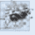

### 性能提示 5.1

> 避免在循环内部使用值不变的复杂表达式。即使你这样做了，当今许多先进的优化编译器也会自动将这些表达式放到生成的机器代码中的循环外部。

### 性能提示 5.2


> 许多编译器包含优化功能，可以改进你编写的代码的性能，但最好还是一开始就编写良好的代码。

## 5.5 do…while 重复语句

do…while 重复语句与 while 语句类似。在 while 语句中，循环延续条件测试在循环体执行之前、循环开始时进行。do…while 语句在循环体执行之后测试循环延续条件；因此，循环体总是至少执行一次。

图 5.7 使用 do…while 语句打印数字 1–10。进入 do…while 语句后，第 12 行输出 `counter` 的值，第 13 行递增 `counter`。然后程序在循环底部（第 14 行）评估循环延续测试。如果条件为真，循环从 do…while 中的第一条语句（第 12 行）继续。如果条件为假，循环终止，程序继续执行循环后的下一条语句（第 16 行）。

```cpp
// Fig. 5.7: fig05_07.cpp
// do...while repetition statement.
#include <iostream>
using namespace std;

int main()
{
   unsigned int counter = 1; // initialize counter

   do
   {
      cout << counter << " "; // display counter
      ++counter; // increment counter
   } while (counter <= 10 ); // end do...while

   cout << endl; // output a newline
} // end main
```

```text
1 2 3 4 5 6 7 8 9 10
```

**图 5.7**  |  do…while 重复语句。

### do…while 语句 UML 活动图

图 5.8 包含 do…while 语句的 UML 活动图，它清楚地表明循环延续条件直到循环至少执行一次循环体后才被评估。将此活动图与 while 语句的活动图（图 4.6）进行比较。

### do…while 语句中的花括号

如果 do…while 语句体中只有一条语句，则不一定要使用花括号；然而，大多数程序员会包含花括号，以避免混淆 while 和 do…while 语句。例如，

```cpp
while ( condition )
```

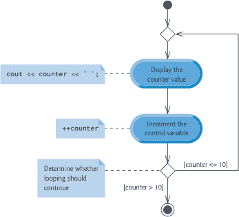

图 5.8 | 图 5.7 中 do...while 重复语句的 UML 活动图。

通常被视为 while 语句的头部。没有花括号、只有单条语句体的 do...while 看起来像

```cpp
do
    statement
while ( condition );
```

这可能会令人困惑。你可能将最后一行——`while( condition );`——误解为包含空语句作为循环体的 while 语句。因此，带有一条语句的 do...while 通常写成如下形式以避免混淆：

```cpp
do
{
    statement
} while ( condition );
```

## 5.6 switch 多分支选择语句

C++ 提供了 switch 多分支选择语句，根据变量或表达式可能的值执行许多不同的操作。每个操作都与一个整数常量表达式（即任何字符常量和整数常量的组合，其计算结果为整型常量值）的值相关联。

### 使用 switch 语句统计 A、B、C、D 和 E 成绩的 GradeBook 类

此版本的 GradeBook 类要求用户输入一组字母成绩，然后显示获得每种成绩的学生数量摘要。该类使用


成员函数 setCourseName、getCourseName 和 displayMessage 的定义与类 GradeBook 早期版本中的定义相同。

```cpp
// Fig. 5.10: GradeBook.cpp
// Member-function definitions for class GradeBook that
// uses a switch statement to count A, B, C, D and F grades.
#include <iostream>
#include "GradeBook.h" // include definition of class GradeBook
using namespace std;

// constructor initializes courseName with string supplied as an argument;
// initializes counter data members to 0
GradeBook::GradeBook( string name )
   : aCount( 0 ), // initialize count of A grades to 0
     bCount( 0 ), // initialize count of B grades to 0
     cCount( 0 ), // initialize count of C grades to 0
     dCount( 0 ), // initialize count of D grades to 0
     fCount( 0 ) // initialize count of F grades to 0
{
} // end GradeBook constructor

// function to set the course name; limits name to 25 or fewer characters
void GradeBook::setCourseName( string name )
{
   if ( name.size() <= 25 ) // if name has 25 or fewer characters
      courseName = name; // store the course name in the object
   else // if name is longer than 25 characters
   { // set courseName to first 25 characters of parameter name
      courseName = name.substr( 0, 25 ); // select first 25 characters
      cerr << "Name \"" << name << "\" exceeds maximum length (25).\n"
         << "\nlimiting courseName to first 25 characters.\n" << endl;
   } // end if...else
} // end function setCourseName

// function to retrieve the course name
string GradeBook::getCourseName() const
{
   return courseName;
} // end function getCourseName

// display a welcome message to the GradeBook user
void GradeBook::displayMessage()
{
   // this statement calls getCourseName to get the
   // name of the course this GradeBook represents
   cout << "Welcome to the grade book for\n" << getCourseName() << "!\n"
      << endl;
} // end function displayMessage

// input arbitrary number of grades from user; update grade counter
void GradeBook::inputGrades()
{
```

**图 5.10 |** GradeBook 类使用 switch 语句统计字母等级。（第 1 部分，共 3 部分。）

```cpp
   int grade; // grade entered by user

   cout << "Enter the letter grades." << endl
        << "Enter the EOF character to end input." << endl;

   // loop until user types end-of-file key sequence
   while ( ( grade = cin.get() ) != EOF )
   {
      // determine which grade was entered
      switch ( grade ) // switch statement nested in while
      {
         case 'A': // grade was uppercase A
         case 'a': // or lowercase a
            ++aCount; // increment aCount
            break; // necessary to exit switch

         case 'B': // grade was uppercase B
         case 'b': // or lowercase b
            ++bCount; // increment bCount
            break; // exit switch

         case 'C': // grade was uppercase C
         case 'c': // or lowercase c
            ++cCount; // increment cCount
            break; // exit switch

         case 'D': // grade was uppercase D
         case 'd': // or lowercase d
            ++dCount; // increment dCount
            break; // exit switch

         case 'F': // grade was uppercase F
         case 'f': // or lowercase f
            ++fCount; // increment fCount
            break; // exit switch

         case '\n': // ignore newlines,
         case '\t': // tabs,
         case ' ': // and spaces in input
            break;

         default: // catch all other characters
            cout << "Incorrect letter grade entered."
                 << " Enter a new grade." << endl;
            break; // optional; will exit switch anyway
      } // end switch
   } // end while
} // end function inputGrades

// display a report based on the grades entered by user
void GradeBook::displayGradeReport() const
{
```

**图 5.10 |** GradeBook 类使用 switch 语句统计字母等级。（第 2 部分，共 3 部分。）

```cpp
   // output summary of results
   cout << "\nNumber of students who received each letter grade:"
        << "\nA: " << aCount // display number of A grades
        << "\nB: " << bCount // display number of B grades
        << "\nC: " << cCount // display number of C grades
        << "\nD: " << dCount // display number of D grades
        << "\nF: " << fCount // display number of F grades
        << endl;
} // end function displayGradeReport
```

**图 5.10 |** GradeBook 类使用 switch 语句统计字母等级。（第 3 部分，共 3 部分。）

## 读取字符输入

用户通过成员函数 inputGrades（第 49–98 行）输入某门课程的字母等级。在第 57 行的 while 头中，括号内的赋值表达式 (grade = cin.get()) 首先执行。cin.get() 函数从键盘读取一个字符，并将该字符存储在整型变量 grade（在第 51 行声明）中。通常，字符存储在 char 类型的变量中；但字符也可以存储在任何整数数据类型中，因为 short、int、long 和 long long 类型被保证至少与 char 类型一样大。因此，我们可以根据用途将字符视为整数或字符。例如，语句

```cpp
cout << "The character " << 'a' << " has the value "
     << static_cast<int> ( 'a' ) << endl;
```

会打印该字符及其整数值，结果如下：

```text
The character a has the value 97
```

整数 97 是该字符在计算机中的数值表示。附录 B 列出了 ASCII（美国标准信息交换码）字符集中的字符及其对应的十进制值。

通常，赋值语句的值就是赋给 = 左侧变量的值。因此，赋值表达式 grade = cin.get() 的值与 cin.get() 返回并赋给变量 grade 的值相同。

赋值表达式具有值这一事实可用于将同一个值赋给多个变量。例如，

```cpp
a = b = c = 0;
```

首先计算 c = 0（因为 = 运算符从右向左结合）。然后将 c = 0 的值（即 0）赋给变量 b。接着，将 b = (c = 0) 的值（也是 0）赋给 a。在程序中，grade = cin.get() 的值与 EOF（表示“end-of-file”的符号缩写）的值进行比较。我们使用 EOF（通常值为 −1）作为哨兵值。但您不需要输入值 −1，也不需要输入字母 EOF 作为哨兵值。相反，您需要输入一个与系统相关、表示“文件结尾”的按键组合，以表示没有更多数据要输入。EOF 是一个符号整型常量，通过 `<iostream>` 头文件包含到程序中。¹ 如果赋给 grade 的值等于 EOF，while 循环（第 57–97 行）将终止。我们选择将输入到该程序中的字符表示为 int 类型，因为 EOF 是 int 类型。

¹ 为了编译此程序，某些编译器需要头文件 `<cstdio>`，其中定义了 EOF。

### 输入 EOF 指示符

在 OS X/Linux/UNIX 系统及许多其他系统上，文件结尾的输入方式是在单独一行中输入

`<Ctrl> d`

这种表示法表示按住 Ctrl 键，然后按 d 键。在其他系统（如 Microsoft Windows）上，可通过输入

`<Ctrl> z`

> [注意：在某些情况下，您必须在前面的按键序列之后按 Enter 键。此外，屏幕上有时会出现 ^Z 字符来表示文件结尾，如图 5.11 所示。]


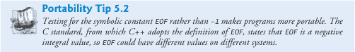

在此程序中，用户在键盘上输入等级。当用户按下 Enter（或 Return）键时，cin.get() 函数会一次一个字符地读取这些字符。如果输入的字符不是文件结尾，控制流将进入 switch 语句（图 5.10，第 60–96 行），该语句会递增相应的字母等级计数器。

### switch 语句细节

switch 语句由一系列 case 标签和一个可选的 default 分支组成。在此示例中，这些标签和分支用于根据成绩来决定递增哪个计数器。当控制流到达 switch 时，程序计算关键字 switch（第 60 行）后括号中的表达式（即 grade）。这称为控制表达式。switch 语句将控制表达式的值与每个 case 标签进行比较。假设用户输入字母 C 作为成绩。程序将 C 与 switch 中的每个 case 进行比较。如果发生匹配（第 72 行的 case 'C':），程序将执行该 case 的语句。对于字母 C，第 74 行将 cCount 递增 1。第 75 行的 break 语句使程序控制权转到 switch 之后的第一条语句——在此程序中，控制权转移到第 97 行。该行标记输入成绩的 while 循环体（第 57–97 行）的结束，因此控制权流向 while 的条件（第 57 行）以确定循环是否应继续执行。

此 switch 中的各 case 明确测试了字母 A、B、C、D 和 F 的小写和大写版本。注意第 62–63 行的 case 测试值为 'A' 和 'a'（两者都代表等级 A）。将 case 连续列出且中间没有语句，可使这些 case 执行同一组语句——当控制表达式的结果为 'A' 或 'a' 时，将执行第 64–65 行的语句。每个 case 可以有多条语句。switch 选择语句不要求在每个 case 中用花括号将多条语句括起来。


对于输入无效成绩（即 E）的响应。第 12 行调用 GradeBook 成员函数 `displayGradeReport`（在图 5.10 的第 101–111 行定义），该函数根据输入的成绩输出报告（如图 5.11 中的输出所示）。

```cpp
// Fig. 5.11: fig05_11.cpp
// Creating a GradeBook object and calling its member functions.
#include "GradeBook.h" // include definition of class GradeBook

int main()
{
   // create GradeBook object
   GradeBook myGradeBook( "CS101 C++ Programming" );

   myGradeBook.displayMessage(); // display welcome message
   myGradeBook.inputGrades(); // read grades from user
   myGradeBook.displayGradeReport(); // display grade report based on grades
} // end main
```

```text
Welcome to the grade book for
CS101 C++ Programming!

Enter the letter grades.
Enter the EOF character to end input.
a
B
c
C
A
d
f
C
E
Incorrect letter grade entered. Enter a new grade.
D
A
b
^Z

Number of students who received each letter grade:
A: 3
B: 2
C: 3
D: 2
F: 1
```

**图 5.11** | 创建 GradeBook 对象并调用其成员函数。

## switch 语句的 UML 活动图

图 5.12 展示了通用 switch 多重选择语句的 UML 活动图。大多数 switch 语句在每个 case 中使用 break，在处理完该 case 后终止 switch 语句。图 5.12 通过在活动图中包含 break 语句来强调这一点。如果没有 break 语句，在一个 case 处理完后，控制不会转移到 switch 语句之后的第一条语句，而是会转移到下一个 case 的动作。

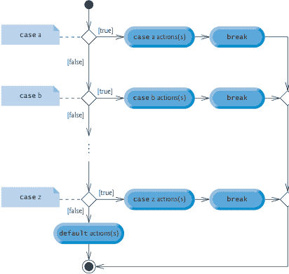

**图 5.12**  带 break 语句的 switch 多重选择语句 UML 活动图。

该图清楚地表明，case 末尾的 break 语句会使控制立即退出 switch 语句。再次注意，（除了初始状态、转移箭头、最终状态和若干注释外）图中还包含动作状态和判定。此外，该图使用合并符号将来自 break 语句的转移合并到最终状态。

使用 switch 语句时，请记住每个 case 只能用于测试一个整型常量表达式——即字符常量和整型常量的任意组合，该组合求值为一个常量整数值。字符常量用单引号中的特定字符表示，例如 'A'。整型常量就是一个整数值。此外，每个 case 标签只能指定一个整型常量表达式。

> **常见编程错误 5.8**
>
> 在 switch 的 case 标签中指定非常量的整型表达式是语法错误。

> **常见编程错误 5.9**
>
> 在 switch 语句中提供相同值的 case 标签是编译错误。

```cpp
// Fig. 5.13: fig05_13.cpp
// break statement exiting a for statement.
#include <iostream>
using namespace std;

int main()
{
    unsigned int count; // control variable also used after loop terminates

    for ( count = 1; count <= 10; ++count ) // loop 10 times
    {
        if ( count == 5 )
            break; // break loop only if count is 5

        cout << count << " ";
    } // end for

    cout << "\nBroke out of loop at count = " << count << endl;
} // end main
```

```text
1 2 3 4
Broke out of loop at count = 5
```

*图 5.13* | *break 语句退出 for 语句。*

控制变量 count 定义在 for 语句头之外，这样我们既可以在*循环体内*使用这个控制变量，也可以在*循环执行完成之后*使用它。

## continue 语句

*continue 语句*在 while、for 或 do...while 语句中执行时，会跳过该语句主体中剩余的语句，并继续循环的下一次迭代。在 while 和 do...while 语句中，循环继续测试在 continue 语句执行后立即求值。在 for 语句中，先执行增量表达式，然后对循环继续测试求值。

图 5.14 在 for 语句中使用 continue 语句（第 11 行），当嵌套的 if（第 10–11 行）确定 count 的值为 5 时，跳过输出语句（第 13 行）。当 continue 语句执行时，程序控制继续执行 for 头中的控制变量增量（第 8 行），再循环五次。

```cpp
// Fig. 5.14: fig05_14.cpp
// continue statement terminating an iteration of a for statement.
#include <iostream>
using namespace std;

int main()
{
    for ( unsigned int count = 1; count <= 10; ++count ) // loop 10 times
    {
        if ( count == 5 )  // if count is 5,
            continue;       // skip remaining code in loop

        cout << count << " ";
    } // end for

    cout << "\nUsed continue to skip printing 5" << endl;
} // end main
```

```text
1 2 3 4 6 7 8 9 10
Used continue to skip printing 5
```

*图 5.14* | continue 语句终止 for 语句的一次迭代。

在 5.3 节中，我们指出在大多数情况下可以使用 while 语句来表示 for 语句。唯一的例外是当 while 语句中的增量表达式在 continue 语句之后时。在这种情况下，增量不会在程序测试循环继续条件之前执行，while 语句也不会像 for 语句那样执行。

> **良好编程实践 5.5**
>
> 有些程序员认为 break 和 continue 违反了结构化编程。这些语句的效果可以通过我们很快将学习的结构化编程技术来实现，因此这些程序员不必使用 break 和 continue。大多数程序员认为在 switch 语句中使用 break 是可以接受的。

> **软件工程观察 5.1**
>
> 在实现高质量软件工程和实现最佳性能软件之间存在矛盾。通常，其中一个目标是以牺牲另一个目标为代价实现的。除了对性能要求最苛刻的情况外，请遵循以下准则：首先，让你的代码简单且正确；然后，只有在必要时才使其又快又小。

## 5.8 逻辑运算符

到目前为止，我们只研究了简单条件，例如 `counter <= 10`、`total > 1000` 和 `number != sentinelValue`。我们使用关系运算符 `>`、`<`、`>=` 和 `<=` 以及相等运算符 `==` 和 `!=` 来表达这些条件。每个判定恰好测试一个条件。为了在做出决策时测试多个条件，我们可以在单独的语句中或嵌套的 if 或 if...else 语句中执行这些测试。

C++ 提供了逻辑运算符，用于通过组合简单条件来形成更复杂的条件。这些逻辑运算符是 `&&`（逻辑与）、`||`（逻辑或）和 `!`（逻辑非，也称为逻辑否定）。

### 逻辑与（&&）运算符

假设我们希望确保两个条件都为真时才选择某条执行路径。在这种情况下，我们可以使用 `&&`（逻辑与）运算符，如下所示：

```cpp
if ( gender == FEMALE && age >= 65 )
   ++seniorFemales;
```

这个 if 语句包含两个简单条件。条件 `gender == FEMALE` 在此用于判断一个人是否为女性。条件 `age >= 65` 判断一个人是否为老年人。`&&` 运算符左侧的简单条件首先求值。如有必要，`&&` 运算符右侧的简单条件接着求值。正如我们稍后将讨论的，逻辑与表达式的右侧只有在左侧为真时才会求值。然后 if 语句会考虑组合条件

```cpp
gender == FEMALE && age >= 65
```

该条件当且仅当**两个**简单条件都为真时才为真。最后，如果这个组合条件确实为真，if 语句体中的语句会将 `seniorFemales` 的计数加 1。如果两个简单条件中的任何一个（或两个）为假，程序就会跳过递增操作，继续执行 if 之后的语句。通过在组合条件中添加冗余的括号，可以使其更具可读性：

```cpp
( gender == FEMALE ) && ( age >= 65 )
```

> **常见编程错误 5.10**
>
> 尽管 `3 < x && x < 7` 在数学上是正确的条件，但在 C++ 中其求值结果可能并非你所期望。请使用 `( 3 < x && x < 7 )` 在 C++ 中获得正确的求值。

图 5.15 总结了 `&&` 运算符。该表显示了 *expression1* 和 *expression2* 的假和真值的所有四种可能组合。这样的表通常称为**真值表**。C++ 会将所有包含关系运算符、相等运算符和/或逻辑运算符的表达式求值为假或真。

| 表达式1 | 表达式2 | 表达式1 && 表达式2 |
|---|---|---|
| 假 | 假 | 假 |
| 假 | 真 | 假 |
| 真 | 假 | 假 |
| 真 | 真 | 真 |

**图 5.15**  `&&`（逻辑与）运算符真值表。

### 逻辑或（||）运算符

现在让我们考虑 `||`（逻辑或）运算符。假设我们希望确保两个条件中的一个或两个为真时才选择某条执行路径。在这种情况下，我们使用 `||` 运算符，如下面的程序片段所示：

```cpp
if ( ( semesterAverage >= 90 ) || ( finalExam >= 90 ) )
    cout << "Student grade is A" << endl;
```

前面的条件包含两个简单条件。简单条件 `semesterAverage >= 90` 用于判断学生是否因为整个学期的扎实表现而应获得课程“A”等成绩。简单条件


`finalExam >= 90` 用于判断学生是否因期末考试表现优异而应获得课程“A”等级。`if` 语句随后考虑组合条件

```
(`semesterAverage >= 90`) || (`finalExam >= 90`)
```

如果两个简单条件中有一个或两个为真，则授予学生“A”等级。除非两个简单条件均为假，否则会打印消息“Student grade is A”。图 5.16 是逻辑或运算符（`||`）的真值表。

| expression1 | expression2 | expression1 \|\| expression2 |
|---|---|---|
| false | false | false |
| false | true | true |
| true | false | true |
| true | true | true |

**图 5.16** `||`（逻辑或）运算符真值表。

`&&` 运算符的优先级高于 `||` 运算符。两个运算符都从左向右结合。包含 `&&` 或 `||` 运算符的表达式仅在表达式的真假已知之前进行求值。因此，表达式

```
( gender == FEMALE ) && ( age >= 65 )
```

如果 gender 不等于 FEMALE（即整个表达式为 false），则立即停止求值；如果 gender 等于 FEMALE（即如果条件 `age >= 65` 为 true，则整个表达式仍可能为 true），则继续求值。这种针对逻辑与和逻辑或表达式求值的性能特性称为**短路求值**。

> **性能提示 5.3**
>
> 在使用运算符 `&&` 的表达式中，如果各个条件相互独立，请将最可能为 false 的条件放在最左侧。在使用运算符 `||` 的表达式中，请将最可能为 true 的条件放在最左侧。这种短路求值的用法可以减少程序的执行时间。

## 逻辑非（!）运算符

C++ 提供了 `!`（逻辑非，也称为逻辑否定）运算符来“反转”条件的含义。一元逻辑非运算符只有一个条件作为操作数。当我们希望在原始条件（不带逻辑非运算符）为 false 时选择执行路径，就将一元逻辑非运算符放在条件之前，例如以下程序段：

```
if ( ! ( grade == sentinelValue ) )
    cout << "The next grade is " << grade << endl;
```

条件 `grade == sentinelValue` 周围的括号是必需的，因为逻辑非运算符的优先级高于相等运算符。

通过使用适当的关系或相等运算符，通常可以避免使用 `!` 运算符。例如，前面的 `if` 语句也可以写成如下形式：

```
if ( grade != sentinelValue )
    cout << "The next grade is " << grade << endl;
```

这种灵活性通常可以帮助你以更“自然”或更方便的方式表达条件。图 5.17 是逻辑非运算符（`!`）的真值表。

| expression | !expression |
|---|---|
| false | true |
| true | false |

**图 5.17** `!`（逻辑非）运算符真值表。

## 逻辑运算符示例

图 5.18 通过生成真值表演示了逻辑运算符。输出显示了每个被求值的表达式及其 `bool` 结果。默认情况下，`bool` 值 `true` 和 `false` 由 `cout` 和流插入运算符分别显示为 1 和 0。我们在第 9 行使用**流操纵符 boolalpha**（一种粘性操纵符）来指定每个 `bool` 表达式的值应显示为单词“true”或“false”。例如，第 10 行中表达式 `false && false` 的结果为 false，因此输出的第二行包含单词“false”。第 9–13 行生成 `&&` 的真值表。第 16–20 行生成 `||` 的真值表。第 23–25 行生成 `!` 的真值表。

```cpp
#include <iostream>
using namespace std;

int main()
{
    // create truth table for && (logical AND) operator
    cout << boolalpha << "Logical AND (&&)"
        << "\nfalse && false: " << (false && false)
        << "\nfalse && true: " << (false && true)
        << "\ntrue && false: " << (true && false)
        << "\ntrue && true: " << (true && true) << "\n\n";

    // create truth table for || (logical OR) operator
    cout << "\nLogical OR (||)"
        << "\nfalse || false: " << (false || false)
        << "\nfalse || true: " << (false || true)
        << "\ntrue || false: " << (true || false)
        << "\ntrue || true: " << (true || true) << "\n\n";

    // create truth table for ! (logical negation) operator
    cout << "Logical NOT (!)"
         << "\n!false: " << (!false)
         << "\n!true: " << (!true) << endl;
} // end main
```

**图 5.18** | 逻辑运算符。（第 1 部分，共 2 部分）

```
Logical AND (&&)
false && false: false
false && true: false
true && false: false
true && true: true

Logical OR (||)
false || false: false
false || true: true
true || false: true
true || true: true

Logical NOT (!)
!false: true
!true: false
```

**图 5.18** | 逻辑运算符。（第 2 部分，共 2 部分）

## 运算符优先级和结合性总结

图 5.19 将逻辑和逗号运算符添加到运算符优先级和结合性图表中。运算符按优先级从高到低自上而下排列。

| 运算符 | 结合性 | 类型 |
|---|---|---|
| `::` `()` `[]` `->` `.` | 从左到右<br>*[关于分组括号，请参阅图 2.10 中的注意事项。]* | 主表达式 |
| `++` `--` `static_cast<type>()` | 从左到右 | 后缀 |
| `++` `--` `+` `-` `!` | 从右到左 | 一元（前缀） |
| `*` `/` `%` | 从左到右 | 乘法 |
| `+` `-` | 从左到右 | 加法 |
| `<<` `>>` | 从左到右 | 插入/提取 |
| `<` `<=` `>` `>=` | 从左到右 | 关系 |
| `==` `!=` | 从左到右 | 相等 |
| `&&` | 从左到右 | 逻辑与 |
| `\|\|` | 从左到右 | 逻辑或 |
| `?:` | 从右到左 | 条件 |
| `=` `+=` `-=` `*=` `/=` `%=` | 从右到左 | 赋值 |
| `,` | 从左到右 | 逗号 |

**图 5.19** | 运算符优先级和结合性。

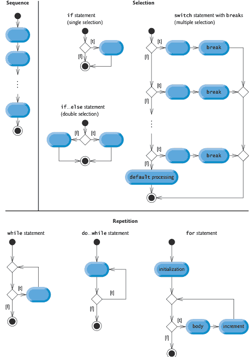

**图 5.20** | C++ 的单入口/单出口顺序、选择和重复语句。

| 形成结构化程序的规则 |
|---|
| 1) 从“最简单的活动图”（图 5.22）开始。 |
| 2) 任何动作状态都可以替换为两个顺序动作状态。 |
| 3) 任何动作状态都可以替换为任何控制语句（顺序、if、if...else、switch、while、do...while 或 for）。 |
| 4) 规则 2 和规则 3 可以按任意顺序任意次数地应用。 |

**图 5.21** | 形成结构化程序的规则


**图 5.22** | 最简单的活动图。

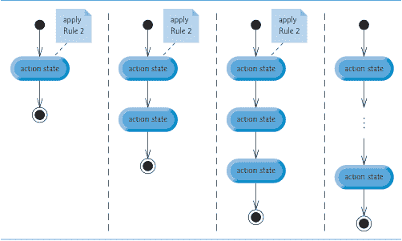

**图 5.23** | 将图 5.21 的规则 2 反复应用于最简单的活动图。

规则 3 是嵌套规则。将规则 3 反复应用于最简单的活动图，会得到一个具有整齐嵌套控制语句的图。例如，在图 5.24 中，最简单的活动图中的动作状态被替换为双选择（if...else）语句。然后再次将规则 3 应用于双选择语句中的动作状态，将每个动作状态替换为双选择语句。每个双选择语句周围的虚线动作状态符号表示在前一个活动图中被替换的动作状态。*[注意：* 图 5.24 中显示的虚线箭头和虚线动作状态符号不是 UML 的一部分。它们在这里用作教学手段，以说明任何动作状态都可以替换为控制语句。*]*

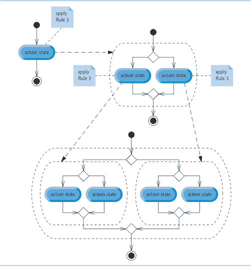

**图 5.24** | 将图 5.21 的规则 3 多次应用于最简单的活动图。

规则 4 生成更大、更复杂且嵌套更深的语句。应用图 5.21 中的规则所产生的图构成了所有可能活动图的集合，因此也构成了所有可能结构化程序的集合。结构化方法的美妙之处在于，我们只使用*七种*简单的单入口/单出口控制语句，并且仅以*两种*简单方式组装它们。


如果遵循图 5.21 中的规则，就不可能创建出语法非法的活动图（例如图 5.25 中的活动图）。如果不确定某个图是否合法，可以反向应用图 5.21 中的规则，尝试将该图简化为最简单的活动图。如果它能简化为最简单的活动图，则原图是结构化的；否则就不是。

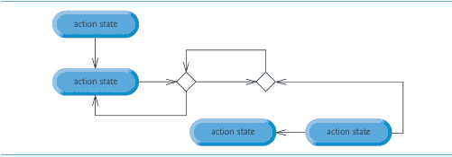

**图 5.25** | 具有非法语法的活动图。

结构化编程推崇简洁。伯姆（Böhm）和雅科皮尼（Jacopini）已经给出了结论：只需要*三种*控制形式：

- 顺序
- 选择
- 循环

顺序结构十分简单。只需按应执行的顺序列出要执行的语句即可。

选择结构通过以下三种方式之一实现：

- `if` 语句（单选择）
- `if...else` 语句（双选择）
- `switch` 语句（多选择）

很容易证明，*简单的 if 语句足以提供任何*形式的选择——凡是用 `if...else` 语句和 `switch` 语句能完成的事情，都可以通过组合 `if` 语句来实现（尽管可能不如它们清晰、高效）。

循环结构通过以下三种方式之一实现：

- `while` 语句
- `do...while` 语句
- `for` 语句

很容易证明，*while 语句就足以*提供任何形式的循环。凡是能用 `do...while` 语句和 `for` 语句完成的事情，都可以用 `while` 语句完成（尽管可能不如它们流畅）。

综合这些结果可以看出，C++ 程序中所需的*任何*控制形式都可以用以下内容表示：

- 顺序
- if 语句（选择）
- while 语句（循环）

而且这些控制语句只能以*两种方式*组合——堆叠和嵌套。事实上，结构化编程推崇简洁。

## 5.11 小结

至此，我们已经完成了对控制语句的介绍，这些语句使你可以控制程序中执行的流程。第 4 章讨论了 if、if...else 和 while 语句。本章演示了 for、do...while 和 switch 语句。我们说明了，任何算法都可以通过组合顺序结构、三种选择语句（if、if...else 和 switch）以及三种循环语句（while、do...while 和 for）来开发。我们讨论了如何组合这些基本构件，以利用经过验证的程序构造和问题求解技术。你使用了 break 和 continue 语句来改变循环语句的控制流。我们还介绍了逻辑运算符，它们使你能在控制语句中使用更复杂的条件表达式。最后，我们探讨了混淆相等运算符与赋值运算符这一常见错误，并给出了避免这些错误的建议。在第 6 章中，我们将更深入地考察函数。

## 本章小结

### 5.2 节 计数器控制循环的要点

- 在 C++ 中，把同时保留内存的变量声明称为定义（第 158 页）更为精确。

### 5.3 节 for 循环语句

- for 循环语句（第 159 页）处理计数器控制循环的所有细节。
- for 语句的一般格式为

  ```
  for ( initialization; loopContinuationCondition; increment )
      statement
  ```

  其中 *initialization* 初始化控制变量，*loopContinuationCondition* 确定循环是否应继续执行，*increment* 递增或递减控制变量。

- 通常，for 语句用于计数器控制循环，while 语句用于哨兵控制循环。
- 变量的作用域（第 161 页）指定了它可以在程序中的哪些位置使用。
- 逗号运算符（第 161 页）的优先级是所有 C++ 运算符中最低的。逗号分隔的表达式列表的值和类型是列表中位于最右侧的表达式的值和类型。
- for 语句的初始化、循环继续条件和递增表达式可以包含算术表达式。此外，for 语句的递增可以为负。
- 如果 for 语句头中的循环继续条件初始为 false，则不执行 for 语句体，而是继续执行 for 之后的语句。

### 5.4 节 使用 for 语句的示例

- 标准库函数 `pow(x, y)`（第 165 页）计算 x 的 y 次幂的值。函数 pow 接受两个 double 类型的参数，并返回一个 double 值。
- 参数化流操纵符 `setw`（第 167 页）指定下一个输出值应出现的字段宽度，默认右对齐。如果值大于字段宽度，则扩展字段宽度以容纳整个值。流操纵符 `left`（第 167 页）使值左对齐，`right`（第 167 页）可用于恢复右对齐。
- 粘性输出格式设置（第 167 页）在更改前一直有效。

### 5.5 节 do…while 循环语句

- do…while 循环语句在循环末尾测试循环继续条件，因此循环体至少执行一次。do…while 语句的格式为

  ```
  do
  {
      statement
  } while ( condition );
  ```

### 5.6 节 switch 多选择语句

- switch 多选择语句（第 169 页）根据其控制表达式的值执行不同的操作。
- 函数 `cin.get()` 从键盘读取一个字符。字符通常存储在 char 类型的变量中（第 173 页）。一个字符既可以当作整数处理，也可以当作字符处理。
- switch 语句由一系列 case 标签（第 174 页）和一个可选的 default 分支（第 174 页）组成。
- switch 后括号中的表达式称为控制表达式（第 174 页）。switch 语句将控制表达式的值与每个 case 标签进行比较。
- 连续的、且之间没有语句的 case 执行同一组语句。
- 每个 case 标签只能指定一个整型常量表达式。
- 每个 case 可以有多个语句。switch 选择语句与其他控制语句的不同之处在于，它不要求在每个 case 的多个语句周围使用花括号。
- C++ 提供了多种表示整数的数据类型——int、char、short、long 和 long long。每种类型的整数值范围取决于平台。
- C++11 允许你在类声明中声明数据成员时为其提供默认值。

### 5.7 节 break 和 continue 语句

- break 语句（第 178 页）在某个循环语句（for、while 和 do…while）中执行时，会导致立即退出该语句。
- continue 语句（第 179 页）在循环语句中执行时，会跳过循环体中剩余的任何语句，并继续进行循环的下一次迭代。在 while 或 do…while 语句中，执行继续进行下一次条件求值。在 for 语句中，执行继续进行 for 语句头中的递增表达式。

### 5.8 节 逻辑运算符

- 逻辑运算符（第 180 页）使你能够通过组合简单条件来构成复杂条件。逻辑运算符包括 `&&`（逻辑与）、`||`（逻辑或）和 `!`（逻辑非）。
- `&&`（逻辑与，第 180 页）运算符确保两个条件都为真。
- `||`（逻辑或，第 181 页）运算符确保两个条件中有一个为真或两个都为真。
- 包含 `&&` 或 `||` 运算符的表达式只求值到表达式的真假已知为止。这种用于求值逻辑与和逻辑或表达式的性能特性称为短路求值（第 182 页）。
- `!`（逻辑非，也称为逻辑否定；第 182 页）运算符使程序员能够“反转”条件的含义。一元逻辑非运算符放在条件前面，以便在原始条件（不含逻辑非运算符）为假时选择一条执行路径。在大多数情况下，你可以用适当的关系运算符或相等运算符来表达条件，从而避免使用逻辑非。
- 当用作条件时，任何非零值都会隐式转换为 `true`；0（零）隐式转换为 `false`。
- 默认情况下，`cout` 将 bool 值 `true` 和 `false` 分别显示为 1 和 0。流操纵符 `boolalpha`（第 183 页）指定每个 bool 表达式的值应显示为单词“true”或“false”。

### 5.9 节 混淆相等运算符（`==`）与赋值运算符（`=`）

- 任何产生值的表达式都可以用在任何控制语句的判断部分。如果表达式的值为零，则将其视为 `false`；如果值非零，则将其视为 `true`。
- 赋值会产生一个值——即赋给赋值运算符左侧变量的值。

### 5.10 节 结构化编程小结

- 任何控制形式都可以用顺序、选择和循环语句来表示，而这些语句只能以两种方式组合——堆叠和嵌套。

## 自测练习

- 5.1 判断下列说法是否正确。如果答案为假，请解释原因。
  - a) switch 选择语句中必须有 default 分支。
  - b) 在 switch 选择语句的 default 分支中，必须使用 `break` 语句才能正确退出 switch。
  - c) 如果表达式 `x > y` 为真或表达式 `a < b` 为真，则表达式 `(x > y && a < b)` 为真。
  - d) 如果包含 `||` 运算符的表达式的任一操作数或两个操作数为真，则该表达式为真。
- 5.2 编写一条 C++ 语句或一组 C++ 语句来完成下列各项任务：
  - a) 使用 `for` 语句求 1 到 99 之间的奇数之和。使用 `unsigned int` 变量 `sum` 和 `count`。
  - b) 以精度 1、2 和 3 在 15 个字符宽的字段中打印值 `333.546372`。在同一行打印每个数字。将每个数字在其字段中左对齐。会打印出哪三个值？
  - c) 使用函数 `pow` 计算 2.5 的 3 次幂的值。以精度 2 在 10 个位置的字段宽度中打印结果。会打印出什么？
  - d) 使用 `while` 循环和 unsigned int 计数器变量 `x` 打印 1 到 20 的整数。每行只打印 5 个整数。[提示：当 `x % 5` 为 0 时，打印一个换行符；否则，打印一个制表符。]
  - e) 使用 `for` 语句重复练习 5.2(d)。


## 5.3 找出下列各代码段中的错误，并说明如何改正。

a)

```cpp
unsigned int x = 1;
while ( x <= 10 );
    ++x;
}
```

b)

```cpp
for ( double y = 0.1, y != 1.0; y += .1 )
    cout << y << endl;
```

c)

```cpp
switch ( n )
{
    case 1:
        cout << "The number is 1" << endl;
    case 2:
        cout << "The number is 2" << endl;
        break;
    default:
        cout << "The number is not 1 or 2" << endl;
        break;
}
```

d) 以下代码应打印数值 1 到 10。

```cpp
unsigned int n = 1;
while ( n < 10 )
    cout << n++ << endl;
```

## 自测练习答案

### 5.1

- a) 错误。default 分支是可选的。不过，良好的软件工程实践通常要求始终提供 default 分支。
- b) 错误。break 语句用于退出 switch 语句。当 default 分支是最后一个分支时，不需要 break 语句。如果让控制流程继续进入下一个分支是合理的，也不需要 break 语句。
- c) 错误。使用 `&&` 运算符时，两个关系表达式都必须为真，整个表达式才为真。
- d) 正确。

### 5.2

a)

```cpp
unsigned int sum = 0;
for ( unsigned int count = 1; count <= 99; count += 2 )
    sum += count;
```

b)

```cpp
cout << fixed << left
     << setprecision( 1 ) << setw( 15 ) << 333.546372
     << setprecision( 2 ) << setw( 15 ) << 333.546372
     << setprecision( 3 ) << setw( 15 ) << 333.546372
     << endl;
```

输出是：

```text
333.5       333.55       333.546
```

c)

```cpp
cout << fixed << setprecision( 2 ) << setw( 10 ) << pow( 2.5, 3 ) << endl;
```

输出是：

```text
15.63
```

d)

```cpp
unsigned int x = 1;
while ( x <= 20 )
{
```

### 5.5 (整数求和)

编写一个程序，使用 `for` 语句对一系列整数求和。假设读取的第一个整数指定了剩余要输入的数值个数。程序每次输入语句只读取一个值。一个典型的输入序列可能是

`5 100 200 300 400 500`

其中 5 表示接下来要求和的 5 个数值。

### 5.6 (求整数平均值)

编写一个程序，使用 `for` 语句计算若干整数的平均值。假设读取的最后一个值是哨兵值 9999。例如，序列 `10 8 11 7 9 9999` 表示程序应计算 9999 之前所有值的平均值。

### 5.7 (这个程序做什么？)

下面的程序做什么？

```cpp
// Exercise 5.7: ex05_07.cpp
// What does this program do?
#include <iostream>
using namespace std;

int main()
{
   unsigned int x; // declare x
   unsigned int y; // declare y

   // prompt user
   cout << "Enter two integers in the range 1-20: ";
   cin >> x >> y; // read values for x and y

   for ( unsigned int i = 1; i <= y; ++i ) // count from 1 to y
   {
      for ( unsigned int j = 1; j <= x; ++j ) // count from 1 to x
         cout << '@'; // output @

      cout << endl; // begin new line
   } // end outer for
} // end main
```

### 5.8 (找出最小整数)

编写一个程序，使用 `for` 语句找出若干整数中的最小值。假设读取的第一个值指定了剩余数值的个数。

### 5.9 (奇数之积)

编写一个程序，使用 `for` 语句计算并打印从 1 到 15 的奇数之积。

### 5.10 (阶乘)

阶乘函数经常用于概率问题。使用练习 4.34 中阶乘的定义，编写一个程序，使用 `for` 语句计算从 1 到 5 的整数的阶乘。以表格形式打印结果。计算 20 的阶乘可能会遇到什么困难？

### 5.11 (复利)

修改第 5.4 节的复利程序，使其对利率 5%、6%、7%、8%、9% 和 10% 重复执行其步骤。使用 `for` 语句改变利率。

### 5.12 (使用嵌套 `for` 循环绘制图案)

编写一个程序，使用 `for` 语句分别打印下列图案，一个在另一个下方。使用 `for` 循环生成这些图案。所有星号（`*`）都应通过一条 `cout << '*';` 形式的语句打印（这样星号会并排打印）。*提示：* 最后两个图案要求每行以适当数量的空格开头。附加题：将四个独立问题的代码合并为一个程序，通过巧妙地使用嵌套 `for` 循环，使四个图案并排打印。

```text
       (a)          (b)          (c)          (d)
       *            **********       **********          *
       **           *********        *********           **
       ***          ********         ********            ***
       ****         *******          *******             ****
       *****        ******           ******              *****
       ******       *****            *****               ******
       *******      ****             ****                *******
       ********     ***              ***                 ********
       *********    **               **                  *********
       **********   *                *                   **********
```

### 5.13 (条形图)

计算机的一个有趣应用是绘制图形和条形图。编写一个程序读取五个数字（每个数字在 1 到 30 之间）。假设用户只输入有效值。对于读取的每个数字，程序应打印一行包含该数字个数的连续星号。例如，如果程序读取数字 7，则应打印 `*******`。

### 5.14 (计算总销售额)

一家邮购公司销售五种不同的产品，零售价分别为：产品 1—$2.98，产品 2—$4.50，产品 3—$9.98，产品 4—$4.49，产品 5—$6.87。编写一个程序，按如下方式读取一系列数对：

- a) 产品编号
- b) 销售数量

程序应使用 switch 语句确定每种产品的零售价。程序应计算并显示所有已售产品的总零售价值。使用哨兵控制的循环来确定程序何时应停止循环并显示最终结果。

### 5.15 (GradeBook 程序修改)

修改图 5.9–图 5.11 中的 GradeBook 程序，使其计算平均绩点。A 等级计 4 分，B 等级计 3 分，依此类推。

### 5.16 (复利计算)

修改图 5.6，使其仅使用整数来计算复利。[提示：将所有货币金额视为便士数。然后使用除法和取模运算将结果“分解”为美元和美分部分。插入一个小数点。]

### 5.17 (输出什么？)

假设 `i = 1, j = 2, k = 3`，且 `m = 2`。每条语句输出什么？

- a) `cout << ( i == 1 ) << endl;`
- b) `cout << (j == 3 ) << endl;`
- c) `cout << (i >= 1 && j < 4 ) << endl;`
- d) `cout << (m <= 99 && k > m ) << endl;`
- e) `cout << (j > 1 || k == m ) << endl;`
- f) `cout << (k + m < j || i == j ) << endl;`
- g) `cout << (!m) << endl;`
- h) `cout << (!(j == m )) << endl;`
- i) `cout << (!(k > m )) << endl;`

### 5.18 (数制表)

编写一个程序，打印十进制数 1–256 范围内各数的二进制、八进制和十六进制等价形式表。如果你不熟悉这些数制，请阅读附录 D。[提示：可以使用流操纵符 dec、oct 和 hex 分别以十进制、八进制和十六进制格式显示整数。]

### 5.19 (计算 π)

根据无穷级数计算 π 的值

\[
\pi = 4 - \frac{4}{3} + \frac{4}{5} - \frac{4}{7} + \frac{4}{9} - \frac{4}{11} + \cdots
\]

打印一张表，显示该级数前 1000 项中每一项之后 π 的近似值。

### 5.20 (毕达哥拉斯三元组)

直角三角形的边长可以都是整数。直角三角形边长的三个整数值称为毕达哥拉斯三元组。这三条边必须满足关系：其中两条边的平方和等于斜边的平方。


**5.26** *（这段代码做什么？）* 下面的程序段做了什么？

```
for ( unsigned int i = 1; i <= 5; ++i )
{
    for ( unsigned int j = 1; j <= 3; ++j )
    {
        for ( unsigned int k = 1; k <= 4; ++k )
            cout << '*';
        cout << endl;
    } // end inner for
    cout << endl;
} // end outer for
```

**5.27** *（移除continue语句）* 概括地描述你如何从程序中的循环里移除任何continue语句，并用某种结构化等价物替换它。使用你在这里开发的技术，从图5.14的程序中移除continue语句。

**5.28** *（“圣诞十二日”歌曲）* 编写一个程序，使用重复和switch语句打印歌曲《圣诞十二日》。一个switch语句用于打印日期（即“第一”、“第二”等）。另一个独立的switch语句用于打印每一节的其余部分。访问网站 www.12days.com/library/carols/12daysofxmas.htm 获取歌曲的完整歌词。

**5.29** *（彼得·米纽特问题）* 传说在1626年，彼得·米纽特以价值24.00美元的以物易物购入了曼哈顿岛。这是一笔好投资吗？要回答这个问题，修改图5.6的复利程序，以24.00美元为本金，并计算如果这笔钱一直存到今年（例如，到2013年共387年）的存款利息。将执行复利计算的for循环放在一个外层for循环中，使利率从5%变化到10%，以观察复利的奇妙之处。

### 有所作为

**5.30** *（全球变暖知识测验）* 全球变暖这一有争议的问题已被电影*难以忽视的真相*广泛宣传，该片以前副总统阿尔·戈尔为主角。戈尔先生和联合国的一个科学家网络——政府间气候变化专门委员会，共同获得了2007年诺贝尔和平奖，以表彰“他们为建立和传播更多关于人为气候变化的知识所做的努力”。在网上研究全球变暖问题的*双方*观点（你可能想搜索“全球变暖怀疑论者”之类的短语）。创建一个关于全球变暖的五题多项选择测验，每题有四个可能答案（编号1-4）。要客观，并尽可能公平地代表问题的双方。接下来，编写一个应用程序来管理测验，计算正确答案的数量（0到5），并向用户返回一条消息。如果用户正确回答了五个问题，打印“优秀”；如果四个，打印“非常好”；如果三个或更少，打印“是时候补习你的全球变暖知识了”，并附上你找到事实的网站列表。

**5.31** *（税收计划替代方案；“公平税”）* 有许多使税收更公平的提案。看看美国的FairTax倡议：

www.fairtax.org/site/PageServer?pagename=calculator

研究拟议的FairTax是如何运作的。一项建议是取消所得税和大多数其他税，转而对你购买的所有产品和服务征收23%的消费税。一些FairTax反对者质疑23%这个数字，并表示由于税收计算方式的原因，它

# 6 函数与递归简介

> *形式永远服从功能。*  
> —路易斯·亨利·沙利文

> *合众为一。*  
> *（由众多组成的一个。）*  
> —维吉尔

> *啊！唤回昨日，让光阴倒流。*  
> —威廉·莎士比亚

> *用一个词回答我。*  
> —威廉·莎士比亚

> *方法终将自我吞噬。*  
> —弗朗茨·法农

## 目标

在本章中，你将学习：

- 从函数模块化地构造程序。
- 使用常见的数学库函数。
- 向函数传递数据和返回结果的机制。
- 函数调用/返回机制如何由函数调用栈和活动记录支持。
- 使用随机数生成来实现游戏类应用程序。
- 标识符的可见性如何被限制在程序的特定区域。
- 编写和使用递归函数。


- 6.1 引言
- 6.2 C++中的程序组件
- 6.3 数学库函数
- 6.4 带多个参数的函数定义
- 6.5 函数原型与实参强制转换
- 6.6 C++标准库头文件
- 6.7 案例研究：随机数生成
- 6.8 案例研究：机会游戏；引入enum
- 6.9 C++11随机数
- 6.10 存储类别与存储期
- 6.11 作用域规则
- 6.12 函数调用栈与活动记录
- 6.13 带空参数列表的函数
- 6.14 内联函数
- 6.15 引用与引用参数
- 6.16 默认参数
- 6.17 一元作用域解析运算符
- 6.18 函数重载
- 6.19 函数模板
- 6.20 递归
- 6.21 使用递归的示例：斐波那契数列
- 6.22 递归与迭代
- 6.23 小结

## 6.1 引言

解决现实世界问题的大多数计算机程序都比本书前几章介绍的程序大得多。经验表明，开发和维护大型程序的最佳方式是由小而简单的片段或组件来构造它。这种技术称为分而治之。

我们将概述C++标准库中的部分数学函数。接下来，你将学习如何声明带多个参数的函数。我们还将介绍关于函数原型的更多信息，以及编译器如何在必要时使用它们将函数调用中的实参类型转换为函数参数列表中指定的类型。

接下来，我们将短暂转向使用随机数生成的模拟技术，并开发一个流行的赌场骰子游戏版本，该游戏使用了你学过的大部分编程技术。

然后我们介绍C++的存储类别说明符和作用域规则。这些决定了对象在内存中存在的时间以及其标识符在程序中可以被引用的位置。你将学习C++如何跟踪当前正在执行的函数，函数的参数和其他局部变量如何在内存中维护，以及函数在完成执行后如何知道返回到哪里。我们讨论有助于提高程序性能的主题——内联函数可以消除函数调用的开销，引用参数可用于高效地向函数传递大数据项。

你开发的许多应用程序会有多个同名函数。这种称为函数重载的技术用于实现为不同类型或可能不同数量的实参执行类似任务的函数。我们考虑函数模板——一种定义一系列重载函数的机制。本章以讨论直接或间接（通过另一个函数）调用自身的函数结束——这一主题称为递归。

## 6.2 C++中的程序组件

如你所见，C++程序通常是通过将你编写的新函数和新类与C++标准库中可用的“预先打包”的函数和类相结合而编写的。C++标准库提供了丰富的函数集合，用于常见的数学计算、字符串处理、字符操作、输入/输出、错误检查以及许多其他有用的操作。

函数允许你通过将程序的任务划分为自包含的单元来模块化程序。在你编写的每个程序中，你都使用了库函数和自己的函数的组合。你编写的函数被称为**用户自定义函数**。函数体中的语句只编写一次，然后在程序中的多个位置重用，并且对其他函数隐藏。

使用函数模块化程序有几个动机：

- 一个是分而治之的方法。
- 另一个是软件重用。例如，在早期的程序中，我们不必定义如何从键盘读取一行文本——C++通过`<string>`头文件的`getline`函数提供了这种能力。
- 第三个动机是避免重复代码。
- 此外，将程序划分为有意义的函数使程序更易于调试和维护。

> **软件工程观察 6.1**
> 
> *为了促进软件可重用性，每个函数都应仅限于执行单一的、定义明确的任务，且函数名应有效地表达该任务。*

如你所知，函数通过函数调用被调用，当被调用的函数完成其任务时，它要么返回一个*结果*，要么只是将*控制权*返回给调用者。与这种程序结构类比的是层次化的管理形式（图6.1）。老板（类似于调用函数）要求工人（类似于被调用函数）执行任务，并在完成任务后报告（即返回）结果。老板函数*不*知道工人函数如何执行其指定任务。工人也可以调用其他工人函数，而老板并不知道。这种*实现细节的隐藏*促进了良好的软件工程。图6.1展示了老板

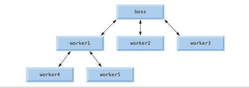

**图6.1** | 层次化的老板函数/工人函数关系


函数与多个 worker 函数通信。boss 函数将职责分配给各个 worker 函数，而 worker1 又充当 worker4 和 worker5 的“boss 函数”。

## 6.3 数学库函数

有时，像 `main` 这样的函数*不是*类的成员。这类函数称为**全局函数**。与类的成员函数一样，全局函数的函数原型放在头文件中，这样，任何包含该头文件并能链接到该函数目标代码的程序都可以复用这些全局函数。例如，回顾我们在图 5.6 中使用了 `<cmath>` 头文件中的 `pow` 函数来对一个值求幂。这里我们介绍 `<cmath>` 头文件中的各种函数，以说明不属于某个特定类的全局函数这一概念。

`<cmath>` 头文件提供了一系列函数，让你能够执行常见的数学计算。例如，你可以通过函数调用计算 900.0 的平方根：

```cpp
sqrt( 900.0 )
```

上述表达式求值为 30.0。函数 `sqrt` 接受一个 `double` 类型的参数，并返回一个 `double` 类型的结果。调用函数 `sqrt` 前无需创建任何对象。此外，`<cmath>` 头文件中的所有函数都是*全局函数*——因此，每个函数只需通过指定函数名，后跟包含函数参数的括号来调用。如果你用负数参数调用 `sqrt`，该函数会将名为 `errno` 的全局变量设置为常量值 `EDOM`。变量 `errno` 和常量 `EDOM` 在 `<cerrno>` 头文件中定义。我们将在 6.10 节讨论全局变量。


> **错误预防提示 6.1**
>
> *不要使用负数参数调用 `sqrt`。对于工业级代码，始终检查你传给数学函数的参数是否有效。*

函数参数可以是常量、变量或更复杂的表达式。如果 `c = 13.0`、`d = 3.0` 且 `f = 4.0`，则语句

```cpp
cout << sqrt( c + d * f ) << endl;
```

将显示 13.0 + 3.0 × 4.0 = 25.0 的平方根，即 5.0。图 6.2 汇总了一些数学库函数。在图中，变量 x 和 y 的类型为 double。

| 函数 | 描述 | 示例 |
|---|---|---|
| `ceil( x )` | 将 x 舍入为不小于 x 的最小整数 | `ceil( 9.2 )` 为 10.0<br>`ceil( -9.8 )` 为 -9.0 |
| `cos( x )` | x 的三角余弦（x 为弧度） | `cos( 0.0 )` 为 1.0 |
| `exp(x)` | 指数函数 e^x | `exp(1.0)` 为 2.718282<br>`exp(2.0)` 为 7.389056 |
| `fabs(x)` | x 的绝对值 | `fabs(5.1)` 为 5.1<br>`fabs(0.0)` 为 0.0<br>`fabs(-8.76)` 为 8.76 |
| `floor(x)` | 将 x 舍入为不大于 x 的最大整数 | `floor(9.2)` 为 9.0<br>`floor(-9.8)` 为 -10.0 |
| `fmod(x, y)` | x/y 的浮点数余数 | `fmod(2.6, 1.2)` 为 0.2 |
| `log(x)` | x 的自然对数（底为 e） | `log(2.718282)` 为 1.0<br>`log(7.389056)` 为 2.0 |
| `log10(x)` | x 的常用对数（底为 10） | `log10(10.0)` 为 1.0<br>`log10(100.0)` 为 2.0 |
| `pow(x, y)` | x 的 y 次幂（x^y） | `pow(2, 7)` 为 128<br>`pow(9, .5)` 为 3 |
| `sin(x)` | x 的三角正弦（x 为弧度） | `sin(0.0)` 为 0 |
| `sqrt(x)` | x 的平方根（x 为非负值） | `sqrt(9.0)` 为 3.0 |
| `tan(x)` | x 的三角正切（x 为弧度） | `tan(0.0)` 为 0 |

**图 6.2** | 数学库函数。

## 6.4 具有多个参数的函数定义

让我们考虑具有*多个*参数的函数。图 6.3–图 6.5 通过包含一个名为 maximum 的用户自定义函数来修改 GradeBook 类，该函数确定并返回三个 int 成绩中的最大值。当应用程序执行时，main 函数（图 6.5 的第 5–13 行）创建一个 GradeBook 对象（第 8 行），并调用其 inputGrades 成员函数（第 11 行）从用户处读取三个整数成绩。在类 GradeBook 的实现文件（图 6.4）中，成员函数 inputGrades 的第 52–53 行提示用户输入三个整数值并从用户处读取它们。第 56 行调用成员函数 maximum（在第 60–73 行中定义）。函数 maximum 确定最大值，然后 return 语句（第 72 行）将该值返回到函数 inputGrades 调用 maximum 的位置（第 56 行）。成员函数 inputGrades 随后将 maximum 的返回值存储在数据成员 maximumGrade 中。然后通过调用函数 displayGradeReport（图 6.5 的第 12 行）输出该值。[注：我们之所以将此函数命名为 displayGradeReport，是因为 GradeBook 类的后续版本将使用该函数显示完整的成绩报告，包括最高成绩和最低成绩。] 在第 7 章中，我们将增强 GradeBook 类以处理多组成绩。

```cpp
// Fig. 6.3: GradeBook.h
// Definition of class GradeBook that finds the maximum of three grades.
// Member functions are defined in GradeBook.cpp
#include <string> // program uses C++ standard string class

// GradeBook class definition
class GradeBook
{
public:
   explicit GradeBook( std::string ); // initializes course name
   void setCourseName( std::string ); // set the course name
   std::string getCourseName() const; // retrieve the course name
   void displayMessage() const; // display a welcome message
   void inputGrades(); // input three grades from user
   void displayGradeReport() const; // display report based on the grades
   int maximum( int, int, int ) const; // determine max of 3 values
private:
   std::string courseName; // course name for this GradeBook
   int maximumGrade; // maximum of three grades
}; // end class GradeBook
```

图 6.3 | 查找三个成绩中最大值的 GradeBook 类定义。

```cpp
// Fig. 6.4: GradeBook.cpp
// Member-function definitions for class GradeBook that
// determines the maximum of three grades.
#include <iostream>
using namespace std;

#include "GradeBook.h" // include definition of class GradeBook

// constructor initializes courseName with string supplied as argument;
// initializes maximumGrade to 0
GradeBook::GradeBook( string name )
   : maximumGrade( 0 ) // this value will be replaced by the maximum grade
{
   setCourseName( name ); // validate and store courseName
} // end GradeBook constructor

// function to set the course name; limits name to 25 or fewer characters
void GradeBook::setCourseName( string name )
{
   if ( name.size() <= 25 ) // if name has 25 or fewer characters
      courseName = name; // store the course name in the object
   else // if name is longer than 25 characters
   {
      // set courseName to first 25 characters of parameter name
      courseName = name.substr( 0, 25 ); // select first 25 characters
      cerr << "Name \"" << name << "\" exceeds maximum length (25).\n"
           << "Limiting courseName to first 25 characters.\n" << endl;
   } // end if...else
} // end function setCourseName

// function to retrieve the course name
string GradeBook::getCourseName() const
{
   return courseName;
} // end function getCourseName

// display a welcome message to the GradeBook user
void GradeBook::displayMessage() const
{
   // this statement calls getCourseName to get the
   // name of the course this GradeBook represents
   cout << "Welcome to the grade book for\n" << getCourseName() << "!\n"
        << endl;
} // end function displayMessage

// input three grades from user; determine maximum
void GradeBook::inputGrades()
{
   int grade1; // first grade entered by user
   int grade2; // second grade entered by user
   int grade3; // third grade entered by user

   cout << "Enter three integer grades: ";
   cin >> grade1 >> grade2 >> grade3;

   // store maximum in member maximumGrade
   maximumGrade = maximum( grade1, grade2, grade3 );
} // end function inputGrades

// returns the maximum of its three integer parameters
int GradeBook::maximum( int x, int y, int z ) const
{
   int maximumValue = x; // assume x is the largest to start

   // determine whether y is greater than maximumValue
   if ( y > maximumValue )
      maximumValue = y; // make y the new maximumValue

   // determine whether z is greater than maximumValue
   if ( z > maximumValue )
      maximumValue = z; // make z the new maximumValue

   return maximumValue;
} // end function maximum

// display a report based on the grades entered by user
void GradeBook::displayGradeReport() const
{
   // output maximum of grades entered
   cout << "Maximum of grades entered: " << maximumGrade << endl;
} // end function displayGradeReport
```

图 6.4 | 确定三个成绩最大值的 GradeBook 类的成员函数定义。


```cpp
// 图 6.5: fig06_05.cpp
// 创建 GradeBook 对象，输入成绩并显示成绩报告。
#include "GradeBook.h" // 包含类 GradeBook 的定义

int main()
{
    // 创建 GradeBook 对象
    GradeBook myGradeBook( "CS101 C++ Programming" );

    myGradeBook.displayMessage(); // 显示欢迎消息
    myGradeBook.inputGrades(); // 从用户读取成绩
    myGradeBook.displayGradeReport(); // 根据成绩显示报告
} // 主函数结束
```

```
欢迎使用成绩册
CS101 C++ 程序设计！

请输入三个整数成绩：86 67 75
输入的成绩中最大值：86
```

```
欢迎使用成绩册
CS101 C++ 程序设计！

请输入三个整数成绩：67 86 75
输入的成绩中最大值：86
```

```
欢迎使用成绩册
CS101 C++ 程序设计！

请输入三个整数成绩：67 75 86
输入的成绩中最大值：86
```

**图 6.5** 创建 GradeBook 对象，输入成绩并显示成绩报告。

> **软件工程观察 6.2**
>
> 图 6.4 第 56 行中用于分隔函数 `maximum` 参数的逗号，并不是第 5.3 节讨论的逗号运算符。逗号运算符保证其操作数从左到右求值。然而，C++ 标准并未保证函数参数的求值顺序。因此，不同的编译器可能以不同的顺序对函数参数进行求值。C++ 标准确实保证函数调用中的所有参数都会在被调函数执行之前完成求值。

> **可移植性提示 6.1**
>
> 有时当函数的参数是表达式时，例如含有对其他函数调用的表达式，编译器对参数求值的顺序可能会影响一个或多个参数的值。如果不同编译器之间的求值顺序发生变化，传递给函数的参数值可能会有所不同，从而引发微妙的逻辑错误。

### 函数签名

函数原型中包含*函数名称*及其*参数类型*的部分称为**函数签名**，或简称为**签名**。函数签名不指定函数的返回类型。*同一作用域中的函数必须具有唯一的签名*。函数的作用域是指程序中该函数已知且可访问的区域。我们将在 6.11 节详细讨论作用域。

在图 6.3 中，如果第 16 行的函数原型被写成

```cpp
void maximum( int, int, int );
```

编译器将报告错误，因为函数原型中的 void 返回类型与函数头中的 int 返回类型不一致。类似地，这样的原型会导致语句

```cpp
cout << maximum( 6, 7, 0 );
```

产生编译错误，因为该语句依赖 maximum 返回一个值来显示。

### 参数强制转换

函数原型的一个重要特性是**参数强制转换**——即强制将参数转换为参数声明指定的适当类型。例如，程序可以用整数参数调用函数，即使函数原型指定的是 double 参数——函数仍然会正确工作。

### 参数提升规则与隐式转换¹

有时，与函数原型中参数类型不完全对应的参数值，可以在函数调用之前由编译器转换为正确的类型。这些转换按照 C++ 的**提升规则**进行。提升规则说明了编译器可以在基本类型之间执行的*隐式转换*。int 可以转换为 double。double 也可以转换为 int，但 double 值的小数部分会被*截断*。请记住，double 变量能容纳的数值范围远大于 int 变量，因此数据丢失可能相当严重。将大的整数类型转换为小的整数类型（例如 long 转换为 short）、有符号转换为无符号或无符号转换为有符号时，值也可能被修改。无符号整数的范围从 0 到相应有符号类型正数范围的大约两倍。

提升规则适用于包含两种或更多数据类型值的表达式；此类表达式也称为**混合类型表达式**。混合类型表达式中每个值的类型都会提升为表达式中的“最高”类型（实际上会创建每个值的*临时*版本用于表达式计算——原始值保持不变）。当函数参数的类型与函数定义或原型中指定的参数类型*不*匹配时，也会发生提升。图 6.6 按从“最高类型”到“最低类型”的顺序列出了算术数据类型。

1. 提升和转换是 C++ 标准第 4 节和第 5 节开头讨论的复杂主题。您可以在 bit.ly/CPlusPlus11Standard 购买标准文本。

| 数据类型 | 同义词 |
|---|---|
| `long double` |  |
| `double` |  |
| `float` |  |
| `unsigned long long int` | （与 `unsigned long long` 同义） |
| `long long int` | （与 `long long` 同义） |
| `unsigned long int` | （与 `unsigned long` 同义） |
| `long int` | （与 `long` 同义） |
| `unsigned int` | （与 `unsigned` 同义） |
| `int` |  |
| `unsigned short int` | （与 `unsigned short` 同义） |
| `short int` | （与 `short` 同义） |
| `unsigned char` |  |
| `char and signed char` |  |
| `bool` |  |

**图 6.6** — 算术数据类型的提升层次。

### *转换可能导致不正确的值*

将值转换为较低的基本类型可能导致不正确的值。因此，只有通过显式地将值赋给较低类型的变量（某些编译器在这种情况下会发出警告）或使用强制转换运算符（参见第 4.9 节），才能将值转换为较低的基本类型。函数参数值会像被直接赋值给那些类型的变量一样，被转换为函数原型中的参数类型。如果使用整数参数的 square 函数被传入浮点参数，该参数会被转换为 int（较低类型），square 可能返回不正确的值。例如，square(4.5) 返回 16，而不是 20.25。

> **常见编程错误 6.4**
>
> 如果函数调用中的参数与相应函数原型中声明的参数数量和类型不匹配，则是编译错误。如果调用中的参数数量匹配，但参数无法隐式转换为预期的类型，这也是错误。


## 6.6 C++ 标准库头文件

C++ 标准库被分为许多部分，每个部分都有其自己的头文件。头文件包含构成库各个部分的相关函数的函数原型。头文件还包含各种类类型和函数的定义，以及这些函数所需的常量。头文件“指导”编译器如何与库组件和用户编写的组件进行交互。

图 6.7 列出了一些常见的 C++ 标准库头文件，其中大部分将在本书后面讨论。图 6.7 中多次使用的术语“宏”将在附录 E《预处理器》中详细讨论。

| 标准库头文件 | 说明 |
|---|---|
| `<iostream>` | 包含 C++ 标准输入和输出函数的函数原型，在第 2 章中引入，并在第 13 章《流输入/输出：深入探讨》中更详细地介绍。 |
| `<iomanip>` | 包含格式化数据流的流操作符的函数原型。此头文件首次在第 4.9 节中使用，并在第 13 章《流输入/输出：深入探讨》中更详细地讨论。 |
| `<cmath>` | 包含数学库函数的函数原型（第 6.3 节）。 |
| `<cstdlib>` | 包含数字与文本之间转换、内存分配、随机数以及各种其他实用函数的函数原型。此头文件的部分内容在第 6.7 节、第 11 章《运算符重载；Class string》、第 17 章《异常处理：深入探讨》、第 22 章《位、字符、C 字符串和 structs》以及附录 F《C 遗留代码主题》中介绍。 |
| `<ctime>` | 包含用于操作时间和日期的函数原型和类型。此头文件在第 6.7 节中使用。 |
| `<array>`、`<vector>`、`<list>`、`<forward_list>`、`<deque>`、`<queue>`、`<stack>`、`<map>`、`<unordered_map>`、`<unordered_set>`、`<set>`、`<bitset>` | 这些头文件包含实现 C++ 标准库容器的类。容器在程序执行期间存储数据。`<vector>` 头文件首先在第 7 章《类模板 Array 和 vector；捕获异常》中引入。我们将在第 15 章《标准库容器和迭代器》中讨论所有这些头文件。 |
| `<ctype>` | 包含测试字符某些属性（例如字符是否为数字或标点）的函数的函数原型，以及可用于将小写字母转换为大写字母或将大写字母转换为小写字母的函数的函数原型。这些主题在第 22 章《位、字符、C 字符串和 structs》中讨论。 |
| `<cstring>` | 包含 C 风格字符串处理函数的函数原型。此头文件在第 10 章《运算符重载；Class string》中使用。 |
| `<typeinfo>` | 包含用于运行时类型识别（在执行时确定数据类型）的类。此头文件在第 12.8 节中讨论。 |
| `<exception>`、`<stdexcept>` | 这些头文件包含用于异常处理的类（在第 17 章《异常处理：深入探讨》中讨论）。 |
| `<memory>` | 包含 C++ 标准库用于向 C++ 标准库容器分配内存的类和函数。此头文件在第 17 章《异常处理：深入探讨》中使用。 |
| `<fstream>` | 包含对磁盘文件执行输入和输出操作的函数的函数原型（在第 14 章《文件处理》中讨论）。 |
| `<string>` | 包含 C++ 标准库中 string 类的定义（在第 21 章《Class string 和字符串流处理》中讨论）。 |

**图 6.7** | C++ 标准库头文件。（第 1 部分，共 2 部分。）


| 标准库头文件 | 说明 |
|---|---|
| `<sstream>` | 包含执行从内存中的字符串进行输入和向内存中的字符串进行输出的函数原型（在第21章“类string和字符串流处理”中讨论）。 |
| `<functional>` | 包含C++标准库算法使用的类和函数。此头文件在第15章中使用。 |
| `<iterator>` | 包含用于访问C++标准库容器中数据的类。此头文件在第15章中使用。 |
| `<algorithm>` | 包含用于操作C++标准库容器中数据的函数。此头文件在第15章中使用。 |
| `<cassert>` | 包含用于添加有助于程序调试的诊断信息的宏。此头文件在附录E“预处理器”中使用。 |
| `<cfloat>` | 包含系统的浮点数大小限制。 |
| `<climits>` | 包含系统的整数大小限制。 |
| `<cstdio>` | 包含C风格标准输入/输出库函数的函数原型。 |
| `<locale>` | 包含流处理通常使用的类和函数，用于以不同语言的自然形式处理数据（例如货币格式、字符串排序、字符表示等）。 |
| `<limits>` | 包含用于定义每个计算机平台上数值数据类型限制的类。 |
| `<utility>` | 包含许多C++标准库头文件使用的类和函数。 |

**图6.7** | C++标准库头文件。（第2部分，共2部分。）

## 6.7 案例研究：随机数生成

> *[注意：本节和第6.8节中展示的随机数生成技术是面向尚未使用C++11编译器的读者。在第6.9节中，我们将介绍C++11改进的随机数功能。]*


现在，让我们简短且希望是有趣地转入一个流行的编程应用领域，即模拟和游戏。在本节和下一节中，我们将开发一个包含多个函数的游戏程序。

通过使用C++标准库函数`rand`，可以将随机性引入计算机应用程序。考虑下面的语句：

```
i = rand();
```

函数`rand`生成一个介于0和`RAND_MAX`之间的无符号整数（`RAND_MAX`是在`<cstdlib>`头文件中定义的符号常量）。只需显示该常量，即可确定系统上`RAND_MAX`的值。如果`rand`真正随机地产生整数，那么每次调用`rand`时，0到`RAND_MAX`之间的每个数字被选中的机会（或概率）相等。

函数`rand`直接产生的值的范围通常与特定应用的需求不同。例如，模拟抛硬币的程序可能只需要0表示“正面”，1表示“反面”。模拟掷六面骰子的程序需要1到6范围内的随机整数。一个随机预测视频游戏中接下来将飞过地平线的飞船类型（四种可能性之一）的程序，可能需要1到4范围内的随机整数。

### 掷六面骰子

为了演示`rand`，图6.8模拟掷20次六面骰子，并显示每次掷出的值。`rand`函数的函数原型位于`<cstdlib>`中。为了产生0到5范围内的整数，我们将模运算符（`%`）与`rand`一起使用，如下所示：

```
rand() % 6
```

这称为缩放。数字6称为缩放因子。然后我们通过在先前结果上加1来移动所产生的数字范围。图6.8证实结果在1到6范围内。如果你多次执行此程序，你会发现它每次产生相同的“随机”值。我们将在图6.10中演示如何解决这个问题。

```cpp
// Fig. 6.8: fig06_08.cpp
// Shifted, scaled integers produced by 1 + rand() % 6.
#include <iostream>
#include <iomanip>
#include <cstdlib> // contains function prototype for rand
using namespace std;

int main()
{
    // loop 20 times
    for ( unsigned int counter = 1; counter <= 20; ++counter )
    {
        // pick random number from 1 to 6 and output it
        cout << setw( 10 ) << ( 1 + rand() % 6 );

        // if counter is divisible by 5, start a new line of output
        if ( counter % 5 == 0 )
            cout << endl;
    } // end for
} // end main
```

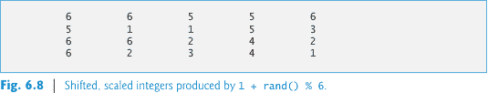

### 掷六面骰子6,000,000次

为了说明`rand`产生的数字以近似相等的可能性出现，图6.9模拟掷骰子6,000,000次。1到6范围内的每个整数应出现约1,000,000次。程序的输出证实了这一点。

```cpp
// Fig. 6.9: fig06_09.cpp
// Rolling a six-sided die 6,000,000 times.
#include <iostream>
#include <iomanip>
#include <cstdlib> // contains function prototype for rand
using namespace std;

int main()
{
   unsigned int frequency1 = 0; // count of 1s rolled
   unsigned int frequency2 = 0; // count of 2s rolled
   unsigned int frequency3 = 0; // count of 3s rolled
   unsigned int frequency4 = 0; // count of 4s rolled
   unsigned int frequency5 = 0; // count of 5s rolled
   unsigned int frequency6 = 0; // count of 6s rolled

   // summarize results of 6,000,000 rolls of a die
   for ( unsigned int roll = 1; roll <= 6000000; ++roll )
   {
      unsigned int face = 1 + rand() % 6; // random number from 1 to 6

      // determine roll value 1-6 and increment appropriate counter
      switch ( face )
      {
         case 1:
            ++frequency1; // increment the 1s counter
            break;
         case 2:
            ++frequency2; // increment the 2s counter
            break;
         case 3:
            ++frequency3; // increment the 3s counter
            break;
         case 4:
            ++frequency4; // increment the 4s counter
            break;
         case 5:
            ++frequency5; // increment the 5s counter
            break;
         case 6:
            ++frequency6; // increment the 6s counter
            break;
         default:
            cout << "Program should never get here!";
      } // end switch
   } // end for

   cout << "Face" << setw(13) << "Frequency" << endl; // output headers
   cout << "\n  1" << setw(13) << frequency1
        << "\n  2" << setw(13) << frequency2
        << "\n  3" << setw(13) << frequency3
        << "\n  4" << setw(13) << frequency4
```

**图6.9** | 掷六面骰子6,000,000次。（第1部分，共2部分。）

```
Enter seed: 67
      6        1        4        6        2
      1        6        1        6        4
```

**图6.10** | 随机化掷骰子程序。（第2部分，共2部分。）

程序每次执行时会产生一个*不同*的随机数序列，前提是用户输入一个*不同*的种子。我们在第一个和第三个示例输出中使用了*相同*的种子，因此在这些输出中显示了*相同*的10个数字序列。

### 使用当前时间为随机数生成器设置种子

为了在每次运行时不输入种子而进行随机化，我们可以使用如下语句：

```
srand( static_cast<unsigned int>( time( 0 ) ) );
```

这使计算机读取其时钟以获取种子的值。函数`time`（如前面语句中所示，参数为0）通常返回当前时间，即自1970年1月1日格林尼治标准时间（GMT）午夜以来的秒数。该值（类型为`time_t`）被转换为`unsigned int`，并用作随机数生成器的种子——前面语句中的`static_cast`消除了将`time_t`值传递给期望`unsigned int`的函数时产生的编译器警告。`time`的函数原型在`<ctime>`中。

### 缩放和移位随机数

之前，我们使用以下语句模拟掷六面骰子：

```
face = 1 + rand() % 6;
```

该语句总是将一个（随机的）整数赋给变量`face`，其范围为1 ≤ face ≤ 6。此范围的宽度（即该范围内连续整数的个数）为6，该范围的起始数字为1。参考前面的语句，我们看到范围的宽度由用于通过模运算符缩放`rand`的数字（即6）决定，而范围的起始数字等于添加到表达式`rand % 6`中的数字（即1）。我们可以将此结果推广为：

```
number = shiftingValue + rand() % scalingFactor;
```

其中，*shiftingValue*等于所需连续整数范围中的第一个数字，而*scalingFactor*等于所需连续整数范围的宽度。

## 6.8 案例研究：机会游戏；引入enum

最受欢迎的机会游戏之一是被称为“双骰子”（craps）的骰子游戏，全世界的赌场和后街小巷都在玩这种游戏。这个游戏的规则很简单：

> 玩家掷两个骰子。每个骰子有六个面，面上分别有1、2、3、4、5和6个点。骰子停止后，计算两个朝上面的点数之和。如果第一次掷出的点数和为7或11，玩家获胜。如果第一次掷出的点数和为2、3或12（称为“双骰子”），玩家输（即“庄家”赢）。如果第一次掷出的点数和为4、5、6、8、9或10，那么该和数成为玩家的“点数”。要获胜，你必须继续掷骰子，直到“掷出你的点数”。如果在掷出点数之前先掷出7，玩家就输了。


图 6.11 中的程序模拟了该游戏。在规则中，注意玩家必须在第一次掷骰子以及所有后续掷骰子时掷两个骰子。我们定义函数 rollDice（第 62–74 行）来掷骰子并计算和打印它们的总和。该函数只定义一次，但第 20 行和第 44 行会调用它。该函数不带参数，返回两个骰子的总和，因此函数原型（第 8 行）和函数头（第 62 行）中标识了空括号和返回类型 unsigned int。

```cpp
// Fig. 6.11: fig06_11.cpp
// Craps simulation.
#include <iostream>
#include <cstdlib> // contains prototypes for functions srand and rand
#include <ctime> // contains prototype for function time
using namespace std;

unsigned int rollDice(); // rolls dice, calculates and displays sum

int main()
{
   // enumeration with constants that represent the game status
   enum Status { CONTINUE, WON, LOST }; // all caps

   // randomize random number generator using current time
   srand( static_cast<unsigned int>( time( 0 ) ) );

   unsigned int myPoint = 0; // point if no win or loss on first roll
   Status gameStatus = CONTINUE; // can be CONTINUE, WON or LOST
   unsigned int sumOfDice = rollDice(); // first roll of the dice

   // determine game status and point (if needed) based on first roll
   switch ( sumOfDice )
   {
      case 7: // win with 7 on first roll
      case 11: // win with 11 on first roll
         gameStatus = WON;
         break;
      case 2: // lose with 2 on first roll
      case 3: // lose with 3 on first roll
      case 12: // lose with 12 on first roll
         gameStatus = LOST;
         break;
      default: // did not win or lose, so remember point
         gameStatus = CONTINUE; // game is not over
         myPoint = sumOfDice; // remember the point
         cout << "Point is " << myPoint << endl;
         break; // optional end of switch
   } // end switch

   // while game is not complete
   while ( CONTINUE == gameStatus ) // not WON or LOST
   {
      sumOfDice = rollDice(); // roll dice again

      // determine game status
      if ( sumOfDice == myPoint ) // win by making point
         gameStatus = WON;
      else if ( sumOfDice == 7 ) // lose by rolling 7
         gameStatus = LOST;
   }

   if ( gameStatus == WON )
      cout << "Player wins" << endl;
   else
      cout << "Player loses" << endl;
}
```

**图 6.11** | 掷骰子模拟。（第 1 部分，共 3 部分。）

```cpp
sumOfDice = rollDice(); // roll dice again

// determine game status
if (sumOfDice == myPoint) // win by making point
    gameStatus = WON;
else
    if (sumOfDice == 7) // lose by rolling 7 before point
        gameStatus = LOST;
} // end while

// display won or lost message
if (WON == gameStatus)
    cout << "Player wins" << endl;
else
    cout << "Player loses" << endl;
} // end main

// roll dice, calculate sum and display results
unsigned int rollDice()
{
    // pick random die values
    unsigned int die1 = 1 + rand() % 6; // first die roll
    unsigned int die2 = 1 + rand() % 6; // second die roll

    unsigned int sum = die1 + die2; // compute sum of die values

    // display results of this roll
    cout << "Player rolled " << die1 << " + " << die2
         << " = " << sum << endl;
    return sum; // end function rollDice
} // end function rollDice
```

```
Player rolled 2 + 5 = 7
Player wins
```

```
Player rolled 6 + 6 = 12
Player loses
```

```
Player rolled 1 + 3 = 4
Point is 4
Player rolled 4 + 6 = 10
Player rolled 2 + 4 = 6
Player rolled 6 + 4 = 10
Player rolled 2 + 3 = 5
Player rolled 2 + 4 = 6
Player rolled 1 + 1 = 2
Player rolled 4 + 4 = 8
Player rolled 4 + 3 = 7
Player loses
```

**图 6.11** | 掷骰子模拟。（第 2 部分，共 3 部分。）

```
Player rolled 3 + 3 = 6
Point is 6
Player rolled 5 + 3 = 8
Player rolled 4 + 5 = 9
Player rolled 2 + 1 = 3
Player rolled 1 + 5 = 6
Player wins
```

**图 6.11** | 掷骰子模拟。（第 3 部分，共 3 部分。）

## 枚举类型 Status

玩家可能在第一次掷骰或任何后续掷骰时获胜或失败。程序使用变量 gameStatus 来跟踪这一状态。变量 gameStatus 被声明为新的类型 Status。第 13 行声明了一个用户定义类型，称为枚举，它由关键字 enum 引入，后跟类型名（此处为 Status）和一组由标识符表示的整数常量。除非另有指定，这些枚举常量的值从 0 开始，每次递增 1。在之前的枚举中，常量 CONTINUE 的值为 0，WON 的值为 1，LOST 的值为 2。枚举中的标识符必须是唯一的，但不同的枚举常量可以具有相同的整数值。

> **良好编程实践 6.2**
>
> 将用作用户定义类型名的标识符的首字母大写。

> **良好编程实践 6.3**
>
> 在枚举常量名称中仅使用大写字母。这使这些常量在程序中脱颖而出，并提醒你枚举常量不是变量。

用户定义类型 Status 的变量只能被赋予枚举中声明的三个值之一。当游戏获胜时，程序将变量 gameStatus 设置为 WON（第 27 行和第 48 行）。当游戏失败时，程序将变量 gameStatus 设置为 LOST（第 32 行和第 51 行）。否则，程序将变量 gameStatus 设置为 CONTINUE（第 35 行），以表示必须再次掷骰子。

> **常见编程错误 6.5**
>
> 将枚举常量的整数等价物（而不是枚举常量本身）赋值给枚举类型的变量是编译错误。

```cpp
enum Months { JAN = 1, FEB, MAR, APR, MAY, JUN, JUL, AUG,
    SEP, OCT, NOV, DEC };
```

这创建了用户定义类型 Months，其枚举常量表示一年的月份。上述枚举中的第一个值被显式设置为 1，因此其余值从 1 开始递增，结果为 1 到 12。在枚举定义中，任何枚举常量都可以被赋予一个整数值，并且后续的每个枚举常量的值都比列表中前一个常量高 1，直到下一个显式设置。

> **常见编程错误 6.6**
>
> 如果枚举常量的值超出了枚举底层类型可表示的范围，则会发生编译错误。

## 6.9 C++11 随机数

根据 CERT 的说法，函数 rand 不具备“良好的统计特性”，并且可能是可预测的，这使得使用 rand 的程序安全性较低（CERT 指南 MSC30-CPP）。正如我们在第 6.7 节中提到的，C++11 提供了一个新的、更安全的随机数功能库，该库可以为模拟和不可预测性不利的安全场景生成非确定性随机数。这些新功能位于 C++ 标准库的 `<random>` 头文件中。

随机数生成是一个数学上复杂的话题，数学家为此开发了许多具有不同统计特性的随机数生成算法。为了根据随机数在程序中的使用方式提供灵活性，C++11 提供了许多表示各种随机数生成*引擎*和*分布*的类。引擎实现一种随机数生成算法，该算法产生伪随机数。分布控制引擎产生的值的范围、这些值的类型（例如 int、double 等）以及值的统计特性。在本节中，我们将使用默认的随机数生成引擎——`default_random_engine`——和 `uniform_int_distribution`，它在一个指定的值范围内*均匀地*分配伪随机整数。默认范围是从 0 到你的平台上 int 的最大值。

### 掷六面骰子

图 6.12 使用 `default_random_engine` 和 `uniform_int_distribution` 来掷一个六面骰子。第 14 行创建了一个名为 engine 的 `default_random_engine` 对象。它的构造函数参数使用当前时间对随机数生成引擎进行播种。如果你不向构造函数传递值，将使用默认种子，程序每次执行时都会产生相同的数字序列。第 15 行创建 randomInt——一个 `uniform_int_distribution` 对象，它产生 1 到 6 范围内（由构造函数参数指定）的无符号整数值（如 `<unsigned int>` 所指定）。表达式 `randomInt(engine)`（第 21 行）返回一个 1 到 6 范围内的无符号整数值。

```cpp
// Fig. 6.12: fig06_12.cpp
// Using a C++11 random-number generation engine and distribution
// to roll a six-sided die.
#include <iostream>
#include <iomanip>
#include <random> // contains C++11 random number generation features
#include <ctime>
using namespace std;

int main()
{
```

**图 6.12** | 使用 C++11 随机数生成引擎和分布来掷一个六面骰子。（第 1 部分，共 2 部分。）


```cpp
// use the default random-number generation engine to
// produce uniformly distributed pseudorandom int values from 1 to 6
default_random_engine engine( static_cast<unsigned int>( time() ) );
uniform_int_distribution<unsigned int> randInt( 1, 6 );

// loop 10 times
for ( unsigned int counter = 1; counter <= 10; ++counter )
{
   // pick random number from 1 to 6 and output it
   cout << setw( 10 ) << randInt( engine );

   // if counter is divisible by 5, start a new line of output
   if ( counter % 5 == 0 )
      cout << endl;
} // end for
} // end main
```


**图 6.12** | 使用 C++11 随机数生成引擎和分布来掷六面骰子。（第2部分，共2部分）

第15行中的 `<unsigned int>` 表示 `uniform_int_distribution` 是一个类模板。在这种情况下，尖括号（< 和 >）中可以指定任何整数类型。在第18章中，我们将讨论如何创建类模板，其他各章将展示如何使用C++标准库中现有的类模板。目前，你只需模仿示例中的语法，就可以放心使用类模板 `uniform_int_distribution`。

## 6.10 存储类别与存储持续时间

到目前为止，你看到的程序都使用标识符来命名变量和函数。变量的属性包括*名称*、*类型*、*大小*和*值*。程序中的每个标识符还具有其他属性，包括**存储持续时间**、**作用域**和**链接性**。

C++提供了五种**存储类别说明符**，用于确定变量的存储持续时间：**register**、**extern**、**mutable** 和 **static**。本节讨论存储类别说明符 register、extern 和 static。存储类别说明符 mutable 仅用于类，thread_local 用于多线程应用程序——这两者分别在第23章和第24章讨论。

### 存储持续时间

标识符的*存储持续时间*决定了该标识符在内存中存在的时间段。有些标识符短暂存在，有些被反复创建和销毁，还有一些在程序整个执行期间都存在。首先我们讨论**静态**和**自动**存储持续时间。

### 作用域

标识符的*作用域*是指标识符在程序中可以被引用的位置。有些标识符可以在整个程序中被引用；有些只能在程序的有限部分中被引用。6.11节讨论标识符的作用域。

`register unsigned int counter = 2;`

register 关键字只能用于局部变量和函数参数。

> **性能提示 6.2**
> 
> 存储类别说明符 register 可以放在自动变量声明之前，以建议编译器将该变量保存在计算机的高速硬件寄存器中，而不是内存中。如果频繁使用的变量（如计数器或总计）保存在硬件寄存器中，则消除了反复将变量从内存加载到寄存器并将结果存回内存的开销。


> **性能提示 6.3**
> 
> 通常，register 是不必要的。今天的优化编译器能够识别频繁使用的变量，并且无需 register 声明即可将它们放入寄存器。


### 静态存储持续时间

关键字 extern 和 static 为具有*静态存储持续时间*的变量和函数声明标识符。具有静态存储持续时间的变量在程序开始执行时到程序终止期间一直存在于内存中。这样的变量在*遇到其声明时被初始化一次*。对于函数，函数名在程序开始执行时就存在。即使函数名和静态存储持续时间变量在程序执行开始时就存在，它们的标识符也不一定能在整个程序中使用。存储持续时间与作用域（名称可以使用的范围）是两个不同的问题，我们将在6.11节中看到。

### 具有静态存储持续时间的标识符

具有*静态存储持续时间*的标识符有两种类型——外部标识符（如全局变量）和用存储类别说明符 static 声明的局部变量。**全局变量**是通过将变量声明放在任何类或函数定义*外部*来创建的。全局变量在程序整个执行过程中保留其值。全局变量和全局函数可以被源文件中位于其声明或定义之后的任何函数引用。

> **软件工程观察 6.7**
> 
> 将变量声明为全局变量而非局部变量，可能会导致不需要访问该变量的函数意外或恶意地修改它，从而产生非预期的副作用。这是最小特权原则的另一个例子——通常，除了像 cin 和 cout 这样真正的全局资源外，除非有独特的性能要求，否则应避免使用全局变量。


> **软件工程观察 6.8**
> 
> 仅在特定函数中使用的变量应声明为该函数中的局部变量，而不是全局变量。


### static 局部变量

声明为 static 的局部变量仍然只在声明它们的函数中已知，但与自动变量不同，*static 局部变量在函数返回调用者时保留其值*。下次调用该函数时，static 局部变量包含上次函数执行完成时的值。以下语句将局部变量 `count` 声明为 static 并初始化为 1：

```
static unsigned int count = 1;
```

所有静态存储持续时间的数值变量默认*初始化为零*，但显式初始化所有变量仍然是一种良好做法。

存储类别说明符 extern 和 static 在显式应用于外部标识符（如全局变量和全局函数名）时具有特殊含义。在附录 F“C 遗留代码主题”中，我们讨论如何将 extern 和 static 与外部标识符及多源文件程序一起使用。

## 6.11 作用域规则

程序中可以使用标识符的部分称为其*作用域*。例如，当我们在块中声明局部变量时，它只能在该块以及嵌套在该块内的块中被引用。本节讨论**块作用域**、**函数作用域**、**全局命名空间作用域**和**函数原型作用域**。稍后我们将看到另外两种作用域——**类作用域**（第9章）和**命名空间作用域**（第23章）。

### 块作用域

在块*内部*声明的标识符具有*块作用域*，该作用域从标识符的声明处开始，到声明该标识符的块的终止右花括号（`}`）处结束。局部变量和函数参数都具有块作用域。任何块都可以包含变量声明。当块嵌套时，如果外层块中的标识符与内层块中的标识符同名，则外层块中的标识符在内层块终止之前被“隐藏”。内层块“看到”的是自己的局部标识符的值，而不是外层块同名标识符的值。声明为 static 的局部变量仍然具有块作用域，即使它们从程序开始执行时就存在。存储持续时间不影响标识符的作用域。

> **常见编程错误 6.7**
> 
> *在内层块中意外使用与外层块中标识符相同的名称，而实际上你希望外层块中的标识符在内层块持续期间保持有效，这通常是一个逻辑错误。*


> **防错提示 6.6**
> 
> 避免使用会隐藏外部作用域中名称的变量名。


### 函数作用域

**标签**（标识符后跟冒号，如 `start:` 或 `switch` 语句中的 `case` 标签）是唯一具有*函数作用域*的标识符。标签可以在其所在的函数中的*任何位置*使用，但不能在函数体*外部*引用。

### 全局命名空间作用域

在*任何*函数或类外部声明的标识符具有*全局命名空间作用域*。这样的标识符从其声明点到


该文件。位于函数外部的全局变量、函数定义和函数原型都具有全局命名空间作用域。

## 函数原型作用域

具有*函数原型作用域*的唯一标识符是那些在函数原型的参数列表中使用的标识符。如前所述，函数原型在参数列表中*不*需要名称——只需要类型。出现在函数原型参数列表中的名称会被编译器*忽略*。在函数原型中使用的标识符可以在程序中的其他地方重用而不会产生歧义。

## 作用域演示

图 6.13 的程序演示了全局变量、自动局部变量和静态局部变量的作用域问题。第 10 行声明并初始化全局变量 x 为 1。该全局变量在任何声明了名为 x 的变量的块（或函数）中都会被隐藏。在 main 中，第 14 行显示全局变量 x 的值。第 16 行声明一个局部变量 x 并将其初始化为 5。第 18 行输出该变量，以表明全局 x 在 main 中被隐藏。接下来，第 20–24 行在 main 中定义一个新块，其中另一个局部变量 x 被初始化为 7（第 21 行）。第 23 行输出该变量，以表明它隐藏了 main 外层块中的 x 以及全局 x。当块退出时，值为 7 的变量 x 被自动销毁。接下来，第 26 行输出 main 外层块中的局部变量 x，以表明它不再被隐藏。

```cpp
// Fig. 6.13: fig06_13.cpp
// Scoping example.
#include <iostream>
using namespace std;

void useLocal(); // function prototype
void useStaticLocal(); // function prototype
void useGlobal(); // function prototype

int x = 1; // global variable

int main()
{
    cout << "global x in main is " << x << endl;

    int x = 5; // local variable to main

    cout << "local x in main's outer scope is " << x << endl;

    { // start new scope
        int x = 7; // hides both x in outer scope and global x

        cout << "local x in main's inner scope is " << x << endl;
    } // end new scope
}
```

图 6.13 | 作用域示例。（第 1 部分，共 3 部分。）

```text
local static x is 50 on entering useStaticLocal
local static x is 51 on exiting useStaticLocal

global x is 1 on entering useGlobal
global x is 10 on exiting useGlobal

local x is 25 on entering useLocal

local static x is 51 on entering useStaticLocal
local static x is 52 on exiting useStaticLocal

global x is 10 on entering useGlobal
global x is 100 on exiting useGlobal

local x in main is 5
```

图 6.13 | 作用域示例。（第 3 部分，共 3 部分）

为了演示其他作用域，程序定义了三个函数，每个函数都不接受参数且不返回任何值。函数 useLocal（第 39–46 行）声明自动变量 x（第 41 行）并将其初始化为 25。当程序调用 useLocal 时，该函数打印该变量，将其递增，并在函数将程序控制权返回给调用者之前再次打印。每次程序调用此函数时，该函数都会重新创建自动变量 x 并将其重新初始化为 25。

函数 useStaticLocal（第 51–60 行）声明静态变量 x 并将其初始化为 50。声明为 static 的局部变量即使在超出作用域（即声明它们的函数未在执行）时也会保留其值。当程序调用 useStaticLocal 时，该函数打印 x，将其递增，并在函数将程序控制权返回给调用者之前再次打印。在下次调用此函数时，静态局部变量 x 包含值 51。第 53 行的初始化只发生一次——就在第一次调用 useStaticLocal 时。

函数 useGlobal（第 63–68 行）没有声明任何变量。因此，当它引用变量 x 时，使用的是全局 x（第 10 行，位于 main 之前）。当程序调用 useGlobal 时，该函数打印全局变量 x，将其乘以 10，并在函数将程序控制权返回给调用者之前再次打印。下次程序调用 useGlobal 时，全局变量已具有其修改后的值 10。在分别执行函数 useLocal、useStaticLocal 和 useGlobal 两次之后，程序再次打印 main 中的局部变量 x，以表明这些函数调用都没有修改 main 中 x 的值，因为这些函数引用的都是其他作用域中的变量。

## 6.12 函数调用栈与活动记录

要理解 C++ 如何执行函数调用，我们首先需要考虑一种称为栈（stack）的数据结构（即相关数据项的集合）。可以把栈想象成一摞盘子。当把盘子放到摞上时，通常放在顶部——这称为将盘子压入栈中。类似地，当从摞上取下盘子时，通常从顶部取下——这称为将盘子从栈中弹出。栈被称为后进先出（LIFO）数据结构——最后压入（插入）栈中的项最先从栈中弹出（移除）。

### *函数调用栈*

计算机科学学生需要理解的最重要机制之一是**函数调用栈**（有时称为**程序执行栈**）。这种数据结构在“幕后”工作，支持函数调用/返回机制。它还支持每个被调用函数的自动变量的创建、维护和销毁。正如我们将在图 6.15–6.17 中看到的，后进先出（LIFO）行为*正是*函数返回调用它的函数所需的行为。

### *栈帧*

每当一个函数被调用时，它可能会依次调用其他函数，而这些函数又可能调用其他函数——所有这些都发生在任何函数返回*之前*。每个函数最终都必须将控制权返回给调用它的函数。因此，我们必须以某种方式跟踪每个函数将控制权返回给调用它的函数所需的*返回地址*。函数调用栈是处理这些信息的完美数据结构。每次一个函数调用另一个函数时，都会有一个条目被*压入*栈中。这个条目称为**栈帧**或**活动记录**，包含被调用函数返回给调用函数所需的*返回地址*。它还包含一些我们稍后将讨论的额外信息。如果被调用函数返回（而不是在返回之前调用另一个函数），则该函数调用的栈帧会被*弹出*，控制权转移到弹出的栈帧中的返回地址。

调用栈的妙处在于，每个被调用函数总能在调用栈的*顶部*找到返回调用者所需的信息。并且，如果一个函数调用另一个函数，新的函数调用的栈帧会被简单地*压入*调用栈。因此，新被调用的函数返回其调用者所需的返回地址现在位于栈的顶部。

### *自动变量与栈帧*

栈帧还有另一项重要职责。大多数函数都有自动变量——参数以及函数声明的任何局部变量。自动变量需要在一个函数执行期间存在。如果该函数调用其他函数，它们需要保持活跃。但当被调用函数返回到调用者时，被调用函数的自动变量需要“消失”。被调用函数的栈帧是为其自动变量预留内存的完美场所。只要被调用函数处于活动状态，该栈帧就存在。当该函数返回——并且不再需要其局部自动变量时——其栈帧会从栈中*弹出*，这些局部自动变量对程序来说不再可知。

### *栈溢出*

当然，计算机中的内存量是有限的，因此只能用一定量的内存来存储函数调用栈上的活动记录。如果发生的函数调用数量超过函数调用栈所能存储的活动记录数量，就会发生称为**栈溢出**的致命错误。

### *函数调用栈的运作*

现在让我们考虑调用栈如何支持 main 调用的一个 square 函数的运作（图 6.14 的第 9–14 行）。首先，操作系统调用 main——这会将一个活动记录压入栈中（如图 6.15 所示）。该活动记录告诉 main 如何

返回到操作系统（即转移到返回地址 R1），并为 main 的自动变量（即初始化为 10 的 a）分配空间。

```cpp
// Fig. 6.14: fig06_14.cpp
// square function used to demonstrate the function
// call stack and activation records.
#include <iostream>
using namespace std;

int square( int ); // prototype for function square

int main()
{
    int a = 10; // value to square (local automatic variable in main)

    cout << a << " squared: " << square( a ) << endl; // display a squared
} // end main

// returns the square of an integer
int square( int x ) // x is a local variable
{
    return x * x; // calculate square and return result
} // end function square
```

```text
10 squared: 100
```

**图 6.14** | 用于演示函数调用堆栈和活动记录的 square 函数。

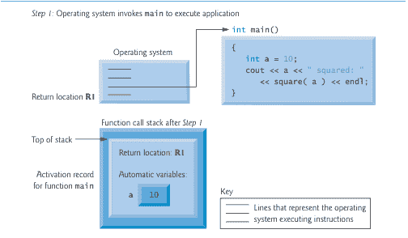

**图 6.15** | 操作系统调用 main 执行程序后的函数调用堆栈

在返回操作系统之前，main 函数现在调用图 6.14 中第 13 行的 square 函数。这导致 square 的栈帧（第 17–20 行）被压入函数调用堆栈（图 6.16）。该栈帧包含 square 返回 main 所需的返回地址（即 R2）以及 square 自动变量（即 x）的内存。

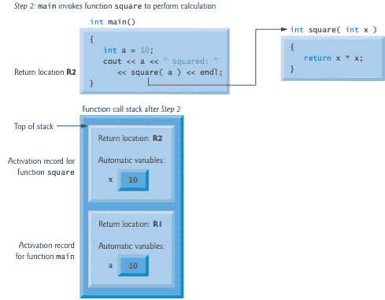

**图 6.16** | main 调用 square 执行计算后的函数调用堆栈

square 计算完其参数的平方后，需要返回到 main，并且不再需要其自动变量 x 的内存。因此，square 的栈帧从堆栈中弹出——将 main 中的返回位置（即 R2）交给 square，并丢弃 square 的自动变量。图 6.17 显示了 square 的活动记录被弹出后的函数调用堆栈。

main 现在显示调用 square 的结果（图 6.14 第 13 行）。到达 main 的右花括号时，其栈帧从堆栈中弹出，并将 main 返回到操作系统所需的地址（即图 6.15 中的 R1）——此时 main 的自动变量（即 a）不再存在。

现在你已经看到堆栈数据结构在实现支持程序执行的关键机制方面是多么有价值。数据结构在计算机科学中有许多重要应用。我们将在第 15 章“标准库容器与迭代器”和第 19 章“自定义模板数据结构”中讨论堆栈、队列、列表、树及其他数据结构。

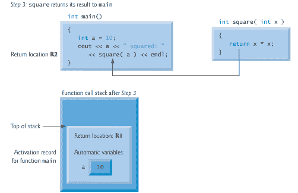

**图 6.17** 函数 square 返回 main 后的函数调用堆栈

## 6.13 空参数列表的函数

在 C++ 中，*空参数列表* 通过在括号中写入 void 或什么都不写来指定。原型

```
void print();
```

指定函数 print *不*接受参数，也*不*返回值。图 6.18 展示了声明和使用具有空参数列表的函数的两种方式。

```cpp
// Fig. 6.18: fig06_18.cpp
// Functions that take no arguments.
#include <iostream>
using namespace std;

void function1(); // function that takes no arguments
void function2( void ); // function that takes no arguments

int main()
{
    function1(); // call function1 with no arguments
    function2(); // call function2 with no arguments
} // end main
```

**图 6.18** 不接受参数的函数（第 1 部分，共 2 部分）

```cpp
// function1 uses an empty parameter list to specify that
// the function receives no arguments
void function1()
{
    cout << "function1 takes no arguments" << endl;
} // end of function1

// function2 uses a void parameter list to specify that
// the function receives no arguments
void function2( void )
{
    cout << "function2 also takes no arguments" << endl;
} // end of function2
```

function1 takes no arguments  
function2 also takes no arguments

**图 6.18** | 不接受参数的函数（第 2 部分，共 2 部分）

## 6.14 内联函数

从软件工程的角度来看，将程序实现为一组函数是好的，但函数调用涉及执行时的开销。C++ 提供 **内联函数** 来帮助减少函数调用开销。在函数定义中，将限定符 **inline** 放在函数返回类型之前，会*建议*编译器在调用该函数的*每个*地方（适当时）生成函数体代码的副本，以避免函数调用。这通常会使程序变大。编译器可以*忽略* inline 限定符，而且通常除了*最小*的函数外都会忽略。可复用的内联函数通常放在头文件中，以便每个使用它们的源文件都能包含其定义。

> **软件工程观察 6.9**  
> *如果更改内联函数的定义，应重新编译该函数的所有客户端。*

> **性能提示 6.4**  
> *编译器可以内联你未显式使用 inline 关键字的代码。如今的优化编译器非常复杂，最好将内联决策留给编译器。*

图 6.19 使用内联函数 cube（第 9–12 行）计算立方体的体积。函数 cube 参数列表（第 9 行）中的关键字 **const** 告诉编译器该函数*不会*修改变量 side。这确保了 side 的值在计算过程中不会被函数改变。（关键字 const 将在第 7–9 章详细讨论。）

> **软件工程观察 6.10**  
> *const 限定符应用于贯彻最小权限原则。运用最小权限原则来正确设计软件，可以大大减少调试时间，改善副作用，并使程序更易于修改和维护。*

```cpp
// Fig. 6.19: fig06_19.cpp
// Inline function that calculates the volume of a cube.
#include <iostream>
using namespace std;

// Definition of inline function cube. Definition of function appears
// before function is called, so a function prototype is not required.
// First line of function definition acts as the prototype.
inline double cube( double side )
{
    return side * side * side; // calculate cube
} // end function cube

int main()
{
    double sideValue; // stores value entered by user
    cout << "Enter the side length of your cube: ";
    cin >> sideValue; // read value from user

    // calculate cube of sideValue and display result
    cout << "Volume of cube with side "
         << sideValue << " is " << cube( sideValue ) << endl;
} // end main
```

```text
Enter the side length of your cube: 3.5
Volume of cube with side 3.5 is 42.875
```

**图 6.19** | 计算立方体体积的内联函数。

## 6.15 引用和引用参数

在许多编程语言中，向函数传递参数有两种方式：**按值传递** 和 **按引用传递**。当参数按值传递时，会创建参数值的一个副本，并（在函数调用堆栈上）传递给被调用函数。对副本的修改不会影响调用者中原始变量的值。这防止了那些极大地阻碍正确可靠软件系统开发的意外副作用。到目前为止，本书中的每个参数都是按值传递的。

> **性能提示 6.5**
> 
> 按值传递的一个缺点是，如果传递的是大数据项，复制该数据可能需要相当多的执行时间和内存空间。

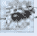

### 引用参数

本节介绍引用参数——C++ 提供的执行按引用传递的两种方式中的第一种。使用按引用传递时，调用者赋予被调用函数直接访问调用者数据并修改该数据的能力。

> **性能提示 6.6**
> 
> 按引用传递对性能有好处，因为它可以消除按值传递复制大量数据的开销。


```cpp
int count = 1; // declare integer variable count
int &ref = count; // create ref as an alias for count
++ref; // increment count (using its alias ref)
```

通过使用其别名 `ref` 来递增变量 `count`。引用变量必须在声明时初始化，并且不能重新赋值以成为其他变量的别名。一旦引用被声明为另一个变量的别名，所有本应作用于别名（即引用）的操作实际上都会作用于原始变量。别名只是原始变量的另一个名字。除非是常量引用，否则引用参数必须是左值（例如，变量名），而不能是常量或右值表达式（例如，计算的结果）。

### 从函数返回引用

函数可以返回引用，但这可能很危险。当返回对被调用函数中声明的变量的引用时，除非该变量被声明为 static（静态），否则该引用指向的是一个自动变量，而该变量在函数终止时会被丢弃。试图访问这样的变量会导致未定义的行为。对未定义变量的引用称为悬空引用。

> **常见编程错误 6.9**
> 
> *在被调用函数中返回对自动变量的引用是一种逻辑错误。编译器通常会在出现这种情况时发出警告。对于工业级代码，在生成可执行代码之前，务必消除所有编译警告。*


## 6.16 默认参数

程序经常以相同的参数值重复调用某个函数，这是很常见的。在这种情况下，你可以指定该参数具有默认参数，即传递给该参数的默认值。当程序在函数调用中省略具有默认参数的参数时，编译器会重写函数调用并插入该参数的默认值。

默认参数必须是函数参数列表中最右侧（末尾）的参数。当调用具有两个或更多默认参数的函数时，如果省略的参数不是参数列表中最右侧的参数，那么该参数右侧的所有参数也必须省略。默认参数必须在函数名首次出现时指定——通常是在函数原型中。如果因为函数定义同时用作原型而省略了函数原型，则默认参数应在函数头中指定。默认值可以是任何表达式，包括常量、全局变量或函数调用。默认参数也可以用于内联函数。

图 6.21 演示了使用默认参数计算盒子体积。`boxVolume` 的函数原型（第 7 行）指定了所有三个参数的默认值均为 1。为了可读性，我们在函数原型中提供了变量名。和往常一样，函数原型中不需要变量名。

对 `boxVolume` 的第一次调用（第 13 行）不指定任何参数，因此使用全部三个默认值 1。第二次调用（第 17 行）只传递一个 length 参数，因此 width 和 height 参数使用默认值 1。第三次调用（第 21 行）只为 length 和 width 传递参数，因此 height 参数使用默认值 1。

```cpp
// Fig. 6.21: fig06_21.cpp
// Using default arguments.
#include <iostream>
using namespace std;

// function prototype that specifies default arguments
unsigned int boxVolume( unsigned int length = 1, unsigned int width = 1,
   unsigned int height = 1 );

int main()
{
   // no arguments--use default values for all dimensions
   cout << "The default box volume is: " << boxVolume();

   // specify length; default width and height
   cout << "\n\nThe volume of a box with length 10,\n"
      << " width 1 and height 1 is: " << boxVolume( 10 );

   // specify length and width; default height
   cout << "\n\nThe volume of a box with length 10,\n"
      << " width 5 and height 1 is: " << boxVolume( 10, 5 );

   // specify all arguments
   cout << "\n\nThe volume of a box with length 10,\n"
      << " width 5 and height 2 is: " << boxVolume( 10, 5, 2 )
      << endl;
} // end main

// function boxVolume calculates the volume of a box
unsigned int boxVolume( unsigned int length, unsigned int width,
   unsigned int height )
{
   return length * width * height;
} // end function boxVolume
```

```
The default box volume is: 1

The volume of a box with length 10,
width 1 and height 1 is: 10

The volume of a box with length 10,
width 5 and height 1 is: 50

The volume of a box with length 10,
width 5 and height 2 is: 100
```

**图 6.21** | 使用默认参数。

最后一次调用（第 25 行）为 length、width 和 height 都传递了参数，因此不使用任何默认值。任何显式传递给函数的参数都会按从左到右的顺序分配给函数的参数。因此，当 `boxVolume` 接收一个参数时，函数会将该参数的值赋给其 length 参数（即参数列表中最左边的参数）。当 `boxVolume` 接收两个参数时，函数会按顺序将这些参数的值赋给其 length 和 width 参数。最后，当 `boxVolume` 接收全部三个参数时，函数会将这些参数的值分别赋给其 length、width 和 height 参数。

> **良好的编程实践 6.5**
> 
> *使用默认参数可以简化函数调用的编写。然而，一些程序员认为显式指定所有参数更清晰。*

## 6.17 一元作用域解析运算符

可以声明同名的局部变量和全局变量。C++ 提供**一元作用域解析运算符（`::`）**，当同名的局部变量在作用域中时，可以用它来访问全局变量。一元作用域解析运算符不能用于访问外部块中同名的局部变量。如果全局变量的名字与作用域中的局部变量不同，则无需使用一元作用域解析运算符即可直接访问全局变量。

图 6.22 展示了一元作用域解析运算符以及同名的局部变量和全局变量（第 6 行和第 10 行）。为了强调变量 `number` 的局部版本和全局版本是不同的，程序将一个变量声明为 `int`，另一个声明为 `double`。

```cpp
// Fig. 6.22: fig06_22.cpp
// Unary scope resolution operator.
#include <iostream>
using namespace std;

int number = 7; // global variable named number

int main()
{
    double number = 10.5; // local variable named number

    // display values of local and global variables
    cout << "Local double value of number = " << number
         << "\nGlobal int value of number = " << ::number << endl;
} // end main
```

```text
Local double value of number = 10.5
Global int value of number = 7
```

**图 6.22** | 一元作用域解析运算符。

> **良好的编程实践 6.6**
> 
> *始终使用一元作用域解析运算符（`::`）来引用全局变量，可以清楚地表明你打算访问的是全局变量，而不是非全局变量。*

> **软件工程观察 6.12**
> 
> *始终使用一元作用域解析运算符（`::`）来引用全局变量，通过降低与非全局变量名称冲突的风险，使程序员易于识别全局变量。*

> **错误预防提示 6.7**
> 
> *始终使用一元作用域解析运算符（`::`）来引用全局变量，可以消除因非全局变量隐藏全局变量而可能发生的逻辑错误。*

> **错误预防提示 6.8**
> 
> *避免在程序中对不同的用途使用同名的变量。尽管在各种情况下都允许这样做，但它可能导致错误。*

## 6.18 函数重载

C++ 允许定义多个同名函数，只要它们具有不同的签名。这称为**函数重载**。C++ 编译器通过检查调用中参数的数量、类型和顺序来选择要调用的正确函数。函数重载用于创建几个同名函数，它们执行相似的任务，但针对不同的数据类型。例如，数学库中的许多函数针对不同的数值类型进行了重载——C++ 标准要求对第 6.3 节中讨论的数学库函数提供 float、double 和 long double 重载版本。

> **良好的编程实践 6.7**
> 
> *重载执行密切相关任务的函数可以使程序更易读、更易理解。*

### 重载的 square 函数

图 6.23 使用重载的 square 函数来计算一个 int（第 7–11 行）和一个 double（第 14–18 行）的平方。第 22 行通过传递字面量 7 来调用函数 square 的 int 版本。C++ 将整数字面量视为 int 类型。类似地，第 24 行通过传递字面量 7.5 来调用函数 square 的 double 版本，C++ 将其视为 double。在每种情况下，编译器都会根据参数的类型选择要调用的正确函数。输出窗口的最后两行确认了在每种情况下都调用了正确的函数。

```cpp
// Fig. 6.23: fig06_23.cpp
// Overloaded square functions.
#include <iostream>
using namespace std;

// function square for int values
int square( int x )
{
   cout << "square of integer " << x << " is ";
   return x * x;
} // end function square with int argument
```

**图 6.23** | 重载的 square 函数（第 1 部分，共 2 部分）。


```cpp
// function square for double values
double square( double y )
{
   cout << "square of double " << y << " is ";
   return y * y;
} // end function square with double argument

int main()
{
   cout << square( 7 ); // calls int version
   cout << endl;
   cout << square( 7.5 ); // calls double version
   cout << endl;
} // end main
```

```text
square of integer 7 is 49
square of double 7.5 is 56.25
```

**图 6.23** | 重载的 square 函数（第 2 部分，共 2 部分）。

## 编译器如何区分重载函数

重载函数通过其签名（signature）来区分。签名是函数名称及其参数类型（按顺序）的组合。编译器将每个函数标识符与其参数类型编码（有时称为**名称修饰**或**名称装饰**）以实现**类型安全链接**。类型安全链接确保调用正确的重载函数，并且实参类型与形参类型一致。

图 6.24 是用 GNU C++ 编译的。我们没有像通常那样显示程序的执行输出，而是显示由 GNU C++ 在汇编语言中生成的修饰后的函数名。每个修饰名（main 除外）都以两个下划线（`__`）开头，后跟字母 Z、一个数字和函数名。Z 后面的数字指定函数名中有多少个字符。例如，函数 square 的名称中有 6 个字符，因此其修饰名前缀为 `__Z6`。函数名后面是其参数列表的编码。在函数 nothing2（第 25 行；见第四行输出）的参数列表中，`c` 表示 char，`i` 表示 int，`Rf` 表示 float &（即对 float 的引用），`Rd` 表示 double &（即对 double 的引用）。在函数 nothing1 的参数列表中，`i` 表示 int，`f` 表示 float，`c` 表示 char，`Ri` 表示 int &。两个 square 函数通过其参数列表区分；一个指定 `d` 表示 double，另一个指定 `i` 表示 int。修饰名中不包含函数的返回类型。重载函数可以有不同的返回类型，但如果返回类型不同，则必须具有不同的参数列表。同样，不能有两个具有相同签名但返回类型不同的函数。函数名修饰是编译器特定的。此外，函数 main 不进行修饰，因为它不能被重载。


> **常见编程错误 6.10**
> 
> 创建具有相同参数列表但返回类型不同的重载函数是编译错误。

```cpp
// Fig. 6.24: fig06_24.cpp
// Name mangling to enable type-safe linkage.

// function square for int values
int square( int x )
{
    return x * x;
} // end function square

// function square for double values
double square( double y )
{
    return y * y;
} // end function square

// function that receives arguments of types
// int, float, char and int &
void nothing1( int a, float b, char c, int &d )
{
    // empty function body
} // end function nothing1

// function that receives arguments of types
// char, int, float & and double &
int nothing2( char a, int b, float &c, double &d )
{
    return 0;
} // end function nothing2

int main()
{
} // end of main
```

```text
__Z6squarei
__Z6squared
__Z8nothing1ifcRi
__Z8nothing2ciRfRd
main
```

**图 6.24** | 名称修饰实现类型安全链接。

编译器仅使用参数列表来区分重载函数。此类函数*不必*具有相同数量的参数。重载带有默认参数的函数时要小心，因为这可能导致歧义。


> **常见编程错误 6.11**
> 
> 省略默认实参的函数可能与另一个重载函数的调用方式相同；这是一个编译错误。例如，如果程序中既有一个显式不接受参数的函数，又有一个同名但包含全部默认实参的函数，那么当尝试在调用中使用该函数名而不传递任何实参时，会导致编译错误。编译器无法确定应选择哪个版本的函数。

参数在特定模板定义的模板参数列表中必须是唯一的。当编译器在程序源代码中检测到 maximum 调用时，传递给 maximum 的数据的*类型*将在整个模板定义中替换 T，C++ 会创建一个完整的函数来确定指定数据类型的三个值中的最大值——由于此示例中只使用了一个类型参数，所以这三个值必须具有相同的类型。然后编译新创建的函数——模板是*代码生成*的一种手段。

图 6.26 使用 maximum 函数模板分别确定三个 int 值、三个 double 值和三个 char 值中的最大值（第 17、27 和 37 行）。由于第 17、27 和 37 行中的调用，分别创建了期望三个 int 值、三个 double 值和三个 char 值的独立函数。

```cpp
// Fig. 6.26: fig06_26.cpp
// Function template maximum test program.
#include <iostream>
#include "maximum.h" // include definition of function template maximum
using namespace std;

int main()
{
   // demonstrate maximum with int values
   int int1, int2, int3;

   cout << "Input three integer values: ";
   cin >> int1 >> int2 >> int3;

   // invoke int version of maximum
   cout << "The maximum integer value is: "
        << maximum( int1, int2, int3 );

   // demonstrate maximum with double values
   double double1, double2, double3;

   cout << "\n\nInput three double values: ";
   cin >> double1 >> double2 >> double3;

   // invoke double version of maximum
   cout << "The maximum double value is: "
        << maximum( double1, double2, double3 );

   // demonstrate maximum with char values
   char char1, char2, char3;

   cout << "\n\nInput three characters: ";
   cin >> char1 >> char2 >> char3;

   // invoke char version of maximum
   cout << "The maximum character value is: "
        << maximum( char1, char2, char3 ) << endl;
} // end main
```

**图 6.26** | 函数模板 maximum 测试程序（第 1 部分，共 2 部分）。

```text
Input three integer values: 1 2 3
The maximum integer value is: 3

Input three double values: 3.3 2.2 1.1
The maximum double value is: 3.3

Input three characters: A C B
The maximum character value is: C
```

**图 6.26** | 函数模板 maximum 测试程序（第 2 部分，共 2 部分）。

为类型 int 创建的函数模板特化会将每个 T 替换为 int，如下所示：

```cpp
int maximum( int value1, int value2, int value3 )
{
   int maximumValue = value1;  // assume value1 is maximum

   // determine whether value2 is greater than maximumValue
   if ( value2 > maximumValue )
      maximumValue = value2;

   // determine whether value3 is greater than maximumValue
   if ( value3 > maximumValue )
      maximumValue = value3;

   return maximumValue;
}  // end function template maximum
```

## C++11——函数的尾置返回类型

C++11 引入了函数的**尾置返回类型**。要指定尾置返回类型，请将关键字 auto 放在函数名之前，然后在函数的参数列表后跟 -> 和返回类型。例如，为函数模板 maximum（图 6.25）指定尾置返回类型时，可以这样写：

```cpp
template < typename T >
auto maximum( T x, T y, T z ) -> T
```

在构建更复杂的函数模板时，有些情况只允许使用尾置返回类型。这类复杂的函数模板超出了本书的范围。

## 6.20 递归

对于某些问题，让函数*调用自身*是很有用的。*递归函数*是直接或间接（通过另一个函数）调用自身的函数。[*注：* C++ 标准文档指出，不应在程序内或递归地调用 main。其唯一用途是作为程序执行的起点。] 本节和下一节将介绍简单的递归示例。递归在高年级计算机科学课程中有详细讨论。图 6.32（在 6.22 节末尾）总结了书中大量的递归示例和练习。

### 递归概念

我们首先从概念上考虑递归，然后研究包含递归函数的程序。递归解决问题的方法有许多共同要素。


```cpp
using namespace std;

unsigned long fibonacci( unsigned long ); // function prototype

int main()
{
   // calculate the fibonacci values of 0 through 10
   for ( unsigned int counter = 0; counter <= 10; ++counter )
      cout << "fibonacci( " << counter << " ) = "
         << fibonacci( counter ) << endl;

   // display higher fibonacci values
   cout << "\nfibonacci( 20 ) = " << fibonacci( 20 ) << endl;
   cout << "fibonacci( 30 ) = " << fibonacci( 30 ) << endl;
   cout << "fibonacci( 35 ) = " << fibonacci( 35 ) << endl;
} // end main

// recursive function fibonacci
unsigned long fibonacci( unsigned long number )
{
   if ( ( 0 == number ) || ( 1 == number ) ) // base cases
      return number;
   else // recursive step
      return fibonacci( number - 1 ) + fibonacci( number - 2 );
} // end function fibonacci
```

```text
fibonacci( 0 ) = 0
fibonacci( 1 ) = 1
fibonacci( 2 ) = 1
fibonacci( 3 ) = 2
fibonacci( 4 ) = 3
fibonacci( 5 ) = 5
fibonacci( 6 ) = 8
fibonacci( 7 ) = 13
fibonacci( 8 ) = 21
fibonacci( 9 ) = 34
fibonacci( 10 ) = 55

fibonacci( 20 ) = 6765
fibonacci( 30 ) = 832040
fibonacci( 35 ) = 9227465
```

**图 6.29** | 递归函数 fibonacci。（第 2 部分，共 2 部分）

### *评估 fibonacci(3)*

图 6.30 展示了函数 fibonacci 将如何计算 fibonacci(3)。此图提出了关于 C++ 编译器对运算符操作数的计算顺序的一些有趣问题。这与运算符应用于其操作数的顺序（即由运算符优先级和结合性规则所决定的顺序）是一个不同的问题。图 6.30 显示，计算 fibonacci(3) 会导致两次递归调用，即 fibonacci(2) 和 fibonacci(1)。这些调用按什么顺序进行？

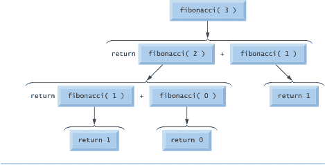

**图 6.30** 函数 `fibonacci` 的递归调用集合。

### *操作数的计算顺序*

大多数程序员只是简单地认为操作数是从左到右计算的。C++ 并没有指定大多数运算符（包括 `+`）的操作数的计算顺序。因此，你不能对这些调用的执行顺序做任何假设。这些调用实际上可以先执行 `fibonacci(2)`，然后执行 `fibonacci(1)`，也可以按相反顺序执行：先执行 `fibonacci(1)`，再执行 `fibonacci(2)`。在这个程序以及大多数其他程序中，最终结果是一样的。然而，在某些程序中，操作数的计算可能会产生*副作用*（数据值的变化），这可能影响表达式的最终结果。

C++ 只规定了四个运算符的操作数计算顺序——`&&`、`||`、逗号 `(,)` 和 `?:`。前三个是二元运算符，它们的两个操作数保证按从左到右的顺序计算。最后一个运算符是 C++ 唯一的三元运算符——它最左边的操作数总是首先求值；如果结果为 `true`，则接下来求值中间的操作数，并忽略最后一个操作数；如果最左边的操作数结果为 `false`，则接下来求值第三个操作数，并忽略中间的操作数。

**可移植性提示 6.2**

依赖于 `&&`、`||`、`?:` 和逗号 `(,)` 运算符之外的操作数计算顺序的程序，在不同编译器下可能表现不同，并可能导致逻辑错误。

**常见编程错误 6.13**

编写依赖于 `&&`、`||`、`?:` 和逗号 `(,)` 运算符之外的操作数计算顺序的程序，可能导致逻辑错误。

**错误预防提示 6.9**

不要依赖操作数的求值顺序。为了确保副作用按正确顺序生效，应将复杂表达式拆分成单独的语句。


**常见编程错误 6.14**

请记住，`&&` 和 `||` 运算符使用短路求值。如果将带有副作用的表达式放在 `&&` 或 `||` 运算符的右侧，而该表达式本应总是被求值，则会造成逻辑错误。

### 指数复杂度

关于像我们这里用来生成斐波那契数的递归程序，有必要提出一个警告。函数 `fibonacci` 中的每一层递归都会对函数调用的数量产生*加倍*的影响；也就是说，计算第 *n* 个斐波那契数所需的递归调用数量级为 2ⁿ。这会迅速失控。仅计算第 20 个斐波那契数就需要的调用数量级为 2²⁰，即大约一百万次调用；计算第 30 个斐波那契数需要的调用数量级为 2³⁰，即大约十亿次调用，以此类推。计算机科学家将这种现象称为**指数复杂度**。这类问题即使是世界上最强大的计算机也会感到无能为力！一般的复杂度问题，尤其是指数复杂度，会在通常称为“算法”的高年级计算机科学课程中详细讨论。


**性能提示 6.8**

避免使用会导致调用次数呈指数“爆炸”的斐波那契式递归程序。

## 6.22 递归与迭代

在前两节中，我们研究了两个也可以用简单的迭代程序实现的递归函数。本节比较这两种方法，并讨论在特定情况下为什么你可能选择其中一种而不是另一种。

-   迭代和递归都*基于控制语句*：迭代使用*重复结构*；递归使用*选择结构*。
-   迭代和递归都涉及*重复*：迭代显式使用*重复结构*；递归通过*重复的函数调用*实现重复。
-   迭代和递归都涉及*终止测试*：迭代在*循环继续条件不满足*时终止；递归在识别到*基本情况*时终止。
-   计数器控制重复的迭代和递归都逐渐接近终止：迭代*修改计数器*，直到计数器达到使循环继续条件不满足的值；递归产生*原问题的更简单版本*，直到达到基本情况。
-   迭代和递归*都可能无限进行*：如果循环继续测试永远不会变为 false，则迭代发生无限循环；如果递归步骤在每次递归调用中不能以一种收敛于基本情况的方式减小问题，则发生*无限递归*。

### 迭代阶乘实现

为了说明迭代和递归之间的区别，让我们考察阶乘问题的一个迭代解决方案（图 6.31）。其中使用了重复语句（图 6.31 第 23...24 行），而不是递归解决方案中的选择语句（图 6.28 第 20–23 行）。两种解决方案都使用终止测试。在递归解决方案中，第 20 行（图 6.28）测试基本情况。在迭代解决方案中，第 23 行（图 6.31）测试循环继续条件——如果测试失败，循环终止。最后，迭代解决方案不是产生原问题的更简单版本，而是使用一个计数器，并修改它直到循环继续条件变为 false。

```cpp
// Fig. 6.31: fig06_31.cpp
// Iterative version of factorial.
#include <iostream>
#include <iomanip>
using namespace std;

unsigned long factorial( unsigned int ); // function prototype

int main()
{
   // calculate the factorials of 0 through 10
   for ( unsigned int counter = 0; counter <= 10; ++counter )
      cout << setw( 2 ) << counter << "! = " << factorial( counter )
           << endl;
} // end main

// iterative function factorial
unsigned long factorial( unsigned int number )
{
   unsigned long result = 1;

   // iterative factorial calculation
   for ( unsigned int i = number; i >= 1; --i )
      result *= i;

   return result;
} // end function factorial
```

```text
0! = 1
1! = 1
2! = 2
3! = 6
4! = 24
5! = 120
6! = 720
7! = 5040
8! = 40320
9! = 362880
10! = 3628800
```

**图 6.31** | *迭代函数 factorial。*

### 递归的缺点

递归有缺点。它会重复调用函数机制，因此产生*函数调用的开销*。这在处理器时间和内存空间方面都可能代价高昂。每次递归调用都会创建*函数变量的另一个副本*；这会消耗大量的内存。


| 文本中的位置 | 递归示例与练习 |
|---|---|
| *第19章* |  |
| 第19.6节，图19.20–19.22 | 二叉树插入 |
| 第19.6节，图19.20–19.22 | 二叉树前序遍历 |
| 第19.6节，图19.20–19.22 | 二叉树中序遍历 |
| 第19.6节，图19.20–19.22 | 二叉树后序遍历 |
| 练习19.20 | 反向打印链表 |
| 练习19.21 | 搜索链表 |
| 练习19.22 | 二叉树删除 |
| 练习19.23 | 二叉树搜索 |
| 练习19.24 | 二叉树层序遍历 |
| 练习19.25 | 打印树 |
| *第20章* |  |
| 第20.3.3节，图20.6 | 归并排序 |
| 练习20.8 | 线性搜索 |
| 练习20.9 | 二分搜索 |
| 练习20.10 | 快速排序 |

**图6.32** | 文本中递归示例与练习的总结。（第2部分，共2部分。）

## 6.23 小结

在本章中，你进一步学习了函数声明，包括函数原型、函数签名、函数头和函数体。我们概述了数学库函数。你了解了参数强制转换，即将参数强制转换为函数参数声明所指定的适当类型。我们演示了如何使用函数`rand`和`srand`生成可用于模拟的随机数集合。我们展示了如何使用枚举定义常量集合。你还学习了变量的作用域、存储类别说明符和存储持续时间。我们介绍了向函数传递参数的两种不同方式——按值传递和按引用传递。对于按引用传递，引用用作变量的别名。我们展示了如何实现内联函数和接收默认参数的函数。你了解到，一个类中的多个函数可以通过提供同名但签名不同的函数来重载。这样的函数可以使用不同的类型或不同数量的参数来执行相同或类似的任务。我们演示了一种使用函数模板重载函数的更简单方法，即函数只定义一次，但可用于多种不同的类型。接着你学习了递归，即函数调用自身来解决问题。

在第7章中，你将学习如何在数组和面向对象的向量中维护数据列表和数据表。你将看到掷骰子应用程序的一个更优雅的基于数组的实现，以及我们在第3–6章中介绍的GradeBook案例研究的两个增强版本，它们将使用数组来存储实际输入的分数。

- 对于你没有显式使用`inline`关键字的代码，编译器也可以进行内联。如今的优化编译器非常复杂，最好将内联决策交给编译器。

### 6.15节 引用和引用参数

- 当参数按值传递（第237页）时，会创建参数值的副本并将其传递给被调函数。对副本的修改不会影响调用者中原始变量的值。
- 通过按引用传递（第237页），调用者赋予被调函数直接访问调用者数据的能力，并且如果被调函数选择这样做，还可以修改它。
- 引用参数（第238页）是函数调用中其对应参数的别名。
- 要指示函数参数按引用传递，请在函数原型和函数头中参数类型后加上与号（&）。
- 对引用执行的所有操作实际上都是对原始变量执行的。

### 6.16节 默认参数

- 当函数重复调用时，如果某个特定参数每次使用相同的实参，你可以指定该参数具有默认参数（第240页）。
- 当程序省略具有默认参数的某个实参时，编译器会插入该参数的默认值以传递给函数调用。
- 默认参数必须是函数参数列表中最右侧（尾部）的参数。
- 默认参数在函数原型中指定。

### 6.17节 一元作用域解析运算符

- C++提供了一元作用域解析运算符（第242页）`::`，用于在存在同名局部变量时访问全局变量。

### 6.18节 函数重载

- C++允许定义多个同名函数，只要这些函数具有不同的参数集。这种能力称为函数重载（第243页）。
- 当调用重载函数时，C++编译器通过检查调用中实参的数量、类型和顺序来选择适当的函数。
- 重载函数通过其签名来区分。
- 编译器使用参数类型对每个函数标识符进行编码，以实现类型安全链接（第244页）。类型安全链接确保调用正确的重载函数，并且实参类型与形参类型一致。

### 6.19节 函数模板

- 重载函数通常在不同数据类型上执行相似的操作，但这些操作涉及不同的程序逻辑。如果每种数据类型的程序逻辑和操作都相同，则可以使用函数模板（第246页）更简洁、更方便地执行重载。
- 根据函数模板调用中提供的实参类型，C++会自动生成单独的函数模板特化（第246页），以适当地处理每种调用类型。
- 所有函数模板定义都始于`template`关键字（第246页），后跟一个用尖括号（`<`和`>`）括起来的模板参数列表（第246页）。
- 形式类型参数（第246页）以关键字`typename`（或`class`）开头，是基本类型或用户定义类型的占位符。这些占位符用于指定函数参数的类型、指定函数的返回类型，并在函数定义体内声明变量。
- C++11引入了函数的尾置返回类型。要指定尾置返回类型，请将`auto`放在函数名之前，然后在函数参数列表后面跟上`->`和返回类型。

### 6.20节 递归

- 递归函数（第248页）直接或间接调用自身。
- 递归函数只知道如何解决最简单的情况，即所谓的基本情况。如果使用基本情况（第249页）调用函数，函数只需返回一个结果。
- 如果使用更复杂的问题调用函数，函数通常会将问题分为两个概念部分——函数知道如何解决的部分和不知道如何解决的部分。为了使递归可行，后一部分必须类似于原始问题，但必须是稍简单或稍小的版本。
- 为了使递归终止，递归调用（第249页）的序列必须收敛于基本情况。
- C++11新增的`unsigned long long int`类型（可缩写为`unsigned long long`）在某些系统上使你能够以8字节（64位）存储值，可容纳最大为18,446,744,073,709,551,615的数字。

### 6.21节 使用递归的示例：斐波那契数列

- 连续斐波那契数的比率收敛到常数1.618……这个数字在自然界中经常出现，被称为黄金比例或黄金分割（第252页）。

### 6.22节 递归与迭代

- 迭代（第249页）和递归相似：两者都基于控制语句，涉及重复，涉及终止测试，逐渐接近终止，并且可能无限发生。
- 递归反复调用函数机制并产生函数调用开销。这在处理器时间和内存空间两方面都可能代价高昂。每次递归调用（第249页）都会创建函数变量的另一个副本；这可能消耗大量内存。

### 自测练习

- 6.1 回答以下各项：
- a) C++中的程序组件称为________和________。
- b) 函数通过________调用。
- c) 仅在定义它的函数内部已知的变量称为________。
- d) 被调函数中的________语句将表达式的值传回调用函数。
- e) 关键字________在函数头中用于指示函数不返回值或指示函数不包含参数。
- f) 标识符的________是程序中可以使用该标识符的部分。
- g) 将被调函数的控制权返回给调用者的三种方式是________、________和________。
- h) ________允许编译器检查传递给函数的实参的数量、类型和顺序。
- i) 函数________用于产生随机数。
- j) 函数________用于设置随机数种子，以随机化函数`rand`生成的数字序列。
- k) 存储类别说明符________是向编译器建议将变量存储在计算机的某个寄存器中。
- l) 在任何块或函数外部声明的变量是________变量。
- m) 为了使函数中的局部变量在函数调用之间保持其值，必须使用________存储类别说明符声明它。


- n) 直接或间接（即通过另一个函数）调用自身的函数称为______函数。
- o) 递归函数通常有两个组成部分——一个通过测试______情况来使递归终止，另一个将问题表示为对比原始调用稍简单的问题进行递归调用。
- p) 可以有多个同名但操作不同类型或数量参数的函数，这称为函数______。
- q) ______可以访问与当前作用域中变量同名的全局变量。
- r) ______限定符用于声明只读变量。
- s) 函数______使得可以定义一个函数来对多种不同类型的数据执行任务。

### 6.2

对于图6.33中的程序，说明以下每个元素的作用域（函数作用域、全局命名空间作用域、块作用域或函数原型作用域）：

- a) main中的变量x。
- b) cube中的变量y。
- c) 函数cube。
- d) 函数main。
- e) cube的函数原型。
- f) cube函数原型中的标识符y。

```cpp
// Exercise 6.2: Ex06_02.cpp
#include <iostream>
using namespace std;

int cube( int y ); // function prototype

int main()
{
    int x = 0;

    for ( x = 1; x <= 10; x++ ) // loop 10 times
        cout << cube( x ) << endl; // calculate cube of x and output results
} // end main

// definition of function cube
int cube( int y )
{
    return y * y * y;
} // end function cube
```

**图6.33** — 练习6.2的程序。

### 6.3

编写一个程序，测试图6.2中所示数学库函数调用示例是否确实产生了所示结果。

### 6.4

给出以下每个函数的函数头：

- a) 函数hypotenuse，接受两个双精度浮点参数side1和side2，并返回双精度浮点结果。
- b) 函数smallest，接受三个整数x、y和z，并返回一个整数。
- c) 函数instructions，不接收任何参数且不返回任何值。**注意：** 此类函数通常用于向用户显示说明。
- d) 函数intToDouble，接受整数参数number，并返回双精度浮点结果。

### 6.9

（判断对错）C++中所有函数调用的参数都是按值传递的。

### 6.10

编写一个完整程序，提示用户输入球体的半径，并计算和打印该球体的体积。使用内联函数`sphereVolume`，返回以下表达式的结果：`(4.0 / 3.0 * 3.14159 * pow(radius, 3))`。

## 自测练习答案

### 6.1

- a) 函数、类。
- b) 函数调用。
- c) 局部变量。
- d) 返回。
- e) void。
- f) 作用域。
- g) return；return expression；或遇到函数的右花括号。
- h) 函数原型。
- i) rand。
- j) srand。
- k) register。
- l) 全局。
- m) static。
- n) 递归。
- o) 基准。
- p) 重载。
- q) 一元作用域解析运算符（`::`）。
- r) const。
- s) 模板。

### 6.2

- a) 块作用域。
- b) 块作用域。
- c) 全局命名空间作用域。
- d) 全局命名空间作用域。
- e) 全局命名空间作用域。
- f) 函数原型作用域。

### 6.3

参见以下程序：

```cpp
// Exercise 6.3: Ex06_03.cpp
// Testing the math library functions.
#include <iostream>
#include <iomanip>
#include <cmath>
using namespace std;

int main()
{
   cout << fixed << setprecision(1);

   cout << "\nsqrt(" << 9.0 << ") = " << sqrt(9.0);
   cout << "\nexp(" << 1.0 << ") = " << setprecision(6)
        << exp(1.0) << "\nexp(" << setprecision(1) << 2.0
        << ") = " << setprecision(6) << exp(2.0);
   cout << "\nlog(" << 2.718282 << ") = " << setprecision(1)
        << log(2.718282)
        << "\nlog(" << setprecision(6) << 7.389056 << ") = "
        << setprecision(1) << log(7.389056);
   cout << "\nlog10(" << 10.00 << ") = " << log10(10.0);
   cout << "\nlog10(" << 100.0 << ") = " << log10(100.0);
   cout << "\nfabs(" << 5.1 << ") = " << fabs(5.1);
   cout << "\nfabs(" << 0.0 << ") = " << fabs(0.0);
   cout << "\nfabs(" << -8.76 << ") = " << fabs(-8.76);
   cout << "\nceil(" << 9.2 << ") = " << ceil(9.2);
   cout << "\nceil(" << -9.8 << ") = " << ceil(-9.8);
   cout << "\nfloor(" << 9.2 << ") = " << floor(9.2);
   cout << "\nfloor(" << -9.8 << ") = " << floor(-9.8);
   cout << "\npow(" << 2.0 << ", " << 7.0 << ") = "
        << pow(2.0, 7.0) << "\npow("
        << 9.0 << ", " << 0.5 << ") = " << pow(9.0, 0.5);
   cout << setprecision(3) << "\nfmod("
        << 2.6 << ", " << 1.2 << ") = " << fmod(2.6, 1.2);
   cout << setprecision(1);
   cout << "\nsin(" << 0.0 << ") = " << sin(0.0);
   cout << "\ncos(" << 0.0 << ") = " << cos(0.0);
   cout << "\ntan(" << 0.0 << ") = " << tan(0.0) << endl;
} // end main
```

```text
sqrt(9.0) = 3.0
exp(1.0) = 2.718282
exp(2.0) = 7.389056
log(2.718282) = 1.0
log(7.389056) = 2.0
log10(10.0) = 1.0
log10(100.0) = 2.0
fabs(5.1) = 5.1
fabs(0.0) = 0.0
fabs(-8.8) = 8.8
ceil(9.2) = 10.0
ceil(-9.8) = -9.0
floor(9.2) = 9.0
floor(-9.8) = -10.0
pow(2.0, 7.0) = 128.0
pow(9.0, 0.5) = 3.0
fmod(2.600, 1.200) = 0.200
sin(0.0) = 0.0
cos(0.0) = 1.0
tan(0.0) = 0.0
```

### 6.4

- a) `double hypotenuse( double side1, double side2 )`
- b) `int smallest( int x, int y, int z )`
- c) `void instructions()`
- d) `double intToDouble( int number )`

### 6.5

- a) `double hypotenuse( double, double );`
- b) `int smallest( int, int, int );`
- c) `void instructions();`
- d) `double intToDouble( int );`

### 6.6

- a) `register int count = 0;`
- b) `static double lastVal;`

### 6.7

- a) *错误：* 函数h定义在函数g内部。
  *更正：* 将h的定义移到g的定义之外。
- b) *错误：* 该函数本应返回一个整数，但没有返回。
  *更正：* 在函数体末尾添加`return result;`语句，或者删除变量result并在函数中放置以下语句：
  `return x + y;`
- c) *错误：* `n + sum( n - 1 )`的结果没有被返回；sum返回了不正确的结果。
  *更正：* 将else子句中的语句重写为`return n + sum( n - 1 );`
- d) *错误：* 右括号后有分号，且在函数定义中重新定义了参数a。
  *更正：* 删除参数列表右括号后面的分号，并删除声明`float a;`。
- e) *错误：* 函数在不应该返回值时返回了一个值。
  *更正：* 消除return语句或更改返回类型。

### 6.8

这创建了一个“指向double的引用”类型的引用参数，使函数能够修改调用函数中的原始变量。

### 6.9

错误。C++使用引用参数（以及指针，我们将在第8章讨论）支持按引用传递。

### 6.13（数字取整）

函数floor的一个应用是将值四舍五入到最接近的整数。语句

```cpp
y = floor( x + 0.5 );
```

将数字x四舍五入到最接近的整数，并将结果赋给y。编写一个程序，读取多个数字，并使用上述语句将这些数字分别四舍五入到最接近的整数。对于每个处理的数字，打印原始数字和四舍五入后的数字。

### 6.14（数字取整）

函数floor可用于将数字四舍五入到特定的小数位。语句

```cpp
y = floor( x * 10 + 0.5 ) / 10;
```

将x四舍五入到十分位（小数点右边第一位）。语句

```cpp
y = floor( x * 100 + 0.5 ) / 100;
```

将x四舍五入到百分位（小数点右边第二位）。编写一个程序，定义四个函数以不同方式对数字x进行四舍五入：

- a) `roundToInteger( number )`
- b) `roundToTenths( number )`
- c) `roundToHundredths( number )`
- d) `roundToThousandths( number )`

对于读取的每个值，程序应打印原始值、四舍五入到最接近整数的数字、四舍五入到最接近十分位的数字、四舍五入到最接近百分位的数字，以及四舍五入到最接近千分位的数字。

### 6.15（简答题）

回答以下每个问题：

- a) “随机”选择数字是什么意思？
- b) 为什么rand函数对模拟机会游戏很有用？
- c) 为什么要使用srand来随机化程序？在什么情况下不希望进行随机化？
- d) 为什么经常需要缩放或平移rand产生的值？
- e) 为什么对现实世界情况进行计算机模拟是一种有用的技术？

### 6.16（随机数）

编写语句，将随机整数赋给变量n，范围如下：

- a) 1 ≤ n ≤ 2
- b) 1 ≤ n ≤ 100
- c) 0 ≤ n ≤ 9
- d) 1000 ≤ n ≤ 1112
- e) −1 ≤ n ≤ 1
- f) −3 ≤ n ≤ 11

### 6.17（随机数）

编写一条语句，从以下每个集合中随机打印一个数字：

- a) 2, 4, 6, 8, 10。
- b) 3, 5, 7, 9, 11。
- c) 6, 10, 14, 18, 22。

### 6.18（幂运算）

编写一个函数`integerPower(base, exponent)`，返回

`base^exponent`

的值。例如，`integerPower(3, 4) = 3 * 3 * 3 * 3`。假设exponent是一个正整数且非零，base是一个整数。不要使用任何数学库函数。


时钟“敲响了12点”。使用此函数计算两个时间之间的秒数，这两个时间都处于时钟的同一个12小时周期内。

## 6.26（摄氏温度与华氏温度）

实现以下整数函数：

- a) 函数 `celsius` 返回华氏温度对应的摄氏温度。
- b) 函数 `fahrenheit` 返回摄氏温度对应的华氏温度。
- c) 使用这些函数编写一个程序，打印从0到100度所有摄氏温度对应的华氏温度，以及从32到212度所有华氏温度对应的摄氏温度。以简洁的表格格式打印输出，在保持可读性的同时尽量减少输出行数。

## 6.27（求最小值）

编写一个程序，输入三个双精度浮点数，并将它们传递给一个返回最小数的函数。

## 6.28（完全数）

如果一个整数的所有因子（包括1，但不包括该整数本身）之和等于该整数，则称该整数为*完全数*。例如，6是一个完全数，因为6=1+2+3。编写一个函数`isPerfect`来判断一个数是否为完全数。在程序中使用此函数，找出并打印1到1000之间的所有完全数。打印每个完全数的因子，以确认该数确实是完全数。通过测试远大于1000的数来考验你计算机的性能。

## 6.29（素数）

如果一个整数只能被1和它本身整除，则称该整数为*素数*。例如，2、3、5和7是素数，但4、6、8和9不是。

- a) 编写一个函数来判断一个数是否为素数。
- b) 在程序中使用此函数，找出并打印2到10,000之间的所有素数。在确定已找到所有素数之前，你实际上需要测试多少个数？
- c) 最初，你可能会认为`n/2`是判断一个数是否为素数时必须测试的上限，但你只需要测试到`n`的平方根即可。为什么？重写程序，并用两种方式运行。估计性能的提升。

## 6.30（反转数字）

编写一个函数，接受一个整数值，并返回其数字反转后的数。例如，给定数字7631，函数应返回1367。

## 6.31（最大公约数）

两个整数的最大公约数（GCD）是能同时整除这两个数的最大整数。编写一个函数`gcd`，返回两个整数的最大公约数。

## 6.32（数值成绩的绩点）

编写一个函数`qualityPoints`，输入学生的平均成绩，如果平均成绩为90–100则返回4，80–89返回3，70–79返回2，60–69返回1，低于60返回0。

## 6.33（抛硬币）

编写一个模拟抛硬币的程序。每次抛硬币时，程序应打印正面或反面。让程序抛硬币100次，并统计硬币每一面出现的次数。打印结果。程序应调用一个单独的函数`flip`，该函数不带参数，对于反面返回0，正面返回1。*[注意：如果程序真实地模拟抛硬币，那么硬币的每一面大约出现一半的次数。]*

## 6.34（猜数字游戏）

编写一个程序，玩“猜数字”游戏，规则如下：程序在1到1000范围内随机选择一个整数作为要猜的数字。然后程序显示以下内容：

```
I have a number between 1 and 1000.
Can you guess my number?
Please type your first guess.
```

然后玩家输入第一个猜测。程序响应以下之一：

```
1. Excellent! You guessed the number!
   Would you like to play again (y or n)?
2. Too low. Try again.
3. Too high. Try again.
```

如果玩家的猜测不正确，程序应循环，直到玩家最终猜对数字。程序应不断告诉玩家“太高”或“太低”，帮助玩家“逐步逼近”正确答案。

## 6.35（猜数字游戏修改）

修改练习6.34的程序，统计玩家猜测的次数。如果次数为10或更少，打印“要么你知道秘密，要么你走运了！”如果玩家在10次内猜中数字，打印“啊哈！你知道秘密！”如果玩家猜测超过10次，打印“你应该能做得更好！”为什么猜测次数不应超过10次？好吧，每次“好的猜测”都能让玩家排除一半的数字。现在说明为什么任何1到1000之间的数字都可以在10次或更少的尝试中被猜中。

## 6.36（递归幂运算）

编写一个递归函数`power(base, exponent)`，当被调用时返回

$$\mathrm{power}(base, exponent) = base^{exponent}$$

例如，`power(3, 4) = 3 * 3 * 3 * 3`。假设指数（exponent）是大于或等于1的整数。提示：递归步骤使用以下关系：

$$base^{exponent} = base \cdot base^{exponent-1}$$

当指数等于1时出现终止条件，因为

$$base^1 = base$$

## 6.37（斐波那契数列：迭代解法）

编写图6.29中`fibonacci`函数的非递归版本。

## 6.38（汉诺塔）

在本章中，你学习了一些既可以递归实现也可以迭代实现的函数。在本练习中，我们介绍一个问题，其递归解决方案展示了递归的优雅，而其迭代解决方案可能不那么明显。

**汉诺塔**是每个初出茅庐的计算机科学家都必须面对的最著名的经典问题之一。传说在远东的一座寺庙里，僧侣们正试图将一摞金盘从一个钻石柱移动到另一个钻石柱（图6.34）。初始时，64个盘子穿在一根柱子上，从下到上按大小递减排列。僧侣们试图在以下约束下将这摞盘子从一根柱子移动到另一根柱子：每次只能移动一个盘子，且任何时候都不能将较大的盘子放在较小的盘子上面。提供了三根柱子，其中一根用于临时存放盘子。据说，当僧侣们完成任务时，世界将会终结，因此我们几乎没有动力去协助他们。

让我们假设僧侣们试图将盘子从柱子1移动到柱子3。我们希望开发一种算法，打印出盘子从一根柱子到另一根柱子的精确转移序列。

如果我们用常规方法来解决这个问题，很快就会发现自己陷入管理盘子的绝望困境。相反，以递归的思路来攻克这个问题，步骤就会变得简单。移动n个盘子可以看作是只移动n - 1个盘子（因此产生递归），如下所示：

- a) 将n - 1个盘子从柱子1移动到柱子2，使用柱子3作为临时存放区。
- b) 将最后一个（最大的）盘子从柱子1移动到柱子3。
- c) 将n - 1个盘子从柱子2移动到柱子3，使用柱子1作为临时存放区。

## 6.42（点与点之间的距离）

编写一个函数`distance`，计算两点`(x1, y1)`和`(x2, y2)`之间的距离。所有数字和返回值都应为`double`类型。

## 6.43 下面的程序有什么问题？

```cpp
// Exercise 6.43: ex06_43.cpp
// What is wrong with this program?
#include <iostream>
using namespace std;

int main()
{
   int c = 0;

   if ( ( c = cin.get() ) != EOF )
   {
      main();
      cout << c;
   } // end if
} // end main
```

## 6.44 下面的程序是做什么的？

```cpp
// Exercise 6.44: ex06_44.cpp
// What does this program do?
#include <iostream>
using namespace std;

int mystery( int, int ); // function prototype

int main()
{
   int x = 0;
   int y = 0;

   cout << "Enter two integers: ";
   cin >> x >> y;
   cout << "The result is " << mystery( x, y ) << endl;
} // end main

// Parameter b must be a positive integer to prevent infinite recursion
int mystery( int a, int b )
{
   if ( b == 1 ) // base case
      return a;
   else // recursive step
      return a + mystery( a, b - 1 );
} // end function mystery
```

## 6.45

在你确定了练习6.44中程序的功能后，修改该程序，使其在取消第二个参数必须为非负数的限制后仍能正常运行。

## 6.46（数学库函数）

编写一个程序，尽可能多地测试图6.2中的数学库函数。通过让程序打印出各种参数值的返回值表来练习这些函数。

## 6.47（找出错误）

找出以下每个程序段中的错误，并说明如何改正：


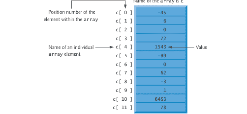

**图 7.1** | 包含12个元素的数组。

下标必须是整数或整型表达式（使用任意整型类型）。如果程序使用表达式作为下标，则程序会计算该表达式以确定下标。例如，假设变量 a 等于 5，变量 b 等于 6，那么语句

```cpp
c[a + b] += 2;
```

会将 2 加到数组元素 c[11] 上。带下标的数组名是一个*左值*——它可以出现在赋值运算符的左侧，就像非数组变量名一样。

让我们更仔细地分析图 7.1 中的 c。整个数组的**名称**是 c。每个数组*知道自己的大小*，可以通过调用其 **size** 成员函数来确定，如 `c.size()`。它的 12 个元素分别称为 c[0] 到 c[11]。c[0] 的**值**是 -45，c[7] 的值是 62，c[11] 的值是 78。要打印数组 c 前三个元素值之和，我们可以这样写：

```cpp
cout << c[0] + c[1] + c[2] << endl;
```

要将 c[6] 的值除以 2 并把结果赋给变量 x，可以这样写：

```cpp
x = c[6] / 2;
```

> **常见编程错误 7.1**
>
> 请注意“数组的第七个元素”与“数组元素 7”之间的区别。下标从 0 开始，因此数组的第七个元素的下标为 6，而“数组元素 7”的下标为 7，实际上是数组的第八个元素。这种区别是差一错误（off-by-one errors）的常见来源。为避免此类错误，我们明确地用数组名和下标编号来引用特定的数组元素（例如，c[6] 或 c[7]）。

括住下标的方括号实际上是一个与圆括号具有相同优先级的*运算符*。图 7.2 展示了目前介绍的运算符的优先级和结合性。运算符按优先级从高到低自上而下排列，并标明了它们的结合性和类型。

| 运算符 | 结合性 | 类型 |
|---|---|---|
| `::` `()` | 从左到右<br>*[关于分组括号的注意事项，参见图 2.10。]* | 基本表达式 |
| `()` `[]` `++` `--` `->` `static_cast<type>(operand)` | 从左到右 | 后缀 |
| `++` `--` `+` `-` `!` | 从右到左 | 一元（前缀） |
| `*` `/` `%` | 从左到右 | 乘法 |
| `+` `-` | 从左到右 | 加法 |
| `<<` `>>` | 从左到右 | 插入/提取 |
| `<` `<=` `>` `>=` | 从左到右 | 关系 |
| `==` `!=` | 从左到右 | 相等 |
| `&&` | 从左到右 | 逻辑与 |
| `\|\|` | 从左到右 | 逻辑或 |
| `?:` | 从右到左 | 条件 |
| `=` `+=` `-=` `*=` `/=` `%=` | 从右到左 | 赋值 |
| `,` | 从左到右 | 逗号 |

**图 7.2** | 目前所介绍运算符的优先级和结合性。

## 7.3 声明数组

数组在内存中占用空间。要指定数组元素的类型和所需元素的数量，请使用如下形式的声明：

```cpp
array<type, arraySize> arrayName;
```

记号 `<type, arraySize>` 表示 array 是一个类模板。编译器根据元素类型和 arraySize 预留适当大小的内存。（请回顾：预留内存的声明更准确地称为定义。）arraySize 必须是无符号整数。要让编译器为整型数组 c 预留 12 个元素，可以使用如下声明：

```cpp
array<int, 12> c; // c is an array of 12 int values
```

数组可以声明为包含大多数数据类型的值。例如，string 类型的数组可用于存储字符串。

## 7.4 数组使用示例

以下示例演示如何声明、初始化和操作数组。

### 7.4.1 声明数组并使用循环初始化数组元素

图 7.3 中的程序声明了一个包含 5 个元素的整型数组 n（第 10 行）。第 5 行包含了 `<array>` 头文件，该头文件包含类模板 array 的定义。第 13–14 行

```cpp
// Fig. 7.5: fig07_05.cpp
// Set array s to the even integers from 2 to 10.
#include <iostream>
#include <iomanip>
#include <array>
using namespace std;

int main()
{
   // constant variable can be used to specify array size
   const size_t arraySize = 5; // must initialize in declaration

   array<int, arraySize> s; // array s has 5 elements

   for (size_t i = 0; i < s.size(); ++i) // set the values
      s[i] = 2 * i + 2;

   cout << "Element" << setw(13) << "Value" << endl;

   // output contents of array s in tabular format
   for (size_t j = 0; j < s.size(); ++j)
      cout << setw(7) << j << setw(13) << s[j] << endl;
} // end main
```

| 元素 | 值 |
|---:|---:|
| 0 | 2 |
| 1 | 4 |
| 2 | 6 |
| 3 | 8 |
| 4 | 10 |

**图 7.5**  |  将数组 s 设置为从 2 到 10 的偶数。

在声明时使用表达式进行初始化，并且此后**不能**被修改（如图 7.6 和图 7.7 所示）。常量变量也称为**命名常量**或**只读变量**。

> **常见编程错误 7.2**
>
> _声明常量变量时未对其进行初始化是一个编译错误。_

> **常见编程错误 7.3**
>
> _在可执行语句中给常量变量赋值是一个编译错误。_

```cpp
// Fig. 7.6: fig07_06.cpp
// Using a properly initialized constant variable.
#include <iostream>
using namespace std;

int main()
{
```

**图 7.6**  |  使用正确初始化的常量变量。（第 1 部分，共 2 部分。）

### 7.4.4 对数组元素求和

通常，数组元素表示用于计算的一系列值。例如，如果数组元素代表考试成绩，教授可能希望将数组元素相加，并用该总和来计算考试的平均分。

图 7.8 中的程序对包含 4 个元素的整型数组 a 中的值求和。程序在第 10 行声明、创建并初始化该数组。for 语句（第 14–15 行）执行计算。为数组 a 提供的初始值也可以由用户在键盘上输入到程序中，或从磁盘上的文件中读取（参见第 14 章“文件处理”）。例如，for 语句

```cpp
for ( size_t j = 0; j < a.size(); ++j )
    cin >> a[ j ];
```

每次从键盘读取一个值，并将该值存储在元素 a[j] 中。

```cpp
// Fig. 7.8: fig07_08.cpp
// Compute the sum of the elements of an array.
#include <iostream>
#include <array>
using namespace std;

int main()
{
   const size_t arraySize = 4; // specifies size of array
   array<int, arraySize> a = { 10, 20, 30, 40 };
   int total = 0;

   // sum contents of array
   for ( size_t i = 0; i < a.size(); ++i )
      total += a[ i ];

   cout << "Total of array elements: " << total << endl;
} // end main
```

```text
Total of array elements: 100
```

图 7.8 | 计算数组元素之和。

### 7.4.5 使用条形图以图形方式显示数组数据

许多程序以图形方式向用户呈现数据。例如，数值通常以条形图中的条形来显示。在这样的图表中，较长的条形表示按比例较大的数值。以图形方式显示数值数据的一种简单方法是使用条形图，将每个数值显示为一条星号（*）组成的条形。

教授们通常喜欢检查考试的成绩分布。教授可能会将若干个分数段中的成绩数量绘制成图表，以便直观地查看成绩分布。假设成绩为 87、68、94、100、83、78、85、91、76 和 87。其中有一个 100 分，两个 90 多分的成绩，四个 80 多分的成绩，两个 70 多分的成绩，一个 60 多分的成绩，没有低于 60 分的成绩。我们的下一个程序（图 7.9）将这些数据存储在一个包含 11 个元素的数组中，每个元素对应一个成绩类别。例如，n[0] 表示 0–9 分数段内的成绩数量，n[7] 表示 70–79 分数段内的成绩数量，而


该范围内的成绩。为了标记每个条形，第20–25行根据计数器变量 `i` 的当前值输出一个成绩范围（例如，“70–79: ”）。嵌套的 `for` 语句（第28–29行）输出条形。注意第28行中的循环继续条件（`stars < n[i]`）。每次程序到达内层 `for` 时，循环从0计数到 `n[i]−1`，从而使用数组 `n` 中的值来确定要显示的星号数量。在此示例中，`n[0]`–`n[5]` 包含零，因为没有学生成绩低于60。因此，程序不会在前六个成绩范围旁边显示星号。

### 7.4.6 使用数组元素作为计数器

有时，程序使用计数器变量来汇总数据，例如调查结果。在图6.9中，我们在掷骰子程序中使用单独的计数器来跟踪程序掷骰子6,000,000次时骰子每一面出现的次数。该程序的数组版本如图7.10所示。此版本还使用了第6.9节中引入的新C++11随机数生成功能。

图7.10使用数组 `frequency`（第18行）来统计骰子每一面出现的次数。*该程序中第22行的单条语句取代了图6.9第23–45行中的 `switch` 语句。* 第22行使用一个随机值来确定要递增哪个 `frequency` 元素。


```cpp
// Fig. 7.10: fig07_10.cpp
// Die-rolling program using an array instead of switch.
#include <iostream>
#include <iomanip>
#include <array>
#include <random>
#include <ctime>
using namespace std;

int main()
{
   // use the default random-number generation engine to
   // produce uniformly distributed pseudorandom int values from 1 to 6
   default_random_engine engine( static_cast<unsigned int>( time(0) ) );
   uniform_int_distribution< unsigned int > randomInt( 1, 6 );

   const size_t arraySize = 7; // ignore element zero
   array<unsigned int, arraySize> frequency = {}; // initialize to 0s

   // roll die 6,000,000 times; use die value as frequency index
   for ( unsigned int roll = 1; roll <= 6000000; ++roll )
      ++frequency[ randomInt( engine ) ];

   cout << "Face" << setw( 13 ) << "Frequency" << endl;

   // output each array element's value
   for ( size_t face = 1; face < frequency.size(); ++face )
      cout << setw( 4 ) << face << setw( 13 ) << frequency[ face ]
           << endl;
} // end main
```

**图 7.10** | 使用数组而不是 `switch` 的掷骰子程序。（第1部分，共2部分。）

```cpp
// initialize frequency counters to 0
array< unsigned int, frequencySize > frequency = {};

// for each answer, select response's element and use that value
// as frequency subscript to determine element to increment
for ( size_t answer = 0; answer < responses.size(); ++answer )
   ++frequency[ responses[ answer ] ];

cout << "Rating" << setw( 17 ) << "Frequency" << endl;

// output each array element's value
for ( size_t rating = 1; rating < frequency.size(); ++rating )
   cout << setw( 6 ) << rating << setw( 17 ) << frequency[ rating ]
        << endl;
} // end main
```

| 评级 | 频率 |
|---:|---:|
| 1 | 3 |
| 2 | 5 |
| 3 | 7 |
| 4 | 2 |
| 5 | 3 |

**图 7.11** | 投票分析程序。（第2部分，共2部分。）

第一个 `for` 语句（第23–24行）从数组 `responses` 中逐个取出响应，并递增 `frequency` 数组中五个计数器之一（`frequency[1]` 到 `frequency[5]`）。循环中的关键语句是第24行，它根据 `responses[answer]` 的值递增相应的频率计数器。

让我们考虑 `for` 循环的几次迭代。当控制变量 `answer` 为0时，`responses[answer]` 的值是 `responses[0]` 的值（即第16行中的1），因此程序将 `++frequency[responses[answer]]` 解释为：

```cpp
++frequency[ 1 ]
```

这会递增数组元素1的值。要计算该表达式，先从最内层方括号中的值（`answer`）开始。一旦知道 `answer` 的值（即第23行循环控制变量的值），就将其代入表达式并计算下一层外层方括号中的表达式（即 `responses[answer]`，它是从第15–16行的 `responses` 数组中选择的一个值）。然后将结果值用作 `frequency` 数组的下标，以指定要递增的计数器。

当 `answer` 为1时，`responses[answer]` 是 `responses[1]` 的值，即2，因此程序将 `++frequency[responses[answer]]` 解释为：

```cpp
++frequency[ 2 ]
```

这会递增数组元素2。

当 `answer` 为2时，`responses[answer]` 是 `responses[2]` 的值，即5，因此程序将 `++frequency[responses[answer]]` 解释为：

```cpp
++frequency[ 5 ]
```

这会递增数组元素5，依此类推。无论调查中处理的响应数量有多少，程序*只需要*一个六元素数组（忽略元素零）即可汇总结果，因为所有响应值都在1到5之间，而六元素数组的下标值为0到5。

## 数组下标越界检查

如果 `responses` 中的数据包含无效值（例如13），程序将尝试对 `frequency[13]` 加1，而该位置超出了数组的边界。*当你使用 `[]` 运算符访问数组元素时，C++ 不会提供自动数组边界检查来防止你引用不存在的元素。* 因此，正在执行的程序可能会在没有任何警告的情况下“越出”数组的任一端。在第7.10节中，我们演示了类模板 `vector` 的 `at` 函数，它会为你执行边界检查。类模板 `array` 也有一个 `at` 函数。

确保你用于访问数组元素的每个下标都在数组边界内非常重要——也就是说，大于或等于0且小于数组元素的数量。

允许程序读取或写入数组边界之外的数组元素是一种常见的安全漏洞。读取越界数组元素可能导致程序崩溃，甚至在使用错误数据时看似正确执行。写入越界元素（称为*缓冲区溢出*）可能破坏程序在内存中的数据、导致程序崩溃，并允许攻击者利用系统执行他们自己的代码。有关缓冲区溢出的更多信息，请参见 en.wikipedia.org/wiki/Buffer_overflow。

> **常见编程错误 7.4**
>
> *引用数组边界之外的元素是执行时逻辑错误。它不是语法错误。*

> **错误预防提示 7.1**
>
> *在遍历数组时，索引绝不应低于0，并且应始终小于数组元素的总数（即数组大小减1）。确保循环终止条件防止访问此范围之外的元素。在第15–16章中，你将学习迭代器，它有助于防止访问数组（或其他容器）边界之外的元素。*

### 7.4.8 静态局部数组和自动局部数组

第6章讨论了存储类别说明符 `static`。函数定义中的静态局部变量在程序运行期间存在，但仅在函数体内可见。

> **性能提示 7.1**
>
> *我们可以将 `static` 应用于局部数组声明，这样每次程序调用函数时不会创建和初始化它，每次函数终止时也不会销毁它。这可以提高性能，尤其是在使用大型数组时。*

程序在首次遇到静态局部数组的声明时对其进行初始化。如果你没有显式初始化静态数组，编译器在创建数组时会将数组的每个元素初始化为零。回想一下，C++ 不会对自动变量执行此类默认初始化。

图7.12演示了带有静态局部数组（第27行）的函数 `staticArrayInit`（第24–40行）和带有自动局部数组（第46行）的函数 `automaticArrayInit`（第43–59行）。

```cpp
// Fig. 7.12: fig07_12.cpp
// static array initialization and automatic array initialization.
#include <iostream>
#include <array>
using namespace std;

void staticArrayInit(); // function prototype
void automaticArrayInit(); // function prototype
const size_t arraySize = 3;

int main()
{
   cout << "First call to each function:\n";
   staticArrayInit();
   automaticArrayInit();

   cout << "\n\nSecond call to each function:\n";
   staticArrayInit();
   automaticArrayInit();
   cout << endl;
} // end main

// function to demonstrate a static local array
void staticArrayInit( void )
{
   // initializes elements to 0 first time function is called
   static array< int, arraySize > array1; // static local array

   cout << "\nValues on entering staticArrayInit:\n";

   // output contents of array1
   for ( size_t i = 0; i < array1.size(); ++i )
      cout << "array1[" << i << "] = " << array1[ i ] << " ";

   cout << "\nValues on exiting staticArrayInit:\n";

   // modify and output contents of array1
   for ( size_t j = 0; j < array1.size(); ++j )
      cout << "array1[" << j << "] = " << ( ( array1[ j ] += 5 ) ) << " ";
} // end function staticArrayInit

// function to demonstrate an automatic local array
void automaticArrayInit( void )
{
   // initializes elements each time function is called
   array< int, arraySize > array2 = { 1, 2, 3 }; // automatic local array

   cout << "\nValues on entering automaticArrayInit:\n";
```

**图 7.12** | 静态数组初始化和自动数组初始化。（第1部分，共2部分。）


“执行以下语句。”因此，对于每次迭代，标识符 item 代表 items 中的一个元素。第13–14行等价于以下计数器控制的重复：

```cpp
for ( int counter = 0; counter < items.size(); ++counter )
    cout << items[ counter ] << " ";
```

## 使用基于范围的 for 修改数组内容

第17–18行使用基于范围的 for 语句将 items 的每个元素乘以2。第17行中，rangeVariableDeclaration 指明 itemRef 是一个项引用（&）。回想一下，引用是内存中另一个变量的别名——在本例中，即数组的某个元素。我们使用 int 引用，因为 items 包含 int 值，而且我们想要修改每个元素的值——因为 itemRef 声明为引用，你对 itemRef 所做的任何更改都会更改数组中相应的元素值。

## 使用元素的下标

只要循环遍历数组的代码不需要访问元素的下标，就可以使用基于范围的 for 语句代替计数器控制的 for 语句。例如，对数组中的整数求和（如图7.8所示）只需要访问元素值——元素的下标无关紧要。但是，如果程序必须出于某种原因使用下标，而不仅仅是循环遍历数组（例如，在每个数组元素值旁边打印下标编号，如本章前面的示例所示），则应使用计数器控制的 for 语句。

## 7.6 案例研究：使用数组存储成绩的 GradeBook 类

本节进一步发展了在第3章中引入并在第4–6章中扩展的 GradeBook 类。回想一下，这个类表示教授用来存储和分析学生成绩的记分册。该类的先前版本处理用户输入的成绩，但不会在类的数据成员中维护各个成绩值。因此，重复计算需要用户重新输入成绩。解决此问题的一种方法是将输入的每个成绩存储在类的单独数据成员中。例如，我们可以在 GradeBook 类中创建数据成员 grade1、grade2、…、grade10 来存储10个学生的成绩。然而，对成绩求和并确定班级平均分的代码会很繁琐。在本节中，我们通过将成绩存储在数组中来解决此问题。

### 在 GradeBook 类中使用数组存储学生成绩

图7.14显示了汇总10个成绩的输出，这10个成绩存储在下ー个版本的 GradeBook 类（图7.15–7.16）的对象中，该类使用整数数组来存储10名学生一次考试的成绩。这消除了重复输入同一组成绩的需要；数组 grades 在图7.15的第28行声明为数据成员——因此，每个 GradeBook 对象都维护自己的成绩集合。

```text
Welcome to the grade book for
CS101 Introduction to C++ Programming!
```

**图7.14** | 将成绩存储在数组中的 GradeBook 示例的输出。（第1部分，共2部分）

```cpp
double getAverage() const; // determine the average grade for the test
void outputBarChart() const; // output bar chart of grade distribution
void outputGrades() const; // output the contents of the grades array
private:
std::string courseName; // course name for this grade book
std::array< int, students > grades; // array of student grades
}; // end class GradeBook
```

**图7.15** | 使用数组存储考试成绩的 GradeBook 类的定义。（第2部分，共2部分）

```cpp
// Fig. 7.16: GradeBook.cpp
// GradeBook class member functions manipulating
// an array of grades.
#include <iostream>
#include <iomanip>
#include "GradeBook.h" // GradeBook class definition
using namespace std;

// constructor initializes courseName and grades array
GradeBook::GradeBook( const string &name,
   const array< int, students > &gradesArray )
   : courseName( name ), grades( gradesArray )
{
} // end GradeBook constructor

// function to set the course name
void GradeBook::setCourseName( const string &name )
{
   courseName = name; // store the course name
} // end function setCourseName

// function to retrieve the course name
string GradeBook::getCourseName() const
{
   return courseName;
} // end function getCourseName

// display a welcome message to the GradeBook user
void GradeBook::displayMessage() const
{
   // this statement calls getCourseName to get the
   // name of the course this GradeBook represents
   cout << "Welcome to the grade book for\n" << getCourseName() << "!"
      << endl;
} // end function displayMessage

// perform various operations on the data
void GradeBook::processGrades() const
{
   // output grades array
   outputGrades();

   // call function getAverage to calculate the average grade
   cout << setprecision( 2 ) << fixed;
   cout << "\nClass average is " << getAverage() << endl;

   // call functions getMinimum and getMaximum
   cout << "Lowest grade is " << getMinimum() << "\nHighest grade is "
        << getMaximum() << endl;

   // call function outputBarChart to print grade distribution chart
   outputBarChart();
} // end function processGrades

// find minimum grade
int GradeBook::getMinimum() const
{
   int lowestGrade = 100; // assume lowest grade is 100

   // loop through grades array
   for ( int grade : grades )
   {
      // if current grade lower than lowestGrade, assign it to lowestGrade
      if ( grade < lowestGrade )
         lowestGrade = grade; // new lowest grade
   } // end for

   return lowestGrade; // return lowest grade
} // end function getMinimum

// find maximum grade
int GradeBook::getMaximum() const
{
   int highGrade = 0; // assume highest grade is 0

   // loop through grades array
   for ( int grade : grades )
   {
      // if current grade higher than highGrade, assign it to highGrade
      if ( grade > highGrade )
         highGrade = grade; // new highest grade
   } // end for

   return highGrade; // return highest grade
} // end function getMaximum

// determine average grade for test
double GradeBook::getAverage() const
{
   int total = 0; // initialize total

   // sum grades in array
   for ( int grade : grades )
      total += grade;
```

**图7.16** | 操作成绩数组的 GradeBook 类成员函数。（第1部分，共3部分）

**图7.16** | 操作成绩数组的 GradeBook 类成员函数。（第2部分，共3部分）

这表明数据成员由类的所有对象共享——所以在这个特定的 GradeBook 类实现中，所有 GradeBook 对象存储相同数量的学生成绩。回顾第3.4节，当类的每个对象维护其自身属性副本时，表示该属性的变量称为数据成员——类的每个对象（实例）在内存中都有该变量的单独副本。有些变量，类的每个对象并不拥有单独的副本，这就是静态数据成员的情况，也称为类变量。当创建包含静态数据成员的类的对象时，所有对象共享类静态数据成员的一个副本。静态数据成员可以在类定义和成员函数定义中像任何其他类成员一样访问。您很快就会看到，公共静态数据成员也可以在类外部访问，甚至在类的对象不存在时，使用类名后跟作用域解析运算符（::）和数据成员名称即可访问。您将在第9章中了解更多关于静态数据成员的信息。

### 构造函数

类的构造函数（在图7.15的第15行声明，在图7.16的第10–14行定义）有两个参数——课程名称和对成绩数组的引用。当程序创建 GradeBook 对象时（例如，图7.17的第15行），程序会将现有的 int 数组传递给构造函数，构造函数将数组的值复制到数据成员 grades 中（图7.16的第12行）。传递数组中的成绩值可能来自用户输入，或从磁盘上的文件读取（我们将在第14章“文件处理”中讨论）。在我们的测试程序中，我们只是用一组成绩值初始化一个数组（图7.17，第11–12行）。成绩存储在类 GradeBook 的数据成员 grades 中后，该类的所有成员函数都可以按需访问 grades 数组以执行各种计算。请注意，构造函数通过引用接收字符串和数组——这比接收原始字符串和数组的副本更有效。构造函数不需要修改原始字符串或数组，因此我们还声明每个参数为 const，以确保构造函数不会意外修改调用者中的原始数据。我们还修改了 setCourseName 函数，使其通过引用接收字符串参数。

### 成员函数 processGrades

成员函数 processGrades（在图7.15的第20行声明，在图7.16的第38–53行定义）包含一系列成员函数调用，用于输出汇总成绩的报告。第41行调用成员函数 outputGrades 打印数组 grades 的内容。在成员函数 outputGrades 中，第138–140行使用 for 语句输出每个学生的成绩。尽管数组下标从0开始，但教授通常从1开始为学生编号。因此，第139–140行输出 student + 1 作为学生编号，以产生“Student 1: ”、“Student 2: ”等成绩标签。

### 成员函数 getAverage

成员函数 processGrades 接下来调用成员函数 getAverage（第45行）以获取成绩的平均值。成员函数 getAverage（在图7.15的第23行声明，在图7.16的第88–98行定义）在计算平均值之前先对数组 grades 中的值求和。第97行的平均值计算使用 grades.size() 来确定参与平均的成绩数量。


## 成员函数 `getMinimum` 和 `getMaximum`

processGrades 中的第 48～49 行调用成员函数 getMinimum 和 getMaximum，分别确定考试中任何学生的最高成绩和最低成绩。让我们来看成员函数 getMinimum 如何找到最低成绩。因为允许的最高成绩是 100，所以我们首先假设 100 就是最低成绩（第 58 行）。然后，我们将数组中的每个元素与最低成绩进行比较，寻找更小的值。成员函数 getMinimum 中的第 61～66 行遍历数组，第 64 行将每个成绩与 lowGrade 进行比较。如果某个成绩小于 lowGrade，则将 lowGrade 设置为该成绩。当第 68 行执行时，lowGrade 包含数组中的最低成绩。成员函数 getMaximum（第 72～85 行）的工作方式与成员函数 getMinimum 类似。

## 成员函数 `outputBarChart`

最后，成员函数 processGrades 中的第 52 行调用成员函数 outputBarChart，使用与图 7.9 类似的技术打印成绩数据的分布图。在那个示例中，我们只需查看一组成绩，就手动计算了每个类别（即 0～9、10～19、...、90～99 和 100）中的成绩数量。在本例中，第 110～111 行使用与图 7.10 和图 7.11 类似的技术来计算每个类别中成绩出现的频率。第 107 行声明并创建了一个由 11 个 unsigned int 组成的数组 frequency，用来存储每个类别中成绩的频率。对于数组 grades 中的每个成绩，第 110～111 行会递增 frequency 数组中相应的元素。为了确定要递增哪个元素，第 111 行使用整数除法将当前成绩除以 10。例如，如果成绩为 85，第 111 行会递增 frequency[8]，以更新 80～89 范围内的成绩计数。接下来，第 114～129 行根据数组 frequency 中的值打印条形图（见图 7.17）。与图 7.9 中的第 28～29 行类似，图 7.16 中的第 125～126 行使用数组 frequency 中的值来确定每个条形中显示的星号数量。

## 测试类 `GradeBook`

图 7.17 中的程序使用 int 数组 grades（在第 11～12 行声明并初始化）创建类 GradeBook（图 7.15～7.16）的一个对象。表达式“GradeBook::students”（第 11 行）中使用了作用域解析运算符（`::`）来访问类 GradeBook 的静态常量 students。我们在此使用这个常量来创建一个数组，其大小与类 GradeBook 中作为数据成员存储的数组相同。第 13 行声明了一个表示课程名称的 string。第 15 行将课程名称和成绩数组传递给 GradeBook 构造函数。第 16 行显示欢迎消息，第 17 行调用 GradeBook 对象的 processGrades 成员函数。

```cpp
// Fig. 7.17: fig07_17.cpp
// Creates a GradeBook object using an array of grades.
#include <array>
#include "GradeBook.h" // GradeBook class definition
using namespace std;

// function main begins program execution
int main()
{
   // array of student grades
   const array<int, GradeBook::students> grades =
      { 87, 68, 94, 100, 83, 78, 85, 91, 76, 87 };
   string courseName = "CS101 Introduction to C++ Programming";

   GradeBook myGradeBook( courseName, grades );
   myGradeBook.displayMessage();
   myGradeBook.processGrades();
} // end main
```

**图 7.17** | 使用成绩数组创建 GradeBook 对象，然后调用成员函数 processGrades 对其进行分析。（第 1 部分，共 2 部分。）


## 7.7 数组的排序与查找

在本节中，我们使用内置的 C++ 标准库 **sort** 函数将数组中的元素按升序排列，并使用内置的 **binary_search** 函数确定数组中是否存在某个值。

### 排序

**排序**数据——将其按升序或降序排列——是最重要的计算应用之一。银行按账号对所有支票排序，以便在每个月末准备个人银行对账单。电话公司按姓氏对电话簿排序；在姓氏*相同*的所有条目中，再按名字排序，以便轻松找到电话号码。实际上，每个组织都必须对某些数据进行排序，而且在许多情况下，数据量非常庞大。排序数据是一个引人入胜的问题，吸引了计算机科学领域一些最深入的研究工作。在第 20 章中，我们将研究并实现几种排序方案，讨论它们的性能，并介绍用于描述每种方案完成任务所需工作量的 Big O（读作“Big Oh”）表示法。

### 查找

通常可能需要确定数组中是否包含与某个**键值**匹配的值。查找数组中特定元素的过程称为**查找**。在第 20 章中，我们将研究并实现两种查找算法——用于在*无序数组*中查找的简单但缓慢的*线性查找*，以及用于在*有序数组*中查找的更复杂但快得多的*二分查找*。

### 演示函数 sort 和 binary_search

图 7.18 首先创建一个未排序的字符串数组（第 13～14 行），并显示数组的内容（第 17～19 行）。接下来，第 21 行使用 C++ 标准库函数 sort 对数组的元素进行排序——按升序排列。sort 函数的参数指定应排序的元素范围——在本例中，是整个数组。我们将在后面的章节中详细讨论类模板 array 的 begin 和 end 函数。正如你将看到的，sort 函数可用于对多种不同类型数据结构中的元素进行排序。第 24～26 行显示排序后数组的内容。

第 29 行和第 34 行演示了使用 binary_search 确定数组中是否存在某个值。值的序列必须先按升序排序——binary_search 会

```cpp
#include <array>
using namespace std;

const size_t rows = 2;
const size_t columns = 3;
void printArray( const array< array< int, columns >, rows > & );

int main()
{
   array< array< int, columns >, rows > array1 = { 1, 2, 3, 4, 5, 6 };
   array< array< int, columns >, rows > array2 = { 1, 2, 3, 4, 5 };

   cout << "Values in array1 by row are:" << endl;
   printArray( array1 );

   cout << "\nValues in array2 by row are:" << endl;
   printArray( array2 );
} // end main

// output array with two rows and three columns
void printArray( const array< array< int, columns >, rows > & a )
{
   // loop through array's rows
   for ( auto const & row : a )
   {
      // loop through columns of current row
      for ( auto const & element : row )
         cout << element << ' ';

      cout << endl; // start new line of output
   } // end for
} // end function printArray
```

```text
Values in array1 by row are:
1 2 3
4 5 6

Values in array2 by row are:
1 2 3
4 5 0
```

**图 7.20** | *初始化多维数组。（第 2 部分，共 2 部分。）*

array1 的声明（第 13 行）提供了六个初始化器。编译器先初始化第 0 行的元素，然后初始化第 1 行的元素。因此，前三个值将第 0 行的元素初始化为 1、2 和 3，后三个值将第 1 行的元素初始化为 4、5 和 6。

array2 的声明（第 14 行）只提供了五个初始化器。前五个值先赋给第 0 行，然后是第 1 行。任何没有显式初始化器的元素都会被初始化为零，因此 array2[1][2] 为 0。

程序调用函数 printArray 输出每个数组的元素。请注意，函数原型（第 9 行）和函数定义（第 24～35 行）指定该函数接收一个两行三列的数组。参数按引用接收数组，并声明为 const，因为该函数不会修改数组的元素。

### 嵌套的基于范围的 for 语句

为了处理二维数组的元素，我们使用嵌套循环，其中*外层*循环遍历*行*，内层循环遍历给定行的*列*。函数 printArray 的嵌套循环是使用基于范围的 for 语句实现的。第 27 行和第 30 行引入了 C++11 的 `auto` 关键字，它告诉编译器根据变量的初始化器值来推断（确定）变量的数据类型。外层循环的范围变量 `row` 使用参数 `a` 中的元素进行初始化。查看数组的声明，可以看到该数组包含的元素类型为

```cpp
array< int, columns >
```

因此编译器推断 `row` 引用的是一个包含三个 int 值的数组（同样，columns 为 3）。row 声明中的 const & 表示该引用不能用于修改行，并且可以防止每一行被复制到范围变量中。内层循环的范围变量 `element` 使用 `row` 所表示的数组中的一个元素进行初始化，因此编译器推断 `element` 引用的是 int，因为每行包含三个 int 值。在 IDE 中，通常可以将鼠标悬停在用 auto 声明的变量上，IDE 会显示该变量的推断类型。第 31 行显示给定行和列中的值。

### 嵌套的计数器控制 for 语句

我们也可以用计数器控制循环来实现该嵌套循环，如下所示：

```cpp
for ( size_t row = 0; row < a.size(); ++row )
{
   for ( size_t column = 0; column < a[ row ].size(); ++column )
      cout << a[ row ][ column ] << ' ';
   cout << endl;
} // end outer for
```

### 其他常见数组操作

许多常见的数组操作都使用 `for` 语句。例如，下面的 for 语句将图 7.19 中数组 a 中第 2 行的所有元素设置为零：

```cpp
for ( size_t column = 0; column < 4; ++column )
   a[ 2 ][ column ] = 0;
```

该 `for` 语句仅改变第二个下标（即列下标）。前面的 `for` 语句等价于以下赋值语句：

```cpp
a[ 2 ][ 0 ] = 0;
a[ 2 ][ 1 ] = 0;
a[ 2 ][ 2 ] = 0;
a[ 2 ][ 3 ] = 0;
```

下面的嵌套计数器控制 `for` 语句计算图 7.19 中数组 a 的*所有*元素的总和：

```cpp
total = 0;
for ( size_t row = 0; row < a.size(); ++row )
   for ( size_t column = 0; column < a[ row ].size(); ++column )
      total += a[ row ][ column ];
```


for 语句每次对数组的一行元素求和。外层 for 语句首先将 row（即行下标）设置为 0，因此内层 for 语句可以对第 0 行的元素求和。然后外层 for 语句将 row 递增为 1，以便对第 1 行的元素求和。接着外层 for 语句将 row 递增为 2，以便对第 2 行的元素求和。当嵌套的 for 语句终止时，total 中包含了所有数组元素的和。这个嵌套循环可以用基于范围的 for 语句实现，如下所示：

```cpp
total = 0;
for ( auto row : a ) // for each row
    for ( auto column : row ) // for each column in row
        total += column;
```

## 7.9 案例研究：使用二维数组的 GradeBook 类

在 7.6 节中，我们介绍了 GradeBook 类（图 7.15–7.16），该类使用一维数组存储学生在一次考试中的成绩。在大多数学期中，学生会参加多次考试。教授们可能希望分析整个学期的成绩，既包括单个学生的成绩，也包括整个班级的成绩。

### 在 GradeBook 类中用二维数组存储学生成绩

图 7.21 显示了汇总 10 名学生在三次考试中成绩的输出。我们将成绩作为二维数组存储在下一版本的 GradeBook 类对象中（图 7.22–7.23）。数组的每一行代表单个学生整个课程的成绩，每一列代表所有学生在某一次考试中获得的成绩。客户端程序（如图 7.24 所示）将该数组作为参数传递给 GradeBook 构造函数。由于有 10 名学生和三次考试，我们使用一个 10×3 的数组来存储成绩。

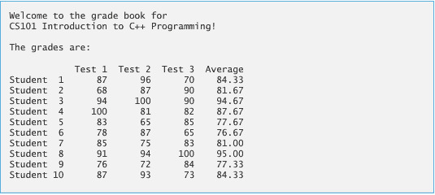

**图 7.21** | 使用二维数组的 GradeBook 的输出

```
Lowest grade in the grade book is 65
Highest grade in the grade book is 100

Overall grade distribution:
  0-9:
10-19:
20-29:
30-39:
40-49:
50-59:
60-69: ***
70-79: *****
80-89: **********
90-99: *****
 100: ***
```

```cpp
// Fig. 7.22: GradeBook.h
// Definition of class GradeBook that uses a two-dimensional array to store test grades.
// Member functions are defined in GradeBook.cpp
#include <array>
#include <string>

// GradeBook class definition
class GradeBook
{
public:
   // constants
   static const size_t students = 10; // number of students
   static const size_t tests = 3; // number of tests

   // constructor initializes course name and array of grades
   GradeBook( const std::string &, 
      std::array< std::array< int, tests >, students > & );

   void setCourseName( const std::string & ); // set the course name
   std::string getCourseName() const; // retrieve the course name
   void displayMessage() const; // display a welcome message
   void processGrades() const; // perform operations on the grade data
   int getMinimum() const; // find the minimum grade in the grade book
   int getMaximum() const; // find the maximum grade in the grade book
   double getAverage( const std::array< int, tests > & ) const;
   void outputBarChart() const; // output bar chart of grade distribution
   void outputGrades() const; // output the contents of the grades array
private:
   std::string courseName; // course name for this grade book
   std::array< std::array< int, tests >, students > grades; // 2D array
}; // end class GradeBook
```

**图 7.22** | 使用二维数组存储考试成绩的 GradeBook 类的定义

```cpp
// Fig. 7.23: GradeBook.cpp
// Member-function definitions for class GradeBook that
// uses a two-dimensional array to store grades.
#include <iostream>
#include <iomanip> // parameterized stream manipulators
using namespace std;

// include definition of class GradeBook from GradeBook.h
#include "GradeBook.h" // GradeBook class definition

// two-argument constructor initializes courseName and grades array
GradeBook::GradeBook( const string &name,
    std::array< std::array< int, tests >, students > &gradesArray )
    : courseName( name ), grades( gradesArray )
{
} // end two-argument GradeBook constructor

// function to set the course name
void GradeBook::setCourseName( const string &name )
{
    courseName = name; // store the course name
} // end function setCourseName

// function to retrieve the course name
string GradeBook::getCourseName() const
{
    return courseName;
} // end function getCourseName

// display a welcome message to the GradeBook user
void GradeBook::displayMessage() const
{
    // this statement calls getCourseName to get the
    // name of the course this GradeBook represents
    cout << "Welcome to the grade book for\n" << getCourseName() << "!"
         << endl;
} // end function displayMessage

// perform various operations on the data
void GradeBook::processGrades() const
{
    // output grades array
    outputGrades();

    // call functions getMinimum and getMaximum
    cout << "\nLowest grade in the grade book is " << getMinimum()
         << "\nHighest grade in the grade book is " << getMaximum() << endl;

    // output grade distribution chart of all grades on all tests
    outputBarChart();
} // end function processGrades

// find minimum grade in the entire gradebook
int GradeBook::getMinimum() const
{
    int lowGrade = 100; // assume lowest grade is 100

    // loop through rows of grades array
    for ( auto const &student : grades )
    {
        // loop through columns of current row
        for ( auto const &grade : student )
        {
            // if current grade less than lowGrade, assign it to lowGrade
            if ( grade < lowGrade )
                lowGrade = grade; // new lowest grade
        } // end inner for
    } // end outer for

    return lowGrade; // return lowest grade
} // end function getMinimum

// find maximum grade in the entire gradebook
int GradeBook::getMaximum() const
{
    int highGrade = 0; // assume highest grade is 0

    // loop through rows of grades array
    for ( auto const &student : grades )
    {
        // loop through columns of current row
        for ( auto const &grade : student )
        {
            // if current grade greater than highGrade, assign it to highGrade
            if ( grade > highGrade )
                highGrade = grade; // new highest grade
        } // end inner for
    } // end outer for

    return highGrade; // return highest grade
} // end function getMaximum

// determine average grade for particular set of grades
double GradeBook::getAverage( const array<int, tests> &setOfGrades ) const
{
    int total = 0; // initialize total

    // sum grades in array
    for ( int grade : setOfGrades )
        total += grade;

    // return average of grades
    return static_cast<double>( total ) / setOfGrades.size();
} // end function getAverage

// output bar chart displaying grade distribution
void GradeBook::outputBarChart() const
{
   cout << "\nOverall grade distribution:" << endl;

   // stores frequency of grades in each range of 10 grades
   const size_t frequencySize = 11;
   array< unsigned int, frequencySize > frequency = {}; // init to 0s

   // for each grade, increment the appropriate frequency
   for ( auto const &student : grades )
      for ( auto const &test : student )
         ++frequency[ test / 10 ];

   // for each grade frequency, print bar in chart
   for ( size_t count = 0; count < frequencySize; ++count )
   {
      // output bar label ("0-9:", ..., "90-99:", "100:" )
      if ( 0 == count )
         cout << "  0-9: ";
      else if ( 10 == count )
         cout << "  100: ";
      else
         cout << count * 10 << "-" << ( count * 10 ) + 9 << ": ";

      // print bar of asterisks
      for ( unsigned int stars = 0; stars < frequency[ count ]; ++stars )
         cout << '*';

      cout << endl; // start a new line of output
   } // end outer for
} // end function outputBarChart

// output the contents of the grades array
void GradeBook::outputGrades() const
{
   cout << "\nThe grades are:\n\n";
   cout << "             "; // align column heads

   // create a column heading for each of the tests
   for ( size_t test = 0; test < tests; ++test )
      cout << "Test " << test + 1 << "    ";

   cout << "Average" << endl; // student average column heading
}
```

**图 7.23** | 使用二维数组存储成绩的 GradeBook 类的成员函数定义


```cpp
// function main begins program execution
int main()
{
   // two-dimensional array of student grades
   array<array<int, GradeBook::tests>, GradeBook::students> grades =
      { { 87, 96, 70,
          68, 87, 90,
          94, 100, 90,
          100, 81, 82,
          83, 65, 85,
          78, 87, 65,
          85, 75, 83,
          91, 94, 100,
          76, 72, 84,
          87, 93, 73 } };

   GradeBook myGradeBook(
      "CS101 Introduction to C++ Programming", grades );
   myGradeBook.displayMessage();
   myGradeBook.processGrades();
} // end main
```

**图 7.24** | 使用二维成绩数组创建 GradeBook 对象，然后调用成员函数 processGrades 分析成绩。

## 7.10 C++ 标准库类模板 vector 简介

我们现在介绍 C++ 标准库类模板 **vector**，它与类模板 array 类似，但还支持动态调整大小。除修改 vector 的功能外，图 7.25 中所示的其他功能也适用于 array。标准类模板 vector 定义在头文件 `<vector>`（第 5 行）中，并属于命名空间 `std`。第 15 章将讨论 vector 的全部功能。在本节末尾，我们将演示类 vector 的边界检查能力，并介绍 C++ 的异常处理机制，它可用于检测和处理越界的 vector 下标。

```cpp
// Fig. 7.25: fig07_25.cpp
// Demonstrating C++ Standard Library class template vector.
#include <iostream>
#include <iomanip>
#include <vector>
#include <stdexcept>
using namespace std;

void outputVector( const vector< int > & ); // display the vector
void inputVector( vector< int > & ); // input values into the vector

int main()
{
   vector< int > integers1( 7 ); // 7-element vector< int >
   vector< int > integers2( 10 ); // 10-element vector< int >

   // print integers1 size and contents
   cout << "Size of vector integers1 is " << integers1.size()
        << "\nVector after initialization: " << endl;
   outputVector( integers1 );

   // print integers2 size and contents
   cout << "\nSize of vector integers2 is " << integers2.size()
        << "\nVector after initialization: " << endl;
   outputVector( integers2 );

   // input and print integers1 and integers2
   cout << "\nEnter 17 integers:" << endl;
   inputVector( integers1 );
   inputVector( integers2 );

   cout << "\nAfter input, the vectors contain:\n"
        << "integers1:" << endl;
   outputVector( integers1 );
   cout << "integers2:" << endl;
   outputVector( integers2 );

   // use inequality (!=) operator with vector objects
   cout << "\nEvaluating: integers1 != integers2" << endl;

   if ( integers1 != integers2 )
      cout << "integers1 and integers2 are not equal" << endl;

   // create vector integers3 using integers1 as an
   // initializer; print size and contents
   vector< int > integers3( integers1 ); // copy constructor

   cout << "\nSize of vector integers3 is " << integers3.size()
        << "\nVector after initialization: " << endl;
   outputVector( integers3 );

   // use overloaded assignment (=) operator
   cout << "\nAssigning integers2 to integers1:" << endl;
   integers1 = integers2; // assign integers2 to integers1

   cout << "integers1:" << endl;
   outputVector( integers1 );
   cout << "integers2:" << endl;
   outputVector( integers2 );

   // use equality (==) operator with vector objects
   cout << "\nEvaluating: integers1 == integers2" << endl;

   if ( integers1 == integers2 )
      cout << "integers1 and integers2 are equal" << endl;
```

```text
Enter 17 integers:
1 2 3 4 5 6 7 8 9 10 11 12 13 14 15 16 17

After input, the vectors contain:
integers1:
1 2 3 4 5 6 7
integers2:
8 9 10 11 12 13 14 15 16 17

Evaluating: integers1 != integers2
integers1 and integers2 are not equal

Size of vector integers3 is 7
Vector after initialization:
1 2 3 4 5 6 7

Assigning integers2 to integers1:
integers1:
8 9 10 11 12 13 14 15 16 17
integers2:
8 9 10 11 12 13 14 15 16 17

Evaluating: integers1 == integers2
integers1 and integers2 are equal

integers1[5] is 13

Assigning 1000 to integers1[5]
integers1:
8 9 10 11 12 1000 14 15 16 17

Attempt to display integers1.at(15)
An exception occurred: invalid vector<T> subscript

Current integers3 size is: 7
New integers3 size is: 8
integers3 now contains: 1 2 3 4 5 6 7 1000
```

**图 7.25** | 演示 C++ 标准库类模板 vector。

### 创建 *vector* 对象

第 14–15 行创建了两个存储 int 类型值的 vector 对象——integers1 包含 7 个元素，integers2 包含 10 个元素。默认情况下，每个 vector 对象的所有元素都设置为 0。与 array 一样，vector 也可以定义为存储大多数数据类型，只需将 vector<int> 中的 int 替换为相应的类型即可。

### *vector* 成员函数 size；函数 outputVector

第 18 行使用 vector 成员函数 **size** 获取 integers1 的大小（即元素个数）。第 20 行将 integers1 传递给函数 outputVector（第 96–102 行），该函数使用基于范围的 for 语句获取 vector 中每个元素的值并输出。与类模板 array 一样，你也可以使用计数器控制循环和下标（[]）运算符来实现此操作。第 23 行和第 25 行对 integers2 执行相同的任务。

### 函数 inputVector

第 29–30 行将 integers1 和 integers2 传递给函数 inputVector（第 105–109 行），以从用户那里读取每个 vector 元素的值。该函数使用基于范围的 for 语句，其范围变量是对 int 的引用，以形成左值，用于将输入值存储到每个 vector 元素中。

### 比较 vector 对象是否不相等

第 41 行演示了可以使用 != 运算符比较 vector 对象。如果两个 vector 的内容不相等，该运算符返回 true；否则返回 false。

### 用另一个 vector 的内容初始化一个 vector

C++ 标准库类模板 vector 允许你创建一个新的 vector 对象，并用现有 vector 的内容初始化它。第 46 行创建 vector 对象 integers3，并用 integers1 的副本初始化它。这会调用 vector 所谓的复制构造函数来执行复制操作。你将在第 10 章了解复制构造函数。第 48–50 行输出 integers3 的大小和内容，以证明它被正确初始化。

### 赋值 vector 并比较 vector 是否相等

第 54 行将 integers2 赋给 integers1，演示了赋值（=）运算符可用于 vector 对象。第 56–59 行输出两个对象的内容，表明它们现在包含相同的值。第 64 行随后使用相等（==）运算符将 integers1 与 integers2 进行比较，以确定在第 54 行赋值后两个对象的内容是否相等（结果是相等的）。

### 使用 [] 运算符访问和修改 vector 元素

第 68 行和第 70 行分别使用方括号（[]）获取 vector 元素，并将其用作右值和左值。回顾第 5.9 节，右值不能被修改，但左值可以。与 array 的情况一样，C++ 不要求在使用方括号访问 vector 元素时执行边界检查。因此，你必须确保使用 [] 的操作不会意外地尝试操作 vector 边界之外的元素。不过，标准类模板 vector 在其成员函数 at 中确实提供了边界检查（类模板 array 也是如此），我们在第 80 行使用了这个函数，稍后将讨论。

### 异常处理：处理越界下标

异常表示程序执行过程中出现的问题。“异常”这一名称暗示问题不常发生——如果“规则”是语句通常能正确执行，那么问题就代表了“规则的例外”。异常处理使你可以创建容错程序，能够解决（或处理）异常。在许多情况下，这允许程序继续执行，就像没有遇到问题一样。例如，图 7.25 仍然运行到结束，即使尝试访问了越界的下标。更严重的问题可能会阻止程序继续正常执行，而是要求程序通知用户问题，然后终止。当函数检测到问题时，例如


- 程序通过给出数组名，后跟方括号（[]）中特定元素的下标（第 279 页），来引用数组中的任意一个元素。
- 每个数组的第一个元素的下标为零（第 279 页），有时被称为第零个元素。
- 下标必须是整数或整数表达式（使用任何整型）。
- 用于括起下标的方括号是一个运算符，其优先级与圆括号相同。

## 7.3 声明数组

- 数组占用内存空间。你按如下方式指定每个元素的类型以及数组所需的元素个数：

  ```cpp
  array< type, arraySize > arrayName;
  ```

  编译器会保留适当大小的内存。
- 数组可以声明为包含几乎任何数据类型。例如，类型为 `char` 的数组可用于存储字符串。

## 7.4 数组使用示例

- 数组的元素可以在数组声明中初始化，方法是在数组名后跟一个等号和一个初始化列表（第 282 页）——即用花括号括起来的、逗号分隔的初始值（第 282 页）列表。
- 使用初始化列表初始化数组时，如果初始值的个数少于数组的元素个数，则其余元素会被初始化为零。初始值的个数必须小于或等于数组大小。
- 用于指定数组大小的常量变量在声明时必须用常量表达式初始化，并且之后不能修改。
- C++ 没有数组边界检查（第 291 页）。你应确保所有数组引用都保持在数组边界之内。
- 函数定义中的静态局部变量在程序运行期间存在，但仅在函数体内可见。
- 程序在首次遇到静态局部数组的声明时对其进行初始化。如果你没有显式初始化静态数组，编译器会在创建数组时将该数组的每个元素初始化为零。

## 7.5 基于范围的 for 语句

- 新的 C++11 基于范围的 for 语句（第 293 页）允许在不使用计数器的情况下操作数组的所有元素，从而避免“越出”数组的可能性，也无需你自行实现边界检查。
- 基于范围的 for 语句的语法为：

  ```cpp
  for ( rangeVariableDeclaration : expression )
      statement
  ```

  其中，`rangeVariableDeclaration` 具有一个类型和一个标识符，`expression` 是要遍历的数组。`rangeVariableDeclaration` 中的类型必须与数组的元素类型一致。该标识符在循环的连续迭代中依次表示数组的各个元素。你可以将基于范围的 for 语句用于 C++ 标准库中大多数预置的数据结构（通常称为容器），包括 `array` 和 `vector` 类。
- 通过将 `rangeVariableDeclaration` 设为引用，你可以使用基于范围的 for 语句修改每个元素。
- 只要循环遍历数组的代码不需要访问元素的下标，就可以用基于范围的 for 语句代替计数器控制的 for 语句。

## 7.6 案例研究：使用数组存储成绩的 GradeBook 类

- 类变量（静态数据成员；第 300 页）由声明这些变量的类的所有对象共享。
- 静态数据成员可以在类定义和成员函数定义中像任何其他数据成员一样被访问。
- 公共静态数据成员也可以在类外部访问，即使类不存在任何对象时，也可以通过类名后跟作用域解析运算符（`::`）和数据成员名称来访问。

## 7.7 数组的排序与查找

- 排序数据——即将数据按升序或降序排列——是最重要的计算应用之一。
- 在数组中查找特定元素的过程称为查找。
- C++ 标准库函数 `sort` 将数组的元素按升序排序。该函数的参数指定应排序的元素范围。你将看到，函数 `sort` 也可以用于其他类型的容器。
- C++ 标准库函数 `binary_search` 判断一个值是否在数组中。值序列必须首先按升序排序。该函数的前两个参数表示要查找的元素范围，第三个参数是查找键——即要定位的值。该函数返回一个 bool 值，指示是否找到了该值。

## 7.8 多维数组

- 二维的多维数组（第 304 页）通常用于表示由按行和列排列的信息组成的数值表（第 304 页）。
- 需要两个下标来标识特定元素的数组称为二维数组（第 304 页）。具有 *m* 行和 *n* 列的数组称为 *m* × *n* 数组（第 304 页）。

## 7.9 案例研究：使用二维数组的 GradeBook 类

- 在变量声明中，关键字 `auto`（第 306 页）可用于代替类型名，根据变量的初始化值来推断变量的类型。

## 7.10 C++ 标准库类模板 vector 简介

- C++ 标准库类模板 vector（第 314 页）是数组的一种更健壮的替代方案，它提供了许多 C 风格基于指针的数组所不具备的功能。
- 默认情况下，整数 vector 对象的所有元素都会被设置为 0。
- 可以使用如下形式的声明来定义存储任何数据类型的 vector：

  `vector< type > name( size );`

- 类模板 vector 的成员函数 `size`（第 317 页）返回调用它的 vector 中的元素个数。
- 可以使用方括号（`[]`）访问或修改 vector 中某个元素的值。
- 标准类模板 vector 的对象可以直接使用相等（`==`）和不相等（`!=`）运算符进行比较。赋值（`=`）运算符也可以用于 vector 对象。
- 不可修改的 *左值* 是一种表达式，它标识内存中的一个对象（例如 vector 中的一个元素），但不能用于修改该对象。可修改的 *左值* 也标识内存中的一个对象，但可以用于修改该对象。

- b) 该数组包含多少个元素？
- c) 使用计数器控制的 `for` 语句将数组的每个元素初始化为其下标之和。
- d) 编写一个嵌套的 `for` 语句，以表格格式（3 行 3 列）显示数组 `table` 中每个元素的值。每行和每列应标上行号或列号。假设该数组已使用包含按顺序从 1 到 9 的值的初始化列表进行初始化。请显示输出。

- **7.5** *（查找错误）* 找出下列每个程序段中的错误并改正错误：
  - a) `#include <iostream>;`
  - b) `arraySize = 10; // arraySize was declared const`
  - c) 假设 `array<int, 10> b = {};`

    ```cpp
    for ( size_t i = 0; i <= b.size(); ++i )
        b[ i ] = 1;
    ```

  - d) 假设 `a` 是一个有两行两列、类型为 `int` 的二维数组：

    ```cpp
    a[ 1, 1 ] = 5;
    ```

## 自测练习答案

- **7.1** a) 数组、vector。b) 数组名、类型。c) 下标或索引。d) 常量变量。e) 排序。f) 查找。g) 二维。

- **7.2**
  - a) 错误。数组只能存储相同类型的值。
  - b) 错误。数组下标应为整数或整数表达式。
  - c) 错误。其余元素会被初始化为零。
  - d) 正确。

- **7.3**
  - a) `const size_t arraySize = 10;`
  - b) `array<double, arraySize> fractions = { 0.0 };`
  - c) `fractions[ 3 ]`
  - d) `fractions[ 4 ]`
  - e) `fractions[ 9 ] = 1.667;`
  - f) `fractions[ 6 ] = 3.333;`
  - g)
    ```cpp
    cout << fixed << setprecision( 2 );
    cout << fractions[ 6 ] << ' ' << fractions[ 9 ] << endl;
    ```
    输出：`3.33 1.67`
  - h)
    ```cpp
    for ( size_t i = 0; i < fractions.size(); ++i )
        cout << "fractions[" << i << "] = " << fractions[ i ] << endl;
    ```
    输出：
    ```text
    fractions[ 0 ] = 0.0
    fractions[ 1 ] = 0.0
    fractions[ 2 ] = 0.0
    fractions[ 3 ] = 0.0
    fractions[ 4 ] = 0.0
    fractions[ 5 ] = 0.0
    fractions[ 6 ] = 3.333
    fractions[ 7 ] = 0.0
    fractions[ 8 ] = 0.0
    fractions[ 9 ] = 1.667
    ```
  - i)
    ```cpp
    for ( double element : fractions )
        cout << element << ' ';
    ```

- **7.4** a) `array< array< int, arraySize >, arraySize > table;`


b) 九。

```cpp
c)
for ( size_t row = 0; row < table.size(); ++row )
    for ( size_t column = 0; column < table[ row ].size(); ++column )
        table[ row ][ column ] = row + column;

d) cout << "     [0] [1] [2]" << endl;

for ( size_t i = 0; i < arraySize; ++i ) {
    cout << '[' << i << "] ";

    for ( size_t j = 0; j < arraySize; ++j )
        cout << setw( 3 ) << table[ i ][ j ] << "  ";
    cout << endl;
}
```

*输出：*

|     | [0] | [1] | [2] |
|:----|----:|----:|----:|
| [0] | 0   | 1   | 2   |
| [1] | 1   | 2   | 3   |
| [2] | 2   | 3   | 4   |

### 7.5

- a) *错误：* `#include` 预处理指令末尾出现分号。
  *更正：* 删除分号。
- b) *错误：* 使用赋值语句给常量变量赋值。
  *更正：* 在 `const size_t arraySize` 声明中初始化常量变量。
- c) *错误：* 引用了数组边界之外的元素（`b[10]`）。
  *更正：* 将循环继续条件改为使用 `<` 而不是 `<=`。
- d) *错误：* 数组下标使用不正确。
  *更正：* 将语句改为 `a[ 1 ][ 1 ] = 5;`

## 习题

### 7.6（填空）

在下列各题中填空：

- a) 数组 `p` 的四个元素名称是 ________、________、________ 和 ________。
- b) 为数组命名、指明其类型并指定数组中元素的数量称为__________数组。
- c) 访问数组元素时，按照惯例，二维数组中的第一个下标标识元素的__________，第二个下标标识元素的__________。
- d) 一个 *m* 行 *n* 列的数组包含______行、______列和______个元素。
- e) 数组 `d` 中第 3 行第 5 列的元素名称是 ________。

### 7.7（判断正误）

判断下列说法是否正确。如果错误，请解释原因。

- a) 要引用数组中的特定位置或元素，我们需要指定数组名称和特定元素的值。
- b) 数组定义会为数组预留空间。
- c) 要为整型数组 `p` 预留 100 个位置，应编写：

  ```cpp
  p[100];
  ```

- d) 必须使用 for 语句将 15 个元素的数组初始化为零。
- e) 必须使用嵌套 for 语句来累计二维数组的元素。

### 7.8（编写 C++ 语句）

编写 C++ 语句完成下列各任务：

- a) 显示字符数组 `alphabet` 中元素 6 的值。
- b) `array<double, 3> f = { 1.1, 10.01, 100.001, 1000.0001 };`
- c) 假设 `d` 是一个双精度数组，有两行 10 列。

  ```cpp
  d[ 1, 9 ] = 2.345;
  ```

### 7.13（使用 array 消除重复）

使用一维数组解决以下问题。读入 20 个数字，每个数字都在 10 到 100 之间（含 10 和 100）。每读入一个数字，就对其进行验证，并且只有在它不是重复值时才将其存入数组。读取所有值后，仅显示用户输入的唯一值。请考虑“最坏情况”，即所有 20 个数字都不相同。使用尽可能小的数组来解决此问题。

### 7.14（使用 vector 消除重复）

使用 vector 重新实现习题 7.13。从一个空 vector 开始，使用其 `push_back` 函数将每个唯一值添加到 vector 中。

### 7.15（二维数组初始化）

标记一个 3 行 5 列的二维数组 `sales` 的元素，以指明以下程序段将它们置零的顺序：

```cpp
for ( size_t row = 0; row < sales.size(); ++row )
    for ( size_t column = 0; column < sales[ row ].size(); ++column )
        sales[ row ][ column ] = 0;
```

### 7.16（掷骰子）

编写一个模拟掷两个骰子的程序。然后计算两个值的总和。[**注意：** 每个骰子可以显示从 1 到 6 的整数值，因此两个值的总和将在 2 到 12 之间变化，其中 7 是最常见的总和，而 2 和 12 是最不常见的总和。] 图 7.26 显示了两个骰子的 36 种可能组合。你的程序应该将两个骰子掷 36,000 次。使用一维数组统计每个可能总和出现的次数。以表格格式打印结果。此外，确定总数是否合理（例如，掷出 7 的方法有六种，因此大约所有掷骰结果的六分之一应为 7）。


**图 7.26**  掷两个骰子的 36 种可能结果。

### 7.17（这段代码做了什么？）

下面的程序做了什么？

```cpp
// 习题 7.17: Ex07_17.cpp
// 此程序做了什么？
#include <iostream>
#include <array>
using namespace std;

const size_t arraySize = 10;
int whatIsThis( const array< int, arraySize > &, size_t ); // 原型

int main()
{
    array< int, arraySize > a = { 1, 2, 3, 4, 5, 6, 7, 8, 9, 10 };
```

### 7.21（销售汇总）

使用二维数组解决以下问题。一家公司有四名销售人员（1 到 4），销售五种不同的产品（1 到 5）。每天，每名销售人员为每种售出的产品类型提交一张单据。每张单据包含以下内容：

- a) 销售人员编号
- b) 产品编号
- c) 当天该产品售出的总金额

因此，每名销售人员每天提交 0 到 5 张单据。假设上个月所有单据的信息都可用。编写一个程序，读取上个月销售的所有信息（一次读取一名销售人员的数据），并按销售人员和产品汇总总销售额。所有总额应存储在二维数组 sales 中。处理完上个月的所有信息后，以表格格式打印结果，每列代表特定销售人员，每行代表特定产品。对每行进行横向合计，得到上个月每种产品的总销售额；对每列进行纵向合计，得到上个月每名销售人员的总销售额。表格输出应在合计行的右侧和合计列的底部包含这些汇总合计。

### 7.22（骑士巡游）

对于国际象棋爱好者来说，一个比较有趣的谜题是骑士巡游问题。问题是：名为“马”的棋子能否在空棋盘上移动，并且恰好接触 64 个方格中的每一个一次？在本练习中，我们将深入探讨这个引人入胜的问题。

马以 L 形移动（在一个方向上移动两格，然后在垂直方向上移动一格）。因此，从空棋盘中间的一个方格出发，马可以有八种不同的移动方式（编号为 0 到 7），如图 7.27 所示。


**图 7.27**  马的八种可能移动方式。

- a) 在一张纸上画一个 8×8 的棋盘，并尝试手工进行骑士巡游。在第一个移动到的方格中标 1，第二个方格标 2，第三个方格标 3，依此类推。开始巡游前，估计你认为自己能做到多远，记住完整巡游包含 64 步。你做到了多远？这与你的估计接近吗？
- b) 现在让我们开发一个程序，让马在棋盘上移动。棋盘用 8×8 的二维数组 board 表示。每个方格初始化为零。我们用水平和垂直分量来描述每种可能的移动。例如，如图 7.27 所示，类型 0 的移动包括向右水平移动两格和向上垂直移动一格。移动 2 包括向左水平移动一格和向上垂直移动两格。向左的水平移动和向上的垂直移动表示为负值。


使用负数。八种移动可以用两个一维数组 horizontal 和 vertical 描述如下：

```cpp
horizontal[0] = 2    vertical[0] = -1
horizontal[1] = 1    vertical[1] = -2
horizontal[2] = -1   vertical[2] = -2
horizontal[3] = -2   vertical[3] = -1
horizontal[4] = -2   vertical[4] = 1
horizontal[5] = -1   vertical[5] = 2
horizontal[6] = 1    vertical[6] = 2
horizontal[7] = 2    vertical[7] = 1
```

让变量 currentRow 和 currentColumn 表示骑士当前位置的行和列。要执行类型为 moveNumber（介于 0 和 7 之间）的移动，你的程序使用以下语句：

```cpp
currentRow += vertical[ moveNumber ];
currentColumn += horizontal[ moveNumber ];
```

保持一个从 1 到 64 变化的计数器。将最新计数记录在骑士移动到的每个方格中。记住要测试每一个可能的移动，看骑士是否已经访问过该方格，当然，还要测试每一个可能的移动，确保骑士不会落到棋盘之外。现在编写一个程序让骑士在棋盘上移动。骑士移动了多少步？

- c) 在尝试编写并运行骑士巡游程序之后，你可能会得到一些宝贵的见解。我们将利用这些见解来开发一种移动骑士的**启发式**（或策略）。启发式方法并不保证成功，但精心开发的启发式方法会大大提高成功的几率。你可能已经注意到，外围的方格比靠近棋盘中心的方格更棘手。事实上，最棘手或最难到达的方格是四个角。

直觉可能会建议你应先将骑士移到最棘手的方格，而把最容易到达的方格留出来，这样当巡游临近结束时棋盘变得拥挤，就会有更大的成功机会。

我们可以通过根据每个方格的可达程度对其进行分类来开发一种“可访问性启发式方法”，然后始终将骑士移动到最不可到达的方格（当然，在骑士的 L 形移动范围内）。我们用数字标记一个二维数组 accessibility，表示每个特定方格可从多少个方格到达。在空棋盘上，每个中心方格被评为 8，每个角方格被评为 2，其他方格的可访问性数字为 3、4 或 6，如下所示：

| 2 | 3 | 4 | 4 | 4 | 4 | 3 | 2 |
|---|---|---|---|---|---|---|---|
| 3 | 4 | 6 | 6 | 6 | 6 | 4 | 3 |
| 4 | 6 | 8 | 8 | 8 | 8 | 6 | 4 |
| 4 | 6 | 8 | 8 | 8 | 8 | 6 | 4 |
| 4 | 6 | 8 | 8 | 8 | 8 | 6 | 4 |
| 4 | 6 | 8 | 8 | 8 | 8 | 6 | 4 |
| 3 | 4 | 6 | 6 | 6 | 6 | 4 | 3 |
| 2 | 3 | 4 | 4 | 4 | 4 | 3 | 2 |

现在编写一个使用可访问性启发式方法的骑士巡游程序版本。

在任何时候，骑士都应移动到可访问性数字最低的方格。如果出现平局，骑士可以移动到任何平局的方格。因此，巡游可以从四个角中的任何一个开始。[*注意：* 随着骑士在棋盘上移动，你的程序应该降低可访问性数字，越来越多的方格被占用。这样，在巡游期间的任何给定时间，每个可用方格的可访问性数字将恰好等于从

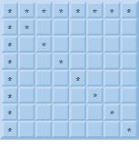

**图 7.28** 将皇后放在左上角后消除的 22 个方格。

**7.26** *（骑士巡游：闭合巡游测试）* 在骑士巡游中，当骑士移动 64 步，且只接触棋盘上的每个方格一次时，即为完整巡游。当第 64 步移动后距离骑士开始巡游的位置只有一步时，即为闭合巡游。修改你在练习 7.22 中编写的骑士巡游程序，以在发生完整巡游时测试是否为闭合巡游。

**7.27** *（埃拉托斯特尼筛法）* 质数是只能被自身和 1 整除的整数。埃拉托斯特尼筛法是一种寻找质数的方法。其操作如下：

- a) 创建一个数组，所有元素初始化为 1（真）。下标为质数的数组元素将保持为 1。所有其他数组元素最终将被设置为 0。在本练习中，你将忽略下标 0 和 1 的元素。

- b) 从数组下标 2 开始，每次找到一个值为 1 的数组元素，就遍历数组的其余部分，将所有下标为该值为 1 的元素下标的倍数的元素设置为 0。对于数组下标 2，数组中下标为 2 的倍数的所有大于 2 的元素将被设置为 0（下标 4, 6, 8, 10 等）；对于数组下标 3，数组中下标为 3 的倍数的所有大于 3 的元素将被设置为 0（下标 6, 9, 12, 15 等）；依此类推。

当这个过程完成时，仍设置为 1 的数组元素表示该下标是质数。然后可以打印这些下标。编写一个使用包含 1000 个元素的数组来确定并打印 2 到 999 之间的质数的程序。忽略数组的元素 0。

## 递归练习

**7.28** *（回文）* 回文是正着拼写和倒着拼写都相同的字符串。回文的示例包括“radar”和“able was I ere I saw elba”。编写一个递归函数 `testPalindrome`，如果字符串是回文则返回 true，否则返回 false。注意，与数组一样，方括号（`[]`）运算符可用于遍历字符串中的字符。

**7.29** *（八皇后）* 修改你在练习 7.24 中创建的八皇后程序，以递归方式解决问题。

**7.30** *（打印数组）* 编写一个递归函数 `printArray`，它接受一个数组、一个起始下标和一个结束下标作为参数，不返回任何内容并打印数组。当起始下标等于结束下标时，函数应停止处理并返回。

**7.31** *（反向打印字符串）* 编写一个递归函数 `stringReverse`，它接受一个字符串和一个起始下标作为参数，反向打印字符串且不返回任何内容。当遇到字符串末尾时，函数应停止处理并返回。注意，与数组一样，方括号（`[]`）运算符可用于遍历字符串中的字符。

**7.32** *（查找数组中的最小值）* 编写一个递归函数 `recursiveMinimum`，它接受一个整数数组、一个起始下标和一个结束下标作为参数，并返回

# 8 指针

> 地址是为了隐藏我们的行踪。
>
> ——萨基（H. H. 芒罗）

> 通过间接找到方向。
>
> ——威廉·莎士比亚

> 许多事情，尽管完全参照同一目标，却可能背道而驰。
>
> ——威廉·莎士比亚

> 先生，你会发现始终核实参考资料是一种非常好的做法。
>
> ——劳斯博士

## 目标

在本章中，你将：

- 了解什么是指针。
- 了解指针和引用之间的异同。
- 使用指针按引用向函数传递参数。
- 理解指针与内置数组之间的密切关系。
- 使用基于指针的字符串。
- 使用内置数组。
- 使用 C++11 的功能，包括 `nullptr` 以及标准库函数 `begin` 和 `end`。


- **8.1** 引言
- **8.2** 指针变量的声明和初始化
- **8.3** 指针运算符
- **8.4** 使用指针按引用传递
- **8.5** 内置数组
- **8.6** 将 `const` 与指针一起使用
  - 8.6.1 指向非常量数据的非常量指针
  - 8.6.2 指向常量数据的非常量指针
  - 8.6.3 指向非常量数据的常量指针
  - 8.6.4 指向常量数据的常量指针
- **8.7** `sizeof` 运算符
- **8.8** 指针表达式和指针算术
- **8.9** 指针与内置数组之间的关系
- **8.10** 基于指针的字符串
- **8.11** 小结

*小结 | 自测练习 | 自测练习答案 | 练习 | 专题：构建你自己的计算机*

## 8.1 引言

本章讨论*指针*——C++ 中最强大但也最具挑战性的功能之一。我们在此的目标是帮助你确定何时适合使用指针，并展示如何*正确*且*负责地*使用它们。

在第 6 章中，我们看到了引用可用于执行按引用传递。指针同样支持按引用传递，并可用于创建和操作可以增长和收缩的动态数据结构，例如链表、队列、栈和树。本章解释基本的指针概念。第 19 章将介绍创建和使用以指针实现的动态数据结构的示例。

我们还将展示*内置数组*与指针之间的密切关系。C++ 从 C 编程语言继承了内置数组。正如我们在第 7 章所见，C++ 标准库类 array 和 vector 将数组实现为完全成熟的对象——实际上，array 和 vector 都将元素存储在内置数组中。*在新的软件开发项目中，你应该优先选择 array 和 vector 对象，而不是内置数组。*

类似地，C++ 实际上提供两种类型的字符串——string 类对象（自第 3 章以来我们一直在使用）和 C 风格的*基于指针的字符串*（C 字符串）。本章简要介绍 C 字符串，以加深你对指针和内置数组的理解。C 字符串在较旧的 C 和 C++ 软件中被广泛使用。我们将在附录 F 中深入讨论 C 字符串。*在新的软件开发项目中，你应该优先选择 string 类对象。*

我们将在第 12 章中考察指针与类对象的使用，届时我们将看到与面向对象编程相关的所谓“多态引用”是通过指针和引用执行的。

## 8.2 指针变量的声明和初始化

*间接*

指针变量的值包含*内存地址*。通常，变量直接包含特定值。指针包含变量的*内存地址*，而该变量本身又包含特定值。从这个意义上说，变量名*直接引用值*，而指针*间接引用值*（图 8.1）。通过指针引用值是


这被称为*间接寻址*（indirection）。图解通常用一个箭头表示指针，从包含地址的变量指向内存中该地址所对应的变量。

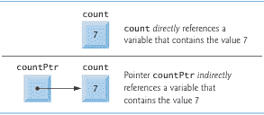

**图 8.1** | 直接与间接引用变量。

### 声明指针

指针与其他任何变量一样，必须先声明后才能使用。例如，对于图 8.1 中的指针 countPtr，声明

```cpp
int *countPtr, count;
```

将变量 countPtr 声明为 int * 类型（即指向 int 值的指针），从右往左读即为“countPtr 是一个指向 int 的指针”。此外，上述声明中的变量 count 被声明为 int，而不是指向 int 的指针。声明中的 `*` 仅适用于 countPtr。每个被声明为指针的变量都必须以星号（`*`）作为前缀。例如，声明

```cpp
double *xPtr, *yPtr;
```

表示 xPtr 和 yPtr 都是指向 double 值的指针。当 `*` 出现在声明中时，它不是运算符，而是表示所声明的变量是指针。指针可以被声明为指向*任意*数据类型的对象。

> **常见编程错误 8.1**
>
> 假设用于声明指针的 `*` 会作用于声明中逗号分隔变量列表中的所有名字，可能导致错误。每个指针都必须在其名称前加上 `*` 前缀（中间可以有空格，也可以没有）。每个声明只声明一个变量有助于避免这类错误，并提高程序的可靠性。

> **良好编程实践 8.1**
>
> 虽然不是强制要求，但在指针变量名中包含 Ptr 字母可以清楚地表明该变量是指针，并且必须以相应方式处理。

### 初始化指针

指针应在声明时或赋值时初始化为 `nullptr`（C++11 新增）或相应类型的地址。值为 `nullptr` 的指针“不指向任何内容”，称为空指针。从现在起，当我们提到“空指针”时，指的是值为 `nullptr` 的指针。

> **错误预防提示 8.1**
>
> 将所有指向未知或未初始化内存区域的指针变量进行初始化。

### C++11 之前的空指针

在早期版本的 C++ 中，空指针的指定值为 0 或 NULL。NULL 在几个标准库头文件中定义，表示值 0。将指针初始化为 NULL 等同于将指针初始化为 0，但在 C++11 之前，约定使用的是 0。值 0 是唯一可以直接赋值给指针变量而无需先将整数转换为指针类型的整数值。

## 8.3 指针运算符

### 地址（&）运算符

地址运算符（&）是一元运算符，用于获取其操作数的内存地址。例如，假设有以下声明

```cpp
int y = 5; // declare variable y
int *yPtr = nullptr; // declare pointer variable yPtr
```

语句

```cpp
yPtr = &y; // assign address of y to yPtr
```

将变量 y 的地址赋给指针变量 yPtr。此时称变量 yPtr“指向”y。现在，yPtr 间接引用了变量 y 的值。上述语句中 & 的用法与引用变量声明中 & 的用法不同，引用变量声明中的 & 前面总是有数据类型名称。声明引用时，& 属于类型的一部分。而在类似 &y 的表达式中，& 是地址运算符。

图 8.2 展示了上述赋值后内存的表示形式。“指向关系”通过绘制一个箭头表示，从表示内存中指针 yPtr 的方框指向表示内存中变量 y 的方框。

图 8.3 展示了内存中另一种指针表示形式，其中整型变量 y 存储于内存位置 600000，指针变量 yPtr 存储于位置 500000。地址运算符的操作数必须是左值——地址运算符不能应用于常量或产生临时值的表达式（如计算结果）。


**图 8.2** | 指针指向内存中的变量的图形化表示。

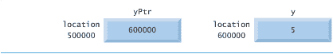

**图 8.3** | 内存中 y 和 yPtr 的表示。

### 间接（\*）运算符

一元 `*` 运算符——通常称为间接运算符或解引用运算符——返回一个左值，表示其指针操作数所指向的对象。例如（再次参考图 8.2），语句

```text
The address of a is 002DFD80
The value of aPtr is 002DFD80

The value of a is 7
The value of *aPtr is 7
```

**图 8.4** | 指针运算符 & 和 *。（第 2 部分，共 2 部分。）

### 迄今讨论的运算符的优先级和结合性

图 8.5 列出了迄今介绍的运算符的优先级和结合性。地址运算符（&）和解引用运算符（`*`）是第四层的*一元运算符*。

| 运算符 | 结合性 | 类型 |
|---|---|---|
| `::` `()` | 左到右 | 主表达式 |
| `[]` `()` `++` `--` `.` `->` `static_cast<type>(operand)` | 左到右 | 后缀 |
| `++` `--` `+` `-` `!` `&` `*` `(type)` `sizeof` | 右到左 | 一元（前缀） |
| `*` `/` `%` | 左到右 | 乘法 |
| `+` `-` | 左到右 | 加法 |
| `<<` `>>` | 左到右 | 插入/提取 |
| `<` `<=` `>` `>=` | 左到右 | 关系 |
| `==` `!=` | 左到右 | 相等 |
| `&&` | 左到右 | 逻辑与 |
| `\|\|` | 左到右 | 逻辑或 |
| `?:` | 右到左 | 条件 |
| `=` `+=` `-=` `*=` `/=` `%=` | 右到左 | 赋值 |
| `,` | 左到右 | 逗号 |

*关于分组括号的注意事项，参见图 2.10 中的警告。*

**图 8.5** | 迄今讨论的运算符的优先级和结合性。

## 8.4 使用指针的按引用传递

在 C++ 中，有三种方式可以向函数传递参数——按值传递、使用引用参数的按引用传递和使用指针参数的按引用传递。第 6 章对使用引用参数的按引用传递和按值传递进行了比较和对比。在此，我们解释使用指针参数的按引用传递。

第 6 章展示了 return 语句可以从被调函数返回*一个值*，或者仅仅返回*控制权*。你还学习了可以使用引用参数向函数传递参数，这使得被调函数能够*修改调用者中参数的原始值*。引用参数还使程序能够向函数传递*大型数据对象*，并避免按值传递对象的开销（当然，按值传递会复制对象）。指针和引用一样，也可以用于修改调用者中的一个或多个变量，或者传递指向大型数据对象的指针，以避免按值传递对象的开销。

你可以使用指针和间接运算符（`*`）来实现按引用传递（这与 C 程序中实现按引用传递的方式完全相同——C 语言没有引用）。当调用一个函数并传入需要被修改的参数时，需要传递参数的地址。这通常通过对将要修改值的变量名应用地址运算符（&）来实现。

### 按值传递的示例

图 8.6 和图 8.7 展示了求整数立方值的函数的两个版本。图 8.6 将变量 number 按值传递（第 14 行）给函数 cubeByValue（第 19–22 行），该函数对其参数求立方，并通过 return 语句（第 21 行）将新值传回 main。新值在 main 中被赋给 number（第 14 行）。调用函数有机会在修改变量 number 的值之前检查函数调用的结果。例如，我们可以将 cubeByValue 的结果存储到另一个变量中，检查其值，然后仅在确定返回值合理后才将结果赋给 number。

```cpp
// Fig. 8.6: fig08_06.cpp
// Pass-by-value used to cube a variable’s value.
#include <iostream>
using namespace std;

int cubeByValue( int ); // prototype

int main()
{
   int number = 5;

   cout << "The original value of number is " << number;

   number = cubeByValue( number ); // pass number by value to cubeByValue
   cout << "\nThe new value of number is " << number << endl;
} // end main

// calculate and return cube of integer argument
int cubeByValue( int n )
{
   return n * n * n; // cube local variable n and return result
} // end function cubeByValue
```

```text
The original value of number is 5
The new value of number is 125
```

**图 8.6** | 按值传递用于求变量值的立方。

### 使用指针的按引用传递示例

图 8.7 使用指针参数的按引用传递方式将变量 number 传递给函数 cubeByReference（第 15 行）——number 的地址被传递给该函数。函数 cubeByReference（第 21–24 行）指定参数 nPtr（指向 int 的指针）来接收其参数。该函数使用解引用后的指针对 nPtr 所指向的值求立方（第 23 行）。这直接改变了 main 中 number 的值（第 11 行）。第 23 行等价于

```cpp
*nPtr = (*nPtr) * (*nPtr) * (*nPtr); // cube *nPtr
```


```cpp
// 图 8.7：fig08_07.cpp
// 使用指针参数按引用传递，用于计算变量值的立方。
#include <iostream>
using namespace std;

void cubeByReference( int * ); // 函数原型

int main()
{
   int number = 5;

   cout << "The original value of number is " << number;

   cubeByReference( &number ); // 将 number 的地址传给 cubeByReference

   cout << "\nThe new value of number is " << number << endl;
} // 主函数结束

// 计算 *nPtr 的立方；修改 main 中的变量 number
void cubeByReference( int *nPtr )
{
   *nPtr = *nPtr * *nPtr * *nPtr; // 求 *nPtr 的立方
} // 函数 cubeByReference 结束
```

```text
The original value of number is 5
The new value of number is 125
```

**图 8.7** | 使用指针参数按引用传递，用于计算变量值的立方。

接收地址作为参数的函数必须定义一个指针参数来接收该地址。例如，函数 cubeByReference 的函数头（第21行）指定：cubeByReference 接收一个 int 变量的地址（即指向 int 的指针）作为参数，将该地址存储在 nPtr 中，并且不返回值。

函数 cubeByReference 的原型（第7行）在括号中含有 `int *`。与其他类型一样，原型中不必包含指针参数的名称。为了文档说明而包含的参数名会被编译器忽略。

### 洞察：所有实参都是按值传递的

在 C++ 中，所有实参总是按值传递。使用指针按引用传递变量实际上并不是真正按引用传递任何内容——指向该变量的指针是按值传递的，并被复制到函数相应的指针参数中。被调函数随后只需解引用该指针，就能访问调用者中的那个变量，从而实现按引用传递。

### 按值传递与按引用传递的图形化分析

图 8.8–8.9 分别图形化地分析了图 8.6 和图 8.7 的执行过程。在图中，给定表达式或变量上方的蓝色矩形中的值，表示该表达式或变量的值。每个图的右列仅在函数 cubeByValue（图 8.6）和 cubeByReference（图 8.7）执行时才显示它们。

**第 1 步：在 main 调用 cubeByValue 之前：**

```cpp
int main()
{
   int number = 5;

   number = cubeByValue( number );
}

number
5
```

**第 2 步：在 cubeByValue 收到调用之后：**

```cpp
int main()
{
   int number = 5;

   number = cubeByValue( number );
}

number
5
```

```cpp
int cubeByValue( int n )
{
   return n * n * n;
}

n
5
```

**第 3 步：在 cubeByValue 计算参数 n 的立方之后，并返回 main 之前：**

```cpp
int main()
{
   int number = 5;

   number = cubeByValue( number );
}

number
5
```

```cpp
int cubeByValue( int n )
{
   125
   return n * n * n;
}

n
5
```

**第 4 步：在 cubeByValue 返回 main 之后，将结果赋给 number 之前：**

```cpp
int main()
{
   int number = 5;

   number = cubeByValue( number );
}

125
```

**第 5 步：在 main 完成对 number 的赋值之后：**

```cpp
int main()
{
   int number = 5;

   number = cubeByValue( number );
}

number
125
```

**图 8.8** | 图 8.6 程序的按值传递分析。

## 8.5 内置数组

在第 7 章中，我们使用了 array 类模板来表示*固定大小*的值列表和表格。我们还使用了 vector 类模板，它与 array 类似，但也可以动态增长（或如你在第 15 章将看到的，可收缩）以容纳更多或更少的元素。这里我们介绍*内置数组*，它们也是*固定大小*的数据结构。

### 声明内置数组

要指定内置数组的元素类型和所需元素数量，请使用以下形式的声明：

```cpp
type arrayName[ arraySize ];
```

编译器会保留适当数量的内存。*arraySize* 必须是一个大于零的整数常量。例如，要让编译器为一个名为 c 的 int 类型内置数组保留 12 个元素，请使用声明：

```cpp
int c[ 12 ]; // c 是包含 12 个整数的内置数组
```

### 访问内置数组的元素

与 array 对象一样，使用下标（`[]`）运算符访问内置数组的各个元素。回顾第 7 章可知，下标（`[]`）运算符*不*为 array 对象提供边界检查——对于内置数组也是如此。

### 初始化内置数组

可以使用*初始化列表*来初始化内置数组的元素。例如：

```cpp
int n[ 5 ] = { 50, 20, 30, 10, 40 };
```

创建了一个包含 5 个 int 的内置数组，并用初始化列表中的值对它们进行初始化。如果提供的初始化值少于元素数量，则剩余元素会被*值初始化*——基本数值类型设置为 0，bool 设置为 false，指针设置为 nullptr，类对象由其默认构造函数初始化。如果提供的初始化值过多，则会发生编译错误。我们在第 4 章中引入的新 C++11 列表初始化语法，正是基于内置数组的初始化列表语法。

如果在带初始化列表的声明中省略了内置数组的大小，编译器会根据初始化列表中的元素数量来确定内置数组的大小。例如：

```cpp
int n[] = { 50, 20, 30, 10, 40 };
```

创建了一个包含 5 个元素的数组。

> **错误预防提示 8.3**
> 即使提供了初始化列表，也要始终指定内置数组的大小。这使编译器能够确保你没有提供过多的初始化值。


### 将内置数组传递给函数

内置数组名的值可隐式转换为内置数组第一个元素的地址。因此，arrayName 可隐式转换为 &arrayName[0]。因此，


### 内置数组的限制

- 它们**不能使用**关系运算符和相等运算符进行比较——必须使用循环逐个元素地比较两个内置数组。
- 它们**不能相互赋值**。
- 它们**不知道自身的大小**——处理内置数组的函数通常需要同时接收内置数组的名称和大小作为参数。
- 它们**不提供自动边界检查**——必须确保访问数组的表达式所使用的下标位于内置数组的边界之内。

array 和 vector 类模板的对象比内置数组更安全、更健壮，并且提供了更多功能。

### 有时必须使用内置数组

在当代 C++ 代码中，应该使用更健壮的 array（或 vector）对象来表示值的列表和表格。但是，在某些情况下*必须*使用内置数组，例如处理程序的**命令行参数**。在命令行中执行程序时，可以通过将命令行参数放置在程序名称之后来提供给程序。此类参数通常向程序传递选项。例如，在 Windows 计算机上，命令

```text
dir /p
```

使用 /p 参数列出当前目录的内容，并在每屏信息后暂停。类似地，在 Linux 或 OS X 上，以下命令使用 -la 参数列出当前目录的内容，并显示每个文件和目录的详细信息：

```text
ls -la
```

命令行参数作为基于指针的字符串的内置数组传递到 main 中（第 8.10 节）。附录 F 展示了如何处理命令行参数。

## 8.6 将 const 与指针一起使用

回顾一下，const 使你可以告知编译器，某个特定变量的值*不应*被修改。对于函数参数，使用（或*不*使用）const 存在许多可能性，那么如何选择最合适的呢？让*最小权限原则*作为你的指导。始终给予函数*足够*的对其参数中数据的访问权限以完成其指定任务，但*不能更多*。本节讨论如何将 const 与指针声明结合使用，以实施最小权限原则。

第 6 章解释了当参数按值传递时，参数的副本被传递给函数。如果该副本在被调函数中被*修改*，调用者中的原始值*不会改变*。在某些情况下，即使参数值的副本也不应*被*被调函数更改。

考虑一个函数，它接收指向内置数组首元素的指针和数组大小作为参数，随后显示该内置数组的元素。这样的函数应该循环遍历元素并逐个输出。内置数组的大小在函数体中使用，以确定最大的下标，以便循环可以在显示完成时终止。大小在函数中不需要更改。


函数体内，因此应将其声明为 `const` 以确保它不会被修改。由于内置数组仅被显示，因此它也应声明为 `const`。这一点尤为重要，因为内置数组*总是*按引用传递，并且很容易在被调函数中被修改。试图修改 const 值是一个*编译错误*。

> **软件工程观察 8.2**
> *如果一个值在传递给它的函数体内不会（或不应）改变，那么该参数应声明为常量。*

> **防错提示 8.4**
> *在使用函数之前，请检查其函数原型，以确定哪些参数它可以修改，哪些不能修改。*

将指针传递给函数有四种方式：*指向非常量数据的非常量指针*、*指向常量数据的非常量指针*（图 8.10）、*指向非常量数据的常量指针*（图 8.11）以及*指向常量数据的常量指针*（图 8.12）。每种组合都提供了不同级别的访问权限。

### 8.6.1 指向非常量数据的非常量指针

最高的访问权限由*指向非常量数据的非常量指针*授予——数据可以通过解引用的指针进行修改，而指针本身也可以被修改以指向其他数据。这种指针的声明（例如 `int *countPtr`）*不*包含 `const`。

### 8.6.2 指向常量数据的非常量指针

*指向常量数据的非常量指针*是一种可以修改以指向适当类型的*任何*数据项的指针，但它所指向的数据*不能*通过该指针修改。这种指针可能用于*接收*传递给函数的内置数组参数，该函数应允许读取元素，但*不能*修改它们。任何在函数中修改数据的尝试都会导致编译错误。这种指针的声明将 `const` 放在指针类型的*左侧*，如下所示：

```cpp
const int *countPtr;
```

该声明从*右*到*左*读作“countPtr 是一个指向整数常量的指针”，或者更准确地说，“countPtr 是一个*指向整数常量的非常量指针*。”

图 8.10 演示了 GNU C++ 在尝试编译一个接收*指向常量数据的非常量指针*、然后试图使用该指针修改数据的函数时产生的编译错误消息。

```cpp
// 图 8.10: fig08_10.cpp
// 尝试通过指向常量数据的非常量指针修改数据。

void f( const int * ); // 原型

int main()
{
    int y = 0;
    f(&y); // f 将尝试一次非法修改
} // 主函数结束

// 常量变量不能通过 xPtr 修改
void f(const int *xPtr)
{
    *xPtr = 100; // 错误：不能修改 const 对象
} // 函数 f 结束
```

*GNU C++ 编译器错误消息：*

```text
fig08_10.cpp: 在函数‘void f(const int*)’中：
fig08_10.cpp:17:12: 错误：对只读位置‘* xPtr’的赋值
```

**图 8.10** | 尝试通过指向 const 数据的非常量指针修改数据。

当函数以内置数组作为参数被调用时，其内容实际上是通过引用传递的，因为内置数组的名称可以隐式转换为内置数组首元素的地址。然而，默认情况下，诸如数组和向量之类的对象是按值传递的——传递的是整个对象的副本。这需要在执行时产生将对象中每个数据项复制一份并将其存储在函数调用堆栈上的开销。当传递指向对象的指针时，只需复制对象的地址——对象本身不会被复制。


> **性能提示 8.1**
> 
> 如果大对象不需要被被调函数修改，请使用指向常量数据的指针或指向常量数据的引用来传递，以获得按引用传递的性能优势，并避免按值传递的复制开销。


> **软件工程观察 8.3**
> 
> 使用指向常量数据的指针或指向常量数据的引用来传递大对象，可以提供按值传递的安全性。


> **软件工程观察 8.4**
> 
> 使用按值传递将基本类型参数（例如 int、double 等）传递给函数，除非调用者明确要求被调函数能够直接修改调用者中的值。这是最小权限原则的另一个示例。

### 8.6.3 指向非常量数据的常量指针

指向非常量数据的常量指针是一种始终指向同一内存位置的指针，并且该位置的数据可以通过该指针进行修改。声明为 const 的指针必须在声明时初始化，但如果该指针是函数参数，则使用传递给函数的指针进行初始化。

图 8.11 中的程序尝试修改一个常量指针。第 11 行将指针 ptr 声明为 int * const 类型。该声明从右到左读作“ptr 是一个指向非常量整数的常量指针”。该指针使用整数变量 x 的地址初始化。第 14 行尝试将 y 的地址赋给 ptr，但编译器生成了错误消息。第 13 行将值 7 赋给 *ptr 时不会出现错误——即使 ptr 本身已声明为 const，ptr 所指向的非常量值也可以使用解引用的 ptr 进行修改。

```cpp
// 图 8.11: fig08_11.cpp
// 尝试修改指向非常量数据的常量指针。

int main()
{
    int x, y;

    // ptr 是一个指向整数的常量指针，该整数可以
    // 通过 ptr 修改，但 ptr 始终指向同一个
    // 内存位置。
    int * const ptr = &x; // const 指针必须初始化

    *ptr = 7; // 允许：*ptr 不是 const
    ptr = &y; // 错误：ptr 是 const；不能为其赋新地址
} // 主函数结束
```

> 不能对 const 变量进行赋值

**图 8.11** | 尝试修改指向非常量数据的常量指针。

### 8.6.4 指向常量数据的常量指针

最低的访问权限由指向常量数据的常量指针授予。这种指针始终指向同一内存位置，并且该位置的数据不能通过该指针修改。这就是内置数组应传递给函数的正确方式，该函数只使用数组下标表示法读取内置数组，而不修改内置数组。图 8.12 中的程序将指针变量 ptr 声明为 const int * const 类型（第 13 行）。该声明从右到左读作“ptr 是一个指向整数常量的常量指针”。该图显示了 Xcode LLVM 编译器在尝试修改 ptr 所指向的数据（第 17 行）以及尝试修改指针变量中存储的地址（第 18 行）时生成的错误消息——这些消息显示在 Xcode 文本编辑器中带有错误的代码行上。在第 15 行，当程序尝试解引用 ptr 或尝试输出 ptr 所指向的值时不会出现错误，因为该语句中既没有修改指针，也没有修改它指向的数据。

```cpp
// 图 8.12: fig08_12.cpp
// 尝试修改指向常量数据的常量指针。
#include <iostream>
using namespace std;

int main()
{
    int x = 5, y;

    // ptr 是一个指向常量整数的常量指针。
    // ptr 始终指向同一位置；该位置上的整数
    // 不能被修改。
    const int * const ptr = &x;

    cout << *ptr << endl;

    *ptr = 7; // 错误：*ptr 是 const；不能赋新值
    ptr = &y; // 错误：ptr 是 const；不能赋新地址
} // 主函数结束
```

*Xcode LLVM 编译器错误消息：*

```text
只读变量不可赋值
只读变量不可赋值
```

**图 8.12** | 尝试修改指向常量数据的常量指针。

## 8.7 sizeof 运算符

编译时一元运算符 **sizeof** 在程序编译期间确定内置数组或任何其他数据类型、变量或常量所占用的字节数。当应用于内置数组的名称时，如图 8.13（第 13 行）所示，sizeof 运算符返回内置数组的总字节数，类型为 size_t。我们用于编译此程序的计算机将 double 类型的变量存储为 8 字节内存，并且 numbers 被声明为具有 20 个元素（第 11 行），因此它在内存中占用 160 字节。当应用于接收内置数组作为参数的函数中的指针参数（第 22 行）时，sizeof 运算符返回指针的大小（在系统上为 4 字节）——而不是内置数组的大小。

> **常见编程错误 8.3**
> 在函数中使用 sizeof 运算符查找内置数组参数的字节大小，得到的是指针的字节大小，而不是内置数组的字节大小。

```cpp
// 图 8.13: fig08_13.cpp
// 对内置数组名称使用 sizeof 运算符
// 返回内置数组中的字节数。
#include <iostream>
using namespace std;
```

**图 8.13** | 将 sizeof 运算符应用于内置数组的名称时，返回内置数组中的字节数。（第 1 部分，共 2 部分。）


```cpp
size_t getSize( double * ); // prototype

int main()
{
   double numbers[ 20 ]; // 20 doubles; occupies 160 bytes on our system

   cout << "The number of bytes in the array is " << sizeof( numbers );
   cout << "\nThe number of bytes returned by getSize is "
        << getSize( numbers ) << endl;
} // end main

// return size of ptr
size_t getSize( double *ptr )
{
   return sizeof( ptr );
} // end function getSize
```

```
The number of bytes in the array is 160
The number of bytes returned by getSize is 4
```

**图 8.13** | 将 sizeof 运算符应用于内置数组的名称时，返回该内置数组中的字节数。（第 2 部分，共 2 部分。）

内置数组中的*元素*数量可以通过两次 sizeof 运算的结果来确定。例如，要确定内置数组 numbers 中的元素数量，请使用以下表达式（该表达式在编译时求值）：

```
sizeof numbers / sizeof( numbers[ 0 ] )
```

该表达式将 numbers 中的字节数（160，假设 double 为 8 字节）除以内置数组第零个元素的字节数（8），得出 numbers 中的元素数量（20）。

## *确定基本类型、内置数组和指针的大小*

图 8.14 使用 sizeof 来计算存储许多标准数据类型所用的字节数。该输出是在 Windows 7 计算机上使用 Visual C++ 2012 的默认设置生成的。类型大小是*平台相关的*。在另一个系统上，例如，double 和 long double 可能具有不同的大小。

```cpp
// Fig. 8.14: fig08_14.cpp
// sizeof operator used to determine standard data type sizes.
#include <iostream>
using namespace std;

int main()
{
   char c; // variable of type char
   short s; // variable of type short
10  int i; // variable of type int
11  long l; // variable of type long
12  long long ll; // variable of type long long
13  float f; // variable of type float
14  double d; // variable of type double
15  long double ld; // variable of type long double
16  int array[20]; // built-in array of int
17  int *ptr = array; // variable of type int *
18
19  cout << "sizeof c = " << sizeof c
20       << "\\nsizeof(char) = " << sizeof(char)
21       << "\\nsizeof s = " << sizeof s
22       << "\\nsizeof(short) = " << sizeof(short)
23       << "\\nsizeof i = " << sizeof i
24       << "\\nsizeof(int) = " << sizeof(int)
25       << "\\nsizeof l = " << sizeof l
26       << "\\nsizeof(long) = " << sizeof(long)
27       << "\\nsizeof ll = " << sizeof ll
28       << "\\nsizeof(long long) = " << sizeof(long long)
29       << "\\nsizeof f = " << sizeof f
30       << "\\nsizeof(float) = " << sizeof(float)
31       << "\\nsizeof d = " << sizeof d
32       << "\\nsizeof(double) = " << sizeof(double)
33       << "\\nsizeof ld = " << sizeof ld
34       << "\\nsizeof(long double) = " << sizeof(long double)
35       << "\\nsizeof array = " << sizeof array
36       << "\\nsizeof ptr = " << sizeof ptr << endl;
37  } // end main
```

**图 8.14** | 使用 sizeof 运算符确定标准数据类型的大小。（第 1 部分，共 2 部分。）

```
sizeof c = 1    sizeof(char) = 1
sizeof s = 2    sizeof(short) = 2
sizeof i = 4    sizeof(int) = 4
sizeof l = 4    sizeof(long) = 4
sizeof ll = 8   sizeof(long long) = 8
sizeof f = 4    sizeof(float) = 4
sizeof d = 8    sizeof(double) = 8
sizeof ld = 8   sizeof(long double) = 8
sizeof array = 80
sizeof ptr = 4
```

**图 8.14** | *sizeof* 运算符用于确定标准数据类型的大小。（第 2 部分，共 2 部分。）


> > **可移植性提示 8.1**
> >
> > *用于存储特定数据类型的字节数可能因系统而异。在编写依赖于数据类型大小的程序时，始终使用 sizeof 来确定用于存储这些数据类型的字节数。*

sizeof 运算符可以应用于任何表达式或类型名。当 sizeof 应用于变量名（不是内置数组的名称）或其他表达式时，返回用于存储该表达式特定类型的字节数。仅当操作数是类型名（例如 int）时，才需要带 sizeof 的圆括号。当 sizeof 的操作数是表达式时，不需要带 sizeof 的圆括号。请记住，sizeof 是一个编译时运算符，因此不会对 sizeof 的操作数进行求值。

## 8.8 指针表达式与指针算术

本节介绍可以将指针作为操作数的运算符，以及这些运算符如何与指针一起使用。C++ 支持指针算术——可以对指针执行一些算术运算。指针算术仅适用于指向内置数组元素的指针。

指针可以递增（++）或递减（--），可以将整数加到指针上（+ 或 +=）或从指针中减去整数（- 或 -=），也可以用一个指针减去另一个同类型的指针——此特定操作仅适用于指向同一内置数组元素的两个指针。

### 可移植性提示 8.2

如今大多数计算机使用四字节或八字节的整数。由于指针算术的结果取决于指针所指向对象的大小，因此指针算术是与机器相关的。

假设已声明 int v[5]，且其第一个元素位于内存位置 3000。假设指针 vPtr 已初始化为指向 v[0]（即 vPtr 的值为 3000）。图 8.15 为具有四字节整数的机器绘制了这种情况。可以使用以下任一语句将变量 vPtr 初始化为指向 v（因为内置数组的名称会求值为其第零个元素的地址）：

```
int *vPtr = v;
int *vPtr = &v[0];
```

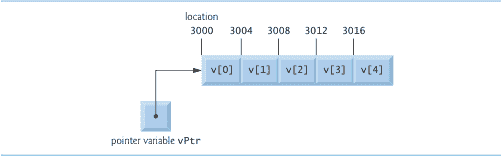

**图 8.15** 内置数组 v 和指向 v 的指针变量 `int *vPtr`。

### *向指针加上整数和从指针减去整数*

在常规算术中，3000 + 2 相加得到 3002。指针算术通常不是这样。当向指针加上或减去一个整数时，指针并不是简单地按该整数递增或递减，而是按该整数乘以指针所指向对象的大小进行。字节数取决于对象的数据类型。例如，语句

```
vPtr += 2;
```

将产生 3008（根据计算 3000 + 2 * 4），假设 int 存储在四个字节的内存中。在内置数组 v 中，vPtr 现在将指向 v[2]（图 8.16）。如果整数存储在八个字节的内存中，则上述计算将得到内存位置 3016（3000 + 2 * 8）。

这等效于将第一个元素的地址赋值如下：

```
bPtr = &b[0]; // also assigns address of built-in array b to bPtr
```

### *指针/偏移表示法*

内置数组元素 b[3] 也可以使用指针表达式来引用

```
*( bPtr + 3 )
```

前面表达式中的 3 是指针的**偏移量**。当指针指向内置数组的开头时，偏移量指示应引用哪个内置数组元素，且偏移量的值与下标相同。这种表示法称为**指针/偏移表示法**。括号是必需的，因为 * 的优先级高于 +。如果没有括号，前面的表达式会将 3 加到 *bPtr 的值的一份副本上（即，假设 bPtr 指向内置数组的开头，则 3 会被加到 b[0] 上）。

正如内置数组元素可以使用指针表达式来引用，*地址*

```
&b[3]
```

也可以使用指针表达式写成

```
bPtr + 3
```

### *以内置数组名作为指针的指针/偏移表示法*

内置数组的名称可以视为指针，并用于指针算术。例如，表达式

```
*( b + 3 )
```

也指元素 b[3]。通常，所有带下标的内置数组表达式都可以用指针和偏移量来书写。在这种情况下，指针/偏移表示法以内置数组名作为指针使用。前面的表达式不会修改内置数组的名称；b 仍然指向内置数组的第一个元素。

### *指针/下标表示法*

指针可以像内置数组一样使用下标。例如，表达式

```
bPtr[ 3 ]
```

引用 b[3]；该表达式使用**指针/下标表示法**。

### *内置数组的名称不可修改*

表达式

```
b += 3
```

会导致编译错误，因为它试图通过指针算术*修改*内置数组名称的值。

> **良好编程实践 8.2**  
> *为了清晰起见，在操作内置数组时，请使用内置数组表示法而不是指针表示法。*


## 演示指针与内置数组之间的关系

图8.17使用本节讨论的四种表示法来引用内置数组元素——*数组下标表示法*、*以内置数组名作为指针的指针/偏移表示法*、*指针下标表示法*以及*使用指针的指针/偏移表示法*——来完成同一任务，即显示名为b的int型内置数组的四个元素。

```cpp
// Fig. 8.17: fig08_17.cpp
// Using subscript and pointer notations with built-in arrays.
#include <iostream>
using namespace std;

int main()
{
   int b[] = { 10, 20, 30, 40 }; // create 4-element built-in array b
   int *bPtr = b; // set bPtr to point to built-in array b

   // output built-in array b using array subscript notation
   cout << "Array b displayed with:\nArray subscript notation\n";

   for ( size_t i = 0; i < 4; ++i )
      cout << "b[" << i << "] = " << b[ i ] << '\n';

   // output built-in array b using array name and pointer/offset notation
   cout << "\nPointer/offset notation where\n"
        << "the pointer is the array name:\n";

   for ( size_t offset1 = 0; offset1 < 4; ++offset1 )
      cout << "*(b + " << offset1 << ") = " << *( b + offset1 ) << '\n';

   // output built-in array b using bPtr and array subscript notation
   cout << "\nPointer subscript notation\n";

   for ( size_t j = 0; j < 4; ++j )
      cout << "bPtr[" << j << "] = " << bPtr[ j ] << '\n';

   cout << "\nPointer/offset notation\n";

   // output built-in array b using bPtr and pointer/offset notation
   for ( size_t offset2 = 0; offset2 < 4; ++offset2 )
      cout << "*(bPtr + " << offset2 << ") = "
           << *( bPtr + offset2 ) << '\n';
} // end main
```

```text
Array b displayed with:

Array subscript notation
b[0] = 10
b[1] = 20
b[2] = 30
b[3] = 40
```

**图8.17** 对内置数组使用下标和指针表示法（第1部分，共2部分）

## 基于指针的字符串

基于指针的字符串是以空字符（`'\0'`）结尾的字符内置数组，该空字符标记字符串在内存中的终止位置。字符串通过指向其第一个字符的指针来访问。字符串字面量的大小是字符串的长度加上终止的空字符。基于指针的字符串与内置数组类似——内置数组名也是指向其第一个字符的指针。

### 字符串字面量作为初始化器

字符串字面量可以在字符内置数组或const char *类型变量的声明中用作初始化器。以下声明

```cpp
char color[] = "blue";
const char *colorPtr = "blue";
```

各自将变量初始化为字符串"blue"。第一个声明创建了一个包含字符'b'、'l'、'u'、'e'和'\0'的五元素字符内置数组color。第二个声明创建了指针变量colorPtr，它指向内存中某处字符串"blue"（以'\0'结尾）中的字母b。字符串字面量具有*静态存储期*（它们在程序运行期间存在），并且如果程序中多个位置引用同一字符串字面量，它们可能共享也可能不共享。

> **防错提示8.6**
>
> 如果需要修改字符串字面量的内容，请先将其存储在字符内置数组中。

### 字符常量作为初始化器

声明`char color[] = "blue";`也可以写成

```cpp
char color[] = { 'b', 'l', 'u', 'e', '\0' };
```

这将单引号（' '）中的字符常量用作内置数组每个元素的初始化器。当声明包含字符串的字符内置数组时，内置数组必须足够大，以存储该字符串及其结尾的空字符。编译器根据初始化器列表中的*初始化器数量*来确定上述声明中内置数组的大小。

> **常见编程错误8.7**
>
> 在字符内置数组中未分配足够空间来存储终止字符串的空字符，是一种逻辑错误。

> **常见编程错误8.8**
>
> 创建或使用不包含终止空字符的C字符串可能导致逻辑错误。

> **防错提示8.7**
>
> 将字符串存储在字符内置数组中时，请确保内置数组足够大，能够容纳将要存储的最大字符串。C++允许任意长度的字符串。如果字符串长于要存储它的字符内置数组，超出内置数组末尾的字符将覆盖内存中数组之后的数据，导致逻辑错误和潜在的安全漏洞。

### 显示C字符串

表示空字符结尾字符串的字符内置数组可以通过cout和<<输出。语句

```cpp
cout << sentence;
```

显示内置数组sentence。与cin一样，cout不关心字符内置数组有多大。字符会一直输出直到遇到终止空字符；空字符不会显示。[注意：cin和cout假定字符内置数组应作为以空字符结尾的字符串处理；cin和cout不提供其他内置数组类型的类似输入和输出处理能力。]

## 8.11 小结

在本章中，我们详细介绍了指针——作为值包含内存地址的变量。我们首先演示了如何声明和初始化指针。你看到了如何使用地址运算符（&）将变量的地址赋给指针，以及如何使用间接寻址运算符（*）访问指针间接引用的变量中存储的数据。我们还讨论了使用指针参数按引用传递参数。

我们讨论了如何声明和使用内置数组，这些数组是C++从C编程语言继承而来的。你学习了如何将const与指针一起使用，以实施最小权限原则。我们演示了使用指向非常量数据的非常量指针、指向常量数据的非常量指针、指向非常量数据的常量指针以及指向常量数据的常量指针。我们讨论了编译时的sizeof运算符，它可以在编译时确定数据类型和变量的字节大小。

我们讨论了如何在算术和比较表达式中使用指针。你看到了指针算术可以用来在内置数组的元素之间移动。我们简要介绍了基于指针的字符串。

在下一章中，我们将开始更深入地讨论类。你将学习类成员的作用域以及如何保持对象处于一致状态。你还将学习使用称为构造函数和析构函数的特殊成员函数，它们分别在创建和销毁对象时执行，我们将讨论构造函数和析构函数何时被调用。此外，我们将演示在构造函数中使用默认参数，以及使用默认的逐成员赋值将一个类的对象赋给该类的另一个对象。我们还将讨论返回类私有数据成员引用的危险。

## 摘要

### 8.2节 指针变量声明与初始化

- 指针是包含其他变量内存地址作为其值的变量。
- 声明

  ```cpp
  int *ptr;
  ```

  将`ptr`声明为指向`int`类型变量的指针，并且读作“`*ptr`是指向int的指针”。这里的`*`在声明中表示该变量是指针。

该内置数组在内存中的位置为1002500。练习的每个部分应在适当的情况下使用前面部分的结果。

- a) 声明一个名为`numbers`的`double`类型内置数组，包含10个元素，并将元素初始化为0.0、1.1、2.2、...、9.9。假设常量size已被定义为10。
- b) 声明一个指向`double`类型变量的指针`nPtr`。
- c) 使用`for`语句，采用数组下标表示法显示内置数组`numbers`的元素。显示每个数字时保留一位小数。
- d) 编写两条独立的语句，分别将内置数组`numbers`的起始地址赋给指针变量`nPtr`。
- e) 使用`for`语句，采用指针/偏移表示法，使用指针`nPtr`显示内置数组`numbers`的元素。
- f) 使用`for`语句，采用指针/偏移表示法，以内置数组名作为指针显示内置数组`numbers`的元素。
- g) 使用`for`语句，采用指针/下标表示法，使用指针`nPtr`显示内置数组`numbers`的元素。
- h) 使用数组下标表示法、以内置数组名作为指针的指针/偏移表示法、使用`nPtr`的指针下标表示法以及使用`nPtr`的指针/偏移表示法引用内置数组`numbers`的第四个元素。
- i) 假设`nPtr`指向内置数组`numbers`的起始位置，`nPtr + 8`引用的是什么地址？该位置存储的值是什么？
- j) 假设`nPtr`指向`numbers[5]`，执行`nPtr -= 4`后，`nPtr`引用的是什么地址？该位置存储的值是什么？

## 8.4

对于以下每一项，编写一条执行指定任务的语句。假设浮点变量`number1`和`number2`已被声明，且`number1`已初始化为7.3。

- a) 声明变量`fPtr`为指向`double`类型对象的指针，并将指针初始化为`nullptr`。
- b) 将变量`number1`的地址赋给指针变量`fPtr`。
- c) 显示`fPtr`指向的对象的值。
- d) 将`fPtr`指向的对象的值赋给变量`number2`。
- e) 显示`number2`的值。
- f) 显示`number1`的地址。
- g) 显示`fPtr`中存储的地址。显示的地址与`number1`的地址相同吗？

## 8.5

执行以下每条语句指定的任务：

- a) 为名为`exchange`的函数编写函数头，该函数接受两个指向双精度浮点数`x`和`y`的指针作为参数，并且不返回值。
- b) 为(a)部分的函数编写函数原型。
- c) 编写两条语句，分别用元音字符串`"AEIOU"`初始化名为`vowel`的字符内置数组。

## 8.6

找出以下每个程序段中的错误。假设有以下声明和语句：

```cpp
int *zPtr; // zPtr will reference built-in array z
void *sPtr = nullptr;
int number;
int z[5] = { 1, 2, 3, 4, 5 };
```

- a) `++zPtr;`
- b) `// use pointer to get first value of a built-in array`
  `number = zPtr;`


```cpp
c) // assign built-in array element 2 (the value 3) to number
   number = *zPtr[ 2 ];
d) // display entire built-in array z
   for ( size_t i = 0; i < 5; ++i )
      cout << zPtr[ i ] << endl;
e) // assign the value pointed to by sPtr to number
   number = *sPtr;
f) ++z;
```

## 自测练习答案

**8.1** a) 地址。b) `nullptr`，一个地址。c) 0。

**8.2** a) 错误。地址运算符的操作数必须是*左值*；地址运算符不能应用于常量或不产生引用的表达式。

b) 错误。指向 `void` 的指针不能被解引用。这样的指针没有类型，无法使编译器确定要解引用的内存字节数以及指针所指向的数据类型。

c) 错误。任何类型的指针都可以赋值给 void 指针。`void` 类型的指针只能通过显式类型转换赋值给其他类型的指针。

**8.3**  
- a) `double numbers[ size ] = { 0.0, 1.1, 2.2, 3.3, 4.4, 5.5, 6.6, 7.7, 8.8, 9.9 };`  
- b) `double *nPtr;`  
- c) `cout << fixed << showpoint << setprecision( 1 );`  
  `for ( size_t i = 0; i < size; ++i )`  
  `   cout << numbers[ i ] << ' ';`  
- d) `nPtr = numbers;`  
  `nPtr = &numbers[ 0 ];`  
- e) `cout << fixed << showpoint << setprecision( 1 );`  
  `for ( size_t j = 0; j < size; ++j )`  
  `   cout << *( nPtr + j ) << ' ';`  
- f) `cout << fixed << showpoint << setprecision( 1 );`  
  `for ( size_t k = 0; k < size; ++k )`  
  `   cout << *( numbers + k ) << ' ';`  
- g) `cout << fixed << showpoint << setprecision( 1 );`  
  `for ( size_t m = 0; m < size; ++m )`  
  `   cout << nPtr[ m ] << ' ';`  
- h) `numbers[ 3 ]`  
  `*( numbers + 3 )`  
  `nPtr[ 3 ]`  
  `*( nPtr + 3 )`

i) 地址是 1002500 + 8 * 8 = 1002564。值是 8.8。

`numbers[ 5 ]` 的地址是 1002500 + 5 * 8 = 1002540。

`nPtr[ 4 ]` 的地址是 1002540 - 4 * 8 = 1002508。

该位置的值是 1.1。

**8.4**  
```cpp
double *fPtr = nullptr;
fPtr = &number1;
cout << "The value of *fPtr is " << *fPtr << endl;
number2 = *fPtr;
cout << "The value of number2 is " << number2 << endl;
cout << "The address of number1 is " << &number1 << endl;
cout << "The address stored in fPtr is: " << fPtr << endl;
```

是的，值是相同的。

## 8.5

- a) `void exchange( double *x, double *y )`  
- b) `void exchange( double &x, double &y )`  
- c) `char vowel[] = "AEIOU";`  
  `char vowel[] = { 'A', 'E', 'I', 'O', 'U', '\0' };`

## 8.6

- a) *Error:* zPtr 尚未初始化。  
  *Correction:* 使用 `zPtr = z;` 初始化 zPtr。  
- b) *Error:* 指针未被解引用。  
  *Correction:* 将语句改为 `number = *zPtr;`。  
- c) *Error:* `zPtr[2]` 不是指针，不应该被解引用。  
  *Correction:* 将 `*zPtr[2]` 改为 `zPtr[2]`。  
- d) *Error:* 使用指针下标引用了内置数组边界之外的元素。  
  *Correction:* 为防止这种情况，将 for 语句中的关系运算符改为 `<`，或将 5 改为 4。  
- e) *Error:* 对 void 指针进行解引用。  
  *Correction:* 要解引用 void 指针，必须先将其转换为整型指针。将语句改为 `number = *static_cast<int *>(zPtr);`。  
- f) *Error:* 试图使用指针算术修改内置数组的名称。  
  *Correction:* 使用指针变量而不是内置数组的名称来执行指针算术，或者对内置数组的名称进行下标操作以引用特定元素。

## 练习

- **8.7** *（正确或错误）* 说明以下说法是否正确。如果错误，请解释原因。
  - a) 指向不同内置数组的两个指针不能有意义地进行比较。
  - b) 因为内置数组的名称可以隐式转换为指向内置数组第一个元素的指针，所以内置数组名称可以像指针一样进行操作。

- **8.8** *（编写 C++ 语句）* 对于以下每一项，编写执行指定任务的 C++ 语句。假设无符号整数存储在两个字节中，并且内置数组的起始地址是内存中的位置 1002500。
  - a) 声明一个类型为 `unsigned int` 的名为 `values` 的内置数组，包含五个元素，并将元素初始化为从 2 到 10 的偶数。假设常量 SIZE 已被定义为 5。
  - b) 声明一个指向 `unsigned int` 类型对象的指针 `vPtr`。
  - c) 使用 `for` 语句以数组下标表示法显示内置数组 `values` 的元素。
  - d) 编写两条单独的语句，将内置数组 `values` 的起始地址赋给指针变量 `vPtr`。
  - e) 使用 `for` 语句以指针/偏移量表示法显示内置数组 `values` 的元素。
  - f) 使用 `for` 语句以指针/偏移量表示法显示内置数组 `values` 的元素，并以内置数组的名称作为指针。
  - g) 使用 `for` 语句通过对指向内置数组的指针进行下标操作来显示内置数组 `values` 的元素。
  - h) 使用数组下标表示法、以内置数组名称作为指针的指针/偏移量表示法、指针下标表示法和指针/偏移量表示法引用 `values` 的第五个元素。
  - i) `vPtr + 3` 引用了什么地址？该位置存储了什么值？
  - j) 假设 `vPtr` 指向值 5，`vPtr -= 4` 引用了什么地址？该位置存储了什么值？

- **8.9** *（编写 C++ 语句）* 对于以下每一项，编写一条执行指定任务的语句。假设 long 变量 `value1` 和 `value2` 已被声明，并且 `value1` 已被初始化为 200000。
  - a) 声明变量 `longPtr` 为指向 long 类型对象的指针。
  - b) 将变量 `value1` 的地址赋给指针变量 `longPtr`。
  - c) 显示 `longPtr` 所指向对象的值。
  - d) 将 `longPtr` 所指向对象的值赋给变量 `value2`。
  - e) 显示 `value2` 的值。
  - f) 显示 `value1` 的地址。
  - g) 显示存储在 `longPtr` 中的地址。显示的地址与 `value1` 的地址相同吗？

- **8.10** *（函数头与函数原型）* 完成以下每个语句中的任务：
  - a) 为函数 `zero` 编写函数头，该函数接受一个 long 整数内置数组参数 `bigIntegers`，且不返回值。
  - b) 为 (a) 中的函数编写函数原型。
  - c) 为函数 `add1AndSum` 编写函数头，该函数接受一个整数内置数组参数 `oneTooSmall1` 并返回一个整数。
  - d) 为 (c) 中描述的函数编写函数原型。

- **8.11** *（查找代码错误）* 找出以下每个段中的错误。如果错误可以纠正，请说明如何纠正。

```cpp
a) int *number;
   cout << number << endl;

b) double *realPtr;
   long *integerPtr;
   integerPtr = realPtr;

c) int * x, y;
   x = y;

d) char s[] = "this is a character array";
   for (; *s != '\0'; ++s)
       cout << *s << ' ';

e) short * numPtr, result;
   void *genericPtr = numPtr;
   result = *genericPtr + 7;

f) double x = 19.34;
   double xPtr = &x;
   cout << xPtr << endl;
```

- **8.12** *（模拟：龟兔赛跑）* 在本练习中，你将重新创建经典的龟兔赛跑。你将使用随机数生成来开发对这个难忘事件的模拟。

我们的参赛者从 70 个方格中的“第 1 格”开始比赛。每个方格代表赛道上的一个可能位置。终点线位于第 70 格。第一个到达或超过第 70 格的参赛者将获得一桶新鲜胡萝卜和生菜。赛道蜿蜒向上，沿着一条湿滑的山坡延伸，因此参赛者偶尔会后退。

有一个时钟每秒滴答一次。每滴答一次，你的程序应使用 `moveTortoise` 和 `moveHare` 函数根据图 8.18 中的规则调整动物的位置。这些函数应使用基于指针的按引用传递来修改乌龟和兔子的位置。


使用变量来跟踪动物的位置（即位置编号为 1–70）。让每只动物从位置 1（即“起跑门”）开始。如果动物滑到第 1 格的左侧，则将其移回第 1 格。

通过生成范围在 1 ≤ *i* ≤10 的随机整数 *i* 来产生前面表格中的百分比。对于乌龟，当 1 ≤ *i* ≤5 时执行“快走”，当 6 ≤ *i* ≤7 时执行“滑倒”，当 8 ≤ *i* ≤10 时执行“慢走”。使用类似的技术来移动兔子。比赛开始时显示

```
BANG !!!!!
AND THEY’RE OFF !!!!!
```

对于每个时钟滴答（即每次循环重复），显示一个包含 70 个位置的行，在乌龟的位置显示字母 T，在兔子的位置显示字母 H。偶尔，参赛者会落在同一个格上。在这种情况下，乌龟会咬兔子，你的程序应该从该位置开始显示 OUCH!!!。除了 T、H 或 OUCH!!!（在平局的情况下）之外的所有位置都应为空白。

显示每一行后，测试是否有动物到达或超过第 70 格。如果是，则显示获胜者并终止模拟。如果乌龟获胜，显示 TORTOISE WINS!!! YAY!!!。如果兔子获胜，显示 Hare wins. Yuch.。如果两只动物在同一时钟滴答中同时获胜，你可以选择偏袒乌龟（“弱者”），也可以选择显示 It’s a tie.。如果两者都没赢，则再次执行循环以模拟下一个时钟滴答。

| 动物 | 移动类型 | 时间百分比 | 实际移动 |
|---|---|---:|---|
| 乌龟 | 快走 | 50% | 向右 3 格 |
|  | 滑倒 | 20% | 向左 6 格 |
|  | 慢走 | 30% | 向右 1 格 |
| 兔子 | 睡觉 | 20% | 不移动 |
|  | 大跳 | 20% | 向右 9 格 |
|  | 大滑 | 10% | 向左 12 格 |
|  | 小跳 | 30% | 向右 1 格 |
|  | 小滑 | 20% | 向左 2 格 |

图 8.18 | 乌龟和兔子的移动规则。

### 8.13（这段代码做了什么？）

这个程序做了什么？

```cpp
// Ex. 8.13: ex08_13.cpp
// What does this program do?
#include <iostream>
using namespace std;

void mystery1( char *, const char * ); // prototype

int main()
{
    char string1[ 80 ];
    char string2[ 80 ];

    cout << "Enter two strings: ";
    cin >> string1 >> string2;
    mystery1( string1, string2 );
    cout << string1 << endl;
} // end main

// What does this function do?
void mystery1( char *s1, const char *s2 )
{
    while ( *s1 != '\0' )
        ++s1;

    for ( ; *s1 = *s2; ++s1, ++s2 )
        ; // empty statement
} // end function mystery1
```

### 8.14（这段代码做了什么？）

这个程序做了什么？

```cpp
// Ex. 8.14: ex08_14.cpp
// What does this program do?
#include <iostream>
using namespace std;

int mystery2( const char * ); // prototype

int main()
{
    char string1[ 80 ];

    cout << "Enter a string: ";
    cin >> string1;
    cout << mystery2( string1 ) << endl;
} // end main

// What does this function do?
int mystery2( const char *s )
{
    unsigned int x;

    for ( x = 0; *s != '\0'; ++s )
        ++x;

    return x;
} // end function mystery2
```

## 专题：构建你自己的计算机

在接下来的几个问题中，我们暂时离开高级语言编程的世界。我们“拆开”一台计算机，看看它的内部结构。我们介绍机器语言编程，并编写几个机器语言程序。为了使这成为一次特别有价值的体验，我们随后构建一台计算机（使用基于软件的模拟），你可以在其上执行你的机器语言程序！

### 8.15（机器语言编程）

让我们创建一台名为 Simpletron 的计算机。顾名思义，它是一台简单的机器，但正如我们很快会看到的，它也是一台功能强大的机器。Simpletron 运行用它能直接理解的唯一语言编写的程序，即 Simpletron 机器语言，简称 SML。

Simpletron 包含一个*累加器*——一个“特殊寄存器”，在 Simpletron 使用这些信息进行计算或以各种方式检查之前，信息被放入其中。Simpletron 中的所有信息都以*字*为单位处理。一个字是一个带符号的四位十进制数，例如 +3364、-1293、+0007、-0001 等。Simpletron 配备了一个容量为 100 个字的内存，这些字通过其位置编号 00、01、…、99 来引用。

在运行 SML 程序之前，我们必须*加载*，即把程序放入内存。每个 SML 程序的第一条指令（或语句）总是放在位置 00。模拟器将从该位置开始执行。

用 SML 编写的每条指令占据 Simpletron 内存的一个字；因此，指令是带符号的四位十进制数。假设 SML 指令的符号总是正号，但数据字的符号可以是正号或负号。Simpletron 内存中的每个位置可能包含一条指令、一个程序使用的数据值，或者一个未使用（因此未定义）的内存区域。每条 SML 指令的前两位是*操作码*，它指定要执行的操作。SML 操作码如图 8.19 所示。

| 操作码 | 含义 |
|---|---|
| *输入/输出操作* | |
| `const int read = 10;` | 从键盘读取一个字到内存中的特定位置。 |
| `const int write = 11;` | 将内存中特定位置的一个字写到屏幕。 |
| *加载和存储操作* | |
| `const int load = 20;` | 将内存中特定位置的一个字加载到累加器中。 |
| `const int store = 21;` | 将累加器中的一个字存储到内存中的特定位置。 |
| *算术操作* | |
| `const int add = 30;` | 将内存中特定位置的一个字与累加器中的字相加（结果留在累加器中）。 |
| `const int subtract = 31;` | 从累加器中的字减去内存中特定位置的一个字（结果留在累加器中）。 |
| `const int divide = 32;` | 将累加器中的字除以内存中特定位置的一个字（结果留在累加器中）。 |
| `const int multiply = 33;` | 将内存中特定位置的一个字乘以累加器中的字（结果留在累加器中）。 |
| *控制转移操作* | |
| `const int branch = 40;` | 转移到内存中的特定位置。 |
| `const int branchnneg = 41;` | 如果累加器为负，则转移到内存中的特定位置。 |
| `const int branchzero = 42;` | 如果累加器为零，则转移到内存中的特定位置。 |
| `const int halt = 43;` | 停止——程序已完成其任务。 |

**图 8.19** | Simpletron 机器语言（SML）操作码。

- a) 使用哨兵控制循环读取正数并计算和显示它们的总和。当输入负数时终止输入。

- b) 使用计数器控制循环读取七个数字，有些是正数，有些是负数，并计算和显示它们的平均值。

- c) 读取一系列数字，并确定和显示最大的数字。读取的第一个数字表示应处理多少个数字。

### 8.16（计算机模拟器）

起初这可能看起来令人难以置信，但在本问题中，你将构建自己的计算机。不，你不会把组件焊接在一起。相反，你将使用基于软件模拟的强大技术来创建 Simpletron 的软件模型。你的 Simpletron 模拟器将把你正在使用的计算机变成一台 Simpletron，而且你实际上将能够运行、测试和调试你在练习 8.15 中编写的 SML 程序。

当你运行你的 Simpletron 模拟器时，它应该首先显示

```
*** Welcome to Simpletron! ***
*** Please enter your program one instruction ***
*** (or data word) at a time. I will type the ***
*** location number and a question mark (?). ***
*** You type the word for that location. ***
*** Type the sentinel -99999 to stop entering ***
*** your program. ***
```

你的程序应该使用一个单下标、包含 100 个元素的内置数组来模拟 Simpletron 的内存。现在假设模拟器正在运行，让我们查看输入练习 8.15 中第二个示例程序时的对话框：

```
00 ? +1009
01 ? +1010
02 ? +2009
03 ? +3110
04 ? +4107
05 ? +1109
06 ? +4300
07 ? +1110
08 ? +4300
09 ? +0000
10 ? +0000
11 ? -99999

*** Program loading completed ***
*** Program execution begins ***
```

上述对话框中每个 ? 右侧的数字表示用户输入的 SML 程序指令。

SML 程序现在已被放置（或加载）到内置数组内存中。现在 Simpletron 执行你的 SML 程序。执行从位置 00 的指令开始，并且像 C++ 一样顺序继续，除非通过控制转移被引导到程序的另一部分。

使用变量 accumulator 来表示累加器寄存器。使用变量 instructionCounter 来跟踪内存中包含正在执行的指令的位置。使用变量 operationCode 来指示当前正在执行的操作（即指令字的左边两位）。使用变量 operand 来指示当前指令操作的内存位置。因此，operand 是当前正在执行的指令的最右边两位。不要直接从内存执行指令。相反，将下一条要执行的指令从内存传送到一个名为 instructionRegister 的变量。然后“取出”左边两位并放入 operationCode，再“取出”右边两位并放入 operand。当 Simpletron 开始执行时，所有特殊寄存器都被初始化为零。


现在让我们“走查”第一条SML指令（位于内存位置00的`+1009`）的执行过程。这被称为*指令执行周期*。

`instructionCounter`告诉我们下一条要执行指令的位置。我们通过C++语句从内存中获取该位置的内容：

```
instructionRegister = memory[ instructionCounter ];
```

通过以下语句从指令寄存器中提取操作码和操作数：

```
operationCode = instructionRegister / 100;
operand = instructionRegister % 100;
```

现在，Simpletron必须确定操作码实际上是*读取*（而不是*写入*、*加载*等）。一个switch语句区分SML的12种操作。在switch语句中，各种SML指令的行为被模拟，如图8.22所示（其余留给读者自己完成）。

| 指令 | 操作 |
|---|---|
| *read（读取）:* | `cin >> memory[ operand ];` |
| *load（加载）:* | `accumulator = memory[ operand ];` |
| *add（加法）:* | `accumulator += memory[ operand ];` |
| *branch（分支）:* | 我们稍后将讨论分支指令。 |
| *halt（停机）:* | 该指令显示消息<br>`*** Simpletron execution terminated ***` |

**图8.22** *SML指令的行为。*

*halt（停机）*指令还会让Simpletron显示每个寄存器的名称和内容，以及内存的完整内容。这种打印输出通常被称为*寄存器和内存转储*。为了帮助你编写转储功能，图8.23给出了一个示例转储格式。请注意，在执行完一个Simpletron程序后的转储将显示执行终止时刻指令和数据值的实际值。要按转储中所示的方式为数字加上符号，请使用流操纵符*showpos*。要禁用符号的显示，请使用流操纵符*noshowpos*。对于少于四位数字的数，你可以在输出值之前使用以下语句，在符号和值之间用前导零格式化数字：

```
cout << setfill( '0' ) << internal;
```

```
REGISTERS:
accumulator          +0000
instructionCounter      00
instructionRegister  +0000
operationCode            00
operand                  00

MEMORY:
          0       1       2       3       4       5       6       7       8       9
 0 +0000 +0000 +0000 +0000 +0000 +0000 +0000 +0000 +0000 +0000
10 +0000 +0000 +0000 +0000 +0000 +0000 +0000 +0000 +0000 +0000
20 +0000 +0000 +0000 +0000 +0000 +0000 +0000 +0000 +0000 +0000
30 +0000 +0000 +0000 +0000 +0000 +0000 +0000 +0000 +0000 +0000
40 +0000 +0000 +0000 +0000 +0000 +0000 +0000 +0000 +0000 +0000
50 +0000 +0000 +0000 +0000 +0000 +0000 +0000 +0000 +0000 +0000
60 +0000 +0000 +0000 +0000 +0000 +0000 +0000 +0000 +0000 +0000
70 +0000 +0000 +0000 +0000 +0000 +0000 +0000 +0000 +0000 +0000
80 +0000 +0000 +0000 +0000 +0000 +0000 +0000 +0000 +0000 +0000
90 +0000 +0000 +0000 +0000 +0000 +0000 +0000 +0000 +0000 +0000
```

**图8.23** *一个示例寄存器和内存转储。*

带参数的流操纵符`setfill`（来自头文件`<iomanip>`）指定填充字符，当数字以五个字符的字段宽度显示但不足四位时，该字符将出现在符号和值之间。（字段宽度中有一个位置保留给符号。）流操纵符`internal`表示填充字符应出现在符号和数值之间。

让我们继续执行程序的第一条指令——位于位置00的`+1009`。正如我们所说，switch语句通过执行以下C++语句来模拟它：

```
cin >> memory[ operand ];
```

在`cin`语句执行之前，屏幕上应显示一个问号（?）以提示用户输入。Simpletron等待用户输入一个值并按回车键。然后该值被读入位置09。

此时，第一条指令的模拟已完成。剩下要做的只是准备Simpletron执行下一条指令。刚刚执行的指令不是控制转移，因此我们只需如下递增指令计数器寄存器：

```
++instructionCounter;
```

这就完成了第一条指令的模拟执行。整个过程（即指令执行周期）从取指下一条要执行的指令开始重新开始。

现在让我们考虑如何模拟分支指令（即控制转移）。我们只需适当地调整`instructionCounter`中的值。因此，无条件分支指令（40）在switch中被模拟为：

```
instructionCounter = operand;
```

条件“累加器为零则分支”指令被模拟为：

```
if ( 0 == accumulator )
    instructionCounter = operand;
```

此时，你应该实现你的Simpletron模拟器，并运行你在练习8.15中编写的每个SML程序。表示Simpletron模拟器内存和寄存器的变量应在`main`中定义，并根据需要按值或按引用传递给其他函数。

你的模拟器应检查各种类型的错误。例如，在程序加载阶段，用户输入到Simpletron内存中的每个数字必须在-9999到+9999的范围内。你的模拟器应使用`while`循环来测试输入的每个数字是否在该范围内，如果不在，则持续提示用户重新输入该数字，直到用户输入正确的数字为止。

在执行阶段，你的模拟器应检查各种严重错误，例如尝试除以零、尝试执行无效操作码、累加器溢出（即算术运算结果大于+9999或小于-9999）等等。此类严重错误称为致命错误。当检测到致命错误时，你的模拟器应显示如下错误消息：

```
*** Attempt to divide by zero ***
*** Simpletron execution abnormally terminated ***
```

并应以我们前面讨论过的格式显示完整的寄存器和内存转储。这将帮助用户在程序中定位错误。

## 8.17（项目：Simpletron模拟器的修改）

在练习8.16中，你编写了一个软件模拟器，用于执行以Simpletron机器语言（SML）编写的程序。在本练习中，我们提出对Simpletron模拟器进行几项修改和增强。在练习18.31–18.35中，我们提出构建一个编译器，将用高级编程语言（一种BASIC的变体）编写的程序转换为SML。以下一些修改和增强可能是在执行编译器生成的程序时所必需的。**[注意：某些修改可能与其他修改冲突，因此必须分开进行。]**

- a) 将Simpletron模拟器的内存扩展到1000个内存位置，以使Simpletron能够处理更大的程序。
- b) 允许模拟器执行取模计算。这需要一条额外的Simpletron机器语言指令。
- c) 允许模拟器执行乘方计算。这需要一条额外的Simpletron机器语言指令。
- d) 修改模拟器，使用十六进制值而不是整数值来表示Simpletron机器语言指令。
- e) 修改模拟器，允许输出换行符。这需要一条额外的Simpletron机器语言指令。
- f) 修改模拟器，使其除了处理整数值外，还能处理浮点值。
- g) 修改模拟器以处理字符串输入。**[提示：** 每个Simpletron字可以分成两组，每组包含一个两位整数。每个两位整数表示一个字符的ASCII十进制等效值。添加一条机器语言指令，用于输入字符串并将该字符串存储在以指定Simpletron内存位置开始的地方。该位置的字的第一个半字将包含字符串中字符数的计数（即字符串的长度）。每个后续半字包含一个以两位十进制数字表示的ASCII字符。该机器语言指令将每个字符转换为其ASCII等效值并将其赋给一个半字。**]**
- h) 修改模拟器以处理以(g)部分格式存储的字符串的输出。**[提示：** 添加一条机器语言指令，用于显示从某个Simpletron内存位置开始的字符串。该位置的字的第一个半字是字符串中字符数的计数（即字符串的长度）。每个后续半字包含一个以两位十进制数字表示的ASCII字符。该机器语言指令检查长度，并通过将每个两位数字转换为其等效字符来显示字符串。**]**
- i) 修改模拟器，加入指令`SML_DEBUG`，该指令在每条指令执行后显示内存转储。给`SML_DEBUG`一个操作码44。字`+4401`打开调试模式，`+4400`关闭调试模式。


- 9.1 引言
- 9.2 Time 类案例研究
- 9.3 类作用域与访问类成员
- 9.4 访问函数与工具函数
- 9.5 Time 类案例研究：带默认参数的构造函数
- 9.6 析构函数
- 9.7 构造函数和析构函数的调用时机
- 9.8 Time 类案例研究：一个微妙的陷阱——返回私有数据成员的引用或指针
- 9.9 默认成员逐一赋值
- 9.10 const 对象与 const 成员函数
- 9.11 组合：作为类成员的对象
- 9.12 友元函数与友元类
- 9.13 使用 this 指针
- 9.14 static 类成员
- 9.15 总结

总结 | 自测练习 | 自测练习答案 | 练习 | 做出改变

## 9.1 引言

本章将更深入地探讨类。我们使用一个综合的 Time 类案例研究和其他示例来演示多种类的构造能力。我们首先从一个 Time 类开始，回顾前面章节中介绍的若干特性。该示例还演示了如何在头文件中使用*包含守卫*，以防止头文件代码被多次包含到同一个源代码文件中。

我们演示客户端代码如何通过对象名、对象引用或对象指针来访问类的公有成员。正如你将看到的，对象名和引用可以与点（.）成员选择运算符一起使用来访问公有成员，而指针则可以与箭头（->）成员选择运算符一起使用。

我们讨论可以读取或写入对象数据成员的访问函数。访问函数的一个常见用途是测试条件的真假——此类函数被称为*谓词函数*。我们还演示了工具函数（也称为*辅助函数*）的概念——这是一种私有成员函数，用于支持类的公有成员函数的操作，但*不*打算供类的客户端使用。

我们展示如何向构造函数传递参数，并演示如何在构造函数中使用默认参数，使客户端代码能够通过多种参数初始化对象。接下来，我们讨论一种特殊的成员函数，称为*析构函数*，它是每个类的一部分，用于在对象被销毁之前对其执行“终止性清理”。我们演示构造函数和析构函数的调用*顺序*。

我们展示返回私有数据的引用或指针会*破坏类的封装性*，使客户端代码能够直接访问对象的数据。我们使用默认的成员逐一赋值将类的一个对象赋值给同一类的另一个对象。

我们使用 const 对象和 const 成员函数来防止对对象的修改，并贯彻最小权限原则。我们讨论*组合*——一种复用形式，其中类可以将其他类的对象作为成员。接下来，我们使用*友元*来指定非成员函数也可以访问类的非公有成员——这种技术通常用于运算符重载（第 10 章）中以获得性能优势。我们讨论 this 指针，它是类的所有非静态成员函数调用中的一个*隐式*参数。

## 9.2 Time 类案例研究

在图 9.1 中，类定义被包含在以下**包含守卫**中（第 6、7 和 23 行）：

```cpp
// 防止头文件被多次包含
#ifndef TIME_H
#define TIME_H
...
#endif
```

当我们构建更大的程序时，其他定义和声明也会放在头文件中。上述包含守卫会防止在名称 TIME_H 已被定义的情况下，**#ifndef**（意为“如果未定义”）和 **#endif** 之间的代码被包含。如果头文件此前尚未在文件中包含过，**#define** 指令会定义名称 TIME_H，并包含头文件语句。如果头文件此前已被包含，则 TIME_H 已定义，头文件将不再被包含。尝试多次（无意中）包含头文件的情况通常出现在大型程序中，因为许多头文件可能自身又包含了其他头文件。


> **错误预防提示 9.1**
>
> 使用 `#ifndef`、`#define` 和 `#endif` 预处理指令构成包含守卫，防止头文件在源代码文件中被多次包含。


> **良好编程实践 9.2**
>
> 按照惯例，在头文件的 `#ifndef` 和 `#define` 预处理指令中使用头文件名的大写形式，并将句点替换为下划线。

### Time 类成员函数

在图 9.2 中，Time 构造函数（第 11–14 行）将数据成员初始化为 0——即 12 AM 的通用时间等价形式。无效值不能存储在 Time 对象的数据成员中，因为构造函数在 Time 对象创建时被调用，而客户端随后所有修改数据成员的尝试都将由 setTime 函数（稍后讨论）进行审查。最后，务必注意你可以为一个类定义**重载构造函数**——我们已在 6.18 节中研究了重载函数。

```cpp
// 图 9.2：Time.cpp
// Time 类成员函数定义。
#include <iostream>
#include <iomanip>
#include <stdexcept> // 用于 invalid_argument 异常类
#include "Time.h" // 包含 Time.h 中 Time 类的定义

using namespace std;

// Time 构造函数将每个数据成员初始化为零。
Time::Time()
   : hour( 0 ), minute( 0 ), second( 0 )
{
} // 结束 Time 构造函数

// 使用通用时间设置新的 Time 值
void Time::setTime( int h, int m, int s )
{
   // 验证 hour、minute 和 second
   if ( ( h >= 0 && h < 24 ) && ( m >= 0 && m < 60 ) &&
        ( s >= 0 && s < 60 ) )
   {
      hour = h;
      minute = m;
      second = s;
   } // 结束 if
   else
   {
      throw invalid_argument(
         "hour, minute and/or second was out of range" );
   } // 结束 else
} // 结束函数 setTime

// 以通用时间格式打印 Time（HH:MM:SS）
void Time::printUniversal() const
{
   cout << setfill( '0' ) << setw( 2 ) << hour << ":"
        << setw( 2 ) << minute << ":" << setw( 2 ) << second;
} // 结束函数 printUniversal

// 以标准时间格式打印 Time（HH:MM:SS AM 或 PM）
void Time::printStandard() const
{
   cout << ( ( hour == 0 || hour == 12 ) ? 12 : hour % 12 ) << ":"
        << setfill( '0' ) << setw( 2 ) << minute << ":" << setw( 2 )
        << second << ( hour < 12 ? " AM" : " PM" );
} // 结束函数 printStandard
```

**图 9.2** | Time 类成员函数定义。

在 C++11 之前，只有静态常量整型数据成员（你在第 7 章中见过）可以在类体内声明的位置进行初始化。因此，数据成员通常应由类的构造函数初始化，因为基本类型的数据成员没有默认初始化。从 C++11 开始，你现在可以使用类内初始化器在类定义中声明任何数据成员的位置进行初始化。

### Time 类成员函数 setTime 与抛出异常

函数 setTime（第 17–30 行）是一个公有函数，它声明了三个 int 参数并使用它们来设置时间。第 20–21 行测试每个参数以确定值是否在范围内，如果是，则第 23–25 行将这些值赋给 hour、minute 和 second 数据成员。hour 值必须大于等于 0 且小于 24，因为通用时间格式将小时表示为从 0 到 23 的整数（例如，下午 1 点是 13 点，晚上 11 点是 23 点；数字 0 表示午夜）。同样，minute 和 second 都必须大于等于 0 且小于 60。对于超出这些范围的值，setTime 会抛出类型为 invalid_argument（来自头文件 `<stdexcept>`）的异常（第 28–29 行），该异常通知客户端代码收到了无效参数。如你在 7.10 节中学到的，你可以使用 try...catch 来捕获异常并尝试


> **性能提示 9.1**
>
> 在类定义中定义成员函数会使该成员函数内联（如果编译器选择这样做）。这可以提高性能。

> **软件工程观察 9.2**
>
> 只有最简单且最稳定的成员函数（即其实现不太可能更改的函数）才应定义在类头文件中。

## 成员函数与全局函数（也称为自由函数）

`printUniversal` 和 `printStandard` 成员函数不接收参数，因为这些成员函数隐式地知道它们要打印调用它们的特定 Time 对象的数据成员。这使得成员函数调用比过程式编程中的常规函数调用更简洁。

> **软件工程观察 9.3**
>
> 使用面向对象编程方法通常通过减少参数数量来简化函数调用。这一好处源于这样一个事实：将数据成员和成员函数封装在类中，使成员函数有权访问数据成员。

> **软件工程观察 9.4**
>
> 成员函数通常比非面向对象程序中的函数更短，因为存储在数据成员中的数据理想情况下已经由构造函数或存储新数据的成员函数验证过。由于数据已经在对象中，成员函数调用通常没有参数，或者比非面向对象语言中的函数调用参数更少。因此，调用、函数定义和函数原型都更短。这改善了程序开发的许多方面。

> **错误预防提示 9.3**
>
> 成员函数调用通常不接收参数，或者比非面向对象语言中的常规函数调用参数少得多，这一事实降低了传递错误参数、错误类型参数或错误数量参数的可能性。

## 使用 Time 类

一旦定义，Time 就可以像下面这样在声明中用作类型：

```cpp
Time sunset; // object of type Time
array< Time, 5 > arrayOfTimes; // array of 5 Time objects
Time &dinnerTime = sunset; // reference to a Time object
Time *timePtr = &dinnerTime; // pointer to a Time object
```

图 9.3 使用了 Time 类。第 11 行实例化了一个名为 t 的 Time 类对象。当对象被实例化时，会调用 Time 构造函数将每个私有数据成员初始化为 0。然后，第 15 行和第 17 行分别以通用格式和标准格式打印时间，以确认成员已正确初始化。第 19 行通过调用成员函数 setTime 设置新时间，第 23 行和第 25 行再次以两种格式打印时间。

```cpp
// Fig. 9.3: fig09_03.cpp
// Program to test class Time.
// NOTE: This file must be compiled with Time.cpp.
#include <iostream>
#include <stdexcept> // for invalid_argument exception class
#include "Time.h" // include definition of class Time from Time.h
using namespace std;

int main()
{
    Time t; // instantiate object t of class Time

    // output Time object t's initial values
    cout << "The initial universal time is ";
    t.printUniversal(); // 00:00:00
    cout << "\nThe initial standard time is ";
    t.printStandard(); // 12:00:00 AM

    t.setTime( 13, 27, 6 ); // change time

    // output Time object t's new values
    cout << "\n\nUniversal time after setTime is ";
    t.printUniversal(); // 13:27:06
    cout << "\nStandard time after setTime is ";
    t.printStandard(); // 1:27:06 PM

    // attempt to set the time with invalid values
    try
    {
        t.setTime( 99, 99, 99 ); // all values out of range
    } // end try
    catch ( invalid_argument &e )
    {
        cout << "Exception: " << e.what() << endl;
    } // end catch

    // output t's values after specifying invalid values
    cout << "\n\nAfter attempting invalid settings:\n"
         << "\nUniversal time: ";
    t.printUniversal(); // 13:27:06
    cout << "\nStandard time: ";
    t.printStandard(); // 1:27:06 PM
    cout << endl;
} // end main
```

```text
The initial universal time is 00:00:00
The initial standard time is 12:00:00 AM

Universal time after setTime is 13:27:06
Standard time after setTime is 1:27:06 PM

Exception: hour, minute and/or second was out of range
```

**图 9.3** | 测试 Time 类的程序。（第 1 部分，共 2 部分。）

```text
After attempting invalid settings:
Universal time: 13:27:06
Standard time: 1:27:06 PM
```

**图 9.3** | 测试 Time 类的程序。（第 2 部分，共 2 部分。）

## 使用无效值调用 `setTime`

为了说明 setTime 方法会验证其参数，第 30 行调用 setTime 并传入无效参数 99 作为时、分和秒。该语句放在 try 块（第 28–31 行）中，以防 setTime 抛出无效参数异常，由于所有参数都无效，它确实会抛出该异常。当这种情况发生时，异常在第 32–35 行被捕获，第 34 行通过调用其 what 成员函数显示异常的错误消息。第 38–42 行再次以两种格式输出时间，以确认在提供无效参数时 setTime 没有改变时间。

## 展望组合与继承

通常，类不必“从零开始”创建。相反，它们可以包含其他类的对象作为成员，或者可以从其他类派生而来，这些类提供了新类可以使用的属性和行为。这种软件复用可以极大地提高生产力并简化代码维护。将类对象作为其他类的成员称为**组合**（或**聚合**），将在第 9.11 节讨论。从现有类派生新类称为**继承**，将在第 11 章讨论。

## 对象大小

面向对象编程的新手常常认为对象一定很大，因为它们包含数据成员和成员函数。从逻辑上讲，这是对的——你可以认为对象包含数据和函数（我们的讨论确实鼓励这种观点）；然而，从物理上讲，事实并非如此。

> **性能提示 9.2**
>
> 对象只包含数据，因此对象比同时包含成员函数时要小得多。编译器只为成员函数创建一份副本，与类的所有对象分开存放。类的所有对象共享这一份副本。当然，每个对象都需要自己的类数据副本，因为数据在对象之间可以不同。函数代码是不可修改的，因此可以在一个类的所有对象之间共享。

## 9.3 类作用域与访问类成员

类的数据成员和成员函数属于该类的作用域。非成员函数默认定义在*全局命名空间作用域*中。（我们将在第 23.4 节更详细地讨论命名空间。）

在类的作用域内，类的所有成员函数都可以立即访问类成员，并可以通过名称引用。在类的作用域之外，公有类成员通过对象上的一个**句柄**来引用——*对象名*、对象的*引用*或对象的*指针*。对象、引用或指针的类型指定了客户端可访问的接口（例如成员函数）。[我们将在第 9.13 节看到，编译器会对从对象内部对数据成员或成员函数的每次引用插入一个*隐式句柄*。]

### 类作用域与块作用域

在成员函数中声明的变量具有块作用域，并且仅对该函数可见。如果成员函数定义的变量与类作用域中的变量同名，则类作用域变量在该函数中被块作用域变量隐藏。可以通过在变量名前加上类名和作用域解析运算符（`::`）来访问此类隐藏变量。隐藏的全局变量可以通过作用域解析运算符访问（参见第 6 章）。

### 点号（.）和箭头（->）成员选择运算符

点号成员选择运算符（.）前面是对象名或对象的引用，用于访问对象的成员。箭头成员选择运算符（`->`）前面是指向对象的指针，用于访问对象的成员。

### 通过对象、引用和指针访问公有类成员

考虑一个具有公有 setBalance 成员函数的 Account 类。给定以下声明：

```cpp
Account account; // an Account object
// accountRef refers to an Account object
Account &accountRef = account;
// accountPtr points to an Account object
Account *accountPtr = &account;
```

可以按如下方式使用点号（.）和箭头（->）成员选择运算符调用 setBalance 成员函数：

```cpp
// call setBalance via the Account object
account.setBalance(123.45);
// call setBalance via a reference to the Account object
accountRef.setBalance(123.45);
// call setBalance via a pointer to the Account object
accountPtr->setBalance(123.45);
```

## 9.4 访问函数与工具函数

### 访问函数

访问函数可以读取或显示数据。访问函数的另一个常见用途是测试条件的真假——这类函数通常称为谓词函数。谓词函数的一个例子是任何容器类（能够容纳许多对象的类，如 vector）的 `isEmpty` 函数。程序可能会在尝试从容器对象中读取另一个项之前测试 `isEmpty`。`isFull` 谓词函数可以测试容器类对象，以确定它是否没有多余空间。对于我们的 Time 类，有用的谓词函数可能是 `isAM` 和 `isPM`。

### 工具函数

工具函数（也称为辅助函数）是一种私有成员函数，用于支持类的其他成员函数的操作。工具函数被声明为私有，因为它们不打算供类的客户端使用。工具函数的一个常见用途是将一些公共代码放入一个函数中，否则这些代码会在其他几个成员函数中重复。


## 9.5 Time 类案例研究：带默认参数的构造函数

图 9.4–9.6 中的程序增强了 Time 类，以演示参数如何隐式传递给构造函数。图 9.2 中定义的构造函数将 hour、minute 和 second 初始化为 0（即通用时间的午夜）。与其他函数一样，构造函数可以指定*默认参数*。图 9.4 的第 13 行声明 Time 构造函数包含默认参数，为传递给构造函数的每个参数指定默认值 0。该构造函数被声明为 `explicit`，因为它可以用一个参数调用。我们将在 10.13 节详细讨论显式构造函数。

```cpp
// Fig. 9.4: Time.h
// Time class containing a constructor with default arguments.
// Member functions defined in Time.cpp.

// prevent multiple inclusions of header
#ifndef TIME_H
#define TIME_H

// Time class definition
class Time
{
public:
   explicit Time( int = 0, int = 0, int = 0 ); // default constructor

   // set functions
   void setTime( int, int, int ); // set hour, minute, second
   void setHour( int ); // set hour (after validation)
   void setMinute( int ); // set minute (after validation)
   void setSecond( int ); // set second (after validation)

   // get functions
   unsigned int getHour() const; // return hour
   unsigned int getMinute() const; // return minute
   unsigned int getSecond() const; // return second

   void printUniversal() const; // output time in universal-time format
   void printStandard() const; // output time in standard-time format
private:
   unsigned int hour; // 0 - 23 (24-hour clock format)
   unsigned int minute; // 0 - 59
   unsigned int second; // 0 - 59
}; // end class Time

#endif
```

**图 9.4** | 包含带默认参数的构造函数的 Time 类。

在图 9.5 中，第 10–13 行定义了 Time 构造函数的新版本，它接收参数 hour、minute 和 second 的值，这些值将分别用于初始化私有数据成员 hour、minute 和 second。构造函数的默认参数确保即使在构造函数调用中未提供任何值，构造函数仍会初始化数据成员。将所有参数都设置为默认值的构造函数也是默认构造函数——也就是说，它可以在不提供任何参数的情况下被调用。每个类最多只能有一个默认构造函数。本例中的 Time 类版本为每个数据成员提供了 set 和 get 函数。Time 构造函数现在调用 setTime，而 setTime 又调用 setHour、setMinute 和 setSecond 函数来验证数据成员并为其赋值。

> **软件工程观察 9.5**
>
> *对函数默认参数值的任何更改都需要重新编译客户端代码（以确保程序仍能正常运行）。*

```cpp
// Fig. 9.5: Time.cpp
// Member-function definitions for class Time.
#include <iostream>
#include <iomanip>
#include <stdexcept>
#include "Time.h" // include definition of class Time from Time.h
using namespace std;

// Time constructor initializes each data member
Time::Time( int hour, int minute, int second )
{
   setTime( hour, minute, second ); // validate and set time
} // end Time constructor

// set new Time value using universal time
void Time::setTime( int h, int m, int s )
{
   setHour( h ); // set private field hour
   setMinute( m ); // set private field minute
   setSecond( s ); // set private field second
} // end function setTime

// set hour value
void Time::setHour( int h )
{
   if ( h >= 0 && h < 24 )
      hour = h;
   else
      throw invalid_argument( "hour must be 0-23" );
} // end function setHour

// set minute value
void Time::setMinute( int m )
{
   if ( m >= 0 && m < 60 )
      minute = m;
   else
      throw invalid_argument( "minute must be 0-59" );
} // end function setMinute
```

**图 9.5** | Time 类的成员函数定义。（第 1 部分，共 2 部分。）

```text
Constructed with:

t1: all arguments defaulted
  00:00:00
  12:00:00 AM

t2: hour specified; minute and second defaulted
  02:00:00
  2:00:00 AM

t3: hour and minute specified; second defaulted
  21:34:00
  9:34:00 PM

t4: hour, minute and second specified
  12:25:42
  12:25:42 PM

Exception while initializing t5: hour must be 0-23
```

**图 9.6** | 带默认参数的构造函数。（第 2 部分，共 2 部分。）

### 关于 Time 类的 Set 和 Get 函数及构造函数的说明

Time 的 set 和 get 函数在类的整个主体中都会被调用。特别是，setTime 函数（图 9.5 的第 16–21 行）调用 setHour、setMinute 和 setSecond 函数，而 printUniversal 和 printStandard 函数在第 71–72 行和第 78–80 行调用 getHour、getMinute 和 getSecond 函数。在每种情况下，这些函数本可以直接访问类的私有数据。然而，请考虑将时间的表示从三个 int 值（在 int 占四个字节的系统上需要 12 字节内存）改为一个表示自午夜以来经过的总秒数的 int 值（只需四字节内存）。如果我们进行这样的更改，只有直接访问私有数据的函数体需要修改——特别是针对 hour、minute 和 second 的各个 set 和 get 函数。而 setTime、printUniversal 或 printStandard 的函数体则无需修改，因为它们不直接访问数据。以这种方式设计类，在更改类的实现时可以减少编程错误发生的可能性。

类似地，Time 构造函数也可以写成包含 setTime 函数中相应语句的副本。这样做可能会稍微高效一些，因为省去了对 setTime 的额外调用。但是，在多个函数或构造函数中重复语句会使更改类的内部数据表示变得更加困难。让 Time 构造函数调用 setTime，并让 setTime 调用 setHour、setMinute 和 setSecond，可以将验证 hour、minute 或 second 的代码更改限制在相应的 set 函数中。这降低了更改类的实现时出错的可能性。


> **软件工程观察 9.6**
>
> 如果类的某个成员函数已经提供了类的构造函数（或其他成员函数）所需的全部或部分功能，请从构造函数（或其他成员函数）中调用该成员函数。这简化了代码的维护，并且在代码实现被修改时降低了出错的可能性。一般规则：避免重复代码。

```cpp
Time::Time( int hour )
    : Time( hour, 0, 0 ) // delegate to Time( int, int, int )
{
} // end constructor with one argument
Time::Time( int hour, int minute )
    : Time( hour, minute, 0 ) // delegate to Time( int, int, int )
{
} // end constructor with two arguments
```

## 9.6 析构函数

**析构函数**是另一种特殊类型的成员函数。类的析构函数的名称是**波浪号字符（~）**后跟类名。这种命名约定具有直观的吸引力，因为正如我们将在后面的章节中看到的，波浪号运算符是按位取反运算符，而且在某种意义上，析构函数就是构造函数的取反。析构函数不能指定参数或返回类型。

当对象被销毁时，类的析构函数会被*隐式*调用。例如，当程序执行离开实例化该对象的作用域时，对象即被销毁。*析构函数本身实际上并不释放对象的内存*——它会在对象的内存被回收之前执行**终止清理**工作，以便该内存可以被重新用于容纳新的对象。

尽管目前呈现的类都还没有定义析构函数，但*每个类都有一个析构函数*。如果你没有*显式*定义析构函数，编译器会定义一个“空”析构函数。[*注：我们将看到，这种隐式创建的析构函数实际上会对通过组合*（9.11 节）*和继承*（第 11 章）*创建的类类型对象执行重要的操作。*] 在第 10 章中，我们将为对象包含动态分配内存（例如数组和字符串）或使用其他系统资源（例如磁盘上的文件，我们将在第 14 章中学习）的类构建合适的析构函数。我们将在第 10 章讨论如何动态分配和释放内存。

## 9.7 构造函数和析构函数的调用时机

构造函数和析构函数由编译器*隐式*调用。这些函数调用的发生顺序取决于执行进入和离开实例化对象的范围的顺序。通常，析构函数的调用顺序与相应的构造函数调用顺序*相反*，但正如我们将在图 9.7–9.9 中看到的，对象的存储类别可以改变析构函数的调用顺序。

### 全局作用域中对象的构造函数和析构函数

在全局作用域（也称为全局命名空间作用域）中定义的对象，其构造函数会在该程序中任何其他函数（包括 main）开始执行*之前*被调用（尽管不同文件之间全局对象构造函数的执行顺序*无法保证*）。相应的析构函数在 main 终止时被调用。函数 **exit** 强制程序立即终止，并且*不*执行局部对象的析构函数。当发生致命的不可恢复错误时，通常使用 exit 函数来终止程序。函数 **abort** 的功能与 exit 函数类似，但强制程序*立即*终止，不允许调用任何对象的析构函数。函数


```cpp
// Fig. 9.8: CreateAndDestroy.cpp
// CreateAndDestroy class member-function definitions.
#include <iostream>
#include "CreateAndDestroy.h" // include CreateAndDestroy class definition
using namespace std;

// constructor sets object's ID number and descriptive message
CreateAndDestroy::CreateAndDestroy( int ID, string messageString )
   : objectID( ID ), message( messageString )
{
   cout << "Object " << objectID << " constructor runs "
        << message << endl;
} // end CreateAndDestroy constructor

// destructor
CreateAndDestroy::~CreateAndDestroy()
{
   // output newline for certain objects; helps readability
   cout << ( objectID == 1 || objectID == 6 ? "\n" : "" );

   cout << "Object " << objectID << " destructor runs "
        << message << endl;
} // end ~CreateAndDestroy destructor
```

**图 9.8 | CreateAndDestroy 类成员函数定义。**

图 9.9 在全局作用域中（第 10 行）定义了对象 first。其构造函数实际上在任何 main 语句执行*之前*被调用，其析构函数在程序终止时，在所有具有自动存储期的对象的析构函数运行*之后*被调用。

```cpp
// Fig. 9.9: fig09_09.cpp
// Order in which constructors and
// destructors are called.
#include <iostream>
#include "CreateAndDestroy.h" // include CreateAndDestroy class definition
using namespace std;

void create( void ); // prototype

CreateAndDestroy first( 1, "{global before main}" ); // global object

int main()
{
   cout << "\nMAIN FUNCTION: EXECUTION BEGINS" << endl;
   CreateAndDestroy second( 2, "{local automatic in main}" );
   static CreateAndDestroy third( 3, "{local static in main}" );

   create(); // call function to create objects

   cout << "\nMAIN FUNCTION: EXECUTION RESUMES" << endl;
   CreateAndDestroy fourth( 4, "{local automatic in main}" );
   cout << "\nMAIN FUNCTION: EXECUTION ENDS" << endl;
} // end main

// function to create objects
void create( void )
{
    cout << "\nCREATE FUNCTION: EXECUTION BEGINS" << endl;
    CreateAndDestroy fifth( 5, "local automatic in create" );
    static CreateAndDestroy sixth( 6, "local static in create" );
    CreateAndDestroy seventh( 7, "local automatic in create" );
    cout << "\nCREATE FUNCTION: EXECUTION ENDS" << endl;
} // end function create
```

**图 9.9 | 构造函数和析构函数被调用的顺序（第 1 部分，共 2 部分）**

```text
Object 1  constructor runs   (global before main)

MAIN FUNCTION: EXECUTION BEGINS
Object 2  constructor runs   (local automatic in main)
Object 3  constructor runs   (local static in main)

CREATE FUNCTION: EXECUTION BEGINS
Object 5  constructor runs   (local automatic in create)
Object 6  constructor runs   (local static in create)
Object 7  constructor runs   (local automatic in create)

CREATE FUNCTION: EXECUTION ENDS
Object 7  destructor runs     (local automatic in create)
Object 5  destructor runs     (local automatic in create)

MAIN FUNCTION: EXECUTION RESUMES
Object 4  constructor runs   (local automatic in main)

MAIN FUNCTION: EXECUTION ENDS
Object 4  destructor runs     (local automatic in main)
Object 2  destructor runs     (local automatic in main)

Object 6  destructor runs     (local static in create)
Object 3  destructor runs     (local static in main)

Object 1  destructor runs     (global before main)
```

**图 9.9 | 构造函数和析构函数被调用的顺序（第 2 部分，共 2 部分）**

main 函数（第 12–23 行）声明了三个对象。对象 second（第 15 行）和 fourth（第 21 行）是局部对象，对象 third（第 16 行）是静态局部对象。每个对象的构造函数在执行到该对象声明处时被调用。当执行到达 main 的末尾时，对象 fourth、然后 second 的析构函数被调用——按照它们构造函数被调用的相反顺序。因为对象 third 是静态的，它一直存在到程序终止。对象 third 的析构函数在全局对象 first 的析构函数之前调用，但在所有其他对象被销毁之后调用。

create 函数（第 26–33 行）声明了三个对象——fifth（第 29 行）和 seventh（第 31 行）是局部自动对象，sixth（第 30 行）是静态局部对象。当 create 终止时，对象 seventh、然后 fifth 的析构函数被调用——按照它们构造函数被调用的相反顺序。因为 `sixth` 是静态的，它一直存在到程序终止。sixth 的析构函数在 third 和 first 的析构函数之前调用，但在所有其他对象被销毁之后调用。

## 9.8 Time 类案例研究：一个微妙的陷阱——返回对 private 数据成员的引用或指针

对对象的引用是对象名称的别名，因此可以用于赋值语句的左侧。在这种情况下，引用构成了一个完全可以接受的*左值*，能够接收一个值。使用这种能力的一种方式是让类的公有成员函数返回对该类私有数据成员的引用。如果函数返回的引用声明为 const，则该引用是不可修改的*左值*，不能用于修改数据。

图 9.10–9.12 的程序使用简化的 Time 类（图 9.10 和图 9.11）来演示通过成员函数 `badSetHour`（在图 9.10 第 15 行声明，在图 9.11 第 37–45 行定义）返回对私有数据成员的引用。这种引用返回实际上使对成员函数 `badSetHour` 的调用成为私有数据成员 `hour` 的别名！该函数调用可以以任何方式使用，就像使用私有数据成员一样，包括在赋值语句中作为*左值*，从而使类的客户端能够随意篡改类的私有数据！如果函数返回指向私有数据的指针，也会出现类似的问题。

```cpp
// Fig. 9.10: Time.h
// Time class declaration.
// Member functions defined in Time.cpp

// prevent multiple inclusions of header
#ifndef TIME_H
#define TIME_H

class Time
{
public:
    explicit Time( int = 0, int = 0, int = 0 );
    void setTime( int, int, int );
    unsigned int getHour() const;
    unsigned int &badSetHour( int ); // dangerous reference return
private:
    unsigned int hour;
    unsigned int minute;
    unsigned int second;
}; // end class Time

#endif
```

**图 9.10 | Time 类声明。**

由函数 getHour 返回，以表明向 hourRef 赋值实际上修改了 Time 对象 t 中的私有数据。最后，第 21 行将 badSetHour 函数调用本身用作左值，并将 74（另一个无效值）赋给函数返回的引用。第 26 行再次显示函数 getHour 返回的值，以表明第 21 行中向函数调用结果赋值会修改 Time 对象 t 中的私有数据。

> **软件工程观察 9.7**
> 
> 返回对私有数据成员的引用或指针会破坏类的封装性，并使客户端代码依赖于类数据的表示形式。在某些情况下这样做是合适的——我们将在第 10.10 节构建自定义 Array 类时展示一个示例。

```cpp
// Fig. 9.12: fig09_12.cpp
// Demonstrating a public member function that
// returns a reference to a private data member.
#include <iostream>
#include "Time.h" // include definition of class Time
using namespace std;

int main()
{
    Time t; // create Time object

    // initialize hourRef with the reference returned by badSetHour
    int &hourRef = t.badSetHour( 20 ); // 20 is a valid hour

    cout << "Valid hour before modification: " << hourRef;
    hourRef = 30; // use hourRef to set invalid value in Time object t
    cout << "\nInvalid hour after modification: " << t.getHour();

    // Dangerous function call that returns
    // a reference can be used as an lvalue!
    t.badSetHour( 12 ) = 74; // assign another invalid value to hour

    cout << "\n\n***************************************\n"
         << "POOR PROGRAMMING PRACTICE!!!!!!!\n"
         << "t.badSetHour( 12 ) as an lvalue, invalid hour: "
         << t.getHour()
         << "\n***************************************" << endl;
} // end main
```

```text
Valid hour before modification: 20
Invalid hour after modification: 30

**************************************************
POOR PROGRAMMING PRACTICE!!!!!!!
t.badSetHour( 12 ) as an lvalue, invalid hour: 74
**************************************************
```

**图 9.12 | 返回对私有数据成员引用的公有成员函数。**


```cpp
// print Date in the format mm/dd/yyyy
void Date::print()
{
   cout << month << "/" << day << "/" << year;
} // end function print
```

图9.14 | Date类成员函数定义（第2部分，共2部分）。

```cpp
// Fig. 9.15: fig09_15.cpp
// Demonstrating that class objects can be assigned
// to each other using default memberwise assignment.
#include <iostream>
#include "Date.h" // include definition of class Date from Date.h
using namespace std;

int main()
{
   Date date1(7, 4, 2004);
   Date date2; // date2 defaults to 1/1/2000

   cout << "date1 = ";
   date1.print();
   cout << "\n\ndate2 = ";
   date2.print();

   date2 = date1; // default memberwise assignment

   cout << "\n\nAfter default memberwise assignment, date2 = ";
   date2.print();
   cout << endl;
} // end main
```

```text
date1 = 7/4/2004
date2 = 1/1/2000

After default memberwise assignment, date2 = 7/4/2004
```

图9.15 | 类对象可以使用默认的逐成员赋值相互赋值。

对象可以作为函数参数传递，也可以从函数返回。这种传递和返回默认采用按值传递方式——传递或返回的是对象的副本。在这种情况下，C++会创建一个新对象，并使用拷贝构造函数将原始对象的值复制到新对象中。对于每个类，编译器都会提供一个默认拷贝构造函数，将原始对象的每个成员复制到新对象的相应成员中。与逐成员赋值类似，拷贝构造函数在用于数据成员包含指向动态分配内存的指针的类时，可能会导致严重问题。第10章将讨论如何定义自定义拷贝构造函数，以正确复制包含指向动态分配内存的指针的对象。

## 9.10 const对象和const成员函数

让我们看看最小特权原则如何应用于对象。有些对象需要可修改，有些则不需要。您可以使用关键字`const`来指定对象不可修改，并且任何修改该对象的尝试都应在编译时导致错误。语句

```cpp
const Time noon(12, 0, 0);
```

声明了一个Time类的const对象noon，并将其初始化为中午12点。同一个类可以实例化const和非const对象。

> > **软件工程观察 9.8**
> >
> > *试图修改const对象的操作会在编译时被捕获，而不是导致运行时错误。*

> > **性能提示 9.3**
> >
> > *在适当的时候将变量和对象声明为const可以提高性能——编译器可以对常量执行优化，而这些优化无法对非const变量执行。*

C++禁止对const对象调用成员函数，除非成员函数本身也声明为const。即使是不修改对象的get成员函数也是如此。这也是我们将所有不修改所调用对象的成员函数都声明为const的关键原因。

正如您从第3章的GradeBook类开始看到的，成员函数在原型中通过在函数参数列表后插入关键字`const`来指定为const，在函数定义中则是在函数体左花括号之前。

> > **常见编程错误 9.2**
> >
> > *将修改对象数据成员的成员函数定义为const是编译错误。*

> > **常见编程错误 9.3**
> >
> > *将调用同一对象上非const成员函数的成员函数定义为const是编译错误。*

> > **常见编程错误 9.4**
> >
> > *在const对象上调用非const成员函数是编译错误。*

构造函数和析构函数出现了一个有趣的问题，它们通常都会修改对象。必须允许构造函数修改对象，以便正确初始化对象。析构函数必须能够在系统回收对象内存之前执行其终止清理工作。试图将构造函数或析构函数声明为const是编译错误。const对象的“常量性”从构造函数完成对象初始化时开始，一直持续到该对象的析构函数被调用为止。

### 使用**const**和非const成员函数

图9.16中的程序使用了图9.4–9.5中的Time类，但为了展示编译器错误，从printStandard的原型和定义中移除了const。我们实例化了两个Time对象——非const对象wakeUp（第7行）和const对象noon（第8行）。程序尝试对const对象noon调用非const成员函数setHour（第13行）和printStandard（第20行）。在每种情况下，编译器都会生成一条错误消息。该程序还演示了对象上的其他三种成员函数调用组合——非const对象上的非const成员函数（第11行）、非const对象上的const成员函数（第15行）以及const对象上的const成员函数（第17–18行）。输出窗口中显示了在const对象上调用非const成员函数时生成的错误消息。

```cpp
// Fig. 9.16: fig09_16.cpp
// const objects and const member functions.
#include "Time.h" // include Time class definition

int main()
{
    Time wakeUp( 6, 45, 0 ); // non-constant object
    const Time noon( 12, 0, 0 ); // constant object

                         // OBJECT       MEMBER FUNCTION
    wakeUp.setHour( 18 ); // non-const    non-const

    noon.setHour( 12 );   // const        non-const

    wakeUp.getHour();     // non-const    const

    noon.getMinute();     // const        const
    noon.printUniversal(); // const       const

    noon.printStandard(); // const        non-const
} // end main
```

*Microsoft Visual C++ 编译器错误消息：*

```text
C:\examples\ch09\Fig09_16\fig09_18.cpp(13) : error C2662:
  'Time::setHour' : cannot convert 'this' pointer from 'const Time' to
  'Time &'
      Conversion loses qualifiers
C:\examples\ch09\Fig09_16\fig09_18.cpp(20) : error C2662:
  'Time::printStandard' : cannot convert 'this' pointer from 'const Time' to
  'Time &'
      Conversion loses qualifiers
```

**图9.16** | const对象和const成员函数。

构造函数必须是非const成员函数，但它仍然可以用来初始化const对象（图9.16，第8行）。回顾图9.5，Time构造函数的定义调用了另一个非const成员函数——setTime——来执行Time对象的初始化。作为const对象初始化的一部分，从构造函数调用中调用非const成员函数是允许的。

```cpp
private:
   unsigned int month; // 1-12 (January-December)
   unsigned int day; // 1-31 based on month
   unsigned int year; // any year

   // utility function to check if day is proper for month and year
   unsigned int checkDay( int ) const;
}; // end class Date

#endif
```

图9.17 | Date类定义（第2部分，共2部分）。

```cpp
// Fig. 9.18: Date.cpp
// Date class member-function definitions.
#include <array>
#include <iostream>
#include <stdexcept>
#include "Date.h" // include Date class definition
using namespace std;

// constructor confirms proper value for month; calls
// utility function checkDay to confirm proper value for day
Date::Date( int mm, int dd, int yy )
{
   if ( mm > 0 && mm <= monthsPerYear ) // validate the month
      month = mm;
   else
      throw invalid_argument( "month must be 1-12" );

   year = yy; // could validate yr
   day = checkDay( dd ); // validate the day

   // output Date object to show when its constructor is called
   cout << "Date object constructor for date ";
   print();
   cout << endl;
} // end Date constructor

// print Date object in form month/day/year
void Date::print() const
{
   cout << month << '/' << day << '/' << year;
} // end function print

// output Date object to show when its destructor is called
Date::~Date()
{
   cout << "Date object destructor for date ";
   print();
   cout << endl;
} // end ~Date destructor
```

图9.18 | Date类成员函数定义（第1部分，共2部分）。


```cpp
// utility function to confirm proper day value based on
// month and year; handles leap years, too
unsigned int Date::checkDay( int testDay ) const
{
    static const array< int, monthsPerYear + 1 > daysPerMonth =
       { 0, 31, 28, 31, 30, 31, 30, 31, 31, 30, 31, 30, 31 };

    // determines if testDay is valid for specified month
    if ( testDay > 0 && testDay <= daysPerMonth[ month ] )
        return testDay;

    // February 29 check for leap year
    if ( month == 2 && testDay == 29 && ( year % 400 == 0 ||
       ( year % 4 == 0 && year % 100 != 0 ) ) )
        return testDay;

    throw invalid_argument( "Invalid day for current month and year" );
} // end function checkDay
```

**图 9.18** | Date 类成员函数定义。（第 2 部分，共 2 部分。）

```cpp
// Fig. 9.19: Employee.h
// Employee class definition showing composition.
// Member functions defined in Employee.cpp.
#ifndef EMPLOYEE_H
#define EMPLOYEE_H

#include <string>
#include "Date.h" // include Date class definition

class Employee
{
public:
    Employee( const std::string &, const std::string &,
       const Date &, const Date & );
    void print() const;
    ~Employee(); // provided for custom destruction order
private:
    std::string firstName; // composition: member object
    std::string lastName; // composition: member object
    const Date birthDate; // composition: member object
    const Date hireDate; // composition: member object
}; // end class Employee

#endif
```

**图 9.19** | 展示组合的 Employee 类定义。

```cpp
// Fig. 9.20: Employee.cpp
// Employee class member-function definitions.
#include <iostream>
#include "Employee.h" // Employee class definition
#include "Date.h" // Date class definition
using namespace std;

// constructor uses member initializer list to pass initializer
// values to constructors of member objects
Employee::Employee( const string &first, const string &last,
    const Date &dateOfBirth, const Date &dateOfHire )
    : firstName( first ), // initialize firstName
      lastName( last ), // initialize lastName
      birthDate( dateOfBirth ), // initialize birthDate
      hireDate( dateOfHire ) // initialize hireDate
{
    // output Employee object to show when constructor is called
    cout << "Employee object constructor: "
         << firstName << ' ' << lastName << endl;
} // end Employee constructor

// print Employee object
void Employee::print() const
{
    cout << lastName << ", " << firstName << " Hired: ";
    hireDate.print();
    cout << " Birthday: ";
    birthDate.print();
    cout << endl;
} // end function print

// output Employee object to show when its destructor is called
Employee::~Employee()
{
    cout << "Employee object destructor: "
         << lastName << ", " << firstName << endl;
} // end ~Employee destructor
```

**图 9.20** | Employee 类成员函数定义。

### Employee 构造函数的成员初始化列表

构造函数头部（图 9.20 第 12 行）后面的冒号（:）开始 *成员初始化列表*。成员初始化器指定传递给 string 和 Date 数据成员构造函数的 Employee 构造函数参数。参数 first、last、dateOfBirth 和 dateOfHire 分别传递给对象 firstName（第 12 行）、lastName（第 13 行）、birthDate（第 14 行）和 hireDate（第 15 行）的构造函数。同样，成员初始化器用逗号分隔。成员初始化器的顺序无关紧要。它们按照成员对象在类 Employee 中声明的顺序执行。


### 良好编程实践 9.3

为清晰起见，请按类中数据成员的声明顺序列出成员初始化器。

### Date 类的默认拷贝构造函数

在学习 Date 类（图 9.17）时，请注意该类并未提供接收 Date 类型参数的构造函数。那么，为什么 Employee 构造函数的成员初始化列表可以通过将 Date 对象传递给它们的 Date 构造函数来初始化 birthDate 和 hireDate 对象呢？正如我们在 9.9 节中提到的，编译器为每个类提供一个默认拷贝构造函数，该构造函数将构造函数参数对象的每个数据成员复制到正在初始化的对象的对应成员中。第 10 章将讨论如何定义自定义拷贝构造函数。

### 测试 Date 和 Employee 类

图 9.21 创建了两个 Date 对象（第 10-11 行），并将它们作为参数传递给第 12 行创建的 Employee 对象的构造函数。第 15 行输出 Employee 对象的数据。在第 10-11 行创建每个 Date 对象时，图 9.18 第 11-25 行定义的 Date 构造函数会显示一行输出，以表明构造函数被调用了（参见示例输出的前两行）。[注意：图 9.21 的第 12 行导致另外两次 Date 构造函数调用，但这两次调用并未出现在程序输出中。当 Employee 的每个 Date 成员对象在 Employee 构造函数的成员初始化列表（图 9.20 第 14-15 行）中被初始化时，会调用 Date 类的默认拷贝构造函数。由于该构造函数是由编译器隐式定义的，它不包含任何用于演示何时被调用的输出语句。]

```cpp
// Fig. 9.21: fig09_21.cpp
// Demonstrating composition—an object with member objects.
#include <iostream>
#include "Date.h" // Date class definition
#include "Employee.h" // Employee class definition
using namespace std;

int main()
{
    Date birth( 7, 24, 1949 );
    Date hire( 3, 12, 1988 );
    Employee manager( "Bob", "Blue", birth, hire );

    cout << endl;
    manager.print();
} // end main
```

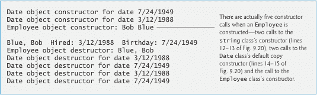

**图 9.21** | 演示组合——一个包含成员对象的对象。

## 9.12 友元函数和友元类

类的 *友元函数* 是一种非成员函数，它有权访问类的公有和非公有成员。独立函数、整个类或其他类的成员函数都可以被声明为另一个类的 *友元*。

本节展示了一个说明友元函数如何工作的机械示例。在第 10 章中，我们将展示用于类对象的重载运算符的友元函数——您将看到，有时成员函数无法用于某些重载运算符。

### 声明友元

要将函数声明为类的友元，请在类定义中的函数原型前加上关键字 friend。要将类 ClassTwo 的所有成员函数声明为类 ClassOne 的友元，请放置如下形式的声明：

```cpp
friend class ClassTwo;
```

在类 ClassOne 的定义中。

友谊是 *授予的，而非索取的*——要使类 B 成为类 A 的友元，类 A 必须 *显式* 声明类 B 是其友元。友谊不是 *对称的*——如果类 A 是类 B 的友元，你不能推断出类 B 是类 A 的友元。友谊不是 *可传递的*——如果类 A 是类 B 的友元，且类 B 是类 C 的友元，你不能推断出类 A 是类 C 的友元。

### 使用友元函数修改类的私有数据

图 9.22 是一个机械示例，其中我们定义了友元函数 setX 来设置类 Count 的私有数据成员 x。按照惯例，我们将友元声明（第 9 行）放在类定义中的 *最前面*，甚至在 *公有* 成员函数声明之前。同样，这个友元声明可以出现在类中的 *任何地方*。

函数 setX（第 29-32 行）是一个独立（全局）函数——它不是类 Count 的成员函数。因此，当为对象 counter 调用 setX 时，第 41 行将 counter 作为参数传递给 setX，而不是使用句柄（例如对象名）来调用函数。

```cpp
counter.setX( 9 ); // error: setX not a member function
```

如果删除第 9 行的友元声明，您将收到错误消息，指出函数 setX 无法修改类 Count 的私有数据成员 x。

```cpp
// Fig. 9.22: fig09_22.cpp
// Friends can access private members of a class.
#include <iostream>
using namespace std;

// Count class definition
class Count
{
    friend void setX( Count &, int ); // friend declaration
```

**图 9.22** | 友元可以访问类的私有成员。（第 1 部分，共 2 部分。）


```cpp
public:
    // constructor
    Count()
        : x(0) // initialize x to 0
    {
        // empty body
    } // end constructor Count

    // output x
    void print() const
    {
        cout << x << endl;
    } // end function print
private:
    int x; // data member
}; // end class Count

// function setX can modify private data of Count
// because setX is declared as a friend of Count (line 9)
void setX( Count &c, int val )
{
    c.x = val; // allowed because setX is a friend of Count
} // end function setX

int main()
{
    Count counter; // create Count object

    cout << "counter.x after instantiation: ";
    counter.print();

    setX( counter, 8 ); // set x using a friend function
    cout << "counter.x after call to setX friend function: ";
    counter.print();
} // end main
```

```text
counter.x after instantiation: 0
counter.x after call to setX friend function: 8
```

**图9.22 |** 友元可以访问类的私有成员。（第2部分，共2部分。）

正如我们提到的，图9.22是使用友元构造的一个机械示例。通常将函数setX定义为类Count的成员函数更为合适。通常也应当将图9.22的程序分成三个文件：

- 1. 一个头文件（例如`Count.h`），包含Count类的定义，而类定义中又包含友元函数setX的原型
- 2. 一个实现文件（例如`Count.cpp`），包含Count类的成员函数定义和友元函数setX的定义
- 3. 一个测试程序（例如`fig09_22.cpp`），包含`main`函数。

## 重载友元函数

可以将重载函数指定为类的友元。每个想要成为友元的函数都必须在类定义中显式地声明为该类的友元。


> **软件工程观察 9.12**
> 
> 即使友元函数的原型出现在类定义中，友元也不是成员函数。


> **软件工程观察 9.13**
> 
> 私有、保护和公有的成员访问概念与友元声明无关，因此友元声明可以放置在类定义中的任何位置。


> **良好编程实践 9.4**
> 
> 将所有友元声明放在类定义体的最前面，并且不要在前面添加任何访问说明符。

## 9.13 使用this指针

我们已经看到，成员函数可以操纵对象的数据。一个类可以有多个对象，那么成员函数如何知道要操纵哪个对象的数据成员呢？每个对象都可以通过一个名为this的指针（一个C++关键字）访问自己的地址。this指针不是对象本身的一部分——也就是说，this指针占用的内存不会反映在对象上的sizeof操作结果中。相反，this指针由编译器作为隐式参数传递给对象的每个非静态成员函数。9.14节将介绍静态类成员，并解释为什么this指针不会隐式传递给静态成员函数。

### 使用this指针避免命名冲突

成员函数隐式地（如我们目前所做的那样）或显式地使用this指针来引用对象的数据成员和其他成员函数。this指针一个常见的显式用法是避免类的数据成员与成员函数参数（或其他局部变量）之间的命名冲突。考虑图9.4–9.5中Time类的hour数据成员和setHour成员函数。我们可以将setHour定义为：

```cpp
// set hour value
void Time::setHour( int hour )
{
    if ( hour >= 0 && hour < 24 )
        this->hour = hour; // use this pointer to access data member
    else
        throw invalid_argument( "hour must be 0-23" );
} // end function setHour
```

在这个函数定义中，setHour的参数与数据成员hour同名。在setHour的作用域内，参数hour隐藏了数据成员。但是，你仍然可以通过使用this->限定其名称来访问数据成员hour。下面的语句将参数hour的值赋给数据成员hour：

```cpp
this->hour = hour; // use this pointer to access data member
```

> **错误预防提示 9.4**
> 
> 为了使你的代码更清晰、更易于维护，并避免错误，绝不要用局部变量名隐藏数据成员。

### `this`指针的类型

`this`指针的类型取决于对象的类型以及使用`this`的成员函数是否声明为const。例如，在类Employee的非const成员函数中，`this`指针的类型为`Employee *`。在const成员函数中，`this`指针的类型为`const Employee *`。

### 隐式和显式使用`this`指针访问对象的数据成员

图9.23演示了隐式和显式使用`this`指针，使类Test的成员函数能够打印Test对象的私有数据x。在下一个示例和第10章中，我们展示了一些使用`this`的重要而微妙的示例。

```cpp
// Fig. 9.23: fig09_23.cpp
// Using the this pointer to refer to object members.
#include <iostream>
using namespace std;

class Test
{
public:
   explicit Test( int = 0 ); // default constructor
   void print() const;
private:
   int x;
}; // end class Test

// constructor
Test::Test( int value )
   : x( value ) // initialize x to value
{
   // empty body
} // end constructor Test

// print x using implicit and explicit this pointers;
// the parentheses around *this are required
void Test::print() const
{
   // implicitly use the this pointer to access the member x
   cout << "\n   x: " << x;

   // explicitly use the this pointer and the arrow operator
   // to access the member x
   cout << "\n   this->x: " << this->x;

   // explicitly use the dereferenced this pointer and
   // the dot operator to access the member x
   cout << "\n(*this).x = " << (*this).x << endl;
} // end function print

int main()
{
    Test testObject( 12 ); // instantiate and initialize testObject

    testObject.print();
} // end main
```

```text
   x: 12
   this->x: 12
(*this).x = 12
```

**图9.23 |** 使用this指针引用对象成员。

为了说明问题，成员函数print（第24–36行）首先使用*this指针隐式地*打印x（第27行）——只指定数据成员的名称。然后print使用两种不同的表示法访问this指针——this指针上的箭头运算符（->）（第31行）和解引用this指针上的点运算符（.）（第35行）。注意与点成员选择运算符（.）一起使用时*this周围的括号（第35行）。这些括号是必需的，因为点运算符的优先级*高于*`*`运算符。没有括号，表达式*this.x会被求值，就像它被括为*(this.x)一样，这是一个*编译错误*，因为点运算符不能与指针一起使用。

this指针的一个有趣用途是防止对象被赋值给自身。正如我们将在第10章中看到的，当对象包含指向动态分配存储的指针时，*自赋值*可能导致严重错误。

### 使用*this*指针启用级联函数调用

this指针的另一个用途是启用级联成员函数调用——即在同一语句中调用多个函数（如图9.26中的第12行）。图9.24–9.26中的程序修改了类Time的set函数setTime、setHour、setMinute和setSecond，使每个函数都返回一个指向Time对象的引用，以启用级联成员函数调用。注意在图9.25中，这些成员函数体中的最后一条语句都将*this（第23、34、45和56行）返回到返回类型`Time &`中。

图9.26中的程序创建了Time对象t（第9行），然后在*级联成员函数调用*（第12和24行）中使用它。为什么将*this作为引用返回的技术能够起作用？点运算符（.）从左到右结合，因此第12行首先计算t.setHour(18)，然后返回对对象t的引用作为该函数调用的值。剩余的表达式随后被解释为：

```cpp
t.setMinute( 30 ).setSecond( 22 );
```

t.setMinute(30)调用执行并返回对对象t的引用。剩余的表达式被解释为：

```cpp
t.setSecond( 22 );
```


```cpp
14    setTime( hr, min, sec );
15 } // end Time constructor

17 // set values of hour, minute, and second
18 Time &Time::setTime( int h, int m, int s ) // note Time & return
19 {
20    setHour( h );
21    setMinute( m );
22    setSecond( s );
23    return *this; // enables cascading
24 } // end function setTime

26 // set hour value
27 Time &Time::setHour( int h ) // note Time & return
28 {
29    if ( h >= 0 && h < 24 )
30       hour = h;
31    else
32       throw invalid_argument( "hour must be 0-23" );

34    return *this; // enables cascading
35 } // end function setHour

37 // set minute value
38 Time &Time::setMinute( int m ) // note Time & return
39 {
40    if ( m >= 0 && m < 60 )
41       minute = m;
42    else
43       throw invalid_argument( "minute must be 0-59" );

45    return *this; // enables cascading
46 } // end function setMinute

48 // set second value
49 Time &Time::setSecond( int s ) // note Time & return
50 {
51    if ( s >= 0 && s < 60 )
52       second = s;
53    else
54       throw invalid_argument( "second must be 0-59" );

56    return *this; // enables cascading
57 } // end function setSecond

59 // get hour value
60 unsigned int Time::getHour() const
61 {
62    return hour;
63 } // end function getHour

// get minute value
unsigned int Time::getMinute() const
{
    return minute;
} // end function getMinute

// get second value
unsigned int Time::getSecond() const
{
    return second;
} // end function getSecond

// print Time in universal-time format (HH:MM:SS)
void Time::printUniversal() const
{
    cout << setfill('0') << setw(2) << hour << ":"
         << setw(2) << minute << ":" << setw(2) << second;
} // end function printUniversal

// print Time in standard-time format (HH:MM:SS AM or PM)
void Time::printStandard() const
{
    cout << ( hour == 0 || hour == 12 ? 12 : hour % 12 )
         << ":" << setfill('0') << setw(2) << minute
         << ":" << setw(2) << second << ( hour < 12 ? " AM" : " PM" );
} // end function printStandard
```

**图 9.25** | 修改后的 Time 类成员函数定义，以支持级联成员函数调用。（第 2–3 部分，共 3 部分）

第 24 行（图 9.26）也使用了级联。注意，这里不能在 printStandard 之后继续链接另一个成员函数调用，因为 printStandard 不返回对 t 的引用。在第 24 行中，将 printStandard 调用放在 setTime 调用之前会导致编译错误。第 10 章将给出几个使用级联函数调用的实际示例。其中一个示例使用多个 << 运算符与 cout，在单条语句中输出多个值。

```cpp
// Fig. 9.26: fig09_26.cpp
// Cascading member-function calls with the this pointer.
#include <iostream>
#include "Time.h" // Time class definition
using namespace std;

int main()
{
    Time t; // create Time object

    // cascaded function calls
    t.setHour(18).setMinute(30).setSecond(22);

    // output time in universal and standard formats
    cout << "Universal time: ";
    t.printUniversal();

    cout << "\nStandard time: ";
    t.printStandard();

    cout << "\n\nNew standard time: ";

    // cascaded function calls
    t.setTime(20, 20, 20).printStandard();
    cout << endl;
} // end main
```

```
Universal time: 18:30:22
Standard time: 6:30:22 PM

New standard time: 8:20:20 PM
```

**图 9.26** | 使用 `this` 指针的级联成员函数调用。（第 1–2 部分，共 2 部分）

## 9.14 **静态**类成员

关于类的每个对象都拥有该类所有数据成员的独立副本这一规则，有一个重要的例外。在某些情况下，一个变量只能有一个副本，由类的所有对象共享。**静态数据成员**就是用于这些及其他用途的。这样的变量表示“类级”信息，即由所有实例共享、不特定于类的任何一个对象的数据。例如，回想第 7 章中的 GradeBook 类版本，它们使用静态数据成员来存储表示所有 GradeBook 对象可以容纳的成绩数量的常量。

### 类级数据的动机

让我们用一个示例来说明对静态类级数据的需求。假设我们有一个包含火星人和其他太空生物的视频游戏。每个火星人在意识到至少存在五个火星人时，往往就会变得勇敢，并愿意攻击其他太空生物。如果少于五个，每个火星人就会变得胆小。因此，每个火星人都需要知道 `martianCount`。我们可以让类 Martian 的每个实例都以 `martianCount` 作为数据成员。如果这样做，每个火星人都会有这个数据成员的独立副本。每当我们创建一个新的火星人时，都必须更新所有 Martian 对象中的 `martianCount` 数据成员。这样做将要求每个 Martian 对象都拥有或能够访问内存中所有其他 Martian 对象的句柄。这既因 `martianCount` 的冗余副本而浪费空间，也因更新各个副本而浪费时间。相反，我们声明 `martianCount` 为静态的。这使 `martianCount` 成为类级数据。每个 Martian 都可以像访问 Martian 的数据成员一样访问 `martianCount`，但程序中只维护静态变量 `martianCount` 的一个副本。这节省了空间。我们通过让 Martian 构造函数递增静态变量 `martianCount`，并让 Martian 析构函数递减 `martianCount` 来节省时间。因为只有一个副本，我们不必为每个 Martian 对象递增或递减独立的 `martianCount` 副本。


**性能提示 9.5**

当类的所有对象共享一份数据副本即可时，使用静态数据成员来节省存储空间。

### 静态数据成员的作用域和初始化

类的静态数据成员具有类作用域。静态数据成员必须且只能初始化一次。基本类型的静态数据成员默认初始化为 0。在 C++11 之前，int 或 enum 类型的静态 const 数据成员可以在类定义中的声明处初始化，而所有其他静态数据成员必须在全局命名空间作用域（即在类定义体外）定义并初始化。同样，C++11 的类内初始化器也允许你在类定义中声明这些变量的位置对它们进行初始化。如果静态数据成员是某个提供了默认构造函数的类的对象，则无需初始化该静态数据成员，因为其默认构造函数会被调用。

### 访问静态数据成员

类的私有和受保护的静态数据成员通常通过类的公有成员函数或友元来访问。类的静态成员即使在该类没有对象存在时也存在。要在没有类对象时访问公有静态类成员，只需在数据成员名称前加上类名和作用域解析运算符（::）。例如，如果前面提到的变量是公有的，即使没有 Martian 对象，也可以通过表达式 Martian::martianCount 访问它。（当然，不鼓励使用公有数据。）

要在没有类对象时访问私有或受保护的静态类成员，可以提供一个公有静态成员函数，并在函数名前面加上类名和作用域解析运算符来调用它。静态成员函数是类的一项服务，而不是类的某个特定对象的服务。

**软件工程观察 9.14**

即使类的任何对象都尚未实例化，类的静态数据成员和静态成员函数也存在并且可以使用。

### 演示静态数据成员

图 9.27–9.29 的程序演示了一个名为 count 的私有静态数据成员（图 9.27，第 24 行）和一个名为 getCount 的公有静态成员函数（图 9.27，第 18 行）。在图 9.28 中，第 8 行在全局命名空间作用域将数据成员 count 定义并初始化为零，第 12–15 行定义了静态成员函数 getCount。注意，第 8 行和第 12 行都没有包含关键字 static，但这两行都定义了静态类成员。static 关键字不能用于类定义外部的成员定义。数据成员 count 维护已实例化的 Employee 类对象的数量。当 Employee 类的对象存在时，可以通过 Employee 对象的任何成员函数引用 count——在图 9.28 中，构造函数中的第 22 行和析构函数中的第 32 行都引用了 count。


```cpp
// the following scope creates and destroys
// Employee objects before main terminates
{
    Employee e1( "Susan", "Baker" );
    Employee e2( "Robert", "Jones" );

    // two objects exist; call static member function getCount again
    // using the class name and the scope resolution operator
    cout << "\nNumber of employees after objects are instantiated is "
         << Employee::getCount();

    cout << "\n\nEmployee 1: "
         << e1.getFirstName() << " " << e1.getLastName()
         << "\nEmployee 2: "
         << e2.getFirstName() << " " << e2.getLastName() << "\n\n";
} // end nested scope in main

// no objects exist, so call static member function getCount again
// using the class name and the scope resolution operator
cout << "\nNumber of employees after objects are deleted is "
     << Employee::getCount() << endl;
} // end main
```

```text
Number of employees before instantiation of any objects is 0
Employee constructor for Susan Baker called.
Employee constructor for Robert Jones called.
Number of employees after objects are instantiated is 2

Employee 1: Susan Baker
Employee 2: Robert Jones
~Employee() called for Robert Jones
~Employee() called for Susan Baker

Number of employees after objects are deleted is 0
```

*图9.29* | 跟踪类的对象数量的静态数据成员。（第2部分，共2部分。）

如果成员函数不访问类的非静态数据成员或非静态成员函数，则应将其声明为`static`。与非静态成员函数不同，静态成员函数没有*this*指针，因为静态数据成员和静态成员函数独立于类的任何对象而存在。*this*指针必须引用类的特定对象，而当静态成员函数被调用时，内存中可能不存在其类的任何对象。


> **常见编程错误 9.6**
>
> 在静态成员函数中使用*this*指针是编译错误。


> **常见编程错误 9.7**
>
> 将静态成员函数声明为`const`是编译错误。const限定符表示函数不能修改其所操作对象的内容，但静态成员函数独立于类的任何对象存在和运作。

## 9.15 小结

本章通过一个Time类案例研究加深了我们对类的讲解，并介绍了若干新特性。我们使用头文件保护符来防止头文件（.h）中的代码在同一个源代码（.cpp）文件中被多次包含。你学习了如何使用箭头运算符通过指向类的对象的指针来访问对象的成员。你学习了成员函数具有类作用域——除非类的客户端通过对象名、对类对象的引用、指向类对象的指针或作用域解析运算符来引用成员函数名，否则该名字仅对类的其他成员可见。我们还讨论了访问函数（通常用于获取数据成员的值或测试条件的真假）和工具函数（支持类的公有成员函数操作的私有成员函数）。

你学习了构造函数可以指定默认实参，从而能够以多种方式调用它。你还学习了任何可以无参调用的构造函数都是默认构造函数，并且每个类最多只能有一个默认构造函数。我们讨论了析构函数，用于在类的对象被销毁之前对该对象执行终止性的清理工作，并演示了对象的构造函数和析构函数的调用顺序。

我们演示了当成员函数返回对私有数据成员的引用或指针时可能出现的问题，这会破坏类的封装性。我们还说明了同类型对象之间可以使用默认的成员逐一赋值进行相互赋值——在第10章中，我们将讨论当对象包含指针成员时这会如何引发问题。

你学习了如何指定const对象和const成员函数以防止对对象的修改，从而贯彻最小权限原则。你还学习了通过组合，类可以将其他类的对象作为成员。我们演示了如何使用友元函数。

你学习了this指针作为隐式实参传递给类的每个非静态成员函数，使它们能够访问正确对象的数据成员和其他非静态成员函数。我们显式地使用this指针来访问类的成员，并实现级联的成员函数调用。我们引入了静态数据成员和成员函数的概念，并演示了如何在你的类中声明和使用它们。

在第10章中，我们将继续研究类和对象，展示如何使C++的运算符能够用于类类型的对象——这一过程称为运算符重载。例如，你将看到如何重载<<运算符，使其能够在不用显式使用循环语句的情况下输出整个数组。

## 摘要

### 9.2节 Time类案例研究

- 预处理指令`#ifndef`（表示“如果未定义”；第380页）和`#endif`（第380页）用于防止头文件被多次包含。如果这些指令之间的代码之前没有被包含在应用程序中，`#define`（第380页）会定义一个名称，用于防止将来再次包含，而该代码会被包含在源代码文件中。
- 在C++11之前，只有`static const int`数据成员可以在类体内声明处进行初始化。因此，数据成员通常应由类的构造函数初始化。

### 9.6节 析构函数

- 析构函数不接收参数，也不返回值。一个类只能有一个析构函数。
- 如果你没有显式提供析构函数，编译器会创建一个“空”析构函数，因此每个类恰好有一个析构函数。

### 9.7节 构造函数和析构函数的调用时机

- 构造函数和析构函数的调用顺序取决于执行进入和离开实例化对象的作用域的顺序。
- 通常，析构函数的调用顺序与相应构造函数的调用顺序相反，但对象的存储类别可能会改变析构函数的调用顺序。

### 9.8节 Time类案例研究：一个微妙的陷阱——返回对私有数据成员的引用或指针

- 对对象的引用是对象名字的别名，因此可以用于赋值语句的左侧。在这种上下文中，引用构成了完全可以接受的*左值*，可以接收一个值。
- 如果函数返回对const数据的引用，则该引用不能用作可修改的*左值*。

### 9.9节 默认的成员逐一赋值

- 赋值运算符（=）可用于将某个对象赋给同类型的另一个对象。默认情况下，这种赋值通过成员逐一赋值（第400页）进行。
- 对象可以按值传递给函数，或从函数按值返回。C++会创建一个新对象，并使用复制构造函数（第401页）将原始对象的值复制到新对象中。
- 对于每个类，编译器都会提供一个默认复制构造函数，将原始对象的每个成员复制到新对象的对应成员中。

### 9.10节 const对象和const成员函数

- 关键字const可用于指定对象不可修改，任何修改该对象的尝试都应导致编译错误。
- C++编译器禁止对const对象调用非const成员函数。
- const成员函数试图修改其类的对象是编译错误。
- 成员函数在其原型和定义中都要指定为const。
- const对象必须被初始化。
- 构造函数和析构函数不能声明为const。

### 9.11节 组合：类的对象作为类的成员

- 类可以将其他类的对象作为成员——这种概念称为组合。
- 成员对象按照它们在类定义中声明的顺序构造，并且在其外部类对象构造之前构造。
- 如果没有为成员对象提供成员初始化器，则会隐式调用该成员对象的默认构造函数（第404页）。

### 9.12节 友元函数和友元类

- 类的友元函数（第410页）定义在类的作用域之外，但有权访问该类的所有成员。独立的函数或整个类都可以被声明为友元。
- 友元声明可以出现在类的任何位置。
- 友元关系既不对称也不具有传递性。


## 第 9.13 节 *使用 this 指针*

- 每个对象都可以通过 this 指针（第 412 页）访问自己的地址。
- 对象的 this 指针并非对象本身的一部分——也就是说，this 指针所占用的内存大小不会反映在对该对象执行 sizeof 运算的结果中。
- this 指针作为隐式实参传递给每个非静态成员函数。
- 对象隐式地（正如我们到目前为止所做的那样）或显式地使用 this 指针来引用其数据成员和成员函数。
- this 指针支持级联成员函数调用（第 414 页），即在同一条语句中调用多个函数。

## 第 9.14 节 *static 类成员*

- static 数据成员（第 418 页）表示“类级”信息（即由所有实例共享的类属性，而非类的某个特定对象的属性）。
- static 数据成员具有类作用域，可以声明为 public、private 或 protected。
- 类的 static 成员即使在该类不存在任何对象时也存在。
- 当类不存在任何对象时，要访问 public 静态类成员，只需在数据成员名称前加上类名和作用域解析运算符（::）。
- static 关键字不能用于类定义之外的成员定义。
- 如果成员函数不访问类的非静态数据成员或非静态成员函数，则应将其声明为 static（第 419 页）。与非静态成员函数不同，static 成员函数没有 this 指针，因为 static 数据成员和 static 成员函数独立于类的任何对象而存在。

## 自测练习

- **9.1** 填空题：

  a) 类的成员通过______运算符与类对象（或对象的引用）的名称一起访问，或通过______运算符与指向类对象的指针一起访问。

  b) 指定为______的类成员只能由类的成员函数和类的友元访问。

  c) ______类成员在类的对象处于作用域内的任何地方都可访问。

  d) ______可用于将类的对象赋值给同一类的另一个对象。

  e) 非成员函数必须声明为类的______才能访问该类的私有数据成员。

  f) 常量对象必须______；创建后不能被修改。

  g) ______数据成员表示类级信息。

  h) 对象的非静态成员函数可以访问指向该对象的“自身指针”，称为______指针。

  i) 关键字______指定对象或变量不可修改。

  j) 如果没有为类的成员对象提供成员初始化器，则会调用该对象的______。

  k) 如果成员函数不访问______类成员，则它应为 static。

  l) 成员对象在______其所属的类对象时构造。

- **9.2** 找出以下各项中的错误，并说明如何纠正：

  a) 假设以下原型在类 Time 中声明：

  ```cpp
  void ~Time( int );
  ```

  b) 假设以下原型在类 Employee 中声明：

  ```cpp
  int Employee(string, string);
  ```

  c) 以下是类 Example 的定义：

  ```cpp
  class Example
  {
  public:
      Example( int y = 10 )
          : data( y )
      {
          // 空函数体
      } // 结束 Example 构造函数

      int getIncrementedData() const
      {
          return ++data;
      } // 结束函数 getIncrementedData

      static int getCount()
      {
          cout << "Data is " << data << endl;
          return count;
      } // 结束函数 getCount

  private:
      int data;
      static int count;
  }; // 结束类 Example
  ```

## 自测练习答案

**9.1** a) 点（.）、箭头（->）。 b) private。 c) public。 d) 默认的成员逐一赋值（由赋值运算符执行）。 e) friend。 f) 初始化。 g) static。 h) this。 i) const。 j) 默认构造函数。 k) 非静态。 l) 之前。

**9.2**

a) *错误：*析构函数不允许返回值（甚至指定返回类型）或带参数。

*更正：*从声明中移除返回类型 void 和参数 int。

b) *错误：*构造函数不允许返回值。

*更正：*从声明中移除返回类型 int。

c) *错误：*类 Example 的定义有两个错误。第一个错误出现在函数 getIncrementedData 中。该函数被声明为 const，但它修改了对象。

*更正：*要改正第一个错误，请从 getIncrementedData 的定义中移除 const 关键字。[*注：*也可以删除此成员函数，因为 get 函数通常为 const 成员函数。]

*错误：*第二个错误出现在函数 getCount 中。该函数被声明为 static，因此它不允许访问任何非静态类成员（即 data）。

*更正：*要改正第二个错误，请从 getCount 的定义中移除输出语句。

## 练习

- **9.3** *(作用域解析运算符)* 作用域解析运算符的用途是什么？

- **9.4** *(增强类 Time)* 提供一个构造函数，能够使用 C++ 标准库头文件 `<ctime>` 中声明的 time 和 localtime 函数获取的当前时间来初始化 Time 类的对象。

- **9.5** *(Complex 类)* 创建一个名为 `Complex` 的类，用于执行复数运算。编写一个程序来测试你的类。复数的形式为

  `realPart + imaginaryPart * i`

  其中 *i* 是

  `√−1`

  使用 `double` 变量来表示类的私有数据。提供一个构造函数，使该类的对象在声明时即可初始化。构造函数应包含默认值，以防未提供初始化器。提供执行以下任务的 `public` 成员函数：

  a) 将两个 `Complex` 数相加：实部相加，虚部相加。

  b) 将两个 `Complex` 数相减：从左操作数的实部中减去右操作数的实部，从左操作数的虚部中减去右操作数的虚部。

  c) 以 (a, b) 的形式打印 `Complex` 数，其中 a 是实部，b 是虚部。

- **9.6** *(Rational 类)* 创建一个名为 `Rational` 的类，用于执行分数运算。编写一个程序来测试你的类。使用整数变量来表示类的私有数据——分子和分母。提供一个构造函数，使该类的对象在声明时即可初始化。构造函数应包含默认值以防未提供初始化器，并且应将分数存储为最简形式。例如，分数

  $\frac{2}{4}$

  将作为分子 1 和分母 2 存储在对象中。提供执行以下各项任务的 `public` 成员函数：

  a) 将两个 `Rational` 数相加。结果应以最简形式存储。

  b) 将两个 `Rational` 数相减。结果应以最简形式存储。

  c) 将两个 `Rational` 数相乘。结果应以最简形式存储。

  d) 将两个 `Rational` 数相除。结果应以最简形式存储。

  e) 以 a/b 的形式打印 `Rational` 数，其中 a 是分子，b 是分母。

  f) 以浮点格式打印 `Rational` 数。

- **9.7** *(增强类 Time)* 修改图 9.4–9.5 中的 `Time` 类，添加一个 `tick` 成员函数，将 `Time` 对象中存储的时间增加一秒。编写一个程序测试 `tick` 成员函数，在一个循环中每次迭代以标准格式打印时间，以说明 `tick` 成员函数工作正常。请务必测试以下情况：

  a) 递增到下一分钟。

  b) 递增到下一小时。

  c) 递增到下一天（即 11:59:59 PM 到 12:00:00 AM）。

- **9.8** *(增强类 Date)* 修改图 9.13–9.14 中的 `Date` 类，对数据成员 `month`、`day` 和 `year` 的初始化值执行错误检查。同时，提供一个成员函数 `nextDay`，将日期增加一天。编写一个程序测试函数 `nextDay`，在一个循环中每次迭代打印日期，以说明 `nextDay` 工作正常。请务必测试以下情况：

  a) 递增到下一个月。

  b) 递增到下一年。


### 9.17（构造函数重载）

一个包含**以下两个**构造函数的 `Time` 类定义：

```cpp
Time( int h = 0, int m = 0, int s = 0 );
Time();
```

能否用来默认构造一个 `Time` 对象？如果不能，请解释原因。

### 9.18（构造函数和析构函数）

当为构造函数或析构函数指定返回类型（即使是 `void`）时，会发生什么？

### 9.19（Date 类修改）

修改图 9.17 中的 `Date` 类，使其具备以下功能：

- a) 以多种格式输出日期，例如

```text
DDD YYYY
MM/DD/YY
June 14, 1992
```

- b) 使用重载构造函数创建 `Date` 对象，这些对象用 (a) 部分中的日期格式进行初始化。

- c) 创建一个 `Date` 构造函数，该构造函数使用 `<ctime>` 头文件的标准库函数读取系统日期并设置 `Date` 成员。有关 `<ctime>` 头文件中函数的信息，请参阅编译器参考文档或 en.cppreference.com/w/cpp/chrono/c。您可能还想查看 C++11 在 en.cppreference.com/w/cpp/chrono 上的新 chrono 库。

在第 10 章中，我们将能够创建运算符来测试两个日期的相等性，并比较日期以确定一个日期是在另一个日期之前还是之后。

### 9.20（SavingsAccount 类）

创建一个 `SavingsAccount` 类。使用一个静态数据成员 `annualInterestRate` 来存储每个储户的年利率。类的每个成员都包含一个私有数据成员 `savingsBalance`，表示储户当前存款的金额。提供成员函数 `calculateMonthlyInterest`，通过将 `savingsBalance` 乘以 `annualInterestRate` 再除以 12 来计算月利息；这个利息应加到 `savingsBalance` 上。提供一个静态成员函数 `modifyInterestRate`，将静态 `annualInterestRate` 设置为一个新值。编写一个驱动程序来测试 `SavingsAccount` 类。实例化 `SavingsAccount` 类的两个不同对象 `saver1` 和 `saver2`，余额分别为 $2000.00 和 $3000.00。将 `annualInterestRate` 设置为 3%。然后计算月利息并打印每个储户的新余额。然后将 `annualInterestRate` 设置为 4%，计算下一个月的利息并打印每个储户的新余额。

### 9.21（IntegerSet 类）

创建 `IntegerSet` 类，每个对象可以容纳 0 到 100 范围内的整数。在内部将集合表示为 `bool` 值的向量。如果整数 `i` 在集合中，则元素 `a[i]` 为 true。如果整数 `j` 不在集合中，则元素 `a[j]` 为 false。默认构造函数将集合初始化为所谓的“空集”，即所有元素都为 false 的集合。

- a) 提供常见集合操作的成员函数。例如，提供一个 `unionOfSets` 成员函数，该函数创建第三个集合，它是两个现有集合的集合并集（即，如果某个元素在两个现有集合中的任一集合或两个集合中为 true，则结果的该元素设为 true；如果该元素在每个现有集合中均为 false，则结果的该元素设为 false）。

- b) 提供一个 `intersectionOfSets` 成员函数，该函数创建第三个集合，它是两个现有集合的集合交集（即，如果某个元素在两个现有集合中的任一集合或两个集合中为 false，则结果的该元素设为 false；如果该元素在每个现有集合中均为 true，则结果的该元素设为 true）。

- c) 提供一个 `insertElement` 成员函数，通过将 `a[k]` 设置为 true，将一个新整数 `k` 放入集合中。提供一个 `deleteElement` 成员函数，通过将 `a[m]` 设置为 false，删除整数 `m`。


- d) 提供一个 `printSet` 成员函数，将集合打印为以空格分隔的数字列表。只打印集合中存在的元素（即它们在向量中的位置值为 true）。对于空集，打印 `---`。

- e) 提供一个 `isEqualTo` 成员函数，判断两个集合是否相等。

- f) 提供另一个构造函数，该构造函数接收一个整数数组和该数组的大小，并使用该数组初始化集合对象。

现在编写一个驱动程序来测试你的 `IntegerSet` 类。实例化几个 `IntegerSet` 对象。测试所有成员函数是否正常工作。

### 9.22（Time 类修改）

对于图 9.4–9.5 中的 `Time` 类来说，在内部将时间表示为自午夜以来的秒数，而不是 hour、minute 和 second 三个整数值，是完全合理的。客户端可以使用相同的公共方法并获得相同的结果。修改图 9.4 中的 `Time` 类，将时间实现为自午夜以来的秒数，并证明对类的客户端来说功能没有可见的变化。[注意：这个练习很好地展示了实现隐藏的优点。]

### 9.23（洗牌和发牌）

创建一个程序来洗牌和发一副牌。该程序应由 `DeckOfCards` 类和一个驱动程序组成。`Card` 类应提供：

- a) 数据成员 `face` 和 `suit`，类型为 `int`。
- b) 一个构造函数，接收两个表示面值和花色的 int，并用它们初始化数据成员。
- c) 两个表示面值和花色的静态字符串数组。
- d) 一个 `toString` 函数，返回 `Card` 作为字符串，形式为“face of suit”。可以使用 `+` 运算符连接字符串。

`DeckOfCards` 类应包含：

- a) 一个名为 `deck` 的 Card 对象数组，用于存储 Card 对象。
- b) 一个整数 `currentCard`，表示要发的下一张牌。
- c) 一个默认构造函数，初始化牌组中的 Card 对象。
- d) 一个 `shuffle` 函数，对牌组中的 Card 对象进行洗牌。洗牌算法应遍历 Card 对象数组。对于每个 Card 对象，随机选择牌组中的另一个 Card 对象，并交换这两个 Card 对象。
- e) 一个 `dealCard` 函数，返回牌组中的下一个 Card 对象。
- f) 一个 `moreCards` 函数，返回一个 bool 值，指示是否还有更多的 Card 要发。

驱动程序应创建一个 `DeckOfCards` 对象，洗牌，然后发 52 张牌。

### 9.24（洗牌和发牌）

修改你在练习 9.23 中开发的程序，使其发五张牌的扑克手牌。然后编写函数来完成以下每一项：

- a) 确定手牌是否包含一对。
- b) 确定手牌是否包含两对。
- c) 确定手牌是否包含三条（例如，三张 J）。
- d) 确定手牌是否包含四条（例如，四张 A）。
- e) 确定手牌是否包含同花（即所有五张牌花色相同）。
- f) 确定手牌是否包含顺子（即五张面值连续的牌）。

### 9.25（项目：洗牌和发牌）

使用练习 9.24 中的函数编写一个程序，发两手五张牌的扑克牌，评估每手牌并确定哪手牌更好。

### 9.26（项目：洗牌和发牌）

修改你在练习 9.25 中开发的程序，使其能够模拟庄家。庄家的五张手牌是“面朝下”发牌的，所以玩家可以——


- **10.1** 引言
- **10.2** 使用标准库类 `string` 的重载运算符
- **10.3** 运算符重载基础
- **10.4** 重载二元运算符
- **10.5** 重载二元流插入和流提取运算符
- **10.6** 重载一元运算符
- **10.7** 重载一元前缀和后缀 `++` 和 `--` 运算符
- **10.8** 案例研究：Date 类
- **10.9** 动态内存管理
- **10.10** 案例研究：Array 类
  - 10.10.1 使用 Array 类
  - 10.10.2 Array 类定义
- **10.11** 运算符作为成员函数与非成员函数
- **10.12** 类型之间的转换
- **10.13** `explicit` 构造函数和转换运算符
- **10.14** 重载函数调用运算符 `()`
- **10.15** 小结

*小结 | 自测练习 | 自测练习答案 | 练习*

## 10.1 引言

本章展示如何让 C++ 的运算符与类对象一起工作——这一过程称为**运算符重载**。C++ 内置的一个重载运算符示例是 `<<`，它既用作流插入运算符，也用作按位左移运算符（在第 22 章讨论）。类似地，`>>` 也被重载了；它既用作流提取运算符，也用作按位右移运算符。这两个运算符在 C++ 标准库中都被重载了。从本书的前面部分开始，您就一直在使用重载运算符。这些重载内置于 C++ 基础语言本身。例如，C++ 重载了加法运算符（`+`）和减法运算符（`-`），使它们根据在整数、浮点数和指针算术中的上下文，针对基本类型数据执行不同的操作。

您可以将*大多数*运算符重载为用于类对象——编译器会根据操作数的*类型*生成相应的代码。重载运算符完成的工作也可以通过显式函数调用来完成，但运算符表示法通常更自然。

我们的示例首先演示 C++ 标准库的 `string` 类，它有许多重载运算符。这使您在实现自己的重载运算符之前，能够看到实际使用中的重载运算符。接下来，我们创建一个 `PhoneNumber` 类，使我们可以使用重载的 `<<` 和 `>>` 运算符方便地输出和输入格式完整的 10 位电话号码。然后，我们展示一个 `Date` 类，它重载了前缀和后缀递增（`++`）运算符，为 `Date` 的值增加一天。该类还重载了 `+=` 运算符，允许程序按运算符右侧指定的天数递增 `Date`。

接下来，我们介绍一个顶点案例研究——一个 `Array` 类，它使用重载运算符和其他功能来解决基于指针的数组的各种问题。这是本书中最重要的案例研究之一。我们的许多学生表示，`Array` 案例研究是他们在真正理解类和对象技术时的“灵光一现”时刻。作为该类的一部分，我们将重载流插入、流提取、赋值、相等性、关系和下标运算符。一旦你掌握了这一点


通过Array类，你确实会理解对象技术的本质——构造、使用和复用有价值的类。

本章最后讨论了如何在不同类型（包括类类型）之间进行转换、某些隐式转换带来的问题以及如何避免这些问题。

## 10.2 使用标准库类`string`的重载运算符

图10.1演示了string类的许多重载运算符以及其他几个有用的成员函数，包括empty、substr和at。函数empty用于确定字符串是否为空，函数substr返回表示现有字符串一部分的字符串，函数at返回字符串中特定索引处的字符（在检查索引在范围内之后）。第21章将详细介绍string类。

```cpp
// Fig. 10.1: fig10_01.cpp
// Standard Library string class test program.
#include <iostream>
#include <string>
using namespace std;

int main()
{
   string s1( "happy" );
   string s2( "birthday" );
   string s3;

   // test overloaded equality and relational operators
   cout << "\n\"s1 is \"" << s1 << "\"; s2 is \"" << s2
      << "\"; s3 is \"" << s3 << "\"\n";
   cout << "\n\nThe results of comparing s2 and s1:"
      << "\n s2 == s1 yields " << ( s2 == s1 ? "true" : "false" )
      << "\n s2 != s1 yields " << ( s2 != s1 ? "true" : "false" )
      << "\n s2 > s1 yields " << ( s2 > s1 ? "true" : "false" )
      << "\n s2 < s1 yields " << ( s2 < s1 ? "true" : "false" )
      << "\n s2 >= s1 yields " << ( s2 >= s1 ? "true" : "false" )
      << "\n s2 <= s1 yields " << ( s2 <= s1 ? "true" : "false" );

   // test string member-function empty
   cout << "\nTesting s3.empty():" << endl;

   if ( s3.empty() )
   {
      cout << "s3 is empty; assigning s1 to s3;" << endl;
      s3 = s1; // assign s1 to s3
      cout << "s3 is \"" << s3 << "\"";
   } // end if

   // test overloaded string concatenation operator
   cout << "\n\ns1 += s2 yields s1 = ";

   s1 += s2; // test overloaded concatenation
   cout << s1;

   // test overloaded string concatenation operator with a C string
   cout << "\n\ns1 += \" to you\" yields" << endl;
   s1 += " to you";
   cout << "s1 = " << s1 << "\n\n";

   // test string member function substr
   cout << "The substring of s1 starting at location 0 for\n"
        << "14 characters, s1.substr(0, 14), is:\n"
        << s1.substr( 0, 14 ) << "\n\n";

   // test substr "to-end-of-string" option
   cout << "The substring of s1 starting at\n"
        << "location 15, s1.substr(15), is:\n"
        << s1.substr(15) << endl;

   // test copy constructor
   string s4( s1 );
   cout << "\ns4 = " << s4 << "\n\n";

   // test overloaded copy assignment ( = ) operator with self-assignment
   cout << "assigning s4 to s4" << endl;
   s4 = s4;
   cout << "s4 = " << s4 << endl;

   // test using overloaded subscript operator to create lvalue
   s1[ 0 ] = 'H';
   s1[ 6 ] = 'B';
   cout << "\ns1 after s1[0] = 'H' and s1[6] = 'B' is: "
        << s1 << "\n\n";

   // test subscript out of range with string member function "at"
   try
   {
       cout << "Attempt to assign 'd' to s1.at( 30 ) yields:" << endl;
       s1.at( 30 ) = 'd'; // ERROR: subscript out of range
   } // end try
   catch ( out_of_range &ex )
   {
       cout << "An exception occurred: " << ex.what() << endl;
   } // end catch
} // end main
```

**图10.1** | 标准库string类测试程序（第1部分，共3部分）。

```text
s1 is "happy"; s2 is "birthday"; s3 is ""

The results of comparing s2 and s1:
s2 == s1 yields false
s2 != s1 yields true
s2 > s1 yields false
s2 < s1 yields true
s2 >= s1 yields false
s2 <= s1 yields true

Testing s3.empty():
s3 is empty; assigning s1 to s3;
s3 is "happy"

s1 += s2 yields s1 = happy birthday

s1 += " to you" yields
s1 = happy birthday to you

The substring of s1 starting at location 0 for
14 characters, s1.substr(0, 14), is:
happy birthday

The substring of s1 starting at
location 15, s1.substr(15), is:
to you

s4 = happy birthday to you

assigning s4 to s4
s4 = happy birthday to you

s1 after s1[0] = 'H' and s1[6] = 'B' is: Happy Birthday to you

Attempt to assign 'd' to s1.at( 30 ) yields:
An exception occurred: invalid string position
```

**图10.1** | 标准库string类测试程序（第2部分，共3部分）。

**图10.1** | 标准库string类测试程序（第3部分，共3部分）。

第9–11行创建了三个string对象——s1用字面量“happy”初始化，s2用字面量“birthday”初始化，s3使用默认的string构造函数创建一个空字符串。第14–15行使用cout和operator <<输出这三个对象，string类的设计者重载了operator <<以处理string对象。然后第16–22行展示使用string类重载的相等和关系运算符比较s2和s1的结果，这些运算符使用每个字符串中字符的数值进行字典序比较（即类似字典排序）（参见附录B，ASCII字符集）。

string类提供了成员函数**empty**来确定字符串是否为空，我们在第27行演示了这一点。如果字符串为空，成员函数empty返回true；否则返回false。

第30行通过将s1赋值给s3，演示了string类的重载复制赋值运算符。第31行输出s3，以证明赋值操作正确执行。

第36行演示了string类用于字符串连接的重载+=运算符。在这种情况下，s2的内容被追加到s1中。然后第37行输出存储在s1中的结果字符串。第41行演示了字符串字面量可以通过使用operator +=追加到string对象中。第42行显示结果。

string类提供了成员函数substr（第47行和第52行），用于将字符串的一部分作为string对象返回。第47行对substr的调用获取s1从位置0（由第一个参数指定）开始的14个字符的子串（由第二个参数指定）。第52行对substr的调用获取从s1的位置15开始的子串。当未指定第二个参数时，substr返回它所调用的字符串的其余部分。

第55行创建string对象s4，并用s1的副本初始化它。这将导致调用string类的*复制构造函数*。第60行使用string类的重载复制赋值（=）运算符来演示它能正确处理自赋值——本章后面构建Array类时，我们会看到自赋值可能是危险的，我们将展示如何处理这些问题。

第64–65行使用string类的重载[]运算符创建*左值*，使得新字符能够替换s1中的现有字符。第67行输出s1的新值。*string类的重载[]运算符不执行任何边界检查。因此，你必须确保使用标准string类的重载[]运算符的操作不会意外地操作字符串边界之外的元素。* string类确实在其成员函数*at*中提供了边界检查，如果其参数是无效下标，该函数会抛出异常。如果下标有效，函数*at*会根据调用出现的上下文，将指定位置的字符作为可修改的*左值*或不可修改的*左值*（例如，const引用）返回。第73行演示了使用无效下标调用函数*at*；这会抛出out_of_range异常。

## 10.3 运算符重载基础

正如你在图10.1中所见，运算符为操作string对象提供了一种简洁的表示法。你也可以将运算符用于自己的用户定义类型。虽然C++ *不*允许创建新的运算符，但确实允许重载大多数现有运算符，以便它们用于对象时，具有适合这些对象的意义。

运算符重载*不是*自动的——你必须编写运算符重载函数来执行所需操作。重载运算符的方法是以正常方式编写非静态成员函数定义或非成员函数定义，只不过函数名以关键字operator开头，后跟被重载运算符的符号。例如，函数名operator+将用于重载加法运算符（+），以便与特定类（或枚举）的对象一起使用。当运算符重载为成员函数时，它们必须是非静态的，因为*它们必须在类的对象上调用*并对该对象进行操作。

要对类的对象使用运算符，你必须为该类定义重载的运算符函数——但有三个例外：

- *赋值运算符（=）*可用于*大多数*类，对数据成员执行*逐成员赋值*——每个数据成员从赋值的“源”对象（右侧）赋值给“目标”对象（左侧）。*对于具有指针成员的类，逐成员赋值是危险的*，因此我们将为这类类显式重载赋值运算符。
- *地址运算符（&）*返回指向对象的指针；此运算符也可以重载。
- *逗号运算符*先计算其左侧的表达式，再计算右侧的表达式，并返回后一个表达式的值。此运算符也可以重载。


### 不能重载的运算符

C++的大多数运算符都可以重载。图10.2列出了不能重载的运算符。

| 不能重载的运算符 |
|---|
| `.` &nbsp;&nbsp;&nbsp;&nbsp;&nbsp;&nbsp; `.*` (指向成员的指针) &nbsp;&nbsp;&nbsp;&nbsp;&nbsp;&nbsp; `::` &nbsp;&nbsp;&nbsp;&nbsp;&nbsp;&nbsp; `?:` |

**图10.2** &nbsp; 不能重载的运算符。

### 运算符重载的规则与限制

在为自己的类准备重载运算符时，有几条规则和限制需要牢记：

- *运算符的优先级不能通过重载改变。* 不过，可以使用圆括号来强制表达式中重载运算符的求值顺序。
- *运算符的结合性不能通过重载改变*——如果某个运算符通常从左向右结合，那么其所有重载版本也是如此。
- *不能改变运算符的“元数”*（即运算符操作数的个数）——重载的一元运算符仍然是一元运算符；重载的二元运算符仍然是二元运算符。运算符`&`、`,`、`+`和`−`都同时具有一元和二元版本；这些一元和二元版本可以分别重载。
- *不能创建新运算符；只能重载现有运算符。*
- 运算符作用于基本类型值时的含义不能通过运算符重载改变。例如，不能使`+`运算符对两个int执行减法。运算符重载只适用于用户定义类型的对象，*或者用户定义类型的对象与基本类型对象的混合。*
- 相关的运算符，如`+`和`+=`，必须分别重载。
- 重载`()`、`[]`、`->`或任何赋值运算符时，运算符重载函数*必须*声明为类成员。对于所有其他可重载运算符，重载函数可以是成员函数或非成员函数。

> **软件工程观察 10.1**
> 
> *为类类型重载运算符，使它们尽可能接近内置运算符作用于基本类型的方式。*

## 10.4 重载二元运算符

二元运算符可以重载为带一个参数的非静态成员函数，或带两个参数的非成员函数（其中一个参数必须是类对象或类对象的引用）。出于性能原因，非成员运算符函数通常声明为类的友元。

### 作为成员函数的二元重载运算符

考虑使用<比较你定义的String类的两个对象。当将二元运算符<重载为String类的非静态成员函数时，如果y和z是String类对象，则y < z被视作已编写y.operator<(z)，调用带一个参数的operator<成员函数，其声明如下：

```cpp
class String
{
public:
   bool operator< ( const String & ) const;
   ...
}; // end class String
```

只有当左操作数是该函数作为成员的类的对象时，二元运算符的重载函数才能作为成员函数。

### 作为非成员函数的二元重载运算符

作为非成员函数，二元运算符<必须接受两个参数——其中之一必须是重载运算符所关联类的对象（或对象的引用）。如果y和z是String类对象或String类对象的引用，则y < z被视作程序中已编写调用operator<(y, z)，调用如下声明的函数operator<：

```cpp
bool operator< ( const String &, const String & );
```

## 10.5 重载二元流插入与流提取运算符

可以使用流提取运算符>>和流插入运算符<<输入和输出基本类型数据。C++类库为每种基本类型（包括指针和char *字符串）重载了这些二元运算符。你也可以重载这些运算符，以便对自己的类型执行输入和输出操作。图10.3–10.5中的程序重载了这些运算符，用于按“(000) 000–0000”格式输入和输出PhoneNumber对象。该程序假定电话号码输入正确。

```cpp
// Fig. 10.3: PhoneNumber.h
// PhoneNumber class definition
#ifndef PHONENUMBER_H
#define PHONENUMBER_H

#include <iostream>
#include <string>

class PhoneNumber
{
```

图10.3 | 带有重载流插入和流提取运算符作为友元函数的PhoneNumber类。（第1部分，共2部分。）

```cpp
#include "PhoneNumber.h"
using namespace std;

int main()
{
    PhoneNumber phone; // create object phone

    cout << "Enter phone number in the form (123) 456-7890:" << endl;

    // cin >> phone invokes operator>> by implicitly issuing
    // the non-member function call operator>>(cin, phone);
    cin >> phone;

    cout << "The phone number entered was: ";

    // cout << phone invokes operator<< by implicitly issuing
    // the non-member function call operator<<(cout, phone)
    cout << phone << endl;
} // end main
```

```
Enter phone number in the form (123) 456-7890:
(800) 555-1212
The phone number entered was: (800) 555-1212
```

图10.5 | 重载的流插入和流提取运算符。（第2部分，共2部分。）

### 重载流提取（>>）运算符

流提取运算符函数operator>>（图10.4，第21–30行）接受istream引用input和PhoneNumber引用number作为参数，并返回istream引用。运算符函数operator>>输入如下形式的电话号码：

(800) 555-1212

到PhoneNumber类的对象中。当编译器看到表达式

```
cin >> phone
```

在图10.5的第16行，编译器生成非成员函数调用

```
operator>>( cin, phone );
```

当此调用执行时，引用参数input（图10.4，第21行）成为cin的别名，引用参数number成为phone的别名。该运算符函数将电话号码的三个部分作为字符串读入由参数number引用的PhoneNumber对象的areaCode（第24行）、exchange（第26行）和line（第28行）成员中。流操纵符setw限制读入每个字符串的字符数。当与cin和字符串一起使用时，setw将读取的字符数限制为其参数指定的字符数（即setw(3)允许读取三个字符）。通过调用istream成员函数ignore（图10.4，第23、25和27行）跳过圆括号、空格和破折号字符，该函数丢弃输入流中指定数量的字符（默认一个字符）。函数operator>>返回istream引用input（即cin）。这使得PhoneNumber对象的输入操作可以与另一个PhoneNumber对象或其他数据类型的输入操作级联。例如，程序可以在一条语句中输入两个PhoneNumber对象，如下所示：

```
cin >> phone1 >> phone2;
```

首先，表达式`cin >> phone1`通过非成员函数调用执行

```
operator>>( cin, phone1 );
```

该调用随后返回对`cin`的引用作为`cin >> phone1`的值，因此表达式的其余部分被简单地解释为`cin >> phone2`。这通过以下*非成员函数调用*执行：

```
operator>>( cin, phone2 );
```


> **良好编程实践 10.1**
>
> 重载运算符应模仿其内置对应物的功能——例如，+运算符应执行加法，而不是减法。避免过度或不一致地使用运算符重载，因为这会使程序难以理解和阅读。

### 重载流插入（<<）运算符

流插入运算符函数（图10.4，第11–16行）接受一个ostream引用（output）和一个const PhoneNumber引用（number）作为参数，并返回一个ostream引用。函数operator<<显示PhoneNumber类型的对象。当编译器看到表达式

```
cout << phone
```

在图10.5的第22行，编译器生成*非成员函数调用*

```
operator<<( cout, phone );
```

函数operator<<将电话号码的各部分显示为字符串，因为它们存储为string对象。

### 作为非成员友元函数的重载运算符

函数operator>>和operator<<在PhoneNumber中被声明为*非成员友元函数*（图10.3，第11–12行）。它们是*非成员函数*，因为PhoneNumber类的对象必须是运算符的*右*操作数。如果这些是PhoneNumber成员函数，则必须使用以下别扭的语句来输出和输入PhoneNumber：

```
phone << cout;
phone >> cin;
```

这样的语句会让大多数C++程序员感到困惑，他们熟悉的是`cout`和`cin`分别作为`<<`和`>>`的*左*操作数。

只有当*左*操作数是该函数作为成员的类的对象时，二元运算符的重载函数才能作为成员函数。*如果重载的输入和输出运算符需要直接访问非公有类成员，或者类可能没有提供适当的get函数，则它们被声明为友元。* 另外，函数operator<<的参数列表（图10.4，第11行）中的PhoneNumber引用是const，因为PhoneNumber将仅被输出，而PhoneNumber引用在


函数 `operator>>` 的参数列表（第21行）是非const的，因为必须修改 `PhoneNumber` 对象以将输入的电话号码存储到对象中。

> **软件工程观察 10.2**
>
> *为用户自定义类型添加新的输入/输出功能时，无需修改标准输入/输出库类。这是C++可扩展性的又一个例证。*


## 为什么重载的流插入和流提取运算符被重载为非成员函数

重载的流插入运算符（<<）用在左操作数类型为 `ostream &` 的表达式中，例如 `cout << classObject`。要以这种方式使用该运算符且右操作数是用户自定义类的对象，则必须将其重载为非成员函数。若要作为成员函数，`operator<<` 必须是 `ostream` 类的成员。对于用户自定义类来说这是不可能的，因为不允许修改C++标准库类。类似地，重载的流提取运算符（>>）用在左操作数类型为 `istream &` 的表达式中，例如 `cin >> classObject`，右操作数是用户自定义类的对象，因此它也必须是非成员函数。此外，这些重载的运算符函数中的每一个都可能需要访问被输出或输入的类对象的私有数据成员，因此出于性能原因，可以将这些重载的运算符函数设为类的友元函数。

## 10.6 重载一元运算符

*类的一元运算符可以被重载为无参数的非静态成员函数，或者重载为带一个参数的非成员函数，该参数必须是类的对象（或对象的引用）。* 实现重载运算符的成员函数必须是非静态的，以便它们能够访问类中每个对象的非静态数据。

### 作为成员函数的一元重载运算符

考虑重载一元运算符 `!` 来测试你自己的 `String` 类的对象是否为空。这样的函数应返回 `bool` 结果。当一元运算符（如 `!`）被重载为无参数的成员函数，并且编译器看到表达式 `!s`（其中 `s` 是 `String` 类的对象）时，编译器会生成函数调用 `s.operator!()`。操作数 `s` 是调用 `String` 类成员函数 `operator!` 的 `String` 对象。该函数声明如下：

```cpp
class String
{
public:
    bool operator!() const;
}; // end class String
```

### 作为非成员函数的一元重载运算符

一元运算符（如 `!`）可以被重载为带一个参数的非成员函数。如果 `s` 是 `String` 类对象（或 `String` 类对象的引用），那么 `!s` 被视为如同写成了函数调用 `operator!(s)`，调用声明如下的非成员 `operator!` 函数：

```cpp
bool operator! ( const String & );
```

## 10.7 重载一元前缀和后缀 ++ 与 -- 运算符

递增和递减运算符的前缀和后缀版本都可以被重载。我们将看到编译器如何区分递增或递减运算符的前缀版本和后缀版本。

*为了重载前缀和后缀递增运算符，每个重载的运算符函数必须具有不同的签名，以便编译器能够确定期望的是哪个版本的 ++。* 前缀版本的重载方式与任何其他前缀一元运算符完全相同。本节中关于重载前缀和后缀递增运算符的所有说明也适用于重载前缀递减和后缀递减运算符。在下一节中，我们将研究一个带有重载前缀和后缀递增运算符的 `Date` 类。

### 重载前缀递增运算符

假设我们想将 `Date` 对象 `d1` 中的日增加1。当编译器看到前缀递增表达式 `++d1` 时，编译器会生成*成员函数调用*

```
d1.operator++()
```

该运算符成员函数的原型为

```
Date &operator++();
```

如果前缀递增运算符被实现为*非成员函数*，那么当编译器看到表达式 `++d1` 时，编译器会生成函数调用

```
operator++( d1 )
```

该非成员运算符函数的原型声明为

```
Date &operator++( Date & );
```

### 重载后缀递增运算符

重载后缀递增运算符面临一个挑战，因为编译器必须能够区分重载的前缀和后缀递增运算符函数的签名。采用的*约定*是：当编译器看到后缀递增表达式 `d1++` 时，它生成*成员函数调用*

```
d1.operator++( 0 )
```

该运算符成员函数的原型为

```
Date operator++( int )
```

参数 `0` 严格来说是一个*虚拟值*，它使编译器能够区分前缀和后缀递增运算符函数。同样的语法也用于区分前缀和后缀递减运算符函数。

如果后缀递增被实现为*非成员函数*，那么当编译器看到表达式 `d1++` 时，编译器会生成函数调用

```
operator++( d1, 0 )
```

该函数的原型为

```
Date operator++( Date &, int );
```

```cpp
helpIncrement(); // increment date
return *this; // reference return to create an lvalue
} // end function operator++

// overloaded postfix increment operator; note that the
// dummy integer parameter does not have a parameter name
Date Date::operator++( int )
{
   Date temp = *this; // hold current state of object
   helpIncrement();

   // return unincremented, saved, temporary object
   return temp; // value return; not a reference return
} // end function operator++

// add specified number of days to date
Date &Date::operator+=( unsigned int additionalDays )
{
   for ( int i = 0; i < additionalDays; ++i )
      helpIncrement();

   return *this; // enables cascading
} // end function operator+=

// if the year is a leap year, return true; otherwise, return false
bool Date::leapYear( int testYear )
{
   if ( testYear % 400 == 0 ||
       ( testYear % 100 != 0 && testYear % 4 == 0 ) )
      return true; // a leap year
   else
      return false;
} // end function leapYear

// determine whether the day is the last day of the month
bool Date::endOfMonth( int testDay ) const
{
   if ( month == 2 && leapYear( year ) )
      return testDay == 29; // last day of Feb. in leap year
   else
      return testDay == days[ month ];
} // end function endOfMonth

// function to help increment the date
void Date::helpIncrement()
{
   // day is not end of month
   if ( !endOfMonth( day ) )
      ++day; // increment day
   else
      if ( month < 12 ) // day is end of month and month < 12
      {
         ++month; // increment month
```

```
d1 is December 27, 2010
d2 is January 1, 1900

d1 += 7 is January 3, 2011

d2 is February 28, 2008
++d2 is February 29, 2008 (leap year allows 29th)

Testing the prefix increment operator:
    d3 is July 13, 2010
++d3 is July 14, 2010
    d3 is July 14, 2010

Testing the postfix increment operator:
    d3 is July 14, 2010
d3++ is July 14, 2010
    d3 is July 15, 2010
```

**图 10.8** | Date 类测试程序。（第 2 部分，共 2 部分。）

函数 `main`（图 10.8）创建了两个 `Date` 对象（第 9–10 行）——`d1` 被初始化为 2010 年 12 月 27 日，`d2` 默认初始化为 1900 年 1 月 1 日。`Date` 构造函数（定义于图 10.7 第 13–16 行）调用 `setDate`（定义于图 10.7 第 19–38 行）来验证所指定的月、日、年。月、日或年的无效值会导致 `invalid_argument` 异常。

`main`（图 10.8）第 12 行使用重载的流插入运算符（定义于图 10.7 第 107–114 行）输出每个 `Date` 对象。`main` 第 13 行使用重载的运算符 `+=`（定义于图 10.7 第 59–65 行）向 `d1` 增加 7 天。图 10.8 第 15 行使用函数 `setDate` 将 `d2` 设置为 2008 年 2 月 28 日，这是一个闰年。然后，第 17 行对 `d2` 进行前缀递增，以显示日期正确递增到 2 月 29 日。接下来，第 19 行创建了一个 `Date` 对象 `d3`，并用日期 2010 年 7 月 13 日对其进行初始化。然后第 23 行使用重载的前缀递增运算符将 `d3` 递增 1。第 21–24 行在递增操作前后输出 `d3`，以确认其正确工作。最后，第 28 行使用重载的后缀递增运算符递增 `d3`。第 26–29 行在后缀递增操作前后输出 `d3`，以确认其正确工作。

### Date 类前缀递增运算符

重载前缀递增运算符是简单直接的。前缀递增运算符（定义于图 10.7 第 41–45 行）调用工具函数 `helpIncrement`（定义于图 10.7 第 87–104 行）来递增日期。该函数处理当我们递增一个月的最后一天时发生的“回绕”或“进位”。这些进位需要递增月份。如果月份已经是 12，那么年份也必须递增，月份设置为 1。函数 `helpIncrement` 使用函数 `endOfMonth` 来确定是否已达到月末，并正确递增日。

重载的前缀递增运算符返回对当前 `Date` 对象的引用（即刚递增的那个对象）。这是因为当前对象 `*this` 以 `Date &` 形式返回。这使前递增的 `Date` 对象可以用作左值，这与内置前缀递增运算符对基本类型的工作方式相同。


## 使用 delete 释放动态内存

要销毁动态分配的对象并释放该对象占用的空间，请使用 `delete` 运算符，如下所示：

```cpp
delete timePtr;
```

这条语句首先*调用 timePtr 所指向对象的析构函数，然后释放与该对象关联的内存，并将内存归还给自由存储区*。

> **常见编程错误10.2**
> *当不再需要动态分配的内存时若不及时释放，可能会导致系统过早耗尽内存。这种情况有时被称为“内存泄漏”。*


> **错误预防提示10.1**
> *不要删除不是由 new 分配的内存。这样做会导致未定义的行为。*


> **错误预防提示10.2**
> *删除一块动态分配的内存后，务必不要再次删除同一块内存。防范这一点的一种方法是立即将指针设置为 nullptr。删除 nullptr 没有任何效果。*


## 初始化动态内存

你可以为新创建的基础类型变量提供初始化器，例如：

```cpp
double *ptr = new double(3.14159);
```

这将新创建的 double 变量初始化为 3.14159，并将生成的指针赋给 ptr。同样的语法可用于指定传递给对象构造函数的逗号分隔的参数列表。例如，

```cpp
Time *timePtr = new Time(12, 45, 0);
```

将新的 Time 对象初始化为下午 12:45，并将生成的指针赋给 timePtr。

## 使用 new [] 动态分配内置数组

你也可以使用 new 运算符动态分配内置数组。例如，可以按如下方式分配一个包含 10 个元素的整型数组并将其赋给 gradesArray：

```cpp
int *gradesArray = new int[10]();
```

这行代码声明了 int *gradesArray，并将一个指向动态分配的 10 元素 int 数组首元素的指针赋给它。`new int[10]` 后面的圆括号会对数组的元素进行值初始化——基础数值类型被设置为 0，bool 被设置为 false，指针被设置为 nullptr，类对象由其默认构造函数初始化。在编译时创建的数组大小必须使用整型常量表达式指定；然而，动态分配数组的大小可以使用任何在执行时可求值的非负整型表达式来指定。

## C++11：将列表初始化器用于动态分配的内置数组


在 C++11 之前，当动态分配对象的内置数组时，你*无法*向每个对象的构造函数传递参数——每个对象都由其*默认构造函数*初始化。

- 当内置数组传递给设计用于处理任意大小数组的通用函数时，必须将数组的**大小**作为额外参数传递。
- 一个内置数组不能通过赋值运算符*赋值*给另一个内置数组。

类开发是一项有趣、富有创造性且具有智力挑战性的活动——其目标始终是*打造有价值的类*。使用 C++，你可以通过类和运算符重载实现更强大的数组功能，正如 C++ 标准库中的类模板 `array` 和 `vector` 所做的那样。在本节中，我们将开发一个自定义的 Array 类，它比内置数组更可取。在本案例研究中，当我们提到“数组”时，指的是内置数组。

在此示例中，我们创建一个功能强大的 `Array` 类，它执行范围检查以确保下标始终在 `Array` 的边界内。该类允许使用赋值运算符将一个 `Array` 对象赋给另一个 `Array` 对象。`Array` 对象知道自己的大小，因此无需将大小单独传递给接收 `Array` 参数的函数。整个 `Array` 可以分别使用流提取运算符和流插入运算符进行输入或输出。你可以使用相等运算符 `==` 和 `!=` 比较 `Array`。

### 10.10.1 使用 Array 类

图 10.9–10.11 的程序演示了 `Array` 类及其重载运算符。首先我们浏览 `main`（图 10.9）和程序的输出，然后考察类定义（图 10.10）及其每个成员函数定义（图 10.11）。

```cpp
// Fig. 10.9: fig10_09.cpp
// Array class test program.
#include <iostream>
#include <stdexcept>
#include "Array.h"
using namespace std;

int main()
{
    Array<int> integers1( 7 ); // seven-element Array
    Array<int> integers2; // 10-element Array by default

    // print integers1 size and contents
    cout << "Size of Array integers1 is "
         << integers1.getSize()
         << "\nArray after initialization:\n" << integers1;

    // print integers2 size and contents
    cout << "\nSize of Array integers2 is "
         << integers2.getSize()
         << "\nArray after initialization:\n" << integers2;

    // input and print integers1 and integers2
    cout << "\nEnter 17 integers:" << endl;
    cin >> integers1 >> integers2;
```

**图 10.9** | Array 类测试程序。（第 1 部分，共 3 部分。）

```text
Size of Array integers1 is 7
Array after initialization:
             0          0          0          0
             0          0          0


Size of Array integers2 is 10
Array after initialization:
             0          0          0          0
             0          0          0          0
             0          0          0

Enter 17 integers:
1 2 3 4 5 6 7 8 9 10 11 12 13 14 15 16 17

After input, the Arrays contain:
integers1:
             1          2          3          4
             5          6          7
integers2:
             8          9          10         11
             12         13         14         15
             16         17

Evaluating: integers1 != integers2
integers1 and integers2 are not equal

Size of Array integers3 is 7
Array after initialization:
             1          2          3          4
             5          6          7

Assigning integers2 to integers1:
integers1:
             8          9          10         11
             12         13         14         15
             16         17

integers2:
             8          9          10         11
             12         13         14         15
             16         17

Evaluating: integers1 == integers2
integers1 and integers2 are equal

integers1[5] is 13

Assigning 1000 to integers1[5]
integers1:
             8          9          10         11
             12         1000       14         15
             16         17

Attempt to assign 1000 to integers1[15]
An exception occurred: Subscript out of range
```

**图 10.9** | Array 类测试程序。（第 3 部分，共 3 部分。）

### 创建数组、输出其大小并显示其内容

程序首先实例化 Array 类的两个对象——integers1（图 10.9 第 10 行）包含 7 个元素，以及 integers2（第 11 行）使用默认的 Array 大小——10 个元素（由图 10.10 第 14 行的 Array 默认构造函数原型指定）。图 10.9 第 14–16 行使用成员函数 getSize 确定 integers1 的大小，然后使用 Array 重载的流插入运算符输出 integers1 的内容。示例输出确认构造函数将 Array 元素正确设置为零。接下来，第 19–21 行输出 Array integers2 的大小，然后使用 Array 重载的流插入运算符输出 integers2 的内容。

### 使用重载的流提取运算符填充数组

第 24 行提示用户输入 17 个整数。第 25 行使用 Array 重载的流提取运算符将前 7 个值读入 integers1，将剩余 10 个值读入 integers2。第 27–29 行使用重载的 Array 流插入运算符输出这两个数组，以确认输入正确执行。

### 使用重载的不等于运算符

第 34 行通过计算以下条件来测试重载的不等于运算符：

```cpp
integers1 != integers2
```

程序输出显示这两个 Array 不相等。

### 使用现有 Array 内容的副本初始化新 Array

第 39 行实例化名为 integers3 的第三个 Array，并使用 Array integers1 的副本对其进行初始化。这将调用类 Array 的复制构造函数，将 integers1 的元素复制到 integers3 中。稍后我们将讨论复制构造函数的细节。也可以通过将第 39 行写为以下形式来调用复制构造函数：

```cpp
Array<int> integers3 = integers1;
```

上述语句中的等号不是赋值运算符。当等号出现在对象的声明中时，它会调用该对象的构造函数。这种形式只能向构造函数传递单个参数——具体来说，就是 = 符号右侧的值。

第 41–43 行输出 integers3 的大小，然后使用 Array 重载的流插入运算符输出 integers3 的内容，以确认 integers3 的元素已由复制构造函数正确设置。

### 使用重载的赋值运算符

第 47 行通过将 integers2 赋给 integers1 来测试重载的赋值运算符（=）。第 49–50 行显示两个 Array 对象的内容以确认赋值成功。Array integers1 最初包含 7 个整数，但已被调整为包含 integers2 中 10 个元素的副本。我们将在后面看到，重载的赋值运算符以对客户端代码透明的方式执行此调整大小操作。

### 使用重载的相等运算符

第 55 行使用重载的相等运算符（==）确认在完成第 47 行的赋值后，对象 integers1 和 integers2 确实相同。


## 使用重载的下标运算符

第 59 行使用重载的下标运算符来引用 `integers1[5]`——`integers1` 中一个在范围内的元素。这个带下标的名称被用作*右值*来打印 `integers1[5]` 中存储的值。第 63 行使用 `integers1[5]` 作为赋值语句左侧可修改的*左值*，将新值 1000 赋给 `integers1` 的元素 5。我们将会看到，在运算符确认 5 是 `integers1` 的有效下标后，`operator[]` 返回一个引用用作可修改的*左值*。

第 70 行尝试将值 1000 赋给 `integers1[15]`——一个*越界*的元素。在这个例子中，`operator[]` 判断出该下标越界，并抛出 `out_of_range` 异常。

有趣的是，*数组下标运算符 [] 并不局限于只能与数组一起使用*；例如，它也可以用来从其他类型的*容器类*（如字符串和字典）中选择元素。此外，当定义了重载的 `operator[]` 函数时，*下标不再必须是整数*——字符、字符串甚至用户自定义类的对象也可以使用。在第 15 章中，我们将讨论允许使用字符串下标的标准库 map 类。

### 10.10.2 Array 类定义

现在我们已经了解了该程序的运行方式，让我们来仔细阅读类的头文件（图 10.10）。当我们在头文件中引用每个成员函数时，我们会讨论该函数在图 10.11 中的实现。在图 10.10 中，第 34–35 行表示 Array 类的私有数据成员。每个 Array 对象由一个指示 Array 中元素个数的 size 成员和一个 int 指针——`ptr`——组成，该指针指向由 Array 对象管理的、基于指针的动态分配的整数数组。

```cpp
// Fig. 10.10: Array.h
// Array class definition with overloaded operators.
#ifndef ARRAY_H
#define ARRAY_H

#include <iostream>

class Array
{
    friend std::ostream & operator<<( std::ostream &, const Array & );
    friend std::istream & operator>>( std::istream &, Array & );

public:
    explicit Array( int = 10 ); // default constructor
    Array( const Array & ); // copy constructor
    ~Array(); // destructor
    size_t getSize() const; // return size

    const Array &operator=( const Array & ); // assignment operator
    bool operator==( const Array & ) const; // equality operator

// inequality operator; returns opposite of == operator
bool operator!=( const Array &right ) const
{
    return !( *this == right ); // invokes Array::operator==
} // end function operator!=

// subscript operator for non-const objects returns modifiable lvalue
int &operator[]( int i );

// subscript operator for const objects returns rvalue
int operator[]( int ) const;
private:
    size_t size; // pointer-based array size
    int *ptr; // pointer to first element of pointer-based array
}; // end class Array

#endif
```

**图 10.10** | 带有重载运算符的 Array 类定义。

```cpp
// Fig. 10.11: Array.cpp
// Array class member- and friend-function definitions.
#include <iostream>
#include <iomanip>
#include <stdexcept>

#include "Array.h" // Array class definition
using namespace std;

// default constructor for class Array (default size 10)
Array::Array( int arraySize )
    : size( arraySize > 0 ? arraySize :
        throw invalid_argument( "Array size must be greater than 0" ) ),
      ptr( new int[ size ] )
{
    for ( size_t i = 0; i < size; ++i )
        ptr[ i ] = 0; // set pointer-based array element
} // end Array default constructor

// copy constructor for class Array;
// must receive a reference to an Array
Array::Array( const Array &arrayToCopy )
    : size( arrayToCopy.size ),
      ptr( new int[ size ] )
{
    for ( size_t i = 0; i < size; ++i )
        ptr[ i ] = arrayToCopy.ptr[ i ]; // copy into object
} // end Array copy constructor

// destructor for class Array
Array::~Array()
{
```

**图 10.11** | Array 类成员函数和友元函数定义。


### 软件工程经验 10.3

复制构造函数的参数应该是 const 引用，以允许复制 const 对象。


### 常见编程错误 10.4

如果复制构造函数只是简单地将源对象中的指针复制到目标对象的指针，那么两者将指向同一块动态分配的内存。第一个执行的析构函数会删除这块动态分配的内存，而另一个对象的 `ptr` 将指向不再分配的内存，这种情况称为**悬空指针**——当该指针被使用时，很可能导致严重的运行时错误（例如程序提前终止）。

### Array 析构函数

图 10.10 的第 16 行声明了类的析构函数（定义在图 10.11 的第 31–34 行）。当 Array 类的对象超出作用域时，析构函数被调用。析构函数使用 `delete []` 释放构造函数中通过 `new` 动态分配的内存。


### 防错提示 10.3

如果在删除动态分配的内存之后，指针仍将继续存在于内存中，请将指针的值设置为 `nullptr`，以表明该指针不再指向自由存储区中的内存。通过将指针设置为 `nullptr`，程序会失去对该自由存储区空间的访问权，该空间可能会被重新分配用于其他目的。如果不将指针设置为 `nullptr`，代码可能会无意中访问已重新分配的内存，从而导致难以察觉的、不可重现的逻辑错误。我们在图 10.11 的第 33 行没有将 `ptr` 设置为 `nullptr`，因为在析构函数执行之后，Array 对象不再存在于内存中。

### getSize 成员函数

图 10.10 的第 17 行声明了函数 `getSize`（定义在图 10.11 的第 37–40 行），该函数返回 Array 中元素的个数。

### 重载的赋值运算符

图 10.10 的第 19 行为该类声明了重载的赋值运算符函数。当编译器在图 10.9 的第 47 行看到表达式 `integers1 = integers2` 时，编译器通过调用

```
integers1.operator=( integers2 )
```

来调用成员函数 `operator=`。

成员函数 `operator=` 的实现（图 10.11 的第 44–62 行）测试**自赋值**（第 46 行），即 Array 对象被赋给它自身的情况。当 this 等于右操作数的地址时，就是在尝试自赋值，因此跳过了赋值（即该对象本身就是自身；稍后我们将看到为什么自赋值是危险的）。如果不是自赋值，则函数判断两个 Array 的大小是否相同（第 50 行）；在这种情况下，左侧 Array 对象中原始的整数数组不会被重新分配。否则，`operator=` 使用 `delete []`（第 52 行）释放原先分配给目标 Array 的内存，将源 Array 的大小复制给目标 Array 的大小（第 53 行），使用 `new` 为目标 Array 分配内存，并将 `new` 返回的指针放入 Array 的 `ptr` 成员中。然后第 57–58 行的 `for` 语句将元素从源 Array 复制到目标 Array。

无论是否为自赋值，该成员函数都会将当前对象（即第 61 行的 `*this`）作为常量引用返回；这允许级联的 Array 赋值，例如 `x = y = z`，但阻止了像 `(x = y) = z` 这样的赋值，因为不能将 `z` 赋值给 `(x = y)` 返回的 const Array 引用。如果发生自赋值，且函数 `operator=` 没有测试这种情况，`operator=` 将不必要地把 Array 的元素复制到自身中。


### 软件工程经验 10.4

对于任何使用动态分配内存的类，通常都应提供复制构造函数、析构函数和重载的赋值运算符这一组函数。随着 C++11 中移动语义的加入，还应提供其他函数，你将在第 24 章中看到。


### 常见编程错误 10.5

当类的对象包含指向动态分配内存的指针时，如果不为该类提供复制构造函数和重载的赋值运算符，则是一个潜在的逻辑错误。


### C++11：移动构造函数和移动赋值运算符

C++11 增加了*移动构造函数*和*移动赋值运算符*的概念。我们将这些新函数的讨论推迟到第 24 章“C++11：附加特性”中。该讨论将影响前面的两条提示。


### C++11：从类中删除不需要的成员函数

在 C++11 之前，可以通过将类的复制构造函数和重载的赋值运算符声明为私有，来防止类对象被复制或赋值。从 C++11 开始，你可以简单地从类中删除这些函数。要在 Array 类中做到这一点，请将图 10.10 中第 15 行和第 19 行的原型替换为：

```cpp
Array( const Array & ) = delete;
const Array& operator=( const Array & ) = delete;
```

尽管你可以删除*任何*成员函数，但最常用于编译器可以*自动生成*的成员函数——默认构造函数、复制构造函数、赋值运算符，以及在 C++11 中的移动构造函数和移动赋值运算符。

### 重载的相等和不相等运算符

图 10.10 的第 20 行为该类声明了重载的相等运算符（`==`）。当编译器在图 10.9 的第 55 行看到表达式 `integers1 == integers2` 时，编译器通过调用

```
integers1.operator==( integers2 )
```

来调用成员函数 `operator==`。

成员函数 `operator==`（定义在图 10.11 的第 66–76 行）在 Array 的 size 成员不相等时立即返回 false。否则，`operator==` 比较每一对元素。如果它们全部相等，则函数返回 true。第一对不同的元素会使函数立即返回 false。

图 10.9 的第 23–26 行为该类定义了重载的不相等运算符（`!=`）。成员函数 `operator!=` 使用重载的 `operator==` 函数来确定一个 Array 是否与另一个 Array 相等，然后返回相反的结果。这样编写 `operator !=` 使你可以*复用* `operator==`，从而*减少了*


为了支持列表初始化，你可以定义一个构造函数，该函数接收类模板`initializer_list`的一个*对象*。对于Array类，你需要包含`<initializer_list>`头文件。然后，你可以定义一个构造函数，其第一行如下：

```cpp
Array::Array( initializer_list< int > list )
```

你可以通过调用其size成员函数来确定list参数中的元素个数。为了获取每个初始值并将其复制到Array对象动态分配的内置数组中，可以使用基于范围的for循环，如下所示：

```cpp
size_t i = 0;
for ( int item : list )
    ptr[ i++ ] = item;
```

## 10.11 运算符作为成员函数与非成员函数

无论运算符函数是作为*成员函数*还是*非成员函数*实现，运算符在表达式中的使用方式是一样的。那么哪种更好呢？

当运算符函数作为*成员函数*实现时，*最左侧*（或唯一）的操作数必须是运算符所属类的对象（或对象的引用）。如果左操作数*必须*是不同类的对象或基本类型的对象，则该运算符函数*必须*作为*非成员函数*实现（就像我们在10.5节中分别重载`<<`和`>>`作为流插入运算符和流提取运算符时所做的那样）。如果*非成员运算符函数*需要直接访问类的私有或受保护成员，则可以将其声明为类的友元。

只有当二元运算符的*左*操作数正好是该类的对象，或者一元运算符的*单个操作数*是该类的对象时，编译器才会*隐式*调用特定类的运算符成员函数。

### 交换律运算符

选择非成员函数重载运算符的另一个原因是为了使运算符具有*交换律*。例如，假设我们有一个`long int`类型的*基本类型变量*`number`，以及一个`HugeInt`类的*对象*`bigInteger1`（`HugeInt`类中的整数可以任意大，而不受底层硬件机器字长的限制；`HugeInt`类在章节练习中开发）。加法运算符（`+`）生成一个*临时*`HugeInt`对象，作为`HugeInt`和`long int`的和（如表达式`bigInteger1 + number`），或作为`long int`和`HugeInt`的和（如表达式`number + bigInteger1`）。因此，我们要求加法运算符具有*交换律*（就像两个基本类型操作数的情况一样）。问题在于，如果要将该运算符重载为*成员函数*，类对象*必须*出现在加法运算符的*左侧*。所以，我们也将该运算符重载为*非成员函数*，以允许`HugeInt`出现在加法的*右侧*。处理*左侧*`HugeInt`的`operator+`函数仍然可以是*成员函数*。*非成员函数*只需交换其参数并调用*成员函数*即可。

## 10.12 类型之间的转换

大多数程序处理多种类型的信息。有时所有操作都“保持在一种类型内”。例如，将`int`与`int`相加得到`int`。然而，通常需要将一种类型的数据转换为另一种类型的数据。这可能发生在赋值、计算、向函数传递值以及从函数返回值时。编译器知道如何在基本类型之间执行某些转换。你可以使用*强制转换运算符*在基本类型之间进行转换。

但是用户定义的类型呢？编译器无法预先知道如何在用户定义类型之间以及用户定义类型与基本类型之间进行转换，因此你必须指定如何转换。这种转换可以通过**转换构造函数**来执行——即可以用单个参数调用的构造函数（我们将其称为*单参数构造函数*）。这样的构造函数可以将其他类型（包括基本类型）的对象转换为特定类的对象。

### 转换运算符

**转换运算符**（也称为*强制转换运算符*）可用于将某个类的对象转换为另一种类型。这种转换运算符必须是*非静态成员函数*。函数原型

```cpp
MyClass::operator char *() const;
```

声明了一个重载的强制转换运算符函数，用于将MyClass类的对象转换为临时的`char *`对象。该运算符函数被声明为`const`，因为它*不会*修改原始对象。重载的**强制转换运算符函数**的返回类型隐式地是对象被转换成的类型。如果`s`是一个类对象，当编译器看到表达式`static_cast<char *>(s)`时，编译器会生成调用

```cpp
s.operator char *()
```

以将操作数`s`转换为`char *`。

### 重载的强制转换运算符函数

可以定义重载的强制转换运算符函数，将用户定义类型的对象转换为基本类型或其他用户定义类型的对象。原型

```cpp
MyClass::operator int() const;
MyClass::operator OtherClass() const;
```

声明了*重载的强制转换运算符函数*，它们可以分别将用户定义类型MyClass的对象转换为整数或用户定义类型OtherClass的对象。

### 转换运算符和转换构造函数的隐式调用

强制转换运算符和转换构造函数的一个优点在于，必要时编译器可以*隐式*调用这些函数来创建*临时*对象。例如，如果用户定义的String类的对象`s`出现在程序中需要普通`char *`的位置，例如

```cpp
cout << s;
```

编译器可以调用重载的强制转换运算符函数`operator char *`，将对象转换为`char *`，并在表达式中使用生成的`char *`。如果为String类提供了此强制转换运算符，则使用`cout`输出String时*不必*重载流插入运算符。

> **软件工程观察 10.5**
>
> 当使用转换构造函数或转换运算符执行隐式转换时，C++只能应用一次隐式构造函数或运算符函数调用（即单次用户定义转换）来尝试匹配另一个重载运算符的需求。编译器不会通过执行一系列隐式的用户定义转换来满足重载运算符的需求。

## 10.13 explicit构造函数和转换运算符

回想一下，我们一直将每个可以用一个参数调用的构造函数都声明为explicit。除了复制构造函数之外，任何可以用单个参数调用且未声明为`explicit`的构造函数都可以被编译器用来执行隐式转换。构造函数的参数被转换为定义该构造函数的类的对象。该转换是自动的，你无需使用强制转换运算符。在某些情况下，隐式转换是不受欢迎或容易出错的。例如，图10.10中的Array类定义了一个接受单个`int`参数的构造函数。该构造函数的意图是创建一个Array对象，其中包含`int`参数指定的元素个数。但是，如果这个构造函数没有被声明为`explicit`，它就可能被编译器误用来执行隐式转换。

> **常见编程错误 10.6**
>
> 不幸的是，编译器可能会在你未预料的情况下使用隐式转换，从而导致产生编译错误或执行时逻辑错误的歧义表达式。

### 意外地将单参数构造函数用作转换构造函数

该程序（图10.12）使用图10.10–10.11中的Array类来演示不当的隐式转换。为了允许这种隐式转换，我们从Array.h（图10.10）的第14行移除了`explicit`关键字。

main（图10.12）中的第11行实例化Array对象`integer1`，并使用`int`值7调用*单参数构造函数*来指定Array中的元素个数。回想图10.11，接收`int`参数的Array构造函数将所有Array元素初始化为0。第12行调用函数`outputArray`（在17–21行定义），该函数接收一个`const Array &`作为其参数，指向Array。该函数输出其Array参数的元素个数以及Array的内容。在本例中，Array的大小为7，因此输出七个0。

第13行以`int`值3作为参数调用函数`outputArray`。但是，该程序并没有一个接受`int`参数的名为`outputArray`的函数。因此，编译器会判断Array类是否提供了可以将`int`转换为Array的转换构造函数。由于Array构造函数接收一个`int`参数，编译器假定该构造函数是一个转换构造函数，可用于将参数3转换为一个包含三个元素的临时Array对象。然后，编译器将该临时Array对象传递给函数`outputArray`以输出Array的内容。因此，即使我们没有*显式地*提供接收`int`参数的`outputArray`函数，编译器也能够编译第13行。输出显示了包含三个0的Array的内容。


```cpp
// Fig. 10.12: fig10_12.cpp
// Single-argument constructors and implicit conversions.
#include <iostream>
#include "Array.h"
using namespace std;

void outputArray( const Array & ); // prototype

int main()
{
   Array integers1( 7 ); // 7-element Array
   outputArray( integers1 ); // output Array integers1
   outputArray( 3 ); // convert 3 to an Array and output Array's contents
} // end main

// print Array contents
void outputArray( const Array &arrayToOutput )
{
   cout << "The Array received has " << arrayToOutput.getSize()
        << " elements. The contents are:\n" << arrayToOutput << endl;
} // end outputArray
```

```
The Array received has 7 elements. The contents are:
      0       0       0       0       0       0       0

The Array received has 3 elements. The contents are:
      0       0       0
```

**图 10.12** | 单参数构造函数与隐式转换。

## 使用单参数构造函数阻止隐式转换

我们一直让每个单参数构造函数都以关键字 `explicit` 开头，原因是为了在不应允许隐式转换时，抑制通过转换构造函数进行的隐式转换。声明为 `explicit` 的构造函数不能用于隐式转换。在图 10.13 的示例中，我们使用了图 10.10 中 Array.h 的原始版本，其中第 14 行的单参数构造函数声明中包含关键字 `explicit`。

```cpp
explicit Array( int = 10 ); // default constructor
```

图 10.13 给出了图 10.12 中程序的一个稍作修改的版本。编译图 10.13 中的程序时，编译器会产生一条错误消息，指出第 13 行传递给 `outputArray` 的整数值无法转换为 `const Array &`。编译器错误消息（来自 Visual C++ 5）显示在输出窗口中。第 14 行演示了如何使用 explicit 构造函数创建一个包含 3 个元素的临时 Array 对象，并将其传递给函数 `outputArray`。


### 防错提示 10.4

除非单参数构造函数有意用作转换构造函数，否则始终在其上使用 `explicit` 关键字。

在这种情况下，它应该是一个 const 成员函数，因为获取子字符串不应修改原始 String 对象。

假设 string1 是一个包含字符串 "AEIOU" 的 String 对象。当编译器遇到表达式 `string1(2, 3)` 时，会生成成员函数调用

```
string1.operator()( 2, 3 )
```

该调用返回一个包含 "IOU" 的 String。

函数调用运算符的另一个可能用途是提供另一种数组下标表示法。与其使用 C++ 的双方括号表示法（例如 chessBoard[row][column]），你可能更希望重载函数调用运算符，以支持 chessBoard(row, column) 这种表示法，其中 chessBoard 是修改后的二维 Array 类的对象。练习 10.7 要求你构建这个类。函数调用运算符的主要用途是定义函数对象，我们将在第 16 章讨论。

## 10.15 小结

在本章中，你学习了如何重载运算符以用于类对象。我们演示了标准 C++ String 类，它大量使用重载运算符来创建一个健壮、可复用的类，从而取代 C 字符串。接下来，我们讨论了 C++ 标准对重载运算符的若干限制。然后，我们展示了一个 PhoneNumber 类，它重载了 << 和 >> 运算符，以方便输出和输入电话号码。你还看到了一个 Date 类，它重载了前缀和后缀自增（++）运算符，并且我们展示了区分自增（++）运算符前缀和后缀版本所需的特殊语法。

接下来，我们介绍了动态内存管理的概念。你了解到可以使用 new 和 delete 运算符分别动态创建和销毁对象。然后，我们介绍了一个综合性的 Array 类案例研究，它使用重载运算符和其他能力来解决基于指针的数组的各种问题。这个案例研究帮助你真正理解类和对象技术的本质——设计、使用和复用有价值的类。作为这个类的一部分，你看到了重载的流插入、流提取、赋值、相等和下标运算符。

你学习了将重载运算符实现为成员函数或非成员函数的原因。本章最后讨论了类型（包括类类型）之间的转换、单参数构造函数定义的某些隐式转换所带来的问题，以及如何通过使用 explicit 构造函数来防止这些问题。

在下一章中，我们将继续讨论类，介绍一种称为继承的软件复用形式。我们将看到，当多个类共享公共属性和行为时，可以在一个公共的“基类”中定义这些属性和行为，并将这些能力“继承”到新的类定义中，从而使你能够用最少的代码创建新类。

## 摘要

### 10.1 节 引言

- C++ 使你可以重载大多数运算符，使其对使用它们的上下文敏感——编译器会根据操作数的类型生成相应的代码。

DoubleSubscriptedArray 可以用作左值，并返回 int。该类还应提供以下运算符：==、!=、=、<<（用于按行和列格式输出 DoubleSubscriptedArray）以及 >>（用于输入整个 DoubleSubscriptedArray 的内容）。

## **10.8（Complex 类）**

考虑图 10.14–图 10.16 中所示的 Complex 类。该类支持对所谓的*复数*进行运算。这些数是形如 `realPart + imaginaryPart * i` 的数，其中 `i` 的值为

\[
\sqrt{-1}
\]

- a) 修改该类，通过重载的 `>>` 和 `<<` 运算符分别支持复数的输入和输出（应从类中移除 print 函数）。
- b) 重载乘法运算符，支持按代数方式实现两个复数的乘法。
- c) 重载 `==` 和 `!=` 运算符以支持复数的比较。

完成此练习后，你或许想阅读标准库中的 complex 类（来自头文件 `<complex>`）。

```cpp
// Fig. 10.14: Complex.h
// Complex class definition.
#ifndef COMPLEX_H
#define COMPLEX_H

class Complex
{
public:
   explicit Complex( double = 0.0, double = 0.0 ); // constructor
   Complex operator+( const Complex & ) const; // addition
   Complex operator-( const Complex & ) const; // subtraction
   void print() const; // output
private:
   double real; // real part
   double imaginary; // imaginary part
}; // end class Complex

#endif
```

**图 10.14** | *Complex 类定义。*

```cpp
// Fig. 10.15: Complex.cpp
// Complex class member-function definitions.
#include <iostream>
#include "Complex.h" // Complex class definition
using namespace std;

// Constructor
Complex::Complex( double realPart, double imaginaryPart )
   : real( realPart ),
     imaginary( imaginaryPart )
{
   // empty body
} // end Complex constructor

// addition operator
Complex Complex::operator+ ( const Complex &operand2 ) const
{
   return Complex( real + operand2.real,
                   imaginary + operand2.imaginary );
} // end function operator+

// subtraction operator
Complex Complex::operator- ( const Complex &operand2 ) const
{
   return Complex( real - operand2.real,
                   imaginary - operand2.imaginary );
} // end function operator-

// display a Complex object in the form: (a, b)
void Complex::print() const
{
   cout << '(' << real << ", " << imaginary << ')';
} // end function print
```

**图 10.15** | *Complex 类成员函数定义。*

```cpp
// Fig. 10.16: fig10_16.cpp
// Complex class test program.
#include <iostream>
#include "Complex.h"
using namespace std;

int main()
{
   Complex x;
   Complex y( 4.3, 8.2 );
   Complex z( 3.3, 1.1 );

   cout << "x: ";
   x.print();
   cout << "\ny: ";
   y.print();
   cout << "\nz: ";
   z.print();

   x = y + z;
   cout << "\n\nx = y + z:" << endl;
   x.print();
   cout << " ";
   y.print();
   cout << " ";
   z.print();

   x = y - z;
   cout << "\n\nx = y - z:" << endl;
   x.print();
   cout << " ";
   y.print();
   cout << " ";
   z.print();
   cout << endl;
} // end main
```

**图 10.16** | *Complex 类测试程序。（第 1 部分，共 2 部分。）*


```cpp
private:
    std::array< short, digits > integer;
}; // end class HugeInt
#endif
```

*图 10.17 | HugeInt 类定义。（第2部分，共2部分）*

```cpp
// Fig. 10.18: HugeInt.cpp
// HugeInt member-function and friend-function definitions.
#include <cctype> // digit function prototype
#include "HugeInt.h" // HugeInt class definition
using namespace std;

// default constructor; conversion constructor that converts
// a long integer into a HugeInt object
HugeInt::HugeInt( long value )
{
   // initialize array to zero
   for ( short element = 0; element < digits; ++element )
      integer[ element ] = 0;

   // place digits of argument into array
   for ( size_t j = digits - 1; value != 0 && j >= 0; j-- )
   {
      integer[ j ] = value % 10;
      value /= 10;
   } // end for
} // end HugeInt default/conversion constructor

// conversion constructor that converts a character string
// representing a large integer into a HugeInt object
HugeInt::HugeInt( const string &number )
{
   // initialize array to zero
   for ( short element = 0; element < digits; ++element )
      integer[ element ] = 0;

   // place digits of argument into array
   size_t length = number.size();

   for ( size_t j = digits - 1, k = 0; j < digits; ++j, ++k )
   {
      if ( isdigit( number[ k ] ) ) // ensure that character is a digit
         integer[ j ] = number[ k ] - '0';
   } // end for
} // end HugeInt conversion constructor

// addition operator; HugeInt + HugeInt
HugeInt HugeInt::operator+( const HugeInt &op2 ) const
{
   HugeInt temp; // temporary result
   int carry = 0;

   for ( int i = digits - 1; i >= 0; i-- )
   {
      temp.integer[ i ] = integer[ i ] + op2.integer[ i ] + carry;

      // determine whether to carry a 1
      if ( temp.integer[ i ] > 9 )
      {
         temp.integer[ i ] %= 10;  // reduce to 0-9
         carry = 1;
      }
      else // no carry
         carry = 0;
   } // end for

   return temp;  // return copy of temporary object
} // end of function operator+

// addition operator; HugeInt + int
HugeInt HugeInt::operator+( int op2 ) const
{
   // convert op2 to a HugeInt, then invoke
   // operator+ for two HugeInt objects
   return *this + HugeInt( op2 );
} // end of function operator+

// addition operator;
// HugeInt + string that represents large integer value
HugeInt HugeInt::operator+( const string& op2 ) const
{
   // convert op2 to a HugeInt, then invoke
   // operator+ for two HugeInt objects
   return *this + HugeInt( op2 );
} // end of operator+

// overloaded output operator
ostream& operator<<( ostream& output, const HugeInt &num )
{
   int i;

   for ( i = 0; ( i < HugeInt::digits ) && ( 0 == num.integer[ i ] ); ++i )
      ; // skip leading zeros

   if ( i == HugeInt::digits )
      output << 0;
   else
      for ( ; i < HugeInt::digits; ++i )
         output << num.integer[ i ];

   return output;
} // end of function operator<<
```

*图 10.18 | HugeInt 成员函数和友元函数定义。（第1部分，共2部分）*
*（第2部分，共2部分）*

```cpp
// Fig. 10.19: fig10_19.cpp
// HugeInt test program.
#include <iostream>
#include "HugeInt.h"
using namespace std;

int main()
{
9   HugeInt n1( 7654321 );
10  HugeInt n2( 7891234 );
11  HugeInt n3( "9999999999999999999999999999" );
12  HugeInt n4( "1" );
13  HugeInt n5;
14
15  cout << "\nn1 is " << n1 << "\nn2 is " << n2
16       << "\nn3 is " << n3 << "\nn4 is " << n4
17       << "\nn5 is " << n5 << "\n\n";
18
19  n5 = n1 + n2;
20  cout << n1 << " + " << n2 << " = " << n5 << "\n\n";
21
22  cout << n3 << " + " << n4 << " = " << ( n3 + n4 ) << "\n\n";
23
24  n5 = n1 + 9;
25  cout << n1 << " + 9 = " << n5 << "\n\n";
26
27  n5 = n2 + "10000";
28  cout << n2 << " + " << "10000" << " = " << n5 << endl;
29 } // end main
```

```text
n1 is 7654321
n2 is 7891234
n3 is 9999999999999999999999999999
n4 is 1
n5 is 0

7654321 + 7891234 = 15545555

9999999999999999999999999999 + 1
= 10000000000000000000000000000

7654321 + 9 = 7654330

7891234 + 10000 = 7901234
```

*图 10.19 | HugeInt 测试程序。（第1部分，共2部分）*
*（第2部分，共2部分）*

**10.10（RationalNumber 类）** 创建一个 RationalNumber 类（分数），使其具备以下能力：

- a) 创建一个构造函数，该构造函数防止分数中的分母为0，约简或化简未化为最简形式的分数，并避免分母为负数。
- b) 为该类重载加法、减法、乘法和除法运算符。
- c) 为该类重载关系和相等性运算符。

**10.11（Polynomial 类）** 开发 Polynomial 类。Polynomial 的内部表示是一个项数组。每一项包含一个系数和一个指数，例如，项 `2x⁴` 的系数为2，指数为4。开发一个完整的类，包含适当的构造函数和析构函数，以及 set 和 get 函数。该类还应提供以下重载运算符能力：

- a) 重载加法运算符 (+)，实现两个 Polynomial 相加。
- b) 重载减法运算符 (-)，实现两个 Polynomial 相减。
- c) 重载赋值运算符，将一个 Polynomial 赋值给另一个。
- d) 重载乘法运算符 (*)，实现两个 Polynomial 相乘。
- e) 重载加法赋值运算符 (+=)、减法赋值运算符 (-=) 和乘法赋值运算符 (*=)。

# 11 面向对象编程：继承

> 除非你与他分割过遗产，否则不要说完全了解一个人。
>
> ——约翰·卡斯珀·拉瓦特

> 该方法是把所有与给定类相似的类的类定义为类的数量。
>
> ——伯特兰·罗素

> 从他人的书籍中汲取基本权威。
>
> ——威廉·莎士比亚

## 目标

在本章中，你将学习：

- 什么是继承，以及它如何促进软件重用。
- 基类和派生类的概念，以及它们之间的关系。
- 受保护成员访问说明符。
- 继承层次结构中构造函数和析构函数的用法。
- 在继承层次结构中，构造函数和析构函数被调用的顺序。
- `public`、`protected` 和 `private` 继承之间的区别。
- 使用继承来定制现有软件。


- 11.1 引言
- 11.2 基类和派生类
- 11.3 基类与派生类的关系
  - 11.3.1 创建和使用 CommissionEmployee 类
  - 11.3.2 不使用继承创建 BasePlusCommissionEmployee 类
  - 11.3.3 创建 CommissionEmployee–BasePlusCommissionEmployee 继承层次结构
  - 11.3.4 使用 protected 数据的 CommissionEmployee–BasePlusCommissionEmployee 继承层次结构
  - 11.3.5 使用 private 数据的 CommissionEmployee–BasePlusCommissionEmployee 继承层次结构
- 11.4 派生类中的构造函数和析构函数
- 11.5 public、protected 和 private 继承
- 11.6 继承的软件工程
- 11.7 总结

*总结 | 自测练习 | 自测练习答案 | 练习*

## 11.1 引言

本章继续讨论面向对象编程（OOP），引入*继承*——一种软件重用形式，通过创建新类来吸收现有类的功能，然后*定制*或增强这些功能。软件重用利用经过验证的高质量软件，在程序开发过程中节省时间。

创建类时，无需编写全新的数据成员和成员函数，你可以指定新类应当*继承*现有类的成员。这个现有类称为*基类*，新类称为*派生类*。其他编程语言（如 Java 和 C#）将基类称为*超类*，将派生类称为*子类*。派生类表示*更专门*的对象组。

C++ 提供 `public`、`protected` 和 `private` 继承。本章我们重点讨论 public 继承，并简要解释另外两种。对于*public 继承，派生类的每个对象同时也是该派生类的基类对象。* 然而，基类对象并不是其派生类的对象。例如，如果我们以 Vehicle 作为基类、Car 作为派生类，那么所有 Car 都是 Vehicle，但并非所有 Vehicle 都是 Car——例如，Vehicle 也可能是 Truck 或 Boat。

我们区分*is-a关系*和*has-a关系*。*is-a*关系表示继承。在*is-a*关系中，派生类的对象也可以被视为其基类的对象——例如，*Car* 是一种 *Vehicle*，因此 Vehicle 的任何属性和行为也是 Car 的属性和行为。相比之下，*has-a*关系表示*组合*，这在第9章已讨论。在*has-a*关系中，一个对象*包含*一个或多个其他类的对象作为成员。例如，一辆 Car 有许多组件——它*有*方向盘、*有*刹车踏板、*有*变速箱等。

## 11.2 基类和派生类

图 11.1 列出了基类和派生类的几个简单示例。基类往往*更通用*，而派生类往往*更具体*。


| 基类 | 派生类 |
|---|---|
| Student | GraduateStudent, UndergraduateStudent |
| Shape | Circle, Triangle, Rectangle, Sphere, Cube |
| Loan | CarLoan, HomeImprovementLoan, MortgageLoan |
| Employee | Faculty, Staff |
| Account | CheckingAccount, SavingsAccount |

**图 11.1** | *继承示例。*

由于每个派生类对象都是其基类的一个对象，并且一个基类可以有多个派生类，因此基类所表示的对象集合通常比其任何派生类所表示的对象集合更大。例如，基类 Vehicle 表示所有车辆，包括汽车、卡车、船舶、飞机、自行车等。相比之下，派生类 Car 表示所有车辆中一个更小、更具体的子集。

继承关系形成类层次结构。基类与其派生类之间存在层次关系。尽管类可以独立存在，但一旦它们被用于继承关系中，就彼此关联起来。一个类要么成为基类——向其他类提供成员，要么成为派生类——从其他类继承成员，要么两者兼而有之。

## CommunityMember 类层次结构

让我们开发一个具有五个层次的简单继承层次结构（如图 11.2 中的 UML 类图所示）。一个大学社区有数千名 CommunityMember。

这些 CommunityMember 包括 Employee、Student 和校友（每个都是 Alumnus 类的对象）。Employee 要么是 Faculty，要么是 Staff。Faculty 要么是 Administrator，要么是 Teacher。然而，有些 Administrator 同时也是 Teacher。我们使用了*多重继承*来形成类 `AdministratorTeacher`。对于*单继承*，一个类继承自一个基类。对于*多重继承*，一个派生类同时继承自两个或更多（可能无关的）基类。我们将在第 23 章“其他主题”中讨论多重继承，但通常不鼓励使用多重继承。

层次结构中的每个箭头（图 11.2）都表示一种 *is-a* 关系。例如，沿着此层次结构中的箭头，我们可以说“一个 Employee 是一个 CommunityMember”和“一个 Teacher 是一个 Faculty 成员”。CommunityMember 是 Employee、Student 和 Alumnus 的*直接基类*。此外，CommunityMember 是图中所有其他类的*间接基类*。间接基类是在类层次结构中向上两层或更多层继承而来的。

从图的底部开始，你可以沿着箭头向上，将 *is-a* 关系应用于最顶层的基类。例如，一个 AdministratorTeacher 是一个 Administrator，是一个 Faculty 成员，是一个 Employee，并且是一个 CommunityMember。

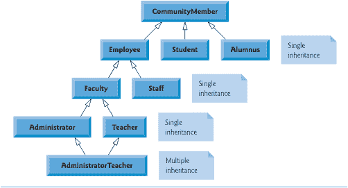

**图 11.2** | *大学 CommunityMember 的继承层次结构。*

## Shape 类层次结构

现在考虑图 11.3 中的 Shape 继承层次结构。该层次结构从基类 Shape 开始。类 TwoDimensionalShape 和 ThreeDimensionalShape 继承自基类 Shape——一个 Shape 是一个 TwoDimensionalShape 或一个 ThreeDimensionalShape。该层次结构的第三层包含*更具体*类型的 TwoDimensionalShape 和 ThreeDimensionalShape。如图 11.2 所示，我们可以从图的底部向上沿箭头到达该层次结构的最顶层基类，以识别几个 *is-a* 关系。例如，一个 Triangle 是一个 TwoDimensionalShape 并且是一个 Shape，而一个 Sphere 是一个 ThreeDimensionalShape 并且是一个 Shape。

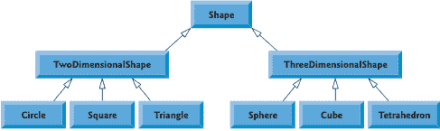

**图 11.3** | *Shape 的继承层次结构。*

要指定类 TwoDimensionalShape（图 11.3）派生自（或继承自）类 Shape，类 TwoDimensionalShape 的定义可以如下开始：

```cpp
class TwoDimensionalShape : public Shape
```

这是*公有继承*的一个例子，也是最常用的形式。我们还将讨论*私有继承*和*保护继承*（第 11.5 节）。对于所有形式的继承，基类的私有成员*不能*直接从该类的派生类访问，但这些基类私有成员仍然会被继承（即，它们仍然被视为派生类的一部分）。对于公有继承，基类的所有其他成员在成为派生类成员时保留其原有的成员访问权限（例如，基类的公有成员成为派生类的公有成员，而且正如我们很快将看到的，基类的保护成员成为派生类的保护成员）。通过继承的基类成员函数，派生类可以操作基类的私有成员（如果这些继承的成员函数在基类中提供了这样的功能）。请注意，友元函数*不被继承*。

继承*并不*适用于所有类关系。在第 9 章中，我们讨论了 *has-a* 关系，即类拥有作为其他类对象的成员。这种关系通过*组合*现有类来创建类。例如，给定类 `Employee`、`BirthDate` 和 `TelephoneNumber`，说一个 `Employee` *是一个* `BirthDate` 或一个 `Employee` *是一个* `TelephoneNumber` 是不恰当的。然而，说一个 `Employee` *拥有一个* `BirthDate` 和一个 `Employee` *拥有一个* `TelephoneNumber` 是恰当的。

可以类似地对待基类对象和派生类对象；它们的共同点体现在基类的成员中。从共同基类派生的所有类的对象都可以视为该基类的对象（即，这些对象与该基类具有 *is-a* 关系）。在第 12 章中，我们将考虑许多利用这种关系的示例。

## 11.3 基类与派生类之间的关系

在本节中，我们使用一个包含公司工资单应用程序中雇员类型的继承层次结构来讨论基类与派生类之间的关系。佣金雇员（将表示为基类的对象）按销售额的一定百分比获得报酬，而底薪加佣金雇员（将表示为派生类的对象）获得基本工资加上销售额的一定百分比。我们将对佣金雇员与底薪加佣金雇员之间关系的讨论分成五个循序渐进的示例。

### 11.3.1 创建和使用 CommissionEmployee 类

让我们来考察 `CommissionEmployee` 的类定义（图 11.4 和图 11.5）。CommissionEmployee 头文件（图 11.4）指定了类 `CommissionEmployee` 的公有服务，其中包括一个构造函数（第 1–12 行）以及成员函数 earnings（第 29 行）和 print（第 30 行）。第 14–27 行声明了公有 get 和 set 函数，用于操作类的数据成员（在第 32–36 行声明）——`firstName`、`lastName`、`socialSecurityNumber`、`grossSales` 和 `commissionRate`。例如，成员函数 `setGrossSales`（在图 11.5 第 57–63 行定义）和 `setCommissionRate`（在图 11.5 第 72–78 行定义）在将值分别赋给数据成员 `grossSales` 和 `commissionRate` 之前验证其参数。

```cpp
// Fig. 11.4: CommissionEmployee.h
// CommissionEmployee class definition represents a commission employee.
#ifndef COMMISSION_H
#define COMMISSION_H

#include <string> // C++ standard string class

class CommissionEmployee
{
public:
   CommissionEmployee( const std::string &, const std::string &,
      const std::string &, double = 0.0, double = 0.0 );

   void setFirstName( const std::string & ); // set first name
   std::string getFirstName() const;         // return first name

   void setLastName( const std::string & );  // set last name
   std::string getLastName() const;          // return last name

   void setSocialSecurityNumber( const std::string & ); // set SSN
   std::string getSocialSecurityNumber() const;         // return SSN

   void setGrossSales( double ); // set gross sales amount
   double getGrossSales() const; // return gross sales amount

   void setCommissionRate( double ); // set commission rate (percentage)
   double getCommissionRate() const; // return commission rate

   double earnings() const; // calculate earnings
   void print() const;      // print CommissionEmployee object
private:
   std::string firstName;
   std::string lastName;
   std::string socialSecurityNumber;
   double grossSales;      // gross weekly sales
   double commissionRate;  // commission percentage
}; // end class CommissionEmployee

#endif
```

**图 11.4** | *CommissionEmployee 类头文件。*

```cpp
// Fig. 11.5: CommissionEmployee.cpp
// Class CommissionEmployee member-function definitions.
#include <iostream>
#include <stdexcept>
#include "CommissionEmployee.h" // CommissionEmployee class definition
using namespace std;

// constructor
CommissionEmployee::CommissionEmployee(
   const string &first, const string &last, const string &ssn,
   double sales, double rate )
{
   firstName = first; // should validate
   lastName = last; // should validate
   socialSecurityNumber = ssn; // should validate
   setGrossSales( sales ); // validate and store gross sales
```

**图 11.5** | *CommissionEmployee 类的实现文件，表示按总销售额的一定百分比获得报酬的雇员。（共 3 部分中的第 1 部分。）*


```cpp
return grossSales;
} // end function getGrossSales

// set commission rate
void CommissionEmployee::setCommissionRate( double rate )
{
   if ( rate > 0.0 && rate < 1.0 )
      commissionRate = rate;
   else
      throw invalid_argument( "Commission rate must be > 0.0 and < 1.0" );
} // end function setCommissionRate

// return commission rate
double CommissionEmployee::getCommissionRate() const
{
   return commissionRate;
} // end function getCommissionRate

// calculate earnings
double CommissionEmployee::earnings() const
{
   return commissionRate * grossSales;
} // end function earnings

// print CommissionEmployee object
void CommissionEmployee::print() const
{
   cout << "commission employee: " << firstName << " " << lastName
      << "\nsocial security number: " << socialSecurityNumber
      << "\ngross sales: " << grossSales
      << "\ncommission rate: " << commissionRate;
} // end function print
```

**图 11.5** | CommissionEmployee 类的实现文件，该类表示按销售额百分比获得佣金的员工。（共 3 部分的第 3 部分。）

## CommissionEmployee 构造函数

CommissionEmployee 构造函数定义在本节的前几个示例中*特意不使用成员初始化器语法*，以便我们可以演示 private 和 protected 说明符如何影响派生类中的成员访问。如图 11.5 所示，第 13–15 行在构造函数体中为数据成员 firstName、lastName 和 socialSecurityNumber 赋值。在本节后面，我们将回到在构造函数中使用成员初始化器列表。

在将构造函数参数 first、last 和 ssn 赋值给相应的数据成员之前，我们不对它们的值进行验证。我们当然可以验证名和姓——例如确保它们的长度合理。类似地，可以验证社会安全号码，以确保它包含九位数字，带有或不带有破折号（例如 123-45-6789 或 123456789）。

## CommissionEmployee 成员函数 earnings 和 print

成员函数 earnings（第 87–90 行）计算 CommissionEmployee 的 earnings。第 89 行将 commissionRate 乘以 grossSales 并返回结果。成员函数 `print`（第 93–99 行）显示 `CommissionEmployee` 对象的数据成员的值。

## 测试类 `CommissionEmployee`

图 11.6 测试类 `CommissionEmployee`。第 11–12 行实例化 `CommissionEmployee` 对象 `employee`，并调用构造函数来初始化该对象，其中名称为 "Sue"，姓为 "Jones"，社会安全号码为 "222-22-2222"，总销售额为 10000，佣金率为 .06。第 19–24 行使用 `get` 函数显示其数据成员的值。第 26–27 行调用对象的成员函数 `setGrossSales` 和 `setCommissionRate`，分别更改数据成员 `grossSales` 和 `commissionRate` 的值。第 31 行然后调用 employee 的 `print` 成员函数输出更新后的 `CommissionEmployee` 信息。最后，第 34 行显示 `CommissionEmployee` 的佣金，由对象的 `earnings` 成员函数使用更新后的数据成员 `grossSales` 和 `commissionRate` 的值计算。

```cpp
// Fig. 11.6: fig11_06.cpp
// CommissionEmployee class test program.
#include <iostream>
#include <iomanip>
#include "CommissionEmployee.h" // CommissionEmployee class definition
using namespace std;

int main()
{
   // instantiate a CommissionEmployee object
   CommissionEmployee employee(
      "Sue", "Jones", "222-22-2222", 10000, .06 );

   // set floating-point output formatting
   cout << fixed << setprecision( 2 );

   // get CommissionEmployee data
   cout << "\nEmployee information obtained by get functions: \n"
      << "\nFirst name is " << employee.getFirstName()
      << "\nLast name is " << employee.getLastName()
      << "\nSocial security number is "
      << employee.getSocialSecurityNumber()
      << "\nGross sales is " << employee.getGrossSales()
      << "\nCommission rate is " << employee.getCommissionRate() << endl;

   employee.setGrossSales( 8000 ); // set gross sales
   employee.setCommissionRate( .1 ); // set commission rate

   cout << "\nUpdated employee information output by print function: \n"
      << endl;
   employee.print(); // display the new employee information

   // display the employee's earnings
   cout << "\nEmployee's earnings: $" << employee.earnings() << endl;
} // end main
```

**图 11.6** | `CommissionEmployee` 类测试程序。（共 2 部分的第 1 部分。）

```text
Employee information obtained by get functions:

First name is Sue
Last name is Jones
Social security number is 222-22-2222
Gross sales is 10000.00
Commission rate is 0.06

Updated employee information output by print function:

commission employee: Sue Jones
social security number: 222-22-2222
gross sales: 8000.00
commission rate: 0.10

Employee's earnings: $800.00
```

**图 11.6** | CommissionEmployee 类测试程序。（共 2 部分的第 2 部分。）

### 11.3.2 不使用继承创建 BasePlusCommissionEmployee 类

我们现在通过创建和测试一个（全新的、独立的）类 BasePlusCommissionEmployee（图 11.7–11.8）来讨论继承介绍的第二个部分，该类包含名、姓、社会安全号码、总销售额、佣金率和基本工资。

```cpp
// Fig. 11.7: BasePlusCommissionEmployee.h
// BasePlusCommissionEmployee class definition represents an employee
// that receives a base salary in addition to commission.
#ifndef BASEPLUS_H
#define BASEPLUS_H

#include <string> // C++ standard string class

class BasePlusCommissionEmployee
{
public:
    BasePlusCommissionEmployee( const std::string &, const std::string &,
        const std::string &, double = 0.0, double = 0.0, double = 0.0 );

    void setFirstName( const std::string & ); // set first name
    std::string getFirstName() const; // return first name

    void setLastName( const std::string & ); // set last name
    std::string getLastName() const; // return last name

    void setSocialSecurityNumber( const std::string & ); // set SSN
    std::string getSocialSecurityNumber() const; // return SSN

    void setGrossSales( double ); // set gross sales amount
    double getGrossSales() const; // return gross sales amount

    void setCommissionRate( double ); // set commission rate
    double getCommissionRate() const; // return commission rate

    void setBaseSalary( double ); // set base salary
    double getBaseSalary() const; // return base salary

    double earnings() const; // calculate earnings
    void print() const; // print BasePlusCommissionEmployee object
private:
    std::string firstName;
    std::string lastName;
    std::string socialSecurityNumber;
    double grossSales; // gross weekly sales
    double commissionRate; // commission percentage
    double baseSalary; // base salary
}; // end class BasePlusCommissionEmployee

#endif
```

**图 11.7** | BasePlusCommissionEmployee 类头文件。（共 2 部分的第 1 部分。）

**图 11.7** | `BasePlusCommissionEmployee` 类头文件。（共 2 部分的第 2 部分。）

```cpp
// Fig. 11.8: BasePlusCommissionEmployee.cpp
// Class BasePlusCommissionEmployee member-function definitions.
#include <iostream>
#include <stdexcept>
#include "BasePlusCommissionEmployee.h"
using namespace std;

// constructor
BasePlusCommissionEmployee::BasePlusCommissionEmployee(
    const string &first, const string &last, const string &ssn,
    double sales, double rate, double salary )
{
    firstName = first; // should validate
    lastName = last; // should validate
    socialSecurityNumber = ssn; // should validate
    setGrossSales( sales ); // validate and store gross sales
    setCommissionRate( rate ); // validate and store commission rate
    setBaseSalary( salary ); // validate and store base salary
} // end BasePlusCommissionEmployee constructor

// set first name
void BasePlusCommissionEmployee::setFirstName( const string &first )
{
    firstName = first; // should validate
} // end function setFirstName

// return first name
string BasePlusCommissionEmployee::getFirstName() const
{
```

**图 11.8** | `BasePlusCommissionEmployee` 类表示除了佣金之外还领取基本工资的员工。（共 3 部分的第 1 部分。）


```cpp
// return commission rate
double BasePlusCommissionEmployee::getCommissionRate() const
{
    return commissionRate;
} // end function getCommissionRate

// set base salary
void BasePlusCommissionEmployee::setBaseSalary( double salary )
{
    if ( salary >= 0.0 )
        baseSalary = salary;
    else
        throw invalid_argument( "Salary must be >= 0.0" );
} // end function setBaseSalary

// return base salary
double BasePlusCommissionEmployee::getBaseSalary() const
{
    return baseSalary;
} // end function getBaseSalary

// calculate earnings
double BasePlusCommissionEmployee::earnings() const
{
    return baseSalary + ( commissionRate * grossSales );
} // end function earnings

// print BasePlusCommissionEmployee object
void BasePlusCommissionEmployee::print() const
{
    cout << "base-salaried commission employee: " << firstName << ' '
         << lastName << "\nsocial security number: " << socialSecurityNumber
         << "\ngross sales: " << grossSales
         << "\ncommission rate: " << commissionRate
         << "\nbase salary: " << baseSalary;
} // end function print
```

**图 11.8** | BasePlusCommissionEmployee 类表示一个除了佣金之外还领取基本工资的雇员。（第 3 部分，共 3 部分。）

## 定义 BasePlusCommissionEmployee 类

BasePlusCommissionEmployee 头文件（图 11.7）指定了类 BasePlusCommissionEmployee 的公共服务，包括 BasePlusCommissionEmployee 构造函数（第 12–13 行）以及成员函数 earnings（第 33 行）和 print（第 34 行）。第 15–31 行声明了类的私有数据成员（在第 36–41 行声明）firstName、lastName、socialSecurityNumber、grossSales、commissionRate 和 baseSalary 的公共 get 和 set 函数。这些变量和成员函数封装了带基本工资的佣金雇员的全部必要特性。请注意此类与类 CommissionEmployee（图 11.4–11.5）之间的相似性——在本示例中，我们还没有利用这种相似性。

类 BasePlusCommissionEmployee 的 earnings 成员函数（定义于图 11.8 的第 104–107 行）计算带基本工资的佣金雇员的收入。第 106 行返回雇员的基本工资加上佣金率与雇员总销售额的乘积的结果。

## 测试类 `BasePlusCommissionEmployee`

图 11.9 测试类 `BasePlusCommissionEmployee`。第 11–12 行实例化类 `BasePlusCommissionEmployee` 的对象 employee，并将 "Bob"、"Lewis"、"333-33-3333"、5000、.04 和 300 分别作为名字、姓氏、社会保险号、总销售额、佣金率和基本工资传递给构造函数。第 19–25 行使用 `BasePlusCommissionEmployee` 的 get 函数获取对象的数据成员值以进行输出。第 27 行调用对象的 setBaseSalary 成员函数来更改基本工资。成员函数 setBaseSalary（图 11.8，第 89–95 行）确保数据成员 baseSalary 不会被赋予负值，因为雇员的基本工资不能为负。图 11.9 的第 31 行调用对象的 print 成员函数以输出更新后的 `BasePlusCommissionEmployee` 的信息，第 34 行调用成员函数 earnings 以显示 `BasePlusCommissionEmployee` 的收入。

```cpp
// Fig. 11.9: fig11_09.cpp
// BasePlusCommissionEmployee class test program.
#include <iostream>
#include "BasePlusCommissionEmployee.h"
using namespace std;

int main()
{
   // instantiate BasePlusCommissionEmployee object
   BasePlusCommissionEmployee
      employee( "Bob", "Lewis", "333-33-3333", 5000, .04, 300 );

   // set floating-point output formatting
   cout << fixed << setprecision( 2 );

   // get commission employee data
   cout << "\nEmployee information obtained by get functions:\n"
      << "\nFirst name is " << employee.getFirstName()
      << "\nLast name is " << employee.getLastName()
      << "\nSocial security number is "
      << employee.getSocialSecurityNumber()
      << "\nGross sales is " << employee.getGrossSales()
      << "\nCommission rate is " << employee.getCommissionRate()
      << "\nBase salary is " << employee.getBaseSalary() << endl;

   employee.setBaseSalary( 1000 ); // set base salary

   cout << "\nUpdated employee information output by print function:\n"
      << endl;
   employee.print(); // display the new employee information

   // display the employee's earnings
   cout << "\nEmployee's earnings: $" << employee.earnings() << endl;
} // end main
```

**图 11.9** | `BasePlusCommissionEmployee` 类测试程序。（第 1 部分，共 2 部分。）

```text
Employee information obtained by get functions:

First name is Bob
Last name is Lewis
Social security number is 333-33-3333
Gross sales is 5000.00
Commission rate is 0.04
Base salary is 300.00

Updated employee information output by print function:

base-salaried commission employee: Bob Lewis
social security number: 333-33-3333
gross sales: 5000.00
commission rate: 0.04
base salary: 1000.00

Employee's earnings: $1200.00
```

**图 11.9** | BasePlusCommissionEmployee 类测试程序。（第 2 部分，共 2 部分。）

## *探讨 BasePlusCommissionEmployee 类与 CommissionEmployee 类之间的相似性*

类 BasePlusCommissionEmployee（图 11.7–11.8）的大部分代码与类 CommissionEmployee（图 11.4–11.5）的代码相似，甚至完全相同。例如，在类 BasePlusCommissionEmployee 中，私有数据成员 firstName 和 lastName 以及成员函数 setFirstName、getFirstName、setLastName 和 getLastName 与类 CommissionEmployee 完全相同。类 CommissionEmployee 和 BasePlusCommissionEmployee 都包含私有数据成员 socialSecurityNumber、commissionRate 和 grossSales，以及操作这些成员的 get 和 set 函数。此外，BasePlusCommissionEmployee 构造函数与类 CommissionEmployee 的构造函数*几乎*相同，只是 BasePlusCommissionEmployee 的构造函数还设置了 baseSalary。类 BasePlusCommissionEmployee 的其他新增内容是私有数据成员 baseSalary 以及成员函数 setBaseSalary 和 getBaseSalary。类 BasePlusCommissionEmployee 的 print 成员函数与类 CommissionEmployee 的 print 成员函数*几乎完全相同*，只是 BasePlusCommissionEmployee 的 print 还输出了数据成员 baseSalary 的值。

我们实际上是将类 CommissionEmployee 的代码*复制*并*粘贴*到类 BasePlusCommissionEmployee 中，然后修改类 BasePlusCommissionEmployee 以包含基本工资和操作基本工资的成员函数。这种*复制粘贴方法*容易出错且耗时。


> **软件工程观察 11.1.1**
>
> 将代码从一个类复制并粘贴到另一个类会散布同一代码的许多物理副本，并可能在系统中传播错误，从而造成代码维护的噩梦。要避免重复代码（以及可能的错误），请在希望一个类“吸收”另一个类的数据成员和成员函数的情况下使用继承，而不是“复制粘贴”方法。

> **软件工程观察 11.2**
>
> 使用继承时，层次结构中所有类的公共数据成员和成员函数都声明在基类中。当这些公共功能需要更改时，只需在基类中进行更改——派生类随后继承这些更改。如果没有继承，则需要修改所有包含相关代码副本的源代码文件。


### 11.3.3 创建 CommissionEmployee–BasePlusCommissionEmployee 继承层次结构

现在我们创建并测试一个新的 BasePlusCommissionEmployee 类（图 11.10–11.11），它派生自类 CommissionEmployee（图 11.14–11.15）。在本示例中，BasePlusCommissionEmployee 对象是一个 CommissionEmployee 对象（因为继承传递了类 CommissionEmployee 的功能），但类 BasePlusCommissionEmployee 还具有数据成员 baseSalary（图 11.10 第 22 行）。类定义第 10 行的冒号（:）表示继承。关键字 public 表示继承的类型。作为派生类（通过公有继承形成），BasePlusCommissionEmployee 继承类 CommissionEmployee 的所有成员，但构造函数除外——每个类都提供自己特定于该类的构造函数。（析构函数也不会继承。）因此，BasePlusCommissionEmployee 的公共服务包括其构造函数（第 13–14 行）以及从类 CommissionEmployee 继承的公共成员函数——尽管我们无法在 BasePlusCommissionEmployee 的源代码中看到这些继承的成员函数，但它们仍然是派生类 BasePlusCommissionEmployee 的一部分。派生类的公共服务还包括成员函数 setBaseSalary、getBaseSalary、earnings 和 print（第 16–20 行）。

```cpp
// Fig. 11.10: BasePlusCommissionEmployee.h
// BasePlusCommissionEmployee class derived from class
// CommissionEmployee.
#ifndef BASEPLUS_H
#define BASEPLUS_H

#include <string> // C++ standard string class
#include "CommissionEmployee.h" // CommissionEmployee class declaration

class BasePlusCommissionEmployee : public CommissionEmployee
{
public:
    BasePlusCommissionEmployee( const std::string &, const std::string &,
        const std::string &, double = 0.0, double = 0.0, double = 0.0 );

    void setBaseSalary( double ); // set base salary
    double getBaseSalary() const; // return base salary

    double earnings() const; // calculate earnings
    void print() const; // print BasePlusCommissionEmployee object
};
```

**图 11.10** | BasePlusCommissionEmployee 类定义，指明与类 CommissionEmployee 的继承关系。（第 1 部分，共 2 部分。）


```cpp
private:
    double baseSalary; // base salary
}; // end class BasePlusCommissionEmployee

#endif
```

**图 11.10** | 表明与类 `CommissionEmployee` 具有继承关系的 `BasePlusCommissionEmployee` 类定义（第2部分，共2部分）。

```cpp
// Fig. 11.11: BasePlusCommissionEmployee.cpp
// Class BasePlusCommissionEmployee member-function definitions.
#include <iostream>
#include <stdexcept>
#include "BasePlusCommissionEmployee.h"
using namespace std;

// constructor
BasePlusCommissionEmployee::BasePlusCommissionEmployee(
    const string &first, const string &last, const string &ssn,
    double sales, double rate, double salary )
    // explicitly call base-class constructor
    : CommissionEmployee( first, last, ssn, sales, rate )
{
    setBaseSalary( salary ); // validate and store base salary
} // end BasePlusCommissionEmployee constructor

// set base salary
void BasePlusCommissionEmployee::setBaseSalary( double salary )
{
    if ( salary >= 0.0 )
        baseSalary = salary;
    else
        throw invalid_argument( "Salary must be >= 0.0" );
} // end function setBaseSalary

// return base salary
double BasePlusCommissionEmployee::getBaseSalary() const
{
    return baseSalary;
} // end function getBaseSalary

// calculate earnings
double BasePlusCommissionEmployee::earnings() const
{
    // derived class cannot access the base class’s private data
    return baseSalary + ( commissionRate * grossSales );
} // end function earnings
```

**图 11.11** | `BasePlusCommissionEmployee` 实现文件：基类私有数据无法从派生类访问（第1部分，共2部分）。

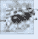

**性能提示 11.1**

在派生类构造函数中，在成员初始化列表里显式调用基类构造函数并初始化成员对象，可以防止重复初始化——即先调用默认构造函数，然后在派生类构造函数体内再次修改数据成员。

## 访问基类私有成员导致的编译错误

编译器会针对图 11.11 中的第 37 行生成错误，因为基类 CommissionEmployee 的数据成员 commissionRate 和 grossSales 是私有的——派生类 BasePlusCommissionEmployee 的成员函数不允许访问基类 CommissionEmployee 的私有数据。由于同样的原因，编译器还会在 BasePlusCommissionEmployee 的 print 成员函数的第 44–47 行生成额外的错误。如你所见，C++ 对访问私有数据成员实施了严格限制，因此即使是派生类（与其基类关系密切）也不能访问基类的私有数据。

## 预防 BasePlusCommissionEmployee 中的错误

我们特意在图 11.11 中包含了错误代码，以强调派生类的成员函数不能访问其基类的私有数据。BasePlusCommissionEmployee 中的错误本可以通过使用从类 CommissionEmployee 继承的 get 成员函数来避免。例如，第 37 行可以调用 getCommissionRate 和 getGrossSales 来分别访问 CommissionEmployee 的私有数据成员 commissionRate 和 grossSales。同样，第 44–47 行可以使用适当的 get 成员函数来获取基类数据成员的值。在下一个示例中，我们还将展示使用 protected 数据如何帮助我们避免本例中遇到的错误。

## 在派生类头文件中使用 #include 包含基类头文件

请注意，我们在派生类的头文件中 #include 了基类的头文件（图 11.10 中的第 8 行）。这样做有三个原因。首先，为了让派生类在第 10 行使用基类的名称，我们必须告知编译器该基类存在——CommissionEmployee.h 中的类定义正是如此。

第二个原因是，编译器使用类定义来确定该类对象的大小（正如我们在第 3.6 节中讨论的）。创建某类对象的客户端程序会 #include 该类定义，以便编译器能够为该对象预留适当的内存。使用继承时，派生类对象的大小取决于其类定义中显式声明的数据成员，以及从其直接和间接基类继承的数据成员。在第 8 行包含基类定义，使编译器能够确定将成为派生类对象一部分的基类数据成员的内存需求，从而共同决定派生类对象的总大小。

第 8 行的最后一个原因是让编译器确定派生类是否正确使用了基类的继承成员。例如，在图 11.10–11.11 的程序中，编译器使用基类头文件来确定派生类访问的数据成员在基类中是私有的。由于这些成员对派生类不可访问，编译器会生成错误。编译器还使用基类的函数原型来验证派生类对继承的基类函数的调用。

## 继承层次中的链接过程

在第 3.7 节中，我们讨论了创建可执行的 GradeBook 应用程序的链接过程。在那个示例中，你看到客户端的目标代码与 GradeBook 类的目标代码以及客户端代码或 GradeBook 类中使用的任何 C++ 标准库类的目标代码链接在一起。

对于在继承层次中使用类的程序，链接过程类似。该过程需要程序中所有类的目标代码，以及程序所使用的任何派生类的直接和间接基类的目标代码。假设客户端想要创建一个使用类 BasePlusCommissionEmployee（它是 CommissionEmployee 的派生类，我们将在第 11.3.4 节中看到这样的示例）的应用程序。在编译客户端应用程序时，客户端的目标代码必须与类 BasePlusCommissionEmployee 和 CommissionEmployee 的目标代码链接，因为 BasePlusCommissionEmployee 从其基类 CommissionEmployee 继承了成员函数。该代码还与类 CommissionEmployee、类 BasePlusCommissionEmployee 或客户端代码中使用的任何 C++ 标准库类的目标代码链接。这为程序提供了访问其可能使用的所有功能的实现的权限。

### 11.3.4 使用 protected 数据的 CommissionEmployee–BasePlusCommissionEmployee 继承层次

第 3 章介绍了访问说明符 public 和 private。基类的 public 成员可以在其体内以及程序拥有指向该类或其派生类对象的句柄（即名称、引用或指针）的任何地方访问。基类的 private 成员只能在其体内以及该基类的友元中访问。在本节中，我们介绍访问说明符 **protected**。

使用 protected 访问提供了介于 public 和 private 访问之间的中间保护级别。为了使类 BasePlusCommissionEmployee 能够直接访问 CommissionEmployee 的数据成员 firstName、lastName、socialSecurityNumber、grossSales 和 commissionRate，我们可以在基类中将这些成员声明为 protected。基类的 protected 成员可以在该基类的体内，由该基类的成员和友元，以及由从该基类派生的任何类的成员和友元访问。

### 使用 protected 数据定义基类 CommissionEmployee

类 CommissionEmployee（图 11.12）现在将数据成员 firstName、lastName、socialSecurityNumber、grossSales 和 commissionRate 声明为 protected（第 31–36 行），而不是 private。成员函数实现与图 11.5 中的相同，因此此处不再显示 CommissionEmployee.cpp。

```cpp
// Fig. 11.12: CommissionEmployee.h
// CommissionEmployee class definition with protected data.
#ifndef COMMISSION_H
#define COMMISSION_H
```

**图 11.12** | 声明 protected 数据以允许派生类访问的 CommissionEmployee 类定义（第1部分，共2部分）。


```cpp
#include <string> // C++ standard string class

class CommissionEmployee
{
public:
   CommissionEmployee( const std::string &, const std::string &,
      const std::string &, double = 0.0, double = 0.0 );

   void setFirstName( const std::string & ); // set first name
   std::string getFirstName() const; // return first name

   void setLastName( const std::string & ); // set last name
   std::string getLastName() const; // return last name

   void setSocialSecurityNumber( const std::string & ); // set SSN
   std::string getSocialSecurityNumber() const; // return SSN

   void setGrossSales( double ); // set gross sales amount
   double getGrossSales() const; // return gross sales amount

   void setCommissionRate( double ); // set commission rate
   double getCommissionRate() const; // return commission rate

   double earnings() const; // calculate earnings
   void print() const; // print CommissionEmployee object
protected:
   std::string firstName;
   std::string lastName;
   std::string socialSecurityNumber;
   double grossSales; // gross weekly sales
   double commissionRate; // commission percentage
}; // end class CommissionEmployee

#endif
```

**图 11.12 |** *CommissionEmployee* 类定义，声明了受保护的数据，以允许派生类访问。（第 2 部分，共 2 部分。）

## BasePlusCommissionEmployee 类

图 11.10–11.11 中 BasePlusCommissionEmployee 类的定义保持*不变*，因此我们这里不再展示。现在 BasePlusCommissionEmployee 继承自更新后的 CommissionEmployee 类（图 11.12），BasePlusCommissionEmployee 对象可以访问在 CommissionEmployee 类中声明为 protected 的继承数据成员（即数据成员 firstName、lastName、socialSecurityNumber、grossSales 和 commissionRate）。因此，当编译器编译图 11.11 中 BasePlusCommissionEmployee 的 earnings 和 print 成员函数定义（分别为第 34–38 行和第 41–49 行）时，不会产生错误。这显示了派生类被授予访问基类 protected 数据成员的特殊权限。派生类的对象还可以访问该派生类的*任何**间接*基类中的 protected 成员。

BasePlusCommissionEmployee 类不继承 CommissionEmployee 类的构造函数。但是，BasePlusCommissionEmployee 类的构造函数（图 11.11，第 9–16 行）通过成员初始化列表显式调用 CommissionEmployee 类的构造函数。

直接操作数据成员的 get 和 set 成员函数的实现将需要更改。这些更改仅发生在基类内部——不需要对派生类进行任何更改。像这样将更改的影响局部化是一种良好的软件工程实践。

```cpp
// Fig. 11.14: CommissionEmployee.cpp
// Class CommissionEmployee member-function definitions.
#include <iostream>
#include <stdexcept>
#include "CommissionEmployee.h" // CommissionEmployee class definition
using namespace std;

// constructor
CommissionEmployee::CommissionEmployee(
   const string &first, const string &last, const string &ssn,
   double sales, double rate )
   : firstName( first ), lastName( last ), socialSecurityNumber( ssn )
{
   setGrossSales( sales ); // validate and store gross sales
   setCommissionRate( rate ); // validate and store commission rate
} // end CommissionEmployee constructor

// set first name
void CommissionEmployee::setFirstName( const string &first )
{
   firstName = first; // should validate
} // end function setFirstName

// return first name
string CommissionEmployee::getFirstName() const
{
   return firstName;
} // end function getFirstName

// set last name
void CommissionEmployee::setLastName( const string &last )
{
   lastName = last; // should validate
} // end function setLastName

// return last name
string CommissionEmployee::getLastName() const
{
   return lastName;
} // end function getLastName

// set social security number
void CommissionEmployee::setSocialSecurityNumber( const string &ssn )
{
   socialSecurityNumber = ssn; // should validate
} // end function setSocialSecurityNumber
```

图 11.14 | CommissionEmployee 类实现文件：CommissionEmployee 类使用成员函数操作其私有数据。（第 1 部分，共 2 部分。）

```cpp
// return social security number
string CommissionEmployee::getSocialSecurityNumber() const
{
    return socialSecurityNumber;
} // end function getSocialSecurityNumber

// set gross sales amount
void CommissionEmployee::setGrossSales( double sales )
{
    if ( sales >= 0.0 )
        grossSales = sales;
    else
        throw invalid_argument( "Gross sales must be >= 0.0" );
} // end function setGrossSales

// return gross sales amount
double CommissionEmployee::getGrossSales() const
{
    return grossSales;
} // end function getGrossSales

// set commission rate
void CommissionEmployee::setCommissionRate( double rate )
{
    if ( rate > 0.0 && rate < 1.0 )
        commissionRate = rate;
    else
        throw invalid_argument( "Commission rate must be > 0.0 and < 1.0" );
} // end function setCommissionRate

// return commission rate
double CommissionEmployee::getCommissionRate() const
{
    return commissionRate;
} // end function getCommissionRate

// calculate earnings
double CommissionEmployee::earnings() const
{
    return getCommissionRate() * getGrossSales();
} // end function earnings

// print CommissionEmployee object
void CommissionEmployee::print() const
{
    cout << "commission employee: "
         << getFirstName() << " " << getLastName()
         << "\nsocial security number: " << getSocialSecurityNumber()
         << "\ngross sales: " << getGrossSales()
         << "\ncommission rate: " << getCommissionRate();
} // end function print
```

图 11.14 | CommissionEmployee 类实现文件：CommissionEmployee 类使用成员函数操作其私有数据。（第 2 部分，共 2 部分。）


### 性能提示 11.2

> 使用成员函数访问数据成员的值可能比直接访问数据稍慢。然而，当今的优化编译器经过精心设计，可以隐式执行许多优化（例如内联以及 get 和成员函数调用）。你应该编写遵循良好软件工程原则的代码，把优化留给编译器。一条好的规则是：“不要猜测编译器的意图。”

### 对 BasePlusCommissionEmployee 类成员函数定义的更改

BasePlusCommissionEmployee 类继承 CommissionEmployee 的公有成员函数，并可以通过继承的成员函数访问基类的私有成员。该类的头文件与图 11.10 相比保持不变。该类的成员函数实现有几处更改（图 11.15），这些更改使其区别于该类的旧版本（图 11.10–11.11）。成员函数 earnings（图 11.15，第 34–37 行）和 print（第 40–48 行）都调用成员函数 getBaseSalary 来获取基本工资值，而不是直接访问 baseSalary。这使 earnings 和 print 免受数据成员 baseSalary 实现可能发生的变化的影响。例如，如果我们决定重命名数据成员 baseSalary 或更改其类型，只需要更改成员函数 setBaseSalary 和 getBaseSalary。

```cpp
// Fig. 11.15: BasePlusCommissionEmployee.cpp
// Class BasePlusCommissionEmployee member-function definitions.
#include <iostream>
#include <stdexcept>
#include "BasePlusCommissionEmployee.h"
using namespace std;

// constructor
BasePlusCommissionEmployee::BasePlusCommissionEmployee(
   const string &first, const string &last, const string &ssn,
   double sales, double rate, double salary )
   // explicitly call base-class constructor
   : CommissionEmployee( first, last, ssn, sales, rate )
{
   setBaseSalary( salary ); // validate and store base salary
} // end BasePlusCommissionEmployee constructor

// set base salary
void BasePlusCommissionEmployee::setBaseSalary( double salary )
{
   if ( salary >= 0.0 )
      baseSalary = salary;
   else
      throw invalid_argument( "Salary must be >= 0.0" );
} // end function setBaseSalary

// return base salary
double BasePlusCommissionEmployee::getBaseSalary() const
{
```

**图 11.15** | 继承自 CommissionEmployee 类但不能直接访问该类私有数据的 BasePlusCommissionEmployee 类。（第 1 部分，共 2 部分。）


合适的基薪加佣金雇员信息。新版本通过使用限定名 `CommissionEmployee::print()`（图 11.15，第 45 行）调用 `CommissionEmployee` 的 `print` 成员函数，显示 `BasePlusCommissionEmployee` 对象的部分信息（即字符串“commission employee”以及类 `CommissionEmployee` 私有数据成员的值）。然后，`BasePlusCommissionEmployee` 的 `print` 函数输出 `BasePlusCommissionEmployee` 对象的其余信息（即类 `BasePlusCommissionEmployee` 基薪的值）。

### 测试修改后的类层次结构

同样，本示例使用了图 11.9 中的 `BasePlusCommissionEmployee` 测试程序，并产生相同的输出。尽管每个“基薪加佣金雇员”类的行为相同，但本示例中的版本是设计最佳的。通过使用继承并调用隐藏数据、确保一致性的成员函数，我们高效且有效地构建了一个设计良好的类。

### CommissionEmployee–BasePlusCommissionEmployee 示例总结

在本节中，你看到了一组经过精心设计的演化示例，旨在教授通过继承实现良好软件工程的关键能力。你学习了如何使用继承创建派生类，如何使用受保护的基类成员使派生类能够访问继承的基类数据成员，以及如何重新定义基类函数以提供更适合派生类对象的版本。此外，你还学习了如何应用第 9 章和本章的软件工程技术来创建易于维护、修改和调试的类。

## 11.4 派生类中的构造函数和析构函数

正如我们在前一节中解释的，实例化派生类对象会启动一个构造函数调用链，其中派生类构造函数在执行自身任务之前，要么显式（通过基类成员初始化器）调用其直接基类的构造函数，要么隐式（调用基类的默认构造函数）。类似地，如果基类本身又由另一个类派生而来，则基类构造函数需要调用层次结构中再上一级的构造函数，依此类推。此调用链中最后调用的构造函数是层次结构基部的类的构造函数，其函数体实际上最先执行完毕。最派生类的构造函数体最后执行完毕。每个基类构造函数初始化派生类对象所继承的基类数据成员。在我们一直研究的 `CommissionEmployee`/`BasePlusCommissionEmployee` 层次结构中，当程序创建 `BasePlusCommissionEmployee` 对象时，会调用 `CommissionEmployee` 构造函数。由于类 `CommissionEmployee` 位于层次结构的基部，其构造函数执行，初始化作为 `BasePlusCommissionEmployee` 对象一部分的私有 `CommissionEmployee` 数据成员。当 `CommissionEmployee` 构造函数执行完毕时，它将控制权返回给 `BasePlusCommissionEmployee` 构造函数，后者初始化 `BasePlusCommissionEmployee` 对象的 `baseSalary`。


> **软件工程观察 11.6**
>
> 当程序创建派生类对象时，派生类构造函数会立即调用基类构造函数；基类构造函数的函数体先执行，然后执行派生类的成员初始化器，最后执行派生类构造函数的函数体。如果层次结构包含两层以上，此过程会沿层次结构向上级联。

当派生类对象被销毁时，程序会调用该对象的析构函数。这将启动一个析构函数调用链（或级联），其中派生类析构函数以及直接和间接基类及类成员的析构函数按照构造函数执行顺序的*逆序*执行。当派生类对象的析构函数被调用时，析构函数执行其任务，然后调用层次结构中上一级基类的析构函数。此过程重复进行，直到层次结构顶部的最终基类析构函数被调用。然后，该对象从内存中移除。

> **软件工程观察 11.7**
>
> *假设我们创建了一个派生类的对象，其中基类和派生类都（通过组合）包含其他类的对象。当创建该派生类的对象时，首先执行基类成员对象的构造函数，然后执行基类构造函数体，接着执行派生类成员对象的构造函数，最后执行派生类构造函数体。派生类对象的析构函数按照其对应构造函数被调用的相反顺序被调用。*


基类构造函数、析构函数和重载赋值运算符（第 10 章）*不会*被派生类继承。但是，派生类构造函数、析构函数和重载赋值运算符可以调用基类的版本。


### C++11：继承基类构造函数

有时，派生类的构造函数只是模仿基类的构造函数。C++11 中一个被频繁请求的便捷特性是能够*继承*基类的构造函数。现在，你可以通过在派生类定义中的*任意*位置显式包含如下形式的 using 声明来实现这一点：

```
using BaseClass::BaseClass;
```

在前面的声明中，*BaseClass* 是基类的名称。除少数例外情况（如下所列），对于基类中的每个构造函数，编译器都会生成一个调用相应基类构造函数的派生类构造函数。生成的构造函数仅对派生类的额外数据成员执行*默认初始化*。当你继承构造函数时：

- 默认情况下，每个继承的构造函数与其对应的基类构造函数具有*相同*的访问级别（public、protected 或 private）。
- 默认构造函数、复制构造函数和移动构造函数*不被继承*。
- 如果基类中的某个构造函数通过在其原型中放置 `= delete` 而被*删除*，则派生类中相应的构造函数*也被删除*。
- 如果派生类没有*显式*定义构造函数，编译器会在派生类中生成一个默认构造函数——即使它从基类继承了其他构造函数。
- 如果你在派生类中*显式定义*的构造函数与基类构造函数具有相同的参数列表，则该基类构造函数*不被继承*。
- 基类构造函数的默认参数*不被继承*。相反，编译器会在派生类中生成*重载构造函数*。例如，如果基类声明了构造函数

  ```
  BaseClass( int = 0, double = 0.0 );
  ```

### 11.5 继承类型

当使用 protected 继承派生类时，基类的 public 和 protected 成员成为派生类的 protected 成员。当使用 private 继承派生类时，基类的 public 和 protected 成员成为派生类的 private 成员（例如，这些函数成为工具函数）。private 和 protected 继承不是 *is-a* 关系。

## 11.6 使用继承的软件工程

有时，学生很难体会到工业界大型软件项目设计者所面临问题的范围。有此类项目经验的人表示，有效的软件复用能够改进软件开发过程。面向对象编程促进了软件复用，从而缩短了开发时间并提高了软件质量。

当我们使用继承从现有类创建新类时，新类继承现有类的数据成员和成员函数，如图 11.16 所述。我们可以通过重新定义基类成员并添加额外成员来定制新类以满足需求。派生类程序员在 C++ 中执行此操作时*无需*访问基类的源代码（派生类必须能够*链接*到基类的目标代码）。这种强大的能力对软件开发人员很有吸引力。他们可以开发专有类用于销售或许可，并以目标代码格式将这些类提供给用户。用户随后可以快速地从这些库类派生新类，而无需访问专有源代码。软件开发人员需要随目标代码一起提供头文件。

大量且有用的类库的可用性通过继承实现了软件复用的最大好处。标准 C++ 库往往具有通用性且范围有限。全世界都在致力于为各种各样的应用领域开发类库。

> **软件工程观察 11.8**
>
> *在面向对象系统的设计阶段，设计者通常会发现某些类密切相关。设计者应该“提取”共同的属性和行为，并将它们放在基类中，然后使用继承来形成派生类。*


> **软件工程观察 11.9**
>
> *创建派生类不会影响其基类的源代码。继承保持了基类的完整性。*


## 11.7 小结

本章介绍了继承——通过吸收现有类的数据成员和成员函数并为其增添新功能来创建类的能力。通过一系列使用雇员继承层次结构的示例，你学习了基类和派生类的概念，并使用 public 继承创建了从基类继承成员的派生类。本章介绍了访问说明符 protected——派生类成员函数可以访问受保护的基类成员。你学习了如何通过使用基类名称和范围解析运算符（::）限定重定义的基类成员名称来访问它们。你还了解了构造函数执行的顺序


## 自测练习答案

### 11.1

- a) 继承。
- b) protected。
- c) is-a 或继承（对于公有继承）。
- d) has-a 或组合或聚合。
- e) 层次式的。
- f) public。
- g) private。
- h) 多重继承。
- i) 构造函数。
- j) public。
- k) protected。
- l) protected, protected。

### 11.2

- a) 正确。
- b) 错误。*has-a* 关系通过组合实现。*is-a* 关系通过继承实现。
- c) 错误。这是一个 *has-a* 关系的示例。Car 类与 Vehicle 类之间是 *is-a* 关系。
- d) 正确。
- e) 正确。

## 习题

### 11.3 *（组合作为继承的替代方案）*

许多用继承编写的程序也可以用组合来编写，反之亦然。重写 CommissionEmployee—BasePlusCommissionEmployee 层次结构中的 BasePlusCommissionEmployee 类，使其使用组合而非继承。完成之后，评估这两种方法在设计 CommissionEmployee 和 BasePlusCommissionEmployee 类时的相对优点，以及对于一般面向对象程序的优点。哪种方法更自然？为什么？

### 11.4 *（继承的优势）*

讨论继承在哪些方面促进了软件复用、节省了程序开发时间并有助于防止错误。

### 11.5 *（protected 基类与 private 基类）*

有些程序员不喜欢使用 protected 访问，因为他们认为这会破坏基类的封装性。讨论在基类中使用 protected 访问与使用 private 访问的相对优点。

### 11.6 *（学生继承层次结构）*

为大学学生绘制一个类似于图 11.2 所示层次结构的继承层次结构。使用 Student 作为该层次结构的基类，然后包含从 Student 派生的类 UndergraduateStudent 和 GraduateStudent。继续尽可能深入地（即尽可能多级别地）扩展该层次结构。例如，Freshman、Sophomore、Junior 和 Senior 可以从 UndergraduateStudent 派生，而 DoctoralStudent 和 MastersStudent 可以从 GraduateStudent 派生。绘制完层次结构后，讨论各类之间存在的关联。[*注：* 你不需要为此习题编写任何代码。]

### 11.7 *（更丰富的形状层次结构）*

形状的世界比图 11.3 的继承层次结构中所包含的形状要丰富得多。写下你能想到的所有形状——无论是二维还是三维——并将它们组织成一个尽可能多级别的、更完整的 Shape 层次结构。你的层次结构应以 Shape 作为基类，并从中派生类 TwoDimensionalShape 和类 ThreeDimensionalShape。[*注：* 你不需要为此习题编写任何代码。] 我们将在第 12 章的习题中使用该层次结构，将一组不同的形状作为基类 Shape 的对象来处理。（这种称为多态的技术是第 12 章的主题。）

### 11.8 *（四边形继承层次结构）*

为类 Quadrilateral、Trapezoid、Parallelogram、Rectangle 和 Square 绘制一个继承层次结构。使用 Quadrilateral 作为该层次结构的基类。使层次结构尽可能深。

### 11.9 *（包裹继承层次结构）*

包裹递送服务，如 FedEx®、DHL® 和 UPS®，提供多种不同的运输选项，每种都关联着特定的费用。创建一个继承层次结构来表示各种类型的包裹。使用 Package 类作为层次结构的基类，然后包含从 Package 派生的类 TwoDayPackage 和 OvernightPackage。基类 Package 应包含表示发件人和收件人的姓名、地址、城市、州和邮政编码的数据成员，以及存储包裹重量（以盎司为单位）和每盎司运输成本的数据成员。Package 的构造函数应初始化这些数据成员。确保重量和每盎司成本包含正值。Package 应提供一个公有成员函数 calculateCost，返回一个 double 值，表示运输该包裹的相关费用。Package 的 `calculateCost` 函数应通过将重量乘以每盎司成本来确定费用。派生类 `TwoDayPackage` 应继承基类 `Package` 的功能，但还应包含一个数据成员，表示运输公司对两天送达服务收取的统一费用。`TwoDayPackage` 的构造函数应接收一个值来初始化该数据成员。`TwoDayPackage` 应重新定义成员函数 `calculateCost`，以便通过将统一费用加到基类 `Package` 的 `calculateCost` 函数计算的基于重量的成本上，来计算运输费用。类 `OvernightPackage` 应直接从类 `Package` 继承，并包含一个额外的数据成员，表示隔夜送达服务每盎司收取的额外费用。`OvernightPackage` 应重新定义成员函数 `calculateCost`，以便在计算运输费用之前，将每盎司额外费用加到标准每盎司成本上。编写一个测试程序，创建每种 `Package` 类型的对象，并测试成员函数 `calculateCost`。

### 11.10 *（账户继承层次结构）*

创建一个银行可能用来表示客户银行账户的继承层次结构。这家银行的所有客户都可以向他们的账户存款（即 credit）和从账户取款（即 debit）。还存在更具体的账户类型。例如，储蓄账户对其持有的资金赚取利息。另一方面，支票账户按每笔交易（即 credit 或 debit）收取费用。

创建一个继承层次结构，包含基类 `Account` 和从类 `Account` 继承的派生类 `SavingsAccount` 和 `CheckingAccount`。基类 `Account` 应包含一个 `double` 类型的数据成员来表示账户余额。该类应提供一个接收初始余额并使用它初始化该数据成员的构造函数。构造函数应验证初始余额，确保其大于或等于 0.0。如果不是，余额应设置为 0.0，并且构造函数应显示一条错误消息，指示初始余额无效。该类应提供三个成员函数。成员函数 `credit` 应向当前余额添加一个金额。成员函数 `debit` 应从 `Account` 中取款，并确保借记金额不超过 Account 的余额。如果超过，余额应保持不变，并且函数应打印消息 "Debit amount exceeded account balance."。成员函数 `getBalance` 应返回当前余额。

派生类 `SavingsAccount` 应继承 `Account` 的功能，但还应包含一个 `double` 类型的数据成员，表示分配给 `Account` 的利率（百分比）。`SavingsAccount` 的构造函数应接收初始余额，以及 `SavingsAccount` 利率的初始值。`SavingsAccount` 应提供一个公有成员函数 `calculateInterest`，返回一个 `double`，表示账户赚取的利息金额。成员函数 `calculateInterest` 应通过将利率乘以账户余额来确定该金额。[*注：SavingsAccount 应原样继承成员函数 `credit` 和 `debit`，而不重新定义它们。*]

派生类 `CheckingAccount` 应从基类 `Account` 继承，并包含一个额外的 `double` 类型数据成员，表示每次交易收取的费用。`CheckingAccount` 的构造函数应接收初始余额以及一个指示费用金额的参数。类 `CheckingAccount` 应重新定义成员函数 `credit` 和 `debit`，以便在任何一种交易成功执行时从账户余额中减去该费用。`CheckingAccount` 的这些函数版本应调用基类 `Account` 版本来执行对账户余额的更新。`CheckingAccount` 的 debit 函数应仅在实际上取款（即借记金额不超过账户余额）时收取费用。[*提示：定义 `Account` 的 debit 函数，使其返回一个 `bool` 指示是否取款。然后使用返回值确定是否应收取费用。*]

在定义完该层次结构中的类之后，编写一个程序，创建每个类的对象并测试它们的成员函数。首先调用 `SavingsAccount` 对象的 `calculateInterest` 函数，然后将返回的利息金额传递给对象的 `credit` 函数，从而向该 `SavingsAccount` 对象添加利息。


# 12 面向对象编程：多态


> 纯真无邪的沉默，
> 在言语失效时更具说服力。
>
> ——威廉·莎士比亚

> 一般性的命题
> 不能决定具体案件。
>
> ——奥利弗·温德尔·霍姆斯

> 一位杰出的哲学家
> 不会在真空中思考。
> 即使是他最抽象的思想，
> 在某种程度上也受限于
> 他所生活的时代里
> 已知或未知的事物。
>
> ——阿尔弗雷德·诺思·怀特海

## 目标

在本章中，你将学习：

- 多态如何使编程更方便、系统更具扩展性。
- 抽象类与具体类的区别，以及如何创建抽象类。
- 使用运行时类型信息（RTTI）。
- C++ 如何实现虚函数和动态绑定。
- 虚析构函数如何确保对象上所有适当的析构函数得以运行。

## 12.2 多态简介：多态视频游戏

假设我们设计一个视频游戏，其操作许多*不同类型*的对象，包括类 Martian、Venutian、Plutonian、SpaceShip 和 LaserBeam 的对象。想象这些类都继承自公共基类 SpaceObject，该基类包含成员函数 draw。每个派生类以适合该类的方式实现此函数。屏幕管理器程序维护一个容器（例如 vector），其中保存指向各个类对象的 *SpaceObject 指针*。为了刷新屏幕，屏幕管理器定期向每个对象发送相同的消息——即 draw。每种类型的对象以独特的方式做出响应。例如，Martian 对象可能会用红色绘制自身并带有适当数量的天线，SpaceShip 对象可能会绘制成一个银色飞碟，而 LaserBeam 对象可能会绘制成一道穿过屏幕的亮红色光束。*同一消息*（此处为 draw）发送给*各种*对象会呈现*多种形式*的结果——因此得名多态。

多态屏幕管理器有助于以对代码的最小修改将新类添加到系统中。假设我们想向视频游戏添加 Mercurian 类的对象。为此，我们必须构建一个继承自 SpaceObject 的类 Mercurian，但提供它自己的成员函数 draw 定义。然后，当指向 Mercurian 类对象的*指针*出现在容器中时，您无需修改屏幕管理器的代码。屏幕管理器对容器中的*每个*对象调用成员函数 draw，*无论*对象的类型如何，因此新的 Mercurian 对象就可以“直接插入”。这样，无需修改系统（除了构建并包含类本身之外），您就可以使用多态来容纳其他类，包括系统创建时*甚至未曾设想*的类。

> **软件工程观察 12.1**
>
> *多态使您能够进行一般性处理，并让运行时环境关注具体细节。您可以让各种对象以适合这些对象的方式行为，甚至无需知道它们的类型——只要这些对象属于同一个继承层次结构，并通过公共基类指针或公共基类引用进行访问。*

> **软件工程观察 12.2**
>
> *多态促进可扩展性。编写用于调用多态行为的软件时，与消息所发送到的对象的具体类型无关。因此，能够响应现有消息的新类型对象可以被合并到这样的系统中，而无需修改基础系统。只有实例化新对象的客户端代码必须修改以适应新类型。*

## 12.3 继承层次结构中对象之间的关系

第 11.3 节创建了一个员工类层次结构，其中类 BasePlusCommissionEmployee 继承自类 CommissionEmployee。第 11 章的示例通过使用

#### *创建对象并显示其内容*

在图 12.1 中，第 13–14 行创建了一个 CommissionEmployee 对象，第 17 行创建了一个指向 CommissionEmployee 对象的指针；第 20–21 行创建了一个 BasePlusCommissionEmployee 对象，第 24 行创建了一个指向 BasePlusCommissionEmployee 对象的指针。第 31 和 33 行使用每个对象的名称调用其 print 成员函数。

#### *将基类指针指向基类对象*

第 36 行将基类对象 commissionEmployee 的地址赋给基类指针 commissionEmployeePtr，第 39 行使用该指针在 commissionEmployee 对象上调用成员函数 print。这将调用基类 CommissionEmployee 中定义的 print 版本。

#### *将派生类指针指向派生类对象*

类似地，第 42 行将派生类对象 basePlusCommissionEmployee 的地址赋给派生类指针 basePlusCommissionEmployeePtr，第 46 行使用该指针在 BasePlusCommissionEmployee 对象上调用成员函数 print。这将调用派生类 BasePlusCommissionEmployee 中定义的 print 版本。

#### *将基类指针指向派生类对象*

然后第 49 行将派生类对象 basePlusCommissionEmployee 的地址赋给基类指针 commissionEmployeePtr，第 53 行使用该指针调用成员函数 print。这种“交叉”是允许的，因为派生类的对象也是其基类的对象。尽管基类 CommissionEmployee 指针指向派生类 BasePlusCommissionEmployee 对象，但调用的是基类 CommissionEmployee 的 print 成员函数（而不是 BasePlusCommissionEmployee 的 print 函数）。该程序中每次 print 成员函数调用的输出表明，所调用的功能取决于用于调用函数的指针（或引用）的类型，而不是成员函数被调用的对象的类型。在第 12.3.4 节中，当我们介绍虚函数时，我们将证明可以调用对象类型的功能，而不是调用句柄类型的功能。我们将看到这对于实现多态行为至关重要——这是本章的关键主题。

### 12.3.2 将派生类指针指向基类对象

在 12.3.1 节中，我们将派生类对象的地址赋给基类指针，并解释了 C++ 编译器允许这种赋值，因为派生类对象也是基类对象。我们在图 12.2 中采取相反的做法，将派生类指针指向基类对象。[注意：该程序复用了第 11.3.5 节中类 CommissionEmployee 和 BasePlusCommissionEmployee 的最终版本。] 图 12.2 的第 8–9 行创建了一个 CommissionEmployee 对象，第 10 行创建了一个 BasePlusCommissionEmployee 指针。第 14 行试图将基类对象 commissionEmployee 的地址赋给派生类指针 basePlusCommissionEmployeePtr，但编译器产生错误。编译器阻止这种赋值，因为 CommissionEmployee 不是 BasePlusCommissionEmployee。

考虑如果编译器允许这种赋值会有什么后果。通过 BasePlusCommissionEmployee 指针，我们可以为指针所指向的对象（即基类对象 commissionEmployee）调用每一个 BasePlusCommissionEmployee 成员函数，包括 setBaseSalary。然而，CommissionEm-

```cpp
virtual void draw() const;
```

将出现在基类 Shape 中。上述原型声明了函数 draw 是一个虚函数，它不带参数且不返回任何内容。该函数被声明为 const，因为 draw 函数通常不会修改被调用的 Shape 对象——虚函数不一定是 const 函数。


> **软件工程观察 12.5**
>
> *一旦一个函数被声明为 virtual，它从该点起在继承层次结构中一直保持为 virtual，即使派生类覆盖该函数时没有显式声明为 virtual。*


> **良好编程实践 12.1**
>
> *即使某些函数由于在类层次结构中较高位置声明而隐式地为 virtual，也应在类层次结构的每一层显式地将这些函数声明为 virtual，以提升程序清晰度。*


> **软件工程观察 12.6**
>
> *当派生类选择不覆盖基类中的虚函数时，派生类继承其基类的虚函数实现。*

#### *通过基类指针或引用调用虚函数*

如果程序通过指向派生类对象的基类指针（例如 shapePtr->draw()）或派生类对象的基类引用（例如 shapeRef.draw()）调用虚函数，程序将根据对象类型（而不是指针或引用类型）在运行时动态地选择正确的派生类 draw 函数。在运行时（而不是编译时）选择要调用的适当函数称为动态绑定或后期绑定。

#### *通过对象名称调用虚函数*

当通过名称引用特定对象并使用点成员选择运算符（例如 squareObject.draw()）调用虚函数时，函数调用在编译时解析（这称为静态绑定），所调用的虚函数是该特定对象的类所定义（或继承）的版本——这不是多态行为。因此，使用虚函数的动态绑定仅发生在指针（以及我们很快将看到的引用）上。

#### *CommissionEmployee 层次结构中的虚函数*

现在让我们看看虚函数如何在我们的员工层次结构中实现多态行为。图 12.4–12.5 分别是类 CommissionEmployee 和 BasePlusCommissionEmployee 的头文件。我们修改了这些头文件，将每个类的 earnings 和 print 成员函数声明为 virtual（图 12.4 的第 29–30 行和图 12.5 的第 19–20 行）。由于函数 earnings 和 print 在类 CommissionEmployee 中是虚函数，因此类 BasePlusCommissionEmployee 的 earnings 和 print 函数覆盖了类 CommissionEmployee 的函数。此外，类 BasePlusCommissionEmployee 的 earnings 和 print 函数被声明为 override。


## 防错技巧 12.1


对派生类中每个被重写的函数都使用 C++ 的 `override` 关键字。这会强制编译器检查基类是否存在同名且参数列表相同（即签名相同）的成员函数。如果没有，编译器将生成错误。

现在，如果我们将基类 `CommissionEmployee` 指针指向派生类 `BasePlusCommissionEmployee` 对象，并且程序使用该指针调用 `earnings` 或 `print` 函数，则将调用 `BasePlusCommissionEmployee` 对象的相应函数。由于 `CommissionEmployee` 和 `BasePlusCommissionEmployee` 类的成员函数实现没有改变，因此我们复用图 11.14 和 11.15 中的版本。

```cpp
// Fig. 12.4: CommissionEmployee.h
// CommissionEmployee class header declares earnings and print as virtual.
#ifndef COMMISSION_H
#define COMMISSION_H

#include <string> // C++ standard string class

class CommissionEmployee
{
public:
    CommissionEmployee( const std::string &, const std::string &,
        const std::string &, double = 0.0, double = 0.0 );

    void setFirstName( const std::string & ); // set first name
    std::string getFirstName() const; // return first name

    void setLastName( const std::string & ); // set last name
    std::string getLastName() const; // return last name

    void setSocialSecurityNumber( const std::string & ); // set SSN
    std::string getSocialSecurityNumber() const; // return SSN

    void setGrossSales( double ); // set gross sales amount
    double getGrossSales() const; // return gross sales amount

    void setCommissionRate( double ); // set commission rate
    double getCommissionRate() const; // return commission rate

    virtual double earnings() const; // calculate earnings
    virtual void print() const; // print object
private:
    std::string firstName;
    std::string lastName;
    std::string socialSecurityNumber;
    double grossSales; // gross weekly sales
    double commissionRate; // commission percentage
}; // end class CommissionEmployee

#endif
```

**图 12.4** | CommissionEmployee 类头文件将 earnings 和 print 声明为虚函数。

```cpp
// aim base-class pointer at derived-class object and print
commissionEmployeePtr = &basePlusCommissionEmployee;
cout << "\nCalling virtual function print with base-class pointer"
     << "\nto derived-class object invokes derived-class "
     << "print function:\n\n";

// polymorphism; invokes BasePlusCommissionEmployee's print;
// base-class pointer to derived-class object
commissionEmployeePtr->print();
cout << endl;
} // end main
```

```
Invoking print function on base-class and derived-class
objects with static binding

commission employee: Sue Jones
social security number: 222-22-2222
gross sales: 10000.00
commission rate: 0.06

base-salaried commission employee: Bob Lewis
social security number: 333-33-3333
gross sales: 5000.00
commission rate: 0.04
base salary: 300.00

Invoking print function on base-class and derived-class
objects with dynamic binding

Calling virtual function print with base-class pointer
to base-class object invokes base-class print function:

commission employee: Sue Jones
social security number: 222-22-2222
gross sales: 10000.00
commission rate: 0.06

Calling virtual function print with derived-class pointer
to derived-class object invokes derived-class print function:

base-salaried commission employee: Bob Lewis
social security number: 333-33-3333
gross sales: 5000.00
commission rate: 0.04
base salary: 300.00

Calling virtual function print with base-class pointer
to derived-class object invokes derived-class print function:

base-salaried commission employee: Bob Lewis
social security number: 333-33-3333
gross sales: 5000.00
commission rate: 0.04
base salary: 300.00

Note that the base salary is now displayed
```

**图 12.6** | 通过指向派生类对象的基类指针调用派生类虚函数，演示多态性。（第 2 部分，共 2 部分）

以及 ThreeDimensionalShape。层次结构的下一层为二维形状（即 Circle、Square 和 Triangle）和三维形状（即 Sphere、Cube 和 Tetrahedron）定义了具体类。

## 纯虚函数

一个类通过将其一个或多个虚函数声明为“纯”虚函数而成为抽象类。纯虚函数是通过在其声明中加上“= 0”来指定的，例如

```cpp
virtual void draw() const = 0; // pure virtual function
```

“= 0”是一个纯说明符。纯虚函数通常不提供实现，尽管它们也可以提供实现。每个具体派生类必须用这些函数的具体实现重写基类的所有纯虚函数；否则，该派生类也是抽象的。虚函数与纯虚函数的区别在于：虚函数有实现，并给派生类重写该函数的选择权；相比之下，纯虚函数没有实现，并要求派生类重写该函数，该派生类才能成为具体类；否则派生类仍然是抽象的。

当基类为某个函数提供实现没有意义，但你又希望所有具体派生类都实现该函数时，应使用纯虚函数。回到之前关于太空对象的示例，基类 `SpaceObject` 为 `draw` 函数提供实现是没有意义的（因为如果不知道正在绘制的太空对象的具体类型，就无法绘制一个通用的太空对象）。一个可以定义为虚函数（而非纯虚函数）的示例是返回对象名称的函数。我们可以为一个通用的 `SpaceObject` 命名（例如称为“太空对象”），因此可以为该函数提供默认实现，并且该函数不需要是纯虚函数。然而，该函数仍然声明为虚函数，因为预期派生类会重写此函数，以便为派生类对象提供更具体的名称。

> **软件工程观察 12.9**
> 
> 抽象类为类层次结构中的各个类定义了共同的公共接口。抽象类包含一个或多个具体派生类必须重写的纯虚函数。

> **常见编程错误 12.2**
> 
> 在派生类中未能重写纯虚函数会使该类成为抽象类。试图实例化抽象类的对象会导致编译错误。

> **软件工程观察 12.10**
> 
> 抽象类至少有一个纯虚函数。抽象类还可以拥有数据成员和具体函数（包括构造函数和析构函数），这些成员和函数遵循派生类继承的常规规则。

虽然我们不能实例化抽象基类的对象，但可以使用抽象基类声明指针和引用，这些指针和引用可以指向任何具体类的对象

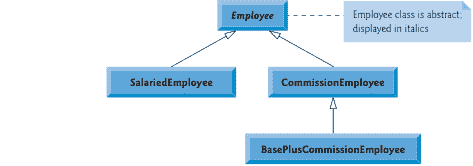

**图 12.7** Employee 层次结构 UML 类图。

> **软件工程观察 12.11**
> 
> 派生类可以从基类继承接口和/或实现。为实现继承而设计的层次结构往往将其功能放在层次结构的高层——一个丰富且非常通用的类继承在基类中定义的一个或多个成员/函数，派生类使用基类的定义。为接口继承而设计的层次结构往往将其功能放在层次结构的较低层——基类指定层次结构中每个类都应定义的一个或多个函数（即它们具有相同的原型），但各个派生类提供自己的函数实现。

接下来的章节将实现 Employee 类层次结构。前五节分别实现一个抽象类或具体类。最后一节实现一个测试程序，该程序构建所有这些类的对象并以多态方式处理这些对象。

### 12.6.1 创建抽象基类 Employee

类 Employee（图 12.9–12.10，稍后将详细讨论）除了提供各种操作 Employee 的数据成员的 get 和 set 函数外，还提供了 earnings 和 print 函数。earnings 函数当然普遍适用于所有雇员，但每次 earnings 的计算都取决于雇员的类。因此，我们将 earnings 声明为基类 Employee 中的纯虚函数，因为对该函数而言，*默认实现没有意义*——没有足够的信息来确定 earnings 应返回的金额。每个派生类都用适当的实现*重写* earnings。为了计算雇员的 earnings，程序将雇员对象的地址赋给基类 Employee *指针*，然后在该对象上调用 earnings 函数。我们维护一个 Employee 指针的 vector，每个指针都指向一个 Employee 对象。*当然，不可能存在 Employee 对象，因为 Employee 是抽象类——然而，由于继承，Employee 的所有具体派生类的所有对象仍然可以被认为是 Employee 对象。* 程序遍历该 vector，并为每个 Employee 对象调用 earnings 函数。C++ *以多态方式*处理这些函数调用。将 earnings 作为 Employee 中的纯虚函数，*强制*每个希望成为*具体类*的 Employee 直接派生类重写 earnings。

类 Employee 中的 print 函数显示雇员的名字、姓氏和社会安全号码。正如我们将看到的，Employee 的每个派生类都重写了函数


打印输出员工类型（例如，“固定薪金雇员：”），后面跟着员工的其他信息。派生类中的函数`print`也可以调用earnings，即使earnings是基类Employee中的纯虚函数。

图12.8中的图示左侧显示了层次结构中的四个类，顶部是earnings和print函数。对于每个类，图示显示了每个函数的预期结果。斜体文本表示特定对象的值在earnings和print函数中的使用位置。类Employee为函数earnings指定了`= 0`，以表明这是一个纯虚函数，因此没有实现。每个派生类都重写此函数以提供适当的实现。我们没有列出基类Employee的`get`和`set`函数，因为它们没有被任何派生类重写——这些函数都被每个派生类继承并“按原样”使用。

| 类 | earnings | print |
|---|---|---|
| Employee | = 0 | `firstName lastName`<br>社会保险号：`SSN` |
| SalariedEmployee | `weeklySalary` | 固定薪金雇员：`firstName lastName`<br>社会保险号：`SSN`<br>周薪：`weeklySalary` |
| CommissionEmployee | `commissionRate * grossSales` | 佣金雇员：`firstName lastName`<br>社会保险号：`SSN`<br>销售总额：`grossSales`<br>佣金率：`commissionRate` |
| BasePlusCommissionEmployee | `(commissionRate * grossSales) + baseSalary` | 底薪加佣金雇员：`firstName lastName`<br>社会保险号：`SSN`<br>销售总额：`grossSales`<br>佣金率：`commissionRate`<br>底薪：`baseSalary` |

**图12.8** | Employee层次结构类的多态接口。

## Employee类头文件

让我们考虑类Employee的头文件（图12.9）。公共成员函数包括一个构造函数，它接受名字、姓氏和社会保险号作为参数（第11–12行）；一个虚析构函数（第13行）；`set`函数，分别设置名字、姓氏和社会保险号（第15、18和21行）；`get`函数，分别返回名字、姓氏和社会保险号（第16、19和22行）；纯虚函数`earnings`（第25行）和虚函数`print`（第26行）。

```cpp
// Fig. 12.9: Employee.h
// Employee abstract base class.
#ifndef EMPLOYEE_H
```

**图12.9** | Employee抽象基类。（第1部分，共2部分。）

虚函数`print`（第53–57行）提供了一个**实现**，该实现将在*每一个*派生类中被**重写**。然而，这些函数中的每一个都将使用抽象类的`print`版本，来打印`Employee`层次结构中*所有类共有*的信息。

## 12.6.2 创建具体派生类SalariedEmployee

类`SalariedEmployee`（图12.11–12.12）派生自类`Employee`（图12.11中的第9行）。公共成员函数包括一个构造函数，它接受名字、姓氏、社会保险号和周薪作为参数（第12–13行）；一个虚析构函数（第14行）；一个`set`函数，用于为数据成员`weeklySalary`赋值新的非负值（第16行）；一个`get`函数，用于返回`weeklySalary`的值（第17行）；一个虚函数`earnings`，用于计算`SalariedEmployee`的工资收入（第20行）；以及一个虚函数`print`（第21行），它输出员工类型，即“固定薪金雇员：”，后面跟着由基类`Employee`的print函数和`SalariedEmployee`的`getWeeklySalary`函数生成的员工特定信息。

```cpp
// Fig. 12.11: SalariedEmployee.h
// SalariedEmployee class derived from Employee.
#ifndef SALARIED_H
#define SALARIED_H

#include <string> // C++ standard string class
#include "Employee.h" // Employee class definition

class SalariedEmployee : public Employee
{
public:
    SalariedEmployee( const std::string &, const std::string &,
        const std::string &, double = 0.0 );
    virtual ~SalariedEmployee() {} // virtual destructor

    void setWeeklySalary( double ); // set weekly salary
    double getWeeklySalary() const; // return weekly salary

    // keyword virtual signals intent to override
    virtual double earnings() const override; // calculate earnings
    virtual void print() const override; // print object
private:
    double weeklySalary; // salary per week
}; // end class SalariedEmployee

#endif // SALARIED_H
```

**图12.11** | `SalariedEmployee`类头文件。

### SalariedEmployee类成员函数定义

图12.12包含了`SalariedEmployee`的成员函数定义。类的构造函数将名字、姓氏和社会保险号传递给`Employee`构造函数（第11行），以初始化从基类继承但无法在派生类中直接访问的私有数据成员。函数earnings（第33–36行）重写了Employee中的纯虚函数earnings，提供了一个**具体**的实现，返回`SalariedEmployee`的周薪。如果我们不定义earnings，类`SalariedEmployee`将成为一个*抽象*类，任何实例化`SalariedEmployee`对象的尝试都会导致编译错误。在`SalariedEmployee`类的头文件中，我们将成员函数`earnings`和`print`声明为virtual（图12.11中的第20–21行）——实际上，在这些成员函数前加上`virtual`关键字是*多余*的。我们在基类`Employee`中将它们定义为virtual，因此它们在整个类层次结构中保持为虚函数。在层次结构的每一级显式声明此类函数为virtual有助于提高程序的清晰度。不将`earnings`声明为纯虚函数表明我们打算在这个具体类中提供一个实现。

```cpp
// Fig. 12.12: SalariedEmployee.cpp
// SalariedEmployee class member-function definitions.
#include <iostream>
#include <stdexcept>
#include "SalariedEmployee.h" // SalariedEmployee class definition
using namespace std;

// constructor
SalariedEmployee::SalariedEmployee( const string &first,
   const string &last, const string &ssn, double salary )
   : Employee( first, last, ssn )
{
   setWeeklySalary( salary );
} // end SalariedEmployee constructor

// set salary
void SalariedEmployee::setWeeklySalary( double salary )
{
   if ( salary >= 0.0 )
      weeklySalary = salary;
   else
      throw invalid_argument( "Weekly salary must be >= 0.0" );
} // end function setWeeklySalary

// return salary
double SalariedEmployee::getWeeklySalary() const
{
   return weeklySalary;
} // end function getWeeklySalary

// calculate earnings
// declare pure virtual function earnings in Employee
double SalariedEmployee::earnings() const
{
   return getWeeklySalary();
} // end function earnings

// print SalariedEmployee's information
void SalariedEmployee::print() const
{
    cout << "salaried employee: ";
    Employee::print(); // reuse abstract base-class print function
    cout << "\nweekly salary: " << getWeeklySalary();
} // end function print
```

**图12.12** | SalariedEmployee类实现文件。（第1部分，共2部分。）

**图12.12** | SalariedEmployee类实现文件。（第2部分，共2部分。）

类SalariedEmployee的print函数（图12.12中的第39—44行）重写了Employee的print函数。如果类SalariedEmployee没有重写print，SalariedEmployee将继承Employee版本的print。在这种情况下，SalariedEmployee的print函数将只返回员工的全名和社会保险号，这不能充分表示一个SalariedEmployee。为了打印SalariedEmployee的完整信息，派生类的print函数输出“固定薪金雇员：”，后面跟着通过使用作用域解析运算符（第42行）调用基类的print函数所打印的基类Employee特定信息（即名字、姓氏和社会保险号）——这是代码复用的一个很好的例子。没有作用域解析运算符，print调用将导致无限递归。SalariedEmployee的print函数产生的输出还包含通过调用该类的getWeeklySalary函数获得的员工周薪。

## 12.6.3 创建具体派生类CommissionEmployee

类CommissionEmployee（图12.13—12.14）派生自Employee（图12.13中的第9行）。成员函数的实现（图12.14）包括一个构造函数（第9—15行），它接受名字、姓氏、社会保险号、销售额和佣金率；`set`函数（第18—24行和第33—39行）分别用于为数据成员`commissionRate`和`grossSales`赋新值；`get`函数（第27—30行和第42—45行）用于获取它们的值；earnings函数（第48—51行）用于计算CommissionEmployee的工资收入；以及print函数（第54—60行）用于输出员工类型，即“佣金雇员：”和员工特定信息。构造函数将名字、姓氏和社会保险号传递给Employee构造函数（第11行），以初始化Employee的私有数据成员。函数print调用基类的print函数（第57行）来显示Employee特定信息。

```cpp
// Fig. 12.13: CommissionEmployee.h
// CommissionEmployee class derived from Employee.
#ifndef COMMISSION_H
#define COMMISSION_H

#include <string> // C++ standard string class
#include "Employee.h" // Employee class definition

class CommissionEmployee : public Employee
{
public:
    CommissionEmployee( const std::string &, const std::string &,
        const std::string &, double = 0.0, double = 0.0 );
```

**图12.13** | CommissionEmployee类头文件。（第1部分，共2部分。）


```cpp
// 设置佣金率
void CommissionEmployee::setCommissionRate( double rate )
{
   if ( rate > 0.0 && rate < 1.0 )
      commissionRate = rate;
   else
      throw invalid_argument( "佣金率必须大于 0.0 且小于 1.0" );
} // 结束函数 setCommissionRate

// 返回佣金率
double CommissionEmployee::getCommissionRate() const
{
   return commissionRate;
} // 结束函数 getCommissionRate

// 计算收入；覆盖 Employee 中的纯虚函数 earnings
double CommissionEmployee::earnings() const
{
   return getCommissionRate() * getGrossSales();
} // 结束函数 earnings

// 打印 CommissionEmployee 的信息
void CommissionEmployee::print() const
{
   cout << "\n佣金员工: ";
   Employee::print(); // 代码复用
   cout << "\n销售总额: " << getGrossSales()
      << "\n佣金率: " << getCommissionRate();
} // 结束函数 print
```

**图 12.14** | *CommissionEmployee 类实现文件。（第 2 部分，共 2 部分。）*

## 12.6.4 创建间接具体派生类 BasePlusCommissionEmployee

类 BasePlusCommissionEmployee（图 12.15–12.16）直接继承自类 CommissionEmployee（图 12.15 第 9 行），因此是 Employee 的间接派生类。类 BasePlusCommissionEmployee 的成员函数实现包括一个构造函数（图 12.16 第 9–15 行），该构造函数接受名字、姓氏、社会保障号码、销售额、佣金率和基本工资作为参数。然后它将名字、姓氏、社会保障号码、销售额和佣金率传递给 CommissionEmployee 构造函数（第 12 行），以初始化继承的成员。BasePlusCommissionEmployee 还包含一个 set 函数（第 18–24 行）来为数据成员 baseSalary 赋予新值，以及一个 get 函数（第 27–30 行）来返回 baseSalary 的值。函数 earnings（第 34–37 行）计算 BasePlusCommissionEmployee 的收入。函数 earnings 中的第 36 行调用基类 CommissionEmployee 的 earnings 函数来计算员工收入中基于佣金的部分。这是代码复用的又一个很好的例子。BasePlusCommissionEmployee 的 print 函数（第 40–45 行）输出"base-salaried"，后跟基类 CommissionEmployee 的 print 函数的输出（另一个代码复用的例子），然后是基本工资。最终输出以"base-salaried commission employee: "开头，后面是 BasePlusCommissionEmployee 的其余信息。回想一下，CommissionEmployee 的 print 通过调用其基类（即 Employee）的 print 函数来显示员工的名字、姓氏和社会保障号码——这又是代码复用的一个例子。BasePlusCommissionEmployee 的 print 启动了一个函数调用链，跨越 Employee 层次结构的所有三个层级。

```cpp
// 图 12.15: BasePlusCommissionEmployee.h
// BasePlusCommissionEmployee 类派生自 CommissionEmployee。
#ifndef BASEPLUS_H
#define BASEPLUS_H

#include <string> // C++ 标准 string 类
#include "CommissionEmployee.h" // CommissionEmployee 类定义

class BasePlusCommissionEmployee : public CommissionEmployee
{
public:
    BasePlusCommissionEmployee( const std::string &, const std::string &,
        const std::string &, double = 0.0, double = 0.0 );
    virtual ~BasePlusCommissionEmployee() { } // 虚析构函数

    void setBaseSalary( double ); // 设置基本工资
    double getBaseSalary() const; // 返回基本工资

    // 关键字 virtual 表示覆盖意图
    virtual double earnings() const override; // 计算收入
    virtual void print() const override; // 打印对象
private:
    double baseSalary; // 每周基本工资
}; // 结束类 BasePlusCommissionEmployee

#endif // BASEPLUS_H
```

**图 12.15** | *BasePlusCommissionEmployee 类头文件。*

```cpp
// 图 12.16: BasePlusCommissionEmployee.cpp
// BasePlusCommissionEmployee 成员函数定义。
#include <iostream>
#include <stdexcept>
#include "BasePlusCommissionEmployee.h"
using namespace std;

// 构造函数
BasePlusCommissionEmployee::BasePlusCommissionEmployee(
    const string &first, const string &last, const string &ssn,
    double sales, double rate, double salary )
    : CommissionEmployee( first, last, ssn, sales, rate )
{
    setBaseSalary( salary ); // 验证并存储基本工资
} // 结束 BasePlusCommissionEmployee 构造函数
```

**图 12.16** | *BasePlusCommissionEmployee 类实现文件。（第 1 部分，共 2 部分。）*

```cpp
// 设置基本工资
void BasePlusCommissionEmployee::setBaseSalary( double salary )
{
   if ( salary >= 0.0 )
      baseSalary = salary;
   else
      throw invalid_argument( "工资必须 >= 0.0" );
} // 结束函数 setBaseSalary

// 返回基本工资
double BasePlusCommissionEmployee::getBaseSalary() const
{
   return baseSalary;
} // 结束函数 getBaseSalary

// 计算收入；
// 覆盖 CommissionEmployee 中的虚函数 earnings
double BasePlusCommissionEmployee::earnings() const
{
   return getBaseSalary() + CommissionEmployee::earnings();
} // 结束函数 earnings

// 打印 BasePlusCommissionEmployee 的信息
void BasePlusCommissionEmployee::print() const
{
   cout << "base-salaried ";
   CommissionEmployee::print(); // 代码复用
   cout << "; base salary: " << getBaseSalary();
} // 结束函数 print
```

**图 12.16** | *BasePlusCommissionEmployee 类实现文件。（第 2 部分，共 2 部分。）*

## 12.6.5 演示多态处理

为了测试我们的 Employee 层次结构，图 12.17 中的程序创建了三个具体类 SalariedEmployee、CommissionEmployee 和 BasePlusCommissionEmployee 各一个对象。程序首先使用*静态绑定*，然后使用 Employee 指针的 vector 以*多态*方式操作这些对象。第 22–27 行创建了三个具体 Employee 派生类的对象。第 32–38 行输出每个 Employee 的信息和收入。第 32–37 行中的每个成员函数都是*静态绑定*的例子——*在编译时*，因为我们使用的是命名句柄（而不是可以在*执行时*设置的指针或引用），编译器可以识别每个对象的类型，以确定调用哪些 print 和 earnings 函数。

```cpp
// 图 12.17: fig12_17.cpp
// 单独处理 Employee 派生类对象
// 并使用动态绑定进行多态处理。
#include <iostream>
#include <iomanip>
#include <vector>
```

**图 12.17** | *Employee 类层次结构驱动程序。（第 1 部分，共 4 部分。）*

```cpp
#include "Employee.h"
#include "SalariedEmployee.h"
#include "CommissionEmployee.h"
#include "BasePlusCommissionEmployee.h"
using namespace std;

void virtualViaPointer( const Employee * const ); // 原型
void virtualViaReference( const Employee & ); // 原型

int main()
{
   // 设置浮点输出格式
   cout << fixed << setprecision( 2 );

   // 创建派生类对象
   SalariedEmployee salariedEmployee(
      "John", "Smith", "111-11-1111", 800 );
   CommissionEmployee commissionEmployee(
      "Sue", "Jones", "333-33-3333", 10000, .06 );
   BasePlusCommissionEmployee basePlusCommissionEmployee(
      "Bob", "Lewis", "444-44-4444", 5000, .04, 300 );

   cout << "使用静态绑定单独处理员工:\n\n";

   // 使用静态绑定输出每个员工的信息和收入
   salariedEmployee.print();
   cout << "\nearned $" << salariedEmployee.earnings() << "\n\n";
   commissionEmployee.print();
   cout << "\nearned $" << commissionEmployee.earnings() << "\n\n";
   basePlusCommissionEmployee.print();
   cout << "\nearned $" << basePlusCommissionEmployee.earnings()
        << "\n\n";

   // 创建包含三个基类指针的 vector
   vector< Employee * > employees( 3 );

   // 用指向 Employee 的指针初始化 vector
   employees[ 0 ] = &salariedEmployee;
   employees[ 1 ] = &commissionEmployee;
   employees[ 2 ] = &basePlusCommissionEmployee;

   cout << "使用动态绑定以多态方式处理员工:\n\n";

   // 调用 virtualViaPointer 打印每个员工的信息
   // 并使用动态绑定计算收入
   cout << "通过基类指针进行的虚函数调用:\n\n";

   for ( const Employee * employeePtr : employees )
      virtualViaPointer( employeePtr );

   // 调用 virtualViaReference 打印每个员工的信息
   // 并使用动态绑定计算收入
   cout << "通过基类引用进行的虚函数调用:\n\n";
```

**图 12.17** | *Employee 类层次结构驱动程序。（第 2 部分，共 4 部分。）*


```cpp
for ( const Employee *employeePtr : employees )
   virtualViaReference( *employeePtr ); // note dereferencing
} // end main
```

```cpp
// call Employee virtual functions print and earnings off a
// base-class pointer using dynamic binding
void virtualViaPointer( const Employee * const baseClassPtr )
{
   baseClassPtr->print();
   cout << "\n earned $" << baseClassPtr->earnings() << "\n\n";
} // end function virtualViaPointer
```

```cpp
// call Employee virtual functions print and earnings off a
// base-class reference using dynamic binding
void virtualViaReference( const Employee &baseClassRef )
{
   baseClassRef.print();
   cout << "\n earned $" << baseClassRef.earnings() << "\n\n";
} // end function virtualViaReference
```

```text
Employees processed individually using static binding:

salaried employee: John Smith
social security number: 111-11-1111
weekly salary: 800.00
earned $800.00

commission employee: Sue Jones
social security number: 333-33-3333
gross sales: 10000.00; commission rate: 0.06
earned $600.00

base-salaried commission employee: Bob Lewis
social security number: 444-44-4444
gross sales: 5000.00; commission rate: 0.04; base salary: 300.00
earned $500.00

Employees processed polymorphically using dynamic binding:

Virtual function calls made off base-class pointers:

salaried employee: John Smith
social security number: 111-11-1111
weekly salary: 800.00
earned $800.00

commission employee: Sue Jones
social security number: 333-33-3333
gross sales: 10000.00; commission rate: 0.06
earned $600.00

base-salaried commission employee: Bob Lewis
social security number: 444-44-4444
gross sales: 5000.00; commission rate: 0.04; base salary: 300.00
earned $500.00

Virtual function calls made off base-class references:

salaried employee: John Smith
social security number: 111-11-1111
weekly salary: 800.00
earned $800.00

commission employee: Sue Jones
social security number: 333-33-3333
gross sales: 10000.00; commission rate: 0.06
earned $600.00

base-salaried commission employee: Bob Lewis
social security number: 444-44-4444
gross sales: 5000.00; commission rate: 0.04; base salary: 300.00
earned $500.00
```

**图12.17** | *Employee类层次结构驱动程序（第3-4部分，共4部分）。*

第41行创建了vector employees，其中包含三个Employee指针。第44行将employees[0]指向salariedEmployee对象。第45行将employees[1]指向commissionEmployee对象。第46行将employees[2]指向basePlusCommissionEmployee对象。编译器允许这些赋值，因为SalariedEmployee *是一种* Employee，CommissionEmployee *是一种* Employee，BasePlusCommissionEmployee *是一种* Employee。因此，即使Employee是抽象类，我们也可以将SalariedEmployee、CommissionEmployee和BasePlusCommissionEmployee对象的地址赋给基类Employee指针。

第54–55行遍历vector employees，并对employees中的每个元素调用函数virtualViaPointer（第67–71行）。函数virtualViaPointer在其参数baseClassPtr中接收employees元素中存储的地址。每次对virtualViaPointer的调用都使用baseClassPtr调用虚函数print（第69行）和earnings（第70行）。函数virtualViaPointer不包含任何SalariedEmployee、CommissionEmployee或BasePlusCommissionEmployee类型信息。该函数只知道基类类型Employee。因此，编译器无法知道通过baseClassPtr应该调用哪个具体类的函数。然而在执行时，每次虚函数调用都会正确地调用baseClassPtr当前所指向对象上的函数。输出表明每个类的相应函数确实被调用，并且每个对象的正确信息都被显示。例如，SalariedEmployee显示周薪，CommissionEmployee和BasePlusCommissionEmployee显示总销售额。此外，第70行中多态地获取每个Employee的earnings，与第33、35和37行通过静态绑定获取这些员工的earnings结果相同。所有对print和earnings的虚函数调用都在运行时通过动态绑定解析。

最后，第61–62行遍历employees，并对每个vector元素调用函数virtualViaReference（第75–79行）。函数virtualViaReference在其参数baseClassRef（类型为const Employee &）中接收一个引用，该引用是通过解引用每个employees元素中存储的指针而获得的对象（第62行）。每次对virtualViaReference的调用都通过baseClassRef调用虚函数print（第77行）和earnings（第78行），以演示多态处理同样适用于基类引用。

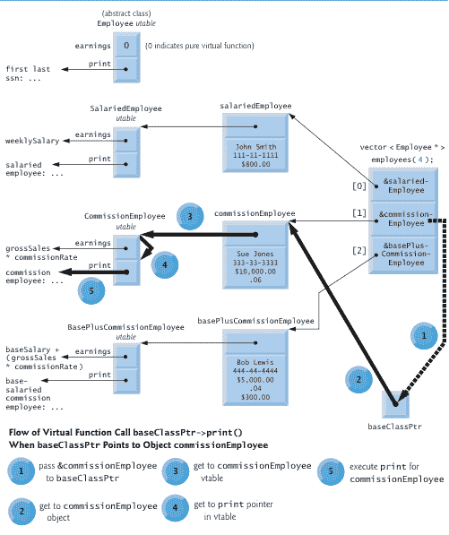

**图12.18** | 虚函数调用如何工作。

### CommissionEmployee 类的 vtable

在CommissionEmployee类的*vtable*中，earnings函数指针指向CommissionEmployee的earnings函数，该函数返回员工总销售额乘以佣金率的结果。print函数指针指向该函数的CommissionEmployee版本，该版本打印员工的类型、姓名、社会保险号、佣金率和总销售额。与HourlyEmployee类一样，这两个函数都覆盖了Employee类中的函数。

编译器将**偏移量**或**位移**编译进机器语言目标代码指针表中，以查找将执行虚函数调用的代码。偏移量的字节大小取决于特定平台上表示函数指针所用的字节数。例如，在32位平台上，指针通常存储为四个字节，而在64位平台上，指针通常存储为八个字节。在此讨论中，我们假设为四个字节。

编译器生成执行以下操作的代码 [*注：列表中的数字对应图12.18中带圆圈的数字*]：

1. 选择`employees`的第*i*项（此处为`commissionEmployee`对象的地址），并将其作为参数传递给函数`virtualViaPointer`。这会将参数`baseClassPtr`设置为指向`commissionEmployee`。

2. 解引用该指针以获得`commissionEmployee`对象——如你所记，该对象以一个指向`commissionEmployee`的*vtable*的指针开头。

3. 解引用`commissionEmployee`的*vtable*指针以获得`CommissionEmployee`的*vtable*。

4. 跳过四个字节的偏移量以选择print函数指针。

5. 解引用print函数指针以形成要执行的实际函数的“名称”，并使用函数调用运算符`()`执行相应的print函数，在此情况下，该函数打印员工的类型、姓名、社会保险号、总销售额和佣金率。

图12.18中的数据结构可能看起来复杂，但这种复杂性由编译器管理，并且对你*隐藏*，使多态编程变得直截了当。每次虚函数调用时发生的指针解引用操作和内存访问需要一些额外的执行时间。添加到对象中的*vtable*和*vtable*指针需要一些额外的内存。

**性能提示12.1**
*在C++中，多态通常通过虚函数和动态绑定实现，效率很高。你可以使用这些功能，且对性能的影响微乎其微。*

**性能提示12.2**
*虚函数和动态绑定使多态编程成为switch逻辑编程的一种替代方案。优化编译器通常生成的多态代码几乎与手写的基于switch的逻辑一样高效。多态的开销对于大多数应用是可以接受的。在某些情况下——例如对性能要求严格的实时应用——多态的开销可能过高。*

## 12.8 案例研究：使用多态和运行时类型信息（向下转换、`dynamic_cast`、`typeid`和`type_info`）的工资系统

回想一下12.6节开头的问题陈述，在当前工资周期中，我们虚构的公司决定通过将`BasePlusCommissionEmployee`的基本工资提高10%来奖励他们。在12.6.5节中，当我们多态地处理`Employee`对象时，我们不需要担心“具体细节”。然而现在，


```cpp
31    // 对向量 employees 中的每个元素进行多态处理
32    for ( Employee *employeePtr : employees )
33    {
34       employeePtr->print(); // 输出员工信息
35       cout << endl;
36
37       // 尝试向下转换指针
38       BasePlusCommissionEmployee *derivedPtr =
39          dynamic_cast< BasePlusCommissionEmployee * >( employeePtr );
40
41       // 判断元素是否指向 BasePlusCommissionEmployee
42       if ( derivedPtr != nullptr ) // 对于“is-a”关系成立
43       {
44          double oldBaseSalary = derivedPtr->getBaseSalary();
45          cout << "old base salary: $" << oldBaseSalary << endl;
46          derivedPtr->setBaseSalary( oldBaseSalary );
47          cout << "new base salary with 10% increase is: $"
48             << derivedPtr->getBaseSalary() << endl;
49       } // 结束 if
50
51       cout << "earned $" << employeePtr->earnings() << "\n\n";
52    } // 结束 for
53
54    // 释放向量元素所指向的对象
55    for ( const Employee *employeePtr : employees )
56    {
57       // 输出类名
58       cout << "deleting object of "
59          << typeid( *employeePtr ).name() << endl;
60
61       delete employeePtr;
62    } // 结束 for
63 } // 结束 main
```

```text
salaried employee: John Smith
social security number: 111-11-1111
weekly salary: 800.00
earned $800.00

commission employee: Sue Jones
social security number: 333-33-3333
gross sales: 10000.00; commission rate: 0.06
earned $600.00

base-salaried commission employee: Bob Lewis
social security number: 444-44-4444
gross sales: 5000.00; commission rate: 0.04; base salary: 300.00
old base salary: $300.00
new base salary with 10% increase is: $330.00
earned $530.00

deleting object of class SalariedEmployee
deleting object of class CommissionEmployee
deleting object of class BasePlusCommissionEmployee
```

*图 12.19 | 演示向下转换和运行时类型信息。（第 2 部分，共 2 部分。）*

## 使用 dynamic_cast 确定对象的类型

在本例中，当我们遇到一个 BasePlusCommissionEmployee 对象时，我们希望将其基本工资提高 10%。由于我们以多态方式处理 Employee 对象，因此（使用目前所学到的技术）我们无法确定在任何给定时刻正在操作的是哪种类型的 Employee。这就产生了一个问题，因为必须在遇到 BasePlusCommissionEmployee 员工时将其识别出来，以便他们能够获得 10% 的加薪。为此，我们使用运算符 **dynamic_cast**（第 39 行）来确定当前 Employee 的类型是否为 BasePlusCommissionEmployee。这就是我们在第 12.3.3 节中提到的*向下转换*操作。第 38–39 行将 employeePtr 从类型 Employee * 动态向下转换为类型 BasePlusCommissionEmployee *。如果 employeePtr 指向一个*是* BasePlusCommissionEmployee 对象的对象，那么该对象的*地址*会被赋给派生类指针 derivedPtr；否则，nullptr 会被赋给 derivedPtr。请注意，这里**必须**使用 dynamic_cast 而不是 static_cast 来对底层对象执行类型检查——static_cast 只会将 Employee * 强制转换为 BasePlusCommissionEmployee *，而不管底层对象的类型如何。使用 static_cast 时，程序会尝试增加*每个* Employee 的基本工资，从而导致每个不是 BasePlusCommissionEmployee 的对象产生未定义行为。

如果第 38–39 行中 dynamic_cast 运算符返回的值*不是* nullptr，则对象类型正确，if 语句（第 42–49 行）将执行 BasePlusCommissionEmployee 对象所需的特殊处理。第 44、46 和 48 行调用 BasePlusCommissionEmployee 的函数 getBaseSalary 和 setBaseSalary 来检索和更新员工的工资。

## 计算当前员工的收入

第 51 行对 employeePtr 指向的对象调用成员函数 earnings。回想一下，earnings 在基类中被声明为 virtual，因此程序会调用派生类对象的 earnings 函数——这是*动态绑定*的另一个示例。

## 显示员工的类型

第 55–62 行显示每个员工的*对象类型*，并使用 delete 运算符释放每个向量元素所指向的动态内存。运算符 **typeid**（第 59 行）返回对类 **type_info** 的对象的*引用*，该对象包含有关其操作数类型的信息，包括该类型的名称。调用时，type_info 成员函数 **name**（第 59 行）返回一个基于指针的字符串，其中包含 typeid 参数的*类型名称*（例如 "class BasePlusCommissionEmployee"）。要使用 typeid，程序必须包含头文件 **<typeinfo>**（第 8 行）。


## 可移植性提示 12.1

type_info 成员函数 name 返回的字符串可能因编译器而异。

## 我们通过使用 dynamic_cast 避免的编译错误

在本例中，我们通过将 Employee 指针*向下转换*为 BasePlusCommissionEmployee 指针（第 38–39 行）避免了几处编译错误。如果从第 39 行移除 dynamic_cast，并尝试将当前的 Employee 指针直接赋给 BasePlusCommissionEmployee 指针 derivedPtr，我们将收到编译错误。C++ 不允许程序将基类指针赋给派生类指针，因为 *is-a* 关系

- 利用多态，我们可以设计和实现易于扩展的系统——添加新类时，只需对程序的通用部分进行很少的修改或无需修改。程序中为了适应新类而必须修改的部分，仅限于那些需要直接了解你添加到层次结构中的新类的部分。

## 第 12.2 节 多态简介：多态视频游戏

- 利用多态，一次函数调用可以根据调用函数的对象类型引发不同的操作。
- 这使得设计和实现更具可扩展性的系统成为可能。程序可以编写为处理在程序开发时可能尚不存在的类型的对象。

## 第 12.3 节 继承层次结构中对象之间的关系

- C++ 支持多态——即由继承关联的不同类的对象能够对相同的成员函数调用作出不同响应的能力。
- 多态通过虚函数（第 526 页）和动态绑定（第 527 页）实现。
- 当使用基类指针或引用调用虚函数时，C++ 会在与该对象关联的适当派生类中选择正确的覆盖函数。
- 如果通过名称引用特定对象并使用点成员选择运算符来调用虚函数，则该引用在编译时解析（这称为静态绑定；第 527 页）；所调用的虚函数是为该特定对象的类定义的函数。
- 派生类可以在必要时覆盖基类的虚函数，但如果它们不这样做，则使用基类的实现。
- 如果类包含虚函数，请将基类析构函数声明为 virtual（第 532 页）。这会使所有派生类析构函数也成为虚函数，即使它们与基类析构函数名称不同。如果通过将 delete 运算符应用于指向派生类对象的基类指针来显式销毁层次结构中的对象，则会调用相应类的析构函数。在派生类析构函数运行之后，该类的所有基类的析构函数会沿着层次结构一直向上运行。

## 第 12.4 节 类型字段和 switch 语句

- 使用虚函数进行多态编程可以消除对 switch 逻辑的需求。你可以使用虚函数机制自动执行等效的逻辑，从而避免通常与 switch 逻辑相关的各类错误。

## 第 12.5 节 抽象类和纯虚函数

- 抽象类（第 533 页）通常用作基类，因此我们称它们为抽象基类（第 533 页）。不能实例化任何抽象类的对象。
- 可以实例化对象的类称为具体类（第 533 页）。
- 通过在声明中使用纯说明符（= 0）声明一个或多个纯虚函数（第 534 页），可以创建抽象类。
- 如果一个类派生自具有纯虚函数的类，并且该派生类没有为该纯虚函数提供定义，则该虚函数在派生类中仍然是纯虚函数。因此，该派生类也是抽象类。
- 尽管我们不能实例化抽象基类的对象，但我们可以声明指向抽象基类对象的指针和引用。这样的指针和引用可用于对从具体派生类实例化的派生类对象进行多态操作。


- d) 如果基类声明了纯虚函数，派生类必须实现该函数才能成为具体类。
- e) 多态编程可以消除对 `switch` 逻辑的需要。

## 自测练习答案

- 12.1  a) 派生类。 b) switch。 c) 抽象。 d) 具体。 e) dynamic_cast。 f) type_info。 g) 多态。 h) virtual。 i) 向下转换。
- 12.2  a) 错误。抽象基类可以包含有实现的虚函数。 b) 错误。使用派生类句柄引用基类对象是危险的。 c) 错误。类永远不会声明为 virtual。相反，通过在类中包含至少一个纯虚函数使类成为抽象类。 d) 正确。 e) 正确。

## 习题

- **12.3** _通用编程_ — 多态如何使您能够“通用”编程而不是“特定”编程？讨论“通用”编程的主要优点。
- **12.4** _多态与 switch 逻辑_ — 讨论使用 switch 逻辑编程的问题。解释为什么多态可以成为使用 switch 逻辑的有效替代方案。
- **12.5** _继承接口与继承实现_ — 区分继承接口和继承实现。为继承接口设计的继承层次与为继承实现设计的继承层次有何不同？
- **12.6** _虚函数_ — 什么是虚函数？描述一种适合使用虚函数的情况。
- **12.7** _动态绑定与静态绑定_ — 区分静态绑定和动态绑定。解释虚函数和 vtable 在动态绑定中的使用。
- **12.8** _虚函数_ — 区分虚函数和纯虚函数。
- **12.9** _抽象基类_ — 为本章讨论并在图 11.3 中显示的 Shape 层次结构建议一个或多个抽象基类层级。（第一层是 Shape，第二层由类 TwoDimensionalShape 和 ThreeDimensionalShape 组成。）
- **12.10** _多态与可扩展性_ — 多态如何促进可扩展性？
- **12.11** _多态应用_ — 你被要求开发一个具有精细图形输出的飞行模拟器。解释为什么多态编程对于这种性质的问题特别有效。
- **12.12** _工资系统修改_ — 修改图 12.9–12.17 的工资系统，在类 Employee 中包含私有数据成员 birthDate。使用图 10.6–10.7 中的类 Date 来表示雇员的生日。假设工资每月处理一次。创建一个 Employee 引用的 vector 来存储各种雇员对象。在循环中，为每个 Employee（多态地）计算工资，如果当前月份是雇员生日所在的月份，则将 100.00 美元奖金添加到该人的工资额中。
- **12.13** _包裹继承层次结构_ — 使用练习 11.9 中创建的包继承层次结构来创建一个程序，显示地址信息并计算多个 Packages 的运费。程序应包含一个 Package 指针的 vector，指向 TwoDayPackage 和 OvernightPackage 类的对象。遍历该 vector 以多态方式处理 Packages。对于每个 Package，调用 get 函数获取发件人和收件人的地址信息，然后打印这两个地址，就像它们出现在邮寄标签上一样。此外，调用每个 Package 的 calculateCost 成员函数并打印结果。跟踪 vector 中所有 Packages 的总运费，并在循环终止时显示该总数。
- **12.14** *（使用 Account 层次结构的多态银行程序）* 使用练习 11.10 中创建的 Account 层次结构开发一个多态银行程序。创建一个 Account 指针的 vector，指向 SavingsAccount 和 CheckingAccount 对象。对于 vector 中的每个 Account，允许用户指定使用成员函数 debit 从 Account 中取款的金额，以及使用成员函数 credit 存入 Account 的金额。在处理每个 Account 时，确定其类型。如果 Account 是 SavingsAccount，则使用成员函数 calculateInterest 计算该 Account 应计的利息，然后使用成员函数 credit 将利息添加到账户余额中。处理完 Account 后，通过调用基类成员函数 getBalance 获取更新后的账户余额并打印。
- **12.15** *（工资系统修改）* 修改图 12.9–12.17 的工资系统，以包含额外的 Employee 子类 PieceWorker 和 HourlyWorker。PieceWorker 表示其报酬基于生产的商品件数的雇员。HourlyWorker 表示其报酬基于小时工资和工作小时数的雇员。小时工在超过 40 小时的所有工作时间获得加班费（小时工资的 1.5 倍）。

## 产生影响

- **12.16** *（CarbonFootprint 抽象类：多态）* 使用仅包含纯虚函数的抽象类，可以为可能完全不同的类指定相似的行为。世界各地的政府和公司越来越关注建筑物燃烧各种燃料取暖、车辆燃烧燃料提供动力等产生的碳足迹（每年向大气中释放的二氧化碳）。许多科学家将这些温室气体归咎于所谓的全球变暖现象。创建三个不通过继承关联的小类——Building、Car 和 Bicycle 类。为每个类赋予一些与其他类不同的独特且适当的属性和行为。编写一个抽象类 CarbonFootprint，仅包含一个纯虚的 getCarbonFootprint 方法。让您创建的每个类都继承该抽象类并实现 getCarbonFootprint 方法，以计算该类的适当碳足迹（请查看一些解释如何计算碳足迹的网站）。编写一个应用程序，创建这三个类的对象，将这些对象的指针放入一个 CarbonFootprint 指针的 vector 中，然后遍历该 vector，多态地调用每个对象的 getCarbonFootprint 方法。对于每个对象，打印一些标识信息以及该对象的碳足迹。

- 13.1 引言
- 13.2 流
  - 13.2.1 经典流与标准流
  - 13.2.2 iostream 库头文件
  - 13.2.3 流输入/输出类与对象
- 13.3 流输出
  - 13.3.1 char * 变量的输出
  - 13.3.2 使用成员函数 put 的字符输出
- 13.4 流输入
  - 13.4.1 get 和 getline 成员函数
  - 13.4.2 istream 成员函数 peek、putback 和 ignore
  - 13.4.3 类型安全的 I/O
- 13.5 使用 read、write 和 gcount 的无格式 I/O
- 13.6 流操纵符简介
  - 13.6.1 整型流基数：dec、oct、hex 和 setbase
  - 13.6.2 浮点精度（precision、setprecision）
  - 13.6.3 字段宽度（width、setw）
  - 13.6.4 用户自定义的输出流操纵符
- 13.7 流格式状态与流操纵符
  - 13.7.1 尾部零和小数点（showpoint）
  - 13.7.2 对齐（left、right 和 internal）
  - 13.7.3 填充（fill、setfill）
  - 13.7.4 整型流基数（dec、oct、hex、showbase）
  - 13.7.5 浮点数：科学与固定表示法（scientific、fixed）
  - 13.7.6 大写/小写控制（uppercase）
  - 13.7.7 指定布尔格式（boolalpha）
  - 13.7.8 通过成员函数 flags 设置和重置格式状态
- 13.8 流错误状态
- 13.9 将输出流绑定到输入流
- 13.10 小结

## 13.1 引言

本章讨论足以执行大多数常见 I/O 操作的一系列功能，并概述其余功能。我们在前面的文本中已经讨论过其中一些特性；现在我们提供更完整的处理。我们将讨论的许多 I/O 特性都是面向对象的。这种 I/O 风格利用了 C++ 的其他特性，例如引用、函数重载和运算符重载。

C++ 使用类型安全的 I/O。每个 I/O 操作都以对数据类型敏感的方式执行。如果已定义了处理特定数据类型的 I/O 函数，那么该成员函数会被调用来处理该数据类型。如果实际数据的类型与处理该数据类型的函数之间不匹配，编译器将生成错误。因此，不正确的数据无法“溜”过系统（这种情况在 C 中可能发生，从而产生一些微妙而奇怪的错误）。

用户可以通过重载流插入运算符（<<）和流提取运算符（>>）来指定如何对用户定义类型的对象执行 I/O。这种可扩展性是 C++ 最宝贵的特性之一。

> **软件工程观察 13.1**
>
> 在 C++ 程序中专门使用 C++ 风格的 I/O，即使 C 风格的 I/O 也可供 C++ 程序员使用。


**错误预防提示 13.1**  
*C++ 的 I/O 是类型安全的。*


**软件工程观察 13.2**  
*C++ 使预定义类型和用户自定义类型的 I/O 能够进行统一处理。这种统一性促进了软件开发和重用。*


## 13.2 流

C++ 的 I/O 发生在**流**中，流是字节序列。在输入操作中，字节从设备（如键盘、磁盘驱动器、网络连接等）流入主存。在输出操作中，字节从主存流向设备（如显示屏、打印机、磁盘驱动器、网络连接等）。

应用程序赋予字节以意义。字节可以表示字符、原始数据、图形图像、数字语音、数字视频或应用程序可能需要的任何其他信息。系统 I/O 机制应当一致而可靠地将字节从设备传输到内存（反之亦然）。这种传输通常涉及一些机械运动，例如磁盘或磁带的旋转，或键盘上的按键输入。这些传输所花费的时间通常远大于处理器在内部处理数据所需的时间。因此，I/O 操作需要仔细规划和调优以确保最佳性能。

C++ 同时提供“低级”和“高级”I/O 能力。低级 I/O 能力（即**非格式化 I/O**）指定若干字节应在设备与内存之间或内存与设备之间传输。在这种传输中，单个字节是关注的对象。这种低级能力提供高速、大容量的传输，但不太方便。

程序员通常更喜欢更高级别的 I/O 视图（即**格式化 I/O**），其中字节被分组为有意义的单元，如整数、浮点数、字符、字符串和用户自定义类型。这些面向类型的能力对于大多数 I/O（除了大容量文件处理）来说都能满足要求。

**性能提示 13.1**  
*在大容量文件处理中，使用非格式化 I/O 以获得最佳性能。*


**可移植性提示 13.1**  
*非格式化 I/O 并非在所有平台上都可移植。*


### 13.2.1 经典流与标准流

在过去，C++ **经典流库**支持 char 的输入和输出。由于 char 通常占用一个字节，它只能表示有限的字符集（例如本书大多数读者使用的 ASCII 字符集中的字符，或其他流行的字符集）。然而，许多语言使用的字母表包含的字符数超过了单字节 char 所能表示的字符数。ASCII 字符集不提供这些字符；**Unicode® 字符集**则提供这些字符。Unicode 是一个广泛的国际字符集。标准流库类模板继承²自模板 `basic_istream` 和 `basic_ostream`。图 13.1 的 UML 类图总结了这些继承关系。

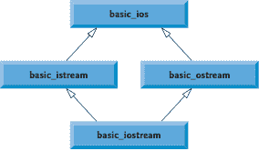

**图 13.1** | 流 I/O 模板层次结构的一部分。

运算符重载为执行输入/输出提供了一种方便的记号。*左移运算符*（`<<`）被重载以表示流输出，被称为*流插入运算符*。*右移运算符*（`>>`）被重载以表示流输入，被称为*流提取运算符*。这些运算符与标准流对象 `cin`、`cout`、`cerr` 和 `clog` 一起使用，并且通常也用于你在自己代码中创建的流对象。

#### 标准流对象 `cin`、`cout`、`cerr` 和 `clog`

预定义对象 `cin` 是一个 `istream` 实例，可以说它“连接”到（或附加到）*标准输入设备*，通常为键盘。如下语句中使用的流提取运算符（`>>`）使整型变量 `grade`（假设 `grade` 已声明为 `int` 变量）的值从 `cin` 输入到内存：

```cpp
cin >> grade;  // data "flows" in the direction of the arrows
```

编译器确定 `grade` 的数据类型，并选择合适的重载流提取运算符。假设 `grade` 已正确声明，则流提取运算符不需要额外的类型信息（而例如在 C 风格 I/O 中则需要）。`>>` 运算符被重载，用于输入基本类型、字符串和指针值的数据项。

预定义对象 `cout` 是一个 `ostream` 实例，可以说它“连接”到*标准输出设备*，通常为显示屏。如下语句中使用的流插入运算符（`<<`）使变量 `grade` 的值从内存输出到标准输出设备：

```cpp
cout << grade;  // data "flows" in the direction of the arrows
```

编译器确定 `grade` 的数据类型（假设 `grade` 已正确声明），并选择合适的流插入运算符。`<<` 运算符被重载，用于输出基本类型、字符串和指针值的数据项。

- 1. 本章仅在针对 char I/O 的模板特化上下文中讨论模板。
- 2. 多重继承将在第 23 章“其他主题”中讨论。

预定义对象 `cerr` 是一个 `ostream` 实例，可以说它“连接”到*标准错误设备*，通常是屏幕。对对象 `cerr` 的输出是**无缓冲**的，这意味着每次向 `cerr` 进行流插入都会使其输出*立即*出现——这对于及时通知用户错误是合适的。

预定义对象 `clog` 是 `ostream` 类的一个实例，可以说它“连接”到*标准错误设备*。对 `clog` 的输出是**有缓冲**的。这意味着每次向 `clog` 进行插入都可能使其输出保存在缓冲区（即内存中的一个区域）中，直到缓冲区被填满或缓冲区被刷新。缓冲是一种 I/O 性能增强技术，在操作系统课程中会讨论。

#### 文件处理模板

C++ 文件处理使用类模板 **basic_ifstream**（用于文件输入）、**basic_ofstream**（用于文件输出）和 **basic_fstream**（用于文件输入和输出）。与标准流一样，C++ 提供了用于处理这些类模板的 typedef。例如，typedef **ifstream** 表示 `basic_ifstream<char>`，它支持从文件进行 char 输入。类似地，typedef **ofstream** 表示 `basic_ofstream<char>`，它支持向文件进行 char 输出。此外，typedef **fstream** 表示 `basic_fstream<char>`，它支持从文件输入 char 和向文件输出 char。模板 `basic_ifstream` 继承自 `basic_istream`，`basic_ofstream` 继承自 `basic_ostream`。图 13.2 的 UML 类图总结了与 I/O 相关的类的各种继承关系。完整的流 I/O 类层次结构提供了你所需的大部分能力。有关其他文件处理信息，请查阅你的 C++ 系统的类库参考。

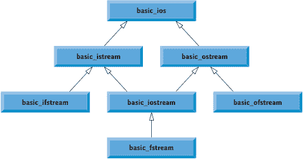

**图 13.2** | 流 I/O 模板层次结构的一部分，显示了主要的文件处理模板。

## 13.3 流输出

ostream 提供格式化和非格式化的输出能力。这些能力包括：使用流插入运算符（`<<`）输出标准数据类型；通过 put 成员函数输出字符；通过 write 成员函数进行非格式化输出；以十进制、八进制和十六进制格式输出整数；以各种精度、强制小数点、科学计数法和定点表示法输出浮点值；在指定宽度的字段中对齐输出数据；在填充了指定字符的字段中输出数据；以及在科学计数法和十六进制表示法中输出大写字母。

### 13.3.1 输出 char * 变量

C++ 自动确定数据类型——这是对 C 的一项改进，但这一特性有时也会“碍事”。例如，假设我们要打印存储在 char * 指针中的地址。`<<` 运算符已被重载，将 char * 作为以空字符结尾的 C 风格字符串输出。要输出地址，可以将 char * 强制转换为 void *（任何指针变量都可以这样做）。图 13.3 演示了以字符串和地址两种格式打印 char * 变量。地址在此以十六进制（基数为 16）数字形式打印——一般来说，地址的打印方式取决于实现。要了解更多关于十六进制数的信息，请参见附录 D。关于控制数字进制的内容，我们将在 13.6.1 节和 13.7.4 节进一步讨论。

```cpp
// Fig. 13.3: fig13_03.cpp
// Printing the address stored in a char * variable.
#include <iostream>
using namespace std;

int main()
{
   const char *const word = "again";

   // display value of char *, then display value of char *
   // after a static_cast to void *
   cout << "Value of word is: " << word << endl
        << "Value of static_cast< const void * >(word) is: "
        << static_cast< const void * >( word ) << endl;
} // end main
```

```text
Value of word is: again
Value of static_cast< const void * >( word ) is: 0135CC70
```

**图 13.3** | 打印存储在 char * 变量中的地址。

### 13.3.2 使用成员函数 put 输出字符

我们可以使用 put 成员函数输出字符。例如，语句

```cpp
cout.put( 'A' );
```

显示单个字符 A。对 put 的调用可以级联，如语句

```cpp
cout.put( 'A' ).put( '\n' );
```

它输出字母 A 后跟一个换行符。与 `<<` 一样，上述语句按这种方式执行，因为点运算符（.）从左到右结合，


put 成员函数返回一个指向接收 put 调用的 ostream 对象（cout）的引用。put 函数也可以使用表示 ASCII 值的数值表达式来调用，如以下语句所示，它同样输出 A：

```
cout.put('A');
```

## 13.4 流输入

现在我们来考虑流输入。格式化和非格式化输入能力由 istream 提供。流提取运算符（>>）通常会跳过输入流中的空白字符（如空格、制表符和换行符）；稍后我们将看到如何改变这一行为。每次输入后，流提取运算符返回一个指向接收提取消息的流对象的引用（例如表达式 cin >> grade 中的 cin）。如果将该引用用作条件（例如在 while 语句的循环继续条件中），流的重载 void * 转换运算符函数会被隐式调用，根据上一次输入操作的成功或失败，将引用分别转换为非空指针值或空指针。非空指针转换为 bool 值 true 表示成功，空指针转换为 bool 值 false 表示失败。当尝试读取越过流末尾时，流的重载 void * 转换运算符返回空指针以表示文件结束。

每个流对象都包含一组用于控制流状态（即格式化、设置错误状态等）的状态位。流的重载 void * 转换运算符使用这些位来确定返回非空指针还是空指针。如果输入了错误类型的数据，流提取会导致流的 failbit 被设置；如果操作失败，则会导致流的 badbit 被设置。13.7 节和 13.8 节将详细讨论流状态位，然后演示如何在 I/O 操作后测试这些位。

### 13.4.1 get 和 getline 成员函数

不带参数的 get 成员函数从指定流输入一个字符（包括空白字符和其他非图形字符，例如表示文件结束的按键序列），并将其作为函数调用的值返回。当在流上遇到文件结束时，此版本的 get 返回 EOF。

### 使用成员函数 eof、get 和 put

图 13.4 演示了在输入流 cin 上使用成员函数 eof 和 get，以及在输出流 cout 上使用成员函数 put。回想第 5 章，EOF 被表示为一个 int。该程序将字符读入 int 变量 character，以便我们测试输入的每个字符是否为 EOF。程序首先打印 cin.eof() 的值——即 false（在输出中为 0）——以表明在 cin 上尚未出现文件结束。用户输入一行文本，然后按 Enter，接着输入文件结束符（在 Microsoft Windows 系统中为 Ctrl+z，在 Linux 和 Mac 系统中为 Ctrl+d）。第 15 行读取每个字符，第 16 行使用成员函数 put 将其输出到 cout。当遇到文件结束时，while 语句结束，第 20 行显示 cin.eof() 的值，此时为 true（在输出中为 1），以表明在 cin 上已设置文件结束。该程序使用的 istream 成员函数 get 版本不带参数，并返回正在输入的字符（第 15 行）。只有程序尝试读取越过流中最后一个字符后，函数 eof 才会返回 true。

```cpp
// Fig. 13.4: fig13_04.cpp
// get, put and eof member functions.
#include <iostream>
using namespace std;

int main()
{
   int character; // use int, because char cannot represent EOF

   // prompt user to enter line of text
   cout << "Before input, cin.eof() is " << cin.eof() << endl
        << "Enter a sentence followed by end-of-file:" << endl;

   // use get to read each character; use put to display it
   while ( ( character = cin.get() ) != EOF )
      cout.put( character );

   // display end-of-file character
   cout << "\nEOF in this system is: " << character << endl;
   cout << "After input of EOF, cin.eof() is " << cin.eof() << endl;
} // end main
```

```text
Before input, cin.eof() is 0
Enter a sentence followed by end-of-file:
Testing the get and put member functions
Testing the get and put member functions
^Z

EOF in this system is: -1
After input of EOF, cin.eof() is 1
```

**图 13.4** | get、put 和 eof 成员函数。

带字符引用参数的 get 成员函数从输入流输入下一个字符（即使这是一个*空白字符*），并将其存储在该字符参数中。此版本的 get 返回正在调用 get 成员函数的 istream 对象的引用。

get 的第三个版本接受三个参数——一个内建字符数组、一个大小限制和一个分隔符（默认值为 `'\n'`）。此版本从输入流读取字符。它要么读取比指定最大字符数*少一个*的字符后终止，要么在读取到*分隔符*时立即终止。程序会在用作缓冲区的字符数组中插入一个空字符来终止输入字符串。分隔符不会放入字符数组，但会保留在输入流中（分隔符将是下一个被读取的字符）。因此，连续第二次调用 get 的结果是一个空行，除非将分隔符从输入流中移除（可能使用 `cin.ignore()`）。

### *比较 cin 和 cin.get*

图 13.5 比较了使用 cin 进行流提取的输入（该方式读取字符直到遇到空白字符）和使用 cin.get 的输入。对 cin.get 的调用（第 22 行）并*没有*指定分隔符，因此使用*默认*的 `'\n'` 字符。

```cpp
int main()
{
    int widthValue = 4;
    char sentence[ 10 ];

    cout << "Enter a sentence:" << endl;
    cin.width( 5 ); // input only 5 characters from sentence

    // set field width, then display characters based on that width
    while ( cin >> sentence )
    {
        cout.width(widthValue++);
        cout << sentence << endl;
        cin.width( 5 ); // input 5 more characters from sentence
    } // end while
} // end main
```

```text
Enter a sentence:
This is a test of the width member function
This
   is
     a
       t
         of
           the
             widt
                h
                 memb
                     er
                      func
                           tion
```

**图 13.10**  |  ios_base 类的 width 成员函数。（第 2 部分，共 2 部分。）

### 13.6.4 用户定义的输出流操纵符

你可以创建自己的流操纵符。图 13.11 展示了如何创建和使用*新的*无参数流操纵符 `bell`（第 8–11 行）、`carriageReturn`（第 14–17 行）、`tab`（第 20–23 行）和 `endLine`（第 27–30 行）。对于输出流操纵符，返回类型和参数必须是 `ostream &` 类型。当第 35 行将 `endLine` 操纵符插入输出流时，会调用函数 `endLine`，第 29 行将转义序列 `\n` 和 `flush` 操纵符（用于刷新输出缓冲区）输出到标准输出流 `cout`。类似地，当第 35–44 行将操纵符 `tab`、`bell` 和 `carriageReturn` 插入输出流时，会调用它们对应的函数——`tab`（第 20 行）、`bell`（第 8 行）和 `carriageReturn`（第 14 行），这些函数又会输出各种转义序列。

```cpp
// Fig. 13.11: fig13_11.cpp
// Creating and testing user-defined, nonparameterized
// stream manipulators.
#include <iostream>
using namespace std;

// bell manipulator (using escape sequence \a)
ostream& bell( ostream& output )
{
   return output << '\a'; // issue system beep
} // end bell manipulator

// carriageReturn manipulator (using escape sequence \r)
ostream& carriageReturn( ostream& output )
{
   return output << '\r'; // issue carriage return
} // end carriageReturn manipulator

// tab manipulator (using escape sequence \t)
ostream& tab( ostream& output )
{
   return output << '\t'; // issue tab
} // end tab manipulator

// endLine manipulator (using escape sequence \n and flush stream
// manipulator to simulate endl)
ostream& endLine( ostream& output )
{
   return output << '\n' << flush; // issue endLine-like end of line
} // endLine manipulator

int main()
{
   // use tab and endLine manipulators
   cout << "Testing the tab manipulator:" << endLine
      << 'a' << tab << 'b' << tab << 'c' << endLine;

   cout << "Testing the carriageReturn and bell manipulators:"
      << endLine << "-------";

   cout << bell; // use bell manipulator

   // use carriageReturn and endLine manipulators
   cout << carriageReturn << "-----" << endLine;
} // end main
```

```text
Testing the tab manipulator:
       a       b       c
Testing the carriageReturn and bell manipulators:
-------
```

**图 13.11**  |  用户定义的无参数流操纵符。（第 2 部分，共 2 部分。）

### 13.7 流格式状态与流操纵符

可以使用各种流操纵符来指定在流 I/O 操作期间要执行的格式化类型。流操纵符控制输出的格式设置。图 13.12 列出了每个控制给定流格式的流操纵符


```text
10000 printed as int right and left justified
and as hex with internal justification.
Using the default pad character (space):
    10000
10000
0x      2710

Using various padding characters:
*****10000
10000%%%%%
0x^^^^2710
```

**图 13.16** | 使用成员函数 fill 和流操纵符 setfill 来更改大于所打印值的字段的填充字符。（第 2 部分，共 2 部分。）

### 13.7.4 整型流基（dec、hex、oct、showbase）

C++ 提供了流操纵符 **dec**、**hex** 和 **oct**，用于分别指定整数以十进制、十六进制和八进制值显示。如果未使用这些操纵符，流插入默认采用*十进制*。对于流提取，以 0（零）为前缀的整数被视为*八进制*值，以 0x 或 0X 为前缀的整数被视为*十六进制*值，所有其他整数被视为*十进制*值。一旦为流指定了特定基数，该流上的所有整数都将使用该基数进行处理，直到指定了不同基数或程序终止为止。

流操纵符 **showbase** 强制输出整数值的*基数*。十进制数默认输出，八进制数以 0 开头输出，十六进制数以 0x 或 0X 开头输出（正如我们在 13.7.6 节讨论的，流操纵符 uppercase 决定选择哪种形式）。图 13.17 演示了使用流操纵符 showbase 强制以十进制、八进制和十六进制格式打印整数。要重置 showbase 设置，请输出流操纵符 **noshowbase**。

```cpp
// Fig. 13.17: fig13_17.cpp
// Stream manipulator showbase.
#include <iostream>
using namespace std;

int main()
{
    int x = 100;

    // use showbase to show number base
    cout << "Printing integers preceded by their base: " << endl
         << showbase;

    cout << x << endl;       // print decimal value
    cout << oct << x << endl; // print octal value
    cout << hex << x << endl; // print hexadecimal value
} // end main
```

**图 13.17** | 流操纵符 showbase。（第 1 部分，共 2 部分。）

```text
Printing integers preceded by their base:
100
0144
0x64
```

**图 13.17** | 流操纵符 showbase。（第 2 部分，共 2 部分。）

### 13.7.5 浮点数；科学与定点表示法（scientific、fixed）

粘性流操纵符 scientific 和 fixed 控制浮点数的输出格式。流操纵符 **scientific** 强制浮点数以科学记数法显示。流操纵符 **fixed** 强制浮点数在小数点右侧显示特定数量的数字（由成员函数 precision 或流操纵符 setprecision 指定）。如果不使用其他操纵符，浮点数的值决定了输出格式。

图 13.18 演示了使用流操纵符 scientific（第 18 行）和 fixed（第 22 行）以定点格式和科学格式显示浮点数。科学记数法中的指数格式在不同编译器上可能有所不同。

```cpp
// Fig. 13.18: fig13_18.cpp
// Floating-point values displayed in system default,
// scientific and fixed formats.
#include <iostream>
using namespace std;

int main()
{
    double x = 0.001234567;
    double y = 1.946e9;

    // display x and y in default format
    cout << "\nDisplayed in default format:" << endl
         << x << '\t' << y << endl;

    // display x and y in scientific format
    cout << "\nDisplayed in scientific format:" << endl
         << scientific << x << '\t' << y << endl;

    // display x and y in fixed format
    cout << "\nDisplayed in fixed format:" << endl
         << fixed << x << '\t' << y << endl;
} // end main
```

```text
Displayed in default format:
0.001234567    1.946e+009

Displayed in scientific format:
1.234567e-003  1.946000e+009
```

**图 13.18** | 以默认、科学和定点格式显示的浮点值。（第 1 部分，共 2 部分。）


### 良好编程实践 13.1

将 bool 值显示为 true 或 false，而不是分别显示为非零值或 0，可以使程序输出更清晰。

```cpp
// Fig. 13.20: fig13_20.cpp
// Stream manipulators boolalpha and noboolalpha.
#include <iostream>
using namespace std;

int main()
{
    bool booleanValue = true;

    // display default true booleanValue
    cout << "booleanValue is " << booleanValue << endl;

    // display booleanValue after using boolalpha
    cout << "booleanValue (after using boolalpha) is "
         << boolalpha << booleanValue << endl;

    cout << "switch booleanValue and use noboolalpha" << endl;
    booleanValue = false; // change booleanValue
    cout << noboolalpha << endl; // use noboolalpha

    // display default false booleanValue after using noboolalpha
    cout << "booleanValue is " << booleanValue << endl;

    // display booleanValue after using boolalpha again
    cout << "booleanValue (after using boolalpha) is "
         << boolalpha << booleanValue << endl;
} // end main
```

```text
booleanValue is 1
booleanValue (after using boolalpha) is true

switch booleanValue and use noboolalpha

booleanValue is 0
booleanValue (after using boolalpha) is false
```

**图 13.20** | 流操纵符 boolalpha 和 noboolalpha。

### 13.7.8 通过成员函数 flags 设置和重置格式状态

在 13.7 节中，我们一直在使用流操纵符来更改输出格式特性。现在讨论在应用了多种操纵之后，如何将输出流的格式恢复为其默认状态。不带参数的成员函数 flags 返回当前格式设置，其类型为 **fmtflags**（属于 ios_base 类），表示**格式状态**。带 fmtflags 参数的成员函数 flags 根据参数设置格式状态，并返回先前的状态设置。flags 返回的初始设置在不同系统上可能有所不同。程序演示了如何测试这些状态位。在工业级代码中，您需要对 I/O 操作执行类似的测试。

```cpp
// Fig. 13.22: fig13_22.cpp
// Testing error states
#include <iostream>
using namespace std;

int main()
{
    int integerValue;

    // display results of cin functions
    cout << "Before a bad input operation:"
         << "\n cin.rdstate(): " << cin.rdstate()
         << "\n    cin.eof(): " << cin.eof()
         << "\n   cin.fail(): " << cin.fail()
         << "\n   cin.bad(): " << cin.bad()
         << "\n  cin.good(): " << cin.good()
         << "\nExpects an integer, but enter a character: ";

    cin >> integerValue; // enter character value
    cout << endl;

    // display results of cin functions after bad input
    cout << "After a bad input operation:"
         << "\n cin.rdstate(): " << cin.rdstate()
         << "\n    cin.eof(): " << cin.eof()
         << "\n   cin.fail(): " << cin.fail()
         << "\n   cin.bad(): " << cin.bad()
         << "\n  cin.good(): " << cin.good() << endl << endl;

    cin.clear(); // clear stream

    // display results of cin functions after clearing
    cout << "\nAfter cin.clear(): " << "\n cin.fail(): " << cin.fail()
         << "\n cin.good(): " << cin.good() << endl;
} // end main
```

```text
Before a bad input operation:
 cin.rdstate(): 0
    cin.eof(): 0
   cin.fail(): 0
    cin.bad(): 0
   cin.good(): 1

Expects an integer, but enter a character: A

After a bad input operation:
 cin.rdstate(): 2
    cin.eof(): 0
   cin.fail(): 1
    cin.bad(): 0
   cin.good(): 0
```

**图 13.22** | 测试错误状态。（第 1 部分，共 2 部分。）


## 13.9 将输出流绑定到输入流

交互式应用程序通常涉及用于输入的 `iostream` 和用于输出的 `ostream`。当屏幕上出现提示消息时，用户通过输入适当的数据来响应。显然，提示需要在输入操作进行之前出现。由于输出缓冲，输出只有在缓冲区填满、程序显式刷新输出或程序结束时才会出现。C++ 提供了成员函数 `tie` 来同步（即“绑定在一起”）`istream` 和 `ostream` 的操作，以确保输出在其后的输入之前出现。调用

```cpp
cin.tie(&cout);
```

将 `cout`（一个 `ostream`）绑定到 `cin`（一个 `istream`）。实际上，这个特定调用是多余的，因为 C++ 会自动执行此操作以创建用户的标准输入/输出环境。但是，用户会显式地绑定其他 `istream`/`ostream` 对。要解除输入流 `inputStream` 与输出流的绑定，请使用调用

```cpp
inputStream.tie(0);
```

## 13.10 小结

本章总结了 C++ 如何使用流执行输入/输出。你了解了流 I/O 类和对象，以及流 I/O 模板类层次结构。我们讨论了 `ostream` 的格式化输出和非格式化输出能力，这些能力由 `put` 和 `write` 函数执行。你了解了 `istream` 的格式化输入和非格式化输入能力，这些能力由 `eof`、`get`、`getline`、`peek`、`putback`、`ignore` 和 `read` 函数执行。我们讨论了流操纵符和执行格式化任务的成员函数——用于显示整数的 `dec`、`oct`、`hex` 和 `setbase`；用于控制浮点精度的 `precision` 和 `setprecision`；以及用于设置字段宽度的 `width` 和 `setw`。你还学习了其他格式化 iostream 操纵符和成员函数——用于显示小数点及尾随零的 `showpoint`；用于对齐的 `left`、`right` 和 `internal`；用于填充的 `fill` 和 `setfill`；用于以科学计数法和定点记法显示浮点数的 `scientific` 和 `fixed`；用于控制大小写的 `uppercase`；用于指定布尔格式的 `boolalpha`；以及用于重置格式状态的 `flags` 和 `fmtflags`。

在下一章中，你将学习文件处理，包括持久数据如何存储以及如何操作这些数据。

## 总结

### 13.2 节 流

- I/O 操作以对数据类型敏感的方式执行。
- 低级 I/O 能力指定字节应在设备到内存或内存到设备之间传输。高级 I/O 则以字节分组为有意义单元（如整数、字符串和用户定义类型）的方式执行。
- `putback` 成员函数（第 572 页）将 `get` 从流中获取的前一个字符放回流中。
- `peek` 成员函数（第 572 页）返回输入流中的下一个字符，但不会从流中提取（移除）该字符。
- C++ 提供类型安全的 I/O（第 572 页）。如果 `<<` 和 `>>` 运算符处理了意外数据，则会设置各种错误位，可以测试这些错误位以确定 I/O 操作是成功还是失败。如果未对用户定义类型重载运算符 `<<`，则编译器会报错。

### 13.5 节 使用 read、write 和 gcount 的非格式化 I/O

- 非格式化 I/O 通过成员函数 `read` 和 `write`（第 572 页）执行。这些函数从指定内存地址开始，向内存输入或从内存输出字节。
- `gcount` 成员函数（第 573 页）返回该流上上一次 `read` 操作输入的字符数。
- 成员函数 `read` 将指定数量的字符输入到字符数组中。如果读取的字符数少于指定数量，则设置 `failbit`。

### 13.6 节 流操纵符简介

- 要更改整数输出的基数，请使用操纵符 `hex`（第 574 页）将基数设置为十六进制（基数为 16），或使用 `oct`（第 574 页）将基数设置为八进制（基数为 8）。使用操纵符 `dec`（第 574 页）将基数重置为十进制。基数在显式更改之前保持不变。
- 参数化流操纵符 `setbase`（第 574 页）也设置整数输出的基数。`setbase` 接受一个整数参数：10、8 或 16，以设置基数。
- 浮点精度可以通过 `setprecision` 流操纵符或 `precision` 成员函数（第 574 页）控制。两者均设置所有后续输出操作的精度，直到下一次精度设置调用。不带参数的 `precision` 成员函数返回当前精度值。
- 参数化操纵符需要包含 `<iomanip>` 头文件。
- 成员函数 `width`（第 576 页）设置字段宽度并返回先前的宽度。比字段窄的值会以填充字符（第 576 页）填充。字段宽度设置仅适用于下一次插入或提取操作，之后输入使用默认设置。比字段宽的值会完整打印。不带参数的 `width` 函数返回当前宽度设置。操纵符 `setw` 也设置宽度。
- 对于输入，`setw` 流操纵符建立了最大字符串大小；如果输入了更大的字符串，则较大的行会被分成不超过指定大小的片段。
- 你可以创建自己的流操纵符。

### 13.7 节 流格式状态与流操纵符

- 流操纵符 `showpoint`（第 579 页）强制浮点数输出时带小数点，并带有精度指定的有效数字位数。
- 流操纵符 `left` 和 `right`（第 580 页）使字段左对齐（填充字符在右侧）或右对齐（填充字符在左侧）。
- 流操纵符 `internal`（第 581 页）表示数字的符号（或使用流操纵符 `showbase` 时的基数；第 583 页）应在字段内左对齐，其数值应右对齐，中间的空格用填充字符填充。
- 成员函数 `fill`（第 582 页）指定与流操纵符 `left`、`right` 和 `internal` 一起使用的填充字符（默认是空格）；返回之前的填充字符。流操纵符 `setfill`（第 582 页）也设置填充字符。

- n）流操纵符 `_____`、`_____` 和 `_____` 分别指定整数应以八进制、十六进制和十进制格式显示。
- o）`_____` 流操纵符使正数显示时带加号。

## 13.2（判断正误）

判断以下陈述为真还是假。如果答案为假，请解释原因。

- a）带长参数的流成员函数 `flags` 将标志状态变量设置为其参数，并返回其先前值。
- b）流插入运算符 `<<` 和流提取运算符 `>>` 被重载以处理所有标准数据类型——包括字符串和内存地址（仅限流插入）——以及所有用户定义数据类型。
- c）不带参数的流成员函数 `flags` 重置流的格式状态。
- d）流提取运算符 `>>` 可以通过一个运算符函数重载，该函数接受一个 `istream` 引用和一个用户定义类型的引用作为参数，并返回一个 `istream` 引用。
- e）流插入运算符 `<<` 可以通过一个运算符函数重载，该函数接受一个 `ostream` 引用和一个用户定义类型的引用作为参数，并返回一个 `ostream` 引用。
- f）默认情况下，使用流提取运算符 `>>` 输入时总是跳过输入流中前导的空白字符。
- g）流成员函数 `rdstate` 返回流的当前状态。
- h）`cout` 流通常连接到显示屏幕。
- i）流成员函数 `good` 在 `bad`、`fail` 和 `eof` 成员函数都返回 false 时返回 true。
- j）`cin` 流通常连接到显示屏幕。
- k）如果流操作期间发生不可恢复的错误，`bad` 成员函数将返回 true。
- l）输出到 `cerr` 是无缓冲的，输出到 `clog` 是缓冲的。
- m）流操纵符 `showpoint` 强制浮点值以默认的六位精度打印，除非精度值已被更改，在这种情况下，浮点值以指定的精度打印。
- n）流成员函数 `put` 输出指定数量的字符。
- o）流操纵符 `dec`、`oct` 和 `hex` 仅影响下一次整数输出操作。

## 13.3（编写 C++ 语句）

对于以下每项，编写一条执行指定任务的语句。

- a）输出字符串 `"Enter your name: "`。
- b）使用一个流操纵符，使科学计数法中的指数和十六进制值中的字母以大写字母打印。
- c）输出类型为 `char *` 的变量 `myString` 的地址。
- d）使用一个流操纵符确保浮点值以科学计数法打印。
- e）输出类型为 `int *` 的变量 `integerPtr` 中的地址。
- f）使用一个流操纵符，使得输出整数值时，显示八进制和十六进制值的整数基数。
- g）输出类型为 `float *` 的 `floatPtr` 所指向的值。
- h）使用流成员函数将填充字符设置为 `'*'`，用于打印比输出值更宽的字段宽度。使用流操纵符重复此语句。
- i）在一条语句中使用 `ostream` 函数 `put` 输出字符 `'0'` 和 `'k'`。
- j）获取下一个输入字符的值，但不从流中提取它。
- k）使用 `istream` 成员函数 `get` 以两种不同方式将单个字符输入到类型为 `char` 的变量 `charValue` 中。
- l）输入并丢弃输入流中接下来的六个字符。


- m) 使用 `istream` 成员函数 `read` 将50个字符输入到字符数组 `line` 中。
- n) 将10个字符读入字符数组 `name` 中。如果遇到 `'.'` 分隔符则停止读取。不要从输入流中移除该分隔符。再编写一条语句执行此任务并从输入中移除分隔符。
- o) 使用 `istream` 成员函数 `gcount` 确定上次调用 `istream` 成员函数 `read` 时输入到字符数组 `line` 中的字符数，并使用 `ostream` 成员函数 `write` 输出该数量的字符。
- p) 输出 `124, 18.376, 'z', 1000000` 和 `"String"`，用空格分隔。
- q) 显示 `cout` 当前的精度设置。
- r) 将一个整数值输入到 `int` 变量 `months` 中，将一个浮点值输入到 `float` 变量 `percentageRate` 中。
- s) 使用流操纵符，以3位精度打印 `1.92, 1.925` 和 `1.9258`，用制表符分隔。
- t) 使用流操纵符，以八进制、十六进制和十进制打印整数100，用制表符分隔。
- u) 使用流操纵符改变基数，以十进制、八进制和十六进制打印整数100，用制表符分隔。
- v) 在10位字段中右对齐打印1234。
- w) 将字符读入字符数组 `line`，直到遇到字符 `'z'`，最多读取20个字符（包括一个终止空字符）。不要从流中提取分隔符。
- x) 使用整数变量 `x` 和 `y` 指定用于显示 double 值 `87.4573` 的字段宽度和精度，并显示该值。

## 13.4（查找并更正代码错误）

找出以下每条语句中的错误并说明如何更正。

- a) `cout << "value of x = y is: " << x <= y;`
- b) 以下语句应打印 `c` 的整数值。
  ```cpp
  cout << 'c';
  ```
- c)
  ```cpp
  cout << "A string in quotes"";
  ```

## 13.5（显示输出）

对于以下每一项，显示输出。

- a)
  ```cpp
  cout << "12345" << endl;
  cout.width( 5 );
  cout.fill( '*' );
  cout << 123 << endl << 123;
  ```
- b)
  ```cpp
  cout << setw( 10 ) << setfill( '$' ) << 10000;
  ```
- c)
  ```cpp
  cout << setw( 8 ) << setprecision( 3 ) << 1024.987654;
  ```
- d)
  ```cpp
  cout << showbase << oct << 99 << endl << hex << 99;
  ```
- e)
  ```cpp
  cout << 100000 << endl << showpos << 100000;
  ```
- f)
  ```cpp
  cout << setw( 10 ) << setprecision( 2 ) << scientific << 444.93738;
  ```

## 自测练习答案

### 13.1
- a) 流。
- b) left、right 和 internal。
- c) 标志。
- d) `<iostream>`。
- e) `<iomanip>`。
- f) `<fstream>`。
- g) write。
- h) `istream`。
- i) `cerr` 或 `clog`。
- j) `ostream`。
- k) `<<`。
- l) `cin`、`cout`、`cerr` 和 `clog`。
- m) `>>`。
- n) `oct`、`hex` 和 `dec`。
- o) `showpos`。

### 13.2
- a) 错误。带 `fmtflags` 参数的流成员函数 `flags` 将标志状态变量设置为其参数，并返回先前的状态设置。
- b) 错误。流插入和流提取运算符并未针对所有用户定义类型重载。你必须显式提供重载的运算符函数，以便为你创建的每个用户定义类型重载流运算符。
- c) 错误。不带参数的流成员函数 `flags` 将当前格式设置作为 `fmtflags` 数据类型返回，该类型表示格式状态。
- d) 正确。
- e) 错误。要重载流插入运算符 `<<`，重载的运算符函数必须将 `ostream` 引用和对用户定义类型的引用作为参数，并返回 `ostream` 引用。
- f) 正确。
- g) 正确。
- h) 正确。
- i) 错误。`cin` 流连接到计算机的标准输入，通常是键盘。
- k) 正确。
- l) 正确。
- m) 正确。
- n) 错误。`ostream` 成员函数 `put` 输出其单字符参数。
- o) 错误。流操纵符 `dec`、`oct` 和 `hex` 将整数的输出格式状态设置为指定基数，直到基数再次更改或程序终止。

### 13.3
```cpp
a) cout << "Enter your name: ";
b) cout << uppercase;
c) cout << static_cast< void * > ( myString );
d) cout << scientific;
e) cout << integerPtr;
f) cout << showbase;
g) cout << *floatPtr;
h) cout.fill( '0' );
   cout << setfill( ' ' );
i) cout.put( '0' ).put( 'K' );
j) cin.peek();
k) charValue = cin.get();
   cin.get( charValue );
l) cin.ignore( 6 );
m) cin.read( line, 50 );
n) cin.get( name, 10, ' ' );
   cin.getline( name, 10, ' ' );
o) cout.write( line, cin.gcount() );
p) cout << 124 << ' ' << 18.376 << ' ' << 'z' << ' ' << 1000000 << " String";
q) cout << cout.precision();
r) cin >> months >> percentageRate;
s) cout << setprecision( 3 ) << 1.92 << '\t' << 1.925 << '\t' << 1.9258;
t) cout << oct << 100 << '\t' << hex << 100 << '\t' << dec << 100;
u) cout << 100 << '\t' << setbase( 8 ) << 100 << '\t' << setbase( 16 ) << 100;
v) cout << setw( 10 ) << 1234;
w) cin.get( line, 20, 'z' );
x) cout << setw( x ) << setprecision( y ) << 87.4573;
```

### 13.4
- **a)** *错误：* `<<` 运算符的优先级高于 `<=`，导致语句被错误地计算，并且还会导致编译错误。
  *更正：* 将表达式 `x <= y` 括在括号中。
- **b)** *错误：* 在 C++ 中，字符不像在 C 中那样被当作小整数处理。
  *更正：* 要打印计算机字符集中某个字符的数值，必须将该字符转换为整数值，如下所示：
  ```cpp
  cout << static_cast< int > ( 'c' );
  ```
- **c)** *错误：* 除非使用转义序列，否则不能在字符串中打印引号字符。
  *更正：* 打印字符串：
  ```cpp
  cout << "\"A string in quotes\"";
  ```

### 13.5
- **a)**
  ```text
  12345
  **123
  123
  ```
- **b)**
  ```text
  $$$$$10000
  ```
- **c)**
  ```text
  1024.988
  ```
- **d)**
  ```text
  0143
  0x63
  ```
- **e)**
  ```text
  100000
  +100000
  ```
- **f)**
  ```text
  4.45e+002
  ```

## 练习

### 13.6（编写 C++ 语句）

为以下每一项编写一条语句：

- a) 在15位字段中左对齐打印整数40000。
- b) 将字符串读入字符数组变量 `state`。
- c) 打印带符号和不带符号的200。
- d) 以十六进制形式打印十进制值100，并带有前导0x。
- e) 将字符读入数组 `charArray`，直到遇到字符 `'p'`，最多读取10个字符（包括终止空字符）。从输入流中提取分隔符并将其丢弃。
- f) 在9位字段中打印1.234，并带有前导零。

### 13.7（输入十进制、八进制和十六进制值）

编写一个程序，测试以十进制、八进制和十六进制格式输入整数值。以所有三种格式输出程序读取的每个整数。使用以下输入数据测试程序：10、010、0x10。

### 13.8（将指针值打印为整数）

编写一个程序，使用转换为所有整数数据类型的方法打印指针值。哪些打印出奇怪的值？哪些会导致错误？

### 13.9（使用字段宽度打印）

编写一个程序，测试在大小不同的字段中打印整数值12345和浮点值1.2345的结果。当值打印在位数少于值的字段中时会发生什么？

### 13.10（舍入）

编写一个程序，打印值100.453627舍入到最接近的个位、十分位、百分位、千分位和万分位的值。

### 13.11（字符串长度）

编写一个程序，从键盘输入一个字符串并确定该字符串的长度。在字段宽度为字符串长度两倍的字段中打印该字符串。

### 13.12（将华氏温度转换为摄氏温度）

编写一个程序，将0到212度的整数华氏温度转换为具有3位精度的浮点摄氏温度。使用公式

```cpp
celsius = 5.0 / 9.0 * ( fahrenheit - 32 );
```

进行计算。输出应打印在两个右对齐的列中，摄氏温度对于正值和负值都应带有符号。

### 13.13

在某些编程语言中，字符串输入时由单引号或双引号括起来。编写一个程序，读取三个字符串 `suzy`、`'suzy'` 和 `"suzy"`。单引号和双引号是被忽略还是作为字符串的一部分读取？

### 13.14（使用重载的流提取运算符读取电话号码）

在图10.5中，为 `PhoneNumber` 类对象的输入和输出重载了流提取和流插入运算符。重写流提取运算符以对输入执行以下错误检查。需要重新实现 operator>> 函数。

- a) 将整个电话号码输入到数组中。测试是否输入了正确的字符数。对于形式为 (800) 555-1212 的电话号码，应总共读取14个字符。使用 `ios_base` 成员函数 `clear` 为不正确的输入设置 `failbit`。


## Linux安全基线

### 1. 账号和口令安全

- 检查项：检查空密码账号
- 操作：`awk -F: '($2==""){print $1}' /etc/shadow`
- 加固：为所有空密码账号设置强密码

- 检查项：检查弱口令
- 操作：使用 John the Ripper 等工具进行口令强度检测
- 加固：设置密码复杂度策略，如 `minlen=8`

### 2. 授权与访问控制

- 检查项：检查用户 sudo 权限
- 操作：`cat /etc/sudoers`，检查是否有不必要的授权
- 加固：遵循最小权限原则，删除不必要的 sudo 授权

### 3. 日志审计

- 检查项：检查日志服务是否开启
- 操作：`systemctl status rsyslog` 或 `systemctl status syslog-ng`
- 加固：确保日志服务自启动并配置日志轮转

# 14 文件处理


> 伟大的记忆并不使人成为哲学家，正如字典不能被称为语法一样。
>
> ——约翰·亨利，纽曼枢机主教
>
> 我只能假设，“请勿归档”的文件被归档在一个“请勿归档”的文件中。
>
> ——参议员弗兰克·丘奇  
> 参议院情报小组委员会  
> 1975年听证会

## 目标

在本章中，你将学习：

- 创建、读取、写入和更新文件。
- 顺序文件处理。
- 随机访问文件处理。
- 使用高性能的无格式 I/O 操作。
- 格式化数据与原始数据文件处理之间的差异。
- 使用随机访问文件处理构建事务处理程序。
- 理解对象序列化的概念。

（用于文件输入）、`basic_ifstream`（用于文件输出）和 `basic_fstream`（用于文件输入和输出）。每个类模板都有一个预定义的模板特化，支持 `char` I/O。此外，`<fstream>` 库为这些模板特化提供了 typedef 别名。例如，typedef `ifstream` 表示 `basic_ifstream` 的一个特化，支持从文件进行 char 输入。类似地，typedef `ofstream` 表示 `basic_ofstream` 的一个特化，支持向文件进行 char 输出。此外，typedef `fstream` 表示 `basic_fstream` 的一个特化，支持从文件进行 char 输入和向文件进行 char 输出。

这些模板分别派生自类模板 `basic_istream`、`basic_ostream` 和 `basic_iostream`。因此，属于这些模板的所有成员函数、运算符和操纵符（我们在第13章中介绍过）也可以应用于文件流。图14.2总结了到目前为止我们讨论过的 I/O 类的继承关系。

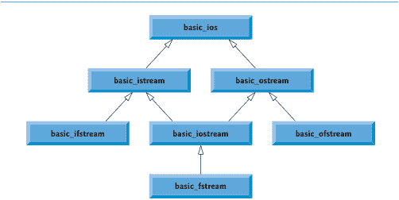

**图14.2** | 流 I/O 模板层次结构的一部分。

## 14.3 创建顺序文件

C++ 不对文件施加任何结构。因此，在 C++ 文件中不存在“记录”这样的概念。你必须根据应用程序的要求来构造文件。下面的示例展示了如何对文件施加简单的记录结构。

图14.3 创建了一个顺序文件，该文件可用于应收账款系统，以帮助管理信用客户欠公司的款项。对于每个客户，程序获取客户的账号、姓名和余额（即客户因过去收到的商品和服务而欠公司的金额）。为每个客户获取的数据构成该客户的一条记录。账号作为记录键；也就是说，程序按账号顺序创建和维护文件中的记录。该程序假定用户按账号顺序输入记录。在一个完整的应收账款系统中，会为用户提供排序功能，以便按任意顺序输入记录——然后记录会被排序并写入文件。

```cpp
// Fig. 14.3 : Fig14_03.cpp
// Create a sequential file.
#include <iostream>
#include <string>
#include <fstream> // contains file stream processing types
#include <cstdlib> // exit function prototype
using namespace std;

int main()
{
   // ofstream constructor opens file
   ofstream outClientFile( "clients.txt", ios::out );

   // exit program if unable to create file
   if ( !outClientFile ) // overloaded ! operator
   {
      cerr << "File could not be opened" << endl;
      exit( EXIT_FAILURE );
   } // end if

   cout << "Enter the account, name, and balance." << endl
        << "Enter end-of-file to end input.\n? ";

   int account; // the account number
   string name; // the account owner's name
   double balance; // the account balance

   // read account, name and balance from cin, then place in file
   while ( cin >> account >> name >> balance )
   {
      outClientFile << account << ' ' << name << ' ' << balance << endl;
      cout << "? ";
   } // end while
} // end main
```

```text
Enter the account, name, and balance.
Enter end-of-file to end input.
? 100 Jones 24.98
? 200 Doe 345.67
? 300 White 0.00
? 400 Stone -42.16
? 500 Rich 224.62
? ^Z
```

**图14.3** | 创建顺序文件。

#### 打开文件

图14.3 将数据写入文件，因此我们通过创建 ofstream 对象来打开文件进行输出。两个参数传递给对象的构造函数——文件名和文件打开模式（第12行）。对于 ofstream 对象，文件打开模式可以是 ios::out（默认）以向文件输出数据，或者 ios::app 以将数据追加到文件末尾（不修改文件中已有的任何数据）。由于 ios::out 是默认模式，第12行中的第二个构造函数参数不是必需的。以 ios::out 模式打开的现有文件会被**截断**——文件中的所有数据都被丢弃。如果指定的文件尚不存在，则 `ofstream` 对象使用该文件名**创建**文件。在 C++11 之前，文件名被指定为基于指针的字符串——从 C++11 开始，它也可以被指定为 string 对象。


#### 错误预防提示 14.1

当为输出（`ios::out`）打开现有文件时要小心，尤其是当你想保留文件内容时，这些内容会在没有任何警告的情况下被丢弃。

第12行创建了一个名为 `outClientFile` 的 `ofstream` 对象，它与为输出而打开的文件 `clients.txt` 关联。参数 `clients.txt` 和 `ios::out` 传递给 ofstream 构造函数，构造函数打开文件——这建立了与文件的“通信线路”。默认情况下，ofstream 对象是为输出而打开的，因此第12行可以使用替代语句

```
ofstream outClientFile("clients.txt");
```

为输出打开 `clients.txt`。图14.4 列出了文件打开模式。这些模式也可以组合使用，我们将在第14.8节讨论。

| 模式 | 描述 |
| --- | --- |
| `ios::app` | 将所有输出追加到文件末尾。 |
| `ios::ate` | 打开一个文件用于输出，并移动到文件末尾（通常用于将数据追加到文件中）。数据可以写入文件的任何位置。 |
| `ios::in` | 打开文件用于输入。 |
| `ios::out` | 打开文件用于输出。 |
| `ios::trunc` | 丢弃文件内容（这也是 `ios::out` 的默认操作）。 |
| `ios::binary` | 以二进制（即非文本）输入或输出方式打开文件。 |

**图14.4** | 文件打开模式。

#### 通过 open 成员函数打开文件

你可以创建一个 ofstream 对象而不打开特定文件——在这种情况下，可以稍后将文件附加到该对象。例如，语句

```
ofstream outClientFile;
```

创建了一个尚未与文件关联的 ofstream 对象。ofstream 成员函数 **open** 打开一个文件并将其附加到现有的 ofstream 对象，如下所示：

```
outClientFile.open("clients.txt", ios::out);
```


#### 错误预防提示 14.2

某些操作系统允许你同时多次打开同一文件。避免这样做，因为这可能导致难以察觉的问题。

#### 测试文件是否成功打开

创建 ofstream 对象并尝试打开它之后，程序测试打开操作是否成功。第15-19行的 if 语句使用重载的 ios 成员-


成员函数 `operator!` 用于判断打开操作是否成功。如果流在打开操作时设置了 `failbit` 或 `badbit`（见第13章），则条件返回真值。一些可能的错误包括：尝试打开一个不存在的文件进行读取、尝试从没有访问权限的目录中打开文件进行读取或写入，以及在没有磁盘空间时打开文件进行写入。

如果条件指示打开文件的尝试不成功，第17行输出错误信息“File could not be opened”，第18行调用函数 `exit` 终止程序。传给 `exit` 的参数会返回给调用该程序的环境。将 `EXIT_SUCCESS`（也在 `<cstdlib>` 中定义）传给 `exit` 表示程序正常终止；传入任何其他值（此处为 `EXIT_FAILURE`）表示程序因错误而终止。

### 重载的 `void *` 运算符

另一个重载的成员函数——`operator void *`——将流转换为指针，因此可以将其测试为0（即空指针）或非零（即任何其他指针值）。当指针值用作条件时，C++将条件中的空指针解释为 `bool` 值 `false`，并将非空指针解释为 `bool` 值 `true`。如果流已设置 `failbit` 或 `badbit`，则返回0（`false`）。第29–33行 `while` 语句中的条件隐式调用了 `cin` 上的 `operator void *` 成员函数。只要 `cin` 既未设置 `failbit` 也未设置 `badbit`，条件就保持为真。输入文件结束指示符会为 `cin` 设置 `failbit`。`operator void *` 函数可用于测试输入对象是否到达文件末尾，但也可以对输入对象调用成员函数 `eof`。

### 处理数据

如果第12行成功打开文件，程序便开始处理数据。第21–22行提示用户输入每条记录的各字段，或在数据输入完成时输入文件结束指示符。图14.5列出了各种计算机系统上输入文件结束符的键盘组合。

| 计算机系统 | 键盘组合 |
|---|---|
| UNIX/Linux/Mac OS X | `<Ctrl-d>`（单独一行） |
| Microsoft Windows | `<Ctrl-z>`（有时后跟按 `Enter`） |

**图 14.5** | 文件结束键组合。

第29行提取每组数据并判断是否已输入文件结束符。

当遇到文件结束符或输入了错误数据时，`operator void *` 返回空指针（该指针转换为 `bool` 值 `false`），`while` 语句终止。用户输入文件结束符以告知程序不再处理其他数据。当用户输入文件结束键组合时，文件结束指示符被设置。`while` 语句循环直到设置了文件结束指示符（或输入了错误数据）。

第31行使用流插入运算符 `<<` 和程序开始时与文件关联的 `outClientFile` 对象，将一组数据写入文件 `clients.txt`。这些数据由专门读取该文件的程序检索（见14.4节）。图14.3中创建的文件只是一个*文本文件*，因此任何文本编辑器都可以查看它。

### 关闭文件

一旦用户输入文件结束指示符，`main` 终止。这将隐式调用 `outClientFile` 的析构函数，从而*关闭* `clients.txt` 文件。你也可以使用成员函数 `close` *显式*关闭 `ofstream` 对象，如下所示：

```cpp
outClientFile.close();
```


> **错误预防提示 14.3**  
> *一旦程序中不再需要某个文件，应尽快将其关闭*

### 示例执行

在图14.3程序的示例执行中，用户输入了五个账户的信息，然后通过输入文件结束符（Microsoft Windows 下显示为 `^Z`）表示数据输入完成。此对话框窗口未显示数据记录在文件中的样子。为了验证创建该文件的程序是否成功运行，下一节将展示如何创建一个读取该文件并打印其内容的程序。

## 14.4 从顺序文件中读取数据

文件存储数据，以便在需要时*检索*数据进行处理。上一节演示了如何创建一个用于顺序访问的文件。我们现在讨论如何从文件中*读取*数据。图14.6读取并显示我们使用图14.3程序创建的 `clients.txt` 文件中的记录。创建 `ifstream` 对象会打开一个用于*输入*的文件。`ifstream` 构造函数可以接收文件名和文件打开模式作为参数。第15行创建了一个名为 `inClientFile` 的 `ifstream` 对象，并将其与 `clients.txt` 文件关联。括号中的参数被传递给 `ifstream` 构造函数，该构造函数打开文件并与文件建立“通信线路”。


> **良好编程实践 14.1**  
> *如果文件内容不应被修改，请使用 `ios::in` 仅将其打开用于输入。这样可以防止文件内容被意外修改，也是最小特权原则的又一个示例。*

```cpp
1  // Fig. 14.6: Fig14_06.cpp
2  // Reading and printing a sequential file.
3  #include <iostream>
4  #include <fstream>  // file stream
5  #include <iomanip>
6  #include <string>
7  #include <cstdlib>
8  using namespace std;
9
10 void outputLine( int, const string &, double ); // prototype
```

**图 14.6** | 读取并打印顺序文件。（第1部分，共2部分。）

```cpp
39        case ZERO_BALANCE:
40           cout << "\nAccounts with zero balances:\n";
41           break;
42        case CREDIT_BALANCE:
43           cout << "\nAccounts with credit balances:\n";
44           break;
45        case DEBIT_BALANCE:
46           cout << "\nAccounts with debit balances:\n";
47           break;
48     } // end switch

50     // read account, name and balance from file
51     inClientFile >> account >> name >> balance;

53     // display file contents (until eof)
54     while ( !inClientFile.eof() )
55     {
56        // display record
57        if ( shouldDisplay( request, balance ) )
58           outputLine( account, name, balance );

60        // read account, name and balance from file
61        inClientFile >> account >> name >> balance;
62     } // end inner while

64     inClientFile.clear(); // reset eof for next input
65     inClientFile.seekg( 0 ); // reposition to beginning of file
66     request = getRequest(); // get additional request from user
67  } // end outer while

69  cout << "End of run." << endl;
70 } // end main

72 // obtain request from user
73 int getRequest()
74 {
75    int request; // request from user

77    // display request options
78    cout << "\nEnter request" << endl
79       << " 1 - List accounts with zero balances" << endl
80       << " 2 - List accounts with credit balances" << endl
81       << " 3 - List accounts with debit balances" << endl
82       << " 4 - End of run" << fixed << showpoint;

84    do // input user request
85    {
86       cout << "\n? ";
87       cin >> request;
88    } while ( request < ZERO_BALANCE || request > END );

90    return request;
91 } // end function getRequest
```

**图 14.7** | 信用查询程序。（第2部分，共4部分。）

```cpp
// determine whether to display given record
bool shouldDisplay( int type, double balance )
{
   // determine whether to display zero balances
   if ( type == ZERO_BALANCE && balance == 0 )
      return true;

   // determine whether to display credit balances
   if ( type == CREDIT_BALANCE && balance < 0 )
      return true;

   // determine whether to display debit balances
   if ( type == DEBIT_BALANCE && balance > 0 )
      return true;

   return false;
} // end function shouldDisplay

// display single record from file
void outputLine( int account, const string &name, double balance )
{
   cout << left << setw( 10 ) << account << setw( 13 ) << name
        << setw( 7 ) << setprecision( 2 ) << right << balance << endl;
} // end function outputLine
```

```text
Enter request
  1 - List accounts with zero balances
  2 - List accounts with credit balances
  3 - List accounts with debit balances
  4 - End of run
? 1

Accounts with zero balances:
300      White       0.00

Enter request
  1 - List accounts with zero balances
  2 - List accounts with credit balances
  3 - List accounts with debit balances
  4 - End of run
? 2

Accounts with credit balances:
400      Stone      -42.16

Enter request
  1 - List accounts with zero balances
  2 - List accounts with credit balances
  3 - List accounts with debit balances
  4 - End of run
? 3

Accounts with debit balances:
100      Jones       24.98
200      Doe        345.67
500      Rich       224.62
```

**图 14.7** | 信用查询程序。（第3部分，共4部分。）


```text
Enter request
 1 - List accounts with zero balances
 2 - List accounts with credit balances
 3 - List accounts with debit balances
 4 - End of run
? 4
End of run.
```

**图 14.7** 信用查询程序。（共 4 部分的第 4 部分）。

## 14.5 更新顺序文件

按照第 14.3 节所示方式格式化并写入顺序文件的数据，在不破坏文件中其他数据的前提下无法修改。例如，如果要将名字“White”改为“Worthington”，那么在不损坏文件的情况下不能覆盖旧名字。White 的记录当初写入文件时为：

```text
300 White 0.00
```

如果从文件中同一位置开始重写该记录，并使用更长的名字，记录将变为：

```text
300 Worthington 0.00
```

新记录比原记录多出六个字符。因此，超出“Worthington”中第二个“o”之后的字符会覆盖文件中下一条顺序记录的开头部分。问题在于，在使用流插入运算符 `<<` 和流提取运算符 `>>` 的格式化输入/输出模型中，字段（进而记录）的大小可能不同。例如，值 7、14、-117、2074 和 27383 都是 int 类型，它们在内部存储相同数量的“原始数据”字节（在 32 位机器上通常为四个字节，在 64 位机器上为八个字节）。然而，当这些整数作为格式化文本（字符序列）输出时，它们会根据实际值变成不同大小的字段。因此，格式化输入/输出模型不用于原地更新记录。第 14.6 节至第 14.10 节将展示如何使用定长记录进行原地更新。

这种更新也可以笨拙地完成。例如，要进行上述姓名更改，可以将顺序文件中 `300 White 0.00` 之前的记录复制到一个新文件，然后将更新后的记录写入新文件，再将 `300 White 0.00` 之后的记录复制到新文件。然后可以删除旧文件并将新文件重命名。这需要处理文件中的每条记录才能更新一条记录。不过，如果一次遍历文件时要更新许多记录，这种技术是可以接受的。

## 14.6 随机访问文件

到目前为止，我们已经了解了如何创建顺序文件并搜索其中的信息。对于即时访问应用，顺序文件并不合适，因为这类应用需要立即定位特定记录。常见的即时访问应用包括航空订票系统、银行系统、销售点系统、自动柜员机以及其他需要快速访问特定数据的交易处理系统。一家银行可能有数十万（甚至数百万）其他客户，然而，当客户使用自动柜员机时，程序会在几秒或更短时间内检查该客户的账户是否有足够资金。这种即时访问正是通过*随机访问文件*实现的。随机访问文件中的单条记录可以直接（且快速地）访问，而无需搜索其他记录。

如前所述，C++ 不对文件施加结构。因此，想要使用随机访问文件的应用程序必须自己创建这种结构。可以使用多种技术。也许最简单的方法是要求文件中的所有记录都具有相同的*固定长度*。使用相同大小的定长记录，程序可以轻松地快速计算（作为记录大小和记录键的函数）任何记录相对于文件开头的准确位置。我们很快将看到，即使在大型文件中，这也有助于实现特定记录的*立即访问*。

图 14.8 展示了 C++ 对由定长记录（本例中每条记录长 100 字节）组成的随机访问文件的看法。随机访问文件就像一列由许多相同大小车厢组成的火车——有些车厢是空的，有些则装有货物。

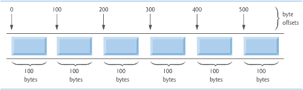

**图 14.8** *C++ 对随机访问文件的看法。*

*可以将数据插入随机访问文件而不破坏文件中的其他数据。先前存储的数据也可以在不重写整个文件的情况下进行更新或删除。* 在接下来的各节中，我们将解释如何创建随机访问文件、向文件输入数据、按顺序和随机方式读取数据，以及更新不再需要的数据。

## 14.7 创建随机访问文件

`ostream` 成员函数 `write` 从内存中的特定位置开始，向指定流输出固定数量的字节。当流与文件关联时，函数 `write` 将数据写入由放置文件位置指针指定的文件位置。`istream` 成员函数 `read` 从指定流输入固定数量的字节到从指定地址开始的内存区域。如果流与文件关联，函数 `read` 将从由“获取”文件位置指针指定的文件位置输入字节。

### 使用 ostream 成员函数 write 写入字节

当将整数 `number` 写入文件时，不是使用语句

```cpp
outFile << number;
```

（对于四字节整数 `number`，该语句可能打印少则一位、多则 11 位（10 位数字加符号，每位需要一字节存储）），而是可以使用语句

```cpp
outFile.write( reinterpret_cast<const char * > (&number ),
    sizeof( number ) );
```

该语句始终写入整数 `number` 的二进制版本的四字节（在具有四字节整数的机器上）。函数 `write` 将内存中的对象视为 `const char *`（指向字节的指针），并将其第一个参数视为一组字节。从该位置开始，函数 `write` 输出其第二个参数（类型为 `size_t` 的整数）指定的字节数。正如我们将看到的，流函数 `read` 随后可用于将这四字节读回整数变量 `number`。

### 使用 reinterpret_cast 运算符在指针类型之间转换

不幸的是，我们传递给函数 `write` 作为第一个参数的大多数指针并不是 `const char *` 类型。要输出其他类型的对象，我们必须将这些对象的指针转换为 `const char *` 类型；否则，编译器将无法编译对函数 `write` 的调用。C++ 为此类情况提供了 `reinterpret_cast` 运算符，即必须将一种类型的指针强制转换为无关的指针类型时。如果没有 `reinterpret_cast`，输出整数 `number` 的 `write` 语句将无法编译，因为编译器不允许将类型为 `int *` 的指针（表达式 `&number` 返回的类型）传递给期望参数类型为 `const char *` 的函数——就编译器而言，这些类型是不一致的。

`reinterpret_cast` 在编译时执行，不会改变其操作数所指向对象的值。相反，它请求编译器将操作数重新解释为目标类型（在关键字 `reinterpret_cast` 之后的尖括号中指定）。在图 14.11 中，我们使用 `reinterpret_cast` 将 `ClientData` 指针转换为 `const char *`，这会将 `ClientData` 对象重新解释为要输出到文件的字节。随机访问文件处理程序很少将单个字段写入文件。通常，它们一次写入一个类对象，如下面的示例所示。

> **错误预防提示 14.4**
> 使用 `reinterpret_cast` 很容易进行危险的操作，可能导致严重的运行时错误。


> **可移植性提示 14.1**
> `reinterpret_cast` 依赖于编译器，可能导致程序在不同平台上表现不同。仅在绝对必要时使用此运算符。


> **可移植性提示 14.2**
> 读取未格式化数据（由 `write` 写入）的程序必须在与写入数据的程序兼容的系统上编译和运行，因为不同系统可能以不同方式表示内部数据。


### 信用处理程序

考虑以下问题描述：

> 创建一个信用处理程序，能够为一个最多有 100 个客户的公司存储最多 100 条定长记录。每条记录应由一个作为记录键的账号、一个姓氏、一个名字和一个余额组成。该程序应能够更新账户、插入新账户、删除账户，并将所有账户记录插入到一个格式化的文本文件中以供打印。


接下来的几节将创建这个信用处理程序。图 14.11 演示了打开随机访问文件、使用 `ClientData` 类的对象（图 14.9–14.10）定义记录格式，并以*二进制*格式将数据写入磁盘。该程序使用 `write` 函数用空对象初始化文件 `credit.dat` 中的所有 100 条记录。每个空对象包含账号 0、空的姓氏和名字字符串，以及余额 0.0。每条记录都在将存储账户数据的空间内进行初始化。

```cpp
// Fig. 14.9: ClientData.h
// Class ClientData definition used in Fig. 14.11--Fig. 14.14.
#ifndef CLIENTDATA_H
#define CLIENTDATA_H

#include <string>

class ClientData
{
public:
   // default ClientData constructor
   ClientData( int = 0, const std::string & = "",
      const std::string & = "", double = 0.0 );

   // accessor functions for accountNumber
   void setAccountNumber( int );
   int getAccountNumber() const;

   // accessor functions for lastName
   void setLastName( const std::string & );
   std::string getLastName() const;

   // accessor functions for firstName
   void setFirstName( const std::string & );
   std::string getFirstName() const;

   // accessor functions for balance
   void setBalance( double );
   double getBalance() const;
private:
   int accountNumber;
   char lastName[ 15 ];
   char firstName[ 10 ];
   double balance;
}; // end class ClientData

#endif
```

**图 14.9**  |  *ClientData 类头文件。*

```cpp
// Fig. 14.10: ClientData.cpp
// Class ClientData stores customer's credit information.
#include <string>
#include "ClientData.h"
using namespace std;

// default ClientData constructor
ClientData::ClientData( int accountNumberValue, const string &lastNameValue,
   const string &firstNameValue, double balanceValue )
   : accountNumber( accountNumberValue ), balance( balanceValue )
{
   setLastName( lastNameValue );
   setFirstName( firstNameValue );
} // end ClientData constructor

// get account-number value
int ClientData::getAccountNumber() const
{
   return accountNumber;
} // end function getAccountNumber

// set account-number value
void ClientData::setAccountNumber( int accountNumberValue )
{
   accountNumber = accountNumberValue; // should validate
} // end function setAccountNumber

// get last-name value
string ClientData::getLastName() const
{
   return lastName;
} // end function getLastName

// set last-name value
void ClientData::setLastName( const string &lastNameString )
{
   // copy at most 15 characters from string to lastName
   int length = lastNameString.size();
   length = ( length < 15 ? length : 14 );
   lastNameString.copy( lastName, length );
   lastName[ length ] = '\0'; // append null character to lastName
} // end function setLastName

// get first-name value
string ClientData::getFirstName() const
{
   return firstName;
} // end function getFirstName

// set first-name value
void ClientData::setFirstName( const string &firstNameString )
{
   // copy at most 10 characters from string to firstName
   int length = firstNameString.size();
   length = ( length < 10 ? length : 9 );
   firstNameString.copy( firstName, length );
   firstName[ length ] = '\0'; // append null character to firstName
} // end function setFirstName

// get balance value
double ClientData::getBalance() const
{
    return balance;
} // end function getBalance

// set balance value
void ClientData::setBalance( double balanceValue )
{
    balance = balanceValue;
} // end function setBalance
```

**图 14.10**  |  *ClientData 类表示客户的信用信息。*

`string` 类的对象*并非*具有统一的大小，而是使用动态分配的内存来容纳不同长度的字符串。我们必须保持固定长度的记录，因此 `ClientData` 类将客户的姓氏和名字存储在固定长度的 `char` 数组中（在图 14.9 的第 32–33 行声明）。成员函数 `setLastName`（图 14.10 第 35–42 行）和 `setFirstName`（图 14.10 第 51–58 行）分别将 `string` 对象的字符复制到相应的 `char` 数组中。以 `setLastName` 函数为例，第 38 行调用 `string` 的成员函数 **size** 获取 `lastNameString` 的长度。第 39 行确保长度小于 15 个字符，然后第 40 行使用 `string` 的成员函数 `copy` 将 `lastNameString` 中的 `length` 个字符复制到 `char` 数组 `lastName` 中。成员函数 `setFirstName` 对名字执行相同的步骤。

## 以二进制模式打开文件进行输出

在图 14.11 中，第 11 行为文件 `credit.dat` 创建了一个 `ofstream` 对象。构造函数的第二个参数——`ios::out | ios::binary`——表示我们以*二进制模式*打开文件以进行输出，如果要写入*固定长度记录*，则必须使用此模式。多个文件打开模式通过用 `|` 运算符将每个打开模式与下一个分开来组合，该运算符被称为*按位或运算符*（第 22 章将详细讨论此运算符）。第 24–25 行将 `blankClient`（在第 20 行使用默认参数构造）写入与 `ofstream` 对象 `outCredit` 关联的 `credit.dat` 文件中。请记住，`sizeof` 运算符返回括号内对象所占的字节数（参见第 8 章）。第 24 行 `write` 函数的第一个参数必须是 `const char *` 类型。但是，`&blankClient` 的数据类型是 `ClientData *`。为了将 `&blankClient` 转换为 `const char *`，第 24 行使用了强制转换运算符 `reinterpret_cast`，因此对 `write` 的调用在编译时不会产生编译错误。

```cpp
// Fig. 14.11: Fig14_11.cpp
// Creating a randomly accessed file.
#include <iostream>
#include <fstream>
#include <cstdlib>
#include "ClientData.h" // ClientData class definition
using namespace std;

int main()
{
    ofstream outCredit( "credit.dat", ios::out | ios::binary );

    // exit program if ofstream could not open file
    if ( !outCredit )
    {
        cerr << "File could not be opened." << endl;
        exit( EXIT_FAILURE );
    } // end if

    ClientData blankClient; // constructor zeros out each data member

    // output 100 blank records to file
    for ( int i = 0; i < 100; ++i )
        outCredit.write( reinterpret_cast< const char * >( &blankClient ),
            sizeof( ClientData ) );
} // end main
```

**图 14.11**  |  顺序创建包含 100 条空白记录的随机访问文件。

## 14.8 向随机访问文件随机写入数据

图 14.12 将数据写入 `credit.dat` 文件，并使用 `fstream` 函数 `seekp` 和 `write` 将数据存储在文件中的精确位置。函数 `seekp` 将写文件位置指针设置到文件中的特定位置，然后函数 `write` 输出数据。第 6 行包含图 14.9 中定义的头文件 `ClientData.h`，因此程序可以使用 `ClientData` 对象。

```cpp
// Fig. 14.12: Fig14_12.cpp
// Writing to a random-access file.
#include <iostream>
#include <fstream>
#include <cstdlib>
#include "ClientData.h" // ClientData class definition
using namespace std;

int main()
{
    int accountNumber;
    string lastName;
    string firstName;
    double balance;

    fstream outCredit( "credit.dat", ios::in | ios::out | ios::binary );

    // exit program if fstream cannot open file
    if ( !outCredit )
    {
        cerr << "File could not be opened." << endl;
        exit( EXIT_FAILURE );
    } // end if

    cout << "Enter account number (1 to 100, 0 to end input)\n? ";

    // require user to specify account number
    ClientData client;
    cin >> accountNumber;

    // user enters information, which is copied into file
    while ( accountNumber > 0 && accountNumber <= 100 )
    {
        // user enters last name, first name and balance
        cout << "Enter lastname, firstname, balance\n? ";
        cin >> lastName;
        cin >> firstName;
        cin >> balance;

        // set record accountNumber, lastName, firstName and balance values
        client.setAccountNumber( accountNumber );
        client.setLastName( lastName );
        client.setFirstName( firstName );
        client.setBalance( balance );

        // seek position in file of user-specified record
        outCredit.seekp( ( client.getAccountNumber() - 1 ) *
            sizeof( ClientData ) );

        // write user-specified information in file
        outCredit.write( reinterpret_cast< const char * >( &client ),
            sizeof( ClientData ) );

        // enable user to enter another account
        cout << "Enter account number\n? ";
        cin >> accountNumber;
    } // end while
} // end main
```

```text
Enter account number (1 to 100, 0 to end input)
? 37
Enter lastname, firstname, balance
? Barker Doug 0.00
Enter account number
? 29
Enter lastname, firstname, balance
? Brown Nancy -24.54
Enter account number
? 96
```

**图 14.12**  |  向随机访问文件写入数据。


```cpp
#include <iomanip>
#include <fstream>
#include <cstdlib>
#include "ClientData.h" // ClientData class definition
using namespace std;

void outputLine( ostream&, const ClientData & ); // prototype

int main()
{
   ifstream inCredit( "credit.dat", ios::in | ios::binary );

   // exit program if ifstream cannot open file
   if ( !inCredit )
   {
      cerr << "File could not be opened." << endl;
      exit( EXIT_FAILURE );
   } // end if

   // output column heads
   cout << left << setw( 10 ) << "Account"
        << setw( 16 ) << "Last Name" << setw( 11 ) << "First Name" << left
        << setw( 10 ) << right << "Balance" << endl;

   ClientData client; // create record

   // read first record from file
   inCredit.read( reinterpret_cast< char * >( &client ),
      sizeof( ClientData ) );

   // read all records from file
   while ( inCredit && !inCredit.eof() )
   {
      // display record
      if ( client.getAccountNumber() != 0 )
         outputLine( cout, client );

      // read next from file
      inCredit.read( reinterpret_cast< char * >( &client ),
         sizeof( ClientData ) );
   } // end while
} // end main

// display single record
void outputLine( ostream &output, const ClientData &record )
{
   output << left << setw( 10 ) << record.getAccountNumber()
          << setw( 16 ) << record.getLastName()
          << setw( 11 ) << record.getFirstName()
          << setw( 10 ) << setprecision( 2 ) << right << fixed
          << showpoint << record.getBalance() << endl;
} // end function outputLine
```

图14.13 | 顺序读取随机访问文件。（第2部分，共3部分。）

```cpp
#include <iostream>
#include <fstream>
#include <iomanip>
#include <cstdlib>
#include "ClientData.h" // ClientData class definition
using namespace std;

int enterChoice();
void createTextFile( fstream& );
void updateRecord( fstream& );
void newRecord( fstream& );
void deleteRecord( fstream& );
void outputLine( ostream&, const ClientData & );
int getAccount( const char * const );

enum Choices { PRINT = 1, UPDATE, NEW, DELETE, END };

int main()
{
   // open file for reading and writing
   fstream inOutCredit( "credit.dat", ios::in | ios::out | ios::binary );

   // exit program if fstream cannot open file
   if ( !inOutCredit )
   {
      cerr << "File could not be opened." << endl;
      exit( EXIT_FAILURE );
   } // end if

   int choice; // store user choice

   // enable user to specify action
   while ( ( choice = enterChoice() ) != END )
   {
      switch ( choice )
      {
         case PRINT: // create text file from record file
            createTextFile( inOutCredit );
            break;

         case UPDATE: // update record
            updateRecord( inOutCredit );
            break;

         case NEW: // create record
            newRecord( inOutCredit );
            break;

         case DELETE: // delete existing record
            deleteRecord( inOutCredit );
            break;

         default: // display error if user does not select valid choice
            cerr << "Incorrect choice" << endl;
            break;
      } // end switch
```

图14.14 | 银行账户程序。（第2部分，共6部分。）

```cpp
165 // move file-position pointer to correct record in file
166 insertInFile.seekg( ( accountNumber - 1 ) * sizeof( ClientData ) );

168 // read record from file
169 ClientData client;
170 insertInFile.read( reinterpret_cast< char * >( &client ),
171                    sizeof( ClientData ) );

173 // create record, if record does not previously exist
174 if ( client.getAccountNumber() == 0 )
175 {
176     string lastName;
177     string firstName;
178     double balance;

180     // user enters last name, first name and balance
181     cout << "Enter last name, firstname, balance\n";
182     cin >> setw( 15 ) >> lastName;
183     cin >> setw( 10 ) >> firstName;
184     cin >> balance;

186     // use values to populate account values
187     client.setLastName( lastName );
188     client.setFirstName( firstName );
189     client.setBalance( balance );
190     client.setAccountNumber( accountNumber );

192     // move file-position pointer to correct record in file
193     insertInFile.seekp( ( accountNumber - 1 ) * sizeof( ClientData ) );

195     // insert record into file
196     insertInFile.write( reinterpret_cast< const char * >( &client ),
197                         sizeof( ClientData ) );
198 } // end if
199 else // display error if account already exists
200     cerr << "Account #" << accountNumber
201          << " already contains information." << endl;
202 } // end function newRecord

204 // delete an existing record
205 void deleteRecord( fstream &deleteFromFile )
206 {
207     // obtain number of account to delete
208     int accountNumber = getAccount( "Enter account to delete" );

210     // move file-position pointer to correct record in file
211     deleteFromFile.seekg( ( accountNumber - 1 ) * sizeof( ClientData ) );

213     // read record from file
214     ClientData client;
215     deleteFromFile.read( reinterpret_cast< char * >( &client ),
216                          sizeof( ClientData ) );
```

图14.14 | 银行账户程序。（第5部分，共6部分。）

```cpp
// delete record, if record exists in file
if ( client.getAccountNumber() != 0 )
{
   ClientData blankClient; // create blank record

   // move file-position pointer to correct record in file
   deleteFromFile.seekp( ( accountNumber - 1 ) *
      sizeof( ClientData ) );

   // replace existing record with blank record
   deleteFromFile.write(
      reinterpret_cast< const char * >( &blankClient ),
      sizeof( ClientData ) );

   cout << "Account # " << accountNumber << " deleted.\n";
} // end if
else // display error if record does not exist
   cerr << "Account # " << accountNumber << " is empty.\n";
} // end deleteRecord

// display single record
void outputLine( ostream& output, const ClientData &record )
{
   output << left << setw( 10 ) << record.getAccountNumber()
      << setw( 16 ) << record.getLastName()
      << setw( 11 ) << record.getFirstName()
      << setw( 10 ) << setprecision( 2 ) << right << fixed
      << showpoint << record.getBalance() << endl;
} // end function outputLine

// obtain account-number value from user
int getAccount( const char * const prompt )
{
   int accountNumber;

   // obtain account-number value
   do
   {
      cout << prompt << " ( 1 - 100 ): ";
      cin >> accountNumber;
   } while ( accountNumber < 1 || accountNumber > 100 );

   return accountNumber;
} // end function getAccount
```

图14.14 | 银行账户程序。（第6部分，共6部分。）

程序有五个选项（选项5用于终止程序）。选项1调用函数createTextFile，将所有账户信息的格式化列表存储到名为print.txt的文本文件中，该文件可以被打印。函数createTextFile（第80–116行）接受一个fstream对象作为参数，用于从credit.dat文件输入数据。函数createTextFile调用istream成员函数read（第102–103行），并使用图14.13中的顺序文件访问技术从credit.dat输入数据。

## 14.4 从顺序文件读取数据

- 文件存储数据，以便在需要时检索进行处理。
- 创建`ifstream`对象会打开一个文件进行输入。`ifstream`构造函数可以接收文件名和文件打开模式作为参数。
- 仅当文件内容不应被修改时，才打开文件进行输入。
- `ifstream`类的对象默认以输入模式打开。
- 可以创建`ifstream`对象而不打开特定文件；稍后可以将文件附加到该对象。
- 要从文件中顺序检索数据，程序通常从文件开头开始读取，并连续读取所有数据，直到找到所需数据。
- 用于重新定位文件位置指针（第607页）的成员函数是`istream`的`seekg`（“seek get”；第607页）和`ostream`的`seekp`（“seek put”；第607页）。每个`istream`都有一个“get指针”，指示文件中下一次输入应发生的字节号，每个`ostream`都有一个“put指针”，指示文件中下一次输出应放置的字节号。
- `seekg`（第607页）的参数是一个长整数。可以指定第二个参数来指示查找方向（第607页），可以是`ios::beg`（默认值；第607页）用于相对于流开头定位，`ios::cur`（第607页）用于相对于流中当前位置定位，或`ios::end`（第607页）用于相对于流末尾定位。
- 文件位置指针（第607页）是一个整数值，指定文件中从文件起始位置开始的字节数位置（即相对于文件开头的偏移量（第607页））。
- 提供成员函数`tellg`（第607页）和`tellp`（第607页）分别返回“get”和“put”指针的当前位置。

## 14.5 更新顺序文件

- 已格式化并写入顺序文件的数据，在修改时存在破坏文件中其他数据的风险。问题在于记录的大小可能各不相同。

## 14.6 随机访问文件

- 顺序文件不适用于即时访问应用（第611页），这类应用需要立即定位特定记录。
- 随机访问文件（第612页）使即时访问成为可能。随机访问文件中的单个记录可以直接（且快速地）访问，无需搜索其他记录。
- 为随机访问格式化文件的最简单方法是要求文件中所有记录具有相同的固定长度。使用相同大小、固定长度的记录，程序可以轻松计算任何记录相对于文件开头的确切位置（作为记录大小和记录键的函数）。
- 可以将数据插入随机访问文件而不破坏文件中的其他数据。
- 之前存储的数据可以在不重写整个文件的情况下进行更新或删除。

## 14.7 创建随机访问文件

- `ostream`成员函数`write`从内存中的特定位置开始，向指定流输出固定数量的字节。函数`write`将数据写入由“put”文件位置指针指定的文件位置。
- `istream`成员函数`read`（第612页）从指定流输入固定数量的字节到从指定地址开始的内存区域。如果流与文件关联，函数`read`在由“get”文件位置指针指定的文件位置输入字节。


- 函数`write`将对象在内存中的视图视为`const char *`，即指向字节的指针（记住`char`是一个字节），从而将其第一个参数作为一组字节处理。从该位置开始，函数`write`输出由其第二个参数指定的字节数。随后可以使用`iostream`函数`read`将这些字节读回内存。
- `reinterpret_cast`运算符（第613页）将一种类型的指针转换为不相关的指针类型。
- `reinterpret_cast`在编译时执行，并且不会改变其操作数所指向对象的值。
- 读取未格式化数据的程序必须在与写入该数据的程序兼容的系统上编译和执行——不同系统可能以不同方式表示内部数据。
- `string`类的对象没有统一的大小，而是使用动态分配的内存来容纳各种长度的字符串。

## 14.8节 向随机访问文件随机写入数据

- 多种文件打开模式通过按位异或运算符（`|`）分隔各个打开模式来组合使用。
- 字符串成员函数`size`（第616页）获取字符串的长度。
- 文件打开模式`ios::binary`（第616页）表示应以二进制模式打开文件。

## 14.9节 从随机访问文件顺序读取数据

- `istream`函数`read`从指定流中的当前位置将指定数量的字节输入到对象中。
- 接收`ostream`参数的函数可以接收任何`ostream`对象（如`cout`）或任何`ostream`派生类的对象（如`ofstream`类型的对象）作为参数。这意味着同一个函数可以用于例如向标准输出流和文件流执行输出，而无需编写单独的函数。

## 14.11节 对象序列化

- 当对象的数据成员被输出到磁盘文件时，我们会丢失对象的类型信息。在磁盘上，我们只存储对象属性的值，而不存储类型信息。如果读取该数据的程序知道数据对应的对象类型，则程序可以将数据读入该类型的对象中。
- 所谓的序列化对象（第628页）是指将对象表示为字节序列，其中包含对象的数据以及有关对象类型和对象中存储的数据类型的信息。序列化对象可以从文件中读取并反序列化（第628页）。
- 开源Boost库支持以文本、二进制和可扩展标记语言（XML）格式序列化对象（第628页）。

## 自测练习

- **14.1** *（填空题）* 填写以下各项中的空白：

  - a) 文件流`fstream`、`ifstream`和`ofstream`的成员函数 __________ 关闭文件。
  - b) `fstream`成员函数 __________ 从指定流中读取一个字符。
  - c) 文件流`fstream`、`ifstream`和`ofstream`的成员函数 __________ 打开文件。
  - d) 在随机访问应用程序中从文件读取数据时，通常使用`iostream`成员函数 __________。
  - e) `istream`和`ostream`的成员函数`seekg`和`seekp`分别将文件位置指针设置到输入或输出流中的指定位置。

- **14.2** *（判断正误）* 指出以下哪些是正确的，哪些是错误的。如果错误，请解释原因。

  - a) 成员函数`read`不能用于从输入对象`cin`读取数据。
  - b) 必须显式创建`cin`、`cout`、`cerr`和`clog`对象。
  - c) 程序必须显式调用函数`close`来关闭与`ifstream`、`ofstream`或`fstream`对象关联的文件。
  - d) 如果文件位置指针指向顺序文件中除文件开头以外的某个位置，则必须关闭文件并重新打开才能从文件开头读取。
  - e) `ostream`成员函数`write`可以写入标准输出流`cout`。
  - f) 顺序文件中的数据总是在不覆盖附近数据的情况下更新。
  - g) 在随机访问文件中搜索所有记录以查找特定记录是不必要的。
  - h) 随机访问文件中的记录必须具有统一的长度。
  - i) 成员函数`seek`和`seekg`必须相对于文件开头进行定位。

- **14.3** 假设以下每个语句都适用于同一程序。

  - a) 编写一条语句，打开文件`oldmast.dat`用于输入；使用名为`inOldMaster`的`ifstream`对象。
  - b) 编写一条语句，打开文件`trans.dat`用于输入；使用名为`inTransaction`的`ifstream`对象。
  - c) 编写一条语句，打开文件`newmast.dat`用于输出（并创建）；使用`ofstream`对象`outNewMaster`。
  - d) 编写一条语句，从文件`oldmast.dat`中读取一条记录。该记录由整数`accountNumber`、字符串`name`和浮点数`currentBalance`组成。使用`ifstream`对象`inOldMaster`。
  - e) 编写一条语句，从文件`trans.dat`中读取一条记录。该记录由整数`accountNum`和浮点数`dollarAmount`组成。使用`ifstream`对象`inTransaction`。
  - f) 编写一条语句，向文件`newmast.dat`写入一条记录。该记录由整数`accountNum`、字符串`name`和浮点数`currentBalance`组成。使用`ofstream`对象`outNewMaster`。

- **14.4** 找出以下各项中的错误并说明如何更正。

  - a) 由`ofstream`对象`outPayable`引用的文件`payables.dat`尚未打开。

    ```cpp
    outPayable << account << company << amount << endl;
    ```

  - b) 以下语句应从文件`payables.dat`中读取一条记录。`ifstream`对象`inPayable`引用该文件，`istream`对象`inReceivable`引用文件`receivables.dat`。

    ```cpp
    inReceivable >> account >> company >> amount;
    ```

  - c) 应打开文件`tools.dat`以向文件添加数据，而不丢弃当前数据。

    ```cpp
    ofstream outTools("tools.dat", ios::out);
    ```

## 自测练习答案

- **14.1** a) close。 b) get。 c) open。 d) read。 e) seekg、seekp。

- **14.2**
  - a) 错误。函数`read`可以从任何派生自`istream`的输入流对象读取数据。
  - b) 错误。这四个流会自动为你创建。要在文件中使用它们，必须包含`<iostream>`头文件。该头文件包含每个预定义流对象的声明。
  - c) 错误。当流对象超出作用域或程序执行终止之前，`ifstream`、`ofstream`或`fstream`对象的析构函数会关闭文件，但良好的编程实践是在不再需要文件时使用`close`显式关闭所有文件。
  - d) 错误。成员函数`seekg`可用于将“获取”文件位置指针重新定位到文件开头。
  - e) 正确。
  - f) 错误。在大多数情况下，顺序文件记录的长度并不统一。因此，更新记录可能会覆盖其他数据。
  - g) 正确。
  - h) 错误。随机访问文件中的记录通常长度统一。
  - i) 错误。可以从文件开头、文件末尾以及文件中的当前位置进行定位。

- **14.3**

  - a) `ifstream inOldMaster("oldmast.dat", ios::in);`
  - b) `ifstream inTransaction("trans.dat", ios::in);`
  - c) `ofstream outNewMaster("newmast.dat", ios::out);`
  - d) `inOldMaster >> accountNumber >> name >> currentBalance;`
  - e) `inTransaction >> accountNum >> dollarAmount;`
  - f) `outNewMaster << accountNum << " " << name << " " << currentBalance;`

- **14.4**

  - a) *错误：* 在尝试向流输出数据之前，文件`payables.dat`尚未打开。

    *更正：* 使用`ofstream`函数`open`打开`payables.dat`以进行输出。

  - b) *错误：* 使用了错误的`istream`对象从名为`payables.dat`的文件中读取记录。

    *更正：* 使用`istream`对象`inPayable`来引用`payables.dat`。

  - c) *错误：* 文件内容被丢弃，因为文件是以输出模式（`ios::out`）打开的。

    *更正：* 要向文件添加数据，请以更新模式（`ios::ate`）或追加模式（`ios::app`）打开文件。

## 练习

- **14.5** *（填空题）* 填写以下各项中的空白：

  - a) 计算机在辅助存储设备上存储大量数据，这些数据以 __________ 形式存在。
  - b) 由头文件`<iostream>`声明的标准流对象是 __________、__________、__________ 和 __________。
  - c) `ostream`成员函数 __________ 向指定流输出一个字符。
  - d) `ofstream`成员函数 __________ 通常用于向随机访问文件写入数据。
  - e) `istream`成员函数 __________ 重新定位文件中的文件位置指针。

- **14.6** *（文件匹配）* 练习14.3要求你编写一系列单条语句。实际上，这些语句构成了一种重要的文件处理程序的核心，即文件匹配程序。在商业数据处理中，每个应用系统通常有多个文件。例如，在应收账款系统中，通常有一个主文件，其中包含每个客户的详细信息，如客户姓名、地址、电话号码、未结余额、信用额度、折扣条款、合同安排，以及可能的近期购买和现金支付的简要历史记录。


当交易发生时（例如，发生销售和收到现金付款），它们会被录入到一个文件中。在每个业务周期结束时（有些公司是一个月，有些是一周，有些情况下是一天），交易文件（在练习14.3中称为`trans.dat`）会被应用到主文件（在练习14.3中称为`oldmast.dat`）上，从而更新每个账户的购买和付款记录。在更新运行期间，主文件会被重写为一个新文件（`newmast.dat`），该文件将在下一个业务周期结束时再次用于开始更新过程。

文件匹配程序必须处理单文件程序中不存在的一些问题。例如，匹配并不总是发生。主文件中的某个客户可能在本业务周期内没有进行任何购买或现金付款，因此该客户的记录不会出现在交易文件中。类似地，某个确实进行了购买或现金付款的客户可能刚刚搬到这个社区，公司可能还没有机会为该客户创建主记录。

以练习14.3中的语句为基础，编写一个完整的文件匹配应收账款程序。使用每个文件上的账号作为匹配的记录键。假设每个文件都是顺序文件，记录按账号递增顺序存储。

当发生匹配时（即主文件和交易文件上都出现具有相同账号的记录），将交易文件上的美元金额加到主文件上的当前余额上，并写入`newmast.dat`记录。（假设购买以交易文件上的正金额表示，付款以负金额表示。）当某个特定账户有主记录但没有相应的交易记录时，只需将主记录写入`newmast.dat`。当有交易记录但无对应的主记录时，打印错误消息“Unmatched transaction record for account number ...”（填入来自交易记录的账号）。

### 14.7 （文件匹配测试数据）

在编写完练习14.6的程序后，编写一个简单的程序来创建一些测试数据，以检验该程序。使用以下示例账户数据：

**主文件**

| 账号 | 姓名 | 余额 |
| --- | --- | ---: |
| 100 | Alan Jones | 348.17 |
| 300 | Mary Smith | 27.19 |
| 500 | Sam Sharp | 0.00 |
| 700 | Suzy Green | −14.22 |

**交易文件**

| 账号 | 交易金额 |
| --- | ---: |
| 100 | 27.14 |
| 300 | 62.11 |
| 400 | 100.56 |
| 900 | 82.17 |

### 14.8 （文件匹配测试）

使用练习14.7中创建的测试数据文件，运行练习14.6中的程序。打印新的主文件。检查账户是否正确更新。

# 15 标准库容器和迭代器

> 它们是书籍，
> 艺术，学府，
> 它们展示、包含并
> 滋养整个世界。
> ——威廉·莎士比亚

> 在一张地图上
> 遍历整个宇宙。
> ——米格尔·德·塞万提斯

## 目标

在本章中，你将：

- 介绍标准库容器、迭代器和算法。
- 使用 `vector`、`list` 和 `deque` 序列容器。
- 使用 `set`、`multiset`、`map` 和 `multimap` 关联容器。
- 使用 `stack`、`queue` 和 `priority_queue` 容器适配器。
- 使用迭代器访问容器元素。
- 使用 `copy` 算法和 `ostream_iterator` 输出容器。
- 使用 `bitset`“近容器”实现埃拉托斯特尼筛法以确定素数。


- 15.1 引言
- 15.2 容器简介
- 15.3 迭代器简介
- 15.4 算法简介
- 15.5 序列容器
  - 15.5.1 vector 序列容器
  - 15.5.2 list 序列容器
  - 15.5.3 deque 序列容器
- 15.6 关联容器
  - 15.6.1 multiset 关联容器
  - 15.6.2 set 关联容器
  - 15.6.3 multimap 关联容器
  - 15.6.4 map 关联容器
- 15.7 容器适配器
  - 15.7.1 stack 适配器
  - 15.7.2 queue 适配器
  - 15.7.3 priority_queue 适配器
- 15.8 bitset 类
- 15.9 小结
- 摘要
- 自测练习
- 自测练习答案
- 练习
- 推荐阅读

## 15.1 引言

标准库定义了强大的、基于模板的、可重用的组件，这些组件实现了许多常见的数据结构以及用于处理这些数据结构的算法。我们在第6–7章开始介绍模板，并在本章以及第16和19章中广泛使用它们。从历史上看，本章介绍的这些功能通常被称为标准模板库（Standard Template Library，STL）。我们偶尔会将这些功能称为STL。在C++标准文档中，这些功能仅作为C++标准库的一部分被提及。

#### 容器、迭代器和算法

本章介绍标准库的三个关键组件——容器（模板化的数据结构）、迭代器和算法。容器是能够存储几乎任何数据类型对象的数据结构（存在一些限制）。我们将看到有三种容器类样式——一等容器、容器适配器和近容器。

#### 容器中的常见成员函数

每个容器都有相关的成员函数——其中一部分在所有容器中都有定义。我们在`array`（第7章引入）、`vector`（第7章引入，本章将更深入介绍）、`list`（15.5.2节）和`deque`（15.5.3节）的示例中说明了大部分这种通用功能。

#### 迭代器

迭代器具有类似于指针的属性，用于操作容器元素。内置数组也可以使用指针作为迭代器，由标准库算法操作。我们将看到，使用迭代器操作容器非常方便，并且与标准库算法结合时提供了巨大的表达能力——在某些情况下，可以将多行代码减少为一条语句。

1. STL由Alexander Stepanov和Meng Lee在惠普开发，基于他们的泛型编程研究，David Musser做出了重大贡献。

#### 算法

标准库**算法**是函数模板，它们执行常见的数据操作，如*搜索*、*排序*以及*比较元素*或*整个容器*。标准库提供了许多算法。大多数算法使用迭代器来访问容器元素。每种算法对可与其一起使用的迭代器类型有*最低要求*。我们将看到容器支持特定的迭代器类型，有些比其他的更强大。*容器*支持的迭代器类型决定了该容器是否可以与特定算法一起使用。迭代器封装了用于访问容器元素的机制。这种封装使得许多算法可以独立于底层容器实现应用于各种容器。这也使你可以创建能够处理*多种容器类型*元素的新算法。

#### 自定义模板化数据结构

在第19章中，我们将构建自己的*自定义*模板化数据结构，包括链表、队列、栈和树。我们将仔细地用指针将链接对象编织在一起。基于指针的代码复杂且容易出错——最微小的遗漏或疏忽都可能导致严重的*内存访问违规*和*内存泄漏*错误，而编译器不会发出任何警告。如果大型项目中的许多程序员为不同任务实现自定义容器和算法，代码将变得难以修改、维护和调试。


> **软件工程观察 15.1**
> *避免重新发明轮子；使用C++标准库的组件进行编程。*


> **错误预防提示 15.1**
> *预打包的模板化标准库容器足以满足大多数应用需求。使用标准库有助于减少测试和调试时间。*

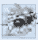

> **性能提示 15.1**
> *标准库的构思和设计是为了性能和灵活性。*

## 15.2 容器简介

标准库容器类型如图15.1所示。容器分为四大类——**序列容器**、**有序关联容器**、**无序关联容器**和**容器适配器**。

| 容器类 | 描述 |
| --- | --- |
| *序列容器* |  |
| array | 固定大小。可直接访问任何元素。 |
| deque | 可在前端或后端快速插入和删除。可直接访问任何元素。 |
| forward_list | 单向链表，可快速在任何位置插入和删除。C++11新增。 |


**图 15.1** 标准库容器类和容器适配器。（第1部分，共2部分。）


| 容器类 | 描述 |
|---|---|
| list | 双向链表，可在任意位置快速插入和删除。 |
| vector | 可在末尾快速插入和删除。可直接访问任意元素。 |
| *有序关联容器* |  |
| set | 快速查找，不允许重复。 |
| multiset | 快速查找，允许重复。 |
| map | 一对一映射，不允许重复，基于键快速查找。 |
| multimap | 一对多映射，允许重复，基于键快速查找。 |
| *无序关联容器* |  |
| unordered_set | 快速查找，不允许重复。 |
| unordered_multiset | 快速查找，允许重复。 |
| unordered_map | 一对一映射，不允许重复，基于键快速查找。 |
| unordered_multimap | 一对多映射，允许重复，基于键快速查找。 |
| *容器适配器* |  |
| stack | 后进先出（LIFO）。 |
| queue | 先进先出（FIFO）。 |
| priority_queue | 优先级最高的元素总是第一个出列。 |

**图 15.1 |** 标准库容器类和容器适配器。（第 2 部分，共 2 部分）

## 容器概述

序列容器表示*线性*数据结构（即它们的所有元素在概念上“排成一行”），例如数组、向量和链表。我们将在第 19 章“自定义模板化数据结构”中研究链式数据结构。*关联容器*是*非线性*数据结构，通常可以快速定位存储在容器中的元素。这类容器可以存储值集合或**键值对**。从 C++11 开始，关联容器中的键是*不可变的*（它们不能被修改）。序列容器和关联容器统称为**一流容器**。栈和队列通常是序列容器的受限版本。因此，标准库将类模板 `stack`、`queue` 和 `priority_queue` 实现为**容器适配器**，使程序能够以受限方式查看序列容器。类 `string` 支持与*序列容器*相同的功能，但仅存储字符数据。

## 近似容器

还有其他容器类型被视为*近似容器*——内置数组、用于维护标志值集合的位集以及用于执行高速*数学向量*（不要与 vector 容器混淆）运算的 valarray。这些类型被视为*近似容器*，因为它们具有*一流容器*的部分（而非全部）功能。

## 常见容器函数

大多数容器提供类似的功能。许多操作适用于所有容器，其他操作适用于相似容器的子集。图 15.2 描述了众多


| 成员函数 | 描述 |
|---|---|
| `max_size` | 返回容器的*最大元素数量*。 |
| `begin` | 重载以返回指向容器*第一个元素*的迭代器或 `const_iterator`。 |
| `end` | 重载以返回指向容器*末尾之后位置*的迭代器或 `const_iterator`。 |
| `cbegin (C++11)` | 返回指向容器*第一个元素*的 `const_iterator`。 |
| `cend (C++11)` | 返回指向容器*末尾之后位置*的 `const_iterator`。 |
| `rbegin` | 该函数的两个版本返回指向容器*最后一个元素*的 `reverse_iterator` 或 `const_reverse_iterator`。 |
| `rend` | 该函数的两个版本返回指向容器*第一个元素之前位置*的 `reverse_iterator` 或 `const_reverse_iterator`。 |
| `crbegin (C++11)` | 返回指向容器最后一个元素的 `const_reverse_iterator`。 |
| `crend (C++11)` | 返回指向容器*第一个元素之前*位置的 `const_reverse_iterator`。 |
| `erase` | 从容器中移除*一个或多个元素*。 |
| `clear` | 从容器中移除*所有元素*。 |

**图 15.2** | 大多数标准库容器常用的成员函数。（第 2 部分，共 2 部分。）

## *一流容器常见嵌套类型*

图 15.3 展示了一流容器常见的*嵌套类型*（在每个容器类定义内部定义的类型）。它们用于基于模板的变量声明、函数参数和函数返回值中（如你将在本章和第 16 章中看到的）。例如，每个容器中的 `value_type` 始终表示存储在容器中的元素类型。类 `forward_list` 不提供 `reverse_iterator` 和 `const_reverse_iterator` 类型。

| typedef | 描述 |
|---|---|
| `allocator_type` | 用于分配容器内存的对象类型——不包含在类模板 array 中。 |
| `value_type` | 存储在容器中的元素类型。 |
| `reference` | 容器元素类型的引用。 |
| `const_reference` | 容器元素类型的引用，只能用于*读取*容器中的元素并执行 const 操作。 |
| `pointer` | 容器元素类型的指针。 |
| `const_pointer` | 容器元素类型的指针，只能用于*读取*元素并执行 const 操作。 |
| `iterator` | 指向容器元素类型元素的迭代器。 |
| `const_iterator` | 指向容器元素类型元素的迭代器。仅用于*读取*元素并执行 const 操作。 |
| `reverse_iterator` | 指向容器元素类型元素的反向迭代器。用于反向遍历容器。 |
| `const_reverse_iterator` | 指向容器元素类型元素的反向迭代器，只能用于*读取*元素并执行 const 操作。用于反向遍历容器。 |
| `difference_type` | 两个指向同一容器的迭代器相减结果的类型（`operator-` 未为 list 和关联容器的迭代器定义）。 |
| `size_type` | 用于统计容器中项的数量并对序列容器进行索引的类型（不能对 list 进行索引）。 |

**图 15.3** | 一流容器中的嵌套类型。


## 对容器元素的要求

在使用标准库容器之前，务必确保存储在容器中的对象类型支持*最小*功能集。当对象插入容器时，会创建该对象的*副本*。因此，对象类型应提供*复制构造函数*和*复制赋值运算符*（自定义或默认版本，取决于类是否使用动态内存）。此外，*有序关联容器*和许多算法要求元素能够被*比较*——因此，对象类型应提供*小于*（`<`）和*等于*（`==`）运算符。从 C++11 开始，对象也可以被*移动*到容器元素中，在这种情况下，对象类型需要*移动构造函数*和*移动赋值运算符*——第 24 章将讨论一些语义。

## 15.3 迭代器简介

*迭代器*与*指针*有许多相似之处，用于指向*一流容器*元素并用于其他目的。迭代器保存对其所操作的特定容器敏感的*状态*信息；因此，迭代器是为每种容器类型实现的。某些迭代器操作在不同容器之间是统一的。例如，*解引用运算符*（`*`）解引用迭代器，以便你可以使用它所指向的元素。迭代器上的 `++` 操作将其移动到容器的*下一个*元素（就像递增指向内置数组的指针使指针指向下一个数组元素一样）。

*一流容器*提供成员函数 begin 和 end。函数 `begin` 返回指向容器第一个元素的迭代器。函数 `end` 返回指向容器*末尾之后元素*（即末尾之后的一个位置）的迭代器——一个不存在的元素，通常用于确定何时到达容器的末尾。如果迭代器 `i` 指向某个特定元素，则 `++i` 指向“下一个”元素，`*i` 引用 `i` 所指向的元素。由 end 产生的迭代器通常


从 `cin` 读取整数并将该整数赋给 number1。将解引用运算符 `*` 应用于迭代器 inputInt，会从与 inputInt 关联的流中获取值；这类似于*解引用指针*。第15行将迭代器 inputInt 定位到输入流中的下一个值。第16行从 inputInt 输入下一个整数并将其赋给 number2。

## ostream_iterator 输出流迭代器

第19行创建了一个 `ostream_iterator`，它能够将 int 值插入（输出）到标准输出对象 cout。第22行通过将 number1 和 number2 的和赋给 `*outputInt`，将一个整数输出到 cout。注意，在赋值语句中，我们将解引用的输出迭代器用作*左值*。如果想使用 outputInt 输出另一个值，必须先用 `++` 递增迭代器。前缀或后缀递增都可以使用——出于*性能*原因，请使用前缀形式，因为它不会创建临时对象。

> **错误预防提示 15.2**
>
> 将 `*`（解引用）运算符应用于 const 迭代器时，它会返回容器元素的 const 引用，从而禁止使用非 const 成员函数。


## 迭代器类别与迭代器类别层次结构

图15.5展示了迭代器类别。每个类别都提供一组特定的功能。图15.6展示了迭代器类别的层次结构。当你沿着层次结构从下到上时，每个迭代器类别都支持图中其下方所有类别的全部功能。因此，“最弱”的迭代器类型位于底部，而功能最强大的迭代器类型位于顶部。注意，这*不是*继承层次结构。

| 类别 | 描述 |
|---|---|
| *随机访问* | 结合了*双向迭代器*的功能，并能够*直接访问容器中的任意元素*，即可以向前或向后跳转任意数量的元素。这些迭代器还可以使用关系运算符进行比较。 |
| *双向* | 结合了*前向迭代器*的功能，并能够向*后*移动（即从容器末尾向开头移动）。双向迭代器支持多遍算法。 |
| *前向* | 结合了*输入迭代器和输出迭代器*的功能，并在容器中保留其位置（作为状态信息）。这种迭代器可以多次遍历序列（用于所谓的多遍算法）。 |
| *输出* | 用于向容器写入元素。输出迭代器只能沿*向前*方向一次移动一个元素。输出迭代器*仅支持单遍算法*——同一个输出迭代器不能用于两次遍历序列。 |
| *输入* | 用于从容器读取元素。输入迭代器只能沿*向前*方向（即从容器的开头到末尾）一次移动一个元素。输入迭代器*仅支持单遍算法*——同一个输入迭代器不能用于两次遍历序列。 |

**图15.5**  |  *迭代器类别。*


**图15.6**  迭代器类别层次结构

## 容器对迭代器的支持

每个容器支持的迭代器类别决定了该容器能否用于特定的算法。*支持随机访问迭代器的容器可以用于所有标准库算法*——但有一个例外：如果算法需要改变容器的大小，则该算法不能用于内置数组或 array 对象。指向*内置*数组的指针在大多数算法中可以代替迭代器使用。图15.7展示了每种容器的迭代器类别。第一类容器、string 和内置数组都可以使用迭代器进行遍历。

| 容器 | 迭代器类型 | 容器 | 迭代器类型 |
|---|---|---|---|
| *序列容器（第一类）* |  | *无序关联容器（第一类）* |  |
| vector | 随机访问 | unordered_set | 双向 |
| array | 随机访问 | unordered_multiset | 双向 |
| deque | 随机访问 | unordered_map | 双向 |
| list | 双向 | unordered_multimap | 双向 |
| forward_list | 前向 |  |  |
| *有序关联容器（第一类）* |  | *容器适配器* |  |
| set | 双向 | stack | 无 |
| multiset | 双向 | queue | 无 |
| map | 双向 | priority_queue | 无 |
| multimap | 双向 |  |  |

**图15.7**  每种容器支持的迭代器类型。

## 预定义的迭代器 typedef

图15.8展示了标准库容器类定义中预定义的迭代器 typedef。并非每个容器都定义了所有 typedef。我们使用 const 版本的迭代器来遍历 const 容器或不应被修改的非 const 容器。我们使用*反向迭代器*来按*反向*遍历容器。

> **错误预防提示 15.3**
>
> *对 const_iterator 执行的操作会返回 const 引用，以防止修改被操作的容器中的元素。在适当的地方使用 const_iterator 是最小特权原则的另一个例子。*

| 迭代器类型的预定义 typedef | ++ 的方向 | 能力 |
|---|---|---|
| `iterator` | 向前 | 读/写 |
| `const_iterator` | 向前 | 读 |
| `reverse_iterator` | 向后 | 读/写 |
| `const_reverse_iterator` | 向后 | 读 |

**图15.8**  |  *迭代器 typedef。*

## 迭代器操作

图15.9展示了可对每种迭代器类型执行的操作。除了为所有迭代器显示的运算符之外，迭代器还必须提供默认构造函数、复制构造函数和复制赋值运算符。**前向迭代器**支持 ++ 以及 *输入* 和 *输出* 迭代器的全部功能。**双向迭代器**支持 -- 以及 *前向* 迭代器的全部功能。**随机访问迭代器**支持表中显示的所有操作。对于输入迭代器和输出迭代器，不能保存迭代器然后在以后使用保存的值。

| 迭代器操作 | 描述 |
|---|---|
| *所有迭代器* | |
| `++p` | 前置递增迭代器。 |
| `p++` | 后置递增迭代器。 |
| `p = p1` | 将一个迭代器赋值给另一个迭代器。 |
| *输入迭代器* | |
| `*p` | 将迭代器作为*右值*解引用。 |
| `p->m` | 使用迭代器读取元素 `m`。 |
| `p == p1` | 比较迭代器是否相等。 |
| `p != p1` | 比较迭代器是否不相等。 |
| *输出迭代器* | |
| `*p` | 将迭代器作为*左值*解引用。 |
| `p = p1` | 将一个迭代器赋值给另一个迭代器。 |
| *前向迭代器* | 前向迭代器提供输入迭代器和输出迭代器的全部功能。 |
| *双向迭代器* | |
| `--p` | 前置递减迭代器。 |
| `p--` | 后置递减迭代器。 |
| *随机访问迭代器* | |
| `p += i` | 将迭代器递增 `i` 个位置。 |
| `p -= i` | 将迭代器递减 `i` 个位置。 |

**图15.9**  |  *每种迭代器类型的迭代器操作。（第1部分，共2部分）*

```
The initial size of integers is: 0
The initial capacity of integers is: 0
The size of integers is: 3
The capacity of integers is: 4

Output built-in array using pointer notation: 1 2 3 4 5 6
Output vector using iterator notation: 2 3 4
Reversed contents of vector integers: 4 3 2
```

**图15.10**  |  标准库 vector 类模板。（第2部分，共2部分）

## 创建 vector

第14行定义了一个名为 integers 的类模板 vector 实例，用于存储 int 值。当该对象被实例化时，会创建一个空 vector，其 size 为 0（即 vector 中存储的元素数量），capacity 为 0（即在不给 vector 分配更多内存的情况下可以存储的元素数量）。

## vector 成员函数 size 和 capacity

第16和17行演示了 size 和 capacity 函数；在此示例中，vector v 的每个函数最初都返回 0。函数 `size`——除 `forward_list` 外的*每个*容器都可用——返回容器中当前存储的元素数量。函数 `capacity`（特定于 vector 和 deque）返回在 vector 需要*动态调整自身大小*以容纳更多元素之前，vector 中可以存储的元素数量。

## vector 成员函数 push_back

第20-22行使用函数 `push_back`——在除 array 和 forward_list 之外的*序列容器*中可用——将元素添加到 vector 的末尾。如果向已满的 vector 添加元素，vector 会增加其大小——有些实现会让 vector 的容量*加倍*。除 array 和 vector 之外的序列容器还提供了 `push_front` 函数。

> **性能提示 15.7**
>
> *当需要更多空间时将 vector 的大小加倍可能造成浪费。例如，一个包含 1,000,000 个元素的已满 vector 在添加新元素时会调整大小以容纳 2,000,000 个元素，这会留下 999,999 个未使用的元素。可以使用 resize 和 reserve 来更好地控制空间使用。*


## 修改 vector 后更新 size 和 capacity

第24和25行使用 size 和 capacity 来说明在三次 push_back 操作之后 vector 的新 size 和 capacity。函数 size 返回 3——添加到 vector 中的元素数量。函数 capacity 返回 4（尽管这可能因编译器而异），表示在 vector 需要添加更多内存之前，我们还可以添加一个元素。当我们添加第一个元素时，vector 为一个元素分配了空间，size 变为 1，表示 vector 只包含一个元素。当我们添加第二个元素时，capacity 加倍为 2，size 也变为 2。当我们添加第三个元素时，capacity 再次加倍为 4。因此，在 vector 需要分配更多空间之前，我们实际上还可以再添加一个元素。当 vector


将迭代器定位到向量的下一个元素。注意，第 48–50 行可以替换为以下基于范围的 for 语句：

```cpp
for ( auto const& item : integers2 )
    cout << item << ' ';
```

> **常见编程错误 15.1**
>
> *试图解引用位于其容器之外的迭代器是运行时逻辑错误。特别是，`end` 返回的迭代器不应被解引用或递增。*


### 使用 const_reverse_iterator 反向显示向量的内容

第 37–39 行使用 for 语句（类似于 `printVector` 中的语句）反向遍历向量。C++11 现在包含向量成员函数 `crbegin` 和 `crend`，它们返回 `const_reverse_iterator`，表示反向遍历容器时的起始点和结束点。大多数一等容器都支持这种类型的迭代器。与函数 `crbegin` 和 `crend` 一样，在 C++11 之前，您需要使用重载的成员函数 `rbegin` 和 `rend` 来根据容器是否为 const 获取 `const_reverse_iterator` 或 `reverse_iterator`。


### C++11：shrink_to_fit

从 C++11 开始，您可以通过调用成员函数 `shrink_to_fit` 要求 vector 或 deque 将不需要的内存归还给系统。这会请求容器将其容量减少到容器中的元素数量。根据 C++ 标准，实现可以忽略此请求，以便执行特定于实现的优化。


### vector 元素操作函数

图 15.11 演示了用于检索和操作 vector 元素的函数。第 16 行使用一个重载的 vector 构造函数，该构造函数接受两个迭代器作为参数来初始化整数。第 16 行使用数组 `values` 的内容初始化 `integers`，范围从 `values` 的开头到 `values.end()`（指向 `values` 末尾之后的元素）之前，但不包括 `values.end()`。在 C++11 中，您可以使用列表初始化器来初始化向量，例如：


```cpp
vector<int> integers{ 1, 2, 3, 4, 5, 6 };
```

或

```cpp
vector<int> integers = { 1, 2, 3, 4, 5, 6 };
```

但是，这些目前在各大编译器中尚未完全支持。因此，本章的示例经常像第 16 行那样使用数组内容来初始化其他容器。

```cpp
// Fig. 15.11: fig15_15.cpp
// Testing Standard Library vector class template
// element-manipulation functions.
#include <iostream>
#include <array> // array class-template definition
#include <vector> // vector class-template definition
#include <algorithm> // copy algorithm
#include <iterator> // ostream_iterator
#include <stdexcept> // out_of_range exception
using namespace std;

int main()
{
   const size_t SIZE = 6;
   array< int, SIZE > values = { 1, 2, 3, 4, 5, 6 };
   vector< int > integers( values.cbegin(), values.cend() );
   ostream_iterator< int > output( cout, " " );

   cout << "Vector integers contains: ";
   copy( integers.cbegin(), integers.cend(), output );

   cout << "\nFirst element of integers: " << integers.front()
        << "\nLast element of integers: " << integers.back();

   integers[ 0 ] = 0; // set first element to 0
   integers.at( 2 ) = 10; // set element at position 2 to 10

   // insert 22 as 2nd element
   integers.insert( integers.cbegin() + 1, 22 );

   cout << "\n\nContents of vector integers after changes: ";
   copy( integers.cbegin(), integers.cend(), output );

   // access out-of-range element
   try
   {
      integers.at( 100 ) = 777;
   } // end try
   catch ( out_of_range &outOfRange ) // out_of_range exception
   {
      cout << "\n\nException: " << outOfRange.what();
   } // end catch

   // erase first element
   integers.erase( integers.cbegin() );
   cout << "\n\nVector integers after erasing first element: ";
   copy( integers.cbegin(), integers.cend(), output );

   // erase remaining elements
   integers.erase( integers.cbegin(), integers.cend() );
   cout << "\n\nAfter erasing all elements, vector integers "
        << ( integers.empty() ? "is not" : "is" ) << " empty";

   // insert elements from the array values
   integers.insert( integers.cbegin(), values.cbegin(), values.cend() );
   cout << "\n\nContents of vector integers before clear: ";
   copy( integers.cbegin(), integers.cend(), output );
```

**图 15.11** | 向量类模板元素操作函数。

> **常见编程错误 15.3**
>
> 通常，`erase` 会销毁从容器中删除的对象。但是，删除一个包含指向动态分配对象的指针的元素并不会删除动态分配的内存——这可能导致内存泄漏。如果元素是 `unique_ptr`，则 `unique_ptr` 会被销毁，动态分配的内存会被删除。如果元素是 `shared_ptr`，则指向动态分配对象的引用计数会递减，并且只有当引用计数达到 0 时才会删除该内存。

### 带三个参数的 vector 成员函数 insert（范围插入）

第 55 行演示了函数 `insert` 的一个版本，该版本使用第二个和第三个参数来指定要插入到向量中的值序列（本例中为数组 `values`）的起始位置和结束位置。请记住，结束位置指定序列中最后一个要插入元素之后的位置；复制会进行到该位置之前，但不包括该位置。从 C++11 开始，此版本的成员函数 `insert` 返回一个指向第一个插入项的迭代器——如果没有插入任何内容，该函数将返回其第一个参数。

### vector 成员函数 clear

最后，第 60 行使用函数 `clear`（在除 `array` 之外的所有一等容器中都有）来清空向量——这并不一定会将向量的任何内存归还给系统。[注意：我们将在接下来的几节中介绍许多常见的容器成员函数。我们还将介绍许多每个容器特有的函数。]

### 15.5.2 list 顺序容器

list 顺序容器（来自头文件 `<list>`）允许在容器中的任何位置进行插入和删除操作。如果大多数插入和删除操作发生在容器的两端，则 `deque` 数据结构（第 15.5.3 节）提供了更高效的实现。类模板 `list` 实现为双向链表——列表中的每个节点都包含一个指向列表中前一个节点的指针和一个指向列表中下一个节点的指针。这使得类模板 `list` 能够支持双向迭代器，允许容器向前和向后遍历。任何需要输入、输出、正向或双向迭代器的算法都可以在 `list` 上操作。许多 list 成员函数将容器的元素作为有序元素集来进行操作。

### C++11：forward_list 容器

C++11 现在包含了新的 `forward_list` 顺序容器（头文件 `<forward_list>`），它实现为单向链表——列表中的每个节点都包含一个指向列表中下一个节点的指针。这使得类模板 `forward_list` 能够支持正向迭代器，允许容器沿正向遍历。任何需要输入、输出或正向迭代器的算法都可以在 `forward_list` 上操作。

### list 成员函数

除了图 15.2 中的成员函数和第 15.5 节讨论的所有顺序容器的常见成员函数之外，类模板 `list` 还提供了其他成员函数，包括 `splice`、`push_front`、`pop_front`、`remove`、`remove_if`、`unique`、`merge`、`reverse` 和 `sort`。其中几个成员函数是经过 list 优化的实现。


```cpp
// insert elements of ints into otherValues
otherValues.insert( otherValues.begin(), ints.begin(), ints.end() );
otherValues.sort(); // sort the list
cout << "\nAfter insert and sort, otherValues contains: ";
printList( otherValues );

// remove otherValues elements and insert into values in sorted order
values.merge( otherValues );
cout << "\nAfter merge, values contains: ";
printList( values );
cout << "\n\totherValues contains: ";
printList( otherValues );

values.pop_front(); // remove element from front
values.pop_back(); // remove element from back
cout << "\nAfter pop_front and pop_back:\n\t values contains: ";
printList( values );

values.unique(); // remove duplicate elements
cout << "\nAfter unique, values contains: ";
printList( values );

// swap elements of values and otherValues
values.swap( otherValues );
cout << "\nAfter swap:\n\t values contains: ";
printList( values );
cout << "\n\t otherValues contains: ";
printList( otherValues );

// replace contents of values with elements of otherValues
values.assign( otherValues.begin(), otherValues.end() );
cout << "\nAfter assign, values contains: ";
printList( values );

// remove otherValues elements and insert into values in sorted order
values.merge( otherValues );
cout << "\nAfter merge, values contains: ";
printList( values );

values.remove( 4 ); // remove all 4s
cout << "\nAfter remove( 4 ), values contains: ";
printList( values );
cout << endl;
} // end main

// printList function template definition; uses
// ostream_iterator and copy algorithm to output list elements
template < typename T > void printList( const list< T > &listRef )
{
    if ( !listRef.empty() ) // list is empty
        cout << "List is empty";
    else
    {
        ostream_iterator<T> output(cout, " ");
        copy( listRef.cbegin(), listRef.cend(), output );
    } // end else
} // function printList
```

图15.13 | 标准库list类模板。（第2部分，共3部分）

```text
values contains: 2 1 4 3
values after sorting contains: 1 2 3 4
After insert, otherValues contains: 2 2 6 4 8
After splice, values contains: 1 2 3 4 2 6 4 8
After sort, values contains: 1 2 2 3 4 4 6 8
After insert and sort, otherValues contains: 2 2 4 4 6 8
After merge:
    values contains: 1 2 2 2 3 4 4 4 6 6 8 8
    otherValues contains: List is empty
After pop_front and pop_back:
    values contains: 2 2 2 3 4 4 6 6 8
After unique, values contains: 2 3 4 6 8
After swap:
    values contains: List is empty
    otherValues contains: 2 3 4 6 8
After assign, values contains: 2 3 4 6 8
After merge, values contains: 2 2 3 3 4 4 6 6 8 8
After remove(4), values contains: 2 2 3 3 6 6 8 8
```

图15.13 | 标准库list类模板（第3部分，共3部分）

### 创建list对象

第17–18行实例化两个能够存储int值的list对象。第21–22行使用函数push_front在values开头插入整数。函数push_front是forward_list、list和deque类特有的。第23–24行使用函数push_back在values末尾插入整数。函数push_back是所有顺序容器（除array和forward_list外）通用的。

### list成员函数sort

第29行使用list成员函数sort按升序排列list中的元素。[注意：这与标准库算法中的sort不同。] sort函数的第二个版本允许你提供一个二元谓词函数，该函数接受两个参数（list中的值），进行比较，并返回一个bool值，指示在排序后的内容中第一个参数是否应该排在第二个参数之前。此函数决定list元素排序的顺序。此版本对于存储指针而非值的list尤其有用。[注意：我们在图16.3中演示了一元谓词函数。一元谓词函数接受单个参数，使用该参数进行比较，并返回一个bool值指示结果。]

### list成员函数splice

第39行使用list函数splice移除otherValues中的元素，并将它们插入到values中由第一个参数指定的迭代器位置之前。此函数还有另外两个版本。三参数版本的函数splice允许从第二个参数指定的容器中移除第三个参数指定的迭代器位置处的单个元素。四参数版本的函数splice使用

```cpp
// use subscript operator to modify element at location 1
values[ 1 ] = 5.4;
cout << "\nAfter values[ 1 ] = 5.4, values contains: ";
copy( values.cbegin(), values.cend(), output );
cout << endl;
} // end main
```

```text
values contains: 3.5 2.2 1.1
After pop_front, values contains: 2.2 1.1
After values[ 1 ] = 5.4, values contains: 2.2 5.4
```

**图15.14** 标准库deque类模板。（第2部分，共2部分）

第11行实例化一个可以存储double值的deque。第15–17行使用函数`push_front`和`push_back`在deque的开头和末尾插入元素。

第22–23行的`for`语句使用下标运算符检索deque中每个元素的值以进行输出。条件使用函数`size`确保我们不会尝试访问deque边界之外的元素。

第25行使用函数`pop_front`演示删除deque的第一个元素。第30行使用下标运算符获取一个*左值*。这样可以直接给deque的任何元素赋值。

## 15.6 关联容器

*关联容器*提供通过**键**（通常称为**搜索键**）直接存储和检索元素的能力。四个*有序关联容器*是multiset、set、multimap和map。它们每个都以*有序顺序*维护其键。还有四个对应的*无序关联容器*——unordered_multiset、unordered_set、unordered_multimap和unordered_map——它们提供了与有序对应容器大部分相同的功能。有序和无序关联容器的主要区别在于无序容器不以*有序顺序*维护其键。在本节中，我们重点介绍*有序关联容器*。


**性能提示 15.10**

> *无序关联容器在不需要按键的有序顺序维护键的情况下，可能会提供更好的性能。*

遍历*有序关联容器*时，会按照该容器的排序顺序进行。类**multiset**和**set**提供操作值集合的操作，其中值就是键——每个键*没有*单独关联的值。multiset和set的主要区别在于multiset允许重复键，而set不允许。类**multimap**和**map**提供操作与键关联的值的功能（这些值有时称为*映射值*）。multimap和map的主要区别在于multimap允许存储重复键及关联值，而map只允许*唯一键*及关联值。除了常见的容器成员函数外，*有序关联容器*还支持若干特定于关联容器的其他成员函数。接下来的几个小节将介绍每个*有序关联容器*及其常见成员函数的示例。

### 15.6.6 multiset关联容器

multiset *有序关联容器*（来自头文件`<set>`）提供快速的键存储和检索，并允许重复键。元素的排序由所谓的**比较函数对象**决定。例如，在整数multiset中，可以通过**比较函数对象less\<int\>**对键进行排序，使元素按*升序*排列。我们将在第16.4节详细讨论函数对象。在本章中，我们只演示如何在声明有序关联容器时使用`less<int>`。所有*有序关联容器*中键的数据类型必须支持基于比较函数对象的比较——使用`less<int>`排序的键必须支持operator\<比较。如果*有序关联容器*中使用的键是用户自定义数据类型，那么这些类型必须提供适当的比较运算符。multiset支持*双向迭代器*（但不支持*随机访问迭代器*）。如果键的顺序不重要，可以使用unordered_multiset（头文件`<unordered_set>`）代替。

图15.15演示了multiset *有序关联容器*，其中包含一个整数multiset，键按*升序*排序。multiset和set容器（15.6.2节）提供相同的基本功能。

```cpp
// Fig. 15.15: fig15_15.cpp
// Standard Library multiset class template
#include <array>
#include <iostream>
#include <set> // multiset class-template definition
#include <algorithm> // copy algorithm
#include <iterator> // ostream_iterator
using namespace std;

int main()
{
   const size_t SIZE = 10;
   array<int, SIZE> a = { 1, 22, 9, 1, 18, 30, 100, 22, 85, 13 };
   multiset<int, less<int> > intMultiset; // multiset of ints
   ostream_iterator<int> output(cout, " ");

   cout << "There are currently " << intMultiset.count(15)
      << " values of 15 in the multiset\n";

   intMultiset.insert(15); // insert 15 in intMultiset
   intMultiset.insert(15); // insert 15 in intMultiset
   cout << "After inserts, there are " << intMultiset.count(15)
      << " values of 15 in the multiset\n";

   // find 15 in intMultiset; find returns iterator
   auto result = intMultiset.find(15);

   if (result != intMultiset.end()) // if iterator not at end
      cout << "Found value 15\n"; // found search value 15
```

**图15.15** | 标准库multiset类模板。（第1部分，共2部分）


`less<int>` 以及 `multiset` 类型（或其他类似模板类型，如 `vector<vector<int>>`）的闭合 `>`。自 C++11 起，上述声明可正确编译。

### multiset 成员函数 count

第 17 行使用函数 **count**（所有*关联容器*均可使用）来统计当前 *multiset* 中值 15 出现的次数。

### multiset 成员函数 insert

第 20–21 行使用了函数 `insert` 的多个重载版本之一，将值 15 两次添加到 multiset 中。`insert` 的第二个版本接受一个迭代器和一个值作为参数，并从指定的迭代器位置开始搜索插入点。`insert` 的第三个版本接受两个迭代器作为参数，指定从另一个容器向 multiset 添加的一系列值。

### multiset 成员函数 find

第 26 行使用函数 **find**（所有*关联容器*均可使用）在 *multiset* 中定位值 15。函数 `find` 返回一个迭代器或 `const_iterator`，指向找到该值的位置。如果未找到该值，`find` 返回一个迭代器或 `const_iterator`，其值等于在容器上调用 `end` 所返回的值。第 32 行演示了这种情况。

### 将另一个容器的元素插入 multiset

第 38 行使用函数 **insert** 将数组的元素插入到 multiset 中。在第 40 行，`copy` 算法将 multiset 的元素以*升序*复制到标准输出。

### multiset 成员函数 lower_bound 和 upper_bound

第 44 和 45 行使用函数 **lower_bound** 和 **upper_bound**（所有*关联容器*中均可用）来定位 multiset 中值 22 最早出现的位置，以及 multiset 中值 22 最后一次出现之后的一个元素。这两个函数都返回指向相应位置的迭代器或 `const_iterator`；如果该值不在 multiset 中，则返回 `end` 所返回的迭代器。

### pair 对象与 multiset 成员函数 equal_range

第 49 行创建并初始化了一个名为 `p` 的 `pair` 对象。我们再次使用 C++11 的 `auto` 关键字从初始化器中推断变量的类型——本例中，该类型是 multiset 成员函数 `equal_range` 的返回值，即一个 `pair` 对象。此类对象将值的配对关联起来。`p` 的内容将是用于我们 `int` 类型的 multiset 的两个 `const_iterator`。multiset 函数 **equal_range** 返回一个 `pair`，其中包含调用 `lower_bound` 和 `upper_bound` 的结果。类型 `pair` 包含两个公有数据成员，分别称为 **first** 和 **second**。第 49 行使用函数 `equal_range` 来确定 multiset 中 22 的 `lower_bound` 和 `upper_bound`。第 52 行使用 `p.first` 和 `p.second` 来访问 `lower_bound` 和 `upper_bound`。我们*解引用*了迭代器，以输出 `equal_range` 返回位置处的值。尽管我们在这里没有这样做，但你应该始终确保在解引用迭代器之前，`lower_bound`、`upper_bound` 和 `equal_range` 返回的迭代器不等于容器的 *end* 迭代器。


### C++11：可变参数类模板 `tuple`

C++ 还包含类模板 `tuple`，它与 `pair` 类似，但可以容纳任意数量的各种类型的项。自 C++11 起，类模板 `tuple` 已使用可变参数模板（可以接收可变数量参数的模板）重新实现。我们将在第 24 章“C++11：附加特性”中讨论 `tuple` 和可变参数模板。

### 15.6.2 set 关联容器

*set 关联容器*（来自头文件 `<set>`）用于快速存储和检索*唯一键*。`set` 的实现与 `multiset` 相同，只是 `set` 必须具有唯一键。因此，如果尝试向 `set` 中插入重复键，该重复键将被忽略；因为这是 `set` 预期的数学行为，所以我们不将其视为常见编程错误。`set` 支持*双向迭代器*（但不支持*随机访问迭代器*）。如果键的顺序不重要，可以使用 `unordered_set`（头文件 `<unordered_set>`）来代替。图 15.16 演示了一个 `double` 类型的 `set`。

```cpp
// Fig. 15.16: fig15_16.cpp
// Standard Library set class template.
#include <iostream>
#include <array>
#include <set>
#include <algorithm>
#include <iterator> // ostream_iterator
using namespace std;

int main()
{
   const size_t SIZE = 5;
   array<double, SIZE> a = { 2.1, 4.2, 9.5, 2.1, 3.7 };
   set< double, less< double > > doubleSet( a.begin(), a.end() );
   ostream_iterator< double > output( cout, " " );

   cout << "doubleSet contains: ";
   copy( doubleSet.begin(), doubleSet.end(), output );

   // insert 13.8 in doubleSet; insert returns pair in which
   // p.first represents location of 13.8 in doubleSet and
   // p.second represents whether 13.8 was inserted
   auto p = doubleSet.insert( 13.8 ); // value not in set
   cout << "\n" << *p.first
      << ( p.second ? " was" : " was not" ) << " inserted";
   cout << "\n\ndoubleSet contains: ";
   copy( doubleSet.begin(), doubleSet.end(), output );

   // insert 9.5 in doubleSet;
   p = doubleSet.insert( 9.5 ); // value already in set
   cout << "\n" << *p.first
      << ( p.second ? " was" : " was not" ) << " inserted";
   cout << "\n\ndoubleSet contains: ";
   copy( doubleSet.begin(), doubleSet.end(), output );
}
```

图 15.16  |  标准库 set 类模板。（第 1 部分，共 2 部分。）

下标操作之后，`pairs` 包含：

| 键   | 值      |
|-----|-------|
| 5   | 1010.1 |
| 10  | 22.22 |
| 15  | 2.7 |
| 20  | 9.345 |
| 25  | 9999.99 |
| 30  | 111.11 |
| 40  | 8765.43 |

**图 15.18** | 标准库 map 类模板。（第 2 部分，共 2 部分。）

## 15.7 容器适配器

三种**容器适配器**是 `stack`、`queue` 和 `priority_queue`。容器适配器*不是一等容器*，因为它们不提供可存储元素的实际数据结构实现，而且适配器不支持迭代器。*适配器类*的好处是你可以选择适当的基础数据结构。所有三个适配器类都提供成员函数 **push** 和 **pop**，它们能正确地将元素插入每个适配器数据结构中，并正确地从每个适配器数据结构中移除元素。接下来的几个小节将提供适配器类的示例。

### 15.7.1 Stack 适配器

类 **stack**（来自头文件 **\<stack\>**）允许在底层容器的一端（称为*栈顶*）进行插入和删除，因此栈通常被称为*后进先出*数据结构。我们在第 6.12 节讨论函数调用栈时介绍了栈。栈可以使用 `vector`、`list` 或 `deque` 实现。本示例创建了三个整数栈，分别使用 `vector`、`list` 和 `deque` 作为底层数据结构来表示栈。默认情况下，栈使用 `deque` 实现。栈的操作包括：`push` 在栈*顶*插入一个元素（通过调用底层容器的 `push_back` 函数实现），`pop` 移除栈*顶*元素（通过调用底层容器的 `pop_back` 函数实现），**top** 获取对栈顶元素的引用（通过调用底层容器的 `back` 函数实现），`empty` 判断栈是否为空（通过调用底层容器的 `empty` 函数实现），以及 `size` 获取栈中的元素数量（通过调用底层容器的 `size` 函数实现）。在第 19 章中，我们将向你展示如何开发自己的自定义栈类模板。

图 15.19 演示了 stack 适配器类。第 18、21 和 24 行实例化了三个整数栈。第 18 行指定了一个使用默认 `deque` 容器作为其底层数据结构的整数栈。第 21 行指定了一个使用整数 `vector` 作为其底层数据结构的整数栈。第 24 行指定了一个使用整数 `list` 作为其底层数据结构的整数栈。

```cpp
1  // Fig. 15.19: fig15_19.cpp
2  // Standard Library stack adapter class.
3  #include <iostream>
```

**图 15.19** | 标准库 stack 适配器类。（第 1 部分，共 3 部分。）


```cpp
#include <stack> // stack adapter definition
#include <vector> // vector class-template definition
#include <list> // list class-template definition
using namespace std;

// pushElements function-template prototype
template< typename T > void pushElements( T &stackRef );

// popElements function-template prototype
template< typename T > void popElements( T &stackRef );

int main()
{
   // stack with default underlying deque
   stack< int > intDequeStack;

   // stack with underlying vector
   stack< int, vector< int > > intVectorStack;

   // stack with underlying list
   stack< int, list< int > > intListStack;

   // push the values 0 - 9 onto each stack
   cout << "Pushing onto intDequeStack: ";
   pushElements( intDequeStack );
   cout << "\nPushing onto intVectorStack: ";
   pushElements( intVectorStack );
   cout << "\nPushing onto intListStack: ";
   pushElements( intListStack );
   cout << endl << endl;

   // display and remove elements from each stack
   cout << "Popping from intDequeStack: ";
   popElements( intDequeStack );
   cout << "\nPopping from intVectorStack: ";
   popElements( intVectorStack );
   cout << "\nPopping from intListStack: ";
   popElements( intListStack );
   cout << endl;
} // end main

// push elements onto stack object to which stackRef refers
template< typename T > void pushElements( T &stackRef )
{
   for ( int i = 0; i < 10; ++i )
   {
      stackRef.push( i ); // push element onto stack
      cout << stackRef.top() << ' '; // view (and display) top element
   } // end for
} // end function pushElements

// pop elements from stack object to which stackRef refers
template <typename T> void popElements( T &stackRef )
{
    while ( !stackRef.empty() )
    {
        cout << stackRef.top() << ' '; // view (and display) top element
        stackRef.pop(); // remove top element
    } // end while
} // end function popElements
```

```text
Pushing onto intDequeStack: 0 1 2 3 4 5 6 7 8 9
Pushing onto intVectorStack: 0 1 2 3 4 5 6 7 8 9
Pushing onto intListStack: 0 1 2 3 4 5 6 7 8 9

Popping from intDequeStack: 9 8 7 6 5 4 3 2 1 0
Popping from intVectorStack: 9 8 7 6 5 4 3 2 1 0
Popping from intListStack: 9 8 7 6 5 4 3 2 1 0
```

**图 15.19** | 标准库 stack 适配器类。（共 3 部分中的第 2-3 部分）

函数 pushElements（第 46-53 行）将元素压入每个栈。第 50 行使用函数 push（在每个适配器类中均可用）将一个整数放到栈顶。第 51 行使用栈函数 top 获取栈顶元素以进行输出。函数 top 不会移除栈顶元素。

函数 popElements（第 56-63 行）从每个栈中弹出元素。第 60 行使用栈函数 top 获取栈顶元素以进行输出。第 61 行使用函数 pop（在每个适配器类中均可用）移除栈顶元素。函数 pop 不返回值。

### 15.7.2 queue 适配器

队列类似于一条等候线。在队列中等待时间最长的元素是下一个被移除的元素——因此队列被称为先进先出（FIFO）数据结构。类 queue（来自头文件 <queue>）允许在底层数据结构的末尾插入元素，并从开头删除元素。队列可以将其元素存储在标准库的 list 或 deque 容器对象中。默认情况下，队列使用 deque 实现。常见的队列操作有：push 在队列末尾插入元素（通过调用底层容器的 push_back 函数实现），pop 移除队列开头的元素（通过调用底层容器的 pop_front 函数实现），front 获取队列中第一个元素的引用（通过调用底层容器的 front 函数实现），back 获取队列中最后一个元素的引用（通过调用底层容器的 back 函数实现），empty 判断队列是否为空（通过调用底层容器的 empty 函数实现），size 获取队列中的元素个数（通过调用底层容器的 size 函数实现）。在第 19 章中，我们将介绍如何开发自己的自定义 queue 类模板。

图 15.20 演示了 queue 适配器类。第 9 行实例化了一个 double 类型的 queue。第 12-14 行使用函数 push 向队列添加元素。第 19-23 行的 while 语句使用函数 empty（所有容器均可用）来判断队列是否为空（第 19 行）。当队列中还有更多元素时，第 21 行使用 queue

声明

```cpp
bitset< size > b;
```

创建 bitset b，其中 size 个位中的每一位初始都为 0（“关”）。

语句

```cpp
b.set( bitNumber );
```

将 bitset b 的 bitNumber 位设为“开”。表达式 b.set() 将 b 中的所有位设为“开”。

语句

```cpp
b.reset( bitNumber );
```

将 bitset b 的 bitNumber 位设为“关”。表达式 b.reset() 将 b 中的所有位设为“关”。

语句

```cpp
b.flip( bitNumber );
```

“翻转” bitset b 的 bitNumber 位（例如，如果该位为“开”，flip 将其设为“关”）。表达式 b.flip() 翻转 b 中的所有位。

语句

```cpp
b[ bitNumber ];
```

返回 bitset b 的 bitNumber 位的引用。类似地，

```cpp
b.at( bitNumber );
```

首先对 bitNumber 进行范围检查。然后，如果 bitNumber 在范围内，at 返回该位的引用；否则，at 抛出 out_of_range 异常。

语句

```cpp
b.test( bitNumber );
```

首先对 bitNumber 进行范围检查。如果 bitNumber 在范围内，若该位为开则 test 返回 true，若为关则返回 false；否则，test 抛出 out_of_range 异常。

表达式

```cpp
b.size()
```

返回 bitset b 中的位数。

表达式

```cpp
b.count()
```

返回 bitset b 中已设置的位数。

表达式

```cpp
b.any()
```

如果 bitset b 中有任何位被设置，则返回 true。

表达式

```cpp
b.all()
```

如果 bitset b 中的所有位都被设置，则返回 true。

表达式

```cpp
b.none()
```

如果 bitset b 中没有位被设置，则返回 true。

表达式

```cpp
b == b1;
b != b1;
```

分别比较两个 bitset 是否相等或不相等。

位赋值运算符 &=、|= 和 ^=（在 22.5 节中详细讨论）中的每一个都可以用于组合 bitset。例如，

```cpp
b &= b1;
```

在 bitset b 和 b1 之间执行逐位逻辑与。结果存储在 b 中。逐位逻辑或和逐位逻辑异或通过以下方式执行：

```cpp
b |= b1;
b ^= b2;
```

表达式

```cpp
b >>= n;
```

将 bitset b 中的位右移 n 位。

表达式

```cpp
b <<= n;
```

将 bitset b 中的位左移 n 位。

表达式

```cpp
b.to_string()
b.to_ulong()
```

分别将 bitset b 转换为 string 和 unsigned long。

## 15.9 本章小结

在本章中，我们介绍了标准库的三个关键组件——容器、迭代器和算法。你学习了线性序列容器：array（第 7 章）、vector、deque、forward_list 和 list，它们都表示线性数据结构。我们讨论了非线性关联容器：set、multiset、map 和 multimap 及其无序版本。你还看到，容器适配器 stack、queue 和 priority_queue 可用于限制序列容器 vector、deque 和 list 的操作，以实现由容器适配器表示的特殊数据结构。你学习了迭代器的类别，并且每个算法都可以用于任何支持算法所需的最小迭代器功能的容器。你还学习了 bitset 类，它可以轻松地创建和操作作为容器的位集合。

下一章将继续讨论标准库的容器、迭代器和算法，并详细介绍算法。你还将学习函数指针、函数对象以及 C++11 新增的 lambda 表达式。


## 摘要

### 第15.1节 引言

- C++标准库定义了强大的、基于模板的、可复用的组件，用于常见数据结构以及处理这些数据结构的算法。
- 容器类分为三类——一等容器、容器适配器和近容器。
- 迭代器具有与指针相似的属性，用于操作容器元素。
- 标准库算法是函数模板，执行常见的操作，如搜索、排序以及比较元素或整个容器。

### 第15.2节 容器简介

- 容器分为序列容器、有序关联容器、无序关联容器和容器适配器（第640页）。
- 序列容器（第640页）表示线性数据结构。
- 关联容器是非线性容器，可以快速定位存储在其中的元素，例如值集或键值对（第641页）。
- 序列容器和关联容器统称为一等容器。
- 类模板`stack`、`queue`和`priority_queue`是容器适配器，使程序能够以受约束的方式查看序列容器。
- 近容器（第641页；内置数组、`bitset`和`valarray`）具有与一等容器相似的功能，但不支持一等容器的全部功能。
- 大多数容器提供类似的功能。许多操作适用于所有容器，其他操作适用于相似容器的子集。
- 一等容器定义了许多常见的嵌套类型，这些类型用于基于模板的变量声明、函数参数和函数返回值。

### 第15.3节 迭代器简介

- 迭代器与指针有许多相似之处，用于指向一等容器的元素。
- 一等容器函数`begin`（第644页）返回指向容器第一个元素的迭代器。函数`end`（第644页）返回指向容器最后一个元素之后（即末尾之后）的迭代器——通常在循环中用于指示何时终止对容器元素的处理。
- `istream_iterator`（第645页）能够以类型安全的方式从输入流中提取值。`ostream_iterator`（第645页）能够向输出流中插入值。
- 随机访问迭代器（第647页）具有双向迭代器的功能，并且能够直接访问容器的任何元素。
- 双向迭代器（第646页）具有前向迭代器的功能，并且可以向后移动。
- 前向迭代器（第646页）结合了输入和输出迭代器的功能。
- 输入和输出迭代器（第646页）每次只能向前移动一个元素。

### 第15.4节 算法简介

- 标准库算法仅通过迭代器间接操作容器元素。
- 许多算法操作于元素序列，这些序列由指向序列第一个元素的迭代器和指向最后一个元素之后一个位置的迭代器定义。

### 第15.5.2节 `list`序列容器

- `list`成员函数`assign`（第662页）用另一个`list`的内容替换当前`list`的内容。
- `list`成员函数`remove`（第662页）从`list`中删除指定值的所有副本。

### 第15.5.3节 `deque`序列容器

- 类模板`deque`（第663页）提供与`vector`相同的操作，但增加了成员函数`push_front`和`pop_front`（第662页），分别允许在`deque`的开头进行插入和删除。使用类模板`deque`必须包含头文件`<deque>`。

### 第15.6节 关联容器

- 标准库的关联容器提供通过键直接存储和检索元素的访问方式（第664页）。
- 四种有序关联容器（第664页）是`multiset`、`set`、`multimap`和`map`。
- 四种无序关联容器（第664页）是`unordered_multiset`、`unordered_set`、`unordered_multimap`和`unordered_map`。它们与对应的有序关联容器几乎相同，但不按键的排序顺序维护键。
- 类模板`multiset`和`set`提供操作值集的操作，其中值即为键——每个键没有单独关联的值。使用类模板`set`和`multiset`必须包含头文件`<set>`。
- `multiset`允许重复键，而`set`不允许。

### 第15.6.1节 `multiset`关联容器

- `multiset`关联容器（第664页）提供键的快速存储和检索，并允许重复键。键的顺序由比较函数对象决定。如果键的顺序不重要，可以使用`unordered_multiset`（头文件`<unordered_set>`）代替。
- `multiset`的键可以通过比较函数对象的`operator()`（第665页）按升序排序。
- 所有关联容器中键的类型必须根据指定的比较函数对象正确支持比较。
- `multiset`支持双向迭代器。
- 使用类`multiset`必须包含头文件`<set>`（第665页）。
- 函数`count`（第667页；适用于所有关联容器）统计指定值在当前容器中出现的次数。
- 函数`find`（第667页；适用于所有关联容器）在容器中定位指定值。
- 关联容器函数`lower_bound`和`upper_bound`（第667页）分别定位指定值在容器中首次出现的位置以及该值最后一次出现之后的元素。
- 关联容器函数`equal_range`（第667页）返回一个`pair`，包含`lower_bound`和`upper_bound`操作的结果。
- C++还包含类模板`multimap`，它与`pair`类似，但可以容纳任意数量的各种类型的项。

### 第15.6.2节 `set`关联容器

- `set`关联容器用于快速存储和检索唯一键。如果键的顺序不重要，可以使用`unordered_set`（头文件`<unordered_set>`）代替。
- 如果尝试向`set`中插入重复键，该重复键将被忽略。

### 第15.7.3节 `priority_queue`适配器

- 类模板`priority_queue`提供的功能允许按排序顺序插入到底层数据结构中，并从底层数据结构的前端进行删除。
- 常见的`priority_queue`（第676页）操作是`push`、`pop`、`top`、`empty`和`size`。

### 第15.8节 `bitset`类

- 类模板`bitset`（第677页）使得创建和操作位集变得容易，位集对于表示一组位标志非常有用。

## 自测练习

- **15.1** 判断下列各题是*对*还是*错*。如果*错*，请解释原因。
  - a) 基于指针的代码复杂且容易出错——最微小的遗漏或疏忽都可能导致严重的内存访问违规和内存泄漏错误，而编译器会对此发出警告。
  - b) `deque`在前端或后端提供快速的插入和删除操作，并支持直接访问任何元素。
  - c) `list`是单向链表，在任意位置提供快速插入和删除操作。
  - d) `multimap`提供一对多的映射，允许重复，并支持基于键的快速查找。
  - e) 关联容器是非线性数据结构，通常可以快速定位存储在容器中的元素。
  - f) 容器成员函数`begin`返回一个指向容器第一个元素的迭代器。
  - g) 对迭代器执行++操作会将其移动到容器的下一个元素。
  - h) 对const迭代器应用*（解引用）运算符时，返回一个指向容器元素的const引用，允许使用非const成员函数。
  - i) 在适当的地方使用迭代器是最小权限原则的另一个例子。
  - j) 许多算法操作于元素序列，这些序列由指向序列第一个元素的迭代器和指向最后一个元素的迭代器定义。
  - k) 函数`capacity`返回在`vector`需要动态调整大小以容纳更多元素之前，可以存储的元素数量。
  - l) `deque`最常见的用途之一是维护先进先出的元素队列。事实上，`deque`是`queue`适配器的默认底层实现。
  - m) `push_front`仅可用于类`list`。
  - n) 在`map`中，插入和删除只能在前后两端进行。
  - o) 类`queue`允许在底层数据结构的前端进行插入，并从后端进行删除（通常称为先进先出数据结构）。

- **15.2** 在下列各句的空白处填写适当内容：
  - a) 标准库“STL”部分的三个关键组件是________、________和________。
  - b) 内置数组可以由标准库算法操作，使用________作为迭代器。
  - c) 与后进先出（LIFO）插入和删除规则最密切相关的标准库容器适配器是________。
  - d) 序列容器和________容器统称为一等容器。
  - e) ________构造函数将容器初始化为现有同类型容器的副本。


# 16 标准库算法

> 历史学家是反向的先知。
>
> ——弗里德里希·冯·施莱格尔

> 坚持到底，切勿犹疑观望；世上无难事，只怕有心人。
>
> ——罗伯特·赫里克

## 目标

在本章中，你将：

- 使用数十种标准库算法进行编程。
- 将迭代器与算法结合，访问并操作标准库容器中的元素。
- 将函数指针、函数对象和 lambda 表达式传入标准库算法。


- 16.1 引言
- 16.2 迭代器的最低要求
- 16.3 算法
    - 16.3.1 `fill`、`fill_n`、`generate` 和 `generate_n`
    - 16.3.2 `equal`、`mismatch` 和 `lexicographical_compare`
    - 16.3.3 `remove`、`remove_if`、`remove_copy` 和 `remove_copy_if`
    - 16.3.4 `replace`、`replace_if`、`replace_copy` 和 `replace_copy_if`
    - 16.3.5 数学算法
    - 16.3.6 基本查找与排序算法
    - 16.3.7 `swap`、`iter_swap` 和 `swap_ranges`
    - 16.3.8 `copy_backward`、`merge`、`unique` 和 `reverse`
    - 16.3.9 `inplace_merge`、`unique_copy` 和 `reverse_copy`
    - 16.3.10 集合运算
    - 16.3.11 `lower_bound`、`upper_bound` 和 `equal_range`
    - 16.3.12 堆排序
    - 16.3.13 `min`、`max`、`minmax` 和 `minmax_element`
- 16.4 函数对象
- 16.5 Lambda 表达式
- 16.6 标准库算法总结
- 16.7 本章小结

摘要 | 自测练习 | 自测练习答案 | 练习

## 16.1 引言

本章继续讨论标准库的容器、迭代器和算法，重点介绍执行常见数据操作的算法，例如*搜索*、*排序*以及*比较元素或整个容器*。标准库提供了 90 多种算法，其中许多是 C++11 新增的。完整列表可在 C++ 标准文档的第 25 节和第 26.7 节中找到，同时也有各种在线参考资料可以了解每种算法，例如 en.cppreference.com/w/cpp/algorithm。大多数算法使用迭代器访问容器元素。你会看到，各种算法可以接收*函数指针*（指向函数代码的指针）作为参数。此类算法使用该指针调用函数——通常以一个或两个容器元素作为参数。本章将更详细地介绍函数指针。在本章后面，我们将介绍*函数对象*的概念，它类似于函数指针，但实现为具有重载的函数调用运算符（`operator()`）的类的对象，因此该对象可以像函数名一样使用。最后，我们将介绍 *lambda 表达式*——C++11 中用于创建*匿名函数对象*（即没有名称的函数对象）的新简写机制。

## 16.2 迭代器的最低要求

除少数例外情况外，标准库将算法与容器分离。这使得添加新算法变得更加容易。每个容器的一个重要特征是其支持的迭代器类型（图 15.7）。这决定了哪些算法可以应用于该容器。例如，vector 和 array 都支持*随机访问迭代器*，它们提供了图 15.9 中显示的所有迭代器操作。所有标准库算法都可以操作 vector，而那些不修改容器大小的算法也可以操作 array。每个接受迭代器参数的标准库算法都要求这些迭代器提供最低级别的功能。例如，如果某个算法需要*前向迭代器*，那么该算法可以操作任何支持*前向迭代器*、*双向迭代器*或*随机访问迭代器*的容器。


**软件工程观察 16.1**

标准库算法不依赖于其所操作的容器的实现细节。只要容器（或内置数组）的迭代器满足算法的要求，该算法就可以在该容器上工作。


**可移植性提示 16.1**

由于标准库算法仅通过迭代器间接处理容器，因此一种算法通常可以用于许多不同的容器。


**软件工程观察 16.2**

标准库容器实现简洁。算法与容器分离，仅通过迭代器间接操作容器中的元素。这种分离使得编写适用于各种容器类的泛型算法更加容易。


**软件工程观察 16.3**

使用能够产生可接受性能的“最弱迭代器”有助于生成最大程度可重用的组件。例如，如果某个算法只需要前向迭代器，那么它可以与任何支持前向迭代器、双向迭代器或随机访问迭代器的容器一起使用。然而，需要随机访问迭代器的算法只能用于具有随机访问迭代器的容器。

#### 迭代器失效

迭代器只是指向容器元素，因此当发生某些容器修改时，迭代器可能变得无效。例如，如果对 vector 调用 clear，则其所有元素都会被移除。如果在调用 clear 之前程序有指向该 vector 元素的任何迭代器，那么这些迭代器现在将无效。C++ 标准的第 23 节讨论了每个标准库容器中迭代器（以及指针和引用）失效的所有情况。此处我们总结在 insert 和 erase 操作期间迭代器何时失效。

向以下容器插入时：

- **vector**——如果 vector 被重新分配，则指向该 vector 的所有迭代器都会失效。否则，从插入点到 vector 末尾的迭代器都会失效。
- **deque**——所有迭代器都会失效。
- **list 或 forward_list**——所有迭代器*保持有效*。
- **有序关联容器**——所有迭代器*保持有效*。
- **无序关联容器**——如果需要重新分配容器，则所有迭代器都会失效。

从容器中删除元素时，指向已删除元素的迭代器会失效。此外：

- **vector**——从被删除元素到 vector 末尾的迭代器都会失效。
- **deque**——如果删除了 deque 中间的元素，则所有迭代器都会失效。

## 16.3 算法

第 16.3.1 节至第 16.3.13 节演示了许多标准库算法。

### 16.3.1 fill、fill_n、generate 和 generate_n

图 16.1 演示了算法 fill、fill_n、generate 和 generate_n。算法 fill 和 fill_n 将容器元素范围内的每个元素设置为特定值。算法 generate 和 generate_n 使用生成器函数为容器元素范围内的每个元素创建值。生成器函数不接受参数，并返回一个可以放入容器元素中的值。

```cpp
// Fig. 16.1: Fig16_01.cpp
// Algorithms fill, fill_n, generate and generate_n.
#include <iostream>
#include <algorithm> // algorithm definitions
#include <array> // array class-template definition
#include <iterator> // ostream_iterator
using namespace std;

char nextLetter(); // prototype of generator function

int main()
{
   array<char, 10> chars;
   ostream_iterator<char> output(cout, " ");
   fill(chars.begin(), chars.end(), '5'); // fill chars with 5s

   cout << "chars after filling with 5s:\n";
   copy(chars.cbegin(), chars.cend(), output);

   // fill first five elements of chars with As
   fill_n(chars.begin(), 5, 'A');

   cout << "\n\nchars after filling five elements with As:\n";
   copy(chars.cbegin(), chars.cend(), output);

   // generate values for all elements of chars with nextLetter
   generate(chars.begin(), chars.end(), nextLetter);

   cout << "\n\nchars after generating letters A-J:\n";
   copy(chars.cbegin(), chars.cend(), output);

   // generate values for first five elements of chars with nextLetter
   generate_n(chars.begin(), 5, nextLetter);

   cout << "\n\nchars after generating K-O for the"
        << " first five elements:\n";
   copy(chars.cbegin(), chars.cend(), output);
   cout << endl;
} // end main
```

**图 16.1** | 算法 fill、fill_n、generate 和 generate_n。（第 1 部分，共 2 部分。）


函数参数不显示指针声明。这些参数实际上可以接收函数指针、函数对象（第 16.4 节）或 lambda 表达式（第 16.5 节）作为实参。因此，标准库使用更通用的名称来声明这类参数。

例如，C++ 标准文档中列出了 generate 算法的原型：

```cpp
template<class ForwardIterator, class Generator>
void generate(ForwardIterator first, ForwardIterator last,
              Generator gen);
```

这表明 generate 期望的实参是 ForwardIterator，用于表示要处理的元素范围，以及一个 Generator 函数。标准解释说，该算法会调用 Generator 函数，为 ForwardIterator 指定的范围内的每个元素获取一个值。标准还规定，Generator 必须不接收任何参数，并返回元素类型的值。

对于每个可以接收函数指针、函数对象或 lambda 表达式的算法，标准库都提供了类似的文档。在本章大多数示例中，每介绍一个算法时，我们都会说明这类参数的要求。我们通常以函数为背景这样做，并将函数指针传入算法。在第 16.4～16.5 节中，我们将讨论如何创建和使用可以传入算法的函数对象和 lambda 表达式。

### 16.3.2 equal、mismatch 和 lexicographical_compare

图 16.2 演示了使用算法 equal、mismatch 和 lexicographical_compare 比较值序列是否相等。

```cpp
// Fig. 16.2: fig16_02.cpp
// Algorithms equal, mismatch and lexicographical_compare.
#include <iostream>
#include <algorithm> // algorithm definitions
#include <array> // array class-template definition
#include <iterator> // ostream_iterator
using namespace std;

int main()
{
    const size_t SIZE = 10;
    array<int, SIZE> a1 = { 1, 2, 3, 4, 5, 6, 7, 8, 9, 10 };
    array<int, SIZE> a2(a1); // initializes a2 with copy of a1
    array<int, SIZE> a3 = { 1, 2, 3, 4, 1000, 6, 7, 8, 9, 10 };
    ostream_iterator<int> output(cout, " ");

    cout << "a1 contains: ";
    copy(a1.cbegin(), a1.cend(), output);
    cout << "\na2 contains: ";
    copy(a2.cbegin(), a2.cend(), output);
    cout << "\na3 contains: ";
    copy(a3.cbegin(), a3.cend(), output);

    // compare a1 and a2 for equality
    bool result = equal(a1.cbegin(), a1.cend(), a2.cbegin());
    cout << "\na1 is " << (result ? "equal to" : "not equal to")
         << " a2.\n";

    // compare a1 and a3 for equality
    result = equal(a1.cbegin(), a1.cend(), a3.cbegin());
    cout << "\na1 is " << (result ? "equal to" : "not equal to")
         << " a3.\n";

    // check for mismatch between a1 and a3
    auto location = mismatch(a1.cbegin(), a1.cend(), a3.cbegin());
    cout << "\nThere is a mismatch between a1 and a3 at location "
         << (location.first - a1.begin())
         << "\nwhere a1 contains " << *location.first
         << " and a3 contains " << *location.second
         << "\n\n";

    char c1[SIZE] = "HELLO";
    char c2[SIZE] = "BYE BYE";

    // perform lexicographical comparison of c1 and c2
    result = lexicographical_compare(
        begin(c1), end(c1), begin(c2), end(c2));
    cout << (result ? "c1 is less than c2"
                    : "c1 is greater than or equal to ")
         << c2 << endl;
} // end main
```

```text
a1 contains: 1 2 3 4 5 6 7 8 9 10
a2 contains: 1 2 3 4 5 6 7 8 9 10
a3 contains: 1 2 3 4 1000 6 7 8 9 10

a1 is equal to a2.
a1 is not equal to a3.

There is a mismatch between a1 and a3 at location 4
where a1 contains 5 and a3 contains 1000

HELLO is greater than or equal to BYE BYE
```

图 16.2 | 算法 equal、mismatch 和 lexicographical_compare。

### equal 算法

第 25 行使用 equal 算法比较两个值序列是否相等。第二个序列必须至少包含与第一个序列一样多的元素——如果序列长度不同，equal 返回 false。== 运算符（无论是内建还是重载的）执行元素比较。在此示例中，将 a1 中从 a1.cbegin() 到（但不包含）a1.cend() 的元素与从 a2.cbegin() 开始的 a2 元素进行比较。在此示例中，a1 和 a2 相等。三个迭代器实参至少必须是输入迭代器（即，它们可以用于从正向方向读取序列）。第 30 行使用 equal 比较 a1 和 a3，它们不相等。

### 带二元谓词函数的 equal 算法

equal 的另一个版本将二元谓词函数作为第四个参数。该二元谓词函数接收被比较的两个元素，并返回一个 bool 值，指示这两个元素是否相等。这在存储对象或指向值的指针而不是实际值的序列中非常有用，因为你可以定义一个或多个比较。例如，你可以比较 Employee 对象的年龄、社会保险号或位置，而不是比较整个对象。你可以比较指针所引用的内容，而不是比较指针值（即指针中存储的地址）。

### mismatch 算法

第 34 行调用 **mismatch** 算法来比较两个值序列。该算法返回一对迭代器，指示每个序列中*不匹配*元素的位置。如果所有元素都匹配，则这对迭代器中的两个迭代器分别等于每个序列的结束迭代器。三个迭代器实参至少必须是*输入迭代器*。我们使用 C++11 的 `auto` 关键字*推断* pair 对象 location 的类型（第 34 行）。第 36 行使用表达式 `location.first - a.begin()` 确定数组中不匹配的实际位置，该表达式计算迭代器之间的元素个数（这类似于指针算术；参见第 8 章）。在此示例中，这对应于元素编号，因为比较是从每个数组的开头进行的。与 equal 一样，mismatch 也有另一个版本，它将*二元谓词函数*作为第四个参数。

### lexicographical_compare 算法

第 44～45 行使用 **lexicographical_compare** 算法比较两个 char 内建数组的内容。该算法的四个迭代器实参至少必须是*输入迭代器*。如你所知，指向内建数组的指针是*随机访问迭代器*。前两个迭代器实参指定第一个序列中的位置范围。最后两个指定第二个序列中的位置范围。我们再次使用 C++11 的 `begin` 和 `end` 函数来确定每个内建数组的元素范围。在遍历序列时，lexicographical_compare 会检查第一个序列中的元素是否小于第二个序列中的对应元素。如果是，该算法返回 true。如果第一个序列中的元素大于或等于第二个序列中的元素，该算法返回 false。该算法可用于*按字典序*排列序列。通常，这类序列包含字符串。

### 16.3.3 remove、remove_if、remove_copy 和 remove_copy_if

图 16.3 演示了使用算法 remove、remove_if、remove_copy 和 remove_copy_if 从序列中移除值。

```cpp
// Fig. 16.3: fig16_03.cpp
// Algorithms that remove, remove_if, remove_copy and remove_copy_if.
#include <iostream>
#include <algorithm> // algorithm definitions
#include <array> // array class-template definition
#include <iterator> // ostream_iterator
using namespace std;

bool greater9(int); // prototype

int main()
{
    const size_t SIZE = 10;
    array<int, SIZE> init = { 10, 2, 10, 4, 16, 6, 14, 8, 12, 10 };
    ostream_iterator<int> output(cout, " ");

    array<int, SIZE> a1(init); // initialize with copy of init
    cout << "a1 before removing all 10s:\n ";
    copy(a1.cbegin(), a1.cend(), output);

    // remove all 10s from a1
    auto newLastElement = remove(a1.begin(), a1.end(), 10);
    cout << "\na1 after removing all 10s:\n ";
    copy(a1.begin(), newLastElement, output);

    array<int, SIZE> a2(init); // initialize with copy of init
    array<int, SIZE> c2 = { 0 }; // initialize to 0s
    cout << "\na2 before removing all 10s and copying:\n ";
    copy(a2.cbegin(), a2.cend(), output);

    // copy from a2 to c2, removing 10s in the process
    remove_copy(a2.cbegin(), a2.cend(), c2.begin(), 10);
    cout << "\nc2 after removing all 10s from a2:\n ";
    copy(c2.cbegin(), c2.cend(), output);

    array<int, SIZE> a3(init); // initialize with copy of init
    cout << "\na3 before removing all elements greater than 9:\n ";
    copy(a3.cbegin(), a3.cend(), output);

    // remove elements greater than 9 from a3
    newLastElement = remove_if(a3.begin(), a3.end(), greater9);
    cout << "\na3 after removing all elements greater than 9:\n ";
    copy(a3.begin(), newLastElement, output);

    array<int, SIZE> a4(init); // initialize with copy of init
    array<int, SIZE> c4 = { 0 }; // initialize to 0s
    cout << "\na4 before removing all elements"
         << "\n greater than 9 and copying:\n ";
    copy(a4.cbegin(), a4.cend(), output);

    // copy elements from a4 to c4, removing elements
    // greater than 9 in the process
    remove_copy_if(a4.cbegin(), a4.cend(), c4.begin(), greater9);
    cout << "\nc4 after removing all elements"
         << "\n greater than 9 from a4:\n ";
    copy(c4.cbegin(), c4.cend(), output);
    cout << endl;
} // end main

// determine whether argument is greater than 9
bool greater9(int x)
{
```

图 16.3 | 算法 remove、remove_if、remove_copy 和 remove_copy_if。


```cpp
63    return x > 9;
64    } // end function greater9
```

```text
a1 before removing all 10s:
  10 2 10 4 16 6 14 8 12 10
a1 after removing all 10s:
   2 4 16 6 14 8 12

a2 before removing all 10s and copying:
  10 2 10 4 16 6 14 8 12 10
c after removing all 10s from a2:
   2 4 16 6 14 8 12 0 0 0

a3 before removing all elements greater than 9:
  10 2 10 4 16 6 14 8 12 10
a3 after removing all elements greater than 9:
   2 4 6 8

a4 before removing all elements greater than 9 and copying:
  10 2 4 16 6 14 8 12 10
c2 after removing all elements greater than 9 from a4:
   2 4 6 8 0 0 0 0 0
```

*图 6.3* | remove、remove_if、remove_copy 和 remove_copy_if 算法。（第 3 部分，共 3 部分。）

### remove 算法

第 22 行使用 **remove** 算法在从 a1.begin() 到（但*不*包括）a1.end() 的范围内删除 a1 中*所有*值为 10 的元素。前两个迭代器参数必须是*前向迭代器*。该算法*不会*修改容器中的元素个数，也不会销毁被删除的元素，但它确实会将*所有*未被删除的元素向容器的*开头*移动。该算法返回一个迭代器，指向最后一个未被删除的元素之后的位置。从该位置到容器末尾的元素具有*未指定*的值。

### remove_copy 算法

第 32 行使用 **remove_copy** 算法将 a2 中从 a2.cbegin() 到（但*不*包括）a2.cend() 范围内*所有*不等于 10 的元素复制到 c 中，从 c.begin() 位置开始放置。前两个参数提供的迭代器必须是*输入迭代器*。第三个参数提供的迭代器必须是*输出迭代器*，以便被复制的元素可以被*插入*到复制位置。该算法返回一个迭代器，指向复制到 vector c 中的最后一个元素之后的位置。

### remove_if 算法

第 41 行使用 **remove_if** 算法删除 a3 中从 a3.begin() 到（但*不*包括）a3.end() 范围内所有使得我们自己定义的一元*谓词函数* greater9 返回 true 的元素。函数 greater9（在第 61–64 行定义）如果 a3 中的值大于 9，则返回 true；否则返回 false。前两个参数提供的迭代器必须是*前向迭代器*。该算法*不会*修改容器中的元素个数，但它确实会将元素移到容器的*开头*

```cpp
void outputSquare( int ); // output square of a value
int calculateCube( int ); // calculate cube of a value

int main()
{
   const size_t SIZE = 10;
   array< int, SIZE > a1 = { 1, 2, 3, 4, 5, 6, 7, 8, 9, 10 };
   ostream_iterator< int > output( cout, " " );

   cout << "a1 before random_shuffle: ";
   copy( a1.cbegin(), a1.cend(), output );

   random_shuffle( a1.begin(), a1.end() ); // shuffle elements of a1
   cout << "\na1 after random_shuffle: ";
   copy( a1.cbegin(), a1.cend(), output );

   array< int, SIZE > a2 = { 100, 2, 8, 1, 50, 3, 8, 8, 9, 10 };
   cout << "\na2 contains: ";
   copy( a2.cbegin(), a2.cend(), output );

   // count number of elements in a2 with a value 8
   int result = count( a2.cbegin(), a2.cend(), 8 );
   cout << "\nNumber of elements matching 8: " << result;

   // count number of elements in a2 that are greater than 9
   result = count_if( a2.cbegin(), a2.cend(), greater<>() );
   cout << "\nNumber of elements greater than 9: " << result;

   // locate minimum element in a2
   cout << "\n\nMinimum element in a2 is: "
        << *( min_element( a2.cbegin(), a2.cend() ) );

   // locate maximum element in a2
   cout << "\nMaximum element in a2 is: "
        << *( max_element( a2.cbegin(), a2.cend() ) );

   // locate minimum and maximum elements in a2
   auto minAndMax = minmax_element( a2.cbegin(), a2.cend() );
   cout << "\nThe minimum and maximum elements in a2 are "
        << *minAndMax.first << " and " << *minAndMax.second
        << ", respectively";

   // calculate sum of the elements in a1
   cout << "\n\nThe total of the elements in a1 is: "
        << accumulate( a1.cbegin(), a1.cend(), 0 );

   // output square of every element in a1
   cout << "\nThe square of every integer in a1 is:\n";
   for_each( a1.cbegin(), a1.cend(), outputSquare );

   array< int, SIZE > cubes; // instantiate cubes
```

图 16.5 | 标准库的数学算法。（第 2 部分，共 3 部分。）

是累积的当前值。第二个参数是正被累积序列中当前元素的值。

### for_each 算法

第 59 行使用 **for_each** 算法将某个通用函数应用于 a1.cbegin() 到（但*不*包括）a1.cend() 范围内的每个元素。该通用函数将当前元素作为参数，并且可以修改该元素（如果该元素通过引用接收且不是 const）。for_each 算法要求其两个迭代器参数至少是*输入迭代器*。

### transform 算法

第 63 行使用 **transform** 算法对 a1.cbegin() 到（但*不*包括）a1.cend() 范围内的*每一个*元素应用一个通用函数。该通用函数（第四个参数）应以当前元素为参数，*不得*修改该元素，并且应返回转换后的值。transform 算法要求其前两个迭代器参数至少是*输入迭代器*，第三个参数至少是*输出迭代器*。第三个参数指定转换后的值应放置的位置。注意，第三个参数可以等于第一个参数。transform 的另一个版本接受五个参数——前两个参数是*输入迭代器*，指定来自一个源容器的元素范围；第三个参数是*输入迭代器*，指定另一个源容器中的第一个元素；第四个参数是*输出迭代器*，指定转换后的值应放置的位置；最后一个参数是接受两个参数的通用函数。此版本的 transform 从两个输入源中各取一个元素，将通用函数应用于这对元素，然后将转换后的值放置在第四个参数指定的位置。

### 16.3.6 基本搜索和排序算法

图 16.6 演示了一些基本的搜索和排序标准库算法，包括 find、find_if、sort、binary_search、all_of、any_of、none_of 和 find_if_not。

```cpp
// Fig. 16.6: fig16_06.cpp
// Standard Library search and sort algorithms.
#include <iostream>
#include <algorithm> // algorithm definitions
#include <array> // array class-template definition
#include <iterator>
using namespace std;

bool greater10( int value ); // predicate function prototype

int main()
{
   const size_t SIZE = 10;
   array< int, SIZE > a = { 10, 2, 17, 5, 16, 8, 13, 11, 20, 7 };
   ostream_iterator< int > output( cout, " " );

   cout << "array a contains: ";
   copy( a.cbegin(), a.cend(), output ); // display output vector

   // locate first occurrence of 16 in a
   auto location = find( a.cbegin(), a.cend(), 16 );

   if ( location != a.cend() ) // found 16
      cout << "\n16 found at location " << ( location - a.cbegin() );
   else // 16 not found
      cout << "\n16 not found";

   // locate first occurrence of 100 in a
   location = find( a.cbegin(), a.cend(), 100 );

   if ( location != a.cend() ) // found 100
      cout << "\nFound 100 at location " << ( location - a.cbegin() );
   else // 100 not found
      cout << "\n100 not found";

   // locate first occurrence of value greater than 10 in a
   location = find_if( a.cbegin(), a.cend(), greater10 );

   if ( location != a.cend() ) // found value greater than 10
      cout << "\nThe first value greater than 10 is " << *location
           << "\nfound at location " << ( location - a.cbegin() );
   else // value greater than 10 not found
      cout << "\nNo values greater than 10 were found";

   // sort elements of a
   sort( a.begin(), a.end() );
   cout << "\n\nafter sort: ";
   copy( a.cbegin(), a.cend(), output );

   // use binary_search to locate 13 in a
   if ( binary_search( a.cbegin(), a.cend(), 13 ) )
      cout << "\n13 was found in a";
   else
      cout << "\n13 was not found in a";

   // use binary_search to locate 100 in a
   if ( binary_search( a.cbegin(), a.cend(), 100 ) )
      cout << "\n100 was found in a";
   else
      cout << "\n100 was not found in a";

   // determine whether all of the elements of a are greater than 10
   if ( all_of( a.cbegin(), a.cend(), greater10 ) )
      cout << "\nAll the elements in a are greater than 10";
   else
      cout << "\nSome elements in a are not greater than 10";
```

**图 16.6** | 标准库搜索和排序算法。（第 1 部分，共 3 部分。）
**图 16.6** | 标准库搜索和排序算法。（第 2 部分，共 3 部分。）


至少是*输入迭代器*，并返回一个*输入迭代器*，该迭代器要么指向包含该值的第一个元素，要么表示序列的末尾（如第 29 行所示）。

## *find_if 算法*

第 37 行使用 **find_if** 算法（一种线性搜索）来定位范围从 `a.cbegin()` 到（但不包括）`a.cend()` 中第一个使一元谓词函数 `greater10` 返回 true 的值。函数 `greater10`（定义在第 93–96 行）接受一个整数，返回一个布尔值，指示该整数参数是否大于 10。算法 `find_if` 要求其两个迭代器参数至少是*输入迭代器*。该算法返回一个*输入迭代器*，该迭代器要么指向第一个使谓词函数返回 true 的元素，要么表示序列的末尾。

## *sort 算法*

第 46 行使用 **sort** 算法将范围从 `a.begin()` 到（但不包括）`a.end()` 中的元素按*升序*排列。该算法要求其两个迭代器参数为*随机访问迭代器*。该算法的第二个版本接受第三个参数，即一个*二元谓词函数*，该函数接受序列中的两个值作为参数，并返回一个 `bool` 值指示*排序顺序*——如果返回值为 true，则被比较的两个元素处于*有序*状态。

## *binary_search 算法*

第 51 行使用 **binary_search** 算法确定值 13 是否在从 `a.cbegin()` 到（但不包括）`a.cend()` 的范围内。这些值必须按*升序*排序。算法 `binary_search` 要求其两个迭代器参数至少是*前向迭代器*。该算法返回一个 `bool` 值，指示该值是否在序列中找到。第 57 行演示了对 `binary_search` 的调用，其中未找到该值。该算法的第二个版本接受第四个参数，即一个*二元谓词函数*，该函数接受序列中的两个值作为参数并返回一个 `bool` 值。如果被比较的两个元素处于*有序*状态，该谓词函数返回 true。要获得搜索键在容器中的*位置*，可使用 `lower_bound` 或 `find` 算法。

## C++11: *all_of 算法*

第 63 行使用 **all_of** 算法确定一元谓词函数 `greater10` 是否对从 `a.cbegin()` 到（但不包括）`a.cend()` 范围内*所有*元素都返回 true。算法 `all_of` 要求其两个迭代器参数至少是*输入迭代器*。


## C++11: *any_of 算法*

第 69 行使用 **any_of** 算法确定一元谓词函数 `greater10` 是否对从 `a.cbegin()` 到（但不包括）`a.cend()` 范围内*至少一个*元素返回 true。算法 `any_of` 要求其两个迭代器参数至少是*输入迭代器*。


## C++11: *none_of 算法*

第 75 行使用 **none_of** 算法确定一元谓词函数 `greater10` 是否对从 `a.cbegin()` 到（但不包括）`a.cend()` 范围内*所有*元素都返回 false。算法 `none_of` 要求其两个迭代器参数至少是*输入迭代器*。


```text
Array a contains:
    1 2 3 4 5 6 7 8 9 10
Array a after swapping a[0] and a[1] using swap:
    2 1 3 4 5 6 7 8 9 10
Array a after swapping a[0] and a[1] using iter_swap:
    1 2 3 4 5 6 7 8 9 10
Array a after swapping the first five elements
with the last five elements:
    6 7 8 9 10 1 2 3 4 5
```

**图 16.7** | 算法 iter_swap、swap 和 swap_ranges。（第 2 部分，共 2 部分。）

### swap 算法

第 18 行使用 **swap** 算法交换两个值。在此示例中，数组 a 的第一个和第二个元素被交换。该函数以对这两个待交换值的引用作为参数。

### iter_swap 算法

第 24 行使用函数 **iter_swap** 交换这两个元素。该函数接受两个前向迭代器参数（此处是指向数组元素的迭代器），并交换这两个迭代器所指向元素中的值。

### swap_ranges 算法

第 30 行使用函数 **swap_ranges** 将 a.begin() 到 a.begin() + 5（但不包括 a.begin() + 5）之间的元素与从位置 a.begin() + 5 开始的元素交换。该函数要求三个前向迭代器参数。前两个参数指定第一个序列中要与第二个序列中从第三个参数指定的迭代器开始的元素进行交换的元素范围。在此示例中，两个值序列位于同一个数组中，但这两个序列可以来自不同的数组或容器。这两个序列不能重叠。目标序列必须足够大，以容纳正在交换的范围中的所有元素。

### 16.3.8 copy_backward、merge、unique 和 reverse

图 16.8 演示了算法 copy_backward、merge、unique 和 reverse。

```cpp
1  // Fig. 16.8: fig16_08.cpp
2  // Algorithms copy_backward, merge, unique and reverse.
3  #include <iostream>
4  #include <algorithm> // algorithm definitions
5  #include <array>     // array class-template definition
6  #include <iterator>  // ostream_iterator
7  using namespace std;
8
9  int main()
10 {
11     const size_t SIZE = 5;
12     array<int, SIZE> a = { 1, 3, 5, 7, 9 };
```

**图 16.8** | 算法 copy_backward、merge、unique 和 reverse。（第 1 部分，共 2 部分）

结果的起始位置（因为向后复制）。元素以与 `a1` 相同的顺序放入 `results` 中。该算法要求三个*双向迭代器*参数（即可分别*递增*和*递减*以在序列中*向前*和*向后*迭代的迭代器）。`copy_backward` 和 `copy` 之间的一个区别是：`copy` 返回的迭代器位于最后一个被复制元素之*后*，而 `copy_backward` 返回的迭代器位于最后一个被复制元素处（即序列中的第一个元素）。此外，只要要复制的第一个元素不在目标元素范围内，`copy_backward` 就可以操作容器中*重叠*的元素范围。

除了 `copy` 和 `copy_backward` 算法之外，C++11 现在还包含 **move** 和 **move_backward** 算法。这些算法使用 C++11 的新移动语义（在第 24 章“C++11：附加功能”中讨论）将对象从一个容器*移动*到另一个容器，而不是复制。


### **merge 算法**

第 31–32 行使用 `merge` 算法将两个已排序的*升序值序列*合并为第三个已排序的升序序列。该算法需要五个迭代器参数。前四个参数至少必须是*输入迭代器*，最后一个参数至少必须是*输出迭代器*。前两个参数指定第一个已排序序列（`a1`）中的元素范围，中间两个参数指定第二个已排序序列（`a2`）中的元素范围，最后一个参数指定第三个序列（`results2`）中元素将被合并的起始位置。该算法的第二个版本将*二元谓词函数*作为其第六个参数，用于指定*排序顺序*。

### **back_inserter、front_inserter 和 inserter 迭代器适配器**

第 28 行创建了数组 `results2`，其元素个数为 `a1` 和 `a2` 中的元素个数之和。使用 `merge` 算法要求存储结果的序列至少与要合并的序列大小相同。如果你不想在合并操作之前为结果序列分配元素个数，可以使用以下语句：

```cpp
vector< int > results2;
merge( a1.begin(), a1.end(), a2.begin(), a2.end(),
       back_inserter( results2 ) );
```

参数 `back_inserter(results2)` 对向量 `results2` 使用了函数模板 **back_inserter**（头文件 `<iterator>`）。`back_inserter` 调用容器的默认 `push_back` 函数在容器*末尾*插入一个元素。如果向一个没有更多可用空间的容器插入元素，*容器的大小会增长*——这就是为什么我们在前面的语句中使用 vector 的原因，因为数组是固定大小的。因此，容器中的元素个数不必事先知道。还有另外两个插入器——**front_inserter**（使用 `push_front` 在其参数指定的容器开头插入一个元素）和 **inserter**（使用 `insert` 在容器中由第二个实参指定的迭代器处插入一个元素，容器由第一个实参指定）。

### ***unique 算法***

第 38 行对从 `results2.begin()` 到（但不包括）`results2.end()` 范围内的*已排序*元素序列使用 **unique** 算法。将该算法应用于具有*重复*值的已排序序列后，序列中每个值只保留*一个*副本。该算法接受两个参数，这两个参数必须至少是*前向迭代器*。


```cpp
cout << "\n\nset_difference of a1 and a2 is: ";
copy( difference.begin(), result1, output );

array< int, SIZE1 > intersection;

// determine elements in both a1 and a2
auto result2 = set_intersection( a1.cbegin(), a1.cend(),
a2.cbegin(), a2.cend(), intersection.begin() );
cout << "\n\nset_intersection of a1 and a2 is: ";
copy( intersection.begin(), result2, output );

array< int, SIZE1 + SIZE3 > symmetric_difference;

// determine elements of a1 that are not in a2 and
// elements of a2 that are not in a1
auto result3 = set_symmetric_difference( a1.cbegin(), a1.cend(),
a3.cbegin(), a3.cend(), symmetric_difference.begin() );
cout << "\n\nsymmetric_difference of a1 and a3 is: ";
copy( symmetric_difference.begin(), result3, output );

array< int, SIZE1 + SIZE3 > unionSet;

// determine elements that are in either or both sets
auto result4 = set_union( a1.cbegin(), a1.cend(),
a3.cbegin(), a3.cend(), unionSet.begin() );
cout << "\n\nunion of a1 and a3 is: ";
copy( unionSet.begin(), result4, output );
cout << endl;
} // end main
```

```text
a1 contains: 1 2 3 4 5 6 7 8 9 10
a2 contains: 4 5 6 7 8
a3 contains: 4 5 6 11 15

a1 includes a2
a1 does not include a3

set_difference of a1 and a2 is: 1 2 3 9 10

set_intersection of a1 and a2 is: 4 5 6 7 8

set_symmetric_difference of a1 and a3 is: 1 2 3 7 8 9 10 11 15

set_union of a1 and a3 is: 1 2 3 4 5 6 7 8 9 10 11 15
```

**图 16.10** | 算法 includes、set_difference、set_intersection、set_symmetric_difference 和 set_union。（第 2 部分，共 2 部分）

### includes 算法

第26行和第32行调用了 includes 算法，它比较两个已排序值的集合，以确定第二个集合中的每个元素是否都在第一个集合中。如果是，includes 返回 true；否则返回 false。前两个迭代器参数至少必须是输入迭代器，并且必须描述第一个值集合。在第26行，第一个集合由从 `a1.cbegin()` 到（但不包括）`a1.cend()` 的元素组成。最后两个迭代器参数至少必须是*输入迭代器*，并且必须描述第二个值集合。在本例中，第二个集合由从 `a2.cbegin()` 到（但不包括）`a2.cend()` 的元素组成。includes 算法的第二个版本接受第五个参数，该参数是一个*二元谓词函数*，指明元素最初排序的顺序。这两个序列必须使用*相同的比较函数*进行排序。

### set_difference 算法

第40–41行使用 `set_difference` 算法找出第一组已排序值中*不在*第二组已排序值中的元素（两组值都必须按*升序*排列）。*不同*的元素被复制到第五个参数（此处为数组 `difference`）中。前两个迭代器参数至少必须是第一个值集合的*输入迭代器*。接下来两个迭代器参数至少必须是第二个值集合的*输入迭代器*。第五个参数至少必须是一个*输出迭代器*，指明存储这些*不同*值的副本的位置。该算法返回一个*输出迭代器*，其位置紧跟在第五个参数所指向的集合中最后一个被复制的值之后。`set_difference` 的第二个版本接受第六个参数，该参数是一个*二元谓词函数*，指明元素*最初排序*的*顺序*。这两个序列必须使用*相同的比较函数*进行排序。

### set_intersection 算法

第48–49行使用 `set_intersection` 算法确定第一组已排序值中存在于第二组已排序值中的元素（两组值都必须按*升序*排列）。*两个集合共有*的元素被复制到第五个参数（此处为数组 `intersection`）中。前两个迭代器参数至少必须是第一个值集合的*输入迭代器*。接下来两个迭代器参数至少必须是第二个值集合的*输入迭代器*。第五个参数至少必须是一个*输出迭代器*，指明存储相同的值的位置。该算法返回一个*输出迭代器*，其位置紧跟在第五个参数所指向的集合中最后一个被复制的值之后。`set_intersection` 的第二个版本接受第六个参数，该参数是一个*二元谓词函数*，指明元素*最初排序*的顺序。这两个序列必须使用*相同的比较函数*进行排序。

### set_symmetric_difference 算法

第57–58行使用 `set_symmetric_difference` 算法确定第一个集合中不在第二个集合中的元素，以及第二个集合中*不在*第一个集合中的元素（两个集合都必须按*升序*排列）。*不同*的元素会从两个集合复制到第五个参数（数组 `symmetric_difference`）中。前两个迭代器参数至少必须是第一个值集合的*输入迭代器*。接下来两个迭代器参数至少必须是第二个值集合的*输入迭代器*。第五个参数至少必须是一个*输出迭代器*，指明存储不同的值的位置。该算法返回一个*输出迭代器*，其位置紧跟在第五个参数所指向的集合中最后一个被复制的值之后。`set_symmetric_difference` 的第二个版本接受第六个参数，该参数是一个*二元谓词函数*，指明元素最初排序的顺序。这两个序列必须使用*相同的比较函数*进行排序。

### set_union 算法

第65–66行使用 `set_union` 算法创建一个集合，包含两个已排序集合中任一集合或二者共有的所有元素（两组值都必须按升序排列）。元素从两个集合复制到第五个参数（此处为数组 `unionSet`）中。同时出现在两个集合中的元素仅从第一个集合复制。前两个迭代器参数至少必须是第一个值集合的输入迭代器。接下来两个迭代器参数至少必须是第二个值集合的输入迭代器。第五个参数至少必须是一个输出迭代器，指明存储复制元素的位置。该算法返回一个输出迭代器，其位置紧跟在第五个参数所指向的集合中最后一个被复制的值之后。`set_union` 的第二个版本接受第六个参数，该参数是一个二元谓词函数，指明元素最初排序的顺序。这两个序列必须使用相同的比较函数进行排序。

### 16.3.11 lower_bound、upper_bound 和 equal_range

图 16.11 演示了算法 `lower_bound`、`upper_bound` 和 `equal_range`。

```cpp
// Fig. 16.11: fig16_11.cpp
// Algorithms lower_bound, upper_bound and
// equal_range for a sorted sequence of values.
#include <iostream>
#include <algorithm> // algorithm definitions
#include <array> // array class-template definition
#include <iterator> // ostream_iterator
using namespace std;

int main()
{
   const int SIZE = 10;
   array<int, SIZE> a = { 2, 2, 4, 4, 4, 6, 6, 6, 6, 8 };
   ostream_iterator<int> output( cout, " " );

   cout << "array a contains:\n";
   copy( a.cbegin(), a.cend(), output );

   // determine lower_bound insertion point for 6 in a
   auto lower = lower_bound( a.cbegin(), a.cend(), 6 );
   cout << "\nlower_bound of 6 is element "
      << ( lower - a.cbegin() ) << " of array a";

   // determine upper_bound insertion point for 6 in a
   auto upper = upper_bound( a.cbegin(), a.cend(), 6 );
   cout << "\nupper_bound of 6 is element "
      << ( upper - a.cbegin() ) << " of array a";

   // use equal_range to determine both the lower- and
   // upper-bound insertion points for 6
   auto eq = equal_range( a.cbegin(), a.cend(), 6 );
```

**图 16.11** | 算法 lower_bound、upper_bound 和 equal_range 用于已排序的值序列。（第 1 部分，共 2 部分）


## lower_bound 算法

第 20 行使用 `lower_bound` 算法在已排序的值序列中查找第三个参数可以插入的第一个位置，使得该序列在插入后仍保持*按升序排序*。前两个迭代器参数至少必须是*前向迭代器*。第三个参数是要确定其下界的值。该算法返回一个指向可插入位置的*前向迭代器*。`lower_bound` 的第二个版本接受第四个参数，即一个*二元谓词函数*，用于指示元素*原始排序*的顺序。

## upper_bound 算法

第 25 行使用 `upper_bound` 算法在已排序的值序列中查找第三个参数可以插入的最后一个位置，使得该序列在插入后仍保持*按升序排序*。前两个迭代器参数至少必须是*前向迭代器*。第三个参数是要确定其上界的值。该算法返回一个指向可插入位置的*前向迭代器*。`upper_bound` 的第二个版本接受第四个参数，即一个*二元谓词函数*，用于指示元素*原始排序*的顺序。

## equal_range 算法

第 31 行使用 `equal_range` 算法返回一对*前向迭代器*，其中包含同时执行 `lower_bound` 和 `upper_bound` 操作的结果。前两个参数至少必须是*前向迭代器*。第三个参数是要定位相等范围的值。该算法返回一对*前向迭代器*，分别用于下界（`eq.first`）和上界（`eq.second`）。

## 在已排序序列中定位插入点

算法 `lower_bound`、`upper_bound` 和 `equal_range` 通常用于在已排序序列中定位插入点。第 40 行使用 `lower_bound` 定位 5 可以按顺序插入 `a` 的第一个点。第 47 行使用 `upper_bound` 定位 7 可以按顺序插入 `a` 的最后一个点。第 55 行使用 `equal_range` 定位 5 可以按顺序插入 `a` 的第一个点和最后一个点。

### 16.3.12 堆排序

图 16.12 演示了用于执行**堆排序算法**的标准库算法，在该算法中，元素数组被排列成称为*堆*的数据结构。堆排序在“数据结构”和“算法”等计算机科学课程中有详细讨论。有关更多信息和额外资源，请参阅：

en.wikipedia.org/wiki/Heapsort

```cpp
// Fig. 16.12: fig16_12.cpp
// Algorithms push_heap, pop_heap, make_heap and sort_heap.
#include <iostream>
#include <algorithm>
#include <array>
#include <vector>
#include <iterator>
using namespace std;

int main()
{
    const size_t SIZE = 10;
    array< int, SIZE > init = { 3, 100, 52, 77, 22, 31, 1, 98, 13, 40 };
    array< int, SIZE > a( init ); // copy of init
    ostream_iterator< int > output( cout, " " );

    cout << "\nArray a before make_heap:\r\n";
    copy( a.cbegin(), a.cend(), output );

    make_heap( a.begin(), a.end() ); // create heap from array a
    cout << "\nArray a after make_heap:\r\n";
    copy( a.cbegin(), a.cend(), output );

    sort_heap( a.begin(), a.end() ); // sort elements with sort_heap
    cout << "\nArray a after sort_heap:\r\n";
    copy( a.cbegin(), a.cend(), output );

    // perform the heapsort with push_heap and pop_heap
    cout << "\nArray init contains:\n";
    copy( init.cbegin(), init.cend(), output ); // display array init
    cout << endl;

    vector< int > v;

    // place elements of array init into v and
    // maintain elements of v in heap
    for ( size_t i = 0; i < SIZE; ++i )
    {
        v.push_back( init[ i ] );
        push_heap( v.begin(), v.end() );
        cout << "\nv after push_heap[" << i << "]: ";
        copy( v.cbegin(), v.cend(), output );
    } // end for

    cout << endl;

    // remove elements from heap in sorted order
    for ( size_t j = 0; j < v.size(); ++j )
    {
        cout << "\nv after " << v[ 0 ] << " popped from heap\n";
        pop_heap( v.begin(), v.end() - j );
        copy( v.cbegin(), v.cend(), output );
    } // end for

    cout << endl;
} // end main
```

图 16.12  |  算法 push_heap、pop_heap、make_heap 和 sort_heap。（第 1 部分，共 3 部分）。

```
Array a before make_heap:
3 100 52 77 22 31 1 98 13 40
Array a after make_heap:
100 98 52 77 40 31 1 3 13 22
Array a after sort_heap:
1 3 13 22 31 40 52 77 98 100

Array init contains: 3 100 52 77 22 31 1 98 13 40

v after push_heap(init[0]): 3
v after push_heap(init[1]): 100 3
v after push_heap(init[2]): 100 3 52
v after push_heap(init[3]): 100 77 52 3
v after push_heap(init[4]): 100 77 52 3 22
v after push_heap(init[5]): 100 77 52 3 22 31
v after push_heap(init[6]): 100 77 52 3 22 31 1
v after push_heap(init[7]): 100 98 52 77 22 31 1 3
v after push_heap(init[8]): 100 98 52 77 22 31 1 3 13
v after push_heap(init[9]): 100 98 52 77 40 31 1 3 13 22

v after 100 popped from heap
98 77 52 22 40 31 1 3 13 100
v after 98 popped from heap
77 40 52 22 13 31 1 3 98 100
v after 77 popped from heap
52 40 31 22 13 3 1 77 98 100
v after 52 popped from heap
40 22 31 1 13 3 52 77 98 100
v after 40 popped from heap
31 22 3 1 13 40 52 77 98 100
v after 31 popped from heap
22 13 3 1 31 40 52 77 98 100
v after 22 popped from heap
13 1 3 22 31 40 52 77 98 100
v after 13 popped from heap
3 1 13 22 31 40 52 77 98 100
v after 3 popped from heap
1 3 13 22 31 40 52 77 98 100
v after 1 popped from heap
1 3 13 22 31 40 52 77 98 100
```

图 16.12 | 算法 push_heap、pop_heap、make_heap 和 sort_heap。（第 3 部分，共 3 部分）。

### make_heap 算法

第 20 行使用 **make_heap** 算法获取从 `a.begin()` 到（但不包括）`a.end()` 范围内的值序列，并创建一个可用于生成已排序序列的堆。两个迭代器参数必须是*随机访问迭代器*，因此该算法仅适用于数组、向量和双端队列。该算法的第二个版本接受一个*用于比较值的二元谓词函数*作为第三个参数。

### sort_heap 算法

第 24 行使用 **sort_heap** 算法对从 `a.begin()` 到（但不包括）`a.end()` 范围内已经排列成堆的值序列进行排序。两个迭代器参数必须是*随机访问迭代器*。该算法的第二个版本接受一个*用于比较值的二元谓词函数*作为第三个参数。

### push_heap 算法

第 40 行使用 `push_heap` 算法向堆中添加一个新值。我们一次从数组 `init` 中取出一个元素，将其追加到向量 `v` 的末尾，然后执行 `push_heap` 操作。如果追加的元素是向量中的唯一元素，则该向量已经是一个堆。否则，`push_heap` 会将向量元素重新排列成一个堆。每次调用 `push_heap` 时，它都假定向量中的最后一个元素（即在 `push_heap` 调用之前追加的元素）是要添加到堆中的元素，而向量中的所有其他元素已经排列成一个堆。`push_heap` 的两个迭代器参数必须是*随机访问迭代器*。该算法的第二个版本接受一个*用于比较值的二元谓词函数*作为第三个参数。

### pop_heap 算法

第 51 行使用 `pop_heap` 算法移除堆的*顶部*元素。该算法假定其两个*随机访问迭代器*参数指定的范围内的元素已经是一个堆。反复移除堆的*顶部*元素将得到一个已排序的值序列。`pop_heap` 算法将第一个堆元素（`v.begin()`）与最后一个堆元素（`v.end() - 1` 之前的元素）交换，然后确保直到（但不包括）最后一个元素的元素仍然构成一个堆。注意输出中，在执行 `pop_heap` 操作后，向量*按升序排序*。该算法的第二个版本接受一个*用于比较值的二元谓词函数*作为第三个参数。

### C++11：is_heap 和 is_heap_until 算法

除了图 16.12 中介绍的 `make_heap`、`sort_heap`、`push_heap` 和 `pop_heap` 算法之外，C++11 还新增了 `is_heap` 和 `is_heap_until` 算法。如果指定范围内的元素构成一个堆，则 `is_heap` 算法返回 `true`。该算法的第二个版本接受一个*用于比较值的二元谓词函数*作为第三个参数。

`is_heap_until` 算法检查指定的值范围，并返回一个迭代器，该迭代器指向该范围中最后一个满足以下条件的元素：从该范围开始到（但不包括）该迭代器为止的元素构成一个堆。

### 16.3.13 min、max、minmax 和 minmax_element

图 16.13 演示了算法 `min`、`max`、`minmax` 和 `minmax_element`。

```cpp
// Fig. 16.13: fig16_13.cpp
// Algorithms min, max, minmax and minmax_element.
#include <iostream>
#include <array>
#include <algorithm>
using namespace std;

int main()
{
    cout << "The minimum of 12 and 7 is: " << min(12, 7);
    cout << "\nThe maximum of 12 and 7 is: " << max(12, 7);
    cout << "\nThe minimum of 'G' and 'Z' is: " << min('G', 'Z');
```

**图 16.13** | 算法 min、max、minmax 和 minmax_element。（第 1 部分，共 2 部分）。


```cpp
cout << "\nThe maximum of 'G' and 'Z' is: " << max( 'G', 'Z' );

// determine which argument is the min and which is the max
auto result1 = minmax( { 12, 7 } );
cout << "\nThe minimum of 12 and 7 is: " << result1.first
     << "\nThe maximum of 12 and 7 is: " << result1.second;

array< int, 10 > items = { 3, 100, 52, 77, 22, 31, 1, 98, 13, 40 };
ostream_iterator<int> output( cout, " " );

cout << "\nArray items contains:";
copy( items.cbegin(), items.cend(), output );

auto result2 = minmax_element( items.cbegin(), items.cend() );
cout << "\nThe minimum element in items is: " << *result2.first
     << "\nThe maximum element in items is: " << *result2.second
     << endl;
} // end main
```

```text
The minimum of 12 and 7 is: 7
The maximum of 12 and 7 is: 12
The minimum of 'G' and 'Z' is: G
The maximum of 'G' and 'Z' is: Z

The minimum of 12 and 7 is: 7
The maximum of 12 and 7 is: 12

Array items contains: 3 100 52 77 22 31 1 98 13 40
The minimum element in items is: 1
The maximum element in items is: 100
```

图 16.13 | 算法 min、max、minmax 和 minmax_element。（第 2 部分，共 2 部分。）

### 两个参数版本的算法 min 和 max

算法 min 和 max（在第 10–13 行演示）分别确定两个元素的最小值和最大值。

### C++11：带 initializer_list 参数的 min 和 max 算法

C++11 现在包含了 min 和 max 算法的重载版本，每个版本接收一个 initializer_list 参数，并返回列表初始化器参数中的最小或最大项。例如，以下语句返回 7：

```cpp
int minimum = min( { 10, 7, 14, 21, 17 } );
```

这些新的 min 和 max 算法每个都还有一个重载版本，该版本将二元谓词函数作为第二个参数，用于比较值。

### C++11：minmax 算法

C++11 现在包含 minmax 算法（第 16 行），它接收两个项，并返回一个 pair，其中较小的项存储在 first 中，较大的项存储在 second 中。该算法的第二个版本将二元谓词函数作为第三个参数，用于比较值。


### C++11：`minmax_element` 算法

C++11 现在包含 `minmax_element` 算法（第 26 行），它接收两个输入迭代器，表示元素的范围，并返回一对迭代器，其中 first 指向范围内最小的元素，second 指向最大的元素。该算法的第二个版本将二元谓词函数作为第三个参数，用于比较值。

## 16.4 函数对象

许多标准库算法允许您将*函数指针*传递到算法中，以帮助算法执行其任务。例如，我们在 16.3.6 节讨论的 `binary_search` 算法有一个重载版本，要求其第四个参数是一个*函数指针*，该函数指针接受两个参数并返回一个 `bool` 值。算法使用此函数将搜索键与集合中的元素进行比较。如果搜索键与被比较的元素相等，则该函数返回 true；否则返回 false。这使 `binary_search` 能够搜索元素类型未提供重载的相等性 `==` 运算符的元素集合。

任何能够接收*函数指针*的算法也可以接收一个类的对象，该类使用名为 `operator()` 的函数重载函数调用运算符（括号），前提是重载的运算符满足算法的要求——对于 `binary_search`，它必须接收两个参数并返回一个 `bool`。这种类的对象称为*函数对象*，在语法和语义上可以像函数或*函数指针*一样使用——通过使用函数对象的名称后跟包含函数参数的括号来调用重载的括号运算符。大多数算法可以互换使用函数对象和函数。正如您将在 16.5 节中学到的，C++11 的 lambda 表达式也可以在函数指针和函数对象使用的地方使用。

### 函数对象相对于函数指针的优势

函数对象比函数指针有几个优势。编译器可以内联函数对象的重载 `operator()` 以提高性能。此外，由于它们是类的对象，函数对象可以拥有 `operator()` 用来执行其任务的数据成员。

### 标准模板库的预定义函数对象

在头文件 `<functional>` 中可以找到许多预定义的函数对象。图 16.14 列出了几十个标准库函数对象中的几个，它们都以类模板的形式实现。C++ 标准的 20.8 节包含函数对象的完整列表。我们在 `set`、`multiset` 和 `priority_queue` 示例中使用了函数对象 `less<T>` 来指定容器中元素的排序顺序。

### 使用 `accumulate` 算法

图 16.15 使用 accumulate 数值算法（在 图 16.5 中引入）计算数组中元素平方和。accumulate 的第四个参数是一个二元函数对象（即 `operator()` 接受两个参数的函数对象）或一个指向二元函数的函数指针（即接受两个参数的函数）。函数 accumulate 被演示了两次——一次使用函数指针，一次使用函数对象。

```cpp
ostream_iterator<int> output(cout, " ");
cout << "array integers contains:\n";
copy(integers.cbegin(), integers.cend(), output);

// calculate sum of squares of elements of array integers
// using binary function sumSquares
int result = accumulate(integers.cbegin(), integers.cend(),
   0, sumSquares);

cout << "\n\nSum of squares of elements in integers using "
   << "binary\nfunction sumSquares: " << result;

// calculate sum of squares of elements of array integers
// using binary function object
result = accumulate(integers.cbegin(), integers.cend(),
   0, SumSquaresClass<int>());

cout << "\n\nSum of squares of elements in integers using "
   << "\n\nfunction object of type "
   << "SumSquaresClass<int>: " << result << endl;
} // end main
```

```text
array integers contains:
1 2 3 4 5 6 7 8 9 10

Sum of squares of elements in integers using binary
function sumSquares: 385

Sum of squares of elements in integers using binary
function object of type SumSquaresClass<int>: 385
```

**图 16.15** | 二元函数对象。（第 2 部分，共 2 部分。）

### 函数 sumSquares

第 13–16 行定义了一个函数 sumSquares，它将第二个参数值平方，将该平方与第一个参数 total 相加，并返回总和。在示例中，函数 accumulate 将遍历的序列中的每个元素作为第二个参数传递给 sumSquares。第一次调用 sumSquares 时，第一个参数将是 total 的初始值（该值作为第三个参数提供给 accumulate；在本程序中为 0）。之后对 sumSquares 的所有调用都接收前一次 sumSquares 调用返回的累计和作为第一个参数。当 accumulate 完成时，它返回序列中所有元素的平方和。

### 类 SumSquaresClass

第 21–30 行定义了类模板 SumSquaresClass，其中包含一个重载的 operator()，它有两个参数并返回一个值——这是二元函数对象的要求。第一次调用该函数对象时，第一个参数将是 total 的初始值（该值作为第三个参数提供给 accumulate；在本程序中为 0），第二个参数将是数组 integers 中的第一个元素。之后对 operator() 的所有调用都接收前一次调用函数对象返回的结果作为第一个参数，第二个参数将是数组中的下一个元素。当 accumulate 完成时，它返回数组中所有元素的平方和。

### 将函数指针和函数对象传递给算法 accumulate

第 43–44 行调用函数 accumulate，以其最后一个参数为指向函数 sumSquares 的指针。类似地，第 51–52 行的语句调用 accumulate，以类 SumSquaresClass 的对象作为最后一个参数。表达式 `SumSquaresClass<int>()` 创建（并调用默认构造函数）一个类 SumSquaresClass 的实例（一个函数对象），该实例被传递给 accumulate，进而调用函数 operator()。第 51–52 行可以写成两条独立的语句，如下所示：

```cpp
SumSquaresClass<int> sumSquaresObject;
result = accumulate( integers.cbegin(), integers.cend(),
                     0, sumSquaresObject );
```

第一行定义了一个 SumSquaresClass 类的对象。然后该对象被传递给 accumulate。

## 16.5 Lambda 表达式

如您在本章中所见，许多算法可以接收函数指针或函数对象作为参数。在您能将函数指针或函数对象传递给算法之前，必须先声明相应的函数或类。

C++11 的 **Lambda 表达式**（或 **lambda 函数**）使您能够在*传递给函数的位置*定义匿名函数对象。它们在函数内部局部定义，可以“捕获”（按值或按引用）外围函数的局部变量，然后在 lambda 主体中操作这些变量。图 16.16 演示了一个简单的 lambda 表达式示例，该示例将 `int` 数组中的每个元素的值加倍。

```cpp
// Fig. 16.16: fig16_16.cpp
// Lambda expressions.
#include <iostream>
#include <array>
#include <algorithm>
using namespace std;

int main()
{
   const size_t SIZE = 4; // size of array values
   array<int, SIZE> values = { 1, 2, 3, 4 }; // initialize values

   // output each element multiplied by two
   for_each( values.cbegin(), values.cend(),
      []( int i ) { cout << i * 2 << endl; } );

   int sum = 0; // initialize sum to zero

   // add each element to sum
   for_each( values.cbegin(), values.cend(),
      [&sum] ( int i ) { sum += i; } );
}
```

**图 16.16** | *Lambda 表达式。（第 1 部分，共 2 部分。）*


## 修改序列算法

图 16.17 展示了许多**修改序列算法**——即修改它们所操作的容器的算法。C++11 中新增的算法在图 16.17–16.20 中以 * 标记。本章介绍的算法以**粗体**显示。


| 来自头文件 `<algorithm>` 的修改序列算法 |  |  |  |
| --- | --- | --- | --- |
| **`copy`** | **`copy_n*`** | **`copy_if*`** | **`copy_backward`** |
| `move*` | `move_backward*` | **`swap`** | **`swap_ranges`** |
| **`iter_swap`** | **`transform`** | **`replace`** | **`replace_if`** |
| **`replace_copy`** | **`replace_copy_if`** | **`fill`** | **`fill_n`** |
| **`generate`** | **`generate_n`** | **`remove`** | **`remove_if`** |
| **`remove_copy`** | **`remove_copy_if`** | **`unique`** | **`unique_copy`** |
| **`reverse`** | **`reverse_copy`** | **`rotate`** | **`rotate_copy`** |
| **`random_shuffle`** | `shuffle*` | **`is_partitioned*`** | **`partition`** |
| **`stable_partition`** | **`partition_copy*`** | **`partition_point*`** |  |

**图 16.17** | 来自头文件 `<algorithm>` 的修改序列算法

## 非修改序列算法

图 16.18 展示了**非修改序列算法**——即*不*修改它们所操作的容器的算法。

| 来自头文件 `<algorithm>` 的非修改序列算法 |  |  |  |
| --- | --- | --- | --- |
| **`all_of*`** | **`any_of*`** | **`none_of*`** | **`for_each`** |
| **`find`** | **`find_if`** | **`find_if_not*`** | **`find_end`** |
| **`find_first_of`** | **`adjacent_find`** | **`count`** | **`count_if`** |
| **`mismatch`** | **`equal`** | **`is_permutation*`** | **`search`** |
| **`search_n`** |  |  |  |

**图 16.18** | 来自头文件 `<algorithm>` 的非修改序列算法

## 排序及相关算法

图 16.19 展示了*排序及相关算法*。

| 来自头文件 `<algorithm>` 的排序及相关算法 |  |  |  |
| --- | --- | --- | --- |
| **`sort`** | **`stable_sort`** | **`partial_sort`** | **`partial_sort_copy`** |
| `is_sorted*` | `is_sorted_until*` | `nth_element` | `lower_bound` |
| `upper_bound` | `equal_range` | `binary_search` | `merge` |
| `inplace_merge` | `includes` | `set_union` | `set_intersection` |
| `set_difference` | `set_symmetric_difference` | `push_heap` | `pop_heap` |
| `make_heap` | `sort_heap` | `is_heap*` | `is_heap_until*` |
| `min` | `max` | `minmax*` | `min_element` |
| `max_element` | `minmax_element*` | `lexicographical_compare` | `next_permutation` |
| `prev_permutation` |  |  |  |

**图 16.19** | 来自头文件 `<algorithm>` 的排序及相关算法

## 数值算法

图 16.20 展示了头文件 `<numeric>` 中的数值算法。

| 来自头文件 `<numeric>` 的数值算法 |  |  |
| --- | --- | --- |
| `accumulate` | `partial_sum` | `iota*` |
| `inner_product` | `adjacent_difference` |  |

**图 16.20** | 来自头文件 `<numeric>` 的数值算法

## 16.7 本章小结

在本章中，我们演示了标准库中的许多算法，包括数学算法、基本的搜索和排序算法以及集合操作。你学习了每种算法所需的迭代器类型，并且了解了每种算法都可以与支持该算法所需的最低迭代器功能的任何容器一起使用。我们介绍了函数对象，它们在语法和语义上类似于普通函数，但具有性能和存储数据能力等优势。最后，你使用 lambda 表达式内联地创建函数对象，然后将它们传递给标准库算法。

我们在本书前面讨论数组时介绍了异常处理。在下一章中，我们将更深入地研究 C++ 丰富的异常处理功能。

## 小结

### 16.1 节 引言

- 标准库算法是执行常见数据操作（如搜索、排序以及比较元素或整个容器）的函数。

### 16.3.1 节 fill、fill_n、generate 和 generate_n

- 算法 fill 和 fill_n（第 693 页）将容器元素范围内的每个元素设置为特定值。
- 算法 generate 和 generate_n（第 693 页）使用生成器函数（第 693 页）或函数对象为容器元素范围内的每个元素创建值。

### 16.3.2 节 equal、mismatch 和 lexicographical_compare

- 算法 equal（第 696 页）比较两个值序列是否相等。
- 算法 mismatch（第 697 页）比较两个值序列，并返回一对迭代器，指示两个序列中不匹配元素的位置。
- 算法 lexicographical_compare（第 697 页）比较两个序列的内容。

### 16.3.3 节 remove、remove_if、remove_copy 和 remove_copy_if

- 算法 remove（第 699 页）消除某个范围内所有具有特定值的元素。
- 算法 remove_copy（第 699 页）复制某个范围内所有不具有特定值的元素。
- 算法 remove_if（第 699 页）删除某个范围内满足 if 条件的所有元素。
- 算法 remove_copy_if（第 700 页）复制某个范围内满足 if 条件的所有元素。

### 16.3.4 节 replace、replace_if、replace_copy 和 replace_copy_if

- 算法 replace（第 702 页）替换某个范围内所有具有特定值的元素。
- 算法 replace_copy（第 702 页）复制一个范围内的所有元素，并将一种值的所有元素替换为另一种值。
- 算法 replace_if（第 702 页）替换某个范围内满足 if 条件的所有元素。
- 算法 replace_copy_if（第 702 页）复制一个范围内的所有元素，并替换该范围内满足 if 条件的所有元素。

### 16.3.5 节 数学算法

- 算法 random_shuffle（第 704 页）随机重新排列某个范围内的元素。
- 算法 count（第 705 页）统计某个范围内具有特定值的元素个数。
- 算法 count_if（第 705 页）统计某个范围内满足 if 条件的元素个数。
- 算法 min_element（第 705 页）定位某个范围内最小的元素。
- 算法 max_element（第 705 页）定位某个范围内最大的元素。
- 算法 minmax_element（第 705 页）定位某个范围内最小和最大的元素。
- 算法 accumulate（第 705 页）对某个范围内的值求和。
- 算法 for_each（第 706 页）将普通函数或函数对象应用于范围内的每个元素。
- 算法 transform（第 706 页）将普通函数或函数对象应用于范围内的每个元素，并用函数的结果替换每个元素。

### 16.3.6 节 基本搜索和排序算法

- 算法 find（第 708 页）定位某个范围内的特定值。
- 算法 find_if（第 709 页）定位某个范围内第一个满足 if 条件的值。
- 算法 sort（第 709 页）按升序或谓词指定的顺序排列某个范围内的元素。
- 算法 binary_search（第 709 页）确定特定值是否在已排序的元素范围内。
- 算法 all_of（第 709 页）确定一元谓词函数是否对范围内的所有元素返回 true。
- 算法 any_of（第 709 页）确定一元谓词函数是否对范围内的任意元素返回 true。
- 算法 none_of（第 709 页）确定一元谓词函数是否对范围内的所有元素返回 false。
- 算法 find_if_not（第 710 页）定位某个范围内第一个不满足 if 条件的值。

### 16.3.7 节 swap、iter_swap 和 swap_ranges

- 算法 swap（第 711 页）交换两个值。
- 算法 iter_swap（第 711 页）交换两个迭代器参数所指向的两个元素。
- 算法 swap_ranges（第 711 页）交换某个范围内的元素。

### 16.3.8 节 copy_backward、merge、unique 和 reverse

- 算法 copy_backward（第 712 页）复制一个范围内的元素，并将这些元素从末尾开始向前放入容器。
- 算法 move（第 713 页）将一个范围内的元素从一个容器移动到另一个容器。
- 算法 move_backward（第 713 页）将一个范围内的元素从一个容器移动到另一个容器，从末尾开始向前移动。
- 算法 merge（第 713 页）将两个已按升序排列的值序列合并为第三个升序序列。
- 算法 unique（第 713 页）移除已排序序列中某个范围内的重复元素。
- 算法 copy_if（第 714 页）如果一元谓词函数对某个元素返回 true，则从该范围复制该元素。
- 算法 reverse（第 714 页）反转某个范围内的所有元素。
- 算法 copy_n（第 714 页）从指定位置开始复制指定数量的元素，并将它们放入从指定位置开始的容器中。

### 16.3.9 节 inplace_merge、unique_copy 和 reverse_copy

- 算法 inplace_merge（第 715 页）合并同一容器中两个已排序的元素子序列。
- 算法 unique_copy（第 715 页）复制某个范围内已排序值序列中的所有唯一元素。
- 算法 reverse_copy（第 715 页）生成某个范围内元素的逆序副本。

### 16.3.10 节 集合操作

- 集合算法 includes（第 717 页）比较两组已排序的值，以确定第二组中的每个元素是否都在第一组中。
- 集合算法 set_difference（第 718 页）找出第一组已排序值中不在第二组已排序值中的元素（两组值都必须按升序排列）。
- 集合算法 set_intersection（第 718 页）确定第一组已排序值中同时也出现在第二组已排序值中的元素（两组值都必须按升序排列）。
- 集合算法 set_symmetric_difference（第 718 页）确定第一组中不在第二组中的元素，以及第二组中不在第一组中的元素（两组值都必须按升序排列）。


- e) 使用 `replace_if` 算法将名为 `values` 的 int 数组中所有大于 100 的元素替换为 0。如果参数大于 100，函数 `greaterThan100` 返回 true。
- f) 使用 `minmax_element` 算法找出名为 `temperatures` 的 double 数组中的最小值和最大值。将返回的迭代器对存储在 `result` 中。
- g) 使用 `sort` 算法对名为 `colors` 的字符串数组进行排序。
- h) 使用 `reverse` 算法反转名为 `colors` 的字符串数组中元素的顺序。
- i) 使用 `merge` 算法将两个有序数组 `values1` 和 `values2` 的内容合并到第三个数组 `results` 中。
- j) 编写一个 lambda 表达式，返回其 int 参数的平方，并将该 lambda 表达式赋给变量 `squareInt`。

## 自测练习答案

**16.1**
- a) 正确。
- b) 错误。STL 算法不是成员函数。它们通过迭代器间接操作容器。
- c) 正确。
- d) 错误。标准库算法不依赖于其所操作容器的实现细节。
- e) 正确。
- f) 错误。它只定位范围内第一个使指定一元谓词函数返回 false 的值。
- g) 正确。

**16.2**
- a) 迭代器。
- b) 随机访问。
- c) fill、fill_n。
- d) equal。
- e) minmax_element。
- f) push_back。
- g) 函数对象。

**16.3**
```cpp
a) fill( items.begin(), items.end(), "hello" );
b) generate( integers.begin(), integers.end(), nextInt );
c) bool result =
       equal( strings1.cbegin(), strings1.cend(), strings2.cbegin() );
d) auto newLastElement =
       remove_if( colors.begin(), colors.end(), startsWithBL );
e) replace_if( values.begin(), values.end(), greaterThan100, 0 );
f) auto result =
       minmax_element( temperatures.cbegin(), temperatures.cend() );
g) sort( colors.begin(), colors.end() );
h) reverse( colors.begin(), colors.end() );
i) merge( values1.cbegin(), values1.cend(), values2.cbegin(), values2.cend(),
       results.begin() );
j) auto squareInt = []( int i ) { return i * i; };
```

## 练习

- **16.4** 判断以下各项是否正确。如果错误，请解释原因。
  - a) 由于标准库算法直接处理容器，因此一种算法常可用于许多不同的容器。
  - b) 使用 `for_each` 算法将通用函数应用于范围内的每个元素；`for_each` 不会修改序列。
  - c) 默认情况下，`sort` 算法按升序排列范围内的元素。

- **16.11** *（合并有序列表）* 编写一个程序，使用标准库算法将两个有序字符串列表合并为单个有序字符串列表，然后显示结果列表。

- **16.12** *（回文测试器）* 回文是指正读和反读都相同的字符串。回文的示例包括“radar”和“Able was I ere I saw Elba.”。编写一个函数 `palindromeTester`，在字符串副本上使用 `reverse` 算法，然后比较原始字符串和反转后的字符串，以确定原始字符串是否为回文。与标准库容器一样，字符串对象提供 `begin` 和 `end` 等函数来获取指向字符串中字符的迭代器。假设原始字符串只包含小写字母且不包含任何标点符号。在程序中使用函数 `palindromeTester`。

- **16.13** *（增强的回文测试器）* 增强练习 16.12 的 `palindromeTester` 函数，使其允许包含大写和小写字母及标点符号的字符串。在测试原始字符串是否为回文之前，函数 `palindromeTester` 应将字符串转换为小写字母并消除任何标点符号。为简单起见，假设唯一可能的标点字符是 `, . ! ? ; : ( )`。

  你可以使用 `copy_if` 算法和 `back_inserter` 来制作原始字符串的副本，消除标点字符并将字符放入新的 `string` 对象中。

# 17 异常处理：深入探讨

> 选择一种方法并去尝试，这是常识。如果失败了，就坦率承认，并尝试另一种方法。但最重要的是，要去尝试一些事情。
>
> —富兰克林·德拉诺·罗斯福

> 如果他们在奔跑，却不知道要去哪里，我就得从某个地方出来抓住他们。
>
> —杰罗姆·大卫·塞林格

## 目标

在本章中，你将学习：

- 使用 `try`、`catch` 和 `throw` 分别检测、处理和指示异常。
- 声明新的异常类。
- 栈展开如何使在一个作用域中未捕获的异常可以在另一个作用域中被捕获。
- 处理 `new` 失败。
- 使用 `unique_ptr` 防止内存泄漏。
- 理解标准异常层次结构。


在此示例中，我们定义了一个名为 `quotient` 的函数，它接收用户输入的两个整数，并将其第一个 `int` 参数除以第二个 `int` 参数。在执行除法之前，函数将第一个 `int` 参数的值强制转换为 `double` 类型。然后，第二个 `int` 参数的值（隐式地）提升为 `double` 类型以进行计算。因此，函数 `quotient` 实际上是使用两个 `double` 值进行除法，并返回 `double` 结果。

尽管在浮点运算中通常允许除以零，但在此示例中，我们将任何除以零的尝试视为错误。因此，函数 `quotient` 会测试其第二个参数，确保在进行除法之前它不为零。如果第二个参数为零，函数将*抛出异常*以向调用者指示发生了问题。然后，调用者（此示例中的 `main`）可以处理该异常，并允许用户在再次调用函数 `quotient` 之前输入两个新值。这样，即使在输入了不合适的值之后，程序也可以继续执行，从而使程序更加健壮。

该示例由两个文件组成。`DivideByZeroException.h`（图 17.1）定义了一个*异常类*，它表示示例中可能发生的问题类型，而 `fig17_02.cpp`（图 17.2）定义了 `quotient` 函数和调用它的 `main` 函数。`main` 函数包含演示异常处理的代码。

### 定义异常类以表示可能发生的问题类型

图 17.1 将类 `DivideByZeroException` 定义为标准库类 `runtime_error`（来自头文件 `<stdexcept>`）的派生类。类 `runtime_error`——`exception`（来自头文件 `<exception>`）的派生类——是 C++ 标准中表示运行时错误的基类。类 `exception` 是 C++ 标准库中异常的标准 C++ 基类。（第 17.10 节将详细讨论类 `exception` 及其派生类。）一个典型的从 `runtime_error` 类派生的异常类只定义一个构造函数（例如，第 11–12 行），该构造函数将错误消息字符串传递给基类 `runtime_error` 的构造函数。每个直接或间接从 `exception` 派生的异常类都包含虚函数 `what`，它返回异常对象的错误消息。你不必从 C++ 提供的标准异常类派生自定义异常类（例如 `DivideByZeroException`）。然而，这样做可以让你使用虚函数 `what` 获取适当的错误消息。我们使用图 17.2 中此 `DivideByZeroException` 类的对象来指示何时进行了除以零的尝试。

```cpp
// Fig. 17.1: DivideByZeroException.h
// Class DivideByZeroException definition.
#include <stdexcept> // stdexcept header contains runtime_error

// DivideByZeroException objects should be thrown by functions
// upon detecting division-by-zero exceptions
class DivideByZeroException : public std::runtime_error
{
public:
   // constructor specifies default error message
   DivideByZeroException()
      : std::runtime_error("attempted to divide by zero") {}
}; // end class DivideByZeroException
```

**图 17.1** | 类 DivideByZeroException 的定义。


## 演示异常处理

图17.2使用异常处理来包装可能抛出DivideByZeroException的代码，并在异常发生时处理该异常。用户输入两个整数，它们作为参数传递给quotient函数（第10–18行）。该函数将其第一个参数（分子）除以第二个参数（分母）。假设用户没有将分母指定为0，quotient函数返回除法结果。如果用户输入0作为分母，quotient将抛出异常。在示例输出中，前两行显示成功的计算，后两行显示尝试除以零而导致的失败。当异常发生时，程序会告知用户错误，并提示用户输入两个新的整数。在我们讨论完代码之后，我们将考虑产生这些输出的用户输入和程序控制流。

```cpp
// Fig. 17.2: fig17_02.cpp
// Example that throws exceptions on
// attempts to divide by zero
#include <iostream>
#include "DivideByZeroException.h" // DivideByZeroException class
using namespace std;

// perform division and throw DivideByZeroException object if
// divide-by-zero exception occurs
double quotient( int numerator, int denominator )
{
   // throw DivideByZeroException if trying to divide by zero
   if ( denominator == 0 )
      throw DivideByZeroException(); // terminate function

   // return division result
   return static_cast< double >( numerator ) / denominator;
} // end function quotient

int main()
{
   int number1; // user-specified numerator
   int number2; // user-specified denominator

   cout << "Enter two integers (end-of-file to end): ";

   // enable user to enter two integers to divide
   while ( cin >> number1 >> number2 )
   {
      // try block contains code that might throw exception
      // and code that will not execute if an exception occurs
      try
      {
         double result = quotient( number1, number2 );
         cout << "The quotient is: " << result << endl;
      } // end try
      catch ( DivideByZeroException &divideByZeroException )
      {
         cout << "Exception occurred: "
              << divideByZeroException.what() << endl;
      } // end catch

      cout << "\nEnter two integers (end-of-file to end): ";
   } // end while

   cout << endl;
} // end main
```

```text
Enter two integers (end-of-file to end): 100 7
The quotient is: 14.2857

Enter two integers (end-of-file to end): 100 0
Exception occurred: attempted to divide by zero

Enter two integers (end-of-file to end): ^Z
```

**图17.2** | 尝试除以零时抛出异常的示例。

### 在try块中封装代码

程序首先提示用户输入两个整数。这两个整数在while循环的条件中（第28行）输入。第34行将这些值传递给quotient函数（第10–18行），该函数要么将整数相除并返回结果，要么在尝试除以零时*抛出异常*（即指示发生了错误）。异常处理针对的是检测到错误的函数无法处理该错误的情况。

如你在第7.10节所学，try块启用异常处理，封装可能导致异常的语句以及在异常发生时应该跳过的语句。第32–36行的try块封装了对quotient函数的调用和显示除法结果的语句。在本例中，由于调用quotient函数（第34行）可能*抛出*异常，我们将该函数调用封装在try块中。将输出语句（第35行）封装在try块中，确保输出*仅当*quotient函数返回结果时才会发生。

> **软件工程观察 17.3**
>
> *异常可能通过try块中明确提到的代码、对其他函数的调用以及由try块中的代码发起的深层嵌套函数调用而出现。*


### 定义catch处理器来处理DivideByZeroException

你在第7.10节中看到，异常由catch处理器处理。每个try块之后*必须*紧跟至少一个catch处理器（第37–41行）。异常参数*始终*应声明为catch处理器可以处理的异常类型的引用（本例中为DivideByZeroException）——这可以防止在捕获异常对象时复制它，也允许catch处理器正确捕获派生类异常。当try块中发生异常时，执行的catch处理器是第一个其类型*匹配*所发生异常类型的处理器（即catch块中的类型与抛出的异常类型完全匹配，或者是其*直接*或*间接*基类）。如果异常参数包含*可选*的参数名，catch处理器可以在catch处理器主体中（由花括号{和}界定）使用该参数名与捕获的异常进行交互。catch处理器通常会报告

如果try块中发生的异常没有匹配的catch处理器，或者异常发生在*不*在try块中的语句中，则包含该语句的函数立即终止，程序尝试在调用函数中定位外层的try块。这个过程称为[栈解退](#)，将在第17.4节讨论。

### 当用户输入非零分母时程序的控制流

考虑用户输入分子100和分母7时的控制流。在第13行，quotient函数确定分母不为零，因此第17行执行除法并将结果（14.2857）作为double返回给第34行。程序控制随后从第34行顺序继续，因此第35行显示除法结果——第36行结束try块。由于try块成功完成并且*未*抛出异常，程序不执行catch处理器（第37–41行）中包含的语句，控制继续到第43行（catch处理器之后的第一行代码），提示用户再输入两个整数。

### 当用户输入分母为零时程序的控制流

现在考虑用户输入分子100和分母0的情况。在第13行，quotient确定分母为零，这表明试图除以零。第14行抛出异常，我们将其表示为DivideByZeroException类的对象（图17.1）。

要抛出异常，图17.2中的第14行使用关键字`throw`后跟要抛出的异常类型的操作数。通常，throw语句指定一个操作数。（在第17.3节中，我们讨论如何使用没有操作数的throw语句。）throw的操作数可以是*任何*类型（但它必须是可复制构造的）。如果操作数是对象，我们称之为[异常对象](#)——在本例中，异常对象是DivideByZeroException类型的。然而，throw操作数也可以采用其他值，例如*不*产生类对象的表达式的值（如`throw x > 5`）或int类型的值（如`throw 5`）。本章中的示例仅关注抛出异常类的对象。

> **错误预防提示 17.3**
>
> *通常，您应该只抛出异常类类型的对象。*

作为抛出异常的一部分，throw操作数被创建并用于初始化catch处理器中的参数，我们稍后将讨论这一点。第14行的throw语句创建了一个DivideByZeroException对象。当第14行抛出异常时，quotient函数立即退出。因此，第14行在quotient函数执行第17行的除法*之前*就抛出了异常。这是异常处理的一个核心特征：*如果程序显式抛出异常，就应该在错误有机会发生之前抛出。*

由于我们将对quotient的调用（第34行）封装在try块中，程序控制进入紧跟try块的catch处理器（第37–41行）。该catch处理器充当除以零异常的异常处理器。通常，当异常在try块内抛出时，该异常由指定与抛出异常匹配的类型的catch处理器捕获。在本程序中，catch处理器指定它捕获DivideByZeroException对象——该类型与quotient函数中抛出的对象类型匹配。实际上，catch处理器捕获的是对...的*引用*


由函数 `quotient` 的 `throw` 语句（第14行）创建的 `DivideByZeroException` 对象，因此 catch 处理程序*不会*复制该异常对象。

`catch` 主体（第39–40行）打印基类 `runtime_error` 的 `what` 函数返回的错误信息——即 `DivideByZeroException` 构造函数（图17.1第11–12行）传递给 `runtime_error` 基类构造函数的字符串。

> **良好编程实践 17.1**
>
> *将每种抛出的异常类型与命名恰当的异常类型关联起来，可以提高程序的清晰度。*

## 17.3 重新抛出异常

函数可能会使用资源（如文件），并且如果发生异常，可能希望释放该资源（即关闭文件）。异常处理程序在收到异常后，可以释放资源，然后通过**重新抛出**异常的语句通知其调用者发生了异常：

```cpp
throw;
```

无论处理程序能否处理异常，处理程序都可以**重新抛出**异常，以便在处理程序之外进行进一步处理。下一个外围 try 块会检测到被重新抛出的异常，该外围 try 块之后列出的 catch 处理程序将尝试处理该异常。

> **常见编程错误 17.5**
>
> *在 catch 处理程序之外执行空的 `throw` 语句会放弃异常处理并立即终止程序。*

图 17.3 的程序演示了重新抛出异常。在 main 的 try 块（第29–34行）中，第32行调用函数 `throwException`（第8–24行）。`throwException` 函数也包含一个 try 块（第11–15行），其中第14行的 `throw` 语句抛出了标准库类 `exception` 的一个实例。函数 `throwException` 的 catch 处理程序（第16–21行）捕获该异常，打印错误信息（第18–19行），并重新抛出异常（第20行）。这会终止函数 `throwException`，并将控制权返回给 `main` 中 `try...catch` 块的第32行。该 try 块终止（因此第33行不执行），`main` 中的 catch 处理程序（第35–38行）捕获该异常并打印错误信息（第37行）。由于在本例中我们不在 catch 处理程序中使用异常参数，因此我们省略了异常参数名，只指定要捕获的异常类型（第16行和第35行）。

```cpp
// Fig. 17.3: fig17_03.cpp
// Rethrowing an exception.
#include <iostream>
#include <exception>
using namespace std;

// throw, catch and rethrow exception
void throwException()
{
   // throw exception and catch it immediately
   try
   {
      cout << "Function throwException throws an exception\n";
      throw exception(); // generate exception
   } // end try
   catch ( exception & ) // handle exception
   {
      cout << "\n Exception handled in function throwException"
           << "\n Function throwException rethrows exception";
      throw; // rethrow exception for further processing
   } // end catch

   cout << "This also should not print\n";
} // end of function throwException

int main()
{
   // throw exception
   try
   {
      cout << "\nmain invokes function throwException\n";
      throwException();
      cout << "This should not print\n";
   } // end try
   catch ( exception & ) // handle exception
   {
      cout << "\n\nException handled in main\n";
   } // end catch

   cout << "Program control continues after catch in main\n";
} // end main
```

```text
main invokes function throwException
   Function throwException throws an exception
   Exception handled in function throwException
   Function throwException rethrows exception

Exception handled in main
Program control continues after catch in main
```

**图 17.3** | 重新抛出异常。

## 17.4 栈展开

当异常在特定作用域内抛出但未被捕获时，函数调用栈会被“展开”，并尝试在下一个外层 try...catch 块中捕获该异常。展开函数调用栈意味着未捕获异常的函数会终止，该函数中所有已完成初始化的局部变量都会被销毁，控制权将返回到最初调用该函数的语句。如果该语句被 try 块包围，则尝试捕获异常。如果该语句未被 try 块包围，则再次发生栈展开。如果没有 catch 处理程序捕获该异常，程序将终止。图 17.4 的程序演示了栈展开。

```cpp
// Fig. 17.4: fig17_04.cpp
// Demonstrating stack unwinding.
#include <iostream>
#include <stdexcept>
using namespace std;

// function3 throws runtime error
void function3()
{
    cout << "In function 3" << endl;

    // no try block, stack unwinding occurs, return control to function2
    throw runtime_error( "runtime error in function3" ); // no print
} // end function3

// function2 invokes function3
void function2()
{
    cout << "function3 is called inside function2" << endl;
    function3(); // stack unwinding occurs, return control to function1
} // end function2

// function1 invokes function2
void function1()
{
    cout << "function2 is called inside function1" << endl;
    function2(); // stack unwinding occurs, return control to main
} // end function1

// demonstrate stack unwinding
int main()
{
    // invoke function1
    try
    {
        cout << "function1 is called inside main" << endl;
        function1(); // call function1 which throws runtime_error
    } // end try
    catch ( runtime_error &error ) // handle runtime error
    {
        cout << "Exception occurred: " << error.what() << endl;
        cout << "Exception handled in main" << endl;
    } // end catch
} // end main
```

```text
function1 is called inside main
function2 is called inside function1
function3 is called inside function2
In function 3
Exception occurred: runtime_error in function3
Exception handled in main
```

**图 17.4** | 栈展开。

在 main 中，try 块（第34–38行）调用 function1（第24–28行）。接着，function1 调用 function2（第17–21行），function2 又调用 function3（第8–14行）。function3 的第13行抛出了一个 `runtime_error` 对象。但是，由于第13行的 throw 语句不在任何 try 块内，因此发生栈展开——function3 在第13行终止，然后将控制权返回给 function2 中调用 function3 的语句（即第20行）。由于第20行不在任何 try 块内，因此再次发生栈展开——function2 在第20行终止，并将控制权返回给 function1 中调用 function2 的语句（即第27行）。由于第27行不在任何 try 块内，因此再次发生栈展开——function1 在第27行终止，并将控制权返回给 main 中调用 function1 的语句（即第37行）。第34–38行的 try 块包围了该语句，因此该 try 块之后的第一个匹配的 catch 处理程序（第39–43行）捕获并处理该异常。第41行使用 `what` 函数显示异常信息。

## 17.5 何时使用异常处理

异常处理旨在处理**同步错误**，这些错误在语句执行时发生，例如*数组下标越界*、*算术溢出*（即值超出可表示范围）、*除数为零*、*无效的函数参数*和*内存分配失败*（由于内存不足）。异常处理并非旨在处理与**异步事件**相关的错误（例如磁盘 I/O 完成、网络消息到达、鼠标点击和按键），这些事件与程序的控制流并行且独立地发生。


> **软件工程观察 17.4**
>
> 异常处理提供了一种统一的问题处理技术。这有助于程序员管理大型项目，并理解彼此的差错处理代码。


> **软件工程观察 17.5**
>
> 异常处理使预定义的软件组件能够将问题传递给特定于应用程序的组件，然后这些组件可以以特定于应用程序的方式处理问题。

异常处理对于处理程序与软件元素（如成员函数、构造函数、析构函数和类）交互时出现的问题也很有用。此类软件元素通常在出现问题时使用异常来通知程序。这使您能够为每个应用程序实现*定制的错误处理*。


如果一个对象含有成员对象，并且在外部对象完全构造之前抛出异常，那么将为在异常发生之前已构造的成员对象执行析构函数。如果对象数组在发生异常时仅部分构造完成，则只会调用数组中已构造对象的析构函数。

> **错误预防提示 17.6**
>
> _当从 new 表达式中创建的对象的构造函数抛出异常时，该对象动态分配的内存会被释放。_


> **错误预防提示 17.7**
>
> _如果在初始化对象时出现问题，构造函数应抛出异常。在此之前，构造函数应释放其动态分配的任何内存。_


### *初始化局部对象以获取资源*

异常可能会妨碍通常用于释放资源（如内存或文件）的代码运行，从而导致资源泄漏，使其他程序无法获取该资源。解决此问题的一种技术是初始化局部对象来获取资源。当异常发生时，该对象的析构函数将被调用，并可以释放资源。

## 17.7 异常与继承

各种异常处理程序可以派生自一个公共基类，正如我们在17.2节中所讨论的，当时我们创建了DivideByZeroException类作为exception类的派生类。如果catch处理程序捕获到基类类型异常对象的引用，它也可以捕获从该基类公有派生的所有类的对象的引用——这允许对相关异常进行多态处理。

> **错误预防提示 17.8**
>
> _将继承与异常结合使用，可使异常处理程序以简洁的表示法捕获相关错误。一种方法是分别捕获对派生类异常对象的每种引用类型，但更简洁的方法是改为捕获指向基类异常对象的指针或引用。此外，单独捕获派生类异常对象的指针或引用容易出错，特别是当你忘记显式测试一个或多个派生类引用类型时。_


## 17.8 处理 new 失败

当运算符 new 失败时，它会抛出一个 bad_alloc 异常（在头文件 <new> 中定义）。在本节中，我们给出两个 new 失败的示例。第一个使用 new 的版本在 new 失败时抛出 bad_alloc 异常。第二个使用函数 set_new_handler 来处理 new 失败。[注意：图17.5–17.6中的示例分配了大量动态内存，这可能导致你的计算机运行迟缓。]

### *new 在失败时抛出 bad_alloc*

图17.5演示了 new 在未能分配所请求的内存时隐式抛出 bad_alloc。try 块中的 for 语句（第16–20行）应循环50次，并且每次迭代分配一个包含50,000,000个double值的数组。如果 new 失败并抛出 bad_alloc 异常，循环终止，程序继续执行第22行，catch 处理程序在此捕获并处理异常。第24–25行打印消息“Exception occurred: ”，后面跟着函数 what 的基类异常版本返回的消息（即实现定义的异常特定消息，例如 Microsoft Visual C++ 中的 “bad allocation”）。输出显示，在 new 失败并抛出 bad_alloc 异常之前，程序仅执行了四次循环迭代。你的输出可能因物理内存、系统上可用于虚拟内存的磁盘空间以及所使用的编译器而有所不同。

```cpp
// Fig. 17.5: fig17_05.cpp
// Demonstrating standard new throwing bad_alloc when memory
// cannot be allocated.
#include <iostream>
#include <new> // bad_alloc class is defined here
using namespace std;

int main()
{
   double *ptr[ 50 ];

   // aim each ptr[i] at a big block of memory
   try
   {
      // allocate memory for ptr[ i ]; new throws bad_alloc on failure
      for ( size_t i = 0; i < 50; ++i )
      {
         ptr[ i ] = new double[ 50000000 ]; // may throw exception
         cout << "ptr[" << i << "] points to 50,000,000 new doubles\n";
      } // end for
   } // end try
   catch ( bad_alloc &memoryAllocationException )
   {
      cerr << "Exception occurred: "
           << memoryAllocationException.what() << endl;
   } // end catch
} // end main
```

```text
ptr[0] points to 50,000,000 new doubles
ptr[1] points to 50,000,000 new doubles
ptr[2] points to 50,000,000 new doubles
ptr[3] points to 50,000,000 new doubles
Exception occurred: bad allocation
```

图17.5 | new 在失败时抛出 bad_alloc。

### new 在失败时返回 nullptr

C++ 标准规定，程序员可以使用旧版本的 new，它在失败时返回 nullptr。为此，头文件 <new> 定义了对象 nothrow（类型为 nothrow_t），用法如下：

```cpp
double *ptr = new( nothrow ) double[ 50000000 ];
```

```cpp
public:
    Integer( int i = 0 ); // Integer default constructor
    ~Integer(); // Integer destructor
    void setInteger( int i ); // set Integer value
    int getInteger() const; // return Integer value
private:
    int value;
}; // end class Integer
```

图17.7 | Integer 类定义（第2部分，共2部分）。

```cpp
// Fig. 17.8: Integer.cpp
// Integer member function definitions.
#include <iostream>
#include "Integer.h"
using namespace std;

// Integer default constructor
Integer::Integer( int i )
    : value( i )
{
    cout << "Constructor for Integer " << value << endl;
} // end Integer constructor

// Integer destructor
Integer::~Integer()
{
    cout << "Destructor for Integer " << value << endl;
} // end Integer destructor

// set Integer value
void Integer::setInteger( int i )
{
    value = i;
} // end function setInteger

// return Integer value
int Integer::getInteger() const
{
    return value;
} // end function getInteger
```

图17.8 | Integer 类的成员函数定义。

图17.9的第15行创建了 `unique_ptr` 对象 `ptrToInteger`，并将其初始化为指向一个包含值7的动态分配的 Integer 对象的指针。第18行使用 `unique_ptr` 重载的 `->` 运算符，在 `ptrToInteger` 所管理的 Integer 对象上调用函数 `setInteger`。第21行使用 `unique_ptr` 重载的 `*` 运算符解引用 `ptrToInteger`，然后使用点运算符在 Integer 对象上调用函数 `getInteger`。与常规指针一样，`unique_ptr` 重载的 `->` 和 `*` 运算符可用于访问 `unique_ptr` 所指向的对象。

```cpp
// Fig. 17.9: fig17_09.cpp
// Demonstrating unique_ptr.
#include <iostream>
#include <memory>
using namespace std;

#include "Integer.h"

// use unique_ptr to manipulate Integer object
int main()
{
   cout << "Creating a unique_ptr object that points to an Integer\n";

   // "aim" unique_ptr at Integer object
   unique_ptr<Integer> ptrToInteger( new Integer( 7 ) );

   cout << "\nUsing the unique_ptr to manipulate the Integer\n";
   ptrToInteger->setInteger( 99 ); // use unique_ptr to set Integer value

   // use unique_ptr to get Integer value
   cout << "\nInteger after setInteger: " << ( *ptrToInteger ).getInteger()
      << "\n\nTerminating program" << endl;
} // end main
```

```text
Creating a unique_ptr object that points to an Integer
Constructor for Integer 7

Using the unique_ptr to manipulate the Integer
Integer after setInteger: 99

Terminating program
Destructor for Integer 99
```

**图17.9** | unique_ptr 对象管理动态分配的内存。

由于 ptrToInteger 是 main 中的局部自动变量，当 main 终止时，ptrToInteger 会被销毁。unique_ptr 的析构函数会强制删除 ptrToInteger 所指向的 Integer 对象，这反过来会调用 Integer 类的析构函数。无论控制权如何离开代码块（例如，通过 return 语句或通过异常），Integer 占用的内存都会被释放。最重要的是，使用这种技术可以防止内存泄漏。例如，假设一个函数返回一个指向某个对象的指针。不幸的是，接收该指针的函数调用者可能不会删除该对象，从而导致内存泄漏。然而，如果函数返回指向该对象的 unique_ptr，那么当 unique_ptr 对象的析构函数被调用时，该对象将被自动删除。

### unique_ptr 说明

该类被称为 unique_ptr，因为同一时间只能有一个 unique_ptr 拥有动态分配的对象。通过使用其重载的赋值运算符或复制构造函数，unique_ptr 可以转移它所管理的动态内存的所有权。最后一个维护指向动态内存的指针的 unique_ptr 对象将删除该


内存。这使得 `unique_ptr` 成为将动态分配的内存返回给客户端代码的理想机制。当 `unique_ptr` 在*客户端*代码中超出作用域时，`unique_ptr` 的析构函数会销毁动态分配的对象并释放其内存。

### 指向内置数组的 unique_ptr

你也可以使用 unique_ptr 来管理动态分配的内置数组。例如，考虑以下语句

```
unique_ptr < string[] > ptr( new string[ 10 ] );
```

该语句动态分配一个由 ptr 管理的包含 10 个字符串的数组。类型 string[] 表示所管理的内存是一个包含字符串的内置数组。当管理数组的 unique_ptr 超出作用域时，它使用 delete [] 删除内存，从而数组的每个元素都会收到一次析构函数调用。

管理数组的 unique_ptr 提供了重载的 [] 运算符来访问数组元素。例如，语句

```
ptr[ 2 ] = "hello";
```

将 "hello" 赋给 ptr[2] 处的字符串，而语句

```
cout << ptr[ 2 ] << endl;
```

将显示该字符串。

## 17.10 标准库异常层次结构

经验表明，异常可以很自然地分为若干类别。C++ 标准库包含一个异常类层次结构，其中一部分如图 17.10 所示。正如我们在 17.2 节首次讨论的，该层次结构以基类 exception（定义在头文件 `<exception>` 中）为首，它包含虚函数 what，派生类可以覆盖该函数以发出适当的错误消息。

基类 exception 的直接派生类包括 runtime_error 和 logic_error（均定义在头文件 `<stdexcept>` 中），它们各自又有几个派生类。同样派生自 exception 的还有由 C++ 运算符抛出的异常，例如，bad_alloc 由 new 抛出（17.8 节），bad_cast 由 dynamic_cast 抛出（第12章），bad_typeid 由 typeid 抛出（第12章）。

> **常见编程错误 17.6**
> 将捕获基类对象的 catch 处理程序放在捕获该基类派生类对象的 catch 之前是逻辑错误。基类 catch 会捕获所有从该基类派生的类的对象，因此派生类的 catch 永远不会执行。


logic_error 类是几个表示程序逻辑错误的标准异常类的基类。例如，invalid_argument 类表示函数接收到了无效参数。（当然，正确的编码可以防止无效参数到达函数。）length_error 类表示用于操作对象时所使用的长度超过了该对象允许的最大大小。out_of_range 类表示某个值（例如数组下标）超过了其允许的值范围。

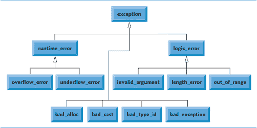

**图 17.10** | 标准库异常类中的一部分。

runtime_error 类（我们在 17.4 节中简要使用过）是其他几个表示执行时错误的标准异常类的基类。例如，overflow_error 类描述**算术上溢错误**（即算术运算的结果大于计算机中可存储的最大数），而 **underflow_error** 类描述**算术下溢错误**（即算术运算的结果小于计算机中可存储的最小数）。

> **常见编程错误 17.7**
> *异常类不必派生自 exception 类，因此捕获 exception 类型并不保证能捕获程序可能遇到的所有异常。*

> **防错提示 17.9**
> *要捕获 try 块中可能抛出的所有异常，请使用 catch(...)。以这种方式捕获异常的一个弱点是所捕获异常的类型未知。另一个弱点是，如果没有命名参数，就无法在异常处理程序内部引用异常对象。*

> **软件工程观察 17.8**
> *标准异常层次结构是创建异常的一个良好起点。你可以构建能抛出标准异常、派生自标准异常的异常或非从标准异常派生的自定义异常的程序。*

> **软件工程观察 17.9**
> *使用 catch(...) 执行不依赖于异常类型的恢复操作（例如释放公共资源）。可以重新抛出异常，以提醒更具体的外层 catch 处理程序。*

## 17.11 本章回顾

在本章中，你学习了如何使用异常处理来处理程序中的错误。你了解到，异常处理使你能够将错误处理代码从程序执行的“主线”中移除。我们通过一个除以零的示例演示了异常处理。我们回顾了如何使用 try 块来包含可能抛出异常的代码，以及如何使用 catch 处理程序来处理可能出现的异常。你学习了如何抛出和重新抛出异常，以及如何处理构造函数中发生的异常。本章接着讨论了处理 new 失败、使用 `unique_ptr` 类进行动态内存分配以及标准库异常层次结构。在下一章中，你将学习如何构建自己的自定义类模板。特别是，我们将在第19章演示构建自定义模板化数据结构所需的功能。

## 小结

### 17.1 节 引言

- 异常（p. 741）是程序执行期间出现问题的一种指示。
- 异常处理（p. 741）使你能够创建可以解决执行时出现的问题的程序——通常允许程序继续执行，就像没有遇到问题一样。更严重的问题可能需要程序在受控终止之前通知用户问题。

### 17.2 节 示例：处理除以零的尝试

- exception 类是异常类的标准基类（p. 742）。它提供虚函数 `what`（p. 742），该函数返回适当的错误消息并可在派生类中覆盖。
- `runtime_error` 类（p. 742）定义在头文件 `<stdexcept>`（p. 742）中，是 C++ 中表示运行时错误的标准基类。
- C++ 使用异常处理的终止模型（p. 745）。
- try 块由关键字 `try` 后跟花括号（`{}`）组成，花括号定义了一个可能发生异常的代码块。try 块包含可能导致异常的语句以及如果发生异常则不应执行的语句。
- 至少一个 catch 处理程序必须紧跟在 try 块之后。每个 catch 处理程序指定一个异常参数，该参数表示此 catch 处理程序可以处理的异常类型。
- 如果异常参数包含可选的参数名，则 catch 处理程序可以使用该参数名与捕获的异常对象进行交互（p. 746）。
- 程序中发生异常的位置称为抛出点（p. 745）。
- 如果 try 块中发生异常，try 块终止，程序控制权转移到第一个异常参数类型与抛出异常类型匹配的 catch。
- 当 try 块终止时，块中定义的局部变量超出作用域。
- 当 try 块由于异常而终止时，程序会搜索与所发生异常类型匹配的第一个 catch 处理程序。如果类型相同，或者抛出异常的类型是异常参数类型的派生类，则发生匹配。匹配发生时，匹配的 catch 处理程序中的代码将执行。
- 当 catch 处理程序完成处理时，catch 参数和 catch 处理程序内定义的局部变量超出作用域。对应于 try 块的其余 catch 处理程序将被忽略，执行将在 try…catch 序列之后的第一行代码处恢复。
- 如果 try 块中没有发生异常，程序将忽略该块的 catch 处理程序。程序执行将在 try…catch 序列之后的下一条语句处恢复。


- 如果 try 块中发生的异常没有匹配的 catch 处理程序，或者异常发生在不在 try 块中的语句中，则包含该语句的函数会立即终止，程序会尝试在调用函数中定位一个外围的 try 块。这个过程称为栈展开（第 746 页）。
- 要抛出异常，请使用关键字 `throw`，后跟一个表示要抛出的异常类型的操作数。throw 的操作数可以是任何类型。

## 17.3 节 重新抛出异常

- 异常处理程序可以将异常处理（或其中的一部分）推迟给另一个异常处理程序。无论哪种情况，处理程序都是通过重新抛出异常来实现的（第 747 页）。
- 常见的异常示例包括数组下标越界、算术溢出、除数为零、无效的函数参数以及内存分配失败。

## 17.4 节 栈展开

- 展开函数调用栈意味着：未捕获异常的函数会终止，该函数中的所有局部变量都会被销毁，控制权返回到最初调用该函数的语句。

## 17.5 节 何时使用异常处理

- 异常处理针对的是同步错误（第 750 页），这些错误在语句执行时发生。
- 异常处理并非用于处理与异步事件（第 750 页）相关的错误，这些事件与控制流并行发生，并且独立于程序的控制流。
- 从 C++11 开始，如果函数不抛出任何异常，也不调用任何会抛出异常的函数，则应该显式地将函数声明为 noexcept（第 751 页）。

## 17.6 节 构造函数、析构函数与异常处理

- 构造函数抛出的异常会导致在异常被抛出之前，为正在构造的对象中已构建的任何对象调用析构函数。
- 在 try 块中构造的每个自动对象都会在异常抛出之前被销毁。
- 栈展开在异常处理程序开始执行之前完成。
- 如果作为栈展开结果而调用的析构函数抛出异常，程序将终止。
- 如果对象具有成员对象，并且在外部对象完全构造之前抛出异常，那么将为在异常发生之前已构造的成员对象执行析构函数。
- 如果在异常发生时对象数组已部分构造，则只会调用已构造的数组元素对象的析构函数。
- 当从 new 表达式中创建的对象构造函数中抛出异常时，该对象的动态分配内存会被释放。

## 17.7 节 异常与继承

- 如果 catch 处理程序捕获基类类型的异常对象的引用，那么它也可以捕获从该基类公开派生的所有类对象的引用——这允许对相关错误进行多态处理。

## 17.8 节 处理 new 失败

- C++ 标准文档规定，当 operator new 失败时，它会抛出 bad_alloc 异常（第 752 页），该异常定义在头文件 <new> 中。
- 函数 set_new_handler（第 752 页）以指向一个无参数且返回 void 的函数的指针作为参数。该指针指向在 new 失败时将调用的函数。
- 一旦 `set_new_handler` 在程序中注册了一个 new 处理程序（第 754 页），`operator new` 在失败时就不会抛出 `bad_alloc`，而是将错误处理委托给 new 处理程序函数。
- 如果 `new` 成功分配内存，它会返回一个指向该内存的指针。

## 17.9 节 `unique_ptr` 类与动态内存分配

- 如果在成功分配内存之后、`delete` 语句执行之前发生异常，可能会导致内存泄漏。
- C++ 标准库提供了类模板 `unique_ptr`（第 755 页）来应对内存泄漏。
- `unique_ptr` 类的对象维护一个指向动态分配内存的指针。`unique_ptr` 的析构函数会对其指针数据成员执行 delete 操作。
- 类模板 `unique_ptr` 提供了重载的 `*` 和 `->` 运算符，因此 `unique_ptr` 对象可以像普通指针变量一样使用。`unique_ptr` 还通过其拷贝构造函数和重载的赋值运算符转移其管理的动态内存的所有权。

## 17.10 节 标准库异常层次结构

- C++ 标准库包含一个异常类层次结构。该层次结构的顶端是基类 `exception`。
- 基类 `exception` 的直接派生类包括 `runtime_error` 和 `logic_error`（两者都定义在头文件 `<stdexcept>` 中），每个类都有几个派生类。
- 有几个运算符会抛出标准异常——`operator new` 抛出 `bad_alloc`，`operator dynamic_cast` 抛出 `bad_cast`（第 758 页），`operator typeid` 抛出 `bad_typeid`（第 758 页）。

## 自测练习

- 17.1 列出五个常见的异常示例。
- 17.2 给出几个不应将异常处理技术用于常规程序控制的原因。
- 17.3 为什么异常适合处理库函数产生的错误？
- 17.4 什么是“资源泄漏”？
- 17.5 如果在 `try` 块中没有抛出异常，那么在 `try` 块执行完成后，控制权会转到哪里？
- 17.6 如果在 `try` 块之外抛出异常，会发生什么？
- 17.7 给出使用 `catch(...)` 的一个主要优点和一个主要缺点。
- 17.8 如果没有 `catch` 处理程序与所抛出对象的类型匹配，会发生什么？
- 17.9 如果有多个处理程序与所抛出对象的类型匹配，会发生什么？
- 17.10 为什么要指定基类类型作为 `catch` 处理程序的类型，然后抛出来自派生类类型的对象？
- 17.11 假设有一个与异常对象类型精确匹配的 `catch` 处理程序可用。在这种情况下，对于该类型的异常对象，可能还会执行哪个不同的处理程序？
- 17.12 抛出异常是否必然导致程序终止？
- 17.13 当 `catch` 处理程序抛出异常时会发生什么？
- 17.14 语句 `throw;` 做什么？

## 高端对话：网络智能体的发展与安全

当前，网络智能体（AI Agent）正在重塑网络空间格局，成为数字经济时代的关键基础设施。其安全性与可信性也将直接关系到个人隐私、企业核心资产乃至国家关键信息基础设施的整体安全。人工智能技术的快速演进给网络智能体的安全治理带来了哪些新挑战？企业应当采取何种措施构建安全、可靠的网络智能体？如何协同推动网络智能体的安全标准与生态建设？围绕以上热点议题，本刊邀请业界专家深入探讨，共同展望网络智能体的未来发展趋势。

本期对话嘉宾

- **李万鹏** 中国信息通信研究院安全研究所副所长
- **王昊** 华为技术有限公司网络安全首席专家
- **陈飞** 百度安全副总经理
- **刘洋** 奇安信科技集团股份有限公司安全专家

主持人：本刊记者 张某某

中国信息安全：请您谈谈当前网络智能体发展面临的主要安全挑战有哪些？

> **李万鹏**：随着大模型能力不断增强，网络智能体在自主决策、工具调用、多智能体协同等场景中展现出巨大潜力。但与此同时，模型幻觉、提示注入、工具滥用、数据泄露等新型安全风险也日趋突出。此外，网络智能体的行为具有一定的不可预测性，其安全治理面临更大的不确定性。

- **17.18**  *（异常处理与其他方案）* 比较异常处理与文中讨论的其他各种异常处理方案的异同。
- **17.19**  *（异常处理与程序控制）* 为什么异常*不*应该用作程序控制的替代形式？
- **17.20**  *（处理相关异常）* 描述一种处理相关异常的技术。
- **17.21**  *（从 catch 中抛出异常）* 假设程序抛出一个异常，并且相应的异常处理程序开始执行。现在假设该异常处理程序本身抛出相同的异常。这是否会造成无限递归？编写一个程序来验证你的观察。
- **17.22**  *（捕获派生类异常）* 使用继承创建 `runtime_error` 的各种派生类。然后演示指定基类的 catch 处理程序能够捕获派生类异常。
- **17.23**  *（抛出条件表达式的结果）* 抛出一个条件表达式的结果，该表达式返回 double 或 int。提供一个 int catch 处理程序和一个 double catch 处理程序。证明无论返回的是 int 还是 double，只有 double catch 处理程序会执行。
- **17.24**  *（局部变量析构函数）* 编写一个程序，说明在块中构造的所有对象的析构函数在该块抛出异常之前都会被调用。
- **17.25**  *（成员对象析构函数）* 编写一个程序，说明只有那些在异常发生之前已构造的成员对象的析构函数会被调用。
- **17.26**  *（捕获所有异常）* 编写一个程序，演示使用 `catch(...)` 异常处理程序捕获几种异常类型。
- **17.27**  *（异常处理程序的顺序）* 编写一个程序，说明异常处理程序的顺序很重要。第一个匹配的处理程序会被执行。尝试以两种不同的方式编译和运行你的程序，以证明两个不同的处理程序会执行并产生两种不同的效果。
- **17.28**  *（构造函数抛出异常）* 编写一个程序，演示构造函数在 try 块之后将构造函数失败的信息传递给异常处理程序。
- **17.29**  *（重新抛出异常）* 编写一个程序，说明重新抛出异常。
- **17.30**  *（未捕获的异常）* 编写一个程序，说明带有自己的 try 块的函数不必捕获 try 内产生的每一个可能的错误。某些异常可以漏到外层作用域并在那里处理。
- **17.31**  *（栈展开）* 编写一个程序，从一个深度嵌套的函数中抛出异常，并且仍然能够使用 main 中包围初始调用的 try 块之后的 catch 处理程序捕获该异常。


- 18.1 引言
- 18.2 类模板
- 18.3 操作类模板特化对象的函数模板
- 18.4 非类型参数
- 18.5 模板类型参数的默认实参
- 18.6 函数模板的重载
- 18.7 小结
- 摘要
- 自测练习
- 自测练习答案
- 练习题

## 18.1 引言

在第7章、第15章和第16章中，你使用了标准库中许多*预制的*模板化容器和算法。函数模板（在第6章中介绍过）和**类模板**使你能够方便地指定一系列相关的（重载的）函数——称为**函数模板特化**——或一系列相关的类——分别称为**类模板特化**。这称为**泛型编程**。函数模板和类模板就像*模板*，我们从中描摹出形状；函数模板特化和类模板特化就像各个独立的描摹副本，它们具有相同的形状，但例如可以用不同的颜色和纹理绘制。

在本章中，我们演示如何创建自定义类模板和操作类模板特化对象的函数模板。我们重点关注你构建第19章中介绍的自定义模板化数据结构所需的模板功能。¹

¹ 构建自定义模板是一个高级主题，其中许多功能超出了本书的范围。

## 18.2 类模板

理解栈（一种数据结构，我们*仅从顶部*插入元素，并*仅从顶部*以*后进先出*的顺序取回这些元素）的概念可以*独立于*栈中元素的类型。然而，要*实例化*一个栈，必须指定数据类型。这为软件复用创造了绝佳的机会——正如你在15.7.1节中看到的栈容器适配器那样。在这里，我们泛型地定义一个栈，并使用这个泛型栈类的*特定类型*版本。

> **软件工程观察 18.1**
>
> 类模板通过允许从单个类模板实例化各种类型特定的类模板特化来促进软件复用。

类模板被称为**参数化类型**，因为它们需要一个或多个*类型参数*来指定如何定制一个通用类模板以形成*类模板特化*。要生成许多特化，你只需编写一个类模板定义（我们稍后会这样做）。当需要某个特定特化时，你使用一种简洁、简单的表示法，编译器会编写该特化的源代码。例如，一个Stack类模板可以成为在程序中创建许多Stack类模板特化（例如“double栈”、“int栈”、“Employee栈”、“Bill栈”等）的基础。

> **常见编程错误 18.1**
>
> 要使用用户定义类型创建模板特化，该用户定义类型必须满足模板的要求。例如，模板可能会将用户定义类型的对象与&lt;进行比较以确定排序顺序，或者模板可能会对用户定义类型的对象调用特定的成员函数。如果用户定义类型没有重载所需的运算符或未提供所需的函数，则会发生编译错误。

### 创建类模板 `Stack<T>`

图18.1中的Stack类模板定义看起来像一个常规的类定义，但有几个关键区别。首先，第7行前面有

```cpp
template< typename T >
```

所有类模板都以关键字**template**开头，后面是括在**尖括号**（&lt;和&gt;）中的模板参数列表；每个表示类型的模板参数前面必须加上可互换的关键字**typename**或**class**。类型参数T充当Stack元素类型的占位符。类型参数的名称在模板定义内必须是唯一的。你不必特意使用标识符T——任何有效的标识符都可以使用。在整个Stack类模板定义中，元素类型被泛型地引用为T（第12、18和42行）。当你使用类模板创建对象时，类型参数与特定类型关联——此时，编译器生成类模板的一个副本，其中所有类型参数出现的位置都被替换为指定类型。另一个关键区别是，我们没有将类模板的接口与实现分开。

> **软件工程观察 18.2**
>
> 模板通常定义在头文件中，然后通过#include包含在相应的客户端源代码文件中。对于类模板，这意味着成员函数也在头文件中定义——通常是在类定义体内定义，如图18.1所示。

```cpp
// Fig. 18.1: Stack.h
// Stack class template.
#ifndef STACK_H
#define STACK_H
#include <deque>

template< typename T >
class Stack
{
public:
   // return the top element of the Stack
   T& top()
   {
      return stack.front();
   } // end function template top
```

**图18.1** | Stack类模板。（第1部分，共2部分。）

Stack类模板使用模板参数T来表示元素类型。我们的Stack类模板没有定义自己的构造函数——编译器提供的默认构造函数将调用deque的默认构造函数。我们还提供了图18.1中的以下成员函数：

- `top`（第12–15行）返回对Stack栈顶元素的引用。
- `push`（第18–21行）将新元素放入Stack的顶部。
- `pop`（第24–27行）移除Stack的栈顶元素。
- `isEmpty`（第30–33行）返回一个bool值——如果Stack为空，则为true，否则为false。
- `size`（第36–39行）返回Stack中元素的个数。

这些成员函数中的每一个都将其职责委托给类模板deque的相应成员函数。

### 在类模板定义之外声明类模板的成员函数

尽管我们在Stack类模板中没有这样做，但成员函数定义可以出现在类模板定义之外。如果这样做，每个成员函数定义必须以template关键字开头，后跟与类模板相同的模板参数集。此外，成员函数必须用类名和作用域解析运算符限定。例如，你可以在类模板定义之外定义pop函数，如下所示：

```cpp
template< typename T >
inline void Stack<T>::pop()
{
    stack.pop_front();
} // end function template pop
```

`Stack<T>::`表示pop位于类`Stack<T>`的作用域中。标准库的容器类倾向于在类定义内定义其所有成员函数。

### 测试类模板 `Stack<T>`

现在，让我们考虑练习Stack类模板的驱动程序（图18.2）。驱动程序首先实例化对象`doubleStack`（第9行）。该对象被声明为`Stack<double>`（读作“double的Stack”）。编译器将类型`double`与类模板中的类型参数T关联，以生成一个元素类型为`double`的Stack类的源代码，该类实际将元素存储在`deque<double>`中。

第16–21行调用push（第18行）将double值1.1、2.2、3.3、4.4和5.5放入`doubleStack`。接下来，第26–30行在while循环中调用top和pop以从栈中移除这五个值。请注意，图18.2的输出中，这些值确实以后进先出的顺序弹出。当`doubleStack`为空时，弹出循环终止。

```cpp
1  // Fig. 18.2: fig18_02.cpp
2  // Stack class template test program.
3  #include <iostream>
4  #include "Stack.h" // Stack class template definition
```

**图18.2** | Stack类模板测试程序。（第1部分，共3部分。）


```
Pushing elements onto doubleStack
1.1 2.2 3.3 4.4 5.5

Popping elements from doubleStack
5.5 4.4 3.3 2.2 1.1
Stack is empty. Cannot pop.

Pushing elements onto intStack
1 2 3 4 5 6 7 8 9 10

Popping elements from intStack
10 9 8 7 6 5 4 3 2 1
Stack is empty. Cannot pop.
```

图18.2 | 栈类模板测试程序。（第3部分，共3部分。）

第34行使用声明实例化`Stack< int > intStack`：

```cpp
Stack< int > intStack;
```

（读作“intStack is a Stack of int”）。第41–45行重复调用`push`（第43行）将值压入`intStack`，然后第50–54行重复调用`top`和`pop`从`intStack`中移除值，直到栈空为止。再次注意输出中值按后进先出的顺序弹出。

## 18.3 操作类模板特化对象的函数模板

注意图18.2中`main`的代码对于第9–32行的`doubleStack`操作和第34–56行的`intStack`操作几乎完全相同。这提供了另一个使用函数模板的机会。图18.3定义了函数模板`testStack`（第10–39行）来执行与图18.2中`main`相同的任务——将一系列值压入`Stack<T>`，并从`Stack<T>`中弹出这些值。

图18.3 | 将Stack模板对象传递给函数模板。（第1部分，共2部分。）

```cpp
// Fig. 18.3: Fig18_03.cpp
// Passing a Stack template object
// to a function template.
#include <iostream>
#include <string>
#include "Stack.h" // Stack class template definition
using namespace std;

// function template to manipulate Stack< T >
template< typename T >
void testStack(
    Stack< T > &theStack, // reference to Stack< T >
    const T &value, // initial value to push
    const T &increment, // increment for subsequent values
    size_t size, // number of items to push
    const string &stackName ) // name of the Stack< T > object
{
    cout << "\nPushing elements onto " << stackName << '\n';
    T pushValue = value;

    // push element onto Stack
    for ( size_t i = 0; i < size; ++i )
    {
        theStack.push( pushValue ); // push element onto Stack
        cout << pushValue << ' ';
        pushValue += increment;
    } // end for

    cout << "\n\nPopping elements from " << stackName << '\n';

    // pop elements from Stack
    while ( !theStack.isEmpty() ) // loop while Stack is not empty
    {
        cout << theStack.top() << ' ';
        theStack.pop(); // remove top element
    } // end while

    cout << "\nStack is empty. Cannot pop." << endl;
} // end function template testStack

int main()
{
    Stack< double > doubleStack;
    const size_t doubleStackSize = 5;
    testStack( doubleStack, 1.1, 1.1, doubleStackSize, "doubleStack" );

    Stack< int > intStack;
    const size_t intStackSize = 10;
    testStack( intStack, 1, 1, intStackSize, "intStack" );
} // end main
```

```
Pushing elements onto doubleStack
1.1 2.2 3.3 4.4 5.5

Popping elements from doubleStack
5.5 4.4 3.3 2.2 1.1
Stack is empty. Cannot pop.

Pushing elements onto intStack
1 2 3 4 5 6 7 8 9 10

Popping elements from intStack
10 9 8 7 6 5 4 3 2 1
Stack is empty. Cannot pop.
```

图18.3 | 将Stack模板对象传递给函数模板。（第2部分，共2部分。）

函数模板`testStack`使用`T`（在第10行指定）来表示存储在`Stack<T>`中的数据类型。该函数模板接受五个参数（第12–16行）：

- 要操作的`Stack<T>`

- 类模板被称为参数化类型（第766页）；它们需要类型参数来指定如何定制通用类模板以形成特定的类模板特化。
- 要使用类模板特化，需要编写一个类模板。当需要新的特定类型类时，编译器会为类模板特化编写源代码。
- 类模板定义（第766页）看起来像常规的类定义，但前面有`template<typename T>`（或`template<class T>`）以表明这是类模板定义。`T`是一个类型参数，充当要创建的类类型的占位符。在整个类定义和成员函数定义中，类型`T`作为通用类型名出现。
- 模板参数名称在模板定义内必须唯一。
- 类模板外部的每个成员函数定义都以与其类相同的模板声明开头。然后，每个函数定义类似于常规函数定义，不同之处在于类中的通用数据以类型参数`T`的形式泛泛列出。使用二元作用域解析运算符和类模板名称将每个成员函数定义绑定到类模板的作用域。

## 18.4 非类型参数

- 在类或函数模板声明中可以使用非类型参数（第773页）。

## 18.5 模板类型参数的默认实参

- 可以在类型参数列表中为类型参数指定默认类型实参（第773页）。

## 18.6 重载函数模板

- 函数模板可以通过多种方式重载。我们可以提供其他函数模板，它们指定相同的函数名但不同的函数参数。函数模板也可以通过提供具有相同函数名但不同函数参数的其他非模板函数来重载。如果模板和非模板版本都匹配某个调用，将使用非模板版本。

## 自测练习

**18.1** 判断下列说法的对错。如果错误，请解释原因。

a) 关键字`typename`和`class`在模板类型参数中特指“任何用户定义的类类型。”

b) 函数模板可以被另一个具有相同函数名的函数模板重载。

c) 模板定义中的模板参数名称必须唯一。

d) 对应类模板定义之外的每个成员函数定义必须以`template`和与其类模板相同的模板参数开头。

**18.2** 填空：

a) 模板使我们能够用单个代码段指定一系列相关的函数，称为________，或一系列相关的类，称为________。

b) 所有模板定义以关键字________开头，后跟包含在________中的模板参数列表。

c) 从函数模板生成的相关函数都具有相同的名称，因此编译器使用________解析来调用适当的函数。

d) 类模板也称为________类型。

e) ________运算符与类模板名称一起使用，将每个成员函数定义绑定到类模板的作用域。

## 自测练习答案

**18.1** a) 错误。在这种情况下，关键字`typename`和`class`也允许基本类型的类型参数。b) 正确。c) 错误。函数模板之间的模板参数名称不必唯一。d) 正确。

**18.2** a) 函数模板特化，类模板特化。b) template，尖括号（`<`和`>`）。c) 重载。d) 参数化。e) 作用域解析。

## 习题

**18.3** *（模板中的运算符重载）* 为谓词函数`isEqualTo`编写一个简单的函数模板，该函数使用相等运算符（`==`）比较其两个相同类型的参数，如果相等则返回true，否则返回false。在一个程序中仅使用各种基本类型调用`isEqualTo`来使用此函数模板。现在编写该程序的另一个版本，使用用户定义的类类型调用`isEqualTo`，但不重载相等运算符。尝试运行此程序时会发生什么？现在重载相等运算符（使用运算符函数）`operator==`。现在尝试运行此程序时会发生什么？

**18.4** *（数组类模板）* 将图10.10–10.11中的`Array`类重新实现为类模板。在程序中演示新的`Array`类模板。

**18.5** 区分术语“函数模板”和“函数模板特化”。

**18.6** 解释哪一个更像模板（stencil）——类模板还是类模板特化？

**18.7** 函数模板与重载之间有什么关系？

**18.8** 当调用函数时，编译器执行匹配过程以确定调用哪个函数模板特化。在什么情况下尝试匹配会导致编译错误？

**18.9** 为什么将类模板称为参数化类型是恰当的？

**18.10** 解释为什么C++程序会使用以下语句

```cpp
Array< Employee > workerList( 100 );
```

**18.11** 回顾你对习题18.10的答案。解释为什么C++程序可能会使用以下语句

```cpp
Array< Employee > workerList;
```

**18.12** 解释以下表示法在C++程序中的用途：

```cpp
template< typename T > Array< T >::Array( int s )
```

**18.13** 为什么对像数组或栈这样的容器，你可能会在类模板中使用非类型参数？


读取一个用简单而又功能强大的高级语言编写的语句文件，该语言类似于早期版本的 BASIC。你的编译器会将这些语句翻译成一个 Simpletron 机器语言（SML）指令文件——SML 是你在第 8 章特别专题：构建你自己的计算机中学过的语言。然后，你的 Simpletron 模拟器程序将执行编译器生成的 SML 程序！该特别专题讨论了这种高级语言，以及将每种高级语言语句转换为机器码所需的算法。我们提供了编译器理论练习，并在特别专题中建议对编译器和 Simpletron 模拟器进行增强。

## 19.2 自引用类

自引用类包含一个指向同类类对象的成员。例如，下面的定义：

```cpp
class Node
{
public:
   explicit Node( int ); // constructor
   void setData( int ); // set data member
   int getData() const; // get data member
   void setNextPtr( Node * ); // set pointer to next Node
   Node *getNextPtr() const; // get pointer to next Node
private:
   int data; // data stored in this Node
   Node *nextPtr; // pointer to another object of same type
}; // end class Node
```

定义了一个类型 Node。类型 Node 有两个私有数据成员——整型成员 data 和指针成员 nextPtr。成员 nextPtr 指向一个 Node 类型的对象——即与这里声明的对象同类型的对象，因此称为自引用类。成员 nextPtr 被称为链接（link）——也就是说，nextPtr 可以将一个 Node 类型的对象“绑”到另一个同类型的对象上。类型 Node 还有五个成员函数——一个接收整数以初始化成员 data 的构造函数，一个设置成员 data 值的 setData 函数，一个返回成员 data 值的 getData 函数，一个设置成员 nextPtr 值的 setNextPtr 函数，以及一个返回成员 nextPtr 值的 getNextPtr 函数。

自引用类对象可以链接在一起，形成链表、队列、栈和树等有用的数据结构。图 19.1 展示了两个自引用类对象链接在一起形成一个链表。注意，第二个自引用类对象的链接成员中放置了一条斜线——表示空指针（nullptr）——用于指示该链接不指向另一个对象。这条斜线仅用于示意；它并不对应 C++ 中的反斜杠字符。空指针通常表示数据结构的末尾。

> **常见编程错误 19.1**
>
> *没有将链接数据结构中最后一个节点的链接设置为 nullptr，是一个（可能致命的）逻辑错误。*


**图 19.1** | 两个自引用类对象链接在一起。

接下来的几节将讨论链表、栈、队列和树。本章介绍的数据结构是使用*动态内存分配*（第 10.9 节）、*自引用类*、*类模板*（第 18 章）和*函数模板*（第 6.19 节）创建和维护的。

## 19.3 链表

链表是自引用类对象的*线性*集合，这些对象称为**节点**，通过**指针链接**连接在一起——因此得名“链表”。链表通过指向其第一个节点的指针来访问。每个后续节点都通过前一个节点中存储的*链接指针成员*来访问。按照惯例，列表中最后一个节点的链接指针被设置为 `nullptr`，以表示链表的末尾。数据是*动态*存储在链表中的——每个节点在需要时创建和销毁。节点可以包含任何类型的数据，包括其他类的对象。如果节点包含指向通过继承关联的基类对象和派生类对象的基类指针，那么我们可以拥有这样的节点链表，并使用虚函数调用对它们进行*多态*处理。栈和队列也是**线性数据结构**，而且我们将会看到，它们可以看作是链表的受限版本。树则是**非线性数据结构**。

与数组对象和内建数组相比，链表有若干优势。当一次需要表示的数据元素数量*不可预测*时，链表是合适的。链表是动态的，因此链表的长度可以根据需要增加或减少。然而，数组对象或内建数组的大小无法改变，因为数组大小在编译时就固定了。数组对象或内建数组可能会满。链表只有在系统内存不足、无法满足额外的动态存储分配请求时才会满。

> **性能提示 19.1**
>
> 数组对象或内建数组可以声明为包含比预期元素数量更多的元素，但这会浪费内存。在这些情况下，链表可以提供更好的内存利用率。链表允许程序在运行时自适应。类模板 `vector`（第 7.10 节）实现了一种基于数组、可动态调整大小的数据结构。

链表可以通过将每个新元素插入到列表中的适当位置来保持*有序*。现有链表元素无需移动。只需更新指针，使其指向正确的节点即可。

> **性能提示 19.2**
>
> 在有序数组对象或内建数组中插入和删除可能很耗时——插入或删除元素之后的所有元素都必须相应地移动。链表允许在列表中的任何位置进行高效的插入操作。

```cpp
case 4: // remove from end
    if ( !listObject.removeFromBack( value ) )
        cout << value << " removed from list\n";

    listObject.print();
    break;
} // end switch
} while ( choice < 5 ); // end do...while

cout << "End list test\n\n";
} // end function testList

int main()
{
    // test List of int values
    List< int > integerList;
    testList( integerList, "integer" );

    // test List of double values
    List< double > doubleList;
    testList( doubleList, "double" );
} // end main
```

```text
Testing a List of integer values
Enter one of the following:
  1 to insert at beginning of list
  2 to insert at end of list
  3 to delete from beginning of list
  4 to delete from end of list
  5 to end list processing
? 1
Enter integer: 1
The list is: 1

? 1
Enter integer: 2
The list is: 2 1

? 2
Enter integer: 3
The list is: 2 1 3

? 2
Enter integer: 4
The list is: 2 1 3 4

? 3
2 removed from list
The list is: 1 3 4

? 3
1 removed from list
The list is: 3 4

? 4
4 removed from list
The list is: 3
```

**图 19.3** | 操作链表：（第 2 部分，共 3 部分。）

```cpp
// delete node from back of list
bool removeFromBack( NODETYPE &value )
{
   if ( isEmpty() ) // List is empty
      return false; // delete unsuccessful
   else
   {
      ListNode< NODETYPE > *tempPtr = lastPtr; // hold item to delete

      if ( firstPtr == lastPtr ) // List has one element
         firstPtr = lastPtr = nullptr; // no nodes remain after removal
      else
      {
         ListNode< NODETYPE > *currentPtr = firstPtr;

         // locate second-to-last element
         while ( currentPtr->nextPtr != lastPtr )
            currentPtr = currentPtr->nextPtr; // move to next node

         lastPtr = currentPtr; // remove last node
         currentPtr->nextPtr = nullptr; // this is now the last node
      } // end else

      value = tempPtr->data; // return value from old last node
      delete tempPtr; // reclaim former ListNode
      return true; // delete successful
   } // end else
} // end function removeFromBack

// is List empty?
bool isEmpty() const
{
   return firstPtr == nullptr;
} // end function isEmpty

// display contents of List
void print() const
{
   if ( isEmpty() ) // List is empty
   {
      std::cout << "The list is empty\n\n";
      return;
   } // end if

   ListNode< NODETYPE > *currentPtr = firstPtr;

   std::cout << "The list is: ";

   while ( currentPtr != nullptr ) // get element data
   {
      std::cout << currentPtr->data << ' ';
      currentPtr = currentPtr->nextPtr;
   } // end while
}
```

**图 19.5** | List 类模板定义。（第 3 部分，共 4 部分。）


### 成员函数 removeFromBack

函數 removeFromBack（圖19.5，第91–117行）移除鏈表的尾部節點，並將節點值複製到引用參數。如果試圖從空鏈表中移除節點（第93–94行），函數返回 false；如果移除成功，則返回 true。該函數包含以下幾個步驟：

1. 將 `lastPtr` 指向的地址賦給 `tempPtr`（第97行）。最終，`tempPtr` 將用於刪除被移除的節點。
2. 如果 `firstPtr` 等於 `lastPtr`（第99行），即鏈表在嘗試移除之前只有一個元素，則將 `firstPtr` 和 `lastPtr` 設置為 `nullptr`（第100行），以將該節點從鏈表中分離（使鏈表變為空）。
3. 如果鏈表在移除之前有多個節點，則將 `firstPtr` 指向的地址賦給 `currentPtr`（第103行），以準備“遍歷鏈表”。
4. 現在，使用 `currentPtr` “遍歷鏈表”，直到它指向最後一個節點之前的那個節點。該節點將在移除操作完成後成為新的最後一個節點。這是通過 `while` 循環（第106–107行）實現的，該循環在 `currentPtr->nextPtr` 不等於 `lastPtr` 時，不斷用 `currentPtr->nextPtr` 替換 `currentPtr`。
5. 將 `lastPtr` 設置為 `currentPtr` 指向的地址（第109行），以將尾部節點從鏈表中分離。
6. 在鏈表新的最後一個節點中，將 `currentPtr->nextPtr` 設置為 `nullptr`（第110行）。
7. 在所有指針操作完成後，將被移除節點的數據成員複製到引用參數 value（第113行）。
8. 現在，刪除 `tempPtr` 指向的節點（第114行）。
9. 返回 true（第115行），表示移除成功。

圖19.9 說明了 removeFromBack。圖中的 (a) 部分說明了移除操作之前的鏈表。(b) 部分顯示了實際的指針操作。

### 成员函数 print

函數 `print`（第126–145行）首先確定鏈表是否為空（第128行）。如果為空，它打印“鏈表為空”並返回（第130–131行）。否則，它遍歷鏈表並輸出每個節點中的值。該函數將 `currentPtr` 初始化為 `firstPtr` 的副本（第134行），然後打印字符串“鏈表為：”（第136行）。當 `currentPtr` 不為 `nullptr` 時（第138行），打印 `currentPtr->data`（第140行），並將 `currentPtr` 賦值為 `currentPtr->nextPtr` 的值（第141行）。請注意，如果鏈表最後一個節點中的鏈接不具有值 `nullptr`，則打印算法將錯誤地嘗試打印超過鏈表末尾的內容。我們這裡的打印算法對於鏈表、棧和隊列是相同的（因為我們將這些數據結構都建立在相同的鏈表基礎結構之上）。

### 循环链表和双向链表

我們一直在討論的鏈表類型是單向鏈表——鏈表以一個指向第一個節點的指針開始，每個節點都包含一個指向“下一個”節點的指針。該鏈表以一個指針成員值為 `nullptr` 的節點終止。單向鏈表只能沿一個方向遍歷。


**圖19.9** | *以圖形方式表示的 removeFromBack 操作。*

**循環單向鏈表**（圖19.10）以一個指向第一個節點的指針開始，每個節點包含一個指向下一個節點的指針。“最後一個節點”不包含 `nullptr`；相反，最後一個節點中的指針指回第一個節點，從而閉合“圓環”。


**圖19.10** | *循環單向鏈表。*

**雙向鏈表**（圖19.11）——例如標準庫的 `list` 類模板——允許*向前*和*向後*兩種遍歷。這種鏈表通常用兩個“起始指針”實現——一個指向鏈表的第一個元素，以允許鏈表的*從前向後遍歷*；一個指向最後一個元素，以允許*從後向前遍歷*。每個節點都有兩個指針：一個*向前指針*，指向鏈表中正向的下一個節點；一個*向後指針*，指向鏈表中反向的下一個節點。例如，如果你的鏈表包含一個按字母順序排列的電話目錄，那麼搜索名字以字母表前部字母開頭的人時，最好從鏈表的前面開始；搜索名字以字母表後部字母開頭的人時，最好從鏈表的後面開始。


**圖19.11**  |  *雙向鏈表。*

在**循環雙向鏈表**（圖19.12）中，最後一個節點的*向前指針*指向第一個節點，第一個節點的*向後指針*指向最後一個節點，從而閉合“圓環”。


**圖19.12**  |  *循環雙向鏈表。*

## 19.4 栈

你在6.12節、15.7.1節（棧適配器）和18.2節中已經學習了棧的概念。回想一下，節點只能從棧的*頂部*添加或移除，因此棧被稱為*後進先出（LIFO）*數據結構。實現棧的一種方式是將其作為鏈表的一種*受限*版本。在這種實現中，棧的最後一個節點中的鏈接成員被設置為 `nullptr`，以表示棧的*底部*。

用於操作棧的主要成員函數是 push 和 pop。函數 push 在棧的頂部*插入*一個新節點。函數 pop 從棧的頂部*移除*一個節點，將彈出的值存儲在傳遞給調用函數的引用變量中，如果彈出操作成功，則返回 true（否則返回 false）。

### 栈的应用

棧有許多有趣的應用：

- 在6.12節中，你了解到當進行函數調用時，被調用函數必須知道如何返回到它的調用者，因此返回地址被壓入棧中。如果發生一系列函數調用，相繼的返回地址會按後進先出的順序壓入棧中，這樣每個函數都能返回到它的調用者。棧以與常規非遞歸調用相同的方式支持遞歸函數調用。
- 在每次函數調用時，棧為自動變量提供內存並存儲其值。當函數返回到它的調用者或拋出異常時，會為每個局部對象調用析構函數（如果有的話），該函數的自動變量所佔用的空間會從棧中彈出，程序不再知道這些變量。
- 編譯器在評估表達式和生成機器語言代碼的過程中使用棧。練習題探討了棧的幾種應用，包括使用它們開發你自己的完整可工作的編譯器。

### 利用栈与链表之间的关系

我們將利用鏈表與棧之間的密切關係，主要通過重用我們的 List 類模板來實現一個棧類。首先，我們將通過從 List 類模板私有繼承來實現 Stack 類模板。然後，我們將通過組合方式實現一個性能相同的 Stack 類模板，方法是將一個 List 對象作為 Stack 類模板的私有成員。

### 通过继承 List 实现 Stack 类模板

圖19.13–19.14 的程序主要通過對圖19.5 的 List 類模板進行私有繼承（第9行）來創建一個 Stack 類模板（圖19.13）。我們希望 Stack 擁有成員函數 push（第13–16行）、pop（第19–22行）、isStackEmpty（第25–28行）和 printStack（第31–34行）。請注意，這些本質上就是 List 類模板的 insertAtFront、removeFromFront、isEmpty 和 print 函數。當然，List 類模板還包含其他我們不希望通過 Stack 類的公共接口訪問的成員函數（即 insertAtBack 和 removeFromBack）。因此，當我們表明 Stack 類模板要繼承 List 類模板時，我們指定私有繼承。這使得 List 類模板的所有成員函數在 Stack 類模板中都成為私有成員。當我們實現 Stack 的成員函數時，我們讓每個函數調用 List 類的相應成員函數——push 調用 insertAtFront（第15行），pop 調用 removeFromFront（第21行），isStackEmpty 調用 isEmpty（第27行），printStack 調用 print（第33行）——這被稱為委派。

```cpp
// Fig. 19.13: Stack.h
// Stack class-template definition.
#ifndef STACK_H
#define STACK_H

#include "List.h" // List class definition

template< typename STACKTYPE >
class Stack : private List< STACKTYPE >
{
```

圖19.13 | Stack 類模板定義（第1部分，共2部分）


```cpp
// Fig. 19.14: fig19_14.cpp
// A simple stack program.
#include <iostream>
#include "Stack.h" // Stack class definition
using namespace std;

int main()
{
   Stack< int > intStack; // create Stack of ints

   cout << "processing an integer Stack" << endl;

   // push integers onto intStack
   for ( int i = 0; i < 3; ++i )
   {
      intStack.push( i );
      intStack.printStack();
   } // end for

   int popInteger; // store int popped from stack

   // pop integers from intStack
   while ( !intStack.isStackEmpty() )
   {
      intStack.pop( popInteger );
      cout << popInteger << " popped from stack" << endl;
      intStack.printStack();
   } // end while

   Stack< double > doubleStack; // create Stack of doubles
   double value = 1.1;

   cout << "processing a double Stack" << endl;

   // push floating-point values onto doubleStack
   for ( int j = 0; j < 3; ++j )
   {
      doubleStack.push( value );
      doubleStack.printStack();
      value += 1.1;
   } // end for

   double popDouble; // store double popped from stack

   // pop floating-point values from doubleStack
   while ( !doubleStack.isStackEmpty() )
   {
      doubleStack.pop( popDouble );
      cout << popDouble << " popped from stack" << endl;
      doubleStack.printStack();
   } // end while
} // end main
```

图 19.14 | 一个简单的栈程序。（第 1 部分，共 2 部分。）

```cpp
processing an integer Stack
The list is: 0

The list is: 1 0

The list is: 2 1 0

2 popped from stack
The list is: 1 0

1 popped from stack
The list is: 0

0 popped from stack
The list is empty

processing a double Stack
The list is: 1.1

The list is: 2.2 1.1

The list is: 3.3 2.2 1.1

3.3 popped from stack
The list is: 2.2 1.1

2.2 popped from stack
The list is: 1.1

1.1 popped from stack
The list is empty

All nodes destroyed

All nodes destroyed
```

**图 19.14** | 一个简单的栈程序。（第 2 部分，共 2 部分。）

## 通过组合 List 对象实现 Stack 类模板

实现 Stack 类模板的另一种方法是通过*组合*重用 List 类模板。图 19.15 是 Stack 类模板的新实现，其中包含一个名为 stackList 的 List<STACKTYPE> 对象（第 38 行）。此版本的 Stack 类模板使用图 19.5 中的 List 类。要测试此类，请使用图 19.14 中的驱动程序，但在该文件的第 4 行包含新的头文件——Stackcomposition.h。程序的输出对于两个版本的 Stack 类都是相同的。

```cpp
// Fig. 19.15: Stackcomposition.h
// Stack class template with
// composed List object.
#ifndef STACKCOMPOSITION_H
#define STACKCOMPOSITION_H
```

图 19.15 | 带有组合 List 对象的 Stack 类模板。（第 1 部分，共 2 部分。）

- 队列也用于支持**打印假脱机**。例如，一台打印机可能被网络中的所有用户共享。即使打印机正忙，许多用户也可以向打印机发送打印作业。这些打印作业被放入队列中，直到打印机可用为止。一个名为**假脱机程序**的程序管理该队列，以确保在每个打印作业完成时，下一个打印作业被发送到打印机。
- 信息包在计算机网络中也会在队列中等待。每次一个数据包到达网络节点时，它必须沿着通往数据包最终目的地的路径被路由到网络上的下一个节点。路由节点一次只路由一个数据包，因此额外的数据包会排队，直到路由器能够路由它们。
- 计算机网络中的文件服务器处理来自整个网络中许多客户端的文件访问请求。服务器服务客户端请求的能力是有限的。当超过该能力时，客户端请求会在队列中等待。

## 通过从 List 继承实现 Queue 类模板

图 19.16–19.17 的程序通过*私有继承*（第 9 行）图 19.5 中的 List 类模板来创建 Queue 类模板（图 19.16）。Queue 具有成员函数 enqueue（图 19.16，第 13–16 行）、dequeue（第 19–22 行）、isQueueEmpty（第 25–28 行）和 printQueue（第 31–34 行）。这些基本上是 List 类模板的 insertAtBack、removeFromFront、isEmpty 和 print 函数。当然，List 类模板包含其他我们*不*想通过 Queue 类的公共接口公开的成员函数。因此，当我们指示 Queue 类模板继承 List 类模板时，我们指定了*私有继承*。这使得 List 类模板的所有成员函数在 Queue 类模板中都是私有的。当我们实现 Queue 的成员函数时，我们让它们中的每一个都调用 List 类的相应成员函数——enqueue 调用 insertAtBack（第 15 行），dequeue 调用 removeFromFront（第 21 行），isQueueEmpty 调用 isEmpty（第 27 行），printQueue 调用 print（第 33 行）。与图 19.13 中的 Stack 示例一样，这种*委托在 isQueueEmpty 和 printQueue 中需要显式使用 this 指针*以避免编译错误。

```cpp
// Fig. 19.16: Queue.h
// Queue class-template definition.
#ifndef QUEUE_H
#define QUEUE_H

#include "List.h" // List class definition

template <typename QUEUETYPE >
class Queue : private List< QUEUETYPE >
{
public:
   // enqueue calls List member function insertAtBack
   void enqueue( const QUEUETYPE &data )
   {
      insertAtBack( data );
   } // end function enqueue
```

图 19.16 | Queue 类模板定义。（第 1 部分，共 2 部分。）

大于其父节点中的值。图 19.19 展示了一个包含 9 个值的二叉搜索树。请注意，与一组数据对应的二叉搜索树的形状可能不同，这取决于值插入树的顺序。


## 实现二叉搜索树程序

图 19.20–19.22 的程序创建了一棵二叉搜索树，并以三种方式遍历它（即遍历其所有节点）——使用递归的中序、前序和后序遍历。我们稍后将解释这些遍历算法。

### 测试 Tree 类模板

我们首先讨论驱动程序（图 19.20），然后继续讨论 TreeNode（图 19.21）和 Tree（图 19.22）类的实现。函数 main（图 19.20）首先实例化类型为 Tree< int > 的整数树 intTree（第 10 行）。程序提示输入 10 个整数，每个整数通过调用 insertNode（第 19 行）被插入二叉树中。然后程序对 intTree 执行前序、中序和后序遍历（这些将在稍后解释）（分别在第 23、26 和 29 行）。然后程序实例化类型为 Tree< double > 的浮点树 doubleTree（第 31 行）。程序提示输入 10 个 double 值，每个值通过调用 insertNode（第 41 行）被插入二叉树中。然后程序对 doubleTree 执行前序、中序和后序遍历（分别在第 45、48 和 51 行）。

```cpp
// Fig. 19.20: fig19_20.cpp
// Creating and traversing a binary tree.
#include <iostream>
#include <iomanip>
#include "Tree.h" // Tree class definition
using namespace std;

int main()
{
    Tree< int > intTree; // create Tree of int values

    cout << "Enter 10 integer values:\n";

// insert 10 integers to intTree
for ( int i = 1; i <= 10; ++i )
{
   int intValue = 0;
   cin >> intValue;
   intTree.insertNode( intValue );
} // end for

cout << "\nPreorder traversal\n";
intTree.preOrderTraversal();

cout << "\nInorder traversal\n";
intTree.inOrderTraversal();

cout << "\nPostorder traversal\n";
intTree.postOrderTraversal();

Tree< double > doubleTree; // create Tree of double values

cout << fixed << setprecision( 1 )
   << "\n\nEnter 10 double values:\n";

// insert 10 doubles to doubleTree
for ( int j = 0; j < 10; ++j )
{
   double doubleValue = 0.0;
   cin >> doubleValue;
   doubleTree.insertNode( doubleValue );
} // end for

cout << "\nPreorder traversal\n";
doubleTree.preOrderTraversal();

cout << "\nInorder traversal\n";
doubleTree.inOrderTraversal();

cout << "\nPostorder traversal\n";
doubleTree.postOrderTraversal();
cout << endl;
} // end main
```

图 19.20 | 创建并遍历一棵二叉树。（第 1 部分，共 3 部分。）

```cpp
Enter 10 integer values:
50 25 75 12 33 67 88 6 13 68

Preorder traversal
50 25 12 6 13 33 75 67 68 88
Inorder traversal
6 12 13 25 33 50 67 68 75 88
Postorder traversal
6 13 12 33 25 68 67 88 75 50

Enter 10 double values:
39.2 16.5 82.7 3.3 65.2 90.8 1.1 4.4 89.5 92.5
```

图 19.20 | 创建并遍历一棵二叉树（第 2 部分，共 3 部分）


```text
先序遍历
39.2 16.5 3.3 1.1 4.4 82.7 65.2 90.8 89.5 92.5
中序遍历
1.1 3.3 4.4 16.5 39.2 65.2 82.7 89.5 90.8 92.5
后序遍历
1.1 4.4 3.3 16.5 65.2 89.5 92.5 90.8 82.7 39.2
```

**图 19.20** | 创建并遍历一棵二叉树。（第 3 部分，共 3 部分。）

## 类模板 TreeNode

`TreeNode` 类模板定义（图 19.21）将 `Tree<NODETYPE>` 声明为其友元（第 13 行）。这使得类模板 `Tree`（图 19.22）的某个特化版的所有成员函数成为类模板 `TreeNode` 对应特化版的友元，从而它们能够访问该类型 TreeNode 对象的私有成员。由于在友元声明中 `TreeNode` 的模板参数 NODETYPE 被用作 `Tree` 的模板实参，因此以特定类型特化出的 `TreeNode` 只能由以相同类型特化出的 `Tree` 来处理（例如，一个存储 int 值的 `Tree` 管理存储 int 值的 TreeNode 对象）。

第 30–32 行声明了 TreeNode 的私有数据——节点的数据值，以及指向节点*左子树*的指针 `leftPtr` 和指向节点*右子树*的指针 `rightPtr`。构造函数（第 16–22 行）将 data 设置为作为构造函数实参提供的值，并将指针 `leftPtr` 和 `rightPtr` 设置为 `nullptr`（从而将该节点初始化为一个*叶节点*）。成员函数 `getData`（第 25–28 行）返回数据值。

```cpp
// Fig. 19.21: TreeNode.h
// TreeNode class-template definition.
#ifndef TREENODE_H
#define TREENODE_H

// forward declaration of class Tree
template< typename NODETYPE > class Tree;

// TreeNode class-template definition
template< typename NODETYPE >
class TreeNode
{
    friend class Tree< NODETYPE >;
public:
    // constructor
    TreeNode( const NODETYPE &d )
        : leftPtr( nullptr ), // pointer to left subtree
          data( d ), // tree node data
          rightPtr( nullptr ) // pointer to right subtree
    {
        // empty body
    } // end TreeNode constructor
```

**图 19.21** | TreeNode 类模板定义。（第 1 部分，共 2 部分。）

```cpp
    // return copy of node's data
    NODETYPE getData() const
    {
        return data;
    } // end getData function

private:
    TreeNode< NODETYPE > *leftPtr; // pointer to left subtree
    NODETYPE data;
    TreeNode< NODETYPE > *rightPtr; // pointer to right subtree
}; // end class TreeNode

#endif
```

**图 19.21** | TreeNode 类模板定义。（第 2 部分，共 2 部分。）

## 类模板 Tree

类模板 `Tree`（图 19.22）的私有数据是 rootPtr（第 42 行），它是一个指向树根节点的指针。`Tree` 构造函数（第 14–15 行）将 rootPtr 初始化为 nullptr，以表示树最初为空。该类的公有成员函数有：`insertNode`（第 18–21 行），用于在树中插入一个新节点；`preOrderTraversal`（第 24–27 行）、`inOrderTraversal`（第 30–33 行）和 `postOrderTraversal`（第 36–39 行），它们分别以指定的方式遍历树。这些成员函数中的每一个都调用自己的递归工具函数来对树的内部表示执行相应操作，因此程序无需访问底层的私有数据即可执行这些函数。请记住，递归要求我们传入一个指针，该指针表示下一个要处理的子树。

```cpp
// Fig. 19.22: Tree.h
// Tree class-template definition.
#ifndef TREE_H
#define TREE_H

#include <iostream>
#include "TreeNode.h"

// Tree class-template definition
template< typename NODETYPE > class Tree
{
public:
    // constructor
    Tree()
        : rootPtr( nullptr ) { /* empty body */ }

    // insert node in Tree
    void insertNode( const NODETYPE &value )
    {
        insertNodeHelper( &rootPtr, value );
    } // end function insertNode
```

**图 19.22** | Tree 类模板定义。（第 1 部分，共 3 部分。）

```cpp
    // begin preorder traversal of Tree
    void preOrderTraversal() const
    {
        preOrderHelper( rootPtr );
    } // end function preOrderTraversal

    // begin inorder traversal of Tree
    void inOrderTraversal() const
    {
        inOrderHelper( rootPtr );
    } // end function inOrderTraversal

    // begin postorder traversal of Tree
    void postOrderTraversal() const
    {
        postOrderHelper( rootPtr );
    } // end function postOrderTraversal

private:
    TreeNode< NODETYPE > *rootPtr;

    // utility function called by insertNode; receives a pointer
    // to a pointer so that the function can modify pointer's value
    void insertNodeHelper(
        TreeNode< NODETYPE > **ptr, const NODETYPE &value )
    {
        // subtree is empty; create new TreeNode containing value
        if ( *ptr == nullptr )
            *ptr = new TreeNode< NODETYPE >( value );
        else // subtree is not empty
        {
            // data to insert is less than data in current node
            if ( value < ( *ptr )->data )
                insertNodeHelper( &( *ptr )->leftPtr, value );
            else
            {
                // data to insert is greater than data in current node
                if ( value > ( *ptr )->data )
                    insertNodeHelper( &( *ptr )->rightPtr, value );
                else // duplicate data value ignored
                    cout << value << " dup" << endl;
            } // end else
        } // end else
    } // end function insertNodeHelper

    // utility function to perform preorder traversal of Tree
    void preOrderHelper( TreeNode< NODETYPE > *ptr ) const
    {
        if ( ptr != nullptr )
        {
            cout << ptr->data << " "; // process node
            preOrderHelper( ptr->leftPtr ); // traverse left subtree
```

**图 19.22** | Tree 类模板定义。（第 2 部分，共 3 部分。）


**图 19.23**  一棵二叉搜索树。

## 中序遍历算法

函数 `inOrderTraversal` 调用工具函数 `inOrderHelper`（第 80–88 行）来对二叉树执行中序遍历。中序遍历的步骤如下：

1. 用中序遍历遍历*左*子树。（这由第 84 行对 `inOrderHelper` 的调用来完成。）
2. 处理节点中的值——即打印节点值（第 85 行）。
3. 用中序遍历遍历*右*子树。（这由第 86 行对 `inOrderHelper` 的调用来完成。）

节点中的值在其*左*子树中的值被处理之后才被处理，因为每次调用 `inOrderHelper` 都会立即用指向*左*子树的指针再次调用 `inOrderHelper`。图 19.23 中树的中序遍历为

```text
6  13  17  27  33  42  48
```

对二叉搜索树进行中序遍历会按*升序*打印节点值。创建二叉搜索树的过程实际上对数据进行了*排序*——因此，这一过程被称为[二叉树排序](#)。

## 先序遍历算法

函数 `preOrderTraversal` 调用工具函数 `preOrderHelper`（第 69–77 行）来对二叉树执行先序遍历。先序遍历的步骤如下：

1. 处理节点中的值（第 73 行）。
2. 用先序遍历遍历*左*子树。（这由第 74 行对 `preOrderHelper` 的调用来完成。）
3. 用先序遍历遍历*右*子树。（这由第 75 行对 `preOrderHelper` 的调用来完成。）

每个节点中的值在访问该节点时被处理。处理完给定节点中的值后，再处理*左*子树中的值。然后处理*右*子树中的值。图 19.23 中树的先序遍历为

```text
27  13  6  17  42  33  48
```

## 后序遍历算法

函数 `postOrderTraversal` 调用工具函数 `postOrderHelper`（第 91–99 行）来对二叉树执行后序遍历。后序遍历的步骤如下：

1. 用后序遍历遍历*左*子树。（这由第 95 行对 `postOrderHelper` 的调用来完成。）

## 小结

### 第 19.1 节 引言

- 动态数据结构（第 778 页）在执行期间会增长和收缩。
- 链表（第 778 页）是数据项“排成一行”的集合——可以在链表中的任何位置进行插入和删除。
- 栈（第 778 页）在编译器和操作系统中很重要：插入和删除只能在栈的一端——栈顶（第 778 页）进行。
- 队列（第 778 页）表示等待线；插入在队列的后面（也称为尾部；第 778 页）进行，删除在队列的前面（也称为头部；第 778 页）进行。
- 二叉树（第 778 页）有助于高速数据排序和查找、高效的重复数据消除、文件系统目录的表示以及将表达式编译为机器码。

### 第 19.2 节 自引用类

- 自引用类（第 779 页）包含一个指向相同类类型对象的指针。
- 自引用类对象可以链接在一起，形成有用的数据结构，如列表、队列、栈和树。

### 第 19.3 节 链表

- 链表是自引用类对象（称为节点）的线性集合，通过指针链接（第 780 页）连接起来——因此称为“链”表。
- 通过指向列表第一个节点的指针来访问链表。每个后续节点通过前一个节点中存储的链接指针成员访问，最后一个节点包含一个空指针。
- 链表、栈和队列是线性数据结构（第 780 页）。树是非线性数据结构（第 780 页）。
- 当要表示的数据元素数量不可预测时，链表是合适的。
- 链表是动态的，因此列表的长度可以根据需要增加或减少。
- 单向链表以指向第一个节点的指针开始，每个节点包含一个指向“序列中”下一个节点的指针。
- 循环单向链表（第 793 页）以指向第一个节点的指针开始，每个节点包含一个指向下一个节点的指针。“最后一个节点”不包含空指针；相反，最后一个节点中的指针指回第一个节点，从而闭合“环”。
- 双向链表（第 793 页）允许向前和向后遍历。
- 双向链表通常用两个“起始指针”实现——一个指向第一个元素，允许从前往后遍历列表；另一个指向最后一个元素，允许从后往前遍历。每个节点都有指向下一个节点和前一个节点的指针。
- 在循环双向链表（第 794 页）中，最后一个节点的向前指针指向第一个节点，第一个节点的向后指针指向最后一个节点，从而闭合“环”。

### 第 19.4 节 栈

- 栈数据结构只允许在栈顶添加和删除节点。
- 栈被称为后进先出（LIFO）数据结构。
- 函数 push 在栈顶插入一个新节点。函数 pop 从栈顶删除一个节点。


- 依赖名称（dependent name，第 796 页）是一个依赖于模板参数值的标识符。依赖名称的解析发生在模板实例化时。
- 非依赖名称（non-dependent name，第 796 页）在模板定义时即可解析。

## 19.5 队列

- 队列类似于超市收银台前的排队线——排在第一位的人最先被服务，其他顾客排在队尾等候服务。
- 队列节点只能从队头移除，也只能从队尾插入。
- 队列被称为先进先出（FIFO）数据结构。插入和移除操作分别称为入队（enqueue）和出队（dequeue，第 799 页）。

## 19.6 树

- 二叉树（binary tree，第 803 页）是指所有节点都包含两个链接（其中可以没有、有一个或两个链接的值为 `nullptr`）的树。
- 根节点（root node，第 803 页）是树中的第一个节点。
- 根节点中的每个链接都指向一个子节点。左子节点是左子树（left subtree，第 803 页）的根节点，右子节点是右子树（right subtree，第 803 页）的根节点。
- 同一个节点的子节点互称为兄弟节点（siblings，第 803 页）。没有子节点的节点称为叶节点（leaf node，第 803 页）。
- 二叉搜索树（binary search tree，第 803 页）（没有重复节点值）具有如下特征：任意左子树中的值都小于其父节点（parent node，第 803 页）中的值，任意右子树中的值都大于其父节点中的值。
- 在二叉搜索树中，节点只能作为叶节点插入。
- 二叉树的中序遍历（inorder traversal，第 804 页）先遍历左子树，再处理根节点中的值，最后遍历右子树。一个节点中的值要等到其左子树中的值全部处理完后才会被处理。对二叉搜索树进行中序遍历会按排序顺序处理节点。
- 前序遍历（preorder traversal，第 804 页）先处理根节点中的值，再遍历左子树，最后遍历右子树。每遇到一个节点就立即处理该节点中的值。
- 后序遍历（postorder traversal，第 804 页）先遍历左子树，再遍历右子树，最后处理根节点的值。一个节点中的值要等到其两棵子树中的值全部处理完后才会被处理。
- 二叉搜索树有助于消除重复数据（第 811 页）。在创建树的过程中，插入重复值的尝试会被识别出来，并且该重复值可以被丢弃。
- 二叉树的层序遍历（level-order traversal，第 811 页）从根节点所在层开始，逐行访问树中的节点。在树的每一层中，节点按从左到右的顺序被访问。

## 自测练习

- 19.1 填空：
  - a) 自__________类是用于构建动态数据结构的，这种结构可以在执行时增长和收缩。
  - b) __________运算符用于动态分配内存并构造对象；该运算符返回指向该对象的指针。
  - c) 链表的一种受限版本称为__________，在这种结构中，节点只能从链表开头插入和删除，并且节点值按后进先出的顺序返回。

**19.3** 队列数据结构只允许从队头移除节点，并且只允许在队尾插入节点。队列被称为先进先出（FIFO）数据结构。栈数据结构只允许在栈顶添加节点和从栈顶移除节点。栈被称为后进先出（LIFO）数据结构。

- **19.4**
  - a) 类允许我们实例化任意多个某种类型（即类）的数据结构对象。
  - b) 类模板允许我们实例化相关的类，每个类基于不同的类型参数——这样我们就可以生成任意多个每个模板类的对象。
  - c) 继承使我们能够在派生类中复用基类的代码，因此派生类数据结构同时也是基类数据结构（在公有继承的情况下）。
  - d) 私有继承使我们能够复用基类中的部分代码来形成派生类数据结构；由于继承是私有的，基类的所有公有成员函数在派生类中都变为私有成员函数。这使我们能够防止派生类数据结构的客户端访问那些不适用于派生类的基类成员函数。
  - e) 组合通过将某个类对象数据结构作为组合类的一个成员来复用代码；如果将该类对象设为组合类的私有成员，那么该类对象的公有成员函数就不能通过组合对象的接口访问了。

**19.5**

中序遍历结果为

`11 18 19 28 32 40 44 69 71 72 83 92 97 99`

前序遍历结果为

`49 28 18 11 19 40 32 44 83 71 69 72 97 92 99`

后序遍历结果为

`11 19 18 32 44 40 28 69 72 71 92 99 97 83 49`

## 练习

- **19.6**（连接列表）编写一个程序，连接两个字符型链表对象。程序应包含函数 `concatenate`，该函数以两个列表对象的引用为参数，并将第二个列表连接到第一个列表。

- **19.7**（合并有序列表）编写一个程序，将两个整数型有序列表对象合并成一个整数型有序列表对象。函数 `merge` 应接收要合并的每个列表对象的引用，以及一个用于存放合并后元素的列表对象的引用。

- **19.8**（对列表中的元素求和与求平均值）编写一个程序，按顺序将 25 个 0 到 100 之间的随机整数插入链表对象中。程序应计算元素的总和以及元素的浮点数平均值。

- **19.9**（逆序复制列表）编写一个程序，创建一个包含 10 个字符的链表对象，并创建第二个列表对象，其中包含第一个列表的副本，但顺序相反。

- **19.10**（使用栈逆序打印句子）编写一个程序，输入一行文本，并使用栈对象将这一行逆序打印出来。

- **19.11**（使用栈测试回文）编写一个程序，使用栈对象判断一个字符串是否为回文（即字符串正着拼写和倒着拼写完全相同）。程序应忽略空格和标点符号。

### 19.12（中缀到后缀转换）

编译器使用栈来帮助完成表达式求值和生成机器语言代码的过程。在本题和下一题中，我们将研究编译器如何对仅由常量、运算符和括号组成的算术表达式进行求值。

人们通常将表达式写成 3 + 4 和 7 / 9 这样的形式，其中运算符（这里是 + 或 /）写在两个操作数之间——这称为**中缀表示法**。计算机“更喜欢”**后缀表示法**，其中运算符写在两个操作数的右边。上述中缀表达式在后缀表示法中分别写作 3 4 + 和 7 9 /。

为了对复杂的中缀表达式求值，编译器会先将表达式转换为后缀表示法，然后再对表达式的后缀版本进行求值。这两个算法都只需要对表达式进行一次从左到右的扫描。每个算法都使用一个栈对象来支持其运算，并且在每个算法中栈的用途各不相同。

在本题中，你将编写一个 C++ 版本的中缀到后缀转换算法。在下一题中，你将编写一个 C++ 版本的后缀表达式求值算法。在本章后面，你会发现本题中编写的代码可以帮助你实现一个完整可用的编译器。

编写一个程序，将包含单个数字整数的普通中缀算术表达式（假设输入的是有效表达式）转换为后缀表达式，例如：

```text
(6 + 2) * 5 - 8 / 4
```

上面的中缀表达式对应的后缀版本为：

```text
6 2 + 5 * 8 4 / -
```

程序应将表达式读入字符串 infix，并使用本章中实现的栈函数的修改版本来帮助在字符串 postfix 中创建后缀表达式。创建后缀表达式的算法如下：

1. 将左括号 `(` 压入栈。
2. 在 infix 的末尾追加一个右括号 `)`。
3. 当栈不为空时，从左到右读取 infix，并执行以下操作：
   - 如果 infix 中的当前字符是数字，则将其复制到 postfix 的下一个元素。
   - 如果 infix 中的当前字符是左括号，则将其压入栈。
   - 如果 infix 中的当前字符是运算符，
     - 当栈顶存在运算符且优先级高于或等于当前运算符时，弹出这些运算符（如果有的话），并将弹出的运算符插入 postfix。
     - 将 infix 中的当前字符压入栈。
   - 如果 infix 中的当前字符是右括号，
     - 从栈顶弹出运算符并将它们插入 postfix，直到栈顶为左括号为止。
     - 从栈中弹出（并丢弃）左括号。

表达式中允许以下算术运算：

- `+` 加法
- `-` 减法
- `*` 乘法
- `/` 除法
- `^` 乘方
- `%` 取模

[注意：就本题而言，我们假设所有运算符都按从左到右结合。] 栈应使用栈节点来维护，每个节点包含一个数据成员和一个指向下一个栈节点的指针。

你可能想提供的部分功能包括：

- a) 函数 `convertToPostfix`，将中缀表达式转换为后缀表示法


- b) 函数 `isOperator`，用于确定 *c* 是否为运算符
- c) 函数 `precedence`，用于确定 `operator1` 的优先级是否大于或等于 `operator2` 的优先级，如果是，则返回 true。
- d) 函数 `push`，用于将值压入栈中
- e) 函数 `pop`，用于从栈中弹出值
- f) 函数 `stackTop`，用于返回栈顶值但不弹出栈
- g) 函数 `isEmpty`，用于确定栈是否为空
- h) 函数 `printStack`，用于打印栈

## 19.13 *（后缀表达式求值）*

编写一个程序，对诸如

```
6  2  +  5  *  8  4  /  -
```

这样的后缀表达式进行求值（假设它是有效的）。

程序应读取由数字和运算符组成的后缀表达式，并将其存入字符串。使用本章前面实现的栈函数的修改版本，程序应扫描表达式并对其进行求值。算法如下：

1. 在未到达字符串末尾之前，从左到右读取表达式。
   - 如果当前字符是数字，
     - 将其整数值压入栈中（数字字符的整数值是其在本机字符集中的值减去本机字符集中 `'0'` 的值）。
   - 否则，如果当前字符是*运算符*，
     - 将栈顶的两个元素弹出并存入变量 x 和 y。
     - 计算 y *运算符* x。
     - 将计算结果压入栈中。
2. 到达字符串末尾时，弹出栈顶值。这就是后缀表达式的结果。

[注意：在上面的步骤 1 中，如果运算符是 `/`，栈顶是 2，栈中下一个元素是 8，则将 2 弹出到 x，将 8 弹出到 y，计算 8 / 2 并将结果 4 压回栈中。此说明也适用于运算符 `-`。] 表达式中允许的算术运算是

- `+` 加法
- `−` 减法
- `*` 乘法
- `/` 除法
- `^` 乘方
- `%` 取模

[注意：就本练习而言，我们假设所有运算符都是左结合的。] 栈应通过栈节点来维护，每个栈节点包含一个 int 数据成员和一个指向下一个栈节点的指针。你可能需要提供以下功能：

- a) 函数 `evaluatePostfixExpression`，用于求值后缀表达式
- b) 函数 `calculate`，用于求值表达式 `op1 operator op2`
- c) 函数 `push`，用于将值压入栈中
- d) 函数 `pop`，用于从栈中弹出值
- e) 函数 `isEmpty`，用于确定栈是否为空
- f) 函数 `printStack`，用于打印栈

## 19.14 *（后缀表达式求值增强）*

修改练习 19.13 的后缀表达式求值程序，使其能够处理大于 9 的整数操作数。

## 19.15 *（超市模拟）*

编写一个程序，模拟超市的结账队列。该队列是一个队列对象。顾客（即顾客对象）以 1–4 分钟的随机整数间隔到达。同时，每位顾客的服务时间也是 1–4 分钟的随机整数间隔。显然，

如果要删除的数据项包含在只有一个子节点的节点中，则父节点中的指针被设置为指向该子节点，同时删除包含该数据项的节点。这会导致子节点在树中取代被删除节点的位置。

最后一种情况最为困难。当删除一个有两个子节点的节点时，树中的另一个节点必须取代它的位置。然而，父节点中的指针不能被赋值为指向被删除节点的某个子节点。在大多数情况下，由此产生的二叉搜索树将不符合二叉搜索树的以下特征（无重复值）：*任何左子树中的值都小于父节点中的值，任何右子树中的值都大于父节点中的值。*

使用哪个节点作为替换节点来保持这一特征？要么是树中小于被删除节点值的最大值所在的节点，要么是树中大于被删除节点值的最小值所在的节点。我们来考虑值较小的那个节点。在二叉搜索树中，小于父节点值的最大值位于父节点的左子树中，并且保证包含在该子树的最右节点中。通过从左侧子树向右遍历，直到当前节点的右子指针为 `nullptr`，即可找到该节点。现在我们指向替换节点，它要么是叶节点，要么是左侧有一个子节点的节点。如果替换节点是叶节点，则执行删除的步骤如下：

1. 将指向被删除节点的指针存储在临时指针变量中（此指针用于释放动态分配的内存）。
2. 将被删除节点的父节点中的指针设置为指向替换节点。
3. 将替换节点的父节点中的指针设置为 `nullptr`。
4. 将替换节点中指向右子树的指针设置为指向被删除节点的右子树。
5. 删除临时指针变量所指向的节点。

替换节点带有左子节点的删除步骤与替换节点没有子节点的情况类似，但算法还必须将该子节点移动到树中替换节点的位置。如果替换节点是一个带有左子节点的节点，则执行删除的步骤如下：

1. 将指向被删除节点的指针存储在临时指针变量中。
2. 将被删除节点的父节点中的指针设置为指向替换节点。
3. 将替换节点的父节点中的指针设置为指向替换节点的左子节点。
4. 将替换节点中指向右子树的指针设置为指向被删除节点的右子树。
5. 删除临时指针变量所指向的节点。

编写成员函数 `deleteNode`，该函数以指向树对象根节点的指针和要删除的值为参数。函数应在树中定位包含要删除值的节点，并使用此处讨论的算法删除该节点。函数应打印一条消息，指示该值是否被删除。修改图 19.20–19.22 的程序，以使用此函数。删除一项后，调用 `inOrder`、`preOrder` 和 `postOrder` 遍历函数，以确认删除操作正确执行。

## **19.23（二叉树搜索）**

编写成员函数 `binaryTreeSearch`，该函数尝试在二叉搜索树对象中定位指定值。函数应以指向二叉树根节点的指针和要定位的搜索键为参数。如果找到包含搜索键的节点，函数应返回指向该节点的指针；否则，函数应返回一个 `nullptr` 指针。

## **19.24（二叉树的层序遍历）**

图 19.20–19.22 的程序演示了三种递归遍历二叉树的方法——中序遍历、前序遍历和后序遍历。本练习介绍了二叉树的*层序遍历*，其中节点值逐层打印，从根节点层开始。每层上的节点从左到右打印。层序遍历不是递归算法。它使用队列对象来控制节点的输出。算法如下：

1. 将根节点插入队列
2. 当队列中还有节点时，
   - 获取队列中的下一个节点
   - 打印该节点的值
   - 如果该节点的左子指针不为 `nullptr`
     - 将左子节点插入队列
   - 如果该节点的右子指针不为 `nullptr`
     - 将右子节点插入队列

编写成员函数 `levelOrder` 来对二叉树对象执行层序遍历。修改图 19.20–19.22 的程序以使用此函数。[注意：你还需要修改并合并图 19.16 中的队列处理函数到该程序中。]

## 19.25（打印树）

编写递归成员函数 `outputTree`，在屏幕上显示二叉树对象。函数应逐行输出树，树顶在屏幕左侧，树底朝屏幕右侧。每一行垂直输出。例如，图 19.24 所示的二叉树输出如图 19.25 所示。注意，最右边的叶节点出现在输出顶部的最右列，根节点出现在输出的左侧。输出的每一列从上一列的右侧开始空五个空格。函数 `outputTree` 应接收参数 `totalSpaces`，表示输出值之前应打印的空格数（该变量应从零开始，因此根节点输出在屏幕左侧）。函数使用修改后的中序遍历来输出树——从树中最右的节点开始，逐步回退到左侧。算法如下：

- 当指向当前节点的指针不为 `nullptr` 时
  - 使用当前节点的右子树和 `totalSpaces + 5` 递归调用 `outputTree`
  - 使用 `for` 结构从 1 计数到 `totalSpaces` 并输出空格
  - 输出当前节点中的值
  - 将指向当前节点的指针设置为指向当前节点的左子树
  - 将 `totalSpaces` 增加 5。


**图 19.25** | 输出图 19.24 中所示的二叉树。

## 19.26（在链表中的任意位置插入/删除）

我们的链表类模板只允许在链表的前端和后端进行插入和删除。当我们使用私有继承和组合通过复用链表类模板以最少的代码生成栈类模板和队列类模板时，这些功能对我们来说很方便。实际上，


# 20 搜索与排序

> 他抽泣着
> 把那些最大的
> 挑了出来……
>
> ——刘易斯·卡罗尔

> 求索到底，永远不要
> 犹豫怀疑；
> 没有什么如此困难，但寻找
> 终会发现。
>
> ——罗伯特·赫里克

> 它锁在我的记忆中，
> 而钥匙将由
> 你亲自保管。
>
> ——威廉·莎士比亚

## 目标

在本章中，你将：

- 使用线性搜索和二分搜索在数组中查找给定值。
- 使用大 O 表示法表示搜索和排序算法的效率，并比较它们的性能。
- 使用插入排序、选择排序和递归归并排序算法对数组进行排序。
- 理解常数、线性和二次运行时间算法的本质。


- **20.1** 引言
- **20.2** 搜索算法
    - 20.2.1 线性搜索
    - 20.2.2 二分搜索
- **20.3** 排序算法
    - 20.3.1 插入排序
    - 20.3.2 选择排序
    - 20.3.3 归并排序（递归实现）
- **20.4** 总结

*小结* | *自我复习练习* | *自我复习练习答案* | *练习*

## 20.1 引言

**搜索**数据涉及确定一个值（称为**搜索键**）是否存在于数据中，如果存在，则找到该值的位置。两种常用的搜索算法是简单的**线性搜索**（20.2.1 节）和更快但更复杂的**二分搜索**（20.2.2 节）。

**排序**根据一个或多个**排序键**将数据按升序或降序排列。姓名列表可以按字母顺序排序，银行账户可以按账号排序，员工工资记录可以按社会保险号排序，等等。你将学习*插入排序*（20.3.1 节）、*选择排序*（20.3.2 节）以及更高效但也更复杂的*归并排序*（20.3.3 节）。图 20.1 总结了本书示例和练习中讨论的搜索和排序算法。本章还介绍**大 O 表示法**，用于描述算法的最坏情况运行时间——即算法解决问题可能需要付出的工作量。

| 算法 | 位置 | 算法 | 位置 |
| --- | --- | --- | --- |
| *搜索算法* |  | *排序算法* |  |
| 线性搜索 | 20.2.1 节 | 插入排序 | 20.3.1 节 |
| 二分搜索 | 20.2.2 节 | 选择排序 | 20.3.2 节 |
| 递归线性搜索 | 练习 20.8 | 递归归并排序 | 20.3.3 节 |
| 递归二分搜索 | 练习 20.9 | 冒泡排序 | 练习 20.5–20.6 |
| 二叉树搜索 | 19.6 节 | 桶排序 | 练习 20.7 |
| 线性搜索（链表） | 练习 19.21 | 递归快速排序 | 练习 20.10 |
| 标准库二分搜索函数 | 16.3.6 节 | 二叉树排序 | 19.6 节 |
|  |  | 标准库 sort 函数 | 16.3.6 节 |
|  |  | 堆排序 | 16.3.12 节 |

**图 20.1**  本书中的搜索与排序算法。

### *关于本章示例的说明*

本章中的搜索和排序算法实现为操作 array 类模板对象的函数模板。为了帮助你直观地理解某些算法的工作原理，一些示例会在搜索或排序过程中显示数组元素的值。这些输出语句会降低算法的性能，在工业级代码中*不会*包含。

## 20.2 搜索算法

查找电话号码、访问网站以及查字典中某个词的定义，都涉及在大量数据中进行搜索。如果给定搜索键对应的元素确实存在，搜索算法就会找到匹配该搜索键的元素。然而，有许多方面可以将不同的搜索算法区分开来。主要区别在于完成搜索所需的*工作量*。描述这种*工作量*的一种方式是大 O 表示法。对于搜索和排序算法，这尤其取决于数据元素的数量。

在 20.2.1 节中，我们介绍线性搜索算法，然后讨论以大 O 表示法衡量的算法*效率*。在 20.2.2 节中，我们介绍二分搜索算法，它效率更高但实现也更复杂。

### 20.2.1 线性搜索

在本节中，我们讨论简单的线性搜索，用于确定*未排序*数组（即元素值没有特定顺序的数组）是否包含指定的搜索键。本章末尾的练习 20.8 要求你实现线性搜索的递归版本。

**函数模板 `linearSearch`**

函数模板 `linearSearch`（图 20.2，第 10–18 行）将数组的每个元素与*搜索键*进行比较（第 14 行）。由于数组没有特定顺序，搜索键出现在第一个元素和最后一个元素中的可能性是相同的。因此，平均而言，程序必须将搜索键与数组中*一半*的元素进行比较。要确定某个值*不在*数组中，程序必须将搜索键与*每一个*数组元素进行比较。线性搜索适用于*小型*或*未排序*数组。然而，对于大型数组，线性搜索效率低下。如果数组已排序（例如元素按升序排列），你可以使用高速的二分搜索技术（20.2.2 节）。

```cpp
// Fig. 20.2: LinearSearch.cpp
// Linear search of an array
#include <iostream>
#include <array>
using namespace std;

// compare key to every element of array until location is
// found or until end of array is reached; return location of
// element if key is found or -1 if key is not found
template <typename T, size_t size>
int linearSearch( const array< T, size >& items, const T& key )
{
   for ( size_t i = 0; i < items.size(); ++i )
      if ( key == items[ i ] ) // if found
         return i; // return location of key

   return -1; // key not found
} // end function linearSearch

int main()
{
    const size_t arraySize = 100; // size of array
    array<int, arraySize > arrayToSearch; // create array

    for ( size_t i = 0; i < arrayToSearch.size(); ++i )
        arrayToSearch[ i ] = 2 * i; // some data

    cout << "Enter integer search key: ";
    int searchKey; // value to locate
    cin >> searchKey;

    // attempt to locate searchKey in arrayToSearch
    int element = linearSearch( arrayToSearch, searchKey );

    // display results
    if ( element != -1 )
        cout << "Found value in element " << element << endl;
    else
        cout << "Value not found" << endl;
} // end main

Enter integer search key: 36
Found value in element 18

Enter integer search key: 37
Value not found
```

**图 20.2** | 数组的线性搜索。

**大 O：常数运行时间**

假设一个算法只测试数组的第一个元素是否等于第二个元素。如果数组有 10 个元素，该算法只需一次比较。如果数组有 1000 个元素，该算法仍只需一次比较。事实上，该算法与数组元素的数量无关。这种算法被称为具有**常数运行时间**，在大 O 表示法中表示为 **O(1)**。O(1) 算法并不一定只需要一次比较。O(1) 仅表示比较次数是**常数**——它不会随着数组大小的增加而增长。一个测试数组第一个元素是否等于其后三个元素中任意一个的算法，总是需要三次比较，但在大 O 表示法中仍被视为 O(1)。O(1) 通常读作“1 的量级”或更简单地“1 阶”。

**大 O：线性运行时间**

一个测试数组第一个元素是否等于数组中任何其他元素的算法，最多需要 n − 1 次比较，其中 n 是数组中的元素个数。如果数组有 10 个元素，该算法最多需要九次比较。如果数组有 1000 个元素，该算法最多需要 999 次比较。随着 n 越来越大，表达式 n − 1 中的 n 部分“占主导地位”，减一就变得无关紧要了。


变得无关紧要。大 O 表示法旨在突出这些主导项，并忽略随着 *n* 增长而变得不重要的项。因此，总共需要 *n* − 1 次比较的算法（如本段所述的算法）被称为 **O(n)**，并被称为具有 *线性运行时*。**O(n)** 通常读作“on the order of *n*”，或更简单地读作“order *n*”。

## *大 O：平方运行时*

现在假设你有一个算法，用于测试数组中*任意*元素是否在数组中的其他位置重复出现。第一个元素必须与*所有其他元素*进行比较。第二个元素必须与除第一个之外的所有其他元素进行比较（它已经与第一个比较过了）。第三个元素则必须与除前两个之外的所有其他元素进行比较。最终，该算法将进行 (*n* − 1) + (*n* − 2) + … + 2 + 1 次比较，即 *n*²/2 − *n*/2 次。随着 *n* 增大，*n*² 项占主导地位，而 *n* 项变得无关紧要。同样，大 O 表示法突出 *n*² 项，留下 *n*²/2。正如我们很快会看到的，即使像这里的 1/2 这样的常数因子，在大 O 表示法中也会被省略。

大 O 关注的是算法的运行时如何随着*所处理项目数量*的增长而增长。假设一个算法需要 *n*² 次比较。对于四个元素，该算法将需要 16 次比较；对于八个元素，则需要 64 次比较。使用该算法时，元素数量*翻倍*会使比较次数*变为原来的四倍*。考虑一个类似的算法，需要 *n*²/2 次比较。对于四个元素，该算法需要 8 次比较；对于八个元素，需要 32 次比较。同样，元素数量翻倍会使比较次数变为原来的四倍。这两种算法的增长都与 *n* 的平方成正比，因此大 O 表示法忽略常数，两种算法都被视为 **O(n²)**，称为“平方运行时”，读作“on the order of *n*-squared”或更简单的“order *n*-squared”。

## *O(n²) 性能*

当 *n* 较小时，**O(n²)** 算法（在当今每秒数十亿次操作的个人计算机上运行）不会明显影响性能。但随着 *n* 的增长，你会开始注意到性能下降。一个 **O(n²)** 算法在包含一百万个元素的数组上运行，将需要一万亿次“操作”（其中每次操作实际上可能需要执行几条机器指令）。这可能需要数小时才能完成。一个包含十亿个元素的数组则需要一百京次操作，这个数字之大使得算法可能需要数十年才能完成！不幸的是，**O(n²)** 算法往往很容易编写。在本章中，你将看到具有更优大 O 度量的算法。这种高效算法通常需要更多的巧妙构思和努力来创建，但其卓越的性能可能值得付出额外的努力，尤其是当 *n* 变得很大时。

## *线性搜索的运行时*

*线性搜索* 算法以 **O(n)** 时间运行。该算法的最坏情况是，必须检查*每个*元素以确定搜索键是否在数组中。如果数组的大小*翻倍*，算法必须执行的比较次数也会*翻倍*。如果匹配搜索键的元素恰好位于数组的前部或附近，线性搜索可以表现出出色的性能。但我们要寻找的是在*所有*搜索中平均表现良好的算法，包括那些匹配搜索键的元素位于数组末尾的情况。如果程序需要执行许多次搜索

```cpp
// Fig 20.3: BinarySearch.cpp
// Binary search of an array
#include <algorithm>
#include <array>
#include <ctime>
#include <iostream>
#include <random>
using namespace std;

// display array elements from index low through index high
template <typename T, size_t size >
void displayElements( const array<T, size > &items,
   size_t low, size_t high )
{
   for ( size_t i = 0; i < items.size() && i < low; ++i )
      cout << " "; // display spaces for alignment

   for ( size_t i = low; i < items.size() && i <= high; ++i )
      cout << items[ i ] << " "; // display element

   cout << endl;
} // end function displayElements

// perform a binary search on the data
template <typename T, size_t size >
int binarySearch( const array<T, size > &items, const T &key)
{
   int low = 0; // low index of elements to search
   int high = items.size() - 1; // high index of elements to search
   int middle = ( low + high + 1 ) / 2; // middle element
   int location = -1; // key's index; -1 if not found

   do // loop to search for element
   {
      // display remaining elements of array to be searched
      displayElements( items, low, high );

      // output spaces for alignment
      for ( int i = 0; i < middle; ++i )
         cout << " ";

      cout << " " << endl; // indicate current middle

      // if the element is found at the middle
      if ( key == items[ middle ] )
         location = middle; // location is the current middle
      else if ( key < items[ middle ] ) // middle is too high
         high = middle - 1; // eliminate the higher half
      else // middle element is too low
         low = middle + 1; // eliminate the lower half

      middle = ( low + high + 1 ) / 2; // recalculate the middle
   } while ( ( low <= high ) && ( location == -1 ) );

   return location; // return location of key
} // end function binarySearch

int main()
{
   // use the default random-number generation engine to produce
   // uniformly distributed pseudorandom int values from 10 to 99
   default_random_engine engine;
   static_cast<unsigned int>( time( nullptr ) );
   uniform_int_distribution<unsigned int> randomInt( 10, 99 );

   const size_t arraySize = 15; // size of array
   array< int, arraySize > arrayToSearch; // create array

   // fill arrayToSearch with random values
   for ( int &item: arrayToSearch )
      item = randomInt( engine );

   sort( arrayToSearch.begin(), arrayToSearch.end() ); // sort the array

   // display arrayToSearch's values
   displayElements( arrayToSearch, 0, arrayToSearch.size() - 1 );

   // get input from user
   cout << "\nPlease enter an integer value (-1 to quit): ";
   int searchKey; // value to locate
   cin >> searchKey; // read an int from user
   cout << endl;

   // repeatedly input an integer; -1 terminates the program
   while ( searchKey != -1 )
   {
      // use binary search to try to find integer
      int position = binarySearch( arrayToSearch, searchKey );

      // return value of -1 indicates integer was not found
      if ( position == -1 )
         cout << "The integer " << searchKey << " was not found.\n";
      else
         cout << "The integer " << searchKey
              << " was found in position " << position << ".\n";

      // get input from user
      cout << "\n\nPlease enter an integer value (-1 to quit): ";
      cin >> searchKey; // read an int from user
      cout << endl;
   } // end while
} // end main
```

**图 20.3** | 数组的二分查找。（第 1 部分，共 3 部分。）

**图 20.3** | 数组的二分查找。（第 2 部分，共 3 部分。）

```text
10 23 27 48 52 55 58 60 62 63 68 72 75 92 97

Please enter an integer value (-1 to quit): 48
10 23 27 48 52 55 58 60 62 63 68 72 75 92 97
                  *
10 23 27 48 52 55 58
         *
The integer 48 was found in position 3.

Please enter an integer value (-1 to quit): 92
10 23 27 48 52 55 58 60 62 63 68 72 75 92 97
                                      *
                        62 63 68 72 75 92 97
                                             *
                                    75 92 97
                                           *
The integer 92 was found in position 13.

Please enter an integer value (-1 to quit): 22
10 23 27 48 52 55 58 60 62 63 68 72 75 92 97
                  *
10 23 27 48 52 55 58
         *
10 23 27
   *
10
 *
The integer 22 was not found.

Please enter an integer value (-1 to quit): -1
```

**图 20.3** | 数组的二分查找。（第 3 部分，共 3 部分。）

### *函数模板* **binarySearch**

第 25–56 行定义了函数模板 binarySearch，它有两个参数——一个是要搜索的数组的引用，另一个是搜索键的引用。第 28–30 行计算算法当前正在搜索的数组部分的低端索引、高端索引和中间索引。第一次调用 binarySearch 时，low 为 0，high 为数组大小减 1，middle 是这两个值的平均值。第 31 行将 location 初始化为 −1——如果未找到搜索键，binarySearch 将返回该值。第 33–53 行循环，直到 low 大于 high（表示未找到元素）或 location 不等于 −1（表示已找到搜索键）。第 45 行测试中间元素的值是否等于 key。如果是，则第 46 行将中间索引赋给 location。然后循环终止，并将 location 返回给调用者。循环中每次未找到搜索键的迭代都会测试一个值（第 45 行），并消除数组中剩余值的一半（第 48 或 50 行）。


|  |  |  |  |  |  |  |  |  |  |
|---|---|---|---|---|---|---|---|---|---|
| 4 | 10 | 34 | 56 | 77 | 51 | 93 | 30 | 5 | 52 |

使用该算法，在第* i *次迭代之后，数组的前 *i* + 1 个元素已经排好序。然而，它们可能不在最终位置上，因为算法在数组后面可能会遇到更小的值。

### 函数模板 insertionSort

函数模板 `insertionSort` 在第 13–27 行执行排序，遍历数组的元素。在每次迭代中，第 15 行将要插入数组已排序部分的元素值临时存储在变量 `insert` 中。第 16 行声明并初始化变量 `moveIndex`，用于跟踪插入元素的位置。第 19–24 行循环查找应插入元素的正确位置。当程序到达数组的第一个元素或遇到一个小于待插入值的元素时，循环终止。第 22 行将元素向右移动，第 23 行递减插入下一个元素的位置。while 循环结束后，第 26 行将元素插入到位。当第 13–27 行的 for 语句终止时，数组元素已排好序。

### 大 O 表示法：插入排序的效率

插入排序是一种简单但低效的排序算法。这在排序大型数组时变得很明显。插入排序迭代 *n* − 1 次，将元素插入到已排序元素中的适当位置。对于每次迭代，确定插入位置可能需要将该元素与前面的每个元素进行比较——最坏情况下需要进行 *n* − 1 次比较。每个单独的重复语句以 O(*n*) 时间运行。要确定大 O 表示法，嵌套语句意味着必须将比较次数相乘。对于外层循环的每次迭代，内层循环将有一定次数的迭代。在该算法中，对于外层循环的每次 O(*n*) 迭代，内层循环将进行 O(*n*) 次迭代，导致大 O 为 O(*n* * *n*) 或 O(*n*²)。

### 20.3.2 选择排序

图 20.5 使用选择排序算法——另一种易于实现但低效的排序算法——将 10 元素数组的值按升序排序。函数模板 `selectionSort`（第 9–27 行）实现了该算法。

```cpp
// Fig. 20.5: fig08_13.cpp
// Sorting an array into ascending order with selection sort.
#include <array>
#include <iostream>
#include <iomanip>
using namespace std;

// sort an array into ascending order
template <typename T, size_t size >
void selectionSort( array< T, size > &items )
{
```

**图 20.5** —— 使用选择排序将数组按升序排列。（第 1 部分，共 2 部分。）

```cpp
// loop over size - 1 elements
for ( size_t i = 0; i < items.size() - 1; ++i )
{
   size_t indexOfSmallest = i; // will hold index of smallest element

   // loop to find index of smallest element
   for ( size_t index = i + 1; index < items.size(); ++index )
      if ( items[ index ] < items[ indexOfSmallest ] )
         indexOfSmallest = index;

   // swap the elements at positions i and indexOfSmallest
   T hold = items[ i ];
   items[ i ] = items[ indexOfSmallest ];
   items[ indexOfSmallest ] = hold;
} // end for
} // end function selectionSort

int main()
{
   const size_t arraySize = 10;
   array < int, arraySize > data =
      { 34, 56, 4, 10, 77, 51, 93, 30, 5, 52 };

   cout << "Unsorted array:\n";

   // output original array
   for ( size_t i = 0; i < arraySize; ++i )
      cout << setw( 4 ) << data[ i ];

   selectionSort( data ); // sort the array

   cout << "\nSorted array:\n";

   // output sorted array
   for ( size_t i = 0; i < arraySize; ++i )
      cout << setw( 4 ) << data[ i ];

   cout << endl;
} // end main
```

```
Unsorted array:
   34  56   4  10  77  51  93  30   5  52
Sorted array:
    4   5  10  30  34  51  52  56  77  93
```

**图 20.5** —— 使用选择排序将数组按升序排列。（第 2 部分，共 2 部分。）

### 选择排序算法

该算法的第一次迭代选择最小的元素值，并将其与第一个元素的值交换。第二次迭代选择第二小的元素值（即剩余元素中最小的），并将其与第二个元素的值交换。算法继续，直到最后一次迭代选择第二大元素，并将其与倒数第二个元素的值交换，将最大的值留在最后一个元素中。在第 * i * 次迭代之后，最小的 * i * 个值将按递增顺序排列在数组的前 * i * 个元素中。

**第一次迭代**

第 32–33 行声明并初始化名为 `data` 的数组，其值为：

|  |  |  |  |  |  |  |  |  |  |
|---|---|---|---|---|---|---|---|---|---|
| 34 | 56 | **4** | 10 | 77 | 51 | 93 | 30 | 5 | 52 |

选择排序首先确定数组中的最小值（4），它位于元素 2。算法将 4 与元素 0 中的值（34）交换，得到：

|  |  |  |  |  |  |  |  |  |  |
|---|---|---|---|---|---|---|---|---|---|
| **4** | 56 | **34** | 10 | 77 | 51 | 93 | 30 | 5 | 52 |

**第二次迭代**

然后，算法确定剩余元素（除 4 之外的所有元素）中的最小值，即位于元素 8 的 5。程序将 5 与元素 1 中的 56 交换，得到：

|  |  |  |  |  |  |  |  |  |  |
|---|---|---|---|---|---|---|---|---|---|
| **4** | **5** | 34 | 10 | 77 | 51 | 93 | 30 | **56** | 52 |

**第三次迭代**

第三次迭代时，程序确定下一个最小值 10，并将其与元素 2 中的值（34）交换。

|  |  |  |  |  |  |  |  |  |  |
|---|---|---|---|---|---|---|---|---|---|
| 4 | 5 | **10** | **34** | 77 | 51 | 93 | 30 | 56 | 52 |

该过程持续进行，直到数组完全排序。

|  |  |  |  |  |  |  |  |  |  |
|---|---|---|---|---|---|---|---|---|---|
| 4 | 5 | 10 | 30 | 34 | 51 | 52 | 56 | 77 | 93 |

第一次迭代后，*最小元素*位于*第一位*；第二次迭代后，*两个最小元素*按顺序位于*前两个位置*，依此类推。

### 函数模板 selectionSort

函数模板 `selectionSort` 在第 13–26 行执行排序。循环迭代 `size − 1` 次。第 15 行声明并初始化变量 `indexOfSmallest`，它存储数组中未排序部分的最小元素的索引。第 18–20 行遍历剩余的数组元素。对于每个元素，第 19 行将当前元素的值与 `indexOfSmallest` 处的值进行比较。如果当前元素更小，第 20 行将当前元素的索引赋给 `indexOfSmallest`。当此循环结束时，`indexOfSmallest` 包含数组中剩余的最小元素的索引。然后，第 23–25 行使用临时变量 `hold` 存储 `items[i]` 的值，同时将该元素赋值为 `items[indexOfSmallest]`，从而交换位置 `i` 和 `indexOfSmallest` 处的元素。

### 选择排序的效率

选择排序算法迭代 *n* − 1 次，每次将剩余的最小元素交换到其已排序位置。定位剩余最小元素在第一次迭代时需要 *n* − 1 次比较，第二次迭代需要 *n* − 2 次，然后是 *n* − 3，…，3，2，1。这导致总比较次数为 *n*(*n* − 1)/2 或 (*n*² − *n*)/2。在大 O 表示法中，较小的项被省略，常数被忽略，剩下大 O 为 *O(n²)*。我们能否开发出比 *O(n²)* 性能更好的排序算法？

```cpp
// Fig. 20.6: Fig20_06.cpp
// Sorting an array into ascending order with merge sort.
#include <array>
#include <ctime>
#include <iostream>
#include <random>
using namespace std;

// display array elements from index low through index high
template <typename T, size_t size >
void displayElements( const array< T, size > &items,
   size_t low, size_t high )
{
   for ( size_t i = 0; i < items.size() && i < low; ++i )
      cout << "  "; // display spaces for alignment

   for ( size_t i = low; i < items.size() && i <= high; ++i )
      cout << items[ i ] << " "; // display element

   cout << endl;
} // end function displayElements

// split array, sort subarrays and merge subarrays into sorted array
template <typename T, size_t size >
void mergeSort( array< T, size > &items, size_t low, size_t high )
{
   // test base case; size of array equals 1
   if ( ( high - low ) >= 1 ) // if not base case
   {
      int middle1 = ( low + high ) / 2; // calculate middle of array
      int middle2 = middle1 + 1; // calculate next element over

      // output split step
      cout << "split: ";
      displayElements( items, low, high );
      cout << "     ";
      displayElements( items, low, middle1 );
      cout << "     ";
      displayElements( items, middle2, high );
      cout << endl;

      // split array in half; sort each half (recursive calls)
      mergeSort( items, low, middle1 ); // first half of array
      mergeSort( items, middle2, high ); // second half of array

      // merge two sorted arrays after split calls return
      merge( items, low, middle1, middle2, high );
   } // end if
} // end function mergeSort
```

**图 20.6** —— 使用归并排序将数组按升序排列。（第 1 部分，共 4 部分）。


```cpp
// merge two sorted subarrays into one sorted subarray
template < typename T, size_t size >
void merge( array< T, size > &items,
   size_t left, size_t middle1, size_t middle2, size_t right )
{
   size_t leftIndex = left; // index into left subarray
   size_t rightIndex = middle2; // index into right subarray
   size_t combinedIndex = left; // index into temporary working array
   array< T, size > combined; // working array

   // output two subarrays before merging
   cout << "merge:    ";
   displayElements( items, left, middle1 );
   cout << "        ";
   displayElements( items, middle2, right );
   cout << endl;

   // merge arrays until reaching end of either
   while ( leftIndex <= middle1 && rightIndex <= right )
   {
      // place smaller of two current elements into result
      // and move that space in array
      if ( items[ leftIndex ] <= items[ rightIndex ] )
         combined[ combinedIndex++ ] = items[ leftIndex++ ];
      else
         combined[ combinedIndex++ ] = items[ rightIndex++ ];
   } // end while

   if ( leftIndex == middle2 ) // if at end of left array
   {
      while ( rightIndex <= right ) // copy in rest of right array
         combined[ combinedIndex++ ] = items[ rightIndex++ ];
   } // end if
   else // at end of right array
   {
      while ( leftIndex <= middle1 ) // copy in rest of left array
         combined[ combinedIndex++ ] = items[ leftIndex++ ];
   } // end else

   // copy values back into original array
   for ( size_t i = left; i <= right; ++i )
      items[ i ] = combined[ i ];

   // output merged array
   cout << "        ";
   displayElements( items, left, right );
   cout << endl;
} // end function merge

int main()
{
   // use the default random-number generation engine to produce
   // uniformly distributed pseudorandom int values from 10 to 99
   default_random_engine engine(
      static_cast<unsigned int>( time( nullptr ) ) );
   uniform_int_distribution<unsigned int> randomInt( 10, 99 );

   const size_t arraySize = 10; // size of array
   array<int, arraySize> data; // create array

   // fill data with random values
   for ( int& item : data )
      item = randomInt( engine );

   // display data's values before mergeSort
   cout << "Unsorted array: " << endl;
   displayElements( data, 0, data.size() - 1 );
   cout << endl;

   mergeSort( data, 0, data.size() - 1 ); // sort the array data

   // display data's values after mergeSort
   cout << "Sorted array: " << endl;
   displayElements( data, 0, data.size() - 1 );
} // end main
```

```text
Unsorted array:
 30 47 22 67 79 18 60 78 26 54

split:     30 47 22 67 79 18 60 78 26 54
                   30 47 22 67 79
                              18 60 78 26 54

split:     30 47 22 67 79
           30 47 22             67 79

split:     30 47 22
           30 47               22

split:     30 47
           30
              47

merge:     30
              47
           30 47

merge:     30 47
                 22
           22 30 47

split:                 67 79
                      67
                         79

merge:
                  67
                     79
                  67 79

merge:    22 30 47
                     67 79
          22 30 47 67 79

split:                 18 60 78 26 54
                       18 60 78
                              26 54

split:                 18 60 78
                       18 60
                              78

split:                 18 60
                       18
                              60

merge:                 18
                       60
                       18 60

merge:                 18 60
                              78
                       18 60 78

split:                         26 54
                              26
                                  54

merge:                         26
                                  54
                              26 54

merge:                 18 60 78
                              26 54
                       18 26 54 60 78

merge:    22 30 47 67 79
                       18 26 54 60 78
          18 22 26 30 47 54 60 67 78 79

Sorted array:
  18 22 26 30 47 54 60 67 78 79
```

**图 20.6** | 使用归并排序将数组按升序排序。（第 4 部分，共 4 部分。）

### 函数 mergeSort

递归函数 `mergeSort`（第24—49行）接收的参数包括待排序的数组以及要排序元素范围的上下标。第28行测试基准情形。如果上标减去下标为0（即单元素子数组），函数直接返回。如果两个下标的差大于或等于1，函数将数组分成两部分——第30—31行确定分割点。接下来，第43行递归调用函数 `mergeSort` 处理数组的前半部分，第44行递归调用 `mergeSort` 处理数组的后半部分。这两个函数调用返回时，每一半都已

| 算法 | 位置 | 大 O |
|---|---|---|
| 递归线性查找 | 练习 20.8 | \(O(n)\) |
| 递归二分查找 | 练习 20.9 | \(O(\log n)\) |
| *排序算法* |  |  |
| 插入排序 | 第 20.3.1 节 | \(O(n^2)\) |
| 选择排序 | 第 20.3.2 节 | \(O(n^2)\) |
| 归并排序 | 第 20.3.3 节 | \(O(n \log n)\) |
| 冒泡排序 | 练习 20.5–20.6 | \(O(n^2)\) |
| 快速排序 | 练习 20.10 | 最坏情况：\(O(n^2)\)<br>平均情况：\(O(n \log n)\) |

**图 20.7**  带大 O 值的查找与排序算法。（第 2 部分，共 2 部分。）

| \(n\) | 近似十进制值 | \(O(\log n)\) | \(O(n)\) | \(O(n \log n)\) | \(O(n^2)\) |
|---|---:|---:|---:|---:|---:|
| \(2^{10}\) | 1000 | 10 | \(2^{10}\) | \(2^{10} \cdot 10\) | \(2^{20}\) |
| \(2^{20}\) | 1,000,000 | 20 | \(2^{20}\) | \(2^{20} \cdot 20\) | \(2^{40}\) |
| \(2^{30}\) | 1,000,000,000 | 30 | \(2^{30}\) | \(2^{30} \cdot 30\) | \(2^{60}\) |

**图 20.8**  常见大 O 记法的近似比较次数。

## 20.4 小结

本章讨论了查找和排序数据。我们首先讨论了查找。我们先介绍了简单但效率低的线性查找算法。然后，我们介绍了二分查找算法，它比线性查找更快但更复杂。接下来，我们讨论了排序数据。你学习了两种简单但效率低的排序技术——插入排序和选择排序。然后，我们介绍了归并排序算法，它比插入排序或选择排序都更高效。在本章中，我们还引入了大 O 记法，它通过衡量算法的最坏情况运行时间来帮助你表达算法的效率。大 O 记法对于比较算法很有用，这样你可以选择最高效的算法。在下一章中，我们讨论类模板 `basic_string` 提供的典型字符串操作。我们还将介绍字符串流处理功能，它允许从内存输入字符串和向内存输出字符串。

## 小结

### 第 20.1 节 引言

-   查找数据涉及确定查找键（第823页）是否存在于数据中，如果存在，则返回其位置。
-   排序（第823页）涉及将数据按顺序排列。
-   描述算法效率的一种方式是大 O 记法（第823页），它表示算法解决问题必须做多少工作。

### 第 20.2 节 查找算法

-   查找算法之间的一个关键区别是它们返回结果所需的工作量。

### 第 20.2.1 节 线性查找

-   线性查找（第824页）将每个数组元素与查找键进行比较。由于数组没有特定顺序，值在第一个元素中被找到和在最后一个元素中被找到的可能性一样大。平均而言，算法必须将查找键与一半数组元素进行比较。要确定值不在数组中，算法必须将查找键与数组中的每个元素进行比较。
-   大 O 描述了算法的工作量如何随数据中元素数量的变化而变化。
-   O(1) 算法具有恒定运行时间（第825页）——比较次数不随数组大小增长而增长。
-   O(n) 算法被称为具有线性运行时间（第826页）。
-   大 O 强调主导因素，忽略在 n 值大时不重要的项。
-   大 O 记法表示算法运行时间的增长率，因此常数被忽略。
-   线性查找算法运行时间为 O(n)。
-   在线性查找的最坏情况下，必须检查每个元素以确定查找元素是否存在。如果查找键是数组中的最后一个元素或不存在，就会发生这种情况。

### 第 20.2.2 节 二分查找

-   二分查找（第827页）比线性查找更高效，但它要求数组首先已排序。这仅在数组一旦排序后将被多次查找时才值得。
-   二分查找的第一次迭代测试中间元素。如果这是查找键，算法返回其位置。如果查找键小于中间元素，二分查找继续处理数组的前半部分。如果查找键大于中间元素，二分查找继续处理后半部分。每次迭代测试剩余数组的中间值，如果未找到该元素，则从考虑中排除剩余元素的一半。
-   二分查找比线性查找更高效，因为每次比较都会从考虑中排除数组中一半的元素。
-   二分查找运行时间为 O(log n)（第831页）。
-   如果数组大小加倍，二分查找只需一次额外的比较即可完成。

### 第 20.3.1 节 插入排序

-   插入排序（第832页）的第一次迭代取第二个元素，如果它小于第一个元素，则将其与第一个元素交换（即，算法将第二个元素插入到第一个元素之前）。第二次迭代查看第三个元素，并将其插入到相对于前两个元素的正确位置，因此所有三个元素都有序。在此算法的第 i 次迭代时，原始数组中的前 i 个元素将被排序。对于小数组，插入排序是可以接受的，但对于较大的数组，与其他更复杂的排序算法相比，它效率较低。
-   插入排序算法运行时间为 O(n²)。

### 第 20.3.2 节 选择排序

-   选择排序（第834页）的第一次迭代选择最小的元素并将其与第一个元素交换。第二次迭代选择第二小的元素（即剩余元素中最小的一个


**20.3** 插入排序比归并排序更容易理解和实现。归并排序的效率 \(O(n \log n)\) 远高于插入排序 \(O(n^2)\)。

**20.4** 从某种意义上说，它并不是真正去排序这两个子数组。它只是不断将原始数组对半拆分，直到产生一个单元素子数组——单元素子数组当然已经有序。然后，它通过将这些单元素数组合并成更大的子数组，再继续合并这些更大的子数组，如此往复，从而构建出最初的那两个子数组。

### 习题

**20.5** *（冒泡排序）* 实现**冒泡排序算法**——另一种简单但低效的排序技术。它被称为冒泡排序或沉底排序，是因为较小的值会像水中上升的气泡一样逐渐“冒泡”到数组的顶部（即靠近第一个元素），而较大的值则会沉到数组的底部（末尾）。该技术使用嵌套循环对数组进行多趟遍历。每趟遍历比较相继出现的元素对。如果一对元素按递增顺序排列（或值相等），冒泡排序就保持它们的值不变；如果一对元素按递减顺序排列，冒泡排序就交换它们在数组中的值。

第一趟遍历会比较数组中前两个元素的值，并在必要时交换它们；然后比较数组中第二个和第三个元素的值。该趟遍历结束时，会比较数组中最后两个元素的值，并在必要时交换它们。经过一趟遍历后，最大值将位于最后一个元素中；经过两趟遍历后，最大的两个值将位于最后两个元素中。请解释为什么冒泡排序是 \(O(n^2)\) 算法。

**20.6** *（增强版冒泡排序）* 通过以下简单修改来提高你在习题 20.5 中开发的冒泡排序的性能：

- a) 第一趟遍历后，最大值保证位于数组中下标最大的元素中；第二趟遍历后，最大的两个值已“就位”；依此类推。不要对每趟遍历都进行九次比较（对于 10 个元素的数组），而是修改冒泡排序，使第二趟只进行八次必要的比较，第三趟进行七次，依此类推。
- b) 数组中的数据可能已经处于正确的顺序或接近正确的顺序，因此，如果更少的趟数就足够，为什么还要进行九趟（对于 10 个元素的数组）？修改排序算法，使其在每趟结束时检查是否有任何交换发生。如果没有交换发生，则数据必定已经处于正确的顺序，程序应终止；如果有交换发生，则至少还需要再遍历一趟。

**20.7** *（桶排序）* **桶排序**开始时使用一个待排序的一维正整数数组，以及一个二维整数数组，该二维数组的行索引为 0 到 9，列索引为 0 到 \(n-1\)，其中 \(n\) 是待排序值的个数。二维数组的每一行被称为一个 *桶*。编写一个名为 BucketSort 的类，其中包含一个名为 sort 的函数，其操作如下：

- a) 根据一维数组中每个值的“个位”（最右边的数字），将该值放入桶数组的一行中。例如，97 放入第 7 行，3 放入第 3 行，100 放入第 0 行。这个过程称为 *分配过程*。
- b) 逐行遍历桶数组，并将值复制回原数组。这个过程称为 *收集过程*。上述值在一维数组中的新顺序为 100、3 和 97。
- c) 对后续每个数位（十位、百位、千位等）重复此过程。

在第二趟（十位数字）中，100 被放入第 0 行，3 被放入第 0 行（因为 3 没有十位数字），97 被放入第 9 行。经过收集过程后，一维数组中值的顺序为 100、3 和 97。在第三趟（百位数字）中，100 被放入第 1 行，3 被放入第 0 行，97 被放入第 0 行（排在 3 之后）。经过最后一次收集过程后，原数组按排序后的顺序排列。

# 21 类 string 与字符串流处理：深入剖析


> 使动作配合台词，使台词配合动作；并特别留意，不可逾越自然的限度。
>
> —威廉·莎士比亚

> 几乎正确的词与正确的词之间的差别确实很大——就像萤火虫与闪电之间的差别。
>
> —马克·吐温

> 守口如瓶。
>
> —米格尔·德·塞万提斯

> 这封信我写得比平时长，是因为我没有时间把它写短。
>
> —布莱兹·帕斯卡

## 目标

在本章中，你将会：

- 操作 **string** 对象。
- 确定 **string** 的特征。
- 在 **string** 中查找、替换和插入字符。
- 将 **string** 对象转换为基于指针的字符串，反之亦然。
- 使用 **string** 迭代器。
- 对内存中的 **string** 执行输入和输出。
- 使用 C++11 数值转换函数。

```cpp
// Fig. 21.1: Fig21_01.cpp
// Demonstrating string assignment and concatenation.
#include <iostream>
#include <string>
using namespace std;

int main()
{
   string string1("cat");
   string string2; // initialized to the empty string
   string string3; // initialized to the empty string

   string2 = string1; // assign string1 to string2
   string3.assign( string1 ); // assign string1 to string3
   cout << "string1: " << string1 << "\nstring2: " << string2
        << "\nstring3: " << string3 << "\n\n";

   // modify string2 and string3
   string2[ 0 ] = string3[ 2 ] = 'r';

   cout << "After modification of string2 and string3:\n" << "string1: "
        << string1 << "\nstring2: " << string2 << "\nstring3: "
        << string3 << "\n\n";

   // demonstrating member function at
   for ( size_t i = 0; i < string3.size(); ++i )
      cout << string3.at( i ); // can throw out_of_range exception

   // declare string4 and string5
   string string4( string1 + "apult" ); // concatenation
   string string5; // initialized to the empty string

   // overloaded +=
   string3 += "pet"; // create "carpet"
   string1.append( "acomb" ); // create "catacomb"

   // append subscript locations 4 through end of string1 to
   // create string "comb" (string5 was initially empty)
   string5.append( string1, 4, string1.size() - 4 );

   cout << "\n\nAfter concatenation:\nstring1: " << string1
        << "\nstring2: " << string2 << "\nstring3: " << string3
        << "\nstring4: " << string4 << "\nstring5: " << string5 << endl;
} // end main
```

```text
string1: cat
string2: cat
string3: cat

After modification of string2 and string3:
string1: cat
string2: rat
string3: car

After concatenation:
string1: catacomb
string2: rat
string3: carpet
string4: catapult
string5: comb
```

图 21.1 | 演示 string 赋值与拼接。

第 25–26 行使用成员函数 **at** 逐字符输出 string3 的内容。成员函数 at 提供检查后的访问（即范围检查）；也就是说，越过字符串末尾会抛出 out_of_range 异常。下标运算符 `[]` 不提供检查后的访问。这与它在数组上的用法是一致的。请注意，你还可以使用 C++11 的基于范围的 for 循环遍历字符串中的字符，如下所示：

```cpp
for ( char c : string3 )
    cout << c;
```

这样可确保你不会访问字符串边界之外的任何元素。

> **常见编程错误 21.1**
>
> *使用下标运算符访问字符串大小之外的元素是一种未报告的逻辑错误。*

第 29 行声明字符串 string4，并使用**重载的 + 运算符**将 string1 和 "apult" 拼接的结果来初始化 string4；对于 string 类，+ 运算符表示拼接。第 33 行使用**重载的加赋值运算符 +=** 将 string3 和 "pet" 拼接起来。第 34 行使用成员函数 **append** 将 string1 和 "acomb" 拼接起来。

第 38 行将字符串 "comb" 追加到空字符串 string5。该成员函数接收的参数为：要从中提取字符的字符串（string1）、字符串中的起始下标（4）以及要追加的字符数（string1.size() - 4 返回的值）。

## 21.3 比较字符串

string 类提供了用于比较字符串的成员函数。图 21.2 演示了 string 类的比较能力。

```cpp
// Fig. 21.2: Fig21_02.cpp
// Comparing strings.
#include <iostream>
#include <string>
using namespace std;

int main()
{
    string string1( "Testing the comparison functions." );
```

图 21.2 | 比较字符串。（第 1 部分，共 3 部分。）


```cpp
string string2( "Hello" );
string string3( "stinger" );
string string4( string2 ); // "Hello"

cout << "string1: " << string1 << "\nstring2: " << string2
     << "\nstring3: " << string3 << "\nstring4: " << string4 << "\n\n";

// comparing string1 and string4
if ( string1 == string4 )
    cout << "string1 == string4\n";
else if ( string1 > string4 )
    cout << "string1 > string4\n";
else // string1 < string4
    cout << "string1 < string4\n";

// comparing string1 and string2
int result = string1.compare( string2 );

if ( result == 0 )
    cout << "string1.compare( string2 ) == 0\n";
else if ( result > 0 )
    cout << "string1.compare( string2 ) > 0\n";
else // result < 0
    cout << "string1.compare( string2 ) < 0\n";

// comparing string1 (elements 2-5) and string3 (elements 0-5)
result = string1.compare( 2, 5, string3, 0, 5 );

if ( result == 0 )
    cout << "string1.compare( 2, 5, string3, 0, 5 ) == 0\n";
else if ( result > 0 )
    cout << "string1.compare( 2, 5, string3, 0, 5 ) > 0\n";
else // result < 0
    cout << "string1.compare( 2, 5, string3, 0, 5 ) < 0\n";

// comparing string2 and string4
result = string4.compare( 0, string2.size(), string2 );

if ( result == 0 )
    cout << "string4.compare( 0, string2.size(), "
         << "string2 ) == 0" << endl;
else if ( result > 0 )
    cout << "string4.compare( 0, string2.size(), "
         << "string2 ) > 0" << endl;
else // result < 0
    cout << "string4.compare( 0, string2.size(), "
         << "string2 ) < 0" << endl;

// comparing string2 and string4
result = string2.compare( 0, 3, string4 );

if ( result == 0 )
    cout << "string2.compare( 0, 3, string4 ) == 0" << endl;
else if ( result > 0 )
    cout << "string2.compare( 0, 3, string4 ) > 0" << endl;
else // result < 0
    cout << "string2.compare( 0, 3, string4 ) < 0" << endl;
} // end main
```

**图 21.2** | 比较字符串。（第 2 部分，共 3 部分。）

```text
string1: Testing the comparison functions.
string2: Hello
string3: stinger
string4: Hello

string1 > string4
string1.compare( string2 ) > 0
string1.compare( 2, 5, string3, 0, 5 ) == 0
string4.compare( 0, string2.size(), string2 ) == 0
string2.compare( 0, 3, string4 ) < 0
```

**图 21.2** | 比较字符串。（第 3 部分，共 3 部分。）

程序声明了四个字符串（第 9–12 行）并输出每个字符串（第 14–15 行）。第 18 行使用重载的相等运算符测试 `string1` 和 `string4` 是否相等。如果条件为真，则输出 `"string1 == string4"`。如果条件为假，则测试第 20 行的条件。所有 string 类重载的关系运算符和相等运算符函数都返回 bool 值。

第 26 行使用 string 成员函数 `compare` 将 `string1` 与 `string2` 进行比较。如果字符串相等，则变量 `result` 被赋值为 0；如果 `string1` 按字典序大于 `string2`，则赋值为正数；如果 `string1` 按字典序小于 `string2`，则赋值为负数。当我们说一个字符串按字典序小于另一个字符串时，意味着 `compare` 方法使用每个字符串中字符的数值（参见附录 B，ASCII 字符集）来确定第一个字符串小于第二个字符串。由于以 'T' 开头的字符串被认为按字典序大于以 'H' 开头的字符串，因此 `result` 被赋值为大于 0 的值，输出也证实了这一点。词典（lexicon）就是字典（dictionary）。

第 36 行使用成员函数 `compare` 的重载版本比较 `string1` 和 `string3` 的部分内容。前两个参数（2 和 5）指定了 `string1` 中要比较的部分（`"sting"`）的起始下标和长度。第三个参数是比较字符串。最后两个参数（0 和 5）是比较字符串中要比较的部分（也是 `"sting"`）的起始下标和长度。`result` 被赋值为 0 表示相等，正数表示 `string1` 按字典序大于 `string3`，负数表示 `string1` 按字典序小于 `string3`。这里比较的两部分完全相同，因此 `result` 被赋值为 0。

第 46 行使用函数 `compare` 的另一个重载版本比较 `string4` 和 `string2`。前两个参数相同——起始下标和长度。最后一个参数是比较字符串。返回值也相同——0 表示相等，正数表示 `string4` 按字典序大于 `string2`，负数表示 `string4` 按字典序小于 `string2`。由于这里比较的两个字符串片段完全相同，`result` 被赋值为 0。

第 59 行调用成员函数 `compare` 比较 `string2` 的前 3 个字符与 `string4`。因为 `"Hel"` 小于 `"Hello"`，所以返回一个小于 0 的值。

```cpp
first.swap( second ); // swap strings

cout << "\n\nAfter swap:\n first: " << first
     << "\nsecond: " << second << endl;
} // end main
```

```text
Before swap:
  first: one
  second: two

After swap:
  first: two
  second: one
```

**图 21.4** | 使用 swap 函数交换两个字符串。（第 2 部分，共 2 部分。）

## 21.6 string 的特性

类 `string` 提供了成员函数，用于收集关于字符串的大小、长度、容量、最大长度以及其他特性的信息。字符串的大小或长度是当前存储在字符串中的字符数。字符串的容量是无需分配更多内存即可存储在字符串中的字符数。字符串的容量必须至少等于当前字符串的大小，但也可以更大。字符串的确切容量取决于具体实现。最大大小是字符串可能达到的最大尺寸。如果超过此值，将抛出 `length_error` 异常。图 21.5 演示了用于确定字符串各种特性的 string 类成员函数。

```cpp
// Fig. 21.5: Fig21_05.cpp
// Printing string characteristics.
#include <iostream>
#include <string>
using namespace std;

void printStatistics( const string & );

int main()
{
   string string1; // empty string

   cout << "Statistics before input:\n" << boolalpha;
   printStatistics( string1 );

   // read in only "tomato" from "tomato soup"
   cout << "\nEnter a string: ";
   cin >> string1; // delimited by whitespace
   cout << "The string entered was: " << string1;
```

**图 21.5** | 打印字符串特性。（第 1 部分，共 3 部分。）

```text
size: 50
length: 50
empty: false

Stats after resizing by (length + 10):
capacity: 63
max size: 4294967294
size: 60
length: 60
empty: false
```

**图 21.5** | 打印字符串特性。（第 3 部分，共 3 部分。）

程序声明了空字符串 `string1`（第 11 行），并将其传递给函数 `printStatistics`（第 14 行）。函数 `printStatistics`（第 42–48 行）接受一个 `const string` 的引用作为参数，并输出容量（使用成员函数 `capacity`）、最大大小（使用成员函数 `max_size`）、大小（使用成员函数 `size`）、长度（使用成员函数 `length`）以及字符串是否为空（使用成员函数 `empty`）。对 `printStatistics` 的初始调用表明 `string1` 的初始大小和长度值均为 0。

大小和长度为 0 表示字符串中没有存储任何字符。回想一下，大小和长度总是相同的。在此实现中，最大大小为 4,294,967,294。对象 `string1` 是一个空字符串，因此函数 `empty` 返回 true。

第 18 行输入一个字符串。在此示例中，输入了 `"tomato soup"`。由于空格字符是分隔符，因此只有 `"tomato"` 被存储在 `string1` 中；但 `"soup"` 仍留在输入缓冲区中。第 22 行调用函数 `printStatistics` 输出 `string1` 的统计信息。注意输出中长度为 6，容量为 15。

第 25 行从输入缓冲区读取 `"soup"` 并将其存储在 `string1` 中，从而替换了 `"tomato"`。第 27 行将 `string1` 传递给 `printStatistics`。

第 30 行使用重载的 `+=` 运算符将一个长度为 46 的字符串连接到 `string1`。第 32 行将 `string1` 传递给 `printStatistics`。容量已增加到 63 个元素，长度现在为 50。

第 35 行使用成员函数 `resize` 将 `string1` 的长度增加 10 个字符。新增的元素被设置为 null 字符。输出显示容量没有改变，长度现在为 60。

## 21.7 在 string 中查找子字符串和字符

类 `string` 提供了常量成员函数，用于在字符串中查找子字符串和字符。图 21.6 演示了 find 函数。

```cpp
// Fig. 21.6: Fig21_06.cpp
// Demonstrating the string find member functions.
#include <iostream>
#include <string>
```

**图 21.6** | 演示 string find 成员函数。（第 1 部分，共 2 部分。）


```cpp
using namespace std;

int main()
{
   string string1( "noon is 12 pm; midnight is not." );
   int location;

   // find "is" at location 5 and 24
   cout << "\nOriginal string:\n" << string1
      << "\n\n(find) \"is\" was found at: " << string1.find( "is" )
      << "\n(rfind) \"is\" was found at: " << string1.rfind( "is" );

   // find 'o' at location 1
   location = string1.find_first_of( "isop" );
   cout << "\n\n(find_first_of) found 'o' from the group \"isop\" at: " << location;

   // find 'o' at location 28
   location = string1.find_last_of( "isop" );
   cout << "\n\n(find_last_of) found 'o' from the group \"isop\" at: " << location;

   // find '1' at location 8
   location = string1.find_first_not_of( "noi spm" );
   cout << "\n\n(find_first_not_of) '" << string1[ location ]
      << "' is not contained in \"noi spm\" and was found at: "
      << location;

   // find ';' at location 13
   location = string1.find_first_not_of( "12noi spm" );
   cout << "\n\n(find_first_not_of) '" << string1[ location ]
      << "' is not contained in \"12noi spm\" and was found at: "
      << location;

   // search for characters not in string1
   location = string1.find_first_not_of(
      "noon is 12 pm; midnight is not." );
   cout << "\n\n(find_first_not_of(\"noon is 12 pm; midnight is not.\")"
      << " returned: " << location << endl;
} // end main
```

```text
Original string:
noon is 12 pm; midnight is not.

(find) "is" was found at: 5
(rfind) "is" was found at: 24

(find_first_of) found 'o' from the group "isop" at: 1

(find_last_of) found 'o' from the group "isop" at: 28

(find_first_not_of) '1' is not contained in "noi spm" and was found at: 8

(find_first_not_of) ';' is not contained in "12noi spm" and was found at: 13

(find_first_not_of("noon is 12 pm; midnight is not.") returned: -1
```

图 21.6  |  演示 string 的查找成员函数。（第 2 部分，共 2 部分。）

```cpp
cout << "Original string:\n" << string1 << endl << endl;

// remove all characters from and including location 62
// through the end of string1
string1.erase(62);

// output new string
cout << "Original string after erase:\n" << string1
   << "\nAfter first replacement:\n";

size_t position = string1.find(" "); // find first space

// replace all spaces with period
while ( position != string1.npos )
{
   string1.replace( position, 1, "." );
   position = string1.find(" ", position + 1);
} // end while

cout << string1 << "\nAfter second replacement:\n";

position = string1.find("."); // find first period

// replace all periods with two semicolons
// NOTE: this will overwrite characters
while ( position != string1.npos)
{
   string1.replace( position, 2, "xxxx;;yyy", 5, 2 );
   position = string1.find(".", position + 1);
} // end while

cout << string1 << endl;
} // end main
```

```text
Original string:
The values in any left subtree
are less than the value in the
parent node and the values in
any right subtree are greater
than the value in the parent node

Original string after erase:
The values in any left subtree
are less than the value in the

After first replacement:
The.values.in.any.left.subtree
are.less.than.the.value.in.the

After second replacement:
The;;values;;in;;any;;left;;subtree
are;;less;;than;;the;;value;;in;;the
```

图 21.7 | 演示 string 的 erase 和 replace 成员函数。（第 2 部分，共 2 部分。）

```cpp
cout << "Strings after insert:\nstring1: " << string1
     << "\nstring2: " << string2 << "\nstring3: " << string3
     << "\nstring4: " << string4 << endl;
} // end main
```

```text
Initial strings:
string1: beginning end
string2: middle
string3: 12345678
string4: xx

Strings after insert:
string1: beginning middle end
string2: middle
string3: 12345678
string4: xx
```

**图 21.8**  |  演示 `string` 类的 insert 成员函数。（第 2 部分，共 2 部分。）

## 21.10 转换为基于指针的 `char *` 字符串

可以将 string 类对象转换为基于指针的字符串。如前所述，与基于指针的字符串不同，string 对象不必然以空字符结尾。当某个函数接受基于指针的字符串作为参数时，这些转换函数很有用。图 21.9 演示了字符串到基于指针的字符串的转换。

```cpp
// Fig. 21.9: Fig21_09.cpp
// Converting strings to pointer-based strings and character arrays.
#include <iostream>
#include <string>
using namespace std;

int main()
{
    string string1( "STRINGS" ); // string constructor with char * arg
    const char *ptr1 = nullptr; // initialize *ptr1
    size_t length = string1.size();
    char *ptr2 = new char[ length + 1 ]; // including null

    // copy characters from string1 into allocated memory
    string1.copy( ptr2, length, 0 ); // copy string1 to ptr2 char *
    ptr2[ length ] = '\0'; // add null terminator

    cout << "string string1 is " << string1
         << "\nstring1 converted to a pointer-based string is "
         << string1.c_str() << "\nptr1 is";

    // Assign pointer ptr1 the const char * returned by
    // function data(). NOTE: this is a potentially dangerous
    // assignment. If string1 is modified, pointer ptr1 can
    // become invalid.
    ptr1 = string1.data(); // non-null terminated char array

    // output each character using pointer
    for ( size_t i = 0; i < length; ++i )
        cout << *( ptr1 + i ); // use pointer arithmetic

    cout << "\n\n" << endl;
    delete [] ptr2; // reclaim dynamically allocated memory
} // end main
```

```text
string string1 is STRINGS
string1 converted to a pointer-based string is STRINGS
ptr1 is STRINGS
ptr2 is STRINGS
```

**图 21.9** | 将字符串转换为基于指针的字符串和字符数组。（第 2 部分，共 2 部分。）

程序声明了一个 string、一个 size_t 和两个 char 指针（第 9-12 行）。string 对象 string1 被初始化为 "STRINGS"，ptr1 被初始化为 nullptr，length 被初始化为 string1 的长度。程序动态分配了足以容纳与 string1 等价的基于指针的字符串的内存，并将其关联到 char 指针 ptr2。

第 15 行使用 string 成员函数 **copy** 将 string1 对象复制到 ptr2 指向的字符数组中。第 16 行在 ptr2 指向的数组中放置一个终止空字符。

第 20 行使用函数 **c_str** 来获取一个 const char *，该指针指向一个与 string1 内容相同、以空字符结尾的基于指针的字符串。该指针被传递给流插入运算符以进行输出。

第 26 行将 const char * 指针 ptr1 赋值为 string 类成员函数 **data** 返回的指针。该成员函数返回一个不以空字符结尾的内置字符数组。本例中我们不会修改 string1。如果 string1 被修改（例如，由于调用成员函数如 string1.insert(0, "abcd") 导致字符串的动态内存地址改变），ptr1 可能会变得无效——这可能导致不可预测的结果。

第 29-30 行使用指针算术输出 ptr1 指向的字符数组。第 32-33 行输出基于指针的字符串 ptr2，并删除为 ptr2 分配的内存以避免内存泄漏。

> **常见编程错误 21.2**
> 
> 不将 `data` 返回的字符数组以空字符结尾可能会导致运行时错误。


## 21.11 迭代器

string 类提供了迭代器（第 15 章介绍），用于向前和向后遍历字符串。迭代器以一种类似于指针操作的语法访问单个字符。迭代器不进行范围检查。图 21.10 演示了迭代器。

```cpp
// Fig. 21.10: Fig21_10.cpp
// Using an iterator to output a string.
#include <iostream>
#include <string>
using namespace std;

int main()
{
   string string1( "Testing iterators" );
   string::const_iterator iterator1 = string1.begin();

   cout << "string1 = " << string1
        << "\nUsing iterator iterator1) string1 is: ";

   // iterate through string
   while ( iterator1 != string1.end() )
   {
      cout << *iterator1; // dereference iterator to get character
      ++iterator1;       // advance iterator to next character
   } // end while

   cout << endl;
} // end main
```

```text
string1 = Testing iterators
Using iterator iterator1) string1 is: Testing iterators
```

**图 21.10** 使用迭代器输出字符串。

第 9-10 行声明了 string string1 和 **string::const_iterator** iterator1。回忆一下，const_iterator 不能用于修改你正在遍历的数据——此处即 string。迭代器 iterator1 使用 string 类成员函数 **begin** 初始化为 string1 的开头。begin 有两个版本——一个返回用于遍历非 const string 的 iterator，另一个 const 版本返回用于遍历 const string 的 const_iterator。第 12 行输出 string1。

第 16-20 行使用迭代器 iterator1 “遍历” string1。string 类成员函数 **end** 返回一个迭代器（或 const_iterator），指向 string1 最后一个元素之后的位置。通过解引用迭代器来打印每个元素，就像解引用指针一样，然后使用运算符 ++ 将迭代器推进一个位置。在 C++11 中，第 10 行和第 16-20 行可以用基于范围的 for 循环代替，例如：

```cpp
for ( char c : string1 )
   cout << c;
```

string 类提供了成员函数 **rend** 和 **rbegin**，用于从字符串末尾向开头反向访问单个字符串字符。成员函数 rend 和 rbegin 返回 **reverse_iterator** 或 **const_reverse_iterator**（取决于字符串是非 const 还是 const）。练习 21.8 要求你编写一个程序来演示这些功能。


```cpp
// Fig. 21.11: Fig21_11.cpp
// Using an ostringstream object.
#include <iostream>
#include <string>
#include <sstream> // header for string stream processing
using namespace std;

int main()
{
   ostringstream outputString; // create ostringstream instance

   string string1( "Output of several data types " );
   string string2( "to an ostringstream object: " );
   string string3( "\n             double: " );
   string string4( "\n             int: " );
   string string5( "\naddress of int: " );

   double double1 = 123.4567;
   int integer = 22;

   // output strings, double and int to ostringstream outputString
   outputString << string1 << string2 << string3 << double1
      << string4 << integer << string5 << &integer;

   // call str to obtain string contents of the ostringstream
   cout << "outputString contains:\n" << outputString.str();

   // add additional characters and call str to output string
   outputString << "\nmore characters added";
   cout << "\n\nafter additional stream insertions,\n"
      << outputString.str() << endl;
} // end main
```

```text
outputString contains:
Output of several data types to an ostringstream object:
             double: 123.457
                 int: 22
address of int: 0012F540

after additional stream insertions,
outputString contains:
Output of several data types to an ostringstream object:
             double: 123.457
                 int: 22
address of int: 0012F540
more characters added
```

**图 21.11** | 使用 ostringstream 对象。

第22–23行将字符串 string1、字符串 string2、字符串 string3、double double1、字符串 string4、int integer、字符串 string5 以及 int integer 的地址输出到内存中的 outputString。第26行使用流插入运算符和调用 outputString.str() 来显示第22–23行创建的字符串的副本。第29行演示了只需向 outputString 发出另一个流插入操作，就可以将更多数据追加到内存中的字符串。第30–31行在追加额外字符后显示字符串 outputString。

`istringstream` 对象从内存中的字符串向程序变量输入数据。数据以字符形式存储在 `istringstream` 对象中。从 `istringstream` 对象进行输入与从任何文件进行输入完全相同。字符串的结尾被 `istringstream` 对象解释为 `end-of-file`。

## 演示 istringstream

图 21.12 演示了从 `istringstream` 对象进行输入。第10–11行显示包含数据的字符串 input，并构造了一个 `istringstream` 对象 `inputString`，使其包含字符串 input 中的数据。字符串 input 包含以下数据：

```
Input test 123 4.7 A
```

当作为程序输入读取时，这些数据由两个字符串（"Input" 和 "test"）、一个 int（123）、一个 double（4.7）和一个 char（'A'）组成。第18行将这些字符提取到变量 string1、string2、integer、double1 和 character 中。

```cpp
// Fig. 21.12: Fig21_12.cpp
// Demonstrating input from an istringstream object.
#include <iostream>
#include <string>
#include <sstream>
using namespace std;

int main()
{
    string input("Input test 123 4.7 A");
    istringstream inputString(input);
    string string1;
    string string2;
    int integer;
    double double1;
    char character;

    inputString >> string1 >> string2 >> integer >> double1 >> character;

    cout << "The following items were extracted\n"
         << "from the istringstream object:" << "\nstring: " << string1
         << "\nstring: " << string2 << "\nint: " << integer
         << "\ndouble: " << double1 << "\n char: " << character;

    // attempt to read from empty stream
    long value;
    inputString >> value;

    // test stream results
    if ( inputString.good() )
        cout << "\n\nlong value is: " << value << endl;
    else
        cout << "\n\ninputString is empty" << endl;
} // end main
```

**图 21.12** | 演示从 `istringstream` 对象进行输入。（第1部分，共2部分）。

有大量方法可用于确定字符串特征、查找、替换和插入字符串中的字符，以及将字符串转换为基于指针的字符串，反之亦然。你学习了字符串迭代器，以及如何在内存中对字符串执行输入和输出。最后，我们介绍了C++11的新函数，用于将数值转换为字符串以及将字符串转换为数值。在下一章中，我们将介绍与类相似的结构体，并讨论位、字符和C字符串的操作。

## 总结

### 21.1 节 引言

- 类模板 `basic_string` 提供典型的字符串操作功能。
- typedef 语句

  ```cpp
  typedef basic_string<char> string;
  ```

  为 `basic_string<char>` 创建别名类型 `string`（第850页）。还为 `wchar_t` 类型提供了 typedef（`wstring`）。
- 要使用字符串，请包含 C++ 标准库头文件 `<string>`。
- 在赋值语句中，允许将单个字符赋给字符串对象。
- 字符串不一定以 null 结尾。
- 大多数 string 成员函数将起始下标位置和要操作的字符数作为参数。

### 21.2 节 字符串赋值与连接

- 类 `string` 为赋值提供了重载的 `operator=` 和成员函数 `assign`（第851页）。
- 下标运算符 `[]` 提供对字符串任意元素的读/写访问。
- `string` 成员函数 `at`（第853页）提供检查访问（第853页）——超过字符串任一端都会抛出 `out_of_range` 异常。下标运算符 `[]` 不提供检查访问。
- 重载的 `+` 和 `+=` 运算符以及成员函数 `append`（第853页）执行字符串连接。

### 21.3 节 比较字符串

- 类 `string` 为字符串比较提供了重载的 `==`、`!=`、`<`、`>`、`<=` 和 `>=` 运算符。
- `string` 成员函数 `compare`（第855页）比较两个字符串（或子字符串），如果字符串相等则返回0，如果第一个字符串在字典序上大于第二个字符串则返回正数，如果第一个字符串在字典序上小于第二个字符串则返回负数。

### 21.4 节 子字符串

- `string` 成员函数 `substr`（第856页）从字符串中获取子字符串。

### 21.5 节 交换字符串

- `string` 成员函数 `swap`（第856页）交换两个字符串的内容。

## **21.5** *（对或错）* 指出下列陈述哪些是 *正确* 的，哪些是 *错误* 的。如果某个陈述是错误的，请解释原因。

- a) 字符串总是以 null 结尾。
- b) 类 string 的成员函数 `max_size` 返回字符串的最大大小。
- c) 类 string 的成员函数 `at` 可能抛出 `out_of_range` 异常。
- d) 类 string 的成员函数 `begin` 返回一个迭代器。

## **21.6** *（查找代码错误）* 找出下列代码中的任何错误并说明如何更正：

```
a) std::cout << s.data() << std::endl; // s is "hello"

b) erase( s.rfind( 'x' ), 1); // s is "xenon"

c) string& foo()
   {
       string s( "Hello" );
       ...    // other statements
       return;
   } // end function foo
```

## **21.7** *（简单加密）* 互联网上的一些信息可能使用一种称为“rot13”的简单算法进行加密，该算法将每个字符在字母表中旋转13个位置。因此，'a' 对应 'n'，'x' 对应 'k'。rot13 是**对称密钥加密**的一个例子。使用对称密钥加密时，加密者和解密者使用相同的密钥。

- a) 编写一个使用 rot13 加密消息的程序。
- b) 编写一个使用 13 作为密钥解密被打乱的消息的程序。
- c) 在编写完 (a) 和 (b) 部分的程序后，简要回答以下问题：如果你不知道 (b) 部分的密钥，你认为破解该代码有多难？如果你拥有大量的计算能力（例如超级计算机）呢？在练习 21.4 中，我们要求你编写一个程序来实现这一点。

## **21.8** *（使用字符串迭代器）* 编写一个使用迭代器的程序，演示函数 `rbegin` 和 `rend` 的用法。

## **21.9** *（以“r”或“ay”结尾的单词）* 编写一个程序，读取几个字符串，并仅打印那些以“r”或“ay”结尾的字符串。只应考虑小写字母。

## **21.10** *（字符串连接）* 编写一个程序，分别输入名字和姓氏，并将两者连接成一个新字符串。展示完成此任务的两种技术。

## **21.11** *（刽子手游戏）* 编写一个程序来玩刽子手游戏。程序应选择一个单词（可以直接编码到程序中，也可以从文本文件中读取），并显示以下内容：

```
Guess the word:    XXXXXX
```

每个 X 代表一个字母。用户尝试猜出单词中的字母。每次猜测后应显示相应的“是”或“否”响应。每次错误猜测后，显示一个填充了另一个身体部位的图示。七次错误猜测后，用户应被绞死。显示效果应如下所示：


每次猜测后，显示用户的所有猜测。如果用户猜对了单词，则显示：

> 恭喜！！！你猜对了我的单词。再玩一次？是/否

## **21.12** *（反向打印字符串）* 编写一个程序，输入一个字符串并反向打印该字符串。将所有大写字符转换为小写，将所有小写字符转换为大写。


# 22 位、字符、C 字符串与**结构体**


> 同样古老的善意谎言
> 随岁月飞逝而不断重演
> 永远有一点儿——
> “你真的没变一点儿！”
>
> ——玛格丽特·菲什巴克

> 亨利·金的主要缺点
> 是嚼细绳的小碎片。
>
> ——希莱尔·贝洛克

> 有力的写作是简洁的。一个
> 句子不应包含多余的词，
> 一个段落不应包含多余的
> 句子。
>
> ——小威廉·斯特伦克

## 目标

在本章中，你将学习：

- 创建和使用结构体，并理解它们与类几乎等价。
- 使用 `typedef` 为数据类型创建别名。
- 使用位运算符操作数据，并创建位字段以紧凑地存储数据。
- 使用字符处理库 `<cctype>` 中的函数。
- 使用通用工具库 `<cstdlib>` 中的字符串转换函数。
- 使用字符串处理库 `<cstring>` 中的字符串处理函数。


| 章节 | 标题 | 章节 | 标题 |
|---|---|---|---|
| 22.1 | 引言 | 22.8 | C 字符串处理函数 |
| 22.2 | 结构体定义 | 22.9 | C 字符串转换函数 |
| 22.3 | typedef | 22.10 | C 字符串处理库中的搜索函数 |
| 22.4 | 示例：洗牌与发牌模拟 | 22.11 | C 字符串处理库中的内存函数 |
| 22.5 | 位运算符 | 22.12 | 小结 |
| 22.6 | 位字段 |  |  |
| 22.7 | 字符处理库 |  |  |

| 摘要 | 自测练习 | 自测练习答案 | 练习 | 专题：高级字符串处理练习 | 挑战性字符串处理项目 |
|---|---|---|---|---|---|

## 22.1 引言

现在我们讨论结构体、它们与类的几乎等价性，以及位、字符和 C 字符串的操作。我们在这里介绍的许多技术，是为了帮助那些将处理遗留 C 和 C++ 代码的人。

与类一样，C++ 结构体可以包含访问说明符、成员函数、构造函数和析构函数。事实上，C++ 中结构体和类之间的唯一区别是：在不使用访问说明符时，结构体成员默认为公有访问，而类成员默认为私有访问；结构体默认为公有继承，而类别默认为私有继承。我们在这里对结构体的介绍，是你在工业界会看到的典型遗留 C 代码和早期 C++ 代码。

我们展示了一个高性能的洗牌和发牌模拟，其中使用包含 C++ 字符串对象的结构体对象来表示纸牌。我们讨论了允许你访问和操作数据字节中各个位的位运算符。我们还介绍了位字段——一种特殊结构，可用于指定变量在内存中占用的确切位数。这些位操作技术在与内存有限的硬件设备直接交互的程序中很常见。本章最后介绍了许多字符和 C 字符串处理函数的示例——其中一些旨在将内存块作为字节数组进行处理。本章对 C 字符串的详细处理，主要是为了支持遗留代码，也因为 C++ 中仍然存在 C 字符串的使用残余，例如命令行参数（附录 F）。新的开发应使用 C++ 字符串对象而不是 C 字符串。

## 22.2 结构体定义

考虑以下结构体定义：

```cpp
struct Card
{
    string face;
    string suit;
}; // end struct Card
```

关键字 struct 引入了结构体 Card 的定义。标识符 Card 是结构体名称，在 C++ 中用于声明该结构体类型的变量（在 C 中，类型为 struct Card）。


**图 22.1** | *Example* 对象可能的存储对齐方式，显示了一个未定义的字节。

## 22.3 typedef

关键字 **typedef** 提供了一种为已定义数据类型创建*同义词*（或*别名*）的机制。结构体类型的名称通常用 typedef 定义，以得到更可读的类型名。例如，语句

```cpp
typedef Card *CardPtr;
```

将新的类型名 `CardPtr` 定义为类型 `Card *` 的同义词。

用 typedef 创建新名称并不会创建新类型；typedef 只是创建一个*新的类型名*，然后可以在程序中用作现有类型名的别名。

## 22.4 示例：洗牌与发牌模拟

图 22.2–22.4 中的洗牌和发牌程序与练习 9.23 中描述的程序类似。该程序将一副牌表示为结构体数组。

```cpp
// Fig. 22.2: DeckOfCards.h
// Definition of class DeckOfCards that
// represents a deck of playing cards.
#include <string>
#include <array>

// Card structure definition
struct Card
{
   std::string face;
   std::string suit;
}; // end structure Card

// DeckOfCards class definition
class DeckOfCards
{
public:
   static const int numberOfCards = 52;
   static const int faces = 13;
   static const int suits = 4;

   DeckOfCards(); // constructor initializes deck
   void shuffle(); // shuffles cards in deck
   void deal(); // deals cards in deck
```

**图 22.2** | 表示一副扑克牌的类 `DeckOfCards` 的定义。（第 1 部分，共 2 部分）

```cpp
// shuffle cards randomly
for ( size_t i = 0; i < deck.size(); ++i )
{
   int j = rand() % numberOfCards;
   Card temp = deck[ i ];
   deck[ i ] = deck[ j ];
   deck[ j ] = temp;
} // end function shuffle

// deal cards in deck
void DeckOfCards::deal() const
{
   // display each card's face and suit
   for ( size_t i = 0; i < deck.size(); ++i )
      cout << right << setw( 5 ) << deck[ i ].face << " of "
           << left << setw( 8 ) << deck[ i ].suit
           << ( ( i + 1 ) % 2 ? '\t' : '\n' );
} // end function deal
```

**图 22.3** | 类 `DeckOfCards` 的成员函数定义。（第 2 部分，共 2 部分）

```cpp
// Fig. 22.4: fig22_04.cpp
// Card shuffling and dealing program.
#include "DeckOfCards.h" // DeckOfCards class definition

int main()
{
   DeckOfCards deckOfCards; // create DeckOfCards object
   deckOfCards.shuffle(); // shuffle the cards in the deck
   deckOfCards.deal(); // deal the cards in the deck
} // end main
```

```text
King of Clubs          Ten of Diamonds
Five of Diamonds       Jack of Clubs
Seven of Spades        Five of Clubs
Three of Spades        King of Hearts
Ten of Clubs           Eight of Spades
Eight of Hearts        Six of Hearts
Nine of Diamonds       Nine of Clubs
Three of Diamonds      Queen of Hearts
Six of Clubs           Seven of Hearts
Seven of Diamonds      Jack of Diamonds
Jack of Spades         King of Diamonds
Deuce of Diamonds      Four of Clubs
Three of Clubs         Five of Hearts
Eight of Clubs         Ace of Hearts
Deuce of Spades        Ace of Clubs
Ten of Spades          Eight of Diamonds
Ten of Hearts          Six of Spades
Queen of Diamonds      Nine of Hearts
Seven of Clubs         Queen of Clubs
```

**图 22.4** | 洗牌和发牌程序。（第 1 部分，共 2 部分）

## 22.5 位运算符

| 运算符 | 名称 | 描述 |
|---|---|---|
| `&` | 按位与 | 如果两个操作数中对应的位都为 1，则结果中的位设置为 1。 |
| `\|` | 按位或 | 如果两个操作数中对应的位有一个或两个为 1，则结果中的位设置为 1。 |
| `^` | 按位异或 | 如果两个操作数中对应的位恰好有一个为 1，则结果中的位设置为 1。 |
| `<<` | 左移 | 将第一个操作数的位向左移动第二个操作数指定的位数；从右侧用 0 位填充。 |
| `>>` | 带符号扩展的右移 | 将第一个操作数的位向右移动第二个操作数指定的位数；从左侧填充的方式取决于机器。 |
| `~` | 按位取反 | 所有 0 位变为 1，所有 1 位变为 0。 |

**图 22.5** | 位运算符。

#### 打印整数值的二进制表示

使用位运算符时，通过以二进制表示形式打印值来说明其精确效果十分有用。图 22.6 中的程序以每八位一组的二进制表示形式打印一个无符号整数。

```cpp
// Fig. 22.6: Fig22_06.cpp
// Printing an unsigned integer in bits.
#include <iostream>
#include <iomanip>
using namespace std;

void displayBits( unsigned ); // prototype

int main()
{
    unsigned inputValue = 0; // integral value to print in binary

    cout << "Enter an unsigned integer: ";
    cin >> inputValue;
    displayBits( inputValue );
} // end main

// display bits of an unsigned integer value
void displayBits( unsigned value )
{
    const int SHIFT = 8 * sizeof( unsigned ) - 1;
    const unsigned MASK = 1 << SHIFT;

    cout << setw( 10 ) << value << " = ";
}
```

**图 22.6** | 以二进制位形式打印无符号整数。（第 1 部分，共 2 部分）


```cpp
25
26 // display bits
27 for ( unsigned i = 1; i <= SHIFT + 1; ++i )
28 {
29    cout << ( value & MASK ? '1' : '0' );
30    value <<= 1; // shift value left by 1
31
32    if ( i % 8 == 0 ) // output a space after 8 bits
33       cout << ' ';
34 } // end for
35
36 cout << endl;
37 } // end function displayBits
```

```text
Enter an unsigned integer: 65000
    65000 = 00000000 00000000 11111101 11101000
```

```text
Enter an unsigned integer: 29
       29 = 00000000 00000000 00000000 00011101
```

**图 22.6** | 以位形式打印无符号整数。（第 2 部分，共 2 部分。）

函数 `displayBits`（第 19–37 行）使用*按位与*运算符将变量 `value` 与常量 `MASK` 组合起来。通常，*按位与*运算符与称为*掩码*的操作数一起使用——掩码是一个整数值，其中特定的位被设置为 1。掩码用于*隐藏*值中的某些位，同时*选择*其他位。在 `displayBits` 中，第 22 行将常量 `MASK` 赋值为 `1 << SHIFT`。常量 `SHIFT` 的值在第 21 行通过表达式

```cpp
8 * sizeof( unsigned ) - 1
```

计算得出，该表达式将 unsigned 对象在内存中占用的字节数乘以 8（一个字节的位数），得到存储 unsigned 对象所需的总位数，然后减去 1。在 unsigned 对象以四个字节存储的计算机上，`1 << SHIFT` 的位表示为

```text
10000000 00000000 00000000 00000000
```

*左移运算符*将值 1 从低位（最右）位移到 `MASK` 中的高位（最左）位，并从右侧填充 0 位。第 29 行为变量 `value` 当前的最高位打印 1 或 0。假设变量 `value` 包含 65000（`00000000 00000000 11111101 11101000`）。当 `value` 与 `MASK` 使用 `&` 组合时，变量 `value` 中除最高位之外的所有位都被“掩盖”（隐藏），因为任何位与 0 “相与”都得到 0。如果最高位是 1，`value & MASK` 的计算结果为

```text
00000000 00000000 11111101 11101000    (value)
10000000 00000000 00000000 00000000    (MASK)
-------------------------------------
00000000 00000000 00000000 00000000    (value & MASK)
```

该结果被解释为 false，并打印 0。然后第 30 行使用表达式 `value <<= 1`（即 `value = value << 1`）将变量 `value` 左移一位。这些步骤重复执行。

图22.11的程序中，表达式 `number1 >> 8`（第23行）对 `number1` 进行右移的结果是3（`00000000 00000000 00000000 00000011`）。

### 常见编程错误 22.4

如果右操作数为负数，或者右操作数大于或等于左操作数存储的位数，则移位一个值的结果是未定义的。

### 可移植性提示 22.3

对带符号值进行右移的结果是机器相关的。有些机器用零填充，另一些则使用符号位。

## 按位赋值运算符

每个按位运算符（除了按位取反运算符）都有一个对应的赋值运算符。这些按位赋值运算符如图22.12所示；它们的使用方式类似于第4章介绍的算术赋值运算符。

| 运算符 | 描述 |
| --- | --- |
| `&=` | 按位与赋值运算符。 |
| `\|=` | 按位或赋值运算符。 |
| `^=` | 按位异或赋值运算符。 |
| `<<=` | 左移赋值运算符。 |
| `>>=` | 带符号扩展的右移赋值运算符。 |

**图 22.12** | 按位赋值运算符。

图22.13显示了到目前为止文中所引入运算符的优先级和结合性。它们按优先级递减的顺序从上到下排列。

| 运算符 | 结合性 | 类型 |
| --- | --- | --- |
| `::`（一元；右到左） | 左到右 | 主表达式 |
| `::`（二元；左到右） | 左到右 | 主表达式 |
| `()`（分组括号） | 左到右 | 主表达式 |
| `[]` `.` `->` `++` `--` `static_cast<type>()` | 左到右 | 后缀 |
| `++` `--` `+` `-` `!` `delete` `sizeof` `*` `&` `new` | 右到左 | 前缀 |
| `*` `/` `%` | 左到右 | 乘法 |
| `+` `-` | 左到右 | 加法 |
| `<<` `>>` | 左到右 | 移位 |
| `<` `<=` `>` `>=` | 左到右 | 关系 |
| `==` `!=` | 左到右 | 相等 |
| `&` | 左到右 | 按位与 |
| `^` | 左到右 | 按位异或 |
| `\|` | 左到右 | 按位或 |
| `&&` | 左到右 | 逻辑与 |
| `\|\|` | 左到右 | 逻辑或 |
| `?:` | 右到左 | 条件 |
| `=`, `+=`, `-=`, `*=`, `/=`, `%=`, `&=`, `\|=`, `^=`, `<<=`, `>>=` | 右到左 | 赋值 |
| `,` | 左到右 | 逗号 |

*[关于分组括号的注意事项，参见图2.10中的警告。]*

**图 22.13** | 运算符优先级和结合性。

## 22.6 位字段

C++ 提供了指定类或结构的整型或枚举类型成员存储位数的能力。这样的成员称为位字段。位字段通过以所需的最小位数存储数据，从而实现更好的内存利用。位字段成员必须声明为整型或枚举类型。


> **性能提示 22.1**
>
> *位字段节省存储空间。*

考虑以下结构定义：

```cpp
struct BitCard
{
    unsigned face : 4;
    unsigned suit : 2;
    unsigned color : 1;
}; // end struct BitCard
```

该定义包含三个无符号位字段——face、suit 和 color——用于表示一副52张牌中的一张牌。位字段的声明方式是：在整型或枚举类型成员后面跟一个冒号（:）和一个表示位字段宽度的整型常量（即存储该成员所用的位数）。宽度必须是整型常量。

上述结构定义表明，成员 face 存储在4位中，成员 suit 存储在2位中，成员 color 存储在1位中。位数基于每个结构成员所需的取值范围。成员 face 存储0（Ace）到12（King）之间的值——4位可以存储0到15之间的值。成员 suit 存储0到3之间的值（0=方块，1=红心，2=梅花，3=黑桃）——2位可以存储0到3之间的值。最后，成员 color 存储0（红色）或1（黑色）——1位可以存储0或1。

图22.14–22.17中的程序创建了一个包含 BitCard 结构的数组 deck（图22.14的第25行）。构造函数将52张牌插入 deck 数组，函数 deal 打印这52张牌。注意，位字段的访问方式与其他结构成员完全相同（图22.15的第14–16行和第25–30行）。成员 color 用于指示牌的颜色。

```cpp
// Fig. 22.14: DeckOfCards.h
// Definition of class DeckOfCards that
// represents a deck of playing cards.
#include <array>

// BitCard structure definition with bit fields
struct BitCard
{
    unsigned face : 4; // 4 bits; 0–15
    unsigned suit : 2; // 2 bits; 0–3
    unsigned color : 1; // 1 bit; 0–1
}; // end struct BitCard

// DeckOfCards class definition
class DeckOfCards
{
public:
    static const int faces = 13;
    static const int colors = 2; // black and red
    static const int numberOfCards = 52;

    DeckOfCards(); // constructor initializes deck
    void deal(); // deals cards in deck
private:
    std::array< BitCard, numberOfCards > deck; // represents deck of cards
}; // end class DeckOfCards
```

**图 22.14** | 表示一副扑克牌的 DeckOfCards 类定义。

```cpp
// Fig. 22.15: DeckOfCards.cpp
// Member-function definitions for class DeckOfCards that simulates
// the shuffling and dealing of a deck of playing cards.
#include <iostream>
#include <iomanip>
#include "DeckOfCards.h" // DeckOfCards class definition
using namespace std;

// no-argument DeckOfCards constructor initializes deck
DeckOfCards::DeckOfCards()
{
    for ( size_t i = 0; i < deck.size(); ++i )
    {
        deck[ i ].face = i % faces; // faces in order
        deck[ i ].suit = i / faces; // suits in order
        deck[ i ].color = i / ( faces * colors ); // colors in order
    } // end for
} // end no-argument DeckOfCards constructor
```

**图 22.15** | DeckOfCards 类的成员函数定义（第1部分，共2部分）


字符处理库包含若干用于对字符数据进行有用测试和操作的函数。每个函数接收一个字符（以 int 表示）或 EOF 作为参数。*字符通常作为整数进行操作。*请记住，EOF 通常为 -1，而且某些硬件体系结构不允许在 char 变量中存储负值。因此，字符处理函数将字符作为整数来处理。图 22.17 总结了字符处理库的函数。使用字符处理库中的函数时，请包含 `<cctype>` 头文件。

| 原型 | 描述 |
|---|---|
| `int isdigit( int c )` | 如果 c 是*数字*，则返回 1，否则返回 0。 |
| `int isalpha( int c )` | 如果 c 是*字母*，则返回 1，否则返回 0。 |
| `int isalnum( int c )` | 如果 c 是*数字或字母*，则返回 1，否则返回 0。 |
| `int isxdigit( int c )` | 如果 c 是*十六进制数字*字符，则返回 1，否则返回 0。（有关二进制、八进制、十进制和十六进制数的详细说明，请参见附录 D。） |
| `int islower( int c )` | 如果 c 是*小写字母*，则返回 1，否则返回 0。 |
| `int isupper( int c )` | 如果 c 是*大写字母*，则返回 1，否则返回 0。 |
| `int tolower( int c )` | 如果 c 是*大写字母*，tolower 将 c 作为*小写字母*返回。否则，tolower 返回*未改变*的参数。 |
| `int toupper( int c )` | 如果 c 是*小写字母*，toupper 将 c 作为*大写字母*返回。否则，toupper 返回*未改变*的参数。 |
| `int isspace( int c )` | 如果 c 是*空白字符*——换行符（'\n'）、空格（' '）、换页符（'\f'）、回车符（'\r'）、水平制表符（'\t'）或垂直制表符（'\v'）——则返回 1，否则返回 0。 |
| `int iscntrl( int c )` | 如果 c 是*控制字符*，如换行符（'\n'）、换页符（'\f'）、回车符（'\r'）、水平制表符（'\t'）、垂直制表符（'\v'）、响铃符（'\a'）或退格符（'\b'），则返回 1，否则返回 0。 |
| `int ispunct( int c )` | 如果 c 是*除空格、数字或字母以外的可打印字符*，则返回 1，否则返回 0。 |
| `int isprint( int c )` | 如果 c 是*包括空格（' '）在内的可打印字符*，则返回 1，否则返回 0。 |
| `int isgraph( int c )` | 如果 c 是*除空格（' '）以外的可打印字符*，则返回 1，否则返回 0。 |

**图 22.17** | 字符处理库函数。

图 22.18 演示了函数 `isdigit`、`isalpha`、`isalnum` 和 `isxdigit`。函数 `isdigit` 确定其参数是否为数字（0–9）。函数 `isalpha` 确定其参数是否为*大写字母*（A–Z）或*小写字母*（a–z）。函数 `isalnum` 确定其参数是否为*大写字母、小写字母或数字*。函数 `isxdigit` 确定其参数是否为*十六进制数字*（A–F、a–f、0–9）。

```cpp
// Fig. 22.18: fig22_18.cpp
// Character-handling functions isdigit, isalpha, isalnum and isxdigit.
#include <iostream>
#include <cctype> // character-handling function prototypes
using namespace std;

int main()
{
   cout << "According to isdigit:\n"
        << ( isdigit( '8' ) ? "8 is a" : "8 is not a" ) << " digit\n"
        << ( isdigit( '#' ) ? "# is a" : "# is not a" ) << " digit\n";

   cout << "\nAccording to isalpha:\n"
        << ( isalpha( 'A' ) ? "A is a" : "A is not a" ) << " letter\n"
        << ( isalpha( 'b' ) ? "b is a" : "b is not a" ) << " letter\n"
        << ( isalpha( '&' ) ? "& is a" : "& is not a" ) << " letter\n"
        << ( isalpha( '4' ) ? "4 is a" : "4 is not a" ) << " letter\n";

   cout << "\nAccording to isalnum:\n"
        << ( isalnum( 'A' ) ? "A is a" : "A is not a" )
        << " digit or a letter\n"
        << ( isalnum( '8' ) ? "8 is a" : "8 is not a" )
        << " digit or a letter\n"
        << ( isalnum( '#' ) ? "# is a" : "# is not a" )
        << " digit or a letter\n";

   cout << "\nAccording to isxdigit:\n"
        << ( isxdigit( 'F' ) ? "F is a" : "F is not a" )
        << " hexadecimal digit\n"
        << ( isxdigit( 'J' ) ? "J is a" : "J is not a" )
        << " hexadecimal digit\n"
        << ( isxdigit( '7' ) ? "7 is a" : "7 is not a" )
        << " hexadecimal digit\n"
        << ( isxdigit( '$' ) ? "$ is a" : "$ is not a" )
        << " hexadecimal digit\n"
        << ( isxdigit( 'f' ) ? "f is a" : "f is not a" )
        << " hexadecimal digit" << endl;
} // end main
```

```text
According to isdigit:
8 is a digit
# is not a digit

According to isalpha:
A is a letter
b is a letter
& is not a letter
4 is not a letter

According to isalnum:
A is a digit or a letter
8 is a digit or a letter
# is not a digit or a letter
```

**图 22.18** | 字符处理函数 `isdigit`、`isalpha`、`isalnum` 和 `isxdigit`。（第 1 部分，共 2 部分。）

```text
According to isxdigit:
F is a hexadecimal digit
J is not a hexadecimal digit
7 is a hexadecimal digit
$ is not a hexadecimal digit
f is a hexadecimal digit
```

**图 22.18** | 字符处理函数 `isdigit`、`isalpha`、`isalnum` 和 `isxdigit`。（第 2 部分，共 2 部分。）

图 22.18 使用*条件运算符（? :）*和每个函数来确定每个被测试字符的输出中应打印字符串 "is a" 还是 "is not a"。例如，第 10 行表明，如果 '8' 是数字——即如果 `isdigit` 返回真（非零）值——则打印字符串 "8 is a"。如果 '8' 不是数字（即如果 `isdigit` 返回 0），则打印字符串 "8 is not a"。

图 22.19 演示了 `isupper`、`islower`、`tolower` 和 `toupper`。函数 `islower` 确定其参数是否为*小写字母*（a–z）。函数 `isupper` 确定其参数是否为*大写字母*（A–Z）。函数 `tolower` 将大写字母转换为小写并返回小写字母——如果参数不是大写字母，`tolower` 返回未改变的参数值。函数 `toupper` 将小写字母转换为大写并返回大写字母——如果参数不是小写字母，`toupper` 返回*未改变*的参数值。

```cpp
// Fig. 22.19: fig22_19.cpp
// Character-handling functions islower, isupper, tolower and toupper.
#include <iostream>
#include <cctype>  // character-handling function prototypes
using namespace std;

int main()
{
   cout << "According to islower:\n"
        << ( islower( 'p' ) ? "p is a" : "p is not a" )
        << " lowercase letter\n"
        << ( islower( 'P' ) ? "P is a" : "P is not a" )
        << " lowercase letter\n"
        << ( islower( '5' ) ? "5 is a" : "5 is not a" )
        << " lowercase letter\n"
        << ( islower( '?' ) ? "? is a" : "? is not a" )
        << " lowercase letter\n";

   cout << "\nAccording to isupper:\n"
        << ( isupper( 'D' ) ? "D is an" : "D is not an" )
        << " uppercase letter\n"
        << ( isupper( 'd' ) ? "d is an" : "d is not an" )
        << " uppercase letter\n"
        << ( isupper( '8' ) ? "8 is an" : "8 is not an" )
```

**图 22.19** | 字符处理函数 `islower`、`isupper`、`tolower` 和 `toupper`。（第 1 部分，共 2 部分。）

```text
According to ispunct:
; is a punctuation character
Y is not a punctuation character
# is a punctuation character

According to isprint:
$ is a printing character
Alert is not a printing character
Space is a printing character

According to isgraph:
Q is a printing character other than a space
Space is not a printing character other than a space
```

**图 22.20** | 字符处理函数 isspace、iscntrl、ispunct、isprint 和 isgraph。（第 3 部分，共 3 部分。）

## 22.8 C 字符串操作函数

字符串处理库提供了许多有用的函数，用于操作字符串数据、比较字符串、在字符串中查找字符和其他字符串、对字符串进行分词（将字符串拆分为逻辑片段，例如句子中的单个单词）以及确定字符串的长度。本节介绍字符串处理库（来自 C++ 标准库）的一些常用字符串操作函数。这些函数在图 22.21 中进行了总结；随后每个函数都在一个实时代码示例中使用。这些函数的原型位于头文件 `<cstring>` 中。

| 函数原型 | 函数描述 |
|---|---|
| `char *strcpy( char *s1, const char *s2 );` | 将字符串 s2 复制到字符数组 s1 中。返回 s1 的值。 |
| `char *strncpy( char *s1, const char *s2, size_t n );` | 将字符串 s2 的最多 n 个字符复制到字符数组 s1 中。返回 s1 的值。 |
| `char *strcat( char *s1, const char *s2 );` | 将字符串 s2 追加到 s1。s2 的第一个字符覆盖 s1 的终止空字符。返回 s1 的值。 |
| `char *strncat( char *s1, const char *s2, size_t n );` | 将字符串 s2 的最多 n 个字符追加到字符串 s1。s2 的第一个字符覆盖 s1 的终止空字符。返回 s1 的值。 |
| `int strcmp( const char *s1, const char *s2 );` | 将字符串 s1 与字符串 s2 进行比较。如果 s1 分别等于、小于或大于 s2，则函数返回零、小于零或大于零的值。 |

**图 22.21** | 字符串处理库的字符串操作函数。（第 1 部分，共 2 部分。）


| 函数原型 | 函数描述 |
|---|---|
| `int strncmp( const char *s1, const char *s2, size_t n );` | 将字符串 s1 的前 n 个字符与字符串 s2 进行比较。如果 s1 的 n 个字符部分分别等于、小于或大于 s2 对应的 n 个字符部分，则函数返回零、小于零或大于零。 |
| `char *strtok( char *s1, const char *s2 );` | 对 `strtok` 的一系列调用将字符串 s1 分割成多个标记——即逻辑片段，例如一行文本中的单词。分割过程基于字符串 s2 中包含的字符。例如，如果我们要基于字符 ':' 将字符串 "this:is:a:string" 分割成标记，则得到的标记将是 "this"、"is"、"a" 和 "string"。函数 `strtok` 一次只返回一个标记——第一次调用以 s1 作为第一个参数，而后续继续对同一字符串进行标记化的调用则以 NULL 作为第一个参数。每次调用返回指向当前标记的指针。如果调用该函数时已没有更多标记，则返回 NULL。 |
| `size_t strlen( const char *s );` | 确定字符串 s 的长度。返回终止空字符之前的字符数。 |

**图 22.21** | 字符串处理库的字符串操作函数。（第 2 部分，共 2 部分。）

图 22.21 中的几个函数包含数据类型为 `size_t` 的参数。该类型在头文件 `<cstring>` 中定义为无符号整型，例如 `unsigned int` 或 `unsigned long`。


### 常见编程错误 22.7

使用字符串处理库中的函数时，忘记包含 `<cstring>` 头文件会导致编译错误。

## 使用 strcpy 和 strncpy 复制字符串

函数 `strcpy` 将其第二个参数（一个字符串）复制到其第一个参数（一个字符数组）中，该数组必须足够大以存储该字符串及其终止空字符（终止空字符也会被复制）。函数 `strncpy` 与 `strcpy` 非常相似，只不过 `strncpy` 指定了要从字符串复制到数组的字符数。函数 `strncpy` 不一定会复制其第二个参数的终止空字符——只有当要复制的字符数至少比字符串长度多 1 时，才会写入终止空字符。例如，如果第二个参数是 "test"，那么只有当 `strncpy` 的第三个参数至少为 5（"test" 中的 4 个字符加上 1 个终止空字符）时，才会写入终止空字符。如果第三个参数大于 5，则会在数组后追加空字符，直到写入第三个参数指定的总字符数为止。


### 常见编程错误 22.8

使用 `strncpy` 时，如果 `strncpy` 第三个参数指定的字符数不大于第二个参数的长度，则第二个参数（一个 `char *` 字符串）的终止空字符将不会被复制。在这种情况下，如果您不手动用空字符终止生成的 `char *` 字符串，则可能发生致命错误。

图 22.22 使用 `strcpy`（第 13 行）将数组 x 中的整个字符串复制到数组 y 中，并使用 `strncpy`（第 19 行）将数组 x 的前 14 个字符复制到数组 z 中。第 20 行向数组 z 追加一个空字符（`'\0'`），因为程序中 `strncpy` 的调用没有写入终止空字符。（第三个参数小于第二个参数的字符串长度加 1。）

```cpp
// Fig. 22.22: fig22_22.cpp
// Using strcpy and strncpy.
#include <iostream>
#include <cstring> // prototypes for strcpy and strncpy
using namespace std;

int main()
{
   char x[] = "Happy Birthday to You"; // string length 21
   char y[25];
   char z[15];

   strcpy(y, x); // copy contents of x into y

   cout << "The string in array x is: " << x
        << "\nThe string in array y is: " << y << '\n';

   // copy first 14 characters of x into z
   strncpy(z, x, 14); // does not copy null character
   z[14] = '\0'; // append '\0' to z's contents

   cout << "The string in array z is: " << z << endl;
} // end main
```

```text
The string in array x is: Happy Birthday to You
The string in array y is: Happy Birthday to You
The string in array z is: Happy Birthday
```

**图 22.22** | `strcpy` 和 `strncpy`。

## 使用 strcat 和 strncat 拼接字符串

函数 `strcat` 将其第二个参数（一个字符串）追加到其第一个参数（一个包含字符串的字符数组）的末尾。第二个参数的第一个字符会替换第一个参数中终止字符串的空字符（`'\0'`）。您必须确保用于存储第一个字符串的数组足够大，能够存储第一个字符串、第二个字符串以及终止空字符（从第二个字符串中复制）的拼接结果。函数 `strncat` 将第二个字符串中指定数量的字符追加到第一个字符串的末尾，并在结果末尾追加一个终止空字符。图 22.23 中的程序演示了函数 `strcat`（第 15 行和第 25 行）和函数 `strncat`（第 20 行）。

```cpp
// Fig. 22.23: fig22_23.cpp
// Using strcat and strncat.
#include <iostream>
#include <cstring> // prototypes for strcat and strncat
using namespace std;

int main()
{
   char s1[20] = "Happy"; // length 6
   char s2[] = "New Year"; // length 9
   char s3[40] = "";

   cout << "s1 = " << s1 << "\ns2 = " << s2;

   strcat(s1, s2); // concatenate s2 to s1 (length 15)

   cout << "\n\nAfter strcat(s1, s2):\ns1 = " << s1 << "\ns2 = " << s2;

   // concatenate first 6 characters of s1 to s3
   strncat(s3, s1, 6); // places '\0' after last character

   cout << "\n\nAfter strncat(s3, s1, 6):\ns1 = " << s1
        << "\ns3 = " << s3;

   strcat(s3, s1); // concatenate s1 to s3
   cout << "\n\nAfter strcat(s3, s1):\ns1 = " << s1
        << "\ns3 = " << s3 << endl;
} // end main
```

```text
s1 = Happy
s2 = New Year

After strcat(s1, s2):
s1 = Happy New Year
s2 = New Year

After strncat(s3, s1, 6):
s1 = Happy New Year
s3 = Happy

After strcat(s3, s1):
s1 = Happy New Year
s3 = Happy Happy New Year
```

**图 22.23** | `strcat` 和 `strncat`。

## 使用 strcmp 和 strncmp 比较字符串

图 22.24 使用 `strcmp`（第 15–17 行）和 `strncmp`（第 20–22 行）比较三个字符串。函数 `strcmp` 将第一个字符串参数与第二个字符串参数逐字符进行比较。如果两个字符串相等，函数返回零；如果第一个字符串小于第二个字符串，返回负值；如果第一个字符串大于第二个字符串，返回正值。函数 `strncmp` 与 `strcmp` 等价，只是 `strncmp` 最多比较指定数量的字符。函数 `strncmp` 在达到指定字符数后停止比较字符。

计算机如何知道一个字母“排在”另一个字母“之前”呢？所有字符在计算机内部都表示为数字代码；当计算机比较两个字符串时，它实际上是比较字符串中字符的数字代码。

> [注意：对于某些编译器，函数 `strcmp` 和 `strncmp` 始终返回 −1、0 或 1，如图 22.24 的示例输出所示。对于其他编译器，这些函数返回 0，或返回被比较字符串中第一个不同字符的数字代码之差。例如，当比较 s1 和 s3 时，它们之间第一个不同的字符是每个字符串中第二个单词的第一个字符——s1 中的 N（数字代码 78）和 s3 中的 H（数字代码 72）。在这种情况下，返回值将为 6（如果比较 s3 和 s1，则为 −6）。]

## 使用 strtok 将字符串标记化

函数 `strtok` 将一个字符串分割为一系列标记。标记是由分隔符（通常是空格或标点符号）分隔的字符序列。例如，在一行文本中，每个单词都可以视为一个标记，而分隔单词的空格可以视为分隔符。要将一个字符串分割为标记，需要多次调用 `strtok`（假设该字符串包含多个标记）。第一次调用 `strtok` 时包含两个参数：一个要标记化的字符串，以及一个包含用于分隔标记的字符（即分隔符）的字符串。图 22.25 中的第 15 行将指向 sentence 中第一个标记的指针赋给 `tokenPtr`。第二个参数 `" "` 表示 sentence 中的标记由空格分隔。函数 `strtok` 查找 sentence 中第一个不是分隔字符（空格）的字符。这标志着第一个标记的开始。然后，该函数在字符串中查找下一个分隔字符，并将其替换为空（`'\0'`）字符。这结束了当前标记。函数 `strtok`（在一个静态变量中）保存指向 sentence 中该标记之后下一个字符的指针，并返回指向当前标记的指针。

```cpp
// Fig. 22.25: fig22_25.cpp
// Using strtok to tokenize a string.
#include <iostream>
#include <cstring> // prototype for strtok
using namespace std;

int main()
{
   char sentence[] = "This is a sentence with 7 tokens";

   cout << "The string to be tokenized is:\n" << sentence
        << "\n\nThe tokens are:\n";

   // begin tokenization of sentence
   char *tokenPtr = strtok( sentence, " " );

   // continue tokenizing sentence until tokenPtr becomes NULL
   while ( tokenPtr != NULL )
   {
      cout << tokenPtr << '\n';
      tokenPtr = strtok( NULL, " " ); // get next token
   } // end while
```

**图 22.25** | 使用 `strtok` 将字符串标记化。（第 1 部分，共 2 部分。）


```cpp
cout << "\nAfter strtok, sentence = " << sentence << endl;
} // end main
```

```text
The string to be tokenized is:
This is a sentence with 7 tokens

The tokens are:

This
is
a
sentence
with
7
tokens

After strtok, sentence = This
```

**图 22.25** | 使用 `strtok` 对字符串进行分词。（第2部分，共2部分）

后续调用 `strtok` 继续对 sentence 进行分词时，第一个参数为 NULL（第21行）。NULL 参数表示调用 `strtok` 应从上次调用 `strtok` 在 sentence 中保存的位置继续分词。函数 `strtok` 以你所不可见的方式维护这些保存的信息。如果调用 `strtok` 时已没有剩余记号，`strtok` 返回 NULL。图 22.25 的程序使用 `strtok` 对字符串 "This is a sentence with 7 tokens" 进行分词。程序将每个记号单独打印在一行。第24行输出分词后的 sentence。注意，`strtok` 会修改输入字符串；因此，如果程序在调用 `strtok` 之后还需要原始字符串，应当先复制一份该字符串。当分词后输出 sentence 时，只打印了 “This” 这个词，因为 `strtok` 在分词过程中将 sentence 中的每个空格替换成了空字符（`'\0'`）。

> **常见编程错误 22.10**
>
> 未意识到 `strtok` 会修改被分词的字符串，然后试图将该字符串当作原始未修改的字符串来使用，这是一种逻辑错误。

## 确定字符串长度

```cpp
// Fig. 22.26: fig22_26.cpp
// Using strlen.
#include <iostream>
#include <cstring> // prototype for strlen
using namespace std;
```

**图 22.26** | `strlen` 返回 char * 字符串的长度。（第1部分，共2部分）

| 原型 | 描述 |
|---|---|
| `long strtol( const char *nPtr, char **endPtr, int base )` | 将字符串 nPtr 转换为 long。endPtr 是指向 long 之后的字符串剩余部分的指针的地址。如果字符串无法转换，则返回 0。base 参数指定要转换的数字的基数（例如，8 表示八进制，10 表示十进制，16 表示十六进制）。默认为十进制。 |
| `unsigned long strtoul( const char *nPtr, char **endPtr, int base )` | 将字符串 nPtr 转换为 unsigned long。endPtr 是指向 unsigned long 之后的字符串剩余部分的指针的地址。如果字符串无法转换，则返回 0。base 参数指定要转换的数字的基数（例如，8 表示八进制，10 表示十进制，16 表示十六进制）。默认为十进制。 |

**图 22.27** | 通用工具库中的 C 字符串转换函数。（第2部分，共2部分）

函数 `atof`（图 22.28，第9行）将其参数——一个表示浮点数的字符串——转换为 double 值。该函数返回该 double 值。如果字符串无法转换——例如，字符串的第一个字符不是数字——函数 `atof` 返回零。

```cpp
// Fig. 22.28: fig22_28.cpp
// Using atof.
#include <iostream>
#include <cstdlib> // atof prototype
using namespace std;

int main()
{
   double d = atof( "99.0" ); // convert string to double

   cout << "The string \"99.0\" converted to double is " << d
      << "\nThe converted value divided by 2 is " << d / 2.0 << endl;
} // end main
```

```text
The string "99.0" converted to double is 99
The converted value divided by 2 is 49.5
```

**图 22.28** | 字符串转换函数 `atof`。

函数 `atoi`（图 22.29，第9行）将其参数——一个表示整数的数字字符串——转换为 int 值。该函数返回该 int 值。如果字符串无法转换，函数 `atoi` 返回零。

```cpp
// Fig. 22.29: fig22_29.cpp
// Using atoi.
#include <iostream>
#include <cstdlib> // atoi prototype
using namespace std;

int main()
{
    int i = atoi( "2593" ); // convert string to int

    cout << "The string \"2593\" converted to int is " << i
         << "\nThe converted value minus 593 is " << i - 593 << endl;
} // end main
```

```text
The string "2593" converted to int is 2593
The converted value minus 593 is 2000
```

**图 22.29** | 字符串转换函数 `atoi`。

函数 `atol`（图 22.30，第9行）将其参数——一个表示长整数的数字字符串——转换为 long 值。该函数返回该 long 值。如果字符串无法转换，函数 `atol` 返回零。如果 `int` 和 `long` 都以四个字节存储，那么函数 `atoi` 和函数 `atol` 的工作方式完全相同。

```cpp
// Fig. 22.30: fig22_30.cpp
// Using atol.
#include <iostream>
#include <cstdlib> // atol prototype
using namespace std;

int main()
{
    long x = atol( "1000000" ); // convert string to long

    cout << "The string \"1000000\" converted to long int is " << x
         << "\nThe converted value divided by 2 is " << x / 2 << endl;
} // end main
```

```text
The string "1000000" converted to long int is 1000000
The converted value divided by 2 is 500000
```

**图 22.30** | 字符串转换函数 `atol`。

函数 `strtod`（图 22.31）将表示浮点值的字符序列转换为 double。函数 `strtod` 接收两个参数——一个字符串（`char *`）和一个 `char *` 指针的地址（即 `char **`）。该字符串包含要转换为 double 的字符序列。第二个参数使 `strtod` 能够修改调用函数中的 `char *` 指针，使该指针指向字符串中已转换部分之后的第一个字符的位置。第12行表明 `d` 被赋值为

```cpp
long x = strtol( string1, &remainderPtr, 0 ); // convert to long

cout << "The original string is \"" << string1
     << "\nThe converted value is " << x
     << "\nThe remainder of the original string is \"" << remainderPtr
     << "\"\nThe converted value plus 567 is " << x + 567 << endl;
} // end main
```

```text
The original string is "-1234567abc"
The converted value is -1234567
The remainder of the original string is "abc"
The converted value plus 567 is -1234000
```

**图 22.32** | 字符串转换函数 strtol。（第2部分，共2部分）

在调用函数 `strtol` 时，基数可以指定为 0 或 2 到 36 之间的任意值。（有关八进制、十进制、十六进制和二进制数字系统的详细说明，请参见附录 D。）从 11 到 36 进制的整数数值表示使用字符 A–Z 来表示值 10 到 35。例如，十六进制值可以由数字 0–9 和字符 A–F 组成。11 进制整数可以由数字 0–9 和字符 A 组成。24 进制整数可以由数字 0–9 和字符 A–N 组成。36 进制整数可以由数字 0–9 和字符 A–Z 组成。[注意：字母的大小写被忽略。]

函数 `strtoul`（图 22.33）将表示 unsigned long 整数的字符序列转换为 unsigned long。该函数的工作方式与 `strtol` 完全相同。第13行表明，`x` 被赋值为从字符串转换而来的 unsigned long 值，而 `remainderPtr` 被赋值为 string1 中转换后的值（1234567）之后的第一个字符的位置。第三个参数 0 表示要转换的值可以是八进制、十进制或十六进制格式，具体取决于起始字符。

```cpp
// Fig. 22.33: fig22_33.cpp
// Using strtoul.
#include <iostream>
#include <cstdlib> // strtoul prototype
using namespace std;

int main()
{
    const char *string1 = "1234567abc";
    char *remainderPtr = nullptr;

    // convert a sequence of characters to unsigned long
    unsigned long x = strtoul( string1, &remainderPtr, 0 );

    cout << "The original string is \"" << string1
         << "\nThe converted value is " << x
         << "\nThe remainder of the original string is \"" << remainderPtr
```

**图 22.33** | 字符串转换函数 strtoul。（第1部分，共2部分）


```cpp
// Fig. 22.35: fig22_35.cpp
// Using strchr.
#include <iostream>
#include <cstring> // strchr prototype
using namespace std;

int main()
{
    const char *string1 = "This is a test";
    char character1 = 'a';
    char character2 = 'z';

    // search for character1 in string1
    if ( strchr( string1, character1 ) != NULL )
        cout << '\'' << character1 << "\' was found in \""
             << string1 << "\".\n";
    else
        cout << '\'' << character1 << "\' was not found in \""
             << string1 << "\".\n";

    // search for character2 in string1
    if ( strchr( string1, character2 ) != NULL )
        cout << '\'' << character2 << "\' was found in \""
             << string1 << "\".\n";
    else
        cout << '\'' << character2 << "\' was not found in \""
             << string1 << "\".\n";
} // end main
```

```text
'a' was found in "This is a test".
'z' was not found in "This is a test".
```

**图22.35** | 字符串搜索函数`strchr`。

函数`strcspn`（图22.36，第15行）确定其第一个参数中不包含其第二个参数中任何字符的初始部分的长度。该函数返回该段的长度。

```cpp
// Fig. 22.36: fig22_36.cpp
// Using strcspn.
#include <iostream>
#include <cstring> // strcspn prototype
using namespace std;

int main()
{
    const char *string1 = "The value is 3.14159";
    const char *string2 = "1234567890";

    cout << "string1 = " << string1 << "\nstring2 = " << string2
         << "\n\nThe length of the initial segment of string1"
         << "\ncontaining no characters from string2 = "
         << strcspn( string1, string2 ) << endl;
} // end main
```

```text
string1 = The value is 3.14159
string2 = 1234567890

The length of the initial segment of string1
containing no characters from string2 = 13
```

**图22.36** | 字符串搜索函数`strcspn`。

函数**strpbrk**在其第一个字符串参数中搜索其第二个字符串参数中任意字符首次出现的位置。如果找到第二个参数中的字符，strpbrk返回指向第一个参数中该字符的指针；否则，strpbrk返回空指针。图22.37的第13行定位了string1中来自string2的任何字符的首次出现位置。

```cpp
// Fig. 22.37: fig22_37.cpp
// Using strpbrk.
#include <iostream>
#include <cstring> // strpbrk prototype
using namespace std;

int main()
{
    const char *string1 = "This is a test";
    const char *string2 = "beware";

    cout << "Of the characters in \"" << string2 << "\"\n\n"
         << '\'' << *strpbrk( string1, string2 ) << "\' is the first character "
         << "to appear in\n" << string1 << "\"" << endl;
} // end main
```

```text
Of the characters in "beware"
'a' is the first character to appear in
"This is a test"
```

**图22.37** | 字符串搜索函数`strpbrk`。

函数**strrchr**在字符串中搜索指定字符的最后一次出现。如果找到该字符，strrchr返回指向字符串中该字符的指针；否则，strrchr返回0。图22.38的第15行在字符串"A zoo has many animals including zebras"中搜索字符'z'的最后一次出现。

```cpp
// Fig. 22.38: fig22_38.cpp
// Using strrchr.
#include <iostream>
#include <cstring> // strrchr prototype
```

**图22.38** | 字符串搜索函数`strrchr`。

```cpp
// 17 total characters (includes terminating null)
char s2[] = "Copy this string";

memcpy(s1, s2, 17); // copy 17 characters from s2 to s1

cout << "After s2 is copied into s1 with memcpy,\n"
     << "s1 contains \"" << s1 << endl;
} // end main
```

```text
After s2 is copied into s1 with memcpy,
s1 contains "Copy this string"
```

**图22.42** | 内存处理函数`memcpy`。

函数`memmove`与`memcpy`类似，将指定数量的字节从其第二个参数指向的对象复制到其第一个参数指向的对象中。复制过程就像是先将字节从第二个参数复制到一个临时字符数组，然后再从临时数组复制到第一个参数。这允许将字符串一部分的字符复制到同一字符串的另一部分。

> **常见编程错误 22.11**
>
> 除了`memmove`之外，在同一个字符串的各个部分之间进行复制时，复制字符的字符串操作函数会产生未定义的结果。

图22.43中的程序使用`memmove`（第13行）将数组x的最后10个字节复制到数组x的前10个字节。

```cpp
// Fig. 22.43: fig22_43.cpp
// Using memmove.
#include <iostream>
#include <cstring> // memmove prototype
using namespace std;

int main()
{
   char x[] = "Home Sweet Home";

   cout << "The string in array x before memmove is: " << x;
   cout << "\nThe string in array x after memmove is: "
        << static_cast<char *>(memmove(x, &x[5], 10)) << endl;
} // end main
```

```text
The string in array x before memmove is: Home Sweet Home
The string in array x after memmove is: Sweet Home Home
```

**图22.43** | 内存处理函数`memmove`。

函数`memcmp`（图22.44，第14–16行）将其第一个参数的指定数量字符与其第二个参数的相应字符进行比较。如果第一个参数大于第二个参数，函数返回一个大于零的值；如果参数相等，返回零；如果第一个参数小于第二个参数，返回一个小于零的值。[注意：在某些编译器上，函数`memcmp`返回-1、0或1，如图22.44的示例输出所示。在其他编译器上，此函数返回0或所比较字符串中第一个不同字符的数字代码之差。例如，当比较`s1`和`s2`时，它们之间第一个不同的字符是每个字符串的第五个字符——`s1`的E（数字代码69）和`s2`的X（数字代码72）。在这种情况下，返回值将是19（当`s2`与`s1`比较时为-19）。]

```cpp
// Fig. 22.44: fig22_44.cpp
// Using memcmp.
#include <iostream>
#include <iomanip>
#include <cstring> // memcmp prototype
using namespace std;

int main()
{
    char s1[] = "ABCDEFG";
    char s2[] = "ABCDXYZ";

    cout << "s1 = " << s1 << "\ns2 = " << s2 << endl
         << "\nmemcmp(s1, s2, 4) = " << setw(3) << memcmp( s1, s2, 4 )
         << "\nmemcmp(s1, s2, 7) = " << setw( 3 ) << memcmp( s1, s2, 7 )
         << "\nmemcmp(s2, s1, 7) = " << setw( 3 ) << memcmp( s2, s1, 7 )
         << endl;
} // end main
```

```text
s1 = ABCDEFG
s2 = ABCDXYZ

memcmp(s1, s2, 4) =    0
memcmp(s1, s2, 7) =   -1
memcmp(s2, s1, 7) =    1
```

**图22.44** | 内存处理函数`memcmp`。

函数**memchr**在对象的指定字节数中搜索以无符号`char`表示的第一个出现的字节。如果在对象中找到该字节，则返回指向它的指针；否则，函数返回空指针。图22.45的第13行在字符串"This is a string."中搜索字符（字节）'r'。

```cpp
// Fig. 22.45: fig22_45.cpp
// Using memchr.
#include <iostream>
#include <cstring> // memchr prototype
using namespace std;
```

**图22.45** | 内存处理函数`memchr`。

## 小结

### 22.2节 结构定义

- 关键字`struct`（第880页）开始每个结构定义。结构定义的花括号之间是结构成员声明。
- 结构定义创建了一种新的数据类型（第880页），可用于声明变量。

### 22.3节 typedef

- 使用`typedef`（第882页）创建新类型名并不会创建新类型；它创建了一个与先前定义的类型同义的名称。

### 22.5节 位运算符

- 按位与运算符（`&`；第885页）接受两个整数操作数。如果两个操作数中对应的位都是1，则结果中的该位设置为1。
- 掩码（第887页）与按位与一起使用，用于隐藏某些位而保留其他位。
- 按位同或运算符（`|`；第885页）接受两个操作数。如果任一操作数中的对应位为1，则结果中的该位设置为1。
- 每个位运算符（除了补码运算符）都有对应的赋值运算符。
- 按位异或运算符（`^`；第885页）接受两个操作数。如果两个操作数中对应的位恰好有一个为1，则结果中的该位设置为1。
- 左移运算符（`<<`；第885页）将其左操作数的位向左移动其右操作数指定的位数。右侧空出的位用零填充。
- 右移运算符（`>>`；第885页）将其左操作数的位向右移动其右操作数指定的位数。右移无符号整数时，左侧空出的位用零填充。有符号整数中空出的位可以用零或一填充。
- 按位取反运算符（`~`；第885页）接受一个操作数并将其位反转——这产生了操作数的反码。

### 22.6节 位域

- 位域（第894页）通过以所需的最小位数存储数据来减少存储使用。位域成员必须声明为`int`或`unsigned`。
- 位域的声明方式是在unsigned或int成员名后面跟一个冒号和位域的宽度。
- 位域的宽度必须是整数常量。
- 如果位域没有指定名称，则该字段在结构中用作填充（第897页）。
- 宽度为0（第897页）的未命名位域将下一个位域对齐到新的机器字边界。

### 22.7节 字符处理库

- 函数`islower`（第900页）确定其参数是否为小写字母（a–z）。函数`isupper`（第900页）确定其参数是否为大写字母（A–Z）。
- 函数`isdigit`（第898页）确定其参数是否为数字（0–9）。
- 函数`isalpha`（第898页）确定其参数是否为大写字母（A–Z）或小写字母（a–z）。
- 函数`isalnum`（第898页）确定其参数是否为大写字母（A–Z）、小写字母（a–z）或数字（0–9）。
- 函数`isxdigit`（第898页）确定其参数是否为十六进制数字（A–F、a–f、0–9）。


- 函数 `toupper`（第 900 页）将小写字母转换为大写字母。函数 `tolower`（第 900 页）将大写字母转换为小写字母。
- 函数 `isspace`（第 901 页）判断其参数是否为以下空白字符之一：`' '`（空格）、`'\f'`、`'\n'`、`'\r'`、`'\t'` 或 `'\v'`。
- 函数 `iscntrl`（第 901 页）判断其参数是否为控制字符，例如 `'\t'`、`'\v'`、`'\f'`、`'\a'`、`'\b'`、`'\r'` 或 `'\n'`。
- 函数 `ispunct`（第 901 页）判断其参数是否为除空格、数字或字母以外的可打印字符。
- 函数 `isprint`（第 901 页）判断其参数是否为任意可打印字符，包括空格。
- 函数 `isgraph`（第 901 页）判断其参数是否为除空格以外的可打印字符。

## 22.8 C 字符串操作函数

- 函数 `strcpy`（第 904 页）将其第二个参数复制到其第一个参数中。必须确保目标数组足够大，能够存储该字符串及其结尾的空字符。
- 函数 `strncpy`（第 904 页）与 `strcpy` 等价，但它指定要从字符串复制到数组中的字符数量。仅当要复制的字符数至少比字符串长度多一个时，才会复制结尾的空字符。
- 函数 `strcat`（第 905 页）将其第二个字符串参数（包括结尾的空字符）追加到其第一个字符串参数中。第二个字符串的第一个字符替换第一个字符串的空（`'\0'`）字符。必须确保用于存储第一个字符串的目标数组足够大，能够同时存储第一个字符串和第二个字符串。
- 函数 `strncat`（第 905 页）与 `strcat` 等价，但它将第二个字符串中指定数量的字符追加到第一个字符串中。结果末尾会追加一个空字符。
- 函数 `strcmp` 将其第一个字符串参数与第二个字符串参数逐字符比较。如果两个字符串相等，函数返回零；如果第一个字符串小于第二个字符串，返回负值；如果第一个字符串大于第二个字符串，返回正值。
- 函数 `strncmp` 与 `strcmp` 等价，但它比较指定数量的字符。如果其中一个字符串的字符数少于指定的数量，`strncmp` 会比较字符，直到遇到较短字符串中的空字符为止。
- 对 `strtok`（第 908 页）的一系列调用会将一个字符串分解为由第二个字符串参数中包含的字符分隔的标记。第一次调用将要分词处理的字符串指定为第一个参数，后续继续对同一字符串进行分词处理时，应将 `NULL` 指定为第一个参数。该函数每次调用时返回指向当前标记的指针。如果调用 `strtok` 时没有更多标记，则返回 `NULL`。
- 函数 `strlen`（第 909 页）接受一个字符串作为参数，并返回该字符串中的字符数量——结尾的空字符不包含在字符串长度中。

## 22.9 C 字符串转换函数

- 函数 `atof`（第 911 页）将其参数——一个以一系列表示浮点数的数字开头的字符串——转换为 double 值。
- 函数 `atoi`（第 911 页）将其参数——一个以一系列表示整数的数字开头的字符串——转换为 int 值。
- 函数 `atol`（第 912 页）将其参数——一个以一系列表示长整数的数字开头的字符串——转换为 long 值。
- 函数 `strtod`（第 912 页）将表示浮点值的字符序列转换为 double。该函数接收两个参数——一个字符串（char *）和一个 char * 指针的地址。字符串包含要转换的字符序列，char * 指针被赋值为转换后字符串的剩余部分。
- 函数 `strtol`（第 913 页）将表示整数的字符序列转换为 long。它接收一个字符串（char *）、一个 char * 指针的地址和一个整数。字符串包含要转换的字符序列，char * 指针被赋值为转换值之后第一个字符的位置，整数指定被转换值的基数。
- 函数 `strtoul`（第 914 页）将表示整数的字符序列转换为 unsigned long。它接收一个字符串（char *）、一个 char * 指针的地址和一个整数。字符串包含要转换的字符序列，char * 指针被赋值为转换值之后第一个字符的位置，整数指定被转换值的基数。

## 22.10 C 字符串处理库的搜索函数

- 函数 `strchr`（第 915 页）在字符串中搜索某个字符的第一次出现。如果找到，`strchr` 返回指向该字符串中该字符的指针；否则，`strchr` 返回空指针。
- 函数 `strcspn`（第 916 页）确定其第一个参数中不包含其第二个参数中任何字符的初始部分长度。该函数返回该段的长度。
- 函数 `strpbrk`（第 917 页）在其第一个参数中搜索其第二个参数中出现的任何字符的第一次出现。如果找到第二个参数中的某个字符，`strpbrk` 返回指向该字符的指针；否则，`strpbrk` 返回空指针。
- 函数 `strrchr`（第 917 页）在字符串中搜索某个字符的最后一次出现。如果找到该字符，`strrchr` 返回指向该字符串中该字符的指针；否则，返回空指针。
- 函数 `strspn`（第 918 页）确定其第一个参数中仅包含其第二个参数中字符的初始部分长度，并返回该段的长度。
- 函数 `strstr`（第 918 页）在其第一个字符串参数中搜索其第二个字符串参数的第一次出现。如果在第一个字符串中找到了第二个字符串，则返回指向第一个参数中该字符串位置的指针；否则返回 0。

## 22.11 C 字符串处理库的内存函数

- 函数 `memcpy`（第 920 页）将指定数量的字符从其第二个参数指向的对象复制到其第一个参数指向的对象中。该函数可以接受指向任何对象的指针。指针以 void 指针形式接收，并在函数内转换为 char 指针。函数 `memcpy` 将其参数的字节作为字符处理。
- 函数 `memmove`（第 921 页）将指定数量的字节从其第二个参数指向的对象复制到其第一个参数指向的对象中。复制过程相当于先将字节从第二个参数复制到一个临时字符数组，再从该临时数组复制到第一个参数中。
- 函数 `memcmp`（第 921 页）比较其第一个和第二个参数中指定数量的字符。
- 函数 `memchr`（第 922 页）在一个对象的指定数量字节中搜索以 unsigned char 表示的某个字节的第一次出现。如果找到该字节，则返回指向它的指针；否则，返回空指针。
- 函数 `memset`（第 923 页）将其第二个参数（视为 unsigned char）复制到由第一个参数指向的对象的指定数量字节中。

## 自检练习

- **22.1** 填空题：
  - a) 使用 ______ 运算符的表达式的结果中，如果两个操作数中对应的位都为 1，则为 1。否则，这些位为 0。
  - b) 使用 ______ 运算符的表达式的结果中，如果任一操作数中至少有一个对应的位为 1，则为 1。否则，这些位为 0。
  - c) 关键字 ______ 引入结构声明。
  - d) 关键字 ______ 用于为已定义的数据类型创建同义词。
  - e) 使用 ______ 运算符的表达式的结果中，如果两个操作数中恰好有一个对应的位为 1，则为 1。
  - f) 按位与运算符通常与 ______ 位一起使用（即从位串中选择某些位，同时将其他位置零）。
  - g) ______ 和 ______ 运算符分别用于将值的位向左或向右移动。

- **22.2** 编写一条语句或一组语句来完成以下各项：
  - a) 定义一个名为 Part 的结构，包含 int 变量 partNumber 和字符数组 partName，partName 的值最长可达 25 个字符。
  - b) 将 PartPtr 定义为类型 Part * 的同义词。
  - c) 使用单独的语句声明变量 a 为 Part 类型，数组 b[10] 为 Part 类型，变量 ptr 为指向 Part 的指针类型。
  - d) 从键盘读取一个零件编号和一个零件名称，存入变量 a 的成员中。
  - e) 将变量 a 的成员值赋给数组 b 的元素三。
  - f) 将数组 b 的地址赋给指针变量 ptr。
  - g) 使用变量 ptr 和结构指针运算符引用成员，打印数组 b 元素三的成员值。

- **22.3** 编写一条语句来完成以下各项。假设变量 c（存储字符）、x、y 和 z 为 int 类型；变量 d、e 和 f 为 double 类型；变量 ptr 为 char * 类型，数组 s1[100] 和 s2[100] 为 char 类型。
  - a) 将变量 c 中存储的字符转换为大写字母。将结果赋给变量 c。
  - b) 判断变量 c 的值是否为数字。使用条件运算符（如图 22.18–22.20 所示）在显示结果时打印 "is a" 或 "is not a"。
  - c) 将字符串 "1234567" 转换为 long，并打印该值。
  - d) 判断变量 c 的值是否为控制字符。使用条件运算符在显示结果时打印 "is a" 或 "is not a"。
  - e) 将 s1 中 c 最后一次出现的位置赋给 ptr。
  - f) 将字符串 "8.63582" 转换为 double，并打印该值。
  - g) 判断 c 的值是否为字母。使用条件运算符在显示结果时打印 "is a" 或 "is not a"。
  - h) 将 s1 中 c 第一次出现的位置赋给 ptr。
  - i) 判断变量 c 的值是否为可打印字符。使用条件运算符在显示结果时打印 "is a" 或 "is not a"。
  - j) 将 s2 中 c 第一次出现的位置赋给 ptr。
  - k) 将 s1 中 c 第一次出现的位置赋给 ptr。
  - l) 将字符串 "-21" 转换为 int，并打印该值。

## 自检练习答案

- **22.1** a) 按位与（&）。b) 按位异或（|）。c) struct。d) typedef。e) 按位异或（^）。f) 掩码。g) 左移运算符（<<）、右移运算符（>>）。


```cpp
if ( multiple( y ) )
   cout << y << " is a multiple of X" << endl;
else
   cout << y << " is not a multiple of X" << endl;
} // end main

// determine if num is a multiple of X
bool multiple( int num )
{
   bool mult = true;

   for ( int i = 0, mask = 1; i < 10; ++i, mask <<= 1 )
   {
      if ( ( num & mask ) != 0 )
      {
         mult = false;
         break;
      } // end if

   return mult;
} // end function multiple
```

## 22.13 下面的程序做了什么？

```cpp
// Exercise 22.13: ex22_13.cpp
#include <iostream>
using namespace std;

bool mystery( unsigned );

int main()
{
   unsigned x;

   cout << "Enter an integer: ";
   cin >> x;
   cout << boolalpha
        << "The result is " << mystery( x ) << endl;
} // end main

// What does this function do?
bool mystery( unsigned bits )
{
   const int SHIFT = 8 * sizeof( unsigned ) - 1;
   const unsigned MASK = 1 << SHIFT;
   unsigned total = 0;

   for ( int i = 0; i < SHIFT + 1; ++i, bits <<= 1 )
      if ( ( bits & MASK ) == MASK )
         ++total;

   return ( total % 2 );
} // end function mystery
```

## 22.14 编写一个程序，使用 istream 成员函数 getline（如第 13 章所述）将一行文本输入到字符数组 s[100] 中。以大写字母和小写字母输出该行。

- 22.15 *（将字符串转换为整数）* 编写一个程序，输入四个表示整数的字符串，将字符串转换为整数，对这些值求和，并打印四个值的总和。仅使用本章所示的 C 字符串处理技术。

- 22.16 *（将字符串转换为浮点数）* 编写一个程序，输入四个表示浮点值的字符串，将字符串转换为 double 值，对这些值求和，并打印四个值的总和。仅使用本章所示的 C 字符串处理技术。

- 22.17 *（搜索子字符串）* 编写一个程序，从键盘输入一行文本和一个搜索字符串。使用函数 `strstr` 定位搜索字符串在文本行中的第一次出现，并将该位置赋给类型为 `char *` 的变量 `searchPtr`。如果找到搜索字符串，则打印从该搜索字符串开始的文本行剩余部分。然后再次使用 `strstr` 定位搜索字符串在文本行中的下一次出现。如果找到第二次出现，则打印从第二次出现开始的文本行剩余部分。[提示：第二次调用 `strstr` 时，应以表达式 `searchPtr + 1` 作为其第一个参数。]

- 22.18 *（搜索子字符串）* 编写一个基于练习 22.17 程序的程序，输入几行文本和一个搜索字符串，然后使用函数 `strstr` 确定该字符串在文本行中出现的总次数。打印结果。

- 22.19 *（搜索字符）* 编写一个程序，输入几行文本和一个搜索字符，并使用函数 `strchr` 确定该字符在文本行中出现的总次数。

- 22.20 *（搜索字符）* 编写一个基于练习 22.19 程序的程序，输入几行文本，并使用函数 `strchr` 确定文本中每个字母出现的总次数。大写和小写字母应合并计算。将每个字母的总数存储在一个数组中，并在确定总数后以表格格式打印这些值。

- 22.21 *（ASCII 字符集）* 附录 B 中的图表显示了 ASCII 字符集中字符的数字代码表示。研究此图表，然后说明以下各项是真是假：
    - a) 字母“A”排在字母“B”之前。
    - b) 数字“9”排在数字“0”之前。
    - c) 常用的加法、减法、乘法和除法符号都排在任何数字之前。
    - d) 数字排在字母之前。
    - e) 如果排序程序将字符串按升序排列，则该程序会将右括号符号排在左括号符号之前。

- 22.22 *（以 b 开头的字符串）* 编写一个程序，读取一系列字符串，并仅打印以字母“b”开头的字符串。

- 22.23 *（以 ED 结尾的字符串）* 编写一个程序，读取一系列字符串，并仅打印以字母“ED”结尾的字符串。

- 22.24 *（显示给定 ASCII 码对应的字符）* 编写一个程序，输入一个 ASCII 码并打印相应的字符。修改此程序，使其生成 000–255 范围内所有可能的三位代码，并尝试打印相应的字符。运行此程序时会发生什么？

- 22.25 *（编写你自己的字符处理函数）* 以附录 B 中的 ASCII 字符表为指导，编写图 22.17 中字符处理函数你自己的版本。

- 22.26 *（编写你自己的字符串转换函数）* 编写图 22.27 中用于将字符串转换为数字的函数你自己的版本。

关于威廉·莎士比亚是否真实存在过的讨论一直备受关注。一些学者认为，有大量证据表明弗朗西斯·培根、克里斯托弗·马洛或其他作者实际上撰写了归功于莎士比亚的杰作。研究人员已经使用计算机来寻找这些作者作品中的相似之处。本练习考察了用计算机分析文本的三种方法。包括莎士比亚作品在内的数千种文本可在 www.gutenberg.org 在线获得。

- a) 编写一个程序，从键盘读取几行文本，并打印一个表格，指明文本中每个字母出现的次数。例如，短语

> To be, or not to be: that is the question:

包含一个“a”、两个“b”、零个“c”等。

- b) 编写一个程序，读取几行文本，并打印一个表格，指明文本中出现的单字母单词、双字母单词、三字母单词等的数量。例如，短语

> whether 'tis nobler in the mind to suffer

包含以下单词长度和出现次数：

| 单词长度 | 出现次数 |
|---:|---:|
| 1 | 0 |
| 2 | 2 |
| 3 | 1 |
| 4 | 2（包括 'tis） |
| 5 | 0 |
| 6 | 2 |
| 7 | 1 |

- c) 编写一个程序，读取几行文本，并打印一个表格，指明文本中每个不同单词出现的次数。程序的第一个版本应按照单词在文本中出现的顺序将单词包含在表格中。例如，这些行

> To be, or not to be: that is the question:
> Whether 'tis nobler in the mind to suffer

包含单词“to”三次、单词“be”两次、单词“or”一次等。然后应尝试一种更有趣（且更有用）的打印输出，即按字母顺序对单词进行排序。

## 22.42 （文字处理）

文字处理系统中的一个重要功能是两端对齐——将单词与页面的左右边距对齐。这会产生一份专业外观的文档，使其看起来像是排版印刷而不是用打字机打出来的。在计算机系统上，可以通过在一行中的单词之间插入空格字符来实现两端对齐，从而使最右边的单词与右边距对齐。

编写一个程序，读取几行文本，并以两端对齐的格式打印这些文本。假设文本将打印在 8-1/2 英寸宽的纸张上，并且左右两侧各留出一英寸的边距。假设计算机每水平英寸打印 10 个字符。因此，您的程序应打印 6-1/2 英寸的文本，即每行 65 个字符。


## 22.43 （以各种格式打印日期）

在商务信函中，日期通常以几种不同的格式打印。其中两种更常见的格式是

```
07/21/1955
July 21, 1955
```

编写一个程序，读取第一种格式的日期，并以第二种格式打印该日期。

## 22.44 （支票保护）

计算机经常用于支票打印系统，例如工资单和应付账款应用程序。关于每周工资支票（由于错误）被打印成超过100万美元金额的奇怪故事流传甚广。由于人为错误或机器故障，计算机化支票打印系统会打印出奇怪的金额。系统设计者会在系统中建立控制措施，以防止此类错误支票被签发。

另一个严重的问题是有人故意篡改支票金额，意图欺诈性兑现支票。为了防止美元金额被篡改，大多数计算机化支票打印系统采用一种称为*支票保护*的技术。

为计算机打印而设计的支票包含固定数量的空格，计算机可以在这些空格中打印金额。假设一张工资支票包含八个空格，计算机应在其中打印每周工资的金额。如果金额很大，那么这八个空格都将被填满，例如：

```
     1,230.60  （支票金额）
     12345678  （位置编号）
```

另一方面，如果金额低于1000美元，那么通常会有几个空格留空。例如：

```
       99.87
       ------
       12345678
```

包含三个空格。如果支票打印时留有空格，那么有人就更容易篡改支票金额。为了防止支票被篡改，许多支票打印系统会插入*前导星号*来保护金额，如下所示：

```
       ***99.87
       ---------
       12345678
```

编写一个程序，输入要打印在支票上的美元金额，然后以支票保护格式打印该金额，必要时加上前导星号。假设有九个空格可用于打印金额。

## 22.45 （写出支票金额的英文单词对应形式）

继续上一示例的讨论，我们重申设计支票打印系统以防止支票金额被篡改的重要性。一种常见的安全方法要求支票金额既用数字写出，也用文字“拼写”出来。即使有人能够篡改支票的数字金额，要更改文字金额也极其困难。

编写一个程序，输入数字形式的支票金额，并写出该金额的英文单词对应形式。你的程序应能处理高达999.99美元的支票金额。例如，金额112.43应写成

```
ONE HUNDRED TWELVE and 43/100
```

## 22.46 （摩尔斯电码）

也许所有编码方案中最著名的是摩尔斯电码，它由塞缪尔·摩尔斯于1832年为电报系统发明。摩尔斯电码为字母表中的每个字母、每个数字以及一些特殊字符（如句号、逗号、冒号和分号）分配一系列点和划。在声音导向的系统中，点代表短音，而划代表长音。

应该使用一系列字符串，还是应该使用二维数组？你需要一个单词来源（即计算机化词典），程序可以直接引用它。这些单词应以什么形式存储，以便于程序所需的复杂操作？真正有雄心的读者会想要生成谜题的“线索”部分，即为解谜者打印每个“横向”单词和每个“纵向”单词的简短提示。仅仅打印空白谜题本身的一个版本就不是一个简单的问题。

## 22.49 （拼写检查器）

许多流行的文字处理软件包都内置了拼写检查器。我们在编写本书时使用了拼写检查功能，发现无论我们自认为在写某一章时多么仔细，软件总能比我们手工捕捉到更多的拼写错误。

在这个项目中，你被要求开发自己的拼写检查器工具。我们提出一些建议来帮助你入门。然后你应该考虑添加更多功能。你可能会发现使用计算机化词典作为单词来源很有帮助。

为什么我们会输入这么多拼写错误的单词？在某些情况下，仅仅是因为我们不知道正确的拼写，所以我们做了“最佳猜测”。在某些情况下，是因为我们调换了两个字母（例如，“defualt”而不是“default”）。有时我们会意外地重复输入一个字母（例如，“hamdly”而不是“handy”）。有时我们会敲击相邻的键而不是我们想要的键（例如，“birhyday”而不是“birthday”）。等等。

设计并实现一个拼写检查器程序。你的程序维护一个字符串数组`wordList`。你可以手动输入这些字符串，也可以从计算机化词典中获取。

你的程序要求用户输入一个单词。然后程序在`wordList`数组中查找该单词。如果该单词存在于数组中，你的程序应打印“Word is spelled correctly.”

如果该单词不在数组中，你的程序应打印“Word is not spelled correctly.”然后，你的程序应尝试在`wordList`中查找其他可能是用户本想输入的单词。例如，你可以尝试所有可能的相邻字母单次换位，以发现单词“default”与`wordList`中的某个单词直接匹配。当然，这意味着你的程序将检查所有其他单次换位，例如“edfault”、“defualt”、“defalut”、“deflaut”和“defautl”。当你找到一个与`wordList`中某个单词匹配的新单词时，以类似“Did you mean “default”?”的消息打印该单词。

实现其他测试，例如将每个双字母替换为单个字母，以及你可以开发的任何其他测试，以提高你的拼写检查器的价值。

# 23 其他主题

> 名字有什么关系？我们把玫瑰叫做别的名字，  
> 它依然芳香。  
> ——威廉·莎士比亚
>
> 哦，钻石！钻石！你几乎不知道所造成的损害！  
> ——艾萨克·牛顿爵士

## 目标

在本章中，你将学习：

- 使用`const_cast`来临时将const对象视为非const对象。
- 使用命名空间。
- 使用运算符关键字。
- 在const对象中使用mutable成员。
- 使用类成员指针运算符`.*`和`->*`。
- 使用多重继承。
- 虚基类在多重继承中的作用。


- 23.1 引言
- 23.2 `const_cast`运算符
- 23.3 `mutable`类成员
- 23.4 `namespaces`（命名空间）
- 23.5 运算符关键字
- 23.6 指向类成员的指针
  - （`.*`和`->*`）
- 23.7 多重继承
- 23.8 多重继承与`virtual`虚基类
- 23.9 小结

*摘要* | *自测练习* | *自测练习答案* | *练习*

## 23.1 引言

我们现在考虑更多的C++特性。首先，我们讨论`const_cast`运算符，它允许你添加或移除变量的`const`限定。接下来，我们讨论命名空间，它可用于确保程序中的每个标识符都具有*唯一*名称，并有助于解决因使用具有相同变量、函数或类名的库而导致的命名冲突。然后，我们介绍几个*运算符关键字*，它们对于那些键盘不支持某些运算符符号中使用的字符（如`!`、`&`、`^`、`~`和`|`）的程序员非常有用。我们继续讨论mutable存储类说明符，它使你可以指示某个数据成员*始终可修改*，即使它出现在程序当前视为`const`对象的对象中。接下来，我们介绍两个特殊运算符，你可以将它们与指向类成员的指针一起使用，以在*事先不知道其名称*的情况下访问数据成员或成员函数。最后，我们介绍*多重继承*，它允许派生类继承*多个*基类的成员。在这一介绍的末尾，我们讨论多重继承的潜在问题，以及如何使用*虚继承*来解决这些问题。

## 23.2 `const_cast`运算符

C++提供了`const_cast`运算符，用于去除`const`或`volatile`限定。当你预期变量会被硬件或编译器未知的其他程序修改时，你可以使用`volatile`限定符声明变量。将变量声明为volatile表示编译器*不应优化*该变量的使用，因为这样做可能会影响其他程序访问和修改该volatile变量的能力。

通常，使用`const_cast`运算符是危险的，因为它允许程序修改声明为const的变量。在某些情况下，去除const限定是可取的，甚至是必要的。例如，较旧的C和C++库可能提供具有非const参数且不修改其参数的函数——如果你希望将const数据传递给此类函数，则需要去除数据的const限定；否则，编译器将报告错误消息。

类似地，你可以将非const数据传递给一个将数据视为const的函数，然后该函数将数据作为常量返回。在这种情况下，你可能需要去除返回数据的const限定，如图23.1所示。


```cpp
// Fig. 23.1: fig23_01.cpp
// Demonstrating const_cast.
#include <iostream>
#include <cstring> // contains prototypes for functions strcmp and strlen
#include <cctype> // contains prototype for function toupper
using namespace std;

// returns the larger of two C strings
const char *maximum( const char *first, const char *second )
{
   return ( strcmp( first, second ) >= 0 ? first : second );
} // end function maximum

int main()
{
   char s1[] = "hello"; // modifiable array of characters
   char s2[] = "goodbye"; // modifiable array of characters

   // const_cast required to allow the const char * returned by maximum
   // to be assigned to the char * variable maxPtr
   char *maxPtr = const_cast<char *>( maximum( s1, s2 ) );

   cout << "The larger string is: " << maxPtr << endl;

   for ( size_t i = 0; i < strlen( maxPtr ); ++i )
      maxPtr[ i ] = toupper( maxPtr[ i ] );

   cout << "The larger string capitalized is: " << maxPtr << endl;
} // end main
```

```text
The larger string is: hello
The larger string capitalized is: HELLO
```

**图 23.1 |** 演示运算符 `const_cast`。

在此程序中，函数 maximum（第 9–12 行）接收两个 C 字符串作为 const char * 参数，并返回一个指向两个字符串中较大者的 const char *。函数 main 将这两个 C 字符串声明为非 const 的 char 数组（第 16–17 行）；因此，这些数组是可修改的。在 main 中，我们希望输出两个 C 字符串中较大的一个，然后通过将其转换为大写字母来修改该 C 字符串。

函数 maximum 的两个参数类型为 const char *，因此函数的返回类型也必须声明为 const char *。如果返回类型仅指定为 char *，编译器会发出错误消息，指出返回的值无法从 const char * 转换为 char *——这是一种危险的转换，因为它试图将函数认为是 const 的数据当作非 const 数据来处理。

尽管函数 maximum 认为数据是 const，但我们知道 main 中的原始数组并不包含常量数据。因此，main 应该能够按需修改这些数组的内容。由于我们知道这些数组是可修改的，所以我们使用 const_cast（第 21 行）去掉 maximum 返回的指针的 const 性质，以便在 for 语句（第 25–26 行）中将该指针用作字符数组名，将较大字符串的内容转换为大写字母。如果没有第 21 行的 const_cast，该程序将*无法*编译，因为*不允许*将类型为 const char * 的指针赋值给类型为 char * 的指针。

> **错误预防提示 23.1**
> 
> *通常，只有在预先知道原始数据不是常量时，才应使用 const_cast。否则，可能会发生意外结果。*

## 23.3 mutable 类成员

在第 23.2 节中，我们介绍了 const_cast 运算符，它允许我们移除类型的“const 性”。const_cast 操作也可以从 const 对象的 const 成员函数体内应用于该对象类的数据成员。这使得 const 成员函数能够修改该数据成员，即使在该函数体内该对象被视为 const。当对象的大部分数据成员都应被视为 const，但某个特定数据成员仍然需要修改时，可能会执行这样的操作。

举个例子，考虑一个按排序顺序维护其内容的链表。在链表中搜索不需要修改链表的数据，因此搜索函数可以是链表类的 const 成员函数。然而，可以想象，链表对象为了将来搜索更高效，可能会记录上次成功匹配的位置。如果下一次搜索操作试图定位列表中较晚出现的项，搜索可以从上次成功匹配的位置开始，而不是从列表开头开始。要做到这一点，执行搜索的 const 成员函数必须能够修改记录上次成功搜索位置的数据成员。

如果上述这样的数据成员应该*始终*是可修改的，C++ 提供了存储类说明符 **mutable** 作为 const_cast 的替代方案。mutable 数据成员始终是可修改的，即使在 const 成员函数或 const 对象中也是如此。

> **可移植性提示 23.1**
> 
> *试图修改定义为常量的对象的效果，无论该修改是通过 const_cast 还是 C 风格强制转换实现的，都会因编译器而异。*

mutable 和 const_cast 用于不同的上下文。对于没有 mutable 数据成员的 const 对象，每次要修改成员时都必须使用运算符 const_cast。这大大降低了成员被意外修改的可能性，因为该成员并非永久可修改。涉及 const_cast 的操作通常*隐藏*在成员函数的实现中。类的用户可能不会意识到成员正在被修改。

> **软件工程观察 23.1**
> 
> *mutable 成员在具有“秘密”实现细节的类中非常有用，这些实现细节与客户对类对象的使用无关。*

## 23.4 命名空间

一个程序可能包含许多在不同作用域中定义的标识符。有时，一个作用域中的变量会与另一个作用域中*同名*的变量“重叠”（即冲突），从而可能产生*命名冲突*。这种重叠可能发生在许多级别。在恰好对全局标识符（如函数）使用相同名称的第三方库中，标识符重叠经常发生。这可能导致编译错误。

C++ 通过**命名空间**解决了这个问题。每个命名空间定义一个作用域，在其中放置标识符和变量。要使用**命名空间成员**，成员的名称必须用命名空间名称和*作用域解析运算符*（`::`）限定，如下所示：

```cpp
MyNameSpace::member
```

或者必须在程序中使用该名称之前出现 using 指令。通常，这样的 using 语句放置在文件开头，该文件使用了命名空间的成员。例如，在源代码文件开头放置以下 using 指令：

```cpp
using namespace MyNameSpace;
```

表示命名空间 *MyNameSpace* 的成员可以在文件中使用，而无需在每个成员前加上 *MyNameSpace* 和作用域解析运算符（`::`）。

以下形式的 using 指令

```cpp
using std::cout;
```

将*一个名称*带入该指令所在的作用域。以下形式的 using 指令

```cpp
using namespace std;
```

将指定命名空间（`std`）中的*所有*名称带入该指令所在的作用域。

> **错误预防提示 23.2**
> 
> *如果存在命名冲突的可能性，请在成员前加上其命名空间名称和作用域解析运算符（`::`）。*

并非所有命名空间都能保证是唯一的。两个第三方供应商可能无意中为他们的命名空间名称使用了相同的标识符。图 23.3 演示了命名空间的使用。

```cpp
// Fig. 23.3: fig23_03.cpp
// Demonstrating namespaces.
#include <iostream>
using namespace std;

int integer1 = 98; // global variable

// create namespace Example
namespace Example
{
// declare two constants and one variable
const double PI = 3.14159;
const double E = 2.71828;
int integer1 = 8;

void printValues(); // prototype

// nested namespace
namespace Inner
{
    // define enumeration
    enum Years { FISCAL1 = 1990, FISCAL2, FISCAL3 };
} // end Inner namespace
} // end Example namespace

// create unnamed namespace
namespace
{
    double doubleInUnnamed = 88.22; // declare variable
} // end unnamed namespace

int main()
{
    // output value doubleInUnnamed of unnamed namespace
    cout << "doubleInUnnamed = " << doubleInUnnamed;

    // output global variable
    cout << "\n(global) integer1 = " << integer1;

    // output values of Example namespace
    cout << "\nPI = " << Example::PI << "\nE = " << Example::E
         << "\ninteger1 = " << Example::integer1 << "\nFISCAL3 = "
         << Example::Inner::FISCAL3 << endl;

    Example::printValues(); // invoke printValues function
} // end main

// display variable and constant values
void Example::printValues()
{
    cout << "\nPI in printValues:\ninteger1 = " << integer1 << "\nPI = "
         << PI << "\nE = " << E << "\ndoubleInUnnamed = "
         << doubleInUnnamed << "\n(global) integer1 = " << ::integer1
         << "\nFISCAL3 = " << Inner::FISCAL3 << endl;
} // end printValues
```

```text
doubleInUnnamed = 88.22
(global) integer1 = 98
PI = 3.14159
E = 2.71828
integer1 = 8
FISCAL3 = 1992
```

**图 23.3** | 演示命名空间的使用。


```
在printValues中：
integer1 = 8
PI = 3.14159
E = 2.71828
doubleInUnnamed = 88.22
（全局）integer1 = 98
FISCAL3 = 1992
```

**图23.3** | 演示命名空间的使用。（第3部分，共3部分。）

## 定义*命名空间*

第9–24行使用关键字 *namespace* 定义命名空间Example1。命名空间的主体由花括号（{}）界定。命名空间Example1的成员由两个常量（第12–13行的PI和E）、一个int（第14行的integer1）、一个函数（第16行的printValues）和一个嵌套命名空间（第19–23行的Inner）组成。请注意，成员integer1与全局变量integer1（第6行）同名。同名的变量必须具有不同的作用域——否则会产生编译错误。命名空间可以包含常量、数据、类、嵌套命名空间、函数等。命名空间的定义必须位于全局作用域，或嵌套在其他命名空间内。与类不同，不同命名空间成员可以在单独的命名空间块中定义——每个标准库头文件都有一个命名空间块，将其内容置于命名空间std中。

第27–30行创建了一个包含成员doubleInUnnamed的未命名命名空间。未命名命名空间中的变量、类和函数仅可在当前翻译单元（一个.cpp文件及其包含的文件）中访问。然而，与具有静态链接的变量、类或函数不同，未命名命名空间中的那些成员可以用作模板参数。未命名命名空间具有隐式using指令，因此其成员似乎占据全局命名空间，可直接访问，无需使用命名空间名称进行限定。全局变量也是全局命名空间的一部分，可在文件中声明之后的所有作用域中访问。

> **软件工程观察 23.2**
>
> 每个独立的编译单元都有其自己独特的未命名命名空间；也就是说，未命名命名空间复制了静态链接说明符的功能。

## 使用限定名称访问命名空间成员

第35行输出变量doubleInUnnamed的值，该变量作为未命名命名空间的一部分可直接访问。第38行输出全局变量integer1的值。对于这两个变量，编译器首先尝试在main中查找这些变量的局部声明。由于没有局部声明，编译器假定这些变量位于全局命名空间中。

第41–43行输出命名空间Example1中PI、E、integer1和FISCAL3的值。请注意，每个都必须以Example1::进行限定，因为程序没有提供任何using指令或声明来表明它将使用命名空间Example1的成员。此外，成员integer1必须进行限定，因为有一个全局变量与其同名。否则，将输出全局变量的值。FISCAL3是嵌套命名空间Inner的成员，因此必须以Example1::Inner::...进行限定。

| 运算符 | 运算符关键字 | 描述 |
|---|---|---|
| *按位运算符关键字* |  |  |
| & | `bitand` | 按位与 |
| \| | `bitor` | 按位或 |
| ^ | `xor` | 按位异或 |
| ~ | `compl` | 按位取反 |
| *按位赋值运算符关键字* |  |  |
| &= | `and_eq` | 按位与赋值 |
| \|= | `or_eq` | 按位或赋值 |
| ^= | `xor_eq` | 按位异或赋值 |

图23.5演示了运算符关键字。Microsoft Visual C++ 2010需要头文件 <ciso646>（第4行）才能使用运算符关键字。在GNU C++和LLVM中，运算符关键字始终已定义，不需要此头文件。

```cpp
// 图23.5：fig23_05.cpp
// 演示运算符关键字。
#include <iostream>
#include <ciso646> // 在Microsoft Visual C++中启用运算符关键字
using namespace std;

int main()
{
    bool a = true;
    bool b = false;
    int c = 2;
    int d = 3;

    // 粘性设置，使bool值显示为true或false
    cout << boolalpha;

    cout << "a == " << a << "; b == " << b
         << "; c == " << c << "; d == " << d;

    cout << "\n\n逻辑运算符关键字：";
    cout << "\n  a and a: " << ( a and a );
    cout << "\n  a and b: " << ( a and b );
    cout << "\n  a or a: " << ( a or a );
    cout << "\n  a or b: " << ( a or b );
    cout << "\n  not a: " << ( not a );
    cout << "\n  not b: " << ( not b );
    cout << "\n  a not_eq b: " << ( a not_eq b );
```

**图23.5** | 演示运算符关键字。（第1部分，共2部分。）

```cpp
// 类Test的定义
class Test
{
public:
    void test()
    {
        cout << "在test函数中\n";
    } // 结束函数test

    int value; // 公有数据成员
}; // 结束类Test

void arrowStar( Test * ); // 原型
void dotStar( Test * ); // 原型

int main()
{
    Test test;
    test.value = 8; // 赋值8
    arrowStar( &test ); // 将地址传递给arrowStar
    dotStar( &test ); // 将地址传递给dotStar
} // 结束main

// 使用->*访问Test对象的成员函数
void arrowStar( Test *testPtr )
{
    void ( Test::*memberPtr )() = &Test::test; // 声明函数指针
    ( testPtr->*memberPtr )(); // 间接调用函数
} // 结束arrowStar

// 使用.*访问Test对象的数据成员
void dotStar( Test *testPtr )
{
    int Test::*vPtr = &Test::value; // 声明指针
    cout << ( *testPtr ).*vPtr << endl; // 访问value
} // 结束dotStar
```

```
在test函数中
8
```

**图23.6** | 演示运算符.*和->*。（第2部分，共2部分。）

程序声明了类Test（第7–16行），该类提供了公有成员函数test和公有数据成员value。第18–19行提供了函数arrowStar（在第30–34行定义）和dotStar（在第37–41行定义）的原型，这两个函数分别演示了->*和.*运算符。第23行创建对象test，第24行将8赋值给其数据成员value。第25–26行使用对象test的地址调用函数arrowStar和dotStar。

函数arrowStar中的第32行声明并初始化变量memPtr，作为指向成员函数的指针。在此声明中，Test::*表示变量memPtr是指向类Test成员的指针。要声明指向函数的指针，请将指针名称及其前面的::括在括号中，如（Test::*memPtr）。指向函数的指针必须在其类型中指定*其所指向函数的返回类型*以及该函数的参数列表。函数的*返回类型*出现在左括号的左侧，*参数列表*出现在指针声明右侧的一组单独括号中。在这种情况下，该函数的返回类型为void且没有参数。指针`memPtr`被初始化为类Test的名为test的成员函数的地址。函数的头必须与函数指针的声明匹配——即函数test必须具有void返回类型且没有参数。请注意，赋值语句的右侧使用*地址运算符（&）*来获取成员函数test的地址。另外，请注意第32行赋值语句的左侧和右侧都没有引用类Test的特定对象。指针声明中只使用了类名（`::`）。第33行使用`->*`运算符调用存储在memPtr中的成员函数（即test）。由于memPtr是指向类成员的指针，必须使用`->*`运算符而不是`->`运算符来调用该函数。

第39行声明并初始化vPtr，作为指向类Test的int数据成员的指针。赋值语句的右侧指定了数据成员value的地址。第40行解引用指针testPtr，然后使用`.*`运算符访问vPtr所指向的成员。*客户端代码只能为那些对客户端代码可访问的类成员创建指向类成员的指针。*在此示例中，成员函数test和数据成员value都是公有可访问的。

> **常见编程错误 23.2**  
> 声明成员函数指针时，未将指针名称括在括号中是语法错误。

> **常见编程错误 23.3**  
> 声明成员函数指针时，未在指针名称前加上类名及作用域解析运算符（`::`）是语法错误。

> **常见编程错误 23.4**  
> 尝试将`->*`或`.*`运算符与指向类成员的指针一起使用会产生语法错误。

## 23.7 多重继承

在第11章和第12章中，我们讨论了*单继承*，其中每个类恰好从一个基类派生。在C++中，一个类可以从*多个基类*派生——这种技术称为*多重继承*，其中派生类继承两个或多个基类的成员。这种强大的能力促进了有趣的软件重用形式，但也可能导致各种歧义问题。*多重继承是一个困难的概念，只应由经验丰富的程序员使用。*事实上，与多重继承相关的一些问题非常微妙，以至于较新的编程语言（如Java和C#）不允许类从多个基类派生。

> **软件工程观察 23.3**  
> 在设计系统以正确使用多重继承时需要格外小心；当单继承和/或组合可以完成工作时，不应使用多重继承。


```cpp
14    char getData() const
15    {
16       return letter;
17    } // end function getData
18 protected: // accessible to derived classes
19    char letter; // inherited by derived class
20 }; // end class Base2

23 #endif // BASE2_H
```

**图 23.8** | 演示多重继承——Base2.h。（第 2 部分，共 2 部分。）

类 Derived（图 23.9–23.10）通过*多重继承*同时继承自类 Base1 和类 Base2。类 Derived 有一个名为 real 的 double 类型私有数据成员（图 23.9，第 20 行）、一个用于初始化类 Derived 全部数据的构造函数，以及一个公有成员函数 getReal()，该函数返回 double 变量 real 的值。

```cpp
1  // Fig. 23.9: Derived.h
2  // Definition of class Derived which inherits
3  // multiple base classes (Base1 and Base2).
4  #ifndef DERIVED_H
5  #define DERIVED_H

7  #include <iostream>
8  #include "Base1.h"
9  #include "Base2.h"
10 using namespace std;

12 // class Derived definition
13 class Derived : public Base1, public Base2
14 {
15    friend ostream &operator<<( ostream &, const Derived & );
16 public:
17    Derived( int, char, double );
18    double getReal() const;
19 private:
20    double real; // derived class's private data
21 }; // end class Derived

23 #endif // DERIVED_H
```

**图 23.9** | 演示多重继承——Derived.h。

```cpp
1  // Fig. 23.10: Derived.cpp
2  // Member-function definitions for class Derived
3  #include "Derived.h"

5  // constructor for Derived calls constructors for
6  // class Base1 and class Base2.
```

**图 23.10** | 演示多重继承——Derived.cpp。（第 1 部分，共 2 部分。）

```cpp
int main()
{
   Base1 base1( 10 ); // create Base1 object
   Base2 base2( 'Z' ); // create Base2 object
   Derived derived( 7, 'A', 3.5 ); // create Derived object

   // print data members of base-class objects
   cout << "Object base1 contains integer " << base1.getData()
      << "\nObject base2 contains character " << base2.getData()
      << "\nObject derived contains:\n" << derived << "\n\n";

   // print data members of derived-class object
   // scope resolution operator resolves getData ambiguity
   cout << "Data members of Derived can be accessed individually:"
      << "\n   Integer: " << derived.Base1::getData()
      << "\n   Character: " << derived.Base2::getData()
      << "\nReal number: " << derived.getReal() << "\n\n";
   cout << "Derived can be treated as an object of either base class:\n";

   // treat Derived as a Base1 object
   Base1 *base1Ptr = &derived;
   cout << "base1Ptr->getData() yields " << base1Ptr->getData() << '\n';

   // treat Derived as a Base2 object
   Base2 *base2Ptr = &derived;
   cout << "base2Ptr->getData() yields " << base2Ptr->getData() << endl;
} // end main
```

```text
Object base1 contains integer 10
Object base2 contains character Z
Object derived contains:
   Integer: 7
   Character: A
Real number: 3.5

Data members of Derived can be accessed individually:
   Integer: 7
   Character: A
Real number: 3.5

Derived can be treated as an object of either base class:
base1Ptr->getData() yields 7
base2Ptr->getData() yields A
```

**图 23.11** | 演示多重继承。（第 2 部分，共 2 部分。）

第 16–18 行显示每个对象的数据值。对于对象 base1 和 base2，我们调用各自的 getData 成员函数。即使本示例中有两个 getData 函数，这些调用也没有二义性。在第 16 行，编译器知道 base1 是类 Base1 的对象，因此调用类 Base1 的 getData。在第 17 行，编译器知道 base2 是类 Base2 的对象，因此调用类 Base2 的 getData。第 18 行使用重载的流插入运算符显示对象 derived 的内容。

### 解决派生类从多个基类继承同名成员函数时产生的二义性问题

第 22–25 行再次使用类 Derived 的 get 成员函数输出对象 derived 的内容。但这里存在一个二义性问题，因为该对象包含两个 getData 函数：一个继承自类 Base1，另一个继承自类 Base2。使用作用域解析运算符即可轻松解决这个问题。表达式 derived.Base1::getData() 获取继承自类 Base1 的变量的值（即名为 value 的 int 变量），而 derived.Base2::getData() 获取继承自类 Base2 的变量的值（即名为 letter 的 char 变量）。调用 derived.getReal() 可以无二义性地打印 real 中的 double 值——在该类层次结构中没有其他同名成员函数。

### 演示多重继承中的 Is-A 关系

单继承中的 is-a 关系同样适用于多重继承关系。为了演示这一点，第 29 行将对象 derived 的地址赋给 Base1 指针 base1Ptr。这是允许的，因为类 Derived 的对象同时也是类 Base1 的对象。第 30 行通过 base1Ptr 调用 Base1 的成员函数 getData，以仅获取对象 derived 中 Base1 部分的值。第 33 行将对象 derived 的地址赋给 Base2 指针 base2Ptr。这是允许的，因为类 Derived 的对象同时也是类 Base2 的对象。第 34 行通过 base2Ptr 调用 Base2 的成员函数 getData，以仅获取对象 derived 中 Base2 部分的值。

## 23.8 多重继承与虚基类

在第 23.7 节中，我们讨论了多重继承，即一个类从两个或多个类继承的过程。例如，C++ 标准库中使用多重继承来形成类 basic_iostream（图 23.12）。


**图 23.12** | 使用多重继承形成类 basic_iostream。

类 basic_ios 是 basic_istream 和 basic_ostream 的基类，这两个类都是通过单继承形成的。类 basic_iostream 同时继承自 basic_istream 和 basic_ostream。这使得类 basic_iostream 的对象能够提供 basic_istream 和 basic_ostream 的功能。在多重继承层次结构中，图 23.12 所描述的继承被称为菱形继承。

由于类 basic_istream 和 basic_ostream 都继承自 basic_ios，因此 basic_iostream 存在一个潜在的问题。类 basic_iostream 可能包含类 basic_ios 成员的两份副本——一份通过类 basic_istream 继承，另一份通过类 `basic_ostream` 继承。这种情况将是*有二义性的*，并会导致编译错误，因为编译器将不知道应使用类 `basic_ios` 的哪个版本的成员。在本节中，你将看到使用虚基类如何解决继承间接基类重复副本的问题。

### *菱形继承中出现二义性时产生的编译错误*

图 23.13 演示了*菱形继承*中可能出现的*二义性*。类 Base（第 8–12 行）包含一个 `virtual` 函数 `print`（第 11 行）。类 DerivedOne（第 15–23 行）和 DerivedTwo（第 26–34 行）都公有继承自 Base，并重写了函数 `print`。类 DerivedOne 和类 DerivedTwo 各自包含一个*基类子对象*——即本例中类 Base 的成员。

```cpp
// Fig. 23.13: fig23_13.cpp
// Attempting to polymorphically call a function that is
// multiply inherited from two base classes.
#include <iostream>
using namespace std;

// class Base definition
class Base
{
public:
    virtual void print() const = 0; // pure virtual
}; // end class Base

// class DerivedOne definition
class DerivedOne : public Base
{
public:
    // override print function
    void print() const
    {
        cout << "DerivedOne\n";
    } // end function print
}; // end class DerivedOne

// class DerivedTwo definition
class DerivedTwo : public Base
{
public:
    // override print function
    void print() const
    {
        cout << "DerivedTwo\n";
    } // end function print
}; // end class DerivedTwo

// class Multiple definition
class Multiple : public DerivedOne, public DerivedTwo
{
```

**图 23.13** | 试图以多态方式调用一个多重继承的函数。（第 1 部分，共 2 部分。）


```cpp
public:
   // qualify which version of function print
   void print() const
   {
      DerivedTwo::print();
   } // end function print
}; // end class Multiple

int main()
{
   Multiple both; // instantiate Multiple object
   DerivedOne one; // instantiate DerivedOne object
   DerivedTwo two; // instantiate DerivedTwo object
   Base *array[ 3 ]; // create array of base-class pointers

   array[ 0 ] = &both; // ERROR—ambiguous
   array[ 1 ] = &one;
   array[ 2 ] = &two;

   // polymorphically invoke print
   for ( int i = 0; i < 3; ++i )
      array[ i ] -> print();
} // end main
```

Microsoft Visual C++ 编译器错误消息：

```text
c:\cpphtp9_examples\ch23\fig23_13\fig23_13.cpp(54) : error C2594: '=':
   ambiguous conversions from 'Multiple *' to 'Base *'
```

**图23.13** | 试图多态调用多重继承的函数。（第2部分，共2部分。）

类Multiple（第37–45行）同时继承自类DerivedOne和类DerivedTwo。在类Multiple中，函数print被覆盖，以调用DerivedTwo的print（第43行）。注意，我们必须用类名DerivedTwo限定print调用，以指定要调用哪个版本的print。

函数main（第47–61行）声明了类Multiple（第49行）、DerivedOne（第50行）和DerivedTwo（第51行）的对象。第52行声明了一个Base *指针数组。每个数组元素用对象的地址初始化（第54–56行）。当both（类Multiple的对象）的地址被赋给array[ 0 ]时发生错误。对象both实际上包含两个Base类型的子对象，因此编译器不知道指针array[ 0 ]应该指向哪个子对象，并生成一个编译错误，指示有歧义的转换。

## 使用虚基类继承消除重复子对象

重复子对象的问题通过虚继承解决。当基类被虚继承时，派生类中只会出现一个子对象——这一过程称为虚基类继承。图23.14修改了图23.13中的程序，以使用虚基类。

## 自测练习

- d) 运算符______是表示不等于的运算符关键字。
- e) ______允许一个类从多个基类派生。
- f) 当基类被______继承时，派生类中只会出现该基类的一个子对象。

**23.2** 指出下列哪些为*真*，哪些为*假*。如果一个陈述为*假*，请解释原因。

- a) 当将非const实参传递给const函数时，应使用const_cast运算符来去除函数的“常量性”。
- b) mutable数据成员不能在const成员函数中被修改。
- c) 命名空间保证是唯一的。
- d) 与类体一样，命名空间体也以分号结尾。
- e) 命名空间不能包含命名空间作为成员。

## 自测练习答案

**23.1** a) 二元作用域解析运算符(::)。b) const_cast。c) 全局命名空间。d) not_eq。e) 多重继承。f) 虚继承。

**23.2**

- a) 错误。将非const实参传递给const函数是合法的。然而，当将const引用或指针传递给非const函数时，应使用const_cast运算符来去除该引用或指针的“常量性”。
- b) 错误。mutable数据成员总是可修改的，即使在const成员函数中也是如此。
- c) 错误。程序员可能会无意中选择已经使用的命名空间。
- d) 错误。命名空间体不以分号结尾。
- e) 错误。命名空间可以嵌套。

## 练习

**23.3** *（填空）* 为下列各项填空：

- a) 关键字______指定正在使用命名空间或命名空间成员。
- b) 运算符______是逻辑OR的运算符关键字。
- c) 存储______允许const对象的成员被修改。
- d) ______限定符指定对象可以被其他程序修改。
- e) 如果存在作用域冲突的可能性，请在成员前加上______名称和作用域解析运算符。
- f) 命名空间体由______界定。
- g) 对于没有______数据成员的const对象，每次要修改成员时都必须使用运算符______。

**23.4** *（Currency命名空间）* 编写一个命名空间Currency，定义常量成员ONE、TWO、FIVE、TEN、TWENTY、FIFTY和HUNDRED。编写两个使用Currency的简短程序。一个程序应使所有常量可用，另一个应只使FIVE可用。

**23.5** *（命名空间）* 给定图23.15中的命名空间，确定每个陈述是*真*还是*假*。解释任何*假*的答案。

- a) 变量kilometers在命名空间Data内可见。
- b) 对象string1在命名空间Data内可见。
- c) 常量POLAND在命名空间Data内不可见。
- d) 常量GERMANY在命名空间Data内可见。
- e) 函数function对命名空间Data可见。
- f) 命名空间Data对命名空间CountryInformation可见。
- g) 对象map对命名空间CountryInformation可见。
- h) 对象string1在命名空间RegionalInformation内可见。

```cpp
namespace CountryInformation
{
    using namespace std;
    enum Countries { POLAND, SWITZERLAND, GERMANY,
                     AUSTRIA, CZECH_REPUBLIC };

    int kilometers;
    string string1;

    namespace RegionalInformation
    {
        short getPopulation(); // assume definition exists
        MapData map; // assume definition exists
    } // end RegionalInformation
} // end CountryInformation

namespace Data
{
    using namespace CountryInformation::RegionalInformation;
    void *function( void *, int );
} // end Data
```

**图23.15** | 练习23.5的命名空间。

**23.6** *（mutable与const_cast的比较）* 比较并对比mutable和const_cast。至少给出一个例子说明何时可能首选其中一个。*[注：本练习不需要编写任何代码。]*

**23.7** *（修改const变量）* 编写一个使用const_cast修改const变量的程序。*[提示：在解决方案中使用指针指向const标识符。]*

**23.8** *（虚基类）* 虚基类解决了什么问题？

**23.9** *（虚基类）* 编写一个使用虚基类的程序。层次结构顶部的类应提供一个至少带一个参数的构造函数（即，不提供默认构造函数）。这对继承层次结构带来了哪些挑战？

**23.10** *（查找代码错误）* 找出下列各项中的错误。如有可能，解释如何纠正每个错误。

- a)

  ```cpp
  namespace Name {
      int x;
      int y;
      mutable int z;
  };
  ```

- b)

  ```cpp
  int integer = const_cast< int > (double );
  ```

- c)

  ```cpp
  namespace PCM( ill, 'hello' ); // construct namespace
  ```

## 网络章节

以下章节可从本书的配套网站获取PDF文档，该网站可通过 www.pearsonhighered.com/deitel1/ 访问：

- 第24章，C++11：附加特性
- 第25章，ATM案例研究，第1部分：使用UML进行面向对象设计
- 第26章，ATM案例研究，第2部分：实现面向对象设计

这些文件可以在Adobe® Reader®（get.adobe.com/reader）中查看。

本书的新副本附带一个位于封面内侧的配套网站访问码。如果访问码已经可见，说明您购买的是二手书。如果封面内侧没有访问码，说明您购买的版本不带访问码。无论哪种情况，您都可以直接从配套网站购买访问权限。


*此页有意留空*

## 运算符优先级和结合性

运算符按优先级从高到低从上到下排列（图A.1）。

| 运算符 | 类型 | 结合性 |
|---|---|---|
| `::` | 二元作用域解析 | 从左到右 |
| `::` | 一元作用域解析 | |
| `()` | 分组圆括号 *[有关分组圆括号的注意事项，请参见图2.10。]* | |
| `()` | 函数调用 | 从左到右 |
| `[]` | 数组下标 | |
| `.` | 通过对象选择成员 | |
| `->` | 通过指针选择成员 | |
| `++` | 一元后缀递增 | |
| `--` | 一元后缀递减 | |
| `typeid` | 运行时类型信息 | |
| `dynamic_cast < type >` | 运行时类型检查转换 | |
| `static_cast < type >` | 编译时类型检查转换 | |
| `reinterpret_cast < type >` | 用于非标准转换的转换 | |
| `const_cast < type >` | 去除const性质 | |
| `++` | 一元前缀递增 | 从右到左 |
| `--` | 一元前缀递减 | |
| `+` | 一元加 | |
| `-` | 一元减 | |
| `!` | 一元逻辑非 | |
| `~` | 一元按位取反 | |
| `sizeof` | 确定字节大小 | |
| `&` | 取地址 | |
| `*` | 解引用 | |
| `new` | 动态内存分配 | |
| `new[]` | 动态数组分配 | |
| `delete` | 动态内存释放 | |
| `delete[]` | 动态数组释放 | |
| `( type )` | C风格一元转换 | 从右到左 |

**图A.1**  运算符优先级和结合性表。（第1部分，共2部分。）

## ASCII字符集

|   | 0 | 1 | 2 | 3 | 4 | 5 | 6 | 7 | 8 | 9 |
|---|---|---|---|---|---|---|---|---|---|---|
| 0 | nul | soh | stx | etx | eot | enq | ack | bel | bs | ht |
| 1 | nl | vt | ff | cr | so | si | dle | dc1 | dc2 | dc3 |
| 2 | dc4 | nak | syn | etb | can | em | sub | esc | fs | gs |
| 3 | rs | us | sp | ! | " | # | $ | % | & | ' |
| 4 | ( | ) | * | + | , | - | . | / | 0 | 1 |
| 5 | 2 | 3 | 4 | 5 | 6 | 7 | 8 | 9 | : | ; |
| 6 | < | = | > | ? | @ | A | B | C | D | E |
| 7 | F | G | H | I | J | K | L | M | N | O |
| 8 | P | Q | R | S | T | U | V | W | X | Y |
| 9 | Z | [ | \\ | ] | ^ | _ | ` | a | b | c |
| 10 | d | e | f | g | h | i | j | k | l | m |
| 11 | n | o | p | q | r | s | t | u | v | w |
| 12 | x | y | z | { | \| | } | ~ | del |  |  |

**图B.1** | ASCII字符集。

表格左侧的数字是字符代码十进制等价物（0–127）的左位数字，表格顶部的数字是字符代码的右位数字。例如，“F”的字符代码是70，“&”的字符代码是38。

基本类型的准确大小和值范围取决于实现。头文件`<climits>`（用于整型）和`<cfloat>`（用于浮点型）指定了你的系统支持的取值范围。

类型支持的值范围取决于用于表示该类型的字节数。例如，考虑一个使用4字节（32位）int的系统。对于signed int类型，非负值范围为0到2,147,483,647（2³¹ − 1）。负值范围为−1到−2,147,483,648（−2³¹）。总共有2³²个可能的值。同一系统上的unsigned int将使用相同的位数来表示数据，但不会表示任何负值。这导致值范围为0到4,294,967,295（2³² − 1）。在同一系统上，short int不能使用超过32位来表示其数据，而long int必须至少使用32位。

C++提供了数据类型`bool`，用于只能包含true和false值的变量。C++11引入了类型`long long int`和`unsigned long long int`——通常用于64位整数值（尽管标准并不要求如此）。C++11还引入了新的字符类型`char16_t`和`char32_t`，用于表示Unicode字符。


## 数制

> *这里只有被认可的数字。*
> ——威廉·莎士比亚

### 目标

在本附录中，你将学习：

- 理解基本数制概念，如基数、位置值和符号值。
- 理解如何在二进制、八进制和十六进制数制中处理数字。
- 将二进制数简写为八进制数或十六进制数。
- 将八进制数和十六进制数转换为二进制数。
- 在十进制数及其二进制、八进制和十六进制等价表示之间相互转换。
- 理解二进制算术以及如何使用二进制补码表示负二进制数。


- **D.1** 引言
- **D.2** 将二进制数简写为八进制数和十六进制数
- **D.3** 将八进制数和十六进制数转换为二进制数
- **D.4** 从二进制、八进制或十六进制转换为十进制
- **D.5** 从十进制转换为二进制、八进制或十六进制
- **D.6** 负二进制数：二进制补码表示法

*摘要 | 自测练习 | 自测练习答案 | 练习*

### D.1 引言

在本附录中，我们介绍C++程序员使用的关键数制，特别是当他们从事需要与机器级硬件密切交互的软件项目时。此类项目包括操作系统、计算机网络软件、编译器、数据库系统和需要高性能的应用程序。

当我们在C++程序中写入像227或−63这样的整数时，该数字被假定为使用**十进制（基10）数制**。十进制数制中的**数字**是0、1、2、3、4、5、6、7、8和9。最低数字是0，最高是9——比基数10小1。在内部，计算机使用**二进制（基2）数制**。二进制数制只有两个数字，即0和1。其最低数字是0，最高是1——比基数2小1。

正如我们将看到的，二进制数往往比其十进制等价表示长得多。使用汇编语言以及像C++这样能够深入机器级的高级语言的程序员，会发现处理二进制数很麻烦。因此，另外两种数制——**八进制数制（基8）**和**十六进制数制（基16）**——很流行，主要是因为它们便于缩写二进制数。

在八进制数制中，数字范围从0到7。由于二进制和八进制数制的数字都比十进制数制少，它们的数字与十进制中相应的数字相同。

十六进制数制带来一个问题，因为它需要16个数字——最低数字为0，最高数字的值相当于十进制15（比基数16小1）。按照惯例，我们使用字母A到F来表示对应于十进制值10到15的十六进制数字。因此，在十六进制中，我们可以有像876这样完全由类似十进制数字组成的数字，像8A55F这样由数字和字母组成的数字，以及像FFE这样完全由字母组成的数字。有时，一个十六进制数字会拼出一个常见单词，如FACE或FEED——这对于习惯于处理数字的程序员来说可能显得奇怪。二进制、八进制、十进制和十六进制数制的数字总结在图D.1–D.2中。

这些数制中的每一种都使用**位置记数法**——一个数字所写的每个位置都有不同的**位置值**。例如，在十进制数937中（9、3和7被称为**符号值**），我们说7写在个位，3写在十位，9写在百位。注意，这些位置中的每一个都是基数（基10）的幂，并且这些幂从0开始，随着我们在数字中向左移动而每次增加1（图D.3）。


| 二进制数字 | 八进制数字 | 十进制数字 | 十六进制数字 |
|---|---|---|---|
| 0 | 0 | 0 | 0 |
| 1 | 1 | 1 | 1 |
|  | 2 | 2 | 2 |
|  | 3 | 3 | 3 |
|  | 4 | 4 | 4 |
|  | 5 | 5 | 5 |
|  | 6 | 6 | 6 |
|  | 7 | 7 | 7 |
|  |  | 8 | 8 |
|  |  | 9 | 9 |
|  |  |  | A（十进制值 10） |
|  |  |  | B（十进制值 11） |
|  |  |  | C（十进制值 12） |
|  |  |  | D（十进制值 13） |
|  |  |  | E（十进制值 14） |
|  |  |  | F（十进制值 15） |

**图 D.1** | 二进制、八进制、十进制和十六进制数字系统的数字。

| 属性 | 二进制 | 八进制 | 十进制 | 十六进制 |
|---|---|---|---|---|
| 基数 | 2 | 8 | 10 | 16 |
| 最低数字 | 0 | 0 | 0 | 0 |
| 最高数字 | 1 | 7 | 9 | F |

**图 D.2** | 比较二进制、八进制、十进制和十六进制数字系统。

**十进制数字系统中的位置值**

| 十进制数字 | 9 | 3 | 7 |
|---|---|---|---|
| 位置名称 | 百位 | 十位 | 个位 |
| 位置值 | 100 | 10 | 1 |
| 位置值（以基数（10）的幂表示） | 10² | 10¹ | 10⁰ |

**图 D.3** | 十进制数字系统中的位置值。

对于更长的十进制数字，左边接下来的位置将是千位（10 的 3 次方）、万位（10 的 4 次方）等。

考虑以下 12 位二进制数及其八进制和十六进制等价形式。看看您是否能确定这种关系如何方便地用八进制或十六进制来缩写二进制数。答案位于数字之后。

| 二进制数 | 八进制等价数 | 十六进制等价数 |
|---|---|---|
| 100011010001 | 4321 | 8D1 |

要了解二进制数如何轻松转换为八进制，只需从右边开始，将 12 位二进制数分成每组三位连续的位，并将这些组写在八进制数对应数字的上方，如下所示：

| 100 | 011 | 010 | 001 |
|---|---|---|---|
| 4 | 3 | 2 | 1 |

请注意，您在每组三位位下方写入的八进制数字恰好对应于该三位二进制数的八进制等价数，如图 D.7 所示。

从二进制转换为十六进制时可以观察到相同类型的关系。从右边开始，将 12 位二进制数分成每组四位连续的位，并将这些组写在十六进制数对应数字的上方，如下所示：

| 1000 | 1101 | 0001 |
|---|---|---|
| 8 | D | 1 |

请注意，您在每组四位位下方写入的十六进制数字恰好对应于该四位二进制数的十六进制等价数，如图 D.7 所示。

## D.3 将八进制和十六进制数转换为二进制数

在上一节中，我们看到了如何通过将二进制数字分组并直接将其重写为等效的八进制数字值或十六进制数字值，将二进制数转换为其八进制和十六进制等价形式。此过程可以反向使用，以产生给定八进制或十六进制数的二进制等价形式。

例如，八进制数 653 转换为二进制，只需将 6 写为其 3 位二进制等价形式 110，将 5 写为其 3 位二进制等价形式 101，将 3 写为其 3 位二进制等价形式 011，从而形成 9 位二进制数 110101011。

十六进制数 FAD5 转换为二进制，只需将 F 写为其 4 位二进制等价形式 1111，将 A 写为其 4 位二进制等价形式 1010，将 D 写为其 4 位二进制等价形式 1101，将 5 写为其 4 位二进制等价形式 0101，从而形成 16 位二进制数 1111101011010101。

## D.4 从二进制、八进制或十六进制转换为十进制

我们习惯于使用十进制，因此将二进制、八进制或十六进制数转换为十进制通常很方便，以便了解该数“真正”代表多少。我们在 D.1 节中的图示以十进制表示位置值。要将一个数从其他基数转换为十进制，请将每位数字的十进制等效值乘以

然后我们丢弃位置值为 64 的列，剩下：

| 位置值： | 32 | 16 | 8 | 4 | 2 | 1 |
|---|---:|---:|---:|---:|---:|---:|

接下来我们从最左边的列向右处理。我们将 32 除入 57，观察到 57 中有一个 32，余数为 25，因此我们在 32 列中写入 1。将 16 除入 25，观察到 25 中有一个 16，余数为 9，并在 16 列中写入 1。将 8 除入 9，观察到 9 中有一个 8，余数为 1。接下来的两列各自的位置值除入 1 时商为 0，因此我们在 4 和 2 列中写入 0。最后，1 除入 1 为 1，因此我们在 1 列中写入 1。这产生：

| 位置值： | 32 | 16 | 8 | 4 | 2 | 1 |
|---|---:|---:|---:|---:|---:|---:|
| 符号值： | 1 | 1 | 1 | 0 | 0 | 1 |

因此，十进制 57 等效于二进制 111001。

要将十进制 103 转换为八进制，我们首先写出各列的位置值，直到达到一个位置值大于该十进制数的列。我们不需要该列，因此将其丢弃。因此，我们首先写出：

| 位置值： | 512 | 64 | 8 | 1 |
|---|---:|---:|---:|---:|

然后我们丢弃位置值为 512 的列，得到：

| 位置值： | 64 | 8 | 1 |
|---|---:|---:|---:|

接下来我们从最左边的列向右处理。我们将 64 除入 103，观察到 103 中有一个 64，余数为 39，因此我们在 64 列中写入 1。将 8 除入 39，观察到 39 中有四个 8，余数为 7，并在 8 列中写入 4。最后，将 1 除入 7，观察到 7 中有七个 1，没有余数，因此我们在 1 列中写入 7。这产生：

| 位置值： | 64 | 8 | 1 |
|---|---:|---:|---:|
| 符号值： | 1 | 4 | 7 |

因此，十进制 103 等效于八进制 147。

要将十进制 375 转换为十六进制，我们首先写出各列的位置值，直到达到一个位置值大于该十进制数的列。我们不需要该列，因此将其丢弃。因此，我们首先写出：

| 位置值： | 4096 | 256 | 16 | 1 |
|---|---:|---:|---:|---:|

然后我们丢弃位置值为 4096 的列，得到：

| 位置值： | 256 | 16 | 1 |
|---|---:|---:|---:|

接下来我们从最左边的列向右处理。我们将 256 除入 375，观察到 375 中有一个 256，余数为 119，因此我们在 256 列中写入 1。将 16 除入 119，观察到 119 中有七个 16，余数为 7，并在 16 列中写入 7。最后，将 1 除入 7，观察到 7 中有七个 1，没有余数，因此我们在 1 列中写入 7。这产生：

| 位置值： | 256 | 16 | 1 |
|---|---:|---:|---:|
| 符号值： | 1 | 7 | 7 |

因此，十进制 375 等效于十六进制 177。

## D.6 负二进制数：二进制补码表示法

本附录到目前为止的讨论集中在正数上。在本节中，我们解释计算机如何使用二进制补码表示法来表示负数。首先我们解释如何形成二进制数的补码，然后说明为什么它表示给定二进制数的负值。

考虑一台具有 32 位整数的机器。假设

```
int value = 13;
```

value 的 32 位表示是

```
00000000 00000000 00000000 00001101
```

要形成 value 的负数，我们首先通过应用 C++ 的按位取反运算符（~）来形成其反码：

```
onesComplementOfValue = ~value;
```

在内部，~value 现在是 value 的每一位都被反转的结果——1 变为 0，0 变为 1，如下所示：

```
value:
00000000 00000000 00000000 00001101

~value（即 value 的反码）：
11111111 11111111 11111111 11110010
```

要形成 value 的二进制补码，我们只需将 value 的反码加 1。因此

```
value 的二进制补码：
11111111 11111111 11111111 11110011
```

现在，如果这实际上等于 −13，我们应该能够将其与二进制 13 相加并获得结果为 0。让我们尝试一下：

```
00000000 00000000 00000000 00001101
+11111111 11111111 11111111 11110011
-----------------------------------
00000000 00000000 00000000 00000000
```

从最左边列出来的进位被丢弃，我们确实得到 0 作为结果。如果我们将一个数的反码与该数相加，结果将全为 1。获得全零结果的关键在于，二进制补码比反码大 1。加 1 导致每一列相加为 0 并产生进位 1。该进位不断向左移动，直到从最左边的位被丢弃，因此结果数为全零。

计算机实际上通过将 value 的二进制补码加到 a 来执行减法（例如 `x = a - value;`），如下所示：

```
x = a + (~value + 1);
```


**D.2** 一般来说，给定二进制数的十进制、八进制和十六进制表示所包含的位数（多于/少于）该二进制数本身。

**D.3** *（对/错）* 使用十进制数系统的一个常见原因是，它通过简单地为每四位二进制位替换一位十进制数字，形成了一种缩写二进制数的便捷表示法。

**D.4** 大二进制值的[八进制/十六进制/十进制]表示是（给定备选项中）最简洁的。

**D.5** *（对/错）* 任何进制中的最高位数字比该进制大 1。

**D.6** *（对/错）* 任何进制中的最低位数字比该进制小 1。

**D.7** 二进制、八进制、十进制或十六进制中任何数字最右边一位的位置值始终是 ________。

**D.8** 二进制、八进制、十进制或十六进制中任何数字最右边一位左侧那一位的位置值始终等于 ________。

**D.9** 填写下表中各个数字系统最右边四个位置的位置值缺失值：

| 数字系统 | 位置 1 | 位置 2 | 位置 3 | 位置 4 |
|---|---:|---:|---:|---:|
| 十进制 | 1000 | 100 | 10 | 1 |
| 十六进制 | … | 256 | … | … |
| 二进制 | … | … | … | … |
| 八进制 | 512 | … | 8 | … |

**D.10** 将二进制数 11010101100 转换为八进制和十六进制。

**D.11** 将十六进制数 FAC 转换为二进制。

**D.12** 将八进制数 7316 转换为二进制。

**D.13** 将十六进制数 4FEC 转换为八进制。*[提示：先将 4FEC 转换为二进制，然后将该二进制数转换为八进制。]*

**D.14** 将二进制数 1101110 转换为十进制。

**D.15** 将八进制数 317 转换为十进制。

**D.16** 将十六进制数 EFD4 转换为十进制。

**D.17** 将十进制数 177 转换为二进制、八进制和十六进制。

**D.18** 给出十进制数 417 的二进制表示。然后给出 417 的反码和 417 的补码。

**D.19** 当一个数与其补码相加时，结果是什么？

## 自测练习题答案

**D.1** 10、2、8、16。

**D.2** 更少。

**D.3** 错。十六进制能做到这一点。

**D.4** 十六进制。

**D.5** 错。任何进制中的最高位数字比该进制小 1。

**D.6** 错。任何进制中的最低位数字是零。

**D.7** 1（该进制的零次幂）。

**D.8** 该数字系统的进制。

**D.9** 填写完整的图表如下：

|  | 1000 | 100 | 10 | 1 |
|---|---:|---:|---:|---:|
| 十进制 | 1000 | 100 | 10 | 1 |
| 十六进制 | 4096 | 256 | 16 | 1 |
| 二进制 | 8 | 4 | 2 | 1 |
| 八进制 | 512 | 64 | 8 | 1 |

**D.10** 八进制 3254；十六进制 6AC。

**D.11** 二进制 1111 1010 1100。

**D.12** 二进制 111 011 001 110。

**D.13** 二进制 0 100 111 111 101 100；八进制 47754。

**D.14** 十进制 2 + 4 + 8 + 32 + 64 = 110。

**D.15** 十进制 7 + 1 * 8 + 3 * 64 = 7 + 8 + 192 = 207。

**D.16** 十进制 4 + 13 * 16 + 15 * 256 + 14 * 4096 = 61396。

**D.17** 将十进制数 177 转换

```text
为二进制：

256 128 64 32 16 8 4 2 1
128 64 32 16 8 4 2 1
(1*128)+(0*64)+(1*32)+(1*16)+(0*8)+(0*4)+(0*2)+(1*1)
10110001

为八进制：

512 64 8 1
64 8 1
(2*64)+(6*8)+(1*1)
261

为十六进制：

256 16 1
16 1
(11*16)+(1*1)
(B*16)+(1*1)
B1
```

**D.18** 二进制：

```text
512 256 128 64 32 16 8 4 2 1
256 128 64 32 16 8 4 2 1
(1*256)+(1*128)+(0*64)+(1*32)+(0*16)+(0*8)+(0*4)+(0*2)+(1*1)
110100001
```

反码：001011110  
补码：001011111  
验证：原始二进制数 + 其补码

```text
110100001
001011111
---------
000000000
```

**D.19** 零。

## 练习题

**D.20** 有些人认为，我们的许多计算在 12 进制下会比在 10 进制（十进制）数字系统下更容易，因为 12 能被比 10 多得多的数整除。12 进制中的最低位数字是什么？12 进制中数字的最高符号会是什么？12 进制数字系统中任何数字最右边四个位置的位置值是多少？

**D.21** 完成下表中各个数字系统最右边四个位置的位置值图表：

| 数字系统 | 1000 | 100 | 10 | 1 |
|---|---:|---:|---:|---:|
| 十进制 | 1000 | 100 | 10 | 1 |
| 六进制 | ... | ... | 6 | ... |
| 十三进制 | ... | 169 | ... | ... |
| 三进制 | 27 | ... | ... | ... |

**D.22** 将二进制数 100101111010 转换为八进制和十六进制。

**D.23** 将十六进制数 3A7D 转换为二进制。

**D.24** 将十六进制数 765F 转换为八进制。*[提示：先将 765F 转换为二进制，然后将该二进制数转换为八进制。]*

**D.25** 将二进制数 10111110 转换为十进制。

**D.26** 将八进制数 426 转换为十进制。

**D.27** 将十六进制数 FFFF 转换为十进制。

**D.28** 将十进制数 299 转换为二进制、八进制和十六进制。

**D.29** 给出十进制数 779 的二进制表示。然后给出 779 的反码和 779 的补码。

**D.30** 在具有 32 位整数的机器上，给出整数值 −1 的补码。

- **E.1** 引言
- **E.2** `#include` 预处理指令
- **E.3** `#define` 预处理指令：符号常量
- **E.4** `#define` 预处理指令：宏
- **E.5** 条件编译
- **E.6** `#error` 和 `#pragma` 预处理指令
- **E.7** `#` 和 `##` 运算符
- **E.8** 预定义符号常量
- **E.9** 断言
- **E.10** 小结

**小结** | **自测练习题** | **自测练习题答案** | **练习题**

## E.1 引言

本章介绍预处理器。预处理发生在程序编译之前。可能的操作包括：将其他文件包含到正在编译的文件中、定义符号常量和宏、程序代码的条件编译以及预处理指令的条件执行。所有预处理指令都以 `#` 开头，并且在一行中，预处理指令前面只能出现空白字符。预处理指令不是 C++ 语句，因此它们不以分号（`;`）结尾。预处理指令在编译开始之前被完整处理。

> **常见编程错误 E.1**
>
> 在预处理指令末尾放置分号可能导致各种错误，具体取决于预处理指令的类型。


> **软件工程观察 E.1**
>
> 许多预处理器功能（尤其是宏）更适合 C 程序员，而不是 C++ 程序员。C++ 程序员应该熟悉预处理器，因为他们可能需要处理 C 遗留代码。


## E.2 `#include` 预处理指令

`#include` 预处理指令贯穿全文使用。`#include` 指令使指定文件的副本包含在指令所在位置。`#include` 指令的两种形式是

```cpp
#include <filename>
#include "filename"
```

这两者的区别在于预处理器搜索要包含文件的位置。如果文件名括在尖括号（`<` 和 `>`）中——用于标准库头文件——预处理器以实现相关的方式搜索指定文件，通常通过预先指定的目录进行搜索。如果文件名括在引号中，预处理器首先在正在编译文件所在的同一目录中搜索，然后以与尖括号括起的文件名相同的实现相关方式搜索。这种方法通常用于包含程序定义的头文件。

`#include` 指令用于包含标准头文件，如 `<iostream>` 和 `<iomanip>`。`#include` 指令也用于由多个文件组成的程序。宏可以带*参数*或不带参数定义。不带参数的宏像符号常量一样处理。在带参数的宏中，参数被替换到*替换文本*中，然后宏被展开——即，*替换文本*替换程序中的宏标识符和参数列表。宏参数没有数据类型检查。宏仅用于文本替换。

考虑以下带一个参数、用于计算圆面积的宏定义：

```cpp
#define CIRCLE_AREA( x ) ( PI * ( x ) * ( x ) )
```

无论在哪里出现 CIRCLE_AREA( y )，y 的值都会替换替换文本中的 x，符号常量 PI 被其值（先前定义的）替换，然后宏在程序中被展开。例如，语句

```cpp
area = CIRCLE_AREA( 4 );
```

被展开为

```cpp
area = ( 3.14159 * ( 4 ) * ( 4 ) );
```

因为该表达式仅由常量组成，在编译时可以计算表达式的值，并在运行时将结果赋给 area。替换文本中每个 x 周围的括号以及整个表达式周围的括号，会在宏参数是表达式时强制正确的求值顺序。例如，语句

```cpp
area = CIRCLE_AREA( c + 2 );
```

被展开为

```cpp
area = ( 3.14159 * ( c + 2 ) * ( c + 2 ) );
```

这能正确求值，因为括号强制了正确的求值顺序。如果省略括号，宏展开为

```cpp
area = 3.14159 * c + 2 * c + 2;
```

由于运算符优先级规则，这会错误地求值为

```cpp
area = ( 3.14159 * c ) + ( 2 * c ) + 2;
```

> **常见编程错误 E.3**
>
> *忘记在替换文本中用括号括起宏参数是一个错误。*


宏 CIRCLE_AREA 可以定义为函数。函数 circleArea，如

```cpp
double circleArea( double x ) { return 3.14159 * x * x; }
```

执行的计算与 CIRCLE_AREA 相同，但函数 circleArea 与函数调用开销相关联。CIRCLE_AREA 的优点在于宏直接将代码插入程序——避免函数开销——并且程序保持可读性，因为 CIRCLE_AREA 被单独定义且命名有意义。缺点是其参数会被求值两次。此外，宏每次在程序中出现，都会被展开。如果宏很大，这会导致程序规模增大。因此，在执行速度和程序规模（如果磁盘空间不足）之间存在权衡。


请注意，通常优先使用内联函数（参见第 6 章），以获得宏的性能和函数的软件工程优势。

> **性能提示 E.1**
> 
> *宏有时可在执行时间之前用内联代码替换函数调用。这消除了函数调用的开销。内联函数优于宏，因为它们提供了函数的类型检查服务。*


下面是一个带有两个参数的宏定义，用于计算矩形的面积：

```c
#define RECTANGLE_AREA( x, y ) ( ( x ) * ( y ) )
```

在程序中，无论何处出现 `RECTANGLE_AREA( a, b )`，`a` 和 `b` 的值都会被替换到宏替换文本中，并且宏会在宏名称所在的位置展开。例如，语句

```c
rectArea = RECTANGLE_AREA( a + 4, b + 7 );
```

会被展开为

```c
rectArea = ( ( a + 4 ) * ( b + 7 ) );
```

表达式的值将被计算并赋给变量 rectArea。

宏或符号常量的替换文本通常是 `#define` 指令中标识符之后那一行上的任何文本。如果宏或符号常量的替换文本比该行剩余部分更长，则必须在宏的每一行（最后一行除外）末尾放置一个反斜杠（\\），表示替换文本在下一行继续。

符号常量和宏可以使用 `#undef` 预处理指令丢弃。`#undef` 指令取消定义某个符号常量或宏名称。符号常量或宏的作用域从它的定义处开始，直到通过 `#undef` 取消定义或到达文件末尾为止。一旦被取消定义，名称可以使用 `#define` 重新定义。

请注意，带有副作用的表达式（例如修改变量的值）不应传递给宏，因为宏参数可能会被多次求值。

> **常见编程错误 E.4**
> 
> *宏常常会替换那些本意并非使用宏、只是恰好拼写相同的名称。这可能导致极其难以理解的编译错误和语法错误。*


## E.5 条件编译

**条件编译**允许你控制预处理指令的执行和程序代码的编译。每个条件预处理指令都会计算一个常量整数表达式，该表达式将决定代码是否会被编译。类型转换表达式、`sizeof` 表达式和枚举常量不能在预处理指令中求值，因为这些都由编译器确定，而预处理发生在编译之前。

条件预处理器结构与 `if` 选择结构非常相似。考虑以下预处理器代码：

```cpp
#ifndef NULL
    #define NULL 0
#endif
```

该代码用于确定符号常量 `NULL` 是否已经定义。如果未定义 `NULL`，则 `#ifndef NULL` 会包含直到 `#endif` 为止的代码；如果已定义 `NULL`，则跳过这些代码。每个结构都以 `#endif` 结束。指令 `#ifdef` 和 `#ifndef` 分别是 `#if defined(name)` 和 `#if !defined(name)` 的简写形式。多部分条件预处理器结构可以使用 `#elif`（相当于 `if` 结构中的 `else if`）和 `#else`（相当于 `if` 结构中的 `else`）指令进行测试。

在程序开发过程中，程序员通常会发现“注释掉”大段代码以阻止其编译是很有帮助的。如果代码中包含 C 风格注释，则不能使用 `/*` 和 `*/` 来完成此任务，因为遇到的第一个 `*/` 会终止注释。此时，你可以使用以下预处理器结构：

```cpp
#if 0
    code prevented from compiling
#endif
```

若要启用这些代码的编译，只需将上述结构中的值 0 替换为值 1 即可。

条件编译通常用作调试辅助手段。输出语句常常用于打印变量值并确认控制流。这些输出语句可以包含在条件预处理指令中，以便这些语句仅在调试过程完成之前被编译。例如，

```cpp
#ifdef DEBUG
    cerr << "Variable x = " << x << endl;
#endif
```

如果在指令 `#ifdef DEBUG` 之前已经定义了符号常量 `DEBUG`，则会导致 `cerr` 语句被编译到程序中。这个符号常量通常由命令行编译器或 IDE（如 Visual Studio）中的设置来定义，而不是通过显式的 `#define` 定义。当调试完成后，从源文件中移除 `#define` 指令，那么在编译期间，为调试目的插入的输出语句将被忽略。在较大的程序中，可能需要在源文件的不同部分定义几个不同的符号常量来控制条件编译。

> **常见编程错误 E.5**  
> 在 C++ 当前期望单个语句的位置插入用于调试目的的条件编译输出语句，可能导致语法错误和逻辑错误。在这种情况下，条件编译语句应包含在复合语句中。这样，当程序在带有调试语句的情况下编译时，程序的控制流不会改变。

## E.6 #error 和 #pragma 预处理指令

`#error` 指令

```cpp
#error tokens
```

打印一条与实现相关的消息，其中包含指令中指定的 *tokens*（标记）。这些标记是由空格分隔的字符序列。例如，

```cpp
#error 1 - Out of range error
```

包含六个标记。例如，在某一种流行的 C++ 编译器中，当处理 `#error` 指令时，指令中的标记会作为错误消息显示，预处理停止，程序无法编译。

**#pragma** 指令

```cpp
#pragma tokens
```

会导致实现定义的操作。实现无法识别的 pragma 将被忽略。例如，某个特定的 C++ 编译器可能会识别一些 pragma，使你能够利用该编译器的特定功能。关于 `#error` 和 `#pragma` 的更多信息，请参阅你的 C++ 实现的相关文档。

## E.7 运算符 # 和 ##

`#` 和 `##` 预处理器运算符可在 C++ 和 ANSI/ISO C 中使用。`#` 运算符会将替换文本中的标记转换为用引号括起来的字符串。考虑以下宏定义：

```cpp
#define HELLO( x ) cout << "Hello, " #x << endl;
```

当 `HELLO(John)` 出现在程序文件中时，它会被展开为

```cpp
cout << "Hello, " "John" << endl;
```

字符串 `"John"` 替换了替换文本中的 `x`。由空白分隔的字符串在预处理期间会拼接在一起，因此上述语句等同于

```cpp
cout << "Hello, John" << endl;
```

请注意，`#` 运算符必须用于带参数的宏中，因为 `#` 的操作数指向宏的一个参数。

`##` 运算符将两个标记拼接在一起。考虑以下宏定义：

```cpp
#define TOKENCONCAT( x, y ) x ## y
```

当 `TOKENCONCAT` 出现在程序中时，其参数会被拼接并用于替换宏。例如，`TOKENCONCAT(O, K)` 在程序中被替换为 `OK`。`##` 运算符必须有两个操作数。

## E.8 预定义的符号常量

有六个预定义的符号常量（图 E.1）。除 `__cplusplus` 外，这些常量的标识符都以两个下划线开头和结尾。这些标识符和预处理器运算符 `defined`（见 E.5 节）不能在 `#define` 或 `#undef` 指令中使用。

| 符号常量 | 描述 |
|---|---|
| `__LINE__` | 当前源代码行的行号（整数常量）。 |
| `__FILE__` | 源文件的假定名称（字符串）。 |
| `__DATE__` | 源文件编译的日期（形式为 `Mmm dd yyyy` 的字符串，例如 `Aug 19 2002`）。 |
| `__STDC__` | 指示程序是否符合 ANSI/ISO C 标准。如果完全符合，则包含值 1，否则未定义。 |
| `__TIME__` | 源文件编译的时间（形式为 `hh:mm:ss` 的字符串字面量）。 |
| `__cplusplus` | 如果文件正在由 C++ 编译器编译，则包含值 199711（ISO C++ 标准获批的日期），否则未定义。允许文件被设置为既可以作为 C 编译，也可以作为 C++ 编译。 |

**图 E.1** | 预定义的符号常量。

## E.9 断言

**assert 宏**定义在 `<assert>` 头文件中，用于测试表达式的值。如果表达式的值为 0（假），则 `assert` 会打印错误消息并调用 **abort** 函数（来自通用工具库 `<cstdlib>`）来终止程序执行。这是一个有用的调试工具，用于测试变量是否具有正确的值。例如，假设在某个程序中变量 `x` 永远不应大于 10。可以使用断言来测试 `x` 的值，并且如果 `x` 的值不正确，则打印错误消息。该语句为

```
assert(x <= 10);
```

如果在程序中遇到上述语句时 `x` 大于 10，则会打印一条包含行号和文件名的错误消息，并终止程序。然后你可以集中精力在代码的该区域查找错误。如果定义了符号常量 `NDEBUG`，后续的断言将被忽略。因此，当不再需要断言时（即调试完成时），我们在程序文件中插入下面这一行

```
#define NDEBUG
```

而不是手动删除每个断言。与 `DEBUG` 符号常量一样，`NDEBUG` 通常通过编译器命令行选项或 IDE 中的设置来设置。

现在大多数 C++ 编译器都包含异常处理。C++ 程序员更倾向于使用异常而不是断言。但对于处理 C 遗留代码的 C++ 程序员来说，断言仍然很有价值。

## E.10 小结

本附录讨论了用于开发更大程序的 `#include` 指令。你还学习了用于创建宏的 `#define` 指令。我们介绍了条件编译、显示错误消息和使用断言。


## 摘要

## E.2 节 `#include` 预处理指令

- 所有预处理指令都以 `#` 开头，并在程序编译之前进行处理。
- 在一行中，预处理指令之前只能出现空白字符。
- `#include` 指令会包含指定文件的一个副本。如果文件名用引号括起来，预处理器会从正在编译的文件所在目录开始搜索要包含的文件。如果文件名用尖括号（`<` 和 `>`）括起来，则按实现定义的方式进行搜索。

## E.3 节 `#define` 预处理指令：符号常量

- `#define` 预处理指令用于创建符号常量和宏。
- 符号常量是常量的名称。

## E.4 节 `#define` 预处理指令：宏

- 宏是在 `#define` 预处理指令中定义的操作。宏可以带参数，也可以不带参数。
- 宏或符号常量的替换文本是 `#define` 指令中标识符（以及宏参数列表，如果有的话）之后行中剩余的任何文本。如果宏或符号常量的替换文本太长，一行放不下，则在该行末尾放置一个反斜杠（`\`），表示替换文本在下一行继续。
- 可以使用 `#undef` 预处理指令丢弃符号常量和宏。`#undef` 指令“取消定义”符号常量或宏名称。
- 符号常量或宏的作用域从它的定义处开始，直到它被 `#undef` 取消定义或到达文件末尾为止。

## E.5 节 条件编译

- 条件编译使您能够控制预处理指令的执行和程序代码的编译。
- 条件预处理指令计算常量整数表达式。强制转换表达式、`sizeof` 表达式和枚举常量不能在预处理指令中求值。
- 每个 `#if` 构造都以 `#endif` 结束。
- `#ifdef` 和 `#ifndef` 指令是 `#if defined(name)` 和 `#if !defined(name)` 的简写形式。
- 多部分条件预处理器构造使用 `#elif` 和 `#else` 指令进行测试。

## E.6 节 `#error` 和 `#pragma` 预处理指令

- `#error` 指令打印一条依赖于实现的消息，该消息包含指令中指定的记号，并终止预处理和编译。
- `#pragma` 指令引起一个实现定义的操作。如果实现无法识别该 pragma，则忽略它。

## E.7 节 `#` 和 `##` 运算符

- `#` 运算符使后面的替换文本记号转换为用引号括起来的字符串。`#` 运算符必须用于带参数的宏中，因为 `#` 的操作数必须是宏的参数。
- `##` 运算符连接两个记号。`##` 运算符必须有两个操作数。

## E.8 节 预定义符号常量

- 有六个预定义符号常量。常量 `__LINE__` 是当前源代码行的行号（整数）。常量 `__FILE__` 是假定文件名（字符串）。常量 `__DATE__` 是源文件编译的日期（字符串）。常量 `__TIME__` 是源文件编译的时间（字符串）。请注意，每个预定义符号常量都以两个下划线开头（并且，除了 `__cplusplus` 之外，也以两个下划线结尾）。

## E.9 节 断言

- `assert` 宏——定义在 `<cassert>` 头文件中——测试表达式的值。如果表达式的值为 0（假），则 `assert` 打印一条错误消息并调用函数 `abort` 来终止程序执行。

## 自测练习

- **E.1** 填空题：

  a) 每个预处理指令必须以 ________ 开头。

  b) 条件编译构造可以通过使用 ________ 和 ________ 指令扩展以测试多种情况。

  c) ________ 指令创建宏和符号常量。

  d) 在一行中，预处理指令之前只能出现 ________ 字符。

  e) ________ 指令丢弃符号常量和宏名称。

  f) ________ 和 ________ 指令是 `#if defined(name)` 和 `#if !defined(name)` 的简写形式。

  g) ________ 使您能够控制预处理指令的执行和程序代码的编译。

  h) 如果表达式（宏求值的）的值为 0，则 ________ 宏打印一条消息并终止程序执行。

  i) ________ 指令将一个文件插入另一个文件中。

  j) ________ 运算符连接它的两个参数。

  k) ________ 运算符将其操作数转换为字符串。

  l) 字符 ________ 表示符号常量或宏的替换文本在下一行继续。

- **E.2** 编写一个程序，打印图 E.1 中列出的预定义符号常量 `__LINE__`、`__FILE__`、`__DATE__` 和 `__TIME__` 的值。

- **E.3** 编写预处理指令以完成以下各项：

  a) 定义符号常量 `YES` 的值为 1。

  b) 定义符号常量 `NO` 的值为 0。

  c) 包含头文件 `common.h`。该头文件位于正在编译的文件所在的同一目录中。

  d) 如果符号常量 `TRUE` 已定义，则取消定义它，并将其重新定义为 1。不要使用 `#ifdef`。

  e) 如果符号常量 `TRUE` 已定义，则取消定义它，并将其重新定义为 1。使用 `#ifdef` 预处理指令。

  f) 如果符号常量 `ACTIVE` 不等于 0，则将符号常量 `INACTIVE` 定义为 0。否则，将 `INACTIVE` 定义为 1。

  g) 定义宏 `CUBE_VOLUME`，它计算立方体的体积（接受一个参数）。

## 自测练习答案

- **E.1** a) `#`。 b) `#elif`、`#else`。 c) `#define`。 d) 空白。 e) `#undef`。 f) `#ifdef`、`#ifndef`。 g) 条件编译。 h) `assert`。 i) `#include`。 j) `##`。 k) `#`。 l) `\`。

该程序应定义带有两个参数 `x` 和 `y` 的宏 `SUM`，并使用 `SUM` 来产生输出。

- **E.6** 编写一个程序，使用宏 `MINIMUM2` 来确定两个数值中较小的一个。从键盘输入这些值。

- **E.7** 编写一个程序，使用宏 `MINIMUM3` 来确定三个数值中最小的一个。宏 `MINIMUM3` 应使用练习 E.6 中定义的宏 `MINIMUM2` 来确定最小数。从键盘输入这些值。

- **E.8** 编写一个程序，使用宏 `PRINT` 来打印一个字符串值。

- **E.9** 编写一个程序，使用宏 `PRINTARRAY` 来打印一个整数数组。该宏应接收数组和数组中元素的数量作为参数。

- **E.10** 编写一个程序，使用宏 `SUMARRAY` 来对数值数组中的值求和。该宏应接收数组和数组中元素的数量作为参数。

- **E.11** 将练习 E.4–E.10 的解决方案重写为内联函数。

- **E.12** 对于以下每个宏，指出预处理器展开宏时可能存在的问题（如果有）：

  a) `#define SQR( x ) x * x`

  b) `#define SQR( x ) ( x * x )`

  c) `#define SQR( x ) ( ( x ) * ( x ) )`

  d) `#define SQR( x ) ( ( x ) * ( x ) )`


## 网上附录

以下附录以 PDF 文档形式提供，位于本书的配套网站，可通过 www.pearsonhighered.com/deitel1/ 访问：

- 附录 F，C 语言遗留代码主题
- 附录 G，UML 2：附加图表类型
- 附录 H，使用 Visual Studio 调试器
- 附录 I，使用 GNU C++ 调试器
- 附录 J，使用 Xcode 调试器
- 附录 K，在 Mac OS X 上测试运行 C++ 程序

这些文件可以使用 Adobe® Reader®（get.adobe.com/reader/）查看。

本书的新副本附带一个配套网站访问代码，位于前封面内侧。如果访问代码已经可见，则说明您购买的是二手书。如果前封面内侧没有访问代码，则说明您购买的版本不附带访问代码。无论哪种情况，您都可以直接从配套网站购买访问权限。


## 索引

### 符号

- `--` 后缀自减运算符 140
- `--` 前缀自减运算符 140
- `^`（按位异或运算符）885, 947
- `^=`（按位异或赋值运算符）679, 893, 947
- `,`（逗号运算符）161
- `::`（二元作用域解析运算符）419
- `::`（作用域解析运算符）89
- `::`（一元作用域解析运算符）946, 950
- `::` 一元作用域解析运算符 242
- `!`（逻辑非运算符）180, 182, 946
  - 真值表 183
- `!=`（不等运算符）53, 946
- `?:`（三元条件运算符）113, 254
- `*`（成员指针运算符）948, 950
- `*` 和 `->*` 运算符 948
- `\0`，空字符 359
- `\n`，换行字符 358
- `[]`（map 的运算符）671
- `*`（乘法运算符）49
- `*`（指针差值或解引用运算符）337, 338
- `*=`（乘法赋值运算符）140
- `/`（除法运算符）49
- `/* */`（C 风格多行注释）40
- `//`（单行注释）40
- `/=`（除法赋值运算符）140
- `\'`（单引号字符）转义序列 42
- `\"`（双引号字符）转义序列 42
- `\\`（反斜杠字符）转义序列 42
- `\a`（警报）转义序列 42
- `\n`（换行）转义序列 42
- `\r`（回车）转义序列 42
- `\t`（制表符）转义序列 42
- `&`（地址运算符）947
- `&`（按位与）885
- 参数列表中的 `&` 239
- 用 `&` 声明引用 238
- `&` 地址运算符 337, 338
- `&&`（逻辑与运算符）180, 254, 946
  - 真值表 181
- `&=`（按位与赋值运算符）679, 893, 947
- `#` 预处理器运算符 986, 991
- `##` 预处理器运算符 991
- `#pragma` 预处理指令 991
- `#undef` 预处理指令 989
- `%`（取模运算符）49
- `%=`（取模赋值运算符）140
- `+`（加法运算符）47, 49
- 迭代器上的 `++`（后缀自增运算符）644
- `++`（前缀自增运算符）140
- `+=`（加法赋值运算符）139
  - 字符串拼接 853
- `<`（小于运算符）53
- `<<`（左移运算符）885
- `<<`（流插入运算符）41, 48
- `<<=`（左移赋值运算符）893
- `<=`（小于等于运算符）53
- `<algorithm>` 头文件 731
- `<forward_list>` 头文件 658
- `<unordered_map>` 头文件 669, 671
- `<unordered_set>` 头文件 665, 668
- `=` 47, 56, 400, 438, 644
- `=`（赋值运算符）47, 49, 183
- `-=`（减法赋值运算符）140
- `==`（相等运算符）53, 182
- `>`（大于运算符）53
- `->`（通过指针选择成员）950
- `->*`（成员指针运算符）948
- `>=`（大于等于运算符）53
- `>>`（右移运算符）885
- `>>`（流提取运算符）48
- `>>=`（右移赋值运算符）893
- `|`（按位或运算符）885, 947
- `|=`（按位或赋值运算符）679, 893, 947
- `||`（逻辑或运算符）180, 181, 946
  - 真值表 182
- `||` 逻辑或运算符 254
- `~`（按位取反运算符）885, 947

### 数字

- 0x579
- 二维数组 304

### A

- 缩写赋值表达式 139
- abort 992
- abort 函数 393, 754
- 绝对值 205
- 抽象基类 533, 534, 560
- 抽象类 533, 534, 535, 550
- 加速度计 6
- 访问全局变量 242
- 访问函数 386
- 访问非静态类数据成员和成员函数 422
- 访问类的私有成员 76
- 访问权限 347, 349
- 访问说明符 68, 76, 412
  - private 76
  - protected 379
  - public 76
- 访问调用者的数据 237
- 访问冲突 640
- 访问器 78
- Account 类（练习）102
- Account 继承层次结构（练习）516
- 应收账款程序 634
- 应收账款系统 601
- accumulate 算法 702, 705, 726, 728, 732
- 累积输出 48
- 累加器 371
- 动作 105, 112, 113, 117
- 动作表达式 108, 112
- 动作状态 108, 188
- 动作状态符号 108
- 活动记录 232
- 活动图 107, 108, 117, 163, 186
  - do...while 语句 169
  - for 语句 163
  - if 语句 111
  - if...else 语句 112
  - 顺序语句 107
  - switch 语句 177
  - while 语句 117
- 软件系统某部分的活动 108
- 阿达·洛芙莱斯 12
- Ada 编程语言 12
- 适配器 673
- 向文件添加新账户 627
- 将整数加到指针上 353
- 加法 7, 49, 50
- 加法赋值运算符（+=）389
- 显示两个数之和的加法程序 44
- 位字段的地址 897
- 地址运算符（&）337, 338, 340, 438, 950
- 可寻址存储单元 827
- adjacent_difference 算法 732
- adjacent_find 算法 731
- 计算机的“管理”部分 7
- 聚合 385
- 敏捷联盟（www.agilealliance.org）29
- 敏捷宣言（www.agilemanifesto.org）29
- 敏捷软件开发 29
- 将派生类指针指向基类对象 524
- 航空订票系统 611
- Ajax 29
- 警报转义序列（`\a`）42, 901
- 代数表达式 50
- `<algorithm>` 头文件 214, 356
- 算法 105, 111, 118, 640, 649, 778
  - accumulate 702, 705
  - 动作 105
  - all_of 706, 708
  - any_of 706, 709
  - binary_search 827
  - binary_search 302, 706, 709
  - 冒泡排序 846
  - 桶排序 846
  - copy_backward 712
  - copy_n 714
  - count 702, 705
  - count_if 702, 705
  - equal 694
  - equal_range 719, 721
  - fill 693, 694
  - fill_n 693, 694
  - find 706, 708
  - find_if 707, 709
  - find_if_not 706, 710
  - for_each 702, 706
  - generate 693, 694
  - generate_n 693, 694
  - includes 717
  - inplace_merge 714, 715
  - 插入排序 832, 834
  - is_heap 724
  - is_heap_until 724
  - iter_swap 710, 711
  - lexicographical_compare 695, 697
  - 线性查找 824
  - lower_bound 721
  - make_heap 723
  - max 725
  - max_element 702, 705
  - merge 711, 713
  - 归并排序 837
  - min 725
  - min_element 702, 705
  - minmax 725
  - minmax_element 702, 705, 726
  - mismatch 695, 697
  - move 713
  - move_backward 713
  - none_of 706, 709
  - 动作应执行的顺序 105
  - pop_heap 724
  - 产生 105
  - push_heap 724
  - 快速排序 847
  - random_shuffle 702, 704
  - 递归二分查找 847
  - 递归线性查找 847
  - remove 697, 699
  - remove_copy 699
  - remove_copy_if 697, 700, 714
  - replace_copy 702
  - replace_copy_if 700, 702
  - reverse 711, 714
  - reverse_copy 714, 715
  - 选择排序 834
  - 与容器分离 692
  - set_difference 716, 718
  - set_intersection 716, 718
  - set_symmetric_difference 716, 718
  - set_union 716, 718
  - sort 810, 716, 719
  - sort 302, 706, 709
  - sort_heap 723
  - swap 710, 711
  - swap_ranges 710, 711
  - transform 702, 706
  - unique 711, 713
  - unique_copy 714, 715
  - upper_bound 721
- 别名 239, 240, 867
  - 对象名称的别名 397
- 对齐 881
- all 678
- all_of 算法 706, 709, 731
- 分配 451
- 动态内存分配器 755
- 分配内存 213, 451
- 分配器 657
- allocator_type 643
- 允许二叉树中存在重复项 818
- alpha 软件 30
- 按字母顺序排列
  - 动物名称 876
- 按字母顺序排列字符串 907, 933
- 改变控制流 178
- ALU（算术逻辑单元）7
- Amazon 3
- AMBER 警报 3
- 二义性问题 950, 955
- 美国国家标准学会（ANSI）10
- 美国信息交换标准代码（ASCII）173
- 分析机 12
- `and` 运算符关键字 946
- “ANDed” 887
- Android 27
  - 操作系统 27
  - 智能手机 27
- 尖括号（< 和 >）246, 986
- 模板中的尖括号（< 和 >）767
- 匿名函数对象 691
- ANSI（美国国家标准学会）10
- ANSI/ISO 9899:1990 10
- any 678
- any_of 算法 706, 709, 731
- Apache 软件基金会 26
- 追加 853
- 将数据追加到文件 602, 603
- Apple 2
- Apple 公司 26
- Apple Macintosh 26
- Apple TV 4
- 参与式架构 29
- 参数强制转换 211
- 宏的参数 988


## 索引

- 函数的参数 71
- 正确顺序的参数 209
- 传递给成员对象构造函数的参数 404
- 算术逻辑单元（ALU）7
- 算术赋值运算符 139, 140
- 算术计算 49
- 算术平均值 51
- 算术运算符 49
- 算术溢出 123, 750
- 算术溢出错误 759
- 算术下溢错误 759
- 运算符的“元数” 439
- **数组** 27
  - 内置数组 335, 344
  - 名称 356
  - 访问元素的表示法 356
  - 下标操作 357
- `<array>` 头文件 213
- 数组 280
  - 边界检查 291
- Array 类 454
- 带重载运算符的 Array 类定义 458
- Array 类的成员函数和友元函数定义 459
- array 类模板 279
- Array 类测试程序 454
- 数组下标运算符（`[]`）458
- 数组 63, 108
- 箭头成员选择运算符（`->`）386
- 箭头运算符（`->`）414
- ASCII（美国信息交换标准码）字符集 64, 173, 358, 569
- ASCII（美国信息交换标准码）字符集 8
- 汇编程序 10
- 汇编语言 10
- assert 992
- string 类的 assign 成员函数 851
- list 的 assign 成员函数 662
- 将一个迭代器赋给另一个 648
- 将基类和派生类对象的地址赋给基类和派生类指针 521
- 赋值类对象 400
- 赋值运算符函数 463
- 赋值运算符 47, 56, 139, 400, 438, 644
  - `*=` 乘法赋值运算符 140
  - `/=` 除法赋值运算符 140
  - `%=` 取模赋值运算符 140
  - `+=` 加法赋值运算符 140
  - `-=` 减法赋值运算符 140
  - `=` 运算符 140
- 赋值语句 47, 142
- 从左向右结合 56, 143
- 从右向左结合 56, 143, 173
- 关联 672
- 关联容器 644, 647, 664, 667
  - 有序 640, 664
  - 无序 640, 664
- 关联容器函数 count 667
  - equal_range 667
  - find 667
  - insert 667, 671
  - lower_bound 667
  - upper_bound 667
- 结合性 182, 184
- 结合性图表 57
- 结合性不因重载而改变 439
- 运算符的结合性 50, 56
- 星号（*）49
- 异步事件 750
- at 成员函数 657, 678
  - string 类 438, 853
  - vector 类 319
- atof 911
- atoi 911
- atol 912
- 属性 74
  - 在 UML 中 16, 70
  - 类的 14
  - 对象的 166
- 变量的属性 225
- auto 关键字 306
- auto_ptr 对象管理动态分配的内存 757
- 自动柜员机 611
- 自动数组 282
- 自动数组初始化 292
- 自动局部数组 292
- 自动局部变量 226, 229, 240
- 自动对象 751
- 自动存储类 225, 293
- 自动存储期 226
- 平均值变量 795
- ...的平均值 51
- 平均值计算 118, 127
- 几个整数的平均值 196
- 整数求平均 196
- 避免命名冲突 412
- 避免重复代码 391

## B

- 巴贝奇，查尔斯 12
- queue 的 back 成员函数 675
- 序列容器的 back 成员函数 656
- back_insert 函数模板 713, 715
- 反斜杠（`\\`）42, 989
- 反斜杠转义序列（`\\`）42
- 向后指针 793
- 反向遍历 865
- bad 成员函数 589
- bad_alloc 异常 657, 752, 754, 758
- bad_cast 异常 758
- bad_typeid 异常 758
- badbit 604
- 流的 badbit 569, 589
- 平衡树 811
- 银行账户程序 621
- 银行系统 611
- 条形图 197, 286, 287
- 条形图打印程序 287
- 星号条 286, 287
- 基数 2 885
- 基本情况 249, 252, 255
- 基类 483, 485
  - 指针（或引用类型）780
- 基类 catch 758
- 基类构造函数 510
- 基类异常 758
- 派生类中基类成员的可访问性 511
- 指向派生类对象的基类指针 532
- 基类私有成员 501
- 基类子对象 956
- 基数 e 205
- 为流指定的基数 583
- 十进制数制 205, 579
- 十六进制数制 579
- 八进制数制 579
- 基类初始化器语法 499
- 在派生类中重定义的基类成员函数 508
- BasePlusCommissionEmployee 类头文件 545
- BasePlusCommissionEmployee 类表示除了佣金外还领取基本工资的员工 492
- BasePlusCommissionEmployee 类测试程序 495
- BasePlusCommissionEmployee 类继承自 CommissionEmployee 类，后者不提供受保护的数据 507
- BASIC（初学者通用符号指令代码）12, 779
- 标准库的基本搜索和排序算法 706
- basic_fstream 类模板 567
- basic_istream 模板 601
- basic_ifstream 类模板 567
- basic_istream 模板 600
- basic_ios 类 955
- basic_ios 类模板 565
- basic_iostream 类 955
- basic_iostream 类模板 565, 567
- basic_iostream 类模板 601
- basic_istream 类 955
- basic_istream 类模板 565
- basic_string 类 867
- basic_ostream 类模板 567, 955
- basic_ostream 模板 601
- basic_string 类模板 850
- begin 函数 345
- begin 迭代器 866
- string 类的 begin 成员函数 566
- 容器的 begin 成员函数 643
- 一等容器的 begin 成员函数 644
- 文件开头 607
- 流开头 607
- 行为
  - 类的 14
- 响铃 42
- 贝尔实验室 10
- 伯纳斯-李，蒂姆 28
- 测试版软件 31
- 双向迭代器 646, 667, 658, 665, 668, 669, 671, 713, 714
- 双向迭代器操作 648
- 大 O 836, 842
  - 二分查找 O(log n) 842
  - 冒泡排序，O(n²) 843
  - 插入排序，O(n²) 843
  - 线性查找，O(n²) 842
  - 归并排序，O(n log n) 843
  - 表示法 302, 823, 825, 826, 831, 834, 836, 842
  - 快速排序，最佳情况 O(n log n) 843
  - 快速排序，最坏情况 O(n²) 843
  - 递归二分查找 O(log n) 843
  - 递归线性查找，O(n) 843
  - 选择排序，O(n²) 843
- 二进制（基数2）数制 973
- 二元算术运算符 133
- 二进制数字（位）8
- 二元函数 723
- 二元函数对象 726
- 二进制整数 154
- 二进制数 898
- 二进制数制 914
- 二元运算符 427, 495
- 二元谓词函数 661, 696, 705, 709, 713, 718, 723
- 二分查找 823, 827, 831, 842
- 二分查找效率 831
- 二叉搜索树 803, 809, 810, 818
- 二叉搜索树实现 804
- 二叉树 778, 803, 804
  - 删除 258, 818
  - 层序遍历 811, 819
  - 字符串的 818
  - 搜索 258, 819
  - 排序 810, 821
  - 含重复项 818
- 二分查找算法 302, 706, 709, 731
- 位
- 位（二进制数字）8
- 位域 885, 894, 897
- 位域操作 897
- 结构的位域成员 894
- 位域空间 897
- 位操作 885
- 按位运算符关键字 947
- bitxor 运算符关键字 947
- 位和字节级别 885
- bitset 641, 677, 678, 679
- `<bitset>` 头文件 213
- 按位与赋值 947
- 按位与赋值运算符（&=）893
- 按位与运算符（&）885, 888, 890, 929
- 按位与、按位或、按位异或和按位取反运算符 888
- 按位赋值运算符关键字 947
- 按位赋值运算符 679, 893
- 按位取反 886, 947
- 按位取反运算符（~）885, 888, 891, 893, 980
- 按位异或赋值运算符（^=）893
- 按位异或运算符（^）885, 888, 891
- 按位或赋值运算符（|=）893
- 按位或运算符（|）616, 885, 888, 890
- 按位左移运算符（<<）434, 891
- 按位逻辑或 679
- 按位运算符关键字 947
- 按位运算符 885, 886, 893
- 按位右移运算符（>>）434
- 按位移位运算符 891
- BlackBerry OS 25
- 空白 196
- 块 55, 74, 95, 115, 116, 131, 226, 228, 229
- 块处于活动状态 226
- 块被退出 226
- 数据块 519
- 内存块 663, 919
- 块作用域 228, 386
  - 变量 386
- 身体质量指数（BMI）计算器 36
- 类定义体 68
- 函数体 41, 69
- 循环体 117, 159, 163, 198
- 博姆，C. 107, 190
- bool 数据类型 111
- bool 值 false 111
- bool 值 true 111
- boolalpha 流操纵符 183, 579, 585
- Boost C++ 库 32
- 栈底 794
- 存储单元的边界 897
- 边界检查 291
- 方框 63
- 花括号（{}）41, 55, 95, 115, 131
- do...while 语句中的花括号 168
- 方括号（[]）280
- break 语句 175, 178, 198
- 退出 for 语句的 break 语句 178, 179
- 脆弱软件 504
- 浏览器窗口 28
- “暴力”计算 198
- 冒泡排序 843, 846, 847
  - 提高性能 846
- 桶 846
- 桶排序 846, 847
- 缓冲区被填满 567
- 缓冲区被刷新 567
- 缓冲区溢出 291
- 缓冲输出 567
- 缓冲标准流 565
- 缓冲 590
- 构建块外观 186
- 构建你自己的编译器 778
- 构建块方法 11
- 内置数组 335, 344
- 业务关键型计算 745
- 商业出版物 32
- 字节 8, 885


## C

- C 扩展 17
- C 遗留代码 986, 987, 992
- 类 C 的基于指针的数组 641
- C 编程语言 12
- C 字符串 358
- string 类的 c_str 成员函数 865
- C# 编程语言 13
- C++ 10
- C++ 编译器 18
- C++ 开发环境 18, 19
- C++ 大学教程（第 9 版）—— 教师资源 xxxi
- C++ 预处理器 17, 40
- C++ 编程环境 203
- C++ 标准库 11, 203
  - `<string>` 文件 72
  - 类模板 vector 314
  - 头文件位置 86
  - 头文件 212
  - string 类 72
- C++11 31, 251
  - all_of 算法 709
  - 匿名函数对象 691
  - any_of 算法 709
  - 关联容器的键不可变 641
  - auto 关键字 306, 667
  - begin 函数 345, 653
  - cbegin 容器成员函数 653
  - cend 容器成员函数 653
  - 编译器对以 >> 结尾的类型的修复 666
  - copy_n 算法 714
  - crbegin 容器成员函数 654
  - crend 容器成员函数 654
  - 函数模板类型参数的默认类型实参 773
  - 委托构造函数 392
  - end 函数 345, 653
  - find_if_not 算法 710
  - forward_list 类模板 640, 658
  - 类内初始化器 381
  - 类内初始化器 178
  - insert 容器成员函数（现在返回迭代器）657, 658
  - iota 算法 733
  - is_heap 算法 724
  - is_heap_until 算法 724
  - 列表初始化 139, 671
  - 返回类型的列表初始化 671
  - 关联容器的列表初始化 671
  - 列表初始化器 392
  - 列表初始化器 654
  - minmax 算法 722
  - minmax_element 算法 705, 726
  - move 算法 713
  - 移动赋值运算符 642
  - 移动构造函数 642
  - move_backward 算法 713
  - noexcept 751
  - none_of 算法 709
  - 非成员容器 swap 函数 642
  - nullptr 常量 336
  - override 527
  - 随机数生成器 288
  - 作用域枚举 223
  - vector 和 deque 的 shrink_to_fit 容器成员函数 654
  - 指定枚举的整型类型 223
  - stod 函数 870
  - stof 函数 870
  - stoi 函数 870
  - stol 函数 870
  - stold 函数 870
  - stoll 函数 870
  - to_string 函数 870
  - 函数的尾置返回类型 248
  - unique_ptr 类模板 755, 758
  - unordered_multimap 类模板 641
  - unordered_multiset 类模板 641
  - unordered_set 类模板 641
- 计算销售人员的收入 151
- 计算 π 的值 197
- 计算秒数 练习 270
- 计算 π 197
- 计算薪水 198
- 计算总销售额 197
- 计算 7, 49, 108
- 调用函数 71
- 调用栈 348
- 调用函数（调用者）69, 77
- 按引用调用函数 339
- 调用方法（调用者）203
- 驼峰命名 68
- capacity 成员函数
  - string 的 859
  - vector 的 652
- 字符串的容量 857
- 碳足迹计算器 35
- CarbonFootprint 抽象类：多态 561
- 洗牌与发牌 431, 432, 928
  - 模拟 880, 882, 884
- 回车符（'\r'）转义序列 428, 898, 901
- 进位位 980
- 级联成员函数调用 414, 415, 417
- 级联流插入操作 48
- case 标签 174, 175
- 区分大小写 45
- 赌场 219
- `<cassert>` 头文件 214, 992
- 强制转换 355
  - 向下转换 525
  - 去除 const 性质 940
  - 强制转换表达式 989
  - 强制转换运算符 128, 132, 212, 467, 468
  - 强制转换运算符函数 467
  - 调试器中可见的转换变量 987
- 捕获基类对象 758
- 捕获所有异常 759
- catch 块 319
- catch 子句（或处理程序）746, 750
- catch 处理程序 744
- 捕获相关错误 752
- catch(...) 759
- 捕获所有异常 764
- 捕获派生类异常 764
- 容器的 cbegin 成员函数 643
- vector 的 cbegin 成员函数 653
- `<cctype>` 头文件 213, 898
- ceil 函数 204
- 摄氏与华氏温度 练习 271
- 容器的 cend 成员函数 643
- vector 的 cend 成员函数 653
- 中央处理器（CPU）7
- 集中式控制 28
- cerr（标准错误流）19, 95, 565, 566, 600
- `<cfloat>` 头文件 214
- 链式流插入操作 48
- char '\n' 912
- char 数据类型 45, 173, 212, 864
- char16_t 565
- char32_t 565
- 字符 8, 880
- 字符集 8
- 字符数组 359, 864
- 字符常量 358
- 字符处理函数 898
  - isdigit、isalpha、isalnum 和 isxdigit 899
  - islower、isupper、tolower 和 toupper 900
  - isspace、iscntrl、ispunct、isprint 和 isgraph 901
- 字符处理 203
- 字符表示 214
- 字符序列 611
- 字符集 64, 178
- 字符的数值表示 173
- 以数值代码表示的字符 908
- 字符串处理 897
- 受检查的访问 853
- 棋盘图案 64, 154
- 星号棋盘图案 练习 154
- 超市结账队列 817
- 子节点 803
- 子节点 819
- chrono 库 430
- cin（标准输入流）19, 46, 47, 565, 566, 600, 604
  - getline 函数 360
- cin.clear 589
- cin.eof 569, 583
- cin.get 函数 173, 570
- cin.tie 函数 590
- 圆面积 练习 275
- 循环双向链表 794
- 循环单向链表 793
- Cisco 3
- 类 15, 987
  - 属性 74
  - 客户端代码程序员 91
  - 构造函数 79
  - 数据成员 16, 74
  - 默认构造函数 80, 82
  - 定义构造函数 81
  - 定义成员函数 67
  - 实现程序员 91
  - 实例 75
  - 接口 87
  - 由函数原型描述的接口 87
  - 成员函数 67
  - 单独源代码文件中的成员函数实现 88
  - 命名约定 68
  - 对象 75
  - 公共服务 87
- 测验的班级平均分 118
- 班级平均分问题 118, 126
- 类定义 68
- 类开发 454
- 类图（UML）70
- 类层次结构 484, 532, 534
- 类实现程序员 91
- 类库 167
- 类库 512
- 类成员默认为私有访问 880
- 类作用域 228, 382, 385
- 类作用域变量被隐藏 386
- 类模板 279, 766, 781, 850
  - auto_ptr 755
  - 定义 766
  - 作用域 769
  - 特化 766
  - Stack 767, 769
- 类变量 300
- Classline 110
- 类
  - Array 454
  - bitset 641, 677, 678, 679
  - Complex 476
  - deque 649, 662
  - exception 742
  - forward_list 649, 658
  - HugeInt 478
  - invalid_argument 758
  - list 649, 658
  - multimap 669
  - out_of_range 异常类 319
  - Polynomial 481
  - priority_queue 676
  - queue 675
  - RationalNumber 481
  - runtime_error 742, 750
  - set 668
  - stack 673
  - string 72
  - unique_ptr 755
  - vector 314
- 经典流库 564
- 分类列表 29
- ios_base 的 clear 函数 589
- 容器的 clear 成员函数 643
- 一等容器的 clear 成员函数 658
- 客户端代码 519
- 客户端代码程序员 91
- 对象的客户端 78
- `<climits>` 头文件 214
- clog（带缓冲的标准错误）565, 566, 600
- ofstream 的 close 成员函数 605
- 云计算 3, 30
- `<cmath>` 头文件 166, 213
- COBOL（面向商业的通用语言）12
- 代码 14
- CodeLite 17
- 系数 481
- 抛硬币 215, 271
- 抛硬币 练习 271
- 协作 28
- 冒号（:）228, 407, 953
- 列 304
- 列标题 282
- 列下标 304
- 组合 Time 类和 Date 类 练习 429
- 以两种方式组合控制语句 185
- 逗号运算符（,）161, 254
- 逗号分隔的基类列表 953
- 逗号分隔的参数列表 45, 56, 161, 209, 336
- 注释 40, 46
- 商业数据处理 633
- 佣金制员工 198
- CommissionEmployee 类头文件 542
- CommissionEmployee 类实现文件 543
- CommissionEmployee 类表示按总销售额百分比获得报酬的员工 487
- CommissionEmployee 类测试程序 490
- CommissionEmployee 类使用成员函数操作其私有数据 505
- 常见编程错误
  - 概述 xxix
- 社区 28
- 可交换的 46
- 可交换运算 466
- 比较器函数对象 665, 669
- 比较器函数对象 less 665, 676
- 比较迭代器 648
- string 类的 compare 成员函数 855
- 比较字符串 903, 906
- 比较内存块 919
- 比较字符串 853, 932
- 编译错误 41, 139
- 编译阶段 41
- 编译单元 945
- 编译 17
- 编译时错误 41
- 编译器 10, 40, 41, 132, 795
- 编译器错误 41


- 编译 778, 812
- 多源文件程序 92
- const 运算符关键字 947
- 补运算符（~）885
- Complex 类 598
- Complex 类 428, 476
  - 练习 428
- Complex 类的成员函数定义 476
- 复合碰撞 180
- 复数 428, 476
- 组件 14, 202
- 组合 385, 404, 408, 483, 486, 798
  - 作为继承的替代方案 515
- 复利 165, 196, 197, 199
  - 计算 197
  - 使用 for 计算 165
  - 练习 196
- 复合语句 55, 115
- 计算机辅助教学（CAI）276, 277
- 计算机辅助教学（CAI）：分布层级 277
- 计算机辅助教学（CAI）：监控学生表现 277
- 计算机辅助教学（CAI）：减轻学生疲劳 277
- 计算机辅助教学（CAI）：变换问题类型 277
- 计算机网络 800
- 计算机程序 5
- 计算机模拟器练习 373
- 健康记录计算机化 103
- 教育中的计算机 276
- 计算数组元素之和 286
- 连接 853
  - 列表 815
  - 流插入运算 48
  - 字符串 905
  - 两个链表对象 815
- 具体类 533
- 具体派生类 538
- 条件 53, 110, 113, 168, 180
- 条件编译 986, 989
- 预处理指令的条件执行 286
- 条件表达式 113
- 条件运算符（?）113
- 条件预处理指令 989
- 条件编译的输出语句 990
- 混淆相等（==）和赋值（=）运算符 53, 185
- 节省内存 226
- 一致状态 94
- const 402, 443, 987
- const 关键字 236
- const 成员函数 69, 402
- 作用于 const 对象的 const 成员函数 403
- 作用于非 const 对象的 const 成员函数 403
- const 对象 285, 403
- const 对象必须初始化 285
- const 对象和 const 成员函数 403
- const 限定符 283, 346, 939
- 参数声明中类型说明符前的 const 限定符 239
- const 变量必须初始化 285
- operator[] 的 const 版本 465
- 函数参数中的 const 346
- const_cast
  - 去除 const 性质 940
  - const_cast 演示 940
  - const_cast 运算符 939, 940, 941
- const_iterator 643, 644, 645, 647, 648, 667, 669, 866
- const_pointer 644
- const_reference 643, 644, 648, 654, 866
- 常量表达式 177
- 常量指针
  - 指向整数 349
  - 指向常量数据 347, 349
  - 指向非常量数据 347, 348
- 常量引用 464
- 常量引用参数 239
- 常量返回 825
- 常量变量 283, 284, 285
- “常量性” 941
- 由内向外构造 409
- 构造函数 79
  - 转换 467, 469
  - 复制 462
  - 默认 82
  - 默认实参 390
  - 定义 841
  - 显式 467
  - 函数原型 88
  - 在 UML 类图中 83
  - 继承 510
  - 命名 81
  - 参数列表 81
  - 单参数 469, 470
- 构造函数
  - 从基类继承 510
  - 构造函数不能是虚函数 532
  - 构造函数不能指定返回类型 80
- 构造函数抛出异常 764
- 容器 213, 639, 640, 778
- 容器适配器 640, 641, 647, 673
  - priority_queue 676
  - queue 675
  - stack 673
- 容器适配器函数
  - pop 673
  - push 673
- 容器类 386, 458, 640
- 容器
  - begin 函数 643
  - cbegin 函数 643
  - cend 函数 643
  - clear 函数 643
  - crbegin 函数 643
  - crend 函数 643
  - empty 函数 642
  - end 函数 643
  - erase 函数 643
  - insert 函数 642
  - max_size 函数 643
  - rbegin 函数 643
  - rend 函数 643
  - size 函数 642
  - swap 函数 642
- continue 语句 178, 198, 199
- 终止 for 语句单次迭代的 continue 语句 179
- 持续测试版 31
- 控制字符 901
- 控制语句 106, 107, 110, 111
  - 嵌套 110
  - 堆叠 110, 186
- 控制语句 110
  - do...while 168, 169, 190
  - do...while 循环语句 109
  - if 159, 161, 190
  - for 循环语句 109
  - if 53, 56, 190, 191
  - if 单选择语句 108
  - if...else 190
  - if...else 双选择语句 108
  - 嵌套的 if...else 115
  - 嵌套 111, 134
  - 循环语句 110
  - 选择语句 110
  - 顺序语句 110
  - 堆叠 111
  - switch 169, 176, 190
  - while 158, 168, 190, 191
  - while 循环语句 109
- 控制变量 159
- 控制变量名 161
- 控制表达式 174
- 收敛于基本情况 255
- 转换构造函数 467, 469
- 转换运算符 467
  - 显式 470
- 基本类型之间的转换
  - 通过强制转换 467
- 将二进制数转换为十进制 978
- 将十六进制数转换为十进制 978
- 在用户定义类型和内置类型之间转换 467
- 将八进制数转换为十进制 978
- 在类型之间转换 467
- 转换小写字母 213
- 将字符串转换为浮点类型 870
- 将字符串转换为整型类型 870
- 将华氏度转换为摄氏度 597
- 将字符串转换为 C 风格字符串和字符数组 864
- 将字符串转换为浮点数 531
- 将字符串转换为整数 931
- 用更健康的食材烹饪 877
- copy 算法 656, 731
- 复制赋值 400
- 复制构造函数 401, 408, 457, 462, 464, 510, 642, 644
- 类 string 的 copy 成员函数 616, 865
- 实参的副本 346
- copy_backward 算法 712, 731
- copy_if 算法 731
- copy_n 算法 714, 731
- 复制粘贴方法 496
- 按逆序复制列表 815
- 复制字符串 904
- 正确的实参数量 209
- 实参的正确顺序 209
- 正确初始化并使用常量变量 284
- cos 函数 204
- 余弦 204
- count 算法 702, 705, 731
- 关联容器的 count 函数 667
- count_if 算法 702, 705, 731
- 计数器 112, 135, 152, 227
- 计数器控制循环 118, 123, 131, 135, 136, 159, 255
- 使用 for 语句的计数器控制循环 160
- 计数器变量 121
- 计数循环 159
- 每次增加 1 123
- 统计元音字母 876
- cout <<（标准输出流）565, 566, 600
- cout（标准输出流）19
- cout（标准输出流）41, 44, 47
- cout.put 568
- cout.write 573
- __cplusplus 预定义符号常量 992
- .cpp 扩展名 17
- CPU（中央处理器）7, 19
- Craigslist（www.craigslist.org）29
- Craps 游戏修改练习 275, 328
- craps 模拟 219, 220, 223, 275
- “崩溃” 126
- 容器的 crbegin 成员函数 643
- vector 的 crbegin 成员函数 654
- 创建对象（实例）69
- 创建自己的数据类型 48
- CreateAndDestroy 类定义 394
  - 成员函数定义 395
- 创建随机访问文件 612
- 按顺序创建含 100 个空白记录的随机访问文件 616
- 创建顺序文件 602
- 创建并遍历二叉树 804
- 信用查询程序 608
- 赊购账户的信用额度 150
- 信用额度练习 150
- 信用处理程序 613
- 容器的 crend 成员函数 643
- vector 的 crend 成员函数 654
- 填字游戏生成器 936
- 密码文 876
- 密码文 876
  - 求解 876
- <cstdio> 头文件 214
- <cstdlib> 头文件 754
- <cstdlib> 头文件 213, 214, 910
- <cstring> 头文件 213, 904
- <ctime> 头文件 213, 219
- <Ctrl-x> 174, 576
- <cmath> 604
- <Ctrl-g> 604
- <cstd...> 头文件 215
- 流中的当前位置 607
- 光标 42
- .cxx 扩展名 17

## D

- 危险的指针操作 550
- 悬空 else 问题 114, 153
- 悬空指针 463
- 悬空引用 240
- 数据 5
- 数据隐藏 76, 78
- 数据层次结构 7, 8
- 数据成员 16, 74, 75
- 类 string 的数据成员函数 865
- 数据成员 67
- 数据持久性 600
- 数据结构 778
- 数据结构 279, 639
  - 数据类型
    - bool 111
    - char 173, 212
    - double 127, 165
    - float 127, 212
    - int 45
    - long 178
    - long double 212
    - long int 178, 212
    - long long 178, 212
    - long long int 212
    - short 178
    - short int 178
    - unsigned 218
    - unsigned char 212
    - unsigned int 212, 218
    - unsigned long 212
    - unsigned long int 212
    - unsigned long long 212
    - unsigned long long int 212
    - unsigned short 212
    - unsigned short int 212
- UML 中的数据类型 73
- 数据库 9
- Date 类 404, 428, 446
- Date 类（练习）102
- Date 类定义 404
- 带有重载递增运算符的 Date 类定义 446
- Date 类成员函数定义 405
- Date 类成员函数和友元函数定义 447
- Date 类修改 430
- Date 类测试程序 449
- __DATE__ 预定义符号常量 992
- 日期源文件被编译 992
- 释放 451
- 释放内存 451, 755
- 调试器 987
- 调试 217
- 调试辅助工具 990
- 调试工具 992


## D

- 重复节点值 803
- DVD 600
- 动态绑定 527, 549, 550, 553
- 动态转换 554
- 动态数据结构 335, 778
- 动态内存 755
- 动态内存管理 451
- 动态存储期 226
- `dynamic_cast` 556, 758
- 动态分配的整数数组 458
- 动态分配的内存 400, 401, 463, 532, 755
  - 分配和释放存储 393
- 动态分配的存储 462
- 动态决定要执行的函数 526

## E

- eBay 3
- Eclipse 17
- Eclipse 基金会 26
- 编辑 17
- 编辑程序 17
- 编辑器 17
- 效率
  - 二分查找 831
  - 冒泡排序 846
  - 插入排序 834
  - 线性查找 826
  - 归并排序 842
  - 选择排序 836
- 八皇后练习 331
- 使用递归的八皇后
  - 练习 332
- 八皇后：暴力方法练习 331
- 电子邮件 27
- 数组元素 279
- `#else` 990
- emacs 17
- 电子邮件 4
- 嵌套圆括号 50
- 嵌入式系统 26
- Employee 类 404
  - 展示组合的类定义 406
  - 包含静态数据成员以跟踪内存中 Employee 对象数量的类定义 420
  - 增强 877
  - 练习 102
  - 头文件 537
  - 实现文件 538
  - 成员函数定义 407, 420
- 员工标识号 9
- empty 成员函数
  - 容器的 642
  - priority_queue 的 677
  - queue 的 675
  - 序列容器的 657
  - stack 的 673
  - string 的 437, 859
- 空括号 69, 70, 73
- 空语句 116
- 空字符串 77, 859
- 封装 76
- 封装 16, 78, 383, 399, 409
- enum 156
- 加密器 875
- 加密 875, 877
- end 函数 345
- 结束行 48
- 类的 end 成员函数
  - string 866
- 容器的 end 成员函数 643
- 一等容器的 end 成员函数 644
- 序列末尾 709
- 流末尾 607
- “数据输入结束” 124
- 文件结束 173, 174, 360, 589
- `#endif` 预处理指令 290
- `#endif` 预处理指令 380
- endl 48, 133
- 文件结束 604
- 文件结束指示符 604
- 文件结束键组合 604
- 文件结束标记 600
- 用密码学加强隐私 156
- 英文缩写 9
- 增强 Date 类 练习 428
- 增强 Rectangle 类 练习 429
- 增强 Time 类 练习 427, 428
- enum 函数 799
- 回车键 47
- 回车键 174, 175
- 入口点 186
- enum
  - 有作用域 223
  - 指定底层整型类型 223
  - 无作用域 223
- enum class 223
- enum 关键字 222
- enum struct 223
- 枚举 222, 987
- 枚举常量 222, 989
- EOF 173, 569, 572, 898
- eof 成员函数 569, 589
- 流的 eofbit 589
- equal 算法 696, 731
- 等于 53
- equal_range 算法 719, 721, 731
- 关联容器的 equal_range 函数 667
- equal_to 函数对象 727
- 相等和关系运算符 54
- 相等运算符 (==) 454, 644
- 相等运算符 53, 54
- 相等运算符 (== 和 !=) 111, 180
- 直线方程 51
- erase 861
- string 类的 erase 成员函数 861
- 容器的 erase 成员函数 643
- 一等容器的 erase 成员函数 657
- 从字符串中删除字符 876
- 电子阅读器设备 27
- `#error` 预处理指令 990
- 错误
  - 差一错误 123, 161
- 错误位 572
- 错误检查 203
- 构造函数中检测到的错误 751
- 错误预防提示 213
- 流错误状态 569, 587, 588
- 转义字符 42
- 从循环中提前退出 178
- 转义序列 42, 43
- 转义序列
  - '\''（单引号字符） 42
  - '\"'（双引号字符） 42
  - '\\'（反斜杠字符） 42
  - '\a'（警报） 42
  - '\n'（换行） 42
  - '\f'（回车） 42
  - '\t'（制表符） 42, 175
- 计算后缀表达式 817
- 计算表达式 795, 816
- 偶整数 795
- 偶数 练习 270
- 考试成绩问题 136
- `<exception>` 头文件 213
- 异常 318, 741
  - 处理程序 318
  - 处理 314
  - 参数 319
- 异常类 742, 758
  - what 虚函数 742
- 从公共基类派生的异常类 752
- 异常处理 213, 741
  - out_of_range 异常类 319
  - 异常对象的 what 成员函数 319
- `<exception>` 头文件 742, 758
- 异常对象 746
- 异常参数 744
- 异常条件 175
- 异常类型 319
  - bad_alloc 76
  - bad_cast 758
  - bad_typeid 758
  - length_error 758
  - logic_error 758
  - out_of_range 319, 758
  - overflow_error 758
  - underflow_error 759
- 可执行映像 18
- 可执行程序 18
  - 可执行语句 106
  - 执行程序 17, 19
  - 执行时间开销 550
- 退出 604
  - 退出函数 42
  - 退出循环 198
  - exit 函数 393, 394, 754
  - 控制语句的退出点 186
- EXIT_FAILURE 604
- EXIT_SUCCESS 604
- exp 函数 205
- 展开宏 988
- 显式构造函数 469
- 显式转换 132
- explicit 关键字 81, 469
  - 转换运算符 470
- 指数 481
- 调用的指数式“爆炸” 255
- 指数复杂度 255
- 指数函数 205
- 求幂 52, 165
- 练习 269
- 表达式 11, 113, 132, 161
- 可扩展性 519
- C++ 的可扩展性 444
- 可扩展语言 252
- 可扩展标记语言 (XML) 628
- 可扩展编程语言 70
- extern 关键字 227
- extern 存储类说明符 225

## F

- fabs 函数 205
- Facebook 3, 13, 26, 29
- 阶乘 155, 196, 249, 250, 252
  - 练习 196
- 阶乘 练习 155
- fail 成员函数 589
- failbit 604
- 流的 failbit 569, 573, 589
- false 53
- false 111, 113, 255, 585
- 致命错误 126, 375
- 致命逻辑错误 53, 126
- 致命运行时错误 19, 126
- 容错程序 218, 741
- 功能完整 31
- 斐波那契数列 252, 255
- 斐波那契数列 练习 272
- 字段 8
- 类的字段 9
- 字段宽度 167, 282, 573, 576
- 大于所打印值的字段 582
- FIFO 641, 662
- FIFO（先进先出） 675, 799
- 文件 9, 600, 606
- 文件匹配 633
- 文件匹配增强 635
- 文件匹配测试 634
- 文件匹配测试数据 634
- n 字节文件 600
- 文件打开模式 602, 605
- 文件打开模式
  - ios::app 602
  - ios::ate 603
  - ios::binary 603, 616, 619
  - ios::in 603, 605
  - ios::out 602
  - ios::trunc 603
- `__FILE__` 预定义符号常量 592
- 文件处理 564, 567
- 文件处理程序 633
- 文件作用域 228, 385
- 文件传输协议 (FTP) 4
- 文件名 602, 605
- 文件扩展名 17
  - .h 83
- 文件位置指针 607, 619, 627
- 文件处理类 567
- fill 算法 693, 704, 731
- 填充字符 382, 573, 576, 581, 582
- fill 成员函数 580, 582
- basic_ios 的 fill 成员函数 589
- fill_n 算法 693, 694, 731
- final
  - 类 532
  - 成员函数 532
- 最终状态 108, 186
- 控制变量的最终值 158, 162
- find 算法 706, 708, 731
- 关联容器的 find 函数 667
- string 类的 find 成员函数 859, 861
- 查找错误 练习 274, 276
- 查找最大数 练习 152
- 查找最小数 练习 271
- 查找数组中的最小值 练习 332
- 查找最小整数 196
- 查找两个最大数 练习 152
- find_end 算法 731
- string 类的 find_first_not_of 成员函数 861
- find_first_of 算法 731
- string 类的 find_first_of 成员函数 861
- find_if 算法 706, 709, 731
- find_if_not 算法 706, 710, 731
- string 类的 find_last_of 成员函数 861
- 在字符串中查找字符串和字符 859
- pair 的 first 数据成员 667
- 先进先出（FIFO）数据结构 675
- 一等容器 641, 643, 644, 647, 653, 658
  - begin 成员函数 644
  - clear 函数 658
  - end 成员函数 644
  - erase 函数 644
- 先进先出（FIFO） 641, 662, 799
- 定点表示法 568, 579, 584
- 定点格式 133
- 定点值 167
- fixed 流操纵符 133, 579, 580, 584
- 固定大小数据结构 344
- 标志值 124
- ios_base 的 flags 成员函数 586
- 闪存驱动器 600
- Flickr 29
- 飞行模拟器 560
- float 数据类型 127, 212
- 浮点 579, 584
- 浮点运算 434
- 浮点除法 133
- 浮点字面量 132
  - 默认 double 132
- 浮点数 127, 133
  - double 数据类型 127
  - 双精度 132
- 浮点大小限制 214
- 科学计数法格式的浮点数 584
- floor 函数 205, 269
- 控制流 117, 131
- if...else 语句中的控制流 112
- 虚函数调用的控制流 551
- 刷新缓冲区 590
- 刷新输出缓冲区 648
- 刷新流 573
- fmod 函数 205


- 黄金比例 252
- ios_base 的良好函数 589
- 良好编程实践
  - 概述 xxiv
- 流的 goodbit 589
- Google 3, 29
- GNU 4
- 高斯林，詹姆斯 13
- goto 消除 107
- 无 goto 编程 107
- goto 语句 107
- GPS（全球定位系统）4
- GPS 设备 6
- 平均绩点 197
- GradeBook 修改 197
- GradeBook.cpp 120, 128
- gradeBook.h 119, 128
- 图 197
- 图信息 287
- 二叉树的图形表示 803
- 图形用户界面（GUI）26
- greater 函数对象 720
- greater_equal 函数对象 727
- 大于运算符 53
- 大于或等于运算符 53
- 最大公约数（GCD）271, 273
- 最大公约数练习 271
- 猜数字游戏
  - 修改练习 272
- GUI（图形用户界面）26
- UML 中的尖角引号（« 和 »）83

## H

- .h 文件扩展名 83
- 半字 881
- 对象的句柄 385
- 刽子手游戏 875
- 刽子手游戏 875
- 硬盘 600
- 硬盘驱动器 5, 7
- 硬拷贝打印机 19
- 硬件 5, 9
- 硬件清单 635
- 硬件平台 10
- has-a 关系 483, 484
- 队头 778, 799
- 头文件 83, 91, 212, 380, 512, 986
- 头文件
  - \<algorithm\> 656, 731
  - \<cmath\> 166
  - \<deque\> 663
  - \<exception\> 742
  - \<forward_list\> 658
  - \<fstream\> 113
  - \<functional\> 726
  - \<iomanip.h\> 133
  - \<ios_base\> 40, 173
  - \<list\> 658
  - \<map\> 669, 671
  - \<memory\> 755
  - \<numeric\> 732
  - \<queue\> 675, 676
  - \<set\> 665
  - \<stack\> 673
  - \<stdexcept\> 742, 758
  - \<string\> 72
  - \<typeinfo\> 556
  - \<unordered_map\> 669, 671
  - \<unordered_set\> 665, 668
  - \<vector\> 314
  - 它们如何被定位 86
  - 用尖括号（\< \>）括起的名称 86
  - 用引号（" "）括起的名称 86
- 堆 451, 676, 721, 724
- 堆排序算法 721
- 辅助函数 386
- 启发式 330
- 惠普 2
- hex 流操纵符 574, 579, 583
- 十六进制 197, 914
- 十六进制整数 338
- 十六进制（基 16）数制 973
- 十六进制（基 16）数 568, 574, 579, 583, 913
- 十六进制表示法 568
- 十六进制数制 898
- 隐藏实现细节 203, 409
- 隐藏外部作用域中的名称 228
- 层级主函数/工作函数关系 203
- 异常类的层次结构 758
- 形状的层次结构 533
- 高级语言 10
- 最高优先级 50
- “更高”类型 24
- 高级 I/O 564
- 霍珀，格蕾丝 12
- 水平制表符（'\t'）42, 898, 901
- 宿主对象 404
- HTML（超文本标记语言）28
- HTTP（超文本传输协议）28
- HTTPS（超文本传输安全协议）28
- 大整数 480
- HugeInt 类 478
- HugeInteger 类练习 429
- 人类基因组计划 3
- 超文本标记语言（HTML）28
- 超文本传输协议（HTTP）28
- 超文本传输安全协议（HTTPS）28
- 斜边 98
- 斜边 264, 270
- 斜边计算器练习 270

## I

- IBM 2
- IBM 公司 12
- IDE（集成开发环境）17
- 标识符 45, 109, 228
- 变量名的标识符 225
- IEC（国际电工委员会）2
- #if 990
- #if 预处理指令 990
- if 单选择语句 108, 111, 190, 191
- if 语句 53, 56, 111
- if 语句活动图 111
- if…else 双选择语句 108, 112, 190
- if…else 语句活动图 112
- #ifdef 预处理指令 990
- #ifndef 预处理指令 380
- #ifndef 预处理指令 990
- ifstream 601, 605, 606, 619
- ifstream 和 istream 函数 605
- ignore 422
- ifstream 的 ignore 函数 572
- 实现继承 536
- 成员函数实现的更改 391
- operator == 的实现 837
- 实现二叉搜索树 804
- 隐式转换 132, 468, 469
  - 通过转换构造函数 469
- 隐式第一个参数 412
- 隐式句柄 385
- 隐式、用户定义的转换 468
- 隐式虚函数 527
- 不当的隐式转换 468
- 提高冒泡排序的性能 846
- 类内初始化器 381
- 内存格式化 867
- 内存 I/O 867
- 类内初始化器（C++11）178
- #include 986, 986
- `#include "filename"` 986
- #include 守卫 378, 380
- `#include <iostream>` 133
- `#include <iostream>` 40
- #include 预处理指令 986
- #include 预处理器指令 210
- includes 算法 716, 717, 732
- 多次包含头文件 380
- 递增指针 353
- 递增控制变量 158, 162
- 递增迭代器 648
- 递增运算符 445
- 递增运算符（++）140
- 不定重复 125
- 缩进 56, 110, 114
- 独立软件供应商（ISV）11
- 索引 279
- 索引访问 662
- 索引列表 821
- 间接基类 485
- 间接派生类 544
- 间接引用 336, 550
- 间接引用运算符（*）337, 340
- 间接引用值 335
- 低效排序算法 834
- 不等式 946
- 不等运算符（!=）454
- 不等运算符关键字 946
- 无限循环 117, 131, 155, 162, 249
- 中缀算术表达式 816
- 中缀表示法 816
- 中缀到后缀转换算法 816
- 中缀到后缀转换 816
- 信息隐藏 16
- 继承构造函数 510
- 从基类继承构造函数 510
- 继承实现 560
- 继承接口 533, 560
- 现有类的继承成员 483
- 继承
  - 大学 CommunityMembers 的层次结构 484
- 继承 16, 379, 385, 483, 485
  - 示例 484
  - 层次结构 527
  - 实现继承与接口继承 536
  - 多重 950
  - 与 I/O 相关的类的关系 567, 601
  - 虚基类 957
- 继承接口与继承实现 560
- 初始状态 108
- UML 中的初始状态 186
- 控制变量的初始值 158, 159
- 初始化阶段 125
- 初始化阶段 125
- 初始化指针 336
- 将指针初始化为 nullptr（null）786
- 初始化器 282
- 初始化器列表 282, 359
- initializer_list 725
- initializer_list 类模板 466
- 将数组元素初始化为零并打印数组 282
- 初始化多维数组 304
- 用声明初始化数组元素 283
- inline 237, 465, 989
- 内联函数 236
- 内联函数 987, 989
- 计算立方体体积的内联函数 237
- inline 关键字 236
- 内层块 228
- inner_product 算法 732
- 最内层括号 580
- 中序遍历 804, 820
- inOrderTraversal 810
- inplace_merge 算法 715, 732
- 输入一行文本 571
- 输入和输出流迭代器 645
- 输入设备 6
- 从内存中的字符串输入 214
- 输入迭代器 646, 648, 696, 699, 702, 705, 713, 718
- 将一行文本输入数组 360
- 输入/输出（I/O）203
- 输入/输出库函数 214
- 对象的输入/输出 628
- 输入/输出操作 108
- 输入/输出流头文件 \<iostream\> 40
- 输入序列 645
- 输入流 569, 570
- 输入流迭代器 645
- 输入流对象（cin）46
- 输入单元 6
- 输入十进制、八进制和十六进制值 597
- 从内存中的字符串输入 867
- 关联容器的 insert 函数 667, 671
- string 类的 insert 成员函数 863
- 容器的 insert 成员函数 642
- 序列容器的 insert 成员函数 657
- 在链表的任意位置插入/删除 820
- 列表 820
- 插入函数模板 713
- 插入 778
- 在 vector 末尾插入 650
- 插入排序 832, 834, 837, 842, 843
- 插入排序算法 832
- 插入排序效率 832
- 实例 15
- 类的实例 75
- 即时访问处理 621
- 即时消息 4
- 即时访问应用程序 611
- 指令 19
- 指令执行周期 374
- 《C++ 大学教程（第 9 版）》的教师资源 26
- int 41, 46, 211
- int & 238
- int 操作数提升为 double 132
- 整数 41, 45, 154
- 整数运算 434
- Integer 类定义 755
- 整数除法 49, 132
- 整数提升 132
- integerPower 269
- 以 0 为前缀的整数（八进制）583
- 以 0x 或 0X 为前缀的整数（十六进制）583
- IntegerSet 类 436
- 整型常量表达式 169
- 整型大小限制 214
- 集成开发环境（IDE）17
- Intel 3
- 存款利息 199
- 利率 165, 196
- 接口 87
- Interface Builder 27
- 接口继承 536
- 类的接口 87
- 内部间距 581
- internal 流操纵符 375, 579, 581
- 国际电工委员会（IEC）2
- 国际标准化组织（ISO）2, 10
- 互联网 27
- 互联网协议（IP）28
- 互联网电话 29
- 互联网电视 4
- 解释器 10
- intToFloat 264
- invalid_argument 类 758
- invalid_argument 异常 657
- invalid_argument 异常类 381


- Invoice 类（练习）102
- 调用方法 303
- 在 const 对象上调用非 const 成员函数 402
- `<iomanip.h>` 头文件 133, 986, 565, 574
- iOS 25
- ios_base 基类 587
  - precision 函数 574
  - width 成员函数 576
- `ios::app` 文件打开模式 602
- `ios::ate` 查找方向 607
- `ios::beg` 查找方向 607
- `ios::binary` 文件打开模式 603, 616, 619
- `ios::cur` 查找方向 607
- `ios::end` 查找方向 607
- `ios::in` 文件打开模式 603, 605
- `ios::out` 文件打开模式 602
- `ios::trunc` 文件打开模式 603
- `iostream` 头文件 240, 565, 986, 173, 600
- iota 算法 732
- IP（互联网协议）28
- iPod Touch 27
- is-a（是一种）953
- is-a 关系（继承）483, 512
- is_heap 算法 724, 732
- is_heap_until 算法 724, 732
- is_partitioned 算法 731
- is_permutation 算法 731
- is_sorted 算法 731
- is_sorted_until 算法 731
- isalnum 898
- isalpha 898, 901
- iscntrl 898, 901
- isdigit 898, 900
- isgraph 898, 901
- islower 898, 900
- ISO 2
- isprint 898, 901
- ispunct 898, 901
- isspace 898, 901
- istream 567
- istream 类 612, 619, 626, 628, 867
  - peek 函数 572
  - seek 函数 607
  - tellg 函数 607
- `istream` 成员函数 ignore 442
- istream_iterator 645
- istringstream 869
- istringstream 类 867, 869
- isupper 898, 900
- isxdigit 898
- iter_swap 算法 710, 711, 731
- 迭代 122
- 迭代 118, 255, 257
- 循环的迭代次数 118
- 迭代阶乘解法 256
- 迭代解法 249, 257
- `iterator` 713, 715
- `iterator` 头文件 214
- 迭代器 291, 639, 865, 866
- 迭代器 643, 644, 645, 648, 667, 866
- 迭代器失效 692
- 迭代器操作 648
- 指向容器末尾之后位置的迭代器 644
- 指向容器第一个元素的迭代器 644
- 迭代器 typedef 647
- 迭代器类别层次结构 647

### J

- 雅科皮尼，G. 107, 190
- Java 编程语言 13, 27
- JavaScript 10
- 乔布斯，史蒂夫 26
- 对齐字段 582

### K

- 内核 25
- 键 664
- 键盘 5, 19, 46, 173, 371, 564, 566, 600
- 键盘输入 131
- 键值对 641, 669, 671, 672
- 关键字 41
- 关键字 109
  - and 946
  - and_eq 947
  - auto 306
  - bitand 947
  - bitor 947
  - class 246, 767
  - compl 947
  - const 236
  - enum 222
  - enum class 223
  - enum struct 223
  - explicit 841, 469
  - extern 227
  - inline 236
  - mutable 941
  - namespace 943, 945
  - not 946
  - not_eq 946
  - or 946
  - or_eq 947
  - private 76
  - public 68
  - return 203
  - static 227
  - 关键字表 109
  - template 767
  - throw 746
  - typedef 565
  - typename 246, 767
  - void 69
  - xor 947
  - xor_eq 947
- 骑士巡游
  - 暴力求解方法 练习 331
  - 闭合巡游测试 练习 332
  - 练习 329

### L

- 标签 228
- switch 结构中的标签 228
- 埃达·洛夫莱斯夫人 12
- lambda 表达式 691, 729
- lambda 函数 729
- lambda 引入符 730
- LAMP 30
- 大对象 239
- 后进先出（LIFO）231
  - 数据结构 641, 673, 794
  - 顺序 766, 769
- 后期绑定 527
- 前导 0 583
- 前导 0x 和前导 0X 579, 583
- 叶节点 803, 818
- 左花括号（{）41, 44
- 左子节点 803
- 左对齐 167, 581
- 左节点 809
- 左移运算符（<<）434, 885, 891, 892, 929
- 赋值的左侧 185, 280, 397, 458
- left 流操纵符 167, 579, 580
- 左子树 803, 806, 809, 810, 819
- 表达式的从左到右遍历 816
- 从左到右结合性 143
- 左值 185
- 左移赋值运算符（<<=）893
- 左移运算符（<<）566
- 从左到右结合性 56
- 从左到右求值 50, 52
- 遗留 C 代码 987
- 遗留代码 992
- string 类的 length 成员函数 851
- 字符串长度 359
- 子字符串长度 470
- length_error 异常 657, 758, 857
- less 函数对象 727
- less_equal 函数对象 727
- `less<double>` 669
- `less<int>` 665, 669
- 小于运算符 53, 644
- 小于等于运算符 53
- 字母 8
- 字母金字塔 876
- 缩进级别 112
- 二叉树的层序遍历 811, 819
- 层序二叉树遍历 819
- 字典序的 855
- lexicographical_compare 算法 695, 697, 732
- LIFO（后进先出）231, 641, 673
  - 顺序 766, 769, 794
- 打油诗 933
- `<limits>` 头文件 214
- 行 51
- 行号 992
- 与文件的通信线路 603, 605
- 文本行 571
- `__LINE__` 预定义符号常量 992
- 线性数据结构 780, 803
- 线性运行时间 826
- 线性搜索 823, 824, 827, 831, 842
  - 数组的线性搜索 824
- 链接 17, 779, 803
- 链接性 225, 945
- 链表 778, 780, 781, 782, 784, 792
- 链表类模板 820
- 链表实现 781
- 链接器 18
- Linux 25
  - shell 提示符 20
- Linux 操作系统 26
- `<list>` 头文件 213
- list（列表）779
- 无尾指针的 List 和 Queue 821
- list 类 649, 658
- List 类模板 786, 795, 798, 800
- List 类模板定义 786
- list 函数
  - assign 662
  - merge 662
  - pop_back 662
  - pop_front 662
  - push_front 661
  - remove 662
  - sort 661
  - splice 661
  - swap 662
  - unique 662
- `<list>` 头文件 658
- 列表初始化 139
- 列表初始化器 320, 392
  - 动态分配数组 452
  - vector 654, 687
- 列表搜索性能 821
- `List<STACKTYPE>` 798
- ListNode 类模板定义 785
- 字面量
  - 浮点 132
- live-code 方法 xxix
- 加载 17
- 加载器 18
- 局部原子对象 396
- 局部变量 74, 227, 229
  - 析构函数 764
- `<locale>` 头文件 214
- 内存中的位置 48
- log 函数 205
- log10 函数 205
- 含 n 个元素的二叉搜索树中的 log₂ 层 811
- 对数 205
- 对数运行时间 831
- 逻辑错误 17, 53
- logic_error 异常 758
- 逻辑与 946
- 逻辑与（&&）180, 198
- 逻辑决策 5
- 逻辑非 180, 182
- 逻辑非（!）180, 182, 198, 946
- 逻辑运算符关键字 946
- 逻辑运算符 180
- 逻辑或（||）180, 181, 198, 890, 946
- 逻辑单元 6
- logical_and 函数对象 727
- logical_not 函数对象 727
- logical_or 函数对象 727
- long 数据类型 178
- long double 数据类型 212
- long int 250
- long int 数据类型 178, 212
- long long 数据类型 178, 212
- long long int 数据类型 212
- 循环 109, 117, 118, 126
- 循环继续条件 109, 158, 159, 161, 162, 168
- 循环继续测试 198
- 循环计数器 158
- 循环迭代次数 118
- 嵌套在循环中的循环 136
- 循环继续条件不成立 255
- 循环语句 109
- 拜伦勋爵 12
- 数据丢失 589
- 洛夫莱斯，阿达 12
- lower_bound 算法 721, 731
- 关联容器的 lower_bound 函数 667
- 小写字母 8, 898, 900
- 小写字母 45, 64, 213
- “最低类型” 211
- 低级 I/O 功能 564
- 左值（left value）185, 240, 280, 337, 366, 397, 458, 465, 664
- 作为右值的左值 185

### M

- m×n 数组 304
- Mac OS X 25, 27
- 机器码 9, 167
- 机器相关的 353
- 机器语言 9, 226
  - 代码 795
  - 编程 370
- Macintosh 26
- 宏 212
- 宏参数 988
- 宏定义 991
- 宏展开 988
- 宏标识符 987
- 宏 986
- 魔数 285
- 数值大小 581
- 数值右对齐 579
- 邮购公司 197
- main 40, 44
- “表明你的观点” 219
- make_heap 算法 723, 732
- make_pair 671
- 强制函数原型 210
- 名称修饰后的函数名 244
- 曼哈顿 199
- 操作链表 782
- 操作单个字符 897
- 操纵符 167
- 操纵符 601
- 计算机的“操作”部分 7
- `<map>` 头文件 213, 669, 671
- map 的值 664
- 掩码 887
- “被掩码屏蔽” 887
- 匹配的 catch 块 744
- 数学库 213
- 数学库函数 166, 204, 264
  - ceil 204
  - cos 204
  - exp 205
  - fabs 205
  - floor 205
  - fmod 205
  - log 205
  - log10 205
  - pow 205
  - sin 205
  - sqrt 205
  - tan 205
- 数学库函数练习 274


## 索引

- 标准库的数学算法 702
- 数学库 702
- 数学计算 12
- Matsumoto, Yukihiro 14
- max 算法 725, 732
- max_element 算法 702, 705, 732
- 字符串的 max_size 成员函数 859
- 容器的 max_size 成员函数 643
- 最大值函数 205
- 字符串的最大长度 859
- 字符串的最大大小 857
- 平均值 51
- 医学成像 4
- 成员函数 15, 67, 68
  - 实参 71
  - 在独立源代码文件中的实现 88
  - 形参 70
- 自动内联的成员函数 382
- 成员函数调用 15
- const 对象的成员函数调用 402
- 简洁的成员函数调用 383
- 在类定义中定义的成员函数 382
- Integer 类的成员函数定义 756
- 成员函数 67
- 不接收实参的成员函数 383
- 成员初始化器列表 81, 404, 407, 953
- 成员对象
  - 默认构造函数 409
  - 析构函数 764
  - 初始化器 408
  - 成员选择运算符 (.) 386, 414, 527, 756
- 逐成员赋值 400, 438
- 逐成员复制 462
- memchr 920, 922
- memcmp 920, 921
- memmove 920, 921
- <memory> 头文件 213
- 内存 6, 7, 45, 48, 226
- 内存地址 335
- 内存消耗 550
- 字符串处理库的内存函数 919
- 内存处理
  - 函数 memchr 922
  - 函数 memcmp 922
  - 函数 memcpy 920
  - 函数 memmove 921
  - 函数 memset 923
- <memory> 头文件 755
- 内存泄漏 452, 640, 755, 757, 865
  - 预防 757
- 内存位置 48, 119
- 内存单元 7
- 内存访问违规 640
- 合并 920, 223
- 合并算法 711, 713, 731
- list 的 merge 成员函数 662
- 归并排序 832, 843
- 归并排序（递归实现） 837
- 非平衡归并排序 837, 842
- 归并排序效率 842
- 归并排序实现 837
- 归并排序的递归实现 837
- 合并符号 117
- 合并两个数组 837
- 合并两个有序的 list 对象 739, 815
- 合并有序列表 739, 815
- 公制换算程序 936
- 微软 3
  - Imagine Cup 36
  - Visual C++ 17
- Microsoft Visual C++ 947
- Microsoft Windows 174
- 汽车行驶里程 150
- min 算法 725, 732
- min_element 算法 702, 705, 732
- minmax 算法 725, 732
- minmax_element 算法 702, 705, 726, 732
- minus 函数对象 727
- 减号 −（UML） 79
- mismatch 算法 695, 697, 731
- 关键任务计算 745
- 混合类型表达式 211
- 移动应用 2
- 移动签到 29
- 模型 373
- 可修改的左值 438, 458, 465
- 修改常量指针 348
- 修改指针变量中存储的地址 349
- 修改 GradeBook 类（练习） 102
- 用函数模块化程序 203
- modulus 函数对象 727
- 取模运算符（%） 50, 64, 154, 215, 219
- 货币格式 214
- 摩尔定律 6
- 摩尔斯电码 935
- 最派生类 959
- 运动信息 6
- 摩托罗拉 3
- 鼠标 5
- move 算法 713, 731
- 移动赋值运算符 464, 644
- 移动构造函数 464, 510, 642, 644
- 移动语义 464, 644
- move_backward 算法 713, 731
- Mozilla 基金会 26
- 多核处理器 7
- 多维数组 304
- multimap 关联容器 669
- 倍数 50
- 倍数 270
- 多重继承 485, 565, 950, 951, 952, 953, 955
- 多重继承演示 951
- 函数的多个参数 73
- 多重选择语句 109, 169
- 多源文件程序
  - 编译和链接过程 91
- 多语句体 55
- 倍数练习 270
- 含无限循环的 2 的倍数练习 155
- 乘法 49, 50
- 通过位移实现乘法 929
- 乘法运算符（*、/、%） 133
- multiplies 函数对象 727
- mutable
  - 数据成员 941, 942
  - 析构函数 942
  - 关键字 225, 941
- mutable 数据成员 942
- 可变序列算法 731
- 修改器 78
- MySQL 30
- 神秘递归练习 257

### N

- 名称修饰 244
- type_info 类的 name 函数 556
- 名称句柄 385
  - 在对象上 385
- 名称改编 244
- 用于实现类型安全链接的名称改编 245
- 控制变量的名称 158
- 源文件的名称 992
- 用户自定义类的名称 68
- 变量的名称 48, 225
- 数组的名称 280
- 命名常量 284

- 已打开 600
- 操作数 42, 47, 49, 113, 372
- 操作系统 25, 27
- 操作（UML） 70
- 操作码 371
- UML 中的操作 70
- UML 中的操作参数 73
- 运算符
  - 结合性 184
  - 重载 48, 246, 434, 563, 885
  - 优先级 50, 143, 184, 893
  - 优先级和结合性表 57
- 运算符关键字 947
- 运算符关键字 458, 916, 947
- 运算符关键字演示 947
- 运算符重载
  - 递减运算符 445
  - 在模板中 776
  - 递增运算符 445
- operator void* 607
- operator void* 成员函数 589
- ios 的 operator void* 成员函数 604
- operator! 成员函数 444, 589, 604
- operator!= 464
- operator() 475
- 重载的 operator() 运算符 726
- operator[]
  - const 版本 465
  - 非 const 版本 465
- operator+ 438
- operator++ 445, 451
- operator<<(int) 445
- operator<< 443, 461
- operator<= 463, 642
- operator== 464, 696
- operator>= 442, 461
- 运算符
  - ！（逻辑非运算符） 180, 182
  - !=（不等运算符） 53
  - ~ 和 -> 948
  - ()（括号运算符） 50
  - *（乘法运算符） 49
  - *（指针解引用或间接引用） 337, 338
  - *= 乘法赋值 140
  - /（除法运算符） 49
  - /= 除法赋值 140
  - &&（逻辑与运算符） 180
  - %（取模运算符） 49
  - %= 取模赋值 140
  - +（加法运算符） 47, 49
  - += 853
  - += 加法赋值 140
- 运算符（续）
  - <<（小于运算符） 53
  - <<（流插入运算符） 41, 48
  - <=（小于等于运算符） 53
  - =（赋值运算符） 47, 49, 183
  - -= 减法赋值 140
  - ==（相等运算符） 53, 182
  - >（大于运算符） 53
  - >=（大于等于运算符） 53
  - >>（流提取运算符） 48
  - ||（逻辑或运算符） 180, 181
  - 加法赋值（+=） 139
  - 地址（&） 338
  - 算术运算符 140
  - 箭头成员选择（->） 386
  - 赋值 139
  - 条件（?） 113
  - const_cast 339
  - 递减（--） 140, 141
  - delete 451
  - 点（.） 70
  - 递增（++） 140
  - 成员选择（.） 386
  - 乘法（*、/） 133
  - new 451
  - 括号（()） 133
  - 后缀递减 140
  - 后缀递增 140, 142
  - 前缀递减 140
  - 前缀递增 140, 142
  - 作用域解析（::） 89
  - sizeof 350, 351
  - static_cast 132
  - 三元运算符 113
  - typedef 556
  - 一元减（-） 133
  - 一元加（+） 133
  - 一元作用域解析（::） 242
- 常量的优化 402
- 优化编译器 167, 227
- OR（||; 逻辑或） 180
- 运算符关键字 946
- or_eq 825
- 操作应执行的顺序 105, 118
- 构造和析构函数调用的顺序 395
- 析构函数调用的顺序 393
- 运算符应用的顺序 253
- log n 阶 831
- n 阶 826
- n² 阶 826
- 求值顺序 254
- 运算符的求值顺序 62
- 异常处理器的顺序 764
- 有序关联容器 640
- 方向信息 6
- 原始格式设置 587
- OS X 27
- ostream 607, 612, 621, 628
- ostream 类 565
  - seekp 函数 607
  - tellp 函数 607
- ostream_iterator 645
- ostringstream 类 867, 868
- 其他字符集 850
- 数组下标越界 750
- 越界元素 458
- 超出作用域 231
- out_of_bounds 异常 657
- out_of_range 类 465
- out_of_range 异常 67, 678, 758, 853
- out_of_range 异常类 319
- 外层块 228
- 外层 for 结构 307
- 越界数组元素 291
- 输出浮点值 579
- 输出缓冲 590
- 输出内置类型的数据项 566
- 输出设备 6
- 浮点数的输出格式 584
- 输出运算符 646, 648, 694, 702, 715, 718
- char* 变量的输出 568
- 字符的输出 567
- 浮点值的输出 568
- 整数的输出 568
- 标准数据类型的输出 567
- 输出大写字母 568
- 输出序列 645
- 输出流 656
- 输出到内存中的字符串 214
- 输出单元 6
- 输出到内存中的字符串 867
- 溢出 750
- overflow_error 异常 758
- 函数调用的开销 988
- 重载加法运算符（+） 438
- 重载一元运算符! 444
- 重载的 [] 运算符 458
- 重载的 << 运算符 444
- 重载的加法赋值运算符（+=） 446
- 重载的赋值（=）运算符 457, 463
- 重载的二元运算符 439
- 重载的类型转换运算符函数 467


- 重载构造函数 510
- 重载相等运算符（==）457, 464
- 重载函数 244, 774
- 重载函数调用运算符 () 470
- 重载函数定义 243
- 重载递增运算符 446
- 重载不等运算符 457, 464
- 重载运算符 () 726
- 重载运算符 += 450
- 重载运算符 [] 成员函数 465
- 重载后置递增运算符 446, 450
- 重载前置递增运算符 446, 450
- 重载流插入和流提取运算符 441
- 重载流插入运算符 953
- 重载下标运算符 458, 465
- 重载 48, 243
- 重载 << 和 >> 246
- 重载二元运算符 440
- 重载二元运算符 439
- 重载函数调用运算符 () 470, 475
- 重载运算符 246
- 重载后置递增运算符 445, 450
- 重载前置和后置递增运算符 445
- 重载解析 774
- 重载流插入和流提取运算符 440, 446, 457, 461
- 重载模板函数 774
- 重载流插入运算符 628
- 覆盖函数 526
- 覆盖关键字 527

## P

- PaaS（平台即服务） 30
- 包继承层次结构 560
- 包继承层次结构 515
- 包继承层次结构练习 515
- 数据包 27, 80
- 分组交换 27
- 将字符打包为无符号整数 929
- 用指定字符填充 568

- 填充 897
- 填充字符 576, 579, 580, 582
- 结构中的填充 897
- 对（pair） 667
- 花括号 {} 55, 95
- 回文练习 332, 739
- 回文 815
  - 计数 876
  - 练习 154
  - 使用栈测试 815
- 回文函数 688
- 参数 70, 73
- UML 中的参数 73
- 参数列表 73, 81
- 参数化流操纵符 133, 167, 565, 574, 607
- 参数化类型 776
- 父节点 803, 818
- 括号运算符 ( ) 50, 133
- 用括号强制计算顺序 57
- 停车费练习 268
- partial_sort 算法 731
- partial_sort_copy 算法 731
- partial_sum 算法 732
- partition 算法 731
- 快速排序中的分区步骤 847
- partition_copy 算法 731
- partition pivot 算法 731
- Pascal 大小写 68
- Pascal 编程语言 12
- 按引用传递 237, 335, 340, 341, 343
  - 使用指针参数对一个变量的值求立方 341
  - 使用指针参数 339
  - 使用引用参数 238, 339
- 使用指针按引用传递 239
- 按值传递 237, 238, 339, 340, 342, 348
  - 用于对一个变量的值求立方 340
- 按值传递与按引用传递练习 275
- 按值和按引用传递参数 238
- 传递大型对象 239
- 向程序传递选项 346
- “越过末尾”迭代器 705
- 1 和 0 的模式 8
- 工资系统修改 560
  - 练习 560, 561
- iostream 的 peek 函数 572
- 百分号（%）（模运算符） 49
- 完全数 271
- 完全数练习 271
- 执行任务 69
- 执行操作 41

- 性能 11
- 二叉树排序和搜索的性能 821
- 性能提示概述 xxix
- Perl（实用提取和报告语言） 13
- 持久化 7
- Peter Minuit 问题 167, 199
- 程序的各个阶段 125
- 网络钓鱼扫描器 637
- 照片分享 29
- PHP 10, 13, 30
- PI 987, 988
- 圆周率（π） 63, 197
- 计件工人 198
- 猪拉丁语 933
- 平台即服务（PaaS） 30
- Plauger, P. J. 11
- 加法函数对象 727
- 加号 581
- 加号，+（UML） 70
- 点类 598
- 指针 353
- 指针 643
- 指针算术 353, 354, 356, 653
  - 依赖于机器 353
- 指针赋值 355
- 基于指针的字符串 358
- 指针比较 355
- 指针差分（-）运算符 337, 338
- 指针表达式 353, 356
- 指针句柄 385
- 指针链接 780
- 指针操作 550, 778
- 指针表示法 356
- 指针运算符 & 和 * 338
- 指向函数的指针 550
- 指向对象的指针 348
- 指向 void 的指针（void *） 355
- 指针变量 755
- 指针/偏移表示法 356
- 指针/下标表示法 356
- 基于指针的字符串 864
- 指针和数组下标 355, 356
- 指针和数组 355
- 声明为 const 的指针 348
- 指向动态分配存储的指针 414, 464
- 指向成员的指针运算符
  - -> 948
  - .* 948
- 销售点系统 611
- 扑克牌游戏程序 432
- 投票分析程序 289
- 轮询练习 333
- 多态银行程序
  - 使用 Account 层次结构的练习 561
- 多态异常处理 752

- 多态编程 533, 553
- 多态屏幕管理器 519
- 多态调用派生类中的函数 956
- 多态性 178, 513, 518
- 多态性和引用 550
- 多态性作为 switch 逻辑的替代方案 560
- 多项式 52
- Polynomial 2 类 481
- 弹出 769, 771
- 容器适配器的 pop 函数 673
- priority_queue 的 pop 成员函数 676
- queue 的 pop 成员函数 675
- stack 的 pop 成员函数 673
- 从栈中弹出 231
- list 的 pop_back 成员函数 662
- pop_front 658, 659, 664, 675
- pop_heap 算法 724, 732
- 可移植性提示概述 xxxi
- 可移植的 10
- 位置编号 279
- 位置计数法 973
- 位置值 154, 973, 974
- 十进制数系统中的位置值 974
- 后置递减 141, 142
- 后置递减运算符 140
- 后缀表达式计算 817
- 增强的后缀表达式计算 817
- 后缀表达式 817
- 后缀表达式计算算法 816
- 后置递增运算符 140, 142
- 后缀表示法 816
- 后置递增 141, 450
- 对迭代器进行后置递增 648
- 后序遍历 804, 818, 819
- postOrderTraversal 810
- pow 函数 165, 167, 205
- 幂 205
- 幂 147
- 实用提取和报告语言（Perl） 13
- 优先级 50, 52, 56, 143, 161, 182, 253
- 优先级表 57
- 重载不改变优先级 439
- 条件运算符的优先级 113
- 精度 133, 568, 573
  - 浮点数的格式 134
- ios_base 的 precision 函数 574
- 浮点值的精度 127
- 浮点数的精度 574
- 精度设置 575
- 前置递减 141, 142
- 预定义函数对象 726
- 预定义符号常量 991, 992
- 前驱函数 386, 661, 696, 699, 702, 705, 709, 710, 713, 718, 723, 786
- 前置递减运算符 140, 141
- 前置递增运算符 140, 142
- 前置递增 141, 450
- 前序遍历 804
- “预打包”函数 203
- 预处理指令 17, 40
- 预处理器 17, 210, 986
- 预处理指令
  - #if defined 380
  - #define 380
  - #endif 380
- prev_permutation 算法 732
- 防止内存泄漏 757
- 防止头文件被多次包含 380
- 主存储器 7, 18
- 素数 271
- 素数分解 688
- 质数 688
- 素数练习 271
- 基本数据类型提升 132
- 本金 165, 193
- 最小权限原则 236, 345, 346, 348, 402, 605, 647
- 打印一行文本 39
- 反向打印链表 781
- 反向打印列表 818
- 递归反向打印字符串练习 332
- 递归打印数组练习 332
- 打印假脱机 800
- 打印机 19, 564
- 打印
  - 以二维树格式打印二叉树 811
  - 日期 935
  - 二进制数的十进制等效值练习 154
  - 使用多个正方形打印一行文本 43
  - 使用单个语句打印多行文本 44
  - 使用栈将句子逆序输出 815
  - 反向字符串 875
  - 树 820
  - 以位形式打印无符号整数 886
- priority_queue 适配器类 676
  - empty 函数 677
  - pop 函数 676
  - push 函数 676, 688
  - size 函数 677
  - top 函数 677
- private（私有）
  - 访问说明符 76
  - 基类 512
  - 派生类无法访问基类数据 498
  - 继承 485, 795
  - 作为组合替代方案的继承 511
  - 基类的成员 485
  - 静态数据成员 419
- 私有库 18
- 概率 214
- 过程 105
- 处理阶段 125
- 处理单元 5
- 奇数乘积 196
- 程序 5
- 程序控制 106
- 程序开发环境 17
- 程序开发工具 110, 127
- 程序执行栈 232
- 一般性程序 518, 560
- 具体程序 518
- 程序员 5
- 程序员自定义最大值 206
- 提升 132
- 内置数据类型的提升层次结构 212
- 提升规则 211
- 提示符 46, 130
- 提示消息 590
- 属性类 512
- protected（受保护） 501
- protected 访问说明符 379
- protected 基类 512
- 派生类可以访问 protected 基类数据 503
- protected 继承 485, 512
- protected 与 private 基类 515
- 伪代码 106, 110, 112, 118, 134
  - 第一次细化 125
  - 第二次细化 125
  - 步骤 125
  - 自顶向下、逐步求精 127
  - 两级细化 127
- 伪随机数 217
- public（公有）
  - 方法 381
- public 访问说明符 68
- public 基类 511
- public 继承 483, 485
- public 关键字 68
- 派生类的 public 成员 486
- 类的公共服务 87


## P

- 公有静态类成员 419
- 公有静态成员函数 419
- 标点符号 908
- 标点 534
- 纯虚函数 534, 550
- 程序的目的 40
- 压入 771, 794
- 容器适配器的 push 函数 673
- priority_queue 的 push 成员函数 676, 688
- queue 的 push 成员函数 675
- stack 的 push 成员函数 673
- 压入栈 231
- 类模板 vector 的 push_back 成员函数 319
- vector 的 push_back 成员函数 652
- deque 的 push_front 成员函数 663
- list 的 push_front 成员函数 661
- push_heap 算法 724, 732
- put 文件位置指针 612, 617
- put 成员函数 567, 568, 569
- put 指针 607
- istream 的 putback 函数 572
- 勾股数 197
- Python 13

## Q

- 四核处理器 7
- 平方级运行时间 826
- 四边形继承层次结构 515
- 限定名 509
- 数字成绩的绩点 271
- qualityPoints 271
- &lt;queue&gt; 头文件 213
- 队列 778, 779, 780, 792
- 队列适配器类 675
  - back 函数 675
  - empty 函数 675
  - front 函数 675
  - pop 函数 675
  - push 函数 675
  - size 函数 675
- Queue 类模板定义 800
- 队列无限增长 818
- &lt;queue&gt; 头文件 675, 676
- 计算机网络中的队列 800
- 队列对象 817
- 队列处理程序 801
- 快速排序算法 843, 847
- 引号 41

## R

- 弧度 204
- 圆的半径 155
- 求幂 193, 205
- rand 函数 214, 215
- RAND_MAX 符号常量 214
- 1 到 6 范围内的随机整数 215
- 随机间隔 817
- 随机数 217
- random-shuffle 算法 702, 704, 731
- 随机访问文件 600, 612, 613, 619, 621
- 随机访问迭代器 646, 647, 662, 665, 691, 697, 704, 709, 723, 724
- 随机访问迭代器操作 648
- 随机化 217
- 掷骰子程序的随机化 218
- 范围 645, 705
- 范围检查 454, 853
- 基于范围的 for 853, 866
- 基于范围的 for 语句 293
- Rational 类练习 428
- RationalNumber 类 481
- 原始数据 611
- 原始数据处理 600
- string 类的 rbegin 成员函数 866
- 容器的 rbegin 成员函数 643
- vector 的 rbegin 成员函数 654
- ios_base 的 rdstate 函数 589
- 读取 612, 619
- 读取一行文本 72
- 使用 getline 读取字符 72
- 从文件顺序读取数据 605
- fstream 的 read 函数 572
- read 成员函数 573
- istream 的 read 成员函数 612, 626
- 只读变量 284
- 可读性 136
- 顺序读取随机访问文件 619
- 读取并打印顺序文件 605
- 计算机的“接收”部分 6
- 记录 9, 601, 621, 635
- 记录格式 614
- 记录关键字 635
- 从错误中恢复 589
- Rectangle 类练习 429
- 递归 248, 255, 256, 272
- 递归示例与练习 257
- 递归练习
  - 二分搜索 847
  - 线性搜索 847
- 递归步骤 249, 252, 847
- 递归二分搜索 258, 843, 847
- 递归二叉树删除 258
- 递归二叉树插入 258
- 递归二叉树打印 258
- 递归二叉树搜索 258
- 递归调用 249, 252
- 递归八皇后练习 257, 332
- 递归求幂练习 272
- 递归阶乘函数 257
- 递归斐波那契函数 257
- 递归函数 248, 781
- 递归函数调用 795
- 递归阶乘函数 251
- 递归最大公约数 257, 273
- 归并排序的递归实现 837
- 二叉树的中序递归遍历 258
- 递归线性搜索 258, 824, 843, 847
- 递归迷宫遍历 257
- 递归归并排序 258
- 二叉树的后序递归遍历 258
- 二叉树的先序递归遍历 258
- 递归快速排序 258
- 递归汉诺塔 257
- 递归工具函数 807
- 递归计算数组中的最小值 257
- 递归检查字符串是否为回文 257
- 递归判断字符串是否为回文的练习 332, 739
- 递归查找数组最小值的练习 332
- 递归逆序打印链表 258
- 递归逆序打印列表 818
- 递归逆序打印字符串 257
- 递归逆序打印字符串的练习 332
- 递归打印数组 257
- 递归打印数组的练习 332
- 递归计算整数次幂 257
- 递归搜索链表 258
- 递归搜索列表 818

## S

- 储蓄账户 165
- SavingsAccount 类 430
- Scala 14
- 缩放 215
- 缩放因子 215, 219
- 扫描图像 6
- 科学计数法 133, 568, 584
- 科学计数法浮点值 585
- scientific 流操纵符 579, 584
- 作用域 161, 228, 943
- 符号常量或宏的作用域 89
- 标识符的作用域 225, 227
- 作用域解析运算符 (::) 89, 479, 819, 943, 946, 950, 955
- 限定作用域的枚举 223
- 作用域解析运算符 (::) 223
- 作用域
  - 类 228
  - 文件 228
  - 函数 228
  - 函数原型 228
  - 命名空间 228
- 作用域示例 229
- 屏幕 5, 6, 19, 40
- 屏幕管理器程序 519
- 脚本语言 10
- 审查数据 380
- SDK（软件开发工具包）30
- 搜索链表 781, 821
- 搜索算法 731
- 搜索算法 823
  - 二分搜索 827
  - 线性搜索 824
  - 递归二分搜索 847
  - 递归线性搜索 847
- 字符串处理库的搜索函数 515
- 搜索关键字 664, 823, 824, 827
- search_n 算法 731
- 搜索列表 778
- 搜索数组 302
- 搜索内存块 919
- 搜索数据 823
- 搜索字符 931
- 搜索子字符串 931
- 搜索性能 821
- 搜索字符串 903, 910
- pair 的第二个数据成员 667
- 二次多项式 52
- 第二次细化 125, 136
- 辅助存储器 6
- 辅助存储设备 600
- 辅助存储设备
  - CD 600
  - DVD 600
  - 闪存驱动器 600
  - 硬盘 600
  - 磁带 600
- 辅助存储单元 7
- “秘密”实现细节 941
- 安全漏洞 291
- 种子 219
- rand 的种子函数 217
- 定位方向 607
- 定位 get 指针 607
- 定位 put 指针 607
- istream 的 seekg 函数 607, 627
- ostream 的 seekp 函数 607, 617
- 选择子字符串 470
- 选择 188, 190
- 选择排序 832, 836, 837, 842, 843
- 选择排序算法 834
- 选择排序效率 834
- 使用按引用调用的选择排序 834
- 选择语句 107, 110
- 自赋值 463
- 自赋值 414
- 自文档化 446
- 自引用数组 779, 780
- 分号 (;) 41, 56, 116, 986
- 终止结构体定义的分号 881
- 向对象发送消息 151
- 哨兵控制循环 126, 131
- 哨兵值 124, 126, 131, 173
- 将接口与实现分离 87
- 数字分离练习 270
- 顺序 188, 190, 302, 645, 711, 713
- 序列容器 640, 647, 649, 657, 661
  - back 函数 656
  - empty 函数 657
  - front 函数 656
  - insert 函数 657
- 整数序列 196
- 随机数序列 217
- 顺序语句 107, 110
- 顺序语句活动图 107
- 顺序执行 107
- 顺序文件 600, 601, 602, 605, 611
- 序列化对象 628
- 类的服务 78
- &lt;set&gt; 头文件 213
- 设置值 78
- set 和 get 函数 78
- set 关联容器 668
- set 函数 409
- &lt;set&gt; 头文件 665, 668
- set_intersection 718
- set_new_handler 函数 752, 754
- 对 Fibonacci 方法的一组递归调用 254
- 标准库的集合操作 716
- set_difference 算法 716, 718, 732
- set_intersection 算法 716, 718, 732
- 指定 new 失败时要调用函数的 set_new_handler 754
- set_symmetric_difference 算法 716, 718, 732
- set_union 算法 716, 719, 732
- setbase 操纵符
  - setf 和流操纵符 375, 382, 580, 582
- setprecision 流操纵符 133, 167, 574
- setw 282, 442
- setw 参数化流操纵符 360, 576, 580
- 莎士比亚，威廉 934
- Shape 类层次结构 485, 515
- 树的形状 821
- 纯粹的暴力法 198
- Linux 上的 shell 提示符 200
- 平移数字范围 215
- 移位并缩放后的整数 215
- 由 1 + rand() % 6 生成的移位并缩放后的整数 215
- 整数移位与打印 929
- shiftingValue 219
- 计算机的“发送”部分 6
- 短路求值 182
- short 数据类型 178
- short int 数据类型 178
- showbase 流操纵符 579, 583
- showpoint 流操纵符 133, 579
- showpos 流操纵符 374, 579, 581
- vector 和 deque 类的 shrink_to_fit 成员函数 654
- shuffle 算法 731
- 洗牌 928
- 兄弟节点 803
- 副作用 237
- 表达式上的副作用 227, 237, 254
- 直角三角形的边 155
- 直角三角形三边练习 155
- 正方形的边 197
- 三角形的边 155
- 三角形三边练习 155
- 埃拉托斯特尼筛法 688


- string插入函数 863
- string插入成员函数 863
- string迭代器 875
- string长度 909
- string字面量 41, 358
- string操作 203
- string对象
  - 空字符串 77
  - 初始值 77
- 字符串 41
- 字符串搜索函数
  - strcspn 916
  - strpbrk 917
  - strchr 917
  - strspn 918
  - strstr 919
- string处理 867
- string::npos 861
- 作为完整对象的字符串 358
- 以b开头的字符串 931
- 以ed结尾的字符串 931
- strlen函数 904, 909
- strncat函数 903, 905
- strncmp函数 904, 906
- strncpy函数 903, 904
- Stroustrup, B. 10
- strpbrk 915, 917
- strchr 915, 917
- strspn 915, 918
- strstr 910, 912
- strtok函数 904, 908
- strtol 911, 913, 913
- strtoul 911, 914
- struct 880
- 结构体 880, 987
- 结构体定义 880, 894
- 结构体成员默认为私有访问 880
- 结构体名称 880
- 结构体类型 880
- 结构化程序 186
- 结构化编程 5, 105, 107, 180
- 结构化编程小结 186
- 学生信息层次结构 515
- 学生投票分析程序 289
- 子类 483
- 基类的子对象 956
- 子问题 249
- 下标 279
- 下标0（零） 279
- 下标运算符 664
- 下标运算符[] 853
- 下标运算符[]与字符串一起使用 851
- map的下标运算符 671
- 下标越界 657
- 通过vector的下标 657
- 用作右值的下标名称 458
- 下标 662
- 用指针和偏移量进行下标操作 357
- substr 856
- string类的substr成员函数 95, 856
- string的substr成员函数 437
- 子串 470
- 子串长度 470
- 字符串的子串 856
- 从一个指针减去另一个指针 353
- 减法 7, 49, 50
- 数组元素之和 286
- 对列表中的元素求和与求平均 815
- 对整数求和 196
- 用for语句对整数求和 164
- 超类 483
- 超市模拟 817
- 调查 289, 291
- swap算法 711, 731
- string类的swap成员函数 856
- 容器的swap成员函数 642
- list的swap成员函数 662
- swap_ranges算法 710, 731
- 交换字符串 856
- 交换两个字符串 856
- 交换值 833, 835
- switch逻辑 178, 533
- switch多分支选择语句 169, 176, 190
- switch多分支选择语句带break语句的活动图 177
- 符号 850
- 符号值 973
- 符号常量 986, 987, 989, 991, 992
- 符号常量NDEBUG 992
- 符号常量PI 988
- 对称密钥加密 875
- 同步istream和ostream的操作 590
- 同步错误 750
- 语法 41
- 语法错误 41
- 制表符 56
- 制表符转义序列\t 175
- Tab键 41
- 制表位 42
- 数值表 304

## T

- 平板电脑 27
- 表格格式 282
- 表格化：我们的练习 152
- 列表尾部 821
- 队列尾部 778, 799
- 尾指针 821
- 尾部 215
- tan函数 205
- 正切 205
- 磁带 600
- 目标心率计算器 103
- 税收方案替代方案 199
- TCP（传输控制协议） 28
- TCP/IP 28
- 技术出版物 32
- 电话号码单词生成器 636
- istream的tellg函数 607
- ostream的tellp函数 607
- 模板 778, 781, 987
- 类型参数的模板默认类型实参 773
- 依赖名称 796
- 模板定义 247
- 模板函数 246
- template关键字 246, 767
- 模板参数 767
- 模板参数列表 246
- 临时对象 467
- 临时值 132, 212
- 太字节 7
- 终止循环 126
- 终止程序 754
- 正常终止 604
- 成功终止 42
- 终止条件 250
- 终止空字符 359, 360, 865, 904, 909
- 块的终止右花括号（}） 228
- 终止条件 291
- 终止清理 393
- 异常处理的终止模式 745
- 终止阶段 125
- 终止测试 255
- 三元条件运算符（?:） 254
- 三元运算符 113
- 测试 678
- 测试字符 213
- 在I/O操作后测试状态位 569
- 使用<ctype>函数测试字符 929
- 文本分析 933
- 文本编辑器 605
- 文本文件 621
- 文本打印程序 39
- 文本替换 988
- “PairTax” 199

- 无缓冲输出 567
- 无缓冲标准错误流 565
- 未捕获异常 764
- #undef预处理指令 989, 991
- 内存中未定义区域 882
- 未定义值 121
- underflow_error异常 759
- 底层容器 673
- 底层数据结构 676
- 下划线（_） 45
- 无格式I/O 564, 565, 572
- 无格式输出 567, 569
- Unicode 8, 850
- Unicode字符集 8, 564
- 统一建模语言（UML） 16
- 统一初始化 139
- 统一资源定位符（URL） 28
- uniform_int_distribution 224
- 未实现的对象副本 451
- 未初始化的变量 121
- unique算法 711, 713, 731
- 唯一键 664, 668, 671
- list的unique成员函数 662
- unique_copy算法 714, 715, 731
- unique_ptr类 755
  - 内置数组 758
- 通用时间格式 381
- UNIX 604
- 未命名位域 897
- 零宽度的未命名位域 897
- 未命名命名空间 945
- 无序关联容器 640, 641, 664
- `<unordered_map>`头文件 213
- unordered_map类模板 671
- unordered_map类模板 641, 671
- unordered_multimap类模板 641, 669
- unordered_multiset类模板 641, 665
- `<unordered_set>`头文件 213
- unordered_set类模板 641, 668
- 从无符号整数中解包字符 929
- 无作用域枚举 223
- unsigned char数据类型 212
- unsigned数据类型 212, 218
- unsigned int 134
- unsigned int数据类型 212, 218
- unsigned int基本类型 121
- 位形式下的无符号整数 886
- unsigned long 251, 914
- unsigned long数据类型 212
- unsigned long int 250, 251
- unsigned long int数据类型 212
- unsigned long long数据类型 212
- unsigned long long int 251
- unsigned long long int数据类型 212
- unsigned short数据类型 212
- unsigned short int数据类型 212
- 将输入流与输出流解除绑定 590
- 展开函数调用栈 748
- 更新记录 635
- 就地更新记录 611
- upper-bound算法 721, 731
- 关联容器的upper-bound函数 667
- 大写字母 645, 213, 898, 900
- uppercase流操纵符 579, 583, 585
- URL（统一资源定位符） 28
- 用户定义的类 68
- 用户定义的函数 203, 205
- 用户定义的类型 69, 222, 467
- 用户生成的内容 29
- 使用动态分配的stringstream对象 868
- 使用函数模板 246
- 使用静态数据成员维护类对象数量的计数 420
- 使用迭代器输出字符串 288
- 使用数组代替switch 288
- 使用decltype 55
- 在头文件中使用using 85
- using指令 55, 243
- 使用函数swap交换两个字符串 856
- 使用标准库函数执行堆排序 721
- 使用带迭代器参数的erase函数 876
- 使用虚基类 958
- `<utility>`头文件 214
- 工具函数 386

## V

- 验证用户输入练习 152
- 验证 93
- 有效性检查 93
- 值 47
- 值初始化 344
- 变量的值 48, 225
- 数组元素的值 280
- value_type 643
- Rossum, Guido van 13
- 变量 45
- 变量名 48
  - 实参 73
  - 形参 73
- 变量大小 48
- 变量类型 48
- 可变参数模板 668
- `<vector>`头文件 213
- vector类 314
  - capacity函数 652
  - crbegin函数 654
  - crend函数 654
  - push_back函数 652
  - push_front函数 652
  - rbegin函数 654
  - rend函数 654
- vector类模板 279, 650
  - push_back成员函数 319
  - shrink_to_fit成员函数 654
- vector类模板元素操作函数 654
- `<vector>`头文件 314
- 垂直间距 159
- 垂直制表符（'\v'） 898, 901
- vi 17
- 视频分享 29
- 虚基类 939, 956, 957, 958, 960
- 虚析构函数 532
- 虚函数 518, 526, 550, 552, 956
  - 调用 552
  - 调用示意图 551
  - 虚函数表（vtable） 550
- 虚继承 957
- 虚拟内存 753, 754
- Visual Basic编程语言 13
- Visual C#编程语言 13
- Visual C++编程语言 13
- Visual Studio 2012 Express版 17
- 可视化递归 257, 273
- void * 355, 919
- void关键字 69, 77
- void返回类型 211
- 易失信息 7
- volatile限定符 939
- 立方体体积 237
- 可写 550, 552, 553
- 可写指针 553

## W

- 遍历列表 792
- “越界”访问数组两端 453
- 警告消息 95


## 索引

- wchar_t 850
- wchar_t 宽字符类型 565
- “最弱”线类型 646, 692
- Web 2.0 28, 29
- 异常对象的 what 成员函数 319
- exception 类的 what 虚函数 742, 747, 753
- while 循环语句 109, 116, 158, 168, 190, 191
- while 语句活动图 117
- 空白字符 40, 41, 56, 569, 570, 573, 898, 901, 986, 991
- 整数 45
- 隐式设置为 576 的宽度
- ios_base 类的 width 成员函数 576
- 位域的宽度 894
- 随机数范围的宽度 219
- 宽度设置 576
- 维基百科 13, 29
- Windows 25, 174
- Windows 操作系统 25
- Windows Phone 7 25
- 维尔特，尼克劳斯 12
- 单词 371, 881
- 单词边界 881
- 支票金额的英文单词形式 935
- 文字处理 934
- 以“r”或“ay”结尾的单词 875
- 软件系统某一部分的工作流 108
- 世界社区网格 3
- 世界人口增长 156
- 万维网（WWW）28
- 算法的最坏情况运行时间 823
- 沃兹尼亚克，史蒂夫 26
- 回绕 450
- 编写 932
- write 612, 617
- ostream 类的 write 函数 567, 572
- 编写自己的字符处理函数 931
- 编写自己的内存处理函数 932
- 编写自己的字符串比较函数 933
- 编写自己的字符串转换函数 933
- 编写自己的字符串复制与连接函数 933
- 编写自己的字符串长度函数 933
- 编写自己的字符串搜索函数 932
- 将数据随机写入随机访问文件 617
- www 29

### X

- Xcode 17
- 施乐 PARC（帕洛阿尔托研究中心）26
- XML（可扩展标记语言）628
- xor 运算符关键字 947
- xor_equal 运算符关键字 947

### y

- Yahoo! 3
- YouTube 29
- Yukihiro 14

### z

- 从零开始的计数 161
- 第零个元素 279
- 零宽度位域 897
- Zynga 5

