# C 如何编程 全球版

## 前言

欢迎来到 C 编程语言以及《C 如何编程》第八版！本书为大学生、教师和软件开发专业人士呈现了前沿的计算技术。

本书的核心是 Deitel 标志性的“实时代码方法”——我们将概念置于完整可运行程序的上下文中呈现，而非代码片段。每个代码示例后都跟随一个或多个示例运行。请阅读 http://www.deitel.com/books/chttp8/chttp8_BYB.pdf 上的在线《开始之前》部分，了解如何设置计算机以运行数百个代码示例。所有源代码均可在 www.pearson global editions.com/deitel 获取

使用我们提供的源代码在学习时运行每个程序。

我们相信，本书及其配套资料将为您提供信息丰富、富有挑战性且有趣的 C 语言入门。阅读本书时，如有疑问，请发送电子邮件至 deitel@deitel.com——我们会及时回复。有关书籍更新，请访问 www.deitel.com/books/chttp8/，加入我们的社交媒体社区：

- Facebook®—http://facebook.com/DeitelFan
- Twitter®—@deitel
- LinkedIn™—http://linkedin.com/company/deitel-&-associates
- YouTube™—http://youtube.com/DeitelTV
- Google+™—http://google.com/+DeitelFan

并在 http://www.deitel.com/newsletter/subscribe.html 注册 Deitel® Buzz Online 电子邮件通讯

## 新功能和更新

以下是《C 如何编程》第 8 版的一些主要功能：

- 集成 C11 和 C99 标准的更多功能。对 C11 和 C99 标准的支持因编译器而异。Microsoft Visual C++ 支持 C99 和 C11 中添加到 C 的部分功能——主要是 C++ 标准也要求的那些功能。我们在本书的早期章节中纳入了若干广泛支持的 C11 和 C99 功能，适于介绍-

入门课程以及本书中使用的编译器。附录E《多线程及其他C11和C99主题》介绍了更高级的特性（例如，针对当今日益流行的多核架构的多线程）以及其他一些当今C编译器尚未广泛支持的特性。

- *所有代码已在Linux、Windows和OS X上测试通过。* 我们使用Linux上的GNU gcc、Windows上的Visual C++（Visual Studio 2013社区版）以及OS X上Xcode中的LLVM，重新测试了所有示例和练习代码。
- *更新了第1章。* 新的第1章通过更新颖、引人入胜的事实和数据吸引学生，激发他们学习计算机和计算机编程的兴趣。该章包含当前技术趋势和硬件讨论、数据层次结构、社交网络，以及一份商业和技术出版物及网站表格，帮助您及时了解最新的技术新闻和趋势。我们加入了更新后的“试驾”部分，演示如何在Linux、Microsoft Windows和OS X上运行命令行C程序。我们还更新了关于互联网和万维网的讨论，以及面向对象技术的介绍。
- *更新了C++和面向对象编程的内容。* 我们根据教材《C++ How to Program, 9/e》中的内容，更新了第15-23章关于C++面向对象编程的部分，这些内容与C++11标准保持一致。
- *更新了代码风格。* 我们删除了圆括号和方括号内的空格，并适当减少了注释的使用。同时，为了清晰起见，我们为某些复合条件添加了圆括号。
- *变量声明。* 由于编译器支持的改进，我们将变量声明移到了首次使用的位置附近，并在每个for循环的初始化部分定义了循环计数器控制变量。
- *总结要点。* 我们删除了章末的术语列表，并更新了详细的逐节要点式总结，使用**粗体关键词**，并且大部分都附有该术语定义出现处的页码。
- *使用标准术语。* 为了帮助学生为在全球业界工作做好准备，我们对照C标准对本书进行了审查，并升级了术语用法，优先使用C标准术语而非通用编程术语。
- *在线调试器附录。* 我们更新了在线的GNU gdb和Visual C++®调试附录，并新增了Xcode®调试附录。
- *更多练习。* 我们更新了各种练习并增加了一些新练习，其中包括第10章中关于Fisher-Yates无偏洗牌算法的练习。

### 其他特色

*C How to Program, 8/e*的其他特色包括：

- *安全C编程章节。* 许多C语言章节末尾都设有“安全C编程”部分。我们还在www.deitel.com/secureC/上发布了“安全C编程资源中心”。更多详情，请参阅下一页的“关于安全C编程的说明”一节。
- **关注性能问题。** C（和C++）深受操作系统、实时系统、嵌入式系统和通信系统等性能密集型系统设计者的青睐，因此我们重点聚焦性能问题。
- **“做出改变”当代练习。** 我们鼓励您使用计算机和互联网来研究并解决重要问题。这些练习旨在提高人们对世界面临的重大问题的认识。我们希望您能结合自己的价值观、政治立场和信念来对待它们。
- **排序：更深入探讨。** 排序根据一个或多个排序键将数据按顺序排列。我们在第6章以一个简单算法开始介绍排序——在附录D中，我们进行了更深入的探讨。我们考虑了多种算法，并就内存消耗和处理器需求对其进行了比较。为此，我们友好地介绍了大O表示法，它表示算法解决问题可能需要付出的工作量。通过示例和练习，附录D讨论了选择排序、插入排序、递归归并排序、递归选择排序、桶排序和递归快速排序。排序是一个引人入胜的问题，因为不同的排序技术虽然达到相同的最终结果，但它们在内存、CPU时间和其他系统资源的消耗方面可能差异巨大。
- **标题式编程练习。** 大多数编程练习都有标题，以方便教师为学生选择合适的作业。
- **求值顺序。** 我们提醒读者注意微妙的求值顺序问题。
- **C++风格//注释。** 我们使用更新、更简洁的C++风格//注释，而不是C语言较旧的/*...*/风格注释。

### 关于安全C编程的说明

在本书中，我们重点关注C编程基础知识。在编写每一本How to Program系列书籍时，我们都会查阅相应语言的标准文档，寻找我们觉得初学者在第一门编程课程中需要学习的特性，以及专业程序员开始使用该语言工作所需了解的特性。我们还为初学者（我们的核心读者）涵盖计算机科学和软件工程基础知识。

任何编程语言中的工业级编码技术都超出了入门教材的范围。因此，我们的“安全C编程”部分介绍了一些关键问题和技巧，并提供链接和参考资料，以便您继续学习。

经验表明，构建能够抵御病毒、蠕虫等攻击的工业级系统是很困难的。如今，通过互联网，此类攻击可能瞬时发生并波及全球。软件漏洞往往源于简单的编程问题。从开发周期一开始就将安全性构建到软件中，可以大大降低成本和漏洞。

CERT®协调中心（www.cert.org）的成立是为了及时分析和应对攻击。CERT——计算机应急响应小组——发布并推广安全编码标准，以帮助C程序员和其他人员构建工业级系统，避免那些使系统易受攻击的编程实践。随着新安全问题的出现，CERT标准也在不断演进。

我们已升级了代码（适合入门书籍的适当程度），以符合各种CERT建议。如果您将在业界构建C系统，请考虑阅读《The CERT C Secure Coding Standard, 2/e》（Robert Seacord，Addison-Wesley Professional，2014年）和《Secure Coding in C and C++, 2/e》（Robert Seacord，Addison-Wesley Professional，2013年）。CERT指南可免费在线获取，网址为：

https://www.securecoding.cert.org/confluence/display/seccode/CERT+C+Coding+Standard

Seacord先生是本书上一版C部分的技术审阅者，他为我们的每个“安全C编程”部分提供了具体建议。Seacord先生是卡内基梅隆大学软件工程研究所（SEI）CERT的安全编码经理，同时也是卡内基梅隆大学计算机科学学院的兼职教授。

第2-13章末尾的“安全C编程”部分讨论了许多重要主题，包括：

- 测试算术溢出
- 使用无符号整数类型
- C标准附件K中更安全的函数
- 检查标准库函数返回的状态信息的重要性
- 范围检查
- 安全随机数生成
- 数组边界检查
- 防止缓冲区溢出
- 输入验证
- 避免未定义行为
- 选择返回状态信息的函数与使用不返回状态信息的类似函数
- 确保指针始终为NULL或包含有效地址
- 使用C函数与使用预处理器宏，等等。

### 基于网络的材料

本书的开放访问配套网站（http://www.pearsonglobaleditions.com/deitel）包含所有代码示例的源代码以及以下PDF格式的附录：

- 附录F，使用Visual Studio调试器
- 附录G，使用GNU gdb调试器
- 附录H，使用Xcode调试器

### 依赖关系图

接下来两页的图1和图2显示了各章之间的依赖关系，以帮助教师规划教学大纲。*C How to Program, 8/e*适合CS1和许多CS2课程，也适合中级C和C++编程课程。本书的C++部分假设您已经学习了C语言第1-10章。

### 教学方法

*C How to Program, 8/e*包含丰富的示例。我们重点关注良好的软件工程、程序清晰性、预防常见错误、程序可移植性和性能问题。


## C 章节依赖图

[注。指向章节的箭头表示该章节的依赖项。]

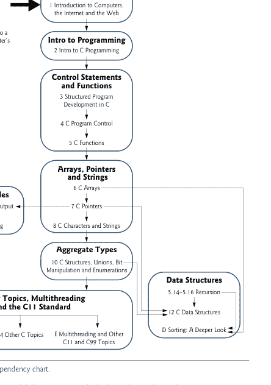

Fig. 1 | C 章节依赖图。

## 语法着色。

为了提高可读性，我们对代码进行语法着色，类似于大多数 IDE 和代码编辑器对代码进行语法着色的方式。我们的语法着色约定如下：

```
comments appear like this in gray
keywords appear like this in dark blue
constants and literal values appear like this in light blue
all other code appears in black
```


### 性能提示

*这些提示突出了使程序运行更快或减少其占用的内存量的机会。*


### 可移植性提示

*可移植性提示帮助您编写可在多种平台上运行的代码。*


### 软件工程观察

*软件工程观察突出了影响软件系统（尤其是大规模系统）构建的架构和设计问题。*

*摘要要点。* 我们对每章提供详细的逐节要点列表摘要，其中包含加粗的关键术语。为了便于参考，大多数关键术语后面都跟着其定义出现所在的页码。

*自测练习和答案。* 包含大量自测练习和答案，供自学使用。

*练习。* 每章都以一套大量的练习结束，包括：

- 对重要术语和概念的简单回忆
- 识别代码示例中的错误
- 编写单个程序语句
- 编写 C 函数（以及 C++ 成员函数和类）的小部分
- 编写完整程序
- 实现主要项目

*索引。* 我们包含了详细的索引，当您将本书作为参考使用时尤其有帮助。关键术语的定义出现位置在索引中用加粗的彩色页码突出显示。

## 《C How to Program, 8/e》 中使用的软件

我们使用以下免费编译器测试了《*C How to Program, 8/e*》中的程序：

- GNU C 和 C++ (http://gcc.gnu.org/install/binaries.html)，已预装在大多数 Linux 系统上，也可安装在 OS X 和 Windows 系统上。
- Visual Studio 2013 Community 版中的 Microsoft Visual C++，可从 http://go.microsoft.com/?linkid=9863608 下载
- Apple Xcode IDE 中的 LLVM，OS X 用户可从 Mac App Store 下载。

如需其他免费 C 和 C++ 编译器，请访问：

- http://www.thefreecountry.com/compilers/cpp.shtml
- http://www.compilers.net/Dir/Compilers/CCpp.htm
- http://www.freebyte.com/programming/cpp/#cppcompilers
- http://en.wikipedia.org/wiki/List_of_compilers#C.2B.2B_compilers

Kostuch (独立顾问), Vytautus Leonavicius (微软), Xiaolong Li (印第安纳州立大学), William Mike Miller (Edison Design Group, Inc.), Tom Rethard (德克萨斯大学阿灵顿分校), Robert Seacord (SEI/CERT 安全编码经理，《The CERT C Secure Coding Standard》作者以及 C 编程语言国际标准化工作组的 技术专家), José Antonio González Seco (安达卢西亚议会), Benjamin Seyfarth (密西西比大学南部分校), Gary Sibbitts (梅雷马克圣路易斯社区学院), William Smith (塔尔萨社区学院) 和 Douglas Walls (高级员工工程师，C 编译器，Sun Microsystems—现为 Oracle 旗下公司)。

## 特别感谢 Brandon Invergo 和 Jim Hogg

我们很荣幸 Brandon Invergo (GNU/欧洲生物信息学研究所) 和 Jim Hogg (微软公司 C/C++ 编译器团队项目经理) 为全书进行了审阅。他们仔细审查了书中 C 部分的内容，提供了许多见解和建设性意见。我们的大部分读者使用的是 GNU gcc 编译器或 Microsoft Visual C++ 编译器（也可编译 C）。Brandon 和 Jim 帮助我们确保我们的内容分别对 GNU 和 Microsoft 编译器是准确的。他们的评论传达了我们共同热爱的软件工程、计算机科学和教育。

好了，就这些！C 是一种功能强大的编程语言，可帮助您快速有效地编写高性能、可移植的程序。它很好地扩展到企业系统开发领域，帮助组织构建其业务关键型和任务关键型信息系统。在您阅读本书时，我们真诚地希望您能提出评论、批评、更正和改进文本的建议。请将所有通信——包括问题——发送至：

deitel@deitel.com

我们会及时回复，并在以下网站发布更正和澄清：

www.deitel.com/books/ch8/

我们希望您使用《*C How to Program, 第八版*》的体验与我们撰写它时的体验一样愉快！

Paul Deitel  
Harvey Deitel

## 关于作者

Paul Deitel，Deitel & Associates, Inc. 的首席执行官兼首席技术官，是 MIT 的毕业生，在那里他学习信息技术。通过 Deitel & Associates, Inc.，他为 Cisco、IBM、Siemens、Sun Microsystems、Dell、Lucent Technologies、Fidelity、NASA 肯尼迪航天中心、国家严重风暴实验室、白沙导弹靶场、Hospital Sisters Health System、Rogue Wave Software、Boeing、SunGard Higher Education、Stratus、Cambridge Technology Partners、One Wave、Hyperion Software、Adra Systems、Entergy、CableData Systems、Nortel Networks、Puma、iRobot、Invensys 等众多行业客户提供了数百门编程课程。他与合著者 Harvey M. Deitel 博士一起，是全球最畅销的编程语言教材/专业书籍/视频作者。

Harvey M. Deitel 博士，Deitel & Associates, Inc. 的董事长兼首席战略官，在计算机领域拥有 54 年经验。Deitel 博士在 MIT 获得电气工程学士和硕士学位，在波士顿大学获得数学博士学位（均侧重于计算）。他拥有丰富的大学教学经验，包括获得终身教职并担任波士顿学院计算机科学系系主任，随后于 1991 年与儿子 Paul Deitel 一起创立了 Deitel & Associates。Deitel 的出版物获得了国际认可，已翻译成中文、韩文、日文、德文、俄文、西班牙文、法文、波兰文、意大利文、葡萄牙文、希腊文、乌尔都文和土耳其文。Deitel 博士为学术机构、大型公司、政府组织和军队提供了数百门编程课程。

## 关于 Deitel & Associates, Inc.

Deitel & Associates, Inc. 由 Paul Deitel 和 Harvey Deitel 创立，是国际公认的作者和企业培训组织，专注于计算机编程语言、面向对象技术、移动应用开发以及互联网和网络软件技术。该公司的培训客户包括世界上许多最大的公司、政府机构、军队分支机构和学术机构。该公司提供由客户现场全球交付的讲师授课培训课程，涵盖主要编程语言和平台，包括 C、C++、Java™、Android 应用开发、Swift™ 和 iOS® 应用开发、Visual C#®、Visual Basic®、Visual C++®、Python®、面向对象技术、互联网和网络编程以及不断增长的其他编程和软件开发课程列表。

通过与 Pearson/Prentice Hall 长达 40 年的出版合作，Deitel & Associates, Inc. 出版了领先的编程教材和专业书籍，印刷版和流行的电子书格式，以及 LiveLessons 视频课程（可在 Safari Books Online 和其他视频平台上获得）。可通过以下方式联系 Deitel & Associates, Inc. 和作者：deitel@deitel.com

要了解更多关于 Deitel's Dive Into® Series 企业培训课程的信息，该课程面向全球客户现场的软件工程师团队提供，请访问：http://www.deitel.com/training

如需在贵组织申请现场讲师授课培训提案，请发送电子邮件至 deitel@deitel.com。希望购买 Deitel 书籍和 LiveLessons 视频培训的个人可通过 www.deitel.com 进行。企业、政府、军队和学术机构的大批量订单应直接向 Pearson 订购。有关更多信息，请访问 http://www.informit.com/store/sales.aspx

Pearson 希望感谢并认可 Arup Bhattacharjee、RCC Institute of Information Technology、Soumen Mukherjee、RCC Institute of Information Technology 和 Saru Dhir、Amity University 对全球版的审阅。


## 计算机、互联网和万维网简介

### 目标

在本章中，您将学习：

- 基本计算机概念。
- 不同类型的编程语言。
- C 编程语言的历史。
- C 标准库的目的。
- 对象技术的基础。
- 一个典型的 C 程序开发环境。
- 在 Windows、Linux 和 Mac OS X 上测试驱动 C 应用程序。
- 互联网和万维网的一些基础知识。

- 1.1 引言
- 1.2 硬件和软件
  - 1.2.1 摩尔定律
  - 1.2.2 计算机组织
- 1.3 数据层次结构
- 1.4 机器语言、汇编语言和高层语言
- 1.5 C 编程语言
- 1.6 C 标准库
- 1.7 C++ 和其他基于 C 的语言
- 1.8 对象技术
  - 1.8.1 汽车作为对象
  - 1.8.2 方法和类
  - 1.8.3 实例化
  - 1.8.4 重用
  - 1.8.5 消息和方法调用
  - 1.8.6 属性和实例变量
  - 1.8.7 封装和信息隐藏
  - 1.8.8 继承
- 1.9 典型的 C 程序开发环境
  - 1.9.1 第 1 阶段：创建程序
  - 1.9.2 第 2 和第 3 阶段：预处理和编译 C 程序
  - 1.9.3 第 4 阶段：链接
  - 1.9.4 第 5 阶段：加载
  - 1.9.5 第 6 阶段：执行
  - 1.9.6 执行时可能出现的问题
- 1.9.7 标准输入、标准输出和标准错误流
- 1.10 在 Windows、Linux 和 Mac OS X 上测试驱动 C 应用程序
  - 1.10.1 从 Windows 命令提示符运行 C 应用程序
  - 1.10.2 使用 GNU C 在 Linux 上运行 C 应用程序
  - 1.10.3 使用 Mac OS X 上的终端运行 C 应用程序
- 1.11 操作系统
  - 1.11.1 Windows——专有操作系统
  - 1.11.2 Linux——开源操作系统
  - 1.11.3 Apple 的 Mac OS X：Apple 的 iOS 面向 iPhone®、iPad® 和 iPod Touch® 设备
  - 1.11.4 Google 的 Android
- 1.12 互联网和万维网
  - 1.12.1 互联网：网络的网络
  - 1.12.2 万维网：让互联网更易于使用
  - 1.12.3 Web 服务
  - 1.12.4 Ajax
  - 1.12.5 物联网
- 1.13 一些关键软件术语
- 1.14 跟上信息技术的发展

## 1.1 引言

欢迎来到 C 和 C++！C 是一种简洁而强大的计算机编程语言，适合技术导向且编程经验少或没有编程经验的人使用，也适合有经验的程序员用于构建大型软件系统。《C 如何编程》第八版是这两类读者的有效学习工具。

本书的核心强调通过 C 结构化编程和 C++ 面向对象编程的成熟方法论进行软件工程。本书展示了数百个完整的可用程序，并展示了这些程序在计算机上运行时产生的输出。我们称之为“实时代码方法”。所有这些示例程序均可从我们的网站 www.deitel.com/books/chtp8/ 下载。

大多数人都熟悉计算机执行的令人兴奋的任务。使用本书，您将学习如何指挥计算机执行这些任务。软件（即您编写的用于指挥计算机执行操作和做出决策的指令）控制着计算机（通常称为硬件）。

### 1.2.2 计算机组织

无论物理外观存在差异，计算机都可以设想为分为各个逻辑单元或部分（图 1.1）。

| 逻辑单元 | 描述 |
|---|---|
| 输入单元 | 这个“接收”部分从输入设备获取信息（数据和计算机程序）并将其置于其他单元处理之用。大多数用户输入是通过键盘、触摸屏和鼠标设备输入到计算机中的。其他形式的输入包括接收语音命令、扫描图像和条形码、从二级存储设备读取（例如硬盘、DVD 驱动器、蓝光光盘™ 驱动器和 USB 闪存驱动器——也称为“拇指驱动器”或“记忆棒”）、从网络摄像头接收视频以及让计算机从互联网接收信息（例如当您从 YouTube® 流式传输视频或从 Amazon 下载电子书时）。较新的输入形式包括来自 GPS 设备的定位数据，以及智能手机或游戏控制器中的加速度计（一种响应上下、左右和前后加速度的设备）中的运动和方向信息（例如 Microsoft® Kinect®、Microsoft® Xbox®、Wii™ Remote 和 Sony® PlayStation® Move）。 |
| 输出单元 | 这个“发货”部分将计算机处理过的信息放置在各种输出设备上，使其在计算机外部可用。今天从计算机输出的大多数信息都显示在屏幕上（包括触摸屏）、打印在纸上（“绿色办公”不鼓励此做法）、在 PC 和媒体播放器（如 Apple 的 iPod）以及体育场馆的巨型屏幕上作为音频或视频播放、通过互联网传输或用于控制其他设备，例如机器人和“智能”家电。信息也常常用作输出到二级存储设备，例如硬盘、DVD 驱动器和 USB 闪存驱动器。流行的最新输出形式是智能手机和游戏控制器的振动，以及 Oculus Rift 等虚拟现实设备。 |
| 内存单元 | 这个快速访问、容量相对较低的“仓库”部分保留通过输入单元输入的信息，使其在需要时可立即用于处理。内存单元还保留已处理的信息，直到输出单元将其放置在输出设备上。内存单元中的信息是易失的——通常在计算机断电时丢失。内存单元通常称为内存、主内存或 RAM（随机存取存储器）。台式机和笔记本电脑的主内存可包含多达 128 GB 的 RAM，尽管 2 至 16 GB 最为常见。GB 代表千兆字节；千兆字节大约为十亿字节。一个字节为八位。一位要么是 0 要么是 1。 |
| 算术和逻辑单元（ALU） | 这个“制造”部分执行计算，例如加法、减法、乘法和除法。它还包含决策机制，允许计算机例如比较内存单元中的两个项目以确定它们是否相等。在当今的系统中，ALU 作为下一个逻辑单元 CPU 的一部分实现。 |
| 中央处理单元（CPU） | 这个“行政”部分协调并监督其他部分的运行。CPU 告诉输入单元何时将信息读入内存单元，告诉 ALU 何时使用内存单元中的信息进行计算，并告诉输出单元何时将内存单元中的信息发送到某些输出设备。今天的许多计算机都有多个 CPU，因此可以同时执行许多操作。多核处理器在单个集成电路芯片上实现多个处理器——双核处理器有两个 CPU，四核处理器有四个 CPU。今天的台式计算机的处理器每秒可执行数十亿条指令。 |
| 二级存储单元 | 这是长期、大容量的“仓储”部分。未被其他单元积极使用的程序或数据通常被放置在二级存储设备上（例如您的硬盘），直到再次需要为止，可能是在数小时、数天、数月甚至数年之后。二级存储设备上的信息是持久的——即使计算机断电也会保留。二级存储信息比主内存中的信息访问时间长得多，但其单位成本要低得多。二级存储设备的示例包括硬盘、DVD 驱动器和 USB 闪存驱动器，其中一些可容纳超过 2 TB（TB 代表太字节；太字节大约为一万亿字节）。台式机和笔记本电脑的典型硬盘可容纳多达 2 TB，而某些台式硬盘可容纳多达 6 TB。 |

图 1.1 | 计算机的逻辑单元。（第 2 部分，共 2 部分。）

## 1.3 数据层次结构

计算机处理的数据项形成一个数据层次结构，随着我们从最简单的数据项（称为“位”）进展到更丰富的数据项，例如字符和字段，其结构变得越来越大、越来越复杂。图 1.2 说明了数据层次结构的一部分。

### 位

计算机中最小的数据项可以取值为 0 或 1。它被称为位（“二进制数字”的缩写——可以取两个值之一的数字）。值得注意的是，计算机执行的令人印象深刻的功能仅涉及 0 和 1 的最简单操作——检查位的值、设置位的值以及反转位的值（从 1 到 0 或从 0 到 1）。

### 字符

人们以位这种低级形式处理数据是乏味的。相反，他们更喜欢使用十进制数字（0–9）、字母（A–Z 和 a–z）以及特殊符号（例如 $、@、%、&、*、(、)、-、+、:、? 和 /）。数字、字母和特殊符号被称为字符。计算机的字符集是用于编写程序和表示数据项的所有字符的集合。计算机只处理 1 和 0，因此计算机的字符集将每个字符表示为 1 和 0 的模式。C 支持各种字符集（包括 Unicode®），这些字符集由包含一个、两个或四个字节（8、16 或 32 位）的字符组成。Unicode 包含世界上许多语言的字符。有关更多信息，请参阅附录 B

ASCII（美国信息交换标准代码）字符集——Unicode 的流行子集，表示大写和小写字母、数字以及一些常见的特殊字符。

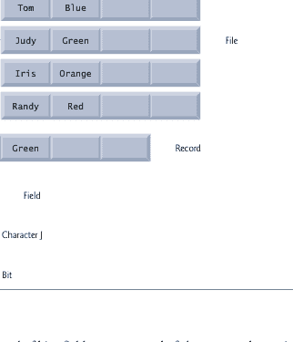

Fig. 1.2 | 数据层次结构。

### 字段

正如字符由位组成，字段由字符或字节组成。字段是一组传达含义的字符或字节。例如，由大写和小写字母组成的字段可用于表示某人的姓名，而由十进制数字组成的字段可用于表示某人的年龄。

### 记录

若干相关字段可用于组成一条记录。例如，在工资系统中，某名员工的记录可能由以下字段组成（这些字段的可能类型在括号中显示）：

- 员工识别号码（一个整数）
- 姓名（字符串）
- 地址（字符串）
- 小时工资率（带小数点的数字）
- 年至今收入（带小数点的数字）
- 代扣税款金额（带小数点的数字）

因此，记录是一组相关字段。在前面的例子中，所有字段都属于*同一名员工*。一家公司可能有多名员工和一份工资记录。

### 文件

文件是一组相关记录。[注：更一般地说，文件包含任意格式的任意数据。在某些操作系统中，文件被简单地视为一个*字节序列*——文件中的字节的任何组织方式，例如将数据组织成记录，都是由应用程序员创建的视图。] 组织拥有许多文件并不罕见，其中一些包含数十亿甚至数万亿个字符的信息。

### 数据库

数据库是为了便于访问和操作而组织的数据集合。最流行的模型是*关系数据库*，其中数据存储在简单的*表*中。表包括*记录*和*字段*。例如，学生表可能包括名字、姓氏、专业、年级、学生 ID 号码和平均绩点字段。每名学生的数据是一条记录，而每条记录中的各个信息片段就是字段。你可以根据数据与多个表或数据库的关系进行*搜索*、*排序*以及其他操作。例如，大学可能会将学生数据库中的数据与课程、校内住宿、膳食计划等数据库中的数据结合使用。

### 大数据

全球产生的数据量巨大且增长迅速。据 IBM 称，每天大约产生 2.5 千万亿字节（2.5 *艾字节*）的数据，世界上 90% 的数据是在过去两年内创建的。^2 根据 IDC 的一项研究，到 2020 年，全球数据供应量将达到每年 40 *泽字节*（相当于 40 万亿兆字节）。^3 图 1.3 显示了一些常见的字节度量。大数据应用处理海量数据，该领域增长迅速，为软件开发人员创造了大量机会。据 Gartner Group 的一项研究，到 2015 年，全球超过 400 万个 IT 工作将支持大数据。^4

| 单位 | 字节 | 大约相当于 |
|---|---|---|
| 1 千字节 (KB) | 1024 字节 | 10^3（正好 1024 字节） |
| 1 兆字节 (MB) | 1024 千字节 | 10^6（1,000,000 字节） |
| 1 千兆字节 (GB) | 1024 兆字节 | 10^9（1,000,000,000 字节） |
| 1 太字节 (TB) | 1024 千兆字节 | 10^12（1,000,000,000,000 字节） |
| 1 拍字节 (PB) | 1024 太字节 | 10^15（1,000,000,000,000,000 字节） |
| 1 艾字节 (EB) | 1024 拍字节 | 10^18（1,000,000,000,000,000,000 字节） |
| 1 泽字节 (ZB) | 1024 艾字节 | 10^21（1,000,000,000,000,000,000,000 字节） |

**Fig. 1.3** | 字节测量。

从程序员的角度来看，高级语言优于机器语言和汇编语言。C 是使用最广泛的高级编程语言之一。

### 解释器

将大型高级语言程序编译成机器语言可能需要大量的计算机时间。解释器程序旨在直接执行高级语言程序，避免了编译的延迟，尽管它们的运行速度比编译后的程序慢。

## 1.5 C 编程语言

C 由两种先前的语言 BCPL 和 B 演变而来。BCPL 由 Martin Richards 于 1967 年开发，用作编写操作系统和编译器的语言。Ken Thompson 在他的 B 语言中模仿了 BCPL 中对应的许多特性，并在 1970 年使用 B 在贝尔实验室创建了 UNIX 操作系统的早期版本。

C 语言由贝尔实验室的 Dennis Ritchie 从 B 演变而来，并于 1972 年首次实现。C 最初因成为 UNIX 操作系统的开发语言而广为人知。今天的许多领先操作系统都是用 C 和/或 C++ 编写的。C 大多与硬件无关——通过仔细设计，可以编写可在大多数计算机上移植的 C 程序。

### 为性能而生

C 广泛用于开发需要性能的系统，例如操作系统、嵌入式系统、实时系统和通信系统（图 1.4）。

| 应用 | 描述 |
|---|---|
| 操作系统 | C 的可移植性和性能使其成为实现操作系统的理想选择，例如 Linux 以及微软 Windows 和谷歌 Android 的部分内容。苹果的 OS X 是用派生自 C 的 Objective-C 构建的。我们在第 1.11 节讨论了一些关键的流行桌面/笔记本操作系统和移动操作系统。 |
| 嵌入式系统 | 每年生产的绝大多数微处理器都嵌入在通用计算机之外的设备中。这些嵌入式系统包括导航系统、智能家电、家庭安防系统、智能手机、平板电脑、机器人、智能交通路口等。C 是开发嵌入式系统最流行的编程语言之一，嵌入式系统通常需要尽可能快地运行并节省内存。例如，汽车的防抱死制动系统必须立即响应以减速或停止汽车而不打滑；用于电子游戏的游戏控制器应即时响应，以防止控制器与游戏中的动作之间出现任何延迟，并确保流畅的动画。 |
| 实时系统 | 实时系统通常用于需要几乎即时且可预测响应时间的“任务关键型”应用。实时系统需要持续工作——例如，空中交通管制系统必须不断监控飞机的位置和速度，并在无延迟的情况下将这些信息报告给空中交通管制员，以便他们在可能发生碰撞时提醒飞机改变航向。 |
| 通信系统 | 通信系统需要快速将大量数据路由到其目的地，以确保音频和视频等内容能够顺畅且无延迟地传输。 |

Fig. 1.4 | 一些流行的面向性能的 C 应用。（第 2 部分之 2。）

到 20 世纪 70 年代末，C 已演变为现在所称的“传统 C”。Kernighan 和 Ritchie 于 1978 年出版的著作 *《C 程序设计语言》* 引起了人们对该语言的广泛关注。这本书成为有史以来最成功的计算机科学书籍之一。

### 标准化

C 在各种类型的计算机（有时称为*硬件平台*）上的快速扩展导致了许多相似但经常不兼容的变体。这对需要在多个平台上运行代码的程序员来说是一个严重问题。显然需要一个标准的 C 版本。1983 年，在美国国家计算机和信息处理标准委员会（X3）下成立了 X3J11 技术委员会，以“提供语言的明确且与机器无关的定义”。1989 年，该标准在美国通过美国国家标准学会（ANSI）批准为 ANSI X3.159-1989，随后通过国际标准化组织（ISO）在全球范围内批准。我们简单地称之为标准 C。该标准于 1999 年更新——其标准文件被称为 *INCITS/ISO/IEC 9899:1999*，通常简称为 C99。副本可从美国国家标准学会（www.ansi.org）订购，网址为 webstore.ansi.org/ansidocstore。

### C11 标准

我们还讨论了最新的 C 标准（称为 C11），该标准于 2011 年获批。C11 完善并扩展了 C 的功能。我们已将领先的 C 编译器中实现的新特性中的许多内容整合到正文和附录 E（在易于包含或省略的部分中）。

**可移植性提示 1.1**  
*由于 C 是一种与硬件无关、广泛可用的语言，用 C 编写的应用程序通常可以在各种计算机系统上以很少或无需修改的方式运行。*

## 1.6 C 标准库

如你在第 5 章将学到的，C 程序由称为*函数*的部分组成。你可以编程所有形成 C 程序所需的函数，但大多数 C 程序员会

利用名为 C 标准库 的丰富现有函数集合的优势。因此，学习 C 语言编程实际上分为两个部分——学习 C 语言本身以及学习如何使用 C 标准库中的函数。在整本书中，我们讨论了其中许多函数。P. J. Plauger 的著作 *《标准 C 库》* 是程序员必须阅读的资料，尤其是那些需要深入理解库函数、如何实现它们以及如何使用它们编写可移植代码的人。我们在本文中广泛使用并解释了许多 C 库函数。

C *如何编程*，第 8 版鼓励采用 *构建块* 方法来创建程序。避免“重新发明轮子”。相反，使用现有的组件——这称为 *软件重用*。在用 C 编程时，你通常会使用以下构建块：

- C 标准库函数
- 你自己创建的函数
- 其他人（你信任的）创建并提供给你的函数

创建自己的函数的优点是你会确切地知道它们的工作原理。你能够检查 C 代码。缺点是设计、开发、调试和性能调优新函数所耗费的时间。

**性能提示 1.1**
*使用 C 标准库函数而不是自己编写版本可以提高程序性能，因为这些函数经过精心编写以高效执行。*

**可移植性提示 1.2**
*使用 C 标准库函数而不是自己编写可比版本可以提高程序可移植性，因为这些函数几乎在所有标准 C 实现中都使用。*

## 1.7 C++ 及其他基于 C 的语言

C++ 由 Bjarne Stroustrup 在贝尔实验室开发。它源于 C，提供了许多“美化”C 语言的功能。更重要的是，它提供了 *面向对象编程* 的能力。对象本质上是可重用的软件组件，用于模拟现实世界中的事物。采用模块化、面向对象的设计和实现方法可以使软件开发团队更具生产力。第 15–23 章介绍了从我们的著作 *C++ 如何编程* 中选出的 C++ 精简处理。图 1.5 介绍了几种其他流行的基于 C 的编程语言。

| 编程语言 | 描述 |
|---|---|
| Objective-C | Objective-C 是一种基于 C 的面向对象语言。它于 1980 年代初期开发，后来被 NeXT 收购，而 NeXT 又被 Apple 收购。它已成为 OS X 操作系统的关键编程语言，以及所有 iOS 驱动设备（如 iPod、iPhone 和 iPad）。 |
| Java | Sun Microsystems 于 1991 年资助了一个内部企业研究项目，由此产生了基于 C++ 的面向对象编程语言 Java。Java 的一个关键目标是能够编写可在各种计算机系统和计算机控制设备上运行的程序。这有时被称为“一次编写，到处运行”。Java 用于开发大规模企业应用程序、增强 Web 服务器的功能（提供我们在 Web 浏览器中看到的内容的计算机）、为消费设备（智能手机、电视机顶盒等）提供应用程序以及许多其他用途。Java 也是 Android 应用开发的语言。 |
| C# | Microsoft 的三大主要面向对象编程语言是 Visual Basic（基于原始 Basic）、Visual C++（基于 C++）和 Visual C#（基于 C++ 和 Java），并为将互联网和网络集成到计算机应用程序中而开发。非 Microsoft 版本的 C# 也可获得。 |
| PHP | PHP 是一种面向对象、开源的脚本语言，由用户和开发者社区支持，被数百万网站使用。PHP 是平台无关的——所有主要 UNIX、Linux、Mac 和 Windows 操作系统都存在实现。PHP 还支持许多数据库，包括流行的开源 MySQL。 |
| Python | Python 是另一种面向对象的脚本语言，于 1991 年公开发布。由阿姆斯特丹数学与计算机科学国家研究学院（CWI）的 Guido van Rossum 开发，Python 大量借鉴了 Modula-3——一种系统编程语言。Python 是“可扩展的——它可以通过类和编程接口进行扩展。 |
| JavaScript | JavaScript 是使用最广泛的脚本语言。它主要用于为网页添加动态行为——例如动画和与用户的交互性增强。它随所有主要 Web 浏览器提供。 |
| Swift | Swift 是 Apple 用于开发 iOS 和 Mac 应用的新编程语言，于 2014 年 6 月在 Apple 全球开发者大会（WWDC）上宣布。虽然应用仍可使用 Objective-C 开发和维护，但 Swift 是 Apple 未来应用开发语言。它是一种现代语言，消除了 Objective-C 的一些复杂性，使初学者以及从其他高级语言（如 Java、C#、C++ 和 C）转过来的开发者更容易使用。Swift 强调性能和安全性，并可完全访问 iOS 和 Mac 编程功能。 |

图 1.5 | 流行的基于 C 的编程语言。（第 1 部分，共 2 部分。）
图 1.5 | 流行的基于 C 的编程语言。（第 2 部分，共 2 部分。）

## 1.8 对象技术

本节面向将在本书后面学习 C++ 的读者。在对新且更强大的软件的需求激增之际，快速、正确且经济地构建软件仍然是一个难以捉摸的目标。对象，或更准确地说对象所属的类，本质上是可重用的软件组件。有日期对象、时间对象、音频对象、视频对象、汽车对象、人员对象等。几乎任何名词都可以合理地表示为软件对象，以属性（例如名称、颜色和大小）和行为（例如计算、移动和通信）为依据。软件开发人员发现，使用模块化、面向对象的设计和实现方法可以使软件开发团队比使用早期技术时更具生产力——面向对象的程序通常更容易理解、纠正和修改。

### 1.8.1 汽车作为对象

为了帮助你理解对象及其内容，让我们从一个简单的类比开始。假设你想驾驶一辆汽车并通过踩下加速踏板使其加速。在你能做到这一点之前必须发生什么？好吧，在你能驾驶汽车之前，有人必须设计它。一辆汽车通常始于工程图纸，类似于描述房屋设计的蓝图。这些图纸包括加速踏板的设计。踏板将使汽车加速的复杂机制隐藏起来，就像刹车踏板“隐藏”使汽车减速的机制，方向盘“隐藏”使汽车转弯的机制一样。这使得对发动机、制动和转向机制知之甚少或一无所知的人也能轻松驾驶汽车。

正如你不能在蓝图的厨房里做饭，你也不能驾驶汽车的工程图纸。在你能驾驶汽车之前，必须根据描述它的工程图纸建造它。一辆完工的汽车有一个实际的加速踏板来使其加速，但这还不够——汽车不会自行加速（希望如此！），因此驾驶员必须踩下踏板来加速汽车。

### 1.8.2 方法与类

让我们用汽车的例子来介绍一些关键的面向对象编程概念。在程序中执行任务需要一个方法。方法包含实际执行其任务的程序语句。它将这些语句隐藏在其用户之外，就像汽车的加速踏板将使汽车加速的机制隐藏在驾驶员之外一样。在面向对象编程语言中，我们创建一个名为类的程序单元来容纳执行该类任务的一组方法。例如，表示银行账户的类可能包含一个向账户存款的方法、一个从账户取款的方法以及一个查询账户当前余额的方法。类在概念上类似于汽车的工程图纸，其中包含加速踏板、方向盘等的设计。

### 1.8.3 实例化

正如有人必须根据工程图纸建造汽车后你才能真正驾驶汽车一样，你必须先构建一个类的对象，然后程序才能执行该类的方法所定义的操作。执行此过程称为实例化。然后对象被称为其类的实例。

### 1.8.4 重用

正如汽车的工程图纸可以多次重用以建造多辆汽车一样，你可以多次重用一个类来构建多个对象。在构建新类和程序时重用现有类可以节省时间和精力。重用还有助于构建更可靠和

有效系统，因为现有的类和组件通常已经经过了广泛的测试、调试和性能调优。正如可互换零件的概念对工业革命至关重要一样，可重用的类对由对象技术引发的软件革命至关重要。

> **软件工程观察 1.1**
> 使用构建块的方法创建程序。避免重新发明轮子——尽可能使用现有的高质量组件。这种软件重用是面向对象编程的关键优势。

### 1.8.5 消息与方法调用

当你驾驶汽车时，踩下油门踏板会向汽车发送一条消息执行任务——即加速。同样，你也可以向对象发送消息。每条消息都实现为一个方法调用，告诉对象的某个方法执行其任务。例如，程序可能会调用特定银行账户对象的 deposit 方法来增加账户余额。

### 1.8.6 属性与实例变量

汽车除了具有完成任务的能力外，还具有属性，例如其颜色、车门数量、油箱中的汽油量、当前速度以及行驶总里程记录（即里程表读数）。与其实用能力一样，汽车的属性在工程图设计中作为其设计的一部分表示（例如包括里程表和燃油表）。当你驾驶一辆真正的汽车时，这些属性会随汽车一起携带。每辆车都维护自己的属性。例如，每辆车都知道自己油箱中有多少汽油，但不知道其他汽车油箱中有多少。

对象同样具有属性，随着在程序中使用而携带。这些属性作为对象类的一个部分指定。例如，银行账户对象具有表示账户中金额的 balance 属性。每个银行账户对象都知道其所代表账户的余额，但不知道银行中其他账户的余额。属性由类的实例变量指定。

### 1.8.7 封装与信息隐藏

类（及其对象）封装，即封装其属性和方法。类的（及其对象的）属性和方法密切相关。对象可以相互通信，但通常不允许知道其他对象的实现方式——实现细节隐藏在对象本身内部。这种信息隐藏，如我们将看到的，对良好的软件工程至关重要。

### 1.8.8 继承

可以通过继承方便地创建新的对象类——新类（称为子类）以现有类（称为超类）的特征开始，可能对其进行定制并添加其自身独特的特征。在我们的汽车类比中，“敞篷车”类的对象当然是更一般类“汽车”的对象，但更具体地说，车顶可以升起或放下。

## 1.9 典型的 C 程序开发环境

C 系统通常由几个部分组成：程序开发环境、语言和 C 标准库。以下讨论解释了图 1.6 所示的典型 C 开发环境。

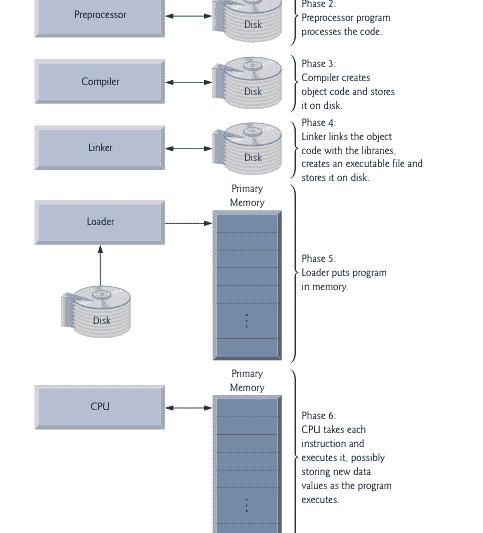

图 1.6 | 典型的 C 开发环境。

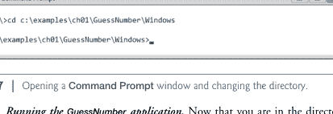

图 1.7 | 打开命令提示符窗口并更改目录。

3. 运行 GuessNumber 应用程序。现在你已进入包含 GuessNumber 应用程序的目录，输入命令 GuessNumber（图 1.8）并按 Enter。[注意：GuessNumber.exe 是应用程序的实际名称；然而，Windows 默认假设 .exe 扩展名。]

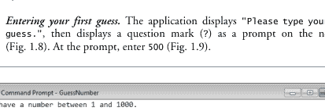

图 1.8 | 运行 GuessNumber 应用程序。

4. 输入你的第一次猜测。应用程序显示“Please type your first guess.”，然后在下一行显示一个问号（?）作为提示（图 1.8）。在提示符处，输入 500（图 1.9）。

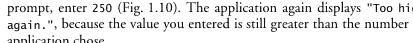

图 1.9 | 输入你的第一次猜测。

5. 输入另一个猜测。应用程序显示“Too high. Try again.”，意味着你输入的值大于应用程序选择的正确答案。因此，你应该为下一次猜测输入一个更低的数字。在提示符处，输入 250（图 1.10）。应用程序再次显示“Too high. Try again.”，因为你输入的值仍然大于应用程序选择的数字。

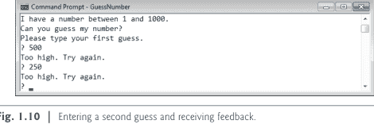

图 1.10 | 输入第二次猜测并接收反馈。

- 6. *输入额外的猜测。* 通过输入数值继续游戏，直到猜中正确数字。应用程序将显示“Excellent! You guessed the number!”（图 1.11）。

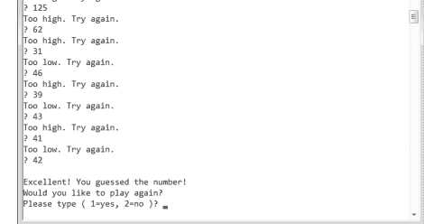

图 1.11 | 输入额外的猜测并猜中正确数字。

- 7. *再次玩游戏或退出应用程序。* 猜对后，应用程序会询问你是否想再玩一局（图 1.11）。在提示符处，输入 1 会导致应用程序选择一个新数字并显示消息“Please type your first guess.”，随后是问号提示（图 1.12），这样你就可以在新游戏中进行第一次猜测。输入 2 会结束应用程序并将你返回到命令提示符下的应用程序目录（图 1.13）。每次从头开始执行此应用程序（即步骤 3），它都会为你选择相同的数字进行猜测。

- 8. *关闭命令提示符窗口。*

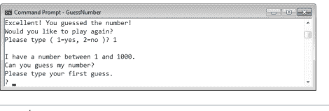

图 1.12 | 再次玩游戏。

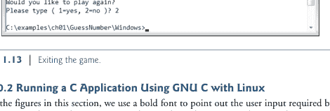

图 1.13 | 退出游戏。

### 1.10.2 使用 GNU C 在 Linux 上运行 C 应用程序

本节中的图使用粗体字体指出每一步所需的用户输入。在本次测试中，我们假设你知道如何将示例复制到主目录。如果你在将文件复制到 Linux 系统时有任何疑问，请咨询你的讲师。此外，本节中的图使用粗体字体指出每一步所需的用户输入。我们系统上的 shell 提示符使用波浪号（~）字符表示主目录，每个提示符以美元符号（$）字符结尾。提示符在不同的 Linux 系统中会有所不同。

- 1. 检查你的设置。阅读 www.deitel.com/books/cHtP8/ 处的开始之前部分非常重要，以确保你已正确将本书的示例复制到硬盘驱动器。
- 2. 定位已完成的应用程序。从 Linux shell，输入 `cd examples/ch01/GuessNumber/GNU` 然后按 Enter 更改到已完成的 GuessNumber 应用程序目录（图 1.14）。命令 cd 用于更改目录。

```
$ cd examples/ch01/GuessNumber/GNU
~/examples/ch01/GuessNumber/GNU$
```

图 1.14 | 更改到 GuessNumber 应用程序的目录。

3. *编译 GuessNumber 应用程序。* 要在 GNU C 编译器上运行应用程序，必须先通过输入 `gcc GuessNumber.c -o GuessNumber` 进行编译，如图 1.15 所示。此命令编译应用程序。-o 选项后面跟随你希望可执行文件具有的名称——GuessNumber。

```
~/examples/ch01/GuessNumber/GNU$ gcc -std=c11 GuessNumber.c -o GuessNumber
~/examples/ch01/GuessNumber/GNU$
```

图 1.15 | 使用 gcc 命令编译 GuessNumber 应用程序。

4. *运行 GuessNumber 应用程序。* 要运行可执行文件 GuessNumber，在下一个提示符处输入 ./GuessNumber，然后按 Enter（图 1.16）。

```
~/examples/ch01/GuessNumber/GNU$ ./GuessNumber
I have a number between 1 and 1000.
Can you guess my number?
Please type your first guess.
?
```

图 1.16 | 运行 GuessNumber 应用程序。

5. *输入你的第一次猜测。* 应用程序显示“Please type your first guess.”，然后在下一行显示一个问号（?）作为提示（图 1.16）。在提示符处，输入 500（图 1.17）。

```
~/examples/ch01/GuessNumber/GNU$ ./GuessNumber
I have a number between 1 and 1000.
Can you guess my number?
Please type your first guess.
? 500
Too high. Try again.
?
```

图 1.17 | 输入初始猜测。

6. *输入另一个猜测。* 应用程序显示“Too high. Try again.”，意味着你输入的值大于应用程序选择的正确答案（图 1.17）。在下一个提示符处，输入 250（图 1.18）。这次应用程序显示“Too low. Try again.”，因为你输入的值小于正确答案。


```
~/examples/ch01/GuessNumber/GNU$ ./GuessNumber
I have a number between 1 and 1000.
Can you guess my number?
Please type your first guess.
? 500
Too high. Try again.
? 250
Too low. Try again.
?
```

*图 1.18 | 输入第二次猜测并接收反馈。*

- 7. **输入额外猜测。** 继续玩游戏（图 1.19），通过输入值直到猜中正确数字。当你猜对时，应用程序会显示“太棒了！你猜中了数字！”

```
Too low. Try again.
? 375
Too low. Try again.
? 437
Too high. Try again.
? 406
Too high. Try again.
? 391
Too high. Try again.
? 383
Too low. Try again.
? 387
Too high. Try again.
? 385
Too high. Try again.
? 384
Excellent! You guessed the number!
Would you like to play again?
Please type (1=yes, 2=no)?
```

*图 1.19 | 输入额外猜测并猜中正确数字。*

- 8. **再次玩游戏或退出应用程序。** 在你猜中正确数字后，应用程序会询问你是否想再玩一次游戏。在提示符下，输入 1 会导致应用程序选择一个新数字并显示消息“请输入你的第一次猜测。”，随后出现问号提示（图 1.20），以便你可以在新游戏中进行第一次猜测。输入 2 会结束应用程序并将你返回到 shell 中的应用程序目录（图 1.21）。每次从头开始执行此应用程序（即步骤 4）时，它都会为你选择相同的数字进行猜测。

```
Excellent! You guessed the number!
Would you like to play again?
Please type (1=yes, 2=no)? 1

I have a number between 1 and 1000.
Can you guess my number?
Please type your first guess.
?
```

*图 1.20 | 再次玩游戏。*

```
Excellent! You guessed the number!
Would you like to play again?
Please type (1=yes, 2=no)? 2
~/examples/ch01/GuessNumber/GNU$
```

*图 1.21 | 退出游戏。*

### 1.10.3 使用终端在 Mac OS X 上运行 C 应用程序

本节中的图示，我们使用粗体字体来指出每一步所需的用户输入。你将使用 Mac OS X 的终端窗口执行此测试驱动。要打开终端窗口，请点击屏幕右上角的 Spotlight 搜索图标，然后输入 Terminal 以定位终端应用程序。在 Spotlight 搜索结果的“应用程序”下，选择 Terminal 以打开终端窗口。终端窗口中的提示符形式为 hostName:~ userFolder$，表示你的用户目录。本节中的图示，我们去掉了 hostName: 部分，并使用通用名称 userFolder 来表示你的用户账户文件夹。

- 1. **检查你的设置。** 很重要的一点是阅读 www.deitel.com/books/chttp8/ 处的“开始之前”部分，以确保你已正确将书中的示例复制到硬盘上。我们假设示例位于你的用户账户的 Documents/examples 文件夹中。

- 2. **定位已完成的应用程序。** 在终端窗口中，通过输入 `cd Documents/examples/ch01/GuessNumber/GNU` 然后按 Enter，切换到已完成的 GuessNumber 应用程序目录（图 1.22）。命令 cd 用于更改目录。

```
hostName:~ userFolder$ cd Documents/examples/ch01/GuessNumber/GNU
hostName:~/Documents/examples/ch01/GuessNumber/GNU userFolder$
```

*图 1.22 | 切换到 GuessNumber 应用程序的目录。*

- 3. **编译 GuessNumber 应用程序。** 要运行应用程序，你必须先通过输入 `clang GuessNumber.c -o GuessNumber` 如图 1.23 所示进行编译。此命令编译应用程序并生成名为 GuessNumber 的可执行文件。

```
hostName:~/Documents/examples/ch01/GuessNumber/GNU userFolder$ clang GuessNumber.c -o GuessNumber
hostName:~/Documents/examples/ch01/GuessNumber/GNU userFolder$
```

*图 1.23 | 使用 clang 命令编译 GuessNumber 应用程序。*

- 4. **运行 GuessNumber 应用程序。** 要运行可执行文件 GuessNumber，在下一个提示符下输入 ./GuessNumber，然后按 Enter（图 1.24）。

```
hostName:~/Documents/examples/ch01/GuessNumber/GNU userFolder$ ./GuessNumber

I have a number between 1 and 1000.
Can you guess my number?
Please type your first guess.
?
```

*图 1.24 | 运行 GuessNumber 应用程序。*

- 5. **输入你的第一次猜测。** 应用程序显示“请输入你的第一次猜测。”，然后在下一行显示问号（?）作为提示（图 1.24）。在提示符下，输入 500（图 1.25）。

```
hostName:~/Documents/examples/ch01/GuessNumber/GNU userFolder$ ./GuessNumber

I have a number between 1 and 1000.
Can you guess my number?
Please type your first guess.
? 500
Too low. Try again.
?
```

*图 1.25 | 输入初始猜测。*

- 6. **输入另一个猜测。** 应用程序显示“太低了。再试一次。”（图 1.25），意味着你输入的值小于应用程序选定的正确猜测数字。在下一个提示符下，输入 750（图 1.26）。再次应用程序显示“太低了。再试一次。”，因为你输入的值小于正确答案。

```
hostName:~/Documents/examples/ch01/GuessNumber/GNU userFolder$ ./GuessNumber
I have a number between 1 and 1000.
Can you guess my number?
Please type your first guess.
? 500
Too low. Try again.
? 750
Too low. Try again.
?
```

*图 1.26 | 输入第二次猜测并接收反馈。*

- 7. **输入额外猜测。** 继续玩游戏（图 1.27），通过输入值直到猜中正确数字。当你猜对时，应用程序会显示“太棒了！你猜中了数字！”

```
? 825
Too high. Try again.
? 788
Too low. Try again.
? 806
Too low. Try again.
? 815
Too high. Try again.
? 811
Too high. Try again.
? 808
Excellent! You guessed the number!
Would you like to play again?
Please type (1=yes, 2=no)?
```

*图 1.27 | 输入额外猜测并猜中正确数字。*

- 8. **再次玩游戏或退出应用程序。** 在你猜中正确数字后，应用程序会询问你是否想再玩一次游戏。在提示符下，输入 1 会导致应用程序选择一个新数字并显示消息“请输入你的第一次猜测。”，随后出现问号提示（图 1.28），以便你可以在新游戏中进行第一次猜测。输入 2 会结束应用程序并将你返回到终端窗口中的应用程序文件夹（图 1.29）。每次从头开始执行此应用程序（即步骤 4）时，它都会为你选择相同的数字进行猜测。

```
Excellent! You guessed the number!
Would you like to play again?
Please type (1=yes, 2=no)? 1

I have a number between 1 and 1000.
Can you guess my number?
Please type your first guess.
?
```

*图 1.28 | 再次玩游戏。*

```
Excellent! You guessed the number!
Would you like to play again?
Please type (1=yes, 2=no)? 2

hostName:~/Documents/examples/ch01/GuessNumber/GNU userFolder$
```

*图 1.29 | 退出游戏。*

## 1.11 操作系统

操作系统是使计算机使用对用户、应用程序开发人员和系统管理员更方便的软件系统。它们提供服务，允许每个应用程序安全、高效且并发地（即并行）与其他应用程序一起执行。包含操作系统核心组件的软件是内核。流行的桌面操作系统包括 Linux、Windows 和 Mac OS X。智能手机和平板电脑中使用的流行移动操作系统包括 Google 的 Android、Apple 的 iOS（用于其 iPhone、iPad 和 iPod Touch 设备）、Windows Phone 和 BlackBerry OS。

### 1.11.1 Windows——专有操作系统

20 世纪 80 年代中期，微软开发了 Windows 操作系统，它由一个构建在 DOS 之上的图形用户界面组成——DOS 是一种极其流行的个人计算机操作系统，用户通过输入命令与之交互。Windows 借鉴了许多概念（如图标、菜单和窗口），这些概念由早期的 Apple Macintosh 操作系统普及，并最初由 Xerox PARC 开发。Windows 8.1 是微软最新的操作系统——其功能包括 PC 和平板电脑支持、基于磁贴的用户界面、安全增强、触摸屏和多点触控支持等。Windows 是一种专有操作系统——它完全由微软控制。它是迄今为止世界上使用最广泛的操作系统。

### 1.11.2 Linux——开源操作系统

Linux 操作系统——在服务器、个人电脑和嵌入式系统中很受欢迎——可能是开源运动最伟大的成功。开源软件开发风格不同于专有开发风格（例如微软的 Windows 和苹果的 Mac OS X 使用的）。在开源开发中，个人和公司——通常遍布全球——为软件的开发、维护和演进贡献力量。任何人都可以出于自己的目的使用和定制它，通常是免费的。

开源社区中的一些组织有 Eclipse 基金会（Eclipse 集成开发环境帮助程序员方便地开发软件）、Mozilla 基金会（Firefox 网络浏览器的创建者）、Apache 软件基金会（Apache Web 服务器的创建者，该服务器根据网络浏览器请求通过互联网提供网页）以及 GitHub 和 SourceForge（提供管理开源项目的工具）。

计算和通信的快速改进、成本的降低以及开源软件使得创建基于软件的业务变得更容易、更经济

如今的企业比几十年前……。Facebook 最初从大学宿舍中推出，是用开源软件构建的。⁵

多种问题——例如微软的市场支配力、易用的 Linux 应用程序相对较少，以及 Linux 发行版的多样性（Red Hat Linux、Ubuntu Linux 及许多其他发行版）——阻碍了 Linux 在台式计算机上的广泛使用。但 Linux 已在服务器和嵌入式系统中变得极受欢迎，例如 Google 基于 Android 的智能手机。

### 1.11.3 Apple 的 Mac OS X；Apple 面向 iPhone®、iPad® 和 iPod Touch® 设备的 iOS

Apple 由史蒂夫·乔布斯和史蒂夫·沃兹尼亚克于1976年创立，迅速成为个人计算领域的领导者。1979年，乔布斯和几名 Apple 员工参观了施乐帕克研究中心（Palo Alto Research Center，PARC），了解施乐一款配备图形用户界面（GUI）的台式计算机。该 GUI 为 Apple Macintosh 提供了灵感；Macintosh 于1984年在一则令人难忘的超级碗广告中盛大发布。

Objective-C 编程语言由布拉德·考克斯和汤姆·洛夫于20世纪80年代初在 StepStone 创建，为 C 编程语言增加了面向对象编程（OOP）能力。史蒂夫·乔布斯于1985年离开 Apple，创立了 NeXT Inc.。1988年，NeXT 从 StepStone 获得 Objective-C 授权，并开发了 Objective-C 编译器和库，它们被用作 NeXTSTEP 操作系统用户界面和 Interface Builder（用于构建图形用户界面）的平台。

1996年 Apple 收购 NeXT 后，乔布斯重返 Apple。Apple 的 Mac OS X 操作系统是 NeXTSTEP 的后代。Apple 的专有操作系统 iOS 源自 Apple 的 Mac OS X，用于 iPhone、iPad 和 iPod Touch 设备。

### 1.11.4 Google 的 Android

Android——增长最快的平板电脑和智能手机操作系统——基于 Linux 内核，并以 Java 作为其主要编程语言。开发 Android 应用的一个好处是该平台的开放性。该操作系统是开源且免费的。

Android 操作系统由 Android, Inc. 开发，该公司于2005年被 Google 收购。2007年，拥有全球87家公司成员的开放手机联盟™成立，旨在开发、维护和演进 Android，推动移动技术创新，改善用户体验，同时降低成本。截至2013年4月，全球每天激活的 Android 设备（智能手机、平板电脑等）超过150万台。⁶ 如今，Android 设备包括智能手机、平板电脑、电子阅读器、机器人、喷气发动机、NASA 卫星、游戏机、冰箱、电视、相机、医疗保健设备、智能手表、汽车车载信息娱乐系统（用于控制收音机、GPS、电话、恒温器等）以及更多。⁷ Android 也可在台式计算机和笔记本电脑上运行。⁸

## 1.12 互联网与万维网

20世纪60年代末，ARPA——美国国防部高级研究计划局——推出了将约十几所由 ARPA 资助的大学和研究机构的主要计算机系统联网的计划。这些计算机将通过速度约为每秒50,000比特的通信线路连接；在当时，大多数人（即便是在少数能够接入网络的人当中）还通过电话线以每秒110比特的速度连接计算机，因此每秒50,000比特是一个惊人的速率。学术研究即将向前迈出一大步。ARPA 接着实施了很快被称为 ARPANET 的网络，它是当今互联网的前身。如今最快的互联网速度约为每秒数十亿比特，而每秒数万亿比特的速度已指日可待！

事情的发展与最初计划不同。尽管 ARPANET 使研究人员能够将计算机联网，但其主要益处被证明是通过后来被称为电子邮件（e-mail）的方式进行快速便捷通信的能力。即使在当今互联网上也是如此：电子邮件、即时消息、文件传输以及 Facebook 和 Twitter 等社交媒体，使全球数十亿人能够快速便捷地通信。

在 ARPANET 上通信的协议（一组规则）被称为传输控制协议（TCP）。TCP 确保由按顺序编号的、称为数据包的片段组成的消息从发送方正确路由到接收方，完整到达并按正确顺序组装。

### 1.12.1 互联网：网络的网络

在互联网早期演进的同时，世界各地的组织都在实施自己的网络，用于组织内（即一个组织内部）和组织间（即组织之间）通信。出现了种类繁多的网络硬件和软件。一个挑战是使这些不同的网络能够相互通信。ARPA 通过开发互联网协议（IP）实现了这一点，该协议创建了一个真正的“网络的网络”，即当前互联网的体系结构。这套组合协议现在称为 TCP/IP。

企业迅速意识到，通过使用互联网，它们可以改善运营，并向客户提供新的、更好的服务。公司开始投入大量资金来开发和提升其互联网业务布局。这引发了通信运营商以及硬件和软件供应商之间的激烈竞争，以满足日益增长的基础设施需求。结果，互联网的带宽——通信线路的信息承载能力——大幅增加，而硬件成本急剧下降。

### 1.12.2 万维网：让互联网更易用

万维网（简称“Web”）是与互联网相关的一组硬件和软件，它使计算机用户能够查找和查看几乎任何主题的基于多媒体的文档（由文本、图形、动画、音频和视频各种组合而成的文档）。Web 的推出是相对较近的事情。1989年，CERN（欧洲核子研究组织）的蒂姆·伯纳斯-李开始开发一种通过“超链接”文本文档共享信息的技术。伯纳斯-李将他的发明称为超文本标记语言（HTML）。他还编写了超文本传输协议（HTTP）等通信协议，构成其新超文本信息系统的骨干，他称之为万维网。

1994年，伯纳斯-李创立了一个名为万维网联盟（W3C，http://www.w3.org）的组织，致力于开发 Web 技术。W3C 的主要目标之一是让每个人都能普遍访问 Web，无论其是否有残疾、使用何种语言或文化背景。

#### 1.12.2.3 Web 服务

Web 服务是存储在一台计算机上的软件组件，可由另一台计算机上的应用（或其他软件组件）通过互联网访问。借助 Web 服务，你可以创建混搭应用（mashup），它使你能够通过组合互补的 Web 服务（通常来自多个组织，可能还包括其他形式的信息源）来快速开发应用。例如，100 Destinations（http://www.100destinations.co.uk）将来自 Twitter 的照片和推文与 Google Maps 的地图功能相结合，让你可以通过他人的照片探索世界各国。

Programmableweb（http://www.programmableweb.com/）提供包含超过11,150个 API 和7,300个混搭应用的目录，以及用于创建你自己的混搭应用的操作指南和示例代码。图1.30列出了一些流行的 Web 服务。根据 Programmableweb，用于混搭应用的三个最广泛使用的 API 是 Google Maps、Twitter 和 YouTube。

| Web 服务来源 | 使用方式 |
|---|---|
| Google Maps | 地图服务 |
| Twitter | 微博客 |
| YouTube | 视频搜索 |
| Facebook | 社交网络 |
| Instagram | 照片分享 |
| Foursquare | 移动签到 |
| LinkedIn | 商务社交网络 |
| Groupon | 社交商务 |
| Netflix | 电影租赁 |
| eBay | 互联网拍卖 |
| Wikipedia | 协作式百科全书 |
| PayPal | 支付 |
| Last.fm | 互联网广播 |
| Amazon eCommerce | 购买图书及许多其他产品 |
| Salesforce.com | 客户关系管理（CRM） |
| Skype | 互联网电话 |

图 1.30 | 一些流行的 Web 服务（http://www.programmableweb.com/category/all/apis/）。（第1部分，共2部分）


| Web 服务来源 | 使用方式 |
|---|---|
| Microsoft Bing | 搜索 |
| Flickr | 照片分享 |
| Zillow | 房地产定价 |
| Yahoo Search | 搜索 |
| WeatherBug | 天气 |

图 1.30 | 一些流行的 Web 服务 (http://www.programmableweb.com/category/all/apis)。 (第 2 部分，共 2 部分。)

图 1.31 列出了您可以在其中找到有关许多最受欢迎的 Web 服务信息的目录。 图 1.32 列出了一些流行的 Web mashup。

| 目录 | 网址 |
|---|---|
| ProgrammableWeb | www.programmableweb.com |
| Google Code API Directory | code.google.com/apis/gdata/docs/directory.html |

图 1.31 | Web 服务目录。

| 网址 | 描述 |
|---|---|
| http://twikle.com/ | Twikle 使用 Twitter Web 服务聚合在线分享的热门新闻故事。 |
| http://trendsmap.com/ | TrendsMap 使用 Twitter 和 Google Maps。 它允许您按位置跟踪推文并实时在地图上查看它们。 |
| http://www.coindesk.com/price/bitcoin-price-ticker-widget/ | Bitcoin Price Ticker Widget 使用 CoinDesk 的 API 显示实时比特币价格、当日最高价和最低价以及过去六十分钟价格波动的图表。 |
| http://www.dutranslation.com/ | Double Translation mashup 允许您同时使用 Bing 和 Google 翻译服务将文本在 50 多种语言之间互译。 然后您可以比较两者之间的结果。 |
| http://musicupdated.com/ | Music Updated 使用 Last.fm 和 YouTube Web 服务。 使用它来跟踪您喜爱的艺术家的专辑发行、音乐会信息等。 |

图 1.32 | 一些流行的 Web mashup。

#### 1.12.2.4 Ajax
Ajax 技术帮助基于 Internet 的应用程序像桌面应用程序一样运行——这是一项困难的任务，因为此类应用程序在数据在您的计算机和 Internet 上的服务器计算机之间传输时会出现传输延迟。 使用 Ajax，像 Google Maps 这样的应用程序实现了出色的性能，并接近桌面应用程序的外观和感觉。

#### 1.12.2.5 物联网
Internet 不再只是计算机网络——它是物联网。 事物是指任何具有 IP 地址并能够自动通过 Internet 发送数据的对象——例如，用于支付过路费的应答器汽车、人身上植入的心脏监护仪、报告能源使用的智能电表、可以跟踪您移动和位置的移动应用程序，以及根据天气预报和家庭活动调节室温的智能恒温器。

### 1.12.3 一些关键软件术语
图 1.33 列出了您在软件开发社区中会听到的一些流行语。

| 技术 | 描述 |
|---|---|
| Agile software development | 敏捷软件开发是一套旨在更快、资源更少地实现软件的方法论。 请查看 Agile Alliance (www.agilealliance.org) 和 Agile Manifesto (www.agilemanifesto.org)。 |
| Refactoring | 重构涉及重新处理程序以使其更清晰、更易于维护，同时保持其正确性和功能。 它在敏捷开发方法中被广泛采用。 许多 IDE 包含内置的重构工具，可自动完成大部分重构工作。 |
| Design patterns | 设计模式是构建灵活且可维护的面向对象软件的经过验证的架构。 设计模式领域试图枚举这些反复出现的模式，鼓励软件设计人员重复使用它们，以使用更少的时间、金钱和精力开发更高质量的软件。 |
| LAMP | LAMP 是许多开发人员用来廉价构建 Web 应用程序的开源技术的首字母缩写——它代表 Linux、Apache、MySQL 和 PHP（或 Perl 或 Python——另外两种流行的脚本语言）。 MySQL 是一种开源数据库管理系统。 PHP 是开发 Web 应用程序最流行的开源服务器端“脚本”语言。 Apache 是最流行的 Web 服务器软件。 Windows 开发的等价物是 WAMP——Windows、Apache、MySQL 和 PHP。 |
| Software as a Service (SaaS) | 软件通常被视为产品； 大多数软件仍然以这种方式提供。 如果您想运行一个应用程序，您可以从软件供应商那里购买软件包——通常是 CD、DVD 或网络下载。 然后您将该软件安装在您的计算机上并根据需要运行它。 随着新版本的出现，您会升级软件，通常需要花费大量时间和金钱。 对于必须在多样化的计算机设备上维护数万台系统的组织来说，这一过程可能变得繁琐。 使用软件即服务 (SaaS)，软件在 Internet 上的其他服务器上运行。 当该服务器更新时，全球所有客户端都会看到新功能——无需本地安装。 您可以通过浏览器访问该服务。 浏览器具有很强的可移植性，因此您可以从世界任何地方在各种计算机上运行相同的应用程序。 Salesforce.com、Google 以及 Microsoft 的 Office Live 和 Windows Live 都提供 SaaS。 |
| Platform as a Service (PaaS) | 平台即服务 (PaaS) 提供了一个计算平台，用于通过网络作为服务开发和运行应用程序，而不是在您的计算机上安装工具。 一些 PaaS 提供商是 Google App Engine、Amazon EC2 和 Windows Azure™。 |
| Cloud computing | SaaS 和 PaaS 是云计算的例子。 您可以使用存储在“云”中的软件和数据——即通过 Internet 访问远程计算机（或服务器）并按需提供——而不是将其存储在桌面、笔记本电脑或移动设备上。 这使您能够根据需要随时增加或减少计算资源，这比购买足够的硬件来满足偶尔的高峰需求更具成本效益。 云计算还通过将管理这些应用程序的负担转移给服务提供商来节省资金（例如安装和升级软件、安全性、备份和灾难恢复）。 |
| Software Development Kit (SDK) | 软件开发工具包 (SDK) 包括开发人员用于编程应用程序的工具和文档。 |

图 1.33 | 软件技术。 (第 2 部分，共 2 部分。)

软件很复杂。 大型、现实世界的软件应用程序的设计和实现可能需要数月甚至数年的时间。 当大型软件产品正在开发中时，它们通常会作为一系列版本提供给用户社区，每个版本比上一个版本更完整、更精致 (图 1.34)。

| 版本 | 描述 |
|---|---|
| Alpha | Alpha 软件是仍在积极开发中的软件产品的最早版本。 Alpha 版本通常存在错误、不完整且不稳定，并发布给相对较少数量的开发人员用于测试新功能、获取早期反馈等。 |
| Beta | Beta 版本在开发过程的后期发布给更多开发人员，此时大多数主要错误已修复，新功能几乎完成。 Beta 软件更稳定，但仍可能发生变化。 |
| Release candidates | 发布候选版通常功能完整、（大部分）无错误，并且可供社区使用，社区提供多样化的测试环境——软件在不同的系统上使用，具有不同的限制和各种用途。 |
| Final release | 发布候选版中出现的任何错误都会得到纠正，最终产品最终会发布给公众。 软件公司通常通过 Internet 分发增量更新。 |
| Continuous beta | 使用这种方法开发的软件（例如 Google 搜索或 Gmail）通常没有版本号。 它托管在云中（未安装在您的计算机上）并且不断发展，以便用户始终拥有最新版本。 |

图 1.34 | 软件产品发布术语。 (第 1 部分，共 2 部分；第 2 部分，共 2 部分。)

## 1.14 保持信息技术更新
图 1.35 列出了关键的技术和商业出版物，可帮助您了解最新的新闻、趋势和技术。 您还可以在 www.deitel.com/ResourceCenters.html 找到不断增长的 Internet 和 Web 相关资源中心列表。

| 出版物 | 网址 |
|---|---|
| AllThingsD | allthingsd.com |
| Bloomberg BusinessWeek | www.businessweek.com |
| CNET | news.cnet.com |
| Communications of the ACM | cacm.acm.org |
| Computerworld | www.computerworld.com |
| Engadget | www.engadget.com |
| eWeek | www.eweek.com |
| Fast Company | www.fastcompany.com |
| Fortune | money.cnn.com/magazines/fortune |
| GigaOM | gigaom.com |
| Hacker News | news.ycombinator.com |
| IEEE Computer Magazine | www.computer.org/portal/web/computingnow/computer |
| InfoWorld | www.infoworld.com |
| Mashable | mashable.com |
| PCWorld | www.pcworld.com |
| SD Times | www.sdtimes.com |

图 1.35 | 技术和商业出版物。 (第 1 部分，共 2 部分。)


| 出版物 | URL |
|---|---|
| Slashdot | slashdot.org |
| Stack Overflow | stackoverflow.com |
| Technology Review | technologyreview.com |
| Techcrunch | techcrunch.com |
| The Next Web | thenextweb.com |
| The Verge | www.theverge.com |
| Wired | www.wired.com |

图 I.35 | 技术和商业出版物。（第2部分，共2部分。）

## 自测练习

### 1.1 填写下列各句中的空白：
- a) 计算机在称为______的指令集控制下处理数据。
- b) 计算机的关键逻辑单元是______、______、______、________、______和______。
- c) 本章讨论的三种语言是______、______和______。
- d) 将高级语言程序转换为机器语言的程序称为______。
- e) ______是一种基于 Linux 内核和 Java 的移动设备操作系统。
- f) ______软件通常功能完整、（据称）无缺陷，并可供社区使用。
- g) Wii Remote 以及许多智能手机使用______，使设备能够响应运动。
- h) C 被广泛认为是______操作系统的开发语言。
- i) ______是用于开发 iOS 和 Mac 应用的新编程语言。

### 1.2 填写下列各句中关于 C 环境的空白。
- a) C 程序通常使用______程序输入计算机。
- b) 在 C 系统中，______程序会在翻译阶段开始前自动执行。
- c) 两种最常见的预处理器指令是______和______。
- d) ______程序将编译器的输出与各种库函数组合，以生成可执行映像。
- e) ______程序将可执行映像从磁盘传输到内存。

### 1.3 填写下列各句中的空白（基于第1.8节）：
- a) 对象具有______的特性——尽管对象可以通过明确定义的接口相互通信，但通常不允许知道其他对象是如何实现的。
- b) 在面向对象编程语言中，我们创建______来容纳执行任务的方法集。
- c) 借助______，新的对象类通过吸收现有类的特征，然后添加自身独有的特征而派生出来。
- d) 对象的大小、形状、颜色和重量被视为该对象所属类的______。

## 自测练习答案

1.1 a) 程序。b) 输入单元、输出单元、存储单元、中央处理器、算术逻辑单元、辅助存储单元。c) 机器语言、汇编语言、高级语言。d) 编译器。e) Android。f) 发布候选版。g) 加速度计。h) UNIX。i) Swift。

1.2 a) 编辑器。b) 预处理器。c) 包含要编译的其他文件、执行各种文本替换。d) 链接器。e) 装载器。

1.3 a) 信息隐藏。b) 类。c) 继承。d) 属性。

## 练习

### 1.4 将下列各项归类为硬件或软件：
a) 微处理器
b) RAM
c) Microsoft Visual Studio
d) 预处理器
e) 扫描仪
f) 互联网浏览器

### 1.5 填写下列各句中的空白：
a) 称为______的翻译程序将用高级语言编写的程序转换为机器语言。
b) 多核处理器在单个集成电路芯片上实现多个______。
c) ______将程序放入内存以便执行。
d) ______中的程序通常由数字串组成，指示计算机一次执行其最基本的操作。
e) ______是计算机中最小的数据项。
f) ______由字符或字节组成。
g) ______是为便于访问和操作而组织的数据集合。
h) C 程序通常经历六个阶段才能执行。这些阶段是______、______、______、______、______和______。
i) ______通常允许包含其他文件和各种文本替换。
j) ______和______本质上是可复用的软件组件。

### 1.6 填写下列各句中的空白：
a) ______允许软件、平台和基础设施通过互联网按需托管。
b) ______是一种 Web 2.0 技术，可帮助基于互联网的应用程序像桌面应用程序一样运行。
c) ______基于 Linux 内核和 Java，是增长最快的移动和智能手机操作系统。

### 1.7 讨论下列每个执行阶段的含义：
a) 链接
b) 装载
c) 执行

### 1.8 什么是标准输入、输出和错误流？

### 1.9（*互联网的负面影响*）除了诸多益处外，互联网和 Web 也有几个缺点，例如隐私问题、身份盗窃、垃圾邮件和恶意软件。研究互联网的一些负面方面。列出五个问题，并描述可能采取什么措施来帮助解决每个问题。

### 1.10（*将手表视为对象*）你手腕上可能戴着最常见的一类对象——手表。讨论下列每个术语和概念如何适用于手表这一概念：对象、属性、行为、类、继承（例如，考虑闹钟）、消息、封装和信息隐藏。

## 有所作为

在整本书中，我们加入了“有所作为”练习，在这些练习中，你将被要求解决对个人、社区和世界真正重要的问题。

### 1.11（*试用：碳足迹计算器*）一些科学家认为，碳排放，尤其是燃烧化石燃料产生的碳排放，会显著导致全球变暖，如果个人采取措施限制碳基燃料的使用，就可以对抗这一现象。组织和个人越来越关注自己的“碳足迹”。网站如 TerraPass
http://www.terrapass.com/carbon-footprint-calculator-2/
和 Carbon Footprint
http://www.carbonfootprint.com/calculator.aspx
提供碳足迹计算器。试用这些计算器来确定你的碳足迹。后续章节的练习将要求你编写自己的碳足迹计算器。为此，请使用网络研究计算碳足迹的公式。

### 1.12（*试用：身体质量指数计算器*）肥胖会显著增加糖尿病和心脏病等疾病。要确定一个人是超重还是肥胖，可以使用一种称为身体质量指数（BMI）的指标。美国卫生与公众服务部在 http://www.nhlbi.nih.gov/guidelines/obesity/BMI/bmicalc.htm 提供 BMI 计算器。用它计算你自己的 BMI。练习 2.32 中的一道练习将要求你编写自己的 BMI 计算器。为此，请使用网络研究计算 BMI 的公式。

### 1.13（*混合动力汽车的特性*）在本章中，你学习了一些类的基础知识。现在，你将“充实”一个名为“混合动力汽车”的类的各个方面。混合动力汽车正变得越来越受欢迎，因为它们通常比纯汽油动力汽车获得更好的里程。浏览网络并研究当今四五款流行混合动力汽车的特性，然后尽可能列出它们与混合动力相关的属性。一些常见属性包括城市每加仑英里数和高速公路每加仑英里数。还要列出电池的属性（类型、重量等）。

### 1.14（*性别中立*）许多人希望消除所有沟通形式中的性别歧视。你被要求创建一个程序，该程序可以处理一段文本，并将性别特定词汇替换为性别中立词汇。假设已给你一份性别特定词汇及其性别中立替换词的列表（例如，将“wife”替换为“spouse”，将“man”替换为“person”，将“daughter”替换为“child”，等等），解释你将用来通读一段文本并手动执行这些替换的步骤。你的步骤可能如何生成像“woperchild”这样的奇怪术语？在第4章中，你将学到，“过程”（procedure）的更正式术语是“算法”（algorithm），并且算法指定要执行的步骤以及执行这些步骤的顺序。


## C 编程导论

### 目标

在本章中，您将：

- 编写简单的 C 程序。
- 使用简单的输入和输出语句。
- 使用基本数据类型。
- 学习计算机内存概念。
- 使用算术运算符。
- 学习算术运算符的优先级。
- 编写简单的决策语句。
- 开始关注安全的 C 编程实践。

| 2.1 引言 | 2.4 内存概念 |
|---|---|
| 2.2 一个简单的 C 程序：打印一行文本 | 2.5 C 中的算术 |
| 2.3 另一个简单的 C 程序：相加两个整数 | 2.6 决策：相等和关系运算符 |
|  | 2.7 安全的 C 编程 |

摘要 | 自测练习 | 自测练习答案 | 练习 | 做出改变

## 2.1 引言

C 语言促进了计算机程序设计的结构化和有纪律的方法。在本章中我们介绍 C 编程并展示了几个示例，说明了 C 的许多重要特性。每个示例都逐条语句进行分析。在第 3 章和第 4 章中我们介绍了 C 中的结构化编程。我们随后在文本的 C 部分其余部分中始终使用结构化方法。我们提供了许多“安全 C 编程”部分中的第一个。

## 2.2 一个简单的 C 程序：打印一行文本

C 使用了一些可能对从未编程过计算机的人来说显得奇怪的记号。我们首先考虑一个简单的 C 程序。我们的第一个示例打印一行文本。该程序及其屏幕输出如 图 2.1 所示。

```c
// Fig. 2.1: fig02_01.c
// A first program in C.
#include <stdio.h>

// function main begins program execution
int main( void )
{
    printf( "Welcome to C!\n" );
} // end function main
```

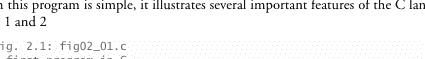

图 2.1 | C 中的第一个程序。

### 注释

即使这个程序很简单，它也说明了 C 语言的几个重要特性。第 1 行和第 2 行以 // 开头，表示这两行是注释。您插入注释以记录程序并提高程序的可读性。注释在程序运行时不会导致计算机执行任何操作——它们被 C 编译器忽略，并且不会导致生成任何机器语言目标代码。前面的注释简单描述了图号、文件名和程序的目的。注释也有助于其他人阅读和理解您的程序。

您还可以使用 /*...*/ 多行注释，其中从第一行的 /* 到最后一行的 */ 结束之间的所有内容都是注释。我们更喜欢 // 注释，因为它们更短，并且消除了使用 /*...*/ 注释时常见的编程错误，尤其是在省略了结束的 */ 时。

### #include 预处理器指令

第 3 行

```c
#include <stdio.h>
```

是 C 预处理器的指令。以 # 开头的行在编译前由预处理器处理。第 3 行告诉预处理器将标准输入/输出头 (<stdio.h>) 的内容包含到程序中。该头包含编译器在编译标准输入/输出库函数（如 printf（第 8 行））调用时使用信息。我们将在第 5 章中更详细地解释头的内容。

### 空行和空白

第 4 行只是一个空行。您使用空行、空格字符和制表符（即“制表符”）使程序更易于阅读。这些字符合在一起称为空白。空白字符通常被编译器忽略。

### main 函数

第 6 行

```c
int main( void )
```

是每个 C 程序的一部分。main 后的括号表示 main 是一个称为函数的程序构建块。C 程序包含一个或多个函数，其中必须有一个是 main。每个 C 程序都在函数 main 处开始执行。函数可以返回信息。main 左侧的关键字 int 表示 main “返回”一个整数（整数）值。我们将在第 5 章演示如何创建自己的函数时解释函数“返回值”的含义。暂时，只需在每个程序的 main 左侧包含关键字 int 即可。

函数在被调用执行时也可以接收信息。这里的 void 表示 main 不接收任何信息。在第 14 章中，我们将展示 main 接收信息的示例。

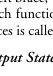

### 良好的编程实践 2.1

> 每个函数都应以描述函数用途的注释为先行。

左大括号，{，开始每个函数的主体（第 7 行）。相应的右大括号结束每个函数（第 9 行）。这一对大括号以及大括号之间的程序部分称为块。块是 C 中的重要程序单元。

### 输出语句

第 8 行

```c
printf( "Welcome to C!\n" );
```

指示计算机执行操作，即在屏幕上打印由引号标记的字符字符串。字符串有时称为字符字符串、消息或字面量。整行，包括 printf 函数（“f”代表“格式化”）、其括号内的参数和分号（;），称为语句。每个语句必须以分号结束（也称为语句终止符）。当前述 printf 语句执行时，它会在屏幕上打印消息 Welcome to C!。字符通常按在 printf 语句的双引号之间出现的完全相同的方式打印。

### 转义序列

请注意，字符 \n 并未在屏幕上打印。这里使用的反斜杠（\）称为转义字符。它表示 printf 应该做一些不寻常的事情。当在字符串中遇到反斜杠时，编译器会向前查看下一个字符并将其与反斜杠组合形成转义序列。转义序列 \n 表示换行。当换行出现在 printf 输出的字符串中时，换行会导致光标定位到屏幕下一行的开头。一些常见的转义序列列在图 2.2 中。

| 转义序列 | 描述 |
|---|---|
| \n | 换行。将光标定位到下一行的开头。 |
| \t | 水平制表。将光标移动到下一个制表位。 |
| \a | 警报。产生声音或可见警报，而不改变当前光标位置。 |
| \\ | 反斜杠。在字符串中插入反斜杠字符。 |
| \" | 双引号。在字符串中插入双引号字符。 |

图 2.2 | 一些常见的转义序列。

因为反斜杠在字符串中有特殊含义，即编译器将其识别为转义字符，所以我们使用双反斜杠 （\\） 在字符串中放置单个反斜杠。打印双引号也存在问题，因为双引号标记字符串的边界——此类引号不会被打印。通过在由 printf 输出的字符串中使用转义序列 \"，我们指示 printf 显示双引号。右大括号，}，（第 9 行）表示 main 的结束已到达。

### 良好的编程实践 2.2

将注释添加到包含右大括号，}，的该行，该大括号关闭每个函数，包括 main。

我们说 printf 导致计算机执行操作。随着任何程序的执行，它会执行各种操作并做出决策。第 2.6 节讨论决策。第 3 章深入讨论编程的这种操作/决策模型。

### 链接器和可执行文件

标准库函数如 printf 和 scanf 不是 C 编程语言的一部分。例如，编译器无法在 printf 或 scanf 中找到拼写错误。当编译器编译 printf 语句时，它只是在目标程序中为对库函数的“调用”提供空间。但编译器不知道库函数在哪里——链接器知道。当链接器运行时，它会定位库函数并在目标程序中插入对这些库函数的正确调用。现在目标程序已完成并准备好执行。因此，链接后的程序称为可执行文件。如果函数名拼写错误，链接器会发现错误，因为它将无法将 C 程序中的名称与库中任何已知函数的名称匹配。

> **常见编程错误 2.1**
> 
> *在程序中将输出函数 printf 的名称误输入为 print。*

> **良好的编程实践 2.3**
> 
> *将每个函数的整个主体缩进一个级别的缩进（我们建议三个空格），在定义函数主体的括号内。这种缩进强调了程序的功能结构并有助于使其更易于阅读。*

> **良好的编程实践 2.4**
> 
> *为你偏好的缩进大小设定约定，然后一致地应用该约定。制表符键可用于创建缩进，但制表符位置可能不同。专业风格指南通常建议使用空格而不是制表符。*

### 使用多个 printf

printf 函数可以通过几种不同的方式打印 Welcome to C!。例如，图 2.3 的程序产生的输出与图 2.1 的程序相同。这是因为每个 printf 从上一个 printf 停止打印的位置继续打印。第一个 printf（第 8 行）打印 Welcome 后跟一个空格（但没有换行），第二个 printf（第 9 行）在空格后立即在同一行开始打印。

```c
1  // Fig. 2.3: fig02_03.c
2  // Printing on one line with two printf statements.
3  #include <stdio.h>
4
5  // function main begins program execution
6  int main( void )
7  {
8      printf( "Welcome " );
9      printf( "to C!\n" );
10 } // end function main
```

Welcome to C!

图 2.3 | 使用两个 printf 语句打印一行。

一个 printf 可以通过使用额外的换行字符（如图 2.4 所示）打印多行。每当遇到 \n（换行）转义序列时，输出将继续在下一行的开头。


```c
// Fig. 2.4: fig02_04.c
// Printing multiple lines with a single printf.
#include <stdio.h>

// function main begins program execution
int main( void )
{
    printf( "Welcome\nto\nC!\n" );
} // end function main
```

```
Welcome
to
C!
```

图 2.4 | 使用单个 printf 打印多行。

## 2.3 另一个简单的 C 程序：两个整数相加

我们的下一个程序使用标准库函数 `scanf` 获取用户在键盘上输入的两个整数，计算这两个值的和，并使用 `printf` 打印结果。该程序及示例输出如图 2.5 所示。[在图 2.5 的输入/输出对话框中，我们用粗体强调用户输入的数字。]

```c
// Fig. 2.5: fig02_05.c
// Addition program.
#include <stdio.h>

// function main begins program execution
int main( void )
{
    int integer1; // first number to be entered by user
    int integer2; // second number to be entered by user

    printf("Enter first integer\n"); // prompt
    scanf("%d", &integer1); // read an integer

    printf("Enter second integer\n"); // prompt
    scanf("%d", &integer2); // read an integer

    int sum; // variable in which sum will be stored
    sum = integer1 + integer2; // assign total to sum

    printf("Sum is %d\n", sum); // print sum
} // end function main
```

```
Enter first integer
45
Enter second integer
72
Sum is 117
```

图 2.5 | 加法程序。

第 1–2 行的注释说明了程序的目的。如前所述，每个程序都从 `main` 开始执行。左花括号 `{`（第 7 行）标记 `main` 函数体的开始，相应的右花括号 `}`（第 21 行）标记 `main` 的结束。

### 变量与变量定义

第 8–9 行

```c
    int integer1; // first number to be entered by user
    int integer2; // second number to be entered by user
```

是定义。名称 `integer1` 和 `integer2` 是变量名——内存中可用于存储供程序使用的值的位置。这些定义指定变量 `integer1` 和 `integer2` 的类型为 `int`，这意味着它们将保存整数值，即诸如 7、-11、0、31914 之类的整数。

### 在使用变量之前定义变量

所有变量在程序中可以使用之前，都必须用名称和数据类型进行定义。C 标准允许将每个变量定义放在 `main` 中该变量在代码中首次使用之前的任何位置（尽管一些较旧的编译器不允许这样做）。后面你会明白为什么应将变量定义在靠近其首次使用的位置。

### 在一条语句中定义多个相同类型的变量

前面的定义可以合并为如下单个定义：

```c
    int integer1, integer2;
```

但那样会难以像第 8–9 行那样将注释与每个变量关联起来。

### 标识符与大小写敏感性

C 中的变量名可以是任何有效标识符。标识符是由字母、数字和下划线（`_`）组成的一系列字符，且不能以数字开头。C 区分大小写——在 C 中大写字母和小写字母不同，因此 `a1` 和 `A1` 是不同的标识符。

> **常见编程错误 2.2**
>
> 在本应使用小写字母的地方使用了大写字母（例如，输入 `Main` 而不是 `main`）。

> **错误预防提示 2.1**
>
> 避免让标识符以下划线字符（`_`）开头，以防止与编译器生成的标识符和标准库标识符冲突。

> **良好的编程实践 2.5**
>
> 选择有意义的变量名有助于使程序自文档化——也就是说，需要的注释更少。

> **良好的编程实践 2.6**
>
> 用作简单变量名的标识符的首字母应为小写字母。在本书后面，我们将赋予以大写字母开头的标识符以及全大写字母的标识符特殊含义。

> **良好的编程实践 2.7**
>
> *多词变量名有助于使程序更具可读性。可用下划线分隔单词，如 total_commissions；或者，如果将单词连在一起，则从第一个单词之后的每个单词首字母大写，如 totalCommissions。后一种风格——通常称为驼峰命名法，因为大小写字母的排列模式类似骆驼的轮廓——更受青睐。*

### 提示消息

第 11 行

```c
printf( "Enter first integer\n" ); // prompt
```

显示字面字符串“Enter first integer”，并将光标定位到下一行开头。此消息称为提示，因为它告诉用户执行特定操作。

### scanf 函数与格式化输入

第 12 行

```c
scanf( "%d", &integer1 ); // read an integer
```

使用 `scanf`（其中“f”代表“formatted”，即格式化）从用户处获取一个值。该函数从标准输入读取，标准输入通常是键盘。

这个 `scanf` 有两个参数：`"%d"` 和 `&integer1`。第一个是格式控制字符串，指示用户应输入的数据类型。`%d` 转换说明符表示数据应为整数（字母 d 代表“十进制整数”）。在此上下文中，`%` 被 `scanf`（以及我们将看到的 `printf`）视为开始转换说明符的特殊字符。

`scanf` 的第二个参数以 & 符号（`&`）开头——称为地址运算符——后面是变量名。`&` 与变量名结合时，告诉 `scanf` 变量 `integer1` 在内存中存储的位置（或地址）。然后计算机将用户为 `integer1` 输入的值存储到该位置。使用 & 符号（`&`）常常使新手程序员或使用过不要求这种表示法的其他语言编程的人感到困惑。目前，只需记住在每次调用 `scanf` 时，在每个变量前加上 & 符号。第 6 章和第 7 章将讨论此规则的一些例外。在我们第 7 章学习指针之后，& 符号的用法就会变得清晰。

> **良好的编程实践 2.8**
>
> *在每个逗号（,）后放置一个空格，使程序更具可读性。*

当计算机执行前面的 `scanf` 时，它会等待用户为变量 `integer1` 输入一个值。用户通过输入一个整数，然后按 Enter 键（有时标记为 Return 键）来响应，以将该数字发送给计算机。然后计算机将这个数字（或值）赋给变量 `integer1`。此程序中随后对 `integer1` 的任何引用都将使用这同一个值。函数 `printf` 和 `scanf` 便于用户与计算机之间的交互。这种交互类似于对话，通常称为交互式计算。

```c
    int sum = integer1 + integer2; // assign total to sum
```

该语句将 `integer1` 和 `integer2` 相加，然后将结果存储在变量 `sum` 中。

### printf 语句中的计算

计算也可以在 `printf` 语句内部执行。例如，第 17–20 行可以替换为以下语句：

```c
    printf( "Sum is %d\n", integer1 + integer2 );
```

在这种情况下，不需要变量 `sum`。

> **常见编程错误 2.4**
>
> 在 `scanf` 语句中，当变量实际上应该以 & 符号（`&`）开头时却忘记这样做，会导致执行时错误。在许多系统上，这会导致“段错误”或“访问冲突”。当用户程序试图访问计算机内存中它没有访问权限的部分时，就会发生这种错误。此错误的确切原因将在第 7 章解释。

> **常见编程错误 2.5**
>
> 在 `printf` 语句中包含的变量前加上 & 符号，而实际上该变量不应以 & 符号开头。

## 2.4 内存概念

诸如 `integer1`、`integer2` 和 `sum` 之类的变量名实际上对应于计算机内存中的位置。每个变量都有一个名称、一个类型和一个值。

在图 2.5 的加法程序中，当语句（第 12 行）

```c
    scanf( "%d", &integer1 ); // read an integer
```

执行时，用户输入的值会被放入已分配名称 `integer1` 的内存位置。假设用户输入数字 45 作为 `integer1` 的值。计算机将把 45 放入位置 `integer1`，如图 2.6 所示。每当一个值被放入内存位置时，该值会替换该位置中先前的值，而先前的值会丢失；因此，这个过程被称为破坏性的。

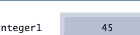

图 2.6 | 显示变量名称和值的内存位置。

再次回到我们的加法程序，当语句（第 15 行）

```c
    scanf( "%d", &integer2 ); // read an integer
```

执行时，假设用户输入值 72。该值被放入位置 `integer2`，内存如图 2.7 所示。这些位置在内存中不一定相邻。


并排书写，如 `ab` 中那样。然而，在 C 中，如果这样做，`ab` 会被解释为单个两字母名称（或标识符）。因此，C（以及许多其他编程语言）要求乘法必须通过 `*` 运算符显式表示，如 `a * b`。算术运算符都是二元运算符。例如，表达式 `3 + 7` 包含二元运算符 `+` 和操作数 3 和 7。

### 整数除法与求余运算符

整数除法产生整数结果。例如，表达式 `7 / 4` 求值为 1，表达式 `17 / 5` 求值为 3。C 提供了求余运算符 `%`，它产生整数除法后的余数。求余运算符是一个整数运算符，只能用于整数操作数。表达式 `x % y` 产生 x 除以 y 后的余数。因此，`7 % 4` 得到 3，`17 % 5` 得到 2。我们将讨论求余运算符的几个有趣应用。

**常见编程错误 2.6**

> 试图除以零在计算机系统上通常是未定义的，并且一般会导致致命错误，使程序立即终止，而未能成功完成其任务。非致命错误允许程序运行到完成，但通常会产生不正确的结果。

### 直线形式的算术表达式

C 中的算术表达式必须写成直线形式，以便于将程序输入计算机。因此，诸如“a 除以 b”的表达式必须写成 `a/b`，以便所有运算符和操作数都出现在一条直线上。代数记法

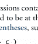

通常不被编译器接受，尽管一些专用软件包确实支持用更自然的记法表示复杂数学表达式。

### 用括号对子表达式分组

括号在 C 表达式中的使用方式与在代数表达式中相同。例如，要将 a 乘以量 `b + c`，我们写成 `a * ( b + c )`。

### 运算符优先级规则

C 按照由以下运算符优先级规则确定的精确顺序，对算术表达式中的运算符进行求值；这些规则通常与代数中的规则相同：

1. 位于成对括号内的表达式中的运算符最先求值。括号被认为处于“最高优先级”。对于嵌套或嵌入的括号，例如

   `( ( a + b ) + c )`

   最内层括号中的运算符最先应用。

2. 乘法、除法和求余运算接下来应用。如果一个表达式包含多个乘法、除法和求余运算，则从左到右求值。乘法、除法和求余被认为处于同一优先级。

3. 加法和减法运算随后求值。如果一个表达式包含多个加法和减法运算，则从左到右求值。加法和减法也具有相同的优先级，该优先级低于乘法、除法和求余运算的优先级。

4. 赋值运算符（=）最后求值。

运算符优先级规则规定了 C 用于求值表达式的顺序。¹ 当我们说求值从左到右进行时，指的是运算符的结合性。我们将会看到，有些运算符从右到左结合。图 2.10 总结了我们目前见过的运算符的这些优先级规则。

| 运算符 | 运算 | 求值顺序（优先级） |
|---|---|---|
| ( ) | 括号 | 最先求值。如果括号是嵌套的，则最内层括号中的表达式最先求值。如果有多对括号“处于同一层”（即不嵌套），则从左到右求值。 |
| * | 乘法 | 第二求值。如果有多个，则从左到右求值。 |
| / | 除法 | 第二求值。如果有多个，则从左到右求值。 |
| % | 求余 | 第二求值。如果有多个，则从左到右求值。 |
| + | 加法 | 第三求值。如果有多个，则从左到右求值。 |
| - | 减法 | 第三求值。如果有多个，则从左到右求值。 |
| = | 赋值 | 最后求值。 |

*图 2.10 — 算术运算符的优先级。*

### 代数表达式与 C 表达式示例

现在让我们根据运算符优先级规则来考虑几个表达式。每个示例列出一个代数表达式及其对应的 C 表达式。下面的表达式计算五个项的算术平均值（平均数）。

```
Algebra: m = (a+b+c+d+e)/5
C: m = ( a + b + c + d + e ) / 5;
```

这里的括号是必需的，用于将加法分组，因为除法的优先级高于加法。整个量 `(a + b + c + d + e)` 应除以 5。如果错误地省略括号，我们得到 `a + b + c + d + e / 5`，它会错误地求值为 `a + b + c + d + e/5`

¹ 我们使用简单示例来解释表达式的求值顺序。在本书后面你会遇到的更复杂表达式中，会出现一些微妙问题。我们将在这些问题出现时讨论它们。

下面的表达式是一条直线的方程：

```
Algebra: y = mx + b
C: y = m * x + b;
```

不需要括号。乘法最先求值，因为乘法的优先级高于加法。

下面的表达式包含求余（%）、乘法、除法、加法、减法和赋值运算：

```
Algebra: z = pr mod q + w/x - y
C: z = p * r % q + w / x - y;
```

带圈的数字表示 C 对运算符求值的顺序。乘法、求余和除法首先按从左到右的顺序求值（即它们从左到右结合），因为它们的优先级高于加法和减法。加法和减法接下来求值。它们也按从左到右的顺序求值。最后，结果被赋给变量 z。

并非所有包含多对括号的表达式都含有嵌套括号。例如，下面的表达式不包含嵌套括号——相反，这些括号被认为“处于同一层”。

```
a * (b + c) + c * (d + e)
```

### 二次多项式的求值

为了更好地理解运算符优先级规则，让我们看看 C 如何对一个二次多项式求值。

```
y = a * x * x + b * x + c;
```

该语句下方的带圈数字表示 C 执行运算的顺序。C 中没有用于幂运算的算术运算符，因此我们将 x² 表示为 `x * x`。C 标准库包含 `pow`（“power”）函数来执行幂运算。由于与 `pow` 所需数据类型相关的一些微妙问题，我们将对 `pow` 的详细解释推迟到第 4 章。

假设前述二次多项式中的变量 a、b、c 和 x 初始化如下：a = 2，b = 3，c = 7，x = 5。图 2.11 说明了运算符的应用顺序。

### 使用括号提高清晰度

与代数中一样，可以在表达式中放置不必要的括号以使表达式更清晰。这些括号称为冗余括号。例如，前面的语句可以加括号如下：

```
y = ( a * x * x ) + ( b * x ) + c;
```

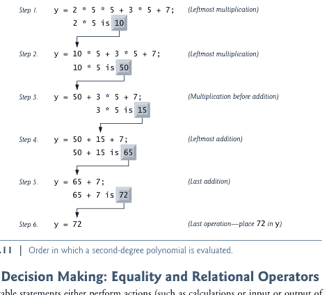

## 2.6 决策：相等运算符和关系运算符

可执行语句要么执行动作（例如计算或数据输入/输出），要么做出决策（我们很快会看到几个这样的例子）。例如，我们可能在程序中做出决策，以确定一个人在考试中的成绩是否大于或等于 60，以及程序是否应打印消息“恭喜！你通过了。” 本节介绍 C 的 *if* 语句的一个简单版本，它允许程序根据称为 *条件* 的事实陈述的真假来做出决策。如果条件为真（即满足条件），则执行 *if* 语句体中的语句。如果条件为假（即不满足条件），则不执行语句体。无论语句体是否执行，在 *if* 语句完成后，执行都会继续到 *if* 语句之后的下一顺序语句。

*if* 语句中的条件通过使用图 2.12 总结的相等运算符和关系运算符构成。关系运算符都具有相同的优先级，并且从左到右结合。相等运算符的优先级低于关系运算符，并且它们也从左到右结合。[注意：在 C 中，*条件* 实际上可以是任何生成零（假）或非零（真）值的表达式。]

**常见编程错误 2.7**

> 如果运算符 `==`、`!=`、`>=` 和 `<=` 中任意一个的两个符号被空格分隔，就会发生语法错误。


## 常见编程错误 2.8

混淆相等运算符 `==` 和赋值运算符 `=`。为避免这种混淆，相等运算符应读作“双等号”，赋值运算符应读作“取得”或“被赋值为”。正如你将看到的，混淆这些运算符可能不会导致容易识别的编译错误，但可能导致极其微妙的逻辑错误。

| 代数相等或关系运算符 | C 相等或关系运算符 | C 条件示例 | C 条件的含义 |
|---|---|---|---|
| *关系运算符* |  |  |  |
| > | > | x > y | x 大于 y |
| < | < | x < y | x 小于 y |
| ≥ | >= | x >= y | x 大于或等于 y |
| ≤ | <= | x <= y | x 小于或等于 y |
| *相等运算符* |  |  |  |
| = | == | x == y | x 等于 y |
| ≠ | != | x != y | x 不等于 y |

**图 2.12** | 相等和关系运算符。

图 2.13 使用六个 `if` 语句来比较用户输入的两个数字。如果这些 `if` 语句中的任何一个条件为真，则与该 `if` 关联的 `printf` 语句执行。该程序和三个示例执行输出如图中所示。

```c
1  // Fig. 2.13: fig02_13.c
2  // Using if statements, relational
3  // operators, and equality operators.
4  #include <stdio.h>
5
6  // function main begins program execution
7  int main( void )
8  {
9     printf( "Enter two integers, and I will tell you\n" );
10    printf( "the relationships they satisfy: " );
11
12    int num1; // first number to be read from user
13    int num2; // second number to be read from user
14
15    scanf( "%d %d", &num1, &num2 ); // read two integers
16
17    if ( num1 == num2 ) {
18       printf( "%d is equal to %d\n", num1, num2 );
19    } // end if
```

**图 2.13** | 使用 if 语句、关系运算符和相等运算符。（第 1 部分，共 2 部分）

```c
if ( num1 != num2 ) {
    printf("%d is not equal to %d\n", num1, num2 );
} // end if

if ( num1 < num2 ) {
    printf("%d is less than %d\n", num1, num2 );
} // end if

if ( num1 > num2 ) {
    printf("%d is greater than %d\n", num1, num2 );
} // end if

if ( num1 <= num2 ) {
    printf("%d is less than or equal to %d\n", num1, num2 );
} // end if

if ( num1 >= num2 ) {
    printf("%d is greater than or equal to %d\n", num1, num2 );
} } // end function main
```

输入两个整数，我将告诉您
它们满足的关系：3 7
3 不等于 7
3 小于 7
3 小于或等于 7

输入两个整数，我将告诉您
它们满足的关系：22 12
22 不等于 12
22 大于 12
22 大于或等于 12

输入两个整数，我将告诉您
它们满足的关系：7 7
7 等于 7
7 小于或等于 7
7 大于或等于 7

图 2.13 | 使用 if 语句、关系运算符和相等运算符。（第 2 部分，共 2 部分）

程序使用 `scanf`（第 15 行）将两个整数读入 `int` 变量 `num1` 和 `num2`。每个转换说明符都有一个对应的参数，用于存储值。第一个 `%d` 转换一个值并存储到变量 `num1` 中，第二个 `%d` 转换一个值并存储到变量 `num2` 中。

## 良好编程实践 2.10

虽然允许，但程序中每行不应超过一条语句。

## 常见编程错误 2.9

在 `scanf` 语句的格式控制字符串中的转换说明符之间放置逗号（本不需要时）。

## 比较数字

第 17–19 行的 if 语句

```
if ( num1 == num2 ) {
    printf(" %d is equal to %d\n", num1, num2 );
} // end if
```

比较变量 `num1` 和 `num2` 的值以测试相等性。如果值相等，则第 18 行的语句显示一行文本，指示这两个数字相等。如果从第 21、25、29、33 和 37 行开始的一个或多个 if 语句中的条件为真，则相应的执行体语句会显示适当的文本行。对每个 if 语句的执行体进行缩进，并在每个 if 语句上下放置空行，可提高程序可读性。

## 常见编程错误 2.10

在 `if` 语句的条件之后的右括号右侧紧挨着放置分号。

左花括号 `{` 开始每个 `if` 语句的执行体（例如第 17 行）。相应的右花括号 `}` 结束每个 `if` 语句的执行体（例如第 19 行）。在 `if` 语句的执行体中，可以放置任意数量的语句。

## 良好编程实践 2.11

冗长的语句可以跨多行。如果语句必须换行，请选择有意义的断点（例如在逗号分隔列表的逗号之后）。如果语句被拆分为两行或更多行，请缩进所有后续行。拆分标识符是不正确的。

图 2.14 按从高到低的顺序列出了本章介绍的运算符的优先级。运算符按优先级递减的顺序从上到下显示。等号也是一个运算符。除赋值运算符 `=` 外，所有这些运算符都从左到右结合。赋值运算符（`=`）从右到左结合。

## 良好编程实践 2.12

在编写包含许多运算符的表达式时，请参考运算符优先级表。确认表达式中的运算符按正确的顺序应用。如果不确定复杂表达式中的求值顺序，请使用括号对表达式进行分组，或将语句分解为几个更简单的语句。请注意，C 的某些运算符（如赋值运算符 `=`）是从右到左结合，而不是从左到右。

| 运算符 | 结合性 |
|---|---|
| () | 从左到右 |
| * / % | 从左到右 |
| + - | 从左到右 |
| < <= > >= | 从左到右 |
| == != | 从左到右 |
| = | 从右到左 |

图 2.14 | 迄今讨论的运算符的优先级和结合性。

本章 C 程序中使用的一些词——特别是 `int`、`if` 和 `void`——是该语言的关键字或保留字。图 2.15 包含了 C 关键字。这些词对 C 编译器具有特殊含义，因此你必须小心，不要将它们用作标识符（如变量名）。

在本章中，我们介绍了 C 编程语言的许多重要特性，包括在屏幕上显示数据、从用户输入数据、执行计算和做出决策。在下一章中，我们将在介绍结构化编程时以这些技术为基础。你将更加熟悉缩进技术。我们将研究如何指定语句执行的顺序——这称为控制流。

| 关键字 |  |  |  | |
|---|---|---|---|---|
| auto | do | goto | signed | unsigned |
| break | double | if | sizeof | void |
| case | else | int | static | volatile |
| char | enum | long | struct | while |
| const | extern | register | switch |  |
| continue | float | return | typedef |  |
| default | for | short | union |  |
| C99 标准新增的关键字 |  |  |  | |
| _Bool | _Complex | _Imaginary | inline | restrict |
| C11 标准新增的关键字 |  |  |  | |
| _Alignas | _Alignof | _Atomic | _Generic | _Noreturn | _Static_assert | _Thread_local |

图 2.15 | C 的关键字。

## 2.7 安全 C 编程

我们在前言中提到了 CERT C 安全编码标准，并指出我们将遵循某些指导原则，帮助您避免使系统遭受攻击的编程实践。

### 避免单参数 printf：³

这样一条指导原则是避免使用带单个字符串参数的 `printf`。如果需要显示以换行符结尾的字符串，请使用 `puts` 函数，它会显示其字符串参数，后跟一个换行符。例如，在图 2.1 中，第 8 行

```
printf( "Welcome to C!\n" );
```

应写为：

```
puts( "Welcome to C!" );
```

我们没有在前面的字符串中包含 `\n`，因为 `puts` 会自动添加。

如果需要显示不带结尾换行符的字符串，请使用带两个参数的 `printf`——一个 `"%s"` 格式控制字符串和要显示的字符串。`%s` 转换说明符用于显示字符串。例如，在图 2.3 中，第 8 行

```
printf( "Welcome " );
```

应写为：

```
printf( "%s", "Welcome " );
```

尽管本章中的 `printf` 实际上并非不安全，但这些改动是负责任的编码实践，随着我们更深入地学习 C，这些实践将消除某些安全漏洞——我们将在本书后面解释其原理。从现在开始，我们在本章示例中使用这些实践，您也应该在练习解决方案中使用它们。

### scanf 和 printf、scanf_s 和 printf_s

我们在本章中介绍了 `scanf` 和 `printf`。在后续的安全 C 编码指南部分（从第 3.13 节开始）中，我们将进一步讨论它们。我们还将讨论 C11 中引入的 `scanf_s` 和 `printf_s`。

3. 有关更多信息，请参阅 CERT C 安全编码规则 FIO30-C（www.securecoding.cert.org/confluence/display/seccode/FIO30-C.+Exclude+user+input+from+format+strings）。在第 6 章的“安全 C 编程”一节中，我们将解释此 CERT 准则所涉及的用户输入的概念。

## 小结

### 第 2.1 节 引言

- C 语言有助于采用结构化和规范化的方法进行计算机程序设计。

### 第 2.2 节 一个简单的 C 程序：打印一行文本

- 注释（第 72 页）以 `//` 开头，注释（第 72 页）用于记录程序并提高程序可读性。C 还支持多行注释，以 `/*` 开头，以 `*/` 结尾（第 73 页）。
- 注释不会在程序运行时导致计算机执行任何操作。它们会被 C 编译器忽略，也不会生成任何机器语言目标代码。
- 以 `#` 开头的行在程序编译之前由预处理器处理。`#include` 指令告诉预处理器（第 73 页）包含另一个文件的内容。


## 第 2.4 节 内存概念
- 变量名对应于计算机内存中的位置。每个变量都有一个名称、一个类型和一个值。
- 每当一个值被放置到内存位置时，该值会替换该位置中的前一个值；因此，将新值放入内存位置被称为破坏性操作（p. 80）。
- 当从内存位置读取值时，该过程被称为非破坏性操作（p. 81）。

## 第 2.5 节 C 语言中的算术
- 在代数中，如果我们想将 a 乘以 b，可以简单地将这些单字母变量名并排放置，如 ab。在 C 中，然而，如果我们这样做，ab 将被解释为一个单一的、两个字母的名称（或标识符）。因此，C（像其他编程语言一样，通常）要求必须通过使用 * 运算符显式表示乘法，如 a * b。
- C 中的算术表达式（p. 81）必须以直线形式（p. 82）书写，以便于将程序输入到计算机中。因此，像“a 除以 b”这样的表达式必须写成 a/b，以便所有运算符和操作数都出现在一条直线上。
- 圆括号在 C 表达式中用于组合项的方式与代数表达式中大致相同。
- C 以由以下运算符优先级规则（p. 82）确定的精确顺序计算算术表达式，这些规则通常与代数中遵循的规则相同。
- 乘法、除法和取余运算首先应用。如果表达式包含多个乘法、除法和取余运算，则求值从左到右进行。乘法、除法和取余被认为处于同一优先级级别。
- 加法和减法运算接下来求值。如果表达式包含多个加法和减法运算，则求值从左到右进行。加法和减法也具有相同的优先级级别，其优先级低于乘法、除法和取余运算符的优先级。
- 运算符优先级规则指定了 C 用于求值表达式的顺序。运算符的结合性（p. 83）指定它们是从左到右还是从右到左求值。

## 第 2.6 节 决策：相等和关系运算符
- 可执行的 C 语句要么执行操作，要么做出决策。
- C 的 if 语句（p. 85）允许程序基于称为条件（p. 85）的事实陈述的真假做出决策。如果条件满足（即条件为真；p. 85），则 if 语句体中的语句执行。如果条件不满足（即条件为假；p. 85），则体语句不执行。无论体语句是否执行，在 if 语句完成后，执行将继续进行 if 语句之后的下一条语句。
- if 语句中的条件是通过使用相等和关系运算符（p. 85）形成的。
- 所有关系运算符具有相同的优先级级别，并从左到右结合。相等运算符的优先级级别低于关系运算符，它们也从左到右结合。
- 为避免混淆赋值（=）和相等（==），赋值运算符应读作“gets”，相等运算符应读作“double equals”。
- 在 C 程序中，制表符、换行符和空格等空白字符通常会被忽略。因此，语句可以跨多行拆分。不正确的做法是拆分标识符。
- 关键字（p. 89；或保留字）对 C 编译器具有特殊含义，因此您不能将它们用作变量名等标识符。

## 第 2.7 节 安全的 C 编程
- 一种有助于避免系统对攻击开放的做法是避免使用带单个字符串参数的 printf。
- 要显示一个字符串后跟换行字符，请使用 puts 函数（p. 90），它会显示其字符串参数后跟换行字符。
- 要在不带尾随换行字符的情况下显示字符串，可以使用 printf 并将 "%s" 转换说明符（p. 90）作为第一个参数，将要显示的字符串作为第二个参数。

## 自测练习
### 2.1 在以下每项中填空。
- a) 每个 C 程序都在函数 ________ 处开始执行。
- b) 每个函数的体以 ________ 开始并以 ________ 结束。
- c) 每个语句以一个 ________ 结束。
- d) ________ 标准库函数在屏幕上显示信息。
- e) 转义序列 \n 表示 ________ 字符，该字符使光标定位到屏幕下一行的开头。
- f) ________ 标准库函数用于从键盘获取数据。
- g) 转换说明符 ________ 用于 scanf 格式控制字符串中以指示将输入整数，并在 printf 格式控制字符串中以指示将输出整数。
- h) 每当新值被放置到内存位置时，该值会覆盖该位置中的前一个值。此过程被称为 ________。
- i) 当从内存位置读取值时，该位置中的值会被保留；此过程被称为 ________。
- j) ________ 语句用于做出决策。

### 2.2 判断以下每项是真还是假。如果为假，请说明原因。
- a) 函数 printf 总是从新行的开头开始打印。
- b) 注释会导致计算机在程序执行时在屏幕上显示 // 后的文本。
- c) 在 printf 格式控制字符串中使用时，转义序列 \n 会使光标定位到屏幕下一行的开头。
- d) 所有变量必须在使用前定义。
- e) 所有变量在定义时必须指定类型。
- f) C 将变量 number 和 NuMBEr 视为相同。
- g) 定义可以出现在函数的体内的任何位置。
- h) printf 函数中格式控制字符串之后的所有参数都必须以一个与号（&）为前缀。
- i) 取余运算符（%）只能与整数操作数一起使用。
- j) 算术运算符 *, /, %, + 和 - 全部具有相同的优先级级别。
- k) 打印三行输出的程序必须包含三个 printf 语句。

### 2.3 编写单个 C 语句以完成以下每项：
- a) 将变量 c、thisVariable、q76354 和 number 定义为 int 类型。
- b) 提示用户输入一个整数。提示信息以冒号（:）后跟一个空格结束，并使光标定位在空格之后。
- c) 从键盘读取一个整数并将输入的值存储在整数变量 a 中。
- d) 如果 number 不等于 7，则打印 "The variable number is not equal to 7."。
- e) 在一行上打印消息 "This is a C program."。
- f) 在两行上打印消息 "This is a C program."，使第一行以 C 结束。
- g) 打印消息 "This is a C program."，每个单词单独一行。
- h) 打印消息 "This is a C program."，单词之间用制表符分隔。

### 2.4 编写语句（或注释）以完成以下每项：
- a) 说明程序将计算三个整数的乘积。
- b) 提示用户输入三个整数。
- c) 将变量 x、y 和 z 定义为 int 类型。
- d) 从键盘读取三个整数并将它们存储在变量 x、y 和 z 中。
- e) 定义变量 result，计算变量 x、y 和 z 中的整数的乘积，并使用该乘积初始化变量 result。
- f) 打印 "The product is" 后跟整数变量 result 的值。

### 2.5 使用你在练习 2.4 中编写的语句，编写一个计算三个整数乘积的完整程序。

### 2.6 识别并纠正以下每个语句中的错误：
```
a) printf( "The value is %d\n", &number );
b) scanf( "%d%d", &number1, number2 );
c) if ( c < 7 ) {
    printf( "c is less than 7\n" );
}
d) if ( c >= 7 ) {
    printf( "c is greater than or equal to 7\n" );
}
```

## 自测练习答案
2.1 a) main. b) 左大括号 ({), 右大括号 (}). c) 分号。 d) printf. e) 换行。 f) scanf. g) %d. h) 破坏性。 i) 非破坏性。 j) if.

2.2 a) 假。函数 printf 总是从光标所在位置开始打印，而该位置可能在屏幕行上的任何位置。
b) 假。注释在程序执行时不会导致任何操作被执行。它们用于记录程序并提高其可读性。
c) 真。
d) 真。
e) 真。
f) 假。C 是区分大小写的，因此这些变量是唯一的。
g) 真。
h) 假。printf 函数中的参数通常不应以与号为前缀。scanf 函数中格式控制字符串之后的参数通常应以与号为前缀。我们将在第 6 章和第 7 章讨论这些规则的例外情况。
i) 真。
j) 假。运算符 *、/ 和 % 处于同一优先级级别，而运算符 + 和 - 处于较低的优先级级别。
k) 假。包含多个 \n 转义序列的 printf 语句可以打印多行。

2.3 a) int c, thisVariable, q76354, number;
b) printf( "Enter an integer: " );
c) scanf( "%d", &a );
d) if ( number != 7 ) {
    printf( "The variable number is not equal to 7.\n" );
}


```c
i) printf( "The product is %d\n", x * y );
j) scanf( "%d, %d, %d", &x, &y, &z );
```

### 2.8 填写下列各题中的空白：

- a) 在程序中使用之前，所有 ______ 都必须声明。
- b) C 是 ______。在 C 中，大写字母和小写字母是不同的。
- c) 单行注释以 _______ 开头。
- d) __________ 是 C 保留的单词，不能使用。
- e) 编译器会忽略 __________ 和 __________。

### 2.9 编写一条 C 语句或一行代码，完成下列各项：

- a) 打印消息“Have a nice day.”
- b) 将变量 b 与 c 的和赋给变量 a。
- c) 检查变量 a 的值是否大于变量 b。如果是，则将两者之差存入变量 c。
- d) 从键盘输入三个整数值，并将它们放入 int 变量 p、q 和 r 中。

### 2.10 指出下列各项中哪些为真、哪些为假。如果为假，请解释你的答案。

- a) C 认为函数 main 和 Main 是相同的。
- b) 运算符的结合性规定了它们是从左到右求值还是从右到左求值。
- c) 语句 if(a = b) 检查变量 a 和 b 是否相等。
- d) if 语句中的条件通过使用赋值运算符构成。
- e) 下列都是有效的变量名：_3g、my_val、h22、123greetings、July98。

### 2.11 填写下列各题中的空白：

- a) __________ 语句允许程序根据条件执行不同的操作。
- b) 如果整数除法的结果（其中分子和分母都是整数）是分数，则小数部分会被 __________。
- c) __________ 指令告诉预处理器包含输入/输出流头文件的内容。

### 2.12 执行下列各语句时，会打印什么（如果有的话）？如果什么都不打印，则回答“Nothing.”。假设 a = 15、b = 4 且 c = 7。

- a) printf("%d", a % b);
- b) printf("%d", a * c + b);
- c) printf("b= ");
- d) printf("a = 15");
- e) printf("%d ", a = a + b, a + b);
- f) c = a + b;
- g) scanf("%d%d", &a, &b);
- h) // printf("Now a and b changes to %d and %d", a, b);
- i) printf("\n");

### 2.13 下列 C 语句中，哪些（如果有的话）包含其值被替换的变量？

- a) printf("Enter two Numbers: ");
- b) scanf("%d%d", &a, &b);
- c) sum = a + b;
- d) printf("\nThe result is: %d", sum);

### 2.14 给定方程 y = ax³ − bx² − 6，下列各项中哪些（如果有的话）是该方程的正确 C 语句？

- a) y = a * x * x * x - b * x * x - 6;
- b) y = a * x * x * x - b * x * x - 6;
- c) a * (x * x * x) - b * x * x * ( - 6 );
- d) a * (x * x * x ) - b * (x * x) - 6;
- e) a * x * x * x - (b * x * x - 6 );
- f) (a * x * 3 - b * x * 2 ) - 6;

### 2.15 说明下列各 C 语句中运算符的求值顺序，并给出每条语句执行后 x 的值。

```c
a) x = 8 + 15 * ( 6 - 2 ) - 1;
b) x = 5 % 5 + 5 * 5 - 5;
c) x = ( 5 * 7 * ( 5 + ( 7 * 5 / ( 7 ) ) ) );
```

### 2.16 （算术）编写一个程序，要求用户输入两个数，从用户处获取这两个数，并打印它们的和、积、差、商和余数。

### 2.17 （末速度）编写一个程序，要求用户输入物体的初速度和加速度，以及已经经过的时间，将它们放入变量 u、a 和 t 中，并使用下列公式打印末速度 v 和行进距离 s。

```c
a) v = u + at
b) s = ut + 1/2 at^2
```

### 2.18 （比较数值）编写一个程序，要求用户输入某个国家单季最高降雨量以及该国家当年的降雨量，从用户处获取这些值，检查当前降雨量是否超过最高降雨量，并在屏幕上打印适当消息。如果当前降雨量更高，则将该值赋为历史最高降雨量。只使用本章学过的 if 语句的单分支形式。

### 2.19 （算术、最大值和最小值）编写一个程序，从键盘输入三个不同的整数，然后打印这些数的和、平均值、乘积、最小值和最大值。只使用本章学过的 if 语句的单分支形式。屏幕对话应如下所示：

```c
Enter three different integers: 13 27 14
Sum is 54
Average is 18
Product is 4914
Smallest is 13
Largest is 27
```

### 2.20 （将秒转换为小时、分钟和秒）编写一个程序，要求用户输入自某个事件以来经过的总时间（以秒为单位），并将该时间转换为小时、分钟和秒。时间应显示为小时:分钟:秒。 [提示：使用求余运算符]

### 2.21 （用星号绘制图形）编写一个程序，用星号打印下列图形。

### 2.22 下列代码打印什么？

```c
printf( "\n\n%s\n\n%s\n%s\n%s\n" );
```

### 2.23 （最大和最小整数）编写一个程序，读入三个整数，然后确定并打印这组数中的最大整数和最小整数。只使用本章学过的编程技术。

### 2.24 （奇数或偶数）编写一个程序，读入一个整数，并确定并打印它是奇数还是偶数。[提示：使用求余运算符。偶数是二的倍数。任何二的倍数除以 2 时余数都为零。]

### 2.25 将你的姓名首字母以块状字母形式纵向打印在页面上。用该字母本身构造每个块状字母，如下一页顶部所示：

```c
PPPPPPPP
  P   P
  P   P
  P   P
  P   P

JJ
J
J
JJJJJJ

DDDDDDDD
D      D
D      D
D      D
DDDDD
```

### 2.26 （倍数）编写一个程序，读入两个整数，并确定并打印第一个数是否为第二个数的倍数。[提示：使用求余运算符。]

### 2.27 （星号棋盘图案）用八条 printf 语句显示下列棋盘图案，然后用尽可能少的 printf 语句显示相同图案。

```c
* * * * * * * *
* * * * * * * *
* * * * * * * *
* * * * * * * *
* * * * * * * *
* * * * * * * *
* * * * * * * *
* * * * * * * *
```

### 2.28 区分术语“致命错误”和“非致命错误”。为什么你可能更愿意经历致命错误而不是非致命错误？

### 2.29 （字符的整数值）先窥探一下后面的内容。本章中你学习了整数和 int 类型。C 还可以表示大写字母、小写字母以及相当多的特殊符号。C 在内部使用小整数来表示每个不同的字符。计算机使用的字符集以及这些字符对应的整数表示形式称为该计算机的字符集。例如，可以通过执行下列语句打印大写 A 的整数等价值：

```c
printf( "%d", 'A' );
```

编写一个程序，打印一些大写字母、小写字母、数字和特殊符号的整数等价值。至少确定下列字符的整数等价值：A B C a b c 0 1 2 5 ^ + / 以及空白字符。

### 2.30 （分离整数中的各位数字）编写一个程序，输入一个五位数字，将该数字分离成各个单独的数字，并打印这些数字，每个数字之间用三个空格隔开。[提示：使用整数除法和求余运算的组合。] 例如，如果用户输入 42139，程序应打印

```c
4  2  1  3  9
```

### 2.31 （平方和立方表）仅使用本章学过的技术，编写一个程序，计算 0 到 10 的平方和立方，并使用制表符打印下列数值表：

| 数字 | 平方 | 立方 |
|---|---|---|
| 0 | 0 | 0 |
| 1 | 1 | 1 |
| 2 | 4 | 8 |
| 3 | 9 | 27 |
| 4 | 16 | 64 |
| 5 | 25 | 125 |
| 6 | 36 | 216 |
| 7 | 49 | 343 |
| 8 | 64 | 512 |
| 9 | 81 | 729 |
| 10 | 100 | 1000 |

## 产生影响

### 2.32 （身体质量指数计算器）我们在练习 1.12 中介绍了身体质量指数（BMI）计算器。计算 BMI 的公式为

$BMI = \frac{weightInPounds \times 703}{heightInInches \times heightInInches}$

或

$BMI = \frac{weightInKilograms}{heightInMeters \times heightInMeters}$

创建 BMI 计算器应用程序，读取用户以磅为单位的体重和以英寸为单位的身高（或者，如果你愿意，读取用户以千克为单位的体重和以米为单位的身高），然后计算并显示用户的身体质量指数。此外，该应用程序应显示以下来自美国卫生与公众服务部/美国国立卫生研究院的信息，以便用户评估其 BMI：

| BMI 数值 |
|---|
| 体重不足：低于 18.5 |
| 正常：18.5 到 24.9 之间 |
| 超重：25 到 29.9 之间 |
| 肥胖：30 或更高 |

> [注意：本章中，你学习了使用 int 类型表示整数。用 int 值进行 BMI 计算时，两者都会产生整数结果。在第 4 章中，你将学习使用 double 类型表示带小数点的数。当用 double 执行 BMI 计算时，两者都会产生带小数点的数——这些数称为“浮点数”。]


2.33 *（拼车省钱计算器）* 研究几个拼车网站。创建一个应用程序，计算你的日常驾驶成本，以便估算拼车能节省多少钱；拼车还有其他优势，例如减少碳排放和缓解交通拥堵。该应用程序应输入以下信息，并显示用户每天开车上班的成本：

- a) 每天行驶的总英里数。
- b) 每加仑汽油的成本。
- c) 平均每加仑行驶英里数。
- d) 每天的停车费。
- e) 每天的过路费。

## C 语言结构化程序开发

### 目标

在本章中，你将：

- 使用基本的问题解决技术。
- 通过自顶向下、逐步细化的过程开发算法。
- 使用 `if` 选择语句和 `if...else` 选择语句来选择操作。
- 使用 `while` 迭代语句在程序中重复执行语句。
- 使用计数器控制的迭代和哨兵控制的迭代。
- 学习结构化编程。
- 使用自增、自减和赋值运算符。

### 提纲

- 1. 3.1 引言
- 2. 3.2 算法
- 3. 3.3 伪代码
- 4. 3.4 控制结构
- 5. 3.5 `if` 选择语句
- 6. 3.6 `if...else` 选择语句
- 7. 3.7 `while` 迭代语句
- 8. 3.8 算法表述案例研究 1：计数器控制的迭代
- 9. 3.9 使用自顶向下、逐步细化的算法表述案例研究 2：哨兵控制的迭代
- 10. 3.10 使用自顶向下、逐步细化的算法表述案例研究 3：嵌套控制语句
- 11. 3.11 赋值运算符
- 12. 3.12 自增和自减运算符
- 13. 3.13 安全的 C 编程

*小结 | 自测练习 | 自测练习答案 | 练习 | 产生影响*

### 3.1 引言

在编写程序解决特定问题之前，我们必须透彻理解问题，并仔细规划解决方案。第3章和第4章讨论有助于开发结构化计算机程序的技术。在4.12节中，我们将总结本章和第4章中开发的结构化编程技术。

### 3.2 算法

任何计算问题的解决方案都涉及按特定顺序执行一系列操作。从以下方面解决问题的过程

- 1. 要执行的操作，以及
- 2. 这些操作要执行的顺序

称为算法。下面的示例说明，正确指定要执行操作的顺序非常重要。

考虑一位初级管理人员为起床并去上班而遵循的“起床开工算法”：(1) 起床，(2) 脱掉睡衣，(3) 洗澡，(4) 穿好衣服，(5) 吃早餐，(6) 拼车上班。这个例行流程能让该管理人员到达工作岗位时做好充分准备，以做出关键决策。假设以*略有不同的顺序*执行*相同*的步骤：(1) 起床，(2) 脱掉睡衣，(3) 穿好衣服，(4) 洗澡，(5) 吃早餐，(6) 拼车上班。在这种情况下，我们的初级管理人员会浑身湿透地出现在工作场所。指定计算机程序中语句的执行顺序称为程序控制。在本章和下一章中，我们将研究 C 语言的程序控制能力。

### 3.3 伪代码

伪代码是一种人造的非正式语言，可帮助你开发算法。我们这里介绍的伪代码对于开发将转换为结构化 C 程序的算法特别有用。伪代码类似于日常*英语*；它方便且用户友好，尽管它*不是*实际的计算机编程语言。

伪代码程序*不会*在计算机上执行。相反，它们只是帮助你在尝试用 C 之类的编程语言编写程序之前“理清”程序。

伪代码完全由字符组成，因此你可以方便地使用文本编辑器程序将伪代码程序输入计算机。精心编写的伪代码程序可以轻松转换为相应的 C 程序。在许多情况下，只需将伪代码语句替换为对应的 C 语句即可完成。

伪代码仅由*操作*和*决策*语句组成——这些语句在程序从伪代码转换为 C 并在 C 中运行时执行。定义*不是*可执行语句——它们只是给编译器的消息。例如，定义

```
int i;
```

告诉编译器变量 i 的类型，并指示编译器在内存中为该变量预留空间。但这个定义*不会*在程序执行时引发任何操作——例如输入、输出、计算或比较。有些程序员选择在伪代码程序开头列出每个变量，并简要说明每个变量的用途。

### 3.4 控制结构

通常，程序中的语句按照编写顺序逐条执行。这称为顺序执行。我们很快将讨论的各种 C 语句使你能够指定下一条要执行的语句可能*不是*顺序中的下一条。这称为控制转移。

在20世纪60年代，人们逐渐认识到，不加区分地使用控制转移是软件开发团队遇到大量困难的根源。矛头指向了 goto 语句，它允许你指定将控制转移到程序中许多可能目标之一。所谓结构化编程的概念几乎成了“消除 goto”的同义词。

Bohm 和 Jacopini^1 的研究表明，程序可以*不使用*任何 goto 语句来编写。那个时代的挑战是让程序员将风格转变为“无 goto 编程”。直到20世纪70年代后期，编程行业才开始认真对待结构化编程。结果令人印象深刻，因为软件开发团队报告说开发时间缩短、系统按时交付更频繁，软件项目在预算内完成也更频繁。用结构化技术生成的程序更清晰、更易于调试和修改，并且从一开始就更有可能没有错误。^2

Bohm 和 Jacopini 的工作表明，所有程序都可以仅用三种控制结构来编写，即顺序结构、选择结构和迭代结构。顺序结构很简单——除非另有指示，计算机按照 C 语句的编写顺序逐条执行它们。图3.1中的流程图片段说明了 C 的顺序结构。

### 流程图

流程图是算法或算法一部分的*图形表示*。流程图使用某些专用符号绘制，例如*矩形*、*菱形*、*圆角矩形*和*小圆圈*；这些符号由称为流程线的箭头连接。

与伪代码一样，流程图有助于开发和表示算法，尽管大多数程序员更偏好伪代码。流程图清楚地显示控制结构如何运作；这正是我们在本书中使用流程图的目的。

考虑图3.1中顺序结构的流程图。我们使用矩形符号（也称为操作符号）来表示任何类型的操作，包括计算或输入/输出操作。图中的流程线表示操作执行的*顺序*——首先，将 grade 加到 total，然后，将 1 加到 counter。C 允许我们在顺序结构中拥有任意数量的操作。正如我们很快将看到的，*在可以放置单个操作的任何位置，我们都可以按顺序放置多个操作。*

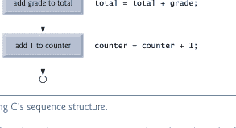

**图 3.1** | 绘制 C 的顺序结构流程图。

绘制表示完整算法的流程图时，我们使用的第一个符号是包含单词*“Begin.”*的圆角矩形符号。最后一个符号是包含单词*“End.”*的圆角矩形。当只绘制算法的一部分（如图3.1中那样）时，我们省略圆角矩形符号，改用小圆圈符号，也称为连接符。

也许最重要的流程图符号是菱形符号，也称为决策符号，它表示要做出*决策*。我们将在下一节讨论菱形符号。

### C 中的选择语句

C 以语句的形式提供三种选择结构。`if` 选择语句（3.5节）在条件为*真*时*选择*（执行）一个操作，或在条件为*假*时*跳过*该操作。`if...else` 选择语句（3.6节）在条件为*真*时执行一个操作，并在条件为*假*时执行另一个不同的操作。`switch` 选择语句（第4章讨论）根据表达式的值执行*许多*不同操作中的一个。`if` 语句称为单选择语句，因为它选择或忽略单个操作。`if...else` 语句称为双选择语句，因为它在两个不同操作之间进行选择。`switch` 语句称为多选择语句，因为它在许多不同操作之间进行选择。


## C 中的迭代语句

C 以语句的形式提供了三种迭代结构，分别是 while（第 3.7 节）、do...while 和 for（均在第 4 章讨论）。

就这些。C 只有七种控制语句：顺序、三类选择和三类迭代。每个 C 程序都是通过组合适当数量的每种类型的控制语句形成的，以实现程序所实现的算法。

如图 3.1 的顺序结构所示，我们会看到每个控制语句的流程图表示都有两个小圆圈符号，一个位于控制语句的入口点，一个位于出口点。这些单入口/单出口控制语句使得构建清晰的程序变得容易。我们可以通过将一个控制语句的出口点连接到下一个控制语句的入口点来将控制语句流程图片段相互连接。这很像孩子堆积积木的方式，所以我们称之为控制语句堆叠。我们将了解到控制语句连接的唯一另一种方式——称为控制语句嵌套。因此，任何我们需要构建的 C 程序都可以用仅七种不同类型的控制语句以仅两种方式组合来构造。这就是简洁的本质。

## 3.5 if 选择语句

选择语句用于在备选方案中进行选择。例如，假设考试及格分为 60。伪代码语句

> 如果学生的成绩大于或等于 60
> 打印 "Passed"

判断条件“学生的成绩大于或等于 60”是否为真或假。如果条件为真，则打印“Passed”，并且按顺序的下一个伪代码语句将被“执行”（请记住伪代码不是真正的编程语言）。如果条件为假，则忽略打印，并执行按顺序的下一个伪代码语句。

前面的伪代码 if 语句可以用 C 写成

```
if ( grade >= 60 ) {
    puts( "Passed" );
} // end if
```

请注意，C 代码与伪代码非常接近（当然你还需要声明 int 变量 grade）。这是使伪代码成为如此有用的程序开发工具的属性之一。此选择语句的第二行是缩进的。这种缩进是可选的，但强烈推荐，因为它有助于强调结构化程序的固有结构。C 编译器会忽略用于缩进和垂直间距的空白字符，如空格、制表符和换行符。

图 3.2 的流程图说明了单选择 if 语句。此流程图包含也许是最重要的流程图符号——菱形符号，也称为决策符号，表示需要做出决策。决策符号包含一个表达式，例如条件，可以为真或假。决策符号有两个流线从中发出。一个指示当符号中的表达式为真时要采取的方向，另一个指示当表达式为假时要采取的方向。决策可以基于包含关系或相等运算符的条件。事实上，决策可以基于任何表达式——如果表达式求值为零，则视为假，如果求值为非零，则视为真。

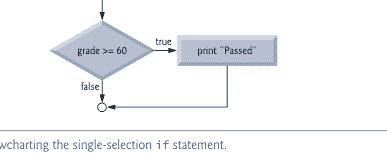

Fig. 3.2 | 流程图表示单选择 if 语句。

if 语句也是单入口/单出口语句。我们很快就会了解到，剩余控制结构的流程图也可以仅包含（除小圆圈符号和流线外）矩形符号来表示要执行的操作，以及菱形符号来表示要做出的决策。这就是我们一直强调的动作/决策编程模型。

我们可以设想七个箱子，每个箱子仅包含七种类型之一的控制语句流程图。这些流程图片段是空的——矩形中没有写任何内容，菱形中也没有写任何内容。你的任务就是根据算法的需求，从尽可能多的每种类型的控制语句中组装一个程序，以仅两种可能的方式（堆叠或嵌套）组合它们，然后以适合算法的方式填写操作和决策。我们将讨论编写操作和决策的各种方式。

## 3.6 if...else 选择语句

if 选择语句仅在条件为真时执行指示的操作；否则操作将被跳过。if...else 选择语句允许你指定在条件为真时和为假时执行不同的操作。例如，伪代码语句

```
If student's grade is greater than or equal to 60
Print "Passed"
else
Print "Failed"
```

如果学生的成绩大于或等于 60 则打印 Passed，如果学生的成绩小于 60 则打印 Failed。在任何情况下，打印发生后，按顺序的下一个伪代码语句将被“执行”。else 的主体也进行了缩进。

### 良好编程实践 3.1
对 if...else 语句的两个主体语句进行缩进（在伪代码和 C 中均适用）。

### 良好编程实践 3.2
如果有多个缩进级别，每个级别应缩进相同的额外空格量。

前面的伪代码 If…else 语句可以用 C 写成

```
    if ( grade >= 60 ) {
        puts( "Passed" );
    } // end if
    else {
        puts( "Failed" );
    } // end else
```

图 3.3 的流程图说明了 if…else 语句中的控制流。再一次，除了小圆圈和箭头外，流程图中的唯一符号是矩形（用于操作）和菱形（用于决策）。

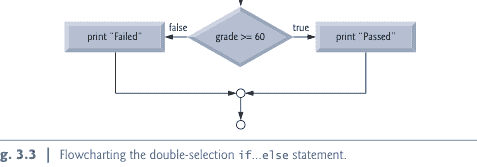

Fig. 3.3 | 流程图表示双选择 if…else 语句。

C 提供了条件运算符 (?:)，它与 if…else 语句密切相关。条件运算符是 C 的唯一三元运算符——它接受三个操作数。这些操作数连同条件运算符构成条件表达式。第一个操作数是条件。第二个操作数是当条件为真时整个条件表达式的值，第三个操作数是当条件为假时整个条件表达式的值。例如，puts 语句

```
    puts( grade >= 60 ? "Passed" : "Failed" );
```

其参数包含一个条件表达式，如果条件 grade >= 60 为真，则求值为字符串“Passed”，如果条件为假，则求值为字符串“Failed”。puts 语句的执行方式与前面的 if…else 语句基本相同。

条件表达式中的第二个和第三个操作数也可以是要执行的操作。例如，条件表达式

```
    grade >= 60 ? puts( "Passed" ) : puts( "Failed" );
```

读作：“如果 grade 大于或等于 60，则 puts("Passed")，否则 puts("Failed")。”这也与前面的 if…else 语句相当。条件运算符可以在 if…else 语句无法使用的地方使用，包括表达式和函数的参数（如 printf）。

如果变量 grade 大于或等于 90，所有四个条件都将为真，但只有第一次测试后的 puts 语句会被执行。执行该 puts 后，“外部” if...else 语句的 else 部分将被跳过。

你可能更喜欢将前面的 if 语句写成

```
if ( grade >= 90 ) {
    puts( "A" );
} // end if
else if ( grade >= 80 ) {
    puts( "B" );
} // end else if
else if ( grade >= 70 ) {
    puts( "C" );
} // end else if
else if ( grade >= 60 ) {
    puts( "D" );
} // end else if
else {
    puts( "F" );
} // end else
```

就 C 编译器而言，这两种形式是等价的。后一种形式很受欢迎，因为它避免了代码向右的深层缩进。这种缩进通常在行上留出很少的空间，迫使行被拆分并降低程序的可读性。

if 选择语句在其主体中只期望一个语句——如果 if 的主体中只有一个语句，则无需用大括号括起来。要在 if 的主体中包含多个语句，必须用大括号（{ 和 }）将语句集合括起来。用一对大括号包含的语句集合称为 *复合语句* 或块。

### 软件工程观察 3.1
复合语句可以放置在程序中任何可以放置单个语句的位置。

以下示例在 if...else 语句的 else 部分包含一个复合语句。

```
if ( grade >= 60 ) {
    puts( "Passed." );
} // end if
else {
    puts( "Failed." );
    puts( "You must take this course again." );
} // end else
```

在这种情况下，如果 grade 小于 60，程序将执行 else 主体中的 *both* puts 语句并打印

```
Failed.
You must take this course again.
```

else 子句中包围两个语句的大括号很重要。如果没有它们，语句

```
puts( "You must take this course again." );
```

会位于 if 的 else 部分主体之外，并且无论成绩是否低于 60 都会执行，因此即使是通过的学生也不得不重修这门课程！

> **防错提示 3.2**
> 始终将控制语句的主体放在花括号（{ 和 }）中，即使这些主体只包含一条语句。这解决了“悬空 else”问题，我们将在练习 3.30–3.31 中讨论该问题。

语法错误由编译器捕获。逻辑错误在执行时产生影响。致命逻辑错误会导致程序失败并提前终止。非致命逻辑错误允许程序继续执行，但会产生不正确的结果。

正如复合语句可以放在任何可放置单条语句的位置一样，也可以完全没有语句，即空语句。空语句的表示方法是在通常应放置语句的位置放一个分号（;）。

> **常见编程错误 3.1**
> 在 if 语句的条件后放置分号，如 if ( grade >= 60 );，会导致单分支 if 语句中出现逻辑错误，并导致双分支 if 语句中出现语法错误。

> **防错提示 3.3**
> 在键入花括号内的各条语句之前，先键入复合语句的开头和结尾花括号，有助于避免遗漏一个或两个花括号，从而防止语法错误和逻辑错误（在确实需要两个花括号的情况下）。

## 3.7 while 迭代语句

迭代语句（也称为重复语句或循环）允许你指定在某个条件保持为真时重复执行某个动作。伪代码语句

*当我的购物清单上还有更多物品时*
*购买下一件物品并将其从清单上划掉*

描述了购物过程中发生的迭代。条件“我的购物清单上还有更多物品”可能为真或为假。如果为真，则执行动作“购买下一件物品并将其从清单上划掉”。只要条件保持为真，该动作就会反复执行。while 迭代语句中包含的语句构成 while 的主体。while 语句主体可以是单条语句或复合语句。最终，条件会变为假（当购物清单上的最后一件物品已被购买并从清单上划掉时）。此时，迭代终止，并执行迭代结构之后的第一个伪代码语句。

> **常见编程错误 3.2**
> 未在 while 语句的主体中提供最终会使 while 中的条件变为假的动作。通常，这样的迭代结构将永远不会终止——这种错误称为“无限循环”。

让我们使用伪代码列出要执行的动作，并指定这些动作应执行的顺序。我们使用计数器控制的迭代来一次输入一个成绩。该技术使用一个称为计数器的变量来指定一组语句应执行的次数。在此示例中，当计数器超过 10 时迭代终止。在本案例研究中，我们仅给出伪代码算法（图 3.5）和相应的 C 程序（图 3.6）。在下一个案例研究中，我们将展示如何开发伪代码算法。计数器控制的迭代通常称为确定迭代，因为在循环开始执行之前迭代次数是已知的。

- 1. 将 total 设为 0
- 2. 将 grade counter 设为 1
- 3.
- 4. 当 grade counter 小于或等于 10 时
- 5. 输入下一个成绩
- 6. 将该成绩加到 total 中
- 7. 将 grade counter 加 1
- 8.
- 9. 将班级平均分设为 total 除以 10
- 10. 打印班级平均分

图 3.5 | 使用计数器控制的迭代解决班级平均分问题的伪代码算法。

// Fig. 3.6: fig03_06.c
// Class average program with counter-controlled iteration.
#include <stdio.h>

// function main begins program execution
int main( void )
{
    unsigned int counter; // number of grade to be entered next
    int grade; // grade value
    int total; // sum of grades entered by user
    int average; // average of grades

    // initialization phase
    total = 0; // initialize total
    counter = 1; // initialize loop counter

    // processing phase
    while ( counter <= 10 ) { // loop 10 times
        printf( "%s", "Enter grade: " ); // prompt for input
        scanf( "%d", &grade ); // read grade from user
        total = total + grade; // add grade to total
        counter = counter + 1; // increment counter
    } // end while

    // termination phase
    average = total / 10; // integer division

    printf( "Class average is %d\n", average ); // display result
} // end function main

图 3.6 | 使用计数器控制的迭代的班级平均分问题。（第 1 部分，共 2 部分。）

```
Enter grade: 98
Enter grade: 76
Enter grade: 71
Enter grade: 87
Enter grade: 83
Enter grade: 90
Enter grade: 57
Enter grade: 79
Enter grade: 82
Enter grade: 94
Class average is 81
```

**图 3.6** | 使用计数器控制的迭代的班级平均分问题。（第 2 部分，共 2 部分。）

该算法提到了 total 和 counter。total 是用于累加一系列值之和的变量。counter 是一个变量（第 8 行），用于计数——在此情况下，用于统计输入的成绩数量。由于本程序中的 counter 变量用于从 1 计数到 10（全为正值），我们将该变量声明为 unsigned int，它只能存储非负值（即 0 及更大的值）。用于存储总计值的变量应在程序中*使用之前*初始化为零；否则总和将包含存储在 total 内存位置中的先前值。计数器变量通常初始化为零或一，具体取决于其用途（我们将给出各自的示例）。未初始化的变量包含“垃圾”值——即最后存储在为该变量保留的内存位置中的值。

> **常见编程错误 3.4**
> 如果计数器或总计值未初始化，程序的运行结果很可能不正确。这是一个逻辑错误的例子。

> **防错提示 3.4**
> 初始化所有计数器和总计值。

程序中的平均值计算产生了整数结果 81。实际上，本示例中成绩的总和是 817，除以 10 应得到 81.7，即带小数点的数。我们将在下一节中看到如何处理这类数（称为浮点数）。

## **关于变量定义放置位置的重要说明**

在第 2 章中，我们提到 C 标准允许将每个变量定义放在 main 中该变量在代码中首次使用之前的任何位置。在本章中，我们继续将变量定义分组放在 main 的开头，以强调简单程序的初始化、处理和终止阶段。从第 4 章开始，我们将把每个变量定义放在该变量首次使用之前。我们将在第 5 章——讨论变量作用域时——看到这种做法如何帮助你消除错误。

## 3.9 使用自顶向下、逐步求精方法制定算法 案例研究 2：哨兵控制的迭代

让我们推广班级平均分问题。考虑以下问题：

*开发一个班级平均分程序，每次运行时处理任意数量的成绩。*

在第一个班级平均分示例中，成绩数量（10）是预先已知的。在本示例中，没有给出要输入多少成绩的指示。程序必须处理任意数量的成绩。程序如何确定何时停止输入成绩？它如何知道何时计算并打印班级平均分？

解决此问题的一种方法是使用一个特殊值，称为哨兵值（也称为信号值、哑值或标志值），来表示“数据输入结束”。用户输入成绩，直到所有合法成绩都已输入。然后用户输入哨兵值，表示“最后一项成绩已输入”。哨兵控制的迭代通常称为不确定迭代，因为在循环开始执行之前迭代次数是未知的。

显然，必须选择哨兵值，使其不会与可接受的输入值混淆。由于测验成绩通常是非负整数，因此 −1 是此问题可接受的哨兵值。因此，班级平均分程序的一次运行可能处理诸如 95、96、75、74、89 和 −1 这样的输入流。程序随后将计算并打印成绩 95、96、75、74 和 89 的班级平均分（−1 是哨兵值，因此不应参与平均分计算）。

### 自顶向下、逐步求精

我们使用一种称为自顶向下、逐步求精的技术来处理班级平均分程序，这种技术对于开发结构良好的程序至关重要。我们从顶层的伪代码表示开始：

*确定测验的班级平均分*

- 初始化变量
- 输入、求和并统计测验成绩
- 计算并打印班级平均分

这里只使用了顺序结构——列出的步骤将按顺序一个接一个地执行。

> **软件工程观察 3.2**
> 
> *每个细化步骤以及顶层本身都是算法的完整规范；只是详细程度不同。*

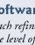


## 第二次细化

为了进入下一个细化级别，即第二次细化，我们要确定具体的变量。我们需要一个数字的累计总和、已处理数字的计数、一个用于接收每次输入成绩值的变量以及一个用于保存计算后平均值的变量。伪代码语句

*初始化变量*

可以细化如下：

- 将 total 初始化为零
- 将 counter 初始化为零

只有 total 和 counter 需要初始化；变量 average 和 grade（分别用于计算后的平均值和用户输入）无需初始化，因为它们的值将分别通过计算得到和从用户输入获得。伪代码语句

*输入、求和并计数测验成绩*

需要一个迭代结构来依次输入每个成绩。因为我们事先不知道要处理的成绩数量，我们将使用哨兵控制迭代。用户将一次输入一个合法成绩。在输入最后一个合法成绩后，用户将输入哨兵值。程序将在每次输入成绩后测试该值，并在输入哨兵值时终止循环。前述伪代码语句的细化如下：

- 输入第一个成绩（可能是哨兵值）
- 当用户尚未输入哨兵值时
  - 将该成绩加入累计总和
  - 将成绩计数器加一
  - 输入下一个成绩（可能是哨兵值）

请注意，在伪代码中，我们不会在构成 while 语句体的一组语句周围使用大括号。我们只是将所有这些语句缩进在 while 下方，以表明它们都属于 while。同样，伪代码是一种非正式的程序开发辅助工具。

伪代码语句

*计算并打印班级平均分*

可以细化如下：

- 如果 counter 不等于零
  - 将 average 设为 total 除以 counter 的结果
  - 打印 average
- 否则
  - 打印 “未输入成绩”

请注意，我们在这里小心地测试了除零的可能性——这是一种致命错误，如果未被检测到会导致程序失败（通常称为“崩溃”）。完整的第二次细化如 Fig. 3.7 所示。

小数点。类型 int 不能表示这样的数字。程序引入数据类型 float 来处理带小数点的数字（称为浮点数），并引入一种特殊的运算符称为强制类型转换运算符来处理平均值计算。这些特性在程序展示后进行解释。

// Fig. 3.8: fig03_08.c
// Class-average program with sentinel-controlled iteration.
#include <stdio.h>

// function main begins program execution
int main( void )
{
    unsigned int counter; // number of grades entered
    int grade; // grade value
    int total; // sum of grades

    float average; // number with decimal point for average

    // initialization phase
    total = 0; // initialize total
    counter = 0; // initialize loop counter

    // processing phase
    // get first grade from user
    printf("%s", "Enter grade, -1 to end: "); // prompt for input
    scanf("%d", &grade); // read grade from user

    // loop while sentinel value not yet read from user
    while ( grade != -1 ) {
        total = total + grade; // add grade to total
        counter = counter + 1; // increment counter

        // get next grade from user
        printf("%s", "Enter grade, -1 to end: "); // prompt for input
        scanf("%d", &grade); // read next grade
    } // end while

    // termination phase
    // if user entered at least one grade
    if ( counter != 0 ) {

        // calculate average of all grades entered
        average = ( float ) total / counter; // avoid truncation

        // display average with two digits of precision
        printf("Class average is %.2f", average );
    } // end if
    else { // if no grades were entered, output message
        puts( "No grades were entered" );
    } // end else
} // end function main

Fig. 3.8 | 使用哨兵控制迭代的求平均程序。（第 1 部分，共 2 部分。）

```
Enter grade, -1 to end: 75
Enter grade, -1 to end: 94
Enter grade, -1 to end: 97
Enter grade, -1 to end: 88
Enter grade, -1 to end: 70
Enter grade, -1 to end: 64
Enter grade, -1 to end: 83
Enter grade, -1 to end: 89
Enter grade, -1 to end: -1
Class average is 82.50
```

```
Enter grade, -1 to end: -1
No grades were entered
```

Fig. 3.8 | 使用哨兵控制迭代的求平均程序。（第 2 部分，共 2 部分。）

请注意 Fig. 3.8 中 while 循环（第 24 行）中的复合语句。同样，大括号是必要的，以确保所有四个语句都在循环内执行。如果没有大括号，循环体中的最后三个语句将落在循环之外，导致计算机错误地将此代码解释如下：

```
while ( grade != -1 )
    total = total + grade; // add grade to total
    counter = counter + 1; // increment counter
    printf( "%s", "Enter grade, -1 to end: " ); // prompt for input
    scanf( "%d", &grade ); // read next grade
```

如果用户未在第一个成绩中输入 -1，这将导致无限循环。

错误预防提示 3.5

在哨兵控制循环中，请在请求数据输入的提示中明确提醒用户哨兵值是什么。

## 显式和隐式类型转换

平均值并不总是求出整数值。通常，平均值是一个包含小数部分的值，例如 7.2 或 -93.5。这些值被称为浮点数，可以用数据类型 float 表示。变量 average 被定义为 float 类型（第 12 行），以捕获我们计算结果的小数部分。然而，计算 total / counter 的结果是整数，因为 total 和 counter 都是整数变量。两个整数相除会进行整数除法，其中计算的任何小数部分都会被截断（即丢失）。由于计算先执行，小数部分在结果赋给 average 之前就丢失了。为了用整数值进行浮点计算，我们必须创建临时值，使其为浮点数。C 提供了 unary 强制类型转换运算符来实现此任务。第 38 行

```
average = ( float ) total / counter;
```

这种方式称为显式转换。现在的计算由一个浮点值（total 的临时 float 版本）除以 counter 中存储的 unsigned int 值组成。C 仅在操作数数据类型相同的情况下才求值算术表达式。为了确保操作数具有相同的类型，编译器会对选定的操作数执行称为隐式转换的操作。例如，在包含数据类型 unsigned int 和 float 的表达式中，会复制 unsigned int 操作数并将其转换为 float。在我们的示例中，在复制 counter 并将其转换为 float 之后，执行计算，并将浮点除法的结果赋给 average。C 提供了不同类型操作数的转换规则集。我们将在第 5 章进一步讨论此问题。

强制类型转换运算符适用于大多数数据类型——它们是通过在类型名称周围放置括号形成的。每个强制类型转换运算符都是 unary 运算符，即只接受一个操作数的运算符。在第 2 章中，我们研究了二进制算术运算符。C 还支持加号 (+) 和减号 (-) 的 unary 版本，因此您可以编写诸如 -7 或 +5 这样的表达式。强制类型转换运算符从右到左关联，并具有与 unary + 和 unary - 等其他 unary 运算符相同的优先级。此优先级比乘法运算符 *、/ 和 % 的优先级高一级。

### 格式化浮点数

图 3.8 使用 printf 转换说明符 %.2f（第 41 行）来打印 average 的值。f 指定将打印浮点值。.2 是值将以其显示的精度——小数点右侧有 2 位数字。如果使用 %f 转换说明符（不指定精度），则使用默认精度 6——正如使用转换说明符 %.6f 一样。当使用精度打印浮点值时，打印的值会四舍五入到指示的小数位数。内存中的值保持不变。当执行以下语句时，会打印值 3.45 和 3.4。

```c
printf( "%.2f\n", 3.446 ); // prints 3.45
printf( "%.1f\n", 3.446 ); // prints 3.4
```

> **Common Programming Error 3.6**
> 
> 在 `scanf` 语句的格式控制字符串的转换说明中，使用精度是一个错误。精度仅用于 `printf` 转换说明。

### 关于浮点数的说明

尽管浮点数并不总是“100% 精确”，但它们有许多应用。例如，当我们谈论“正常”体温为 98.6 华氏度时，我们不需要精确到大量数字。当我们在温度计上查看温度并读作 98.6 时，它实际上可能是 98.5999473210643。这里的要点是，对于大多数应用来说，将这个数字简单地称为 98.6 是可以的。我们稍后会进一步讨论这个问题。

浮点数出现的另一种方式是通过除法。当我们将 10 除以 3 时，结果是 3.3333333…，其中 3 的序列无限重复。计算机只分配固定量的空间来保存这样的值，因此存储的浮点值只能是近似值。


## 常见编程错误 3.7

以假定浮点数能被精确表示的方式使用浮点数可能导致不正确的结果。大多数计算机只能近似表示浮点数。

## 错误预防提示 3.6

不要比较浮点值是否相等。

## 3.10 用自顶向下、逐步求精的方法表述算法 案例研究 3：嵌套控制语句

让我们再处理一个完整问题。我们将再次使用伪代码以及自顶向下、逐步求精的方法来表述算法，并编写相应的 C 程序。

我们已经看到，控制语句可以像孩子堆叠积木一样，一个接一个地堆叠（按顺序）。在本案例研究中，我们将看到 C 中连接控制语句的唯一另一种结构化方式，即把一个控制语句嵌套在另一个控制语句中。考虑下面的问题陈述：

*一所学院开设了一门课程，帮助学生准备房地产经纪人的州级执照考试。去年，完成这门课程的 10 名学生参加了执照考试。学院自然想知道学生们的考试表现。有人要求你编写一个程序来汇总结果。你已获得这 10 名学生的名单。每个名字旁边写着 1 表示该学生通过了考试，写着 2 表示该学生未通过。*

你的程序应按如下方式分析考试结果：

- 1. 输入每个考试结果（即 1 或 2）。每次程序请求另一个考试结果时，显示提示消息“Enter result”。
- 2. 统计每种类型的考试结果数量。
- 3. 显示考试结果摘要，指出通过和未通过的学生人数。
- 4. 如果超过八名学生通过考试，打印消息“Bonus to instructor!”。

仔细阅读问题陈述后，我们作出以下观察：

- 1. 程序必须处理 10 个考试结果。将使用计数器控制的循环。
- 2. 每个考试结果都是一个数字——要么是 1，要么是 2。每次程序读取一个考试结果时，程序必须判断该数字是 1 还是 2。我们的算法测试是否为 1。如果该数字不是 1，我们就假定它是 2。（练习 3.27 要求你确保每个考试结果都是 1 或 2。）
- 3. 使用两个计数器——一个用于统计通过考试的学生人数，一个用于统计未通过考试的学生人数。
- 4. 程序处理完所有结果后，必须判断是否有超过 8 名学生通过了考试。

让我们继续进行自顶向下、逐步求精。首先给出顶层的伪代码表示：

*分析考试结果并决定教师是否应获得奖金*

完整的第二次细化见图 3.9。我们使用空行来分隔 while 语句，以提高程序可读性。

这个伪代码现在已充分细化，可以转换为 C。C 程序和两个示例执行结果见图 3.10。我们利用了 C 的一个特性，即允许在定义中合并初始化（第 9—11 行）。这种初始化发生在编译时。另外请注意，当输出 unsigned int 时，要使用 %u 转换说明符（第 33—34 行）。

- 1 将 passes 初始化为零
- 2 将 failures 初始化为零
- 3 将 student 初始化为 1
- 4
- 5 当学生计数器小于或等于十时
- 6   输入下一个考试结果
- 7
- 8   如果该学生通过
- 9     将 passes 加一
- 10  否则
- 11    将 failures 加一
- 12
- 13  将学生计数器加一
- 14
- 15 打印通过人数
- 16 打印未通过人数
- 17 如果超过八名学生通过
- 18 打印“Bonus to instructor!”

图 3.9 | 考试结果问题的伪代码。

> **软件工程观察 3.5**
> 经验表明，在计算机上解决问题最困难的部分是为解决方案开发算法。一旦指定了正确的算法，生成可工作的 C 程序的过程通常很直接。

> **软件工程观察 3.6**
> 许多程序员编写程序时从不使用伪代码之类的程序开发工具。他们认为最终目标是在计算机上解决问题，而编写伪代码只会延迟最终输出的产生。

```c
// Fig. 3.10: fig03_10.c
// Analysis of examination results.
#include <stdio.h>
```

图 3.10 | 考试结果分析。（第 1 部分，共 3 部分。）

```c
// function main begins program execution
int main( void )
{
  // initialize variables in definitions
  unsigned int passes = 0; // number of passes
  unsigned int failures = 0; // number of failures
  unsigned int student = 1; // student counter
  int result; // one exam result

  // process 10 students using counter-controlled loop
  while ( student <= 10 ) {

    // prompt user for input and obtain value from user
    printf(" %s", "Enter result ( 1=pass,2=fail ): ");
    scanf( "%d", &result );

    // if result 1, increment passes
    if ( result == 1 ) {
      passes = passes + 1;
    } // end if
    else { // otherwise, increment failures
      failures = failures + 1;
    } // end else

    student = student + 1; // increment student counter
  } // end while

  // termination phase; display number of passes and failures
  printf( "Passed %u\n", passes );
  printf( "Failed %u\n", failures );

  // if more than eight students passed, print "Bonus to instructor!"
  if ( passes > 8 ) {
    puts( "Bonus to instructor!" );
  } // end if
} // end function main
```

Enter Result (1=pass,2=fail): 1
Enter Result (1=pass,2=fail): 2
Enter Result (1=pass,2=fail): 2
Enter Result (1=pass,2=fail): 1
Enter Result (1=pass,2=fail): 1
Enter Result (1=pass,2=fail): 1
Enter Result (1=pass,2=fail): 2
Enter Result (1=pass,2=fail): 1
Enter Result (1=pass,2=fail): 2
Passed 6
Failed 4

## 3.12 自增和自减运算符

C 还提供一元自增运算符 ++ 和一元自减运算符 --，它们总结在图 3.12 中。如果要使变量 c 增加 1，可以使用自增运算符 ++，而不是表达式 c = c + 1 或 c += 1。如果自增或自减运算符放在变量之前（即作为前缀），则分别称为前置自增或前置自减运算符。如果自增或自减运算符放在变量之后（即作为后缀），则分别称为后置自增或后置自减运算符。对变量进行前置自增（前置自减）会使该变量增加（减少）1，然后在出现该变量的表达式中使用其新值。对变量进行后置自增（后置自减）会使该变量当前值先在出现该变量的表达式中使用，然后该变量值再增加（减少）1。

| 运算符 | 示例表达式 | 说明 |
|---|---|---|
| ++ | ++a | 将 a 增加 1，然后在包含 a 的表达式中使用 a 的新值。 |
| ++ | a++ | 在包含 a 的表达式中使用 a 的当前值，然后将 a 增加 1。 |
| -- | --b | 将 b 减少 1，然后在包含 b 的表达式中使用 b 的新值。 |
| -- | b-- | 在包含 b 的表达式中使用 b 的当前值，然后将 b 减少 1。 |

图 3.12 | 自增和自减运算符

图 3.13 演示了 ++ 运算符的前置自增版本和后置自增版本之间的区别。对变量 c 进行后置自增会使其在 printf 语句中使用之后再增加。对变量 c 进行前置自增会使其在 printf 语句中使用之前先增加。

```c
// Fig. 3.13: fig03_13.c
// Preincrementing and postincrementing.
#include <stdio.h>

// function main begins program execution
int main( void )
{
    int c; // define variable

    // demonstrate postincrement
    c = 5; // assign 5 to c
    printf( "%d\n", c ); // print 5
    printf( "%d\n\n", c++ ); // print 5 then postincrement
    printf( "%d\n\n", c ); // print 6
}
```

图 3.13 | 前置自增和后置自增。（第 1 部分，共 2 部分。）


```c
15 // demonstrate preincrement
16 c = 5; // assign 5 to c
17 printf("%d\n", c); // print 5
18 printf("%d\n", ++c); // preincrement then print 6
19 printf("%d\n", c); // print 6
20 } // end function main
```

```
5
5
6

5
6
6
```

图 3.13 | 预递增和后递增。（第 2 部分，共 2 部分。）

该程序显示在使用 ++ 运算符之前和之后 c 的值。递减运算符（--）的工作方式类似。

> 良好编程实践 3.4  
> 一元运算符应直接放置在其操作数旁边，中间不得有空格。

图 3.10 中的三个赋值语句

```c
passes = passes + 1;
failures = failures + 1;
student = student + 1;
```

可以使用赋值运算符更简洁地写成

```c
passes += 1;
failures += 1;
student += 1;
```

可以使用预递增运算符写成

```c
++passes;
++failures;
++student;
```

或使用后递增运算符写成

```c
passes++;
failures++;
student++;
```

这里需要注意的是，当单独用一条语句递增或递减一个变量时，预递增和后递增形式的效果相同。只有当变量出现在更大表达式的上下文中时，预递增和后递增才会有不同的效果（预递减和后递减也类似）。迄今为止我们研究的表达式中，只有简单的变量名才能用作递增或递减运算符的操作数。

## 常见编程错误 3.8

尝试对除简单变量名之外的表达式使用递增或递减运算符是语法错误，例如写 ++(x + 1)。

## 错误预防提示 3.7

C 通常不指定运算符的操作数将被求值的顺序（尽管我们在第 4 章中会看到对少数运算符的例外）。因此，您应仅在一条语句中单独递增或递减一个变量时使用递增或递减运算符。

图 3.14 列出了迄今为止介绍的运算符的优先级和结合性。运算符按从上到下递减的优先级顺序显示。第二列指示每个优先级级别运算符的结合性。请注意，条件运算符（?:）、一元运算符递增（++）、递减（--）、加（+）、减（-）和强制转换，以及赋值运算符 =、+=、-=、*=、/= 和 %= 都是从右到左结合的。第三列命名了各种运算符组。图 3.14 中的所有其他运算符都从左到右结合。

| Operators | Associativity | Type |
|---|---|---|
| ++ (postfix) -- (postfix) | 从右到左 | 后缀 |
| + - (type) ++ (prefix) -- (prefix) | 从右到左 | 一元 |
| * / % | 从左到右 | 乘法 |
| + - | 从左到右 | 加法 |
| < <= > >= | 从左到右 | 关系 |
| == != | 从左到右 | 相等 |
| ?: | 从右到左 | 条件 |
| = += -= *= /= %= | 从右到左 | 赋值 |

图 3.14 | 文本中迄今为止遇到的运算符的优先级和结合性。

## 3.13 安全 C 编程

### 算术溢出

图 2.5 展示了一个加法程序，该程序计算了两个 int 值的和（第 18 行），语句为

```c
sum = integer1 + integer2; // assign total to sum
```

即使是这个简单的语句也存在潜在问题——将整数相加可能会导致一个值太大而无法存储在 int 变量中。这称为算术溢出，可能导致未定义行为，从而可能使系统面临攻击。

可以存储在 int 变量中的平台特定最大值和最小值分别由常量 INT_MAX 和 INT_MIN 表示，它们在头文件 <limits.h> 中定义。我们将在第 4 章中介绍的其他整型也有类似的常量。您可以通过在文本编辑器中打开头文件 <limits.h> 来查看这些常量的平台值。

在执行类似图 2.5 第 18 行的算术计算之前，确保它们不会溢出被认为是一种良好的做法。执行此操作的代码显示在 CERT 网站 www.securecoding.cert.org 上——只需搜索准则 "INT32-C"。该代码使用了 &&（逻辑与）和 ||（逻辑或）运算符，我们将在第 4 章中讨论这些运算符。在工业级代码中，您应该对所有计算执行类似的检查。后续章节将展示处理此类错误的其它编程技术。

### 无符号整数

在图 3.6 中，第 8 行将变量 counter 声明为 unsigned int，因为它仅用于计数非负值。一般来说，仅应存储非负值的计数器应在整数类型前声明 unsigned。无符号类型变量可以表示从 0 到大约对应有符号整数类型正值范围两倍的值。您可以使用 <limits.h> 中的常量 UINT_MAX 来确定平台的最大 unsigned int 值。

图 3.6 中的求平均值程序本可以声明变量 grade、total 和 average 为 unsigned int。成绩通常是 0 到 100 的值，因此 total 和 average 每个都应大于或等于 0。我们将这些变量声明为 int，因为我们无法控制用户实际输入的内容——用户可能会输入负值。更糟的是，用户可能会输入一个甚至不是数字的值。（我们将在本书后面展示如何处理此类输入。）

有时哨兵控制循环使用无效值来终止循环。例如，图 3.8 的求平均值程序在用户输入哨兵 -1（无效成绩）时终止循环，因此将变量 grade 声明为 unsigned int 是不合适的。正如您将看到的，文件结束（EOF）指示符——它将在下一章中介绍，并且经常用于终止哨兵控制循环——也是一个负数。有关更多信息，请参阅 Robert Seacord 的著作《Secure Coding in C and C++》第 2 版第 5 章“Integer Security”。

### scanf_s 和 printf_s

C11 标准附录 K 引入了更安全的 printf 和 scanf 版本，称为 printf_s 和 scanf_s——我们将在第 6.13 节和第 7.13 节中讨论这些函数以及相应的安全问题。附录 K 被指定为可选，因此并非每个 C 厂商都会实现它。微软在 C11 标准发布之前就实现了自己的 printf_s 和 scanf_s 版本，其编译器立即开始对每个 scanf 调用发出警告。警告说 scanf 已被弃用——不应再使用——并且您应考虑改用 scanf_s。

许多组织都有编码标准，要求代码在没有任何警告消息的情况下编译。有两种方法可以消除 Visual C++ 的 scanf 警告——您可以使用 scanf_s 代替 scanf，或者可以禁用这些警告。对于我们迄今为止使用的输入语句，Visual C++ 用户只需将 scanf 替换为 scanf_s 即可。您可以在 Visual C++ 中按如下方式禁用警告消息：

- 1. 按 Alt F7 显示项目的属性页对话框。
- 2. 在左侧列中，展开 配置属性 > C/C++ 并选择 预处理器。
- 3. 在右侧列中，在 预处理器定义 的值末尾插入 `;_CRT_SECURE_NO_WARNINGS`
- 4. 单击 确定 保存更改。

您将不再对 `scanf`（或 Microsoft 因类似原因弃用的任何其他函数）收到警告。对于工业级编码，禁用警告是不鼓励的。我们将在后面的 Secure C 编码指南部分中更详细地说明如何使用 `scanf_s` 和 `printf_s`。

## 摘要

### 第 3.1 节 引言

- 在编写程序解决特定问题之前，您必须对问题有 *透彻理解*，并有 *仔细规划的解决思路*。

### 第 3.2 节 算法

- 任何计算问题的解决方案都涉及以 *特定顺序* 执行一系列 *操作*（第 102 页）。
- 用 *操作*（第 102 页）来解决问题的 *过程*（第 102 页），以及这些 *操作* 执行的顺序，称为 *算法*（第 102 页）。
- *操作* 执行的顺序很重要。

### 第 3.3 节 伪代码

- *伪代码*（第 102 页）是一种人工且非正式的语言，有助于您开发算法。
- 伪代码类似于日常英语；它不是实际的计算机编程语言。
- 伪代码程序帮助您“思考”出一个程序。
- 伪代码纯粹由字符组成；您可以使用文本编辑器输入伪代码。
- 仔细准备的伪代码程序可以很容易地转换为相应的 C 程序。
- 伪代码仅由 *操作语句* 组成。

### 第 3.4 节 控制结构

- 通常，程序中的语句按其编写的顺序一个接一个地执行。这称为 *顺序执行*（第 103 页）。
- 各种 C 语句使您能够指定要执行的下一个语句可能不是按顺序的下一个语句。这称为 *控制转移*（第 103 页）。
- **结构化编程** 已几乎与“goto 消除”（第 103 页）同义。
- 结构化程序更清晰、更容易调试和修改，并且更可能没有错误。
- 所有程序都可以用 *顺序*、*选择* 和 *迭代* 控制结构（第 103 页）来编写。
- 除非另有指示，否则计算机会自动按 *顺序* 执行 C 语句。
- *流程图*（第 104 页）是算法的图形表示。流程图使用矩形、菱形、圆角矩形和小圆圈绘制，并由称为 *流程线*（第 104 页）的箭头连接。
- *矩形（操作）符号*（第 104 页）表示任何类型的操作，包括计算或输入/输出操作。
- *流程线* 表示操作的执行顺序。
- 当绘制表示完整算法的 *流程图* 时，我们使用包含单词“Begin”的圆角矩形作为第一个符号。我们使用作为最后一个符号的圆角矩形


- 累加和是一个用于累积一系列值之和的变量。用于存储累加和的变量在使用前通常应初始化为零；否则求和将包含存储在累加和内存位置中的先前值。

- 计数器是一个用于计数的变量。计数器变量通常初始化为零或一，具体取决于其用途。

- 未初始化的变量包含一个“垃圾”值（第 113 页）——最后存储在为该变量保留的内存位置中的值。

## 第 3.9 节 自顶向下逐步细化制定算法 案例研究：哨兵控制的迭代

- 哨兵值（第 114 页；也称为信号值、虚拟值或标志值）用于哨兵控制循环中，表示“数据输入结束”。

- 哨兵控制的迭代通常称为不确定迭代（第 114 页），因为在循环开始执行之前迭代次数是未知的。

- 哨兵值必须选择为不能与可接受的输入值混淆。

- 在自顶向下逐步细化（第 114 页）中，顶层是一个传达程序整体功能的语句。它是对程序的完整表示。在细化过程中，我们将顶层划分为较小的任务并按执行顺序列出这些任务。

- 类型 float（第 117 页）表示带小数点的数字（称为浮点数）。

- 当两个整数相除时，结果的任何小数部分都会被截断（第 118 页）。

- 要使用整数值进行浮点计算，必须将整数强制转换为浮点数。C 提供了用于完成此任务的一元强制转换运算符 (float)。

- 强制转换运算符（第 118 页）执行显式转换。

- 大多数计算机只能计算操作数数据类型相同的算术表达式。为确保这一点，编译器会对选定的操作数执行称为隐式转换（第 119 页）的操作。

- 强制转换运算符是通过在类型名周围放置括号形成的。强制转换运算符是一元运算符——它只接受一个操作数。

- 强制转换运算符从右到左结合，并与其他一元运算符（如一元 + 和一元 -）具有相同的优先级。此优先级比 *、/ 和 % 高一级。

- printf 转换说明符 %.2f 指定浮点值将以小数点右侧两位数字显示。如果使用 %f 转换说明符（未指定精度），则使用默认精度（第 119 页）6。

- 当浮点值以精度打印时，打印的值会四舍五入（第 119 页）到指定的小数位数以供显示。

## 第 3.11 节 赋值运算符

- C 提供了多个赋值运算符用于缩写赋值表达式（第 124 页）。

- += 运算符将运算符右侧表达式的值加到运算符左侧变量的值上，并将结果存储在运算符左侧的变量中。

- 任何形式为
```
variable = variable operator expression;
```
其中 operator 是二元运算符 +, -, *, / 或 % 中的一个（或我们在第 10 章中讨论的其他运算符），可以写成以下形式
```
variable operator= expression;
```

## 第 3.12 节 自增和自减运算符

- C 提供了用于整数类型的一元自增运算符 ++（第 125 页）和一元自减运算符 --（第 125 页）。

- 如果自增或自减运算符放在变量之前，则分别称为前缀自增或前缀自减运算符。如果自增或自减运算符放在变量之后，则分别称为后缀自增或后缀自减运算符。

- 对变量进行前缀自增（前缀自减）会使其增加（减少）1，然后在该变量出现的表达式中使用变量的新值。

- 对变量进行后缀自增（后缀自减）会先在该变量出现的表达式中使用变量的当前值，然后将变量值增加（减少）1。

- 当单独在一条语句中对变量进行自增或自减时，前缀自增和后缀自增形式的效果相同。当变量出现在较大表达式的上下文中时，前缀自增和后缀自增的效果不同（前缀自减和后缀自减也是如此）。

## 第 3.13 节 安全的 C 编程

- 对整数求和可能导致一个值过大而无法存储在 int 变量中。这称为算术溢出，可能导致不可预测的运行时行为，可能使系统暴露于攻击之下。

- 可以存储在 int 变量中的最大值和最小值分别由头文件 <limits.h> 中的常量 INT_MAX 和 INT_MIN 表示。

- 在执行计算之前确保算术计算不会溢出被认为是一种良好的做法。在工业级代码中，您应对可能导致溢出或下溢（第 127 页）的所有计算进行检查。

- 通常，任何应仅存储非负值的整数变量都应在整数类型前声明为 unsigned。无符号类型变量可以表示从 0 到大约对应有符号整数类型正范围两倍的值。

- 您可以使用来自 <limits.h> 的常量 UINT_MAX 确定平台的最大 unsigned int 值。

- C11 标准附录 K 引入了更安全的 printf 和 scanf 版本，称为 printf_s 和 scanf_s。附录 K 被指定为可选，因此并非每个 C 编译器厂商都会实现它。

- Microsoft 在 C11 标准发布之前实现了自己的 printf_s 和 scanf_s 版本，并立即开始对每次 scanf 调用发出警告。警告说 scanf 已被弃用——不应再使用——并且应考虑改用 scanf_s。

- 许多组织都有编码标准，要求代码在没有警告消息的情况下编译。有两种方法可以消除 Visual C++ 的 scanf 警告。您可以立即开始使用 scanf_s 或禁用此警告消息。

## 自评练习

### 3.1 在以下每个问题中填空。

- a) 用待执行的操作及其执行顺序来解决问题的过程称为 ________。
- b) 由计算机指定语句的执行顺序称为 ________。
- c) 所有程序都可以用三种类型的控制语句来编写：________、________ 和 ________。
- d) ______ 选择语句用于在条件为真时执行一个操作，在条件为假时执行另一个操作。
- e) 用大括号 ({ 和 }) 分组在一起的若干语句称为 ______。
- f) ______ 迭代语句指定在某个条件保持为真时重复执行一条语句或一组语句。
- g) 对一组指令进行特定次数的迭代称为 ______ 迭代。
- h) 当事先不知道一组语句将重复多少次时，可以使用 ______ 值来终止迭代。

### 3.2

编写四个不同的 C 语句，每个语句都将整数变量 x 加 1。

### 3.3

编写单个 C 语句以完成以下每项任务：

- a) 使用 *= 运算符将变量 product 乘以 2。
- b) 使用 = 和 * 运算符将变量 product 乘以 2。
- c) 测试变量 count 的值是否大于 10。如果是，打印 "Count is greater than 10."。
- d) 计算 q 除以 divisor 后的余数并将结果赋给 q。以两种不同的方式编写此语句。
- e) 以两位精度打印值 123.4567。打印的值是什么？
- f) 以小数点右侧三位数字打印浮点值 3.14159。打印的值是什么？

### 3.4

编写 C 语句以完成以下每个任务。

- a) 定义变量 sum 和 x 为 int 类型。
- b) 将变量 x 设置为 1。
- c) 将变量 sum 设置为 0。
- d) 将变量 x 加到变量 sum 上并将结果赋给变量 sum。
- e) 打印 "The sum is: " 后跟变量 sum 的值。

### 3.5

将你在练习 3.4 中编写的语句组合成一个计算从 1 到 10 的整数之和的程序。使用 while 语句循环执行计算和自增语句。循环应在 x 的值变为 11 时终止。

### 3.6

编写单个 C 语句

- a) 使用 scanf 输入无符号整数变量 x。使用转换说明符 %u。
- b) 使用 scanf 输入无符号整数变量 y。使用转换说明符 %u。
- c) 将无符号整数变量 i 设置为 1。
- d) 将无符号整数变量 power 设置为 1。
- e) 将无符号整数变量 power 乘以 x 并将结果赋给 power。
- f) 将变量 i 增加 1。
- g) 在 while 语句的条件中测试 i 是否小于或等于 y。
- h) 使用 printf 输出无符号整数变量 power。使用转换说明符 %u。

### 3.7

编写一个 C 程序，使用练习 3.6 中的语句计算 x 的 y 次幂。程序应具有 while 迭代控制语句。

### 3.8

识别并纠正以下每项中的错误：

- a) while ( c <= 5 ) {
product *= c;
++c;
}
- b) scanf( "% .4f", &value );
- c) if ( gender == 1 )
puts( "Woman" );
else
puts( "Man" );


### 3.9 以下 while 迭代语句有什么问题（假设 z 的值为 100），它本应计算从 100 到 1 的整数之和？

```
while ( z >= 0 )
    sum += z;
```

## 自测练习答案

### 3.1
a) 算法。 b) 程序控制。 c) 顺序、选择、迭代。 d) if...else。 e) 复合语句或块。 f) while。 g) 计数控制或确定。 h) 哨兵。

```
x = x + 1;
x += 1;
++x;
x++;
```

### 3.3
a) product *= 2; b) product = product * 2; c) if ( count > 10 ) puts("Count is greater than 10."); d) q %= divisor; q = q % divisor; e) printf( "%.2f", 123.4567 ); 显示 123.46。 f) printf( "%.3f\n", 3.14159 ); 显示 3.142。

### 3.4
a) int sum, x; b) x = 1; c) sum = 0; d) sum += x; or sum = sum + x; e) printf( "The sum is: %d\n", sum );

### 3.5 如下所示。

// Calculate the sum of the integers from 1 to 10
#include <stdio.h>

int main( void )
{
    unsigned int x = 1; // set x
    unsigned int sum = 0; // set sum

    while ( x <= 10 ) { // loop while x is less than or equal to 10
        sum += x; // add x to sum
        ++x; // increment x
    } // end while
    printf( "The sum is: %u\n", sum ); // display sum
} // end main function

### 3.6
a) scanf( "%u", &x ); b) scanf( "%u", &y ); c) i = 1; d) power = 1; e) power *= x; f) ++i;
g) while ( i <= y )
h) printf("%d", power );

### 3.7 如下所示。

// raise x to the y power
#include <stdio.h>

int main( void )
{
printf( "%s", "Enter first integer: " );
unsigned int x;
// read value for x from user
scanf( "%u", &x );
printf( "%s", "Enter second integer: " );
unsigned int y;
// read value for y from user
scanf( "%u", &y );
unsigned int i = 1;
unsigned int power = 1; // set power
while ( i <= y ) // loop while i is less than or equal to y
    power *= x; // multiply power by x
    ++i; // increment i
} // end while
printf( "%u\n", power ); // display power
} // end main function

### 3.8
- a) 错误：缺少 while 主体的右闭合大括号。
- 纠正：在语句 ++i; 后添加右闭合大括号。
- b) 错误：在 scanf 转换说明中使用了精度。
- 纠正：从转换说明中删除 .4。
- c) 错误：if...else 语句 else 部分后的分号导致逻辑错误。
- 第二个 puts 将始终被执行。
- 纠正：删除 else 后的分号。

### 3.9
while 语句中变量 z 的值从未被改变。因此会产生无限循环。为了防止无限循环，必须递减 z，使其最终变为 0。

## 练习

### 3.10 识别并纠正以下每项中的错误。 [注意：每段代码中可能有多个错误。]
- a) if ( sales >= 5000 )
- puts( "Sales are greater than or equal to $5000" )
- else
- puts( "Sales are less than $5000" )
- b) int x = 1, product = 0;
- while ( x <= 10 ); {
- product *= x;
- ++x;
- }
- c) while ( x <= 100 )
- total *= x;
- ++x;

```
d) while ( y < 10 ) {
    printf( "%d\n", y );
}
```

### 3.11
填空：
- - a) 在 _______ 中，语句按书写顺序一个接一个执行。
- - b) _______ 程序帮助你“思考”出一个程序。
- - c) 所有程序都可以用 _______, _______, _______ 控制结构来表示。
- - d) 流程图使用 _______, _______, _______, 和 _______ 由称为流程线的箭头连接绘制。
- - e) 流程线表示执行的 _______。
- - f) _______ 多重选择语句根据表达式的值在许多选项中选择一个。
- - g) _______ 运算符是 C 的唯一三元运算符。它接受三个操作数，_______ 一个条件，_______ 如果条件为真则为条件表达式的值，以及 _______ 如果条件为假则为条件表达式的值。
- - h) if 语句是一个 _______ 结构。

### 3.12
以下程序打印什么？

```
#include <stdio.h>

int main( void )
{
    int y;
    int x = 1;
    int total = 0;

    while ( x <= 10 ) {
       y = x * x;
       printf( "%d\n", y );
       total += y;
       x++;
    } // end while

    printf( "The total is %d \n", total );
} // end main
```

### 3.13
写出单个伪代码语句表示以下每项：
- - a) 显示消息 "Enter your name:"
- - b) 将变量 a、b、c 和 d 的乘积赋给变量 p。
- - c) 以下条件要在条件语句中测试：如果 x 大于 y，则 x 被赋值为 10，否则 x 被赋值为 20。
- - d) 从键盘获取变量 a、b、c 和 d 的值。

### 3.14
为以下每项制定伪代码算法：

### 3.15
说明以下哪些是真哪些是假。如果陈述为假，请说明原因。
- a) 算法是解决问题的程序，描述要执行的操作，而不指定操作的顺序。
- b) 除非另有指示，计算机自动按顺序执行 C 语句。
- c) if...else 双选择语句选择单个操作。
- d) 逻辑错误在程序编译时影响程序。它不会导致程序失败或过早终止。
- e) 你可以使用 <limits.h> 中的常量 UINT_MAX 确定平台的最大 unsigned int 值。

对于练习 3.16–3.20，执行以下每个步骤：
- 1. 阅读问题陈述。
- 2. 使用伪代码和自顶向下、逐步细化来制定算法。
- 3. 编写 C 程序。
- 4. 测试、调试并执行 C 程序。

### 3.16 (Sales Tax)
销售税由买方收取并上缴政府。零售商必须提交月度销售税报告，其中列出当月的销售额以及在县和州两个层面上收取的销售税金额。开发一个程序，输入一个月的总收款，计算收款的销售税，并显示县和州的税款。假设州销售税为 4%，县销售税为 5%。这里是一个示例输入/输出对话：

```
Enter total amount collected (-1 to quit): 45678
Enter name of month: January
Total Collection: $ 45678.00
Sales: $ 41906.42
County Sales Tax: $ 2095.32
State Sales Tax: $ 1676.26
Total Sales Tax Collected: $ 3771.58

Enter total amount collected (-1 to quit): 98000
Enter name of month: February
Total Collection: $ 98000
Sales: $ 89906.26
County Sales Tax: $ 4495.41
State Sales Tax: $ 3596.33
Total Sales Tax Collected: $ 8091.74
Enter total amount collected (-1 to quit): -1
```

### 3.17 (Mortgage Calculator)
开发一个 C 程序来计算银行客户抵押贷款的应计利息。对于每个客户，有以下事实可用：
- a) 账号
- b) 抵押贷款金额
- c) 抵押贷款期限
- d) 利率

```
Enter account number (-1 to end): 100
Enter mortgage amount (in dollars): 6500
Enter mortgage term (in years): 3
Enter interest rate (as a decimal): 0.075
The monthly payable interest is: $ 222

Enter account number (-1 to end): 20000
Enter mortgage amount (in dollars): 12000
Enter mortgage term (in years): 10
Enter interest rate (as a decimal): 0.045
The monthly payable interest is: $ 145

Enter account number (-1 to end): -1
```

### 3.18 (Sales-Commission Calculator)
一家大型化工公司按佣金制支付其销售人员的工资。销售人员每周获得 200 美元加上当周毛销售额的 9%。例如，一名销售人员在一周内售出价值 5000 美元的化学品，将获得 200 美元加上 5000 美元的 9%，总计 650 美元。开发一个程序，输入每位销售人员上周的毛销售额，并计算并显示该销售人员的收入。一次处理一位销售人员的数据。这里是一个示例输入/输出对话：

```
Enter sales in dollars (-1 to end): 5000.00
Salary is: $650.00

Enter sales in dollars (-1 to end): 1234.56
Salary is: $311.11

Enter sales in dollars (-1 to end): -1
```

### 3.19 (Interest Calculator)
贷款的简单利息按公式计算

```
interest = principal * rate * days / 365;
```

上述公式假设 rate 为年利率，因此包括除以 365（天）。开发一个程序，输入多笔贷款的本金、利率和天数，并使用上述公式计算并显示每笔贷款的简单利息。这里是一个示例输入/输出对话：

```
Enter loan principal (-1 to end): 1000.00
Enter interest rate: .1
Enter term of the loan in days: 365
The interest charge is $100.00

Enter loan principal (-1 to end): 1000.00
Enter interest rate: .08375
Enter term of the loan in days: 224
The interest charge is $51.40

Enter loan principal (-1 to end): -1
```


## 3.20 （工资计算器）
开发一个程序，用于计算多名员工的毛工资。公司对每位员工前 40 个小时按“标准工时”支付工资，超过 40 小时的工时按“1.5 倍工资”支付。你会得到一份公司员工名单、每位员工上周的工作小时数和每小时工资率。程序应为每位员工输入这些信息，并确定和显示该员工的毛工资。以下是示例输入/输出对话：

```
    Enter # of hours worked (-1 to end): 39
    Enter hourly rate of the worker ($00.00): 10.00
    Salary is $390.00

    Enter # of hours worked (-1 to end): 40
    Enter hourly rate of the worker ($00.00): 10.00
    Salary is $400.00

    Enter # of hours worked (-1 to end): 41
    Enter hourly rate of the worker ($00.00): 10.00
    Salary is $415.00

    Enter # of hours worked (-1 to end): -1
```

## 3.21 （前置递增与后置递增）
编写一个程序，使用递增运算符 `++` 演示前置递增和后置递增之间的区别。

## 3.22 （判断一个数是否为素数）
素数是指任何大于 1 且只能被 1 和自身整除的自然数。编写一个 C 程序，读取一个整数并判断它是否为素数。

## 3.23 （找出最大数）
在一组数字中找出最大数（即一组数中的最大值）的过程在计算机应用中经常使用。例如，判断销售竞赛获胜者的程序会输入每位销售人员的售出单位数，售出单位最多的人赢得竞赛。请先编写一个伪代码程序，再编写一个程序，输入 10 个非负数字，确定并打印其中最大的数字。[提示：你的程序应使用如下所示的三个变量。]

- **counter（计数器）：** 一个计数器，计到 10（即跟踪已输入多少个数字，并判断是否已处理完所有 10 个数字）
- **number（数字）：** 当前输入到程序中的数字
- **largest（最大数）：** 到目前为止找到的最大数字

## 3.24 （表格输出）
编写一个程序，使用循环打印下面的数值表。在 `printf` 语句中使用制表符转义序列 `\t`，将各列用制表符分隔。

| N | N^2 | N^3 | N^4 |
|---:|---:|---:|---:|
| 1 | 1 | 1 | 1 |
| 2 | 4 | 8 | 16 |
| 3 | 9 | 27 | 81 |
| 4 | 16 | 64 | 256 |
| 5 | 25 | 125 | 625 |
| 6 | 36 | 216 | 1296 |
| 7 | 49 | 343 | 2401 |
| 8 | 64 | 512 | 4096 |
| 9 | 81 | 729 | 6561 |
| 10 | 100 | 1000 | 10000 |

## 3.25 （表格输出）
编写一个程序，使用循环生成下列数值表：

| A | A+3 | A+6 | A*9 |
|---|---|---|---|
| 7 | 10 | 13 | 63 |
| 14 | 17 | 20 | 126 |
| 21 | 24 | 27 | 189 |
| 28 | 31 | 34 | 252 |
| 35 | 38 | 41 | 315 |

## 3.26 （找出两个最大数）
使用与练习 3.23 类似的方法，找出这 10 个数字中的两个最大值。[注意：每个数字只能输入一次。]

## 3.27 （验证用户输入）
修改图 3.10 中的程序，以验证其输入。对于任何输入，如果输入的值不是 1 或 2，则持续循环，直到用户输入正确值。

## 3.28 以下程序会打印什么？

```
#include <stdio.h>
int main( void )
{
   int x = 1;
   int y = 0;
   while ( x <= 5 ) { // loop 5 times
   total += x * x; // perform calculation
   printf( "%d\n", x*x);
   ++x; // increment counter x
   } // end while
   printf( "Total is %d\n", total); // display result
} // end function main
```

## 3.29 以下程序会打印什么？

```
#include <stdio.h>
int main( void )
{
   int outer_count = 1; // initialize count
   while ( outer_count <= 10 ) { // loop 10 times
      int inner_count = 1;
      while ( inner_count <= outer_count ) {
         printf( "%m" );
         inner_count++;
      } // end inner while
      printf( "\n" );
      outer_count++;
   } // end outer while
} // end main
```

## 3.30 （悬垂 else 问题）
在 `x` 为 9 且 `y` 为 11，以及 `x` 为 11 且 `y` 为 9 这两种情况下，分别确定下列程序的输出。C 编译器会忽略程序中的缩进。此外，除非通过花括号 `{}` 的放置另行指定，编译器总是将 `else` 与前面最近的 `if` 配对。因为乍一看你也许无法确定某个 `else` 与哪个 `if` 匹配，所以这被称为“悬垂 else”问题。为了使问题更有挑战性，我们删除了下列代码中的缩进。[提示：应用你已学过的缩进约定。]

```
a) if ( x < 10 )
    if ( y > 10 )
        puts( "ooooo" );
    else
        puts( "#####" );
    puts( "$$$$$" );
```

```
b) if ( x < 10 ) {
    if ( y > 10 )
        puts( "ooooo" );
    }
    else {
        puts( "#####" );
        puts( "$$$$$" );
    }
```

## 3.31 （另一个悬垂 else 问题）
修改下列代码以产生所示输出。请使用正确的缩进技术。除插入花括号外，不得作任何其他修改。编译器会忽略程序中的缩进。为了使问题更有挑战性，我们删除了下列代码的缩进。[注意：也有可能无需修改。]

```
if ( y == 8 )
    if ( x == 5 )
        puts( "ooooo" );
    else
        puts( "#####" );
    puts( "$$$$$" );
    puts( "&&&&&" );
```

a) 假设 `x = 5` 且 `y = 8`，产生以下输出。

ooooo
$$$$$
&&&&&

b) 假设 `x = 5` 且 `y = 8`，产生以下输出。

ooooo

c) 假设 `x = 5` 且 `y = 8`，产生以下输出。

ooooo
&&&&&

d) 假设 `x = 5` 且 `y = 7`，产生以下输出。

#####
$$$$$
&&&&&

## 3.32 （星号正方形）
编写一个程序，读取正方形的边长，然后用星号打印该正方形。你的程序应适用于边长在 1 到 20 之间的所有正方形。例如，如果程序读取的大小为 4，则应打印

```
    ****
    ****
    ****
    ****
```

## 3.33 （空心星号正方形）
修改你在练习 3.32 中编写的程序，使其打印一个空心正方形。例如，如果程序读取的大小为 5，则应打印

```
    *****
    *   *
    *   *
    *   *
    *****
```

## 3.34 （弗洛伊德三角形）
弗洛伊德三角形是自然数组成的直角三角形数组。它通过用连续整数逐行填充来定义。因此，第 1 行有数字 1，第 2 行有数字 2 和 3，依此类推。编写一个绘制 10 行弗洛伊德三角形的程序。外层循环可以控制要打印的行数，内层循环可以确保每行包含正确数量的整数。

## 3.35 （打印二进制数的十进制等价数）
输入一个只包含 0 和 1 的整数（5 位或更少，即“二进制”整数），并打印其十进制等价数。[提示：使用取余运算符和除法运算符，从右到左一次一位地取出“二进制”数字的各位数字。与十进制数字系统一样，十进制中最右边数字的位置值是 1，其左侧下一位的位置值是 10，然后是 100、1000，以此类推；而在二进制数字系统中，最右边数字的位置值是 1，其左侧下一位的位置值是 2，然后是 4、8，以此类推。因此，十进制数 234 可以解释为 4 * 1 + 3 * 10 + 2 * 100。二进制数 1101 的十进制等价数是 1 * 1 + 0 * 2 + 1 * 4 + 1 * 8，即 1 + 0 + 4 + 8，也就是 13。]

## 3.36 （阿姆斯特朗数）
阿姆斯特朗数是等于其各位数字按数字位数取幂后相加所得之和的数。例如，数字 153 等于 1^3 + 5^3 + 3^3，因此它是一个阿姆斯特朗数。编写一个程序，显示所有三位数的阿姆斯特朗数。

## 3.37 （检测数字的倍数）
编写一个程序，连续打印 500 个美元符号（$），每个符号之间用一个空格分隔。每打印第 50 个美元符号后，程序应打印一个换行符。[提示：从 1 计数到 500。使用取余运算符来识别计数器何时达到 50 的倍数。]

## 3.38 （统计 9 的个数）
编写一个程序，读取一个整数（5 位或更少），确定并打印该整数中有多少位是 9。

## 3.39 （星号棋盘格图案）
编写一个程序，显示下列棋盘格图案：

```
    * * * * * * * *
     * * * * * * * *
    * * * * * * * *
     * * * * * * * *
    * * * * * * * *
     * * * * * * * *
    * * * * * * * *
     * * * * * * * *
```


你的程序必须只使用三条输出语句，分别采用以下形式：

```
printf("%s", "a ");
printf("%s", "b");
puts(" "); // outputs a newline
```

3.40 （使用无限循环输出3的幂）编写一个程序，不断打印整数3的幂，即3、9、27、81、243，等等。你的循环不应终止（即，你应该创建一个无限循环）。运行此程序时会发生什么？

3.41 （圆的直径、周长和面积）编写一个程序，读取圆的半径（作为浮点值），并计算和打印直径、周长和面积。使用3.14159作为π的值。

3.42 下面这条语句有什么问题？重写它以完成程序员可能想要实现的目标。

```
printf("%d", --(x * y));
```

3.43 （三角形的边）编写一个程序，读取三个非零整数值，并确定和打印它们是否能表示三角形的边。

3.44 （直角三角形的边）编写一个程序，读取三个非零整数，并确定和打印它们是否能作为直角三角形的边。

3.45 （阶乘）非负整数n的阶乘写作n!（读作“n的阶乘”），定义如下：

n! = n · (n - 1) · (n - 2) · ... · 1 (对于大于或等于1的n值)

并且
n! = 1 (对于n = 0)。

例如，5! = 5 · 4 · 3 · 2 · 1，即120。

- a) 编写一个程序，读取一个非负整数，并计算和打印其阶乘。
- b) 编写一个程序，使用以下公式估算数学常数e的值：
  e = 1 + 1/1! + 1/2! + 1/3! + ...
- c) 编写一个程序，使用以下公式计算e^x的值：
  e^x = 1 + x/1! + x^2/2! + x^3/3! + ...

## 学以致用

3.46 （世界人口增长计算器）使用网络确定当前世界人口和年世界人口增长率。编写一个应用程序，输入这些值，然后显示一年、两年、三年、四年和五年后的预计世界人口。

3.47 （目标心率计算器）锻炼时，你可以使用心率监测器来确保心率保持在教练和医生建议的安全范围内。根据美国心脏协会（AHA）的说法，计算你每分钟最大心率的公式是220减去你的年龄（以年为单位）。你的目标心率是一个范围，即你最大心率的50-85%。[注意：这些公式是AHA提供的估计值。最大心率和目标心率可能因个人的健康状况、体质和性别而异。在开始或修改锻炼计划之前，务必咨询医生或合格的医疗保健专业人员。]创建一个程序，读取用户的生日和当前日期（每个都由月、日和年组成）。你的程序应计算并显示该人的年龄（以年为单位）、最大心率和目标心率范围。

## C程序控制

### 目标

在本章中，你将学习：

- 计数器控制迭代的基本知识。
- 使用for和do...while迭代语句重复执行语句。
- 理解使用switch选择语句进行多重选择。
- 使用break和continue语句改变控制流。
- 使用逻辑运算符在控制语句中形成复杂的条件表达式。
- 避免混淆相等运算符和赋值运算符所带来的后果。

### 目录

- 4.1 引言
- 4.2 迭代基础
- 4.3 计数器控制迭代
- 4.4 for迭代语句
- 4.5 for语句：注释与观察
- 4.6 使用for语句的示例
- 4.7 switch多重选择语句
- 4.8 do...while迭代语句
- 4.9 break和continue语句
- 4.10 逻辑运算符
- 4.11 混淆相等（==）和赋值（=）运算符
- 4.12 结构化编程总结
- 4.13 安全C编程

*小结 | 自测练习 | 自测练习答案 | 练习 | 学以致用*

### 4.1 引言

你现在应该已经能够轻松编写简单、完整的C程序了。在本章中，我们将更详细地讨论迭代，并介绍额外的迭代控制语句，即for和do...while。还将介绍switch多重选择语句。我们讨论break语句（用于立即退出某些控制语句）和continue语句（用于跳过迭代语句主体的剩余部分，然后继续循环的下一次迭代）。本章讨论了用于组合条件的逻辑运算符，并总结了第3章和本章中介绍的结构化编程原则。

### 4.2 迭代基础

大多数程序都涉及迭代或循环。循环是一组指令，只要某个循环继续条件保持为真，计算机就会重复执行这些指令。我们已经讨论了两种迭代方式：

- 1. 计数器控制迭代
- 2. 哨兵控制迭代

计数器控制迭代有时被称为*确定性迭代*，因为我们*事先*确切知道循环将执行多少次。哨兵控制迭代有时被称为*不确定性迭代*，因为*事先*不知道循环将执行多少次。

在计数器控制迭代中，使用控制变量来计数迭代次数。每次执行这组指令时，控制变量递增（通常加1）。当控制变量的值表示已执行了正确的迭代次数时，循环终止，并继续执行迭代语句之后的下一条语句。

哨兵值用于控制迭代，当：

- 1. 事先不知道精确的迭代次数，且
- 2. 循环包含每次执行循环时获取数据的语句。

哨兵值表示“数据结束”。在所有常规数据项提供给程序后，输入哨兵。哨兵必须与常规数据项不同。

语句

```
++counter; // increment
```

每次执行循环时，将循环计数器加1。while语句中的循环继续条件测试控制变量的值是否小于或等于10（条件为真的最后一个值）。即使控制变量为10，也会执行该while的循环体。当控制变量超过10（即counter变为11）时，循环终止。

你可以通过将counter初始化为0，并将while语句替换为以下代码，使图4.1中的程序更简洁：

```
while (++counter <= 10) {
    printf("%d\n", counter);
}
```

这段代码节省了一条语句，因为递增是在条件测试之前直接在while条件中完成的。以这种紧凑的方式编码需要一些练习。一些程序员认为这会使代码过于晦涩且容易出错。

> **常见编程错误4.1**
> 
> *浮点值可能是近似值，因此使用浮点变量控制计数循环可能导致计数器值不精确和终止测试不准确。*

> **防错提示4.1**
> 
> *使用整数值控制计数循环。*

> **良好编程习惯4.1**
> 
> *过多的嵌套层级会使程序难以理解。作为规则，尽量避免使用超过三层的嵌套。*

> **良好编程习惯4.2**
> 
> *在控制语句前后加垂直空白行，并在控制语句头内缩进控制语句的主体，这使程序具有二维外观，大大提高了程序的可读性。*

### 4.4 for迭代语句

for迭代语句处理计数器控制迭代的所有细节。为了说明其强大功能，让我们重写图4.1中的程序。结果如图4.2所示。该程序的操作如下。当for语句开始执行时，控制变量counter被定义并初始化为1。然后，检查循环继续条件counter <= 10。由于counter的初始值为1，该条件满足，因此printf语句（第10行）打印counter的值，即1。然后，控制变量counter通过表达式++counter递增，循环再次从循环继续测试开始。由于控制变量现在等于2，未超过最终值，因此程序再次执行printf语句。此过程持续进行，直到控制变量counter递增到其最终值11——这导致循环继续测试失败，迭代终止。程序继续执行for语句之后的第一条语句（在本例中，程序只是结束）。


// Fig. 4.2: fig04_02.c
// Counter-controlled iteration with the for statement.
#include <stdio.h>

int main(void)
{
    // initialization, iteration condition, and increment
    // are all included in the for statement header.
    for (unsigned int counter = 1; counter <= 10; ++counter) {
        printf("%u\n", counter);
    }
}

Fig. 4.2 | 使用 for 语句的计数器控制迭代。

### for 语句头组件

图 4.3 更详细地展示了图 4.2 中的 for 语句。注意 for 语句“包办一切”——它指定了使用控制变量进行计数器控制迭代所需的所有项目。如果 for 的体中包含多条语句，则需要大括号来定义循环体——正如我们在第 3.6 节中讨论的那样，即使它只有一条语句，也应始终将控制语句的体放在大括号中。

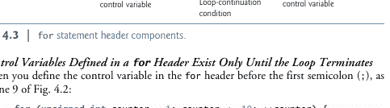

Fig. 4.3 | for 语句头组件。

### 在 for 头中定义的控制变量仅在循环终止前存在

当你在第一个分号（;）之前在 for 头中定义控制变量时，如图 4.2 第 9 行所示：

```
for (unsigned int counter = 1; counter <= 10; ++counter) {
```

控制变量仅在循环终止前存在。

### 常见编程错误 4.2

> 在 for 语句头中定义的控制变量，尝试在 for 语句的右大括号（}）之后访问该控制变量会引发编译错误。

### 差一错误

注意图 4.2 使用了循环继续条件 counter <= 10。如果错误地写成 counter < 10，则循环只会执行 9 次。这是一种常见的逻辑错误，称为差一错误。

### 防错提示 4.2

使用 while 或 for 语句条件中的最终值并使用 <= 关系运算符可以帮助避免差一错误。例如，对于用于打印 1 到 10 的值的循环，循环继续条件应为 counter <= 10 而不是 counter < 11 或 counter < 10。

### for 语句的一般格式

for 语句的一般格式是

```
for (initialization; condition; increment) {
    statement
}
```

其中初始化表达式初始化循环控制变量（并且可能定义它，如我们在图 4.2 中所做的），条件表达式是循环继续条件，增量表达式递增控制变量。

### 逗号分隔的表达式列表

通常，初始化表达式和增量表达式是逗号分隔的表达式列表。这里使用的逗号实际上是逗号运算符，它保证表达式列表从左到右求值。逗号分隔的表达式列表的值和类型是列表中最右边的表达式的值和类型。逗号运算符最常用于 for 语句。其主要用途是使你能够使用多个初始化和/或多个增量表达式。例如，单个 for 语句中可能有两个控制变量必须初始化和递增。

### 软件工程观察 4.1

仅在 for 语句的初始化和增量部分放置涉及控制变量的表达式。其他变量的操作应出现在循环之前（如果它们只执行一次，像初始化语句）或在循环体中（如果它们每次迭代执行一次，像递增或递减语句）。

### for 语句头中的表达式是可选的

for 语句中的三个表达式是可选的。如果省略条件表达式，C 假定循环继续条件为真，从而创建无限循环。如果控制变量在 for 语句之前已初始化，则可以省略初始化表达式。如果增量由 for 语句体中的语句计算或不需要增量，则可以省略增量表达式。

### 增量表达式像独立语句一样起作用

for 语句中的增量表达式在 for 的体末尾像一个独立的 C 语句一样起作用。因此，表达式

```
counter = counter + 1
counter += 1
++counter
counter++
```

在 for 语句的增量部分都是等价的。一些 C 程序员更喜欢形式 counter++，因为递增发生在循环体执行之后，后递增形式似乎更自然。因为这里被预递增或后递增的变量不出现在更大的表达式中，所以两种递增形式具有相同的效果。for 语句中的两个分号是必需的。

> **常见编程错误 4.3**
> 在 for 头中使用逗号代替分号是语法错误。

> **防错提示 4.3**
> 无限循环是由迭代语句中的循环继续条件永远不为假引起的。为防止无限循环，请确保不要在 while 语句头后放置分号。在计数器控制循环中，确保在循环中递增（或递减）控制变量。在哨兵控制循环中，确保最终会输入哨兵值。

## 4.5 for 语句：注释和观察

- 1. 初始化、循环继续条件和增量可以包含算术表达式。例如，如果 x = 2 且 y = 10，语句

for (j = x; j <= 4 * x * y; j += y / x)

等价于语句

for (j = 2; j <= 80; j += 5)

- 2. “增量”可能为负（在这种情况下它实际上是递减，循环实际上向下计数）。

- 3. 如果循环继续条件初始为假，则循环体不执行。相反，执行继续进行 for 语句之后的语句。

- 4. 控制变量经常在循环体中打印或用于计算，但不必如此。常见的做法是使用控制变量来控制迭代，而在循环体中从不提及它。

- 5. for 语句的流程图与 while 语句类似。例如，图 4.4 显示了 for 语句的流程图

for (unsigned int counter = 1; counter <= 10; ++counter) {
    printf("%u", counter);
}

该流程图清楚地表明初始化只发生一次，并且每次执行时递增都在主体语句之后发生。

```
for (j = x; j <= 4 * x * y; j += y / x)
```

```
for (j = 2; j <= 80; j += 5)
```

```
for (unsigned int counter = 1; counter <= 10; ++counter) {
    printf("%u", counter);
}
```

> **防错提示 4.4**
> 尽管可以在 for 循环的体中更改控制变量的值，但这可能导致细微错误。最好不要更改它。

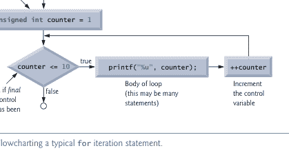

Fig. 4.4 | 流程图化典型的 for 迭代语句。

## 4.6 使用 for 语句的示例

以下示例展示了在 for 语句中变化控制变量的方法。

- 1. 以 1 为增量将控制变量从 1 变化到 100。
  `for (unsigned int i = 1; i <= 100; ++i)`
- 2. 以 -1 为增量（即递减 1）将控制变量从 100 变化到 1。
  `for (unsigned int i = 100; i >= 1; --i)`
- 3. 以 7 为增量将控制变量从 7 变化到 77。
  `for (unsigned int i = 7; i <= 77; i += 7)`
- 4. 以 -2 为增量将控制变量从 20 变化到 2。
  `for (unsigned int i = 20; i >= 2; i -= 2)`
- 5. 使控制变量在以下值序列上变化：2、5、8、11、14、17。
  `for (unsigned int j = 2; j <= 17; j += 3)`
- 6. 使控制变量在以下值序列上变化：44、33、22、11、0。
  `for (unsigned int j = 44; j >= 0; j -= 11)`

*应用：求和从 2 到 100 的偶整数*

图 4.5 使用 for 语句对从 2 到 100 的所有偶整数求和。循环的每次迭代（第 9–11 行）将控制变量 number 的值加到变量 sum。

> **良好编程实践 4.3**
> 尽可能将控制语句头的大小限制为单行。


```c
// calculate amount on deposit for each of ten years
for (unsigned int year = 1; year <= 10; ++year) {

    // calculate new amount for specified year
    double amount = principal * pow(1.0 + rate, year);

    // output one table row
    printf("%4u%21.2f\n", year, amount);
}
```

| 年份 | 存款金额 |
|------|-------------------|
| 1 | 1050.00 |
| 2 | 1102.50 |
| 3 | 1157.63 |
| 4 | 1215.51 |
| 5 | 1276.28 |
| 6 | 1340.10 |
| 7 | 1407.10 |
| 8 | 1477.46 |
| 9 | 1551.33 |
| 10 | 1628.89 |

图 4.6 | 计算复利。（第 2 部分，共 2 部分。）

`for` 语句会将循环体执行 10 次，控制变量从 1 递增到 10，每次增量为 1。虽然 C 语言没有指数运算符，但我们可以使用标准库函数 `pow`（第 18 行）来实现这一目的。函数 `pow(x, y)` 计算 `x` 的 `y` 次方的值。它接收两个 `double` 类型的参数，并返回一个 `double` 类型的值。

> **软件工程观察 4.2**
> `double` 与 `float` 一样都是浮点类型，但通常 `double` 类型的变量能够以比 `float` 更高的精度存储数值大得多的量。`double` 类型的变量比 `float` 类型的变量占用更多内存。除极少数对内存要求非常苛刻的应用外，专业程序员通常更倾向于使用 `double` 而不是 `float`。

只要使用了 `pow` 这样的数学函数，就应该包含头文件 `<math.h>`（第 4 行）。如果没有包含 `math.h`，该程序将无法正常链接，因为链接器会找不到 `pow` 函数。`pow` 函数要求两个 `double` 参数，但变量 `year` 是整数。`math.h` 文件中的信息会告诉编译器在调用该函数之前，将 `year` 的值转换为临时的 `double` 表示。这些信息包含在 `pow` 的函数原型中。这些内容将在第 5 章中说明，那里还会介绍 `pow` 函数以及其他数学库函数的摘要。

### 关于使用 `float` 或 `double` 表示货币金额的告诫

请注意，我们将变量 `amount`、`principal` 和 `rate` 定义为 `double` 类型。这样做只是为了简化，因为我们处理的是美元的小数部分。

> **错误预防提示 4.5**
> 不要使用 `float` 或 `double` 类型的变量进行货币计算。浮点数的不精确性可能导致错误，从而产生不正确的货币值。[在练习 4.23 中，我们探讨了使用整数形式的“分”来进行精确货币计算的方法。]

下面简单说明使用 `float` 或 `double` 表示美元金额时可能出现的问题。机器中存储的两个 `float` 美元金额可能是 14.234（使用 `%.2f` 打印为 14.23）和 18.673（使用 `%.2f` 打印为 18.67）。当这两个金额相加时，得到总和 32.907，使用 `%.2f` 打印为 32.91。因此你的打印结果可能显示为

```
  14.23
+ 18.67
------
  32.91
```

显然，按打印出来的各个数字相加，结果应该为 32.90！你已经得到警告了！

### 格式化数值输出

程序中使用转换说明符 `%21.2f` 来打印变量 `amount` 的值。转换说明符中的 `21` 表示输出该值所用的字段宽度。字段宽度为 21 意味着打印的值将占据 21 个打印位置。其中的 `2` 表示精度（即小数位数）。如果显示出的字符数小于字段宽度，那么该值将自动右对齐，并在字段左侧填充空格。这对于对齐具有相同精度的浮点数值尤其有用（这样它们的小数点可以在垂直方向上对齐）。若要在字段中左对齐某个值，可在 `%` 和字段宽度之间放置一个 `-`（负号）。负号也可以用于左对齐整数（例如 `%-6d`）和字符串（例如 `%-8s`）。我们将在第 9 章详细讨论 `printf` 和 `scanf` 强大的格式化功能。

## 4.7 `switch` 多分支选择语句

在第 3 章中，我们讨论了 `if` 单分支选择语句以及 `if...else` 双分支选择语句。有时，算法会包含一系列判断，这些判断会对同一个变量或表达式可能取到的各个常量整数值分别进行测试，并根据不同情况执行不同的操作。这称为多分支选择。C 语言提供了 `switch` 多分支选择语句来处理这类判断。

`switch` 语句由一系列 `case` 标签、一个可选的 `default` 分支以及每个分支要执行的语句组成。图 4.7 使用 `switch` 统计学生在一次考试中获得的各类字母等级的数量。

```c
// Fig. 4.7: fig04_07.c
// Counting letter grades with switch.
#include <stdio.h>

int main(void)
{
    unsigned int aCount = 0;
    unsigned int bCount = 0;
    unsigned int cCount = 0;
    unsigned int dCount = 0;
    unsigned int fCount = 0;

    puts("Enter the letter grades.");
    puts("Enter the EOF character to end input.");
    int grade; // one grade

    // loop until user types end-of-file key sequence
    while ((grade = getchar()) != EOF) {

        // determine which grade was input
        switch (grade) { // switch nested in while

            case 'A': // grade was uppercase A
            case 'a': // or lowercase a
                ++aCount;
                break; // necessary to exit switch

            case 'B': // grade was uppercase B
            case 'b': // or lowercase b
                ++bCount;
                break;

            case 'C': // grade was uppercase C
            case 'c': // or lowercase c
                ++cCount;
                break;

            case 'D': // grade was uppercase D
            case 'd': // or lowercase d
                ++dCount;
                break;

            case 'F': // grade was uppercase F
            case 'f': // or lowercase f
                ++fCount;
                break;

            case '\n': // ignore newlines,
            case '\t': // tabs,
            case ' ': // and spaces in input
                break;
        }
    }
}
```

图 4.7 | 使用 `switch` 统计字母等级。（第 1 部分，共 2 部分。）

它以 `int` 类型返回用户输入的字符。我们可以根据具体用途，将字符视为整数或字符。例如，语句

```
printf("The character (%c) has the value %d.\n", 'a', 'a');
```

使用转换说明符 `%c` 和 `%d` 分别打印字符 `'a'` 及其整数值。结果是

```
The character (a) has the value 97.
```

### ASCII

整数 97 是该字符在计算机中的数值表示。如今许多计算机使用 ASCII（American Standard Code for Information Interchange，美国信息交换标准代码）字符集，在该字符集中，97 表示小写字母 `'a'`。附录 B 列出了所有 ASCII 字符及其十进制值。使用 `scanf` 时，可以通过转换说明符 `%c` 读取字符。

### 赋值表达式具有值

赋值表达式作为一个整体实际上具有一个值。这个值会被赋给 `=` 左侧的变量。赋值表达式 `grade = getchar()` 的值，就是 `getchar` 返回并赋给变量 `grade` 的字符。

赋值具有值这一事实可用于将多个变量设置为同一个值。例如，

```
a = b = c = 0;
```

首先计算赋值 `c = 0`（因为 `=` 运算符从右向左结合）。接着，变量 `b` 被赋值为赋值表达式 `c = 0` 的值（即 0）。然后，变量 `a` 被赋值为赋值表达式 `b = (c = 0)` 的值（也是 0）。在该程序中，赋值表达式 `grade = getchar()` 的值会与 `EOF`（其缩写代表“end of file”，即文件结束）的值进行比较。我们使用 `EOF`（通常值为 -1）作为哨兵值。用户按下系统相关的按键组合来表示“文件结束”——也就是说，不再输入更多数据。`EOF` 是在 `<stdio.h>` 头文件中定义的符号整型常量（我们将在第 6 章了解符号常量是如何定义的）。如果赋给 `grade` 的值等于 `EOF`，程序将终止。在本程序中，我们选择用 `int` 来表示字符，因为 `EOF` 是一个整数值（同样，通常为 -1）。

**可移植性提示 4.1**
输入 `EOF`（文件结束）的按键组合与系统相关。

**可移植性提示 4.2**
与符号常量 `EOF`（而不是 -1）进行比较可以使程序更具可移植性。C 标准规定 `EOF` 是负整数值（但不一定等于 -1）。因此，`EOF` 在不同系统上可能有不同的值。

### 输入 EOF 指示符

在 Linux/UNIX/Mac OS X 系统中，通过输入以下内容来输入 `EOF` 指示符：

```
<Ctrl> d
```


独立成行。这种记号 `<Ctrl> d` 表示同时按下 Ctrl 键和 d 键。在其他系统（如 Microsoft Windows）中，可以通过键入

```
<Ctrl> z
```

来输入 EOF 指示符。

在 Windows 上，还需要按 Enter 键。

用户在键盘上输入成绩。当按下 Enter 键时，字符会由函数 `getchar` 逐个读取。如果输入的字符不等于 EOF，则进入 switch 语句（第 21–57 行）。

### switch 语句详解

关键字 switch 后面紧跟括号中的变量名 grade。这称为控制表达式。该表达式的值会与每个 case 标签进行比较。假设用户输入了字母 C 作为成绩。C 会自动与 switch 中的每个 case 进行比较。如果发生匹配（case 'C':），则执行该 case 的语句。对于字母 C，cCount 增加 1（第 35 行），然后通过 break 语句立即退出 switch 语句。

break 语句使程序控制继续执行 switch 语句之后的第一条语句。使用 break 语句是因为 switch 语句中的 case 若不使用 break 就会贯穿在一起。如果在 switch 语句中的任何地方都不使用 break，那么每当语句中发生一次匹配时，其余所有 case 的语句都会被执行。（这种特性——称为“贯穿”——很少有用，尽管它非常适合编程练习 4.38——“迭代歌曲《圣诞十二天》”！）如果没有发生匹配，则执行 default 情况，并打印错误消息。

### switch 语句流程图

每个 case 可以有一个或多个动作。switch 语句不同于所有其他控制语句，在 switch 的某个 case 中，多个动作不需要花括号。一般的 switch 多路选择语句（在每个 case 中使用 break）的流程图如图 4.8 所示。流程图清楚地表明，case 末尾的每个 break 语句都会使控制立即退出 switch 语句。

> **常见编程错误 4.4**
> 在 switch 语句中需要 break 语句时却忘记写 break 是逻辑错误。

> **防错提示 4.6**
> 在 switch 语句中提供 default 情况。switch 中未显式测试的值通常会被忽略。default 情况通过促使你关注处理异常条件的需要来帮助防止这一问题。有时并不需要默认处理。

> **良好编程习惯 4.4**
> 虽然 switch 语句中的 case 子句和 default 子句可以按任意顺序出现，但通常将 default 子句放在最后。

> **良好编程习惯 4.5**
> 在 switch 语句中，当 default 子句位于最后时，break 语句不是必需的。但你可能更喜欢包含这个 break，以保持清晰并与其他 case 对称。

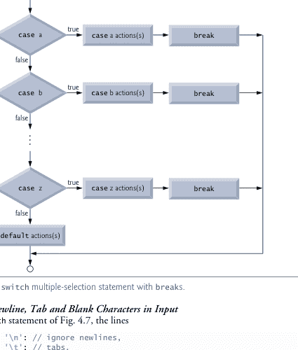

图 4.8 | 带 break 的 switch 多路选择语句。

### 忽略输入中的换行符、制表符和空白字符

在图 4.7 的 switch 语句中，以下代码行

```c
case '\n': // 忽略换行符，
case '\t': // 制表符，
case ' ':  // 以及输入中的空格
break;
```

使程序跳过换行符、制表符和空白字符。逐个读取字符可能会引发问题。为了让程序读取这些字符，你必须按 Enter 键将它们发送到计算机。这会导致换行符在我们希望处理的字符之后被放入输入流中。通常，必须特别忽略这个换行符才能使程序正确运行。我们 switch 语句中的前述 case 防止了每次在输入中遇到换行符、制表符或空格时都打印 default 情况中的错误消息。因此，每次输入都会导致循环执行两次——第一次用于字母成绩，第二次用于 '\n'。将多个 case 标签列在一起（如图 4.7 中的 case 'D'; case 'd':）仅仅表示对于每个 case 都要执行相同的动作集合。

### 防错提示 4.7

在逐个处理字符时，请记住为输入中的换行符（以及可能的其他空白字符）提供处理能力。

### 常量整型表达式

使用 switch 语句时，请记住每个单独的 case 只能测试常量整型表达式——即字符常量和整数常量的任意组合，且该组合求值为一个常量整数值。字符常量可以表示为单引号中的具体字符，例如 'A'。字符必须用单引号括起来才能被识别为字符常量——双引号中的字符被识别为字符串。整数常量就是整数值。在我们的示例中，我们使用了字符常量。请记住，字符是作为较小的整数值来表示的。

### 关于整型类型的说明

像 C 这样的可移植语言必须具有灵活的数据类型大小。不同的应用程序可能需要不同大小的整数。C 提供了几种表示整数的数据类型。除了 int 和 char 之外，C 还提供了 short int（可缩写为 short）和 long int（可缩写为 long）类型，以及所有整型类型的无符号变体。在第 5.14 节中，我们将看到 C 还提供了 long long int 类型。C 标准规定了每种整数类型的最小取值范围，但实际范围可能更大，并且取决于实现。对于 short int，最小范围是 –32767 到 +32767。对于大多数整数计算，long int 就足够了。long int 的最小取值范围是 –2147483647 到 +2147483647。int 的取值范围大于或等于 short int 的取值范围，且小于或等于 long int 的取值范围。在当今的许多平台上，int 和 long int 表示相同的取值范围。数据类型 signed char 可用于表示 –127 到 +127 范围内的整数，或计算机字符集中的任何字符。有关有符号和无符号整数类型范围的完整列表，请参阅 C 标准文档的第 5.2.4.2 节。

## 4.8 do...while 迭代语句

do...while 迭代语句与 while 语句类似。在 while 语句中，循环继续条件在循环体执行之前于循环开始处进行测试。do...while 语句在循环体执行之后测试循环继续条件。因此，循环体至少总是执行一次。当 do...while 终止时，执行继续从 while 子句之后的语句开始。do...while 语句的写法如下：

```
do {
    语句
} while (条件); // 此处必须使用分号
```

图 4.9 使用 do...while 语句打印数字 1 到 10。我们选择在循环继续测试中（第 11 行）对控制变量 counter 进行前置递增。

```
1  // 图 4.9：fig04_09.c
2  // 使用 do...while 迭代语句。
3  #include <stdio.h>
4  
5  int main(void)
6  {
```

图 4.9 | 使用 do...while 迭代语句。（第 1 部分，共 2 部分。）

```
unsigned int counter = 1; // 初始化 counter

do {
    printf("%u ", counter);
} while (++counter <= 10);
```

1 2 3 4 5 6 7 8 9 10

图 4.9 | 使用 do...while 迭代语句。（第 2 部分，共 2 部分。）

### do...while 语句流程图

图 4.10 展示了 do...while 语句的流程图，它清楚地表明循环继续条件在动作至少执行一次之后才会执行。

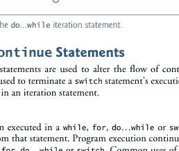

图 4.10 | do...while 迭代语句的流程图。

## 4.9 break 和 continue 语句

break 和 continue 语句用于改变控制流。第 4.7 节展示了如何使用 break 来终止 switch 语句的执行。本节讨论如何在迭代语句中使用 break。

### break 语句

break 语句在 while、for、do...while 或 switch 语句中执行时，会导致立即退出该语句。程序执行继续从该 while、for、do...while 或 switch 之后的下一条语句开始。break 的常见用途是提前退出循环或跳过 switch 的其余部分（如图 4.7 所示）。图 4.11 演示了 for 迭代语句中的 break 语句（第 14 行）。当 if 语句检测到 x 变为 5 时，执行 break。这会终止 for 语句，程序继续执行 for 之后的 printf。循环只完整执行了四次。在此示例中，我们在循环之前声明了 x，以便在循环终止后使用其最终值。请记住，当你在 for 循环的初始化表达式中声明控制变量时，该变量在循环终止后将不再存在。


```c
1  // Fig. 4.11: fig04_11.c
2  // Using the break statement in a for statement.
3  #include <stdio.h>
4
5  int main(void)
6  {
7      unsigned int x; // declared here so it can be used after loop
8
9      // loop 10 times
10     for (x = 1; x <= 10; ++x) {
11
12         // if x is 5, terminate loop
13         if (x == 5) {
14             break; // break loop only if x is 5
15         }
16
17         printf("%u ", x);
18     }
19
20     printf("\nBroke out of loop at x == %u\n", x);
21 }
```

1 2 3 4
Broke out of loop at x == 5

**图 4.11** | 在 for 语句中使用 break 语句。

## *continue 语句*

continue 语句在 while、for 或 do...while 语句中执行时，会跳过该控制语句主体中剩余的语句，并执行循环的下一次迭代。在 while 和 do...while 语句中，continue 语句执行后立即计算循环继续条件。在 for 语句中，先执行增量表达式，然后计算循环继续条件。图 4.12 在 for 语句中使用 continue（第 12 行）跳过 printf 语句并开始循环的下一次迭代。

```c
1  // Fig. 4.12: fig04_12.c
2  // Using the continue statement in a for statement.
3  #include <stdio.h>
4
5  int main(void)
6  {
7      // loop 10 times
8      for (unsigned int x = 1; x <= 10; ++x) {
9
10         // if x is 5, continue with next iteration of loop
11         if (x == 5) {
12             continue; // skip remaining code in loop body
13         }
14
15         printf("%u ", x);
16     }
17
18    puts("\nUsed continue to skip printing the value 5");
19 }
```

1 2 3 4 6 7 8 9 10
Used continue to skip printing the value 5

**图 4.12** | 在 for 语句中使用 continue 语句。（第 1 部分，共 2 部分。）

**图 4.12** | 在 for 语句中使用 continue 语句。（第 2 部分，共 2 部分。）

> **软件工程观察 4.3**
> 一些程序员认为 break 和 continue 违反了结构化编程的规范。这些语句的效果可以通过我们即将讨论的结构化编程技术实现，因此这些程序员不使用 break 和 continue。

> **性能提示 4.1**
> 如果使用得当，break 和 continue 语句比我们即将学习的相应结构化技术执行得更快。

> **软件工程观察 4.4**
> 在实现高质量软件工程与实现最佳性能软件之间存在矛盾。通常，实现其中一个目标会以牺牲另一个目标为代价。除了对性能要求极高的情况外，请遵循以下准则：首先，使代码简单且正确；然后，仅在必要时使其快速且小巧。

## 4.10 逻辑运算符

到目前为止，我们只研究了简单条件，例如 counter <= 10、total > 1000 和 number != sentinelValue。我们使用关系运算符 >、<、>=、<= 和 !=，以及相等运算符 == 和 != 来表达这些条件。每个判断只测试一个条件。为了在做出判断的过程中测试多个条件，我们不得不将这些测试放在单独的语句中，或放在嵌套的 if 或 if...else 语句中。C 提供了逻辑运算符，可用于通过组合简单条件来构成更复杂的条件。逻辑运算符包括 &&（逻辑与）、||（逻辑或）和 !（逻辑非，也称为逻辑取反）。我们将逐一考虑这些运算符的示例。

### 逻辑与（&&）运算符

假设我们希望在选择某条执行路径之前确保两个条件都为真。在这种情况下，我们可以如下使用逻辑运算符 &&：

```
if (gender == 1 && age >= 65) {
    ++seniorFemales;
}
```

这个 if 语句包含两个简单条件。例如，可能计算条件 gender == 1，以判断一个人是否为女性。计算条件 age >= 65，以判断一个人是否为老年人。首先计算这两个简单条件，因为 == 和 >= 的优先级都高于 &&。然后 if 语句考虑组合条件 gender == 1 && age >= 65，当且仅当两个简单条件都为真时，该组合条件才为真。最后，如果这个组合条件为真，则 seniorFemales 的计数加 1。如果其中一个或两个简单条件为假，则程序跳过递增，继续执行 if 后面的语句。

图 4.13 总结了 && 运算符。该表展示了 expression1 和 expression2 的零（假）和非零（真）值的所有四种可能组合。这类表通常称为真值表。C 会将所有包含关系运算符、相等运算符和/或逻辑运算符的表达式求值为 0 或 1。尽管 C 将真值设为 1，但它接受任何非零值作为真。

| 表达式1 | 表达式2 | 表达式1 \|\| 表达式2 |
|---|---|---|
| 0 | 0 | 0 |
| 0 | 非零 | 0 |
| 非零 | 0 | 0 |
| 非零 | 非零 | 1 |

图 4.13 | 逻辑与（&&）运算符的真值表。

### 逻辑或（||）运算符

现在考虑 ||（逻辑或）运算符。假设我们希望在程序中的某个位置，选择某条执行路径之前确保两个条件中至少有一个为真。在这种情况下，我们使用 || 运算符，如下面的程序段所示：

```
if (semesterAverage >= 90 || finalExam >= 90) {
    puts("Student grade is A");
}
```

这个语句也包含两个简单条件。计算条件 semesterAverage >= 90，以判断学生是否因为整个学期表现扎实而应在课程中获得“A”。计算条件 finalExam >= 90，以判断学生是否因为期末考试表现优异而应在课程中获得“A”。然后 if 语句考虑组合条件

```
semesterAverage >= 90 || finalExam >= 90
```

并在两个简单条件中至少有一个为真时，给学生一个“A”。仅当两个简单条件都为假（零）时，才不打印消息 "Student grade is A"。图 4.14 是逻辑或运算符（||）的真值表。

| 表达式1 | 表达式2 | 表达式1 \|\| 表达式2 |
|---|---|---|
| 0 | 0 | 0 |
| 0 | 非零 | 1 |
| 非零 | 0 | 1 |
| 非零 | 非零 | 1 |

图 4.14 | 逻辑或（||）运算符的真值表。

### 短路求值

&& 运算符的优先级高于 ||。两个运算符都从左到右结合。包含 && 或 || 运算符的表达式只求值到能够确定真或假为止。因此，对于条件

```
gender == 1 && age >= 65
```

如果 gender 不等于 1（即整个表达式必定为假），则求值会停止；如果 gender 等于 1（即如果 age >= 65，整个表达式仍可能为真），则继续求值。这种对逻辑与和逻辑或表达式求值的性能特性称为短路求值。

### 性能提示 4.2

在使用 && 运算符的表达式中，将最可能为假的条件放在最左边。在使用 || 运算符的表达式中，将最可能为真的条件放在最左边。这可以减少程序的执行时间。

### 逻辑非（!）运算符

C 提供了 !（逻辑非）运算符，使你能够“反转”条件的含义。与 && 和 || 运算符不同（它们组合两个条件，因此是二元运算符），逻辑非运算符只有一个条件作为操作数（因此是一元运算符）。当我们希望在原条件（不带逻辑非运算符）为假时选择某条执行路径时，会将逻辑非运算符放在条件之前，如下面的程序段所示：

```
if (! (grade == sentinelValue)) {
    printf("The next grade is %f\n", grade);
}
```

条件 grade == sentinelValue 两侧的括号是必需的，因为逻辑非运算符的优先级高于相等运算符。图 4.15 是逻辑非运算符的真值表。

| 表达式 | !表达式 |
|---|---|
| 0 | 1 |
| 非零 | 0 |

图 4.15 | 运算符 !（逻辑非）的真值表。

在大多数情况下，可以通过使用适当的关系运算符以不同方式表达条件，从而避免使用逻辑非。例如，前面的语句也可以写成：

```
if (grade != sentinelValue) {
    printf("The next grade is %f\n", grade);
}
```


## 运算符优先级和结合性摘要

图 4.16 显示了到目前为止引入的运算符的优先级和结合性。运算符按从上到下递减的优先级顺序显示。

| 运算符 | 结合性 | 类型 |
|---|---|---|
| `++` (postfix) `--` (postfix) | 从右到左 | 后缀 |
| `+` `-` `!` `++` (prefix) `--` (prefix) `(type)` | 从右到左 | 一元 |
| `*` `/` `%` | 从左到右 | 乘法 |
| `+` `-` | 从左到右 | 加法 |
| `<` `<=` `>` `>=` | 从左到右 | 关系 |
| `==` `!=` | 从左到右 | 相等 |
| `&&` | 从左到右 | 逻辑与 |
| \|\| | 从左到右 | 逻辑或 |
| `?:` | 从右到左 | 条件 |
| `=` `+=` `-=` `*=` `/=` `%=` | 从右到左 | 赋值 |
| `,` | 从左到右 | 逗号 |

**图 4.16** | 运算符优先级和结合性。

## `_Bool` 数据类型

C 标准包含一种布尔类型——由关键字 `_Bool` 表示——只能保存值 0 或 1。回顾 C 使用零和非零值表示 false 和 true 的惯例——条件中的值 0 求值为 false，而任何非零值求值为 true。给 `_Bool` 分配任何非零值都会将其设为 1。标准还包含 `<stdbool.h>` 头文件，它将 `bool` 定义为类型 `_Bool` 的简写，并将 `true` 和 `false` 分别定义为 1 和 0 的命名表示。在预处理时，`bool`、`true` 和 `false` 会被替换为 `_Bool`、1 和 0。第 E.4 节展示了一个使用 `bool`、`true` 和 `false` 的示例。该示例使用了一个程序员定义的函数，这是一个我们在第 5 章中介绍的概念。你现在可以研究该示例，但在阅读第 5 章后可能希望重新审视它。

## 4.11 混淆相等 (==) 和赋值 (=) 运算符

有一种错误，无论 C 程序员经验如何，都倾向于频繁犯下，以至于我们认为值得单独设立一节。该错误是意外交换运算符 `==`（相等）和 `=`（赋值）。使这些交换如此有害的原因是它们通常不会导致编译错误。相反，包含这些错误的语句通常能正确编译，允许程序运行完成，同时很可能通过运行时逻辑错误产生不正确的结果。C 的两个方面导致了这些问题。其一是任何产生值的表达式都可以在任何控制语句的决策部分中使用。如果值为 0，则被视为 false；如果值为非零，则被视为 true。其二是 C 中的赋值会产生一个值，即赋给赋值运算符左侧变量的值。

例如，假设我们打算写

```c
if (payCode == 4) {
    printf("%s", "You get a bonus!");
}
```

但我们意外写成

```c
if (payCode = 4) {
    printf("%s", "You get a bonus!");
}
```

第一个 `if` 语句正确地向 `payCode` 等于 4 的人授予奖金。第二个 `if` 语句——带错误的那个——会计算 `if` 条件中的赋值表达式。该表达式是一个简单赋值，其值为常量 4。因为任何非零值都被解释为“真”，所以此 `if` 语句中的条件始终为真，不仅 `payCode` 的值被意外设为 4，而且该人 *总是* 会收到奖金 regardless of what the actual `payCode` is！

> **常见编程错误 4.5**
> *使用运算符 `==` 进行赋值或使用运算符 `=` 进行相等是逻辑错误。*

### 左值和右值

你可能会倾向于写出 `x == 7` 这样的条件，变量名在左，常量在右。通过反转这些项，使常量在左、变量名在右，如 `7 == x`，那么，如果你意外地将 `==` 运算符替换为 `=`，编译器会保护你。编译器会将其视为 *语法错误*，因为只有变量名可以放在赋值表达式的左侧。这将防止潜在的运行时逻辑错误造成的破坏。

变量名被称为 *左值*（“left values”），因为它们可以用于赋值运算符的 *左侧*。常量被称为 *右值*（“right values”），因为它们只能用于赋值运算符的 *右侧*。*左值*也可以用作 *右值*，但反之则不行。

> **错误预防提示 4.8**
> *当相等表达式包含变量和常量时，如 `x == 1`，你可能更喜欢将其写成常量在左、变量名在右（即 `1 == x`），以防止当你意外将运算符 `==` 替换为 `=` 时发生的逻辑错误。*

### 在独立语句中混淆 == 和 =

另一面也可能同样令人不快。假设你想用如下简单语句给变量赋值

```c
x = 1;
```

但却写成

```c
x == 1;
```

## 顺序

## 选择

## 重复

- if 语句（单选）
- if...else 语句（双选）
- switch 语句（多选）
- while 语句
- do...while 语句
- for 语句
- 主体
- 增量

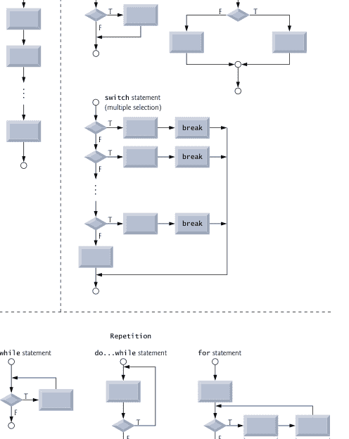

statement. Then Rule 3 is applied again to both of the rectangles in the double-selection statement, replacing each of these rectangles with double-selection statements. The dashed box around each of the double-selection statements represents the rectangle that was replaced in the original flowchart.

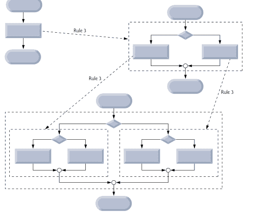

**图 4.21** | 对最简单的流程图应用图 4.18 的规则 3。

Rule 4 generates larger, more involved, and more deeply nested structures. The flowcharts that emerge from applying the rules in Fig. 4.18 constitute the set of all possible structured flowcharts and hence the set of all possible structured programs.

It's because of the elimination of the `goto` statement that building blocks never overlap one another. The beauty of the structured approach is that we use only a small number of simple single-entry/single-exit pieces, and we assemble them in only two simple ways. Figure 4.22 shows the kinds of stacked building blocks that emerge from applying Rule 2 and the kinds of nested building blocks that emerge from applying Rule 3. The figure also shows the kind of overlapped building blocks that cannot appear in structured flowcharts (because of the elimination of the `goto` statement).

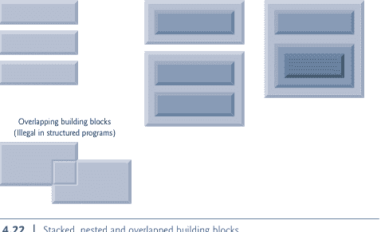

**图 4.22** | 堆叠、嵌套和重叠的构建块。

If the rules in Fig. 4.18 are followed, an unstructured flowchart (such as that in Fig. 4.23) cannot be created. If you're uncertain whether a particular flowchart is structured, apply the rules of Fig. 4.18 in reverse to try to reduce the flowchart to the simplest flowchart. If you succeed, the original flowchart is structured; otherwise, it's not.

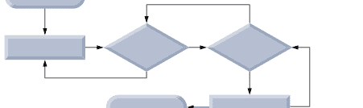

**图 4.23** | 一个非结构化流程图。

Structured programming promotes simplicity. Bohm and Jacopini showed that only three forms of control are needed:

- Sequence
- Selection
- Iteration

Sequence is straightforward. Selection is implemented in one of three ways:

- if statement (single selection)
- if...else statement (double selection)
- switch statement (multiple selection)

It’s straightforward to prove that the simple `if` statement is sufficient to provide any form of selection—everything that can be done with the `if...else` statement and the `switch` statement can be implemented with one or more `if` statements.

Iteration is implemented in one of three ways:

- while statement
- do...while statement
- for statement

It’s also straightforward to prove that the `while` statement is sufficient to provide any form of iteration. Everything that can be done with the `do...while` statement and the `for` statement can be done with the `while` statement.

Combining these results illustrates that any form of control ever needed in a C program can be expressed in terms of only three forms of control:

- sequence
- if statement (selection)
- while statement (iteration)

And these control statements can be combined in only *two ways*—*stacking* and *nesting*. Indeed, structured programming promotes simplicity.

In Chapters 3 and 4, we’ve discussed how to compose programs from control statements containing only actions and decisions. In Chapter 5, we introduce another program-structuring unit called the function. We’ll learn to compose larger programs by combining functions, which, in turn, can be composed of control statements. We’ll also discuss how using functions promotes software reusability.

### 4.11.3 安全 C 编程

**检查函数 scanf 的返回值**

Figure 4.6 used the math library function `pow`, which calculates the value of its first argument raised to the power of its second and returns the result as a `double` value. The calculation’s result was then used in the statement that called `pow`.

Many functions return values indicating whether they executed successfully. For example, function `scanf` returns an `int` indicating whether the input operation was successful. If an input failure occurs, `scanf` returns the value `EOF` (defined in `<stdio.h>`); otherwise, it returns the number of items that were read. If this value does not match the number you intended to read, then `scanf` was unable to complete the input operation.

Consider the following statement from Fig. 3.6:

```c
scanf("%d", &grade); // read grade from user
```

which expects to read one `int` value. If the user enters an integer, `scanf` returns 1 indicating that one value was indeed read. If the user enters a string, such as `"hello"`, `scanf` re-


## 第 4.4 节 for 迭代语句
- for 迭代语句处理计数控制迭代的所有细节。
- 当 for 语句开始执行时，其控制变量会被初始化。然后，检查循环继续条件。如果条件为真，则执行循环体。然后控制变量被递增，循环再次从循环继续条件开始。此过程一直持续到循环继续条件不成立为止。
- for 语句的一般格式是
  其中初始化表达式初始化（并且可能定义）控制变量，条件表达式是循环继续条件，而递增表达式递增控制变量。
- 逗号运算符（p. 150）保证表达式列表从左到右求值。整个表达式的值是最右表达式的值。
- for 语句中的三个表达式是可选的。如果省略条件表达式，C 假定条件为真，从而创建无限循环。如果控制变量在循环之前已初始化，则可以省略初始化表达式。如果递增是通过 for 语句体中的语句计算的，或者不需要递增，则可以省略递增表达式。
- for 语句中的递增表达式在 for 语句体末尾的行为就像一个独立的 C 语句。
- for 语句中的两个分号是必需的。

```
for (initialization; condition; increment) {
    statements
}
```

## 第 4.5 节 for 语句：注释和观察
- 初始化、循环继续条件和递增可以包含算术表达式。
- “递增”可能为负（在这种情况下它实际上是递减，循环实际上向下计数）。
- 如果循环继续条件初始为假，则不执行循环的主体部分。相反，执行继续执行 for 语句之后的语句。

## 第 4.6 节 使用 for 语句的示例
- 函数 pow（p. 154）执行指数运算。函数 pow(x, y) 计算 x 的 y 次幂的值。它接受两个 double 类型的参数并返回一个 double 值。
- 类型 double 是一种浮点类型，很像 float，但通常 double 类型的变量可以存储比 float 大得多的值且精度更高。
- 每当使用 pow 等数学函数时，都应包含头文件 math.h（p. 154）。
- 转换说明符 %21.2f 表示浮点值将在宽 21 个字符的字段中右对齐显示，小数点后有两位数字。
- 要在字段中左对齐值，请在 % 和字段宽度之间放置 -（减号）。

## 第 4.7 节 switch 多重选择语句
- 有时，算法会包含一系列决策，其中变量或表达式针对其可能假设的每个常量积分值分别进行测试，并采取不同的操作。这称为多重选择。C 提供了 switch 语句来处理这种情况。
- switch 语句由一系列 case 标签（p. 159）、可选的 default case 以及为每个 case 执行的语句组成。
- **getchar 函数**（来自标准输入/输出库）以 int 的形式读取并返回键盘上的一个字符。
- **字符通常存储在** 类型为 **char**（p. 157）的变量中。字符可以存储在任何整数数据类型中，因为它们通常在计算机中表示为一字节整数。因此，我们可以根据其用途将字符视为整数或字符。
- **当今许多计算机使用 ASCII**（美国信息交换标准代码；p. 158）字符集，其中 97 代表小写字母 'a'。
- **字符可以用** **scanf** 通过使用转换说明符 **%c** 来读取。
- **赋值表达式** 整体实际上 **有一个值**。这个值被赋给 = 左侧的变量。
- **赋值语句具有值这一事实** 对于将多个变量设置为相同的值很有用，例如 a = b = c = 0;。
- **EOF** 通常用作哨兵值。**EOF** 是在 <stdio.h> 中定义的符号整数常量。
- **在 Linux/UNIX 系统** 上以及许多其他系统上，**EOF** 指示符是通过键入 <Ctrl> d 输入的。在其他系统上，例如 Microsoft Windows，**EOF** 指示符可以通过键入 <Ctrl> z 输入。
- **关键字 switch** 后跟括号中的 **控制表达式**（p. 159）。该表达式的值与每个 case 标签进行比较。如果匹配，则执行该 case 的语句。如果没有匹配，则执行 **default** case。
- **break 语句** 导致程序控制继续执行 **switch** 之后的语句。**break** 语句防止 **switch** 语句中的 case 串联运行。
- **每个 case 可以有** 一个或多个操作。**switch** 语句与其他所有控制语句不同，因为在 **switch** 的 case 中多个操作不需要用大括号括起来。
- **将多个 case 标签一起列出** 只是意味着对于这些 case 中的任何一个都将发生相同的操作集。
- **请记住 switch 语句** 只能用于测试 **常量积分表达式**（p. 161）——即计算为常量积分值的字符常量和整数常量的任何组合。字符常量可以用单引号中的特定字符表示，例如 'A'。字符必须用单引号括起来才能被识别为字符常量。整数常量只是整数值。
- **除了整数类型 int 和 char 之外**，C 提供了类型 **short int**（可缩写为 **short**）和 **long int**（可缩写为 **long**），以及所有整数类型的 **unsigned** 版本。C 标准规定了每种类型的最小值范围，但实际范围可能更大，具体取决于实现。对于 **short ints**，最小范围为 −32767 到 +32767。**long ints** 的最小值范围为 −2147483647 到 +2147483647。**int** 的值范围大于或等于 **short int**，小于或等于 **long int**。在当今的许多平台上，**ints** 和 **long ints** 表示相同的数值范围。数据类型 **signed char** 可用于表示范围为 −127 到 +127 的整数或计算机字符集中的任何字符。有关有符号和无符号整数类型范围的完整列表，请参阅 C 标准文档的第 5.2.4.2 节。

## 第 4.8 节 do...while 迭代语句
- **do...while 语句** 在循环体执行 **之后** 测试循环继续条件。因此，循环体至少执行一次。当 do...while 终止时，执行继续执行 **while** 子句之后的语句。

## 第 4.9 节 break 和 continue 语句
- **break 语句**，当在 **while**、**for**、**do...while** 或 **switch** 语句中执行时，会导致立即退出该语句。程序执行继续执行下一条语句。
- continue 语句，当在 while、for 或 do...while 语句中执行时，会跳过主体中的剩余语句并执行下一次循环迭代。在 while 和 do...while 中，循环继续测试在 continue 语句执行后立即求值。在 for 中，先执行递增表达式，然后求值循环继续测试。

## 第 4.10 节 逻辑运算符
- 逻辑运算符可用于通过组合简单条件来形成复杂条件。逻辑运算符是 &&（逻辑与）、||（逻辑或）和 !（逻辑非，或逻辑否定）。
- 包含 &&（逻辑与；p. 164）运算符的条件当且仅当两个简单条件都为真时才为真。
- C 将包含关系运算符、相等运算符和/或逻辑运算符的所有表达式求值为 0 或 1。尽管 C 将真值设为 1，但它接受任何非零值作为真。
- 包含 ||（逻辑或；p. 164）运算符的条件如果一个或两个简单条件为真则为真。
- && 运算符的优先级高于 ||。两个运算符都从左到右结合。
- 包含 && 或 || 运算符的表达式仅在真假已知时才求值。
- C 提供了 !（逻辑否定；p. 164）运算符以使您能够“反转”条件的含义。与组合两个条件的二元运算符 && 和 || 不同，一元逻辑否定运算符只有一个条件作为操作数。
- 当我们有兴趣在原始条件（没有逻辑否定运算符）为假时选择执行路径时，逻辑否定运算符放在条件之前。
- 在大多数情况下，您可以通过使用适当的关系运算符以不同的方式表达条件来避免使用逻辑否定。

## 第 4.11 节 混淆相等 (==) 和赋值 (=) 运算符
- 程序员经常意外地交换运算符 ==（相等）和 =（赋值）。这些交换之所以如此有害，是因为它们通常不会导致语法错误。相反，包含这些错误的语句通常可以正确编译，允许程序运行完成，同时可能通过运行时逻辑错误生成不正确的结果。
- 您可能倾向于编写诸如 x == 7 之类的条件，变量名在左侧，常量在右侧。通过反转这些项，使常量在左侧，变量名在右侧，如 7 == x，那么如果您意外地将 == 运算符替换为 =，编译器将保护您。编译器会将其视为语法错误，因为只能将变量名放在赋值语句的左侧。
- 变量名被称为 lvalue（“左值”；p. 168），因为它们可以用在赋值运算符的左侧。
- 常量被称为 rvalue（“右值”；p. 168），因为它们只能用在赋值运算符的右侧。lvalue 也可以用作 rvalue，但反之则不行。

## 自我复习练习
### 4.1 填空以下每条语句。
- a) 计数控制迭代也称为 ______ 迭代，因为可以预先知道循环将执行多少次。
- b) 哨兵控制迭代也称为 ______ 迭代，因为事先不知道循环将执行多少次。
- c) 在计数控制迭代中，使用一个 ______ 来计算指令组应重复的次数。


```c
e) for (unsigned int x = 1; x <= 20; ++x) {
    printf("%u ", x);
    if (x % 5 == 0) {
        puts("");
    }
    else {
        printf("%s", "\t");
    }
}
```

or

```c
for (unsigned int x = 1; x <= 20; ++x) {
    if (x % 5 == 0) {
        printf("%u\n", x);
    }
    else {
        printf("%u\t", x);
    }
}
```

## 4.4

- a) 错误：`while` 头部后面的分号会导致无限循环。
  纠正：将分号替换为 `{` 或同时删除 `;` 和 `}`。

- b) 错误：使用浮点数控制 `for` 迭代语句。
  纠正：使用整数，并执行适当的计算以获得所需的数值。

```c
for (int y = 1; y <= 10; ++y) {
    printf("%f\n", (float) y / 10);
}
```

- c) 错误：第一个 `case` 的语句中缺少 `break` 语句。
  纠正：在第一个 `case` 的语句末尾添加 `break` 语句。如果希望每次执行 `case 1:` 语句时都执行 `case 2` 的语句，则这不一定是错误。

- d) 错误：`while` 迭代继续条件中使用了不正确的关系运算符。
  纠正：使用 `<=` 而不是 `<`。

## 练习

### 4.5

找出以下每项中的错误。*（注意：可能存在不止一个错误。）*

- a)

```c
for (a = 25, a < 1, a--) {
    printf("%d\n", a);
}
```

- b) 下面的代码应打印给定整数是奇数还是偶数：

```c
switch (value) {
    case (value % 2 == 0):
        puts("Even integer");
    case (value % 2 == 1):
        puts("Odd integer");
}
```

- c) 下面的代码应计算 10 年后的递增薪水：

```c
for (int year = 1; year <= 10; ++year) {
    double salary += salary * 0.05;
}
```

```c
printf("%4u%21.2f\n", year, salary);
```

- d)

```c
for (double y = 7.11; y != 7.20; y += .01)
    printf("%7.2f\n", y);
```

- e) 下面的代码应输出 1 到 100 之间所有 3 的倍数：

```c
for (int x = 3; x <= 100; x % 3 == 0; x++) {
    printf("%d\n", x);
}
```

- f)

```c
x = 1;
while (x <= 10) {
    printf("%d\n", x);
}
```

- g) 下面的代码应求 1 到 50 所有数字的平方和（假设 `sum` 初始化为 0）：

```c
for (x = 1; x <= 50; ++x) {
    sum += x * x;
}
```

## 4.6

说明以下每个 `for` 语句打印控制变量 `x` 的哪些值：

```c
a) for (x = 20; x >= 3; x -= 3) {
    printf("%u\n", x);
}
b) for (x = 7; x <= 27; x += 5) {
    printf("%u\n", x);
}
c) for (x = 2; x <= 20; x += 4) {
    printf("%u\n", x);
}
d) for (x = 30; x >= 15; x -= 6) {
    printf("%u\n", x);
}
e) for (x = 22; x >= 2; x -= 5) {
    printf("%d\n", x);
}
```

## 4.7

编写 `for` 语句打印以下数列：

- a) 1, 3, 5, 7, 9, 11, 13
- b) 2, 5, 8, 11, 14, 17
- c) 30, 20, 10, 0, -10, -20, -30
- d) 15, 23, 31, 39, 47, 55

## 4.8

下面的程序做什么？

```c
#include <stdio.h>

int main(void)
{
    int x, i, j;

    // prompt user for input
    printf("%s", "Enter an integer in the range 1-20:");
    scanf("%d", &x); // read values for x

    for (i = 1; i <= x; i++) { // count from 1 to x
        for (j = 1; j <= x; ++j) { // count from 1 to x
            if (j == i)
                printf("%c", '@'); // output @
            else
                printf(" ");
        } // end inner for
        printf("\n");
    } // end outer for
} // end of main
```

## 4.9（整数的求和与平均值）

编写一个程序对一系列整数求和并计算其平均值。假设使用 `scanf` 读取的第一个整数指定要输入的值的数量。每次执行 `scanf` 时，程序应只读取一个值。一个典型的输入序列可能是

    7 678 234 315 489 536 456 367

其中 7 表示后续的 7 个值将被求和。

## 4.10（摄氏度到华氏度转换）

编写一个程序将 30°C 到 50°C 的温度转换为华氏温度。程序应打印一张表格，左右并列显示两种刻度的温度。 [提示：°F = 9/5 °C + 32]

## 4.11（计算倍数的和）

编写一个程序计算并打印 1 到 100 之间所有 7 的倍数的和。

## 4.12（质数）

编写一个程序计算并打印 1 到 100 之间所有质数的列表。

## 4.13（自然数算术）

编写一个程序，打印从 1 到用户输入的任意数字的所有自然数的和、平方和以及立方和。

## 4.14（阶乘）

阶乘函数在概率问题中经常使用。正整数 `n` 的阶乘（写成 `n!`，读作“n 阶乘”）等于从 1 到 `n` 的正整数的乘积。编写一个程序计算 1 到 5 的整数的阶乘。以表格格式打印结果。什么困难可能会阻止你计算 20 的阶乘？

## 4.15（修改后的复利程序）

修改第 4.6 节的复利程序，使其对 5%、6%、7%、8%、9% 和 10% 的利率重复其步骤。使用 `for` 循环改变利率。

## 4.16（三角形打印程序）

编写一个程序分别打印以下图案，一个在另一个下面。使用 `for` 循环生成图案。所有星号 (`*`) 应由单个 `printf` 语句 `printf("%s", "**");` 形式打印（这会导致星号并排打印）。 [提示：最后两个图案要求每一行以适当数量的空格开头。]

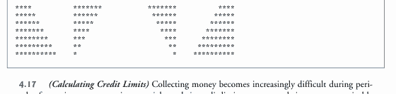

## 4.17（计算信用额度）

在经济衰退期间，收回资金变得越来越困难，因此公司可能会收紧信用额度，以防止应收账款（欠他们的钱）变得过大。作为对长期衰退的回应，一家公司将其客户的信用额度减半。因此，如果某个客户的信用额度为 $2000，现在为 $1000。如果客户的信用额度为 $5000，现在为 $2500。编写一个程序分析该公司三个客户的信用状况。对于每个客户，你得到：

- a) 客户的账号。
- b) 经济衰退前的客户信用额度。
- c) 客户的当前余额（即客户欠公司的金额）。

你的程序应计算并打印每个客户的新信用额度，并应确定（并打印）哪些客户的当前余额超过了他们的新信用额度。

## 4.18（条形图打印程序）

计算机的一个有趣应用是绘制图形和条形图。编写一个程序读取五个数字（每个在 1 到 30 之间）。对于读取的每个数字，你的程序应打印一行包含该数量的相邻星号。例如，如果程序读取数字七，它应打印 `*******`。

## 4.19（计算销售额）

一家在线零售商销售五种不同产品，其零售价如下表所示：

| Product number | Retail price |
|---|---:|
| 1 | $2.98 |
| 2 | $4.50 |
| 3 | $9.98 |
| 4 | $4.49 |
| 5 | $6.87 |

编写一个程序读取一系列数字对，如下所示：

- a) 产品编号
- b) 当日售出数量

你的程序应使用 `switch` 语句帮助确定每种产品的零售价。你的程序应计算并显示上周售出所有产品的总零售价值。

1 到 256。如果你不熟悉这些数字系统，请在尝试此练习前阅读附录 C。 [注意：你可以使用转换说明符 `%o` 和 `%x` 分别以八进制或十六进制值显示整数。]

## 4.26（计算 π 的值）

从无穷级数计算 π 的值

π = 4 - 4/3 + 4/5 - 4/7 + 4/9 - 4/11 + …

打印一张表格，显示该级数的一个项、两项、三项……近似的 π 值。你需要使用多少项该级数才能第一次得到 3.141？3.1415？3.14159？

## 4.27（毕达哥拉斯三元组）

直角三角形可以有全为整数的边。直角三角形边的三个整数值集合称为毕达哥拉斯三元组。这三个边必须满足两边平方和等于斜边平方的关系。找出 `side1`、`side2` 和斜边均不超过 500 的所有毕达哥拉斯三元组。使用三重嵌套的 `for` 循环简单地尝试所有可能性。这是一个“暴力计算”的例子。对许多人来说它在美学上并不令人愉快。但这些技术之所以重要，有很多原因。首先，随着计算能力的飞速增长，使用几年前的技术需要数年甚至数百年计算机时间才能产生的结果，现在可以在几小时、几分钟甚至几秒钟内产生。最近的微处理器芯片每秒可以处理十亿条指令！其次，正如你在更高级的计算机科学课程中将学到的那样，有大量有趣的问题，除了纯粹的暴力之外，没有已知的算法方法。我们在本书中研究许多种问题解决的方法论。我们将考虑对各种有趣问题的许多暴力方法。

## 4.28（计算周薪）

一家公司按以下方式支付员工工资：经理（获得固定周薪）、小时工（工作前 40 小时获得固定时薪，超时工作获得“加班费”，即 1.5 倍时薪）、佣金工（获得 $250 加上其周销售额的 5.7%）或计件工（为其生产的每件物品获得固定金额）——该公司每位计件工只从事一种类型的物品。编写一个程序计算每位员工的周薪。你事先不知道员工人数。每种员工类型都有自己的工资代码：经理的工资代码为 1，小时工为 2，佣金工为 3，计件工为 4。使用 `switch` 根据员工的工资代码计算每位员工的工资。在 `switch` 内部，提示用户（即工资管理员）输入程序根据员工的工资代码计算每位员工工资所需的适当信息。 [注意：你可以使用转换说明符 `%lf` 与 `scanf` 输入 `double` 类型的值。]

## 4.29（德摩根定律）

在本章中，我们讨论了逻辑运算符 `&&`、`||`、`!` 和 `1`。德摩根定律指出表达式 `!(condition1 && condition2)` 在逻辑上等价于表达式 `(!condition1 || !condition2)`。此外，表达式 `!(condition1 || condition2)` 在逻辑上等价于表达式 `(!condition1 && !condition2)`。使用德摩根定律为以下每个表达式写出等价表达式，然后编写程序证明每种情况下原始表达式和新表达式都是等价的。

- a) `!(x < 5) && !(y >= 7)`
- b) `!(a == b) || !(g != 5)`
- c) `!((x <= 8) && (y > 4))`
- d) `!((i > 4) || (j <= 6))`

## 4.30（用 if...else 替换 switch）

重写图 4.7 的程序，用嵌套的 `if...else` 语句替换 `switch` 语句；注意正确处理默认情况。然后

重写这个新版本，用一系列 if 语句替换嵌套的 if...else 语句；这里同样要小心正确处理默认情况（这比嵌套 if...else 版本更困难）。这个练习说明 switch 只是一种便利机制，任何 switch 语句都可以只用单选择语句编写。

## 4.31（菱形打印程序）

编写一个程序，打印下面的菱形。你可以使用 printf 语句打印单个星号（*）或单个空格。最大化迭代的使用（使用嵌套 for 语句），并最小化 printf 语句的数量。

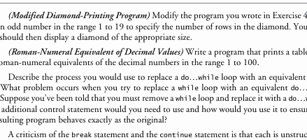

## 4.32（修改的菱形打印程序）

修改你在练习 4.31 中编写的程序，读入一个 1 到 19 范围内的奇数，以指定菱形中的行数。然后你的程序应显示一个大小合适的菱形。

## 4.33（十进制值的罗马数字等价值）

编写一个程序，打印 1 到 100 范围内所有十进制数的罗马数字等价值表。

## 4.34

描述你会用来将一个 do...while 循环替换为等价 while 循环的过程。当你尝试将一个 while 循环替换为等价 do...while 循环时，会出现什么问题？假设有人告诉你必须删除一个 while 循环并用 do...while 循环替换它。你需要使用什么额外的控制语句，以及如何使用它来确保生成的程序行为与原始程序完全一致？

## 4.35

对 break 语句和 continue 语句的一种批评是，二者都是非结构化的。实际上，break 语句和 continue 语句总是可以被结构化语句替换，尽管这样做可能很别扭。概括描述你会如何从程序中的循环里移除任何 break 语句，并用某种等价的结构化语句替换该语句。[提示：break 语句从循环体内部离开循环。另一种离开方式是不满足循环继续测试。考虑在循环继续测试中使用第二个测试，用以指示“由于‘break’条件而提前退出”。] 使用你在这里开发的技术，从图 4.11 的程序中移除 break 语句。

## 4.36 下面的程序段做什么？

```
int n = 4, a = 1;
int i, c;
for (i = 1; i <= n; i++) {

for (c = 1; c <= i; c++) {

printf("%d", a);
a++;
}
printf("\n");
}
```

## 4.37

概括描述你会如何从程序中的循环里移除任何 continue 语句，并用某种等价的结构化语句替换该语句。使用你在这里开发的技术，从图 4.12 的程序中移除 continue 语句。

## 4.38（“圣诞十二日”歌曲）编写一个程序，使用迭代和 switch 语句打印歌曲“圣诞十二日”。应使用一个 switch 语句打印日期（即“first”“second”等）。应使用另一个 switch 语句打印每一节歌词的其余部分。

## 4.39（货币金额使用浮点数的局限性）第 4.6 节提醒了在货币计算中使用浮点值的问题。试试这个实验：创建一个值为 1000000.00 的 float 变量。接着向该变量加上字面量 float 值 0.12f。使用 printf 和转换说明符 "% .2f" 显示结果。你会得到什么？

## 产生影响

## 4.40（世界人口增长）几个世纪以来，世界人口已大幅增长。持续增长最终可能挑战可呼吸空气、可饮用水、可耕地和其他有限资源的极限。有证据表明近年来增长一直在放缓，世界人口可能在本世纪某个时候达到峰值，然后开始下降。

就本练习而言，请在线研究世界人口增长问题。务必考察各种观点。获取对当前世界人口及其增长率（今年可能增加的百分比）的估计值。编写一个程序，计算未来 75 年每年世界人口的增长，采用当前增长率将保持不变的简化假设。将结果打印成表格。第一列应显示从第 1 年到第 75 年的年份。第二列应显示该年年底的预计世界人口。第三列应显示该年将发生的世界人口数值增长。利用你的结果，确定如果今年的增长率持续下去，人口将在哪一年达到今天的两倍。

## 4.41（税收方案替代方案；“FairTax”）有许多使税收更公平的提案。查看美国的 FairTax 倡议：

www.fairtax.org

研究拟议的 FairTax 如何运作。一种建议是取消所得税和大多数其他税，改为对你购买的所有产品和服务征收 23% 的消费税。一些 FairTax 反对者质疑 23% 这一数字，并说由于税额的计算方式，更准确地说税率是 30%——请仔细核查。编写一个程序，提示用户输入各个类别的支出（例如住房、服装、食品、交通、教育、医疗保健、度假），然后打印该人将支付的估计 FairTax。

## C 函数

## 5

### 目标

本章中，你将：

- 用称为函数的小块以模块化方式构建程序。
- 使用 C 标准库中的常用数学函数。
- 创建新函数。
- 使用在函数之间传递信息的机制。
- 了解函数调用/返回机制如何由函数调用栈和栈帧支持。
- 使用基于随机数生成的模拟技术。
- 编写并使用调用自身的函数。

- 5.1 引言
- 5.2 在 C 中模块化程序
- 5.3 数学库函数
- 5.4 函数
- 5.5 函数定义
- 5.5.1 square 函数
- 5.5.2 maximum 函数
- 5.6 函数原型：深入探讨
- 5.7 函数调用栈和栈帧
- 5.8 头文件
- 5.9 按值和按引用传递参数
- 5.10 随机数生成
- 5.11 示例：机会游戏；引入 enum
- 5.12 存储类
- 5.13 作用域规则
- 5.14 递归
- 5.15 使用递归的示例：斐波那契数列
- 5.16 递归与迭代
- 5.17 安全的 C 编程

小结 | 自测练习 | 自测练习答案 | 练习 | 产生影响

### 5.1 引言

解决现实世界问题的大多数计算机程序都比前几章介绍的程序大得多。经验表明，开发和维护大型程序的最佳方式是用较小的部分来构建它，每个部分都比原始程序更易于管理。这种技术称为分治法。本章介绍 C 语言的一些关键特性，这些特性有助于大型程序的设计、实现、运行和维护。

### 5.2 在 C 中模块化程序

在 C 中，函数用于模块化程序。程序通常通过将你编写的新函数与 C 标准库中可用的预打包函数组合来编写。本章讨论这两类函数。C 标准库提供了丰富的函数集合，用于执行常见数学计算、字符串操作、字符操作、输入/输出以及许多其他有用操作。这使你的工作更容易，因为这些函数提供了你所需的许多能力。

良好编程习惯 5.1
熟悉 C 标准库中丰富的函数集合。

软件工程观察 5.1
避免重新发明轮子。尽可能使用 C 标准库函数而不是编写新函数。这可以减少程序开发时间。这些函数由专家编写、经过充分测试且高效。

可移植性提示 5.1
使用 C 标准库中的函数有助于使程序更具可移植性。


C 语言和标准库都由 C 标准 *都* *规定*，并且它们都随标准 C 系统提供（除非某些库被指定为可选）。我们在前几章中使用的函数 `printf`、`scanf` 和 `pow` 都是标准库函数。

你可以编写函数来定义可能在程序的许多地方使用的特定任务。这些有时被称为程序员定义的函数。定义函数的实际语句只写 *一次*，并且这些语句对其他函数是隐藏的。

函数通过函数调用来调用，该调用指定函数名并提供信息（作为参数），函数需要这些信息来执行其指定的任务。对此的一个常见类比是管理的层级形式。主管（调用函数或调用者）要求工作人员（被调用函数）执行任务并在任务完成后报告（图 5.1）。例如，需要在屏幕上显示信息的函数会调用工作函数 `printf` 来执行该任务，然后 `printf` 显示信息并在任务完成后向调用函数报告——或返回。主管函数 *不* 知道工作函数如何执行其指定的任务。工作函数可能会调用其他工作函数，而主管对此并不知情。我们很快就会看到这种对实现细节的“隐藏”如何促进良好的软件工程。图 5.1 显示了主管函数以层级方式与多个工作函数通信的情况。请注意，Worker1 对 Worker4 和 Worker5 充当主管函数。函数之间的关系可能与该图所示的层级结构不同。

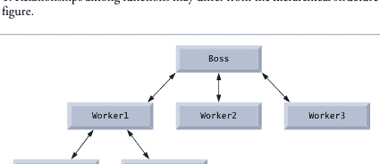

**图 5.1** | 层级化的主管函数/工作函数关系。

## 5.3 数学库函数

数学库函数允许你执行某些常见的数学计算。我们在这里使用其中的一些来介绍函数的概念。书的后面，我们将讨论 C 标准库中的许多其他函数。

函数通常在程序中通过编写函数名后跟左括号、后跟函数参数（或以逗号分隔的参数列表）、后跟右括号来使用。例如，要计算并打印 900.0 的平方根，你可能会写

```c
printf("%.2f", sqrt(900.0));
```

当此语句执行时，数学库函数 `sqrt` 被调用以计算括号中包含的数字（900.0）的平方根。数字 900.0 是 `sqrt` 函数的参数。前述语句将打印 30.0。`sqrt` 函数接受类型为 `double` 的参数并返回类型为 `double` 的结果。数学库中返回浮点值的函数都返回数据类型 `double`。请注意，`double` 值与 `float` 值一样，可以使用 `%f` 转换说明符输出。你也可以将函数调用的结果存储在变量中以供以后使用，如下所示：

```c
double result = sqrt(900.0);
```

**错误预防提示 5.1**

> 使用预处理器指令 `#include <math.h>` 包含数学头文件，以便在数学库中使用函数。

函数参数可以是常量、变量或表达式。如果 c = 13.0，d = 3.0 且 f = 4.0，则语句

```c
printf("%.2f", sqrt(c + d * f));
```

计算并打印 13.0 + 3.0 * 4.0 = 25.0 的平方根，即 5.00。

图 5.2 总结了 C 数学库函数的一个小样本。在该图中，变量 x 和 y 的类型为 `double`。C11 标准增加了广泛的浮点和复数功能。

| 函数 | 描述 | 示例 |
|---|---|---|
| sqrt(x) | x 的平方根 | sqrt(900.0) 是 30.0<br>sqrt(9.0) 是 3.0 |
| cbrt(x) | x 的立方根（仅 C99 和 C11） | cbrt(27.0) 是 3.0<br>cbrt(-8.0) 是 -2.0 |
| exp(x) | 指数函数 e^x | exp(1.0) 是 2.718282<br>exp(2.0) 是 7.389056 |
| log(x) | x 的自然对数（底为 e） | log(2.718282) 是 1.0<br>log(7.389056) 是 2.0 |
| log10(x) | x 的对数（底为 10） | log10(1.0) 是 0.0<br>log10(10.0) 是 1.0<br>log10(100.0) 是 2.0 |
| fabs(x) | x 的绝对值（作为浮点数） | fabs(13.5) 是 13.5<br>fabs(-0.0) 是 0.0<br>fabs(-13.5) 是 13.5 |
| ceil(x) | 将 x 舍入到不小于 x 的最小整数 | ceil(9.2) 是 10.0<br>ceil(-9.8) 是 -9.0 |
| floor(x) | 将 x 舍入到不大于 x 的最大整数 | floor(9.2) 是 9.0<br>floor(-9.8) 是 -10.0 |
| pow(x, y) | x 的 y 次幂（x^y） | pow(2, 7) 是 128.0<br>pow(3, 5) 是 243.0 |
| fmod(x, y) | x/y 的余数（作为浮点数） | fmod(13.657, 2.333) 是 1.992 |
| sin(x) | x 的三角正弦（x 以弧度为单位） | sin(0.0) 是 0.0 |
| cos(x) | x 的三角余弦（x 以弧度为单位） | cos(0.0) 是 1.0 |
| tan(x) | x 的三角正切（x 以弧度为单位） | tan(0.0) 是 0.0 |

**图 5.2** | 常用数学库函数。（第 1 部分和第 2 部分，共 2 部分。）

## 5.4 函数

函数允许你将程序模块化。函数定义中定义的所有变量都是局部变量——它们只能在定义它们的函数中访问。大多数函数都有一个参数列表，通过函数调用中的参数在函数之间提供通信信息的方式。函数的参数也是该函数的局部变量。

> **软件工程观察 5.2**
> *在包含许多函数的程序中，main 通常被实现为对执行程序大部分工作的函数的调用组。*

对程序进行“功能化”有几个动机。分而治之的方法使程序开发更易于管理。另一个动机是软件可重用性——使用现有函数作为构建块来创建新程序。软件可重用性是面向对象编程运动中的一个主要因素，你将在学习派生自 C 的语言（如 C++、Objective-C、Java、C#（读作“C sharp”）和 Swift）时了解更多相关内容。凭借良好的函数命名和定义，程序可以从完成特定任务的标准函数创建，而不是使用自定义代码构建。这被称为抽象。我们每次使用标准库函数如 `printf`、`scanf` 和 `pow` 时都使用抽象。第三个动机是避免在程序中重复代码。将代码打包为函数允许它仅通过调用函数从程序的其他位置执行。

> **软件工程观察 5.3**
> *每个函数应仅限于执行单一、明确定义的任务，并且函数名应表达该任务。这有助于抽象并促进软件可重用性。*

> **软件工程观察 5.4**
> *如果你无法选择一个简洁的名称来表达函数的功能，那么你的函数可能试图执行太多不同的任务。通常最好将此类函数分解为更小的函数——这有时称为分解。*

## 5.5 函数定义

我们迄今为止介绍的每个程序都包含一个名为 `main` 的函数，该函数调用标准库函数来完成其任务。我们现在考虑如何编写自定义函数。

### 5.5.1 square 函数

考虑一个使用函数 `square` 计算并打印 1 到 10 的整数的平方的程序（图 5.3）。

```c
// Fig. 5.3: fig05_03.c
// Creating and using a programmer-defined function.
#include <stdio.h>

int square(int y); // function prototype

int main(void)
{
    // loop 10 times and calculate and output square of x each time
    for (int x = 1; x <= 10; ++x) {
        printf("%d ", square(x)); // function call
    }
    puts("");
}

// square function definition returns the square of its parameter
int square(int y) // y is a copy of the argument to the function
{
    return y * y; // returns the square of y as an int
}
```

```text
1  4  9  16  25  36  49  64  81  100
```

**图 5.3** | 创建和使用程序员定义的函数。

### 调用函数 square

函数 `square` 在 `main` 中的 `printf` 语句内被调用或调用（第 11 行）

```c
printf("%d ", square(x)); // function call
```

函数 `square` 在参数 y 中接收参数 x 值的副本（第 18 行）。然后 `square` 计算 y * y 并将结果传回 `main` 中 `square` 被调用的位置（第 11 行）。第 11 行继续将平方结果传递给函数 `printf`，后者将结果显示在屏幕上。此过程重复 10 次——`for` 语句的每次迭代一次。

### square 函数定义

函数 `square` 的定义（第 18–21 行）显示 `square` 期望一个整数参数 y。函数名之前（第 18 行）的关键字 `int` 表示 `square` 返回一个整数结果。`square` 中的 `return` 语句将表达式 y * y 的值（即计算结果）传回调用函数。

### square 函数原型

第 5 行

```c
int square(int y); // function prototype
```

是一个函数原型（也称为函数声明）。圆括号中的 int 告知编译器 square 期望从调用者处接收一个整数值。函数名 square 左侧的 int 告知编译器 square 向调用者返回一个整数结果。编译器将第 11 行对 square 的调用与该函数原型进行比较，以确保：
- 实参的数量正确，
- 实参的类型正确，
- 实参类型的顺序正确，并且
- 返回类型与调用该函数的上下文一致。

函数原型将在 5.6 节中详细讨论。

## 函数定义的格式

函数定义的格式为

```
return-value-type function-name(parameter-list)
{
    statements
}
```

function-name 是任意有效标识符。return-value-type 是返回给调用者的结果的数据类型。return-value-type 为 void 表示函数不返回值。return-value-type、function-name 和 parameter-list 一起有时称为函数头。

## 错误预防提示 5.2

检查那些应当返回值的函数确实返回了值。检查那些不应当返回值的函数确实没有返回值。

参数列表是一个以逗号分隔的列表，指定函数在被调用时接收的形参。如果函数不接收任何值，则参数列表为 void。每个形参都必须显式列出类型。

## 常见编程错误 5.1

将同一类型的函数形参指定为 double x, y 而不是 double x, double y 会导致编译错误。

## 常见编程错误 5.2

在函数定义中包围参数列表的右括号后放置分号是语法错误。

## 常见编程错误 5.3

在函数中将形参重新定义为局部变量是编译错误。

## 良好编程习惯 5.2

虽然这样做并不算错，但不要为函数的实参和函数定义中对应的形参使用相同名称。这有助于避免歧义。

## 函数体

花括号内的*语句*构成函数体，函数体也是一个*块*。变量可以在任何块中声明，块可以嵌套（但函数不能嵌套）。

**常见编程错误 5.4**
*在另一个函数内部定义函数是语法错误。*

**良好编程习惯 5.3**
*选择有意义的函数名和有意义的形参名，能使程序更易读，并有助于避免过度使用注释。*

**软件工程观察 5.5**
*小型函数有助于提高软件可重用性。*

**软件工程观察 5.6**
*程序应当编写为小型函数的集合。这使程序更易于编写、调试、维护和修改。*

**软件工程观察 5.7**
*需要大量形参的函数可能执行了过多任务。考虑将该函数划分为执行各个单独任务的较小函数。如果可能，函数头应当能在一行内放下。*

**软件工程观察 5.8**
*函数原型、函数头和函数调用应在实参和形参的数量、类型和顺序上，以及返回值的类型上全部一致。*

## 从函数返回控制

从被调用函数将控制返回到调用该函数的位置有三种方式。如果函数*不*返回结果，则当到达函数结尾的右花括号时，或者通过执行以下语句，控制就会返回：

```c
return;
```

如果函数*确实*返回结果，则语句

```c
return expression;
```

将*表达式*的值返回给调用者。

## main 的返回类型

注意，*main* 的返回类型是 *int*。*main* 的返回值用于指示程序是否正确执行。在早期版本的 C 中，我们会显式放置

```c
return 0;
```

在 *main* 末尾——*0* 表示程序成功运行。C 标准指出，如果省略前面的语句，*main* 会隐式返回 *0*——正如本书通篇所做的那样。你可以从 *main* 显式返回非零值，以指示

输入三个整数：47 32 14
最大值为：47

输入三个整数：35 8 79
最大值为：79

图 5.4 | 求三个整数中的最大值。（第 2 部分，共 2 部分。）

该函数最初假定其第一个实参（存储在形参 x 中）是最大值，并将其赋给 max（第 25 行）。接下来，第 27–29 行的 if 语句判断 y 是否大于 max，如果是，则将 y 赋给 max。然后，第 31–33 行的 if 语句判断 z 是否大于 max，如果是，则将 z 赋给 max。最后，第 35 行将 max 返回给调用者。

## 5.6 函数原型：深入探讨

C 的一个重要特性是函数原型，它借自 C++。编译器使用函数原型来验证函数调用。标准之前的 C 不执行这类检查，因此可能以不正确的方式调用函数，而编译器检测不到错误。此类调用可能导致致命的执行时错误，或导致难以检测的细微问题的非致命错误。函数原型纠正了这一缺陷。

> **良好编程习惯 5.4**
> 为所有函数包含函数原型，以利用 C 的类型检查能力。使用 #include 预处理指令从相应库的头文件中获取标准库函数的函数原型，或获取包含你本人和/或你的小组成员开发的函数的函数原型的头文件。

图 5.4（第 5 行）中 maximum 的函数原型为

```
int maximum(int x, int y, int z); // function prototype
```

它表明 maximum 接收三个 int 类型的实参，并返回一个 int 类型的结果。注意，该函数原型与 maximum 定义的第一行相同。

> **良好编程习惯 5.5**
> 为了文档说明目的，在函数原型中包含形参名。编译器会忽略这些名称，因此原型 int maximum(int, int, int); 是有效的。

> **常见编程错误 5.5**
> 忘记在函数原型末尾加分号是语法错误。

## 编译错误

与函数原型不匹配的函数调用是编译错误。如果函数原型与函数定义不一致，也会产生错误。例如，在图 5.4 中，如果函数原型写成

```
void maximum(int x, int y, int z);
```

编译器将产生错误，因为函数原型中的 void 返回类型与函数头中的 int 返回类型不同。

## 实参强制转换与“通常的算术转换规则”

函数原型的另一个重要特性是实参强制转换，即强制将实参转换为适当的类型。例如，数学库函数 sqrt 可以用整数实参调用，即使 <math.h> 中的函数原型指定的是 double 形参，该函数仍能正确工作。语句

```c
printf("%.3f\n", sqrt(i));
```

会正确计算 sqrt(4) 并打印出 2.000。函数原型会使编译器在将 int 值 4 的副本传递给 sqrt 之前，将其转换为 double 值 4.0。通常，与函数原型中的形参类型不完全对应的实参值会在函数被调用之前转换为正确的类型。如果不遵循 C 的通常算术转换规则，这些转换可能会导致错误的结果。这些规则规定了如何在不丢失数据的情况下将值转换为其他类型。在我们的 sqrt 示例中，int 会自动转换为 double，而不会改变其值（因为 double 能表示的值范围比 int 大得多）。然而，将 double 转换为 int 会截断 double 的小数部分，从而改变原值。将大整数类型转换为小整数类型（例如，将 long 转换为 short）也可能导致值改变。

通常的算术转换规则会自动应用于包含两种数据类型值的表达式（也称为混合类型表达式），并由编译器处理。在混合类型表达式中，编译器会为需要转换的值创建一个临时副本，然后将该副本转换为表达式中“最高”的类型——这称为提升。对于至少包含一个浮点值的混合类型表达式，通常的算术转换规则如下：
- 如果其中一个值是 `long double`，则另一个值会转换为 `long double`。
- 如果其中一个值是 `double`，则另一个值会转换为 `double`。
- 如果其中一个值是 `float`，则另一个值会转换为 `float`。

如果混合类型表达式只包含整数类型，那么通常的算术转换会指定一组整数提升规则。在大多数情况下，图 5.5 中位置较低的整数类型会转换为图中位置较高的类型。C 标准文档第 6.3.1 节规定了算术操作数和通常算术转换规则的完整细节。图 5.5 列出了浮点与整数数据类型，以及每种类型的 printf 和 scanf 转换说明符。

| 数据类型 | printf 转换说明符 | scanf 转换说明符 |
| --- | --- | --- |
| *浮点类型* | | |
| long double | `%Lf` | `%Lf` |
| double | `%f` | `%lf` |
| float | `%f` | `%f` |

图 5.5 | 算术数据类型及其转换说明符。（第 1 部分，共 2 部分。）


| 数据类型 | `printf` 转换说明符 | `scanf` 转换说明符 |
|---|---|---|
| *整数类型* |  |  |
| `unsigned long long int` | `%llu` | `%llu` |
| `long long int` | `%lld` | `%lld` |
| `unsigned long int` | `%lu` | `%lu` |
| `long int` | `%ld` | `%ld` |
| `unsigned int` | `%u` | `%u` |
| `int` | `%d` | `%d` |
| `unsigned short` | `%hu` | `%hu` |
| `short` | `%hd` | `%hd` |
| `char` | `%c` | `%c` |

**图 5.5** 算术数据类型及其转换说明符。 (第 2 部分，共 2 部分。)

一个值只能通过显式地将该值赋给较低类型的变量或使用 *强制转换* 运算符来转换为 *较低类型*。函数调用中的参数会根据函数原型中指定的参数类型进行转换，就好像参数被直接赋给这些类型的变量一样。如果我们的 square 函数使用 int 参数（图 5.3）被调用时传入浮点参数，则参数会被转换为 int（一种较低类型），并且 square 通常会返回错误的值。例如，`square(4.5)` 返回 16，而不是 20.25。

> **常见编程错误 5.6**
> 
> *在提升层级中从较高数据类型转换为较低类型可能会改变数据值。许多编译器在这种情况下会发出警告。*

如果函数没有函数原型，编译器会使用函数的第一次出现——函数定义或函数调用——来形成自己的函数原型。这通常会导致警告或错误，具体取决于编译器。

> **错误预防提示 5.3**
> 
> *始终为程序中定义或使用的函数包含函数原型，以帮助防止编译错误和警告。*

> **软件工程观察 5.9**
> 
> *放置在任何函数定义之外的函数原型适用于文件中的函数原型之后出现的所有函数调用。放置在函数体内的函数原型仅适用于该函数中进行的调用。*

### 5.7 函数调用栈和栈帧

要了解 C 如何执行函数调用，我们首先需要考虑一种称为 *栈* 的数据结构（即相关数据项的集合）。把栈想象成类似于一个

操作系统（即，转移到返回地址 R1）并包含 main 的自动变量（即 a，其初始化为 10）的空间。

```c
1 // Fig. 5.6: fig05_06.c
2 // Demonstrating the function call stack
3 // and stack frames using a function square.
4 #include <stdio.h>
5
6 int square(int); // prototype for function square
7
8 int main()
9 {
10     int a = 10; // value to square (local automatic variable in main)
11
12     printf("%d squared: %d\n", a, square(a)); // display a squared
13 }
14
15 // returns the square of an integer
16 int square(int x) // x is a local variable
17 {
18     return x * x; // calculate square and return result
19 }
```

10 的平方：100

**图 5.6** 使用 square 函数演示函数调用栈和栈帧。

### 步骤 1：操作系统调用 main 执行应用程序

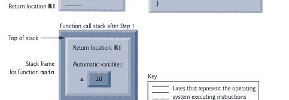

**图 5.7** 操作系统调用 main 执行程序后的函数调用栈。

函数 main——在返回操作系统之前——现在在图 5.6 的第 12 行调用函数 square。这会导致 square 的栈帧（第 16–19 行）被压入函数调用栈（图 5.8）。该栈帧包含 square 需要返回到 main 的返回地址（即 R2）以及 square 的自动变量（即 x）的内存。

### 步骤 2：main 调用函数 square 执行计算

```c
int main()
{
    int a = 10;
    printf("%d squared: %d\n", a, square(a));
}
```

```c
int square(int x)
{
    return x * x;
}
```

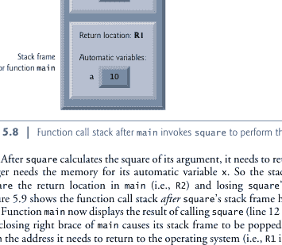

**图 5.8** main 调用 square 执行计算后的函数调用栈。

在 square 计算其参数的平方后，它需要返回到 main——并且不再需要其自动变量 x 的内存。因此栈被弹出——给 square main 中的返回位置（即 R2）并丢失 square 的自动变量。图 5.9 显示了在 square 的栈帧被弹出后函数调用栈。函数 main 现在显示调用 square 的结果（图 5.6 中的第 12 行）。到达 main 的闭合右大括号会导致其栈帧从栈中弹出，给 main 它返回到操作系统的地址（即图 5.7 中的 R1）并导致 main 的自动变量（即 a）的内存变得不可用。你现在已经看到了栈数据结构在实现支持程序执行的关键机制方面的价值。数据结构在计算机科学中有许多重要的应用。我们在第 12 章中讨论栈、队列、列表、树和其他数据结构。

| 标头 | 说明 |
|---|---|
| `<math.h>` | 包含数学库函数的函数原型。 |
| `<setjmp.h>` | 包含允许绕过通常的函数调用和返回序列的函数的函数原型。 |
| `<signal.h>` | 包含处理程序执行期间可能出现的各种条件的函数原型和宏。 |
| `<stdarg.h>` | 定义用于处理参数数量和类型未知的函数的参数列表的宏。 |
| `<stddef.h>` | 包含 C 用于执行计算的常用类型定义。 |
| `<stdio.h>` | 包含标准输入/输出库函数的函数原型以及它们使用到的信息。 |
| `<stdlib.h>` | 包含数字到文本和文本到数字的转换、内存分配、随机数和其他实用函数的函数原型。 |
| `<string.h>` | 包含字符串处理函数的函数原型。 |
| `<time.h>` | 包含用于操作时间和日期的函数原型和类型。 |

**图 5.10** 一些标准库头文件。 (第 2 部分，共 2 部分。)

你可以创建自定义头文件。程序员定义的头文件也应使用 .h 文件名扩展名。程序员定义的头文件可以通过使用 #include 预处理器指令来包含。例如，如果我们的 square 函数的原型位于头文件 square.h 中，我们将通过在程序顶部使用以下指令来包含该头文件：

```c
#include "square.h"
```

第 13.2 节介绍了有关包含头文件的其他信息，例如为什么程序员定义的头文件用引号 (" ) 而不是尖括号 (<>) 括起来。

### 5.9 按值传递参数和按引用传递参数

在许多编程语言中，有两种传递参数的方式——按值传递和按引用传递。当参数按值传递时，参数值的副本会被制作并传递给被调用函数。对副本的更改不会影响调用方中原始变量的值。当参数按引用传递时，调用方允许被调用函数修改原始变量的值。

按值传递应在被调用函数不需要修改调用方原始变量值时使用。这可以防止那些极大地阻碍正确可靠软件系统开发的意外副作用（变量修改）。按引用传递应仅与需要修改原始变量的可信被调用函数一起使用。

在 C 中，所有参数都是按值传递的。正如我们将在第 7 章 C 指针中看到的那样，可以通过使用地址运算符和间接运算符来实现按引用传递。在第 6 章中，我们将看到出于性能原因，数组参数会自动按引用传递。我们将在第 7 章看到这并不是矛盾的。现在，我们集中讨论按值传递。

|   |   |   |   |   |
|---|---|---|---|---|
| 6 | 6 | 5 | 5 | 6 |
| 6 | 1 | 1 | 5 | 3 |
| 6 | 6 | 2 | 4 | 2 |
| 6 | 2 | 3 | 4 | 1 |

**图 5.11** 由 `1 + rand() % 6` 产生的平移、缩放随机整数。 (第 2 部分，共 2 部分。)

函数 `rand` 的函数原型在 `<stdlib.h>` 中。我们使用余数运算符 (`%`) 与 `rand` 结合使用如下

```c
rand() % 6
```

以产生 0 到 5 范围内的整数。这称为缩放。数字 6 称为缩放因子。然后我们通过将 1 加到之前的结果来平移产生数字的范围。输出证实结果在 1 到 6 的范围内——实际选择的随机值可能会因编译器而异。

### 掷六面骰子 60,000,000 次

为了表明这些数字大致以相等的可能性出现，让我们使用图 5.12 的程序模拟掷骰子 60,000,000 次。每个 1 到 6 的整数应大约出现 10,000,000 次。

```c
 1  // Fig. 5.12: fig05_12.c
 2  // Rolling a six-sided die 60,000,000 times.
 3  #include <stdio.h>
 4  #include <stdlib.h>
 5
 6  int main(void)
 7  {
 8      unsigned int frequency1 = 0; // rolled 1 counter
 9      unsigned int frequency2 = 0; // rolled 2 counter
10      unsigned int frequency3 = 0; // rolled 3 counter
11      unsigned int frequency4 = 0; // rolled 4 counter
12      unsigned int frequency5 = 0; // rolled 5 counter
13      unsigned int frequency6 = 0; // rolled 6 counter
14
15      // loop 60000000 times and summarize results
16      for (unsigned int roll = 1; roll <= 60000000; ++roll) {
17          int face = 1 + rand() % 6; // random number from 1 to 6
18
19          // determine face value and increment appropriate counter
20          switch (face) {
21
22              case 1: // rolled 1
23                  ++frequency1;
24                  break;
25
26              case 2: // rolled 2
27                  ++frequency2;
28                  break;
```

**图 5.12** 掷六面骰子 60,000,000 次。 (第 1 部分，共 2 部分。)


```
case 3: // rolled 3
    ++frequency3;
    break;

case 4: // rolled 4
    ++frequency4;
    break;

case 5: // rolled 5
    ++frequency5;
    break;

case 6: // rolled 6
    ++frequency6;
    break; // optional
}
}

// display results in tabular format
printf("%s%13s\n", "Face", "Frequency");
printf("1%13u\n", frequency1);
printf("2%13u\n", frequency2);
printf("3%13u\n", frequency3);
printf("4%13u\n", frequency4);
printf("5%13u\n", frequency5);
printf("6%13u\n", frequency6);
}
```

| 面 | 频率 |
|------|-----------|
| 1 | 9999294 |
| 2 | 10002929 |
| 3 | 9995360 |
| 4 | 10000409 |
| 5 | 10005206 |
| 6 | 9996802 |

图 5.12 | 掷六面骰子 60,000,000 次。(第 2 部分，共 2 部分。)

正如程序输出所示，通过缩放和偏移，我们已使用 rand 函数真实地模拟了掷六面骰子。请注意使用 %s 转换说明符来打印字符字符串 "Face" 和 "Frequency" 作为列标题（第 49 行）。在第 6 章学习数组后，我们将展示如何优雅地用单行语句替换这 26 行 switch 语句。

## 随机化随机数生成器

再次执行图 5.11 的程序会产生

|   |   |   |   |   |
|---|---|---|---|---|
|6|6|5|5|6|
|5|1|1|5|3|
|6|6|2|4|2|
|6|2|3|3|4|

请注意完全相同的数值序列被打印出来。这些怎么可能是随机数呢？具有讽刺意味的是，这种可重复性是 rand 函数的一个重要特性。在调试程序时，这种可重复性对于证明对程序的修正工作正常至关重要。

rand 函数实际上生成伪随机数。重复调用 rand 会产生一个看起来随机的数字序列。然而，每次程序执行时序列都会重复。一旦程序经过彻底调试，就可使其在每次执行时产生不同的随机数序列。这称为随机化，并通过标准库函数 srand 实现。srand 函数接受一个 unsigned int 参数，并为 rand 函数播种，以便在程序每次执行时产生不同的随机数序列。

我们在图 5.13 中演示了 srand 函数。转换说明符 %u 用于用 scanf 读取 unsigned int 值。srand 的函数原型在 <stdlib.h> 中找到。

```
// Fig. 5.13: fig05_13.c
// Randomizing the die-rolling program.
#include <stdlib.h>
#include <stdio.h>

int main(void)
{
    unsigned int seed; // number used to seed the random number generator

    printf("%s", "Enter seed: ");
    scanf("%u", &seed); // note %u for unsigned int

    srand(seed); // seed the random number generator

    // loop 10 times
    for (unsigned int i = 1; i <= 10; ++i) {

        // pick a random number from 1 to 6 and output it
        printf("%10d", 1 + (rand() % 6));

        // if counter is divisible by 5, begin a new line of output
        if ((i % 5) == 0) {
            puts("");
        }
    }
}
```

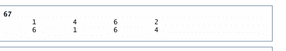


图 5.13 | 随机化掷骰子程序。(第 I 部分，共 2 部分。)

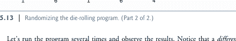

## 图 5.13 | 随机化掷骰子程序。(第 2 部分，共 2 部分。)

让我们多次运行程序并观察结果。请注意，只要提供不同的种子，每次运行程序时都会得到不同的随机数序列。第一个和最后一个输出使用相同的种子值，因此显示相同的结果。

每次随机化而不每次输入种子时，使用类似以下语句

```
srand(time(NULL));
```

这会导致计算机读取其时钟以自动获取种子的值。time 函数返回自 1970 年 1 月 1 日午夜以来经过的秒数。该值被转换为无符号整数并用作随机数生成器的种子。time 的函数原型在 <time.h> 中。我们将在第 7 章中更多地谈论 NULL。

## 随机数的广义缩放和偏移

rand 直接产生的值始终在以下范围内：

```
0 ≤ rand() ≤ RAND_MAX
```

如你所知，以下语句模拟掷六面骰子：

```
face = 1 + rand() % 6;
```

## 5.11 示例：一个机会游戏；介绍 enum

最受欢迎的机会游戏之一是被称为 "craps" 的骰子游戏，它在世界各地的赌场和后巷中都有玩。游戏规则很简单：

> 玩家掷两颗骰子。每颗骰子有六个面。这些面包含 1、2、3、4、5 和 6 个点。骰子静止后，两个朝上面点的点数之和为

~~~c
45   // while game not complete
46   while (CONTINUE == gameStatus) { // player should keep rolling
47       sum = rollDice(); // roll dice again
48
49       // determine game status
50       if (sum == myPoint) { // win by making point
51           gameStatus = WON;
52       }
53       else {
54           if (7 == sum) { // lose by rolling 7
55               gameStatus = LOST;
56           }
57       }
58   }
59
60   // display won or lost message
61   if (WON == gameStatus) { // did player win?
62       puts("Player wins");
63   }
64   else { // player lost
65       puts("Player loses");
66   }
67 }
68
69 // roll dice, calculate sum and display results
70 int rollDice(void)
71 {
72     int die1 = 1 + (rand() % 6); // pick random die1 value
73     int die2 = 1 + (rand() % 6); // pick random die2 value
74
75     // display results of this roll
76     printf("Player rolled %d + %d = %d\n", die1, die2, die1 + die2);
77     return die1 + die2; // return sum of dice
78 }
~~~

**图 5.14** | 模拟 craps 游戏。(第 2 部分，共 2 部分。)

*第一次掷骰玩家获胜*

~~~
Player rolled 5 + 6 = 11
Player wins
~~~

*随后掷骰玩家获胜*

~~~
Player rolled 4 + 1 = 5
Point is 5
Player rolled 6 + 2 = 8
Player rolled 2 + 1 = 3
Player rolled 3 + 2 = 5
Player wins
~~~

**图 5.15** | craps 游戏的示例运行。(第 1 部分，共 2 部分。)

## 第一次掷骰玩家失败

```
Player rolled 1 + 1 = 2
Player loses
```

## 随后掷骰玩家失败

```
Player rolled 6 + 4 = 10
Point is 10
Player rolled 3 + 4 = 7
Player loses
```

图 5.15 | craps 游戏的示例运行。(第 2 部分，共 2 部分。)

在游戏规则中，注意玩家必须在第一次掷骰时掷两颗骰子，并在随后的所有掷骰中都必须这样做。我们定义 rollDice 函数来掷骰子并计算和打印其点数之和。rollDice 函数只定义一次，但在程序中有两个地方调用它（第 19 行和第 47 行）。该函数不接受参数，因此我们在参数列表（第 70 行）和函数原型中标明了 void。rollDice 函数确实返回两颗骰子的点数之和，因此在函数头和函数原型中标明了 int 返回类型。

## 枚举

游戏相当复杂。玩家可能在第一次掷骰时获胜或失败，也可能在任何随后的掷骰中获胜或失败。变量 gameStatus 被定义为一种新类型——enum Status——存储当前状态。第 8 行创建了一个程序员定义的类型，称为枚举。枚举由关键字 enum 引入，是一组由标识符表示的整数常量。枚举常量有助于使程序更易读且更易维护。enum 中的值从 0 开始并递增 1。在第 8 行，常量 CONTINUE 的值为 0，WON 的值为 1，LOST 的值为 2。也可以为 enum 中的每个标识符分配整数值（参见第 10 章）。枚举中的标识符必须是唯一的，但值可以重复。

## 常见编程错误 5.7

> 在枚举常量定义后为其赋值是语法错误。

## 良好的编程实践 5.6

> 在枚举常量的名称中仅使用大写字母，以便在程序中使这些常量突出，并表明枚举常量不是变量。

当游戏获胜时，无论是在第一次掷骰还是在随后的掷骰中，gameStatus 都被设置为 WON。当游戏失败时，无论是在第一次掷骰还是在随后的掷骰中，gameStatus 都被设置为 LOST。否则 gameStatus 被设置为 CONTINUE，游戏继续。

## 游戏在第一次掷骰时结束

在第一次掷骰后，如果游戏结束，则 while 语句（第 46–58 行）将被跳过，因为 gameStatus 不是 CONTINUE。程序继续执行第 61–66 行的 if...else 语句，如果 gameStatus 为 WON 则打印 "Player wins"，否则打印 "Player loses"。


### 游戏在后续掷骰中结束

第一次掷骰后，如果游戏尚未结束，则将 sum 保存在 myPoint 中。由于 gameStatus 为 CONTINUE，执行继续进入 while 语句。每次执行 while 循环时，都会调用 roll1Dice 生成新的 sum。如果 sum 与 myPoint 匹配，则将 gameStatus 设置为 WON，表示玩家获胜，while 测试失败，if...else 语句打印 "Player wins"，然后执行终止。如果 sum 等于 7（第 54 行），则将 gameStatus 设置为 LOST，表示玩家失败，while 测试失败，if...else 语句打印 "Player loses"，然后执行终止。

### 控制架构

注意该程序有趣的控制架构。我们使用了两个函数——main 和 roll1Dice——以及 switch、while、嵌套 if...else 和嵌套 if 语句。在本章练习中，我们将研究 craps 游戏的各种有趣特性。

## 5.12 存储类

在第 2～4 章中，我们使用标识符作为变量名。变量的属性包括名称、类型、大小和值。本章中，我们还使用标识符作为用户定义函数的名称。实际上，程序中的每个标识符还具有其他属性，包括存储类、存储持续时间、作用域和链接。

C 提供了存储类说明符 auto、register、¹ extern 和 static。² 标识符的存储类决定其存储持续时间、作用域和链接。标识符的存储持续时间是指该标识符在内存中存在的时期。有些短暂存在，有些被反复创建和销毁，还有一些在整个程序执行期间都存在。标识符的作用域是指该标识符在程序中可被引用的位置。有些可在整个程序中引用，有些只能在程序的某些部分引用。标识符的链接决定在多源文件程序中，该标识符是仅在当前源文件中已知，还是在任何具有适当声明的源文件中已知。本节讨论存储类和存储持续时间。5.13 节讨论作用域。第 14 章讨论标识符链接和多源文件编程。

存储类说明符可分为自动存储持续时间和静态存储持续时间。关键字 auto 用于声明具有自动存储持续时间的变量。具有自动存储持续时间的变量在程序控制进入定义它们的块时创建；它们在块活动期间存在，并在程序控制退出该块时销毁。

### 局部变量

只有变量可以具有自动存储持续时间。函数的局部变量（在参数列表或函数体中声明的变量）通常具有自动存储持续时间。关键字 auto 显式声明具有自动存储持续时间的变量。局部变量默认具有自动存储持续时间，因此关键字 auto 很少使用。在本文余下部分，我们将把具有自动存储持续时间的变量简称为自动变量。

### 性能提示 5.1

自动存储是一种节省内存的方式，因为自动变量只在需要时存在。它们在进入函数时创建，在退出函数时销毁。

### 静态存储类

关键字 extern 和 static 用于声明具有静态存储持续时间的变量和函数标识符。具有静态存储持续时间的标识符从程序开始执行时存在，直到程序终止。对于静态变量，存储仅在程序开始执行前分配和初始化一次。对于函数，函数名在程序开始执行时即存在。然而，尽管这些变量和函数名从程序执行开始时就存在，这并不意味着这些标识符可在整个程序中访问。存储持续时间和作用域（名称可使用的位置）是相互独立的问题，我们将在 5.13 节看到。

具有静态存储持续时间的标识符有几种类型：外部标识符（如全局变量和函数名）以及使用存储类说明符 static 声明的局部变量。全局变量和函数名默认属于存储类 extern。全局变量通过将变量声明放在任何函数定义之外来创建，并且它们在整个程序执行期间保留其值。全局变量和函数可由文件中其声明或定义之后的任何函数引用。这是使用函数原型的原因之一——当我们在调用 printf 的程序中包含 stdio.h 时，函数原型被放在文件开头，以使 printf 这个名称对该文件其余部分已知。

### 软件工程观察 5.10

将变量定义为全局变量而非局部变量，会在不需要访问该变量的函数意外或恶意修改它时导致意外的副作用。通常应避免使用全局变量，除非在某些具有独特性能要求的情况下（如第 14 章所讨论）。

### 软件工程观察 5.11

仅在特定函数中使用的变量应定义为该函数中的局部变量，而不是外部变量。

使用关键字 static 声明的局部变量仍然仅在其定义所在的函数中已知，但与自动变量不同，静态局部变量在函数退出时保留其值。下次调用该函数时，静态局部变量包含函数上次退出时的值。以下语句将局部变量 count 声明为 static 并将其初始化为 1。

```
static int count = 1;
```

如果你没有显式初始化，所有具有静态存储持续时间的数值变量默认初始化为零。

当关键字 extern 和 static 显式应用于外部标识符时具有特殊含义。第 14 章讨论 extern 和 static 与外部标识符及多源文件程序的显式使用。

## 5.13 作用域规则

标识符的作用域是程序中可引用该标识符的部分。例如，当我们在块中定义局部变量时，只能在该块中其定义之后或嵌套于该块的块中引用它。四种标识符作用域是函数作用域、文件作用域、块作用域和函数原型作用域。

标号（后跟冒号的标识符，如 start:）是唯一具有函数作用域的标识符。标号可在其出现的函数中的任何位置使用，但不能在函数体之外引用。标号用于 switch 语句（作为 case 标号）和 goto 语句（见第 14 章）。标号在其定义所在的函数中是隐藏的。这种隐藏——更正式地称为信息隐藏——是实现最小权限原则的一种方式，而最小权限原则是良好软件工程的一项基本原则。在应用程序的上下文中，该原则规定，只应授予代码完成其指定任务所需的权限和访问量，而不应授予更多。

在任何函数之外声明的标识符具有文件作用域。此类标识符从声明点起直到文件末尾，在所有函数中都是“已知的”（即可访问的）。全局变量、函数定义和放在函数之外的函数原型都具有文件作用域。

在块内定义的标识符具有块作用域。块作用域在块的终止右花括号 } 处结束。在函数开头定义的局部变量具有块作用域，函数参数也是如此，函数将这些参数视为局部变量。任何块都可以包含变量定义。当块嵌套时，如果外层块中的标识符与内层块中的标识符同名，则外层块中的标识符会被隐藏，直到内层块终止。这意味着在内层块中执行时，内层块看到的是其自身局部标识符的值，而不是外围块中同名标识符的值。声明为 static 的局部变量仍然具有块作用域，尽管它们从程序启动之前就已存在。因此，存储持续时间不影响标识符的作用域。

唯一具有函数原型作用域的标识符是函数原型参数列表中使用的标识符。如前所述，函数原型不要求在参数列表中提供名称——只要求类型。如果在函数原型的参数列表中使用了名称，编译器会忽略该名称。函数原型中使用的标识符可以在程序的其他地方重用而不会产生歧义。

> **常见编程错误 5.8**
> 当实际上希望外层块中的标识符在内层块持续期间保持活动时，却意外地让内层块中的标识符与外层块中的标识符同名。

> **错误预防提示 5.4**
> 避免使用会隐藏外层作用域中名称的变量名。

图 5.16 演示了全局变量、自动局部变量和静态局部变量的作用域问题。定义了一个全局变量 x 并将其初始化为 1（第 9 行）。这个全局变量在任何出现名为 x 的变量的块（或函数）中都会被隐藏，其中名为 x 的变量是


已定义。在 main 中，局部变量 x 被定义并初始化为 5（第 13 行）。该变量随后被打印，以显示全局 x 在 main 中被隐藏。接下来，在 main 中定义了一个新的块，其中另一个局部变量 x 初始化为 7（第 18 行）。该变量被打印，以显示它隐藏了 main 外层块中的 x。值为 7 的变量 x 在退出块时自动销毁，并且 main 外层块中的局部变量 x 再次被打印，以显示它不再被隐藏。

```c
// Fig. 5.16: fig05_16.c
// Scoping.
#include <stdio.h>

void useLocal(void); // function prototype
void useStaticLocal(void); // function prototype
void useGlobal(void); // function prototype

int x = 1; // global variable

int main(void)
{
    int x = 5; // local variable to main

    printf("local x in outer scope of main is %d\n", x);

    { // start new scope
        int x = 7; // local variable to new scope

        printf("local x in inner scope of main is %d\n", x);
    } // end new scope

    printf("local x in outer scope of main is %d\n", x);

    useLocal(); // useLocal has automatic local x
    useStaticLocal(); // useStaticLocal has static local x
    useGlobal(); // useGlobal uses global x
    useLocal(); // useLocal reinitializes automatic local x
    useStaticLocal(); // static local x retains its prior value
    useGlobal(); // global x also retains its value

    printf("\nlocal x in main is %d\n", x);
}

// useLocal reinitializes local variable x during each call
void useLocal(void)
{
    int x = 25; // initialized each time useLocal is called

    printf("\nlocal x in useLocal is %d after entering useLocal\n", x);
    x++;
    printf("local x in useLocal is %d before exiting useLocal\n", x);
}
```

```c
// useStaticLocal initializes static local variable x only the first time
// the function is called; value of x is saved between calls to this
// function
void useStaticLocal(void)
{
    // initialized once
    static int x = 50;

    printf("\nlocal static x is %d on entering useStaticLocal\n", x);
    x++;
    printf("local static x is %d on exiting useStaticLocal\n", x);
}

// function useGlobal modifies global variable x during each call
void useGlobal(void)
{
    printf("\nglobal x is %d on entering useGlobal\n", x);
    x *= 10;
    printf("global x is %d on exiting useGlobal\n", x);
}
```

main 外层作用域中的局部 x 为 5
main 内层作用域中的局部 x 为 7
main 外层作用域中的局部 x 为 5

进入 useLocal 后，useLocal 中的局部 x 为 25
退出 useLocal 前，useLocal 中的局部 x 为 26

进入 useStaticLocal 时，局部静态 x 为 50
退出 useStaticLocal 时，局部静态 x 为 51

进入 useGlobal 时，全局 x 为 1
退出 useGlobal 时，全局 x 为 10

进入 useLocal 后，useLocal 中的局部 x 为 25
退出 useLocal 前，useLocal 中的局部 x 为 26

进入 useStaticLocal 时，局部静态 x 为 51
退出 useStaticLocal 时，局部静态 x 为 52

进入 useGlobal 时，全局 x 为 10
退出 useGlobal 时，全局 x 为 100

main 中的局部 x 为 5

## 图 5.16 | 作用域。 (第 2 部分，共 2 部分。)

该程序定义了三个函数，每个函数都不接受参数也不返回任何值。函数 useLocal 定义了一个自动变量 x 并将其初始化为 25（第 38 行）。当调用 useLocal 时，该变量会被打印、递增，然后在函数结束前再次打印。每次调用此函数时，自动变量 x 都会重新初始化为 25。

函数 useStaticLocal 定义了一个静态变量 x 并在第 51 行将其初始化为 50（请回忆，静态变量的存储空间在程序开始执行前只分配并初始化一次）。声明为 static 的局部变量即使超出作用域也会保留其值。当调用 useStaticLocal 时，x 会被打印、递增，然后在退出函数前再次打印。在对该函数的下一次调用中，静态局部变量 x 将包含之前递增后的值 51。

函数 useGlobal 没有定义任何变量。因此，当它引用变量 x 时，使用的是全局 x（第 9 行）。当调用 useGlobal 时，全局变量会被打印、乘以 10，然后在退出函数前再次打印。下一次调用函数 useGlobal 时，全局变量仍然保持其被修改后的值 10。最后，程序再次打印 main 中的局部变量 x（第 32 行），以显示没有任何函数调用修改了 x 的值，因为这些函数都引用了其他作用域中的变量。

## 5.14 递归

对于某些类型的问题，让函数调用自身是有用的。递归函数是指直接或通过另一个函数间接调用自身的函数。递归是一个复杂的话题，在高年级计算机科学课程中会详细讨论。在本节和下一节中，我们将介绍递归的简单示例。本书对递归进行了广泛的论述，分布在第 5–8 章、第 12 章以及附录 D 和 E 中。第 5.16 节中的图 5.21 总结了本书的递归示例和练习。

我们首先从概念上考虑递归，然后检查包含递归函数的几个程序。递归问题求解方法有许多共同的元素。递归函数被调用来解决一个问题。该函数实际上只知道如何解决最简单的情况，即所谓的基例。如果函数被基例调用，函数只需返回一个结果。如果函数被更复杂的问题调用，函数通常会将问题分为两个概念部分：函数知道如何处理的部分和函数不知道如何处理的部分。为了使递归可行，后一部分必须类似于原始问题，但是一个稍微简单或更小的版本。因为这个新问题看起来像原始问题，函数会启动（调用）一个全新的副本来处理较小的问题——这被称为递归调用或递归步骤。递归步骤还包括一个 return 语句，因为其结果将与函数已知如何解决的问题部分结合，形成一个结果并传回原始调用者。

递归步骤在原始函数调用暂停等待递归步骤的结果时执行。递归步骤可能导致更多这样的递归调用，因为函数不断将每次调用的问题分为两个概念部分。为了使递归终止，每次函数用原始问题的稍微简单版本调用自身时，这一序列的较小问题必须最终收敛到基例。当函数识别出基例时，它会向之前的函数副本返回结果，随后一系列返回会一直进行，直到原始函数调用最终向其调用者返回最终结果。作为这些概念应用的示例，让我们编写一个递归程序来执行一种流行的数学计算。

### 递归计算阶乘

非负整数 n 的阶乘，写作 n!（读作“n 阶乘”），是乘积

n · (n - 1) · (n - 2) · ... · 1

其中 1! 等于 1，且 0! 定义为 1。例如，5! 是乘积 5 * 4 * 3 * 2 * 1，等于 120。

整数 number 的阶乘，大于或等于 0，可以使用 for 语句迭代（非递归）计算如下：

```
factorial = 1;
for (counter = number; counter >= 1; --counter)
    factorial *= counter;
```

通过观察以下关系可以得到阶乘函数的递归定义：

n! = n · (n − 1)!

例如，5! 显然等于 5 * 4!，如下所示：

5! = 5 · 4 · 3 · 2 · 1
5! = 5 · (4 · 3 · 2 · 1)
5! = 5 · (4!)

计算 5! 的过程如 图 5.17 所示。图 5.17(a) 显示了递归调用的连续过程，直到 1! 被计算为 1（即基例），从而终止递归。图 5.17(b) 显示了从每次递归调用返回给其调用者的值，直到最终值被计算并返回。

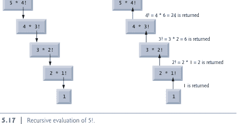

图 5.17 | 5! 的递归求值

图 5.18 使用递归计算并打印整数 0–21 的阶乘（类型 unsigned long long int 的选择稍后会解释）。


// Fig. 5.18: fig05_18.c
// Recursive factorial function.
#include <stdio.h>

unsigned long long int factorial(unsigned int number);

int main(void)
{
    // during each iteration, calculate
    // factorial(i) and display result
    for (unsigned int i = 0; i <= 21; ++i) {
        printf("%u! = %llu\n", i, factorial(i));
    }
}

// recursive definition of function factorial
unsigned long long int factorial(unsigned int number)
{
    // base case
    if (number <= 1) {
        return 1;
    }
    else { // recursive step
        return (number * factorial(number - 1));
    }
}

0! = 1
1! = 1
2! = 2
3! = 6
4! = 24
5! = 120
6! = 720
7! = 5040
8! = 40320
9! = 362880
10! = 3628800
11! = 39916800
12! = 479001600
13! = 6227020800
14! = 87178291200
15! = 1307674368000
16! = 20922789888000
17! = 355687428096000
18! = 6402373705728000
19! = 121645100408832000
20! = 2432902008176640000
21! = 14197454024290336768

递归阶乘函数首先测试终止条件是否成立，即 number 是否小于或等于 1。如果 number 确实小于或等于 1，factorial 返回 1，不再需要进一步递归，程序终止。如果 number 大于 1，则语句

```
return number * factorial(number - 1);
```

表达了将问题表示为 number 与对 factorial 的递归调用的乘积，该递归调用计算 number - 1 的阶乘。调用 factorial(number - 1) 比原始计算 factorial(number) 稍微简单一些。

函数 factorial（第 17-26 行）接收一个 unsigned int 并返回类型为 unsigned long long int 的结果。C 标准规定类型为 unsigned long long int 的变量可以保存至少为 18,446,744,073,709,551,615 的值。如 Fig. 5.18 所示，阶乘值增长很快。我们选择数据类型 unsigned long long int，以便程序可以计算更大的阶乘值。转换说明符 %llu 用于打印 unsigned long long int 值。不幸的是，阶乘函数产生的数值增长如此之快，以至于即使使用 unsigned long long int，在 unsigned long long int 变量的最大值被超过之前，我们也无法打印很多阶乘值。

即使使用 unsigned long long int，我们仍然无法计算超过 21! 的阶乘。这指出了 C（以及大多数其他过程式编程语言）的一个弱点——即该语言不易扩展以处理各种应用的独特需求。正如我们在书中后面会看到的，C++ 是一种可扩展的语言，通过“类”，我们可以创建新的数据类型，包括如果我们愿意可以容纳任意大整数的类型。

## 常见编程错误 5.9

在需要时忘记从递归函数返回一个值。

## 常见编程错误 5.10

省略基本情况，或错误地编写递归步骤使其无法收敛到基本情况，将导致无限递归，最终耗尽内存。这类似于迭代（非递归）解决方案中无限循环的问题。

## 5.15 使用递归的示例：斐波那契数列

斐波那契数列
0, 1, 1, 2, 3, 5, 8, 13, 21, ...

以 0 和 1 开头，并且具有每个后续斐波那契数都是前两个斐波那契数之和的性质。

斐波那契数列可以递归定义如下：

fibonacci(0) = 0
fibonacci(1) = 1
fibonacci(n) = fibonacci(n - 1) + fibonacci(n - 2)

图 5.19 使用函数 fibonacci 递归计算第 n 个斐波那契数。请注意，斐波那契数往往增长很快。因此，我们在函数 fibonacci 中为参数类型选择了数据类型 unsigned int，为返回类型选择了数据类型 unsigned long long int。在图 5.19 中，每一对输出行显示程序的一次单独运行。

```
1 // Fig. 5.19: fig05_19.c
2 // Recursive fibonacci function
3 #include <stdio.h>
4 
5 unsigned long long int fibonacci(unsigned int n); // function prototype
6 
7 int main(void)
8 {
9     unsigned int number; // number input by user
10 
11     // obtain integer from user
12     printf("%s", "Enter an integer: ");
13     scanf("%u", &number);
14 
15     // calculate fibonacci value for number input by user
16     unsigned long long int result = fibonacci(number);
17 
18     // display result
19     printf("Fibonacci(%u) = %llu\n", number, result);
20 }
21 
22 // Recursive definition of function fibonacci
23 unsigned long long int fibonacci(unsigned int n)
24 {
25     // base case
26     if (0 == n || 1 == n) {
27         return n;
28     }
29     else { // recursive step
30         return fibonacci(n - 1) + fibonacci(n - 2);
31     }
32 }
```

Enter an integer: 0
Fibonacci(0) = 0

Enter an integer: 1
Fibonacci(1) = 1

## 图 5.19 | 递归斐波那契函数。（第 1 部分，共 2 部分。）

Enter an integer: 2
Fibonacci(2) = 1

Enter an integer: 3
Fibonacci(3) = 2

Enter an integer: 10
Fibonacci(10) = 55

Enter an integer: 20
Fibonacci(20) = 6765

Enter an integer: 30
Fibonacci(30) = 832040

Enter an integer: 40
Fibonacci(40) = 102334155

## 图 5.19 | 递归斐波那契函数。（第 2 部分，共 2 部分。）

从 main 对 fibonacci 的调用不是递归调用（第 16 行），但所有后续对 fibonacci 的调用都是递归的（第 30 行）。每次调用 fibonacci 时，它立即测试基本情况——n 等于 0 或 1。如果为真，则返回 n。有趣的是，如果 n 大于 1，递归步骤会生成两个递归调用，每个调用都是比原始调用 fibonacci 稍微简单的问题。图 5.20 显示了函数 fibonacci 如何计算 fibonacci(3)。


## 图 5.20 | fibonacci(3) 的递归调用集合。

## 操作数的求值顺序

该图提出了关于 C 编译器将如何求值运算符操作数的顺序的一些有趣问题。这与运算符对其操作数的应用顺序不同，后者由运算符优先级和结合性规则决定。图 5.20 显示，在计算 fibonacci(3) 时，将进行两次递归调用，即 fibonacci(2) 和 fibonacci(1)。但这些调用的顺序是什么？你可能会简单地假设操作数将从左到右求值。出于优化原因，C 未指定大多数运算符（包括 +）的操作数求值顺序。因此，你不应假设这些调用的执行顺序。调用可能先执行 fibonacci(2) 然后执行 fibonacci(1)，或者调用可能按相反顺序执行，先执行 fibonacci(1) 再执行 fibonacci(2)。在此和其他大多数程序中，最终结果将相同。但在某些程序中，操作数的求值可能会产生副作用，从而影响表达式的最终结果。

C 仅指定了四个运算符的操作数求值顺序——&&、||、逗号（,）运算符和 ?:。其中前三个是二进制运算符，其操作数保证从左到右求值。[注意：用于分隔函数调用中参数的逗号不是逗号运算符。]最后一个运算符是 C 的唯一三元运算符。其最左操作数始终首先求值；如果最左操作数求值为非零（真），则下一个求值中间操作数，最后一个操作数被忽略；如果最左操作数求值为零（假），则下一个求值第三个操作数，中间操作数被忽略。

## 常见编程错误 5.11

编写依赖于除 &&、||、?: 和逗号（,）运算符之外的运算符操作数求值顺序的程序可能会导致错误，因为编译器不一定按你期望的顺序求值操作数。

## 可移植性提示 5.2

依赖于除 &&、||、?: 和逗号（,）运算符之外的运算符操作数求值顺序的程序在不同编译器上可能功能不同。

## 指数复杂度

关于我们在此用于生成斐波那契数的递归程序，需要谨慎。fibonacci 函数中的每个递归层级对调用次数都有加倍效应——计算第 n 个斐波那契数将执行的递归调用次数的数量级为 2^n。这很快就会失控。仅计算第 20 个斐波那契数就需要数量级为 2^20 或约一百万次调用，计算第 30 个斐波那契数就需要数量级为 2^30 或约十亿次调用，等等。计算机科学家将此称为指数复杂度。此类问题甚至让世界上最强大的计算机也感到谦卑！一般复杂性问题，特别是指数复杂性，在通常称为“算法”的高级计算机科学课程中进行了详细讨论。

本节中我们展示的示例使用了直观上吸引人的方法来计算斐波那契数，但有更好的方法。练习 5.48 要求你更深入地研究递归，并提出实现递归斐波那契算法的替代方法。


| 递归示例与练习 |  |
|---|---|
| *第5章* | *第7章* |
| 阶乘函数 | 迷宫遍历 |
| 斐波那契函数 | *第8章* |
| 最大公约数 | 从键盘输入的字符串反向打印 |
| 乘两个整数 | *第12章* |
| 整数的整数次幂 | 搜索链表 |
| 汉诺塔 | 反向打印链表 |
| 递归主函数 | 二叉树插入 |
| 可视化递归 | 二叉树先序遍历 |
| *第6章* | 二叉树中序遍历 |
| 数组元素的和 | 二叉树后序遍历 |
| 打印数组 | 打印树 |
| 反向打印数组 | *附录 D* |
| 反向打印字符串 | 选择排序 |
| 检查字符串是否为回文 | 快速排序 |
| 数组中的最小值 | *附录 E* |
| 线性搜索 | 斐波那契函数 |
| 二分搜索 |  |
| 八皇后 |  |

图 5.21 | 文本中的递归示例与练习。

## 性能提示 5.2

将大型程序划分为函数有助于良好的软件工程。但它是有代价的。与单块（即不含函数的整体）程序相比，高度函数化的程序可能会产生大量的函数调用，而这些调用会消耗计算机处理器上的执行时间。虽然单块程序可能性能更好，但它们更难编程、测试、调试、维护和演进。

## 性能提示 5.3

今天的硬件架构经过调优以使函数调用高效，C 编译器有助于优化您的代码，而今天的硬件处理器速度极快。对于您将构建的大多数应用程序和软件系统来说，专注于良好的软件工程比为高性能编程更重要。尽管如此，在许多 C 应用程序和系统中，例如游戏编程、实时系统、操作系统和嵌入式系统，性能至关重要，因此我们在全书中包含了性能提示。

## 5.17 安全的 C 编程

### 安全随机数

在第 5.10 节中，我们介绍了用于生成伪随机数的 rand 函数。C 标准库不提供安全的随机数生成器。根据 C 标准文档对函数 rand 的描述，“对于所产生的随机序列的质量没有任何保证，并且已知某些实现会产生具有 *令人不安地* 非随机的低位比特的序列。² CERT 指南 MSC30-C 指出必须使用特定于实现的随机数生成函数，以确保产生的随机数 *不可预测* ——这在密码学和其他安全应用中极为重要，例如。指南列出了几种被认为安全的特定于平台的随机数生成器。例如，Microsoft Windows 提供 CryptGenRandom 函数，而基于 POSIX 的系统（如 Linux）提供一个产生更安全结果的 random 函数。有关更多信息，请参阅 https://www.securecoding.cert.org 上的指南 MSC30-C。如果您正在构建需要随机数的工业级应用程序，您应该为您的平台研究推荐使用的函数。

## 摘要

### 第 5.1 节 引言

- 开发和维护大型程序的最佳方式是将（p. 190）它划分为几个更小的部分，每个部分都比原始程序更易于管理。

### 第 5.2 节 在 C 中模块化程序

- 函数（p. 190）由函数调用（p. 191）调用。函数调用按名称指定函数，并提供（作为参数）被调用函数执行其任务所需的信息。
- *信息隐藏* 的目的是让函数只能访问完成其任务所需的信息。这是实现 **最小权限原则** 的一种手段，这是良好软件工程最重要的原则之一。

### 第 5.3 节 数学库函数

- 通常在程序中通过写出函数名，后跟左括号，后跟函数的参数（或以逗号分隔的参数列表），后跟右括号来调用函数。
- 函数的每个参数可以是常量、变量或表达式。

### 第 5.4 节 函数

- 局部变量（p. 193）仅在函数定义中已知。其他函数不允许知道函数的局部变量的名称，也没有任何函数允许知道任何其他函数的实现细节。

### 第 5.5 节 函数定义

- 函数定义的一般格式为

```
    return-value-type function-name(parameter-list)
    {
        statements
    }
```

*return-value-type* 表示返回给调用函数的值的类型。如果函数不返回值，则 *return-value-type* 声明为 void。*function-name* 是任何有效标识符。*parameter-list*（p. 195）是以逗号分隔的列表，包含将传递给函数的变量的定义。如果函数不接收任何值，则 *parameter-list* 声明为 void。
- 传递给函数的参数在数量、类型和顺序上应与函数定义中的参数（p. 193）匹配。
- 当程序遇到函数调用时，控制从调用点转移到被调用函数，被调用函数的语句执行然后控制返回调用者。
- 被调用函数可以通过三种方式之一将控制权返回给调用者。如果函数不返回值，则在到达函数结束的右大括号时返回控制，或通过执行语句
  return;
如果函数确实返回值，则语句
  return expression;
返回 expression 的值。

### 第 5.6 节 函数原型：更深入的了解

- 函数原型（p. 195）声明函数名、返回类型并声明函数期望接收的参数的数量、类型和顺序。
- 函数原型使编译器能够验证函数是否被正确调用。
- 编译器忽略函数原型中提到的变量名。
- 混合类型表达式（p. 199）中的参数通过 C 标准的通常算术转换规则（p. 199）转换为同一类型。

### 第 5.7 节 函数调用栈和栈帧

- 栈（p. 201）被称为后进先出（LIFO；p. 201）数据结构——最后压入（插入）栈中的项是第一个弹出（移除）的项。
- 被调用函数必须知道如何返回其调用者，因此在调用函数时，调用函数的返回地址会被压入程序执行栈（p. 201）。如果发生一系列函数调用，则连续的返回地址会以后进先出的顺序压入栈中，以便最后执行的函数最先返回其调用者。
- 程序执行栈包含程序执行期间函数每次调用所使用的局部变量的内存。此数据称为函数调用的栈帧（p. 201）。当进行函数调用时，该函数调用的栈帧会被压入程序执行栈。当函数返回其调用者时，此函数调用的栈帧会被弹出栈，并且这些局部变量不再为程序所知。
- 计算机中的内存是有限的，因此只能使用一定量的内存来存储程序执行栈上的栈帧。如果函数调用的数量超过程序执行栈上可以存储其栈帧的数量，就会发生称为栈溢出的错误。应用程序将正确编译，但其执行将因栈溢出而失败。

### 第 5.8 节 头文件

- 每个标准库都有一个对应的头文件（p. 204），其中包含该库所有函数的函数原型，以及这些函数所需的各种符号常量的定义。
- 您可以创建并包含自己的头文件。

### 第 5.9 节 按值传递和按引用传递参数

- 当参数按值传递（p. 205）时，会复制其值并传递给被调用函数。对被调用函数中副本的更改不会影响原始变量的值。


- 当参数按引用传递时（p. 205），调用者允许被调用函数修改原始变量的值。
- C 中的所有调用都是按值调用。
- 通过使用地址运算符和间接运算符，可以实现按引用调用。

## 第 5.10 节 随机数生成

- 函数 rand 生成一个介于 0 和 RAND_MAX 之间的整数，C 标准将其定义为至少为 32767。
- rand 生成的值可以通过缩放和偏移来产生特定范围内的值（p. 207）。
- 要使程序随机化，请使用 C 标准库函数 srand。
- srand 函数为随机数生成器设置种子（p. 209）。srand 调用通常只在程序经过彻底调试后才插入到程序中。在调试期间，最好省略 srand。这确保了可重复性，这对于证明对随机数生成程序的修正是否正常工作至关重要。
- rand 和 srand 的函数原型包含在 <stdlib.h> 中。
- 为了在每次都不需要输入种子时进行随机化，我们使用 srand(time(NULL))。
- 缩放和偏移随机数的一般方程为

```
n = a + rand() % b;
```

其中 a 是偏移值（即期望的连续整数范围的第一个数字），b 是缩放因子（即期望的连续整数范围的宽度）。

## 第 5.11 节 示例：机会游戏：介绍 enum

- 枚举（p. 213）由关键字 enum 引入，是一组由标识符表示的整数常量。enum 中的值从 0 开始并递增 1。也可以为 enum 中的每个标识符分配一个整数值。枚举中的标识符必须唯一，但值可以重复。

## 第 5.12 节 存储类

- 程序中的每个标识符都有存储类、存储持续时间、作用域和链接属性（p. 214）。
- C 提供了四个由存储类说明符指示的存储类：auto、register、extern 和 static（p. 214）。
- 标识符的存储持续时间是指该标识符在内存中存在的时间。
- 标识符的链接（p. 214）决定了对于多源文件程序，标识符是否仅在当前源文件中已知，或在具有正确声明的任何源文件中已知。
- 具有自动存储持续时间（p. 214）的变量在定义它们的块被进入时创建，在块活动期间存在，并在块退出时销毁。函数的局部变量通常具有自动存储持续时间。
- 关键字 extern 和 static 用于声明具有静态存储持续时间的变量和函数的标识符。
- 静态存储持续时间（p. 214）变量在程序开始执行前只分配和初始化一次。
- 具有静态存储持续时间的标识符有两种类型：外部标识符（如全局变量和函数名）以及使用存储类说明符 static 声明的局部变量。
- 全局变量是通过将变量定义放在任何函数定义之外创建的。全局变量在程序执行期间保留其值。
- 局部静态变量在定义它们的函数被调用之间保留其值。
- 如果你没有显式初始化它们，所有静态存储持续时间的数值变量都将被初始化为零。

## 第 5.13 节 作用域规则

- 标识符的作用域（p. 216）是指标识符可以在程序中被引用的位置。
- 标识符可以具有函数作用域、文件作用域、块作用域或函数原型作用域（p. 216）。
- 标签是唯一具有函数作用域的标识符。标签可以在它们出现的函数中的任何位置使用，但不能在函数体外引用。
- 在任何函数之外声明的标识符具有文件作用域。这样的标识符从声明点起在所有函数中都是“已知”的，直到文件末尾。
- 在块内定义的标识符具有块作用域。块作用域在块的结束右大括号（}）处结束。
- 在函数开头定义的局部变量具有块作用域，函数参数也是如此，函数将其视为局部变量。
- 任何块都可能包含变量定义。当块嵌套时，如果外层块中的标识符与内层块中的标识符同名，则外层块中的标识符在内层块终止之前会被“隐藏”。
- 唯一具有函数原型作用域的标识符是那些在函数原型参数列表中使用的标识符。函数原型中使用的标识符可以在程序的其他地方重复使用而不会产生歧义。

## 第 5.14 节 递归

- 递归函数（p. 219）是指直接或间接调用自身的函数。
- 如果递归函数以基本情况（p. 219）被调用，函数只需返回一个结果。如果它被调用处理更复杂的问题，函数将问题分为两个概念部分：函数知道如何处理的部分以及原始问题的稍小版本。由于这个新问题看起来像原始问题，函数会启动递归调用来处理较小的问题。
- 为了使递归终止，每次递归函数用原始问题的稍简单版本调用自身时，越来越小的问题序列必须收敛于基本情况。当函数识别出基本情况时，结果会返回给之前的函数调用，随后一系列返回会一直进行，直到原始函数调用最终返回最终结果。
- 标准 C 未指定大多数运算符（包括 +）的操作数求值顺序。在 C 的众多运算符中，标准仅指定了运算符 &&、||、逗号（,）运算符和 ?: 的操作数求值顺序。其中前三个是二元运算符，其两个操作数按从左到右求值。最后一个运算符是 C 的唯一三元运算符。其最左操作数首先求值；如果求值为非零，则下一个求值中间操作数，最后一个操作数被忽略；如果最左操作数求值为零，则下一个求值第三个操作数，中间操作数被忽略。

## 第 5.16 节 递归 vs. 迭代

- 迭代和递归都基于控制结构：迭代使用迭代语句；递归使用选择语句。
- 迭代和递归都涉及重复：迭代使用迭代语句；递归通过重复的函数调用实现重复。
- 迭代和递归各涉及一个终止测试：迭代在循环继续条件失败时终止；递归在识别到基本情况时终止。
- 迭代和递归都可能无限进行：如果循环继续测试永远不为假，迭代会发生无限循环；如果递归步骤没有以收敛于基本情况的方式减小问题，则会发生无限递归。
- 递归反复调用函数调用的机制，因而产生开销。这在处理器时间和内存空间方面都可能很昂贵。

## 自测练习

5.1 回答以下每个问题：

- a) ______ 用于模块化程序。
- b) 函数是通过一个 ______ 调用的。
- c) 仅在定义它的函数内已知的变量称为 ______。
- d) 被调用函数中的 ______ 语句用于将表达式的值传回调用函数。
- e) 关键字 ______ 用于函数头中表示函数不返回值或函数不包含参数。
- f) 标识符的 ______ 是标识符可以在其中使用的程序部分。
- g) 从被调用函数返回控制给调用者的三种方式是 ______、______ 和 ______。
- h) ______ 允许编译器检查传递给函数的参数的数量、类型和顺序。
- i) ______ 函数用于生成随机数。
- j) ______ 函数用于设置随机数种子以随机化程序。
- k) 存储类说明符是 ______、______、______ 和 ______。
- l) 在块中或函数参数列表中声明的变量假定为存储类 ______，除非另有说明。
- m) 在任何块或函数之外定义的非静态变量是 ______ 变量。
- n) 为了使函数中的局部变量在函数调用之间保留其值，它必须使用 ______ 存储类说明符声明。
- o) 标识符的四种可能作用域是 ______、______、______ 和 ______。
- p) 直接或间接调用自身的函数是 ______ 函数。
- q) 递归函数通常有两个组成部分：一个通过测试 ______ 情况为递归终止提供手段，另一个将问题表达为对比原始调用稍简单问题的递归调用。

5.2 对于以下程序，说明以下每个元素的范围（函数作用域、文件作用域、块作用域或函数原型作用域）。

- a) main 中的变量 x。
- b) cube 中的变量 y。
- c) 函数 cube。
- d) 函数 main。
- e) cube 的函数原型。
- f) cube 函数原型中的标识符 y。


```c
#include <stdio.h>

int cube(int y);

int main(void)
{
    for (int x = 1; x <= 10; ++x)
        printf("%u\n", cube(x));
}

int cube(int y)
{
    return y * y * y;
}
```

5.3 编写一个程序，测试图5.2中所示的数学库函数调用示例是否确实产生了所指示的结果。

5.4 给出下列每个函数的函数头。

- a) 函数 `hypotenuse`，接受两个双精度浮点参数 `side1` 和 `side2`，并返回一个双精度浮点结果。
- b) 函数 `smallest`，接受三个整数 `x`、`y`、`z`，并返回一个整数。
- c) 函数 `instructions`，不接收任何参数且不返回值。[注意：这类函数通常用于向用户显示指令。]
- d) 函数 `intToFloat`，接受一个整数参数 `number`，并返回一个浮点结果。

5.5 给出下列每个函数的函数原型：

- a) 习题5.4(a)中描述的函数。
- b) 习题5.4(b)中描述的函数。
- c) 习题5.4(c)中描述的函数。
- d) 习题5.4(d)中描述的函数。

5.6 为浮点变量 `lastVal` 编写一个声明，使其在定义它的函数被调用之间保留其值。

5.7 找出下列每个程序段中的错误，并说明如何纠正错误（另见习题5.46）：

```c
a) int g(void)
{
    printf("%s", "Inside function g\n");
    int h(void)
    {
        printf("%s", "Inside function h\n");
    }
}

b) int sum(int x, int y)
{
    int result = x + y;
}

c) void f(float a);
{
    float a;
    printf("%f", a);
}
```

```c
d) int sum(int n)
{
    if (0 == n) {
        return 0; //
    }
    else {
        n + sum(n - 1);
    }
}
```

```c
e) void product(void)
{
    printf("\n", "Enter three integers: ")
    int a, b, c;
    scanf("%d%d%d", &a, &b, &c);
    int result = a * b * c;
    printf("Result is %d", result);
    return result;
}
```

## 自测练习答案

5.1 a) 函数。 b) 函数调用。 c) 局部变量。 d) 返回。 e) void。 f) 作用域。 g) 返回语句 `return;`，或返回表达式 `return expression;`，或遇到函数的右花括号。 h) 函数原型。 i) rand。 j) srand。 k) auto、register、extern、static。 l) auto。 m) 外部、全局。 n) static。 o) 函数作用域、文件作用域、块作用域、函数原型作用域。 p) 递归。 q) 基准情况。

5.2 a) 块作用域。 b) 块作用域。 c) 文件作用域。 d) 文件作用域。 e) 文件作用域。 f) 函数原型作用域。

5.3 见下文。[注意：在大多数Linux系统上，编译此程序时必须使用 `-lm` 选项。]

```c
// ex05_03.c
// Testing the math library functions
#include <stdio.h>
#include <math.h>

int main(void)
{
    // calculates and outputs the square root
    printf("sqrt(%.1f) = %.1f\n", 900.0, sqrt(900.0));
    printf("sqrt(%.1f) = %.1f\n", 9.0, sqrt(9.0));

    // calculates and outputs the cube root
    printf("cbrt(%.1f) = %.1f\n", 27.0, cbrt(27.0));
    printf("cbrt(%.1f) = %.1f\n", -8.0, cbrt(-8.0));

    // calculates and outputs the exponential function e to the x
    printf("exp(%.1f) = %.1f\n", 1.0, exp(1.0));
    printf("exp(%.1f) = %.1f\n", 2.0, exp(2.0));

    // calculates and outputs the logarithm (base e)
    printf("log(%f) = %.1f\n", 2.718282, log(2.718282));
    printf("log(%f) = %.1f\n", 7.389056, log(7.389056));

    // calculates and outputs the logarithm (base 10)
    printf("log10(%.1f) = %.1f\n", 1.0, log10(1.0));
    printf("log10(%.1f) = %.1f\n", 10.0, log10(10.0));
    printf("log10(%.1f) = %.1f\n", 100.0, log10(100.0));

    // calculates and outputs the absolute value
    printf("fabs(%.1f) = %.1f\n", 13.5, fabs(13.5));
    printf("fabs(%.1f) = %.1f\n", 0.0, fabs(0.0));
    printf("fabs(%.1f) = %.1f\n", -13.5, fabs(-13.5));

    // calculates and outputs ceil(x)
    printf("ceil(%.1f) = %.1f\n", 9.2, ceil(9.2));
    printf("ceil(%.1f) = %.1f\n", -9.8, ceil(-9.8));

    // calculates and outputs floor(x)
    printf("floor(%.1f) = %.1f\n", 9.2, floor(9.2));
    printf("floor(%.1f) = %.1f\n", -9.8, floor(-9.8));

    // calculates and outputs pow(x, y)
    printf("pow(%.1f, %.1f) = %.1f\n", 2.0, 7.0, pow(2.0, 7.0));
    printf("pow(%.1f, %.1f) = %.1f\n", 9.0, 0.5, pow(9.0, 0.5));

    // calculates and outputs fmod(x, y)
    printf("fmod(%.3f%%.3f) = %.3f\n", 13.657, 2.333,
           fmod(13.657, 2.333));

    // calculates and outputs sin(x)
    printf("sin(%.1f) = %.1f\n", 0.0, sin(0.0));

    // calculates and outputs cos(x)
    printf("cos(%.1f) = %.1f\n", 0.0, cos(0.0));

    // calculates and outputs tan(x)
    printf("tan(%.1f) = %.1f\n", 0.0, tan(0.0));
}
```

```text
sqrt(900.0) = 30.0
sqrt(9.0) = 3.0
cbrt(27.0) = 3.0
cbrt(-8.0) = -2.0
exp(1.0) = 2.718282
exp(2.0) = 7.389056
log(2.718282) = 1.0
log(7.389056) = 2.0
log10(1.0) = 0.0
log10(10.0) = 1.0
log10(100.0) = 2.0
fabs(13.5) = 13.5
fabs(0.0) = 0.0
fabs(-13.5) = 13.5
ceil(9.2) = 10.0
ceil(-9.8) = -9.0
floor(9.2) = 9.0
floor(-9.8) = -10.0
pow(2.0, 7.0) = 128.0
pow(9.0, 0.5) = 3.0
fmod(13.657,2.333) = 1.992
sin(0.0) = 0.0
cos(0.0) = 1.0
tan(0.0) = 0.0
```

5.4

a) `double hypotenuse(double side1, double side2)`

b) `int smallest(int x, int y, int z)`

c) `void instructions(void)`

d) `float intToFloat(int number)`

5.5

a) `double hypotenuse(double side1, double side2);`

b) `int smallest(int x, int y, int z);`

c) `void instructions(void);`

d) `float intToFloat(int number);`

5.6

```c
static float lastVal;
```

5.7

a) 错误：函数 `h` 定义在函数 `g` 内部。

纠正：将函数 `h` 的定义移到函数 `g` 的定义之外。

b) 错误：函数体本应返回一个整数，但没有返回。

纠正：将函数体中的语句替换为：

```c
return x + y;
```

c) 错误：参数列表右括号后有分号，并且在函数定义中重新定义了参数 `a`。

纠正：删除参数列表右括号后的分号，并删除函数体中的声明 `float a;`。

d) 错误：`n + sum(n - 1)` 的结果没有被返回；`sum` 返回了不正确的结果。

纠正：将 else 子句中的语句改写为：

```c
return n + sum(n - 1);
```

e) 错误：函数在不该返回值的时候返回了一个值。

纠正：删除返回语句。

## 习题

5.8 执行下列每条语句后，显示 `x` 的值：

- a) `x = fabs(10.85)`
- b) `x = floor(10.85)`
- c) `x = fabs(-0.678)`
- d) `x = ceil(9.234)`
- e) `x = fabs(0.0)`
- f) `x = ceil(-34.87)`
- g) `x = ceil(-fabs(-12 - floor(-9.5)))`

5.9 （汽车租赁服务）一家汽车租赁公司租车8小时的最低费用为25.00美元，超过8小时后每小时加收5美元。每日最高收费为50美元，不含服务税。该公司另外按每小时0.50美元收取服务税。假设每次租车不超过72小时。如果租车超过24小时，则按日计算租金。编写一个程序，计算并打印昨天从该公司租车的三位客户中每位客户的租赁费用。您应该输入每位客户租车的小时数。程序应以清晰的表格形式打印结果，并计算和打印昨天的总收款额。程序应使用函数 `calculateCharges` 来确定每位客户的费用。您的输出应呈现以下格式：

| 汽车 | 小时 | 费用 |
|---|---:|---:|
| 1 | 12 | 56.00 |
| 2 | 34 | 112.00 |
| 3 | 48 | 124.00 |
| 总计 | 94 | 297.00 |

**5.10** （四舍五入）函数 `ceil` 的一个应用是将数值四舍五入到最接近的整数。语句

```c
y = ceil(x + .5);
```

将数字 `x` 四舍五入到最接近的整数，并将结果赋给 `y`。编写一个程序，读取若干数字，并使用上述语句将每个数字四舍五入到最接近的整数。对于处理的每个数字，打印原始数字和四舍五入后的数字。

**5.11** （四舍五入）函数 `floor` 可用于将数字四舍五入到指定的小数位。语句

```c
y = floor(x * 10 + .5) / 10;
```

将 `x` 四舍五入到十分位（小数点右侧第一位）。语句

```c
y = floor(x * 100 + .5) / 100;
```

将 `x` 四舍五入到百分位（小数点右侧第二位）。编写一个程序，定义四个函数，以不同方式对数字 `x` 进行四舍五入：

- a) `roundToInteger(number)`
- b) `roundToTenths(number)`
- c) `roundToHundredths(number)`
- d) `roundToThousandths(number)`

对于读取的每个值，程序应打印原始值、四舍五入到最接近整数的值、四舍五入到最接近十分位的值、四舍五入到最接近百分位的值，以及四舍五入到最接近千分位的值。

**5.12** 回答下列每个问题。

- a) 按值传递参数和按引用传递参数之间有什么区别？
- b) `rand` 函数生成什么值？
- c) 如何使程序随机化？如何缩放或移动 `rand` 函数产生的值？
- d) 什么是递归函数？什么是基准情况？

**5.13** 编写语句，将随机整数赋给变量 `n`，范围如下：

- a) 1 ≤ n ≤ 6
- b) 100 ≤ n ≤ 1000
- c) 0 ≤ n ≤ 19
- d) 1000 ≤ n ≤ 2222
- e) -1 ≤ n ≤ 1
- f) -3 ≤ n ≤ 11

**5.14** 对于下列每组整数，编写一条语句，从该集合中随机打印一个数字。

- a) 3、6、9、12、15、18、21、24、27、30。
- b) 3、5、7、9、11、13、15、17、19。
- c) 3、8、13、18、23、28、33

**5.15** （斜边计算）定义一个名为 `hypotenuse` 的函数，当给定直角三角形的另外两条边时，计算其斜边的长度。该函数应接受两个 `double` 类型的参数，并将斜边作为 `double` 返回。使用图5.22中指定的边长值测试您的程序。

**5.16** （三角形的边）编写一个函数，读取三个非零的 `double` 值作为三角形的边，并计算和返回三角形的面积作为 `double` 变量。在计算面积之前，它还应检查这些数字是否代表三角形的边。在一个输入多组数字集合的程序中使用此函数。


## 5.24（货币兑换）
实现以下 double 函数：
a) 函数 toYen 接受以美元表示的金额，并返回等值日元。
b) 函数 toEuro 接受以美元表示的金额，并返回等值欧元。
c) 使用这些函数编写一个程序，打印图表，显示一系列美元金额对应的日元和欧元等值。以整洁的表格格式打印输出。使用汇率 1 USD = 118.87 日元和 1 USD = 0.92 欧元。

## 5.25（求最大值）
编写一个函数，返回四个浮点数中的最大值。

## 5.26（完全数）
如果一个整数的因子（包括 1，但不包括该数本身）之和等于该数，则称这个整数为完全数。例如，6 是完全数，因为 6 = 1 + 2 + 3。编写一个函数 isPerfect，判断参数 number 是否为完全数。在一个程序中使用该函数，确定并打印 1 到 1000 之间的所有完全数。打印每个完全数的因子，以确认该数确实是完全数。通过测试远大于 1000 的数来挑战你的计算机的能力。

## 5.27（二次方程的根）
二次方程是形如 ax² + bx + c = 0 的任何方程，其中 a、b 和 c 是 x 的系数。二次方程的根可以通过公式 x = -b ± √(b² - 4ac) / 2a 计算。如果表达式 b² - 4ac（也称为判别式）为正，则方程有实根。如果判别式为负，则方程有虚（或复）根。编写一个函数，接受方程系数作为参数，检查根是否为实数，并计算方程的根。编写一个程序来测试该函数。

## 5.28（数字之和）
编写一个函数，接受一个整数并返回其各位数字之和。例如，给定数字 7631，该函数应返回 17。

## 5.29（最小公倍数）
两个整数的最小公倍数（LCM）是同时是两个数的倍数的最小正整数。编写一个函数 lcm，返回两个数的最小公倍数。

## 5.30（学生成绩的质量分）
编写一个函数 toQualityPoints，它输入学生的平均分，并在平均分为 90–100 时返回 4，为 80–89 时返回 3，为 70–79 时返回 2，为 60–69 时返回 1，在平均分低于 60 时返回 0。

## 5.31（抛硬币）
编写一个程序来模拟抛硬币。每次抛硬币时，程序应打印 Heads 或 Tails。让程序抛硬币 100 次，并统计硬币每一面出现的次数。打印结果。程序应调用一个单独的函数 flip，它不接受参数，反面返回 0，正面返回 1。[注：如果程序真实地模拟抛硬币，那么硬币每一面应大约有一半的时间出现，总共大约 50 次正面和 50 次反面。]

## 5.32（猜数字）
编写一个 C 程序，按如下方式玩“猜数字”游戏：你的程序通过在 1 到 1000 范围内随机选择一个整数来确定要猜的数。程序然后输出：

```
I have a number between 1 and 1000.
Can you guess my number?
Please type your first guess.
```

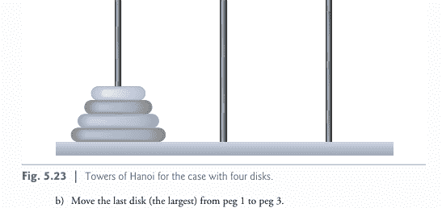

图 5.23 | 四个圆盘情况下的汉诺塔。

b) 将最后一个圆盘（最大的）从柱 1 移到柱 3。
c) 将 n − 1 个圆盘从柱 2 移到柱 3，使用柱 1 作为临时存放区。
当最后一个任务涉及移动 n = 1 个圆盘（即基本情况）时，过程结束。这通过直接移动该圆盘来完成，无需临时存放区。
编写一个程序来解决汉诺塔问题。使用一个带四个参数的递归函数：
- a) 要移动的圆盘数
- b) 这些圆盘最初穿在哪个柱上
- c) 这堆圆盘要移到哪个柱
- d) 用作临时存放区的柱

你的程序应打印将圆盘从起始柱移到目标柱所需的精确指令。例如，要将三个圆盘的堆从柱 1 移到柱 3，你的程序应打印以下移动序列：
1 → 3（这表示将一个圆盘从柱 1 移到柱 3。）
1 → 2
3 → 2
1 → 3
2 → 1
2 → 3
1 → 3

## 5.37（汉诺塔：迭代解法）
任何可以递归实现的程序都可以迭代实现，尽管有时困难得多且清晰度低得多。尝试编写汉诺塔的迭代版本。如果成功，请将你的迭代版本与你在练习 5.36 中开发的递归版本进行比较。研究性能、清晰度以及证明程序正确性的能力等问题。

## 5.38（可视化递归）
观察递归“运行”很有趣。修改图 5.18 的阶乘函数，使其打印其局部变量和递归调用参数。对于每次递归调用，在单独一行显示输出，并增加一级缩进。尽最大努力使输出清晰、有趣且有意义。你的目标是设计并实现一种帮助人们更好地理解递归的输出格式。你可能希望将这种显示能力添加到全书中许多其他递归示例和练习中。

## 5.39（递归最大公约数）
整数 x 和 y 的最大公约数是能同时整除 x 和 y 的最大整数。编写一个递归函数 gcd，它返回

关于全球变暖的选择题测验，每个问题有四个可能答案（编号 1–4）。要客观，并尽量公平地呈现问题的双方观点。接下来，编写一个应用程序来管理该测验，计算正确答案数（0 到 5），并向用户返回一条消息。如果用户正确回答五个问题，打印“Excellent”；如果四个，打印“Very good”；如果三个或更少，打印“Time to brush up on your knowledge of global warming,”，并包含一些你找到事实的网站列表。

## 计算机辅助教学
随着计算机成本下降，每个学生无论经济状况如何，都拥有计算机并在学校使用它变得可行。如下面五个练习所建议的那样，这为改善全世界所有学生的教育体验创造了令人兴奋的可能性。[注：查看诸如每个儿童一台笔记本电脑项目（www.laptop.org）这样的倡议。另外，研究一下“绿色”笔记本电脑——这些设备的一些关键“环保”特征是什么？了解电子产品环境评估工具（www.epeat.net），它可以帮助你评估台式机、笔记本和显示器的“绿色程度”，从而帮助你决定购买哪些产品。]

## 5.50（计算机辅助教学）
在教育中使用计算机被称为计算机辅助教学（CAI）。编写一个程序，帮助小学生学习乘法。使用 rand 函数生成两个正的一位整数。程序然后应向用户提示一个问题，例如

How much is 6 times 7 ?

学生然后输入答案。接下来，程序检查学生的答案。如果正确，显示消息“Very good!”并询问另一道乘法题。如果答案错误，显示消息“No. Please try again.”，并让学生反复尝试同一道题，直到学生最终答对。应使用一个单独的函数来生成每个新问题。该函数应在应用程序开始执行时调用一次，并在用户每次正确回答问题时调用。

## 5.51（计算机辅助教学：减少学生疲劳）
CAI 环境中的一个问题是学生疲劳。可以通过改变计算机的响应来保持学生的注意力，从而减少疲劳。修改练习 5.50 的程序，使每个答案显示各种评论如下：

正确答案的可能回答：
- Very good!
- Excellent!
- Nice work!
- Keep up the good work!

错误答案的可能回答：
- No. Please try again.
- Wrong. Try once more.
- Don't give up!
- No. Keep trying.

使用随机数生成选择 1 到 4 中的一个数，用于为每个正确或错误答案选择四种适当回答之一。使用 switch 语句发出响应。

## 5.52（计算机辅助教学：监控学生表现）
更复杂的计算机辅助教学系统会在一段时间内监控学生的表现。开始新主题的决定通常基于学生在先前主题上的成功。修改练习 5.51 的程序，统计学生输入的正确和错误回答数。在学生输入 10 个答案后，你的程序应计算……的百分比


正确。如果百分比低于75%，显示“Please ask your teacher for extra help.”，然后重置程序以便另一名学生尝试。如果百分比为75%或更高，显示“Congratulations, you are ready to go to the next level!”，然后重置程序以便另一名学生尝试。

## 5.53 (计算机辅助教学：难度等级)

Exercises 5.50 through Exercise 5.52 developed a computer-assisted instruction program to help teach an elementary-school student multiplication. Modify the program to allow the user to enter a difficulty level. At a difficulty level of 1, the program should use only single-digit numbers in the problems; at a difficulty level of 2, numbers as large as two digits, and so on.

## 5.54 (计算机辅助教学：变化的问题类型)

Modify the program of Exercise 5.53 to allow the user to pick a type of arithmetic problem to study. An option of 1 means addition problems only, 2 means subtraction problems only, 3 means multiplication problems only and 4 means a random mixture of all these types.

- 6.1 引言
- 6.2 数组
- 6.3 定义数组
- 6.4 数组示例
- 6.4.1 定义数组并使用循环设置数组元素值
- 6.4.2 在定义中使用初始化列表初始化数组
- 6.4.3 使用符号常量指定数组大小并通过计算初始化数组元素
- 6.4.4 求数组元素的和
- 6.4.5 使用数组汇总调查结果
- 6.4.6 使用直方图绘制数组元素值
- 6.4.7 掷骰子60,000,000次并在数组中汇总结果
- 6.5 使用字符数组存储和操作字符串
- 6.5.1 使用字符串初始化字符数组
- 6.5.2 使用字符初始化列表初始化字符数组
- 6.5.3 访问字符串中的字符
- 6.5.4 向字符数组输入
- 6.5.5 输出表示字符串的字符数组
- 6.5.6 演示字符数组
- 6.6 静态局部数组和自动局部数组
- 6.7 向函数传递数组
- 6.8 排序数组
- 6.9 案例研究：使用数组计算均值、中位数和众数
- 6.10 搜索数组
- 6.10.1 使用线性搜索搜索数组
- 6.10.2 使用二分搜索搜索数组
- 6.11 多维数组
- 6.11.1 说明双下标数组
- 6.11.2 初始化双下标数组
- 6.11.3 设置一行中的元素
- 6.11.4 求二维数组中元素的总和
- 6.11.5 二维数组操作
- 6.12 变长数组
- 6.13 安全的 C 编程

## 6.1 引言

This chapter introduces data structures. Arrays are data structures consisting of related data items of the same type. In Chapter 10, we discuss C’s notion of struct—a data structure consisting of related data items of possibly different types. Arrays and structs are “static” entities in that they remain the same size throughout program execution (they may, of course, be of automatic storage class and hence created and destroyed each time the blocks in which they’re defined are entered and exited).

## 6.2 数组

An array is a group of contiguous memory locations that all have the same type. To refer to a particular location or element in the array, we specify the array’s name and the position number of the particular element in the array.

Figure 6.1 shows an integer array called c, containing 12 elements. Any one of these elements may be referred to by giving the array’s name followed by the position number of the particular element in square brackets ([]). The first element in every array is the zeroth element (i.e., the one with position number 0). An array name, like other identifiers, can contain only letters, digits and underscores and cannot begin with a digit.

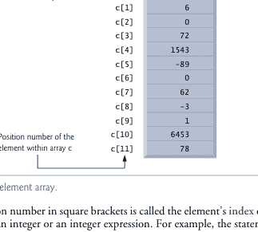

Fig. 6.1 | 12-element array.

The position number in square brackets is called the element's index or subscript. An index must be an integer or an integer expression. For example, the statement

```
c[2] = 1000;
```

assigns 1000 to array element c[2]. Similarly, if a = 5 and b = 6, then the statement

```
c[a + b] += 2;
```

adds 2 to array element c[11]. An indexed array name is an lvalue—it can be used on the left side of an assignment.

Let's examine array c (Fig. 6.1) more closely. The array's name is c. Its 12 elements are referred to as c[0], c[1], c[2], ..., c[10] and c[11]. The value stored in c[0] is -45, the value of c[1] is 6, c[2] is 0, c[7] is 62 and c[11] is 78. To print the sum of the values contained in the first three elements of array c, we'd write

```
printf("%d", c[0] + c[1] + c[2]);
```

To divide the value of element 6 of array c by 2 and assign the result to the variable x, write

```
x = c[6] / 2;
```

The brackets used to enclose an array's index are actually considered to be an operator in C. They have the same level of precedence as the function call operator (i.e., the parentheses that are placed after a function name to call that function). Figure 6.2 shows the precedence and associativity of the operators introduced to this point in the text.

| Operators | Associativity | Type |
|---|---|---|
| [ ] ( ) ++ (postfix) -- (postfix) | left to right | highest |
| + - ! ++ (prefix) -- (prefix) (type) | right to left | unary |

Fig. 6.2 | Operator precedence and associativity. (Part 1 of 2.)

| Operators | Associativity | Type |
|---|---|---|
| * / % | left to right | multiplicative |
| + - | left to right | additive |
| < <= > >= | left to right | relational |
| == != | left to right | equality |
| && | left to right | logical AND |
| || | left to right | logical OR |
| ?: | right to left | conditional |
| = += -= *= /= %= | right to left | assignment |
| , | left to right | comma |

Fig. 6.2 | Operator precedence and associativity. (Part 2 of 2.)

## 6.3 定义数组

Arrays occupy space in memory. You specify the type of each element and the number of elements each array requires so that the computer may reserve the appropriate amount of memory. The following definition reserves 12 elements for integer array c, which has indices in the range 0–11.

```
int c[12];
```

The definition

```
int b[100], x[27];
```

reserves 100 elements for integer array b and 27 elements for integer array x. These arrays have indices in the ranges 0–99 and 0–26, respectively. Though you can define multiple arrays at once, defining only one per line is preferred, so you can add a comment explaining each array's purpose.

Arrays may contain other data types. For example, an array of type char can store a character string. Character strings and their similarity to arrays are discussed in Chapter 8. The relationship between pointers and arrays is discussed in Chapter 7.

## 6.4 数组示例

This section presents several examples that demonstrate how to define and initialize arrays, and how to perform many common array manipulations.

### 6.4.1 定义数组并使用循环设置数组元素值

Like any other variables, uninitialized array elements contain garbage values. Figure 6.3 uses for statements to set the elements of a five-element integer array n to zeros (lines 11–13) and print the array in tabular format (lines 18–20). The first printf statement (line 15) displays the column heads for the two columns printed in the subsequent for statement.

```c
1   // Fig. 6.3: fig06_03.c
2   // Initializing the elements of an array to zeros.
3   #include <stdio.h>
4
5   // function main begins program execution
6   int main(void)
7   {
8       int n[5]; // n is an array of five integers
9
10      // set elements of array n to 0
11      for (size_t i = 0; i < 5; ++i) {
12          n[i] = 0; // set element at location i to 0
13      }
14
15      printf("%s%13s\n", "Element", "Value");
16
17      // output contents of array n in tabular format
18      for (size_t i = 0; i < 5; ++i) {
19          printf("%7u%13d\n", i, n[i]);
20      }
21  }
```

| 元素 | 值 |
|---|---|
| 0 | 0 |
| 1 | 0 |
| 2 | 0 |
| 3 | 0 |
| 4 | 0 |

**Fig. 6.3** | Initializing the elements of an array to zeros.

Notice that the counter-control variable `i` is declared to be of type `size_t` in each `for` statement (lines 11 and 18), which according to the C standard represents an unsigned integral type.¹ This type is recommended for any variable that represents an array's size or indices. Type `size_t` is defined in header `<stddef.h>`, which is often included by other headers (such as `<stdio.h>`). [Note: If you attempt to compile Fig. 6.3 and receive errors, simply include `<stddef.h>` in your program.]

### 6.4.2 在定义中使用初始化列表初始化数组

The elements of an array can also be initialized when the array is defined by following the definition with an equals sign and braces, `{ }`, containing a comma-separated list of array initializers. Figure 6.4 initializes an integer array with five values (line 9) and prints the array in tabular format.

1. On some compilers, `size_t` represents `unsigned int` and on others it represents `unsigned long`. Compilers that use `unsigned long` typically generate a warning on line 19 of Fig. 6.3, because `%u` is for displaying unsigned ints, not unsigned longs. To eliminate this warning, replace the format specification `%u` with `%lu`.


~~~c
1  // Fig. 6.4: fig06_04.c
2  // Initializing the elements of an array with an initializer list.
3  #include <stdio.h>
4  
5  // function main begins program execution
6  int main(void)
7  {
8      // use initializer list to initialize array n
9      int n[5] = {32, 27, 64, 18, 95};
10
11     printf("%s%13s\n", "Element", "Value");
12
13     // output contents of array in tabular format
14     for (size_t i = 0; i < 5; ++i) {
15         printf("%7u%13d\n", i, n[i]);
16     }
17 }
~~~

| 元素 | 值 |
|---|---|
| 0 | 32 |
| 1 | 27 |
| 2 | 64 |
| 3 | 18 |
| 4 | 95 |

**图 6.4** | 用初始化列表初始化数组的元素。

如果初始化器的数量 *少于* 数组中的元素，则剩余元素初始化为零。例如，图 6.3 中数组 *n* 的元素可以按如下方式初始化为零：

~~~c
int n[10] = {0}; // initializes entire array to zeros
~~~

这 *明确地* 将第一个元素初始化为零，并将剩余的九个元素初始化为零，因为初始化器的数量少于数组中的元素数量。数组 *不会* 自动初始化为零。你必须至少将第一个元素初始化为零，以便剩余元素自动置零。数组元素在程序启动前对 *静态* 数组进行初始化，而对 *自动* 数组则在运行时进行初始化。

### 常见编程错误 6.1
*忘记初始化数组的元素。*

### 常见编程错误 6.2
*在数组初始化列表中提供比数组元素更多的初始化器是语法错误——例如，int n[3] = {32, 27, 64, 18}; 是语法错误，因为有四个初始化器但只有三个数组元素。*

如果在带有初始化列表的定义中 *省略* 了数组大小，则数组中的元素数量将为初始化列表中的元素数量。例如，

~~~c
int n[] = {1, 2, 3, 4, 5};
~~~

将创建一个包含五个元素并用指示的值初始化的数组。

## 6.4.3 使用符号常量指定数组大小并通过计算初始化数组元素

图 6.5 将一个五元素数组 s 的元素初始化为值 2、4、6、...、10 并以表格格式打印数组。这些值是通过将循环计数器乘以 2 并加 2 生成的。

```c
// Fig. 6.5: fig06_05.c
// Initializing the elements of array s to the even integers from 2 to 10.
#include <stdio.h>
#define SIZE 5 // maximum size of array

// function main begins program execution
int main(void)
{
   // symbolic constant SIZE can be used to specify array size
   int s[SIZE]; // array s has SIZE elements

   for (size_t j = 0; j < SIZE; ++j) { // set the values
      s[j] = 2 + 2 * j;
   }

   printf("%s%13s\n", "Element", "Value");

   // output contents of array s in tabular format
   for (size_t j = 0; j < SIZE; ++j) {
      printf("%7u%13d\n", j, s[j]);
   }
}
```

| 元素 | 值 |
|---|---|
| 0 | 2 |
| 1 | 4 |
| 2 | 6 |
| 3 | 8 |
| 4 | 10 |

**图 6.5** 将数组 s 的元素初始化为从 2 到 10 的偶整数。

在此程序中引入了 `#define` 预处理器指令。第 4 行

```c
#define SIZE 5
```

定义了一个符号常量 `SIZE`，其值为 5。符号常量是一个标识符，在程序编译前由 C 预处理器用替换文本替换。当程序被预处理时，符号常量 `SIZE` 的所有出现都会被替换文本 5 替换。使用符号常量指定数组大小使程序更易于修改。在图 6.5 中，我们可以通过简单地将 `#define` 指令中 `SIZE` 的值从 5 改为 1000，使第一个 for 循环（第 12 行）填充一个 1000 元素数组。如果没有使用符号常量 `SIZE`，我们就必须更改程序中的第 10、12 和 19 行。随着程序变大，这种技术对于编写清晰、易读、可维护的程序变得更有用——符号常量（如 `SIZE`）比数字值 5 更容易理解，而数字值 5 在代码中可能有不同的含义。

数组元素值的总和为 383

图 6.6 | 计算数组元素的和。 (第 2 部分，共 2 部分。)

## 6.4.5 使用数组汇总调查结果

我们的下一个示例使用数组来汇总收集的调查数据中的结果。考虑问题陈述。

> 四十名学生被要求在 1 到 10 的范围内对学生食堂的食物质量进行评分（1 表示糟糕，10 表示优秀）。将 40 个响应放在一个整数数组中并总结民意调查的结果。

这是一个典型的数组应用（图 6.7）。我们希望汇总每种类型响应的数量（即 1 到 10）。40 元素数组 responses（第 14–16 行）包含学生的响应。我们使用 11 元素数组 frequency（第 11 行）来计算每个响应的出现次数。我们忽略 frequency[0]，因为逻辑上让响应 1 增加 frequency[1] 而不是 frequency[0] 更合理。这使我们能够直接使用每个响应作为 frequency 数组中的索引。

```c
// Fig. 6.7: fig06_07.c
// Analyzing a student poll.
#include <stdio.h>
#define RESPONSES_SIZE 40 // define array sizes
#define FREQUENCY_SIZE 11

// function main begins program execution
int main(void)
{
    // initialize frequency counters to 0
    int frequency[FREQUENCY_SIZE] = {0};

    // place the survey responses in the responses array
    int responses[RESPONSES_SIZE] = {1, 2, 6, 4, 8, 5, 9, 7, 8, 10,
        1, 6, 3, 8, 6, 10, 3, 2, 7, 6, 5, 8, 6, 7, 5, 6, 6,
        5, 6, 7, 5, 6, 4, 8, 6, 8, 10};

    // for each answer, select value of an element of array responses
    // and use that value as an index in array frequency to
    // determine element to increment
    for (size_t answer = 0; answer < RESPONSES_SIZE; ++answer) {
        ++frequency[responses[answer]];
    }

    // display results
    printf("%s\t%s\n", "Rating", "Frequency");

    // output the frequencies in a tabular format
    for (size_t rating = 1; rating < FREQUENCY_SIZE; ++rating) {
        printf("%6d%7d\n", rating, frequency[rating]);
    }
}
```

图 6.7 | 分析学生民意调查。 (第 1 部分，共 2 部分。)

| 评分 | 频率 |
|---|---|
| 1 | 2 |
| 2 | 2 |
| 3 | 2 |
| 4 | 2 |
| 5 | 5 |
| 6 | 11 |
| 7 | 5 |
| 8 | 7 |
| 9 | 1 |
| 10 | 3 |

图 6.7 | 分析学生民意调查。 (第 2 部分，共 2 部分。)

> **良好编程实践 6.3**
> *力求程序清晰。有时为了编写更清晰的程序，牺牲内存或处理器时间的最高效率可能是值得的。*

> **性能提示 6.1**
> *有时性能考虑远远超过清晰度考虑。*

for 循环（第 21–23 行）一次从数组 responses 中取出一个响应，并在 frequency 数组中递增 10 个计数器（frequency[1] 到 frequency[10]）中的一个。循环中的关键语句是第 22 行

```
++frequency[responses[answer]];
```

它根据表达式 responses[answer] 的值递增适当的频率计数器。当计数变量 answer 为 0 时，responses[answer] 为 1，因此 ++frequency[responses[answer]]; 被解释为

```
++frequency[1];
```

它递增数组元素 1。当 answer 为 1 时，responses[answer] 的值为 2，因此 ++frequency[responses[answer]]; 被解释为

++frequency[2];

它递增数组元素 2。当 answer 为 2 时，responses[answer] 的值为 6，因此 ++frequency[responses[answer]]; 被解释为

++frequency[6];

它递增数组元素 6，以此类推。无论调查中处理的响应数量如何，只需要一个 11 元素数组（忽略零元素）来汇总结果。如果数据包含 13 等无效值，程序将尝试向 frequency[13] 加 1。这将超出数组的边界。C 没有数组边界检查来防止程序引用不存在的元素。因此，正在执行的程序可以在没有任何警告的情况下“走出”数组的两端——这是我们在第 6.13 节中讨论的安全问题。你应确保所有数组引用都保持在数组边界内。


## 常见编程错误6.5

引用数组边界之外的元素。

## 错误预防提示6.1

循环遍历数组时，数组索引不应低于0，并且应始终小于数组中的元素总数（大小−1）。确保循环继续条件防止访问此范围之外的元素。

## 错误预防提示6.2

程序应验证所有输入值的正确性，以防止错误信息影响程序的计算。

## 6.4.6 使用直方图绘制数组元素值

下一个示例（图6.8）从数组中读取数字，并以条形图（或直方图）的形式绘制信息——先打印每个数字，然后在该数字旁边打印由相应数量星号组成的条形。嵌套的for语句（第18–20行）绘制条形。注意使用puts("")来结束每个直方图条形（第22行）。

```c
// Fig. 6.8: fig06_08.c
// Displaying a histogram.
#include <stdio.h>
#define SIZE 5

// function main begins program execution
int main(void)
{
    // use initializer list to initialize array n
    int n[SIZE] = {19, 3, 15, 7, 11};

    printf("%s%13s%17s\n", "Element", "Value", "Histogram");

    // for each element of array n, output a bar of the histogram
    for (size_t i = 0; i < SIZE; ++i) {
        printf("%7u%13d ", i, n[i]);
        for (int j = 1; j <= n[i]; ++j) { // print one bar
            printf("%c", '*');
        }
    }

    puts(""); // end a histogram bar with a newline
}
```

| 元素 | 值 | 直方图 |
|---|---|---|
| 0 | 19 | ******************* |
| 1 | 3 | *** |
| 2 | 15 | *************** |
| 3 | 7 | ******* |
| 4 | 11 | *********** |

图6.8 | 显示直方图。

我们拥有的一个功能是使用printf输出字符串。像"hello"这样的字符串在C中实际上是一个由单个字符组成的数组。

### 6.5.1 用字符串初始化字符数组

字符数组有几个独特的特性。可以使用字符串字面量初始化字符数组。例如，

```c
char string1[] = "first";
```

将数组string1的元素初始化为字符串字面量"first"中的各个字符。在这种情况下，数组string1的大小由编译器根据字符串的长度决定。字符串"first"包含五个字符加上一个称为空字符的特殊字符串终止字符。因此，数组string1实际上包含六个元素。表示空字符的转义序列是'\0'。C中的所有字符串都以该字符结尾。表示字符串的字符数组应始终定义得足够大，以容纳字符串中的字符数以及终止的空字符。

### 6.5.2 使用字符初始值设定项列表初始化字符数组

字符数组也可以使用初始值设定项列表中的单个字符常量初始化，但这可能很繁琐。前面的定义等价于

```c
char string1[] = {'f', 'i', 'r', 's', 't', '\0'};
```

### 6.5.3 访问字符串中的字符

因为字符串实际上是字符数组，所以我们可以直接使用数组索引表示法访问字符串中的单个字符。例如，string1[0]是字符'f'，string1[3]是字符's'。

### 6.5.4 向字符数组输入

我们也可以使用scanf和转换说明符%s从键盘直接将字符串输入到字符数组中。例如，

```c
char string2[20];
```

创建了一个能够存储最多19个字符加一个终止空字符的字符数组。语句

```c
scanf("%19s", string2);
```

该语句将输入读入数组string2，直到数组string2的末尾。（在第6.13节中，我们将重新审视输入到字符数组所引发的潜在安全问题，并讨论C标准中的scanf_s函数。）你有责任确保将字符串读入的数组能够容纳用户在键盘上输入的任何字符串。函数scanf不会检查数组有多大。因此，scanf可能写入超过数组末尾的位置。

### 6.5.5 输出表示字符串的字符数组

表示字符串的字符数组可以使用printf和%s转换说明符输出。数组string2通过语句

```c
printf("%s\n", string2);
```

打印。与scanf一样，函数printf不会检查字符数组有多大。字符串的字符将一直打印，直到遇到终止空字符。[考虑一下，如果由于某种原因缺少终止空字符，会打印出什么。]

### 6.5.6 演示字符数组

图6.10演示了用字符串字面量初始化字符数组、将字符串读入字符数组、将字符数组作为字符串打印以及访问字符串中的单个字符。程序使用for语句（第22–24行）循环遍历string1数组，并使用%c转换说明符打印以空格分隔的各个字符。for语句中的条件在计数器小于数组大小且字符串中尚未遇到终止空字符时为真。在本程序中，我们只读取不包含空白字符的字符串。我们将在第8章中展示如何读取包含空白字符的字符串。注意，第17–18行包含两个仅由空白字符分隔的字符串字面量。编译器会自动将这些字符串字面量合并为一个——这有助于使长字符串字面量更具可读性。

```c
1 // Fig. 6.10: fig06_10.c
2 // Treating character arrays as strings.
3 #include <stdio.h>
4 #define SIZE 20
5 
6 // function main begins program execution
7 int main(void)
8 {
9     char string1[SIZE]; // reserves 20 characters
10    char string2[] = "string literal"; // reserves 15 characters
11
12    // read string from user into array string1
13    printf("%s", "Enter a string (no longer than 19 characters): ");
14    scanf("%19s", string1); // input no more than 19 characters
15
16    // output strings
17    printf("string1 is: %s\nstring2 is: %s\n"
18    "string1 with spaces between characters is:\n",
19    string1, string2);
```

图6.10 | 将字符数组作为字符串处理。（第1部分，共2部分。）

```c
// Fig. 6.11: fig06_11.c
// Static arrays are initialized to zero if not explicitly initialized.
#include <stdio.h>

void staticArrayInit(void); // function prototype
void automaticArrayInit(void); // function prototype

// function main begins program execution
int main(void)
{
    puts("First call to each function:");
    staticArrayInit();
    automaticArrayInit();

    puts("\n\nSecond call to each function:");
    staticArrayInit();
    automaticArrayInit();
}

// function to demonstrate a static local array
void staticArrayInit(void)
{
    // initializes elements to 0 before the function is called
    static int array1[3];

    puts("\nValues on entering staticArrayInit:");

    // output contents of array1
    for (size_t i = 0; i < 2; ++i) {
        printf("array1[%u] = %d ", i, array1[i]);
    }

    puts("\nValues on exiting staticArrayInit:");

    // modify and output contents of array1
    for (size_t i = 0; i < 2; ++i) {
        printf("array1[%u] = %d ", i, array1[i] += 5);
    }
}

// function to demonstrate an automatic local array
void automaticArrayInit(void)
{
    // initializes elements each time function is called
    int array2[3] = {1, 2, 3};

    puts("\n\nValues on entering automaticArrayInit:");

    // output contents of array2
    for (size_t i = 0; i < 2; ++i) {
        printf("array2[%u] = %d ", i, array2[i]);
    }

}
```

```c
54 puts("\nValues on exiting automaticArrayInit:");

56 // modify and output contents of array2
57 for (size_t i = 0; i < 2; ++i) {
58 printf("array2[%u] = %d ", i, array2[i] += 5);
59 }
60 }
```

第一次调用每个函数：
进入staticArrayInit时的值：
array1[0] = 0 array1[1] = 0 array1[2] = 0
退出staticArrayInit时的值：
array1[0] = 5 array1[1] = 5 array1[2] = 5

进入automaticArrayInit时的值：
array2[0] = 1 array2[1] = 2 array2[2] = 3
退出automaticArrayInit时的值：
array2[0] = 6 array2[1] = 7 array2[2] = 8

第二次调用每个函数：
进入staticArrayInit时的值：
array1[0] = 5 array1[1] = 5 array1[2] = 5 ——上次调用保留的值
退出staticArrayInit时的值：
array1[0] = 10 array1[1] = 10 array1[2] = 10

进入automaticArrayInit时的值：
array2[0] = 1 array2[1] = 2 array2[2] = 3 ——上次调用后重新初始化的值
退出automaticArrayInit时的值：
array2[0] = 6 array2[1] = 7 array2[2] = 8

图6.11 | 如果未显式初始化，静态数组将初始化为零。（第2部分，共2部分。）

## 6.7 将数组传递给函数

要将数组参数传递给函数，请指定不带任何方括号的数组名称。例如，如果数组hourlyTemperatures被定义为

```c
int hourlyTemperatures[HOURS_IN_A_DAY];
```

函数调用

```c
modifyArray(hourlyTemperatures, HOURS_IN_A_DAY)
```

将数组hourlyTemperatures及其大小传递给函数modifyArray。

回想一下，C中的所有参数都是按值传递的。C自动按引用将数组传递给函数（同样，我们将在第7章中看到这不是矛盾）——被调用的函数可以修改调用者原始数组中的元素值。数组名称的求值结果是数组第一个元素的地址。因为传递了数组的起始地址，被调用的函数精确地知道数组存储在哪里。因此，当被调用的函数在其函数体中修改数组元素时，它修改的是数组在原始内存位置中的实际元素。

图6.12通过使用%p转换说明符打印array、&array[0]和&array，证明了“数组名的值”实际上是数组第一个元素的地址。


用于打印地址的转换说明符。%p 转换说明符通常以十六进制数字输出地址，但这取决于编译器。十六进制（基数 16）数字由 0 到 9 的数字和字母 A 到 F 组成（这些字母是十进制数字 10–15 的十六进制等价物）。附录 C 提供了关于二进制（基数 2）、八进制（基数 8）、十进制（基数 10；标准整数）和十六进制整数之间关系的深入讨论。输出显示 array、&array 和 &array[0] 具有相同的值，即 0031F930。此程序的输出取决于系统，但对于特定计算机上的特定程序执行，地址始终相同。


## 性能提示 6.3

*出于性能原因，按引用传递数组是有意义的。如果按值传递数组，则会传递每个元素的副本。对于大型、频繁传递的数组，这将耗时且会消耗用于数组副本的存储空间。*

```c
// Fig. 6.12: fig06_12.c
// Array name is the same as the address of the array's first element.
#include <stdio.h>

// function main begins program execution
int main(void)
{
    char array[5]; // define an array of size 5

    printf("    array = %p\n&array[0] = %p\n    &array = %p\n",
           array, &array[0], &array);
}
```

```text
    array = 0031F930
&array[0] = 0031F930
    &array = 0031F930
```

**图 6.12** | 数组名与数组第一个元素的地址相同。


## 软件工程观察 6.2

*可以通过值传递数组（通过将其放在结构体中，如我们在第 10 章 C Structures, Unions, Bit Manipulation and Enumerations 中所解释的那样）。*

尽管整个数组按引用传递，但单个数组元素按值传递，就像简单变量一样。这种简单的数据片段（例如单个 ints、floats 和 chars）称为标量。要将数组的一个元素传递给函数，请在函数调用中使用数组元素的索引名称作为参数。在第 7 章中，我们将展示如何按引用将标量（即单个变量和数组元素）传递给函数。

要使函数通过函数调用接收数组，函数的参数列表必须指定将接收数组。例如，我们在此节中之前调用的函数 modifyArray 的函数头可以写成

```c
void modifyArray(int b[], size_t size)
```

表示 `modifyArray` 期望在参数 `b` 中接收一个整数数组，并在参数 `size` 中接收数组元素的数量。数组括号之间不需要数组的大小。如果包含，编译器会检查它是否大于零，然后忽略它。指定负大小是编译错误。因为数组会自动按引用传递，当被调用的函数使用数组名 `b` 时，它将引用调用方中的数组（前一个调用中的数组 `hourlyTemperatures`）。在第 7 章中，我们将介绍表示函数正在接收数组的其他记法。正如我们将看到的，这些记法基于数组和指针之间密切的关系。

### 传递整个数组与传递数组元素之间的差异

图 6.13 演示了传递整个数组与传递单个数组元素之间的差异。该程序首先打印整数数组 `a` 的五个元素（第 19–21 行）。接下来，`a` 及其大小被传递给函数 `modifyArray`（第 25 行），其中 `a` 的每个元素都被乘以 2（第 48–50 行）。然后在 `main` 中重新打印 `a`（第 29–31 行）。正如输出所示，`a` 的元素确实被 `modifyArray` 修改了。现在程序打印 `a[3]` 的值（第 35 行）并将其传递给函数 `modifyElement`（第 37 行）。函数 `modifyElement` 将其参数乘以 2（第 58 行）并打印新值。当在 `main` 中重新打印 `a[3]`（第 40 行）时，它没有被修改，因为单个数组元素按值传递。

```c
1   // Fig. 6.13: fig06_13.c
2   // Passing arrays and individual array elements to functions.
3   #include <stdio.h>
4   #define SIZE 5
5
6   // function prototypes
7   void modifyArray(int b[], size_t size);
8   void modifyElement(int e);
9
10  // function main begins program execution
11  int main(void)
12  {
13     int a[SIZE] = {0, 1, 2, 3, 4}; // initialize array a
14
15     puts("Effects of passing entire array by reference:\n\nThe "
16          "values of the original array are:");
17
18     // output original array
19     for (size_t i = 0; i < SIZE; ++i) {
20        printf("%3d", a[i]);
21     }
22
23     puts(""); // outputs a newline
24
25     modifyArray(a, SIZE); // pass array a to modifyArray by reference
26     puts("The values of the modified array are:");
```

**图 6.13** | 向函数传递数组和单个数组元素。（第 1 部分，共 2 部分。）

```c
28    // output modified array
29    for (size_t i = 0; i < SIZE; ++i) {
30        printf("%3d", a[i]);
31    }
32
33    // output value of a[3]
34    printf("\n\nEffects of passing array element "
35           "by value:\nThe value of a[3] is %d\n", a[3]);
36
37    modifyElement(a[3]); // pass array element a[3] by value
38
39    // output value of a[3]
40    printf("The value of a[3] is %d\n", a[3]);
41 }
42
43 // in function modifyArray, "b" points to the original array "a"
44 // in memory
45 void modifyArray(int b[], size_t size)
46 {
47    // multiply each array element by 2
48    for (size_t j = 0; j < size; ++j) {
49        b[j] *= 2; // actually modifies original array
50    }
51 }
52
53 // in function modifyElement, "e" is a local copy of array element
54 // a[3] passed from main
55 void modifyElement(int e)
56 {
57    // multiply parameter by 2
58    printf("Value in modifyElement is %d\n", e *= 2);
59 }
```

```
Effects of passing entire array by reference:

The values of the original array are:
  0  1  2  3  4
The values of the modified array are:
  0  2  4  6  8

Effects of passing array element by value:

The value of a[3] is 6
Value in modifyElement is 12
The value of a[3] is 6
```

图 6.13 | 向函数传递数组和单个数组元素。（第 2 部分，共 2 部分。）

在程序中可能存在函数不应被允许修改数组元素的情况。C 提供了类型限定符 const（“常量”），可用于防止在函数中修改数组值。当数组参数前面加上 const 限定符时，函数体中的数组元素变为常量——在函数体中尝试修改数组的任何元素都会导致编译时错误。

## 使用 const 限定符与数组参数

图 6.14 显示了名为 tryToModifyArray 的函数的定义，其参数为 const int b[]（第 3 行）。这指定数组 b 是常量且不能被修改。函数对数组元素进行的每次修改尝试都会导致编译器错误。const 限定符在第 7 章的其他上下文中进行了讨论。

> **软件工程观察 6.3**
> const 类型限定符可以应用于函数定义中的数组参数，以防止在函数体中修改调用方中的原始数组。这是最小权限原则的另一个例子。函数不应被赋予修改调用方中数组的能力，除非绝对必要。

```c
1 // in function tryToModifyArray, array b is const, so it cannot be
2 // used to modify its array argument in the caller
3 void tryToModifyArray(const int b[])
4 {
5 b[0] /= 2; // error
6 b[1] /= 2; // error
7 b[2] /= 2; // error
8 }
```

图 6.14 | 使用 const 类型限定符与数组。

## 6.8 排序数组

排序数据（即按升序或降序放置数据）是计算中最重要的应用之一。银行按账号对所有支票进行排序，以便每月末准备个人银行对账单。电话公司按姓氏对其账户列表进行排序，并在其内部按名字排序，以便轻松查找电话号码。几乎每个组织都必须对某些数据进行排序，在许多情况下是大量数据。排序数据是一个引人入胜的问题，吸引了计算机科学领域最强烈的研究工作之一。在本章中，我们讨论一种简单的排序方案。在第 12 章和附录 D 中，我们将研究能产生更好性能的更复杂方案。

> **性能提示 6.4**
> 通常，最简单的算法性能较差。它们的优点是易于编写、测试和调试。更复杂的算法通常是实现最大性能所必需的。

图 6.15 将 10 个元素数组 a（第 10 行）中的元素值按升序排序。我们使用的技术称为冒泡排序或下沉排序，因为较小的数值逐渐像水中的气泡上升一样“冒泡”到数组顶部，而较大的数值沉到数组底部。该技术是通过对数组进行多次遍历来实现的。在每次遍历中，连续的元素对（元素 0 和元素 1，然后是元素 1 和元素 2，等等）进行比较。如果一对是

首先，程序比较 a[0] 与 a[1]，然后比较 a[1] 与 a[2]，再比较 a[2] 与 a[3]，依此类推，直到通过比较 a[8] 与 a[9] 完成这一趟。尽管有 10 个元素，但只执行 9 次比较。由于连续比较的方式，较大的值在一趟中可能沿数组向下移动许多位置，而较小的值可能只向上移动一个位置。

在第一趟中，最大值保证会沉到数组的底部元素 a[9]。在第二趟中，第二大值保证会沉到 a[8]。在第九趟中，第九大值沉到 a[1]。这样就把最小值留在 a[0] 中，因此尽管有十个元素，也只需要对数组进行九趟排序。

排序由嵌套的 for 循环（第 21–34 行）执行。如果需要交换，则通过三个赋值完成

```
hold = a[i];
a[i] = a[i + 1];
a[i + 1] = hold;
```

其中额外的变量 hold 临时存储被交换的两个值之一。仅用两个赋值无法完成交换

```
a[i] = a[i + 1];
a[i + 1] = a[i];
```

例如，如果 a[i] 为 7 且 a[i + 1] 为 5，则在第一个赋值之后两个值都将为 5，而值 7 将丢失——因此需要额外的变量 hold。

冒泡排序的主要优点是易于编程。然而，它运行缓慢，因为每次交换只使一个元素向其最终位置靠近一个位置。在对大型数组排序时这一点会变得很明显。在练习中，我们将开发更高效的冒泡排序版本。已经开发出比冒泡排序高效得多的排序方法。我们将在附录 D 中研究其他算法。更高级的课程会更深入地研究排序和搜索。

## 6.9 案例研究：使用数组计算均值、中位数和众数

现在考虑一个更大的示例。计算机常用于调查数据分析，以汇编和分析调查与民意测验的结果。图 6.16 使用数组 response，并用一项调查的 99 个响应进行初始化。每个响应是 1 到 9 的数字。程序计算这 99 个值的均值、中位数和众数。图 6.17 包含该程序的示例运行。此示例包括数组问题中通常需要的大多数常见操作，包括将数组传递给函数。

```
1 // Fig. 6.16: fig06_16.c
2 // Survey data analysis with arrays:
3 // computing the mean, median and mode of the data.
4 #include <stdio.h>
5 #define SIZE 99
```

图 6.16 | 使用数组进行调查数据分析：计算数据的均值、中位数和众数。（第 1 部分，共 4 部分。）

```c
// function prototypes
void mean(const unsigned int answer[]);
void median(unsigned int answer[]);
void mode(unsigned int freq[], const unsigned int answer[]);
void bubbleSort(unsigned int a[]);
void printArray(const unsigned int a[]);

// function main begins program execution
int main(void)
{
    unsigned int frequency[10] = {0}; // initialize array frequency

    // initialize array response
    unsigned int response[SIZE] =
    {6, 7, 8, 9, 8, 7, 8, 9, 8, 9,
     7, 8, 9, 5, 9, 8, 7, 8, 7, 8,
     6, 7, 8, 9, 3, 9, 8, 7, 8, 7,
     7, 8, 9, 8, 9, 8, 9, 7, 8, 9,
     6, 7, 8, 7, 7, 9, 9, 8, 9, 2,
     7, 8, 9, 8, 9, 8, 9, 7, 5, 3,
     5, 6, 7, 2, 5, 3, 9, 4, 6, 4,
     7, 8, 9, 6, 8, 7, 8, 9, 7, 8,
     7, 4, 4, 2, 5, 3, 8, 7, 5, 6,
     4, 5, 6, 1, 6, 5, 7, 8, 7};

    // process responses
    mean(response);
    median(response);
    mode(frequency, response);
}

// calculate average of all response values
void mean(const unsigned int answer[])
{
    printf("\n\n\n\n%s\n%s\n%s\n", "********", " Mean", "********");
    unsigned int total = 0; // variable to hold sum of array elements

    // total response values
    for (size_t j = 0; j < SIZE; ++j) {
        total += answer[j];
    }

    printf("The mean is the average value of the data\n"
           "items. The mean is equal to the total of\n"
           "all the data items divided by the number\n"
           "of data items (%u). The mean value for\n"
           "this run is: %u / %u = %.4f\n\n",
           SIZE, total, SIZE, (double) total / SIZE);
}
```

57
58 // sort array and determine median element's value
59 void median(unsigned int answer[])
60 {
61     printf("\n%s\n%s\n%s\n", "**********", " Median ", "**********");
62     printf("The unsorted array of responses is\n");

63     printArray(answer); // output unsorted array

64     bubbleSort(answer); // sort array

65     printf("\n%s\n", "The sorted array is");
     printArray(answer); // output sorted array

     // display median element
     printf("\nThe median is element %u of\n"
            "the sorted %u element array.\n"
            "For this run the median is %u\n\n",
            SIZE / 2, SIZE, answer[SIZE / 2]);
}

78 // determine most frequent response
79 void mode(unsigned int freq[], const unsigned int answer[])
80 {
81     printf("\n%s\n%s\n%s\n", "**********", " Mode ", "**********");

     // initialize frequencies to 0
     for (size_t rating = 1; rating <= 9; ++rating) {
         freq[rating] = 0;
     }

     // summarize frequencies
     for (size_t j = 0; j < SIZE; ++j) {
         ++freq[answer[j]];
     }

     // output headers for result columns
     printf("%s %11s %19s\n", "Response", "Frequency", "Histogram");

     // output results
     unsigned int largest = 0; // represents largest frequency
     unsigned int modeValue = 0; // represents most frequent response

     for (rating = 1; rating <= 9; ++rating) {
         printf("%8u%11u", rating, freq[rating]);

图 6.16 | 使用数组进行调查数据分析：计算数据的均值、中位数和众数。（第 3 部分，共 4 部分。）

```c
// keep track of mode value and largest frequency value
if (freq[rating] > largest) {
    largest = freq[rating];
    modeValue = rating;
}

// output histogram bar representing frequency value
for (unsigned int h = 1; h <= freq[rating]; ++h) {
    printf("%s", "*");
}

puts(""); // begin a new line of output
}

// display the mode value
printf("\nThe mode is the most frequent value.\n"
"For this run the mode is %u which occurred "
"%u times.\n", modeValue, largest);
}

// function that sorts an array with bubble sort algorithm
void bubbleSort(unsigned int a[])
{
    // loop to control number of passes
    for (unsigned int pass = 1; pass < SIZE; ++pass) {

        // loop to control number of comparisons per pass
        for (size_t j = 0; j < SIZE - 1; ++j) {

            // swap elements if out of order
            if (a[j] > a[j + 1]) {
                unsigned int hold = a[j];
                a[j] = a[j + 1];
                a[j + 1] = hold;
            }
        }
    }
}

// output array contents (20 values per row)
void printArray(const unsigned int a[])
{
    // output array contents
    for (size_t j = 0; j < SIZE; ++j) {

        if (j % 20 == 0) { // begin new line every 20 values
            puts("");
        }

        printf("%2u", a[j]);
    }
}
```

~~~text
**********
   Mean
**********
The mean is the average value of the data
items. The mean is equal to the total of
all the data items divided by the number
of data items (99). The mean value for
this run is: 681 / 99 = 6.8788

**********
  Median
**********
The unsorted array of responses is
6 7 8 7 8 9 8 7 9 8 7 9 8 7 8 7 8
6 7 8 9 3 9 8 7 8 7 8 8 9 8 7 9 8 9
6 7 8 7 8 7 9 8 9 2 7 8 9 8 9 7 5 3
5 6 7 2 5 3 9 4 6 4 7 8 9 6 8 7 8 7
7 4 4 2 5 3 8 7 5 6 4 5 6 1 6 5 7 8 7

The sorted array is
1 2 2 2 3 3 3 4 4 4 4 5 5 5 5 5 5 5
5 6 6 6 6 6 6 6 6 7 7 7 7 7 7 7 7 7 7
7 7 7 7 7 7 7 7 7 7 7 7 8 8 8 8 8 8
8 8 8 8 8 8 8 8 8 8 8 8 8 8 8 8 8 8 8
9 9 9 9 9 9 9 9 9 9 9 9 9 9 9 9 9 9 9

The median is element 49 of
the sorted 99 element array.
For this run the median is 7

**********
   Mode
**********
Response  Frequency            Histogram

                                    1   1   2   2
                                5   0   5   0   5
1       1       *
2       3       ***
3       4       ****
4       5       *****
5       8       ********
6       9       *********
7       23      ***********************
8       27      ***************************
9       19      *******************

The mode is the most frequent value.
For this run the mode is 8 which occurred 27 times.
~~~

图 6.17 | 调查数据分析程序的示例运行。


// create some data
for (size_t x = 0; x < SIZE; ++x) {
    a[x] = 2 * x;
}

printf("Enter integer search key: ");
int searchKey; // value to locate in array a
scanf("%d", &searchKey);

// attempt to locate searchKey in array a
size_t index = linearSearch(a, searchKey, SIZE);

// display results
if (index != -1) {
    printf("Found value at index %d\n", index);
}
else {
    puts("Value not found");
}

// compare key to every element of array until the location is found
// or until the end of array is reached; return index of element
// if key is found or -1 if key is not found
size_t linearSearch(const int array[], int key, size_t size)
{
    // loop through array
    for (size_t n = 0; n < size; ++n) {
        if (array[n] == key) {
            return n; // return location of key
        }
    }

    return -1; // key not found
}

Enter integer search key: 36
Found value at index 18

Enter integer search key: 37
Value not found

图6.18 | 数组的线性搜索。（第2部分，共2部分）

## 6.10.2 使用二分查找搜索数组

线性查找方法适用于小型数组或未排序的数组。然而，对于大型数组，线性查找效率较低。如果数组已排序，则可以使用高速的二分查找技术。

二分查找算法在每次比较后，会从考虑范围内排除有序数组中的*一半*元素。算法定位数组的*中间元素*，并将其与搜索键进行比较。如果相等，则找到搜索键，并返回该元素的数组下标。如果不相等，问题就缩小为在数组的*一半*中继续搜索。如果搜索键小于数组的中间元素，则算法搜索数组的*前半部分*，否则算法搜索*后半部分*。如果搜索键不是指定子数组（原始数组的一部分）的中间元素，算法会在原始数组的四分之一部分重复上述过程。搜索继续，直到搜索键等于某个子数组的中间元素，或者直到子数组只包含一个不等于搜索键的元素（即未找到搜索键）。

在最坏的情况下，使用二分查找搜索包含1023个元素的有序数组，只需*10*次比较。反复将1,024除以2，得到512、256、128、64、32、16、8、4、2和1。数字1,024（2^10）除以2仅需10次即可得到1。在二分查找算法中，除以2相当于一次比较。包含1,048,576（2^20）个元素的数组最多需要*20*次比较即可找到搜索键。一个包含十亿个元素的有序数组最多需要*30*次比较即可找到搜索键。与对有序数组进行线性查找相比，性能有了巨大提升，因为线性查找平均需要将搜索键与一半的数组元素进行比较。对于十亿元素的数组，这相当于平均5亿次比较和最多30次比较之间的差别！任意数组的最大比较次数可以通过找到大于数组元素个数的第一个2的幂来确定。

图6.19展示了函数`binarySearch`的*迭代*版本（第40–68行）。该函数接收四个参数——要搜索的整数数组`b`、整数`searchKey`、`low`数组下标和`high`数组下标（这些定义了要搜索的数组部分）。如果搜索键与子数组的中间元素*不*匹配，则修改`low`下标或`high`下标，以便搜索更小的子数组。如果搜索键*小于*中间元素，则将`high`下标设置为`middle - 1`，并在从`low`到`middle - 1`的元素上继续搜索。如果搜索键*大于*中间元素，则将`low`下标设置为`middle + 1`，并在从`middle + 1`到`high`的元素上继续搜索。程序使用了一个包含15个元素的数组。大于该数组元素个数的第一个2的幂是16（2^4），因此查找搜索键最多需要4次比较。程序使用函数`printHeader`（第71–88行）输出数组下标，并使用函数`printRow`（第92–110行）在二分查找过程中输出每个子数组。每个子数组中的中间元素用星号（`*`）标记，以指示与搜索键比较的元素。

```c
1   // Fig. 6.19: fig06_19.c
2   // Binary search of a sorted array.
3   #include <stdio.h>
4   #define SIZE 15
5
6   // function prototypes
7   size_t binarySearch(const int b[], int searchKey, size_t low, size_t high);
```

图6.19 | 有序数组的二分查找。（第1部分，共4部分）

```
void printHeader(void);
void printRow(const int b[], size_t low, size_t mid, size_t high);

// function main begins program execution
int main(void)
{
    int a[SIZE]; // create array a

    // create data
    for (size_t i = 0; i < SIZE; ++i) {
        a[i] = 2 * i;
    }

    printf("%s", "Enter a number between 0 and 28: ");
    int key; // value to locate in array a
    scanf("%d", &key);

    printHeader();

    // search for key in array a
    size_t result = binarySearch(a, key, 0, SIZE - 1);

    // display results
    if (result != -1) {
        printf("\n%d found at index %d\n", key, result);
    }
    else {
        printf("\n%d not found\n", key);
    }
}

// function to perform binary search of an array
size_t binarySearch(const int b[], int searchKey, size_t low, size_t high)
{
    // loop until low index is greater than high index
    while (low <= high) {

        // determine middle element of subarray being searched
        size_t middle = (low + high) / 2;

        // display subarray used in this loop iteration
        printRow(b, low, middle, high);

        // if searchKey matched middle element, return middle
        if (searchKey == b[middle]) {
            return middle;
        }

        // if searchKey is less than middle element, set new high
        else if (searchKey < b[middle]) {
            high = middle - 1; // search low end of array
        }
    }
```

```
60
61 // if searchKey is greater than middle element, set new low
62 else {
63 low = middle + 1; // search high end of array
64 }
65 } // end while
66
67 return -1; // searchKey not found
68 }
69
70 // Print a header for the output
71 void printHeader(void)
72 {
73 puts("\nIndices:");
74
75 // output column head
76 for (unsigned int i = 0; i < SIZE; ++i) {
77 printf("%3u ", i);
78 }
79
80 puts("");
81 // start new line of output
82 // output line of - characters
83 for (unsigned int i = 1; i <= 4 * SIZE; ++i) {
84 printf("%s", "-");
85 }
86
87 puts("");
88 // start new line of output
89 }
90 // Print one row of output showing the current
91 // part of the array being processed.
92 void printRow(const int b[], size_t low, size_t mid, size_t high)
93 {
94 // loop through entire array
95 for (size_t i = 0; i < SIZE; ++i) {
96
97 // display spaces if outside current subarray range
98 if (i < low || i > high) {
99 printf("%s", " ");
100 }
101 else if (i == mid) { // display middle element
102 printf("%3d*", b[i]); // mark middle value
103 }
104 else { // display other elements in subarray
105 printf("%3d ", b[i]);
106 }
107 }
108
109 puts(""); // start new line of output
110 }
```

```
Enter a number between 0 and 28: 25
Indices:
0 1 2 3 4 5 6 7 8 9 10 11 12 13 14
0 2 4 6 8 10 12 14* 16 18 20 22 24 26 28
               16 18 20 22* 24 26 28
                           24 26* 28
                                 24*
25 not found
```

```
Enter a number between 0 and 28: 8
Indices:
0 1 2 3 4 5 6 7 8 9 10 11 12 13 14
0 2 4 6 8 10 12 14* 16 18 20 22 24 26 28
0 2 4 6* 8 10 12
        8 10* 12
            8*
8 found at index 4
```

```
Enter a number between 0 and 28: 6
Indices:
0 1 2 3 4 5 6 7 8 9 10 11 12 13 14
0 2 4 6 8 10 12 14* 16 18 20 22 24 26 28
0 2 4 6* 8 10 12
6 found at index 3
```

图6.19 | 有序数组的二分查找。（第4部分，共4部分）

## 6.11 多维数组

C语言中的数组可以有多个下标。多维数组（C标准将其称为 multidimensional arrays）的一个常见用途是表示由按行和列排列的信息组成的值表。要标识特定的表元素，我们必须指定两个下标：第一个（按惯例）标识元素的行，第二个（按惯例）标识元素的列。需要两个下标来标识特定元素的表或数组称为二维数组。多维数组可以具有两个以上的下标。

### 6.11.1 演示双下标数组

图6.20演示了一个二维数组a。该数组包含3行4列，因此称为3×4数组。通常，具有m行n列的数组称为m×n数组。


```c
// function main begins program execution
int main(void)
{
    int array1[2][3] = {{1, 2, 3}, {4, 5, 6}};
    puts("Values in array1 by row are:");
    printArray(array1);

    int array2[2][3] = {1, 2, 3, 4, 5};
    puts("Values in array2 by row are:");
    printArray(array2);

    int array3[2][3] = {{1, 2}, {4}};
    puts("Values in array3 by row are:");
    printArray(array3);
}

// function to output array with two rows and three columns
void printArray(int a[][3])
{
    // loop through rows
    for (size_t i = 0; i <= 1; ++i) {
        // output column values
        for (size_t j = 0; j <= 2; ++j) {
            printf("%d ", a[i][j]);
        }

        printf("\n"); // start new line of output
    }
}
```

array1 按行显示的值为：
1 2 3
4 5 6
array2 按行显示的值为：
1 2 3
4 5 0
array3 按行显示的值为：
1 2 0
4 0 0

图 6.21 | 初始化多维数组。 (第 2 部分，共 2 部分。)

## array1 定义

程序定义了三个包含两行三列（每个六个元素）的数组。array1 的定义（第 10 行）在两个子列表中提供了六个初始化值。第一个子列表将第 0 行初始化为值 1、2 和 3；第二个子列表将数组的第 1 行初始化为值 4、5 和 6。

## array2 定义

如果从 array1 初始化列表中去掉每个子列表的大括号，编译器会先初始化第一行的元素，然后初始化第二行的元素。array2 的定义（第 14 行）提供了五个初始化值。初始化值被分配到

for 语句一次对数组的一行元素求和。外层 for 语句首先将行（即行索引）设为 0，以便内层 for 语句对该行的元素求和。外层 for 语句随后将行递增到 1，以便对该行的元素求和。然后，外层 for 语句将行递增到 2，以便对第三行的元素求和。当嵌套的 for 语句终止时，total 包含数组 a 中所有元素的总和。

## 6.1.1.5 二维数组操作

图 6.22 使用 for 语句对 3×4 数组 studentGrades 执行了几种其他常见的数组操作。数组的每一行代表一名学生，每一列代表学生在学期中参加的四次考试之一的成绩。这些数组操作由四个函数执行。函数 minimum（第 39-56 行）确定学期中任何学生的最低成绩。函数 maximum（第 59-76 行）确定学期中任何学生的最高成绩。函数 average（第 79-89 行）确定特定学生的学期平均成绩。函数 printArray（第 92-108 行）以整洁的表格格式输出二维数组。

// Fig. 6.22: fig06_22.c
// Two-dimensional array manipulations.
#include <stdio.h>
#define STUDENTS 3
#define EXAMS 4

// function prototypes
int minimum(const int grades[][EXAMS], size_t pupils, size_t tests);
int maximum(const int grades[][EXAMS], size_t pupils, size_t tests);
double average(const int setOfGrades[], size_t tests);
void printArray(const int grades[][EXAMS], size_t pupils, size_t tests);

// function main begins program execution
int main(void)
{
   // initialize student grades for three students (rows)
   int studentGrades[STUDENTS][EXAMS] =
      { { 77, 68, 86, 73 },
        { 96, 87, 89, 78 },
        { 70, 90, 86, 81 } };

   // output array studentGrades
   puts("The array is:");
   printArray(studentGrades, STUDENTS, EXAMS);

   // determine smallest and largest grade values
   printf("\n\nLowest grade: %d\nHighest grade: %d\n",
   minimum(studentGrades, STUDENTS, EXAMS),
   maximum(studentGrades, STUDENTS, EXAMS));
```
```cpp
// calculate average grade for each student
for (size_t student = 0; student < STUDENTS; ++student) {
    printf("The average grade for student %u is %.2f\n",
        student, average(studentGrades[student], EXAMS));
}

// Find the minimum grade
int minimum(const int grades[][EXAMS], size_t pupils, size_t tests)
{
    int lowGrade = 100; // initialize to highest possible grade

    // loop through rows of grades
    for (size_t i = 0; i < pupils; ++i) {

        // loop through columns of grades
        for (size_t j = 0; j < tests; ++j) {

            if (grades[i][j] < lowGrade) {
                lowGrade = grades[i][j];
            }
        }
    }

    return lowGrade; // return minimum grade
}

// Find the maximum grade
int maximum(const int grades[][EXAMS], size_t pupils, size_t tests)
{
    int highGrade = 0; // initialize to lowest possible grade

    // loop through rows of grades
    for (size_t i = 0; i < pupils; ++i) {

        // loop through columns of grades
        for (size_t j = 0; j < tests; ++j) {

            if (grades[i][j] > highGrade) {
                highGrade = grades[i][j];
            }
        }
    }

    return highGrade; // return maximum grade
}
```

**图 6.22** | 二维数组操作。 (第 2 部分，共 3 部分。)

```c
    // loop through rows of grades
    for (i = 0; i < pupils; ++i) {
        // loop through columns of grades
        for (j = 0; j < tests; ++j) {
            if (grades[i][j] < lowGrade) {
                lowGrade = grades[i][j];
            }
        }
    }
```

外层 for 语句首先将 i（即行索引）设为 0，以便在内层 for 语句的主体中将该行的元素（即第一名学生的成绩）与变量 lowGrade 进行比较。内层 for 语句遍历特定行的四个成绩，并将每个成绩与 lowGrade 进行比较。如果某个成绩小于 lowGrade，则 lowGrade 被设为该成绩。外层 for 语句随后将行索引递增到 1。该行的元素与变量 lowGrade 进行比较。外层 for 语句随后将行索引递增到 2。该行的元素与变量 lowGrade 进行比较。当嵌套语句的执行完成后，lowGrade 包含二维数组中的最小成绩。函数 maximum 的工作方式与函数 minimum 类似。

函数 average（第 79–89 行）接受两个参数——一个名为 setOfGrades 的特定学生的测试结果的二维数组，以及数组中的测试结果数量。当 average 被调用时，第一个参数 studentGrades[student] 被传递。这会导致二维数组的一行的地址被传递给 average。参数 studentGrades[1] 是数组第 1 行的起始地址。请记住，二维数组基本上是一维数组的数组，而一维数组的名称是该数组在内存中的地址。函数 average 计算数组元素的总和，将总和除以测试结果的数量并返回浮点结果。

## 6.12 变长数组²

到目前为止你所定义的所有数组，其大小都在编译时指定。但如果在执行时才能确定数组的大小怎么办？过去，为处理这种情况，你必须使用动态内存分配（在第 12 章 C 数据结构中介绍）。对于在编译时不知道大小的情况，C 具有变长数组（VLAs）——即其长度由在执行时求值的表达式定义的数组。图 6.23 的程序声明并打印了多个 VLA。

```c
1   // Fig. 6.23: fig06_23.c
2   // Using variable-length arrays in C99
3   #include <stdio.h>
4
5   // function prototypes
6   void print1DArray(size_t size, int array[]);
```

图 6.23 | 在 C99 中使用变长数组。 (第 1 部分，共 3 部分。)

2. 此功能在 Microsoft Visual C++ 中不受支持。

```c
59    puts("\nSecond two-dimensional array:");
60    print2DArray(row2, col2, array2D); // Pass other 2-D VLA to function
61 }
62
63 void print1DArray(size_t size, int array[size])
64 {
65    // output contents of array
66    for (size_t i = 0; i < size; i++) {
67        printf("array[%d] = %d\n", i, array[i]);
68    }
69 }
70
71 void print2DArray(size_t row, size_t col, int array[row][col])
72 {
73    // output contents of array
74    for (size_t i = 0; i < row; ++i) {
75        for (size_t j = 0; j < col; ++j) {
76            printf("%5d", array[i][j]);
77        }
78
79        puts("");
80    }
81 }
```
```text
Enter size of a one-dimensional array: 6
Enter number of rows and columns in a 2-D array: 2 5
Enter number of rows and columns in another 2-D array: 4 3

sizeof(array) yields array size of 24 bytes

One-dimensional array:
array[0] = 0
array[1] = 1
array[2] = 4
array[3] = 9
array[4] = 16
array[5] = 25

First two-dimensional array:
       0    1    2    3    4
       1    2    3    4    5

Second two-dimensional array:
       0    1    2
       1    2    3
       2    3    4
       3    4    5
```

图 6.23 | 在 C99 中使用变长数组。 (第 3 部分，共 3 部分。)

### 创建 VLAs

第 11–28 行提示用户输入一维数组和两个二维数组所需的尺寸，并使用第 15、21 和 28 行的输入值创建 VLA。只要表示数组大小的变量为整数类型，第 15、21 和 28 行就是有效的。


终止空字符（`'\0'`）——超出数组末尾。这可能会覆盖其他变量的值。此外，如果程序写入这些其他变量，它可能会覆盖字符串的 `'\0'`。

一个函数通过查找其终止的 `'\0'` 字符来确定字符串的结束位置。例如，请回想一下函数 `printf` 通过从内存中字符串的开头读取字符并继续直到遇到字符串的 `'\0'` 来输出字符串。如果缺少 `'\0'`，`printf` 会继续从内存中读取，直到遇到内存中稍后的 `'\0'`。这可能导致奇怪的结果或导致程序崩溃。

C11 标准的可选附录 K 提供了许多字符串处理和输入/输出函数的新的、更安全的版本。读取字符串到字符数组时，函数 `scanf_s` 会执行额外的检查以确保它不会写入数组末尾之外。假设 `myString` 是一个 20 字符的数组，语句

```c
scanf_s("%19s", myString, 20);
```

将字符串读入 `myString`。函数 `scanf_s` 要求格式字符串中每个 `%s` 都有两个参数：

- 用于放置输入字符串的字符数组，以及
- 数组的元素个数。

函数使用元素个数来防止缓冲区溢出。例如，可能为 `%s` 提供一个对于底层字符数组来说过长的字段宽度，或者完全省略字段宽度。与 `scanf_s` 一起使用时，如果输入的字符数加上终止空字符大于指定的数组元素数，则 `%s` 转换失败。对于前面的语句，其中只包含一个转换说明符，`scanf_s` 将返回 0，表示未执行任何转换，并且数组 `myString` 将保持不变。

总之，如果您的编译器支持 C 标准的可选附录 K 中的函数，您应该使用它们。我们将在后面的 Secure C Programming 部分讨论其他附录 K 函数。

> > **可移植性提示 6.1**
> >
> > *并非所有编译器都支持 C11 标准的 Annex K 函数。对于必须在多个平台和编译器上编译的程序，您可能需要编辑代码以使用每个平台上可用的 `scanf_s` 或 `scanf` 版本。您的编译器可能还需要特定的设置才能启用您使用 Annex K 函数。*

### 不要将从用户读取的字符串用作格式控制字符串

您可能已经注意到，在整本书中，我们不使用单参数 `printf` 语句。相反，我们使用以下其中一种形式：

- 当我们需要在字符串后输出一个 `'\n'` 时，我们使用函数 `puts`（它会在其单个字符串参数后自动输出一个 `'\n'`），例如

```c
puts("Welcome to C!");
```

- 当我们需要光标保持在与字符串同一行时，我们使用函数 `printf`，例如

```c
printf("%s", "Enter first integer: ");
```

因为我们正在显示字符串字面量，我们当然可以使用 printf 的单参数形式，例如

```c
printf("Welcome to C!\n");
printf("Enter first integer: ");
```

当 `printf` 评估其第一个（并且可能唯一）参数中的格式控制字符串时，函数会根据该字符串中的转换说明符执行任务。如果格式控制字符串是从用户获取的，攻击者可以提供恶意的转换说明符，这些说明符将被格式化输出函数“执行”。现在您已经知道如何将字符串读入字符数组，重要的是要注意，您永远不应将 `printf` 的格式控制字符串用作可能包含用户输入的字符数组。有关更多信息，请参阅 CERT 指南 FIO30-C，网址为 www.securecoding.cert.org。

## Summary

### Section 6.1 Introduction

- 数组（p. 247）是由相关且类型相同的数据项组成的数据结构。
- 数组是“静态”的实体，因为它们在整个程序执行过程中保持相同的大小。

### Section 6.2 Arrays

- 数组是一组连续的内存位置，它们相关的原因是它们具有相同的名称和相同的类型。
- 要引用数组中特定位置或元素（p. 247），请指定数组的名称和该元素在数组中的位置编号（p. 247）。
- 每个数组中的第一个元素都是零元素（p. 247），即位置编号为 0 的元素。因此，数组 c 的第一个元素称为 c[0]，第二个元素称为 c[1]，第七个元素称为 c[6]，一般来说，第 i 个元素称为 c[i - 1]。
- 数组名与其它变量名一样，只能包含字母、数字和下划线，且不能以数字开头。
- 方括号中包含的位置编号更正式地称为索引或下标（p. 248）。索引必须是整数或整数表达式。
- 用于括住数组索引的括号在 C 中实际上被视为一个运算符。它们的优先级与函数调用运算符相同。

### Section 6.3 Defining Arrays

- 数组占用内存空间。您指定每个元素的类型和数组中的元素数量，以便计算机保留适当量的内存。
- 类型为 char 的数组可用于存储字符字符串。

### Section 6.4 Array Examples

- 类型 size_t 表示一个无符号整数类型。推荐将此类型用于表示数组大小或数组索引的任何变量。头文件 <stddef.h> 定义了 size_t，并且经常被其他头文件（如 <stdio.h>）包含。
- 数组的元素可以在数组定义时进行初始化，通过在定义后跟等号和大括号 {}，其中包含逗号分隔的初始化器列表（p. 250）。如果初始化器的数量少于数组中的元素，则剩余元素初始化为零。
- 语句 int n[10] = {0}; 显式地将第一个元素初始化为零，并将剩余的九个元素初始化为零，因为初始化器的数量少于数组中的元素。重要的是要记住，自动数组不会自动初始化为零。您必须至少将第一个元素初始化为零，以便剩余元素自动置零。这种将数组元素初始化为 0 的方法对于静态数组是在程序启动前执行的，对于自动数组则在运行时执行。
- 如果在带有初始化器列表的定义中省略了数组大小，则数组中的元素数量将为初始化器列表中的元素数量。
- #define 预处理器指令可用于定义符号常量——预处理器在程序编译前将其替换为替换文本的标识符。在程序预处理时，符号常量的所有出现都会被替换为替换文本（p. 252）。使用符号常量指定数组大小可使程序更易修改。
- C 没有数组边界检查来防止程序引用不存在的元素。因此，正在执行的程序可以在没有任何警告的情况下“走出”数组末尾。您应确保所有数组引用都保持在数组边界内。

### Section 6.5 Using Character Arrays to Store and Manipulate Strings

- 字符串字面量如 "hello" 在 C 中实际上是单个字符的数组。
- 字符数组可以使用字符串字面量进行初始化。在这种情况下，数组的大小由编译器根据字符串的长度确定。
- 每个字符串都包含一个特殊的字符串终止字符，称为空字符（p. 258）。表示空字符的字符常量是 '\\0'。
- 表示字符串的字符数组应始终定义得足够大，以容纳字符串中的字符数和终止空字符。
- 字符数组也可以使用初始化器列表中的单个字符常量进行初始化。
- 因为字符串实际上是字符数组，所以我们可以使用数组索引表示法直接访问字符串中的单个字符。
- 您可以使用 scanf 和转换说明符 %s 直接从键盘将字符串输入到字符数组中。字符数组的名称传递给 scanf，而不使用与非数组变量一起使用的前置 &。
- 函数 scanf 从键盘读取字符，直到遇到第一个空白字符——它不检查数组大小。因此，scanf 可能写入数组末尾之外。
- 表示字符串的字符数组可以使用 printf 和 %s 转换说明符输出。字符会一直打印，直到遇到终止空字符。

### Section 6.6 Static Local Arrays and Automatic Local Arrays

- 静态局部变量在程序持续期间存在，但仅在函数体内可见。我们可以将 static 应用于局部数组定义，以便数组在每次调用函数时不会被创建和初始化，并且在程序中每次退出函数时数组也不会被销毁。这减少了程序执行时间，特别是对于包含大型数组的频繁调用函数的程序。
- 静态数组在程序启动前会自动初始化一次。如果您没有显式初始化静态数组，则该数组的元素将由编译器初始化为零。


与上次相同。平均而言，因此搜索键将与数组中一半的元素进行比较。

- 线性搜索算法 (p. 273) 对于小型或未排序的数组效果良好。对于已排序的数组，可以使用高速的二分搜索算法。
- 二分搜索算法 (p. 273) 在每次比较后都会从考虑中排除已排序数组中一半的元素。该算法定位数组的中间元素并将其与搜索键进行比较。如果它们相等，则找到搜索键并返回该元素的数组索引。如果不相等，则问题简化为搜索数组的一半。如果搜索键小于数组的中间元素，则搜索数组的第一半，否则搜索第二半。如果在指定的子数组（原始数组的一部分）中找不到搜索键，则算法在原始数组的四分之一上重复。搜索继续进行，直到搜索键等于子数组的中间元素，或者子数组由一个不等于搜索键的元素组成（即未找到搜索键）。
- 使用二分搜索时，任何数组所需的比较次数最大值可以通过找到大于数组元素数量的第一个 2 的幂来确定。

## 第 6.11 节 多维数组

- 多维数组 (p. 278) 的常见用途是表示由行和列排列的信息组成的数值表。要标识特定的表元素，我们必须指定两个索引：第一个（按惯例）标识元素的行，第二个（按惯例）标识元素的列。
- 需要两个索引来标识特定元素的表或数组称为二维数组 (p. 278)。
- 多维数组可以有超过两个索引。
- 多维数组在定义时可以像一维数组一样进行初始化。二维数组中的值按行用大括号分组。如果某行的初始值不足，则该行的剩余元素初始化为 0。
- 多维数组参数声明中的第一个索引不是必需的，但所有后续索引都是必需的。编译器使用这些索引来确定多维数组中元素在内存中的位置。无论索引数量多少，所有数组元素都在内存中连续存储。在二维数组中，第一行存储在内存中，然后是第二行。
- 在参数声明中提供索引值使编译器能够告诉函数如何定位数组元素。在二维数组中，每一行基本上是一个二维数组。为了定位特定行中的元素，编译器必须知道每行中有多少个元素，以便在访问数组时跳过正确数量的内存位置。

## 第 6.12 节 变长数组

- 变长数组 (p. 285) 是其大小由在执行时求值的表达式定义的数组。
- 当应用于变长数组时，sizeof 在运行时操作。
- 与定长数组一样，变长数组的数组边界之外没有保护。
- 将变长数组作为参数传递给函数的语法与普通定长数组相同。

## 自测练习

### 6.1 回答以下每个问题：

- a) 列表和数值表存储在 ______ 中。
- b) 用于引用数组中特定元素的数字称为其 ______。
- c) 应使用 ______ 来指定数组的大小，因为它使程序更易于修改。
- d) 将数组元素按顺序排列的过程称为 ______ 数组。
- e) 确定数组是否包含某个键值称为 ______ 数组。
- f) 使用两个索引的数组称为 ______ 数组。

### 6.2 判断以下说法是否正确。如果答案为假，请说明原因。

- a) 数组可以存储许多不同类型的值。
- b) 数组索引可以是 double 数据类型。
- c) 如果初始化列表中的初始值设定项少于数组中的元素数量，C 会自动将剩余元素初始化为初始值设定项列表中的最后一个值。
- d) 如果初始化列表包含的初始值设定项多于数组元素，则为错误。
- e) 以 a[i] 形式作为参数传递给函数并在被调用函数中修改的单个数组元素将在调用函数中包含修改后的值。

### 6.3 按照以下说明操作数组 fractions。

- a) 定义符号常量 SIZE，用替换文本 10 替换。
- b) 定义一个具有 SIZE 个元素的 double 类型数组并将元素初始化为 0。
- c) 引用数组元素 4。
- d) 将值 1.667 分配给数组元素九。
- e) 将值 3.333 分配给数组的第七个元素。
- f) 打印数组元素 6 和 9，小数点右边保留两位精度，并显示屏幕上显示的输出。
- g) 使用 for 迭代语句打印数组的所有元素。假设整数变量 x 已定义为循环的控制变量。显示输出。

### 6.4 编写语句以完成以下操作：

- a) 定义 table 为整数数组并具有 3 行 3 列。假设符号常量 SIZE 已定义为 3。
- b) 数组 table 包含多少个元素？打印元素总数。
- c) 使用 for 迭代语句将 table 的每个元素初始化为其索引之和。假设整数变量 x 和 y 已定义为控制变量。
- d) 打印数组 table 的每个元素的值。假设数组是用以下定义初始化的：
int table[SIZE][SIZE] = {
{ 1, 8 }, { 2, 4, 6 }, { 5 }
};

### 6.5 找出以下每个程序段中的错误并纠正错误。

- a) #define SIZE 100;
- b) SIZE = 10;
- c) Assume int b[10] = { 0 };
for (i = 0; i <= 10; ++i) {
b[i] = 1;
}
- d) #include <stdio.h>;
- e) Assume int a[2][2] = { { 1, 2 }, { 3, 4 } };
a[1, 1] = 5;
- f) #define VALUE = 120

## 自测练习答案

6.1 a) 数组。 b) 索引。 c) 符号常量。 d) 排序。 e) 搜索。 f) 二维。

6.2 a) 假。数组只能存储相同类型的值。
b) 假。数组索引必须是整数或整数表达式。
c) 假。C 会自动将剩余元素初始化为零。
d) 真。
e) 假。数组的单个元素按值传递。如果整个数组传递给函数，则对元素的任何修改都将反映在原始数组中。

#define SIZE 10
double fractions[SIZE] = { 0.0 };
fractions[4] = 0.00000;
fractions[9] = 1.667;
fractions[6] = 3.333;
printf("%.2f %.2f\n", fractions[6], fractions[9]);
输出: 3.33 1.67
for (x = 0; x < SIZE; ++x) {
    printf("fractions[%d] = %f\n", x, fractions[x]);
}
输出:
fractions[0] = 0.000000
fractions[1] = 0.000000
fractions[2] = 0.000000
fractions[3] = 0.000000
fractions[4] = 0.000000
fractions[5] = 0.000000
fractions[6] = 3.333000
fractions[7] = 0.000000
fractions[8] = 0.000000
fractions[9] = 1.667000

6.4 a) int table[SIZE][SIZE];
b) 九个元素。 printf("%d\n", SIZE * SIZE);

for (x = 0; x < SIZE; ++x) {
    for (y = 0; y < SIZE; ++y) {
        table[x][y] = x + y;
    }
}
for (x = 0; x < SIZE; ++x) {
    for (y = 0; y < SIZE; ++y) {
        printf("table[%d][%d] = %d\n", x, y, table[x][y]);
    }
}
输出:
table[0][0] = 1
table[0][1] = 8
table[0][2] = 0
table[1][0] = 2
table[1][1] = 4
table[1][2] = 6
table[2][0] = 5
table[2][1] = 0
table[2][2] = 0


## 6.5
- a) 错误：在 `#define` 预处理指令末尾使用了分号。
  纠正：消除分号。
- b) 错误：使用赋值语句为符号常量赋值。
  纠正：在 `#define` 预处理指令中为符号常量赋值，且不使用赋值运算符，如 `#define SIZE 10`。
- c) 错误：引用数组边界之外的数组元素（b[10]）。
  纠正：将控制变量的最终值改为 9。
- d) 错误：在 `#include` 预处理指令末尾使用了分号。
  纠正：消除分号。
- e) 错误：数组索引使用不正确。
  纠正：将语句改为 `a[1][1] = 5;`
- f) 错误：使用赋值语句为符号常量赋值。
  纠正：在 `#define` 预处理指令中为符号常量赋值，且不使用赋值运算符，如 `#define VALUE 120`。

## 练习

### 6.6 在以下每项中填空：
- a) 数组是 ______ 实体，因为它们在程序执行期间保持相同的大小。
- b) 数组是一组 ______ 的内存位置，它们共享相同的 ______。
- c) 每个数组中的第一个元素是 ______ 元素，例如，数组的第一个元素被称为 ______。
- d) 数组元素由 ______ 后跟元素的 ______ 来引用。
- e) 数组是通过 ______ 传递给函数的。
- f) C 没有数组 ______，这意味着程序可能会意外地存储超出数组边界的数据。
- g) ______ 运算符不能直接用于数组，以从一个数组复制数据到另一个数组。
- h) 每个字符串都包含一个特殊的字符串终止字符，称为 ______ 字符，由字符常量 ______ 表示。
- i) 一个 5×7 数组包含 ______ 行、______ 列和 ______ 个元素
- j) 数组中第二行第三列元素的名称将是 ______。

### 6.7 判断以下哪些是真哪些是假。如果是假，请说明原因。
- a) 如果初始化列表中的初始化器数量少于数组中的元素数量，则剩余元素将包含垃圾值。
- b) 函数定义中的静态局部变量在程序持续期间存在。
- c) 类型 `size_t` 表示一个无符号整数类型
- d) 如果在带有初始化列表的定义中省略了数组大小，则数组中的元素数量将不会被定义。
- e) 要计算数组使用的内存量，将元素数量乘以每个元素占用的字节数。
- f) 当单个数组元素传递给函数时，它们按引用传递，并且其修改后的值在调用函数中保留。

### 6.8 编写语句以完成以下每项：
- a) 将整数数组 `n` 的第 4 个元素的值乘以 3 并显示它。
- b) 编写一个循环，将数组 `n[10]` 的所有元素相加并将结果存储在 `total` 中。
- c) 使用循环将二维整数数组 `n[3][3]` 的 9 个元素都初始化为 3。
- d) 找到二维数组 `sales[4][5]` 的最大和最小元素。
- e) 将一个 100 个元素的数组复制到一个 200 个元素的数组中，从较大数组的第 100 个位置开始。
- f) 确定并存储两个 100 个元素的 double 数组 a1 和 a2 中包含的值的和与差，分别存入 double 数组 sum 和 difference。

### 6.9 考虑一个 5×20 的整数数组 grades：
- a) 为 grades 编写声明。
- b) 该数组有多少行？
- c) 该数组有多少列？
- d) 该数组有多少个元素？
- e) 写出数组第一列中所有元素的名称。
- f) 写出数组第三行第二列元素的名称。
- g) 编写一条语句将值 100 分配给第一行第二列的元素。
- h) 编写一个嵌套循环从键盘获取所有元素。
- i) 编写一个嵌套 for 语句将所有元素初始化为零。
- j) 编写一条语句，将数组 double mathGrades[20] 的值复制到 grades 的第一行元素中。
- k) 编写一系列语句，确定并打印 grades 第一行中的最高值。
- l) 编写一条语句显示数组第 2 列中的元素。
- m) 编写一条语句计算第一行元素的平均值。
- n) 编写一系列语句以表格格式打印数组 grades。列下标作为顶部标题列出，行下标在每一行的左侧列出。

### 6.10（销售佣金）使用一维数组解决以下问题。
一家公司按佣金制支付其销售人员的工资。销售人员每周获得 200 美元加上当周毛销售额的 9%。例如，一名销售人员一周毛销售额为 3,000 美元，则获得 200 美元加上 3,000 美元的 9%，总计 470 美元。编写一个 C++ 程序（使用计数器数组），确定有多少销售人员的薪水在以下每个范围内（假设每个销售人员的薪水被截断为整数金额）：
- a) $200–299
- b) $300–399
- c) $400–499
- d) $500–599
- e) $600–699
- f) $700–799
- g) $800–899
- h) $900–999
- i) $1000 and over

### 6.11（选择排序）一维数组的选择排序算法有以下步骤：
- a) 找到数组中的最小值。
- b) 它与数组第一个位置的值交换。
- c) 上述步骤对数组的其余部分重复执行，从第二个位置开始，每次向前推进。

最终整个数组被分为两部分：已排序的项目的子数组，从左到右构建，位于开头；以及剩余待排序的项目的子数组，占据数组的其余部分。编写一个程序，使用此算法对 10 个整数的数组进行排序。

### 6.12 编写循环执行以下每个一维数组操作：
- a) 从键盘读取 double 数组 sales 的 20 个元素。
- b) 将 1000 加到 double 数组 allowance 的 75 个元素中的每一个。
- c) 将整数数组 numbers 的 50 个元素初始化为零。
- d) 以列格式打印整数数组 GPA 的 10 个值。

### 6.13 找出以下每个语句中的错误：
- a) 假设：`int a[5];`
  `scanf("%d", a[5]);`
- b) 假设：`int a[3][3];`
  `printf("%d%d%d\n", a[0][1], a[0][2], a[0][3]);`
- c) `double f[3] = { 1.1, 10.01, 100.001, };`
- d) 假设：`double d[3][5];`
  `d[2, 4] = 2.345;`

### 6.14（集合的并集）使用一维数组解决以下问题。读入两个数字集合，每个集合有 10 个数字。读取所有值后，显示两个集合中所有唯一元素。使用尽可能小的数组来解决此问题。

### 6.15（集合的交集）使用一维数组解决以下问题。读入两个数字集合，每个集合有 10 个数字。读取所有值后，显示两个集合共有的唯一元素。

### 6.16 为 3×5 二维数组 sales 的元素标记，以指示以下程序段将它们设为零的顺序：
```c
for (row = 0; row <= 2; ++row) {
    for (column = 0; column <= 4; ++column) {
        sales[row][column] = 0;
    }
}
```

### 6.17 以下程序做什么？
```c
// ex06_17.c
// What does this program do?
#include <stdio.h>
#define SIZE 6

int whatIsThis(const int b[], size_t p);
// function prototype

// function main begins program execution
int main(void)
{
    int x; // holds return value of function whatIsThis
    // initialize array a
    int a[SIZE] = { 1, 2, 3, 4, 5, 6 };
    x = whatIsThis(a, SIZE);
    printf("Result is %d\n", x);
}

// what does this function do?
int whatIsThis(const int b[], size_t p)
{
    // base case
    if (1 == p) {

        return b[0];
    }
```

```
27 else { // recursion step
28     return b[p - 1] * whatIsThis(b, p - 1);
29 }
30 }
```

## 6.18 下面的程序做什么？

```
// ex06_18.c
// What does this program do?
#include <stdio.h>
#define MAX 10
// function prototype
void functionName(const int b[], size_t startSubscript, size_t size);
// function main begins program execution
int main(void)
{
    // initialize p
    int p[MAX] = { 5, 7, 2, 1, 0, 4, 3, 0, 6, 8 };
    puts("Answer is:");
    functionName(p, 0, MAX);
    puts("");
} // end main

// What does this function do?
void functionName(const int b[], size_t startSubscript, size_t size)
{
    if (startSubscript < size) {
        functionName(b, startSubscript + 1, size);
        printf("%d ", b[startSubscript] * 5 );
    } //end if
}
} // end function functionName
```

## 6.19（掷骰子）

编写一个程序，模拟掷两个骰子。程序应分别使用 rand 两次来掷第一个骰子和第二个骰子。然后应计算这两个值的和。[注意：因为每个骰子可以显示 1 到 6 的整数值，所以两个值的和将在 2 到 12 之间变化，其中 7 是最常见的和，2 和 12 是最不常见的和。] 图 6.24 显示了两个骰子的 36 种可能组合。你的程序应掷两个骰子 36,000 次。使用一维数组来统计每个可能和出现的次数。以表格格式打印结果。另外，判断总数是否合理；也就是说，掷出 7 有六种方式，因此所有掷骰中大约六分之一应该是 7。


## 6.20（双骰子游戏）

编写一个程序，运行 1000 局双骰子游戏（Craps）（无需人工干预），并回答以下每个问题：

- a) 有多少局是在第一次掷骰、第二次掷骰、……、第二十次掷骰以及第二十次掷骰之后获胜的？
- b) 有多少局是在第一次掷骰、第二次掷骰、……、第二十次掷骰以及第二十次掷骰之后失败的？
- c) 玩双骰子游戏获胜的概率是多少？[注意：你应该会发现，双骰子游戏是赌场中最公平的游戏之一。你认为这意味着什么？]
- d) 一局双骰子游戏的平均长度是多少？
- e) 获胜概率会随着游戏长度增加而提高吗？

## 6.21

一个 n × m 的二维矩阵可以与另一个 m × p 的矩阵相乘，得到一个新矩阵，其元素是第一个矩阵某一行中的元素与第二个矩阵某一列中对应元素的乘积之和。两个矩阵都应是方阵，或者第一个矩阵的列数应等于第二个矩阵的行数。

要计算结果矩阵的每个元素，请将第一个矩阵中给定行的第一个元素与第二个矩阵中给定列的第一个元素相乘，再将同一行的第二个元素与同一列的第二个元素的乘积加到该和上，并继续这样做，直到该行和该列的最后一个元素都被相乘并加入总和。

编写一个程序来计算 2 个矩阵的乘积，并将结果存储在第三个矩阵中。

## 6.22（总销售额）

使用二维数组解决以下问题。一家公司有四名销售员（1 到 4），销售五种不同的产品（1 到 5）。每天，每位销售员为所售出的每种不同产品交一张销售单。每张销售单包含：

- a) 销售员编号
- b) 产品编号
- c) 当天售出的该产品的总美元金额

因此，每位销售员每天提交 0 到 5 张销售单。假设可以获得上个月所有销售单的信息。编写一个程序，读取上个月销售的所有这些信息，并按销售员和产品汇总总销售额。所有总计应存储在二维数组 sales 中。处理完上个月的所有信息后，以表格格式打印结果，其中每一列代表一个特定销售员，每一行代表一个特定产品。对每一行进行横向求和，得到上个月每种产品的总销售额；对每一列进行纵向求和，得到上个月每位销售员的总销售额。你的表格打印输出应将这些横向和纵向总计分别包含在已求总计的行的右侧和已求总计的列的底部。

## 6.23（海龟绘图）

Logo 语言使海龟绘图的概念闻名于世。想象一只机械海龟，在 C 程序的控制下在房间中行走。海龟将笔保持在两个位置之一：抬起或落下。当笔落下时，海龟移动时会描出形状；当笔抬起时，海龟可以自由移动，不绘制任何内容。在这个问题中，你将模拟海龟的操作，并创建一个计算机化的画板。

使用一个初始化为零的 50×50 数组 floor。从包含命令的数组中读取命令。始终跟踪海龟的当前位置以及笔当前是抬起还是落下。假设海龟始终从 floor 的位置 0, 0 开始，且笔抬起。你的程序必须处理的海龟命令集如图 6.25 所示。假设海龟位于 floor 中心附近的某个位置。下面的“程序”将绘制并打印一个 12×12 的正方形：

```
2
5,12
3
5,12
3
5,12
3
5,12
1
6
9
```

当海龟在笔落下时移动，将数组 floor 的相应元素设置为 1。当给出命令 6（打印）时，在数组中任何为 1 的位置显示星号，或你选择的其他字符。在任何为 0 的位置显示空白。编写一个程序来实现这里讨论的海龟绘图功能。编写几个海龟绘图程序来绘制有趣的形状。添加其他命令以增强你的海龟绘图语言的能力。

| 命令 | 含义 |
| --- | --- |
| 1 | 抬笔 |
| 2 | 落笔 |
| 3 | 右转 |
| 4 | 左转 |
| 5, 10 | 向前移动 10 格（或 10 以外的数字） |
| 6 | 打印 50×50 数组 |
| 9 | 数据结束（哨兵） |

图 6.25 | 海龟命令。

## 6.24（骑士巡游）

对象棋爱好者来说，比较有趣的谜题之一是骑士巡游问题，它最初由数学家欧拉提出。问题是：被称为骑士的棋子能否在一个空棋盘上移动，并触及 64 个方格中的每一个一次且仅一次？我们在这里深入研究这个引人入胜的问题。

骑士走 L 形移动（先沿一个方向移动两格，再沿垂直方向移动一格）。因此，从空棋盘中间的一个方格出发，骑士可以做出八种不同的移动（编号为 0 到 7），如图 6.26 所示。

- a) 在一张纸上画一个 8×8 的棋盘，并尝试手动完成一次骑士巡游。在你移动到的第一个方格中写 1，在第二个方格中写 2，在第三个方格中写 3，依此类推。在开始巡游之前，估计一下你认为自己能走多远，记住完整的巡游由 64 步组成。你走了多远？你接近自己的估计吗？
- b) 现在让我们开发一个程序，让骑士在棋盘上移动。棋盘本身由一个 8×8 的二维数组 board 表示。每个方格都初始化为零。我们用水平分量和垂直分量来描述八种可能的移动中的每一种。例如，如图 6.26 所示的类型 0 移动由以下部分组成：

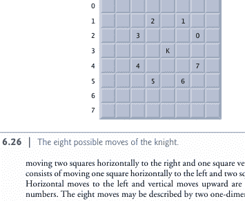

图 6.26 | 骑士的八种可能移动。

即向右水平移动两格并向上垂直移动一格。移动 2 由向左水平移动一格并向上垂直移动两格组成。向左的水平移动和向上的垂直移动用负数表示。这八种移动可以用两个一维数组 horizontal 和 vertical 来描述，如下所示：

```
horizontal[0] = 2
horizontal[1] = 1
horizontal[2] = -1
horizontal[3] = -2
horizontal[4] = -2
horizontal[5] = -1
horizontal[6] = 1
horizontal[7] = 2

vertical[0] = -1
vertical[1] = -2
vertical[2] = -2
vertical[3] = -1
vertical[4] = 1
vertical[5] = 2
vertical[6] = 2
vertical[7] = 1
```

让变量 currentRow 和 currentColumn 表示骑士在棋盘上当前位置的行和列。要执行类型为 moveNumber 的移动，其中 moveNumber 在 0 到 7 之间，你的程序使用以下语句：

```
currentRow += vertical[moveNumber];
currentColumn += horizontal[moveNumber];
```

保留一个从 1 到 64 变化的计数器。在骑士移动到的每个方格中记录最新的计数。记住要测试每个可能的移动，以查看骑士是否已经访问过该方格。当然，还要测试每个可能的移动，以确保骑士不会落到棋盘之外。现在编写一个程序，让骑士在棋盘上移动。运行该程序。骑士走了多少步？

c) 在尝试编写并运行骑士巡游程序之后，你可能会形成一些有价值的见解。我们将利用这些见解来开发一种移动骑士的启发式方法（或策略）。启发式方法并不能保证成功，但精心设计的启发式方法

极大地提高了成功的机会。你可能已经观察到，外围方格在某种意义上比靠近棋盘中心的方格更麻烦。事实上，最麻烦或者说最难到达的方格是四个角。

直觉可能表明，你应尝试先将骑士移动到最麻烦的方格，而把最容易到达的方格留空，这样当巡游接近尾声、棋盘变得拥挤时，成功的机会会更大。

我们通过根据每个方格的可访问程度对其进行分类，并始终将骑士移动到（当然是在骑士的 L 形移动范围内）最难到达的方格，来开发一种“可访问性启发式”。我们用一个二维数组 accessibility 来标记，其中的数字表示每个特定方格可从多少个方格到达。因此，在空棋盘上，中心方格被评为 8，角上方格被评为 2，其他方格的可访问性编号为 3、4 或 6，如下所示：

|   |   |   |   |   |   |   |   |
|---|---|---|---|---|---|---|---|
| 2 | 3 | 4 | 4 | 4 | 4 | 3 | 2 |
| 3 | 4 | 6 | 6 | 6 | 6 | 4 | 3 |
| 4 | 6 | 8 | 8 | 8 | 8 | 6 | 4 |
| 4 | 6 | 8 | 8 | 8 | 8 | 6 | 4 |
| 4 | 6 | 8 | 8 | 8 | 8 | 6 | 4 |
| 4 | 6 | 8 | 8 | 8 | 8 | 6 | 4 |
| 3 | 4 | 6 | 6 | 6 | 6 | 4 | 3 |
| 2 | 3 | 4 | 4 | 4 | 4 | 3 | 2 |

现在编写一个使用可访问性启发式的骑士巡游程序版本。在任何时候，骑士都应移动到可访问性编号最低的方格。如果出现并列，骑士可以移动到任何并列的方格。因此，巡游可以从四个角中的任意一个开始。[注意：当骑士在棋盘上移动时，随着越来越多的方格被占用，你的程序应减少可访问性编号。这样，在巡游期间的任何给定时刻，每个可用方格的可访问性编号将始终恰好等于可从多少个方格到达该方格。]运行这个版本的程序。你得到完整巡游了吗？[可选：修改程序，使其运行 64 次巡游，从棋盘的每个方格各开始一次。你得到了多少次完整巡游？]

- d) 编写一个骑士巡游程序版本，当遇到两个或多个方格之间的并列时，通过向前查看从这些“并列”方格可到达的方格来决定选择哪个方格。你的程序应移动到这样一个方格：从该方格进行的下一步将到达可访问性编号最低的方格。

## 6.25（骑士巡游：蛮力方法）

在练习 6.24 中，我们开发了骑士巡游问题的一个解决方案。所使用的方法称为“可访问性启发式”，它能生成许多解并且执行效率高。

随着计算机能力不断增强，我们将能够凭借纯粹的计算机能力和相对不复杂的算法来解决许多问题。我们把这种方法称为蛮力问题求解。

- a) 使用随机数生成，使骑士在棋盘上随机行走（当然是在其合法的 L 形移动范围内）。你的程序应运行一次巡游并打印最终的棋盘。骑士走了多远？
- b) 前面的程序很可能产生了一次相对较短的巡游。现在修改你的程序，尝试 1,000 次巡游。使用一个一维数组记录每种长度的巡游次数。当你的程序完成 1000 次巡游的尝试后，应以表格形式打印这些信息。最好的结果是什么？
- c) 现在“全力以赴”，直接让你的程序运行，直到它产生一次完整巡游。[警告：这个版本的程序在一台强大的计算机上可能运行数小时。]再次记录每种长度的巡游次数表，并在找到第一次完整巡游时打印该表。你的程序在产生一次完整巡游之前尝试了多少次巡游？花了多少时间？
- d) 比较骑士巡游的蛮力版本与可访问性启发式版本。哪一个需要对问题进行更仔细的研究？哪个算法更难开发？哪个需要更多计算机能力？我们能否（事先）确定使用可访问性启发式方法获得完整巡游？我们能否（事先）确定使用蛮力方法获得完整巡游？总体论述蛮力问题求解的优缺点。

## 6.26（八皇后）

国际象棋爱好者另一个谜题是八皇后问题。简单地说：是否有可能在空棋盘上放置八个皇后，使得没有皇后“攻击”任何其他皇后——也就是说，没有两个皇后位于同一行、同一列或同一对角线上？运用练习 6.24 中发展出的那种思维来构造一个求解八皇后问题的启发式方法。运行你的程序。[提示：可以为棋盘的每个方格赋予一个数值，表示一旦在该方格放置一个皇后，空棋盘上有多少个方格被“消除”。例如，四个角上的每个方格都会被赋予值 22，如图 6.27 所示。]

一旦这些“消除数”被放入全部 64 个方格中，一个合适的启发式方法可能是：将下一个皇后放在消除数最小的方格中。为什么这种策略在直觉上有吸引力？

## 6.27（八皇后：蛮力方法）

在本问题中，你将开发几种蛮力方法来求解练习 6.26 中介绍的八皇后问题。

- a) 使用练习 6.25 中开发的随机蛮力技术求解八皇后问题。

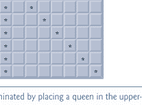

**图 6.27** | 在上左角放置一个皇后所消除的22个方格。

- b) 使用穷举技术（即尝试棋盘上八个皇后的所有可能组合）。
- c) 你认为为什么穷举蛮力方法可能不适合求解八皇后问题？
- d) 总体上比较和对比随机蛮力方法与穷举蛮力方法。

## 6.28（重复消除）

在第 12 章中，我们探讨高速二叉搜索树数据结构。二叉搜索树的一个特性是，在向树中插入时，重复值会被丢弃。这称为重复消除。编写一个程序，生成 20 个 1 到 20 之间的随机数。程序应将所有非重复值存储在一个数组中。使用尽可能小的数组来完成此任务。

## 递归练习

### 6.29（骑士巡游：闭合巡游测试）

在骑士巡游中，当骑士进行 64 次移动并恰好一次触及棋盘的每个方格时，就出现完整巡游。当第 64 次移动与骑士开始巡游的位置相距一步时，就出现闭合巡游。修改你在练习 6.24 中编写的骑士巡游程序，以便在出现完整巡游时测试是否为闭合巡游。

### 6.30（埃拉托斯特尼筛法）

素数整数是任何大于 1 且只能被自身和 1 整除的整数。埃拉托斯特尼筛法是一种寻找素数的方法。其工作原理如下：

- a) 创建一个数组，将所有元素初始化为 1（真）。索引为素数的数组元素将保持为 1。所有其他数组元素最终将被置为零。
- b) 从数组索引 2 开始（索引 2 是素数），每当发现某个数组元素的值为 1 时，就遍历数组的剩余部分，并将索引为那个值为 1 的元素的索引的倍数的每个元素置为零。对于数组索引 2，数组中 2 之后所有为 2 的倍数的元素都将被置为零（索引 4、6、8、10 等）。对于数组索引 3，数组中 3 之后所有为 3 的倍数的元素都将被置为零（索引 6、9、12、15 等）。

当这个过程完成时，仍然设置为 1 的数组元素表示其索引是素数。编写一个程序，使用一个包含 1,000 个元素的数组来确定并打印 1 到 999 之间的素数。忽略数组的元素 0。

### 6.31（回文）

回文是一个正读和反读拼写都相同的字符串。回文的一些例子有：“radar”、“able was I ere I saw elba”，以及如果忽略空格，“a man a plan a canal panama”。编写一个递归函数 testPalindrome，如果数组中存储的字符串是回文则返回 1，否则返回 0。该函数应忽略字符串中的空格和标点符号。

### 6.32（线性查找）

修改图 6.18 的程序，使用递归函数 linearSearch 对数组执行线性查找。该函数应接收一个整数数组、数组大小和查找键作为参数。如果找到查找键，则返回数组索引；否则返回 –1。

### 6.33（二分查找）

修改图 6.19 的程序，使用递归函数 binarySearch 对数组执行二分查找。该函数应接收一个整数数组、起始索引、结束索引和查找键作为参数。如果找到查找键，则返回数组索引；否则返回 –1。

### 6.34（八皇后）

修改你在练习 6.26 中创建的八皇后程序，以递归方式求解该问题。

### 6.35（打印数组）

编写一个递归函数 printArray，它接收一个数组和数组大小作为参数，打印该数组，并且不返回任何值。当该函数接收到大小为 0 的数组时，应停止处理并返回。

### 6.36（反向打印字符串）

编写一个递归函数 stringReverse，它接收一个字符数组作为参数，从后向前打印它，并且不返回任何值。当遇到字符串的终止空字符时，该函数应停止处理并返回。

### 6.37（查找数组中的最小值）

编写一个递归函数 recursiveMinimum，它接收一个整数数组和数组大小作为参数，并返回数组中的最小元素。当该函数接收到一个只含一个元素的数组时，应停止处理并返回。


## C 指针
### 目标

在本章中，你将：

- 使用指针和指针运算符。
- 使用指针通过引用向函数传递参数。
- 理解 const 限定符的各种放置位置以及它们如何影响你对变量的操作。
- 使用 sizeof 运算符处理变量和类型。
- 使用指针算术处理数组中的元素。
- 理解指针、数组和字符串之间的密切关系。
- 定义和使用字符串数组。
- 使用函数指针。
- 了解与指针相关的安全 C 编程问题。

- 7.1 简介
- 7.2 指针变量定义和初始化
- 7.3 指针运算符
- 7.4 通过引用向函数传递参数
- 7.5 使用指针时的 const 限定符
- 7.5.1 使用指向非常量数据的非常量指针将字符串转换为大写
- 7.5.2 使用指向常量数据的非常量指针逐字符打印字符串
- 7.5.3 尝试修改指向非常量数据的常量指针
- 7.5.4 尝试修改指向常量数据的常量指针
- 7.6 使用传引用进行冒泡排序
- 7.7 sizeof 运算符
- 7.8 指针表达式和指针算术
- 7.8.1 指针算术允许的运算符
- 7.8.2 将指针指向数组
- 7.8.3 向指针添加整数
- 7.8.4 从指针中减去整数
- 7.8.5 递增和递减指针
- 7.8.6 从一个指针中减去另一个指针
- 7.8.7 将指针相互赋值
- 7.8.8 void 指针
- 7.8.9 比较指针
- 7.9 指针与数组之间的关系
- 7.9.1 指针/偏移表示法
- 7.9.2 指针/索引表示法
- 7.9.3 不能用指针算术修改数组名
- 7.9.4 演示指针索引和偏移
- 7.9.5 使用数组和指针进行字符串复制
- 7.10 指针数组
- 7.11 案例研究：洗牌和发牌模拟
- 7.12 函数指针
- 7.12.1 按升序或降序排序
- 7.12.2 使用函数指针创建菜单驱动系统
- 7.13 安全 C 编程
- 摘要 | 自测练习 | 自测练习答案 | 练习
- 特别章节：构建自己的计算机 | 函数指针数组练习 | 做出改变

## 7.1 简介

在本章中，我们讨论 C 编程语言最强大的功能之一——指针。¹ 指针是 C 语言中最难掌握的功能之一。指针使程序能够实现传引用、在函数之间传递函数，以及创建和操作动态数据结构——这些结构可以在执行时增长和缩小，例如链表、队列、栈和树。本章解释了基本的指针概念。在第 7.13 节中，我们讨论各种与指针相关的安全问题。第 10 章研究了指针与结构体的使用。第 12 章介绍了动态内存管理技术，并提供了创建和使用动态数据结构的示例。

1. 指针和基于指针的实体（如数组和字符串），当被故意或意外误用时，可能导致错误和安全漏洞。请参阅我们的安全 C 编程资源中心（www.deitel.com/SecureC/），获取有关这一重要主题的文章、书籍、白皮书和论坛。

## 7.2 指针变量定义和初始化

指针是其值是内存地址的变量。通常，变量直接包含一个特定值。然而，指针包含一个包含特定值的变量的地址。从这个意义上说，变量名直接引用一个值，而指针间接引用一个值（图 7.1）。通过指针引用值称为间接引用。


图 7.1 | 直接和间接引用变量。

### 声明指针

指针像所有变量一样，必须在使用前定义。定义

```
int *countPtr, count;
```

指定变量 countPtr 的类型为 int *（即指向整数的指针），读法（从右到左）为“countPtr 是指向 int 的指针”或“countPtr 指向类型为 int 的对象”。此外，变量 count 被定义为 int，而不是指向 int 的指针。* 在定义中仅适用于 countPtr。当 * 在定义中以这种方式使用时，表示正在定义的变量是指针。指针可以被定义为指向任何类型的对象。为了防止如上所示在同一声明中声明指针和非指针变量的歧义，你应始终每个声明只声明一个变量。

常见编程错误 7.1
用于声明指针变量的星号 (*) 记法不会分布到声明中的所有变量名。每个指针都必须用 * 前缀于名称声明；例如，如果你想将 xPtr 和 yPtr 声明为 int 指针，使用 int *xPtr, *yPtr;

良好编程实践 7.1
我们更喜欢在指针变量名中包含字母 Ptr，以明确这些变量是指针，需要适当处理。

### 初始化和为指针赋值

指针应在定义时初始化，或可以赋一个值。指针可以初始化为 NULL、0 或一个地址。值为 NULL 的指针不指向任何东西。NULL 是在 <stddef.h> 头文件中（以及其他几个头文件，如 <stdio.h>）定义的符号常量。将指针初始化为 0 等同于将指针初始化为 NULL，但 NULL 更受青睐，因为它强调了该变量是指针类型。当赋值为 0 时，它首先被转换为适当类型的指针。值 0 是唯一可以直接赋给指针变量的整数值。将变量的地址赋给指针在第 7.3 节中讨论。

2. 在 C 中，“对象”是可以保存值的内存区域。因此，C 中的对象包括 int、float、char 和 double 等基本类型，以及数组和结构体等聚合类型（我们在第 10 章中讨论）。

### 错误预防提示 7.1

初始化指针以防止意外结果。

## 7.3 指针运算符

在本节中，我们介绍地址 (&) 和间接 (*) 运算符，以及它们之间的关系。

### 地址 (&) 运算符

&，或地址运算符，是一个一元运算符，返回其操作数的地址。例如，假设定义

```
int y = 5;
int *yPtr;
```

语句

```
yPtr = &y;
```

将变量 y 的地址赋给指针变量 yPtr。变量 yPtr 此时被称为“指向”y。图 7.2 显示了执行前述赋值后内存的示意表示。

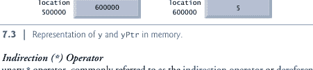

### 内存中的指针表示

图 7.3 显示了前述指针在内存中的表示，假设整数变量 y 存储在位置 600000，指针变量 yPtr 存储在位置 500000。地址运算符的操作数必须是变量；地址运算符不能应用于常量或表达式。

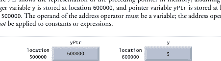

### 间接 (*) 运算符

一元 * 运算符，通常称为间接运算符或解引用运算符，返回其操作数（即指针）所指向的对象的 value。例如，语句

printf( "%d", *yPtr );

打印变量 y 的值（5）。以这种方式使用 * 称为解引用指针。

常见编程错误 7.2

解引用未正确初始化或未被赋值为指向内存中特定位置的指针是错误。这可能导致致命的执行时错误，或者意外修改重要数据并使程序以错误结果运行完成。

### 演示 & 和 * 运算符

图 7.4 演示了指针运算符 & 和 *。printf 转换说明符 %p 在大多数平台上将内存位置作为十六进制整数输出。（参见附录 C 了解有关十六进制整数的更多信息。）在程序的输出中，注意 a 的地址和 aPtr 的值在输出中是相同的，从而确认 a 的地址确实被赋给了指针变量 aPtr（第 8 行）。& 和 * 运算符互为补数——当它们以任一顺序连续应用于 aPtr 时（第 18 行），打印出相同的结果。输出中显示的地址在不同系统上会有所不同。图 7.5 列出了到目前为止介绍的运算符的优先级和结合性。

```
1 // Fig. 7.4: fig07_04.c
2 // Using the & and * pointer operators.
3 #include <stdio.h>
4
5 int main(void)
6 {
7    int a = 7;
8    int *aPtr = &a; // set aPtr to the address of a
9
10   printf("The address of a is %p\n"
11          "The value of aPtr is %p\n", &a, aPtr);
12
13   printf("\nThe value of a is %d\n"
14          "The value of *aPtr is %d\n", a, *aPtr);
15
16   printf("\n\nShowing that & and * are complements of "
17          "each other\n*aPtr = %p\n"
18          "\n&*aPtr = %p\n", *&aPtr, &*aPtr);
19 }
```

```
The address of a is 0028FEC0
The value of aPtr is 0028FEC0

The value of a is 7
The value of *aPtr is 7

Showing that & and * are complements of each other
&*aPtr = 0028FEC0
*&aPtr = 0028FEC0
```

图 7.4 | 使用 & 和 * 指针运算符。


| Operators | Associativity | Type |
|---|---|---|
| () [] ++ (后缀) -- (后缀) | 从左到右 | 后缀 |
| * & + - ++ -- ! ~ (类型) | 从左到右 | 一元 |
| * / % | 从左到右 | 乘法 |
| + - | 从左到右 | 加法 |
| < <= > >= | 从左到右 | 关系 |
| == != | 从左到右 | 相等 |
| && | 从左到右 | 逻辑与 |
| || | 从左到右 | 逻辑或 |
| ?: | 从右到左 | 条件 |
| = += -= *= /= %= | 从右到左 | 赋值 |
| , | 从左到右 | 逗号 |

Fig. 7.5 | 到目前为止讨论过的运算符的优先级和结合性。

## 7.4 通过引用向函数传递参数

有两种向函数传递参数的方式——按值传递和按引用传递。然而，C 中的所有参数都是按值传递的。函数通常需要能够修改调用方中的变量或接收指向大型数据对象的指针，以避免按值接收对象带来的开销（这会产生复制对象所需的时间和内存开销）。正如我们在第 5 章中所看到的，return 可用于从被调用函数向调用方返回一个值（或在不返回值的情況下从被调用函数返回控制）。按引用传递还可用于使函数通过修改调用方中的变量来向其调用方“返回”多个值。

### 使用 & 和 * 实现按引用传递

在 C 中，你使用指针和间接运算符来实现按引用传递。当调用一个需要修改参数的函数时，会传递参数的地址。这通常是通过对将被修改的变量（在调用方中）应用地址运算符（&）来完成的。正如我们在第 6 章中所看到的，数组不会使用运算符 & 传递，因为 C 会自动传递数组在内存中的起始位置（数组名等价于 &arrayName[0]）。当变量的地址传递给函数时，函数中可以使用间接运算符（*）来修改调用方内存中该位置的值。

### 按值传递

Figs. 7.6 和 7.7 中的程序展示了对整数进行立方运算的函数的两个版本——cubeByValue 和 cubeByReference。Fig. 7.6 的第 14 行按值将变量 number 传递给函数 cubeByValue。cubeByValue 函数对其参数进行立方运算，并使用 return 语句将新值传回 main。main 中（第 14 行）将新值赋给 number。

```
int number = 5; // initialize number

printf("The original value of number is %d", number);

// pass address of number to cubeByReference
cubeByReference(&number);

printf("\nThe new value of number is %d\n", number);
}
```

```
// calculate cube of *nPtr; actually modifies number in main
void cubeByReference(int *nPtr)
{
    *nPtr = *nPtr * *nPtr * *nPtr; // cube *nPtr
}
```

number 的原始值是 5
number 的新值是 125

Fig. 7.7 | 使用指针参数通过引用传递对变量进行立方运算。（第 2 部分之 2。）

### 使用指针参数接收地址

接收地址作为参数的函数必须定义一个指针参数来接收该地址。例如，在 Fig. 7.7 中，函数 cubeByReference 的头（第 21 行）为：

```
void cubeByReference(int *nPtr)
```

该头指定 cubeByReference 接收一个整数变量的地址作为参数，将地址本地存储在 nPtr 中且不返回值。

### 函数原型中的指针参数

cubeByReference 的函数原型（Fig. 7.7，第 6 行）指定了一个 int * 参数。与其他变量类型一样，在函数原型中包含指针的名称不是必需的。为文档目的而包含的名称会被 C 编译器忽略。

### 接收一维数组的函数

对于期望一维数组作为参数的函数，其函数原型和头可以使用函数 cubeByReference 参数列表（第 21 行）中所示的指针表示法。编译器不会区分接收指针的函数和接收一维数组的函数。这当然意味着函数必须“知道”它是在接收数组还是仅接收一个要执行按引用传递的单个变量。当编译器遇到形如 int b[] 的一维数组函数参数时，编译器会将该参数转换为指针表示法 int *b。这两种形式可以互换。

### 错误预防提示 7.2

除非调用方明确要求被调用函数修改调用方环境中参数变量的值，否则应使用按值传递将参数传递给函数。这可以防止意外修改调用方的参数，也是最小权限原则的另一个例子。

步骤 1：在 main 调用 cubeByValue 之前：

```
~~~c
int main(void)
{
    int number = 5;
    number = cubeByValue(number);
}
// number: 5
~~~
```

```
~~~c
int cubeByValue(int n)
{
    return n * n * n;
}
// n: undefined
~~~
```

步骤 2：在 cubeByValue 接收调用之后：

```
~~~c
int main(void)
{
    int number = 5;
    number = cubeByValue(number);
}
// number: 5
~~~
```

```
~~~c
int cubeByValue(int n)
{
    return n * n * n;
}
// n: 5
~~~
```

步骤 3：在 cubeByValue 对参数 n 进行立方运算之后且在返回 main 之前：

```
~~~c
int main(void)
{
    int number = 5;
    number = cubeByValue(number);
}
// number: 5
~~~
```

```
~~~c
int cubeByValue(int n)
{
    return n * n * n; // 125
}
// n: 5
~~~
```

步骤 4：在 cubeByValue 返回到 main 之后且在将结果赋给 number 之前：

```
~~~c
int main(void)
{
    int number = 5;
    number = cubeByValue(number); // 125
}
// number: 5
~~~
```

```
~~~c
int cubeByValue(int n)
{
    return n * n * n;
}
// n: undefined
~~~
```

步骤 5：在 main 完成对 number 的赋值之后：

```
~~~c
int main(void)
{
    int number = 5;
    number = cubeByValue(number); // 125
}
// number: 125
~~~
```

```
~~~c
int cubeByValue(int n)
{
    return n * n * n;
}
// n: undefined
~~~
```

Fig. 7.8 | 典型的按值传递分析。

## **_const 值和参数_**

在第 5 章中，我们解释了 **C 中的所有函数调用都是按值传递**——函数调用中的参数副本会被制作并传递给函数。如果在函数中修改了副本，调用方中的原始值不会改变。在许多情况下，传递给函数的值会被修改，以便函数完成其任务。然而，在某些情况下，即使它只操作原始值的 *副本*，该值也不应在被调用函数中被更改。

考虑一个函数，它将一维数组及其大小作为参数并打印该数组。这样的函数应遍历数组并逐个输出每个数组元素。数组的大小在函数体中用于确定循环何时终止。数组的大小及其内容在函数体内都不应改变。


> > **错误预防提示 7.3**  
> > 如果一个变量在传递给它的函数体中不（或不应）改变，该变量应声明为 `const` 以确保它不会被意外修改。

如果尝试修改声明为 const 的值，编译器会捕获它并根据特定编译器发出警告或错误。


> > **常见编程错误 7.3**  
> > 不知道函数期望指针作为按引用传递的参数而按值传递参数。某些编译器会将值作为指针参数接收并将值作为指针解引用。在运行时，通常会生成内存访问违规或段错误。其他编译器会捕获参数和参数之间的类型不匹配并生成错误消息。

有四种方法可以将指针传递给函数：

- 非常量指针指向非常量数据。
- 常量指针指向非常量数据。
- 非常量指针指向常量数据。
- 常量指针指向常量数据。

这四种组合提供了不同的访问权限，并在接下来的几个示例中进行讨论。

### 7.5.1 使用非常量指针指向非常量数据将字符串转换为大写

非常量指针指向非常量数据提供了最高级别的数据访问。在这种情况下，可以通过解引用的指针修改数据，并且指针可以被修改以指向其他数据项。非常量指针指向非常量数据的声明不包含 const。这样的指针可能用于接收字符串作为参数传递给处理（并可能修改）字符串中每个字符的函数。Fig. 7.10 的函数 convertToUppercase 在第 19 行声明了其参数，一个名为 sPtr 的非常量指针指向非常量数据（char *sPtr）。该函数一次处理一个字符地处理由 sPtr 指向的数组字符串。C 标准库函数

toupper（第 22 行）来自 <ctype.h> 头文件被调用来将每个字符转换为其对应的大写字母——如果原始字符不是字母或已是大写，则 toupper 返回原始字符。第 23 行将指针移动到字符串中的下一个字符。第 8 章介绍了许多 C 标准库的字符和字符串处理函数。

```
1 // Fig. 7.10: fig07_10.c
2 // Converting a string to uppercase using a
3 // non-constant pointer to non-constant data.
4 #include <stdio.h>
5 #include <ctype.h>
6
7 void convertToUppercase(char *sPtr); // prototype
8
9 int main(void)
10 {
11     char string[] = "chArA cters and $32.98"; // initialize char array
12
13     printf("The string before conversion is: %s", string);
14     convertToUppercase(string);
15     printf("\nThe string after conversion is: %s\n", string);
16 }
17 // convert string to uppercase letters
18 void convertToUppercase(char *sPtr)
19 {
20     while (*sPtr != '\0') { // current character is not '\0'
21         *sPtr = toupper(*sPtr); // convert to uppercase
22         ++sPtr; // make sPtr point to the next character
23     }
24 }
```

转换前的字符串是: chArA cters and $32.98
转换后的字符串是: CHARACTERS AND $32.98

图 7.10 | 使用指向非常量数据的非常量指针将字符串转换为大写。

## 7.5.2 使用指向常量数据的非常量指针逐个字符打印字符串

指向常量数据的非常量指针可以被修改以指向任何适当类型的数据项，但其所指向的数据不能被修改。这种指针可用于接收数组参数传递给一个函数，该函数将处理每个元素而不修改该元素。例如，函数 printCharacters（图 7.11）在第 21 行将参数 sPtr 声明为类型 const char *。该声明从右到左读作“sPtr 是指向字符常量的指针。”该函数使用 for 语句输出字符串中的每个字符，直到遇到空字符。打印每个字符后，指针 sPtr 会递增——这使得指针移动到字符串中的下一个字符。

```
~~~c
// Fig. 7.11: fig07_11.c
// Printing a string one character at a time using
// a non-constant pointer to constant data.

#include <stdio.h>

void printCharacters(const char *sPtr);

int main(void)
{
   // initialize char array
   char string[] = "print characters of a string";

   puts("The string is:");
   printCharacters(string);
   puts("");
}

// sPtr cannot be used to modify the character to which it points,
// i.e., sPtr is a "read-only" pointer
void printCharacters(const char *sPtr)
{
   // loop through entire string
   for (; *sPtr != '\0'; ++sPtr) { // no initialization
      printf("%c", *sPtr);
   }
}
~~~
```

```
~~~
The string is:
print characters of a string
~~~
```

**图 7.11** | 使用指向常量数据的非常量指针逐个字符打印字符串。

图 7.12 说明了尝试编译一个接收指向常量数据的非常量指针（xPtr）的函数的尝试。该函数在第 18 行尝试修改 xPtr 所指向的数据——这会导致编译错误。所示错误来自 Visual C++ 编译器。你实际收到的错误消息（在此和其他示例中）是编译器特定的——例如，Xcode 的 LLVM 编译器报告的错误是：

> > "Read-only variable is not assignable"

而 GNU gcc 编译器报告的错误是：

> > error: assignment of read-only location '*xPtr'

```
~~~c
// Fig. 7.12: fig07_12.c
// Attempting to modify data through a
// non-constant pointer to constant data.
~~~
```

**图 7.12** | 通过指向常量数据的非常量指针尝试修改数据。（第 1 部分，共 2 部分。）

```
#include <stdio.h>
void f(const int *xPtr); // prototype

int main(void)
{
    int y; // define y

    f(&y); // f attempts illegal modification
}

// xPtr cannot be used to modify the
// value of the variable to which it points
void f(const int *xPtr)
{
    *xPtr = 100; // error: cannot modify a const object
}
```

错误 C2166：左值指定 const 对象

图 7.12 | 通过指向常量数据的非常量指针尝试修改数据。（第 2 部分，共 2 部分。）

正如你所知，数组是聚合数据类型，用于在同一名称下存储相同类型相关的多个数据项。在第 10 章，我们将讨论另一种聚合数据类型，称为结构（在其他语言中有时称为记录或元组）。结构能够在同一名称下存储相同或不同数据类型的相关数据项（例如，存储公司每个员工的信息）。当函数以数组作为参数调用时，数组会自动按引用传递给函数。然而，结构总是按值传递——整个结构的副本会被传递。这需要执行时开销，即复制结构中的每个数据项并将其存储在计算机的函数调用栈上。当结构数据必须传递给函数时，我们可以使用指向常量数据的指针来获得按引用传递的性能和按值传递的保护。当传递指向结构的指针时，只需复制结构存储位置的地址副本。在地址为四字节的机器上，会复制四字节的内存，而不是可能的大型结构的副本。

性能提示 7.1
使用指向常量数据的指针传递结构等大型对象可获得按引用传递的性能优势和按值传递的安全性。

如果内存不足且执行效率是关注点，请使用指针。如果内存充足且效率不是主要关注点，则按值传递数据以强制执行最小权限原则。请记住，并非所有系统都很好地强制执行 const，因此按值传递仍然是防止数据被修改的最佳方式。

## 7.5.3 尝试修改指向非常量数据的常量指针

指向非常量数据的常量指针始终指向同一内存位置，并且该位置的数据可以通过指针进行修改。这是数组名称的默认值。数组名称是指向数组开头的常量指针。数组中的所有数据都可以通过使用数组名称和数组索引进行访问和更改。指向非常量数据的常量指针可用于接收数组作为函数参数，该函数仅使用数组索引表示法访问数组元素。声明为 const 的指针必须在定义时初始化（如果指针是函数参数，则它会用传递给函数的指针进行初始化）。图 7.13 尝试修改一个常量指针。指针 ptr 在第 12 行被定义为类型 int * const。该定义从右到左读作“ptr 是指向整数的常量指针。”指针在第 12 行用整数变量 x 的地址进行初始化。程序尝试将 y 的地址赋给 ptr（第 15 行），但编译器会生成错误消息。

```
```c
1  // Fig. 7.13: fig07_13.c
2  // Attempting to modify a constant pointer to non-constant data.
3  #include <stdio.h>
4
5  int main(void)
6  {
7     int x; // define x
8     int y; // define y
9
10    // ptr is a constant pointer to an integer that can be modified
11    // through ptr, but ptr always points to the same memory location
12    int * const ptr = &x;
13
14    *ptr = 7; // allowed: *ptr is not const
15    ptr = &y; // error: ptr is const; cannot assign new address
16 }
```
```

```
```text
c:\examples\ch07\fig07_13.c(15) : error C2166: l-value specifies const object
```
```

**图 7.13** | 尝试修改指向非常量数据的常量指针。

### 7.5.4 尝试修改指向常量数据的常量指针

最少的访问权限由指向常量数据的常量指针授予。这种指针始终指向同一内存位置，并且该内存位置的数据*不能被修改*。这就是数组应如何传递给仅使用数组索引表示法查看数组且不修改数组的函数的方式。图 7.14 将指针变量 *ptr*（第 13 行）定义为类型 `const int *const`，从右到左读作“ptr 是指向整数常量的常量指针。”该图显示了当尝试*修改* *ptr* 所指向的*数据*（第 16 行）时以及当尝试*修改*指针变量中存储的*地址*（第 17 行）时生成的错误消息。

```
```c
1 // Fig. 7.14: fig07_14.c
2 // Attempting to modify a constant pointer to constant data.
3 #include <stdio.h>
4
```
```

**图 7.14** | 尝试修改指向常量数据的常量指针。（第 1 部分，共 2 部分。）


```c
5  int main(void)
6  {
7      int x = 5; // initialize x
8      int y; // define y
9
10     // ptr is a constant pointer to a constant integer. ptr always
11     // points to the same location; the integer at that location
12     // cannot be modified
13     const int *const ptr = &x; // initialization is OK
14
15     printf("%d\n", *ptr);
16     *ptr = 7; // error: *ptr is const; cannot assign new value
17     ptr = &y; // error: ptr is const; cannot assign new address
18 }
```

**图 7.14** | 尝试修改指向常量数据的常量指针。（第 2 部分，共 2 部分）

## 7.6 使用按引用传递的冒泡排序³

让我们改进图 6.15 中的冒泡排序程序，使其使用两个函数——`bubbleSort` 和 `swap`（图 7.15）。函数 `bubbleSort` 对数组进行排序。它调用函数 `swap`（第 46 行）来交换数组元素 `array[j]` 和 `array[j + 1]`。

```c
1  // Fig. 7.15: fig07_15.c
2  // Putting values into an array, sorting the values into
3  // ascending order and printing the resulting array.
4  #include <stdio.h>
5  #define SIZE 10
6
7  void bubbleSort(int * const array, const size_t size); // prototype
8
9  int main(void)
10 {
11     // initialize array a
12     int a[SIZE] = { 2, 6, 4, 8, 10, 12, 89, 68, 45, 37 };
13
14     puts("Data items in original order");
15
16     // loop through array a
17     for (size_t i = 0; i < SIZE; ++i) {
18         printf("%4d", a[i]);
19     }
20
21     bubbleSort(a, SIZE); // sort the array
22
23     puts("\nData items in ascending order");
24
25     // loop through array a
26     for (size_t i = 0; i < SIZE; ++i) {
27         printf("%4d", a[i]);
28     }
29
30     puts("");
31 }
32
33 // sort an array of integers using bubble sort algorithm
34 void bubbleSort(int * const array, const size_t size)
35 {
36     void swap(int *element1Ptr, int *element2Ptr); // prototype
37
38     // loop to control passes
39     for (unsigned int pass = 0; pass < size - 1; ++pass) {
40
41         // loop to control comparisons during each pass
42         for (size_t j = 0; j < size - 1; ++j) {
43
44             // swap adjacent elements if they're out of order
45             if (array[j] > array[j + 1]) {
46                 swap(&array[j], &array[j + 1]);
47             }
48         }
49     }
50 }
51
52 // swap values at memory locations to which element1Ptr and
53 // element2Ptr point
54 void swap(int *element1Ptr, int *element2Ptr)
55 {
56     int hold = *element1Ptr;
57     *element1Ptr = *element2Ptr;
58     *element2Ptr = hold;
59 }
```

```text
Data items in original order
    2    6    4    8   10   12   89   68   45   37
Data items in ascending order
    2    4    6    8   10   12   37   45   68   89
```

**图 7.15** | 将值放入数组，将值按升序排序并打印结果数组。（第 1 部分和第 2 部分）

- 3. 在第 12 章和附录 D 中，我们研究能产生更好性能的排序方案。

### 函数 *swap*

请记住，C 在函数之间强制执行信息隐藏，因此 *swap* 默认无法访问 *bubbleSort* 中的单个数组元素。因为 *bubbleSort* 希望 *swap* 能访问要交换的数组元素，所以 *bubbleSort* 通过引用将每个这些元素传递给 *swap*——每个数组元素的地址被显式传递。尽管整个数组会自动按引用传递，但单个数组元素是 *标量*，通常按值传递。因此，*bubbleSort* 在 *swap* 调用（第 46 行）中对每个数组元素使用地址运算符（`&`），以实现按引用传递，如下所示：

```c
swap(&array[j], &array[j + 1]);
```

函数 *swap* 在 `element1Ptr`（第 54 行）中接收 `&array[j]`。尽管 *swap*——由于信息隐藏——不允许知道名称 `array[j]`，但 *swap* 可以使用 `*element1Ptr` 作为 `array[j]` 的同义词——当 *swap* 访问 `*element1Ptr` 时，它实际上引用的是 *bubbleSort* 中的 `array[j]`。类似地，当 *swap* 访问 `*element2Ptr` 时，它实际上引用的是 *bubbleSort* 中的 `array[j + 1]`。尽管 *swap* 不允许这样写

```c
int hold = array[j];
array[j] = array[j + 1];
array[j + 1] = hold;
```

第 56 行至第 58 行实现了完全相同的效果：

```c
int hold = *element1Ptr;
*element1Ptr = *element2Ptr;
*element2Ptr = hold;
```

### 函数 *bubbleSort* 的数组参数

应注意函数 *bubbleSort* 的几个特性。函数头（第 34 行）将 `array` 声明为 `int * const array`，而不是 `int array[]`，以表明 *bubbleSort* 接收一维数组作为参数（同样，这些表示法可以互换）。参数 `size` 被声明为 `const`，以强制执行最小权限原则。尽管参数 `size` 接收 `main` 中某个值的副本，并且修改该副本不能改变 `main` 中的值，但 *bubbleSort* 不需要修改 `size` 来完成其任务。数组的大小在函数 *bubbleSort* 执行期间保持不变。因此，`size` 被声明为 `const`，以确保它不会被修改。

### 函数 *swap* 的原型位于函数 *bubbleSort* 的函数体中

函数 *swap* 的原型（第 36 行）包含在函数 *bubbleSort* 的函数体中，因为 *bubbleSort* 是唯一调用 *swap* 的函数。将原型放在 *bubbleSort* 中，可将 *swap* 的正确调用限制为从 *bubbleSort*（或源代码中出现在 *swap* 之后的任何函数）发起的调用。在 *swap* 之前定义的其他函数如果尝试调用 *swap*，则无法访问正确的函数原型，因此编译器会自动生成一个原型。这通常会导致原型与函数头不匹配（并产生编译警告或错误），因为编译器假定返回类型和参数类型为 `int`。

> **软件工程观察 7.2**
>
> *将函数原型放在其他函数的定义中，通过将正确函数调用限制为原型所在的函数，来强制执行最小权限原则。*

### 函数 *bubbleSort* 的 *size* 参数

函数 *bubbleSort* 接收数组的大小作为参数（第 34 行）。函数必须知道数组的大小才能对数组排序。当数组传递给函数时，函数接收数组第一个元素的内存地址。当然，地址并不传达数组中元素的数量。因此，必须将数组大小传递给函数。另一种常见做法是传递指向数组开头的指针和指向数组末尾之后位置的指针——正如你将在 7.8 节中了解到的，两个指针之差就是数组的长度，并且生成的代码更简单。

在该程序中，数组的大小被显式传递给函数 `bubbleSort`。这种方法有两个主要优点——*软件可重用性* 和 *正确的软件工程*。通过将函数定义为接收数组大小作为参数，我们使该函数可供任何对任意大小的一维整数数组进行排序的程序使用。

> **软件工程观察 7.3**
>
> *将数组传递给函数时，也要传递数组的大小。这有助于使函数在许多程序中可重用。*

我们本可以将数组的大小存储在一个整个程序都可访问的全局变量中。这样会更高效，因为不需要制作大小的副本传递给函数。然而，其他需要整数数组排序能力的程序可能没有相同的全局变量，因此该函数无法在这些程序中使用。

> **软件工程观察 7.4**
>
> *全局变量通常违反最小权限原则，并可能导致糟糕的软件工程。全局变量应仅用于表示真正共享的资源，例如一天中的时间。*

数组的大小本可以直接编程到函数中。这会将该函数的使用限制为特定大小的数组，并显著降低其可重用性。只有处理编码到函数中的特定大小的一维整数数组的程序才能使用该函数。

## 7.7 `sizeof` 运算符

C 提供了特殊的单目运算符 `sizeof` 来确定数组（或任何其他数据类型）的大小（以字节为单位）。该运算符在编译时应用，除非其操作数是变长数组（6.12 节）。当应用于数组名时，如图 7.16（第 15 行）所示，`sizeof` 运算符以 `size_t` 类型返回数组中字节总数。<sup>4</sup> 在此计算机上，`float` 类型的变量存储在 4 字节内存中，而 `array` 被定义为有 20 个元素。因此，`array` 中总共有 80 字节。

> **性能提示 7.2**
>
> *`sizeof` 是编译时运算符，因此不会产生任何执行时开销。*

- 4. 回想一下，在 Mac 上 `size_t` 表示 `unsigned long`。当你在 `printf` 中使用 `"%u"` 显示 unsigned long 时，Xcode 会报告警告。要消除这些警告，请改用 `"%lu"`。


```c
// Fig. 7.16: fig07_16.c
// Applying sizeof to an array name returns
// the number of bytes in the array.
#include <stdio.h>
#define SIZE 20

size_t getSize(float *ptr); // prototype

int main(void)
{
    float array[SIZE]; // create array

    printf("The number of bytes in the array is %u\n"
           "The number of bytes returned by getSize is %u\n",
           sizeof(array), getSize(array));
}

// return size of ptr
size_t getSize(float *ptr)
{
    return sizeof(ptr);
}
```

The number of bytes in the array is 80
The number of bytes returned by getSize is 4

图 7.16 | 对数组名应用 `sizeof` 会返回数组中的字节数。

数组中的元素个数也可以用 `sizeof` 确定。例如，考虑下面的数组定义：

```c
double real[22];
```

`double` 类型的变量通常存储在 8 字节内存中。因此，数组 `real` 总共包含 176 字节。要确定数组中的元素个数，可以使用下面的表达式：

```c
sizeof(real) / sizeof(real[0])
```

该表达式确定数组 `real` 中的字节数，并将该值除以在内存中存储数组 `real` 第一个元素（一个 `double` 值）所用的字节数。即使函数 `getSize` 接收一个包含 20 个元素的数组作为实参，该函数的形参 `ptr` 也只是一个指向数组第一个元素的指针。当对指针使用 `sizeof` 时，它返回的是指针的大小，而不是该指针所指向项的大小。在我们的 Windows 和 Linux 测试系统上，指针的大小是 4 字节，因此 `getSize` 返回 4；在我们的 Mac 上，指针的大小是 8 字节，因此 `getSize` 返回 8。此外，上面展示的用 `sizeof` 确定数组元素个数的计算方法只在使用实际数组时有效，而在使用指向该数组的指针时无效。确定标准类型、数组和指针的大小 图 7.17 计算存储每种标准数据类型所用的字节数。该程序的结果取决于具体实现，并且经常因平台不同而不同，有时在同一平台上的不同编译器之间也不同。输出显示了我们在使用 Visual C++ 编译器的 Windows 系统上的结果。在使用 GNU gcc 编译器的 Linux 系统上，`long double` 的大小是 12 字节。在使用 Xcode 的 LLVM 编译器的 Mac 系统上，`long` 的大小是 8 字节，`long double` 的大小是 16 字节。

```c
1 // Fig. 7.17: fig07_17.c
2 // Using operator sizeof to determine standard data type sizes.
3 #include <stdio.h>
4
5 int main(void)
6 {
7    char c;
8    short s;
9    int i;
10   long l;
11   long long ll;
12   float f;
13   double d;
14   long double ld;
15   int array[20]; // create array of 20 int elements
16   int *ptr = array; // create pointer to array
17
18   printf( "sizeof c = %u\tsizeof(char) = %u"
19          "\n     sizeof s = %u\tsizeof(short) = %u"
20          "\n     sizeof i = %u\tsizeof(int) = %u"
21          "\n     sizeof l = %u\tsizeof(long) = %u"
22          "\n     sizeof ll = %u\tsizeof(long long) = %u"
23          "\n     sizeof f = %u\tsizeof(float) = %u"
24          "\n     sizeof d = %u\tsizeof(double) = %u"
25          "\n     sizeof ld = %u\tsizeof(long double) = %u"
26          "\n     sizeof array = %u"
27          "\n     sizeof ptr = %u\n",
28          sizeof c, sizeof(char), sizeof s, sizeof(short), sizeof i,
29          sizeof(int), sizeof l, sizeof(long), sizeof ll,
30          sizeof(long long), sizeof f, sizeof(float), sizeof d,
31          sizeof(double), sizeof ld, sizeof(long double),
32          sizeof array, sizeof ptr);
33 }
```

sizeof c = 1            sizeof(char) = 1
sizeof s = 2            sizeof(short) = 2
sizeof i = 4            sizeof(int) = 4
sizeof l = 4            sizeof(long) = 4
sizeof ll = 8           sizeof(long long) = 8
sizeof f = 4            sizeof(float) = 4
sizeof d = 8            sizeof(double) = 8
sizeof ld = 8           sizeof(long double) = 8
sizeof array = 80
sizeof ptr = 4

图 7.17 | 使用运算符 `sizeof` 确定标准数据类型的大小。

## 可移植性提示 7.1

存储特定数据类型所用的字节数可能因系统而异。编写依赖数据类型大小并且将在多个计算机系统上运行的程序时，请使用 `sizeof` 确定存储这些数据类型所用的字节数。

运算符 `sizeof` 可应用于任何变量名、类型或值（包括表达式的值）。当应用于变量名（不是数组名）或常量时，返回存储该特定类型变量或常量所用的字节数。当提供类型作为 `sizeof` 的操作数时，必须使用括号。

## 7.8 指针表达式与指针算术

指针是算术表达式、赋值表达式和比较表达式中的有效操作数。然而，并非这些表达式中通常使用的所有运算符都能与指针变量一起有效使用。本节介绍可以将指针作为操作数的运算符，以及这些运算符的用法。

### 7.8.1 指针算术允许的运算符

指针可以递增（+）或递减（--），整数可以加到指针上（+ 或 +=），整数可以从指针中减去（- 或 -=），并且一个指针可以从另一个指针中减去——最后这个操作只有在两个指针都指向同一数组的元素时才有意义。

### 7.8.2 让指针指向数组

假设已定义数组 `int v[5]`，其第一个元素位于内存中的位置 3000。假设指针 `vPtr` 已初始化为指向 `v[0]`——即 `vPtr` 的值为 3000。图 7.18 说明了在整数为 4 字节的机器上的这种情况。可以用以下任一语句将变量 `vPtr` 初始化为指向数组 `v`：

```
vPtr = v;
vPtr = &v[0];
```

## 可移植性提示 7.2

由于指针算术的结果取决于指针所指向对象的大小，因此指针算术依赖于机器和编译器。

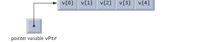

图 7.18 | 数组 `v` 和指向 `v` 的指针变量 `vPtr`。

### 7.8.3 将整数加到指针上

在常规算术中，3000 + 2 的值为 3002。指针算术通常并非如此。当整数加到指针上或从指针中减去时，指针不是简单地按该整数递增或递减，而是按该整数乘以指针所指向对象的大小来递增或递减。字节数取决于对象的数据类型。例如，语句

```
vPtr += 2;
```

将产生 3008（3000 + 2 * 4），假设一个整数存储在 4 字节内存中。在数组 `v` 中，`vPtr` 现在将指向 `v[2]`（图 7.19）。如果一个整数存储在 2 字节内存中，那么前面的计算将得到内存位置 3004（3000 + 2 * 2）。如果数组是不同数据类型，前面的语句将使指针递增存储该数据类型对象所需字节数的两倍。对字符数组执行指针算术时，结果将与常规算术一致，因为每个字符长 1 字节。

> 常见编程错误 7.4
> 对不指向数组中元素的指针使用指针算术。

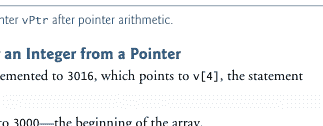

图 7.19 | 指针算术后的指针 `vPtr`。

### 7.8.4 从指针中减去整数

如果 `vPtr` 已递增到 3016，即指向 `v[4]`，则语句

```
vPtr -= 4;
```

会将 `vPtr` 重新设置为 3000——数组的起始位置。

> 常见编程错误 7.5
> 使用指针算术时越过数组的任一端。

### 7.8.5 递增和递减指针

如果要将指针递增或递减 1，可以使用递增（++）和递减（--）运算符。以下任一语句

```
++vPtr;
vPtr++;
```

递增指针以指向数组中的下一个位置。以下任一语句

```
--vPtr;
vPtr--;
```

递减指针以指向数组的上一元素。

### 7.8.6 从另一个指针中减去一个指针

指针变量可以相互相减。例如，如果 vPtr 包含位置 3000，而 v2Ptr 包含地址 3008，则语句

```
x = v2Ptr - vPtr;
```

会将从 vPtr 到 v2Ptr 的数组元素个数赋给 x，在本例中为 2（不是 8）。除非在数组上执行，否则指针算术是未定义的。我们不能假设同一类型的两个变量在内存中是连续存储的，除非它们是数组的相邻元素。

**常见编程错误 7.6**
减去不引用同一数组元素的两个指针。

### 7.8.7 指针之间的赋值

如果两者具有相同的类型，则可以将一个指针赋给另一个指针。此规则的例外是 void 指针（即 void *），它是一种通用指针，可以表示任何指针类型。所有指针类型都可以赋给 void 指针，而 void 指针可以赋给任何类型的指针（包括另一个 void 指针）。在这两种情况下，都不需要强制类型转换操作。

### 7.8.8 void 指针

void 指针不能被解引用。考虑以下情况：编译器知道在具有 4 字节整数的机器上，指向 int 的指针引用 4 字节内存，但 void 指针仅包含未知数据类型的内存位置——指针所引用的确切字节数编译器并不知晓。编译器必须知道数据类型才能确定引用值所代表的字节数。

**常见编程错误 7.7**
如果两者都不是 void * 类型，将一种类型的指针赋给另一种类型的指针是语法错误。

**常见编程错误 7.8**
解引用 void * 指针是语法错误。

### 7.8.9 比较指针

指针可以使用相等和关系运算符进行比较，但除非指针指向同一数组的元素，否则此类比较毫无意义。指针比较比较指针中存储的地址。对指向同一数组中元素的两个指针进行比较可以显示，例如，一个指针指向的数组元素编号高于另一个指针。指针比较的常见用途是确定指针是否为 NULL。


> 常见编程错误 7.9
> 比较不引用同一数组元素的两个指针。

## 7.9 指针与数组的关系

在 C 语言中，数组和指针密切相关，通常可以互换使用。数组名可以被视为一个常量指针。指针可用于执行涉及数组索引的任何操作。

假设以下定义：

```
int b[5];
int *bPtr;
```

由于数组名 b（不带索引）是指向数组第一个元素的指针，因此我们可以使用语句将 bPtr 设置为数组 b 第一个元素的地址

```
bPtr = b;
```

此语句等效于按如下方式获取数组 b 第一个元素的地址：

```
bPtr = &b[0];
```

### 7.9.1 指针/偏移量表示法

数组元素 b[3] 可以通过指针表达式另行引用

```
*(bPtr + 3)
```

表达式中的 3 是指针的偏移量。当 bPtr 指向数组的第一个元素时，偏移量指示要引用的数组元素，并且偏移量值与数组索引相同。这种表示法称为指针/偏移量表示法。括号是必要的，因为 * 的优先级高于 +。如果没有括号，上面的表达式将向表达式 *bPtr 的值添加 3（即，如果 bPtr 指向数组开头，则向 b[0] 添加 3）。与数组元素可以用指针表达式引用一样，地址

```
&b[3]
```

可以用指针表达式写成

```
bPtr + 3
```

数组本身可以被视为指针并用于指针算术。例如，表达式

```
*(b + 3)
```

也引用数组元素 b[3]。一般来说，所有带索引的数组表达式都可以用指针和偏移量来写。在这种情况下，使用数组名作为指针使用了指针/偏移量表示法。前面的语句不会以任何方式修改数组名；b 仍然指向数组中的第一个元素。

### 7.9.2 指针/索引表示法

指针可以像数组一样进行索引。如果 bPtr 的值为 b，则表达式

```
bPtr[1]
```

引用数组元素 b[1]。这称为指针/索引表示法。

### 7.9.3 不能使用指针算术修改数组名

请记住，数组名始终指向数组的开头——因此数组名就像一个常量指针。因此，表达式

```
b += 3
```

无效，因为它试图使用指针算术修改数组名的值。

> **常见编程错误 7.10**
> 
> *尝试使用指针算术修改数组名的值会导致编译错误。*

### 7.9.4 演示指针索引和偏移量

图 7.20 使用了我们讨论过的四种引用数组元素的方法——数组索引、指针/偏移量（数组名作为指针）、指针索引和指针/偏移量（使用指针）——来打印整数数组 b 的四个元素。

```
1  // Fig. 7.20: fig07_20.cpp
2  // Using indexing and pointer notations with arrays.
3  #include <stdio.h>
4  #define ARRAY_SIZE 4
5
6  int main(void)
7  {
8      int b[] = {10, 20, 30, 40}; // create and initialize array b
9      int *bPtr = b; // create bPtr and point it to array b
10
11     // output array b using array index notation
12     puts("Array b printed with:\nArray index notation");
13
14     // loop through array b
15     for (size_t i = 0; i < ARRAY_SIZE; ++i) {
16         printf("b[%u] = %d\n", i, b[i]);
17     }
18
19     // output array b using array name and pointer/offset notation
20     puts("\nPointer/offset notation where\n" "the pointer is the array name");
21
22     // loop through array b
23     for (size_t offset = 0; offset < ARRAY_SIZE; ++offset) {
24         printf("*(b + %u) = %d\n", offset, *(b + offset));
25     }
26     }
```

```
// output array b using bPtr and array index notation
puts("\nPointer index notation");
// loop through array b
for (size_t i = 0; i < ARRAY_SIZE; ++i) {
    printf("bPtr[%u] = %d\n", i, bPtr[i]);
}
// output array b using bPtr and pointer/offset notation
puts("\nPointer/offset notation");
// loop through array b
for (size_t offset = 0; offset < ARRAY_SIZE; ++offset) {
    printf("*(bPtr + %u) = %d\n", offset, *(bPtr + offset));
}
```

```
Array b printed with:
Array index notation
b[0] = 10
b[1] = 20
b[2] = 30
b[3] = 40

Pointer/offset notation where
the pointer is the array name
*(b + 0) = 10
*(b + 1) = 20
*(b + 2) = 30
*(b + 3) = 40

Pointer index notation
bPtr[0] = 10
bPtr[1] = 20
bPtr[2] = 30
bPtr[3] = 40

Pointer/offset notation
*(bPtr + 0) = 10
*(bPtr + 1) = 20
*(bPtr + 2) = 30
*(bPtr + 3) = 40
```

Fig. 7.20 | Using indexing and pointer notations with arrays. (Part 2 of 2.)

### 7.9.5 使用数组和指针进行字符串复制

为了进一步说明数组和指针的可互换性，让我们看看图 7.21 程序中的两个字符串复制函数——copy1 和 copy2。两个函数都将字符串复制到字符数组中。在比较 copy1 和 copy2 的函数原型后，函数看起来相同。它们完成相同的任务，但实现方式不同。

```
1 // Fig. 7.21: fig07_21.c
2 // Copying a string using array notation and pointer notation.
3 #include <stdio.h>
4 #define SIZE 10
5
6 void copy1(char * const s1, const char * const s2); // prototype
7 void copy2(char *s1, const char *s2); // prototype
8
9 int main(void)
10 {
11     char string1[SIZE]; // create array string1
12     char *string2 = "Hello"; // create a pointer to a string
13
14     copy1(string1, string2);
15     printf("string1 = %s\n", string1);
16
17     char string3[SIZE]; // create array string3
18     char string4[] = "Good Bye"; // create an array containing a string
19
20     copy2(string3, string4);
21     printf("string3 = %s\n", string3);
22 }
23
24 // copy s2 to s1 using array notation
25 void copy1(char * const s1, const char * const s2)
26 {
27     // loop through strings
28     for (size_t i = 0; s1[i] = s2[i] != '\0'; ++i) {
29         ; // do nothing in body
30     }
31 }
32
33 // copy s2 to s1 using pointer notation
34 void copy2(char *s1, const char *s2)
35 {
36     // loop through strings
37     for ( ; (*s1 = *s2) != '\0'; ++s1, ++s2) {
38         ; // do nothing in body
39     }
40 }
```

string1 = Hello
string3 = Good Bye

## Fig. 7.21 | Copying a string using array notation and pointer notation.

## 使用数组索引表示法进行复制

函数 copy1 使用数组索引表示法将 s2 中的字符串复制到字符数组 s1。函数将计数器变量 i 定义为数组索引。for 语句头（第 28 行）执行整个复制操作——其主体为空语句。头指定 i 初始化为零，并在循环的每次迭代中递增一。表达式 s1[i] = s2[i] 将一个字符从 s2 复制到 s1。当空字符

在 s2 中遇到时，它被赋给 s1，且赋值的返回值成为赋给左操作数（s1）的值。循环在从 s2 向 s1 赋予空字符时终止（false）。

## 使用指针和指针算术进行复制

函数 copy2 使用指针和指针算术将 s2 中的字符串复制到字符数组 s1 中。同样，for 语句头（第 37 行）执行整个复制操作。头中不包含任何变量初始化。与函数 copy1 一样，表达式 (*s1 = *s2) 执行复制操作。指针 s2 被解引用，其结果字符被赋给被解引用的指针 *s1。在条件中的赋值之后，指针被递增，分别指向数组 s1 中的下一个字符和字符串 s2 中的下一个字符。当在 s2 中遇到空字符时，它被赋给被解引用的指针 s1，循环终止。

## 关于函数 copy1 和 copy2 的说明

copy1 和 copy2 的第一个参数都必须是一个足够大的数组，以容纳第二个参数中的字符串。否则，在尝试写入不属于该数组的内存位置时可能会发生错误。此外，每个函数的第二个参数都声明为 const char * const（一个常量字符串）。在这两个函数中，第二个参数被复制到第一个参数中——字符一次一个地从中读取，但字符永远不会被修改。因此，第二个参数被声明为指向常量值，以便强制执行最小权限原则——这两个函数都不需要修改第二个参数中字符串的能力。

## 7.10 指针数组

数组可以包含指针。指针数组的一种常见用途是形成字符串数组，简称为字符串数组。数组中的每个条目都是一个字符串，但在 C 语言中，字符串本质上是指向其第一个字符的指针。因此，字符串数组中的每个条目实际上是指向字符串第一个字符的指针。考虑字符串数组 suit 的定义，它可能有助于表示一副牌。

```
const char *suit[4] = {"Hearts", "Diamonds", "Clubs", "Spades"};
```

定义中的 suit[4] 部分表示一个包含 4 个元素的数组。声明中的 char * 部分表示 suit 数组的每个元素都是“指向 char 的指针”类型。限定符 const 表示每个元素所指向的字符串不会被修改。要放入数组的四个值是 "Hearts"、"Diamonds"、"Clubs" 和 "Spades"。每个都以空字符结尾的字符字符串形式存储在内存中，其长度比引号之间的字符数多一个字符。这四个字符串的长度分别为 7、9、6 和 7 个字符。虽然看起来这些字符串被放置在 suit 数组中，但实际上只是在数组中存储指针（图 7.22）。每个指针都指向其对应字符串的第一个字符。因此，即使 suit 数组大小固定，它也能访问任意长度的字符字符串。这种灵活性是 C 强大的数据结构能力的一个例子。

花色本可以放在一个二维数组中，其中每一行代表一个花色，每一列代表花色名称中的一个字母。这种数据结构必须每行有固定数量的列，并且该数量必须与最长的字符串一样大。因此，在存储大量字符串且大多数字符串都短于最长字符串时，会浪费相当多的内存。我们在下一节中使用字符串数组来表示一副牌。

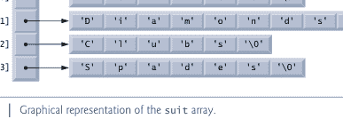

Fig. 7.22 | suit 数组的图形表示。

## 7.11 案例研究：洗牌和发牌模拟

在本节中，我们使用随机数生成来开发一个洗牌和发牌模拟程序。然后该程序可用于实现玩特定纸牌游戏的程序。为了揭示一些微妙的性能问题，我们有意使用了次优的洗牌和发牌算法。在本章的练习和第 10 章中，我们开发了更高效的算法。

使用自顶向下、逐步细化的方法，我们开发一个程序，该程序将洗牌一副 52 张纸牌，然后发完这 52 张牌。自顶向下的方法对于解决比前几章中看到的更大、更复杂的问题特别有用。

### 将牌组表示为二维数组

我们使用 4×13 的二维数组 deck 来表示一副纸牌（图 7.23）。行对应花色——第 0 行对应红心，第 1 行对应方块，第 2 行对应梅花，第 3 行对应黑桃。列对应牌的点数——列 0 到 9 分别对应 A 到 10，列 10 到 12 对应 J、Q 和 K。我们将用字符字符串表示四个花色的字符串数组 suit 进行加载，并用字符字符串表示十三个点数的字符串数组 face 进行加载。

### 洗牌二维数组

该模拟牌组可以按如下方式洗牌。首先将数组 deck 清零。然后随机各选择一个行（0–3）和一列（0–12）。数字 1 插入到数组元素 deck[row][column] 中，表示这张牌将是洗牌后发出的第一张牌。此过程继续进行，数字 2、3、...、52 随机插入到 deck 数组中，以表示哪些牌应放在洗牌后的第二、第三、...、第五十二位。随着 deck 数组开始填入牌号，可能会再次选择一张牌——即当它被选中时 deck[row][column] 不为零。这种选择 simply 被忽略，并重复随机选择其他行和列，直到找到一张未被选中的牌。最终，数字 1 到 52 将占据 deck 数组的 52 个槽位。此时，牌组已完全洗牌。

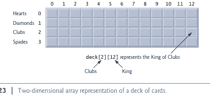

Fig. 7.23 | 牌组的二维数组表示。

### 无限期推迟的可能性

如果已经洗过的牌被反复随机选中，该洗牌算法可能会无限期执行。这种现象称为无限期推迟。在本章的练习中，我们讨论了一种更好的洗牌算法，该算法消除了无限期推迟的可能性。

> Performance Tip 7.3
> 有时以“自然”方式出现的算法可能包含细微的性能问题，例如无限期推迟。请寻找避免无限期推迟的算法。

### 从二维数组发牌

要发第一张牌，我们在数组中搜索 deck[row][column] 等于 1 的元素。这是通过嵌套的 for 语句完成的，行从 0 变到 3，列从 0 变到 12。数组的该元素对应哪张牌？suit 数组已预先加载了四个花色，因此要获取花色，我们打印字符字符串 suit[row]。同样，要获取牌的点数，我们打印字符字符串 face[column]。我们还打印字符字符串 " of "。按正确顺序打印这些信息使我们能够以 "King of Clubs"、"Ace of Diamonds" 等形式打印每张牌。

### 使用自顶向下、逐步细化开发程序的逻辑

让我们继续自顶向下、逐步细化的过程。顶部很简单

Shuffle and deal 52 cards

我们的第一次细化得到：

- 初始化 suit 数组
- 初始化 face 数组
- 初始化 deck 数组
- 洗牌
- 发 52 张牌

“Shuffle the deck”可扩展如下：

- 对于 52 张牌中的每一张
  - 将牌号放在 deck 中随机选择的未占用元素中

“Deal 52 cards”可扩展如下：

- 对于 52 张牌中的每一张
  - 在 deck 数组中找到牌号并打印牌的花色和点数

合并这些扩展后，我们得到完整的第二次细化：

- 初始化 suit 数组
- 初始化 face 数组
- 初始化 deck 数组
- 对于 52 张牌中的每一张
  - 将牌号放在 deck 的随机未占用槽位中
- 对于 52 张牌中的每一张
  - 在 deck 数组中找到牌号并打印花色和点数

“Place card number in randomly selected unoccupied slot of deck”可扩展为：

- 随机选择 deck 的槽位
- 当 deck 的槽位已被之前选择时
  - 随机选择 deck 的槽位
- 将牌号放在所选槽位中

“Find card number in deck array and print face and suit of card”可扩展为：

- 对于 deck 数组的每个槽位
  - 如果槽位包含牌号
    - 打印该牌的点数和花色

合并这些扩展后，我们得到第三次细化：

- 初始化 suit 数组
- 初始化 face 数组
- 初始化 deck 数组
- 对于 52 张牌中的每一张
  - 随机选择 deck 的槽位
  - 当 deck 的槽位已被之前选择时
    - 随机选择 deck 的槽位
  - 将牌号放在所选槽位中
- 对于 52 张牌中的每一张
  - 对于 deck 数组的每个槽位
    - 如果槽位包含所需牌号
      - 打印该牌的点数和花色

这完成了细化过程。如果将洗牌和发牌部分合并，使得每张牌在放入时就被发出，该程序会更高效

牌组。我们选择将这些操作分别编程，因为通常牌是先洗好再发的（而不是一边洗一边发）。

## 实现洗牌与发牌程序

洗牌与发牌程序如图 7.24 所示，示例运行结果如图 7.25 所示。转换说明符 `%s` 用于在 `printf` 调用中打印字符串。`printf` 调用中对应的参数必须是指向 `char` 的指针（或 `char` 数组）。格式说明 `"%5s of %-8s"`（第 68 行）打印一个字符串，在 5 个字符宽的字段中右对齐，其后跟 `" of "`，再跟一个在 8 个字符宽的字段中左对齐的字符串。`%-8s` 中的减号表示左对齐。发牌算法有一个缺陷：一旦找到匹配项，两个内层 `for` 语句会继续搜索 `deck` 中剩余的元素以寻找匹配。我们将在本章练习和第 10 章的案例研究中修正这一缺陷。

```c
// Fig. 7.24: fig07_24.c
// Card shuffling and dealing.
#include <stdio.h>
#include <stdlib.h>
#include <time.h>

#define SUITS 4
#define FACES 13
#define CARDS 52

// prototypes
void shuffle(unsigned int wDeck[][FACES]); // shuffling modifies wDeck
void deal(unsigned int wDeck[][FACES], const char *wFace[],
 const char *wSuit[]); // dealing doesn't modify the arrays

int main(void)
{
 // initialize deck array
 unsigned int deck[SUITS][FACES] = {0};

 srand(time(NULL)); // seed random-number generator
 shuffle(deck); // shuffle the deck

 // initialize suit array
 const char *suit[SUITS] =
 {"Hearts", "Diamonds", "Clubs", "Spades"};

 // initialize face array
 const char *face[FACES] =
 {"Ace", "Deuce", "Three", "Four",
 "Five", "Six", "Seven", "Eight",
 "Nine", "Ten", "Jack", "Queen", "King"};

 deal(deck, face, suit); // deal the deck
}
```

```c
// shuffle cards in deck
void shuffle(unsigned int wDeck[][FACES])
{
    // for each of the cards, choose slot of deck randomly
    for (size_t card = 1; card <= CARDS; ++card) {
        size_t row; // row number
        size_t column; // column number

        // choose new random location until unoccupied slot found
        do {
            row = rand() % SUITS;
            column = rand() % FACES;
        } while(wDeck[row][column] != 0);

        // place card number in chosen slot of deck
        wDeck[row][column] = card;
    }
}

// deal cards in deck
void deal(const unsigned int wDeck[][FACES], const char *wFace[],
          const char *wSuit[])
{
    // deal each of the cards
    for (size_t card = 1; card <= CARDS; ++card) {
        // loop through rows of wDeck
        for (size_t row = 0; row < SUITS; ++row) {
            // loop through columns of wDeck for current row
            for (size_t column = 0; column < FACES; ++column) {
                // if slot contains current card, display card
                if (wDeck[row][column] == card) {
                    printf("%5s of %-8s", wFace[column], wSuit[row],
                           card % 2 == 0 ? '\n' : '\t'); // 2-column format
                }
            }
        }
    }
}
```

图 7.24 | 洗牌与发牌（第 2 部分，共 2 部分）。

|  |  |
|---|---|
| 红桃9 | 梅花5 |
| 黑桃Q | 黑桃3 |
| 红桃Q | 梅花A |
| 红桃K | 黑桃6 |
| 方块J | 黑桃5 |
| 红桃7 | 梅花K |
| 梅花3 | 红桃8 |
| 方块3 | 方块4 |
| 方块Q | 方块5 |

图 7.25 | 发牌程序的示例运行（第 1 部分，共 2 部分）。

|  |  |
|---|---|
| 方块6 | 红桃5 |
| 黑桃A | 红桃6 |
| 方块9 | 梅花Q |
| 黑桃8 | 梅花9 |
| 梅花2 | 梅花6 |
| 黑桃2 | 梅花J |
| 梅花4 | 梅花8 |
| 黑桃4 | 黑桃7 |
| 方块7 | 梅花7 |
| 黑桃K | 方块10 |
| 红桃J | 红桃A |
| 黑桃J | 梅花10 |
| 方块8 | 方块2 |
| 方块A | 方块9 |
| 红桃4 | 红桃2 |
| 方块K | 黑桃10 |
| 红桃3 | 红桃10 |

图 7.25 | 发牌程序的示例运行（第 2 部分，共 2 部分）。

## 7.12 函数指针

函数指针包含函数在内存中的地址。在第 6 章中，我们了解到数组名实际上是数组第一个元素在内存中的地址。类似地，函数名实际上是执行函数任务的代码在内存中的起始地址。函数指针可以传递给函数、从函数返回、存储在数组中，并赋值给其他函数指针。

### 7.12.1 按升序或降序排序

为了说明函数指针的用法，图 7.26 给出了图 7.15 中冒泡排序程序的修改版本。新版本由 `main` 以及 `bubble`、`swap`、`ascending` 和 `descending` 函数组成。函数 `bubble` 接收一个函数指针——函数 `ascending` 或函数 `descending`——作为参数，此外还接收一个整数数组和该数组的大小。程序提示用户选择将数组按升序还是降序排序。如果用户输入 1，则将指向函数 `ascending` 的指针传递给函数 `bubble`，使数组按递增顺序排序。如果用户输入 2，则将指向函数 `descending` 的指针传递给函数 `bubble`，使数组按递减顺序排序。程序的输出如图 7.27 所示。

```c
// Fig. 7.26: fig07_26.c
// Multipurpose sorting program using function pointers.
#include <stdio.h>
#define SIZE 10
```

图 7.26 | 使用函数指针的多用途排序程序（第 1 部分，共 3 部分）。

```c
// prototypes
void bubble(int work[], size_t size, int (*compare)(int a, int b));
int ascending(int a, int b);
int descending(int a, int b);

int main(void)
{
    // initialize unordered array a
    int a[SIZE] = { 2, 6, 4, 8, 10, 12, 89, 68, 45, 37 };
    printf("%s", "Enter 1 to sort in ascending order\n" "Enter 2 to sort in descending order: ");
    int order; // 1 for ascending order or 2 for descending order
    scanf("%d", &order);

    puts("\nData items in original order");

    // output original array
    for (size_t counter = 0; counter < SIZE; ++counter) {
        printf("%5d", a[counter]);
    }

    // sort array in ascending order; pass function ascending as an
    // argument to specify ascending sorting order
    if (order == 1) {
        bubble(a, SIZE, ascending);
        puts("\nData items in ascending order");
    }
    else { // pass function descending
        bubble(a, SIZE, descending);
        puts("\nData items in descending order");
    }

    // output sorted array
    for (size_t counter = 0; counter < SIZE; ++counter) {
        printf("%5d", a[counter]);
    }

    puts("\n");
}

// multipurpose bubble sort; parameter compare is a pointer to
// the comparison function that determines sorting order
void bubble(int work[], size_t size, int (*compare)(int a, int b))
{
    void swap(int *element1Ptr, int *element2ptr); // prototype

    // loop to control passes
    for (unsigned int pass = 1; pass < size; ++pass) {
        // loop to control number of comparisons per pass
        for (size_t count = 0; count < size - 1; ++count) {
```

```c
// if adjacent elements are out of order, swap them
if ((*compare)(work[count], work[count + 1])) {
    swap(&work[count], &work[count + 1]);
}
}
}
```

```c
// swap values at memory locations to which element1Ptr and
// element2Ptr point
void swap(int *element1Ptr, int *element2Ptr)
{
    int hold = *element1Ptr;
    *element1Ptr = *element2Ptr;
    *element2Ptr = hold;
}
```

```c
// determine whether elements are out of order for an ascending
// order sort
int ascending(int a, int b)
{
    return b < a; // should swap if b is less than a
}
```

```c
// determine whether elements are out of order for a descending
// order sort
int descending(int a, int b)
{
    return b > a; // should swap if b is greater than a
}
```

图 7.26 | 使用函数指针的多用途排序程序（第 3 部分，共 3 部分）。

输入 1 以升序排序
输入 2 以降序排序：1

原始顺序的数据项
    2   6   4   8  10  12  89  68  45  37
按升序排列的数据项
    2   4   6   8  10  12  37  45  68  89

输入 1 以升序排序
输入 2 以降序排序：2

原始顺序的数据项
    2   6   4   8  10  12  89  68  45  37
按降序排列的数据项
  89  68  45  37  12  10   8   6   4   2

图 7.27 | 图 7.26 中冒泡排序程序的输出。


以下参数出现在 `bubble` 的函数头中（第49行）：

```c
int (*compare)(int a, int b)
```

这告诉 `bubble` 期望一个参数（`compare`），它是一个指向函数的指针，该函数接收两个整数参数并返回一个整数结果。`*compare` 周围需要括号，将 `*` 与 `compare` 组合在一起，以表明 `compare` 是一个*指针*。如果没有括号，声明将变成：

```c
int *compare(int a, int b)
```

这声明的是一个函数，它接收两个整数作为参数，并返回一个指向整数的指针。

`bubble` 的函数原型在第7行。原型中的第三个参数本可以写成：

```c
int (*)(int, int);
```

无需函数指针名称和参数名称。

传递给 `bubble` 的函数在 if 语句（第60行）中被调用，如下所示：

```c
if ((*compare)(work[count], work[count + 1]))
```

正如指向变量的指针被解引用以访问变量的值一样，*指向函数的指针被解引用以使用该函数。*

对函数的调用也可以不解引用指针，如下所示：

```c
if (compare(work[count], work[count + 1]))
```

这里直接将指针用作函数名。我们更倾向于第一种通过指针调用函数的方法，因为它明确说明 `compare` 是一个指向函数的指针，该指针被解引用以调用函数。第二种通过指针调用函数的方法使 `compare` 看起来像一个*实际*函数。这可能会让阅读代码的程序员感到困惑，他们想看看函数 `compare` 的定义，却发现它*从未在文件中定义*。

### 7.12.2 使用函数指针创建菜单驱动系统

函数指针的一个常见用途是基于文本的*菜单驱动系统*。提示用户通过输入菜单项的编号，从菜单中选择一个选项（可能是1到5）。每个选项由不同的函数提供服务。指向每个函数的指针存储在一个函数指针数组中。用户的选择被用作数组的索引，然后使用数组中的指针来调用函数。

图7.28提供了一个定义和使用函数指针数组机制的通用示例。我们定义了三个函数——function1、function2和function3——它们都接受一个整数参数且不返回任何值。我们将这三个函数的指针存储在数组 f 中，该数组在第14行定义。从最左边的括号开始阅读该定义，*`f` 是一个包含3个函数指针的数组，每个函数接受一个 `int` 参数并返回 `void`。* 该数组用这三个函数的名称初始化。当用户输入一个介于0和2之间的值时，该值被用作函数指针数组的索引。在函数调用（第25行）中，`f[choice]` 选择数组中位置 choice 处的指针。*解引用该指针以调用函数。*

```text
Enter a number between 0 and 2, 3 to end: 0
You entered 0 so function1 was called

Enter a number between 0 and 2, 3 to end: 1
You entered 1 so function2 was called

Enter a number between 0 and 2, 3 to end: 2
You entered 2 so function3 was called

Enter a number between 0 and 2, 3 to end: 3
Program execution completed.
```

图7.28 | 演示函数指针数组。（第2部分，共2部分）

## 7.13 安全C编程

### printf_s、scanf_s 及其他安全函数

前面的安全C编程部分介绍了 `printf_s` 和 `scanf_s`，并提到了由C标准附录K描述的其他更安全的标准库函数版本。像 `printf_s` 和 `scanf_s` 这样的函数之所以更安全，一个关键特性是它们具有运行时约束，要求其指针参数非 NULL。这些函数在尝试使用指针之前会检查这些运行时约束。任何 NULL 指针参数都被视为违反约束，导致函数失败并返回状态通知。在 `scanf_s` 中，如果任何指针参数（包括格式控制字符串）为 NULL，该函数返回 `EOF`。在 `printf_s` 中，如果格式控制字符串或与 `%s` 对应的任何参数为 NULL，该函数停止输出数据并返回一个负数。有关附录 K 函数的完整详细信息，请参阅 C 标准文档或编译器库文档。

### 其他关于指针的 CERT 指南

误用指针导致当今系统中许多最常见的安全漏洞。CERT 提供了各种指南来帮助您预防此类问题。如果您正在构建工业级 C 系统，您应该熟悉 www.securecoding.cert.org 上的 CERT 安全编码标准。以下指南适用于我们本章介绍的指针编程技术：

- `EXP34-C`：解引用 NULL 指针通常会导致程序崩溃，但 CERT 曾遇到一些情况，解引用 NULL 指针可能允许攻击者执行代码。
- `DCL13-C`：7.5 节讨论了 `const` 与指针的结合使用。如果函数参数指向的值不会被该函数修改，则应使用 `const` 来表明数据是常量。例如，要表示指向不会被修改的字符串的指针，可使用 `const char *` 作为指针参数的类型，如图 7.11 的第 21 行所示。
- `MSC16-C`：该指南讨论了加密函数指针的技术，以帮助防止攻击者覆盖它们并执行攻击代码。

## 小结

### 7.2节 指针变量的定义与初始化

- 指针（第307页）包含另一个保存值的变量的地址。从这个意义上说，变量名直接引用一个值，而指针间接引用一个值。

- 通过指针引用值称为间接引用（第308页）。

- 指针可以定义为指向任何类型的对象。

- 指针应在定义时或在赋值语句中进行初始化。指针可以初始化为 `NULL`、`0` 或某个地址。值为 `NULL` 的指针不指向任何内容。将指针初始化为 `0` 等价于将指针初始化为 `NULL`，但为了清晰起见，更倾向于使用 `NULL`。值 `0` 是唯一可以直接赋给指针变量的整数值。

- `NULL` 是在 `<stddef.h>` 头文件（以及若干其他头文件）中定义的符号常量。

### 7.3节 指针运算符

- `&`，即地址运算符（第309页），是一个一元运算符，返回其操作数的地址。

- 地址运算符的操作数必须是变量。

- 间接引用运算符 `*`（第309页）返回其操作数所指向对象的值。

- `printf` 转换说明符 `%p` 在大多数平台上以十六进制整数形式输出内存位置。

### 7.4节 按引用向函数传递参数

- C 中所有参数都是按值传递的（第311页）。

- C 程序通过使用指针和间接引用运算符来实现按引用传递（第311页）。要按引用传递变量，请对变量名应用地址运算符（`&`）。

- 当变量的地址传递给函数时，可以在函数中使用间接引用运算符（`*`）来读取和/或修改调用者内存中该位置的值。

- 接收地址作为参数的函数必须定义一个指针参数来接收该地址。

- 编译器不区分接收指针的函数和接收一维数组的函数。函数必须“知道”它接收的是一个数组还是按引用传递的单个变量。

- 当编译器遇到形如 `int b[]` 的一维数组函数参数时，编译器会将该参数转换为指针记法 `int *b`。

### 7.5节 将 const 限定符与指针一起使用

- `const` 限定符（第315页）表示特定变量的值不应被修改。

- 如果试图修改声明为 `const` 的值，编译器会捕获该操作，并发出警告或错误，具体取决于特定的编译器。

- 将指针传递给函数有四种方式（第316页）：指向非常量数据的非常量指针、指向非常量数据的常量指针、指向常量数据的非常量指针，以及指向常量数据的常量指针。

- 对于指向非常量数据的非常量指针，可以通过解引用的指针修改数据，并且可以修改指针以指向其他数据项。

- 指向常量数据的非常量指针可以修改为指向任意适当类型的数据项，但它所指向的数据不能被修改。

- 指向非常量数据的常量指针始终指向相同的内存位置，并且可以通过该指针修改该位置的数据。这是数组名的默认行为。


- 指向常量数据的常量指针始终指向同一内存位置，且该内存位置中的数据不可被修改。

## 第 7.7 节 sizeof 运算符
- 一元运算符 sizeof（第 324 页）在编译时确定变量或类型的字节大小。
- 当应用于数组名时，sizeof 返回数组的总字节数。
- 运算符 sizeof 可以应用于任何变量名、类型或值。
- 如果 sizeof 的操作数为类型名，则使用的一对括号是必需的。

## 第 7.8 节 指针表达式和指针算术
- 可以对指针执行有限的算术运算（第 328 页）。指针可以递增（++）或递减（--），整数可以加到指针上（+ 或 +=），整数可以从指针中减去（- 或 -=），并且一个指针可以从另一个指针中减去。
- 当整数被加到指针上或从指针中减去时，指针按该整数乘以指针所引用对象的大小进行递增或递减。
- 指向同一数组元素的两个指针可以相互减去，以确定它们之间的元素数量。
- 如果两个指针具有相同类型，则一个指针可以赋给另一个指针。例外是类型为 void *（第 329 页）的指针，它可以表示任何指针类型。所有指针类型都可以赋给 void * 指针，且 void * 指针可以赋给任何类型的指针。
- void * 指针不能被解引用。
- 指针可以使用相等和关系运算符进行比较，但除非指针指向同一数组的元素，否则此类比较毫无意义。指针比较比较指针中存储的地址。
- 指针比较的常见用途是确定指针是否为 NULL。

## 第 7.9 节 指针与数组的关系
- 在 C 语言中，数组和指针密切相关，通常可以互换使用。
- 数组名可以被视为常量指针。
- 指针可用于执行任何涉及数组索引的操作。
- 当指针指向数组开头时，向指针添加偏移量（第 330 页）表示应引用数组的哪个元素，且偏移量值与数组索引相同。这被称为指针/偏移表示法。
- 数组名可以被视为指针，并用于不尝试修改指针地址的指针算术表达式中。
- 指针可以像数组一样被索引（第 331 页）。这被称为指针/索引表示法。
- 类型为 const char * 的参数通常表示常量字符串。

## 第 7.10 节 指针数组
- 数组可以包含指针（第 334 页）。指针数组的常见用途是形成字符串数组（第 334 页）。数组中的每个条目都是一个字符串，但在 C 语言中，字符串本质上是指向其第一个字符的指针。因此，字符串数组中的每个条目实际上是指向字符串第一个字符的指针。

## 第 7.12 节 指向函数的指针
- 函数指针（第 343 页）包含函数在内存中的地址。函数名实际上是执行函数任务的代码在内存中的起始地址。
- 指向函数的指针可以作为参数传递给函数、从函数返回、存储在数组中并赋给其他函数指针。
- 通过解引用指向函数的指针来调用函数。调用函数时，函数指针可以直接用作函数名。
- 函数指针的常见用途是在基于文本的菜单驱动系统中。

## 自测练习

**7.1** 回答以下每个问题：
- a) 指针变量作为其值包含另一个变量的 ______。
- b) 可用于初始化指针的三个值是 ______、______ 和 ______。
- c) 唯一可以赋给指针的整数是 ______。

**7.2** 判断以下各题是 *正确* 还是 *错误*。如果答案是 *错误*，请说明原因。
- a) 声明为 void 的指针可以被解引用。
- b) 不同类型的指针在不进行强制转换操作的情况下可能不会相互赋值。

**7.3** 回答以下每个问题。假设单精度浮点数占用 4 字节，且数组的起始地址在内存中的位置为 1002500。练习的每个部分应在使用适当时使用之前部分的结果。
- a) 定义一个名为 numbers 的 float 类型数组，包含 10 个元素，并将元素初始化为值 0.0、1.1、2.2、...、9.9。假设符号常量 SIZE 已定义为 10。
- b) 定义一个指向 float 类型对象的指针 nPtr。
- c) 使用数组索引表示法打印数组 numbers 的元素。使用 for 语句。每个数字打印到小数点右侧 1 位精度。
- d) 给出两个单独的语句，将数组 numbers 的起始地址赋给指针变量 nPtr。
- e) 使用指针 nPtr 以指针/偏移表示法打印数组 numbers 的元素。
- f) 使用数组名作为指针以指针/偏移表示法打印数组 numbers 的元素。
- g) 通过索引指针 nPtr 打印数组 numbers 的元素。
- h) 使用数组索引表示法、将数组名作为指针的指针/偏移表示法、使用 nPtr 的指针索引表示法以及使用 nPtr 的指针/偏移表示法引用数组 numbers 的第 4 个元素。
- i) 假设 nPtr 指向数组 numbers 的开头，nPtr + 8 引用什么地址？该位置存储什么值？
- j) 假设 nPtr 指向 numbers[5]，nPtr -= 4 引用什么地址？该位置存储什么值？

**7.4** 对于以下每个任务，编写执行指定任务的语句。假设浮点变量 number1 和 number2 已定义，且 number1 初始化为 7.3。
- a) 定义变量 fPtr 为指向 float 类型对象的指针。
- b) 将变量 number1 的地址赋给指针变量 fPtr。
- c) 打印 fPtr 所指向对象的值。
- d) 将 fPtr 所指向对象的值赋给变量 number2。
- e) 打印 number2 的值。
- f) 打印 number1 的地址。使用 %p 转换说明符。
- g) 打印 fPtr 中存储的地址。使用 %p 转换说明符。打印的值与 number1 的地址相同吗？

**7.5** 执行以下每个任务：
- a) 编写名为 exchange 的函数的函数头，该函数以指向浮点数 x 和 y 的两个指针作为参数且不返回值。
- b) 编写第 (a) 部分函数的函数原型。
- c) 编写名为 evaluate 的函数的函数头，该函数返回整数，并以整数 x 和指向函数 poly 的指针作为参数。函数 poly 接受一个整数参数并返回一个整数。
- d) 编写第 (c) 部分函数的函数原型。

**7.6** 找出以下每个程序段中的错误。假设
```
    int *zPtr; // zPtr will reference array z
    int *aPtr = NULL;
    void *sPtr = NULL;
    int number;
    int z[5] = {1, 2, 3, 4, 5};
    sPtr = z;
```
- a) `++zPtr;`
- b)
    // use pointer to get first value of array; assume zPtr is initialized
    number = zPtr;
- c)
    // assign array element 2 (the value 3) to number;
    assume zPtr is initialized
    number = *zPtr[2];
- d)
    // print entire array z; assume zPtr is initialized
    for (size_t i = 0; i <= 5; ++i) {
        printf("%d ", zPtr[i]);
    }
- e)
    // assign the value pointed to by sPtr to number
    number = *sPtr;
- f) `++z;`

## 自测练习答案

**7.1** a) 地址。 b) 0, NULL, 一个地址。 c) 0。

**7.2** a) 错误。指向 void 的指针不能被解引用，因为无法确切知道要解引用多少字节的内存。 b) 错误。类型为 void 的指针可以赋给其他类型的指针，且类型为 void 的指针可以赋给其他类型的指针。

**7.3**
- a)
    float numbers[SIZE] = {0.0, 1.1, 2.2, 3.3, 4.4, 5.5, 6.6, 7.7, 8.8, 9.9};
- b)
    float *nPtr;
- c)
    for (size_t i = 0; i < SIZE; ++i) {
        printf("%.1f ", numbers[i]);
    }
- d)
    nPtr = numbers;
    nPtr = &numbers[0];
- e)
    for (size_t i = 0; i < SIZE; ++i) {
        printf("%.1f ", *(nPtr + i));
    }


- f)
  ```c
  for (size_t i = 0; i < SIZE; ++i) {
      printf("%.1f ", *(numbers + i));
  }
  ```
- g)
  ```c
  for (size_t i = 0; i < SIZE; ++i) {
      printf("%.1f ", nPtr[i]);
  }
  ```
- h)
  numbers[4]  
  *(numbers + 4)  
  nPtr[4]  
  *(nPtr + 4)
- i) 地址是 1002500 + 8 * 4 = 1002532。值是 8.8。
- j) numbers[5] 的地址是 1002500 + 5 * 4 = 1002520。  
  nPtr - 4 的地址是 1002520 - 4 * 4 = 1002504。  
  该位置的值是 1.1。

## 7.4

- a) `float *fPtr;`
- b) `fPtr = &number1;`
- c) `printf("The value of *fPtr is %f\n", *fPtr);`
- d) `number2 = *fPtr;`
- e) `printf("The value of number2 is %f\n", number2);`
- f) `printf("The address of number1 is %p\n", &number1);`
- g) `printf("The address stored in fPtr is %p\n", fPtr);`

是的，值相同。

## 7.5

- a) `void exchange(float *x, float *y);`
- b) `void exchange(float *x, float *y);`
- c) `int evaluate(int x, int (*poly)(int))`
- d) `int evaluate(int x, int (*poly)(int));`

## 7.6

- a) Error: `zPtr` has not been initialized.  
  Correction: 在执行指针运算之前用 `zPtr = z;` 初始化 `zPtr`。
- b) Error: 未对指针进行解引用。  
  Correction: 将语句改为 `number = *zPtr;`
- c) Error: `zPtr[2]` 不是指针，不应被解引用。  
  Correction: 将 `*zPtr[2]` 改为 `zPtr[2]`。
- d) Error: 使用指针索引引用数组边界之外的数组元素。  
  Correction: 将 `for` 条件中的运算符 `<=` 改为 `<`。
- e) Error: 解引用 `void` 指针。  
  Correction: 要解引用指针，必须先将其强制转换为整数指针。将语句改为 `number = *((int *) zPtr);`
- f) Error: 尝试使用指针运算修改数组名。  
  Correction: 使用指针变量代替数组名来实现指针运算，或通过索引数组名来引用特定元素。

## Exercises

### 7.7

回答以下每个问题：

- a) `______` 指针是通用指针，可以保存任何类型的指针值。
- b) 数组名可以被视为 `______` 指针。
- c) `______` 运算符是单目运算符，返回其操作数的地址，而 `______` 运算符返回其操作数指向的对象的[content]
- f)
  ```c
  for (size_t i = 0; i < SIZE; ++i) {
      printf("%.1f ", *(numbers + i));
  }
  ```
- g)
  ```c
  for (size_t i = 0; i < SIZE; ++i) {
      printf("%.1f ", nPtr[i]);
  }
  ```
- h)
  numbers[4]  
  *(numbers + 4)  
  nPtr[4]  
  *(nPtr + 4)
- i) 地址是 1002500 + 8 * 4 = 1002532。值是 8.8。
- j) numbers[5] 的地址是 1002500 + 5 * 4 = 1002520。  
  nPtr - 4 的地址是 1002520 - 4 * 4 = 1002504。  
  该位置的值是 1.1。

## 7.4

- a) `float *fPtr;`
- b) `fPtr = &number1;`
- c) `printf("The value of *fPtr is %f\n", *fPtr);`
- d) `number2 = *fPtr;`
- e) `printf("The value of number2 is %f\n", number2);`
- f) `printf("The address of number1 is %p\n", &number1);`
- g) `printf("The address stored in fPtr is %p\n", fPtr);`

是的，值相同。

## 7.5

- a) `void exchange(float *x, float *y);`
- b) `void exchange(float *x, float *y);`
- c) `int evaluate(int x, int (*poly)(int))`
- d) `int evaluate(int x, int (*poly)(int));`

## 7.6

- a) Error: `zPtr` has not been initialized.  
  Correction: 在执行指针运算之前用 `zPtr = z;` 初始化 `zPtr`。
- b) Error: 未对指针进行解引用。  
  Correction: 将语句改为 `number = *zPtr;`
- c) Error: `zPtr[2]` 不是指针，不应被解引用。  
  Correction: 将 `*zPtr[2]` 改为 `zPtr[2]`。
- d) Error: 使用指针索引引用数组边界之外的数组元素。  
  Correction: 将 `for` 条件中的运算符 `<=` 改为 `<`。
- e) Error: 解引用 `void` 指针。  
  Correction: 要解引用指针，必须先将其强制转换为整数指针。将语句改为 `number = *((int *) zPtr);`
- f) Error: 尝试使用指针运算修改数组名。  
  Correction: 使用指针变量代替数组名来实现指针运算，或通过索引数组名来引用特定元素。

## Exercises

### 7.7

回答以下每个问题：

- a) `______` 指针是通用指针，可以保存任何类型的指针值。
- b) 数组名可以被视为 `______` 指针。
- c) `______` 运算符是单目运算符，返回其操作数的地址，而 `______` 运算符返回其操作数指向的对象的

开始比赛时打印

    BANG !!!!!
    AND THEY'RE OFF !!!!!

然后，对于时钟的每次滴答（即循环的每次迭代），打印一条 70 个位置的行，显示乌龟所在位置的字母 T 和兔子所在位置的字母 H。偶尔，竞争者会落在同一个格子上。在这种情况下，乌龟咬住兔子，你的程序应从该位置开始打印 OUCH!!!。除 T、H 或平局情况下的 OUCH!!! 之外的所有打印位置应为空白。

打印完每行后，检查是否有动物到达或超过第 70 格。如果是，则打印获胜者并终止模拟。如果乌龟获胜，打印 TORTOISE WINS!!! YAY!!! 如果兔子获胜，打印 Hare wins. Yuch. 如果两只动物在同一时钟滴答时获胜，你可能想偏爱乌龟（“弱者”），或者你可能想打印 It's a tie. 如果没有动物获胜，则再次执行循环以模拟下一个时钟滴答。当你准备好运行程序时，召集一群粉丝观看比赛。你会惊讶于观众的参与程度！

## 7.18（洗牌和发牌修改）
修改图 7.24 中的洗牌和发牌程序，使洗牌和发牌操作由同一个函数（shuffleAndDeal）执行。该函数应包含一个嵌套循环结构，其与图 7.24 中的函数 shuffle 相似。

## 7.19 假设用户输入两个长度相同的字符串，这个程序做什么？

```c
// ex07_19.c
// What does this program do?
#include <stdio.h>
#define SIZE 80

void mystery1(char *s1, const char *s2); // prototype

int main(void)
{
    char string1[SIZE]; // create char array
    char string2[SIZE]; // create char array

    puts("Enter two strings: ");
    scanf("%79s%79s", string1, string2);
    mystery1(string1, string2);
    printf("%s", string1);
}

// What does this function do?
void mystery1(char *s1, const char *s2)
{
    while (*s1 != '\0') {
        ++s1;
    }

    for (; *s1 = *s2; ++s1, ++s2) {
        ; // empty statement
    }
}
```

## 7.22（迷宫遍历）
以下网格是迷宫的二维数组表示。

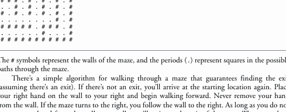

# 符号代表迷宫的墙壁，而句点（.）代表迷宫中可能路径的格子。

有一个简单的走迷宫算法可以保证找到出口（假设存在出口）。如果没有出口，你将再次回到起始位置。将你的右手放在右侧的墙上并开始向前走。永远不要把手从墙上移开。如果迷宫向右转，你就跟随墙向右走。只要你不把手从墙上移开，最终你就会到达迷宫的出口。你所走的路可能不是最短的路径，但你保证能走出迷宫。

编写递归函数 mazeTraverse 来遍历迷宫。该函数应接收一个表示迷宫的 12×12 字符数组和迷宫的起始位置作为参数。在 mazeTraverse 尝试定位迷宫出口时，它应在路径中的每个格子放置字符 X。函数应在每次移动后显示迷宫，以便用户可以看到迷宫被解决的过程。

## 7.23（随机生成迷宫）
编写一个函数 mazeGenerator，它接收一个二维 12×12 字符数组作为参数并随机生成一个迷宫。该函数还应提供迷宫的起始和结束位置。使用练习 7.22 中的函数 mazeTraverse 尝试几个随机生成的迷宫。

## 7.24（任意大小的迷宫）
将练习 7.22–7.23 中的函数 mazeTraverse 和 mazeGenerator 推广，以处理任意宽度和高度的迷宫。

## 7.25（指向函数的指针数组）
重写图 6.22 的程序以使用菜单驱动界面。程序应向用户提供以下四个选项：

```
Enter a choice:
0 Print the array of grades
1 Find the minimum grade
2 Find the maximum grade
3 Print the average on all tests for each student
4 End program
```

使用函数指针数组的一个限制是所有指针必须具有相同的类型。指针必须指向具有相同返回类型且接收相同类型参数的函数。因此，图 6.22 中的函数必须修改，使它们各自返回相同的类型并接受相同的参数。修改函数 minimum 和 maximum，使其打印最小或最大值并返回 nothing。对于选项 3，修改图 6.22 中的函数 average，使其输出每个学生的平均值（而不是特定学生）。函数 average 应返回 nothing 并接受与 printArray、minimum 和 maximum 相同的参数。将指向四个函数的指针存储在数组 processGrades 中，并使用用户所做的选择作为索引来调用每个函数。

## 7.26 假设用户输入两个长度相同的字符串，这个程序做什么？

```
// ex07_36.c
// What does this program do?
#include <stdio.h>
#define SIZE 80

int mystery3(const char *s1, const char *s2); // prototype

int main(void)
{
    char string1[SIZE]; // create char array
    char string2[SIZE]; // create char array

    puts("Enter two strings: ");
    scanf("%79s%79s", string1, string2);
    printf("The result is %d\n", mystery3(string1, string2));
}

int mystery3(const char *s1, const char *s2)
{
    int result = 1;

    for (; *s1 != '\0' && *s2 != '\0'; ++s1, ++s2) {
        if (*s1 != *s2) {
            result = 0;
        }
    }

    return result;
}
```

## 特别章节：构建自己的计算机
在接下来的几个练习中，我们暂时从高级语言编程的世界中转移开来。我们“打开”一台计算机并查看其内部结构。我们介绍机器语言编程并编写几个机器语言程序。为了使这次体验特别有价值，我们随后构建一台计算机（通过基于软件的模拟技术），你可以在其上执行你的机器语言程序！

## 7.27（机器语言编程）
让我们创建一个我们称之为 Simpletron 的计算机。如其名所示，它是一个简单的机器，但正如我们很快会看到的，它也是一个强大的机器。Simpletron 运行用它唯一直接理解的语言编写的程序——即 Simpletron 机器语言，简称 SML。

Simpletron 包含一个累加器——一个“特殊寄存器”，信息在 Simpletron 在计算中使用该信息或以各种方式检查它之前被放入其中。Simpletron 中的所有信息都以字为单位处理。一个字是一个带符号的四位十进制数，例如 +3364、-1293、+0007、-0001 等等。Simpletron 配备了 100 字内存，这些字由其位置编号 00、01、...、99 引用。

在运行 SML 程序之前，我们必须加载或将程序放入内存中。每个 SML 程序的第一个指令（或语句）始终放置在位置 00。

SML 编写的每个指令占用 Simpletron 内存的一个字，因此指令是带符号的四位十进制数。我们假设 SML 指令的符号始终为正，但数据字的符号可以是正或负。Simpletron 内存中的每个位置可能包含指令、程序使用的数据值或未使用（因此未定义）的内存区域。每个 SML 指令的前两位数字是操作码，指定要执行的操作。SML 操作码总结在图 7.32 中。

| Operation code | Meaning |
|---|---|
| *输入/输出操作：* | |
| `#define READ 10` | 从终端读取一个字到内存中的特定位置。 |
| `#define WRITE 11` | 将内存中特定位置的一个字写入终端。 |
| *装载/存储操作：* | |
| `#define LOAD 20` | 从内存中特定位置加载一个字到累加器。 |
| `#define STORE 21` | 将累加器中的一个字存储到内存中的特定位置。 |
| *算术操作：* | |
| `#define ADD 30` | 将内存中特定位置的一个字加到累加器中的字上（结果留在累加器中）。 |
| `#define SUBTRACT 31` | 从累加器中的字减去内存中特定位置的一个字（结果留在累加器中）。 |
| `#define DIVIDE 32` | 用内存中特定位置的一个字除累加器中的字（结果留在累加器中）。 |
| `#define MULTIPLY 33` | 将内存中特定位置的一个字乘以累加器中的字（结果留在累加器中）。 |
| *转移控制操作：* | |
| `#define BRANCH 40` | 分支到内存中的特定位置。 |
| `#define BRANCHNEG 41` | 如果累加器为负，则分支到内存中的特定位置。 |
| `#define BRANCHZERO 42` | 如果累加器为零，则分支到内存中的特定位置。 |
| `#define HALT 43` | 停止——即程序已完成其任务。 |

Fig. 7.32 | Simpletron Machine Language (SML) operation codes.

SML 指令的最后两位数字是操作数，即包含要操作的字所在的内存位置的地址。现在让我们考虑几个简单的 SML 程序。以下 SML 程序从键盘读取两个数字，并计算并打印它们的和。指令 +1007 从键盘读取第一个数字并将其放入位置 07（已初始化为零）。然后 +1008 将下一个数字读入位置 08。加载指令 +2007 将第一个数字放入累加器，而加法指令 +3008 将第二个数字加到累加器中的数字上。所有 SML 算术指令都将其结果留在累加器中。存储指令 +2109 将结果放回内存位置 09，写指令 +1109 从中取出数字并打印它（作为带符号的四位十进制数）。停止指令 +4300 终止执行。


| 示例 1 位置 | 编号 | 指令 |
|---|---|---|
| 00 | +1007 | (读取 A) |
| 01 | +1008 | (读取 B) |
| 02 | +2007 | (装载 A) |
| 03 | +3008 | (加 B) |
| 04 | +2109 | (存储 C) |
| 05 | +1109 | (写入 C) |
| 06 | +4300 | (停止) |
| 07 | +0000 | (变量 A) |
| 08 | +0000 | (变量 B) |
| 09 | +0000 | (结果 C) |

下面的 SML 程序从键盘读取两个数字，并确定并打印较大值。请注意指令 +4107 作为条件转移控制的使用，与 C 语言的 if 语句非常相似。

| 示例 2 位置 | 编号 | 指令 |
|---|---|---|
| 00 | +1009 | (读取 A) |
| 01 | +1010 | (读取 B) |
| 02 | +2009 | (装载 A) |
| 03 | +3110 | (减去 B) |
| 04 | +4107 | (分支负数到 07) |
| 05 | +1109 | (写入 A) |
| 06 | +4300 | (停止) |
| 07 | +1110 | (写入 B) |
| 08 | +4300 | (停止) |
| 09 | +0000 | (变量 A) |
| 10 | +0000 | (变量 B) |

现在编写 SML 程序以完成以下各任务。

- a) 使用哨兵控制循环读取正整数并计算并打印它们的和。
- b) 使用计数器控制循环读取七个数，其中一些为正数，一些为负数，并计算并打印它们的平均值。
- c) 读取一系列数字并确定并打印最大数字。读取的第一个数字指示应处理的数字个数。

instructionCounter 告诉我们下一个要执行的指令的位置。我们通过使用 C 语句从内存中获取该位置的内容

```c
instructionRegister = memory[instructionCounter];
```

操作码和操作数通过以下语句从指令寄存器中提取

```c
operationCode = instructionRegister / 100;
operand = instructionRegister % 100;
```

现在 Simpletron 必须确定操作码实际上是读取（而不是写入、装载等）。switch 区分 SML 的十二种操作。

switch 语句模拟各种 SML 指令的行为如下（我们把其他指令留给读者）：

```c
read:        scanf("%d", &memory[operand]);
load:        accumulator = memory[operand];
add:         accumulator += memory[operand];
Various branch instructions: We'll discuss these shortly.
halt:        This instruction prints the message
             *** Simpletron execution terminated ***
```

然后打印每个寄存器的名称和内容以及内存的完整内容。这种打印通常称为计算机转储。为了帮助您编程转储函数，图 7.33 显示了示例转储格式。执行 Simpletron 程序后进行的转储将显示执行终止时刻指令和数据值的实际值。您可以通过在格式说明符中将 0 格式化标志放在字段宽度之前来在整数前打印前导 0，如 "%02d" 所示。您可以使用 + 格式化标志在值前放置 + 或 - 符号。因此，要生成形式为 +0000 的数字，可以使用格式说明符 "%+05d"。

寄存器：

| 寄存器 | 值 |
| --- | --- |
| 累加器 | +0000 |
| 指令计数器 | 00 |
| 指令寄存器 | 00 |
| 操作码 | 00 |
| 操作数 | 00 |

内存：

| 地址 | 0 | 1 | 2 | 3 | 4 | 5 | 6 | 7 | 8 | 9 |
| --- | --- | --- | --- | --- | --- | --- | --- | --- | --- | --- |
| 0 | +0000 | +0000 | +0000 | +0000 | +0000 | +0000 | +0000 | +0000 | +0000 | +0000 |
| 10 | +0000 | +0000 | +0000 | +0000 | +0000 | +0000 | +0000 | +0000 | +0000 | +0000 |
| 20 | +0000 | +0000 | +0000 | +0000 | +0000 | +0000 | +0000 | +0000 | +0000 | +0000 |
| 30 | +0000 | +0000 | +0000 | +0000 | +0000 | +0000 | +0000 | +0000 | +0000 | +0000 |
| 40 | +0000 | +0000 | +0000 | +0000 | +0000 | +0000 | +0000 | +0000 | +0000 | +0000 |
| 50 | +0000 | +0000 | +0000 | +0000 | +0000 | +0000 | +0000 | +0000 | +0000 | +0000 |
| 60 | +0000 | +0000 | +0000 | +0000 | +0000 | +0000 | +0000 | +0000 | +0000 | +0000 |
| 70 | +0000 | +0000 | +0000 | +0000 | +0000 | +0000 | +0000 | +0000 | +0000 | +0000 |
| 80 | +0000 | +0000 | +0000 | +0000 | +0000 | +0000 | +0000 | +0000 | +0000 | +0000 |
| 90 | +0000 | +0000 | +0000 | +0000 | +0000 | +0000 | +0000 | +0000 | +0000 | +0000 |

图 7.33 | 示例 Simpletron 转储格式。

让我们继续执行我们程序的第一个指令，即位置 00 中的 +1009。如我们所指出的，switch 语句通过执行 C 语句来模拟这一点

```c
scanf("%d", &memory[operand]);
```

在执行 scanf 之前，应在屏幕上显示一个问号 (?) 以提示用户输入。Simpletron 等待用户输入值然后按回车键。然后该值被读入位置 09。

此时，第一条指令的模拟已完成。剩下的只是为 Simpletron 执行下一条指令做准备。因为刚刚执行的指令不是控制转移，我们只需按如下方式递增指令计数器寄存器：

```
++instructionCounter;
```

这完成了第一条指令的模拟执行。整个过程（即指令执行周期）从获取下一个要执行的指令开始重新进行。

现在让我们考虑分支指令——控制转移——是如何模拟的。我们需要做的就是适当地调整指令计数器中的值。因此，无条件分支指令（40）在 switch 中模拟为

```
instructionCounter = operand;
```

条件“若累加器为零则分支”指令模拟为

```
if (accumulator == 0) {
    instructionCounter = operand;
}
```

此时，您应该实现 Simpletron 模拟器并运行您在练习 7.27 中编写的 SML 程序。您可以为 SML 添加额外功能并在模拟器中提供这些功能。

您的模拟器应检查各种类型的错误。例如，在程序加载阶段，用户输入到 Simpletron 内存中的每个数字必须在 -9999 到 +9999 的范围内。您的模拟器应使用 while 循环测试输入的每个数字是否在此范围内，如果不是，则继续提示用户重新输入数字，直到输入正确的数字为止。

在执行阶段，您的模拟器应检查严重的错误，例如除零尝试、执行无效操作码的尝试以及累加器溢出（即算术运算导致的值大于 +9999 或小于 -9999）。此类严重错误称为致命错误。当检测到致命错误时，打印类似以下的错误消息：

```
*** Attempt to divide by zero ***
*** Simpletron execution abnormally terminated ***
```

并以我们之前讨论的格式打印完整的计算机转储。这将帮助用户定位程序中的错误。

实现说明：当您实现 Simpletron 模拟器时，将内存数组和所有寄存器定义为 main 中的变量。程序应包含另外三个函数——load、execute 和 dump。函数 load 从键盘读取用户的 SML 指令。（一旦您在第 11 章学习文件处理，您将能够从文件中读取 SML 指令。）函数 execute 执行当前加载在内存数组中的 SML 程序。函数 dump 显示存储在 main 变量中的内存和所有寄存器的内容。按需要将内存数组和寄存器传递给其他函数以完成其任务。函数 load 和 execute 需要修改在 main 中定义变量，因此您需要使用指针通过引用将这些变量传递给函数。因此，您需要修改我们在整个问题描述中展示的语句以使用适当的指针表示法。

## 7.29（对 Simpletron 模拟器的修改） 在练习 7.28 中，您编写了一个执行 Simpletron 机器语言（SML）程序的计算机软件模拟。在本练习中，我们提出对 Simpletron 模拟器的若干修改和增强。在练习 12.25 和 12.26 中，我们提出构建一个编译器，将用高级编程语言（BASIC 的变体）编写的程序转换为 Simpletron 机器语言。以下一些修改和增强可能需要执行编译器生成的程序。

- a) 将 Simpletron 模拟器的内存扩展到包含 1000 个内存位置，以使 Simpletron 能够处理更大的程序。


-   b) 允许模拟器执行余数计算。这需要一条额外的 Simpletron 机器语言指令。

-   c) 允许模拟器执行指数运算。这需要一条额外的 Simpletron 机器语言指令。

-   d) 修改模拟器使用十六进制值而非整数值来表示 Simpletron 机器语言指令。

-   e) 修改模拟器以允许输出换行符。这需要一条额外的 Simpletron 机器语言指令。

-   f) 修改模拟器以处理浮点值，此外还处理整数值。

-   g) 修改模拟器以处理字符串输入。[提示：每个 Simpletron 字可以分为两组，每组包含一个两位整数。每个两位整数代表一个字符的 ASCII 十进制等价。添加一条机器语言指令，用于输入字符串并将其存储在特定的 Simpletron 内存位置开始处。该位置的字的第一半将是字符串中字符的计数（即字符串的长度）。每个后续的半字包含一个用两位十进制数表示的 ASCII 字符。机器语言指令将每个字符转换为其 ASCII 等价并将其分配给一个半字。]

-   h) 修改模拟器以处理以第 (g) 部分格式存储的字符串的输出。[提示：添加一条机器语言指令，用于打印从指定的 Simpletron 内存位置开始的字符串。该位置的字的第一半是字符串中字符的长度。每个后续的半字包含一个用两位十进制数表示的 ASCII 字符。机器语言指令检查长度并通过将每个两位数字转换为其等价字符来打印字符串。]

## 函数指针数组练习

**7.30** *(使用函数指针计算圆周长、圆面积或球体积)* 使用你在图 7.28 中学到的技术，创建一个基于文本的菜单驱动程序，允许用户选择是否计算圆的周长、圆的面积或球的体积。程序随后应从用户输入半径，执行适当的计算并显示结果。使用一个函数指针数组，其中每个指针代表一个返回 void 并接收一个 double 参数的函数。相应的函数应各自显示消息，指出执行了哪种计算、半径的值以及计算结果。

**7.31** *(使用函数指针的计算器)* 使用你在图 7.28 中学到的技术，创建一个基于文本的菜单驱动程序，允许用户选择是否对两个数字进行加、减、乘或除。程序随后应从用户输入两个 double 值，执行适当的计算并显示结果。使用一个函数指针数组，其中每个指针代表一个返回 void 并接收两个 double 参数的函数。相应的函数应各自显示消息，指出执行了哪种计算、参数的值以及计算结果。

## 有所作为

**7.32** *(民意调查)* 互联网和网络使更多人能够联网、加入事业、表达意见等等。2008 年的美国总统候选人大量使用互联网来宣传信息并为竞选活动筹集资金。在此练习中，你将编写一个简单的民意调查程序，允许用户从 1（最不重要）到 10（最重要）对五个社会意识问题进行评分。选择对你重要的五个原因（例如政治问题、全球环境问题）。使用一维数组 topics（类型为 char *）来存储这五个原因。为了汇总调查回复，使用一个 5 行 10 列的二维数组 responses（类型为 int），每一行对应 topics 数组中的一个元素。程序运行时，应要求用户对每个问题进行评分。让你的朋友和家人回复调查。然后让程序显示结果摘要，包括：

-   a) 一个表格报告，五个主题列在左侧，10 个评分横跨顶部，在每一列中列出每个主题收到的评分数量。
-   b) 在每一行的右侧，显示该问题的评分平均值。
-   c) 哪个问题获得的总分最高？显示该问题和总分。
-   d) 哪个问题获得的总分最低？显示该问题和总分。

**7.33** *(碳足迹计算器：函数指针数组)* 使用本章中学到的函数指针数组，你可以指定一组使用相同类型参数调用并返回相同类型数据的函数。世界各地的政府和公司越来越关注碳足迹（每年释放到大气中的二氧化碳），建筑物燃烧各种燃料取暖、车辆燃烧燃料提供动力等。许多科学家将这些温室气体归咎于全球变暖现象。创建三个函数，分别帮助计算建筑物、汽车和自行车的碳足迹。每个函数应从用户输入适当数据，然后计算并显示碳足迹。（查看几个解释如何计算碳足迹的网站。）每个函数应接收零个参数并返回 void。编写一个程序，提示用户输入要计算的碳足迹类型，然后调用函数指针数组中的相应函数。对于每种类型的碳足迹，显示一些标识信息和该对象的碳足迹。

## C 字符和字符串

## 8

### 目标

在本章中，您将：

-   使用字符处理库 (`<ctype.h>`) 的函数。
-   使用通用实用程序库 (`<stdlib.h>`) 的字符串转换函数。
-   使用标准输入/输出库 (`<stdio.h>`) 的字符串和字符输入/输出函数。
-   使用字符串处理库 (`<string.h>`) 的字符串处理函数。
-   使用字符串处理库 (`<string.h>`) 的内存处理函数。

-   8.1 引言
-   8.2 字符串和字符的基础
-   8.3 字符处理库
-   8.3.1 函数 isdigit、isalpha、isalnum 和 isxdigit
-   8.3.2 函数 islower、isupper、tolower 和 toupper
-   8.3.3 函数 isspace、iscntrl、ispunct、isprint 和 isgraph
-   8.4 字符串转换函数
-   8.4.1 函数 strtod
-   8.4.2 函数 strtol
-   8.4.3 函数 strtoul
-   8.5 标准输入/输出库函数
-   8.5.1 函数 fgets 和 putchar
-   8.5.2 函数 getchar
-   8.5.3 函数 scanf
-   8.5.4 函数 sscanf
-   8.6 字符串处理库的字符串操作函数
-   8.6.1 函数 strcpy 和 strncpy
-   8.6.2 函数 strcat 和 strncat
-   8.7 字符串处理库的比较函数
-   8.8 字符串处理库的搜索函数
-   8.8.1 函数 strchr
-   8.8.2 函数 strcspn
-   8.8.3 函数 strpbrk
-   8.8.4 函数 strrchr
-   8.8.5 函数 strspn
-   8.8.6 函数 strstr
-   8.8.7 函数 strtok
-   8.9 字符串处理库的内存函数
-   8.9.1 函数 memcpy
-   8.9.2 函数 memmove
-   8.9.3 函数 memcmp
-   8.9.4 函数 memchr
-   8.9.5 函数 memset
-   8.10 字符串处理库的其他函数
-   8.10.1 函数 strerror
-   8.10.2 函数 strlen
-   8.11 安全 C 编程
-   摘要 | 自测练习 | 自测练习答案 | 练习 | 专题部分：高级字符串操作练习 | 一个具有挑战性的字符串操作项目 | 有所作为

### 8.1 引言

本章介绍帮助我们处理字符串和字符的 C 标准库函数。这些函数使程序能够处理字符、字符串、文本行和内存块。本章讨论了开发编辑器、文字处理器、页面布局软件、计算机排版系统和其他文本处理软件所使用的技术。格式化输入/输出函数如 printf 和 scanf 所执行的文本操作可以使用本章讨论的函数来实现。

### C11 附录 K 函数

正如我们在第 8.11 节中所讨论的，C11 的可选附录 K 描述了本章中介绍的许多函数的更安全版本。与 printf 和 scanf 的 printf_s 和 scanf_s 一样，如果你的编译器可用，应使用更安全的附录 K 版本。

### 8.2 字符串和字符的基础

字符是源程序的基本构建块。每个程序都由一系列字符组成，当这些字符有意义地组合在一起时——是 in-

被计算机解释为一系列用于完成任务的指令。程序可能包含字符常量。字符常量是表示为单引号中字符的 `int` 值。字符常量的值是字符在机器字符集中的整数值。例如，'z' 表示字母 z 的整数值，'\n' 表示换行符的整数值（在 ASCII 中分别为 122 和 10）。

字符串是被当作单个单元处理的一系列字符。字符串可以包含字母、数字以及各种特殊字符，例如 +、-、*、/ 和 $。C 中的字符串字面量或字符串常量用双引号书写，如下所示：

-   "John Q. Doe"（姓名）
-   "99999 Main Street"（街道地址）
-   "Waltham, Massachusetts"（城市和州）
-   "(201) 555-1212"（电话号码）

C 中的字符串是以空字符（'\0'）结尾的字符数组。字符串通过指向字符串中第一个字符的指针来访问。字符串的值是其第一个字符的地址。因此，在 C 中，可以说字符串是一个指针——事实上，是指向字符串第一个字符的指针。这就像数组一样，因为字符串就是字符数组。

字符数组或 `char *` 类型的变量可以在定义中用字符串初始化。以下定义

```
char color[] = "blue";
const char *colorPtr = "blue";
```

各自将变量初始化为字符串 "blue"。第一个定义创建一个包含 5 个元素的数组 color，其中包含字符 'b'、'l'、'u'、'e' 和 '\0'。第二个定义创建指针变量 colorPtr，它指向只读内存中某处的字符串 "blue"。

### 可移植性提示 8.1

C 标准指出字符串字面量是不可变的（即不可修改），但有些编译器并不强制执行这一点。如果需要修改字符串字面量，则必须将其存储在字符数组中。

前面的数组定义也可以写成

```
char color[] = { 'b', 'l', 'u', 'e', '\0' };
```

当定义用于包含字符串的字符数组时，该数组必须足够大，以存储字符串及其终止空字符。前面的定义会根据初始化列表中的初始化器数量（5）自动确定数组的大小。

### 常见编程错误 8.1

未在字符数组中分配足够的空间来存储终止字符串的空字符是一种错误。

### 常见编程错误 8.2

打印一个不包含终止空字符的“字符串”是错误的。打印会越过“字符串”的末尾继续，直到遇到空字符。

### 错误预防提示 8.1

当在字符数组中存储字符串时，请确保数组足够大，能够容纳将要存储的最大字符串。C 允许存储任意长度的字符串。如果字符串比要存储它的字符数组更长，则超出数组末尾的字符将覆盖数组之后内存中的数据。

可以使用 `scanf` 将字符串存储到数组中。例如，以下语句将字符串存储到字符数组 `word[20]` 中：

```
scanf("%19s", word);
```

用户输入的字符串存储在 `word` 中。变量 `word` 是一个数组，也就是一个指针，因此参数 `word` 不需要加 `&`。回想第 6.5.4 节，函数 `scanf` 将读取字符，直到遇到空格、制表符、换行符或文件结束指示符。因此，如果转换说明符 `%19s` 中没有字段宽度 19，用户输入就可能超过 19 个字符，你的程序可能会崩溃！因此，在使用 `scanf` 读入 `char` 数组时，应始终使用字段宽度。前面语句中的字段宽度 19 确保 `scanf` 最多读取 19 个字符，并为字符串的终止空字符保留最后一个字符。这可以防止 `scanf` 将字符写入字符数组末尾之外的内存。（要读取任意长度的输入行，有一个非标准但被广泛支持的函数 `readline`，通常包含在 `stdio.h` 中。）要将字符数组作为字符串正确打印，该数组必须包含终止空字符。

### 常见编程错误 8.3

将单个字符作为字符串处理。字符串是一个指针——可能是一个相当大的整数。然而，字符是一个小整数（ASCII 值范围为 0–255）。在许多系统上，这会导致错误，因为低内存地址被保留用于特殊目的，例如操作系统中断处理程序——因此会发生“访问冲突”。

### 常见编程错误 8.4

在期望字符串时向函数传递字符作为参数（反之亦然）是编译错误。

## 8.3 字符处理库

字符处理库（`<ctype.h>`）包含若干函数，用于对字符数据执行有用的测试和操作。每个函数接收一个 `unsigned char`（表示为 `int`）或 `EOF` 作为参数。正如第 4 章所讨论的，字符通常作为整数来处理，因为 C 中的字符是一字节整数。`EOF` 通常的值为 –1。图 8.1 总结了字符处理库的函数。

### 8.3.1 函数 isdigit、isalpha、isalnum 和 isxdigit

图 8.2 演示了函数 `isdigit`、`isalpha`、`isalnum` 和 `isxdigit`。函数 `isdigit` 判断其参数是否为数字（0–9）。函数 `isalpha` 判断其参数是大写字母（A–Z）还是小写字母（a–z）。函数 `isalnum`

| 原型 | 函数说明 |
|---|---|
| `int isblank(int c);` | 如果 c 是分隔一行文本中单词的*空白字符*，则返回真值，否则返回 0（假）。[注意：此函数在 Microsoft Visual C++ 中不可用。] |
| `int isdigit(int c);` | 如果 c 是*数字*，则返回真值，否则返回 0（假）。 |
| `int isalpha(int c);` | 如果 c 是*字母*，则返回真值，否则返回 0（假）。 |
| `int isalnum(int c);` | 如果 c 是*数字*或*字母*，则返回真值，否则返回 0（假）。 |
| `int isxdigit(int c);` | 如果 c 是*十六进制数字字符*，则返回真值，否则返回 0（假）。（有关二进制数、八进制数、十进制数和十六进制数的详细解释，请参见附录 C。） |
| `int islower(int c);` | 如果 c 是*小写字母*，则返回真值，否则返回 0（假）。 |
| `int isupper(int c);` | 如果 c 是*大写字母*，则返回真值，否则返回 0（假）。 |
| `int tolower(int c);` | 如果 c 是*大写字母*，`tolower` 将 c 作为*小写字母*返回。否则，`tolower` 返回参数不变。 |
| `int toupper(int c);` | 如果 c 是*小写字母*，`toupper` 将 c 作为*大写字母*返回。否则，`toupper` 返回参数不变。 |
| `int isspace(int c);` | 如果 c 是*空白字符*——换行符 ('\\n')、空格 (' ')、换页符 ('\\f')、回车符 ('\\r')、水平制表符 ('\\t') 或垂直制表符 ('\\v')——则返回真值，否则返回 0（假）。 |
| `int iscntrl(int c);` | 如果 c 是*控制字符*——水平制表符 ('\\t')、垂直制表符 ('\\v')、换页符 ('\\f')、警报符 ('\\a')、退格符 ('\\b')、回车符 ('\\r')、换行符 ('\\n') 等——则返回真值，否则返回 0（假）。 |
| `int ispunct(int c);` | 如果 c 是除空格、数字或字母之外的*打印字符*——例如 $、#、(、)、[、]、{、}、;、: 或 %——则返回真值，否则返回 0。 |
| `int isprint(int c);` | 如果 c 是*打印字符*（即在屏幕上可见的字符），包括空格，则返回真值，否则返回 0（假）。 |
| `int isgraph(int c);` | 如果 c 是除空格之外的*打印字符*，则返回真值，否则返回 0（假）。 |

**图 8.1** | 字符处理库（`<ctype.h>`）函数。

判断其参数是大写字母、小写字母还是数字。函数 *isxdigit* 判断其参数是否为十六进制数字（A–F、a–f、0–9）。

```c
1  // Fig. 8.2: fig08_02.c
2  // Using functions isdigit, isalpha, isalnum, and isxdigit
3  #include <stdio.h>
4  #include <ctype.h>
5
6  int main(void)
7  {
```

**图 8.2** | 使用函数 isdigit、isalpha、isalnum 和 isxdigit。（第 1 部分，共 2 部分。）


```c
printf("\n%s\n%s%s\n%s%s\n", "According to isdigit: ",
    isdigit('8') ? "8 is a " : "8 is not a ", "digit",
    isdigit('#') ? "# is a " : "# is not a ", "digit");

printf("\n%s\n%s%s\n%s%s\n%s%s\n",
    "According to isalpha:",
    isalpha('A') ? "A is a " : "A is not a ", "letter",
    isalpha('b') ? "b is a " : "b is not a ", "letter",
    isalpha('&') ? "& is a " : "& is not a ", "letter",
    isalpha('4') ? "4 is a " : "4 is not a ", "letter");

printf("\n%s\n%s%s\n%s%s\n",
    "According to isalnum:",
    isalnum('A') ? "A is a " : "A is not a ",
    "digit or a letter",
    isalnum('8') ? "8 is a " : "8 is not a ",
    "digit or a letter",
    isalnum('#') ? "# is a " : "# is not a ",
    "digit or a letter");

printf("\n%s\n%s%s\n%s%s\n%s%s\n%s%s\n%s%s\n",
    "According to isxdigit:",
    isxdigit('F') ? "F is a " : "F is not a ",
    "hexadecimal digit",
    isxdigit('J') ? "J is a " : "J is not a ",
    "hexadecimal digit",
    isxdigit('7') ? "7 is a " : "7 is not a ",
    "hexadecimal digit",
    isxdigit('$') ? "$ is a " : "$ is not a ",
    "hexadecimal digit",
    isxdigit('f') ? "f is a " : "f is not a ",
    "hexadecimal digit");
}
```

```text
According to isdigit:
8 is a digit
# is not a digit

According to isalpha:
A is a letter
b is a letter
& is not a letter
4 is not a letter

According to isalnum:
A is a digit or a letter
8 is a digit or a letter
# is not a digit or a letter

According to isxdigit:
F is a hexadecimal digit
J is not a hexadecimal digit
7 is a hexadecimal digit
$ is not a hexadecimal digit
f is a hexadecimal digit
```

图8.2使用条件运算符(?:)来确定对于每个被测试的字符，输出中应打印字符串" is a "还是" is not a "。例如，表达式

```c
isdigit('8') ? "8 is a " : "8 is not a "
```

表示如果'8'是一个数字，则打印字符串"8 is a"；如果'8'不是数字（即isdigit返回0），则打印字符串"8 is not a"。

### 8.3.2 函数 islower、isupper、tolower 和 toupper

图8.3演示了函数islower、isupper、tolower和toupper。函数islower判断其参数是否为小写字母（a-z）。函数isupper判断其参数是否为大写字母（A-Z）。函数tolower将大写字母转换为小写字母，并返回小写字母。如果参数*不是*大写字母，tolower将*原样*返回该参数。函数toupper将小写字母转换为大写字母，并返回大写字母。如果参数*不是*小写字母，toupper将*原样*返回该参数。

```c
// Fig. 8.3: fig08_03.c
// Using functions islower, isupper, tolower and toupper
#include <stdio.h>
#include <ctype.h>

int main(void)
{
   printf("%s\n%s%s\n%s%s\n%s%s\n%s%s\n",
      "According to islower:",
      islower('p') ? "p is a " : "p is not a ",
      "lowercase letter",
      islower('P') ? "P is a " : "P is not a ",
      "lowercase letter",
      islower('5') ? "5 is a " : "5 is not a ",
      "lowercase letter",
      islower('!') ? "! is a " : "! is not a ",
      "lowercase letter");

   printf("%s\n%s%s\n%s%s\n%s%s\n%s%s\n",
      "According to isupper:",
      isupper('D') ? "D is an " : "D is not an ",
      "uppercase letter",
      isupper('d') ? "d is an " : "d is not an ",
      "uppercase letter",
      isupper('8') ? "8 is an " : "8 is not an ",
      "uppercase letter",
      isupper('$') ? "$ is an " : "$ is not an ",
      "uppercase letter");

   printf("%s%c\n%s%c\n%s%c\n",
      "u converted to uppercase is ", toupper('u'),
      "'7' converted to uppercase is ", toupper('7'),
33        "$ converted to uppercase is ", toupper('$') );
34     printf("%s%c\n", "L converted to lowercase is ", tolower('L') );
35  }
```

```text
According to islower:
p is a lowercase letter
P is not a lowercase letter
5 is not a lowercase letter
! is not a lowercase letter

According to isupper:
D is an uppercase letter
d is not an uppercase letter
8 is not an uppercase letter
$ is not an uppercase letter

u converted to uppercase is U
7 converted to uppercase is 7
$ converted to uppercase is $
L converted to lowercase is l
```

图8.3 | 使用函数islower、isupper、tolower和toupper。（第2部分，共2部分）

### 8.3.3 函数 isspace、iscntrl、ispunct、isprint 和 isgraph

图8.4演示了函数isspace、iscntrl、ispunct、isprint和isgraph。函数isspace判断字符是否为以下空白字符之一：空格（' '）、换页符（'\f'）、换行符（'\n'）、回车符（'\r'）、水平制表符（'\t'）或垂直制表符（'\v'）。函数iscntrl判断字符是否为以下控制字符之一：水平制表符（'\t'）、垂直制表符（'\v'）、换页符（'\f'）、警报符（'\a'）、退格符（'\b'）、回车符（'\r'）或换行符（'\n'）。函数ispunct判断字符是否为除空格、数字或字母以外的可打印字符，如$、#、(、[、]、{、}、:、;或%。函数isprint判断字符是否可以在屏幕上显示（包括空格字符）。函数isgraph与isprint相同，只是不包括空格字符。

```c
1  // Fig. 8.4: fig08_04.c
2  // Using functions isspace, iscntrl, ispunct, isprint and isgraph
3  #include <stdio.h>
4  #include <ctype.h>
5
6  int main(void)
7  {
8      printf("\n%s\n%s%s%s\n%s%s%s\n%s%s\n",
9          "According to isspace:",
10         "Newline", isspace('\n') ? " is a " : " is not a ",
11         "whitespace character", "Horizontal tab",
12         isspace('\t') ? " is a " : " is not a ",
13         "whitespace character",
14         isspace('%') ? "% is a " : "% is not a ",
15         "whitespace character");
16
17     printf("%s\n%s%s%s\n%s%s\n", "According to iscntrl:",
18        "Newline", iscntrl('\n') ? " is a " : " is not a ",
19        "control character", iscntrl('$') ? "$ is a " :
20        "$ is not a ", "control character");
21
22     printf("%s\n%s%s\n%s%s\n%s%s\n",
23        "According to ispunct:",
24        ispunct(';') ? "; is a " : "; is not a ",
25        "punctuation character",
26        ispunct('Y') ? "Y is a " : "Y is not a ",
27        "punctuation character",
28        ispunct('#') ? "# is a " : "# is not a ",
29        "punctuation character");
30
31     printf("%s\n%s%s\n%s%s%s\n", "According to isprint:",
32        isprint('$') ? "$ is a " : "$ is not a ",
33        "printing character",
34        "Alert", isprint('\a') ? " is a " : " is not a ",
35        "printing character");
36
37     printf("%s\n%s%s\n%s%s%s\n", "According to isgraph:",
38        isgraph('Q') ? "Q is a " : "Q is not a ",
39        "printing character other than a space",
40        "Space", isgraph(' ') ? " is a " : " is not a ",
41        "printing character other than a space");
42  }
```

```text
According to isspace:
Newline is a whitespace character
Horizontal tab is a whitespace character
% is not a whitespace character

According to iscntrl:
Newline is a control character
$ is not a control character

According to ispunct:
; is a punctuation character
Y is not a punctuation character
# is a punctuation character

According to isprint:
$ is a printing character
Alert is not a printing character

According to isgraph:
Q is a printing character other than a space
Space is not a printing character other than a space
```

图8.4 | 使用函数isspace、iscntrl、ispunct、isprint和isgraph。（第2部分，共2部分）

## 8.4 字符串转换函数

本节介绍通用工具库（`<stdlib.h>`）中的字符串转换函数。这些函数将数字字符串转换为整型和浮点型值。图8.5总结了字符串转换函数。C标准还包含`strtoll`和`strtoull`，分别用于将字符串转换为`long long int`和`unsigned long long int`。注意函数头中使用`const`声明变量`nPtr`（从右向左读作“nPtr是指向字符常量的指针”）；`const`指定参数值不会被修改。

| 函数原型 | 函数描述 |
|---|---|
| `double strtod(const char *nPtr, char **endPtr);` | 将字符串`nPtr`转换为`double`。 |
| `long strtol(const char *nPtr, char **endPtr, int base);` | 将字符串`nPtr`转换为`long`。 |
| `unsigned long strtoul(const char *nPtr, char **endPtr, int base);` | 将字符串`nPtr`转换为`unsigned long`。 |

图8.5 | 通用工具库中的字符串转换函数。

### 8.4.1 函数 strtod

函数`strtod`（图8.6）将一个表示浮点值的字符序列转换为`double`。如果它无法将其第一个参数的任意部分转换为`double`，则返回0。该函数接收两个参数——一个字符串（`char *`）和一个指向字符串的指针（`char **`）。字符串参数包含要转换为`double`的字符序列——字符串开头的任何空白字符都会被忽略。该函数使用`char **`参数来修改调用函数中的`char *`（`stringPtr`），使其指向字符串中转换部分之后的第一个字符的位置；如果没有部分可被转换，则指向整个字符串。第11行表明`d`被赋值为从`string`转换得到的`double`值，而`stringPtr`被赋值为`string`中转换值（51.2）之后的第一个字符的位置。

```c
1  // Fig. 8.6: fig08_06.c
2  // Using function strtod
3  #include <stdio.h>
4  #include <stdlib.h>
5
6  int main(void)
7  {
8      const char *string = "51.2% are admitted"; // initialize string
9      char *stringPtr; // create char pointer
10
11     double d = strtod(string, &stringPtr);
12
```

图8.6 | 使用函数strtod。（第1部分，共2部分）


```c
printf("The string \"%s\" is converted to the\n", string);
printf("double value %.2f and the string \"%s\"\n", d, stringPtr);
}
```

字符串 "51.2% are admitted" 被转换为双精度值 51.20 和字符串 "% are admitted"

Fig. 8.6 | 使用函数 strtod。 (第 2 部分，共 2 部分。)

## 8.4.2 函数 strtol

函数 strtol (图 8.7) 将表示整数的字符序列转换为 long int。 如果函数无法将其第一个参数的任何部分转换为 long int，则返回 0。 该函数的三个参数为字符串 (char *)、字符串指针和整数。 字符串包含要转换为 long 的字符序列——字符串开头的任何空白字符都会被忽略。 函数使用 char ** 参数修改调用函数中的 char * (remainderPtr)，使其指向字符串中转换部分之后第一个字符的位置，或如果无法转换任何部分则指向整个字符串。 该整数指定被转换值的基数。

```c
// Fig. 8.7: fig08_07.c
// Using function strtol
#include <stdio.h>
#include <stdlib.h>

int main(void)
{
    const char *string = "-1234567abc"; // initialize string pointer
    char *remainderPtr; // create char pointer

    long x = strtol(string, &remainderPtr, 0);

    printf("%s%s%s%s%s%s\n",
    "The original string is ", string,
    "The converted value is ", x,
    "The remainder of the original string is ",
    remainderPtr,
    "The converted value plus 567 is ", x + 567);
}
```

原始字符串是 "-1234567abc"
转换后的值是 -1234567
原始字符串的剩余部分是 "abc"
转换后的值加上 567 是 -1234000

Fig. 8.7 | 使用函数 strtol。

第 11 行表示 x 被赋值为从 string 转换而来的 long 值。 第二个参数 remainderPtr 被赋值为转换后 string 的剩余部分。 对第二个参数使用 NULL 会导致忽略字符串的剩余部分。 第三个参数 0 表示要转换的值可以采用八进制（基数 8）、十进制（基数 10）或十六进制（基数 16）格式。 基数可以指定为 0 或 2 到 36 之间的任意值。 （请参阅附录 C，了解八进制、十进制和十六进制数系统的详细说明。） 基数 11 到基数 36 的整数的数字表示使用字符 A–Z 表示值 10 到 35。 例如，十六进制值可以由数字 0–9 和字符 A–F 组成。 基数 11 的整数可以由数字 0–9 和字符 A 组成。 基数 24 的整数可以由数字 0–9 和字符 A–N 组成。 基数 36 的整数可以由数字 0–9 和字符 A–Z 组成。

## 8.4.3 函数 strtoul

函数 strtoul (图 8.8) 将表示 unsigned long int 值的字符序列转换为 unsigned long int。 该函数的工作方式与函数 strtol 完全相同。 第 11 行表示 x 被赋值为从 string 转换而来的 unsigned long int 值。 第二个参数 &remainderPtr 被赋值为转换后 string 的剩余部分。 第三个参数 0 表示要转换的值可以采用八进制、十进制或十六进制格式。

```c
// Fig. 8.8: fig08_08.c
// Using function strtoul
#include <stdio.h>
#include <stdlib.h>

int main(void)
{
    const char *string = "1234567abc"; // initialize string pointer
    char *remainderPtr; // create char pointer

    unsigned long int x = strtoul(string, &remainderPtr, 0);

    printf("%s\n\n\n%s\n\n%s\n\n",
           "The original string is ", string,
           "The converted value is ", x,
           "The remainder of the original string is ",
           remainderPtr,
           "The converted value minus 567 is ", x - 567);
}
```

原始字符串是 "1234567abc"
转换后的值是 1234567
原始字符串的剩余部分是 "abc"
转换后的值减去 567 是 1234000

Fig. 8.8 | 使用函数 strtoul。

## 8.5 标准输入/输出库函数

本节介绍标准输入/输出库 (<stdio.h>) 中的几个函数，专门用于操作字符和字符串数据。 图 8.9 总结了标准输入/输出库的字符和字符串输入/输出函数。

| 函数原型 | 函数描述 |
|---|---|
| `int getchar(void);` | 输入标准输入中的下一个字符并将其作为整数返回。 |
| `char *fgets(char *s, int n, FILE *stream);` | 从指定流中向数组 s 输入字符，直到遇到换行符或文件结束字符，或读取 n - 1 个字节为止。在本章中，我们将流指定为 stdin——标准输入流，通常用于从键盘读取字符。会在数组末尾添加终止空字符。返回读取到 s 中的字符串。如果遇到换行符，则将其包含在存储在 s 中的字符串中。 |
| `int putchar(int c);` | 打印 c 中存储的字符并将其作为整数返回。 |
| `int puts(const char *s);` | 打印字符串 s 后跟换行符。如果成功则返回非零整数，如果发生错误则返回 EOF。 |
| `int sprintf(char *s, const char *format, ...);` | 等同于 printf，只是输出存储在数组 s 中而不是打印在屏幕上。返回写入 s 的字符数，如果发生错误则返回 EOF。 [注意：我们在本章的 Secure C Programming 部分提到了更安全的相关函数。] |
| `int sscanf(char *s, const char *format, ...);` | 等同于 scanf，只是输入从数组 s 读取而不是从键盘读取。返回函数成功读取的项目数，如果发生错误则返回 EOF。 [注意：我们在本章的 Secure C Programming 部分提到了更安全的相关函数。] |

Fig. 8.9 | 标准输入/输出库字符和字符串函数。

### 8.5.1 函数 fgets 和 putchar

图 8.10 使用函数 fgets 和 putchar 从标准输入（键盘）读取一行文本并递归地以相反顺序输出该行的字符。 函数 fgets 从标准输入读取字符到其第一个参数——一个字符数组——直到遇到换行符或文件结束指示符，或读取最大数量的字符为止。 最大字符数比 fgets 第二个参数指定的值少一个。 第三个参数指定读取字符的流——在本例中，我们使用标准输入流 (stdin)。 读取终止时会在数组末尾添加空字符 ('\0')。 函数 putchar 打印其字符参数。 程序调用递归函数 reverse¹ 以反向打印文本行。 如果 reverse 接收到的数组的第一个字符为空字符 '\0'，则 reverse 返回。 否则，reverse 会再次调用，地址为从元素 sPtr[1] 开始的子数组，并且在递归调用完成后使用 putchar 输出字符 sPtr[0]。

1. 我们在此使用递归是为了演示目的。通常使用循环从字符串的最后一个字符（位于长度减一位置的字符）迭代到第一个字符（位于位置 0 的字符）会更高效。

if 语句 else 部分中两个语句的顺序导致 reverse 在打印字符之前先遍历到字符串的终止空字符。 随着递归调用的完成，字符以相反顺序输出。

```c
1  // Fig. 8.10: fig08_10.c
2  // Using functions fgets and putchar
3  #include <stdio.h>
4  #define SIZE 80
5
6  void reverse(const char * const sPtr); // prototype
7
8  int main(void)
9  {
10    char sentence[SIZE]; // create char array
11
12    puts("Enter a line of text:");
13
14    // use fgets to read line of text
15    fgets(sentence, SIZE, stdin);
16
17    printf("%s", "The line printed backward is:");
18    reverse(sentence);
19 }
20
21 // recursively outputs characters in string in reverse order
22 void reverse(const char * const sPtr)
23 {
24    // if end of the string
25    if ('\0' == *sPtr) { // base case
26       return;
27    }
28    else { // if not end of the string
29       reverse(&sPtr[1]); // recursion step
30       putchar(sPtr[0]); // use putchar to display character
31    }
32 }
```

```text
Enter a line of text:
Characters and Strings

The line printed backward is:
sgnirtS dna sretcarahC
```

Fig. 8.10 | 使用函数 fgets 和 putchar。

### 8.5.2 函数 getchar

图 8.11 使用函数 getchar 和 puts 从标准输入读取字符到字符数组 sentence 并将字符作为字符串显示。 函数 getchar 从标准输入读取一个字符并将其作为整数返回——回想

从第 7.4 节可知，返回一个整数以支持文件结束指示符。如你所知，函数 puts 以字符串作为参数并显示该字符串后跟换行字符。程序在读取 79 个字符或 getchar 读取用户输入以结束文本行的换行字符时停止输入字符。空字符被追加到数组 sentence（第 20 行），以便该数组可被视为字符串。然后第 24 行使用 puts 显示 sentence 中包含的字符串。

// Fig. 8.11: fig08_11.c
// Using function getchar.
#include <stdio.h>
#define SIZE 80

int main(void)
{
    int c; // variable to hold character input by user
    char sentence[SIZE]; // create char array
    int i = 0; // initialize counter i

    // prompt user to enter line of text
    puts("Enter a line of text:");

    // use getchar to read each character
    while ((i < SIZE - 1) && ((c = getchar()) != '\n')) {
        sentence[i++] = c;
    }

    sentence[i] = '\0'; // terminate string

    // use puts to display sentence
    puts("\nThe line entered was:");
    puts(sentence);
}

输入一行文本：
This is a test.

输入的行是：
This is a test.

Fig. 8.11 | 使用函数 getchar。

## 8.5.3 函数 sprintf

图 8.12 使用函数 sprintf 将格式化的<|message|> 数据打印到数组 s——一个字符数组。该函数使用与 printf 相同的转换说明符（有关格式化的详细讨论请参见第 9 章）。程序输入一个 int 值和一个 double 值以便格式化并打印到数组 s。数组 s 是 sprintf 的第一个参数。[注意：如果你的系统支持 C11 的 snprintf_s，则优先使用它而不是 sprintf。如果你的系统不支持 snprintf_s 但支持 snprintf，则优先使用 snprintf 而不是 sprintf。]

```c
// Fig. 8.12: fig08_12.c
// Using function sprintf
#include <stdio.h>
#define SIZE 80

int main(void)
{
    int x; // x value to be input
    double y; // y value to be input

    puts("Enter an integer and a double:");
    scanf("%d%lf", &x, &y);

    char s[SIZE]; // create char array
    sprintf(s, "integer:%6d\n double:%.2f", x, y);

    printf("%s\n%s\n", "The formatted output stored in array s is:", s);
}
```

输入一个整数和一个双精度数：
298 87.375
存储在数组 s 中的格式化输出是：
integer:  298
double: 87.38

Fig. 8.12 | 使用函数 sprintf。

## 8.5.4 函数 sscanf

图 8.13 使用函数 sscanf 从字符数组 s 读取格式化数据。该函数使用与 scanf 相同的转换说明符。程序从数组 s 读取一个 int 和一个 double，并分别将值存储在 x 和 y 中。x 和 y 的值将被打印。数组 s 是 sscanf 的第一个参数。

```c
// Fig. 8.13: fig08_13.c
// Using function sscanf
#include <stdio.h>

int main(void)
{
    char s[] = "31298 87.375"; // initialize array s
    int x; // x value to be input
    double y; // y value to be input

    sscanf(s, "%d%lf", &x, &y);
    printf("%s\n%s%6d\n%s%.3f\n",
           "The values stored in character array s are:",
           "integer:", x, "double:", y);
}
```

Fig. 8.13 | 使用函数 sscanf。（第 1 部分，共 2 部分。）

存储在字符数组 s 中的值是：
integer: 31298
double: 87.375

Fig. 8.13 | 使用函数 sscanf。（第 2 部分，共 2 部分。）

## 8.6 字符串处理库的字符串操作函数

字符串处理库 <string.h> 提供了许多用于操作字符串数据的有用函数（复制字符串和连接字符串）、比较字符串、搜索字符串中的字符和其他字符串、标记化字符串（将字符串分离为逻辑片段）以及确定字符串长度。本节介绍字符串处理库的字符串操作函数。这些函数在图 8.14 中进行了总结。每个函数——strncpy 除外——都会在其结果后追加空字符。[注意：这些函数中的每一个在 C11 标准的可选附录 K 中都有更安全的版本。我们将在本章的 Secure C Programming 部分提到这些。]

| Function prototype | Function description |
|---|---|
| `char *strcpy(char *s1, const char *s2)` | 将字符串 s2 复制到数组 s1 中。返回 s1 的值。 |
| `char *strncpy(char *s1, const char *s2, size_t n)` | 最多复制字符串 s2 的 n 个字符到数组 s1 中并返回 s1。 |
| `char *strcat(char *s1, const char *s2)` | 将字符串 s2 追加到数组 s1。s2 的第一个字符会覆盖 s1 的终止空字符。返回 s1 的值。 |
| `char *strncat(char *s1, const char *s2, size_t n)` | 最多将字符串 s2 的 n 个字符追加到数组 s1。s2 的第一个字符会覆盖 s1 的终止空字符。返回 s1 的值。 |

Fig. 8.14 | 字符串处理库的字符串操作函数。

函数 strncpy 和 strncat 指定类型为 size_t 的参数。函数 strcpy 将其第二个参数（一个字符串）复制到其第一个参数——一个字符数组，你必须确保该数组足够大以存储字符串及其终止空字符，后者也会被复制。函数 strncpy 等同于 strcpy，只是 strncpy 指定了要从字符串复制到数组中的字符数。函数 strncpy 不一定复制其第二个参数的终止空字符。只有当要复制的字符数多于字符串的长度时才会发生这种情况。例如，如果第二个参数是 "test"，则只有当传递给 strncpy 的第三个参数至少为 5（"test" 中的四个字符加上一个终止空字符）时，才会写入终止空字符。如果第三个参数大于 5，则某些实现会向数组追加空字符，直到写入第三个参数指定的总字符数，而其他实现则在写入第一个空字符后停止。

## 常见编程错误 8.5

当 strncpy 的第三个参数小于或等于第二个参数中字符串的长度时，未向第一个参数追加终止空字符。

## 8.6.1 函数 strcpy 和 strncpy

图 8.15 使用 strcpy 将数组 x 中的整个字符串复制到数组 y，并使用 strncpy 将数组 x 的前 14 个字符复制到数组 z。由于程序中对 strncpy 的调用不会写入终止空字符（第三个参数小于第二个参数的字符串长度），因此向数组 z 追加了一个空字符（'\0'）。

// Fig. 8.15: fig08_15.c
// Using functions strcpy and strncpy
#include <stdio.h>
#include <string.h>
#define SIZE1 25
#define SIZE2 15

int main(void)
{
    char x[] = "Happy Birthday to You!"; // initialize char array x
    char y[SIZE1]; // create char array y
    char z[SIZE2]; // create char array z

    // copy contents of x into y
    printf("%s\n%s\n%s\n", "The string in array x is: ", x, "The string in array y is: ", strcpy(y, x));

    // copy first 14 characters of x into z. Does not copy null character
    strncpy(z, x, SIZE2 - 1);

    z[SIZE2 - 1] = '\0'; // terminate string in z
    printf("The string in array z is: %s\n", z);
}

数组 x 中的字符串是：Happy Birthday to You
数组 y 中的字符串是：Happy Birthday to You
数组 z 中的字符串是：Happy Birthday

Fig. 8.15 | 使用函数 strcpy 和 strncpy。

## 8.6.2 函数 strcat 和 strncat

函数 strcat 将其第二个参数（一个字符串）追加到其第一个参数（包含字符串的字符数组）。第二个参数的第一个字符会替换终止第一个参数中字符串的空字符（'\0'）。你必须确保用于存储第一个字符串的数组足够大，可以存储第一个字符串、第二个字符串以及从第二个字符串复制的终止空字符。函数 strncat 将第二个字符串的指定数量的字符追加到第一个字符串。终止空字符会自动追加到结果。图 8.16 演示了函数 strcat 和函数 strncat。


```c
1 // Fig. 8.16: fig08_16.c
2 // Using functions strcat and strncat
3 #include <stdio.h>
4 #include <string.h>
5
6 int main(void)
7 {
8    char s1[20] = "Happy "; // initialize char array s1
9    char s2[] = "New Year "; // initialize char array s2
10   char s3[40] = ""; // initialize char array s3 to empty
11
12   printf("s1 = %s\ns2 = %s\n", s1, s2);
13
14   // concatenate s2 to s1
15   printf("strcat(s1, s2) = %s\n", strcat(s1, s2) );
16
17   // concatenate first 6 characters of s1 to s3. Place '\0'
18   // after last character
19   printf("strncat(s3, s1, 6) = %s\n", strncat(s3, s1, 6));
20
21   // concatenate s1 to s3
22   printf("strcat(s3, s1) = %s\n", strcat(s3, s1) );
23 }
```

```text
s1 = Happy
s2 = New Year
strcat(s1, s2) = Happy New Year
strncat(s3, s1, 6) = Happy
strcat(s3, s1) = Happy Happy New Year
```

Fig. 8.16 | 使用函数 strcat 和 strncat。

## 8.7 字符串处理库的比较函数

本节介绍字符串处理库的字符串比较函数 strcmp 和 strncmp。图 8.17 包含它们的原型和每个函数的简要描述。

| 函数原型 | 函数描述 |
| :--- | :--- |
| `int strcmp(const char *s1, const char *s2);` | 将字符串 s1 与字符串 s2 进行比较。函数返回 0、小于 0 或大于 0，分别表示 s1 等于、小于或大于 s2。 |
| `int strncmp(const char *s1, const char *s2, size_t n);` | 将字符串 s1 的最多 n 个字符与字符串 s2 进行比较。函数返回 0、小于 0 或大于 0，分别表示 s1 等于、小于或大于 s2。 |

Fig. 8.17 | 字符串处理库的字符串比较函数。

图 8.18 使用 strcmp 和 strncmp 比较三个字符串。函数 strcmp 按字符逐个比较其第一个字符串参数与第二个字符串参数。函数在字符串相等时返回 0，第一个字符串小于第二个字符串时返回负值，第一个字符串大于第二个字符串时返回正值。函数 strncmp 等同于 strcmp，只是 strncmp 比较指定数量的字符。函数 strncmp 不会比较字符串中空字符之后的字符。程序打印每次函数调用返回的整数值。

~~~c
// Fig. 8.18: fig08_18.c
// Using functions strcmp and strncmp
#include <stdio.h>
#include <string.h>

int main(void)
{
   const char *s1 = "Happy New Year"; // initialize char pointer
   const char *s2 = "Happy New Year"; // initialize char pointer
   const char *s3 = "Happy Holidays"; // initialize char pointer

   printf("%s%s\n%s%s\n%s%s\n%s%d\n%s%d\n%s%d\n\n",
      "s1 = ", s1, "  s2 = ", s2, "  s3 = ", s3,
      "strcmp(s1, s2) = ", strcmp(s1, s2),
      "strcmp(s1, s3) = ", strcmp(s1, s3),
      "strcmp(s3, s1) = ", strcmp(s3, s1) );

   printf("%s%d\n%s%d\n%s%d\n",
      "strncmp(s1, s3, 6) = ", strncmp(s1, s3, 6),
      "strncmp(s1, s3, 7) = ", strncmp(s1, s3, 7),
      "strncmp(s3, s1, 7) = ", strncmp(s3, s1, 7) );
}
~~~

~~~text
s1 = Happy New Year
s2 = Happy New Year
s3 = Happy Holidays

strcmp(s1, s2) = 0
strcmp(s1, s3) = 1
strcmp(s3, s1) = -1

strncmp(s1, s3, 6) = 0
strncmp(s1, s3, 7) = 1
strncmp(s3, s1, 7) = -1
~~~

**图 8.18** | 使用函数 strcmp 和 strncmp。

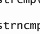

### 常见编程错误 8.6

假设 strcmp 和 strncmp 在参数相等时返回 1 是一个逻辑错误。两个函数在相等时都返回 0（奇怪的是，相当于 C 的 false 值）。因此，在比较两个字符串是否相等时，应将函数 strcmp 或 strncmp 的结果与 0 进行比较以确定字符串是否相等。

为了理解一个字符串“大于”或“小于”另一个字符串的含义，请考虑对一系列姓氏进行字母排序的过程。读者毫无疑问会将“Jones”排在“Smith”之前，因为“Jones”的第一个字母在字母表中早于“Smith”的第一个字母。但字母表不仅仅是 26 个字母的列表——它是一个有序的字符列表。每个字母在列表中都有特定位置。“Z”不仅仅是字母表中的一个字母；“Z” specifically 是字母表的第 26 个字母。

字符串比较函数如何知道某个特定字母在另一个字母之前？所有字符在计算机内部都以 ASCII 和 Unicode 等字符集中的数字代码表示；当计算机比较两个字符串时，它实际上比较的是字符串中字符的数字代码——这称为词法比较。参见附录 B 了解 ASCII 字符的数值。

函数 *strcmp* 和 *strncmp* 返回的负值和正值因编译器而异。对于某些编译器（例如 Visual C++ 和 GNU gcc），这些值是 -1 或 1（如图 8.18 所示）。对于其他编译器（例如 Xcode LLVM），返回的值表示每个字符串中第一个不同的字符的数字代码之间的差值。对于本程序中的比较，这就是“New”中的“N”和“Happy”中的“H”的数字代码之间的差值（6 或 -6，具体取决于每次调用中哪个字符串是第一个参数）。

## 8.8 字符串处理库的搜索函数

本节介绍字符串处理库中用于*搜索字符串*中的字符和其他字符串的函数。函数 *strcspn* 和 *strspn* 返回 *size_t*。[*注意*: 函数 *strtok* 在 C11 标准的可选附录 K 中有更安全的版本描述。我们在本章的 *安全 C 编程* 部分提及此事。]

**函数原型和描述**

| 函数原型 | 描述 |
|---|---|
| `char *strchr(const char *s, int c);` | 定位字符串 *s* 中字符 *c* 的 *首次* 出现。如果找到 *c*，则返回指向 *s* 中 *c* 的指针。否则返回 NULL 指针。 |
| `size_t strcspn(const char *s1, const char *s2);` | 确定并返回字符串 *s1* 的初始段的长度，该段由字符 *不* 包含在字符串 *s2* 中组成。 |
| `size_t strspn(const char *s1, const char *s2);` | 确定并返回字符串 *s1* 的初始段的长度，该段 *仅* 由包含在字符串 *s2* 中的字符组成。 |
| `char *strpbrk(const char *s1, const char *s2);` | 定位字符串 *s1* 中字符串 *s2* 中任何字符的 *首次* 出现。如果找到来自字符串 *s2* 的字符，则返回指向字符串 *s1* 中该字符的指针。否则返回 NULL 指针。 |
| `char *strrchr(const char *s, int c);` | 定位字符串 *s* 中 *c* 的 *最后* 一次出现。如果找到 *c*，则返回指向字符串 *s* 中 *c* 的指针。否则返回 NULL 指针。 |

Fig. 8.19 | 字符串处理库的搜索函数。（第 1 部分，共 2 部分。）

### 函数原型和描述

```
char *strstr(const char *s1, const char *s2);
```

定位字符串 s1 中字符串 s2 的首次出现。如果找到该字符串，则返回指向 s1 中该字符串的指针。否则返回 NULL 指针。

```
char *strtok(char *s1, const char *s2);
```

对 strtok 的一系列调用将字符串 s1 分解为标记——由包含在字符串 s2 中的字符分隔的逻辑片段，例如文本行中的单词。第一次调用将 s1 作为第一个参数，后续调用以继续标记同一字符串时将 NULL 作为第一个参数。每次调用都返回指向当前标记的指针。如果调用函数时没有更多标记，则返回 NULL。

Fig. 8.19 | 字符串处理库的搜索函数。（第 2 部分，共 2 部分。）

### 8.8.1 函数 strchr

函数 strchr 搜索字符串中字符的首次出现。如果找到该字符，strchr 返回指向字符串中该字符的指针；否则 strchr 返回 NULL。图 8.20 搜索 "This is a test" 中 'a' 和 'z' 的首次出现。

```
1  // Fig. 8.20: fig08_20.c
2  // Using function strchr
3  #include <stdio.h>
4  #include <string.h>
5
6  int main(void)
7  {
8      const char *string = "This is a test"; // initialize char pointer
9      char character1 = 'a'; // initialize character1
10     char character2 = 'z'; // initialize character2
11
12     // if character1 was found in string
13     if (strchr(string, character1) != NULL) { // can remove "!= NULL"
14         printf("\"%c\" was found in \"%s\".\n",
15             character1, string);
16     }
17     else { // if character1 was not found
18         printf("\"%c\" was not found in \"%s\".\n",
19             character1, string);
20     }
21
22     // if character2 was found in string
23     if (strchr(string, character2) != NULL) { // can remove "!= NULL"
24         printf("\"%c\" was found in \"%s\".\n",
25             character2, string);
26     }
27     else { // if character2 was not found
```

Fig. 8.20 | 使用函数 strchr。（第 1 部分，共 2 部分。）


```
28     printf("\'%c\' was not found in \"%s\".\n", 
29             character2, string);
30     }
31 }
```

'a' 在 "This is a test" 中被找到。
'z' 在 "This is a test" 中未被找到。

图 8.20 | 使用函数 strchr。 (Part 2 of 2.)

## 8.8.2 函数 strcspn

函数 strcspn (图 8.21) 确定其第一个参数中字符串的初始部分的长度，该部分不包含第二个参数中字符串的任何字符。函数返回该段的长度。

```
1  // Fig. 8.21: fig08_21.c
2  // Using function strcspn
3  #include <stdio.h>
4  #include <string.h>
5
6  int main(void)
7  {
8      // initialize two char pointers
9      const char *string1 = "The value is 3.14159";
10     const char *string2 = "1234567890";
11
12     printf("\n%s\n%s\n\n%s\n%s\n%s\n", string1, string2,
13            "The length of the initial segment of string1",
14            "containing no characters from string2 = ",
15            strcspn(string1, string2) );
16 }
```

string1 = The value is 3.14159
string2 = 1234567890

string1 的初始段的长度
不包含来自 string2 的字符 = 13

图 8.21 | 使用函数 strcspn。

## 8.8.3 函数 strpbrk

函数 strpbrk 在其第一个字符串参数中搜索第二个字符串参数中任何字符的首次出现。如果找到第二个参数中的字符，strpbrk 会返回指向第一个参数中该字符的指针；否则，strpbrk 返回 NULL。图 8.22 显示了一个程序，该程序定位 string1 中来自 string2 的任何字符的首次出现。

// Fig. 8.22: fig08_22.c
// Using function strpbrk
#include <stdio.h>
#include <string.h>

int main(void)
{
    const char *string1 = "This is a test"; // initialize char pointer
    const char *string2 = "beware"; // initialize char pointer

    printf("%s\n%s\n%c%s\n%s\n",
           "Of the characters in ",
           string2,
           *strpbrk(string1, string2),
           " appears earliest in ", string1);
}

"beware" 中的字符中
'a' 最早出现在
"This is a test" 中

图 8.22 | 使用函数 strpbrk。

## 8.8.4 函数 strrchr

函数 strrchr 在字符串中搜索指定字符的最后一次出现。如果找到该字符，strrchr 会返回指向字符串中该字符的指针；否则，strrchr 返回 NULL。图 8.23 显示了一个程序，该程序在字符串 "A zoo has many animals including zebras" 中搜索字符 'z' 的最后一次出现。

// Fig. 8.23: fig08_23.c
// Using function strrchr
#include <stdio.h>
#include <string.h>

int main(void)
{
    // initialize char pointer
    const char *string1 = "A zoo has many animals including zebras";

    int c = 'z'; // character to search for
    printf("%s\n%s%c%s\n",
           "The remainder of string1 beginning with the",
           "last occurrence of character ", c,
           " is: ", strrchr(string1, c));
}

从字符 'z' 的最后一次出现开始的 string1 的剩余部分是："zebras"

图 8.23 | 使用函数 strrchr。

## 8.8.5 函数 strspn

函数 strspn (图 8.24) 确定其第一个参数中字符串的初始部分的长度，该部分仅包含第二个参数中字符串的字符。函数返回该段的长度。

// Fig. 8.24: fig08_24.c
// Using function strspn
#include <stdio.h>
#include <string.h>

int main(void)
{
    // initialize two char pointers
    const char *string1 = "The value is 3.14159";
    const char *string2 = "aehi 1sTuv";

    printf("%s\n%s\n%s\n%s\n",
    "string1 = ", string1, "string2 = ", string2,
    "The length of the initial segment of string1",
    "containing only characters from string2 = ",
    strspn(string1, string2));
}

string1 = The value is 3.14159
string2 = aehi 1sTuv
string1 的初始段的长度
仅包含来自 string2 的字符 = 13

图 8.24 | 使用函数 strspn。

## 8.8.6 函数 strstr

函数 strstr 在其第一个字符串参数中搜索第二个字符串参数的首次出现。如果在第一个字符串中找到第二个字符串，则返回指向第一个参数中该字符串位置的指针。图 8.25 使用 strstr 在字符串 "abcdefabcdef" 中查找字符串 "def"。

// Fig. 8.25: fig08_25.c
// Using function strstr
#include <stdio.h>
#include <string.h>

int main(void)
{
    const char *string1 = "abcdefabcdef"; // string to search
    const char *string2 = "def"; // string to search for

图 8.25 | 使用函数 strstr。 (Part 1 of 2.)

```
    11        printf("%s%s\n%s\n%s\n%s\n%s\n",
    12            "string1 = ", string1, "string2 = ", string2,
    13            "The remainder of string1 beginning with the",
    14            "first occurrence of string2 is: ",
    15            strstr(string1, string2) );
    16    }
```

```
    string1 = abcdefabcdef
    string2 = def

    The remainder of string1 beginning with the
    first occurrence of string2 is: defabcdef
```

图 8.25 | 使用函数 strstr。 (Part 2 of 2.)

## 8.8.7 函数 strtok

函数 strtok (图 8.26) 用于将字符串分解为一系列标记。标记是由定界符分隔的字符序列（通常是 *空格或标点符号*，但定界符可以是 *任何字符*）。例如，在一行文本中，每个单词可以被视为一个标记，而分隔单词的空格和标点可以被视为定界符。

```
    1    // Fig. 8.26: fig08_26.c
    2    // Using function strtok
    3    #include <stdio.h>
    4    #include <string.h>
    5
    6    int main(void)
    7    {
    8        // initialize array string
    9        char string[] = "This is a sentence with 7 tokens";
    10
    11       printf("%s\n%s\n%s\n%s\n",
    12           "The string to be tokenized is:", string,
    13           "The tokens are:");
    14
    15       char *tokenPtr = strtok(string, " "); // begin tokenizing sentence
    16
    17       // continue tokenizing sentence until tokenPtr becomes NULL
    18       while (tokenPtr != NULL) {
    19           printf("%s\n", tokenPtr);
    20           tokenPtr = strtok(NULL, " "); // get next token
    21       }
    22   }
```

```
    The string to be tokenized is:
    This is a sentence with 7 tokens
```

图 8.26 | 使用函数 strtok。 (Part 1 of 2.)

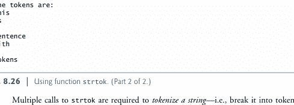

图 8.26 | 使用函数 strtok。 (Part 2 of 2.)

对字符串进行标记化（即将其分解为标记，假设字符串包含多个标记）需要多次调用 strtok。第一次调用 strtok（第 15 行）包含两个参数：要标记化的字符串，以及包含分隔标记的字符的字符串。在第 15 行，语句

```
char * tokenPtr = strtok(string, " "); // begin tokenizing sentence
```

将 tokenPtr 分配为指向 string 中第一个标记的指针。第二个参数 " " 表示标记由空格分隔。函数 strtok 在 string 中搜索第一个不是定界字符（空格）的字符。这开始了第一个标记。然后函数在字符串中找到下一个定界字符，并将其替换为 null ('\0') 字符以终止当前标记。函数 strtok 保存指向 string 中标记后下一个字符的指针并返回指向当前标记的指针。

第 20 行中的后续 strtok 调用继续对 string 进行标记化。这些调用的第一个参数为 NULL。NULL 参数表示应从上一次 strtok 调用保存的 string 中的位置继续标记化。如果调用 strtok 时没有剩余标记，strtok 将返回 NULL。您可以在每次新的 strtok 调用中更改定界符字符串。图 8.26 使用 strtok 对字符串 "This is a sentence with 7 tokens" 进行标记化。每个标记分别打印。函数 strtok 通过在每个标记末尾放置 '\0' 来修改输入字符串；因此，如果在调用 strtok 之后仍需使用该字符串，则应制作字符串的副本。[注意：另请参阅 CERT 建议 STR06-C，其中讨论了假设 strtok 不修改其第一个参数中字符串的问题。]

## 8.9 字符串处理库的内存函数

本节介绍的字符串处理库函数操作、比较和搜索内存块。这些函数将内存块视为字符数组，可以操作任何数据块。图 8.27 总结了字符串处理库的内存函数。[注意：这些函数中的每个函数都有在 C11 标准的可选附录 K 中描述的更安全的版本。我们在本章的 Secure C Programming 部分中提到这些。]

指针参数声明为 void *，因此它们可用于操作任何数据类型中的内存。回顾第 7 章，任何指针都可以直接分配给类型为 void * 的指针，而类型为 void * 的指针可以直接分配给任何其他类型的指针。由于 void * 指针不能被解引用，每个函数都会接收一个 size 参数，该参数指定函数将处理的字节数。对于

```c
5
6 int main(void)
7 {
8   char s1[17]; // create char array s1
9   char s2[] = "Copy this string"; // initialize char array s2
10
11   memcpy(s1, s2, 17);
12   printf("%s\n%s%s\n", "After s2 is copied into s1 with memcpy", "s1 contains ", s1);
13
14 }
15
```

使用 memcpy 将 s2 复制到 s1 后，
s1 包含 "Copy this string"

图 8.28 | 使用函数 memcpy。 (第 2 部分，共 2 部分。)

### 8.9.2 函数 memmove

函数 memmove 与 memcpy 类似，会将第二个参数指向的对象中的指定数量的字节复制到第一个参数指向的对象中。复制操作就像先将字节从第二个参数复制到临时数组中，然后再从临时数组复制到第一个参数中一样进行。这允许将字符串中一个部分的字节复制到同一字符串的另一部分，即使这两个部分重叠。图 8.29 使用 memmove 将数组 x 的最后 10 个字节复制到数组 x 的前 10 个字节中。

### 常见编程错误 8.7

> 除了 memmove 之外，复制字符的字符串操作函数在复制发生在同一字符串的不同部分之间时，其结果是未定义的。

```c
1 // Fig. 8.29: fig08_29.c
2 // Using function memmove
3 #include <stdio.h>
4 #include <string.h>
5
6 int main(void)
7 {
8   char x[] = "Home Sweet Home"; // initialize char array x
9
10   printf("%s%s\n", "The string in array x before memmove is: ", x);
11   printf("%s%s\n", "The string in array x after memmove is: ", (char *) memmove(x, &x[5], 10));
12 }
13
```

数组 x 中 memmove 之前的字符串是：Home Sweet Home
数组 x 中 memmove 之后的字符串是：Sweet Home Home

图 8.29 | 使用函数 memmove。

### 8.9.3 函数 memcmp

函数 memcmp（图 8.30）比较其第一个参数的指定数量的字节与其第二个参数的相应字节。该函数如果第一个参数大于第二个参数则返回大于 0 的值，如果参数相等则返回 0，如果第一个参数小于第二个参数则返回小于 0 的值。

```c
// Fig. 8.30: fig08_30.c
// Using function memcmp
#include <stdio.h>
#include <string.h>

int main(void)
{
    char s1[] = "ABCDEFG"; // initialize char array s1
    char s2[] = "ABCDXYZ"; // initialize char array s2

    printf("%s%s\n%s%s\n%s%d\n%s%d\n%s%d\n",
           "s1 = ", s1, "s2 = ", s2,
           "memcmp(s1, s2, 4) = ", memcmp(s1, s2, 4),
           "memcmp(s1, s2, 7) = ", memcmp(s1, s2, 7),
           "memcmp(s2, s1, 7) = ", memcmp(s2, s1, 7));
}
```

s1 = ABCDEFG
s2 = ABCDXYZ
memcmp(s1, s2, 4) = 0
memcmp(s1, s2, 7) = -1
memcmp(s2, s1, 7) = 1

图 8.30 | 使用函数 memcmp。

### 8.9.4 函数 memchr

函数 memchr 在对象的指定数量的字节中搜索作为 unsigned char 表示的字节的首次出现。如果找到该字节，则返回指向对象中该字节的指针；否则，返回 NULL 指针。图 8.31 在字符串 "This is a string" 中搜索包含 'r' 的字节。

```c
// Fig. 8.31: fig08_31.c
// Using function memchr
#include <stdio.h>
#include <string.h>

int main(void)
{
8 const char *s = "This is a string"; // initialize char pointer
9
10 printf("%s%c%s%s\n",
11 "The remainder of s after character ", 'r',
12 " is found is ", (char *) memchr(s,'r',16));
13 }
```

找到字符 'r' 后 s 的剩余部分是 "ring"

图 8.31 | 使用函数 memchr。 (第 2 部分，共 2 部分。)

### 8.9.5 函数 memset

函数 memset 将其第二个参数中字节的值复制到其第一个参数指向的对象的最初 n 个字节中，其中 n 由第三个参数指定。图 8.32 使用 memset 将 'b' 复制到 string1 的前 7 个字节中。

**性能提示 8.2**
使用 memset 将数组的元素设置为 0，而不是通过循环遍历它们并为每个元素分配 0。例如，图 6.3 可以使用 memset(n, 0, 5) 初始化五元素数组 n。许多硬件架构都有块复制或清除指令，编译器可以利用它来优化 memset 以实现高性能的内存清零。

```c
1 // Fig. 8.32: fig08_32.c
2 // Using function memset
3 #include <stdio.h>
4 #include <string.h>
5
6 int main(void)
7 {
8 char string1[15] = "BBBBBBBBBBBBBB"; // initialize string1
9
10 printf("string1 = %s\n", string1);
11 printf("string1 after memset = %s\n",
12 (char *) memset(string1, 'b', 7));
13 }
```

string1 = BBBBBBBBBBBBBB
memset 之后 string1 = bbbbbbbBBBBBBB

图 8.32 | 使用函数 memset。

## 8.10 字符串处理库的其他函数

字符串处理库的另外两个函数是 strerror 和 strlen。图 8.33 总结了 strerror 和 strlen 函数。

```c
10    const char *string2 = "four";
11    const char *string3 = "Boston";

13    printf("%s%s%s%u\n%s%s%s%u\n%s%s%s%u\n",
14        "The length of ", string1, " is ", strlen(string1),
15        "The length of ", string2, " is ", strlen(string2),
16        "The length of ", string3, " is ", strlen(string3));
17  }
```

```text
The length of "abcdefghijklmnopqrstuvwxyz" is 26
The length of "four" is 4
The length of "Boston" is 6
```

**图 8.35** | 使用函数 strlen。 (第 2 部分，共 2 部分)。

## 8.11 安全的 C 编程

### 安全的字符串处理函数

本书中早期的安全 C 编程部分介绍了 C11 的更安全函数 printf_s 和 scanf_s。在本章中，我们介绍了函数 sprintf、strcpy、strncpy、strcat、strncat、strtok、strlen、memcpy、memmove 和 memset。C11 标准的可选附录 K 描述了这些以及许多其他字符串处理和输入/输出函数的更安全版本。如果你的 C 编译器支持附录 K，你应该使用这些函数的更安全版本。其中，更多安全的版本通过要求额外的参数来指定目标数组中的元素数量，并确保指针参数非 NULL，从而帮助防止缓冲区溢出。

### 读取数值输入和输入验证

验证输入到程序中的数据非常重要。例如，当你要求用户输入范围为 1–100 的 int，然后尝试使用 scanf 读取该 int 时，可能会出现几个问题。用户可能输入：
- 超出程序所需范围的 int（例如 102）。
- 超出该计算机上 int 的允许范围的 int（例如在 32 位 int 的机器上为 8,000,000,000）。
- 非整数数值（例如 27.43）。
- 非数值（例如 FOVR）。

你可以使用本章中学到的各种函数来完全验证此类输入。例如，你可以
- 使用 fgets 将输入作为文本行读取，
- 使用 strtol 将字符串转换为数字并确保转换成功，然后
- 确保该值在范围内。

有关更多信息和将输入转换为数值值的技术，请参阅 www.securecoding.cert.org 上的 CERT 指南 INT05-C。

### 第 8.4 节 字符串转换函数

- 函数 strtod（第 374 页）将表示浮点值的字符序列转换为 double。该函数接收两个参数——一个字符串（char *）和一个指向 char * 的指针。字符串包含要转换的字符序列，而由指向 char * 的指针指定的位置被赋予转换后字符串剩余部分的地址，如果字符串的任何部分都无法转换，则为整个字符串的地址。
- 函数 strtol（第 375 页）将表示整数的字符序列转换为 long。该函数接收三个参数——一个字符串（char *）、一个指向 char * 的指针和一个整数。字符串包含要转换的字符序列，由指向 char * 的指针指定的位置被赋予转换后字符串剩余部分的地址，如果字符串的任何部分都无法转换，则为整个字符串的地址。该整数指定被转换值的基数。
- 函数 strtoul（第 376 页）将表示整数的字符序列转换为 unsigned long int。该函数的工作方式与 strtol 完全相同。

### 第 8.5 节 标准输入/输出库函数

- 函数 fgets（第 377 页）读取字符，直到遇到换行符或文件结束指示符。fgets 的参数是 char 类型的数组、可以读取的最大字符数以及要读取的流。读取终止后，会在数组后附加一个空字符（'\0'）。如果遇到换行符，则将其包含在输入字符串中。
- 函数 putchar（第 377 页）打印其字符参数。
- 函数 getchar（第 378 页）从标准输入读取单个字符并将其作为整数返回。如果遇到文件结束指示符，getchar 返回 EOF。
- 函数 puts（第 379 页）以字符串（char *）作为参数并打印该字符串后跟换行符。
- 函数 sprintf（第 379 页）使用与函数 printf 相同的转换规范将格式化数据打印到 char 类型的数组中。
- 函数 sscanf（第 380 页）使用与函数 scanf 相同的转换规范从字符串读取格式化数据。

### 第 8.6 节 字符串处理库的字符串操作函数

- 函数 strcpy 将其第二个参数（一个字符串）复制到其第一个参数（一个字符数组）中。你必须确保数组足够大以存储字符串及其终止空字符。
- 函数 strncpy（第 381 页）等同于 strcpy，只是 strncpy 指定从字符串复制到数组中的最大字符数。只有当要复制的字符数比字符串长度多一个时，才会复制终止空字符。
- 函数 strcat（第 382 页）将其第二个字符串参数（包括终止空字符）附加到其第一个参数。第二个字符串的第一个字符替换第一个字符串的空（'\0'）字符。你必须确保用于存储第一个字符串的数组足够大以存储第一个字符串和第二个字符串。
- 函数 strncat（第 381 页）将第二个字符串的指定数量的字符附加到第一个字符串。结果后附加一个终止空字符。

### 第 8.7 节 字符串处理库的比较函数

- 函数 strcmp（第 383 页）逐字符比较其第一个字符串参数和第二个字符串参数。它返回 0 如果字符串相等，返回负值如果第一个字符串小于第二个，返回正值如果第一个字符串大于第二个。


函数 **strncmp**（第 383 页）等价于 **strcmp**，只是 **strncmp** 比较指定数量的字符。如果其中一个字符串比指定的字符数短，**strncmp** 会比较字符直到在较短的字符串中遇到空字符为止。

### 第 8.8 节 字符串处理库的搜索函数
- 函数 **strchr**（第 386 页）在字符串中搜索字符的首次出现。如果找到该字符，**strchr** 返回指向字符串中该字符的指针；否则，**strchr** 返回 NULL。
- 函数 **strcspn**（第 387 页）确定其第一个参数中字符串的初始部分的长度，该部分不包含第二个参数中字符串的任何字符。函数返回该段的长度。
- 函数 **strpbrk**（第 387 页）在其第一个参数中搜索第二个参数中任何字符的首次出现。如果找到第二个参数中的字符，**strpbrk** 返回指向该字符的指针；否则，**strpbrk** 返回 NULL。
- 函数 **strrchr**（第 388 页）在字符串中搜索字符的最后一次出现。如果找到该字符，**strrchr** 返回指向字符串中该字符的指针；否则，**strrchr** 返回 NULL。
- 函数 **strspn**（第 389 页）确定其第一个参数中字符串的初始部分的长度，该部分仅包含第二个参数中字符串的字符。函数返回该段的长度。
- 函数 **strstr**（第 389 页）在其第一个字符串参数中搜索第二个字符串参数的首次出现。如果在第一个字符串中找到第二个字符串，则返回指向第一个参数中该字符串位置的指针。
- 对 **strtok**（第 390 页）的一系列调用将第一个字符串 **s1** 分解为标记（第 390 页），这些标记由第二个字符串 **s2** 中包含的字符分隔。第一次调用将 **s1** 作为第一个参数，后续为继续标记同一字符串的调用将 NULL 作为第一个参数。每次调用都返回指向当前标记的指针。如果调用函数时没有更多标记，则返回空指针。

### 第 8.9 节 字符串处理库的内存函数
- 函数 **memcpy**（第 392 页）将指定数量的字节从其第二个参数指向的对象复制到其第一个参数指向的对象。函数可以接收指向任何类型对象的指针。
- 函数 **memmove**（第 393 页）将指定数量的字节从其第二个参数指向的对象复制到其第一个参数指向的对象。复制操作如同先将字节从第二个参数复制到临时数组，然后再从临时数组复制到第一个参数。
- 函数 **memcmp**（第 394 页）比较其第一个和第二个参数的指定数量的字节。
- 函数 **memchr**（第 394 页）在对象的指定数量的字节中搜索作为 `unsigned char` 表示的字节的首次出现。如果找到该字节，则返回指向该字节的指针；否则返回空指针。
- 函数 **memset**（第 395 页）将作为 `unsigned char` 处理的第二个参数复制到其第一个参数指向的对象的指定数量的字节。

### 第 8.10 节 字符串处理库的其他函数
- 函数 **strerror**（第 396 页）以特定于区域设置的方式将整数错误号映射为完整文本字符串。返回指向该字符串的指针。
- 函数 **strlen**（第 396 页）接受一个字符串作为参数并返回字符串中的字符数——终止空字符不计入字符串的长度。

## 自我复习练习

8.1    编写单个语句以完成以下每项。假设变量 c（存储一个字符）、x、y 和 z 为 int 类型，变量 d、e 和 f 为 double 类型，变量 ptr 为 char * 类型，数组 s1[100] 和 s2[100] 为 char 类型。
- a) 将变量 c 中存储的字符转换为大写字母。将结果赋给变量 c。
- b) 判断变量 c 的值是否为数字。使用如 Fig. 8.2–8.4 所示的条件运算符，在显示结果时打印 " is a " 或 " is not a "。
- c) 判断变量 c 的值是否为控制字符。使用条件运算符在显示结果时打印 " is a " 或 " is not a "。
- d) 从键盘读取一行文本到数组 s1 中。不要使用 scanf。
- e) 打印存储在数组 s1 中的文本行。不要使用 printf。
- f) 将 ptr 赋值为 c 在 s1 中最后一次出现的位置。
- g) 打印变量 c 的值。不要使用 printf。
- h) 判断 c 的值是否为字母。使用条件运算符在显示结果时打印 " is a " 或 " is not a "。
- i) 从键盘读取一个字符并将该字符存储在变量 c 中。
- j) 将 ptr 赋值为 s2 在 s1 中首次出现的位置。
- k) 判断变量 c 的值是否为可打印字符。使用条件运算符在显示结果时打印 " is a " 或 " is not a "。
- l) 从字符串 "1.27 10.3 9.432" 读取三个 double 值到变量 d、e 和 f。
- m) 将存储在数组 s2 中的字符串复制到数组 s1。
- n) 将 ptr 赋值为 s1 中首次出现 s2 中任何字符的位置。
- o) 比较 s1 中的字符串与 s2 中的字符串。打印结果。
- p) 将 ptr 赋值为 c 在 s1 中首次出现的位置。
- q) 使用 sprintf 将整数变量 x、y 和 z 的值打印到数组 s1 中。每个值应以宽度为 7 的字段打印。
- r) 将 s2 中的字符串的 10 个字符追加到 s1 中的字符串。
- s) 确定 s1 中字符串的长度。打印结果。
- t) 将 ptr 赋值为 s2 中第一个标记的位置。字符串 s2 中的标记由逗号（,）分隔。

8.2    显示两种不同的初始化字符数组 vowel 为元音字符串 "AEIOU" 的方法。

8.3    执行以下每个 C 语句时，如果有的话会打印什么？如果语句包含错误，请描述错误并说明如何纠正。假设以下变量定义：
```
char s1[50] = "jack", s2[50] = "jill", s3[50];
```
- a) `printf("%c%s", toupper(s1[0]), &s1[1]);`
- b) `printf("%s", strcpy(s3, s2));`
- c) `printf("%s", strcat(strcat(strcpy(s3, s1), " and "), s2));`
- d) `printf("%u", strlen(s1) + strlen(s2));`
- e) `printf("%u", strlen(s3));` // using s3 after part (c) executes

8.4    找出以下每个程序段中的错误并解释如何纠正：
- a) `char s[10];`
  `strcpy(s, "hello", 5);`
  `printf("%s\n", s);`
- b) `printf("%s", 'a');`
- c) `char s[12];`
  `strcpy(s, "Welcome Home");`
```
d) if (strcmp(string1, string2)) {
       puts("The strings are equal");
   }
```

## 自我复习练习答案

### 8.1
- a) c = toupper(c);
- b) printf("%c %sdigit\n", c, isdigit(c) ? " is a " : " is not a ");
- c) printf("%c %scontrol character\n",
            c, iscntrl(c) ? " is a " : " is not a ");
- d) fgets(s1, 100, stdin);
- e) puts(s1);
- f) ptr = strrchr(s1, c);
- g) putchar(c);
- h) printf("%c %sletter\n", c, isalpha(c) ? " is a " : " is not a ");
- i) c = getchar();
- j) ptr = strstr(s1, s2);
- k) printf("%c %sprinting character\n",
            c, isprint(c) ? " is a " : " is not a ");
- l) sscanf("1.27 10.3 9.432", "%f%f%f", &d, &e, &f);
- m) strcpy(s1, s2);
- n) ptr = strpbrk(s1, s2);
- o) printf("strcmp(s1, s2) = %d\n", strcmp(s1, s2));
- p) ptr = strchr(s1, c);
- q) sprintf(s1, "%7d%7d%7d", x, y, z);
- r) strncat(s1, s2, 10);
- s) printf("strlen(s1) = %u\n", strlen(s1));
- t) ptr = strtok(s2, " ");

### 8.2
- char vowel[] = "AEIOU";
- char vowel[] = { 'A', 'E', 'I', 'O', 'U', '\0' };

### 8.3
- a) Jack
- b) jill
- c) Jack and jill
- d) 8
- e) 13

### 8.4
- a) 错误：函数 strncpy 不会向数组 s 写入终止空字符，因为其第三个参数等于字符串 "hello" 的长度。
  修正：使 strncpy 的第三个参数为 6，或将 '\0' 赋给 s[5]。
- b) 错误：尝试将字符常量作为字符串打印。
  修正：使用 %c 输出字符，或将 'a' 替换为 "a"。
- c) 错误：字符数组 s 不足以存储终止空字符。
  修正：用更多元素声明该数组。
- d) 错误：函数 strcmp 在字符串相等时返回 0；因此 if 语句中的条件为假，printf 将不会被执行。
  修正：在条件中将 strcmp 的结果与 0 进行比较。

## 练习

8.5 (字符测试) 编写一个程序，从键盘输入一个字符并用字符处理库中的每个函数对其进行测试。程序应打印每个函数返回的值。


- **8.6** *（以大写和小写交替的方式显示字符串）* 编写一个程序，将一行文本输入 char 数组 s[100]。以大写字母和小写字母交替的方式输出该行。

- **8.7** *（将字符串转换为整数进行计算）* 编写一个程序，输入六个表示整数的字符串，将这些字符串转换为整数，并计算这六个值的和与平均值。

- **8.8** *（将字符串转换为浮点数进行计算）* 编写一个程序，输入六个表示浮点值的字符串，将这些字符串转换为 double 值，将这些值存入一个 double 数组，并计算这些值的和与平均值。

- **8.9** *（连接字符串）* 编写一个程序，使用函数 strcat 连接用户提供的两个字符串。程序应打印连接前后的字符串以及连接后字符串的长度。

- **8.10** *（追加字符串的一部分）* 编写一个程序，使用函数 strncat 将字符串的一部分追加到另一个字符串。程序应输入字符串以及要追加的字符数，然后显示追加第二个字符串后的第一个字符串及其长度。

- **8.11** *（随机句子）* 编写一个程序，使用随机数生成来创建句子。程序应使用四个指向 char 的指针数组，分别称为 article、noun、verb 和 preposition。程序应按以下顺序从每个数组中随机选择一个单词来创建句子：article、noun、verb、preposition、article 和 noun。每选中一个单词，就应将其连接到数组中前面的单词之后，该数组要足够大以容纳整个句子。单词之间应以空格分隔。输出最终句子时，应以大写字母开头并以句点结尾。程序应生成 20 个这样的句子。数组应如下填充：article 数组应包含冠词 "the"、"a"、"one"、"some" 和 "any"；noun 数组应包含名词 "boy"、"girl"、"dog"、"town" 和 "car"；verb 数组应包含动词 "drove"、"jumped"、"ran"、"walked" 和 "skipped"；preposition 数组应包含介词 "to"、"from"、"over"、"under" 和 "on"。

在编写并运行上述程序后，修改它以生成由其中几个句子组成的短篇故事。（随机学期论文写手这种可能性怎么样？）

- **8.12** *（五行打油诗）* 五行打油诗是一种幽默的五句诗，其中第一行和第二行与第三行押韵，第四行与第五行押韵。使用与练习 8.11 中开发的技术类似的技术，编写一个程序生成随机五行打油诗。完善此程序以生成优秀的打油诗是一个具有挑战性的问题，但结果将值得付出努力！

- **8.13** *（猪拉丁语）* 编写一个程序，将英语短语编码成猪拉丁语。猪拉丁语是一种常用于娱乐的编码语言。构成猪拉丁语短语的方法有许多变体。为简单起见，使用以下算法：

要从英语短语构成猪拉丁语短语，使用函数 strtok 将短语分词为单词。要将每个英语单词翻译成猪拉丁语单词，将英语单词的首字母放在该英语单词末尾，并添加字母 "ay"。因此，单词 "jump" 变成 "umpjay"，单词 "the" 变成 "hetay"，单词 "computer" 变成 "omputercay"。单词之间的空格仍为空格。假设如下：英语短语由以空格分隔的单词组成，没有标点符号，并且所有单词都有两个或更多字母。函数 printLatinWord 应显示每个单词。[提示：每次在调用 strtok 找到标记时，将标记指针传递给函数 printLatinWord 并打印猪拉丁语单词。注意：这里我们提供了将单词转换为猪拉丁语的简化规则。有关更详细的规则和变体，请访问 en.wikipedia.org/wiki/Pig_Latin。]

- **8.14** *（对电话号码进行分词）* 编写一个程序，输入一个形如 (555) 555-5555 的字符串电话号码。程序应使用函数 strtok 将区号提取为一个标记，将电话号码的前三位数字提取为一个标记，并将电话号码的后四位数字提取为一个标记。电话号码的七位数字应连接成一个字符串。

程序应将区号字符串转换为 int，并将电话号码字符串转换为 long。区号和电话号码都应打印。

- **8.15** *（按单词逆序显示句子）* 编写一个程序，输入一行文本，使用函数 strtok 对该行进行分词，并按相反顺序输出标记。

- **8.16** *（搜索子串）* 编写一个程序，从键盘输入一行文本和一个搜索字符串。使用函数 strstr 定位搜索字符串在文本行中第一次出现的位置，并将该位置赋给 char * 类型的变量 searchPtr。如果找到搜索字符串，打印从搜索字符串开始的该行文本剩余部分。然后再次使用 strstr 定位搜索字符串在文本行中的下一次出现。如果找到第二次出现，打印从第二次出现开始的该行文本剩余部分。[提示：第二次调用 strstr 应包含 searchPtr + 1 作为其第一个参数。]

- **8.17** *（统计子串出现次数）* 基于练习 8.16 的程序编写一个程序，输入若干行文本和一个搜索字符串，并使用函数 strstr 确定该字符串在文本行中出现的总次数。打印结果。

- **8.18** *（统计字符串中各种字符的出现次数）* 编写一个程序，输入一行文本，并统计给定文本行中元音、辅音、数字和空白字符的总数。

- **8.19** *（从给定文本行中删除特定单词）* 编写一个程序，输入一行文本和一个给定单词。程序应使用字符串库函数 strcmp 和 strcpy 从输入文本行中删除给定单词的所有出现。程序还应使用 strtok 函数统计删除给定单词前后给定文本行中的单词数。

- **8.20** *（统计字符串中的单词数）* 编写一个程序，输入若干行文本，并使用 strtok 统计单词总数。假设单词由空格或换行符分隔。

- **8.21** *（按字母顺序排列字符串列表）* 使用字符串比较函数和数组排序技术，编写一个程序，按字母顺序排列字符串列表。使用你所在地区 10 或 15 个城镇的名称作为程序数据。

- **8.22** 附录 B 中的图表显示了 ASCII 字符集中字符的数字代码表示。研究该图表，然后说明以下各项是真还是假。

a) 字母 "A" 排在字母 "B" 之前。
b) 数字 "9" 排在数字 "0" 之前。
c) 常用的加、减、乘、除符号都排在任何数字之前。
d) 数字排在字母之前。
e) 如果排序程序将字符串按升序排序，那么该程序会将右圆括号符号排在左圆括号符号之前。

- **8.23** *（以 "b" 开头的字符串）* 编写一个程序，读取一系列字符串，并仅打印以字母 "b" 开头的字符串。

- **8.24** *（以 "tion" 结尾的字符串）* 编写一个程序，读取一系列字符串，并仅打印以字母 "tion" 结尾的字符串。

- **8.25** *（打印各种 ASCII 码对应的字符）* 编写一个程序，输入一个 ASCII 码并打印对应字符。

- **8.26** *（编写你自己的字符处理函数）* 以附录 B 中的 ASCII 字符图表为指导，编写你自己的图 8.1 中字符处理函数的版本。


8.27（编写你自己的字符串转换函数）编写图8.5中用于将字符串转换为数字的函数的你自己的版本。

8.28（编写你自己的字符串复制和字符串拼接函数）为图8.14中的字符串复制函数和字符串拼接函数各编写两个版本。第一个版本应使用数组索引，第二个版本应使用指针和指针运算。

8.29（编写你自己的字符串比较函数）为图8.17中的每个字符串比较函数编写两个版本。第一个版本应使用数组索引，第二个版本应使用指针和指针运算。

8.30（编写你自己的字符串长度函数）为图8.33中的函数 strlen 编写两个版本。第一个版本应使用数组索引，第二个版本应使用指针和指针运算。

## 特别章节：高级字符串操作练习

前面的练习与正文内容相配套，旨在测试读者对基本字符串操作概念的理解。本节包含中级和高级问题，你会觉得它们既有挑战性又有趣。这些问题的难度差异很大。有些需要一两个小时的编程。另一些则适合用作实验作业，可能需要两三周的学习和实现。还有一些是颇具挑战性的学期项目。

8.31（文本分析）计算机具备字符串操作能力后，出现了一些相当有趣的方法来分析伟大作家的作品。人们大量关注威廉·莎士比亚是否真实存在过。一些学者找到了大量证据，表明克里斯托弗·马洛实际上撰写了那些归到莎士比亚名下的杰作。研究人员使用计算机来寻找这两位作者作品中的相似之处。本练习考察用计算机分析文本的三种方法。

- a) 编写一个程序，读取若干行文本，并打印一个表格，指出文本中字母表中每个字母出现的次数。例如，短语

`To be, or not to be: that is the question:`

包含一个“a”、两个“b”、零个“c”，依此类推。

- b) 编写一个程序，读取若干行文本，并打印一个表格，指出文本中出现的单字母单词、双字母单词、三字母单词等的数量。例如，短语

`Whether 'tis nobler in the mind to suffer`

包含

| 单词长度 | 出现次数 |
|---|---|
| 1 | 0 |
| 2 | 2 |
| 3 | 1 |
| 4 | 2（包括 'tis） |
| 5 | 0 |
| 6 | 2 |
| 7 | 1 |

- c) 编写一个程序，读取若干行文本，并打印一个表格，指出文本中每个不同单词出现的次数。程序应按照单词在文本中出现的相同顺序将它们列入表中。例如，下面几行

> 生存还是毁灭：这是一个问题：
> 在心灵中忍受是否更为高贵

包含单词“to”三次、“be”两次、“or”一次，依此类推。

## 8.32（以多种格式打印日期）

在商务信函中，日期通常以几种不同格式打印。两种较常见的格式是

07/21/2003 和 July 21, 2003

编写一个程序，读取第一种格式的日期，并以第二种格式打印。

## 8.33（支票保护）

计算机经常用于支票开具系统，例如工资单和应付账款应用。流传着许多故事，说每周工资支票被（错误地）打印成超过100万美元的金额。由于人为错误和/或机器故障，计算机化支票开具系统会打印出奇怪的金额。当然，系统设计人员会尽一切努力在系统中设置控制措施，以防止开具错误支票。

另一个严重问题是，打算欺诈性兑现支票的人会故意篡改支票金额。为了防止美元金额被篡改，大多数计算机化支票开具系统采用一种称为支票保护的技术。

为供计算机压印而设计的支票包含固定数量的空格，计算机可在其中打印金额。假设一张工资支票包含九个空白空格，计算机应在其中打印每周工资支票的金额。如果金额较大，那么这九个空格都会被填满——例如：

```
11,230.60 (check amount)
---------
123456789 (position numbers)
```

另一方面，如果金额小于1,000美元，那么通常会有几个空格留空——例如，

```
99.87
---------
123456789
```

包含四个空白空格。如果支票打印时留有空白空格，别人就更容易篡改支票金额。为了防止这种篡改，许多支票开具系统会插入前导星号来保护金额，如下所示：

```
****999.87
---------
123456789
```

编写一个程序，输入要打印在支票上的美元金额，然后以支票保护格式打印该金额，必要时加上前导星号。假设有九个空格可用于打印金额。

## 8.34（写出支票金额的文字等价形式）

继续上一练习的讨论，我们重申设计支票开具系统以防止支票金额被篡改的重要性。一种常见的安全方法要求支票金额既用数字书写，又用文字“拼写出来”。即使有人能够篡改支票的数字金额，要更改文字金额也极其困难。编写一个程序，输入数字支票金额，并写出该金额的文字等价形式。例如，金额 $2.43 应写为

## 8.35（项目：公制转换程序）

编写一个程序，帮助用户进行公制转换。你的程序应允许用户以字符串形式指定单位名称（即公制中的厘米、升、克等，以及英制中的英寸、夸脱、磅等），并应回答如下简单问题：

“2米中有多少英寸？”
“10夸脱中有多少升？”

你的程序应能识别无效转换。例如，问题

“5千克中有多少英尺？”

是没有意义的，因为“英尺”是长度单位，而“千克”是质量单位。

## 一个具有挑战性的字符串操作项目

8.36（项目：填字游戏生成器）大多数人都曾在某个时候玩过填字游戏，但很少有人尝试过生成一个填字游戏。生成填字游戏是一个难题。这里建议将其作为一个字符串操作项目，需要相当高的技巧和努力。即使要让最简单的填字游戏生成器程序运行起来，你也必须解决许多问题。例如，如何在计算机内部表示填字游戏的网格？应该使用一系列字符串，还是二维数组？你需要一个程序可以直接引用的单词来源（即计算机化词典）。这些单词应以什么形式存储，以便于程序所需的复杂操作？真正有雄心的读者会想要生成谜题的“线索”部分，即为填字游戏玩家打印每个“横向”单词和每个“纵向”单词的简短提示。仅仅打印空白谜题本身的一个版本就不是一个简单的问题。

## 有所作为

8.37（使用更健康的食材烹饪）美国的肥胖率正以惊人的速度增长。请查看美国疾病控制与预防中心（CDC）的网页 www.cdc.gov/obesity/data/index.html，其中包含美国的肥胖数据和事实。随着肥胖增加，相关问题的发生率也增加（例如心脏病、高血压、高胆固醇、2型糖尿病）。编写一个程序，帮助用户在烹饪时选择更健康的食材，并帮助对某些食物过敏的人（例如坚果、麸质）找到替代品。程序应从用户处读取一份食谱，并为其中一些食材建议更健康的替代品。为简单起见，你的程序应假设食谱中没有茶匙、杯和汤匙等计量单位的缩写，并使用数字表示数量（例如 1个鸡蛋、2杯），而不是用文字拼写出来（一个鸡蛋、两杯）。一些常见替代品如图8.36所示。你的程序应显示如下警告：“在对饮食做出重大改变之前，务必咨询你的医生。”

你的程序应考虑替代品并不总是一对一替换。例如，如果蛋糕食谱需要三个鸡蛋，那么合理地可以用六个蛋清代替。计量和替代品的转换数据可在以下网站获取：

chinesefood.about.com/od/recipeconversions/f/usmetricrecipes.htm
www.pioneerthinking.com/eggsub.html
www.gourmetsleuth.com/conversions.htm

你的程序应考虑用户的健康问题，例如高胆固醇、高血压、减重、麸质过敏等。对于高胆固醇，程序应建议鸡蛋和乳制品的替代品；如果用户希望减重，则应建议糖等食材的低热量替代品。


| 成分 | 替代品 |
|---|---|
| 1 杯酸奶油 | 1 杯酸奶 |
| 1 杯牛奶 | 1/2 杯淡奶和 1/2 杯水 |
| 1 茶匙柠檬汁 | 1/2 茶匙醋 |
| 1 杯糖 | 1/2 杯蜂蜜、1 杯糖蜜<br>或 1/4 杯龙舌兰糖浆 |
| 1 杯黄油 | 1 杯人造黄油或酸奶 |
| 1 杯面粉 | 1 杯黑麦粉或大米粉 |
| 1 杯蛋黄酱 | 1 杯农家奶酪<br>或 1/8 杯蛋黄酱和 7/8 杯酸奶 |
| 1 个鸡蛋 | 2 汤匙玉米淀粉、葛根粉<br>或土豆淀粉或 2 个蛋白<br>或 1/2 个大香蕉（捣碎） |
| 1 杯牛奶 | 1 杯豆奶 |
| 1/4 杯油 | 1/4 杯苹果酱 |
| 白面包 | 全麦面包 |

**图 8.36** 常见配料替代品。

**8.38** (*垃圾邮件扫描器*) 垃圾邮件（或垃圾电子邮件）每年花费美国组织数十亿美元用于垃圾邮件预防软件、设备、网络资源、带宽和生产力损失。网上搜索一些最常见的垃圾邮件信息和词语，并检查你自己的垃圾邮件文件夹。创建一个包含 30 个常见于垃圾邮件中的词语和短语的列表。编写一个程序，让用户输入一封电子邮件。读取邮件到一个大的字符数组中，并确保程序不会尝试在数组末尾之后插入字符。然后扫描邮件中每个 30 个关键词或短语。对于消息中出现的每个关键词，记一分。接下来，根据获得的分数评估消息是垃圾邮件的可能性。

**8.39** (*短信语言*) 短消息服务（SMS）是一种通信服务，允许在移动电话之间发送 160 个或更少字符的文本消息。随着全球移动电话使用的普及，SMS 在许多发展中国家被用于政治目的（例如表达意见和反对），报告自然灾害新闻等等。例如，查看 comunica.org/radio2.0/archives/87。由于 SMS 消息长度有限，SMS 语言——在移动短信、电子邮件、即时消息等中对常用词语和短语的缩写——经常被使用。例如，“in my opinion”在 SMS 语言中是“IMO”。网上研究 SMS 语言。编写一个程序，让用户使用 SMS 语言输入消息，然后将其翻译成英语（或你自己的语言）。还提供一种机制，将用英语（或你自己的语言）写成的文本翻译成 SMS 语言。一个潜在问题是，一个 SMS 缩写可以扩展为多种短语。例如，IMO（上文使用）也可以代表“International Maritime Organization”、“in memory of”等。

**8.40** (*性别中立性*) 在练习 1.14 中，你研究了消除所有形式的交流中的性别歧视。然后你描述了你将用来读取一段文本并用性别中立的等价词替换性别特定词语的算法。创建一个程序，读取一段文本，然后用性别中立的词语替换性别特定的词语。显示 resulting 性别中立文本。

## C 格式化输入/输出

## 目标

在本章中，你将：

- 使用输入和输出流。
- 使用打印格式化功能。
- 使用输入格式化功能。
- 打印整数、浮点数、字符串和字符。
- 使用字段宽度和精度打印。
- 在 printf 格式控制字符串中使用格式化标志。
- 输出字面量和转义序列。
- 使用 scanf 读取格式化输入。

- 9.1 引言
- 9.2 流
- 9.3 使用 printf 格式化输出
- 9.4 打印整数
- 9.5 打印浮点数
  - 9.5.1 转换说明符 e、E 和 f
  - 9.5.2 转换说明符 g 和 G
  - 9.5.3 演示浮点转换说明符
- 9.6 打印字符串和字符
- 9.7 其他转换说明符
- 9.8 使用字段宽度和精度打印
  - 9.8.1 指定打印整数的字段宽度
  - 9.8.2 为整数、浮点数和字符串指定精度
  - 9.8.3 组合字段宽度和精度
- 9.9 在 printf 格式控制字符串中使用标志
  - 9.9.1 右对齐和左对齐
  - 9.9.2 使用和不使用 + 标志打印正数和负数
  - 9.9.3 使用空格标志
  - 9.9.4 使用 # 标志
  - 9.9.5 使用 0 标志
- 9.10 打印字面量和转义序列
- 9.11 使用 scanf 读取格式化输入
  - 9.11.1 scanf 语法
  - 9.11.2 scanf 转换说明符
  - 9.11.3 使用 scanf 读取整数
  - 9.11.4 使用 scanf 读取浮点数
  - 9.11.5 使用 scanf 读取字符和字符串
  - 9.11.6 使用 scanf 中的扫描集
  - 9.11.7 使用 scanf 中的字段宽度
  - 9.11.8 跳过输入流中的字符
- 9.12 安全的 C 编程

### 9.1 引言

任何问题的解决方案的重要部分是结果的呈现。在本章中，我们深入讨论 printf 和 scanf 的格式化功能，前者从标准输入流输入数据，后者向标准输出流输出数据。调用这些函数的程序中包含头文件 `<stdio.h>`。第 11 章讨论了标准输入/输出（`<stdio.h>`）库中包含的几个附加函数。

### 9.2 流

所有输入和输出都是通过流进行的，流是字节序列。在输入操作中，字节从设备（例如键盘、硬盘、网络连接）流向主内存。在输出操作中，字节从主内存流向设备（例如显示屏、打印机、硬盘、网络连接等）。

程序执行开始时，三个流会自动连接到程序。通常，标准输入流连接到键盘，标准输出流连接到屏幕。第三个流，标准错误流，也连接到屏幕。操作系统通常允许将这些流重定向到其他设备。我们将在第 11 章中展示如何将错误消息输出到标准错误流。流也在第 11 章中详细讨论。

### 9.3 使用 printf 格式化输出

精确的输出格式化是通过 printf 实现的。每个 printf 调用都包含一个格式控制字符串，描述输出格式。格式控制字符串由转换说明符、标志、字段宽度、精度和字面字符组成。连同百分号（%），这些形成转换规范。函数 printf 可以执行以下格式化功能，每项都在本章中讨论：

- 1. 将浮点值舍入到指定的小数位数。
- 2. 对齐数字列，使小数点一一对应。
- 3. 输出的右对齐和左对齐。
- 4. 在输出行的精确位置插入字面字符。
- 5. 以指数格式表示浮点数。
- 6. 以八进制和十六进制格式表示无符号整数。有关八进制和十六进制值的更多信息，请参阅附录 C。
- 7. 使用固定大小的字段宽度和精度显示所有类型的数据。

printf 函数的形式为

```
printf(format-control-string, other-arguments);
```

format-control-string 描述输出格式，other-arguments（可选）对应于 format-control-string 中的每个转换规范。每个转换规范以百分号开头，以转换说明符结束。一个格式控制字符串中可以有多个转换规范。

> **常见编程错误 9.1**
> 忘记用引号括住 format-control-string 是语法错误。

### 9.4 打印整数

整数是整数，例如 776、0 或 −52。整数值以多种格式显示。图 9.1 描述了整数转换说明符。

| 转换说明符 | 描述 |
|---|---|
| d | 以有符号十进制整数显示。 |
| i | 以有符号十进制整数显示。[注意：使用 scanf 时，i 和 d 说明符是不同的。] |
| o | 以无符号八进制整数显示。 |
| u | 以无符号十进制整数显示。 |
| x 或 X | 以无符号十六进制整数显示。X 导致使用数字 0-9 和大写字母 A-F 进行显示，而 x 导致使用数字 0-9 和小写字母 a-f 进行显示。 |
| h、l 或 ll（字母“ell”） | 置于任何整数转换说明符之前，分别表示显示 short、long 或 long long 整数。这些称为长度修饰符。 |

图 9.1 | 整数转换说明符。


并以指数记数法表示为

```
1.504582E+02
```

由计算机显示。这种记数法表示 1.504582 乘以 10 的二次幂（E+02）。E 代表“指数”。

| 转换说明符 | 描述 |
| --- | --- |
| e 或 E | 以指数记数法显示浮点值。 |
| f 或 F | 以定点记数法显示浮点值（Visual Studio 2015 及更高版本中的 Microsoft Visual C++ 编译器支持 f）。 |
| g 或 G | 根据值的大小，以浮点形式 f 或指数形式 e（或 E）显示浮点值。 |
| L | 放在任何浮点转换说明符之前，表示应显示 long double 浮点值。 |

**图 9.3** | 浮点转换说明符。

### 9.5.1 转换说明符 e、E 和 f

使用转换说明符 e、E 和 f 显示的值默认在小数点右侧显示*六位精度*（例如 1.045927）；也可以显式指定其他精度。转换说明符 f 总是至少在小数点*左*侧打印一位数字。转换说明符 e 和 E 分别在指数前打印*小写 e*和*大写 E*，并且在小数点左侧打印*恰好一位*数字。

### 9.5.2 转换说明符 g 和 G

转换说明符 g（或 G）以 e（E）或 f 格式打印，且*无尾随零*（1.234000 打印为 1.234）。如果转换为指数记数法后，值的指数小于 –4，或指数大于等于指定精度（*对于 g 和 G，默认六位有效数字*），则值以 e（E）打印。否则，使用转换说明符 f 打印该值。要输出小数点，至少需要一位十进制数字。例如，使用转换说明符 g 时，值 0.0000875、8750000.0、8.75 和 87.50 分别打印为 8.75e–05、8.75e+06、8.75 和 87.5。值 0.0000875 使用 e 记数法，因为转换为指数记数法后，其指数（–5）小于 –4。值 8750000.0 使用 e 记数法，因为其指数（6）等于默认精度。

转换说明符 g 和 G 的精度表示打印的最大有效数字位数，*包括小数点左边的数字*。值 1234567.0 使用转换说明符 %g 打印为 1.23457e+06（记住所有浮点转换说明符的*默认精度为 6*）。结果中有六位有效数字。当值以指数记数法打印时，g 和 G 的区别与 e 和 E 的区别相同——*小写 g*会导致输出*小写 e*，而*大写 G*会导致输出*大写 E*。

### 错误预防提示 9.1

输出数据时，请确保用户了解由于格式化（例如指定精度导致的舍入误差）数据可能不精确的情况。

### 9.5.3 演示浮点转换说明符

图 9.4 演示了每个浮点转换说明符。%E、%e 和 %g 转换说明符会使输出中的值四舍五入，而转换说明符 %f 不会。

### 可移植性提示 9.1

在某些编译器中，输出中的指数会在 + 号右侧显示两位数字。

```
// Fig. 9.4: fig09_04.c
// Using the floating-point conversion specifiers
#include <stdio.h>

int main(void)
{
    printf("%e\n", 1234567.89);
    printf("%e\n", +1234567.89);  // plus does not print
    printf("%e\n", -1234567.89);  // minus prints
    printf("%E\n", 1234567.89);
    printf("%f\n", 1234567.89);   // six digits to right of decimal point
    printf("%g\n", 1234567.89);   // prints with lowercase e
    printf("%G\n", 1234567.89);   // prints with uppercase E
}
```

1.234568e+006
1.234568e+006
-1.234568e+006
1.234568E+006
1234567.890000
1.23457e+006
1.23457E+006

图 9.4 | 使用浮点转换说明符。

## 9.6 打印字符串和字符

c 和 s 转换说明符分别用于打印单个字符和字符串。转换说明符 c 需要一个 char 参数。转换说明符 s 需要一个指向 char 的指针作为参数。转换说明符 s 会打印字符，直到遇到终止空字符（'\0'）。如果由于某种原因正在打印的字符串没有空终止符，printf 将继续打印，直到最终被一个零字节停止。图 9.5 中的程序使用转换说明符 c 和 s 显示字符和字符串。

```c
// Fig. 9.5: fig09_05c
// Using the character and string conversion specifiers
#include <stdio.h>

int main(void)
{
    char character = 'A'; // initialize char
    printf("%c\n", character);

    printf("%s\n", "This is a string");

    char string[] = "This is a string"; // initialize char array
    printf("%s\n", string);

    const char *stringPtr = "This is also a string"; // char pointer
    printf("%s\n", stringPtr);
}
```

A
This is a string
This is a string
This is also a string

图 9.5 | 使用字符和字符串转换说明符。

大多数编译器不会捕获格式控制字符串中的错误，因此通常直到程序在运行时产生不正确结果时，你才会意识到这类错误。

常见编程错误 9.3
使用 %c 打印字符串是错误的。转换说明符 %c 期望一个 char 参数。字符串是一个指向 char 的指针（即 char *）。

常见编程错误 9.4
使用 %s 打印 char 参数通常会导致称为访问冲突的致命执行时错误。转换说明符 %s 期望一个类型为指向 char 的指针的参数。

常见编程错误 9.5
在想要组成字符串的字符周围使用单引号是语法错误。字符串必须用双引号括起来。

常见编程错误 9.6
在字符常量周围使用双引号会创建一个指向由两个字符组成的字符串的指针，其中第二个字符是终止空字符。

## 9.7 其他转换说明符

图 9.6 展示了 p 和 % 转换说明符。图 9.7 的 %p 打印 ptr 的值和 x 的地址；这些值相同，因为 ptr 被赋值为 x 的地址。最后一个 printf 语句使用 %% 在字符串中打印 % 字符。

### 可移植性提示 9.2

转换说明符 p 以实现定义的方式显示地址（在许多系统上，使用十六进制记数法而不是十进制记数法）。

### 常见编程错误 9.7

在格式控制字符串中尝试使用 % 而不是 %% 打印字面百分号字符——当 % 出现在格式控制字符串中时，其后必须跟一个转换说明符。

| 转换说明符 | 描述 |
|---|---|
| p | 以实现定义的方式显示指针值。 |
| % | 显示百分号字符。 |

图 9.6 | 其他转换说明符。

```c
// Fig. 9.7: fig09_07.c
// Using the p and % conversion specifiers
#include <stdio.h>

int main(void)
{
    int x = 12345; // initialize int x
    int *ptr = &x; // assign address of x to ptr
    printf("The value of ptr is %p\n", ptr);
    printf("The address of x is %p\n", &x);
    printf("Printing a %% in a format control string\n");
}
```

The value of ptr is 002EF778
The address of x is 002EF778
Printing a % in a format control string

图 9.7 | 使用 p 和 % 转换说明符。

## 9.8 使用字段宽度和精度打印

打印数据时所用字段的准确大小由字段宽度指定。如果字段宽度大于正在打印的数据，数据通常会在该字段内右对齐。表示字段宽度的整数插入在百分号（%）和转换说明符之间（例如 %4d）。

### 9.8.1 为打印整数指定字段宽度

图 9.8 打印两组数字，每组五个，对位数少于字段宽度的数字进行右对齐。字段宽度会增加，以打印更宽的值


是打印的显著数字的最大数量。当使用转换说明符 s 时，精度是从字符串开头写入的最大字符数。

要使用精度，请在百分号和转换说明符之间放置一个小数点（.），后跟表示精度的整数。图 9.9 演示了在格式控制字符串中使用精度的情况。当浮点值以小于该值原始小数位数的精度打印时，该值会被四舍五入。

```
// Fig. 9.9: fig09_09.c
// Printing integers, floating-point numbers and strings with precisions
#include <stdio.h>

int main(void)
{
    puts("Using precision for integers");
    int i = 873; // initialize int i
    printf("%5.4d\n%9.9d\n\n", i, i);
    puts("Using precision for floating-point numbers");
    double f = 123.94536; // initialize double f
    printf("%f\n%f\n%f\n\n", f, f, f);
    puts("Using precision for strings");
    char s[] = "Happy Birthday"; // initialize char array s
    printf("%11s\n", s);
}
```

```
Using precision for integers
    0873
    000000873

Using precision for floating-point numbers
    123.945
    1.239e+002
    124

Using precision for strings
    Happy Birth
```

图 9.9 | 使用精度打印整数、浮点数和字符串。

### 9.8.3 组合字段宽度和精度

字段宽度和精度可以通过在百分号和转换说明符之间放置字段宽度、后跟小数点、再跟精度来组合，如语句所示

```
printf("%9.3f", 123.456789);
```

它以九位数字字段右对齐的方式显示 123.457，小数点后有三位数字。

可以使用格式控制字符串后跟的参数列表中的整数表达式来指定字段宽度和精度。要使用此功能，请在字段宽度或精度（或两者）的位置插入星号（*）。参数列表中对应的 int 参数将被求值并用作星号的替代。字段宽度的值可以为正也可以为负（这会导致输出在字段中左对齐，如下一节所述）。语句

```
printf("%*.*f", 7, 2, 98.736);
```

使用 7 作为字段宽度，2 作为精度，并将值 98.74 右对齐输出。

## 9.9 在 printf 格式控制字符串中使用标志

函数 printf 还提供标志来补充其输出格式化功能。格式控制字符串中可以使用五个标志（图 9.10）。要在格式控制字符串中使用标志，请将标志紧跟在百分号的右侧放置。可以在一个转换说明符中组合多个标志。

| 标志 | 描述 |
|------|-------------|
| -（减号） | 在指定字段内左对齐输出。 |
| + | 显示正值前面的加号以及负值前面的减号。 |
| space | 在未使用 + 标志打印的正值前打印一个空格。 |
| # | 使用八进制转换说明符 o 时，在输出值前加上 0 前缀。使用十六进制转换说明符 x 或 X 时，在输出值前加上 0x 或 0X 前缀。对使用 e、E、f、g 或 G 打印且不包含小数部分的浮点数强制显示小数点。（通常只有在小数点后有数字时才打印小数点。）对于 g 和 G 说明符，尾随零不会被消除。 |
| 0（零） | 用前导零填充字段。 |

图 9.10 | 格式控制字符串标志。

### 9.9.1 右对齐和左对齐

图 9.11 演示了字符串、整数、字符和浮点数的右对齐和左对齐。第 7 行输出一行表示列位置的数字，以便您可以确认右对齐和左对齐是否正确工作。

```
// Fig. 9.11: fig09_11.c
// Right justifying and left justifying values
#include <stdio.h>
```

图 9.11 | 右对齐和左对齐值。（第 1 部分，共 2 部分。）

```
5 int main(void)
6 {
7 puts("1234567890123456789012345678901234567890\n");
8 printf("%10s%10d%10c%10f\n\n", "hello", 7, 'a', 1.23);
9 printf("%-10s%-10d%-10c%-10f\n", "hello", 7, 'a', 1.23);
10 }
```

1234567890123456789012345678901234567890
      hello        7          a 1.230000
hello       7          a       1.230000

图 9.11 | 右对齐和左对齐值。（第 2 部分，共 2 部分。）

### 9.9.2 使用和不使用 + 标志打印正数和负数

图 9.12 打印一个正数和一个负数，各自使用和不使用 + 标志。减号在两种情况下都会显示，但加号只有在使用 + 标志时才会显示。

```
// Fig. 9.12: fig09_12.c
// Printing positive and negative numbers with and without the + flag
#include <stdio.h>

int main(void)
{
printf("%d\n%d\n", 786, -786);
printf("%+d\n%+d\n", 786, -786);
}
```

786
-786
+786
-786

图 9.12 | 使用和不使用 + 标志打印正数和负数。

### 9.9.3 使用空格标志

图 9.13 使用空格标志为正数加上前缀空格。这对于使具有相同位数数的正数和负数对齐很有用。由于其减号，值 -547 在输出中前面没有空格。

```
// Fig. 9.13: fig09_13.c
// Using the space flag
// not preceded by + or -
#include <stdio.h>
```

图 9.13 | 使用空格标志。（第 1 部分，共 2 部分。）

```
6 int main(void)
7 {
8     printf("% d\n% d\n", 547, -547);
9 }
```

547
-547

图 9.13 | 使用空格标志。（第 2 部分，共 2 部分。）

### 9.9.4 使用 # 标志

图 9.14 使用 # 标志为八进制值加上 0 前缀，为十六进制值加上 0x 和 0X，并强制使用 g 打印的值显示小数点。

```
// Fig. 9.14: fig09_14.c
// Using the # flag with conversion specifiers
// o, x, X and any floating-point specifier
#include <stdio.h>

int main(void)
{
    int c = 1427; // initialize c
    printf("%#o\n", c);
    printf("%#x\n", c);
    printf("%#X\n", c);

    double p = 1427.0; // initialize p
    printf("%g\n", p);
    printf("%#g\n", p);
}
```

02623
0x593
0X593

1427
1427.00

图 9.14 | 使用 # 标志与转换说明符。

### 9.9.5 使用 0 标志

图 9.15 组合 + 标志和 0（零）标志，以带 + 号和前导零的九个空格字段打印 452，然后仅使用 0 标志和九个空格字段再次打印 452。

```
// Fig. 9.15: fig09_15.c
// Using the 0 (zero) flag
#include <stdio.h>
```

图 9.15 | 使用 0（零）标志。（第 I 部分，共 2 部分。）

```
4
5 int main(void)
6 {
7     printf("%0+9d\n", 452);
8     printf("%09d\n", 452);
9 }
```

+00000452
000000452

图 9.15 | 使用 0（零）标志。（第 2 部分，共 2 部分。）

## 9.10 打印字面量和转义序列

正如你在全书中看到的那样，包含在格式控制字符串中的字面字符 simply 由 printf 输出。然而，有几个“问题”字符，例如界定格式控制字符串本身的引号（"）。各种控制字符，例如换行和制表符，必须由转义序列表示。转义序列由反斜杠（\）表示，后跟特定的转义字符。图 9.16 列出了转义序列及其引起的作用。

| 转义序列 | 描述 |
|---|---|
| \'（单引号） | 输出单引号（'）字符。 |
| \"（双引号） | 输出双引号（"）字符。 |
| \?（问号） | 输出问号（?）字符。 |
| \\（反斜杠） | 输出反斜杠（\）字符。 |
| \a（警报或铃声） | 引起可听（铃声）或视觉警报（通常是闪烁程序运行的窗口）。 |
| \b（退格） | 将光标向后移动一个位置到当前行。 |
| \f（新页或换页） | 将光标移动到下一逻辑页的开头。 |
| \n（换行） | 将光标移动到下一行的开头。 |
| \r（回车） | 将光标移动到当前行的开头。 |
| \t（水平制表） | 将光标移动到下一个水平制表位。 |
| \v（垂直制表） | 将光标移动到下一个垂直制表位。 |

图 9.16 | 转义序列。

## 9.11 使用 scanf 读取格式化输入

可以使用 scanf 实现精确的输入格式化。每个 scanf 语句都包含一个格式控制字符串，描述要输入的数据的格式。格式控制字符串由转换说明符和字面字符组成。函数 scanf 具有以下输入格式化功能：

- 1. 输入所有类型的数据。


- 2. 从输入流中输入特定字符。
- 3. 跳过输入流中的特定字符。

## 9.11.1 scanf 语法

函数 scanf 按以下形式书写：

```
scanf(format-control-string, other-arguments);
```

format-control-string 描述输入的格式，other-arguments 是指向变量的指针，输入将存储在这些变量中。

> **良好编程实践 9.1**
> 
> *输入数据时，每次提示用户输入一个数据项或少量数据项。避免要求用户针对单个提示输入许多数据项。*

> **良好编程实践 9.2**
> 
> *始终考虑当（而不是如果）输入了错误数据时，用户和程序会怎么做——例如，在程序上下文中毫无意义的整数值，或者缺少标点或空格的字符串。*

## 9.11.2 scanf 转换说明符

图 9.17 总结了用于输入所有类型数据的转换说明符。本节其余部分提供的程序演示了使用各种 scanf 转换说明符读取数据。请注意，d 和 i 转换说明符在 scanf 输入中含义不同，而在 printf 输出中它们可以互换。

| 转换说明符 | 描述 |
|---|---|
| *整数* | |
| d | 读取一个可选符号的十进制整数。相应参数是指向 int 的指针。 |
| i | 读取一个可选符号的十进制、八进制或十六进制整数。相应参数是指向 int 的指针。 |
| o | 读取一个八进制整数。相应参数是指向 unsigned int 的指针。 |
| u | 读取一个无符号十进制整数。相应参数是指向 unsigned int 的指针。 |
| x 或 X | 读取一个十六进制整数。相应参数是指向 unsigned int 的指针。 |
| h、l 和 ll | 放在任一整数转换说明符之前，分别表示要输入 short、long 或 long long 整数。 |
| *浮点数* | |
| e、E、f、g 或 G | 读取一个浮点值。相应参数是指向浮点变量的指针。 |

图 9.17 | scanf 的转换说明符。（第 1 部分，共 2 部分。）

| 转换说明符 | 描述 |
|---|---|
| l 或 L | 放在任一浮点转换说明符之前，表示要输入 double 或 long double 值。相应参数是指向 double 或 long double 变量的指针。 |
| 字符和字符串 |  |
| c | 读取一个字符。相应参数是指向 char 的指针；不会添加空字符（'\0'）。 |
| s | 读取一个字符串。相应参数是指向 char 类型数组的指针，该数组必须足够大，以容纳该字符串和终止空字符（'\0'）——终止空字符会自动添加。 |
| 扫描集 [扫描字符] | 在字符串中扫描一组字符，并将其存储在数组中。 |
| 杂项 |  |
| p | 读取地址，其形式与在 printf 语句中用 %p 输出地址时产生的形式相同。 |
| n | 存储此次 scanf 调用到目前为止输入的字符数。相应参数必须是指向 int 的指针。 |
| % | 跳过输入中的百分号（%）。 |

图 9.17 | scanf 的转换说明符。（第 2 部分，共 2 部分。）

## 9.11.3 用 scanf 读取整数

图 9.18 使用各种整数转换说明符读取整数，并以十进制数显示这些整数。转换说明符 %i 可以输入十进制、八进制和十六进制整数。

```c
// Fig. 9.18: fig09_18.c
// Reading input with integer conversion specifiers
#include <stdio.h>

int main(void)
{
    int a;
    int b;
    int c;
    int d;
    int e;
    int f;
    int g;

    puts("Enter seven integers: ");
    scanf("%d%d%d%o%u%x%X", &a, &b, &c, &d, &e, &f, &g);
    puts("\nThe input displayed as decimal integers is:");
```

图 9.18 | 使用整数转换说明符读取输入。（第 1 部分，共 2 部分。）

用 %c 读取该字符串并存储到字符变量 x 中，然后用 %s 读取字符串的其余部分并存储到字符数组 y 中。

```c
// Fig. 9.20: fig09_20.c
// Reading characters and strings
#include <stdio.h>

int main(void)
{
    char x;
    char y[9];

    printf("%s", "Enter a string: ");
    scanf("%c%*s", &x, y);

    puts("The input was:");
    printf("the character \"%%c\" and the string \"%%s\"\n", x, y);
}
```

输入一个字符串：Sunday
输入为：
字符 "S" 和字符串 "unday"

图 9.20 | 读取字符和字符串。

## 9.11.6 将扫描集与 scanf 一起使用

可以使用扫描集输入字符序列。扫描集是用方括号 [] 括起来、并在格式控制字符串中前面带有百分号的一组字符。扫描集会扫描输入流中的字符，只查找与扫描集中包含的字符匹配的字符。每当一个字符匹配时，就将其存储到该扫描集对应的参数中——该参数是指向字符数组的指针。当遇到扫描集中不包含的字符时，扫描停止输入字符。如果输入流中的第一个字符与扫描集中的任何字符都不匹配，则数组不会被修改。图 9.21 使用扫描集 [aeiou] 在输入流中扫描元音。注意，输入的前七个字母会被读取。第八个字母（h）不在扫描集中，因此扫描终止。

```c
// Fig. 9.21: fig09_21.c
// Using a scan set
#include <stdio.h>

// function main begins program execution
int main(void)
{
    char z[9]; // define array z

    printf("%s", "Enter string: ");
    scanf("%[aeiou]", z); // search for set of characters
```

图 9.21 | 使用扫描集。（第 1 部分，共 2 部分。）

```
    printf("The input was \"\\%s\"\\n", z);
}
```

输入字符串：ooeooahah
输入为 "ooeeooa"

图 9.21 | 使用扫描集。（第 2 部分，共 2 部分。）

通过使用反向扫描集，扫描集也可用于扫描不在扫描集中的字符。要创建反向扫描集，请在方括号内、扫描字符之前放置一个脱字符（^）。这会使不在扫描集中的字符被存储。当遇到包含在反向扫描集中的字符时，输入终止。图 9.22 使用反向扫描集 [^aeiou] 来搜索辅音——更准确地说，是搜索“非元音”。

```c
// Fig. 9.22: fig09_22.c
// Using an inverted scan set
#include <stdio.h>

int main(void)
{
    char z[9];

    printf("%s", "Enter a string: ");
    scanf("%8[^aeiou]", z); // inverted scan set

    printf("The input was \"\\%s\"\\n", z);
}
```

输入一个字符串：String
输入为 "Str"

图 9.22 | 使用反向扫描集。

## 9.11.7 将字段宽度与 scanf 一起使用

可以在 scanf 转换说明符中使用字段宽度，以从输入流中读取特定数量的字符。图 9.23 将一串连续数字输入为一个两位整数和一个由输入流中其余数字组成的整数。

```c
// Fig. 9.23: fig09_23.c
// inputting data with a field width
#include <stdio.h>

int main(void)
{
```

图 9.23 | 使用字段宽度输入数据。（第 1 部分，共 2 部分。）

```
 int x;
 int y;

 printf("%s", "Enter a six digit integer: ");
 scanf("%2d%2d", &x, &y);

 printf("The integers input were %d and %d\n", x, y);
}
```

输入一个六位整数：123456
输入的整数为 12 和 3456

图 9.23 | 使用字段宽度输入数据。（第 2 部分，共 2 部分。）

## 9.11.8 跳过输入流中的字符

通常有必要跳过输入流中的某些字符。例如，日期可以输入为 11-10-1999

日期中的每个数字都需要存储，但分隔数字的短横线可以丢弃。为了消除不必要的字符，可将它们包含在 scanf 的格式控制字符串中——空白字符（如空格、换行符和制表符）会跳过所有前导空白。例如，要丢弃输入中的短横线，请使用以下语句

```
scanf("%d-%d-%d", &month, &day, &year);
```

尽管这个 scanf 确实会消除前面输入中的短横线，但日期也可能输入为 10/11/1999

在这种情况下，前面的 scanf 不会消除不必要的字符。因此，scanf 提供了赋值抑制字符 *。该字符使 scanf 能够从输入中读取任何类型的数据并将其丢弃，而不将其赋给变量。图 9.24 在 %c 转换说明符中使用赋值抑制字符，表示应读取并丢弃输入流中出现的一个字符。只有月、日和年被存储。程序会打印这些变量的值，以证明它们确实被正确输入。每次 scanf 调用的参数列表都不包含与使用赋值抑制字符的转换说明符对应的变量。相应字符会被直接丢弃。

```c
// Fig. 9.24: fig09_24.c
// Reading and discarding characters from the input stream
#include <stdio.h>

int main(void)
{
    int month = 0;
```

图 9.24 | 从输入流中读取并丢弃字符。（第 1 部分，共 2 部分。）


```c
 8    int day = 0;
 9    int year = 0;
10    printf("%s", "Enter a date in the form mm-dd-yyyy: ");
11    scanf("%d%*c%d%*c%d", &month, &day, &year);
12    printf("month = %d day = %d year = %d\n", month, day, year);
13
14    printf("%s", "Enter a date in the form mm/dd/yyyy: ");
15    scanf("%d%*c%d%*c%d", &month, &day, &year);
16    printf("month = %d day = %d year = %d\n", month, day, year);
17 }
```

输入格式为 mm-dd-yyyy 的日期： 11-18-2012
月份 = 11 天 = 18 年 = 2012

输入格式为 mm/dd/yyyy 的日期： 11/18/2012
月份 = 11 天 = 18 年 = 2012

**图 9.24** | 从输入流中读取并丢弃字符。 (第 2 部分，共 2 部分 )

## 9.12 安全的 C 编程

C 标准列出了许多使用不正确的库函数参数可能导致 *未定义行为* 的情况。这些可能导致安全漏洞，因此应避免。 当使用 `printf`（或其任何变体，如 `sprintf`、`fprintf`、`printf_s` 等）并使用格式不当的转换说明时，就可能出现此类问题。 CERT 规则 FIO00-C (www.securecoding.cert.org) 讨论了这些问题，并提供了一张表，显示可用于形成转换说明的格式标志、长度修饰符和转换说明符字符的有效组合。 该表还显示了每种有效转换说明的正确参数类型。 总之，在学习任何编程语言时，如果语言规范说明做某事可能导致未定义行为，请避免这样做以防止安全漏洞。

## 摘要

### 第 9.2 节 流
- 所有输入和输出都是通过流 (p. 410) 进行的——流是字节序列。
- 通常，标准输入流连接到键盘，标准输出流和标准错误流连接到计算机屏幕 (p. 410)。
- 操作系统通常允许将标准输入流和标准输出流重定向到其他设备。

### 第 9.3 节 使用 *printf* 格式化输出
- *格式控制字符串* (p. 410) 描述输出值出现的格式。格式控制字符串由转换说明符、标志、字段宽度、精度和字面字符组成。
- *转换说明* (p. 411) 由一个 % (p. 411) 和一个转换说明符组成。

### 第 9.4 节 打印整数
- 整数使用以下转换说明符打印 (p. 411)：d 或 i 用于可选符号整数，o 用于八进制形式的无符号整数，u 用于十进制形式的无符号整数，x 或 X 用于十六进制形式的无符号整数。修饰符 h、l 或 ll 前置于前述转换说明符，分别表示 short、long 或 long long 整数。

### 第 9.5 节 打印浮点数
- 浮点值使用以下转换说明符打印：e 或 E (p. 412) 用于指数记法，f (p. 413) 用于常规浮点记法，g 或 G 用于 e（或 E）记法或 f 记法。 当指定 g（或 G，p. 413）转换说明符时，如果值的指数小于 -4 或大于或等于打印该值的精度，则使用 e（或 E）转换说明符。
- g 和 G 转换说明符的精度表示打印的最大有效数字数。

### 第 9.6 节 打印字符串和字符
- 转换说明符 c (p. 414) 打印一个字符。
- 转换说明符 s (p. 414) 打印以空字符结尾的字符字符串。

### 第 9.7 节 其他转换说明符
- 转换说明符 p (p. 415) 以实现定义的方式显示地址（在许多系统上，使用十六进制表示法）。
- 转换说明符 % (p. 416) 导致输出字面 %。

### 第 9.8 节 使用字段宽度和精度打印
- 如果字段宽度 (p. 411) 大于被打印对象，则对象默认右对齐。
- 字段宽度可与所有转换说明符一起使用。
- 与整数转换说明符一起使用的精度表示打印的最小数字数。在打印值前加上前导零，直到数字数等于精度。
- 与浮点转换说明符 e、E 和 f 一起使用的精度表示小数点后出现的数字数。与浮点转换说明符 g 和 G 一起使用的精度表示应出现的有效数字数。
- 与转换说明符 s 一起使用的精度表示要打印的字符数。
- 可以通过将字段宽度、后跟小数点、后跟精度放置在百分号和转换说明符之间来组合字段宽度和精度。
- 可以通过格式控制字符串后参数列表中的整数表达式指定字段宽度和精度。为此，使用星号 (*) 表示字段宽度或精度。参数列表中对应的参数将代替星号使用。

### 第 9.9 节 在 printf 格式控制字符串中使用标志
- - 标志在其字段中左对齐其参数。
- + 标志 (p. 420) 为正值打印加号，为负值打印减号。
- 空格标志 (p. 420) 在不使用 + 标志显示的正值前打印一个空格。
- # 标志 (p. 421) 在八进制值前加上 0，在十六进制值前加上 0x 或 0X，并强制使用 e、E、f、g 或 G 打印的浮点值打印小数点。
- 0 标志 (p. 421) 为未占满整个字段宽度的值打印前导零。

### 第 9.10 节 打印字面值和转义序列
大多数要在 printf 语句中打印的字面字符可以直接包含在格式控制字符串中。然而，存在一些“问题”字符，例如用于分隔格式控制字符串本身的引号 ("，p. 422)。各种控制字符，如换行和制表符，必须由转义序列表示。转义序列由反斜杠 (\) 后跟特定的转义字符表示。

### 第 9.11 节 使用 scanf 读取格式化输入
- 输入格式化通过 scanf 库函数完成。
- 整数使用 scanf 输入，转换说明符 d 和 i (p. 424) 用于可选符号整数，o、u、x 或 X 用于无符号整数。修饰符 h、l 和 ll 置于整数转换说明符之前，分别用于输入 short、long 和 long long 整数。
- 浮点值使用 scanf 输入，转换说明符为 e、E、f、g 或 G。修饰符 l 和 L 置于任何浮点转换说明符之前，分别表示输入值是 double 或 long double 值。
- 字符使用 scanf 输入，转换说明符为 c (p. 426)。
- 字符串使用 scanf 输入，转换说明符为 s (p. 426)。
- 带扫描集 (p. 426) 的 scanf 扫描输入中的字符，仅查找与扫描集中包含的字符匹配的字符。当字符匹配时，它被存储在字符数组中。当遇到不包含在扫描集中的字符时，扫描集停止输入字符。
- 要创建反向扫描集 (p. 427)，请在方括号中扫描字符前放置一个插入符号 (^)。这会导致使用 scanf 输入且未出现在扫描集中的字符被存储，直到遇到包含在反向扫描集中的字符。
- 地址值使用 scanf 输入，转换说明符为 p。
- 转换说明符 n 存储当前 scanf 中迄今为止输入的字符数。对应的参数是指向 int 的指针。
- 赋值抑制字符 (*，p. 428) 从输入流读取数据并丢弃数据。
- 在 scanf 中使用字段宽度从输入流读取特定数量的字符。

## 自测练习
9.1 填空以下各题：
- a) 所有输入和输出都以 ________ 的形式处理。
- b) ________ 流通常连接到键盘。
- c) ________ 流通常连接到计算机屏幕。
- d) 精确的输出格式化通过 ________ 函数完成。
- e) 格式控制字符串可能包含 ________、________、________、________、________ 和 ________。
- f) 转换说明符 ________ 或 ________ 可用于输出有符号十进制整数。
- g) 转换说明符 ________、________ 和 ________ 分别用于以八进制、十进制和十六进制形式显示无符号整数。
- h) 修饰符 ________ 和 ________ 置于整数转换说明符之前，以表示要显示 short 或 long 整数值。


i) 转换说明符 ______ 用于以指数记数法显示浮点值。
j) 修饰符 ______ 放在任何浮点转换说明符之前，以表示要显示 long double 值。
k) 如果未指定精度，转换说明符 e、E 和 f 显示时小数点右侧有 ______ 位精度。
l) 转换说明符 ______ 和 ______ 分别用于打印字符串和字符。
m) 所有字符串都以 ______ 字符结尾。
n) printf 转换说明符中的字段宽度和精度可以通过用整数表达式替换字段宽度或精度的 ______，并在参数列表的相应参数中放置整数表达式来控制。
o) ______ 标志使输出在字段中左对齐。
p) ______ 标志使值显示时带加号或减号。
q) 精确的输入格式化通过 ______ 函数完成。
r) ______ 用于扫描字符串中的特定字符并将这些字符存入数组。
s) 转换说明符 ______ 可用于输入可选带符号的八进制、十进制和十六进制整数。
t) 转换说明符 ______ 可用于输入 double 值。
u) ______ 用于从输入流读取数据并将其丢弃，而不赋给变量。
v) ______ 可用于 scanf 转换说明符中，以表示应从输入流读取特定数量的字符或数字。

## 9.2 找出下列各项中的错误并解释如何改正。

a) 下列语句应打印字符 'c'。
```c
printf("%s\n", 'c');
```
b) 下列语句应打印 9.375%。
```c
printf("%3.3f", 9.375);
```
c) 下列语句应打印字符串 "Monday" 的第一个字符。
```c
printf("%c\n", "Monday");
```
d) puts("A string in quotes")
```c
puts("A string in quotes");
```
e)
```c
printf("%d%d", 12, 20);
```
f)
```c
printf("%c", 'x');
```
g)
```c
printf("%s\n", "Richard");
```

## 9.3 为下列各项编写一条语句：

a) 在 10 位字段中右对齐打印 1234。
b) 以指数记数法打印 123.456789，带符号（+ 或 -）和 3 位精度。
c) 将 double 值读入变量 number。
d) 以八进制形式打印 100，前面带 0。
e) 将字符串读入字符数组 string。
f) 将字符读入数组 n，直到遇到非数字字符。
g) 使用整数变量 x 和 y 指定用于显示 double 值 87.4573 的字段宽度和精度。
h) 读取形如 3.5% 的值。将百分比存入 float 变量 percent，并从输入流中消除 %。不要使用赋值抑制字符。
i) 将 3.333333 作为 long double 值打印，带符号（+ 或 -），字段宽度为 20 个字符，精度为 3。

## 自测题答案

9.1

- a) 流。
- b) 标准输入。
- c) 标准输出。
- d) printf。
- e) 转换说明符、标志、字段宽度、精度、字面字符。
- f) d、i、g、o、u、x（或 X）。
- g) h、l、i（或 E）。
- j) L。
- k) 6。
- l) s、c
- m) NULL（"\0"）。
- n) 星号（*）。
- o) -（减号）。
- p) +（加号）。
- q) scanf。
- r) 扫描集。
- s) i。
- t) le、lE、lf、lG（或 lg）。
- u) 赋值抑制字符。
- v) 字段宽度。

9.2

- a) 错误：转换说明符 s 期望一个指向 char 的指针类型的参数。
  改正：要打印字符 'c'，请使用转换说明符 %c，或将 "%c" 改为 "%s"。
- b) 错误：试图在不使用转换说明符 %% 的情况下打印字面字符 %。
  改正：使用 %% 打印字面 % 字符。
- c) 错误：转换说明符 c 期望一个 char 类型的参数。
  改正：要打印 "Monday" 的第一个字符，请使用转换说明符 %1s。
- d) 错误：试图在不使用 \" 转义序列的情况下打印字面字符 "。
  改正：将内层引号中的每个引号替换为 \"。
- e) 错误：格式控制字符串未用双引号括起来。
  改正：将 %f 用双引号括起来。
- f) 错误：字符 x 用双引号括起来。
  改正：要用 %c 打印的字符常量必须用单引号括起来。
- g) 错误：要打印的字符串用单引号括起来。
  改正：使用双引号而不是单引号表示字符串。

9.3

a) printf("%10d\n", 1234);
b) printf("%-30d\n", 123456789);
c) scanf("%lf", &number);
d) printf("%o\n", 100);
e) scanf("%s", string);
f) scanf("%[0123456789]", n);
g) printf("%.9f\n", x, y, 87.4573);
h) scanf("%f%%", &percent);
i) printf("%+20.3Lf\n", 3.333333);

## 练习题

9.4 为下列各项编写一条 printf 或 scanf 语句：

- a) 打印无符号整数 40000，在 15 位字段中左对齐，并用 8 位数字。
- b) 将十六进制值读入变量 hex。
- c) 打印 200，带符号和不带符号。
- d) 以十六进制形式打印 100，前面带 0x。
- e) 将字符读入数组 s，直到遇到字母 p。
- f) 在 9 位字段中打印 1.234，前面补零。
- g) 读取形如 hh:mm:ss 的时间，将时间各部分存入整数变量 hour、minute 和 second。跳过输入流中的冒号（:）。使用赋值抑制字符。
- h) 从标准输入读取形如 "characters" 的字符串。将字符串存入字符数组 s。从输入流中消除引号。
- i) 读取形如 hh:mm:ss 的时间，将时间各部分存入整数变量 hour、minute 和 second。跳过输入流中的冒号（:）。不要使用赋值抑制字符。

9.5 说明下列各语句打印什么。如果语句不正确，请指出原因。

## 9.11 （转义序列）编写一个程序测试转义序列 '\'、'\"'、'\?'、'\a'、'\b'、'\n'、'\r and \t。对于移动光标的转义序列，在打印该转义序列之前和之后各打印一个字符，以便清楚光标移动到了哪里。

## 9.12 （打印问号）编写一个程序，确定是否可以将 ? 作为 printf 格式控制字符串的一部分作为字面字符打印，而不使用 \? 转义序列。

## 9.13 （使用每个 scanf 转换说明符读取一个整数）编写一个程序，使用每个 scanf 整数转换说明符输入值 437。使用所有整数转换说明符打印每个输入值。

## 9.14 （使用浮点转换说明符输出一个数）编写一个程序，使用转换说明符 e、f 和 g 分别输入值 1.2345。打印每个变量的值，以证明每个转换说明符都可用于输入这同一个值。

## 9.15 （读取带引号的字符串）在某些编程语言中，字符串输入时由单引号或双引号包围。编写一个程序读取三个字符串 suzy、"suzy" 和 'suzy'。C 会忽略单引号和双引号，还是将它们作为字符串的一部分读取？

## 9.16 （将问号作为字符常量打印）编写一个程序，确定是否可以将 ? 作为字符常量 '?' 打印，而不使用字符常量转义序列 \?'，方法是在 printf 语句的格式控制字符串中使用转换说明符 %c。

## 9.17 （使用不同精度的 %g）编写一个程序，使用转换说明符 g 输出值 9876.12345。以 1 到 9 的精度打印该值。


## C 结构体、联合体、位操作和枚举

### 目标

在本章中，你将：

- 创建并使用结构体、联合体和枚举。
- 理解自引用结构体。
- 了解可对结构体实例执行的操作。
- 初始化结构体成员。
- 访问结构体成员。
- 按值和按引用将结构体实例传递给函数。
- 使用 typedef 为现有类型名创建别名。
- 了解可对联合体执行的操作。
- 初始化联合体。
- 使用按位运算符操作整数数据。
- 创建位字段以紧凑地存储数据。
- 使用枚举常量。
- 考虑使用结构体、位操作和枚举时的安全问题。

关键字 struct 引入结构体定义。标识符 card 是结构体标记，它为结构体定义命名，并与 struct 一起用于声明该结构体类型的变量——例如 struct card。在结构体定义的花括号内声明的变量是结构体的成员。同一结构体类型的成员必须具有唯一名称，但两个不同的结构体类型可以包含同名成员而不会冲突（我们很快就会明白原因）。每个结构体定义必须以分号结尾。

> **常见编程错误 10.1**
> *忘记用分号终止结构体定义是一种语法错误。*

struct card 的定义包含成员 face 和 suit，每个成员的类型均为 char *。结构体成员可以是基本数据类型的变量（例如 int、float 等），也可以是聚合类型，如数组和其他结构体。正如我们在第 6 章中所看到的，数组的每个元素必须具有相同类型。然而，结构体成员可以具有不同类型。例如，下面的 struct 包含用于员工名字和姓氏的字符数组成员、用于员工年龄的 unsigned int 成员、用于员工性别（将包含 ‘M’ 或 ‘F’）的 char 成员，以及用于员工时薪的 double 成员：

```c
struct employee {
    char firstName[20];
    char lastName[20];
    unsigned int age;
    char gender;
    double hourlySalary;
};
```

### 10.2.1 自引用结构体

不能在同一结构体类型的定义中声明该结构体类型的变量。但是，可以包含指向该结构体类型的指针。例如，在 struct employee2 中：

```c
struct employee2 {
    char firstName[20];
    char lastName[20];
    unsigned int age;
    char gender;
    double hourlySalary;
    struct employee2 teamLeader; // ERROR
    struct employee2 *teamLeaderPtr; // pointer
};
```

它自身的实例（teamLeader）是错误的。因为 teamLeaderPtr 是一个（指向 struct employee2 类型的）指针，所以允许出现在定义中。包含指向同一结构体类型的指针成员的结构体称为自引用结构体。自引用结构体将在第 12 章中用于构建链接数据结构。

> **常见编程错误 10.2**
> *结构体不能包含自身的实例。*

### 10.2.2 定义结构体类型的变量

结构体定义不会在内存中保留任何空间；相反，每个定义都会创建一种新数据类型，用于定义变量——就像构建该结构体实例的蓝图。结构体变量的定义方式与其他类型的变量类似。如下定义

```
struct card aCard, deck[52], *cardPtr;
```

将 aCard 声明为 struct card 类型的变量，将 deck 声明为包含 52 个 struct card 类型元素的数组，并将 cardPtr 声明为指向 struct card 的指针。在前面的语句之后，我们已经为一个名为 aCard 的 struct card 对象、deck 数组中的 52 个 struct card 对象，以及一个 struct card 类型的未初始化指针保留了内存。也可以通过将变量名的逗号分隔列表放在结构体定义的右花括号与结束结构体定义的分号之间，来声明给定结构体类型的变量。例如，前面的定义可以并入 struct card 定义，如下所示：

```
struct card {
    char *face;
    char *suit;
} aCard, deck[52], *cardPtr;
```

### 10.2.3 结构体标记名

结构体标记名是可选的。如果结构体定义不包含结构体标记名，则只能在该结构体定义中声明该结构体类型的变量——不能在单独的声明中声明。

> **良好编程实践 10.1**
> 
> *创建结构体类型时始终提供结构体标记名。在程序后面声明该结构体类型的新变量时，需要用到该结构体标记名。*

### 10.2.4 可对结构体执行的操作

可对结构体执行的唯一有效操作包括：

- 将结构体变量赋值给相同类型的结构体变量（见 10.7 节）——对于指针成员，这仅复制该指针中存储的地址。
- 获取结构体变量的地址（&）（见 10.4 节）。
- 访问结构体变量的成员（见 10.4 节）。
- 使用 sizeof 运算符确定结构体变量的大小。

> **常见编程错误 10.3**
> 
> *将一种类型的结构体赋值给另一种类型的结构体是编译错误。*

不能使用运算符 == 和 != 比较结构体，因为结构体成员不一定存储在连续的内存字节中。有时结构体中会出现“空洞”，因为计算机可能只在特定内存边界（如半字、字或双字边界）上存储特定数据类型。字是计算机中用于存储数据的内存单元——通常为 4 字节或 8 字节。考虑下面的结构体定义，其中声明了 struct example 类型的 sample1 和 sample2：

```
struct example {
    char c;
    int i;
} sample1, sample2;
```

具有 4 字节字的计算机可能要求 struct example 的每个成员按字边界对齐，即位于字的起始位置——这依赖于具体机器。图 10.1 展示了 struct example 类型变量的示例存储对齐方式，该变量已被赋值为字符 'a' 和整数 97（图中显示了这些值的位表示）。如果成员从字边界开始存储，则 struct example 类型变量的存储中会有一个三字节空洞（图中第 1～3 字节）。三字节空洞中的值是未定义的。即使 sample1 和 sample2 的成员值实际上相等，这两个结构体也不一定相等，因为未定义的三字节空洞不太可能包含完全相同的值。

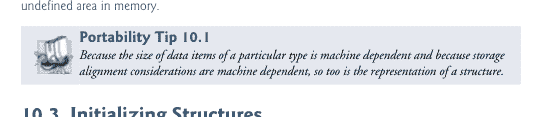

图 10.1 | struct example 类型变量可能的存储对齐方式，显示了内存中的未定义区域

> 可移植性提示 10.1
> 由于特定类型数据项的大小依赖于机器，并且存储对齐的考虑也依赖于机器，因此结构体的表示也同样依赖于机器。

### 10.3 初始化结构体

结构体可以像数组一样使用初始化列表进行初始化。要初始化结构体，请在定义中的变量名后加上等号，以及一个用花括号括起来、以逗号分隔的初始化值列表。例如，如下声明

```
struct card aCard = { "Three", "Hearts" };
```

创建 struct card 类型（如 10.2 节所定义）的变量 aCard，并将成员 face 初始化为 "Three"，将成员 suit 初始化为 "Hearts"。如果列表中的初始化值少于结构体中的成员数，则其余成员会自动初始化为 0（如果成员是指针，则初始化为 NULL）。在函数定义之外定义（即外部定义）的结构体变量，如果在外部定义中未显式初始化，则会被初始化为 0 或 NULL。结构体变量也可以在赋值语句中通过赋予相同类型的结构体变量，或通过为结构体的各个成员赋值来进行初始化。

### 10.4 使用 . 和 -> 访问结构体成员

有两个运算符用于访问结构体成员：结构体成员运算符（.）——也称为点运算符——以及结构体指针运算符（->）——也称为箭头运算符。结构体成员运算符通过……访问结构体成员

结构变量名。例如，要打印 10.3 节中定义的结构变量 aCard 的成员 suit，请使用以下语句

```c
printf("%s", aCard.suit); // displays Hearts
```

结构指针运算符——由减号（-）和大于号（>）组成，且中间没有空格——通过指向结构的指针访问结构成员。假设已声明指针 cardPtr 指向 struct card，并且已将结构 aCard 的地址赋给 cardPtr。要使用指针 cardPtr 打印结构 aCard 的成员 suit，请使用以下语句

```c
printf("%s", cardPtr->suit); // displays Hearts
```

表达式 cardPtr->suit 等价于 (*cardPtr).suit，后者解引用该指针并使用结构成员运算符访问成员 suit。这里需要括号，因为结构成员运算符（.）的优先级高于指针解引用运算符（*）。结构指针运算符和结构成员运算符，连同圆括号（用于调用函数）和方括号（[] 用于数组索引），具有最高的运算符优先级，并且从左到右结合。

> **良好的编程实践 10.2**
>
> 不要在 -> 和 . 运算符周围加空格。省略空格有助于强调这些运算符所在的表达式本质上就是单个变量名。

> **常见的编程错误 10.4**
>
> 在结构指针运算符的 - 和 > 组成部分之间插入空格，或在除 ?: 之外的任何其他多击键运算符的组成部分之间插入空格，都是语法错误。

> **常见的编程错误 10.5**
>
> 试图仅使用成员名来引用结构成员是语法错误。

> **常见的编程错误 10.6**
>
> 在使用指针和结构成员运算符引用结构成员时（例如 *cardPtr.suit）不使用括号是语法错误。要避免此问题，请改用箭头（->）运算符。

图 10.2 的程序演示了结构成员运算符和结构指针运算符的用法。使用结构成员运算符，将结构 aCard 的成员分别赋值为 "Ace" 和 "Spades"（第 17 行和第 18 行）。指针 cardPtr 被赋值为结构 aCard 的地址（第 20 行）。函数 printf 使用变量名 aCard 的结构成员运算符、指针 cardPtr 的结构指针运算符以及解引用指针 cardPtr 的结构成员运算符，打印结构变量 aCard 的成员（第 22–24 行）。

```c
#include <stdio.h>

// card structure definition
struct card {
    char *face; // define pointer face
    char *suit; // define pointer suit
};

int main(void)
{
    struct card aCard; // define one struct card variable

    // place strings into aCard
    aCard.face = "Ace";
    aCard.suit = "Spades";

    struct card *cardPtr = &aCard; // assign address of aCard to cardPtr

    printf("%s%s%s\n%s%s%s\n%s%s%s\n", aCard.face, " of ", aCard.suit,
        cardPtr->face, " of ", cardPtr->suit,
        (*cardPtr).face, " of ", (*cardPtr).suit);
}
```

```text
Ace of Spades
Ace of Spades
Ace of Spades
```

图 10.2 | 结构成员运算符和结构指针运算符。（第 2 部分，共 2 部分。）

## 10.5 将结构与函数结合使用

结构可以通过以下方式传递给函数：

- 传递单个结构成员。
- 传递整个结构。
- 传递指向结构的指针。

当结构或单个结构成员传递给函数时，它们按值传递。因此，被调用函数不能修改调用者结构的成员。要按引用传递结构，请传递结构变量的地址。结构数组——像所有其他数组一样——会自动按引用传递。

在第 6 章中，我们说过可以使用结构来按值传递数组。为此，请创建一个以该数组为成员的结构。结构按值传递，因此该数组也按值传递。

> **常见的编程错误 10.7**
>
> *假设结构像数组一样会自动按引用传递，并试图在被调用函数中修改调用者的结构值，这是逻辑错误。*

> **性能提示 10.1**
>
> *按引用传递结构比按值传递结构更高效（后者需要复制整个结构）。*

高性能洗牌和发牌算法。程序输出如图 10.4 所示。

```c
// Fig. 10.3: fig10_03.c
// Card shuffling and dealing program using structures
#include <stdio.h>
#include <stdlib.h>
#include <time.h>

#define CARDS 52
#define FACES 13

// card structure definition
struct card {
    const char *face; // define pointer face
    const char *suit; // define pointer suit
};

typedef struct card Card; // new type name for struct card

// prototypes
void fillDeck(Card * const wDeck, const char * wFace[],
    const char * wSuit[]);
void shuffle(Card * const wDeck);
void deal(const Card * const wDeck);

int main(void)
{
    Card deck[CARDS]; // define array of Cards

    // initialize array of pointers
    const char *face[] = { "Ace", "Deuce", "Three", "Four", "Five",
        "Six", "Seven", "Eight", "Nine", "Ten",
        "Jack", "Queen", "King" };

    // initialize array of pointers
    const char *suit[] = { "Hearts", "Diamonds", "Clubs", "Spades" };

    srand(time(NULL)); // randomize

    fillDeck(deck, face, suit); // load the deck with Cards
    shuffle(deck); // put Cards in random order
    deal(deck); // deal all 52 Cards
}

// place strings into Card structures
void fillDeck(Card * const wDeck, const char * wFace[],
    const char * wSuit[])
{
    // loop through wDeck
    for (size_t i = 0; i < CARDS; ++i) {
        wDeck[i].face = wFace[i % FACES];
        wDeck[i].suit = wSuit[i / FACES];
    }
}

// shuffle cards
void shuffle(Card * const wDeck)
{
    // loop through wDeck randomly swapping Cards
    for (size_t i = 0; i < CARDS; ++i) {
        size_t j = rand() % CARDS;
        Card temp = wDeck[i];
        wDeck[i] = wDeck[j];
        wDeck[j] = temp;
    }
}

// deal cards
void deal(const Card * const wDeck)
{
    // loop through wDeck
    for (size_t i = 0; i < CARDS; ++i) {
        printf("%5s of %-8s%s", wDeck[i].face, wDeck[i].suit,
            (i + 1) % 4 ? "  " : "\n");
    }
}
```

图 10.3 | 使用结构的纸牌洗牌和发牌程序。（第 2 部分，共 2 部分。）

|  |  |  |  |
|---|---|---|---|
| 红桃3 | 梅花J | 黑桃3 | 方块6 |
| 红桃5 | 黑桃8 | 梅花3 | 黑桃2 |
| 黑桃J | 红桃4 | 红桃2 | 梅花6 |
| 梅花Q | 方块3 | 方块8 | 梅花K |
| 红桃K | 红桃8 | 红桃Q | 梅花7 |
| 方块7 | 黑桃9 | 梅花5 | 梅花8 |
| 红桃6 | 方块2 | 黑桃5 | 梅花4 |
| 梅花2 | 红桃9 | 红桃7 | 黑桃4 |
| 黑桃10 | 方块K | 红桃10 | 方块J |
| 方块4 | 黑桃6 | 方块5 | 方块A |
| 梅花A | 红桃J | 梅花10 | 方块Q |
| 红桃A | 方块10 | 梅花9 | 黑桃K |
| 黑桃A | 方块9 | 黑桃7 | 黑桃Q |

图 10.4 | 高性能纸牌洗牌和发牌模拟的输出。

在程序中，函数 fillDeck（第 44–52 行）按顺序用每种花色的 "Ace" 到 "King" 初始化 Card 数组。Card 数组（在第 39 行）被传递给函数 shuffle（第 55–64 行），其中实现了高性能洗牌算法。函数 shuffle 接受一个包含 52 张牌的 Card 数组作为参数。该函数遍历这 52 张牌（第 58–63 行）。对于每张牌，随机选取一个 0 到 51 之间的数字。接下来，在数组中交换当前牌和随机选中的牌（第 60–62 行）。对整个数组的一次遍历中共进行 52 次交换，Card 数组就被洗好了！该算法不会像……那样遭受无限期推迟

第 7 章中介绍的洗牌算法。因为 Cards 在数组中就地交换，所以函数 deal1（第 67–74 行）中实现的高性能发牌算法只需对数组进行一次遍历即可发牌洗牌后的 Cards。

> **常见编程错误 10.8**
> 在引用结构数组中的单个结构时忘记包含数组索引是语法错误。

## Fisher-Yates 洗牌算法

建议你在真正的纸牌游戏中使用所谓的无偏洗牌算法。这样的算法可确保所有可能的洗牌序列出现的可能性相等。练习 10.18 要求你研究流行的无偏 Fisher-Yates 洗牌算法，并用它重新实现图 10.3 中的 DeckOfCards 方法 shuffle。

## 10.8 联合体

与结构类似，联合体也是一种派生数据类型，但其成员共享相同的存储空间。对于程序中的不同情况，一些变量可能不相关，而其他变量则相关——因此联合体共享空间，而不是浪费存储在未使用的变量上。联合体的成员可以是任何数据类型。用于存储联合体的字节数必须至少足以容纳最大成员。在大多数情况下，联合体包含两种或更多数据类型。同时只能引用一个成员，即一种数据类型。确保联合体中的数据以正确的数据类型引用是你的责任。

> **常见编程错误 10.9**
> 使用错误类型的变量引用联合体中的数据是逻辑错误。

> **可移植性提示 10.3**
> 如果数据以一种类型存储在联合体中并以另一种类型引用，结果取决于实现。

### 10.8.1 联合体声明

联合体定义与结构定义具有相同的格式。联合体定义

```
union number {
    int x;
    double y;
};
```

表示 number 是一个联合体类型，其成员为 int x 和 double y。联合体定义通常放在头文件中，并在使用该联合体类型的所有源文件中包含。

> **软件工程观察 10.1**
> 与 struct 定义一样，union 定义只是创建了一个新类型。将 union 或 struct 定义放在任何函数之外不会创建全局变量。

### 10.8.2 可对联合体执行的操作

可对联合体执行的操作有：

- 将一个联合体赋给另一个相同类型的联合体。
- 取联合体变量的地址（&）。
- 使用结构成员运算符和结构指针运算符访问联合体成员。

出于与结构不能比较相同的原因，联合体不能使用运算符 `==` 和 `!=` 进行比较。

### 10.8.3 在声明中初始化联合体

在声明中，联合体可以用与第一个联合体成员相同类型的值进行初始化。例如，对于第 10.8.1 节中的联合体，语句

```c
union number value = { 10 };
```

是联合体变量 value 的有效初始化，因为联合体是用 int 初始化的，但下面的声明会截断初始化值的浮点部分（某些编译器对此会发出警告）：

```c
union number value = { 1.43 };
```

> **可移植性提示 10.4**
> 存储联合体所需的存储量取决于实现，但始终至少与联合体中最大成员一样大。

> **可移植性提示 10.5**
> 某些联合体在计算机系统之间可能不易移植。联合体是否可移植通常取决于给定系统上联合体成员数据类型的存储对齐要求。

### 10.8.4 演示联合体

图 10.5 中的程序使用类型为 union number（第 6–9 行）的变量 value（第 13 行）以 int 和 double 两种形式显示联合体中存储的值。程序输出取决于实现。程序输出显示 double 值的内部表示可能与 int 的表示大不相同。

```c
// Fig. 10.5: fig10_05.c
// Displaying the value of a union in both member data types
#include <stdio.h>

// union number definition
union number {
    int x;
    double y;
};
```

Fig. 10.5 | 以两种成员数据类型显示联合体的值。 (第 1 部分，共 2 部分.)

```c
int main(void)
{
union number value; // define union variable

value.x = 100; // put an integer into the union
printf(" %s\n%s\n%s %d\n%s\n %f\n\n\n",
"Put 100 in the integer member",
"and print both members.",
"int:", value.x,
"double:", value.y);

value.y = 100.0; // put a double into the same union
printf(" %s\n%s\n%s %d\n%s\n %f\n",
"Put 100.0 in the floating member",
"and print both members.",
"int:", value.x,
"double:", value.y);
}
```

将 100 放入整数成员
并打印两个成员。
int:
100
double:
-925959921174331600000000000000000000000000000000.000000

将 100.0 放入浮点成员
并打印两个成员。
int:
0
double:
100.000000

Fig. 10.5 | 以两种成员数据类型显示联合体的值。 (第 2 部分，共 2 部分.)

## 10.9 按位运算符

计算机将所有数据内部表示为位序列。每位可以取值为 0 或 1。在大多数系统上，八位序列形成一个字节——char 类型变量的典型存储单元。其他数据类型存储在更多字节中。按位运算符用于操作整数操作数的位，既有符号也有无符号。无符号整数通常与按位运算符一起使用，这些运算符在图 10.6 中进行了总结。

> 可移植性提示 10.6
> 按位数据操作取决于机器。

按位 AND、按位包含 OR 和按位异或运算符逐位比较其两个操作数。按位 AND 运算符将结果中每位设置为 1，如果两个操作数中对应的位都是 1。*按位包含 OR* 运算符将结果中每位设置为 1，如果任一（或两者）操作数中对应的位为 1。*按位异或* 运算符将结果中每位设置为 1，如果每个操作数中对应的位不同。*左移运算符* 将其左操作数的位向左移动其右操作数指定的位数。*右移运算符* 将其左操作数的位向右移动其右操作数指定的位数。*按位补码运算符* 将其操作数中的所有 0 位在结果中设置为 1，并将所有 1 位设置为 0——通常称为*切换*位。每个按位运算符的详细讨论出现在以下示例中。按位运算符在图 10.6 中进行了总结。

| 运算符 | 描述 |
|---|---|
| & 按位与 | 逐位比较其两个操作数。结果中的位在两个操作数的对应位*都为 1*时设置为 1。 |
| \| 按位包含或 | 逐位比较其两个操作数。结果中的位在两个操作数的对应位中*至少有一个*为 1 时设置为 1。 |
| ^ 按位异或（也称为按位 XOR） | 逐位比较其两个操作数。结果中的位在两个操作数的对应位*不同*时设置为 1。 |
| << 左移 | 将第一个操作数的位向左移动第二个操作数指定的位数；从右侧用 0 位填充。 |
| >> 右移 | 将第一个操作数的位向右移动第二个操作数指定的位数；当左操作数为负时，从左侧填充的方法取决于机器。 |
| ~ 补码 | 所有 0 位设置为 1，所有 1 位设置为 0。 |

**Fig. 10.6** | 按位运算符。

本节中按位运算符的讨论显示了整数操作数的二进制表示。有关二进制（也称为基数-2）数系统的详细解释，请参阅附录 C。由于按位操作具有机器依赖性，这些程序在你的系统上可能无法正确工作或工作方式不同。

### 10.9.1 以二进制形式显示无符号整数

使用按位运算符时，将值以二进制形式显示以显示这些运算符的精确效果很有用。图 10.7 的程序以每组八位的形式以其二进制表示打印无符号 int，以便于阅读。对于本节中的示例，我们假设一种实现，其中无符号 int 存储在 4 字节（32 位）内存中。

```c
1   // Fig. 10.7: fig10_07.c
2   // Displaying an unsigned int in bits
3   #include <stdio.h>
```

**Fig. 10.7** | 以二进制形式显示无符号整数。 (第 1 部分，共 2 部分.)


```
4
5 void displayBits(unsigned int value); // prototype
6
7 int main(void)
8 {
9     unsigned int x; // variable to hold user input
10
11     printf("\n\nEnter a nonnegative int: ");
12     scanf("%u", &x);
13
14     displayBits(x);
15 }
16
17 // display bits of an unsigned int value
18 void displayBits(unsigned int value)
19 {
20     // define displayMask and left shift 31 bits
21     unsigned int displayMask = 1 << 31;
22
23     printf("%u = ", value);
24
25     // loop through bits
26     for (unsigned int c = 1; c <= 32; ++c) {
27         putchar(value & displayMask ? '1' : '0');
28         value <<= 1; // shift value left by 1
29
30         if (c % 8 == 0) { // output space after 8 bits
31             putchar(' ');
32         }
33     }
34
35     putchar('\n');
36 }
```

输入一个非负整数： 65000
65000 = 00000000 00000000 11111101 11101000

## 图 10.7 | 以二进制形式显示无符号整数。 (第 2 部分，共 2 部分。)

函数 displayBits（第 18–36 行）使用按位 AND 运算符将变量 value 与变量 displayMask（第 27 行）组合。 通常，按位 AND 运算符与称为 mask 的操作数一起使用——一个具有特定位设为 1 的整数值。 Mask 用于在选择其他位的同时隐藏值中的某些位。 在函数 displayBits 中，mask 变量 displayMask 被赋值为

`1 << 31    (10000000 00000000 00000000 00000000)`

左移运算符将值 1 从低位（最右位）移到 displayMask 中的高位（最左位）并从右侧填充 0 位。 第 27 行

`putchar(value & displayMask ? '1' : '0');`

确定应为变量 value 当前的最左位打印 1 还是 0。 当使用 & 组合 value 和 displayMask 时，变量 value 中除最高位之外的所有位都被“屏蔽掉”（隐藏），因为任何与 0 进行“AND”操作的位结果都为 0。 如果最左位为 1，则 value & displayMask 评估为非零（真）值并打印 1——否则打印 0。 变量 value 然后通过表达式 value <<= 1 左移一位（这等价于 value = value << 1）。 这些步骤对无符号变量 value 中的每个位重复执行。 图 10.8 总结了使用按位 AND 运算符组合两个位的结果。

### 常见编程错误 10.10

使用逻辑 AND 运算符（&&）代替按位 AND 运算符（&）——反之亦然——是一个错误。

| 位 1 | 位 2 | 位 1 & 位 2 |
|---|---|---|
| 0 | 0 | 0 |
| 0 | 1 | 0 |
| 1 | 0 | 0 |
| 1 | 1 | 1 |

图 10.8 | 使用按位 AND 运算符 & 组合两个位的结果。

## 10.9.2 使函数 displayBits 更通用和可移植

在图 10.7 的第 21 行，我们将整数 31 硬编码以指示值 1 应移位到变量 displayMask 中的最左位。 同样，在第 26 行，我们将整数 32 硬编码以指示循环应迭代 32 次——为变量 value 中的每个位一次。 我们假设无符号整数始终存储在 32 位（四个字节）的内存中。 当今流行的计算机通常使用 32 位或 64 位字硬件架构。 作为 C 程序员，你往往需要在多种硬件架构上工作，有时无符号整数会存储在不同数量的位中。

### 可移植性提示 10.7

可以通过用基于程序执行平台上无符号整数大小计算这些整数的表达式替换图 10.7 中的整数 31（第 21 行）和 32（第 26 行）来使图 10.7 更通用和可移植。 符号常量 CHAR_BIT（在 <limits.h> 中定义）表示一个字节中的位数（通常为 8）。 回顾一下 sizeof 确定存储对象或类型所需的字节数。 表达式 sizeof(unsigned int) 对 32 位无符号整数求值为 4，对 64 位无符号整数求值为 8。 你可以用 CHAR_BIT * sizeof(unsigned int) - 1 替换 31，并用 CHAR_BIT * sizeof(unsigned int) 替换 32。 对于 32 位无符号整数，这些表达式分别求值为 31 和 32。 对于 64 位无符号整数，它们求值为 63 和 64。

## 10.9.3 使用按位 AND、包含 OR、异或和补码运算符

图 10.9 演示了按位 AND 运算符、按位包含 OR 运算符、按位异或运算符和按位补码运算符的使用。 该程序使用函数 displayBits（第 46–64 行）打印无符号整数值。 输出显示在图 10.10 中。

```c
// Fig. 10.9: fig10_09.c
// Using the bitwise AND, bitwise inclusive OR, bitwise
// exclusive OR and bitwise complement operators
#include <stdio.h>

void displayBits(unsigned int value); // prototype

int main(void)
{
    // demonstrate bitwise AND (&)
    unsigned int number1 = 65535;
    unsigned int mask = 1;
    puts("The result of combining the following");
    displayBits(number1);
    displayBits(mask);
    puts("using the bitwise AND operator & is");
    displayBits(number1 & mask);

    // demonstrate bitwise inclusive OR (|)
    number1 = 15;
    unsigned int setBits = 241;
    puts("\nThe result of combining the following");
    displayBits(number1);
    displayBits(setBits);
    puts("using the bitwise inclusive OR operator | is");
    displayBits(number1 | setBits);

    // demonstrate bitwise exclusive OR (^)
    number1 = 139;
    unsigned int number2 = 199;
    puts("\nThe result of combining the following");
    displayBits(number1);
    displayBits(number2);
    puts("using the bitwise exclusive OR operator ^ is");
    displayBits(number1 ^ number2);

    // demonstrate bitwise complement (~)
    number1 = 21845;
    puts("\nThe one's complement of");
    displayBits(number1);
    puts("\n");
    displayBits(~number1);
}
```

### 图 10.9 | 使用按位 AND、按位包含 OR、按位异或和按位补码运算符。 (第 1 部分，共 2 部分。)

value." 在图 10.9 中，变量 number1 在第 38 行被赋值为 21845（00000000 00000000 01010101 01010101）。 当表达式 ~number1（第 42 行）被求值时，结果为 11111111 11111111 10101010 10101010。

## 10.9.4 使用按位左移和右移运算符

图 10.13 的程序演示了左移运算符（<<）和右移运算符（>>）。 函数 displayBits 用于打印无符号整数值。

```c
// Fig. 10.13: fig10_13.c
// Using the bitwise shift operators
#include <stdio.h>

void displayBits(unsigned int value); // prototype

int main(void)
{
    unsigned int number1 = 960; // initialize number1

    // demonstrate bitwise left shift
    puts("\nThe result of left shifting");
    displayBits(number1);
    puts("8 bit positions using the left shift operator << is");
    displayBits(number1 << 8);

    // demonstrate bitwise right shift
    puts("\nThe result of right shifting");
    displayBits(number1);
    puts("8 bit positions using the right shift operator >> is");
    displayBits(number1 >> 8);
}

// display bits of an unsigned int value
void displayBits(unsigned int value)
{
    // declare displayMask and left shift 31 bits
    unsigned int displayMask = 1 << 31;

    printf("%u = ", value);

    // loop through bits
    for (unsigned int c = 1; c <= 32; ++c) {
        putchar(value & displayMask ? '1' : '0');
        value <<= 1; // shift value left by 1

        if (c % 8 == 0) { // output a space after 8 bits
            putchar(' ');
        }
    }

    putchar('\n');
}
```

### 图 10.13 | 使用按位移位运算符。 (第 1 部分，共 2 部分。)

```
The result of left shifting
960 = 00000000 00000000 00000011 11000000
8 bit positions using the left shift operator << is
245760 = 00000000 00000011 11000000 00000000
The result of right shifting
960 = 00000000 00000000 00000011 11000000
8 bit positions using the right shift operator >> is
3 = 00000000 00000000 00000000 00000111
```

### 图 10.13 | 使用按位移位运算符。 (第 2 部分，共 2 部分。)

### 左移运算符 (<<)

左移运算符（<<）将左操作数的位向左移动其右操作数指定的位数。 右侧空出的位用 0 填充； 左侧移出的位丢失。 在图 10.13 中，变量 number1 在第 9 行被赋值为 960（00000000 00000000 00000011 11000000）。 表达式 number1 << 8（第 15 行）中变量 number1 左移 8 位的结果是 245760（00000000 00000011 11000000 00000000）。

### 右移运算符 (>>)

右移运算符（>>）将左操作数的位向右移动其右操作数指定的位数。 对无符号 int 执行右移会导致左侧空出的位被 0 替换； 右侧移出的位丢失。 在图 10.13 中，表达式 number1 >> 8（第 21 行）中 number1 右移的结果是 3（00000000 00000000 00000000 00000111）。

> 常见编程错误 10.11
> 对值进行右移或左移的结果是未定义的，如果右操作数为负数，或者右操作数大于左操作数存储的位数。

> 可移植性提示 10.8
> 对负数进行右移的结果是实现定义的。

## 10.9.5 按位赋值运算符

每个二进制按位运算符都有一个对应的赋值运算符。 这些按位赋值运算符显示在图 10.14 中，并以与第 3 章中介绍的算术赋值运算符类似的方式使用。

| 按位赋值运算符 |
|---|
| &= | 按位 AND 赋值运算符。 |
| |= | 按位包含 OR 赋值运算符。 |
| ^= | 按位异或赋值运算符。 |
| <<= | 左移赋值运算符。 |
| >>= | 右移赋值运算符。 |

### 图 10.14 | 按位赋值运算符。


图 10.15 展示了本文到目前为止介绍的各种运算符的优先级和结合性。它们按优先级从高到低的顺序自上而下显示。

| 运算符 | 结合性 | 类型 |
|---|---|---|
| () [] . -> ++ (postfix) -- (postfix) | 从左到右 | 最高 |
| + - ++ -- ! & * ~ sizeof (type) | 从右到左 | 一元 |
| * / % | 从左到右 | 乘法 |
| + - | 从左到右 | 加法 |
| << >> | 从左到右 | 移位 |
| < <= > >= | 从左到右 | 关系 |
| == != | 从左到右 | 相等 |
| & | 从左到右 | 按位与 |
| ^ | 从左到右 | 按位异或 |
| \| | 从左到右 | 按位或 |
| && | 从左到右 | 逻辑与 |
| \|\| | 从左到右 | 逻辑或 |
| ?: | 从右到左 | 条件 |
| = += -= *= /= &= \|= ^= <<= >>= %= | 从右到左 | 赋值 |
| , | 从左到右 | 逗号 |

图 10.15 | 运算符优先级和结合性。

## 10.10 位字段

C 允许你指定结构体或联合体的无符号或有符号整型成员存储的位数。这称为位字段。位字段通过以所需的最少位数存储数据来实现更好的内存利用率。位字段成员必须声明为 int 或 unsigned int。

### 10.10.1 定义位字段

考虑以下结构体定义：

```
struct bitCard {
    unsigned int face : 4;
    unsigned int suit : 2;
    unsigned int color : 1;
};
```

它包含三个 unsigned int 位字段——face、suit 和 color——用于表示一副 52 张牌中的一张牌。位字段的声明方式是在无符号或有符号整型成员名后跟一个冒号（:）和一个表示字段宽度的整数常量（即存储该成员所用的位数）。表示宽度的常量必须是 0（在第 10.10.3 节讨论）到系统用于存储 int 的总位数（含）之间的整数。我们的示例是在具有 4 字节（32 位）整数的计算机上测试的。

```c
wDeck[i].suit = i / (CARDS / 4);
wDeck[i].color = i / (CARDS / 2);
}

// output cards in two-column format; cards 0-25 indexed with
// k1 (column 1); cards 26-51 indexed with k2 (column 2)
void deal(const Card * const wDeck)
{
printf("%-6s%-6s%-15s%-6s%-6s\n", "Card", "Suit", "Color",
"Card", "Suit", "Color");

// loop through wDeck
for (size_t k1 = 0, k2 = k1 + 26; k1 < CARDS / 2; ++k1, ++k2) {
printf("Card:%3d Suit:%2d Color:%2d ", wDeck[k1].face, wDeck[k1].suit, wDeck[k1].color);
printf("Card:%3d Suit:%2d Color:%2d\n", wDeck[k2].face, wDeck[k2].suit, wDeck[k2].color);
}
}
```

图 10.16 | 在结构体中使用位字段表示牌。（第 2 部分，共 2 部分。）

牌面值 0-12 对应 A 到 K
花色值 0-3 分别对应红心、方块、梅花和黑桃
颜色值 0-1 对应红色和黑色

| 牌 | 花色 | 颜色 | 牌 | 花色 | 颜色 |
|------|------|-------|------|------|-------|
| 0 | 0 | 0 | 0 | 2 | 1 |
| 1 | 0 | 0 | 1 | 2 | 1 |
| 2 | 0 | 0 | 2 | 2 | 1 |
| 3 | 0 | 0 | 3 | 2 | 1 |
| 4 | 0 | 0 | 4 | 2 | 1 |
| 5 | 0 | 0 | 5 | 2 | 1 |
| 6 | 0 | 0 | 6 | 2 | 1 |
| 7 | 0 | 0 | 7 | 2 | 1 |
| 8 | 0 | 0 | 8 | 2 | 1 |
| 9 | 0 | 0 | 9 | 2 | 1 |
| 10 | 0 | 0 | 10 | 2 | 1 |
| 11 | 0 | 0 | 11 | 2 | 1 |
| 12 | 0 | 0 | 12 | 2 | 1 |
| 0 | 1 | 0 | 0 | 3 | 1 |
| 1 | 1 | 0 | 1 | 3 | 1 |
| 2 | 1 | 0 | 2 | 3 | 1 |
| 3 | 1 | 0 | 3 | 3 | 1 |
| 4 | 1 | 0 | 4 | 3 | 1 |
| 5 | 1 | 0 | 5 | 3 | 1 |
| 6 | 1 | 0 | 6 | 3 | 1 |
| 7 | 1 | 0 | 7 | 3 | 1 |
| 8 | 1 | 0 | 8 | 3 | 1 |
| 9 | 1 | 0 | 9 | 3 | 1 |
| 10 | 1 | 0 | 10 | 3 | 1 |
| 11 | 1 | 0 | 11 | 3 | 1 |
| 12 | 1 | 0 | 12 | 3 | 1 |

图 10.17 | 图 10.16 中程序的输出。

## 性能提示 10.2

位字段有助于减少程序所需的内存量。

## 可移植性提示 10.9

位字段操作依赖于机器。

## 常见编程错误 10.12

试图将位字段的各个位当作数组元素来访问是语法错误。位字段不是“位数组”。

## 常见编程错误 10.13

试图获取位字段的地址（& 运算符不能用于位字段，因为它们没有地址）。

## 性能提示 10.3

尽管位字段节省空间，但使用它们可能导致编译器生成执行较慢的机器语言代码。这是因为仅访问可寻址存储单元的部分内容需要额外的机器语言操作。这是计算机科学中出现的众多空间与时间权衡示例之一。

### 10.10.3 未命名位字段

可以指定一个未命名位字段用作结构体中的填充。例如，以下结构体定义

```
struct example {
    unsigned int a : 13;
    unsigned int  : 19;
    unsigned int b : 4;
};
```

使用一个未命名的 19 位字段作为填充——这 19 位中不能存储任何内容。成员 b（在我们的 4 字节字计算机上）存储在另一个存储单元中。宽度为零的未命名位字段用于将下一个位字段对齐到新的存储单元边界。例如，以下结构体定义

```
struct example {
    unsigned int a : 13;
    unsigned int  : 0;
    unsigned int b : 4;
};
```

使用一个未命名的 0 位字段跳过存储 a 的存储单元的剩余位（有多少就跳过多少），并将 b 对齐到下一个存储单元边界。

## 10.11 枚举常量

枚举（在第 5.11 节简要讨论）由关键字 enum 引入，是一组由标识符表示的整数枚举常量。除非另有指定，枚举中的值从 0 开始，并以 1 递增。例如，以下枚举

```c
enum months {
  JAN, FEB, MAR, APR, MAY, JUN, JUL, AUG, SEP, OCT, NOV, DEC
};
```

创建一个新类型 enum months，其中各标识符分别被设置为整数 0 到 11。要将月份编号为 1 到 12，请使用：

```c
enum months {
  JAN = 1, FEB, MAR, APR, MAY, JUN, JUL, AUG, SEP, OCT, NOV, DEC
};
```

由于前面枚举中的第一个值被显式设置为 1，其余值从 1 开始递增，得到值 1 到 12。同一作用域内可访问的任何枚举中的标识符必须唯一。枚举的每个枚举常量的值可以在定义中通过给标识符赋值来显式设置。一个枚举的多个成员可以具有相同的常量值。在图 10.18 的程序中，枚举变量 month 在 for 语句中使用，以从数组 monthName 中打印一年中的月份。我们将 monthName[0] 设为空字符串 ""。你可以将 monthName[0] 设置为诸如 ***错误*** 之类的值，以表示发生了逻辑错误。

> **常见编程错误 10.14**
> 在枚举常量定义后为其赋值是语法错误。

> **良好编程实践 10.5**
> 枚举常量名中只使用大写字母。这使这些常量在程序中更醒目，并提醒你枚举常量不是变量。

```c
1 // Fig. 10.18: fig10_18.c
2 // Using an enumeration
3 #include <stdio.h>
4
5 // enumeration constants represent months of the year
6 enum months {
7   JAN = 1, FEB, MAR, APR, MAY, JUN, JUL, AUG, SEP, OCT, NOV, DEC
8 };
9
10 int main(void)
11 {
12    // initialize array of pointers
13    const char *monthName[] = { "", "January", "February", "March",
14    "April", "May", "June", "July", "August", "September", "October",
15    "November", "December" };
16
17    // loop through months
18    for (enum months month = JAN; month <= DEC; ++month) {
19        printf("%2d%s\n", month, monthName[month]);
20    }
21 }
```

```
1  January
2  February
3  March
4  April
5  May
6  June
7  July
8  August
9  September
10 October
11 November
12 December
```

图 10.18 | 使用枚举。（第 2 部分，共 2 部分。）

## 10.12 匿名结构体和联合体

本章前面介绍了结构体和联合体。C11 现在支持匿名结构体和联合体，它们可以嵌套在具名结构体和联合体中。嵌套的匿名结构体或联合体中的成员被视为外层结构体或联合体的成员，并且可以通过外层类型的对象直接访问。例如，考虑以下结构体声明：

```
struct MyStruct {
    int member1;
    int member2;

    struct {
        int nestedMember1;
        int nestedMember2;
    }; // end nested struct
}; // end outer struct
```

对于类型为 struct MyStruct 的变量 myStruct，可以按如下方式访问成员：

```
myStruct.member1;
myStruct.member2;
myStruct.nestedMember1;
myStruct.nestedMember2;
```

## 10.13 安全的 C 编程

本章主题适用多种 CERT 指南和规则。要了解每项的更多信息，请访问 www.securecoding.cert.org。


在第 11 章中操作写入文件和从文件中读取的定长记录，并在第 12 章中创建所谓的动态数据结构。

- EXP04-C：正如我们在第 10.2.4 节中所讨论的，struct 变量不能进行相等或不相等比较，因为它们可能包含未定义数据的字节。因此，必须比较它们的各个成员。
- DCL39-C：在 struct 变量中，未定义的额外字节可能包含安全数据——来自这些内存位置先前使用后残留的数据——不应*不可访问*。本 CERT 准则讨论了编译器特定的机制，用于*打包数据*以消除这些额外字节。

### typedef 的 CERT 准则

- DCL05-C：复杂类型声明，例如函数指针的声明，可能难以阅读。你应该使用 `typedef` 来创建自描述的类型名称，使程序更易读。

### 位操作的 CERT 准则

- INT02-C：由于整数提升规则（在第 5.6 节中讨论），对小于 `int` 的整数类型执行位操作可能导致意外结果。需要显式转换以确保正确结果。
- INT13-C：对 *有符号* 整数类型进行的某些位操作是 *实现定义* 的——这意味着操作在不同的 C 编译器中可能有不同的结果。因此，应使用 *无符号* 整数类型与位运算符一起使用。
- EXP46-C：逻辑运算符 && 和 || 常常与位运算符 & 和 | 分别混淆。在条件表达式 (?:) 的条件中使用 & 和 | 可能导致意外行为，因为 & 和 | 运算符不使用短路求值。

### enum 的 CERT 准则

- INT09-C：允许多个枚举常量具有 *相同* 的值可能导致难以发现的逻辑错误。在大多数情况下，enum 的枚举常量应各自具有 *唯一* 的值以帮助防止此类逻辑错误。

## 摘要

### 第 10.1 节 引言

- Structures（第 437 页）是在一个名称下相关变量的集合。它们可能包含许多不同数据类型的变量。
- 结构通常用于定义要存储在文件中的记录。
- 指针和结构促进了更复杂数据结构的形成，例如链表、队列、栈和树。

### 第 10.2 节 结构定义

- 关键字 `struct` 引入结构定义（第 438 页）。
- 关键字 struct 之后的标识符是结构标签（第 438 页），它命名结构定义。结构标签与关键字 struct 一起用于声明结构类型变量（第 438 页）。
- 在结构定义的大括号内声明的变量是结构的成员。
- 同一结构类型的成员必须具有唯一名称。
- 每个结构定义必须以分号结束。
- 结构成员可以具有基本或聚合数据类型。
- 结构不能包含自身的实例，但可以包含指向其类型的指针。
- 包含指向同一结构类型的指针成员的结构称为自引用结构。自引用结构（第 438 页）用于构建链接数据结构。
- 结构定义创建新的数据类型，用于定义变量。
- 可以通过在结构定义的闭合大括号与其结束分号之间放置以逗号分隔的变量名列表来声明给定结构类型的变量。
- 结构标签名是可选的。如果结构定义不包含结构标签名，则结构类型的变量只能在结构定义中声明。
- 对结构可执行的唯一有效操作是将结构变量赋给同一类型的变量，获取结构变量的地址（&），访问结构变量的成员以及使用 sizeof 运算符确定结构变量的大小。

### 第 10.3 节 初始化结构

- 结构可以使用初始化列表进行初始化。
- 如果列表中的初始化器少于结构中的成员，则剩余成员会自动初始化为 0（如果成员是指针，则为 NULL）。
- 在函数定义外部定义的 结构变量的成员如果在外部定义中未显式初始化，则初始化为 0 或 NULL。
- 结构变量可以在赋值语句中通过分配同一类型的结构变量，或通过为结构的各个成员分配值来进行初始化。

### 第 10.4 节 使用 . 和 -> 访问结构成员

- 结构成员运算符（.）和结构指针运算符（->）用于访问结构成员（第 440 页）。
- 结构成员运算符通过结构变量名访问结构成员。
- 结构指针运算符通过指向结构的指针访问结构成员（第 441 页）。

### 第 10.5 节 使用函数中的结构

- 结构可以通过传递单个结构成员、传递整个结构或传递指向结构的指针来传递给函数。
- 结构变量默认按值传递。
- 要按引用传递结构，请传递其地址。结构数组——像所有其他数组一样——会自动按引用传递。
- 要按值传递数组，请创建一个以该数组作为成员的结构。结构按值传递，因此数组按值传递。

### 第 10.6 节 typedef

- 关键字 typedef（第 443 页）提供了一种为先前定义的类型创建同义词的机制。
- 结构类型的名称通常使用 typedef 定义以创建更短的类型名。
- 通常，typedef 用于为基本数据类型创建同义词。例如，需要 4 字节整数的程序在一种系统上可能使用类型 int，在另一种系统上使用类型 long。为可移植性设计的程序通常使用 typedef 为 4 字节整数创建别名，如 Integer。别名 Integer 只需在程序中更改一次即可使程序在两个系统上工作。

### 第 10.8 节 联合体

- union（第 446 页）使用关键字 union 以与结构相同的格式声明。其成员共享相同的存储空间。
- union 的成员可以是任何数据类型。用于存储 union 的字节数必须至少足以容纳最大成员。
- 一次只能引用 union 的一个成员。确保 union 中的数据以正确的数据类型引用是你的责任。
- 可以对 union 执行的操作是将 union 赋给同一类型的另一个 union，获取 union 变量的地址（&），以及使用结构成员运算符（.）和结构指针运算符访问 union 成员。
- union 可以在声明中用与第一个 union 成员相同类型的值进行初始化。

### 第 10.9 节 位运算符

- 计算机内部将所有数据表示为值为 0 或 1 的位序列。
- 在大多数系统上，8 位序列形成一个字节——类型为 char 变量的标准存储单元。其他数据类型存储在更大的字节数中。
- 位运算符用于操作整数操作数的位（char、short、int 和 long；有符号和无符号）。通常使用无符号整数。
- 位运算符（第 449 页）为按位与（&）、按位包含或（|）、按位异或（^）、左移（<<）、右移（>>）和补码（~）。
- 按位与、按位包含或和按位异或运算符逐位比较其两个操作数。按位与运算符（第 449 页）如果两个操作数中对应位均为 1，则将结果中的每一位设为 1。按位包含或运算符（第 449 页）如果任一（或两者）操作数中对应位为 1，则将结果中的每一位设为 1。按位异或运算符（第 449 页）如果两个操作数中对应位不同，则将结果中的每一位设为 1。
- 左移运算符（第 449 页）将左侧操作数的位向左移动右侧操作数指定的位数。右侧空出的位用 0 填充；向左移出的位丢失。
- 右移运算符（第 449 页）将左侧操作数的位向右移动右侧操作数指定的位数。对无符号 int 执行右移会导致左侧空出的位被 0 填充；向右移出的位丢失。
- 按位补码运算符（第 449 页）将操作数中的所有 0 位设为 1，所有 1 位设为 0。
- 通常，按位与运算符与称为掩码（mask）（第 450 页）的操作数一起使用——整数值中特定位设为 1。掩码用于隐藏值中的某些位，同时选择其他位。
- 符号常量 CHAR_BIT（第 451 页；在 <limits.h> 中定义）表示字节中的位数（通常为 8）。它可用于使位操作程序更通用和可移植。
- 每个二进制位运算符都有一个对应的位赋值运算符（第 456 页）。


## 第 10.10 节 位字段
- C 语言允许你指定结构体或联合体中无符号或有符号整型成员所占用的位数。这称为位字段（第 457 页）。位字段通过以所需的最小位数存储数据，实现更好的内存利用。
- 位字段的声明方式是：在 unsigned int 或 int 成员名（第 457 页）后面跟一个冒号（:）和一个表示字段宽度的整型常量（第 457 页）。该常量必须是 0 到系统中用于存储 int 的总位数之间的整数（包含 0 和该总位数）。
- 结构体的位字段成员与任何其他结构体成员的访问方式完全相同。
- 可以指定一个未命名的位字段（第 460 页）作为结构体中的填充（第 460 页）。
- 宽度为零的未命名位字段（第 460 页）将下一个位字段对齐到新的存储单元边界。

## 第 10.11 节 枚举常量
- 枚举定义了一组用标识符表示的整数常量（第 460 页）。除非另有指定，枚举中的值从 0 开始，每次增加 1。
- 枚举中的标识符必须是唯一的。
- 枚举常量的值可以通过枚举定义中的赋值来显式设置。

## 自测练习
### 10.1 填空题：在下列各题的空白处填入适当的内容：
- a) 一个 ______ 是在一个名字下的一组相关变量的集合。
- b) 一个 ______ 是在一个名字下的一组变量的集合，这些变量共享同一存储空间。
- c) 在使用 ______ 运算符的表达式中，如果每个操作数中对应的位都为 1，则结果的相应位被置为 1；否则，这些位被置为 0。
- d) 在结构体定义中声明的变量称为它的 ______。
- e) 在使用 ______ 运算符的表达式中，如果任一操作数中对应的位至少有一个为 1，则相应位被置为 1；否则，这些位被置为 0。
- f) 关键字 ______ 用于引入结构体声明。
- g) 关键字 ______ 用于为已定义的数据类型创建同义词。
- h) 在使用 ______ 运算符的表达式中，如果两个操作数中对应的位恰有一个为 1，则相应位被置为 1；否则，这些位被置为 0。
- i) 按位与运算符（&）常用于 ______ 位——即选择某些位而将其他位置零。
- j) 关键字 ______ 用于引入联合体定义。
- k) 结构体的名称称为结构体 ______。
- l) 结构体成员可以通过 ______ 运算符或 ______ 运算符访问。
- m) ______ 和 ______ 运算符分别用于将值的位向左或向右移动。
- n) 一个 ______ 是由标识符表示的一组整数。

### 10.2 判断下列各题是否正确。如果不正确，请说明原因。
- a) 结构体只能包含一种数据类型的变量。
- b) 两个联合体可以使用 == 比较以确定它们是否相等。
- c) 结构体的标记名是可选的。
- d) 不同结构体的成员必须具有唯一的名称。
- e) 关键字 typedef 用于定义新的数据类型。
- f) 结构体总是按引用传递给函数。
- g) 结构体不能使用运算符 == 和 != 进行比较。

### 10.3 编写代码完成下列各任务：
- a) 定义一个名为 part 的结构体，包含 unsigned int 变量 partNumber 和 char 数组 partName，其值最长为 25 个字符（包括结尾的空字符）。
- b) 将 Part 定义为类型 struct part 的同义词。
- c) 使用 Part 声明变量 a 为 struct part 类型，数组 b[10] 为 struct part 类型，变量 ptr 为指向 struct part 的指针类型。
- d) 从键盘读取一个部件编号和一个部件名称，存储到变量 a 的各个成员中。
- e) 将变量 a 的成员值赋给数组 b 的元素 3。
- f) 将数组 b 的地址赋给指针变量 ptr。
- g) 使用变量 ptr 和结构体指针运算符引用成员，打印数组 b 元素 3 的成员值。

### 10.4 找出下列各题中的错误：
- a) 假设 struct card 已经定义，包含两个指向 char 类型的指针，即 face 和 suit。另外，变量 c 已定义为 struct card 类型，变量 cPtr 已定义为指向 struct card 的指针类型。变量 cPtr 已被赋值为 c 的地址。
```
printf("%s\n", *cPtr->face);
```
- b) 假设 struct card 已经定义，包含两个指向 char 类型的指针，即 face 和 suit。另外，数组 hearts[13] 已定义为 struct card 类型。下面的语句应打印数组元素 10 的成员 face。
```
printf("%s\n", hearts.face);
```
- c) 
```
union values {
    char w;
    float x;
    double y;
};
```
```
union values v = { 1.27 };
```
- d)
```
struct person {
    char lastName[15];
    char firstName[15];
    unsigned int age;
}
```
- e) 假设 struct person 已按 (d) 中的方式定义，但已进行了适当的更正。
person d;
- f) 假设变量 p 已声明为 struct person 类型，变量 c 已声明为 struct card 类型。
p = c;

## 10.2 答案
- a) 错误。结构体可以包含多种数据类型的变量。
- b) 错误。联合体不能比较，因为两个在其他方面完全相同的联合体变量中可能存在值不同的未定义数据字节。
- c) 正确。
- d) 错误。不同结构体的成员可以使用相同的名称，但同一结构体的成员必须具有唯一的名称。
- e) 错误。关键字 typedef 用于为已定义的数据类型定义新的名称（同义词）。
- f) 错误。结构体总是按值传递给函数。
- g) 正确，因为存在对齐问题。

## 10.3 答案
```
struct part {
    unsigned int partNumber;
    char partName[25];
};
```
- a) struct part {
    unsigned int partNumber;
    char partName[25];
};
- b) typedef struct part Part;
- c) Part a, b[10], *ptr;
- d) scanf("%d%24s", &a.partNumber, a.partName);
- e) b[3] = a;
- f) ptr = b;
- g) printf("%d %s\n", (ptr + 3)->partNumber, (ptr + 3)->partName);

## 10.4 答案
- a) 应该将 *cPtr 括起来的括号被省略了，导致表达式的求值顺序不正确。表达式应为 cPtr->face 或 (*cPtr).face
- b) 数组下标被省略了。表达式应为 hearts[10].face
- c) 联合体只能使用与联合体第一个成员类型相同的值进行初始化。
- d) 结构体定义结束时需要分号。
- e) 变量声明中省略了关键字 struct。声明应为 struct person d;
- f) 不同结构体类型的变量不能相互赋值。

## 练习
### 10.5
为下列每个结构体和联合体提供定义：
- a) 结构体 inventory，包含字符数组 partName[30]、整型 partNumber、浮点型 price、整型 stock 和整型 reorder。
- b) 联合体 data，包含 char c、short s、long b、float f 和 double d。
- c) 名为 address 的结构体，包含字符数组 streetAddress[25]、city[20]、state[3] 和 zipCode[6]。
- d) 结构体 student，包含数组 firstName[15] 和 lastName[15]，以及来自 (c) 中 struct address 类型的变量 homeAddress。
- e) 结构体 test，包含 16 个宽度为 1 位的位字段。位字段的名称是字母 a 到 p。

### 10.6
```
struct customer {
    char lastName[15];
    char firstName[15];
    unsigned int customerNumber;

    struct {
        char phoneNumber[11];
        char address[50];
        char city[15];
        char state[3];
        char zipCode[6];
    } personal;
} customerRecord, *customerPtr;

customerPtr = &customerRecord;
```
编写一个表达式，用于访问下列各部分中的结构体成员：
- a) 结构体 customerRecord 的成员 lastName。
- b) customerPtr 指向的结构体的成员 lastName。
- c) 结构体 customerRecord 的成员 firstName。
- d) customerPtr 指向的结构体的成员 firstName。
- e) 结构体 customerRecord 的成员 customerNumber。
- f) customerPtr 指向的结构体的成员 customerNumber。
- g) 结构体 customerRecord 的成员 personal 的成员 phoneNumber。
- h) customerPtr 指向的结构体的成员 personal 的成员 phoneNumber。
- i) 结构体 customerRecord 的成员 personal 的成员 address。
- j) customerPtr 指向的结构体的成员 personal 的成员 address。
- k) 结构体 customerRecord 的成员 personal 的成员 city。
- l) customerPtr 指向的结构体的成员 personal 的成员 city。
- m) 结构体 customerRecord 的成员 personal 的成员 state。
- n) customerPtr 指向的结构体的成员 personal 的成员 state。
- o) 结构体 customerRecord 的成员 personal 的成员 zipCode。
- p) customerPtr 指向的结构体的成员 personal 的成员 zipCode。

### 10.7 （洗牌与发牌修改）修改图 10.16 中的程序，使用高性能洗牌法（如图 10.3 所示）洗牌。以两列格式打印生成的牌组，使用面值和花色名称。每张牌前加上其颜色。

### 10.8 （使用联合体）创建包含成员 `char c`、`short s`、`int i` 和 `long b` 的 `union integer`。编写一个程序，输入 `char`、`short`、`int` 和 `long` 类型的值，并将这些值存储在 `union integer` 类型的联合体变量中。每个联合体变量都应作为 `char`、`short`、`int` 和 `long` 打印。这些值总是能正确打印吗？

### 10.9 （使用联合体）创建包含成员 `float f`、`double d` 和 `long double x` 的 `union floatingPoint`。编写一个程序，输入 `float`、`double` 和 `long double` 类型的值，并将这些值存储在 `union floatingPoint` 类型的联合体变量中。每个联合体变量都应作为 `float`、`double` 和 `long double` 打印。这些值总是能正确打印吗？

### 10.10 （右移整数）编写一个程序，将整数变量右移 4 位。程序应在移位操作前后以位形式打印该整数。你的系统在空出的位中放置的是 0 还是 1？

### 10.11 （左移整数）将 `unsigned int` 左移 1 位等同于将该值乘以 2。编写函数 `power2`，它接受两个整数参数 `number` 和 `pow`，并计算 `number * 2^pow`。使用移位运算符计算结果。将值作为整数和位打印。


10.12（将字符打包到整数中）左移运算符可用于将四个字符值打包到一个四字节无符号 int 变量中。编写一个程序，从键盘输入四个字符并将它们传递给函数 packCharacters。要将四个字符打包到无符号 int 变量中，将第一个字符赋给无符号 int 变量，将无符号 int 变量左移 8 位，然后使用按位包含或运算符将无符号变量与第二个字符合并。对第三个和第四个字符重复此过程。程序应在打包到无符号 int 之前和之后以位格式输出字符，以证明字符确实已正确打包到无符号 int 变量中。

10.13（从整数中解包字符）使用右移运算符、按位与运算符和掩码，编写函数 unpackCharacters，使其接收练习 10.12 中的无符号 int 并将其解包为四个字符。要从四字节无符号 int 中解包字符，将无符号 int 与掩码 4278190080（11111111 00000000 00000000 00000000）合并并将结果右移 8 位。将所得值赋给一个 char 变量。然后将无符号 int 与掩码 16711680（00000000 11111111 00000000 00000000）合并。将结果赋给另一个 char 变量。用掩码 65280 和 255 继续此过程。程序应在解包前以位形式打印无符号 int，然后以位形式打印字符以确认它们已正确解包。

10.14（反转整数位的顺序）编写一个程序，反转无符号 int 值中位的顺序。程序应从用户输入该值并调用函数 reverseBits 以按相反顺序打印位。在位反转前后以位形式打印该值，以确认位已正确反转。

10.15（可移植的 displayBits 函数）修改图 10.7 中的函数 displayBits，使其在采用 2 字节整数的系统和采用 4 字节整数的系统之间可移植。[提示：使用 sizeof 运算符确定特定机器上整数的大小。]

10.16（X 的值是多少）以下程序使用函数 multiple 来确定从键盘输入的整数是否为某个整数 X 的倍数。检查函数 multiple，然后确定 X 的值。

```c
// ex10_16.c
// This program determines whether a value is a multiple of X.
#include <stdio.h>

int multiple(int num); // prototype

int main(void)
{
   int y; // y will hold an integer entered by the user

   puts("Enter an integer between 1 and 32000: ");
   scanf("%d", &y);

   // if y is a multiple of X
   if (multiple(y)) {
      printf("%d is a multiple of X\n", y);
   } else {
      printf("%d is not a multiple of X\n", y);
   }
}

// determine whether num is a multiple of X
int multiple(int num)
{
   int i;
   26    int mask = 1; // initialize mask
   27    int mult = 1; // initialize mult
   28
   29    for (int i = 1; i <= 10; ++i, mask <<= 1) {
   30        if ((num & mask) != 0) {
   31            mult = 0;
   32            break;
   33        }
   34    }
   35
   36    return mult;
   37 }
   38 }
```

10.17 以下程序做什么？

```c
1    // ex10_17.c
2 #include <stdio.h>
3
4 int mystery(unsigned int bits); // prototype
5
6 int main(void)
7 {
8     unsigned int x; // x will hold an integer entered by the user
9
10    puts("Enter an integer: ");
11    scanf("%u", &x);
12
13    printf("The result is %d\n", mystery(x));
14 }
15
16 // What does this function do?
17 int mystery(unsigned int bits)
18 {
19    unsigned int mask = 1 << 31; // initialize mask
20    unsigned int total = 0; // initialize total
21
22    for (unsigned int i = 1; i <= 32; ++i, bits <<= 1) {
23
24        if ((bits & mask) == mask)
25            ++total;
26    }
27
28    return !(total % 2) ? 1 : 0;
29
30 }
```

10.18 *（Fisher-Yates 洗牌算法）* 在网上研究 Fisher-Yates 洗牌算法，然后用它重新实现图 10.3 中的 shuffle 方法。

## 做出改变

10.19 *（健康记录的计算）* 近来新闻中报道的一个医疗保健问题是健康记录的计算机化。由于敏感的隐私和安全问题等原因，这一可能性正被谨慎对待。将健康记录计算机化可以使患者更容易在其各个医疗保健专业人员之间共享其健康档案和病史。这可以提高医疗保健质量，帮助避免药物冲突和错误的药物处方，降低成本，并在紧急情况下挽救生命。在本练习中，你将为一个人设计一个“入门”HealthProfile 结构。该结构成员应包括个人的名字、姓氏、性别、出生日期（由出生月份、日期和年份的单独属性组成）、身高（以英寸为单位）和体重（以磅为单位）。你的程序应有一个函数接收这些数据并用其设置 HealthProfile 变量的成员。程序还应包括计算并返回用户的年龄（以年为单位）、最大心率（参见练习 3.47）和体重指数（BMI；参见练习 2.32）的函数。程序应提示输入个人信息，为该人创建 HealthProfile 变量并显示该变量中的信息——包括个人的名字、姓氏、性别、出生日期、身高和体重——然后计算并显示个人的年龄（以年为单位）、BMI、最大心率和目标心率范围。它还应显示练习 2.32 中的“BMI 值”图表。

## C 文件处理

### 目标

在本章中，你将：

- 理解文件和流的概念。
- 使用顺序访问文件处理创建和读取数据。
- 使用随机访问文件处理创建、读取和更新数据。
- 开发一个实质性的事务处理程序。
- 在文件处理的背景下学习安全 C 编程。

## 通信通道

流在文件和程序之间提供通信通道。例如，标准输入流使程序能够从键盘读取数据，而标准输出流使程序能够在屏幕上打印数据。

## FILE 结构

打开文件会返回指向 FILE 结构（在 `<stdio.h>` 中定义）的指针，该结构包含用于处理文件的信息。在某些操作系统中，该结构包括文件描述符，即指向称为打开文件表的操作系统数组的整数索引。每个数组元素包含一个文件控制块（FCB）——操作系统用于管理特定文件的信息。标准输入、标准输出和标准错误使用 `stdin`、`stdout` 和 `stderr` 进行操作。

## 文件处理函数 fgetc

标准库提供了许多用于从文件读取数据和向文件写入数据的函数。函数 `fgetc` 与 `getchar` 类似，从文件中读取一个字符。函数 `fgetc` 接收一个 FILE 指针作为参数，用于指定要读取字符的文件。调用 `fgetc(stdin)` 从 `stdin`——标准输入——读取一个字符。此调用等同于调用 `getchar()`。

## 文件处理函数 fputc

函数 `fputc` 与 `putchar` 类似，向文件中写入一个字符。函数 `fputc` 接收要写入的字符和指向要写入字符的文件的指针作为参数。函数调用 `fputc('a', stdout)` 将字符 'a' 写入 `stdout`——标准输出。此调用等同于 `putchar('a')`。

## 其他文件处理函数

用于从标准输入读取数据和向标准输出写入数据的许多其他函数都有类似名称的文件处理函数。例如，函数 `fgets` 和 `fputs` 可分别用于从文件中读取一行和向文件中写入一行。在接下来的几节中，我们将介绍函数 `scanf` 和 `printf` 的文件处理等价物——`fscanf` 和 `fprintf`。本章后面我们将讨论函数 `fread` 和 `fwrite`。

## 11.3 创建顺序访问文件

C 对文件不施加任何结构。因此，诸如文件记录之类的概念不是 C 语言的一部分。以下示例展示了如何为文件施加自己的记录结构。

图 11.2 创建了一个简单的顺序访问文件，可用于应收账款系统中跟踪公司信用客户所欠金额。对于每个客户，程序获取一个账号、客户姓名和客户余额（即客户过去收到的商品和服务所欠公司的金额）。为每个客户获取的数据构成了该客户的“记录”。账号

在此应用程序中，号码用作记录键——文件将按账号顺序创建和维护。本程序假定用户按账号顺序输入账户。在一个全面的应收账款系统中，将提供排序功能，以便用户可以按任意顺序输入记录。然后记录将被排序并写入文件。[注意：图 11.6–11.7 使用图 11.2 中创建的数据文件，因此您必须先运行图 11.2 中的程序，然后再运行图 11.6–11.7 中的程序。]

```
~~~c
// Fig. 11.2: fig11_02.c
// Creating a sequential file
#include <stdio.h>

int main(void)
{
   FILE *cfPtr; // cfPtr = clients.txt file pointer

   // fopen opens file. Exit program if unable to create file
   if ((cfPtr = fopen("clients.txt", "w")) == NULL) {
      puts("File could not be opened");
   }
   else {
      puts("Enter the account, name, and balance.");
      puts("Enter EOF to end input.");
      printf("%s", "? ");

      unsigned int account; // account number
      char name[30]; // account name
      double balance; // account balance

      scanf("%d%29s%lf", &account, name, &balance);

      // write account, name and balance into file with fprintf
      while (!feof(stdin)) {
         fprintf(cfPtr, "%d %s %.2f\n", account, name, balance);
         printf("%s", "? ");
         scanf("%d%29s%lf", &account, name, &balance);
      }

      fclose(cfPtr); // fclose closes file
   }
}
~~~

```
~~~
Enter the account, name, and balance.
Enter EOF to end input.
? 100 Jones 24.98
? 200 Doe 345.67
? 300 White 0.00
? 400 Stone -42.16
? 500 Rich 224.62
? ^Z
~~~

Fig. 11.2 | 创建顺序文件。

### 11.3.1 指向 FILE 的指针

现在让我们检查这个程序。第 7 行指出 `cfPtr` 是一个 *指向 FILE 结构的指针*。C 程序使用单独的 FILE 结构管理每个文件。每个打开的文件必须有一个单独声明的类型为 FILE 的指针来引用该文件。您无需了解 FILE 结构的具体细节即可使用文件，但如果愿意，可以研究 `stdio.h` 中的声明。我们很快就会确切地看到 FILE 结构如何 *间接* 指向操作系统的文件控制块（FCB）。

### 11.3.2 使用 fopen 打开文件

第 10 行命名了程序要使用的文件——"clients.txt"——并与文件建立了“通信线路”。文件指针 `cfPtr` 被赋值为使用 `fopen` 打开的文件的 *指向 FILE 结构的指针*。函数 `fopen` 接受两个参数：

- 一个文件名（可以包含通向文件位置的路径信息）和
- 一个文件打开模式。

文件打开模式 "w" 表示文件要以写入方式打开。如果文件 *不存在* 且以写入方式打开，`fopen` 会创建该文件。如果已存在的文件以写入方式打开，则文件内容会被 *没有任何警告* 地丢弃。在程序中，`if` 语句用于确定文件指针 `cfPtr` 是否为 `NULL`（即文件未打开，因为文件不存在或用户没有权限打开文件）。如果为 `NULL`，程序会打印错误消息并终止。否则，程序会处理输入并将其写入文件。

> > **公共编程错误 11.1**
> >
> > *以写入方式（"w"）打开现有文件，而实际上用户希望保留文件，会在没有任何警告的情况下丢弃文件内容。*

> > **公共编程错误 11.2**
> >
> > *在程序中尝试引用文件之前忘记打开文件是一个逻辑错误。*

### 11.3.3 使用 feof 检查文件结束指示符

程序提示用户为每条记录输入各个字段，或在数据输入完成后输入 *文件结束*。图 11.3 列出了各种计算机系统输入文件结束的键组合。

| 操作系统 | 键组合 |
|---|---|
| Linux/Mac OS X/UNIX | &lt;Ctrl&gt; d |
| Windows | &lt;Ctrl&gt; z 然后按 Enter |

**Fig. 11.3** | 各种流行操作系统的文件结束键组合。

第 25 行使用函数 `feof` 确定 `stdin` 的文件结束指示符是否已设置。文件结束指示符告知程序没有更多数据需要处理。在图 11.2 中，当用户输入文件结束键组合时，标准输入的文件结束指示符会被设置。函数 `feof` 的参数是要测试文件结束指示符的文件的指针（本例中为 `stdin`）。当文件结束指示符已被设置时，函数返回非零（真）值；否则函数返回零。本程序中包含 `feof` 调用的 `while` 语句会在文件结束指示符未设置时继续执行。

### 11.3.4 使用 `fprintf` 写入文件

第 26 行将数据写入文件 `clients.txt`。稍后由设计用于读取文件的程序可以检索这些数据（参见第 11.4 节）。函数 `fprintf` 等同于 `printf`，只是 `fprintf` 还接受一个文件指针参数，用于指定要写入数据的目标文件。函数 `fprintf` 可以通过使用 `stdout` 作为文件指针将数据输出到标准输出，如下所示：

```
    fprintf(stdout, "%d %s %.2f\n", account, name, balance);
```

### 11.3.5 使用 `fclose` 关闭文件

用户输入文件结束后，程序使用 `fclose`（第 31 行）关闭 `clients.txt` 文件并终止。函数 `fclose` 也接受文件指针（而不是文件名）作为参数。*如果函数 `fclose` 未显式调用，操作系统通常会在程序执行终止时关闭文件。* 这是操作系统“ housekeeping ”的一个例子。

> **性能提示 11.1**
> 
> *关闭文件可以释放其他用户或程序正在等待的资源，因此您应在文件不再需要时立即关闭每个文件，而不是等待操作系统在程序终止时关闭它。*

在图 11.2 程序的示例执行中，用户输入了五个账户的信息，然后输入文件结束以表示数据输入完成。示例执行未显示数据记录在文件中实际的外观。为了验证文件是否成功创建，在下一节中我们将介绍一个读取文件并打印其内容的程序。

## FILE 指针、FILE 结构与 FCB 之间的关系

图 11.4 说明了 FILE 指针、FILE 结构和 FCB 之间的关系。当文件 `"clients.txt"` 被打开时，该文件的 FCB 会被复制到内存中。图示显示了 `fopen` 返回的文件指针与操作系统用于管理文件的 FCB 之间的连接。程序可能不处理任何文件、处理一个文件或处理多个文件。程序中使用的每个文件都将由 `fopen` 返回不同的文件指针。*文件打开后，后续的所有文件处理函数都必须使用适当的文件指针引用该文件。*

用户可以访问此内容

```
cfPtr = fopen("clients.dat", "w");
```

fopen 返回一个指向 FILE 结构的指针
（定义在 <stdio.h> 中）。

cfPtr

"clients.dat" 的 FILE 结构
包含一个描述符，即一个小整数，是打开文件表中的索引。

当程序发出如下 I/O 调用时

```
fprintf(cfPtr, "%d %s %.2f", account, name, balance);
```

程序在 FILE 结构中定位描述符（7）并使用描述符在打开文件表中查找 FCB。

只有操作系统可以访问此内容

打开文件表

程序调用操作系统服务，该服务使用 FCB 中的数据控制对磁盘上实际文件的所有输入和输出。注意：用户不能直接访问 FCB。

此条目在文件打开时从 FCB 复制而来。

Fig. 11.4 | FILE 指针、FILE 结构与 FCB 之间的关系。

### 11.3.6 文件打开模式

文件可以以多种模式之一打开，这些模式在图 11.5 中进行了总结。表格前半部分中的每个文件打开模式都有一个对应的二进制模式（包含

letter b) 用于操作二进制文件。二进制模式在第 11.5–11.9 节中使用，当我们介绍随机访问文件时。

| 模式 | 描述 |
|---|---|
| **r** | 打开已存在的文件进行读取。 |
| **w** | 创建文件用于写入。如果文件已存在，*丢弃*当前内容。 |
| **a** | 打开或创建文件用于在文件末尾写入——即，写操作会*追加*数据到文件。 |
| **r+** | 打开已存在的文件进行更新（读取和写入）。 |
| **w+** | 创建文件用于读取和写入。如果文件已存在，*丢弃*当前内容。 |
| **a+** | 打开或创建文件用于读取和更新；所有写入都在文件末尾进行——即，写操作会*追加*数据到文件。 |
| **rb** | 以二进制模式打开已存在的文件进行读取。 |
| **wb** | 以二进制模式创建文件用于写入。如果文件已存在，丢弃当前内容。 |
| **ab** | 追加：以二进制模式打开或创建文件用于在文件末尾写入。 |
| **rb+** | 以二进制模式打开已存在的文件进行更新（读取和写入）。 |
| **wb+** | 以二进制模式创建文件用于更新。如果文件已存在，丢弃当前内容。 |
| **ab+** | 追加：以二进制模式打开或创建文件用于更新；写入在文件末尾进行。 |

**图 11.5** | 文件打开模式。

## C11 排他写入模式

此外，C11 提供了 *排他* 写入模式，你可以通过在 **w**、**w+**、**wb** 或 **wb+** 模式末尾添加 x 来指示。在排他写入模式下，如果文件已存在或无法创建，fopen 将失败。如果以排他写入模式成功打开文件并且底层系统支持排他文件访问，则 *只有* 你的程序在文件打开期间可以访问该文件。（某些编译器和平台不支持排他写入模式。）如果在任何模式下打开文件时发生错误，fopen 返回 NULL。

> **常见编程错误 11.3**
> *为读取而打开一个不存在的文件是错误。*

> **常见编程错误 11.4**
> *在未获得对文件适当的访问权限（这取决于操作系统）的情况下打开文件进行读取或写入是错误。*

> **常见编程错误 11.5**
> *在没有可用空间时打开文件进行写入是运行时错误。*

## 常见编程错误 11.6

以写入模式（"w"）打开文件，而应以更新模式（"r+"）打开，会导致文件内容被丢弃。

## 错误预防提示 11.1

如果文件内容不应被修改，则仅以读取方式（而不是更新）打开文件。

这可以防止文件内容被无意修改。这是最小权限原则的另一个例子。

## 11.4 从顺序访问文件读取数据

数据存储在文件中，以便在需要时检索进行处理。前一节演示了如何创建顺序访问文件。本节展示如何从文件中顺序读取数据。

图 11.6 从图 11.2 程序创建的 "clients.txt" 文件中读取记录并打印其内容。第 7 行指出 cfPtr 是指向 FILE 的指针。第 10 行尝试以读取（"r"）方式打开文件 "clients.txt"，并确定是否成功打开（即 fopen 不返回 NULL）。第 19 行从文件中读取一条“记录”。函数 fscanf 等同于函数 scanf，只是 fscanf 接收一个文件指针作为参数，用于从中读取数据的文件。执行此语句第一次后，account 将具有值 100，name 将具有值 "Jones"，balance 将具有值 24.98。每次执行第二个 fscanf 语句（第 24 行）时，程序都会从文件中读取另一条记录，account、name 和 balance 会取得新值。当程序到达文件末尾时，文件被关闭（第 27 行）并且程序终止。函数 feof 仅在程序尝试读取最后一行之后不存在的数据时才返回 true。

```c
1 // Fig. 11.6: fig11_06.c
2 // Reading and printing a sequential file
3 #include <stdio.h>
4
5 int main(void)
6 {
7     FILE *cfPtr; // cfPtr = clients.txt file pointer
8
9     // fopen opens file; exits program if file cannot be opened
10    if ((cfPtr = fopen("clients.txt", "r")) == NULL) { puts("File could not be opened."); }
11    else { // read account, name and balance from file
12    unsigned int account; // account number
13    char name[30]; // account name
14    double balance; // account balance
15
16    printf("%-10s%-13s%s\n", "Account", "Name", "Balance");
17    fscanf(cfPtr, "%d%29s%lf", &account, name, &balance);
18
```

```c
21 // while not end of file
22 while (!feof(cfPtr)) {
23 printf("%10d%-13s%7.2f\n", account, name, balance);
24 fscanf(cfPtr, "%d%29s%lf", &account, name, &balance);
25 }
26 
27 }
28 fclose(cfPtr); // fclose closes the file
29 }
```

| 账户 | 姓名 | 余额 |
|---|---|---|
| 100 | Jones | 24.98 |
| 200 | Doe | 345.67 |
| 300 | White | 0.00 |
| 400 | Stone | -42.16 |
| 500 | Rich | 224.62 |

**图 11.6** | 读取并打印顺序文件。 (第 2 部分，共 2 部分。)

### 11.4.1 重置文件位置指针

为了从文件中顺序检索数据，程序通常从文件开头开始读取，并连续读取所有数据，直到找到所需数据。在程序执行期间，可能希望多次（从文件开头开始）顺序处理文件中的数据。语句

```
rewind(cfPtr);
```

会导致程序的文件位置指针——指示文件中下一个要读取或写入的字节编号——被重新定位到 cfPtr 指向的文件开头（即字节 0）。文件位置指针实际上并不是指针。相反，它是一个整数值，指定下一次读或写要在文件中发生的字节。这有时被称为文件偏移量。文件位置指针是与每个文件关联的 FILE 结构的一个成员。

### 11.4.2 信用查询程序

```c
// Fig. 11.7: fig11_07.c
// Credit inquiry program
#include <stdio.h>

// function main begins program execution
int main(void)
{
    FILE *cfPtr; // clients.txt file pointer

    // fopen opens the file; exits program if file cannot be opened
    if ((cfPtr = fopen("clients.txt", "r")) == NULL) {
        puts("File could not be opened");
    }
    else {
        // display request options
        printf("%s", "Enter request\n"
            "1 - List accounts with zero balances\n"
            "2 - List accounts with credit balances\n"
            "3 - List accounts with debit balances\n"
            "4 - End of run?\n");
        unsigned int request; // request number
        scanf("%u", &request);

        // process user's request
        while (request != 4) {
            unsigned int account; // account number
            double balance; // account balance
            char name[30]; // account name

            // read account, name and balance from file
            fscanf(cfPtr, "%d%29s%lf", &account, name, &balance);

            switch (request) {
            case 1:
                puts("\nAccounts with zero balances:");

                // read file contents (until eof)
                while (!feof(cfPtr)) {
                    // output only if balance is 0
                    if (balance == 0) {
                        printf("%-10d%-13s%7.2f\n",
                            account, name, balance);
                    }

                    // read account, name and balance from file
                    fscanf(cfPtr, "%d%29s%lf",
                        &account, name, &balance);
                }
                break;
            case 2:
                puts("\nAccounts with credit balances:\n");

                // read file contents (until eof)
                while (!feof(cfPtr)) {
                    // output only if balance is less than 0
                    if (balance < 0) {
                        printf("%-10d%-13s%7.2f\n",
                            account, name, balance);
                    }

                    // read account, name and balance from file
                    fscanf(cfPtr, "%d%29s%lf",
                        &account, name, &balance);
                }

                break;
            case 3:
                puts("\nAccounts with debit balances:\n");

                // read file contents (until eof)
                while (!feof(cfPtr)) {
                    // output only if balance is greater than 0
                    if (balance > 0) {
                        printf("%-10d%-13s%7.2f\n",
                            account, name, balance);
                    }

                    // read account, name and balance from file
                    fscanf(cfPtr, "%d%29s%lf",
                        &account, name, &balance);
                }

                break;
            }

            rewind(cfPtr); // return cfPtr to beginning of file

            printf("%s", "\n? ");
            scanf("%d", &request);
        }

        puts("End of run.");
        fclose(cfPtr); // fclose closes the file
    }
}
```


输入请求
1 - 列出余额为零的账户
2 - 列出贷方余额账户
3 - 列出借方余额账户
4 - 结束运行
? 1

余额为零的账户：
300    White    0.00

? 2

贷方余额账户：
400    Stone    -42.16

? 3

借方余额账户：
100    Jones    24.98
200    Doe      345.67
500    Rich     224.62

? 4
运行结束。

Fig. 11.8 | 图 11.7 的信用查询程序的示例输出。

## 更新顺序文件

此类顺序文件中的数据如果不冒破坏其他数据的风险就无法修改。例如，如果需要将姓名 "white" 改为 "Worthington"，旧姓名不能简单地被覆盖。White 的记录写入文件的方式为

```
300 White 0.00
```

如果使用新姓名从文件中的同一位置开始重写记录，记录将变为

```
300 Worthington 0.00
```

新记录更大（字符更多），比原始记录长。"Worthington" 中第二个 "o" 之外的字符将覆盖文件中下一个顺序记录的开头。这里的问题是，在使用 fprintf 和 fscanf 的格式化输入/输出模型中，字段——因此记录——大小可能不同。例如，值 7、14、-117、2074 和 27383 内部都作为 int 存储相同数量的字节，但在屏幕上显示或作为文本写入文件时，它们是不同大小的字段。

因此，通常不使用 fprintf 和 fscanf 的顺序访问来就地更新记录。相反，通常会重写整个文件。为了进行上述姓名更改，此类顺序访问文件中的 300 White 0.00 之前的记录将被复制到新文件，新记录将被写入，然后 300 White 0.00 之后的记录将被复制到新文件。这需要处理文件中的每一条记录以更新一条记录。

函数 fread 将由文件位置指针指定的文件中的数据复制到内存中从指定地址开始的区域。现在，写入一个四字节整数时，而不是使用

```
fprintf(fPtr, "%d", number);
```

它可能打印一位数字或多达 11 位数字（10 位数字加上一个符号，每个符号根据区域设置的字符集至少需要一个字节的存储），我们可以使用

```
fwrite(&number, sizeof(int), 1, fPtr);
```

它总是在具有四字节整数的系统上从变量 number 向 fPtr 表示的文件写入四个字节（我们稍后会解释 1 参数）。稍后，fread 可用于将这四个字节读入整数变量 number。尽管 fread 和 fwrite 以定长而非变长格式读取和写入数据，例如整数，但它们处理的数据以计算机“原始数据”格式（即字节数据）处理，而不是 printf 和 scanf 的人类可读文本格式。因为数据的“原始”表示是系统相关的，所以“原始数据”可能在其他系统上不可读，或由其他编译器或使用其他编译器选项生成的程序不可读。

## fwrite 和 fread 可以写入和读取数组

函数 fwrite 和 fread 能够从文件读取和写入数据数组。fread 和 fwrite 的第三个参数是要从文件读取或写入的数组元素的数量。前面的 fwrite 函数调用将单个整数写入文件，因此第三个参数为 1（就像写入数组的一个元素一样）。文件处理程序很少将单个字段写入文件。通常，它们一次写入一个 struct，如我们在以下示例中所示。

## 问题陈述

考虑以下问题陈述：

创建一个能够存储最多 100 条定长记录的交易处理系统。每条记录应包含一个将用作记录键的账号、姓氏、名字和余额。 resulting 程序应能够更新账户、插入新账户记录、删除账户并将所有账户记录列出到格式化的文本文件中以便打印。使用随机访问文件。

接下来的几节介绍创建交易处理程序所需的技巧。图 11.10 显示了如何打开随机访问文件、使用 struct 定义记录格式、向文件写入数据并关闭文件。此程序使用函数 fwrite 用空 struct 初始化文件 “accounts.dat” 的全部 100 条记录。每个空 struct 包含账号为 0、姓氏为 ""（空字符串）、名字为 "" 和余额为 0.0。文件以这种方式初始化是为了创建文件存储的空间并使能够确定记录是否包含数据。

// Fig. 11.10: fig11_10.c
// Creating a random-access file sequentially
#include <stdio.h>

Fig. 11.10 | 顺序创建随机访问文件。（第 1 部分，共 2 部分。）

```c
// Fig. 11.11: fig11_11.c
// Writing data randomly to a random-access file
#include <stdio.h>

// clientData structure definition
struct clientData {
    unsigned int acctNum;  // account number
    char lastName[15];     // account last name
    char firstName[10];    // account first name
    double balance;        // account balance
}; // end structure clientData

int main(void)
{
    FILE *cfPtr;  // accounts.dat file pointer

    // fopen opens the file; exits if file cannot be opened
    if ((cfPtr = fopen("accounts.dat", "rb+")) == NULL) {
        puts("File could not be opened.");
    }
    else {
        // create clientData with default information
        struct clientData client = {0, "", "", 0.0};

        // require user to specify account number
        printf("%s", "Enter account number\n");
        printf("%s", " (1 to 100, 0 to end input): ");
        scanf("%d", &client.acctNum);

        // user enters information, which is copied into file
        while (client.acctNum != 0) {
            // user enters last name, first name and balance
            printf("%s", "\nEnter lastname, firstname, balance: ");

            // set record lastName, firstName and balance value
            fscanf(stdin, "%14s%9s%lf", client.lastName,
                client.firstName, &client.balance);

            // seek position in file to user-specified record
            fseek(cfPtr, (client.acctNum - 1) *
                sizeof(struct clientData), SEEK_SET);

            // write user-specified information in file
            fwrite(&client, sizeof(struct clientData), 1, cfPtr);

            // enable user to input another account number
            printf("%s", "\nEnter account number: ");
            scanf("%d", &client.acctNum);
        }

    }
    fclose(cfPtr); // fclose closes the file
}
```

输入账号（1 到 100，0 结束输入）：37
输入姓氏、名字、余额：Barker Doug 0.00
输入账号：29
输入姓氏、名字、余额：Brown Nancy -24.54
输入账号：96
输入姓氏、名字、余额：Stone Sam 34.98
输入账号：88
输入姓氏、名字、余额：Smith Dave 258.34
输入账号：33
输入姓氏、名字、余额：Dunn Stacey 314.33
输入账号：0

Fig. 11.12 | 图 11.11 中程序的示例执行。

## 11.7.1 使用 fseek 定位文件位置指针

行 40–41 将 cfPtr 引用的文件的文件位置指针定位到由 (client.accountNum - 1) * sizeof(struct clientData) 计算得到的字节位置。该表达式的值称为偏移量或位移。因为账号在 1 到 100 之间，而文件中的字节位置从 0 开始，所以在计算记录的字节位置时要从账号中减去 1。因此，对于记录 1，文件位置指针被设置为文件的字节 0。符号常量 SEEK_SET 表示文件位置指针相对于文件开头按偏移量定位。如上所述，对文件中账号 1 的查找将文件位置指针设置为文件开头，因为计算出的字节位置为 0。

图 11.13 说明了指向内存中 FILE 结构的指针。图中文件位置指针表示下一个要读取或写入的字节距离文件开头 5 个字节。

## fseek 函数原型

fseek 的函数原型为

```
int fseek(FILE *stream, long int offset, int whence);
```

其中 offset 是从 whence 在 stream 指向的文件中查找的字节数——正偏移向前查找，负偏移向后查找。参数 whence 是 SEEK_SET、SEEK_CUR 或 SEEK_END 中的一个值（均在 <stdio.h> 中定义），它们指示查找开始的位置。SEEK_SET 表示查找从文件开头开始；SEEK_CUR 表示查找从文件当前位置开始；SEEK_END 表示查找从文件末尾开始。


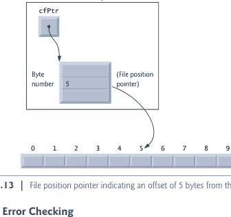

图 11.13 | 文件位置指针，指示距文件开头偏移 5 个字节。

### 11.7.2 错误检查

为简单起见，本章中的程序不执行错误检查。工业级程序应通过检查返回值来判断 fscanf（图 11.11，第 36—37 行）、fseek（第 40—41 行）和 fwrite（第 44 行）等函数是否正常运行。函数 fscanf 返回成功读取的数据项数量；如果读取数据时发生问题，则返回值 EOF。如果无法执行定位操作（例如，试图定位到文件开头之前的位置），函数 fseek 返回非零值。函数 fwrite 返回成功输出的项数。如果该数量小于函数调用中的第三个参数，则发生了写入错误。

## 11.8 从随机存取文件读取数据

函数 fread 从文件读取指定数量的字节到内存中。例如，

```c
fread(&client, sizeof(struct clientData), 1, cfPtr);
```

从 cfPtr 引用的文件中读取由 sizeof(struct clientData) 确定的字节数，将数据存储到 client 中，并返回读取的字节数。这些字节从文件位置指针指定的位置开始读取。函数 fread 可以通过提供指向用于存储元素的数组的指针，并指明要读取的元素数量，来读取多个固定大小的数组元素。前面的语句读取一个元素。要读取多个元素，请将元素数量指定为 fread 的第三个参数。函数 fread 返回成功输入的项数。如果该数量小于函数调用中的第三个参数，则发生了读取错误。

图 11.14 顺序读取 "accounts.dat" 文件中的每条记录，判断每条记录是否包含数据，并为包含数据的记录显示格式化数据。函数 feof 判断何时到达文件末尾，fread 函数将数据从文件传输到 clientData 结构体 client 中。

```c
// Fig. 11.14: fig11_14.c
// Reading a random-access file sequentially
#include <stdio.h>

// clientData structure definition
struct clientData {
    unsigned int acctNum; // account number
    char lastName[15]; // account last name
    char firstName[10]; // account first name
    double balance; // account balance
};

int main(void)
{
    FILE *cfPtr; // accounts.dat file pointer

    // fopen opens the file; exits if file cannot be opened
    if ((cfPtr = fopen("credit.txt", "rb")) == NULL) {
        puts("File could not be opened.");
    }
    else {
        printf("%-6s%-16s%-11s%10s\n", "Acct", "Last Name", "First Name", "Balance");

        // read all records from file (until eof)
        while (!feof(cfPtr)) {
            // create clientData with default information
            struct clientData client = {0, "", "", 0.0};

            int result = fread(&client, sizeof(struct clientData), 1, cfPtr);

            // display record
            if (result != 0 && client.acctNum != 0) {
                printf("%-6d%-16s%-11s%10.2f\n", client.acctNum, client.lastName, client.firstName, client.balance);
            }
        }

        fclose(cfPtr); // fclose closes the file
    }
}
```

| 账户 | 姓氏 | 名字 | 余额 |
|------|-----------|------------|---------|
| 29 | Brown | Nancy | 24.54 |
| 33 | Dunn | Stacey | 314.33 |
| 37 | Barker | Doug | 0.00 |
| 88 | Smith | Dave | 258.34 |
| 96 | Stone | Sam | 34.98 |

图 11.14 | 顺序读取随机存取文件。

## 11.9 案例研究：事务处理程序

现在我们给出一个使用随机存取文件的大型事务处理程序（图 11.15）。该程序维护银行的账户信息——更新现有账户、添加新账户、删除账户，并将所有当前账户的列表存储到文本文件中以便打印。我们假设已执行图 11.10 的程序来创建 accounts.dat 文件。

### 选项 1：创建格式化的账户列表

该程序有五个选项——选项 5 终止程序。选项 1 调用函数 textFile（第 64—94 行），将所有账户的格式化列表（通常称为报告）存储到名为 accounts.txt 的文本文件中，以便稍后打印。该函数使用 fread 以及图 11.14 程序中使用的顺序文件访问技术。执行选项 1 后，accounts.txt 包含：

| 账户 | 姓氏 | 名字 | 余额 |
|------|-----------|------------|---------|
| 29 | Brown | Nancy | -24.54 |
| 33 | Dunn | Stacey | 314.33 |
| 37 | Barker | Doug | 0.00 |
| 88 | Smith | Dave | 258.34 |
| 96 | Stone | Sam | 34.98 |

### 选项 2：更新账户

选项 2 调用函数 updateRecord（第 97—140 行）来更新账户。该函数只更新已存在的记录，因此函数首先检查用户指定的记录是否为空。使用 fread 将记录读入结构体 client，然后将成员 acctNum 与 0 比较。如果为 0，则该记录不包含信息，并打印一条消息说明该记录为空。随后显示菜单选项。如果记录包含信息，函数 updateRecord 输入交易金额，计算新余额，并将记录重写到文件中。选项 2 的典型输出为

```
Enter account to update (1 - 100): 37
37      Barker            Doug             0.00

Enter charge (+) or payment (-): +87.99
37      Barker            Doug            87.99
```

### 选项 3：创建新账户

选项 3 调用函数 newRecord（第 177—215 行）向文件添加新账户。如果用户输入的账号对应现有账户，newRecord 会显示一条错误消息，指出该记录已包含信息，并再次打印菜单选项。该函数使用与图 11.11 程序相同的过程来添加新账户。选项 3 的典型输出为

```
Enter new account number (1 - 100): 22
Enter lastname, firstname, balance
? Johnston Sarah 247.45
```

```c
91
92     fclose(writePtr); // fclose closes the file
93 }
94
95 // update balance in record
96 void updateRecord(FILE *fPtr)
97 {
98     // obtain number of account to update
99     printf("%s", "Enter account to update (1 - 100): ");
100    unsigned int account; // account number
101    scanf("%d", &account);
102
103    // move file pointer to correct record in file
104    fseek(fPtr, (account - 1) * sizeof(struct clientData),
105          SEEK_SET);
106
107    // create clientData with no information
108    struct clientData client = {0, "", "", 0.0};
109
110    // read record from file
111    fread(&client, sizeof(struct clientData), 1, fPtr);
112
113    // display error if account does not exist
114    if (client.acctNum == 0) {
115        printf("%d has no information.\n", account);
116    }
117    else { // update record
118        printf("%-6d%-16s%-11s%10.2f\n",
119               client.acctNum, client.lastName,
120               client.firstName, client.balance);
121
122        // request transaction amount from user
123        printf("%s", "Enter charge (+) or payment (-): ");
124        double transaction; // transaction amount
125        scanf("%lf", &transaction);
126        client.balance += transaction; // update record balance
127
128        printf("%-6d%-16s%-11s%10.2f\n",
129               client.acctNum, client.lastName,
130               client.firstName, client.balance);
131
132        // move file pointer to correct record in file
133        fseek(fPtr, (account - 1) * sizeof(struct clientData),
134               SEEK_SET);
135
136        // write updated record over old record in file
137        fwrite(&client, sizeof(struct clientData), 1, fPtr);
138    }
139 }
140
141

```


```c
194 // display error if account already exists
195 if (client.acctNum != 0) {
196     printf("Account #%d already contains information.\n",
197         client.acctNum);
198 }
199 else { // create record
200     // user enters last name, first name and balance
201     printf("%s", "Enter lastname, firstname, balance?\n ");
202     scanf("%14s%9s%f", &client.lastName, &client.firstName,
203         &client.balance);
204
205     client.acctNum = accountNum;
206
207     // move file pointer to correct record in file
208     fseek(fPtr, (client.acctNum - 1) *
209         sizeof(struct clientData), SEEK_SET);
210
211     // insert record in file
212     fwrite(&client,
213         sizeof(struct clientData), 1, fPtr);
214 }
215
216 // enable user to input menu choice
217 unsigned int enterChoice(void)
218 {
219     // display available options
220     printf("%s", "\nEnter your choice\n"
221         "1 - store a formatted text file of accounts called\n"
222         "\"accounts.txt\" for printing\n"
223         "2 - update an account\n"
224         "3 - add a new account\n"
225         "4 - delete an account\n"
226         "5 - end program\n? ");
227
228     unsigned int menuChoice; // variable to store user's choice
229     scanf("%u", &menuChoice); // receive choice from user
230     return menuChoice;
231 }
```

图 11.15 | 事务处理程序。（第 5 部分，共 5 部分。）

## 11.10 安全的 C 编程

### *fprintf_s 和 fscanf_s*

第 11.3～11.4 节中的示例使用 `fprintf` 和 `fscanf` 函数分别向文件写入文本以及从文件读取文本。新标准的附录 K 提供了这些函数的更安全版本，名称为 `fprintf_s` 和 `fscanf_s`。它们与之前介绍的 `printf_s` 和 `scanf_s` 函数完全相同，只是还需要指定一个 FILE 指针参数，用于指示要操作的文件。如果 C 编译器的标准库包含这些函数，则应使用它们来代替 `fprintf` 和 `fscanf`。与 `scanf_s` 和 `printf_s` 一样，Microsoft 对 `fprintf_s` 和 `fscanf_s` 的实现也不同于附录 K 中的实现。

### *CERT 安全 C 编码标准第 9 章*

*CERT 安全 C 编码标准*第 9 章专门介绍输入/输出方面的建议和规则，其中许多适用于一般的文件处理，另有一些适用于本章介绍的文件处理函数。有关每条建议和规则的更多信息，请访问 www.securecoding.cert.org。

- **FIO03-C。** 使用非独占文件打开模式（图 11.5）打开文件进行写入时，如果文件已经存在，函数 `fopen` 会打开该文件并截断其内容，而且不会指出该文件在调用 `fopen` 之前是否已经存在。为了确保现有文件*不会*被打开和截断，可以使用 C11 新增的*独占写入模式*（第 11.3 节讨论了该模式），该模式允许 `fopen` 仅在文件尚不存在时打开文件。
- **FIO04-C。** 在工业级代码中，应始终检查会返回错误指示的文件处理函数的返回值，以确保这些函数正确完成了相应任务。
- **FIO07-C。** 函数 `rewind` 不返回值，因此无法测试操作是否成功。建议改用函数 `fseek`，因为该函数在失败时会返回非零值。
- **FIO09-C。** 本章演示了文本文件和二进制文件。由于不同平台对二进制数据的表示方式存在差异，以二进制格式写入的文件通常*不具备可移植性*。若需要更具可移植性的文件表示形式，可以考虑使用文本文件，或使用能够处理不同平台间二进制文件表示差异的函数库。
- **FIO14-C。** 某些库函数对文本文件和二进制文件的处理并不完全相同。特别是，当从 `SEEK_END` 位置开始定位时，函数 `fseek` *不保证*能够正确处理二进制文件，因此应使用 `SEEK_SET`。
- **FIO42-C。** 在许多平台上，同时打开的文件数量可能*受到限制*。因此，应在文件不再被程序需要后立即将其关闭。

## 总结

### *第 11.1 节简介*

- 文件（第 474 页）用于永久保存大量数据。
- 计算机将文件存储在*辅助存储设备*上，例如硬盘驱动器、固态驱动器、闪存驱动器和 DVD。

### *第 11.2 节文件和流*

- C 将每个文件视为一个字节顺序流（第 474 页）。打开文件时，会将一个流与该文件关联起来。
- 程序开始执行时会自动打开三个流——**标准输入**（第 474 页）、**标准输出**（第 474 页）和**标准错误**（第 474 页）。
- 流为文件与程序之间提供通信通道。
- 标准输入流使程序能够从键盘读取数据，标准输出流使程序能够在屏幕上打印数据。
- 打开文件会返回一个指向 FILE 结构（定义于 `<stdio.h>`；第 475 页）的指针，该结构包含处理文件时所需的信息。该结构包括一个文件描述符（第 475 页），即操作系统数组中的一个索引；该数组称为打开文件表（第 475 页）。数组的每个元素都包含一个文件控制块（FCB；第 475 页），操作系统利用它管理特定文件。
- 标准输入、标准输出和标准错误通过预定义的文件指针 `stdin`、`stdout` 和 `stderr` 进行操作。
- 函数 `fgetc`（第 475 页）从文件中读取一个字符。它接收一个 FILE 指针作为参数，该指针指向要读取字符的文件。
- 函数 `fputc`（第 475 页）向文件写入一个字符。它接收两个参数：要写入的字符，以及指向要写入字符的文件的 FILE 指针。
- `fgets` 和 `fputs` 函数（第 475 页）分别从文件中读取一行，以及向文件中写入一行。

### 第 11.3 节创建顺序访问文件

- C 不会对文件施加任何结构。必须根据特定应用程序的需求提供文件结构。
- C 程序使用一个独立的 FILE 结构管理每个文件。
- 每个打开的文件都必须有一个单独声明的 FILE 类型指针，用于引用该文件。
- 函数 `fopen`（第 480 页）接收文件名和文件打开模式（第 477 页）作为参数，并返回一个指向所打开文件的 FILE 结构的指针。
- 文件打开模式 `"w"` 表示以写入方式打开文件。如果文件不存在，`fopen` 会创建该文件。如果文件已经存在，其内容会在不发出警告的情况下被丢弃。
- 如果无法打开文件，函数 `fopen` 将返回 `NULL`。
- 函数 `feof`（第 478 页）接收一个指向 FILE 的指针；当文件结束指示器已被设置时，它返回非零（真）值，否则返回零。任何尝试从 `feof` 返回真值的文件中读取数据的操作都会失败。
- 函数 `fprintf`（第 475 页）等价于 `printf`，不同之处在于 `fprintf` 还接收一个文件指针作为参数，该指针指向要写入数据的文件。
- 函数 `fclose`（第 478 页）接收一个文件指针作为参数，并关闭指定的文件。
- 打开文件时，该文件的文件控制块（FCB）会被复制到内存中。操作系统使用 FCB 管理文件。
- 要创建新文件，或在写入数据前丢弃现有文件的内容，应以写入方式（`"w"`）打开文件。
- 要读取现有文件，应以读取方式（`"r"`）打开文件。
- 要向现有文件的末尾添加记录，应以追加方式（`"a"`）打开文件。
- 要以既可写入又可读取的方式打开文件，应使用三种更新模式之一，以更新方式打开文件——`"r+"`、`"w+"` 或 `"a+"`。模式 `"r+"` 以读取和写入方式打开文件。模式 `"w+"` 创建一个可读写的文件。如果文件已经存在，则打开该文件并丢弃其内容。模式 `"a+"` 以读取和写入方式打开文件——所有写入操作都在文件末尾进行。如果文件不存在，则创建该文件。
- 每种文件打开模式都有对应的二进制模式（包含字母 `b`），用于操作二进制文件。
- C11 还支持独占写入模式：在 `w`、`w+`、`wb` 和 `wb+` 模式后追加 `x` 即可。


### 第 11.8 节 从随机访问文件读取数据

- 函数 `fread` 从文件中读取指定数量的字节到内存中。
- 函数 `fread` 可通过提供元素将被存储的数组的指针并指明要读取的元素数量来读取多个固定大小的数组元素。
- 函数 `fread` 返回其成功输入的项目数。如果该数字小于函数调用中的第三个参数，则发生了读取错误。

## 自测练习

11.1 填空以下各题：

- a) 函数 ______ 关闭一个文件。
- b) ______ 函数以与 `scanf` 从 `stdin` 读取类似的方式从文件中读取数据。
- c) 函数 ______ 从指定文件中读取一个字符。
- d) 函数 ______ 从指定文件中读取一行。
- e) 函数 ______ 打开一个文件。
- f) 函数 ______ 通常在随机访问应用中从文件中读取数据时使用。
- g) 函数 ______ 将文件位置指针重新定位到文件中的特定位置。

11.2 判断以下各题是否正确。如果错误，请说明原因。

- a) 函数 `fscanf` 不能用于从标准输入读取数据。
- b) 必须显式使用 `fopen` 打开标准输入、标准输出和标准错误流。
- c) 程序必须显式调用函数 `fclose` 来关闭文件。
- d) 如果文件位置指针指向顺序文件中的非文件开头的位置，必须关闭文件并重新打开才能从文件开头读取。
- e) 函数 `fprintf` 可以写入标准输出。
- f) 顺序访问文件中的数据始终在不覆盖其他数据的情况下更新。
- g) 在随机访问文件中查找特定记录时不必搜索所有记录。
- h) 随机访问文件中的记录不是统一长度的。
- i) 函数 `fseek` 只能相对于文件开头进行查找。

11.3 编写单个语句以完成以下各项。假设这些语句都适用于同一程序。

- a) 编写一个语句以打开文件 `"oldmast.dat"` 用于读取，并将返回的文件指针赋给 `ofPtr`。
- b) 编写一个语句以打开文件 `"trans.dat"` 用于读取，并将返回的文件指针赋给 `tfPtr`。
- c) 编写一个语句以打开文件 `"newmast.dat"` 用于写入（并创建），并将返回的文件指针赋给 `nfPtr`。
- d) 编写一个语句从文件 `"oldmast.dat"` 读取一条记录。该记录由整数 `accountNum`、字符串 `name` 和浮点数 `currentBalance` 组成。
- e) 编写一个语句从文件 `"trans.dat"` 读取一条记录。该记录由整数 `accountNum` 和浮点数 `dollarAmount` 组成。
- f) 编写一个语句向文件 `"newmast.dat"` 写入一条记录。该记录由整数 `accountNum`、字符串 `name` 和浮点数 `currentBalance` 组成。

11.4 找出以下每个程序段中的错误并说明如何纠正。

- a) 由 `fPtr` 引用的文件（`"payables.dat"`）尚未打开。

    ```
    printf(fPtr, "%s%d%f\n", account, company, amount);
    ```

- b)

    ```
    open("receive.dat", "r+");
    ```

- c) 以下语句应从文件 "payables.dat" 读取一条记录。文件指针 payPtr 引用此文件，而文件指针 recPtr 引用文件 "receive.dat"：

    ```
    scanf(recPtr, "%d%s%d\n", &account, company, &amount);
    ```

- d) 文件 "tools.dat" 应打开以在不丢弃当前数据的情况下添加数据。

    ```
    if ((fPtr = fopen("tools.dat", "w")) != NULL)
    ```

- e) 文件 "courses.dat" 应打开以进行追加，而不修改文件当前内容。

    ```
    if ((fPtr = fopen("courses.dat", "ws")) != NULL)
    ```

## 自测练习答案

11.1 a) fclose. b) fscanf. c) fgetc. d) fgets. e) fopen. f) fread. g) fseek.

11.2 a) 错误。函数 fscanf 可通过在调用 fscanf 时包含指向标准输入流 stdin 的指针来用于从标准输入读取。

- b) 错误。这三个流在程序执行开始时由 C 自动打开。
- c) 错误。文件将在程序执行终止时关闭，但所有文件都应使用 fclose 显式关闭。
- d) 错误。函数 rewind 可用于将文件位置指针重新定位到文件开头。
- e) 正确。
- f) 错误。在大多数情况下，顺序文件记录不是统一长度的。因此，更新记录可能会导致其他数据被覆盖。
- g) 正确。
- h) 错误。随机访问文件中的记录通常是统一长度的。
- i) 错误。可以从文件开头、文件末尾以及文件当前位置进行查找。

11.3 a) ofPtr = fopen("oldmast.dat", "r");

## 练习

11.5 填空以下各题：

- a) 计算机将大量数据存储在二级存储设备上作为 ________。
- b) 一个 ________ 由多个字段组成。
- c) 为了便于从文件中检索特定记录，每个记录中的一个字段被选为 ________。
- d) 一组传达意义的相关字符称为 ________。
- e) 程序执行开始时自动打开的三个流的文件指针命名为 ________、________ 和 ________。
- f) 函数 ________ 向指定文件写入一个字符。
- g) 函数 ________ 向指定文件写入一行。
- h) 函数 ________ 通常用于向随机访问文件写入数据。
- i) 函数 ________ 将文件位置指针重新定位到文件开头。

11.6 判断以下各题是否正确。如果错误，请说明原因。

- a) 计算机执行的重要功能本质上涉及零和一的操纵。
- b) 人们更喜欢操纵位而不是字符和字段，因为位更紧凑。
- c) 人们将程序和数据项指定为字符；计算机随后将这些字符作为零和一的组进行操纵和处理。
- d) 一个人的邮政编码是数字字段的例子。
- e) 计算机处理的数据项形成一个数据层次结构，其中随着我们从字段到字符到位等的进展，数据项变得更大更复杂。
- f) 记录键标识记录属于特定字段。
- g) 大多数公司将信息存储在单个文件中以便于计算机处理。
- h) 在 C 程序中，文件总是按名称引用。
- i) 当程序创建文件时，文件会自动由计算机保留以供将来参考。

### 11.7（为文件匹配程序创建数据）

编写一个简单的程序来创建一些测试数据以检查练习 11.8 的程序。使用以下示例账户数据：

主文件：

| Account number | Name | Balance |
|---|---|---|
| 100 | Alan Jones | 348.17 |
| 300 | Mary Smith | 27.19 |
| 500 | Sam Sharp | 0.00 |
| 700 | Suzy Green | -14.22 |

交易文件：

| Account number | Dollar amount |
|---|---|
| 100 | 27.14 |
| 300 | 62.11 |
| 400 | 100.56 |
| 900 | 82.17 |

### 11.8（文件匹配）

练习 11.3 要求读者编写一系列单语句。实际上，这些语句构成了重要类型的文件处理程序的核心，即文件匹配程序。在商业数据处理中，每个系统中通常有多个文件。

例如，在应收账款系统中，通常有一个主文件包含有关每个客户的详细信息，例如客户姓名、地址、电话号码、未付余额、信用额度、折扣条款、合同安排以及最近购买和现金支付的简要历史。

随着交易的进行（即销售发生且现金付款通过邮件到达），它们被输入到文件中。在每个业务周期结束时（即对某些公司来说是一个月，对其他公司来说是一周，在某些情况下是一天），交易文件（在练习 11.3 中称为 "trans.dat"）被应用于主文件（在练习 11.3 中称为 "oldmast.dat"），从而更新每个账户的购买和付款记录。每次更新运行后，主文件被重写为新文件（"newmast.dat"），然后在下一个业务周期结束时用于再次开始处理。

文件匹配程序必须处理单文件程序中不存在的某些问题。例如，并非总是发生匹配。主文件上的客户可能在当前业务周期内未进行任何购买或现金付款，因此交易文件中不会出现该客户的记录。同样，确实进行了一些购买或现金付款的客户可能刚刚搬到这个社区，公司可能还没有机会为该客户创建主记录。

使用练习 11.3 中编写的语句作为完整的文件匹配应收账款程序的基础。使用每个文件上的账户号码作为匹配目的的记录键。假设每个文件都是顺序文件，记录按递增的账户号码顺序存储。

当匹配发生时（即主文件和交易文件上出现具有相同账户号码的记录），将交易文件上的金额加到主文件上的当前余额上，并写入 "newmast.dat" 记录。（假设交易文件上的正金额表示购买，负金额表示付款。）

当特定账户存在主记录但没有对应的交易记录时，仅将主记录写入 "newmast.dat"。当存在交易记录但没有对应的主记录时，打印消息 "Unmatched transaction record for account number ..."（填写交易记录中的账户号码）。

### 11.9（测试文件匹配练习）

使用练习 11.7 中创建的测试数据文件运行练习 11.8 的程序。仔细检查结果。

### 11.10（具有多个交易的匹配文件）

可能（实际上很常见）存在具有相同记录键的多个交易记录。这是因为特定客户在业务周期内可能会进行多次购买和现金付款。重写练习 11.8 的应收账款文件匹配程序，以提供处理具有相同记录键的多个交易记录的可能性。修改练习 11.7 的测试数据以包含以下附加交易记录：

| Account number | Dollar amount |
|---|---|
| 300 | 83.89 |
| 700 | 80.78 |
| 700 | 1.53 |

### 11.11（编写语句以完成任务）

编写语句以完成以下各项。假设结构


```c
struct person {
    char lastName[15];
    char firstName[15];
    char age[4];
};
```

已被定义，且文件已经打开准备写入。

- a) 初始化文件“nameage.dat”，使其包含100条记录，其中lastName = "unsigned"，firstName = ""，age = "0"。
- b) 输入10个姓氏、名字和年龄，并将它们写入文件。
- c) 更新一条记录；如果记录中没有信息，则告知用户“No info”。
- d) 通过重新初始化某条特定记录来删除有信息的记录。

### 11.12（硬件库存）

你是一家五金店的老板，需要维护一份库存清单，以便了解你有哪些工具、每种工具的数量以及单价。编写一个程序，将文件“hardware.dat”初始化为100条空记录，允许你输入每种工具的数据，允许你列出所有工具，允许你删除不再拥有的工具记录，并允许你更新文件中的任何信息。工具标识号应为记录号。使用以下信息初始化你的文件：

| 记录号 | 工具名称 | 数量 | 成本 |
| --- | --- | --- | --- |
| 3 | 电动砂光机 | 7 | 57.98 |
| 17 | 锤子 | 76 | 11.99 |
| 24 | 曲线锯 | 21 | 11.00 |
| 39 | 割草机 | 3 | 79.50 |
| 56 | 电锯 | 18 | 99.99 |
| 68 | 螺丝刀 | 106 | 6.99 |
| 77 | 大锤 | 11 | 21.50 |
| 83 | 扳手 | 34 | 7.50 |

### 11.13（电话号码单词生成器）

标准电话键盘包含数字0–9。数字2–9每个数字对应三个字母，如下表所示：

| 数字 | 字母 | 数字 | 字母 |
| --- | --- | --- | --- |
| 2 | A B C | 6 | M N O |
| 3 | D E F | 7 | P R S |
| 4 | G H I | 8 | T U V |
| 5 | J K L | 9 | W X Y |

许多人觉得记住电话号码很困难，因此他们利用数字与字母之间的对应关系，生成与电话号码对应的七个字母的单词。例如，电话号码为686-2377的人可以利用上表所示的对应关系生成七字母单词“NUMBER”。

企业常常试图获得便于客户记忆的电话号码。如果一家企业可以为其客户宣传一个简单的拨号单词，那么毫无疑问，该企业会接到更多电话。

每个七字母单词恰好对应一个七位电话号码。希望增加外卖业务的餐厅肯定可以通过号码825-3688（即“TAKEOUT”）做到这一点。

每个七位电话号码对应许多不同的七字母单词。不幸的是，其中大多数是难以辨认的字母组合。然而，理发店老板可能会很高兴地知道，其店铺的电话号码424-7288对应“HAIRCUT”。酒类商店的老板无疑会欣喜地发现，其店铺的电话号码233-7226对应“BEERCAN”。电话号码为738-2273的兽医会很高兴地知道该号码对应字母“PETCARE”。

编写一个C程序，对于给定的七位数字，将该数字对应的所有可能的七字母单词写入一个文件。共有2187（3的7次方）个这样的单词。避免使用包含数字0和1的电话号码。

### 11.14（项目：电话号码单词生成器修改）

如果你有计算机化的词典可用，请修改你在练习11.13中编写的程序，使其在词典中查找这些单词。该程序生成的某些七字母组合由两个或更多单词组成（例如，电话号码843-2677生成“THEBOSS”）。

### 11.15（将文件处理函数用于标准输入/输出流）

修改图8.11中的示例，使用函数fgetc和fputs而不是getchar和puts。程序应让用户选择从标准输入读取并写入标准输出，或从指定文件读取并写入指定文件。如果用户选择第二个选项，则让用户输入输入文件和输出文件的文件名。

### 11.16（将类型大小输出到文件）

编写一个程序，使用sizeof运算符确定计算机系统上各种数据类型的大小（以字节为单位）。将结果写入文件“datasize.dat”，以便稍后打印结果。文件中的结果格式应如下所示（你的计算机上的类型大小可能与示例输出中显示的不同）：

| 数据类型 | 大小 |
| --- | --- |
| char | 1 |
| unsigned char | 1 |
| short int | 2 |
| unsigned short int | 2 |
| int | 4 |
| unsigned int | 4 |
| long int | 4 |
| unsigned long int | 4 |
| float | 4 |
| double | 8 |
| long double | 16 |

### 11.17（带文件处理的Simpletron）

在练习7.28中，你编写了一个使用称为Simpletron机器语言（SML）的特殊机器语言的计算机软件模拟。在该模拟中，每次你想运行一个SML程序时，都需要从键盘将程序输入模拟器。如果你在输入SML程序时犯了错误，模拟器会重新启动，SML代码需要重新输入。如果能够从文件读取SML程序，而不是每次手动输入，那就太好了。这样可以减少准备运行SML程序的时间和错误。

- a) 修改你在练习7.28中编写的模拟器，使其从用户在键盘上指定的文件读取SML程序。
- b) 在Simpletron执行后，它会在屏幕上输出寄存器和内存的内容。如果能够将输出保存到文件中会更好，因此请修改模拟器，使其在屏幕上显示输出的同时将输出写入文件。

### 11.18（*修改后的事务处理程序*）

修改第11.9节中的程序，增加一个在屏幕上显示账户列表的选项。考虑修改函数textFile，使其根据一个额外的函数参数指定输出位置，从而使用标准输出或文本文件。

### 做出改变

### 11.19（*项目：网络钓鱼扫描器*）

网络钓鱼是一种身份盗窃形式，在这种形式中，发件人冒充可信赖的来源，通过电子邮件试图获取私人信息，例如你的用户名、密码、信用卡号码和社会安全号码。声称来自热门银行、信用卡公司、拍卖网站、社交网络和在线支付服务的网络钓鱼电子邮件可能看起来相当合法。这些欺诈性消息通常提供指向伪造（虚假）网站的链接，在这些网站上你会被要求输入敏感信息。

访问 http://www.snopes.com 和其他网站，查找顶级网络钓鱼骗局的列表。还可以查看反网络钓鱼工作组（http://www.antiphishing.org/）和FBI的网络调查网站（http://www.fbi.gov/about-us/investigate/cyber/cyber），在那里你可以找到有关最新骗局以及如何保护自己的信息。

创建一份包含30个经常出现在网络钓鱼消息中的单词、短语和公司名称的列表。根据你估计其在网络钓鱼消息中出现的可能性，为每个词分配一个分值（例如，如果有点可能则给1分，如果中等可能则给2分，如果高度可能则给3分）。编写一个程序，扫描文本文件中的这些术语和短语。对于文本文件中每次出现的关键字或短语，将所分配的分值添加到该单词或短语的总分中。对于找到的每个关键字或短语，输出一行，包含该单词或短语、出现次数和总分。然后显示整个消息的总分。你的程序是否为你收到的一些实际网络钓鱼电子邮件分配了较高的总分？它是否为你收到的一些合法电子邮件分配了较高的总分？

## 12 C数据结构

### 目标

在本章中，你将：

- 为数据对象动态分配和释放内存。
- 使用指针、自引用结构和递归来构建链式数据结构。
- 创建并操作链表、队列、栈和二叉树。
- 学习链式数据结构的重要应用。
- 学习关于指针和动态内存分配的安全C编程建议。
- 可选地在练习中构建自己的编译器。


由你的编译器生成！本项目将为你提供绝佳机会，练习本书中学到的绝大部分内容。特别章节会仔细带你了解高级语言的规范，并描述将每种高级语言语句转换为机器语言指令所需的算法。如果你喜欢挑战，可以尝试练习中建议的对编译器和 Simpler ton Simulator 的许多增强功能。

## 12.2 自引用结构

回顾一下，*自引用结构*包含一个指针成员，该指针指向*相同*结构类型的结构。例如，定义

```c
struct node {
   int data;
   struct node *nextPtr;
};
```

定义了一个类型 struct node。struct node 类型的结构有两个成员——整型成员 data 和指针成员 nextPtr。成员 nextPtr 指向一个 struct node 类型的结构——即与这里声明的结构相同类型的结构，因此称为*自引用结构*。成员 nextPtr 被称为*链接*——也就是说，它可用于将（即链接）一个 struct node 类型的结构与另一个相同类型的结构“系”在一起。自引用结构可以链接在一起，形成有用的数据结构，如链表、队列、栈和树。图 12.1 展示了两个链接在一起形成链表的自引用结构对象。第二个自引用结构的链接成员中放置了一个斜杠——表示*空指针*——以表明该链接不指向另一个结构。[注意：斜杠仅用于示意；它并不对应于 C 中的反斜杠字符。] *空指针*通常表示数据结构的*结尾*，就像*空字符*表示字符串的结尾一样。

> > **常见编程错误 12.1**
> >
> > *未将链表中最后一个节点的链接设置为 NULL 可能导致运行时错误。*


**图 12.1** | 链接在一起的自引用结构。

## 12.3 动态内存分配

创建和维护可在程序运行时增长和收缩的动态数据结构，需要动态内存分配——即程序能够在执行时获得更多内存空间以保存新节点，并释放不再需要的空间。

函数 *malloc* 和 *free*，以及运算符 *sizeof*，对动态内存分配至关重要。函数 *malloc* 接收要分配的字节数作为参数，并返回一个指向所分配内存的 `void *` 类型指针（指向 void 的指针）。如你所记得，`void *` 指针可赋给任何指针类型的变量。函数 *malloc* 通常与 *sizeof* 运算符一起使用。例如，语句

```
newPtr = malloc(sizeof(struct node));
```

会计算 sizeof(struct node) 以确定 struct node 对象的字节大小，在内存中分配该字节数的新区域，并将指向所分配内存的指针存入 newPtr。该内存不保证已初始化，不过许多实现出于安全考虑会将其初始化。如果没有可用内存，malloc 返回 NULL。

函数 free 释放内存——即把内存归还给系统，以便将来可以重新分配。要释放前面 malloc 调用动态分配的内存，请使用语句

```
free(newPtr);
```

C 还提供了函数 calloc 和 realloc，用于创建和修改动态数组。这些函数将在 14.9 节讨论。接下来的各节将讨论链表、栈、队列和树，它们都是通过动态内存分配和自引用结构来创建和维护的。

### 可移植性提示 12.1

结构的大小不一定是其各成员大小之和。这是因为存在各种与机器相关的边界对齐要求（见第 10 章）。

### 错误预防提示 12.1

使用 malloc 时，要测试返回的 NULL 指针值，它表示内存未分配。

### 常见编程错误 12.2

不再需要动态分配的内存时未释放它，可能导致系统过早耗尽内存。这有时称为“内存泄漏”。

### 错误预防提示 12.2

当动态分配的内存不再需要时，立即使用 free 将内存归还给系统。然后将指针设置为 NULL，以消除程序引用已被回收、且可能已分配给其他用途的内存的可能性。

### 常见编程错误 12.3

释放不是由 malloc 动态分配的内存是一种错误。

### 常见编程错误 12.4

引用已释放的内存是一种错误，通常会导致程序崩溃。

## 12.4 链表

链表是由称为节点的自引用结构组成的线性集合，这些节点通过指针链接连接——因此称为“链式”表。链表通过指向其第一个节点的指针来访问。后续节点通过存储在每个节点中的链接指针成员来访问。按照惯例，链表中最后一个节点的链接指针设置为 NULL，以标记

链表的结尾。数据动态存储在链表中——每个节点按需创建。节点可以包含任何类型的数据，包括其他结构体。栈和队列也是线性数据结构，并且正如我们将看到的，它们是链表的受限版本。树是非线性数据结构。

数据列表可以存储在数组中，但链表具有若干优点。当数据结构中要表示的数据元素数量不可预测时，链表是合适的。链表是动态的，因此链表的长度可以在执行时按需增加或减少。然而，编译时创建的数组大小不能更改。数组可能变满。链表只有在系统内存不足以满足动态存储分配请求时才会变满。

> **性能提示 12.1**
> 可以将数组声明为包含比预期数据项更多的元素，但这可能浪费内存。在这些情况下，链表可以提供更好的内存利用率。

链表可以通过将每个新元素插入链表中的适当位置来保持排序顺序。

> **性能提示 12.2**
> 在有序数组中插入和删除可能很耗时——插入或删除元素之后的所有元素都必须适当地移动。

> **性能提示 12.3**
> 数组的元素在内存中连续存储。这允许立即访问任何数组元素，因为任何元素的地址都可以根据其相对于数组开头的位置直接计算。链表不能提供对其元素的这种立即访问。

链表节点通常不连续存储在内存中。然而，从逻辑上看，链表的节点似乎是连续的。图 12.2 展示了一个包含多个节点的链表。

> **性能提示 12.4**
> 对于在执行时增长和收缩的数据结构，使用动态内存分配（而不是数组）可以节省内存。然而请记住，指针会占用空间，而且动态内存分配会带来函数调用的开销。


图 12.2 | 链表的图形表示。

图 12.3（输出如图 12.4 所示）操作一个字符链表。你可以按字母顺序将字符插入链表（函数 insert），或从链表中删除字符（函数 delete）。下面对该程序进行详细讨论。

```c
1 // Fig. 12.3: fig12_03.c
2 // Inserting and deleting nodes in a list
3 #include <stdio.h>
4 #include <stdlib.h>
5
6 // self-referential structure
7 struct listNode {
8 char data; // each listNode contains a character
9 struct listNode *nextPtr; // pointer to next node
10 };
11
12 typedef struct listNode ListNode; // synonym for struct listNode
13 typedef ListNode *ListNodePtr; // synonym for ListNode*
14
15 // prototypes
16 void insert(ListNodePtr *sPtr, char value);
17 char delete(ListNodePtr *sPtr, char value);
18 int isEmpty(ListNodePtr sPtr);
19 void printList(ListNodePtr currentPtr);
20 void instructions(void);
21
22 int main(void)
23 {
24 ListNodePtr startPtr = NULL; // initially there are no nodes
25 char item; // char entered by user
26
27 instructions(); // display the menu
28 printf("\n");
29 unsigned int choice; // user's choice
30 scanf("%u", &choice);
31
32 // loop while user does not choose 3
33 while (choice != 3) {
34
35 switch (choice) {
36 case 1:
37 printf("\n%s", "Enter a character: ");
38 scanf("\n%c", &item);
39 insert(&startPtr, item); // insert item in list
40 printList(startPtr);
41 break;
42 case 2: // delete an element
43 // if list is not empty
44 if (!isEmpty(startPtr)) {
45 printf("\n%s", "Enter character to be deleted: ");
46 scanf("\n%c", &item);
```


```c
// if character is found, remove it
if (delete(&startPtr, item)) { // remove item
    printf("%c deleted.\n", item);
    printList(startPtr);
} else {
    printf("%c not found.\n\n", item);
}
} else {
    puts("List is empty.\n");
}

break;
default:
    puts("Invalid choice.\n");
    instructions();
    break;
}

printf("%s", "? ");
scanf("%u", &choice);
}

puts("End of run.");
}

// display program instructions to user
void instructions(void)
{
    puts("Enter your choice:\n"
         " 1 to insert an element into the list.\n"
         " 2 to delete an element from the list.\n"
         " 3 to end.");
}

// insert a new value into the list in sorted order
void insert(ListNodePtr *sPtr, char value)
{
    ListNodePtr newPtr = malloc(sizeof(ListNode)); // create node

    if (newPtr != NULL) { // is space available?
        newPtr->data = value; // place value in node
        newPtr->nextPtr = NULL; // node does not link to another node

        ListNodePtr previousPtr = NULL;
        ListNodePtr currentPtr = *sPtr;

        // loop to find the correct location in the list
        while (currentPtr != NULL && value > currentPtr->data) {
            previousPtr = currentPtr; // walk to ...
            currentPtr = currentPtr->nextPtr; // ... next node
        }

101        // insert new node at beginning of list
102        if (previousPtr == NULL) {
103            newPtr->nextPtr = *sPtr;
104            *sPtr = newPtr;
105        }
106        else { // insert new node between previousPtr and currentPtr
107            previousPtr->nextPtr = newPtr;
108            newPtr->nextPtr = currentPtr;
109        }
110    }
111    else {
112        printf("%c not inserted. No memory available.\n", value);
113    }
114 }
115
116 // delete a list element
117 char delete(ListNodePtr *sPtr, char value)
118 {
119     // delete first node if a match is found
120     if (value == (*sPtr)->data) {
121         ListNodePtr tempPtr = *sPtr; // hold onto node being removed
122         *sPtr = (*sPtr)->nextPtr; // de-thread the node
123         free(tempPtr); // free the de-threaded node
124         return value;
125     }
126     else {
127         ListNodePtr previousPtr = *sPtr;
128         ListNodePtr currentPtr = (*sPtr)->nextPtr;

130         // loop to find the correct location in the list
131         while (currentPtr != NULL && currentPtr->data != value) {
132             previousPtr = currentPtr; // walk to ...
133             currentPtr = currentPtr->nextPtr; // ... next node
134         }
135
136         // delete node at currentPtr
137         if (currentPtr != NULL) {
138             ListNodePtr tempPtr = currentPtr;
139             previousPtr->nextPtr = currentPtr->nextPtr;
140             free(tempPtr);
141             return value;
142         }
143     }
144
145     return '\0';
146 }
147
148 // return 1 if the list is empty, 0 otherwise
149 int isEmpty(ListNodePtr sPtr)
150 {
151     return sPtr == NULL;
152 }
```

图 12.3 | 在列表中插入和删除节点。 (第 3 部分，共 4 部分。)

```c
154
155 // print the list
156 void printList(ListNodePtr currentPtr)
157 {
158    // if list is empty
159    if (isEmpty(currentPtr)) {
160       puts("List is empty.\n");
161    }
162    else {
163       puts("The list is:");
164
165       // while not the end of the list
166       while (currentPtr != NULL) {
167          printf("%c --> ", currentPtr->data);
168          currentPtr = currentPtr->nextPtr;
169       }
170
171       puts("NULL\n");
172    }
173 }
```

**图 12.3** | 在列表中插入和删除节点。 (第 4 部分，共 4 部分。)

```text
Enter your choice:
 1 to insert an element into the list.
 2 to delete an element from the list.
 3 to end.
? 1
Enter a character: B
The list is:
B --> NULL

? 1
Enter a character: A
The list is:
A --> B --> NULL

? 1
Enter a character: C
The list is:
A --> B --> C --> NULL

? 2
Enter character to be deleted: D
D not found.

? 2
Enter character to be deleted: B
B deleted.
The list is:
A --> C --> NULL
```

**图 12.4** | 图 12.3 程序的示例输出。 (第 1 部分，共 2 部分。)

```text
? 2
Enter character to be deleted: C
C deleted.
The list is:
A --> NULL
? 2
Enter character to be deleted: A
A deleted.
List is empty.
? 4
Invalid choice.
Enter your choice:
 1 to insert an element into the list.
 2 to delete an element from the list.
 3 to end.
? 3
End of run.
```

图 12.4 | 图 12.3 程序的示例输出。 (第 2 部分，共 2 部分。)

链表的主要函数是 insert（第 85–115 行）和 delete（第 118–147 行）。函数 isEmpty（第 150–153 行）被称为谓词函数——它不会以任何方式改变列表；相反，它确定列表是否为空（即列表第一个节点的指针为 NULL）。如果列表为空，则返回 1；否则返回 0。 [注意：如果您使用的是符合 C99 标准的编译器，可以使用 _Bool 类型（第 4.10 节）而不是 int。] 函数 printList（第 156–173 行）打印列表。

### 12.4.1 函数 insert

字符按字母顺序插入列表中。函数 insert（第 85–115 行）接收列表的地址和要插入的字符。列表的地址在要在列表开头插入值时是必要的。提供地址使得可以通过引用调用来修改列表（即列表第一个节点的指针）。因为列表本身是一个指针（指向其第一个元素），传递其地址会创建一个指向指针的指针（即双重间接）。这是一个复杂的概念，需要仔细编程。插入字符到列表中的步骤如下（见图 12.5）：

- 1. 通过调用 malloc 创建一个节点，将分配的内存地址赋给 newPtr（第 87 行），将要插入的字符赋给 newPtr->data（第 90 行），并将 NULL 赋给 newPtr->nextPtr（第 91 行）。
- 2. 将 previousPtr 初始化为 NULL（第 93 行），将 currentPtr 初始化为 *sPtr（第 94 行）——指向列表开始的指针。指针 previousPtr 和 currentPtr 分别存储插入点之前和之后的节点位置。
- 3. 当 currentPtr 不为 NULL 且要插入的值大于 currentPtr->data 时（第 97 行），将 currentPtr 赋给 previousPtr（第 98 行），并使 currentPtr 前进到列表中的下一个节点（第 99 行）。这会定位该值的插入点。
- 4. 如果 previousPtr 为 NULL（第 103 行），则将新节点作为列表中的第一个插入（第 104–105 行）。将 *sPtr 赋给 newPtr->nextPtr（新节点的链接指向以前的第一个节点）并将 `newPtr` 赋给 `*sPtr`（`*sPtr` 指向新节点）。否则，如果 `previousPtr` 不为 NULL，则将新节点就地插入（第 108–109 行）。将 `newPtr` 赋给 `previousPtr->nextPtr`（前一个节点指向新节点）并将 `currentPtr` 赋给 `newPtr->nextPtr`（新节点的链接指向当前节点）。

### 错误预防提示 12.3

将 NULL 分配给新节点的链接成员。指针在使用前应进行初始化。

图 12.5 说明了将包含字符 'C' 的节点插入有序列表。图的部分 (a) 显示了插入前列表和新节点。图的部分 (b) 显示了插入新节点的结果。重新分配的指针为虚线箭头。为简单起见，我们使用 `void` 返回类型实现了函数 `insert`（以及本章中的其他类似函数）。函数 `malloc` 可能无法分配请求的内存。在这种情况下，最好让我们的 `insert` 函数返回一个状态，以指示操作是否成功。


**图 12.5** | 按顺序在列表中插入节点。

### 12.4.2 函数 delete

函数 delete（第 118–147 行）接收指向列表开始的指针的地址和要删除的字符。删除字符的步骤如下（见图 12.6）：


- 1. 如果要删除的字符与列表中*第一个节点*中的字符匹配（第 121 行），将 *sPtr 分配给 tempPtr（tempPtr 将用于释放不需要的内存），将 (*sPtr)->nextPtr 分配给 *sPtr（*sPtr 现在指向列表中的*第二个节点*），释放 tempPtr 指向的内存，并返回被删除的字符。
- 2. 否则，将 previousPtr 用 *sPtr 初始化，并将 currentPtr 用 (*sPtr)->nextPtr 初始化（第 128–129 行），以推进到第二个节点。
- 3. 当 currentPtr 不为 NULL 且要删除的值不等于 currentPtr->data 时（第 132 行），将 currentPtr 分配给 previousPtr（第 133 行），并将 currentPtr->nextPtr 分配给 currentPtr（第 134 行）。这会在字符包含在列表中时定位要删除的字符。
- 4. 如果 currentPtr 不为 NULL（第 138 行），将 currentPtr 分配给 tempPtr（第 139 行），将 currentPtr->nextPtr 分配给 previousPtr->nextPtr（第 140 行），释放 tempPtr 指向的节点（第 141 行），并返回从列表中删除的字符（第 142 行）。如果 currentPtr 为 NULL，则返回空字符（'\0'），表示要删除的字符在列表中未找到（第 146 行）。

图 12.6 说明了从链表中删除包含字符 'C' 的节点。图中的部分 (a) 显示了前一次插入操作之后的链表。部分 (b) 显示了 previousPtr 的链接元素的重新分配以及 currentPtr 分配给 tempPtr。指针 tempPtr 用于释放分配给存储 'C' 的节点的内存。请注意，在第 124 行和第 141 行我们释放了 tempPtr。回想一下，我们建议将已释放的指针设为 NULL。在这两种情况下我们没有这样做，因为 tempPtr 是一个局部自动变量并且函数会立即返回。


**图 12.6** | 从列表中删除节点。

## 12.4.3 函数 printList

函数 printList（第 156-173 行）接收指向列表开头的指针作为参数，并将该指针称为 currentPtr。函数首先确定列表是否为空（第 159-161 行），如果是，则打印 "List is empty." 并终止。否则，它会打印列表中的数据（第 162-172 行）。当 currentPtr 不为 NULL 时，函数会打印 currentPtr->data 的值，并将 currentPtr->nextPtr 分配给 currentPtr 以推进到下一个节点。如果列表中最后一个节点的链接不为 NULL，打印算法将尝试打印超出列表末尾的内容，并会发生错误。打印算法对于链表、栈和队列是相同的。

练习 12.20 要求你实现一个递归函数来反向打印列表。练习 12.21 要求读者实现一个递归函数来在链表中搜索特定数据项。

## 12.5 栈

栈可以实现为链表的受限版本。新的节点只能在栈顶添加和从栈顶移除。因此，栈被称为后进先出（LIFO）数据结构。栈通过指向栈顶元素的指针引用。栈中最后一个节点的链接成员设为 NULL 以指示栈底。

图 12.7 说明了一个包含多个节点的栈——stackPtr 指向栈的顶元素。我们在这些图中以相同的方式表示栈和链表。栈与链表的区别在于，插入和删除可以在链表的任何位置进行，但在栈中只能在栈顶进行。

### 常见编程错误 12.5

未将栈底节点的链接设为 NULL 可能导致运行时错误。


图 12.7 | 栈图形表示。

### 主要栈操作

用于操作栈的主要函数是 push 和 pop。函数 push 创建一个新节点并将其放在栈顶。函数 pop 从栈顶移除一个节点，释放分配给弹出节点的内存并返回弹出值。

### 实现栈

```c
// Fig. 12.8: fig12_08.c
// A simple stack program
#include <stdio.h>
#include <stdlib.h>

// self-referential structure
struct stackNode {
   int data; // define data as an int
   struct stackNode *nextPtr; // stackNode pointer
};

typedef struct stackNode StackNode; // synonym for struct stackNode
typedef StackNode *StackNodePtr; // synonym for StackNode*

// prototypes
void push(StackNodePtr *topPtr, int info);
int pop(StackNodePtr *topPtr);
int isEmpty(StackNodePtr topPtr);
void printStack(StackNodePtr currentPtr);
void instructions(void);

// function main begins program execution
int main(void)
{
   StackNodePtr stackPtr = NULL; // points to stack top
   int value; // int input by user

   instructions(); // display the menu
   printf("%s", "? ");
   unsigned int choice; // user's menu choice
   scanf("%u", &choice);

   // while user does not enter 3
   while (choice != 3) {

      switch (choice) {
         // push value onto stack
         case 1:
            printf("%s", "Enter an integer: ");
            scanf("%d", &value);
            push(&stackPtr, value);
            printStack(stackPtr);
            break;
         // pop value off stack
         case 2:
            // if stack is not empty
            if (!isEmpty(stackPtr)) {
               printf("The popped value is %d.\n", pop(&stackPtr));
            }

            printStack(stackPtr);
            break;
         default:
             puts("Invalid choice.\n");
             instructions();
             break;
         }

         printf("%s", "? ");
         scanf("%u", &choice);
     }

     puts("End of run.");
}

// display program instructions to user
void instructions(void)
{
    puts("Enter choice:\n"
          "1 to push a value on the stack\n"
          "2 to pop a value off the stack\n"
          "3 to end program");
}

// insert a node at the stack top
void push(StackNodePtr *topPtr, int info)
{
    StackNodePtr newPtr = malloc(sizeof(StackNode));

    // insert the node at stack top
    if (newPtr != NULL) {
        newPtr->data = info;
        newPtr->nextPtr = *topPtr;
        *topPtr = newPtr;
    }
    else { // no space available
        printf("%d not inserted. No memory available.\n", info);
    }
}

// remove a node from the stack top
int pop(StackNodePtr *topPtr)
{
    StackNodePtr tempPtr = *topPtr;
    int popValue = (*topPtr)->data;
    *topPtr = (*topPtr)->nextPtr;
    free(tempPtr);
    return popValue;
}

// print the stack
void printStack(StackNodePtr currentPtr)
{
    // if stack is empty
    if (currentPtr == NULL) {
      puts("The stack is empty.\n");
    }
    else {
      puts("The stack is:");

      // while not the end of the stack
      while (currentPtr != NULL) {
        printf("%d --> ", currentPtr->data);
        currentPtr = currentPtr->nextPtr;
      }

      puts("NULL\n");
    }
}

// return 1 if the stack is empty, 0 otherwise
int isEmpty(StackNodePtr topPtr)
{
  return topPtr == NULL;
}
```

**图 12.8** | 一个简单的栈程序。（第 1 部分，共 3 部分。）

**图 12.8** | 一个简单的栈程序。（第 2 部分，共 3 部分。）

**图 12.8** | 一个简单的栈程序。（第 3 部分，共 3 部分。）

```text
Enter choice:
1 to push a value on the stack
2 to pop a value off the stack
3 to end program
? 1
Enter an integer: 5
The stack is:
5 --> NULL

? 1
Enter an integer: 6
The stack is:
6 --> 5 --> NULL

? 1
Enter an integer: 4
The stack is:
4 --> 6 --> 5 --> NULL

? 2
The popped value is 4.
The stack is:
6 --> 5 --> NULL

? 2
The popped value is 6.
The stack is:
5 --> NULL
```

**图 12.9** | 程序图 12.8 的示例输出。（第 1 部分，共 2 部分。）

```text
? 2
The popped value is 5.
The stack is empty.

? 2
The stack is empty.

? 4
Invalid choice.

Enter choice:
1 to push a value on the stack
2 to pop a value off the stack
3 to end program
? 3
End of run.
```

图 12.9 | 程序图 12.8 的示例输出。（第 2 部分，共 2 部分。）

### 12.5.1 函数 push

函数 push（第 76–89 行）将新节点放在栈顶。函数包含三个步骤：

- 1. 通过调用 malloc 创建一个新节点并将分配的内存位置分配给 newPtr（第 78 行）。
- 2. 将要放入栈的值分配给 newPtr->data（第 82 行），并将 *topPtr（栈顶指针）分配给 newPtr->nextPtr（第 83 行）——newPtr 的链接成员现在指向之前的栈顶节点。
- 3. 将 newPtr 分配给 *topPtr（第 84 行）——*topPtr 现在指向新的栈顶。

涉及 *topPtr 的操作会改变 main 中的 stackPtr 的值。图 12.10 说明了函数 push。图中的部分 (a) 显示了栈和新节点在


图 12.10 | push 操作。


## 12.6 队列

另一种常见的数据结构是队列。队列类似于杂货店的结账队伍——排在第一位的人先接受服务，其他顾客只能在队尾加入，并等待被服务。队列节点只能从队头移除，也只能在队尾插入。因此，队列被称为先进先出（FIFO）数据结构。插入和移除操作分别称为入队（enqueue，读作“en-cue”）和出队（dequeue，读作“dee-cue”）。

队列在计算机系统中有许多应用。对于只有单个处理器的计算机，同一时刻只能服务一个用户。其他用户的条目会被放入队列中。随着用户得到服务，每个条目逐渐向队头前进。位于队头的条目是下一个接受服务的条目。类似地，在如今的多核系统中，用户数量可能多于处理器数量，因此当前未运行的用户会被放入队列，直到某个当前繁忙的处理器变为可用。在附录E中，我们讨论了多线程。当用户的工作被划分为多个可并行执行的线程时，线程数量可能多于处理器数量，因此当前未运行的线程需要在一个队列中等待。

队列也用于支持打印假脱机（print spooling）。多用户环境可能只有一台打印机。许多用户可能都在生成需要打印的输出。如果打印机正忙，其他输出仍然可以继续生成。这些输出会假脱机（就像缝纫线在需要使用前绕在线轴上一样）到磁盘，并在那里排队等待，直到打印机变为可用。

信息数据包也会在计算机网络中排队。每当一个数据包到达一个网络节点时，它必须沿着通往最终目的地的路径被路由到网络中的下一个节点。路由节点一次只路由一个数据包，因此其他数据包会先入队，直到路由器能够处理它们。图12.12展示了一个包含多个节点的队列。请注意指向队头和队尾的指针。


> **常见编程错误 12.6**
> 没有将队列最后一个节点的链接设置为 NULL 可能导致运行时错误。

图12.13（输出见图12.14）执行队列操作。该程序提供了几个选项：在队列中插入一个节点（函数 enqueue）、从队列中移除一个节点（函数 dequeue）以及终止程序。

```c
// Fig. 12.13: fig12_13.c
// Operating and maintaining a queue
#include <stdio.h>
#include <stdlib.h>

// self-referential structure
struct queueNode {
    char data; // define data as a char
    struct queueNode *nextPtr; // queueNode pointer
};

typedef struct queueNode QueueNode;
typedef QueueNode *QueueNodePtr;

// function prototypes
void printQueue(QueueNodePtr currentPtr);
int isEmpty(QueueNodePtr headPtr);
char dequeue(QueueNodePtr *headPtr, QueueNodePtr *tailPtr);
void enqueue(QueueNodePtr *headPtr, QueueNodePtr *tailPtr, char value);
void instructions(void);

// function main begins program execution
int main(void)
{
    QueueNodePtr headPtr = NULL; // initialize headPtr
    QueueNodePtr tailPtr = NULL; // initialize tailPtr
    char item; // char input by user

    instructions(); // display the menu
    printf("%s", "\n");
    unsigned int choice; // user's menu choice
    scanf("%u", &choice);

    // while user does not enter 3
    while (choice != 3) {

        switch (choice) {
            // enqueue value
        case 1:
            printf("%s", "Enter a character: ");
            scanf(" %c", &item);
            enqueue(&headPtr, &tailPtr, item);
            printQueue(headPtr);
            break;
            // dequeue value
        case 2:
            // if queue is not empty
            if (!isEmpty(headPtr)) {
                item = dequeue(&headPtr, &tailPtr);
                printf("%c has been dequeued.\n", item);
            }
            printQueue(headPtr);
            break;
        default:
            puts("Invalid choice.\n");
            instructions();
            break;
        }

        printf("%s", "? ");
        scanf("%u", &choice);
    }

    puts("End of run.");
}

// display program instructions to user
void instructions(void)
{
    printf("Enter your choice:\n"
        " 1 to add an item to the queue\n"
        " 2 to remove an item from the queue\n"
        " 3 to end\n");
}

// insert a node at queue tail
void enqueue(QueueNodePtr *headPtr, QueueNodePtr *tailPtr, char value)
{
    QueueNodePtr newPtr = malloc(sizeof(QueueNode));

    if (newPtr != NULL) { // is space available?
        newPtr->data = value;
        newPtr->nextPtr = NULL;

        // if empty, insert node at head
        if (isEmpty(*headPtr)) {
            *headPtr = newPtr;
        }
        else {
            (*tailPtr)->nextPtr = newPtr;
        }

        *tailPtr = newPtr;
    }
    else {
        printf("%c not inserted. No memory available.\n", value);
    }
}

// remove node from queue head
char dequeue(QueueNodePtr *headPtr, QueueNodePtr *tailPtr)
{
```

**图 12.13** | 运行并维护一个队列。（第2部分，共3部分。）

```text
? 1
Enter a character: B
The queue is:
A --> B --> NULL

? 1
Enter a character: C
The queue is:
A --> B --> C --> NULL

? 2
A has been dequeued.
The queue is:
B --> C --> NULL

? 2
B has been dequeued.
The queue is:
C --> NULL

? 2
C has been dequeued.
Queue is empty.

? 2
Queue is empty.

? 4
Invalid choice.

Enter your choice:
  1 to add an item to the queue
  2 to remove an item from the queue
  3 to end
? 3
End of run.
```

**图 12.14** | 图12.13程序的示例输出。（第2部分，共2部分。）

### 12.6.1 函数 `enqueue`

函数 `enqueue`（第78–99行）从 `main` 接收三个参数：*指向队头的指针的地址*、*指向队尾的指针的地址*以及要在队列中插入的值。该函数由三个步骤组成：

- 1. 创建新节点：调用 `malloc`，将分配到的内存位置赋给 `newPtr`（第80行），将要插入队列的值赋给 `newPtr->data`（第83行），并将 `NULL` 赋给 `newPtr->nextPtr`（第84行）。
- 2. 如果队列为空（第87行），将 `newPtr` 赋给 `*headPtr`（第88行），因为新节点将同时成为队头和队尾；否则，将指针 `newPtr` 赋给 `(*tailPtr)->nextPtr`（第91行），因为新节点将被放在原队尾节点之后。
- 3. 将 `newPtr` 赋给 `*tailPtr`（第94行），因为新节点是队列的队尾。

图12.15展示了一次入队操作。部分(a)显示了操作*之前*的队列和新节点。部分(b)中的虚线箭头说明了函数 `enqueue` 的*步骤2和步骤3*，它们使一个新节点能够被添加到非空队列的*末尾*。


**图 12.15** | 入队操作。

### 12.6.2 函数 dequeue

函数 `dequeue`（第102–115行；如图12.16所示）接收指向队头的指针的地址和指向队尾的指针的地址作为参数，并从队列中移除第一个节点。出队操作由六个步骤组成：

- 1. 将 `(*headPtr)->data` 赋给 `value`，以保存数据（第104行）。
- 2. 将 `*headPtr` 赋给 `tempPtr`（第105行），`tempPtr` 将用于释放不再需要的内存。


**图 12.16** | 出队操作。

> **常见编程错误 12.7**
> 没有将树中叶节点的链接设置为 NULL 可能导致运行时错误。


**图 12.18** | 二叉搜索树。

图12.19（输出见图12.20）创建一棵二叉搜索树，并以三种方式遍历它——中序、前序和后序。该程序生成10个随机数并将每个数插入树中，重复值会被丢弃。

```c
// Fig. 12.19: fig12_19.c
// Creating and traversing a binary tree
// preorder, inorder, and postorder
#include <stdio.h>
#include <stdlib.h>
#include <time.h>

// self-referential structure
struct treeNode {
    struct treeNode *leftPtr; // pointer to left subtree
    int data; // node value
    struct treeNode *rightPtr; // pointer to right subtree
};

typedef struct treeNode TreeNode; // synonym for struct treeNode
typedef TreeNode *TreeNodePtr; // synonym for TreeNode*

// prototypes
void insertNode(TreeNodePtr *treePtr, int value);
void inOrder(TreeNodePtr treePtr);
void preOrder(TreeNodePtr treePtr);
void postOrder(TreeNodePtr treePtr);

// function main begins program execution
int main(void)
{
    TreeNodePtr rootPtr = NULL; // tree initially empty

    srand(time(NULL));
    puts("The numbers being placed in the tree are:");
```

**图 12.19** | 创建并遍历一棵二叉树。（第1部分，共3部分。）


```cpp
// insert random values between 0 and 14 in the tree
for (unsigned int i = 1; i <= 10; ++i) {
    int item = rand() % 15;
    printf("%3d", item);
    insertNode(&rootPtr, item);
}

// traverse the tree preOrder
puts("\n\nThe preOrder traversal is:");
preOrder(rootPtr);

// traverse the tree inOrder
puts("\n\nThe inOrder traversal is:");
inOrder(rootPtr);

// traverse the tree postOrder
puts("\n\nThe postOrder traversal is:");
postOrder(rootPtr);
}

// insert node into tree
void insertNode(TreeNodePtr *treePtr, int value)
{
    // if tree is empty
    if (*treePtr == NULL) {
        *treePtr = malloc(sizeof(TreeNode));

        // if memory was allocated, then assign data
        if (*treePtr != NULL) {
            (*treePtr)->data = value;
            (*treePtr)->leftPtr = NULL;
            (*treePtr)->rightPtr = NULL;
        } else {
            printf("%d not inserted. No memory available.\n", value);
        }
    }
    else { // tree is not empty
        // data to insert is less than data in current node
        if (value < (*treePtr)->data) {
            insertNode(&((*treePtr)->leftPtr), value);
        }

        // data to insert is greater than data in current node
        else if (value > (*treePtr)->data) {
            insertNode(&((*treePtr)->rightPtr), value);
        }
        else { // duplicate data value ignored
            printf("%s", "dup");
        }
    }
}
```

**图 12.19** | 创建并遍历二叉树。（第 2 部分，共 3 部分。）

```c
85 // begin inorder traversal of tree
86 void inOrder(TreeNodePtr treePtr)
87 {
88    // if tree is not empty, then traverse
89    if (treePtr != NULL) {
90       inOrder(treePtr->leftPtr);
91       printf("%3d", treePtr->data);
92       inOrder(treePtr->rightPtr);
93    }
94 }
95
96 // begin preorder traversal of tree
97 void preOrder(TreeNodePtr treePtr)
98 {
99    // if tree is not empty, then traverse
100   if (treePtr != NULL) {
101      printf("%3d", treePtr->data);
102      preOrder(treePtr->leftPtr);
103      preOrder(treePtr->rightPtr);
104   }
105 }
106
107 // begin postorder traversal of tree
108 void postOrder(TreeNodePtr treePtr)
109 {
110   // if tree is not empty, then traverse
111   if (treePtr != NULL) {
112      postOrder(treePtr->leftPtr);
113      postOrder(treePtr->rightPtr);
114      printf("%3d", treePtr->data);
115   }
116 }
```

**图 12.19** | 创建并遍历二叉树。（第 3 部分，共 3 部分。）

放入树中的数字为：
   6 7 4 12 7dup 2 2dup 5 7dup 11

前序遍历为：
   6 4 2 5 7 12 11

中序遍历为：
   2 4 5 6 7 11 12

后序遍历为：
   2 5 4 11 12 7 6

**图 12.20** | 图 12.19 中程序的示例输出。

### 12.7.1 函数 insertNode

图 12.19 中用于创建二叉搜索树并遍历它的函数是*递归的*。函数 insertNode（第 53–83 行）接收*树的地址*和一个要存储在树中的整数作为参数。在二叉搜索树中，节点只能作为叶节点插入。在二叉搜索树中插入节点的步骤如下：

- 1. 如果 `*treePtr` 为 NULL（第 56 行），则创建一个新节点（第 57 行）。调用 `malloc`，将分配的内存赋给 `*treePtr`，将要存储的整数赋给 `(*treePtr)->data`（第 61 行），将值 NULL 赋给 `(*treePtr)->leftPtr` 和 `(*treePtr)->rightPtr`（第 62–63 行），并将控制权返回给调用者（`main` 或先前对 `insertNode` 的调用）。
- 2. 如果 `*treePtr` 的值不为 NULL，且要插入的值小于 `(*treePtr)->data`，则用 `(*treePtr)->leftPtr` 的地址（第 72 行）调用函数 `insertNode`，以将该节点插入到 `treePtr` 所指向节点的左子树中。如果要插入的值大于 `(*treePtr)->data`，则用 `(*treePtr)->rightPtr` 的地址（第 77 行）调用函数 `insertNode`，以将该节点插入到 `treePtr` 所指向节点的右子树中。

递归步骤持续进行，直到找到 NULL 指针，然后由 `Step 1` 插入新节点。

### 12.7.2 遍历：函数 inOrder、preOrder 和 postOrder

函数 `inOrder`（第 86–94 行）、`preOrder`（第 97–105 行）和 `postOrder`（第 108–116 行）各自接收一个 `tree`（即指向树根节点的指针）并遍历该树。

`inOrder` 遍历的步骤如下：

- 1. 按 `inOrder` 遍历*左*子树。
- 2. 处理该节点中的值。
- 3. 按 `inOrder` 遍历*右*子树。

节点中的值要等到其*左*子树中的值处理完毕后才会被处理。图 12.21 中树的 `inOrder` 遍历结果为：

`6 13 17 27 33 42 48`

对二叉搜索树进行 `inOrder` 遍历会按*升序*打印节点值。创建二叉搜索树的过程实际上会对数据排序——因此该过程称为二叉树排序。

`preOrder` 遍历的步骤如下：

- 1. 处理该节点中的值。
- 2. 按 `preOrder` 遍历*左*子树。
- 3. 按 `preOrder` 遍历*右*子树。

每个节点中的值在访问该节点时即被处理。处理完给定节点中的值后，先处理*左*子树中的值，再处理*右*子树中的值。图 12.21 中树的*前序*遍历结果为：

`27 13 6 17 42 33 48`


**图 12.21** | 含七个节点的二叉搜索树。

*后序*遍历的步骤如下：

- 1. 按 postOrder 遍历*左*子树。
- 2. 按 postOrder 遍历*右*子树。
- 3. 处理该节点中的值。

每个节点中的值要等到其子节点的值打印后才会打印。图 12.21 中树的后序遍历结果为：

`6 17 13 33 48 42 27`

### 12.7.3 重复值消除

二叉搜索树便于消除重复值。在创建树的过程中，尝试插入重复值会被识别出来，因为重复值在每次比较时会做出与原值相同的“向左”或“向右”决策。因此，该重复值最终会与树中包含相同值的节点进行比较。此时可以简单地丢弃该重复值。

### 12.7.4 二叉树搜索

在二叉树中搜索与键值匹配的值也很快。如果树是紧凑填充的，则每一层包含的元素数量约为上一层的两倍。因此，含有 n 个元素的二叉搜索树最多有 log₂n 层，因而无论要找到匹配项还是确定不存在匹配项，最多需要进行 log₂n 次比较。例如，这意味着在搜索（紧凑填充的）1,000 元素二叉搜索树时，最多只需进行 10 次比较，因为 2¹⁰ > 1,000。在搜索（紧凑填充的）1,000,000 元素二叉搜索树时，最多只需进行 20 次比较，因为 2²⁰ > 1,000,000。

### 12.7.5 其他二叉树操作

练习中给出了若干其他二叉树操作的算法，例如以二维树形格式打印二叉树，以及对二叉树执行*层序遍历*。层序遍历从根节点层开始*逐行*访问树的节点。在树的每一层，节点按从左到右的顺序访问。其他二叉树练习包括：允许二叉搜索树包含重复值、在二叉树中插入字符串值，以及确定二叉树包含多少层。

## 12.8 安全的 C 编程

*CERT 安全 C 编码标准*第 8 章专门讨论内存管理建议和规则——其中许多适用于本章介绍的指针和动态内存分配的使用。如需更多信息，请访问 www.securecoding.cert.org。

- MEM01-C/MEM30-C：不应让指针保持未初始化状态。相反，应将它们赋值为 NULL 或内存中有效项的地址。当你使用 free 释放动态分配的内存时，传给 free 的指针不会被赋予新值，因此它仍指向动态分配内存原先所在的内存位置。使用这种“悬空”指针可能导致程序崩溃和安全漏洞。当你释放动态分配的内存时，应立即将该指针赋值为 NULL 或有效地址。对于在调用 free 后立即离开作用域的局部指针变量，我们选择不这样做。
- MEM01-C：当你尝试使用 free 释放已经释放过的动态内存时，会发生未定义行为——这称为“双重释放漏洞”。为确保不会尝试多次释放同一块内存，请在调用 free 后立即将指针设置为 NULL——尝试释放 NULL 指针不会产生任何效果。
- ERR33-C：大多数标准库函数都会返回值，使你能够判断这些函数是否正确完成了任务。例如，如果函数 malloc 无法分配所请求的内存，就会返回 NULL。在尝试使用存储 malloc 返回值的指针之前，你应始终确保 malloc 没有返回 NULL。

## 小结

### 第 12.1 节 引言

- 动态数据结构（第 510 页）在执行时增长和收缩。
- 链表（第 510 页）是“排成一行”的数据项集合——插入和删除可在链表中的任意位置进行。
- 对于栈（第 510 页），插入和删除只能在栈顶（第 510 页）进行。
- 队列（第 510 页）表示等待队列；插入在队列的后端（也称为尾部；第 510 页）进行，删除从队列的前端（也称为头部；第 510 页）进行。
- 二叉树有助于高速搜索和排序数据、高效消除重复数据项、表示文件系统目录，以及将表达式编译为机器语言。

### 第 12.2 节 自引用结构

- 自引用结构（第 511 页）包含一个指针成员，该成员指向同一类型的结构。
- 自引用结构可以链接在一起，形成链表、队列、栈和树。
- NULL 指针（第 511 页）通常表示数据结构的末尾。

### 第 12.3 节 动态内存分配

- 创建和维护动态数据结构需要动态内存分配（第 511 页）。
- 函数 malloc 和 free 以及运算符 sizeof 对动态内存分配至关重要。
- 函数 malloc（第 511 页）接收要分配的字节数，并返回一个指向所分配内存的 void * 指针。
- void * 指针可以赋给任何指针类型的变量。
- 函数 malloc 通常与 sizeof 运算符一起使用。


- malloc 分配的内存未初始化。

- 如果没有可用的内存，malloc 返回 NULL。

- 函数 free (p. 511) 释放内存，以便将来可以重新分配。

- C 还提供了 calloc 和 realloc 函数用于创建和修改动态数组。

## 第 12.4 节 链表

- 链表是由指针链接（p. 512）连接的自引用结构（称为节点（p. 512））的线性集合。

- 通过指向第一个节点的指针访问链表。后续节点通过存储在每个节点中的链接指针成员访问。

- 按惯例，列表最后一个节点的链接指针被设置为 NULL 以标记列表的结束。

- 数据以动态方式存储在链表中——每个节点在需要时创建。

- 节点可以包含任何类型的数据，包括其他结构体对象。

- 链表是动态的，因此列表的长度可以根据需要增加或减少。

- 链表节点通常不在内存中连续存储。然而，从逻辑上讲，链表的节点似乎是连续的。

## 第 12.5 节 栈

- 栈（p. 521）可以实现为链表的受限版本。新的节点只能在栈顶添加和从栈顶移除——称为后进先出（LIFO；p. 521）数据结构。

- 用于操作栈的主要函数是 push 和 pop。函数 push 创建一个新节点并将其放在栈顶。函数 pop 从栈顶移除一个节点，释放分配给被弹出节点的内存并返回弹出值。

- 每当进行函数调用时，被调用函数必须知道如何返回到其调用者，因此返回地址被压入栈。如果发生一系列函数调用，连续的返回地址以后进先出的顺序压入栈，以便每个函数都能返回到其调用者。栈以与常规非递归调用相同的方式支持递归函数调用。

- 栈在编译器求值表达式和生成机器语言代码的过程中使用。

## 第 12.6 节 队列

- 队列节点只能从队列头部移除，只能在队列尾部插入——称为先进先出（FIFO；p. 527）数据结构。

- 队列的插入和移除操作称为 enqueue 和 dequeue（p. 527）。

## 第 12.7 节 树

- 树（p. 533）是一种非线性、二维数据结构。树节点包含两个或多个链接。

- 二叉树（p. 533）是节点都包含两个链接的树。

- 根节点（p. 533）是树中的第一个节点。二叉树根节点中的每个链接指向一个子节点（p. 533）。左子节点（p. 533）是左子树（p. 533）中的第一个节点，右子节点（p. 533）是右子树（p. 533）中的第一个节点。节点的子节点称为兄弟节点（p. 533）。

- 没有子节点的节点称为叶节点（p. 533）。

- 二叉搜索树（无重复节点值；p. 533）的特点是：任意左子树中的值都小于其父节点（p. 533）的值，任意右子树中的值都大于其父节点的值。

- 在二叉搜索树中，节点只能作为叶节点插入。

- 中序遍历的步骤是：中序遍历左子树，处理节点中的值，然后中序遍历右子树。节点中的值在左子树中的值被处理之前不会被处理。

- 二叉搜索树的中序遍历（p. 534）按升序处理数据值。创建二叉搜索树的过程实际上对数据进行了排序——因此该过程称为二叉树排序（p. 537）。

- 先序遍历（p. 534）的步骤是：处理节点中的值，先序遍历左子树，然后先序遍历右子树。每个节点的值在访问节点时被处理。在给定节点的值被处理后，左子树中的值被处理，然后右子树中的值被处理。

- 后序遍历（p. 534）的步骤是：后序遍历左子树，后序遍历右子树，然后处理节点中的值。每个节点的值在它的子节点的值被处理之前不会被处理。

- 二叉搜索树便于重复消除（p. 538）。在创建树时，尝试插入重复值会被识别，因为重复值在每次比较时都会遵循与原始值相同的“向左”或“向右”决策。因此，重复值最终将被与树中包含相同值的节点进行比较。此时重复值可以简单地丢弃。

- 在二叉树中搜索与键值匹配的值很快。如果树是紧密填充的，每个层级包含的元素大约是前一层级的两倍。因此，具有 n 个元素的二叉搜索树最多有 log₂n 个层级，从而最多需要进行 log₂n 次比较才能找到匹配或确定不存在匹配。这意味着在搜索一个（紧密填充的）1,000 个元素的二叉搜索树时，最多需要进行 10 次比较，因为 2¹⁰ > 1,000。在搜索一个（紧密填充的）1,000,000 个元素的二叉搜索树时，最多需要进行 20 次比较，因为 2²⁰ > 1,000,000。

## 自测练习

### 12.1 填空以下各题：

- a) 用于形成动态数据结构的自________结构。
- b) 函数 ________ 用于动态分配内存。
- c) ________ 是链表的专用版本，其中节点只能从列表开头插入和删除。
- d) 查看链表但不修改它的函数被称为 ________。
- e) 队列被称为 ________ 数据结构。
- f) 链表中指向下一个节点的指针被称为 ________。
- g) 函数 ________ 用于回收动态分配的内存。
- h) ________ 是链表的专用版本，其中节点只能在列表开头插入，只能从列表末尾删除。
- i) ________ 是一种非线性、二维数据结构，包含具有两个或多个链接的节点。
- j) 栈被称为 ________ 数据结构，因为最后插入的节点是第一个被移除的节点。
- k) ________ 树的节点包含两个链接成员。
- l) 树的第一个节点是 ______ 节点。
- m) 树节点中的每个链接指向该节点的 ______ 或 ______。
- n) 没有子节点的树节点称为 ______ 节点。
- o) 二叉树的三种遍历算法（本章介绍）是 _______, _______ 和 _______。

### 12.2 链表和栈有什么区别？

### 12.3 栈和队列有什么区别？

### 12.4 编写语句或语句集以完成以下每项。假设所有操作都在 main 中进行（因此不需要指针变量的地址），并假设以下定义：

```c
struct gradeNode {
    char lastName[ 20 ];
    double grade;
    struct gradeNode *nextPtr;
};
typedef struct gradeNode GradeNode;
typedef GradeNode *GradeNodePtr;
```

- a) 创建一个指向列表开头的指针，名为 startPtr。列表为空。
- b) 创建一个类型为 GradeNode 的新节点，由类型为 GradeNodePtr 的指针 newPtr 指向。将字符串 "Jones" 分配给成员 lastName，将值 91.5 分配给成员 grade。提供必要的声明和语句。
- c) 假设 startPtr 指向的列表当前由 2 个节点组成——一个包含 "Jones"，一个包含 "Smith"。节点按字母顺序排列。提供必要的语句，按顺序插入包含以下 lastName 和 grade 数据的节点：

  - "Adams" 85.0
  - "Thompson" 73.5
  - "Pritchard" 66.5

使用指针 previousPtr、currentPtr 和 newPtr 执行插入。说明每次插入前 previousPtr 和 currentPtr 指向什么。假设 newPtr 总是指向新节点，并且新节点已分配数据。
- d) 编写一个 while 循环，打印列表中每个节点的数据。使用指针 currentPtr 在列表中移动。
- e) 编写一个 while 循环，删除列表中的所有节点并释放每个节点关联的内存。使用指针 currentPtr 和指针 tempPtr 分别遍历列表和释放内存。

### 12.5 （二叉搜索树遍历）给出图 12.22 的二叉搜索树的中序、先序和后序遍历


图 12.22 | 一个 15 节点的二叉搜索树。


## 自我复习练习答案

12.1 a) 引用。 b) malloc。 c) 栈。 d) 谓词。 e) FIFO。 f) 链接。 g) free。 h) 队列。 i) 树。 j) LIFO。 k) 二叉。 l) 根。 m) 子节点, 子树。 n) 叶。 o) 中序, 前序, 后序。

12.2 可以在链表的任何位置插入节点并从链表的任何位置删除节点。然而，栈中的节点只能在栈顶插入，只能从栈顶删除。

12.3 队列同时具有指向其头和尾的指针，以便节点可以在尾部插入并从头部删除。栈只有一个指向栈顶的指针，节点的插入和删除都在该位置进行。

```
GradeNodePtr startPtr = NULL;
```

```
GradeNodePtr newPtr;
newPtr = malloc(sizeof(GradeNode));
strcpy(newPtr->lastName, "Jones");
newPtr->grade = 91.5;
newPtr->nextPtr = NULL;
```

插入 "Adams" 时：
previousPtr 为 NULL，currentPtr 指向列表中的第一个元素。
newPtr->nextPtr = currentPtr;
startPtr = newPtr;
插入 "Thompson" 时：
previousPtr 指向列表中的最后一个元素（包含 "Smith"）
currentPtr 为 NULL。
newPtr->nextPtr = currentPtr;
previousPtr->nextPtr = newPtr;
插入 "Pritchard" 时：
previousPtr 指向包含 "Jones" 的节点
currentPtr 指向包含 "Smith" 的节点
newPtr->nextPtr = currentPtr;
previousPtr->nextPtr = newPtr;

```
currentPtr = startPtr;
while (currentPtr != NULL) {
    printf("Lastname = %s\nGrade = %6.2f\n", currentPtr->lastName, currentPtr->grade);
    currentPtr = currentPtr->nextPtr;
}
```

```
currentPtr = startPtr;
while (currentPtr != NULL) {
    tempPtr = currentPtr;
    currentPtr = currentPtr->nextPtr;
    free(tempPtr);
}
startPtr = NULL;
```

12.5 中序遍历为：
11 18 19 28 32 40 44 49 69 71 72 83 92 97 99
前序遍历为：
49 28 18 11 19 40 32 44 83 71 69 72 97 92 99
后序遍历为：

```
    11 19 32 44 40 28 69 72 71 92 99 97 83 49
```

## 练习

- **12.6 (连接列表)** 编写一个程序，将两个字符链表连接起来。程序应包含函数 concatenate，该函数接收指向两个列表的指针作为参数，并将第二个列表连接到第一个列表。

- **12.7 (合并有序列表)** 编写一个程序，将两个整数有序列表合并为一个整数有序列表。函数 merge 应接收要合并的每个列表的第一个节点的指针，并返回合并后列表的第一个节点的指针。

- **12.8 (向有序列表中插入)** 编写一个程序，按顺序将 25 个 0 到 100 的随机整数插入到链表中。程序应计算元素的总和和元素的浮点平均值。

- **12.9 (创建链表然后反转其元素)** 编写一个程序，创建包含 10 个字符的链表，然后创建该列表的反向副本。

- **12.10 (反转句子的单词)** 编写一个程序，输入一行文本并使用栈打印反转后的行。

- **12.11 (回文测试器)** 编写一个程序，使用栈确定一个字符串是否为回文（即字符串正向和反向拼写相同）。程序应忽略空格和标点符号。

- **12.12 (中缀到后缀转换器)** 栈被编译器用于帮助评估表达式和生成机器语言代码的过程。在本练习和下一个练习中，我们研究编译器如何评估仅由常量、运算符和括号组成的算术表达式。

人们通常写表达式如 3 + 4 和 7 / 9，其中运算符（此处为 + 或 /）写在运算对象之间——这称为中缀表示法。计算机“偏好”后缀表示法，其中运算符写在其两个运算对象的右侧。上述中缀表达式在后缀表示法中分别显示为 3 4 + 和 7 9 /。

为了评估复杂的中缀表达式，一些编译器首先将表达式转换为后缀表示法，然后评估后缀版本。每种算法只需要对表达式进行一次从左到右的扫描。每种算法都使用栈来支持其操作，并且在每种算法中栈的使用目的不同。

在本练习中，你将编写一个中缀到后缀转换算法的版本。在下一个练习中，你将编写后缀表达式求值算法的版本。

编写一个程序，将普通的中缀算术表达式（假设输入的是有效表达式）与单数字整数如

```
`(6 + 2) * 5 - 8 / 4`
```

转换为后缀表达式。前述中缀表达式的后缀版本是

```
`6 2 + 5 * 8 4 / -`
```

程序应将表达式读入字符数组 infix 并使用本章中实现的栈函数帮助在字符数组 postfix 中创建后缀表达式。创建后缀表达式的算法如下：

1. 将左括号 '(' 压入栈。
2. 在 infix 末尾追加右括号 ')'。
3) 当栈不为空时，从左到右读取 infix 并执行以下操作：
如果 infix 中的当前字符是数字，将其复制到 postfix 的下一个元素。
如果 infix 中的当前字符是左括号，将其压入栈。
如果 infix 中的当前字符是运算符，
弹出栈顶的运算符（如果有）当它们与当前运算符具有相等或更高的优先级时，并将弹出的运算符插入 postfix。
将 infix 中的当前字符压入栈。
如果 infix 中的当前字符是右括号
从栈顶弹出运算符并将其插入 postfix，直到栈顶为左括号。
弹出（并丢弃）栈中的左括号。

表达式中允许以下算术运算：

- + 加法
- - 减法
- * 乘法
- / 除法
- ^ 指数运算
- % 余数

栈应使用以下声明维护：

```
struct stackNode {
    char data;
    struct stackNode *nextPtr;
};
typedef struct stackNode StackNode;
typedef StackNode *StackNodePtr;
```

程序应由 main 和另外八个函数组成，函数头如下：

```
void convertToPostfix(char infix[], char postfix[])
Convert the infix expression to postfix notation.
int isOperator(char c)
Determine whether c is an operator.
int precedence(char operator1, char operator2)
Determine whether the precedence of operator1 is less than, equal to, or greater than the precedence of operator2. The function returns -1, 0 and 1, respectively.
void push(StackNodePtr *topPtr, char value)
Push a value on the stack.
char pop(StackNodePtr *topPtr)
Pop a value off the stack.
char stackTop(StackNodePtr topPtr)
Return the top value of the stack without popping the stack.
int isEmpty(StackNodePtr topPtr)
Determine whether the stack is empty.
void printStack(StackNodePtr topPtr)
Print the stack.
```

```
int isEmpty(StackNodePtr topPtr)
Determine whether the stack is empty.
```

```
void printStack(StackNodePtr topPtr)
Print the stack.
```

### 12.14 (后缀求值器修改)

修改练习 12.13 的后缀求值器程序，使其能够处理大于 9 的整数操作数。

### 12.15 (超市模拟)

编写一个程序模拟超市收银台。队列是一条队列。顾客以 1 到 4 分钟的随机整数间隔到达。同样，每个顾客的服务时间也是 1 到 4 分钟的随机整数间隔。显然，速率需要平衡。如果平均到达率大于平均服务率，队列将无限增长。即使速率平衡，随机性仍可能导致长时间排队。使用以下算法运行超市模拟 12 小时（720 分钟）：

1) 选择 1 到 4 之间的随机整数以确定第一个顾客到达的分钟。
2) 在第一个顾客到达时间时：
   确定顾客的服务时间（1 到 4 的随机整数）；
   开始为顾客服务；
   安排下一个顾客的到达时间（将当前时间加上 1 到 4 的随机整数）。
3) 对于一天中的每分钟：
   如果下一个顾客到达，
     这样说；
     将顾客入队；
     安排下一个顾客的到达时间。
   如果上一个顾客的服务已完成，
     这样说；
     将下一个要服务的顾客出队；
     确定顾客的服务完成时间（将当前时间加上 1 到 4 的随机整数）。

现在运行你的模拟 720 分钟并回答以下每个问题：

a) 队列中任意时刻顾客的最大数量是多少？
b) 任何一位顾客经历的最长等待时间是多少？
c) 如果到达间隔从 1 到 4 分钟改为 1 到 3 分钟会怎样？

### 12.16 (允许二叉树中存在重复值)

修改图 12.19 的程序以允许二叉树包含重复值。

### 12.17 (字符串二叉搜索树)

编写一个基于图 12.19 程序的程序，输入一行文本，将句子标记化为单独的单词，将单词插入二叉搜索树，并打印树的遍历。

[提示：读取文本行到数组中。使用 strtok 对文本进行标记化。当找到一个标记时，为树创建一个新节点，将 strtok 返回的指针分配给新节点的成员 string，并将节点插入树中。]

### 12.18 (重复消除)

我们已经看到在创建二叉搜索树时重复消除很简单。描述你如何仅使用一维数组执行重复消除。比较基于数组的重复消除与基于二叉搜索树的重复消除的性能。

### 12.19 (二叉树的深度)

编写一个函数 depth，接收一棵二叉树并确定其有多少层。


## 12.20（递归逆向打印列表）

编写一个函数 printListBackward，使其递归地以逆序输出列表中的项。在测试程序中使用该函数，创建一个已排序的整数列表并以逆序打印该列表。

## 12.21（递归搜索列表）

编写一个函数 searchList，使其递归地在链表中搜索指定的值。如果找到该值，函数应返回指向该值的指针；否则应返回 NULL。在测试程序中使用该函数，创建一个整数列表。程序应提示用户输入要在列表中定位的值。

## 12.22（二叉树搜索）

编写函数 binaryTreeSearch，尝试在二叉搜索树中定位指定的值。该函数应以二叉树的根节点的指针和要定位的搜索键作为参数。如果找到包含搜索键的节点，函数应返回指向该节点的指针；否则，函数应返回 NULL 指针。

## 12.23（按层遍历二叉树）

图 12.19 的程序说明了遍历二叉树的三种递归方法——中序遍历、先序遍历和后序遍历。本练习介绍二叉树的按层遍历，其中节点值按层打印，从根节点层开始。每一层的节点从左到右打印。按层遍历不是递归算法。它使用队列数据结构来控制节点的输出。算法如下：

- 1) 将根节点插入队列
- 2) 当队列中还有节点时，
   获取队列中的下一个节点
   打印节点的值
   如果节点的左子指针不为 NULL
     将左子节点插入队列
   如果节点的右子指针不为 NULL
     将右子节点插入队列。

编写函数 levelOrder 以执行二叉树的按层遍历。该函数应以二叉树的根节点的指针作为参数。修改图 12.19 的程序以使用此函数。将此函数的输出与其他遍历算法的输出进行比较，以查看其是否正确工作。[注意：您还需要在此程序中修改并合并图 12.13 的队列处理函数。]

## 12.24（打印树）

编写一个递归函数 outputTree 以在屏幕上显示二叉树。该函数应逐行输出树，树的顶部位于屏幕左侧，树的底部朝向屏幕右侧。每行垂直输出。例如，图 12.22 中说明的二叉树输出如下：


请注意，最右边的叶节点出现在最右列输出的顶部，而根节点出现在输出的左侧。每一列输出从前一列的右侧开始五个空格。函数 outputTree 应接收指向树的根节点的指针和一个整数 totalSpaces 作为参数，表示输出值之前的空格数（该变量应从零开始，以便根节点输出在屏幕左侧）。该函数使用修改后的中序遍历来输出树。算法如下：

- 当当前节点的指针不为 NULL 时
- 使用当前节点的右子树和 totalSpaces + 5 递归调用 outputTree。
- 使用 for 语句从 1 计数到 totalSpaces 并输出空格。
- 输出当前节点中的值。
- 使用当前节点的左子树和 totalSpaces + 5 递归调用 outputTree。

## 特殊章节：构建自己的编译器

在练习 7.27–7.29 中，我们介绍了 Simpletron 机器语言（SML），并且您实现了一个 Simpletron 计算机模拟器来执行 SML 程序。在练习 12.25–12.29 中，我们构建一个编译器，将用高级编程语言编写的程序转换为 SML。本节“将”整个编程过程“联系”在一起。您将用这种新的高级语言编写程序，在您构建的编译器上编译它们，并在练习 7.28 中构建的模拟器上运行它们。[注意：由于练习 12.25–12.29 描述的大小，我们已将它们发布在位于 www.deitel.com/books/chtp8/ 的 PDF 文档中。]

## 13

## C 预处理器

## 目标

在本章中，您将：

- 使用 #include 开发大型程序。
- 使用 #define 创建有参数和无参数的宏。
- 使用条件编译指定不应始终编译的程序部分（例如有助于调试的代码）。
- 在条件编译期间显示错误消息。
- 使用断言测试表达式的值是否正确。


- **13.1** 引言
- **13.2** `#include` 预处理器指令
- **13.3** `#define` 预处理器指令：
  - 符号常量
- **13.4** `#define` 预处理器指令：宏
  - 13.4.1 带一个参数的宏
  - 13.4.2 带两个参数的宏
  - 13.4.3 宏续行字符
  - 13.4.4 `#undef` 预处理器指令
  - 13.4.5 标准库函数和宏
  - 13.4.6 不要在宏中放置具有副作用的表达式
- **13.5** 条件编译
  - 13.5.1 `#if...#endif` 预处理器指令
  - 13.5.2 使用 `#if...#endif` 注释掉代码块
  - 13.5.3 条件编译调试代码
- **13.6** `#error` 和 `#pragma` 预处理器指令
- **13.7** `#` 和 `##` 运算符
- **13.8** 行号
- **13.9** 预定义符号常量
- **13.10** 断言
- **13.11** 安全的 C 编程

*摘要 | 自测练习 | 自测练习答案 | 练习*

## 13.1 引言

C 预处理器在程序编译 *之前* 执行。它执行的一些操作是：

- 将其他文件包含到正在编译的文件中，
- 符号常量和宏的定义，
- 程序代码的条件编译和
- 预处理器指令的条件执行。

预处理器指令以 # 开头，并且在指令所在行上，只能在预处理器指令之前出现空白字符和由 /* 和 */ 限定的注释。

C 可能拥有任何现代编程语言中最大的“遗留代码”安装基础。它已活跃使用超过四十年。作为一名专业的 C 程序员，您可能会遇到多年前使用旧编程技术编写的代码。为了帮助您为此做好准备，我们在本章中讨论了其中一些技术，并推荐了一些可以替代它们的更新技术。

## 13.2 #include 预处理器指令

**#include** 预处理器指令已在整本书中使用。它会导致指定的文件 *副本* 被包含在指令所在位置。**#include** 指令的两种形式为：

```
#include <filename>
#include "filename"
```

它们之间的区别在于预处理器开始搜索要包含的文件的位置。如果文件名被包含在尖括号（< >）中——用于标准库头文件——搜索以 *实现相关* 的方式执行，通常通过预指定的编译器和系统目录进行。如果文件名被包含在 *引号* 中，预处理器将在 *相同* 目录 as the file being

## 良好的编程实践 13.2

按惯例，符号常量仅使用大写字母和下划线定义。

## 13.4 #define 预处理器指令：宏

宏是在 #define 预处理器指令中定义的标识符。与符号常量一样，宏标识符在程序编译前会被替换为替换文本。宏可以有参数定义，也可以无参数定义。无参数的宏像符号常量一样处理。在带参数的宏中，参数被替换到替换文本中，然后宏被展开——替换文本在程序中替换标识符和参数列表。符号常量是一种宏。

### 13.4.1 带一个参数的宏

考虑以下计算圆面积的一个参数宏定义：

```
#define CIRCLE_AREA(x) ((PI) * (x) * (x))
```

#### 展开带参数的宏

无论何处在文件中出现 CIRCLE_AREA(y)，y 的值都会被替换为替换文本中的 x，符号常量 PI 被替换为其值（之前已定义），并且宏在程序中展开。例如，语句

```
area = CIRCLE_AREA(4);
```

被展开为

```
area = ((3.14159) * (4) * (4));
```

然后，在编译时，表达式的值被计算并赋给变量 area。

#### 括号的重要性

替换文本中每个 x 周围的括号在宏参数为表达式时强制正确的求值顺序。例如，语句

```
area = CIRCLE_AREA(c + 2);
```

被展开为

```
area = ((3.14159) * (c + 2) * (c + 2));
```

这能正确求值，因为括号强制了正确的求值顺序。如果在宏定义中省略括号，宏展开为

```
area = 3.14159 * c + 2 * c + 2;
```

这会错误地求值为

```
area = (3.14159 * c) + (2 * c) + 2;
```

这是由于运算符优先级的规则。

#### 错误预防提示 13.2

在替换文本中用括号括住宏参数以防止逻辑错误。


### 更安全地使用函数

宏 `CIRCLE_AREA` 可以更安全地定义为一个函数。函数 `circleArea`

```c
double circleArea(double x)
{
    return 3.14159 * x * x;
}
```

执行的计算与宏 `CIRCLE_AREA` 相同，但该函数的参数在调用时只会被求值一次。此外，编译器会对函数执行类型检查，而预处理器不支持类型检查。

> **性能提示 13.1**
>
> 过去，宏经常被用来以内联代码替换函数调用，以消除函数调用开销。如今，优化编译器通常会替你内联函数调用，因此许多程序员不再为此目的使用宏。你也可以使用 C 标准的 `inline` 关键字（参见附录 E）。

### 13.4.2 带两个参数的宏

下面这个双参数宏计算矩形的面积：

```c
#define RECTANGLE_AREA(x, y)  ((x) * (y))
```

只要程序中出现了 `RECTANGLE_AREA(x, y)`，`x` 和 `y` 的值就会替换到宏的替换文本中，宏会在宏名所在位置展开。例如，语句

```c
rectArea = RECTANGLE_AREA(a + 4, b + 7);
```

会被展开为

```c
rectArea = ((a + 4) * (b + 7));
```

该表达式的值在运行时求值，并赋值给变量 `rectArea`。

### 13.4.3 宏续行字符

宏或符号常量的替换文本通常是 `#define` 指令中标识符之后同一行上的任意文本。如果宏或符号常量的替换文本比该行剩余部分更长，则必须在行末放置反斜杠（`\`）续行字符，表示替换文本在下一行继续。

### 13.4.4 #undef 预处理指令

符号常量和宏可以使用 `#undef` 预处理指令丢弃。指令 `#undef` 会“取消定义”某个符号常量或宏名。符号常量或宏的作用域从定义处开始，直到使用 `#undef` 取消定义，或者直到文件结束。一旦被取消定义，该名称就可以用 `#define` 重新定义。

### 13.4.5 标准库函数和宏

标准库中的函数有时会基于其他库函数被定义为宏。`<stdio.h>` 头文件中一个常见的宏是

```c
#define getchar() getc(stdin)
```

### 13.5.3 条件编译调试代码

条件编译有时用作调试辅助手段。调试器提供的功能比条件编译强大得多，但如果没有调试器，可以使用 `printf` 语句打印变量值并确认控制流。这些 `printf` 语句可以包含在条件编译预处理指令中，从而只在调试过程未完成时编译这些语句。例如，

```c
#ifdef DEBUG
    printf("Variable x = %d\n", x);
#endif
```

如果符号常量 `DEBUG` 在 `#ifdef DEBUG` 之前已被定义（`#define DEBUG`），上述代码就会编译 `printf` 语句。调试完成后，你可以从源文件中删除或注释掉 `#define` 指令，这样为调试插入的 `printf` 语句在编译时就会被忽略。在较大的程序中，可能需要定义几个符号常量，以便在源文件的不同部分控制条件编译。许多编译器允许你通过每次编译代码时提供的编译器标志来定义和取消定义诸如 `DEBUG` 这样的符号常量，因此无需修改代码。

> **错误预防提示 13.3**
>
> 在 C 语言期望单个语句的位置（例如控制语句的主体）插入条件编译的 `printf` 语句时，请确保这些条件编译语句被包含在代码块中。

### 13.6 #error 和 #pragma 预处理指令

`#error` 指令

```c
#error tokens
```

会打印一条实现相关的消息，其中包含指令中指定的记号。这些记号是由空格分隔的字符序列。例如，

```c
#error 1 - Out of range error
```

包含 6 个记号。在某些系统中，当处理 `#error` 指令时，指令中的记号会作为错误消息显示，预处理停止，程序无法编译。

`#pragma` 指令

```c
#pragma tokens
```

会引发一个实现定义的操作。实现无法识别的 pragma 会被忽略。有关 `#error` 和 `#pragma` 的更多信息，请参阅 C 实现文档。

### 13.7 # 和 ## 运算符

`#` 运算符会将替换文本中的一个记号转换成用引号包围的字符串。考虑下面的宏定义：

```c
#define HELLO(x) puts("Hello, " #x);
```

当程序文件中出现 `HELLO(John)` 时，它会被展开为

```c
puts("Hello, " "John");
```

字符串 `"John"` 会替换替换文本中的 `#x`。由空格分隔的字符串会在预处理期间拼接在一起，因此上述语句等价于

```c
puts( "Hello, " "John" );
```

`#` 运算符必须用于带参数的宏中，因为 `#` 的操作数指的是宏的一个参数。

`##` 运算符将两个记号拼接在一起。考虑下面的宏定义：

```c
#define TOKENCONCAT(x, y) x ## y
```

当程序中出现 `TOKENCONCAT` 时，它的实参会被拼接起来并用于替换该宏。例如，程序中的 `TOKENCONCAT(O, K)` 会被替换为 `OK`。`##` 运算符必须有两个操作数。

### 13.8 行号

`#line` 预处理指令会使后续的源代码行从指定的常量整数值开始重新编号。指令

```c
#line 100
```

会让下一行源代码开始从 100 编号。`#line` 指令还可以包含文件名。指令

```c
#line 100 "file1.c"
```

表示从下一行源代码开始以 100 编号，并且出于编译器消息的目的，文件名为 `"file1.c"`。该指令通常用于让语法错误和编译器警告产生的消息更有意义。行号不会出现在源文件中。

### 13.9 预定义符号常量

标准 C 提供了一些预定义符号常量，图 13.1 列出了其中几个，其余的在 C 标准文档的第 6.10.8 节中。这些标识符以两个下划线开头和结尾，通常可用于在错误消息中包含额外信息。这些标识符以及 defined 标识符（在第 13.5 节中使用）不能用在 `#define` 或 `#undef` 指令中。

**图 13.1** | 一些预定义的符号常量。

| 符号常量 | 说明 |
| --- | --- |
| `__LINE__` | 当前源代码行的行号（一个整型常量）。 |
| `__FILE__` | 源文件的名称（一个字符串）。 |
| `__DATE__` | 源文件被编译的日期（格式为 `"Mmm dd yyyy"` 的字符串，例如 `"Jan 19 2002"`）。 |
| `__TIME__` | 源文件被编译的时间（格式为 `"hh:mm:ss"` 的字符串字面量）。 |
| `__STDC__` | 如果编译器支持标准 C，其值为 1；否则为 0。在 Visual C++ 中需要编译器标志 `/Za`。 |

### 13.10 断言

定义在 `<assert.h>` 中的 `assert` 宏会在执行时测试一个表达式的值。如果值为假（0），`assert` 会打印一条错误消息并调用 `abort` 函数（来自通用工具库 `<stdlib.h>`）终止程序执行。这是测试变量值是否正确的一种有用的调试工具。例如，假设程序中变量 `x` 永远不应大于 10，可以使用断言测试 `x` 的值，并在 `x` 大于 10 时打印错误消息。语句可以写成

```c
assert(x <= 10);
```

如果执行上述语句时 `x` 大于 10，程序会显示一条包含 `assert` 语句所在行号和文件名的错误消息，然后*终止*。接下来，你可以集中检查代码的这一区域来查找错误。

如果定义了符号常量 `NDEBUG`，之后的断言将被忽略。因此，当不再需要断言时，你可以在代码文件中插入

```c
#define NDEBUG
```

而不用逐个手动删除每条断言。许多编译器都有调试模式和发布模式，它们会分别自动定义和取消定义 `NDEBUG`。

> **软件工程观察 13.2**
>
> 断言并不意味着要取代正常运行时条件下的错误处理。它们的使用应仅限于在程序开发过程中查找逻辑错误。

注意：新的 C 标准包含一项名为 `_Static_assert` 的能力，它本质上是 `assert` 的编译期版本；如果断言失败，会产生编译错误。我们将在附录 E 中讨论 `_Static_assert`。

### 13.11 安全 C 编程

在第 13.4 节中定义的 `CIRCLE_AREA` 宏

```c
#define CIRCLE_AREA(x) ((PI) * (x) * (x))
```

被认为是一个*不安全*的宏，因为它会不止一次地求值它的参数 `x`。这可能导致细微的错误。如果宏参数包含副作用，例如递增一个变量或调用一个修改变量值的函数，这些副作用会被执行*多次*。

例如，如果我们按如下方式调用 `CIRCLE_AREA`：

```c
result = CIRCLE_AREA(++radius);
```


对宏 CIRCLE_AREA 的调用展开为：

```c
    result = ((3.14159) * (++radius) * (++radius));
```

这在语句中使 radius *两次*递增。此外，前一条语句的结果是*未定义*，因为 C 允许一个变量在一条语句中被修改*仅一次*。在函数调用中，参数在传递给函数之前被求值*仅一次之前*。因此，函数总是优先于不安全的宏。

## 摘要

### 第 13.1 节 引言
- 预处理器（p. 551）在程序编译之前执行。
- 所有预处理器指令（p. 551）都以 # 开头。
- 在一行的预处理器指令之前，只能出现空白字符和注释。

### 第 13.2 节 #include 预处理器指令
- #include 指令（p. 551）包含指定文件的一份拷贝。如果文件名用引号括起来，预处理器会从正在编译的文件所在目录开始搜索要包含的文件。如果文件名用尖括号（< 和 >）括起来，如 C 标准库头文件的情况，则搜索以实现定义的方式进行。

### 第 13.3 节 #define 预处理器指令：符号常量
- #define 预处理器指令（p. 552）用于创建符号常量和宏。
- 符号常量（p. 552）是常量的一个名称。

### 第 13.4 节 #define 预处理器指令：宏
- 宏是在 #define 预处理器指令中定义的操作。宏可以带参数或不带参数定义（p. 553）。
- 替换文本（p. 552）指定在符号常量的标识符之后或宏参数列表的右括号之后。如果宏或符号常量的替换文本长于行的剩余部分，则在行尾放置反斜杠（\），表示替换文本继续到下一行。
- 可以通过使用 #undef 预处理器指令（p. 554）丢弃符号常量和宏。指令 #undef “取消定义”符号常量或宏名称。
- 符号常量或宏的作用域（p. 554）从其定义开始，直到使用 #undef 取消定义或直到文件末尾。

### 第 13.5 节 条件编译
- 条件编译（p. 555）使您能够控制预处理器指令的执行和程序代码的编译。
- 条件预处理器指令计算常量整数表达式。强制转换表达式、sizeof 表达式和枚举常量不能在预处理器指令中求值。
- 每个 #if 构造都以 #endif 结束（p. 555）。
- 指令 #ifdef 和 #ifndef（p. 555）作为 #if defined(name) 和 #if !defined(name) 的简写提供。
- 多部分条件预处理器构造可以用指令 #elif 和 #else（p. 555）进行测试。

13.2 编写一个程序打印图 13.1 中列出的预定义符号常量的值。

13.3 编写预处理器指令完成以下每项：
- a) 定义符号常量 YES 的值为 1。
- b) 定义符号常量 NO 的值为 0。
- c) 包含头文件 common.h。头文件位于正在编译的文件同一目录中。
- d) 从行号 3000 开始重新编号文件中剩余的行。
- e) 如果符号常量 TRUE 已定义，则取消其定义并重新定义为 1。不要使用 #ifdef。
- f) 如果符号常量 TRUE 已定义，则取消其定义并重新定义为 1。使用 #ifdef 预处理器指令。
- g) 如果符号常量 TRUE 不等于 0，则定义符号常量 FALSE 为 0。否则将 FALSE 定义为 1。
- h) 定义宏 CUBE_VOLUME 计算立方体的体积。宏接受一个参数。

## 自测练习答案

13.1 a) #。 b) #elif。 c) #define。 d) 空白。 e) #undef。 f) #ifdef, #ifndef。 g) 条件编译。 h) assert。 i) #include。 j) #。 k) #。 l) `\`。

13.2 如下所示。[注意：`__STDC__` 仅在 Visual C++ 中使用 /Za 编译器标志时有效。]

```c
1  // Print the values of the predefined macros
2  #include <stdio.h>
3  int main(void)
4  {
5     printf("__LINE__ = %d\n", __LINE__);
6     printf("__FILE__ = %s\n", __FILE__);
7     printf("__DATE__ = %s\n", __DATE__);
8     printf("__TIME__ = %s\n", __TIME__);
9     printf("__STDC__ = %s\n", __STDC__);
10 }
```

```
__LINE__ = 5
__FILE__ = ex13_02.c
__DATE__ = Jan 5 2012
__TIME__ = 09:38:58
__STDC__ = 1
```

- a) `#define YES 1`
- b) `#define NO 0`
- c) `#include "common.h"`
- d) `#line 3000`
- e) `#if defined(TRUE)`
   `#undef TRUE`
   `#define TRUE 1`
   `#endif`
- f) `#ifdef TRUE`
   `#undef TRUE`
   `#define TRUE 1`
   `#endif`

## 其他 C 主题

## 14

## 目标

在本章中，您将：
- 将程序输入重定向为来自文件。
- 将程序输出重定向为放置在文件。
- 编写使用可变长度参数列表的函数。
- 处理命令行参数。
- 编译多源文件程序。
- 为数值常量分配特定类型。
- 使用 exit 和 atexit 终止程序。
- 处理程序中的外部异步事件。
- 动态分配数组并调整之前动态分配的内存大小。

## 大纲
- 14.1 引言
- 14.2 重定向 I/O
- 14.2.1 使用 < 重定向输入
- 14.2.2 使用 | 重定向输入
- 14.2.3 重定向输出
- 14.3 可变长度参数列表
- 14.4 使用命令行参数
- 14.5 编译多源文件程序
  - 14.5.1 其他文件中全局变量的 `extern` 声明
  - 14.5.2 函数原型
- 14.5.3 使用 `static` 限制作用域
- 14.5.4 Makefile
- 14.6 使用 `exit` 和 `atexit` 终止程序
- 14.7 整数和浮点字面量的后缀
- 14.8 信号处理
- 14.9 动态内存分配：函数 `calloc` 和 `realloc`
- 14.10 使用 `goto` 进行无条件分支

*摘要* | *自测练习* | *自测练习答案* | *练习*

## 14.1 引言

本章介绍了一些在入门课程中通常不涵盖的额外主题。这里讨论的许多功能特定于特定操作系统，尤其是 Linux/UNIX 和 Windows。

## 14.2 重定向 I/O

在命令行应用程序中，通常输入从 *键盘*（标准输入）接收，输出显示在 *屏幕*（标准输出）上。在大多数计算机系统上——尤其是 Linux/UNIX、Mac OS X 和 Windows 系统——可以重定向输入使其来自 *文件* 而非键盘，并重定向输出使其放置在 *文件* 中而非屏幕上。这两种重定向形式都可以在不使用标准库的文件处理功能的情况下完成（例如，通过更改代码使用 `fprintf` 而不是 `printf` 等）。学生们常常难以理解重定向是操作系统功能，而不是另一个 C 特性。

### 14.2.1 使用 < 重定向输入

有几种方法可以从命令行重定向输入和输出——即 Windows 中的命令提示符窗口、Linux 中的 shell 或 Mac OS X 中的终端窗口。考虑可执行文件 `sum`（在 Linux/UNIX 系统上），它一次输入一个整数并保持值的累计总和，直到设置结束文件指示符，然后打印结果。通常用户从键盘输入整数并输入结束文件键组合以表示不会再输入值。使用输入重定向，输入可以从文件读取。例如，如果数据存储在文件 `input` 中，命令行

```
    $ sum < input
```

执行程序 `sum`；重定向输入符号（<）表示文件 `input` 中的数据应用作程序的输入。在 Windows 系统或 OS X 上的终端窗口中重定向输入的方式完全相同。上行中显示的字符 `$` 是典型的 Linux/UNIX 命令行提示符（某些系统使用 `%` 提示符或其他符号）。


### 14.2.2 使用 | 重定向输入

重定向输入的第二种方法是管道。管道（|）会导致一个程序的输出被重定向为另一个程序的输入。假设程序 random 输出一系列随机整数；random 的输出可以直接通过命令行“管道传输”到程序 sum

```
$ random | sum
```

这会导致计算由 random 产生的整数之和。管道在 Linux/UNIX、Windows 和 OS X 中执行方式相同。

### 14.2.3 重定向输出

标准输出流可以通过使用重定向输出符号（>）重定向到文件。例如，要将程序 random 的输出重定向到文件 out，请使用

```
$ random > out
```

最后，可以通过使用追加输出符号（>>）将程序输出追加到现有文件的末尾。例如，要将程序 random 的输出追加到前一条命令行中创建的文件 out，请使用命令行

```
$ random >> out
```

## 14.3 可变长度参数列表

可以创建接收 *未指定* 数量参数的函数。文本中的大多数程序都使用了标准库函数 printf，正如你所知，它接受可变数量的参数。最小情况下，printf 必须接收一个字符串作为其第一个参数，但 printf 可以接收任意数量的额外参数。printf 的函数原型为

```c
int printf(const char *format, ...);
```

函数原型中的省略号 (...) 表示该函数接收 *任意类型的可变数量参数*。省略号必须始终放在参数列表的 *末尾*。

可变参数头 <stdarg.h> 的宏和定义（图 14.1）提供了构建具有可变长度参数列表的函数所需的功能。图 14.2 演示了接收可变数量参数的函数 average（第 25–39 行）。average 的第一个参数始终是要平均的值的数量。

| 标识符 | 说明 |
|---|---|
| va_list | 适合保存宏 va_start、va_arg 和 va_end 所需信息的类型。要访问可变长度参数列表中的参数，必须定义一个类型为 va_list 的对象。 |

Fig. 14.1 stdarg.h 可变长度参数列表类型和宏。（第 1 部分，共 2 部分。）

| 标识符 | 说明 |
| --- | --- |
| `va_start` | 在可以访问可变长度参数列表的参数之前被调用的*宏*。该宏初始化使用 `va_list` 声明的对象，以便由 `va_arg` 和 `va_end` 宏使用。 |
| `va_arg` | 展开为可变长度参数列表中下一个参数的值的*宏*——该值具有作为宏第二个参数指定的类型。每次调用 `va_arg` 都会修改使用 `va_list` 声明的对象，使其指向列表中的下一个参数。 |
| `va_end` | 便于从其可变长度参数列表已被 `va_start` 宏引用的函数正常返回的*宏*。 |

**Fig. 14.1** | *stdarg.h 可变长度参数列表类型和宏。（第 2 部分，共 2 部分。）*

```c
1 // Fig. 14.2: fig14_02.c
2 // Using variable-length argument lists
3 #include <stdio.h>
4 #include <stdarg.h>
5
6 double average(int i, ...); // prototype
7
8 int main(void)
9 {
10 double w = 37.5;
11 double x = 22.5;
12 double y = 1.7;
13 double z = 10.2;
14
15 printf("%s%1.1f\n%s%1.1f\n%s%1.1f\n%s%1.1f\n\n",
 "w = ", w, "x = ", x, "y = ", y, "z = ", z);
16 printf("%s%3.1f\n%s%3.1f\n%s%3.1f\n",
 "The average of w and x is ", average(2, w, x),
 "The average of w, x, and y is ", average(3, w, x, y),
 "The average of w, x, y, and z is ",
 average(4, w, x, y, z));
17 }
18
19 // calculate average
20 double average(int i, ...)
21 {
22 double total = 0; // initialize total
23 va_list ap; // stores information needed by va_start and va_end
24
25 va_start(ap, i); // initializes the va_list object
26
27 // process variable-length argument list
28 for (int j = 1; j <= i; ++j) {
29 total += va_arg(ap, double);
30 }
```

**Fig. 14.2** | *使用可变长度参数列表。（第 1 部分，共 2 部分。）*

```c
36
37 va_end(ap); // clean up variable-length argument list
38 return total / i; // calculate average
39 }
```

```
w = 37.5
x = 22.5
y = 1.7
z = 10.2

The average of w and x is 30.000
The average of w, x, and y is 20.567
The average of w, x, y, and z is 17.975
```

Fig. 14.2 | 使用可变长度参数列表。（第 2 部分，共 2 部分。）

函数 average（第 25–39 行）使用了头文件 <stdarg.h> 的所有定义和宏，除了在 C11 中添加的 va_copy（第 E.8.10 节）。类型为 va_list（第 28 行）的对象 ap 由宏 va_start、va_arg 和 va_end 用于处理函数 average 的可变长度参数列表。该函数首先调用宏 va_start（第 30 行）来初始化对象 ap 以供 va_arg 和 va_end 使用。该宏接收两个参数——对象 ap 和省略号之前参数列表中最右边的参数的标识符——本例中为 i（va_start 在此处使用 i 来确定可变长度参数列表的开始位置）。接下来，函数 average 反复将可变长度参数列表中的参数添加到变量 total（第 33–35 行）。要添加到 total 的值是通过调用宏 va_arg 从参数列表中检索的。宏 va_arg 接收两个参数——对象 ap 和参数列表中预期的值的类型——本例中为 double。该宏返回参数的值。函数 average 使用对象 ap 作为参数调用宏 va_end（第 37 行），以便从 average 正常返回到 main。最后，平均值被计算并返回给 main。

> **常见编程错误 14.1**
> 在函数参数列表中间放置省略号是语法错误——省略号只能放在参数列表的末尾。

你可能会想知道像 printf 和函数 scanf 这样具有可变长度参数列表的函数如何在每次 va_arg 宏中知道使用什么类型。答案是，在程序执行时，它们会扫描格式控制字符串中的格式转换说明符，以确定下一个要处理的參數的类型。

## 14.4 使用命令行参数

在许多系统上，可以通过在 main 的参数列表中包含参数 int argc 和 char *argv[] 从命令行向 main 传递参数。参数 argc 接收用户输入的命令行参数的数量。参数 argv 是一个字符串数组，其中存储了实际的命令行参数。命令行参数的常见用途包括向程序传递选项和向程序传递文件名。

图 14.3 将文件一次一个字符地复制到另一个文件。我们假设该程序的可执行文件名为 mycopy。Linux/UNIX 系统上 mycopy 程序的典型命令行是

```bash
$ mycopy input output
```

此命令行表示文件 input 应被复制到文件 output。当程序执行时，如果 argc 不是 3（mycopy 算作一个参数），程序会打印错误消息并终止。否则，argv 数组包含字符串 "mycopy"、"input" 和 "output"。命令行上的第二个和第三个参数被程序用作文件名。文件使用函数 fopen 打开。如果两个文件都成功打开，则从文件 input 读取字符并写入文件 output，直到文件 input 的文件结束指示符被设置。然后程序终止。结果是文件 input 的精确副本（如果处理过程中没有发生错误）。有关命令行参数的更多信息，请参阅系统文档。[注意：在 Visual C++ 中，你通过右键单击解决方案资源管理器中的项目名称并选择属性，然后展开配置属性、选择调试并在“命令参数”右侧的文本框中输入参数来指定命令行参数。]

```c
1 // Fig. 14.3: fig14_03.c
2 // Using command-line arguments
3 #include <stdio.h>
4
5 int main(int argc, char *argv[])
6 {
7 // check number of command-line arguments
8 if (argc != 3) {
9 puts("Usage: mycopy infile outfile");
10 }
11 else {
12 FILE *inFilePtr; // input file pointer
13
14 // try to open the input file
15 if ((inFilePtr = fopen(argv[1], "r")) != NULL) {
16 FILE *outFilePtr; // output file pointer
17
18 // try to open the output file
19 if ((outFilePtr = fopen(argv[2], "w")) != NULL) {
20 int c; // holds characters read from source file
21
22 // read and output characters
23 while ((c = fgetc(inFilePtr)) != EOF) {
24 fputc(c, outFilePtr);
25 }
26
27 fclose(outFilePtr); // close the output file
28 }
29 else { // output file could not be opened
30 printf("File \"%s\" could not be opened\n", argv[2]);
31 }
32 }
33 }
34 }
```

**Fig. 14.3** | 使用命令行参数。（第 1 部分，共 2 部分。）


```
33      fclose(inFilePtr); // close the input file
34      }
35      else { // input file could not be opened
36          printf("File \"%s\" could not be opened\n", argv[1]);
37      }
38      }
39      }
```

Fig. 14.3 | 使用命令行参数。 (第 2 部分之 2.)

## 14.5 编译多源文件程序

可以构建由多个源文件组成的程序。创建多文件程序时有若干注意事项。例如，函数的定义必须完全包含在一个文件中——它不能跨越两个或多个文件。

### 14.5.1 其他文件中的全局变量的 extern 声明

在第 5 章中，我们介绍了存储类和作用域的概念。我们了解到在任何函数定义之外声明的变量被称为全局变量。在变量声明之后，同一文件中定义的任何函数都可以访问全局变量。全局变量也可以被其他文件中的函数访问。然而，全局变量必须在每个使用它们的文件中声明。例如，要在另一个文件中引用全局整型变量 flag，可以使用以下声明

```c
extern int flag;
```

此声明使用存储类说明符 extern 来表示变量 flag 要么在同一文件的后面定义，要么在不同的文件中定义。编译器通知链接器文件中存在对变量 flag 的未解析引用。如果链接器找到正确的全局定义，链接器会通过指出 flag 的位置来解析引用。如果链接器找不到 flag 的定义，它会发出错误消息并且不生成可执行文件。任何在文件作用域中声明的标识符默认都是 extern。


> **Software Engineering Observation 14.1**
>
> 全局变量应避免使用，除非应用程序性能至关重要，因为它们违反了最小权限原则。

### 14.5.2 函数原型

就像 extern 声明可用于向其他程序文件声明全局变量一样，函数原型可以将函数的作用域扩展到定义它的文件之外（函数原型中不需要 extern 说明符）。只需在调用该函数的每个文件中包含函数原型并一起编译文件即可（参见第 13.2 节）。函数原型向编译器表明指定的函数要么在同一文件的后面定义，要么在不同的文件中定义。同样，编译器不会尝试解析对此类函数的引用——该任务留给链接器。如果链接器找不到正确的函数定义，链接器会发出错误消息。

作为使用函数原型扩展函数作用域的示例，请考虑包含预处理器指令 #include <stdio.h> 的任何程序，该指令包含一个文件，其中包含 printf 和 scanf 等函数的函数原型。文件中的其他函数可以使用 printf 和 scanf 来完成其任务。printf 和 scanf 函数在其他文件中定义。我们不需要知道它们定义在哪里。我们只是在程序中重用它们的代码。链接器会自动解析我们对这些函数的引用。这一过程使我们能够使用标准库中的函数。

> **Software Engineering Observation 14.2**
>
> *在多个源文件中创建程序有利于软件重用和良好的软件工程。函数可能对许多应用程序通用。在这种情况下，这些函数应存储在自己的源文件中，并且每个源文件应有一个包含函数原型的相应头文件。这使得不同应用程序的程序员可以通过包含适当的头文件并使用相应的源文件编译其应用程序来重用相同的代码。*

### 14.5.3 使用 static 限制作用域

可以将全局变量或函数的作用域限制在其定义的文件中。

当应用于全局变量或函数时，存储类说明符 static 会阻止它被同一文件中未定义的任何函数使用。这被称为内部链接。在定义中未以 static 开头的全局变量和函数具有外部链接——如果其他文件包含适当的声明和/或函数原型，则可以在其他文件中访问它们。

全局变量声明

```c
static const double PI = 3.14159;
```

创建类型为 double 的常量变量 PI，将其初始化为 3.14159，并表示 PI 仅为其定义所在文件中的函数所知。

static 说明符通常与仅由特定文件中的函数调用的实用函数一起使用。如果函数在特定文件之外不需要，则应通过将 static 应用于函数的定义和原型来强制执行最小权限原则。

### 14.5.4 Makefile

在构建由多个源文件组成的大型程序时，如果对一个文件进行小改动而整个程序被不必要地重新编译，则编译程序会变得繁琐。许多系统提供特殊实用程序，只重新编译已修改的程序文件。在 Linux/UNIX 系统上，该实用程序称为 make。实用程序 make 读取一个名为 makefile 的文件，其中包含编译和链接程序的指令。Eclipse™ 和 Microsoft® Visual C++® 等产品提供类似的实用程序。

## 14.6 使用 exit 和 atexit 进行程序终止

通用实用程序库 (<stdlib.h>) 提供了通过除从 main 函数常规返回之外的方式终止程序执行的方法。函数 exit 会使程序立即终止。当检测到输入错误或程序要处理的文件无法打开时，该函数通常用于终止程序。函数 atexit 注册一个函数，该函数应在程序通过到达 main 末尾或调用 exit 时终止时被调用。

函数 atexit 以函数指针（即函数名）作为参数。在程序终止时调用的函数不能有参数也不能返回值。

函数 exit 接受一个参数。参数通常是符号常量 EXIT_SUCCESS 或符号常量 EXIT_FAILURE。如果使用 EXIT_SUCCESS 调用 exit，则实现定义的成功终止值将返回给调用环境。如果使用 EXIT_FAILURE 调用 exit，则实现定义的不成功终止值将被返回。当调用函数 exit 时，之前使用 atexit 注册的任何函数都将按其注册的相反顺序被调用。

图 14.4 测试函数 exit 和 atexit。程序提示用户确定程序应通过 exit 终止还是通过到达 main 末尾终止。函数 print 在每种情况下都在程序终止时执行。

```c
// Fig. 14.4: fig14_04.c
// Using the exit and atexit functions
#include <stdio.h>
#include <stdlib.h>

void print(void); // prototype

int main(void)
{
    atexit(print); // register function print
    puts("Enter 1 to terminate program with function exit");
    puts("\nEnter 2 to terminate program normally");
    int answer; // user's menu choice
    scanf("%d", &answer);

    // call exit if answer is 1
    if (answer == 1) {
        puts("\nTerminating program with function exit");
        exit(EXIT_SUCCESS);
    }

    puts("\nTerminating program by reaching the end of main");
}

// display message before termination
void print(void)
{
    puts("Executing function print at program "
        "termination\nProgram terminated");
}
```

Fig. 14.4 | 使用 exit 和 atexit 函数。 (第 1 部分之 2.)

```
Enter 1 to terminate program with function exit
Enter 2 to terminate program normally
1

Terminating program with function exit
Executing function print at program termination
Program terminated
```

```
Enter 1 to terminate program with function exit
Enter 2 to terminate program normally
2

Terminating program by reaching the end of main
Executing function print at program termination
Program terminated
```

Fig. 14.4 | 使用 exit 和 atexit 函数。 (第 2 部分之 2.)

## 14.7 整数和浮点字面量的后缀

C 提供了整数和浮点后缀，用于显式指定整数和浮点字面量的数据类型。（C 标准将此类字面量称为常量。）如果整数字面量没有后缀，其类型由能够存储该大小值的第一个类型决定（首先是 int，然后是 long int，然后是 unsigned long int 等）。没有后缀的浮点字面量自动为 double 类型。

整数后缀为：u 或 U 表示 unsigned int，l 或 L 表示 long int，ll 或 LL 表示 long long int。你可以将 u 或 U 与 long int 和 long long int 的后缀组合起来，为较大的整数类型创建无符号字面量。以下字面量分别为 unsigned int、long int、unsigned long int 和 unsigned long long int 类型：

```
174u
8358L
28373ul
987654321011u
```

浮点后缀为：f 或 F 表示 float，l 或 L 表示 long double。以下常量分别为 float 和 long double 类型：

```
1.28f
3.14159L
```

## 14.8 信号处理

外部异步事件或信号可能导致程序过早终止。一些事件包括中断（在 Linux/UNIX 或 Windows 系统上键入 <Ctrl> c 或在 OS X 上键入 <Command> c）以及来自操作系统的终止命令。信号处理库 <signal.h> 提供了使用函数 signal 捕获意外事件的能力。函数 signal 接收两个参数——一个整数信号编号和指向信号处理函数的指针。信号可以由函数 raise 生成，该函数

它接受一个整数信号编号作为参数。图14.5总结了头文件`<signal.h>`中定义的标准信号。

| 信号 | 解释 |
| --- | --- |
| SIGABRT | 程序异常终止（例如调用abort函数）。 |
| SIGFPE | 错误的算术运算，例如除以零或导致溢出的运算。 |
| SIGILL | 检测到非法指令。 |
| SIGINT | 收到交互式注意信号（`<Ctrl> c` 或 `<command> c`）。 |
| SIGSEGV | 尝试访问未分配给程序的内存。 |
| SIGTERM | 发送给程序的终止请求。 |

图14.5 | *signal.h* 标准信号。

图14.6使用signal函数来捕获SIGINT。第12行调用signal，参数为SIGINT和指向函数signalHandler的指针（记住函数名就是指向函数的指针）。当发生SIGINT类型的信号时，控制权传递给函数signalHandler，该函数打印一条消息，并让用户选择是否继续正常执行程序。如果用户希望继续执行，则通过再次调用signal来重新初始化信号处理程序，控制权返回到程序中检测到信号的位置。

在该程序中，使用raise函数（第21行）模拟SIGINT。选择一个1到50之间的随机数。如果该数为25，则调用raise来生成信号。通常，SIGINT是在程序外部发起的。例如，在Linux/UNIX或Windows系统上执行程序时键入`<Ctrl> c`会生成一个SIGINT，终止程序执行。信号处理可用于捕获SIGINT并防止程序被终止。

```c
// Fig. 14.6: fig14_06.c
// Using signal handling
#include <stdio.h>
#include <signal.h>
#include <stdlib.h>
#include <time.h>

void signalHandler(int signalValue); // prototype

int main(void)
{
    signal(SIGINT, signalHandler); // register signal handler
    srand(time(NULL));

    // output numbers 1 to 100
    for (int i = 1; i <= 100; ++i) {
        int x = 1 + rand() % 50; // generate random number to raise SIGINT
        // raise SIGINT when x is 25
        if (x == 25) {
            raise(SIGINT);
        }

        printf("%d", i);

        // output \n when i is a multiple of 10
        if (i % 10 == 0) {
            printf("%s", "\n");
        }
    }
}

// handles signal
void signalHandler(int signalValue)
{
    printf("%s%d%s\n%s",
        "\nInterrupt signal (", signalValue, ") received."
        "Do you wish to continue (1 = yes or 2 = no)? ");
    int response; // user's response to signal (1 or 2)
    scanf("%d", &response);

    // check for invalid responses
    while (response != 1 && response != 2) {
        printf("%s", "(1 = yes or 2 = no)? ");
        scanf("%d", &response);
    }

    // determine whether it's time to exit
    if (response == 1) {
        // reregister signal handler for next SIGINT
        signal(SIGINT, signalHandler);
    }
    else {
        exit(EXIT_SUCCESS);
    }
}
```

图14.6 | 使用信号处理。（第1部分，共3部分。）

1 2 3 4 5 6 7 8 9 10
11 12 13 14 15 16 17 18 19 20
21 22 23 24 25 26 27 28 29 30
31 32 33 34 35 36 37 38 39 40
41 42 43 44 45 46 47 48 49 50
51 52 53 54 55 56 57 58 59 60
61 62 63 64 65 66 67 68 69 70
71 72 73 74 75 76 77 78 79 80
81 82 83 84 85 86 87 88 89 90
91 92 93
Interrupt signal (2) received.
Do you wish to continue (1 = yes or 2 = no)? 1

94 95 96
Interrupt signal (2) received.
Do you wish to continue (1 = yes or 2 = no)? 2

图14.6 | 使用信号处理。（第3部分，共3部分。）

## 14.9 动态内存分配：calloc和realloc函数

第12章介绍了使用malloc函数动态分配内存的概念。正如我们在第12章所述，对于快速排序、搜索和数据访问，数组优于链表。然而，数组通常是静态数据结构。通用工具库（stdlib.h）提供了另外两个用于动态内存分配的函数——calloc和realloc。这些函数可用于创建和修改动态数组。calloc函数为数组动态分配内存。calloc的原型为

```
void *calloc(size_t nmemb, size_t size);
```

它的两个参数分别表示元素个数（nmemb）和每个元素的大小（size）。calloc函数还将数组的元素初始化为零。该函数返回指向已分配内存的指针，如果内存未分配，则返回NULL指针。malloc和calloc的主要区别在于calloc会清除它分配的内存，而malloc不会。

realloc函数更改先前通过调用malloc、calloc或realloc分配的对象的大小。如果分配的内存量大于先前分配的量，则原始对象的内容不会被修改。否则，在新对象的大小范围内内容保持不变。realloc的原型为

```
void *realloc(void *ptr, size_t size);
```

这两个参数是指向原始对象的指针（ptr）和对象的新大小（size）。如果ptr为NULL，realloc的工作方式与malloc完全相同。如果ptr不为NULL且size大于零，realloc会尝试为对象分配新的内存块。如果无法分配新空间，则ptr指向的对象保持不变。realloc函数返回指向重新分配的内存的指针，或返回NULL指针以指示内存未重新分配。

### 错误预防提示14.1
在调用malloc、calloc和realloc时避免分配大小为0的内存。

## 14.10 使用goto的无条件分支

我们强调了使用结构化编程技术构建可靠软件的重要性，这样的软件易于调试、维护和修改。在某些情况下，性能比严格遵守结构化编程技术更重要。在这些情况下，可以使用一些非结构化编程技术。例如，我们可以使用break在循环继续条件变为假之前终止迭代语句的执行。如果在循环终止之前任务已完成，这可以节省不必要的循环迭代。

非结构化编程的另一个实例是goto语句——一种无条件分支。goto语句的结果是控制流改变到goto语句中指定的标签之后的第一条语句。标签是后跟冒号的标识符。标签必须与引用它的goto语句出现在同一函数中。标签在不同函数之间不必唯一。图14.7使用goto语句循环十次，并每次打印计数器值。将count初始化为1后，第11行测试count以确定它是否大于10（标签start:被跳过，因为标签不执行任何操作）。如果大于10，控制从goto转移到标签end:之后的第一条语句（出现在第20行）。否则，第15至16行打印并递增count，控制从goto（第18行）转移到标签start:之后的第一条语句（出现在第9行）。

```
// Fig. 14.7: fig14_07.c
// Using the goto statement
#include <stdio.h>

int main(void)
{
    int count = 1; // initialize count

    start: // label

    if (count > 10) {
        goto end;
    }

    printf("%d ", count);
    ++count;

    goto start; // goto start on line 9

    end: // label
    putchar('\n');
}
```


# 图14.7 | 使用goto语句。

在第3章中，我们指出编写任何程序只需要三种控制结构——顺序、选择和循环。当遵循结构化编程规则时，可能会在函数内创建深度嵌套的控制结构，难以高效地跳出。一些程序员在这种情况下使用goto语句作为从深度嵌套结构中快速退出的方法。这消除了测试多个条件以退出控制结构的需要。还有一些其他情况下实际上推荐使用goto——例如，参见CERT建议

MEM12-C，“在使用和释放资源时，若因错误而离开函数，考虑使用 goto 链。”

> **性能提示 14.1**
>
> `goto`语句可用于高效地退出深度嵌套的控制结构。

> **软件工程观察 14.3**
>
> `goto`语句是非结构化的，可能导致程序更难以调试、维护和修改。

## 小结

### 14.2 重定向 I/O

- 在许多计算机系统上，可以将输入（第564页）重定向到程序，并将程序输出重定向。
- 使用重定向输入符号（`<`；第564页）或管道（`|`；第565页）从命令行重定向输入。
- 使用重定向输出符号（`>`；第565页）或追加输出符号（`>>`；第565页）从命令行重定向输出。重定向输出符号只是将程序输出存储在文件中，而追加输出符号将输出追加到文件末尾。

### 14.3 可变长度参数列表

- 可变参数头文件`<stdarg.h>`（第565页）的宏和定义提供了构建具有可变长度参数列表（第565页）的函数所需的能力。
- 函数原型中的省略号（`...`；第565页）表示参数数量可变。
- 类型`va_list`（第567页）适合保存宏`va_start`、`va_arg`和`va_end`所需的信息。要访问可变长度参数列表中的参数，必须声明一个`va_list`类型的对象。
- 在访问可变长度参数列表的参数之前，调用宏`va_start`（第567页）。该宏初始化用`va_list`声明的对象，以供`va_arg`和`va_end`宏使用。
- 宏`va_arg`（第567页）展开为一个表达式，该表达式具有可变长度参数列表中下一个参数的值和类型。每次调用`va_arg`都会修改用`va_list`声明的对象，使该对象指向列表中的下一个参数。
- 宏`va_end`（第567页）使得从函数正常返回成为可能，该函数的可变长度参数列表已由宏`va_start`引用。

### 14.4 使用命令行参数

- 在许多系统上，通过在`main`的参数列表中包含参数`int argc`（第567页）和`char **argv`（第567页），可以从命令行向`main`传递参数。参数`argc`接收命令行参数的数量。参数`argv`是一个字符串数组，其中存储实际的命令行参数。

### 14.5 编译多源文件程序

- 函数定义必须完全包含在一个文件中——它不能跨两个或多个文件。
- 存储类说明符`extern`（第569页）表示变量定义在同一文件的后部或程序的不同文件中。
- 全局变量必须在每个使用它们的文件中声明。
- 函数原型可以将函数的作用域扩展到定义它的文件之外。这通过在调用该函数的每个文件中包含函数原型（通常使用`#include`包含含有该原型的头文件）并将这些文件一起编译来实现。
- 存储类说明符`static`应用于全局变量或函数时，阻止未在同一文件中定义的任何函数使用它。这称为内部链接（第570页）。定义前没有`static`的全局变量和函数具有外部链接（第570页）——如果其他文件包含适当的声明或函数原型，则可以在这些文件中访问它们。
- `static`说明符通常与仅由特定文件中的函数调用的实用函数一起使用。如果特定文件之外不需要某个函数，则应通过对该函数的定义和原型应用`static`来实施最小权限原则。
- 在多个源文件中构建大型程序时，如果对一个文件做了小改动而必须重新编译整个程序，编译会变得繁琐。许多系统提供特殊实用程序，只重新编译修改过的程序文件。在 Linux/UNIX 系统上，该实用程序称为`make`。实用程序`make`（第570页）读取名为`makefile`（第570页）的文件，该文件包含编译和链接程序的指令，并且只重新编译自上次构建项目以来发生更改的那些文件。

### 14.6 使用 exit 和 atexit 终止程序

- 函数`exit`（第570页）强制程序终止。
- 函数`atexit`（第571页）注册一个函数，当程序到达`main`末尾而终止或调用`exit`时调用该函数。
- 函数`atexit`接受指向函数的指针作为参数。在程序终止时调用的函数不能有参数，也不能返回值。
- 函数`exit`接受一个参数。该参数通常是符号常量`EXIT_SUCCESS`（第571页）或符号常量`EXIT_FAILURE`（第571页）。
- 调用函数`exit`时，任何用`atexit`注册的函数都会按注册的相反顺序调用。

### 14.7 整数和浮点字面量的后缀

- C 提供了整数和浮点后缀，用于指定整数和浮点常量的类型。整数后缀有：`u`或`U`表示无符号整数，`l`或`L`表示长整数，`uL`或`UL`表示无符号长整数。如果整数常量没有后缀，其类型由能够存储该大小值的第一个类型确定（首先是`int`，然后是`long int`，再是`unsigned long int`，等等）。浮点后缀有：`f`或`F`表示`float`，`l`或`L`表示`long double`。没有后缀的浮点常量的类型为`double`。

### 14.8 信号处理

- 信号处理库（第572页）通过函数`signal`（第572页）能够捕获意外事件。函数`signal`接收两个参数——一个整数信号编号和一个指向信号处理函数的指针。
- 也可以使用函数`raise`（第572页）和一个整数参数生成信号。

### 14.9 动态内存分配：函数 calloc 和 realloc

- 通用实用程序库（`<stdlib.h>`；第575页）提供两个用于动态内存分配的函数——`calloc`和`realloc`。这些函数可用于创建动态数组（第575页）。
- 函数`calloc`（第575页）为数组分配内存。它接收两个参数——元素个数和每个元素的大小——并将数组的元素初始化为零。该函数返回指向已分配内存的指针；如果未分配内存，则返回`NULL`指针。
- 函数`realloc`更改先前调用`malloc`、`calloc`或`realloc`所分配对象的大小。只要分配的内存量大于先前分配的量，原始对象的内容就不会被修改。
- 函数`realloc`接收两个参数——指向原始对象的指针和对象的新大小。如果`ptr`为`NULL`，则`realloc`与`malloc`的作用完全相同。否则，如果`ptr`不为`NULL`且`size`大于零，则`realloc`尝试为该对象分配新的内存块。如果无法分配新空间，则`ptr`所指向的对象保持不变。函数`realloc`返回指向重新分配的内存的指针，或返回`NULL`指针以表示内存未重新分配。

### 14.10 使用 goto 进行无条件分支

- `goto`语句（第576页）的结果是程序控制流的改变。程序执行从`goto`语句中指定的标签（第576页）之后的第一个语句继续。
- 标签是一个后跟冒号的标识符。标签必须与引用它的`goto`语句出现在同一函数中。

## 自测练习

14.1 填写下列各题中的空白：

- a) ______符号将输入数据从文件而不是键盘重定向。
- b) ______符号用于重定向屏幕输出，使其放入文件中。
- c) ______符号用于将程序的输出追加到文件末尾。
- d) 一个______将一个程序的输出定向为另一个程序的输入。
- e) 函数参数列表中的______表示该函数可以接收可变数量的参数。
- f) 在可以访问可变长度参数列表中的参数之前，必须调用宏______。
- g) 宏______访问可变长度参数列表中的各个参数。
- h) 宏______使得从函数正常返回成为可能，该函数的可变长度参数列表已由宏`va_start`引用。
- i) `main`的参数______接收命令行中的参数数量。
- j) `main`的参数______将命令行参数存储为字符串。
- k) Linux/UNIX 实用程序______读取名为______的文件，该文件包含编译和链接由多个源文件组成的程序的指令。
- l) 函数______强制程序终止执行。
- m) 函数______注册一个在程序正常终止时要调用的函数。
- n) 整数或浮点______可以附加到整数或浮点常量后，以指定该常量的确切类型。
- o) 函数______可用于捕获意外事件。
- p) 函数______从程序内部生成信号。
- q) 函数______为数组动态分配内存，并将元素初始化为零。
- r) 函数______更改先前分配的动态内存块的大小。


## C++ 作为更好的 C；
介绍面向对象技术

## 15

## 目标

本章中你将：

- 学习 C++ 对 C 的关键增强。
- 学习 C++ 标准库的头文件。
- 使用内联函数提高性能。
- 使用引用通过引用向函数传递参数。
- 使用默认参数，如果在函数调用中未提供相应参数，编译器会将默认参数传递给函数。
- 使用一元作用域解析运算符访问全局变量。
- 重载函数以创建多个同名函数，它们执行相似任务，但作用于不同类型的数据。
- 创建并使用函数模板，对不同类型的数据执行相同的操作。

15.1 介绍 | 15.8.4 从函数返回引用
15.2 C++ | 15.8.5 未初始化引用的错误消息
15.3 一个简单程序：相加两个整数 | 15.9 空参数列表
15.3.1 C++ 中的加法程序 | 15.10 默认参数
15.3.2 `<iostream>` 头文件 | 15.11 一元作用域解析运算符
15.3.3 main 函数 | 15.12 函数重载
15.3.4 变量声明 | 15.13 函数模板
15.3.5 标准输出流和标准输入流对象 | 15.13.1 定义函数模板
15.3.6 std:: 和 endl 流操纵符 | 15.13.2 使用函数模板
15.3.7 std:: 解释 | 15.14 面向对象技术和 UML 介绍
15.3.8 串联流输出 | 15.14.1 基本面向对象技术概念
15.3.9 main 中不需要 return 语句 | 15.14.2 类、数据成员和成员函数
15.3.10 运算符重载 | 15.14.3 面向对象分析和设计
15.4 C++ 标准库 | 15.14.4 统一建模语言
15.5 头文件 | 15.15 C++ 标准库类模板 vector 介绍
15.6 内联函数 | 15.15.1 与 C 风格指针数组相关的问题
15.7 C++ 关键字 | 15.15.2 类模板 vector
15.8 引用和引用参数 | 15.15.3 异常处理：处理超出范围的索引
15.8.1 引用参数 | 15.16 总结
15.8.2 按值传递参数和按引用传递参数 |
15.8.3 函数内的引用作为别名 |
摘要 | 自测练习 | 自测练习答案 | 练习

## 15.1 介绍

我们现在开始本教材的第二部分。前 14 章对使用 C 进行过程式编程和自顶向下程序设计进行了全面阐述。C++ 部分（第 15–23 章）引入了另外两种编程范式——面向对象编程（包括类、封装、对象、运算符重载、继承和多态）以及泛型编程（包括函数模板和类模板）。这些章节强调“打造有价值的类”以创建可重用的软件组件。

## 15.2 C++

C++ 改进了 C 的许多特性，并提供了面向对象编程（OOP）功能，从而提高软件的生产力、质量和可重用性。本章讨论了 C++ 对 C 的许多增强。

C 的设计者和早期实现者从未预料到该语言会成为如此现象。当一种编程语言像 C 一样根深蒂固时，新需求要求语言演进，而不是简单地被新语言取代。C++ 由贝尔实验室的 Bjarne Stroustrup 开发，最初被称为“C with classes”。名称 C++ 包含 C 的自增运算符（++）以表示 C++ 是 C 的增强版本。

第 15–23 章介绍了在美国通过美国国家标准学会（ANSI）和在全球通过国际标准化组织（ISO）标准化的 C++11 版本。我们仔细研读了 ANSI/ISO C++ 标准文档，并根据其完整性和准确性对其进行了审核。然而，C++ 是一种丰富的语言，其中存在一些细微之处和一些我们尚未涵盖的高级主题。如果您需要有关 C++ 的更多技术细节，我们建议您阅读 C++ 标准文档“Programming languages—C++”（文档编号 ISO/IEC 14882:2011），该文档可从 ansi.org 和 iso.org 等各种标准组织网站购买。标准文档的接近最终草案可在以下位置找到：

http://www.open-std.org/jtc1/sc22/wg21/docs/papers/2011/n3242.pdf

## 15.3 一个简单程序：相加两个整数

本节重新审视图 2.5 中的加法程序，并说明了 C++ 语言的几个重要特性以及 C 与 C++ 之间的一些差异。C 文件名具有 .c（小写）扩展名。C++ 文件名可以有多种扩展名，例如 .cpp、.cxx 或 .C（大写）。我们使用 .cpp 扩展名。

### 15.3.1 C++ 中的加法程序

图 15.1 使用 C++ 风格的输入和输出来获取用户在键盘上输入的两个整数，计算这些值的总和并输出结果。第 1 行和第 2 行均以 // 开头，表示每行的其余部分为注释。您还可以使用 /*...*/ 注释，其长度可超过一行。

// Fig. 15.1: fig15_01.cpp
// Addition program that displays the sum of two numbers.
#include <iostream> // allows program to perform input and output

int main()
{
    std::cout << "Enter first integer: "; // prompt user for data
    int number1;
    std::cin >> number1; // read first integer from user into number1

    std::cout << "Enter second integer: "; // prompt user for data
    int number2;
    std::cin >> number2; // read second integer from user into number2
    int sum = number1 + number2; // add the numbers; store result in sum
    std::cout << "Sum is " << sum << std::endl; // display sum; end line
}

输入第一个整数：45
输入第二个整数：72
和为 117

图 15.1 | 显示两个数字之和的加法程序。

### 15.3.2 `<iostream>` 头文件

第 3 行的 C++ 预处理器指令展示了从标准库包含头文件的标准 C++ 风格。该行告诉 C++ 预处理器包含输入/输出流头文件 `<iostream>` 的内容。任何使用 C++ 风格流输入/输出向屏幕输出数据或从键盘输入数据的程序都必须包含此文件。我们将在第 21 章《流输入/输出：深入探讨》中详细讨论 iostream 的许多特性。

### 15.3.3 main 函数

与 C 类似，每个 C++ 程序都从函数 main（第 5 行）开始执行。main 左侧的关键字 int 表示 main 返回一个整数值。C++ 要求您为所有函数指定返回类型，可能为 void。在 C++ 中，使用空括号指定参数列表等同于在 C 中指定 void 参数列表。在 C 中，在函数定义或原型中使用空括号是危险的。它会禁用函数调用中的编译时参数检查，从而允许调用者向函数传递任何参数。这可能导致运行时错误。

> > **常见编程错误 15.1**
> >
> > *在 C++ 函数定义中省略返回类型是语法错误。*

### 15.3.4 变量声明

第 8、12 和 14 行是熟悉的变量声明。声明可以放置在 C++ 程序的几乎任何位置，但它们必须在其对应变量在程序中使用之前出现。

### 15.3.5 标准输出流和标准输入流对象

第 7 行使用标准输出流对象——`std::cout`——和流插入运算符，`<<`，来显示字符串 "Enter first integer: "。C++ 中的输出和输入是通过字符流完成的。因此，当第 7 行执行时，它将字符流 "Enter first integer: " 发送到 `std::cout`，后者通常“连接到”屏幕。我们喜欢将前述语句读作 "`std::cout` gets the character string "Enter first integer: "。"

第 9 行使用标准输入流对象——`std::cin`——和流提取运算符，`>>`，来从键盘获取值。使用流提取运算符与 `std::cin` 会从标准输入流（通常是键盘）获取字符输入。我们喜欢将前述语句读作，"`std::cin` gives a value to number1" 或简单地 "`std::cin` gives number1。"

当计算机执行第 9 行中的语句时，它会等待用户为变量 number1 输入值。用户通过键入整数（作为字符），然后按 *Enter* 键来响应。计算机将数字的字符表示形式转换为整数，并将该值赋给变量 number1。

第 11 行在屏幕上显示 "Enter second integer: "，提示用户采取行动。第 13 行从用户获取变量 number2 的值。


## 15.4 C++ 标准库

C++ 程序由称为类和函数的部分组成。你可以为构成 C++ 程序所需的每个部分编写程序。相反，大多数 C++ 程序员利用 C++ 标准库中丰富的现有类和函数集合。因此，学习 C++“世界”实际上有两个部分。第一个是学习 C++ 语言本身；第二个是学习如何使用 C++ 标准库中的类和函数。在本书的 C++ 部分中，我们讨论了其中一些类和函数，并在我们的书籍《C++ 如何编程，9/e》中更详细地介绍它们。标准类库通常由编译器厂商提供。许多专用类库由独立软件厂商提供。

> **软件工程观察 15.1**
> 采用“构建块”方法创建程序。避免重复造轮子。在可能的情况下使用现有组件。这种被称为软件重用的做法是面向对象编程的核心。

> **软件工程观察 15.2**
> 在 C++ 编程时，你通常会使用以下构建块：来自 C++ 标准库的类和函数、你和同事创建的类和函数以及来自各种流行第三方库的类和函数。

创建自己的函数和类的优点是你将确切地知道它们的工作原理。你能够检查 C++ 代码。缺点是设计、开发和维护正确且运行高效的新函数和类所耗费的时间和复杂工作。

> **性能提示 15.1**
> 使用 C++ 标准库函数和类而不是自己编写版本可以提高程序性能，因为它们是为高效执行而编写的。这种技术还能缩短程序开发时间。

> **可移植性提示 15.1**
> 使用 C++ 标准库函数和类而不是自己编写可以提高程序的可移植性，因为它们包含在每个 C++ 实现中。

## 15.5 头文件

C++ 标准库分为许多部分，每部分都有自己的头文件。头文件包含构成库每个部分的相关函数的函数原型。头文件还包含各种类类型和函数的定义，以及这些函数所需的常量。头文件“指示”编译器如何与库和用户编写的组件进行接口。

图 15.2 列出了一些常见的 C++ 标准库头文件。以 .h 结尾的头文件名是“旧式”头文件，已被 C++ 标准库头文件取代。

| C++ Standard Library header file | Explanation |
|---|---|
| <iostream> | 包含 C++ 标准输入和输出函数的函数原型，在第 15.3 节中介绍，并在第 21 章《流输入/输出：深入探讨》中更详细地介绍。 |
| <iomanip> | 包含格式化数据流的流操纵符的函数原型。该头文件首次在第 15.15 节中使用，并在第 21 章中更详细讨论。 |
| <cmath> | 包含数学库函数的函数原型。 |
| <cstdlib> | 包含数字到文本、文本到数字、内存分配、随机数和各种其他实用函数的函数原型。头文件的部分内容在第 18 章《运算符重载：类 string》和第 22 章《异常处理：深入探讨》中介绍。 |
| <ctime> | 包含操作时间和日期的函数原型和类型。 |
| <array>, <vector>, <list>, <forward_list>, <deque>, <queue>, <stack>, <map>, <unordered_map>, <unordered_set>, <set>, <bitset> | 这些头文件包含实现 C++ 标准库容器的类。容器在程序执行期间存储数据。<vector> 头文件首次在第 15.15 节中介绍。 |
| <cctype> | 包含用于测试字符某些属性（如字符是否为数字或标点）的函数原型，以及可用于将小写字母转换为大写字母及其反向转换的函数原型。 |
| <cstring> | 包含 C 风格字符串处理函数的函数原型。该头文件在第 18 章中使用。 |
| <typeinfo> | 包含用于运行时类型识别（在执行时确定数据类型）的类。该头文件在第 20.8 节中讨论。 |
| <exception>, <stdexcept> | 这些头文件包含用于异常处理（在第 22 章中讨论）的类。 |
| <memory> | 包含 C++ 标准库用于为 C++ 标准库容器分配内存的类和函数。该头文件在第 22 章中使用。 |
| <fstream> | 包含执行磁盘文件输入和输出的函数的函数原型。 |
| <string> | 包含 C++ 标准库中类 string 的定义。 |
| <sstream> | 包含执行内存中字符串输入和输出的函数的函数原型。 |
| <functional> | 包含 C++ 标准库算法使用的类和函数。 |
| <iterator> | 包含用于访问 C++ 标准库容器中数据的类的。 |

| C++ Standard Library header file | Explanation |
|---|---|
| <algorithm> | 包含用于操作 C++ 标准库容器中数据的函数。 |
| <cassert> | 包含用于添加有助于程序调试的诊断的宏。 |
| <cfloat> | 包含系统的浮点大小限制。 |
| <climits> | 包含系统的整数大小限制。 |
| <cstdio> | 包含 C 标准 I/O 函数的函数原型。 |
| <locale> | 包含通常由流处理用于以不同语言的自然形式处理数据（如货币格式、排序字符串、字符呈现等）的类和函数。 |
| <limits> | 包含用于在每个计算机平台上定义数值数据类型限制的类。 |
| <utility> | 包含被许多 C++ 标准库头文件使用的类和函数。 |

Fig. 15.2 | C++ 标准库头文件。（第 2 部分，共 2 部分。）

你可以创建自定义头文件。程序员定义的头文件应以 .h 结尾。程序员定义的头文件可以使用 #include 预处理器指令包含。例如，头文件 square.h 可以通过在程序开头放置指令 #include "square.h" 来包含在程序中。

## 15.6 内联函数

从软件工程的角度来看，将程序实现为一组函数是好的，但函数调用涉及执行时间开销。C++ 提供了内联函数来帮助减少函数调用开销——尤其是对于小型函数。在函数定义中将限定符 inline 放在函数的返回类型之前，“建议”编译器在适当时就地生成函数代码的副本以避免函数调用。代价是程序中插入了函数的多个副本（通常使程序变大），而不是每次调用函数时都将控制传递给函数的单个副本。编译器可以忽略 inline 限定符，并且通常对除最小函数之外的所有函数都这样做。

> **软件工程观察 15.3**
> 将函数更改为内联函数可能需要重新编译该函数的客户端。在程序开发和维护情况下，这可能很重要。

> **性能提示 15.2**
> 使用内联函数可以减少执行时间，但可能增加程序大小。

> **软件工程观察 15.4**
> inline 限定符应仅与小型、频繁使用的函数一起使用。

### 定义内联函数

图 15.3 使用内联函数 cube（第 11–14 行）计算边长为 side 的立方体的体积。函数 cube 参数列表中的关键字 const 告诉编译器该函数不会修改变量 side。这确保了在执行计算时 side 的值不会被函数更改。请注意，函数 cube 的完整定义出现在程序中使用它之前。这是必需的，以便编译器知道如何将 cube 函数调用扩展为其内联代码。因此，可重用的内联函数通常放在头文件中，以便其定义可以包含在每个使用它们的源文件中。

> **软件工程观察 15.5**
> 
> *const 限定符应被用于强制执行最小权限原则。正确使用最小权限原则来设计软件可以大大减少调试时间和不当的副作用，并使程序更易于修改和维护。*

第 4–6 行是 using 语句，有助于消除重复 std:: 前缀的需要。一旦我们包含这些 using 语句，我们就可以在程序的其余部分中写 cout 而不是 std::cout，cin 而不是 std::cin，endl 而不是 std::endl。从现在开始，每个 C++ 示例都包含一个或多个 using 语句。

```cpp
1  // Fig. 15.3: fig15_03.cpp
2  // inline function that calculates the volume of a cube.
3  #include <iostream>
4  using std::cout;
5  using std::cin;
6  using std::endl;
7
8  // Definition of inline function cube. Definition of function appears
9  // before function is called, so a function prototype is not required.
10 // First line of function definition acts as the prototype.
11 inline double cube( const double side )
12 {
13    return side * side * side; // calculate the cube of side
14 }
15
16 int main()
17 {
18    double sideValue; // stores value entered by user
19
20    for ( int i = 1; i <= 3; i++ )
21    {
22       cout << "\nEnter the side length of your cube: ";
23       cin >> sideValue; // read value from user
24
25       // calculate cube of sideValue and display result
26       cout << "Volume of cube with side "
27          << sideValue << " is " << cube( sideValue ) << endl;
28    }
29 }
```

**Fig. 15.3** | 计算立方体体积的内联函数。（第 1 部分，共 2 部分。）


```
Enter the side length of your cube: 1.0
Volume of cube with side 1 is 1

Enter the side length of your cube: 2.3
Volume of cube with side 2.3 is 12.167

Enter the side length of your cube: 5.4
Volume of cube with side 5.4 is 157.464
```

图 15.3 | 计算立方体体积的内联函数。（第 2 部分，共 2 部分。）

代替第 4–6 行，许多程序员更喜欢使用声明

```
using namespace std;
```

这使得程序能够使用程序可能包含的任何标准 C++ 头文件（如 <iostream>）中的所有名称。从本章此后，我们将在程序中使用前述声明。

for 语句的条件（第 20 行）求值为 0（false）或非零（true）。这与 C 语言一致。C++ 还提供了类型 bool 用于表示布尔（true/false）值。bool 的两个可能值是关键字 true 和 false。当 true 和 false 转换为整数时，它们分别变为值 1 和 0。当非布尔值转换为类型 bool 时，非零值变为 true，而零或空指针值变为 false。

## 15.7 C++ 关键字

图 15.4 列出了 C 和 C++ 共有的关键字、仅 C++ 独有的关键字以及在 C++11 标准中添加的关键字。

|  |  |  |  |  |
|---|---|---|---|---|
| C 和 C++ 编程语言共有的关键字 |  |  |  |  |
| auto | break | case | char | const |
| continue | default | do | double | else |
| enum | extern | float | for | goto |
| if | int | long | register | return |
| short | signed | sizeof | static | struct |
| switch | typedef | union | unsigned | void |
| volatile | while |  |  |  |
| 仅 C++ 的关键字 |  |  |  |  |
| and | and_eq | asm | bitand | bitor |
| bool | catch | class | compl | const_cast |
| delete | dynamic_cast | explicit | export | false |

图 15.4 | C++ 关键字。（第 1 部分，共 2 部分。）

|  |  |  |  |  |
|---|---|---|---|---|
| friend | inline | mutable | namespace | new |
| not | not_eq | operator | or | or_eq |
| private | protected | public | reinterpret_cast | static_cast |
| template | this | throw | true | try |
| typedef | typename | using | virtual | wchar_t |
| xor | xor_eq |  |  |  |
| C++11 关键字 |  |  |  |  |
| alignas | alignof | char16_t | char32_t | constexpr |
| decltype | noexcept | nullptr | static_assert | thread_local |

图 15.4 | C++ 关键字。（第 2 部分，共 2 部分。）

## 15.8 引用和引用参数

在许多编程语言中，向函数传递参数的两种方式是按值传递和按引用传递。当参数按值传递时，参数值的副本会被制作并传递（在函数调用栈上）给被调用函数。对副本的更改不会影响调用方中原始变量的值。这可以防止可能严重阻碍正确可靠软件系统开发的意外副作用。到目前为止程序中传递的每个参数都按值传递。

### 性能提示 15.3

按值传递的一个缺点是，如果传递的是大型数据项，复制该数据可能需要相当多的执行时间和内存空间。

### 15.8.1 引用参数

本节介绍引用参数——C++ 提供的两种按引用传递方式中的第一种。通过按引用传递，调用方赋予被调用函数直接访问调用方数据的能力，并且如果被调用函数选择这样做，可以修改该数据。

引用参数是函数调用中对应参数的别名。要指示函数参数按引用传递，只需在函数原型和函数定义中的参数类型后加上一个与号（&）。例如，以下参数声明

```
    int &count
```

从右到左读作“count 是 int 的引用”。在函数调用中，只需按名称提及变量即可按引用传递它。然后，在被调用函数体中通过其参数名提及变量实际上是指调用函数中的原始变量，并且原始变量可以直接被被调用函数修改。

### 15.8.2 按值和按引用传递参数

图 15.5 比较了使用引用参数的按值传递和按引用传递。对函数 squareByValue（第 15 行）和函数 squareByReference（第 21 行）的调用中参数的“样式”相同——两个变量在函数调用中都只是按名称提及。在不检查函数原型或函数定义的情况下，仅从调用本身无法判断任一函数是否可以修改其参数。然而，由于函数原型是强制性的，编译器在解决歧义时没有任何困难。请回忆，函数原型告诉编译器函数返回的数据类型、函数期望接收的参数数量、参数的类型以及它们的预期顺序。编译器使用此信息来验证函数调用。在 C 中，函数原型不是必需的。将其在 C++ 中设为强制性可实现类型安全链接，这确保参数的类型与参数的类型相符。否则，编译器会报告错误。在编译时定位此类类型错误有助于防止在 C 中当向函数传递错误数据类型参数时可能发生的运行时错误。

```
// Fig. 15.5: fig15_05.cpp
// Comparing pass-by-value and pass-by-reference with references.
#include <iostream>
using namespace std;

int squareByValue( int ); // function prototype (value pass)
void squareByReference( int & ); // function prototype (reference pass)

int main()
{
   // demonstrate squareByValue
   int x = 2;
   cout << "x = " << x << " before squareByValue\n";
   cout << "Value returned by squareByValue: "
      << squareByValue( x ) << endl;
   cout << "x = " << x << " after squareByValue\n" << endl;

   // demonstrate squareByReference
   int z = 4;
20 cout << " z = " << z << " before squareByReference" << endl;
21 squareByReference( z );
22 cout << " z = " << z << " after squareByReference" << endl;
23 }
```

图 15.5 | 使用引用比较按值传递和按引用传递。（第 1 部分，共 2 部分。）

```
// squareByValue multiplies number by itself, stores the
// result in number and returns the new value of number
int squareByValue( int number )
{
  return number *= number; // caller's argument not modified
}
```

```
// squareByReference multiplies numberRef by itself and stores the result
// in the variable to which numberRef refers in the caller
void squareByReference( int &numberRef )
{
  numberRef *= numberRef; // caller's argument modified
}
```

x = 2 before squareByValue
Value returned by squareByValue: 4
x = 2 after squareByValue

z = 4 before squareByReference
z = 16 after squareByReference

图 15.5 | 使用引用比较按值传递和按引用传递。（第 2 部分，共 2 部分。）

### 常见编程错误 15.2

因为在被调用函数体中引用参数仅按名称提及，你可能会无意中将引用参数当作按值传递参数处理。如果函数更改了变量的原始副本，这可能会导致意外的副作用。

### 性能提示 15.5

为了高效地传递大型对象，我们使用常量引用参数来模拟按值传递的外观和安全性，并避免传递大型对象副本的开销。被调用函数将无法修改调用方中的对象。

### 软件工程观察 15.7

许多程序员即使在被调用函数不应修改传递的参数时，也不会将按值传递的参数声明为 const。在这种情况下，关键字 const 只会保护原始参数的副本，而不会保护原始参数本身，而按值传递时原始参数本身是安全的，不会被被调用函数修改。

要指定对常量的引用，请在参数声明中将 const 限定符放在类型说明符之前。请注意图 15.5 第 34 行中函数 squareByReference 参数列表中 & 的位置。一些 C++ 程序员更喜欢写

int& numberRef 中 & 紧邻 int——这两种形式对编译器而言是等价的。

> **软件工程观察 15.8**
> 
> *出于清晰性和性能的综合考虑，许多 C++ 程序员更倾向于：可修改实参通过指针传递给函数，小型不可修改实参按值传递，大型不可修改实参通过常量引用传递。*

### 15.8.3 函数内引用作为别名

引用也可以用作函数内其他变量的别名（不过它们通常如图 15.5 所示与函数一起使用）。例如，代码

```cpp
int count = 1; // declare integer variable count
int &cRef = count; // create cRef as an alias for count
cRef++; // increment count (using its alias cRef)
```

通过变量 count 的别名 cRef 递增变量 count。引用变量必须在其声明中初始化，如图 15.6 和图 15.7 第 9 行所示，并且不能被重新赋值以作为其他变量的别名。一旦引用被声明为某个变量的别名，对别名（即引用）“执行”的所有操作实际上都是对原变量执行的。别名只是原变量的另一个名称。对引用取地址和比较引用不会导致语法错误；相反，每个操作都发生在该引用作为其别名的变量上。除非是对常量的引用，否则引用实参必须是 *左值*（例如变量名），而不是返回 *右值* 的常量或表达式（例如计算结果）。

```cpp
1  // Fig. 15.6: fig15_06.cpp
2  // Initializing and using a reference.
3  #include <iostream>
4  using namespace std;
5
6  int main()
7  {
8      int x = 3;
9      int &y = x; // y refers to (is an alias for) x
10
11     cout << "x = " << x << endl << "y = " << y << endl;
12     y = 7; // actually modifies x
13     cout << "x = " << x << endl << "y = " << y << endl;
14 }
```

```text
x = 3
y = 3
x = 7
y = 7
```

**图 15.6** | 初始化并使用引用。

### 15.8.5 未初始化引用的错误消息

C++ 标准并未规定编译器用来指示特定错误的错误消息。因此，我们在图 15.7 中展示了多个编译器在引用未初始化时产生的错误消息。

## 15.9 空参数列表

C++ 和 C 一样，允许定义不带参数的函数。在 C++ 中，空参数列表通过在括号中写 void 或什么都不写来指定。以下原型

```cpp
void print();
void print( void );
```

都指定函数 print 不接受实参且不返回值。这些原型是等价的。

> **可移植性提示 15.2**
> 
> C++ 中空函数参数列表的含义与 C 中截然不同。在 C 中，它意味着所有实参检查都被禁用（即函数调用可以传递任意实参）。在 C++ 中，它意味着该函数不接受实参。因此，使用这一特性的 C 程序在按 C++ 编译时可能产生编译错误。

## 15.10 默认实参

程序针对某个特定参数反复以相同实参值调用函数的情况并不少见。在这种情况下，可以指定该参数具有默认实参，即要传递给该参数的默认值。当程序在函数调用中省略具有默认实参的参数的实参时，编译器会重写该函数调用，并插入该实参的默认值，作为函数调用中的实参传递。

默认实参必须是函数参数列表中最右边（尾部）的实参。当调用具有两个或更多默认实参的函数时，如果被省略的实参不是实参列表中最右边的实参，那么该实参右侧的所有实参也必须省略。默认实参应随函数名的首次出现一起指定——通常是在函数原型中。如果省略函数原型，因为函数定义也充当原型，则默认实参应在函数头中指定。默认值可以是任何表达式，包括常量、全局变量或函数调用。默认实参也可以与内联函数一起使用。

图 15.8 演示了在计算盒子体积时使用默认实参。boxVolume 的函数原型（第 7 行）指定所有三个参数都被赋予了默认值 1。我们在函数原型中提供了变量名以便阅读，但这些变量名并非必需。

> **常见编程错误 15.6**
> 
> 在函数原型和函数头中同时指定默认实参是一种编译错误。

参数列表）。当 boxVolume 接收两个实参时，该函数按顺序将这两个实参的值赋给其 length 和 width 参数。最后，当 boxVolume 接收全部三个实参时，该函数分别将这些实参的值赋给其 length、width 和 height 参数。

> **良好编程实践 15.1**
> 
> *使用默认实参可以简化函数调用的编写。然而，一些程序员认为显式指定所有实参更清晰。*

> **软件工程观察 15.9**
> 
> *如果函数的默认值发生变化，所有客户代码都必须重新编译。*

> **常见编程错误 15.7**
> 
> *在函数定义中，指定并试图使用一个不是最右边（尾部）实参的默认实参（同时未将所有最右侧实参默认化）是一种语法错误。*

## 15.11 一元作用域解析运算符

可以声明同名的局部变量和全局变量。这会导致全局变量在局部作用域中被局部变量“隐藏”。当同名的局部变量在作用域内时，C++ 提供一元作用域解析运算符 (::) 来访问全局变量。一元作用域解析运算符不能用于访问外层块中的同名局部变量。如果全局变量的名称与作用域内局部变量的名称不同，则可以直接访问全局变量，而无需使用一元作用域解析运算符。

图 15.9 演示了同名全局变量和局部变量（分别在第 6 行和第 10 行）下的一元作用域解析运算符。为了强调变量 number 的局部版本和全局版本是不同的，该程序声明了一个 int 类型变量和另一个 double 类型变量。

```cpp
// Fig. 15.9: fig15_09.cpp
// Using the unary scope resolution operator.
#include <iostream>
using namespace std;

int number = 7; // global variable named number

int main()
{
    double number = 10.5; // local variable named number

    // display values of local and global variables
    cout << "Local double value of number = " << number
        << "\nGlobal int value of number = " << ::number << endl;
}
```

**图 15.9** | 使用一元作用域解析运算符。（第 1 部分，共 2 部分。）

```text
Local double value of number = 10.5
Global int value of number = 7
```

**图 15.9** | 使用一元作用域解析运算符。（第 2 部分，共 2 部分。）

当具有给定变量名的唯一变量是全局变量时，对该变量名使用一元作用域解析运算符 (::) 是可选的。

> **常见编程错误 15.8**
> 
> 试图使用一元作用域解析运算符 (::) 访问外层块中的非全局变量是一种错误。如果不存在该名称的全局变量，则会发生编译错误。如果存在该名称的全局变量，则这是一种逻辑错误，因为当你打算访问外层块中的非全局变量时，程序将引用该全局变量。

> **良好编程实践 15.2**
> 
> 始终使用一元作用域解析运算符 (::) 来引用全局变量，可以清楚地表明你打算访问全局变量而不是非全局变量。

> **软件工程观察 15.10**
> 
> 始终使用一元作用域解析运算符 (::) 来引用全局变量，可以通过降低与非全局变量发生名称冲突的风险，使程序更易于修改。

> **错误预防提示 15.1**
> 
> 始终使用一元作用域解析运算符 (::) 来引用全局变量，可以消除因非全局变量隐藏全局变量而可能发生的逻辑错误。

> **错误预防提示 15.2**
> 
> 避免在程序中将同名变量用于不同目的。尽管这在各种情况下是允许的，但可能导致错误。

## 15.12 函数重载

C++ 允许定义多个同名函数，只要这些函数具有不同的参数集合（至少就参数类型、参数数量或参数类型顺序而言）。这种能力称为函数重载。当调用重载函数时，C++ 编译器通过检查调用中实参的数量、类型和顺序来选择正确的函数。函数重载通常用于创建多个同名函数，它们执行相似任务，但处理不同类型的数据。例如，数学库中的许多函数针对不同数值数据类型进行了重载。

> **良好编程实践 15.3**
> 
> 重载执行密切相关任务的函数可以使程序更可读、更易懂。


图 15.11 使用 GNU C++ 编译。与通常展示程序的执行输出不同，我们展示了 GNU C++ 在汇编语言中产生的名称修饰函数名。每个名称修饰的名称（main 除外）都以两个下划线（__）开头，后跟字母 Z、一个数字和函数名。Z 之后跟随的数字指定了函数名称中的字符数。例如，函数 square 的名称有 6 个字符，因此其名称修饰的名称以 __Z6 为前缀。

### 常见编程错误 15.9

*使用相同的参数列表但返回类型不同的重载函数是编译错误。*

```cpp
// Fig. 15.11: fig15_11.cpp
// Name mangling to enable type-safe linkage.

// function square for int values
int square( int x )
{
    return x * x;
}

// function square for double values
double square( double y )
{
    return y * y;
}

// function that receives arguments of types
// int, float, char and int &
void nothing1( int a, float b, char c, int &d )
{
    // empty function body
}

// function that receives arguments of types
// char, int, float & and double &
int nothing2( char a, int b, float &c, double &d )
{
    return 0;
}

int main()
{
    return 0; // indicates successful termination
}
```

```
__Z6squarei
__Z6squared
__Z8nothing1ifcRi
__Z8nothing2ciRfRd
_main
```

**图 15.11** | 名称修饰以实现类型安全链接。

函数名随后跟随其参数列表的编码。在函数 nothing2 的参数列表中（第 25 行；参见第四行输出），c 代表一个 char，i 代表一个 int，Rf 代表一个 float &（即对 float 的引用）而 Rd 代表一个 double &（即对 double 的引用）。在函数 nothing1 的参数列表中，i 代表一个 int，f 代表一个 float，c 代表一个 char 而 Ri 代表一个 int &。两个 square 函数通过其参数列表区分；一个指定 d 表示 double，另一个指定 i 表示 int。

函数的返回类型未在名称修饰的名称中指定。重载函数可以具有不同的返回类型，但如果有，则必须同时具有不同的参数列表。同样，你不能有两个具有相同签名但返回类型不同的函数。函数名修饰是编译器特定的。此外，函数 main 未被修饰，因为它不能被重载。

编译器仅使用参数列表来区分同名函数。重载函数不必具有相同数量的参数。程序员在重载带有默认参数的函数时应谨慎，因为这可能导致歧义。

### 常见编程错误 15.10


> 省略默认参数的函数可能与另一个重载函数被以相同方式调用；这是编译错误。例如，在程序中同时存在一个显式不接受参数的函数和一个同名且所有参数都有默认值的函数，在尝试不带参数调用该函数时会产生编译错误。编译器不知道应选择哪个版本的函数。

## 重载运算符

在第 18 章中，我们讨论如何重载运算符以定义它们应如何作用于用户定义数据类型对象的操作。（事实上，我们一直在使用重载运算符，包括流插入运算符 << 和流提取运算符 >>，每个运算符都被重载以能够显示所有基本类型的数据。我们在第 18 章中更详细地说明了如何重载 << 和 >> 以处理用户定义类型对象。）第 15.13 节介绍了函数模板，用于自动生成对不同类型数据执行相同任务的重载函数。

## 15.13 函数模板

重载函数通常用于执行可能涉及对不同数据类型不同程序逻辑的相似操作。如果对每种数据类型程序逻辑和操作都相同，则可以使用函数模板更紧凑、更方便地执行重载。你编写单个函数模板定义。给定对该函数的调用中提供的参数类型，C++ 会自动生成单独的函数模板特化以适当处理每种类型的调用。因此，定义单个函数模板本质上定义了一整个重载函数族。

### 15.13.1 定义函数模板

图 15.12 包含了一个函数模板的定义（第 4–18 行），用于确定三个值的最大值。所有函数模板定义都以 template 关键字（第 4 行）开头，后跟用尖括号（< 和 >）括起的函数模板的模板参数列表。模板参数列表中的每个参数（每个称为形式类型参数）前面都有关键字 typename 或关键字 class（它们是同义词）。形式类型参数是基本类型或用户定义类型的占位符。这些占位符用于指定函数的参数类型（第 5 行）、指定函数的返回类型以及在函数定义体中声明变量（第 7 行）。函数模板像其他函数一样定义，但使用形式类型参数作为实际数据类型的占位符。

```cpp
// Fig. 15.12: maximum.h
// Function template maximum header file.

template < class T >  // or template< typename T >
T maximum( T value1, T value2, T value3 )
{
    T maximumValue = value1; // assume value1 is maximum

    // determine whether value2 is greater than maximumValue
    if ( value2 > maximumValue )
        maximumValue = value2;

    // determine whether value3 is greater than maximumValue
    if ( value3 > maximumValue )
        maximumValue = value3;

    return maximumValue;
}
```

图 15.12 | 函数模板 maximum 头文件。

图 15.12 中的函数模板声明了一个单一的形式类型参数 T（第 4 行），作为函数 maximum 所测试数据的类型的占位符。类型参数的名称必须在特定模板定义的模板参数列表中唯一。当编译器在程序源代码中检测到 maximum 调用时，将把传递给 maximum 的数据的类型替换为模板定义中所有的 T，并创建用于确定指定数据类型三个值的最大值的完整源代码函数。然后编译新创建的函数。因此，模板是为一系列相似函数生成代码的手段。

> **常见编程错误 15.11**
> 未在函数模板的每个形式类型参数前放置关键字 class 或关键字 typename（例如，写成 <class S, T> 而不是 <class S, class T>）是语法错误。

### 15.13.2 使用函数模板

图 15.13 使用 maximum 函数模板（第 18、28 和 38 行）来确定三个 int 值、三个 double 值和三个 char 值的最大值。

```cpp
// Fig. 15.13: fig15_13.cpp
// Demonstrating function template maximum.
#include <iostream>
using namespace std;

#include "maximum.h" // include definition of function template maximum

int main()
{
    // demonstrate maximum with int values
    int int1, int2, int3;

    cout << "Input three integer values: ";
    cin >> int1 >> int2 >> int3;

    // invoke int version of maximum
    cout << "The maximum integer value is: "
         << maximum( int1, int2, int3 );

    // demonstrate maximum with double values
    double double1, double2, double3;

    cout << "\n\nInput three double values: ";
    cin >> double1 >> double2 >> double3;

    // invoke double version of maximum
    cout << "The maximum double value is: "
         << maximum( double1, double2, double3 );

    // demonstrate maximum with char values
    char char1, char2, char3;

    cout << "\n\nInput three characters: ";
    cin >> char1 >> char2 >> char3;

    // invoke char version of maximum
    cout << "The maximum character value is: "
         << maximum( char1, char2, char3 ) << endl;
}
```

输入三个整数值：1 2 3
最大整数值是：3

输入三个双精度值：3.3 2.2 1.1
最大双精度值是：3.3

输入三个字符：A C B
最大字符值是：C

图 15.13 | 演示函数模板 maximum。

在图 15.13 中，由于第 18、28 和 38 行的调用创建了三个函数——分别期望三个 int 值、三个 double 值和三个 char 值。


例如，为类型 int 创建的函数模板特化将 T 的每个出现替换为 int，如下所示：

```cpp
int maximum( int value1, int value2, int value3 )
{
    int maximumValue = value1; // assume value1 is maximum
    // determine whether value2 is greater than maximumValue
    if ( value2 > maximumValue )
        maximumValue = value2;
    // determine whether value3 is greater than maximumValue
    if ( value3 > maximumValue )
        maximumValue = value3;
    return maximumValue;
}
```

## 15.14 面向对象技术和 UML 简介

本节中，我们讨论面向对象，一种自然的方式。针对 OMG 的征求建议书，这些公司成立了 UML Partners——开发 UML 1.1 版并提交给 OMG 的联盟。OMG 接受了该提案，并在 1997 年承担了 UML 持续维护和修订的责任。我们在本书的 C++ 部分中始终介绍 UML 当前版本的术语和符号——UML 2 版。

统一建模语言现在是用于建模面向对象系统最广泛使用的图形表示方案。设计系统的人使用该语言（以图表形式）来建模他们的系统，正如我们在本书的 C++ 部分中所做的那样。UML 的一个吸引人的特点是其灵活性。UML 是可扩展的（即能够通过新功能得到增强），并且独立于任何特定的 OOAD 过程。UML 建模者可以自由地在设计系统时使用各种过程，但所有开发人员现在都可以用一套标准的图形符号来表达他们的设计。欲了解更多信息，请访问我们的 UML 资源中心 www.deitel.com/UML/。

## 15.15 C++ 标准库类模板 vector 简介

我们现在介绍 C++ 标准库类模板 vector，它代表一种更健壮的数组类型，具有许多额外的功能。

### 15.15.1 与 C 风格基于指针的数组相关的问题

C 风格基于指针的数组（即迄今为止介绍的数组类型）具有很大的出错潜力。例如，如前所述，程序很容易“走出”任一


数组的末尾，因为 C 也不检查索引是否超出数组范围。

两个数组不能使用相等运算符或关系运算符进行有意义的比较。正如你在第 7 章学到的，指针变量（更常称为指针）包含内存地址作为其值。数组名只是指向数组在内存中开始位置的指针，当然，两个不同的数组总是在不同的内存位置。

当数组传递给设计用于处理任意大小数组的通用函数时，数组的大小必须作为额外参数传递。此外，一个数组不能使用赋值运算符赋给另一个数组——数组名是 const 指针，因此不能在赋值运算符的左侧使用。

这些和其他功能对于处理数组来说似乎很“自然”，但 C++ 并未提供此类功能。然而，C++ 标准库提供了类模板 vector，让你能够创建比数组更强大且不易出错的替代方案。在第 18 章中，我们将介绍实现 vector 所提供的此类数组功能的方法。你将学习如何为自己的类自定义运算符（这种技术称为运算符重载）。

## 15.15.2 使用类模板 vector

vector 类模板可供任何构建 C++ 应用程序的人使用。vector 示例使用的记法可能对你来说不熟悉，因为 vector 使用模板记法。在第 15.13 节中，我们讨论了函数模板。在第 23 章中，我们讨论创建自己的类模板。现在，你应该能够通过模仿本节中展示的示例中的语法，舒适地使用类模板 vector。

图 15.14 的程序演示了 C++ 标准库类模板 vector 提供的功能，而这些功能在 C 风格的基于指针的数组中不可用。标准类模板 vector 提供了我们在第 18 章中构建的 Array 类的许多相同功能。标准类模板 vector 在头文件 <vector> 中定义（第 5 行）并属于命名空间 std。本节末尾，我们将演示类 vector 的边界检查功能并介绍 C++ 的异常处理机制，该机制可用于检测和处理超出范围的 vector 索引。

```
1  // Fig. 15.14: fig15_14.cpp
2  // Demonstrating C++ Standard Library class template vector.
3  #include <iostream>
4  #include <iomanip>
5  #include <vector>
6  using namespace std;
7
8  void outputVector( const vector< int > & ); // display the vector
9  void inputVector( vector< int > & ); // input values into the vector
10
11 int main()
12 {
13     vector< int > integers1( 7 ); // 7-element vector< int >
14     vector< int > integers2( 10 ); // 10-element vector< int >
15
16 // print integers1 size and contents
17 cout << "Size of vector integers1 is " << integers1.size()
18      << "\nvector after initialization:" << endl;
19 outputVector( integers1 );
20
21 // print integers2 size and contents
22 cout << "\nSize of vector integers2 is " << integers2.size()
23      << "\nvector after initialization:" << endl;
24 outputVector( integers2 );
25
26 // input and print integers1 and integers2
27 cout << "\nEnter 17 integers:" << endl;
28 inputVector( integers1 );
29 inputVector( integers2 );
30
31 cout << "\nAfter input, the vectors contain:\n"
32      << "integers1:" << endl;
33 outputVector( integers1 );
34 cout << "integers2:" << endl;
35 outputVector( integers2 );
36
37 // use inequality (!=) operator with vector objects
38 cout << "\nEvaluating: integers1 != integers2" << endl;
39
40 if ( integers1 != integers2 )
41    cout << "integers1 and integers2 are not equal" << endl;
42
43 // create vector integers3 using integers1 as an
44 // initializer; print size and contents
45 vector< int > integers3( integers1 ); // copy constructor
46
47 cout << "\nSize of vector integers3 is " << integers3.size()
48      << "\nvector after initialization: " << endl;
49 outputVector( integers3 );
50
51 // use overloaded assignment (=) operator
52 cout << "\nAssigning integers2 to integers1:" << endl;
53 integers1 = integers2; // assign integers2 to integers1
54
55 cout << "integers1:" << endl;
56 outputVector( integers1 );
57 cout << "integers2:" << endl;
58 outputVector( integers2 );
59
60 // use equality (==) operator with vector objects
61 cout << "\nEvaluating: integers1 == integers2" << endl;
62
63 if ( integers1 == integers2 )
64    cout << "integers1 and integers2 are equal" << endl;
65
66 // use square brackets to create rvalue
67 cout << "integers1[5] is " << integers1[ 5 ];
```

输入 17 个整数：
1 2 3 4 5 6 7 8 9 10 11 12 13 14 15 16 17

输入后，向量包含：
integers1：
    1       2       3       4
    5       6       7

integers2：
    8       9       10      11
    12      13      14      15
    16      17

评估：integers1 != integers2
integers1 和 integers2 不相等

vector integers3 的大小为 7
初始化后 vector：
    1       2       3       4
    5       6       7

将 integers2 赋给 integers1：
integers1：
    8       9       10      11
    12      13      14
    16      17

integers2：
    8       9       10      11
    12      13      14      15
    16      17

评估：integers1 == integers2
integers1 和 integers2 相等

integers1[5] 为 13

将 1000 赋给 integers1[5]
integers1：
    8       9       10      11
    12      1000    14      15
    16      17

尝试显示 integers1.at( 15 )
发生异常：invalid vector<> subscript

图 15.14 | 演示 C++ 标准库类模板 vector。（第 4 部分，共 4 部分。）

### 创建 vector 对象

第 13–14 行创建了两个存储 int 类型值的 vector 对象——integers1 包含七个元素，integers2 包含 10 个元素。默认情况下，每个 vector 对象的元素都设置为 0。请注意，vector 可以定义为存储任何数据类型，只需将 vector<int> 中的 int 替换为适当的数据类型即可。这种指定 vector 中存储类型的记法与第 15.13 节中用函数模板引入的模板记法类似

### vector 成员函数 size；函数 outputVector

第 17 行使用 vector 成员函数 size 获取 integers1 的大小（即元素数量）。要调用成员函数，你使用点（.）运算符访问它，就像对 struct 和 union 成员所做的那样。第 19 行将 *integers1* 传递给函数 *outputVector*（第 88–102 行），该函数使用方括号 `[]`（第 94 行）获取 vector 中每个元素的值以输出。请注意这种记法与用于访问数组元素值的记法的相似性。第 22 行和第 24 行对 *integers2* 执行相同的任务。

类模板 *vector* 的成员函数 *size* 以类型为 *size_t* 的值返回 *vector* 中元素的数量（在许多系统上表示类型 *unsigned int*）。因此，第 90 行也将控制变量 *i* 声明为类型 *size_t*。在某些编译器上，将 *i* 声明为 *int* 会导致编译器发出警告消息，因为循环继续条件（第 92 行）会比较一个有符号值（即 *int i*）和一个无符号值（即函数 *size* 返回的类型为 *size_t* 的值）。

### 函数 inputVector

第 28–29 行将 *integers1* 和 *integers2* 传递给函数 *inputVector*（第 105–109 行），以从用户读取每个 *vector* 元素的数值。该函数使用方括号（`[]`）形成 *lvalues*，用于将输入值存储到每个 *vector* 元素中。

### 比较 vector 对象的 inequality

第 40 行演示了 *vector* 对象可以使用 `!=` 运算符相互比较。如果两个 *vectors* 的内容不相等，运算符返回 *true*；否则返回 *false*。

### 使用另一个 vector 的内容初始化一个 vector

C++ 标准库类模板 *vector* 允许你创建一个新的 *vector* 对象，该对象使用现有 *vector* 的内容进行初始化。第 45 行创建 *vector* 对象 *integers3* 并用 *integers1* 的副本对其进行初始化。这会调用 *vector* 所谓的拷贝构造函数来执行拷贝操作。你将在第 18 章学习如何创建拷贝构造函数。第 47–49 行输出 *integers3* 的大小和内容，以证明其已正确初始化。

### 赋值 vector 并比较 vector 的相等性

第 53 行将 *integers2* 赋给 *integers1*，演示了赋值（`=`）运算符可与 *vector* 对象一起使用。第 55–58 行输出两个对象的内容，以显示它们现在包含相同的值。然后第 63 行使用相等（`==`）运算符比较 *integers1* 和 *integers2*，以确定在第 53 行赋值后两个对象的内容是否相等（它们相等）。

### 使用 [] 运算符访问和修改 vector 元素

第 67 行和第 71 行分别使用方括号（`[]`）将 *vector* 元素作为 *rvalue* 和 *lvalue* 获取。*rvalue* 不能被修改，但 *lvalue* 可以。与 C 风格的基于指针的数组一样，C++ 在使用方括号访问 *vector* 元素时不执行任何边界检查。因此，你必须确保使用 `[]` 的操作不会意外尝试操作 *vector* 边界之外的元素。标准类模板 *vector* however 在其成员函数 *at* 中提供了边界检查，我们在第 79 行使用它并稍后讨论。

## 15.15.3 异常处理：处理超出范围的索引

异常表示程序执行期间出现的问题。名称“exception”暗示该问题很少发生——如果“规则”是语句 nor-

通常执行正确，然后问题就代表了“规则的例外”。异常处理使您能够创建容错程序，可以解决（或处理）异常。在许多情况下，这允许程序继续执行，就好像没有遇到任何问题一样。例如，图 15.14 仍能完整运行，即使尝试访问超出范围的索引。更严重的问题可能会阻止程序继续正常执行，而是要求程序通知用户问题，然后终止。当函数检测到问题时，例如无效的数组索引或无效的参数，它会抛出异常——也就是说，发生了异常。在这里我们简要介绍异常处理。我们将在第 22 章详细讨论它。

## The try Statement
要处理异常，请将可能抛出异常的任何代码放在 try 语句中（第 76–84 行）。try 块（第 76–80 行）包含可能抛出异常的代码，而 catch 块（第 81–84 行）包含在发生异常时处理异常的代码。您可以有多个 catch 块来处理对应 try 块中可能抛出的不同类型的异常。如果 try 块中的代码成功执行，则第 81–84 行将被忽略。分隔 try 和 catch 块体的花括号是必需的。

vector 成员函数 at 提供边界检查，如果其参数是无效索引则抛出异常。默认情况下，这会导致 C++ 程序终止。如果索引有效，函数 at 会返回指定位置的元素作为可修改的左值或不可修改的左值，具体取决于调用出现的上下文。不可修改的左值是一个标识内存中对象（例如 vector 中的元素）的表达式，但不能用于修改该对象。

## Executing the catch Block
当程序使用参数 15 调用 vector 成员函数 at（第 79 行）时，函数尝试访问位置 15 的元素，该位置超出了 vector 的边界——此时 integers1 只有 10 个元素。因为边界检查是在执行时进行的，所以 vector 成员函数 at 生成一个异常——具体来说，第 79 行抛出一个 out_of_range 异常（来自头文件 <stdexcept>）以通知程序此问题。此时，try 块立即终止，catch 块开始执行——如果您在 try 块中声明了任何变量，它们现在已超出作用域，在 catch 块中无法访问。[注意：为了避免使用 GNU C++ 时的编译错误，您可能需要包含头文件 <stdexcept> 以使用类 out_of_range。]

catch 块声明一个类型（out_of_range）和一个异常参数（ex），它以引用方式接收。该 catch 块可以处理指定类型的异常。在块内部，您使用参数的标识符与捕获的异常对象进行交互。

## what Member Function of the Exception Parameter
当第 81–84 行捕获异常时，程序会显示一条消息，指出发生的问题。第 83 行调用异常对象的 what 成员函数，以获取存储在异常对象中的错误消息并显示它。一旦在本例中显示了消息，异常就被视为已处理，程序将继续执行 catch 块闭合大括号之后的下一条语句。在本例中，到达程序的末尾，因此程序终止。我们在对 C++ 的论述中始终使用异常处理；第 22 章对异常处理进行了更深入的探讨。

### Summary of This Example
在本节中，我们演示了 C++ 标准库类模板 vector，这是一个健壮、可重用的类，可以替代基于 C 风格指针的数组。在第 18 章中，您将看到 vector 通过“overloading”C++ 的内置运算符实现了其许多功能，并且您将学习如何以类似的方式为自己的类自定义运算符。例如，我们创建了一个 Array 类，它与类模板 vector 一样，改进了基本数组功能。我们的 Array 类还提供了附加功能，例如使用运算符 >> 和 << 分别输入和输出整个数组的能力。

## 15.16 Wrap-Up
在本章中，您学习了 C++ 对 C 的若干增强功能。我们介绍了使用 cin 和 cout 的基本 C++ 风格输入输出，并概述了 C++ 标准库头文件。我们讨论了内联函数，用于通过消除函数调用的开销来提高性能。您学习了如何使用 C++ 的引用参数进行按引用传递，这使您能够为现有变量创建别名。您了解到可以通过提供同名但签名不同的函数来重载多个函数；此类函数可用于执行相同或相似的任务，使用不同类型或不同数量的参数。然后我们演示了使用函数模板重载函数的更简单方法，其中函数只需定义一次，但可用于多种不同类型。您学习了对象技术的基本术语，并被介绍到 UML——用于建模 OO 系统的最广泛使用的图形表示方案。在第 16 章中，您将学习如何实现自己的类并在应用程序中使用这些类的对象。

## Summary

### Section 15.2 C++
- C++ 在 C 的许多特性上进行了改进，并提供了面向对象编程（OOP；p. 582）能力，可提高软件的生产力、质量和可重用性。
- C++ 由 Bjarne Stroustrup 在贝尔实验室开发，最初被称为“C with classes”。

### Section 15.3 A Simple Program: Adding Two Integers
- C++ 文件名可以有多种扩展名，例如 `.cpp`、`.cxx` 或 `.C`（大写）。
- C++ 允许您使用 `//` 开始注释并使用该行的其余部分作为注释文本。C++ 程序员还可以使用 `/*` 和 `*/` 分隔的注释。
- 输入/输出流头文件 `<iostream>`（p. 584）必须包含在任何使用 C++ 风格流输入/输出向屏幕输出数据或从键盘输入数据的程序中。
- 与 C 一样，每个 C++ 程序都从函数 `main` 开始执行。`main` 左侧的关键字 `int` 表示 `main` “返回”一个整数值。
- 在 C 中，您无需为函数指定返回类型。然而，C++ 要求您为所有函数指定返回类型，可能为 `void`；否则会发生语法错误。
- 声明可以放在 C++ 程序的几乎任何位置，但它们必须在其对应的变量在程序中使用之前出现。
- 标准输出流对象（`std::cout`；p. 584）和流插入运算符（`<<`；p. 584）用于在屏幕上显示文本。

b) The ______ enables access to a global variable with the same name as a variable in the current scope.
c) A function ______ enables a single function to be defined to perform the same task on data of many different types.
d) ______ is the most widely used graphical representation scheme for OO modeling.
e) ______ models software components in terms of real-world objects.
f) C++ programmers create their own user-defined types called ______.

15.2 Why would a function prototype contain a parameter type declaration such as double &?

15.3 (True/False) All arguments to function calls in C++ are passed by value.

15.4 Write a complete program that prompts the user for the radius of a sphere, and calculates and prints the volume of that sphere. Use an inline function sphereVolume that returns the result of the following expression: (4.0 / 3.0) * 3.14159 * pow( radius, 3 ).

## Answers to Self-Review Exercises

15.1 a) overloading. b) unary scope resolution operator (::). c) template. d) The UML. e) Object-oriented design (OOD). f) classes.

15.2 This creates a reference parameter of type "reference to double" that enables the function to modify the original variable in the calling function.

15.3 False. C++ enables pass-by-reference using reference parameters.

15.4 See the following program:

```
// Exercise 15.4 Solution: Ex15_04.cpp
// Inline function that calculates the volume of a sphere.
#include <iostream>
#include <cmath>
const double PI = 3.14159; // define global constant PI
// calculates volume of a sphere
inline double sphereVolume( const double radius )
{
    return 4.0 / 3.0 * PI * pow( radius, 3 );
}
int main()
{
    double radiusValue;
    // prompt user for radius
    cout << "Enter the length of the radius of your sphere: ";
    cin >> radiusValue; // input radius
    // use radiusValue to calculate volume of sphere and display result
    cout << "Volume of sphere with radius " << radiusValue
         << " is " << sphereVolume( radiusValue ) << endl;
}
```

Enter the length of the radius of your sphere: 2
Volume of sphere with radius 2 is 33.5103


## 类、对象和字符串简介

## 16

## 目标

在本章中，你将学习：

- 如何定义类并使用它创建对象。
- 如何将类的行为实现为成员函数。
- 如何将类的属性实现为数据成员。
- 如何调用对象的成员函数来执行任务。
- 类的数据成员与函数的局部变量之间的差异。
- 如何在创建对象时使用构造函数初始化对象的数据。
- 如何设计类，使其接口与实现分离，并鼓励重用。
- 如何使用 string 类的对象。

// GradeBook class definition
class GradeBook
{
public:
    // function that displays a welcome message to the GradeBook user
    void displayMessage() const
    {
        cout << "Welcome to the Grade Book!" << endl;
    } // end function displayMessage
}; // end class GradeBook

// function main begins program execution
int main()
{
    GradeBook myGradeBook; // create a GradeBook object named myGradeBook
    myGradeBook.displayMessage(); // call object's displayMessage function
} // end main

Welcome to the Grade Book!

图 16.1 | 定义类 GradeBook，其成员函数为 displayMessage；创建一个 GradeBook 对象并调用其 displayMessage 函数。（第 2 部分，共 2 部分。）

## 类 GradeBook

在函数 main（第 19–23 行）能够创建 GradeBook 对象之前，我们必须告诉编译器哪些成员函数和数据成员属于该类。GradeBook 类定义（第 8–16 行）包含一个名为 displayMessage 的成员函数（第 12–15 行），它在屏幕上显示一条消息（第 14 行）。我们需要创建一个 GradeBook 类的对象（第 21 行），并调用其 displayMessage 成员函数（第 22 行），以使第 14 行执行并显示欢迎消息。我们很快会详细解释第 21–22 行。

类定义从第 8 行开始，以关键字 class 开头，后跟类名 GradeBook。按照惯例，用户定义类的名称以大写字母开头；为便于阅读，类名中后续每个单词也以大写字母开头。这种大小写风格通常称为帕斯卡命名法，因为该惯例曾在 Pascal 编程语言中广泛使用。偶尔出现的大写字母就像骆驼的驼峰。更一般地说，驼峰式大小写风格允许首字母为小写或大写（例如第 21 行的 myGradeBook）。

每个类的类体都包含在一对左花括号和右花括号（{ 和 }）中，如第 9 行和第 16 行所示。类定义以分号结束（第 16 行）。

> 常见编程错误 16.1
> 忘记在类定义末尾加分号是语法错误。

回想一下，执行程序时，函数 main 总是会被自动调用。大多数函数不会自动被调用。你很快就会看到，必须显式调用成员函数 displayMessage，告诉它执行任务。

这些行，编译器会发出错误消息。你创建的每个类都会成为一个新 *类型*，可用于创建对象。你可以根据需要定义新的类类型；这是 C++ 被称为 *可扩展编程语言* 的原因之一。

第 22 行使用变量 *myGradeBook* 调用成员函数 *displayMessage*，其后是点运算符（.）、函数名 *displayMessage* 和一对空括号。该调用使 *displayMessage* 函数执行其任务。在第 22 行开头，“*myGradeBook*.”表示 *main* 应使用第 21 行创建的 *GradeBook* 对象。第 12 行中的 *空括号* 表明成员函数 *displayMessage* *不需要额外数据* 来执行其任务，这就是我们在第 22 行用空括号调用该函数的原因。（在第 16.3 节中，你将看到如何向函数传递数据。）当 *displayMessage* 完成其任务时，程序到达 *main* 的末尾（第 23 行）并终止。

### 类 GradeBook 的 UML 类图

回顾第 15.13 节，UML 是一种标准化图形语言，软件开发者用它来表示面向对象系统。在 UML 中，每个类在 UML 类图中建模为一个带三个栏的矩形。图 16.2 展示了类 *GradeBook* 的类图（图 16.1）。*顶部栏* 包含类的名称，水平居中并以粗体显示。*中间栏* 包含类的属性，它们对应于 C++ 中的数据成员。此栏目前为空，因为类 *GradeBook* 还没有任何属性。（第 16.4 节给出了一个带属性的类 *GradeBook* 版本。）*底部栏* 包含类的操作，它们对应于 C++ 中的成员函数。UML 通过列出操作名后跟一对括号来为操作建模。类 *GradeBook* 只有一个成员函数 *displayMessage*，因此图 16.2 的底部栏列出了一个具有此名称的操作。成员函数 *displayMessage* *不需要额外信息* 来执行其任务，因此类图中 *displayMessage* 后的括号是 *空的*，正如它们在图 16.1 第 12 行的成员函数头中一样。操作名前的 *加号（+）* 表示 *displayMessage* 在 UML 中是 *公有* 操作（即 C++ 中的 *公有* 成员函数）。


**图 16.2** | UML 类图，表明类 *GradeBook* 有一个 *公有* 的 *displayMessage* 操作。

## 16.3 定义带参数的成员函数

在第 1.8 节的汽车类比中，我们提到踩下汽车油门踏板会向汽车发送一个 *消息*，让它执行一个 *任务*——使汽车加速。但汽车应该加速到 *多快*？如你所知，踏板踩得越深，汽车加速越快。因此，发送给汽车的消息既包括 *要执行的任务*，也包括 *帮助汽车执行该任务的附加信息*。这种附加信息称为 *参数*——参数的 *值* 帮助汽车确定加速到多快。类似地，成员函数可以要求一个或多个参数，这些参数表示它执行任务所需的附加数据。函数调用为函数的每个参数提供值——称为 *实参*。例如，要向银行账户存款，假设 Account 类的一个 deposit 成员函数指定了一个表示 *存款金额* 的参数。当调用该 deposit 成员函数时，表示存款金额的实参值会被复制到该成员函数的参数中。然后，该成员函数将该金额加到账户余额中。

### 定义并测试类 GradeBook

下一个示例（图 16.3）重新定义类 GradeBook（第 9–18 行），其中包含一个 `displayMessage` 成员函数（第 13–17 行），该函数将课程名称作为欢迎消息的一部分显示。新版本的 `displayMessage` 需要一个 *参数*（第 13 行的 `courseName`），它表示要输出的课程名称。

~~~cpp
// Fig. 16.3: fig16_03.cpp
// Define class GradeBook with a member function that takes a parameter,
// create a GradeBook object and call its displayMessage function.
#include <iostream>
#include <string> // program uses C++ standard string class
using namespace std;

// GradeBook class definition
class GradeBook
{
public:
    // function that displays a welcome message to the GradeBook user
    void displayMessage( string courseName ) const
    {
        cout << "Welcome to the grade book for\n" << courseName << "!"
             << endl;
    } // end function displayMessage
}; // end class GradeBook

// function main begins program execution
int main()
{
    string nameOfCourse; // string of characters to store the course name
    GradeBook myGradeBook; // create a GradeBook object named myGradeBook

    // prompt for and input course name
    cout << "Please enter the course name:" << endl;
    getline( cin, nameOfCourse ); // read a course name with blanks
    cout << endl; // output a blank line

    // call myGradeBook's displayMessage function
    // and pass nameOfCourse as an argument
    myGradeBook.displayMessage( nameOfCourse );
} // end main
~~~

**图 16.3** | 定义类 GradeBook，其成员函数接受一个参数；创建一个 GradeBook 对象并调用其 `displayMessage` 函数。（第 1 部分，共 2 部分。）


## 更多关于实参与形参的内容

要在函数定义中指明函数需要数据才能执行其任务，可以在函数的形参列表中放置附加信息；形参列表位于函数名后面的圆括号中。形参列表可以包含任意数量的形参，也可以一个都没有（如图 16.1 第 12 行的空圆括号所示），表示函数不需要任何形参。displayMessage 成员函数的形参列表（图 16.3 第 13 行）声明该函数需要一个形参。每个形参都指定一个类型和一个标识符。类型 string 和标识符 courseName 表示成员函数 displayMessage 需要一个 string 来执行其任务。成员函数体使用形参 courseName 访问在函数调用中传给函数的值（main 中的第 33 行）。第 15-16 行将形参 courseName 的值作为欢迎消息的一部分显示出来。

函数可以用逗号分隔多个形参。函数调用中实参的数量和顺序，必须与所调用成员函数头中形参列表里形参的数量和顺序一致。此外，函数调用中的实参类型必须与函数头中对应形参的类型一致。（在后续章节中你将了解到，实参类型与对应形参类型并不总是必须完全相同，但必须“一致”。）在本例中，函数调用中的一个 string 实参（即 nameOfCourse）与成员函数定义中的一个 string 形参（即 courseName）完全匹配。

## 类 GradeBook 的更新版 UML 类图

图 16.4 的 UML 类图对图 16.3 中的 GradeBook 类进行了建模。与图 16.1 中定义的 GradeBook 类一样，该 GradeBook 类也包含公有成员函数 displayMessage。不过，这个版本的 displayMessage 有一个形参。UML 通过在操作名后的圆括号中列出形参名，后跟冒号和形参类型来对形参建模。UML 有自己的一套数据类型，与 C++ 的数据类型类似。

UML 与语言无关，它可用于许多不同的编程语言，因此其术语与 C++ 的术语并不完全一致。例如，UML 中的 String 类型对应于 C++ 的 string 类型。类 GradeBook 的成员函数 displayMessage（图 16.3 第 13-17 行）有一个名为 courseName 的 string 形参，因此图 16.4 在操作名 displayMessage 后面的圆括号中列出了 courseName : String。这个版本的 GradeBook 类仍然没有任何数据成员。


**图 16.4** | 表示 GradeBook 类有一个公有的 displayMessage 操作，该操作带有 UML 类型为 String 的 courseName 形参。

## 16.4 数据成员、set 成员函数和 get 成员函数

如你所知，在函数定义体中声明的变量称为局部变量，只能从函数中该变量的声明行开始使用，直到声明它的块结束的右花括号（}）为止。局部变量必须在函数中先声明才能使用。局部变量不能在声明它的函数体之外访问。

类通常由一个或多个成员函数组成，这些函数操作属于该特定类对象的属性。属性在类定义中表示为变量。这样的变量称为*数据成员*，它们在类定义内部声明，但在类的成员函数定义体*之外*声明。类的每个对象都在内存中维护自己的属性。这些属性在对象的整个生命周期内存在。本节中的示例演示了一个包含 *courseName* 数据成员的 GradeBook 类，该数据成员表示特定 GradeBook 对象的课程名称。如果创建多个 GradeBook 对象，每个对象都会有自己的 *courseName* 数据成员，并且这些数据成员可以包含*不同*的值。

### 含有数据成员以及 set 和 get 成员函数的 GradeBook 类

在我们的下一个示例中，类 GradeBook（图 16.5）将课程名称作为*数据成员*来维护，以便它在程序执行期间可以被*使用*或*修改*。该类包含成员函数 *setCourseName*、*getCourseName* 和 *displayMessage*。成员函数 *setCourseName* 将课程名称存储在 GradeBook 数据成员中。成员函数 *getCourseName* 从该数据成员*获取*课程名称。成员函数 *displayMessage*（现在指定*不接收参数*）仍然显示包含课程名称的欢迎消息。不过，你将看到，该函数现在通过调用同一类中的另一个函数 *getCourseName* 来*获取*课程名称。

```cpp
1  // Fig. 16.5: fig16_05.cpp
2  // Define class GradeBook that contains a courseName data member
3  // and member functions to set and get its value;
4  // Create and manipulate a GradeBook object with these functions.
5  #include <iostream>
6  #include <string> // program uses C++ standard string class
7  using namespace std;
8
9  // GradeBook class definition
10 class GradeBook
11 {
12 public:
13    // function that sets the course name
14    void setCourseName( string name )
15    {
16        courseName = name; // store the course name in the object
17    } // end function setCourseName
```

**图 16.5** | 定义并使用数据成员以及 set 和 get 成员函数测试 GradeBook 类。（第 1 部分，共 2 部分。）

```cpp
18
19      // function that gets the course name
20      string getCourseName() const
21      {
22          return courseName; // return the object's courseName
23      } // end function getCourseName
24
25      // function that displays a welcome message
26      void displayMessage() const
27      {
28          // this statement calls getCourseName to get the
29          // name of the course this GradeBook represents
30          cout << "Welcome to the grade book for\n" << getCourseName() << "!"
31              << endl;
32      } // end function displayMessage
33  private:
34      string courseName; // course name for this GradeBook
35  }; // end class GradeBook
36
37  // function main begins program execution
38  int main()
39  {
40      string nameOfCourse; // string of characters to store the course name
41      GradeBook myGradeBook; // create a GradeBook object named myGradeBook
42
43      // display initial value of courseName
44      cout << "Initial course name is: " << myGradeBook.getCourseName()
45          << endl;
46
47      // prompt for, input and set course name
48      cout << "\nPlease enter the course name:" << endl;
49      getline( cin, nameOfCourse ); // read a course name with blanks
50      myGradeBook.setCourseName( nameOfCourse ); // set the course name
51
52      cout << endl; // outputs a blank line
53      myGradeBook.displayMessage(); // display message with new course name
54  } // end main
```

```text
Initial course name is:

Please enter the course name:
CS101 Introduction to C++ Programming

Welcome to the grade book for
CS101 Introduction to C++ Programming!
```

**图 16.5** | 定义并测试含有数据成员以及 set 和 get 成员函数的 GradeBook 类。（第 2 部分，共 2 部分。）

一位典型的教师会教授*多门*课程，每门课程都有自己的课程名称。第 34 行声明 courseName 是一个 string 类型的变量。由于该变量是在类定义（第 10-35 行）中声明，但在类的成员函数定义体（第 14-17、20-23 和 26-32 行）之外声明，因此该变量是一个*数据成员*。每个实例

函数可能需要一些额外数据才能执行其任务。该函数指定返回一个 string。当一个指定返回类型不是 void 的函数被调用并完成其任务时，该函数使用 return 语句（如第 22 行）将结果返回给调用它的函数。例如，当你去自动柜员机（ATM）查询账户余额时，你期望 ATM 给你一个表示余额的值。类似地，当一条语句对 GradeBook 对象调用成员函数 getCourseName 时，该语句期望收到该 GradeBook 的课程名称（在本例中是一个 string，如函数返回类型所指定）。

如果你有一个函数 square，它返回其参数的平方，那么语句

```
result = square( 2 );
```

会从函数 square 返回 4，并将值 4 赋给变量 result。如果你有一个函数 maximum，它返回三个整数实参中的最大值，那么语句

```
biggest = maximum( 27, 114, 51 );
```

会从函数 maximum 返回 114，并将该值赋给变量 biggest。第 16 行和第 22 行的语句都使用了变量 courseName（第 34 行），尽管 courseName 没有在任何一个成员函数中声明。我们之所以可以这样做，是因为 courseName 是类的一个数据成员，而数据成员可以从类的成员函数中访问。

## displayMessage 成员函数

成员函数 displayMessage（第 26-32 行）完成其任务时不返回任何数据，因此其返回类型为 void。该函数不接收参数，因此其形参列表为空。第 30-31 行输出一条欢迎消息，其中包含数据成员 courseName 的值。第 30 行调用成员函数 getCourseName 来获取 courseName 的值。成员函数 displayMessage 也可以像成员函数 setCourseName 和 getCourseName 那样直接访问数据成员 courseName。我们稍后会解释为什么从软件工程的角度来看，调用成员函数 getCourseName 来获取 courseName 的值更可取。

## 测试 GradeBook 类

main 函数（第 38-54 行）创建了一个 GradeBook 类对象，并使用它的每个成员函数。第 41 行创建名为 myGradeBook 的 GradeBook 对象。第 44-45 行通过调用对象的 getCourseName 成员函数显示初始课程名称。输出的第一行没有显示课程名称，因为该对象的 courseName 数据成员（即一个 string）初始为空。默认情况下，string 的初始值就是所谓的空字符串，即不包含任何字符的字符串。显示空字符串时屏幕上不会出现任何内容。

第 48 行提示用户输入课程名称。局部 string 变量 nameOfCourse（第 40 行声明）被设置为用户输入的课程名称，该值通过调用 getline 函数（第 49 行）获得。第 50 行调用对象 myGradeBook 的 setCourseName 成员函数，并将 nameOfCourse 作为该函数的实参提供。函数被调用时，实参的值会被复制到成员函数 setCourseName 的形参 name（第 14 行）。随后，形参的值被赋给数据成员 courseName（第 16 行）。第 52 行跳过一行；然后第 53 行调用对象 myGradeBook 的 displayMessage 成员函数，以显示包含课程名称的欢迎消息。


与类同名，以便编译器能够将其与类的其他成员函数区分开。构造函数与其他函数的一个重要区别是构造函数不能返回值，因此它们不能指定返回类型（甚至不能是 void）。通常，构造函数被声明为 public。还可以使用函数重载创建具有多个构造函数的类。

C++ 会为每个创建的对象自动调用构造函数，这有助于确保对象在程序中使用之前被正确初始化。构造函数调用发生在对象创建时。如果类没有显式包含构造函数，编译器会提供一个无参数的默认构造函数。例如，当图 16.5 的第 41 行创建一个 GradeBook 对象时，就会调用默认构造函数。编译器提供的默认构造函数创建 GradeBook 对象时，不会给该对象的基本类型数据成员赋予任何初始值。对于作为其他类对象的数据成员，默认构造函数会隐式调用每个数据成员的默认构造函数，以确保该数据成员被正确初始化。这就是为什么（图 16.5 中的）string 数据成员 courseName 被初始化为空字符串——类 string 的默认构造函数将字符串的值设置为空字符串。

在图 16.7 的示例中，我们在创建 GradeBook 对象时为其指定课程名称（例如第 47 行）。在这种情况下，实参 "CS101 Introduction to C++ Programming" 被传递给 GradeBook 对象的构造函数（第 14–18 行），并用于初始化 courseName。图 16.7 定义了一个修改后的 GradeBook 类，其中包含一个带有 string 参数的构造函数，该参数接收初始课程名称。

```cpp
1  // Fig. 16.7: fig16_07.cpp
2  // Instantiating multiple objects of the GradeBook class and using
3  // the GradeBook constructor to specify the course name
4  // when each GradeBook object is created.
5  #include <iostream>
6  #include <string> // program uses C++ standard string class
7  using namespace std;
8
9  // GradeBook class definition
10 class GradeBook
11 {
12 public:
13    // constructor initializes courseName with string supplied as argument
14    explicit GradeBook( string name )
15        : courseName( name ) // member initializer to initialize courseName
16    {
17    } // end GradeBook constructor
18
19    // function to set the course name
20    void setCourseName( string name )
21    {
22        courseName = name; // store the course name in the object
23    } // end function setCourseName
```

**图 16.7 |** 实例化 GradeBook 类的多个对象，并在创建每个 GradeBook 对象时使用 GradeBook 构造函数指定课程名称。（第 1 部分，共 2 部分。）

```
// function to get the course name
string getCourseName() const
{
    return courseName; // return object's courseName
} // end function getCourseName

// display a welcome message to the GradeBook user
void displayMessage() const
{
    // call getCourseName to get the courseName
    cout << "Welcome to the grade book for\n" << getCourseName()
         << "!" << endl;
} // end function displayMessage
private:
    string courseName; // course name for this GradeBook
}; // end class GradeBook

// function main begins program execution
int main()
{
    // create two GradeBook objects
    GradeBook gradeBook1( "CS101 Introduction to C++ Programming" );
    GradeBook gradeBook2( "CS102 Data Structures in C++" );

    // display initial value of courseName for each GradeBook
    cout << "gradeBook1 created for course: " << gradeBook1.getCourseName()
         << "\nGradeBook2 created for course: " << gradeBook2.getCourseName()
         << endl;
} // end main
```

```
gradeBook1 created for course: CS101 Introduction to C++ Programming
gradeBook2 created for course: CS102 Data Structures in C++
```

图 16.7 | 实例化 GradeBook 类的多个对象，并在创建每个 GradeBook 对象时使用 GradeBook 构造函数指定课程名称。（第 2 部分，共 2 部分。）

## 定义构造函数

图 16.7 的第 14–18 行为类 GradeBook 定义了一个构造函数。该构造函数与其类同名，即 GradeBook。构造函数在其参数列表中指定它执行任务所需的数据。创建新对象时，将这些数据放在对象名后面的圆括号中（如我们在第 47–48 行所做的那样）。第 14 行表明类 GradeBook 的构造函数有一个名为 name 的 string 参数。我们将此构造函数声明为 explicit，因为它接受单个参数——这一点很重要，原因很微妙，你将在第 18.13 节学到。目前，只需将所有单参数构造函数声明为 explicit。第 14 行没有指定返回类型，因为构造函数不能返回值（甚至不能返回 void）。此外，构造函数不能声明为 const（因为初始化对象会修改它）。

该构造函数使用成员初始化列表（第 15 行）用构造函数参数 name 的值初始化 courseName 数据成员。成员初始化器出现在构造函数的参数列表与开始构造函数体的左花括号之间。成员初始化列表与参数列表用冒号（:）分隔。一个成员初始化器由数据成员的变量名后跟包含该成员初始值的圆括号组成。在此示例中，courseName 用参数 name 的值初始化。如果一个类包含多个数据成员，则每个数据成员的初始化器之间用逗号分隔。成员初始化列表在构造函数体执行之前执行。你可以在构造函数体中执行初始化，但稍后你将了解到，使用成员初始化器更高效，而且某些类型的数据成员必须用这种方式初始化。

注意，构造函数（第 14 行）和 setCourseName 函数（第 21 行）都使用名为 name 的参数。你可以在不同函数中使用相同的参数名，因为这些参数是各函数的局部变量——它们互不干扰。

### 测试 GradeBook 类

图 16.7 的第 44–54 行定义了 main 函数，它测试类 GradeBook，并演示使用构造函数初始化 GradeBook 对象。第 47 行创建并初始化 GradeBook 对象 gradeBook1。当这一行执行时，会以实参 "CS101 Introduction to C++ Programming" 调用 GradeBook 构造函数（第 14–18 行），以初始化 gradeBook1 的课程名称。第 48 行对 GradeBook 对象 gradeBook2 重复此过程，这次传递实参 "CS102 Data Structures in C++" 来初始化 gradeBook2 的课程名称。第 51–52 行使用每个对象的 getCourseName 成员函数获取课程名称，并表明它们在对象创建时确实已被初始化。输出确认每个 GradeBook 对象都维护自己的数据成员 courseName。

### 为类提供默认构造函数的方式

不接受任何参数的构造函数称为默认构造函数。类可以通过以下几种方式之一获得默认构造函数：

- 1. 编译器会在每个*没有*任何用户定义构造函数的类中*隐式*创建一个默认构造函数。默认构造函数*不会*初始化类的数据成员，但*会*为每个作为其他类对象的数据成员调用默认构造函数。未初始化的变量包含一个未定义（“垃圾”）值。
- 2. 你*显式*定义一个不接受任何参数的构造函数。这样的默认构造函数将为每个作为其他类对象的数据成员调用默认构造函数，并执行你指定的额外初始化。
- 3. 如果你*定义*任何带参数的构造函数，C++ 将*不会*为该类隐式创建默认构造函数。我们稍后将展示，C++11 允许你强制编译器创建默认构造函数，即使你已经定义了非默认构造函数。


对于图 16.1、图 16.3 和图 16.5 中每个版本的类 GradeBook，编译器都*隐式*定义了一个默认构造函数。

> > **错误预防提示 16.2**
> > *除非你的类的数据成员不需要初始化（几乎从不如此），否则应提供构造函数，以确保在创建类的每个新对象时，类的数据成员被初始化为有意义的值。*


~~~cpp
1  // Fig. 16.10: fig16_10.cpp
2  // Including class GradeBook from file GradeBook.h for use in main.
3  #include <iostream>
4  #include "GradeBook.h" // include definition of class GradeBook
5  using namespace std;
6
7  // function main begins program execution
8  int main()
9  {
10    // create two GradeBook objects
11    GradeBook gradeBook1( "CS101 Introduction to C++ Programming" );
12    GradeBook gradeBook2( "CS102 Data Structures in C++" );
13
14    // display initial value of courseName for each GradeBook
15    cout << "gradeBook1 created for course: " << gradeBook1.getCourseName()
16       << "\ngradeBook2 created for course: " << gradeBook2.getCourseName()
17       << endl;
18 } // end main
~~~

~~~
gradeBook1 created for course: CS101 Introduction to C++ Programming
gradeBook2 created for course: CS102 Data Structures in C++
~~~

**图 16.10** | 在 main 中包含来自文件 GradeBook.h 的类 GradeBook。

### 在头文件中使用 std:: 与标准库组件

在整个头文件（图 16.9）中，我们在引用 string（第 11、18、24 和 37 行）、cout（第 33 行）和 endl（第 34 行）时使用了 std::。出于一些微妙的原因（我们将在后面的章节中解释），头文件绝不应包含 using 指令或 using 声明。

### 包含含有用户自定义类的头文件

像 GradeBook.h（图 16.9）这样的头文件不能作为完整程序使用，因为它不包含 main 函数。要测试类 GradeBook（定义于图 16.9），你必须编写一个单独的原代码文件，其中包含一个 main 函数（例如图 16.10），用于实例化并使用该类的对象。

编译器不知道 GradeBook 是什么，因为它是用户自定义类型。实际上，编译器甚至不知道 C++ 标准库中的类。为了帮助编译器理解如何使用一个类，我们必须显式地向编译器提供该类的定义——例如，这就是为什么程序要使用 string 类型，就必须包含 <string> 头文件的原因。这使编译器能够确定为每个 string 对象保留多少内存，并确保程序正确调用 string 的成员函数。

要在图 16.10 的第 11–12 行创建 GradeBook 对象 gradeBook1 和 gradeBook2，编译器必须知道 GradeBook 对象的大小。虽然对象在概念上包含数据成员和成员函数，但 C++ 对象实际上只包含数据。编译器只创建类成员函数的一份副本，并在该类的所有对象之间共享这份副本。当然，每个对象都需要自己的数据成员，因为它们的内容在不同对象之间可能不同（例如两个不同的 BankAccount 对象具有两个不同的余额）。然而，成员函数代码是不可修改的，因此可以在该类的所有对象之间共享。因此，对象的大小取决于

## 16.7 将接口与实现分离

在上一节中，我们展示了如何通过将类定义与使用该类的客户端代码（例如 main 函数）分离来提升软件复用性。现在我们介绍良好软件工程的另一个基本原则——将接口与实现分离。

### 类的接口

接口定义并标准化人员与系统等事物之间的交互方式。例如，收音机的控件充当收音机用户与其内部组件之间的接口。控件允许用户执行一组有限的操作（例如更换电台、调节音量以及选择 AM 或 FM 频道）。不同的收音机可能以不同方式实现这些操作——有些提供按钮，有些提供旋钮，有些支持语音命令。接口规定了收音机允许用户执行哪些操作，但不规定这些操作在收音机内部是如何实现的。

类似地，类的接口描述了类的客户可以使用哪些服务以及如何请求这些服务，但不描述类如何实现这些服务。类的公共接口由类的公共成员函数（也称为类的公共服务）组成。例如，类 GradeBook 的接口（图 16.9）包含一个构造函数和成员函数 setCourseName、getCourseName 和 displayMessage。GradeBook 的客户（例如图 16.10 中的 main）使用这些函数来请求类的服务。你很快会看到，可以通过编写仅列出成员函数名称、返回类型和参数类型的类定义来指定类的接口。

### 将接口与实现分离

在我们之前的示例中，每个类定义都包含了类的公共成员函数的完整定义和私有数据成员的声明。但是，更好的软件工程做法是在类定义之外定义成员函数，以便其实现细节可以对客户端代码隐藏。这种做法确保你不会编写依赖于类实现细节的客户端代码。

图 16.11–16.13 的程序通过将图 16.9 中的类定义拆分为两个文件来分离类 GradeBook 的接口与实现——头文件 GradeBook.h（图 16.11）中定义了类 GradeBook，源文件 GradeBook.cpp（图 16.12）中定义了 GradeBook 的成员函数。按照惯例，成员函数定义放在与类头文件同名（例如 GradeBook）但扩展名为 .cpp 的源文件中。源文件 fig16_13.cpp（图 16.13）定义了 main 函数（客户端代码）。图 16.13 的代码和输出与图 16.10 完全相同。图 16.14 从 GradeBook 类程序员的角度展示了这个三文件程序是如何编译的——我们将详细解释该图。

### GradeBook.h：使用函数原型定义类的接口

头文件 GradeBook.h（图 16.11）包含另一个版本的 GradeBook 类定义（第 8–17 行）。此版本与图 16.9 中的版本类似，但图 16.9 中的函数定义在这里被替换为描述类的函数原型（第 11–14 行），这些原型与图 16.9 中第 11–35 行的成员函数定义几乎相同。注意，const 关键字必须同时出现在函数原型（图 16.11，第 13–14 行）和函数 getCourseName 与 displayMessage 的函数定义（第 22 和 28 行）中。

~~~cpp
1 // Fig. 16.12: GradeBook.cpp
2 // GradeBook member-function definitions. This file contains
3 // implementations of the member functions prototyped in GradeBook.h.
4 #include <iostream>
5 #include "GradeBook.h" // include definition of class GradeBook
6 using namespace std;
7
8 // constructor initializes courseName with string supplied as argument
9 GradeBook::GradeBook( string name )
10    : courseName( name ) // member initializer to initialize courseName
11 {
12    // empty body
13 } // end GradeBook constructor
14
15 // function to set the course name
16 void GradeBook::setCourseName( string name )
17 {
18    courseName = name; // store the course name in the object
19 } // end function setCourseName
20
21 // function to get the course name
22 string GradeBook::getCourseName() const
23 {
24    return courseName; // return object's courseName
25 } // end function getCourseName
26
27 // display a welcome message to the GradeBook user
28 void GradeBook::displayMessage() const
29 {
30    // call getCourseName to get the course name
31    cout << "Welcome to the grade book for\n" << getCourseName()
32       << "!" << endl;
33 } // end function displayMessage
~~~

**图 16.12** | GradeBook 成员函数定义表示类 GradeBook 的实现。

每个成员函数名称（第 9、16、22 和 28 行）前面都带有类名和 ::，这被称为作用域解析运算符。这会将每个成员函数“绑定”到（现在分离的）GradeBook 类定义（图 16.11），该类定义声明了类的成员函数和数据成员。如果每个函数名前面没有“GradeBook::”，编译器就不会将这些函数识别为类 GradeBook 的成员函数——编译器会将它们视为“自由”或“松散”函数，就像 main 一样。这些函数也被称为全局函数。此类函数不能访问 GradeBook 的私有数据，也不能在不指定对象的情况下调用类的成员函数。因此，编译器将无法编译这些函数。例如，图 16.12 中访问变量 courseName 的第 18 和 24 行将导致编译错误，因为 courseName 未声明为


```
gradeBook1 created for course: CS101 Introduction to C++ Programming
gradeBook2 created for course: CS102 Data Structures in C++
```


如图 16.10 所示，图 16.13 第 5 行包含了 GradeBook.h 头文件，以便编译器能够确保在客户端代码中正确创建和操作 GradeBook 对象。在执行此程序之前，图 16.12 和图 16.13 中的源代码文件都必须先编译，然后链接在一起——也就是说，客户端代码中的成员函数调用需要与类成员函数的实现绑定——这项工作由链接器完成。

## 编译和链接过程

图 16.14 中的图表展示了编译和链接过程，最终生成可供教师使用的可执行 GradeBook 应用程序。通常，一个类的接口和实现会由一名程序员创建和编译，然后由另一名程序员使用，该程序员实现使用该类的客户端代码。因此，该图表显示了类实现程序员和客户端代码程序员各自所需的内容。图表中的虚线分别显示了类实现程序员、客户端代码程序员和 GradeBook 应用程序用户所需的部分。[注意：图 16.14 *不是* UML 图。]

负责创建可重用的 GradeBook 类的类实现程序员创建头文件 GradeBook.h 以及包含该头文件的源代码文件 GradeBook.cpp，然后编译源代码文件以生成 GradeBook 的目标代码。为了隐藏类的成员函数实现细节，类实现程序员会向客户端代码程序员提供头文件 GradeBook.h（它指定了类的接口和数据成员）以及 GradeBook 目标代码（即表示 GradeBook 成员函数的机器代码指令）。客户端代码程序员*不会*获得 GradeBook.cpp，因此客户端不知道 GradeBook 的成员函数是如何实现的。

客户端代码程序员只需了解 GradeBook 的接口即可使用该类，并且必须能够链接其目标代码。由于类的接口是 GradeBook.h 头文件中类定义的一部分，因此客户端代码程序员必须能够访问此文件，并在客户端源代码文件中 #include 它。当客户端代码被编译时，编译器使用 GradeBook.h 中的类定义来确保 `main` 函数正确地创建和操作 GradeBook 类的对象。

要创建 *可执行* 的 GradeBook 应用程序，最后一步是链接

- 1. `main` 函数的目标代码（即客户端代码）
- 2. GradeBook 类成员函数实现的目标代码
- 3. 类实现程序员和客户端代码程序员使用的 C++ 类（例如 `string`）的 C++ 标准库目标代码。

链接器的输出是教师可用于管理学生成绩的 *可执行* GradeBook 应用程序。编译器和 IDE 通常在编译代码后为您调用链接器。


图 16.14 | 生成可执行应用程序的编译和链接过程。

有关编译多源文件程序的更多信息，请参阅编译器的文档。我们在 C++ 资源中心 www.deitel.com/cplusplus/ 上提供了各种 C++ 编译器的链接。

## 16.8 使用 set 函数验证数据

在第 16.4 节中，我们介绍了 set 函数，以便允许类的客户端修改私有数据成员的值。在图 16.5 中，类 GradeBook 定义了成员函数

第 21–28 行的 if 语句处理 setCourseName 接收到无效课程名称的情况（即长度超过 25 个字符的名称）。即使参数 name 过长，我们仍然希望保持 GradeBook 对象处于一致状态——即对象的 data member courseName 包含有效值（即长度为 25 个字符或更少的字符串）的状态。因此，我们截断指定的课程名称，并将 name 的前 25 个字符赋给 courseName 数据成员（不幸的是，这可能会导致课程名称被不自然地截断）。标准类 string 提供了成员函数 substr（“substring”的缩写），它返回一个通过复制现有字符串对象的一部分而创建的新字符串对象。第 24 行的调用（即 name.substr(0, 25)）向 name 的成员函数 substr 传递两个整数（0 和 25）。这些参数指示 substr 应返回的字符串部分。第一个参数指定从原始字符串中复制字符的起始位置——每个字符串中的第一个字符被视为位置 0。第二个参数指定要复制的字符数。因此，第 24 行的调用返回从位置 0 开始的 name 的 25 个字符子字符串（即 name 中的前 25 个字符）。例如，如果 name 持有值 "CS101 Introduction to Programming in C++"，substr 返回 "CS101 Introduction to Pro"。调用 substr 后，第 24 行将 substr 返回的子字符串赋给数据成员 courseName。这样，setCourseName 确保 courseName 总是被赋值为包含 25 个或更少字符的字符串。如果成员函数必须截断课程名称以使其有效，则第 26–27 行使用 cerr 显示警告消息。

第 21–28 行的 if 语句包含两个主体语句——一个用于将 courseName 设置为参数 name 的前 25 个字符，另一个用于向用户打印相应的消息。

第 26–27 行的语句也可以不使用第二行的流插入运算符开头，如下所示：

```
cerr << "Name \"" << name << "\" exceeds maximum length (25).\n"
     "Limiting courseName to first 25 characters.\n" << endl;
```

C++ 编译器会合并相邻的字符串字面量，即使它们出现在程序的不同行中。因此，在上面的语句中，C++ 编译器会将字符串字面量 "\" exceeds maximum length (25).\n" 和 "Limiting courseName to first 25 characters.\n" 合并为一个字符串字面量，其输出与图 16.16 中第 26–27 行的输出相同。这种行为允许您通过在程序中跨行拆分长字符串来打印它们，而无需包含额外的流插入操作。

### 测试类 GradeBook

图 16.17 演示了具有验证功能的类 GradeBook 的修改版本（图 16.15–16.16）。第 12 行创建了一个名为 gradeBook1 的 GradeBook 对象。回想一下，GradeBook 构造函数调用 setCourseName 来初始化数据成员 courseName。在类的早期版本中，在构造函数中调用 setCourseName 的好处并不明显。然而，现在构造函数利用了 setCourseName 提供的验证。构造函数只是调用 setCourseName，而不是重复其验证代码。当图 16.17 第 12 行将初始课程名称 "CS101 Introduction to Programming in C++" 传递给 GradeBook 构造函数时，构造函数将此值传递给 setCourseName，在那里进行实际初始化。由于该课程名称包含超过 25 个字符，因此第二个 if 语句的主体被执行，导致 courseName 被初始化为截断的 25 个字符的课程名称 "CS101 Introduction to Pro"（截断部分在第 12 行中突出显示）。图 16.17 中的输出包含成员函数 setCourseName 中图 16.16 第 26–27 行输出的警告消息。第 13 行创建另一个名为 gradeBook2 的 GradeBook 对象——传递给构造函数的有效课程名称正好是 25 个字符。

```cpp
1  // Fig. 16.17: fig16_17.cpp
2  // Create and manipulate a GradeBook object; illustrate validation.
3  #include <iostream>
4  #include "GradeBook.h" // include definition of class GradeBook
5  using namespace std;
6
7  // function main begins program execution
8  int main()
9  {
10    // create two GradeBook objects;
11    // initial course name of gradeBook1 is too long
12    GradeBook gradeBook1( "CS101 Introduction to Programming in C++" );
13    GradeBook gradeBook2( "CS102 C++ Data Structures" );
14
15    // display each GradeBook's courseName
16    cout << "gradeBook1's initial course name is: "
17       << gradeBook1.getCourseName()
18       << "\ngradeBook2's initial course name is: "
19       << gradeBook2.getCourseName() << endl;
20
21    // modify gradeBook1's courseName (with a valid-length string)
22    gradeBook1.setCourseName( "CS101 C++ Programming" );
23
24    // display each GradeBook's courseName
25    cout << "\ngradeBook1's course name is: "
26       << gradeBook1.getCourseName()
27       << "\ngradeBook2's course name is: "
28       << gradeBook2.getCourseName() << endl;
29  } // end main
```

```
Name "CS101 Introduction to Programming in C++" exceeds maximum length (25).
Limiting courseName to first 25 characters.

gradeBook1's initial course name is: CS101 Introduction to Pro
gradeBook2's initial course name is: CS102 C++ Data Structures

gradeBook1's course name is: CS101 C++ Programming
gradeBook2's course name is: CS102 C++ Data Structures
```

**图 16.17** | 创建和操作课程名称长度限制为 25 个字符的 GradeBook 对象。

图 16.17 第 16–19 行显示了 gradeBook1 的截断课程名称（我们在程序输出中用蓝色突出显示）和 gradeBook2 的课程名称。第 22 行直接调用 gradeBook1 的 setCourseName 成员函数，以更改课程

将 GradeBook 对象中的名称改为更短的名称，无需截断。然后，第 25–28 行再次输出 GradeBook 对象的课程名称。

*关于设置函数的补充说明*

公共的设置函数（如 setCourseName）应仔细审查任何修改数据成员（如 courseName）值的尝试，以确保新值对该数据项是合适的。例如，尝试将月份中的日期设置为 37 应被拒绝，尝试将某人的体重设置为零或负值应被拒绝，尝试将考试成绩设置为 185（正确范围为零到 100）应被拒绝，等等。

> **软件工程观察 16.3**
>
> *将数据成员设为私有，并通过公共成员函数控制对这些数据成员的访问，特别是写访问，有助于确保数据完整性。*

> **错误预防提示 16.4**
>
> *数据完整性的好处并非仅仅因为数据成员设为私有就自动获得——你必须提供适当的有效性检查并报告错误。*

一个设置函数可以返回一个值，表示尝试将无效数据分配给类的对象。客户端随后可以测试设置函数的返回值，以确定修改对象的尝试是否成功，并在不成功时采取适当措施。我们将在介绍更多编程技术后在后面的章节中这样做。在 C++ 中，对象的客户端也可以通过异常处理机制被通知问题，我们将在第 17 章深入介绍该机制。

## 16.9 总结

在本章中，你创建了用户定义的类，并创建和使用这些类的对象。我们声明了类的成员以维护每个对象的数据。我们还定义了操作该数据的成员函数。你学习到不修改类数据的成员函数应声明为 const。我们展示了如何调用对象的成员函数以请求对象提供的服务，以及如何将数据作为参数传递给这些成员函数。我们讨论了成员函数的局部变量与类的成员变量之间的区别。我们还展示了如何使用构造函数和成员初始化列表来确保每个对象都得到正确初始化。你学习到单参数构造函数应声明为 explicit，并且构造函数不能声明为 const，因为它会修改正在初始化的对象。

我们演示了如何将类的接口与其实现分离以促进良好的软件工程。你学习到 using 指令和 using 声明绝不应放在头文件中。我们展示了一张图表，说明类实现程序员和客户端代码程序员编译其编写的代码所需的<|message|>。我们演示了如何使用设置函数来验证对象的数据并确保对象保持一致状态。UML 类图用于建模类及其构造函数、成员函数和数据成员。在下一章，我们将开始对类的更深入处理。

## 摘要

### Section 16.2 Defining a Class with a Member Function

- 类定义（p. 623）包含数据成员和成员函数，分别定义类的属性和行为。
- 类定义以关键字 class 开头，后面紧跟类名。
- 按惯例，用户定义类（p. 624）的名称以大写字母开头，并且为了可读性，类名中每个后续单词也以大写字母开头。
- 每个类的主体（p. 623）用一对大括号（{ 和 }）括起来，并以分号结束。
- 出现在访问说明符 public（p. 624）之后的成员函数可以被程序中的其他函数以及其他类的成员函数调用。
- 访问说明符始终后面跟着冒号（:）。
- 关键字 void（p. 624）是一种特殊的返回类型，表示函数将执行任务，但在完成任务时不会向调用它的函数返回任何数据。
- 按惯例，函数名（p. 624）以小写字母开头，名称中所有后续单词以大写字母开头。
- 函数名后面的一组空括号表示该函数不需要额外数据来执行其任务。
- 不应修改其所调用对象的函数应声明为 const。
- 通常，在创建其类的对象之前，不能调用成员函数。
- 你创建的每个新类在 C++ 中都成为一种新类型。
- 在 UML 中，每个类在类图（p. 625）中被建模为一个矩形，包含三个区段，自上而下分别包含类的名称、属性和操作。
- UML 将操作建模为操作名后跟括号。名称前面的加号（+）表示公共操作（即 C++ 中的公共成员函数）。

### Section 16.3 Defining a Member Function with a Parameter

- 成员函数可以需要一个或多个参数（p. 629），表示执行任务所需的额外数据。函数调用为每个函数参数提供一个参数。
- 成员函数通过在对象名后面加上点（.）运算符（p. 625）、函数名以及包含函数参数的一组括号来调用。
- C++ 标准库类 string（p. 627）的变量表示一个字符序列。该类在头文件 <string> 中定义，名称 string 属于命名空间 std。
- 函数 getline（来自头文件 <string>，p. 627）从其第一个参数读取字符，直到遇到换行符，然后将字符（不包括换行符）放入作为其第二个参数指定的字符串变量中。换行符被丢弃。
- 参数列表（p. 628）可以包含任意数量的参数，包括零个（用空括号表示），以表示函数不需要任何参数。
- 函数调用中的参数数量必须与被调用成员函数头部的参数列表中的参数数量匹配。此外，函数调用中的参数类型必须与函数头中对应参数的类型一致。
- UML 通过在操作名后面的括号之间列出参数名，后跟冒号和参数类型来建模操作的参数。
- UML 有自己的数据类型。并非所有 UML 数据类型都与对应的 C++ 类型具有相同的名称。UML 类型 string 对应于 C++ 类型 string。

### Section 16.4 Data Members, set Member Functions and get Member Functions

- 在函数体中声明的变量是局部变量（p. 629），只能从其声明点用到其所在块的右大括号 } 结束。
- 局部变量必须在函数中使用之前声明。局部变量不能在其声明所在的函数之外访问。
- 数据成员（p. 629）通常是私有的（p. 631）。声明为 private 的变量或函数只能由其声明所在的类的成员函数或该类的友元访问。
- 当程序创建（实例化）一个对象时，其私有数据成员被封装（隐藏，p. 631）在对象中，只能由对象类的成员函数（或类的“友元”，如你在第 17 章中将看到）访问。
- 当指定返回类型不为 void 的函数被调用并完成其任务时，该函数向其调用函数返回结果。
- 默认情况下，字符串的初始值为空字符串（p. 632）——即不包含任何字符的字符串。当显示空字符串时，屏幕上不会出现任何内容。
- 类通常提供公共成员函数以允许类的客户端设置或获取（p. 633）私有数据成员。这些成员函数的名称通常以 set 或 get 开头。
- Set 和 get 函数允许类的客户端间接访问隐藏数据。客户端不知道对象如何执行这些操作。
- 类的 set 和 get 函数应由类的其他成员函数用来操作类的私有数据。如果类的数据表示发生变化，仅通过 set 和 get 函数访问数据的成员函数将不需要修改。
- 公共 set 函数应仔细审查任何修改数据成员值的尝试，以确保新值对该数据项是合适的。
- UML 通过列出属性名，后跟冒号和属性类型来表示数据成员为属性。私有属性在 UML 中前面加上减号（-）。
- UML 通过在操作名后面的括号后放置冒号和返回类型来表示操作的返回类型。
- UML 类图不为不返回值的操作指定返回类型。

### Section 16.5 Initializing Objects with Constructors

- 每个类应提供一个或多个构造函数（p. 634），在对象创建时初始化该类的对象。构造函数必须与类名相同定义。
- 构造函数与函数的区别在于构造函数不能返回值，因此不能指定返回类型（甚至不是 void）。通常构造函数声明为 public。
- C++ 为每个创建的对象自动调用构造函数，这有助于确保对象在使用前得到正确初始化。
- 无参数的构造函数是默认构造函数（p. 635）。如果不提供构造函数，编译器会提供默认构造函数。你也可以显式定义默认构造函数。如果为类定义了任何构造函数，C++ 不会创建默认构造函数。
- 单参数构造函数应声明为 explicit。
- 构造函数使用成员初始化列表来初始化类的数据成员。成员初始化器出现在构造函数的参数列表与开始构造函数的左大括号之间

体。成员初始化列表与参数列表之间用冒号（:）分隔。成员初始化由数据成员的变量名后跟包含成员初始值的括号组成。你可以在构造函数的体中执行初始化，但你将在书的后面学到，使用成员初始化器来做更高效，并且某些类型的数据成员必须以这种方式初始化。

- UML 将构造函数建模为类图的第三个区间的操作，在构造函数名称之前用尖括号（« 和 »）括起的单词 "constructor"。

## 第 16.6 节 为可重用性将类放在单独的文件中

- 类定义在正确打包时，可以被全球程序员重用。
- 通常习惯于在一个具有 .h 文件名扩展名的头文件（p. 638）中定义一个类。

## 第 16.7 节 将接口与实现分离

- 如果类的实现发生变化，类的客户端不应被要求更改。
- 接口定义并标准化了诸如人员和系统等事物交互的方式。
- 类的公共接口（p. 642）描述了向类的客户端提供的公共成员函数。接口描述了客户端可以使用哪些服务（p. 642）以及如何请求这些服务，但不指定类如何执行这些服务。
- 将接口与实现分离（p. 642）使程序更容易修改。只要类的接口保持不变，类的实现中的更改就不会影响客户端。
- 你永远不应在头文件中放置 using 指令和 using 声明。
- 函数原型（p. 642）包含函数的名称、其返回类型以及函数期望接收的参数的数量、类型和顺序。
- 一旦类被定义并且其成员函数被声明（通过函数原型），成员函数应在单独的源代码文件中定义。
- 对于在相应类定义之外定义的每个成员函数，函数名称必须以类名和作用域解析运算符（::, p. 644）为前缀。

## 第 16.8 节 使用 set 函数验证数据

- 类 string 的 size 成员函数（p. 649）返回字符串中的字符数。
- 类 string 的成员函数 substr（p. 650）返回一个包含现有字符串部分副本的新字符串。第一个参数指定原始字符串中的起始位置。第二个参数指定要复制的字符数。

## 自测练习

16.1 填空以下每项：
a) 每个类定义都包含关键字 ______，紧接着是类的名称。
b) 类定义通常存储在具有 ______ 文件名扩展名的文件中。
c) 函数头中的每个参数都指定一个 ______ 和一个 ______。
d) 当类的每个对象都维护属性的自己的版本时，表示该属性的变量也称为 ______。
e) 关键字 public 是一个 ______。
f) 返回类型 ______ 表示函数将执行任务，但在完成任务时不会返回任何信息。
g) 来自 <cstring> 库的函数 ______ 读取字符直到遇到换行符，然后将这些字符复制到指定的字符串中。

16.8（作用域解析运算符）作用域解析运算符（::）的目的是什么？在什么情况下会使用作用域解析运算符？

16.9（类的可重用性）解释程序如何确保其他程序对类的可重用性。

16.10（修改器和访问器）什么是修改器和访问器？它们在面向对象编程中是如何实现的？

16.11（修改类 GradeBook）按如下方式修改类 GradeBook（图 16.11–16.12）：
 a) 包含一个第二个字符串数据成员，表示课程讲师的姓名。
 b) 提供一个 set 函数来更改讲师的姓名，以及一个 get 函数来检索它。
 c) 修改构造函数以指定课程名称和讲师名称参数。
 d) 修改函数 displayMessage 以输出欢迎消息和课程名称，然后输出字符串 This course is presented by: 后跟讲师的姓名。

在演示该类的新功能的测试程序中使用你修改过的类。

16.12（Inventory 类）创建一个 Inventory 类，仓库可能会用它来表示其产品和原材料的库存。包含一个类型为 string 的数据成员以提供产品的描述，以及一个类型为 int 的数据成员以表示库存余额。提供一个接收初始产品的构造函数，并用它来初始化数据成员。构造函数应验证初始产品以确保其库存大于 20，这是公司的最低库存水平。如果不是，则应显示错误消息。提供三个成员函数。成员函数 Purchase 应将产品添加到当前库存。成员函数 Sale 应减少库存。确保每次销售后库存水平不低于 20。成员函数 getStock 应返回当前库存。创建一个程序，创建两个 Inventory 对象并测试该类的成员函数。

16.13（Invoice 类）创建一个名为 Invoice 的类，五金店可能会用它来表示在商店出售的物品的发票。Invoice 应包含四个数据成员——零件编号（类型 string）、零件描述（类型 string）、所购物品数量（类型 int）和每件物品价格（类型 int）。你的类应有一个构造函数来初始化四个数据成员。接收多个参数的构造函数定义形式为：

ClassName( TypeName1 parameterName1, TypeName2 parameterName2, ... )

为每个数据成员提供 set 和 get 函数。此外，提供一个名为 getInvoiceAmount 的成员函数，计算发票金额（即数量乘以每件物品价格），然后将金额作为 int 值返回。如果数量不为正，则应将其设置为 0。如果每件物品价格不为正，则应将其设置为 0。编写一个测试程序来演示类 Invoice 的功能。

16.14（Species 类）创建一个名为 Species 的类，世界自然保护联盟（IUCN）的研究部门可能会用它来表示全球每个濒危物种。一个物种应包含四个数据成员——名称（类型 string）、国家（类型 string）、种群数量（类型 int）和增长率（类型 int）。你的类应有一个构造函数来初始化四个数据成员。为每个数据成员提供 set 和 get 函数。此外，提供一个名为 calculatePopulation 的成员函数，接收一个 int 类型变量 year 并显示该多年后的物种种群数量。编写一个测试程序来演示类 Species 的功能。

16.15（Date 类）创建一个名为 Date 的类，其中包含三个信息作为数据成员——月份（类型 int）、日期（类型 int）和年份（类型 int）。你的类应有一个具有三个参数的构造函数，使用参数初始化三个数据成员。为本练习目的，假设为年份和日期提供的值是正确的，但确保月份值在 1–12 范围内；如果不是，则将月份设置为 1。为每个数据成员提供 set 和 get 函数。提供一个成员函数 displayDate，以正斜杠（/）分隔显示月份、日期和年份。编写一个测试程序来演示类 Date 的功能。

## 做出改变

16.16（目标心率计算器）在锻炼时，你可以使用心率监测器来确保你的心率保持在教练和医生建议的安全范围内。根据美国心脏协会（AHA）（www.americanheart.org/presenter.jhtml?identifier=4736），计算你每分钟最大心率的公式是 220 减去你的年龄（以年为单位）。你的目标心率是一个范围，为最大心率的 50–85%。*[注意：这些公式是 AHA 提供的估计值。最大和目标心率可能因个人的健康、体能和性别而异。在开始或修改锻炼计划之前，请务必咨询医生或合格的医疗保健专业人员。]* 创建一个名为 HeartRates 的类。类属性应包括个人的名字、姓氏和出生日期（由出生月份、日期和年份的单独属性组成）。你的类应有一个构造函数，将此数据作为参数接收。为每个属性提供 set 和 get 函数。类还应包括一个函数 getAge，计算并返回个人的年龄（以年为单位），一个函数 getMaximumHeartRate，计算并返回个人的最大心率，以及一个函数 getTargetHeartRate，计算并返回个人的目标心率。由于你还不知道如何从计算机获取当前日期，函数 getAge 应在计算个人年龄之前提示用户输入当前月份、日期和年份。编写一个应用程序，提示输入个人信息，实例化 HeartRates 类的对象并打印该对象的信息——包括个人的名字、姓氏和出生日期——然后计算并打印个人的年龄（以年为单位）、最大心率和目标心率范围。

16.17（健康记录的计算机化）最近新闻中报道的一个医疗保健问题是健康记录的计算机化。由于敏感的隐私和安全问题等原因，这种可能性正被谨慎对待。计算机化健康记录可以使患者更容易在其各种医疗保健专业人员之间共享其健康档案和历史。这可以提高医疗保健质量，帮助避免药物冲突和错误的药物处方，降低成本，并在紧急情况下挽救生命。在本练习中，你将为一个人设计一个“入门”HealthProfile 类。类属性应包括个人的名字、姓氏、性别、出生日期（由出生月份、日期和年份的单独属性组成）、身高（以英寸为单位）和体重（以磅为单位）。你的类应有一个构造函数接收这些数据。为每个属性提供 set 和 get 函数。类还应包括计算并返回用户的年龄（以年为单位）、最大心率和目标心率范围（参见练习 16.16）以及身体质量指数（BMI；参见练习 2.32）的函数。编写一个应用程序，提示输入个人信息，为该人实例化 HealthProfile 类的对象并打印该对象的信息——包括个人的名字、姓氏、性别、出生日期、身高和体重——然后计算并打印个人的年龄（以年为单位）、BMI、最大心率和目标心率范围。它还应显示练习 2.32 中的“BMI values”图表。使用与练习 16.16 相同的技术来计算个人的年龄。


## 类：更深入的探讨；抛出异常

### 目标

本章中你将：

- 使用包含守卫。
- 通过对象名、引用或指针访问类成员。
- 使用析构函数执行“终止清理工作”。
- 学习构造函数和析构函数的调用顺序。
- 了解返回私有数据引用的危险。
- 将一个对象的数据成员赋值给另一个对象的数据成员。
- 创建由其他对象组成的对象。
- 使用友元函数和友元类。
- 在成员函数中使用 this 指针访问非静态类成员。
- 使用静态数据成员和成员函数。

静态成员函数，使它们能够访问正确对象的数据成员和非静态成员函数。我们说明对静态类成员的需求，并展示如何在自己的类中使用它们。

### Time 案例研究

我们的第一个示例创建类 `Time` 并测试该类。我们演示一个重要的 C++ 软件工程概念——在头文件中使用包含守卫，以防止头文件中的代码被多次包含到同一个源代码文件中。由于一个类只能定义一次，使用这类预处理指令可以防止多重定义错误。

### Time 类定义

类定义（图 17.1）包含成员函数 `Time`、`setTime`、`printUniversal` 和 `printStandard` 的原型（第 13–16 行），并包含私有 `unsigned int` 成员 `hour`、`minute` 和 `second`（第 18–20 行）。类 `Time` 的私有数据成员*只能*由其成员函数访问。第 19 章将介绍第三种访问说明符——*protected*，届时我们将研究继承及其在面向对象编程中发挥的作用。

> **良好的编程实践 17.1**
>
> *为了清晰和可读性，在类定义中每个访问说明符只使用一次。将 `public` 成员放在最前面，以便容易找到。*

> **软件工程观察 17.1**
>
> *类中的每个成员都应具有 `private` 可见性，除非能够证明该元素需要 `public` 可见性。这是最小权限原则的另一个示例。*

```cpp
// Fig. 17.1: Time.h
// Time class definition.
// Member functions are defined in Time.cpp

// prevent multiple inclusions of header
#ifndef TIME_H
#define TIME_H

// Time class definition
class Time
{
public:
   Time(); // constructor
   void setTime( int, int, int ); // set hour, minute and second
   void printUniversal() const; // print time in universal-time format
   void printStandard() const; // print time in standard-time format
private:
   unsigned int hour; // 0 - 23 (24-hour clock format)
   unsigned int minute; // 0 - 59
   unsigned int second; // 0 - 59
}; // end class Time

#endif
```

图 17.1 | Time 类定义。

在图 17.1 中，类定义被包含在以下包含守卫中（第 6、7 和 23 行）：

```cpp
// prevent multiple inclusions of header
#ifndef TIME_H
#define TIME_H
...
#endif
```

当我们构建更大的程序时，其他定义和声明也会放在头文件中。前面的包含守卫会在名称 `TIME_H` 已被定义时，防止 `#ifndef`（意思是“如果未定义”）和 `#endif` 之间的代码被包含。如果该头文件之前尚未被包含到某个文件中，则 `#define` 指令会定义名称 `TIME_H`，并包含头文件中的语句。如果该头文件之前已被包含，则 `TIME_H` 已经定义，头文件不会被再次包含。在包含许多头文件（这些头文件本身可能又包含其他头文件）的大型程序中，通常会出现（无意中）多次包含同一个头文件的尝试。

> **错误预防提示 17.1**
>
> 使用 `#ifndef`、`#define` 和 `#endif` 预处理指令形成包含守卫，防止头文件在同一个源代码文件中被多次包含。

> **良好的编程实践 17.2**
>
> 按照惯例，在头文件的 `#ifndef` 和 `#define` 预处理指令中，将头文件名转换为大写，并将句点替换为下划线。

### Time 类成员函数

在图 17.2 中，Time 构造函数（第 11–14 行）将数据成员初始化为 0——相当于通用时间中的午夜 12 点。无效值不能存储到 Time 对象的数据成员中，因为创建 Time 对象时会调用构造函数，而客户端之后所有修改数据成员的尝试都会受到函数 `setTime` 的审查（稍后讨论）。最后，需要注意，可以为类定义重载构造函数——我们在第 15 章学习了重载函数。

```cpp
1 // Fig. 17.2: Time.cpp
2 // Time class member-function definitions.
3 #include <iostream>
4 #include <iomanip>
5 #include <stdexcept> // for invalid_argument exception class
6 #include "Time.h" // include definition of class Time from Time.h
7
8 using namespace std;
9
10 // Time constructor initializes each data member to zero.
11 Time::Time()
12 : hour( 0 ), minute( 0 ), second( 0 )
13 {
14 } // end Time constructor
15
16 // set new Time value using universal time
17 void Time::setTime( int h, int m, int s )
18 {
19 // validate hour, minute and second
20 if ( ( h >= 0 && h < 24 ) &&
21 ( m >= 0 && m < 60 ) &&
22 ( s >= 0 && s < 60 ) )
23 {
24 hour = h;
25 minute = m;
26 second = s;
27 } // end if
28 else
29 throw invalid_argument(
30 "hour, minute and/or second was out of range");
31 } // end function setTime
32
33 // print Time in universal-time format (HH:MM:SS)
34 void Time::printUniversal() const
35 {
36 cout << setfill('0') << setw(2) << hour << ":"
37 << setw(2) << minute << ":" << setw(2) << second;
38 } // end function printUniversal
39
40 // print Time in standard-time format (HH:MM:SS AM or PM)
41 void Time::printStandard() const
42 {
43 cout << ( ( hour == 0 || hour == 12 ) ? 12 : hour % 12 ) << ":"
44 << setfill('0') << setw(2) << minute << ":" << setw(2)
45 << second << ( hour < 12 ? " AM" : " PM" );
46 } // end function printStandard
```

图 17.2 | Time 类成员函数定义。（第 2 部分，共 2 部分。）

在 C++11 之前，只有 `static const int` 数据成员可以在类体中的声明处初始化。因此，数据成员通常应由类的构造函数初始化，因为基本类型的数据成员没有默认初始化。从 C++11 起，现在可以使用类内初始化器，在类定义中声明任何数据成员的位置对其进行初始化。

### Time 类成员函数 setTime 与抛出异常

函数 `setTime`（第 17–30 行）是一个公共函数，它声明三个 `int` 参数，并用这些参数设置时间。第 20–21 行测试每个实参以确定其值是否在范围内；如果在范围内，第 23–25 行会将这些值分别赋给 `hour`、`minute` 和 `second` 数据成员。小时值必须大于或等于 0 且小于 24，因为通用时间格式将小时表示为 0 到 23 的整数（例如，下午 1 点是 13 点，晚上 11 点是 23 点；午夜是 0 点，中午是 12 点）。同样，分钟和秒都必须大于或等于 0 且小于 60。对于超出这些范围的值，`setTime` 会抛出 `invalid_argument` 类型的异常（第 28–29 行，该类型来自头文件 `<stdexcept>`），它通知客户端代码收到了无效实参。可以使用 `try...catch` 捕获异常并尝试从中恢复，我们将在图 17.3 中这样做。`throw` 语句（第 28–29 行）创建一个 `invalid_argument` 类型的新对象。类名后面的圆括号表示调用 `invalid_argument` 构造函数，该构造函数允许我们指定自定义错误消息字符串。异常对象创建后，`throw` 语句会立即终止函数 `setTime`，并将异常返回给尝试设置时间的代码。


### Time 类成员函数 printUniversal

函数 `printUniversal`（图 17.2 第 33–37 行）不接受参数，并以通用时间格式输出时间，该格式由三对用冒号分隔的数字组成。如果时间是下午 1:30:07，函数 `printUniversal` 将输出 13:30:07。第 35 行使用带参数的流操纵符 `setfill` 指定填充字符，当整数在比其数字位数更宽的字段中输出时，会显示该填充字符。填充字符出现在数字各位的左侧，因为数字默认右对齐——对于左对齐的值，填充字符会出现在右侧。在此示例中，如果分钟值为 2，它将显示为 02，因为填充字符被设置为零（'0'）。如果要输出的数字填满指定字段，则不会显示填充字符。一旦用 `setfill` 指定了填充字符，它就会应用于之后所有在比所显示值更宽的字段中显示的值——`setfill` 是一种“粘性”设置。这与 `setw` 相反，`setw` 只应用于下一个显示的值——`setw` 是一种“非粘性”设置。

> **错误预防提示 17.2**
>
> *当不再需要每个粘性设置（例如填充字符或浮点精度）时，应将其恢复为以前的设置。否则，可能会导致程序后面出现格式不正确的输出。第 21 章“流输入/输出：更深入的探讨”讨论了如何重置填充字符和精度。*

### Time 类成员函数 printStandard

函数 `printStandard`（第 40–45 行）不接受参数，并以标准时间格式输出时间，该格式由小时、分钟和秒值组成，这些值用冒号分隔，后面跟 AM 或 PM 指示符（例如，1:27:06 PM）。与函数 `printUniversal` 一样，函数 `printStandard` 使用 `setfill('0')` 将分钟和秒格式化为两位数字值，必要时带前导零。第 42 行使用条件运算符（`?:`）确定要显示的小时值——如果小时为 0 或 12（AM 或 PM），则显示为 12；否则，小时显示为 1 到 11 的值。第 44 行中的条件运算符确定将显示 AM 还是 PM。

### 在类定义之外定义成员函数；类作用域

尽管在类定义中声明的成员函数可以在该类定义之外定义（并通过作用域解析运算符“绑定”到该类），该成员函数仍然在该类的作用域内——也就是说，通过该类对象、该类对象的引用、该类对象的指针或类作用域解析运算符引用的其他类成员都知道它的名字。稍后我们将进一步讨论类作用域。

如果成员函数定义在类体中，则该成员函数被隐式声明为 inline。请记住，编译器保留不对任何函数进行内联的权利。


```cpp
// Fig. 17.3: fig17_03.cpp
// Program to test class Time.
// NOTE: This file must be compiled with Time.cpp.
#include <iostream>
#include <stdexcept>  // for invalid_argument exception class
#include "Time.h"     // include definition of class Time from Time.h
using namespace std;

int main()
{
    Time t;  // instantiate object t of class Time

    // output Time object t's initial values
    cout << "The initial universal time is ";
    t.printUniversal();  // 00:00:00
    cout << "\nThe initial standard time is ";
    t.printStandard();   // 12:00:00 AM

    t.setTime( 13, 27, 6 );  // change time

    // output Time object t's new values
    cout << "\n\nUniversal time after setTime is ";
    t.printUniversal();  // 13:27:06
    cout << "\nStandard time after setTime is ";
    t.printStandard();   // 1:27:06 PM

    // attempt to set the time with invalid values
    try
    {
        t.setTime( 99, 99, 99 );  // all values out of range
    } // end try
    catch ( invalid_argument &e )
    {
        cout << "Exception: " << e.what() << endl;
    } // end catch

    // output t's values after specifying invalid values
    cout << "\n\nAfter attempting invalid settings:"
         << "\nUniversal time: ";
    t.printUniversal();  // 13:27:06
    cout << "\nStandard time: ";
    t.printStandard();   // 1:27:06 PM
    cout << endl;
} // end main
```

初始的通用时间为 00:00:00
初始的标准时间为 12:00:00 AM

调用 setTime 后的通用时间为 13:27:06
调用 setTime 后的标准时间为 1:27:06 PM

异常：小时、分钟和/或秒超出范围

## 类作用域和块作用域

在成员函数中声明的变量具有块作用域，并且只有该函数知道。如果成员函数定义了一个与具有类作用域的变量同名的变量，则类作用域变量会在该函数中被块作用域变量隐藏。可以通过在变量名之前加上类名和作用域解析运算符（::）来访问这样的隐藏变量。隐藏的全局变量可以使用作用域解析运算符访问，如 ::globalVariableName。

## 点（.）和箭头（->）成员选择运算符

点成员选择运算符（.）前面是对象名或对象的引用，用于访问该对象的成员。箭头成员选择运算符（->）前面是指向对象的指针，用于访问该对象的成员。

## 通过对象、引用和指针访问 public 类成员

考虑一个 Account 类，它有一个 public 的 setBalance 成员函数。给定以下声明：

```
Account account; // an Account object
// accountRef refers to an Account object
Account &accountRef = account;
// accountPtr points to an Account object
Account *accountPtr = &account;
```

可以使用点（.）和箭头（->）成员选择运算符调用成员函数 setBalance，如下所示：

```
// call setBalance via the Account object
account.setBalance( 123.45 );

// call setBalance via a reference to the Account object
accountRef.setBalance( 123.45 );

// call setBalance via a pointer to the Account object
accountPtr->setBalance( 123.45 );
```

## 17.4 访问函数和工具函数

### 访问函数

访问函数可以读取或显示数据。访问函数的另一个常见用途是测试条件的真或假——这类函数通常称为谓词函数。谓词函数的一个例子是任何容器类的 isEmpty 函数——容器类是一种能够容纳许多对象的类，如 vector。程序可以在尝试从容器对象读取另一项之前测试 isEmpty。isFull 谓词函数可以测试容器类对象以确定它是否没有额外空间。对于我们的 Time 类，有用的谓词函数可能是 isAM 和 isPM。

### 工具函数

工具函数（也称为辅助函数）是一种私有成员函数，用于支持类的其他成员函数的操作。工具函数被声明为私有，因为它们不打算供类的客户端使用。工具函数的一个常见用途是将一些公共代码放在一个函数中，否则这些代码会在其他几个成员函数中重复。

## 17.5 Time 类案例研究：带默认参数的构造函数

图 17.4–17.6 的程序增强了 Time 类，以演示参数如何隐式传递给构造函数。图 17.2 中定义的构造函数将 hour、minute 和 second 初始化为 0（即通用时间午夜）。与其他函数一样，构造函数可以指定默认参数。图 17.4 的第 13 行声明 Time 构造函数包含默认参数，为传递给构造函数的每个参数指定默认值零。该构造函数被声明为 explicit，因为它可以用一个参数调用。我们将在 18.13 节讨论 explicit 构造函数。

~~~cpp
1  // Fig. 17.4: Time.h
2  // Time class containing a constructor with default arguments.
3  // Member functions defined in Time.cpp.
4
5  // prevent multiple inclusions of header
6  #ifndef TIME_H
7  #define TIME_H
8
9  // Time class definition
10 class Time
11 {
12 public:
13    explicit Time( int = 0, int = 0, int = 0 ); // default constructor
14
15    // set functions
16    void setTime( int, int, int ); // set hour, minute, second
17    void setHour( int ); // set hour (after validation)
18    void setMinute( int ); // set minute (after validation)
19    void setSecond( int ); // set second (after validation)
20
21    // get functions
22    unsigned int getHour() const; // return hour
23    unsigned int getMinute() const; // return minute
24    unsigned int getSecond() const; // return second
25
26    void printUniversal() const; // output time in universal-time format
27    void printStandard() const; // output time in standard-time format
28 private:
29    unsigned int hour; // 0 - 23 (24-hour clock format)
30    unsigned int minute; // 0 - 59
31    unsigned int second; // 0 - 59
32 }; // end class Time
33
34 #endif
~~~

图 17.4 | 包含带默认参数构造函数的 Time 类。

在图 17.5 中，第 10–13 行定义了 Time 构造函数的新版本，它接收参数 hour、minute 和 second 的值，这些值将分别用于初始化私有数据成员 hour、minute 和 second。构造函数的默认参数确保即使构造函数调用中未提供值，构造函数仍会初始化数据成员。将其所有参数都默认的构造函数也是默认构造函数——即可以在没有参数的情况下调用的构造函数。每个类最多只能有一个默认构造函数。本例中 Time 类的版本为每个数据成员提供了 set 和 get 函数。Time 构造函数现在调用 setTime，后者调用 setHour、setMinute 和 setSecond 函数来验证并给数据成员赋值。

### 软件工程观察 17.5


> 对函数默认参数值的任何更改都要求重新编译客户端代码（以确保程序仍能正确运行）。

```
// Fig. 17.5: Time.cpp
// Member-function definitions for class Time.
#include <iostream>
#include <iomanip>
#include <stdexcept>
#include "Time.h" // include definition of class Time from Time.h
using namespace std;

// Time constructor initializes each data member
Time::Time( int hour, int minute, int second )
{
    setTime( hour, minute, second ); // validate and set time
} // end Time constructor

// set new Time value using universal time
void Time::setTime( int h, int m, int s )
{
    setHour( h ); // set private field hour
    setMinute( m ); // set private field minute
    setSecond( s ); // set private field second
} // end function setTime

// set hour value
void Time::setHour( int h )
{
    if ( h >= 0 && h < 24 )
        hour = h;
    else
        throw invalid_argument( "hour must be 0-23" );
} // end function setHour

// set minute value
void Time::setMinute( int m )
{
    if ( m >= 0 && m < 60 )
        minute = m;
    else
        throw invalid_argument( "minute must be 0-59" );
} // end function setMinute
```


图 17.6 中的函数 main 初始化了五个 Time 对象——一个在隐式构造函数调用中让三个实参全部使用默认值（第 10 行），一个指定了一个实参（第 11 行），一个指定了两个实参（第 12 行），一个指定了三个实参（第 13 行），还有一个指定了三个无效实参（第 38 行）。程序以通用时间格式和标准时间格式显示每个对象。对于 Time 对象 t5（第 38 行），程序显示一条错误消息，因为构造函数实参超出范围。

```
1 // Fig. 17.6: fig17_06.cpp
2 // Constructor with default arguments.
3 #include <iostream>
4 #include <stdexcept>
5 #include "Time.h" // include definition of class Time from Time.h
6 using namespace std;
7
8 int main()
9 {
10    Time t1; // all arguments defaulted
11    Time t2( 2 ); // hour specified; minute and second defaulted
12    Time t3( 21, 34 ); // hour and minute specified; second defaulted
13    Time t4( 12, 25, 42 ); // hour, minute and second specified
14
15    cout << "Constructed with:\n\tt1: all arguments defaulted\n  ";
16    t1.printUniversal(); // 00:00:00
17    cout << "\n";
18    t1.printStandard(); // 12:00:00 AM
19
20    cout << "\n\nt2: hour specified; minute and second defaulted\n  ";
21    t2.printUniversal(); // 02:00:00
22    cout << "\n";
23    t2.printStandard(); // 2:00:00 AM
24
25    cout << "\n\nt3: hour and minute specified; second defaulted\n  ";
26    t3.printUniversal(); // 21:34:00
27    cout << "\n";
28    t3.printStandard(); // 9:34:00 PM
29
30    cout << "\n\nt4: hour, minute and second specified\n  ";
31    t4.printUniversal(); // 12:25:42
32    cout << "\n";
33    t4.printStandard(); // 12:25:42 PM
34
35    // attempt to initialize t5 with invalid values
36    try
37    {
38        Time t5( 27, 74, 99 ); // all bad values specified
39    } // end try
40    catch ( invalid_argument &e )
41    {
42        cerr << "\nException while initializing t5: " << e.what() << endl;
43    } // end catch
44 } // end main
```

图 17.6 | 带默认实参的构造函数。（第 1 部分，共 2 部分。）

```
Constructed with:
 t1: all arguments defaulted
 00:00:00
 12:00:00 AM

 t2: hour specified; minute and second defaulted
 02:00:00
 2:00:00 AM

 t3: hour and minute specified; second defaulted
 21:34:00
 9:34:00 PM

 t4: hour, minute and second specified
 12:25:42
 12:25:42 PM

 Exception while initializing t5: hour must be 0-23
```

图 17.6 | 带默认实参的构造函数。（第 2 部分，共 2 部分。）

## 关于 Time 类的 set 和 get 函数及构造函数的说明

Time 类的 set 和 get 函数在该类的主体中被调用。具体而言，函数 setTime（图 17.5 第 16–21 行）调用函数 setHour、setMinute 和 setSecond，而函数 printUniversal 和 printStandard 在第 71–72 行和第 78–80 行调用函数 getHour、getMinute 和 getSecond。在每种情况下，这些函数本可以直接访问该类的私有数据。然而，考虑将时间的表示从三个 int 值（在 int 为四字节的系统上需要 12 字节内存）改为一个 int 值，表示自午夜以来经过的总秒数（仅需要四字节内存）。如果我们做出这样的更改，只有直接访问私有数据的函数体需要更改——特别是分别用于小时、分钟和秒的各个 set 和 get 函数。无需修改函数 setTime、printUniversal 或 printStandard 的函数体，因为它们不直接访问数据。以这种方式设计类可降低修改类实现时发生编程错误的可能性。

同样，Time 构造函数也可以写成包含来自函数 setTime 的适当语句的副本。这样做可能稍微更高效，因为消除了对 setTime 的额外调用。然而，在多个函数或构造函数中重复语句会使更改类的内部数据表示更加困难。让 Time 构造函数调用 setTime，并让 setTime 调用 setHour、setMinute 和 setSecond，使我们能够将验证小时、分钟或秒的代码更改限制在相应的 set 函数中。这降低了修改类实现时发生错误的可能性。

### 软件工程观察 17.6


> 如果一个类的某个成员函数已经提供了该类的构造函数（或其他成员函数）所需功能的全部或部分，则从该构造函数（或其他成员函数）中调用该成员函数。这简化了代码维护，并降低了在修改代码实现时发生错误的可能性。作为一般规则：避免重复代码。

### 常见编程错误 17.1

构造函数可以调用该类的其他成员函数，例如 set 或 get 函数，但由于构造函数正在初始化对象，数据成员可能尚未初始化。在数据成员被正确初始化之前使用它们可能导致逻辑错误。

## C++11：使用列表初始化器调用构造函数

C++11 现在提供了一种称为列表初始化器的统一初始化语法，可用于初始化任何变量。图 17.6 的第 11–13 行可以使用列表初始化器写成如下形式：

```
Time t2{ 2 }; // hour specified; minute and second defaulted
Time t3{ 21, 34 }; // hour and minute specified; second defaulted
Time t4{ 12, 25, 42 }; // hour, minute and second specified
```

或

```
Time t2 = { 2 }; // hour specified; minute and second defaulted
Time t3 = { 21, 34 }; // hour and minute specified; second defaulted
Time t4 = { 12, 25, 42 }; // hour, minute and second specified
```

首选不带 = 的形式。

## C++11：重载构造函数与委托构造函数

第 15 章展示了如何重载函数。类的构造函数和成员函数也可以重载。重载构造函数通常允许使用不同类型和/或数量的实参来初始化对象。要重载构造函数，请在类定义中为构造函数的每个版本提供原型，并为每个重载版本提供单独的构造函数定义。这也适用于该类的成员函数。

在图 17.4–17.6 中，带三个参数的 Time 构造函数为每个参数都有一个默认实参。我们本可以将该构造函数改为四个重载构造函数，其原型如下：

```
Time(); // default hour, minute and second to 0
Time( int ); // initialize hour; default minute and second to 0
Time( int, int ); // initialize hour and minute; default second to 0
Time( int, int, int ); // initialize hour, minute and second
```

正如构造函数可以调用类的其他成员函数来执行任务一样，C++11 现在允许构造函数调用同一类中的其他构造函数。调用方构造函数称为委托构造函数——它将其工作委托给另一个构造函数。当重载构造函数具有公共代码（这些代码以前会定义在私有工具函数中并由所有构造函数调用）时，这很有用。

上面声明的四个 Time 构造函数中的前三个可以将工作委托给带三个 int 实参的构造函数，并为额外参数传递 0 作为默认值。为此，使用带有类名的成员初始化器，如下所示：

```
Time::Time()
 : Time( 0, 0, 0 ) // delegate to Time( int, int, int )
{ } // end constructor with no arguments
Time::Time( int hour )
  : Time( hour, 0, 0 ) // delegate to Time( int, int, int )
{ } // end constructor with one argument
Time::Time( int hour, int minute )
  : Time( hour, minute, 0 ) // delegate to Time( int, int, int )
{ } // end constructor with two arguments
```

## 17.6 析构函数

析构函数是另一种特殊成员函数。类的析构函数名称为波浪号字符（~）后跟类名。这种命名约定具有直观吸引力，因为波浪号符号也用作按位求补运算符，而且从某种意义上说，析构函数是构造函数的互补。析构函数不能指定参数或返回类型。

当对象被销毁时，类的析构函数会被隐式调用。例如，当程序执行离开实例化该对象的作用域时，该对象被销毁，就会发生这种情况。析构函数本身并不实际释放对象的内存——它在对象内存被回收之前执行终止清理工作，因此该内存可以被重新用于存放新对象。

尽管到目前为止所介绍的类尚未定义析构函数，但每个类都有一个析构函数。如果没有显式定义析构函数，编译器会定义一个“空”析构函数。[注意：我们将看到，这种隐式创建的析构函数实际上会对通过组合（第 17.11 节）和继承（第 19 章）创建的类类型对象执行重要操作。] 在第 18 章中，我们将为这样的类构建合适的析构函数：其对象包含动态分配的内存（例如，用于数组和字符串）或使用其他系统资源（例如，磁盘上的文件）。我们将在第 18 章讨论如何动态分配和释放内存。

## 17.7 构造函数和析构函数何时被调用

构造函数和析构函数由编译器隐式调用。这些函数调用发生的顺序取决于执行进入和离开实例化对象的作用域的顺序。通常，析构函数调用按对应构造函数调用的逆序进行，但正如我们将在图 17.7–17.9 中看到的，对象的存储类可以改变析构函数的调用顺序。

### 全局作用域中对象的构造函数和析构函数

对于在全局作用域（也称为全局命名空间作用域）中定义的对象，构造函数会在该程序中的任何其他函数（包括 main）开始执行之前被调用（尽管不同文件之间全局对象构造函数的执行顺序没有保证）。相应的析构函数在 main 终止时被调用。函数 exit 强制程序立即终止，并且不执行局部对象的析构函数。当发生致命的不可恢复错误时，通常使用 exit 函数来终止程序。函数 abort 的行为与函数 exit 类似，但会强制程序终止。


立即终止，而不允许任何对象的析构函数被调用。函数 abort 通常用于表示程序的异常终止。

## 局部对象的构造函数和析构函数

局部对象的构造函数在执行到达该对象定义的位置时被调用——相应的析构函数在执行离开对象的作用域时被调用（即定义该对象的块已执行完毕）。每次执行进入和离开对象的作用域时，局部对象的构造函数和析构函数都会被调用。如果程序通过调用函数 exit 或函数 abort 终止，则不会为局部对象调用析构函数。

## 静态局部对象的构造函数和析构函数

静态局部对象的构造函数仅在执行首次到达对象定义的位置时调用一次——相应的析构函数在 main 终止或程序调用函数 exit 时被调用。全局对象和静态对象以与其创建顺序相反的顺序被销毁。如果程序通过调用函数 abort 终止，则不会为静态对象调用析构函数。

## 演示何时调用构造函数和析构函数

图 17.7–17.9 的程序演示了对于类 CreateAndDestroy（图 17.7 和图 17.8）的对象，按各种存储类别在多个作用域中调用构造函数和析构函数的顺序。CreateAndDestroy 类的每个对象都包含一个整数（objectID）和一个字符串（message），它们在程序的输出中用于标识该对象（图 17.7，第 16–17 行）。这个机械示例纯粹用于教学目的。因此，图 17.8 中析构函数的第 19 行会判断正在销毁的对象的 objectID 值是否为 1 或 6（第 19 行），如果是，则输出一个换行符。这一行使程序的输出更易于跟踪。

```cpp
1 // Fig. 17.7: CreateAndDestroy.h
2 // CreateAndDestroy class definition.
3 // Member functions defined in CreateAndDestroy.cpp.
4 #include <string>
5 using namespace std;
6
7 #ifndef CREATE_H
8 #define CREATE_H
9
10 class CreateAndDestroy
11 {
12 public:
13   CreateAndDestroy( int, string ); // constructor
14   ~CreateAndDestroy(); // destructor
15 private:
16   int objectID; // ID number for object
17   string message; // message describing object
18 }; // end class CreateAndDestroy
19
20 #endif
```

图 17.7 | CreateAndDestroy 类定义。

```cpp
1 // Fig. 17.11: Time.cpp
2 // Time class member-function definitions.
3 #include <stdexcept>
4 #include "Time.h" // include definition of class Time
5 using namespace std;
6
7 // constructor function to initialize private data; calls member function
8 // setTime to set variables; default values are 0 (see class definition)
9 Time::Time( int hr, int min, int sec )
10 {
11    setTime( hr, min, sec );
12 } // end Time constructor
13
14 // set values of hour, minute and second
15 void Time::setTime( int h, int m, int s )
16 {
17    // validate hour, minute and second
18    if ( ( h >= 0 && h < 24 ) && ( m >= 0 && m < 60 ) &&
19       ( s >= 0 && s < 60 ) )
20    {
21       hour = h;
22       minute = m;
23       second = s;
24    } // end if
25    else
26       throw invalid_argument(
27          "hour, minute and/or second was out of range" );
28 } // end function setTime
29
30 // return hour value
31 unsigned int Time::getHour()
32 {
33    return hour;
34 } // end function getHour
35
36 // poor practice: returning a reference to a private data member.
37 unsigned int &Time::badSetHour( int hh )
38 {
39    if ( hh >= 0 && hh < 24 )
40       hour = hh;
41    else
42       throw invalid_argument( "hour must be 0-23" );
43
44    return hour; // dangerous reference return
45 } // end function badSetHour
```

图 17.11 | Time 类成员函数定义。

图 17.12 声明了 Time 对象 t（第 10 行）和引用 hourRef（第 13 行），后者使用调用 t.badSetHour(20) 返回的引用进行初始化。第 15 行显示别名 hourRef 的值。这展示了 hourRef 如何破坏类的封装——main 中的语句不应访问类的私有数据。接下来，第 16 行使用该别名将 hour 的值设置为 30（一个无效值），第 17 行显示函数 getHour 返回的值，以表明给 hourRef 赋值实际上修改了 Time 对象 t 中的私有数据。最后，第 21 行将 badSetHour 函数调用本身用作左值，并将 74（另一个无效值）赋给函数返回的引用。第 26 行再次显示函数 getHour 返回的值，以表明给第 21 行函数调用结果赋值会修改 Time 对象 t 中的私有数据。

## 软件工程观察 17.7

> 返回对私有数据成员的引用或指针会破坏类的封装，并使客户端代码依赖于类数据的表示。在某些情况下这样做是合适的——当我们在第 18.10 节构建自定义 Array 类时，我们将展示一个例子。

```cpp
// Fig. 17.12: fig17_12.cpp
// Demonstrating a public member function that
// returns a reference to a private data member.
#include <iostream>
#include "Time.h" // include definition of class Time
using namespace std;

int main()
{
    Time t; // create Time object

    // initialize hourRef with the reference returned by badSetHour
    int &hourRef = t.badSetHour( 20 ); // 20 is a valid hour

    cout << "Valid hour before modification: " << hourRef;
    hourRef = 30; // use hourRef to set invalid value in Time object t
    cout << "\nInvalid hour after modification: " << t.getHour();

    // Dangerous: Function call that returns
    // a reference can be used as an lvalue!
    t.badSetHour( 12 ) = 74; // assign another invalid value to hour

    cout << "\n\n***********************************************\n"
         << "POOR PROGRAMMING PRACTICE!!!!!!!!!\n"
         << "t.badSetHour( 12 ) as an lvalue, invalid hour: "
         << t.getHour()
         << "\n***********************************************" << endl;
} // end main
```

修改前有效小时：20
修改后无效小时：30

***********************************************
差劲的编程实践!!!!!!!!!
t.badSetHour( 12 ) 作为左值，无效小时：74
***********************************************

图 17.12 | 返回对私有数据成员的引用的公共成员函数。

```
    12
    13   // print Date in the format mm/dd/yyyy
    14   void Date::print()
    15   {
    16      cout << month << '/' << day << '/' << year;
    17   } // end function print
```

**图 17.14** | Date 类成员函数定义。（第 2 部分之 2。）

```
    1 // Fig. 17.15: fig17_15.cpp
    2 // Demonstrating that class objects can be assigned
    3 // to each other using default memberwise assignment.
    4 #include <iostream>
    5 #include "Date.h" // include definition of class Date from Date.h
    6 using namespace std;
    7
    8 int main()
    9 {
    10    Date date1( 7, 4, 2004 );
    11    Date date2; // date2 defaults to 1/1/2000
    12
    13    cout << "date1 = ";
    14    date1.print();
    15    cout << "\ndate2 = ";
    16    date2.print();
    17
    18    date2 = date1; // default memberwise assignment
    19
    20    cout << "\n\nAfter default memberwise assignment, date2 = ";
    21    date2.print();
    22    cout << endl;
    23 } // end main
```

```
    date1 = 7/4/2004
    date2 = 1/1/2000

    After default memberwise assignment, date2 = 7/4/2004
```

**图 17.15** | 类对象可以使用默认的逐成员赋值相互赋值。

对象可以作为函数参数传递，也可以从函数返回。这种传递和返回默认使用按值传递——传递或返回的是对象的副本。在这种情况下，C++ 会创建一个新对象并使用拷贝构造函数将原始对象的值复制到新对象中。对于每个类，编译器都提供一个默认的拷贝构造函数，它将原始对象的每个成员复制到新对象的对应成员中。与逐成员赋值一样，当用于数据成员包含指向动态分配内存的指针的类时，拷贝构造函数也可能导致严重问题。第 18 章讨论了如何定义自定义拷贝构造函数，以便正确复制包含指向动态分配内存的指针的对象。


## 17.10 const 对象与 const 成员函数

让我们看看最小权限原则如何应用于对象。有些对象需要可修改，有些则不需要。你可以使用关键字 const 指定某个对象不可修改，并且任何修改该对象的尝试都应导致编译错误。语句

```
const Time noon( 12, 0, 0 );
```

声明了类 Time 的 const 对象 noon，并将其初始化为中午 12 点。可以实例化同一个类的 const 对象和非 const 对象。

**软件工程观察 17.8**
*试图修改 const 对象的操作会在编译时被捕获，而不会导致执行时错误。*

**性能提示 17.3**
*在适当的时候将变量和对象声明为 const 可以提高性能——编译器可以对常量执行一些无法对非 const 变量执行的优化。*

除非成员函数本身也声明为 const，否则 C++ 不允许对 const 对象调用成员函数。即使是不修改对象的 get 成员函数也是如此。这也是我们将所有不修改其所调用对象的成员函数声明为 const 的一个关键原因。

正如从第 16 章的 GradeBook 类开始所见，成员函数在其原型中通过在参数列表后插入关键字 const 来指定为 const；对于函数定义，则在函数体开始的左花括号前指定。

**常见编程错误 17.2**
*将修改对象数据成员的成员函数定义为 const 会导致编译错误。*

**常见编程错误 17.3**
*将调用同一对象上该类的非 const 成员函数的成员函数定义为 const 会导致编译错误。*

**常见编程错误 17.4**
*在 const 对象上调用非 const 成员函数会导致编译错误。*

构造函数和析构函数会带来一个有趣的问题，它们通常都会修改对象。必须允许构造函数修改对象，以便对象能够被正确初始化。析构函数必须能够在系统回收对象内存之前执行其终止清理工作。试图将构造函数或析构函数声明为 const 会导致编译错误。const 对象的“const 性”从构造函数完成对象初始化时起，一直强制执行到该对象的析构函数被调用为止。

### 使用 const 和非 const 成员函数

图 17.16 的程序使用图 17.4–17.5 中的 Time 类，但从函数 printStandard 的原型和定义中移除了 const，以便展示一个编译错误。我们实例化两个 Time 对象——非 const 对象 wakeUp（第 7 行）和 const 对象 noon（第 8 行）。程序试图在 const 对象 noon 上调用非 const 成员函数 setHour（第 12 行）和 printStandard（第 20 行）。在每种情况下，编译器都会生成一条错误消息。该程序还演示了对象上其他三种成员函数调用组合——在非 const 对象上调用非 const 成员函数（第 11 行）、在非 const 对象上调用 const 成员函数（第 15 行），以及在 const 对象上调用 const 成员函数（第 17–18 行）。在 const 对象上调用非 const 成员函数所生成的错误消息显示在输出窗口中。

```
// Fig. 17.16: fig17_16.cpp
// const objects and const member functions.
#include "Time.h" // include Time class definition

int main()
{
    Time wakeUp( 6, 45, 0 ); // non-constant object
    const Time noon( 12, 0, 0 ); // constant object

    // OBJECT        MEMBER FUNCTION
    wakeUp.setHour( 18 );   // non-const    non-const

    noon.setHour( 12 );     // const        non-const

    wakeUp.getHour();       // non-const    const

    noon.getMinute();       // const        const
    noon.printUniversal();  // const        const

    noon.printStandard();   // const        non-const
} // end main
```

Microsoft Visual C++ 编译器错误消息：

```
C:\examples\ch17\Fig17_16\fig17_16.cpp(13) : error C2662:
'Time::setHour' : cannot convert 'this' pointer from 'const Time' to
'Time &'
Conversion loses qualifiers
C:\examples\ch17\Fig17_16\fig17_16.cpp(20) : error C2662:
'Time::printStandard' : cannot convert 'this' pointer from 'const Time' to
'Time &'
Conversion loses qualifiers
```

图 17.16 | const 对象与 const 成员函数。

构造函数必须是非 const 成员函数，但它仍可用于初始化 const 对象（图 17.16，第 8 行）。回顾图 17.5，Time 构造函数的定义调用了另一个非 const 成员函数——setTime——来执行 Time 对象的初始化。在初始化 const 对象的过程中，从构造函数调用中调用非 const 成员函数是允许的。

图 17.16 中的第 20 行会生成编译错误，即使类 Time 的成员函数 printStandard 并不修改调用它的对象。成员函数不修改对象这一事实并不充分——该函数必须显式声明为 const。

## 17.11 组合：对象作为类的成员

AlarmClock 对象需要知道何时应该响铃，那么为什么不把 Time 对象作为 AlarmClock 类的成员包含进来呢？这种能力称为组合，有时也称为 has-a 关系——一个类可以拥有其他类的对象作为成员。

> **软件工程观察 17.9**
> 
> *软件复用的一种常见形式是组合，即一个类拥有其他类型的对象作为成员。*

之前，我们看到了如何向在 main 中创建的对象构造函数传递实参。现在，我们展示类构造函数如何通过成员初始化器向成员对象构造函数传递实参。

> **软件工程观察 17.10**
> 
> *数据成员按照它们在类定义中声明的顺序构造（而不是按照它们在构造函数的成员初始化器列表中列出的顺序），并且在其外围类对象（有时称为宿主对象）构造之前构造。*

下一个程序使用 Date 类（图 17.17–17.18）和 Employee 类（图 17.19–17.20）来演示组合。Employee 类的定义（图 17.19）包含私有数据成员 firstName、lastName、birthDate 和 hireDate。成员 birthDate 和 hireDate 是 Date 类的 const 对象，Date 类包含私有数据成员 month、day 和 year。Employee 构造函数的头部（图 17.20，第 10–11 行）指定该构造函数有四个形参（first、last、dateOfBirth 和 dateOfHire）。前两个形参通过成员初始化器传递给 firstName 和 lastName 数据成员的 string 类构造函数。后两个形参通过成员初始化器传递给 birthDate 和 hireDate 数据成员的 Date 类构造函数。

```
// Fig. 17.17: Date.h
// Date class definition; Member functions defined in Date.cpp
#ifndef DATE_H
#define DATE_H

class Date
{
public:
    static const unsigned int monthsPerYear = 12; // months in a year
    explicit Date( int = 1, int = 1, int = 1900 ); // default constructor
    void print() const; // print date in month/day/year format
    ~Date(); // provided to confirm destruction order
```

图 17.17 | Date 类定义。（第 1 部分，共 2 部分）

```
13 private:
14   unsigned int month; // 1-12 (January-December)
15   unsigned int day; // 1-31 based on month
16   unsigned int year; // any year

   // utility function to check if day is proper for month and year
   unsigned int checkDay( int ) const;
}; // end class Date

#endif
```

图 17.17 | Date 类定义。（第 2 部分，共 2 部分）

```
// Fig. 17.18: Date.cpp
// Date class member-function definitions.
#include <array>
#include <iostream>
#include <stdexcept>
#include "Date.h" // include Date class definition
using namespace std;

// constructor confirms proper value for month; calls
// utility function checkDay to confirm proper value for day
Date::Date( int mm, int dy, int yr )
{
  if ( mm > 0 && mm <= monthsPerYear ) // validate the month
    month = mm;
  else
    throw invalid_argument( "month must be 1-12" );

  year = yr; // could validate yr
  day = checkDay( dy ); // validate the day

  // output Date object to show when its constructor is called
  cout << "Date object constructor for date ";
  print();
  cout << endl;
} // end Date constructor

// print Date object in form month/day/year
void Date::print() const
{
  cout << month << '/' << day << '/' << year;
} // end function print

// output Date object to show when its destructor is called
Date::~Date()
{
  cout << "Date object destructor for date ";
  print();
  cout << endl;
} // end ~Date destructor
```

图 17.18 | Date 类成员函数定义。（第 1 部分，共 2 部分）


```cpp
40
41 // utility function to confirm proper day value based on
42 // month and year; handles leap year, too
43 unsigned int Date::checkDay( int testDay ) const
44 {
45    static const array< int, monthsPerYear + 1 > daysPerMonth =
46       { 0, 31, 28, 31, 30, 31, 30, 31, 31, 30, 31, 30, 31 };
47
48    // determine whether testDay is valid for specified month
49    if ( testDay > 0 && testDay <= daysPerMonth[ month ] )
50       return testDay;
51
52    // February 29 check for leap year
53    if ( month == 2 && testDay == 29 && ( year % 400 == 0 ||
54       ( year % 4 == 0 && year % 100 != 0 ) ) )
55       return testDay;
56
57    throw invalid_argument( "Invalid day for current month and year" );
58 } // end function checkDay
```

图 17.18 | Date 类成员函数定义。（第 2 部分之 2。）

```cpp
1 // Fig. 17.19: Employee.h
2 // Employee class definition showing composition.
3 // Member functions defined in Employee.cpp.
4 #ifndef EMPLOYEE_H
5 #define EMPLOYEE_H
6
7 #include <string>
8 #include "Date.h" // include Date class definition
9
10 class Employee
11 {
12 public:
13    Employee( const std::string &, const std::string &,
14       const Date &, const Date & );
15    void print() const;
16    ~Employee(); // provided to confirm destruction order
17 private:
18    std::string firstName; // composition: member object
19    std::string lastName; // composition: member object
20    const Date birthDate; // composition: member object
21    const Date hireDate; // composition: member object
22 }; // end class Employee
23
24 #endif
```

图 17.19 | Employee 类定义展示组合。

```cpp
// Fig. 17.20: Employee.cpp
// Employee class member-function definitions.
#include <iostream>
#include "Employee.h" // Employee class definition
#include "Date.h" // Date class definition
using namespace std;

// constructor uses member initializer list to pass initializer
// values to constructors of member objects
Employee::Employee( const string &first, const string &last,
   const Date &dateOfBirth, const Date &dateOfHire )
   : firstName( first ), // initialize firstName
     lastName( last ), // initialize lastName
     birthDate( dateOfBirth ), // initialize birthDate
     hireDate( dateOfHire ) // initialize hireDate
{
   // output Employee object to show when constructor is called
   cout << "Employee object constructor: "
      << firstName << ' ' << lastName << endl;
} // end Employee constructor

// print Employee object
void Employee::print() const
{
   cout << lastName << ", " << firstName << "  Hired: ";
   hireDate.print();
   cout << "  Birthday: ";
   birthDate.print();
   cout << endl;
} // end function print

// output Employee object to show when its destructor is called
Employee::~Employee()
{
   cout << "Employee object destructor: "
      << lastName << ", " << firstName << endl;
} // end ~Employee destructor
```

**图 17.20** | Employee 类成员函数定义。

### Employee 构造函数的成员初始化列表

冒号（:）位于构造函数头之后（图 17.20，第 12 行）开始的 *member initializer list*。成员初始化器指定传递给 string 和 Date 数据成员的构造函数的 Employee 构造函数参数。参数 first、last、dateOfBirth 和 dateOfHire 分别传递给对象 firstName（第 12 行）、lastName（第 13 行）、birthDate（第 14 行）和 hireDate（第 15 行）的构造函数。同样，成员初始化器用逗号分隔。成员初始化器的顺序无关紧要。它们按照在 Employee 类中声明成员对象的顺序执行。

- **良好编程实践 17.3**
  为清晰起见，按类的数据成员声明的顺序列出成员初始化器。

### Date 类的默认拷贝构造函数

在研究 Date 类（图 17.17）时，注意到该类没有提供接收 Date 类型参数的构造函数。那么，为什么 Employee 构造函数的成员初始化列表可以通过将 Date 对象传递给它们的 Date 构造函数来初始化 birthDate 和 hireDate 对象呢？正如我们在 17.9 节中提到的，编译器为每个类提供一个默认拷贝构造函数，该构造函数将构造函数参数对象的每个数据成员复制到正在初始化的对象的对应成员中。第 18 章讨论了如何定义自定义拷贝构造函数。

### 测试 Date 和 Employee 类

图 17.21 创建了两个 Date 对象（第 10–11 行）并将它们作为参数传递给第 12 行创建的 Employee 对象的构造函数。第 15 行输出 Employee 对象的数据。当在第 10–11 行创建每个 Date 对象时，图 17.18 中第 11–25 行定义的 Date 构造函数会显示一行输出以表明构造函数已被调用（参见示例输出的前两行）。[注意：图 17.21 的第 12 行导致了两次额外的 Date 构造函数调用，这些调用不会出现在程序的输出中。当 Employee 的每个 Date 成员对象在 Employee 构造函数的成员初始化列表中初始化时（图 17.20，第 14–15 行），会调用 Date 类的默认拷贝构造函数。由于该构造函数是由编译器隐式定义的，因此它不包含任何输出语句来演示何时被调用。]

```cpp
// Fig. 17.21: fig17_21.cpp
// Demonstrating composition--an object with member objects.
#include <iostream>
#include "Date.h" // Date class definition
#include "Employee.h" // Employee class definition
using namespace std;

int main()
{
    Date birth(7, 24, 1949);
    Date hire(3, 12, 1988);
    Employee manager("Bob", "Blue", birth, hire);

    cout << endl;
    manager.print();
} // end main
```

日期对象构造函数 日期 7/24/1949
日期对象构造函数 日期 3/12/1988
Employee 对象构造函数：Bob Blue

Blue, Bob 受雇：3/12/1988 生日：7/24/1949
Employee 对象析构函数：Blue, Bob
日期对象析构函数 日期 3/12/1988
日期对象析构函数 日期 7/24/1949
日期对象析构函数 日期 3/12/1988
日期对象析构函数 日期 7/24/1949

实际上构造一个 Employee 时共有五次构造函数调用——两次对 string 类的构造函数调用（图 17.20 第 12-13 行），两次对 Date 类的默认拷贝构造函数调用（图 17.20 第 14-15 行）以及对 Employee 类构造函数的调用。

Date 类和 Employee 类各自包含一个析构函数（分别见图 17.18 第 34–39 行和图 17.20 第 33–37 行），在该类的对象被析构时打印一条消息。这使我们能够在程序输出中确认对象是从内向外构造的，并按相反顺序从外向内销毁（即包含它们的 Employee 对象之后才销毁 Date 成员对象）。

注意图 17.21 输出中的最后四行。最后两行分别是 Date 析构函数在 Date 对象 hire（图 17.21，第 11 行）和 birth（图 17.21，第 10 行）上运行的输出。这些输出证实了在 main 中创建的三个对象是按与构造顺序相反的顺序被析构的。Employee 析构函数输出位于底部上方五行。输出窗口底部第四行和第三行显示的是 Employee 成员对象 hireDate（图 17.19，第 21 行）和 birthDate（图 17.19，第 20 行）的析构函数正在运行。输出的最后两行对应于图 17.21 第 11 行和第 10 行创建的 Date 对象。

这些输出证实 Employee 对象是从外向内析构的——即 Employee 析构函数先运行（输出显示在输出窗口底部上方五行），然后成员对象按与构造顺序相反的顺序被析构。string 类的析构函数不包含输出语句，因此我们看不到 firstName 和 lastName 对象被析构。同样，图 17.21 的输出没有显示成员对象 birthDate 和 hireDate 的构造函数运行，因为这些对象是用编译器提供的默认 Date 类拷贝构造函数初始化的。

### 如果不使用成员初始化列表会发生什么？

如果成员对象未通过成员初始化器初始化，则成员对象的默认构造函数将被隐式调用。由默认构造函数建立的任何值都可以通过 set 函数覆盖。然而，对于复杂的初始化，这种方法可能需要大量额外的工作和时间。

- **常见编程错误 17.5**
  如果成员对象未使用成员初始化器初始化，并且成员对象的类未提供默认构造函数（即成员对象的类定义了一个或多个构造函数，但没有默认构造函数），则会发生编译错误。

- **性能提示 17.4**
  通过成员初始化器显式初始化成员对象。这消除了“双重初始化”成员对象的开销——一次是在成员对象的默认构造函数被调用时，另一次是在构造函数体中（或之后）调用 set 函数以初始化成员对象时。

- **软件工程观察 17.11**
  如果一个数据成员是另一个类的对象，将该成员对象设为 public 不会违反该成员对象私有成员的封装和隐藏。但它确实违反了包含类实现的封装和隐藏，因此类类型的成员对象仍应为 private。


## 17.12 友元函数和友元类

类的友元函数是一个非成员函数，它有权访问 `public` 和 `non-public` 类成员。独立函数、整个类或其他类的成员函数可以被声明为另一个类的 *友元*。

本节介绍友元函数的工作原理的一个机械示例。在第 18 章我们将展示重载运算符以用于类对象的友元函数——正如你将看到的，有时成员函数不能用于某些重载运算符。

### 声明友元

要将函数声明为类的友元，请在类定义中的函数原型前加上关键字 `friend`。要将类 `ClassTwo` 的所有成员函数声明为类 `ClassOne` 的友元，请在类 `ClassOne` 的定义中放置如下形式的声明

```cpp
friend class ClassTwo;
```

在类 `ClassOne` 的定义中。

友情是 *授予* 的，*不是取得* 的——要使类 B 成为类 A 的友元，类 A 必须 *明确* 声明类 B 是其友元。友情不是 *对称* 的——如果类 A 是类 B 的友元，你不能推断类 B 是类 A 的友元。友情不是 *传递* 的——如果类 A 是类 B 的友元而类 B 是类 C 的友元，你不能推断类 A 是类 C 的友元。

### 使用友元函数修改类的私有数据

图 17.22 是一个机械示例，其中我们定义友元函数 `setX` 来设置类 `Count` 的私有数据成员 `x`。作为惯例，我们将友元声明（第 9 行）放在类定义中 *最前面*，甚至在声明 `public` 成员函数之前。同样，这个友元声明可以出现在类中的 *任何位置*。

函数 `setX`（第 29–32 行）是一个独立的（全局）函数——它不是类 `Count` 的成员函数。因此，当为对象 `counter` 调用 `setX` 时，第 41 行将 `counter` 作为参数传递给 `setX`，而不是使用句柄（如对象的名称）来调用函数，如

```cpp
counter.setX( 8 ); // error: setX not a member function
```

如果删除第 9 行的友元声明，你将收到错误消息，指出函数 `setX` 不能修改类 `Count` 的私有数据成员 `x`。

**图 17.22** | 友元可以访问类的私有成员。 (第 1 部分，共 2 部分。)

```cpp
1  //Fig. 17.22: fig17_22.cpp
2  // Friends can access private members of a class.
3  #include <iostream>
4  using namespace std;
5
6  // Count class definition
7  class Count
8  {
9      friend void setX( Count &, int ); // friend declaration
public:
   // constructor
   Count()
      : x( 0 ) // initialize x to 0
   {
      // empty body
   } // end constructor Count

   // output x
   void print() const
   {
      cout << x << endl;
   } // end function print
private:
   int x; // data member
}; // end class Count

// function setX can modify private data of Count
// because setX is declared as a friend of Count (line 9)
void setX( Count &c, int val )
{
   c.x = val; // allowed because setX is a friend of Count
} // end function setX

int main()
{
   Count counter; // create Count object

   cout << "counter.x after instantiation: ";
   counter.print();

   setX( counter, 8 ); // set x using a friend function
   cout << "counter.x after call to setX friend function: ";
   counter.print();
} // end main
```

**图 17.22** | 友元可以访问类的私有成员。 (第 2 部分，共 2 部分。)

```text
counter.x after instantiation: 0
counter.x after call to setX friend function: 8
```

正如我们提到的，图 17.22 是使用友元构造的机械示例。通常更合适将函数 setX 定义为类 Count 的成员函数。通常也更合适将图 17.22 的程序拆分为三个文件：

- 1. 一个头文件（例如，`Count.h`）包含 Count 类定义，其中反过来包含友元函数 `setX` 的原型
- 2. 一个实现文件（例如，`Count.cpp`）包含类 Count 成员函数的定义以及友元函数 `setX` 的定义
- 3. 一个测试程序（例如，`fig17_22.cpp`）包含 `main`。

### 重载友元函数

可以指定重载函数作为类的友元。每个打算成为友元的函数必须在类定义中明确声明为该类的友元。

> **软件工程观察 17.12**
>
> 尽管友元函数的原型出现在类定义中，但友元不是成员函数。

> **软件工程观察 17.13**
>
> private、protected 和 public 的成员访问概念与友元声明无关，因此友元声明可以放置在类定义的任何位置。

> **良好编程实践 17.4**
>
> 将所有友情声明放在类定义体内部的最前面，并且不要在它们前面加上任何访问说明符。

## 17.13 使用 this 指针

我们已经看到对象的成员函数可以操作对象的数据。类可以有许多对象，那么成员函数如何知道要操作哪个对象的数据成员呢？每个对象都可以通过一个名为 this 的指针（C++ 关键字）访问自己的地址。this 指针不是对象本身的一部分——即 this 指针占用的内存不会反映在对对象进行 sizeof 操作的结果中。相反，this 指针会（由编译器）作为隐式参数传递给对象的每个非静态成员函数。第 17.14 节介绍静态类成员并解释为什么 this 指针不会隐式传递给静态成员函数。

### 使用 this 指针避免命名冲突

成员函数隐式地（如我们迄今所做的）或显式地使用 this 指针来引用对象的数据成员和其他成员函数。this 指针的一个常见显式用途是避免类的数据成员与成员函数参数（或其他局部变量）之间的命名冲突。考虑图 17.4–17.5 中 Time 类的 hour 数据成员和 setHour 成员函数。我们本可以这样定义 setHour：

```cpp
// set hour value
void Time::setHour( int hour )
{
    if ( hour >= 0 && hour < 24 )
        this->hour = hour; // use this pointer to access data member
    else
        throw invalid_argument( "hour must be 0-23" );
} // end function setHour
```

在此函数定义中，setHour 的参数与数据成员 hour 具有相同的名称。在 setHour 的作用域中，参数 hour 隐藏了数据成员。然而，你仍然可以通过用 this-> 限定其名称来访问数据成员 hour。因此，以下语句将 hour 参数的值赋给数据成员 hour

```cpp
this->hour = hour; // use this pointer to access data member
```

### 错误预防提示 17.4

为了使你的代码更清晰、更易维护，并避免错误，切勿使用局部变量名隐藏数据成员。

### *this* 指针的类型

*this* 指针的类型取决于对象的类型以及使用 *this* 的成员函数是否声明为 `const`。例如，在类 `Employee` 的非 `const` 成员函数中，*this* 指针的类型为 `Employee *`。在 `const` 成员函数中，*this* 指针的类型为 `const Employee *`。

### 隐式和显式使用 *this* 指针访问对象的数据成员

图 17.23 演示了 *this* 指针的隐式和显式使用，以使类 `Test` 的成员函数能够打印 `Test` 对象的私有数据 `x`。在下一个示例和第 18 章中，我们展示了一些使用 *this* 的实质性和微妙的示例。

```cpp
// Fig. 17.23: fig17_23.cpp
// Using the this pointer to refer to object members.
#include <iostream>
using namespace std;

class Test
{
public:
    explicit Test( int = 0 ); // default constructor
    void print() const;
private:
    int x;
}; // end class Test

// constructor
Test::Test( int value )
    : x( value ) // initialize x to value
{
    // empty body
} // end constructor Test

// print x using implicit and explicit this pointers;
// the parentheses around *this are required
void Test::print() const
{
    // implicitly use the this pointer to access the member x
    cout << "        x = " << x;

    // explicitly use the this pointer and the arrow operator
    // to access the member x
    cout << "\n  this->x = " << this->x;
}
```

图 17.23 | 使用 this 指针引用对象成员。 (第 1 部分，共 2 部分。)


    33     // explicitly use the dereferenced this pointer and
    34     // the dot operator to access the member x
    35     cout << "\nthis->x = " << ( *this ).x << endl;
    36  } // end function print
    37
    38  int main()
    39  {
    40     Test testObject( 12 ); // instantiate and initialize testObject
    41
    42     testObject.print();
    43  } // end main

            x = 12
            this->x = 12
            (*this).x = 12

**图 17.23** | 使用 *this* 指针引用对象成员。 (第 2 部分，共 2 部分 )

为说明目的，成员函数 print（第 24–36 行）首先通过 *this* 指针 *隐式* 地打印 x（第 27 行）——仅指定数据成员的名称。然后 print 使用两种不同的记法通过 *this* 指针访问 x——在 *this* 指针上使用箭头运算符 (->)（第 31 行）和在解引用后的 *this* 指针上使用点运算符 (.)（第 35 行）。请注意在使用点成员选择运算符 (.) 时 *this* 周围的括号（第 35 行）。括号是必需的，因为点运算符的优先级高于 * 运算符。如果没有括号，表达式 *this.x 将被求值，就好像被加括号为 *(this.x) 一样，这是一个编译错误，因为点运算符不能与指针一起使用。

*this* 指针的一个有趣用途是防止对象被自身赋值。正如我们在第 18 章中将看到的，*自赋值* 在对象包含指向动态分配存储的指针时可能导致严重错误。

## *使用 this 指针启用级联函数调用*

*this* 指针的另一个用途是启用级联成员函数调用——即在同一语句中调用多个函数（如图 17.26 第 12 行所示）。图 17.24–17.26 的程序修改了类 Time 的 set 函数 setTime、setHour、setMinute 和 setSecond，使其各自返回一个 Time 对象的引用以启用级联成员函数调用。请注意在图 17.25 中，这些成员函数体中的最后一条语句返回 *this（第 23、34、45 和 56 行），返回类型为 Time &。图 17.26 的程序创建 Time 对象 t（第 9 行），然后在级联成员函数调用中使用它（第 12 行和第 24 行）。为什么返回 *this 作为引用的技术有效？点运算符 (.) 从左到右结合，因此第 12 行首先计算 t.setHour(18)，然后将对象 t 的引用作为此函数调用的值返回。剩余表达式随后被解释为

        t.setMinute( 30 ).setSecond( 22 );

t.setMinute(30) 调用执行并返回对对象 t 的引用。剩余表达式被解释为

        t.setSecond( 22 );

```cpp
// Fig. 17.24: Time.h
// Cascading member function calls.

// Time class definition.
// Member functions defined in Time.cpp.
#ifndef TIME_H
#define TIME_H

class Time
{
public:
    explicit Time( int = 0, int = 0, int = 0 ); // default constructor

    // set functions (the Time & return types enable cascading)
    Time &setTime( int, int, int ); // set hour, minute, second
    Time &setHour( int ); // set hour
    Time &setMinute( int ); // set minute
    Time &setSecond( int ); // set second

    // get functions (normally declared const)
    unsigned int getHour() const; // return hour
    unsigned int getMinute() const; // return minute
    unsigned int getSecond() const; // return second

    // print functions (normally declared const)
    void printUniversal() const; // print universal time
    void printStandard() const; // print standard time
private:
    unsigned int hour; // 0 - 23 (24-hour clock format)
    unsigned int minute; // 0 - 59
    unsigned int second; // 0 - 59
}; // end class Time

#endif
```

图 17.24 | 用于启用级联成员函数调用而修改的 Time 类。

```cpp
// Fig. 17.25: Time.cpp
// Time class member-function definitions.
#include <iostream>
#include <iomanip>
#include <stdexcept>
#include "Time.h" // Time class definition
using namespace std;

// constructor function to initialize private data;
// calls member function setTime to set variables;
// default values are 0 (see class definition)
Time::Time( int hr, int min, int sec )
{
```

图 17.25 | 用于启用级联成员函数调用而修改的 Time 类成员函数定义。 (第 1 部分，共 3 部分.)

```cpp
14        setTime( hr, min, sec );
15    } // end Time constructor
16
17    // set values of hour, minute, and second
18    Time &Time::setTime( int h, int m, int s ) // note Time & return
19    {
20        setHour( h );
21        setMinute( m );
22        setSecond( s );
23        return *this; // enables cascading
24    } // end function setTime
25
26    // set hour value
27    Time &Time::setHour( int h ) // note Time & return
28    {
29        if ( h >= 0 && h < 24 )
30            hour = h;
31        else
32            throw invalid_argument( "hour must be 0-23" );
33
34        return *this; // enables cascading
35    } // end function setHour
36
37    // set minute value
38    Time &Time::setMinute( int m ) // note Time & return
39    {
40        if ( m >= 0 && m < 60 )
41            minute = m;
42        else
43            throw invalid_argument( "minute must be 0-59" );
44
45        return *this; // enables cascading
46    } // end function setMinute
47
48    // set second value
49    Time &Time::setSecond( int s ) // note Time & return
50    {
51        if ( s >= 0 && s < 60 )
52            second = s;
53        else
54            throw invalid_argument( "second must be 0-59" );
55
56        return *this; // enables cascading
57    } // end function setSecond
58
59    // get hour value
60    unsigned int Time::getHour() const
61    {
62        return hour;
63    } // end function getHour
```

图 17.25 | 用于启用级联成员函数调用而修改的 Time 类成员函数定义。 (第 2 部分，共 3 部分.)

```
// output time in universal and standard formats
cout << "Universal time: ";
t.printUniversal();

cout << "\nStandard time: ";
t.printStandard();

cout << "\n\nNew standard time: ";

// cascaded function calls
t.setTime(20, 20, 20).printStandard();
cout << endl;
} // end main
```

```
Universal time: 18:30:22
Standard time: 6:30:22 PM

New standard time: 8:20:20 PM
```

图 17.26 | 使用 this 指针进行级联成员函数调用。 (第 2 部分，共 2 部分.)

## 17.14 静态类成员

存在一条重要例外，即每个类的对象都有其所有数据成员的自己的副本。在某些情况下，所有对象应共享一个变量的副本。静态数据成员用于这些及其他原因。这种变量表示“类范围”信息，即由所有实例共享且不特定于任何一个对象的数据。

### 激发类范围数据的动机

让我们通过一个示例进一步说明静态类范围数据的需求。假设我们有一个视频游戏，其中有火星人和其他太空生物。每个火星人倾向于勇敢并愿意攻击其他太空生物，当火星人意识到至少有五个火星人在场时。如果少于五个，则每个火星人变得胆怯。因此每个火星人都需要知道 martianCount。我们可以为类 Martian 的每个实例赋予 martianCount 作为数据成员。如果这样做，每个火星人将拥有数据成员的单独副本。每次创建新的火星人时，我们都必须在所有火星人对象中更新数据成员 martianCount。这样做需要每个火星人对象拥有或能够访问内存中所有其他火星人对象的句柄。这会因 martianCount 的冗余副本而浪费空间，也因更新单独副本而浪费时间。相反，我们将 martianCount 声明为 static。这使得 martianCount 成为类范围数据。每个火星人都可以像它是 Martian 的数据成员一样访问 martianCount，但程序中只维护一个静态变量 martianCount 的副本。这节省了空间。我们通过让 Martian 构造函数递增静态变量 martianCount 并让 Martian 析构函数递减 martianCount 来节省时间。因为只有一个副本，所以我们不必为每个火星人对象递增或递减 martianCount 的单独副本。


> > **性能提示 17.5**
> >
> > 使用*静态*数据成员，可以在类的所有对象共用一份数据副本时节省存储空间。

## *静态*数据成员的作用域和初始化

类的*静态*数据成员具有类作用域。*静态*数据成员必须且只能初始化一次。基本类型的*静态*数据成员默认初始化为 0。在 C++11 之前，int 或枚举类型的*静态* const 数据成员可以在类定义中声明时进行初始化，而所有其他*静态*数据成员都必须在全局命名空间作用域（即类定义体之外）定义和初始化。同样，C++11 的类内初始化器也允许你在类定义中声明这些变量的同时进行初始化。如果*静态*数据成员是一个提供默认构造函数的类对象，则不必初始化该*静态*数据成员，因为系统会调用它的默认构造函数。


## 访问*静态*数据成员

类的 private 和 protected *静态*成员通常通过类的 public 成员函数或友元进行访问。即使不存在该类的*任何对象*，类的*静态*成员也依然存在。当不存在该类的对象时，要访问 public *静态*类成员，只需在数据成员名称前加上类名和作用域解析运算符（::）即可。例如，如果前面介绍的变量 maximumCount 是 public 的，则可以使用表达式 `Martian::maximumCount` 访问它，即使不存在任何 Martian 对象。（当然，不建议使用 public 数据。）

当不存在该类的对象时，要访问 private 或 protected *静态*类成员，需要提供一个 public *静态*成员函数，并在函数名称前加上类名和作用域解析运算符来调用该函数。*静态*成员函数是类提供的服务，而不是类的某个特定对象提供的服务。

> > **软件工程观察 17.14**
> >
> > 类的*静态*数据成员和*静态*成员函数都存在，即使该类没有实例化任何对象，也可以使用它们。

## 演示*静态*数据成员

图 17.27—17.29 中的程序演示了一个名为 `count` 的 private *静态*数据成员（图 17.27 第 24 行）和一个名为 `getCount` 的 public *静态*成员函数（图 17.27 第 18 行）。图 17.28 第 8 行在全局命名空间作用域中定义数据成员 `count` 并将其初始化为零，第 12—15 行定义*静态*成员函数 `getCount`。请注意，第 8 行和第 12 行都没有包含关键字 `static`，但这两行都定义了*静态*类成员。在类定义之外出现的成员定义中不能使用 `static` 关键字。数据成员 `count` 用于记录已经实例化的 `Employee` 类对象的数量。当 `Employee` 类对象存在时，可以通过 `Employee` 对象的*任何*成员函数引用 `count`——在图 17.28 中，构造函数的第 22 行和析构函数的第 32 行都引用了 `count`。

// Fig. 17.27: Employee.h
// Employee class definition with a static data member to
// track the number of Employee objects in memory
#ifndef EMPLOYEE_H
#define EMPLOYEE_H

#include <string>

class Employee
{
public:
Employee( const std::string &, const std::string & ); // constructor
~Employee(); // destructor
std::string getFirstName() const; // return first name
std::string getLastName() const; // return last name

// static member function
static unsigned int getCount(); // return # of objects instantiated
private:
std::string firstName;
std::string lastName;

// static data
static unsigned int count; // number of objects instantiated
}; // end class Employee

#endif

### 图 17.27 | Employee 类定义，其中包含用于跟踪内存中 Employee 对象数量的*静态*数据成员

// Fig. 17.28: Employee.cpp
// Employee class member-function definitions.
#include <iostream>
#include "Employee.h" // Employee class definition

using namespace std;

// define and initialize static data member at global namespace scope
unsigned int Employee::count = 0; // cannot include keyword static

// define static member function that returns number of
// Employee objects instantiated (declared static in Employee.h)
unsigned int Employee::getCount()
{
return count;
} // end static function getCount

// constructor initializes non-static data members and
// increments static data member count
Employee::Employee( const string &first, const string &last )
: firstName( first ), lastName( last )
{

### 图 17.28 | Employee 类成员函数定义。（第 1 部分，共 2 部分。）

22 ++count; // increment static count of employees
23 cout << "Employee constructor for " << firstName
24 << ' ' << lastName << " called." << endl;
25 } // end Employee constructor
26
27 // destructor deallocates dynamically allocated memory
28 Employee::~Employee()
29 {
30 cout << "Employee() called for " << firstName
31 << ' ' << lastName << endl;
32 --count; // decrement static count of employees
33 } // end ~Employee destructor
34
35 // return first name of employee
36 string Employee::getFirstName() const
37 {
38 return firstName; // return copy of first name
39 } // end function getFirstName
40
41 // return last name of employee
42 string Employee::getLastName() const
43 {
44 return lastName; // return copy of last name
45 } // end function getLastName

### 图 17.28 | Employee 类成员函数定义。（第 2 部分，共 2 部分。）

图 17.29 使用*静态*成员函数 `getCount`，确定程序在不同阶段内存中 Employee 对象的数量。程序在创建任何 Employee 对象之前调用 `Employee::getCount()`（第 12 行），在创建两个 Employee 对象之后调用该函数（第 23 行），并在这些对象销毁之后再次调用该函数（第 34 行）。main 中的第 16—29 行定义了一个嵌套作用域。请回忆一下，局部变量会一直存在，直到定义它们的作用域终止。在本例中，我们在嵌套作用域内的第 17—18 行创建了两个 Employee 对象。每次构造函数执行时，都会递增 Employee 类的*静态*数据成员 count。当程序执行到第 29 行时，这些 Employee 对象会被销毁。此时，每个对象的析构函数都会执行，并递减 Employee 类的*静态*数据成员 count。

1 // Fig. 17.29: fig17_29.cpp
2 // static data member tracking the number of objects of a class.
3 #include <iostream>
4 #include "Employee.h" // Employee class definition
5 using namespace std;
6
7 int main()
8 {
9 // no objects exist; use class name and binary scope resolution
10 // operator to access static member function getCount
11 cout << "Number of employees before instantiation of any objects is "
12 << Employee::getCount() << endl; // use class name

### 图 17.29 | 跟踪类对象数量的*静态*数据成员。（第 1 部分，共 2 部分。）

13
14      // the following scope creates and destroys
15      // Employee objects before main terminates
16      {
17          Employee e1( "Susan", "Baker" );
18          Employee e2( "Robert", "Jones" );
19
20          // two objects exist; call static member function getCount again
21          // using the class name and the scope resolution operator
22          cout << "Number of employees after objects are instantiated is "
23              << Employee::getCount();
24
25          cout << "\n\nEmployee 1: "
26              << e1.getFirstName() << " " << e1.getLastName()
27              << "\nEmployee 2: "
28              << e2.getFirstName() << " " << e2.getLastName() << "\n\n";
29      } // end nested scope in main
30
31      // no objects exist, so call static member function getCount again
32      // using the class name and the scope resolution operator
33      cout << "\nNumber of employees after objects are deleted is "
34          << Employee::getCount() << endl;
35  } // end main

Number of employees before instantiation of any objects is 0
Employee constructor for Susan Baker called.
Employee constructor for Robert Jones called.
Number of employees after objects are instantiated is 2

Employee 1: Susan Baker
Employee 2: Robert Jones

~Employee() called for Robert Jones
~Employee() called for Susan Baker

Number of employees after objects are deleted is 0

### 图 17.29 | 跟踪类对象数量的*静态*数据成员。（第 2 部分，共 2 部分。）

如果一个成员函数不访问该类的非静态数据成员或非静态成员函数，则应将其声明为 `static`。与非静态成员函数不同，*静态*成员函数没有 *this* 指针，因为*静态*数据成员和*静态*成员函数独立于类的任何对象而存在。*this* 指针必须引用类的某个特定对象，而调用*静态*成员函数时，其所属类可能根本没有对象存在于内存中。

> > **常见编程错误 17.6**
> >
> > 在*静态*成员函数中使用 this 指针会导致编译错误。

> > **常见编程错误 17.7**
> >
> > 将*静态*成员函数声明为 const 会导致编译错误。const 限定符表示函数不能修改其操作对象的内容，但*静态*成员函数独立于类的任何对象而存在和运行。


构造函数。自 C++11 起，你可以在类定义中声明数据成员的位置使用类内初始化器来初始化它。

- 类的函数可以抛出（第 663 页）异常（例如 `invalid_argument`；第 663 页）以指示无效数据。
- 流操纵符 `setfill`（第 664 页）指定填充字符（第 664 页），当整数在比数值位数更宽的字段中输出时显示该字符。
- 如果成员函数定义了一个与类作用域（第 664 页）中变量同名的变量，则该类作用域变量在函数中会被块作用域变量隐藏。
- 默认情况下，填充字符出现在数字的位数之前。
- 流操纵符 `setfill` 是一项“粘性”设置，意味着一旦设置了填充字符，它就会应用于所有后续打印的字段。
- 尽管在类定义中声明的成员函数可以在该类定义之外定义（并通过作用域解析运算符“绑定”到该类），该成员函数仍位于该类的作用域内。
- 如果成员函数定义在类定义的内部，则该成员函数被隐式声明为内联函数。
- 类可以将其他类的对象作为成员包含，也可以从其他类派生（第 667 页），这些类提供新类可以使用的属性和行为。

### 17.3 节 类作用域与访问类成员

- 类的数据成员和成员函数属于该类的作用域。
- 非成员函数在全局命名空间作用域定义。
- 在类的作用域内，类成员可被该类的所有成员函数直接访问，并且可以通过名称引用。
- 在类的作用域之外，类成员通过对象的句柄之一来引用——对象名、对对象的引用或指向对象的指针。
- 在成员函数中声明的变量具有块作用域，并且仅对该函数可见。
- 点成员选择运算符（`.`）前面是对象名或对对象的引用，用于访问对象的公有成员。
- 箭头成员选择运算符（`->`；第 668 页）前面是指向对象的指针，用于访问该对象的公有成员。

### 17.4 节 访问函数与工具函数

- 访问函数（第 668 页）读取或显示数据。它们也可以用于测试条件的真假——此类函数通常称为谓词函数。
- 工具函数（第 668 页）是一种私有成员函数，支持类的公有成员函数的操作。工具函数并非供类的客户使用。

### 17.5 节 Time 类案例研究：带默认参数的构造函数

- 与其他函数一样，构造函数可以指定默认参数。

### 17.6 节 析构函数

- 当类的对象被销毁时，类的析构函数（第 675 页）会被隐式调用。
- 类的析构函数名称是波浪号（`~`）后跟类名。
- 析构函数不释放对象的存储空间——它在系统回收对象内存之前执行终止性清理（第 675 页），以便该内存可以重新用于保存新对象。
- 析构函数不接收参数，也不返回任何值。一个类只能有一个析构函数。
- 如果你没有显式提供析构函数，编译器会创建一个“空”析构函数，因此每个类恰好有一个析构函数。

### 17.7 节 构造函数和析构函数的调用时机

- 构造函数和析构函数的调用顺序取决于执行进入和离开对象实例化作用域的顺序。
- 通常，析构函数的调用顺序与相应构造函数的调用顺序相反，但对象的存储类别可以改变析构函数的调用顺序。

### 17.8 节 Time 类案例研究：一个微妙的陷阱——返回对私有数据成员的引用或指针

- 对对象的引用是对象名称的别名，因此可以用于赋值语句的左侧。在此上下文中，引用是一个完全可以接受的左值，可以接收值。
- 如果函数返回对 const 数据的引用，则该引用不能用作可修改的左值。

### 17.9 节 默认的成员逐一赋值

- 赋值运算符（`=`）可用于将对象赋值给同一类型的另一个对象。默认情况下，此类赋值通过成员逐一赋值（第 682 页）执行。
- 对象可以通过值传递给函数，或通过值从函数返回。C++ 会创建一个新对象，并使用复制构造函数（第 683 页）将原始对象的值复制到新对象中。
- 对于每个类，编译器提供一个默认复制构造函数，该函数将原始对象的每个成员复制到新对象的相应成员中。

### 17.10 节 const 对象与 const 成员函数

- 关键字 `const` 可用于指定对象不可修改，并且任何修改该对象的尝试都应导致编译错误。
- C++ 编译器禁止对 const 对象调用非 const 成员函数。
- const 成员函数试图修改其类的对象是编译错误。
- 成员函数在其原型和定义中都被指定为 `const`。
- const 对象必须被初始化。
- 构造函数和析构函数不能被声明为 `const`。

### 17.11 节 组合：对象作为类的成员

- 一个类可以将其他类的对象作为成员——这个概念称为组合。
- 成员对象按照它们在类定义中声明的顺序构造，并且在其外部类对象构造之前构造。
- 如果没有为成员对象提供成员初始化器，则会隐式调用成员对象的默认构造函数（第 686 页）。

### 17.12 节 friend 函数与 friend 类

- 类的友元函数（第 692 页）定义在该类的作用域之外，但有权访问该类的所有成员。独立函数或整个类都可以被声明为友元。
- 友元声明可以出现在类中的任何位置。
- 友谊关系既不对称也不传递。

### 17.13 节 使用 this 指针

- 每个对象都可以通过 this 指针（第 694 页）访问自己的地址。
- 对象的 this 指针不是对象本身的一部分——也就是说，this 指针所占内存的大小不会反映在对对象执行 `sizeof` 操作的结果中。
- this 指针作为隐式参数传递给每个非静态成员函数。
- 对象隐式地（如我们到目前为止所做的那样）或显式地使用 this 指针来引用其数据成员和成员函数。
- this 指针支持级联成员函数调用（第 696 页），即在同一条语句中调用多个函数。

### 17.14 节 static 类成员

- 静态数据成员（第 700 页）表示“类级”信息（即由所有实例共享的类属性，而不是类的特定对象的属性）。
- 静态数据成员具有类作用域，可以被声明为公有、私有或受保护。
- 类的静态成员即使在该类没有对象存在时也存在。
- 当类不存在对象时，要访问公有静态类成员，只需在数据成员名称前加上类名和作用域解析运算符（`::`）。
- `static` 关键字不能应用于类定义之外的成员定义。
- 如果成员函数不访问类的非静态数据成员或非静态成员函数，则应将其声明为 static（第 701 页）。与非静态成员函数不同，静态成员函数没有 this 指针，因为静态数据成员和静态成员函数独立于类的任何对象而存在。

## 自测练习

### 17.1 在下列各项中填空：

- a) 类成员通过 ______ 运算符结合类对象（或对对象的引用）的名称来访问，或者通过 ______ 运算符结合指向类对象的指针来访问。
- b) 指定为 ______ 的类成员只能由类的成员函数和类的友元访问。
- c) ______ 类成员可以在类的对象处于作用域内的任何地方访问。
- d) ______ 可用于将类的一个对象赋值给同一类的另一个对象。
- e) 非成员函数必须被声明为类的 ______ 才能访问该类的私有数据成员。
- f) 常量对象必须 ______；它创建后不能被修改。
- g) ______ 数据成员表示类级信息。
- h) 对象的非静态成员函数可以访问指向该对象的“自身指针”，称为 ______ 指针。
- i) 关键字 ______ 指定对象或变量不可修改。
- j) 如果没有为类的成员对象提供成员初始化器，则调用该对象的 ______。
- k) 如果成员函数不访问 ______ 类成员，则应将其声明为静态。
- l) 成员对象在其外部类对象 ______ 构造。

### 17.2 找出下列各项中的错误并解释如何更正：

a) 假设以下原型在类 Time 中声明：

```
void ~Time( int );
```


- b) 假设在 Employee 类中声明了以下原型：

  ```cpp
  int Employee( string, string );
  ```

- c) 以下是 Example 类的定义：

  ```cpp
  class Example
  {
  public:
      Example( int y = 10 )
      : data( y )
      {
          // empty body
      } // end Example constructor
      int getIncrementedData() const
      {
          return ++data;
      } // end function getIncrementedData
      static int getCount()
      {
          cout << "Data is " << data << endl;
          return count;
      } // end function getCount
  private:
      int data;
      static int count;
  }; // end class Example
  ```

## 自测练习答案

17.1
- a) 点运算符（.）、箭头运算符（->）。
- b) private。
- c) public。
- d) 默认的按成员赋值（由赋值运算符执行）。
- e) friend。
- f) 初始化。
- g) static。
- h) this。
- i) const。
- j) 默认构造函数。
- k) 非静态。
- l) 之前。

17.2
- a) 错误：析构函数不允许返回值（甚至不能指定返回类型）或带参数。
  改正：从声明中移除返回类型 void 和参数 int。

- b) 错误：构造函数不允许返回值。
  改正：从声明中移除返回类型 int。

- c) 错误：Example 类的定义有两个错误。第一个错误出现在函数 getIncrementedData 中。该函数被声明为 const，但它修改了对象。
  改正：要修正第一个错误，请从 getIncrementedData 的定义中移除 const 关键字。[注意：重命名该成员函数也是合适的，因为 getIncrementedData 通常是一个 const 成员函数。]
  错误：第二个错误出现在函数 getCount 中。该函数被声明为 static，因此不允许访问任何非静态类成员（即 data）。
  改正：要修正第二个错误，请从 getCount 的定义中移除输出行。

## 习题

- **17.3（作用域解析运算符）** 作用域解析运算符的作用是什么？

- **17.4（增强 Time 类）** 提供一个构造函数，能够使用 C++ 标准库头文件 <ctime> 中声明的 time 和 localtime 函数获取当前时间，来初始化 Time 类的对象。

- **17.9（组合 Time 类和 Date 类）** 将练习 17.7 中修改后的 Time 类和练习 17.8 中修改后的 Date 类组合成一个名为 DateAndTime 的类。（在第 19 章中，我们将讨论继承，这将使我们无需修改现有的类定义即可快速完成此任务。）修改 tick 函数，使时间递增到第二天时调用 nextDay 函数。修改 printStandard 和 printUniversal 函数以输出日期和时间。编写一个程序来测试新的 DateAndTime 类。具体来说，测试将时间递增到第二天的情况。

- **17.10（使 Time 类的 set 函数返回错误指示）** 修改图 17.4–17.5 中 Time 类的 set 函数，当尝试将 Time 类对象的数据成员设置为无效值时，返回适当的错误值。编写一个程序来测试新版本的 Time 类。当 set 函数返回错误值时显示错误消息。

- **17.11（Rectangle 类）** 创建一个 Rectangle 类，具有 length 和 width 属性，两者默认值均为 1。提供计算矩形周长和面积的成员函数。同时，为 length 和 width 属性提供 set 和 get 函数。set 函数应验证 length 和 width 都是大于 0.0 且小于 20.0 的浮点数。

- **17.12（增强 Rectangle 类）** 创建一个比练习 17.11 中创建的 Rectangle 类更复杂的类。该类仅存储矩形四个角的笛卡尔坐标。构造函数调用一个 set 函数，该函数接受四组坐标，并验证每个坐标都在第一象限内，且没有任何 x 或 y 坐标大于 20.0。set 函数还验证所提供的坐标确实指定了一个矩形。提供计算长度、宽度、周长和面积的成员函数。长度是两条边中较大的一个。包含一个谓词函数 square，用于确定矩形是否为正方形。

- **17.13（增强 Rectangle 类）** 修改练习 17.12 中的 Rectangle 类，增加一个 draw 函数，用于在一个 25×25 的方框内显示矩形，该方框包围矩形所在的第一象限区域。包含一个 setFillCharacter 函数，用于指定填充矩形主体的字符。包含一个 setPerimeterCharacter 函数，用于指定绘制矩形边框的字符。如果你雄心勃勃，还可以包含缩放矩形大小、旋转矩形以及在指定的第一象限区域内移动矩形的函数。

- **17.14（HugeInteger 类）** 创建一个 HugeInteger 类，使用一个 40 元素的数字数组来存储最大为 40 位的整数。提供成员函数 input、output、add 和 subtract。为了比较 HugeInteger 对象，提供函数 isEqualTo、isNotEqualTo、isGreaterThan、isLessThan、isGreaterThanOrEqualTo 和 isLessThanOrEqualTo——这些函数都是“谓词”函数，如果两个 HugeInteger 之间满足该关系则返回 true，否则返回 false。另外，提供一个谓词函数 isZero。如果你雄心勃勃，可以提供成员函数 multiply、divide 和 modulus。

- **17.15（TicTacToe 类）** 创建一个 TicTacToe 类，使你能编写一个完整的程序来玩井字棋游戏。该类以私有数据形式包含一个 3×3 的二维整数数组。构造函数应将空棋盘初始化为全零。允许两个人类玩家。第一个玩家移动时，在指定的方格中放置 1。第二个玩家移动时，在指定的方格中放置 2。每次移动必须到一个空方格。每次移动后，判断游戏是已获胜还是平局。如果你雄心勃勃，修改程序让计算机为其中一位玩家移动。另外，允许玩家指定他是想先走还是后走。如果你特别雄心勃勃，开发一个在 4×4×4 的棋盘上玩三维井字棋的程序。[注意：这是一个极具挑战性的项目，可能需要数周的努力！]

- **17.16（友元关系）** 解释友元关系的概念。解释文中描述的友元关系的负面影响。

## 18 运算符重载：string 类

### 目标

在本章中，你将：

- 学习运算符重载如何帮助你构建有价值的类。
- 重载一元和二元运算符。
- 将对象从一个类转换为另一个类。
- 使用重载的运算符和 `string` 类的其他特性。
- 创建提供重载运算符的 `PhoneNumber`、`Date` 和 `Array` 类。
- 使用 `new` 和 `delete` 执行动态内存分配。
- 使用关键字 `explicit` 来指示构造函数不能用于隐式转换。
- 体验一次“顿悟时刻”，真正欣赏类概念的优雅与美妙。

- 18.1 引言
- 18.2 使用标准库类 string 的重载运算符
- 18.3 运算符重载基础
- 18.4 重载二元运算符
- 18.5 重载二元流插入和流提取运算符
- 18.6 重载一元运算符
- 18.7 重载一元前置和后置 ++ 与 -- 运算符
- 18.8 案例研究：Date 类
- 18.9 动态内存管理
- 18.10 案例研究：Array 类
- 18.10.1 使用 Array 类
- 18.10.2 Array 类定义
- 18.11 运算符作为成员函数与非成员函数
- 18.12 类型之间的转换
- 18.13 explicit 构造函数和转换运算符
- 18.14 重载函数调用运算符 ()
- 18.15 总结

小结 | 自测练习 | 自测练习答案 | 习题

### 18.1 引言

本章展示如何让 C++ 的运算符与类对象一起工作——这一过程称为运算符重载。C++ 内置的一个重载运算符示例是 <<，它既用作流插入运算符，也用作按位左移运算符（我们在第 10 章中讨论过）。类似地，>> 也被重载了；它既用作流提取运算符，也用作按位右移运算符。这两个运算符在 C++ 标准库中都被重载了。你已经在使用重载运算符了。这些重载内置于 C++ 基础语言本身。例如，C++ 重载了加法运算符 (+) 和减法运算符 (-)，使它们在基础类型数据的整数、浮点数和指针运算中，根据上下文执行不同的操作。

你可以重载大多数运算符以用于类对象——编译器会根据操作数的类型生成相应的代码。重载运算符所完成的工作也可以通过显式函数调用来完成，但运算符表示法通常更自然。

我们的示例首先演示 C++ 标准库中的 string 类，它包含大量重载运算符。这使你能够在实现自己的重载运算符之前，先了解重载运算符的使用方式。接下来，我们创建一个 PhoneNumber 类，使我们可以使用重载运算符 << 和 >> 方便地输出和输入格式完整的 10 位电话号码。然后我们介绍一个 Date 类，它重载了前置和后置自增 (++) 运算符，使 Date 的值增加一天。该类还重载了 += 运算符，允许程序将 Date 增加运算符右侧指定的天数。


Array 类，你将确实理解对象技术的本质——创建、使用和重用有价值的类。

本章以讨论如何在类型之间进行转换（包括类类型）、某些隐式转换的问题以及如何防止这些问题作为结尾。

## 18.2 使用标准库类 string 的重载运算符

图 18.1 演示了类 string 的许多重载运算符以及其他几个有用的成员函数，包括 empty、substr 和 at。函数 empty 判断一个字符串是否为空，函数 substr 返回表示现有字符串的一部分的字符串，而函数 at 返回字符串中特定索引处的字符（在检查索引是否在范围内之后）。

```
    1  // Fig. 18.1: fig18_01.cpp
    2  // Standard Library string class test program.
    3  #include <iostream>
    4  #include <string>
    5  using namespace std;
    6
    7  int main()
    8  {
    9      string s1( "happy" );
    10     string s2( " birthday" );
    11     string s3;
    12
    13     // test overloaded equality and relational operators
    14     cout << "s1 is \"" << s1 << "\"; s2 is \"" << s2
    15          << "\"; s3 is \"" << s3 << "\""
    16          << "\n\nThe results of comparing s2 and s1:"
    17          << "\ns2 == s1 yields " << ( s2 == s1 ? "true" : "false" )
    18          << "\ns2 != s1 yields " << ( s2 != s1 ? "true" : "false" )
    19          << "\ns2 >  s1 yields " << ( s2 >  s1 ? "true" : "false" )
    20          << "\ns2 <  s1 yields " << ( s2 <  s1 ? "true" : "false" )
    21          << "\ns2 >= s1 yields " << ( s2 >= s1 ? "true" : "false" )
    22          << "\ns2 <= s1 yields " << ( s2 <= s1 ? "true" : "false" );
    23
    24     // test string member-function empty
    25     cout << "\n\nTesting s3.empty():" << endl;
    26
    27     if ( s3.empty() )
    28     {
    29         cout << "s3 is empty; assigning s1 to s3;" << endl;
    30         s3 = s1; // assign s1 to s3
    31         cout << "s3 is \"" << s3 << "\"";
    32     } // end if
    33
    34     // test overloaded string concatenation operator
    35     cout << "\n\ns1 += s2 yields s1 = ";
```

图 18.1 | 标准库 string 类测试程序。（第 1 部分，共 3 部分。）

s2 >= s1 的结果为 false
s2 <= s1 的结果为 true

测试 s3.empty()：
s3 为空；将 s1 赋给 s3；
s3 为 "happy"

s1 += s2 得到 s1 = happy birthday

s1 += " to you" 得到
s1 = happy birthday to you

s1 从位置 0 开始的 14 个字符的子串，s1.substr(0, 14)，是：
happy birthday

s1 从位置 15 开始的子串，s1.substr(15)，是：
to you

s4 = happy birthday to you

将 s4 赋给 s4
s4 = happy birthday to you

s1 在执行 s1[0] = 'H' 且 s1[6] = 'B' 之后为：Happy Birthday to you

尝试将 'd' 赋给 s1.at( 30 ) 得到：
发生异常：无效的字符串位置

**图 18.1** | 标准库 string 类测试程序。（第 3 部分，共 3 部分。）

行 9–11 创建了三个 `string` 对象——`s1` 用字面量 "happy" 初始化，`s2` 用字面量 " birthday" 初始化，而 `s3` 使用默认的 `string` 构造函数创建一个空字符串。行 14–15 使用 `cout` 和 `operator <<` 输出这三个对象，而 `string` 类的设计者重载了该运算符以处理 `string` 对象。然后行 16–22 通过使用类 `string` 的重载相等运算符和关系运算符比较 `s2` 与 `s1` 的结果，这些运算符执行按字典顺序的比较（即像字典排序一样），使用每个 `string` 中字符的数值（参见附录 B，ASCII 字符集）。

类 `string` 提供了成员函数 `empty` 来判断一个 `string` 是否为空，我们在行 27 中演示了它。成员函数 `empty` 如果 `string` 为空则返回 `true`；否则返回 `false`。

行 30 通过将 `s1` 赋给 `s3` 演示了类 `string` 的重载拷贝赋值运算符。行 31 输出 `s3` 以证明赋值正确完成。

行 36 演示了类 `string` 用于字符串连接的重载 `+=` 运算符。在此情况下，`s2` 的内容被追加到 `s1`。然后行 37 输出存储在 `s1` 中的结果字符串。行 41 演示了使用 `operator +=` 可以将字符串字面量追加到 `string` 对象。行 42 显示结果。

类 `string` 提供了成员函数 `substr`（行 47 和 52）以将 `string` 的一部分作为 `string` 对象返回。行 47 中对 `substr` 的调用获取 `s1` 从位置 0（由第一个参数指定）开始的 14 个字符的子串（由第二个参数指定）。行 52 中对 substr 的调用获取从 s1 的位置 15 开始的子串。当未指定第二个参数时，substr 返回对其调用的字符串的剩余部分。

行 55 创建字符串对象 s4 并用 s1 的副本初始化它。这会导致对类 string 的拷贝构造函数调用。行 60 使用类 string 的重载拷贝赋值 (=) 运算符来演示它能正确处理自赋值——我们将在本章后面构建类 Array 时看到，自赋值可能是危险的，我们将展示如何处理这些问题。

行 64-65 使用类 string 的重载 [] 运算符创建左值，从而使新字符能够替换 s1 中的现有字符。行 67 输出 s1 的新值。类 string 的重载 [] 运算符不执行任何边界检查。因此，你必须确保使用标准类 string 的重载 [] 运算符的操作不会意外地操作字符串边界之外的元素。类 string 在其成员函数 at 中确实提供了边界检查，如果其参数是无效下标则抛出异常。如果下标有效，函数 at 返回指定位置的字符作为可修改的左值或不可修改的左值（例如 const 引用），具体取决于调用出现的上下文。行 73 演示了使用无效下标调用函数 at；这会抛出 out_of_range 异常。

## 18.3 运算符重载的基础

如图 18.1 所示，运算符为操作字符串对象提供了简洁的记法。你也可以将运算符与自己的用户定义类型一起使用。虽然 C++ 不允许创建新运算符，但它允许大多数现有运算符被重载，以便在与对象一起使用时具有适合这些对象的含义。

运算符重载不是自动的——你必须编写运算符重载函数来执行所需操作。运算符通过编写非静态成员函数定义或非成员函数定义来重载，与你通常编写的方式相同，只是函数名以关键字 operator 开头，后跟被重载运算符的符号。例如，函数名 operator+ 将用于重载加法运算符 (+) 以供特定类（或枚举）的对象使用。当运算符作为成员函数重载时，它们必须是非静态的，因为它们必须在类的对象上调用并操作该对象。

要在类的对象上使用运算符，你必须为该类定义重载的运算符函数——有三个例外：
- 赋值运算符 (=) 可以与大多数类一起使用以执行数据成员的逐成员赋值——每个数据成员都从赋值的“源”对象（在右侧）赋给“目标”对象（在左侧）。对于具有指针成员的类，逐成员赋值是危险的，因此我们将显式重载此类类的赋值运算符。
- 地址 (&) 运算符返回指向对象的指针；该运算符也可以被重载。
- 逗号运算符先计算其左侧的表达式，然后计算右侧的表达式，并返回后者表达式的值。该运算符也可以被重载。


### 不能重载的运算符

C++ 的大多数运算符都可以重载。图 18.2 显示了不能重载的运算符。¹

| 不能重载的运算符 | | | |
|---|---|---|---|
| . | .*（指向成员的指针） | :: | ?: |

**图 18.2** | 不能重载的运算符。

1. 尽管可以重载取地址（&）、逗号（,）、&& 和 || 运算符，但应避免这样做，以避免细微错误。有关这方面的见解，请参阅 CERT 指南 DCL10-CPP。

### 运算符重载的规则和限制

当你准备为自己的类重载运算符时，应牢记以下几条规则和限制：

- 运算符的*优先级* *不能*通过重载改变。不过，可以使用圆括号强制指定表达式中重载运算符的求值顺序。
- 运算符的*结合性* *不能*通过重载改变——如果一个运算符通常从左到右结合，那么其所有重载版本也是如此。
- 你*不能改变运算符的“元数”*（即运算符接受的操作数个数）——重载后的一元运算符仍然是一元运算符；重载后的二元运算符仍然是二元运算符。运算符 &、*、+ 和 - 都有一元和二元版本；这些一元和二元版本可以分别重载。
- 你*不能创建新运算符*；只能重载已有运算符。
- 运算符作用于基本类型值时的含义*不能*通过运算符重载改变。例如，不能使 + 运算符对两个 int 做减法。运算符重载只适用于*用户自定义类型的对象*，或者*用户自定义类型对象与基本类型对象的混合*。
- 相关运算符（如 + 和 +=）*必须*分别重载。
- 重载 ()、[]、-> 或任何赋值运算符时，运算符重载函数*必须*声明为类成员。对于所有其他可重载运算符，运算符重载函数可以是成员函数或非成员函数。

> > **软件工程观察 18.1**
> > *为类类型重载运算符时，应使其工作方式尽可能接近内置运算符作用于基本类型的方式。*

## 18.4 重载二元运算符

*二元运算符可以重载为带一个参数的非静态成员函数，或重载为带两个参数的非成员函数（其中一个参数必须是类对象或类对象的引用）。* 非成员运算符函数通常出于性能原因声明为类的友元。

### 作为成员函数的二元重载运算符

考虑使用 `<` 比较你定义的 `String` 类的两个对象。当把二元运算符 `<` 重载为 `String` 类的非静态成员函数时，如果 `y` 和 `z` 是 `String` 类对象，那么 `y < z` 会被当作已经编写了 `y.operator<(z)` 来处理，从而调用下面声明的一个参数的 `operator<` 成员函数：

```cpp
class String
{
public:
   bool operator<( const String & ) const;
   ...
}; // end class String
```

二元运算符的重载运算符函数*只有当左操作数是该函数所属类的对象时*，才能是成员函数。

### 作为非成员函数的二元重载运算符

作为非成员函数，二元运算符 `<` *必须接受两个参数——其中一个必须是该重载运算符所关联类的对象*（或对象的引用）。如果 `y` 和 `z` 是 `String` 类对象或 `String` 类对象的引用，那么 `y < z` 会被当作程序中已经编写了调用 `operator<(y, z)` 来处理，从而调用如下声明的函数 `operator<`：

```cpp
bool operator<( const String &, const String & );
```

## 18.5 重载二元流插入和流提取运算符

你可以使用流提取运算符 `>>` 和流插入运算符 `<<` 输入和输出基本类型数据。C++ 类库为每种基本类型（包括指针和 `char *` 字符串）重载了这些二元运算符。你也可以重载这些运算符，以便为自己的类型执行输入和输出。图 18.3–18.5 中的程序重载这些运算符，以“(000) 000-0000”的格式输入和输出 `PhoneNumber` 对象。该程序假定电话号码输入正确。

```cpp
// Fig. 18.3: PhoneNumber.h
// PhoneNumber class definition
#ifndef PHONENUMBER_H
#define PHONENUMBER_H

#include <iostream>
#include <string>

class PhoneNumber
{
```

**图 18.3** | 将重载的流插入和流提取运算符声明为友元函数的 PhoneNumber 类。（第 1 部分，共 2 部分。）

```cpp
11        friend std::ostream &operator<<( std::ostream &, const PhoneNumber & );
12        friend std::istream &operator>>( std::istream &, PhoneNumber & );
13    private:
14        std::string areaCode; // 3-digit area code
15        std::string exchange; // 3-digit exchange
16        std::string line; // 4-digit line
17    }; // end class PhoneNumber
18
19 #endif
```

**图 18.3 |** 将重载的流插入和流提取运算符声明为友元函数的 PhoneNumber 类。（第 2 部分，共 2 部分。）

```cpp
1 // Fig. 18.4: PhoneNumber.cpp
2 // Overloaded stream insertion and stream extraction operators
3 // for class PhoneNumber.
4 #include <iostream>
5 #include "PhoneNumber.h"
6 using namespace std;
7
8 // overloaded stream insertion operator; cannot be
9 // a member function if we would like to invoke it with
10 // cout << somePhoneNumber;
11 ostream &operator<<( ostream &output, const PhoneNumber &number )
12 {
13     output << "(" << number.areaCode << ") "
14         << number.exchange << "-" << number.line;
15     return output; // enables cout << a << b << c;
16 } // end function operator<<
17
18 // overloaded stream extraction operator; cannot be
19 // a member function if we would like to invoke it with
20 // cin >> somePhoneNumber;
21 istream &operator>>( istream &input, PhoneNumber &number )
22 {
23     input.ignore(); // skip (
24     input >> setw( 3 ) >> number.areaCode; // input area code
25     input.ignore( 2 ); // skip ) and space
26     input >> setw( 3 ) >> number.exchange; // input exchange
27     input.ignore(); // skip dash (-)
28     input >> setw( 4 ) >> number.line; // input line
29     return input; // enables cin >> a >> b >> c;
30 } // end function operator>>
```

**图 18.4 |** 为 PhoneNumber 类重载的流插入和流提取运算符。

```cpp
1 // Fig. 18.5: fig18_05.cpp
2 // Demonstrating class PhoneNumber's overloaded stream insertion
3 // and stream extraction operators.
4 #include <iostream>
```

**图 18.5 |** 重载的流插入和流提取运算符。（第 1 部分，共 2 部分。）

```cpp
 5  #include "PhoneNumber.h"
 6  using namespace std;
 7
 8  int main()
 9  {
10     PhoneNumber phone; // create object phone
11
12     cout << "Enter phone number in the form (123) 456-7890:" << endl;
13
14     // cin >> phone invokes operator>> by implicitly issuing
15     // the non-member function call operator>>( cin, phone )
16     cin >> phone;
17
18     cout << "The phone number entered was: ";
19
20     // cout << phone invokes operator<< by implicitly issuing
21     // the non-member function call operator<<( cout, phone )
22     cout << phone << endl;
23  } // end main
```

```
Enter phone number in the form (123) 456-7890:
(800) 555-1212
The phone number entered was: (800) 555-1212
```

**图 18.5** | 重载的流插入和流提取运算符。（第 2 部分，共 2 部分。）

### 重载流提取（>>）运算符

流提取运算符函数 `operator>>`（图 18.4，第 21–30 行）接受 `istream` 引用 `input` 和 `PhoneNumber` 引用 `number` 作为参数，并返回一个 `istream` 引用。运算符函数 `operator>>` 将如下形式的电话号码

`(800) 555-1212`

输入到 `PhoneNumber` 类的对象中。当编译器在图 18.5 第 16 行看到表达式

`cin >> phone`

时，编译器会生成非成员函数调用

`operator>>( cin, phone );`

当这个调用执行时，引用参数 `input`（图 18.4，第 21 行）成为 `cin` 的别名，引用参数 `number` 成为 `phone` 的别名。该运算符函数将电话号码的三个部分作为字符串读入参数 `number` 所引用的 `PhoneNumber` 对象的 `areaCode`（第 24 行）、`exchange`（第 26 行）和 `line`（第 28 行）成员。流操纵符 `setw` 限制读入每个字符串的字符数。当与 `cin` 和字符串一起使用时，`setw` 将读取的字符数限制为其参数指定的字符数（即 `setw(3)` 允许读取三个字符）。通过调用 `istream` 成员函数 `ignore`（图 18.4，第 23、25 和 27 行）跳过括号、空格和连字符，该函数丢弃输入流中指定数量的字符（默认一个字符）。函数 `operator>>` 返回 `istream` 引用 `input`（即 `cin`）。这使得能够对 `PhoneNumber` 对象执行输入操作


可与对其他 PhoneNumber 对象或其他数据类型的输入操作级联。例如，程序可以在一条语句中输入两个 PhoneNumber 对象，如下所示：

```cpp
cin >> phone1 >> phone2;
```

首先，表达式 cin >> phone1 通过进行非成员函数调用来执行

```cpp
operator>>( cin, phone1 );
```

此调用随后将 cin 的引用作为 cin >> phone1 的值返回，因此表达式的剩余部分被简单解释为 cin >> phone2。这通过进行非成员函数调用来执行

```cpp
operator>>( cin, phone2 );
```

### 良好的编程实践 18.1

重载运算符应模仿其内置对应项的功能——例如，+ 运算符应执行加法，而不是减法。避免过度或不一致地使用运算符重载，因为这会使程序晦涩难懂且难以阅读。

### 重载流插入 (<<) 运算符

流插入运算符函数（图 18.4，第 11–16 行）接受一个 ostream 引用（output）和一个 const PhoneNumber 引用（number）作为参数，并返回一个 ostream 引用。函数 operator<< 显示 PhoneNumber 类型的对象。当编译器看到表达式

```cpp
cout << phone
```

在图 18.5 的第 22 行，编译器生成非成员函数调用

```cpp
operator<<( cout, phone );
```

函数 operator<< 将电话号码的各部分作为字符串显示，因为它们以字符串对象的形式存储。

### 将运算符重载为非成员友元函数

函数 operator>> 和 operator<< 在 PhoneNumber 中声明为非成员友元函数（图 18.3，第 11–12 行）。它们是非成员函数，因为 PhoneNumber 类的对象必须是运算符的右操作数。如果这些是 PhoneNumber 成员函数，则输出和输入 PhoneNumber 时必须使用以下笨拙的语句：

```cpp
phone << cout;
phone >> cin;
```

这样的语句会让大多数 C++ 程序员感到困惑，他们习惯于 cout 和 cin 分别作为 << 和 >> 的左操作数出现。

函数 operator>> 的参数列表（第 21 行）是非 const 的，因为 PhoneNumber 对象必须被修改以将输入的电话号码存储在对象中。

### 软件工程观察 18.2

> *为用户定义类型添加新的输入/输出功能，而无需修改标准输入/输出库类。这是 C++ 可扩展性的另一个例子。*

### 为什么将流插入和流提取运算符重载为非成员函数

重载的流插入运算符（<<）用于左操作数类型为 ostream & 的表达式中，如 cout << classObject。要在右操作数为用户定义类对象时以这种方式使用运算符，它必须作为非成员函数重载。要成为成员函数，operator<< 必须成为类 ostream 的成员。对于用户定义类来说这是不可能的，因为我们不允许修改 C++ 标准库类。同样，重载的流提取运算符（>>）用于左操作数类型为 istream & 的表达式中，如 cin >> classObject，右操作数是用户定义类对象，因此它也必须是非成员函数。此外，这些重载运算符函数可能需要访问正在输出或输入的类对象的私有数据成员，因此这些重载运算符函数可以作为类的友元函数以提高性能。

## 18.6 重载一元运算符

类的一个一元运算符可以作为没有参数的非静态成员函数重载，也可作为有一个参数的非成员函数重载，该参数必须是该类的对象（或对象引用）。实现重载运算符的成员函数必须是 non-static，以便它们可以访问每个对象中的非静态数据。

### 一元重载运算符作为成员函数

考虑重载一元运算符 ! 来测试你自己的 String 类的对象是否为空。这样的函数将返回一个 bool 结果。当一元运算符如 ! 被重载为没有参数的成员函数并且编译器看到表达式 !s（其中 s 是 String 类的对象）时，编译器会生成函数调用 s.operator!()。操作数 s 是 String 类成员函数 operator! 被调用的 String 对象。该函数声明如下：

```cpp
class String
{
public:
   bool operator!() const;
   ...
}; // end class String
```

### 一元重载运算符作为非成员函数

一元运算符如 ! 可以作为有一个参数的非成员函数重载。如果 s 是 String 类对象（或 String 类对象的引用），则 !s 被视为已编写调用 operator!(s)，从而调用声明如下的非成员 operator! 函数：

```cpp
bool operator!( const String & );
```

```cpp
24
25    static const std::array< unsigned int, 13 > days; // days per month
26    void helpIncrement(); // utility function for incrementing date
27  }; // end class Date
28
29 #endif
```

图 18.6 | 日期类定义，其中重载了增量运算符。（第 2 部分，共 2 部分。）

```cpp
1 // Fig. 18.7: Date.cpp
2 // Date class member- and friend-function definitions.
3 #include <iostream>
4 #include <string>
5 #include "Date.h"
6 using namespace std;
7
8 // initialize static member; one classwide copy
9 const array< unsigned int, 13 > Date::days =
10    { 0, 31, 28, 31, 30, 31, 30, 31, 31, 30, 31, 30, 31 };
11
12 // Date constructor
13 Date::Date( int month, int day, int year )
14 {
15    setDate( month, day, year );
16 } // end Date constructor
17
18 // set month, day and year
19 void Date::setDate( int mm, int dd, int yy )
20 {
21    if ( mm >= 1 && mm <= 12 )
22       month = mm;
23    else
24       throw invalid_argument( "Month must be 1-12" );
25
26    if ( yy >= 1900 && yy <= 2100 )
27       year = yy;
28    else
29       throw invalid_argument( "Year must be >= 1900 and <= 2100" );
30
31    // test for a leap year
32    if ( ( month == 2 && leapYear( year ) && dd >= 1 && dd <= 29 ) ||
33         ( dd >= 1 && dd <= days[ month ] ) )
34       day = dd;
35    else
36       throw invalid_argument(
37          "Day is out of range for current month and year" );
38 } // end function setDate
39
40 // overloaded prefix increment operator
41 Date &Date::operator++()
42 {
```

**图 18.7** | 日期类成员和友元函数定义。（第 1 部分，共 3 部分。）

```cpp
        day = 1; // first day of new month
    } // end if
    else // last day of year
    {
        ++year; // increment year
        month = 1; // first month of new year
        day = 1; // first day of new month
    } // end else
} // end function helpIncrement

// overloaded output operator
ostream& operator<<( ostream &output, const Date &d )
{
    static string monthName[ 13 ] = { "", "January", "February",
        "March", "April", "May", "June", "July", "August",
        "September", "October", "November", "December" };
    output << monthName[ d.month ] << '/' << d.day << '/' << d.year;
    return output; // enables cascading
} // end function operator<<
```

**图 18.7** | 日期类成员和友元函数定义。（第 3 部分，共 3 部分。）

```cpp
// Fig. 18.8: fig18_08.cpp
// Date class test program.
#include <iostream>
#include "Date.h" // Date class definition
using namespace std;

int main()
{
    Date d1( 12, 27, 2010 ); // December 27, 2010
    Date d2; // defaults to January 1, 1900

    cout << "d1 is " << d1 << "\nd2 is " << d2;
    cout << "\n\nDate d1 + 7 is " << ( d1 + 7 );

    d2.setDate( 2, 28, 2008 );
    cout << "\n\nd2 is " << d2;
    cout << "\n\nd2 + 1 is " << ++d2 << " (Leap year allows 29th)";

    Date d3( 7, 13, 2010 );

    cout << "\n\nTesting the prefix increment operator:\n"
         << "  d3 is " << d3 << endl;
    cout << "++d3 is " << ++d3 << endl;
    cout << "  d3 is " << d3;

    cout << "\n\nTesting the postfix increment operator:\n"
         << "  d3 is " << d3 << endl;
    cout << "d3++ is " << d3++ << endl;
    cout << "  d3 is " << d3 << endl;
} // end main
```

**图 18.8** | 日期类测试程序。（第 1 部分，共 2 部分。）


```
d1 is December 27, 2010
d2 is January 1, 1900

d1 += 7 is January 3, 2011

  d2 is February 28, 2008
++d2 is February 29, 2008 (leap year allows 29th)

Testing the prefix increment operator:
  d3 is July 13, 2010
++d3 is July 14, 2010
  d3 is July 14, 2010

Testing the postfix increment operator:
  d3 is July 14, 2010
d3++ is July 14, 2010
  d3 is July 15, 2010
```

图 18.8 | Date 类测试程序。（第 2 部分，共 2 部分。）

main 函数（图 18.8）创建了两个 Date 对象（第 9–10 行）：d1 被初始化为 2010 年 12 月 27 日，d2 被默认初始化为 1900 年 1 月 1 日。Date 构造函数（定义于图 18.7 第 13–16 行）调用 setDate（定义于图 18.7 第 19–38 行）来验证所指定的月、日和年。月份、日期或年份的无效值会导致抛出 invalid_argument 异常。

图 18.8 的 main 函数第 12 行使用重载的流插入运算符（定义于图 18.7 第 107–114 行）输出每个 Date 对象。第 13 行使用重载的运算符 +=（定义于图 18.7 第 59–65 行）为 d1 增加 7 天。图 18.8 的第 15 行使用函数 setDate 将 d2 设置为 2008 年 2 月 28 日，而 2008 年是闰年。然后，第 17 行对 d2 进行前递增，以显示日期正确递增到 2 月 29 日。接着，第 19 行创建 Date 对象 d3，并将其初始化为 2010 年 7 月 13 日。接下来第 23 行使用重载的前缀递增运算符将 d3 增加 1。第 21–24 行输出 d3 在前递增操作之前和之后的值，以确认操作正确工作。最后，第 28 行使用重载的后缀递增运算符递增 d3。第 26–29 行输出 d3 在后递增操作之前和之后的值，以确认操作正确工作。

### Date 类前缀递增运算符

重载前缀递增运算符非常直接。前缀递增运算符（定义于图 18.7 第 41–45 行）调用工具函数 helpIncrement（定义于图 18.7 第 87–104 行）来递增日期。这个函数处理在递增一个月中最后一天时发生的“回绕”或“进位”。这些进位需要递增月份。如果月份已经是 12，那么年份也必须递增，并且月份必须设为 1。helpIncrement 函数使用 endOfMonth 函数来确定是否到了月末，并正确地递增日期。

重载的前缀递增运算符返回对当前 Date 对象（即刚刚递增后的那个对象）的引用。这是因为当前对象 `*this` 会作为 `Date &` 返回。这使前递增后的 Date 对象可以用作左值，这正是内置前缀递增运算符对基本类型所表现出的行为。

### Date 类后缀递增运算符

重载后缀递增运算符（定义于图 18.7 第 49–56 行）更棘手。为了模拟后递增的效果，我们必须返回 Date 对象的一个未递增副本。例如，如果 int 变量 x 的值为 7，则语句

```
cout << x++ << endl;
```

输出变量 x 的原始值。因此，我们希望后缀递增运算符在 Date 对象上也采用同样的行为。进入 operator++ 后，我们在 temp（第 51 行）中保存当前 Date 对象（`*this`）。接下来，调用 helpIncrement 来递增当前的 Date 对象。然后，第 55 行返回先前保存在 temp 中的未递增对象的副本。此函数不能返回对局部 Date 对象 temp 的引用，因为局部变量在包含它的函数退出时会被销毁。因此，将此函数的返回类型声明为 `Date &` 会返回对已不存在对象的引用。

> 常见编程错误 18.1
> 返回对局部变量的引用（或指针）是一个常见错误，大多数编译器会对此发出警告。

## 18.9 动态内存管理

你可以控制程序中对象以及任何内置类型或用户定义类型的数组的内存的分配和释放。这就是所谓的动态内存管理，通过运算符 new 和 delete 执行。我们将使用这些能力在下一节中实现 Array 类。

你可以使用 new 运算符在运行时动态分配（即保留）保存一个对象或内置数组所需的确切内存量。该对象或内置数组创建在自由存储区（也称为堆）中——这是分配给每个程序用于存储动态分配对象的一块内存区域。一旦在自由存储区中分配了内存，就可以通过 new 运算符返回的指针访问它。当不再需要这块内存时，可以使用 delete 运算符将其释放（即归还）到自由存储区，内存随后可被将来的 new 操作重新使用。

### 使用 new 获取动态内存

考虑以下语句：

```
Time *timePtr = new Time();
```

new 运算符分配适合 Time 类型对象大小的存储空间，调用默认构造函数初始化对象，并返回一个指向 new 运算符右侧指定类型（即 Time *）的指针。如果 new 无法为对象找到足够的内存空间，它会通过抛出异常来指示发生了错误。

### 使用 delete 释放动态内存

要销毁动态分配的对象并释放该对象的空间，请按如下方式使用 delete 运算符：

```
delete timePtr;
```

该语句首先调用 timePtr 所指向对象的析构函数，然后释放与该对象关联的内存，将内存归还给自由存储区。


### 常见编程错误 18.2

不再需要动态分配的内存时却不释放它，可能导致系统过早耗尽内存。这种情况有时被称为“内存泄漏”。


### 错误预防提示 18.1

不要删除不是由 new 分配的内存。这样做会导致未定义行为。


### 错误预防提示 18.2

删除一块动态分配的内存后，务必不要再次删除同一块内存。防止这种情况的一种方法是将指针立即设置为 nullPtr。删除 nullPtr 没有效果。

### 初始化动态内存

可以为新建的基本类型变量提供初始化器，例如

```
double *ptr = new double( 3.14159 );
```

这会将新建的 double 初始化为 3.14159，并将得到的指针赋给 ptr。同样的语法也可用于向对象的构造函数指定以逗号分隔的参数列表。例如，

```
Time *timePtr = new Time( 12, 45, 0 );
```

将新的 Time 对象初始化为 12:45 PM，并将得到的指针赋给 timePtr。

### 使用 new [] 动态分配内置数组

你也可以使用 new 运算符动态分配内置数组。例如，可以如下分配一个 10 元素整数数组并将其赋给 gradesArray：

```
int *gradesArray = new int[ 10 ]();
```

该语句声明 int 指针 gradesArray，并将指向动态分配的 10 元素 int 数组第一个元素的指针赋给它。new int[10] 后面的圆括号会对数组元素进行值初始化——基本数值类型被设置为 0，bool 被设置为 false，指针被设置为 nullPtr，类对象则由其默认构造函数初始化。在编译时创建的数组大小必须使用整型常量表达式指定；但是，动态分配数组的大小可以使用任何在执行时可求值的非负整型表达式指定。


### C++11：对动态分配的内置数组使用列表初始化器

在 C++11 之前，动态分配对象的内置数组时，无法向每个对象的构造函数传递参数——每个对象都由其默认构造函数初始化。


在 C++11 中，你可以使用列表初始化来初始化动态分配的内置数组的元素，如下所示

```
int *gradesArray = new int[ 10 ]{};
```

这里所示的空花括号表示应为每个元素使用默认初始化——对于基本类型，每个元素都被设置为 0。花括号中也可以包含数组元素的以逗号分隔的初始化列表。

## 使用 delete [] 释放动态分配的内置数组

要释放 gradesArray 指向的内存，请使用以下语句

```
delete [] gradesArray;
```

如果指针指向一个对象内置数组，则该语句首先为数组中的每个对象调用析构函数，然后释放内存。如果前面的语句未包含方括号 [] 且 gradesArray 指向一个对象内置数组，则结果未定义——某些编译器仅为数组中的第一个对象调用析构函数。对空指针使用 delete 或 delete [] 没有任何效果。


## 常见编程错误 18.3

使用 delete 而不是 delete [] 来释放对象内置数组可能导致运行时逻辑错误。为了确保数组中的每个对象都收到析构函数调用，始终使用 operator delete [] 释放作为数组分配的内存。同样，始终使用 operator delete 释放作为单个元素分配的内存——使用 operator delete [] 删除单个对象的结果是未定义的。

## C++11：使用 unique_ptr 管理动态分配的内存

C++11 的新 unique_ptr 是一种用于管理动态分配内存的“智能指针”。当 unique_ptr 超出作用域时，其析构函数会自动将管理的内存返回到自由存储区。在第 22 章中，我们将介绍 unique_ptr 并展示如何使用它来管理动态分配的对象或动态分配的内置数组。

## 18.10 案例研究：Array 类

我们在第 6 章讨论了内置数组。基于指针的数组存在许多问题，包括：

- 程序很容易“走出”内置数组的两端，因为 C++ 不会检查下标是否超出数组范围（尽管你可以显式地这样做）。
- 大小为 n 的内置数组必须将元素编号为 0、…、n – 1；不允许使用替代下标范围。
- 整个内置数组不能一次输入或输出；每个元素必须单独读取或写入（除非该数组是以 null 结尾的 C 字符串）。
- 两个内置数组不能使用相等或关系运算符进行有意义的比较（因为数组名只是指向数组在内存中开始位置的指针，而两个数组总是在不同的内存位置）。
- 当内置数组传递给设计用于处理任意大小数组的通用函数时，数组的大小必须作为额外参数传递。
- 一个内置数组不能使用赋值运算符赋给另一个数组。

类开发是一项有趣、富有创造性且具有智力挑战性的活动——始终以打造有价值的类为目标。使用 C++，你可以通过类和运算符重载实现更强大的数组功能，就像 C++ 标准库中的类模板 array 和 vector 所做的那样。在本节中，我们将开发自己的自定义数组类，其优于内置数组。在本案例研究中，当我们提到“数组”时，我们指的是内置数组。

在此示例中，我们创建一个功能强大的 Array 类，对下标进行范围检查以确保其保持在 Array 的边界内。该类允许使用赋值运算符将一个 Array 对象赋给另一个 Array 对象。Array 对象知道自己的大小，因此不需要将大小单独传递给接收 Array 参数的函数。整个 Array 可以分别使用流提取和流插入运算符进行输入或输出。你可以使用相等运算符 == 和 != 比较 Array。

### 18.10.1 使用 Array 类

图 18.9–18.11 的程序演示了 Array 类及其重载运算符。首先我们逐步介绍 main（图 18.9）和程序的输出，然后考虑类定义（图 18.10）及其每个成员函数定义（图 18.11）。

```
// Fig. 18.9: fig18_09.cpp
// Array class test program.
#include <iostream>
#include <stdexcept>
#include "Array.h"

using namespace std;

int main()
{
    Array integers1( 7 ); // seven-element Array
    Array integers2; // 10-element Array by default

    // print integers1 size and contents
    cout << "Size of Array integers1 is "
        << integers1.getSize()
        << "\nArray after initialization:\n" << integers1;

    // print integers2 size and contents
    cout << "\nSize of Array integers2 is "
        << integers2.getSize()
        << "\nArray after initialization:\n" << integers2;

    // input and print integers1 and integers2
    cout << "\nEnter 17 integers:" << endl;
    cin >> integers1 >> integers2;
```

图 18.9 | 数组类测试程序。（第 1 部分，共 3 部分。）

```
```text
Size of Array integers1 is 7
Array after initialization:
        0               0               0               0
        0               0               0

Size of Array integers2 is 10
Array after initialization:
        0               0               0               0
        0               0               0
        0               0               0

Enter 17 integers:
1 2 3 4 5 6 7 8 9 10 11 12 13 14 15 16 17

After input, the Arrays contain:
integers1:
        1               2               3               4
        5               6               7
integers2:
        8               9               10              11
        12              13              14              15
        16              17

Evaluating: integers1 != integers2
integers1 and integers2 are not equal

Size of Array integers3 is 7
Array after initialization:
        1               2               3               4
        5               6               7

Assigning integers2 to integers1:
integers1:
        8               9               10              11
        12              13              14              15
        16              17

integers2:
        8               9               10              11
        12              13              14              15
        16              17

Evaluating: integers1 == integers2
integers1 and integers2 are equal

integers1[5] is 13

Assigning 1000 to integers1[5]
integers1:
        8               9               10              11
        12              1000            14              15
        16              17

Attempt to assign 1000 to integers1[15]
An exception occurred: Subscript out of range
```
```

图 18.9 | 数组类测试程序。（第 3 部分，共 3 部分。）

### 创建数组、输出其大小并显示其内容

程序首先实例化两个 Array 类对象——integers1（图 18.9，第 10 行）包含七个元素，以及 integers2（第 11 行）使用默认 Array 大小——10 个元素（由图 18.10 第 14 行中 Array 默认构造函数的原型指定）。图 18.9 中的第 14–16 行使用成员函数 getSize 确定 integers1 的大小，然后使用 Array 重载的流插入运算符输出 integers1 的内容。示例输出证实构造函数已将 Array 元素正确设置为零。接下来，第 19–21 行输出 Array integers2 的大小，然后使用 Array 重载的流插入运算符输出 integers2 的内容。

### 使用重载的流插入运算符填充数组

第 24 行提示用户输入 17 个整数。第 25 行使用 Array 重载的流提取运算符将前七个值读入 integers1，将剩余的 10 个值读入 integers2。第 27–29 行使用重载的 Array 流插入运算符输出这两个数组，以确认输入已正确执行。

### 使用重载的不等运算符

第 34 行通过求值条件来测试重载的不等运算符

```
integers1 != integers2
```

程序输出显示 Arrays 不相等。

### 使用现有数组的内容初始化新数组

第 39 行实例化第三个 Array，名为 integers3，并用 Array integers1 的副本对其进行初始化。这会调用 Array 类的拷贝构造函数，将 integers1 的元素复制到 integers3 中。我们稍后会讨论拷贝构造函数的细节。拷贝构造函数也可以通过以下方式编写第 39 行来调用：

```
Array integers3 = integers1;
```

前述语句中的等号不是赋值运算符。当等号出现在对象声明中时，它会调用该对象的构造函数。此形式可用于仅向构造函数传递单个参数——具体为 = 符号右侧的值。第 41–43 行输出 integers3 的大小，然后使用 Array 重载的流插入运算符输出 integers3 的内容，以确认 integers3 的元素已由拷贝构造函数正确设置。

### 使用重载的赋值运算符

第 47 行通过将 integers2 赋给 integers1 来测试重载的赋值运算符 (=)。第 49–50 行显示两个 Array 对象的內容，以确认赋值成功。Array integers1 原本包含 7 个整数，但已调整大小以容纳 integers2 中 10 个元素的副本。正如我们将看到的，重载的赋值运算符以对客户端代码透明的方式执行此调整大小操作。

### 使用重载的相等运算符


## 使用重载的下标运算符

第 59 行使用重载的下标运算符引用 integers1[5]——integers1 的一个在范围内的元素。这个下标名称被用作右值来打印 integers1[5] 中存储的值。第 63 行将 integers1[5] 用作赋值语句左侧的可修改左值，以将新值 1000 分配给 integers1 的元素 5。我们将看到 operator[] 返回一个引用以用作可修改的左值，在运算符确认 5 是 integers1 的有效下标之后。

第 70 行尝试将值 1000 分配给 integers1[15]——一个超出范围的元素。在此示例中，operator[] 确定下标超出范围并抛出 out_of_range 异常。

有趣的是，数组下标运算符 [] 并非仅限于与数组一起使用；例如，它也可以用于从其他类型的容器类中选择元素，如字符串和字典。此外，当重载 operator[] 函数被定义时，下标不再必须是整数——字符、字符串甚至用户定义类的对象也可以被使用。

## 18.10.2 数组类定义

现在我们已经了解了此程序的运行方式，让我们逐步介绍类头文件（图 18.10）。在我们引用头文件中的每个成员函数时，我们将在图 18.11 中讨论该函数的实现。在图 18.10 中，第 34–35 行表示类 Array 的私有数据成员。每个 Array 对象由一个 size 成员组成，表示 Array 中的元素数量，以及一个 int 指针——ptr——它指向由 Array 对象管理的动态分配的基于指针的整数数组。

```cpp
// Fig. 18.10: Array.h
// Array class definition with overloaded operators.
#ifndef ARRAY_H
#define ARRAY_H

#include <iostream>

class Array
{
    friend std::ostream &operator<<( std::ostream &, const Array & );
    friend std::istream &operator>>( std::istream &, Array & );

public:
    explicit Array( int = 10 ); // default constructor
    Array( const Array & ); // copy constructor
    ~Array(); // destructor
    size_t getSize() const; // return size

    const Array &operator=( const Array & ); // assignment operator
    bool operator==( const Array & ) const; // equality operator

    // inequality operator; returns opposite of == operator
    bool operator!=( const Array &right ) const
    {
        return ! ( *this == right ); // invokes Array::operator==
    } // end function operator!=

    // subscript operator for non-const objects returns modifiable lvalue
    int &operator[]( int );

    // subscript operator for const objects returns rvalue
    int operator[]( int ) const;
private:
    size_t size; // pointer-based array size
    int *ptr; // pointer to first element of pointer-based array
}; // end class Array

#endif
```

图 18.10 | 带重载运算符的数组类定义。（第 1 部分，共 2 部分。）

图 18.10 | 带重载运算符的数组类定义。（第 2 部分，共 2 部分。）

```cpp
// Fig. 18.11: Array.cpp
// Array class member- and friend-function definitions.

#include <iostream>
#include <iomanip>
#include <stdexcept>

#include "Array.h" // Array class definition

using namespace std;

// default constructor for class Array (default size 10)
Array::Array( int arraySize )
    : size( arraySize > 0 ? arraySize :
        throw invalid_argument( "Array size must be greater than 0" ) ),
      ptr( new int[ size ] )
{
    for ( size_t i = 0; i < size; ++i )
        ptr[ i ] = 0; // set pointer-based array element
} // end Array default constructor

// copy constructor for class Array
// must receive a reference to an Array
Array::Array( const Array &arrayToCopy )
    : size( arrayToCopy.size ),
      ptr( new int[ size ] )
{
    for ( size_t i = 0; i < size; ++i )
        ptr[ i ] = arrayToCopy.ptr[ i ]; // copy into object
} // end Array copy constructor

// destructor for class Array
Array::~Array()
{
33 delete [] ptr; // release pointer-based array space
34 } // end destructor
35
36 // return number of elements of Array
37 size_t Array::getSize() const
38 {
39   return size; // number of elements in Array
40 } // end function getSize
41
42 // overloaded assignment operator;
43 // const return avoids: ( a1 = a2 ) = a3
44 const Array &Array::operator=( const Array &right )
45 {
46   if ( &right != this ) // avoid self-assignment
47   {
48     // for Arrays of different sizes, deallocate original
49     // left-side Array, then allocate new left-side Array
50     if ( size != right.size )
51     {
52       delete [] ptr; // release space
53       size = right.size; // resize this object
54       ptr = new int[ size ]; // create space for Array copy
55     } // end inner if
56
57     for ( size_t i = 0; i < size; ++i )
58       ptr[ i ] = right.ptr[ i ]; // copy array into object
59   } // end outer if
60
61   return *this; // enables x = y = z, for example
62 } // end function operator=
63
64 // determine if two Arrays are equal and
65 // return true, otherwise return false
66 bool Array::operator==( const Array &right ) const
67 {
68   if ( size != right.size )
69     return false; // arrays of different number of elements
70
71   for ( size_t i = 0; i < size; ++i )
72     if ( ptr[ i ] != right.ptr[ i ] )
73       return false; // Array contents are not equal
74
75   return true; // Arrays are equal
76 } // end function operator==
77
78 // overloaded subscript operator for non-const Arrays;
79 // reference return creates a modifiable lvalue
80 int &Array::operator[]( int subscript )
81 {
82   // check for subscript out-of-range error
83   if ( subscript < 0 || subscript >= size )
84     throw out_of_range( "Subscript out of range" );
85
86     return ptr[ subscript ]; // reference return
87 } // end function operator[]
88
89 // overloaded subscript operator for const Arrays
90 // const reference return creates an rvalue
91 int Array::operator[]( int subscript ) const
92 {
93     // check for subscript out-of-range error
94     if ( subscript < 0 || subscript >= size )
95         throw out_of_range( "Subscript out of range" );
96
97     return ptr[ subscript ]; // returns copy of this element
98 } // end function operator[]
99
100 // overloaded input operator for class Array;
101 // inputs values for entire Array
102 istream &operator>>( istream &input, Array &a )
103 {
104     for ( size_t i = 0; i < a.size; ++i )
105         input >> a.ptr[ i ];
106
107     return input; // enables cin >> x >> y;
108 } // end function
109
110 // overloaded output operator for class Array
111 ostream &operator<<( ostream &output, const Array &a )
112 {
113     // output private ptr-based array
114     for ( size_t i = 0; i < a.size; ++i )
115     {
116         output << setw( 12 ) << a.ptr[ i ];
117
118         if ( ( i + 1 ) % 4 == 0 ) // 4 numbers per row of output
119             output << endl;
120     } // end for
121
122     if ( a.size % 4 != 0 ) // end last line of output
123         output << endl;
124
125     return output; // enables cout << x << y;
126 } // end function operator<<
```

图 18.11 | 数组类成员和友元函数定义。（第 1 部分，共 3 部分。）

图 18.11 | 数组类成员和友元函数定义。（第 3 部分，共 3 部分。）

### 重载流插入和流提取运算符作为友元

图 18.10 的第 10–11 行将重载的流插入运算符和重载的流提取运算符声明为类 Array 的友元。当编译器看到像 `cout << arrayObject` 这样的表达式时，它会调用非成员函数 `operator<<`，调用方式为

```cpp
operator<<( cout, arrayObject )
```

当编译器看到像 `cin >> arrayObject` 这样的表达式时，它会调用非成员函数 `operator>>`，调用方式为

```cpp
operator>>( cin, arrayObject )
```

再次说明，这些流插入和流提取运算符函数不能是类 Array 的成员，因为 Array 对象始终出现在流插入或流提取运算符的右侧。

函数 operator<<（在图 18.11 第 111–126 行定义）从 ptr 指向的整数数组中打印由 size 指示的元素数量。函数 operator>>（在图 18.11 第 102–108 行定义）直接向 ptr 指向的数组输入数据。这些运算符函数各自返回适当的引用以启用级联输出或输入语句。这些函数可以访问 Array 的私有数据，因为它们被声明为类 Array 的友元。我们本可以在 operator<< 和 operator>> 的函数体中使用类 Array 的 getSize 和 operator[] 函数，在这种情况下，这些运算符函数就不需要是类 Array 的友元了。

你可能会想用 C++11 的基于范围的 for 语句替换第 104–105 行的计数控制 for 语句以及类 Array 实现中的许多其他 for 语句。不幸的是，基于范围的 for 不能与动态分配的内置数组一起使用。


### 数组默认构造函数

图 18.10 的第 14 行声明了类的默认构造函数并指定了默认大小为 10 个元素。当编译器看到像图 18.9 中第 11 行那样的声明时，它会调用类 Array 的默认构造函数将 Array 的大小设置为 10 个元素。默认构造函数（在图 18.11 第 11–18 行定义）验证并将参数赋给数据成员 size，使用 new 获取此 Array 内部基于指针的表示的内存，并将 new 返回的指针赋给数据成员 ptr。然后构造函数使用 for 语句将数组的所有元素设置为零。可以有一个不初始化其成员的 Array 类，例如如果这些成员将在稍后读取；但这被认为是不良的编程实践。数组以及一般的对象在创建时应正确初始化。

### 数组拷贝构造函数

图 18.10 的第 15 行声明了一个拷贝构造函数（在图 18.11 第 22–28 行定义），它通过复制现有的 Array 对象来初始化一个 Array。这样的复制必须小心进行，以避免两个 Array 对象指向同一块动态分配内存的陷阱。这正是如果编译器被允许为此类定义默认拷贝构造函数，使用默认的逐成员复制时会出现的问题。拷贝构造函数在需要对象的副本时被调用，例如在

- 按值将对象传递给函数，
- 按值从函数返回对象或
- 使用同一类的另一个对象的副本初始化一个对象。

当类 Array 的对象被实例化并用另一个类 Array 对象初始化时，拷贝构造函数会在声明中被调用，如图 18.9 第 39 行的声明所示。Array 的拷贝构造函数将初始化器 Array 的大小复制到数据成员 size 中，使用 new 获取此 Array 内部基于指针的表示的内存，并将 new 返回的指针赋给数据成员 ptr。然后拷贝构造函数使用 for 语句将初始化器 Array 的所有元素复制到新的 Array 对象中。类的一个对象可以查看该类的任何其他对象的私有数据（使用指示要访问哪个对象的句柄）。


### Software Engineering Observation 18.3
软件工程观察 18.3

The argument to a copy constructor should be a const reference to allow a const object to be copied.
拷贝构造函数的参数应为 const 引用，以便允许拷贝 const 对象。


### Common Programming Error 18.4
常见编程错误 18.4

If the copy constructor simply copied the pointer in the source object to the target object's pointer, then both would point to the same dynamically allocated memory. The first destructor to execute would delete the dynamically allocated memory, and the other object's ptr would point to memory that's no longer allocated, a situation called a dangling pointer—this would likely result in a serious runtime error (such as early program termination) when the pointer was used.
如果拷贝构造函数只是简单地将源对象的指针复制到目标对象的指针，那么两者将指向同一块动态分配的内存。第一个执行的析构函数会删除该动态分配的内存，而另一个对象的 ptr 将指向不再分配的内存，这种情况称为悬空指针——当使用该指针时，这很可能会导致严重的运行时错误（例如程序过早终止）。

### Array Destructor
数组析构函数

Line 16 of Fig. 18.10 declares the class’s destructor (defined in Fig. 18.11, lines 31–34). The destructor is invoked when an object of class Array goes out of scope. The destructor uses delete [] to release the memory allocated dynamically by new in the constructor.
图 18.10 的第 16 行声明了类的析构函数（在图 18.11 的第 31–34 行定义）。当 Array 类的对象超出作用域时，析构函数会被调用。析构函数使用 delete [] 来释放构造函数中由 new 动态分配的内存。


### Error-Prevention Tip 18.3
错误预防提示 18.3

If after deleting dynamically allocated memory, the pointer will continue to exist in memory, set the pointer’s value to nullptr to indicate that the pointer no longer points to memory in the free store. By setting the pointer to nullptr, the program loses access to that free-store space, which could be reallocated for a different purpose. If you do not set the pointer to nullptr, your code could inadvertently access the reallocated memory, causing subtle, nonrepeatable logic errors. We did not set p to nullptr in line 33 of Fig. 18.11 because after the destructor executes, the Array object no longer exists in memory.
如果在删除动态分配的内存后，指针仍将继续存在于内存中，请将指针的值设置为 nullptr，以表示该指针不再指向自由存储区的内存。通过将指针设置为 nullptr，程序将失去对该自由存储空间的访问权限，该空间可能会被重新分配用于其他目的。如果不将指针设置为 nullptr，代码可能会无意中访问被重新分配的内存，导致细微且不可重复的逻辑错误。我们在图 18.11 的第 33 行没有将 p 设置为 nullptr，因为在析构函数执行后，Array 对象已不再存在于内存中。

### getSize Member Function
getSize 成员函数

Line 17 of Fig. 18.10 declares function getSize (defined in Fig. 18.11, lines 37–40) that returns the number of elements in the Array.
图 18.10 的第 17 行声明了函数 getSize（在图 18.11 的第 37–40 行定义），该函数返回 Array 中的元素数量。

### Overloaded Assignment Operator
重载赋值运算符

Line 19 of Fig. 18.10 declares the overloaded assignment operator function for the class. When the compiler sees the expression integers1 = integers2 in line 47 of Fig. 18.9, the compiler invokes member function operator= with the call
图 18.10 的第 19 行声明了类的重载赋值运算符函数。当编译器看到图 18.9 第 47 行的表达式 integers1 = integers2 时，编译器会调用成员函数 operator=，调用方式为

```
integers1.operator=( integers2 )
```

Member function operator=’s implementation (Fig. 18.11, lines 44–62) tests for self-assignment (line 46) in which an Array object is being assigned to itself. When this is equal to the right operand’s address, a self-assignment is being attempted, so the assignment is skipped (i.e., the object already is itself; in a moment we’ll see why self-assignment is dangerous). If it isn’t a self-assignment, then the function determines whether the sizes of the two Arrays are identical (line 50); in that case, the original array of integers in the left-side Array object is not reallocated. Otherwise, operator= uses the delete [] (line 52) to release the memory originally allocated to the target Array, copies the size of the source Array to the size of the target Array (line 53), uses new to allocate the memory for the target Array and places the contents of the source Array’s ptr member. Then the for statement in lines 57–58 copies the elements from the source Array to the target Array.
成员函数 operator= 的实现（图 18.11，第 44–62 行）在第 46 行测试自赋值，即 Array 对象被赋给自身。当它等于右操作数的地址时，正在尝试自赋值，因此跳过赋值（即对象已是自身；稍后我们将看到自赋值为何危险）。如果不是自赋值，则函数会判断两个 Array 的大小是否相同（第 50 行）；在这种情况下，左侧 Array 对象中的原始整数数组不会被重新分配。否则，operator= 使用 delete []（第 52 行）释放目标 Array 原本分配的内存，将源 Array 的大小复制到目标 Array 的大小（第 53 行），使用 new 为目标 Array 分配内存并放置源 Array 的 ptr 成员的内容。然后，第 57–58 行的 for 语句将元素从源 Array 复制到目标 Array。

To support list initialization, you can define a constructor that receives an *object* of the class template `initializer_list`. For class `Array`, you'd include the `<initializer_list>` header. Then, you'd define a constructor with the first line:
为了支持列表初始化，你可以定义一个接收类模板 `initializer_list` 的 *对象* 的构造函数。对于类 `Array`，你需要包含 `<initializer_list>` 头文件。然后，你可以定义一个构造函数，第一行为：

```
Array::Array( initializer_list< int > list )
```

You can determine the number of elements in the `list` parameter by calling its `size` member function. To obtain each initializer and copy it into the `Array` object's dynamically allocated built-in array, you can use a range-based for as follows:
你可以通过调用其 `size` 成员函数来确定 `list` 参数中的元素数量。为了获取每个初始化项并将其复制到 `Array` 对象的动态分配的内置数组中，可以使用基于范围的 for 循环，如下所示：

```
size_t i = 0;
for ( int item : list )
    ptr[ i++ ] = item;
```

## 18.11 Operators as Member vs. Non-Member Functions
## 18.11 运算符作为成员函数与非成员函数

Whether an operator function is implemented as a *member function* or as a *non-member function*, the operator is still used the same way in expressions. So which is best?
无论运算符函数是作为 *成员函数* 实现还是作为 *非成员函数* 实现，运算符在表达式中的使用方式仍然相同。那么哪种更好呢？

When an operator function is implemented as a *member function*, the *leftmost* (or only) operand must be an object (or a reference to an object) of the operator's class. If the left operand *must* be an object of a different class or a fundamental type, this operator function *must* be implemented as a *non-member function* (as we did in Section 18.5 when overloading `<<` and `>>` as the stream insertion and stream extraction operators, respectively). A *non-member operator function* can be made a `friend` of a class if that function must access `private` or `protected` members of that class directly.
当运算符函数作为 *成员函数* 实现时，*最左侧*（或唯一）的操作数必须是运算符类对象（或对象引用）。如果左操作数 *必须* 是不同类的对象或基本类型，则该运算符函数 *必须* 作为 *非成员函数* 实现（如我们在第 18.5 节中所做的那样，将 `<<` 和 `>>` 重载为流插入和流提取运算符）。如果该函数必须直接访问类的 `private` 或 `protected` 成员，则可以将 *非成员运算符函数* 设为该类的 `friend`。

Operator member functions of a specific class are called (*implicitly* by the compiler) only when the *left* operand of a binary operator is specifically an object of that class, or when the *single* operand of a unary operator is an object of that class.
特定类的运算符成员函数只有在二元运算符的 *左* 操作数 specifically 是该类的对象时，或在 unary 运算符的 *单个* 操作数是该类的对象时，才会被编译器 (*隐式地*) 调用。

### Commutative Operators
### 可交换运算符

Another reason why you might choose a non-member function to overload an operator is to enable the operator to be *commutative*. For example, suppose we have a `fundamental type variable`, `number`, of type `long int`, and an `object bigInteger1`, of class `HugeInt` (a class in which integers may be arbitrarily large rather than being limited by the machine word size of the underlying hardware; class `HugeInt` is developed in the chapter exercises). The addition operator (+) produces a `temporary HugeInt object` as the sum of a `HugeInt` and a `long int` (as in the expression `bigInteger1 + number`), or as the sum of a `long int` and a `HugeInt` (as in the expression `number + bigInteger1`). Thus, we require the addition operator to be *commutative* (exactly as it is with two fundamental-type operands). The problem is that the class object *must* appear on the *left* of the addition operator if that operator is to be overloaded as a *member function*. So, we also overload the operator as a *non-member function* to allow the `HugeInt` to appear on the *right* of the addition. The `operator+` function that deals with the `HugeInt` on the *left* can still be a *member function*. The *non-member function* can simply swap its arguments and call the *member function*.
选择非成员函数重载运算符的另一个原因是使运算符能够 *可交换*。例如，假设我们有一个 `fundamental type variable`，`number`，类型为 `long int`，以及类 `HugeInt` 的 `object bigInteger1`（一个类，其中整数可以任意大而不是受底层硬件机器字大小限制；类 `HugeInt` 在章节练习中开发）。加法运算符 (+) 生成一个 `temporary HugeInt object` 作为 `HugeInt` 和 `long int` 的和（如表达式 `bigInteger1 + number` 中），或作为 `long int` 和 `HugeInt` 的和（如表达式 `number + bigInteger1` 中）。因此，我们要求加法运算符是 *可交换的*（正如它在两个基本类型操作数时一样）。问题在于，如果要将该运算符重载为 *成员函数*，则类对象 *必须* 出现在加法运算符的 *左侧*。因此，我们还将运算符重载为 *非成员函数*，以允许 `HugeInt` 出现在加法的 *右侧*。处理 *左侧* `HugeInt` 的 `operator+` 函数仍然可以是 *成员函数*。*非成员函数* 只需交换其参数并调用 *成员函数* 即可。

## 18.12 Converting Between Types
## 18.12 在类型之间转换

Most programs process information of many types. Sometimes all the operations “stay within a type.” For example, adding an `int` to an `int` produces an `int`. It's often necessary, however, to convert data of one type to data of another type. This can happen in assignments, in calculations, in passing values to functions and in returning values from functions. The compiler knows how to perform certain conversions among fundamental types. You can use *cast operators* to force conversions among fundamental types.
大多数程序处理多种类型的信息。有时所有操作都“在类型内部”。例如，将 `int` 加上 `int` 得到 `int`。然而，通常有必要将一种类型的数据转换为另一种类型的数据。这可能发生在赋值、计算、向函数传递值以及从函数返回值时。编译器知道如何在基本类型之间执行某些转换。你可以使用 *强制转换运算符* 来强制基本类型之间的转换。

But what about user-defined types? The compiler cannot know in advance how to convert among user-defined types, and between user-defined types and fundamental types, so you must specify how to do this. Such conversions can be performed with conversion constructors—constructors that can be called with a single argument (we'll refer to these as *single-argument constructors*). Such constructors can turn objects of other types (including fundamental types) into objects of a particular class.
那用户定义的类型呢？编译器无法预先知道如何在用户定义类型之间以及用户定义类型与基本类型之间进行转换，因此你必须指定如何执行此操作。此类转换可以使用转换构造函数来执行——可以用单个参数调用的构造函数（我们将它们称为 *单参数构造函数*）。此类构造函数可以将其他类型（包括基本类型）的对象转换为特定类的对象。

### Conversion Operators
### 转换运算符

A conversion operator (also called a *cast operator*) can be used to convert an object of one class to another type. Such a conversion operator must be a *non-static member function*. The function prototype
转换运算符（也称为 *强制转换运算符*）可用于将一个类的对象转换为另一种类型。此类转换运算符必须是 *非静态成员函数*。函数原型

```
MyClass::operator char *() const;
```

declares an overloaded cast operator function for converting an object of class MyClass into a temporary char * object. The operator function is declared const because it does *not* modify the original object. The return type of an overloaded cast operator function is implicitly the type to which the object is being converted. If s is a class object, when the compiler sees the expression static_cast<char *>(s), the compiler generates the call
声明了用于将 MyClass 类的对象转换为临时 char * 对象的重载强制转换运算符函数。运算符函数被声明为 const，因为它 *不* 修改原始对象。重载强制转换运算符函数的返回类型隐式地是对象正在被转换成的类型。如果 s 是类对象，当编译器看到表达式 static_cast<char *>(s) 时，编译器会生成调用

```
s.operator char *()
```

to convert the operand s to a char *.
将操作数 s 转换为 char *。

### Overloaded Cast Operator Functions
### 重载的强制转换运算符函数

Overloaded cast operator functions can be defined to convert objects of user-defined types into fundamental types or into objects of other user-defined types. The prototypes
可以定义重载的强制转换运算符函数，将用户定义类型对象转换为基本类型或转换为其他用户定义类型的对象。原型

```
MyClass::operator int() const;
MyClass::operator OtherClass() const;
```

declare overloaded cast operator functions that can convert an object of user-defined type MyClass into an integer or into an object of user-defined type OtherClass, respectively.
声明了可以分别将用户定义类型 MyClass 的对象转换为整数或转换为用户定义类型 OtherClass 的对象的重载强制转换运算符函数。

### Implicit Calls to Cast Operators and Conversion Constructors
### 对强制转换运算符和转换构造函数的隐式调用

One of the nice features of cast operators and conversion constructors is that, when necessary, the compiler can call these functions *implicitly* to create *temporary objects*. For example, if an object s of a user-defined String class appears in a program at a location where an ordinary char * is expected, such as
强制转换运算符和转换构造函数的优点之一是，在必要时，编译器可以 *隐式地* 调用这些函数以创建 *临时对象*。例如，如果用户定义 String 类的对象 s 在程序中出现在期望普通 char * 的位置，例如

```
cout << s;
```

the compiler can call the overloaded cast-operator function operator char * to convert the object into a char * and use the resulting char * in the expression. With this cast operator provided for a String class, the stream insertion operator does *not* have to be overloaded to output a String using cout.
编译器可以调用重载的强制转换运算符函数 operator char * 将对象转换为 char * 并在表达式中使用 resulting char *。有了为 String 类提供的此强制转换运算符，就 *不* 需要重载流插入运算符来使用 cout 输出 String。


> **软件工程观察 18.5**
> 当使用转换构造函数或转换运算符执行隐式转换时，C++ 只能应用一次隐式构造函数或运算符函数调用（即单个用户定义的转换）来尝试匹配另一个重载运算符的需求。编译器不会通过执行一系列隐式用户定义的转换来满足重载运算符的需求。

## 18.13 `explicit` 构造函数和转换运算符

回想一下，我们一直对每个可以用一个参数调用的构造函数声明 `explicit`。除拷贝构造函数外，任何可以用单个参数调用且未声明为 `explicit` 的构造函数都可被编译器用于执行隐式转换。构造函数的参数会被转换为构造函数所在类的对象。转换是自动的，你无需使用强制类型转换运算符。在某些情况下，隐式转换是不期望的或容易出错的。例如，我们在图 18.10 中定义的 `Array` 类包含一个接受单个 `int` 参数的构造函数。此构造函数的意图是创建包含 `int` 参数指定的元素数量的 `Array` 对象。然而，如果该构造函数未声明为 `explicit`，编译器可能会将其误用以执行隐式转换。

> **常见编程错误 18.6**
> 不幸的是，编译器可能会在你不期望的情况下使用隐式转换，导致产生编译错误的模糊表达式或导致执行时逻辑错误。

### 意外地将单参数构造函数用作转换构造函数

程序（图 18.12）使用图 18.10–18.11 中的 `Array` 类来演示不当的隐式转换。为了允许这种隐式转换，我们移除了 `Array.h`（图 18.10）中第 14 行的 `explicit` 关键字。

`main`（图 18.10）中的第 11 行实例化 `Array` 对象 `integers1` 并使用 `int` 值 7 调用单参数构造函数以指定 `Array` 中的元素数量。回想一下图 18.11，接收 `int` 参数的 `Array` 构造函数会将所有 `Array` 元素初始化为 0。第 12 行调用函数 `outputArray`（定义在第 17–21 行），它接收一个指向 `Array` 的 `const Array &` 作为参数。该函数输出其 `Array` 参数中的元素数量以及 `Array` 的内容。在这种情况下，`Array` 的大小为 7，因此输出七个 0。

第 13 行使用 `int` 值 3 作为参数调用函数 `outputArray`。然而，此程序*不*包含接受 `int` 参数的名为 `outputArray` 的函数。因此，编译器会判断类 `Array` 是否提供了可将 `int` 转换为 `Array` 的*转换构造函数*。由于 `Array` 构造函数接收一个 `int` 参数，编译器假定该构造函数是转换构造函数，可用于将参数 3 转换为包含三个元素的临时 `Array` 对象。然后，编译器将临时 `Array` 对象传递给函数 `outputArray` 以输出 `Array` 的内容。因此，即使我们没有显式提供接收 `int` 参数的 `outputArray` 函数，编译器仍能编译第 13 行。输出显示了包含 0 的三个元素 `Array` 的内容。

```cpp
1  // Fig. 18.12: fig18_12.cpp
2  // Single-argument constructors and implicit conversions.
3  #include <iostream>
4  #include "Array.h"
5  using namespace std;
6
7  void outputArray( const Array & ); // prototype
8
9  int main()
10 {
11    Array integers1( 7 ); // 7-element Array
12    outputArray( integers1 ); // output Array integers1
13    outputArray( 3 ); // convert 3 to an Array and output Array's contents
14 } // end main
15
16 // print Array contents
17 void outputArray( const Array &arrayToOutput )
18 {
19    cout << "The Array received has " << arrayToOutput.getSize()
20       << " elements. The contents are:\n" << arrayToOutput << endl;
21 } // end outputArray
```

接收到的数组有 7 个元素。内容为：
0    0    0    0    0    0    0
接收到的数组有 3 个元素。内容为：
0    0    0

*图 18.12 | 单参数构造函数和隐式转换。*

### 使用单参数构造函数防止隐式转换

我们一直对每个单参数构造函数加上 `explicit` 关键字的原因是为了在不允许此类转换时抑制通过*转换构造函数*进行的隐式转换。声明为 `explicit` 的构造函数*不能*用于隐式转换。在图 18.13 的示例中，我们使用来自*图 18.10*的*Array.h*的原始版本，其中在第 14 行的*单参数构造函数*声明中包含了 `explicit` 关键字

```cpp
explicit Array( int = 10 ); // default constructor
```

*图 18.13* 展示了*图 18.12* 中程序的略微修改版本。当*图 18.13* 中的此程序被编译时，编译器会产生错误信息，指出在第 13 行传递给*outputArray*的整数值*不能*转换为一个 `const Array &`。编译器错误信息（来自 `Visual C++`）显示在输出窗口中。第 14 行演示了如何使用 `explicit` 构造函数创建包含 3 个元素的*临时 Array*并将其传递给函数*outputArray*。

> **错误预防提示 18.4**
> 除非单参数构造函数 intended to be used as *conversion constructors*，否则始终在单参数构造函数上使用 `explicit` 关键字。

// Fig. 18.13: fig18_13.cpp
// Demonstrating an explicit constructor.
#include <iostream>
#include "Array.h"
using namespace std;

void outputArray( const Array & ); // prototype

int main()
{
 Array integers1( 7 ); // 7-element Array
 outputArray( integers1 ); // output Array integers1
 outputArray( 3 ); // convert 3 to an Array and output Array's contents
 outputArray( Array( 3 ) ); // explicit single-argument constructor call
} // end main

// print Array contents
void outputArray( const Array &arrayToOutput )
{
 cout << "The Array received has " << arrayToOutput.getSize()
 << " elements. The contents are:\n" << arrayToOutput << endl;
} // end outputArray

> c:\examples\ch18\fig18_13\fig18_13.cpp(13): error C2664: 'outputArray' : cannot convert parameter 1 from 'int' to 'const Array &'
> Reason: cannot convert from 'int' to 'const Array'
> Constructor for class 'Array' is declared 'explicit'

图 18.13 | 演示显式构造函数。


### C++11：显式转换运算符

自 C++11 起，与声明单参数构造函数为 explicit 类似，你可以声明转换运算符为 explicit，以防止编译器使用它们执行隐式转换。例如，原型：

```
explicit MyClass::operator char *() const;
```

声明 MyClass 的 char * 强制转换运算符为 explicit。

## 18.14 重载函数调用运算符 ()

重载函数调用运算符 () 非常强大，因为函数可以接受任意数量的以逗号分隔的参数。例如，在自定义的 String 类中，你可以重载此运算符来从 String 中选择子字符串——运算符的两个整数参数可以指定要选择的子字符串的起始位置和长度。operator() 函数可以检查诸如起始位置超出范围或子字符串长度为负等错误。

重载的函数调用运算符必须是 non-static 成员函数，并且可以用以下第一行定义：

```
String String::operator()( size_t index, size_t length ) const
```

在这种情况下，它应该是 const 成员函数，因为获取子字符串不应修改原始 String 对象。

假设 string1 是一个包含字符串 "AEIOU" 的 String 对象。当编译器遇到表达式 string1(2, 3) 时，它会生成成员函数调用

```
string1.operator()( 2, 3 )
```

它返回一个包含 "IOU" 的 String。

函数调用运算符的另一个可能用途是启用替代的 Array 下标表示法。不是使用 C++ 的双方括号表示法，例如 chessBoard[row][column]，你可能更喜欢重载函数调用运算符以启用表示法 chessBoard(row, column)，其中 chessBoard 是修改后的二维 Array 类的对象。练习 18.7 要求你构建此类。函数调用运算符的主要用途是定义函数对象（在我们书籍《C++ How to Program, 9/e》的第 16 章中讨论）。

## 18.15 总结

在本章中，你学习了如何重载运算符以与类对象一起工作。我们演示了标准 C++ 类 string，它大量使用重载运算符来创建一个健壮、可重用的类，可替代 C 字符串。接下来，我们讨论了 C++ 标准对重载运算符施加的若干限制。然后，我们展示了一个 PhoneNumber 类，它重载了运算符 << 和 >> 以方便地输出和输入电话号码。你还看到了一个 Date 类，它重载了前缀和后缀自增 (++) 运算符，并且我们展示了区分自增 (++) 运算符的前缀和后缀版本所需的一种特殊语法。

接下来，我们介绍了动态内存管理的概念。你学习了如何分别使用 new 和 delete 运算符动态创建和销毁对象。然后，我们展示了一个综合性的 Array 类案例研究，该研究使用重载运算符和其他功能来解决指针数组的各种问题。此案例研究帮助你真正理解类和对象技术是什么——打造、使用和重用有价值的类。作为此类的一部分，你看到了重载的流插入、流提取、赋值、相等和下标运算符。

你学习了将重载运算符实现为成员函数或非成员函数的原因。本章以关于在类型之间转换（包括类类型）的讨论结束，讨论了由单参数构造函数定义的某些隐式转换的问题以及如何通过使用 explicit 构造函数来防止这些问题。

在下一章中，我们将通过引入一种称为继承的软件重用形式来继续讨论类。我们将看到，当类共享共同的属性和行为时，可以在共同的“基”类中定义这些属性和行为，并将这些功能“继承”到新的类定义中，从而使你能够用最少的代码创建新类。

## 摘要

### 第 18.1 节 引言

- C++ 使你能够重载大多数运算符，使其对使用上下文敏感——编译器根据操作数的类型生成适当的代码。


- C++ 中内置的重载运算符的一个示例是运算符 `<<`，它既可用作流插入运算符，也可用作按位左移运算符。同样，`>>` 也进行了重载；它既可用作流提取运算符，也可用作按位右移运算符。这两个运算符都在 C++ 标准库中进行了重载。

- C++ 会根据上下文的不同，对整数算术、浮点算术和指针算术中的 `+` 和 `-` 执行不同的操作。

- 重载运算符所执行的功能也可以通过显式函数调用来实现，但运算符表示法通常更加自然。

## 第 18.2 节 使用标准库类 string 的重载运算符
- 标准类 string 定义在头文件 `<string>` 中，属于命名空间 std。
- 类 string 提供了许多重载运算符，包括相等运算符、关系运算符、赋值运算符、加法赋值运算符（用于连接字符串）和下标运算符。
- 类 string 提供成员函数 empty（第 719 页）；当字符串为空时，该函数返回 true，否则返回 false。
- 标准类 string 的成员函数 substr（第 719 页）用于获取子字符串。子字符串的长度由第二个参数指定，起始位置由第一个参数指定。当未指定第二个参数时，substr 返回调用该函数的字符串的剩余部分。
- 类 string 的重载 `[]` 运算符不执行任何边界检查。因此，必须确保使用标准类 string 的重载 `[]` 运算符执行的操作不会意外处理字符串边界之外的元素。
- 标准类 string 通过成员函数 at（第 720 页）提供边界检查；如果其参数是无效下标，该函数会抛出异常。默认情况下，这会导致程序终止。如果下标有效，函数 at 会根据上下文返回对指定位置字符的引用或 const 引用。

## 第 18.3 节 运算符重载基础
- 重载运算符的方法是：编写非静态成员函数定义或非成员函数定义，其中函数名由关键字 operator 后跟要重载的运算符符号组成。
- 当运算符被重载为成员函数时，它们必须是非静态的，因为必须在类的对象上调用这些函数，并对该对象执行操作。
- 要对类对象使用运算符，必须定义重载运算符函数，但以下三个运算符除外：赋值运算符（`=`）、地址运算符（`&`）和逗号运算符（`,`）。
- 不能通过重载来改变运算符的优先级和结合性。
- 不能改变运算符的“元数”（即运算符所接受的操作数数量）。
- 不能创建新的运算符，只能重载已有的运算符。
- 不能改变运算符作用于基本类型对象时的含义。
- 为类重载赋值运算符和加法运算符，并不意味着 `+=` 也被重载。必须为该类显式重载 `operator +=`。
- 重载的 `()`、`[]`、`->` 和赋值运算符必须声明为类成员。对于其他运算符，运算符重载函数可以是类成员函数，也可以是非成员函数。

## 第 18.4 节 重载二元运算符
- 二元运算符可以重载为带一个参数的非静态成员函数，也可以重载为带两个参数的非成员函数（其中一个参数必须是类对象或类对象的引用）。

## 第 18.5 节 重载二进制流插入运算符和流提取运算符
- 重载的流插入运算符（`<<`）用于这样的表达式：左操作数的类型为 ostream &。因此，它必须重载为非成员函数。同样，重载的流提取运算符（`>>`）也必须是非成员函数。
- 选择非成员函数来重载运算符的另一个原因是，可以使运算符具有交换性。
- 与 cin 一起使用时，setw 会将读取的字符数限制为其参数中指定的数量。
- istream 成员函数 ignore 会丢弃输入流中指定数量的字符（默认情况下为一个字符）。
- 如果出于性能原因，重载的输入和输出运算符需要直接访问类的非公有成员，则应将它们声明为友元函数。

## 第 18.6 节 重载一元运算符
- 类的一元运算符可以重载为不带参数的非静态成员函数，也可以重载为带一个参数的非成员函数；该参数必须是类的对象或类对象的引用。
- 实现重载运算符的成员函数必须是非静态的，这样它们才能访问类的每个对象中的非静态数据。

## 第 18.7 节 重载一元前缀和后缀 `++` 与 `--` 运算符
- 前缀和后缀递增运算符以及递减运算符都可以被重载。
- 要重载前缀和后缀递增运算符，每个重载运算符函数都必须具有不同的签名。前缀版本的重载方式与其他一元运算符相同。后缀递增运算符通过提供第二个参数来形成其独特的签名，该参数必须为 int 类型。客户端代码不会提供此参数；编译器会隐式使用它来区分递增运算符的前缀版本和后缀版本。区分前缀和后缀递减运算符函数时，也使用相同的语法。

## 第 18.9 节 动态内存管理
- 动态内存管理（第 733 页）使你能够控制程序中任何内置类型或用户定义类型的内存分配与释放。
- 空闲存储区（有时称为堆；第 733 页）是分配给每个程序的一块内存区域，用于存储在运行时动态分配的对象。
- `new` 运算符（第 733 页）会为对象分配适当大小的存储空间，运行对象的构造函数，并返回正确类型的指针。如果 `new` 无法在内存中为对象找到空间，它会通过抛出异常来指示发生了错误。除非该异常得到处理，否则通常会导致程序立即终止。
- 要销毁动态分配的对象并释放其空间，请使用 `delete` 运算符（第 733 页）。
- 可以使用 `new` 动态分配对象的内置数组，如下所示。该语句分配一个包含 100 个整数的内置数组，通过值初始化将每个元素初始化为 0，并将该内置数组的起始位置赋给 ptr。前面的内置数组通过以下语句删除（第 735 页）：

```
int *ptr = new int[ 100 ]{};
```

```
delete [] ptr;
```

## 第 18.10 节 案例研究：Array 类
- 复制构造函数通过复制现有对象的成员来初始化类的新对象。包含动态分配内存的类通常会提供复制构造函数、析构函数和重载赋值运算符。
- 成员函数 `operator=` 的实现应检查自赋值（第 745 页），即检查对象是否被赋值给自身。
- 当下标运算符用于 const 对象时，编译器会调用 `operator[]` 的 const 版本；当下标运算符用于非 const 对象时，编译器会调用 `operator[]` 的非 const 版本。
- 下标运算符（`[]`）可用于从其他类型的容器中选择元素。此外，通过重载，下标值不再必须是整数。

## 第 18.11 节 运算符作为成员函数与非成员函数
- 运算符函数可以是成员函数，也可以是非成员函数；出于性能原因，非成员函数通常会被声明为友元函数。成员函数会隐式使用 this 指针来获取其类对象参数之一（二元运算符的左操作数）。在非成员函数调用中，二元运算符的两个操作数都必须显式列出。
- 当运算符函数实现为成员函数时，最左侧的操作数（或唯一操作数）必须是该运算符所属类的对象（或对象的引用）。
- 如果左操作数必须是另一个类的对象或基本类型，则该运算符函数必须实现为非成员函数。
- 如果非成员运算符函数必须直接访问类的私有成员或受保护成员，则可以将该函数声明为该类的友元函数。

## 第 18.12 节 类型之间的转换
- 编译器无法预先知道如何在用户定义类型之间，以及如何在用户定义类型与基本类型之间进行转换，因此必须指定转换方式。这些转换可以通过转换构造函数（第 749 页）执行，即使用单参数构造函数将其他类型（包括基本类型）的对象转换为特定类的对象。
- 可以使用能够通过单个参数调用的构造函数作为转换构造函数。
- 转换运算符（第 749 页）必须是非静态成员函数。可以定义重载的类型转换运算符函数（第 749 页），将用户定义类型的对象转换为基本类型或其他用户定义类型的对象。
- 重载的类型转换运算符函数不指定返回类型；返回类型就是对象要转换成的类型。
- 必要时，编译器可以隐式调用类型转换运算符和转换构造函数。

## 第 18.13 节 explicit 构造函数和转换运算符
- 声明为 explicit 的构造函数（第 751 页）不能用于隐式转换。

## 第 18.14 节 重载函数调用运算符 ()
- 重载函数调用运算符 `()`（第 752 页）功能强大，因为函数可以拥有任意数量的参数。

## 自测练习
18.1 填空完成下列各题：
a) 假设 a 和 b 是整型变量，我们计算它们的和 a + b。现在假设 c 和 d 是浮点型变量，我们计算它们的和 c + d。这里的两个 `+` 运算符显然用于不同的目的。这是 _______ 的一个示例。


b) 关键字 ______ 引入了重载运算符函数定义。

c) 要在类对象上使用运算符，必须重载它们，除了运算符 ______, ______ 和 ______ 之外。

d) 运算符的 ______, ______ 和 ______ 不能通过重载运算符来改变。

e) 不能被重载的运算符是 ______, ______, ______ 和 ______。

f) ______ 运算符回收由 new 之前分配的内存。

g) ______ 运算符为指定类型的对象动态分配内存并返回指向该类型的 ______。

18.2 解释运算符 << 和 >> 的多种含义。

18.3 在什么上下文中可能会使用名称 operator/ ？

18.4 (真/假) 只有已存在的运算符才能被重载。

18.5 重载运算符的优先级与原始运算符的优先级相比如何？

## 自测练习答案

18.1 a) 运算符重载, b) operator. c) 赋值 (=), 地址 (&), 逗号 (,). d) 优先级, 结合性, 元数. e) ., .* , :: , ?: f) delete. g) new, 指针.

18.2 运算符 >> 既是右移运算符也是流提取运算符，具体取决于其上下文。运算符 << 既是左移运算符也是流插入运算符，具体取决于其上下文。

18.3 对于运算符重载：它将是一个函数的名称，该函数为特定类提供 / 运算符的重载版本。

18.4 真。

18.5 优先级是相同的。

## 练习

18.6 (内存分配和释放运算符) 比较和对比动态内存分配和释放运算符 new、new []、delete 和 delete []。

18.7 (重载圆括号运算符) 重载函数调用运算符 () 的一个很好的例子是允许另一种在某些编程语言中流行的双数组下标形式。不要说

```
chessBoard[ row ][ column ]
```

对于对象数组，重载函数调用运算符以允许另一种形式

```
chessBoard( row, column )
```

创建一个类 DoubleSubscribedArray，其具有与图 18.10–18.11 中的类 Array 相似的功能。在构造时，该类应能够创建任意行数和列数的 DoubleSubscribedArray。该类应提供 operator() 来执行双下标操作。例如，在一个名为 chessBoard 的 3×5 DoubleSubscribedArray 中，用户可以编写 chessBoard(1, 3) 来访问第 1 行第 3 列的元素。请记住 operator() 可以接收任意数量的参数。DoubleSubscribedArray 的底层表示可以是一个一维整数数组，其元素数量为 rows * columns。函数 operator() 应执行适当的指针运算来访问底层数组的每个元素。应有两个版本的 operator()——一个返回 int &（这样 DoubleSubscribedArray 的元素可以用作索引）和一个返回 int。该类还应提供以下运算符：==、!=、<<（用于以行列格式输出 DoubleSubscribedArray）和 >>（用于输入整个 DoubleSubscribedArray 内容）。

## 18.8 (Complex 类)

考虑图 18.14–18.16 中所示的类 Complex。该类启用对所谓的复数的操作。这些数形如 realPart + imaginaryPart * i，其中 i 的值为 √-1

- a) 修改该类以通过重载的 >> 和 << 运算符分别启用复数的输入和输出（你应从类中移除 print 函数）。
- b) 重载乘法运算符以实现两个复数如同代数中的乘法。
- c) 重载 == 和 != 运算符以允许对复数进行比较。

完成此练习后，你可能想阅读关于标准库的 complex 类（来自头文件 <complex>）。

```
// Fig. 18.14: Complex.h
// Complex class definition.
#ifndef COMPLEX_H
#define COMPLEX_H

class Complex
{
public:
    explicit Complex( double = 0.0, double = 0.0 ); // constructor
    Complex operator+( const Complex & ) const; // addition
    Complex operator-( const Complex & ) const; // subtraction
    void print( ostream & ) // output
private:
    double real; // real part
    double imaginary; // imaginary part
}; // end class Complex

#endif
```

图 18.14 | 复数类定义。

```
// Fig. 18.15: Complex.cpp
// Complex class member-function definitions.
#include <iostream>
#include "Complex.h" // Complex class definition
using namespace std;

// Constructor
Complex::Complex( double realPart, double imaginaryPart )
: real( realPart ),
  imaginary( imaginaryPart )
{
    // empty body
} // end Complex constructor
```

图 18.15 | Complex 类成员函数定义。（第 1 部分，共 2 部分。）

```cpp
// addition operator
Complex Complex::operator+( const Complex &operand2 ) const
{
    return Complex( real + operand2.real,
                     imaginary + operand2.imaginary );
} // end function operator+

// subtraction operator
Complex Complex::operator-( const Complex &operand2 ) const
{
    return Complex( real - operand2.real,
                     imaginary - operand2.imaginary );
} // end function operator-

// display a Complex object in the form: (a, b)
void Complex::print() const
{
    cout << '(' << real << ", " << imaginary << ')';
} // end function print
```

**图 18.15** | Complex 类成员函数定义。（第 2 部分，共 2 部分。）

```cpp
// Fig. 18.16: fig18_16.cpp
// Complex class test program.
#include <iostream>
#include "Complex.h"
using namespace std;

int main()
{
    Complex x;
    Complex y( 4.3, 8.2 );
    Complex z( 3.3, 1.1 );

    cout << "x: ";
    x.print();
    cout << "\ny: ";
    y.print();
    cout << "\nz: ";
    z.print();

    x = y + z;
    cout << "\n\nx = y + z:" << endl;
    x.print();
    cout << " = ";
    y.print();
    cout << " + ";
    z.print();

    x = y - z;
    cout << "\n\nx = y - z:" << endl;
    x.print();
    cout << " = ";
    y.print();
    cout << " - ";
    z.print();
    cout << endl;
} // end main
```

**图 18.16** | Complex 类测试程序。（第 1 部分，共 2 部分。）

```text
x: (0, 0)
y: (4.3, 8.2)
z: (3.3, 1.1)

x = y + z:
(7.6, 9.3) = (4.3, 8.2) + (3.3, 1.1)

x = y - z:
(1, 7.1) = (4.3, 8.2) - (3.3, 1.1)
```

**图 18.16** | Complex 类测试程序。（第 2 部分，共 2 部分。）

## 18.9 (HugeInt 类)

一台使用 32 位整数的机器可以表示大约 –2 十亿到 +2 十亿范围内的整数。这种固定大小的限制很少会造成麻烦，但在某些应用中我们希望能够使用更宽范围的整数。这正是 C++ 所要实现的功能，即创建功能强大的新数据类型。考虑图 18.17–18.19 中的类 HugeInt。仔细研究该类，然后回答以下问题：

- a) 精确描述其如何操作。
- b) 该类有哪些限制？
- c) 重载 * 乘法运算符。
- d) 重载 / 除法运算符。
- e) 重载所有关系运算符和相等运算符。

> > [注意：我们没有展示 HugeInt 类的赋值运算符或拷贝构造函数，因为编译器提供的赋值运算符和拷贝构造函数能够正确地复制整个数组数据成员。]

```cpp
// Fig. 18.17: HugeInt.h
// HugeInt class definition.
#ifndef HUGEINT_H
#define HUGEINT_H

#include <array>
#include <iostream>
#include <string>

class HugeInt
{
   friend std::ostream &operator<<( std::ostream &, const HugeInt & );
public:
   static const int digits = 30; // maximum digits in a HugeInt

   HugeInt( long = 0 ); // conversion/default constructor
   HugeInt( const std::string & ); // conversion constructor

   // addition operator; HugeInt + HugeInt
   HugeInt operator+( const HugeInt & ) const;

   // addition operator; HugeInt + int
   HugeInt operator+( int ) const;

   // addition operator;
   // HugeInt + string that represents large integer value
   HugeInt operator+( const std::string & ) const;
```

**图 18.17** | HugeInt 类定义。（第 1 部分，共 2 部分。）


```cpp
28 private:
29    std::array< short, digits > integer;
30 }; // end class HugeInt
31
32 #endif
```

**图 18.17** | HugeInt 类定义。（第 2 部分，共 2 部分。）

```cpp
1  // Fig. 18.18: HugeInt.cpp
2  // HugeInt member-function and friend-function definitions.
3  #include <cctype> // isdigit function prototype
4  #include "HugeInt.h" // HugeInt class definition
5  using namespace std;
6
7  // default constructor; conversion constructor that converts
8  // a long integer into a HugeInt object
9  HugeInt::HugeInt( long value )
10 {
11    // initialize array to zero
12    for ( short &element : integer )
13       element = 0;
14
15    // place digits of argument into array
16    for ( short j = digits - 1; value != 0 && j >= 0; j-- )
17    {
18       integer[ j ] = value % 10;
19       value /= 10;
20    } // end for
21 } // end HugeInt default/conversion constructor
22
23 // conversion constructor that converts a character string
24 // representing a large integer into a HugeInt object
25 HugeInt::HugeInt( const string &number )
26 {
27    // initialize array to zero
28    for ( short &element : integer )
29       element = 0;
30
31    // place digits of argument into array
32    size_t length = number.size();
33
34    for ( size_t j = digits - length, k = 0; j < digits; ++j, ++k )
35       if ( isdigit( number[ k ] ) ) // ensure that character is a digit
36          integer[ j ] = number[ k ] - '0';
37 } // end HugeInt conversion constructor
38
39 // addition operator; HugeInt + HugeInt
40 HugeInt HugeInt::operator+( const HugeInt &op2 ) const
41 {
42    HugeInt temp; // temporary result
43    int carry = 0;
44
45    for ( int i = digits - 1; i >= 0; i-- )
46    {
47       temp.integer[ i ] = integer[ i ] + op2.integer[ i ] + carry;
48
// determine whether to carry a 1
if ( temp.integer[ i ] > 9 )
{
    temp.integer[ i ] %= 10;  // reduce to 0-9
    carry = 1;
} // end if
else // no carry
    carry = 0;
} // end for

return temp; // return copy of temporary object
} // end function operator+

// addition operator: HugeInt + int
HugeInt HugeInt::operator+( int op2 ) const
{
    // convert op2 to a HugeInt, then invoke
    // operator+ for two HugeInt objects
    return *this + HugeInt( op2 );
} // end function operator+

// addition operator;
// HugeInt + string that represents large integer value
HugeInt HugeInt::operator+( const string &op2 ) const
{
    // convert op2 to a HugeInt, then invoke
    // operator+ for two HugeInt objects
    return *this + HugeInt( op2 );
} // end function operator+

// overloaded output operator
ostream& operator<<( ostream &output, const HugeInt &num )
{
    int i;

    for ( i = 0; ( i < HugeInt::digits ) && ( 0 == num.integer[ i ] ); ++i )
        ; // skip leading zeros

    if ( i == HugeInt::digits )
        output << 0;
    else
        for ( ; i < HugeInt::digits; ++i )
            output << num.integer[ i ];

    return output;
} // end function operator<<
```

**图 18.18** | HugeInt 成员函数和友元函数定义。（第 1 部分和第 2 部分。）

```cpp
// Fig. 18.19: fig18_19.cpp
// HugeInt test program.
#include <iostream>
#include "HugeInt.h"
using namespace std;

int main()
{
9  HugeInt n1( 7654321 );
10 HugeInt n2( 7891234 );
11 HugeInt n3( "999999999999999999999999999" );
12 HugeInt n4( "1" );
13 HugeInt n5;
14
15 cout << "n1 is " << n1 << "\n\nn2 is " << n2
16    << "\n\nn3 is " << n3 << "\n\nn4 is " << n4
17    << "\n\nn5 is " << n5 << "\n\n";
18
19 n5 = n1 + n2;
20 cout << n1 << " + " << n2 << " = " << n5 << "\n\n";
21
22 cout << n3 << " + " << n4 << "\n= " << ( n3 + n4 ) << "\n\n";
23
24 n5 = n1 + 9;
25 cout << n1 << " + " << 9 << " = " << n5 << "\n\n";
26
27 n5 = n2 + "10000";
28 cout << n2 << " + " << "10000" << " = " << n5 << endl;
29 } // end main
```

**图 18.19** | HugeInt 测试程序。（第 1 部分和第 2 部分。）

n1 是 7654321
n2 是 7891234
n3 是 999999999999999999999999999
n4 是 1
n5 是 0

7654321 + 7891234 = 15545555

999999999999999999999999999 + 1
= 1000000000000000000000000000

7654321 + 9 = 7654330

7891234 + 10000 = 7901234

18.10（RationalNumber 类）创建 RationalNumber（分数）类，具有以下功能：

- a) 创建一个构造函数，防止分数中出现 0 分母，化简或简化未化简形式的分数，并避免负分母。
- b) 为此类重载加法、减法、乘法和除法运算符。
- c) 为此类重载关系运算符和相等运算符。

18.11（Polynomial 类）开发 Polynomial 类。Polynomial 的内部表示是一个项数组。每个项包含一个系数和一个指数，例如，项 2x⁴ 的系数为 2，指数为 4。开发一个完整的类，包含适当的构造函数和析构函数以及设置和获取函数。该类还应提供以下重载运算符功能：

- a) 重载加法运算符 (+) 以相加两个 Polynomials。
- b) 重载减法运算符 (-) 以相减两个 Polynomials。
- c) 重载赋值运算符以将一个 Polynomial 赋给另一个。
- d) 重载乘法运算符 (*) 以相乘两个 Polynomials。
- e) 重载加法赋值运算符 (+=)、减法赋值运算符 (-=) 和乘法赋值运算符 (*=)。

## 面向对象编程：继承

### 目标

在本章中你将学习：

- 继承是什么以及它如何促进软件重用。
- 基类和派生类的概念以及它们之间的关系。
- protected 成员访问说明符。
- 在继承层次结构中使用构造函数和析构函数。
- 在继承层次结构中调用构造函数和析构函数的顺序。
- public、protected 和 private 继承之间的差异。
- 使用继承来自定义现有软件。

| 基类 | 派生类 |
|---|---|
| Student | GraduateStudent, UndergraduateStudent |
| Shape | Circle, Triangle, Rectangle, Sphere, Cube |
| Loan | CarLoan, HomeImprovementLoan, MortgageLoan |
| Employee | Faculty, Staff |
| Account | CheckingAccount, SavingsAccount |

**图 19.1** | 继承示例。

因为每个派生类对象 *都是* 其基类的对象，并且一个基类可以有 *许多* 派生类，所以基类表示的对象集合通常比其任何派生类表示的对象集合 *更大*。例如，基类 Vehicle 表示所有车辆，包括汽车、卡车、船、飞机、自行车等等。相比之下，派生类 Car 表示所有车辆的 *更小、更具体* 的子集。

继承关系形成类层次结构。基类与其派生类之间存在层次关系。虽然类可以独立存在，但一旦它们被用于继承关系中，它们就会与其他类关联。一个类要么成为基类——向其他类提供成员，要么成为派生类——从其他类继承成员，或 *两者兼具*。

### *社区成员类层次结构*

让我们开发一个具有五个层级的简单继承层次结构（由图 19.2 中的 UML 类图表示）。一个大学社区拥有成千上万的 CommunityMembers。

这些 CommunityMembers 由 Employees、Students 和校友（Alumnus 类的每个实例）组成。Employees 要么是 Faculty 要么是 Staff。Faculty 要么是 Administrators 或


**图 19.2** | 大学社区成员的继承层次结构。

（例如，基类的 `public` 成员变为派生类的 `public` 成员，并且，正如我们很快会看到的，基类的 `protected` 成员变为派生类的 `protected` 成员）。通过继承的基类成员函数，派生类可以操作基类的 `private` 成员（如果这些继承的成员函数在基类中提供了此类功能）。请注意，`friend` 函数 *不会* 被继承。

继承 *不* 适用于每种类关系。在第 17 章中，我们讨论了 *has-a* 关系，其中类拥有其他类的对象作为成员。此类关系通过现有类的 *组合* 来创建类。例如，给定 Employee、BirthDate 和 TelephoneNumber 类，说一个 Employee *是* 一个 BirthDate 或一个 Employee *是* 一个 TelephoneNumber 是不合适的。然而，说一个 Employee *拥有* 一个 BirthDate 以及一个 Employee *拥有* 一个 TelephoneNumber 是合适的。

可以类似地处理基类对象和派生类对象；它们的共同点在基类的成员中表达出来。从同一基类派生的所有类的对象都可以被视为该基类的对象（即此类对象与基类具有 *is-a* 关系）。在第 20 章中，我们将考虑许多利用这种关系的示例。

### 19.3 基类与派生类之间的关系

在本节中，我们使用包含公司工资应用程序中员工类型的继承层次结构来讨论基类与派生类之间的关系。Commission 员工（将作为基类的对象的表示）按其销售额的百分比获得报酬，而底薪加提成员工（将作为派生类的对象的表示）获得基本工资加上其销售额的百分比。我们将关于 Commission 员工和底薪加提成员工之间关系的讨论分为一系列精心安排的五个示例。

#### 19.3.1 创建和使用 CommissionEmployee 类

让我们检查 CommissionEmployee 的类定义（图 19.4–19.5）。CommissionEmployee 头文件（图 19.4）指定了类 CommissionEmployee 的 `public` 服务，其中包括构造函数（第 11–12 行）和成员函数 earnings（第 29 行）和 print（第 30 行）。第 14–27 行声明了 `private` 的 get 和 set 函数，这些函数操作类的成员数据（在第 32–36 行声明）firstName、lastName、socialSecurityNumber、grossSales 和 commissionRate。例如，成员函数 setGrossSales（在图 19.5 的第 57–63 行定义）和 setCommissionRate（在图 19.5 的第 72–78 行定义）在将值分配给数据成员 grossSales 和 commissionRate 之前会验证其参数。

```cpp
    1 // Fig. 19.4: CommissionEmployee.h
    2 // CommissionEmployee class definition represents a commission employee.
    3 #ifndef COMMISSION_H
    4 #define COMMISSION_H
    5
    6 #include <string> // C++ standard string class
    7
```

**图 19.4** | CommissionEmployee 类头文件。（第 1 部分，共 2 部分。）


```
class CommissionEmployee
{
public:
CommissionEmployee( const std::string &, const std::string &,
    const std::string &, double = 0.0, double = 0.0 );

void setFirstName( const std::string & ); // set first name
std::string getFirstName() const; // return first name

void setLastName( const std::string & ); // set last name
std::string getLastName() const; // return last name

void setSocialSecurityNumber( const std::string & ); // set SSN
std::string getSocialSecurityNumber() const; // return SSN

void setGrossSales( double ); // set gross sales amount
double getGrossSales() const; // return gross sales amount

void setCommissionRate( double ); // set commission rate (percentage)
double getCommissionRate() const; // return commission rate

double earnings() const; // calculate earnings
void print() const; // print CommissionEmployee object
private:
std::string firstName;
std::string lastName;
std::string socialSecurityNumber;
double grossSales; // gross weekly sales
double commissionRate; // commission percentage
}; // end class CommissionEmployee
#endif
```

图 19.4 | CommissionEmployee 类头文件。 (第 2 部分，共 2 部分。)

```
// Fig. 19.5: CommissionEmployee.cpp
// Class CommissionEmployee member-function definitions.
#include <iostream>
#include <sstream>
#include "CommissionEmployee.h" // CommissionEmployee class definition
using namespace std;

// constructor
CommissionEmployee::CommissionEmployee(
    const string &first, const string &last, const string &ssn,
    double sales, double rate )
{
    firstName = first; // should validate
    lastName = last; // should validate
    socialSecurityNumber = ssn; // should validate
    setGrossSales( sales ); // validate and store gross sales
```

图 19.5 | 表示按销售额百分比领取报酬的员工的 CommissionEmployee 类的实现文件。 (第 1 部分，共 3 部分。)

```
setCommissionRate( rate ); // validate and store commission rate
} // end CommissionEmployee constructor

// set first name
void CommissionEmployee::setFirstName( const string &first )
{
    firstName = first; // should validate
} // end function setFirstName

// return first name
string CommissionEmployee::getFirstName() const
{
    return firstName;
} // end function getFirstName

// set last name
void CommissionEmployee::setLastName( const string &last )
{
    lastName = last; // should validate
} // end function setLastName

// return last name
string CommissionEmployee::getLastName() const
{
    return lastName;
} // end function getLastName

// set social security number
void CommissionEmployee::setSocialSecurityNumber( const string &ssn )
{
    socialSecurityNumber = ssn; // should validate
} // end function setSocialSecurityNumber

// return social security number
string CommissionEmployee::getSocialSecurityNumber() const
{
    return socialSecurityNumber;
} // end function getSocialSecurityNumber

// set gross sales amount
void CommissionEmployee::setGrossSales( double sales )
{
    if ( sales >= 0.0 )
        grossSales = sales;
    else
        throw invalid_argument( "Gross sales must be >= 0.0" );
} // end function setGrossSales

// return gross sales amount
double CommissionEmployee::getGrossSales() const
{
```

```
68 return grossSales;
69 } // end function getGrossSales
70

71 // set commission rate
72 void CommissionEmployee::setCommissionRate( double rate )
73 {
74    if ( rate > 0.0 && rate < 1.0 )
75       commissionRate = rate;
76    else
77       throw invalid_argument( "Commission rate must be > 0.0 and < 1.0" );
78 } // end function setCommissionRate

80 // return commission rate
81 double CommissionEmployee::getCommissionRate() const
82 {
83    return commissionRate;
84 } // end function getCommissionRate

86 // calculate earnings
87 double CommissionEmployee::earnings() const
88 {
89    return commissionRate * grossSales;
90 } // end function earnings

92 // print CommissionEmployee object
93 void CommissionEmployee::print() const
94 {
95    cout << "commission employee: " << firstName << ' ' << lastName
96        << "\n social security number: " << socialSecurityNumber
97        << "\n gross sales: " << grossSales
98        << "\n commission rate: " << commissionRate;
99 } // end function print
```

图 19.5 | 表示按销售额百分比领取报酬的员工的 CommissionEmployee 类的实现文件。 (第 3 部分，共 3 部分。)

## CommissionEmployee 构造函数

CommissionEmployee 构造函数的定义在该节的前几个示例中故意不使用成员初始化器语法，以便我们可以演示 private 和 protected 限定符如何影响派生类中的成员访问。如 Fig. 19.5 所示，第 13–15 行，我们在构造函数体中为数据成员 firstName、lastName 和 socialSecurityNumber 分配值。本节后面我们将重新使用成员初始化列表于构造函数中。

我们在将它们分配给相应的数据成员之前，并未对构造函数参数 first、last 和 ssn 的值进行验证。我们当然可以验证名字和姓氏——例如通过确保其长度合理。同样，社会安全号码也可以被验证以确保其包含九位数字，可带或不带连字符（例如 123-45-6789 或 123456789）。

## CommissionEmployee 成员函数 earnings 和 print

成员函数 earnings（第 87–90 行）计算 CommissionEmployee 的收入。第 89 行将 commissionRate 与 grossSales 相乘并返回结果。成员函数 print（第 93–99 行）显示 CommissionEmployee 对象的数据成员的值。

### 测试类 CommissionEmployee

图 19.6 测试类 CommissionEmployee。第 11–12 行实例化 CommissionEmployee 对象 employee 并调用构造函数，用 "Sue" 作为名字、"Jones" 作为姓氏、"222-22-2222" 作为社会安全号码、10000 作为销售额和 .06 作为佣金率来初始化该对象。第 19–24 行使用 employee 的 get 函数显示其数据成员的值。第 26–27 行调用对象的成员函数 setGrossSales 和 setCommissionRate 分别更改数据成员 grossSales 和 commissionRate 的值。然后第 31 行调用 employee 的 print 成员函数输出更新后的 CommissionEmployee 信息。最后，第 34 行显示 CommissionEmployee 的收入，该收入由对象的 earnings 成员函数使用数据成员 grossSales 和 commissionRate 的更新值计算得出。

```
```
```cpp
1  // Fig. 19.6: fig19_06.cpp
2  // CommissionEmployee class test program.
3  #include <iostream>
4  #include <iomanip>
5  #include "CommissionEmployee.h" // CommissionEmployee class definition
6  using namespace std;
7
8  int main()
9  {
10     // instantiate a CommissionEmployee object
11     CommissionEmployee employee(
12        "Sue", "Jones", "222-22-2222", 10000, .06 );
13
14     // set floating-point output formatting
15     cout << fixed << setprecision( 2 );
16
17     // get commission employee data
18     cout << "Employee information obtained by get functions: \n"
19        << "\nFirst name is " << employee.getFirstName()
20        << "\nLast name is " << employee.getLastName()
21        << "\nSocial security number is "
22        << employee.getSocialSecurityNumber()
23        << "\nGross sales is " << employee.getGrossSales()
24        << "\nCommission rate is " << employee.getCommissionRate() << endl;
25
26     employee.setGrossSales( 8000 ); // set gross sales
27     employee.setCommissionRate( .1 ); // set commission rate
28
29     cout << "\nUpdated employee information output by print function: \n"
30        << endl;
31     employee.print(); // display the new employee information
32
33     // display the employee's earnings
34     cout << "\n\nEmployee's earnings: $" << employee.earnings() << endl;
35  } // end main
```
```

图 19.6 | CommissionEmployee 类测试程序。 (第 1 部分，共 2 部分。)


员工信息由 get 函数获得：
名字是 Sue
姓氏是 Jones
社会安全号码是 222-22-2222
毛销售额是 10000.00
佣金率是 0.06

更新后的员工信息由 print 函数输出：
佣金员工： Sue Jones
社会安全号码： 222-22-2222
毛销售额： 8000.00
佣金率： 0.10

员工的收入： $800.00

Fig. 19.6 | CommissionEmployee 类测试程序。 (第 2 部分，共 2 部分。)

## 19.3.2 不使用继承创建 BasePlusCommissionEmployee 类

我们现在通过创建和测试（一个完全新且独立的）类 BasePlusCommissionEmployee（图 19.7–19.8）来讨论我们对继承介绍的第二部分，该类包含名字、姓氏、社会安全号码、毛销售额、佣金率和基本工资。

```
1 // Fig. 19.7: BasePlusCommissionEmployee.h
2 // BasePlusCommissionEmployee class definition represents an employee
3 // that receives a base salary in addition to commission.
4 #ifndef BASEPLUS_H
5 #define BASEPLUS_H
6 
7 #include <string> // C++ standard string class
8 
9 class BasePlusCommissionEmployee
10 {
11 public:
12 BasePlusCommissionEmployee( const std::string &, const std::string &,
13     const std::string &, double = 0.0, double = 0.0, double = 0.0 );
14 
15 void setFirstName( const std::string & ); // set first name
16 std::string getFirstName() const; // return first name
17 
18 void setLastName( const std::string & ); // set last name
19 std::string getLastName() const; // return last name
20 
21 void setSocialSecurityNumber( const std::string & ); // set SSN
22 std::string getSocialSecurityNumber() const; // return SSN
23 
24 void setGrossSales( double ); // set gross sales amount
25 double getGrossSales() const; // return gross sales amount
```

Fig. 19.7 | BasePlusCommissionEmployee 类头文件。 (第 1 部分，共 2 部分。)

```
26 void setCommissionRate( double ); // set commission rate
27 double getCommissionRate() const; // return commission rate
28
29 void setBaseSalary( double ); // set base salary
30 double getBaseSalary() const; // return base salary
31
32 double earnings() const; // calculate earnings
33 void print() const; // print BasePlusCommissionEmployee object
34 private:
35 std::string firstName;
36 std::string lastName;
37 std::string socialSecurityNumber;
38 double grossSales; // gross weekly sales
39 double commissionRate; // commission percentage
40 double baseSalary; // base salary
41 }; // end class BasePlusCommissionEmployee
42
43 #endif
```

Fig. 19.7 | BasePlusCommissionEmployee 类头文件。 (第 2 部分，共 2 部分。)

```
1 // Fig. 19.8: BasePlusCommissionEmployee.cpp
2 // Class BasePlusCommissionEmployee member-function definitions.
3 #include <iostream>
4 #include <stdexcept>
5 #include "BasePlusCommissionEmployee.h"
6
7 using namespace std;
8
9 // constructor
10 BasePlusCommissionEmployee::BasePlusCommissionEmployee(
11 const string &first, const string &last, const string &ssn,
12 double sales, double rate, double salary )
13 {
14 firstName = first; // should validate
15 lastName = last; // should validate
16 socialSecurityNumber = ssn; // should validate
17 setGrossSales( sales ); // validate and store gross sales
18 setCommissionRate( rate ); // validate and store commission rate
19 setBaseSalary( salary ); // validate and store base salary
20 } // end BasePlusCommissionEmployee constructor
21
22 // set first name
23 void BasePlusCommissionEmployee::setFirstName( const string &first )
24 {
25 firstName = first; // should validate
26 } // end function setFirstName
27
28 // return first name
29 string BasePlusCommissionEmployee::getFirstName() const
30 {
```

Fig. 19.8 | BasePlusCommissionEmployee 类表示一个除佣金外还领取基本工资的员工。 (第 1 部分，共 3 部分。)

```
```cpp
82  // return commission rate
83  double BasePlusCommissionEmployee::getCommissionRate() const
84  {
85      return commissionRate;
86  } // end function getCommissionRate
87
88  // set base salary
89  void BasePlusCommissionEmployee::setBaseSalary( double salary )
90  {
91      if ( salary >= 0.0 )
92          baseSalary = salary;
93      else
94          throw invalid_argument( "Salary must be >= 0.0" );
95  } // end function setBaseSalary
96
97  // return base salary
98  double BasePlusCommissionEmployee::getBaseSalary() const
99  {
100     return baseSalary;
101 } // end function getBaseSalary
102
103 // calculate earnings
104 double BasePlusCommissionEmployee::earnings() const
105 {
106     return baseSalary + ( commissionRate * grossSales );
107 } // end function earnings
108
109 // print BasePlusCommissionEmployee object
110 void BasePlusCommissionEmployee::print() const
111 {
112     cout << "base-salaried commission employee: " << firstName << ' '
113          << lastName << "\nsocial security number: " << socialSecurityNumber
114          << "\ngross sales: " << grossSales
115          << "\ncommission rate: " << commissionRate
116          << "\nbase salary: " << baseSalary;
117 } // end function print
```
```

Fig. 19.8 | BasePlusCommissionEmployee 类表示一个除佣金外还领取基本工资的员工。 (第 3 部分，共 3 部分。)

## 定义类 BasePlusCommissionEmployee

BasePlusCommissionEmployee 头文件（图 19.7）指定了类 BasePlusCommissionEmployee 的公共服务，其中包括 BasePlusCommissionEmployee 构造函数（第 12–13 行）以及成员函数 earnings（第 33 行）和 print（第 34 行）。第 15–31 行为类的私有数据成员（在第 36–41 行声明）firstName、lastName、socialSecurityNumber、grossSales、commissionRate 和 baseSalary 声明了公共的 get 和 set 函数。这些变量和成员函数封装了基本工资佣金员工所需的所有功能。注意该类与类 CommissionEmployee（图 19.4–19.5）之间的相似性——在此示例中，我们尚未利用这种相似性。

类 BasePlusCommissionEmployee 的 earnings 成员函数（在图 19.8 的第 104–107 行定义）计算基本工资佣金员工的收入。

第 106 行返回员工基本工资加上佣金率与员工毛销售额的乘积的结果。

### 测试类 BasePlusCommissionEmployee

图 19.9 测试类 BasePlusCommissionEmployee。第 11–12 行实例化类 BasePlusCommissionEmployee 的对象 employee，将 "Bob"、"Lewis"、"333-33-3333"、5000、.04 和 300 作为名字、姓氏、社会安全号码、毛销售额、佣金率和基本工资分别传递给构造函数。第 19–25 行使用 BasePlusCommissionEmployee 的 get 函数检索对象数据成员的值以供输出。第 27 行调用对象的 setBaseSalary 成员函数来更改基本工资。成员函数 setBaseSalary（图 19.8，第 89–95 行）确保数据成员 baseSalary 不被赋予负值，因为员工的基本工资不能为负。图 19.9 的第 31 行调用对象的 print 成员函数以输出更新后的 BasePlusCommissionEmployee 的信息，第 34 行调用成员函数 earnings 以显示 BasePlusCommissionEmployee 的收入。

```
```cpp
1  // Fig. 19.9: fig19_09.cpp
2  // BasePlusCommissionEmployee class test program.
3  #include <iostream>
4  #include <iomanip>
5  #include "BasePlusCommissionEmployee.h"
6  using namespace std;
7
8  int main()
9  {
10     // instantiate BasePlusCommissionEmployee object
11     BasePlusCommissionEmployee
12        employee( "Bob", "Lewis", "333-33-3333", 5000, .04, 300 );
13
14     // set floating-point output formatting
15     cout << fixed << setprecision( 2 );
16
17     // get commission employee data
18     cout << "Employee information obtained by get functions: \n"
19        << "\nFirst name is " << employee.getFirstName()
20        << "\nLast name is " << employee.getLastName()
21        << "\nSocial security number is "
22        << employee.getSocialSecurityNumber()
23        << "\nGross sales is " << employee.getGrossSales()
24        << "\nCommission rate is " << employee.getCommissionRate()
25        << "\nBase salary is " << employee.getBaseSalary() << endl;
26
27     employee.setBaseSalary( 1000 ); // set base salary
28
29     cout << "\nUpdated employee information output by print function: \n"
30        << endl;
31     employee.print(); // display the new employee information
32
33     // display the employee's earnings
34     cout << "\n\nEmployee's earnings: $" << employee.earnings() << endl;
35  } // end main
```
```

Fig. 19.9 | BasePlusCommissionEmployee 类测试程序。 (第 1 部分，共 2 部分。)


```text
Employee information obtained by get functions:
First name is Bob
Last name is Lewis
Social security number is 333-33-3333
Gross sales is 5000.00
Commission rate is 0.04
Base salary is 300.00

Updated employee information output by print function:
base-salaried commission employee: Bob Lewis
social security number: 333-33-3333
gross sales: 5000.00
commission rate: 0.04
base salary: 1000.00

Employee's earnings: $1200.00
```

图 19.9 | BasePlusCommissionEmployee 类测试程序。（第 2 部分，共 2 部分。）

## 探索类 BasePlusCommissionEmployee 与类 CommissionEmployee 之间的相似之处

类 BasePlusCommissionEmployee（图 19.7–19.8）的大部分代码与类 CommissionEmployee（图 19.4–19.5）的代码相似，即便不完全相同。例如，在类 BasePlusCommissionEmployee 中，私有数据成员 firstName 和 lastName 以及成员函数 setFirstName、getFirstName、setLastName 和 getLastName 与类 CommissionEmployee 中的完全相同。类 CommissionEmployee 和类 BasePlusCommissionEmployee 也都有私有数据成员 socialSecurityNumber、commissionRate 和 grossSales，以及用于操作这些成员的 get 和 set 函数。此外，BasePlusCommissionEmployee 的构造函数几乎与类 CommissionEmployee 的构造函数相同，只是 BasePlusCommissionEmployee 的构造函数还设置了 baseSalary。类 BasePlusCommissionEmployee 的其他新增内容是私有数据成员 baseSalary 和成员函数 setBaseSalary 与 getBaseSalary。类 BasePlusCommissionEmployee 的 print 成员函数也几乎与类 CommissionEmployee 的相同，只是 BasePlusCommissionEmployee 的 print 还会输出数据成员 baseSalary 的值。

我们确实是从类 CommissionEmployee 中复制代码并粘贴到类 BasePlusCommissionEmployee 中，然后修改类 BasePlusCommissionEmployee，使其包含基本工资以及操作基本工资的成员函数。这种复制粘贴的方法容易出错，而且耗时。


### 软件工程观察 19.1

将一个类中的代码复制并粘贴到另一个类中，可能会在系统中散布同一代码的多个物理副本，也可能传播错误，造成代码维护的噩梦。为避免重复代码（以及可能的错误），在希望一个类“吸收”另一个类的数据成员和成员函数时，应使用继承，而不是“复制粘贴”方法。

### 软件工程观察 19.2

*使用继承时，层次结构中所有类的公共数据成员和成员函数都在基类中声明。当这些公共特性需要修改时，只需在基类中修改，派生类随后会继承这些修改。如果不使用继承，就需要修改所有包含相关代码副本的源文件。*

## 19.3.3 创建 CommissionEmployee-BasePlusCommissionEmployee 继承层次结构

现在，我们创建并测试一个新版 BasePlusCommissionEmployee 类（图 19.10–19.11），该类派生自类 CommissionEmployee（图 19.4–19.5）。在本例中，BasePlusCommissionEmployee 对象是一个 CommissionEmployee（因为继承传递了类 CommissionEmployee 的能力），但类 BasePlusCommissionEmployee 还拥有数据成员 baseSalary（图 19.10 第 22 行）。类定义第 10 行中的冒号（:）表示继承。关键字 public 表示继承的类型。作为（通过公有继承形成的）派生类，BasePlusCommissionEmployee 继承类 CommissionEmployee 的所有成员，构造函数除外，每个类都提供各自与类相关的构造函数。（析构函数也不会被继承。）因此，BasePlusCommissionEmployee 的公有服务包括其构造函数（第 13–14 行）以及从类 CommissionEmployee 继承的公有成员函数；虽然我们在 BasePlusCommissionEmployee 的源代码中看不到这些继承的成员函数，但它们仍然是派生类 BasePlusCommissionEmployee 的一部分。派生类的公有服务还包括成员函数 setBaseSalary、getBaseSalary、earnings 和 print（第 16–20 行）。

```cpp
// Fig. 19.10: BasePlusCommissionEmployee.h
// BasePlusCommissionEmployee class derived from class
// CommissionEmployee.
#ifndef BASEPLUS_H
#define BASEPLUS_H

#include <string> // C++ standard string class
#include "CommissionEmployee.h" // CommissionEmployee class declaration

class BasePlusCommissionEmployee : public CommissionEmployee
{
public:
   BasePlusCommissionEmployee( const std::string &, const std::string &,
      const std::string &, double = 0.0, double = 0.0, double = 0.0 );

   void setBaseSalary( double ); // set base salary
   double getBaseSalary() const; // return base salary

   double earnings() const; // calculate earnings
   void print() const; // print BasePlusCommissionEmployee object
```

图 19.10 | 表示与类 CommissionEmployee 具有继承关系的 BasePlusCommissionEmployee 类定义。（第 1 部分，共 2 部分。）

```cpp
21 private:
22     double baseSalary; // base salary
23 }; // end class BasePlusCommissionEmployee
24 
25 #endif
```

图 19.10 | 表示与类 CommissionEmployee 具有继承关系的 BasePlusCommissionEmployee 类定义。（第 2 部分，共 2 部分。）

```cpp
1 // Fig. 19.11: BasePlusCommissionEmployee.cpp
2 // Class BasePlusCommissionEmployee member-function definitions.
3 #include <iostream>
4 #include <stdexcept>
5 #include "BasePlusCommissionEmployee.h"
6 using namespace std;
7 
8 // constructor
9 BasePlusCommissionEmployee::BasePlusCommissionEmployee(
10     const string &first, const string &last, const string &ssn,
11     double sales, double rate, double salary )
12     // explicitly call base-class constructor
13     : CommissionEmployee( first, last, ssn, sales, rate )
14 {
15     setBaseSalary( salary ); // validate and store base salary
16 } // end BasePlusCommissionEmployee constructor
17 
18 // set base salary
19 void BasePlusCommissionEmployee::setBaseSalary( double salary )
20 {
21     if ( salary >= 0.0 )
22         baseSalary = salary;
23     else
24         throw invalid_argument( "Salary must be >= 0.0" );
25 } // end function setBaseSalary
26 
27 // return base salary
28 double BasePlusCommissionEmployee::getBaseSalary() const
29 {
30     return baseSalary;
31 } // end function getBaseSalary
32 
33 // calculate earnings
34 double BasePlusCommissionEmployee::earnings() const
35 {
36     // derived class cannot access the base class's private data
37     return baseSalary + ( commissionRate * grossSales );
38 } // end function earnings
```

图 19.11 | BasePlusCommissionEmployee 实现文件：无法从派生类访问基类私有数据。（第 1 部分，共 2 部分。）

### 性能提示 19.1

在派生类构造函数中，在成员初始化列表中显式调用基类构造函数并初始化成员对象，可以避免重复初始化；否则，会先调用默认构造函数，然后又在派生类构造函数体中再次修改数据成员。

### 访问基类私有成员导致的编译错误

编译器会对图 19.11 的第 37 行生成错误，因为基类 CommissionEmployee 的数据成员 commissionRate 和 grossSales 是私有的，派生类 BasePlusCommissionEmployee 的成员函数不能访问基类 CommissionEmployee 的私有数据。由于同样的原因，编译器还会在 BasePlusCommissionEmployee 的 print 成员函数的第 44–47 行生成更多错误。可以看到，C++ 对访问私有数据成员的限制执行得非常严格，即使是与其基类关系密切的派生类，也不能访问基类的私有数据。

### 避免 BasePlusCommissionEmployee 中的错误

我们特意在图 19.11 中加入了错误代码，以强调派生类的成员函数不能访问其基类的私有数据。BasePlusCommissionEmployee 中的这些错误本可以通过使用从类 CommissionEmployee 继承的 get 成员函数来避免。例如，第 37 行可以调用 getCommissionRate 和 getGrossSales，分别访问 CommissionEmployee 的私有数据成员 commissionRate 和 grossSales。同样，第 44–47 行也可以使用合适的 get 成员函数来获取基类数据成员的值。在下一个示例中，我们将说明使用受保护的数据同样可以避免本例中遇到的错误。

### 使用 #include 在派生类头文件中包含基类头文件

请注意，我们在派生类头文件中使用了 `#include` 来包含基类头文件（图 19.10 第 8 行）。这有三个原因。首先，为了让派生类在第 10 行使用基类的名称，必须告诉编译器基类存在，而 CommissionEmployee.h 中的类定义恰好实现了这一点。

第二个原因是，编译器使用类定义来确定该类对象的大小（如我们在第 16.6 节中所讨论的）。创建某个类对象的客户端程序会 `#include` 该类的定义，以便编译器为对象保留适当大小的内存。使用继承时，派生类对象的大小取决于其类定义中显式声明的数据成员，以及从其直接和间接基类继承的数据成员。在第 8 行包含基类定义，可以让编译器确定基类数据成员的内存需求；这些数据成员会成为派生类对象的一部分，并因此计入派生类对象的总大小。

第 8 行的最后一个原因是让编译器确定派生类是否正确使用了基类继承而来的成员。例如，在图 19.10–19.11 的程序中，编译器使用基类头文件来确定派生类访问的数据成员在基类中是私有的。由于这些成员对派生类不可访问，编译器会生成错误。编译器还会使用基类的函数原型来校验派生类对继承而来的基类函数的调用。


```
    6 #include <string> // C++ standard string class
    7
    8 class CommissionEmployee
    9 {
    10 public:
    11    CommissionEmployee( const std::string &, const std::string &,
    12       const std::string &, double = 0.0, double = 0.0 );
    13
    14    void setFirstName( const std::string & ); // set first name
    15    std::string getFirstName() const; // return first name
    16
    17    void setLastName( const std::string & ); // set last name
    18    std::string getLastName() const; // return last name
    19
    20    void setSocialSecurityNumber( const std::string & ); // set SSN
    21    std::string getSocialSecurityNumber() const; // return SSN
    22
    23    void setGrossSales( double ); // set gross sales amount
    24    double getGrossSales() const; // return gross sales amount
    25
    26    void setCommissionRate( double ); // set commission rate
    27    double getCommissionRate() const; // return commission rate
    28
    29    double earnings() const; // calculate earnings
    30    void print() const; // print CommissionEmployee object
    31 protected:
    32    std::string firstName;
    33    std::string lastName;
    34    std::string socialSecurityNumber;
    35    double grossSales; // gross weekly sales
    36    double commissionRate; // commission percentage
    37 }; // end class CommissionEmployee
    38
    39 #endif
```

**图 19.12** | CommissionEmployee 类定义声明 protected 数据以允许派生类访问。（第 2 部分之 2。）

## *类 BasePlusCommissionEmployee*

图 19.10–19.11 中 BasePlusCommissionEmployee 类的定义保持不变，因此此处不再重复展示。现在 BasePlusCommissionEmployee 继承自更新后的 CommissionEmployee 类（图 19.12），BasePlusCommissionEmployee 对象可以访问在 CommissionEmployee 类中声明为 protected 的继承数据成员（即数据成员 firstName、lastName、socialSecurityNumber、grossSales 和 commissionRate）。因此，在编译图 19.11 中的 BasePlusCommissionEmployee 的 earnings 和 print 成员函数定义（分别对应第 34–38 行和第 41–49 行）时，编译器不会产生错误。这展示了派生类访问 protected 基类数据成员所被授予的特殊权限。派生类的对象也可以访问该派生类的任何间接基类中的 protected 成员。

BasePlusCommissionEmployee 类不会继承 CommissionEmployee 类的构造函数。然而，BasePlusCommissionEmployee 类的构造函数（图 19.11，第 9–16 行）使用成员初始化器语法（第 13 行）显式调用 CommissionEmployee 类的构造函数。请记住，BasePlusCommissionEmployee 的构造函数必须显式调用 CommissionEmployee 类的构造函数，因为 CommissionEmployee 不包含可被隐式调用的默认构造函数。

## 测试修改后的 BasePlusCommissionEmployee 类

为了测试更新后的类层次结构，我们重用了图 19.9 中的测试程序。如图 19.13 所示，输出与图 19.9 相同。我们最初创建的 BasePlusCommissionEmployee 类未使用继承，而此版本使用继承创建；然而，两者提供相同的功能。BasePlusCommissionEmployee 类的代码（即头文件和实现文件）共 74 行，明显短于未使用继承的版本（161 行），因为继承版本吸收了部分来自 CommissionEmployee 的功能，而未继承版本则没有吸收任何功能。此外，CommissionEmployee 的功能现在仅在 CommissionEmployee 类中声明和定义了一份副本。这使得源代码更易于维护、修改和调试，因为与 CommissionEmployee 相关的源代码仅存在于文件 CommissionEmployee.h 和 CommissionEmployee.cpp 中。

```
Employee information obtained by get functions:

First name is Bob
Last name is Lewis
Social security number is 333-33-3333
Gross sales is 5000.00
Commission rate is 0.04
Base salary is 300.00

Updated employee information output by print function:

base-salaried commission employee: Bob Lewis
social security number: 333-33-3333
gross sales: 5000.00
commission rate: 0.04
base salary: 1000.00

Employee's earnings: $1200.00
```

**图 19.13** | protected 基类数据可以从派生类访问。

## 使用 protected 数据的注意事项

在本例中，我们将基类数据成员声明为 protected，以便派生类可以直接修改数据。继承 protected 数据成员会略微提高性能，因为我们可以直接访问成员，而无需承担调用 set 或 get 成员函数的开销。

> > **软件工程观察 19.3**
> >
> > 在大多数情况下，最好使用 private 数据成员以鼓励良好的软件工程实践，并将代码优化问题留给编译器。你的代码将更易于维护、修改和调试。

使用 protected 数据成员会产生两个严重问题。首先，派生类对象无需使用成员函数即可设置基类的 protected 数据成员的值。可以很容易地为 protected 数据成员赋一个无效值，从而使对象处于不一致的状态——例如，当 CommissionEmployee 的数据成员 grossSales 声明为 protected 时，派生类对象可以为 grossSales 分配一个负值。第二个问题是，使用 protected 数据成员时，派生类成员函数更可能被编写成依赖于基类的实现。派生类应仅依赖于基类的服务（即非 private 成员函数），而不是基类的实现。如果基类中有 protected 数据成员，而基类的实现发生变化，我们可能需要修改该基类的所有派生类。例如，如果出于某种原因我们将数据成员 firstName 和 lastName 的名称改为 first 和 last，那么我们必须对派生类直接引用这些基类数据成员的所有出现位置进行同样的更改。这种软件被称为脆弱或易碎，因为基类中的微小更改可能会“破坏”派生类的实现。你应该能够在仍然为派生类提供相同服务的情况下更改基类的实现。当然，如果基类服务发生变化，我们必须重新实现派生类——良好的面向对象设计试图防止这种情况发生。


> > **软件工程观察 19.4**
> >
> > 当基类应仅向其派生类和友元提供服务（即非 private 成员函数）时，使用 protected 访问说明符是合适的。


> > **软件工程观察 19.5**
> >
> > 将基类数据成员声明为 private（而不是声明为 protected）使你能够在无需更改派生类实现的情况下更改基类的实现。

## 19.3.5 使用 private 数据的 CommissionEmployee–BasePlusCommissionEmployee 继承层次结构

我们现在再次重新审视我们的层次结构，这次使用 *最佳软件工程实践*。Class CommissionEmployee 现在将数据成员 firstName、lastName、socialSecurityNumber、grossSales 和 commissionRate 声明为 private，如图 19.4 中第 31–36 行所示。

### 对 CommissionEmployee 类成员函数定义的更改

在 CommissionEmployee 构造函数的实现中（图 19.14，第 9–16 行），我们使用成员初始化器（第 12 行）来设置成员 firstName、lastName 和 socialSecurityNumber 的值。我们展示了派生类 BasePlusCommissionEmployee（图 19.15）如何调用非 private 基类成员函数（setFirstName、getFirstName、setLastName、getLastName、setSocialSecurityNumber 和 getSocialSecurityNumber）来操作这些数据成员。

在构造函数的函数体中以及成员函数 earnings（图 19.14，第 85–88 行）和 print（第 91–98 行）的函数体中，我们调用类的 set 和 get 成员函数来访问类的 private 数据成员。如果我们决定更改数据成员名称，earnings 和 print 的定义将不需要修改——只有 defini-

直接操作数据成员的 *获取* 和 *设置* 成员函数的修改需要进行更改。这些更改仅发生在基类中——派生类无需进行任何更改。将此类更改的影响本地化是一种良好的软件工程实践。

```
~~~cpp
// Fig. 19.14: CommissionEmployee.cpp
// Class CommissionEmployee member-function definitions.
#include <iostream>
#include <stdexcept>
#include "CommissionEmployee.h" // CommissionEmployee class definition
using namespace std;

// constructor
CommissionEmployee::CommissionEmployee(
   const string &first, const string &last, const string &ssn,
   double sales, double rate )
   : firstName( first ), lastName( last ), socialSecurityNumber( ssn )
{
   setGrossSales( sales ); // validate and store gross sales
   setCommissionRate( rate ); // validate and store commission rate
} // end CommissionEmployee constructor

// set first name
void CommissionEmployee::setFirstName( const string &first )
{
   firstName = first; // should validate
} // end function setFirstName

// return first name
string CommissionEmployee::getFirstName() const
{
   return firstName;
} // end function getFirstName

// set last name
void CommissionEmployee::setLastName( const string &last )
{
   lastName = last; // should validate
} // end function setLastName

// return last name
string CommissionEmployee::getLastName() const
{
   return lastName;
} // end function getLastName

// set social security number
void CommissionEmployee::setSocialSecurityNumber( const string &ssn )
{
   socialSecurityNumber = ssn; // should validate
} // end function setSocialSecurityNumber
~~~
```

**图 19.14** | CommissionEmployee 类实现文件：CommissionEmployee 类使用成员函数来操作其私有数据。 (第 1 部分，共 2 部分。)

```
48 // return social security number
49 string CommissionEmployee::getSocialSecurityNumber() const
50 {
51     return socialSecurityNumber;
52 } // end function getSocialSecurityNumber
53
54 // set gross sales amount
55 void CommissionEmployee::setGrossSales( double sales )
56 {
57     if ( sales >= 0.0 )
58         grossSales = sales;
59     else
60         throw invalid_argument( "Gross sales must be >= 0.0" );
61 } // end function setGrossSales
62
63 // return gross sales amount
64 double CommissionEmployee::getGrossSales() const
65 {
66     return grossSales;
67 } // end function getGrossSales
68
69 // set commission rate
70 void CommissionEmployee::setCommissionRate( double rate )
71 {
72     if ( rate > 0.0 && rate < 1.0 )
73         commissionRate = rate;
74     else
75         throw invalid_argument( "Commission rate must be > 0.0 and < 1.0" );
76 } // end function setCommissionRate
77
78 // return commission rate
79 double CommissionEmployee::getCommissionRate() const
80 {
81     return commissionRate;
82 } // end function getCommissionRate
83
84 // calculate earnings
85 double CommissionEmployee::earnings() const
86 {
87     return getCommissionRate() * getGrossSales();
88 } // end function earnings
89
90 // print CommissionEmployee object
91 void CommissionEmployee::print() const
92 {
93     cout << "commission employee: "
94          << getFirstName() << ' ' << getLastName()
95          << "\nsocial security number: " << getSocialSecurityNumber()
96          << "\ngross sales: " << getGrossSales()
97          << "\ncommission rate: " << getCommissionRate();
98 } // end function print
```

图 19.14 | CommissionEmployee 类实现文件。CommissionEmployee 类使用成员函数来操作其私有数据。 (第 2 部分，共 2 部分。)

```
~~~cpp
30     return baseSalary;
31 } // end function getBaseSalary
32
33 // calculate earnings
34 double BasePlusCommissionEmployee::earnings() const
35 {
36     return getBaseSalary() + CommissionEmployee::earnings();
37 } // end function earnings
38
39 // print BasePlusCommissionEmployee object
40 void BasePlusCommissionEmployee::print() const
41 {
42     cout << "base-salaried ";
43
44     // invoke CommissionEmployee's print function
45     CommissionEmployee::print();
46
47     cout << "\nbase salary: " << getBaseSalary();
48 } // end function print
~~~
```

**图 19.15** | BasePlusCommissionEmployee 类继承自类 CommissionEmployee 但不能直接访问该类的私有数据。 (第 2 部分，共 2 部分。)

### BasePlusCommissionEmployee 成员函数 earnings

类 BasePlusCommissionEmployee 的 earnings 函数（图 19.15，第 34–37 行）重新定义了类 CommissionEmployee 的 earnings 成员函数（图 19.14，第 85–88 行），用于计算底薪加佣金员工的收入。Class BasePlusCommissionEmployee's version of earnings obtains the portion of the employee's earnings based on commission alone by calling base-class CommissionEmployee's earnings function with the expression CommissionEmployee::earnings() (Fig. 19.15, line 36). BasePlusCommissionEmployee 的 earnings 版本通过调用基类 CommissionEmployee 的 earnings 函数，并使用表达式 CommissionEmployee::earnings()（图 19.15，第 36 行）来获取仅基于佣金的员工收入部分。BasePlusCommissionEmployee 的 earnings 函数随后将基本工资加到该值上，以计算员工的总收入。请注意从派生类调用被重新定义的基类成员函数时使用的语法——在基类成员函数名称前放置基类名称和作用域解析运算符（::）。这种成员函数调用是一种良好的软件工程实践：请回顾第 17 章，如果一个对象的成员函数执行了另一个对象所需的动作，我们应调用该成员函数而不是复制其代码体。通过让 BasePlusCommissionEmployee 的 earnings 函数调用 CommissionEmployee 的 earnings 函数来计算 BasePlusCommissionEmployee 对象收入的一部分，我们避免了代码重复并减少了代码维护问题。

> > **常见编程错误 19.2**
> >
> > 当基类成员函数在派生类中被重新定义时，派生类版本通常会调用基类版本以执行额外工作。如果在引用基类成员函数时未使用基类名称前缀的 :: 运算符，则会导致无限递归，因为派生类成员函数将调用自身。

### BasePlusCommissionEmployee 成员函数 print

同样，BasePlusCommissionEmployee 的 print 函数（图 19.15，第 40–48 行）重新定义了类 CommissionEmployee 的 print 函数（图 19.14，第 91–98 行），以输出适当的底薪加佣金员工信息。新版本通过使用限定名称 `CommissionEmployee::print()` 调用 CommissionEmployee 的 print 成员函数（图 19.15，第 45 行）来显示 BasePlusCommissionEmployee 对象信息的一部分（即字符串 "commission employee" 和类 CommissionEmployee 的私有数据成员的值）。BasePlusCommissionEmployee 的 print 函数随后输出 BasePlusCommissionEmployee 对象信息的剩余部分（即类 BasePlusCommissionEmployee 的基本工资值）。

### 测试修改后的类层次结构

再次，本示例使用图 19.9 中的 BasePlusCommissionEmployee 测试程序并产生相同的输出。尽管每个“底薪加佣金员工”类行为相同，但本示例中的版本是 *最佳工程化* 的。*通过使用继承并调用隐藏数据并确保一致性的成员函数*，我们高效有效地构建了一个工程良好的类。

### CommissionEmployee-BasePlusCommissionEmployee 示例总结

在本节中，你看到了一个经过精心设计的演进式示例集合，旨在教授使用继承进行良好软件工程的关键能力。你学习了如何使用继承创建派生类，如何使用受保护的基类成员使派生类能够访问继承的基类数据成员，以及如何重新定义基类函数以提供更适合派生类对象的版本。此外，你还学习了如何应用第 17 章和本章的软件工程技术来创建易于维护、修改和调试的类。

## 19.4 派生类中的构造函数和析构函数

正如我们在前一节中解释的那样，实例化一个派生类对象会开始一个 *构造函数调用链*，其中派生类构造函数在执行自己的任务之前，会显式（通过基类成员初始化器）或隐式（调用基类的默认构造函数）调用其直接基类的构造函数。同样，如果基类派生自另一个类，则基类构造函数必须调用层次结构中上一级的构造函数，以此类推。该链中最后被调用的构造函数是层次结构底部类的构造函数，其主体实际上 *最先* 完成执行。最派生类的构造函数的函数体 *最后* 完成执行。每个基类构造函数都会初始化派生类对象继承的基类数据成员。在我们研究的 CommissionEmployee/BasePlusCommissionEmployee 层次结构中，当程序创建一个 BasePlusCommissionEmployee 对象时，会调用 CommissionEmployee 构造函数。由于类 CommissionEmployee 位于层次结构的底部，其构造函数执行，初始化构成 BasePlusCommissionEmployee 对象一部分的私有 CommissionEmployee 数据成员。当 CommissionEmployee 的构造函数执行完毕后，它将控制权返回给 BasePlusCommissionEmployee 的构造函数，后者初始化 BasePlusCommissionEmployee 对象的 baseSalary。

> > ***软件工程观察 19.6***
> >
> > *当程序创建一个派生类对象时，派生类构造函数立即调用基类构造函数，基类构造函数的函数体执行，然后派生类的成员初始化器执行，最后派生类构造函数的函数体执行。如果层次结构包含两个以上级别，此过程会向上级联。*


当派生类对象被销毁时，程序会调用该对象的析构函数。这开始了一连串（或级联）析构函数调用，其中派生类析构函数、直接和间接基类的析构函数以及类成员的析构函数按构造函数执行顺序的逆序执行。当调用派生类对象的析构函数时，该析构函数完成自己的任务，然后调用层次结构中上一级基类的析构函数。此过程重复进行，直到调用层次结构最顶端的最终基类的析构函数。然后该对象从内存中移除。

### 软件工程观察 19.7

> 假设我们创建一个派生类的对象，其中基类和派生类都（通过组合）包含其他类的对象。当创建该派生类的对象时，首先执行基类成员对象的构造函数，然后执行基类构造函数体，接着执行派生类成员对象的构造函数，然后执行派生类构造函数体。派生类对象的析构函数调用顺序与其对应构造函数的调用顺序相反。

基类的构造函数、析构函数和重载赋值运算符（第18章）不会被派生类继承。然而，派生类的构造函数、析构函数和重载赋值运算符可以调用基类版本。

### C++11：继承基类构造函数

有时派生类的构造函数只是模仿基类的构造函数。C++11 中经常被请求的一项便利功能是能够继承基类的构造函数。现在可以通过在派生类定义中的任意位置显式包含如下形式的 using 声明来实现：

```
using BaseClass::BaseClass;
```

在前面的声明中，BaseClass 是基类的名称。除少数例外（如下所列）外，对于基类中的每个构造函数，编译器都会生成一个派生类构造函数，该构造函数调用相应的基类构造函数。生成的构造函数仅对派生类的附加数据成员执行默认初始化。当继承构造函数时：

- 默认情况下，每个继承的构造函数具有与其对应基类构造函数相同的访问级别（public、protected 或 private）。
- 默认构造函数、复制构造函数和移动构造函数不会被继承。
- 如果在基类的构造函数原型中通过放置 = delete 删除某个构造函数，则派生类中对应的构造函数也会被删除。
- 如果派生类没有显式定义构造函数，编译器会在派生类中生成一个默认构造函数——即使它从基类继承了其他构造函数。
- 如果你在派生类中显式定义的构造函数与某个基类构造函数具有相同的参数列表，则该基类构造函数不会被继承。
- 基类构造函数的默认实参不会被继承。相反，编译器会在派生类中生成重载构造函数。例如，如果基类声明构造函数

    ```
    BaseClass( int = 0, double = 0.0 );
    ```

    编译器会生成以下两个不带默认实参的派生类构造函数

    ```
    DerivedClass( int );
    DerivedClass( int, double );
    ```

    它们各自调用指定了默认实参的 BaseClass 构造函数。

## 19.5 public、protected 和 private 继承

从基类派生类时，基类可以通过 public、protected 或 private 继承方式被继承。本书通常使用 public 继承。protected 继承很少使用。在某些情况下，private 继承被用作组合的替代方案。图19.16总结了每种继承方式下基类成员在派生类中的可访问性。第一列包含基类访问说明符。

| 基类成员访问说明符 | public 继承 | protected 继承 | private 继承 |
|---|---|---|---|
| public | 在派生类中为 public。可由成员函数、友元函数和非成员函数直接访问。 | 在派生类中为 protected。可由成员函数和友元函数直接访问。 | 在派生类中为 private。可由成员函数和友元函数直接访问。 |
| protected | 在派生类中为 protected。可由成员函数和友元函数直接访问。 | 在派生类中为 protected。可由成员函数和友元函数直接访问。 | 在派生类中为 private。可由成员函数和友元函数直接访问。 |
| private | 在派生类中隐藏。可由成员函数和友元函数通过基类的 public 或 protected 成员函数访问。 | 在派生类中隐藏。可由成员函数和友元函数通过基类的 public 或 protected 成员函数访问。 | 在派生类中隐藏。可由成员函数和友元函数通过基类的 public 或 protected 成员函数访问。 |

图 19.16 | 派生类中基类成员可访问性总结。

使用 public 继承派生类时，基类的 public 成员成为派生类的 public 成员，基类的 protected 成员成为派生类的 protected 成员。基类的 private 成员永远不能从派生类直接访问，但可以通过调用基类的 public 和 protected 成员来访问。

当使用 protected 继承派生类时，基类的 public 和 protected 成员成为派生类的 protected 成员。使用 private 继承派生类时，基类的 public 和 protected 成员成为派生类的 private 成员（例如，这些函数成为工具函数）。private 和 protected 继承不是 is-a 关系。

## 19.6 继承与软件工程

有时学生很难理解工业界大型软件项目设计人员所面临问题的范围。有此类项目经验的人说，有效的软件复用可以改进软件开发过程。面向对象编程促进软件复用，从而缩短开发时间并提高软件质量。

当我们使用继承从现有类创建新类时，新类继承现有类的数据成员和成员函数，如图19.16所述。我们可以通过重新定义基类成员并加入附加成员来定制新类以满足需要。派生类程序员在 C++ 中无需访问基类的源代码即可做到这一点（派生类必须能够链接到基类的目标代码）。这种强大的能力对软件开发人员很有吸引力。他们可以开发专有类用于销售或授权，并以目标代码格式向用户提供这些类。用户随后可以快速地从这些库类派生出新类，而无需访问专有源代码。软件开发人员需要随目标代码一起提供头文件。

大量有用类库的可用性通过继承带来了软件复用的最大收益。标准 C++ 库往往通用且范围有限。世界各地都在致力于为各种应用领域开发类库。

> **软件工程观察 19.8**
>
> *在面向对象系统的设计阶段，设计人员常常确定某些类密切相关。设计人员应“提取出”公共属性和行为，将它们放入基类，然后使用继承形成派生类。*

> **软件工程观察 19.9**
>
> *创建派生类不会影响其基类的源代码。继承保持了基类的完整性。*

## 19.7 小结

本章介绍了继承——通过吸收现有类的数据成员和成员函数并用新能力对其加以扩展来创建类的能力。通过一系列使用员工继承层次结构的示例，你学习了基类和派生类的概念，并使用 public 继承创建了一个从基类继承成员的派生类。本章介绍了访问说明符 protected——派生类成员函数可以访问基类的 protected 成员。你学习了如何通过用基类名和作用域解析运算符（::）限定名称来访问被重新定义的基类成员。你还看到了构造函数的顺序

构造器和析构器会为继承层次结构中的类的对象调用。最后，我们解释了三种继承类型——公有、保护和私有——以及在使用每种类型时派生类中基类成员的可访问性。

在第 20 章《面向对象编程：多态》中，我们在讨论继承的基础上引入了多态——一个面向对象的概念，它使我们能够编写程序，以更通用的方式处理由继承相关的大量不同类的对象。学习完第 20 章后，你将熟悉类、对象、封装、继承和多态——面向对象编程的核心概念。

## 摘要

### 第 19.1 节 引言
- 软件复用可减少程序开发时间和成本。
- 继承（p. 765）是一种软件复用形式，其中你创建一个吸收现有类能力的类，然后对其进行定制或增强。现有类称为基类（p. 765），新类称为派生类（p. 765）。
- 派生类的每个对象也是其基类的对象。然而，基类对象不是其派生类的对象。
- is-a 关系（p. 765）表示继承。在 is-a 关系中，派生类的对象也可以被视为其基类的对象。
- has-a 关系（p. 765）表示组合——一个对象包含一个或多个其他类的对象作为成员，但不会在其接口中直接公开其行为。

### 第 19.2 节 基类和派生类
- 直接基类（p. 767）是指派生类明确继承自的类。间接基类（p. 767）是从两级或更多级上方的类层次结构（p. 766）继承而来的。
- 在单继承（p. 767）中，一个类派生自一个基类。在多继承（p. 767）中，一个类继承自多个（可能不相关）基类。
- 派生类表示一组更专门化的对象。
- 继承关系形成类层次结构。
- 可以类似地处理基类对象和派生类对象；对象类型之间共享的共同点在基类的成员数据和成员函数中表达。

### 第 19.4 节 派生类中的构造器和析构器
- 当派生类的对象被实例化时，基类的构造器会立即被调用以初始化派生类对象中的基类数据成员，然后派生类构造器初始化额外的派生类数据成员。
- 当派生类对象被销毁时，析构器按构造器的相反顺序调用——首先调用派生类析构器，然后调用基类析构器。
- 基类的公有成员可以在程序拥有该基类对象或其派生类对象句柄的任何地方访问——或者在使用作用域解析运算符时，只要类名在作用域内即可。
- 基类的私有成员只能在基类内部或由其友元访问。
- 基类的保护成员可以由该基类的成员和友元以及从该基类派生的任何类的成员和友元访问。
- 在 C++11 中，派生类可以通过在派生类定义中的任何位置包含形式为 using 声明来继承其基类的构造器
    `using BaseClass::BaseClass;`

### 第 19.5 节 *公有*、*保护* 和 *私有* 继承
- 声明数据成员为 *私有*，同时提供非私有成员函数来操作并对该数据进行有效性检查，有助于实现良好的软件工程。
- 派生类时，基类可以声明为 *公有*、*保护* 或 *私有*。
- 使用 *公有* 继承（p. 793）派生类时，基类的 *公有* 成员变为派生类的 *公有* 成员，基类的 *保护* 成员变为派生类的 *保护* 成员。
- 使用 *保护* 继承（p. 794）派生类时，基类的 *公有* 和 *保护* 成员都变为派生类的 *保护* 成员。
- 使用 *私有* 继承（p. 794）派生类时，基类的 *公有* 和 *保护* 成员都变为派生类的 *私有* 成员。

## 自测练习

19.1 填空完成以下每条陈述：
- a) ________ 是一种软件复用形式，其中新类吸收现有类的数据和行为并以新功能对其进行增强。
- b) 基类的 ________ 成员可以在基类定义中、在派生类定义中以及基类及其派生类的友元中访问。
- c) 在一种 ________ 关系中，派生类的对象也可以被视为其基类的对象。
- d) 在一种 ________ 关系中，类对象具有一个或多个其他类的对象作为成员。
- e) 在单继承中，一个类与其派生类之间存在 ________ 关系。
- f) 基类的 ________ 成员可在该基类内部以及程序拥有该类或其派生类对象句柄的任何地方访问。
- g) 基类的 protected 访问成员的保护级别介于 public 和 ________ 访问之间。
- h) C++ 提供了 ________，它允许派生类继承自多个基类，即使基类不相关。
- i) 当派生类的对象被实例化时，基类的 ________ 会被隐式或显式调用以对派生类对象中的基类数据成员进行必要的初始化。
- j) 使用公有继承派生类时，基类的公有成员变为派生类的 ________ 成员，基类的保护成员变为派生类的 ________ 成员。
- k) 使用保护继承派生类时，基类的公有成员变为派生类的 ________ 成员，基类的保护成员变为派生类的 ________ 成员。

19.2 判断以下每条陈述是否正确。如果错误，请说明原因。
- a) 基类构造器不会被派生类继承。
- b) has-a 关系是通过继承实现的。
- c) Car 类与 SteeringWheel 和 Brakes 类具有 is-a 关系。
- d) 继承鼓励复用经过验证的高质量软件。
- e) 当派生类对象被销毁时，析构器按构造器的相反顺序调用。

## 自测练习答案

19.1 a) 继承。 b) protected。 c) is-a 或 继承（对于公有继承）。 d) has-a 或 组合 或 聚合。 e) 层次。 f) public。 g) private。 h) 多继承。 i) 构造器。 j) public，protected。 k) protected，protected。

19.2 a) 正确。 b) 错误。 has-a 关系是通过组合实现的。 is-a 关系是通过继承实现的。 c) 错误。 这是一个 has-a 关系的例子。 Car 类与 Vehicle 类具有 is-a 关系。 d) 正确。 e) 正确。

## 练习

19.3 （组合作为继承的替代方案）许多使用继承编写的程序也可以使用组合编写，反之亦然。将 CommissionEmployee-BasePlusCommissionEmployee 层次结构中的类 BasePlusCommissionEmployee 重写为使用组合而非继承。完成此操作后，评估这两种方法在设计类 CommissionEmployee 和 BasePlusCommissionEmployee 方面的相对优点，以及对面向对象程序的一般设计。哪种方法更自然？为什么？

19.4 （继承优势）讨论继承在何种程度上促进软件复用、在程序开发期间节省时间并有助于防止错误。

19.5 （受保护与私有基类）一些程序员更喜欢不使用 protected 访问，因为他们认为它破坏了基类的封装。讨论在基类中使用 protected 访问与使用 private 访问的相对优点。

19.6 （学生继承层次结构）为大学的学生绘制一个与图 19.2 所示层次结构类似的继承层次结构。以 Student 作为层次结构的基类，然后包含派生自 Student 的 UndergraduateStudent 和 GraduateStudent 类。继续尽可能深入地扩展层次结构。例如，Freshman、Sophomore、Junior 和 Senior 可能会派生自 UndergraduateStudent，而 DoctoralStudent 和 MastersStudent 可能会派生自 GraduateStudent。绘制层次结构后，讨论类之间存在的各种关系。 [注意：此练习不需要编写任何代码。]

19.7 （更丰富的形状层次结构）形状的世界比图 19.3 的继承层次结构中包含的形状丰富得多。写下你能想到的所有形状——二维和三维——并将它们形成一个更完整的 Shape 层次结构，具有尽可能多的层级。你的层次结构应具有基类 Shape，从中派生出类 TwoDimensionalShape 和类 ThreeDimensionalShape。 [注意：此练习不需要编写任何代码。] 我们将在第 20 章的练习中使用此层次结构，将一组不同的形状作为基类 Shape 的对象进行处理。 （这种技术称为多态，是第 20 章的主题。）

19.8 （四边形继承层次结构）为类 Quadrilateral、Trapezoid、Parallelogram、Rectangle 和 Square 绘制继承层次结构。以 Quadrilateral 作为层次结构的基类。使层次结构尽可能深。

19.9 （包裹继承层次结构）包裹递送服务，如 FedEx®、DHL® 和 UPS®，提供多种不同的运输选项，每种都有特定的相关成本。创建继承层次结构来表示各种类型的包裹。以类 Package 作为层次结构的基类，然后包含派生自 Package 的类 TwoDayPackage 和 OvernightPackage。基类 Package 应包含表示发件人和收件人姓名、地址、城市、州和邮政编码的数据成员，以及存储包裹重量（以盎司为单位）和运输每盎司成本的数据成员。Package 的构造器应初始化这些数据成员。确保重量和每盎司成本包含正值。Package 应提供一个公有成员函数 calculateCost，该函数返回一个 double，表示成本

与运送包裹相关。Package 的 calculateCost 函数应通过将重量乘以每盎司成本来确定成本。派生类 TwoDayPackage 应继承基类 Package 的功能，但还应包含一个数据成员，表示快递公司对两日送达服务收取的固定费用。TwoDayPackage 的构造函数应接收一个值来初始化该数据成员。TwoDayPackage 应重新定义成员函数 calculateCost，以便通过将固定费用加到由基类 Package 的 calculateCost 函数计算出的基于重量的成本上，来计算运费。类 OvernightPackage 应直接继承自类 Package，并包含一个额外的数据成员，表示隔夜送达服务收取的每盎司额外费用。OvernightPackage 应重新定义成员函数 calculateCost，以便在计算运费之前，将每盎司额外费用加到每盎司标准成本上。编写一个测试程序，创建每种 Package 类型的对象，并测试成员函数 calculateCost。

## 19.10（账户继承层次结构）

创建一个银行可能用来表示客户银行账户的继承层次结构。该银行的所有客户都可以向其账户存款（即贷记），也可以从账户取款（即借记）。还存在更具体的账户类型。例如，储蓄账户会对其持有的资金赚取利息。另一方面，支票账户会按每笔交易（即贷记或借记）收取费用。

创建一个包含基类 Account 以及派生类 SavingsAccount 和 CheckingAccount 的继承层次结构，这些派生类继承自类 Account。基类 Account 应包含一个 double 类型的数据成员来表示账户余额。该类应提供一个构造函数，它接收初始余额并用其初始化该数据成员。构造函数应验证初始余额，确保其大于或等于 0.0。如果不是，则应将余额设置为 0.0，并且构造函数应显示一条错误消息，指出初始余额无效。该类应提供三个成员函数。成员函数 credit 应将金额加到当前余额中。成员函数 debit 应从 Account 中取款，并确保取款金额不超过 Account 的余额。如果超过，则余额应保持不变，并且该函数应打印消息“取款金额超过了账户余额。”成员函数 getBalance 应返回当前余额。

派生类 SavingsAccount 应继承 Account 的功能，但还应包含一个 double 类型的数据成员，表示分配给该 Account 的利率（百分比）。SavingsAccount 的构造函数应接收初始余额，以及 SavingsAccount 利率的初始值。SavingsAccount 应提供一个公共成员函数 calculateInterest，它返回一个 double，表示账户所赚取的利息金额。成员函数 calculateInterest 应通过将利率乘以账户余额来确定该金额。[注意：SavingsAccount 应原样继承成员函数 credit 和 debit，而无需重新定义它们。]

派生类 CheckingAccount 应继承自基类 Account，并包含一个额外的 double 类型数据成员，表示每笔交易收取的费用。CheckingAccount 的构造函数应接收初始余额，以及一个表示费用金额的参数。类 CheckingAccount 应重新定义成员函数 credit 和 debit，以便只要任一交易成功执行，就从账户余额中扣除该费用。CheckingAccount 中这些函数的版本应调用基类 Account 的版本，以执行对账户余额的更新。CheckingAccount 的 debit 函数应仅在确实取出钱时（即取款金额不超过账户余额时）收取费用。[提示：将 Account 的 debit 函数定义为返回一个 bool，指示是否取出了钱。然后使用返回值确定是否应收取费用。]

在定义此层次结构中的类之后，编写一个程序，创建每个类的对象并测试它们的成员函数。通过先调用 SavingsAccount 对象的 calculateInterest 函数，然后将返回的利息金额传递给该对象的 credit 函数，来为 SavingsAccount 对象添加利息。

## 面向对象编程：多态性

## 20

### 目标

在本章中，你将学习：

- 多态如何使编程更方便、系统更可扩展。
- 抽象类与具体类之间的区别，以及如何创建抽象类。
- 如何使用运行时类型信息（RTTI）。
- C++ 如何实现虚函数和动态绑定。
- 虚析构函数如何确保在对象上运行所有适当的析构函数。

## 大纲

- 20.1 引言
- 20.2 多态性简介：多态视频游戏
- 20.3 继承层次结构中对象之间的关系
  - 20.3.1 从派生类对象调用基类函数
  - 20.3.2 让派生类指针指向基类对象
  - 20.3.3 通过基类指针调用派生类成员函数
  - 20.3.4 虚函数和虚析构函数
- 20.4 类型字段和 switch 语句
- 20.5 抽象类和纯虚函数
- 20.6 案例研究：使用多态的工资系统
  - 20.6.1 创建抽象基类 Employee
  - 20.6.2 创建具体派生类 SalariedEmployee
  - 20.6.3 创建具体派生类 CommissionEmployee
  - 20.6.4 创建间接具体派生类 BasePlusCommissionEmployee
  - 20.6.5 演示多态处理
- 20.7（可选）多态、虚函数和动态绑定的“底层实现”
- 20.8 案例研究：使用多态和运行时类型信息，并结合向下转换、dynamic_cast、typeid 和 type_info 的工资系统
- 20.9 总结

*小结* | *自测练习* | *自测练习答案* | *练习* | *产生影响*

### 20.1 引言

现在我们通过解释和演示继承层次结构中的多态性，继续学习面向对象编程。多态使你能够“面向一般编程”，而不是“面向具体编程”。特别地，多态使你能够编写这样的程序：处理同一类层次结构中各个类的对象时，就像它们都是该层次结构的基类对象一样。我们很快会看到，多态通过基类指针句柄和基类引用句柄起作用，而不是通过名称句柄起作用。

### 实现可扩展性

借助多态，你可以设计和实现易于扩展的系统——只要新类属于程序以一般方式处理的继承层次结构，就可以在几乎不修改或完全不修改程序通用部分的情况下添加新类。程序中为容纳新类而必须修改的部分，只有那些需要直接了解你添加到层次结构中的新类的部分。例如，如果我们创建继承自 `Animal` 类的 `Tortoise` 类（`Animal` 可能通过爬行一英寸来响应移动消息），我们只需编写 `Tortoise` 类以及模拟中实例化 `Tortoise` 对象的部分。模拟中一般处理每个 `Animal` 的部分可以保持不变。

### 关于多态“底层实现”的可选讨论

本章的一个关键特色是（可选的）对多态、虚函数和动态绑定“底层实现”的详细讨论，其中使用详细示意图解释多态如何在 C++ 中实现。


对象的名字来调用其成员函数。现在，我们更仔细地考察层次结构中类之间的关系。接下来的几节将展示一系列示例，演示如何将基类和派生类指针指向基类和派生类对象，以及如何使用这些指针调用操纵这些对象的成员函数。

- 在20.3.1节中，我们将派生类对象的地址赋给基类指针，然后展示通过基类指针调用函数会调用派生类对象中的基类功能——即，句柄的类型决定调用哪个函数。
- 在20.3.2节中，我们将基类对象的地址赋给派生类指针，这会导致编译错误。我们将讨论错误信息并研究为什么编译器不允许这样的赋值。
- 在20.3.3节中，我们将派生类对象的地址赋给基类指针，然后考察基类指针如何只能用于调用基类功能——当我们试图通过基类指针调用派生类成员函数时，会发生编译错误。
- 最后，在20.3.4节中，我们演示如何从指向派生类对象的基类指针获得多态行为。我们通过将基类函数声明为虚函数来引入虚函数和多态性。然后，我们将派生类对象的地址赋给基类指针，并使用该指针调用派生类功能——这正是我们实现多态行为所需的能力。

这些示例中的一个关键概念是演示：使用公有继承，派生类的对象可以被当作其基类的对象来处理。这启用了各种有趣的操纵。例如，程序可以创建一个基类指针数组，这些指针指向多种派生类类型的对象。尽管派生类对象类型不同，编译器仍允许这样做，因为每个派生类对象都是其基类的一个对象。但是，我们不能将基类对象当作其任何派生类的对象。例如，在第19章定义的层次结构中，`CommissionEmployee`不是`BasePlusCommissionEmployee`——`CommissionEmployee`没有`baseSalary`数据成员，也没有`setBaseSalary`和`getBaseSalary`成员函数。is-a关系仅适用于从派生类到其直接和间接基类。

## 20.3.1 从派生类对象调用基类函数

图20.1中的示例复用了第19.3.5节中类`CommissionEmployee`和`BasePlusCommissionEmployee`的最终版本。该示例演示了将基类和派生类指针指向基类和派生类对象的三种方式。前两种是自然且直接的——我们将基类指针指向基类对象并调用基类功能，将派生类指针指向派生类对象并调用派生类功能。然后，我们通过将基类指针指向派生类对象，并展示基类功能确实在派生类对象中可用，来演示派生类和基类之间的关系（即继承的is-a关系）。

```cpp
1  // Fig. 20.1: fig20_01.cpp
2  // Aiming base-class and derived-class pointers at base-class
3  // and derived-class objects, respectively.
4  #include <iostream>
5  #include <iomanip>
6  #include "CommissionEmployee.h"
7  #include "BasePlusCommissionEmployee.h"
8  using namespace std;
9
10 int main()
11 {
12    // create base-class object
13    CommissionEmployee commissionEmployee(
14       "Sue", "Jones", "222-22-2222", 10000, .06 );
15
16    // create base-class pointer
17    CommissionEmployee *commissionEmployeePtr = nullptr;
18
19    // create derived-class object
20    BasePlusCommissionEmployee basePlusCommissionEmployee(
21       "Bob", "Lewis", "333-33-3333", 5000, .04, 300 );
22
23    // create derived-class pointer
24    BasePlusCommissionEmployee *basePlusCommissionEmployeePtr = nullptr;
25
26    // set floating-point output formatting
27    cout << fixed << setprecision( 2 );
28
29    // output objects commissionEmployee and basePlusCommissionEmployee
30    cout << "Print base-class and derived-class objects:\n\n";
31    commissionEmployee.print(); // invokes base-class print
32    cout << "\n\n";
33    basePlusCommissionEmployee.print(); // invokes derived-class print
34
35    // aim base-class pointer at base-class object and print
36    commissionEmployeePtr = &commissionEmployee; // perfectly natural
37    cout << "\n\nCalling print with base-class pointer to "
38       << "\nbase-class object invokes base-class print function:\n\n";
39    commissionEmployeePtr->print(); // invokes base-class print
40
41    // aim derived-class pointer at derived-class object and print
42    basePlusCommissionEmployeePtr = &basePlusCommissionEmployee; // natural
43    cout << "\n\nCalling print with derived-class pointer to "
44       << "\nderived-class object invokes derived-class "
45       << "print function:\n\n";
46    basePlusCommissionEmployeePtr->print(); // invokes derived-class print
47
48    // aim base-class pointer at derived-class object and print
49    commissionEmployeePtr = &basePlusCommissionEmployee;
50    cout << "\n\nCalling print with base-class pointer to "
51       << "derived-class object\ninvokes base-class print "
52       << "function on that derived-class object:\n";
53    commissionEmployeePtr->print(); // invokes base-class print
54    cout << endl;
55 } // end main
```

图20.1 | 将基类和派生类对象的地址赋给基类和派生类指针。（第1部分，共2部分。）

```
    Print base-class and derived-class objects:

    commission employee: Sue Jones
    social security number: 222-22-2222
    gross sales: 10000.00
    commission rate: 0.06

    base-salaried commission employee: Bob Lewis
    social security number: 333-33-3333
    gross sales: 5000.00
    commission rate: 0.04
    base salary: 300.00

    Calling print with base-class pointer to
    base-class object invokes base-class print function:

    commission employee: Sue Jones
    social security number: 222-22-2222
    gross sales: 10000.00
    commission rate: 0.06

    Calling print with derived-class pointer to
    derived-class object invokes derived-class print function:

    base-salaried commission employee: Bob Lewis
    social security number: 333-33-3333
    gross sales: 5000.00
    commission rate: 0.04
    base salary: 300.00

    Calling print with base-class pointer to derived-class object
    invokes base-class print function on that derived-class object:

    commission employee: Bob Lewis
    social security number: 333-33-3333
    gross sales: 5000.00
    commission rate: 0.04        Note that the base salary is not displayed
```

**图20.1** | *将基类和派生类对象的地址赋给基类和派生类指针。（第2部分，共2部分。）*

回想一下，每个*BasePlusCommissionEmployee*对象*是一个**CommissionEmployee*，并且还有一个基本工资。类*BasePlusCommissionEmployee*的*earnings*成员函数（图19.15的第34–37行）重新定义了类*CommissionEmployee*的*earnings*成员函数（图19.14的第85–88行），以包含对象的基本工资。类*BasePlusCommissionEmployee*的*print*成员函数（图19.15的第40–48行）重新定义了类*CommissionEmployee*的版本（图19.14的第91–98行），以显示相同的信息以及雇员的基本工资。

### 创建对象并显示其内容

在图20.1中，第13–14行创建了一个`CommissionEmployee`对象，第17行创建了一个指向`CommissionEmployee`对象的指针；第20–21行创建了一个`BasePlusCommissionEmployee`对象，第24行创建了一个指向`BasePlusCommissionEmployee`对象的指针。第31和33行使用每个对象的名称来调用其`print`成员函数。

### 将基类指针指向基类对象

第36行将基类对象`commissionEmployee`的地址赋给基类指针`commissionEmployeePtr`，第39行使用该指针在`CommissionEmployee`对象上调用成员函数`print`。这会调用基类`CommissionEmployee`中定义的`print`版本。

### 将派生类指针指向派生类对象

类似地，第42行将派生类对象`basePlusCommissionEmployee`的地址赋给派生类指针`basePlusCommissionEmployeePtr`，第46行使用该指针在`BasePlusCommissionEmployee`对象上调用成员函数`print`。这会调用派生类`BasePlusCommissionEmployee`中定义的`print`版本。

### 将基类指针指向派生类对象

然后第49行将派生类对象`basePlusCommissionEmployee`的地址赋给基类指针`commissionEmployeePtr`，第53行使用该指针调用成员函数`print`。这种“交叉”是允许的，因为派生类的对象是其基类的*对象*。尽管*基类`CommissionEmployee`指针指向派生类`BasePlusCommissionEmployee`对象，但调用的是基类`CommissionEmployee`的`print`成员函数（而不是`BasePlusCommissionEmployee`的`print`函数）*。该程序中每次`print`成员函数调用的输出表明，所调用的功能取决于*用于调用函数的指针（或引用）的类型，而不是成员函数所作用的对象的类型*。在20.3.4节中，当我们引入虚函数时，我们将证明可以调用*对象类型的功能*，而不是调用*句柄类型的功能*。我们将看到这对于实现多态行为至关重要——这是本章的关键主题。

## 20.3.2 将派生类指针指向基类对象

在20.3.1节中，我们将派生类对象的地址赋给基类指针，并解释了C++编译器允许这种赋值，因为派生类对象*是*基类对象。我们在图20.2中采取相反的方法，将派生类指针指向基类对象。[*注：*该程序复用了第19.3.5节中类`CommissionEmployee`和`BasePlusCommissionEmployee`的最终版本。]图20.2的第8–9行创建了一个`CommissionEmployee`对象，第10行创建了一个`BasePlusCommissionEmployee`指针。第14行试图将基类对象`commissionEmployee`的地址赋给派生类指针`basePlusCommissionEmployeePtr`，但编译器生成了一个错误。编译器阻止这种赋值，因为`CommissionEmployee`不是`BasePlusCommissionEmployee`。

考虑一下如果编译器允许这种赋值会有什么后果。通过`BasePlusCommissionEmployee`指针，我们可以为指针所指向的对象（即基类对象`commissionEmployee`）调用*每一个`BasePlusCommissionEmployee`成员函数*，包括`setBaseSalary`。然而，`CommissionEm-


Employee 对象没有提供 setBaseSalary 成员函数，也没有提供可供设置的 baseSalary 数据成员。这可能导致问题，因为成员函数 setBaseSalary 会假定在 BasePlusCommissionEmployee 对象的“通常位置”存在一个可供设置的 baseSalary 数据成员。该内存并不属于 CommissionEmployee 对象，因此成员函数 setBaseSalary 可能会覆盖内存中的其他重要数据，这些数据可能属于另一个对象。

// Fig. 20.2: fig20_02.cpp
// Aiming a derived-class pointer at a base-class object.
#include "CommissionEmployee.h"
#include "BasePlusCommissionEmployee.h"

int main()
{
CommissionEmployee commissionEmployee(
"Sue", "Jones", "222-22-2222", 10000, .06);
BasePlusCommissionEmployee *basePlusCommissionEmployeePtr = nullptr;

// aim derived-class pointer at base-class object
// Error: a CommissionEmployee is not a BasePlusCommissionEmployee
basePlusCommissionEmployeePtr = &commissionEmployee;
} // end main

Microsoft Visual C++ 编译器错误消息：

```
C:\examples\ch20\Fig20_02\fig20_02.cpp(14): error C2440: '=' :
 cannot convert from 'CommissionEmployee *' to 'BasePlusCommissionEmployee *'
Cast from base to derived requires dynamic_cast or static_cast
```

图 20.2 | 让派生类指针指向基类对象。

## 20.3.3 通过基类指针调用派生类成员函数

通过基类指针，编译器只允许我们调用基类成员函数。因此，如果基类指针指向派生类对象，并试图访问仅属于派生类的成员函数，就会发生编译错误。

图 20.3 展示了试图通过基类指针调用派生类成员函数的后果。[注意：我们再次复用 19.3.5 节中 CommissionEmployee 和 BasePlusCommissionEmployee 类的版本。] 第 11 行创建 commissionEmployeePtr——一个指向 CommissionEmployee 对象的指针——第 12～13 行创建一个 BasePlusCommissionEmployee 对象。第 16 行让基类 commissionEmployeePtr 指向派生类对象 basePlusCommissionEmployee。回想 20.3.1 节的内容，这是允许的，因为 BasePlusCommissionEmployee 对象是一个 CommissionEmployee（从 BasePlusCommissionEmployee 对象包含 CommissionEmployee 对象的全部功能这个意义上说）。第 20～24 行通过基类指针调用基类成员函数 getFirstName、getLastName、getSocialSecurityNumber、getGrossSales 和 getCommissionRate。所有这些调用都是允许的，因为 BasePlusCommissionEmployee 从 CommissionEmployee 继承了这些成员函数。我们知道 commissionEmployeePtr 指向一个 BasePlusCommissionEmployee 对象，因此在第 28～29 行，我们试图调用 BasePlusCommissionEmployee 的成员函数 getBaseSalary 和 setBaseSalary。编译器对这两个调用都生成错误，因为这些调用*不是*针对基类 CommissionEmployee 的成员函数进行的。句柄*只*能用来调用属于该句柄关联类类型的那些函数。（在本例中，通过 CommissionEmployee * 只能调用 CommissionEmployee 的成员函数 setFirstName、getFirstName、setLastName、getLastName、setSocialSecurityNumber、getSocialSecurityNumber、setGrossSales、getGrossSales、setCommissionRate、getCommissionRate、earnings 和 print。）

```
// Fig. 20.3: fig20_03.cpp
// Attempting to invoke derived-class-only member functions
// via a base-class pointer.
#include <string>
#include "CommissionEmployee.h"
#include "BasePlusCommissionEmployee.h"
using namespace std;

int main()
{
   CommissionEmployee *commissionEmployeePtr = nullptr; // base class ptr
   BasePlusCommissionEmployee basePlusCommissionEmployee(
      "Bob", "Lewis", "333-33-3333", 5000, .04, 300 ); // derived class

   // aim base-class pointer at derived-class object (allowed)
   commissionEmployeePtr = &basePlusCommissionEmployee;

   // invoke base-class member functions on derived-class
   // object through base-class pointer (allowed)
   string firstName = commissionEmployeePtr->getFirstName();
   string lastName = commissionEmployeePtr->getLastName();
   string ssn = commissionEmployeePtr->getSocialSecurityNumber();
   double grossSales = commissionEmployeePtr->getGrossSales();
   double commissionRate = commissionEmployeePtr->getCommissionRate();

   // attempt to invoke derived-class-only member functions
   // on derived-class object through base-class pointer (disallowed)
   double baseSalary = commissionEmployeePtr->getBaseSalary();
   commissionEmployeePtr->setBaseSalary( 500 );
} // end main
```

GNU C++ 编译器错误消息：

> fig20_03.cpp:28:47: 错误：'class CommissionEmployee' 没有名为 'getBaseSalary' 的成员
> fig20_03.cpp:29:27: 错误：'class CommissionEmployee' 没有名为 'setBaseSalary' 的成员

图 20.3 | 试图通过基类指针调用仅属于派生类的函数。

### 向下转型

编译器允许从指向派生类对象的基类指针访问仅属于派生类的成员，*前提是我们显式地将该基类指针强制转换为派生类指针*——这称为向下转型。如你所知，可以让基类指针指向派生类对象。然而，正如我们在图 20.3 中所示，基类指针只能用来调用基类中声明的函数。向下转型允许对基类指针所指向的派生类对象执行派生类特有的操作。向下转型之后，程序可以调用基类中没有的派生类函数。向下转型是一种潜在危险的操作。20.8 节演示如何安全地使用向下转型。

### 软件工程观察 20.3

> > *如果将派生类对象的地址赋给了其某个直接或间接基类的指针，那么将该基类指针强制转换回派生类类型的指针是可以接受的。事实上，要调用基类中未出现的派生类成员函数，必须这样做。*

## 20.3.4 虚函数与虚析构函数

在 20.3.1 节中，我们让一个基类 CommissionEmployee 指针指向派生类 BasePlusCommissionEmployee 对象，然后通过该指针调用成员函数 print。回想一下，句柄的类型决定了调用哪个类的功能。在那种情况下，CommissionEmployee 指针在 BasePlusCommissionEmployee 对象上调用了 CommissionEmployee 的成员函数 print，尽管该指针指向的是一个拥有自己自定义 print 函数的 BasePlusCommissionEmployee 对象。

### 软件工程观察 20.4

> > *使用虚函数时，决定调用哪个版本的虚函数的是对象的类型，而不是用于调用成员函数的句柄类型。*

### 虚函数为何有用

首先，我们考虑虚函数为何有用。假设 Circle、Triangle、Rectangle 和 Square 等形状类都派生自基类 Shape。这些类中的每一个都可能通过成员函数 draw 获得绘制自身的能力，但每个形状的函数差别很大。在绘制一组形状的程序中，能够将所有形状一般地当作基类 Shape 的对象来处理会很有用。然后，要绘制任何形状，我们可以简单地使用基类 Shape 指针调用函数 draw，并让程序根据基类 Shape 指针在任意给定时刻所指向的对象的类型，动态地（即在运行时）确定使用哪个派生类的 draw 函数。这就是多态行为。

### 声明虚函数

为了实现这种行为，我们在基类中将 draw 声明为虚函数，并在每个派生类中重写 draw 以绘制相应的形状。从实现的角度来看，重写函数与重新定义函数没有区别（这就是我们到目前为止一直采用的方法）。派生类中被重写的函数与其在基类中被重写的函数具有相同的签名和返回类型（即原型）。如果我们不将基类函数声明为虚函数，我们可以重新定义该函数。相比之下，如果我们将基类函数声明为虚函数，我们就可以重写该函数以实现多态行为。在基类中，我们通过在函数原型前加上关键字 virtual 来声明虚函数。例如，


```cpp
virtual void draw() const;
```

将出现在基类 Shape 中。 前面的原型声明函数 draw 是一个虚函数，它不接受参数也不返回任何内容。 该函数被声明为 const，因为 draw 函数通常不会对调用它的 Shape 对象进行更改——虚函数不必是 const 函数。

> > **软件工程观察 20.5**
> > *一旦函数被声明为虚函数，它就会一直保持为虚函数，直到继承层次结构中的该点之后，即使在派生类重写该函数时没有显式声明为虚函数。*

> > **良好的编程实践 20.1**
> > *即使某些函数由于在类层次结构更高处所做的声明而隐式为虚函数，也应在类层次结构的每一级显式声明这些函数为虚函数，以提高程序的清晰度。*

> > **软件工程观察 20.6**
> > *当派生类选择不重写其基类的虚函数时，派生类只是继承其基类的虚函数实现。*

## *通过基类指针或引用调用虚函数*

如果程序通过指向派生类对象的基类指针（例如，shapePtr->draw()）或指向派生类对象的基类引用（例如，shapeRef.draw()）调用虚函数，程序将根据对象类型——而不是指针或引用类型——在动态（即执行时）选择正确的派生类 draw 函数。 在执行时（而不是编译时）选择要调用的适当函数称为动态绑定或后期绑定。

## *通过对象名称调用虚函数*

当通过引用特定对象的名称并使用点成员选择运算符（例如，squareObject.draw()）调用虚函数时，函数调用在编译时解析（这称为静态绑定），并且被调用的虚函数是为该特定对象的类定义（或继承）的函数——这不是多态行为。 因此，虚函数的动态绑定仅发生在指针上（并且，正如我们很快将看到的，引用上）。

## *CommissionEmployee 层次结构中的虚函数*

现在让我们看看虚函数如何在我们的员工层次结构中实现多态行为。 图 20.4–20.5 分别是类 CommissionEmployee 和 BasePlusCommissionEmployee 的头文件。 我们修改了它们，将每个类的 earnings 和 print 成员函数声明为 virtual（图 20.4 的第 29–30 行和图 20.5 的第 19–20 行）。 因为函数 earnings 和 print 在类 CommissionEmployee 中是虚函数，所以类 BasePlusCommissionEmployee 的 earnings 和 print 函数重写了类 CommissionEmployee 的函数。 此外，类 BasePlusCommissionEmployee 的 earnings 和 print 函数被声明为 override。


## **错误预防提示 20.1**

将 C++11 的 override 关键字应用于派生类中的每个被重写函数。 这会强制编译器检查基类是否具有同名和参数列表（即相同签名）的成员函数。 如果没有，编译器会生成错误。

现在，如果我们将基类 CommissionEmployee 指针指向派生类 BasePlusCommissionEmployee 对象，并且程序使用该指针调用 earnings 或 print 中的任一函数，则 BasePlusCommissionEmployee 对象的相应函数将被调用。 类 CommissionEmployee 和 BasePlusCommissionEmployee 的成员函数实现没有更改，因此我们重用图 19.14 和 19.15 的版本。

```
~~~cpp
1  // Fig. 20.4: CommissionEmployee.h
2  // CommissionEmployee class header declares earnings and print as virtual.
3  #ifndef COMMISSION_H
4  #define COMMISSION_H
5  
6  #include <string> // C++ standard string class
7  
8  class CommissionEmployee
9  {
10 public:
11    CommissionEmployee( const std::string &, const std::string &,
12       const std::string &, double = 0.0, double = 0.0 );
13 
14    void setFirstName( const std::string & ); // set first name
15    std::string getFirstName() const; // return first name
16 
17    void setLastName( const std::string & ); // set last name
18    std::string getLastName() const; // return last name
19 
20    void setSocialSecurityNumber( const std::string & ); // set SSN
21    std::string getSocialSecurityNumber() const; // return SSN
22 
23    void setGrossSales( double ); // set gross sales amount
24    double getGrossSales() const; // return gross sales amount
25 
26    void setCommissionRate( double ); // set commission rate
27    double getCommissionRate() const; // return commission rate
28 
29    virtual double earnings() const; // calculate earnings
30    virtual void print() const; // print object
31 private:
32    std::string firstName;
33    std::string lastName;
34    std::string socialSecurityNumber;
35    double grossSales; // gross weekly sales
36    double commissionRate; // commission percentage
37 }; // end class CommissionEmployee
38 
39 #endif
~~~
```

图 20.4 | CommissionEmployee 类头文件将 earnings 和 print 声明为 virtual。

```
~~~cpp
// Fig. 20.6: fig20_06.cpp
// Introducing polymorphism, virtual functions and dynamic binding.
#include <iostream>
#include <iomanip>
#include "CommissionEmployee.h"
#include "BasePlusCommissionEmployee.h"
using namespace std;

int main()
{
   // create base-class object
   CommissionEmployee commissionEmployee(
      "Sue", "Jones", "222-22-2222", 10000, .06 );

   // create base-class pointer
   CommissionEmployee *commissionEmployeePtr = nullptr;

   // create derived-class object
   BasePlusCommissionEmployee basePlusCommissionEmployee(
      "Bob", "Lewis", "333-33-3333", 5000, .04, 300 );

   // create derived-class pointer
   BasePlusCommissionEmployee *basePlusCommissionEmployeePtr = nullptr;

   // set floating-point output formatting
   cout << fixed << setprecision( 2 );

   // output objects using static binding
   cout << "\n\nPrinting function on base-class and derived-class "
      << "\nobjects with static binding:\n\n";
   commissionEmployee.print(); // static binding
   cout << "\n\n";
   basePlusCommissionEmployee.print(); // static binding

   // output objects using dynamic binding
   cout << "\n\nPrinting function on base-class and "
      << "derived-class \nobjects with dynamic binding";

   // aim base-class pointer at base-class object and print
   commissionEmployeePtr = &commissionEmployee;
   cout << "\n\nCalling virtual function print with base-class pointer"
      << "\nto base-class object invokes base-class "
      << "print function:\n\n";
   commissionEmployeePtr->print(); // invokes base-class print

   // aim derived-class pointer at derived-class object and print
   basePlusCommissionEmployeePtr = &basePlusCommissionEmployee;
   cout << "\n\nCalling virtual function print with derived-class "
      << "\npointer\nto derived-class object invokes derived-class "
      << "print function:\n\n";
   basePlusCommissionEmployeePtr->print(); // invokes derived-class print
~~~
```

**图 20.6** | 通过基类指针指向派生类对象来调用派生类虚函数以演示多态。 （第 1 部分，共 2 部分。）

```
    52
    53      // aim base-class pointer at derived-class object and print
    54      commissionEmployeePtr = &basePlusCommissionEmployee;
    55      cout << "\n\nCalling virtual function print with base-class pointer"
    56           << "\nto derived-class object invokes derived-class "
    57           << "print function:\n\n";
    58
    59      // polymorphism; invokes BasePlusCommissionEmployee's print;
    60      // base-class pointer to derived-class object
    61      commissionEmployeePtr->print();
    62      cout << endl;
    63   } // end main
```

```
    Invoking print function on base-class and derived-class
    objects with static binding

    commission employee: Sue Jones
    social security number: 222-22-2222
    gross sales: 10000.00
    commission rate: 0.06

    base-salaried commission employee: Bob Lewis
    social security number: 333-33-3333
    gross sales: 5000.00
    commission rate: 0.04
    base salary: 300.00


    Invoking print function on base-class and derived-class
    objects with dynamic binding

    Calling virtual function print with base-class pointer
    to base-class object invokes base-class print function:

    commission employee: Sue Jones
    social security number: 222-22-2222
    gross sales: 10000.00
    commission rate: 0.06

    Calling virtual function print with derived-class pointer
    to derived-class object invokes derived-class print function:

    base-salaried commission employee: Bob Lewis
    social security number: 333-33-3333
    gross sales: 5000.00
    commission rate: 0.04
    base salary: 300.00

    Calling virtual function print with base-class pointer
    to derived-class object invokes derived-class print function:

    base-salaried commission employee: Bob Lewis
    social security number: 333-33-3333
    gross sales: 5000.00
    commission rate: 0.04
    base salary: 300.00         Notice that the base salary is now displayed
```

**图 20.6** | 通过基类指针指向派生类对象来调用派生类虚函数以演示多态。 （第 2 部分，共 2 部分。）


## 虚析构函数

使用多态处理类层次结构中动态分配的对象时，可能会出现问题。到目前为止，你看到的析构函数都没有用关键字 virtual 声明。如果通过将 delete 运算符应用于指向该对象的基类指针来销毁具有非虚析构函数的派生类对象，则 C++ 标准规定该行为未定义。

这个问题的简单解决方案是在基类中创建一个公共虚析构函数。如果基类析构函数声明为 virtual，则任何派生类的析构函数也都是虚函数，并且它们覆盖基类析构函数。例如，在类 CommissionEmployee 的定义中，我们可以如下定义虚析构函数：

```cpp
virtual ~CommissionEmployee() { }
```

现在，如果通过将 delete 运算符应用于基类指针来显式销毁层次结构中的对象，则根据基类指针所指向的对象调用相应类的析构函数。记住，当销毁派生类对象时，派生类对象的基类部分也会被销毁，因此派生类和基类的析构函数都执行很重要。基类析构函数在派生类析构函数之后自动执行。从现在起，我们将在每个包含虚函数的类中都包含一个虚析构函数。

## 错误预防提示 20.2

如果类有虚函数，始终提供虚析构函数，即使该类不需要。这确保当通过基类指针删除派生类对象时，会调用自定义的派生类析构函数（如果有）。

## 常见编程错误 20.1

构造函数不能是虚函数。将构造函数声明为虚函数是编译错误。

## C++11：final 成员函数和类

在 C++11 之前，派生类可以覆盖其基类的任何虚函数。在 C++11 中，在原型中声明为 final 的基类虚函数，如下所示

```cpp
virtual someFunction( parameters ) final;
```

不能在任何派生类中被覆盖——这保证基类的 final 成员函数定义将被所有基类对象以及基类的直接和间接派生类的所有对象使用。类似地，在 C++11 之前，任何现有类都可以在层次结构中用作基类。从 C++11 起，可以将类声明为 final 以防止其被用作基类，如下所示

```cpp
class MyClass final // this class cannot be a base class
{
    // class body
};
```

尝试覆盖 final 成员函数或从 final 基类继承会导致编译错误。

以及 ThreeDimensionalShape。层次结构的下一层为二维形状（即 Circle、Square 和 Triangle）和三维形状（即 Sphere、Cube 和 Tetrahedron）定义具体类。

## 纯虚函数

通过将一个或多个虚函数声明为“纯”的，类就变成抽象类。纯虚函数通过在声明中放置“= 0”来指定，如下所示

```cpp
virtual void draw() const = 0; // pure virtual function
```

“= 0”是纯说明符。纯虚函数通常不提供实现，不过也可以提供。每个具体派生类都必须用这些函数的具体实现来覆盖所有基类纯虚函数；否则，该派生类也是抽象类。虚函数与纯虚函数的区别在于：虚函数有实现，并让派生类可以选择是否覆盖该函数；相比之下，纯虚函数没有实现，要求派生类覆盖该函数，才能使该派生类成为具体类；否则派生类仍为抽象类。

当基类实现某个函数没有意义，但你希望所有具体派生类都实现该函数时，就使用纯虚函数。回到前面空间对象的例子，基类 SpaceObject 为函数 draw 提供实现没有意义（因为在没有更多关于正在绘制何种空间对象的信息的情况下，无法绘制一般空间对象）。一个会定义为虚函数（而非纯虚函数）的示例是返回对象名称的函数。我们可以为一般 SpaceObject 命名（例如命名为“space object”），因此可以提供该函数的默认实现，且该函数不需要是纯虚函数。不过，该函数仍声明为虚函数，因为预期派生类会覆盖该函数，以便为派生类对象提供更具体的名称。

> **软件工程观察 20.9**
>
> *抽象类为类层次结构中的各种类定义了一个公共接口。抽象类包含一个或多个纯虚函数，具体派生类必须覆盖这些函数。*

> **常见编程错误 20.2**
>
> *未能覆盖派生类中的纯虚函数会使该类成为抽象类。尝试实例化抽象类的对象会导致编译错误。*

> **软件工程观察 20.10**
>
> *抽象类至少有一个纯虚函数。抽象类也可以有数据成员和具体函数（包括构造函数和析构函数），这些成员和函数遵循派生类继承的正常规则。*

虽然我们不能实例化抽象基类的对象，但可以使用抽象基类声明指针和引用，这些指针和引用可以指向从该抽象类派生的任何具体类的对象。程序通常使用这样的指针和引用来以多态方式操作派生类对象。

## 设备驱动程序与多态

多态对于实现*分层软件系统*特别有效。例如，在操作系统中，每种物理设备的工作方式可能与其他设备大不相同。即便如此，从设备*读取*数据或向设备*写入*数据的命令可能具有一定的一致性。发送给*设备驱动程序*对象的 *write* 消息需要在该设备驱动程序的上下文中具体解释，以及该设备驱动程序如何操作特定类型的设备。然而，*write* 调用本身实际上与对系统中任何其他设备的 *write* 没有不同——将内存中的若干*字节*放到该设备上。面向对象的操作系统可以使用抽象基类来提供适合所有设备驱动程序的接口。然后，通过从该抽象基类继承，形成所有操作方式相似的派生类。设备驱动程序提供的能力（即*公共*函数）作为*纯虚*函数在抽象基类中提供。这些*纯虚*函数的实现由对应于特定类型设备驱动程序的派生类提供。这种架构还允许轻松地将新设备*添加*到系统中。用户只需插入设备并安装其新的设备驱动程序。操作系统通过其设备驱动程序与该新设备“交谈”，该设备驱动程序具有与所有其他设备驱动程序相同的*公共*成员函数——这些函数在设备驱动程序抽象基类中定义。

## 20.6 案例研究：使用多态的工资单系统

本节重新审视我们在第 19.3 节中探讨过的 CommissionEmployee–BasePlusCommissionEmployee 层次结构。在本例中，我们使用抽象类和多态，根据员工类型执行工资计算。我们创建一个增强的员工层次结构来解决以下问题：

> 一家公司每周支付员工工资。员工有三种类型：*受薪*员工无论工作多少小时都获得固定的周薪；*佣金*员工获得其销售额的一定百分比；*底薪加佣金*员工获得底薪加上其销售额的一定百分比。对于当前工资期，公司决定奖励*底薪加佣金*员工，将其底薪增加 10%。公司希望实现一个 C++ 程序，以多态方式执行其工资计算。

我们使用抽象类 *Employee* 表示员工的一般概念。直接派生自 *Employee* 的类是 *SalariedEmployee* 和 *CommissionEmployee*。类 *BasePlusCommissionEmployee*——派生自 *CommissionEmployee*——表示最后一种员工类型。图 20.7 中的 UML 类图展示了我们的多态员工工资应用程序的继承层次结构。按照 UML 的约定，抽象类名 *Employee* 用斜体表示。

抽象基类 *Employee* 声明了该层次结构的“接口”——即程序可以在所有 *Employee* 对象上调用的成员函数集合。每个员工，无论其收入计算方式如何，都有名、姓和社会保险号，因此私有数据成员 *firstName*、*lastName* 和 *socialSecurityNumber* 出现在抽象基类 *Employee* 中。


打印以输出员工的类型（例如，“salaried employee:”）后跟员工的其他信息。派生类中的 print 函数也可以调用 earnings，即使 earnings 在基类 Employee 中是纯虚函数。

图 20.8 中的图表在左侧按层次结构显示了四个类中的每一个，而函数 earnings 和 print 则在顶部横向排列。对于每个类，图表显示了每个函数的期望结果。斜体文本表示在 earnings 和 print 函数中使用的特定对象的取值。类 Employee 对函数 earnings 指定“= 0”以表示这是一个纯虚函数，因此没有实现。每个派生类都会重写此函数以提供适当的实现。我们没有列出基类 Employee 的 get 和 set 函数，因为它们在任何派生类中都没有被重写——每个这些函数都由每个派生类继承并“原样”使用。

| | 收益 | 打印 |
|---|---|---|
| Employee | = 0 | firstName lastName<br>社会安全号码：SSN |
| Salaried-Employee | weeklySalary | 薪资员工：firstName lastName<br>社会安全号码：SSN<br>每周薪资：weeklySalary |
| Commission-Employee | commissionRate * grossSales | 佣金员工：firstName lastName<br>社会安全号码：SSN<br>销售额：grossSales;<br>佣金率：commissionRate |
| BasePlus-Commission-Employee | (commissionRate * grossSales) + baseSalary | 基本薪资佣金员工：<br>firstName lastName<br>社会安全号码：SSN<br>销售额：grossSales;<br>佣金率：commissionRate;<br>基本薪资：baseSalary |

**图 20.8** | 员工层次结构类的多态接口。

### Employee 类头文件

让我们考虑类 Employee 的头文件（图 20.9）。公共成员函数包括一个构造函数，该构造函数以名字、姓氏和社会安全号码作为参数（第 11–12 行）；一个虚析构函数（第 13 行）；设置名字、姓氏和社会安全号码的 set 函数（分别第 15、18 和 21 行）；返回名字、姓氏和社会安全号码的 get 函数（分别第 16、19 和 22 行）；纯虚函数 earnings（第 25 行）和虚函数 print（第 26 行）。

```cpp
1   // Fig. 20.9: Employee.h
2   // Employee abstract base class.
3   #ifndef EMPLOYEE_H
4    #define EMPLOYEE_H
5
6    #include <string> // C++ standard string class
7
8    class Employee
9    {
10    public:
11       Employee( const std::string &, const std::string &,
12          const std::string & );
13       virtual ~Employee() {} // virtual destructor
14
15       void setFirstName( const std::string & ); // set first name
16       std::string getFirstName() const; // return first name
17
18       void setLastName( const std::string & ); // set last name
19       std::string getLastName() const; // return last name
20
21       void setSocialSecurityNumber( const std::string & ); // set SSN
22       std::string getSocialSecurityNumber() const; // return SSN
23
24       // pure virtual function makes Employee an abstract base class
25       virtual double earnings() const = 0; // pure virtual
26       virtual void print() const; // virtual
27    private:
28       std::string firstName;
29       std::string lastName;
30       std::string socialSecurityNumber;
31    }; // end class Employee
32
33    #endif // EMPLOYEE_H
```

**图 20.9** | Employee 抽象基类。（第 1 部分，共 2 部分。）

**图 20.9** | Employee 抽象基类。（第 2 部分，共 2 部分。）

请记住，我们将 earnings 声明为纯虚函数，因为首先必须知道 *特定* 的 Employee 类型才能确定适当的收益计算。将此函数声明为纯虚表示每个具体的派生类 *必须* 提供 earnings 实现，并且程序可以使用基类 Employee 指针以 *多态地* 方式为 *任何* 类型的 Employee 调用函数 earnings。

## Employee 类成员函数定义

图 20.10 包含类 Employee 的成员函数定义。未为虚函数 earnings 提供实现。Employee 构造函数（第 9–14 行）不验证社会安全号码。通常应提供此类验证。

```cpp
1    // Fig. 20.10: Employee.cpp
2    // Abstract-base-class Employee member-function definitions.
3    // Note: No definitions are given for pure virtual functions.
4    #include <iostream>
5    #include "Employee.h" // Employee class definition
6    using namespace std;
7
8  // constructor
9  Employee::Employee( const string &first, const string &last,
10     const string &ssn )
11     : firstName( first ), lastName( last ), socialSecurityNumber( ssn )
12  {
13     // empty body
14  } // end Employee constructor
15
16  // set first name
17  void Employee::setFirstName( const string &first )
18  {
19     firstName = first;
20  } // end function setFirstName
21
22  // return first name
23  string Employee::getFirstName() const
24  {
25     return firstName;
26  } // end function getFirstName
27
28  // set last name
29  void Employee::setLastName( const string &last )
30  {
31     lastName = last;
32  } // end function setLastName
33
34  // return last name
35  string Employee::getLastName() const
36  {
37     return lastName;
38  } // end function getLastName
39
40  // set social security number
41  void Employee::setSocialSecurityNumber( const string &ssn )
42  {
43     socialSecurityNumber = ssn; // should validate
44  } // end function setSocialSecurityNumber
45
46  // return social security number
47  string Employee::getSocialSecurityNumber() const
48  {
49     return socialSecurityNumber;
50  } // end function getSocialSecurityNumber
51
52  // print Employee's information (virtual, but not pure virtual)
53  void Employee::print() const
54  {
55     cout << getFirstName() << ' ' << getLastName()
56        << "\nsocial security number: " << getSocialSecurityNumber();
57  } // end function print
```

图 20.10 | Employee 类实现文件。（第 1 部分，共 2 部分。）

图 20.10 | Employee 类实现文件。（第 2 部分，共 2 部分。）

虚函数 print（第 53–57 行）提供了一个实现，该实现将在每个派生类中被重写。然而，这些函数中的每一个都将使用抽象类的 print 版本来打印 Employee 层次结构中所有类共有的信息。

## 20.6.2 创建具体派生类 SalariedEmployee

类 SalariedEmployee（图 20.11–20.12）派生自类 Employee（图 20.11 的第 9 行）。公共成员函数包括一个构造函数，该构造函数以名字、姓氏、社会安全号码和每周薪资作为参数（第 12–13 行）；一个虚析构函数（第 14 行）；一个 set 函数，用于为数据成员 weeklySalary 分配新的非负值（第 16 行）；一个 get 函数，用于返回 weeklySalary 的值（第 17 行）；一个计算 SalariedEmployee 收益的虚函数 earnings（第 20 行）以及一个虚函数 print（第 21 行），该函数输出员工的类型，即“salaried employee”，后跟由基类 Employee 的 print 函数和 SalariedEmployee 的 getWeeklySalary 函数产生员工特定信息。

```cpp
1 // Fig. 20.11: SalariedEmployee.h
2 // SalariedEmployee class derived from Employee.
3 #ifndef SALARIED_H
4 #define SALARIED_H
5
6 #include <string> // C++ standard string class
7 #include "Employee.h" // Employee class definition
8
9 class SalariedEmployee : public Employee
10 {
11 public:
12   SalariedEmployee( const std::string &, const std::string &,
13     const std::string &, double = 0.0 );
14   virtual ~SalariedEmployee() {} // virtual destructor
15
16   void setWeeklySalary( double ); // set weekly salary
17   double getWeeklySalary() const; // return weekly salary
18
19   // keyword virtual signals intent to override
20   virtual double earnings() const override; // calculate earnings
21   virtual void print() const override; // print object
22 private:
23   double weeklySalary; // salary per week
24 }; // end class SalariedEmployee
25
26 #endif // SALARIED_H
```

图 20.11 | SalariedEmployee 类头文件。

### SalariedEmployee 类成员函数定义

图 20.12 包含 SalariedEmployee 的成员函数定义。该类的构造函数将名字、姓氏和社会安全号码传递给 Employee 构造函数（第 11 行），以初始化从基类继承但在派生类中无法直接访问的私有数据成员。函数 earnings

```cpp
41  cout << "salaried employee: ";
42  Employee::print(); // reuse abstract base-class print function
43  cout << "\nweekly salary: " << getWeeklySalary();
44 } // end function print
```

图 20.12 | SalariedEmployee 类实现文件。（第 2 部分，共 2 部分。）

SalariedEmployee 类的 print 函数（图 20.12 的第 39—44 行）重写 Employee 类的 print 函数。如果 SalariedEmployee 类没有重写 print，那么 SalariedEmployee 将继承 Employee 版本的 print。在这种情况下，SalariedEmployee 的 print 函数将仅返回员工的全名和社会保险号，这不能充分表示一个 SalariedEmployee。为了打印 SalariedEmployee 的完整信息，派生类的 print 输出 "salaried employee: "，随后是基类 Employee 特有的信息（即名字、姓氏和社会保险号），这些信息通过使用作用域解析运算符调用基类的 print 函数来打印（第 42 行）——这是代码复用的一个很好的例子。如果没有作用域解析运算符，该 print 调用将导致无限递归。SalariedEmployee 的 print 函数产生的输出还包含通过调用该类的 getWeeklySalary 函数获得的员工周薪。

## 20.6.3 创建具体派生类 CommissionEmployee

CommissionEmployee 类（图 20.13—20.14）派生自 Employee（图 20.13 第 9 行）。成员函数实现（图 20.14）包括一个构造函数（第 9—15 行），它接受名字、姓氏、社会保险号、销售额和佣金比例；set 函数（第 18—24 行和第 33—39 行）分别用于为数据成员 commissionRate 和 grossSales 赋新值；get 函数（第 27—30 行和第 42—45 行）用于获取它们的值；函数 earnings（第 48—51 行）用于计算 CommissionEmployee 的收入；以及函数 print（第 54—60 行）用于输出员工类型，即 "commission employee: " 和员工特有信息。构造函数将名字、姓氏和社会保险号传递给 Employee 构造函数（第 11 行），以初始化 Employee 的私有数据成员。函数 print 调用基类函数 print（第 57 行）来显示 Employee 特有的信息。

```cpp
1  // Fig. 20.13: CommissionEmployee.h
2  // CommissionEmployee class derived from Employee.
3  #ifndef COMMISSION_H
4  #define COMMISSION_H
5
6  #include <string> // C++ standard string class
7  #include "Employee.h" // Employee class definition
8
9  class CommissionEmployee : public Employee
10 {
11 public:
12  CommissionEmployee( const std::string &, const std::string &,
13      const std::string &, double = 0.0, double = 0.0 );
```

图 20.13 | CommissionEmployee 类头文件。（第 1 部分，共 2 部分。）

```cpp
14 virtual ~CommissionEmployee() {} // virtual destructor
15
16 void setCommissionRate( double ); // set commission rate
17 double getCommissionRate() const; // return commission rate
18
19 void setGrossSales( double ); // set gross sales amount
20 double getGrossSales() const; // return gross sales amount
21
22 // keyword virtual signals intent to override
23 virtual double earnings() const override; // calculate earnings
24 virtual void print() const override; // print object
25 private:
26    double grossSales; // gross weekly sales
27    double commissionRate; // commission percentage
28 }; // end class CommissionEmployee
29
30 #endif // COMMISSION_H
```

图 20.13 | CommissionEmployee 类头文件。（第 2 部分，共 2 部分。）

```cpp
1 // Fig. 20.14: CommissionEmployee.cpp
2 // CommissionEmployee class member-function definitions.
3 #include <iostream>
4 #include <stdexcept>
5 #include "CommissionEmployee.h" // CommissionEmployee class definition
6 using namespace std;
7
8 // constructor
9 CommissionEmployee::CommissionEmployee( const string &first,
10    const string &last, const string &ssn, double sales, double rate )
11    : Employee( first, last, ssn )
12 {
13    setGrossSales( sales );
14    setCommissionRate( rate );
15 } // end CommissionEmployee constructor
16
17 // set gross sales amount
18 void CommissionEmployee::setGrossSales( double sales )
19 {
20    if ( sales >= 0.0 )
21       grossSales = sales;
22    else
23       throw invalid_argument( "Gross sales must be >= 0.0" );
24 } // end function setGrossSales
25
26 // return gross sales amount
27 double CommissionEmployee::getGrossSales() const
28 {
29    return grossSales;
30 } // end function getGrossSales
```

图 20.14 | CommissionEmployee 类实现文件。（第 1 部分，共 2 部分。）

```cpp
32 // set commission rate
33 void CommissionEmployee::setCommissionRate( double rate )
34 {
35    if ( rate > 0.0 && rate < 1.0 )
36       commissionRate = rate;
37    else
38       throw invalid_argument( "Commission rate must be > 0.0 and < 1.0" );
39 } // end function setCommissionRate
40
41 // return commission rate
42 double CommissionEmployee::getCommissionRate() const
43 {
44    return commissionRate;
45 } // end function getCommissionRate
46
47 // calculate earnings: override pure virtual function earnings in Employee
48 double CommissionEmployee::earnings() const
49 {
50    return getCommissionRate() * getGrossSales();
51 } // end function earnings
52
53 // print CommissionEmployee's information
54 void CommissionEmployee::print() const
55 {
56    cout << "commission employee: ";
57    Employee::print(); // code reuse
58    cout << "\ngross sales: " << getGrossSales()
59       << "; commission rate: " << getCommissionRate();
60 } // end function print
```

图 20.14 | CommissionEmployee 类实现文件。（第 2 部分，共 2 部分。）

## 20.6.4 创建间接具体派生类 BasePlusCommissionEmployee

BasePlusCommissionEmployee 类（图 20.15—20.16）直接继承自 CommissionEmployee 类（图 20.15 第 9 行），因此是 Employee 类的间接派生类。BasePlusCommissionEmployee 类的成员函数实现包括一个构造函数（图 20.16 第 9—15 行），它接受的参数为名字、姓氏、社会保险号、销售额、佣金比例和基本工资。然后它将名字、姓氏、社会保险号、销售额和佣金比例传递给 CommissionEmployee 构造函数（第 12 行），以初始化继承的成员。BasePlusCommissionEmployee 还包含一个 set 函数（第 18—24 行），用于为数据成员 baseSalary 赋新值；以及一个 get 函数（第 27—30 行），用于返回 baseSalary 的值。函数 earnings（第 34—37 行）计算 BasePlusCommissionEmployee 的收入。函数 earnings 中的第 36 行调用基类 CommissionEmployee 的 earnings 函数，以计算员工收入中基于佣金的部分。这是代码复用的另一个很好的例子。BasePlusCommissionEmployee 的 print 函数（第 40—45 行）输出 "base-salaried"，随后是基类 CommissionEmployee 的 print 函数的输出（代码复用的另一个例子），然后是基本工资。得到的输出以 "base-salaried commission employee: " 开头，随后是 BasePlusCommissionEmployee 的其余信息。回想一下，CommissionEmployee 的 print 通过调用其基类（即 Employee）的 print 函数来显示员工的名字、姓氏和社会保险号——这又是代码复用的一个例子。BasePlusCommissionEmployee 的 print 启动了一连串函数调用，跨越 Employee 层次结构的所有三个层次。

```cpp
1  // Fig. 20.15: BasePlusCommissionEmployee.h
2  // BasePlusCommissionEmployee class derived from CommissionEmployee.
3  #ifndef BASEPLUS_H
4  #define BASEPLUS_H
5
6  #include <string> // C++ standard string class
7  #include "CommissionEmployee.h" // CommissionEmployee class definition
8
9  class BasePlusCommissionEmployee : public CommissionEmployee
10 {
11 public:
12     BasePlusCommissionEmployee( const std::string &, const std::string &,
13        const std::string &, double = 0.0, double = 0.0, double = 0.0 );
14     virtual ~BasePlusCommissionEmployee() {} // virtual destructor
15
16     void setBaseSalary( double ); // set base salary
17     double getBaseSalary() const; // return base salary
18
19     // keyword virtual signals intent to override
20     virtual double earnings() const override; // calculate earnings
21     virtual void print() const override; // print object
22 private:
23     double baseSalary; // base salary per week
24 }; // end class BasePlusCommissionEmployee
25
26 #endif // BASEPLUS_H
```

**图 20.15** | BasePlusCommissionEmployee 类头文件。

```cpp
1  // Fig. 20.16: BasePlusCommissionEmployee.cpp
2  // BasePlusCommissionEmployee member-function definitions.
3  #include <iostream>
4  #include <stdexcept>
5  #include "BasePlusCommissionEmployee.h"
6  using namespace std;
7
8  // constructor
9  BasePlusCommissionEmployee::BasePlusCommissionEmployee(
10     const string &first, const string &last, const string &ssn,
11     double sales, double rate, double salary )
12     : CommissionEmployee( first, last, ssn, sales, rate )
13 {
14     setBaseSalary( salary ); // validate and store base salary
15 } // end BasePlusCommissionEmployee constructor
16
```

**图 20.16** | BasePlusCommissionEmployee 类实现文件。（第 1 部分，共 2 部分。）


```cpp
#include "Employee.h"
#include "SalariedEmployee.h"
#include "CommissionEmployee.h"
#include "BasePlusCommissionEmployee.h"
using namespace std;

void virtualViaPointer( const Employee * const ); // prototype
void virtualViaReference( const Employee & ); // prototype

int main()
{
    // set floating-point output formatting
    cout << fixed << setprecision( 2 );

    // create derived-class objects
    SalariedEmployee salariedEmployee(
        "John", "Smith", "111-11-1111", 800 );
    CommissionEmployee commissionEmployee(
        "Sue", "Jones", "333-33-3333", 10000, .06 );
    BasePlusCommissionEmployee basePlusCommissionEmployee(
        "Bob", "Lewis", "444-44-4444", 5000, .04, 300 );

    cout << "Employees processed individually using static binding:\n\n";

    // output each Employee's information and earnings using static binding
    salariedEmployee.print();
    cout << "earned $" << salariedEmployee.earnings() << "\n\n";
    commissionEmployee.print();
    cout << "earned $" << commissionEmployee.earnings() << "\n\n";
    basePlusCommissionEmployee.print();
    cout << "earned $" << basePlusCommissionEmployee.earnings()
        << "\n\n";

    // create vector of three base-class pointers
    vector< Employee * > employees( 3 );

    // initialize vector with pointers to Employees
    employees[ 0 ] = &salariedEmployee;
    employees[ 1 ] = &commissionEmployee;
    employees[ 2 ] = &basePlusCommissionEmployee;

    cout << "Employees processed polymorphically via dynamic binding:\n\n";

    // call virtualViaPointer to print each Employee's information
    // and earnings using dynamic binding
    cout << "Virtual function calls made off base-class pointers:\n\n";

    for ( const Employee *employeePtr : employees )
        virtualViaPointer( employeePtr );

    // call virtualViaReference to print each Employee's information
    // and earnings using dynamic binding
    cout << "Virtual function calls made off base-class references:\n\n";
```
```cpp
    for ( const Employee *employeePtr : employees )
        virtualViaReference( *employeePtr ); // note dereferencing
} // end main

// call Employee virtual functions print and earnings off a
// base-class pointer using dynamic binding
void virtualViaPointer( const Employee * const baseClassPtr )
{
    baseClassPtr->print();
    cout << "\nearned $" << baseClassPtr->earnings() << "\n\n";
} // end function virtualViaPointer

// call Employee virtual functions print and earnings off a
// base-class reference using dynamic binding
void virtualViaReference( const Employee &baseClassRef )
{
    baseClassRef.print();
    cout << "\nearned $" << baseClassRef.earnings() << "\n\n";
} // end function virtualViaReference
```

员工使用静态绑定单独处理：

薪资员工：John Smith
社会安全号码：111-11-1111
周薪：800.00
赚取 $800.00

佣金员工：Sue Jones
社会安全号码：333-33-3333
毛销售额：10000.00；佣金率：0.06
赚取 $600.00

底薪加佣金员工：Bob Lewis
社会安全号码：444-44-4444
毛销售额：5000.00；佣金率：0.04；基本工资：300.00
赚取 $500.00

员工通过动态绑定进行多态处理：

通过基类指针进行的虚函数调用：

薪资员工：John Smith
社会安全号码：111-11-1111
周薪：800.00
赚取 $800.00

佣金员工：Sue Jones
社会安全号码：333-33-3333
毛销售额：10000.00；佣金率：0.06
赚取 $600.00

底薪加佣金员工：Bob Lewis
社会安全号码：444-44-4444
毛销售额：5000.00；佣金率：0.04；基本工资：300.00
赚取 $500.00

**图 20.17** | 员工类层次结构驱动程序。（第 3 部分，共 4 部分。）

通过基类引用进行的虚函数调用：
薪资员工：John Smith
社会安全号码：111-11-1111
周薪：800.00
赚取 $800.00

佣金员工：Sue Jones
社会安全号码：333-33-3333
毛销售额：10000.00；佣金率：0.06
赚取 $600.00

底薪加佣金员工：Bob Lewis
社会安全号码：444-44-4444
毛销售额：5000.00；佣金率：0.04；基本工资：300.00
赚取 $500.00

## 图 20.17 | 员工类层次结构驱动程序。（第 4 部分，共 4 部分。）

第 41 行创建了 vector employees，其中包含三个 Employee 指针。第 44 行将 employees[0] 指向对象 salariedEmployee。第 45 行将 employees[1] 指向对象 commissionEmployee。第 46 行将 employee[2] 指向对象 basePlusCommissionEmployee。编译器允许这些赋值，因为 SalariedEmployee 是 Employee，CommissionEmployee 是 Employee，而 BasePlusCommissionEmployee 也是 Employee。因此，即使 Employee 是抽象类，我们也可以将 SalariedEmployee、CommissionEmployee 和 BasePlusCommissionEmployee 对象的地址赋给基类 Employee 指针。

第 54-55 行遍历 vector employees 并为 employees 中的每个元素调用函数 virtualViaPointer（第 67-71 行）。函数 virtualViaPointer 在参数 baseClassPtr 中接收存储在 employees 元素中的地址。每次调用 virtualViaPointer 都使用 baseClassPtr 调用虚函数 print（第 69 行）和 earnings（第 70 行）。函数 virtualViaPointer 不包含任何 SalariedEmployee、CommissionEmployee 或 BasePlusCommissionEmployee 类型信息。该函数只知道基类类型 Employee。因此，编译器无法知道通过 baseClassPtr 调用哪个具体类的函数。然而在执行时，每个虚函数调用都正确地调用了 baseClassPtr 当前指向的对象的函数。输出说明每个类的适当函数确实被调用，并且每个对象的正确信息都被显示。例如，SalariedEmployee 显示周薪，而 CommissionEmployee 和 BasePlusCommissionEmployee 显示毛销售额。此外，在第 70 行多态地获取每个 Employee 的收入产生的结果与在第 33、35 和 37 行通过静态绑定获取这些员工收入的结果相同。所有对 print 和 earnings 的虚函数调用都在运行时通过动态绑定解析。

最后，第 61-62 行遍历 employees 并为每个 vector 元素调用函数 virtualViaReference（第 75-79 行）。函数 virtualViaReference 在其参数 baseClassRef（类型为 const Employee &）中接收对通过取消引用存储在每个 employees 元素中的指针（第 62 行）获得的对象的引用。每次调用 virtualViaReference 都通过 baseClassRef 调用虚函数 print（第 77 行）和 earnings（第 78 行），以证明使用基类引用也发生多态处理。

每次虚函数调用都在运行时调用 baseClassRef 所引用的对象的函数。这又是动态绑定的另一个例子。使用基类引用产生的输出与使用基类指针产生的输出相同。

## 20.7（可选）多态、虚函数和动态绑定“内部实现”

C++ 使多态编程变得容易。在 C 等非面向对象语言中当然也可以为多态编程，但这样做需要复杂且可能危险的指针操作。本节讨论 C++ 如何在内部实现多态、虚函数和动态绑定。这将使你对这些功能如何真正工作有坚实的理解。更重要的是，它将帮助你认识到多态的开销——以额外的内存消耗和处理器时间为代价。这可以帮助你确定何时使用多态以及何时避免它。C++ 标准库类如 array 和 vector 是在没有多态和虚函数的情况下实现的，以避免相关的执行时间开销并实现最佳性能。

首先，我们将解释编译器在编译时构建以支持执行时多态的数据结构。你会看到多态是通过三级指针，即三重间接来实现的。然后我们将展示执行中的程序如何使用这些数据结构来执行虚函数并实现与多态相关的动态绑定。我们的讨论解释了一种可能的实现；这不是语言要求。

当 C++ 编译具有一个或多个虚函数的类时，它会为该类构建一个虚函数表（vtable）。vtable 包含指向该类虚函数的指针。就像内置数组的名称包含数组第一个元素在内存中的地址一样，指向函数的指针包含执行函数任务的代码在内存中的起始地址。执行中的程序使用 vtable 在每次调用该类的虚函数时选择正确的函数实现。图 20.18 最左边的列说明了类 Employee、SalariedEmployee、CommissionEmployee 和 BasePlusCommissionEmployee 的 vtables。

### Employee 类虚函数表

在 Employee 类 vtable 中，第一个函数指针设置为 0（即 null ptr），因为函数 earnings 是纯虚函数，因此缺乏实现。第二个函数指针指向函数 print，该函数显示员工的姓名和社会安全号码。[注意：我们在此图中缩写了每个 print 函数的输出以节省空间。] 任何在其 vtable 中有一个或多个 null 指针的类都是抽象类。没有 null vtable 指针的类（如 SalariedEmployee、CommissionEmployee 和 BasePlusCommissionEmployee）是具体类。

### SalariedEmployee 类虚函数表

类 SalariedEmployee 重写函数 earnings 以返回员工的周薪，因此函数指针指向 SalariedEmployee 类的 earnings 函数。SalariedEmployee 也重写了 print，因此相应的函数指针指向 SalariedEmployee 成员函数，该函数打印“salaried employee: ”，后跟员工的姓名、社会安全号码和周薪。


## 虚函数调用 baseClassPtr->print() 的流程

当 baseClassPtr 指向 commissionEmployee 对象时

## 图20.18 | 虚函数调用如何工作

## CommissionEmployee 类的 vtable

CommissionEmployee 类的 vtable 中的 earnings 函数指针指向 CommissionEmployee 的 earnings 函数，该函数返回员工的销售额乘以佣金率。print 函数指针指向 CommissionEmployee 版本的函数，该函数打印员工类型、姓名、社会保险号、佣金率和总销售额。与 HourlyEmployee 类一样，这两个函数都覆盖了 Employee 类中的函数。

### BasePlusCommissionEmployee 类的 *vtable*

BasePlusCommissionEmployee 类的 *vtable* 中的 earnings 函数指针指向 BasePlusCommissionEmployee 的 earnings 函数，该函数返回员工的基本工资加上销售额乘以佣金率。print 函数指针指向 BasePlusCommissionEmployee 版本的函数，该函数打印员工的基本工资以及类型、姓名、社会保险号、佣金率和总销售额。两个函数都覆盖了 CommissionEmployee 类中的函数。

### 继承具体的 *虚* 函数

在我们的 Employee 案例研究中，每个具体类都提供了自己的虚函数 earnings 和 print 实现。你已经了解到，每个直接继承抽象基类 Employee 的类都必须实现 earnings 才能成为具体类，因为 earnings 是一个纯虚函数。然而，这些类不需要为了实现 print 函数而被视为具体类——print 不是纯虚函数，派生类可以继承 Employee 类对 print 的实现。此外，BasePlusCommissionEmployee 类不必实现 print 或 earnings 函数——这两个函数实现都可以从具体类 CommissionEmployee 继承。如果我们的层次结构中的某个类以这种方式继承函数实现，那么这些函数的 vtable 指针将简单地指向被继承的函数实现。例如，如果 BasePlusCommissionEmployee 没有覆盖 earnings，那么 BasePlusCommissionEmployee 类的 vtable 中的 earnings 函数指针将指向与 CommissionEmployee 类的 vtable 所指向的相同的 earnings 函数。

### 实现多态性的三级指针

多态性是通过一个优雅的数据结构实现的，该结构涉及*三级指针*。我们已经讨论了一级——*vtable* 中的函数指针。这些指针指向执行*虚*函数调用时实际执行的函数。

现在我们来考虑第二级指针。每当实例化一个具有一个或多个*虚*函数的类的对象时，编译器会向该对象附加一个指向该类的*vtable*的指针。这个指针通常位于对象的前面，但并不是必须这样实现。在图20.18中，这些指针与在图20.17中创建的对象相关联（SalariedEmployee、CommissionEmployee 和 BasePlusCommissionEmployee 类型各一个对象）。该图显示了每个对象的数据成员值。例如，salariedEmployee 对象包含一个指向 SalariedEmployee vtable 的指针；该对象还包含 John Smith、111-11-1111 和 $800.00 这些值。

第三级指针仅仅包含接收*虚*函数调用的对象的句柄。这一级的句柄也可以是*引用*。图20.18描绘了包含 Employee 指针的 *vector* employees。

现在让我们看看典型的*虚*函数调用是如何执行的。考虑函数 virtualViaPointer 中的调用 baseClassPtr->print()（图20.17中的第69行）。假设 baseClassPtr 包含 employees[1]（即 employees 中 commissionEmployee 对象的地址）。当编译器编译这条语句时，它确定该调用确实是通过*基类指针*进行的，并且 print 是一个*虚*函数。

编译器确定 print 是每个 *vtable* 中的第二个条目。为了定位这个条目，编译器注意到它需要跳过第一个条目。因此，编译器编译一个偏移量或位移量到机器语言对象代码指针表中，以找到执行虚函数调用的代码。偏移量的字节大小取决于特定平台上表示函数指针所用的字节数。例如，在32位平台上，指针通常存储为4字节，而在64位平台上，指针通常存储为8字节。这里我们假设4字节。

编译器生成执行以下操作的代码 [注意：列表中的数字对应于图20.18中带圆圈的数字]：

1. 选择 employees 的第4个条目（本例中为 commissionEmployee 对象的地址），并将其作为参数传递给函数 virtualViaPointer。这将参数 baseClassPtr 设置为指向 commissionEmployee。
2. 解引用该指针以到达 commissionEmployee 对象——正如你回忆的，该对象以一个指向 commissionEmployee vtable 的指针开头。
3. 解引用 commissionEmployee 的 vtable 指针以到达 CommissionEmployee vtable。
4. 跳过四个字节的偏移量以选择 print 函数指针。
5. 解引用 print 函数指针以形成要执行的实际函数的“名称”，并使用函数调用运算符 () 执行适当的 print 函数，在本例中该函数打印员工类型、姓名、社会保险号、总销售额和佣金率。

图20.18的数据结构可能看起来复杂，但这种复杂性由编译器管理，对你隐藏，使多态编程变得简单。每次虚函数调用时发生的指针解引用操作和内存访问需要一些额外的执行时间。添加到对象上的 vtable 和 vtable 指针需要一些额外的内存。

> > **性能提示 20.1**
> >
> > 多态性（通常通过 C++ 中的虚函数和动态绑定实现）是高效的。您可以使用这些功能，而对性能的影响很小。

> > **性能提示 20.2**
> >
> > 虚函数和动态绑定实现了多态编程，作为 switch 逻辑编程的替代方案。优化编译器通常会生成与手工编写的基于 switch 的逻辑几乎一样高效的多态代码。多态性的开销对于大多数应用来说是可以接受的。在某些情况下——例如对性能要求严格的实时应用——多态性的开销可能过高。

## 20.8 案例研究：使用多态和运行时类型信息的工资系统，结合向下转换、dynamic_cast、typeid 和 type_info

回顾 20.6 节开头的问题陈述，在当前工资周期中，我们虚构的公司决定通过将 BasePlusCommissionEmployee 的基本工资增加10%来奖励他们。在 20.6.5 节中多态地处理 Employee 对象时，我们不需要担心“具体情况”。但现在，为了调整 BasePlusCommissionEmployee 的基本工资，我们必须在执行时确定每个 Employee 对象的具体类型，然后采取相应的行动。本节演示了运行时类型信息（RTTI）和动态转换的强大功能，它们使程序能够在执行时确定对象的类型并相应地对该对象进行操作。^1

图20.19 使用了 20.6 节开发的 Employee 层次结构，并将每个 BasePlusCommissionEmployee 的基本工资增加了10%。第21行声明了包含三个元素的 vector employees，它存储指向 Employee 对象的指针。第24-29行用 SalariedEmployee（图20.11-20.12）、CommissionEmployee（图20.13-20.14）和 BasePlusCommissionEmployee（图20.15-20.16）类的动态分配对象的地址填充 vector。第32-52行遍历 employees vector，并通过调用成员函数 print（第34行）显示每个 Employee 的信息。回想一下，由于 print 在基类 Employee 中声明为虚函数，系统会调用适当的派生类对象的 print 函数。

```cpp
1 // Fig. 20.19: fig20_19.cpp
2 // Demonstrating downcasting and runtime type information.
3 // NOTE: You may need to enable RTTI on your compiler
4 // before you can compile this application.
5 #include <iostream>
6 #include <iomanip>
7 #include <vector>
8 #include <typeinfo>
9 #include "Employee.h"
10 #include "SalariedEmployee.h"
11 #include "CommissionEmployee.h"
12 #include "BasePlusCommissionEmployee.h"
13 using namespace std;
14
15 int main()
16 {
17   // set floating-point output formatting
18   cout << fixed << setprecision( 2 );
19
20   // create vector of three base-class pointers
21   vector < Employee * > employees( 3 );
22
23   // initialize vector with various kinds of Employees
24   employees[ 0 ] = new SalariedEmployee(
25      "John", "Smith", "111-11-1111", 800 );
26   employees[ 1 ] = new CommissionEmployee(
27      "Sue", "Jones", "333-33-3333", 10000, .06 );
28   employees[ 2 ] = new BasePlusCommissionEmployee(
29      "Bob", "Lewis", "444-44-4444", 5000, .04, 300 );
30 }
```

图20.19 | 演示向下转换和运行时类型信息。（第1部分，共2部分。）

1. 有些编译器要求在使用 RTTI 之前先启用它。我们用于测试本书 C++ 示例的编译器——GNU C++、Visual C++ 和 Xcode LLVM——都默认启用 RTTI。


```cpp
// polymorphically process each element in vector employees
for ( Employee *employeePtr : employees )
{
    employeePtr->print(); // output employee information
    cout << endl;

    // attempt to downcast pointer
    BasePlusCommissionEmployee *derivedPtr =
        dynamic_cast < BasePlusCommissionEmployee * >( employeePtr );

    // determine whether element points to a BasePlusCommissionEmployee
    if ( derivedPtr != nullptr ) // true if "is a" relationship
    {
        double oldBaseSalary = derivedPtr->getBaseSalary();
        cout << "old base salary: $" << oldBaseSalary << endl;
        derivedPtr->setBaseSalary( 1.10 * oldBaseSalary );
        cout << "new base salary with 10% increase is: $"
            << derivedPtr->getBaseSalary() << endl;
    } // end if

    cout << "earned $" << employeePtr->earnings() << "\n\n";
} // end for

// release objects pointed to by vector's elements
for ( const Employee *employeePtr : employees )
{
    // output class name
    cout << "deleting object of "
        << typeid( *employeePtr ).name() << endl;

    delete employeePtr;
} // end for
} // end main
```

```text
salaried employee: John Smith
social security number: 111-11-1111
weekly salary: 800.00
earned $800.00

commission employee: Sue Jones
social security number: 333-33-3333
gross sales: 10000.00; commission rate: 0.06
earned $600.00

base-salaried commission employee: Bob Lewis
social security number: 444-44-4444
gross sales: 5000.00; commission rate: 0.04; base salary: 300.00
old base salary: $300.00
new base salary with 10% increase is: $330.00
earned $330.00

deleting object of class SalariedEmployee
deleting object of class CommissionEmployee
deleting object of class BasePlusCommissionEmployee
```

**图 20.19** | 演示向下转型和运行时类型信息。 (第 2 部分，共 2 部分。)

## 使用 dynamic_cast 确定对象的类型

在本例中，当我们遇到一个 BasePlusCommissionEmployee 对象时，我们希望将其基本工资提高 10%。由于我们以多态方式处理 Employee 对象，因此在任何给定时间都无法确定正在操作的 Employee 的具体类型。这造成了一个问题，因为当我们遇到它们时，必须识别出 BasePlusCommissionEmployee 员工，以便它们能够获得 10% 的薪资增长。为此，我们使用 operator dynamic_cast（第 39 行）来确定当前 Employee 的类型是否为 BasePlusCommissionEmployee。这就是我们在第 20.3.3 节中提到的向下转型操作。第 38–39 行将 employeePtr 从类型 Employee * 动态向下转型为类型 BasePlusCommissionEmployee *。如果 employeePtr 指向一个 BasePlusCommissionEmployee 对象，则该对象的地址将被赋给派生类指针 derivedPtr；否则，derivedPtr 将被赋值为 nullptr。请注意，这里需要使用 dynamic_cast 而不是 static_cast 来对底层对象执行类型检查——static_cast 只是简单地将 Employee * 强制转换为 BasePlusCommissionEmployee *，而不考虑底层对象的类型。使用 static_cast，程序将尝试增加每个 Employee 的基本工资，导致对不是 BasePlusCommissionEmployee 的每个对象产生未定义行为。

## 计算当前员工的收入

第 51 行在 employeePtr 所指向的对象上调用成员函数 earnings。请回忆，earnings 在基类中声明为 virtual，因此程序会调用派生类对象的 earnings 函数——这是动态绑定的又一个例子。

## 显示员工的类型

第 55–62 行显示每个员工的对象的类型，并使用 delete 运算符释放每个 vector 元素所指向的动态内存。运算符 typeid（第 59 行）返回一个 class type_info 对象的引用，其中包含其操作数的类型信息，包括该类型的名称。调用时，type_info 成员函数 name（第 59 行）返回一个基于指针的字符串，其中包含 typeid 参数的类型名称（例如，"class BasePlusCommissionEmployee"）。要使用 typeid，程序必须包含头文件 <typeinfo>（第 8 行）。

> **可移植性提示 20.1**
> 
> *type_info 成员函数 name 返回的字符串可能因编译器而异。*

## 通过使用 dynamic_cast 我们避免的编译错误

我们通过将 Employee 指针向下转型为 BasePlusCommissionEmployee 指针（第 38–39 行）避免了本例中的几个编译错误。如果我们删除第 39 行的 dynamic_cast 并尝试将当前的 Employee 指针直接赋给 BasePlusCommissionEmployee 指针 derivedPtr，我们将收到编译错误。C++ 不允许将基类指针赋给派生类指针，因为 is-a 关系不适用——CommissionEmployee 不是 BasePlusCommissionEmployee。is-a 关系仅适用于派生类与其基类之间，而不适用于反向关系。

同样，如果第 44、46 和 48 行使用来自 employees 的当前基类指针，而不是派生类指针 derivedPtr，来调用仅派生类才有的函数 getBaseSalary 和 setBaseSalary，我们将在每一行都收到编译错误。正如你在第 20.3.3 节中所学，通过基类指针调用仅派生类才有的函数是不允许的。虽然第 44、46 和 48 行仅在 derivedPtr 不为 nullptr 时执行（即可以执行转换时），但我们不能尝试在基类 Employee 指针上调用派生类 BasePlusCommissionEmployee 函数 getBaseSalary 和 setBaseSalary。请回忆，使用基类 Employee 指针，我们只能调用在基类 Employee 中找到的函数——earnings、print 以及 Employee 的 get 和 set 函数。

## 20.9 小结

在本章中，我们讨论了多态性，它使我们能够“以一般的方式编程”而不是“以具体的方式编程”，并展示了这如何使程序更具可扩展性。我们从一个例子开始，说明多态性如何允许屏幕管理器显示多个“space”对象。然后我们演示了基类和派生类指针如何指向基类和派生类对象。我们说，将基类指针指向基类对象是自然的，将派生类指针指向派生类对象也是自然的。将基类指针指向派生类对象也是自然的，因为派生类对象是其基类的对象。你学习了为什么将派生类指针指向基类对象是危险的，以及为什么编译器不允许此类赋值。我们介绍了虚函数，它使得在执行时通过基类指针或引用引用继承层次结构中各个级别的对象时，能够调用正确的函数。这被称为动态绑定或后期绑定。

我们讨论了虚析构函数，以及它们如何确保当通过基类指针或引用删除派生类对象时，继承层次结构中的所有适当析构函数都会运行。然后我们讨论了纯虚函数和抽象类（包含一个或多个纯虚函数的类）。你学习到抽象类不能用于实例化对象，而具体类可以。

然后我们演示了继承层次结构中的抽象类。你学习了多态性在“幕后”是如何通过编译器创建的 vtable 来工作的。我们使用了运行时类型信息（RTTI）和动态转换来在执行时确定对象的类型并相应地对其进行操作。我们还使用了 typeid 运算符来获取包含给定对象类型信息的 type_info 对象。

在下一章中，我们将讨论 C++ 的许多 I/O 能力，并演示执行各种格式化任务的几个流操纵符。

## 摘要

## 第 20.1 节 引言

- 多态性 (p. 800) 使我们能够“以一般的方式编程”而不是“以具体的方式编程”。
- 多态性使我们能够编写处理属于同一类层次结构的类的对象的程序，就好像它们都是该层次结构基类的对象一样。


- 借助多态，我们可以设计和实现易于扩展的系统——添加新类时，对程序的通用部分几乎或完全不需要修改。程序中必须修改以容纳新类的部分，只是那些需要直接了解你添加到继承层次中的新类的部分。

## 20.2节 多态简介：多态视频游戏

- 借助多态，一次函数调用可以引发不同的动作，具体取决于调用该函数时所针对的对象的类型。
- 这使得可以设计和实现更可扩展的系统。可以编写程序来处理在程序开发时尚不存在的类型的对象。

## 20.3节 继承层次中对象之间的关系

- C++ 支持多态——通过继承相关联的不同类的对象能够对同一成员函数调用做出不同响应。
- 多态通过 `virtual` 函数（第808页）和动态绑定（第809页）实现。
- 当使用基类指针或引用调用 `virtual` 函数时，C++ 会选择与该对象相关联的相应派生类中正确的重写函数。
- 如果通过按名称引用特定对象并使用点成员选择运算符来调用 `virtual` 函数，则该调用在编译时解析（这称为静态绑定；第809页）；所调用的 `virtual` 函数是为该特定对象所属类定义的那个函数。
- 派生类可在必要时重写基类的 `virtual` 函数，但如果不重写，则使用基类的实现。
- 如果类包含 `virtual` 函数，则将基类析构函数声明为 `virtual`（第814页）。这会使所有派生类析构函数都成为虚函数，即使它们与基类析构函数名称不同。如果通过将 `delete` 运算符应用于指向派生类对象的基类指针来显式销毁继承层次中的对象，则会调用相应类的析构函数。在派生类析构函数运行后，该类的所有基类的析构函数会沿着继承层次一直向上运行。

## 20.4节 类型字段与 switch 语句

- 使用 `virtual` 函数的多态编程可以消除对 `switch` 逻辑的需要。你可以使用 `virtual` 函数机制自动执行等效逻辑，从而避免通常与 `switch` 逻辑相关的各类错误。

## 20.5节 抽象类与纯虚函数

- 抽象类（第815页）通常用作基类，因此我们称它们为抽象基类（第815页）。不能实例化抽象类的对象。
- 可以实例化对象的类称为具体类（第815页）。
- 通过声明一个或多个带纯虚说明符（`= 0`）的纯 `virtual` 函数（第816页）来创建抽象类。
- 如果一个类派生自含有纯 `virtual` 函数的类，而该派生类没有为该纯 `virtual` 函数提供定义，那么该 `virtual` 函数在派生类中仍为纯虚函数。因此，该派生类也是抽象类。
- 虽然不能实例化抽象基类的对象，但可以声明指向抽象基类对象的指针和引用。此类指针和引用可用于对由具体派生类实例化的派生类对象进行多态操作。

## 20.7节（可选）多态、虚函数与动态绑定的“底层实现”

- 动态绑定要求运行时将虚成员函数调用路由到适合该类的虚函数版本。称为 vtable（第832页）的虚函数表实现为包含函数指针的数组。每个具有虚函数的类都有一个 vtable。对于类中的每个虚函数，vtable 都有一个条目，其中包含指向该类的对象要使用的虚函数版本的函数指针。特定类要使用的虚函数可以是该类中定义的函数，也可以是从继承层次中更高层的基类直接或间接继承的函数。
- 当基类提供虚成员函数时，派生类可以重写该虚函数，但不必重写。
- 具有虚函数的类的每个对象都包含一个指向该类 vtable 的指针。当从指向派生类对象的基类指针进行函数调用时，会获取 vtable 中相应的函数指针并解引用，以在执行时完成调用。
- 任何 vtable 中包含一个或多个 nullptr 指针的类都是抽象类。没有任何 nullptr vtable 指针的类是具体类。
- 新类型的类会经常添加到系统中，并由动态绑定来适应。

## 20.8节 案例研究：使用多态和运行时类型信息并借助向下转型、dynamic_cast、typeid 和 type_info 的工资系统

- 运算符 dynamic_cast（第836页）检查指针所指向对象的类型，然后确定该类型与指针要转换到的类型之间是否具有 is-a 关系。如果是，dynamic_cast 返回对象地址。如果不是，dynamic_cast 返回 nullptr。
- 运算符 typeid（第838页）返回对 type_info 对象（第838页）的引用，该对象包含有关操作数类型的信息，包括类型名称。要使用 typeid，程序必须包含头文件 `<typeinfo>`（第838页）。
- 调用时，type_info 成员函数 name（第838页）返回一个基于指针的字符串，其中包含 type_info 对象所表示的类型名称。
- 运算符 dynamic_cast 和 typeid 是 C++ 运行时类型信息（RTTI；第836页）功能的一部分，该功能允许程序在运行时确定对象的类型。

## 自测练习

### 20.1 填空：完成下列各句：

- a) 将基类对象当作 ______ 处理可能导致错误。
- b) 多态有助于消除 ______ 逻辑。
- c) 如果一个类至少包含一个纯虚函数，那么它是 ______ 类。
- d) 可以实例化对象的类称为 ______ 类。
- e) 运算符 ______ 可用于安全地将基类指针向下转型。
- f) 运算符 typeid 返回对 ______ 对象的引用。
- g) ______ 涉及使用基类指针或引用来调用基类对象和派生类对象上的虚函数。
- h) 可重写的函数使用关键字 ______ 声明。
- i) 将基类指针转换为派生类指针称为 ______。

### 20.2 判断下列各句的正误。如果错误，请解释原因。

- a) 抽象基类中的所有虚函数都必须声明为纯虚函数。
- b) 使用基类句柄引用派生类对象是危险的。
- c) 通过将类声明为 virtual 可使类成为抽象类。

## 20.14 （使用 Account 层次结构的多态银行程序）

使用练习19.10中创建的 Account 层次结构开发一个多态银行程序。创建一个 Account 指针向量，指向 SavingsAccount 和 CheckingAccount 对象。对于向量中的每个 Account，允许用户指定要从该 Account 使用成员函数 debit 取出的金额，以及要使用成员函数 credit 存入该 Account 的金额。处理每个 Account 时，确定其类型。如果某个 Account 是 SavingsAccount，则使用成员函数 calculateInterest 计算应付给该 Account 的利息金额，然后使用成员函数 credit 将利息加到账户余额中。处理完一个 Account 后，通过调用基类成员函数 getBalance 获得更新后的账户余额并打印。

## 20.15 （工资系统修改）

修改图20.9–20.17中的工资系统，加入额外的 Employee 子类 PieceWorker 和 HourlyWorker。PieceWorker 表示工资基于所生产商品件数的员工。HourlyWorker 表示工资基于小时工资和工作小时数的员工。计时工对于超过40小时的所有工作小时获得加班费（小时工资的1.5倍）。

类 PieceWorker 应包含私有实例变量 wage（用于存储员工每件工资）和 pieces（用于存储生产件数）。类 HourlyWorker 应包含私有实例变量 wage（用于存储员工每小时工资）和 hours（用于存储工作小时数）。在类 PieceWorker 中，提供方法 earnings 的具体实现，通过将生产件数乘以每件工资来计算员工收入。在类 HourlyWorker 中，提供方法 earnings 的具体实现，通过将工作小时数乘以每小时工资来计算员工收入。如果工作小时数超过40，务必向 HourlyWorker 支付加班费。将每个新类对象的指针添加到 main 中的 Employee 指针向量中。对于每个 Employee，显示其字符串表示和收入。

## 产生影响

### 20.16 （CarbonFootprint 抽象类：多态）

通过使用仅含纯虚函数的抽象类，可以为可能互不相关的类指定相似行为。世界各国政府和公司日益关注来自燃烧各种燃料取暖的建筑物、燃烧燃料提供动力的车辆等的碳足迹（每年向大气中排放的二氧化碳）。许多科学家将这些温室气体归咎于称为全球变暖的现象。创建三个不通过继承相关联的小类——类 Building、Car 和 Bicycle。为每个类提供一些与其他类不共有的独特且合适的属性和行为。编写一个仅含纯虚方法 getCarbonFootprint 的抽象类 CarbonFootprint。让你的每个类都继承该抽象类，并实现 getCarbonFootprint 方法，以计算该类合适的碳足迹（查看一些解释如何计算碳足迹的网站）。编写一个应用程序，创建这三个类各自的对象，将这些对象的指针放入 CarbonFootprint 指针向量中，然后遍历该向量，多态地调用每个对象的 getCarbonFootprint 方法。对于每个对象，打印一些标识信息和该对象的碳足迹。


## 21 流输入/输出：深入探讨

### 目标

- 使用 C++ 面向对象的流输入/输出。
- 格式化输入和输出。
- 流 I/O 类层次结构。
- 使用流操纵符。
- 控制对齐和填充。
- 确定输入/输出操作的成功或失败。
- 将输出流绑定到输入流。

### 大纲

- 21.1 引言
- 21.2 流
  - 21.2.1 经典流 vs. 标准流
  - 21.2.2 iostream 库头文件
  - 21.2.3 流输入/输出类和对象
- 21.3 流输出
  - 21.3.1 `char *` 变量的输出
  - 21.3.2 使用成员函数 `put` 的字符输出
- 21.4 流输入
  - 21.4.1 `get` 和 `getline` 成员函数
  - 21.4.2 `istream` 成员函数 `peek`、`putback` 和 `ignore`
  - 21.4.3 类型安全 I/O
- 21.5 使用 `read`、`write` 和 `gcount` 的非格式化 I/O
- 21.6 流操纵符简介
  - 21.6.1 整数流基数：`dec`、`oct`、`hex` 和 `setbase`
  - 21.6.2 浮点精度（`precision`、`setprecision`）
  - 21.6.3 字段宽度（`width`、`setw`）
  - 21.6.4 用户定义输出流操纵符
- 21.7 流格式状态和流操纵符
  - 21.7.1 尾随零和十进制点（`showpoint`）
  - 21.7.2 对齐（`left`、`right` 和 `internal`）
  - 21.7.3 填充（`fill`、`setfill`）
  - 21.7.4 整数流基数（`dec`、`oct`、`hex`、`showbase`）
  - 21.7.5 浮点数；科学计数法和定点表示（`scientific`、`fixed`）
  - 21.7.6 大小写控制（`uppercase`）
  - 21.7.7 指定布尔格式（`boolalpha`）
  - 21.7.8 通过成员函数 `Flags` 设置和重置格式状态
- 21.8 流错误状态
- 21.9 将输出流绑定到输入流
- 21.10 总结

Summary | Self-Review Exercises | Answers to Self-Review Exercises | Exercises

### 21.1 引言

本章讨论了一系列足以执行大多数常见 I/O 操作的功能，并概述了剩余的功能。我们在文本前面已经讨论过其中一些特性；现在我们提供更完整的阐述。许多我们将讨论的 I/O 特性都是面向对象的。这种 I/O 风格使用了其他 C++ 特性，例如引用、函数重载和运算符重载。

C++ 使用类型安全的 I/O。每个 I/O 操作都是以对数据类型敏感的方式执行的。如果已定义 I/O 函数来处理特定数据类型，则调用该成员函数来处理该数据类型。如果实际数据的类型与处理该数据类型的函数不匹配，编译器会生成错误。因此，不当的数据无法“偷偷”通过系统（正如在 C 中可能发生的情况，允许出现一些微妙而奇怪的错误）。

用户可以通过重载流插入运算符（`<<`）和流提取运算符（`>>`）来指定如何对用户定义类型对象的 I/O 进行操作。这种可扩展性是 C++ 最有价值的特性之一。

> **软件工程观察 21.1**
>
> 即使 C 风格的 I/O 可供 C++ 程序员使用，也应在 C++ 程序中 exclusively 使用 C++ 风格的 I/O。

#### 错误预防提示 21.1

C++ I/O 是类型安全的。

#### 软件工程观察 21.2

C++ 使得预定义类型和用户定义类型的 I/O 具有统一的处理方式。这种共同性促进了软件开发和重用。

### 21.2 流

C++ I/O 在流中进行，流是字节序列。在输入操作中，字节从设备（例如键盘、磁盘驱动器、网络连接等）流向主内存。在输出操作中，字节从主内存流向设备（例如显示屏、打印机、磁盘驱动器、网络连接等）。

应用程序为字节赋予意义。字节可以表示字符、原始数据、图形图像、数字语音、数字视频或应用程序可能需要的任何其他信息。系统 I/O 机制应一致可靠地将字节从设备传输到内存（反之亦然）。这种传输通常涉及一些机械运动，例如磁盘或磁带的旋转，或键盘上的按键输入。这些传输所需的时间通常远大于处理器在内部操作数据所需的时间。因此，I/O 操作需要仔细规划和调优以确保最佳性能。

C++ 提供了“低级”和“高级” I/O 能力。低级 I/O 能力（即非格式化 I/O）指定应传输一定数量的字节，从设备到内存或从内存到设备。在这种传输中，单个字节是关注的对象。这种低级能力提供高速、大容量传输，但并不特别方便。

程序员通常更喜欢 I/O 的更高层视图（即格式化 I/O），其中字节被分组为有意义的单元，例如整数、浮点数、字符、字符串和用户定义类型。这些面向类型的能力对于除高容量文件处理之外的大多数 I/O 来说是令人满意的。

#### 性能提示 21.1

在高容量文件处理中使用非格式化 I/O 以获得最佳性能。

#### 可移植性提示 21.1

非格式化 I/O 并非在所有平台上都可移植。

#### 21.2.1 经典流 vs. 标准流

过去，C++ 经典流库支持 `char` 的输入和输出。因为 `char` 通常占用一个字节，所以它只能表示有限的字符集（例如本书大多数读者使用的 ASCII 字符集，或其他流行的字符集）。然而，许多语言使用的字母表包含的字符多于单字节 `char` 所能表示的字符。ASCII 字符集不提供这些字符；Unicode® 字符集提供。Unicode 是一个广泛的国际字符集，表示世界上大多数“商业可行”的语言、数学符号等等。有关 Unicode 的更多信息，请访问 www.unicode.org。

C++ 包含标准流库，使开发人员能够构建能够使用 Unicode 字符执行 I/O 操作的系统。为此目的，C++ 包含类型 `wchar_t`，它在其他用途中可以存储 Unicode 字符。C++ 标准还将仅处理 `char` 的经典 C++ 流类重新设计为类模板，分别对 `char` 和 `wchar_t` 类型的字符进行处理。我们使用 `char` 特化。`wchar_t` 类型的大小未由标准指定。C++11 的新的 `char16_t` 和 `char32_t` 类型用于表示 Unicode 字符，被添加以提供具有明确指定大小的字符类型。

#### 21.2.2 iostream 库头文件

C++ iostream 库提供了数百种 I/O 能力。若干头文件包含库接口的部分内容。


大多数 C++ 程序包含 `<iostream>` 头文件，它声明了所有流 I/O 操作所需的基本服务。`<iostream>` 头文件定义了 `cin`、`cout`、`cerr` 和 `clog` 对象，它们分别对应标准输入流、标准输出流、无缓冲标准错误流和有缓冲标准错误流。(`cerr` 和 `clog` 在第 21.2.3 节中讨论。）提供了非格式化和格式化 I/O 服务。

`<iomanip>` 头文件声明了用于使用所谓的带参数流操纵符（如 `setw` 和 `setprecision`）执行格式化 I/O 的服务。`<fstream>` 头文件声明了文件处理的服务。

#### 21.2.3 流输入/输出类和对象

iostream 库提供了许多用于处理常见 I/O 操作的模板。例如，类模板 `basic_istream` 支持流输入操作，类模板 `basic_ostream` 支持流输出操作，类模板 `basic_iostream` 支持流输入和流输出操作。每个模板都有一个预定义的模板特化，可实现 `char` I/O。此外，iostream 库提供了一组 typedef，为这些模板特化提供别名。`typedef` 说明符声明数据类型的同义词（别名）。你有时会使用 `typedef` 来创建更短或更易读的类型名。例如，语句

```cpp
typedef Card *CardPtr;
```

定义了一个额外的类型名，`CardPtr`，作为类型 `Card *` 的同义词。使用 `typedef` 创建名称不会创建数据类型；它只创建新的类型名。第 10.6 节详细讨论了 `typedef`。`typedef` `istream` 表示一个 `basic_istream<char>`，它支持 `char` 输入。类似地，`typedef` `ostream` 表示一个 `basic_ostream<char>`，它支持 `char` 输出。此外，`typedef` `iostream` 表示一个 `basic_iostream<char>`，它支持 `char` 输入和输出。我们在整章中使用这些 typedef。

##### 流 I/O 模板层次结构和运算符重载

模板 `basic_istream` 和 `basic_ostream` 都通过单继承从基模板 `basic_ios` 派生。^1 模板 `basic_iostream` 通过多重继承派生

从模板 basic_istream 和 basic_ostream 继承。图 21.1 的 UML 类图总结了这些继承关系。


图 21.1 | 流 I/O 模板层次结构部分。

运算符重载为执行输入/输出提供了便捷的记法。左移运算符 (<<) 被重载以表示流输出，被称为流插入运算符。右移运算符 (>>) 被重载以表示流输入，被称为流提取运算符。这些运算符与标准流对象 cin、cout、cerr 和 clog 以及通常在您自己的代码中创建的流对象一起使用。

## Standard Stream Objects cin, cout, cerr and clog

预定义对象 cin 是一个 istream 实例，据说“连接到”（或附加到）标准输入设备，通常是键盘。流提取运算符 (>>) 在以下语句中的使用会导致整数变量 grade 的值（假设 grade 已声明为 int 变量）从 cin 输入到内存中：

```
cin >> grade; // data "flows" in the direction of the arrows
```

编译器确定 grade 的数据类型并选择适当的重载流提取运算符。假设 grade 已正确声明，流提取运算符不需要额外的类型信息（例如在 C 风格 I/O 中就是这种情况）。>> 运算符被重载以输入基本类型、字符串和指针值的数据项。

预定义对象 cout 是一个 ostream 实例，据说“连接到”标准输出设备，通常是显示屏。流插入运算符 (<<)，如以下语句中使用，会导致变量 grade 的值从内存输出到标准输出设备：

```
cout << grade; // data "flows" in the direction of the arrows
```

编译器确定 grade 的数据类型（假设 grade 已正确声明）并选择适当的流插入运算符。<< 运算符被重载以输出基本类型、字符串和指针值的数据项。

预定义对象 cerr 是一个 ostream 实例，据说“连接到”标准错误设备，通常是屏幕。对对象 cerr 的输出是无缓冲的，这意味着每次向 cerr 的流插入都会立即显示其输出——这对于及时通知用户错误是合适的。

预定义对象 clog 是 ostream 类的一个实例，据说“连接到”标准错误设备。对 clog 的输出是缓冲的。这意味着每次向 clog 的插入都可能导致其输出被保存在缓冲区（即内存中的一个区域）中，直到缓冲区填满或缓冲区被刷新。缓冲是一种在操作系统课程中讨论的 I/O 性能增强技术。

### File-Processing Templates

C++ 文件处理使用类模板 `basic_ifstream`（用于文件输入）、`basic_ofstream`（用于文件输出）和 `basic_fstream`（用于文件输入和输出）。与标准流一样，C++ 提供了用于操作这些类模板的 typedef。例如，typedef `ifstream` 表示一个 `basic_ifstream<char>`，它使从文件进行 char 输入成为可能。同样，typedef `ofstream` 表示一个 `basic_ofstream<char>`，它使向文件进行 char 输出成为可能。此外，typedef `fstream` 表示一个 `basic_fstream<char>`，它使从文件进行 char 输入以及向文件输出成为可能。模板 `basic_ifstream` 继承自 `basic_istream`，`basic_ofstream` 继承自 `basic_ostream`，而 `basic_fstream` 继承自 `basic_iostream`。图 21.2 的 UML 类图总结了 I/O 相关类的各种继承关系。完整的流 I/O 类层次结构提供了您所需的大多数功能。请查阅您 C++ 系统的类库参考以获取更多文件处理信息。


图 21.2 | 显示主要文件处理模板的流 I/O 模板层次结构部分。

## 21.3 Stream Output

ostream 提供了格式化和非格式化输出功能。功能包括使用流插入运算符 (<<) 输出标准数据类型；通过 put 成员函数输出字符；通过 write 成员函数进行非格式化输出；以十进制、八进制和十六进制格式输出整数；以各种精度输出浮点值，并强制使用小数点、以科学计数法和定点计数法；输出在指定宽度的字段中对齐的数据；在指定字符填充的字段中输出数据；以及以科学计数法和十六进制计数法输出大写字母。

### 21.3.1 Output of char * Variables

C++ 自动确定数据类型——这是对 C 的改进，但有时该功能会“碍事”。例如，假设我们想打印 char * 指针中存储的地址。<< 运算符已被重载以将 char * 输出为以空字符结尾的 C 风格字符串。要输出地址，您可以将 char * 强制转换为 void *（这可以对任何指针变量执行）。图 21.3 演示了以字符串和地址格式打印 char * 变量。此处的地址以十六进制（基数 16）数字打印——通常，地址的打印方式取决于实现。要了解有关十六进制数的更多信息，请参阅附录 C。我们在第 21.6.1 节和第 21.7.4 节中更详细地讨论了控制数字基数的问题。

```
// Fig. 21.3: fig21_03.cpp
// Printing the address stored in a char * variable.
#include <iostream>
using namespace std;

int main()
{
    const char *const word = "again";

    // display value of char *, then display value of char *
    // after a static_cast to void *
    cout << "Value of word is: " << word << endl
         << "Value of static_cast< const void * >( word ) is: "
         << static_cast< const void * >( word ) << endl;
} // end main
```

Value of word is: again
Value of static_cast< const void * >( word ) is: 0135CC70

图 21.3 | 打印 char * 变量中存储的地址。

### 21.3.2 Character Output Using Member Function put

我们可以使用 put 成员函数输出字符。例如，语句 `cout.put( 'A' );` 显示单个字符 A。对 put 的调用可以级联，如语句 `cout.put( 'A' ).put( '\n' );` 所示，它输出字母 A 后跟换行字符。与 << 一样，前述语句以这种方式执行，因为点运算符 (.) 从左到右结合，

```cpp
1   // Fig. 21.4: fig21_04.cpp
2   // get, put and eof member functions.
3   #include <iostream>
4   using namespace std;
5
6   int main()
7   {
8      int character; // use int, because char cannot represent EOF
9
10     // prompt user to enter line of text
11     cout << "Before input, cin.eof() is " << cin.eof() << endl
12        << "Enter a sentence followed by end-of-file: " << endl;
13
14     // use get to read each character; use put to display it
15     while ( ( character = cin.get() ) != EOF )
16        cout.put( character );
17
18     // display end-of-file character
19     cout << "\nEOF in this system is: " << character << endl;
20     cout << "After input of EOF, cin.eof() is " << cin.eof() << endl;
21  } // end main
```

```
Before input, cin.eof() is 0
Enter a sentence followed by end-of-file:
Testing the get and put member functions
Testing the get and put member functions
^Z

EOF in this system is: -1
After input of EOF, cin.eof() is 1
```

图 21.4 | get、put 和 eof 成员函数。

带字符引用参数的 get 成员函数从输入流中输入下一个字符（即使这是空白字符），并将其存储在字符参数中。此版本的 get 返回正在调用 get 成员函数的 istream 对象的引用。

get 的第三个版本接受三个参数——一个内置的 chars 数组、一个大小限制和一个定界符（默认值 '\n'）。此版本从输入流读取字符。它要么读取比指定最大字符数*少一个*并终止，要么在读取到定界符时立即终止。在程序用作缓冲区的字符数组中插入一个空字符以终止输入字符串。定界符不放在字符数组中，但仍保留在输入流中（定界符将是下一个被读取的字符）。因此，连续 get 的结果为空行，除非定界符字符从输入流中移除（可能使用 cin.ignore()）。

### Comparing cin and cin.get

图 21.5 比较了使用流提取与 *cin*（它读取字符直到遇到空白字符）进行输入以及使用 *cin.get* 进行输入。对 *cin.get* 的调用（第 22 行）未指定定界符，因此使用默认的 '\n' 字符。


```cpp
// Fig. 21.5: fig21_05.cpp
// Contrasting input of a string via cin and cin.get.
#include <iostream>
using namespace std;

int main()
{
    // create two char arrays, each with 80 elements
    const int SIZE = 80;
    char buffer1[ SIZE ];
    char buffer2[ SIZE ];

    // use cin to input characters into buffer1
    cout << "Enter a sentence:" << endl;
    cin >> buffer1;

    // display buffer1 contents
    cout << "\nThe string read with cin was:" << endl
         << buffer1 << endl << endl;

    // use cin.get to input characters into buffer2
    cin.get( buffer2, SIZE );

    // display buffer2 contents
    cout << "The string read with cin.get was:" << endl
         << buffer2 << endl;
} // end main
```

```
Enter a sentence:
Contrasting string input with cin and cin.get

The string read with cin was:
Contrasting

The string read with cin.get was:
string input with cin and cin.get
```

图 21.5 | 对比通过 cin 和 cin.get 输入字符串。

## 使用成员函数 getline

成员函数 getline 的操作与 get 成员函数的第三个版本类似，并在内置 char 数组中该行之后插入一个空字符。getline 函数会从流中移除分隔符（即读取该字符并将其丢弃），但不会将其存入字符数组。图 21.6 的程序演示了使用 getline 成员函数输入一行文本（第 13 行）。

```cpp
// Fig. 21.6: fig21_06.cpp
// Inputting characters using cin member function getline.
#include <iostream>
using namespace std;

int main()
{
    const int SIZE = 80;
    char buffer[ SIZE ]; // create array of 80 characters

    // input characters in buffer via cin function getline
    cout << "Enter a sentence:" << endl;
    cin.getline( buffer, SIZE );

    // display buffer contents
    cout << "\nThe sentence entered is:" << endl << buffer << endl;
} // end main
```

```
Enter a sentence:
Using the getline member function

The sentence entered is:
Using the getline member function
```

图 21.6 | 使用 cin 成员函数 getline 输入字符。

### 21.4.2 istream 成员函数 peek、putback 和 ignore

istream 的 ignore 成员函数读取并丢弃指定数量的字符（默认是一个），或在遇到指定分隔符时终止（默认是 EOF，从文件读取时这会使 ignore 跳到文件末尾）。

putback 成员函数将此前通过 get 从输入流获得的字符放回该流中。该函数适用于扫描输入流、查找以特定字符开头的字段的应用程序。当输入该字符时，应用程序将该字符返回流中，以便该字符可包含在输入数据中。

peek 成员函数返回输入流中的下一个字符，但不会从流中移除该字符。

### 21.4.3 类型安全的 I/O

C++ 提供类型安全的 I/O。<< 和 >> 运算符经过重载，以接受特定类型的数据项。如果处理了意外数据，就会设置各种错误位，用户可测试这些错误位以确定 I/O 操作是成功还是失败。如果运算符 << 和 >> 未针对某个用户定义类型重载，而你试图输入或输出该用户定义类型对象的内容，编译器会报告错误。这使程序能够“保持控制”。我们将在 21.8 节讨论这些错误状态。

### 21.5 使用 read、write 和 gcount 进行无格式 I/O

无格式输入/输出分别使用 istream 和 ostream 的 read 和 write 成员函数执行。成员函数 read 将字节输入到内存中的内置 char 数组；成员函数 write 从内置 char 数组输出字节。这些字节不以任何方式格式化。它们作为原始字节被输入或输出。例如，调用

```cpp
char buffer[] = "HAPPY BIRTHDAY";
cout.write( buffer, 10 );
```

会输出 buffer 的前 10 个字节（包括空字符，如果有的话，这些空字符会使使用 cout 和 << 的输出终止）。调用

```cpp
cout.write( "ABCDEFGHIJKLMNOPQRSTUVWXYZ", 10 );
```

会显示字母表的前 10 个字符。

read 成员函数将指定数量的字符输入到内置 char 数组。如果读取的字符少于指定数量，就会设置 failbit。21.8 节说明如何判断 failbit 是否已设置。成员函数 gcount 报告上一次输入操作读取的字符数。

图 21.7 演示了 istream 成员函数 read 和 gcount，以及 ostream 成员函数 write。该程序用 read 将 20 个字符（来自更长的输入序列）输入数组 buffer（第 13 行），用 gcount 确定输入的字符数（第 17 行），并用 write 输出 buffer 中的字符（第 17 行）。

```cpp
// Fig. 21.7: fig21_07.cpp
// Unformatted I/O using read, gcount and write.
#include <iostream>
using namespace std;

int main()
{
    const int SIZE = 80;
    char buffer[ SIZE ]; // create array of 80 characters

    // use function read to input characters into buffer
    cout << "Enter a sentence:" << endl;
    cin.read( buffer, 20 );

    // use functions write and gcount to display buffer characters
    cout << endl << "The sentence entered was:" << endl;
    cout.write( buffer, cin.gcount() );
    cout << endl;
} // end main
```

```
Enter a sentence:
Using the read, write, and gcount member functions
The sentence entered was:
Using the read, writ
```

图 21.7 | 使用 read、gcount 和 write 进行无格式 I/O。

### 21.6 流操纵器简介

C++ 提供各种执行格式化任务的流操纵器。流操纵器提供诸如设置字段宽度、设置精度、设置和重置格式状态、设置字段填充字符、刷新流、向输出流插入换行（并刷新流）、向输出流插入空字符以及跳过输入流中的空白等功能。这些特性将在以下各节中描述。

### 21.6.1 整数流基数：dec、oct、hex 和 setbase

整数通常按十进制（基 10）值解释。要改变流中整数的解释基数，可插入 hex 操纵器将基数设为十六进制（基 16），或插入 oct 操纵器将基数设为八进制（基 8）。插入 dec 操纵器可将流基数重置为十进制。这些都是粘性操纵器。

流的基数也可由 setbase 流操纵器改变；该操纵器接受一个 int 参数 10、8 或 16，分别将基数设为十进制、八进制或十六进制。由于 setbase 接受参数，因此它被称为参数化流操纵器。像 setbase 这样的参数化流操纵器需要头文件 <iomanip>。流基数值在显式更改之前保持不变；setbase 设置是粘性的。图 21.8 演示了流操纵器 hex、oct、dec 和 setbase。有关十进制、八进制和十六进制数的更多信息，请参见附录 C。

```cpp
// Fig. 21.8: fig21_08.cpp
// Using stream manipulators hex, oct, dec and setbase.
#include <iostream>
#include <iomanip>
using namespace std;

int main()
{
    int number;

    cout << "Enter a decimal number: ";
    cin >> number; // input number

    // use hex stream manipulator to show hexadecimal number
    cout << number << " in hexadecimal is: "
         << hex << number << endl;

    // use oct stream manipulator to show octal number
    cout << dec << number << " in octal is: "
         << oct << number << endl;

    // use setbase stream manipulator to show decimal number
    cout << setbase(10) << number << " in decimal is: "
         << number << endl;
} // end main
```

```
Enter a decimal number: 20
20 in hexadecimal is: 14
20 in octal is: 24
20 in decimal is: 20
```

图 21.8 | 使用流操纵器 hex、oct、dec 和 setbase。

### 21.6.2 浮点精度（precision、setprecision）

我们可以通过使用 setprecision 流操纵器或 ios_base 的 precision 成员函数来控制浮点数的精度（即小数点右侧的位数）。调用其中任一函数都会为所有


后续输出操作，直到下一次设置精度调用。无参数调用成员函数 precision 会返回当前精度设置（这是你需要在粘性设置不再需要后最终恢复原始精度时使用的）。图 21.9 的程序同时使用成员函数 precision（第 22 行）和 setprecision 操纵符（第 31 行）打印一个表格，显示 2 的平方根，精度从 0 到 9 变化。

// Fig. 21.9: fig21_09.cpp
// Controlling precision of floating-point values.
#include <iostream>
#include <iomanip>
#include <cmath>
using namespace std;

int main()
{
    double root2 = sqrt( 2.0 ); // calculate square root of 2
    int places; // precision, vary from 0-9

    cout << "Square root of 2 with precisions 0-9." << endl
         << "Precision set by ios_base member function "
         << "precision:" << endl;

    cout << fixed; // use fixed-point notation

    // display square root using ios_base function precision
    for ( places = 0; places <= 9; ++places )
    {
        cout.precision( places );
        cout << root2 << endl;
    } // end for

    cout << "\nPrecision set by stream manipulator "
         << "setprecision:" << endl;

    // set precision for each digit, then display square root
    for ( places = 0; places <= 9; ++places )
        cout << setprecision( places ) << root2 << endl;
} // end main

Square root of 2 with precisions 0-9.
Precision set by ios_base member function precision:
1
1.4
1.41
1.414
1.4142
1.41421
1.414214
1.4142136
1.41421356
1.414213562

**图 21.9** | 控制浮点值的精度。（第 1 部分，共 2 部分。）

Precision set by stream manipulator setprecision:
1
1.4
1.41
1.414
1.4142
1.41421
1.414214
1.4142136
1.41421356
1.414213562

**图 21.9** | 控制浮点值的精度。（第 2 部分，共 2 部分。）

## 21.6.3 字段宽度（width、setw）

成员函数 width（基类 ios_base 的）设置字段宽度（即，一个值应输出到的字符位置数，或应输入的最大字符数）并返回先前的宽度。如果输出的值比字段宽度窄，则插入填充字符作为填充。比指定宽度更宽的值不会被截断——将打印完整数字。无参数的 width 函数返回当前设置。

**常见编程错误 21.1**

宽度设置仅适用于下一次插入或提取（即，宽度设置不是粘性的）；之后，宽度隐式设置为 0（也就是说，输入和输出将使用默认设置执行）。假设宽度设置适用于所有后续输出是一个逻辑错误。

**常见编程错误 21.2**

当字段不够宽以处理输出时，输出将按所需宽度打印，这可能会产生令人困惑的输出。

图 21.10 演示了 width 成员函数在输入和输出上的使用。输入到 char 数组时，最多读取比宽度少一个的字符，因为要为放入输入字符串的空字符留出空间。记住，当遇到非前导空白时，流提取将终止。setw 流操纵符也可用于设置字段宽度。[注意：在图 21.10 中提示输入时，用户应输入一行文本，按 Enter，然后按文件结束符（在 Microsoft Windows 系统上为 <Ctrl> z，在 Linux 和 OS X 系统上为 <Ctrl> d）。]

```
// Fig. 21.10: fig21_10.cpp
// width member function of class ios_base.
#include <iostream>
using namespace std;
```

**图 21.10** | 类 ios_base 的 width 成员函数。（第 1 部分，共 2 部分。）

```
6 int main()
7 {
8     int widthValue = 4;
9     char sentence[10 ];
10
11     cout << "Enter a sentence:" << endl;
12     cin.width(5); // input only 5 characters from sentence
13
14     // set field width, then display characters based on that width
15     while ( cin >> sentence )
16     {
17         cout.width( widthValue++ );
18         cout << sentence << endl;
19         cin.width( 5 ); // input 5 more characters from sentence
20     } // end while
21 } // end main
```

```
Enter a sentence:
This is a test of the width member function
This
    is
     a
    test
    of
    the
    wid
     h
    memb
     er
    func
    tion
```

图 21.10 | 类 ios_base 的 width 成员函数。（第 2 部分，共 2 部分。）

## 21.6.4 用户定义的输出流操纵符

你可以创建自己的流操纵符。图 21.11 展示了如何创建和使用新的无参数流操纵符 bell（第 8–11 行）、carriageReturn（第 14–17 行）、tab（第 20–23 行）和 endLine（第 27–30 行）。对于输出流操纵符，返回类型和参数必须是 ostream & 类型。当第 35 行将 endLine 操纵符插入输出流时，会调用函数 endLine，第 29 行将转义序列 \n 和 flush 操纵符（它刷新输出缓冲区）输出到标准输出 cout。类似地，当第 35–44 行将操纵符 tab、bell 和 carriageReturn 插入输出流时，会调用它们对应的函数——tab（第 20 行）、bell（第 8 行）和 carriageReturn（第 14 行），这些函数随后输出各种转义序列。

// Fig. 21.11: fig21_11.cpp
// Creating and testing user-defined, nonparameterized
// stream manipulators.
#include <iostream>
using namespace std;

图 21.11 | 用户定义的、无参数流操纵符。（第 1 部分，共 2 部分。）

```
// bell manipulator (using escape sequence \a)
ostream& bell( ostream& output )
{
   return output << '\a'; // issue system beep
} // end bell manipulator

// carriageReturn manipulator (using escape sequence \r)
ostream& carriageReturn( ostream& output )
{
   return output << '\r'; // issue carriage return
} // end carriageReturn manipulator

// tab manipulator (using escape sequence \t)
ostream& tab( ostream& output )
{
   return output << '\t'; // issue tab
} // end tab manipulator

// endLine manipulator (using escape sequence \n and flush stream
// manipulator to simulate endl)
ostream& endLine( ostream& output )
{
   return output << '\n' << flush; // issue endl-like end of line
} // end endLine manipulator

int main()
{
   // use tab and endLine manipulators
   cout << "Testing the tab manipulator:" << endLine
      << 'a' << tab << 'b' << tab << 'c' << endLine;

   cout << "Testing the carriageReturn and bell manipulators:"
      << endLine << "............";

   cout << bell; // use bell manipulator

   // use carriageReturn and endLine manipulators
   cout << carriageReturn << "-----" << endLine;
} // end main
```

Testing the tab manipulator:
a       b       c
Testing the carriageReturn and bell manipulators:
.........

图 21.11 | 用户定义的、无参数流操纵符。（第 2 部分，共 2 部分。）

## 21.7 流格式状态和流操纵符

各种流操纵符可用于指定在流 I/O 操作期间要执行的格式类型。流操纵符控制输出的格式设置。图 21.12 列出了每个控制给定流格式状态的流操纵符。所有这些操纵符都属于类 ios_base。我们将在接下来几节中展示大多数这些流操纵符的示例。

| 操纵符 | 描述 |
|---|---|
| skipws | 跳过输入流上的空白字符。此设置通过流操纵符 noskipws 重置。 |
| left | 在字段中左对齐输出。如有必要，填充字符出现在右侧。 |
| right | 在字段中右对齐输出。如有必要，填充字符出现在左侧。 |
| internal | 指示数字的符号应在字段中左对齐，而数字的数值应在同一字段中右对齐（即，填充字符出现在符号和数字之间）。 |
| boolalpha | 指定 bool 值应显示为单词 true 或 false。操纵符 noboolalpha 将流恢复为将 bool 值显示为 1（true）和 0（false）。 |
| dec | 指定整数应被视为十进制（基 10）值。 |
| oct | 指定整数应被视为八进制（基 8）值。 |
| hex | 指定整数应被视为十六进制（基 16）值。 |
| showbase | 指定数字的基数应输出在数字前面（八进制为前导 0；十六进制为前导 0x 或 0X）。此设置通过流操纵符 noshowbase 重置。 |
| showpoint | 指定浮点数应带小数点输出。这通常与 fixed 一起使用，以保证小数点右侧有一定数量的数字，即使它们是零。此设置通过流操纵符 noshowpoint 重置。 |
| uppercase | 指定十六进制整数中应使用大写字母（即 X 和 A 到 F），并且以科学记数法表示浮点值时应使用大写 E。此设置通过流操纵符 nouppercase 重置。 |
| showpos | 指定正数前面应加上加号（+）。此设置通过流操纵符 noshowpos 重置。 |
| scientific | 指定以科学记数法输出浮点值。 |
| fixed | 指定以定点记数法输出浮点值，并在小数点右侧指定一定数量的数字。 |

图 21.12 | 来自 <iostream> 的格式状态流操纵符

### 21.7.1 尾随零和小数点（showpoint）

流操纵符 showpoint 是一个粘性设置，强制浮点数输出其小数点和尾随零。例如，浮点值 79.0 在不使用 showpoint 时打印为 79，在使用 showpoint 时打印为 79.00000（或当前精度指定的尽可能多的尾随零）。要重置 showpoint 设置，输出流操纵符 noshowpoint。图 21.13 中的程序展示了如何使用流操纵符 showpoint 控制浮点值的尾随零和小数点的打印。回想一下，浮点数的默认精度是

数字是 6。当既未使用定点流操纵符也未使用科学计数法流操纵符时，精度表示要显示的有效数字位数（即要显示的总位数），*不是*小数点后要显示的位数。

```
~~~cpp
// Fig. 21.13: fig21_13.cpp
// Controlling the printing of trailing zeros and
// decimal points in floating-point values.
#include <iostream>
using namespace std;

int main()
{
   // display double values with default stream format
   cout << "Before using showpoint" << endl
      << "9.9900 prints as: " << 9.9900 << endl
      << "9.9000 prints as: " << 9.9000 << endl
      << "9.0000 prints as: " << 9.0000 << endl << endl;

   // display double value after showpoint
   cout << showpoint
      << "After using showpoint" << endl
      << "9.9900 prints as: " << 9.9900 << endl
      << "9.9000 prints as: " << 9.9000 << endl
      << "9.0000 prints as: " << 9.0000 << endl;
} // end main
~~~
```

```
~~~
Before using showpoint
9.9900 prints as: 9.99
9.9000 prints as: 9.9
9.0000 prints as: 9

After using showpoint
9.9900 prints as: 9.99000
9.9000 prints as: 9.90000
9.0000 prints as: 9.00000
~~~
```

图 21.13 | 控制浮点值中尾随零和小数点的打印。

### 21.7.2 对齐（左对齐、右对齐和内部对齐）

流操纵符 `left` 和 `right` 使字段能够分别以*填充字符*在*右侧*进行*左*对齐，或以*填充字符*在*左侧*进行*右*对齐。填充字符由 `fill` 成员函数或 `setfill` 带参数流操纵符指定（我们将在第 21.7.3 节讨论）。图 21.14 使用 `setw`、`left` 和 `right` 操纵符在字段中对整数数据分别进行左对齐和右对齐。

```
~~~cpp
// Fig. 21.14: fig21_14.cpp
// Left and right justification with stream manipulators left and right.
#include <iostream>
~~~
```

图 21.14 | 使用流操纵符 left 和 right 进行左对齐和右对齐。（第 1 部分，共 2 部分）

```
~~~cpp
 4  #include <iomanip>
 5  using namespace std;
 6
 7  int main()
 8  {
 9     int x = 12345;
10
11     // display x right justified (default)
12     cout << "Default is right justified:" << endl
13          << setw( 10 ) << x;
14
15     // use left manipulator to display x left justified
16     cout << "\n\nUse std::left to left justify x:\n"
17          << left << setw( 10 ) << x;
18
19     // use right manipulator to display x right justified
20     cout << "\n\nUse std::right to right justify x:\n"
21          << right << setw( 10 ) << x << endl;
22  } // end main
~~~
```

```
~~~text
Default is right justified:
     12345

Use std::left to left justify x:
12345

Use std::right to right justify x:
     12345
~~~
```


流操纵符 `internal` 表示数字的符号（或使用流操纵符 `showbase` 时的基数）应在字段内左对齐，数字的数值应右对齐，并且中间的间隔应使用填充字符填充。图 21.15 展示了使用 `internal` 流操纵符指定内部间距（第 10 行）。注意 `showpos` 强制打印加号（第 10 行）。要重置 `showpos` 设置，请输出流操纵符 `noshowpos`。

```
~~~cpp
 1  // Fig. 21.15: fig21_15.cpp
 2  // Printing an integer with internal spacing and plus sign.
 3  #include <iostream>
 4  #include <iomanip>
 5  using namespace std;
 6
 7  int main()
 8  {
 9     // display value with internal spacing and plus sign
10     cout << internal << showpos << setw( 10 ) << 123 << endl;
11  } // end main
~~~
```


图 21.15 | 打印带内部间距和加号的整数。（第 2 部分，共 2 部分）

### 21.7.3 填充（fill、setfill）

`fill` 成员函数指定用于对齐字段的填充字符；默认使用空格进行填充。该函数返回先前的填充字符。`setfill` 操纵符也可设置填充字符。图 21.16 演示了使用函数 `fill`（第 30 行）和流操纵符 `setfill`（第 34 行和第 37 行）设置填充字符。

```
1 // Fig. 21.16: fig21_16.cpp
2 // Using member function fill and stream manipulator setfill to change
3 // the padding character for fields larger than the printed value.
4 #include <iostream>
5 #include <iomanip>
6 using namespace std;
7
8 int main()
9 {
10     int x = 10000;
11
12     // display x
13     cout << x << " printed as int right and left justified\n"
14         << "and as hex with internal justification\n"
15         << "Using the default pad character (space):" << endl;
16
17     // display x with base
18     cout << showbase << setw( 10 ) << x << endl;
19
20     // display x with left justification
21     cout << left << setw( 10 ) << x << endl;
22
23     // display x as hex with internal justification
24     cout << internal << setw( 10 ) << hex << x << endl << endl;
25
26     cout << "Using various padding characters:" << endl;
27
28     // display x using padded characters (right justification)
29     cout << right;
30     cout.fill( '*' );
31     cout << setw( 10 ) << dec << x << endl;
32
33     // display x using padded characters (left justification)
34     cout << left << setw( 10 ) << setfill( '%' ) << x << endl;
35
36     // display x using padded characters (internal justification)
37     cout << internal << setw( 10 ) << setfill( '^' ) << hex
38         << x << endl;
39 } // end main
```

图 21.16 | 使用成员函数 fill 和流操纵符 setfill 更改大于打印值的字段的填充字符。（第 1 部分，共 2 部分）

```
10000 printed as int right and left justified
and as hex with internal justification.
Using the default pad character (space):
    10000
10000
0x     2710

Using various padding characters:
****#10000
10000%0%0%
0x^^^2710
```

图 21.16 | 使用成员函数 fill 和流操纵符 setfill 更改大于打印值的字段的填充字符。（第 2 部分，共 2 部分）

### 21.7.4 整数流基数（dec、oct、hex、showbase）

C++ 提供了流操纵符 dec、hex 和 oct，分别用于指定整数以十进制、十六进制和八进制值显示。如果未使用这些操纵符中的任何一个，流插入默认采用十进制。对于流提取，以 0（零）为前缀的整数被视为八进制值，以 0x 或 0X 为前缀的整数被视为十六进制值，而所有其他整数被视为十进制值。一旦为某个流指定了特定基数，该流上的所有整数都会使用该基数处理，直到指定了不同的基数或程序终止。

流操纵符 showbase 强制输出整数值的基数。十进制数默认输出，八进制数输出时带前导 0，十六进制数输出时带前导 0x 或前导 0X（正如我们在第 21.7.6 节所讨论的，流操纵符 uppercase 决定选择哪个选项）。图 21.17 演示了使用流操纵符 showbase 强制整数以十进制、八进制和十六进制格式打印。要重置 showbase 设置，请输出流操纵符 noshowbase。

```
// Fig. 21.17: fig21_17.cpp
// Stream manipulator showbase.
#include <iostream>
using namespace std;

int main()
{
    int x = 100;

    // use showbase to show number base
    cout << "Printing integers preceded by their base:" << endl
         << showbase;

    cout << x << endl; // print decimal value
    cout << oct << x << endl; // print octal value
    cout << hex << x << endl; // print hexadecimal value
} // end main
```

图 21.17 | 流操纵符 showbase。（第 1 部分，共 2 部分）

```
```
Displayed in fixed format:
0.001235       1946000000.000000
```
```

**图 21.18** | 以默认、科学计数法和定点格式显示的浮点值。（第 2 部分，共 2 部分）

### 21.7.6 大写/小写控制（`uppercase`）

流操纵符 `uppercase` 分别在使用十六进制整数值或科学计数法浮点值时输出大写 X 或 E（图 21.19）。使用流操纵符 `uppercase` 还会使十六进制值中的所有字母变为大写。*默认情况下*，十六进制值的字母和科学计数法浮点值中的指数以小写形式出现。要重置大写设置，请输出流操纵符 `nouppercase`。

```
```cpp
1  // Fig. 21.19: fig21_19.cpp
2  // Stream manipulator uppercase.
3  #include <iostream>
4  using namespace std;
5
6  int main()
7  {
8     cout << "Printing uppercase letters in scientific" << endl
9        << "notation exponents and hexadecimal values: " << endl;
10
11   // use std::uppercase to display uppercase letters; use std::hex and
12   // std::showbase to display hexadecimal value and its base
13   cout << uppercase << 4.345e10 << endl
14      << hex << showbase << 123456789 << endl;
15 } // end main
```
```

```
```
Printing uppercase letters in scientific
notation exponents and hexadecimal values:
4.345E+10
0X75BCD15
```
```

**图 21.19** | 流操纵符 uppercase。

### 21.7.7 指定布尔格式（`boolalpha`）

C++ 提供了数据类型 `bool`，其值可以是 `false` 或 `true`，这是对使用 0 表示 false、非零表示 true 的旧式风格的一种首选替代方案。`bool` 变量*默认*输出 0 或 1。但是，我们可以使用流操纵符 `boolalpha` 将输出流设置为以字符串 "true" 和 "false" 显示 `bool` 值。使用流操纵符 `noboolalpha` 将输出流设置为以整数显示 `bool` 值（即默认设置）。图 21.20 的程序演示了这些流操纵符。第 11 行将第 8 行设置为 `true` 的 `bool` 值显示为整数。第 15 行使用操纵符 `boolalpha` 将 `bool` 值显示为字符串。然后第 18–19 行更改 `bool` 的值并使用操纵符 `noboolalpha`，因此第 22 行可以将 `bool` 值显示为整数。第 26 行使用操纵符 `boolalpha` 将 `bool` 值显示为字符串。`boolalpha` 和 `noboolalpha` 都是粘性设置。


## 良好编程实践 21.1

*将 bool 值分别显示为 true 或 false，而不是非零值或 0，可以使程序输出更清晰。*

```cpp
1  // Fig. 21.20: fig21_20.cpp
2  // Stream manipulators boolalpha and noboolalpha.
3  #include <iostream>
4  using namespace std;
5
6  int main()
7  {
8     bool booleanValue = true;
9
10    // display default true booleanValue
11    cout << "booleanValue is " << booleanValue << endl;
12
13    // display booleanValue after using boolalpha
14    cout << "booleanValue (after using boolalpha) is "
15         << boolalpha << booleanValue << endl << endl;
16
17    cout << "switch booleanValue and use noboolalpha" << endl;
18    booleanValue = false; // change booleanValue
19    cout << noboolalpha << endl; // use noboolalpha
20
21    // display default false booleanValue after using noboolalpha
22    cout << "booleanValue is " << booleanValue << endl;
23
24    // display booleanValue after using boolalpha again
25    cout << "booleanValue (after using boolalpha) is "
26         << boolalpha << booleanValue << endl;
27  } // end main
```

```
booleanValue is 1
booleanValue (after using boolalpha) is true

switch booleanValue and use noboolalpha

booleanValue is 0
booleanValue (after using boolalpha) is false
```

**图 21.20** | 流操纵符 boolalpha 和 noboolalpha。

### 21.7.8 通过成员函数 flags 设置和重置格式状态

在整个 21.7 节中，我们一直使用流操纵符来更改输出格式特征。现在讨论在应用若干操纵符后，如何将输出流的格式恢复为默认状态。不带参数的成员函数 flags 以 fmtflags 数据类型（属于 ios_base 类）返回当前格式设置，该类型表示格式状态。带 fmtflags 参数的成员函数 flags 将格式状态设置为该参数指定的状态，并返回先前的状态设置。flags 返回值的初始设置可能因系统而异。图 21.21 的程序使用成员函数 flags 保存流的原始格式状态（第 17 行），然后恢复原始格式设置（第 25 行）。

```cpp
1 // Fig. 21.21: fig21_21.cpp
2 // flags member function.
3 #include <iostream>
4 using namespace std;
5
6 int main()
7 {
8     int integerValue = 1000;
9     double doubleValue = 0.0947628;
10
11    // display flags value, int and double values (original format)
12    cout << "The value of the flags variable is: " << cout.flags()
13       << "\nPrint int and double in original format:\n"
14       << integerValue << '\t' << doubleValue << endl << endl;
15
16    // use cout flags function to save original format
17    ios_base::fmtflags originalFormat = cout.flags();
18    cout << showbase << oct << scientific; // change format
19
20    // display flags value, int and double values (new format)
21    cout << "The value of the flags variable is: " << cout.flags()
22       << "\nPrint int and double in a new format:\n"
23       << integerValue << '\t' << doubleValue << endl << endl;
24
25    cout.flags( originalFormat ); // restore format
26
27    // display flags value, int and double values (original format)
28    cout << "The restored value of the flags variable is: "
29       << cout.flags()
30       << "\nPrint values in original format again:\n"
31       << integerValue << '\t' << doubleValue << endl;
32 } // end main
```

```
The value of the flags variable is: 513
Print int and double in original format:
1000    0.0947628

The value of the flags variable is: 012011
Print int and double in a new format:
01750   9.476280e-002

The restored value of the flags variable is: 513
Print values in original format again:
1000    0.0947628
```

**图 21.21** | flags 成员函数。

## 21.8 流错误状态

流的状态可以通过类 *ios_base* 中的位来测试。在本书前面，我们指出可以测试例如输入是否成功。图 21.22

## 21.9 将输出流与输入流绑定

交互式应用程序通常涉及用于输入的 istream 和用于输出的 ostream。当提示消息出现在屏幕上时，用户通过输入适当的数据来响应。显然，提示必须在输入操作继续之前出现。使用输出缓冲时，输出仅在缓冲区填满时、程序显式刷新输出时或程序结束时自动刷新时才出现。C++ 提供成员函数 tie 来同步（即“绑定在一起”）istream 和 ostream 的操作，以确保输出出现在其后续输入之前。调用

```
cin.tie( &cout );
```

将 cout（一个 ostream）绑定到 cin（一个 istream）。实际上，这个特定调用是多余的，因为 C++ 会自动执行此操作以创建用户的标准输入/输出环境。但是，用户会显式绑定其他 istream/ostream 对。要解除输入流 inputStream 与输出流的绑定，请使用调用

```
inputStream.tie( 0 );
```

## 21.10 小结

本章总结了 C++ 如何使用流执行输入/输出。你学习了流 I/O 类和对象，以及流 I/O 模板类层次结构。我们讨论了 ostream 由 put 和 write 函数执行的有格式化和无格式化输出能力。你学习了 istream 由 eof、get、getline、peek、putback、ignore 和 read 函数执行的有格式化和无格式化输入能力。我们讨论了执行格式化任务的流操纵符和成员函数——用于显示整数的 dec、oct、hex 和 setbase；用于控制浮点精度的 precision 和 setprecision；以及用于设置字段宽度的 width 和 setw。你还学习了其他格式化 iostream 操纵符和成员函数——用于显示小数点和尾随零的 showpoint；用于对齐的 left、right 和 internal；用于填充的 fill 和 setfill；用于以科学计数法和定点表示法显示浮点数的 scientific 和 fixed；用于大写/小写控制的 uppercase；用于指定布尔格式的 boolalpha；以及用于重置格式状态的 flags 和 fmtflags。下一章，我们将更深入地了解 C++ 丰富的异常处理能力。

## 摘要

### 第 21.1 节 引言

- I/O 操作以对数据类型敏感的方式执行。

### 第 21.2 节 流

- C++ I/O 以流的形式发生（第 846 页）。流是字节序列。
- 低级 I/O 能力指定字节应在设备与内存之间或内存与设备之间传输。高级 I/O 通过将字节分组为有意义的单位（如整数、字符串和用户定义类型）来执行。
- putback 成员函数（第 854 页）将由 get 从流上获取的前一个字符放回该流。
- peek 成员函数（第 854 页）从输入流返回下一个字符，但不从流中提取（移除）该字符。
- C++ 提供类型安全的 I/O（第 854 页）。如果 << 和 >> 运算符处理了意外数据，则会设置各种错误位，可以测试这些错误位以确定 I/O 操作成功还是失败。如果 operator << 未针对用户定义类型重载，则会报告编译器错误。

### 第 21.5 节 使用 read、write 和 gcount 进行有信息量的 I/O

- 无格式化 I/O 由成员函数 read 和 write 执行（第 854 页）。这些函数从指定内存地址开始，将字节输入到内存或从内存输出。
- gcount 成员函数（第 855 页）返回该流上先前 read 操作输入的字符数。
- 成员函数 read 将指定数量的字符输入到字符数组中。如果读取的字符数少于指定数量，则设置 failbit。

### 第 21.6 节 流操纵符简介

- 要更改整数输出的进制，请使用操纵符 hex（第 856 页）将进制设置为十六进制（基 16），或使用 oct（第 856 页）将进制设置为八进制（基 8）。使用操纵符 dec（第 856 页）将进制重置为十进制。在显式更改之前，进制保持不变。
- 参数化流操纵符 setbase（第 856 页）也设置整数输出的进制。setbase 接受一个为 10、8 或 16 的整数参数来设置进制。
- 浮点精度可以通过 setprecision 流操纵符或 precision 成员函数（第 856 页）控制。两者都为所有后续输出操作设置精度，直到下一次设置精度的调用。不带参数的 precision 成员函数返回当前精度值。
- 参数化操纵符需要包含 <iomanip> 头文件。
- 成员函数 width（第 858 页）设置字段宽度并返回先前的宽度。比字段窄的值用填充字符填充（第 858 页）。字段宽度设置仅适用于下一次插入或提取，之后输入将使用默认设置执行。比字段宽的值会完整打印。不带参数的函数 width 返回当前宽度设置。操纵符 setw 也设置宽度。
- 对于输入，setw 流操纵符建立最大字符串大小；如果输入的字符串更大，则较大行会被分成不大于指定大小的片段。
- 你可以创建自己的流操纵符。

### 第 21.7 节 流格式状态和流操纵符

- 流操纵符 showpoint（第 861 页）强制浮点数输出时带小数点，并具有由精度指定的有效数字位数。
- 流操纵符 left 和 right（第 862 页）使字段左对齐并在右侧填充字符，或右对齐并在左侧填充字符。
- 流操纵符 internal（第 863 页）指示数字的符号（或使用流操纵符 showbase 时的进制；第 865 页）应在字段内左对齐；其数值应右对齐，中间空格应使用填充字符填充。
- 成员函数 fill（第 864 页）指定与流操纵符 left、right 和 internal 一起使用的填充字符（默认为空格）；返回先前的填充字符。流操纵符 setfill（第 864 页）也设置填充字符。


- m) 使用 istream 成员函数 `read` 将 50 个字符输入到字符数组 `line` 中。
- n) 将 10 个字符读入字符数组 `name` 中。如果遇到逗号分隔符，则停止读取。不要从输入流中移除分隔符。编写另一条语句完成此任务并移除输入中的分隔符。
- o) 使用 istream 成员函数 `gcount` 确定上次调用 istream 成员函数 `read` 时输入到字符数组 `line` 中的字符数，并使用 ostream 成员函数 `write` 输出该数量的字符。
- p) 输出 124、18.376、'Z'、1000000 和 "String"，用空格分隔。
- q) 显示 `cout` 当前的精度设置。
- r) 将整数值输入到 int 变量 `months` 中，将浮点值输入到 float 变量 `percentageRate` 中。
- s) 使用流操纵符，以 3 位精度打印 1.92、1.925 和 1.9258，并用制表符分隔。
- t) 使用流操纵符，以八进制、十六进制和十进制打印整数 100，并用制表符分隔。
- u) 使用流操纵符改变进制，以十进制、八进制和十六进制打印整数 100，并用制表符分隔。
- v) 在 10 位宽的字段中右对齐打印 1234。
- w) 将字符读入字符数组 `line1`，直到遇到字符 'z'，最多读取 20 个字符（包括终止空字符）。不要从流中提取分隔符。
- x) 使用整数变量 x 和 y 指定用于显示 double 值 87.4573 的字段宽度和精度，并显示该值。

## 21.4 （找出并更正代码错误）指出下列每条语句中的错误，并说明如何更正。

- a) `cout << "Value of x <= y is: " << x <= y;`
- b) 以下语句应打印 'c' 的整数值。
  `cout << 'c';`
- c) `cout << """A string in quotes""";`

## 21.5 （显示输出）对于下列每一项，显示输出结果。

- a) `cout << "12345" << endl;`
  `cout.width( 5 );`
  `cout.fill( ' * ' );`
  `cout << 123 << endl << 123;`
- b) `cout << setw( 10 ) << setfill( 'S' ) << 10000;`
- c) `cout << setw( 8 ) << setprecision( 3 ) << 1024.987654;`
- d) `cout << showbase << oct << 99 << endl << hex << 99;`
- e) `cout << 100000 << endl << showpos << 100000;`
- f) `cout << setw( 10 ) << setprecision( 7 ) << scientific << 444.93738;`

## 自测练习答案

21.1 a) 流。 b) left、right 和 internal。 c) 标志。 d) iostream。 e) `<iomanip>`。 f) `<fstream>`。 g) write。 h) istream。 i) cerr 或 clog。 j) ostream。 k) `<<`。 l) cin、cout、cerr 和 clog。 m) `>>`。 n) oct、hex 和 dec。 o) showpos。

21.2 a) 错误。带 `fmtflags` 参数的流成员函数 `flags` 将标志状态变量设置为其参数，并返回先前的状态设置。 b) 错误。流插入和流提取运算符并未对所有用户定义类型重载。你必须为创建的每个用户定义类型显式提供重载的运算符函数，才能将流运算符用于该类型。 c) 错误。不带参数的流成员函数 `flags` 以 `fmtflags` 数据类型返回当前格式设置，该类型表示格式状态。 d) 正确。 e) 错误。重载流插入运算符 `<<` 时，重载的运算符函数必须接受一个 ostream 引用和一个用户定义类型的引用作为参数，并返回 ostream 引用。 f) 正确。 g) 正确。 h) 正确。 i) 正确。 j) 错误。`cin` 流连接到计算机的标准输入，通常是键盘。 k) 正确。 l) 正确。 m) 正确。 n) 错误。ostream 成员函数 `put` 输出其单个字符参数。 o) 错误。流操纵符 dec、oct 和 hex 将整数的输出格式状态设置为指定的进制，直到再次更改进制或程序终止。

## 21.3

- a) `cout << "Enter your name: ";`
- b) `cout << uppercase;`
- c) `cout << static_cast< void * >( myString );`
- d) `cout << scientific;`
- e) `cout << integerPtr;`
- f) `cout << showbase;`
- g) `cout << *floatPtr;`
- h) `cout.fill(' ');`
  `cout << setfill(' ');`
- i) `cout.put('0').put('K');`
- j) `cin.peek();`
- k) `charValue = cin.get();`
  `cin.get(charValue);`
- l) `cin.ignore(6);`
- m) `cin.read(line, 50);`
- n) `cin.get(name, 10, ',');`
  `cin.getline(name, 10, ',');`
- o) `cout.write(line, cin.gcount());`
- p) `cout << 124 << ' ' << 18.376 << ' ' << "Z " << 1000000 << " String";`
- q) `cout << cout.precision();`
- r) `cin >> months >> percentageRate;`
- s) `cout << setprecision(3) << 1.92 << '\t' << 1.925 << '\t' << 1.9258;`
- t) `cout << oct << 100 << '\t' << hex << 100 << '\t' << dec << 100;`
- u) `cout << 100 << '\t' << setbase(8) << 100 << '\t' << setbase(16) << 100;`
- v) `cout << setw(10) << 1234;`
- w) `cin.get(line, 20, 'z');`
- x) `cout << setw(y) << setprecision(y) << 87.4573;`

## 21.4

a) 错误：`<<` 运算符的优先级高于 `==`，导致该语句被错误地求值，并引发编译器错误。
更正：将表达式 `x <= y` 放在括号中。
b) 错误：在 C++ 中，字符不像在 C 中那样被视为小整数。
更正：要打印字符在计算机字符集中的数值，必须将该字符强制转换为整数值，如下所示：
`cout << static_cast<int>( 'c' );`
c) 错误：除非使用转义序列，否则不能在字符串中打印引号字符。
更正：打印以下字符串：
`cout << "\"A string in quotes\"";`

## 21.5

- a) 12345
  **123
  123
- b) $$$$$10000
- c) 1024.988

b) 区号和交换码不以 0 或 1 开头。测试电话号码中区号和交换码部分的第一位数字，确保两者均不以 0 或 1 开头。使用 `ios_base` 成员函数 `clear` 设置 `failbit` 以指示输入不正确。

c) 区号的中间数字曾经限于 0 或 1（尽管这已经改变）。测试中间数字是否为 0 或 1。使用 `ios_base` 成员函数 `clear` 设置 `failbit` 以指示输入不正确。如果上述操作均未因输入不正确而设置 `failbit`，则将电话号码的各部分复制到 `PhoneNumber` 对象的 `areaCode`、`exchange` 和 `line` 成员中。如果输入上已设置 `failbit`，程序将打印错误消息并结束，而不是打印电话号码。

## 21.15 （Point 类）编写一个程序，完成以下各项操作：

a) 创建一个用户定义的类 `Point`，包含私有整数数据成员 `xCoordinate` 和 `yCoordinate`，并声明流插入和流提取重载运算符函数为类的友元。

b) 定义流插入和流提取运算符函数。流提取运算符函数应判断输入的数据是否有效，如果无效，应设置 `failbit` 以指示输入不正确。发生输入错误后，流插入运算符不应能够显示该点。

c) 编写一个 `main` 函数，使用重载的流提取和流插入运算符测试用户定义类 `Point` 的输入和输出。

## 21.16 （Complex 类）编写一个程序，完成以下各项操作：

a) 创建一个用户定义的类 `Complex`，包含私有整数数据成员 `real` 和 `imaginary`，并声明流插入和流提取重载运算符函数为类的友元。

b) 定义流插入和流提取运算符函数。流提取运算符函数应判断输入的数据是否有效，如果无效，应设置 `failbit` 以指示输入不正确。输入形式应为

3 + 8i

c) 值可以为负或正，并且可能两个值之一未提供，在这种情况下，相应的数据成员应设置为 0。如果发生输入错误，流插入运算符不应能够显示该点。对于负的虚数值，应打印减号而不是加号。

d) 编写一个 `main` 函数，使用重载的流提取和流插入运算符测试用户定义类 `Complex` 的输入和输出。

## 21.17 （打印 ASCII 值表）编写一个程序，使用 `for` 语句打印 ASCII 字符集中从 33 到 126 的字符的 ASCII 值表。程序应打印每个字符的十进制值、八进制值、十六进制值和字符值。使用流操纵符 dec、oct 和 hex 打印整数值。

## 21.18 （字符串终止空字符）编写一个程序，证明 `getline` 和带三个参数的 `get` istream 成员函数都使用字符串终止空字符结束输入字符串。此外，证明 `get` 将分隔符留在输入流中，而 `getline` 提取并丢弃分隔符。流中未读的字符会发生什么？


## 异常处理：深入探讨
## 22
### 目标
本章你将学习：
- 使用 `try, catch` 和 `throw` 分别检测、处理和指示异常。
- 声明新的异常类。
- 了解栈展开如何使在一个作用域中未捕获的异常能在另一个作用域中被捕获。
- 处理 `new` 失败。
- 使用 `unique_ptr` 防止内存泄漏。
- 理解标准异常层次结构。

## 演示异常处理
图 22.2 使用异常处理来包装可能抛出 DivideByZeroException 的代码，并在发生时处理该异常。用户输入两个整数，这些整数作为参数传递给函数 quotient（第 10–18 行）。该函数用第二个参数（分母）除第一个参数（分子）。假设用户没有将 0 指定为除法的分母，函数 quotient 返回除法结果。如果用户对分母输入 0，quotient 抛出异常。在示例输出中，前两行显示一次成功的计算，接下来的两行显示因除零尝试而导致的失败。当异常发生时，程序会通知用户错误并提示用户输入两个新的整数。在讨论完代码后，我们将考虑产生 *这些输出* 的用户输入和程序控制流。

```cpp
 1  // Fig. 22.2: fig22_02.cpp
 2  // Example that throws exceptions on
 3  // attempts to divide by zero.
 4  #include <iostream>
 5  #include "DivideByZeroException.h" // DivideByZeroException class
 6  using namespace std;
 7
 8  // perform division and throw DivideByZeroException object if
 9  // divide-by-zero exception occurs
10  double quotient( int numerator, int denominator )
11  {
12     // throw DivideByZeroException if trying to divide by zero
13     if ( denominator == 0 )
14        throw DivideByZeroException(); // terminate function
15
16     // return division result
17     return static_cast< double >( numerator ) / denominator;
18  } // end function quotient
19
20  int main()
21  {
22     int number1; // user-specified numerator
23     int number2; // user-specified denominator
24
25     cout << "Enter two integers (end-of-file to end): ";
26
27     // enable user to enter two integers to divide
28     while ( cin >> number1 >> number2 )
29     {
30        // try block contains code that might throw exception
31        // and code that will not execute if an exception occurs
32        try
33        {
34           double result = quotient( number1, number2 );
35           cout << "The quotient is: " << result << endl;
36        } // end try
37        catch ( DivideByZeroException &divideByZeroException )
38        {
```
图 22.2 | 在除零尝试时抛出异常的示例。（第 1 部分，共 2 部分。）

用户，记录到文件，优雅地终止程序或尝试替代策略来完成失败的任务。在本例中，catch 处理程序仅报告用户尝试除以零。然后程序提示用户输入两个新的整数值。

### 常见编程错误 22.1
在 try 块与其对应的 catch 处理程序之间或在 catch 处理程序之间放置代码是语法错误。

### 常见编程错误 22.2
每个 catch 处理程序只能有一个参数——指定以逗号分隔的异常参数列表是语法错误。

### 常见编程错误 22.3
在单个 try 块之后在多个 catch 处理程序中捕获同一类型是编译错误。

## 异常处理的终止模型
如果 try 块中的语句导致异常，try 块会过期（即立即终止）。接下来，程序会搜索第一个能够处理发生的异常类型的 catch 处理程序。程序通过将抛出的异常的类型与每个 catch 的异常参数类型进行比较来定位匹配的 catch，直到找到匹配项。如果类型相同或抛出的异常的类型是异常参数类型的派生类，则会发生匹配。当发生匹配时，匹配的 catch 处理程序中的代码会执行。当 catch 处理程序通过到达其闭合右大括号（}）完成处理时，异常被视为已处理，并且在 catch 处理程序内定义的局部变量（包括 catch 参数）超出作用域。程序控制不会返回到异常发生的位置（称为 throw 点），因为 try 块已过期。相反，控制从 try 块之后最后一个 catch 处理程序后的第一条语句（第 43 行）恢复。这被称为异常处理的终止模型。一些语言使用异常处理的恢复模型，在该模型中，异常处理后控制恢复到 throw 点之后。与任何其他代码块一样，当 try 块终止时，在该块中定义的局部变量超出作用域。

### 常见编程错误 22.4
如果你假设异常处理后控制会返回到 throw 点后的第一条语句，则可能发生逻辑错误。

### 错误预防提示 22.2
使用异常处理，程序在处理问题后可以继续执行（而不是终止）。这有助于确保所谓的任务关键型计算或业务关键型计算所需的健壮应用程序。

如果 try 块成功完成执行（即 try 块中未发生异常），则程序忽略 catch 处理程序，程序控制继续执行该 try 块之后最后一个 catch 之后的第一条语句。

如果 try 块中发生的异常没有匹配的 catch 处理程序，或者如果在不在 try 块中的语句中发生异常，则包含该语句的函数会立即终止，并且程序尝试在调用函数中定位一个封闭的 try 块。此过程称为栈展开，并在第 22.4 节中讨论。

## 用户输入非零分母时程序控制流
考虑用户输入分子为 100、分母为 7 时的控制流。在第 13 行，函数 quotient 确定分母不为零，因此第 17 行执行除法并将结果（14.2857）作为 double 返回到第 34 行。程序控制随后从第 34 行顺序继续，因此第 35 行显示除法结果——第 36 行结束 try 块。因为 try 块成功完成且未抛出异常，程序不会执行 catch 处理程序（第 37–41 行）中包含的语句，控制继续到第 43 行（catch 处理程序后的第一行代码），该行提示用户输入另外两个整数。

## 用户输入零分母时程序控制流
现在考虑用户输入分子为 100、分母为 0 的情况。在第 13 行，quotient 确定分母为零，这表示尝试除以零。第 14 行抛出异常，我们将其表示为 DivideByZeroException 类的对象（图 22.1）。

为了抛出异常，图 22.2 中的第 14 行使用关键字 throw，后跟要抛出的异常类型的操作数。通常，throw 语句指定一个操作数。（在第 22.3 节中，我们讨论如何使用没有操作数的 throw 语句。）throw 的操作数可以是任何类型（但它必须是可拷贝构造的）。如果操作数是一个对象，我们称其为异常对象——在本例中，异常对象的类型为 DivideByZeroException。然而，throw 操作数也可以采用其他值，例如不产生类对象的表达式的值（例如 throw x > 5）或 int 的值（例如 throw 5）。本章中的示例完全集中于抛出异常类对象。

> 错误预防提示 22.3
> 一般来说，你应该只抛出异常类类型的对象。

作为抛出异常的一部分，throw 操作数被创建并用于初始化 catch 处理程序中的参数，我们稍后会讨论。第 14 行的 throw 语句创建一个 DivideByZeroException 对象。当第 14 行抛出异常时，函数 quotient 立即退出。因此，第 14 行在函数 quotient 能够执行第 17 行的除法之前抛出异常。这是一个异常处理的核心特征：如果你的程序显式抛出异常，应在错误有机会发生之前抛出。

因为我们将对 quotient 的调用（第 34 行）包含在 try 块中，程序控制进入紧跟在 try 块之后的 catch 处理程序（第 37–41 行）。此 catch 处理程序充当除零异常的异常处理程序。一般来说，当在 try 块内抛出异常时，异常会被指定与抛出异常类型匹配的 catch 处理程序捕获。在此程序中，catch 处理程序指定它捕获 DivideByZeroException 对象——该类型与函数 quotient 中抛出的对象类型匹配。实际上，catch 处理程序捕获的是对

由函数 quotient 的 throw 语句（第 14 行）创建的 DivideByZeroException 对象，这样 catch 处理程序就不会复制异常对象。

catch 的主体（第 39-40 行）打印由基类 runtime_error 的函数 what 返回的错误消息（即 DivideByZeroException 构造函数（图 22.1 中的第 11-12 行）传递给 runtime_error 基类构造函数的字符串。

> **良好编程实践 22.1**
> 将每种运行时错误与命名恰当的异常类型关联起来，可提高程序的清晰性。

## 22.3 重新抛出异常

函数可能使用资源——例如文件——并且可能希望在发生异常时释放该资源（即关闭文件）。异常处理程序在接收到异常时，可以释放资源，然后通过以下语句重新抛出该异常来通知其调用者发生了异常

throw;

无论处理程序是否能处理异常，处理程序都可以重新抛出该异常，以便在处理程序之外进一步处理。下一个外层 try 块会检测到重新抛出的异常，该外层 try 块之后列出的 catch 处理程序会尝试处理它。

> **常见编程错误 22.5**
> 在 catch 处理程序之外执行空的 throw 语句会放弃异常处理并立即终止程序。

图 22.3 的程序演示了重新抛出异常。在 main 的 try 块（第 29-34 行）中，第 32 行调用函数 throwException（第 8-24 行）。throwException 函数也包含一个 try 块（第 11-15 行），其中第 14 行的 throw 语句抛出标准库类 exception 的一个实例。函数 throwException 的 catch 处理程序（第 16-21 行）捕获该异常，打印一条错误消息（第 18-19 行）并重新抛出该异常（第 20 行）。这会终止函数 throwException，并将控制返回到 main 中 try...catch 块的第 32 行。try 块终止（因此第 33 行不执行），main 中的 catch 处理程序（第 35-38 行）捕获该异常并打印一条错误消息（第 37 行）。由于本例的 catch 处理程序不使用异常参数，我们省略异常参数名，只指定要捕获的异常类型（第 16 行和第 35 行）。

```
1 // Fig. 22.3: fig22_03.cpp
2 // Rethrowing an exception.
3 #include <iostream>
4 #include <exception>
5 using namespace std;
6
7  // throw, catch and rethrow exception
8  void throwException()
9  {
10    // throw exception and catch it immediately
11    try
12    {
13      cout << "  Function throwException throws an exception\n";
14      throw exception(); // generate exception
15    } // end try
16    catch ( exception & ) // handle exception
17    {
18      cout << "  Exception handled in function throwException"
19        << "\n  Function throwException rethrows exception";
20      throw; // rethrow exception for further processing
21    } // end catch
22
23    cout << "This also should not print\n";
24  } // end function throwException
25
26  int main()
27  {
28    // throw exception
29    try
30    {
31      cout << "\nmain invokes function throwException\n";
32      throwException();
33      cout << "This should not print\n";
34    } // end try
35    catch ( exception & ) // handle exception
36    {
37      cout << "\n\nException handled in main\n";
38    } // end catch
39
40    cout << "Program control continues after catch in main\n";
41  } // end main
```

```
main invokes function throwException
  Function throwException throws an exception
  Exception handled in function throwException
  Function throwException rethrows exception

Exception handled in main
Program control continues after catch in main
```

图 22.3 | 重新抛出异常。（第 2 部分，共 2 部分。）

## 22.4 栈展开

当异常被抛出但在特定作用域中未被捕获时，函数调用栈会被“展开”，并尝试在下一个外层 try...catch 块中捕获该异常。展开函数调用栈意味着未捕获异常的函数会终止，所有已在该

```
function1 is called inside main
function2 is called inside function1
function3 is called inside function2
In function 3
Exception occurred: runtime_error in function3
Exception handled in main
```

图 22.4 | 栈展开。（第 2 部分，共 2 部分。）

在 main 中，try 块（第 34–38 行）调用 function1（第 24–28 行）。接着，function1 调用 function2（第 17–21 行），function2 又调用 function3（第 8–14 行）。function3 的第 13 行抛出一个 runtime_error 对象。然而，由于没有 try 块包围第 13 行的 throw 语句，栈展开发生——function3 在第 13 行终止，然后将控制返回到 function2 中调用 function3 的语句（即第 20 行）。由于没有 try 块包围第 20 行，栈展开再次发生——function2 在第 20 行终止，并将控制返回到 function1 中调用 function2 的语句（即第 27 行）。由于没有 try 块包围第 27 行，栈展开再发生一次——function1 在第 27 行终止，并将控制返回到 main 中调用 function1 的语句（即第 37 行）。第 34–38 行的 try 块包围该语句，因此位于该 try 块之后的第一个匹配 catch 处理程序（第 39–43 行）捕获并处理该异常。第 41 行使用函数 what 显示异常消息。

## 22.5 何时使用异常处理

异常处理旨在处理同步错误，这类错误在语句执行时发生，例如数组下标越界、算术溢出（即值超出可表示的值范围）、除零、无效函数参数以及内存分配失败（由于内存不足）。异常处理不旨在处理与异步事件相关的错误（例如磁盘 I/O 完成、网络消息到达、鼠标单击和击键），这些事件与程序的控制流并行发生且独立于控制流。

> **软件工程观察 22.4**
> 异常处理提供了一种单一、统一的技术来处理问题。这有助于大型项目中的程序员理解彼此的错误处理代码。

> **软件工程观察 22.5**
> 异常处理使预定义软件组件能够将问题传达给应用程序特定的组件，后者随后可以以应用程序特定的方式处理这些问题。

异常处理还可用于处理程序与软件元素（如成员函数、构造函数、析构函数和类）交互时出现的问题。此类软件元素通常使用异常在问题发生时通知程序。这使你能够为每个应用程序实现定制的错误处理。

如果一个对象具有成员对象，并且在外部对象完全构造之前抛出异常，那么将为在异常发生之前已构造的成员对象执行析构函数。如果在异常发生时对象数组已部分构造，则只会调用数组中已构造对象的析构函数。

> **错误预防提示 22.6**
> 当从 new 表达式中创建的对象的构造函数抛出异常时，为该对象动态分配的内存会被释放。

> **错误预防提示 22.7**
> 如果在初始化对象时出现问题，构造函数应抛出异常。在此之前，构造函数应释放其动态分配的任何内存。

### 初始化局部对象以获取资源

异常可能会阻止通常用于释放资源（如内存或文件）的代码执行，从而造成资源泄漏，使其他程序无法获取该资源。解决此问题的一种技术是初始化一个局部对象来获取资源。当异常发生时，该对象的析构函数将被调用，并可以释放资源。

## 22.7 异常与继承

各种异常类可以从一个公共基类派生，正如我们在 22.2 节中讨论的，当时我们创建了类 DivideByZeroException 作为类 exception 的派生类。如果 catch 处理程序捕获对基类类型异常对象的引用，它也可以捕获对从该基类公开派生的所有类对象的引用——这允许对相关异常进行多态处理。

> **错误预防提示 22.8**
> 将继承与异常结合使用，使异常处理程序能够以简洁的表示法捕获相关错误。一种方法是分别捕获对派生类异常对象的每种类型引用，但更简洁的方法是改为捕获对基类异常对象的指针或引用。此外，分别捕获对派生类异常对象的指针或引用容易出错，尤其是当你忘记显式测试一个或多个派生类引用类型时。

## 22.8 处理 new 失败

当 operator new 失败时，它会抛出 bad_alloc 异常（定义在头文件 <new> 中）。在本节中，我们给出两个 new 失败的示例。第一个使用 new 的一个版本，该版本在 new 失败时抛出 bad_alloc 异常。第二个使用函数 set_new_handler 处理 new 失败。[注意：图 22.5–22.6 中的示例会分配大量动态内存，这可能会使你的计算机变得迟缓。]

### new 在失败时抛出 bad_alloc

图 22.5 演示了 new 在无法分配所请求的内存时隐式抛出 bad_alloc。try 块内的 for 语句（第 16–20 行）应循环 50

The preceding statement uses the version of `new` that does *not* throw `bad_alloc` exceptions (i.e., `nothrow`) to allocate an array of 50,000,000 `double`s.

> > **软件工程观察 22.7**
> >
> > *为了使程序更健壮，请在失败时使用抛出 bad_alloc 异常的 new 版本。*

## 使用函数 set_new_handler 处理 new 失败

处理 new 失败的额外特性是函数 `set_new_handler`（在标准头文件 `<new>` 中原型声明）。该函数以一个指向不带参数且返回 void 的函数的指针作为参数。该指针指向在 `new` 失败时将被调用的函数。这为你提供了处理程序中任何位置发生的全部 new 失败的统一方法。一旦 `set_new_handler` 在程序中注册了新的处理程序，`operator new` 在失败时不会抛出 `bad_alloc`；而是将其错误处理延迟到 new-handler 函数。

如果 `new` 成功分配内存，它会返回指向该内存的指针。如果 `new` 无法分配内存且 `set_new_handler` 未注册 new-handler 函数，`new` 会抛出 `bad_alloc` 异常。如果 `new` 无法分配内存且已注册 new-handler 函数，则会调用 new-handler 函数。new-handler 函数应执行以下任务之一：

- 1. 通过删除其他动态分配的内存（或提示用户关闭其他应用程序）来释放更多内存，并返回到 `operator new` 再次尝试分配内存。
- 2. 抛出类型为 `bad_alloc` 的异常。
- 3. 调用函数 `abort` 或 `exit`（均在头文件 `<cstdlib>` 中找到）以终止程序。这些在第 17.7 节中介绍过。

图 22.6 演示了 `set_new_handler`。函数 `customNewHandler`（第 9–13 行）在第 11 行打印错误消息，然后在第 12 行调用 `abort` 以终止程序。输出显示循环迭代了四次后 `new` 失败并调用了函数 `customNewHandler`。你的输出可能因系统的物理内存、可用虚拟内存的磁盘空间以及你的编译器而有所不同。

```cpp
1  // Fig. 22.6: fig22_06.cpp
2  // Demonstrating set_new_handler.
3  #include <iostream>
4  #include <new> // set_new_handler function prototype
5  #include <cstdlib> // abort function prototype
6  using namespace std;
7
8  // handle memory allocation failure
9  void customNewHandler()
10 {
11    cerr << "customNewHandler was called";
12    abort();
13 } // end function customNewHandler
```

**图 22.6** | 指定 new 失败时调用的函数的 set_new_handler。（第 1 部分，共 2 部分。）

```cpp
// using set_new_handler to handle failed memory allocation
int main()
{
    double *ptr[ 50 ];

    // specify that customNewHandler should be called on
    // memory allocation failure
    set_new_handler( customNewHandler );

    // aim each ptr[i] at a big block of memory; customNewHandler will be
    // called on failed memory allocation
    for ( size_t i = 0; i < 50; ++i )
    {
        ptr[ i ] = new double[ 5000000 ]; // may throw exception
        cout << "ptr[" << i << "] points to 50,000,000 new doubles\n";
    } // end for
} // end main
```

ptr[0] 指向 50,000,000 个新的 doubles
ptr[1] 指向 50,000,000 个新的 doubles
ptr[2] 指向 50,000,000 个新的 doubles
ptr[3] 指向 50,000,000 个新的 doubles
customNewHandler 被调用

图 22.6 | 指定 new 失败时调用的函数的 set_new_handler。（第 2 部分，共 2 部分。）

## 22.9 类 unique_ptr 与动态内存分配

一种常见的编程实践是分配动态内存，将该内存的地址赋给指针，使用指针操作内存，并在不再需要内存时使用 delete 释放内存。如果在成功分配内存后但在执行 delete 语句之前发生异常，可能会发生内存泄漏。C++11 在头文件 <memory> 中提供了类模板 unique_ptr 来处理这种情况。

unique_ptr 类的对象维护指向动态分配内存的指针。当 unique_ptr 对象析构函数被调用时（例如，当 unique_ptr 对象超出作用域时），它对其指针数据成员执行 delete 操作。类模板 unique_ptr 提供了重载的运算符 * 和 ->，使得 unique_ptr 对象可以像普通指针变量一样使用。图 22.9 演示了一个指向类 Integer（图 22.7–22.8）的动态分配对象的 unique_ptr 对象。

```cpp
// Fig. 22.7: Integer.h
// Integer class definition.

class Integer
{
public:
    Integer( int i = 0 ); // Integer default constructor
    ~Integer(); // Integer destructor
    void setInteger( int i ); // set Integer value
    int getInteger() const; // return Integer value
private:
    int value;
}; // end class Integer
```

图 22.7 | Integer 类定义。（第 1 部分，共 2 部分。）

图 22.7 | Integer 类定义。（第 2 部分，共 2 部分。）

```cpp
// Fig. 22.8: Integer.cpp
// Integer member function definitions.
#include <iostream>
#include "Integer.h"
using namespace std;

// Integer default constructor
Integer::Integer( int i )
: value( i )
{
    cout << "Constructor for Integer " << value << endl;
} // end Integer constructor

// Integer destructor
Integer::~Integer()
{
    cout << "Destructor for Integer " << value << endl;
} // end Integer destructor

// set Integer value
void Integer::setInteger( int i )
{
    value = i;
} // end function setInteger

// return Integer value
int Integer::getInteger() const
{
    return value;
} // end function getInteger
```

图 22.8 | 类 Integer 的成员函数定义。

图 22.9 的第 15 行创建 unique_ptr 对象 ptrToInteger 并用指向包含值 7 的动态分配 Integer 对象的指针对其进行初始化。第 18 行使用 unique_ptr 重载的 -> 运算符在 ptrToInteger 管理的 Integer 对象上调用函数 setInteger。第 21 行使用 unique_ptr 重载的 * 运算符对 ptrToInteger 进行解引用，然后使用点 (.) 运算符在 Integer 对象上调用函数 getInteger。与普通指针一样，unique_ptr 的 -> 和 * 重载运算符可用于访问 unique_ptr 所指向的对象。

```cpp
// Fig. 22.9: fig22_09.cpp
// Demonstrating unique_ptr.
#include <iostream>
#include <memory>
using namespace std;

#include "Integer.h"

// use unique_ptr to manipulate Integer object
int main()
{
  cout << "Creating a unique_ptr object that points to an Integer\n";

  // "aim" unique_ptr at Integer object
  unique_ptr< Integer > ptrToInteger( new Integer( 7 ) );

  cout << "\nUsing the unique_ptr to manipulate the Integer\n";
  ptrToInteger->setInteger( 99 ); // use unique_ptr to set Integer value

  // use unique_ptr to get Integer value
  cout << "Integer after setInteger: " << ( *ptrToInteger ).getInteger()
       << "\nTerminating program" << endl;
} // end main
```

创建一个指向 Integer 的 unique_ptr 对象
Integer 7 的构造函数

使用 unique_ptr 操作 Integer
setInteger 后的 Integer: 99

终止程序
Integer 99 的析构函数

图 22.9 | unique_ptr 对象管理动态分配的内存。

因为 ptrToInteger 是 main 中的局部自动变量，所以在 main 终止时 ptrToInteger 会被销毁。unique_ptr 析构函数强制删除 ptrToInteger 所指向的 Integer 对象，这反过来会调用 Integer 类析构函数。Integer 占用的内存会被释放，无论控制如何离开块（例如通过 return 语句或异常）。最重要的是，使用这种技术可以防止内存泄漏。例如，假设一个函数返回指向某个对象的指针。不幸的是，接收该指针的函数调用者可能不会删除该对象，从而导致内存泄漏。然而，如果函数返回指向该对象的 unique_ptr，则在 unique_ptr 对象析构函数被调用时，该对象将被自动删除。

## unique_ptr 注释

该类被称为 unique_ptr，因为一次只有一个 unique_ptr 可以拥有一个动态分配的对象。通过使用其重载的赋值运算符或拷贝构造函数，unique_ptr 可以转移其管理的动态内存的所有权。最后一个维护指向动态内存指针的 unique_ptr 对象将删除

内存。这使得 unique_ptr 成为将动态分配的内存返回给客户端代码的理想机制。当 unique_ptr 在客户端代码中离开作用域时，unique_ptr 的析构函数会销毁动态分配的对象并释放其内存。

### 管理内置数组的 unique_ptr

你也可以使用 unique_ptr 来管理动态分配的内置数组。例如，考虑以下语句

```
unique_ptr< string[] > ptr( new string[ 10 ] );
```

它会动态分配一个由 ptr 管理的、包含 10 个 string 的数组。类型 string[] 表示所管理的内存是包含 string 的内置数组。当管理数组的 unique_ptr 离开作用域时，它会用 delete [] 释放内存，以便数组的每个元素都收到析构函数调用。

管理数组的 unique_ptr 提供了重载的 [] 运算符，用于访问数组元素。例如，以下语句

```
ptr[ 2 ] = "hello";
```

将 "hello" 赋给 ptr[2] 处的 string，而以下语句

```
cout << ptr[ 2 ] << endl;
```

会显示该 string。

### 22.10 标准库异常层次结构

经验表明，异常可以很好地归入若干类别。C++ 标准库包含一个异常类层次结构，其中一些如图 22.10 所示。正如我们在第 22.2 节中首次讨论的那样，该层次结构以基类 exception（定义在头文件 <exception> 中）为首，它包含一个虚函数，派生类可以重写该函数以发出适当的错误消息。

基类 exception 的直接派生类包括 runtime_error 和 logic_error（二者都定义在头文件 <stdexcept> 中），它们各自又有几个派生类。同样派生自 exception 的还有 C++ 运算符抛出的异常——例如，new 抛出 bad_alloc（第 22.8 节），dynamic_cast 抛出 bad_cast（第 20 章），typeid 抛出 bad_typeid（第 20 章）。


> **常见编程错误 22.6**
>
> 将捕获基类对象的 catch 处理程序放在捕获该基类派生类对象的 catch 之前，是一种逻辑错误。基类 catch 会捕获该基类派生类的所有对象，因此派生类 catch 永远不会执行。

logic_error 类是指示程序逻辑错误的若干标准异常类的基类。例如，invalid_argument 类表示函数收到了无效参数。（当然，正确的编码可以防止无效参数到达函数。）length_error 类表示用于被操作对象的长度大于该对象允许的最大大小。out_of_range 类表示某个值（例如数组下标）超出了其允许的取值范围。

runtime_error 类（我们在第 22.4 节中简要使用过）是若干其他标准异常类的基类，这些异常类指示执行时错误。例如，overflow_error 类描述算术溢出错误（即算术运算的结果大于计算机中可存储的最大数），underflow_error 类描述算术下溢错误（即算术运算的结果小于计算机中可存储的最小数）。


**图 22.10** | 标准库异常类中的一部分。

**常见编程错误 22.7**
*异常类不必从 exception 类派生，因此捕获类型 exception 并不能保证捕获程序可能遇到的所有异常。*

**错误预防提示 22.9**
*要捕获 try 块中可能抛出的所有异常，请使用 catch(...)。以这种方式捕获异常的一个弱点是，被捕获异常的类型未知。另一个弱点是，如果没有命名参数，就无法在异常处理程序内部引用异常对象。*

**软件工程观察 22.8**
*标准异常层次结构是创建异常的良好起点。你可以构建这样的程序：抛出标准异常、抛出从标准异常派生的异常，或抛出自己定义的并非从标准异常派生的异常。*

**软件工程观察 22.9**
*使用 catch(...) 执行不依赖于异常类型的恢复（例如释放公共资源）。可以重新抛出该异常，以提醒更具体的外层 catch 处理程序。*

### 22.11 小结

在本章中，你学习了如何使用异常处理来处理程序中的错误。你了解到，异常处理使你能够从程序执行的“主线”中移除错误处理代码。我们通过一个除零示例演示了异常处理。我们回顾了如何使用 try 块包含可能抛出异常的代码，以及如何使用 catch 处理程序处理可能出现的异常。你学习了如何抛出和重新抛出异常，以及如何处理构造函数中发生的异常。本章接着讨论了处理 new 失败、使用 unique_ptr 类进行动态内存分配以及标准库异常层次结构。在下一章中，你将学习如何构建自己的自定义类模板。

## 小结

### 第 22.1 节 引言

- 异常（第 882 页）表示程序执行期间发生的问题。
- 异常处理（第 882 页）使你能够创建可以解决执行时发生问题的程序——通常允许程序继续执行，就像没有遇到问题一样。更严重的问题可能需要程序在受控终止之前通知用户该问题。

### 第 22.2 节 示例：处理除零尝试

- exception 类是异常类的标准基类（第 883 页）。它提供虚函数 what（第 883 页），该函数返回适当的错误消息，并可在派生类中重写。
- runtime_error 类（第 883 页）定义在头文件 <stdexcept>（第 883 页）中，是 C++ 标准中用于表示运行时错误的基类。
- C++ 使用异常处理的终止模型（第 886 页）。
- try 块由关键字 try 后跟花括号 { } 组成，花括号定义了一个可能发生异常的代码块。try 块包含可能引发异常的语句，以及如果发生异常就不应执行的语句。
- 至少有一个 catch 处理程序必须紧跟在 try 块之后。每个 catch 处理程序都指定一个异常参数，表示该 catch 处理程序可以处理的异常类型。
- 如果异常参数包含可选的参数名，catch 处理程序可以使用该参数名与被捕获的异常对象（第 887 页）交互。
- 程序中发生异常的位置称为抛出点（第 886 页）。
- 如果 try 块中发生异常，try 块结束，程序控制转移到第一个异常参数类型与所抛出异常类型匹配的 catch。
- 当 try 块终止时，块中定义的局部变量离开作用域。
- 当 try 块因异常而终止时，程序会搜索第一个与所发生异常类型匹配的 catch 处理程序。如果类型相同，或者所抛出异常的类型是异常参数类型的派生类，则发生匹配。当发生匹配时，匹配的 catch 处理程序内包含的代码将执行。
- 当 catch 处理程序完成处理后，catch 参数和 catch 处理程序中定义的局部变量离开作用域。与该 try 块对应的任何剩余 catch 处理程序都会被忽略，执行从 try...catch 序列之后的第一行代码继续。


- 函数 set_new_handler (p. 893) 以一个指向函数的指针作为其参数，该函数不带参数且返回 void。此指针指向在 new 失败时将被调用的函数。
- 一旦 set_new_handler 在程序中注册了一个新的处理程序 (p. 895)，operator new 在失败时不会抛出 bad_alloc；相反，它将错误处理推迟到 new-handler 函数。
- 如果 new 成功分配内存，它会返回指向该内存的指针。

## 第 22.9 节 类 unique_ptr 与动态内存分配

- 如果在成功分配内存之后但在 delete 语句执行之前发生异常，可能会发生内存泄漏。
- C++ 标准库提供了类模板 unique_ptr (p. 896) 来处理内存泄漏。
- unique_ptr 类的对象维护一个指向动态分配内存的指针。unique_ptr 的析构函数对其指针数据成员执行 delete 操作。
- 类模板 unique_ptr 提供了重载的运算符 * 和 ->，使得 unique_ptr 对象可以像普通指针变量一样使用。unique_ptr 还通过其拷贝构造函数和重载的赋值运算符转移其管理的动态内存的所有权。

## 第 22.10 节 标准库异常层次结构

- C++ 标准库包含一个异常类层次结构。该层次结构以基类 exception 为首。
- 基类 exception 的直接派生类包括 runtime_error 和 logic_error（均定义在头文件 <stdexcept> 中），每个类都有多个派生类。
- 多个运算符会抛出标准异常——operator new 抛出 bad_alloc，operator dynamic_cast 抛出 bad_cast (p. 899) 和 operator typeid 抛出 bad_typeid (p. 899)。

## 自测练习

- 22.1 列出五个常见的异常示例。
- 22.2 给出几个不应该将异常处理技术用于常规程序控制的原因。
- 22.3 为什么异常适合处理库函数产生的错误？
- 22.4 什么是“资源泄漏”？
- 22.5 如果 try 块中没有抛出异常，try 块执行完成后控制流会转到哪里？
- 22.6 如果在 try 块之外抛出异常会发生什么？
- 22.7 给出使用 catch(...) 的一个关键优点和一个关键缺点。
- 22.8 如果没有 catch 处理程序与所抛对象的类型匹配会发生什么？
- 22.9 如果多个处理程序与所抛对象的类型匹配会发生什么？
- 22.10 为什么要将基类类型指定为 catch 处理程序的类型，然后抛出派生类类型的对象？
- 22.11 假设存在与异常对象类型精确匹配的 catch 处理程序。在什么情况下可能会为该类型的异常对象执行不同的处理程序？
- 22.12 抛出异常是否必须导致程序终止？
- 22.13 当 catch 处理程序抛出异常时会发生什么？
- 22.14 语句 throw; 有什么作用？

## 自测练习答案

22.1 内存不足以满足 new 请求、数组下标越界、算术溢出、除零、无效的函数参数。

22.2 (a) 异常处理旨在处理不经常发生且通常会导致程序终止的情况，因此编译器编写者没有义务实现异常处理以达到最佳性能。(b) 使用常规控制结构时的控制流通常比使用异常更清晰、更高效。(c) 由于发生异常时栈会被展开，先前分配的资源可能不会被释放，从而出现问题。(d) “额外的”异常使得处理更大数量的异常情况变得更加困难。

22.3 很不可能库函数会执行满足所有用户独特需求的错误处理。

22.4 突然终止的程序可能会使资源处于其他程序无法获取的状态，或者程序本身也可能无法重新获取“泄漏”的资源。

22.5 该 try 块的异常处理程序（在 catch 处理程序中）将被跳过，程序在最后一个 catch 处理程序之后恢复执行。

22.6 在 try 块之外抛出的异常会导致调用 terminate。

22.7 形式 catch(...) 会捕获 try 块中抛出的任何类型的异常。优点是所有可能的异常都会被捕获。缺点是 catch 没有参数，因此无法引用所抛对象中的信息，也无法得知异常的原因。

22.8 这会导致在下一个外层 try 块中继续搜索匹配项（如果存在）。随着这一过程的继续，最终可能会确定程序中没有与所抛对象类型匹配的处理程序；在这种情况下，程序会终止。

22.9 try 块之后第一个匹配的异常处理程序将被执行。

22.10 这是捕获相关类型异常的一种不错的方法。

22.11 基类处理程序会捕获所有派生类类型的对象。

22.12 不会，但它确实会终止抛出异常的块。

22.13 异常将被（如果存在）包围导致该异常的 catch 处理程序的 try 块（如果存在）关联的 catch 处理程序处理。

22.14 如果它出现在 catch 处理程序中，则会重新抛出异常；否则，程序会终止。

## 练习

- 22.15 (异常情况) 列出本文本中出现的各种异常情况。尽可能列出更多额外的异常情况。对于这些异常中的每一个，简要描述程序通常如何使用本章讨论的异常处理技术来处理该异常。一些典型的异常是除零、算术溢出、数组下标越界、自由存储区耗尽等。
- 22.16 (Catch 参数) 在定义将由处理程序捕获的对象的类型时，在什么情况下你不会提供参数名？
- 22.17 (throw 语句) 一个程序包含语句

  throw;

  你通常会在哪里期望找到这样的语句？如果该语句出现在程序的不同部分会怎样？

  ```
  throw;
  ```
- 22.18 **(异常处理与其它方案)** 比较和对比异常处理与文本中讨论的各种其它错误处理方案。
- 22.19 **(异常处理与程序控制)** 为什么不应该将异常用作程序控制的替代形式？
- 22.20 **(处理相关异常)** 描述一种处理相关异常的技术。
- 22.21 **(从 *捕获* 抛出异常)** 假设程序抛出一个异常，相应的异常处理程序开始执行。现在假设该异常处理程序本身抛出相同的异常。这会造成无限递归吗？编写一个程序来验证你的观察。
- 22.22 **(捕获派生类异常)** 使用继承创建各种 *运行时错误* 的派生类。然后证明指定基类的 catch 处理程序可以捕获派生类异常。
- 22.23 **(抛出条件表达式的结果)** 抛出条件表达式的结果，该表达式返回 *双精度* 或 *整型*。提供一个 *整型* catch 处理程序和一个 *双精度* catch 处理程序。证明只有 *双精度* catch 处理程序会执行，无论返回的是 *整型* 还是 *双精度*。
- 22.24 **(局部变量析构函数)** 编写一个程序，说明在从该块抛出异常之前，会调用该块中构造的所有对象的析构函数。
- 22.25 **(成员对象析构函数)** 编写一个程序，说明仅在异常发生前已构造的成员对象才会被调用其析构函数。
- 22.26 **(捕获所有异常)** 编写一个程序，演示使用 `catch(...)` 异常处理程序捕获多种异常类型。
- 22.27 **(异常处理程序的顺序)** 编写一个程序，说明异常处理程序的顺序很重要。第一个匹配的处理程序是执行的。尝试以两种不同的方式编译和运行你的程序，以显示两种不同的处理程序执行并产生两种不同的效果。
- 22.28 **(抛出异常的构造函数)** 编写一个程序，显示构造函数在 try 块之后将构造函数失败的信息传递给异常处理程序。
- 22.29 **(重新抛出异常)** 编写一个程序，说明重新抛出异常。
- 22.30 **(未捕获的异常)** 编写一个程序，说明具有自己的 try 块的函数不必捕获 try 中产生的所有可能错误。一些异常可以传递到外部作用域并在其中处理。
- 22.31 **(栈展开)** 编写一个程序，从深层嵌套的函数抛出异常，但仍让跟随在 *主函数* 中初始调用所包围的 try 块之后的 catch 处理程序捕获该异常。


## 23
## 自定义模板简介
## 目标

在本章中，你将：
- 使用类模板创建一组相关的类。
- 区分类模板与类模板特化。
- 学习非类型模板参数。
- 学习默认模板实参。
- 学习重载函数模板。

目录
- 23.1 引言
- 23.5 模板类型参数的默认实参
- 23.2 类模板
- 23.6 函数模板重载
- 23.3 使用函数模板操作类模板特化对象
- 23.7 本章小结
- 23.4 非类型参数
- 小结 | 自测练习 | 自测练习答案 | 练习

### 23.1 引言

C++ 标准库包含许多预先打包好的模板化数据结构和算法。函数模板（在第 15 章引入）和类模板分别让你能够方便地指定一组相关的（重载的）函数，称为函数模板特化；或一组相关的类，称为类模板特化。这就是泛型编程。函数模板和类模板就像我们用来描摹形状的*样板*；函数模板特化和类模板特化则是单独的描摹结果，它们具有相同的形状，但例如可以用不同颜色和纹理来绘制。在本章中，我们将演示如何创建自定义类模板，以及一个操作自定义类模板特化对象的函数模板。

### 23.2 类模板

堆栈的概念可以独立于放入堆栈中的元素类型来理解：堆栈是一种只在顶部插入元素、并且只从顶部以后进先出的顺序取回元素的数据结构。然而，要实例化一个堆栈，必须指定数据类型。这为软件复用提供了很好的机会。这里，我们先*泛型地*定义堆栈，然后使用该泛型堆栈类的*特定类型*版本。

> **软件工程观察 23.1**
> *类模板允许从单个类模板中实例化出各种类型特定的类模板特化，从而促进软件复用。*

类模板被称为参数化类型，因为它们需要一个或多个*类型参数*来指定如何定制泛型类模板，从而形成*类模板特化*。要生成许多特化，你只需编写一个类模板定义（我们马上就会这样做）。当需要某个特定特化时，你使用一种简洁、简单的记法，编译器会写出该特化的源代码。例如，一个 Stack 类模板因此可以成为创建程序中使用的许多 Stack 类模板特化（如“double 的 Stack”、“int 的 Stack”、“Employee 的 Stack”、“Bill 的 Stack”等）的基础。

### 常见编程错误 23.1

要使用用户自定义类型创建模板特化，该用户自定义类型必须满足模板的要求。例如，模板可能用 `<` 比较用户自定义类型对象以确定排序顺序，或者模板可能对用户自定义类型对象调用某个特定成员函数。如果用户自定义类型没有重载所需运算符或提供所需函数，就会发生编译错误。

### 创建类模板 Stack<T>

图 23.1 中的 Stack 类模板定义看起来像常规类定义，但有几点关键区别。首先，它前面有第 7 行的

`template< typename T >`

所有类模板都以关键字 `template` 开头，后跟一对尖括号（`<` 和 `>`）内的模板参数列表；每个表示类型的模板参数前面都必须加上 `typename` 或 `class`，这两个关键字可以互换。类型参数 `T` 充当 Stack 元素类型的占位符。类型参数的名称在模板定义中必须唯一。你不一定非要使用标识符 `T`，任何有效标识符都可以使用。在整个 Stack 类模板定义中，元素类型都以 `T` 的形式被泛型地提及（第 12、18 和 42 行）。当你使用类模板创建对象时，类型参数才会与特定类型关联，此时编译器会生成该类模板的一份副本，其中所有出现该类型参数的地方都被替换为指定类型。另一个关键区别是，我们没有将类模板的接口与实现分开。

### 软件工程观察 23.2

模板通常定义在头文件中，然后通过 `#include` 包含到相应的客户端源代码文件中。对类模板而言，这意味着成员函数也定义在头文件中，通常是在类定义体内定义，就像我们在图 23.1 中所做的那样。

```cpp
1  // Fig. 23.1: Stack.h
2  // Stack class template.
3  #ifndef STACK_H
4  #define STACK_H
5  #include <deque>

7  template< typename T >
8  class Stack
9  {
10 public:
11  // return the top element of the Stack
12  T& top()
13  {
14  return stack.front();
15 } // end function template top
```

图 23.1 | Stack 类模板。（第 1 部分，共 2 部分。）

```cpp
// push an element onto the Stack
void push( const T &pushValue )
{
    stack.push_front( pushValue );
} // end function template push

// pop an element from the stack
void pop()
{
    stack.pop_front();
} // end function template pop

// determine whether Stack is empty
bool isEmpty() const
{
    return stack.empty();
} // end function template isEmpty

// return size of Stack
size_t size() const
{
    return stack.size();
} // end function template size

private:
    std::deque< T > stack; // internal representation of the Stack
}; // end class template Stack

#endif
```

图 23.1 | Stack 类模板。（第 2 部分，共 2 部分。）

### 类模板 Stack<T> 的数据表示

C++ 标准库预先打包的 stack 适配器类可以使用多种容器存储其元素。当然，堆栈只要求在顶部进行插入和删除。因此，例如可以使用 `vector` 或 `deque` 来存储堆栈的元素。`vector` 支持在末尾快速插入和删除。`deque` 支持在开头和末尾快速插入和删除。`deque` 是标准库 stack 适配器的默认表示，因为 `deque` 比 `vector` 增长更高效。`vector` 被维护为一块连续的内存，当该内存块已满并添加新元素时，`vector` 会分配一块更大的连续内存，并将旧元素复制到新内存块中。另一方面，`deque` 通常实现为固定大小的内置数组列表，需要时会添加新的固定大小内置数组，并且在开头或末尾添加新项时不会复制任何现有元素。出于这些原因，我们使用 `deque`（第 42 行）作为 Stack 类的底层容器。

### 类模板 Stack<T> 的成员函数

类模板的成员函数定义本身是函数模板，但当它们定义在类模板体内时，前面不会加上 `template` 关键字以及尖括号（`<` 和 `>`）中的模板参数。然而，正如你看到的，它们确实使用类模板的模板参数 `T` 来表示元素类型。我们的 Stack 类模板没有定义自己的构造函数，编译器提供的默认构造函数将调用 deque 的默认构造函数。我们还在图 23.1 中提供了以下成员函数：

- top（第 12–15 行）返回 Stack 顶部元素的引用。
- push（第 18–21 行）将新元素放到 Stack 顶部。
- pop（第 24–27 行）删除 Stack 顶部元素。
- isEmpty（第 30–33 行）返回 `bool` 值，如果 Stack 为空则返回 `true`，否则返回 `false`。
- size（第 36–39 行）返回 Stack 中的元素个数。

这些成员函数各自将职责委托给类模板 deque 的相应成员函数。

### 在类模板定义之外声明类模板的成员函数

虽然我们在 Stack 类模板中没有这样做，但成员函数定义可以出现在类模板定义之外。如果这样做，每个成员函数定义都必须以 `template` 关键字开头，后跟与类模板相同的模板参数集合。此外，成员函数必须使用类名和作用域解析运算符进行限定。例如，可以在类模板定义之外定义 pop 函数，如下所示：

```cpp
template< typename T >
inline void Stack<T>::pop()
{
    stack.pop_front();
} // end function template pop
```

`Stack<T>::` 表示 `pop` 位于类 `Stack<T>` 的作用域中。标准库的容器类倾向于在类定义内定义其所有成员函数。

### 测试类模板 Stack<T>

现在，我们来看一下测试 Stack 类模板的驱动程序（图 23.2）。驱动程序首先实例化对象 `doubleStack`（第 9 行）。该对象声明为 `Stack<double>`（读作“double 的 Stack”）。编译器将类型 `double` 与类模板中的类型参数 `T` 关联起来，生成元素类型为 `double` 的 Stack 类的源代码，这个 Stack 类实际将元素存储在 `deque<double>` 中。

第 16–21 行调用 `push`（第 18 行），将 double 值 1.1、2.2、3.3、4.4 和 5.5 放入 `doubleStack`。接下来，第 26–30 行在 `while` 循环中调用 `top` 和 `pop`，从堆栈中删除这五个值。注意图 23.2 的输出中，这些值确实以后进先出的顺序弹出。当 `doubleStack` 为空时，`pop` 循环终止。

```cpp
1  // Fig. 23.2: fig23_02.cpp
2  // Stack class template test program.
3  #include <iostream>
4  #include "Stack.h" // Stack class template definition
```


```cpp
using namespace std;

int main()
{
  Stack< double > doubleStack; // create a Stack of double
  const size_t doubleStackSize = 5; // stack size
  double doubleValue = 1.1; // first value to push

  cout << "Pushing elements onto doubleStack\n";

  // push 5 doubles onto doubleStack
  for ( size_t i = 0; i < doubleStackSize; ++i )
  {
      doubleStack.push( doubleValue );
      cout << doubleValue << ' ';
      doubleValue += 1.1;
  } // end while

  cout << "\n\nPopping elements from doubleStack\n";

  // pop elements from doubleStack
  while ( !doubleStack.isEmpty() ) // loop while Stack is not empty
  {
      cout << doubleStack.top() << ' '; // display top element
      doubleStack.pop(); // remove top element
  } // end while

  cout << "\nStack is empty, cannot pop.\n";

  Stack< int > intStack; // create a Stack of int
  const size_t intStackSize = 10; // stack size
  int intValue = 1; // first value to push

  cout << "\nPushing elements onto intStack\n";

  // push 10 integers onto intStack
  for ( size_t i = 0; i < intStackSize; ++i )
  {
      intStack.push( intValue );
      cout << intValue++ << ' ';
  } // end while

  cout << "\n\nPopping elements from intStack\n";

  // pop elements from intStack
  while ( !intStack.isEmpty() ) // loop while Stack is not empty
  {
      cout << intStack.top() << ' '; // display top element
      intStack.pop(); // remove top element
  } // end while

  cout << "\nStack is empty, cannot pop. " << endl;
} // end main
```

```text
Pushing elements onto doubleStack
1.1 2.2 3.3 4.4 5.5

Popping elements from doubleStack
5.5 4.4 3.3 2.2 1.1
Stack is empty, cannot pop

Pushing elements onto intStack
1 2 3 4 5 6 7 8 9 10

Popping elements from intStack
10 9 8 7 6 5 4 3 2 1
Stack is empty, cannot pop
```

**图 23.2** | Stack 类模板测试程序。（第 3 部分，共 3 部分。）

第 34 行用声明

```cpp
Stack<int> intStack;
```

实例化了 int 栈 intStack（读作“intStack 是一个 int 类型的 Stack”）。第 41–45 行反复调用 push（第 43 行）将值放入 intStack，然后第 50–54 行反复调用 top 和 pop 将值从 intStack 中移除，直到它为空。再次注意输出中值按后进先出的顺序弹出。

## 23.3 操作类模板特化对象的函数模板

注意图 23.2 中函数 main 的代码中，第 9–32 行的 doubleStack 操作和第 34–56 行的 intStack 操作*几乎完全相同*。这再次提供了使用函数模板的机会。图 23.3 定义了函数模板 testStack（第 10–39 行）来执行与图 23.2 中 main 相同的任务——将一系列值压入 `Stack<T>` 并从 `Stack<T>` 中弹出值。

```cpp
1  // Fig. 23.3: fig23_03.cpp
2  // Passing a Stack template object
3  // to a function template.
4  #include <iostream>
5  #include <string>
6  #include "Stack.h" // Stack class definition
7  using namespace std;
8
9  // function template to manipulate Stack<T>
10 template< typename T >
11 void testStack(
12     Stack< T > &theStack, // reference to Stack< T >
13     const T &value, // initial value to push
14     const T &increment, // increment for subsequent values
15     size_t size, // number of items to push
16     const string &stackName ) // name of the Stack< T > object
17 {
```

**图 23.3** | 将 Stack 模板对象传递给函数模板。（第 1 部分，共 2 部分。）

```cpp
18        cout << "\nPushing elements onto " << stackName << '\n';
19    T pushValue = value;
20
21    // push element onto Stack
22    for ( size_t i = 0; i < size; ++i )
23    {
24        theStack.push( pushValue ); // push element onto Stack
25        cout << pushValue << ' ';
26        pushValue += increment;
27    } // end while
28
29    cout << "\n\nPopping elements from " << stackName << '\n';
30
31    // pop elements from Stack
32    while ( !theStack.isEmpty() ) // loop while Stack is not empty
33    {
34        cout << theStack.top() << ' ';
35        theStack.pop(); // remove top element
36    } // end while
37
38    cout << "\nStack is empty. Cannot pop." << endl;
39  } // end function template testStack
40
41  int main()
42  {
43    Stack< double > doubleStack;
44    const size_t doubleStackSize = 5;
45    testStack( doubleStack, 1.1, 1.1, doubleStackSize, "doubleStack" );
46
47    Stack< int > intStack;
48    const size_t intStackSize = 10;
49    testStack( intStack, 1, 1, intStackSize, "intStack" );
50  } // end main
```

```text
Pushing elements onto doubleStack
1.1 2.2 3.3 4.4 5.5

Popping elements from doubleStack
5.5 4.4 3.3 2.2 1.1
Stack is empty, cannot pop

Pushing elements onto intStack
1 2 3 4 5 6 7 8 9 10

Popping elements from intStack
10 9 8 7 6 5 4 3 2 1
Stack is empty, cannot pop
```

**图 23.3** | 将 Stack 模板对象传递给函数模板。（第 2 部分，共 2 部分。）

函数模板 testStack 使用 T（在第 10 行指定）来表示 Stack<T> 中存储的数据类型。该函数模板接受五个参数（第 12–16 行）：
- 要操作的 Stack<T>
- 一个类型为 T 的值，它将是压入 Stack<T> 的第一个值
- 一个类型为 T 的值，用于递增压入 Stack<T> 的值
- 要压入 Stack<T> 的元素个数
- 一个表示 Stack<T> 对象名称的字符串，用于输出

函数 main（第 41–50 行）实例化了一个类型为 Stack<double> 的对象，名为 doubleStack（第 43 行），以及一个类型为 Stack<int> 的对象，名为 intStack（第 47 行），并在第 45 行和第 49 行使用这些对象。编译器从用于实例化函数第一个参数的类型（即用于实例化 doubleStack 或 intStack 的类型）推断 testStack 的 T 类型。

## 23.4 非类型参数

第 23.2 节的类模板 Stack 在其模板声明中只使用了一个类型参数（图 23.1，第 7 行）。也可以使用非类型模板参数，它们可以有默认实参，并且被视为常量。例如，C++ 标准中的 array 类模板以如下模板声明开头：

```
template < class T, size_t N >
```

（回想一下，关键字 class 和 typename 在模板声明中可以互换。）因此，如下声明：

```
array< double, 100 > salesFigures;
```

会创建一个包含 100 个 double 的数组的类模板特化，然后使用它来实例化对象 salesFigures。array 类模板封装了一个内置数组。当你创建一个 array 类模板特化时，数组的内置数组成员具有声明中指定的类型和大小——在前面的示例中，它将是一个包含 100 个 double 值的内置数组。

## 23.5 模板类型参数的默认实参

此外，类型参数可以指定默认类型实参。例如，C++ 标准中的 stack 容器适配器类模板以如下声明开头：

```
template < class T, class Container = deque< T > >
```

它指定了 stack 默认使用 deque 来存储类型为 T 的栈元素。声明

```
stack< int > values;
```

会创建一个 int 栈的类模板特化（在幕后）并使用它来实例化名为 values 的对象。栈的元素存储在一个 deque<int> 中。

默认类型参数必须是模板类型参数列表中最右边（尾随）的参数。当你使用两个或更多默认实参实例化一个模板时，如果省略的实参不是最右边的，那么它右边的所有类型参数也必须被省略。从 C++11 开始，你可以在函数模板中为模板类型参数使用默认类型实参。

## 自测练习答案

23.1 a) 错误。关键字 typename 和 class 在此上下文中也允许基本类型的类型参数。 b) 正确。 c) 错误。函数模板之间的模板参数名不必唯一。 d) 正确。

23.2 a) 函数模板特化，类模板特化。 b) 模板，尖括号（< 和 >）。 c) 重载。 d) 参数化。 e) 作用域解析。

## 练习

23.3 （模板中的运算符重载）为谓词函数 isEqualTo 编写一个简单的函数模板，用相等运算符（==）比较其两个相同类型的参数，如果相等则返回 true，否则返回 false。在程序中仅使用各种基本类型调用 isEqualTo。现在编写一个单独的程序版本，使用用户定义的类类型调用 isEqualTo，但不重载相等运算符。当你尝试运行此程序时会发生什么？现在重载相等运算符（使用运算符函数）operator==。再次尝试运行此程序时会发生什么？

23.4 （Array 类模板）将图 18.10–18.11 中的 Array 类重新实现为类模板。

23.5 区分“函数模板”和“函数模板特化”这两个术语。

23.6 解释哪个更像模板（stencil）——类模板还是类模板特化？

23.7 函数模板和重载之间有什么关系？

23.8 编译器执行匹配过程以确定在调用函数时调用哪个函数模板特化。在什么情况下尝试匹配会导致编译错误？

23.9 为什么将类模板称为参数化类型是合适的？

23.10 解释为什么 C++ 程序会使用语句 `Array< Employee > workerList( 100 );`

23.11 回顾你对练习 23.10 的回答。解释为什么 C++ 程序可能会使用语句 `Array< Employee > workerList;`

23.12 解释在 C++ 程序中使用以下记号的含义：`template< typename T > Array< T >::Array( int s )`

23.13 为什么你会对诸如数组或栈之类的容器使用带非类型参数的类模板？


## C 和 C++ 运算符优先级表

运算符按优先级从高到低（自上而下）的顺序排列（图 A.1–A.2）。

| C 运算符 | 类型 | 结合性 |
|---|---|---|
| `()` | 圆括号（函数调用运算符） | 从左到右 |
| `[]` | 数组下标 |  |
| `.` | 通过对象的成员选择 |  |
| `->` | 通过指针的成员选择 |  |
| `++` | 一元后置递增 |  |
| `--` | 一元后置递减 |  |
| `++` | 一元前置递增 | 从右到左 |
| `--` | 一元前置递减 |  |
| `+` | 一元加 |  |
| `-` | 一元减 |  |
| `!` | 一元逻辑非 |  |
| `~` | 一元按位取反 |  |
| `(type)` | C 风格一元强制转换 |  |
| `*` | 解引用 |  |
| `&` | 取地址 |  |
| `sizeof` | 确定字节大小 |  |
| `*` | 乘法 | 从左到右 |
| `/` | 除法 |  |
| `%` | 取模 |  |
| `+` | 加法 | 从左到右 |
| `-` | 减法 |  |
| `<<` | 按位左移 | 从左到右 |
| `>>` | 按位右移 |  |
| `<` | 关系运算符：小于 | 从左到右 |
| `<=` | 关系运算符：小于等于 |  |
| `>` | 关系运算符：大于 |  |
| `>=` | 关系运算符：大于等于 |  |

图 A.1 | C 运算符优先级表（第 1 部分，共 2 部分）。

| C 运算符 | 类型 | 结合性 |
| --- | --- | --- |
| == | 关系运算符：等于 | 从左到右 |
| != | 关系运算符：不等于 |  |
| & | 按位与 | 从左到右 |
| ^ | 按位异或 | 从左到右 |
| \| | 按位或 | 从左到右 |
| && | 逻辑与 | 从左到右 |
| \|\| | 逻辑或 | 从左到右 |
| ?: | 三元条件运算符 | 从右到左 |
| = | 赋值 | 从右到左 |
| += | 加法赋值 |  |
| -= | 减法赋值 |  |
| *= | 乘法赋值 |  |
| /= | 除法赋值 |  |
| %= | 取模赋值 |  |
| &= | 按位与赋值 |  |
| ^= | 按位异或赋值 |  |
| \|= | 按位或赋值 |  |
| <<= | 按位左移赋值 |  |
| >>= | 带符号按位右移赋值 |  |
| , | 逗号运算符 | 从左到右 |

图 A.1 | C 运算符优先级表（第 2 部分，共 2 部分）。

| C++ 运算符 | 类型 | 结合性 |
| --- | --- | --- |
| :: | 二元作用域解析 | 从左到右 |
| :: | 一元作用域解析 |  |
| `()` | 圆括号（函数调用运算符） | 从左到右 |
| `[]` | 数组下标 |  |
| `.` | 通过对象的成员选择 |  |
| `->` | 通过指针的成员选择 |  |
| `++` | 一元后置递增 |  |
| `--` | 一元后置递减 |  |
| typeid | 运行时类型信息 |  |
| dynamic_cast<type> | 运行时类型检查转换 |  |
| static_cast<type> | 编译时类型检查转换 |  |
| reinterpret_cast<type> | 用于非标准转换的强制转换 |  |
| const_cast<type> | 移除 const 属性 |  |

图 A.2 | C++ 运算符优先级表（第 1 部分，共 3 部分）。

| C++ 运算符 | 类型 | 结合性 |
|---|---|---|
| `++` | 一元前置递增 | 从右到左 |
| `--` | 一元前置递减 |  |
| `+` | 一元加 |  |
| `-` | 一元减 |  |
| `!` | 一元逻辑非 |  |
| `~` | 一元按位取反 |  |
| `(type)` | C 风格一元强制转换 |  |
| `sizeof` | 确定字节大小 |  |
| `&` | 取地址 |  |
| `*` | 解引用 |  |
| `new` | 动态内存分配 |  |
| `new[]` | 动态数组分配 |  |
| `delete` | 动态内存释放 |  |
| `delete[]` | 动态数组释放 |  |
| `.*` | 通过对象的成员指针 | 从左到右 |
| `->*` | 通过指针的成员指针 |  |
| `*` | 乘法 | 从左到右 |
| `/` | 除法 |  |
| `%` | 取模 |  |
| `+` | 加法 | 从左到右 |
| `-` | 减法 |  |
| `<<` | 按位左移 | 从左到右 |
| `>>` | 按位右移 |  |
| `<` | 关系运算符：小于 | 从左到右 |
| `<=` | 关系运算符：小于等于 |  |
| `>` | 关系运算符：大于 |  |
| `>=` | 关系运算符：大于等于 |  |
| `==` | 关系运算符：等于 | 从左到右 |
| `!=` | 关系运算符：不等于 |  |
| `&` | 按位与 | 从左到右 |
| `^` | 按位异或 | 从左到右 |
| \| | 按位或 | 从左到右 |
| `&&` | 逻辑与 | 从左到右 |
| \|\| | 逻辑或 | 从左到右 |
| `?:` | 三元条件运算符 | 从右到左 |

图 A.2 | C++ 运算符优先级表（第 2 部分，共 3 部分）。

| C++ 运算符 | 类型 | 结合性 |
| --- | --- | --- |
| = | 赋值 | 从右到左 |
| += | 加法赋值 |  |
| -= | 减法赋值 |  |
| *= | 乘法赋值 |  |
| /= | 除法赋值 |  |
| %= | 取模赋值 |  |
| &= | 按位与赋值 |  |
| ^= | 按位异或赋值 |  |
| \|= | 按位或赋值 |  |
| <<= | 按位左移赋值 |  |
| >>= | 带符号按位右移赋值 |  |
| , | 逗号运算符 | 从左到右 |

图 A.2 | C++ 运算符优先级表（第 3 部分，共 3 部分）。

## 数制

### 目标

在本附录中，你将学习：

- 理解数制的基本概念，例如基数、位置值和符号值。
- 理解如何处理以二进制、八进制和十六进制数制表示的数字。
- 能够将二进制数简写为八进制数或十六进制数。
- 能够将八进制数和十六进制数转换为二进制数。
- 能够在十进制数与其二进制、八进制和十六进制等价形式之间相互转换。
- 理解二进制算术，以及如何使用二进制补码表示负的二进制数。

目录

- C.1 引言
- C.2 将二进制数简写为八进制数和十六进制数
- C.3 将八进制数和十六进制数转换为二进制数
- C.4 从二进制、八进制或十六进制转换为十进制
- C.5 从十进制转换为二进制、八进制或十六进制
- C.6 负二进制数：二进制补码表示法

小结 | 自测练习 | 自测练习答案 | 练习题

### C.1 引言

在本附录中，我们介绍程序员使用的主要数制，尤其是在需要与机器级硬件密切交互的软件项目中。这类项目包括操作系统、计算机网络软件、编译器、数据库系统以及需要高性能的应用。

当我们在程序中编写诸如 227 或 –63 这样的整数时，该数字默认为十进制（基数为 10）数制。十进制数制的数字为 0、1、2、3、4、5、6、7、8 和 9。其最低数字为 0，最高数字为 9——比基数 10 小 1。在内部，计算机使用二进制（基数为 2）数制。二进制数制只有两个数字，即 0 和 1。其最低数字为 0，最高数字为 1——比基数 2 小 1。

我们将会看到，二进制数通常比其十进制等价形式长得多。使用汇编语言以及像 C 这样能使程序员深入到机器级的高级语言的程序员，会觉得处理二进制数很麻烦。因此，另外两种数制——八进制数制（基数为 8）和十六进制数制（基数为 16）——之所以流行，主要是因为它们可以方便地缩写二进制数。

在八进制数制中，数字范围为 0 到 7。由于二进制数制和八进制数制都比十进制数制的数字少，它们的数字与十进制中的相应数字相同。

十六进制数制带来一个问题，因为它需要 16 个数字——最低数字为 0，最高数字的值等于十进制 15（比基数 16 小 1）。按照惯例，我们使用字母 A 到 F 来表示对应于十进制值 10 到 15 的十六进制数字。因此，在十六进制中，我们既可以有像 876 这样完全由类似十进制数字组成的数，也可以有像 8A55F 这样由数字和字母组成的数，还可以有像 FFE 这样完全由字母组成的数。偶尔，一个十六进制数会拼成一个常见单词，如 FACE 或 FEED——这可能让习惯处理数字的程序员感到奇怪。二进制、八进制、十进制和十六进制数制的数字总结在图 C.1–C.2 中。

这些数制都使用位置表示法——数字所在的每个位置具有不同的位置值。例如，在十进制数 937 中（9、3 和 7 称为符号值），我们说 7 写在个位，3 写在十位，9 写在百位。这些位置中的每一个都是基数（基数 10）的幂，这些幂次从 0 开始，随着数字向左移动而每次增加 1（图 C.3）。


| 二进制数字 | 八进制数字 | 十进制数字 | 十六进制数字 |
|---|---|---|---|
| 0 | 0 | 0 | 0 |
| 1 | 1 | 1 | 1 |
|  | 2 | 2 | 2 |
|  | 3 | 3 | 3 |
|  | 4 | 4 | 4 |
|  | 5 | 5 | 5 |
|  | 6 | 6 | 6 |
|  | 7 | 7 | 7 |
|  |  | 8 | 8 |
|  |  | 9 | 9 |
|  |  |  | A（十进制值为 10） |
|  |  |  | B（十进制值为 11） |
|  |  |  | C（十进制值为 12） |
|  |  |  | D（十进制值为 13） |
|  |  |  | E（十进制值为 14） |
|  |  |  | F（十进制值为 15） |

图 C.1 | 二进制、八进制、十进制和十六进制数字系统中的数字。

| 属性 | 二进制 | 八进制 | 十进制 | 十六进制 |
|---|---|---|---|---|
| 基数 | 2 | 8 | 10 | 16 |
| 最低数字 | 0 | 0 | 0 | 0 |
| 最高数字 | 1 | 7 | 9 | F |

图 C.2 | 比较二进制、八进制、十进制和十六进制数字系统。

## 十进制数字系统中的位权

| 十进制数字 | 9 | 3 | 7 |
|---|---|---|---|
| 位名 | 百位 | 十位 | 个位 |
| 位权 | 100 | 10 | 1 |
| 以基数（10）的幂表示的位权 | 10² | 10¹ | 10⁰ |

图 C.3 | 十进制数字系统中的位权。

对于更长的十进制数，再往左的下一个位置依次是千位（10 的 3 次方）、万位（10 的 4 次方）、十万位（10 的 5 次方）、百万位（10 的 6 次方）、千万位（10 的 7 次方），依此类推。

在二进制数 101 中，最右边的 1 写在个位，0 写在二位，最左边的 1 写在四位。每一位都是基数（基数 2）的幂，这些幂从 0 开始，越往左每移动一位就加 1（图 C.4）。因此，101 = 1 * 2² + 0 * 2¹ + 1 * 2⁰ = 4 + 0 + 1 = 5。

### 二进制数字系统中的位权

|  | 1 | 0 | 1 |
|---|---|---|---|
| 二进制数字 |  |  |  |
| 位名 | 四位 | 二位 | 个位 |
| 位权 | 4 | 2 | 1 |
| 以基数（2）的幂表示的位权 | 2² | 2¹ | 2⁰ |

图 C.4 | 二进制数字系统中的位权。

对于更长的二进制数，再往左的下一个位置依次是八位（2 的 3 次方）、十六位（2 的 4 次方）、三十二位（2 的 5 次方）、六十四位（2 的 6 次方），依此类推。

在八进制数 425 中，我们说 5 写在个位，2 写在八位，4 写在六十四位。这些位置中的每一个都是基数（基数 8）的幂，这些幂从 0 开始，越往左每移动一位就加 1（图 C.5）。

### 八进制数字系统中的位权

|  | 4 | 2 | 5 |
|---|---|---|---|
| 十进制数字 |  |  |  |
| 位名 | 六十四位 | 八位 | 个位 |
| 位权 | 64 | 8 | 1 |
| 以基数（8）的幂表示的位权 | 8² | 8¹ | 8⁰ |

图 C.5 | 八进制数字系统中的位权。

对于更长的八进制数，再往左的下一个位置依次是五百一十二位（8 的 3 次方）、四千零九十六位（8 的 4 次方）、三万二千七百六十位（8 的 5 次方），依此类推。

在十六进制数 3DA 中，我们说 A 写在个位，D 写在十六位，3 写在二百五十六位。这些位置中的每一个都是基数（基数 16）的幂，这些幂从 0 开始，越往左每移动一位就加 1（图 C.6）。

对于更长的十六进制数，再往左的下一个位置依次是四千零九十六位（16 的 3 次方）、六万五千五百三十六位（16 的 4 次方），依此类推。

### 十六进制数字系统中的位权

|  | 3 | D | A |
|---|---|---|---|
| 十进制数字 | 3 | D | A |
| 位名 | 二百五十六位 | 十六位 | 个位 |
| 位权 | 256 | 16 | 1 |
| 以基数（16）的幂表示的位权 | 16² | 16¹ | 16⁰ |

图 C.6 | 十六进制数字系统中的位权。

## C.2 用八进制和十六进制数缩写二进制数

八进制数和十六进制数在计算中的主要用途是缩写冗长的二进制表示。图 C.7 表明，冗长的二进制数可以用基数高于二进制的数字系统简洁地表示。

| 十进制数 | 二进制表示 | 八进制表示 | 十六进制表示 |
|---|---|---|---|
| 0 | 0 | 0 | 0 |
| 1 | 1 | 1 | 1 |
| 2 | 10 | 2 | 2 |
| 3 | 11 | 3 | 3 |
| 4 | 100 | 4 | 4 |
| 5 | 101 | 5 | 5 |
| 6 | 110 | 6 | 6 |
| 7 | 111 | 7 | 7 |
| 8 | 1000 | 10 | 8 |
| 9 | 1001 | 11 | 9 |
| 10 | 1010 | 12 | A |
| 11 | 1011 | 13 | B |
| 12 | 1100 | 14 | C |
| 13 | 1101 | 15 | D |
| 14 | 1110 | 16 | E |
| 15 | 1111 | 17 | F |
| 16 | 10000 | 20 | 10 |

图 C.7 | 十进制、二进制、八进制和十六进制的等价表示。

八进制数字系统和十六进制数字系统与二进制系统之间有一个特别重要的关系，即八进制和十六进制的基数

然后我们丢弃位权为 64 的列，剩下：

位权：32 16 8 4 2 1

接下来我们从最左边一列开始向右处理。我们用 32 除 57，发现 57 中有一个 32，余数为 25，所以在 32 这一列写 1。我们用 16 除 25，发现 25 中有一个 16，余数为 9，所以在 16 这一列写 1。我们用 8 除 9，发现 9 中有一个 8，余数为 1。接下来的两列的位权分别除 1 时商都为 0，所以我们在 4 和 2 这两列写 0。最后，1 除 1 得 1，所以我们在 1 这一列写 1。得到：

位权：32 16 8 4 2 1  
符号值：1 1 1 0 0 1

因此，十进制 57 等价于二进制 111001。

要将十进制 103 转换为八进制，我们首先写出各列的位权，直到某列的位权大于该十进制数。我们不需要那一列，因此将它丢弃。于是，我们首先写出：

位权：512 64 8 1

然后我们丢弃位权为 512 的列，剩下：

位权：64 8 1

接下来我们从最左边一列开始向右处理。我们用 64 除 103，发现 103 中有一个 64，余数为 39，所以在 64 这一列写 1。我们用 8 除 39，发现 39 中有四个 8，余数为 7，所以在 8 这一列写 4。最后，我们用 1 除 7，发现 7 中有七个 1，没有余数，所以在 1 这一列写 7。得到：

位权：64 8 1  
符号值：1 4 7

因此，十进制 103 等价于八进制 147。

要将十进制 375 转换为十六进制，我们首先写出各列的位权，直到某列的位权大于该十进制数。我们不需要那一列，因此将它丢弃。于是，我们首先写出：

## C.6 负二进制数：二进制补码表示法

本附录到目前为止的讨论都集中在正数上。本节将说明计算机如何使用二进制补码表示法来表示负数。首先解释如何形成二进制数的补码，然后说明为什么它代表给定二进制数的负值。

考虑一台使用 32 位整数的机器。假设

```c
int value = 13;
```

`value` 的 32 位表示是

```text
00000000 00000000 00000000 00001101
```

要形成 `value` 的负数，我们首先应用 C 的按位取反运算符（`~`）来形成它的反码：

```c
onesComplementOfValue = ~value;
```

在内部，`~value` 现在是 `value` 的每一位都被反转后的结果，即 1 变成 0、0 变成 1，如下所示：

```text
value:
00000000 00000000 00000000 00001101
~value (i.e., value's one's complement):
11111111 11111111 11111111 11110010
```

要形成 `value` 的二进制补码，只需在 `value` 的反码上加 1。因此：

```text
Two's complement of value:
11111111 11111111 11111111 11110011
```

现在，如果这个结果确实等于 -13，我们应该能把它加到二进制数 13 上得到 0。让我们试试：

```text
00000000 00000000 00000000 00001101
+11111111 11111111 11111111 11110011
-----------------------------------
00000000 00000000 00000000 00000000
```

从最左侧一列产生的进位被舍弃，我们确实得到结果 0。如果把一个数的反码与该数相加，结果会是全 1。能得到全 0 的关键在于，二进制补码比反码多 1。加 1 会使每一列相加后得到 0 并产生进位 1。进位不断向左移动，直到从最左边一位被舍弃，因此最终结果为全 0。

计算机实际上是这样执行减法（如

```c
x = a - value;
```

）的：将 `value` 的二进制补码加到 `a` 上，如下所示：

```c
x = a + (~value + 1);
```


假设 a 为 27，且 value 仍为 13。如果 value 的补码实际上是 value 的负值，那么将 value 的补码加到 a 上应得到结果 14。我们来试一下：

```
a (i.e., 27)      00000000 00000000 00000000 00011011
+(-value + 1)    +11111111 11111111 11111111 11110011
                 --------------------------------
                 00000000 00000000 00000000 00001110
```

这确实等于 14。

## 小结

- 程序中的整数（如 19、227 或 −63）假定采用十进制（基数为 10；第 924 页）数制。十进制数制中的数字是 0、1、2、3、4、5、6、7、8 和 9。最低位数字是 0，最高位数字是 9——比基数 10 小 1。
- 计算机内部使用二进制（基数为 2；第 924 页）数制。二进制数制只有两个数字，即 0 和 1。其最低位数字是 0，最高位数字是 1——比基数 2 小 1。
- 八进制数制（基数为 8；第 924 页）和十六进制数制（基数为 16；第 924 页）之所以流行，主要是因为它们便于缩写二进制数。
- 八进制数制的数字范围从 0 到 7。
- 十六进制数制（第 924 页）带来一个问题，因为它需要 16 个数字——最低位数字为 0，最高位数字的值相当于十进制 15（比基数 16 小 1）。按照惯例，我们使用字母 A 到 F 表示对应十进制值 10 到 15 的十六进制数字。
- 每种数制都使用位置记数法（第 924 页）——写入数字的每个位置都有不同的位值（第 924 页）。
- 八进制数制和十六进制数制与二进制系统的一个特别重要的关系是：八进制和十六进制的基数（分别为 8 和 16）是二进制数制基数（基数 2）的幂。
- 要将八进制数转换为（第 929 页）二进制数，请用对应的三位二进制数替换每个八进制数字。
- 要将十六进制数转换为二进制数，只需用对应的四位二进制数替换每个十六进制数字。
- 由于我们习惯使用十进制，因此将二进制、八进制或十六进制数转换为十进制，以便感受该数的“真实”价值会很方便。
- 要将其他基数的数转换为十进制，请将每个数字的十进制等价值乘以其位值，并对乘积求和。
- 计算机使用补码表示法表示负数。
- 要在二进制中形成某个值的负值，首先通过应用 C 的按位取反运算符（~；第 931 页）形成其反码。这会反转该值的各位。要形成某个值的补码（第 931 页），只需在该值的反码上加 1。

### C.4 十六进制

### C.5

| | | | | |
|---|---|---|---|---|
| 十进制 | 1000 | 100 | 10 | 1 |
| 十六进制 | 4096 | 256 | 16 | 1 |
| 二进制 | 8 | 4 | 2 | 1 |
| 八进制 | 512 | 64 | 8 | 1 |

### C.6

八进制 6530；十六进制 D58。

### C.7

二进制 1111 1010 1100 1110。

### C.8

二进制 111 011 001 110。

### C.9

二进制 0 100 111 111 101 100；八进制 47754。

### C.10

十进制 2 + 4 + 8 + 32 + 64 = 110。

### C.11

十进制 7 + 1 * 8 + 3 * 64 = 7 + 8 + 192 = 207。

### C.12

十进制 4 + 13 * 16 + 15 * 256 + 14 * 4096 = 61396。

### C.13

十进制 177

转换为二进制：

```
256 128 64 32 16 8 4 2 1
128 64 32 16 8 4 2 1
(1*128)+(0*64)+(1*32)+(1*16)+(0*8)+(0*4)+(0*2)+(1*1)
10110001
```

转换为八进制：

```
512 64 8 1
64 8 1
(2*64)+(6*8)+(1*1)
261
```

转换为十六进制：

```
256 16 1
16 1
(B*16)+(1*1)
B1
```

### C.14

二进制：

```
512 256 128 64 32 16 8 4 2 1
256 128 64 32 16 8 4 2 1
(1*256)+(1*128)+(0*64)+(1*32)+(0*16)+(0*8)+(0*4)+(0*2)+(1*1)
110100001
```

反码：001011110

补码：001011111

检查：原始二进制数 + 其补码

```
110100001
001011111
---------
000000000
```

### C.15

零。

## 练习

- **C.16** 有些人认为，由于 12 能被比 10（对于十进制而言）多得多的数整除，我们的许多计算在十二进制数制中会更容易。十二进制中的最低位数字是什么？十二进制中该数位的最高符号会是什么？十二进制数制中任何数最右边四个位置的位值分别是什么？
- **C.17** 完成下表，列出各指定数制中最右边四个位置的位值：

| | | | | |
|---|---|---|---|---|
| 十进制 | 1000 | 100 | 10 | 1 |
| 六进制 | ... | ... | 6 | ... |
| 十三进制 | ... | 169 | ... | ... |
| 三进制 | 27 | ... | ... | ... |

- **C.18** 将二进制 100101111010 转换为八进制和十六进制。
- **C.19** 将十六进制 3A7D 转换为二进制。
- **C.20** 将十六进制 765F 转换为八进制。（*提示：*先将 765F 转换为二进制，然后将该二进制数转换为八进制。）
- **C.21** 将二进制 1011110 转换为十进制。
- **C.22** 将八进制 426 转换为十进制。
- **C.23** 将十六进制 FFFF 转换为十进制。
- **C.24** 将十进制 299 转换为二进制、八进制和十六进制。
- **C.25** 显示十进制 779 的二进制表示。然后显示 779 的反码和 779 的补码。
- **C.26** 在采用 32 位整数的机器上，显示整数值 -1 的补码。

# D

## 排序：深入探讨

### 目标

在本附录中，你将：

- 使用选择排序算法对数组排序。
- 使用插入排序算法对数组排序。
- 使用递归归并排序算法对数组排序。
- 了解搜索和排序算法的效率，并用“大 O”表示法表达。
- （在练习中）探索其他递归排序，包括快速排序和递归选择排序。
- （在练习中）探索高性能的桶排序。

- D.1 引言
- D.2 大 O 表示法
- D.3 选择排序
- D.4 插入排序
- D.5 归并排序
- 小结 | 自测练习 | 自测练习答案 | 练习

## D.1 引言

正如你在第 6 章所学，排序会依据一个或多个排序键将数据按顺序排列，通常是升序或降序。本附录介绍选择排序和插入排序算法，以及效率更高但更复杂的归并排序。我们介绍大 O 表示法，它用于估算算法的最坏情况运行时间——也就是算法为解决问题可能必须付出多大工作量。

关于排序需要理解的一个重要点是：无论使用哪种排序算法，最终结果——排好序的数据数组——都相同。算法选择只影响程序的运行时间和内存使用。我们在此研究的前两种排序算法——选择排序和插入排序——易于编程，但效率低。第三种算法——递归归并排序——效率更高，但更难编程。

练习中还会介绍另外两种递归排序——快速排序和选择排序的递归版本。另一项练习介绍桶排序，它通过巧妙地使用比其他讨论的排序多得多的内存来实现高性能。

## D.2 大 O 表示法

假设设计一个算法来测试数组的第一个元素是否等于第二个元素。如果数组有 10 个元素，该算法需要一次比较。如果数组有 1,000 个元素，该算法仍然只需要一次比较。事实上，该算法完全独立于数组中的元素个数。这种算法被认为具有常量运行时间，在大 O 表示法中表示为 O(1)，读作“1 阶”。O(1) 算法不一定只要求一次比较。O(1) 只是表示比较次数是常量——它不会随着数组规模增大而增长。测试数组第一个元素是否等于接下来的三个元素中任意一个的算法仍然是 O(1)，即使它需要三次比较。

测试数组第一个元素是否等于数组中任何其他元素的算法最多需要 n - 1 次比较，其中 n 是数组中的元素个数。如果数组有 10 个元素，该算法最多需要九次比较。如果数组有 1,000 个元素，该算法最多需要 999 次比较。随着 n 变大，表达式中的 n 部分会“占主导地位”，减去 1 变得无关紧要。大 O 旨在突出这些主导项，并忽略随着 n 增大而变得不重要的项。因此，总共需要 n - 1 次比较的算法（例如我们前面描述的算法）被称为 O(n)。O(n) 算法被称为具有线性运行时间。O(n) 通常读作“约为 n 阶”，或更简单地读作“n 阶”。


## D.3 选择排序

选择排序是一种简单但低效的排序算法。该算法的第一次迭代选择数组中最小的元素，并将其与第一个元素交换。第二次迭代选择第二小的元素（即剩余元素中最小的元素），并将其与第二个元素交换。该算法继续执行，直到最后一次迭代选择第二大的元素，并将其与倒数第二个元素交换，从而使最大的元素留在最后。第 i 次迭代之后，数组中最小的 i 个元素将按递增顺序排列在数组的前 i 个位置。

例如，考虑数组

```text
34    56    4    10    77    51    93    30    5    52
```

实现选择排序的程序首先确定该数组中最小的元素（4），它包含在数组的第三个元素中（即元素 2，因为数组下标从 0 开始）。该程序将 4 与 34 交换，得到

```text
4    56    34    10    77    51    93    30    5    52
```

```cpp
84     // indicate amount of array that is sorted
85     for (unsigned int i = 0; i < pass; i++) {
86         printf("%s", "-- ");
87     }
88
89     puts(""); // add newline
90 }
```

```text
Unsorted array:
72  34  88  14  32  12  34  77  56  83
After pass  1: 12  34  88  14  32  72* 34  77  56  83
             -- 
After pass  2: 12  14  88  34* 32  72  34  77  56  83
             --  -- 
After pass  3: 12  14  32  34  88* 72  34  77  56  83
             --  --  -- 
After pass  4: 12  14  32  34* 88  72  34  77  56  83
             --  --  --  -- 
After pass  5: 12  14  32  34  34  72  88* 77  56  83
             --  --  --  --  -- 
After pass  6: 12  14  32  34  34  56  88  77  72* 83
             --  --  --  --  --  -- 
After pass  7: 12  14  32  34  34  56  72  77  88* 83
             --  --  --  --  --  --  -- 
After pass  8: 12  14  32  34  34  56  72  77* 88  83
             --  --  --  --  --  --  --  -- 
After pass  9: 12  14  32  34  34  56  72  77  83  88*
             --  --  --  --  --  --  --  --  -- 
After pass 10: 12  14  32  34  34  56  72  77  83  88*
             --  --  --  --  --  --  --  --  --  -- 
Sorted array:
12  14  32  34  34  56  72  77  83  88
```

图 D.1 | 选择排序算法。（第3部分，共3部分。）

第39–55行定义了 selectionSort 函数。第43行声明变量 smallest，它存储剩余数组中最小的元素的索引。第42–54行循环 length - 1 次。第43行将索引 i 赋给 smallest——它表示数组未排序部分的第一个索引。第46–50行遍历数组中剩余的元素。对于其中的每个元素，第47行将当前元素的值与索引 smallest 处元素的值进行比较。如果当前元素更小，第48行将当前元素的索引赋给 smallest。当该循环结束时，smallest 包含剩余数组中最小的元素的索引。第52行调用函数 swap（第58–63行），将剩余元素中最小的元素放到数组中的下一个位置。

该程序的输出使用短横线来指示每一趟之后可以保证已排序的数组部分。在该趟中，与最小元素交换过的元素位置旁边会放置一个星号。在每一趟中，星号左侧的元素和最右侧一组短横线上方的元素就是被交换的两个值。

### 选择排序的效率

选择排序算法运行时间为 O(n^2)。图 D.1 中实现该算法的 selectionSort 方法包含两个 for 循环。外层 for 循环（第42–54行）遍历数组中的前 n − 1 个元素，将剩余元素中最小的项交换到其已排序位置。内层 for 循环（第46–50行）遍历剩余数组中的每一项，寻找最小元素。该循环在外层循环的第一次迭代中执行 n − 1 次，第二次迭代中执行 n − 2 次，然后 n − 3、……、3、2、1。该内层循环总共迭代 n(n − 1) / 2 次，即 (n^2 − n)/2 次。在大O表示法中，较小的项会被舍去，常数会被忽略，最终剩下 O(n^2) 的大O。

## D.4 插入排序

插入排序是另一种简单但低效的排序算法。该算法的第一次迭代取数组中的第二个元素，如果它小于第一个元素，就将其与第一个元素交换。第二次迭代查看第三个元素，并相对于前两个元素将其插入正确位置，从而使这三个元素都有序。在该算法的第 i 次迭代时，原数组中的前 i 个元素将是有序的。

以下面的数组为例 [注意：该数组与选择排序和归并排序讨论中使用的数组相同。]

```text
    34   56   4   10   77   51   93   30   5   52
```

实现插入排序算法的程序首先查看数组的前两个元素 34 和 56。这两个元素已经有序，因此程序继续（如果它们无序，程序会交换它们）。

在下一次迭代中，程序查看第三个值 4。该值小于 56，因此程序将 4 存入临时变量，并将 56 向右移动一个元素。程序随后检查并确定 4 小于 34，因此将 34 向右移动一个元素。程序此时已到达数组开头，因此将 4 放到元素 0 中。数组现在为

```text
    4   34   56   10   77   51   93   30   5   52
```

在下一次迭代中，程序将值 10 存入临时变量。然后程序将 10 与 56 比较，并将 56 向右移动一个元素，因为 56 大于 10。程序随后将 10 与 34 比较，将 34 向右移动一个元素。当程序将 10 与 4 比较时，它观察到 10 大于 4，并将 10 放到元素 1 中。数组现在为

```text
    4   10   34   56   77   51   93   30   5   52
```

使用该算法，第 i 次迭代之后，原数组的前 i + 1 个元素彼此之间是有序的。然而，它们可能不在最终位置上，因为较小的值可能位于数组更靠后的位置。

图 D.2 实现了插入排序算法。第38–55行定义了 insertionSort 函数。变量 insert（第43行）保存你在移动其他元素时要插入的元素。第41–54行从索引 1 到末尾遍历数组中的各项。在每次迭代中，第42行初始化变量 moveItem，它跟踪应插入元素的位置；第43行将要插入到数组已排序部分的值存入 insert。第46–50行循环以定位该元素应插入的位置。该循环要么在程序到达数组前端时终止，要么在遇到一个小于待插入值的元素时终止

插入。第 48 行将元素向右移动，第 49 行将下一个元素要插入的位置减一。循环结束后，第 52 行将该元素插入到位。该程序的输出使用短横线表示每一趟后数组中已排序的部分。星号放在该趟中插入到位的元素旁边。

```c
1 // Fig. D.2: figD_02.c
2 // The insertion sort algorithm.
3 #define SIZE 10
4 #include <stdio.h>
5 #include <stdlib.h>
6 #include <time.h>
7
8 // function prototypes
9 void insertionSort(int array[], size_t length);
10 void printPass(int array[], size_t length, unsigned int pass, size_t index);
11
12 int main(void)
13 {
14     int array[SIZE]; // declare the array of ints to be sorted
15
16     srand(time(NULL)); // seed the rand function
17
18     for (size_t i = 0; i < SIZE; i++) {
19         array[i] = rand() % 90 + 10; // give each element a value
20     }
21
22     puts("Unsorted array:");
23
24     for (size_t i = 0; i < SIZE; i++) { // print the array
25         printf("%d  ", array[i]);
26     }
27
28     puts("\n");
29     insertionSort(array, SIZE);
30     puts("Sorted array:");
31
32     for (size_t i = 0; i < SIZE; i++) { // print the array
33         printf("%d  ", array[i]);
34     }
35 }
36
37 // function that sorts the array
38 void insertionSort(int array[], size_t length)
39 {
40     // loop over length - 1 elements
41     for (size_t i = 1; i < length; i++) {
42         size_t moveItem = i; // initialize location to place element
43         int insert = array[i]; // holds element to insert
44
```

图 D.2 | 插入排序算法。（第 1 部分，共 3 部分。）

B 的第 0 个索引）。为了确定较大数组中的最小元素，算法比较 4 和 5。来自 A 的值较小，因此 4 成为合并数组中的第一个元素。算法继续比较 10（A 中的第二个元素）和 5（B 中的第一个元素）。来自 B 的值较小，因此 5 成为较大数组中的第二个元素。算法继续比较 10 和 30，10 成为数组中的第三个元素，依此类推。

图 D.3 实现归并排序算法，第 35–38 行定义 mergeSort 函数。第 37 行以 0 和 length - 1 作为实参调用函数 sortSubArray（length 是数组的大小）。这些实参对应于待排序数组的起始索引和结束索引，使 sortSubArray 作用于整个数组。函数 sortSubArray 定义在第 41–64 行。第 44 行测试基本情况。如果数组大小为 1，则数组已排序，因此函数直接立即返回。如果数组大小大于 1，函数将数组一分为二，递归调用函数 sortSubArray 对两个子数组排序，然后将它们合并。第 58 行递归调用函数 sortSubArray 处理数组的前半部分，第 59 行递归调用函数 sortSubArray 处理数组的后半部分。当这两个函数调用返回时，数组的每一半都已排序。第 62 行对数组的两半调用函数 merge（第 67–114 行），将两个已排序数组合并成一个更大的已排序数组。

```c
// Fig. D.3: figD_03.c
// The merge sort algorithm.
#define SIZE 10
#include <stdio.h>
#include <stdlib.h>
#include <time.h>

// function prototypes
void mergeSort(int array[], size_t length);
void sortSubArray(int array[], size_t low, size_t high);
void merge(int array[], size_t left, size_t middle1,
           size_t middle2, size_t right);
void displayElements(int array[], size_t length);
void displaySubArray(int array[], size_t left, size_t right);

int main(void)
{
    int array[SIZE]; // declare the array of ints to be sorted

    srand(time(NULL)); // seed the rand function

    for (size_t i = 0; i < SIZE; i++) {
        array[i] = rand() % 90 + 10; // give each element a value
    }

    puts("Unsorted array:");
    displayElements(array, SIZE); // print the array
    puts("\n");
    mergeSort(array, SIZE); // merge sort the array
    puts("Sorted array:");
    displayElements(array, SIZE); // print the array
}

// function that merge sorts the array
void mergeSort(int array[], size_t length)
{
    sortSubArray(array, 0, length - 1);
}

// function that sorts a piece of the array
void sortSubArray(int array[], size_t low, size_t high)
{
    // test base case: size of array is 1
    if ((high - low) >= 1) { // if not base case...
        size_t middle1 = (low + high) / 2;
        size_t middle2 = middle1 + 1;

        // output split step
        printf("%s", "Split: ");
        displaySubArray(array, low, high);
        printf("%s", "\n");
        displaySubArray(array, low, middle1);
        printf("%s", "\n");
        displaySubArray(array, middle2, high);
        puts("\n");

        // split array in half and sort each half recursively
        sortSubArray(array, low, middle1);  // first half
        sortSubArray(array, middle2, high); // second half

        // merge the two sorted arrays
        merge(array, low, middle1, middle2, high);
    }
}

// merge two sorted subarrays into one sorted subarray
void merge(int array[], size_t left, size_t middle1,
           size_t middle2, size_t right)
{
    size_t leftIndex = left;  // index into left subarray
    size_t rightIndex = middle2; // index into right subarray
    size_t combinedIndex = left; // index into temporary array
    int tempArray[SIZE]; // temporary array

    // output two subarrays before merging
    printf("%s", "Merge: ");
    displaySubArray(array, left, middle1);
    printf("%s", "\n");
    displaySubArray(array, middle2, right);
    puts("");

82 // merge the subarrays until the end of one is reached
83 while (leftIndex <= middle1 && rightIndex <= right) {
84     // place the smaller of the two current elements in result
85     // and move to the next space in the subarray
86     if (array[leftIndex] <= array[rightIndex]) {
87         tempArray[combinedIndex++] = array[leftIndex++];
88     }
89     else {
90         tempArray[combinedIndex++] = array[rightIndex++];
91     }
92 }
93
94 if (leftIndex == middle2) { // if at end of left subarray ...
95     while (rightIndex <= right) { // copy the right subarray
96         tempArray[combinedIndex++] = array[rightIndex++];
97     }
98 }
99 else { // if at end of right subarray...
100     while (leftIndex <= middle1) { // copy the left subarray
101         tempArray[combinedIndex++] = array[leftIndex++];
102     }
103 }
104
105 // copy values back into original array
106 for (size_t i = left; i <= right; i++) {
107     array[i] = tempArray[i];
108 }
109
110 // output merged subarray
111 printf("\n%s", " ");
112 displaySubArray(array, left, right);
113 puts("\n");
114 }
115
116 // display elements in array
117 void displayElements(int array[], size_t length)
118 {
119     displaySubArray(array, 0, length - 1);
120 }
121
122 // display certain elements in array
123 void displaySubArray(int array[], size_t left, size_t right)
124 {
125     // output spaces for alignment
126     for (size_t i = 0; i < left; i++) {
127         printf("%s", " ");
128     }
129
130     // output elements in array
131     for (size_t i = left; i <= right; i++) {
132         printf(" %d", array[i]);
133     }
134 }
```

```text
Unsorted array:
 79 86 60 79 76 71 44 88 58 23

Split:       79 86 60 79 76 71 44 88 58 23
             79 86 60 79 76
                          71 44 88 58 23

Split:       79 86 60 79 76
             79 86 60
                       79 76

Split:       79 86 60
             79 86
                  60

Split:       79
             79
             86

Merge:       79
                  86
             79 86

Merge:       79 86
                       60
             60 79 86

Split:              79 76
                    79
                       76

Merge:              79
                       76
                    76 79

Merge:       60 79 86
                         76 79
             60 76 79 79 86

Split:                         71 44 88 58 23
                               71 44 88
                                        58 23

Split:                         71 44 88
                               71 44
                                    88

Split:                         71 44
                               71
                                  44

Merge:                         71
                                  44
                               44 71
```

图 D.3 | 归并排序算法。（第 4 部分，共 5 部分。）


合并：          44 71
                88
                44 71 88

分割：
                58 23
                58
                23

合并：
                58
                23
                23 58

合并：
                44 71 88
                23 58
                23 44 58 71 88

合并：  60 76 79 79 86
                23 44 58 71 88
                23 44 58 60 71 76 79 79 86 88

已排序数组：
23 44 58 60 71 76 79 79 86 88

图 D.3 | 合并排序算法。（第 5 部分，共 5 部分。）

第 83–92 行在函数 merge 中循环，直到程序到达任一子数组的末尾。第 86 行测试数组开头哪个元素更小。如果左数组中的元素更小，第 87 行将其放置在合并数组中的位置。如果右数组中的元素更小，第 90 行将其放置在合并数组中的位置。当 while 循环完成后，一个完整的子数组被放置在合并数组中，但另一个子数组仍包含数据。第 94 行测试左数组是否已到达末尾。如果是，则第 95–97 行用右数组的元素填充合并数组。如果左数组未到达末尾，则右数组必须已到达末尾，第 100–102 行用左数组的元素填充合并数组。最后，第 106–108 行将合并数组复制到原始数组中。该程序的输出显示了合并排序执行的分割和合并，展示了算法每一步的排序进度。

## 合并排序的效率

合并排序是一种比插入排序或选择排序更高效的算法（尽管当查看相当繁忙的图 D.3 时可能很难相信）。对函数 sortSubArray 的第一次（非递归）调用会产生对函数 sortSubArray 的两次递归调用，子数组的大小约为原始数组的一半，以及一次对函数 merge 的调用。对函数 merge 的这次调用在最坏情况下需要 n − 1 次比较来填充原始数组，即为 O(n)。（请回忆，每个数组中的元素都是通过比较来自两个子数组的各一个元素来选择的。）对函数 sortSubArray 的两次调用会产生另外四次对函数 sortSubArray 的递归调用，每个子数组的大小约为原始数组的四分之一，以及两次对函数 merge 的调用。这两次对函数 merge 的调用每次在最坏情况下都需要 n/2 − 1 次比较，总比较次数为 O(n)。这一过程继续，每个 sortSubArray 的调用都会产生另外两次对 sortSubArray 的调用和一次对 merge 的调用，直到算法将数组拆分为单元素子数组。在每个层级，合并子数组需要 O(n) 次比较。每个层级将数组的大小减半，因此将数组大小加倍需要多一个层级。将数组大小四倍化需要多两个层级。这种模式是对数式的，导致 log₂ n 个层级。这导致总效率为 O(n log n)。

图 D.4 总结了本书中涵盖的许多搜索和排序算法并列出了每个算法的 Big O。图 D.5 列出了本附录中涵盖的 Big O 值以及 n 的若干值，以突出增长速率的差异。

| 算法 | Big O |
|---|---|
| 插入排序 | O(n²) |
| 选择排序 | O(n²) |
| 合并排序 | O(n log n) |
| 冒泡排序 | O(n²) |
| 快速排序 | 最坏情况：O(n²) 平均情况：O(n log n) |

图 D.4 | 搜索和排序算法及其 Big O 值。

| n | 近似十进制值 | O(log n) | O(n) | O(n log n) | O(n²) |
|---|---|---|---|---|---|
| 2¹⁰ | 1000 | 10 | 2¹⁰ | 10 · 2¹⁰ | 2²⁰ |
| 2²⁰ | 1,000,000 | 20 | 2²⁰ | 20 · 2²⁰ | 2⁴⁰ |
| 2³⁰ | 1,000,000,000 | 30 | 2³⁰ | 30 · 2³⁰ | 2⁶⁰ |

图 D.5 | 常见 Big O 表示法的近似比较次数。

## 摘要

### 第 D.1 节 引言
- 排序涉及将数据按顺序排列。

### 第 D.2 节 Big O 表示法
- 用 Big O 表示法（O；第 937 页）来描述算法的效率是一种方法，它表示算法为解决一个问题可能需要多大的工作量。
- 对于搜索和排序算法，Big O 描述了特定算法的工作量如何随数据中元素的数量而变化。
- 算法为 O(1) 时被称为具有常数运行时间（第 937 页）。这并不意味着算法只需要一次比较。它只是意味着随着数组大小的增加，比较次数不会增长。
- O(n) 算法被称为具有线性运行时间（第 937 页）。
- Big O 设计用于突出主要因素并忽略在 *n* 值较高时变得不重要的项。
- Big O 表示法关注算法运行时间的增长率，因此常数被忽略。

### 第 D.3 节 选择排序
- 选择排序（第 938 页）是一种简单但低效的排序算法。
- 选择排序的第一次迭代选择数组中最小的元素并将其与第一个元素交换。选择排序的第二次迭代选择第二小的元素（即剩余元素中最小的）并将其与第二个元素交换。选择排序继续进行，直到最后一次迭代选择第二大的元素并将其与倒数第二个交换，留下最大元素作为最后一个。在选择排序的第 *i* 次迭代中，整个数组中最小的 *i* 个元素被排序到数组的前 *i* 个位置。
- 选择排序算法的运行时间为 O(n^2)（第 941 页）。

### 第 D.4 节 插入排序
- 插入排序（第 942 页）的第一次迭代取数组中的第二个元素，如果它小于第一个元素，则将其与第一个元素交换。插入排序的第二次迭代查看第三个元素并将其相对于前两个元素插入到正确的位置。在插入排序的第 *i* 次迭代后，原始数组中的前 *i* 个元素已排序。只需要 *n* − 1 次迭代。
- 插入排序算法的运行时间为 O(n^2)（第 945 页）。

### 第 D.5 节 合并排序
- 合并排序算法（第 945 页）比选择排序和插入排序更快，但实现更复杂。
- 合并排序算法通过 **拆分** 数组为两个大小相等的子数组，**排序** 每个子数组并 **合并** 子数组为一个更大的数组来对数组进行排序。
- 合并排序的基本情况是一个只有一个元素的数组，它已经是有序的，因此当用单元素数组调用时合并排序会立即返回。合并排序的合并部分取两个已排序的数组（这些可以是单元素数组）并将它们合并为一个更大的已排序数组。
- 合并排序通过查看每个数组中的第一个元素来进行合并，该元素也是最小元素。合并排序取这些元素中较小的并将其放在更大的已排序数组的第一个元素中。如果子数组中仍有元素，合并排序会查看该子数组中的第二个元素（现在是剩余的最小元素）并将其与另一个子数组的第一个元素进行比较。合并排序继续此过程，直到较大的数组被填满。
- 在最坏情况下，对合并排序的第一次调用必须进行 O(n) 次比较来填充最终数组中的 *n* 个位置。
- 合并排序算法的合并部分在两个子数组上执行，每个子数组的大小约为 *n*/2。创建每个子数组需要 *n*/2 − 1 次比较，每个子数组或总共 O(n) 次比较。这种模式继续，因为每个层级处理两倍多的数组，但每个数组的大小是前一个数组的一半。
- 这种减半导致 log *n* 个层级，每个层级需要 O(n) 次比较，总效率为 O(n log n)（第 951 页），这比 O(n^2) 高效得多。

### 自测练习
- D.1 填补以下每个陈述的空白：
- a) 一个选择排序应用程序在 128 个元素的数组上运行大约需要比在 32 个元素的数组上运行 ______ 倍的时间。
- b) 合并排序的效率是 ______。


（097）被放置在第 0 行（在 3 之后）。在处理最大数字的最左边一位后，桶排序保证所有值都已正确排序。当所有值都被复制到二维数组的第 0 行时，桶排序就知道排序完成了。

桶组成的二维数组的大小是所排序整数数组的十倍。这种排序技术提供了远比冒泡排序更好的性能，但需要大得多的存储容量。冒泡排序只需要为被排序的数据类型额外分配一个内存位置。桶排序是空间-时间权衡的一个例子。它使用更多内存，但性能更好。这个版本的桶排序需要在每一趟中把所有数据复制回原数组。另一种做法是创建第二个二维桶数组，并在两个桶数组之间反复移动数据，直到所有数据都被复制到其中一个数组的第 0 行。此时第 0 行就包含排好序的数组。

### D.7（*快速排序*）

在第 6 章和本附录的示例与练习中，我们讨论了多种排序技术。现在介绍名为快速排序的递归排序技术。一维值数组的基本算法如下：

- a) *划分步骤*：取未排序数组的第一个元素，确定它在已排序数组中的最终位置（即数组中该元素左侧的所有值都小于该元素，右侧的所有值都大于该元素）。现在，我们有一个元素位于正确位置，还有两个未排序子数组。
- b) *递归步骤*：对每个未排序子数组执行*步骤 a*。

每次对一个子数组执行*步骤 a*，都会有一个元素被放到已排序数组中的最终位置，并产生两个未排序子数组。当一个子数组只包含一个元素时，它必然已排序；因此该元素就处于其最终位置。

基本算法看起来够简单，但我们如何确定每个子数组第一个元素的最终位置？例如，考虑下面这组值（粗体元素是划分元素，它将被放置到已排序数组中的最终位置）：

```
**37**  2  6  4  89  8  10  12  68  45
```

- a) 从数组最右端开始，将每个元素与 37 比较，直到找到小于 37 的元素。然后交换 37 与该元素。第一个小于 37 的元素是 12，因此交换 37 和 12。新数组为

```
*12*  2  6  4  89  8  10  37  68  45
```

元素 12 用斜体表示它刚刚与 37 交换。

- b) 从数组左侧开始，但从 12 之后的元素开始，将每个元素与 37 比较，直到找到大于 37 的元素。然后交换 37 与该元素。第一个大于 37 的元素是 89，因此交换 37 和 89。新数组为

```
12  2  6  4  37  8  10  *89*  68  45
```

- c) 从右侧开始，但从 89 之前的元素开始，将每个元素与 37 比较，直到找到小于 37 的元素。然后交换 37 与该元素。第一个小于 37 的元素是 10，因此交换 37 和 10。新数组为

```
12  2  6  4  *10*  8  37  89  68  45
```

- d) 从左侧开始，但从 10 之后的元素开始，将每个元素与 37 比较，直到找到大于 37 的元素。然后交换 37 与该元素。没有更多大于 37 的元素，所以当我们将 37 与自身比较时，就知道 37 已被放到已排序数组中的最终位置。

对数组完成划分后，得到两个未排序子数组。小于 37 的子数组包含 12、2、6、4、10 和 8。大于 37 的子数组包含 89、68 和 45。排序继续按与原数组相同的方式对这两个子数组进行划分。

编写递归函数 quicksort 对一维整数数组排序。该函数应以整数数组、起始下标和结束下标作为参数。quicksort 应调用函数 partition 来执行划分步骤。

## E 多线程以及其他 C11 和 C99 主题

### 目标

在本附录中，你将会：

- 学习 C99 和 C11 的若干附加特性。
- 使用指定初始化器初始化数组和结构体。
- 使用数据类型 `bool` 创建布尔变量，其数据值可以为 `true` 或 `false`。
- 对复数变量执行算术运算。
- 了解预处理器的增强。
- 了解 C99 和 C11 中新增了哪些头文件。
- 使用 C11 的多线程特性，在当今多核系统上提升性能。

- E.1 引言
- E.2 新增的 C99 头文件
- E.3 指定初始化器与复合字面量
- E.4 bool 类型
- E.5 函数声明中的隐式 int
- E.6 复数
- E.7 预处理器的补充
- E.8 其他 C99 特性
  - E.8.1 编译器最低资源限制
  - E.8.2 restrict 关键字
  - E.8.3 可靠的整数除法
  - E.8.4 灵活数组成员
  - E.8.5 放宽聚合体初始化的约束
  - E.8.6 类型泛型数学
  - E.8.7 内联函数
  - E.8.8 不带表达式的 return
  - E.8.9 `__func__` 预定义标识符
  - E.8.10 `va_copy` 宏
- E.9 C11 标准中的新特性
  - E.9.1 新增的 C11 头文件
  - E.9.2 多线程支持
  - E.9.3 `quick_exit` 函数
  - E.9.4 Unicode 支持
  - E.9.5 `_Noreturn` 函数说明符
  - E.9.6 类型泛型表达式
  - E.9.7 附录 L：可分析性与未定义行为
  - E.9.8 内存对齐控制
  - E.9.9 静态断言
  - E.9.10 浮点类型
- E.10 网络资源

### E.1 引言

C99（1999 年）和 C11（2011 年）是对 C 编程语言的修订标准，它们完善并扩展了标准 C 的能力。并非每个 C 编译器都实现所有 C99 和 C11 特性。在使用本附录展示的特性之前，请确认你的编译器支持它们。我们的目标是介绍这些能力，并提供进一步阅读的资源。

我们讨论编译器支持，并包含指向多个免费编译器以及提供不同级别 C99 和 C11 支持的 IDE 的链接。我们用完整可运行的代码示例和代码片段解释正文中未讨论的一些关键特性，包括指定初始化器、复合字面量、bool 类型、函数原型和函数定义中的隐式 int 返回类型（C11 中不允许）以及复数。我们还对另一些重要的 C99 特性做了简要说明，包括受限指针、可靠的整数除法、灵活数组成员、泛型数学、内联函数和不带表达式的 return。另一个重要的 C99 特性是 `math.h` 中大多数数学函数增加了 `float` 和 `long double` 版本。

我们讨论 C11 标准的诸多能力，包括改进的 Unicode 支持、`_Noreturn` 函数说明符、类型泛型表达式、`quick_exit` 函数、内存对齐控制、静态断言、可分析性以及浮点类型。其中许多能力被标为可选。我们还提供一份内容广泛的互联网资源列表，帮助你找到合适的 C11 编译器和 IDE，并深入研读该语言的技术细节。

### 多线程

本附录的一个关键特性是对多线程的介绍（第 E.9.2 节）。在当今的多核系统中，硬件可以让多个处理器同时处理任务的不同部分，从而使任务（和程序）更快完成。要从 C 程序中利用多核架构，你需要编写多线程应用程序。当程序把任务拆分为多个独立线程时，多核系统可以并行运行这些线程。第 E.9.2 节首先演示长时间运行的计算 per-

formed in sequence, then shows that by separating those calculations into multiple threads, we can significantly improve performance on a multicore system.

### GNU gcc 在 Linux 上用于 C99 和 C11 的编译器标志¹

GNU 支持许多 C99 和 C11 特性（但不支持 C11 的多线程）。要编译 C99，必须使用编译器标志 -std=c99，如下所示

```
gcc -std=c99 YourProgram.c -o YourExecutableName
```

同样，对于 C11 必须使用标志 -std=c11（如我们在第 1.10.2 节中所示）：

```
gcc -std=c11 YourProgram.c -o YourExecutableName
```

在 Windows 上，你可以通过下载 Cygwin (www.cygwin.com) 或 MinGW (sourceforge.net/projects/mingw) 来安装 GCC 以运行 C99 或 C11 程序。Cygwin 是 Windows 的完整 Linux 风格环境，而 MinGW（Minimalist GNU for Windows）是编译器及相关工具的原生 Windows 端口。

## E.2 新的 C99 头文件

图 E.1 按字母顺序列出了 C99 中新增的标准库头文件（其中三个是在 C95 中添加的）。所有这些在 C11 中仍然可用。我们将在第 E.9.1 节后面讨论新的 C11 头文件。

| 标准库头文件 | 说明 |
|---|---|
| `<complex.h>` | 包含支持复数的宏和函数原型（参见第 E.6 节）。[C99 特性。] |
| `<fenv.h>` | 提供有关 C 实现的浮点环境和功能的信息。[C99 特性。] |
| `<inttypes.h>` | 定义了几个新的可移植整数类型并为已定义类型提供格式说明符。[C99 特性。] |
| `<iso646.h>` | 定义表示相等、关系和按位运算符的宏；三字符序列的替代方案。[C95 特性。] |
| `<stdbool.h>` | 包含定义 bool、true 和 false 的宏，用于布尔变量（参见第 E.4 节）。[C99 特性。] |
| `<stdint.h>` | 定义扩展整数类型和相关宏。[C99 特性。] |
| `<tgmath.h>` | 提供类型通用宏，允许从 `<math.h>` 的函数与多种参数类型一起使用（参见第 E.8 节）。[C99 特性。] |
| `<wchar.h>` | 与 `<ctype.h>` 一起，提供多字节和宽字符输入输出支持。[C95 特性。] |
| `<wctype.h>` | 与 `<wchar.h>` 一起，提供宽字符库支持。[C95 特性。] |

**图 E.1** | C99 和 C95 中新增的标准库头文件。

## E.3 指定初始化器和复合字面量

*[本节可在第 10.3 节之后阅读。]*

指定初始化器允许你通过下标或名称显式初始化数组、联合或结构体的元素。图 E.2 显示了我们如何为数组的第一个和最后一个元素赋值。

```c
1  // Fig. E.2: figE02.c
2  // Assigning elements of an array prior to C99
3  #include <stdio.h>
4
5  int main(void)
6  {
7      int a[5]; // array declaration
8
9      a[0] = 1; // explicitly assign values to array elements...
10     a[4] = 2; // after the declaration of the array
11
12     // assign zero to all elements but the first and last
13     for (size_t i = 1; i < 4; ++i) {
14         a[i] = 0;
15     }
16
17     // output array contents
18     printf("The array is\n");
19
20     for (size_t i = 0; i < 5; ++i) {
21         printf("%d\n", a[i]);
22     }
23 }
```

```
The array is
1
0
0
0
2
```

图 E.2 | C99 之前为数组元素赋值。

在图 E.3 中我们再次展示该程序，但不是*赋值*数组第一个和最后一个元素的值，而是使用指定初始化器通过下标显式*初始化*它们。

```c
1  // Fig. E.3: figE03.c
2  // Using designated initializers
3  // to initialize the elements of an array in C99
4  #include <stdio.h>
```

图 E.3 | 使用指定初始化器在 C99 中初始化数组元素。（第 1 部分，共 2 部分。）

```c
    6  int main(void)
    7  {
    8      int a[5] =
    9      {
    10         [0] = 1, // initialize elements with designated initializers...
    11         [4] = 2 // within the declaration of the array
    12     }; // semicolon is required
    13
    14     // output array contents
    15     printf("The array is \n");
    16
    17     for (size_t i = 0; i < 5; ++i) {
    18         printf("%d\n", a[i]);
    19     }
    20 }
```

```
    The array is
    1
    0
    0
    0
    2
```

图 E.3 | 使用指定初始化器在 C99 中初始化数组元素。（第 2 部分，共 2 部分。）

第 8–12 行声明数组并在花括号内初始化指定的元素。注意语法。初始化列表中的每个初始化器（第 10–11 行）都用逗号与下一个分隔，结束大括号后跟一个分号。未显式初始化的元素会被*隐式*初始化为零（正确类型）。此语法在 C99 之前不允许。

除了使用初始化列表声明变量外，你还可以使用初始化列表创建未命名的数组、结构体或联合。这被称为*复合字面量*。例如，如果你想在不事先声明的情况下将相当于图 E.3 中 *a* 的数组传递给函数，可以使用

```
        demofunction((int [5]) {[0] = 1, [4] = 2});
```

考虑图 E.4 中的更复杂的例子，其中我们对结构体数组使用指定初始化器。

```c
    1  // Fig. E.4: figE_04.c
    2  // Using designated initializers to initialize an array of structs in C99
    3  #include <stdio.h>
    4
    5  struct twoInt // declare a struct of two integers
    6  {
    7      int x;
    8      int y;
    9  };
```

图 E.4 | 使用指定初始化器在 C99 中初始化结构体数组。（第 1 部分，共 2 部分。）

```c
int main(void)
{
    // explicitly initialize elements of array a
    // then explicitly initialize two elements
    struct twoInt a[5] =
    {
        [0] = {.x = 1, .y = 2},
        [4] = {.x = 10, .y = 20}
    };

    // output array contents
    printf("x\ty\n");
    for (size_t i = 0; i < 5; ++i) {
        printf("%d\t%d\n", a[i].x, a[i].y);
    }
} //end main
```

| x | y |
|---|---|
| 1 | 2 |
| 0 | 0 |
| 0 | 0 |
| 0 | 0 |
| 10 | 20 |

图 E.4 | 使用指定初始化器在 C99 中初始化结构体数组。（第 2 部分，共 2 部分。）

第 17 行和第 18 行各自使用指定初始化器显式初始化数组中的结构体元素。然后，在该初始化内部，我们使用另一层指定初始化器，显式初始化结构体的 x 和 y 成员。要初始化结构体或联合成员，我们列出每个成员的名称，并在其前加上句点。比较图 E.4 的第 15–19 行，其中使用指定初始化器，与以下不使用指定初始化器的可执行代码：

```
struct twoInt a[5];
a[0].x = 1;
a[0].y = 2;
a[4].x = 10;
a[4].y = 20;
```

使用初始化器而不是运行时赋值可以提高程序启动时间。

## E.4 类型 bool

[本节可在第 3.6 节之后阅读。]

将 true 用 1 替换，false 用 0 替换，bool 用关键字 _Bool 替换。图 E.5 使用名为 isEven 的函数（第 29–37 行），如果函数参数为偶数则返回 bool 值 true，如果为奇数则返回 false。

```c
1  // Fig. E.5: figE_05.c
2  // Using the type bool and the values true and false in C99.
3  #include <stdio.h>
4  #include <stdbool.h> // allows the use of bool, true, and false
5
6  bool isEven(int number); // function prototype
7
8  int main(void)
9  {
10    // loop for 2 inputs
11    for (int i = 0; i < 2; ++i) {
12       printf("Enter an integer: ");
13       int input; // value entered by user
14       scanf("%d", &input);
15
16       bool valueIsEven = isEven(input); // determine if input is even
17
18       // determine whether input is even
19       if (valueIsEven) {
20          printf("%d is even\n\n", input);
21       }
22       else {
23          printf("%d is odd\n\n", input);
24       }
25    }
26 }
27
28 // isEven returns true if number is even
29 bool isEven(int number)
30 {
31    if (number % 2 == 0) { // is number divisible by 2?
32       return true;
33    }
34    else {
35       return false;
36    }
37 }
```


图 E.5 | 在 C99 中使用类型 bool 以及值 true 和 false。

第 16 行声明了一个名为 valueIsEven 的 bool 变量。循环中的第 13–14 行提示并获取下一个整数。第 16 行将输入传递给函数 isEven（第 29–37 行）。


函数 `isEven` 返回类型为 `bool` 的值。第 31 行判断参数是否能被 2 整除。如果是，则第 32 行返回 `true`（即数字为偶数）；否则，第 35 行返回 `false`（即数字为奇数）。该结果在第 16 行被赋给 bool 变量 `valueIsEven`。如果 `valueIsEven` 为 true，则第 20 行显示一个字符串，表明该值为偶数。如果 `valueIsEven` 为 false，则第 23 行显示一个字符串，表明该值为奇数。

## E.5 函数声明中的隐式 int

**[本节可在第 5.5 节之后阅读。]**

在 C99 之前，如果一个函数没有 *显式* 的返回类型，则 *隐式* 假定其返回 `int`。此外，如果函数未指定参数类型，则该类型隐式变为 `int`。请考虑图 E.6 中的程序。

```c
// Fig. E.6: figE_06.c
// Using implicit int prior to C99
#include <stdio.h>

returnImplicitInt(); // prototype with unspecified return type
int demoImplicitInt(x); // prototype with unspecified parameter type

int main(void)
{
    // assign data of unspecified return type to int
    int x = returnImplicitInt();

    // pass an int to a function with an unspecified type
    int y = demoImplicitInt(82);

    printf("x is %d\n", x);
    printf("y is %d\n", y);
}

returnImplicitInt()
{
    return 77; // returning an int when return type is not specified
}

int demoImplicitInt(x)
{
    return x;
}
```

**Fig. E.6** | 在 C99 之前使用隐式 int。

当此程序在不符合 C99 的编译器中运行时，不会出现编译错误或警告信息，并且程序能正确执行。C99 *禁止* 使用隐式 int，要求符合 C99 的编译器发出警告或错误。在符合 C99 的编译器上，此程序会产生警告或错误。图 E.7 显示了 GNU gcc 4.9.2 的警告信息。

```text
test.c:5:1: warning: data definition has no type or storage class
returnImplicitInt(); // prototype with unspecified return type
 ^
test.c:5:1: warning: type defaults to 'int' in declaration of 'returnImplicitInt'
test.c:6:1: warning: parameter names (without types) in function declaration
int demoImplicitInt(x); // prototype missing a parameter name type
 ^
test.c:20:1: warning: return type defaults to 'int'
returnImplicitInt()
 ^
test.c: In function 'demoImplicitInt':
test.c:25:5: warning: type of 'x' defaults to 'int'
int demoImplicitInt(x)
 ^
```

Fig. E.7 | gcc 产生的隐式 int 警告信息。

## E.6 复数

[本节可在第 5.3 节之后阅读。]

C99 标准引入了对复数和复数运算的支持。图 E.8 的程序执行复数的基本运算。我们在 Apple 的 Xcode 6.2 中的 LLVM 编译器上编译并运行了此程序。

```c
// Fig. E.8: figE_08.c
// Using complex numbers in C99
#include <stdio.h>
#include <complex.h> // for complex type and math functions

int main(void)
{
    double complex a = 32.123 + 24.456 * I; // a is 32.123 + 24.456i
    double complex b = 23.789 + 42.987 * I; // b is 23.789 + 42.987i
    double complex c = 3.0 + 2.0 * I; // c is 3.0 + 2.0i

    double complex sum = a + b; // perform complex addition
    double complex pwr = cpow(a, c); // perform complex exponentiation

    printf("a is %f + %fi\n", creal(a), cimag(a));
    printf("b is %f + %fi\n", creal(b), cimag(b));
    printf("a + b is: %f + %fi\n", creal(sum), cimag(sum));
    printf("a - b is: %f + %fi\n", creal(a - b), cimag(a - b));
    printf("a * b is: %f + %fi\n", creal(a * b), cimag(a * b));
    printf("a / b is: %f + %fi\n", creal(a / b), cimag(a / b));
    printf("a ^ b is: %f + %fi\n", creal(pwr), cimag(pwr));
}
```

Fig. E.8 | 在 C99 中使用复数。（第 1 部分，共 2 部分。）

2. 在 GNU gcc 中，函数 cpow（图 E.8 第 13 行）不受支持。Microsoft Visual C++ 支持 C++ 标准中定义的复数特性，而非来自 C99 的特性。

```text
a is 32.123000 + 24.456000i
b is 23.789000 + 42.987000i
a + b is: 55.912000 + 67.443000i
a - b is: 8.334000 + -18.531000i
a * b is: -287.116025 + 1962.655185i
a / b is: 0.752119 + -0.331050i
a ^ b is: -17857.051995 + 1365.613958i
```

Fig. E.8 | 在 C99 中使用复数。（第 2 部分，共 2 部分。）

要使 C99 识别复数，我们包含 <complex.h> 头文件（第 4 行）。这将把宏 complex 展开为关键字 _Complex——一种为复数的实部和虚部分别保留恰好两个元素的数组的类型。

在第 4 行包含头文件后，我们可以像第 8–10 行和第 12–13 行那样定义变量。我们将变量 a、b、c、sum 和 pwr 均定义为类型 double complex。我们也可以使用 float complex 或 long double complex。

算术运算符也适用于复数。<complex.h> 头文件还定义了多个数学函数，例如第 13 行的 cpow。你也可以使用运算符 !、++、--、&&、||、==、!= 以及复数的单目 &。

第 17–21 行输出各种算术运算的结果。复数的实部和虚部分别可通过函数 creal 和 cimag 访问，如第 15–21 行所示。在第 21 行的输出字符串中，我们使用符号 ^ 表示指数运算。

## E.7 预处理器的增补

[本节可在第 13 章之后阅读。]

C99 为 C 预处理器增加了特性。第一个是 _Pragma 运算符，其功能类似于第 13.6 节中介绍的 #pragma 指令。_Pragma ("tokens") 与 #pragma tokens 具有相同的效果，但更灵活，因为它可以在宏定义内部使用。因此，不必用 #if 指令包围每个编译器特定的 pragma 的使用，你只需使用 _Pragma 运算符定义一次宏，就可在程序的任何位置使用它。

其次，C99 规定了三个处理浮点运算行为的标准 pragma。这些标准 pragma 中的第一个标记始终是 STDC，第二个是 FENV_ACCESS、FP_CONTRACT 或 CX_LIMITED_RANGE 之一，第三个是 ON、OFF 或 DEFAULT，分别表示应启用、禁用或将给定的 pragma 设置为其默认值。FENV_ACCESS pragma 用于告知编译器代码的哪些部分将使用 C99 <fenv.h> 头文件中的函数。在现代桌面系统上，浮点处理使用 80 位浮点值。如果启用 FP_CONTRACT，编译器可以在此精度下执行一系列运算，并将最终结果存储到精度较低的 float 或 double 中，而不是在每次运算后降低精度。最后，如果启用 CX_LIMITED_RANGE，编译器允许使用标准数学公式进行复数运算，如乘法或除法。由于浮点数不能精确存储，使用正常的数学定义可能会导致溢出，即数字变得大于浮点类型所能表示的范围，即使操作数和结果低于此限制。

第三，C99 预处理器允许向宏调用传递空参数——在之前的版本中，空参数的行为是未定义的，尽管 gcc 即使在 C89 模式下也按照 C99 标准行事。在许多情况下，这会导致语法错误，但在某些情况下可能是有用的。例如，考虑宏 PTR(type, cv, name) 定义为 type * cv name（其中 cv 表示 const 或 volatile）。在某些情况下，指针上没有 const 或 volatile 声明，因此第二个参数将为空。当空宏参数与 # 或 ## 运算符（第 13.7 节）一起使用时，结果分别是空字符串或参数被连接的标识符。

预处理器的一个关键增补是宏的可变长度参数列表。这允许为 printf 等函数创建宏包装——例如，要自动将当前文件名称添加到调试语句中，可以按如下方式定义宏：

```c
#define DEBUG(...) printf(__FILE__ ": " __VA_ARGS__)
```

DEBUG 宏接受可变数量的参数，如参数列表中的 ... 所示。与函数一样，... 必须是最后一个参数；与函数不同，它可以是唯一的参数。标识符 __VA_ARGS__，其开头和结尾各有两个下划线，是可变长度参数列表的占位符。当调用如下

```c
DEBUG("x = %d, y = %d\n", x, y);
```

预处理时，它被替换为

```c
printf("file.c" ": " "x = %d, y = %d\n", x, y);
```

如第 13.7 节所述，预处理期间用空白分隔的字符串会被连接，因此这三个字符串字面量将被合并以形成 printf 的第一个参数。

## E.8 其他 C99 特性

这里我们简要概述了一些额外的 C99 特性。这些包括关键字、语言功能和标准库增补。

### E.8.1 编译器最小资源限制

[本节可在第 14.5 节之后阅读。]

在 C99 之前，标准要求语言实现支持内部链接标识符（仅在正在编译的文件内有效）不少于 31 个字符，以及外部链接标识符（在其他文件中也有效）不少于六个字符。有关内部和外部链接的更多信息，请参阅第 14.5 节。C99 标准将这些限制提高到内部链接标识符 63 个字符，外部链接标识符 31 个字符。这些只是下限。编译器可以支持比这些限制更多的字符的标识符。标识符现在允许通过通用字符名（C99 标准，第 6.4.3 节）包含国家语言字符，并且如果实现选择，也可以直接包含（C99 标准，第 6.4.2.1 节）。[有关更多信息，请参阅 C99 标准第 5.2.4.1 节。]

除了增加编译器必须支持的标识符长度外，C99 标准还对许多语言特性设置了最低限制。例如，编译器必须支持 struct、enum 或 union 中至少 1,023 个成员，并且至少

127 个参数传递给一个函数。有关 C99 标准设定的其他限制的更多信息，请参阅 C99 标准第 5.2.4.1 节。

## E.8.2 restrict 关键字

[本节可在第 7.5 节之后阅读。]

关键字 restrict 用于声明受限指针。我们在指针应具有对内存区域的独占访问权时声明受限指针。通过受限指针访问的对象不能由其他指针访问，除非这些指针的值是从受限指针的值派生而来。我们可以按如下方式声明指向 int 的受限指针：

```
int *restrict ptr;
```

受限指针允许编译器优化程序访问内存的方式。例如，标准库函数 memcpy 在 C99 标准中定义如下：

```
void *memcpy(void *restrict s1, const void *restrict s2, size_t n);
```

memcpy 函数的规范指出，不应将其用于复制重叠的内存区域。使用受限指针允许编译器看到该要求，并且它可以通过一次复制多个字节来优化复制，这更高效。当另一个指针指向同一内存区域时，若错误地将指针声明为受限，则可能导致未定义行为。[有关更多信息，请参阅 C99 标准第 6.7.3.1 节。]

## E.8.3 可靠的整数除法

[本节可在第 2.5 节之后阅读。]

在 C99 之前的编译器中，整数除法的行为因实现而异。某些实现会将负商向负无穷方向舍入，而其他实现则向零舍入。当整数操作数之一为负时，这可能导致不同的答案。考虑将 −28 除以 5。精确答案是 −5.6。如果我们将商向零舍入，则得到整数结果 −5。如果将 −5.6 向负无穷舍入，则得到整数结果 −6。C99 消除了这种歧义，并始终通过将商向零舍入来执行整数除法（和整数取模）。这使得整数除法变得可靠——所有符合 C99 的平台都以相同的方式处理整数除法。[有关更多信息，请参阅 C99 标准第 6.5.5 节。]

## E.8.4 灵活数组成员

[本节可在第 10.3 节之后阅读。]

C99 允许我们将长度不确定的数组声明为 struct 的最后一个成员。考虑以下内容：

```
struct s {
    int arraySize;
    int array[];
};
```

### E.8.8 无表达式的返回

[本节可在第 5.5 节之后阅读。]

C99 对从函数返回施加了更严格的限制。在返回非 void 值的函数中，我们不再允许使用语句

```
```c
return;
```
```

在 C99 之前的编译器中这是允许的，但如果调用方尝试使用函数的返回值，则会导致 *未定义行为*。同样，在不返回值 的函数中，我们也不再允许返回值。诸如以下语句：

```
```c
void returnInt() {return 1;}
```
```

不再允许。C99 要求兼容的编译器在上述每种情况下都产生警告消息或编译错误。[有关更多信息，请参阅 C99 标准第 6.8.6.4 节。]

### E.8.9 `__func__` 预定义标识符

[本节可在第 13.9 节之后阅读。]

`__func__` 预定义标识符类似于 `__FILE__` 和 `__LINE__` 预处理器宏——它是一个字符串，保存 *当前函数的名字*。与 `__FILE__` 不同，它不是字符串字面量而是一个真正的变量，因此不能与其他字面量连接。这是因为字符串字面量连接是在预处理期间执行的，而预处理器对 C 语言本身的语义一无所知。

### E.8.10 `va_copy` 宏

[本节可在第 14.3 节之后阅读。]

第 14.3 节介绍了 `<stdarg.h>` 头文件以及处理可变长度参数列表的设施。C99 添加了 `va_copy` 宏，它接受两个 `va_list` 对象并将其第二个参数复制到第一个参数中。这允许在不每次都从头开始的情况下多次遍历可变长度参数列表。

## E.9 C11 标准中的新特性

C11 完善并扩展了 C 的功能。在撰写本文时，大多数支持 C11 的 C 编译器仅实现了新特性的 *子集*。此外，C11 标准将各种新特性视为 *可选*。Microsoft Visual C++ 对 C99 和 C11 中添加的功能仅提供部分支持。图 E.9 列出了已纳入各种 C11 特性的 C 编译器。

| 编译器 | 网址 |
| --- | --- |
| GNU GCC | https://gcc.gnu.org/gcc-4.9/ |
| Clang/LLVM | clang.llvm.org/docs/ReleaseNotes.html |
| IBM XL C | http://www.ibm.com/software/products/en/ccompfami |
| Pelles C | www.smorgasbordet.com/pellesc/ |

图 E.9 | 符合 C11 的编译器。

标准文档的预最终草案可在
www.open-std.org/jtc1/sc22/wg14/www/docs/n1570.pdf
找到，最终标准文档可在
webstore.ansi.org/RecordDetail1.aspx?sku=INCITS%2FISO%2FIEC+9899-2012
购买

### E.9.1 新的 C11 头文件

图 E.10 列出了新的 C11 标准库头文件。

| 标准库头文件 | 说明 |
| --- | --- |
| `<stdalign.h>` | 提供类型对齐控制。 |
| `<stdatomic.h>` | 提供对对象的不可中断访问，用于多线程。 |
| `<stdnoreturn.h>` | 不返回的函数 |
| `<threads.h>` | 线程库 |
| `<uchar.h>` | UTF-16 和 UTF-32 字符实用程序 |

**图 E.10** | 新的 C11 标准库头文件

### E.9.2 多线程支持

多线程是 C11 标准中最重要的改进之一。尽管多线程已有数十年历史，但由于多核系统的普及，对它的兴趣迅速上升——即使是智能手机和平板电脑现在通常也是多核的。今天大多数新处理器至少有两个核心，三核、四核和八核已很常见。核心数量将继续增长。在多核系统中，硬件可以将多个核心用于任务的不同部分，从而使任务（和程序）更快完成。为了充分利用多核架构，您需要编写多线程应用程序。当程序将任务拆分为单独的线程时，多核系统可以并行运行这些线程。

### 标准多线程实现

以前，C 多线程库是非标准的、特定于平台的扩展。C 程序员通常希望代码在各平台间可移植。这是标准化多线程的一个关键好处。C11 的 `<threads.h>` 头文件声明了新的（可选）多线程功能，使您能够编写更可移植的多线程 C 代码。在撰写本文时，很少有 C 编译器提供 C11 多线程支持。对于本节中的示例，我们使用了 *Pelles C 编译器*（仅限 Windows），您可以从 www.smorgasbordet.com/pellesc/ 下载。在本节中，我们介绍创建和执行线程所需的基本多线程功能。在本节末尾我们介绍 C11 支持的另外几个多线程功能。

### 运行多线程程序

当您在现代计算机系统上运行程序时，您的程序任务会与操作系统、其他程序以及操作系统代表您运行的其他活动竞争处理器的注意力。各种任务通常在系统后台运行。当您执行本节中的示例时，每个计算所需的时间会根据您计算机的处理器的速度、处理器核心数量以及计算机上正在运行的内容而变化。这与去超市的车程类似——所需时间会根据交通状况、天气和其他因素而变化。有些日子车程可能需要 10 分钟，但在高峰时段或恶劣天气下可能需要更长时间。对计算机系统上应用程序的执行也是如此。

多线程本身也存在固有开销。简单地将任务分为两个线程并在双核系统上运行，并不会使其速度提高一倍，尽管通常会比按顺序执行线程的任务更快。

> **性能提示 E.1**
> 
> *如您所见，在单核处理器上执行多线程应用程序实际上可能比简单地按顺序执行线程的任务花费更长时间。*

### 本节示例概述

为了有力地展示多核系统上多线程的强大功能，本节介绍了两个程序：

- 一个顺序执行两个计算密集型计算。
- 另一个在并行线程中执行相同的计算密集型计算。

我们在单核和双核 Windows 计算机上执行每个程序，以展示每种情况下每个程序的性能。我们对两个程序中的每个计算和总计算时间进行了计时。程序输出显示了多线程程序在多核系统上执行时的性能改进。

### 示例：两个计算密集型任务的顺序执行

图 E.11 使用了我们在第 5.15 节中介绍的递归 `fibonacci` 函数（第 37–46 行）。请回忆，对于较大的斐波那契值，递归实现可能需要大量的计算时间。示例按顺序执行计算 `fibonacci1(50)`（第 16 行）和 `fibonacci1(49)`（第 25 行）。在每次 `fibonacci1` 调用之前和之后，我们捕获时间，以便计算计算所需的总时间。我们还用它来计算两次计算所需的总时间。第 21、30 和 33 行使用函数 `difftime`（来自头文件 `<time.h>`）来计算两个时间之间的秒数。

```
```c
1  // Fig. E.11: figE_11.c
2  // Fibonacci calculations performed sequentially
3  #include <stdio.h>
4  #include <time.h>
5
6  unsigned long long int fibonacci(unsigned int n); // function prototype
```
```

**图 E.11** | 顺序执行的斐波那契计算。（第 1 部分，共 3 部分。）


```c
8 // function main begins program execution
9 int main(void)
10 {
11     puts("Sequential calls to fibonacci(50) and fibonacci(49)");
12
13     // calculate fibonacci value for 50
14     time_t startTime1 = time(NULL);
15     puts("Calculating fibonacci(50)");
16     unsigned long long int result1 = fibonacci(50);
17     time_t endTime1 = time(NULL);
18
19     printf("fibonacci(%u) = %llu\n", 50, result1);
20     printf("Calculation time = %f minutes\n\n",
21     difftime(endTime1, startTime1) / 60.0);
22
23     time_t startTime2 = time(NULL);
24     puts("Calculating fibonacci(49)");
25     unsigned long long int result2 = fibonacci(49);
26     time_t endTime2 = time(NULL);
27
28     printf("fibonacci(%u) = %llu\n", 49, result2);
29     printf("Calculation time = %f minutes\n\n",
30     difftime(endTime2, startTime2) / 60.0);
31
32     printf("Total calculation time = %f minutes\n",
33     difftime(endTime2, startTime1) / 60.0);
34 }
35
36 // Recursively calculates fibonacci numbers
37 unsigned long long int fibonacci(unsigned int n)
38 {
39     // base case
40     if (0 == n || 1 == n) {
41         return n;
42     }
43     else { // recursive step
44         return fibonacci(n - 1) + fibonacci(n - 2);
45     }
46 }
```

### a) 双核 Windows 计算机上的输出

```text
Sequential calls to fibonacci(50) and fibonacci(49)
Calculating fibonacci(50)
fibonacci(50) = 12586269025
Calculation time = 1.366667 minutes

Calculating fibonacci(49)
fibonacci(49) = 7778742049
Calculation time = 0.883333 minutes

Total calculation time = 2.250000 minutes
```

图 E.11 | 斐波那契计算按顺序执行。 (第 2 部分，共 3 部分。)

### b) 单核 Windows 计算机上的输出

```text
Sequential calls to fibonacci(50) and fibonacci(49)
Calculating fibonacci(50)
fibonacci(50) = 12586269025
Calculation time = 1.566667 minutes

Calculating fibonacci(49)
fibonacci(49) = 7778742049
Calculation time = 0.883333 minutes

Total calculation time = 2.450000 minutes
```

### c) 单核 Windows 计算机上的输出

```text
Sequential calls to fibonacci(50) and fibonacci(49)
Calculating fibonacci(50)
fibonacci(50) = 12586269025
Calculation time = 1.450000 minutes

Calculating fibonacci(49)
fibonacci(49) = 7778742049
Calculation time = 0.883333 minutes

Total calculation time = 2.333333 minutes
```

图 E.11 | 斐波那契计算按顺序执行。 (第 3 部分，共 3 部分。)

第一个输出显示了在双核 Windows 计算机上执行程序的结果，在该计算机上每次执行都产生相同的结果，尽管这不能保证。第二个和第三个输出显示了在单核 Windows 计算机上执行程序的结果，在该计算机上结果有所不同，但执行时间总是更长，因为处理器在该程序和同时在计算机上执行的其他所有程序之间共享。

## 示例：两个计算密集型任务的多线程执行

图 E.12 也使用了递归斐波那契函数，但以单独的线程执行对其的每次调用。前两个输出显示了多线程斐波那契示例在双核计算机上的执行。尽管执行时间有所变化，但在我们的测试中，执行两次斐波那契计算的总时间始终少于图 E.11 中的顺序执行——因为我们的程序拆分为两个线程并使用了两个核心，而不是只有一个。后两个输出显示了该示例在与双核计算机速度相同的单核计算机上的执行。同样，每次执行的用时各不相同，但总时间超过了顺序执行，这是由于一个处理器在程序的线程和其他同时在计算机上执行的程序之间共享而产生的开销。

```c
1 // Fig. E.12: fig_E_12.c
2 // Fibonacci calculations performed in separate threads
3 #include <stdio.h>
#include <threads.h>
#include <time.h>

#define NUMBER_OF_THREADS 2

int startFibonacci(void *nPtr);
unsigned long long int fibonacci(unsigned int n);

typedef struct ThreadData {
    time_t startTime; // time thread starts processing
    time_t endTime; // time thread finishes processing
    unsigned int number; // fibonacci number to calculate
} ThreadData; // end struct ThreadData

int main(void)
{
    // data passed to the threads; uses designated initializers
    ThreadData data[NUMBER_OF_THREADS] =
        { [0] = {.number = 50},
          [1] = {.number = 49}};

    // each thread needs a thread identifier of type thrd_t
    thrd_t threads[NUMBER_OF_THREADS];

    puts("Fibonacci(50) and fibonacci(49) in separate threads");

    // create and start the threads
    for (size_t i = 0; i < NUMBER_OF_THREADS; ++i) {
        printf("Starting thread to calculate fibonacci(%d)\n",
               data[i].number);

        // create a thread and check whether creation was successful
        if (thrd_create(&threads[i], startFibonacci, &data[i]) !=
            thrd_success) {
            puts("Failed to create thread");
        }
    }

    // wait for each of the calculations to complete
    for (size_t i = 0; i < NUMBER_OF_THREADS; ++i)
        thrd_join(threads[i], NULL);

    // determine time that first thread started
    time_t startTime = (data[0].startTime < data[1].startTime) ?
        data[0].startTime : data[1].startTime;

    // determine time that last thread terminated
    time_t endTime = (data[0].endTime > data[1].endTime) ?
        data[0].endTime : data[1].endTime;

    // display total time for calculations
    printf("Total calculation time = %f minutes\n", difftime(endTime, startTime) / 60.0);
}

// Called by a thread to begin recursive Fibonacci calculation
int startFibonacci(void *ptr)
{
    // cast ptr to ThreadData * so we can access arguments
    ThreadData *dataPtr = (ThreadData *) ptr;

    dataPtr->startTime = time(NULL); // time before calculation

    printf("Calculating fibonacci(%d)\n", dataPtr->number);
    printf("fibonacci(%d) = %llu\n", dataPtr->number, fibonacci(dataPtr->number));

    dataPtr->endTime = time(NULL); // time after calculation

    printf("Calculation time = %f minutes\n\n", difftime(dataPtr->endTime, dataPtr->startTime) / 60.0);
    return thrd_success;
}

// Recursively calculates fibonacci numbers
unsigned long long int fibonacci(unsigned int n)
{
    // base case
    if (0 == n || 1 == n) {
        return n;
    } else { // recursive step
        return fibonacci(n - 1) + fibonacci(n - 2);
    }
}
```

图 E.12 | 斐波那契计算在单独的线程中执行。 (第 1 部分，共 4 部分。)

### a) 双核 Windows 计算机上的输出

```text
fibonacci(50) and fibonacci(49) in separate threads
Starting thread to calculate fibonacci(50)
Starting thread to calculate fibonacci(49)
Calculating fibonacci(50)
Calculating fibonacci(49)
fibonacci(49) = 7778742049
Calculation time = 0.866667 minutes

fibonacci(50) = 12586269025
Calculation time = 1.466667 minutes

Total calculation time = 1.466667 minutes
```

### b) 双核 Windows 计算机上的输出

```text
fibonacci(50) and fibonacci(49) in separate threads
Starting thread to calculate fibonacci(50)
Starting thread to calculate fibonacci(49)
Calculating fibonacci(50)
Calculating fibonacci(49)
fibonacci(49) = 7778742049
Calculation time = 0.783333 minutes

fibonacci(50) = 12586269025
Calculation time = 1.266667 minutes

Total calculation time = 1.266667 minutes
```

### c) 单核 Windows 计算机上的输出

```text
fibonacci(50) and fibonacci(49) in separate threads
Starting thread to calculate fibonacci(50)
Starting thread to calculate fibonacci(49)
Calculating fibonacci(50)
Calculating fibonacci(49)
fibonacci(49) = 7778742049
Calculation time = 0.683333 minutes

fibonacci(50) = 12586269025
Calculation time = 2.183333 minutes

Total calculation time = 2.183333 minutes
```

### d) 单核 Windows 计算机上的输出

```text
fibonacci(50) and fibonacci(49) in separate threads
Starting thread to calculate fibonacci(50)
Starting thread to calculate fibonacci(49)
Calculating fibonacci(50)
Calculating fibonacci(49)
fibonacci(49) = 7778742049
Calculation time = 1.600000 minutes

fibonacci(50) = 12586269025
Calculation time = 2.083333 minutes

Total calculation time = 2.083333 minutes
```

图 E.12 | 斐波那契计算在单独的线程中执行。 (第 4 部分，共 4 部分。)

## 结构体 ThreadData

此示例中每个线程执行的函数将 ThreadData 对象作为其参数接收。该对象包含将传递给 fibonacci 的数字以及两个 time_t 成员，用于存储每个线程的 fibonacci 调用前后的时间。第 21-23 行创建了两个 ThreadData 对象的数组，并使用指定初始化器将它们的 number 成员分别设置为 50 和 49。


### thrd_t
第26行创建了一个 thrd_t 对象数组。创建线程时，多线程库会生成一个线程 ID，并将其存储在 thrd_t 对象中。之后即可配合各种多线程函数使用该线程的 ID。

### 创建并执行线程
第31–41行通过调用 thrd_create 函数（第36行）创建两个线程。该函数有三个参数：
- 一个 thrd_t 指针，thrd_create 用它来存储线程的 ID。
- 一个指向函数（startFibonacci）的指针，该函数指定要在线程中执行的任务。此函数必须返回 int，并接收一个 void 指针作为函数的参数（此处为指向 ThreadData 对象的指针）。返回的 int 表示线程终止时的状态（例如 thrd_success 或 thrd_error）。
- 一个 void 指针，指向应作为第二个参数中函数的实参传入的内容。

如果线程创建成功，thrd_create 会返回 thrd_success；如果内存不足以分配线程，则返回 thrd_nomem；否则返回 thrd_error。如果线程创建成功，作为第二个参数指定的函数会在新线程中开始执行。

### 汇合（等待）线程
为确保程序直到线程终止后才结束，第44–45行对我们创建的每个线程调用 thrd_join。这会使程序等待线程完成执行，然后再执行 main 中剩余的代码。thrd_join 接收一个 thrd_t，表示要汇合的线程的 ID，并接收一个 int 指针，thrd_join 可借其存储线程返回的状态。线程终止后，第48–57行通过计算第一个线程开始时间与第二个线程结束时间之间的时间差，计算并显示总执行时间。

### startFibonacci 函数
第61–77行的 startFibonacci 函数指定要执行的任务——本例中为调用 fibonacci 递归执行计算、对计算计时、显示计算结果并显示计算所用时间（与图 E.11 中相同）。线程会一直执行，直到 startFibonacci 返回线程状态（thrd_success，第76行），此时线程终止。

### C11 的其他多线程特性
除本节展示的基础多线程支持外，C11 还包括其他特性，例如 _Atomic 变量与原子操作、线程本地存储、条件变量和互斥锁。有关这些主题的更多信息，请参阅标准的第 6.7.2.4、6.7.3、7.17 和 7.26 节，以及以下博客文章和文章：

http://blog.smartbear.com/software-quality/bid/173187/C11-A-New-C-Standard-Aiming-at-Safer-Programming
http://lwn.net/Articles/508220/

## E.9.3 quick_exit 函数
除 exit（第14.6节）和 abort 之外，C11 现在还支持用于终止程序的 quick_exit 函数（头文件 <stdlib.h>）。与 exit 一样，你可以调用 quick_exit 并把退出状态作为参数传给它——通常为 EXIT_SUCCESS 或 EXIT_FAILURE，但也可能使用其他特定于平台的值。退出状态值会从程序返回给调用环境，以指示程序是成功终止还是发生了错误。调用 quick_exit 时，它可以依次调用至少 32 个其他函数来执行清理任务。你可以用 at_quick_exit 函数（类似于第14.6节中的 atexit）注册这些函数，它们会按注册顺序的相反顺序被调用。每个已注册函数必须返回 void，并且参数列表为 void。引入 quick_exit 和 at_quick_exit 函数的动机见以下网址：

http://www.open-std.org/jtc1/sc22/wg14/www/docs/n1327.htm

## E.9.4 Unicode® 支持
国际化和本地化是创建支持多种口语语言和特定区域要求（例如货币格式显示）的软件的过程。Unicode® 字符集包含世界上许多语言和符号的字符。C11 现在支持 16 位（UTF-16）和 32 位（UTF-32）Unicode 字符集，使你更容易对应用进行国际化和本地化。C11 标准的第 6.4.5 节讨论了如何创建 Unicode 字符串字面量。标准第 7.28 节讨论了新的 Unicode 工具头文件（<uchar.h>）的特性，包括分别用于 UTF-16 和 UTF-32 字符的新类型 char16_t 和 char32_t。在撰写本文时，新的 Unicode 特性尚未在 C 编译器中得到广泛支持。

## E.9.5 _Noreturn 函数说明符
_Noreturn 函数说明符表示函数不会返回到其调用者。例如，exit 函数（第14.6节）会终止程序，因此不会返回到调用者。C 标准库中的这类函数现在都声明为 _Noreturn。例如，C11 标准将 exit 函数的原型显示为：

```
_Noreturn void exit(int status);
```

如果编译器知道某个函数不会返回，它就可以执行各种优化。如果某个 _Noreturn 函数被无意地写成会返回，编译器还可以发出错误消息。

## E.9.6 类型泛型表达式
C11 新增的 _Generic 关键字提供了一种机制，可用于创建宏（第13章），该宏可根据宏实参的类型调用不同特定类型的函数版本。在 C11 中，这一机制现已用于实现类型泛型数学头文件（<tgmath.h>）的特性。许多数学函数都提供了分别接受 float、double 或 long double 参数的独立版本。在这种情况下，会有一个宏自动调用相应的特定类型版本。例如，当实参为 float 时，宏 ceil 调用 ceilf；当实参为 double 时调用 ceil；当实参为 long double 时调用 ceill。C11 标准第 6.5.1.1 节详细讨论了 _Generic 的用法。

## E.9.7 附录 L：可分析性与未定义行为
C11 标准文档定义了编译器供应商必须实现的语言特性。由于硬件和软件平台及其他问题范围极广，标准在许多地方规定某个操作的结果为未定义行为。这些未定义行为可能引发安全性和可靠性问题：每次出现未定义行为，都可能使系统暴露在攻击或故障风险之下。“未定义行为”一词在 C11 标准文档中大约出现 50 次。

开发 C11 可选附录 L（关于可分析性）的 CERT（cert.org）人员仔细审视了所有未定义行为，发现它们可分为两类：一类是编译器实现者应当能够采取合理措施以避免严重后果的行为（称为有界未定义行为），另一类是实现者无法采取任何合理措施的行为（称为关键未定义行为）。结果表明，大多数未定义行为属于第一类。David Keaton（CERT 安全编码项目的研究员）在下面这篇文章中解释了这些类别：

http://blog.sei.cmu.edu/post.cfm/improving-security-in-the-latest-c-programming-language-standard-1

C11 标准的附录 L 标明了关键未定义行为。将该附录作为标准的一部分，为编译器实现者提供了机会：符合附录 L 的编译器可以依赖它来对大多数未定义行为采取合理措施，而早期实现可能忽略了这些行为。对于关键未定义行为，附录 L 仍不保证合理行为。程序可以使用条件编译指令（第13.5节）测试宏 __STDC_ANALYZABLE__ 是否已定义，从而判断实现是否符合附录 L。

## E.9.8 内存对齐控制
在第10章中，我们讨论了计算机平台具有不同的边界对齐要求，这可能导致结构体对象所需的内存超过其成员大小之和。C11 现在允许你使用 <stdalign.h> 头文件的特性来指定任何类型的边界对齐要求。_Alignas 用于指定对齐要求。运算符 alignof 返回其参数的对齐要求。函数 aligned_alloc 允许你为对象动态分配内存并指定其对齐要求。更多细节请参见 C11 标准文档第 6.2.8 节。

## E.9.9 静态断言
在第13.10节中，你了解到 C 的 assert 宏会在执行时测试表达式的值。如果条件值为假，assert 会打印错误消息并调用 abort 函数终止程序。这对调试很有用。C11 现在提供了 _Static_assert，用于在预处理器执行后、且编译期间类型已知的点测试常量表达式，从而进行编译时断言。更多细节请参见 C11 标准文档第 6.7.10 节。


## E.9.10 浮点类型

C11 现在与 IEC 60559 浮点运算标准兼容，尽管对此标准的支持是可选的。在其特性中，IEC 60559 定义了浮点运算应如何执行，以确保无论计算是由硬件、软件还是两者共同执行，也无论在哪些实现中（无论是 C 语言还是支持该标准的其他语言），你总能获得相同的结果。你可以在以下网址了解更多关于该标准的信息：

http://www.iso.org/iso/iso_catalogue/catalogue_tc/catalogue_detail1.htm?csnumber=57469

## E.10 网络资源

### C99 资源

- http://www.open-std.org/jtc1/sc22/wg14/ — C 标准委员会的官方网站。包含缺陷报告、工作文件、项目和里程碑、C99 标准的理由说明、联系方式等。
- http://blogs.msdn.com/b/vcblog/archive/2007/11/05/iso-c-standard-update.aspx — Visual C++ 编译器测试负责人 Arjun Bijani 的博客文章。讨论了为什么 Visual Studio 不支持 C99。
- http://www.ibm.com/developerworks/linux/library/l-c99/index.html — 文章：《使用 C99 进行开源开发》，作者 Peter Seebach。讨论了 Linux 和 BSD 上的 C99 库特性。

### C11 标准

- http://www.i-programmer.info/news/98-languages/3546-new-iso-c-standard-c1x.html — 文章：《新的 ISO C 标准——C11》，作者 Mike James。简要讨论了一些新特性。
- http://www.drdobbs.com/cpp/the-new-c-standard-explored/232901670 — 文章：《探索新的 C 标准》，作者 Tom Plum。讨论了 C11 附录 K 函数、`fopen()` 的安全性、修复 `tmpnam`、`%n` 格式漏洞、安全改进等内容。
- http://www.sdtimes.com/link/36892 — 文章：《C11 背后的思考》，作者 John Benito，他是 C 编程语言标准 ISO 工作组的召集人。文章讨论了 C 编程语言标准委员会对新 C11 标准的指导原则。

### 改进的安全性

- http://blog.smartbear.com/software-quality/bid/173187/C11-A-New-C-Standard-Aiming-at-Safer-Programming — 博客：《C11：旨在更安全编程的新 C 标准》，作者 Danny Kalev。讨论了 C99 标准的问题以及 C11 标准在安全性方面的新希望。
- http://www.amazon.com/exec/obidos/ASIN/0321822137/deltassociatin — 书籍：《C 和 C++ 安全编码（第二版）》，作者 Robert Seacord。讨论了附录 K 库的安全优势。
- http://blog.sei.cmu.edu/post.cfm/improving-security-in-the-latest-c-programming-language-standard-1 — 博客：《在最新的 C 编程语言标准中改进安全性》，作者 David Keaton，来自卡内基梅隆大学软件工程研究所的 CERT 安全编码项目。讨论了边界检查接口和可分析性。
- http://blog.sei.cmu.edu/post.cfm/helping-developers-address-security-with-the-cert-c-secure-coding-standard — 博客：《帮助开发者使用 CERT C 安全编码标准解决安全问题》，作者 David Keaton。讨论了 C 语言多年来如何处理安全问题以及 CERT C 安全编码规则。

### 边界检查

- http://www.securecoding.cert.org/confluence/display/seccode/ERR03-C.+Use+Runtime+Constraint+Handlers+when+Calling+the+Bounds-Checking+Interfaces — 卡内基梅隆大学软件工程研究所的文章：《ERR03-C. 调用边界检查接口时使用运行时约束处理程序》，作者 David Svoboda。提供了不合规和合规代码的示例。

### 多线程

- http://stackoverflow.com/questions/8876043/multi-threading-support-in-c11 — 论坛讨论：《C11 中的多线程支持》。讨论了 C11 与 C99 相比改进的内存排序模型。
- http://www.t-dose.org/2012/talks/multithreaded-programming-new-c11-and-c11-standards — 幻灯片演示：《使用新的 C11 和 C++11 标准进行多线程编程》，作者 Klaas van Gend。介绍了 C11 和 C++11 两种语言的新特性，并讨论了 gcc 和 clang 在实现新标准方面的进展。
- http://www.youtube.com/watch?v=UqTjrRXe8w — 视频：《在 C 语言和 Ubuntu 中使用 Posix 进行多线程编程》，作者 Ahmad Naser。
- http://fileadmin.cs.lth.se/cs/Education/EDAN25/F06.pdf — 幻灯片演示：《下一个 C 标准中的线程》，作者 Jonas Skeppstedt。
- http://www.youtube.com/watch?v=qRe6Zh2M3zs — Klaas van Gend 讨论使用新的 C11 和 C++11 标准进行多线程编程的视频。

### 编译器支持

- http://www.ibm.com/developerworks/rational/library/support-iso-c11/support-iso-c11-pdf.pdf — 白皮书：《IBM XL C/C++ 编译器新增对 ISO C11 的支持：第一阶段引入的新特性》。概述了编译器支持的新特性，包括复合值初始化、静态断言和不返回的函数。

## 附录（网页版）

以下附录以 PDF 文档形式提供，位于本书的配套网站（www.pearsonglobaleditions.com/deitel）：

- 附录 F，使用 Visual Studio 调试器
- 附录 G，使用 GNU gdb 调试器
- 附录 H，使用 Xcode 调试器

这些文件可以用 Adobe® Reader®（get.adobe.com/reader）查看。

## 索引

### 符号

- \t 水平制表符转义序列 74
- ^ 按位异或运算符 449
- ~ 反转扫描集 426
- ^= 按位异或赋值运算符 456
- __func__ 预定义标识符 969
- __VA_ARGS__ 966
- _Pragma 运算符 965
- , （逗号运算符） 150
- :: （二元作用域解析运算符） 701
- :: （作用域解析运算符） 644
- :: 一元作用域解析运算符 598
- !，逻辑非（NOT）运算符 164, 166
- != 不等运算符 86
- ? 条件运算符 107, 127, 225
- . 点运算符 440, 441
- * 赋值抑制字符 428
- * 乘法运算符 81, 119
- *= 乘法赋值运算符 127
- / 除法运算符 119
- /*...*/ 多行注释 73
- // 单行注释 583
- /= 除法赋值运算符 127
- \\ 反斜杠字符转义序列 74
- \ 转义序列 422
- \' 单引号字符转义序列 422
- \" 双引号字符转义序列 422
- \\ 反斜杠字符转义序列 422
- \0 空字符转义序列 258
- \a 警报转义序列 74, 422
- \b 退格转义序列 422
- \f 换页转义序列 369
- \n 换行转义序列 74, 369, 422
- \r 回车转义序列 369, 422
- \t 水平制表符转义序列 422
- \v 垂直制表符转义序列 369, 422
- & 地址运算符 78
- &* 指针运算符 310
- & 按位与运算符 449
- & 用于声明引用 592
  - 在参数列表中 593
- && 逻辑与运算符 164, 225
- &= 按位与赋值运算符 456
- # 格式化标志 421
- # 预处理运算符 73, 556
- ## 预处理运算符 557
- % 转换说明符中的字符 119, 411
- % 取余运算符 81, 207
- %o 转换说明符 416
- %= 取余赋值运算符 127
- %e 转换说明符 200, 415, 426
- %d 转换说明符 200
- %E 转换说明符 414, 425
- %f 转换说明符 414, 425
- %g 转换说明符 119, 199
- %G 转换说明符 425
- %hhd 转换说明符 200
- %hhu 转换说明符 200
- %i 转换说明符 424
- %ld 转换说明符 200
- %lf 转换说明符 199
- %lld 转换说明符 199
- %lld 转换说明符 200
- %llu 转换说明符 200
- %p 转换说明符 310, 415
- %s 转换说明符 90, 338, 415, 426
- %u 转换说明符 122, 200, 412
- %x 转换说明符 423
- + 标志 419, 420
- - 一元减运算符 127
- + 一元加运算符 127
- - 运算符 125, 127, 328
- ++ 运算符 125, 127, 328
- += 加法赋值运算符 124, 127
- < 小于运算符 86
- < 重定向输入符号 564
- << 左移运算符 449
- << 流插入运算符 585
- <<= 左移赋值运算符 456
- <= 小于或等于运算符 85
- <string.h> 381
- ... 682, 720
- = （赋值运算符） 79
- = 赋值运算符 127
- -= 减法赋值运算符 127
- == 相等运算符 85, 168
- > 大于运算符 86
- > 重定向输出符号 565
- -> 结构指针运算符 440
- >= 大于或等于运算符 85
- >> 追加输出符号 565
- >> 右移运算符 449
- >>= 右移赋值运算符 456
- | 按位包含 OR 运算符 449
- | 管道 565
- |= 按位包含 OR 赋值运算符 456
- || 逻辑或运算符 164, 225
- ~ 按位补码运算符 449, 454

### 数字

- 0 标志 78, 79, 424, 425
- 0X 861
- 0x 421, 861
- 100 个目的地 62


## A
- a 文件打开模式 480
- a.out 49
- a+ 文件打开模式 480
- ab 文件打开模式 480
- 异常程序终止 573
- abort 函数 658, 675, 895
- 绝对值 192
- 抽象基类 815, 816, 842
- 抽象类 815, 816, 817, 832
- 抽象 193
- 加速度计 36
- 访问函数 668
- 访问全局变量 598
- 访问非静态数据成员和成员函数 704
- 访问类的私有成员 631
- 访问权限 316
- 访问说明符 624, 631, 694
  - 私有 631
  - 受保护 661
  - 公有 631
- 访问调用者的数据 591
- 访问冲突 80, 368, 415
- 可访问性启发式 303
- 访问器 633
- Account 类练习 657
- Account 继承层次结构练习 798
- 应收账款 184
- 累计输出 585
- 累加器 357, 358, 362
- 动作 74, 74, 85, 102, 103, 110
- 面向动作的 606
- 动作语句 103
- 动作符号 104
- 动作/决策模型 74, 106
- 动作（计算机执行）34
- 将整数加到指针上 327
- 加法 36
- 加法赋值运算符 (+=) 124
- 加法程序 76
- 显示两个数之和的加法程序 583
- 地址 518
- 位字段的地址 460
- 地址运算符 (&) 78, 205, 258, 309, 311, 323, 720
- 计算机的“管理”部分 37
- 高级字符串操作练习 405
- 聚合数据类型 319, 437
- 聚合 667
- Apple 联盟 (www.agi.ealliance.org) 64
- Apple 宣言 (www.pagesinifesto.org) 64
- Apple 软件开发 64
- 将派生类对象赋值给基类对象 806
- 航空公司订票系统 300
- Ajax（异步 JavaScript 和 XML）64
- 警报 (a) 74
- 代数 81
- 算法 102, 113
  - 插入排序 942
  - 归并排序 945
  - 选择排序 938
  - 堆排序 588
- 变量的别名（引用）594
- 对象名称的别名 679
- 对齐 411
- 分配 733
- 分配动态内存 896
- 分配内存 587, 733
- alpha 软件 65
- ALU（算术逻辑单元）36
- 美国国家计算机与信息处理标准委员会 42
- 美国国家标准协会（ANSI）42
- 与号（&）78, 80
- 考试成绩分析 122
- 分析需求文档 607
- 与（AND）449
- Android 44, 60
  - 操作系统 59, 60
  - 智能手机 60
- 模板中的尖括号（< 和 >）603
- 模板中的尖括号（< 和 >）908
- 附录 K 289
- ANSI 42
- Apache 软件基金会 59
- 追加输出符号 > 565
- 苹果公司 60
- Apple Macintosh 60
- 圆的面积 143
- argc 567
- 实参 74, 78
  - 实参（函数）191
  - 传给函数的实参 626
- 实参 553
  - 传递给成员对象构造函数的实参 686
- argv 567
- 算术 49
- 算术逻辑单元（ALU）36
- 算术逻辑单元 36
- 算术赋值运算符 124
- 算术转换规则 199
- 算术表达式 327
- 算术平均值 83
- 算术运算符 358
- 算术运算符 81, 81
  - 优先级 83
- 算术溢出 127, 891
- 算术溢出错误 900
- 算术下溢错误 900
- 运算符的“元数”721
- ARPANET 61
- array 头文件 587
- 数组 247, 248
  - 边界检查 255, 288
- array 类 736
  - 带重载运算符的 Array 类定义 740
- Array 类成员函数和友元函数定义 741
- Array 类测试程序 736
- 数组下标表示法 320, 333
- 数组初始化器 250, 251
- 数组表示法 333
- 指针数组 334, 343
  - 指向函数 356
- 字符串数组 334
- 数组下标表示法 258
- 数组下标运算符 [] 740
- 箭头运算符 (->) 440, 668, 696
- ASCII（美国信息交换标准代码）38, 158, 851
- 汇编器 40
- 汇编语言 40
- assert 宏 558
- cassert.h 204, 558
- 将基类和派生类对象的地址赋给基类和派生类指针 803
- 类对象的赋值 682
- 在 C89 中为数组元素赋值 959
- 赋值表达式 327
- 赋值运算符 = 79, 86
- 赋值运算符函数 745
- 赋值运算符 682, 720
  - +=、-=、*=、/= 和 %= 124
- 赋值语句 79
- 从右向左结合 88, 119
- 关联（UML 中）607
- 结合性 83, 89, 127, 248, 310, 457
- 重载不改变结合性 721
- 星号 (*) 81
- 异步事件 891
- at 成员函数
  - string 类 720
- vector 的 at 成员函数 614
- atexit 函数 571
- 属性 606, 629
  - 在 UML 中 605, 625
- 类的属性 44, 46
- 响铃提示音 422
- auto 存储类说明符 214
- auto_ptr 对象管理动态分配的内存 898
- 自动数组 251
- 自动局部变量 595
- 自动对象 892
- 自动存储 214, 247, 260
- 自动变量 201, 214, 215
- 平均值 83
- 避免命名冲突 694
- 避免重用代码 673

## B
- B 语言 41
- 反斜杠 (\) 74, 422, 554
- bad 成员函数 871
- bad_alloc 异常 893, 895, 899
- bad_cast 异常 899
- bad_typeid 异常 899
- 流的 badbit 851, 871
- 带宽 61
- 银行账户程序 494
- 条形图 184, 256
- 基数 924
- 十进制数系统 376
- 十六进制数系统 376
- 八进制数系统 376
- 基线情形 219
- 基类 765, 767
- 基类 catch 899
- 基类构造函数 792
- 基类异常 899
- 基类成员在派生类中的可访问性 793
- 指向派生类对象的基类指针 814
- 基类私有成员 783
- 为流指定的基数 865
- 十进制数系统 861
- 十六进制数系统 861
- 八进制数系统 861
- 基类初始化器语法 781
- 在派生类中重定义的基类成员函数 790
- BasePlusCommissionEmployee 类头文件 827
- BasePlusCommissionEmployee 类实现文件 827
- BasePlusCommissionEmployee 类表示除了佣金外还领取基本工资的员工 774
- BasePlusCommissionEmployee 类测试程序 777
- 继承自 CommissionEmployee 且不提供受保护数据的 BasePlusCommissionEmployee 类 789
- basic_fstream 类模板 849
- basic_ifstream 类模板 849
- basic_ios 类模板 847
- basic_iostream 类模板 847, 849
- basic_istream 类模板 847
- basic_ofstream 类模板 849
- basic_ostream 类模板 849
- BCPL 41
- 行为
  - 类的 45
- 对象的行为 606
- UML 中的行为 605
- 贝尔实验室 41, 43
- beta 软件 66
- 大数据 39
- 大 O 表示法 937, 941
- 二进制 369
- 二进制（基 2）数系统 924
- 二元算术运算符 119
- 二进制数字（位）37
- 二进制数 185
- 二元运算符 79, 82
- 二分查找 227, 240, 273, 275, 305
- 二叉搜索树 533, 537, 538, 547
- 二进制到十进制转换问题 142
- 二叉树 533
- 二叉树插入 227
- 二叉树排序 537
- 位（二进制数字）37
- 位字段 457, 458
- 位字段成员名 457
- 位操作 460
- <bitset> 头文件 587
- 按位与 (&) 运算符 449, 454, 470
- 按位与、按位或、按位异或和按位取反运算符 452
- 按位赋值运算符 456
- 按位异或运算符 (^) 452, 454, 931
- 按位数据操作 449
- 按位异或 (^) 运算符 449, 454
- 按位或 (|) 运算符 449, 454
- 按位左移运算符 (<<) 716
- 位运算符 448, 449
- 按位右移运算符 (>>) 716
- 位移位运算符 455
- 按位异或 449
- 空格 105
- 插入空格 98
- 块 73, 109, 196, 629
- 数据块 391
- 块作用域 216, 668
  - 变量 668
- 身体质量指数（BMI）69
- 身体质量指数计算器（测试驱动程序）69
- 类定义体 623
- 函数体 73, 88, 624
- while 循环体 110
- Bohm, C. 103
- Booch, Grady 608
- _Bool 962
- _Bool 数据类型 167
- bool 基本类型（C++）590
- 布尔表达式操纵器 861, 867
- 布尔类型 167, 961
- 边界检查 255, 288
- 花括号 ({}) 109
- 分支指令 362
- break 159, 162, 164, 187
- 脆弱软件 786
- 冒泡排序 266, 273, 297, 321, 323, 340
  - 通过引用传递 321
- 桶排序 953
- 缓冲区被填满 849
- 缓冲区被刷新 849
- 缓冲区溢出 288
- 缓冲输出 849
- 带缓冲的标准错误流 847
- 缓冲 872
- 构建块方法 43, 46, 586, 606
- 关键业务计算 886


- 商业出版物 66
- 字节 36, 37, 448
- C
- C 编译器 72
- C 开发环境 47
- C 环境 47
- C 语言 41
- C 预处理器 48, 73, 551
- 用于计数器控制迭代的班级平均问题的 C 程序及示例执行 112
- 用于哨兵控制迭代的班级平均问题的 C 程序及示例执行 117
- 考试成绩问题的 C 程序及示例执行 122
- C 资源中心 48
- C 标准文档 (INCITS/ISO/IEC 9899:1999) 42
- C 标准库 43, 47, 190, 206, 316
- C# 编程语言 44
- C++ 198
- C++ 标准库 586
  - `<string>` 文件 627
  - 类模板 vector 609
  - 头文件 586
  - 头文件位置 641
  - string 类 627
- C++11
  - 函数模板类型参数的默认类型实参 914
  - 委托构造函数 674
  - 类内初始化器 663
  - 列表初始化器 674
  - noexcept 892
  - override 809
  - unique_ptr 类模板 896, 899
- C11 957
- C11 头文件 970
- C95 958
- C95 头文件 958
- C99 42, 957
- C99 头文件 958
- 计算 37, 79, 89
- 调用函数 191, 194, 626
- 按引用调用 442
- 按值调用 442
- 调用者 191
- 调用函数（调用者）191, 624, 632
- calloc 575
- 驼峰式大小写 623
- 大写字母 77
- 碳足迹计算器 69
  - 试运行 69
- 纸牌游戏 351
- 洗牌与发牌 335, 338, 443, 713, 714
- 脱字符 (^) 427
- 回车符 ('\r') 309
- 进位位 931
- 级联成员函数调用 696, 697, 699
- 级联流插入操作 585
- case 标号 159, 160, 216
- 区分大小写 77, 113
- 赌场 210
- `<cassert>` 头文件 588
- 强制转换 555
  - 向下转换 807
- 强制转换运算符 117, 118, 200, 749, 750
  - (float) 118
- 强制转换运算符函数 749
- 捕获基类对象 899
- 捕获所有异常 900
- catch 块 614
- catch 子句（或处理程序）887, 891
- catch 处理程序 885
- 捕获相关错误 893
- catch(...) 900
- 捕获所有异常 905
- 捕获派生类异常 905
- cbrt 函数 192
- `<cctype>` 头文件 587
- ceil 函数 192
- 摄氏温度 434
- 中央处理器（CPU）37
- cerr（标准错误流）650, 847, 848
- `<cfloat>` 头文件 588
- 链式流插入操作 585
- char * 415
- char ** 374
- char 基本类型 157, 200, 367
- CHAR_BIT 符号常量 451
- char16_t 847
- char32_t 847
- 字符 37
- 字符和字符串转换说明符 415
- 字符数组 258, 259
- 字符常量 317, 367, 415
- 字符处理库 368, 369
- 字符表示 588
- 字符集 37, 98, 158, 367
- 字符串 74, 249
- 检查字符串是否为回文 227
- 支票保护 406
- 棋盘 98, 142
- 国际象棋 301
- 子类 533
- chrono 库 712
- cin（标准输入流）584, 847, 848
- cin.clear 871
- cin.eof 851, 871
- cin.get 函数 852
- cin.tie 函数 872
- 圆的周长 143
- 类 45, 586, 605, 606
  - 属性 629
  - 客户端代码程序员 646
  - 构造函数 634
  - 数据成员 629
  - 默认构造函数 635, 637
  - 定义构造函数 636
  - 定义成员函数 622
  - 实现程序员 646
  - 实例 630
  - 实例变量 46
  - 接口 642
  - 由函数原型描述的接口 642
  - 成员函数 622
  - 单独源代码文件中的成员函数实现 643
  - 命名约定 623
  - 对象 630
  - 公共服务 642
  - 服务 633
- 班级平均问题 111, 116, 117
- 类定义 623
- 类开发 736
- 类图（UML）625
- 类层次结构 766, 814, 816
- 类实现程序员 646
- class 关键字 603, 908
- 类库 794
- 类作用域 664, 667
- 类作用域变量被隐藏 668
- 类模板 907
  - auto_ptr 896
  - 定义 907
  - 作用域 910
  - 特化 907
  - Stack 908, 910
- 使用计数器控制迭代的班级平均问题 112
- 使用哨兵控制迭代的班级平均程序 117
- 类 87
  - Array 736
  - Complex 758
  - 异常 883
  - HugeInt 760
  - invalid_argument 899
  - out_of_range 异常类 761
  - Polynomial 763
  - RationalNumber 763
  - runtime_error 883, 891
  - string 627
  - unique_ptr 896
  - vector 608
- 经典流库 846
- ios_base 的 clear 函数 871
- 客户端代码 801
- 客户端代码程序员 646
- 类的客户端 606
- 对象的客户端 633
- cstring 头文件 588
- 时钟 210
- clog（带缓冲的标准错误）847, 848
- 云计算 65
- cmath 头文件 587
- 系数 763
- 参数强制转换 199
- 抛硬币 239
- 冒号 (:) 689
- 列 278
- 组合 Class Time 和 Class Date 的练习 711
- 逗号运算符 (,) 150, 225
- 逗号分隔列表 150
- 注释 73, 583
- 佣金 138, 297
- CommissionEmployee 类头文件 824
- CommissionEmployee 类实现文件 825
- CommissionEmployee 类表示按总销售额百分比获得报酬的员工 769
- CommissionEmployee 类测试程序 772
- CommissionEmployee 类使用成员函数操作其私有数据 787
- 常见编程错误概述 28
- 《ACM 通讯》 103
- 可交换操作 748
- 比较字符串 381
- 比较表达式 327
- 比较函数 48
- 比较运算符 485
- 编译器 7
- 编译阶段 48
- 编译时错误 48
- 编译器 40, 48, 72, 73, 74
- 编译
  - 多源文件程序 647
- 取反运算符 (~) 449
- 复杂算法 104
- _Complex 965
- complex 类 710, 758, 880
  - 练习 710
  - 成员函数定义 758
- 复数 710, 758, 964
- complex.h 965
- 组件（软件）43, 44
- 组合 667, 686, 690, 765, 768
  - 作为继承的替代方案 797
- 复利 153, 183
- 复合字面量 960
- 复合语句 109
- 计算机转储 361
- 计算机程序 35
- 计算机模拟器 360
- 计算机辅助教学（CAI）244, 245
- 计算机辅助教学（CAI）：难度级别 245
- 计算机辅助教学（CAI）：监控学生表现 244
- 计算机辅助教学（CAI）：减少学生疲劳 244
- 计算机辅助教学（CAI）：变换问题类型 245
- 健康记录计算机化 471, 658
- 教育中的计算机 244
- 计算数组元素之和 253
- 连接流插入操作 585
- 连接字符串 381
- 具体类 815
- 具体派生类 820
- 条件 85, 164
- 条件编译 551, 555
- 预处理指令的条件执行 551
- 条件表达式 107
- 条件运算符 (?:) 107, 127
- 条件符号 550
- 一致状态 864
- const 316, 319, 323, 334, 684, 725
- const 关键字 265, 589
- const 成员函数 624, 684
- 在 const 对象上的 const 成员函数 685
- 在非 const 对象上的 const 成员函数 685
- const 对象 685
- const 对象与 const 成员函数 685
- const 指针 609
- const 限定符 315
- 参数声明中类型说明符前的 const 限定符 593
- const 类型限定符 266
- operator[] 的 const 版本 747
- 常量 544
- 常量整型表达式 161
- 常量指针 320, 330
- 指向常量数据的常量指针 316, 320
- 指向非常量数据的常量指针 316, 319, 320
- 常量引用 746
- 常量引用参数 593
- 恒定运行时间 937
- 常量字符串 334
- 由内向外构造 691
- 构造函数 634
  - 调用顺序 677
  - 转换 749, 751
  - 复制 744
  - 默认 637
  - 默认实参 672
  - 定义 636
  - explicit 751
  - 函数原型 643
  - 在 UML 类图中 638
  - 继承 792
  - 命名 636
  - 参数列表 686
  - 单参数 751, 752
- 构造函数
  - 从基类继承 792
- 构造函数和析构函数自动调用 675
- 构造函数不能是虚函数 814


- 员工类 686
- 显示组合的定义 688
- 在 main 中使用静态数据成员来跟踪 Employee 对象数量的定义 702
- 练习 657
- 头文件 819
- 实现文件 820
- 成员函数定义 689, 702
- 员工识别号 38
- string 的空成员函数 719
- 空参数列表 596
- 空括号 624, 625, 628
- 空语句 110
- 空字符串 632
- 封装 46, 606, 631, 633, 665, 681, 691
- 加密 144
- endl 585
- "数据输入结束" 114
- 文件结束 158, 368, 377, 474, 478, 871
- 键组合 564
- #endif 555
- #endif 预处理指令 662
- endl 流操纵符 585
- 用密码学强制隐私 144
- 类似英语的缩写 40
- 增强类 Date 练习 710
- 增强类 Rectangle 练习 711
- 增强类 Time 练习 709, 710
- 入队 527
- Enter 键 48, 78, 160, 584
- enum 213, 460
- 枚举 213, 461
- 枚举常量 213, 460, 555
- 枚举示例 461
- 环境 47
- EOF 158, 368, 851, 854
- eof 成员函数 851, 871
- 流的 eofbit 871
- 相等和关系运算符 329
- 相等运算符 (==) 85, 736
- errno.h 204
- 错误位 854
- 错误检查（在文件处理中） 491
- 错误条件 204
- 在构造函数中检测到的错误 492
- 错误消息 49
- #error 预处理指令 556
- 流的错误状态 851, 869, 870
- 错误
- 转义字符 74, 422
- 转义序列 74, 422, 435 \n 301
- 事件 572
- 事件类 572
- 示例结果分析 122
- 异常类 122
- 异常
- 异常 613, 614, 882
- 处理程序 614
- 处理 587, 609, 682
- out_of_range 异常类 614
- 参数 614
- 异常对象的 what 成员函数 614
- 异常类 883, 899
- 虚函数 883
- 从公共基类派生的异常类 893
- <exception> 头文件 883, 899
- 异常对象 887
- 异常参数 885
- 异常
- bad_alloc 893
- bad_cast 899
- bad_typeid 899
- length_error 899
- logic_error 899
- out_of_range 899
- overflow_error 899
- underflow_error 900
- 独占写模式 480
- 可执行映像 48
- 可执行程序 75
- 执行 49
- 执行阶段 48
- 执行时错误 49
- 执行时开销 832
- exit 函数 570, 675, 676, 895
- atexit 函数 571
- EXIT_FAILURE 571
- EXIT_SUCCESS 571
- exit 函数 192
- 展开宏 553
- 显式构造函数 751
- 显式转换 119
- explicit 关键字 636, 751
- 转换运算符 752
- 指数 763
- 指数复杂度 225
- 指数格式 411
- 指数函数 192
- 指数记法 412, 413
- 幂运算 84
- 指数运算符 154
- 表达式 153, 156
- 表达式 801
- C++ 的可扩展性 726
- 可扩展编程语言 608, 625
- extern 214, 569
- 外部链接 570
- 外部变量 215

## F
- f 或 F 表示 float 572
- fabs 函数 192
- Facebook 60
- 阶乘 143, 183
- 阶乘函数 219, 220, 227
- 华氏温度 434
- fail 成员函数 871
- 流的 failbit 851, 855, 871
- false 布尔值 85
- false 布尔值 590
- false 布尔值 867
- 致命错误 49, 98, 115, 362
- 致命逻辑错误 110
- 容错程序 614, 882
- FCB 475, 477
- fclose 函数 478
- 功能完整 66
- fetch_add 958
- fetch 函数 478, 491
- fetch 361
- fgetc 函数 475, 507
- fgets 函数 475, 477
- Fibonacci 函数 225, 227
- Fibonacci 数列 223, 240
- 字段 38
- 类的字段 39
- 字段宽度 155, 411, 416, 419, 427, 855, 858
- 输入数据 427
- 字段宽度大于打印的值 864
- FIFO（先进先出） 527
- 文件 39, 474
- 文件控制块（FCB） 475, 477
- 文件描述符 475
- 文件匹配程序 505
- 文件名 48
- 文件偏移 482
- 文件打开模式 477, 480
- FILE 指针 475, 481
- 文件位置指针 482, 491
- __FILE__，预定义符号常量 557
- 文件处理 846, 849
- 错误检查 491
- 文件作用域 216, 667
- FILE 结构 475
- 文件名扩展名 .h 638
- 文件处理类 849
- 填充字符 664, 855, 858, 863, 864
- fill 成员函数 862, 864, 871
- final
- 类 814
- 成员函数 814
- 最终发布 66
- 最终值 147
- 控制变量的最终值 150, 152
- 在数组中找到最小值 305
- 先进先出（FIFO） 527
- 第一次细化 114, 121
- Fisher-Yates 洗牌算法 446
- 五张牌扑克 352
- 定点记法 850, 861, 866
- fixed 流操纵符 861, 862, 866
- 标志值 114
- 标志 411, 419
- ios_base 的 flags 成员函数 868
- 灵活数组成员 967
- 飞行模拟器 842
- (float) 117, 118, 119, 199
- (float) 转换运算符 118
- <float.h> 204
- 浮点 414, 861, 866
- 浮点运算 716
- 浮点转换说明符 413, 417, 424
- 使用 414
- 浮点数 113, 117, 119
- 科学格式的浮点数 866
- 浮点大小限制 204, 588
- 浮点后缀
- f 或 F 表示 float 572
- l 或 L 表示 long double 572
- floor 函数 192
- 控制流 89
- 虚函数调用的控制流 833
- 流程图 103, 105
- if 选择语句 106
- 顺序结构 104
- while 迭代语句 111
- 双选择 if/else 语句 107
- 流程图 C 的顺序结构 104
- 流程图 do...while 迭代语句 162
- 流程图单选择 if 语句 106
- 流程图 while 迭代语句 111
- 流线 104, 106
- 刷新缓冲区 585, 872
- 刷新流 855
- fmod 函数 193
- fmtFlags 数据类型 868
- fopen 函数 480
- for 头组件 149
- for 迭代语句 105, 152
- 强制小数点 850
- 强制加号 863
- 形式类型参数 603
- 格式控制字符串 78, 410, 411, 418, 423
- 格式控制字符串标志 419
- 格式错误 871
- 科学格式浮点数的格式 866
- 格式状态 855, 868
- 格式状态流操纵符 861
- 格式化 I/O 846
- 格式化输入/输出模型 485
- 换页字符 (\f) 369
- <forward_list> 头文件 587
- fprintf 函数 475
- fprintf_s 函数 498
- fputs 函数 475
- 小数部分 118
- 分数 763
- 脆弱软件 786
- fread 函数 475, 486
- free 函数 511, 526
- free 函数（全局函数） 665
- free 存储 733
- friend 函数 692, 768
- 友元不是成员函数 694
- 友元可以访问类的私有成员 692
- 友情是授予的，不是取得的 692
- 队列前端 510
- fscanf 函数 475
- fscanf_s 函数 498
- fseek 函数 488
- <fstream> 头文件 587
- 函数 42, 48, 73, 174, 190, 586, 606
- 参数 191, 626
- 主体 196
- 调用 191, 196
- 调用和返回 205
- 调用者 191
- 空参数列表 596
- 空括号 624, 625, 628
- 头 195, 196, 323, 343, 624
- 调用 191, 194
- 局部变量 629
- 多个参数 628
- 名称 194, 215, 227, 340
- 重载 599
- 参数 194, 313, 315, 320, 629, 628
- 参数列表 628
- 指针 340, 343
- 原型 154, 195, 196, 198, 215, 313, 325, 592, 642
- 原型作用域 215, 216
- 返回结果 632
- 返回 191, 192
- 作用域 216
- 函数体 624
- 函数调用 626
- 溢出 588
- 函数调用运算符 () 752, 835
- 函数声明（原型） 195
- 函数重载 845
- 函数指针 832, 835
- 函数原型 642, 692
- 参数名可选 643
- 函数模板 602, 907, 915
- max 620
- min 620
- 特化 602
- <functional> 头文件 587
- 用于操作标准库容器中数据的函数 588
- 函数模板特化 907
- fwrite 475, 486, 488

## G
- 掷骰子游戏 211, 300


## G
游戏玩法 206
“垃圾值” 113
gcc 编译命令 48
istream 的 gcount 函数 855
性别中立 69, 408
通用工具库（stdlib）374
概要 801
随机生成迷宫 356
泛型指针 329
泛型编程 582, 907
获取值 633
获取和设置函数 633
get 成员函数 851, 852
getc 555
getchar 378, 379, 507, 555
cin 的 getline 函数 853
string 头文件的 getline 函数 627, 632
千兆字节 36
GitHub 39
全局 644
全局命名空间作用域 675, 701
全局对象构造函数 675
全局作用域 675, 677
全局变量 215, 216, 324, 446, 569, 598
全球变暖事实测验 243
黄金分割 222
黄金比例 222
ios_base 的 good 函数 871
良好编程实践概述 28
流的 goodbit 871
谷歌地图 62
消除 goto 语句 103
无 goto 编程 103
goto 语句 103, 216, 575, 576
GPS 设备 36
图形用户界面（GUI）60
最大公约数 227
猜数字练习 239
GUI（图形用户界面）60
UML 中的书名号（« »）638

## H
.h 文件扩展名 638
.h 头文件 588
停止 361
对象的句柄 667
硬盘驱动器 35, 37, 48
硬拷贝打印机 49
硬件 34, 35, 40
硬件无关的 41
硬件平台 42
拥有关系 765, 686
队列头 510, 527
头文件 638, 662
头文件 638, 167, 204, 552, 586, 588, 646, 794
<ctype.h> 368
<exceptions> 883
<memory> 896
<stdexcept> 883, 899
<stdio.h> 376
<stdlib.h> 374
<string.h> 381
<string> 627
<typeinfo> 838
<vector> 609
complex.h 965
fenv.h 958
它们是如何定位的 641
inttypes.h 958
iso646.h 958
用尖括号（< >）括起来的名称 641
用引号（" "）括起来的名称 641
stdio.h 961
stdint.h 958
tgmath.h 958
wchar.h 958
头文件
wctype.h 958
堆 733
辅助函数 668
启发式 302
hex 流操纵符 856, 861, 865
十六进制 185, 369, 376, 411, 416
十六进制（基16）数制 924
十六进制（基16）数 850, 856, 861, 865
十六进制整数 310
十六进制记法 850
隐藏实现细节 691
层次化的主函数/工作函数关系 191
异常类的层次结构 899
形状的层次结构 815
高级语言 40
最高优先级 82
高级 I/O 846
高性能洗牌和发牌模拟 444
直方图 256
打印直方图 256
水平制表符（\t）74, 369
宿主对象 686
HTML（超文本标记语言）62
HTTP（超文本传输协议）62
大整数 762
hugeInt 类 760
hugeInteger 类练习 711
超文本标记语言（HTML）62
超文本传输协议（HTTP）62
直角三角形的斜边 237

## I
标识符 77, 552
#if 555
if 选择语句 85, 106, 109
if 语句、关系运算符和相等运算符 86
if...else 选择语句 104, 106, 121
  流程图 107
#ifdef 预处理指令 555
#ifdef 预处理指令 662, 555
ignore 724
istream 的 ignore 函数 854
图像 48
实现继承 818
成员函数实现的更改 673
隐式转换 119, 750, 751，通过转换构造函数进行 751
隐式第一个参数 694
隐式句柄 667
隐式的用户定义转换 750
隐式虚函数 809
不正确的隐式转换 750
类内初始化器 663
INCITS/ISO/IEC 9899-1999（C标准）文档 42
包含保护 660, 662
#include 预处理指令 253, 551, 588
多次包含头文件 662
包含头文件 205
递增控制变量 147, 150, 152
递增指针 327
递增运算符（++）125, 727
递增的 328
不确定迭代 114, 146
无限期延迟 336, 352
缩进 105, 109
独立软件供应商（ISV）586
索引 256
索引（下标）248
索引记号 320
间接基类 767
间接派生类 826
间接寻址 308, 311, 832
间接寻址运算符（*）205, 309, 311
间接引用一个值 308
不等运算符（!=）736
无限循环 110, 118, 150
无限递归 222
中缀记法 544
中缀转后缀转换 544
信息隐藏 46, 216, 322, 606
从基类继承构造函数 792
继承实现 842
继承接口 815, 842
继承现有类的成员 765
继承 46, 605, 661, 667, 765, 767
  示例 766
  大学 CommunityMembers 的层次结构 766
  实现继承与接口继承 818
  I/O 相关类的关系 849
继承接口与继承实现 842
控制变量的初始值 147, 152
初始化阶段 116
初始化变量 79
初始化器列表 258
initializer_list 类模板 748
初始化引用 594
初始化多维数组 279
初始化结构 440
将数组元素初始化为零 250
用初始化器列表初始化数组元素 351
内联函数 588, 589, 747, 968
  计算立方体的体积 589
内层块 216
最内层括号对 82
二叉树的中序遍历 227, 534, 537
输入一行文本 853
输入设备 36
从内存中的字符串输入 587
输入流 851, 852
输入单元 36
输入/输出运算符 358
输入/输出流头文件 <iostream> 584
按字段宽度输入数据 427
输入十进制、八进制和十六进制值 879
插入字面字符 411
插入排序算法 942, 943, 945
实例 45
类的实例 630
实例变量 46
实例化类的对象 606
指令 49
指令执行周期 360
int 类型 73, 77, 200
整数 73, 77
整数运算 716
整数数组 247
Integer 类定义 896
整数常量 320
整数转换说明符 411，使用 412
整数除法 82, 118
整数提升 199
整数后缀
  long int 使用 l 或 L 572
  long long int 使用 ll 或 LL 572
  unsigned int 使用 u 或 U 572
以 0 为前缀的整数（八进制）865
以 0x 或 0X 为前缀的整数（十六进制）865
IntegerSet 类 712
整数大小限制 204, 588
交互式提醒信号 573
交互式计算 78
接口 606, 642
接口继承 818
类的接口 642
内部链接 570
内部间距 863
内部流操纵符 861, 863
国际标准化组织（ISO）42
互联网 61
物联网（IoT）64
解释器 41
中断 572
inttypes.h 958
invalid_argument 类 899
invalid_argument 异常类 663
库存 506
反转扫描集 427
Invoke 类（练习）657
调用函数 191, 194
在 const 对象上调用非 const 成员函数 684
<iostream> 头文件 587, 847, 856
ios_base 类 869
  precision 函数 856
  width 成员函数 858
<iostream> 头文件 584, 587, 847, 848
iPod Touch 60
is-a（“是一个”）关系（继承）765, 794
isalnum 函数 368, 369
isalpha 函数 368, 369
isblank 函数 369
iscntrl 函数 369, 372
isdigit 函数 368, 369
isgraph 函数 369, 372
islower 函数 369, 371
ISO（国际标准化组织）42
iostream.h 头文件 958
isprint 函数 369, 372
isspace 函数 369, 372
istring 类 849
  peek 函数 854
istream 成员函数 ignore 724
isupper 函数 371
ISV（独立软件供应商）586
isxdigit 函数 368, 369
迭代 226
迭代语句 103, 110
迭代函数 275
<iterator> 头文件 587

## J
Jacobson, Ivar 608
Jacopini, G. 103
Java 编程语言 44, 60
Jobs, Steve 60
对齐字段 864

## K
内核 59
Kernighan, B. W. 42
键值 273
键盘 35, 76, 78, 377, 584, 846, 848
关键字 89
  C11 中新增的 89
  C99 中新增的 89
  关键字表 590
骑士巡游 301
  暴力方法 303
  闭合巡游测试 305

## L
long double 字面量的 l 或 L 后缀 572
long int 字面量的 l 或 L 后缀 572
标签 216, 576
LAMP 64
大对象 593
两个数中的较大者 136
最大数问题 97
后进先出（LIFO）201, 521
  顺序 907, 910
后期绑定 809
前导 0x 和前导 0X 861, 865
前导星号 406
叶节点 533
最小访问特权 320
左孩子 533
左对齐 155, 158, 411, 863
  在字段中对齐字符串 419
左移运算符（<<）716
赋值的左侧 679, 740
left 流操纵符 861, 862
左子树 533
左移运算符（<<）449, 470, 848
遗留代码 315
长度修饰符 411
子串长度 752
length_error 异常 899
字母 37
二叉树的层序遍历 548
库函数 43
LIFO（后进先出）201, 521
  顺序 907, 910
五行打油诗练习 403
<limits> 头文件 588
<limits.h> 头文件 204, 451
文本行 853
__LINE__ 预定义符号常量 357
#line 预处理指令 557
线性数据结构 513, 533
线性运行时间 937
线性搜索 227, 273, 305
链接（自引用结构中的指针）511
链接阶段 48
链接性 214
标识符的链接性 214
链表 307, 437, 510, 512
链接器 48, 75, 569
链接器错误 569
链接 48
链接 512
Linux 48, 59, 564
  shell 提示符 50
Linux 操作系统 59
<list> 头文件 587
列表初始化器 674
  动态分配的数组 734
字面量 74, 79
字面字符 411
实时代码方法 34
long long int 字面量的 ll 或 LL 后缀 572
使用数学库的 -ln 命令行选项 154
将程序加载到内存 357
加载阶段 48
加载/存储操作 358
加载器 49
加载 49
局部自动对象 679
局部变量 193, 214, 215, 260, 629
  析构函数 905
<locale> 头文件 588
区域设置 204
<locale.h> 头文件 204
位置 80
log 函数 192
log10 函数 192
log10 比较 538
逻辑错误 110, 113, 149, 168, 253, 446
logic_error 异常 899
逻辑与运算符（&&）164, 451
逻辑决策 35
逻辑非运算符（!）164, 166
逻辑或运算符（||）164
逻辑页面 422
逻辑单元 36
Logo 语言 300
long 161
long double 199
long int 200
long long int 200
循环 114, 148
循环继续条件 146, 148, 150, 151, 161
循环 148
数据丢失 871
小写字母 38, 98, 204
小写字母 587
低级 I/O 能力 846
lvalue（"左值"）168, 248, 594, 679, 740, 747

## M
Mac OS X 59, 60
机器相关的 40, 449
机器无关的 41
机器语言 40, 48
  编程 357
Macintosh 60
宏 204, 551, 553
  complex 965
  定义于 565
  定义 553
  展开 553
  标识符 553
    带参数的 553
数值大小 863
数值右对齐 861
main 73, 584
make 570
makefile 570
malloc 函数 511, 575
修饰后的函数名 601
计算机的“制造”部分 36
map 头文件 587
混搭 62
掩码 450, 451
主文件 505
匹配的 catch 块 885
数学库 587
数学库函数 205, 242
<math.h> 头文件 154, 192, 205
最大值 139
最大值 197
最大遍历 227, 356
任意大小的迷宫 356
m×n 数组 278
平均值 268
中位数 268
成员函数 606, 622, 623
  参数 626
  在单独源代码文件中的实现 643
  形参 625


- 成员函数自动内联 664
- 对 const 对象的成员函数调用 684
- 成员函数调用常被简洁地内联 665
- 在类定义中定义的成员函数 664
- 类 Iterator 的成员函数定义 897
- 成员函数 622
- 不带参数的成员函数 665
- 成员初始化列表 636, 686, 689
- 成员名（此字段） 457
- 成员对象
  - 默认构造函数 691
  - 析构函数 905
  - 初始化器 690
- 结构体的成员 438
- 成员选择运算符 (->) 668, 696, 809, 897
- 成员 438
- 按成员赋值 682, 720
- 按成员复制 744
- memchr 函数 392, 394
- memcmp 函数 392, 394
- memcpy 函数 392
- memmove 函数 393
- 内存 35, 36, 49
- 内存访问违规 316
- 内存地址 308
- 内存分配 205
- 内存消耗 832
- 字符串处理库的内存函数 391, 392
- <memory> 头文件 587, 896
- 内存泄漏 734, 896, 898
  - 防止 898
- 内存单元 36
- 内存利用率 457
- memset 函数 392, 395
- 菜单驱动系统 343
- 归并排序算法 945, 946, 950
- 合并两个数组 945
- 消息 74, 606
- 方法 45, 606
- 方法调用 46
- 度量转换程序 407
- Microsoft Visual Studio 48
- 迁移问题 137
- MinGW（Minimalist GNU for Windows） 958
- 数组中的最小值 227
- 减号，–（UML） 634
- 任务关键型计算 886
- 混合类型表达式 199
- 模式 266, 298
- 可修改的 252
- 可修改的左值 720, 740, 747
- 对 simpledon 模拟器的修改 362
- 货币计算 155
- 货币格式 588
- 摩尔定律 35
- 运动信息 36
- 鼠标 35
- 鼠标赋值运算符 746
- 鼠标构造函数 746, 792
- 鼠标语义 746
- Mozilla 基金会 59
- 多核处理器 37
- 多维数组 278, 279, 281
- 多重继承 767, 847
- 函数的多个参数 628
- 多重选择语句 104, 159
- 多源文件程序 214, 215
  - 编译和链接过程 646
- 多个源文件 569, 570
- 多词变量名 78
- 整数的倍数 142
- 乘法 81
- 乘法运算符 119
- 乘以两个整数 227
- 多线程 527
- 变更器 633
- MySQL 64
- n 的阶乘 (n!) 219
- 名称 147, 248
- 名称修饰 600
- 类 type_info 的 name 函数 838
- 名称句柄 667
  - 在对象上 667
- 名称改编 600
  - 以实现类型安全链接 601
- 控制变量的名称 147
- 用户定义类的名称 623
- 变量的名称 80
- 数组的名称 247
- 命名冲突 694
- 自然对数 192
- 负二进制数 923
- 负值 931
- 嵌套的 121
- 嵌套构建块 172
- 嵌套控制语句 120
- 嵌套 if..else 语句 108, 109
- 嵌套括号 82, 84
- 嵌套 120
- 嵌套（嵌套语句） 148
  - 嵌套规则 171
- 网络连接 846
- 网络消息到达 891
  - 网络 746
- new 调用构造函数 733
- new 失败处理程序 895
  - <new> 头文件 893
- new 运算符 733
  - new 在失败时返回 32 894
- 新的流操纵符 859
- new 在失败时抛出 bad_alloc 893, 894
- 换行 ('\n') 转义序列 850
- 换行 (\n) 74, 105, 258, 367, 368, 369, 428, 585
- NeXTSTEP 操作系统 60
- noboolalpha 流操纵符 867
- 节点 511, 512
- noexcept 关键字 892
- 非 const 成员函数 685
  - 在 const 对象上调用的非 const 成员函数 685
- 在非 const 对象上的非 const 成员函数 685
- 指向常量数据的非常量指针 316, 318
- 指向非常量数据的非常量指针 316
- 非破坏性的 81
- 非致命错误 49, 98, 110, 198
- 非成员、友元函数 725
- 用于重载运算符的非成员函数 748
- 不可修改的函数代码 667
- 不可修改的左值 720
- 不可恢复的失败 871
- 非递归函数 240
- 非静态成员函数 694, 704, 749
- 非类型模板参数 914
- noshowbase 流操纵符 861, 865
- noshowpoint 流操纵符 861
- noshowpos 流操纵符 861, 863
- noskipws 流操纵符 861
- nothrow 对象 894
- nothrow_t 类型 894
- 系统规范中的名词 606
- nouppercase 流操纵符 867, 868
- NULL 308, 330, 334, 477, 511, 518
- 空字符 ('\0') 257, 318, 333, 367, 546, 855
- NULL 指针 375
- 以空字符结尾的字符串 850, 334
- 数制系统附录 923
- 数字代码 385
- 数字数据类型限制 588
## O
- O(1) 937
- O(log n) 时间 951
- O(n) 时间 937
- O(n²) 时间 938, 941, 945
- 对象 43, 44
- 对象（或实例） 605
- 目标代码 48, 646
- 对象离开作用域 675
- 对象管理组 (OMG) 608
- 派生类的对象 802, 805
- 派生类的对象被实例化 791
- 面向对象 605
- 面向对象分析与设计 (OOAD) 608, 607
- 面向对象设计 (OOD) 43, 605
- 面向对象语言 606
- 面向对象编程 (OOP) 60, 193, 582, 606, 608, 661, 765
- 对象程序 75
- 对象的 'handle' 指针 835
- Objective-C 43, 60
- 对象仅包含数据 667
- oct 流操纵符 856, 861, 865
- 八进制（基数-8）数制 856, 861, 924
- 八进制数 185, 369, 376, 411, 850, 865
- 差一错误 149
- 偏移量 330, 490, 835
- “旧式”头文件 586
- OMG（对象管理组） 608
- 一维数组 316, 323, 335
- 一维数组问题 300
- 反码 454, 931
- 个位 924
- OOAD（面向对象分析与设计） 607, 608
- OOD（面向对象设计） 605
- OOP（面向对象编程） 606, 608, 765
- 打开文件 47
- 打开文件表 475
- Open Handset Alliance 60
- 开源 59, 60
- 操作数 79, 358
- 操作系统 41, 59, 60
- 操作（UML） 625
- UML 中的操作 606, 625
- UML 中的 operations 参数 628
- 运算符关键字 720
- 运算符重载 582, 605, 716, 845
  - 递减运算符 727
  - 递增运算符 727
- 运算符优先级 88
  - 规则 82
- 运算符优先级表 918
- sizeof 运算符当应用于数组名时返回数组的字节数 325
- operator void* 成员函数 871
- operator! 成员函数 726, 871
- operator!= 746
- operator() 757
- operator[]
  - const 版本 747
  - 非 const 版本 747
- operator+ 720
- operator++ 727, 733
- operator++(int) 727
- operator+= 725, 743
- operator- 745
- operator-= 746
- operator-> 724, 743
- 运算符 124
  - 箭头成员选择 (->) 668
  - delete 733
  - 点 (.) 625
  - 成员选择 (.) 668
  - new 733
  - 作用域解析 (::) 644
  - 流插入运算符，<< 585
  - typeid 838
  - 一元作用域解析，:: 598
- 常量的优化 684
- 顺序 102, 103
- 操作数的求值顺序 225
- 异常处理程序的顺序 905
- 运算符的操作数顺序 225
- 方向信息 36
- 流设置的定向 869
- OS X 60
- ostream 类 847
- 越界数组下标 891
- 越界元素 740
- 越界异常 747, 899
- erase/delete 以防止 GNU C++ 中的错误 614
- out_of_range 异常类 614
- 外部块 216
- 越界数组元素 288
- 输出浮点值 861
- 输出缓冲 872
- 内置类型的输出数据项 848
- 输出设备 36
- 浮点数的输出格式 866
- char * 变量的输出 850
- 字符的输出 849
- 浮点值的输出 850
- 整数的输出 850
- 标准数据类型的输出 849
- 大写字母的输出 850
- 输出到内存中的字符串 587
- 输出单元 36
- 椭圆符号 104
- 溢出 573, 891
- overflow_error 异常 899
- 重载加法运算符 (+) 720
- 重载一元运算符 ! 726
- 重载的 [] 运算符 740
- 重载的 << 运算符 726
- 重载的加法赋值运算符 (+=) 728
- 重载的赋值 (=) 运算符 739, 745
- 重载的二元运算符 721
- 重载的类型转换运算符函数 749
- 重载的构造函数 792
- 重载的相等运算符 (==) 739, 746
- 重载的函数 915
- 重载的函数调用运算符 () 752
- 重载的递增运算符 728
- 重载的不等运算符 739, 746


- 重载运算符 + 732
- 重载运算符[] 成员函数 747
- 重载前缀递增运算符 728, 732
- 重载流插入和流提取运算符 723
- 重载下标运算符 740, 747
- 重载 585, 599
- << 和 >> 602
- 构造函数 674
- 函数定义 600
- 运算符 602
- 重载 + 721
- 重载二元运算符 < 722
- 重载二元运算符 721
- 重载函数调用运算符 () 732, 757
- 重载后缀递增运算符 727, 733
- 重载前缀和后缀递减运算符 727
- 重载前缀和后缀递增运算符 727
- 重载解析 915
- 重载流插入和流提取运算符 722, 728, 732, 739, 743
- 重载模板函数 915
- 重写一个函数 808
- override 关键字 809
- 分期付款 139

## P
- π 97; 186
- PaaS (平台即服务) 65, 65
- 包继承层次结构 797, 842
- 计算机网络中的数据包 527
- 用指定字符填充 850
- 填充 460
- 填充字符 858, 861, 862, 864
- 页面布局软件 366
- 回文 305
- 回文问题 142
- 参数 193, 625, 628
- UML 中的参数 628
- 参数列表 195, 228, 628, 636
- 函数的参数 194
- 参数传递 315
- 参数类型 323
- 参数化流操纵符 847, 856
- 参数化类型 907, 917
- 父节点 533
- 括号 () 82, 88
- 快速排序的划分步骤 954
- 帕斯卡命名法 629
- 按引用传递 262, 263, 307, 311, 313, 315, 319, 322, 591
- 使用引用参数 592
- 按值传递 311, 314, 315, 319, 591
- 传递数组 264
- 传递数组元素 264
- 按值和按引用传递参数 592
- 向函数传递数组和单个数组元素 264
- 传递大型对象 593
- 1 和 0 的模式 37
- 工资系统修改 842
- 执行 842, 843
- istream 的 peak 函数 854
- 百分号 (%) 81
- 完全数 239
- 执行任务 624
- 性能 43, 586
- 性能要求 215
- 持久的 37
- 钓鱼扫描器 508
- PHP 44, 64
- 猪拉丁语练习 403
- 管道符号 (|) 565
- 平台即服务 (PaaS) 65
- 加号，+ (UML) 625
- Point 类 880
- 指针 307, 309, 311
- 指针算术 327, 328, 330, 405
- 指针箭头 (->) 运算符 440
- 指针比较 329
- 指针表达式 330
- 指针句柄 667
- 指针索引 331
- 指针操作 832
- 指针表示法 313, 330, 333
- 指针参数 313
- 指向函数的指针 340, 832
- 指向指针的指针（双重间接） 518
- 指向结构的指针 441
- 指向 void 的指针 (void *) 329, 511
- 指针变量 320, 896
- 指针/索引表示法 331
- 指针/偏移表示法 330
- 指向动态分配存储的指针 696, 746
- 指向函数的指针 714
- 轮询 254
- 使用账户继承层次结构的面向多态银行程序练习 842
- 多态异常处理 893
- 多态编程 815, 835
- 多态屏幕管理器 801
- 多态性 795, 800
- 多态性与引用 832
- 多态性作为 switch 逻辑的替代方案 842
- 多项式 84, 85
- Polynomial 类 763
- 弹出 521, 910, 912
- 从栈弹出 201
- 可移植性 43
- 可移植性提示概述 29
- 可移植的 43
- 可移植代码 41, 43
- 位置编号 247
- 位置记数法 924
- 位置值 924, 925
- 十进制数系统中的位置值 925
- 后缀递减 125
- 后缀递增和递减运算符 125
- 后缀记法 544
- 后缀递增 125, 126, 732
- 后序遍历 534, 537, 538
- 二叉树的后序遍历 227
- pow (power) 函数 84, 154, 192
- 幂 192
- #pragma 处理器指令 556
- 优先级 82, 248, 310
- 重载不改变优先级 721
- 算术运算符的优先级 83, 88
- 精度 119, 155, 411, 413, 850, 855
- 整数、浮点数和字符串的精度 418
- ios_base 的 precision 函数 856
- 浮点数的精度 856
- 精度设置 857
- 前缀递减运算符 125
- 预定义符号常量 557
- 谓词函数 518, 668
- 前缀递增和递减运算符 125
- 前缀递增 125, 732
- 运算符 125
- 二叉树的前序遍历 227, 598
- 预处理器 48
- 预处理器 48, 205
- 预处理器指令 48, 551, 554, 561
- #ifndef 662
- #define 662
- #endif 662
- 防止内存泄漏 898
- 防止头文件被多次包含 662
- 主存储器 36
- 质数 239
- 原始类型
- bool (仅 C++) 590
- 最小权限原则 216, 266, 315, 319, 323, 324, 684
- 打印空心正方形 142
- 反向打印链表 227
- 打印正方形 142
- 反向打印字符串 227, 305
- 打印数组 227, 305
- 反向打印数组 227
- 打印字符 371
- 打印模式 183
- 打印机 846
- printf 410
- printf 475
- printf 函数 74
- 反向打印键盘输入的字符串 227
- 使用指向常量数据的非常量指针一次打印一个字符的字符串 318
- 打印字符 372
- 以各种格式打印数据 406
- 使用单个 printf 打印多行 76
- 使用两个 printf 语句打印一行 75
- 使用和不使用 + 标志打印正数和负数 420
- 打印树 548
- 私有
- 访问说明符 631
- 基类 794
- 基类数据无法从派生类访问 780
- 私有 (续)
- 继承 767
- 作为组合替代方案的继承 793
- 基类的成员 767
- 静态数据成员 701
- 私有基类 797
- 概率 206
- 过程式编程语言 606
- 过程 102
- 处理阶段 115, 116
- 处理单元 35
- 进程 35
- 进程 35
- 程序控制 102
- 程序执行栈 201
- 一般程序 800, 842
- 特定程序 800
- 程序终止 678, 679
- 模拟 craps 游戏的程序 211
- ProgrammableWeb 62
- 程序员 35
- 程序员定义函数 191
- 程序员定义头文件 588
- 程序员定义的最大函数 197
- 提示 199
- 提示 78
- 提示信息 872
- 专有类 794
- 受保护 783
- protected 访问说明符 661
- 受保护基类 794, 797
- 数据可以从派生类访问 785
- 受保护继承 767, 794
- 伪随机数 209
- 伪代码 102, 104, 122
- 公有 1
- 方法 663
- public 访问说明符 624
- 公有基类 793
- 公有继承 765, 767
- public 关键字 624
- 派生类的公有成员 768
- 类的公有服务 642
- 公有静态类成员 701
- 公有静态成员函数 701
- 纯说明符 816
- 纯虚函数 816, 832
- 压入 521, 525, 912
- 压入栈 201
- put 成员函数 849, 850, 851
- ifstream 的 pushback 函数 854
- pushback 357
- puts 378, 387
- puts 函数 90
- 毕达哥拉斯三元组 186
- Python 44

## Q
- 四核处理器 37
- 二次运行时间 938
- 四边形继承层次结构 797
- 限定名 791
- <queue> 头文件 387
- 队列 307, 437, 510, 527, 528
- 快速排序 227, 954

## R
- r 文件打开模式 480
- r+ 文件打开模式 480, 481
- 弧度 193
- 半径 143
- raise 572
- 将整数提升为整数幂 227
- RAM (随机存取存储器) 36
- rand 206
- RAND_MAX 206, 210
- 随机数 205
- 随机数生成 335, 403
- 随机访问文件 486, 489
- 随机化 209
- 范围检查 175, 736
- Rational 类练习 710
- Rational Software Corporation 608
- RationalNumber 类 763
- rb 文件打开模式 480
- rb+ 文件打开模式 480
- ios_base 的 rdstate 函数 871
- 读取一行文本 627
- 使用 getline 读取字符 627
- ifstream 的 read 函数 854
- read 成员函数 855
- 可读性 88, 121, 148
- 从输入流读取并丢弃字符 428
- 读取字符和字符串 426
- 使用浮点转换说明符读取输入 425
- 使用整数转换说明符读取输入 424
- readline 575
- 重新分配引用 595


- 计算机的“接收”部分 36
- 记录 38, 319, 475
- 从错误中恢复 871
- 恢复一个类练习 711
- 矩形符号 104, 111
- 递归 219, 225, 111
  - 二分查找 227
  - 二叉树插入 227
  - 检查字符串是否为回文 227
  - 八皇后 227
  - 阶乘函数 227
  - 斐波那契函数 227
  - 最大公约数 227
  - 二叉树中序遍历 227
  - 线性查找 227
  - 迷宫遍历 227
  - 数组中的最小值 227
  - 乘以两个整数 227
  - 二叉树后序遍历 227
  - 二叉树先序遍历 227
  - 反向打印链表 227
  - 反向打印字符串 227
  - 打印数组 227
  - 反向打印数组 227
  - 反向打印键盘输入的字符串 227
  - 快速排序 227
  - 将整数提高到整数幂 227
  - 递归步骤 219
  - 递归调用 219, 220
  - 对方法 fibonacci 的递归调用 224
  - 递归定义 220
  - 递归求值 220
  - 递归函数 219
  - 递归函数 gcd 241
  - 递归函数 power 240
  - 递归主函数 227
  - 搜索链表 227
  - 选择排序 227
  - 数组元素的和 227
  - 汉诺塔 227
  - 可视化递归 227
  - 与迭代对比 226
- 递归主函数 227
- 递归选择排序 953
- Quicksort 的递归步骤 954
- 递归搜索列表 548
- 从文件重定向输入 564
- 重定向输入或输出 410
- 重定向输入符号 < 564
- 重定向输出符号 > 565
- 多余的括号 84
- 重构 84
- 引用 565
  - 必须初始化 595
  - 参数 591, 593
  - 到常量 593
  - 到自动变量 595
  - 到 int 592
- 对私有数据成员的引用 679
- 寄存器 214
- 重新发明轮子 43, 46, 190, 586
- 关系运算符 85
- 发布候选版 66
- 释放动态分配的内存 745
- 可靠的整数除法 967
- 余数 193
- 余数运算符 (%) 86, 81, 207
- 替换文本 252, 552
- 需求 215, 607
- 保留字 89
- 资源泄漏 893
- 将流的状态恢复为“良好” 871
- 限制 967
- 受限指针 967
- 异常处理的恢复模型 886
- 重新抛出异常 888, 905
- 返回 311
- 返回结果 73
- 从函数返回 191, 192
- 回车键 48, 361
- 返回语句 194, 197, 632
- 返回类型 323, 624
  - void 624, 632
- 返回值类型 195, 228
- 无表达式返回 969
- 从函数返回引用 595
- 返回对私有数据成员的引用 679
- 从类 Time 的 set 函数返回错误指示练习 711
- 可重用性 907
- 可重用软件 43
- 可重用软件组件 44
- 重用 45, 607, 608, 667
- Richards, Martin 41
- 更丰富的形状层次结构 797
- 右大括号 (}) 73, 74
- 右子节点 533
- 在字段中右对齐 155, 411, 416, 417, 479, 861, 862
- 右移运算符 (>>) 716
- 右流操纵符 861, 862
- 右子树 533
- 在字段中右对齐整数 155
- 最右边的（尾随）参数 596
- 右移 (>>) 运算符 449, 470
- 右移运算符 (>>) 848
- 起床算法 102
- Ritchie, D. 41
- 健壮的应用程序 882, 886
- 掷六面骰子 207
- 二叉树的根节点 533, 548
- 四舍五入 119
- 舍入 95, 219, 411
- 舍入数字 879
- 向负无穷舍入 967
- 向零舍入 967
- 行 278
- RTTI（运行时类型信息） 836, 839
- 运算符优先级规则 82
- Rumbaugh, James 608
- 运行时错误 49
- 运行时类型信息（RTTI） 836, 839
- runtime_error 类 883, 891, 899
  - what() 函数 888
- rvalue（“右值”） 168, 594, 740

## S
- SaaS（软件即服务） 65
- SalariedEmployee 类头文件 822
- SalariedEmployee 类实现文件 823
- 储蓄账户示例 153
- SavingsAccount 类 712
- 标量 263, 323
- 缩放 207
- 缩放因子 207, 210
- 扫描字符 424
- 扫描集 426
  - 反转 427
- scanf 410
- scanf 函数 78
- scanf_s 函数 289
- 扫描图像 36
- 科学计数法 412, 850, 866
- 科学计数法浮点值 867
- 科学流操纵符 861, 866
- 作用域 554
- 标识符的作用域 214, 215, 216
- 作用域解析运算符 (::) 644, 701, 910
- 作用域示例 217
- 屏幕 35, 36, 49
- 屏幕管理器程序 801
- 审查数据 662
- SDK（软件开发工具包） 65
- 搜索链表 227
- 字符串处理库的搜索函数 385
- 搜索键 273
- 搜索 273, 274
- 搜索二叉树 538
- 搜索字符串 381
- 二次多项式 85
- 第二次细化 115, 122
- 二级存储 35
- 二级存储设备 48
- 二级存储单元 37
- Secure Coding in C and C++, 2/e 175
- 种子 210
- 为 rand 函数播种 209
- SEEK_CUR 490
- SEEK_END 490
- SEEK_SET 490
- 段错误 80, 316
- 选择子字符串 752
- 选择排序 227, 953
  - 递归 953
- 选择排序算法 938, 939, 941
- 选择语句 105, 106
- 选择结构 103
- 自赋值 696, 745
- 自文档化 77
- 自引用结构 438, 511
- 分号 (;) 74, 88
- 向对象发送消息 46
- 哨兵控制迭代 115, 116, 146
- 哨兵值 114, 115, 118, 136
- 将接口与实现分离 642
- 顺序结构 103, 105
- 顺序访问文件 475
- 顺序执行 103
- 顺序文件 476
- 类的服务 633
- <s> 标签 587
- 设置值 633
- 设置和获取函数 633
- set 函数 691
- set_new_handler 函数 893, 895
- 指定 new 失败时调用的函数的 set_new_handler 895
- setbase 流操纵符 856
- setf() 流操纵符 664, 862, 864
- <setjmp.h> 205
- setprecision 流操纵符 856
- setw 724
- setw 流操纵符 858, 862
- Shape 类层次结构 767, 797
- Linux 上的 shell 提示符 50
- 移位 207
- 由 1 + rand() % 6 产生的移位、缩放整数 206
- 移位值 210
- 计算机的“发货”部分 36
- short 161, 199
- 短路求值 166
- showbase 流操纵符 861, 865
- showpoint 流操纵符 861
- showpos 流操纵符 861, 863
- 兄弟节点 533
- 副作用 205, 215, 225, 591
- 埃拉托斯特尼筛法 303
- SIGABRT 573
- SIGFPE 573
- SIGILL 573
- SIGINT 573
- 符号左对齐 861
- 信号 572
- 信号处理 573
  - 库 572
- 信号值 114
- <signal.h> 205, 572
- 签名 600, 727
- 重载的前缀和后缀自增运算符的签名 727
- 有符号十进制整数 411
- 有效数字 862
- SIGSEGV 573
- SIGTERM 573
- 简单条件 165
- 简单利息问题 138
- 最简单的流程图 169
- Simpletron 机器语言（SML） 357, 358, 362
- Simpletron 模拟器 357, 360, 362
- 模拟 206, 335
- sin 函数 193
- 正弦 193
- 单参数构造函数 751, 752
- 单入口/单出口控制语句 105, 106, 172
- 单继承 767
- 单引号 (') 字符 415
- 单选语句 104
- 下沉排序 266
- class string 的 size 成员函数 649
- vector 的 size 成员函数 612
- size_t 250, 381, 385
- sizeof 运算符 324, 439, 507, 511, 555, 694
- 跳过空白字符 855, 861
- skipws 流操纵符 861
- 小圆圈符号 104, 106
- 最小数字问题 97
- SML 357, 360, 362
- SMS 语言 408
- 软件 34
- 软件即服务（SaaS） 65
- 软件资产 607
- 基于软件的模拟 357, 360
- 软件开发工具包（SDK） 65
- 软件工程 164, 216, 324, 642
  - 数据隐藏 631, 633
  - 封装 633
  - 重用 638, 641
  - 将接口与实现分离 642
  - 设置和获取函数 633
- Software Engineering Observations 概述 29
- 软件模型 360
- 软件重用 43, 46, 193, 324, 570, 586, 765, 907
- 排序算法
  - 桶排序 953
  - 插入排序 942
  - 归并排序 945
  - 快速排序 954
  - 递归选择排序 953
  - 选择排序 938
- 排序键 937
- 排序 266, 937
- 排序字符串 588
- 源代码 638, 794
- SourceForge 59
- 空格 428
- 空格标志 420
- 用于填充的空格 864


- 垃圾邮件扫描器 408
- 与计算机对话 36
- 特殊字符 367
- 专题：高级字符串操作练习 405
- 专题：自建计算机 49
- 特殊符号 37
- 在归并排序中分割数组 945
- sprintf 377, 379
- sqrt 函数 192
- 方括号（[ ]）247
- 平方根 192, 857
- srand 209
- sscanf 377, 380
- iostream 头文件 587
- stack 头文件 587
- 栈 200, 307, 437, 510, 521, 907
- Stack 类模板 907, 914
- 栈帧 201
- 栈溢出 201
- 栈程序 522
- 栈展开 887, 890, 892, 905
- stack<double> 910, 914
- Stack<int> 914
- Stack<T> 912
- 堆叠积木 172
- 堆叠规则 169
- 标准 C++ 42
- 标准数据类型 325
- 标准错误流（stderr）49, 410, 474
- 标准异常类 899
- 标准输入 78, 376, 564
- 标准输入对象（cin）584, 847
- 标准输入流（stdin）49, 410, 474
- 标准输入/输出头文件（stdio.h）73
- 标准输入/输出库（stdio）376
- 标准库 48
- 标准库
  - 类 string 717
  - 异常类 900
  - 异常层次结构 899
  - 头文件 204, 204, 551, 588
  - 头文件 204, 204, 551, 588
- 标准输出对象（cout）584, 847
- 标准输出流（stdout）49, 410, 474, 564
- 标准流库 847
- C 的标准版本 42
- “标准化、可互换的零件” 607
- “仓库” 部分的计算机 37
- 状态位 851
- 语句 74, 103, 624
- 语句终止符（；）74
- 语句
  - return 194
  - switch 664
  - try 614
- static 214
- static 215, 216, 260
- static 数组 251
- 如果程序员未显式初始化，静态数组会自动初始化为零 261
- static_cast 558
- 静态绑定 809
- 静态数据成员 700, 701
- 跟踪类对象数量的静态数据成员 703
- 静态数据成员节省存储 701
- 静态数据结构 575
- 静态局部对象 676, 678, 679
- 静态局部变量 701
- 静态成员函数 701
- 静态存储期 214
- 状态位 871
- std::cin（标准输入流对象）584
- std::cout（标准输出流对象）584
- std::endl 流操纵符 585
- std::get 205, 565
- stdbool.h 167, 961
- stddef.h 205, 308
- stderr（标准错误流）49, 475
- stdexcept 头文件 587, 883, 899
- 必须在 GNU C++ 中包含以使用 out_of_range 614
- stdin（标准输入流）49, 377, 475
- stdint.h 958
- stdio.h 73, 158, 205, 215, 376, 410, 475, 554
- stdlib.h 205, 206, 374, 552, 570, 575
- stdout（标准输出流）49, 475, 478
- StepStone 60
- 逐步细化 335
- 逐步细化，114
- “粘性” 设置 664
- 存储类 214
- 标识符的存储类 214
- 存储类说明符 214
- 存储期 214, 260
- 标识符的存储期 214
- 存储单元边界 460
- Store 758
- 存储数组 513
- 直线形式 82
- strchr 函数 382
- strchr 函数 386
- strcmp 函数 383, 384
- strcpy 函数 381, 382
- strcspn 函数 385, 387
- 流 410, 474
- 流基类 856
- 流提取运算符 >>（从中获取）584, 602, 716, 722, 744, 848, 851
- 流输入 848, 851
- 流插入运算符 <<（写入）584, 585, 602, 716, 722, 744, 848, 849
- 流操纵符 585, 855, 863
- strlen 函数 585, 863
- 字符串 410, 474
- string 类 627, 716, 719
  - at 成员函数 720
  - size 成员函数 649
  - substr 成员函数 650, 719
- strncat 函数 385
- strncmp 函数 385
- strncpy 函数 385
- strpbrk 函数 385
- strrchr 函数 385
- strspn 函数 385
- strstr 函数 385
- strtok 函数 385
- struct 410, 474
- 结构 410, 474
- 结构化编程 48
- stub 204
- 标准库中的 string 类 587
- 字符串比较函数 383
- 字符串连接 405
- 字符串常量 367
- 字符串转换函数 374
- 字符串复制 405
- cstring 头文件 627, 640
- 字符串是指针 367
- 字符串字面量 259, 367
- 字符串字面量仅由空白分隔 259
- 字符串处理库的字符串操作函数 381, 385
- 字符串对象
  - 空字符串 632
  - 初始值 632
- 字符串处理 205, 257
- <string.h> 头文件 205
- strlen 函数 395, 396
- strcat 函数 381, 382, 383
- strncat 函数 383, 384
- strncpy 函数 381
- Stroustrup, Bjarne 43
- strpbrk 387
- strpbrk 函数 385, 388
- strchr 函数 385, 388
- strspn 函数 385, 389
- strstr 函数 386, 389
- strtod 函数 374
- strtok 函数 386, 390
- strtol 函数 374, 375
- strtoul 函数 374, 376
- struct 247, 438
- 结构 319, 437
- 结构定义 439
- 结构成员（.）运算符 440, 441, 447
- 结构成员运算符和结构指针运算符 441
- 结构指针（->）运算符 440, 441, 447
- 结构标签名 438, 439
- 结构类型 438
- 结构化编程 34, 72, 89, 102, 103, 575
- 结构化编程概要 169
- 结构 437
- 学生继承层次结构 797
- 学生投票分析程序 254
- 子类 46, 765
- 下标 248
- 作为右值的下标名 740
- class string 的 substr 成员函数 650
- string 的 substr 成员函数 719
- 子字符串 752
- 子字符串长度 752
- 从指针中减去一个整数 327
- 从一个指针中减去另一个指针 327
- 减去两个指针 329
- 减法 36
- 后缀
  - 浮点 572
  - 整数 572
- 和 96
- 数字之和 136
- 数组元素的和 227, 253
- 超类 46, 765
- 超市模拟 547
- 调查数据分析 268, 272
- 调查数据分析程序 268
- 交换值 938, 942
- Swift 44
- switch 逻辑 815
- switch 多选语句 104, 156, 159
  - 带 Break 160
- 符号 98, 104
- 符号值 924
- 符号常量 158, 252, 551, 553
- 同步 istream 和 ostream 的操作 872
- 同步错误 891
- 语法错误 48, 110, 127, 169

## T
- 制表符 74, 99, 105, 422, 428
- 值表 278
- 表格式 249
- 队列尾 510, 527
- tan 193
- 正切 193
- 目标心率计算器 143, 658
- 税收计划替代方案 188
- TCP（传输控制协议）61
- TCP/IP 61
- 技术出版物 66
- 电话号码程序 403
- 电话号码文字问题 306
- 模板
  - 类型参数的默认类型参数 914
  - 定义 603
  - 函数 603
  - 参数列表 603
  - template 关键字 603, 908
  - 模板参数 908
- 临时拷贝 119
- 临时双精度表示 154
- 临时对象 749
- 三元 37
- 终止 49
- 终止程序 895
- 终止空字符 258, 367, 368, 378, 414
- 终止清理 675
- 异常处理的终止模型 886
- 终止阶段 116
- 终止请求 573
- 三元运算符 107, 225
- 测试字符 587
- 在 I/O 操作后测试状态位 851
- 试用：身体质量指数计算器 69
- 试用：碳足迹计算器 69
- 文本分析 405
- 文本处理 366
- tgmath.h 958
- “FairTax” 188
- 圣诞十二天 159
- this 指针 694, 696, 704, 746
- 显式使用 this 指针 694
- 隐式和显式使用 this 指针访问对象成员 695
- Thompson, Ken 41
- _thread_local 存储类说明符 214
- 抛出异常 614, 663, 664, 885
- 抛出派生自标准异常的异常 900
- 抛出未派生自标准异常的异常 900
- throw 关键字 887
- 抛出点 886
- 抛出标准异常 900
- 从 catch 中抛出异常 905
- 抛出条件表达式的结果 905

- 使用 # 标志时 421
- 常用算术转换规则 199
- ctype.h 头文件 588
- 实用函数 205, 668

## V
- va_arg 567
- va_copy 宏 969
- va_end 567
- va_list 567
- va_start 567
- 验证数据 175
- 验证 648
- 有效性检查 648
- 值 248
- 变量的值 80
- van Rossum, Guido 44
- 变量 77
- 可变参数头文件 stdarg.h 565
- 变量初始化 334
- 可变长度参数列表 565, 566
- 可变长度数组（VLA）285
- <vector> 头文件 587
- vector 类 608
- <vector> 头文件 609
- 系统规范中的动词 606
- 垂直间距 148
- 垂直制表符（'\v'）369
- v1 48
- 虚析构函数 814
- 虚函数 800, 808, 832, 834
  - 调用 834
  - 调用示例 833
  - 表（变量）832
- 虚拟内存 894, 895
- Visual C# 编程语言 44
- Visual C++ 编程语言 44
- Visual Studio 48
- 可视化递归 227, 241
- void *（指向 void 的指针）329, 391, 511
- void 关键字 624, 632
- 易失信息 36
- 立方体的体积 589
- vtable 832, 834, 835
- vtable 指针 835

## W
- w 文件打开模式 480
- w 文件打开模式 480
- W3C（万维网联盟）62
- “走出”数组的任一端 735
- 警告信息 650
- wb 文件打开模式 480
- wb+ 文件打开模式 480
- wchar_t 字符类型 847
- wchar.h 958
- wctype.h 958
- Web 服务 62
- 异常对象的 what 成员函数 614
- class exception 的 what 虚函数 883, 888, 894
- while 迭代语句 110, 111, 115, 122
  - 流程图 111
- 空白字符 73, 105, 851, 852, 855
- 字符串字面量分隔 259
- 宽度隐式设为 0 858
- class ios_base 的 width 成员函数 858
- 位字段的宽度 457, 460
- 宽度设置 858
- Windows 59, 564, 572
- Windows 操作系统 59
- 世界人口增长 188
- 万维网 61, 62
- 算法的最坏情况运行时间 937
- Wozniak, Steve 60
- 换行 732
- ostream 的 write 函数 849, 854
- 向文件写入 478

## X
- Xerox PARC（帕洛阿尔托研究中心）60

## Z
- 0（零）标志 421
- 第零个元素 247
