# C++ 如何编程：新 C++14 标准介绍

谨以此书纪念人工智能领域的奠基人之一马文·明斯基。

能在麻省理工学院的两门研究生课程中成为您的学生，是我的荣幸。  
您讲授的每一堂课都激励学生突破极限去思考。

哈维·戴特尔
## 前言

欢迎来到C++计算机编程语言和*C++程序设计教程（第十版）*。我们相信，本书及其配套材料将为您提供关于C++的信息丰富、充满挑战且趣味盎然的学习入门。本书以友好的方式介绍了前沿的计算技术，适合大学入门课程系列，并依据两个重要专业组织——ACM和IEEE的课程建议编写。<sup>1</sup>

- 1. *计算机科学课程2013：计算机科学本科专业课程指南*，2013年12月20日，计算课程联合工作组，计算机协会（ACM），IEEE计算机学会。

如果您还没有这样做，请阅读封底，并查看封底内侧及对面页上的更多审阅者评论——这些内容简明扼要地概括了本书的精髓。在本前言中，我们为学生、教师和专业技术人员提供更多细节。

本书的核心是Deitel标志性的*活代码方法*——我们将大多数概念放在完整的可运行程序及示例输出的上下文中讲解，而不是使用代码片段。请阅读**开始之前**部分，了解如何设置基于Linux、Windows或Apple OS X的计算机，以运行数百个代码示例。所有源代码可在 `http://www.deitel.com/books/cpphtp10` 和 `http://www.pearsonhighered.com/deitel` 获取。在学习每个程序时，请使用我们提供的源代码来运行它们。

## 联系作者

在阅读本书过程中，如果您有问题，可以通过 `deitel@deitel.com` 轻松联系我们。

我们会及时回复。关于本书的更新，请访问 `http://www.deitel.com/books/cpphtp10`。

## 加入Deitel & Associates，Inc.社交媒体社区

请加入Deitel在以下平台上的社交媒体社区：

- Facebook® — http://facebook.com/DeitelFan
- LinkedIn® — http://bit.ly/DeitelLinkedIn
- Twitter® — http://twitter.com/deitel
- Google+™ — http://google.com/+DeitelFan
- YouTube® — http://youtube.com/DeitelTV

并订阅 *Deitel® Buzz Online* 新闻通讯，网址为 `http://www.deitel.com/newsletter/subscribe.html`。

## C++11和C++14标准

现在是编程语言社区激动人心的时刻，各大语言都在努力跟上引人注目的新编程技术的步伐。在2011年之前的C++三十年的发展历程中，只发布了少数几个新版本的语言。如今，ISO C++标准委员会承诺每三年发布一个新标准，编译器供应商也迅速加入了新特性。*C++程序设计教程（第10版）* 基于分别于2011年和2014年发布的**C++11**和**C++14**标准。C++17已在积极开发中。在本书中，C++11和C++14的特性分别用您在此处页边距看到的“11”和“14”图标标记。**图1**列出了本书中首次引用我们讨论的77个C++11和C++14特性的位置。

**图1 _C++程序设计教程（第10版）_ 中对C++11和C++14特性的首次引用。**

| 章节 | *C++程序设计教程（第10版）* 中的C++11和C++14特性 |
|---|---|
| 第3章 | 类内初始化器 |
| 第4章 | C++11新增的关键字 |
| 第5章 | `long long int`类型 |
| 第6章 | 非确定性随机数生成 |
| 第6章 | 限定作用域的`enum` |
| 第6章 | 指定`enum`常量的类型 |
| 第6章 | 无符号`long long int` |
| 第6章 | 在数字字面量中使用`'`分隔数字组（C++14） |
| 第7章 | `array`容器 |
| 第7章 | 用于类型推断的`auto` |
| 第7章 | 列表初始化`vector` |
| 第7章 | 基于范围的`for`语句 |
| 第8章 | `begin`/`end`函数 |
| 第8章 | `nullptr` |
| 第9章 | 委托构造函数 |
| 第10章 | `delete`d成员函数 |
| 第10章 | `explicit`转换运算符 |
| 第10章 | 列表初始化动态分配的数组 |
| 第10章 | 构造函数调用中的列表初始化器 |
| 第10章 | `string`对象字面量（C++14） |
| 第11章 | `final`类 |
| 第11章 | `final`成员函数 |
| 第11章 | 继承基类构造函数 |
| 第12章 | `default`ed成员函数 |
| 第12章 | `override`关键字 |
| 第13章 | 用于流的`operator bool` |
| 第14章 | `quoted`流操纵器（C++14） |
| 第14章 | 用于文件名的`string`对象 |
| 第15章 | 容器成员函数`cbegin`/`cend` |
| 第15章 | 模板类型中`>>`的编译器修复 |
| 第15章 | 容器成员函数`crbegin`/`crend` |
| 第15章 | `forward_list`容器 |
| 第15章 | 全局函数`cbegin`/`cend`、`rbegin`/`rend`和`crbegin`/`crend`（C++14） |
| 第15章 | 关联容器中的异质查找（C++14） |
| 第15章 | 关联容器中的不可变键 |
| 第15章 | `insert`容器成员函数返回迭代器 |
| 第15章 | 键值对列表初始化 |
| 第15章 | `pair`的列表初始化 |
| 第15章 | 返回值列表初始化 |
| 第15章 | `shrink_to_fit` `vector`/`deque`成员函数 |
| 第16章 | `all_of`算法 |
| 第16章 | `any_of`算法 |
| 第16章 | `copy_if`算法 |
| 第16章 | `copy_n`算法 |
| 第16章 | 接受两个范围的`equal`算法（**C++14**） |
| 第16章 | `find_if_not`算法 |
| 第16章 | 泛型lambda表达式（**C++14**） |
| 第16章 | Lambda表达式 |
| 第16章 | 带`initializer_list`参数的`min`和`max`算法 |
| 第16章 | `minmax`算法 |
| 第16章 | `minmax_element`算法 |
| 第16章 | 接受两个范围的`mismatch`算法（**C++14**） |
| 第16章 | `none_of`算法 |
| 第16章 | `random_shuffle`已弃用（**C++14**）——替换为`shuffle` |
| 第16章 | 非成员函数`swap` |
| 第17章 | `make_unique`用于创建`unique_ptr`（**C++14**） |
| 第17章 | `noexcept` |
| 第17章 | `unique_ptr`智能指针 |
| 第18章 | 函数模板中的默认类型参数 |
| 第21章 | 数值转换函数 |
| 第22章 | 二进制字面量（**C++14**） |
| 第24章 | 聚合成员初始化（**C++14**） |
| 第24章 | 返回类型上的`auto`和`decltype(auto)`（**C++14**） |
| 第24章 | `constexpr`更新（**C++14**） |
| 第24章 | `decltype` |
| 第24章 | `move`算法 |
| 第24章 | 移动赋值运算符 |
| 第24章 | `move_backward`算法 |
| 第24章 | 移动构造函数 |
| 第24章 | 正则表达式 |
| 第24章 | *右值*引用 |
| 第24章 | `shared_ptr`智能指针 |
| 第24章 | `static_assert` |
| 第24章 | 函数尾置返回类型 |
| 第24章 | `tuple`可变参数模板 |
| 第24章 | 通过类型对`tuple`寻址（**C++14**） |
| 第24章 | `weak_ptr`智能指针 |

## C++程序设计教程（第10版）的主要特色

- 符合C++11标准和新的C++14标准。
- 代码已在三个流行的工业级C++14编译器上全面测试。我们在GNU™ C++ 5.2.1、Microsoft® Visual Studio® 2015社区版和Apple® Clang/LLVM（Xcode® 7）上测试了代码示例。
- 智能指针。智能指针通过提供超出内置指针的额外功能，帮助您避免动态内存管理错误。我们在**第17章**讨论`unique_ptr`，在第24章讨论`shared_ptr`和`weak_ptr`。
- 早期介绍标准库容器、迭代器和算法，并增强了C++11和C++14功能。**第15章**和**第16章**中关于标准库容器、迭代器和算法的内容已通过额外的C++11和C++14特性得到增强。您的大部分数据结构需求都可以通过*重用*这些标准库功能来满足。我们将向您展示如何在**第19章**中构建您自己的*自定义*数据结构。
- 在线第24章，C++11和C++14附加主题。本章包括正则表达式、`shared_ptr`和`weak_ptr`智能指针、移动语义、多线程、`tuple`、`decltype`、`constexpr`等讨论（参见**图1**）。


- 随机数生成、模拟和游戏。为帮助使程序更安全，我们包含对 C++11 非确定性随机数生成能力的讲解。
- 指针。我们全面介绍内置指针能力，以及内置指针、C 字符串和内置数组之间的密切关系。
- 搜索和排序的可视化展示，并简单解释大O。
- 纸质书包含核心内容；附加内容在线提供。书中包含若干在线章节和附录。这些内容可在本书受密码保护的配套网站上以可搜索 PDF 格式获取——请参见封二上的访问卡信息。
- 入门视频。在 [http://www.deitel.com/books/cpphtp10](http://www.deitel.com/books/cpphtp10)，我们提供入门视频链接，帮助读者开始在 Windows 上使用 Microsoft Visual Studio 2015 社区版、在 OS X 上使用 Apple Xcode，以及在 Linux 上使用 GNU C++。
- 调试器附录。在本书的配套网站上，我们提供附录 H《使用 Visual Studio 调试器》、附录 I《使用 GNU C++ 调试器》和附录 J《使用 Xcode 调试器》。

## 本版新增内容

- 讨论新的 C++14 特性。
- 进一步将 C++11 特性集成到代码示例中，因为最新编译器现在支持这些特性。
- 使用列表初始化器语法进行统一初始化。
- 控制语句中始终使用花括号，即使语句体只有一条语句：

  ```cpp
  if (condition) {
      single-statement or multi-statement body
  }
  ```

- 分别在**第3章**、**第4章**和**第5章**用 `Account`、`Student` 和 `DollarAmount` 类案例研究替换了 `GradeBook` 类。`DollarAmount` 为业务应用精确处理货币金额。
- 大型数字字面量中的 C++14 数字分隔符。
- 按照行业惯用法，`Type &` 现在写作 `Type&`。
- 按照行业惯用法，`Type *` 现在写作 `Type*`。
- 使用 C++11 作用域 `enum`s，而不是传统的 C `enum`s。
- 我们使术语与 C++ 标准保持一致。
- 小结中的关键术语现在以粗体显示，便于参考。
- 删除了 `[]`、`()`、`<>` 和 `{}` 定界符内的多余空格。
- 将大多数 `print` 成员函数替换为 `toString` 成员函数，使类更灵活——例如，返回 `string` 让客户端代码可以选择将其显示在屏幕上、写入文件、与其他 `strings` 拼接等。
- 现在使用 `ostringstream` 为诸如 `Time` 的 `string` 表示形式之类的项目创建格式化 `string`s，而不是将格式化数据直接输出到标准输出。
- 为简单起见，我们将三文件架构的使用从**第3章**推迟到**第9章**，因此所有早期类示例都在一个头文件中定义整个类。
- 我们在第24章用 `unique_ptr`s 重新实现**第10章**的 `Array` 类运算符重载示例。使用原始指针以及用 `new` 和 `delete` 进行动态内存分配，是产生细微编程错误的根源，尤其是“内存泄漏”——`unique_ptr` 和其他智能指针类型有助于防止此类错误。
- 在**第16章**“标准库算法”中使用 lambda 而不是函数指针。这将使读者熟悉 lambda，lambda 可与各种标准库算法结合，在 C++ 中执行函数式编程。我们正计划为 *《C++程序设计教程》第11版* 更深入地讲解函数式编程。
- 用更多 C++14 特性增强了第24章。

## 面向对象程序设计

- 早期对象方法。本书在**第1章**介绍对象技术的基本概念和术语。你将在**第3章**开发自己的第一批自定义类和对象。我们努力使这一章特别适合初学者。尽早介绍对象和类，可以让你立即“以对象的方式思考”，并更透彻地掌握这些概念。[^2]

[^2]: 对于需要采用后期对象方法的课程，可考虑我们 C++11 之前的书 *《C++程序设计教程，后期对象版》*，该书以六章编程基础内容开头（其中两章介绍控制语句），随后用七章逐步介绍面向对象程序设计概念。

- C++ 标准库 `string`。C++ 提供*两种类型*的字符串——`string` 类对象（我们从**第3章**开始使用）和基于指针的 C 风格字符串。我们已将大多数 C 字符串替换为 C++ 类 `string` 的实例，使程序更健壮，并消除 C 字符串的许多安全问题。我们会在本书后面继续讨论 C 字符串，以便你为处理行业中的遗留代码做好准备。在新开发中，应优先使用 `string` 对象。
- C++ 标准库 `array`。C++ 提供*三种*类型的数组——`array`s 和 `vector`s（我们从**第7章**开始使用），以及我们在**第8章**讨论的基于指针的 C 风格数组。我们对数组的主要讲解使用标准库的 `array` 和 `vector` 类模板，而不是内置的、基于指针的 C 风格数组。我们仍然介绍内置数组，因为它们在 C++ 中仍然有用，而且这样你就能阅读遗留代码。在新开发中，应优先使用类模板 `array` 和 `vector` 对象。
- 精心构建有价值的类。本书的一个关键目标是让你准备好构建有价值的可复用类。**第10章**从类模板 `string` 的试用开始，以便你在实现自己的重载运算符自定义类之前，看到运算符重载的优雅用法。在**第10章**的案例研究中，你将构建自己的自定义 `Array` 类，然后在**第18章**的练习中将其转换为类模板。你将真正构建出有价值的类。
- 面向对象程序设计中的案例研究。我们提供了几个精心设计的真实世界案例研究，包括**第3章**的 `Account` 类、**第4章**的 `Student` 类、**第5章**的 `DollarAmount` 类、**第7章**的 `GradeBook` 类、**第9章**的 `Time` 类、**第11–12章**的 `Employee` 类等。
- 可选案例研究：使用 UML 开发 ATM 的面向对象设计及 C++ 实现。UML™（统一建模语言™）是用于面向对象系统建模的行业标准图形语言。我们在前面几章介绍 UML。在线第25章和第26章包含一个使用 UML 的*可选*面向对象设计案例研究。我们为一个简单的自动取款机（ATM）设计并完整实现软件。我们分析一份指定待构建系统的典型需求文档。我们确定实现该系统所需的类、这些类需要具有的属性、需要表现的行为，并规定类的对象必须如何相互交互以满足系统需求。根据设计，我们生成完整的 C++ 实现。学生经常反馈，该案例研究帮助他们“把所有内容串联起来”，并真正理解面向对象。
- 理解多态的工作原理。**第12章**包含详细图示和说明，解释 C++ 通常如何在“底层”实现多态、`virtual` 函数和动态绑定。
- 面向对象异常处理。我们在本书前面（**第7章**）就集成基本异常处理。教师可以轻松从**第17章**“异常处理：深入观察”中提前引入更详细的内容。
- 自定义基于模板的数据结构。我们提供内容丰富、跨多章的数据结构讲解——请参见章节依赖关系图（**图5**）中的“数据结构”模块。
- 三种程序设计范式。我们讨论*结构化程序设计*、*面向对象程序设计*和*泛型程序设计*。


## 数百个代码示例

我们收录了大量示例程序，涵盖计算机科学、信息技术、商业、模拟、游戏及其他主题。这些示例适合初级和中级 C++ 课程的学生学习（图 2）。

**图 2** 书中示例的抽样。

| 示例 |
| --- |
| `Account` 类 |
| `Array` 类案例研究 |
| `Author` 类 |
| 银行账户程序 |
| 条形图打印程序 |
| `BasePlusCommissionEmployee` 类 |
| 二叉树的创建与遍历 |
| `BinarySearch` 测试程序 |
| 洗牌与发牌 |
| `ClientData` 类 |
| `CommissionEmployee` 类 |
| 比较 `string` |
| 编译与链接过程 |
| 使用 `for` 计算复利 |
| 将 `string` 对象转换为 C 字符串 |
| 计数器控制重复 |
| 骰子游戏模拟 |
| `DollarAmount` 类 |
| 信用查询程序 |
| `Date` 类 |
| 向下转换与运行时类型信息 |
| `Employee` 类 |
| `explicit` 构造函数 |
| `fibonacci` 函数 |
| `fill` 算法 |
| 函数模板 `printArray` 的特化 |
| `generate` 算法 |
| `GradeBook` 类 |
| 在声明中初始化数组 |
| 从 `istringstream` 对象输入 |
| 迭代阶乘解法 |
| Lambda 表达式 |
| 链表操作 |
| `map` 类模板 |
| 标准库的数学算法 |
| `maximum` 函数模板 |
| 归并排序程序 |
| `multiset` 类模板 |
| `new` 失败时抛出 `bad_alloc` |
| `PhoneNumber` 类 |
| 民意调查分析程序 |
| 多态演示 |
| 前自增与后自增 |
| `priority_queue` 适配器类 |
| `queue` 适配器类 |
| 随机访问文件 |
| 随机数生成 |
| 递归函数 `factorial` |
| 掷六面骰子六千万次 |
| `SalariedEmployee` 类 |
| `SalesPerson` 类 |
| 标准库的搜索与排序算法 |
| 顺序文件 |
| `set` 类模板 |
| `shared_ptr` 程序 |
| `stack` 适配器类 |
| `Stack` 类 |
| 栈展开 |
| 标准库 `string` 类程序 |
| 流操纵符 `showbase` |
| `string` 赋值与连接 |
| `string` 成员函数 `substr` |
| `Student` 类 |
| 使用 `for` 语句对整数求和 |
| `Time` 类 |
| `unique_ptr` 对象管理动态分配的内存 |
| 使用正则表达式验证用户输入 |
| `vector` 类模板 |

## 练习

- 自测练习与答案。包含大量自测*练习与答案*，供自学使用。
- 有趣、富有娱乐性且具有挑战性的练习。每章末尾都附有大量练习，包括对重要术语和概念的简单回顾、识别代码示例中的错误、编写单个程序语句、编写部分 C++ 类及成员和非成员函数、编写完整程序以及实现主要项目。图 3 列出了书中练习的抽样，其中包括我们的*有所作为*练习，鼓励你使用计算机和互联网研究并解决重要的社会问题。我们希望你能结合自己的价值观、政治立场和信仰来完成这些练习。

**图 3** 书中练习的抽样。

| 练习 |
| --- |
| 航空公司订票系统 |
| 高级字符串处理 |
| 冒泡排序 |
| 构建自己的编译器 |
| 构建自己的计算机 |
| 计算工资 |
| CarbonFootprint 抽象类：多态 |
| 洗牌与发牌 |
| 计算机辅助教学 |
| 计算机辅助教学：难度级别 |
| 计算机辅助教学：监控学生表现 |
| 计算机辅助教学：减少学生疲劳 |
| 计算机辅助教学：变换问题类型 |
| 用更健康的食材烹饪 |
| 双骰子游戏修改 |
| 信用额度 |
| 填字游戏生成器 |
| 密码谜题 |
| 德摩根定律 |
| 掷骰子 |
| 八皇后 |
| 应急响应 |
| 用密码学保护隐私 |
| Facebook 用户增长 |
| 斐波那契数列 |
| 燃油效率 |
| 全球变暖知识问答 |
| 猜数字游戏 |
| 刽子手游戏 |
| 健康记录 |
| 骑士巡游 |
| 打油诗 |
| 迷宫遍历：随机生成迷宫 |
| 摩尔斯电码 |
| 工资系统修改 |
| 彼得·米纽特问题 |
| 网络钓鱼扫描器 |
| 猪拉丁语 |
| 使用账户层次结构的多态银行程序 |
| 毕达哥拉斯三元组 |
| 工资计算器 |
| 埃拉托斯特尼筛法 |
| 简单解密 |
| 简单加密 |
| 短信语言 |
| 垃圾邮件扫描器 |
| 拼写检查器 |
| 目标心率计算器 |
| 税收方案备选；“公平税” |
| 电话号码单词生成器 |
| 《圣诞十二天》歌曲 |
| 龟兔赛跑模拟 |
| 汉诺塔 |
| 世界人口增长 |

## 插图和图表

书中包含大量表格、线条图、UML 图、程序及程序输出。图 4 展示了书中部分绘图和图表的抽样。

**图 4** 书中绘图和图表的抽样。

| 绘图和图表 |
| --- |
| ***正文中的绘图和图表*** |
| `Account` 类图 |
| 数据层次结构 |
| 多源文件编译与链接 |
| 二次多项式求值的顺序 |
| `if` 单选择语句活动图 |
| `if...else` 双选择语句活动图 |
| `while` 重复语句 UML 活动图 |
| `for` 重复语句 UML 活动图 |
| `do...while` 重复语句 UML 活动图 |
| `switch` 多选择语句活动图 |
| C++ 的单入口/单出口控制语句 |
| 按值传递和按引用传递分析 |
| 继承层次结构图 |
| 函数调用栈与活动记录 |
| 对 `fibonacci` 函数的递归调用 |
| 指针运算图 |
| `CommunityMember` 继承层次结构 |
| `Shape` 继承层次结构 |
| `public`、`protected` 和 `private` 继承 |
| `Employee` 层次结构 UML 类图 |
| `virtual` 函数调用如何工作 |
| 两个自引用类对象链接在一起 |
| 列表的图形表示 |
| 操作 `insertAtFront` 的图形表示 |
| 操作 `insertAtBack` 的图形表示 |
| 操作 `removeFromFront` 的图形表示 |
| 操作 `removeFromBack` 的图形表示 |
| 循环单链表 |
| 双向链表 |
| 循环双向链表 |
| 二叉树的图形表示 |
| ***（可选）ATM 案例研究绘图和图表*** |
| 从用户视角出发的 ATM 系统用例图 |
| 显示类之间关联的类图 |
| 显示组合关系的类图 |
| ATM 系统模型的类图 |
| 带属性的类 |
| ATM 的状态图 |
| `BalanceInquiry` 交易的活动图 |
| `Withdrawal` 交易的活动图 |
| ATM 系统中带属性和操作的类 |
| ATM 执行余额查询的通信图 |
| 执行余额查询的通信图 |
| 模拟 `Withdrawal` 执行的顺序图 |
| 修改版 ATM 系统的用例图，允许用户在账户间转账 |
| 显示 `Car` 类组合关系的类图 |
| 包含 `Deposit` 类的 ATM 系统模型类图 |
| `Deposit` 交易的活动图 |
| 模拟 `Deposit` 执行的顺序图 |


## 依赖关系图

*C++ 大学教程（第10版）* 适合大多数入门级的一到两学期编程课程，通常称为 CS1 和 CS2。**图 5** 中的图表显示了各章之间的依赖关系，以帮助教师规划教学大纲。该图表展示了本书的模块化组织方式。

## 教学方法

*C++ 大学教程（第10版）* 包含丰富的示例。我们强调程序的清晰性，并专注于构建精心设计的软件。

**活代码方法。** 本书充满了“活代码”示例——大多数新概念都以 *完整的、可运行的 C++ 应用程序* 呈现，随后附上一次或多次执行结果，展示程序的输入和输出。

**对 C++ 基础知识的早期充分覆盖。** **第 2 章** 提供了对 C++ 编程的友好介绍。我们在 **第 4 章和第 5 章** 中清晰讲解了控制语句和算法开发。

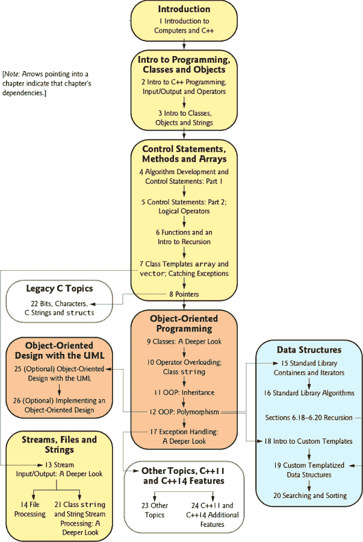

> [注意：指向某章的箭头表示该章的依赖关系。]

**引言**
- 1 计算机与 C++ 简介

**编程、类与对象入门**
- 2 C++ 编程、输入/输出与运算符入门
- 3 类、对象与字符串入门

**控制语句、方法与数组**
- 4 算法开发与控制语句：第 1 部分
- 5 控制语句：第 2 部分；逻辑运算符
- 6 函数与递归入门
- 7 类模板、array 与 vector；异常捕获
- 8 指针

**传统 C 语言主题**
- 22 位、字符、C 字符串和结构体

**面向对象编程**
- 9 类：深入探讨
- 10 运算符重载；string 类
- 11 面向对象编程：继承
- 12 面向对象编程：多态
- 17 异常处理：深入探讨

**使用 UML 进行面向对象设计**
- 25（可选）使用 UML 进行面向对象设计
- 26（可选）实现面向对象设计

**数据结构**
- 15 标准库容器与迭代器
- 16 标准库算法
- 第 6.18–6.20 节 递归
- 18 自定义模板入门
- 19 自定义模板数据结构
- 20 查找与排序

**流、文件与字符串**
- 13 流输入/输出：深入探讨
- 14 文件处理
- 21 string 类与字符串流处理：深入探讨

**其他主题、C++11 和 C++14 特性**
- 23 其他主题
- 24 C++11 和 C++14 附加特性

### 图 5 章节依赖关系图

**语法着色。** 为了提高可读性，我们对所有 C++ 代码进行了语法着色，这与大多数 C++ 集成开发环境和代码编辑器的语法着色方式类似。我们的着色约定如下：

```text
注释显示为这样
关键字显示为这样
常量和字面值显示为这样
所有其他代码以黑色显示
```

**代码高亮。** 我们在每个程序中用阴影矩形标出新特性。

**使用字体进行强调。** 我们将每个关键术语的定义处以 **粗体彩色** 文本标出，方便查阅。我们以 **粗体 Helvetica** 字体强调屏幕上的组件（例如 **文件** 菜单），并以 `Lucida` 字体显示 C++ 程序文本（例如 `int x = 5;`）。

**目标。** 我们明确阐述了每一章的学习目标。

**编程提示。** 我们包含编程提示，帮助您专注于程序开发的关键方面。这些提示和实践经验是我们从合计八十年的教学和行业经验中总结出的精华。


### 良好编程实践

*良好编程实践提醒您注意那些有助于编写更清晰、更易理解、更易维护的程序的技术。*


### 常见编程错误

*指出这些常见编程错误可降低您犯同样错误的可能性。*


### 错误预防提示

*这些提示包含有关发现并消除程序中 bug 的建议；其中许多描述了 C++ 中能够从一开始就防止 bug 进入程序的特性。*


### 性能提示

*这些提示突出了使程序运行更快或最大限度减少内存占用的机会。*


### 可移植性提示

*这些提示帮助您编写能够在多种平台上运行的代码。*


### 软件工程观察

*这些提示强调了影响软件系统（尤其是大规模系统）构建的架构和设计问题。*

**章节小结。** 我们以逐节项目符号列表的形式呈现每章的摘要。每个关键术语以 **粗体** 显示，后跟该术语定义出现的页码。

**索引。** 为了方便查阅，我们提供了详尽的索引，并以 **粗体** 页码突出显示关键术语的定义出现位置。

## 安全的 C++ 编程

构建能够抵御病毒、蠕虫和其他形式“恶意软件”攻击的工业级系统十分困难。如今，通过互联网，此类攻击可以在瞬间发生并波及全球。在开发周期一开始就将安全性构建到软件中，可以大大减少漏洞。

CERT® 协调中心（[www.cert.org](http://www.cert.org)）的成立是为了及时分析和应对攻击。CERT——计算机应急响应小组——是卡内基梅隆大学软件工程研究所™ 内的一个政府资助组织。CERT 为各种流行的编程语言发布并推广安全编码标准，以帮助软件开发人员实现工业级系统，避免那些使系统容易受到攻击的编程实践。

我们要感谢卡内基梅隆大学计算机科学学院兼职教授、前 CERT 安全编码经理 Robert C. Seacord 先生。Seacord 先生是我们《C 大学教程（第7版）》的技术审阅者，他在该书中从安全角度仔细审查了我们的 C 程序，并建议我们遵循 *CERT C 安全编码标准* 的关键指南。

我们对 *C++ 大学教程（第10版）* 也做了同样的事情，遵循了 *CERT C++ 安全编码标准* 的关键指南，您可以在以下网址找到该标准：

```text
http://www.securecoding.cert.org
```

我们很高兴地发现，自 20 世纪 90 年代初以来，我们已经在书中推荐了许多这样的编码实践。我们升级了代码和讨论，以符合这些实践，并使其适合入门/中级教科书。如果您将要构建工业级 C++ 系统，请考虑阅读 *C 和 C++ 中的安全编码（第二版）*（Robert Seacord，Addison-Wesley Professional，2013 年）。

## 在线章节、附录和其他内容

本书的配套网站（可通过以下网址访问）

```text
http://www.pearsonhighered.com/deitel
```

（访问密钥见封内页）包含以下视频以及可搜索的 PDF 格式章节和附录：

- *VideoNotes*——配套网站（访问密钥见封内页）还包含大量视频。观看并聆听合著者 Paul Deitel 深入讨论本书核心编程基础和面向对象编程章节中的关键代码示例。
- 第 23 章，其他主题
- 第 24 章，C++11 和 C++14 附加主题
- 第 25 章，ATM 案例研究，第 1 部分：使用 UML 进行面向对象设计
- 第 26 章，ATM 案例研究，第 2 部分：实现面向对象设计
- 附录 F，C 传统代码主题
- 附录 G，UML：附加图表类型
- 附录 H，使用 Visual Studio 调试器
- 附录 I，使用 GNU C++ 调试器
- 附录 J，使用 Xcode 调试器
- 第 19 章中的“构建您自己的编译器”练习描述（发布在配套网站和 http://www.deitel.com/books/cpphtp10 上）。


## 获取 C++ *程序设计教程（第10版）* 中使用的软件

我们使用以下免费的 C++ 开发工具编写了 C++ *程序设计教程（第10版）* 中的代码示例：

- 微软免费的 Visual Studio Community 2015 版，其中包含 Visual C++ 和其他微软开发工具。该版本可在 Windows 上运行，并可从 `https://www.visualstudio.com/products/visual-studio-community-vs` 下载。
- GNU 免费的 GNU C++ 5.2.1。大多数 Linux 系统上已经安装了 GNU C++，它也可以安装在 Mac OS X 和 Windows 系统上。Linux 有许多版本——称为 Linux 发行版——它们使用不同的技术执行软件升级。请查阅你所使用发行版的在线文档，了解如何将 GNU C++ 升级到最新版本。GNU C++ 可从 `http://gcc.gnu.org/install/binaries.html` 获取。
- Apple 免费的 Xcode，OS X 用户可以从 Mac App Store 下载——点击屏幕底部程序坞中的该应用图标，然后在应用商店中搜索 Xcode。

## 教师补充材料

以下补充材料仅通过 Pearson Education 的教师资源中心（http://www.pearsonhighered.com/irc）提供给*符合资格的教师*：

- 《解答手册》包含大多数章末习题的解答。我们收录了 *有所作为* 习题，其中许多附有解答。**请不要写信向我们索取 Pearson 教师资源中心的访问权限。访问权限仅限使用本书授课的高校教师。** 教师只能通过其 Pearson 代表获得访问权限。如果你不是注册教师，请联系你的 Pearson 代表或访问 `http://www.pearsonhighered.com/educator/replocator/`。“项目”习题*不提供*解答。请查看我们的编程项目资源中心，获取大量额外习题和项目机会：`http://www.deitel.com/ProgrammingProjects`。
- 多项选择题的试题文件。
- 可自定义的 PowerPoint® 幻灯片，包含书中的所有代码和图表，以及概括书中要点的项目符号条目。

## 使用 MyProgrammingLab™ 进行在线练习与评估

MyProgrammingLab™ 帮助学生全面掌握编程的逻辑、语义和语法。通过练习以及即时、个性化的反馈，MyProgrammingLab 可提高初学者的编程能力，这些初学者往往在流行高级编程语言的基本概念和范式上感到吃力。

MyProgrammingLab 课程是一种可选的自学和作业工具，由数百道小型练习题组成，并围绕本教材的结构组织。对学生而言，系统会自动检测其提交代码中的逻辑和语法错误，并提供有针对性的提示，使学生能够弄清楚哪里出了错——以及为什么出错。对教师而言，全面的成绩册会跟踪正确和错误答案，并存储学生输入的代码以供审阅。

如需完整演示、查看教师和学生的反馈，或开始在课程中使用 MyProgrammingLab，请访问


[http://www.myprogramminglab.com](http://www.myprogramminglab.com)

## 致谢

我们要感谢 Deitel & Associates, Inc. 的 Barbara Deitel 为该项目投入的长时间工作。她细致地研究了 C++11 和 C++14 的新特性。

我们很幸运能与 Pearson Higher Education 敬业的出版专业团队合作。我们感谢计算机科学执行编辑 Tracy Johnson 的指导、智慧和精力。Kristy Alaura 在招募本书审阅人和管理审阅流程方面做得非常出色。Bob Engelhardt 在推动本书出版方面做得非常出色。

最后，感谢 Deitel & Associates, Inc. 前总裁、卡内基梅隆大学泰珀商学院毕业生 Abbey Deitel，她在那里获得了工业管理学士学位。Abbey 管理 Deitel & Associates, Inc. 的业务运营长达 17 年，在此期间参与合著了我们的多部出版物，包括此前各版 C++ *程序设计教程* 中的**第 1 章**。

### *审阅人*

我们谨此感谢各位审阅人的努力。在十个版本中，本书得到了讲授 C++ 课程的学者、C++ 标准委员会现任和前任成员，以及使用 C++ 构建工业级高性能系统的行业专家的仔细审阅。他们为改进本书的呈现提供了无数建议。书中任何遗留的缺陷均由我们自己负责。

第十版审阅人：Chris Aburime，明尼苏达州立学院与大学系统；Gašper Ažman，[A9.com](https://A9.com) 搜索技术公司，C++ *今日：野兽归来* 的合著者；Danny Kalev，英特尔，C++ 标准委员会前成员；Renato Golin，Linaro 的 LLVM 技术负责人，LLVM 中 ARM 目标的共同负责人；Gordon Hogenson，微软，*C++/CLI 基础：面向 .NET 3 的 Visual C++ 语言* 的作者；Jonathan Wakely，红帽，ISO C++ 委员会秘书；José Antonio González Seco，安达卢西亚议会；Dean Michael Berris，谷歌，cpp-netlib 维护者，ISO C++ 委员会前成员。

第九版出版后学术审阅人：Stefano Basagni，东北大学；Amr Elkady，代阿布洛谷学院；Chris Aburime，明尼苏达州立学院与大学系统。

近期其他版本审阅人：Virginia Bailey（杰克逊州立大学）、Ed James-Beckham（Borland）、Thomas J. Borrelli（罗切斯特理工学院）、Ed Brey（Kohler Co.）、Chris Cox（Adobe Systems）、Gregory Dai（eBay）、Peter J. DePasquale（新泽西学院）、John Dibling（SpryWare）、Susan Gauch（阿肯色大学）、Doug Gregor（Apple, Inc.）、Jack Hagemeister（华盛顿州立大学）、William M. Higdon（印第安纳大学）、Anne B. Horton（洛克希德·马丁）、Terrell Hull（Logicalis Integration Solutions）、Linda M. Krause（埃尔姆赫斯特学院）、Wing-Ning Li（阿肯色大学）、Dean Mathias（犹他州立大学）、Robert A. McLain（潮水社区学院）、James P. McNellis（微软公司）、Robert Myers（佛罗里达州立大学）、Gavin Osborne（萨斯喀彻温应用科学与技术学院）、Amar Raheja（加州州立理工大学波莫纳分校）、April Reagan（微软）、Robert C. Seacord（SEI/CERT 安全编码经理，*C 和 C++ 安全编码* 的作者）、Raymond Stephenson（微软）、Dave Topham（奥洛尼学院）、Anthony Williams（作者兼 C++ 标准委员会成员）以及 Chad Willwerth（华盛顿大学塔科马分校）。

在你阅读本书时，我们诚挚地感谢你提出意见、批评和改进本书的建议。请将所有信件发送至：

deitel@deitel.com

我们会及时回复。我们很享受撰写 C++ *程序设计教程（第十版）* 的过程。希望你阅读愉快！

Paul Deitel

Harvey Deitel

## 关于作者

**Paul Deitel**，Deitel & Associates, Inc. 的首席执行官兼首席技术官，在计算领域拥有 30 多年经验。他毕业于麻省理工学院，在那里学习信息技术。他拥有 Java 认证程序员和 Java 认证开发者称号，并且是 Oracle Java Champion。Paul 还于 2012–2014 年被授予 Microsoft® 最有价值专家（MVP）称号（C#）。通过 Deitel & Associates, Inc.，他为全球客户讲授了数百门编程课程，客户包括 Cisco、IBM、Siemens、Sun Microsystems、Dell、Fidelity、肯尼迪航天中心的 NASA、国家强风暴实验室、白沙导弹靶场、Rogue Wave Software、Boeing、SunGard、Nortel Networks、Puma、iRobot、Invensys 等众多机构。他与合著者 Harvey Deitel 博士是世界畅销的编程语言教材/专业图书/视频作者。

**Harvey Deitel 博士**，Deitel & Associates, Inc. 的董事长兼首席战略官，在计算机领域拥有 50 多年经验。Deitel 博士在麻省理工学院获得电气工程学士和硕士学位，并在波士顿大学获得数学博士学位——在这些项目分离出计算机科学项目之前，他在每个项目中都学习过计算。他拥有丰富的大学教学经验，包括在 1991 年与儿子 Paul 共同创立 Deitel & Associates, Inc. 之前，曾在波士顿学院获得终身教职并担任计算机科学系主任。


戴特尔父子的出版物赢得了国际认可，已被翻译成日语、德语、俄语、西班牙语、法语、波兰语、意大利语、简体中文、繁体中文、韩语、葡萄牙语、希腊语、乌尔都语和土耳其语出版。戴特尔博士已为学术机构、企业、政府和军方客户讲授了数百门编程课程。

## 关于 Deitel & Associates, Inc.

Deitel & Associates, Inc. 由 Paul Deitel 和 Harvey Deitel 创立，是一家国际公认的写作和企业培训机构，专长于计算机编程语言、对象技术、互联网与 Web 软件技术，以及 Android 和 iOS 应用开发。该公司的客户包括学术机构、许多全球最大的公司、政府机构和军方分支。公司提供由讲师主导的培训课程，在全世界客户现场讲授主要编程语言和平台，包括 C++、C、Java™、Android 应用开发、iOS 应用开发、Swift™、Visual C#®、Visual Basic®、互联网与 Web 编程，以及不断增加的额外编程和软件开发课程。

通过与 Prentice Hall/Pearson 长达 40 年的出版合作关系，Deitel & Associates, Inc. 出版前沿的编程大学教材、专业书籍和 *LiveLessons* 视频课程。可通过以下方式联系 Deitel & Associates, Inc. 和作者：

deitel@deitel.com

如需了解 Deitel 企业培训课程的更多信息，请访问：

http://www.deitel.com/training

如需申请在贵组织进行全球现场、讲师主导培训的方案，请发送电子邮件至 deitel@deitel.com。

希望购买 Deitel 图书的个人可通过以下方式购买：

http://bit.ly/DeitelOnAmazon

希望购买 Deitel *LiveLessons* 视频培训的个人可访问：

http://bit.ly/DeitelOnInformIT

所有 Deitel 图书和 *LiveLessons* 视频也以电子形式提供给 Safari Books Online 订阅者，网址为：

http://SafariBooksOnline.com

您可以在以下网址获得免费的 10 天 Safari Books Online 试用：

https://www.safaribooksonline.com/register/

公司、政府、军方和学术机构的大宗订单应直接向 Pearson 下订。更多信息请访问：

http://www.informit.com/store/sales.aspx

## 开始之前

本节包含在使用本书之前应查看的信息，以及确保您的计算机已正确设置以编译示例程序的说明。

## 字体和命名约定

我们使用字体来区分各种功能，例如菜单名称、菜单项，以及 IDE（集成开发环境）中出现的其他元素，例如 Microsoft 的 Visual Studio。我们的约定是：用无衬线粗体 **Helvetica** 字体强调 IDE 功能（例如 **文件** 菜单），并用无衬线 `Lucida` 字体强调程序文本（例如 `bool x = true;`）。

## 获取 C++ *程序设计教程（第 10 版）* 中使用的软件

在阅读本书之前，您应下载并安装 C++ 编译器。我们使用以下免费 C++ 开发工具编写了 C++ *程序设计教程（第 10 版）* 的代码示例：

- 微软免费的 Visual Studio Community 2015 版，其中包括 Visual C++ 编译器和其它微软开发工具。它运行于 Windows，可从以下地址下载：

  https://www.visualstudio.com/products/visual-studio-community-vs

- GNU 免费的 GNU C++ 5.2.1 编译器。GNU C++ 已安装在大多数 Linux 系统上，也可安装在 Mac OS X 和 Windows 系统上。Linux 有许多版本，称为 Linux 发行版，它们使用不同技术执行软件升级。请查阅您所用发行版的在线文档，了解如何将 GNU C++ 升级到最新版本。GNU C++ 可从以下地址获取：

  http://gcc.gnu.org/install/binaries.html

- 苹果免费的 Xcode，OS X 用户可从 Mac App Store 下载——单击 Mac 屏幕底部 Dock 中的应用图标，然后在应用商店中搜索 Xcode。

我们还提供每种 C++ 工具入门视频的链接，地址为：

## 获取代码示例

*C++ 程序设计教程（第 10 版）* 的示例可从以下地址下载：

http://www.deitel.com/books/cpphtp10

单击 **下载代码示例** 链接，将 ZIP 归档文件下载到您的计算机。请记下保存文件的位置——大多数浏览器会将文件保存到您用户账户的 `Downloads` 文件夹中。

在本书中，要求您在计算机上访问示例代码的步骤假定您已从 ZIP 文件中提取示例，并将它们放在 Windows 上的 `C:\examples` 中，或其他平台上的用户账户 `Documents` 目录中。您可以将它们解压到任何喜欢的位置，但如果选择其他位置，则需要相应更新我们的步骤。

## 创建项目

在 **1.10 节** 中，我们演示如何使用以下工具编译和运行程序：

- Windows 上的 Microsoft Visual Studio Community 2015 版（**1.10.1 节**）
- Linux 上的 GNU C++ 5.2.1（**1.10.2 节**）
- OS X 上的 Apple Xcode（**1.10.3 节**）

对于 GNU C++ 和 Xcode，必须使用 C++14 编译程序。在 GNU C++ 中，编译代码时请包含选项 `-std=c++14`，如下所示：

```bash
g++ -std=c++14 YourFileName.cpp
```

对于 Xcode，在按照 **1.10.3 节** 的步骤创建项目后：

- 选择 Xcode **项目** 导航器顶部的根节点。
- 单击 **编辑器** 区域中的 **构建设置** 选项卡。
- 向下滚动到 **Apple LLVM 7.0 - 语言 - C++** 部分。
- 对于 **C++ 语言方言** 选项，选择 **C++14 [-std=c++14]**。

## 解答您的 C++ 问题

在阅读本书时，如果您有疑问，可以很容易地通过以下方式联系我们：

deitel@deitel.com

我们会及时回复。

此外，网络上充满编程信息。对于非程序员和程序员来说，一个非常宝贵的资源是以下网站：

http://stackoverflow.com

在该网站上，您可以：

- 搜索大多数常见编程问题的答案。
- 搜索错误消息，了解其原因。
- 提出编程问题，获得全世界程序员的解答。
- 获得关于编程总体上的宝贵见解。

## 在线 C++ 文档

有关 C++ 标准库的文档，请访问：

http://cppreference.com

并务必查看以下网址的 C++ 常见问题解答：

https://isocpp.org/faq

## 1 计算机与 C++ 简介

### 目标

在本章中，您将学习：

- 计算机领域令人兴奋的最新发展。
- 计算机硬件、软件和网络基础。
- 数据层次结构。
- 不同类型的编程语言。
- 基本的对象技术概念。
- 互联网和万维网的一些基础知识。
- 典型的 C++ 程序开发环境。
- 试运行一个 C++ 应用程序。
- 一些关键的最新软件技术。
- 计算机如何帮助您有所作为。

### 大纲

- 1. **1.1 简介**
- 2. **1.2 工业与研究中的计算机和互联网**
- 3. **1.3 硬件与软件**
  - A. **1.3.1 摩尔定律**
  - B. **1.3.2 计算机组成**
- 4. **1.4 数据层次结构**
- 5. **1.5 机器语言、汇编语言和高级语言**
- 6. **1.6 C 与 C++**
- 7. **1.7 编程语言**
- 8. **1.8 对象技术简介**
- 9. **1.9 典型的 C++ 开发环境**
- 10. **1.10 试运行一个 C++ 应用程序**
  - A. **1.10.1 在 Windows 的 Visual Studio 2015 中编译和运行应用程序**
  - B. **1.10.2 在 Linux 上使用 GNU C++ 编译和运行**
  - C. **1.10.3 在 Mac OS X 上使用 Xcode 编译和运行**
- 11. **1.11 操作系统**
  - A. **1.11.1 Windows——专有操作系统**
  - B. **1.11.2 Linux——开源操作系统**


- C. **1.11.3 Apple的OS X；用于iPhone®、iPad®和iPod Touch®设备的Apple iOS**
- D. **1.11.4 Google的Android**

- 12. **1.12 互联网和万维网**
- 13. **1.13 一些关键的软件开发术语**
- 14. **1.14 C++11和C++14：最新的C++版本**
- 15. **1.15 Boost C++库**
- 16. **1.16 跟上信息技术的发展**

- 1. **自测练习**
- 2. **自测练习答案**
- 3. **练习**
- 4. **产生影响**
- 5. **产生影响资源**

### 1.1 引言

欢迎来到C++——一种强大的计算机编程语言，适合具有很少或没有编程经验但技术导向的人，也适合经验丰富的程序员用于构建大型信息系统。你已经熟悉计算机执行的强大任务。使用这本教材，你将编写指令，命令计算机执行这些类型的任务。*软件*（即你编写的指令）控制*硬件*（即计算机）。

你将学习*面向对象编程*——当今关键的编程方法。你将创建许多*软件对象*，对现实世界中的*事物*进行建模。

C++是当今最流行的软件开发语言之一。本书介绍C++11和C++14编程——这些是通过**国际标准化组织（ISO）**和**国际电工委员会（IEC）**标准化的最新版本。

截至2008年，有超过10亿台通用计算机在使用。如今，各种网站称该数字约为20亿，而根据[gsmantelligence.com](http://gsmantelligence.com)上的实时追踪器，现在移动设备数量已超过世界人口数量。根据国际数据公司（IDC），2016年移动互联网用户数量将超过20亿。[^1] 智能手机销量在2011年超过个人电脑销量。[^2] 平板电脑销量预计到2015年将超过个人电脑销量。[^3] 到2017年，智能手机/平板电脑应用市场预计将超过770亿美元。[^4] 这种爆炸式增长正在为移动应用程序编程创造重大机遇。

- 1. https://www.idc.com/getdoc.jsp?containerId=prUS40855515
- 2. http://www.mashable.com/2012/02/03/smartphone-sales-overtake-pcs/
- 3. http://www.forbes.com/sites/louiscolumbus/2014/07/18/gartner-forecasts-tablet-shipments-will-overtake-pcs-in-2015/
- 4. http://www.entrepreneur.com/article/236832

### 1.2 工业和研究中的计算机与互联网

这是计算机领域激动人心的时代。过去二十年中许多最具影响力和最成功的企业都是科技公司，包括Apple、IBM、Hewlett Packard、Dell、Intel、Motorola、Cisco、Microsoft、Google、Amazon、Facebook、Twitter、eBay以及更多。这些公司是学习计算机科学、计算机工程、信息系统或相关学科的人的主要雇主。在撰写本文时，Apple是世界上最有价值的公司。**图1.1**提供了计算机在研究、工业和社会中改善人们生活的一些方式示例。

**图1.1 计算机的一些用途。**

| 名称 | 描述 |
|---|---|
| 电子健康记录 | 这些可能包括患者的病史、处方、免疫接种、实验室结果、过敏信息、保险信息等。通过安全网络将这些信息提供给医疗保健提供者，可改善患者护理、降低错误概率并提高医疗保健系统的整体效率，有助于控制成本。 |
| 人类基因组计划 | 人类基因组计划的成立是为了识别和分析人类DNA中的20,000多个基因。该项目使用计算机程序分析复杂的遗传数据，确定构成人类DNA的数十亿个化学碱基对的序列，并将信息存储在数据库中，这些数据库已通过互联网提供给许多领域的研究人员。 |
| AMBER™警报 | AMBER（美国失踪人口：广播紧急响应）警报系统用于寻找被绑架的儿童。执法部门通知电视和广播机构以及州交通官员，然后由他们在电视、广播、计算机化公路标志、互联网和无线设备上广播警报。AMBER警报最近与Facebook合作，其用户可以根据位置“点赞”AMBER警报页面，以在其新闻推送中接收警报。 |
| 世界社区网格 | 世界各地的人们可以通过安装免费的安全软件程序来捐赠其未使用的计算机处理能力，该程序允许世界社区网格（[http://www.worldcommunitygrid.org](http://www.worldcommunitygrid.org)）利用未使用的容量。这种通过互联网访问的计算能力被用来代替昂贵的超级计算机，开展正在产生影响的科学研究项目——为第三世界国家提供清洁水、抗击癌症、为与饥饿作斗争的地区种植更有营养的水稻等等。 |
| 云计算 | **云计算**允许你使用存储在“云”中的软件、硬件和信息——即通过互联网在远程计算机上访问并按需提供——而不是将其存储在你的个人计算机上。这些服务允许你在任何给定时间增加或减少资源以满足你的需求，因此它们可能比购买昂贵的硬件更具成本效益，以确保你有足够的存储和处理能力来满足峰值水平的需求。使用云计算服务将管理这些应用程序的负担从企业转移到服务提供商，从而为企业节省资金。 |
| 医学成像 | X射线计算机断层扫描（CT）扫描，也称为CAT（计算机轴向断层扫描）扫描，从数百个不同角度拍摄身体的X射线。计算机用于调整X射线的强度，针对每种组织类型优化扫描，然后组合所有信息以创建3D图像。MRI扫描仪使用一种称为磁共振成像的技术，也以非侵入方式生成内部图像。 |
| GPS | 全球定位系统（GPS）设备使用卫星网络来检索基于位置的信息。多颗卫星向GPS设备发送带时间戳的信号，GPS设备根据信号离开卫星的时间和信号到达的时间计算到每颗卫星的距离。此信息有助于确定设备的精确位置。GPS设备可以提供逐步导航，并帮助你找到附近的企业（餐厅、加油站等）和兴趣点。GPS用于众多基于位置的互联网服务，例如签到应用可帮助你找到朋友（如Foursquare和Facebook），运动应用如RunKeeper可跟踪你户外慢跑的时间、距离和平均速度，约会应用可帮助你在附近找到匹配对象，以及动态更新不断变化的交通状况的应用。 |
| 机器人 | 机器人可用于日常任务（例如iRobot的Roomba吸尘机器人）、娱乐（例如机器宠物）、军事战斗、深海和太空探索（例如美国国家航空航天局的“好奇号”火星车）等等。RoboEarth（[www.roboearth.org](http://www.roboearth.org)）是一个“机器人的万维网”。它允许机器人通过共享信息相互学习，从而提高它们执行任务、导航、识别物体等能力。 |
| 电子邮件、即时消息、视频聊天和FTP | 基于互联网的服务器支持你所有的在线消息传递。电子邮件消息通过邮件服务器传递，该服务器也存储消息。即时消息（IM）和视频聊天应用，例如Facebook Messenger、AIM、Skype、Yahoo! Messenger、Google Hangouts、Trillian等，允许你通过发送 |


|  |  |
|---|---|
|  | 你的消息和实时视频通过服务器。FTP（文件传输协议）允许你通过互联网在多个计算机之间交换文件（例如，客户端计算机，如你的台式机，与文件服务器）。 |
| 互联网电视 | 互联网电视机顶盒（如 Apple TV、Android TV、Roku 和 TiVo）允许你按需访问海量内容，如游戏、新闻、电影、电视节目等，并帮助确保内容流畅地流式传输到你的电视。 |
| 流媒体音乐服务 | 流媒体音乐服务（如 Apple Music、Pandora、Spotify、Last.fm 等）允许你通过互联网收听大量音乐目录，创建个性化的“电台”，并根据你的反馈发现新音乐。 |
| 游戏编程 | 预计到 2017 年，全球视频游戏收入将达到 1070 亿美元（[http://www.polygon.com/2015/4/22/8471789/worldwide-video-games-market-value-2015](http://www.polygon.com/2015/4/22/8471789/worldwide-video-games-market-value-2015)）。最复杂的游戏开发成本可能超过 1 亿美元，其中最昂贵的耗资达 5 亿美元（[http://www.gamespot.com/gallery/20-of-the-most-expensive-games-ever-made/2900-104/](http://www.gamespot.com/gallery/20-of-the-most-expensive-games-ever-made/2900-104/)）。Bethesda 的 *辐射4* 在上市首日就赚取了 7.5 亿美元（[http://fortune.com/2015/11/16/fallout4-is-quiet-best-seller/](http://fortune.com/2015/11/16/fallout4-is-quiet-best-seller/)）！ |

### 1.3 硬件与软件

计算机执行计算和做出逻辑判断的速度比人类快得惊人。当今许多个人计算机一秒钟能执行数十亿次计算——比人一生能执行的次数还多。*超级计算机*已经在每秒钟执行*数千万亿（千兆）*条指令！中国国防科技大学的“天河二号”超级计算机每秒可执行超过 33 千万亿次计算（33.86 *千万亿次浮点运算*）！^5 换个角度看，*天河二号超级计算机*每秒可为地球上每个人执行约 300 万次计算！而且超级计算的“上限”正在迅速提高。

5. [http://www.top500.org.](http://www.top500.org.)

计算机在称为**计算机程序**的指令序列的控制下处理数据。这些程序引导计算机执行由称为计算机**程序员**的人指定的有序操作。在计算机上运行的程序称为**软件**。在本书中，你将学习一种关键编程方法论，它正在提高程序员的生产效率，从而降低软件开发成本——*面向对象编程*。

计算机由各种称为硬件的设备组成（例如键盘、屏幕、鼠标、硬盘、内存、DVD 驱动器和处理单元）。由于硬件和软件技术的快速发展，计算成本正在*急剧下降*。几十年前可能占据整个房间、耗资数百万美元的计算机，如今被刻在比指甲还小的硅芯片上，每片成本可能只有几美元。具有讽刺意味的是，硅是地球上最丰富的材料之一——它是普通沙子的成分。硅芯片技术使计算变得如此经济，以至于计算机已经成为一种商品。

#### 1.3.1 摩尔定律

每年，你可能预计大多数产品和服务都会至少多花一点钱。但在计算机和通信领域，情况恰恰相反，尤其是在支持这些技术的硬件方面。几十年来，硬件成本迅速下降。

每隔一两年，计算机的容量大约都会以低成本*翻一番*。这一显著趋势通常被称为**摩尔定律**，以 20 世纪 60 年代发现这一规律的人——戈登·摩尔的名字命名，他是 Intel 的联合创始人，而 Intel 是当今计算机和嵌入式系统中处理器的领先制造商。摩尔定律及相关观察尤其适用于计算机用于程序的内存容量、用于长期保存程序和数据的辅助存储（如磁盘存储）容量，以及处理器速度——即它们*执行*程序（也就是完成工作）的速度。这些增长使计算机更加强大，也对编程语言设计者的创新提出了更高要求。

通信领域也出现了类似的增长——由于对通信*带宽*（即信息承载能力）的巨大需求吸引了激烈竞争，成本急剧下降。我们不知道还有哪个领域的技术进步如此之快、成本下降如此之迅速。这种惊人的进步正在真正推动*信息革命*。

#### 1.3.2 计算机组织

无论*物理*外观有何差异，计算机都可以设想为分为各种**逻辑单元**或部分（**图 1.2**）。

**图 1.2 计算机的逻辑单元。**

| 逻辑单元 | 描述 |
|---|---|
| **输入单元** | 这个“接收”部分从**输入设备**获取信息（数据和计算机程序），并将其交由其他单元处理。大多数用户输入通过键盘、触摸屏和鼠标设备进入计算机。其他形式的输入包括接收语音命令、扫描图像和条形码、从辅助存储设备（如硬盘、DVD 驱动器、Blu-ray Disc™ 驱动器和 USB 闪存驱动器，也称为“拇指驱动器”或“存储棒”）读取数据、从网络摄像头接收视频，以及让你的计算机从互联网接收信息（例如当你从 YouTube® 流式传输视频或从 Amazon 下载电子书时）。较新的输入形式包括来自 GPS 设备的位置数据，以及来自智能手机或游戏控制器（如 Microsoft® Kinect® for Xbox®、Wii™ Remote 和 Sony® PlayStation® Move）中的*加速度计*（一种响应上/下、左/右和前/后加速度的设备）的运动和方向信息。 |
| **输出单元** | 这个“发送”部分获取计算机已处理的信息，并将其放到各种**输出设备**上，使其可以在计算机之外使用。如今，计算机输出的大多数信息显示在屏幕（包括触摸屏）上、打印在纸上（“绿色环保”不鼓励这种做法）、在 PC、媒体播放器（如 Apple 的 iPod）以及体育场馆的巨大屏幕上播放为音频或视频、通过互联网传输，或用于控制其他设备，如机器人和“智能”电器。信息通常也会输出到辅助存储设备，如硬盘、DVD 驱动器和 USB 闪存驱动器。最近流行的输出形式包括智能手机和游戏控制器的震动，以及 Oculus Rift 等虚拟现实设备。 |
| **内存单元** | 这个快速访问、容量相对较低的“仓库”部分保留通过输入单元输入的信息，使其在需要时立即可用于处理。内存单元还会保留已处理的信息，直到输出单元将其放到输出设备上。内存单元中的信息是*易失的*——当计算机的电源关闭时，这些信息通常会丢失。内存单元通常被称为**内存**、**主存储器**或**RAM**（随机存取存储器）。台式机和笔记本电脑的主内存最多可包含 128 GB 的 RAM，不过最常见的是 2 到 16 GB。GB 代表千兆字节；一千兆字节约为十亿字节。一个**字节**由八个位组成。一个位要么是 `0`，要么是 `1`。 |
| **算术与逻辑单元（ALU）** | 这个“制造”部分执行*计算*，如加法、减法、乘法和除法。它还包含*决策*机制，使计算机能够，例如，比较内存单元中的两个项以确定它们是否相等。在当今的系统中，ALU 作为下一个逻辑单元——CPU 的一部分实现。 |
| **中央处理单元（CPU）** | 这个“管理”部分协调并监督其他部分的运行。CPU 告诉输入单元何时应将信息读入内存单元，告诉 ALU 何时应使用内存单元中的信息进行计算，并告诉输出单元何时应将信息从内存单元发送到特定的输出设备。当今许多计算机都拥有多个 CPU，因此可以同时执行许多操作。**多核处理器**在单个集成电路芯片上实现多个处理器——*双核处理器*有两个 CPU，*四核处理器*有四个，*八核处理器*有八个。如今台式电脑的处理器每秒可执行数十亿条指令。要充分利用多核架构，你需要编写多线程应用程序，我们将在 24.3 节中介绍。 |
| **辅助存储单元** | 这是长期、高容量的“仓储”部分。其他单元未积极使用的程序或数据通常放置在辅助存储设备（例如你的*硬盘*）上，直到再次需要它们——可能是几小时、几天、几个月甚至几年之后。辅助存储设备上的信息是*持久*的——即使计算机的电源关闭，这些信息也会保留。访问辅助存储信息比访问主存储器中的信息需要更长的时间，但每单位成本要低得多。辅助存储设备的示例包括硬盘、DVD 驱动器和 USB 闪存驱动器，其中一些可容纳超过 2 TB（TB 代表太字节；一太字节约为 1 万亿字节）。台式机和笔记本电脑的典型硬盘容量最高可达 2 TB，有些台式机硬盘最高可达 6 TB。 |


### 1.4 数据层次结构

计算机处理的数据项构成一个**数据层次结构**，随着我们从最简单的数据项（称为“位”）进展到更丰富的数据项（如字符和字段），其结构会变得更大、更复杂。**图1.3**展示了数据层次结构的一部分。

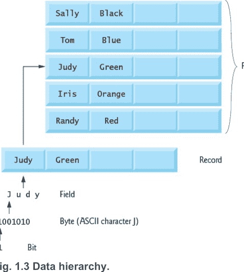

### 位

计算机中最小的数据项可以取值为**0**或**1**。它称为**位**（“二进制数字”的简称——一种可以取*两个值*之一的数字）。值得注意的是，计算机所执行的令人印象深刻的功能仅涉及对**0**和**1**的最简单操作——*检查某位的值、设置某位的值*以及*反转某位的值*（从**1**变为**0**或从**0**变为**1**）。

### 字符

人们以位这种低级形式处理数据很繁琐。相反，他们更喜欢使用*十进制数字*（0–9）、*字母*（A–Z和a–z）以及*特殊符号*（例如$, @, %, &, *, (, ), −, +, ", :, ? 和 /）。数字、字母和特殊符号统称为**字符**。计算机的**字符集**是用于编写程序和表示数据项的所有字符的集合。计算机只处理**1**和**0**，因此计算机的字符集将每个字符表示为**1**和**0**的模式。C++支持多种字符集（包括**Unicode®**），其中一些字符集每个字符需要不止一个字节。Unicode支持世界上许多语言。有关**ASCII（美国信息交换标准代码）**字符集的更多信息，请参见[附录B](#)；ASCII是Unicode中常用的子集，表示大写和小写字母、数字以及一些常见特殊字符。

### 字段

正如字符由位组成，**字段**由字符或字节组成。字段是一组传达含义的字符或字节。例如，由大写和小写字母组成的字段可用于表示一个人的姓名，而由十进制数字组成的字段可表示一个人的年龄。

### 记录

若干相关字段可以组成一个**记录**。例如，在工资系统中，员工的记录可能由以下字段组成（这些字段可能的类型显示在括号中）：

- 员工标识号（整数）
- 姓名（字符串）
- 地址（字符串）
- 时薪（带小数点的数字）
- 年初至今收入（带小数点的数字）
- 预扣税额（带小数点的数字）。

因此，记录是一组相关字段。在前面的示例中，所有字段都属于*同一*名员工。一家公司可能有许多员工，并且每个员工都有一条工资记录。

### 文件

**文件**是一组相关记录。[*注：*更一般地说，文件包含任意格式的任意数据。在某些操作系统中，文件被简单地视为*字节序列*——文件中字节的任何组织方式（例如将数据组织成记录）都是应用程序员创建的一种视图。]一个组织拥有许多文件并不罕见，其中一些文件包含数十亿甚至数万亿个字符的信息。

### 数据库

**数据库**是为便于访问和操作而组织的数据集合。最流行的模型是*关系数据库*，其中数据存储在简单的*表*中。表包含*记录*和*字段*。例如，学生表可能包括名、姓、专业、年级、学生ID号和平均绩点字段。每个学生的数据是一条记录，而每条记录中的各个信息片段就是字段。你可以根据数据与多个表或数据库的关系来*搜索*、*排序*以及以其他方式操作数据。例如，大学可能会将学生数据库中的数据与课程、校内住宿、膳食计划等数据库中的数据结合使用。

### 大数据

全球产生的数据量巨大且增长迅速。据IBM称，每天大约创建2.5百亿亿字节（2.5 *艾字节*）的数据[^6]；据[Salesforce.com](https://Salesforce.com)称，世界上90%的数据都是在过去短短12个月内创建的！^7 根据IDC的一项研究，到2020年，全球数据供应量每年将达到40 *泽字节*（相当于40万亿千兆字节）。^8 **图1.4**展示了一些常见的字节度量。**大数据**应用处理海量数据，这一领域正在快速发展，为软件开发人员创造了大量机会。根据Gartner Group的一项研究，2015年全球预计有超过400万个IT工作岗位支持大数据。^9

- 6. http://www-01.ibm.com/software/data/bigdata/what-is-big-data.html
- 7. https://www.salesforce.com/blog/2015/10/salesforce-channel-ifttt.html
- 8. http://recode.net/2014/01/10/stuffed-why-data-storage-is-hot-again-really/
- 9. http://tech.fortune.cnn.com/2013/09/04/big-data-employment-boom/

### 图1.4 字节度量。

| 单位 | 字节 | 约等于 |
|---|---|---|
| 1千字节（KB） | 1024字节 | 恰好10^3（1024）字节 |
| 1兆字节（MB） | 1024千字节 | 10^6（1,000,000）字节 |
| 1吉字节（GB） | 1024兆字节 | 10^9（1,000,000,000）字节 |
| 1太字节（TB） | 1024吉字节 | 10^12（1,000,000,000,000）字节 |
| 1拍字节（PB） | 1024太字节 | 10^15（1,000,000,000,000,000）字节 |
| 1艾字节（EB） | 1024拍字节 | 10^18（1,000,000,000,000,000,000）字节 |
| 1泽字节（ZB） | 1024艾字节 | 10^21（1,000,000,000,000,000,000,000）字节 |

### 1.5 机器语言、汇编语言和高级语言

程序员用各种编程语言编写指令，有些可直接被计算机理解，另一些则需要中间的*翻译*步骤。

### 机器语言

任何计算机只能直接理解由其硬件体系结构定义的自身**机器语言**（也称为*机器代码*）。机器语言通常由数字组成（最终归约为1和0）。这类语言对人类来说很繁琐。

### 汇编语言

对大多数程序员来说，用机器语言编程实在太慢且繁琐。相反，他们开始使用类似英语的*缩写*来表示基本操作。这些缩写构成了**汇编语言**的基础。开发了称为**汇编器**的*翻译程序*，用于将汇编语言程序转换为机器语言。尽管汇编语言代码对人类来说更清晰，但在转换为机器语言之前，计算机无法理解它。

### 高级语言

为了进一步加快编程过程，开发了**高级语言**，其中可以编写单条语句来完成大量任务。C、C++、Java、C#、Swift和Visual Basic等高级语言允许你编写看起来更像日常英语并包含常用数学符号的指令。称为**编译器**的翻译程序将高级语言程序转换为机器语言。

将大型高级语言程序编译成机器语言的过程可能耗费大量计算机时间。开发了**解释器**程序来直接执行高级语言程序（无需编译），尽管比编译后的程序执行得慢。**脚本语言**（如流行的Web语言JavaScript和PHP）由解释器处理。


### 性能提示 1.1

> *在互联网脚本方面，解释器比编译器具有优势。解释型程序一旦下载到客户端计算机上就可以开始执行，无需在它能够执行之前先编译*


执行。另一方面，解释型脚本通常比编译代码运行得更慢，占用更多的内存。

### 1.6 C 和 C++

C 语言于 1972 年由贝尔实验室的丹尼斯·里奇（Dennis Ritchie）实现。它最初因作为 UNIX 操作系统的开发语言而广为人知。如今，大多数通用操作系统的代码都是用 C 或 C++ 编写的。

C++ 由 C 发展而来，C 可用于大多数计算机，并且与硬件无关。通过精心设计，可以编写出**可移植**到大多数计算机的 C 程序。

C 语言在各种计算机（有时称为**硬件平台**）上的广泛使用，遗憾的是导致了诸多变体。于是需要一个标准的 C 版本。美国国家标准协会（ANSI）与国际标准化组织（ISO）合作，在全球范围内对 C 进行标准化；联合标准文档于 1990 年发布。

C11 是 C 编程语言最新的 ANSI 标准。它旨在演进 C 语言，以跟上日益强大的硬件和日益严苛的用户需求。C11 还使 C 与 C++ 更加一致。有关 C 和 C11 的更多信息，请参阅我们的《_C 语言程序设计（第8版）_》以及我们的 C 资源中心（位于 [http://www.deitel.com/c/](http://www.deitel.com/c/)）。

C++ 是 C 的扩展，由比雅尼·斯特劳斯特鲁普（Bjarne Stroustrup）于 1979 年在贝尔实验室开发。它最初被称为“带类的 C”，在 20 世纪 80 年代初更名为 C++。C++ 提供了许多“改进” C 语言的功能，但更重要的是，它提供了受 Simula 模拟编程语言启发的面向对象编程能力。我们将在**第 1.14 节**中进一步讨论 C++ 及其当前版本。

你将在**第 3 章**中开始开发定制化、可复用的类和对象。本书从开头到全文，在适当之处均采用面向对象的方式。

我们还在第 25–26 章中提供了一个*可选的*自动取款机（ATM）案例研究，其中包含完整的 C++ 实现。该案例研究使用 UML（一种用于开发面向对象系统的行业标准图形建模语言）提供了循序渐进、节奏适中的面向对象设计入门。我们引导你完成一种面向新手的友好设计和实现体验。

### C++ 标准库

C++ 程序由称为**类**和**函数**的部件组成。你可以自己编写每个部件，但大多数 C++ 程序员会利用 **C++ 标准库**中丰富的类和函数集合。因此，学习 C++“世界”实际上有两个部分：第一部分是学习 C++ 语言本身（通常称为“核心语言”）；第二部分是学习如何使用 C++ 标准库中的类和函数。我们讨论了其中许多类和函数。P. J. 普劳格（P. J. Plauger）的著作《*标准 C 语言库*》（新泽西州上萨德尔河：Prentice Hall PTR，1992）是那些需要深入理解 C++ 中所包含的 ANSI C 库函数的程序员的必读之作。许多专用类库由独立软件供应商提供。


**软件工程观察 1.1**

> *采用“构建块”方法创建程序。避免重复造轮子。尽可能使用现有部件。这种实践称为**软件复用**，是有效面向对象编程的核心。*


**软件工程观察 1.2**

> *在 C++ 编程时，你通常会使用以下构建块：来自 C++ 标准库的类和函数、你与同事创建的类和函数，以及来自各种流行的第三方库的类和函数。*

创建自己的函数和类的优点是，你将确切地知道它们是如何工作的。你将能够检查 C++ 代码。缺点是设计、开发和维护正确且高效运行的新函数和类需要耗费大量时间且复杂的工作。


**性能提示 1.2**

> *使用 C++ 标准库的函数和类，而不是编写自己的版本，可以提高程序性能，因为它们经过精心编写，可高效运行。该技术还能缩短程序开发时间。*


**可移植性提示 1.1**

> *使用 C++ 标准库的函数和类，而不是编写自己的版本，可以提高程序可移植性，因为它们包含在每个 C++ 实现中。*

### 1.7 编程语言

在本节中，我们简要介绍几种流行的编程语言（**图 1.5**）。

**图 1.5 其他一些编程语言。**

| 编程语言 | 描述 |
| --- | --- |
| Fortran | Fortran（公式翻译器）由 IBM 公司于 20 世纪 50 年代中期开发，用于需要复杂数学计算的科学和工程应用。它仍被广泛使用，其最新版本支持面向对象编程。 |
| COBOL | COBOL（面向商业的通用语言）于 20 世纪 50 年代末由计算机厂商、美国政府和工业计算机用户基于格蕾丝·霍珀（Grace Hopper）——一位美国海军职业军官兼计算机科学家——开发的一种语言而开发。COBOL 仍广泛用于需要精确高效处理大量数据的商业应用。其最新版本支持面向对象编程。 |
| Pascal | 20 世纪 60 年代的研究促成了*结构化编程*——一种纪律严明的编程方法，使用这种方法编写的程序比用以往技术编写的程序更清晰、更易测试和调试、更易修改。1971 年，尼克劳斯·维尔特（Niklaus Wirth）教授开发的 Pascal 语言正是源于这项研究。数十年来，它在结构化编程教学中一直很受欢迎。 |
| Ada | Ada 基于 Pascal，于 20 世纪 70 年代至 80 年代初在美国国防部（DOD）的赞助下开发。国防部希望有一种单一的语言来满足其大部分需求。这种基于 Pascal 的语言以诗人拜伦勋爵之女埃达·洛夫莱斯夫人（Lady Ada Lovelace）的名字命名。她被认为在 19 世纪初编写了世界上第一个计算机程序（为查尔斯·巴贝奇设计的分析机机械计算装置而编写）。Ada 也支持面向对象编程。 |
| Basic | Basic 于 20 世纪 60 年代在达特茅斯学院开发，旨在让新手熟悉编程技术。其许多最新版本都是面向对象的。 |
| Objective-C | Objective-C 是一种基于 C 的面向对象语言。它于 20 世纪 80 年代初开发，后来被 NeXT 收购，而 NeXT 又被苹果收购。它成为 OS X 操作系统和所有 iOS 设备（如 iPod、iPhone 和 iPad）的关键编程语言。 |
| Swift | Swift 于 2014 年推出，是苹果未来用于开发 iOS 和 OS X 应用程序（app）的编程语言。Swift 是一种现代语言，包含来自 Objective-C、Java、C#、Ruby、Python 等语言的流行编程语言特性。2015 年，苹果发布了具有新增和更新功能的 Swift 2。根据 TIOBE 指数，Swift 已经成为最流行的编程语言之一。Swift 现在是*开放*的**（第 1.11.12 节）**，因此它也可以用于非苹果平台。 |
| Java | Sun Microsystems 于 1991 年资助了一个由詹姆斯·高斯林（James Gosling）领导的内部企业研究项目，最终产生了基于 C++ 的面向对象编程语言 Java。Java 的一个关键目标是让开发人员能够编写可在各种计算机系统和计算机控制设备上运行的程序。这有时被称为“一次编写，到处运行”。Java 用于开发大规模企业应用、增强 Web 服务器的功能（the |


|  | 描述 |
|---|---|
|  | 提供我们在Web浏览器中所见内容的计算机），为消费设备（例如智能手机、平板电脑、电视机顶盒、家用电器、汽车等）以及许多其他目的提供应用程序。Java也是开发Android智能手机和平板电脑应用的关键语言。 |
| Visual Basic | 微软的Visual Basic语言于20世纪90年代初推出，旨在简化Microsoft Windows应用程序的开发。其最新版本支持面向对象编程。 |
| C# | 微软的三种主要面向对象编程语言是C#（基于C++和Java）、Visual C++（基于C++）和Visual Basic（基于最初的Basic）。C#的开发是为了将Web融入计算机应用程序，现已被广泛用于开发企业应用和移动应用。 |
| PHP | PHP是一种面向对象的、*开源*（参见**第1.11.2节**）的“脚本”语言，受到开发者社区支持，并被众多网站使用。PHP是平台无关的——所有主要的UNIX、Linux、Mac和Windows操作系统都有其实现。 |
| Python | Python是另一种面向对象的脚本语言，于1991年公开发布。它由阿姆斯特丹国家数学与计算机科学研究所（CWI）的Guido van Rossum开发，大量借鉴了系统编程语言Modula-3。Python是“可扩展的”——可通过类和编程接口进行扩展。 |
| JavaScript | JavaScript是使用最广泛的脚本语言。它主要用于为网页添加可编程性，例如动画和用户交互。所有主流Web浏览器都提供它。 |
| Ruby on Rails | Ruby由Yukihiro Matsumoto于20世纪90年代中期创建，是一种开源的、面向对象的编程语言，语法简单，与Python类似。Ruby on Rails将脚本语言Ruby与37Signals公司开发的Rails Web应用框架相结合。他们的著作《*Getting Real*》（[http://gettingreal.37signals.com/toc.php](http://gettingreal.37signals.com/toc.php)）是Web开发者的必读之作。许多Ruby on Rails开发者表示，在开发数据库密集型Web应用时，其生产效率高于其他语言。 |
| Scala | Scala（[www.scala-lang.org/node/273](http://www.scala-lang.org/node/273)）是“可扩展语言”的缩写，由瑞士洛桑联邦理工学院（EPFL）教授Martin Odersky设计。Scala于2003年发布，同时使用面向对象编程范式和函数式编程范式，并旨在与Java集成。使用Scala编程可以显著减少应用程序中的代码量。 |

### 1.8 对象技术导论

在对新的更强大软件需求激增的时代，快速、正确且经济地构建软件仍然是一个难以实现的目标。*对象*，或者更准确地说——正如我们将在**第3章**看到的——对象所来自的*类*，本质上是*可重用*的软件组件。有日期对象、时间对象、音频对象、视频对象、汽车对象、人物对象等等。几乎任何*名词*都可以在*属性*（如名称、颜色和大小）和*行为*（如计算、移动和通信）方面合理地表示为软件对象。软件开发人员发现，采用模块化的、面向对象的设计与实现方法可以使软件开发团队比早期技术更具生产力——面向对象程序通常更容易理解、纠正和修改。

### *汽车作为对象*

让我们从一个简单的类比开始。假设你想*驾驶汽车*，并通过踩*油门踏板*使其*开得更快*。在你做到这一点之前，必须发生什么？嗯，在你开车之前，必须有人*设计*它。汽车通常始于工程图纸，类似于描述房屋设计的*蓝图*。

这些图纸包括油门踏板的设计。踏板向驾驶员*隐藏*了真正让汽车加速的复杂机制，就像刹车踏板隐藏了让汽车减速的机制，方向盘隐藏了让汽车转向的机制一样。这使得对发动机、制动和转向机制的工作原理知之甚少或一无所知的人也能轻松驾驶汽车。

在你开车之前，必须根据描述它的工程图纸将其**建造**出来。一辆完成的车有一个*实际*的油门踏板可以让汽车加速，但这还不够——汽车不会自己加速（希望如此！），所以驾驶员必须*踩下*踏板才能加速汽车。

### 函数、成员函数和类

让我们用汽车示例来介绍一些关键的面向对象编程概念。在程序中执行任务需要一个**函数**。函数包含了实际执行其任务的程序语句。它向用户*隐藏*这些语句，就像汽车的油门踏板向驾驶员隐藏使汽车加速的机制一样。在C++中，我们经常创建一个称为**类**的程序单元来容纳执行类任务的一组函数——这些函数称为类的**成员函数**。例如，表示银行账户的类可能包含一个*存款*成员函数、一个*取款*成员函数和一个*查询*账户当前余额的成员函数。类类似于汽车的工程图纸，其中包含了油门踏板、刹车踏板、方向盘等的设计。

### 实例化

正如有人必须根据工程图纸*制造汽车*后才能实际驾驶汽车一样，在程序能够执行类的成员函数所定义的任务之前，必须从类*构建对象*。这一过程称为*实例化*。然后，对象被称为其类的**实例**。

### 复用

正如汽车的工程图纸可以*重复使用*多次来制造多辆汽车一样，你可以*复用*一个类多次来构建多个对象。在构建新类和程序时重用现有类可以节省时间和精力。重用还有助于构建更可靠、更有效的系统，因为现有的类和组件通常已经过广泛的*测试*、*调试*和*性能调优*。正如*可互换零件*的概念对工业革命至关重要一样，可重用类对由对象技术推动的软件革命也至关重要。

### 消息与成员函数调用

当你驾驶汽车时，踩下油门踏板会向汽车发送一个*消息*去执行任务——也就是加速。类似地，你*向对象发送消息*。每条消息都实现为一次**成员函数调用**，它告诉对象的某个成员函数执行其任务。例如，程序可以调用某个银行账户对象的*存款*成员函数来增加账户余额。

### *属性与数据成员*

汽车除了具备完成任务的性能外，还具有*属性*，例如颜色、车门数量、油箱中的汽油量、当前速度以及总行驶里程记录（即里程表读数）。与它的性能一样，汽车的属性也作为其设计的一部分在工程图中表示（例如，包括里程表和燃油表）。当你驾驶实际汽车时，这些属性随汽车一起携带。每辆汽车都维护*自己*的属性。例如，每辆汽车知道自己油箱里有多少汽油，但不知道*其他*汽车油箱里有多少。

类似地，对象也有在程序中随其携带的属性。这些属性被指定为对象类的一部分。例如，银行账户对象有一个*余额*属性，表示账户中的金额。每个银行账户对象都知道它所代表的账户余额，但*不*知道银行中*其他*账户的余额。属性由类的数据**成员**指定。

### *封装*


类将属性和成员函数**封装**（即包装）到由这些类创建的对象中——对象的属性和成员函数密切相关。对象之间可以相互通信，但通常不允许知道其他对象是如何实现的——实现细节被*隐藏*在对象自身内部。正如我们将看到的，这种**信息隐藏**对良好的软件工程至关重要。

### 继承

通过**继承**可以快速便捷地创建新类别的对象——新类吸收现有类的特性，可能对其加以定制并添加自身独有的特性。用汽车的比喻来说，“敞篷车”类的对象当然是更*一般*的“汽车”类的一个*对象*，但更*具体*地讲，它的车顶可以升起或降下。

### 面向对象分析与设计（OOAD）

很快你就能用 C++ 编写程序了。你将如何为你的程序创建**代码**（即程序指令）？也许像许多程序员一样，你只需打开电脑开始输入。这种方法对于小型程序（比如本书早期章节中介绍的那些）可能有效，但如果要求你为一个大型银行创建控制数千台自动取款机的软件系统呢？或者假设你被要求加入一个由数千名软件开发人员组成的团队，构建下一代美国空中交通管制系统？对于如此庞大而复杂的项目，你不应该只是坐下来开始编写程序。

为了创建最佳解决方案，你应该遵循详细的**分析**过程来确定项目的**需求**（即定义系统*应该做什么*），并制定满足这些需求的**设计**（即决定系统*应该怎么做*）。理想情况下，你会经历这一过程，并在编写任何代码之前仔细审查设计（并让你的设计得到其他软件专业人士的审查）。如果这一过程涉及从面向对象的角度分析和设计系统，则称为**面向对象分析与设计（OOAD）过程**。像 C++ 这样的语言是面向对象的。用这种语言编程（称为**面向对象编程（OOP）**）使你可以将面向对象的设计实现为可运行的系统。

### UML（统一建模语言）

尽管存在许多不同的 OOAD 过程，但一种用于交流任何 OOAD 过程结果的单一图形语言已被广泛使用。这种语言被称为统一建模语言（UML），现在是用于对面向对象系统建模的最广泛使用的图形方案。我们在**第 3 章**和**第 4 章**中首次展示 UML 图，然后在**第 12 章**之前更深入地探讨面向对象编程时使用它们。在我们 *可选的* ATM 软件工程案例研究（第 25–26 章）中，我们介绍了 UML 功能的一个简单子集，同时引导你完成一次面向对象的设计与实现体验。

### 1.9 典型的 C++ 开发环境

C++ 系统通常由三部分组成：程序开发环境、语言和 C++ 标准库。C++ 程序通常经历六个阶段：编辑、预处理、编译、链接、装入和执行。下面讨论典型的 C++ 程序开发环境。

### 第 1 阶段：编辑程序

第 1 阶段包括使用*编辑器程序*编辑文件，该程序通常简称为*编辑器*（图 1.6）。你使用编辑器输入 C++ 程序（通常称为*源代码*），进行必要的更正，并将程序保存到计算机的磁盘上。C++ 源代码文件名通常以 `.cpp`、`.cxx`、`.cc` 或 `.C`（大写）扩展名结尾，这些扩展名表示文件包含 C++ 源代码。有关文件名扩展名的更多信息，请参阅 C++ 编译器的文档。Linux 系统上广泛使用的两个编辑器是 `vi` 和 `emacs`。你也可以使用简单的文本编辑器（如 Windows 中的记事本）来编写 C++ 代码。

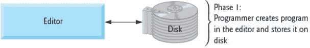

图 1.6 典型的 C++ 开发环境——编辑阶段。

许多大型软件供应商都提供**集成开发环境（IDE）**。IDE 提供支持软件开发过程的工具，包括用于编写和编辑程序的编辑器，以及用于定位**逻辑错误**（导致程序执行不正确的错误）的调试器。流行的 IDE 包括 Microsoft® Visual Studio 2015 Community Edition、NetBeans、Eclipse、Apple 的 Xcode®、CodeLite 和 CLion。

### 第 2 阶段：预处理 C++ 程序

在第 2 阶段，你发出**编译**程序的命令（**图 1.7**）。在 C++ 系统中，**预处理器**程序在编译器的翻译阶段开始之前自动执行（因此我们将预处理称为第 2 阶段，编译称为第 3 阶段）。C++ 预处理器遵循称为**预处理指令**的命令，这些指令指示在编译之前对程序执行某些操作。这些操作通常包括将其他文本文件*包含*（即复制到程序文件中）到要编译的程序中，并执行各种文本替换。最常见的预处理指令在早期章节中讨论；预处理功能的详细讨论见**附录 E**“预处理器”。

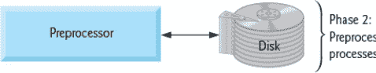

**图 1.7** 典型的 C++ 开发环境——预处理阶段。

### 第 3 阶段：编译 C++ 程序

在第 3 阶段，编译器将 C++ 程序翻译成机器语言代码——也称为**目标代码**（**图 1.8**）。


**图 1.8** 典型的 C++ 开发环境——编译阶段。

### 第 4 阶段：链接

第 4 阶段称为**链接**。C++ 程序通常包含对在其他地方定义的函数和数据的引用，例如标准库或参与特定项目的程序员群体的私有库（**图 1.9**）。C++ 编译器生成的目标代码通常会因这些缺失部分而带有“空洞”。**链接器**将目标代码与缺失函数的代码链接起来，以生成**可执行程序**（没有缺失部分）。如果程序编译和链接正确，就会生成可执行映像。

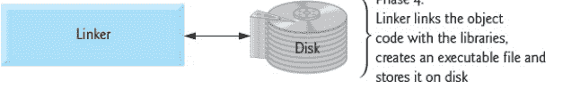

**图 1.9** 典型的 C++ 开发环境——链接阶段。

### 第 5 阶段：装入

第 5 阶段称为**装入**。程序执行前，必须先放入内存（**图 1.10**）。这是由**装入器**完成的，它从磁盘获取可执行映像并将其传输到内存。还会装入支持程序的共享库中的附加组件。

### 第 6 阶段：执行

最后，计算机在其 CPU 的控制下，一次一条指令地**执行**程序（**图 1.11**）。一些现代计算机体系结构通常并行执行多条指令。

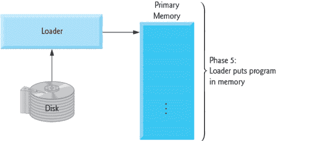

**图 1.10** 典型的 C++ 开发环境——装入阶段。

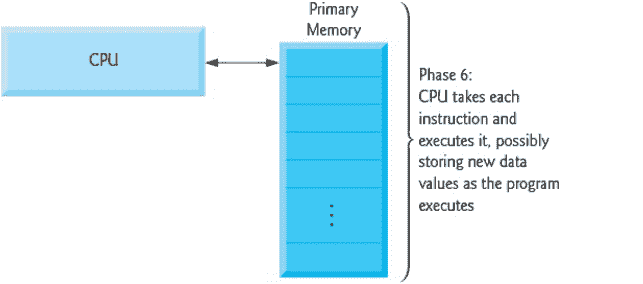

**图 1.11** 典型的 C++ 开发环境——执行阶段。

### 执行时可能出现的问题

程序可能无法在第一次尝试时就正常工作。前面每个阶段都可能因为我们在本书中讨论的各种错误而失败。例如，正在执行的程序可能试图除以零（在 C++ 中，这是整数算术的非法操作）。这将导致 C++ 程序显示错误消息。如果发生这种情况，你必须返回编辑阶段，进行必要的更正，然后重新经历其余阶段，以确定更正解决了问题。[*注：* C++ 中的大多数程序都会输入或输出数据。] 某些 C++ 函数从 `cin`（**标准输入流**；读作“see-in”）获取输入，它通常是键盘，但 `cin` 可以被重定向到其他设备。数据经常输出到 `cout`（**标准输出流**；读作“see-out”），它通常是计算机屏幕，但 `cout` 可以被重定向到其他设备。当我们说程序打印结果时，通常是指结果显示在屏幕上。数据可以输出到其他设备，如磁盘、硬拷贝打印机，甚至可以通过 Internet 传输。还有一个**标准错误流**，称为 `cerr`。`cerr` 流（通常连接到屏幕）用于显示错误消息。


### 常见编程错误 1.1

诸如除以零之类的错误在程序运行过程中发生，因此它们被称为*运行时错误*或*执行时错误*。**致命运行时错误**导致程序立即终止，而未能成功完成其任务。**非致命运行时错误**允许程序运行完成，但常常产生不正确的结果。


### 1.10 试运行一个 C++ 应用程序

在本节中，你将编译、运行第一个 C++ 应用程序并与之交互——这是一个有趣的猜数字游戏，它从 1 到 1000 中选一个数字，并提示你猜它。如果你的猜测正确，游戏结束。如果你的猜测不正确，应用程序会指出你的猜测高于还是低于正确数字。你可以猜测的次数没有限制。[*注意：* 仅为了本次试运行，我们根据**第6章**“函数与递归简介”中要求你创建的练习修改了此应用程序。通常，此应用程序会在你执行程序时随机选择正确答案。修改后的应用程序在每次程序执行时使用同一个正确答案（尽管这可能因编译器而异），因此你可以使用我们在本节中使用的*相同*猜测，并看到与我们引导你与第一个 C++ 应用程序交互时*相同*的结果。]

我们将演示使用以下方式运行 C++ 应用程序：

- Windows 上的 Visual Studio 2015 社区版（[1.10.1节](#)）
- Linux 上 shell 中的 GNU C++（[1.10.2节](#)）
- Mac OS X 上 Xcode 中的 Clang/LLVM（[1.10.3节](#)）。

该应用程序在三个平台上的运行方式类似。你只需阅读与你的操作系统和编译器相对应的那一节。有许多可用于编译、构建和运行 C++ 应用程序的开发环境——CodeLite、CLion、NetBeans 和 Eclipse 只是其中几个。有关你特定开发环境的信息，请咨询你的教师或查阅在线文档。

在以下步骤中，你将运行该应用程序并输入各种数字来猜正确数字。你在此应用程序中看到的元素和功能，都是本书中你将学习编写的典型内容。我们使用字体来区分屏幕上看到的功能与不直接与屏幕相关的元素。我们用半粗体的**无衬线粗体**字体强调屏幕上的功能，如标题和菜单（例如**文件**菜单），并用 `sans-serif` 字体强调文件名、应用程序显示的文本以及应输入应用程序的值（例如 `GuessNumber` 或 `500`）。

#### 1.10.1 在 Windows 上用 Visual Studio 2015 编译并运行应用程序

在本节中，你将使用 Microsoft Visual Studio 2015 社区版在 Windows 上运行一个 C++ 程序。我们假设你已经阅读了“开始之前”部分，了解有关安装 IDE 和下载本书代码示例的说明。

Visual Studio 有多个版本可用——在某些版本中，我们提供的选项、菜单和说明可能略有不同。从现在开始，我们将 Visual Studio 2015 社区版简称为“Visual Studio”或“IDE”。

#### 步骤 1：检查你的设置

阅读本书的“开始之前”部分很重要，以确保你已正确安装 Visual Studio 并将本书示例复制到硬盘上。

#### 步骤 2：启动 Visual Studio

从**开始**菜单打开 Visual Studio。IDE 会显示**起始页**（**图 1.12**），其中提供用于创建新程序、打开现有程序以及了解 IDE 和各种编程主题的链接。暂时单击其选项卡中的 **X** 关闭此窗口——你可以随时通过选择**视图 > 起始页**访问此窗口。我们用 > 字符表示从菜单中选择菜单项。例如，**文件 > 打开**表示应从**文件**菜单中选择**打开**菜单项。

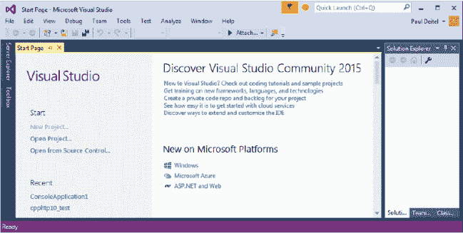

**图 1.12 显示起始页的 Visual Studio 2015 社区版窗口。**

#### 步骤 3：创建项目

**项目**是一组相关文件，例如组成一个应用程序的 C++ 源代码文件。Visual Studio 将应用程序组织为项目和**解决方案**，解决方案包含一个或多个项目。多项目解决方案用于创建大型应用程序。本书中的每个应用程序都将是一个包含单个项目的解决方案。

我们为本书示例创建的 Visual Studio 项目是**Win32 控制台应用程序**项目，你将通过 IDE 执行它们。要创建项目：

- 1. 选择**文件 > 新建 > 项目…**
- 2. 在**新建项目**对话框的左侧，选择类别**已安装 > 模板 > Visual C++ > Win32**（**图 1.13**）。
- 3. 在**新建项目**对话框的中间部分，选择**Win32 控制台应用程序**。
- 4. 在**名称**字段中为项目提供名称——我们指定了 `Guess Number`——然后单击**确定**以显示**Win32 应用程序向导**窗口，再单击**下一步 >** 以显示**应用程序设置**步骤。
- 5. 按**图 1.14**所示配置设置，以创建包含空项目的解决方案，然后单击**完成**。

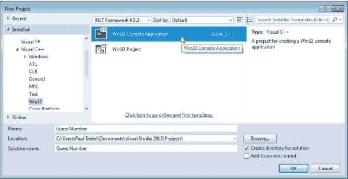

**图 1.13** Visual Studio 2015 社区版新建项目对话框。

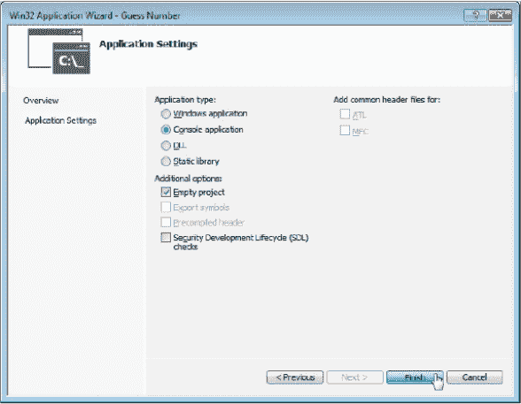

**图 1.14** Win32 应用程序向导*窗口的*应用程序设置*步骤*。

此时，IDE 会创建你的项目，并将其文件夹放在

```text
C:\Users\YourUserAccount\Documents\Visual Studio 2015\Projects
```

然后打开**图 1.15**中的窗口。当你编辑代码时，此窗口会将编辑器显示为选项卡式窗口（每个文件一个）。同时还会显示**解决方案资源管理器**，你可以在其中查看和管理应用程序的文件。在本书的示例中，你通常会将每个程序的代码文件放在**源文件**文件夹中。如果未显示**解决方案资源管理器**，可以通过选择**视图 > 解决方案资源管理器**来显示它。

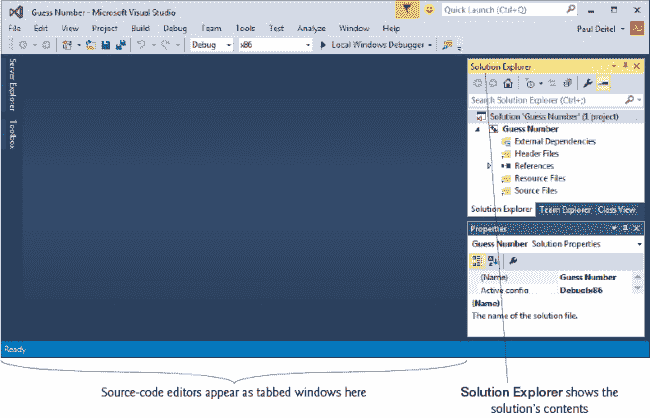

**图 1.15** 创建 `Guess Number` 项目后的 Visual Studio 窗口。

#### 步骤 4：将 `GuessNumber.cpp` 文件添加到项目中

接下来，你将把 `GuessNumber.cpp` 添加到在*步骤 3*中创建的项目中。在 Windows 资源管理器（Windows 7）或文件资源管理器（Windows 8 和 10）中，打开本书 `examples` 文件夹中的 `ch01` 文件夹，然后将 `GuessNumber.cpp` 拖到**解决方案资源管理器**中的**源文件**文件夹上。

对于从第 3 章开始你将看到的多源代码文件程序，请将给定程序的所有文件拖到**源文件**文件夹。当你开始自行创建多源代码文件程序时，可以右键单击**源文件**文件夹并选择**添加 > 新建项…**，以显示用于添加新文件的对话框。

#### 步骤 5：编译并运行项目

要编译并运行项目以便试运行该应用程序，请选择**调试 > 开始执行(不调试)**，或直接键入 `Ctrl + F5`。如果程序编译正确，IDE 会打开一个命令提示符窗口并执行程序（**图 1.16**）——我们更改了命令提示符的配色方案，使屏幕截图更易读。应用程序显示 `"Please type your first guess."`，然后在下一行显示一个问号（`?`）作为提示。

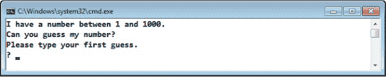

图 1.16 显示正在运行程序的命令提示符。

#### 步骤 6：输入你的第一次猜测

键入 `500` 并按*Enter*键。应用程序显示 `"Too high. Try again."`（图 1.17），表示你输入的值大于应用程序所选为正确猜测的数字。

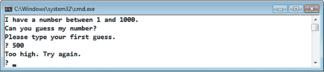

图 1.17 输入初始猜测并接收反馈。

#### 步骤 7：输入另一次猜测

在下一个提示处，输入 `250`（图 1.18）。应用程序显示 `"Too high. Try again."`，因为你输入的值再次大于正确猜测。

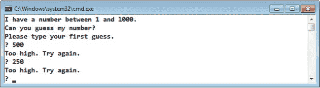

图 1.18 输入第二次猜测并接收反馈。


#### 步骤 8：输入更多猜测

继续通过输入值来玩游戏（**图 1.19**），直到你猜中正确数字。当你猜中时，应用程序显示 `"Excellent! You guessed the number."`

#### 步骤 9：再次玩游戏或退出应用程序

在你猜中正确数字后，应用程序会询问你是否想再玩一局。在 `"Would you like to play again (y or n)?"` 提示符处，输入单个字符 `y` 会使应用程序选择一个新数字，并显示消息 `"Please type your first guess."`，随后是一个问号提示符，以便你在新游戏中做出第一次猜测。输入字符 `n` 会终止应用程序。每次你从头开始执行此应用程序（*步骤 5*）时，它都会选择相同的数字供你猜测。

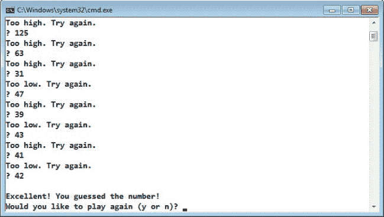

**图 1.19** 输入更多猜测并猜中正确数字。

#### 1.10.2 在 Linux 上使用 GNU C++ 编译和运行

对于本次试运行，我们假设你已阅读“开始之前”部分，并且已将下载的示例放在 Linux 系统的主目录中。如果你对将文件复制到主目录有任何疑问，请咨询你的讲师。在本节的图中，我们使用**粗体**文本突出显示你输入的文本。我们系统上 shell 中的提示符使用波浪号（`~`）字符表示主目录，每个提示符以美元符号（`$`）字符结尾。提示符会因 Linux 系统而异。

#### 步骤 1：定位完整应用程序

在 Linux shell 中，使用 `cd` 命令切换到完整应用程序目录（**图 1.20**），方法是输入

```bash
cd examples/ch01
```

然后按 *回车*。

```bash
~$ cd examples/ch01
~/examples/ch01$
```

**图 1.20 切换到 `GuessNumber` 应用程序的目录。**

#### 步骤 2：编译应用程序

在运行应用程序之前，必须先编译它（**图 1.21**），方法是输入

```bash
g++ -std=c++14 GuessNumber.cpp -o GuessNumber
```

此命令为 C++14（当前 C++ 版本）编译应用程序，并生成一个名为 `GuessNumber` 的可执行文件。

```bash
~/examples/ch01$ g++ -std=c++14 GuessNumber.cpp -o GuessNumber
~/examples/ch01$
```

**图 1.21 使用 `g++` 命令编译 GuessNumber 应用程序。**

#### 步骤 3：运行应用程序

要运行可执行文件 `GuessNumber`，请在下一个提示符处输入 `./GuessNumber`，然后按 *回车*（图 1.22）。`./` 告诉 Linux 从当前目录运行，并且是表明 `GuessNumber` 是可执行文件所必需的。

```text
~/examples/ch01$ ./GuessNumber
I have a number between 1 and 1000.
Can you guess my number?
Please type your first guess.
?
```

**图 1.22 运行 GuessNumber 应用程序。**

#### 步骤 4：输入第一次猜测

应用程序显示 `"Please type your first guess."`，然后在下一行显示问号（`?`）作为提示符（图 1.22）。在提示符处，输入 `500`（图 1.23）。[注意，输出可能因你使用的编译器而异。]

```text
~/examples/ch01$ ./GuessNumber
I have a number between 1 and 1000.
Can you guess my number?
Please type your first guess.
? 500
Too high. Try again.
?
```

**图 1.23 输入初始猜测。**

#### 步骤 5：输入另一次猜测

应用程序显示 `"Too high. Try again."`，这意味着你输入的值大于应用程序选作正确猜测的数字（图 1.23）。在下一个提示符处，输入 `250`（图 1.24）。这次应用程序显示 `"Too low. Try again."`，因为你输入的值小于正确猜测。

```text
~/examples/ch01$ ./GuessNumber
I have a number between 1 and 1000.
Can you guess my number?
Please type your first guess.
? 500
Too high. Try again.
? 250
Too low. Try again.
?
```

**图 1.24 输入第二次猜测并接收反馈。**

#### 步骤 6：输入更多猜测

继续通过输入值来玩游戏（图 1.25），直到你猜中正确数字。当你猜中时，应用程序显示 `"Excellent! You guessed the number."`

```text
Too low. Try again.
? 375
Too low. Try again.
? 437
Too high. Try again.
? 406
Too high. Try again.
? 391
Too high. Try again.
? 383
Too low. Try again.
? 387
Too high. Try again.
? 385
Too high. Try again.
? 384
Excellent! You guessed the number.
Would you like to play again (y or n)?
```

**图 1.25 输入更多猜测并猜中正确数字。**

#### 步骤 7：再次玩游戏或退出应用程序

在你猜中正确数字后，应用程序会询问你是否想再玩一局。在 `"Would you like to play again (y or n)?"` 提示符处，输入单个字符 `y` 会使应用程序选择一个新数字，并显示消息 `"Please type your first guess."`，随后是一个问号提示符，以便你在新游戏中做出第一次猜测。输入字符 `n` 会结束应用程序，返回到 shell 并等待你的下一条命令。每次你从头开始执行此应用程序（即 *步骤 3*）时，它都会选择相同的数字供你猜测。

#### 1.10.3 在 Mac OS X 上使用 Xcode 编译和运行

在本节中，我们介绍如何在 Mac OS X 上使用 Apple 的 Xcode IDE 运行 C++ 程序。

#### 步骤 1：检查你的设置

阅读本书的“开始之前”部分很重要，以确保你已正确安装 Apple 的 Xcode IDE 并将本书的示例复制到硬盘。

#### 步骤 2：启动 Xcode

打开 Finder 窗口，选择**应用程序**，然后双击 Xcode 图标（🖥️）。如果这是你第一次运行 Xcode，将出现**欢迎使用 Xcode**窗口（**图 1.26**）。暂时关闭此窗口——你可以随时通过选择**窗口 > 欢迎使用 Xcode**来访问它。我们使用 > 字符表示从菜单中选择一个菜单项。例如，**文件 > 打开…**表示你应该从**文件**菜单中选择**打开…**菜单项。


**图 1.26 欢迎使用 Xcode 窗口。**

#### 步骤 3：创建项目

一个**项目**是一组相关文件，例如组成一个应用程序的 C++ 源代码文件。我们为本书示例创建的 Xcode 项目是**OS X 命令行工具**项目，你将直接在 IDE 中执行它们。要创建项目：

- 1. 选择**文件 > 新建 > 项目...**
- 2. 在 OS X 子类别**应用程序**中，选择**命令行工具**并点击**下一步**。
- 3. 在**产品名称**字段中为你的项目提供名称——我们指定了 `Guess Number`。
- 4. 确保所选**语言**为 **C++**，然后点击**下一步**。
- 5. 指定要存储项目的位置，然后点击**创建**。
- （有关配置项目以使用 C++14 的信息，请参阅“开始之前”部分。）

**图 1.27** 显示了创建项目后出现的**工作区窗口**。默认情况下，Xcode 会创建一个 `main.cpp` 源代码文件，其中包含一个显示 `"Hello, world!"` 的简单程序。窗口在工具栏下方分为四个主要区域：最初显示的是**导航器区域**、**编辑器区域**和**实用工具区域**。我们稍后将解释如何显示**调试区域**，你将在其中运行程序并与程序交互。

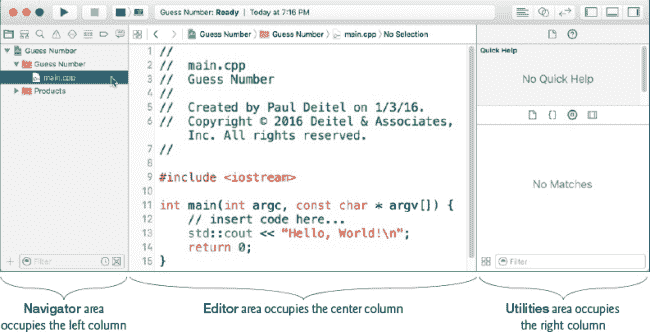

**图 1.27** 选中 `main.cpp` 的示例 Xcode C++ 项目。

工作区窗口的左侧是**导航器区域**，其顶部有图标，用于显示可在此处显示的*导航器*。对于本书，你主要会使用

- **项目**（🗂️）——显示项目中的所有文件和文件夹。
- **问题**（⚠️）——显示编译器生成的警告和错误。

你通过点击窗口**导航器**区域上方的相应按钮来选择要显示哪个导航器。

**导航器**区域的右侧是用于编辑源代码的**编辑器**区域。此区域始终显示在工作区窗口中。当你在**项目**导航器中选择一个文件时，文件内容会显示在**编辑器**区域中。工作区窗口的右侧是**实用工具**区域，本书中你不会使用它。**调试**区域在显示时出现在**编辑器**区域下方。

工具栏包含用于执行程序的选项（**图 1.28(a)**）、用于显示 Xcode 中执行任务进度（例如编译状态）的显示区域（**图 1.28(b)**），以及用于隐藏和显示工作区窗口中各区域的按钮（**图 1.28(c)**）。


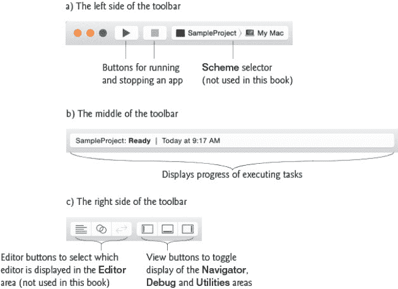

图 1.28 Xcode 7 工具栏。

#### 步骤 4：从项目中删除 `main.cpp` 文件

在这次试运行中你不会使用 `main.cpp`，因此应删除该文件。

在 **项目**导航器中，右击 `main.cpp` 文件并选择 **删除**。

在出现的对话框中，选择 **移到废纸篓** 以从系统中删除该文件——在你清空废纸篓之前，该文件不会被完全移除。

#### 步骤 5：将 `GuessNumber.cpp` 文件添加到项目中

接下来，你将把 `GuessNumber.cpp` 添加到在*步骤 3*中创建的项目中。

在 Finder 窗口中，打开本书 `examples` 文件夹中的 `ch01` 文件夹，然后将 `GuessNumber.cpp` 拖到 **项目**导航器中的 **Guess Number** 文件夹上。在出现的对话框中，确保勾选 **如果需要，拷贝项目**，然后单击 **完成**。¹¹

11. 对于从第 3 章开始你将看到的多个源代码文件程序，将给定程序的所有文件拖到项目文件夹中。当你开始创建包含多个源代码文件的程序时，可以右击项目文件夹并选择 **新建文件…**，以显示用于添加新文件的对话框。

#### 步骤 6：编译并运行项目

要编译并运行项目以便试运行应用程序，只需单击 Xcode 工具栏左侧的运行（▶）按钮。如果程序编译正确，Xcode 会打开**调试**区域（位于**编辑器**区域底部），并在**调试**区域右半部分执行程序（*图 1.29*）。应用程序显示 `"Please type your first guess."`，然后在下一行显示一个问号（`?`）作为提示。

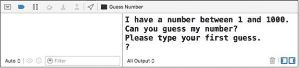

图 1.29 显示正在运行程序的调试区域。

#### 步骤 7：输入第一次猜测

在**调试**区域中单击，然后输入 `500` 并按*回车*。应用程序显示 `"Too low. Try again."`（**图 1.30**），表示你输入的值小于应用程序选择的正确猜测数字。

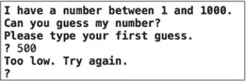

图 1.30 输入初始猜测并接收反馈。

#### 步骤 8：输入另一个猜测

在下一个提示处，输入 `750`（**图 1.31**）。应用程序显示 `"Too low. Try again."`，因为你输入的值再次小于正确猜测值。

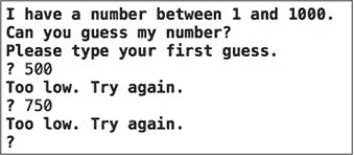

**图 1.31** 输入第二次猜测并接收反馈。

#### 步骤 9：输入更多猜测

继续通过输入数值玩游戏（图 1.32），直到你猜中正确数字。当你猜对时，应用程序显示 `"Excellent! You guessed the number."`

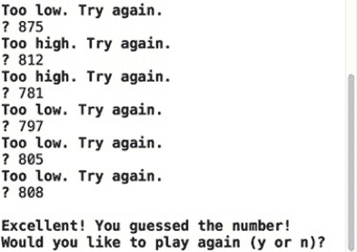

**图 1.32** 输入更多猜测并猜中正确数字。

#### 再次玩游戏或退出应用程序

在你猜中正确数字后，应用程序会询问你是否想再玩一局。在 `"Would you like to play again (y or n)?"` 提示处，输入字符 `y` 会使应用程序选择新数字，并显示消息 `"Please type your first guess."`，随后显示问号提示，以便你在新游戏中进行第一次猜测。输入字符 `n` 会终止应用程序。每次从头执行此应用程序（*步骤 6*）时，它都会选择相同的数字供你猜测。

## 1.11 操作系统

**操作系统**是使计算机对用户、应用开发者和系统管理员而言更加方便的软件系统。它们提供的服务允许每个应用安全、高效地与其他应用*并发*（即并行）执行。包含操作系统核心组件的软件称为**内核**。流行的桌面操作系统包括 Linux、Windows 和 OS X（原称 Mac OS X）——我们在开发本书时使用了这三者。智能手机和平板电脑中使用的流行移动操作系统包括 Google 的 Android、Apple 的 iOS（用于 iPhone、iPad 和 iPod Touch 设备）以及 Windows 10 Mobile。你可以用 C++ 为所有这些操作系统开发应用。

### 1.11.1 Windows——专有操作系统

20 世纪 80 年代中期，Microsoft 开发了**Windows 操作系统**，它由构建在 DOS（磁盘操作系统）之上的图形用户界面组成——DOS 是一种极其流行的个人计算机操作系统，用户通过键入命令与之交互。Windows 借鉴了 Xerox PARC 开发的许多概念（如图标、菜单和窗口），并由早期 Apple Macintosh 操作系统推广。Windows 10 是 Microsoft 的最新操作系统——其功能包括增强的**开始**菜单和用户界面、用于语音交互的 Cortana 个人助理、用于接收通知的 Action Center、Microsoft 新的 Edge 网络浏览器等。Windows 是*专有*操作系统——完全由 Microsoft 控制。Windows 是迄今为止世界上使用最广泛的桌面操作系统。

### 1.11.2 Linux——开源操作系统

Linux 操作系统也许是*开源*运动最伟大的成功。**开源软件**背离了在软件早期占主导地位的*专有*软件开发风格。通过开源开发，个人和公司贡献努力来开发、维护和演进软件，以换取将软件用于自身目的的权利，通常*免费*。开源代码通常比专有软件受到更广泛受众的审查，因此错误往往更快被消除。开源还鼓励创新。IBM、Oracle 等企业系统公司已对 Linux 开源开发进行了大量投资。

开源社区的一些关键组织包括

- Eclipse 基金会（Eclipse 集成开发环境帮助程序员方便地开发软件）
- Mozilla 基金会（Firefox 网络浏览器的创建者）
- Apache 软件基金会（用于开发基于 Web 应用的 Apache Web 服务器的创建者）
- GitHub（提供管理开源项目的工具——它有数百万个项目正在开发中）。

计算和通信的快速改进、成本下降以及开源软件，使现在创建基于软件的企业比十年前容易和经济得多。一个很好的例子是 Facebook，它从大学宿舍房间启动，并用开源软件构建。

**Linux** 内核是最流行的开源、自由分发、全功能操作系统的核心。它由一个组织松散的志愿者团队开发，在服务器、个人计算机和嵌入式系统（如智能手机、智能电视和汽车系统核心的计算机系统）中很流行。与 Microsoft 的 Windows 和 Apple 的 OS X 等专有操作系统的内核不同，Linux 源代码（程序代码）可供公众检查和修改，并可免费下载和安装。因此，Linux 用户受益于一个庞大的开发者社区积极调试和改进内核，以及定制操作系统以满足特定需求的能力。

各种问题——例如 Microsoft 的市场力量、用户友好的 Linux 应用数量少以及 Linux 发行版（如 Red Hat Linux、Ubuntu Linux 等）的多样性——阻碍了 Linux 在桌面计算机上的广泛使用。Linux 在服务器和嵌入式系统（如 Google 基于 Android 的智能手机）中变得极受欢迎。

### 1.11.3 Apple 的 OS X；用于 iPhone®、iPad® 和 iPod Touch® 设备的 Apple iOS

Apple 由 Steve Jobs 和 Steve Wozniak 于 1976 年创立，迅速成为个人计算领域的领导者。1979 年，Jobs 和几位 Apple 员工访问 Xerox PARC（Palo Alto Research Center），了解 Xerox 的具有图形用户界面（GUI）的桌面计算机。该 GUI 成为 Apple Macintosh 的灵感来源，Macintosh 于 1984 年在一则令人难忘的超级碗广告中大张旗鼓地推出。

Objective-C 编程语言由 Brad Cox 和 Tom Love 于 20 世纪 80 年代初在 Stepstone 创建，它为 C 编程语言增加了面向对象编程（OOP）的能力。Steve Jobs 于 1985 年离开 Apple，并创立 NeXT Inc.。1988 年，NeXT 从 StepStone 获得 Objective-C 许可，并开发了 Objective-C 编译器和库，它们被用作 NeXTSTEP 操作系统用户界面的平台，以及用于构建图形用户界面的 Interface Builder。


乔布斯于1996年重返苹果，当时苹果收购了NeXT。苹果的OS X操作系统是NeXTSTEP的后代。苹果的专有操作系统iOS源自苹果的OS X，用于iPhone、iPad和iPod Touch设备。2014年，苹果推出了新的Swift编程语言，该语言于2015年成为开源。iOS应用开发社区正逐渐从Objective-C转向Swift。

### 1.11.4 谷歌的 Android

**Android**——增长最快的移动和智能手机操作系统——基于Linux内核和Java。Android应用也可以用C++和C开发。开发Android应用的一个好处是平台的开放性。该操作系统是开源且免费的。

Android操作系统由Android, Inc.开发，该公司于2005年被谷歌收购。2007年，开放手机联盟™（http://www.openhandsetalliance.com/oha_members.html）成立，以开发、维护和演进Android，推动移动技术创新，改善用户体验，同时降低成本。

根据IDC的数据，2015年前六个月过后，Android占全球智能手机市场份额的82.8%，而苹果为13.9%，微软为2.6%，黑莓为0.3%。^12 Android操作系统被用于众多智能手机、电子阅读器设备、平板电脑、店内触摸屏自助终端、汽车、机器人、多媒体播放器等。目前Android用户已超过14亿。^13

- 12. http://www.idc.com/prodserv/smartphone-os-market-share.jsp
- 13. http://www.techtimes.com/articles/90028/20151002/google-says-android-has-more-than-1-4-billion-active-users-worldwide-with-300-million-on-lollipop.htm.

## 1.12 互联网与万维网

20世纪60年代末，ARPA——美国国防部高级研究计划局——推出了将大约十几所由ARPA资助的大学和研究机构的主要计算机系统联网的计划。这些计算机将通过以约50,000比特/秒速度运行的通信线路连接起来，这在当时是一个惊人的速率，因为大多数人（在少数甚至能接入网络的人中）通过电话线连接计算机的速度只有110比特/秒。学术研究即将向前迈出一大步。ARPA接着实施了很快被称为ARPANET的网络，它是当今**互联网**的前身。如今最快的互联网速度约为数十亿比特/秒，而万亿比特/秒的速度已在地平线上！

事情的发展与最初计划不同。尽管ARPANET使研究人员能够将他们的计算机联网，但其主要益处被证明是通过后来被称为电子邮件（e-mail）的方式进行快速便捷通信的能力。即使在当今的互联网上也是如此，电子邮件、即时消息、文件传输以及Facebook和Twitter等社交媒体使全球数十亿人能够快速便捷地通信。

在ARPANET上通信的协议（一组规则）被称为**传输控制协议（TCP）**。TCP确保消息——由按顺序编号的称为*数据包*的片段组成——从发送方正确路由到接收方，完整到达并按正确顺序组装。

### 互联网：网络的网络

在互联网早期演进的同时，世界各地的组织正在实施自己的网络，用于组织内（即组织内部）和组织间（即组织之间）通信。出现了种类繁多的网络硬件和软件。一个挑战是使这些不同的网络能够相互通信。ARPA通过开发互联网协议（IP）实现了这一点，该协议创建了一个真正的“网络的网络”，即互联网当前的体系结构。这套组合协议现在称为**TCP/IP**。

企业迅速意识到，通过使用互联网，它们可以改善运营，并为客户提供新的更好的服务。公司开始花费大量资金来开发和增强其在线形象。这引发了通信运营商以及硬件和软件供应商之间的激烈竞争，以满足日益增加的基础设施需求。结果，互联网上的**带宽**——通信线路的信息承载能力——大幅增加，而硬件成本则大幅下降。

### 万维网：让互联网更易于使用

**万维网**（简称“Web”）是与互联网相关的一组硬件和软件，使计算机用户能够定位和查看几乎任何主题的基于多媒体的文档（包含文本、图形、动画、音频和视频各种组合的文档）。万维网的引入是相对较近的事件。1989年，CERN（欧洲核子研究组织）的蒂姆·伯纳斯-李开始开发一种通过“超链接”文本文档共享信息的技术。伯纳斯-李将他的发明称为**超文本标记语言（HTML）**。他还编写了**超文本传输协议（HTTP）**等通信协议，以构成他的新超文本信息系统的骨干，他将其称为万维网。

1994年，伯纳斯-李创立了**万维网联盟（W3C，`http://www.w3.org`）**，致力于开发Web技术。W3C的主要目标之一是使Web对所有人普遍可访问，无论其残疾、语言或文化如何。

### Web 服务

**Web服务**是存储在一台计算机上的软件组件，可由另一台计算机上的应用（或其他软件组件）通过互联网访问。借助Web服务，你可以创建*混搭应用*，它使你能够通过组合互补的Web服务（通常来自多个组织，可能还有其他形式的信息源）来快速开发应用。例如，100 Destinations（[http://www.100destinations.co.uk](http://www.100destinations.co.uk)）将来自Twitter的照片和推文与谷歌地图的映射功能结合起来，让你可以通过他人的照片探索世界各地的国家。

ProgrammableWeb（[http://www.programmableweb.com/](http://www.programmableweb.com/)）提供超过11,150个API和7,300个混搭应用的目录，以及用于创建自己的混搭应用的操作指南和示例代码。根据ProgrammableWeb，混搭应用最广泛使用的三个API是谷歌地图、Twitter和YouTube。

### Ajax

**Ajax**技术帮助基于互联网的应用像桌面应用一样运行——这是一项艰巨的任务，因为当数据在你的计算机和互联网上的服务器计算机之间来回传送时，此类应用会遭受传输延迟。使用Ajax，像谷歌地图这样的应用已经实现了出色的性能，并接近桌面应用的外观和感觉。

### 物联网

互联网不再仅仅是计算机的网络——它是**物联网**。一个*物*是指任何具有IP地址并能够通过互联网自动发送数据的对象——例如，带有用于支付通行费的应答器的汽车、植入人体的心脏监测器、报告能源使用情况的智能电表、可以跟踪你的移动和位置的移动应用，以及根据天气预报和家庭活动调节室温的智能恒温器。

## 1.13 一些关键的软件开发术语

**图1.33**列出了你会在软件开发社区听到的一些流行术语。

**图 1.33 软件技术。**

| 技术 | 描述 |
|---|---|
| 敏捷软件开发 | **敏捷软件开发**是一组方法论，试图以更快的速度、使用更少的资源实现软件。请查看敏捷联盟（*www.agilealliance.org*）和敏捷宣言（*www.agilemanifesto.org*）。 |
| 重构 | **重构**涉及重写程序，使其更清晰、更易于维护，同时保留其正确性和功能。它被广泛用于敏捷开发方法中。许多IDE包含内置的*重构工具*，可自动完成大部分重写工作。 |
| 设计模式 | **设计模式**是用于构建灵活且可维护的面向对象软件的经过验证的架构。设计模式领域试图列举那些反复出现的模式，鼓励软件设计者*重用*它们，以更少的时间、金钱和精力开发更高质量的软件。 |
| LAMP | **LAMP**是许多开发者用来低成本构建Web应用的一系列开源技术的首字母缩写——它代表 |

|  |  |
|---|---|
| LAMP | *Linux、Apache、MySQL和PHP（或Perl或Python——另外两种流行的脚本语言）。* MySQL是一个开源数据库管理系统。PHP是一种流行的开源服务器端“脚本”语言，用于开发Web应用程序。Apache是最流行的Web服务器软件。Windows开发的对应方案是WAMP——*Windows、Apache、MySQL*和*PHP*。 |
| 软件即服务（SaaS） | 软件通常被视为一种产品；大多数软件仍然以这种方式提供。如果你想运行一个应用程序，你从软件供应商那里购买一个软件包——通常以CD、DVD或Web下载的形式。然后你在计算机上安装该软件并根据需要运行它。当新版本出现时，你升级软件，这通常需要花费大量的时间和金钱。对于必须在各种计算机设备上维护数万个系统的组织来说，这个过程可能变得很繁琐。借助**软件即服务（SaaS）**，软件在互联网上其他位置的服务器上运行。当该服务器更新时，全球所有客户端都能看到新功能——无需本地安装。你通过浏览器访问该服务。浏览器具有很好的可移植性，因此你可以在世界任何地方的各种计算机上运行相同的应用程序。**Salesforce.com**、Google、Microsoft和许多其他公司提供SaaS。 |
| 平台即服务（PaaS） | **平台即服务（PaaS）** 提供一种计算平台，用于通过Web以服务形式开发和运行应用程序，而不是在你的计算机上安装工具。一些PaaS提供商包括Google App Engine、Amazon EC2和Windows Azure™。 |
| 云计算 | SaaS和PaaS是云计算的例子。你可以使用存储在“云”中的软件和数据——即通过互联网在远程计算机（或服务器）上访问并按需可用——而不是将其存储在本地台式机、笔记本电脑或移动设备上。这允许你在任何给定时间增加或减少计算资源以满足需求，这比购买硬件来提供足够的存储和处理能力以满足偶尔的峰值需求更具成本效益。云计算还通过将管理这些应用程序的负担（例如安装和升级软件、安全、备份和灾难恢复）转移给服务提供商来节省资金。 |
| 软件开发工具包（SDK） | **软件开发工具包（SDK）** 包括开发人员用于编写应用程序的工具和文档。 |

软件是复杂的。大型的真实世界软件应用程序可能需要数月甚至数年才能设计和实现。当大型软件产品在开发过程中，它们通常以一系列发布版本提供给用户社区，每个版本都比上一个更完整、更完善（**图1.34**）。

**图1.34 软件产品发布术语。**

| 版本 | 描述 |
|---|---|
| Alpha | *Alpha*软件是仍在积极开发中的软件产品的最早发布版本。Alpha版本通常存在缺陷、不完整且不稳定，会发布给相对少量的开发人员，用于测试新功能、获取早期反馈等。 |
| Beta | *Beta*版本在开发过程的后期发布给更多的开发人员，此时大多数主要缺陷已修复，新功能几乎完成。Beta软件更稳定，但仍可能发生变化。 |
| Release candidates | *发布候选版本*通常*功能完整*，（大多）无缺陷并可供社区使用，社区提供多样化的测试环境——软件用于不同的系统，具有不同的约束条件并用于各种目的。 |
| Final release | 发布候选版本中出现的任何缺陷都会得到纠正，最终产品最终向公众发布。软件公司通常通过互联网分发增量更新。 |
| Continuous beta | 使用这种方法开发的软件（例如Google搜索或Gmail）通常没有版本号。它托管在*云*中（不安装在你的计算机上），并不断演进，以便用户始终拥有最新版本。 |

## 1.14 C++11与C++14：最新的C++版本

**C++11**由ISO/IEC于2011年发布。C++的创造者Bjarne Stroustrup表达了他对该语言未来的愿景——主要目标是使C++更易于学习、改进库构建能力并增加与C编程语言的兼容性。C++11扩展了C++标准库，并添加了若干特性和增强功能以提高性能和安全性。本书中使用的三个编译器¹¹——

- Visual Studio 2015 Community Edition（Microsoft Windows）
- GNU C++（Linux）
- Xcode中的Clang/LLVM（Mac OS X）

——已实现大多数C++11特性。¹⁴

当前的C++标准**C++14**由ISO/IEC于2014年发布。它添加了若干语言特性和C++标准库增强，并修复了C++11中的缺陷。在本书中，我们根据本书的级别适当涵盖C++11和C++14的特性。有关C++11和C++14特性及支持它们的编译器的列表，请访问

> http://en.cppreference.com/w/cpp/compiler_support

C++标准的下一个版本**C++17**目前正在开发中。有关提议特性的列表，请参见

> https://en.wikipedia.org/wiki/C%2B%2B17

## 1.15 Boost C++库

**Boost C++库**（[www.boost.org](http://www.boost.org)）是由C++社区成员创建的免费开源库。它们经过同行评审，并且可在许多编译器和平台上移植。Boost已发展到超过130个库，并且定期添加更多库。如今，Boost开源社区中有数千名程序员。Boost库与现有C++标准库配合良好，并且通常作为最终被吸收到C++标准库中的能力的试验场。例如，C++11的“正则表达式”和“智能指针”库等，都是基于Boost社区所做的工作。

**正则表达式**用于匹配文本中的特定字符模式。它们可用于验证数据以确保其采用特定格式，用另一个字符串替换一个字符串的部分内容，或拆分字符串。

C和C++代码中的许多常见缺陷与指针有关，指针是C++从C吸收的强大编程能力。正如你将看到的，**智能指针**可帮助你避免与传统指针相关的一些关键错误。

## 1.16 紧跟信息技术发展

**图1.35**列出了关键的技术和商业出版物，这些将帮助你了解最新新闻、趋势和技术。你还可以在[www.deitel.com/ResourceCenters.html](http://www.deitel.com/ResourceCenters.html)找到不断增长的互联网和Web相关资源中心列表。

**图1.35 技术和商业出版物。**

| 出版物 | URL |
|---|---|
| AllThingsD | `allthingsd.com` |
| Bloomberg BusinessWeek | `www.businessweek.com` |
| CNET | `news.cnet.com` |
| Communications of the ACM | `cacm.acm.org` |
| Computerworld | `www.computerworld.com` |
| Engadget | `www.engadget.com` |
| eWeek | `www.eweek.com` |
| Fast Company | `www.fastcompany.com` |
| Fortune | `fortune.com` |
| GigaOM | `gigaom.com` |
| Hacker News | `news.ycombinator.com` |
| IEEE Computer Magazine | `www.computer.org/portal/web/computingnow/computer` |
| InfoWorld | `www.infoworld.com` |
| Mashable | `mashable.com` |
| PCWorld | `www.pcworld.com` |
| SD Times | `www.sdtimes.com` |
| Slashdot | `slashdot.org` |
| Stack Overflow | `stackoverflow.com` |
| Technology Review | `technologyreview.com` |
| TechCrunch | `techcrunch.com` |
| The Next Web | `thenextweb.com` |
| The Verge | `www.theverge.com` |
| Wired | `www.wired.com` |


## 自测练习

- 1.1 请在下列每项陈述的空白处填空：
  - A. 计算机在称为____的指令集的控制下处理数据。
  - B. 计算机的关键逻辑单元是____、____、____和____。
  - C. 本章讨论的三类语言是____、____和____。
  - D. 将高级语言程序翻译成机器语言的程序称为____。
  - E. ____是一种基于 Linux 内核和 Java 的移动设备操作系统。
  - F. ____软件通常功能完整且（据称）没有缺陷，可供社区使用。
  - G. Wii 遥控器以及许多智能手机都使用一个____，使设备能够对动作做出响应。

- 1.2 请在与 C++ 环境相关的下列每个句子中填空：
  - A. C++ 程序通常使用____程序输入计算机。
  - B. 在 C++ 系统中，____程序在编译器的翻译阶段开始之前执行。
  - C. ______程序将编译器的输出与各种库函数组合，以生成可执行程序。
  - D. ______程序将可执行程序从磁盘传输到内存。

- 1.3 请在下列每项陈述中填空（基于**第 1.8 节**）：
  - A. 对象具有______的特性——尽管对象可以通过定义良好的接口相互通信，但它们通常不允许知道其他对象是如何实现的。
  - B. C++ 程序员专注于创建______，其中包含数据成员以及操作这些数据成员并为客户提供服务的成员函数。
  - C. 从面向对象的角度分析和设计系统的过程称为______。
  - D. 借助______，新类通过吸收现有类的特征，然后添加自身独特特征而派生出来。
  - E. ______是一种图形化语言，它允许设计软件系统的人使用行业标准表示法来表示它们。
  - F. 对象的大小、形状、颜色和重量被视为对象类的______。

## 习题

- 1.4 请在下列每项陈述中填空：
  - A. 计算机中接收来自计算机外部的信息以供计算机使用的逻辑单元是________。
  - B. 指示计算机解决问题的过程称为________。
  - C. ________是一种计算机语言类型，它使用类似英语的缩写来表示机器语言指令。
  - D. ________是计算机的一个逻辑单元，它将计算机已处理的信息发送到各种设备，以便在计算机外部使用。
  - E. ________和________是计算机中保留信息的逻辑单元。
  - F. ________是计算机中执行计算的逻辑单元。
  - G. ________是计算机中做出逻辑决策的逻辑单元。
  - H. ________语言对于程序员快速、轻松地编写程序最为方便。
  - I. 计算机唯一能直接理解的语言是该计算机的________。
  - J. ________是计算机中协调所有其他逻辑单元活动的逻辑单元。

- 1.5 请在下列每项陈述中填空：
  - A. ______最初作为 UNIX 操作系统的开发语言而广为人知。
  - B. ______编程语言是由 Bjarne Stroustrup 于 20 世纪 80 年代初在贝尔实验室开发的。

- 1.6 请在下列每项陈述中填空：
  - A. C++ 程序通常要经历六个阶段——______、______、______、______和______。
  - B. 一个______提供了许多支持软件开发过程的工具，例如用于编写和编辑程序的编辑器、用于定位程序中逻辑错误的调试器，以及许多其他功能。

- 1.7 你手腕上可能戴着世界上最常见的对象类型之一——手表。讨论以下每个术语和概念如何应用于手表这一概念：对象、属性、行为、类、继承（例如，考虑闹钟）、建模、消息、封装、接口和信息隐藏。

## 有所作为

在整本书中，我们设置了“有所作为”练习，要求你处理那些对个人、社区、国家和世界真正重要的问题。

- 1.8（*试用；碳足迹计算器*）一些科学家认为，碳排放，尤其是化石燃料燃烧产生的碳排放，是导致全球变暖的重要因素，而如果个人采取措施限制使用碳基燃料，这种趋势是可以遏制的。越来越多的组织和个体开始关注自己的“碳足迹”。TerraPass（http://www.terrapass.com/carbon-footprint-calculator-2/）和 Carbon Footprint（http://www.carbonfootprint.com/calculator.aspx）等网站提供了碳足迹计算器。试用这些计算器来确定你的碳足迹。后续章节的练习将要求你编写自己的碳足迹计算器。为了做准备，请研究计算碳足迹的公式。

- **1.9（*试用：身体质量指数计算器*）** 据最近的估计，美国有三分之二的人超重，其中约一半人肥胖。这导致糖尿病和心脏病等疾病显著增加。为了确定一个人是否超重或肥胖，你可以使用一种称为身体质量指数（BMI）的度量标准。美国卫生与公众服务部在 http://www.nhlbi.nih.gov/guidelines/obesity/BMI/bmicalc.htm 提供了一个 BMI 计算器。使用它来计算你自己的 BMI。**第 2 章**中的一项练习将要求你编写自己的 BMI 计算器。为了做准备，请研究计算 BMI 的公式。

- **1.10（*混合动力汽车的属性*）** 在本章中，你学习了类的基础知识。现在，你将开始“充实”一个名为“混合动力汽车”的类的各个方面。混合动力汽车越来越受欢迎，因为它们的燃油经济性通常比纯汽油汽车好得多。浏览网页并研究当今四、五种流行的混合动力汽车的特性，然后尽可能多地列出它们与混合动力相关的属性。例如，常见属性包括城市每加仑英里数和公路每加仑英里数。还要列出电池的属性（类型、重量等）。

- **1.11（*性别中立*）** 有些人希望在各种形式的交流中消除性别歧视。你被要求创建一个程序，该程序可以处理一段文本并将性别特定词汇替换为性别中立词汇。假设你已获得一份性别特定词汇及其性别中立替代词的列表（例如，将“wife”替换为“spouse”，将“man”替换为“person”，将“daughter”替换为“child”，等等），请解释你用来通读一段文本并手动执行这些替换的过程。你的过程如何可能产生像“woperchild”这样的奇怪术语？这个词实际上收录在 Urban Dictionary（[www.urbandictionary.com](http://www.urbandictionary.com)）中。在**第 4 章**中，你将了解到，“过程”更正式的术语是“算法”，算法规定了要执行的步骤以及执行这些步骤的顺序。

- **1.12（*隐私*）** 一些在线电子邮件服务会将所有邮件往来保存一段时间。假设其中一家在线电子邮件服务的一名心怀不满的员工将数百万人的所有邮件往来（包括你的）发布到互联网上。讨论相关问题。

- **1.13（*程序员的责任与法律责任*）** 作为业界程序员，你开发的软件可能会影响人们的健康甚至生命。假设你某个程序中的一个软件缺陷导致癌症患者在放射治疗期间接受了过量剂量，而该患者要么受重伤，要么死亡。讨论相关问题。

- **1.14（*2010 年“闪崩”*）** 我们对计算机的依赖所造成后果的一个例子是所谓的“闪崩”，它发生在 2010 年 5 月 6 日，当时美国股市在几分钟内急剧下跌，令数万亿美元的投资蒸发，然后又在

分钟。使用互联网调查此次崩溃的原因，并讨论它引发的问题。

### 有所作为资源

*微软创新杯*是一项全球性竞赛，学生利用技术尝试解决世界上一些最棘手的问题，例如环境可持续性、消除饥饿、应急响应、扫盲等。有关该竞赛的更多信息以及了解往届获奖者的项目，请访问 [https://www.imaginecup.com/Custom/Index/About](https://www.imaginecup.com/Custom/Index/About)。你还可以找到世界各地慈善组织提交的一些项目创意。如需更多能够有所作为的编程项目创意，请在网络上搜索“making a difference”，并访问以下网站：

- [http://www.un.org/millenniumgoals](http://www.un.org/millenniumgoals)
  
  联合国千年项目寻求解决全球重大问题的方案，如环境可持续性、性别平等、儿童与孕产妇健康、普及教育等。
- [http://www.ibm.com/smarterplanet](http://www.ibm.com/smarterplanet)
  
  IBM® 智慧地球网站讨论 IBM 如何利用技术解决与业务、云计算、教育、可持续性等相关的问题。
- [http://www.gatesfoundation.org](http://www.gatesfoundation.org)
  
  比尔及梅琳达·盖茨基金会向致力于缓解发展中国家饥饿、贫困和疾病的组织提供资助。
- http://nethope.org
  
  NetHope 是全球人道主义组织的合作项目，致力于解决连通性、应急响应等技术问题。
- http://www.rainforestfoundation.org
  
  雨林基金会致力于保护雨林，并保护以雨林为家的原住民的权利。该网站列出了你可以提供帮助的一些事项。
- http://www.undp.org
  
  联合国开发计划署（UNDP）寻求应对全球挑战的解决方案，如危机预防与恢复、能源与环境、民主治理等。
- http://www.unido.org
  
  联合国工业发展组织（UNIDO）致力于减少贫困，使发展中国家有机会参与全球贸易，并促进能源效率与可持续性。
- http://www.usaid.gov/
  
  美国国际开发署（USAID）促进全球民主、健康、经济增长、冲突预防、人道主义援助等。

### 自测练习答案

- **1.1**
  - A. 程序。
  - B. 输入单元、输出单元、内存单元、中央处理单元、算术逻辑单元、辅助存储单元。
  - C. 机器语言、汇编语言、高级语言。
  - D. 编译器。
  - E. Android。
  - F. 发布候选版本。
  - G. 加速度计。
- **1.2**
  - A. 编辑器。
  - B. 预处理器。
  - C. 链接器。
  - D. 加载器。
- **1.3**
  - A. 信息隐藏。
  - B. 类。
  - C. 面向对象分析与设计（OOAD）。
  - D. 继承。
  - E. 统一建模语言（UML）。
  - F. 属性。

## 2 C++ 编程、输入/输出与运算符简介

### 目标

在本章中，你将：

- 编写基本的 C++ 计算机程序。
- 编写输入和输出语句。
- 使用基本类型。
- 学习计算机内存概念。
- 使用算术运算符。
- 理解算术运算符的优先级。
- 编写决策语句。

### 大纲

- **2.1 引言**
- **2.2 第一个 C++ 程序：打印一行文本**
- **2.3 修改我们的第一个 C++ 程序**
- **2.4 另一个 C++ 程序：整数相加**
- **2.5 内存概念**
- **2.6 算术**
- **2.7 决策：相等与关系运算符**
- **2.8 本章小结**

- **小结**
- **自测练习**
- **自测练习答案**
- **练习**
- **有所作为**

### 2.1 引言

现在我们介绍 C++ 编程，它有助于采用有条理的方法进行程序开发。本书中你将学习的大多数 C++ 程序都会处理数据并显示结果。在本章中，我们给出五个示例，演示程序如何显示消息以及如何从用户处获取数据以进行处理。前三个示例在屏幕上显示消息。下一个示例从键盘获取用户输入的两个数，计算它们的和并显示结果。随附的讨论将向你展示如何执行*算术计算*，并保存结果以供以后使用。第五个示例演示*决策*，向你展示如何*比较*两个数，然后根据比较结果显示消息。我们逐行分析每个程序，帮助你轻松入门 C++ 编程。

### 编译和运行程序

我们发布了视频，演示在 Microsoft Visual C++、GNU C++ 和 Xcode Clang/LLVM 中编译和运行程序，网址为

[http://www.deitel.com/books/cpphtp10](http://www.deitel.com/books/cpphtp10)

### 2.2 第一个 C++ 程序：打印一行文本

考虑一个打印一行文本的简单程序（图 2.1）。该程序说明了 C++ 语言的几个重要特性。第 1—10 行的文本是程序的源代码（或代码）。行号不是源代码的一部分。

```cpp
// Fig. 2.1: fig02_01.cpp
// Text-printing program.
#include <iostream> // enables program to output data to the screen

// function main begins program execution
int main() {
    std::cout << "Welcome to C++!\n"; // display message

    return 0; // indicate that program ended successfully
} // end function main
```

```text
Welcome to C++!
```

**图 2.1 文本打印程序。**

### 注释

### 第 1 行和第 2 行

```cpp
// Fig. 2.1: fig02_01.cpp
// Text-printing program.
```

每行都以 `//` 开头，表示该行剩余部分是**注释**。插入注释是为了*记录*程序，并帮助其他人阅读和理解程序。程序运行时，注释不会让计算机执行任何操作——它们会被 C++ 编译器*忽略*，并且*不会*生成任何机器语言目标代码。注释 `Text-printing program` 描述了该程序的目的。以 `//` 开头的注释称为**单行注释**，因为它在当前行末尾结束。你也可以使用包含一行或多行、由 `/*` 和 `*/` 括起来的注释，如下所示：

```cpp
/*
 * Fig. 2.1: fig02_01.cpp
 * Text-printing program. */
```


### 良好编程实践 2.1

> *每个程序都应以一条描述其目的的注释开头。*

### `#include` *预处理指令*

第 3 行

```cpp
#include <iostream> // enables program to output data to the screen
```

是一条**预处理指令**，它是发给 C++ 预处理器（在**第 1.9 节**中介绍）的消息。以 `#` 开头的行会在程序编译*之前*由预处理器处理。这一行通知预处理器将**输入/输出流头文件** `<iostream>` 的内容包含到程序中。该头文件是一个文件，包含编译器在编译任何使用 C++ 流输入/输出向屏幕输出数据或从键盘输入数据的程序时所用的信息。**图 2.1** 中的程序会向屏幕输出数据，我们很快会看到。我们将在**第 6 章**更详细地讨论头文件，并在**第 13 章**解释 `<iostream>` 的内容。


### 常见编程错误 2.1

> *在从键盘输入数据或向屏幕输出数据的程序中忘记包含 `<iostream>` 头文件，会导致编译器发出错误消息。*

### 空行和空白

第 4 行只是一个*空行*。你可以使用空行、*空格字符*和*制表符*（即“制表符”）让程序更易读。


这些字符统称为**空白符**。空白符通常会被编译器*忽略*。

## `main` 函数

第 5 行

```cpp
// function main begins program execution
```

是一个单行注释，表示程序执行从下一行开始。

第 6 行

```cpp
int main() {
```

是每个 C++ 程序的一部分。`main` 后面的圆括号表明 `main` 是一个称为**函数**的程序构建块。C++ 程序通常由一个或多个函数和类组成（你将在[第 3 章](#)中了解到）。每个程序中*恰好*有一个函数*必须*命名为 `main`。**图 2.1** 只包含一个函数。C++ 程序从 `main` 函数开始执行，即使 `main` 不是程序中定义的第一个函数。`main` 左侧的关键字 `int` 表示 `main`“返回”一个整数值。**关键字**是代码中由 C++ 为特定用途保留的单词。完整的 C++ 关键字列表可在[图 4.3](#) 中找到。在[第 3.3 节](#)演示如何创建自己的函数时，我们将解释函数“返回值”的含义。现在，只需在每个程序中的 `main` 左侧加上关键字 `int`。

**左花括号** `{`（第 6 行末尾）必须**开始每个函数体**。相应的**右花括号** `}`（第 10 行）必须**结束每个函数体**。

## 输出语句

第 7 行

```cpp
std::cout << "Welcome to C++!\n"; // display message
```

指示计算机**执行一个操作**——即打印双引号之间的字符。双引号及中间的字符统称为**字符串**、**字符串**或**字符串字面量**。在本书中，我们将双引号之间的字符简称为字符串。字符串中的空白符*不会*被编译器忽略。

整个第 7 行，包括 `std::cout`、**<< 运算符**、字符串 `"Welcome to C++!\n"` 和**分号 (;)**，称为**语句**。

大多数 C++ 语句以分号结尾，分号也称为**语句终止符**（我们很快就会看到一些例外）。预处理指令（如 `#include`）不以分号结尾。通常，C++ 中的输出和输入通过**数据流**完成。因此，当上述语句**执行**时，它会将字符流 `Welcome to C++!\n` 发送到**标准输出流对象——`std::cout`**，该对象通常“连接”到屏幕。


### 常见编程错误 2.2

*在 C++ 语句末尾省略分号是**语法错误**。编程语言的**语法**规定了用该语言创建正确程序的规则。当编译器遇到违反 C++ 语言规则（即其语法）的代码时，就会发生**语法错误**。编译器通常会发出错误消息来帮助你定位和修复不正确的代码。语法错误也称为**编译器错误**、**编译时错误**或**编译错误**，因为编译器在编译阶段会检测到它们。在更正程序中的所有语法错误之前，你无法执行程序。正如你将看到的，有些编译错误并不是语法错误。*


### 良好的编程实践 2.2

*将每个函数体在界定函数体的花括号内缩进一级。这使程序的函数结构更加突出，使程序更易于阅读。*


### 良好的编程实践 2.3

*为你喜欢的缩进大小设定一个约定，然后统一应用。可以使用 Tab 键创建缩进，但制表位可能有所不同。我们更倾向于每级缩进三个空格。*

## `std` 命名空间

当我们在程序中使用通过预处理指令 `#include <iostream>` 引入的名称时，`cout` 前面的 `std::` 是必需的。`std::cout` 表示我们正在使用一个属于命名空间 `std` 的名称，此处为 `cout`。`cin`（标准输入流）和 `cerr`（标准错误流）这两个名称——在[第 1 章]中介绍——也属于命名空间 `std`。命名空间是 C++ 的高级特性，我们将在第 23 章“其他主题”中深入讨论。现在，你只需记住在程序中提到 `cout`、`cin` 和 `cerr` 时都要加上 `std::`。这可能很麻烦——我们很快将引入 `using` 声明和 `using` 指令，它们让你无需在每次使用 `std` 命名空间中的名称时都加上 `std::`。

## 流插入运算符与转义序列

在输出语句的上下文中，`<<` 运算符称为**流插入运算符**。程序执行时，运算符右侧的值（右**操作数**）会被插入到输出流中。注意 `<<` 运算符指向数据流向的位置。字符串字面量的字符*通常*会按照它们在双引号中显示的样子原样打印。但是，字符 `\n` 并不会打印在屏幕上（**图 2.1**）。反斜杠（`\`）称为**转义字符**。它表示将要输出一个“特殊”字符。当在字符串中遇到反斜杠时，下一个字符会与反斜杠组合形成一个**转义序列**。转义序列 `\n` 表示**换行**。它使**光标**（即当前屏幕位置指示器）移动到屏幕上下一行的开头。**图 2.2** 中列出了一些常见的转义序列。

**图 2.2 转义序列。**

| 转义序列 | 描述 |
|---|---|
| `\n` | 换行。将屏幕光标定位到下一行的开头。 |
| `\t` | 水平制表。将屏幕光标移动到下一个制表位。 |
| `\r` | 回车。将屏幕光标定位到当前行的开头；不前进到下一行。 |
| `\a` | 警报。发出系统铃声。 |
| `\\` | 反斜杠。用于打印反斜杠字符。 |
| `\'` | 单引号。用于打印单引号字符。 |
| `\"` | 双引号。用于打印双引号字符。 |

## `return` 语句

第 9 行

```cpp
    return 0; // indicate that program ended successfully
```

是我们将用于**退出函数**的几种方法之一。如这里所示，当 **return 语句**在 `main` 末尾使用时，值 `0` 表示程序已*成功终止*。右花括号 `}`（第 10 行）表示 `main` 函数结束。根据 C++ 标准，如果程序执行到 `main` 的末尾而没有遇到 `return` 语句，则假定程序已成功终止——与 `main` 中最后一条语句是值为 `0` 的 `return` 语句完全相同。因此，在后续程序中，我们省略 `main` 末尾的 `return` 语句。

### 关于注释的说明

在编写新程序或修改现有程序时，你应该*使注释与程序代码保持同步*。你*经常*需要更改现有程序——例如，修复导致程序无法正常工作的错误（通常称为*缺陷*）或增强程序。在更改代码时更新注释有助于确保注释准确反映代码的功能。这将使你和其他人将来更容易理解和修改程序。

### 2.3 修改我们的第一个 C++ 程序

### 使用多条语句打印单行文本

`Welcome to C++!` 可以通过多种方式打印。例如，**图 2.3** 在多个语句中执行流插入（第 7–8 行），但产生与 **图 2.1** 的程序相同的输出。*[注意：从现在开始，我们使用彩色背景来突出显示每个程序引入的关键特性。]* 每次流插入都从上一个停止的地方继续打印。第一次流插入（第 7 行）打印 `Welcome` 加上一个空格，并且由于该字符串没有以 `\n` 结尾，第二次流插入（第 8 行）会在同一行紧接空格之后开始打印。


```cpp
// Fig. 2.3: fig02_03.cpp
// Printing a line of text with multiple statements.
#include <iostream> // enables program to output data to the screen

// function main begins program execution
int main() {
    std::cout << "Welcome ";
    std::cout << "to C++!\n";
} // end function main
```

```
Welcome to C++!
```

图 2.3 使用多条语句打印一行文本。

## 使用单条语句打印多行文本

单条语句可以通过使用换行符打印多行，如图 2.4 的第 7 行所示。每当输出流中遇到 `\n`（换行）转义序列时，屏幕光标就会定位到下一行的开头。若要在输出中产生空行，可以将两个换行符背靠背放置，如第 7 行所示。

```cpp
// Fig. 2.4: fig02_04.cpp
// Printing multiple lines of text with a single statement.
#include <iostream> // enables program to output data to the screen

// function main begins program execution
int main() {
    std::cout << "Welcome\nto\n\nC++!\n";
} // end function main
```

```
Welcome
to

C++!
```

图 2.4 使用单条语句打印多行文本。

### 2.4 另一个 C++ 程序：整数相加

我们的下一个程序获取用户从键盘输入的两个整数，计算它们的和，并使用 `std::cout` 输出结果。**图 2.5** 展示了该程序及示例输入和输出。在示例执行中，用户输入以粗体突出显示。程序从函数 `main`（第 6 行）开始执行。左花括号（第 6 行）开始 `main` 的函数体，相应的右花括号（第 21 行）结束它。

```cpp
// Fig. 2.5: Fig02_05.cpp
// Addition program that displays the sum of two integers.
#include <iostream> // enables program to perform input and output

// function main begins program execution
int main() {
    // declare and initialize variables
    int number1{0}; // first integer to add (initialized to 0)
    int number2{0}; // second integer to add (initialized to 0)
    int sum{0}; // sum of number1 and number2 (initialized to 0)

    std::cout << "Enter first integer: "; // prompt user for data
    std::cin >> number1; // read first integer from user into number1

    std::cout << "Enter second integer: "; // prompt user for data
    std::cin >> number2; // read second integer from user into number2

    sum = number1 + number2; // add the numbers; store result in sum

    std::cout << "Sum is " << sum << std::endl; // display sum; end line
} // end function main
```

```
Enter first integer: 45
Enter second integer: 72
Sum is 117
```

图 2.5 显示两个整数之和的加法程序。

### 变量声明与列表初始化

第 8–10 行

```cpp
int number1{0}; // first integer to add (initialized to 0)
int number2{0}; // second integer to add (initialized to 0)
int sum{0}; // sum of number1 and number2 (initialized to 0)
```

是**声明**。标识符 `number1`、`number2` 和 `sum` 是**变量**的名称。变量是计算机内存中的一个位置，可以存储值供程序使用。这些声明指定变量 `number1`、`number2` 和 `sum` 是 **`int`** 类型的数据，这意味着这些变量将保存**整数**（整型）值，例如 7、−11、0 和 31914。

第 8–10 行还通过将值放在紧跟变量名之后的花括号（`{` 和 `}`）中，将每个变量*初始化*为 `0`——这被称为**列表初始化**，它在 C++11 中引入。此前，这些声明会写成：

```cpp
int number1 = 0; // first integer to add (initialized to 0)
int number2 = 0; // second integer to add (initialized to 0)
int sum = 0; // sum of number1 and number2 (initialized to 0)
```

- 列表初始化也称为统一初始化。


### 错误防范提示 2.1

*尽管并非总是需要显式初始化每个变量，但这样做将帮助你避免许多种问题。*

所有变量*必须*在程序中可以使用*之前*用名称和数据类型进行声明。可以在一条声明中声明多个相同类型的变量——例如，我们可以通过使用**逗号分隔的列表**在一条声明中声明并初始化所有三个变量，如下所示：

```cpp
int number1{0}, number2{0}, sum{0};
```

这降低了程序的可读性，并使我们无法提供描述每个变量用途的注释。


### 良好编程实践 2.4

*每条声明只声明一个变量，并提供解释该变量在程序中用途的注释。*

### 基本类型

我们很快将讨论用于指定*实数*的 `double` 类型和用于指定*字符数据*的 `char` 类型。实数是带小数点的数字，例如 3.4、0.0 和 −11.19。`char` 变量只能保存单个小写字母、大写字母、数字或特殊字符（例如 `$` 或 `*`）。诸如 `int`、`double` 和 `char` 之类的类型称为**基本类型**。基本类型名称由一个或多个关键字组成，因此*必须*全部使用小写字母。[附录 C](#) 包含基本类型的完整列表。

### 标识符

变量名（例如 `number1`）是任何有效的**标识符**，并且*不是*关键字。标识符是由字母、数字和下划线（`_`）组成的字符序列，且*不*以数字开头。C++ 是**区分大小写**的——大写字母和小写字母是*不同*的，因此 `a1` 和 `A1` 是*不同*的标识符。


### 可移植性提示 2.1

*C++ 允许任意长度的标识符，但你的 C++ 实现可能会限制标识符长度。请使用 31 个字符或更少的标识符以确保可移植性（和可读性）。*


### 良好编程实践 2.5

*选择有意义的标识符有助于使程序**自文档化**——一个人只需阅读程序即可理解它，而不必参考程序注释或文档。*


### 良好编程实践 2.6

*避免在标识符中使用缩写。这可以提高程序的可读性。*


### 良好编程实践 2.7

不要使用以下划线或双下划线开头的标识符，因为 C++ 编译器在内部会使用这类名称。

### 变量声明的位置

变量声明可以放在程序中的几乎任何位置，但它们必须出现在程序中相应变量被使用之前。例如，在图 2.5 的程序中，第 8 行的声明

```cpp
int number1{0}; // first integer to add (initialized to 0)
```

可以放在第 13 行之前

```cpp
std::cin >> number1; // read first integer from user into number1
```

第 9 行的声明

```cpp
int number2{0}; // second integer to add (initialized to 0)
```

可以放在第 16 行之前

```cpp
std::cin >> number2; // read second integer from user into number2
```

以及第 10 行的声明

```cpp
int sum{0}; // sum of number1 and number2 (initialized to 0)
```

可以放在第 18 行之前

```cpp
sum = number1 + number2; // add the numbers; store result in sum
```

### 从用户处获取第一个值

第 12 行

```cpp
std::cout << "Enter first integer: "; // prompt user for data
```

显示 `Enter first integer:` 并后跟一个空格。该消息称为**提示符**，因为它指示用户执行特定操作。我们喜欢将前面的语句读作“`std::cout` *获取*字符串 `"Enter first integer: "`。” 第 13 行

```cpp
std::cin >> number1; // read first integer from user into number1
```

使用**标准输入流对象** `cin`（属于命名空间 `std`）和**流提取运算符** `>>` 从键盘获取一个值。将流提取运算符与 `std::cin` 一起使用会从标准输入流（通常是键盘）接收字符输入。我们喜欢将前面的语句读作“`std::cin` *将一个值赋给* `number1`”或简称为“`std::cin` *给* `number1`。”

当计算机执行前面的语句时，它会等待用户为变量 `number1` 输入一个值。用户通过键入一个整数（以字符形式），然后按 *Enter* 键（有时称为 *Return* 键）将字符发送到计算机来响应。计算机将数字的字符表示形式转换为整数，并将该数字（或**值**）赋值（即复制）给变量 `number1`。此后在程序中任何对 `number1` 的引用


程序将使用这同一个值。按 *回车* 键还会使光标移到屏幕上下一行的开头。

用户当然可以从键盘输入*无效*数据。例如，当你的程序期望用户输入一个整数时，用户可能输入字母字符、特殊符号（如 # 或 @）或带小数点的数字（如 73.5）等。在这些早期程序中，我们假设用户输入*有效*数据。随着你学习本书的深入，你将学会如何处理数据输入问题。

### 从用户处获取第二个值

第 15 行

```cpp
std::cout << "Enter second integer: "; // prompt user for data
```

在屏幕上打印 `Enter second integer:`，提示用户进行操作。第 16 行

```cpp
std::cin >> number2; // read second integer from user into number2
```

从用户处获取变量 `number2` 的值。

### 计算用户输入的值的和

第 18 行的赋值语句

```cpp
sum = number1 + number2; // add the numbers; store result in sum
```

将变量 `number1` 和 `number2` 的值相加，并使用**赋值运算符 `=`**将结果赋给变量 `sum`。我们喜欢把这个语句读作：“`sum` 获得 `number1 + number2` 的值。”大多数计算都在赋值语句中执行。`=` 运算符和 `+` 运算符称为**二元运算符**，因为它们各有*两个*操作数。对于 `+` 运算符，两个操作数是 `number1` 和 `number2`。对于前面的 `=` 运算符，两个操作数是 `sum` 以及表达式 `number1 + number2` 的值。


### 良好编程实践 2.8

*在二元运算符的两侧各放置一个空格。这会使运算符更加醒目，并使程序更易读。*

### 显示结果

第 20 行

```cpp
std::cout << "Sum is " << sum << std::endl; // display sum; end line
```

显示字符串 `Sum is`，随后显示变量 `sum` 的数值，再随后显示 `std::endl`——所谓的**流操纵符**。名称 `endl` 是“end line”的缩写，属于命名空间 `std`。`std::endl` 流操纵符输出一个换行符，然后“刷新输出缓冲区”。这仅仅意味着，在某些系统中，输出会在机器中累积，直到有足够多“值得”显示到屏幕上时，`std::endl` 会强制任何累积的输出在那一刻显示出来。当输出正在提示用户执行操作（例如输入数据）时，这可能很重要。

前面的语句输出多个不同类型的值。流插入运算符“知道”如何输出每种类型的数据。在单个语句中使用多个流插入运算符（`<<`）称为**连接**、**链式**或**级联流插入操作**。

计算也可以在输出语句中执行。我们可以将第 18 行和第 20 行中的语句合并为语句

```cpp
}
std::cout << "Sum is " << number1 + number2 << std::endl;
```

从而不再需要变量 `sum`。

C++ 的一个强大特性是，你可以创建自己的数据类型，称为类（我们在**第 3 章**讨论这一能力，并在**第 9 章**深入探讨）。然后你可以“教”C++ 如何使用 `>>` 和 `<<` 运算符输入和输出这些新数据类型的值（这称为**运算符重载**——我们将在**第 10 章**探讨这一主题）。

### 2.5 内存概念

诸如 `number1`、`number2` 和 `sum` 这样的变量名实际上对应于计算机内存中的**位置**。每个变量都有一个*名称*、一个*类型*、一个大小和一个*值*。

在**图 2.5**的加法程序中，当第 13 行的语句

```cpp
std::cin >> number1; // read first integer from user into number1
```

执行时，用户键入的整数会被放入编译器已为其分配名称 `number1` 的内存位置。假设用户为 `number1` 输入 `45`。计算机将把 `45` 放入位置 `number1`，如**图 2.6**所示。当一个值被放入内存位置时，该值会*覆盖*该位置中先前的值；因此，将一个新值放入内存位置被称为**破坏性**操作。


**图 2.6** 显示变量 `number1` 的名称和值的内存位置。

回到我们的加法程序，假设当语句

```cpp
std::cin >> number2; // read second integer from user into number2
```

执行时，用户输入 `72`。这个值被放入位置 `number2`，内存如**图 2.7**所示。变量的位置在内存中不一定相邻。

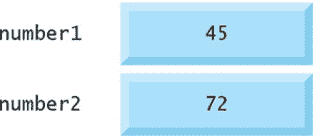

**图 2.7** 在变量 `number1` 和 `number2` 中存储值后的内存位置。

一旦程序获得 `number1` 和 `number2` 的值，它就将这些值相加，并将总和放入变量 `sum`。语句

```cpp
sum = number1 + number2; // add the numbers; store result in sum
```

*替换* `sum` 中存储的任何值。计算出的 `number1` 和 `number2` 之和被放入变量 `sum`，而不考虑 `sum` 中可能已经存在什么值——该值会*丢失*。计算 `sum` 后，内存如**图 2.8**所示。`number1` 和 `number2` 的值与计算前完全一样。计算机执行计算时使用了这些值，但*没有*销毁它们。因此，当从内存位置读取一个值时，该操作是**非破坏性**的。

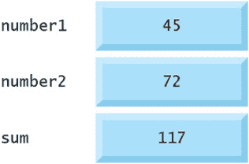

**图 2.8** 计算并存储 `number1` 和 `number2` 的 `sum` 后的内存位置。

### 2.6 算术

大多数程序执行算术计算。**图 2.9** 总结了**算术运算符**。注意其中使用了代数中未使用的各种特殊符号。星号（`*`）表示*乘法*，**百分号**（`%`）是求余运算符，我们稍后将讨论。**图 2.9**中的算术运算符都是*二元*运算符——它们各接受两个操作数。例如，表达式 `number1 + number2` 包含二元运算符 `+` 以及两个操作数 `number1` 和 `number2`。

**图 2.9 算术运算符。**

| 运算 | 算术运算符 | 代数表达式 | C++ 表达式 |
|---|---|---|---|
| 加法 | `+` | `f + 7` | `f + 7` |
| 减法 | `−` | `p − c` | `p − c` |
| 乘法 | `*` | `bm` 或 `b · m` | `b * m` |
| 除法 | `/` | `x / y` 或 `x⁄y` 或 `x ÷ y` | `x / y` |
| 求余 | `%` | `r mod s` | `r % s` |

**整数除法**（即分子和分母都是整数）产生整数商；例如，表达式 `7 / 4` 的值为 `1`，表达式 `17 / 5` 的值为 `3`。**整数除法中的任何小数部分都会被截断**（即丢弃）——不会发生舍入。

**求余运算符** `%` 产生*整数除法后的余数*，并且*只能*用于整数操作数。表达式 `x % y` 产生 `x` 除以 `y` 后的余数。因此，`7 % 4` 产生 `3`，`17 % 5` 产生 `2`。在后续章节中，我们将讨论求余运算符的有趣应用，例如判断一个数是否是另一个数的*倍数*（其特殊情况是判断一个数是*奇数*还是*偶数*）。

### 直线形式的算术表达式

C++ 中的算术表达式必须以**直线形式**输入计算机。因此，诸如“`a` 除以 `b`”这样的表达式必须写成 `a / b`，以便所有常量、变量和运算符都出现在一条直线上。代数记法

\[
\frac{a}{b}
\]

通常*不*被编译器接受，尽管一些专用软件包确实支持更自然的复杂数学表达式记法。


### 用圆括号将子表达式分组

在 C++ 表达式中，圆括号的用法与代数表达式相同。例如，要将 `a` 乘以量 `b + c`，我们写作 `a * (b + c)`。

### 运算符优先级规则

C++ 按照以下**运算符优先级规则**所确定的精确顺序，对算术表达式中的运算符求值；这些规则通常与代数中的规则相同：

1. 成对*圆括号*内的表达式中的运算符最先求值。圆括号被认为处于“最高优先级”。对于*嵌套*或*嵌入*的**圆括号**，例如

```cpp
(a * (b + c))
```

*最内层*圆括号中的运算符最先求值。

2. 乘法、除法和求余运算接下来求值。如果一个表达式包含多个乘法、除法和求余运算，则运算符按*从左到右*的顺序应用。这三个运算符被认为处于*同一*优先级。

3. 加法和减法运算最后应用。如果一个表达式包含多个加法和减法运算，则运算符按*从左到右*的顺序应用。加法和减法也具有*相同*的优先级。

运算符优先级规则定义了 C++ 应用运算符的顺序。当我们说某些运算符从左到右应用时，指的是运算符的**结合性**。例如，表达式中的加法运算符（`+`）

```cpp
a + b + c
```

从左到右结合，因此先计算 `a + b`，然后将 `c` 加到该和上，以确定整个表达式的值。我们将看到，有些运算符从*右到左*结合。**图 2.10** 总结了这些运算符优先级规则。随着我们引入其他 C++ 运算符，我们会扩展此表。**附录 A** 包含完整的优先级表。

**图 2.10 算术运算符的优先级。**

| 运算符 | 运算 | 求值顺序（优先级） |
|---|---|---|
| `( )` | 圆括号 | 最先求值。对于*嵌套*圆括号，例如表达式 `a * (b + c / (d + e))` 中，*最内层*圆括号对中的表达式最先求值。**注意：** 如果有类似 `(a + b) * (c - d)` 的表达式，其中两组圆括号并非嵌套，而是出现在“同一层级”，则 C++ 标准*不*规定这些带圆括号的子表达式的求值顺序。 |
| `*`<br>`/`<br>`%` | 乘法<br>除法<br>求余 | 第二求值。如果有多个，则从左到右求值。 |
| `+`<br>`−` | 加法<br>减法 | 最后求值。如果有多个，则从左到右求值。 |

### 代数表达式与 C++ 表达式示例

现在根据运算符优先级规则来考虑几个表达式。每个示例列出一个代数表达式及其 C++ 等价形式。下面是一个五项算术平均值（平均数）的示例：

$$\textit{代数：}\quad m = \frac{a+b+c+d+e}{5}$$

$$\textit{C++：}\quad m = (a+b+c+d+e)/5;$$

圆括号是必需的，因为除法的优先级*高于*加法。*整个*量 \((a+b+c+d+e)\) 要除以 5。如果错误地省略圆括号，我们会得到 \(a + b + c + d + e / 5\)，其求值结果错误地为

$$a + b + c + d + \frac{e}{5}$$

下面是一个直线方程的示例：

```text
Algebra:  y = mx + b
C++:      y = m*x+b;
```

不需要圆括号。先应用乘法，因为乘法具有*更高的优先级*。

下面的示例包含求余（%）、乘法、除法、加法、减法和赋值运算：

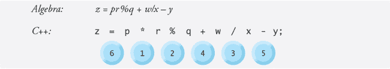

语句下方带圈的数字表示 C++ 应用运算符的顺序。乘法、求余和除法运算按从左到右的顺序*最先*求值（即它们从左到右结合），因为它们的优先级*高于*加法和减法。接下来应用加法和减法。它们也按从左到右的顺序应用。赋值运算符*最后*应用，因为它的优先级*低于*任何算术运算符。

### 二次多项式的求值

为了更好地理解运算符优先级规则，考虑二次多项式 \(y = ax^2 + bx + c\) 的求值：


*C++ 中没有用于求幂的算术运算符，因此我们将* \(x^2\) *表示为* `x * x`。语句下方带圈的数字表示 C++ 应用运算符的顺序。在**第 5 章**中，我们将讨论执行求幂的标准库函数 `pow`（“power”，即幂）。

假设前面二次多项式中的变量 `a`、`b`、`c` 和 `x` 初始化如下：`a = 2`、`b = 3`、`c = 7` 和 `x = 5`。**图 2.11** 说明了运算符的应用顺序以及表达式的最终值。

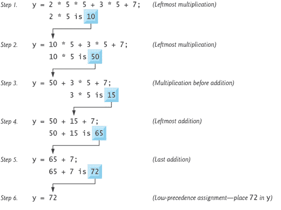

**图 2.11 二次多项式的求值顺序。**

### 冗余圆括号

与代数中一样，可以在表达式中放置*不必要的*圆括号以使其更清晰。这些圆括号称为**冗余圆括号**。例如，二次多项式可以加圆括号如下：

```cpp
y = ((a * x * x) + (b * x)) + c;
```

### 2.7 决策：相等运算符与关系运算符

现在我们介绍 C++ 的 `if` 语句，它允许程序根据**条件**的真假采取不同的操作。`if` 语句中的条件可以通过使用**图 2.12** 中总结的**关系运算符**和**相等运算符**来构成。所有关系运算符都具有相同的优先级，并且从左到右结合。两个相等运算符都具有相同的优先级，该优先级*低于*关系运算符的优先级，并且从左到右结合。

**图 2.12 关系运算符和相等运算符。**

| 代数关系或相等运算符 | C++ 关系或相等运算符 | C++ 条件示例 | C++ 条件的含义 |
|---|---|---|---|
| *关系运算符* |  |  |  |
| `>` | `>` | `x > y` | `x` 大于 `y` |
| `<` | `<` | `x < y` | `x` 小于 `y` |
| `>=` | `>=` | `x >= y` | `x` 大于或等于 `y` |
| `<=` | `<=` | `x <= y` | `x` 小于或等于 `y` |
| *相等运算符* |  |  |  |
| `=` | `==` | `x == y` | `x` 等于 `y` |
| `≠` | `!=` | `x != y` | `x` 不等于 `y` |


**常见编程错误 2.3**

*颠倒运算符* `!=`、`>=` *和* `<=` *中一对符号的顺序*（*分别将它们写成* `=!`、`=>` *和* `=<`）*通常会导致语法错误。在某些情况下，将* `!=` *写成* `=!` *不会是语法错误，但几乎肯定会是一个在执行时产生影响的* **逻辑错误**。*当你在* **第 5 章** *学习逻辑运算符时，就会明白原因。* *一个* **致命逻辑错误** *会导致程序失败并提前终止。* *一个* **非致命逻辑错误** *允许程序继续执行，但通常会产生错误的结果。*

**常见编程错误 2.4**

将相等运算符 `==` 与赋值运算符 `=` 混淆会导致逻辑错误。我们喜欢把相等运算符读作“等于”或“双等号”，把赋值运算符读作“获取”或“取得……的值”或“被赋值为……”。正如你将在[第 5.12 节](#)中看到的，混淆这些运算符不一定会导致容易识别的语法错误，但可能会导致微妙的逻辑错误。

### 使用 `if` 语句

下面的示例（[图 2.13](#)）使用六个 `if` 语句比较用户输入的两个数字。如果给定 `if` 语句的条件为*真*，则该 `if` 语句体中的输出语句*执行*。如果条件为*假*，则语句体中的输出语句*不*执行。


```cpp
// Fig. 2.13: fig02_13.cpp
// Comparing integers using if statements, relational operators
// and equality operators.
#include <iostream> // enables program to perform input and output

using std::cout; // program uses cout
using std::cin; // program uses cin
using std::endl; // program uses endl

// function main begins program execution
int main()
{
   int number1{0}; // first integer to compare (initialized to 0)
   int number2{0}; // second integer to compare (initialized to 0)

   cout << "Enter two integers to compare: "; // prompt user for data
   cin >> number1 >> number2; // read two integers from user

   if (number1 == number2) {
      cout << number1 << " == " << number2 << endl;
   }

   if (number1 != number2) {
      cout << number1 << " != " << number2 << endl;
   }

   if (number1 < number2) {
      cout << number1 << " < " << number2 << endl;
   }

   if (number1 > number2) {
      cout << number1 << " > " << number2 << endl;
   }

   if (number1 <= number2) {
      cout << number1 << " <= " << number2 << endl;
   }

   if (number1 >= number2) {
      cout << number1 << " >= " << number2 << endl;
   }
} // end function main
```

```text
Enter two integers to compare: 3 7
3 != 7
3 < 7
3 <= 7
```

```text
Enter two integers to compare: 22 12
22 != 12
22 > 12
22 >= 12
```

```text
Enter two integers to compare: 7 7
7 == 7
7 <= 7
7 >= 7
```

**图 2.13** 使用 `if` 语句、关系运算符和相等运算符比较整数。

## *using* 声明

第 6–8 行

```cpp
using std::cout; // program uses cout
using std::cin;  // program uses cin
using std::endl; // program uses endl
```

是 **using 声明**，它们免除了像前面程序中那样重复书写 `std::` 前缀的需要。现在，在程序的其余部分中，我们可以分别写 `cout` 代替 `std::cout`、`cin` 代替 `std::cin`、`endl` 代替 `std::endl`。

许多程序员更喜欢用 **using 指令**来替代第 6–8 行：

```cpp
using namespace std;
```

该指令允许程序使用可能包含的任何标准 C++ 头文件（如 `<iostream>`）中的*所有*名称。从本书此处往后，我们将在程序中使用上述指令。²

2. 在第 23 章“其他主题”中，我们将讨论大型系统中使用 `using` 指令的一些问题。

## 变量声明与从用户读取输入

第 12–13 行

```cpp
int number1{0}; // first integer to compare (initialized to 0)
int number2{0}; // second integer to compare (initialized to 0)
```

声明了程序中使用的变量，并将其初始化为 `0`。

### 第 16 行

```cpp
cin >> number1 >> number2; // read two integers from user
```

使用级联的*流提取*运算来输入两个整数。回顾一下，由于第 7 行的存在，我们可以写 `cin`（而不是 `std::cin`）。首先将一个值读入变量 `number1`，然后读入变量 `number2`。

## 比较数字

第 18–20 行的 `if` 语句

```cpp
if (number1 == number2) {
    cout << number1 << " == " << number2 << endl;
}
```

比较变量 `number1` 和 `number2` 的值以测试相等性。如果值相等，第 19 行的语句会显示一行文本，表明这两个数相等。如果从第 22、26、30、34 和 38 行开始的一个或多个 `if` 语句中的条件为 `true`，则相应的执行体语句会显示一行适当的文本。

**图 2.13** 中的每个 `if` 语句都包含一条缩进的执行体语句。还要注意，我们将每条执行体语句都用一对花括号 `{ }` 括了起来，这构成了所谓的**复合语句**或**块**。


### 良好编程实践 2.9

*将 `if` 语句执行体中的语句缩进，以增强可读性。*


### 防错提示 2.2

*对于单条语句的执行体，不需要使用花括号 `{ }`，但对于多条语句的执行体，则必须包含花括号。稍后你会看到，忘记用花括号括起多条语句的执行体会导致错误。为避免错误，作为一条规则，始终用花括号括起 `if` 语句的执行体语句。*


### 常见编程错误 2.5

在 `if` 语句的条件右括号之后立即放置分号通常是一个逻辑错误（虽然不是语法错误）。这个分号会导致 `if` 语句的执行体为空，因此无论条件是否为真，`if` 语句都不执行任何操作。更糟糕的是，`if` 语句原来的执行体语句现在变成了与 `if` 语句顺序执行的一条语句，并且总是会被执行，这常常导致程序产生不正确的结果。

## 空白

请注意我们在图 2.13 中对空行的使用。插入这些空行是为了提高可读性。回想一下，诸如制表符、换行符和空格之类的空白字符通常会被编译器忽略。因此，语句可以分成多行，也可以按照你的偏好随意留出空格。将标识符、字符串（如 `"hello"`）和常量（如数字 `1000`）分成多行则属于语法错误。


### 良好编程实践 2.10

*较长的语句可以分成多行。如果必须将一条语句拆行，请选择有意义的断点，例如在以逗号分隔的列表中逗号之后，或在较长的表达式中一个运算符之后。如果一条语句被分成两行或多行，请缩进所有后续行，并使缩进行组左对齐。*

## 运算符优先级

**图 2.14** 展示了本章介绍过的运算符的优先级和结合性。运算符按优先级从高到低由上至下排列。除赋值运算符 `=` 以外，所有这些运算符都是从左向右结合的。加法是左结合的，因此像 `x + y + z` 这样的表达式按 `(x + y) + z` 来求值。赋值运算符 `=` 则是从*右*向左结合的，因此像 `x = y = 0` 这样的表达式按 `x = (y = 0)` 来求值，正如我们很快就会看到的，这首先将 `0` 赋给 `y`，然后将该赋值的*结果*——`0`——赋给 `x`。

**图 2.14** 迄今为止讨论过的运算符的优先级和结合性。

| 运算符 | 结合性 | 类型 |
|---|---|---|
| `()` | *[参见图 2.10 中的警告]* | 分组括号 |
| `*` `/` `%` | 从左到右 | 乘法 |
| `+` `-` | 从左到右 | 加法 |
| `<<` `>>` | 从左到右 | 流插入/提取 |
| `<` `<=` `>` `>=` | 从左到右 | 关系 |
| `==` `!=` | 从左到右 | 相等 |
| `=` | 从右到左 | 赋值 |


### 良好编程实践 2.11

*在编写包含许多运算符的表达式时，请参阅运算符优先级和结合性表（附录 A）。确认表达式中的运算符按你期望的顺序执行。如果你不确定复杂表达式中的求值顺序，请将表达式拆分为更小的语句，或使用括号强制求值顺序，就像在代数表达式中那样。务必注意，某些运算符（如赋值运算符 `=`）是从右向左结合，而不是从左向右。*

### 2.8 小结

在本章中，你学习了 C++ 的许多重要的基本特性，包括在屏幕上显示数据、从键盘输入数据以及声明基本类型的变量。特别是，你学习了使用输出流对象 `cout` 和输入流对象 `cin` 来构建简单的交互式程序。我们解释了变量如何在内存中存储和取出。你还学习了如何使用算术运算符进行计算。我们讨论了 C++ 应用运算符的顺序（即运算符优先级规则），以及运算符的结合性。你还学习了 C++ 的 `if` 语句如何让程序做出决策。最后，我们介绍了相等运算符和关系运算符，并用它们在 `if` 语句中构成条件。

这里介绍的面向非对象的应用程序让你接触到了基本的编程概念。正如你将在**第 3 章**中看到的，C++ 应用程序在函数 `main` 中通常只包含几行代码——这些语句通常创建执行应用程序工作的对象，然后由对象“接管后续工作”。在**第 3 章**中，你将学习如何实现自己的类，并在应用程序中使用这些类的对象。


### 小结

### 2.2节 C++ 的第一个程序：打印一行文本

- **单行注释**（第46页）以 `//` 开头。插入注释可为程序提供文档说明并提高可读性。
- 程序运行时，**注释**不会使计算机执行任何**操作**（第47页）——它们会被编译器忽略。
- **预处理指令**（第46页）以 `#` 开头，是发给 C++ 预处理器的消息。预处理指令在程序编译之前处理。
- `#include <iostream>` 行（第46页）告诉 C++ 预处理器包含输入/输出流头文件的内容，该头文件包含编译向屏幕输出数据或从键盘输入数据的程序所需的信息。
- **空白**（即空行、空格字符和制表符；第46页）使程序更易读。字符串字面量之外的空白字符会被编译器忽略。
- C++ 程序从 `main`（第47页）开始执行，即使 `main` 不是程序中第一个出现的。
- `main` 左侧的关键字 `int` 表示 `main`“返回”一个整数值。
- 每个函数的**函数体**（第47页）必须包含在花括号（`{` 和 `}`）中。
- 双引号中的**字符串**（第47页）有时称为**字符字符串**、**消息**或**字符串字面量**。字符串中的空白字符*不会*被编译器忽略。
- 大多数 C++ **语句**（第47页）以分号结尾，分号也称为语句终止符（我们很快会看到一些例外）。
- C++ 中的输出和输入通过数据**流**（第47页）完成。
- 输出流对象 `std::cout`（第47页）——通常连接到屏幕——用于输出数据。通过连接**流插入**（`<<`；第48页）运算符可以输出多个数据项。
- 输入流对象 `std::cin`——通常连接到键盘——用于输入数据。通过连接流提取（`>>`）运算符可以输入多个数据项。
- 记号 `std::cout` 指定我们正在使用来自“命名空间”`std` 的 `cout`。
- 当在字符串中遇到反斜杠（即转义字符）时，下一个字符会与反斜杠组合形成**转义序列**（第48页）。
- **换行转义序列** `\n`（第48页）将光标移到屏幕上下一行的开头。
- C++ 关键字 `return`（第49页）是退出函数的几种方式之一。

### 2.4节 另一个 C++ 程序：整数相加

- C++ 程序中的所有**变量**（第**51**页）在使用前都必须声明。
- `int` 类型的变量（第**51**页）保存整数值，即诸如 7、−11、0、31914 这样的整数。
- 变量可以在其声明中使用**列表初始化**（第**51**页；C++11 引入）进行初始化——变量的初始值放在紧跟在变量名之后的花括号（`{` 和 `}`）中。
- 变量名是任何不是关键字的有效**标识符**（第**51**页）。标识符是由字母、数字和下划线（`_`）组成的一系列字符。标识符不能以数字开头。标识符可以任意长度，但某些系统或 C++ 实现可能施加长度限制。
- 指示用户采取特定操作的消息称为**提示**（第**52**页）。
- C++ 是**区分大小写**的（第**52**页）。
- 程序使用 `std::cin`（第**53**页）对象和**流提取**（`>>`；第**53**页）运算符读取用户的输入。
- 大多数计算在**赋值语句**（第**53**页）中执行。

### 2.5节 内存概念

- 变量是**内存**（第**54**页）中的一个位置，值可以存储在那里供程序使用。
- 存储在计算机内存中的每个变量都有名称、值、类型和大小。
- 每当将新值放入内存位置时，该过程是**破坏性**的（第**54**页）；即新值替换该位置中的先前值。先前的值会丢失。
- 当从内存读取值时，该过程是**非破坏性**的（第**55**页）；即读取值的副本，使原始值在内存位置中保持不变。
- `std::endl` **流操纵器**（第**54**页）输出一个换行，然后“刷新输出缓冲区”。

### 2.6节 算术

- C++ 按照由**运算符优先级规则**（第56页）和**结合性**（第56页）确定的精确顺序计算**算术表达式**（第55页）。
- 可以使用圆括号对表达式分组。
- **整数除法**（第56页）产生整数商。整数除法中的任何小数部分都会被截断。
- **求余运算符** `%`（第56页）产生整数除法后的余数。

### 2.7节 决策：相等和关系运算符

- `if` **语句**（第59页）允许程序根据条件是否满足采取替代操作。`if` 语句的格式为

```cpp
if (condition) {
    statement;
}
```

如果条件为真，则执行 `if` 主体中的语句。如果条件不满足，即条件为假，则跳过主体语句。

- `if` 语句中的条件通常使用**相等和关系运算符**（第59页）构成。使用这些运算符的结果始终是值*真*或*假*。
- `using` **声明**（第61页）

```cpp
using std::cout;
```

告知编译器在哪里找到 `cout`（命名空间 `std`），并消除重复 `std::` 前缀的需要。**using** 指令

```cpp
using namespace std;
```

使程序能够使用任何包含的 C++ 标准库头文件中的所有名称。

### 自测练习

- **2.1** 填写下列各题的空白。
  - A. 每个 C++ 程序都从函数 ______ 开始执行。
  - B. 每个函数体以 ______ 开始，以 ______ 结束。
  - C. 大多数 C++ 语句以 ______ 结尾。
  - D. 转义序列 `\n` 表示 ______ 字符，它使光标定位到屏幕上下一行的开头。
  - E. ______ 语句用于做出决策。
- **2.2** 判断下列各题是*真*还是*假*。如果是*假*，请解释原因。假设已使用语句 `using std::cout;`。
  - A. 注释会使计算机在程序执行时在屏幕上打印 `//` 之后的文本。
  - B. 当使用 `cout` 和流插入运算符输出转义序列 `\n` 时，会使光标定位到屏幕上下一行的开头。
  - C. 所有变量在使用前都必须声明。
  - D. 所有变量在声明时都必须指定类型。
  - E. C++ 认为变量 `number` 和 `NuMbEr` 是相同的。
  - F. 声明几乎可以出现在 C++ 函数体中的任何位置。
  - G. 求余运算符（`%`）只能用于整数操作数。
  - H. 算术运算符 `*`、`/`、`%`、`+` 和 `−` 都具有相同的优先级。
  - I. 打印三行输出的 C++ 程序必须包含三条使用 `cout` 和流插入运算符的语句。
- **2.3** 编写一条 C++ 语句来完成下列各项（假设既未使用 `using` 声明，也未使用 `using` 指令）：
  - A. 声明变量 `c`、`thisIsAVariable`、`q76354` 和 `number` 为 `int` 类型（在一条语句中），并将每个变量初始化为 `0`。
  - B. 提示用户输入一个整数。在提示消息末尾使用冒号（`:`）后跟一个空格，并让光标位于该空格之后。
  - C. 从键盘读取用户输入的一个整数，并将其存储到整型变量 `age` 中。
  - D. 如果变量 `number` 不等于 `7`，则打印 "The variable number is not equal to 7"。
  - E. 在一行上打印消息 "This is a C++ program"。
  - F. 在两行上打印消息 "This is a C++ program"。第一行以 `C++` 结尾。


- G. 打印消息 `"This is a C++ program"`，每个单词占一行。
- H. 打印消息 `"This is a C++ program"`。用制表符将每个单词与下一个单词分隔。

- 4. **2.4** 编写一条语句（或注释）来完成以下各项（假设已为 `cin`、`cout` 和 `endl` 使用了 `using` 声明）：
  - A. 用注释说明程序计算三个整数的乘积。
  - B. 声明变量 `x`、`y`、`z` 和 `result` 为 `int` 类型（分别使用单独的语句），并将每个变量初始化为 0。
  - C. 提示用户输入三个整数。
  - D. 从键盘读取三个整数并存入变量 `x`、`y` 和 `z`。
  - E. 计算变量 `x`、`y` 和 `z` 中三个整数的乘积，并将结果赋给变量 `result`。
  - F. 打印 `"The product is "`，后跟变量 `result` 的值。
  - G. 从 `main` 返回一个值，表明程序成功终止。

- 5. **2.5** 使用你在**练习 2.4**中编写的语句，编写一个完整程序，计算并显示三个整数的乘积。在代码中的适当位置添加注释。

  [注意：你需要编写必要的 `using` 声明或指令。]

- 6. **2.6** 找出并改正以下各语句中的错误（假设已使用语句 `using std::cout;`）：
  - A.

```cpp
if (c < 7); {
    cout << "c is less than 7\n";
}
```

  - B.

```cpp
if (c => 7) {
    cout << "c is equal to or greater than 7\n";
}
```

## 练习

- 1. **2.7** 讨论以下各个对象的含义：
  - A. `std::cin`
  - B. `std::cout`

- 2. **2.8** 填写以下各题中的空白：
  - A. _____ 用于记录程序并提高其可读性。
  - B. 用于在屏幕上打印信息的对象是 _____。
  - C. 做出决策的 C++ 语句是 _____。
  - D. 大多数计算通常由 _____ 语句执行。
  - E. _____ 对象从键盘输入值。

- 3. **2.9** 编写一条 C++ 语句或一行代码来完成以下各项：
  - A. 打印消息 `"Enter two numbers"`。
  - B. 将变量 `b` 和 `c` 的乘积赋给变量 `a`。
  - C. 说明程序执行工资计算（即使用有助于记录程序的文本）。
  - D. 从键盘输入三个整数值到整型变量 `a`、`b` 和 `c`。

- 4. **2.10** 指出以下各项中哪些是**真**，哪些是**假**。如果为**假**，请解释你的答案。
  - A. 所有运算符都从左到右求值。
  - B. 以下都是有效的变量名：`under_bar`、`m928134`、`t5`、`j7`、`her_sales`、`his_account_total`、`a`、`b`、`c`、`z`、`z2`。
  - C. 语句 `cout << "a = 5;";` 是赋值语句的典型示例。
  - D. 不含括号的有效算术表达式从左到右求值。
  - E. 以下都是无效的变量名：`3g`、`87`、`67h2`、`h22`、`2h`。

- 5. **2.11** 填写以下各题中的空白：
  - A. 哪些算术运算与乘法具有相同的优先级？________。
  - B. 当括号嵌套时，算术表达式中哪一组括号先求值？________。
  - C. 计算机内存中在程序执行期间的不同时刻可能包含不同值的位置称为 ________。

- 6. **2.12** 执行以下各语句时，如果有输出，会打印什么？如果没有任何打印内容，则回答“无”。假设 `x = 2` 且 `y = 3`。
  - A. `cout << x;`
  - B. `cout << x + x;`
  - C. `cout << "x=";`
  - D. `cout << "x = " << x;`
  - E. `cout << x + y << " = " << y + x;`
  - F. `z = x + y;`
  - G. `cin >> x >> y;`
  - H. `// cout << "x + y = " << x + y;`
  - I. `cout << "\n";`

- 7. **2.13** 以下哪些语句包含其值会被替换的变量？
  - A. `cin >> b >> c >> d >> e >> f;`
  - B. `p = i + j + k + l;`
  - C. `cout << "variables whose values are replaced";`
  - D. `cout << "a = 5";`

- 8. **2.14** 给定代数方程 *y = ax³ + 7*，以下哪些（如果有）是该方程的正确 C++ 语句？
  - A. `y = a * x * x * x + 7;`
  - B. `y = a * x * x * (x + 7);`
  - C. `y = (a * x) * x * (x + 7);`
  - D. `y = (a * x) * x * x + 7;`
  - E. `y = a * (x * x * x) + 7;`
  - F. `y = a * x * (x * x + 7);`

- 9. **2.15** **（求值顺序）** 说明以下各 C++ 语句中运算符的求值顺序，并给出每条语句执行后 `x` 的值。
  - A. `x = 7 + 3 * 6 / 2 - 1;`
  - B. `x = 2 % 2 + 2 * 2 - 2 / 2;`
  - C. `x = (3 * 9 * (3 + (9 * 3 / (3))));`

- 10. **2.16** （*算术*）编写一个程序，要求用户输入两个数，从用户处获取这两个数，并打印这两个数的和、积、差和商。

- 11. **2.17** （*打印*）编写一个程序，在同一行打印数字 1 到 4，每对相邻数字之间用一个空格分隔。用几种方式实现：
  - A. 使用一条带一个流插入运算符的语句。
  - B. 使用一条带四个流插入运算符的语句。
  - C. 使用四条语句。

- 12. **2.18** （*比较整数*）编写一个程序，要求用户输入两个整数，从用户处获取这两个数，然后打印较大的数，后跟单词 `"is larger."`。如果两个数相等，则打印消息 `"These numbers are equal."`

- 13. **2.19** （*算术、最小值和最大值*）编写一个程序，从键盘输入三个整数，并打印这些数的和、平均值、乘积、最小值和最大值。屏幕对话应如下所示：

```text
Input three different integers: 13 27 14
Sum is 54
Average is 18
Product is 4914
Smallest is 13
Largest is 27
```

- 14. **2.20** **（圆的直径、周长和面积）** 编写一个程序，以整数形式读入圆的半径，并打印该圆的直径、周长和面积。π 使用常量值 3.14159。所有计算都在输出语句中完成。*[注意：本章我们只讨论了整型常量和变量。第 4 章将讨论浮点数，即带小数点的值。]*

- 15. **2.21** **（用星号显示形状）** 编写一个程序，按如下所示打印一个方框、一个椭圆、一个箭头和一个菱形：

```text
*********          ***              *                 *
*       *          *               ***              *  *
*       *          *              *****             *  *
*       *          *                *              *    *
*       *          *                *             *      *
*       *          *                *             *      *
*       *          *                *              *    *
*       *          *               * *              *  *
*********          ***              *                 *
```

- 16. **2.22** 以下代码打印什么？

```cpp
cout << "*\n**\n***\n****\n*****" << endl;
```

- 17. **2.23** **（最大和最小整数）** 编写一个程序，读入五个整数，并确定和打印该组中的最大整数和最小整数。只使用本章学到的编程技术。

- 18. **2.24** **（奇数或偶数）** 编写一个程序，读入一个整数，并确定和打印它是奇数还是偶数。[*提示：* 使用求余运算符（`%`）。偶数是 2 的倍数。任何 2 的倍数除以 2 时余数都为零。]

- 19. **2.25** **（倍数）** 编写一个程序，读入两个整数，并确定和打印第一个数是否为第二个数的倍数。[*提示：* 使用求余运算符（`%`）。]

- 20. **2.26** **（棋盘图案）** 用八条输出语句显示以下棋盘图案，然后用尽可能少的语句显示相同图案。

```text
* * * * * * * *
* * * * * * * *
* * * * * * * *
* * * * * * * *
* * * * * * * *
* * * * * * * *
* * * * * * * *
* * * * * * * *
```


### 21. **2.27**（*字符的整数等效*）

这里先预览一下。在本章中，你学习了整数和 `int` 类型。C++ 还能表示大写字母、小写字母以及各种各样的特殊符号。C++ 在内部使用小整数来表示每个不同的字符。计算机使用的字符集以及这些字符对应的整数表示称为该计算机的**字符集**。你可以用单引号将字符括起来进行打印，例如：

```cpp
cout << 'A'; // print an uppercase A
```

你可以使用 `static_cast` 打印字符的整数等效值，如下所示：

```cpp
cout << static_cast<int>('A'); // print 'A' as an integer
```

这称为**强制类型转换**操作（我们将在**第 4 章**正式介绍强制类型转换）。当上述语句执行时，它会打印值 65（在使用 **ASCII 字符集**的系统中）。编写一个程序，打印从键盘键入的字符的整数等效值。将输入存储在 `char` 类型的变量中。使用大写字母、小写字母、数字和特殊字符（如 `$`）多次测试你的程序。

### 22. **2.28**（*整数的各位数字*）

编写一个程序，输入一个五位整数，将该整数分离成各个数字，并打印它们，每个数字之间用三个空格分隔。[*提示：* 使用整数除法和取余运算符。] 例如，如果用户输入 42339，程序应打印：

```
4 2 3 3 9
```

### 23. **2.29**（*表格*）

使用本章的技术，编写一个程序，计算从 0 到 10 的整数的平方和立方。使用制表符打印以下格式整齐的值表：

| 整数 | 平方 | 立方 |
|---:|---:|---:|
| 0 | 0 | 0 |
| 1 | 1 | 1 |
| 2 | 4 | 8 |
| 3 | 9 | 27 |
| 4 | 16 | 64 |
| 5 | 25 | 125 |
| 6 | 36 | 216 |
| 7 | 49 | 343 |
| 8 | 64 | 512 |
| 9 | 81 | 729 |
| 10 | 100 | 1000 |

## 做出改变

### 1. **2.30**（**身体质量指数计算器**）

我们在**练习 1.9** 中介绍了身体质量指数（BMI）计算器。计算 BMI 的公式如下：

$$
\mathrm{BMI}=\frac{\text{体重（磅）}\times 703}{\text{身高（英寸）}\times\text{身高（英寸）}}
$$

或

$$
\mathrm{BMI}=\frac{\text{体重（千克）}}{\text{身高（米）}\times\text{身高（米）}}
$$

创建一个 BMI 计算器应用程序，读取用户的体重（磅）和身高（英寸）（或者，如果你愿意，读取用户的体重（千克）和身高（米）），然后计算并显示用户的身体质量指数。此外，该应用程序还应显示美国卫生与公众服务部/国立卫生研究院的以下信息，以便用户评估其 BMI：

```
BMI VALUES

Underweight: less than 18.5
Normal:       between 18.5 and 24.9
Overweight:    between 25 and 29.9
Obese:         30 or greater
```

> [注意：在本章中，你学习了使用 `int` 类型表示整数。使用 `int` 值进行 BMI 计算时，结果都是整数。在**第 4 章**中，你将学习使用 `double` 类型表示带小数点的数字。使用 `double` 进行 BMI 计算时，每次都会产生带小数点的数字——这些数字称为“浮点数”。]

### 2. **2.31**（*拼车节省计算器*）

研究几个拼车网站。创建一个应用程序，计算你每天开车的费用，这样你就可以估算通过拼车可以节省多少钱，拼车还有其他优点，例如减少碳排放和缓解交通拥堵。该应用程序应输入以下信息，并显示用户每天开车上班的费用：

- A. 每天行驶的总英里数。
- B. 每加仑汽油的成本。
- C. 每加仑汽油平均行驶的英里数。
- D. 每天停车费。
- E. 每天过路费。

## 自测练习答案

### 1. **2.1**

- A. `main`.
- B. 左花括号（`{`），右花括号（`}`）。
- C. 分号。
- D. 换行符。
- E. `if`.

### 2. **2.2**

- A. *错误。* 注释在程序执行时不会引起任何操作。它们用于记录程序并提高可读性。
- B. *正确。*
- C. *正确。*
- D. *正确。*
- E. *错误。* C++ 区分大小写，因此这些变量是不同的。
- F. *正确。*
- G. *正确。*
- H. *错误。* 运算符 `*`、`/` 和 `%` 具有相同的优先级，而运算符 `+` 和 `-` 的优先级较低。
- I. *错误。* 一条包含 `cout` 和多个 `\n` 转义序列的语句可以打印多行。

### 3. **2.3**

- A. `int c{0}, thisIsAVariable{0}, q76354{0}, number{0};`
- B. `std::cout << "Enter an integer: ";`
- C. `std::cin >> age;`
- D.

  ```cpp
  {
      if (number != 7) {
          std::cout << "The variable number is not equal to 7\n";
      }
  }
  ```

- E. `std::cout << "This is a C++ program\n";`
- F. `std::cout << "This is a C++\nprogram\n";`
- G. `std::cout << "This\nis\na\nC++\nprogram\n";`
- H. `std::cout << "This\tis\ta\tC++\tprogram\n";`

### 4. **2.4**

- A. `// Calculate the product of three integers`
- B.

  ```cpp
  {
      int x{0};
      int y{0};
      int z{0};
      int result{0};
  }
  ```

- C. `cout << "Enter three integers: ";`
- D. `cin >> x >> y >> z;`
- E. `result = x * y * z;`
- F. `cout << "The product is " << result << endl;`
- G. `return 0;`

### 5. **2.5**（见下面的程序。）

```cpp
// Calculate the product of three integers
#include <iostream> // enables program to perform input and output
using namespace std; // program uses names from the std namespace

// function main begins program execution
int main() {
    int x{0}; // first integer to multiply
    int y{0}; // second integer to multiply
    int z{0}; // third integer to multiply
    int result{0}; // the product of the three integers

    cout << "Enter three integers: "; // prompt user for data
    cin >> x >> y >> z; // read three integers from user
    result = x * y * z; // multiply the three integers; store result
    cout << "The product is " << result << endl; // print result; end line
} // end function main
```

### 6. **2.6**

- A. *错误：* `if` 语句条件右括号后多了分号。*改正：* 删除右括号后的分号。[*注意：* 此错误的结果是，无论 `if` 语句中的条件是否为真，输出语句都会执行。] 右括号后的分号是一条不执行任何操作的空语句。我们将在**第 4 章**中进一步讨论空语句。

- B. *错误：* 错误的关系运算符 `=>`。
  *改正：* 将 `=>` 改为 `>=`，你可能还想将“等于或大于”改为“大于或等于”。

## 3 类、对象、成员函数和字符串简介

### 目标

在本章中，你将：

- 开始使用在[第 1.8 节](#)中介绍的面向对象概念进行编程。
- 定义类并使用它创建对象。
- 将类的行为实现为成员函数。
- 将类的属性实现为数据成员。
- 调用对象的成员函数，使它们执行其任务。
- 通过相应的 `public` *get* 和 *set* 函数访问和操作 `private` 数据成员，以强制封装数据。
- 了解成员函数的局部变量是什么，以及它们与类的数据成员有何不同。
- 使用构造函数初始化对象的数据。
- 验证传递给构造函数或成员函数的数据。
- 熟悉 UML 类图。

### 大纲

- 1. **3.1 引言**
- 2. **3.2 测试驱动一个 `Account` 对象**
  - A. **3.2.1 实例化对象**
  - B. **3.2.2 头文件和源代码文件**
  - C. **3.2.3 调用类 `Account` 的 `getName` 成员函数**
  - D. **3.2.4 使用 `getline` 输入 `string`**
  - E. **3.2.5 调用类 `Account` 的 `setName` 成员函数**
- 3. **3.3 带有数据成员以及 set 和 get 成员函数的 `Account` 类**
  - A. **3.3.1 `Account` 类定义**
  - B. **3.3.2 `class` 关键字和类体**
  - C. **3.3.3 类型为 `string` 的数据成员 `name`**
  - D. **3.3.4 `setName` 成员函数**
  - E. **3.3.5 `getName` 成员函数**
  - F. **3.3.6 访问说明符 `private` 和 `public`**
  - G. **3.3.7 `Account` UML 类图**
- 4. **3.4 `Account` 类：使用构造函数初始化对象**


- A. 3.4.1 定义用于自定义对象初始化的`Account`构造函数
- B. 3.4.2 在创建时初始化`Account`对象
- C. 3.4.3 带构造函数的`Account` UML类图
- 5. 3.5 使用Set和Get成员函数的软件工程
- 6. 3.6 带余额的`Account`类；数据验证
  - A. 3.6.1 数据成员`balance`
  - B. 3.6.2 带验证的双参数构造函数
  - C. 3.6.3 带验证的`deposit`成员函数
  - D. 3.6.4 `getBalance`成员函数
  - E. 3.6.5 操作带余额的`Account`对象
  - F. 3.6.6 带余额及成员函数`deposit`和`getBalance`的`Account` UML类图
- 7. 3.7 小结
- 1. 摘要
- 2. 自测练习
- 3. 自测练习答案
- 4. 练习
- 5. 有所作为

### 3.1 引言

**1.8节**对面向对象进行了通俗易懂的介绍，讨论了类、对象、数据成员（属性）和成员函数（行为）。²在本章的示例中，我们通过构建一个简单的银行账户类来让这些概念变成现实。该类将属性`name`和`balance`作为*数据成员*维护，并提供*成员函数*来实现以下行为：

- 查询余额（`getBalance`）。
- 进行存款以增加余额（`deposit`），以及
- 进行取款以减少余额（`withdraw`）。

我们将在本章示例中构建`getBalance`和`deposit`成员函数。你将在**练习3.9**中添加`withdraw`成员函数。

1. 本章依赖于1.8节“面向对象技术简介”中介绍的术语和概念。

2. 与类不同，基本类型（如`int`）没有成员函数。

正如你将看到的，你创建的每个*类*都会成为一种可用于创建对象的*新类型*，因此C++是一种**可扩展的编程语言**。如果你加入工业界的开发团队，你可能会处理包含数百甚至数千个自定义类的应用程序。

### 3.2 试驾`Account`对象

类*不能*自行执行。`Person`对象可以通过告诉`Car`对象该做什么（加速、减速、左转、右转等）来驾驶它——而无需了解汽车内部机制的工作原理。类似地，`main`函数可以通过调用`Account`对象的成员函数来“驱动”它——而无需了解该类的实现方式。从这个意义上说，`main`被称为**驱动程序**。我们先展示`main`程序及其输出，以便你看到`Account`对象的实际运行情况。为了帮助你更好地应对本书后续及工业界中会遇到的更大的程序，我们将`main`定义在单独的文件中（文件`AccountTest.cpp`，**图3.1**）。我们同样将类`Account`定义在单独的文件中（文件`Account.h`，**图3.2**）。

```cpp
// Fig. 3.1: AccountTest.cpp
// Creating and manipulating an Account object.
#include <iostream>
#include <string>
#include "Account.h"

using namespace std;

int main() {
    Account myAccount; // create Account object myAccount

    // show that the initial value of myAccount's name is the empty string
    cout << "Initial account name is: " << myAccount.getName();

    // prompt for and read name
    cout << "\nPlease enter the account name: ";
    string theName;
    getline(cin, theName); // read a line of text
    myAccount.setName(theName); // put theName in myAccount

    // display the name stored in object myAccount
    cout << "Name in object myAccount is: "
         << myAccount.getName() << endl;
}
```

```text
Initial account name is:
Please enter the account name: Jane Green
Name in object myAccount is: Jane Green
```

图3.1 创建并操作一个`Account`对象。

### 3.2.1 实例化对象

通常，在*创建该类的对象*之前，你不能调用该类的成员函数。³第10行

3. 你将在9.15节中看到，`static`成员函数是一个例外。

```cpp
Account myAccount; // create Account object myAccount
```

创建了一个名为`myAccount`的`Account`类对象。该变量的类型是`Account`——即我们在**图3.2**中定义的类。

### 3.2.2 头文件和源代码文件

正如我们在**第2章**中所做的那样，当我们声明`int`类型的变量时，编译器知道`int`是什么——它是“内置于”C++的*基本类型*。然而，在第10行，编译器**并不**预先知道`Account`是什么类型——它是一种**用户自定义类型**。

如果封装得当，新类可以被其他程序员*重用*。通常的做法是，将可重用的类定义放在称为**头文件**的文件中，其文件扩展名为`.h`。⁴在需要使用该类的地方，你可以通过`#include`包含该头文件。例如，通过包含相应的头文件，你可以在任何程序中*重用*C++标准库中的类。

4. C++标准库头文件（如`<iostream>`）不使用`.h`文件扩展名。

类`Account`定义在头文件`Account.h`（**图3.2**）中。我们通过包含其头文件来告诉编译器`Account`是什么，如第5行（**图3.1**）所示：

```cpp
#include "Account.h"
```

如果省略这一行，编译器就会在我们使用类`Account`及其任何功能的地方输出错误信息。在`#include`指令中，*你*在*程序*中定义的头文件放在双引号（`""`）中，而不是像`<iostream>`这样的C++标准库头文件所使用的尖括号（`<>`）中。此示例中的双引号告诉编译器，该头文件与**图3.1**位于同一文件夹中，而不是与C++标准库头文件放在一起。

以`.cpp`文件扩展名结尾的文件是**源代码文件**。正如你将在后面的章节中看到的，这些文件定义了程序的`main`函数、其他函数等内容。你可以将头文件包含到源代码文件中（如**图3.1**所示），不过也可以将它们包含到其他头文件中。

### 3.2.3 调用类`Account`的`getName`成员函数

`Account`类的`getName`成员函数返回存储在特定`Account`对象中的账户名。第13行

```cpp
cout << "Initial account name is: " << myAccount.getName();
```

通过表达式`myAccount.getName()`调用对象的`getName`成员函数，显示`myAccount`的*初始*名称。要为特定对象调用此成员函数，你需要指定对象名（`myAccount`），后跟**点运算符（.）**，然后是成员函数名（`getName`）和一对圆括号。*空的*圆括号表示`getName`执行其任务不需要任何额外信息。很快你就会看到，`setName`函数执行其任务时需要额外信息。

从`main`的角度来看，当调用`getName`成员函数时：

- 1. 程序将执行从调用处（`main`中的第13行）转移到成员函数`getName`。由于`getName`是通过`myAccount`对象调用的，`getName`“知道”要操作哪个对象的数据。
- 2. 接下来，成员函数`getName`执行其任务——即*返回*（也就是归还）`myAccount`的名称给调用该函数的第13行。`main`函数并不了解`getName`如何执行其任务的细节。
- 3. `cout`对象显示成员函数`getName`返回的名称，然后程序继续在`main`中的第16行执行。

在这种情况下，第13行不会显示名称，因为我们尚未在`myAccount`对象中存储名称。

### 3.2.4 使用`getline`输入`string`

第17行

```cpp
string theName;
```

创建了一个名为`theName`的**string**变量，用于存储用户输入的账户名。`string`变量可以保存字符串值，例如`"Jane Green"`。`string`实际上是C++标准库类`string`的一个*对象*，该类定义在**<string>头文件**中。⁵类名`string`与名称`cout`一样，属于命名空间`std`。为了使第17行能够编译，第4行包含了`<string>`头文件。第7行的`using`指令允许我们在第17行编写`string`而不是`std::string`。

5. 你将在后续章节中学习`string`的其他功能。第21章将详细讨论`string`类，介绍其许多成员函数。


### getline 函数从用户接收一行文本

有时候函数*并非*类的成员。这样的函数叫做**全局函数**。第18行

```cpp
getline(cin, theName); // read a line of text
```

使用 C++ 标准库全局函数 **getline** 从用户读取名称并将其放入变量 `theName` 中。与类 `string` 一样，函数 `getline` 需要 `<string>` 头文件，并且属于命名空间 `std`。

考虑为什么我们不能简单地写

```cpp
cin >> theName;
```

来获取账户名称。在我们的示例程序执行中，我们输入了名称“`Jane Green`”，它包含多个*由空格分隔*的单词。（回想在示例程序执行中我们用粗体突出显示用户输入。）读取 `string` 时，`cin` 在第一个*空白字符*（如空格、制表符或换行符）处停止。

因此，前面的语句只会读取 `"Jane"`。`"Jane"` 之后的信息*不会丢失*——它可以在程序后面由后续输入语句读取。

在这个例子中，我们希望用户输入完整名称（包括空格）并按 *Enter* 提交给程序。然后，我们希望将*整个*名称存储在 `string` 变量 `theName` 中。输入数据后按 *Enter*（或 *Return*）键时，系统会在输入流中插入一个换行符。函数 `getline` 从标准输入流对象 `cin` 读取用户输入的字符，直到换行符为止，但*不包括*该换行符，换行符会被*丢弃*；`getline` 将这些字符放入 `string` 变量 `theName` 中。

### 3.2.5 调用类 `Account` 的 `setName` 成员函数

`Account` 类的 `setName` 成员函数将账户名称存储到特定的 `Account` 对象中。第19行

```cpp
myAccount.setName(theName); // put theName in myAccount
```

调用 `myAccount` 的 `setName` 成员函数。成员函数调用可以提供**实参**来帮助函数执行其任务。将实参放在函数调用的括号中。这里，`theName` 的值（由第18行输入）是传递给 `setName` 的*实参*，`setName` 将该值存入对象 `myAccount` 中。

从 `main` 的角度看，当调用 `setName` 时：

1. 程序将执行流程从 `main` 中的第19行转移到 `setName` 成员函数的定义。调用将调用括号中的*实参*值——即 `theName` 对象的值——传递给该函数。因为 `setName` 是通过 `myAccount` 对象调用的，所以 `setName` “知道”要操作的具体对象。
2. 接下来，成员函数 `setName` 将实参的值存入 `myAccount` 对象。
3. 当 `setName` 执行完毕时，程序执行流程返回到调用 `setName` 的地方（第19行），然后继续执行到第22行。

### 显示用户输入的姓名

为了证明 `myAccount` 现在包含用户输入的姓名，第22–23行

```cpp
cout << "Name in object myAccount is: "
     << myAccount.getName() << endl;
```

再次调用成员函数 `getName`。如程序输出的最后一行所示，第18行中用户输入的姓名被显示出来。当该语句执行完毕时，到达 `main` 的末尾，程序终止。

### 3.3 具有数据成员以及 set 和 get 成员函数的 `Account` 类

我们已经看到了 `Account` 类的实际应用（**图3.1**），现在展示 `Account` 类的细节。然后，我们给出一个 UML 图，以简洁的图形表示形式概括 `Account` 类的*属性*和*操作*。

### 3.3.1 Account 类定义

类 `Account`（图3.2）包含一个 `name` **数据成员**，用于存储账户持有人的姓名。类的数据成员维护该类每个对象的数据。在本章后面，我们将添加 `balance` 数据成员以跟踪每个 `Account` 中的金额。类 `Account` 还包含成员函数 `setName`，程序可以调用该函数在 `Account` 对象中存储姓名，以及成员函数 `getName`，程序可以调用该函数从 `Account` 对象中获取姓名。

```cpp
// Fig. 3.2: Account.h
// Account class that contains a name data member
// and member functions to set and get its value.
#include <string> // enable program to use C++ string data type

class Account {
public:
    // member function that sets the account name in the object
    void setName(std::string accountName) {
        name = accountName; // store the account name
    }

    // member function that retrieves the account name from the object
    std::string getName() const {
        return name; // return name's value to this function's caller
    }
private:
    std::string name; // data member containing account holder's name
}; // end class Account
```

**图3.2** 包含 `name` 数据成员以及设置和获取其值的成员函数的 `Account` 类。

### 3.3.2 关键字 `class` 和类体

*类*定义从第6行开始：

```
class Account {
```

每个类定义都包含关键字 **class**，其后紧跟类名——本例中是 `Account`。每个类体都括在左花括号（第6行末尾）和右花括号（第19行）中。类定义以*必需的*分号（第19行）结束。为了可重用性，请将每个类定义放在单独的扩展名为 `.h` 的头文件中（本例为 `Account.h`）。


### *常见编程错误 3.1*

*在类定义末尾忘记分号是一个语法错误。*

### *标识符和驼峰命名*

类名、成员函数名和数据成员名都是*标识符*。按照惯例，变量名标识符以小写字母开头，名称中第一个单词之后的每个单词都以大写字母开头——例如，`firstNumber` 的第二个单词 `Number` 以大写 `N` 开头。这种命名约定称为**驼峰命名**，因为大写字母像骆驼的驼峰一样突出。同样按照惯例，类名以大写字母开头，成员函数名和数据成员名以小写字母开头。

### 3.3.3 `string` 类型的数据成员 `name`

回想第1.8节，对象具有属性，这些属性以数据成员的形式实现。对象在其整个生命周期中都携带这些属性。每个对象都有自己的一份类数据成员的副本。通常，一个类还包含一个或多个成员函数。这些成员函数操作属于该类的特定对象的数据成员。数据成员存在于：

- *在*程序对对象调用成员函数*之前*，
- *在*成员函数执行*期间*，以及
- *在*成员函数执行完成*之后*。

数据成员声明在*类定义内部*但*成员函数体外部*。第18行

```cpp
std::string name; // data member containing account holder’s name
```

声明了类型为 `string` 的数据成员 `name`。如果有很多 `Account` 对象，每个对象都有自己的 `name`。由于 `name` 是一个数据成员，它可以被类的每个成员函数操作。`string` 的默认值是**空字符串**（即 `""`）——这就是为什么 `main` 中的第13行（[图3.1]）第一次调用 `myAccount` 的 `getName` 成员函数时没有显示姓名。[第3.4节] 解释了 `string` 如何获得其默认值。


### *良好编程实践 3.1*

*按照惯例，将类的数据成员放在类体的最后。你可以在类的成员函数定义之外的任何位置列出类的数据成员，但分散数据成员会导致代码难以阅读。*

### *在头文件中将 `std::` 用于标准库组件*

在整个 `Account.h` 头文件（[图3.2]）中，我们引用 `string` 时使用 `std::`（第9、14和18行）。出于我们将在第23.4节中解释的微妙原因，头文件*不应*包含 `using` 指令或 `using` 声明。


## 3.3.4 `setName` 成员函数

我们来逐步分析成员函数 `setName` 的定义代码（第 9–11 行）：

```cpp
void setName(std::string accountName) {
    name = accountName; // store the name
}
```

我们将每个函数定义的第一行（第 9 行）称为*函数头*。成员函数的**返回类型**（出现在函数名左侧）指定成员函数执行任务后返回给其*调用者*的数据类型。返回类型 **void**（第 9 行）表示当 `setName` 完成其任务时，它*不*向它的**调用函数**返回（即交回）任何信息——在本例中，即 `main` 函数的第 19 行（*图 3.1*）。你很快会看到，`Account` 的成员函数 `getName` 确实会返回一个值。

### `setName` 参数

我们在**第 1.8 节**中的汽车类比提到，踩下汽车的油门踏板会向汽车发送一条*消息*，要求其执行任务——让汽车加速。但汽车应该*以多快*加速？踏板踩得越深，汽车加速越快。因此，发给汽车的消息*既*包含要执行的任务，也包含*帮助汽车执行该任务的信息*。这种信息称为**参数**——参数的值帮助汽车确定加速多快。类似地，成员函数可以要求一个或多个参数，这些参数表示它执行任务所需的数据。

成员函数 `setName` 声明了 `string` *参数* `accountName`——它接收作为*实参*传递给 `setName` 的名字。当**图 3.1**中的第 19 行

```cpp
myAccount.setName(theName); // put theName in myAccount
```

执行时，调用括号中的*实参*值（即存储在 `theName` 中的值）会被复制到成员函数头（**图 3.2**第 9 行）中对应的*参数*（`accountName`）。在**图 3.1**的示例执行中，我们为 `theName` 输入了 `"Jane Green"`，因此 `"Jane Green"` 被复制到 `accountName` 参数中。

### `setName` 参数列表

像 `accountName` 这样的参数声明在**参数列表**中，该列表位于成员函数名之后*必需的*圆括号内。每个参数*必须*指定一个类型（例如 `string`），后跟一个参数名（例如 `accountName`）。当有多个参数时，每个参数与下一个参数之间用逗号分隔，如下所示

```text
(type1 name1, type2 name2, ...)
```

函数调用中*实参*的数量和顺序*必须匹配*函数定义参数列表中*参数*的数量和顺序。

### `setName` 成员函数体

每个*成员函数体*都由一个开头的*左花括号*（图 3.2 第 9 行末尾）和一个结尾的*右花括号*（第 11 行）界定。花括号内是一条或多条执行成员函数任务的语句。在本例中，成员函数体包含一条语句（第 10 行）。

```text
name = accountName; // store the account name
```

该语句将 `accountName` *参数*的值（一个 `string`）赋给类的 `name` *数据成员*，从而将账号名存储到调用 `setName` 的对象中——在本示例的 `main` 程序中就是 `myAccount`。⁶ 第 10 行执行后，程序执行到达成员函数的右花括号（第 11 行），因此函数返回其*调用者*。

6. 我们为 `setName` 成员函数的参数（`accountName`）和数据成员（`name`）使用了不同的名字。业界常见做法是两者使用相同的名字。我们将在第 9 章展示如何无歧义地做到这一点。

### 参数是局部变量

在第 2 章中，我们在 `main` 函数中声明了程序的所有变量。在特定函数体中声明的变量是**局部变量**，*只能*在该函数中使用。当函数终止时，其局部变量的值会丢失。函数的参数也是该函数的局部变量。

### 实参和参数类型必须一致

成员函数调用中的实参类型必须与成员函数定义中对应参数的类型*一致*。（你将在**第 6 章**“函数与递归简介”中看到，实参的类型与其对应参数的类型*不*要求完全相同。）在我们的示例中，成员函数调用传递一个 `string` 类型的实参（`theName`）——而成员函数定义指定一个类型为 `string (accountName)` 的参数。因此在本例中，成员函数调用中的实参类型恰好与成员函数头中的参数类型完全匹配。

## 3.3.5 `getName` 成员函数

成员函数 `getName`（第 14–16 行）

```cpp
std::string getName() const {
    return name; // return name’s value to this function’s caller
}
```

将特定 `Account` 对象的 `name` *返回*给调用者——一个 `string`，正如函数返回类型所指定的那样。该成员函数具有空参数列表，因此它不需要额外信息来执行任务。当调用返回类型不是 `void` 的成员函数并完成其任务时，它*必须*向调用者返回一个结果。对 `Account` 对象调用成员函数 `getName` 的语句期望接收该 `Account` 的名字。

第 15 行中的 **return** 语句

```cpp
return name; // return name’s value to this function’s caller
```

将数据成员 `name` 的 `string` 值传回给调用者，然后调用者可以使用返回的值。例如，**图 3.1**第 22–23 行中的语句

```cpp
cout << "Name in object myAccount is: "
     << myAccount.getName() << endl;
```

使用 `getName` 返回的值输出存储在 `myAccount` 对象中的名字。

### `const` 成员函数

我们在**图 3.2**第 14 行将成员函数 `getName` 声明为 **const**

```cpp
std::string getName() const {
```

因为在返回 `name` 的过程中，该函数*不会*且*不应该*修改调用它的 `Account` 对象。


**错误预防提示 3.1**

*在参数列表右侧用 `const` 声明成员函数，就是告诉编译器：“这个函数不应修改调用它的对象——如果它这样做了，请发出编译错误。”如果你不小心在成员函数代码中插入了会修改该对象的代码，这可以帮助你定位错误。*

## 3.3.6 访问说明符 `private` 和 `public`

关键字 **private**（第 17 行）

```cpp
private:
```

是一个**访问说明符**。访问说明符后面总是跟一个冒号（`:`）。数据成员 `name` 的声明（第 18 行）出现在访问说明符 `private:` *之后*，表示 `name` *仅*可由类 `Account` 的成员函数访问。⁷ 这称为**数据隐藏**——数据成员 `name` 被*封装*（隐藏），并且*只能*在类 `Account` 的 `setName` 和 `getName` 成员函数中使用。大多数数据成员声明出现在 `private:` 访问说明符之后。在本文的剩余部分中，当我们在正文中提到访问说明符 `private` 和 `public` 时，通常会像本句一样省略冒号。

7. 或者可被类的“友元”访问，你将在第 9.13 节中看到。

该类还包含 **public** 访问说明符（第 7 行）

```cpp
public:
```

列在访问说明符 `public` 之后（并且*位于*下一个访问说明符之前，如果有的话）的数据成员或成员函数是“可供公众使用的”。它们可以由程序中的其他函数（例如 `main`）以及其他类的成员函数（如果有的话）使用。在**第 11 章**中，我们将介绍 `protected` 访问说明符。

### 类成员的默认访问权限

默认情况下，类中的所有内容都是 `private`，除非另有指定。一旦列出某个访问说明符，从该点开始的所有内容都具有该访问权限，直到列出另一个访问说明符。我们倾向于只列出一次 `public`，将所有 `public` 内容分组；并且只列出一次 `private`，将所有 `private` 内容分组。访问说明符 `public` 和 `private` 可以重复出现，但这没有必要，而且可能造成混淆。


**错误预防提示 3.2**

*将类的数据成员设为 `private`、成员函数设为 `public`，有助于调试，因为数据操作方面的问题被局限在成员函数中。*


## 常见编程错误 3.2

*非特定类成员的函数试图访问该类的 `private` 成员，这是一个编译错误。*

## 3.3.7 `Account` UML 类图

我们经常会使用 UML 类图来概括一个类的*属性*和*操作*。在业界，UML 图帮助系统设计人员在程序员用特定编程语言实现系统之前，以简洁、图形化、与编程语言无关的方式指定系统。**图 3.3** 展示了**图 3.2** 中 `Account` 类的 **UML 类图**。

### 顶部栏

在 UML 中，每个类在类图中都被建模为一个包含三个栏的矩形。在此图中，顶部栏包含*类名* `Account`，水平居中并以粗体显示。

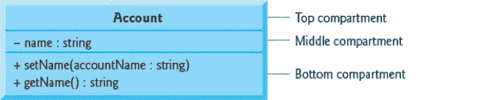

**图 3.3** **图 3.2** 中 `Account` 类的 UML 类图。

### 中间栏

中间栏包含类的属性 `name`，它与 C++ 中同名的数据成员相对应。数据成员 `name` 在 C++ 中是 `private` 的，因此 UML 类图在属性名之前列出了*减号（−）访问修饰符*。属性名后面是*冒号*和*属性类型*，此处的类型是 `string`。

### 底部栏

底部栏包含类的**操作** `setName` 和 `getName`，它们与 C++ 中同名的成员函数相对应。UML 通过列出操作名并在其前面加上*访问修饰符*来建模操作，此处为 `+ setName`。这个加号（`+`）表示 `setName` 是 UML 中的一个公共操作（因为它在 C++ 中是 `public` 成员函数）。操作 `getName` 同样是一个公共操作。

### 返回类型

UML 通过在操作名后的括号后面放置冒号和返回类型来表示操作的返回类型。`Account` 成员函数 `setName` 不返回值（因为它在 C++ 中返回 `void`），因此 UML 类图未在此操作的括号后指定返回类型。成员函数 `getName` 的返回类型为 `string`。

### 参数

UML 通过列出参数名，后跟冒号和参数类型（位于操作名后的括号中）来建模参数。UML 有自己的数据类型，与 C++ 的类似——为简单起见，我们使用 C++ 类型。`Account` 成员函数 `setName` 有一个名为 `accountName` 的 `string` 参数，因此类图在成员函数名后的括号中列出了 `accountName : string`。操作 `getName` 没有任何参数，因此类图中操作名后的括号为空，与[图 3.2](#) 第 14 行成员函数定义中的括号一样。

### 3.4 *Account* 类：使用构造函数初始化对象

如**第 3.3 节**所述，当创建 `Account` 对象时，其 `string` 数据成员 `name` 会*默认*初始化为空 `string`——我们稍后会讨论这种情况是如何发生的。但如果你想在首次*创建* `Account` 对象时提供一个名称，该怎么办？每个类都可以定义一个**构造函数**，为该类的对象指定*自定义初始化*。构造函数是一种特殊的成员函数，*必须*与类*同名*。C++ *要求*在*每个*对象创建时调用构造函数，因此这是初始化对象数据成员的理想时机。^8

^8: 在第 9.6 节中，你将了解到类可以有多个构造函数。

与成员函数一样，构造函数可以有参数——相应的实参值有助于初始化对象的数据成员。例如，你可以在创建 `Account` 对象时指定其名称，就像你将在**图 3.5** 的第 11 行所做的那样：

```cpp
Account account1{"Jane Green"};
```

在这种情况下，`string` 实参 `"Jane Green"` 被传递给 `Account` 类的构造函数，并用于初始化 `account1` 对象的 `name` 数据成员。前面的语句假定 `Account` 类有一个仅接受一个 `string` 参数的构造函数。

### 3.4.1 定义 `Account` 构造函数以实现自定义对象初始化

**图 3.4** 展示了带有构造函数的 `Account` 类，该构造函数接收一个 `accountName` 参数，并在创建 `Account` 对象时用它初始化数据成员 `name`。

```cpp
// 图 3.4: Account.h
// 带有构造函数（用于初始化账户名）的 Account 类。
#include <string>

class Account {
public:
   // 构造函数用参数 accountName 初始化数据成员 name
   explicit Account(std::string accountName)
      : name{accountName} { // 成员初始化器
      // 空函数体
   }

   // 设置账户名的函数
   void setName(std::string accountName) {
      name = accountName;
   }

   // 获取账户名的函数
   std::string getName() const {
      return name;
   }
private:
   std::string name; // 账户名数据成员
}; // 结束类 Account
```

**图 3.4** 带有初始化账户 `name` 的构造函数的 `Account` 类。

### **Account** 类的构造函数定义

**图 3.4** 的第 8–11 行

```cpp
explicit Account(std::string accountName)
    : name{accountName} { // 成员初始化器
    // 空函数体
}
```

定义了 `Account` 的构造函数。通常，构造函数是 `public` 的。[^9]

[^9]: 第 10.10.2 节讨论了为什么可能会使用 `private` 构造函数。

构造函数的*参数列表*指定了初始化对象所需的数据。第 8 行

```cpp
explicit Account(std::string accountName)
```

表明构造函数有一个名为 `accountName` 的 `string` 参数。当你创建一个新的 `Account` 对象时，*必须*将一个人的姓名传给构造函数，构造函数将在*参数* `accountName` 中接收该姓名。然后构造函数将使用 `accountName` 来初始化*数据成员* `name`。

构造函数使用**成员初始化器列表**（第 9 行）

```cpp
: name{accountName}
```

用参数 `accountName` 的值初始化 `name` 数据成员。*成员初始化器*位于构造函数的参数列表和构造函数函数体开始的左花括号之间。成员初始化器列表与参数列表之间用冒号（`:`）分隔。每个成员初始化器由一个数据成员的*变量名*后跟包含该成员*初始值*的括号组成。在此示例中，`name` 用参数 `accountName` 的值初始化。如果一个类包含多个数据成员，则每个成员初始化器之间用逗号分隔。成员初始化器列表在构造函数函数体执行*之前*执行。


### 性能提示 3.1

> *你可以在构造函数函数体中进行初始化，但将在**第 9 章**中了解到，使用成员初始化器更高效，而且某些类型的数据成员必须通过这种方式初始化。*

### `explicit` 关键字

我们将此构造函数声明为 **explicit**，因为它只有一个*参数*——这很重要，原因较为微妙，你将在**第 10.13 节**中了解到。目前，只需将所有单参数构造函数都声明为 `explicit`。**图 3.4** 的第 8 行*没有*指定返回类型，因为构造函数*不能*返回值——即使是 `void` 也不行。此外，构造函数不能声明为 `const`（因为初始化对象会修改它）。

### 在构造函数和成员函数 `setName` 中使用相同的参数名

回顾**第 3.3.4 节**，成员函数参数是局部变量。在**图 3.4** 中，构造函数和成员函数 `setName` 都有一个名为 `accountName` 的参数。尽管它们的标识符相同，但第 8 行中的参数是构造函数的局部变量，对成员函数 `setName` *不可见*。同样，第 14 行中的参数是 `setName` 的局部变量，对构造函数*不可见*。这种可见性称为*作用域*，将在**第 6.10 节**中讨论。


## 3.4.2 创建时初始化 `Account` 对象

`AccountTest` 程序（**图3.5**）使用构造函数初始化了两个不同的 `Account` 对象。第11行

```cpp
Account account1{"Jane Green"};
```

创建了 `Account` 对象 `account1`。当你创建对象时，C++ 会隐式调用类的构造函数来*初始化*该对象。如果构造函数有参数，你需要在对象变量名的右侧用花括号 `{` 和 `}` 将相应的实参括起来。在第11行，*实参* `"Jane Green"` 初始化了新对象的 `name` 数据成员。第12行

```cpp
Account account2{"John Blue"};
```

重复此过程，将实参 `"John Blue"` 传递给 `account2` 以初始化 `name`。第15–16行使用每个对象的 `getName` 成员函数获取姓名，并表明这些姓名在对象创建时确实已被初始化。输出显示了*不同的*姓名，证实每个 `Account` 都维护着自己*独立的一份*数据成员 `name`。

```cpp
// 图3.5: AccountTest.cpp
// 使用 Account 构造函数在创建每个 Account 对象时初始化 name 数据成员
#include <iostream>
#include "Account.h"

using namespace std;

int main() {
    // 创建两个 Account 对象
    Account account1{"Jane Green"};
    Account account2{"John Blue"};

    // 显示每个 Account 的 name 初始值
    cout << "account1 name is: " << account1.getName() << endl;
    cout << "account2 name is: " << account2.getName() << endl;
}
```

```text
account1 name is: Jane Green
account2 name is: John Blue
```

**图3.5** 在每个 `Account` 对象创建时使用 `Account` 构造函数初始化 `name` 数据成员。

### 默认构造函数

回顾 **图3.1** 中的第10行

```cpp
Account myAccount;
```

创建了一个 `Account` 对象，*没有*在对象变量名的右侧放置花括号。在这种情况下，C++ 会隐式调用类的**默认构造函数**。在任何*没有*显式定义构造函数的类中，编译器会提供一个没有参数的默认构造函数。默认构造函数*不会*初始化类的基本类型数据成员，但*会*为每个属于其他类对象的数据成员调用其默认构造函数。例如，在 **图3.2** 的 `Account` 类中，类的默认构造函数会调用 `string` 类的默认构造函数，将数据成员 `name` 初始化为空 `string`。未初始化的基本类型变量包含未定义的（“垃圾”）值。[^10]

[^10]: 我们将在第6.10节中看到此规则的一个例外。

### 定义了构造函数的类没有默认构造函数

如果你为类定义了一个自定义构造函数，编译器将*不会*为该类创建默认构造函数。在这种情况下，你将无法像 **图3.1** 中那样使用

```cpp
Account myAccount;
```

来创建 `Account` 对象，除非你定义的自定义构造函数具有空参数列表。我们稍后会展示，C++11 允许你强制编译器创建默认构造函数，即使你已经定义了非默认构造函数。


### 软件工程观察 3.1

> 除非你的类数据成员的默认初始化是可以接受的，否则你通常应该提供一个自定义构造函数，以确保在创建类的每个新对象时，数据成员都被正确初始化为有意义的值。

## 3.4.3 带构造函数的 `Account` UML 类图

**图3.6** 的 UML 类图对 **图3.4** 中的 `Account` 类进行了建模，该类具有一个带 `string accountName` 参数的构造函数。与操作（**图3.3**）一样，UML 将构造函数建模在类图的*第三*个分区中。为了将构造函数与类的操作区分开来，UML 要求将单词“constructor”括在**尖括号**（« 和 »）中，并放在构造函数名称之前。习惯上，在第三个分区中，构造函数列在*其他操作之前*。

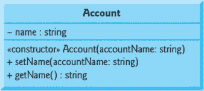

**图3.6** 图3.4中 `Account` 类的 UML 类图。

### 3.5 使用 *Set* 和 *Get* 成员函数的软件工程

正如你将在下一节中看到的，*set* 和 *get* 成员函数可以分别*验证*修改 `private` 数据的尝试，并控制该数据如何呈现给调用者。这些都是引人注目的软件工程优势。

如果数据成员是 `public` 的，那么类的任何**客户端**——即调用该类成员函数的任何其他代码——都可以看到该数据并对其为所欲为，包括将其设置为*无效*值。

你可能会认为，即使类的客户端无法直接访问 `private` 数据成员，客户端仍然可以通过 `public` 的 *set* 和 *get* 函数对变量为所欲为。你可能会认为，你可以随时使用 `public` 的 *get* 函数窥探 `private` 数据（并确切地看到它在对象中是如何存储的），并且可以通过 `public` 的 *set* 函数随意修改 `private` 数据。

实际上，*set* 函数可以被编程为*验证*其参数，并拒绝任何将数据设置为错误值的尝试，例如：

- 负的体温
- 三月份中不在1到31范围内的日期
- 不在公司产品目录中的产品代码等

而且 *get* 函数可以以不同的形式呈现数据，而实际的数据表示对用户保持隐藏。例如，`Grade` 类可能将 `grade` 数据成员存储为0到100之间的 `int`，但 `getGrade` 成员函数可能会返回一个字母等级作为 `string`，例如90到100之间的等级返回 `"A"`，80到89之间的等级返回 `"B"` 等。严格控制对 `private` 数据的*访问*和*呈现*可以大大减少错误，同时提高程序的健壮性、安全性和可用性。

### 具有封装数据的 `Account` 对象的概念视图

你可以将 `Account` 对象想象为 **图3.7** 所示的样子。`private` 数据成员 `name` *隐藏在对象内部*（由包含 `name` 的内圆表示），并由一层 `public` 成员函数*保护*（由包含 `getName` 和 `setName` 的外圆表示）。任何需要与 `Account` 对象交互的客户端代码*只能通过调用*保护性外层的 `public` 成员函数来进行。

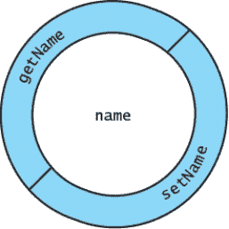

**图3.7** `Account` 对象的概念视图，展示了其封装的 `private` 数据成员 `name` 和由 `public` 成员函数组成的保护层。

### 软件工程观察 3.2

> 通常，数据成员应为 `private`，成员函数应为 `public`。在**第9章**中，我们将讨论为什么你可能会使用 `public` 数据成员或 `private` 成员函数。

### 软件工程观察 3.3

> 使用 `public` 的 set 和 get 函数来控制对 `private` 数据的访问，使程序更清晰、更易于维护。变化是常态而非例外。你应该预料到你的代码会被修改，而且可能经常被修改。

### 3.6 具有余额和数据验证的 Account 类

我们现在定义一个 `Account` 类，除了 `name` 之外，它还维护银行账户的 `balance`（余额）。在**第2章**中，我们使用 `int` 数据类型来表示整数。为简单起见，我们将使用 `int` 数据类型来表示账户余额。在**第4章**中，你将看到如何表示带*小数*点的数字。

### 3.6.1 数据成员 `balance`

典型的银行服务许多账户，每个账户都有自己的余额。在这个更新的 `Account` 类（**图3.8**）中，第42行

```cpp
int balance{}; // data member with default initial value
```

声明了一个 `int` 类型的数据成员 `balance`，并将其值初始化为 `0`。这被称为**类内初始化器**，是在 C++11 中引入的。`Account` 类的每个对象都包含自己*独立的一份* `name` 和 `balance` 数据成员。


```cpp
// Fig. 3.8: Account.h
// Account class with name and balance data members, and a
// constructor and deposit function that each perform validation.
#include <string>

class Account {
public:
    // Account constructor with two parameters
    Account(std::string accountName, int initialBalance)
        : name{accountName} { // assign accountName to data member name

        // validate that the initialBalance is greater than 0; if not,
        // data member balance keeps its default initial value of 0
        if (initialBalance > 0) { // if the initialBalance is valid
            balance = initialBalance; // assign it to data member balance
        }
    }

    // function that deposits (adds) only a valid amount to the balance
    void deposit(int depositAmount) {
        if (depositAmount > 0) { // if the depositAmount is valid
            balance = balance + depositAmount; // add it to the balance
        }
    }

    // function returns the account balance
    int getBalance() const {
        return balance;
    }

    // function that sets the name
    void setName(std::string accountName) {
        name = accountName;
    }

    // function that returns the name
    std::string getName() const {
        return name;
    }

private:
    std::string name; // account name data member
    int balance{}; // data member with default initial value
}; // end class Account
```

图 3.8 含有 **name** 和 **balance** 数据成员、以及各自执行验证的构造函数和 **deposit** 函数的 **Account** 类。

### `Account` 的*成员函数都可以使用* `balance`

第 15、22 和 28 行的语句使用了变量 `balance`，尽管它*并未*在*任何*成员函数中声明。我们可以在这些成员函数中使用 `balance`，因为它是同一类定义中的*数据成员*。

### 3.6.2 带验证的双参数构造函数

该类有一个*构造函数*和四个*成员函数*。开户的人通常会立即存钱，因此构造函数（第 9—17 行）现在接收第二个参数——`int` 类型的 `initialBalance`，表示*起始余额*。我们没有将此构造函数声明为 `explicit`（如 **图 3.4** 所示），因为该构造函数有多个参数。

**图 3.8** 的第 14—16 行

```cpp
{
    if (initialBalance > 0) { // if the initialBalance is valid
        balance = initialBalance; // assign it to data member balance
    }
}
```

确保仅当参数 `initialBalance` 的值大于 `0` 时，才将该值赋给数据成员 `balance`——这称为**验证**或**有效性检查**。如果是，则第 15 行将 `initialBalance` 的值赋给数据成员 `balance`。否则，`balance` 保持为 0——即类 `Account` 定义中第 42 行设置的*默认初始值*。

### 3.6.3 带验证的 `deposit` 成员函数

成员函数 `deposit`（第 20—24 行）完成任务时**不**返回任何数据，因此其返回类型为 `void`。该成员函数接收一个名为 `depositAmount` 的 `int` 参数。第 21—23 行

```cpp
{
    if (depositAmount > 0) { // if the depositAmount is valid
        balance = balance + depositAmount; // add it to the balance
    }
```

确保仅当参数值有效（即大于零）时，才将参数 `depositAmount` 的值加到 `balance` 中——这是有效性检查的另一个示例。第 22 行首先将当前 `balance` 与 `depositAmount` 相加，形成一个*临时*和，然后将该和赋给 `balance`，*替换*其先前的值（回想一下，加法的优先级高于赋值）。重要的是要理解，以下计算

```cpp
balance + depositAmount
```

位于第 22 行赋值运算符右侧的表达式*不会*修改余额——这就是赋值运算符必要的原因。[第 4.12 节]展示了编写第 22 行的一种更简洁方式。

### 3.6.4 `getBalance` 成员函数

成员函数 `getBalance`（第 27—29 行）允许该类的*客户端*获取特定 `Account` 对象的 `balance` 值。该成员函数指定返回类型 `int` 和一个*空*参数列表。与成员函数 `getName` 一样，`getBalance` 被声明为 `const`，因为在返回 `balance` 的过程中，该函数不会也不应修改调用它的 `Account` 对象。

### 3.6.5 操作带余额的 `Account` 对象

**图 3.9** 中的 `main` 函数创建两个 `Account` 对象（第 10—11 行），并尝试分别用 `50` 的*有效*余额和 `−7` 的*无效*余额初始化它们——就我们的示例而言，我们假设余额必须大于或等于零。第 14—17 行输出账户名称和余额，这些信息通过调用每个 `Account` 的 `getName` 和 `getBalance` 成员函数获得。

```cpp
// Fig. 3.9: AccountTest.cpp
// Displaying and updating Account balances.
#include <iostream>
#include "Account.h"

using namespace std;

int main()
{
    Account account1{"Jane Green", 50};
    Account account2{"John Blue", -7};

    // display initial balance of each object
    cout << "\naccount1: " << account1.getName() << " balance is $"
         << account1.getBalance();
    cout << "\naccount2: " << account2.getName() << " balance is $"
         << account2.getBalance();

    cout << "\n\nEnter deposit amount for account1: "; // prompt
    int depositAmount;
    cin >> depositAmount; // obtain user input
    cout << "adding " << depositAmount << " to account1 balance";
    account1.deposit(depositAmount); // add to account1's balance

    // display balances
    cout << "\n\naccount1: " << account1.getName() << " balance is $"
         << account1.getBalance();
    cout << "\naccount2: " << account2.getName() << " balance is $"
         << account2.getBalance();

    cout << "\n\nEnter deposit amount for account2: "; // prompt
    cin >> depositAmount; // obtain user input
    cout << "adding " << depositAmount << " to account2 balance";
    account2.deposit(depositAmount); // add to account2 balance

    // display balances
    cout << "\n\naccount1: " << account1.getName() << " balance is $"
         << account1.getBalance();
    cout << "\naccount2: " << account2.getName() << " balance is $"
         << account2.getBalance() << endl;
}
```

```text
account1: Jane Green balance is $50
account2: John Blue balance is $0

Enter deposit amount for account1: 25
adding 25 to account1 balance

account1: Jane Green balance is $75
account2: John Blue balance is $0

Enter deposit amount for account2: 123
adding 123 to account2 balance

account1: Jane Green balance is $75
account2: John Blue balance is $123
```

图 3.9 显示并更新 **Account** 余额。

**显示 `Account` 对象的初始余额**

当从第 15 行为 `account1` 调用成员函数 `getBalance` 时，`account1` 的 `balance` 值会从 **图 3.8** 的第 28 行返回，并由第 14—15 行（**图 3.9**）的输出语句显示。类似地，当从第 17 行为 `account2` 调用成员函数 `getBalance` 时，`account2` 的 `balance` 值会从 **图 3.8** 的第 28 行返回，并由输出语句（**图 3.9**，第 16—17 行）显示。`account2` 的 `balance` 最初为 `0`，因为构造函数拒绝了以负余额启动 `account2` 的尝试，所以数据成员 `balance` 保留其默认初始值。

**从用户读取存款金额并执行存款**

第 19 行提示用户输入 `account1` 的存款金额。第 20 行声明局部变量 `depositAmount`，用于存储用户输入的每笔存款金额。我们没有初始化 `depositAmount`，因为稍后你会了解到，变量 `depositAmount` 的值将由用户输入。


**错误预防提示 3.3**

*大多数 C++ 编译器在你尝试使用未初始化变量的值时都会发出警告。这有助于你避免危险的执行时逻辑错误。让程序的警告和错误在编译时而不是执行时暴露出来总是更好。*

第 21 行从用户读取存款金额，并将该值放入局部变量 `depositAmount`。第 22 行显示存款金额。第 23 行调用对象 `account1` 的 `deposit` 成员函数，并将 `depositAmount` 作为该成员函数的*实参*。调用该成员函数时，实参的值会赋给成员函数 `deposit` 的形参 `depositAmount`（图 3.8 的第 20 行）；然后成员函数 `deposit` 将该值加到 `balance` 中。第 26—29 行（**图 3.9**）再次输出两个 `Account` 的 `name` 和 `balance`，以表明*只有* `account1` 的 `balance` 发生了变化。

第 31 行提示用户输入 `account2` 的存款金额。第 32 行获取用户输入。第 33 行显示 `depositAmount`。第 34 行调用对象 `account2` 的 `deposit` 成员函数，并将 `depositAmount` 作为该成员函数的*实参*；然后成员函数 `deposit` 将该值加到 `balance` 中。最后，第 37—40 行再次输出两个 `Account` 的 `name` 和 `balance`，以表明*只有* `account2` 的 `balance` 发生了变化。


## `main` 函数中的重复代码

第 14–15、16–17、26–27、28–29、37–38 和 39–40 行的六条语句几乎完全相同。每条语句都输出一个 `Account` 的 `name` 和 `balance`，区别仅在于 `Account` 对象名——`account1` 或 `account2`。当这类代码需要更新时，像这样的重复代码可能会造成*代码维护问题*。例如，如果同一代码的六份副本都需要修复同一个错误或进行同一项更新，你必须进行六次更改，且不能出错。**练习 3.13** 要求你修改**图 3.9**，加入函数 `displayAccount`，该函数接收一个 `Account` 对象作为参数，并输出该对象的 `name` 和 `balance`。然后，你将用六次对 `displayAccount` 的调用来替换 `main` 中的重复语句。


## 软件工程观察 3.4

> *用对该代码仅包含一份副本的函数的调用来替换重复代码，可以减小程序规模并提高其可维护性。*

### 3.6.6 带余额及成员函数 `deposit` 和 `getBalance` 的 `Account` UML 类图

**图 3.10** 中的 UML 类图简洁地建模了**图 3.8** 的类 `Account`。该图在其第二栏中建模了 `private` 属性：类型为 `string` 的 `name` 和类型为 `int` 的 `balance`。

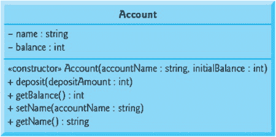

**图 3.10** 是**图 3.8** 中 `Account` 类的 UML 类图。

类 `Account` 的构造函数在第三栏中建模，其参数为类型 `string` 的 `accountName` 和类型 `int` 的 `initialBalance`。该类的四个 `public` 成员函数也在第三栏中建模——操作 `deposit` 带有一个类型为 `int` 的 `depositAmount` 参数，操作 `getBalance` 的返回类型为 `int`，操作 `setName` 带有一个类型为 `string` 的 `accountName` 参数，以及操作 `getName` 的返回类型为 `string`。

### 3.7 小结

在本章中，你创建了自己的类和成员函数，创建了这些类的对象，并调用这些对象的成员函数来执行有用的操作。你声明了类的数据成员，以维护该类每个对象的数据，并定义了自己的成员函数来操作这些数据。你以实参形式将信息传递给成员函数，这些实参的值被赋给成员函数的参数。你了解了成员函数的局部变量与类的数据成员之间的区别，并且了解到只有作为对象的数据成员才会通过调用其默认构造函数自动初始化。你还学习了如何使用类的构造函数为对象的数据成员指定初始值。你了解了如何创建 UML 类图，以建模类的成员函数、属性和构造函数。

在下一章中，我们将开始介绍控制语句，它指定程序动作的执行顺序。你将在成员函数中使用它们，以指定成员函数应如何排列其任务。

### 总结

### 3.1 节 引言

- 你创建的每个类都会成为一种新类型，可用于声明变量和创建对象。
- C++ 是一种**可扩展的编程语言**（p. [74](#)）——你可以根据需要定义新的类类型。

### 3.2 节 测试驱动一个 `Account` 对象

- 类不能自行执行。
- `main` 函数可以通过调用对象的成员函数来“驱动”对象——而无需知道该类是如何实现的。在这个意义上，`main` 被称为**驱动程序**（p. [75](#)）。

### 3.2.1 节 实例化对象

- 通常，在创建该类的对象之前，不能调用该类的成员函数。

### 3.2.2 节 头文件和源代码文件

- 编译器了解“内置于”C++ 的基本类型。
- 你创建的新类型称为**用户自定义类型**（p. 76）。
- 新类如果打包得当，可以被其他程序员重用。
- 可重用代码（例如类定义）放在一个称为**头文件**（p. 76）的文件中，你在需要使用该代码的任何地方通过 `#include` 包含它。
- 按照惯例，用户自定义类型的头文件具有 `.h` 文件名扩展名。
- 在 `#include` 指令中，用户自定义头文件放在双引号（`""`）中，表示该头文件与你的程序位于同一位置，而不是与 C++ 标准库头文件放在一起。
- 以 `.cpp` 结尾的文件称为**源代码文件**（p. 76）。

### 3.2.3 节 调用类 `Account` 的 `getName` 成员函数

- 要为特定对象调用成员函数，需要指定对象名，后跟**点运算符**（`.`，p. 76），然后是成员函数名和一对圆括号。*空*圆括号表示该函数执行任务不需要任何附加信息。
- 成员函数可以从调用该函数的对象返回一个值。

### 3.2.4 节 使用 `getline` 输入 `string`

- 不是类成员的函数称为**全局函数**（p. 77）。
- C++ 标准库类 **string**（p. 77）的对象存储字符串值。类 `string` 定义在 **`<string>` 头文件**（p. 77）中，并且属于命名空间 `std`。
- 来自 `<string>` 头文件的 C++ 标准库函数 **getline**（p. 77）读取字符，直到但不包括换行符；换行符会被丢弃，然后将这些字符放入一个 `string` 中。

### 3.2.5 节 调用类 `Account` 的 `setName` 成员函数

- 成员函数调用可以提供**实参**（p. 78），以帮助函数执行其任务。

### 3.3.1 节 Account 类定义

- 类的数据成员维护该类每个对象的数据，其成员函数操作类的数据成员。

### 3.3.2 节 关键字 `class` 与类体

- 类定义以关键字 `class`（p. 79）开始，紧接着是类名。
- 类体包含在一对左花括号和右花括号中。
- 类定义以必需的分号结束。
- 通常，每个类定义放在一个单独的、具有 `.h` 文件名扩展名的头文件中。
- 类名、成员函数名和数据成员名都是标识符。按照惯例，变量名标识符以小写字母开头，名称中第一个单词之后的每个单词都以大写字母开头。这种命名约定称为驼峰命名法，因为大写字母像驼峰一样突出。同样按照惯例，类名以大写字母开头，成员函数和数据成员名以小写字母开头。

### 3.3.3 节 类型为 `string` 的数据成员 `name`

- 类的每个对象都有自己的类数据成员副本。
- 对象的数据成员在程序对对象调用成员函数之前、调用执行期间以及成员函数完成执行之后都存在。
- 数据成员在类定义内部声明，但在其成员函数体之外。
- `string` 的默认值是**空** `string`（即 `""`；p. 80）。
- 头文件绝不应包含 `using` 指令或 `using` 声明。

### 3.3.4 节 `setName` 成员函数

- 函数的**返回类型**（p. [79](#)）——出现在函数名左侧——指定函数在执行任务后返回给调用者的数据类型。
- 返回类型 **void**（p. [80](#)）表示当函数完成其任务时，不向**调用函数**（p. [80](#)）返回（即交回）任何信息。
- **参数**（p. [80](#)）指定函数执行任务所需的附加信息。
- 调用函数时，调用圆括号中的每个实参值都会被复制到成员函数定义中对应的参数中。
- 参数在**参数列表**（p. [81](#)）中声明，该列表位于函数名之后必需的圆括号内。每个参数都必须指定类型，后跟参数名。
- 函数定义中的多个参数用逗号分隔。
- 函数调用中实参的数量和顺序必须与函数定义参数列表中参数的数量和顺序匹配。
- 每个函数体都由左花括号和右花括号界定。花括号内有一条或多条执行函数任务的语句。
- 当程序执行到达函数的右花括号时，函数返回其调用者。


- 在特定函数体内声明的变量称为**局部变量**（第 81 页），只能在那个函数中使用。当函数终止时，其局部变量的值将丢失。
- 函数的参数也是该函数的局部变量。
- 成员函数调用中的实参类型必须与成员函数定义中相应形参的类型一致。

### 3.3.5 节 `getName` 成员函数

- 当一个指定了除 `void` 之外的返回类型的成员函数被调用并完成任务时，它必须向调用者返回一个结果。
- **return** 语句（第 [82](#) 页）将值传回给函数的调用者。
- 不会也不应修改其所调用对象的成员函数，在其参数列表右侧用 **const**（第 [82](#) 页）声明。

### 3.3.6 节 *访问说明符* `private` 和 `public`

- 关键字 **private**（第 82 页）是一种**访问说明符**（第 82 页）。
- 访问说明符后面总是跟着一个冒号（`:`）。
- `private` 数据成员只能被其类的成员函数访问。
- 大多数数据成员声明出现在 `private` 访问说明符之后。
- 在 **public**（第 83 页）访问说明符之后（以及在下一个访问说明符之前，如果有的话）列出的变量或函数是“对公众可用的”。它们可以被程序中的其他函数以及其他类的成员函数使用。
- 默认情况下，除非另行指定，类中的所有内容都是 `private`。
- 一旦你列出了一个访问说明符，从该点开始的所有内容都具有该访问权限，直到你列出另一个访问说明符。
- 将数据成员声明为 `private` 称为**数据隐藏**（第 82 页）。`private` 数据成员被封装（隐藏）在对象中，只能由对象所属类的成员函数访问。

### 3.3.7 节 *Account* UML 类图

- **UML 类图**（第 83 页）可用于概括类的属性和操作。
- 在 UML 中，每个类在类图中被建模为一个带有三个分隔栏的矩形。
- 顶部栏包含类名，水平居中，以粗体显示。
- 中间栏包含类的属性名，这些属性名对应于类的数据成员。
- 私有属性在属性名之前列出减号（−）访问修饰符。
- 属性名后面是冒号和属性类型。
- 底部栏包含类的**操作**（第 84 页），这些操作对应于类中的成员函数。
- UML 通过列出操作名并在其前面加上访问修饰符来对操作建模。加号（+）表示 UML 中的公共操作。
- 没有任何参数的操作在操作名后面指定一对空括号。
- UML 通过在操作名后的括号后面放置冒号和返回类型来表示操作的返回类型。
- 对于 `void` 返回类型，UML 类图不会在操作的括号后面指定任何内容。
- UML 通过列出参数名，后面跟冒号和参数类型（位于操作名后的括号中）来对参数建模。

## 3.4 节 **Account** 类：*使用构造函数初始化对象*

- 每个类都可以定义一个**构造函数**（第 84 页）用于自定义对象初始化。
- 构造函数是一种特殊的成员函数，其名称必须与类名相同。
- C++ 要求为每个创建的对象调用构造函数。
- 与成员函数一样，构造函数可以指定参数——对应的实参值有助于初始化对象的数据成员。

### 3.4.1 节 声明用于自定义对象初始化的 `Account` 构造函数

- 通常，构造函数是 `public` 的。
- 构造函数的参数列表指定了初始化对象所需的数据。
- 构造函数使用**成员初始化器列表**（第 86 页）用相应参数的值来初始化其数据成员。
- 成员初始化器出现在构造函数的参数列表和开始构造函数体的左花括号之间。
- 成员初始化器列表与参数列表之间用冒号（`:`）分隔。
- 每个成员初始化器由一个数据成员的变量名后跟一对括号组成，括号内包含该成员的初始值。
- 构造函数中的每个成员初始化器之间用逗号分隔。
- 成员初始化器列表在构造函数体执行之前执行。
- 指定单个参数的构造函数应声明为 **explicit**（第 86 页）。
- 构造函数不指定返回类型，因为构造函数不能返回值。
- 构造函数不能声明为 `const`（因为初始化对象会修改它）。

### 3.4.2 节 在创建时初始化 `Account` 对象

- 当你创建对象时，C++ 会调用类的构造函数来初始化该对象。如果构造函数有参数，相应的实参放在对象变量名右侧的花括号 `{` 和 `}` 中。
- 如果创建对象时未在对象变量名右侧放置花括号，C++ 会隐式调用类的**默认构造函数**（第 87 页）。
- 在任何未显式定义构造函数的类中，编译器会提供一个默认构造函数（它总是没有参数）。
- 默认构造函数不会初始化类的基本类型数据成员，但会为每个作为另一个类对象的数据成员调用其默认构造函数。
- `string` 的默认构造函数将对象初始化为空 `string`。
- 未初始化的基本类型变量包含未定义（“垃圾”）值。
- 如果类定义了构造函数，编译器将不会为该类创建默认构造函数。

### 3.4.3 节 带有构造函数的 *Account* UML 类图

- 与操作类似，UML 在类图的第三个分隔栏中对构造函数建模。
- 为了将构造函数与类的操作区分开，UML 要求将单词 “constructor” 用尖括号（≪ 和 ≫；第 88 页）括起来，并放在构造函数名称之前。
- 惯例是在第三个分隔栏中将构造函数列在其他操作之前。

## 3.5 节 使用 Set 和 Get 成员函数的软件工程

- 通过使用 *set* 和 *get* 成员函数，你可以验证对 `private` 数据的修改尝试，并控制该数据如何呈现给调用者。
- 类的**客户端**（第 88 页）是任何调用该类成员函数的其他代码。
- 任何客户端代码都可以看到 `public` 数据成员，并对其做任何想做的事情，包括将其设置为无效值。
- *Set* 函数可以被编程为验证其参数，并拒绝将数据设置为错误值的任何尝试。
- *Get* 函数可以以不同形式将数据呈现给客户端。
- 严格控制对 `private` 数据的访问和呈现可以大大减少错误，同时提高程序的可用性、健壮性和安全性。

### 3.6.1 节 数据成员 `balance`

- 你可以在声明中初始化基本类型的数据成员。这称为**类内初始化器**（第 90 页），是在 C++11 中引入的。

### 3.6.2 节 *带验证的双参数构造函数*

- 构造函数可以在修改数据成员之前执行**验证**（第 91 页）或**有效性检查**（第 91 页）。

### 3.6.3 节 带验证的 `deposit` 成员函数

- set 函数可以在修改数据成员之前执行有效性检查。


## 自测练习

- **3.1** 填写下列各题中的空白：
  - A. 每个类定义都包含关键字 _____，其后紧跟类的名称。
  - B. 类定义通常存储在文件扩展名为 _____ 的文件中。
  - C. 函数头中的每个参数都同时指定了 _____ 和 _____。
  - D. 当类的每个对象都维护自己版本的属性时，表示该属性的变量也称为 _____。
  - E. 关键字 `public` 是一种 _____。
  - F. 返回类型 _____ 表示函数将执行任务，但在完成任务时不会返回任何信息。
  - G. `<string>` 库中的函数 _____ 读取字符，直到遇到换行符，然后将这些字符复制到指定的 `string` 中。
  - H. 任何使用类的文件都可以通过 _____ 预处理指令包含该类的头文件。

- **3.2** 判断下列说法是*真*还是*假*。如果为假，请解释原因。
  - A. 按惯例，函数名以大写字母开头，名称中后续每个单词也以大写字母开头。
  - B. 函数定义中函数名后紧跟的空括号表示该函数执行任务不需要任何参数。
  - C. 使用访问说明符 `private` 声明的数据成员或成员函数，可以被声明它们的类中的成员函数访问。
  - D. 在特定成员函数体内声明的变量称为数据成员，可在该类的所有成员函数中使用。
  - E. 每个函数体都用左花括号和右花括号（`{` 和 `}`）界定。
  - F. 函数调用中实参的类型必须与函数参数列表中对应形参的类型一致。

- **3.3** 局部变量和数据成员之间的区别是什么？

- **3.4** 解释函数形参的用途。形参和实参之间有什么区别？

## 练习

- **3.5** （*默认构造函数*）什么是默认构造函数？如果类只有编译器定义的默认构造函数，对象的数据成员是如何初始化的？

- **3.6** （*数据成员*）解释数据成员的用途。

- **3.7** （*在没有 `using` 指令的情况下使用类*）解释程序如何在不插入 `using` 指令的情况下使用类 `string`。

- **3.8** （*设置和获取函数*）解释为什么类可能会为数据成员提供设置函数和获取函数。

- **3.9** （*修改 `Account` 类*）修改类 `Account`（图3.8），提供一个名为 `withdraw` 的成员函数，用于从 `Account` 中取款。确保取款金额不超过 `Account` 的余额。如果超过，余额应保持不变，且该成员函数应显示一条指示“取款金额超过账户余额”的消息。修改类 `AccountTest`（图3.9）以测试成员函数 `withdraw`。

- **3.10** （*发票类*）创建一个名为 `Invoice` 的类，硬件商店可以用它来表示店内销售物品的发票。`Invoice` 应包含四个数据成员——零件编号（类型 `string`）、零件描述（类型 `string`）、所购物品数量（类型 `int`）和单价（类型 `int`）。你的类应有一个构造函数来初始化这四个数据成员。为每个数据成员提供*设置*和*获取*函数。此外，提供一个名为 `getInvoiceAmount` 的成员函数，该函数计算发票金额（即数量乘以单价），然后将金额作为 `int` 值返回。如果数量不是正数，则应将其设置为 `0`。如果单价不是正数，则应将其设置为 `0`。编写一个测试程序，演示类 `Invoice` 的功能。

- **3.11** （*员工类*）创建一个名为 `Employee` 的类，其数据成员包含三项信息——名字（类型 `string`）、姓氏（类型 `string`）和月薪（类型 `int`）。你的类应有一个构造函数来初始化这三个数据成员。为每个数据成员提供*设置*和*获取*函数。如果月薪不是正数，则将其设置为 `0`。编写一个测试程序，演示类 `Employee` 的功能。创建两个 `Employee` 对象，并显示每个对象的年薪。然后给每个 `Employee` 加薪 10%，再次显示每个 `Employee` 的年薪。

- **3.12** （*日期类*）创建一个名为 `Date` 的类，其数据成员包含三项信息——月份（类型 `int`）、日（类型 `int`）和年份（类型 `int`）。你的类应有一个带三个参数的构造函数，使用这些参数初始化三个数据成员。就本练习而言，假设提供的年份和日期值是正确的，但要确保月份值在 1–12 范围内；如果不是，则将月份设置为 1。为每个数据成员提供*设置*和*获取*函数。提供一个成员函数 `displayDate`，它显示月份、日和年份，并以正斜杠（`/`）分隔。编写一个测试程序，演示类 `Date` 的功能。

- **3.13** （*删除 `main` 函数中的重复代码*）在图3.9中，`main` 函数包含六个语句（第 14–15 行、16–17 行、26–27 行、28–29 行、37–38 行和 39–40 行），每个语句都显示一个 `Account` 对象的 `name` 和 `balance`。研究这些语句后你会发现，它们仅在被操作的 `Account` 对象（`account1` 或 `account2`）上有所不同。在本练习中，你将定义一个包含*一个*输出语句副本的 `displayAccount` 函数。该成员函数的参数是一个 `Account` 对象，成员函数将输出该对象的 `name` 和 `balance`。然后，你将 `main` 中六个重复的语句替换为对 `displayAccount` 的调用，将要输出的特定 `Account` 对象作为参数传入。修改图3.9，在 `using` 指令之后、`main` 之前定义如下 `displayAccount` 函数：

  ```cpp
  void displayAccount(Account accountToDisplay) {
     // 在此处放置显示
     // accountToDisplay 的 name 和 balance 的语句
  }
  ```

  将成员函数体中的注释替换为显示 `accountToDisplay` 的 `name` 和 `balance` 的语句。完成 `displayAccount` 的声明后，修改 `main`，将显示每个 `Account` 的 `name` 和 `balance` 的语句替换为如下形式的 `displayAccount` 调用：

  ```cpp
  displayAccount(nameOfAccountObject);
  ```

  在每次调用中，实参应视情况为 `account1` 或 `account2` 对象。然后，测试更新后的程序，确保其输出与图3.9中所示相同。

- **3.14** （**C++11 列表初始化器**）编写一条使用列表初始化来初始化类 `Account` 对象的语句，该类提供一个接收 `unsigned int`、两个 `string` 和一个 `double` 的构造函数，用于初始化新对象的 `accountNumber`、`firstName`、`lastName` 和 `balance` 数据成员。

## 做出改变

- **3.15** **_目标心率计算器_** 锻炼时，你可以使用心率监测器来确保心率保持在教练和医生建议的安全范围内。根据美国心脏协会（AHA）([http://bit.ly/AHAtargetHeartRates](http://bit.ly/AHAtargetHeartRates))的说法，计算你*最大心率*（以每分钟心跳次数为单位）的公式是 220 减去你的年龄（以年为单位）。你的*目标心率*是最大心率的 50–85% 之间的范围。[*注：*这些公式是 AHA 提供的估计值。最大心率和目标心率可能因个人的健康、体能和性别而异。**在开始或修改锻炼计划之前，务必咨询医生或合格的医疗保健专业人员。**] 创建一个名为 `HeartRates` 的类。类属性应包括此人的名字、姓氏和出生日期（由出生月份、日期和年份的单独属性组成）。你的类应有一个接收此数据作为参数的构造函数。为每个属性提供设置和获取函数。该类还应包括一个计算并返回此人年龄（以年为单位）的成员函数，一个计算并返回此人最大心率的成员函数，以及一个计算并返回此人目标心率的成员函数。编写一个程序，提示输入个人信息，实例化一个 `HeartRates` 对象，并显示该对象的信息。


一个`HeartRates`类的对象，并打印该对象的信息——包括此人的名、姓和出生日期——然后计算并打印此人的年龄（以年为单位）、最大心率和目标心率范围。

- 2. 3.16 (**_健康记录计算机化_**) 最近新闻中经常出现的医疗保健问题是健康记录的计算机化。由于涉及敏感的隐私和安全问题等，这一可能性正在被谨慎对待。[我们将在后续练习中讨论这些问题。] 将健康记录计算机化可以使患者更容易在不同的医疗保健专业人员之间共享其健康概况和病史。这可以提高医疗保健质量，帮助避免药物冲突和错误的药物处方，降低成本，并且在紧急情况下可能挽救生命。在本练习中，你将为一个人员设计一个“入门级”`HealthProfile`类。类属性应包括此人的名、姓、性别、出生日期（由月、日、年三个独立属性组成）、身高（以英寸为单位）和体重（以磅为单位）。你的类应有一个接收这些数据的构造函数。对于每个属性，提供*set*和*get*函数。该类还应包括成员函数，用于计算并返回用户的年龄（以年为单位）、最大心率和目标心率范围（参见**练习3.15**）以及身体质量指数（BMI；参见**练习2.30**）。编写一个程序，提示输入该人员的信息，为该人员实例化一个`HealthProfile`类的对象，并打印该对象的信息——包括此人的名、姓、性别、出生日期、身高和体重——然后计算并打印此人的年龄（以年为单位）、BMI、最大心率和目标心率范围。它还应该显示**练习2.30**中的BMI数值表。

## 自测练习答案

- 1. **3.1**
  - A. `class`.
  - B. `.h`.
  - C. 类型、名称.
  - D. 数据成员.
  - E. 访问说明符.
  - F. `void`.
  - G. `getline`.
  - H. `#include`.
- 2. **3.2**
  - A. 错误。函数名以小写字母开头，名称中所有后续单词以大写字母开头。
  - B. 正确。
  - C. 正确。
  - D. 错误。这样的变量是局部变量，只能在声明它们的成员函数中使用。
  - E. 正确。
  - F. 正确。
- 3. **3.3** 局部变量在函数体内声明，并且只能从其声明处到声明所在块的右花括号之间使用。数据成员在类中声明，但不在类的任何成员函数体内。类的每个对象都拥有该类的每个数据成员。数据成员可被类的所有成员函数访问。
- 4. **3.4** 参数表示函数执行任务所需的附加信息。函数所需的每个参数都在函数头中指定。实参是在函数调用中提供的值。调用函数时，实参值被传递给函数参数，以便函数能够执行其任务。

## 4 算法开发与控制语句：第1部分

### *目标*

在本章中，你将：

- 学习基本的问题解决技巧。
- 通过自顶向下、逐步求精的过程开发算法。
- 使用`if`和`if...else`选择语句在可选操作之间进行选择。
- 使用`while`迭代语句反复执行程序中的语句。
- 使用计数器控制迭代和哨兵控制迭代。
- 使用嵌套控制语句。
- 使用复合赋值运算符以及递增和递减运算符。
- 了解基本类型可移植性。

### 大纲

- **4.1 引言**
- **4.2 算法**
- **4.3 伪代码**
- **4.4 控制结构**
  - **4.4.1 顺序结构**
  - **4.4.2 选择语句**
  - **4.4.3 迭代语句**
  - **4.4.4 控制语句小结**
- **4.5** `if` **单选择语句**
- **4.6** `if...else` **双选择语句**
  - **4.6.1 嵌套** `if...else` **语句**
  - **4.6.2 悬空else问题**
  - **4.6.3 块**
  - **4.6.4 条件运算符（?:）**
- **4.7** `Student` **类：嵌套** `if...else` **语句**
- **4.8** `while` **迭代语句**
- **4.9 算法制定：计数器控制迭代**
  - A. **4.9.1 计数器控制迭代的伪代码算法**
  - B. **4.9.2 实现计数器控制迭代**
  - C. **4.9.3 关于整数除法与截断的说明**
  - D. **4.9.4 算术溢出**
  - E. **4.9.5 输入验证**
- 10. **4.10 算法制定：哨兵控制迭代**
  - A. **4.10.1 自顶向下、逐步求精：顶层与第一次求精**
  - B. **4.10.2 进行第二次求精**
  - C. **4.10.3 实现哨兵控制迭代**
  - D. **4.10.4 在基本类型之间显式和隐式转换**
  - E. **4.10.5 格式化浮点数**
  - F. **4.10.6 无符号整数与用户输入**
- 11. **4.11 算法制定：嵌套控制语句**
  - A. **4.11.1 问题陈述**
  - B. **4.11.2 自顶向下、逐步求精：顶层的伪代码表示**
  - C. **4.11.3 自顶向下、逐步求精：第一次求精**
  - D. **4.11.4 自顶向下、逐步求精：第二次求精**
  - E. **4.11.5 伪代码的完整第二次求精**
  - F. **4.11.6 实现伪代码算法的程序**
  - G. **4.11.7 使用列表初始化防止窄化转换**
- 12. **4.12 复合赋值运算符**
- 13. **4.13 递增和递减运算符**
- 14. **4.14 基本类型不可移植**
- 15. **4.15 总结**

- 1. **小结**
- 2. **自测练习**
- 3. **自测练习答案**
- 4. **练习**
- 5. **有所作为**

### 4.1 引言

在编写程序解决问题之前，你应该对问题有透彻的理解，并仔细规划解决它的方法。编写程序时，你还应该理解可用的构建块，并采用经过验证的程序构造技术。在本章和下一章中，我们在介绍结构化编程的理论和原则时讨论这些问题。这里提出的概念对于构建类和操作对象至关重要。我们将更详细地讨论C++的`if`语句，并引入`if...else`和`while`语句——所有这些构建块都允许你指定函数执行任务所需的逻辑。我们还引入复合赋值运算符以及递增和递减运算符。最后，我们考虑C++基本类型的可移植性。

### 4.2 算法

任何计算问题都可以通过按特定顺序执行一系列操作来解决。一个解决问题的*过程*，包括

- 1. 要执行的**操作**，以及
- 2. 这些操作执行的**顺序**

称为**算法**。以下示例说明了正确指定操作执行顺序的重要性。

考虑一位高管遵循的“起床-清醒算法”来起床去上班：（1）起床；（2）脱掉睡衣；（3）洗淋浴；（4）穿好衣服；（5）吃早餐；（6）拼车去上班。这个例行程序让高管在做好充分准备后去工作，以便做出关键决策。假设同样的步骤以稍微不同的顺序执行：（1）起床；（2）脱掉睡衣；（3）穿好衣服；（4）洗淋浴；（5）吃早餐；（6）拼车去上班。在这种情况下，我们的高管上班时浑身湿透。在程序中指定语句（操作）执行顺序称为**程序控制**。本章使用C++的**控制语句**来研究程序控制。


### 4.3 伪代码

**伪代码**是一种非正式语言，帮助你开发算法，而无需担心 C++ 语言语法的严格细节。我们介绍的伪代码对于开发将转换为 C++ 程序结构化部分的算法特别有用。伪代码类似于日常英语——它方便且用户友好，但它并不是真正的计算机编程语言。你将在*图 4.1* 中看到用伪代码编写的算法。当然，你可以使用自己的母语来发展你自己的伪代码风格。

伪代码不会在计算机上执行。相反，它帮助你在尝试用 C++ 等编程语言编写程序之前“思考”出程序的逻辑。本章提供了几个使用伪代码开发 C++ 程序的示例。

我们介绍的伪代码风格完全由字符组成，因此你可以使用任何文本编辑器方便地输入伪代码。一份精心准备的伪代码程序可以轻松转换为相应的 C++ 程序。

伪代码通常只描述在将程序从伪代码转换为 C++ 并在计算机上运行后发生的*动作*所对应的语句。这些动作可能包括*输入*、*输出*、*赋值*或*计算*。在我们的伪代码中，通常不包含变量声明，但有些程序员会选择列出变量并说明其用途。

### *加法程序伪代码*

让我们看一个伪代码示例，它可能用于帮助程序员创建**图 2.5** 中的加法程序。该伪代码（**图 4.1**）对应于从用户输入两个整数、将这两个整数相加并显示其和的算法。我们在这里展示完整的伪代码列表——在本章后面，我们将展示如何*根据问题陈述创建伪代码*。

请注意，伪代码语句只是简单的英语陈述，传达要在 C++ 中执行的任务。第 1–2 行对应于**图 2.5** 中第 13–14 行的 C++ 语句。第 4–5 行对应于第 16–17 行的语句，第 7–8 行对应于第 19 行和第 21 行的语句。

- 1. *提示用户输入第一个整数*
- 2. *输入第一个整数*
- 4. *提示用户输入第二个整数*
- 5. *输入第二个整数*
- 7. *将第一个整数和第二个整数相加，存储结果*
- 8. *显示结果*

**图 4.1 图 2.5 中加法程序的伪代码。**

### 4.4 控制结构

通常，程序中的语句按照编写顺序一条接一条地执行。这个过程称为**顺序执行**。我们即将讨论的各种 C++ 语句允许你指定下一条要执行的语句*不一定*是序列中的下一条。这称为**控制转移**。

在 20 世纪 60 年代，人们逐渐认识到，不加区分地使用控制转移是软件开发团队遇到许多困难的根源。这归咎于 `goto` **语句**（当时大多数编程语言都使用它），它允许你将控制转移指定到程序中的众多目的地之一。

Böhm 和 Jacopini¹ 的研究证明，程序可以*不*使用任何 `goto` 语句来编写。当时程序员面临的挑战是将他们的风格转变为“无 `goto` 编程”。术语**结构化编程**几乎成为“消除 `goto`”的同义词。直到 20 世纪 70 年代，大多数程序员才开始认真对待结构化编程。其成果令人瞩目。软件开发团队报告了更短的开发时间、更频繁地按时交付系统以及更频繁地在预算内完成软件项目。这些成功的关键在于结构化程序更清晰、更易于调试和修改，并且从一开始就更可能没有错误。

- 1. C. Böhm 和 G. Jacopini，“Flow Diagrams, Turing Machines, and Languages with Only Two Formation Rules，” *Communications of the ACM*，第 9 卷，第 5 期，1966 年 5 月，第 336–371 页。

Böhm 和 Jacopini 的工作证明，所有程序都可以仅用三种控制结构来编写——**顺序结构**、**选择结构**和**循环结构**。我们将讨论如何在 C++ 中实现每一种结构。

#### 4.4.1 顺序结构

顺序结构内置于 C++ 中。除非另有指示，否则计算机按照编写顺序一条接一条地执行 C++ 语句——即按顺序执行。[图 4.2](#) 中的 UML **活动图**说明了一个典型的顺序结构，其中按顺序执行两个计算。C++ 允许你在一个顺序结构中拥有任意数量的动作。正如我们很快将看到的，在任何可以放置单个动作的地方，我们都可以按顺序放置多个动作。

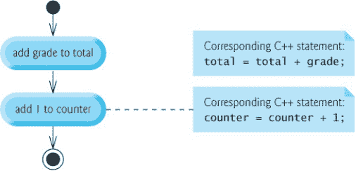

**图 4.2 顺序结构活动图。**

活动图对软件系统某一部分的**工作流**（也称为**活动**）进行建模。此类工作流可能包含算法的一部分，例如**图 4.2** 中的顺序结构。活动图由符号组成，例如**动作状态符号**（左右两侧替换为向外弧线的矩形）、**菱形**和**小圆圈**。这些符号通过**转换箭头**连接，转换箭头表示活动的*流程*——即动作应发生的*顺序*。

与伪代码类似，活动图帮助你开发和表示算法。活动图清楚地显示了控制结构如何运作。我们在本章和**第 5 章**中使用 UML 来展示控制语句中的控制流。在线第 25–26 章在现实世界的 ATM（自动柜员机）案例研究中使用 UML。

考虑**图 4.2** 中的顺序结构活动图。它包含两个**动作状态**，每个动作状态包含一个**动作表达式**——例如“将成绩加到总分”或“计数器加 1”——指定要执行的特定动作。活动图中的箭头表示**转换**，它指示动作状态所表示的动作发生的*顺序*。实现**图 4.2** 所示活动的程序首先将 `grade` 加到 `total`，然后将 `1` 加到 `counter`。

活动图顶部的**实心圆**表示**初始状态**——程序执行建模动作*之前*工作流的*开始*。图底部**被空心圆包围的实心圆**表示**最终状态**——程序执行其动作*之后*工作流的*结束*。

**图 4.2** 还包含右上角折叠的矩形。这些是 UML **注释**（类似于 C++ 中的注释）——描述图中符号用途的解释性说明。**图 4.2** 使用 UML 注释来显示与每个动作状态关联的 C++ 代码。一条**虚线**将每个注释与其描述的元素连接起来。活动图通常不显示实现活动的 C++ 代码。我们在这里这样做是为了说明该图如何与 C++ 代码相关联。有关 UML 的更多信息，请参阅我们可选的在线面向对象设计案例研究（第 25–26 章）或访问 `www.uml.org`。

#### 4.4.2 选择语句

C++ 有三种类型的**选择语句**。`if` *语句*在条件为*真*时执行（选择）一个动作（或一组动作），在条件为*假*时跳过该动作。`if...else` *语句*在条件为*真*时执行一个动作（或一组动作），在条件为*假*时执行不同的动作（或一组动作）。`switch` *语句*（[第 5 章](#)）根据表达式的值执行*许多*不同动作（或一组动作）之一。

`if` 语句称为**单选择语句**，因为它选择或忽略*单个*动作（或一组动作）。`if...else` 语句称为**双选择语句**，因为它在*两个不同*动作（或一组动作）之间进行选择。`switch` 语句称为**多选择语句**，因为它在*许多不同*动作（或一组动作）之间进行选择。

#### 4.4.3 循环语句

C++ 提供了四种**循环语句**（有时称为**重复语句**或**迭代语句**），使程序能够在条件（称为**循环继续条件**）保持*真*的情况下重复执行语句。循环语句是 `while`、`do...while`、`for` 和基于范围的 `for` 语句。（[第 5 章](#)介绍 `do...while` 和 `for` 语句，[第 7 章](#)介绍基于范围的 `for` 语句。）`while` 和 `for` 语句在*其循环体*中执行动作（或一组动作）*零次*


或更多次——如果循环继续条件最初为 *假*，则动作（或动作组）将 *不会* 执行。`do...while` 语句会在其循环体中执行动作（或动作组）*一次或多次*。

`if`、`else`、`switch`、`while`、`do` 和 `for` 这些单词都是 C++ 关键字。关键字不能用作标识符，例如变量名，并且必须仅使用小写字母拼写。**图 4.3** 提供了 C++ 关键字的完整列表。

**图 4.3** C++ 关键字。

| C++ 关键字 | | | | |
|---|---|---|---|---|
| *C 和 C++ 编程语言共有的关键字* | | | | |
| `asm` | `auto` | `break` | `case` | `char` |
| `const` | `continue` | `default` | `do` | `double` |
| `else` | `enum` | `extern` | `float` | `for` |
| `goto` | `if` | `inline` | `int` | `long` |
| `register` | `return` | `short` | `signed` | `sizeof` |
| `static` | `struct` | `switch` | `typedef` | `union` |
| `unsigned` | `void` | `volatile` | `while` | |
| *仅 C++ 特有的关键字* | | | | |
| `and` | `and_eq` | `bitand` | `bitor` | `bool` |
| `catch` | `class` | `compl` | `const_cast` | `delete` |
| `dynamic_cast` | `explicit` | `export` | `false` | `friend` |
| `mutable` | `namespace` | `new` | `not` | `not_eq` |
| `operator` | `or` | `or_eq` | `private` | `protected` |
| `public` | `reinterpret_cast` | `static_cast` | `template` | `this` |
| `throw` | `true` | `try` | `typeid` | `typename` |
| `using` | `virtual` | `wchar_t` | `xor` | `xor_eq` |
| **C++11 关键字** | | | | |
| `alignas` | `alignof` | `char16_t` | `char32_t` | `constexpr` |
| `decltype` | `noexcept` | `nullptr` | `static_assert` | `thread_local` |

## 4.4.4 控制语句总结

C++ 只有三种控制结构，从现在起我们将其称为*控制语句*：*顺序语句*、*选择语句*（三种类型）和*迭代语句*（四种类型）。每个程序都是通过根据程序所实现算法的需要，尽可能多地组合这些语句而形成的。我们可以将每个控制语句建模为一个活动图。与**图 4.2**一样，每个图都包含一个初始状态和一个最终状态，它们分别表示控制语句的入口点和出口点。**单入口/单出口控制语句**使构建程序变得容易——我们只需将一个控制语句的出口点连接到下一个控制语句的入口点。我们称之为**控制语句堆叠**。我们将了解到，控制语句之间还有一种连接方式——**控制语句嵌套**——即一个控制语句出现在另一个控制语句*内部*。因此，C++ 程序中的算法仅由三种控制语句构造，并且仅以两种方式组合。这就是简单性的本质。

### 4.5 `if` 单选择语句

我们在**2.7 节**中简要介绍了 `if` 单选择语句。程序使用选择语句在备选行动方案中做出选择。例如，假设某次考试的及格分数是 60。以下*伪代码*语句

```
If student's grade is greater than or equal to 60
    Print "Passed"
```

表示一个 `if` 语句，它判断*条件*“学生成绩大于或等于 60”是否为*真*。如果是，则打印“Passed”，然后按顺序“执行”下一条伪代码语句。（请记住，伪代码不是真正的编程语言。）如果条件为*假*，则忽略*打印*语句，并按顺序执行下一条伪代码语句。该选择语句第二行的缩进是可选的，但建议使用，因为它强调了结构化程序的固有结构。

前面的伪代码 *If* 语句可以用 C++ 写成

```cpp
{
    if (studentGrade >= 60) {
        cout << "Passed";
    }
}
```

这段 C++ 代码与伪代码非常对应。这是伪代码的一个特性，使其成为非常有用的程序开发工具。

### `bool` 数据类型

你在**第 2 章**看到，决策可以基于包含关系运算符或相等运算符的条件。实际上，在 C++ 中，决策可以基于*任何*求值为零或非零的表达式——如果表达式求值为*零*，则被视为*假*；如果表达式求值为*非零*，则被视为*真*。C++ 还提供了数据类型 `bool` 用于布尔变量，这种变量只能保存 `true` 和 `false` 值——这两个都是 C++ 关键字。


### 可移植性提示 4.1

> *为了与早期版本的 C 兼容（早期 C 使用整数表示布尔值），`bool` 值 `true` 也可以由任何非零值表示（编译器通常使用 1），而 `bool` 值 `false` 也可以表示为值零。*

### `if` 语句的 UML 活动图

**图 4.4** 说明了单选择 `if` 语句。该图包含活动图中最重要的符号——*菱形*，或称**判定符号**，它表示要做出一个*判定*。工作流沿着由该符号关联的**守卫条件**所确定的路径继续，守卫条件可以为*真*或*假*。从判定符号引出的每条转移箭头都有一个守卫条件（在箭头旁边的*方括号*中指定）。如果守卫条件为*真*，工作流进入该转移箭头所指向的动作状态。在**图 4.4**中，如果成绩大于或等于 60（即条件为*真*），程序打印“Passed”，然后转移到活动的最终状态。如果成绩小于 60（即条件为*假*），程序立即转移到最终状态，而不显示任何消息。

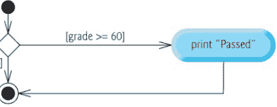

**图 4.4** `if` 单选择语句 UML 活动图。

`if` 语句是一种单入口/单出口控制语句。我们将看到，其余控制语句的活动图也包含初始状态、转移箭头、指示要执行动作的动作状态、指示要做出判定的判定符号（以及关联的守卫条件）和最终状态。

### 4.6 `if...else` 双选择语句

`if` 单选择语句仅在条件为*真*时执行指定的动作；否则，跳过该动作。`if...else` **双选择语句**允许你指定条件为*真*时执行的一个动作，以及条件为*假*时执行的另一个动作。例如，以下伪代码语句

```
If student's grade is greater than or equal to 60
    Print “Passed”
Else
    Print “Failed”
```

表示一个 `if...else` 语句：如果学生成绩大于或等于 60，则打印“Passed”；如果小于 60，则打印“Failed”。无论哪种情况，打印发生后，按顺序的下一条伪代码语句就会被“执行”。

前面的 *If…Else* 伪代码语句可以用 C++ 写成

```cpp
{
    if (grade >= 60) {
        cout << "Passed";
    }
    else {
        cout << "Failed";
    }
}
```

`else` 的主体也进行了缩进。无论你选择哪种缩进约定，都应在整个程序中一致地应用。


### 良好编程习惯 4.1

*缩进 `if...else` 语句的两个主体语句（或语句组）。许多 IDE 会为你自动完成。*


### 良好编程习惯 4.2

*如果存在多个缩进层级，每一层级都应缩进相同的额外空格量。我们更倾向于三空格缩进。*

### `if...else` 语句的 UML 活动图

**图 4.5** 说明了前面 `if...else` 语句中的控制流。同样，UML 活动图中的符号（除初始状态、转移箭头和最终状态之外）表示动作状态和判定。

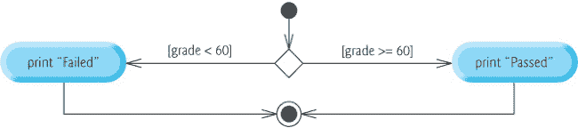

**图 4.5** `if...else` 双选择语句 UML 活动图。

#### 4.6.1 嵌套的 `if...else` 语句


程序可以通过将 `if...else` 语句放在其他 `if...else` 语句中，创建**嵌套 if...else 语句**，从而测试多种情况。例如，下面的伪代码表示一个嵌套的 `if...else`，它对于大于或等于 90 的考试成绩打印 `A`，对于 80 到 89 的成绩打印 `B`，对于 70 到 79 的成绩打印 `C`，对于 60 到 69 的成绩打印 `D`，对于所有其他成绩打印 `F`：

```text
If student's grade is greater than or equal to 90
    Print "A"
else
    If student's grade is greater than or equal to 80
        Print "B"
    else
        If student's grade is greater than or equal to 70
            Print "C"
        else
            If student's grade is greater than or equal to 60
                Print "D"
            else
                Print "F"
```

我们使用底纹来突出嵌套。这个伪代码可以用 C++ 写成

```cpp
if (studentGrade >= 90) {
    cout << "A";
}
else {
    if (studentGrade >= 80) {
        cout << "B";
    }
    else {
        if (studentGrade >= 70) {
            cout << "C";
        }
        else {
            if (studentGrade >= 60) {
                cout << "D";
            }
            else {
                cout << "F";
            }
        }
    }
}
```

如果变量 `studentGrade` 大于或等于 90，嵌套 `if...else` 语句中的前四个条件将为 `true`，但只有第一个 `if...else` 语句的 `if` 部分中的语句会执行。该语句执行后，“最外层” `if...else` 语句的 `else` 部分会被跳过。许多程序员喜欢将前面的嵌套 `if...else` 语句写成以下形式，除了编译器忽略的空格和缩进外，两者完全相同：

```cpp
if (studentGrade >= 90) {
    cout << "A";
}
else if (studentGrade >= 80) {
    cout << "B";
}
else if (studentGrade >= 70) {
    cout << "C";
}
else if (studentGrade >= 60) {
    cout << "D";
}
else {
    cout << "F";
}
```

后一种形式避免了代码向右深度缩进。这种缩进常常使一行代码所剩空间很小，迫使代码换行。


## 错误预防提示 4.1

在嵌套 `if...else` 语句中，确保测试所有可能的情况。

#### 4.6.2 悬空 `else` 问题

在全书正文中，我们总是用花括号（`{` 和 `}`）括起控制语句体。这避免了称为“悬空 `else`”问题的逻辑错误。我们将在练习 4.23–4.25 中研究这个问题。

#### 4.6.3 块

`if` 语句通常只在其语句体中期望*一条*语句。要在 `if` 的语句体中（或 `if...else` 语句的 `else` 语句体中）包含*多条*语句，请将这些语句括在花括号中。正如我们在全书中所做的那样，始终使用花括号是一种好做法。包含在一对花括号中的语句（例如控制语句或函数的语句体）形成一个*块*。在函数中，凡是能放置单条语句的地方，都可以放置块。

下面的示例在 `if...else` 语句的 `else` 部分包含一个由*多条*语句组成的块：

```cpp
if (grade >= 60) {
    cout << "Passed";
}
else
{
    cout << "Failed\n";
    cout << "You must take this course again.";
}
```

在这种情况下，如果 `grade` 小于 60，程序会执行 `else` 语句体中的**两条**语句，并打印

```
Failed
You must take this course again.
```

如果没有花括号括住 `else` 子句中的这两条语句，那么语句

```cpp
cout << "You must take this course again.";
```

将位于 `if...else` 语句的 `else` 部分语句体之外，并且*无论*成绩是否小于 60 都会执行。

## 语法错误和逻辑错误

*语法错误*（例如块中的一个花括号在程序中被遗漏）会被编译器捕获。**逻辑错误**（例如不正确的计算）在执行时产生影响。**致命逻辑错误**会导致程序失败并提前终止。**非致命逻辑错误**允许程序继续执行，但会导致其产生不正确的结果。

## 空语句

正如块可以放在任何地方、单条语句也可以放在任何地方一样，也可以有**空语句**，它通过在通常应放置语句的位置放置一个分号（`;`）来表示。


### 常见编程错误 4.1

*在 `if` 或 `if...else` 语句的带括号条件之后放置分号，会导致单选择 `if` 语句中出现逻辑错误，并导致双选择 `if...else` 语句中出现语法错误（当 `if` 部分包含语句体时）。*

#### 4.6.4 条件运算符（`?:`）

C++ 提供了**条件运算符**（`?:`），可用于代替 `if...else` 语句。这可以使你的代码更短、更清晰。条件运算符是 C++ 中唯一的**三元运算符**（即接受*三个*操作数的运算符）。操作数与 `?:` 符号一起构成**条件表达式**。例如，下面的语句

```cpp
{
    cout << (studentGrade >= 60 ? "Passed" : "Failed");
}
```

打印该条件表达式的值。第一个操作数（位于 `?` 左侧）是一个条件，第二个操作数（位于 `?` 和 `:` 之间）是条件为*真*时条件表达式的值，第三个操作数（位于 `:` 右侧）是条件为*假*时条件表达式的值。此语句中的条件表达式在条件

```cpp
{
    studentGrade >= 60
}
```

为*真*时求值为字符串 `"Passed"`，为*假*时求值为字符串 `"Failed"`。因此，这个使用条件运算符的语句执行的功能与**4.6 节**中第一个 `if...else` 语句基本相同。条件运算符的优先级较低，因此整个条件表达式通常放在括号中。我们将看到，条件表达式可以在某些 `if...else` 语句无法使用的情况下使用。

条件表达式中的值也可以是执行的操作。例如，下面的条件表达式也会打印 `"Passed"` 或 `"Failed"`：

```cpp
grade >= 60 ? cout << "Passed" : cout << "Failed";
```

前面的语句读作：“如果 `grade` 大于或等于 `60`，则 `cout << "Passed"`；否则，`cout << "Failed"`。”这相当于一个 `if...else` 语句。条件表达式可以出现在某些 `if...else` 语句无法出现的程序位置。

### 4.7 `Student` 类：嵌套 `if...else` 语句

**图 4.6–4.7** 的示例演示了一个嵌套 `if...else` 语句，它根据学生在课程中的平均分确定学生的字母等级。

## *类* `Student`

类 `Student`（**图 4.6**）存储学生的姓名和平均分，并提供用于操作这些值的成员函数。该类包含：

- 类型为 `string` 的数据成员 `name`（第 65 行），用于存储 `Student` 的姓名。
- 类型为 `int` 的数据成员 `average`（第 66 行），用于存储 `Student` 在课程中的平均分。
- 一个构造函数（第 8–13 行），用于初始化 `name` 和 `average`。
- 成员函数 `setName` 和 `getName`（第 16–23 行），用于*设置*和*获取* `Student` 的 `name`。
- 成员函数 `setAverage` 和 `getAverage`（第 26–39 行），用于*设置*和*获取* `Student` 的 `average`——在**5.11 节**中，你将学习如何使用能够测试多个条件的逻辑运算符更简洁地表达第 29–30 行。
- 成员函数 `getLetterGrade`（第 42–63 行），它使用*嵌套* `if...else` *语句*根据 `Student` 的 `average` 确定 `Student` 的字母等级。

构造函数在成员初始化列表中初始化 `name` 后，会调用成员函数 `setAverage`，后者使用*嵌套* `if` *语句*（第 29–33 行）验证用于设置 `average` 的值。这些语句确保该值大于 `0` 且小于或等于 `100`；否则，`average` 的值保持不变。

每个 `if` 语句都包含一个*简单条件*——即只进行一次测试的条件。在**5.11 节**中，你将看到如何使用逻辑运算符编写复合条件，从而方便地组合多个简单条件。如果第 29 行的条件为*真*，才会测试第 30 行的条件；并且*仅当*第 29 行和第 30 行的条件都为*真*时，第 31 行的语句才会执行。


```cpp
// Fig. 4.6: Student.h
// Student class that stores a student name and average.
#include <string>

class Student {
public:
   // constructor initializes data members
   Student(std::string studentName, int studentAverage)
      : name(studentName) {

      // sets average data member if studentAverage is valid
      setAverage(studentAverage);
   }

   // sets the Student's name
   void setName(std::string studentName) {
      name = studentName;
   }

   // retrieves the Student's name
   std::string getName() const {
      return name;
   }

   // sets the Student's average
   void setAverage(int studentAverage) {
      // validate that studentAverage is > 0 and <= 100; otherwise,
      // keep data member average's current value
      if (studentAverage > 0)
         if (studentAverage <= 100) {
            average = studentAverage; // assign to data member
         }
   }

   // retrieves the Student's average
   int getAverage() const {
      return average;
   }

   // determines and returns the Student's letter grade
   std::string getLetterGrade() const {
      // initialized to empty string by class string's constructor
      std::string letterGrade;

      if (average >= 90) {
         letterGrade = "A";
      }
      else if (average >= 80) {
         letterGrade = "B";
      }
      else if (average >= 70) {
         letterGrade = "C";
      }
      else if (average >= 60) {
         letterGrade = "D";
      }
      else {
         letterGrade = "F";
      }

      return letterGrade;
   }

private:
   std::string name;
   int average{0}; // initialize average to 0
}; // end class Student
```

**图 4.6** 存储学生姓名和平均成绩的 `Student` 类。

## `StudentTest` 类

为了演示类 `Student` 的 `getLetterGrade` 成员函数中嵌套的 `if...else` 语句，`main` 函数（**图 4.7**）创建了两个 `Student` 对象（第 8-9 行）。接下来，第 11-16 行分别调用对象的 `getName`、`getAverage` 和 `getLetterGrade` 成员函数，显示每个 `Student` 的姓名、平均成绩和字母等级。

```cpp
// Fig. 4.7: StudentTest.cpp
// Create and test Student objects.
#include <iostream>
#include "Student.h"
using namespace std;

int main() {
    Student account1{"Jane Green", 93};
    Student account2{"John Blue", 72};

    cout << account1.getName() << "'s letter grade equivalent of "
         << account1.getAverage() << " is: "
         << account1.getLetterGrade() << "\n";
    cout << account2.getName() << "'s letter grade equivalent of "
         << account2.getAverage() << " is: "
         << account2.getLetterGrade() << endl;
}
```

```text
Jane Green's letter grade equivalent of 93 is: A
John Blue's letter grade equivalent of 72 is: C
```

**图 4.7** 创建并测试 `Student` 对象。

### 4.8 `while` 迭代语句

迭代语句允许你指定程序在某个条件保持为*真*时重复执行某个动作。伪代码语句

```text
While there are more items on my shopping list
    Purchase next item and cross it off my list
```

这描述了购物过程中的迭代。条件“购物清单上还有更多物品”可能为*真*或*假*。若为*真*，则执行动作“购买下一件物品并将其从清单上划掉”。只要条件保持为*真*，该动作就会*重复*执行。*While* 迭代语句中包含的一条或多条语句构成其循环体，循环体可以是单条语句，也可以是一个语句块。最终，条件会变为*假*（当购物清单上的最后一件物品被购买并划掉时）。此时，迭代终止，并执行迭代语句之后的第一条语句。

作为 C++ 的 `while` **迭代语句**的一个示例，考虑一段查找第一个大于 100 的 3 的幂的程序。执行下面的 `while` 语句后，变量 `product` 将包含结果：

```cpp
{
    int product{3};

    while (product <= 100) {
        product = 3 * product;
    }
}
```

`while` 语句的每次迭代都将 `product` 乘以 3，因此 `product` 依次取值 9、27、81 和 243。当 `product` 变为 243 时，`product <= 100` 变为*假*。这会终止迭代，因此 `product` 的最终值为 243。此时，程序继续执行 `while` 语句之后的下一条语句。


## 常见编程错误

*如果 `while` 语句的循环体中没有提供最终使 `while` 中的条件变为假的动作，会导致一种称为**无限循环**的逻辑错误（循环永不终止）。*

## `while` 语句的 UML 活动图

**图 4.8** 中的 UML 活动图展示了前面 `while` 语句的控制流。与之前一样，图中的符号（除了初始状态、转移箭头、一个最终状态和三个注释）表示一个动作状态和一个决策。此图引入了 UML 的**合并符号**。UML 将**合并符号**和决策符号都表示为菱形。合并符号将两条活动流合并为一条。在此图中，合并符号连接来自初始状态和动作状态的转移，使两者都流入决策，该决策确定循环是否应开始（或继续）执行。

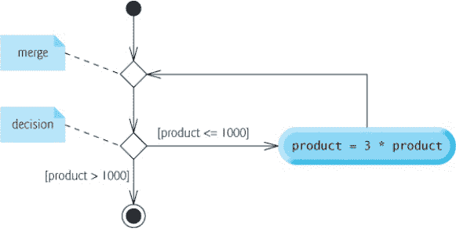

**图 4.8** `while` 迭代语句的 UML 活动图。

决策符号和合并符号可以通过“传入”和“传出”转移箭头的数量来区分。决策符号有*一个*指向菱形的转移箭头，以及*两个或更多*从菱形指出的转移箭头，以表示从该点可能的转移。此外，每个从决策符号指出的转移箭头旁边都有一个守卫条件。合并符号有两个或更多指向菱形的转移箭头，且只有一个从菱形指出的转移箭头，表示多条活动流合并后继续活动。与合并符号关联的转移箭头均没有守卫条件。

**图 4.8** 清楚地显示了本节前面讨论的 `while` 语句的迭代过程。从动作状态伸出的转移箭头指回合并符号，程序流从那里转移回决策，该决策在循环的每次迭代开始时进行测试。循环继续执行，直到守卫条件 `product > 100` 变为*真*。然后 `while` 语句退出（到达其最终状态），控制权传递给程序中按顺序排列的下一条语句。

### 4.9 制定算法：计数器控制的迭代

为了说明算法是如何开发的，我们解决一个求学生平均成绩问题的两个变体。考虑以下问题描述：

- *一个由十名学生组成的班级进行了一次测验。你可以获得这次测验的成绩（0-100 范围内的整数）。计算班级的测验平均分。*

班级平均分等于成绩总和除以学生人数。在计算机上解决此问题的算法必须输入每个成绩、跟踪所输入所有成绩的总和、执行平均计算并打印结果。

#### 4.9.1 使用计数器控制迭代的伪代码算法

让我们使用伪代码列出要执行的动作，并指定它们的执行顺序。我们使用**计数器控制的迭代**一次输入一个成绩。此技术使用一个称为**计数器**（或**控制变量**）的变量来控制一组语句的执行次数。计数器控制的迭代通常被称为**定次迭代**，因为迭代次数在循环开始执行*之前*就是已知的。在此示例中，当计数器超过 10 时迭代终止。本节给出了一个完整的伪代码算法（[图 4.9]）以及一个实现该算法的相应 C++ 程序（[图 4.10]）。在[第 4.10 节]中，我们演示如何从头开发伪代码算法。

1. 将总和设为 0
2. 将成绩计数器设为 1
3. 
4. *当成绩计数器小于等于十时*
5. &nbsp;&nbsp;&nbsp;提示用户输入下一个成绩
6. &nbsp;&nbsp;&nbsp;输入下一个成绩
7. &nbsp;&nbsp;&nbsp;将该成绩加入总和
8. &nbsp;&nbsp;&nbsp;将成绩计数器加一
9. 
10. 将班级平均分设为总和除以十
11. 打印班级平均分

**图 4.9** 使用计数器控制的伪代码算法


迭代以解决班级平均分问题。

注意 **图 4.9** 的算法中提到了 total 和 counter。**total** 是用于累加多个值之和的变量。计数器（counter）是用于计数的变量——在本例中，成绩计数器（grade counter）指示用户即将输入的是 10 个成绩中的哪一个。用于存储总计的变量通常在使用前初始化为零。在伪代码中，我们*不*使用花括号来括住构成伪代码 *While* 结构的语句，但你可以这么做。


### 软件工程观察 4.1

*经验表明，在计算机上解决问题最困难的部分是开发解决方案的算法。一旦指定了正确的算法，从中生成可工作的 C++ 程序通常很简单。*

## 4.9.2 实现计数器控制迭代

在 **图 4.10** 中，`main` 函数实现了 **图 4.9** 中伪代码所描述的班级平均分算法——它允许用户输入 10 个成绩，然后计算并显示平均值。

```cpp
// Fig. 4.10: ClassAverage.cpp
// Solving the class-average problem using counter-controlled iteration.
#include <iostream>
using namespace std;

int main() {
   // initialization phase
   int total{0};  // initialize sum of grades entered by the user
   unsigned int gradeCounter{1};  // initialize grade # to be entered next

   // processing phase uses counter-controlled iteration
   while (gradeCounter <= 10) {  // loop 10 times
      cout << "Enter grade: ";
      int grade;
      cin >> grade;  // input next grade
      total = total + grade;  // add grade to total
      gradeCounter = gradeCounter + 1; // increment counter by 1
   }

   // termination phase
   int average{total / 10}; // int division yields int result

   // display total and average of grades
   cout << "\nTotal of all 10 grades is " << total;
   cout << "\nClass average is " << average << endl;
}
```

```text
Enter grade: 67
Enter grade: 78
Enter grade: 39
Enter grade: 67
Enter grade: 37
Enter grade: 98
Enter grade: 93
Enter grade: 85
Enter grade: 82
Enter grade: 100

Total of all 10 grades is 846
Class average is 84
```

图 4.10 使用计数器控制迭代解决班级平均分问题。

### `main` 中的局部变量

第 8、9、14 和 21 行分别声明了局部变量 `total`、`gradeCounter`、`grade` 和 `average`。变量 `gradeCounter` 的类型为 `unsigned int`，因为它只能取 1 到 11 之间的值（11 终止循环），而这些值都是正数。一般来说，只存储非负值的计数器应使用 `unsigned` 类型声明。`unsigned` 整数类型的变量可以表示从 0 到大约*相应有符号整数类型正范围的两倍*的值。你可以使用 `<climits>` 中的常量 `UINT_MAX` 来确定平台上 `unsigned int` 的最大值。程序中的其他变量类型为 `int`。变量 `grade` 存储用户输入。

在函数体内声明的变量是局部变量，只能从其声明行到声明该变量的块的右花括号之间使用。局部变量的声明必须出现在其使用*之前*；否则会发生编译错误。变量 `grade`——在 `while` 循环体内声明——只能在该块内使用。

### 初始化阶段：初始化变量 `total` 和 `gradeCounter`

第 8–9 行声明并将 `total` 初始化为 `0`，将 `gradeCounter` 初始化为 `1`。这些初始化发生在变量用于计算*之前*。


### 错误预防提示 4.2

*在声明或赋值语句中初始化每个 total 和 counter。total 通常初始化为 0。counter 通常初始化为 0 或 1，具体取决于它们的用法（我们将展示何时使用 0、何时使用 1 的示例）。*

### 处理阶段：从用户处读取 10 个成绩

第 12 行表示 `while` 语句应在 `gradeCounter` 的值小于或等于 10 时继续循环（也称为**迭代**）。只要此条件保持为*真*，`while` 语句就会重复执行界定其循环体的花括号之间的语句（第 12–18 行）。

第 13 行显示提示文本 `"Enter grade: "`。第 15 行读取用户输入的成绩并将其赋给变量 `grade`。然后第 16 行将用户输入的新 `grade` 加到 `total` 上，并将结果赋给 `total`，替换其先前值。

第 17 行将 `gradeCounter` 加 `1`，表示程序已处理一个成绩，并准备从用户处读取下一个成绩。递增 `gradeCounter` 最终使其超过 10。然后循环终止，因为其条件（第 12 行）变为*假*。

### 终止阶段：计算并显示班级平均分

循环终止时，第 21 行在 `average` 变量的初始化器中执行平均分计算。第 24 行显示文本 `"Total of all 10 grades is "` 后跟变量 `total` 的值。然后，第 25 行显示文本 `"Class average is "` 后跟变量 `average` 的值。当执行到达第 26 行时，程序终止。

请注意，此示例只包含一个执行所有工作的 `main` 函数。在本章和**第 3 章**中，你见过由类和 `main` 程序组成的示例，`main` 程序创建类的对象并调用其成员函数。当尝试创建可重用类来演示概念没有意义时，我们会将程序的语句完全放在 `main` 中。

## 4.9.3 关于整数除法和截断的说明

本例的平均分计算产生整数结果。程序输出表明，示例执行中成绩值之和为 846，除以 10 应产生浮点数 84.6。然而，`total / 10`（图 4.10 的第 21 行）的计算结果是整数 84，因为 `total` 和 `10` 都是整数。两个整数相除产生**整数除法**——计算的任何小数部分都会被**截断**（即*丢失*）。在下一节中，我们将了解如何从平均分计算中获得浮点结果。


### 常见编程错误 4.3

*假设整数除法会舍入（而不是截断）可能导致错误结果。例如，7 ÷ 4 在常规算术中得 1.75，在整数运算中被截断为 1，而不是舍入为 2。*

## 4.9.4 算术溢出

在 **图 4.10** 中，第 16 行

```text
total = total + grade; // add grade to total
```

将用户输入的每个 `grade` 加到 `total` 上。即使这个简单语句也存在*潜在*问题——将整数相加可能产生一个*太大*而无法存储在 `int` 变量中的值。这称为**算术溢出**，会导致*未定义行为*，可能产生意外结果和安全问题。参见例如 http://en.wikipedia.org/wiki/Integer_overflow#Security_ramifications

**图 2.5** 第 19 行也存在同样的问题，它计算用户输入的两个 `int` 值之和：

```text
sum = number1 + number2; // add the numbers; store result in sum
```

`int` 变量可存储的最大值和最小值分别由常量 `INT_MAX` 和 `INT_MIN` 表示，它们定义在头文件 `<climits>` 中。其他整型和浮点类型也有类似的常量（头文件 `<cfloat>`）。要查看这些常量在平台上的值，请在程序中包含相应的头文件，并用 `cout` 输出这些值，例如：

```cpp
cout << "INT_MAX = " << INT_MAX << "\n";
```

对于像 **图 4.10** 第 16 行和 **图 2.5** 第 19 行那样的算术计算，好的做法是*在*执行它们*之前*确保它们*不会*溢出。实现该做法的代码见 `www.securecoding.cert.org`——只需搜索指南 “INT32-CPP。” 该代码使用了 `&&`（逻辑与）和 `||`（逻辑或）运算符，这些运算符将在**第 5 章**中介绍。


## 4.9.5 输入验证

每当程序接收用户输入时，可能会发生各种问题。例如，在**图4.10**的第15行：

```cpp
cin >> grade; // input next grade
```

我们假设用户会输入一个0到100范围内的整数成绩。然而，用户可能输入小于0的整数、大于100的整数、超出`int`变量可存储范围的整数、包含小数点的数字，或者包含字母或特殊符号甚至不是整数的值。

为了确保输入有效，工业级程序必须测试所有可能的错误情况。输入成绩的程序应使用**范围检查**来验证成绩，确保其值在0到100之间。然后可以要求用户重新输入任何超出范围的值。如果程序要求输入来自特定集合的值（例如，非连续的产品代码），可以确保每个输入都与集合中的某个值匹配。

### 4.10 算法制定：哨兵控制迭代

让我们推广**4.9节**中的班级平均分问题。考虑以下问题：

- *开发一个班级平均分程序，每次运行时处理任意数量学生的成绩。*

在之前的班级平均分示例中，问题陈述指定了学生人数，因此成绩数量（10）是预先已知的。在此示例中，没有说明用户在程序执行期间将输入多少成绩。程序必须处理*任意*数量的成绩。它如何确定何时停止输入成绩？它如何知道何时计算并打印班级平均分？

解决此问题的一种方法是使用一个特殊值，称为**哨兵值**（也称为**信号值**、**哑值**或**标志值**），来表示“数据输入结束”。用户输入成绩，直到所有合法成绩都已输入。然后用户输入哨兵值，表示不再输入成绩。**哨兵控制迭代**通常称为**不定迭代**，因为在循环开始执行之前*不*知道迭代次数。

显然，必须选择一个不会与可接受输入值混淆的哨兵值。测验成绩是非负整数，因此−1是此问题可接受的哨兵值。因此，运行班级平均分程序可能会处理诸如95、96、75、74、89和−1这样的输入流。然后程序将计算并打印成绩95、96、75、74和89的班级平均分；由于−1是哨兵值，它*不应*参与平均值计算。

#### 4.10.1 自顶向下、逐步求精：顶层和第一步求精

我们使用一种称为**自顶向下、逐步求精**的技术来处理这个班级平均分程序，这种技术对开发结构良好的程序至关重要。我们首先用伪代码表示**顶层**——一条表达程序整体功能的单一语句：

```text
Determine the class average for the quiz
```

顶层实际上是程序的*完整*表示。遗憾的是，顶层很少提供足以编写C++程序的详细信息。因此，我们现在开始求精过程。我们将顶层分解为一系列更小的任务，并按它们将执行的顺序列出。这产生了以下**第一步求精**：

```text
Initialize variables

Input, sum and count the quiz grades
Calculate and print the class average
```

此求精仅使用*顺序*结构——列出的步骤应按顺序一个一个地执行。


### 软件工程观察 4.2

*每一步求精，以及顶层本身，都是算法的完整规范——只是细节层次不同。*

#### 4.10.2 进入第二步求精

在自顶向下过程中，上述软件工程观察通常就是进行第一步求精所需的全部内容。要继续进行下一层求精——即**第二步求精**——我们需要确定具体的变量。在此示例中，我们需要一个数字的累加总和、一个已处理数字数量的计数、一个用于接收用户输入的每个成绩值的变量，以及一个用于保存计算出的平均值的变量。伪代码语句

```text
Initialize variables
```

可以如下求精：

```text
Initialize total to zero
Initialize counter to zero
```

只有变量*total*和*counter*需要在使用前初始化。变量*average*和*grade*（分别用于计算平均值和用户输入）不需要初始化，因为它们的值将在计算或输入时被替换。

伪代码语句

```text
Input, sum and count the quiz grades
```

需要*迭代*来逐次输入每个成绩。我们事先不知道将输入多少成绩，因此将使用哨兵控制迭代。用户一次输入一个成绩。输入最后一个成绩后，用户输入哨兵值。程序在每次输入成绩后检查哨兵值，并在用户输入哨兵值时终止循环。上述伪代码语句的第二步求精如下：

```text
Prompt the user to enter the first grade
Input the first grade (possibly the sentinel)
While the user has not yet entered the sentinel
    Add this grade into the running total
    Add one to the grade counter
    Prompt the user to enter the next grade
    Input the next grade (possibly the sentinel)
```

我们只需缩进*While*下的语句，以表明它们属于*While*。同样，伪代码只是一种非正式的程序开发辅助工具。

伪代码语句

```text
Calculate and print the class average
```

可以如下求精：

```text
If the counter is not equal to zero
    Set the average to the total divided by the counter
    Print the average
else
    Print "No grades were entered"
```

我们在这里小心地测试*除以零*的可能性——这是一种逻辑*错误*，如果未被发现，将导致程序失败或产生无效输出。班级平均分问题伪代码的完整第二步求精如**图4.11**所示。


### 错误预防提示 4.3

根据C++标准，浮点运算中除以零的结果是未定义的。当执行除法（`/`）或取余（`%`）运算且右操作数可能为零时，应测试这种情况并对其进行处理（例如，显示错误消息），而不是让计算继续执行。

```text
1  Initialize total to zero
2  Initialize counter to zero
3
4  Prompt the user to enter the first grade
5  Input the first grade (possibly the sentinel)
6
7  While the user has not yet entered the sentinel
8      Add this grade into the running total
9      Add one to the grade counter
10     Prompt the user to enter the next grade
11     Input the next grade (possibly the sentinel)
12
13 If the counter is not equal to zero
14     Set the average to the total divided by the counter
15     Print the average
16 else
17     Print “No grades were entered”
```

**图4.11** 带有哨兵控制迭代的班级平均分伪代码算法。

在**图4.9**和**图4.11**中，我们在伪代码中加入了空行和缩进，使其更易读。空行将算法划分为不同阶段并分隔控制语句；缩进则强调控制语句的主体。

**图4.11**中的伪代码算法解决了更一般的班级平均分问题。该算法经过两次求精后开发完成。有时需要更多次。


### 软件工程观察 4.3

当您已将伪代码算法详细到足以将伪代码转换为C++时，即可终止自顶向下、逐步求精的过程。


### 软件工程观察 4.4

有些程序员不使用像伪代码这样的程序开发工具。他们认为最终目标是在计算机上解决问题，编写伪代码只会延迟最终输出的产生。尽管这对简单且熟悉的问题可能有效，但在大型、复杂的项目中可能导致严重错误和延误。


## 4.10.3 实现哨兵控制迭代

在**图 4.12**中，`main` 函数实现了**图 4.11**的伪代码算法。虽然用户输入的每个成绩都是整数，但平均值的计算很可能产生带小数点的数字——即实数或**浮点数**（例如 7.33、0.0975 或 1000.12345）。`int` 类型无法表示这样的数字，因此此示例必须使用另一种类型来实现。C++ 提供了 `float` 和 `double` 数据类型来在内存中存储浮点数。这两种类型的主要区别在于，`double` 变量通常可以存储数值范围更大、精度更高（即小数点右侧的位数更多，也称为数字的**精度**）的数字。C++ 还支持 `long double` 类型，用于存储比 `double` 数值范围更大、精度更高的浮点值。我们将在**第 5 章**中进一步讨论浮点类型。

```cpp
// Fig. 4.12: ClassAverage.cpp
// Solving the class-average problem using sentinel-controlled iteration.
#include <iostream>
#include <iomanip> // parameterized stream manipulators
using namespace std;

int main() {
   // initialization phase
   int total{}; // initialize sum of grades
   unsigned int gradeCounter{}; // initialize # of grades entered so far

   // processing phase
   // prompt for input and read grade from user
   cout << "Enter grade or -1 to quit: ";
   int grade;
   cin >> grade;

   // loop until sentinel value read from user
   while (grade != -1) {
      total = total + grade; // add grade to total
      gradeCounter = gradeCounter + 1; // increment counter

      // prompt for input and read next grade from user
      cout << "Enter grade or -1 to quit: ";
      cin >> grade;
   }

   // termination phase
   // if user entered at least one grade...
   if (gradeCounter != 0) {
      // use number with decimal point to calculate average of grades
      double average{static_cast<double>(total) / gradeCounter};

      // display total and average (with two digits of precision)
      cout << "\nTotal of the " << gradeCounter
           << " grades entered is " << total;
      cout << setprecision(2) << fixed;
      cout << "\nClass average is " << average << endl;
   }
   else { // no grades were entered, so output appropriate message
      cout << "No grades were entered" << endl;
   }
}
```

```text
Enter grade or -1 to quit: 97
Enter grade or -1 to quit: 88
Enter grade or -1 to quit: 72
Enter grade or -1 to quit: -1

Total of the 3 grades entered is 257
Class average is 85.67
```

**图 4.12** 使用哨兵控制迭代解决班级平均分问题。

回想一下，整数除法产生整数结果。本程序引入了一种称为**强制转换运算符**的特殊运算符，以强制平均值计算产生浮点数值结果。本程序还将控制语句一个接一个地**堆叠**起来（按顺序）——`while` 语句（第 19–26 行）后面依次跟着一个 `if...else` 语句（第 30–42 行）。本程序中的大部分代码与图 4.10 中的相同，因此我们重点关注新概念。

### *哨兵控制迭代与计数器控制迭代的程序逻辑*

第 10 行将 `gradeCounter` 初始化为 `0`，因为尚未输入任何成绩。请记住，本程序使用*哨兵控制迭代*来输入成绩。程序仅在用户输入有效成绩时递增 `gradeCounter`。第 32 行声明了 `double` 变量 `average`，用于将班级平均分存储为浮点数。

将本程序中哨兵控制迭代的程序逻辑与图 4.10 中计数器控制迭代的逻辑进行比较。在计数器控制迭代中，`while` 语句（图 4.10 第 12–18 行）的每次迭代都会在指定的迭代次数内从用户读取一个值。在哨兵控制迭代中，程序在到达 `while` 语句*之前*提示并读取第一个值（**图 4.12**第 14 行和第 16 行）。该值决定了程序的控制流是否应进入 `while` 的主体。如果 `while` 的条件为*假*，则用户输入了哨兵值，因此 `while` 的主体不会执行（即未输入任何成绩）。另一方面，如果条件为*真*，则主体开始执行，循环将 `grade` 值添加到 `total` 并递增 `gradeCounter`（第 20–21 行）。然后，循环主体中的第 24–25 行从用户输入下一个值。接下来，程序控制到达第 26 行循环主体的右花括号，因此执行继续测试 `while` 的条件（第 19 行）。该条件使用用户最近输入的 `grade` 来确定循环主体是否应再次执行。

变量 `grade` 的值总是在程序测试 `while` 条件*之前*立即从用户输入。这允许程序在处理该值（即将其添加到 `total`）*之前*确定刚输入的值是否为哨兵值。如果输入了哨兵值，循环终止，并且程序不会将 −1 添加到 `total`。


### 良好编程实践 4.3

*在哨兵控制循环中，提示应提醒用户哨兵值。*

循环终止后，第 30–42 行的 `if...else` 语句执行。第 30 行的条件确定是否输入了任何成绩。如果未输入任何成绩，则 `if...else` 语句的 `else` 部分执行并显示消息 `"No grades were entered"`。

### *`while` 语句中的花括号*

请注意**图 4.12**（第 19–26 行）中 `while` 语句的*块*。如果没有花括号，循环会将其主体视为仅第一条语句，即将 `grade` 添加到 `total`。块中的最后三条语句将落在循环主体之外，导致计算机错误地将代码解释为如下：

```cpp
{
    while (grade != -1)
        total = total + grade; // add grade to total
    gradeCounter = gradeCounter + 1; // increment counter

    // prompt for input and read next grade from user
    cout << "Enter grade or -1 to quit: ";
    cin >> grade;
}
```

如果用户未在第 16 行（`while` 语句之前）输入哨兵值 `-1`，上述代码将导致程序出现*无限循环*。

## 4.10.4 在基本类型之间显式和隐式转换

如果至少输入了一个成绩，**图 4.12** 的第 32 行

```cpp
double average{static_cast<double>(total) / gradeCounter};
```

计算结果的平均值。回顾**图 4.10**，整数除法产生整数结果。即使变量 `average` 被声明为 `double`，如果我们把第 32 行写成

```cpp
double average{total / gradeCounter};
```

那么在除法结果用于初始化 `average` *之前*，就会丢失商的小数部分。

### `static_cast` 运算符

为了在此示例中使用整数执行浮点计算，首先使用 `static_cast` **运算符**创建*临时*浮点值。第 32 行将括号中操作数（`total`）的临时副本转换为尖括号中的类型（`double`）。存储在 `total` 中的值仍然是整数。以这种方式使用强制转换运算符称为**显式转换**。

### *提升*

强制转换操作之后，计算由 `total` 的临时 `double` 副本除以整数 `gradeCounter` 组成。对于算术运算，编译器只知道如何计算操作数类型*相同*的表达式。为了确保这一点，编译器对选定的操作数执行称为**提升**（也称为**隐式转换**）的操作。在包含 `int` 和 `double` 数据类型值的表达式中，C++ 将 `int` 操作数**提升**为 `double` 值。因此，在第 32 行中，C++ 将 `gradeCounter` 值的临时副本提升为 `double` 类型，然后执行除法。最后，用浮点结果初始化 `average`。**第 6.5 节**讨论了允许的基本类型提升。

### *适用于任何类型的强制转换运算符*

强制转换运算符可用于所有基本类型以及类类型。该运算符由关键字 `static_cast` 后跟尖括号（`<` 和 `>`）中的类型名构成。它是一个**一元运算符**——即只有一个操作数。C++ 还支持


一元形式的加号（+）和减号（−）运算符，这样你就可以写出像 −7 或 +5 这样的表达式。强制转换运算符具有第二高的优先级（[附录 A](#)）。

## 4.10.5 格式化浮点数

**图 4.12** 中的格式化功能将在此简要讨论，并在**第 13 章：流输入/输出：深入探究**中深入解释。

### `setprecision` *参数化流操纵符*

第 37 行对 `setprecision` 的调用（参数为 `2`）

```cpp
cout << setprecision(2) << fixed;
```

表示浮点值应输出为小数点右侧*两位***精度**的数字（例如，92.37）。`setprecision` 是一个**参数化流操纵符**，因为它需要参数来执行其任务。使用这些调用的程序必须包含头文件 `<iomanip>`（第 4 行）。操纵符 `endl`（来自头文件 `<iostream>`）是一个**非参数化流操纵符**，因为它不需要参数。默认情况下，浮点值以*六位*精度输出。

### `fixed` *非参数化流操纵符*

流操纵符 `fixed`（第 37 行）表示浮点值应以**定点格式**输出，与**科学记数法**相对。科学记数法是一种将数字显示为 1.0 到 10.0 之间的浮点数乘以 10 的幂的方式。例如，值 3,100.0 在科学记数法中显示为 \(3.1 \times 10^3\)。科学记数法在显示非常大或非常小的值时很有用。使用科学记数法进行格式化将在[第 13 章](#)中进一步讨论。

定点格式化强制浮点数显示特定位数的数字。定点格式化还强制打印小数点和尾随零，即使该值是整数金额，如 88.00。如果没有定点格式化选项，88.00 将打印为 88，*不带*尾随零和小数点。

### *浮点数舍入*

当使用流操纵符 `fixed` 和 `setprecision` 时，*打印*的值会**四舍五入**到 `setprecision` 参数（本例中为 2）指示的小数位数，尽管内存中的值保持不变。例如，值 87.946 和 67.543 分别输出为 87.95 和 67.54。还可以通过使用流操纵符 `showpoint` 来*强制*显示小数点。如果指定了 `showpoint` 但未指定 `fixed`，则尾随零不会打印。与 `endl` 一样，非参数化流操纵符 `fixed` 和 `showpoint` 需要头文件 `<iostream>`。

图 4.12 中的第 37 行和第 38 行一起输出了班级平均分，*四舍五入*到最接近的百分位，并且小数点右侧正好有两位数字。在图 4.12 程序的执行过程中输入的三个成绩总计 257，平均值为 85.666...，打印时四舍五入为 85.67。

## 4.10.6 无符号整数与用户输入

在**图 4.10** 中，第 10 行将 `gradeCounter` 声明为 `unsigned int`，因为它仅存储非负值。**图 4.10** 也可以将变量 `grade`、`total` 和 `average` 声明为 `unsigned int`。成绩通常是从 0 到 100 的值，因此 `total` 和 `average` *应当*各自大于或等于 0。然而，我们将这些变量声明为 `int`，因为我们无法控制用户实际输入的内容——用户可能输入*负*值。更糟糕的是，用户可能输入一个根本不是数字的值。（我们将在本书后面展示可用于检查错误输入的 `string` 处理功能。）

有时，哨兵控制循环使用*故意无效的值*来终止循环。例如，在**图 4.12** 的第 19 行中，当用户输入哨兵值 `-1`（无效成绩）时，我们终止循环，因此将变量 `grade` 声明为 `unsigned int` 是不合适的。正如你将看到的，文件结束（`EOF`）指示符——通常用于终止哨兵控制循环——在编译器内部也通常实现为负数。

### 4.11 制定算法：嵌套控制语句

对于下一个示例，我们再次使用伪代码和自顶向下、逐步求精的方法来制定算法，并编写相应的 C++ 程序。我们已经看到控制语句可以一个接一个地堆叠（按顺序）。在本案例研究中，我们考察控制语句可以连接的唯一另一种结构化方式——即在一个控制语句内**嵌套**另一个控制语句。

#### 4.11.1 问题陈述

考虑以下问题陈述：

- *一所学院提供一门课程，为学生准备房地产经纪人州执照考试。去年，完成这门课程的学生中有十人参加了考试。学院想知道其学生在考试中的表现。你被要求编写一个程序来总结结果。你得到了一份这 10 名学生的名单。每个名字旁边写着 1（如果学生通过了考试）或 2（如果学生不及格）。*
- *你的程序应按如下方式分析考试结果：*
  - 1. 输入每个测试结果（即 1 或 2）。每次程序请求另一个测试结果时，在屏幕上显示消息“Enter result”。
  - 2. 统计每种类型的测试结果的数量。
  - 3. 显示测试结果的摘要，指出通过的学生人数和不及格的人数。
  - 4. 如果超过八名学生通过了考试，则打印“Bonus to instructor!”

### 问题陈述观察

仔细阅读问题陈述后，我们做出以下观察：

- 1. 程序必须处理 10 名学生的测试结果。可以使用计数器控制循环，因为测试结果的数量是预先已知的。
- 2. 每个测试结果都有一个数值——要么是 1，要么是 2。每次读取测试结果时，程序必须确定它是 1 还是 2。我们在算法中测试是否为 1。如果数字不是 1，我们假设它是 2。（[练习 4.20](#) 考虑了此假设的后果。）
- 3. 使用两个计数器来跟踪考试结果——一个用于统计通过考试的学生人数，一个用于统计不及格的人数。
- 4. 程序处理完所有结果后，必须判断是否有超过八名学生通过了考试。

#### 4.11.2 自顶向下、逐步求精：顶层的伪代码表示

让我们继续自顶向下、逐步求精。我们从顶层的伪代码表示开始：

```text
Analyze exam results and decide whether a bonus should be paid
```

同样，顶层是程序的*完整*表示，但在伪代码自然地演变为 C++ 程序之前，可能还需要进行几次细化。

#### 4.11.3 自顶向下、逐步求精：第一次细化

我们的第一次细化是：

```text
Initialize variables
Input the 10 exam results, and count passes and failures
Print a summary of the exam results and decide whether a bonus should be paid
```

这里也是如此，尽管我们有了整个程序的*完整*表示，但仍需要进一步细化。我们现在确定具体的变量。需要计数器来记录通过和不及格的人数，一个计数器将用于控制循环过程，还需要一个变量来存储用户输入。存储用户输入的变量在算法开始时*不*初始化，因为它的值在每次循环迭代时从用户那里读取。

#### 4.11.4 自顶向下、逐步求精：第二次细化

伪代码语句

```text
Initialize variables
```

可以细化如下：

```text
Initialize passes to zero
Initialize failures to zero
Initialize student counter to one
```

注意，算法开始时只初始化计数器。

伪代码语句


```
输入 10 个考试成绩，并统计及格和不及格的人数
```

需要使用一个循环依次输入每次考试的成绩。我们预先知道确切有 10 个考试成绩，因此适合使用计数器控制的循环。在循环内部（即嵌套在循环中的部分），双重选择结构将确定每个考试成绩是及格还是不及格，并将相应的计数器递增。因此，前面伪代码语句的细化结果如下：

```
当学生计数器小于或等于 10 时
    提示用户输入下一个考试成绩
    输入下一个考试成绩
    如果学生及格
        将及格人数加 1
    否则
        将不及格人数加 1
    将学生计数器加 1
```

我们使用空行将 If…Else 控制结构隔开，这样可以提高可读性。

伪代码语句

```text
打印考试成绩摘要，并决定是否应发放奖金
```

可以细化如下：

```text
打印及格人数

打印不及格人数

如果及格学生超过 8 人
    打印“给教师的奖金！”
```

## 4.11.5 伪代码的完整第二次细化

完整的第二次细化结果如**图 4.13**所示。注意，我们还使用空行将 *While* 结构隔开，以提高程序的可读性。现在，这段伪代码已经足够详细，可以转换为 C++。

```
1  将及格人数初始化为零
2  将不及格人数初始化为零
3  将学生计数器初始化为一

4
5  当学生计数器小于或等于 10 时
6      提示用户输入下一个考试成绩
7      输入下一个考试成绩

8
9      如果学生及格
10         将及格人数加 1
11     否则
12         将不及格人数加 1

13
14     将学生计数器加 1

15
16 打印及格人数
17 打印不及格人数

18
19 如果及格学生超过 8 人
20     打印“给教师的奖金！”
```

图 4.13 考试成绩问题的伪代码。

## 4.11.6 实现伪代码算法的程序

实现该伪代码算法的程序以及两次示例执行结果如**图 4.14**所示。`main` 中的第 8–10 行和第 16 行声明了用于处理考试成绩的变量。


### 错误预防提示 4.4

> 在声明局部变量时对其进行初始化，有助于避免因尝试使用未初始化变量而产生的编译警告，也有助于避免使用未初始化变量所导致的逻辑错误。

```cpp
// Fig. 4.14: Analysis.cpp
// Analysis of examination results using nested control statements.
#include <iostream>
using namespace std;

int main() {
    // initializing variables in declarations
    unsigned int passes{0};
    unsigned int failures{0};
    unsigned int studentCounter{1};

    // process 10 students using counter-controlled loop
    while (studentCounter <= 10) {
        // prompt user for input and obtain value from user
        cout << "Enter result (1 = pass, 2 = fail): ";
        int result;
        cin >> result;

        // if...else is nested in the while statement
        if (result == 1) {
            passes = passes + 1;
        }
        else {
            failures = failures + 1;
        }

        // increment studentCounter so loop eventually terminates
        studentCounter = studentCounter + 1;
    }

    // termination phase; prepare and display results
    cout << "Passed: " << passes << "\nFailed: " << failures << endl;

    // determine whether more than 8 students passed
    if (passes > 8) {
        cout << "Bonus to instructor!" << endl;
    }
}
```

```
Enter result (1 = pass, 2 = fail): 1
Enter result (1 = pass, 2 = fail): 2
Enter result (1 = pass, 2 = fail): 1
Enter result (1 = pass, 2 = fail): 1
Enter result (1 = pass, 2 = fail): 1
Enter result (1 = pass, 2 = fail): 1
Enter result (1 = pass, 2 = fail): 1
Enter result (1 = pass, 2 = fail): 1
Enter result (1 = pass, 2 = fail): 1
Enter result (1 = pass, 2 = fail): 1
Passed: 9
Failed: 1
Bonus to instructor!
```

```
Enter result (1 = pass, 2 = fail): 1
Enter result (1 = pass, 2 = fail): 2
Enter result (1 = pass, 2 = fail): 1
Enter result (1 = pass, 2 = fail): 2
Enter result (1 = pass, 2 = fail): 1
Enter result (1 = pass, 2 = fail): 2
Enter result (1 = pass, 2 = fail): 2
Enter result (1 = pass, 2 = fail): 1
Enter result (1 = pass, 2 = fail): 1
Enter result (1 = pass, 2 = fail): 1
Passed: 6
Failed: 4
```

**图 4.14** 使用嵌套控制语句分析考试成绩。

`while` 语句（第 13–29 行）循环执行 10 次。在每次迭代中，循环输入并处理一个考试成绩。注意，用于处理每个成绩的 `if...else` 语句（第 20–25 行）**嵌套**在 `while` 语句中。如果 `result` 为 `1`，`if...else` 语句就会使 `passes` 递增；否则，它假定 `result` 为 `2`，并使 `failures` 递增。第 28 行在第 13 行再次测试循环条件之前递增 `studentCounter`。输入 10 个值后，循环终止，第 32 行显示 `passes` 和 `failures` 的数量。第 35–37 行的 `if` 语句确定是否有超过 8 名学生通过考试；如果有，则输出消息 `"Bonus to instructor!"`

**图 4.14**展示了两次示例程序执行的输入和输出。在第一次执行中，第 35 行的条件为 *真*——超过 8 名学生通过了考试，因此程序输出一条为教师发放奖金的消息。

## 4.11.7 使用列表初始化防止窄化转换

正如你在**第 2 章**中所学，C++11 引入了列表初始化，使你能够使用一种语法初始化任意类型的变量。请看**图 4.14**中的第 10 行：

```cpp
unsigned int studentCounter{1};
```

也可以将其写成：

```cpp
unsigned int studentCounter = {1};
```

不过，更推荐使用不带 `=` 的形式。在 C++11 之前，你需要这样写：

```cpp
unsigned int studentCounter = 1;
```

对于基本类型变量，列表初始化语法可以*防止*可能导致*数据丢失*的**窄化转换**。例如，以前你可以这样写：

```cpp
int x = 12.7;
```

这会尝试将 `double` 值 `12.7` 赋给 `int` 变量 `x`。在这种情况下，C++ 会通过*截断*浮点部分（`.7`）将 `double` 值转换为 `int`，这是一种会造成数据丢失的*窄化转换*。实际赋给 `x` 的值是 `12`。许多编译器会对此发出警告，但仍允许该语句编译通过。然而，使用列表初始化时，例如：

```cpp
int x{12.7};
```

或：

```cpp
int x = {12.7};
```

则会产生*编译*错误，从而帮助你避免潜在且隐蔽的逻辑错误。例如，Apple 的 Xcode LLVM 编译器会给出以下错误：

```text
Type 'double' cannot be narrowed to 'int' in initializer list
```

我们将在后续章节中讨论列表初始化器的其他功能。

### *回顾* **图 4.10**

你可能认为**图 4.10**中的以下语句

```cpp
int average(total / 10); // int division yields int result
```

包含窄化转换，但 `total` 和 `10` 都是 `int` 值，因此初始化值也是 `int` 类型。如果在前一条语句中 `total` 是 `double` 变量，或者我们使用 `double` 字面值 `10.0`，那么初始化值的类型就会是 `double`。在这种情况下，编译器会由于尝试进行窄化转换而发出错误消息。

### 4.12 复合赋值运算符

**复合赋值运算符**是赋值表达式的缩写。类似于

```
variable = variable operator expression;
```

这样的语句，其中 *operator* 是二元运算符 **+**、**-**、**\***、**/** 或 **%**（以及我们将在本文后续部分讨论的其他运算符），都可以写成以下形式：

```
variable operator= expression;
```

例如，可以使用**加法复合赋值运算符** **+=**，将语句

```
c = c + 3;
```

缩写为


```c
c += 3;
```

`+=` 运算符将右侧表达式的值加到左侧变量的值上，并将结果存储在该运算符左侧的变量中。因此，赋值表达式 `c += 3` 将 `3` 加到 `c` 上。**图4.15** 展示了算术复合赋值运算符、使用这些运算符的示例表达式以及它们的作用说明。

**图4.15 算术复合赋值运算符。**

假设：`int c = 3, d = 5, e = 4, f = 6, g = 12;`

| 赋值运算符 | 示例表达式 | 解释 | 赋值 |
|---|---|---|---|
| `+=` | `c += 7` | `c = c + 7` | 将`10`赋给`c` |
| `-=` | `d -= 4` | `d = d - 4` | 将`1`赋给`d` |
| `*=` | `e *= 5` | `e = e * 5` | 将`20`赋给`e` |
| `/=` | `f /= 3` | `f = f / 3` | 将`2`赋给`f` |
| `%=` | `g %= 9` | `g = g % 9` | 将`3`赋给`g` |

### 4.13 递增和递减运算符

C++ 提供了两个一元运算符（总结于**图4.16**），用于将数值变量的值加 1 或减 1。它们是一元**递增运算符** `++` 和一**元递减运算符** `--`。程序可以使用递增运算符 `++` 将名为 `a` 的变量的值递增 1，而不必使用表达式 `a = a + 1` 或 `a += 1`。置于变量之前（即变量前面）的递增或递减运算符分别称为**前缀递增**或**前缀递减运算符**。置于变量之后（即变量后面）的递增或递减运算符分别称为**后缀递增**或**后缀递减运算符**。

**图4.16 递增和递减运算符。**

| 运算符 | 运算符名称 | 示例表达式 | 解释 |
|---|---|---|---|
| `++` | 前缀递增 | `++a` | 将`a`递增`1`，然后在`a`所在的表达式中使用`a`的新值。 |
| `++` | 后缀递增 | `a++` | 在`a`所在的表达式中使用`a`的当前值，然后将`a`递增`1`。 |
| `--` | 前缀递减 | `--b` | 将`b`递减`1`，然后在`b`所在的表达式中使用`b`的新值。 |
| `--` | 后缀递减 | `b--` | 在`b`所在的表达式中使用`b`的当前值，然后将`b`递减`1`。 |

使用前缀递增（或递减）运算符将变量加 1（或减 1）称为**前递增**（或**前递减**）。这会使变量先递增（或递减）1，然后在它出现的表达式中使用该变量的新值。

使用后缀递增（或递减）运算符将变量加 1（或减 1）称为**后递增**（或**后递减**）。这会使变量先以当前值出现在表达式中，然后将变量值递增（或递减）1。


**良好编程实践 4.4**

> 与二元运算符不同，一元递增和递减运算符在风格上应紧邻其操作数，中间不留空格。

### 前缀递增和后缀递增运算符的区别

**图4.17** 演示了 `++` 递增运算符的前缀递增和后缀递增版本之间的区别。递减运算符（`--`）的工作方式类似。

```cpp
// Fig. 4.17: Increment.cpp
// Prefix increment and postfix increment operators.
#include <iostream>
using namespace std;

int main() {
    // demonstrate postfix increment operator
    unsigned int c{5}; // initializes c with the value 5
    cout << "c before postincrement: " << c << endl; // prints 5
    cout << "    postincrementing c: " << c++ << endl; // prints 5
    cout << "c after postincrement: " << c << endl; // prints 6

    cout << endl; // skip a line

    // demonstrate prefix increment operator
    c = 5; // assigns 5 to c
    cout << "c before preincrement: " << c << endl; // prints 5
    cout << "    preincrementing c: " << ++c << endl; // prints 6
    cout << "c after preincrement: " << c << endl; // prints 6
}
```

```text
c before postincrement: 5
    postincrementing c: 5
c after postincrement: 6

c before preincrement: 5
    preincrementing c: 6
c after preincrement: 6
```

**图4.17 前缀递增和后缀递增运算符。**

第 8 行将变量 `c` 初始化为 `5`，第 9 行输出 `c` 的初始值。第 10 行输出表达式 `c++` 的值。该表达式对变量 `c` 进行后递增，因此先输出 `c` 的*原始*值（`5`），然后将 `c` 的值递增（为 `6`）。因此，第 10 行再次输出 `c` 的初始值（`5`）。第 11 行输出 `c` 的新值（`6`），以证明变量的值确实在第 10 行被递增了。

第 16 行将 `c` 的值重置为 `5`，第 17 行输出 `c` 的值。第 18 行输出表达式 `++c` 的值。该表达式对 `c` 进行前递增，因此其值先被递增，然后输出*新值*（`6`）。第 19 行再次输出 `c` 的值，以表明执行第 18 行后 `c` 的值仍为 `6`。

### 使用算术复合赋值、递增和递减运算符简化语句

算术复合赋值运算符以及递增和递减运算符可用于简化程序语句。例如，**图4.14** 中的三条赋值语句（第 21、24 和 28 行）

```text
passes = passes + 1;
failures = failures + 1;
studentCounter = studentCounter + 1;
```

可以更简洁地使用复合赋值运算符编写为

```text
passes += 1;
failures += 1;
studentCounter += 1;
```

使用前缀递增运算符编写为

```text
++passes;
++failures;
++studentCounter;
```

或使用后缀递增运算符编写为

```text
passes++;
failures++;
studentCounter++;
```

当在语句中单独递增或递减一个变量时，前缀递增和后缀递增形式具有*相同*的效果，前缀递减和后缀递减形式也具有相同的效果。只有在变量出现在更大的表达式上下文中时，前递增和后递增才会产生不同的效果（前递减和后递减同理）。


**常见编程错误 4.4**

> 尝试对不是可赋值表达式的表达式使用递增或递减运算符是语法错误。例如，编写 `++(x + 1)` 是语法错误，因为 `(x + 1)` 不是变量。

### 运算符优先级与结合性

**图4.18** 展示了到目前为止所引入运算符的优先级和结合性。这些运算符按优先级从高到低自上而下排列。第二列表示每个优先级级别下运算符的结合性。注意，条件运算符（`?:`）、一元运算符前递增（`++`）、前递减（`--`）、正号（`+`）和负号（`-`）以及赋值运算符（`=`、`+=`、`-=`、`*=`、`/=` 和 `%=`）都是从*右到左*结合的。**图4.18** 中所有其他运算符都是从*左到右*结合的。第三列列出了各类运算符组的名称。


**良好编程实践 4.5**

> 编写包含许多运算符的表达式时，请参考**附录A**中的运算符优先级和结合性表。确认表达式中的运算符按您期望的顺序执行。如果不确定复杂表达式中求值的顺序，请将表达式拆分为更小的语句或使用括号强制指定求值顺序，就像在代数表达式中做的那样。请务必注意，某些运算符（如赋值 `=`）是从右到左而不是从左到右结合的。

**图4.18 到目前为止文本中遇到的运算符的优先级。**

| 运算符 | 结合性 | 类型 |
|---|---|---|
| `::` `()` | 从左到右 [*参见图2.10关于分组括号的警告。*] | 主 |
| `++` `--` `static_cast<type>` `()` | 从左到右 | 后缀 |
| `++` `--` `+` `-` | 从右到左 | 一元（前缀） |
| `*` `/` `%` | 从左到右 | 乘法 |
| `+` `-` | 从左到右 | 加法 |
| `<<` `>>` | 从左到右 | 插入/提取 |
| `<` `<=` `>` `>=` | 从左到右 | 关系 |
| `==` `!=` | 从左到右 | 相等 |


| 运算符 |  |  |  |  |  | 结合性 | 类别 |
|---|---|---|---|---|---|---|---|
| `?:` |  |  |  |  |  | 从右到左 | 条件 |
| `=` | `+=` | `-=` | `*=` | `/=` | `%=` | 从右到左 | 赋值 |

### 4.14 基本类型不可移植

**附录 C** 中的表格列出了 C++ 的基本类型。与其前身语言 C 一样，C++ 要求所有变量都必须具有类型。在 C 和 C++ 中，程序员经常必须编写程序的多个版本以支持不同的计算机平台，因为基本类型在不同计算机上不能保证完全相同。例如，在一台机器上，`int` 可能由 16 位（2 字节）内存表示，在第二台机器上由 32 位（4 字节）表示，而在另一台机器上则由 64 位（8 字节）表示。


### 可移植性提示 4.2

*C++ 的基本类型并非在所有支持 C++ 的计算机平台上都可移植。*

### 4.15 小结

在本章中，我们演示了如何使用自顶向下、逐步精化的方法开发算法。开发任何算法只需要三种控制语句——顺序、选择和迭代。具体来说，我们演示了 `if` 单选择语句、`if...else` 双选择语句和 `while` 迭代语句。我们使用控制语句堆叠来求和并计算一组学生成绩的平均值（使用计数器控制和哨兵控制迭代），并使用控制语句嵌套来基于一组考试结果进行分析并做出决策。我们介绍了 C++ 的复合赋值运算符及其自增和自减运算符。最后，我们讨论了为什么 C++ 的基本类型不可移植。在第 5 章中，我们将继续讨论控制语句，介绍 `for`、`do...while` 和 `switch` 语句。

### 摘要

### 第 4.1 节 引言

- 在编写程序解决问题之前，你应该对问题有透彻的理解，并仔细规划解决问题的方案。

### 第 4.2 节 算法

- 根据要执行的**操作**（第 **105** 页）以及这些操作执行的**顺序**（第 **105** 页）来解决问题的过程称为**算法**（第 **105** 页）。
- 指定程序中语句（操作）执行的顺序称为**程序控制**（第 **105** 页）。本章使用 C++ 的**控制语句**（第 **105** 页）来研究程序控制。

### 第 4.3 节 伪代码

- **伪代码**（第 105 页）是一种类似于日常英语的非正式语言，它帮助你在不必担心 C++ 语言语法严格细节的情况下开发算法。
- 伪代码帮助你在尝试编写程序之前先“思考”出程序。
- 伪代码通常只描述那些在将程序从伪代码转换为 C++ 并在计算机上运行后所执行操作的语句。

### 第 4.4 节 控制结构

- 通常，程序中的语句按照编写顺序一条接一条地执行——这称为**顺序执行**（第 **106** 页）。
- 各种 C++ 语句允许你指定下一个要执行的语句不一定是顺序中的下一个。这称为**控制转移**（第 **106** 页）。
- Bohm 和 Jacopini 的工作证明，所有程序都可以仅用**顺序**（第 **106** 页）、**选择**（第 **106** 页）和**迭代**（第 **106** 页）来编写。

### 第 4.4.1 节 顺序结构

- **顺序**（第 106 页）结构内置于 C++ 中。除非另有指示，否则计算机按照编写顺序逐条执行 C++ 语句。
- UML**活动图**（第 106 页）对软件系统某一部分的**工作流**（第 107 页；也称为**活动**）进行建模。此类工作流可能包含算法的某一部分。
- 活动图由符号组成，例如**动作状态符号**（第 107 页）、**菱形**（第 107 页）和**小圆圈**（第 107 页）。这些符号通过**转换箭头**（第 107 页）连接，箭头表示活动的流程——即操作应该发生的顺序。
- 与伪代码一样，活动图帮助你开发和表示算法。
- **动作状态**（第 107 页）包含一个**动作表达式**（第 107 页），用于指定要执行的特定操作。
- 活动图中的转换箭头表示**转换**（第 107 页），指定了动作状态所表示的操作发生的顺序。
- 活动图顶部的**实心圆**（第 107 页）表示**初始状态**（第 107 页）——程序执行所建模操作之前工作流的开始。
- 图底部**被空心圆包围的实心圆**（第 107 页）表示**最终状态**——程序执行其操作后工作流的结束。
- UML**注释**（第 **107** 页；类似于 C++ 中的注释）是解释性说明，用于描述图中符号的用途。**虚线**（第 **107** 页）将每个注释与其描述的元素连接起来。

### 第 4.4.2 节 选择语句

- C++ 有三种类型的**选择语句**（第 **108** 页）。
- `if`**单选择语句**（第 **108** 页）在条件为*真*时执行（选择）一个操作（或一组操作），如果条件为*假*则跳过该操作。
- `if...else`**双选择语句**（第 **108** 页）在条件为*真*时执行一个操作（或一组操作），在条件为*假*时执行不同的操作（或一组操作）。
- `switch`**多选择语句**（第 **108** 页）根据表达式的值执行多个不同操作（或一组操作）之一。

### 第 4.4.3 节 迭代语句

- C++ 提供了四种**迭代语句**（第 108 页；有时称为**重复语句**或**循环语句**），只要**循环继续条件**（第 108 页）保持为*真*，程序就可以重复执行语句。
- 迭代语句是 `while`、`do...while`、`for` 和基于范围的 `for` 语句。
- `while` 和 `for` 语句执行其主体中的操作（或一组操作）零次或多次——如果循环继续条件最初为*假*，则操作（或一组操作）不会执行。
- `do...while` 语句执行其主体操作一次或多次。
- 单词 `if`、`else`、`switch`、`while`、`do` 和 `for` 都是 C++ 关键字。关键字不能用作标识符（例如变量名），并且必须仅用小写字母拼写。

### 第 4.4.4 节 控制语句小结

- 每个程序都是通过组合尽可能多的适合程序所实现算法的控制语句而形成的。
- **单入口/单出口控制语句**（第 **109** 页）通过将一个语句的出口点连接到下一个语句的入口点，使构建程序变得容易。我们称之为**控制语句堆叠**（第 **109** 页）。
- 在**控制语句嵌套**（第 **109** 页）中，一个控制语句出现在另一个控制语句内部。

### 第 4.5 节 `if` 单选择语句

- 在 C++ 中，决策可以基于任何可计算为零或非零的表达式——如果表达式计算结果为零，则被视为*假*；如果表达式计算结果为非零，则被视为*真*。
- C++ 提供数据类型 `bool`（第 110 页）用于只能保存 `true`（第 110 页）和 `false`（第 110 页）值的布尔变量——这两个都是 C++ 关键字。
- UML**决策符号**（第 110 页；菱形）表示要做出决策。工作流沿着由符号关联的**监护条件**（第 110 页）确定的路径继续，监护条件可以为*真*或*假*。从决策符号发出的每个转换箭头都有一个监护条件（在箭头旁边的方括号中指定）。如果监护条件为*真*，则工作流进入转换箭头指向的动作状态。


## 第4.6节 `if...else` 双选择语句

- `if...else` **双选择语句**（第110页）允许你指定当条件为*真*时要执行的操作（或一组操作），以及当条件为*假*时要执行的另一操作（或一组操作）。

### 第4.6.1节 嵌套的 `if...else` 语句

- 程序可以通过将 `if...else` 语句放在其他 `if...else` 语句中，来测试多种情况，从而创建**嵌套的 `if...else` 语句**（第111页）。

### 第4.6.2节 *悬空 else* 问题

- 将控制语句体括在花括号（`{` 和 `}`）中可以避免一种称为“悬空 else”问题的逻辑错误（练习4.23–4.25）。

### 第4.6.3节 块

- 包含在一对花括号中的语句（例如控制语句或函数体）构成一个**块**（第113页）。块可以放在函数中任何可放置单条语句的位置。
- 语法错误由编译器捕获。
- **逻辑错误**（第113页）在执行时产生其影响。
- **致命逻辑错误**（第114页）会导致程序失败并提前终止。
- **非致命逻辑错误**（第114页）允许程序继续执行，但会导致其产生不正确的结果。
- 正如块可以放在任何可放置单条语句的位置，也可以在通常应放置语句的位置使用**空语句**，`;`（第114页）。

### 第4.6.4节 条件运算符（`?:`）

- **条件运算符** `?:`（第**114**页）是 C++ 唯一的**三元运算符**（第**114**页）。操作数与 `?:` 符号一起构成**条件表达式**（第**114**页）。
- 第一个操作数（`?` 的左侧）是条件，第二个操作数（`?` 与 `:` 之间）是条件为*真*时条件表达式的值，第三个操作数（`:` 的右侧）是条件为*假*时条件表达式的值。

## 第4.8节 `while` 迭代语句

- `while` **迭代语句**（第118页）允许你指定：当某个条件保持为*真*时，程序应重复执行一个操作（或一组操作）。
- UML 的**合并符号**（第118页；一个菱形）将两个活动流合并为一个。
- 判定符号有一个指向菱形的转换箭头，以及两个或更多从菱形指出的转换箭头，以表示从该点可能发生的转换。此外，从判定符号指出的每个转换箭头旁边都有一个监护条件。
- 合并符号有两个或更多指向菱形的转换箭头，并且只有一个从菱形指出的转换箭头，以表示多个活动流合并后继续该活动。与合并符号相关的转换箭头都没有监护条件。

### 第4.9.1节 使用计数器控制迭代的伪代码算法

- **计数器控制的迭代**（第119页）使用一个称为**计数器**的变量（第119页；或**控制变量**）来控制一组语句将执行的次数。这通常称为**确定性迭代**（第119页），因为在循环开始执行之前，迭代次数是已知的。

### 第4.9.2节 实现计数器控制的迭代

- `unsigned int` 变量只能取非负值。`unsigned` 整数类型的变量可以表示从 0 到大约对应有符号整数类型正范围两倍的值。
- 你可以使用来自 `<climits>` 的常量 `UINT_MAX` 确定平台的最大 `unsigned int` 值。
- 在函数体中声明的变量是局部变量，只能从声明它的行开始，到声明该变量的块的右花括号为止使用。
- 局部变量的声明必须出现在使用该变量之前；否则会发生编译错误。

### 第4.9.3节 关于整数除法和截断的说明

- 整数除法产生整数结果——计算中的任何小数部分都会被截断。

### 第4.9.4节 算术溢出

- 将两个整数相加可能产生大到无法存储在 `int` 变量中的值。这称为**算术溢出**（第122页），会导致未定义行为，从而可能产生意外结果和安全问题。
- 可存储在 `int` 变量中的最大值和最小值分别由常量 `INT_MAX` 和 `INT_MIN` 表示，它们定义在头文件 `<climits>` 中。其他整数类型和浮点类型也有类似的常量。
- 要查看这些常量在平台上的值，请在文本编辑器中打开头文件 `<climits>` 和 `<cfloat>`（你可以在文件系统中搜索这些文件）。

### 第4.9.5节 输入验证

- 程序使用**范围检查**（第123页）来确保值处于特定范围内。

## 第4.10节 表述算法：哨兵控制的迭代

- 在**哨兵控制的迭代**（第**124**页）中，使用一个称为**哨兵值**的特殊值（第**123**页；也称为**信号值**、**哑值**或**标志值**）来表示“数据输入结束”。
- 哨兵控制的迭代通常称为**不确定性迭代**（第**124**页），因为在循环开始执行之前，迭代次数是未知的。

### 第4.10.1节 自顶向下、逐步求精：顶层与第一次求精

- **自顶向下、逐步求精**（第**124**页）对于开发结构良好的程序至关重要。
- 从**顶层**的伪代码表示开始（第**124**页）——一条实际上完整表示程序的语句。
- 顶层很少能传达足够详细的细节来编写 C++ 程序。因此，在**第一次求精**（第**124**页）中，我们将顶层细化为一系列较小的任务，并按这些任务将执行的顺序列出它们。这次求精只使用按顺序执行的任务。

### 第4.10.2节 进入第二次求精

- 在**第二次求精**（第124页）中，我们确定具体的变量和逻辑。

### 第4.10.3节 实现哨兵控制的迭代

- 带小数点的数称为实数或**浮点数**（第**126**页；例如 7.33、0.0975 或 1000.12345）。
- C++ 提供 `float`（第**126**页）和 `double`（第**126**页）类型来在内存中存储浮点数。
- `double` 变量通常可以存储数量级更大、细节更精细的数字（即更高的**精度**；第**126**页）。
- C++ 还支持 `long double` 类型（第**126**页），用于表示比 `double` 数量级更大且精度更高的浮点值。

### 第4.10.4节 在基本类型之间显式和隐式转换

- `static_cast` **运算符**（第129页）将其括号中的操作数的临时副本转换为尖括号中的类型（`double`）。以这种方式使用转换运算符称为**显式转换**（第129页）。
- 对于算术运算，编译器只知道如何求值操作数类型相同的表达式。为确保这一点，编译器会对选定的操作数执行一种称为**提升**的操作（第129页；也称为**隐式转换**）。
- 在包含 `int` 和 `double` 数据类型值的表达式中，C++ 会将 `int` 操作数**提升**（第129页）为 `double` 值。
- `static_cast` 是**一元运算符**（第129页）——它只有一个操作数。
- C++ 还支持加号（`+`）和减号（`−`）运算符的一元版本，因此你可以编写诸如 `−7` 或 `+5` 这样的表达式。

### 第4.10.5节 格式化浮点数

- **setprecision**（第130页）是一种**参数化流操纵符**（第130页），用于指定输出浮点数时小数点右侧的**精度**位数。
- 使用参数化流操纵符的程序必须包含头文件 `<iomanip>`（第130页）。
- 操纵符 `endl`（来自头文件 `<iostream>`）是**非参数化流操纵符**（第130页），因为它不需要参数。
- 默认情况下，浮点值输出时具有六位精度。
- 流操纵符 `fixed`（第130页）表示浮点值应以**定点格式**（第130页）输出，而不是**科学记数法**（第130页）。
- 科学记数法显示一个介于 1.0 和 10.0 之间并乘以 10 的幂的浮点数。科学记数法在显示非常大或非常小的值时很有用。
- 定点格式会强制打印小数点和尾随零，即使该值是整数。
- 当程序中使用了流操纵符 `fixed` 和 `setprecision` 时，打印的值会**舍入**（第130页）到 `setprecision` 参数所指示的小数位数，尽管内存中的值保持不变。


## 第 4.11.7 节 使用列表初始化防止窄化转换

-   还可以使用流操纵符 `showpoint`（第 130 页）强制显示小数点。如果指定了 `showpoint` 而未指定 `fixed`，则不会打印尾随零。
-   非参数化流操纵符 `fixed` 和 `showpoint` 需要头文件 `<iostream>`。

## 第 4.12 节 复合赋值运算符

-   **复合赋值运算符** `+=`、`-=`、`*=`、`/=` 和 `%=`（第 **136** 页）是赋值表达式的简写形式。

## 第 4.13 节 自增和自减运算符

-   **自增**（第 137 页；`++`）和**自减**（第 137 页；`--`）运算符分别将变量加 1 或减 1。如果运算符位于变量之前（前缀），则先将变量加 1 或减 1，然后使用其新值参与所在表达式的计算。如果运算符位于变量之后（后缀），则先使用该变量在表达式中进行计算，然后再将变量的值加 1 或减 1。

## 第 4.14 节 基本类型不可移植

-   所有变量都必须有类型。
-   基本类型在不同计算机上并不保证完全相同。在一台机器上，`int` 可能用 16 位（2 字节）内存表示，在另一台机器上可能是 32 位（4 字节），而在其他机器上可能是 64 位（8 字节）。

## 自测练习

-   1. **4.1** 回答下列各题。
    -   **A.** 所有程序都可以用三种控制语句编写：________、________ 和 ________。
    -   **B.** 当条件为*真*时执行一种操作，当条件为*假*时执行另一种操作，使用的是 ________ 选择语句。
    -   **C.** 将一组指令重复执行特定次数称为 ________ 迭代。
    -   **D.** 当事先不知道一组语句将重复多少次时，可以使用 ________ 值来终止迭代。
-   2. **4.2** 编写四条不同的 C++ 语句，每条语句都将整数变量 `x` 加 1。
-   3. **4.3** 编写 C++ 语句来完成以下各项任务：
    -   **A.** 用一条语句将 `x` 和 `y` 的当前值之和赋给 `z`，并对 `x` 进行后缀自增。
    -   **B.** 判断变量 `count` 的值是否大于 10。如果是，则打印 `"Count is greater than 10"`。
    -   **C.** 将变量 `x` 前缀自减 1，然后从变量 `total` 中减去它。
    -   **D.** 计算 `q` 除以 `divisor` 后的余数，并将结果赋给 `q`。用两种不同的方式编写此语句。
-   4. **4.4** 编写 C++ 语句来完成以下各项任务。
    -   **A.** 声明变量 `sum` 为 `unsigned int` 类型并将其初始化为 `0`。
    -   **B.** 声明变量 `x` 为 `unsigned int` 类型并将其初始化为 `1`。
    -   **C.** 将变量 `x` 加到变量 `sum` 中，并将结果赋给变量 `sum`。
    -   **D.** 打印 `"The sum is: "` 并在其后跟上变量 `sum` 的值。
-   5. **4.5** 将你在**练习 4.4** 中编写的语句组合成一个程序，该程序计算并打印从 1 到 10 的整数之和。使用 `while` 语句循环执行计算和自增语句。当 `x` 的值变为 11 时，循环应终止。
-   6. **4.6** 计算执行后，指出*每个*这些 `unsigned int` 变量的值。假设每条语句开始执行时，所有变量的整数值都为 5。
    -   **A.** `product *= x++;`
    -   **B.** `quotient /= ++x;`
-   7. **4.7** 编写单条 C++ 语句或语句片段来完成以下操作：
    -   **A.** 使用 `cin` 和 `>>` 输入 `unsigned int` 变量 `x`。
    -   **B.** 使用 `cin` 和 `>>` 输入 `unsigned int` 变量 `y`。
    -   **C.** 声明 `unsigned int` 变量 `i` 并将其初始化为 `1`。
    -   **D.** 声明 `unsigned int` 变量 `power` 并将其初始化为 `1`。
    -   **E.** 将变量 `power` 乘以 `x`，并将结果赋给 `power`。
    -   **F.** 将变量 `i` 前缀自增 `1`。
    -   **G.** 判断 `i` 是否小于或等于 `y`。
    -   **H.** 使用 `cout` 和 `<<` 输出整数变量 `power`。
-   8. **4.8** 编写一个 C++ 程序，使用**练习 4.7** 中的语句计算 `x` 的 `y` 次幂。程序应包含 `while` 迭代语句。
-   9. **4.9** 找出并更正以下各项中的错误：
    -   **A.**
        ```cpp
        while (c <= 5) {
            product *= c;
            ++c;
        ```
    -   **B.** `cin << value;`
    -   **C.**
        ```cpp
        if (gender == 1) {
            cout << "Woman" << endl;
        }
        else; {
            cout << "Man" << endl;
        }
        ```
-   10. **4.10** 下面的 `while` 迭代语句有什么问题？
    ```cpp
    while (i2 >= 0) {
        sum += 2;
    }
    ```

## 自测练习答案

-   1. **4.1**
    -   **A.** 顺序、选择和迭代。
    -   **B.** `if...else`。
    -   **C.** 计数器控制或确定性。
    -   **D.** 哨兵、信号、标志或哑元。
-   2. **4.2**
    ```cpp
    x = x + 1;
    x += 1;
    ++x;
    x++;
    ```
-   3. **4.3**
    -   **A.**
        ```cpp
        z = x++ + y;
        ```
    -   **B.**
        ```cpp
        if (count > 10) {
            cout << "Count is greater than 10" << endl;
        }
        ```
    -   **C.**
        ```cpp
        total -= --x;
        ```
    -   **D.**
        ```cpp
        q %= divisor;
        q = q % divisor;
        ```
-   4. **4.4**
    -   **A.**
        ```cpp
        unsigned int sum{0};
        ```
    -   **B.**
        ```cpp
        unsigned int x{1};
        ```
    -   **C.**
        ```cpp
        sum += x;
        // 或
        sum = sum + x;
        ```
    -   **D.** `cout << "The sum is: " << sum << endl;`
-   5. **4.5** 请参阅以下代码：
    ```cpp
    // Exercise 4.5: Calculate.cpp
    // Calculate the sum of the integers from 1 to 10
    #include <iostream>
    using namespace std;

    int main() {
        unsigned int sum(0);
        unsigned int x(1);

        while (x <= 10) {  // while x is less than or equal to 10
            sum += x;  // add x to sum
            ++x;  // increment x
        }

        cout << "The sum is: " << sum << endl;
    }
    ```
    ```text
    The sum is: 55
    ```
-   6. **4.6**
    -   **A.** `product = 25, x = 6;`
    -   **B.** `quotient = 0, x = 6;`
-   7. **4.7**
    -   **A.** `cin >> x;`
    -   **B.** `cin >> y;`
    -   **C.** `unsigned int i{1};`
    -   **D.** `unsigned int power{1};`
    -   **E.**
        ```cpp
        power *= x;
        // 或
        power = power * x;
        ```
    -   **F.** `++i;`
    -   **G.** `if (i <= y)`
    -   **H.** `cout << power << endl;`
-   8. **4.8** 请参阅以下代码：
    ```cpp
    // Exercise 4.8 Solution: power.cpp
    // Raise x to the y power.
    #include <iostream>
    using namespace std;

    int main() {
        unsigned int i(1); // initialize i to begin counting from 1
        unsigned int power(1); // initialize power

        cout << "Enter base as an integer: "; // prompt for base
        unsigned int x; // base
        cin >> x; // input base

        cout << "Enter exponent as an integer: "; // prompt for exponent
        unsigned int y; // exponent
        cin >> y; // input exponent

        // count from 1 to y and multiply power by x each time
        while (i <= y) {
            power *= x;
            ++i;
        } // end while

        cout << power << endl; // display result
    } // end main
    ```
    ```text
    Enter base as an integer: 2
    Enter exponent as an integer: 3

    8
    ```
-   9. **4.9**
    -   **A.** *错误：* `while` 循环体缺少右花括号。  
        *更正：* 在语句 `++c;` 之后添加右花括号。
    -   **B.** *错误：* 使用流插入代替了流提取。  
        *更正：* 将 `<<` 改为 `>>`。
    -   **C.** *错误：* `else` 后面的分号是一个逻辑错误。第二条输出语句总是会执行。  
        *更正：* 删除 `else` 后面的分号。
-   10. **4.10** 变量 `z` 的值在 `while` 语句中从未改变。因此，如果循环继续条件（`z >= 0`）最初为*真*，则会产生无限循环。为防止无限循环，必须递减 `z`，使其最终小于 0。


## 习题

### 1. 4.11（改正代码错误）

找出并改正以下各段代码中的错误：

A.

```cpp
{
    if (age >= 65); {
        cout << "Age is greater than or equal to 65" <<
        endl;
    }
    else {
        cout << "Age is less than 65" << endl;
    }
}
```

B.

```cpp
{
    if (age >= 65) {
        cout << "Age is greater than or equal to 65" <<
        endl;
    }
    else; {
        cout << "Age is less than 65" << endl;
    }
}
```

C.

```cpp
{
    unsigned int x{1};
    unsigned int total;

    while (x <= 10) {
        total += x;
        ++x;
    }
}
```

D.

```cpp
while (x <= 100)
    total += x;
    ++x;
```

E.

```cpp
{
    while (y > 0) {
        cout << y << endl;
        ++y;
    }
}
```

### 2. 4.12（该程序输出什么？）

以下程序输出什么？

```cpp
// 习题4.12：Mystery.cpp
#include <iostream>
using namespace std;

int main() {
    unsigned int x{1};
    unsigned int total{0};

    while (x <= 10) {
        int y = x * x;
        cout << y << endl;
        total += y;
        ++x;
    }

    cout << "Total is " << total << endl;
}
```

对于**习题4.13–4.16**，请执行以下每一步：

- A. 阅读问题描述。
- B. 使用伪代码和自顶向下、逐步求精的方法制定算法。
- C. 编写C++程序。
- D. 测试、调试并执行C++程序。

### 3. 4.13（汽车油耗）

司机们非常关心自己汽车的油耗。一位司机记录了多次行程，每次行程都记录了行驶英里数和消耗的加仑数。开发一个C++程序，使用`while`语句输入每次行程的行驶英里数和消耗的加仑数。该程序应计算并显示每次行程的每加仑英里数，并打印到此时为止所有油箱加满油所得到的综合每加仑英里数。

```text
Enter miles driven (-1 to quit): 287
Enter gallons used: 13
MPG this trip: 22.076923
Total MPG: 22.076923

Enter miles driven (-1 to quit): 200
Enter gallons used: 10
MPG this trip: 20.000000
Total MPG: 21.173913

Enter miles driven (-1 to quit): 120
Enter gallons used: 5
MPG this trip: 24.000000
Total MPG: 21.678571

Enter miles driven (-1 to quit): -1
```

### 4. 4.14（信用额度）

开发一个C++程序，确定百货商店的客户是否超出了其赊账账户的信用额度。对于每位客户，可以获得以下信息：

- A. 账户号码（整数）
- B. 月初余额
- C. 该客户本月所有赊购商品的总金额
- D. 该客户本月账户所有入账的信用总额
- E. 允许的信用额度

该程序应使用`while`语句输入以上每项信息，计算新余额（= 月初余额 + 赊购总额 − 信用总额），并确定新余额是否超过了客户的信用额度。对于信用额度超限的客户，程序应显示该客户的账户号码、信用额度、新余额以及“Credit Limit Exceeded.”（信用额度超限）消息。

```text
Enter account number (or -1 to quit): 100

Enter beginning balance: 5394.78

Enter total charges: 1000.00

Enter total credits: 500.00

Enter credit limit: 5500.00

New balance is 5894.78

Account:       100

Credit limit:  5500.00

Balance:       5894.78

Credit Limit Exceeded.

Enter Account Number (or -1 to quit): 200
Enter beginning balance: 1000.00
Enter total charges: 123.45
Enter total credits: 321.00
Enter credit limit: 1500.00
New balance is 802.45

Enter Account Number (or -1 to quit): -1
```

### 5. 4.15（销售佣金计算器）

一家大公司按佣金制支付销售人员的薪水。每位销售人员每周获得200美元，外加其本周总销售额的9%。例如，一位销售人员一周售出价值5000美元的化学品，则可获得200美元加上5000美元的9%，总计650美元。开发一个C++程序，使用`while`语句输入每位销售人员上周的总销售额，并计算和显示该销售人员的收入。每次处理一位销售人员的数据。

```text
Enter sales in dollars (-1 to end): 5000.00
Salary is: $650.00

Enter sales in dollars (-1 to end): 6000.00
Salary is: $740.00

Enter sales in dollars (-1 to end): 7000.00
Salary is: $830.00

Enter sales in dollars (-1 to end): -1
```

### 6. 4.16（薪资计算器）

开发一个C++程序，使用`while`语句确定几名员工的总工资。公司为每位员工工作的前40小时支付“正常工资”，超过40小时的部分支付“1.5倍工资”。给你一份公司员工名单、每位员工上周工作的小时数以及每位员工的小时工资率。你的程序应为每位员工输入这些信息，并确定和显示员工的总工资。

```text
Enter hours worked (-1 to end): 39
Enter hourly rate of the employee ($00.00): 10.00
Salary is $390.00

Enter hours worked (-1 to end): 40
Enter hourly rate of the employee ($00.00): 10.00
Salary is $400.00

Enter hours worked (-1 to end): 41
Enter hourly rate of the employee ($00.00): 10.00
Salary is $415.00

Enter hours worked (-1 to end): -1
```

### 7. 4.17（找出最大值）

找出最大数（即一组数中的最大值）的过程在计算机应用中经常使用。例如，一个确定销售竞赛获胜者的程序会输入每位销售人员售出的单位数量，售出最多单位的销售员赢得竞赛。编写一个C++程序，使用`while`语句确定并打印用户输入的10个数中的最大值。你的程序应使用三个变量，如下所示：

- `counter`——一个计数器，数到10（即跟踪已输入多少个数字，并确定何时处理完所有10个数字）。
- `number`——当前输入到程序中的数字。
- `largest`——到目前为止找到的最大数字。

### 8. 4.18（表格输出）

编写一个C++程序，使用`while`语句和制表转义序列`\t`打印以下数值表：

| N | 10*N | 100*N | 1000*N |
|---:|---:|---:|---:|
| 1 | 10 | 100 | 1000 |
| 2 | 20 | 200 | 2000 |
| 3 | 30 | 300 | 3000 |
| 4 | 40 | 400 | 4000 |
| 5 | 50 | 500 | 5000 |

### 9. 4.19（找出两个最大的数）

使用与**习题4.17**类似的方法，找出10个数中*两个*最大的值。[**注意：** 每个数字必须只输入一次。]

### 10. 4.20（验证用户输入）

图4.14中的考试结果程序假定用户输入的任何值如果不是1，则必须是2。修改该应用程序以验证其输入。对于任何输入，如果输入的值不是1或2，则持续循环，直到用户输入正确的值。

### 11. 4.21（该程序输出什么？）

以下程序输出什么？

```cpp
// 习题4.21：Mystery2.cpp
#include <iostream>
using namespace std;

int main() {
    unsigned int count{1};

    while (count <= 10) {
        cout << (count % 2 == 1 ? "****" : "+-----+")
            << endl;
        ++count;
    }
}
```

### 12. 4.22（该程序输出什么？）

以下程序输出什么？

```cpp
// 习题4.22：Mystery3.cpp
#include <iostream>
using namespace std;

int main() {
    unsigned int row{10};

    while (row >= 1) {
        unsigned int column{1};

        while (column <= 10) {
            cout << (row % 2 == 1 ? "<" : ">");
            ++column;
        }

        --row;
        cout << endl;
    }
}
```

### 13. 4.23 悬空else问题

C++编译器总是将`else`与前面最近的`if`匹配，除非通过放置花括号（`{`和`}`）来改变这种匹配。这种行为可能会导致所谓的**悬空else问题**。嵌套语句

```cpp
if (x > 5)
    if (y > 5)
        cout << "x and y are > 5";
else
    cout << "x is <= 5";
```

的缩进似乎表明：如果`x`大于`5`，则嵌套的`if`语句判断`y`是否也大于`5`。如果是，则输出字符串`"x and y are > 5"`。否则，看起来如果`x`不大于`5`，`if...else`中的`else`部分会输出字符串`"x is <= 5"`。小心！这个嵌套的`if...else`语句*并不*按它表面上看起来的方式执行。编译器实际上将这条语句解释为

```cpp
if (x > 5)
    if (y > 5)
        cout << "x and y are > 5";
    else
        cout << "x is <= 5";
```


其中第一个 `if` 的主体是一个*嵌套的* `if...else`。外层 `if` 语句测试 `x` 是否大于 `5`。如果是，则继续测试 `y` 是否也大于 `5`。如果第二个条件为*真*，则显示适当的字符串 `"x and y are > 5"`。然而，如果第二个条件为*假*，则显示字符串 `"x is <= 5"`，尽管我们知道 `x` 大于 `5`。同样糟糕的是，如果外层 `if` 语句的条件为*假*，内层 `if...else` 会被跳过，不显示任何内容。对于本练习，请在前面的代码片段中添加花括号，使嵌套的 `if...else` 语句按原本的意图执行。

- 14. **4.24 (*另一个悬垂else问题*)**

基于**练习 4.23**中的悬垂`else`讨论，当`x`为`9`且`y`为`11`时，以及当`x`为`11`且`y`为`9`时，分别指出下列代码片段的输出。我们去掉了以下代码的缩进，以增加问题的难度。

*[提示：运用你学过的缩进惯例。]*

- A.

```cpp
if (x < 10)
if (y > 10)
cout << "******" << endl;
else
cout << "######" << endl;
cout << "$$$$$$" << endl;
```

- B.

```cpp
{
    if (x < 10)
    {
        if (y > 10)
            cout << "******" << endl;
    }
    else
    {
        cout << "#####" << endl;
        cout << "$$$$$" << endl;
    }
}
```

- 15. **4.25 (*另一个悬垂else问题*)**

基于**练习 4.23**中的悬垂`else`讨论，修改以下代码以产生所示输出。使用正确的缩进技术。除了插入花括号外，不得进行任何其他更改。我们去掉了以下代码的缩进，以增加问题的难度。*[注意：可能不需要修改。]*

```cpp
{
    if ( y == 8 )
        if ( x == 5 )
            cout << "@@@@@" << endl;
        else
            cout << "#####" << endl;
}
cout << "$$$$$" << endl;
cout << "&&&&&" << endl;
```

- A. 假设 `x = 5` 且 `y = 8`，产生以下输出。

```text
@@@@@
$$$$$
&&&&&
```

- B. 假设 `x = 5` 且 `y = 8`，产生以下输出。

```text
@@@@@
```

- C. 假设 `x = 5` 且 `y = 8`，产生以下输出。

```text
@@@@@
&&&&&
```

- D. 假设 `x = 5` 且 `y = 7`，产生以下输出。*[注意：`else` 后的最后三条输出语句都属于一个块。]*

```text
#####
$$$$$
&&&&&
```

- 16. **4.26 (*星号正方形*)**

编写一个程序，读入正方形的边长，然后用星号和空格打印一个该大小的空心正方形。你的程序应适用于边长在 1 到 20 之间的所有正方形。例如，如果程序读入的大小为 5，则应打印

```text
*****
*   *
*   *
*   *
*****
```

- 17. **4.27 (*回文数*)**

回文数是一个正着读和倒着读都相同的数字或文本短语。例如，以下每个五位整数都是回文数：12321、55555、45554 和 11611。编写一个程序，读入一个五位整数并判断它是否是回文数。*[提示：使用除法和取余运算符将数字分离成各个数位。]*

- 18. **4.28 打印二进制数的十进制等价形式**

输入一个仅包含 0 和 1 的整数（即“二进制”整数），并打印其十进制等价形式。使用取余和除法运算符从右到左一次取出“二进制”数的各个数字。就像十进制数系统中，最右边的数字位置值是 1，它左边的数字位置值是 10，然后是 100、1000，依此类推；在二进制数系统中，最右边的数字位置值是 1，它左边的数字位置值是 2，然后是 4、8，依此类推。因此，十进制数 234 可以解释为 2 * 100 + 3 * 10 + 4 * 1。二进制 1101 的十进制等价形式是 1 * 1 + 0 * 2 + 1 * 4 + 1 * 8，即 1 + 0 + 4 + 8，也就是 13。*[注意：要了解更多关于二进制数的信息，请参阅附录 D。]*

- 19. **4.29 星号棋盘图案**

编写一个程序，显示以下棋盘图案。你的程序必须只使用三条输出语句，分别采用以下形式：

```cpp
cout << "* ";
cout << " ";
cout << endl;
```


```text
* * * * * * *
  * * * * * * *
* * * * * * *
  * * * * * * *
* * * * * * *
  * * * * * * *
```

- 20. **4.30 (*2 的倍数与无限循环*)**

编写一个程序，打印整数 2 的幂，即 2、4、8、16、32、64 等。你的 `while` 循环不应终止（即，你应该创建一个无限循环）。为此，只需将关键字 `true` 用作 `while` 语句的表达式。运行此程序会发生什么？

- 21. **4.31 (*计算圆的直径、周长和面积*)**

编写一个程序，读取圆的半径（作为一个 `double` 值），并计算和打印直径、周长和面积。使用 3.14159 作为 π 的值。

- 22. **4.32 以下语句有什么问题？** 提供正确的语句以完成程序员可能试图实现的操作。

```cpp
cout << ++( x + y );
```

- 23. **4.33 (*三角形的边*)**

编写一个程序，读取三个非零 `double` 值，并判断和打印它们是否能表示一个三角形的边。

- 24. **4.34 (*直角三角形的边*)**

编写一个程序，读取三个非零整数，并判断和打印它们是否为直角三角形的边。

- 25. **4.35 (*阶乘*)**

非负整数 *n* 的阶乘写作 *n*!（读作“*n* 的阶乘”），定义如下：

$$n! = n \cdot (n - 1) \cdot (n - 2) \cdot \ldots \cdot 1 \quad \text{(对于 } n > 1\text{)}$$

和

$$n! = 1 \quad \text{(对于 } n = 0 \text{ 或 } n = 1\text{)}.$$

例如，5! = 5 · 4 · 3 · 2 · 1，即 120。在以下每个小题中使用 `while` 语句：

- A. 编写一个程序，读取一个非负整数并计算和打印其阶乘。

- B. 编写一个程序，使用以下公式估算数学常数 *e* 的值：

$$e = 1 + \frac{1}{1!} + \frac{1}{2!} + \frac{1}{3!} + \ldots$$

提示用户输入 *e* 所需的精度（即求和中的项数）。

- C. 编写一个程序，使用以下公式计算 $e^x$ 的值：

$$e^x = 1 + \frac{x}{1!} + \frac{x^2}{2!} + \frac{x^3}{3!} + \ldots$$

提示用户输入 *e* 所需的精度（即求和中的项数）。

- 26. **4.36 (*修改后的 `Account` 类*)**

修改类 `Account`（[练习 3.9](#)）以将 `balance` 数据成员表示为 `double` 类型。另外，显示所有 `double` 金额时保留小数点后两位数字。

## 产生影响

- 1. **4.37 (_用密码学保障隐私_)**

互联网通信及联网计算机上数据存储的爆炸性增长，大大增加了隐私担忧。密码学领域关注的是对数据进行编码，使未经授权的用户难以（并希望——使用最先进的方案——不可能）读取。在本练习中，你将研究一种简单的数据加密和解密方案。一家想通过互联网发送数据的公司要求你编写一个程序，对数据进行加密，以便更安全地传输。所有数据都以四位整数形式传输。你的应用程序应读取用户输入的一个四位整数，并按如下方式加密：将每个数字替换为将该数字加 7 后除以 10 所得的余数。然后，将第一位数字与第三位数字交换，第二位数字与第四位数字交换。最后打印加密后的整数。编写另一个应用程序，输入一个加密后的四位整数并解密（通过反转加密方案）以得到原始数字。*[可选阅读项目：研究一般的“公钥密码学”以及特定的 PGP（Pretty Good Privacy）公钥方案。你可能还想研究 RSA 方案，它广泛应用于工业级应用中。]*


## 2. 4.38 **_世界人口增长_**

几个世纪以来，世界人口大幅增长。持续增长最终可能挑战呼吸空气、饮用水、可耕耕地和其他宝贵资源的极限。有证据表明，近年来增长已经放缓，世界人口可能在本世纪某个时候达到峰值，然后开始下降。

对于本练习，请在线研究世界人口增长问题。_一定要调查各种观点。_ 获取当前世界人口及其增长率（今年可能增加的百分比）的估算值。编写一个程序，计算未来75年内每年的世界人口增长，_采用当前增长率将保持不变的简化假设_。将结果打印在表格中。第一列应显示第1年到第75年的年份。第二列应显示该年年底的预期世界人口。第三列应显示当年世界人口的数值增长。使用你的结果，确定如果今年的增长率持续下去，人口将是今天两倍的年份。

## 5 控制语句：第2部分；逻辑运算符

### 目标

在本章中，你将：

- 学习计数器控制迭代的基本要素。
- 使用`for`和`do...while`迭代语句重复执行程序中的语句。
- 理解使用`switch`选择语句进行的多路选择。
- 使用`break`和`continue`程序控制语句改变控制流。
- 使用逻辑运算符在控制语句中构成复合条件。
- 理解使用浮点数据类型保存货币金额时相关的表示误差。
- 在我们开始构建`DollarAmount`类时，理解处理货币金额的一些挑战，该类使用整数和整数运算来表示和操作货币金额。

### 目录

- 1. **5.1 引言**
- 2. **5.2 计数器控制迭代的基本要素**
- 3. **5.3** `for` **迭代语句**
- 4. **5.4 使用** `for` **语句的示例**
- 5. **5.5 应用：偶数求和**
- 6. **5.6 应用：复利计算**
- 7. **5.7 案例研究：使用** `DollarAmount` **进行基于整数的货币计算**
  - A. **5.7.1 演示类** `DollarAmount`
  - B. **5.7.2 类** `DollarAmount`
- 8. **5.8** `do...while` **迭代语句**
- 9. **5.9** `switch` **多路选择语句**
- 10. **5.10** `break` **和** `continue` **语句**
  - A. **5.10.1** `break` **语句**
  - B. **5.10.2** `continue` **语句**
- 11. **5.11 逻辑运算符**
  - A. **5.11.1 逻辑与** (`&&`) **运算符**
  - B. **5.11.2 逻辑或** (`||`) **运算符**
  - C. **5.11.3 短路求值**
  - D. **5.11.4 逻辑非** (`!`) **运算符**
  - E. 5.11.5 逻辑运算符示例
- 12. 5.12 混淆相等（`==`）和赋值（`=`）运算符
- 13. 5.13 结构化编程总结
- 14. 5.14 小结

- 1. 总结
- 2. 自测练习
- 3. 自测练习答案
- 4. 练习
- 5. 做出改变

### 5.1 引言

本章继续介绍结构化编程的理论和原则，引入C++其余控制语句中除一个以外的所有语句。我们将演示C++的`for`、`do...while`和`switch`语句。通过使用`while`和`for`的示例，我们探索计数器控制迭代的基本要素。我们还将使用复利计算来开始研究处理货币金额的问题。首先，我们讨论与浮点类型相关的表示误差。然后，我们开发一个新的`DollarAmount`类，它使用非常大的整数来精确表示货币金额。正如你将看到的，该类仅使用精确的整数运算，从而消除了与浮点类型相关的表示误差。我们使用`switch`语句来统计用户输入的一组数字成绩中A、B、C、D和F等级等价的数量。我们介绍`break`和`continue`程序控制语句。我们讨论C++的逻辑运算符，它们使您能够在控制语句中组合简单条件。最后，我们总结C++的控制语句以及本章和第4章中介绍的经验证的问题解决技术。

### 5.2 计数器控制迭代的基本要素

本节使用**第4章**中介绍的`while`迭代语句来正式定义计数器控制迭代的要素：

- 1. 一个**控制变量**（或循环计数器）
- 2. 控制变量的**初始值**
- 3. 在循环的每次迭代中应用的控制变量的**增量**
- 4. 确定循环是否应继续的**循环继续条件**。

考虑**图5.1**的应用，它使用循环显示从1到10的数字。

```cpp
// Fig. 5.1: WhileCounter.cpp
// Counter-controlled iteration with the while iteration statement.
#include <iostream>
using namespace std;

int main() {
    unsigned int counter{1}; // declare and initialize control variable

    while (counter <= 10) { // loop-continuation condition
        cout << counter << " ";
        ++counter; // increment control variable
    }

    cout << endl;
}
```

```text
1  2  3  4  5  6  7  8  9  10
```

**图5.1 使用`while`迭代语句的计数器控制迭代。**

在**图5.1**中，计数器控制迭代的要素在第7、9和11行定义。第7行将控制变量（`counter`）声明为`unsigned int`，在内存中为其保留空间并将其初始值设置为1。需要初始化的声明是可执行语句。在C++中，更精确地说，一个同时保留内存的变量声明称为**定义**。由于定义也是声明，除非区分二者很重要，否则我们将使用术语“声明”。

第10行在循环的每次迭代中显示控制变量`counter`的值一次。第11行在循环的每次迭代中将控制变量*递增*1。`while`的循环继续条件（第9行）测试控制变量的值是否小于或等于`10`（条件为*真*时的最终值）。即使控制变量为`10`，程序也会执行`while`循环体。当控制变量超过`10`（即`counter`变为`11`）时，循环终止。


### 错误预防提示 5.1

*浮点值是近似的，因此使用浮点变量控制计数循环可能导致计数器值不精确以及终止测试不准确。请使用整数值控制计数循环。*

### 5.3 `for` 迭代语句

**5.2节**介绍了计数器控制迭代的基本要素。`while`语句可用于实现任何计数器控制循环。C++还提供了**`for`迭代语句**，它在一行代码中指定计数器控制迭代的细节。**图5.2**使用`for`实现了**图5.1**的应用。

当`for`语句（第9-11行）开始执行时，控制变量`counter`被*声明并初始化*为`1`。（回忆**5.2节**，计数器控制迭代的前两个要素是*控制变量*及其*初始值*。）接下来，程序检查*循环继续条件* `counter <= 10`，它位于两个分号之间。

```cpp
// Fig. 5.2: ForCounter.cpp
// Counter-controlled iteration with the for iteration statement.
#include <iostream>
using namespace std;

int main() {
   // for statement header includes initialization,
   // loop-continuation condition and increment
   for (unsigned int counter{1}; counter <= 10; ++counter) {
      cout << counter << " ";
   }

   cout << endl;
}
```


**图5.2** 使用`for`迭代的计数器控制迭代


语句需要分号。因为`counter`的初始值是`1`，条件为真。因此，循环体语句（第10行）显示控制变量`counter`的值（`1`）。执行完循环体后，程序在第二个分号右侧的表达式`++counter`中递增`counter`。然后程序再次执行循环继续测试，以确定是否应继续执行循环的下一次迭代。此时，`counter`的值为`2`，条件仍然为真（未超过最终值10）——因此，程序再次执行循环体语句。此过程持续进行，直到显示数字1–10且`counter`的值变为`11`。此时，循环继续测试失败，迭代终止，程序继续执行`for`之后的第一个语句（第13行）。

**图5.2**在第9行使用了循环继续条件`counter <= 10`。如果你错误地将条件指定为`counter < 10`，循环将只迭代九次。这是一种常见的*逻辑错误*，称为**差一错误**。


### 常见编程错误 5.1

*在迭代语句的循环继续条件中使用了错误的关系运算符或错误的循环计数器最终值，可能导致差一错误。*


### 错误预防提示 5.2

*在循环条件中使用最终值和运算符`<=`有助于避免差一错误。对于输出1到10的循环，循环继续条件应为`counter <= 10`，而不是`counter < 10`（这会导致差一错误）或`counter < 11`（这是正确的）。许多程序员更倾向于所谓的基于零的计数，即要计数10次时，`counter`初始化为零，循环继续测试为`counter < 10`。*


### 错误预防提示 5.3

*仔细编写循环条件，以防止循环计数器溢出。*

## 深入剖析`for`语句的头部

图5.3更深入地展示了图5.2中的`for`语句。第一行——包括关键字`for`以及`for`后面括号中的所有内容（图5.2中的第9行）——有时被称为**for语句头**。`for`头部“包办一切”——它指定了使用控制变量进行计数器控制迭代所需的每一项。

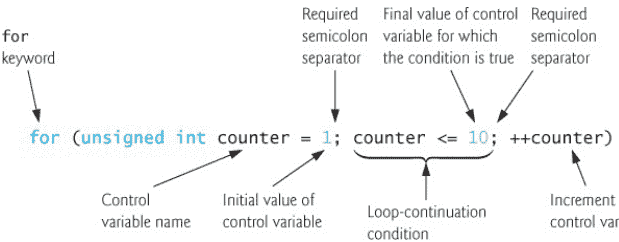

**图5.3** `for`语句头部的组成部分。

### `for`语句的一般格式

`for`语句的一般格式为：

```cpp
for (initialization; loopContinuationCondition; increment) {
    statement
}
```

其中，*初始化*表达式可选地命名循环的控制变量并赋予其初始值，*循环继续条件*决定循环是否应继续执行，*增量*修改控制变量的值，从而使循环继续条件最终变为*假*。`for`头部的两个分号是必需的。如果循环继续条件最初为*假*，程序将*不*执行`for`语句的循环体。相反，执行流程转到`for`之后的语句。

### 用等价的`while`语句表示`for`语句

`for`语句通常可以用如下的等价`while`语句表示：

```c
{
    initialization;

    while (loopContinuationCondition) {
        statement
        increment;
    }
}
```

在**5.10节**中，我们会展示一个`for`语句无法用等价`while`语句表示的情况。通常，`for`语句用于计数器控制迭代，而`while`语句用于哨兵控制迭代。不过，`while`和`for`都可以用于任一类型的迭代。

### *`for`语句控制变量的作用域*

如果`for`头部的*初始化*表达式声明了控制变量，则该变量*只能*在该`for`语句中使用——不能超出此范围。这种受限使用称为变量的*作用域*，它定义了变量在程序中可以使用的位置。例如，一个*局部变量*只能在其声明所在的函数中使用，并且只能从声明点到大括号闭合该块的位置使用。作用域在**第6章**“函数与递归入门”中详细讨论。


### 常见编程错误 5.2

*当`for`语句的控制变量在`for`头部的初始化部分中声明时，在`for`循环体之后使用该控制变量是编译错误。*

### *`for`语句头部中的表达式都是可选的*

`for`头部的三个表达式都是可选的。如果省略*循环继续条件*，C++会假定循环继续条件*始终为真*，从而产生*无限循环*。如果程序在循环*之前*初始化控制变量，则可以省略*初始化*表达式。如果程序在循环体中计算增量或不需要增量，则可以省略*增量*表达式。`for`中的增量表达式表现得就像它在`for`循环体末尾独立成句一样。因此，增量表达式

```cpp
counter = counter + 1
counter += 1
++counter
counter++
```

在`for`语句中是等价的。许多程序员更喜欢`counter++`，因为它简洁，而且`for`循环会在其循环体执行*之后*计算增量表达式，所以后缀递增形式似乎更自然。在这种情况下，被递增的变量不会出现在更大的表达式中，因此前递增和后递增具有*相同的效果*。我们更倾向于前递增。


### 常见编程错误 5.3

*在`for`头部的右括号右侧紧挨着放置一个分号，会使该`for`的循环体成为空语句。这通常是一个逻辑错误。*


### 错误预防提示 5.4

*当迭代语句中的循环继续条件永远不会变为假时，就会出现无限循环。为防止在计数器控制循环中出现这种情况，请确保控制变量在循环的每次迭代中都被修改，以便循环继续条件最终变为假。在哨兵控制循环中，请确保能够输入哨兵值。*

### *在`for`语句头部中放置算术表达式*

`for`语句的初始化、循环继续条件和增量部分可以包含算术表达式。例如，假设`x = 2`且`y = 10`。如果`x`和`y`在循环体内没有被修改，则语句

```c
for (unsigned int j = x; j <= 4 * x * y; j += y / x)
```

等价于语句

```c
for (unsigned int j = 2; j <= 80; j += 5)
```

`for`语句的增量也可以是*负数*，在这种情况下它是**递减**，循环会*向下*计数。

### *在`for`语句的循环体中使用控制变量*

程序常在循环体中显示控制变量的值或在计算中使用它，但这不是必需的。控制变量通常用于控制迭代，*无需*在`for`的循环体中提及。


### 错误预防提示 5.5

*虽然可以在`for`循环体中修改控制变量的值，但应避免这样做，因为这种做法可能导致难以发现的错误。如果程序必须在循环体中修改控制变量的值，请使用`while`而不是`for`。*

### `for`语句的UML活动图

`for`语句的UML活动图与`while`语句的（图4.8）类似。图5.4显示了图5.2中`for`语句的活动图。该图清楚地表明，初始化只发生一次——在首次求值循环继续测试*之前*——并且递增发生在每次循环中*循环体语句执行之后*。

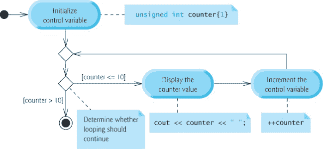

图5.4 图5.2中`for`语句的UML活动图。


## 5.4 使用`for`语句的示例

下面的示例展示了在`for`语句中改变控制变量的技巧。在每种情况下，我们*只*编写相应的`for`语句头。注意对于*递减*控制变量的循环，关系运算符发生了变化。

- 1. 使控制变量从`1`变到`100`，每次增量为`1`。

```cpp
for (unsigned int i{}; i <= 100; i++)
```

- 2. 使控制变量从`100`递减到`1`，每次减量为`1`。

```cpp
for (unsigned int i{100}; i >= 1; i--)
```

- 3. 使控制变量从`7`变到`77`，每次增量为`7`。

```cpp
for (unsigned int i{7}; i <= 77; i += 7)
```

- 4. 使控制变量从`20`递减到`2`，每次*减量*为`2`。

```cpp
for (unsigned int i(20); i >= 2; i -= 2)
```

- 5. 使控制变量依次取值`2`、`5`、`8`、`11`、`14`、`17`、`20`。

```cpp
for (unsigned int i(2); i <= 20; i += 3)
```

- 6. 使控制变量依次取值`99`、`88`、`77`、`66`、`55`、`44`、`33`、`22`、`11`、`0`。这里我们使用`int`而不是`unsigned int`，因为条件直到`i`的值为`-11`时才变为假，因此控制变量必须能够表示正值和负值。

```cpp
for (int i(99); i >= 0; i -= 11)
```

在向下计数的循环的循环继续条件中使用错误的关系运算符（例如，在向下计数到1的循环中使用`i <= 1`而不是`i >= 1`）通常是逻辑错误。


## 常见编程错误

### 5.5

如果循环的控制变量每次递增或递减超过1，不要在循环继续条件中使用相等运算符（`!=`或`==`）。例如，考虑`for`语句头`for (unsigned int counter{1}; counter != 10; counter += 2)`。循环继续条件测试`counter != 10`永远不会变为假（导致无限循环），因为`counter`在每次迭代后递增2（并且永远不会变为10）。

## 5.5 应用：对偶数求和

我们现在来考虑两个示例应用，它们演示了`for`的简单用法。**图5.5**中的应用使用`for`语句对从2到20的偶数求和，并将结果存储在一个名为`total`的`unsigned int`变量中。循环的每次迭代（第10-12行）都将控制变量`number`的值加到变量`total`上。

```cpp
// Fig. 5.5: Sum.cpp
// Summing integers with the for statement.
#include <iostream>
using namespace std;

int main() {
    unsigned int total{};

    // total even integers from 2 through 20
    for (unsigned int number{2}; number <= 20; number += 2) {
        total += number;
    }

    cout << "Sum is " << total << endl;
}
```

```text
Sum is 110
```

**图5.5** 使用`for`语句对整数求和。

*初始化*和*增量*表达式可以是逗号分隔的列表，使您能够使用多个初始化表达式或多个增量表达式。例如，虽然不鼓励这样做，但您可以使用逗号将`for`语句的循环体（第11行）合并到`for`语句头的增量部分中，如下所示：

```cpp
total += number, number += 2
```

表达式`total += number`和`number += 2`之间的逗号是**逗号运算符**，它保证表达式列表从左到右求值。逗号运算符在所有C++运算符中优先级最低。逗号分隔的表达式列表的值和类型是*最右边*表达式的值和类型。逗号运算符通常用于需要*多个初始化表达式*和/或*多个增量表达式*的`for`语句中。


## 良好编程实践

### 5.1

*在`for`语句的初始化和增量部分中，只放置涉及控制变量的表达式。*


## 良好编程实践

### 5.2

*为了可读性，如果可能，将控制语句头的长度限制为一行。*

## 5.6 应用：复利计算

让我们使用`for`语句来计算复利。考虑以下问题：

- *某人将1000美元存入一个年利率为5%的储蓄账户。假设所有利息都留在存款中，计算并打印10年内每年年底账户中的金额。使用以下公式来确定这些金额：*

$$a = p(1+r)^n$$

其中

- $p$ 是原始投资金额（即本金）
- $r$ 是年利率（例如，5%使用0.05）
- $n$ 是年数
- $a$ 是第$n$年年底的存款金额。

这个问题的解决方案（*图5.6*）涉及一个循环，该循环在资金存入的10年中的每一年执行指定的计算。对于这个解决方案，我们使用`double`值进行货币计算，然后讨论使用浮点类型表示货币金额的问题。在下一节中，我们将开发一个新的`DollarAmount`类，它使用非常大的整数来精确表示货币金额。您将看到，该类仅使用整数运算来执行货币计算。

```cpp
// Fig. 5.6: Interest.cpp
// Compound-interest calculations with for.
#include <iostream>
#include <iomanip>
#include <cmath> // for pow function
using namespace std;

int main() {
    // set floating-point number format
    cout << fixed << setprecision(2);

    double principal{1000.00}; // initial amount before interest
    double rate{0.05}; // interest rate

    cout << "Initial principal: " << principal << endl;
    cout << "    Interest rate:  " << rate << endl;

    // display headers
    cout << "Year" << setw(20) << "Amount on deposit" << endl;

    // calculate amount on deposit for each of ten years
    for (unsigned int year{1}; year <= 10; year++) {
        // calculate amount on deposit at the end of the specified year
        double amount = principal * pow(1.0 + rate, year);

        // display the year and the amount
        cout << setw(4) << year << setw(20) << amount << endl;
    }
}
```

```text
Initial principal: 1000.00
    Interest rate:  0.05

Year   Amount on deposit
   1             1050.00
   2             1102.50
   3             1157.63
   4             1215.51
   5             1276.28
   6             1340.10
   7             1407.10
   8             1477.46
   9             1551.33
  10             1628.89
```

**图5.6** 使用`for`进行复利计算。

`main`中的第12-13行声明了`double`变量`principal`和`rate`，并将`principal`初始化为`1000.00`，将`rate`初始化为`0.05`。C++将像`1000.00`和`0.05`这样的浮点字面量视为`double`类型。类似地，C++将像`7`和`-22`这样的整数字面量视为`int`类型。第15-16行显示初始本金和利率。

## 使用字段宽度和对齐方式格式化

`for`循环之前的第10行输出语句与`for`循环中的第27行输出语句相结合，按照*参数化*流操纵符`setprecision`和**`setw`**以及*非参数化*流操纵符`fixed`所指定的格式，打印变量`year`和`amount`的值。流操纵符`setw(4)`指定下一个输出的值应出现在4个字符的**字段宽度**中——即`cout <<`打印该值时*至少*占用四个字符位置。如果要输出的值的宽度*小于*四个字符位置，则该值默认在字段中**右对齐**。如果要输出的值的宽度*大于*四个字符位置，则字段宽度会向右扩展额外的字符位置以容纳整个值。若要指示值应**左对齐**输出，只需输出非参数化流操纵符`left`（位于头文件`<iostream>`中）。通过输出非参数化流操纵符`right`可以恢复右对齐。


输出语句中的其他格式表明，变量`amount`以定点格式打印：带小数点（第10行通过流操纵符`fixed`指定），在20个字符宽的字段中右对齐（第27行通过`setw(20)`指定），并且小数点右边保留两位精度（第10行通过操纵符`setprecision(2)`指定）。我们在`for`循环之前将流操纵符`fixed`和`setprecision`应用于输出流`cout`，因为这些格式设置在被更改之前一直有效——这类设置称为**粘性设置**，它们并*不*需要在循环的每次迭代中都应用。然而，用`setw`指定的字段宽度*仅*适用于*下一个*要输出的值。我们将在**第13章**（流输入/输出：深入探讨）中讨论C++强大的输入/输出格式功能。

## 使用标准库函数`pow`执行利息计算

`for`语句（第22–28行）执行其循环体10次，使`unsigned int`控制变量`year`从1递增到10，每次增量为1。当`year`变为11时循环终止。变量`year`表示问题描述中的*n*。

C++*并不*包含幂运算符，因此我们使用头文件`<cmath>`中的**标准库函数**`pow`（第24行）。调用`pow(x, y)`计算*x*的*y*次幂。该函数接收两个`double`参数并返回一个`double`值。

第24行执行计算 $a = p(1 + r)^n$，其中$a$是`amount`，$p$是`principal`，$r$是`rate`，$n$是`year`。

`for`语句的循环体包含将`1.0 + rate`作为`pow`的第一个参数的计算。这个计算在每次循环中得到相同的结果，因此在循环的每次迭代中重复它是浪费的。


**性能提示5.1**

> *在循环中，避免那些结果永不改变的计算——这类计算通常应放在循环之前。如今许多复杂的优化编译器会在编译后的代码中将这些计算移到循环之前。*

### 浮点数精度与内存需求

`float`类型的变量表示**单精度浮点数**，在当今多数系统上大约有7个有效数字。`double`类型的变量表示**双精度浮点数**。它们需要的内存是`float`变量的两倍，并且在当今多数系统上提供大约15个有效数字——大约是`float`变量精度的两倍。大多数程序员使用`double`类型表示浮点数。

事实上，C++默认将你在程序源代码中输入的所有浮点数（如7.33和0.0975）视为`double`值。源代码中的此类值称为**浮点字面量**。有关基本类型的取值范围，请参阅**附录C**。

### 浮点数是近似值

在传统算术中，浮点数通常产生于除法——当我们用10除以3时，结果是3.33333333…，3的序列无限重复。计算机只分配*固定*数量的空间来存储这样的值，因此存储的浮点值显然只能是*近似值*。如你所见，`double`存在我们所说的**表示误差**。


**常见编程错误5.6**

> *以假定浮点数可以精确表示的方式使用浮点数（例如，在相等性比较中使用它们）会导致错误结果。浮点数只能被近似表示。*

浮点数有大量应用，尤其是对于测量值。例如，当我们提到“正常”体温为98.6华氏度时，并不需要精确到很多位数字。当我们从体温计上读到的温度是98.6时，它实际上可能是98.5999473210643。在大多数涉及体温的应用中，简单地将这个数称为98.6就可以了。由于浮点数的不精确性，`double`类型比`float`类型更受青睐，因为`double`变量能更精确地表示浮点数。因此，在本书中我们统一使用`double`类型。

### 关于显示舍入值的警告

在本例中，我们将变量`amount`、`principal`和`rate`声明为`double`类型。我们处理的是美元的小数部分，因此需要一种允许值中出现小数点的类型。不幸的是，浮点数可能会带来麻烦。下面简单解释一下使用`double`（或`float`）表示美元金额时可能出错的地方（假设美元金额显示时保留小数点后两位）：机器中存储的两个计算出的`double`美元金额可能是14.234（为显示目的通常会四舍五入为14.23）和18.673（通常显示为18.67）。当这些金额相加时，产生内部和32.907，为显示目的会四舍五入为32.91。因此，你的输出可能显示为

```text
  14.23
+ 18.67
-------
  32.91
```

但一个人将显示出来的各个数字相加，会期望总和是32.90。你已经得到警告了！


**错误预防提示5.6**

> *不要使用类型为* `double` *（或* `float` *）的变量执行精确的货币计算。浮点数的不精确性可能导致错误。*

### 即使是常见的美元金额在浮点数中也可能存在表示误差

即使是简单的美元金额，例如你在杂货店或餐厅账单上可能看到的金额，在存储为`double`时也可能存在表示误差。为了说明这一点，我们创建了一个带有如下声明的简单程序

```cpp
double d = 123.02;
```

然后显示变量`d`的值，保留小数点右边许多位精度——我们在**练习5.36**中请你完成这个操作。输出结果显示123.02为123.0199999…，这是表示误差的另一个例子。虽然有些美元金额可以精确表示为`double`，但许多不能。在下一节中，我们将构建一个仅使用整数运算来表示和处理美元金额的类。这将消除与`double`值相关的表示误差，因为整数可以精确表示。

## 5.7 案例研究：使用`DollarAmount`类进行基于整数的货币计算

在**第3章**中，我们开发了一个`Account`类。一个典型的美元`Account`余额——比如$437.19——在小数点左边有整数美元（例如437），右边有整数美分（例如19）。为了简单起见，`Account`类使用`int`类型表示其`balance`，这当然将余额限制为整美元金额。

### 将美元金额表示为浮点数

我们需要一种类型，允许我们将美元金额表示为带小数点的数字，而不是`int`。在**图5.6**的复利示例中，我们将美元金额处理为`double`类型。这引入了表示误差和舍入问题：

1. 存在表示误差，因为我们以`double`存储精确的十进制美元金额和利率。正如你将在本节中看到的，你可以通过使用整数算术执行所有计算来避免这些误差——甚至利息计算也是如此。

2. 浮点值存在舍入。在利息计算中我们无法避免舍入，因为在处理美元金额时，结果会产生分以下的零头。这些零头必须四舍五入到百分位。使用整数算术，我们可以精确控制舍入，而不会遭受与浮点计算相关的表示误差。

此外，在货币计算中有许多可能发生舍入的地方。例如，在餐厅账单上，税可以按每个单项计算，导致许多单独的舍入操作，也可以只在账单总额上计算一次——这些不同的方法可能产生不同的结果。

使用`double`执行货币计算可能会给需要精确美元金额的组织（如银行、保险公司和一般企业）带来问题。例如，银行必须精确跟踪所有客户的余额。想象一下，一个拥有数百万账户的大型金融机构，如果其客户余额“对不上”，导致该组织无法结平账目，将会面临多大的问题。因此，使用整数算术而非浮点算术执行货币计算至关重要。正如你将在下一个示例中看到的，连利息计算也可以使用整数算术完成。


## 基于整数的货币计算

贯穿本书，我们专注于*构建有价值的类*。在本节中，我们开始开发一个 `DollarAmount` 类，以精确控制货币金额。该类以整数美分来表示美元金额——例如，$1,000 存储为 100000。这种方法的一个关键优势是整数值在内存中能够*精确*表示。

首先，我们假设类 `DollarAmount` 已经存在，具备以下功能：

-   一个构造函数，用于将 `DollarAmount` 对象初始化为整数美分
-   一个 `add` 成员函数，用于将一个 `DollarAmount` 对象加到调用该函数的 `DollarAmount` 对象上
-   一个 `subtract` 成员函数，用于从调用该函数的 `DollarAmount` 对象中减去一个 `DollarAmount` 对象
-   一个 `addInterest` 成员函数，用于计算调用该函数的 `DollarAmount` 对象中金额的年利息，并将该利息加到该对象的金额中
-   一个 `toString` 成员函数，用于返回 `DollarAmount` 的 `string` 表示。

该类使用整数运算来执行*所有计算*——不使用浮点数运算，因此 `DollarAmount` 对象总是精确表示其值。我们将在**图5.7**中使用这些功能来演示 `DollarAmount` 对象的加法和减法，并使用 `DollarAmount` 对象重新实现**图5.6**中的复利示例。然后我们将展示该类并逐段讲解代码。正如你将看到的，利息计算仍然需要舍入，但 `DollarAmount` 类将使用整数运算精确控制舍入的方式。

这个版本的 `DollarAmount` 类会显得有些笨拙，要求你调用诸如 `add`、`subtract`、`addInterest` 和 `toString` 之类的成员函数。在**第10章**运算符重载中，我们会做得更好。在那里，你将看到如何使用你已经用于基本类型的运算符（如 `+`、`-`、`>>` 和 `<<`）来方便地操作 `DollarAmount` 对象。在后续章节中，你还可以对这个类进行其他改进。构建一个像 `DollarAmount` 这样有价值的类——它能帮助你解决实际世界中的具体问题——是学习C++中的关键“顿悟时刻”之一。我们将在接下来的章节中指出其他类似的时刻。

### 表示货币金额是一个复杂问题

处理货币金额比我们这里展示的要复杂得多。全世界有许多货币，其千位分隔符、小数点分隔符、货币符号等惯例各不相同。此外，舍入规则可能因货币、政府、公司等而异。某些编程语言提供了更易于处理货币值的类型。各种C++库都有用于此目的的类，但它们往往复杂且超出我们的讨论范围。Boost的C++多精度库就是这样一个例子。

### 5.7.1 演示 `DollarAmount` 类

**图5.7**使用 `DollarAmount` 对象进行加法、减法以及复利计算。第10–11行创建 `DollarAmount` 对象 `d1` 和 `d2`，并分别将其初始化为 `12345` 美分（即$123.45）和 `1576` 美分（即$15.76）。第13–14行通过调用每个对象的 `toString` 成员函数获取对象的 `string` 表示，从而显示 `DollarAmount` 对象的值。接下来，第15行调用 `d1` 的 `add` 成员函数，传入 `d2` 作为参数。该语句将两个对象的值相加，并将结果存储到对象 `d1` 中。最后，第16行显示 `d1` 修改后的值。第18–21行和第23–26行演示了 `DollarAmount` 的 `subtract` 成员函数。第20行从 `d1` 中减去 `d2`，再次修改了 `d1`。第25行从 `d2` 中减去 `d1`，以演示计算结果为负的 `DollarAmount`。输出的前三行显示了这些加法和减法运算的结果。

```cpp
// Fig. 5.7: Interest.cpp
// Compound-interest calculations with class DollarAmount and integers.
#include <iostream>
#include <iomanip>
#include <string>
#include "DollarAmount.h"
using namespace std;

int main() {
   DollarAmount d1{12345}; // $123.45
   DollarAmount d2{1576};  // $15.76

   cout << "After adding d2 (" << d2.toString() << ") into d1 ("
      << d1.toString() << "), d1 = ";
   d1.add(d2); // modifies object d1
   cout << d1.toString() << "\n";

   cout << "After subtracting d2 (" << d2.toString() << ") from d1 ("
      << d1.toString() << "), d1 = ";
   d1.subtract(d2); // modifies object d1
   cout << d1.toString() << "\n";

   cout << "After subtracting d1 (" << d1.toString() << ") from d2 ("
      << d2.toString() << "), d2 = ";
   d2.subtract(d1); // modifies object d2
   cout << d2.toString() << "\n\n";

   cout << "Enter integer interest rate and divisor. For example:\n"
      << "for      2%, enter:    2 100\n"
      << "for    2.3%, enter:   23 1000\n"
      << "for   2.37%, enter:  237 10000\n"
      << "for  2.375%, enter: 2375 100000\n";
   int rate; // whole-number interest rate
   int divisor; // divisor for rate
   cin >> rate >> divisor;

   DollarAmount balance{100000}; // initial principal amount in pennies
   cout << "\nInitial balance: " << balance.toString() << endl;

   // display headers
   cout << "Year" << setw(20) << "Amount on deposit" << endl;

   // calculate amount on deposit for each of ten years
   for (unsigned int year{1}; year <= 10; year++) {
      // increase balance by rate % (i.e., rate / divisor)
      balance.addInterest(rate, divisor);

      // display the year and the amount
      cout << setw(4) << year << setw(20) << balance.toString() << endl;
   }
}
```

```
After adding d2 (15.76) into d1 (123.45), d1 = 139.21
After subtracting d2 (15.76) from d1 (139.21), d1 = 123.45
After subtracting d1 (123.45) from d2 (15.76), d2 = -107.69

Enter integer interest rate and divisor. For example:
for       2%, enter:     2 100
for    2.3%, enter:    23 1000
for   2.37%, enter:   237 10000
for   2.375%, enter:  2375 100000
> 5 100

Initial balance: 1000.00
```

| 年份 | 存款金额 |
|---:|---:|
| 1 | 1050.00 |
| 2 | 1102.50 |
| 3 | 1157.63 |
| 4 | 1215.51 |
| 5 | 1276.29 |
| 6 | 1340.10 |
| 7 | 1407.11 |
| 8 | 1477.47 |
| 9 | 1551.34 |
| 10 | 1628.91 |

```
After adding d2 (15.76) into d1 (123.45), d1 = 139.21
After subtracting d2 (15.76) from d1 (139.21), d1 = 123.45
After subtracting d1 (123.45) from d2 (15.76), d2 = -107.69

Enter integer interest rate and divisor. For example:
for     2%, enter:     2 100
for   2.3%, enter:    23 1000
for  2.37%, enter:   237 10000
for 2.375%, enter:  2375 100000
> 525 10000

Initial balance: 1000.00
```

| 年份 | 存款金额 |
|---:|---:|
| 1 | 1052.50 |
| 2 | 1107.76 |
| 3 | 1165.92 |
| 4 | 1227.13 |
| 5 | 1291.55 |
| 6 | 1359.36 |
| 7 | 1430.73 |
| 8 | 1505.84 |
| 9 | 1584.90 |
| 10 | 1668.11 |

图5.7 使用 `DollarAmount` 类和整数进行复利计算。

### 使用 `DollarAmount` 计算复利

`DollarAmount` 类的 `addInterest` 成员函数计算利息金额，并将其添加到调用该函数的 `DollarAmount` 对象中。该函数接收两个参数：

-   一个表示利率的整数
-   一个整数除数（10的幂）

为了确定利息金额，`addInterest` 将 `DollarAmount` 对象的美分数乘以利率的整数表示，然后将结果除以整数除数。例如：

- 要计算5%的利息，请输入整数5和100。在整数运算中，将 `DollarAmount` 乘以5，再将结果除以100，即可计算出该 `DollarAmount` 值的5%。
- 要计算5.25%的利息，请输入整数525和10000。在整数运算中，将 `DollarAmount` 乘以525，再将结果除以10000，即可计算出该 `DollarAmount` 值的5.25%。

第28–35行提示并输入 `rate` 和 `divisor`。第37行创建 `DollarAmount` 对象 `balance`，并将其初始化为 `100000` 美分（即$1,000）——初始本金，我们在第38行显示。第44–50行执行利息计算。第46行调用 `addInterest` 成员函数来执行当前年份的利息计算。然后，第49行显示当前的 `year` 和 `balance` 的 `string` 表示。你可以通过查看输出中第 `1` 年的新余额来确认是否正确输入了利率。例如，计算5%利率时，第一年的年末余额将是1050.00；计算5.25%利率时，第一年的余额将是1052.50。


## 5.7.2 类 `DollarAmount`

**图 5.8** 定义了类 `DollarAmount`，其数据成员 `amount`（第 41 行）表示整数形式的美分数。

```cpp
// Fig. 5.8: DollarAmount.h
// DollarAmount class stores dollar amounts as whole numbers of pennies
#include <string>
#include <cmath>

class DollarAmount {
public:
    // initialize amount from an int64_t value
    explicit DollarAmount(int64_t value): amount{value} { }

    // add right's amount to this object's amount
    void add(DollarAmount right) {
        // can access private data of other objects of the same class
        amount += right.amount;
    }

    // subtract right's amount from this object's amount
    void subtract(DollarAmount right) {
        // can access private data of other objects of the same class
        amount -= right.amount;
    }

    // uses integer arithmetic to calculate interest amount,
    // then calls with the interest amount
    void addInterest(int rate, int divisor) {
        // create DollarAmount representing the interest
        DollarAmount interest{
            (amount * rate + divisor / 2) / divisor
        };

        add(interest); // add interest to this object's amount
    }

    // return a string representation of a DollarAmount object
    std::string toString() const {
        std::string dollars{std::to_string(amount / 100)};
        std::string cents{std::to_string(std::abs(amount % 100))};
        return dollars + "." + (cents.size() == 1 ? "0" : "") + cents;
    }

private:
    int64_t amount{0}; // dollar amount in pennies
};
```

图 5.8 `DollarAmount` 类以整数美分存储美元金额。

### C++11 类型 `int64_t`

11

我们希望数据成员 `amount` 能够存储从少量美分到较大美元金额的值，以便我们的 `DollarAmount` 可以用于所有可能的货币应用。在大多数计算机上，`int` 的取值范围为 −2,147,483,647 到 2,147,483,647。对于以美分存储的金额，这将把 `DollarAmount` 限制在大约 ±2100 万美元——对于许多货币应用来说太小了，所以我们需要大得多的范围。C++11 的 `long long` 类型作为*最小值*支持 −9,223,372,036,854,775,808 到 9,223,372,036,854,775,807 范围内的值。这将使 `DollarAmount` 的值达到 ±92 千万亿美元，对于所有已知的货币应用来说很可能绰绰有余。

11

`long long`（以及 C++ 的其他整数类型）的范围可能因平台而异。为了可移植性，我们希望在所有平台上使用*相同*的类型。为此，C++11 引入了新的整数类型名称，以便你可以为程序选择适当的值范围。对于类 `DollarAmount`，我们选择了 `int64_t`，它支持*精确的*范围 −9,223,372,036,854,775,808 到 9,223,372,036,854,775,807。有关 C++11 其他新整数类型名称的列表，请参阅头文件 `<cstdint>`。

### `DollarAmount` 构造函数

为简单起见，类 `DollarAmount` 的构造函数（图 5.8，第 9 行）接收一个整数美分数，并使用该值初始化数据成员 `amount`。在练习 5.30 中，你将定义一个 `DollarAmount` 构造函数，该构造函数接收两个参数，分别代表整数美元数和整数美分数，然后使用这些值计算并存储相应的美分数。（练习 5.30–5.34 与增强和使用类 `DollarAmount` 相关。）

### `DollarAmount` 成员函数 `add` 和 `subtract`

`add` 成员函数（第 12–15 行）接收另一个 `DollarAmount` 对象作为参数，并将其值添加到调用 `add` 的 `DollarAmount` 对象上。第 14 行使用 += 运算符将 `right.amount`（即参数对象中的 `amount`）加到当前对象的 `amount` 上，从而修改该对象。表达式 `right.amount` 访问对象 `right` 中的 `private amount` 数据成员。这是同类对象之间的一种特殊关系——类的成员函数既可以访问调用该函数的对象的 `private` 数据，也可以访问传递给该函数的同类其他对象的 `private` 数据。`subtract` 成员函数（第 18–21 行）的工作方式与 `add` 类似，但使用 -= 运算符从当前对象的 `amount` 中减去 `right.amount`。

### `DollarAmount` 成员函数 `addInterest`

`addInterest` 成员函数（第 25–32 行）使用其 `rate` 和 `divisor` 参数执行利息计算，然后将利息加到 `amount` 上。利息计算通常会产生需要舍入的小数结果。这里我们只进行整数算术计算，得出整数结果，因此完全避免了 `double` 的表示误差，但正如你将看到的，仍然需要进行舍入。

在本例中，我们使用*四舍五入*。首先，考虑将浮点值 0.75 和 0.25 舍入到最接近的整数。使用四舍五入时，.5 及更高的值应向上舍入，其他值应向下舍入，因此 0.75 向上舍入为 1，0.25 向下舍入为 0。

现在，让我们考虑对整数利息计算的结果进行舍入。假设我们要计算 $10.75 的 5% 利息。在整数算术中，我们将 10.75 视为 1075，要计算 5% 的利息，我们先乘以 5，再除以 100。在利息计算中，我们首先将 1075 乘以 5，得到整数值 5375，它表示 53 个整美分和 75 个百分之一美分。在这种情况下，这 75 个百分之一美分应向上舍入为一个整美分，结果是 54 个整美分。更一般地：

-   50 到 99 个百分之一美分应向上舍入到下一个更高的整美分
-   1 到 49 个百分之一美分应向下舍入到下一个更低的整美分

如果用 5375 除以 100 来完成利息计算，结果是 53，这是不正确的——请记住，整数算术会截断计算的小数部分。为了解决这个问题，我们必须向 5375 加上一个量，使得除以 100 后得到 54 个整美分。加上 50 可以确保 50 到 99 个百分之一美分向上舍入。例如：

-   5350 + 50 得到 5400——除以 100 得到 54
-   5375 + 50 得到 5425——除以 100 得到 54
-   5399 + 50 得到 5449——除以 100 得到 54

类似地：

-   5301 + 50 得到 5351——除以 100 得到 53
-   5325 + 50 得到 5375——除以 100 得到 53
-   5349 + 50 得到 5399——除以 100 得到 53

`addInterest` 中的第 27–29 行使用以下计算的结果初始化 `DollarAmount interest`，该计算执行了上述四舍五入：

```text
(amount * rate + divisor / 2) / divisor
```

这里，我们不是将 50 加到 `amount * rate` 的结果上，而是加上 `divisor / 2`。当 `divisor` 为 100 时，加上 50 是正确的，但对于其他除数，这将无法舍入到正确的数字位。考虑 $10.75 的 5.25% 利息。在整数算术中，我们将 10.75 视为 1075，要计算 5.25% 的利息，我们乘以 525，然后除以 10000。我们首先将 1075 乘以 525，得到整数值 564375，它表示 56 个整美分和 4375 个*万分之一*美分。这应向下舍入为 56 个整美分。为了正确舍入，在这种情况下，我们需要加上 5000——即除数 10000 的一半。

利息计算完成后，第 31 行调用成员函数 `add`，将新的 `DollarAmount` 对象 `interest` 作为参数传入——这会更新调用 `addInterest` 的 `DollarAmount` 对象中的 `amount`。请注意，类的任何成员函数都可以直接调用其他任何成员函数，以对类的同一对象执行操作。

### 成员函数 `toString`

`toString` 成员函数（第 35–39 行）返回 `DollarAmount` 对象美元金额的 `string` 表示。首先，第 36 和 37 行分别使用除法和取余运算符获取 `amount` 的美元和美分部分。我们将每个整数传递给 C++ 标准库函数 `to_string`（来自头文件 `<string>`），它将数值转换为 `string` 对象。第 37 行还使用 C++ 标准库函数 `abs`（来自头文件 `<cmath>`）获取美分的绝对值。这确保了美分始终表示为正数，因此减号不会出现在小数点的右侧。

第 38 行使用 + 运算符“相加”字符串字面量和 `string` 对象来生成要返回的 `string`——这称为**字符串拼接**。生成的 `string` 包含美元数、小数点和美分数。为了确保小数点右侧始终有两位数字，我们在 `string` `cents` 上调用 `string` 成员函数 `size`——该函数返回 `string` `cents` 中的字符数。如果结果为 `1`，我们就在美分数前拼接一个前导 `0`。


### 银行家舍入

四舍五入是一种有偏的技术——小数部分 .1、.2、.3 和 .4 向下舍入，而 .5、.6、.7、.8 和 .9 向上舍入。在这种技术中，四个值向下舍入，五个值向上舍入。由于向上舍入的值多于向下舍入的值，这可能导致货币计算中的差异。**银行家舍入**通过将 .5 舍入到最近的*偶数整数*来解决这个问题——例如，0.5 舍入到 0，1.5 和 2.5 舍入到 2，3.5 和 4.5 舍入到 4，等等。在[练习 5.32](#)中，你将修改 `addInterest` 以使用银行家舍入，然后重新测试复利程序。

### *即使 `int64_t` 也有限*

虽然 `DollarAmount` 类可以表示非常大的货币值，但 `int64_t` 支持的值范围仍然有限。通过 C++ 的类机制，你将看到可以定义一个类，你可以称之为 `BigInteger` 或 `HugeInteger`（正如你将在**练习 10.9** 中做的那样），它可以存储和操作*任意*大小的整数。这样，你就真正地打造出了另一个有价值的类。

### *关于算术运算符和修改操作数的说明*

第 14 行和第 20 行在执行算术计算时修改了 `DollarAmount` 对象。这与算术运算符在基本类型上的工作方式不同。例如，表达式 `value1 + value2` 将两个值相加并产生一个临时结果，但 `+` 运算符不会修改其左操作数或右操作数。在**第 10 章**中，我们将演示 C++ 的运算符重载功能，它使你能够定义用于自己类型的运算符。

## 5.8 `do...while` 迭代语句

`do...while` **迭代语句**与 `while` 语句类似。在 `while` 中，程序在*执行循环体之前*，于循环的*开始*测试循环继续条件；如果条件为假，循环体*永远不会执行*。`do...while` 语句在*执行循环体之后*测试循环继续条件；因此，*循环体至少执行一次*。当 `do...while` 语句终止时，执行将继续到序列中的下一条语句。**图 5.9** 使用 `do...while` 输出数字 1–10。

```cpp
// Fig. 5.9: DoWhileTest.cpp
// do...while iteration statement.
#include <iostream>
using namespace std;

int main() {
   unsigned int counter{1};

   do {
      cout << counter << " ";
      ++counter;
   } while (counter <= 10); // end do...while

   cout << endl;
}
```

```text
1  2  3  4  5  6  7  8  9  10
```

**图 5.9** `do...while` 迭代语句。

第 7 行声明并初始化控制变量 `counter`。进入 `do...while` 语句后，第 10 行输出 `counter` 的值，第 11 行递增 `counter`。然后程序在循环的*底部*（第 12 行）评估循环继续测试。如果条件为*真*，循环从第一个循环体语句（第 10 行）继续。如果条件为*假*，循环终止，程序在循环之后的下一条语句继续。

### *`do...while` 迭代语句的 UML 活动图*

**图 5.10** 包含了 `do...while` 语句的 UML 活动图。该图清楚地表明，直到循环*至少一次*执行动作状态*之后*，才评估循环继续条件。请将此活动图与 `while` 语句的活动图（**图 4.8**）进行比较。

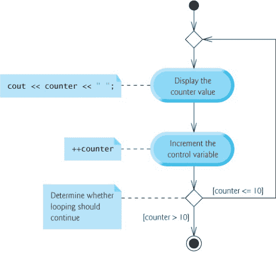

**图 5.10** *do...while* 迭代语句的 UML 活动图。

## 5.9 `switch` 多重选择语句

C++ 提供了 `switch` **多重选择**语句，根据变量或表达式的可能值在许多不同的操作中进行选择。每个操作都与一个**整数常量表达式**的值相关联（即，任何字符和整数常量的组合，其计算结果为一个常量整数值）。

### *使用 `switch` 语句统计 A、B、C、D 和 F 等级*

**图 5.11** 计算用户输入的一组数字成绩的班级平均分，并使用 `switch` 语句确定每个成绩是否等同于 A、B、C、D 或 F，并递增相应的成绩计数器。该程序还显示获得每个等级的学生人数摘要。

```cpp
// Fig. 5.11: LetterGrades.cpp
// Using a switch statement to count letter grades.
#include <iostream>
#include <iomanip>
using namespace std;

int main() {
   int total{0}; // sum of grades
   unsigned int gradeCounter{0}; // number of grades entered
   unsigned int aCount{0}; // count of A grades
   unsigned int bCount{0}; // count of B grades
   unsigned int cCount{0}; // count of C grades
   unsigned int dCount{0}; // count of D grades
   unsigned int fCount{0}; // count of F grades

   cout << "Enter the integer grades in the range 0-100.\n"
        << "Type the end-of-file indicator to terminate input:\n"
        << "  On UNIX/Linux/Mac OS X type <Ctrl> d then press Enter\n"
        << "  On Windows type <Ctrl> z then press Enter\n";

   int grade;

   // loop until user enters the end-of-file indicator
   while (cin >> grade) {
      total += grade; // add grade to total
      ++gradeCounter; // increment number of grades

      //  increment appropriate letter-grade counter
      switch (grade / 10) {
         case 9: // grade was between 90
         case 10: // and 100, inclusive
            ++aCount;
            break; // exits switch

         case 8: // grade was between 80 and 89
            ++bCount;
            break; // exits switch

         case 7: // grade was between 70 and 79
            ++cCount;
            break; // exits switch

         case 6: // grade was between 60 and 69
            ++dCount;
            break; // exits switch

         default: // grade was less than 60
            ++fCount;
            break; // optional; exits switch anyway
      } // end switch
   } // end while

   // set floating-point number format
   cout << fixed << setprecision(2);

   // display grade report
   cout << "\nGrade Report:\n";

   // if user entered at least one grade...
   if (gradeCounter != 0) {
      // calculate average of all grades entered
      double average = static_cast<double>(total) / gradeCounter;

      // output summary of results
      cout << "Total of the " << gradeCounter << " grades entered is "
           << total << "\nClass average is " << average
           << "\nNumber of students who received each grade:"
           << "\nA: " << aCount << "\nB: " << bCount << "\nC: " << cCount
           << "\nD: " << dCount << "\nF: " << fCount << endl;
   }
   else { // no grades were entered, so output appropriate message
      cout << "No grades were entered" << endl;
   }
}
```

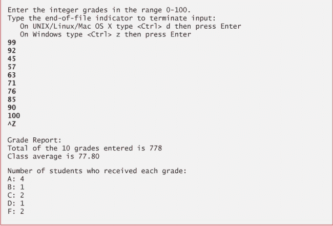

**图 5.11** 使用 `switch` 语句统计字母等级。

`main` 函数（图 5.11）声明了局部变量 `total`（第 8 行）和 `gradeCounter`（第 9 行），分别用于跟踪用户输入的成绩总和以及输入的成绩数量。第 10–14 行声明并将每个成绩类别的计数器变量初始化为 0。`main` 函数有两个关键部分。第 24–51 行使用哨兵控制迭代读取用户输入的任意数量的整数成绩，更新变量 `total` 和 `gradeCounter`，并为输入的每个成绩递增相应的字母等级计数器。第 54–73 行输出一份报告，其中包含所有输入成绩的总和、平均成绩以及获得每个字母等级的学生人数。

### 从用户读取成绩

第 16–19 行提示用户输入整数成绩，或键入文件结束指示符以终止输入。**文件结束指示符**是一个依赖于系统的按键组合，用于表示*没有更多数据可输入*。在**第 14 章**“文件处理”中，你将看到当程序从文件读取输入时如何使用文件结束指示符。

在 UNIX/Linux/Mac OS X 系统上，通过在一行中单独输入以下序列来输入文件结束符：

```text
<Ctrl>d
```

该表示法意味着同时按下 *Ctrl* 键和 *d* 键。在 Windows 系统上，可以通过输入以下内容来输入文件结束符：

```text
<Ctrl>z
```

[*注：* 在某些系统上，键入文件结束键序列后必须按 *Enter* 键。此外，当输入文件结束指示符时，Windows 通常会在屏幕上显示字符 `^Z`，如**图 5.11** 的输出所示。]


### 可移植性提示 5.1

*输入文件结束符的按键组合因系统而异。*

`while` 语句（第24–51行）获取用户输入。第24行

```cpp
while (cin >> grade) {
```

在 `while` 语句的条件中执行输入。在这种情况下，如果 `cin` 成功读取一个 `int` 值，循环继续条件的求值结果为 *true*。如果用户输入文件结束指示符，条件的求值结果为 *false*。

如果条件的求值结果为 *true*，第25行将 `grade` 加到 `total`，第26行递增 `gradeCounter`。这些变量用于计算成绩的平均值。接下来，第29–50行使用 `switch` 语句，根据输入的数字成绩递增相应的字母等级计数器。

### 处理成绩

`switch` 语句（第29–50行）确定要递增哪个计数器。我们假设用户输入 0–100 范围内的有效成绩。90–100 范围内的成绩表示 A，80–89 表示 B，70–79 表示 C，60–69 表示 D，0–59 表示 F。

`switch` 语句由一个块组成，该块包含一系列 `case` 标签和一个可选的 `default` 分支。在本例中，它们用于根据成绩确定要递增哪个计数器。

当控制流到达 `switch` 时，程序会求关键字 `switch` 后括号中的表达式（`grade / 10`）。这是 `switch` 的**控制表达式**。程序将该表达式的值与每个 `case` 标签进行比较。该表达式必须具有有符号或无符号整型——`bool`、`char`、`char16_t`、`char32_t`、`wchar_t`、`int`、`long` 或 `long long`。该表达式也可以使用 C++11 的有符号或无符号整型，例如 `int64_t` 和 `uint64_t`——完整类型名列表见 `<cstdint>` 头文件。

第29行中的控制表达式执行整数除法，这会*截断结果的小数部分*。当我们将 0 到 100 的值除以 10 时，结果总是 0 到 10 的值。我们在 `case` 标签中使用了其中几个值。如果用户输入整数 `85`，控制表达式的求值结果为 8。`switch` 将 `8` 与每个 `case` 标签进行比较。如果发生匹配（第35行的 `case 8:`），则执行该 `case` 的语句。对于 `8`，第36行递增 `bCount`，因为 80 多分的成绩是 B。**break 语句**（第37行）使程序控制转到 `switch` 之后的第一个语句——在本程序中，我们到达 `while` 循环末尾，因此控制返回到第24行的循环继续条件，以确定循环是否应继续执行。

我们 `switch` 中的 `case` 显式测试值 10、9、8、7 和 6。注意第30–31行测试值 9 和 10（二者都表示成绩 A）的 case。以这种方式连续列出 case，且它们之间没有语句，使这些 case 能够执行同一组语句——当控制表达式的求值结果为 9 或 10 时，将执行第32–33行中的语句。`switch` 语句*不*提供测试值*范围*的机制，因此需要测试的*每个*值都必须列在单独的 `case` 标签中。每个 `case` 可以有多个语句。`switch` 语句与其他控制语句的不同之处在于，它*不*要求在 `case` 中的多个语句周围使用花括号。

### `case` *没有* `break` *语句*

如果没有 `break` 语句，每当 `switch` 中发生匹配时，该 case 及后续 case 的语句都会执行，直到遇到 `break` 语句或 `switch` 末尾。这通常称为“贯穿（falling through）”到后续 `case` 中的语句。（此特性非常适合编写一个简洁程序，在练习 5.28 中显示重复歌曲“The Twelve Days of Christmas”。）


### 常见编程错误 5.7

*在 `switch` 中需要 `break` 语句时忘记它是逻辑错误。*

### `default` 分支

如果控制表达式的值与任何 `case` 标签之间都没有发生匹配，则执行 `default` 分支（第47–49行）。在本例中，我们使用 `default` 分支处理所有小于 6 的控制表达式值——也就是所有不及格成绩。如果没有发生匹配且 `switch` 不包含 `default` 分支，程序控制就直接继续执行 `switch` 之后的第一个语句。


### 错误预防提示 5.7

*在 `switch` 中，确保测试控制表达式的所有可能值。*

### 显示成绩报告

第54–73行根据输入的成绩输出报告（如图 5.11 的输入/输出窗口所示）。第60行确定用户是否至少输入了一个成绩——这有助于避免除以零。如果是，第62行计算成绩的平均值。然后第65–69行输出所有成绩的总和、班级平均分以及获得每个字母等级的学生人数。如果未输入任何成绩，第72行输出适当消息。**图 5.11** 中的输出显示了基于 10 个成绩的示例成绩报告。

### `switch` *语句 UML 活动图*

**图 5.12** 显示了通用 `switch` 语句的 UML 活动图。大多数 `switch` 语句在每个 `case` 中使用 `break`，以在处理完该 `case` 后终止 `switch` 语句。**图 5.12** 通过在活动图中包含 `break` 语句来强调这一点。该图清楚地表明，`case` 末尾的 `break` 语句会使控制立即退出 `switch` 语句。

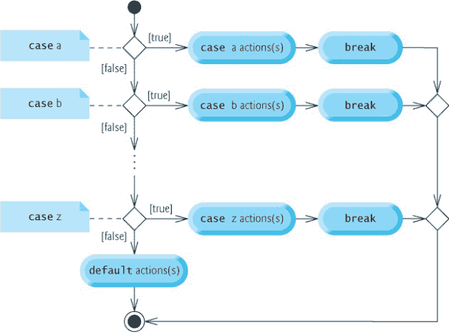

图 5.12 带有 `break` 语句的 `switch` 多选择语句 UML 活动图。

`switch` 的最后一个 `case`（或可选的 `default` 分支，当它出现在最后时）*不*需要 `break` 语句，因为执行会继续到 `switch` 之后的下一个语句。


### 错误预防提示 5.8

*在 `switch` 语句中提供 `default` 分支。这会让你关注处理异常情况的需要。*


### 良好编程实践 5.3

尽管 `switch` 中的每个 `case` 和 `default` 分支可以按任意顺序出现，但请将 `default` 分支放在最后。当 `default` 分支列在最后时，不需要该 case 的 `break`。

### 关于 `switch` 中每个 `case` 表达式的说明

使用 `switch` 语句时，请记住每个 `case` 必须包含常量整型表达式——即任何求值为常量整数值的整数常量组合（例如 −7、0 或 221）。整数常量只是一个整数值。此外，你可以使用**字符常量**——单引号中的特定字符，例如 `'A'`、`'7'` 或 `'$'`——它们表示字符和 `enum` 常量的整数值（**第 6.8 节**介绍）。**附录 B** 显示了 ASCII 字符集中字符的整数值，该字符集是 Unicode® 字符集的子集。

每个 `case` 中的表达式也可以是**常量变量**——一种包含在整个程序中都不改变的值的变量。此类变量使用关键字 `const` 声明（在**第 6 章**中讨论）。

在第12章“面向对象编程：多态”中，我们介绍一种更优雅的实现 `switch` 逻辑的方法——我们使用一种称为*多态*的技术来创建程序，这些程序通常比使用 `switch` 逻辑的程序更清晰、更易维护且更易扩展。

## 5.10 `break` 和 `continue` 语句

除了选择语句和迭代语句之外，C++ 还提供 `break` 语句（我们在 `switch` 语句的上下文中讨论过）和 `continue` 语句来改变控制流。上一节展示了如何使用 `break` 终止 `switch` 语句的执行。本节讨论如何在迭代语句中使用 `break`。

### 5.10.1 `break` 语句

`break` 语句在 `while`、`for`、`do...while` 或 `switch` 中执行时，会导致*立即退出*该语句——执行继续到该控制语句之后的第一个语句。`break` 语句的常见用途是提前跳出循环或跳过 `switch` 的剩余部分（如**图 5.11** 所示）。**图 5.13** 演示了一个退出 `for` 的 `break` 语句。

当 `for` 语句（第9–15行）中嵌套在第10–12行的 `if` 语句检测到 `count` 为 `5` 时，第11行的 `break` 语句执行。这会终止 `for` 语句，程序


程序继续执行到第17行（紧跟在`for`语句之后），该行显示一条消息，指出循环终止时控制变量的值。循环体仅完整执行了4次，而不是10次。

```cpp
// 图 5.13: BreakTest.cpp
// break 语句退出 for 语句。
#include <iostream>
using namespace std;

int main() {
    unsigned int count; // 控制变量，循环后仍会使用

    for (count = 1; count <= 10; count++) { // 循环 10 次
        if (count == 5) {
            break; // 当 count 为 5 时终止循环
        }

        cout << count << " ";
    }

    cout << "\nBroke out of loop at count = " << count << endl;
}
```

```text
1 2 3 4
Broke out of loop at count = 5
```

**图 5.13** `break` 语句退出 `for` 语句。

### 5.10.2 `continue` 语句

`continue` 语句在 `while`、`for` 或 `do...while` 循环中执行时，会跳过循环体中剩余的语句，并继续进行循环的下一次迭代。在 `while` 和 `do...while` 语句中，程序在 `continue` 语句执行后立即计算循环继续条件。在 `for` 语句中，先执行递增表达式，然后程序计算循环继续条件。

```cpp
// 图 5.14: ContinueTest.cpp
// continue 语句终止 for 语句的一次迭代。
#include <iostream>
using namespace std;

int main() {
    for (unsigned int count{1}; count <= 10; count++) { // 循环 10 次
        if (count == 5) {
            continue; // 当 count 为 5 时跳过循环体中剩余的代码
        }

        cout << count << " ";
    }

    cout << "\nUsed continue to skip printing 5" << endl;
}
```

```text
1 2 3 4 6 7 8 9 10
Used continue to skip printing 5
```

**图 5.14** `continue` 语句终止 `for` 语句的一次迭代。

**图 5.14** 使用 `continue`（第9行）在嵌套的 `if` 判断出 `count` 的值为 `5` 时跳过第12行的语句。当 `continue` 语句执行时，程序控制转到 `for` 语句中控制变量的递增部分（第7行）。

在**5.3节**中，我们指出在大多数情况下 `while` 可以替代 `for`。但当 `while` 中的递增表达式位于 `continue` 语句之后时，情况*并非*如此。在这种情况下，递增不会在程序计算循环继续条件之前执行，因此 `while` 的执行方式与 `for` 不同。


### 软件工程观察 5.1

*一些程序员认为* `break` *和* `continue` *违反了结构化编程。由于使用结构化编程技术也能达到相同的效果，这些程序员不使用* `break` *或* `continue`*。*


### 软件工程观察 5.2

*在实现高质量软件工程与实现最佳性能软件之间存在一种张力。有时，这两个目标中的一个会以牺牲另一个为代价。除了对性能要求极高的场景外，请遵循以下经验法则：首先，让你的代码简单且正确；然后，仅在必要时，再让它变得快速而精简。*

## 5.11 逻辑运算符

`if`、`if...else`、`while`、`do...while` 和 `for` 语句都需要一个*条件*来决定如何继续程序的流程控制。到目前为止，我们只学习了简单条件，例如 `count <= 10`、`number != sentinelValue` 和 `total > 1000`。简单条件用关系运算符 `>`、`<`、`>=` 和 `<=` 以及相等运算符 `==` 和 `!=` 表示，每个表达式只测试一个条件。为了在做出决策的过程中测试*多个条件*，我们在单独的语句或嵌套的 `if` 或 `if...else` 语句中执行这些测试。有时控制语句需要更复杂的条件来决定程序的流程控制。

C++ 的**逻辑运算符**允许你通过*组合*简单条件来形成更复杂的条件。逻辑运算符包括 `&&`（逻辑与）、`||`（逻辑或）和 `!`（逻辑非）。

### 5.11.1 逻辑与（`&&`）运算符

假设我们希望确保在程序中的某个点，两个条件在**选择某条执行路径之前都为真**。在这种情况下，我们可以使用 `&&`（**逻辑与**）运算符，如下所示：

```cpp
if (gender == FEMALE && age >= 65) {
    ++seniorFemales;
}
```

这个 `if` 语句包含两个简单条件。条件 `gender == FEMALE` 将变量 `gender` 与常量 `FEMALE` 比较，以确定一个人是否为女性。条件 `age >= 65` 可能被求值以确定一个人是否为老年人。`if` 语句考虑组合条件

```cpp
gender == FEMALE && age >= 65
```

该条件**为真**当且仅当**两个**简单条件都为真。在这种情况下，`if` 语句的循环体将 `seniorFemales` 递增 `1`。如果两个简单条件中任何一个或两个都为*假*，程序则跳过递增。一些程序员认为，当添加*多余的*括号时，上述组合条件更具可读性，例如

```cpp
(gender == FEMALE) && (age >= 65)
```

*图 5.15* 中的表格总结了 `&&` 运算符。该表显示了 *expression1* 和 *expression2* 的 `bool` 值 `false` 和 `true` 的所有四种可能组合。这样的表称为**真值表**。C++ 对所有包含关系运算符、相等运算符或逻辑运算符的表达式求值为零（*假*）或非零（*真*）。

**图 5.15** `&&`（逻辑与）运算符真值表。

| expression1 | expression2 | expression1 `&&` expression2 |
|---|---|---|
| `false` | `false` | `false` |
| `false` | `true` | `false` |
| `true` | `false` | `false` |
| `true` | `true` | `true` |

### 5.11.2 逻辑或（`||`）运算符

现在假设我们希望在选择某条执行路径之前确保两个条件中*任意一个或两个都为真*。在这种情况下，我们使用 `||`（**逻辑或**）运算符，如以下程序片段所示：

```cpp
if ((semesterAverage >= 90) || (finalExam >= 90)) {
    cout << "Student grade is A\n";
}
```

这个语句也包含两个简单条件。条件 `semesterAverage >= 90` 被求值以确定学生是否因为整个学期的优异表现而应在课程中获得 A。条件 `finalExam >= 90` 被求值以确定学生是否因为在期末考试中的出色表现而应在课程中获得 A。然后 `if` 语句考虑组合条件

```cpp
(semesterAverage >= 90) || (finalExam >= 90)
```

如果两个简单条件中*任意一个或两个*为真，则授予学生 A。消息 `"Student grade is A"` *不会*被打印的唯一情况是*两个*简单条件都为假时。**图 5.16** 是逻辑或（`||`）运算符的真值表。运算符 `&&` 的优先级高于运算符 `||`。两个运算符都从左到右结合。

**图 5.16** `||`（逻辑或）运算符真值表。

| expression1 | expression2 | expression1 \|\| expression2 |
|---|---|---|
| `false` | `false` | `false` |
| `false` | `true` | `true` |
| `true` | `false` | `true` |
| `true` | `true` | `true` |

### 5.11.3 短路求值

包含 `&&` 或 `||` 运算符的表达式部分*仅在*直到知道条件是*真*还是*假*时才被求值。因此，对表达式

```cpp
(gender == FEMALE) && (age >= 65)
```

的求值在 *gender* *不等于* `FEMALE`（即整个表达式为*假*）时会立即停止，如果 *gender* *等于* `FEMALE`（即如果条件 `age >= 65` 为*真*，整个表达式仍可能为*真*）则继续求值。逻辑与和逻辑或表达式的这种特性称为**短路求值**。


### 常见编程错误 5.8

在使用运算符 `&&` 的表达式中，一个条件——我们称之为*依赖条件*——可能需要另一个条件为真，才能使依赖条件的求值有意义。在这种情况下，依赖条件应放在 `&&` 运算符之后，以防止错误。考虑表达式 `(i != 0) && (10 / i == 2)`。


依赖条件（`10 / i == 2`）必须出现在`&&`运算符之后，以防止除零的可能性。

## 5.11.4 逻辑非（`!`）运算符

`!`（**逻辑非**，也称为**逻辑取反**或**逻辑补**）运算符会“反转”条件的含义。与逻辑运算符`&&`和`||`不同，它们是组合两个条件的*二元*运算符，而逻辑非运算符是一个*一元*运算符，只有一个条件作为操作数。只有当条件为*假*时才执行代码，请将逻辑非运算符放在原始条件*之前*，如以下程序段所示：

```cpp
{
    if (!(grade == sentinelValue)) {
        cout << "The next grade is " << grade << "\n";
    }
}
```

仅当`grade`*不等于*`sentinelValue`时，该程序段才执行循环体语句。条件`grade == sentinelValue`周围的括号是必需的，因为逻辑非运算符的优先级*高于*相等运算符。

在大多数情况下，你可以通过使用适当的关系运算符或相等运算符以不同方式表达条件，从而避免使用逻辑非。

例如，前面的语句也可以写成如下形式：

```cpp
{
    if (grade != sentinelValue) {
        cout << "The next grade is " << grade << "\n";
    }
}
```

这种灵活性可以帮助你以更方便的方式表达条件。**图5.17**是逻辑非运算符的真值表。

**图5.17 `!`（逻辑非）运算符真值表。**

| 表达式 | !表达式 |
|---|---|
| false | true |
| true | false |

## 5.11.5 逻辑运算符示例

**图5.18**使用逻辑运算符生成本节讨论的真值表。输出显示了每个被求值的表达式及其`bool`结果。默认情况下，`cout`和流插入运算符将`bool`值`true`和`false`分别显示为`1`和`0`。我们在第8行使用**流操纵符**`boolalpha`（*一个粘性操纵符*）来指定每个`bool`表达式的值应显示为“true”或“false”字样。第8–12行生成`&&`的真值表。第15–19行生成`||`的真值表。第22–24行生成`!`的真值表。

```cpp
// Fig. 5.18: LogicalOperators.cpp
#include <iostream>
using namespace std;

int main() {
    // create truth table for && (logical AND) operator
    cout << boolalpha << "Logical AND (&&)"
         << "\nfalse && false: " << (false && false)
         << "\nfalse && true: " << (false && true)
         << "\ntrue && false: " << (true && false)
         << "\ntrue && true: " << (true && true) << "\n\n";

    // create truth table for || (logical OR) operator
    cout << "Logical OR (||)"
         << "\nfalse || false: " << (false || false)
         << "\nfalse || true: " << (false || true)
         << "\ntrue || false: " << (true || false)
         << "\ntrue || true: " << (true || true) << "\n\n";

    // create truth table for ! (logical negation) operator
    cout << "Logical negation (!)"
         << "\n!false: " << (!false)
         << "\n!true: " << (!true) << endl;
}
```

```text
Logical AND (&&)
false && false: false
false && true: false
true && false: false
true && true: true

Logical OR (||)
false || false: false
false || true: true
true || false: true
true || true: true

Logical negation (!)
!false: true
!true: false
```

**图5.18 逻辑运算符。**

## 迄今介绍的运算符的优先级与结合性

图5.19显示了迄今介绍的C++运算符的优先级和结合性。运算符按优先级从高到低自上而下排列。

**图5.19 运算符优先级与结合性。**

| 运算符 | 结合性 | 类型 |
|---|---|---|
| `::` `()` | 从左到右 [关于分组括号的注意事项，参见图2.10。] | 主表达式 |
| `++` `--` `static_cast<type>()` | 从左到右 | 后缀 |
| `++` `--` `+` `-` `!` | 从右到左 | 一元（前缀） |
| `*` `/` `%` | 从左到右 | 乘法 |
| `+` `-` | 从左到右 | 加法 |
| `<<` `>>` | 从左到右 | 插入/提取 |
| `<` `<=` `>` `>=` | 从左到右 | 关系 |
| `==` `!=` | 从左到右 | 相等 |
| `&&` | 从左到右 | 逻辑与 |
| `||` | 从左到右 | 逻辑或 |
| `?:` | 从右到左 | 条件 |
| `=` `+=` `-=` `*=` `/=` `%=` | 从右到左 | 赋值 |
| `,` | 从左到右 | 逗号 |

## 5.12 混淆相等（`==`）与赋值（`=`）运算符

有一个错误，无论C++程序员多么有经验，都经常会犯，以至于我们认为有必要单独用一节来讨论。这个错误就是意外地交换了`==`（相等）和`=`（赋值）运算符。这个错误的破坏性在于，它通常*不会*引起*语法错误*——包含这些错误的语句往往能正确编译，程序也能运行到底，但常常通过*运行时逻辑错误*产生不正确的结果。有些编译器在`=`被用在期望`==`的地方时会发出*警告*。

C++的两个方面导致了这些问题。一是*任何产生值的表达式都可以用在任何控制语句的决策部分*。如果表达式的值为零，则视为`false`；如果值非零，则视为`true`。二是赋值会产生一个值——也就是赋给赋值运算符左侧变量的值。例如，假设我们打算编写：

```cpp
if (payCode == 4) { // good
    cout << "You get a bonus!" << endl;
}
```

但意外地写成：

```cpp
if (payCode = 4) { // bad
    cout << "You get a bonus!" << endl;
}
```

第一个`if`语句正确地给`payCode`等于4的人发放奖金。第二个语句——包含错误的那个——将`if`条件中的赋值表达式求值为常量4。*任何非零值都被解释为`true`*，因此该条件*总是*求值为`true`，无论实际paycode是什么，这个人*总是*获得奖金！更糟糕的是，本应只被*检查*的paycode却被*修改*了！

### `lvalue` **和** `rvalue`

你可以用一个简单的技巧来防止上述问题，但首先了解一下赋值运算符左边允许出现什么会很有帮助。变量名被称为**lvalue**（“左值”），因为它们可以用在赋值运算符的*左*侧。字面量被称为**rvalue**（“右值”），因为它们只能用在赋值运算符的*右*侧。*左值*也可以用作赋值右侧的*右值*，但反之则不行。


### 错误防止技巧5.9

程序员通常将`x == 7`这样的条件写成变量名（左值）在左、字面量（右值）在右的形式。将字面量放在左侧，如`7 == x`，可以在你不小心将`==`运算符替换为`=`时让编译器发出错误。编译器会将其视为编译错误，因为你不能更改字面量的值。

### 在应该使用`=`的地方使用了`==`

还有另一种同样令人不愉快的情况。假设你想用一条简单的语句给变量赋值，比如：

```cpp
x = 1;
```

但却写成了：

```cpp
x == 1;
```

这里同样*不是*语法错误。相反，编译器只是对表达式求值。如果`x`等于`1`，条件为*真*，表达式求值为非零（*真*）值。如果`x`不等于`1`，条件为*假*，表达式求值为`0`。

无论表达式的值是什么，因为没有赋值运算符，该值只是被丢失了。`x`的值保持不变，这很可能导致执行时的逻辑错误。下面的错误防止技巧5.10将帮助你发现这些问题。


### 常见编程错误5.9

*使用运算符`=`进行赋值和使用运算符`==`进行相等性比较是逻辑错误。*


### 错误防止技巧5.10

*使用文本编辑器搜索程序中所有出现的`=`，并检查每个地方是否正确使用了赋值、关系或相等运算符。*


## 5.13 结构化编程小结

正如建筑师利用建筑行业的集体智慧来设计建筑一样，程序员也应该这样设计程序。我们的领域比建筑学年轻得多，我们的集体智慧也少得多。我们认识到，结构化编程能够产生比非结构化程序更易于理解、测试、调试、修改，甚至在数学意义上证明其正确性的程序。

### C++ 控制语句是单入口/单出口的

**图 5.20** 使用 UML 活动图总结了 C++ 的控制语句。初始状态和最终状态分别表示每个控制语句的*单一入口点*和*单一出口点*。在活动图中任意连接各个符号可能导致非结构化程序。因此，编程界选择了一组有限的控制语句，这些语句只能通过两种简单的方式组合来构建结构化程序。

为简单起见，C++ 只包含*单入口/单出口*的控制语句——每个控制语句只有一种进入方式和一种退出方式。将控制语句按顺序连接以形成结构化程序是很简单的。一个控制语句的*最终状态*连接到下一个控制语句的*初始状态*——也就是说，控制语句在程序中按顺序一个接一个地排列。我们称之为*控制语句堆叠*。形成结构化程序的规则还允许控制语句进行*嵌套*。

### 形成结构化程序的规则

**图 5.21** 给出了形成结构化程序的规则。这些规则假设动作状态可用于表示*任何*动作。规则还假设我们从最简单的活动图（**图 5.22**）开始，该图仅包含一个初始状态、一个动作状态、一个最终状态和转换箭头。

**顺序**


**选择**

**if 语句**（单选择）

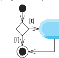

**带 break 的 switch 语句**（多选择）

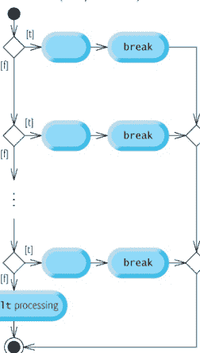

**if...else 语句**（双选择）

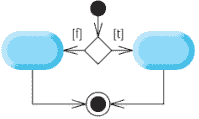

**循环**

**while 语句**

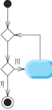

**do...while 语句**

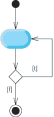

**for 语句**

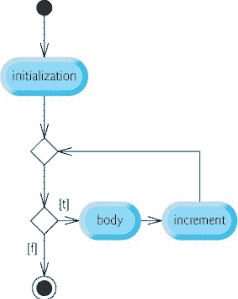

**图 5.20** C++ 的单入口/单出口顺序、选择和迭代语句。

**图 5.21** 形成结构化程序的规则。

| 形成结构化程序的规则 |
|---|
| 1. 从最简单的活动图（图 5.22）开始。<br>2. 任何动作状态都可以被顺序中的两个动作状态替换。<br>3. 任何动作状态都可以被任何控制语句（动作状态的序列、`if`、`if...else`、`switch`、`while`、`do...while` 或 `for`）替换。<br>4. 规则 2 和 3 可以按任意顺序任意次数地应用。 |

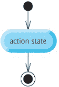

**图 5.22** 最简单的活动图。

应用**图 5.21** 中的规则总是会得到结构正确、外观整齐、像积木一样堆砌的活动图。例如，反复将规则 2 应用于最简单的活动图，会得到一个包含许多顺序排列的动作状态的活动图（**图 5.23**）。规则 2 生成控制语句的堆叠，因此我们称规则 2 为**堆叠规则**。**图 5.23** 中的垂直虚线不是 UML 的一部分——我们用它们来分隔演示**图 5.21** 中规则 2 被应用的四个活动图。

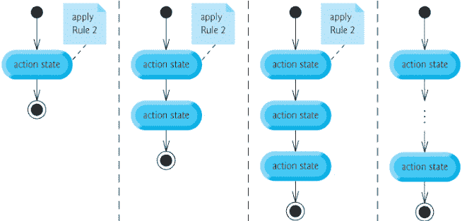

**图 5.23** 将**图 5.21** 的规则 2 反复应用于最简单的活动图。

规则 3 称为**嵌套规则**。反复将规则 3 应用于最简单的活动图，会得到一个具有整齐嵌套控制语句的活动图。例如，在**图 5.24** 中，最简单的活动图中的动作状态被替换为双选择（`if...else`）语句。然后再次将规则 3 应用于双选择语句中的动作状态，将每个动作状态替换为双选择语句。每个双选择语句周围的虚线动作状态符号表示被替换的动作状态。

> [*注*：**图 5.24** 中显示的虚线箭头和虚线动作状态符号不是 UML 的一部分。它们在此处用于说明*任何*动作状态都可以用控制语句替换。]

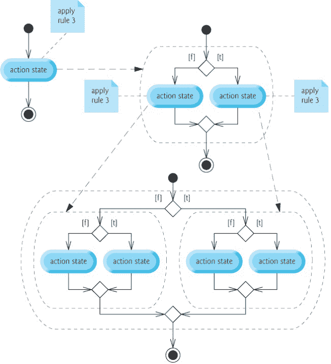

**图 5.24** 将**图 5.21** 的规则 3 反复应用于最简单的活动图。

规则 4 生成更大、更复杂且嵌套更深的语句。应用**图 5.21** 中的规则所产生的图构成了所有可能的结构化活动图的集合，因而也构成了所有可能的结构化程序的集合。结构化方法的美妙之处在于，我们只使用*仅仅七种*简单的单入口/单出口控制语句，并且只用*仅仅两种*简单的方式将它们组合起来。

如果遵循**图 5.21** 中的规则，就不可能创建出“非结构化”的活动图（如**图 5.25** 中的图）。如果你不确定某个图是否是结构化的，可以反向应用**图 5.21** 的规则，将其化简为最简单的活动图。如果能化简，则原图是结构化的；否则不是。

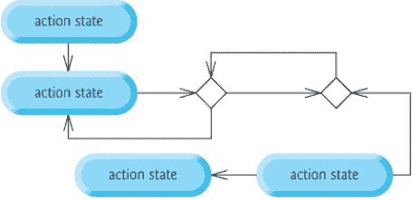

**图 5.25** “非结构化”活动图。

### 控制的三种形式

结构化编程提倡简洁。实现一个算法只需要三种控制形式：

- 顺序
- 选择
- 循环

顺序结构是简单的。只需按应当执行的顺序列出语句即可。选择可以通过三种方式之一实现：

- `if` 语句（单选择）
- `if...else` 语句（双选择）
- `switch` 语句（多选择）

事实上，很容易证明，简单的 `if` 语句就足以提供*任何*形式的选择——所有可以用 `if...else` 语句和 `switch` 语句完成的事情都可以通过组合 `if` 语句来实现（尽管可能不如它们清晰和高效）。

循环可以通过三种方式之一实现：

- `while` 语句
- `do...while` 语句
- `for` 语句

> [*注*：还有第四种循环语句——基于范围的 `for` 语句——我们将在[第 7.5 节](#)讨论。很容易证明，`while` 语句足以提供*任何*形式的循环。所有可以用 `do...while` 和 `for` 完成的事情都可以用 `while` 语句完成（尽管可能不如它们方便）。]

综合这些结果可以看出，C++ 程序中所需的*任何*控制形式都可以用以下方式表达：

- 顺序
- `if` 语句（选择）
- `while` 语句（循环）

并且这些可以仅以两种方式组合——*堆叠*和*嵌套*。

## 5.14 结语

在本章中，我们完成了对控制语句的介绍，这些语句使您能够控制成员函数中的执行流程。**第 4 章**讨论了 `if`、`if...else` 和 `while`。本章演示了 `for`、`do...while` 和 `switch`。我们讨论了与浮点类型相关的表示错误，然后开发了一个 `DollarAmount` 类，该类使用非常大的整数来精确表示货币金额。在处理 `DollarAmount` 时，我们只使用精确的整数运算。我们证明了任何算法都可以通过组合顺序结构、三种选择语句——`if`、`if...else` 和 `switch`——以及三种循环语句——`while`、`do...while` 和 `for`——来开发。在本章和**第 4 章**中，我们讨论了如何组合这些构建块，以利用经过验证的程序构造和问题解决技术。您使用 `break` 语句退出 `switch` 语句并立即终止循环，使用 `continue` 语句终止循环的当前迭代并继续循环的下一次迭代。本章还介绍了 C++ 的逻辑运算符，它们使您能够在控制语句中使用更复杂的条件表达式。在**第 6 章**中，我们将更深入地研究函数。


## 小结

### 5.2节 计数器控制迭代的要点

- **计数器控制迭代**（第[160](#)页）需要一个控制变量、该控制变量的初始值、每次通过循环（也称为循环的每次迭代）修改控制变量的增量，以及决定是否应继续循环的循环继续条件。
- 在C++中，同时预留内存的变量声明是一种**定义**（第[161](#)页）。

### 5.3节 `for`迭代语句

- `while`语句可用于实现任何计数器控制循环。
- `for`语句（第161页）在其头部指定了计数器控制迭代的所有细节。
- 当`for`语句开始执行时，其控制变量可选择性地声明并初始化。如果循环继续条件最初为*真*，则执行循环体。执行循环体后，执行增量表达式。然后再次执行循环继续测试，以确定程序是否应继续循环的下一次迭代。
- `for`语句的一般格式为

```text
for (initialization; loopContinuationCondition; increment) {
    statement
}
```

其中，*初始化*表达式命名循环的控制变量并提供其初始值，*循环继续条件*决定循环是否应继续执行，*增量*修改控制变量的值，以便循环继续条件最终变为*假*。`for`头部中的两个分号是必需的。

- 大多数`for`语句可以用如下等价的`while`语句表示：

```text
initialization;

while (loopContinuationCondition) {
    statement
    increment;
}
```

- 通常，`for`语句用于计数器控制迭代，而`while`语句用于哨兵控制迭代。
- 如果`for`头部中的*初始化*表达式声明了控制变量，则该控制变量只能在该`for`语句中使用——在`for`语句之外将不存在。
- `for`头部中的表达式是可选的。如果省略*循环继续条件*，C++会假定它始终为真，从而创建无限循环。如果控制变量在循环之前已初始化，则可以省略*初始化*表达式。如果增量由循环体中的语句计算，或者不需要增量，则可以省略*增量*表达式。
- `for`中的增量表达式的作用就像它是`for`体末尾的一条独立语句。
- `for`语句可以通过使用负增量（即**递减**（第165页））向下计数。
- 如果循环继续条件最初为`false`，则`for`语句的循环体不会执行。

### 5.5节 应用：对偶数整数求和

- 初始化和增量表达式可以是逗号分隔的列表，使您能够使用多个初始化表达式或多个增量表达式。
- 表达式之间的逗号是逗号运算符，它保证表达式列表从左到右求值。
- 逗号运算符在所有C++运算符中优先级最低。
- 逗号分隔的表达式列表的值和类型是最右侧表达式的值和类型。

### 5.6节 应用：复利计算

- C++将像`1000.0`和`0.05`这样的浮点字面量视为`double`类型。类似地，C++将像`7`和`−22`这样的整数字面量视为`int`类型。
- 标准库函数`pow(x, y)`（第169页）计算`x`的`y`次幂的值。函数`pow`接受两个`double`类型的参数，并返回一个`double`值。
- 参数化流操纵器`setw`（第169页）指定下一个输出值应出现的字段宽度，默认右对齐。如果值大于字段宽度，则扩展字段宽度以容纳整个值。流操纵器`left`（第169页）使值左对齐，`right`（第169页）可用于恢复右对齐。
- **粘性输出格式设置**（第169页）在更改之前保持有效。
- `double`类型存在我们所说的**表示误差**（第170页），因为`double`无法精确表示所有十进制值。

### 5.7节 案例研究：使用`DollarAmount`类进行基于整数的货币计算

- 无法避免利息计算中的舍入，因为处理美元金额时它们会产生不足一美分的零头。
- 使用整数运算，您可以对舍入进行精确控制，而不会遭受与浮点计算相关的表示误差。

### 5.7.2节 类*DollarAmount*

- 在大多数计算机上，`int`是一个从−2,147,483,648到2,147,483,647的值——对于许多货币应用来说太小了。
- C++11的`long long`（第**176**页）类型至少支持−9,223,372,036,854,775,808到9,223,372,036,854,775,807范围内的值。
- `long long`（以及C++的其他整数类型）的范围可能因平台而异。为了实现可移植性，C++11引入了新的整数类型名称，以便您为程序选择合适的值范围。`int64_t`（第**177**页）支持精确范围−9,223,372,036,854,775,808到9,223,372,036,854,775,807。
- 有关C++11整数类型名称的列表，请参见头文件`<cstdint>`（第**177**页）。
- 成员函数既可以访问调用该函数的对象的`private`数据，也可以访问传递给该函数的同一类的其他对象的`private`数据。
- 在半向上舍入中，.5及以上的值向上舍入，其他所有值向下舍入。
- C++标准库函数`to_string`（第**178**页；来自头文件`<string>`）将数值转换为`string`对象。
- C++标准库函数`abs`（第**178**页；来自头文件`<cmath>`）返回其参数的绝对值。
- 使用+运算符“相加”字符串字面量和`string`对象称为字符串拼接（第**178**页）。
- `string`成员函数`size`（第178页）返回`string`中的字符数。
- 半向上舍入是一种有偏技术，因为向下舍入的值比向上舍入的值少——小数部分为.1、.2、.3和.4的值向下舍入，而.5、.6、.7、.8和.9向上舍入。**银行家舍入法**（第179页）通过将.5舍入到最接近的*偶数*整数来解决此问题。

### 5.8节 `do...while`迭代语句

- `do...while`语句（第179页）与`while`语句类似。在`while`中，程序在循环开始时、执行循环体之前测试循环继续条件；如果条件为*假*，则循环体永远不会执行。`do...while`语句在循环体*执行之后*测试循环继续条件；因此，循环体至少执行一次。

### 5.9节 `switch`多选语句

- `switch`**多选语句**（第180页）根据其控制表达式的值执行不同的操作。
- 文件结束指示符是一种依赖系统的按键组合，用于终止用户输入。在UNIX/Linux/Mac OS X系统上，通过在一行中单独输入序列<Ctrl> d来输入文件结束符。此表示法意味着同时按下Ctrl键和d键。在Windows系统上，通过输入<Ctrl> z来输入文件结束符。
- 当您在条件中使用`cin`执行输入时，如果输入成功，则条件求值为*真*；如果用户输入文件结束指示符，则求值为*假*。
- `switch`语句由一个块组成，该块包含一系列**case标签**（第184页）和一个可选的**默认情况**（第184页）。
- 在`switch`中，程序对控制表达式求值，并将其值与每个`case`标签进行比较。如果发生匹配，程序执行该`case`的语句。
- 连续列出多个`case`且它们之间没有语句，可使这些`case`执行同一组语句。
- 您希望在`switch`中测试的每个值都必须列在单独的`case`标签中。
- 每个`case`可以有多个语句，且这些语句不必放在花括号中。


- `case` 的语句通常以 `break` **语句**（第184页）结束，该语句终止 `switch` 的执行。
- 如果没有 `break` 语句，每当 `switch` 中发生匹配时，该 case 及其后续 case 的语句都会执行，直到遇到 `break` 语句或 `switch` 结束。
- 如果控制表达式的值与任何 `case` 标签都不匹配，则执行可选的 `default` case。如果没有匹配且 `switch` 不包含 `default` case，程序控制就直接继续执行 `switch` 后的第一条语句。

## 5.10 节 `break` 和 `continue` 语句

- `break` 语句在 `while`、`for`、`do...while` 或 `switch` 中执行时，会立即退出该语句。
- `continue` **语句（第186页）** 在 `while`、`for` 或 `do...while` 中执行时，会跳过循环体中剩余的语句，并继续下一次迭代。在 `while` 和 `do...while` 语句中，程序立即计算循环继续测试。在 `for` 语句中，先执行增量表达式，然后程序计算循环继续测试。

## 5.11 节 逻辑运算符

- 简单条件用关系运算符 `>`、`<`、`>=` 和 `<=` 以及相等运算符 `==` 和 `!=` 表示，每个表达式只测试一个条件。
- **逻辑运算符**（第**188**页）使您能够通过组合简单条件来形成更复杂的条件。逻辑运算符有 `&&`（逻辑与）、`||`（逻辑或）和 `!`（逻辑非）。
- 要确保两个条件*都为真*，请使用 `&&`（逻辑与）运算符。如果简单条件中有一个或两个为*假*，则整个表达式为*假*。
- 要确保两个条件中有一个或两个为真，请使用 `||`（逻辑或）运算符；如果其简单条件中有一个或两个为*真*，则该运算符求值为*真*。
- 使用 `&&` 或 `||` 运算符的条件采用**短路求值**（第**190**页）——只求值到足以确定该条件为*真*还是*假*为止。
- 一元 `!`（**逻辑非**；第**190**页）运算符会“反转”条件的值。
- 默认情况下，`bool` 值 `true` 和 `false` 分别由 `cout` 显示为 `1` 和 `0`。流操纵符 `boolalpha`（第**191**页）指定每个 `bool` 表达式的值应显示为单词“true”或单词“false”。

## 5.12 节 混淆相等（`==`）与赋值（`=`）运算符

- 任何产生值的表达式都可以用于任何控制语句的判定部分。如果表达式的值为零，则将其视为 `false`；如果值非零，则将其视为 `true`。
- 赋值会产生一个值——即赋给赋值运算符左侧变量的值。
- 程序员通常将条件写成 `x == 7` 这样的形式，变量名（*左值*）在左，字面量（*右值*）在右。将字面量放在左侧，如 `7 == x`，可以使编译器在你意外将 `==` 运算符替换为 `=` 时发出错误。编译器将此视为编译错误，因为不能更改字面量的值。

## 自测练习

1. **5.1** 填写下列各语句中的空白：
   - **A.** 通常，_____ 语句用于计数器控制的迭代，_____ 语句用于哨兵控制的迭代。
   - **B.** `do...while` 语句在执行循环体_____测试循环继续条件；因此，循环体至少执行一次。
   - **C.** _____ 语句根据整数变量或表达式的可能值在多个操作中进行选择。
   - **D.** _____ 语句在迭代语句中执行时，会跳过循环体中剩余的语句，并继续循环的下一次迭代。
   - **E.** _____ 运算符可用于确保在选择某条执行路径之前两个条件**都为真**。
   - **F.** 如果 `for` 头中的循环继续条件最初为_____，则程序不会执行 `for` 语句的循环体。

2. **5.2** 判断下列各题是*真*还是*假*。如果答案为*假*，请解释原因。
   - A. `switch` 选择语句中要求有 `default` case。
   - B. 在 `switch` 选择语句的 `default` case 中，需要 `break` 语句才能正确退出 `switch`。
   - C. 如果表达式 `x > y` 为 `true` 或表达式 `a < b` 为 `true`，则表达式 `(x > y && a < b)` 为 `true`。
   - D. 如果 `||` 运算符的操作数中有一个或两个为 `true`，则包含该运算符的表达式为 `true`。

3. **5.3** 编写一条 C++ 语句或一组 C++ 语句来完成下列各项：
   - A. 使用 `for` 语句求 1 到 99 之间奇整数之和。使用 `unsigned int` 变量 `sum` 和 `count`。
   - B. 在 15 字符宽的字段中分别以精度 `1`、`2` 和 `3` 打印值 `333.546372`。在同一行打印每个数字。在每个字段中左对齐每个数字。会打印哪三个值？
   - C. 使用函数 `pow` 计算 `2.5` 的 `3` 次幂。在 `10` 个位置的字段宽度中以精度 `2` 打印结果。会打印什么？
   - D. 使用 `while` 循环和 `unsigned int` 计数器变量 `x` 打印 1 到 20 的整数。每行只打印 5 个整数。[提示：当 `x % 5` 为 0 时，打印换行符；否则，打印制表符。]
   - E. 使用 `for` 语句重复**练习 5.3(d)**。

4. **5.4** 找出下列各代码段中的错误，并说明如何更正。
   - **A.**
     ```cpp
     unsigned int x{1};
     while (x <= 10); {
         ++x;
     }
     ```
   - **B.**
     ```cpp
     for (double y{0.1}; y != 1.0; y += .1) {
         cout << y << endl;
     }
     ```
   - **C.**
     ```cpp
     switch (n) {
         case 1:
             cout << "The number is 1" << endl;
         case 2:
             cout << "The number is 2" << endl;
             break;
         default:
             cout << "The number is not 1 or 2" << endl;
     }
     ```
   - **D.** 以下代码应打印值 1 到 10。
     ```cpp
     unsigned int n{1};

     while (n < 10) {
         cout << n++ << endl;
     }
     ```

## 自测练习答案

1. **5.1**
   - A. `for`、`while`。
   - B. 之后。
   - C. `switch`。
   - D. `continue`。
   - E. `&&`（条件与）。
   - F. `false`。

2. **5.2**
   - A. 假。`default` case 是可选的。不过，始终提供 `default` case 被认为是良好的软件工程实践。
   - B. 假。`break` 语句用于退出 `switch` 语句。当 `default` case 是最后一个 case 时，不需要 `break` 语句。如果让控制继续执行下一个 case 是合理的，也不需要 `break` 语句。
   - C. 假。使用 `&&` 运算符时，两个关系表达式都必须为 `true`，整个表达式才为 `true`。
   - D. 真。

3. **5.3**
   - **A.**
     ```cpp
     {
         unsigned int sum{0};
         for (unsigned int count{1}; count <= 99; count += 2)
         {
             sum += count;
         }
     }
     ```
   - **B.**
     ```cpp
     cout << fixed << left
          << setprecision(1) << setw(15) << 333.546372
          << setprecision(2) << setw(15) << 333.546372
          << setprecision(3) << setw(15) << 333.546372
          << endl;
     ```
     输出为：
     ```
     333.5        333.55        333.546
     ```
   - **C.**
     ```cpp
     cout << fixed << setprecision(2) << setw(10) <<
     pow(2.5, 3) << endl;
     ```
     输出为：
     ```
     15.63
     ```
   - **D.**
     ```cpp
     unsigned int x{1};
     while (x <= 20) {
         if (x % 5 == 0){
             cout << x << endl;
         }
         else {
             cout << x << '\t';
         }
         ++x;
     }
     ```
   - **E.**
     ```cpp
     {
         for (unsigned int x = 1; x <= 20; ++x) {
             if (x % 5 == 0)
                 cout << x << endl;
             else {
                 cout << x << '\t';
             }
         }
     }
     ```

4. **5.4**
   - A. *错误：* `while` 头后的分号导致无限循环。
     *更正：* 删除 `while` 头后的分号。
     ```cpp
     {
         for (unsigned int y = 1; y != 10; ++y) {
             cout << (static_cast<double>(y) / 10) << endl;
         }
     }
     ```
   - B. *错误：* 使用浮点数控制 `for` 迭代语句。
     *更正：* 使用 `unsigned int` 并进行适当的计算以获得这些值。
     ```cpp
     {
         for (unsigned int y = 1; y != 10; ++y) {
             cout << (static_cast<double>(y) / 10) << endl;
         }
     }
     ```
   - C. *错误：* 第一个 `case` 中缺少 `break` 语句。


*更正：* 在第一个 `case` 的末尾添加一条 `break` 语句。如果你希望每次执行 `case 1` 的语句时都执行 `case 2` 的语句，那么这不是一个错误。

- D. *错误：* 循环继续条件中使用了不恰当的关系运算符。
  *更正：* 使用 `<=` 而不是 `<`，或者将 `10` 改为 `11`。

## 习题

- 1. 5.5 描述计数器控制迭代的四个基本要素。
- 2. 5.6 比较并对照 `while` 和 `for` 迭代语句。
- 3. 5.7 讨论一种更适合使用 `do...while` 语句而不是 `while` 语句的情况，并解释为什么。
- 4. 5.8 比较并对照 `break` 和 `continue` 语句。
- 5. 5.9（*查找代码错误*）找出以下各项中的错误（如果有的话）：
  - A.
```cpp
for (unsigned int x{100}; x >= 1; ++x) {
    cout << x << endl;
}
```
  - B. 以下代码应输出整数 `value` 是奇数还是偶数：
```cpp
{
    switch (value % 2) {
        case 0:
            cout << "Even integer" << endl;
        case 1:
            cout << "Odd integer" << endl;
    }
}
```
  - C. 以下代码应输出从 19 到 1 的奇数：
```cpp
for (unsigned int x{19}; x >= 1; x -= 2) {
    cout << x << endl;
}
```
  - D. 以下代码应输出从 2 到 100 的偶数：
```cpp
unsigned int counter{2};
do {
    cout << counter << endl;
    counter += 2;
} while (counter < 100);
```
- 6. 5.10 以下程序的功能是什么？
```cpp
// Exercise 5.10: Printing.cpp
#include <iostream>
using namespace std;

int main() {
    for (int i{1}; i <= 10; i++) {
        for (int j{1}; j <= 5; j++) {
            cout << '@';
        }
        cout << endl;
    }
}
```
- 7. 5.11 **_查找最小值_** 编写一个应用程序，查找几个整数中的最小值。假设读取的第一个值指定了要从用户那里输入的值的数量。
- 8. 5.12 **_计算奇整数的乘积_** 编写一个应用程序，计算从 1 到 15 的奇整数的乘积。
- 9. 5.13 **_阶乘_** *阶乘*在概率问题中经常使用。正整数 *n* 的阶乘（写作 *n!*，读作“*n* 的阶乘”）等于从 1 到 *n* 的所有正整数的乘积。编写一个应用程序，计算 1 到 20 的阶乘。使用 `long` 类型。以表格格式显示结果。什么困难可能会阻止你计算 100 的阶乘？
- 10. 5.14 **_修改后的复利程序_** 修改图 5.6 中的复利应用程序，使其针对 5%、6%、7%、8%、9% 和 10% 的利率重复执行步骤。使用 `for` 循环来改变利率。
- 11. 5.15（**三角形打印程序**）编写一个应用程序，分别显示以下图案，一个在另一个下方。使用 `for` 循环生成这些图案。所有星号（`*`）应通过一个 `cout << '*';` 形式的语句打印，该语句使星号并排打印。可以使用 `cout << '\n';` 形式的语句移动到下一行。可以使用 `cout << ' ';` 形式的语句为最后两个图案显示一个空格。程序中不应有其他输出语句。

  > [提示：最后两个图案要求每行以适当数量的空格开头。]

  - A.
```text
 *
 **
 ***
 ****
 *****
 ******
 *******
 ********
 *********
 **********
```
  - B. 
  - C. 
    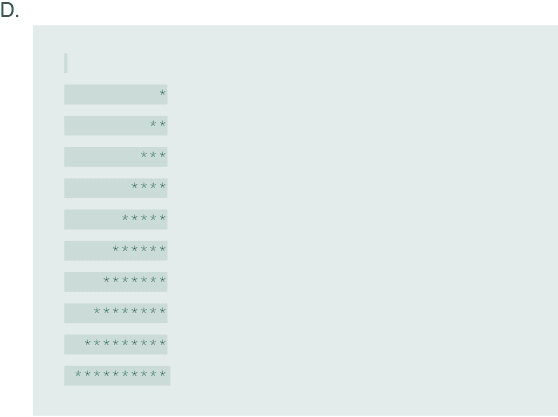
- 12. 5.16（**条形图打印程序**）计算机的一个有趣应用是显示图形和条形图。编写一个应用程序，读取 1 到 30 之间的五个数字。对于读取的每个数字，程序应显示相应数量的连续星号。例如，如果程序读取数字 7，则应显示 `*******`。在读取所有五个数字*之后*显示星号条形。
- 13. 5.17（**计算销售额**）一家在线零售商销售五种产品，其零售价如下：产品 1，2.98 美元；产品 2，4.50 美元；产品 3，9.98 美元；产品 4，4.49 美元；产品 5，6.87 美元。编写一个应用程序，按如下方式读取一系列数字对：
  - A. 产品编号
  - B. 销售数量

  程序应使用 `switch` 语句确定每种产品的零售价。计算并显示所有已售产品的总零售价值。使用哨兵控制循环来确定程序何时应停止循环并显示最终结果。
- 14. 5.18 假设 `i = 1`，`j = 2`，`k = 3`，`m = 2`。以下每条语句会打印什么？
  - A. `cout << (i == 1) << endl;`
  - B. `cout << (j == 3) << endl;`
  - C. `cout << (i >= 1 && j < 4) << endl;`
  - D. `cout << (m <= 99 && k < m) << endl;`
  - E. `cout << (j >= i || k == m) << endl;`
  - F. `cout << (k + m < j || 3 - j >= k) << endl;`
  - G. `cout << (!m) << endl;`
  - H. `cout << (!(j - m)) << endl;`
  - I. `cout << (!(k > m)) << endl;`
- 15. 5.19 **（计算 π 的值）** 根据无穷级数计算 π 的值

$$\pi = 4 - \frac{4}{3} + \frac{4}{5} - \frac{4}{7} + \frac{4}{9} - \frac{4}{11} + \cdots$$

打印一个表格，显示通过计算该级数的前 200,000 项所逼近的 π 值。在首次得到以 3.14159 开头的值之前，你需要使用多少项？
- 16. 5.20（**勾股三元组**）直角三角形的边长可以都是整数。直角三角形边长的三个整数值集合称为勾股三元组。三边的长度必须满足这样的关系：其中两边的平方和等于斜边的平方。编写一个应用程序，显示 `side1`、`side2` 和 `hypotenuse` 的勾股三元组表格，所有值均不超过 500。使用一个三层嵌套的 `for` 循环来尝试所有可能性。这是“暴力”计算的一个例子。在更高级的计算机科学课程中，你会学到对于许多有趣的问题，除了使用纯粹的暴力之外，没有已知的算法方法。
- 17. 5.21（**修改后的三角形打印程序**）修改习题 5.15，将四个独立星号三角形的代码组合起来，使所有四个图案并排打印。*[提示：巧妙使用嵌套的 `for` 循环。]*
- 18. 5.22（**德摩根定律**）在本章中，我们讨论了逻辑运算符 `&&`、`||` 和 `!`。德摩根定律有时可以让我们更方便地表达逻辑表达式。这些定律指出，表达式 `!(condition1 && condition2)` 在逻辑上等价于表达式 `(!condition1 || !condition2)`。同样，表达式 `!(condition1 || condition2)` 在逻辑上等价于表达式 `(!condition1 && !condition2)`。使用德摩根定律为以下各项编写等价表达式，然后编写一个应用程序来证明每种情况下原始表达式和新表达式都产生相同的值：
  - A. `!(x < 5) && !(y >= 7)`
  - B. `!(a == b) || !(g != 5)`
  - C. `!((x <= 8) && (y > 4))`
  - D. `!((i > 4) || (j <= 6))`
- 19. 5.23 **_(菱形打印程序)_** 编写一个应用程序，打印以下菱形图案。你可以使用输出语句打印单个星号（`*`）、单个空格或单个换行字符。最大限度使用迭代（使用嵌套的 `for` 语句），并尽量减少输出语句的数量。

```text
    *
   ***
  *****
 *******
*********
 *******
  *****
   ***
    *
```

- 20. 5.24 **_(修改后的菱形打印程序)_** 修改你在[习题 5.23](#)中编写的应用程序，使其读取一个奇数


在1到19之间指定菱形的行数。然后你的程序应显示相应大小的菱形。

- 21. **5.25（移除`break`和`continue`）** 对`break`语句和`continue`语句的一种批评是它们都是*非结构化*的。实际上，这些语句*总是*可以被结构化语句替代，尽管这样做可能很笨拙。请概括地描述如何从程序中的循环里移除任何`break`语句，并用某种结构化等价物替换它。[提示：`break`语句从循环体内部退出循环。另一种退出方式是循环继续测试失败。考虑在循环继续测试中使用第二个测试，该测试指示“由于‘break’条件而提前退出”。] 使用你在这里开发的技术从**图5.13**的应用中移除`break`语句。
- 22. **5.26** 下面的程序片段做了什么？

    ```cpp
    for (unsigned int i{1}; i <= 5; i++) {
        for (unsigned int j{1}; j <= 3; j++) {
            for (unsigned int k{1}; k <= 4; k++)
                cout << '*';
            cout << endl;
        }
        cout << endl;
    }
    ```

- 23. 5.27（*用结构化等价物替换`continue`*）请概括地描述如何从程序中的循环里移除任何`continue`语句，并用某种结构化等价物替换它。使用你在这里开发的技术从[图5.14](#)的程序中移除`continue`语句。
- 24. 5.28（*“圣诞十二天”歌曲*）编写一个应用程序，使用迭代和`switch`语句打印歌曲“圣诞十二天”。用一个`switch`语句打印天（“第一”、“第二”等）。用另一个`switch`语句打印每一节的其余部分。访问网站`en.wikipedia.org/wiki/The_Twelve_Days_of_Christmas_(song)`获取歌曲歌词。
- 25. 5.29（*彼得·米纽特问题*）传说1626年，彼得·米纽特用24.00美元实物交易购买了曼哈顿岛。他做了一笔好投资吗？为了回答这个问题，修改[图5.6](#)的复利程序，以本金24.00美元开始，并计算如果这笔钱一直存到今年（例如，到2016年共390年）的存款利息。将执行复利计算的`for`循环放在一个外层的`for`循环中，该外层循环将利率从5%变化到10%，以观察复利的奇妙之处。
- 26. 5.30（`DollarAmount` *带两个参数的构造函数*）使用一个构造函数增强类`DollarAmount`（[图5.8](#)），该构造函数接收两个参数，分别表示美元的整数部分和美分的整数部分。使用它们计算总美分数并存储在数据成员`amount`中。用你的新构造函数测试该类。
- 27. 5.31（*DollarAmount***算术**）使用一个`divide`成员函数增强**练习5.30**中的类`DollarAmount`，该函数接收一个`int`参数，将数据成员`amount`除以该值并将结果存储在数据成员中。使用类似于`addInterest`成员函数的舍入技术。测试你新的`divide`成员函数。
- 28. 5.32（*DollarAmount***使用银行家舍入**）类`DollarAmount`的`addInterest`成员函数使用*有偏的*四舍五入技术，其中小数部分.1、.2、.3和.4向下舍入，而.5、.6、.7、.8和.9向上舍入。在这种技术中，四个值向下舍入，五个值向上舍入。银行家舍入通过将.5舍入到最接近的*偶数整数*来修复此问题——例如，0.5舍入为0，1.5和2.5舍入为2，3.5和4.5舍入为4，等等。通过重新实现`addInterest`以使用银行家舍入，增强**练习5.31**中的类`DollarAmount`，然后重新测试复利程序。
- 29. 5.33（*DollarAmount***带有dollars和cents数据成员**）重新实现**练习5.32**中的类`DollarAmount`，以存储数据成员`dollars`和`cents`，而不是`amount`。适当修改每个构造函数和成员函数的主体，以操作`dollars`和`cents`数据成员。
- 30. 5.34（*Account***存储一个`DollarAmount`的类**）升级**练习3.9**中的`Account`类，将其`balance`数据成员定义为**练习5.33**中类`DollarAmount`的对象。相应地重新实现类`Account`的构造函数和成员函数的主体。
- 31. 5.35（**在`DollarAmount`示例中显示利率**）增强图5.7中的`main`程序，以根据用户输入的两个整数显示利率。例如，如果用户输入2和100，显示2.0%；如果用户输入2015和100000，显示2.015%。
- 32. 5.36（**表明`double`值是近似的**）创建一个程序，将123.02赋给一个`double`变量，然后以小数点右侧多位精度显示该变量的值。哪种精度首先让你看到将123.02存储在`double`变量中的表示误差？

## 有所作为

- 1. 5.37（**_全球变暖知识测验_**）有争议的全球变暖问题已被电影《难以忽视的真相》广泛宣传，该片由前副总统阿尔·戈尔主演。戈尔先生与联合国科学家网络——政府间气候变化专门委员会——共同分享了2007年诺贝尔和平奖，以表彰“他们为建立和传播关于人为气候变化的更多知识所做的努力”。在线研究全球变暖问题的*双方*观点（你可能想搜索“全球变暖怀疑论者”等短语）。创建一个关于全球变暖的五道题多项选择测验，每道题有四个可能答案（编号1-4）。要客观，并尽量公平地代表问题的双方。接下来，编写一个应用程序来管理测验，计算正确答案的数量（0到5）并向用户返回消息。如果用户正确回答五道题，打印“优秀”；如果答对四道，打印“很好”；如果答对三道或更少，打印“是时候温习你的全球变暖知识了”，并附上一些你找到事实的网站列表。
- 2. 5.38（**_税收方案替代方案；“公平税”_**）有许多（通常有争议的）提案旨在使税收“更公平”。请查看美国公平税倡议，网址为[www.fairtax.org](http://www.fairtax.org)。研究拟议中的公平税是如何运作的。一个建议是取消所得税和大多数其他税，转而对你购买的所有产品和服务征收23%的消费税。一些公平税反对者质疑23%的数字，并表示由于税收的计算方式，更准确的说法是税率30%——请仔细核对这一点。编写一个程序，提示用户输入他们在各种支出类别（如住房、食品、服装、交通、教育、医疗保健、度假）中的支出，然后打印该人将支付的估计公平税。

## 6 函数与递归入门

### 目标

在本章中，你将：

- 使用函数模块化地构建程序。
- 使用常用数学库函数。
- 使用函数原型来声明函数。
- 使用随机数生成来实现游戏类应用程序。
- 使用C++14数字分隔符使数字字面量更具可读性。
- 理解标识符的可见性如何被限制在程序的特定区域。
- 理解函数调用/返回机制如何由函数调用栈和活动记录支持。
- 理解向函数传递数据和返回结果的机制。
- 使用内联函数、引用和默认参数。
- 定义同名重载函数，这些函数根据参数的数量和类型执行不同的任务。
- 定义能够生成重载函数族的函数模板。
- 编写和使用递归函数。


## 大纲

- 1. **6.1 引言**
- 2. **6.2 C++ 中的程序组件**
- 3. **6.3 数学库函数**
- 4. **6.4 函数原型**
- 5. **6.5 函数原型与实参强制转换说明**
  - **6.5.1 函数签名与函数原型**
  - **6.5.2 实参强制转换**
  - **6.5.3 实参提升规则与隐式转换**
- 6. **6.6 C++ 标准库头文件**
- 7. **6.7 案例研究：随机数生成**
  - **6.7.1 掷六面骰子**
  - **6.7.2 掷六面骰子 60,000,000 次**
  - **6.7.3 使用 srand 随机化随机数生成器**
  - **6.7.4 用当前时间为随机数生成器设置种子**
  - **6.7.5 缩放和平移随机数**
- 8. **6.8 案例研究：机会游戏；介绍作用域枚举**
- 9. **6.9 C++11 随机数**
- 10. **6.10 作用域规则**
- 11. 6.11 函数调用栈与活动记录
- 12. 6.12 内联函数
- 13. 6.13 引用与引用参数
- 14. 6.14 默认实参
- 15. 6.15 一元作用域解析运算符
- 16. 6.16 函数重载
- 17. 6.17 函数模板
- 18. 6.18 递归
- 19. 6.19 使用递归的示例：斐波那契数列
- 20. 6.20 递归与迭代
- 21. 6.21 本章小结

- 1. 小结
- 2. 自测练习
- 3. 自测练习答案
- 4. 练习题
- 5. 产生影响

## 6.1 引言

在本章中，我们更深入地研究函数。大多数解决实际问题的计算机程序比本书前几章展示的程序大得多。经验表明，开发和维护大型程序的最佳方法是使用小型、简单的部件（或组件）来构建它们。这种技术称为**分而治之**。

我们将概述 C++ 标准库中数学函数的一部分。我们将介绍函数原型，并讨论编译器如何在必要时使用它们，将函数调用中的实参类型转换为函数形参列表中指定的类型。

接下来，我们将简要转向使用随机数生成的模拟技术，并开发一款流行的赌场骰子游戏版本，该版本会用到你所学的大部分编程技术。

然后介绍 C++ 的作用域规则，它决定标识符在程序中可被引用的位置。你将了解 C++ 如何跟踪当前正在执行哪个函数、函数的形参和其他局部变量如何保存在内存中，以及函数在执行完毕后如何知道返回哪里。我们讨论有助于提高程序性能的主题——可消除函数调用开销的内联函数，以及可用于高效地将大型数据项传递给函数的引用参数。

你开发的许多应用程序会包含多个同名函数。这种技术称为函数重载，用于实现为不同类型的实参或不同数量的实参执行类似任务的函数。我们考虑函数模板——一种简洁定义一组重载函数的机制。本章最后讨论调用自身的函数，可以是直接调用，也可以（通过另一个函数）间接调用——这个主题称为递归。

## 6.2 C++ 中的程序组件

C++ 程序通常通过将 C++ 标准库中“预打包”的函数和类与你编写的新函数和类组合在一起来编写。C++ 标准库提供了丰富的函数集合，用于常见数学计算、字符串操作、字符操作、输入/输出、错误检查以及许多其他有用的操作。

函数允许你通过将程序的任务分离到自包含的单元中来实现程序模块化。在几乎你编写的每个程序中，你都使用了库函数和你自己的函数的组合。

使用函数将程序模块化有几个动机：

- 软件复用。例如，在较早的程序中，我们不必定义如何从键盘读取一行文本——C++ 通过 `<string>` 头文件的 `getline` 函数提供此能力。
- 避免代码重复。
- 将程序划分为有意义的函数，使程序更易于测试、调试和维护。

### 观察 6.1

*为提高软件可复用性，每个函数都应限于执行单一、定义明确的任务，并且函数名应有效表达该任务。*

如你所知，函数通过函数调用被调用；当被调用函数完成其任务后，它要么返回一个*结果*，要么仅将*控制权*返回给调用者。这种程序结构的一个类比是管理层的层级形式（[图 6.1](#)）。

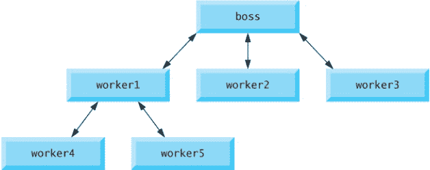

**图 6.1 层级式的老板函数/工人函数关系。**

老板（类似于调用函数）要求工人（类似于被调用函数）执行任务，并在完成任务后报告（即返回）结果。老板函数*不*知道工人函数如何执行其指定任务。工人也可能调用其他工人函数，而老板并不知情。这种*隐藏实现细节*促进了良好的软件工程。**图 6.1** 显示了 `boss` 函数与多个工人函数通信。`boss` 函数在 `worker` 函数之间划分职责，而 `worker1` 充当 `worker4` 和 `worker5` 的“老板函数”。这种关系不必是层级式的，但通常如此，这使程序更易于测试、调试、更新和维护。

## 6.3 数学库函数

有些函数（例如 `main`）**不是**类的成员。这些函数称为**全局函数**。我们在此介绍 `<cmath>` 头文件中的各种函数，以呈现不属于特定类的全局函数的概念。

`<cmath>` 头文件提供了一组执行常见数学计算的函数。例如，你可以使用以下函数调用计算 `900.0` 的平方根

```cpp
sqrt(900.0);
```

此表达式的计算结果为 `30.0`。函数 `sqrt` 接受 `double` 类型的实参并返回 `double` 结果。调用函数 `sqrt` 之前无需创建任何对象。此外，`<cmath>` 头文件中的*所有*函数都是*全局函数*——因此，调用每个函数时只需指定函数名，后跟包含该函数实参的括号。


### 错误预防提示 6.1

*不要用负实参调用 `sqrt`。对于工业级代码，始终检查传递给数学函数的实参是否有效。*

函数实参可以是常量、变量或更复杂的表达式。如果 `c = 13.0`、`d = 3.0` 且 `f = 4.0`，那么语句

```cpp
cout << sqrt(c + d * f) << endl;
```

显示 `13.0 + 3.0 * 4.0 = 25.0` 的平方根——即 `5.0`。一些数学库函数总结在**图 6.2**中。图中变量 `x` 和 `y` 的类型为 `double`。

**图 6.2 数学库函数。**

| 函数 | 描述 | 示例 |
|---|---|---|
| `ceil(x)` | 将 *x* 向上舍入为不小于 *x* 的最小整数 | `ceil(9.2)` 为 `10.0`<br>`ceil(-9.8)` 为 `-9.0` |
| `cos(x)` | *x* 的三角余弦（*x* 以弧度为单位） | `cos(0.0)` 为 `1.0` |
| `exp(x)` | 指数函数 *e*<sup>*x*</sup> | `exp(1.0)` 为 `2.718282`<br>`exp(2.0)` 为 `7.389056` |
| `fabs(x)` | *x* 的绝对值 | `fabs(5.1)` 为 `5.1`<br>`fabs(0.0)` 为 `0.0`<br>`fabs(-8.76)` 为 `8.76` |
| `floor(x)` | 将 *x* 向下舍入为不大于 *x* 的最大整数 | `floor(9.2)` 为 `9.0`<br>`floor(-9.8)` 为 `-10.0` |
| `fmod(x, y)` | *x/y* 的余数，以浮点数表示 | `fmod(2.6, 1.2)` 为 `0.2` |
| `log(x)` | *x* 的自然对数（以 *e* 为底） | `log(2.718282)` 为 `1.0`<br>`log(7.389056)` 为 `2.0` |
| `log10(x)` | *x* 的对数（以 10 为底） | `log10(10.0)` 为 `1.0`<br>`log10(100.0)` 为 `2.0` |
| `pow(x, y)` | *x* 的 *y* 次幂（*xʸ*） | `pow(2, 7)` 为 `128`<br>`pow(9, .5)` 为 `3` |
| `sin(x)` | *x* 的三角正弦（*x* 以弧度为单位） | `sin(0.0)` 为 `0` |


| 函数 | 描述 | 示例 |
|---|---|---|
| `sqrt(x)` | x 的平方根（x 为非负值） | `sqrt(9.0)` 是 `3.0` |
| `tan(x)` | x 的三角正切（x 以弧度为单位） | `tan(0.0)` 是 `0` |

## 6.4 函数原型

在本节中，我们创建一个名为 `maximum` 的用户自定义函数，它返回三个 `int` 参数中的最大值。当应用程序执行时，`main` 函数（*图 6.3* 的第 9–17 行）从用户处读取三个整数。然后，输出语句（第 15–16 行）调用 `maximum`，在本例中该函数定义在 `main` *之后*（第 20–34 行）——我们稍后会讨论本例中函数定义的顺序。函数 `maximum` 将最大值返回给第 16 行，该行显示结果。示例输出表明，无论最大值是第一个、第二个还是第三个参数，`maximum` 都能确定最大值。

```cpp
// Fig. 6.3: Fig06_03.cpp
// maximum function with a function prototype.
#include <iostream>
#include <iomanip>
using namespace std;

int maximum(int x, int y, int z); // function prototype

int main() {
   cout << "Enter three integer values: ";
   int int1, int2, int3;
   cin >> int1 >> int2 >> int3;

   // invoke maximum
   cout << "The maximum integer value is: "
      << maximum(int1, int2, int3) << endl;
}

// returns the largest of three integers
int maximum(int x, int y, int z) {
   int maximumValue{x}; // assume x is the largest to start

   // determine whether y is greater than maximumValue
   if (y > maximumValue) {
      maximumValue = y; // make y the new maximumValue
   }

   // determine whether z is greater than maximumValue
   if (z > maximumValue) {
      maximumValue = z; // make z the new maximumValue
   }

   return maximumValue;
}
```

```text
Enter three integer values: 86 67 75
The maximum integer value is: 86
```

```text
Enter three integer values: 67 86 75
The maximum integer value is: 86
```

```text
Enter three integer values: 67 75 86
The maximum integer value is: 86
```

**图 6.3 带有函数原型的 maximum 函数。**

### *`maximum` 函数的逻辑*

函数 `maximum` 首先假设参数 `x` 具有最大值，因此第 21 行声明局部变量 `maximumValue` 并将其初始化为参数 `x` 的值。当然，参数 `y` 或 `z` 可能包含实际的最大值，因此我们必须将这两个参数分别与 `maximumValue` 进行比较。第 24–26 行的 `if` 语句确定 `y` 是否大于 `maximumValue`，如果是，则将 `y` 赋给 `maximumValue`。第 29–31 行的 `if` 语句确定 `z` 是否更大，如果是，则将 `z` 赋给 `maximumValue`。此时最大值在 `maximumValue` 中，因此第 33 行将该值返回给第 16 行的调用。

### *`maximum` 的函数原型*

在前面的章节中，我们创建了类 `Account`、`Student` 和 `DollarAmount`，每个类都有各种成员函数。我们在头文件（`.h`）中定义每个类，并在程序的源代码文件中将其包含在 `main` 之前。这样做可以确保该类（及其成员函数）在 `main` 创建和操作该类的对象之前已被定义。这样编译器就能确保我们正确地调用每个类的构造函数和成员函数——例如，为每个函数传递正确数量和类型的参数。

对于未在类中定义的函数，您必须在使用该函数之前定义它，或者必须*声明*该函数存在，正如我们在**图 6.3** 的第 7 行所做的那样：

```c
int maximum(int x, int y, int z); // function prototype
```

这是一个**函数原型**，它*描述*了 `maximum` 函数，但*不透露其实现细节*。函数原型是对函数的一种*声明*，它告诉编译器函数的名称、返回类型以及参数的类型。该函数原型表明该函数返回一个 `int`，名称为 `maximum`，并且需要三个 `int` 参数来执行其任务。请注意，函数原型与对应函数定义的第一行（第 20 行）*相同*，但以*必需的*分号结尾。


### 良好编程实践 6.1

*函数原型中的参数名称是可选的（编译器会忽略它们），但许多程序员使用这些名称作为文档说明。我们在***图 6.3*** 的函数原型中使用参数名称是为了演示目的，但在本书后续示例中通常不使用它们。*

编译程序时，编译器使用原型来：

- 确保 `maximum` 的第一行（第 20 行）与其原型（第 7 行）匹配。
- 检查对 `maximum` 的调用（第 16 行）是否包含正确数量和类型的参数，并且参数类型顺序正确（在本例中，所有参数的类型都相同）。
- 确保函数返回的值能够在调用该函数的表达式中被正确使用——例如，对于返回 `void` 的函数，您*不能*在赋值语句的右侧调用该函数。
- 确保每个参数与相应参数的类型*一致*——例如，`double` 类型的参数可以接收 7.35、22 或 −0.03456 等值，但不能接收像 `"hello"` 这样的字符串。如果传递给函数的参数与函数原型中指定的类型*不*匹配，编译器会尝试将参数转换为这些类型。**第 6.5 节**将讨论这种转换以及转换不被允许时会发生什么。


### 常见编程错误 6.1

将相同类型的函数参数声明为 `int x, y` 而不是 `int x; int y` 是语法错误——参数列表中的每个参数都需要一个类型。


### 常见编程错误 6.2

*如果函数原型、函数头和调用在参数和返回类型的数量、类型及顺序上不一致，则会发生编译错误。*


### 软件工程观察 6.2

*一个参数过多的函数可能正在执行过多的任务。考虑将该函数拆分为执行各自任务的较小函数。如果可能，请将函数头限制为一行。*

### *函数调用中的逗号不是逗号运算符*

在函数原型和函数头中，多个参数都以逗号分隔的列表指定，函数调用中的多个参数也是如此。


### 可移植性提示 6.1

*图 6.3* 第 16 行中用于分隔函数 `maximum` 参数的逗号不是*第 5.5 节*讨论的逗号运算符。逗号运算符保证其操作数从左到右求值。然而，C++ 标准并未规定函数参数的求值顺序。因此，不同的编译器可能以不同的顺序求值函数参数。


### 可移植性提示 6.2

有时，当函数的参数是表达式（例如包含对其他函数调用的表达式）时，编译器求值参数的顺序可能会影响一个或多个参数的值。如果求值顺序在不同编译器之间发生变化，传递给函数的参数值可能会不同，从而引发微妙的逻辑错误。


### 错误预防提示 6.2

如果您对函数参数的求值顺序以及该顺序是否会影响传递给函数的值存有疑问，请在函数调用之前，在单独的赋值语句中对参数进行求值，并将每个求值结果赋给


将表达式赋值给局部变量，然后将这些变量作为参数传递给函数。

## 从函数向调用者返回控制权

之前你已经看到，当程序调用函数时，函数执行其任务，然后将控制权（以及可能的返回值）返回到函数被调用的位置。在不返回结果的函数（即返回类型为`void`的函数）中，我们展示了当程序到达函数结尾的右花括号时控制权返回。你也可以通过执行以下语句显式地将控制权返回给调用者：

```cpp
{
    return;
}
```

## 6.5 函数原型与参数强制转换的注意事项

除非函数在使用前已定义，否则需要函数原型。当你使用标准库函数（如`sqrt`）时，你无法访问函数的定义，因此它不能在你调用函数之前定义在代码中。相反，你必须包含其对应的头文件（`<cmath>`），该头文件包含函数的原型。


### 常见编程错误 6.3

*如果函数在调用之前定义，那么它的定义也充当了函数的原型，因此单独的 prototype 是不必要的。如果函数在定义之前被调用，并且该函数没有函数原型，则会发生编译错误。*

### 观察 6.3

> *始终提供函数原型，即使当函数在使用前定义时可以省略它们。提供原型可以避免代码依赖于函数定义的顺序（随着程序的演进，这种顺序很容易改变）。*

### 6.5.1 函数签名与函数原型

函数原型中包括*函数名称*和*参数类型*的部分称为**函数签名**，或简称为**签名**。函数的返回类型不属于函数签名的一部分。函数的作用域是程序中函数已知且可访问的区域。*同一作用域中的函数必须具有唯一的签名。*我们将在[第 6.10 节](#)中进一步讨论作用域。

在[图 6.3](#)中，如果第 7 行的函数原型写成

```cpp
void maximum(int, int, int);
```

编译器将报告错误，因为函数原型中的`void`返回类型将与函数头中的`int`返回类型不同。类似地，这样的原型会导致语句

```cpp
cout << maximum(6, 7, 0);
```

产生编译错误，因为该语句依赖于`maximum`返回一个值来显示。


### 错误预防技巧 6.3

*函数原型帮助你在编译时发现许多类型的错误。在编译时消除错误总是比在运行时消除更好。*

### 6.5.2 参数强制转换

函数原型的一个重要特性是**参数强制转换**，即强制将参数转换为参数声明指定的适当类型。例如，程序可以用整数参数调用函数，即使函数原型指定了`double`参数——只要这不是窄化转换（在[第 4.11.7 节](#)中讨论），函数仍然能正确工作。

### 6.5.3 参数提升规则与隐式转换¹

1. 提升和转换是复杂的话题，在 C++ 标准的第 4 节和第 5 节开头讨论。

有时，与函数原型中的参数类型不完全对应的参数值可以在函数调用之前由编译器转换为正确的类型。这些转换按照 C++ 的**提升规则**进行，这些规则指明了基本类型之间*允许的隐式转换*。`int`可以转换为`double`。`double`也可以转换为`int`，但这种窄化转换*截断*了`double`的小数部分——回想[第 4.11.7 节](#)，列表初始化器不允许窄化转换。请记住，`double`变量能容纳的数值范围远大于`int`变量，因此窄化转换中的数据丢失可能相当可观。将大整数类型转换为小整数类型（例如`long`转换为`short`）、有符号转换为无符号或无符号转换为有符号时，值也可能被修改。无符号整数的范围从 0 到相应有符号类型正数范围的大约两倍。

提升规则同样适用于包含两种或多种数据类型值的表达式；这类表达式称为**混合类型表达式**。混合类型表达式中每个值的类型被提升为表达式中的“最高”类型（实际上会创建每个值的*临时*版本用于表达式，原始值保持不变）。**图 6.4** 按从“最高类型”到“最低类型”的顺序列出了算术数据类型。

**图 6.4** 算术数据类型的提升层次；“最高”类型在顶部。

| 数据类型 | 描述 |
|---|---|
| `long double` |  |
| `double` |  |
| `float` |  |
| `unsigned long long int` | （与`unsigned long long`同义） |
| `long long int` | （与`long long`同义） |
| `unsigned long int` | （与`unsigned long`同义） |
| `long int` | （与`long`同义） |
| `unsigned int` | （与`unsigned`同义） |
| `int` |  |
| `unsigned short int` | （与`unsigned short`同义） |
| `short int` | （与`short`同义） |
| `unsigned char` | |
| `char`和`signed char` | |
| `bool` | |

### 转换可能导致错误的值

将值转换为*较低的基本类型*可能因窄化转换而导致错误。因此，将值转换为较低的基本类型只能通过*显式*将值赋值给较低类型的变量（某些编译器在这种情况下会发出警告）或使用*强制转换运算符*（参见**第 4.10 节**）来完成。函数参数值被转换为函数原型中的参数类型，就像直接赋值给这些类型的变量一样。如果使用整数参数的`square`函数被用浮点参数调用，该参数会被转换为`int`（较低类型，因此是窄化转换），`square`可能返回错误的值。例如，`square(4.5)`将返回`16`，而不是`20.25`。某些编译器会针对窄化转换发出警告。例如，Microsoft Visual C++ 发出如下警告：

```text
'argument': conversion from 'double' to 'int', possible loss of
```


### 常见编程错误 6.4

*如果函数调用中的参数无法隐式转换为函数原型中指定的预期类型，则会发生编译错误。*

## 6.6 C++ 标准库头文件

C++ 标准库分为许多部分，每个部分都有自己的头文件。头文件包含构成库每一部分的相关函数的函数原型。头文件还包含各种类类型和函数的定义，以及这些函数所需的常量。头文件“指导”编译器如何与库和用户编写的组件进行交互。

**图 6.5** 列出了一些常见的 C++ 标准库头文件，其中大部分将在本书后续讨论。**图 6.5** 中多次使用的术语“宏”将在**附录 E**（预处理器）中详细讨论。

**图 6.5** C++ 标准库头文件。

| 标准库头文件 | 说明 |
|---|---|
| `<iostream>` | 包含 C++ 标准输入输出函数的函数原型，在**第 2 章**中引入，并在**第 13 章**（流输入/输出：深入探讨）中更详细地介绍。 |
| `<iomanip>` | 包含格式化数据流的流操纵器的函数原型。此头文件在**第 4.10 节**中首次使用，并在**第 13 章**（流输入/输出：深入探讨）中更详细地讨论。 |


| 头文件 | 描述 |
|---|---|
|  | 深入探讨。 |
| `<cmath>` | 包含数学库函数的函数原型（6.3节）。 |
| `<cstdlib>` | 包含将数字转换为文本、文本转换为数字、内存分配、随机数以及各种其他实用函数的函数原型。该头文件的部分内容在6.7节；第11章，运算符重载；类`string`；第17章，异常处理：深入探讨；第22章，位、字符、C字符串和`struct`；以及附录F，C遗留代码主题中讨论。 |
| `<ctime>` | 包含用于操作时间和日期的函数原型和类型。该头文件在6.7节中使用。 |
| `<array>`、`<vector>`、`<list>`、`<forward_list>`、`<deque>`、`<queue>`、`<stack>`、`<map>`、`<unordered_map>`、`<unordered_set>`、`<set>`、`<bitset>` | 这些头文件包含实现C++标准库容器的类。容器在程序执行期间存储数据。`<vector>`头文件首次在第7章“类模板`array`和`vector`；捕获异常”中介绍。我们在第15章“标准库容器和迭代器”中讨论所有这些头文件。`<array>`、`<forward_list>`、`<unordered_map>`和`<unordered_set>`都是在C++11中引入的。 |
| `<cctype>` | 包含用于测试字符是否具有某些属性（例如字符是数字还是标点）的函数的函数原型，以及可用于将小写字母转换为大写字母（反之亦然）的函数的函数原型。这些主题在第22章“位、字符、C字符串和`struct`”中讨论。 |
| `<cstring>` | 包含用于C风格字符串处理函数的函数原型。 |
| `<typeinfo>` | 包含用于运行时类型识别（在执行时确定数据类型）的类。该头文件在**12.9节**中讨论。 |
| `<exception>`、`<stdexcept>` | 这些头文件包含用于异常处理的类（在**第17章**“异常处理：深入探讨”中讨论）。 |
| `<memory>` | 包含C++标准库用于向C++标准库容器分配内存的类和函数。该头文件在**第17章**“异常处理：深入探讨”中使用。 |
| `<fstream>` | 包含用于从磁盘文件输入和向磁盘文件输出数据的函数的函数原型（在**第14章**“文件处理”中讨论）。 |
| `<string>` | 包含C++标准库中类`string`的定义（在**第21章**“类`string`和字符串流处理”中讨论）。 |
| `<sstream>` | 包含用于从内存中的字符串输入和向内存中的字符串输出数据的函数的函数原型（在**第21章**“类`string`和字符串流处理”中讨论）。 |
| `<functional>` | 包含C++标准库算法使用的类和函数。该头文件在**第16章**中使用。 |
| `<iterator>` | 包含用于访问C++标准库容器中数据的类。该头文件在**第15章**中使用。 |
| `<algorithm>` | 包含用于操作C++标准库容器中数据的函数。该头文件在**第15章**中使用。 |
| `<cassert>` | 包含用于添加有助于程序调试的诊断信息的宏。该头文件在**附录E**“预处理器”中使用。 |
| `<cfloat>` | 包含系统的浮点大小限制。 |
| `<climits>` | 包含系统的整数大小限制。 |
| `<cstdio>` | 包含C风格标准输入/输出库函数的函数原型。 |
| `<locale>` | 包含流处理通常用于以不同语言的自然形式处理数据（例如货币格式、字符串排序、字符表示等）的类和函数。 |
| `<limits>` | 包含用于定义每个计算机平台上数值数据类型限制的类——这是C++版本的`<climits>`和`<cfloat>`。 |
| `<utility>` | 包含许多C++标准库头文件使用的类和函数。 |

## 6.7 案例研究：随机数生成²

². 在6.9节中，我们将介绍C++11的随机数功能，用于构建更安全的应用程序。

我们现在简要且希望是有趣地转向一个流行的编程应用，即模拟和游戏。在本节和下一节中，我们将开发一个包含多个函数的游戏程序。

可以通过使用C++标准库函数`rand`将偶然性元素引入计算机应用程序。考虑以下语句：

```cpp
i = rand();
```

函数`rand`生成一个介于0和`RAND_MAX`之间的无符号整数（`RAND_MAX`是在`<cstdlib>`头文件中定义的符号常量）。只需显示该常量，就可以确定你系统中`RAND_MAX`的值。如果`rand`真正随机地产生整数，那么每次调用`rand`时，0到`RAND_MAX`之间的每个数都有相等的*机会*（或概率）被选中。

函数`rand`直接产生的值范围通常不同于特定应用程序所需的范围。例如，一个模拟掷硬币的程序可能只需要0表示“正面”，1表示“反面”。一个模拟掷六面骰子的程序需要1到6范围内的随机整数。一个随机预测视频游戏中下一个飞过地平线的飞船类型（四种可能性之一）的程序可能需要1到4范围内的随机整数。

### 6.7.1 掷六面骰子

为了演示`rand`，**图6.6**模拟掷六面骰子20次并显示每次掷出的值。`rand`函数的函数原型在`<cstdlib>`中。要产生0到5范围内的整数，我们按如下方式使用取余运算符（`%`）与`rand`：

```c
rand() % 6
```

这称为**缩放**。数字6称为**缩放因子**。然后，我们通过在前一结果上加1来**移位**产生的数字范围。**图6.6**确认结果在1到6范围内。如果多次执行该程序，你会看到它每次产生相同的“随机”值。我们将在**图6.8**中展示如何解决这个问题。

```cpp
// Fig. 6.6: fig06_06.cpp
// Shifted, scaled integers produced by 1 + rand() % 6.
#include <iostream>
#include <iomanip>
#include <cstdlib> // contains function prototype for rand
using namespace std;

int main() {
   // loop 20 times
   for (unsigned int counter{}; counter <= 20; ++counter) {
      // pick random number from 1 to 6 and output it
      cout << setw(10) << (1 + rand() % 6);

      // if counter is divisible by 5, start a new line of output
      if (counter % 5 == 0) {
         cout << endl;
      }
   }
}
```


图6.6 由`1 + rand() % 6`产生的移位、缩放后的整数。

### 6.7.2 掷六面骰子60,000,000次

为了表明`rand`产生的值以大致相等的可能性出现，**图6.7**模拟掷骰子60,000,000次。1到6范围内的每个整数应出现约10,000,000次（掷骰次数的六分之一）。程序的输出证实了这一点。

```cpp
// Fig. 6.7: fig06_07.cpp
// Rolling a six-sided die 60,000,000 times.
#include <iostream>
#include <iomanip>
#include <cstdlib> // contains function prototype for rand
using namespace std;

int main() {
   unsigned int frequency1{0}; // count of 1s rolled
   unsigned int frequency2{0}; // count of 2s rolled
   unsigned int frequency3{0}; // count of 3s rolled
   unsigned int frequency4{0}; // count of 4s rolled
   unsigned int frequency5{0}; // count of 5s rolled
   unsigned int frequency6{0}; // count of 6s rolled
   int face; // stores each roll of the die

   // summarize results of 60,000,000 rolls of a die
   for (unsigned int roll{1}; roll <= 60'000'000; ++roll) {
      face = 1 + rand() % 6; // random number from 1 to 6

      // determine roll value 1-6 and increment appropriate counter
      switch (face) {
         case 1:
            ++frequency1; // increment the 1s counter
            break;
         case 2:
            ++frequency2; // increment the 2s counter
            break;
         case 3:
            ++frequency3; // increment the 3s counter
            break;
```

```cpp
case 4:
    ++frequency4; // increment the 4s counter
    break;
case 5:
    ++frequency5; // increment the 5s counter
    break;
case 6:
    ++frequency6; // increment the 6s counter
    break;
default: // invalid value
    cout << "Program should never get here!";
}
}

cout << "Face" << setw(13) << "Frequency" << endl; // output headers
cout << "     1" << setw(13) << frequency1
     << "\n  2" << setw(13) << frequency2
     << "\n  3" << setw(13) << frequency3
     << "\n  4" << setw(13) << frequency4
     << "\n  5" << setw(13) << frequency5
     << "\n  6" << setw(13) << frequency6 << endl;
```

| 面 | 频率 |
|---:|---:|
| 1 | 9999294 |
| 2 | 10002929 |
| 3 | 9995360 |
| 4 | 10000409 |
| 5 | 10005206 |
| 6 | 9996802 |

**图 6.7** 将六面骰子掷 60,000,000 次。

正如输出所示，我们可以通过对 `rand` 生成的值进行缩放和平移来模拟掷六面骰子。`switch` 中的 `default` 分支（第 41–42 行）*绝不应执行*，因为 `switch` 的控制表达式（`face`）*始终*取值在 1–6 范围内。我们提供 `default` 分支是出于良好实践。在学习**第 7 章**的数组之后，我们将展示如何用单行语句优雅地替换**图 6.7**中的整个 `switch`。这将是另一个“灵光一现”的时刻。


### 错误预防提示 6.4

在 `switch` 中提供 `default` 分支，以便捕获错误，即使你绝对、肯定地确信自己没有 bug！

### C++14 数字字面量中的数字分隔符

在 C++14 之前，你会在程序中将整数值 60,000,000 表示为 `60000000`。输入包含许多数字的数字字面量可能容易出错。为了使数字字面量更易读，C++14 允许你在数字字面量的数字组之间插入**数字分隔符** `'`（单引号字符）——例如，`60'000'000`（第 18 行）表示整数值 60,000,000。你可能会疑惑为什么使用单引号字符而不是逗号。如果我们在第 18 行使用 `60,000,000`，C++ 会将逗号视为*逗号运算符*，而 `60,000,000` 的值将是最右边的表达式（`000`）。循环继续条件会立即变为*假*——这是本程序中的一个逻辑错误。

## 6.7.3 使用 `srand` 随机化随机数生成器

再次执行**图 6.6**的程序会生成

```text
6    6    5    5    6
5    1    1    5    3
6    6    2    4    2
6    2    3    4    1
```

这与**图 6.6**中显示的序列*相同*。这些怎么可能是随机数呢？


### *错误预防提示 6.5*

*调试模拟程序时，随机数的可重复性对于证明程序修正能够正确工作至关重要。*

函数 `rand` 实际上生成的是**伪随机数**。重复调用 `rand` 会产生看似随机的数字序列。然而，每次程序执行时，该序列都会*重复*。程序经过彻底调试后，可以使其在每次执行时产生*不同*的随机数序列。这称为**随机化**，通过来自头文件 `<cstdlib>` 的 C++ 标准库函数 `srand` 来实现。函数 `srand` 接受一个 `unsigned` 整数参数，并为 `rand` 函数**设置种子**，以便每次执行时产生不同的随机数序列。

### 演示 `srand`

**图 6.8** 演示了函数 `srand`。只要用户输入*不同的种子*，该程序每次执行时都会产生*不同*的随机数序列。我们在第一个和第三个示例输出中使用了*相同*的种子，因此这些输出中每个都显示了*相同*的 10 个数字序列。


### 软件工程观察 6.4

> *确保你的程序在每次执行时以不同方式为随机数生成器设置种子（且仅设置一次）；否则，攻击者将很容易确定会产生的伪随机数序列。*

```cpp
// Fig. 6.8: fig06_08.cpp
// Randomizing the die-rolling program.
#include <iostream>
#include <cstdlib> // contains prototypes for functions srand and rand
using namespace std;

int main() {
    unsigned int seed{0}; // stores the seed entered by the user

    cout << "Enter seed: ";
    cin >> seed;
    srand(seed); // seed random number generator

    // loop 10 times
    for (unsigned int counter{1}; counter <= 10; ++counter) {
        // pick random number from 1 to 6 and output it
        cout << setw(10) << (1 + rand() % 6);

        // if counter is divisible by 5, start a new line of output
        if (counter % 5 == 0) {
            cout << endl;
        }
    }
}
```

```text
Enter seed: 67
          6          1          4          6          2
          1          6          1          6          4
```

```text
Enter seed: 432
          4          6          3          1          6
          3          1          5          4          2
```

```text
Enter seed: 67
          6          1          4          6          2
          1          6          1          6          4
```

**图 6.8** 随机化掷骰子程序。

## 6.7.4 用当前时间为随机数生成器设置种子

为了在*无需*每次输入种子的情况下进行随机化，我们可以使用如下语句

```cpp
srand(static_cast<unsigned int>(time(0)));
```

这会使计算机读取其*时钟*，以获取种子值。函数 `time`（使用前一条语句中写出的参数 `0`）通常返回当前时间，即自 1970 年 1 月 1 日格林尼治标准时间（GMT）午夜以来的秒数。该值（类型为 `time_t`）会被转换为 `unsigned int`，并用作随机数生成器的种子——前一条语句中的 `static_cast` 消除了当你将 `time_t` 值传递给期望 `unsigned int` 的函数时发出的编译器警告。`time` 的函数原型位于 `<ctime>` 中。

## 6.7.5 缩放和平移随机数

之前，我们用以下语句模拟掷六面骰子

```cpp
unsigned int face(1 + rand() % 6);
```

该语句总是将一个整数（随机地）赋给变量 `face`，其范围为 1 ≤ `face` ≤ 6。该范围的宽度（即范围中连续整数的个数）为 6，范围的起始数字为 1。参考前面的语句，我们看到范围的宽度由用于对 `rand` 进行取余运算的数字（即 6）决定，而范围的起始数字等于加到表达式 `rand % 6` 上的数字（即 1）。我们可以将该结果推广为

```cpp
type variableName(shiftingValue + rand() % scalingFactor);
```

其中 *shiftingValue* 等于所需连续整数范围中的*第一个数*，*scalingFactor* 等于所需连续整数范围的*宽度*。

## 6.8 案例研究：概率游戏；引入作用域 `enum`

最流行的概率游戏之一是一种称为“craps”的骰子游戏，世界各地的赌场和小巷中都有人玩。游戏规则简单明了：

- *玩家掷两个骰子。每个骰子有六个面。这些面分别包含 1、2、3、4、5 和 6 个点。骰子停止后，计算两个朝上面的点数之和。如果第一次掷出的点数之和为 7 或 11，则玩家赢。如果第一次掷出的点数之和为 2、3 或 12（称为“craps”），则玩家输（即“庄家”赢）。如果第一次掷出的点数之和为 4、5、6、8、9 或 10，则该和成为玩家的“点数”。要获胜，你必须继续掷骰子，直到你“得到自己的点数”。如果在得到点数之前掷出 7，则玩家输。*

**图 6.9** 中的程序模拟该游戏。在规则中，请注意玩家在第一次掷骰以及之后所有掷骰时都必须掷两个骰子。我们定义函数 `rollDice`（第 64–73 行）来掷骰子，并计算和打印它们的和。该函数只定义一次，但从第 19 行和第 41 行调用。该函数不接受参数，并返回两个骰子的和，因此在函数原型（第 8 行）和函数头（第 64 行）中表示为空括号和返回类型 `unsigned int`。


```cpp
// Fig. 6.9: fig06_09.cpp
// Craps simulation.
#include <iostream>
#include <cstdlib> // contains prototypes for functions srand and rand
#include <ctime> // contains prototype for function time
using namespace std;

unsigned int rollDice(); // rolls dice, calculates and displays sum

int main() {
   // scoped enumeration with constants that represent the game status
   enum class Status {CONTINUE, WON, LOST}; // all caps in constants

   // randomize random number generator using current time
   srand(static_cast<unsigned int>(time(0)));

   unsigned int myPoint{0}; // point if no win or loss on first roll
   Status gameStatus; // can be CONTINUE, WON or LOST
   unsigned int sumOfDice{rollDice()}; // first roll of the dice

   // determine game status and point (if needed) based on first roll
   switch (sumOfDice) {
      case 7: // win with 7 on first roll
      case 11: // win with 11 on first roll
         gameStatus = Status::WON;
         break;
      case 2: // lose with 2 on first roll
      case 3: // lose with 3 on first roll
      case 12: // lose with 12 on first roll
         gameStatus = Status::LOST;
         break;
      default: // did not win or lose, so remember point
         gameStatus = Status::CONTINUE; // game is not over
         myPoint = sumOfDice; // remember the point
         cout << "Point is " << myPoint << endl;
         break; // optional at end of switch
   }

   // while game is not complete
   while (Status::CONTINUE == gameStatus) { // not WON or LOST
      sumOfDice = rollDice(); // roll dice again

      // determine game status
      if (sumOfDice == myPoint) { // win by making point
         gameStatus = Status::WON;
      }
      else {
         if (sumOfDice == 7) { // lose by rolling 7 before point
            gameStatus = Status::LOST;
         }
      }
   }

   // display won or lost message
   if (Status::WON == gameStatus) {
      cout << "Player wins" << endl;
   }
   else {
      cout << "Player loses" << endl;
   }
}

// roll dice, calculate sum and display results
unsigned int rollDice() {
   int die1{1 + rand() % 6}; // first die roll
   int die2{1 + rand() % 6}; // second die roll
   int sum{die1 + die2}; // compute sum of die values

   // display results of this roll
   cout << "Player rolled " << die1 << " + " << die2
        << " = " << sum << endl;
   return sum;
}
```

```
Player rolled 2 + 5 = 7
Player wins
```

```
Player rolled 6 + 6 = 12
Player loses
```

```
Player rolled 1 + 3 = 4
Point is 4
Player rolled 4 + 6 = 10
Player rolled 2 + 4 = 6
Player rolled 6 + 4 = 10
Player rolled 2 + 3 = 5
Player rolled 2 + 4 = 6
Player rolled 1 + 1 = 2
Player rolled 4 + 4 = 8
Player rolled 4 + 3 = 7
Player loses
```

```
Player rolled 3 + 3 = 6
Point is 6
Player rolled 5 + 3 = 8
Player rolled 4 + 5 = 9
Player rolled 2 + 1 = 3
Player rolled 1 + 5 = 6
Player wins
```

图 6.9 Craps 游戏模拟。

## C++11：*有作用域的* `enum`

玩家可能在第一次掷骰子时获胜或失败，也可能在之后的任意一次掷骰子时获胜或失败。程序通过变量 `gameStatus` 跟踪这一状态，该变量声明为新类型 `Status`（第 18 行）。第 12 行声明了一种名为**有作用域的枚举**（C++11）的用户定义类型，它由关键字 `enum class`、类型名称（`Status`）以及一组表示整数常量的标识符组成。这些**枚举常量**的值属于 `int` 类型，从 `0` 开始（除非另有指定），并以 `1` 为增量递增。在前面的枚举中，常量 `CONTINUE` 的值为 0，`WON` 的值为 1，`LOST` 的值为 2。`enum class` 中的标识符必须是*唯一的*，但不同的枚举常量*可以*具有相同的整数值。用户定义类型 `Status` 的变量只能被赋予枚举中声明的三个值之一。


### 良好的编程实践 6.2

*按照惯例，应将 `enum class` 名称的首字母大写。*


### 良好的编程实践 6.3

*枚举常量名称只使用大写字母。这样可以使这些常量在程序中更加醒目，并提醒你枚举常量不是变量。*

要引用有作用域的 `enum` 常量，必须使用该有作用域 `enum` 的类型名称（`Status`）和作用域解析运算符（`::`）限定该常量，例如 `Status::CONTINUE`。游戏获胜时，程序将变量 `gameStatus` 设置为 `Status::WON`（第 25 行和第 45 行）。游戏失败时，程序将变量 `gameStatus` 设置为 `Status::LOST`（第 30 行和第 49 行）。否则，程序将变量 `gameStatus` 设置为 `Status::CONTINUE`（第 33 行），表示必须再次掷骰子。


### 防错提示 6.6

*使用类型名称和 `::` 限定 `enum class` 的常量，可以明确标识该常量属于指定 `enum class` 的作用域。如果另一个 `enum class` 包含同名常量，那么由于必须使用类型名称和 `::`，因此始终可以清楚地知道使用的是哪个版本的常量。*

另一种常见的有作用域枚举是

```cpp
enum class Months { JAN = 1, FEB, MAR, APR, MAY, JUN, JUL, AUG,
    SEP, OCT, NOV, DEC };
```

它创建了用户定义类型 `Months`，其中的枚举常量表示一年中的各个月份。在前面的枚举中，第一个值被显式设置为 `1`，因此其余值从 `1` 开始递增，最终得到 `1` 到 `12` 的值。在枚举定义中，可以为任意枚举常量指定整数值；在下一个显式设置之前，后续每个枚举常量的值都比列表中前一个常量高 1。


### 防错提示 6.7

*为 `enum` 的常量使用唯一的值，以帮助避免难以发现的逻辑错误。*

### 第一次掷骰子时获胜或失败

第一次掷骰子后，如果游戏获胜或失败，程序会跳过 `while` 语句（第 40—52 行）的主体，因为 `gameStatus` 不等于 `Status::CONTINUE`。程序继续执行第 55—60 行的 `if...else` 语句：当 `gameStatus` 等于 `WON` 时打印**“玩家获胜”**，当 `gameStatus` 等于 `Status::LOST` 时打印**“玩家失败”**。

### 继续掷骰子

第一次掷骰子后，如果游戏尚未结束，程序会将总和保存到 `myPoint` 中（第 34 行）。由于 `gameStatus` 为 `Status::CONTINUE`，程序继续执行 `while` 语句。在 `while` 的每次迭代中，程序调用 `rollDice` 生成新的 `sum`。如果 `sum` 与 `myPoint` 匹配，程序会将 `gameStatus` 设置为 `Status::WON`（第 45 行），`while` 测试失败，`if...else` 语句打印**“玩家获胜”**，程序执行结束。如果 `sum` 等于 `7`，程序会将 `gameStatus` 设置为 `Status::LOST`（第 49 行），`while` 测试失败，`if...else` 语句打印 `"Player loses"`，程序执行结束。

Craps 程序使用了两个函数——`main` 和 `rollDice`——以及 `switch`、`while`、`if...else`、嵌套的 `if...else` 和嵌套的 `if` 语句。我们将在练习中进一步研究 Craps 游戏。

### C++11 之前的枚举类型

在 C++11 之前，枚举使用关键字 `enum` 定义，后面跟着类型名称以及一组由标识符表示的整数常量，例如：

```cpp
enum Status {CONTINUE, WON, LOST};
```

这些常量是*无作用域的*——只需使用 `CONTINUE`、`WON` 和 `LOST` 即可引用它们。如果两个或更多无作用域的 `enum` 包含同名常量，就可能导致命名冲突和编译错误。


### 防错提示 6.8

使用有作用域的 `enum`，以避免无作用域枚举常量可能引发的命名冲突。

### C++11——指定 `enum` 常量的类型（可选）

枚举常量具有整数值。*无作用域* `enum` 的底层类型取决于其常量的值，并且保证足够大，可以存储这些常量的值。*有作用域* `enum` 的底层整数类型是 `int`，但可以在类型名称后面添加冒号（`:`）和整数类型来指定其他类型。例如，可以将 `enum class Status` 中的常量指定为 `unsigned int` 类型，如下所示：

```cpp
enum class Status : unsigned int {CONTINUE, WON, LOST};
```


### 常见编程错误 6.5

如果 `enum` 常量的值超出其底层类型能够表示的范围，就会发生编译错误。


## 6.9 C++11 随机数

根据 CERT，函数 `rand` 不具有“良好的统计特性”，并且可能可预测，这使得使用 `rand` 的程序安全性较低（CERT 指南 MSC50-CPP）。C++11 提供了一个*更安全*的随机数功能库，可生成**非确定性随机数**——一组无法预测的随机数。此类随机数生成器用于仿真和安全场景，在这些场景中可预测性是不可取的。这些新功能位于 C++ 标准库的 `<random>` 头文件中。

随机数生成是一个数学上复杂的话题，数学家为此开发了许多具有不同统计特性的随机数生成算法。为了根据程序中随机数的使用方式提供灵活性，C++11 提供了许多表示各种随机数生成*引擎*和*分布*的类。引擎实现产生伪随机数的随机数生成算法。分布控制引擎产生的值的范围、这些值的类型（例如 `int`、`double` 等）以及值的统计特性。本节中，我们将使用默认随机数生成引擎——`default_random_engine`——以及一个 `uniform_int_distribution`，它在指定值范围内*均匀地*分布伪随机整数。默认范围是从 0 到所在平台上 `int` 的最大值。

### 掷六面骰子

**图 6.10** 使用 `default_random_engine` 和 `uniform_int_distribution` 掷一个六面骰子。第 13 行创建一个名为 `engine` 的 `default_random_engine` 对象。其构造函数参数用当前时间对随机数生成引擎进行*播种*。如果不向构造函数传递值，则将使用默认种子，程序每次执行时都会产生*相同*的数字序列——这对测试很有用。第 14 行创建 `randomInt`——一个 `uniform_int_distribution` 对象，它生成范围为 1 到 6（由构造函数参数指定）的 `unsigned int` 值（由 `<unsigned int>` 指定）。表达式 `randomInt(engine)`（第 19 行）返回一个范围 1 到 6 的 `unsigned int` 值。

```cpp
// Fig. 6.10: fig06_10.cpp
// Using a C++11 random-number generation engine and distribution
// to roll a six-sided die.
#include <iostream>
#include <iomanip>
#include <random> // contains C++11 random number generation features
#include <ctime>
using namespace std;

int main() {
   // use the default random-number generation engine to
   // produce uniformly distributed pseudorandom int values from 1 to 6
   default_random_engine engine{static_cast<unsigned int>(time(0))};
   uniform_int_distribution<unsigned int> randomInt{1, 6};

   // loop 10 times
   for (unsigned int counter{1}; counter <= 10; ++counter) {
      // pick random number from 1 to 6 and output it
      cout << setw(10) << randomInt(engine);

      // if counter is divisible by 5, start a new line of output
      if (counter % 5 == 0) {
         cout << endl;
      }
   }
}
```

```text
         2         1         2         3         5
         6         1         5         6         4
```

图 6.10 使用 C++11 随机数生成引擎和分布掷六面骰子。

第 14 行中的表示法 `<unsigned int>` 表明 `uniform_int_distribution` 是一个*类模板*。在这种情况下，可以在尖括号（`<` 和 `>`）中指定任何整数类型。在**第 18 章**中，我们讨论如何创建类模板，其他各章展示如何使用 C++ 标准库中现有的类模板。目前，你应能通过模仿示例中所示的语法，自如地使用类模板 `uniform_int_distribution`。

## 6.10 作用域规则

程序中可以使用标识符的部分称为其*作用域*。例如，当我们在一个块中声明局部变量时，只能在该块以及嵌套于该块内的块中引用它。本节讨论**块作用域**和**全局命名空间作用域**。稍后我们将看到其他作用域，包括**第 9 章**中的**类作用域**，以及**第 23 章**中的**函数作用域**、**函数原型作用域**和**命名空间作用域**。

### 块作用域

在块*内部*声明的标识符具有块作用域，其范围从标识符声明处开始，到所在块的结束右花括号（`}`）处结束。局部变量具有块作用域，函数参数也是如此（即使它们声明在块的花括号之外）。任何块都可以包含变量声明。当块嵌套，且外层块中的标识符与内层块中的标识符同名时，外层块中的标识符会被“隐藏”，直到内层块终止——内层块“看到”的是其自己的局部变量的值，而不是外层块中同名变量的值。


### 常见编程错误 6.6

*意外地让内层块中的标识符与外层块中的标识符同名，而实际上你希望外层块中的标识符在内层块持续期间保持活动，这通常是一个逻辑错误。*


### 错误预防提示 6.9

*避免在内层作用域中使用会隐藏外层作用域名称的变量名。大多数编译器会就此问题向你发出警告。*

局部变量也可以声明为 `static`。此类变量也具有块作用域，但与其他局部变量不同，`static` 局部变量在函数返回给调用者时会保留其值。下次调用该函数时，`static` 局部变量包含函数上次完成执行时所具有的值。以下语句声明 `static` 局部变量 `count` 并将其初始化为 1：

```cpp
static unsigned int count{1};
```

所有数值类型的 `static` 局部变量默认初始化为零。以下语句声明 `static` 局部变量 `count` 并将其初始化为 `0`：

```cpp
static unsigned int count;
```

### 全局命名空间作用域

在任意函数或类*外部*声明的标识符具有*全局命名空间作用域*。此类标识符从声明处起直到文件末尾，在所有函数中都是“已知”的。函数定义、放在函数外部的函数原型、类定义和全局变量都具有全局命名空间作用域。**全局变量**通过将变量声明放在任意类或函数定义*外部*来创建。此类变量在程序执行期间始终保留其值。


### 软件工程观察 6.5

> *将变量声明为全局变量而非局部变量，会使不需要访问该变量的函数在意外或恶意修改它时产生非预期的副作用。这是最小权限原则的另一个例子——除了诸如 `cin` 和 `cout` 之类的真正全局资源外，应避免使用全局变量。一般来说，变量应在其需要被访问的最窄作用域中声明。*


### 软件工程观察 6.6

*仅在特定函数中使用的变量，应声明为该函数中的局部变量，而不是全局变量。*

### 作用域演示

**图 6.11** 演示了全局变量、局部变量和 `static` 局部变量的作用域问题。第 10 行声明全局变量 `x` 并将其初始化为 1。在任何声明名为 `x` 的变量的块（或函数）中，该全局变量都会被隐藏。在 `main` 中，第 13 行显示全局变量 `x` 的值。第 15 行声明局部变量 `x` 并将其初始化为 5。第 17 行输出该变量，以表明全局 `x` 在 `main` 中被隐藏。接下来，第 19–23 行在 `main` 中定义一个新块，其中另一个局部变量 `x` 被初始化为 7（第 20 行）。第 22 行输出该变量，以表明它*隐藏*了 `main` 外层块中的 `x` 以及全局 `x`。当该块退出时，值为 7 的变量 `x` 会被自动销毁。接下来，第 25 行输出 `main` 外层块中的局部变量 `x`，以表明它*不再被隐藏*。


```cpp
// Fig. 6.11: fig06_11.cpp
// Scoping example
#include <iostream>
using namespace std;

void useLocal(); // function prototype
void useStaticLocal(); // function prototype
void useGlobal(); // function prototype

int x{1}; // global variable

int main() {
   cout << "global x in main is " << x << endl;

   int x{5}; // local variable to main

   cout << "local x in main's outer scope is " << x << endl;

   { // block starts a new scope
      int x{7}; // hides both x in outer scope and global x

      cout << "local x in main's inner scope is " << x << endl;
   }

   cout << "local x in main's outer scope is " << x << endl;

   useLocal(); // useLocal has local x
   useStaticLocal(); // useStaticLocal has static local x
   useGlobal(); // useGlobal uses global x
   useLocal(); // useLocal reinitializes its local x
   useStaticLocal(); // static local x retains its prior value
   useGlobal(); // global x also retains its prior value

   cout << "\nlocal x in main is " << x << endl;
}

// useLocal reinitializes local variable x during each call
void useLocal() {
   int x{25}; // initialized each time useLocal is called

   cout << "\nlocal x is " << x << " on entering useLocal" << endl;
   ++x;
   cout << "local x is " << x << " on exiting useLocal" << endl;
}

// useStaticLocal initializes static local variable x only the
// first time the function is called; value of x is saved
// between calls to this function
void useStaticLocal() {
    static int x{50}; // initialized first time useStaticLocal is called

    cout << "\nlocal static x is " << x << " on entering useStaticLocal"
         << endl;
    ++x;
    cout << "local static x is " << x << " on exiting useStaticLocal"
         << endl;
}

// useGlobal modifies global variable x during each call
void useGlobal() {
    cout << "\nglobal x is " << x << " on entering useGlobal" << endl;
    x *= 10;
    cout << "global x is " << x << " on exiting useGlobal" << endl;
}
```

```text
global x in main is 1
local x in main's outer scope is 5
local x in main's inner scope is 7
local x in main's outer scope is 5

local x is 25 on entering useLocal
local x is 26 on exiting useLocal

local static x is 50 on entering useStaticLocal
local static x is 51 on exiting useStaticLocal

global x is 1 on entering useGlobal
global x is 10 on exiting useGlobal

local x is 25 on entering useLocal
local x is 26 on exiting useLocal

local static x is 51 on entering useStaticLocal
local static x is 52 on exiting useStaticLocal

global x is 10 on entering useGlobal
global x is 100 on exiting useGlobal

local x in main is 5
```

图 6.11 作用域示例。

为了演示其他作用域，该程序定义了三个函数，每个函数都不接受参数且不返回任何值。函数 `useLocal`（第 38–44 行）声明局部变量 `x`（第 39 行）并将其初始化为 25。当程序调用 `useLocal` 时，该函数打印该变量，将其递增，再次打印，然后将程序控制权返回给调用者。每次程序调用此函数时，函数都会*重新创建*局部变量 `x` 并将其*重新初始化*为 25。

函数 `useStaticLocal`（第 49–57 行）声明 `static` 变量 `x` 并将其初始化为 50。声明为 `static` 的局部变量即使离开作用域（即声明它们的函数未执行）也会保留其值。当程序调用 `useStaticLocal` 时，该函数打印 `x`，将其递增，再次打印，然后将程序控制权返回给调用者。下一次调用此函数时，`static` 局部变量 `x` 包含值 51。第 50 行的*初始化*仅在首次调用 `useStaticLocal` 时*发生一次*。

函数 `useGlobal`（第 60–64 行）不声明任何变量。因此，当它引用变量 `x` 时，使用的是全局 `x`（第 10 行，位于 `main` 之前）。当程序调用 `useGlobal` 时，该函数打印全局变量 `x`，将其乘以 10，再次打印，然后返回其调用者。下一次程序调用 `useGlobal` 时，全局变量已变为修改后的值 10。在分别执行函数 `useLocal`、`useStaticLocal` 和 `useGlobal` 各两次之后，程序再次打印 `main` 中的局部变量 `x`，以表明这些函数调用都没有修改 `main` 中 `x` 的值，因为这些函数引用的都是其他作用域中的变量。

## 6.11 函数调用栈与活动记录

要理解 C++ 如何执行函数调用，我们首先需要考虑一种称为**栈**的数据结构（即相关数据项的集合）。可以把栈想象成一摞盘子。当一个盘子放在这摞盘子上时，通常放在*顶部*——这称为将盘子**压入**栈。类似地，当一个盘子从这摞盘子上移走时，通常从顶部移走——这称为将盘子从栈中**弹出**。栈被称为**后进先出（LIFO）数据结构**——最后压入（插入）栈的项会最先从栈中弹出（移除）。

### 函数调用栈

计算机科学学生需要理解的最重要机制之一是**函数调用栈**（有时称为**程序执行栈**）。这种数据结构在“幕后”工作，支持函数调用/返回机制。它还支持每个被调用函数的局部变量的创建、维护和销毁。正如我们将在**图 6.13–6.15**中看到的，后进先出（LIFO）行为*正是*函数返回其调用函数所需的行为。

### 栈帧

每个函数被调用时，都可能依次调用其他函数，而那些函数又可能依次调用其他函数——所有这些都发生在任何函数返回*之前*。每个函数最终都必须将控制权返回给调用它的函数。因此，系统必须以某种方式跟踪每个函数将控制权返回给调用函数所需的*返回地址*。函数调用栈是处理这类信息的理想数据结构。每当一个函数调用另一个函数时，就会有一个条目被*压入*栈中。这个条目称为**栈帧**或**活动记录**，其中包含被调用函数返回调用函数所需的*返回地址*。它还包含一些我们很快会讨论的附加信息。如果被调用函数在返回前没有调用另一个函数，而是直接返回，那么该函数调用的栈帧会被*弹出*，控制权转移到被弹出栈帧中的返回地址。

调用栈的巧妙之处在于，每个被调用函数*总是*能在调用栈的*顶部*找到返回其调用者所需的信息。而且，如果一个函数调用另一个函数，新函数调用的栈帧只会被*压入*调用栈。因此，新被调用函数返回其调用者所需的返回地址现在位于栈的*顶部*。

### 局部变量与栈帧

栈帧还有另一项重要职责。大多数函数都有局部变量——参数以及函数声明的任何局部变量。非 `static` 局部变量需要在函数执行期间存在。如果函数调用其他函数，它们需要保持活动状态。但当被调用函数返回其调用者时，被调用函数的非 `static` 局部变量需要“消失”。被调用函数的栈帧是为其非 `static` 局部变量预留内存的理想位置。只要被调用函数处于活动状态，该栈帧就存在。当该函数返回——不再需要其非 `static` 局部变量——时，它的栈帧会从栈中*弹出*，而那些非 `static` 局部变量就不再存在。

### 栈溢出

当然，计算机的内存量是有限的，因此只有一定数量的内存可用于在函数调用栈上存储活动记录。如果发生的函数调用多到其活动记录无法全部存储在函数调用栈上，就会发生一种称为**栈溢出**的致命错误。[^3]

3. 网站 [**stackoverflow.com**](https://stackoverflow.com) 的名字正源于此。这是一个获取编程问题答案的绝佳网站。

### 函数调用栈的实际运作

现在，我们来考虑调用栈如何支持由 `main` 调用的 `square` 函数的运行（[图 6.12](#) 的第 9–13 行）。


```cpp
// Fig. 6.12: fig06_12.cpp
// square function used to demonstrate the function
// call stack and activation records.
#include <iostream>
using namespace std;

int square(int); // prototype for function square

int main() {
    int a{10}; // value to square (local variable in main)

    cout << a << " squared: " << square(a) << endl; // display a squared
}

// returns the square of an integer
int square(int x) { // x is a local variable
    return x * x; // calculate square and return result
}
```

```text
10 squared: 100
```

**图 6.12** 用于演示函数调用栈和活动记录的 `square` 函数。

首先，操作系统调用 `main`——这会将一个活动记录*压入*栈中（如**图 6.13**所示）。活动记录告诉 `main` 如何返回操作系统（即转移到返回地址 `R1`），并包含 `main` 的局部变量（即 `a`，初始化为 `10`）的空间。

**步骤 1：** 操作系统调用 `main` 来执行应用程序


```cpp
int main() {
    int a{10};
    cout << a * a << endl;
}
```

**图 6.13** 操作系统调用 `main` 执行程序后的函数调用栈。

在返回操作系统之前，函数 `main` 现在调用**图 6.12** 中第 12 行的函数 `square`。这会导致 `square` 的栈帧（第16–18行）被压入函数调用栈（**图 6.14**）。该栈帧包含 `square` 返回 `main` 所需的返回地址（即 `R2`），以及 `square` 的局部变量（即 `x`）的内存。

`square` 计算完其参数的平方后，需要返回 `main`——不再需要其变量 `x` 的内存。因此 `square` 的栈帧会从栈中*弹出*——给 `square` 提供在 `main` 中的返回位置（即 `R2`），并丢弃 `square` 的局部变量（**步骤 3**）。

**图 6.15** 展示了 `square` 的活动记录被*弹出*后的函数调用栈。

**步骤 2：** `main` 调用函数 `square` 来执行计算

```cpp
int main() {
    int a {10};
    cout << a << " squared: "
         << square(a) << endl;
}
```

```cpp
int square(int x) {
    return x * x;
}
```

返回位置 **R2**

`main` 调用 `square` 后的函数调用栈

栈顶

函数 `square` 的活动记录


函数 `main` 的活动记录

**图 6.14** `main` 调用 `square` 执行计算后的函数调用栈。


```cpp
int main() {
    int a{10};
    cout << a << " squared: "
         << square(a) << endl;
}
```

```cpp
int square(int x) {
    return x * x;
}
```

**图 6.15** 函数 `square` 返回 `main` 后的函数调用栈。

函数 `main` 现在显示调用 `square` 的结果（图 6.12 中的第 12 行）。到达 `main` 的右花括号会导致其栈帧从栈中*弹出*，并给 `main` 提供返回操作系统所需的地址（即图 6.13 中的 `R1`）——此时，`main` 的局部变量（即 `a`）不再存在。

你现在已经看到了栈数据结构在实现支持程序执行的关键机制方面是多么有价值。数据结构在计算机科学中有许多重要应用。我们将在**第 15 章 标准库容器与迭代器**和**第 19 章 自定义模板化数据结构**中讨论栈、队列、列表、树和其他数据结构。

## 6.12 内联函数

从软件工程的角度来看，将程序实现为一组函数是好的，但函数调用涉及执行时开销。C++ 提供了**内联函数**来帮助减少函数调用的开销。在函数定义的返回类型前加上限定符 `inline`，会*建议*编译器在函数被调用的*每个*地方（在适当的时候）生成函数体代码的副本，以避免函数调用。这通常会使程序变大。编译器可以忽略 `inline` 限定符，并且除了*最小的*函数外，通常都会忽略。可复用的 `inline` 函数通常放在头文件中，以便其定义能被每个使用它们的源文件包含。


### 软件工程

**观察 6.7**

> *如果你更改了某个* `inline` *函数的定义，必须重新编译该函数的所有客户端。*


### 性能提示 6.1

> *编译器可以对你不曾显式使用* `inline` *关键字的代码进行内联。当今的优化编译器非常复杂，因此最好将内联决策留给编译器。*

**图 6.16** 使用 `inline` 函数 `cube`（第9–11行）来计算立方体的体积。函数 `cube` 参数列表（第9行）中的关键字 `const` 告诉编译器，该函数*不会*修改变量 `side`。这确保了在计算过程中 `side` 的值*不会*被函数改变。（关键字 `const` 将在**第7–9章**中更详细地讨论。）


### 软件工程

**观察 6.8**

> *应该使用* `const` *限定符来强制执行最小权限原则。利用这一原则进行正确的软件设计，可以大大减少调试时间和不当副作用，并使程序更易于修改和维护。*

```cpp
// Fig. 6.16: fig06_16.cpp
// inline function that calculates the volume of a cube.
#include <iostream>
using namespace std;

// Definition of inline function cube. Definition of function appears
// before function is called, so a function prototype is not required.
// First line of function definition acts as the prototype.
inline double cube(const double side) {
    return side * side * side; // calculate cube
}

int main() {
    double sideValue; // stores value entered by user
    cout << "Enter the side length of your cube: ";
    cin >> sideValue; // read value from user

    // calculate cube of sideValue and display result
    cout << "Volume of cube with side "
         << sideValue << " is " << cube(sideValue) << endl;
}
```

```text
Enter the side length of your cube: 3.5
Volume of cube with side 3.5 is 42.875
```

图 6.16 计算立方体体积的*内联*函数。

## 6.13 引用和引用参数

在许多编程语言中，向函数传递参数有两种方式：**按值传递**和**按引用传递**。当参数按值传递时，会生成参数值的*副本*，并将该副本（通过函数调用栈）传递给被调用的函数。对副本的更改*不会*影响调用方中原始变量的值。这防止了*意外副作用*，这些副作用会极大地阻碍正确、可靠软件系统的开发。到目前为止，本书中的每个参数都是按值传递的。


### 性能提示 6.2

> *按值传递的一个缺点是，如果要传递较大的数据项，复制该数据可能会消耗大量的执行时间和内存空间。*

### 引用参数

本节介绍引用参数——C++ 提供的执行按引用传递的两种方式中的第一种。通过*按引用传递*，调用方给予被调用的函数*直接访问调用方数据*并修改该数据的能力。


### 性能提示 6.3

> *按引用传递在性能方面有好处，因为它可以消除按值传递复制大量数据的开销。*


### 软件工程

**观察 6.9**

> *按引用传递可能会削弱安全性；被调用的函数可能会破坏调用方的数据。*

在本节示例之后，我们将展示如何在*同时*实现保护调用方数据不被破坏的软件工程优势的同时，获得按引用传递的性能优势。

**引用参数**是其对应实参在函数调用中的*别名*。若要指示函数参数按引用传递，只需在函数原型中的参数类型后加上一个*与号*（&）；在列出参数时也使用同样的约定


函数头中参数的类型。例如，参数声明

```cpp
int& number
```

从*右到左*阅读时，可以将其读作“`number` 是对 `int` 的引用。”在函数调用中，只需按名称提及变量（例如 `number`）即可通过引用传递它。在被调用函数的函数体中，引用参数实际上引用的是调用函数中的 *原始变量*，并且原始变量可以被被调用函数直接 *修改*。与往常一样，函数原型和函数头必须一致。注意上述声明中 `&` 的位置——有些 C++ 程序员更喜欢写成等价形式 `int &number`⁴

4. 我们在之前的版本中使用了这种位置。现在我们将 `&` 附加到类型名称上，以使本书与 C++ 标准保持一致。

## 按值和按引用传递参数

**图 6.17** 比较了按值传递和使用引用参数的按引用传递。对函数 `squareByValue` 和函数 `squareByReference` 的调用中实参的“样式”是相同的——两个变量在函数调用中都只是按名称提及。

如果不查看函数原型或函数定义，仅从调用本身无法判断哪个函数能否修改其实参。由于函数原型是必需的，编译器可以毫无困难地消除这种歧义。**第 8 章** 讨论指针，指针提供了一种按引用传递的替代形式，在这种形式中，函数调用的样式清楚地表明了按引用传递（以及修改调用方实参的可能性）。


### 常见编程错误 6.7

由于引用参数在被调用函数体中仅按名称提及，您可能会无意中将引用参数当作按值传递的参数。如果原始变量被函数更改，这可能会导致意外的副作用。

```cpp
// Fig. 6.17: fig06_17.cpp
// Passing arguments by value and by reference.
#include <iostream>
using namespace std;

int squareByValue(int); // function prototype (value pass)
void squareByReference(int&); // function prototype (reference pass)

int main() {
    int x{2}; // value to square using squareByValue
    int z{4}; // value to square using squareByReference

    // demonstrate squareByValue
    cout << "x = " << x << " before squareByValue\n";
    cout << "Value returned by squareByValue: "
         << squareByValue(x) << endl;
    cout << "x = " << x << " after squareByValue\n" << endl;

    // demonstrate squareByReference
    cout << "z = " << z << " before squareByReference" << endl;
    squareByReference(z);
    cout << "z = " << z << " after squareByReference" << endl;
}

// squareByValue multiplies number by itself, stores the
// result in number and returns the new value of number
int squareByValue(int number) {
    return number *= number; // caller's argument not modified
}

// squareByReference multiplies numberRef by itself and stores the result
// in the variable to which numberRef refers in function main
void squareByReference(int& numberRef) {
    numberRef *= numberRef; // caller's argument modified
}
```

```text
x = 2 before squareByValue
Value returned by squareByValue: 4
x = 2 after squareByValue

z = 4 before squareByReference
z = 16 after squareByReference
```

图 6.17 按值和按引用传递参数。

## 引用作为函数内的别名

引用也可以用作函数*内部*其他变量的别名（尽管它们通常按 **图 6.17** 所示与函数一起使用）。例如，代码

```cpp
int count{1}; // declare integer variable count
int& cRef{count}; // create cRef as an alias for count
++cRef; // increment count (using its alias cRef)
```

通过使用别名 `cRef` 来递增变量 `count`。引用变量*必须*在其声明中初始化，并且*不能*重新赋值作为其他变量的别名。从这个意义上说，引用是*常量*。所有本应对*别名*（即引用）执行的操作实际上都在*原始*变量上执行。别名只是原始变量的另一个名称。除非是对常量的引用（下文讨论），否则引用的初始化器必须是*左值*（例如变量名），而不能是常量或*右值*表达式（例如计算的结果）。

## `const` *引用*

若要指定不允许引用参数修改相应的实参，请在参数声明中的类型名称*之前*放置 `const` 限定符。例如，考虑 `Account` 类（**图 3.2**）。在那个早期示例中，为了简单起见，我们在 `setName` 成员函数中使用了按值传递，该函数的定义头为

```cpp
void setName(std::string accountName)
```

当这个成员函数被调用时，它接收其 `string` 实参的一个副本。`string` 对象可能很大，因此这种复制操作会降低应用程序的性能。

因此，`string` 对象（以及一般的对象）应该通过引用传递给函数。`Account` 类的 `setName` 成员函数不需要修改其实参，因此遵照最小权限原则，我们会将参数声明为

```cpp
const std::string& accountName
```

从右到左读，`accountName` 参数是对 `string` *常量*的引用。我们获得了按引用传递 `string` 的性能，但 `setName` 将实参视为常量，因此它不能修改调用方中的值——就像按值传递一样。调用 `setName` 的代码仍会像我们在 **图 3.1.** 中那样传递 `string` 实参。


### 性能提示 6.4

对于大型对象的传递，使用 `const` 引用参数来模拟按值传递的外观和安全性，并避免传递大型对象副本的开销。

类似地，`Account` 类的 `getName` 成员函数定义的头为

```cpp
std::string getName() const
```

这表示按值返回 `string`。将其改为

```cpp
const std::string& getName() const
```

表示 `string` 应该按引用返回（消除了复制 `string` 的开销），并且调用方不能修改返回的 `string`。

## 返回对局部变量的引用

函数可以返回对局部变量的引用，但这可能很危险。当返回对局部变量的引用时——除非该变量声明为 `static`——该引用指向的是函数终止时*被销毁*的变量。尝试访问这样的变量会产生*未定义行为*。对已失效变量的引用称为**悬空引用**。


### 常见编程错误 6.8

*在被调用函数中返回对局部变量的引用是一种逻辑错误，编译器通常会对此发出警告。编译警告表明存在潜在问题，因此大多数软件工程团队都有要求代码在无警告情况下编译的策略。*

## 6.14 默认参数

程序经常使用相同的实参值重复调用某个特定参数的函数。在这种情况下，您可以指定这样的参数具有**默认参数**，即要传递给该参数的默认值。当程序在函数调用中省略某个带默认参数的实参时，编译器会重写该函数调用并插入该实参的默认值。

### `boxVolume` *带默认参数的函数*

**图 6.18** 演示了使用默认参数计算盒子的体积。`boxVolume` 的函数原型（第 7–8 行）通过在每个参数右侧放置 `= 1` 指定所有三个参数的默认值都为 `1`。我们在函数原型中提供了变量名作为文档说明，因此使用此函数的程序员可以理解每个参数的用途——请记住，函数原型中*不*需要参数名。


**图 6.18 使用默认实参。**

```cpp
// Fig. 6.18: fig06_18.cpp
// Using default arguments.
#include <iostream>
using namespace std;

// function prototype that specifies default arguments
unsigned int boxVolume(unsigned int length = 1, unsigned int width = 1,
   unsigned int height = 1);

int main() {
   // no arguments--use default values for all dimensions
   cout << "The default box volume is: " << boxVolume();

   // specify length; default width and height
   cout << "\n\nThe volume of a box with length 10,\n"
      << "width 1 and height 1 is: " << boxVolume(10);

   // specify length and width; default height
   cout << "\n\nThe volume of a box with length 10,\n"
      << "width 5 and height 1 is: " << boxVolume(10, 5);

   // specify all arguments
   cout << "\n\nThe volume of a box with length 10,\n"
      << "width 5 and height 2 is: " << boxVolume(10, 5, 2)
      << endl;
}

// function boxVolume calculates the volume of a box
unsigned int boxVolume(unsigned int length, unsigned int width,
   unsigned int height) {
   return length * width * height;
}
```

```text
The default box volume is: 1

The volume of a box with length 10,
width 1 and height 1 is: 10

The volume of a box with length 10,
width 5 and height 1 is: 50

The volume of a box with length 10,
width 5 and height 2 is: 100
```

对 `boxVolume` 的第一次调用（第 12 行）不指定实参，因此使用所有三个默认值 1。第二次调用（第 16 行）只传递一个 `length` 实参，因此 `width` 和 `height` 参数使用默认值 1。第三次调用（第 20 行）只为 `length` 和 `width` 传递实参，因此 `height` 参数使用默认值 1。最后一次调用（第 24 行）为 `length`、`width` 和 `height` 都传递了实参，因此不使用任何默认值。显式传递给函数的任何实参都从左到右赋给函数的形参。因此，当 `boxVolume` 接收一个实参时，函数将该实参的值赋给其 `length` 形参（即形参列表中最左边的形参）。当 `boxVolume` 接收两个实参时，函数按顺序将这些实参的值赋给其 `length` 和 `width` 形参。最后，当 `boxVolume` 接收全部三个实参时，函数分别将这些实参的值赋给其 `length`、`width` 和 `height` 形参。

### 关于默认实参的注意事项

默认实参*必须*位于函数形参列表的最右端（末尾）。当调用一个具有两个或更多默认实参的函数时，如果某个实参*不是*最右边的实参，那么该实参右侧的所有实参也*必须*省略。默认实参必须在函数名的*首次*出现处指定——通常是在函数原型中。如果函数定义同时充当原型，因而省略了函数原型，则应在函数头中指定默认实参。默认值可以是任何表达式，包括常量、全局变量或函数调用。默认实参也可以用于 `inline` 函数。


**良好编程实践 6.4**

*使用默认实参可以简化函数调用的编写。然而，有些程序员认为显式指定所有实参更清晰。*

## 6.15 一元作用域解析运算符

C++ 提供**一元作用域解析运算符（`::`）**，用于在作用域内存在同名局部变量时访问全局变量。⁵ 一元作用域解析运算符不能用于访问外层块中同名的*局部*变量。如果全局变量的名字与作用域内的局部变量名字不同，则可以直接访问全局变量，而无需使用一元作用域解析运算符。

⁵ C++ 标准也将作用域解析运算符（`::`）称为作用域运算符。

**图 6.19** 演示了在局部变量和全局变量同名（第 6 行和第 9 行）时使用一元作用域解析运算符的情况。为了强调变量 `number` 的局部版本和全局版本是不同的，程序将一个变量声明为 `int`，另一个声明为 `double`。

```cpp
// Fig. 6.19: fig06_19.cpp
// Unary scope resolution operator.
#include <iostream>
using namespace std;

int number{7}; // global variable named number

int main() {
    double number{10.5}; // local variable named number

    // display values of local and global variables
    cout << "Local double value of number = " << number
         << "\nGlobal int value of number = " << ::number << endl;
}
```

```text
Local double value of number = 10.5
Global int value of number = 7
```

**图 6.19 一元作用域解析运算符。**


**良好编程实践 6.5**

始终使用一元作用域解析运算符（`::`）来引用全局变量（即使与局部变量名没有冲突），可以清楚地表明你打算访问的是全局变量而不是局部变量。


**软件工程观察 6.10**

始终使用一元作用域解析运算符（`::`）来引用全局变量，可以降低与非全局变量名称冲突的风险，从而使程序更易于修改。


**错误预防提示 6.10**

始终使用一元作用域解析运算符（`::`）来引用全局变量，可以消除因非全局变量隐藏全局变量而可能发生的逻辑错误。


**错误预防提示 6.11**

避免在程序中对不同用途使用相同名称的变量。尽管在各种情况下这是允许的，但它可能导致错误。

## 6.16 函数重载

C++ 允许定义多个同名函数，只要它们具有不同的签名。这称为**函数重载**。C++ 编译器通过检查调用中实参的数量、类型和顺序来选择调用正确的函数。函数重载用于创建多个名称*相同*的函数，这些函数执行类似的任务，但针对*不同*的数据类型。例如，数学库中的许多函数针对不同的数值类型进行了重载——C++ 标准要求 **6.3 节**中讨论的数学库函数提供 `float`、`double` 和 `long double` 重载版本。


**良好编程实践 6.6**

> *重载执行密切相关任务的函数可以使程序更易读、更易理解。*

### 重载的 `square` 函数

**图 6.20** 使用重载的 `square` 函数来计算一个 `int` 的平方（第 7–10 行）和一个 `double` 的平方（第 13–16 行）。第 19 行通过传递字面值 `7` 调用 `square` 函数的 `int` 版本。C++ 将整数字面值视为 `int` 类型。类似地，第 21 行通过传递字面值 `7.5` 调用 `square` 函数的 `double` 版本，C++ 将其视为 `double` 类型。在每种情况下，编译器都根据实参的类型选择要调用的正确函数。输出窗口的最后两行证实了在每种情况下都调用了正确的函数。

```cpp
// Fig. 6.20: fig06_20.cpp
// Overloaded square functions.
#include <iostream>
using namespace std;

// function square for int values
int square(int x) {
   cout << "square of integer " << x << " is ";
   return x * x;
}

// function square for double values
double square(double y) {
   cout << "square of double " << y << " is ";
   return y * y;
}

int main() {
   cout << square(7);   // calls int version
   cout << endl;
   cout << square(7.5); // calls double version
   cout << endl;
}
```

```text
square of integer 7 is 49
square of double 7.5 is 56.25
```

**图 6.20 重载的 `square` 函数**


## 编译器如何区分重载函数

重载函数通过其*签名*来区分。签名是函数名及其参数类型（按顺序）的组合。编译器将每个函数标识符与其参数类型编码在一起（有时称为**名称修饰**或**名字装饰**），以实现**类型安全连接**。类型安全连接确保调用正确的重载函数，并确保实参类型与形参类型一致。**图6.21**是使用GNU C++编译的。我们没有像通常那样显示程序的执行输出，而是显示GNU C++在汇编语言中生成的修饰函数名。

对于GNU C++，每个修饰名称（`main`除外）都以两个下划线（`__`）开头，后跟字母`z`、一个数字和函数名。`z`后面的数字指定函数名称中有多少个字符。例如，函数`square`的名称有6个字符，因此其修饰名称以`_Z6`为前缀。

```cpp
// Fig. 6.21: fig06_21.cpp
// Name mangling to enable type-safe linkage.

// function square for int values
int square(int x) {
    return x * x;
}

// function square for double values
double square(double y) {
    return y * y;
}

// function that receives arguments of types
// int, float, char and int&
void nothing1(int a, float b, char c, int& d) { }

// function that receives arguments of types
// char, int, float& and double&
int nothing2(char a, int b, float& c, double& d) {
    return 0;
}

int main() { }
```

```text
_Z6squarei
_Z6squared
_Z8nothing1ifcRi
_Z8nothing2ciRfRd
main
```

**图6.21** 用于实现类型安全连接的名称修饰。

函数名称之后是其参数列表的编码：

- 对于接收`int`（第5行）的函数`square`，`i`代表`int`，如输出第一行所示。
- 对于接收`double`（第10行）的函数`square`，`d`代表`double`，如输出第二行所示。
- 对于函数`nothing1`（第16行），`i`代表`int`，`f`代表`float`，`c`代表`char`，`Ri`代表`int&`（即对`int`的引用），如输出第三行所示。
- 对于函数`nothing2`（第20行），`c`代表`char`，`i`代表`int`，`Rf`代表`float&`，`Rd`代表`double&`。

编译器通过参数列表区分两个`square`函数——一个用`i`表示`int`，另一个用`d`表示`double`。函数的返回类型*不*在修饰名称中指定。*重载函数可以有不同的返回类型，但如果返回类型不同，它们也必须有不同的参数列表。*函数名修饰因编译器而异。例如，Visual C++为第5行的`square`函数生成名称`square@@YAHH@Z`。GNU C++编译器没有修饰`main`的名称；然而，有些编译器会修饰。例如，Visual C++使用`_main`。


### 常见编程错误 6.9

*创建具有相同参数列表但返回类型不同的重载函数会导致编译错误。*

编译器仅使用参数列表来区分重载函数。这类函数*不*需要有相同数量的参数。重载带有默认参数的函数时要谨慎，因为这可能会导致歧义。


### 常见编程错误 6.10

*省略默认实参的函数可能会与另一个重载函数以相同方式被调用；这是一个编译错误。例如，如果一个程序中既包含一个显式不接受任何参数的函数，又包含一个同名且所有参数都有默认值的函数，那么当尝试在调用中使用该函数名且不传递任何参数时，会导致编译错误。编译器无法确定要选择哪个版本的函数。*

### *重载运算符*

在[第10章]中，我们讨论如何*重载运算符*以定义它们应对用户定义数据类型的对象进行何种操作。（事实上，到目前为止我们一直在使用许多重载运算符，包括流插入`<<`和流提取`>>`运算符，它们针对*所有*基本类型都已重载。我们将在[第10章]中进一步讨论重载`<<`和`>>`，以便能够处理用户定义类型的对象。）

## 6.17 函数模板

重载函数通常用于在不同数据类型上执行涉及*不同*程序逻辑的*类似*操作。如果每种数据类型的程序逻辑和操作*完全相同*，则使用**函数模板**可以更紧凑、更方便地实现重载。你只需编写一个函数模板定义。根据调用该函数时提供的实参类型，C++会自动生成独立的**函数模板特化**，以适当地处理每种类型的调用。因此，定义单个函数模板本质上就定义了一整组重载函数。

### `maximum`函数模板

**图6.22**定义了一个`maximum`函数模板（第3–18行），用于确定三个值中的最大值。所有函数模板定义都以**template**关键字（第3行）开头，后跟用尖括号（`<`和`>`）括起来的**模板参数列表**。模板参数列表中的每个参数前面都有关键字**typename**或关键字`class`（在此上下文中它们是同义词）。**类型参数**是基本类型或用户定义类型的占位符。在本例中，这些占位符`T`用于指定函数参数的类型（第4行）、指定函数的返回类型（第4行）以及在函数定义体内声明变量（第5行）。函数模板与任何其他函数一样定义，但使用类型参数作为实际数据类型的*占位符*。

```cpp
// Fig. 6.22: maximum.h
// Function template maximum header.
template <typename T> // or template<class T>
T maximum(T value1, T value2, T value3) {
    T maximumValue{value1}; // assume value1 is maximum

    // determine whether value2 is greater than maximumValue
    if (value2 > maximumValue) {
        maximumValue = value2;
    }

    // determine whether value3 is greater than maximumValue
    if (value3 > maximumValue) {
        maximumValue = value3;
    }

    return maximumValue;
}
```

**图6.22** 函数模板`maximum`头文件。

函数模板声明了单个类型参数`T`（第3行），作为函数`maximum`要测试的数据类型的占位符。对于特定的模板定义，类型参数的名称在模板参数列表中必须是*唯一*的。当编译器在程序源代码中检测到`maximum`调用时，`maximum`调用中实参的*类型*会在整个模板定义中替换`T`，C++会创建一个完整的函数，用于确定指定类型的三个值中的最大值——由于此示例中只使用了一个类型参数，所以三个值必须具有相同的类型。然后编译新创建的函数——模板是*代码生成*的一种手段。（我们将在**第15章**中使用需要多个类型参数的C++标准库模板。）

### *使用函数模板*`maximum`

**图6.23**使用`maximum`函数模板分别确定三个`int`值、三个`double`值和三个`char`值中的最大值（第15、24和33行）。由于每次调用使用的实参类型不同，编译器会为每次调用创建一个单独的函数定义——一个期望三个`int`值，一个期望三个`double`值，一个期望三个`char`值。


```cpp
// Fig. 6.23: Fig06_23.cpp
// Function template maximum test program.
#include <iostream>
#include "maximum.h" // include definition of function template maximum
using namespace std;

int main() {
   // demonstrate maximum with int values
   cout << "Input three integer values: ";
   int int1, int2, int3;
   cin >> int1 >> int2 >> int3;

   // invoke int version of maximum
   cout << "The maximum integer value is: "
        << maximum(int1, int2, int3);

   // demonstrate maximum with double values
   cout << "\n\nInput three double values: ";
   double double1, double2, double3;
   cin >> double1 >> double2 >> double3;

   // invoke double version of maximum
   cout << "The maximum double value is: "
        << maximum(double1, double2, double3);

   // demonstrate maximum with char values
   cout << "\n\nInput three characters: ";
   char char1, char2, char3;
   cin >> char1 >> char2 >> char3;

   // invoke char version of maximum
   cout << "The maximum character value is: "
        << maximum(char1, char2, char3) << endl;
}
```

```text
Input three integer values: 1 2 3
The maximum integer value is: 3

Input three double values: 3.3 2.2 1.1
The maximum double value is: 3.3

Input three characters: A C B
The maximum character value is: C
```

图 6.23 函数模板 `maximum` 测试程序。

### 类型 `int` 的特化

为类型 `int` 创建的*函数模板特化*会将每次出现的 `T` 替换为 `int`，如下所示：

```cpp
int maximum(int value1, int value2, int value3) {
    int maximumValue{value1}; // assume value1 is maximum
    // determine whether value2 is greater than maximumValue
    if (value2 > maximumValue) {
        maximumValue = value2;
    }
    // determine whether value3 is greater than maximumValue
    if (value3 > maximumValue) {
        maximumValue = value3;
    }
    return maximumValue;
}
```

## 6.18 递归

对于某些问题，让函数*调用自身*是很有用的。**递归函数**是直接或间接（通过另一个函数）调用自身的函数。[*注意：* C++ 标准文档指出，不应在程序中调用 `main`，也不应递归调用它。它唯一的作用是作为程序执行的起点。] 本节和下一节将给出递归的简单示例。递归在高级计算机科学课程中会详细讨论。**图 6.29**（在**第 6.20 节**末尾）总结了本书中大量递归示例和练习。

### 递归概念

我们首先从概念上考虑递归，然后考察包含递归函数的程序。递归问题求解方法有许多共同要素。递归函数被调用*以求解*一个问题。该函数只知道如何求解*最简单的情况*，即所谓的**基本情况**。如果函数以基本情况被调用，函数只需返回一个结果。如果函数以更复杂的问题被调用，它通常将问题分成两个概念部分——函数知道如何做的部分和它不知道如何做的部分。为使递归可行，后一部分*必须*类似于原始问题，但应是稍简单或稍小的版本。这个新问题看起来像原始问题，因此函数调用自身的一个副本来处理这个较小的问题——这称为**递归调用**，也称为**递归步骤**。递归步骤通常包含关键字 `return`，因为它的结果将与函数知道如何解决的问题部分组合，形成传回原始调用者（可能是 `main`）的结果。


### 常见编程错误 6.11

> *省略基本情况，或错误地编写递归步骤以致其不收敛于基本情况，会导致无限递归错误，通常造成栈溢出。这类似于迭代（非递归）解决方案中无限循环的问题。*

递归步骤在函数的原始调用仍处于“打开”状态时执行，也就是说，它尚未执行完毕。递归步骤可能导致更多此类递归调用，因为函数不断将调用它时传入的每个新子问题分成两个概念部分。为使递归最终终止，每次函数用原始问题稍简单的版本调用自身时，这个越来越小的问题序列最终*必须*收敛于基本情况。此时，函数识别出基本情况并将结果返回给函数的上一副本，随后沿调用链发生一系列返回，直到原始调用最终将最终结果返回给 `main`。与我们到目前为止一直使用的问题求解方式相比，这听起来相当奇特。作为这些概念实际应用的示例，让我们编写一个递归程序来执行一种常见的数学计算。

### 阶乘

非负整数 *n* 的阶乘写作 *n!*（读作“*n* 的阶乘”），是乘积

```text
n · (n − 1) · (n − 2) · … · 1
```

其中 1! 等于 1，0! 定义为 1。例如，5! 是乘积 5 · 4 · 3 · 2 · 1，等于 120。

### 迭代阶乘

大于或等于 0 的整数 `number` 的阶乘，可以使用 `for` 语句**迭代地**（非递归地）计算如下：

```cpp
factorial = 1;
for (unsigned int counter{number}; counter >= 1; --counter) {
    factorial *= counter;
}
```

### 递归阶乘

通过观察以下代数关系，可得到阶乘函数的递归定义：

```text
n! = n · (n − 1)!
```

例如，5! 显然等于 5 · 4!，如下所示：

```text
5! = 5 · 4 · 3 · 2 · 1
5! = 5 · (4 · 3 · 2 · 1)
5! = 5 · (4!)
```

### 计算 5!

5! 的求值过程如**图 6.24**所示，它说明了连续递归调用如何进行，直到 1! 被求值为 1，从而终止递归。**图 6.24(b)** 显示了从每次递归调用返回给其调用者的值，直到最终值被计算并返回。


图 6.24 5! 的递归求值。

### 使用递归 `factorial` 函数计算阶乘

**图 6.25** 使用递归计算并打印整数 0–10 的阶乘。（选择数据类型 `unsigned long` 的原因稍后解释。）递归函数 `factorial`（第 18–25 行）首先判断*终止条件* `number <= 1`（即基本情况；第 19 行）是否为真。如果 `number` 小于或等于 1，则 `factorial` 函数返回 1（第 20 行），不需要进一步递归，函数终止。如果 `number` 大于 1，第 23 行将问题表示为 `number` 与一次*递归*调用 `factorial` 求 `number - 1` 的阶乘的乘积，这比原始计算 `factorial(number)` 稍微*更简单*。

```cpp
// Fig. 6.25: fig06_25.cpp
// Recursive function factorial.
#include <iostream>
#include <iomanip>
using namespace std;

unsigned long factorial(unsigned long); // function prototype

int main() {
   // calculate the factorials of 0 through 10
   for (unsigned int counter{0}; counter <= 10; ++counter) {
      cout << setw(2) << counter << "! = " << factorial(counter)
           << endl;
   }
}

// recursive definition of function factorial
unsigned long factorial(unsigned long number) {
   if (number <= 1) { // test for base case
      return 1; // base case: 0! = 1 and 1! = 1
   }
   else { // recursion step
      return number * factorial(number - 1);
   }
}
```

```text
0! = 1
1! = 1
2! = 2
3! = 6
4! = 24
5! = 120
6! = 720
7! = 5040
8! = 40320
9! = 362880
10! = 3628800
```

图 6.25 递归函数 `factorial`。


## *为什么在此示例中选择 `unsigned long` 类型*

函数 `factorial` 被声明为接收一个 `unsigned long` 类型的参数，并返回一个 `unsigned long` 类型的结果。这是 `unsigned long int` 的简写形式。C++ 标准要求 `unsigned long int` 类型的变量*至少与 `int` 一样大*。通常，`unsigned long int` 至少占四个字节（32 位）；这样的变量可以保存取值范围为 0 到至少 4,294,967,295 的值。（`long int` 通常也至少占四个字节，并且至少可以保存 −2,147,483,647 到 2,147,483,647 范围内的值。）如 **图6.25** 所示，阶乘值会迅速变得很大。我们选择 `unsigned long` 数据类型，以便程序在具有较小（如两个字节）整数的计算机上也能计算大于 7! 的阶乘。遗憾的是，函数 `factorial` 产生大数值的速度如此之快，以至于甚至 `unsigned long` 也无法帮助我们计算很多阶乘值，很快便会超出 `unsigned long` 变量的范围。

### *C++11 的 `unsigned long long int` 类型*

C++11 的 `unsigned long long int` 类型（可缩写为 `unsigned long long`）使你能够存储至少占用 8 个字节（64 位）的值，可保存最大为 18,446,744,073,709,551,615 的数字。

### *表示更大的数*

使用 `double` 类型的变量可以计算更大数的阶乘，但如你所知，`double` 不能精确表示所有值。当我们更深入地讨论面向对象编程时将会看到，C++ 允许我们创建能够表示任意大整数的类。这样的类在流行的类库中已经可用，我们将在[练习9.14]和[练习10.9]中编写类似的类。

## 6.19 使用递归的示例：斐波那契数列

斐波那契数列

```text
0, 1, 1, 2, 3, 5, 8, 13, 21, …
```

以 0 和 1 开头，其特性是每个后续斐波那契数都是前两个斐波那契数之和。

这个数列在自然界中出现，尤其描述了一种螺旋形态。连续斐波那契数之比收敛于常数 1.618…。这个数字在自然界中经常出现，被称为**黄金比例**或**黄金分割**。人类倾向于觉得黄金分割在美学上令人愉悦。建筑师通常设计长宽比为黄金分割的窗户、房间和建筑物。明信片也常常设计成黄金分割的长宽比。在网络上搜索“Fibonacci in nature”会发现许多有趣的例子，包括花瓣、贝壳、旋涡星系、飓风等等。

### *斐波那契的递归定义*

斐波那契数列可以递归定义如下：

```text
fibonacci(0) = 0
fibonacci(1) = 1
fibonacci(n) = fibonacci(n − 1) + fibonacci(n − 2)
```

**图6.26**中的程序使用函数 `fibonacci` 递归地计算第 *n* 个斐波那契数。斐波那契数往往很快变大，尽管比阶乘增大得慢。因此，我们选择 `unsigned long` 作为函数 `fibonacci` 的参数类型和返回类型。**图6.26** 显示了程序的执行，输出了几个数的斐波那契值。

```cpp
// Fig. 6.26: fig06_26.cpp
// Recursive function fibonacci.
#include <iostream>
using namespace std;

unsigned long fibonacci(unsigned long); // function prototype

int main() {
   // calculate the fibonacci values of 0 through 10
   for (unsigned int counter{0}; counter <= 10; ++counter)
      cout << "fibonacci(" << counter << ") = "
           << fibonacci(counter) << endl;

   // display higher fibonacci values
   cout << "fibonacci(20) = " << fibonacci(20) << endl;
   cout << "fibonacci(30) = " << fibonacci(30) << endl;
   cout << "fibonacci(35) = " << fibonacci(35) << endl;
}

// recursive function fibonacci
unsigned long fibonacci(unsigned long number) {
   if ((0 == number) || (1 == number)) { // base cases
      return number;
   }
   else { // recursive step
      return fibonacci(number - 1) + fibonacci(number - 2);
   }
}
```

```text
fibonacci(0) = 0
fibonacci(1) = 1
fibonacci(2) = 1
fibonacci(3) = 2
fibonacci(4) = 3
fibonacci(5) = 5
fibonacci(6) = 8
fibonacci(7) = 13
fibonacci(8) = 21
fibonacci(9) = 34
fibonacci(10) = 55

fibonacci(20) = 6765
fibonacci(30) = 832040
fibonacci(35) = 9227465
```

**图6.26** 递归函数 `fibonacci`。

该应用程序首先使用一个 `for` 语句计算并显示整数 0–10 的斐波那契值，随后又进行了三次调用，计算整数 20、30 和 35 的斐波那契值（第 15–17 行）。`main` 中对 `fibonacci` 的调用（第 12 行和第 15–17 行）*并非*递归调用，但 `fibonacci` 中第 26 行的调用是递归调用。每次程序调用 `fibonacci`（第 21–28 行）时，函数立即测试基准情况，以确定 `number` 是否等于 `0` 或 `1`（第 22 行）。如果这种情况*为真*，第 23 行返回 `number`。有趣的是，如果 `number` 大于 1，递归步骤（第 26 行）会产生*两个*递归调用，每个调用的问题都比原始 `fibonacci` 调用的问题略小。

### *求值* `fibonacci(3)`

**图6.27** 展示了函数 `fibonacci` 如何求值 `fibonacci(3)`。该图提出了关于 C++ 编译器对运算符操作数求值*顺序*的一些有趣问题。这与运算符应用于其操作数的顺序（即由运算符优先级和结合性规则决定的顺序）是一个*独立*的问题。**图6.27** 显示，求值 `fibonacci(3)` 会产生两个递归调用，即 `fibonacci(2)` 和 `fibonacci(1)`。这些调用按什么顺序进行？


**图6.27** 函数 `fibonacci` 的一组递归调用。

### *操作数的求值顺序*

大多数程序员只是简单地假设操作数是从左到右求值的。C++ *没有*指定大多数运算符（包括 `+`）的操作数的求值顺序。因此，你绝不能假设这些调用的执行顺序。实际上，这些调用可能先执行 `fibonacci(2)`，然后执行 `fibonacci(1)`；也可能按相反顺序执行：先执行 `fibonacci(1)`，再执行 `fibonacci(2)`。在本程序及大多数其他程序中，最终结果恰好是相同的。然而，在某些程序中，操作数的求值可能会产生**副作用**（数据值的变化），从而影响表达式的最终结果。

C++ 只规定了*四个*运算符操作数的求值顺序——`&&`、`||`、逗号（`,`）和 `?:`。前三个是二元运算符，其两个操作数保证从左到右求值。最后一个运算符是 C++ 唯一的*三元*运算符——其最左边的操作数总是先求值；若该值*为真*，则接着求值中间的操作数，并忽略最后一个操作数；若最左边的操作数求值*为假*，则接着求值第三个操作数，并忽略中间的操作数。


### 可移植性提示 6.3

*依赖除 `&&`、`||`、`?:` 和逗号（`,`）运算符之外的其他运算符操作数求值顺序的程序，在不同编译器上可能会有不同的行为，并可能导致逻辑错误。*


### 常见编程错误 6.12

*编写依赖除 `&&`、`||`、`?:` 和逗号（`,`）运算符之外的其他运算符操作数求值顺序的程序，可能导致逻辑错误。*


### 错误预防提示 6.12

不要依赖操作数的求值顺序。为了确保副作用按正确的顺序发生，请将复杂表达式拆分成单独的语句。


### 常见编程错误 6.13

请记住，`&&` 和 `||` 运算符使用短路求值。如果某个带有副作用的表达式本应总是被求值，却将其放在 `&&` 或 `||` 运算符的右侧，则是一个逻辑错误。

### 指数复杂度

对于像我们这里用来生成斐波那契数的这类递归程序，有必要提醒一句。函数 `fibonacci` 中每一层递归都会使函数调用次数产生*倍增*效应；也就是说，计算第 *n* 个斐波那契数所需的递归调用数量在 2ⁿ 量级。这会迅速失控。仅计算第 20 个斐波那契数就需要约 2²⁰ 次调用，即大约一百万次调用；计算第 30 个斐波那契数需要约 2³⁰ 次调用，即大约十亿次调用，依此类推。计算机科学家称之为**指数复杂度**。这类问题甚至能让世界上最强大的计算机也无可奈何。


当 *n* 变大时，计算机的复杂性也会急剧增加！一般的复杂性问题，尤其是指数级复杂度的问题，会在通常称为“算法”的高级计算机科学课程中详细讨论。


### 性能提示 6.5

*避免使用斐波那契式的递归程序，这类程序会导致调用呈指数级“爆炸”。*

## 6.20 递归与迭代

在前两节中，我们研究了两个也可以使用简单迭代程序实现的递归函数。本节将比较这两种方法，并讨论在特定情况下为什么你可能选择其中一种而不是另一种。

-   迭代和递归都*基于控制语句*：迭代使用*迭代语句*；递归使用*选择语句*。
-   迭代和递归都涉及*重复*：迭代显式地使用*迭代语句*；递归通过*重复的函数调用*实现重复。
-   迭代和递归都包含*终止测试*：迭代在*循环继续条件失败*时终止；递归在*识别到基本情况*时终止。
-   计数器控制的迭代和递归都*逐步趋向终止*：迭代*修改计数器*，直到计数器达到使循环继续条件失败的值；递归产生*原始问题的更简单版本*，直到达到基本情况。
-   迭代和递归都可能*无限进行*：如果循环继续测试永远不为*假*，迭代就会发生*无限循环*；如果递归步骤在每次递归调用中未能以收敛于基本情况的方式简化问题，就会发生*无限递归*。

### 迭代阶乘实现

为了说明迭代与递归之间的差异，让我们检查阶乘问题的迭代解决方案（**图 6.28**）。它使用了迭代语句（**图 6.28** 的第 22–24 行），而不是递归解决方案中的选择语句（**图 6.25** 的第 19–24 行）。两种解决方案都使用了终止测试。在递归解决方案中，第 19 行（**图 6.25**）测试基本情况。在迭代解决方案中，第 22 行（**图 6.28**）测试循环继续条件——如果测试失败，循环终止。最后，迭代解决方案不是产生原始问题的更简单版本，而是使用一个计数器，该计数器一直被修改，直到循环继续条件变为假。

```cpp
// Fig. 6.28: fig06_28.cpp
// Iterative function factorial.
#include <iostream>
#include <iomanip>
using namespace std;

unsigned long factorial(unsigned int); // function prototype

int main() {
    // calculate the factorials of 0 through 10
    for (unsigned int counter{0}; counter <= 10; ++counter) {
        cout << setw(2) << counter << "! = " << factorial(counter)
             << endl;
    }
}

// iterative function factorial
unsigned long factorial(unsigned int number) {
    unsigned long result{1};

    // iterative factorial calculation
    for (unsigned int i{number}; i >= 1; --i) {
        result *= i;
    }

    return result;
}
```

```
0! = 1
1! = 1
2! = 2
3! = 6
4! = 24
5! = 120
6! = 720
7! = 5040
8! = 40320
9! = 362880
10! = 3628800
```

**图 6.28** 迭代函数 `factorial`。

### 递归的缺点

递归有其缺点。它会反复调用机制，从而带来*函数调用的开销*。这可能在处理器时间和内存空间方面都很昂贵。每次递归调用都会创建*函数变量的另一个副本*；这可能会消耗大量内存。迭代通常发生在函数内部，因此省略了重复函数调用和额外内存分配的开销。那么为什么还要选择递归呢？软件工程观察 6.11 讨论了两个原因。


### 软件工程观察 6.11

*任何可以递归解决的问题也可以迭代（非递归）解决。当递归方法更自然地反映问题并产生更易于理解和调试的程序时，通常会选择递归方法。选择递归解决方案的另一个原因是，当递归解决方案存在时，迭代解决方案可能并不明显。*


### 性能提示 6.6

*避免在性能敏感的情况下使用递归。递归调用需要时间并消耗额外内存。*


### 常见编程错误 6.14

*不小心让非递归函数直接或间接（通过另一个函数）调用自身，是一个逻辑错误。*

### 本书中的递归示例与练习总结

**图 6.29** 总结了正文中的递归示例和练习。

### 图 6.29 正文中的递归示例和练习总结

| 正文位置 | 递归示例和练习 |
|---|---|
| **第 6 章** | |
| **6.18 节，图 6.25** | 阶乘函数 |
| **6.19 节，图 6.26** | 斐波那契函数 |
| **练习 6.36** | 递归求幂 |
| **练习 6.38** | 汉诺塔 |
| **练习 6.40** | 可视化递归 |
| **练习 6.41** | 最大公约数 |
| **练习 6.43，练习 6.44** | “这个程序做什么？”练习 |
| **第 7 章** | |
| **练习 7.17** | “这个程序做什么？”练习 |
| **练习 7.20** | “这个程序做什么？”练习 |
| **练习 7.28** | 判断字符串是否为回文 |
| **练习 7.29** | 八皇后 |
| **练习 7.30** | 打印一个`array` |
| **练习 7.31** | 反向打印一个`string` |
| **练习 7.32** | 求`array`中的最小值 |
| **练习 7.33** | 迷宫遍历 |
| **练习 7.34** | 随机生成迷宫 |
| **第 19 章** | |
| **19.6 节，图 19.20–19.22** | 二叉树插入 |
| **19.6 节，图 19.20–19.22** | 二叉树的前序遍历 |
| **19.6 节，图 19.20–19.22** | 二叉树的中序遍历 |
| **19.6 节，图 19.20–19.22** | 二叉树的后序遍历 |
| **练习 19.20** | 反向打印链表 |
| **练习 19.21** | 搜索链表 |
| **练习 19.22** | 二叉树搜索 |
| **练习 19.23** | 二叉树的层序遍历 |
| **练习 19.24** | 打印树 |
| **第 20 章** | |
| **20.3.3 节，图 20.6** | 归并排序 |
| **练习 20.8** | 线性搜索 |
| **练习 20.9** | 二分搜索 |
| **练习 20.10** | 快速排序 |

## 6.21 小结

在本章中，你学习了更多关于函数的知识，包括函数原型、函数签名、函数头和函数体。我们概述了数学库函数。你了解了实参强制转换，即将实参强制转换为函数参数声明指定的适当类型。我们演示了如何使用函数 `rand` 和 `srand` 生成可用于模拟的随机数集合，然后介绍了 C++11 的非确定性能力，以生成更安全的随机数。我们引入了 C++14 的数字分隔符，使数字字面量更易读。我们展示了如何使用带作用域的 `enum` 定义常量集合。你了解了变量的作用域。我们涵盖了向函数传递实参的两种不同方式——按值传递和按引用传递。对于按引用传递，引用用作变量的别名。我们展示了如何实现内联函数和接收默认实参的函数。你了解到，通过提供同名但签名不同的函数，可以在一个类中重载多个函数。这些函数可以使用不同的类型或不同数量的参数来执行相同或相似的任务。我们演示了使用函数模板实现更简单的函数重载方式，其中函数只定义一次，但可用于多种不同的类型。然后你学习了递归，即函数调用自身来解决问题。


在**第7章**中，你将学习如何在数组和面向对象的`vectors`中维护列表和数据表。你将看到掷骰子应用程序的一种更优雅的基于数组的实现。

## 小结

## 6.1节 引言

- 经验表明，开发和维护大型程序的最佳方式是将其构建为小的、简单的片段或组件。这种技术称为**分而治之**（第212页）。

## 6.2节 C++中的程序组件

- C++程序通常通过将你编写的新函数和新类与C++标准库中“预打包”的函数和类相结合来编写。
- 函数允许你通过将程序的任务分离为独立的单元来模块化程序。
- 函数体中的语句只编写一次，可在程序中的多个位置复用，并且对其他函数隐藏。

## 6.3节 数学库函数

- 有时函数不是类的成员。这些函数称为**全局函数**（第214页）。
- 全局函数的原型通常放在头文件中，以便在包含该头文件且能链接到该函数目标代码的任何程序中复用。

## 6.4节 函数原型

- 对于未在类中定义的函数，你必须在使用该函数之前定义它，或者必须使用函数原型声明该函数存在。
- **函数原型**（第217页）是对函数的声明，它告诉编译器函数的名称、返回类型以及参数的类型。
- 函数原型以必需的分号结尾。
- 函数原型中的参数名是可选的（编译器会忽略它们），但许多程序员会使用这些名称作为文档用途。
- 编译器使用原型来确保函数头与函数原型匹配；检查每个函数调用是否包含正确数量和类型的参数，并且参数类型的顺序是否正确；确保函数返回的值能在调用表达式中被正确使用；以及确保每个参数与相应参数的类型一致。
- 在具有`void`返回类型的函数中，当程序到达函数结尾的右花括号或执行以下语句时，控制权返回给调用者：

```cpp
return;
```

## 6.5节 函数原型与参数强制转换注意事项

- 函数原型中包括函数名称及其参数类型的部分称为**函数签名**（第**219**页）或简称为**签名**。
- 函数原型的一个重要特性是**参数强制转换**（第**219**页）——即将参数强制转换为参数声明所指定的适当类型。
- 编译器可以根据C++的**提升规则**（第**219**页）将参数转换为参数类型。提升规则指明了编译器可以在基本类型之间执行的隐式转换。

## 6.6节 C++标准库头文件

- C++标准库分为许多部分，每个部分都有自己的头文件。头文件还包含各种类类型、函数和常量的定义。
- 头文件“指导”编译器如何与库组件进行交互。

## 6.7节 案例研究：随机数生成

- 重复调用`rand`（第**222**页）会产生一系列**伪随机数**（第**226**页）。每次程序执行时，该序列都会重复。
- 为了使数字字面量更具可读性，C++14允许你在数字字面量的数字组之间插入**数字分隔符**`'`（第**225**页；一个单引号字符）。
- 要随机化`rand`产生的数字，请将`unsigned`整数参数（通常来自`time`函数；第**227**页）传递给`srand`函数（第**226**页），该函数为`rand`函数设置种子。
- 可以使用以下方式生成范围内的随机数：

```cpp
type variableName(shiftingValue + rand() % scalingFactor);
```

其中**shiftingValue**（第**227**页）等于所需连续整数范围中的第一个数字，**scalingFactor**（第**227**页）等于所需连续整数范围的宽度。

## 6.8节 案例研究：机会游戏；引入作用域`enum`

- **作用域枚举**（第230页）——由关键字`enum class`后跟类型名引入——是一组命名的整数常量，除非另有指定，否则从`0`开始，并以`1`递增。
- 要引用作用域`enum`常量，你必须使用作用域`enum`的类型名和作用域解析运算符（`::`）来限定该常量。如果另一个作用域`enum`包含相同的常量标识符，则使用哪个版本的常量始终是明确的。
- 作用域`enum`的底层整数类型默认为`int`。
- C++11允许你通过在`enum`的类型名后跟一个冒号（`:`）和整数类型来指定`enum`的底层整数类型。
- 如果`enum`常量的值超出`enum`底层类型可表示的范围，则会发生编译错误。
- 无作用域`enum`可能导致命名冲突和逻辑错误。
- 无作用域`enum`的底层整数类型取决于其常量的值——该类型保证足够大以存储指定的常量值。

## 6.9节 C++11随机数

- 根据CERT的说法，`rand`函数没有“良好的统计特性”且可能是可预测的，这使得使用`rand`的程序不太安全。
- C++11提供一个新的、更安全的随机数功能库，它可以为不可预测性不受欢迎的模拟和安全场景生成非确定性的随机数。这些新功能位于C++标准库的`<random>`头文件中。
- 为了根据程序中随机数的使用方式提供灵活性，C++11提供了许多表示各种随机数生成引擎和分布的类。引擎实现了一种生成伪随机数的随机数生成算法。分布控制引擎生成的值范围、这些值的类型以及值的统计特性。
- `default_random_engine`（第232页）表示默认的随机数生成引擎。
- `uniform_int_distribution`（第232页）在指定范围内均匀分布伪随机整数。默认范围从0到你平台上`int`的最大值。

## 6.10节 作用域规则

- 在任何函数或类之外声明的标识符具有**全局命名空间作用域**（第233页）。
- **全局变量**（第234页）的声明放置在任意类或函数定义之外。全局变量在程序执行期间保持其值。全局变量和函数可以被其声明或定义之后的任何函数引用。
- 在块内声明的标识符具有**块作用域**（第233页），该作用域始于标识符的声明处，止于声明该标识符的块的终止右花括号（`{}`）。
- `static`（第234页）局部变量也具有块作用域，但当声明它们的函数返回其调用者时，它们会保留其值。
- 在任何函数或类之外声明的标识符具有全局命名空间作用域。此类标识符在其声明点到文件结束之间被所有函数“知晓”。

## 6.11节 函数调用栈与活动记录

- **栈**（第237页）被称为后进先出（LIFO）数据结构——最后**压入**（插入；第237页）栈中的项是第一个从栈中**弹出**（移除；第237页）的项。
- **函数调用栈**（第237页）支持函数调用/返回机制，以及每个被调用函数的非`static`局部变量的创建、维护和销毁。
- 每次函数调用另一个函数时，都会将一个**栈帧**或**活动记录**（第237页）压入栈中，其中包含被调用函数返回给调用函数所需的返回地址，以及函数调用的非`static`局部变量和参数。
- 栈帧在调用函数处于活动状态期间存在。当被调用函数返回时，其栈帧从栈中弹出，其非`static`局部变量不再存在。


## 第6.12节 内联函数

-   C++ 提供**内联函数**（第241页）来帮助减少函数调用开销——尤其是对于小函数。在函数定义中将限定符`inline`（第241页）放在函数返回类型之前，会建议编译器在调用该函数的每个位置生成该函数代码的副本，以避免函数调用。
-   编译器可以内联你未显式使用`inline`关键字的代码。当今的优化编译器非常成熟，因此最好将内联决策留给编译器。

## 第6.13节 引用和引用参数

-   使用**按值传递**（第242页）时，会制作实参值的副本并传递给被调用函数。对副本的修改不会影响调用者中原始变量的值。
-   使用**按引用传递**（第242页）时，调用者使被调用函数能够直接访问调用者的数据，并在被调用函数选择这样做时修改它。
-   **引用参数**（第243页）是函数调用中对应实参的别名。
-   要表示函数参数按引用传递，请在函数原型和函数头中参数类型后加上与号（`&`）。
-   对引用执行的所有操作实际上都是对原始变量执行。

## 第6.14节 默认实参

-   当函数反复以相同实参调用某个特定形参时，可以指定该形参具有**默认实参**（第245页）。
-   当程序省略具有默认实参的形参对应的实参时，编译器会插入该实参的默认值以传递给函数调用。
-   默认实参必须是函数形参列表中最右边（尾部）的实参。
-   默认实参在函数原型中指定。

## 第6.15节 一元作用域解析运算符

-   C++ 提供**一元作用域解析运算符**（第247页；`::`），用于在当前作用域中有同名局部变量时访问全局变量。

## 第6.16节 函数重载

-   C++ 允许定义多个同名函数，只要这些函数具有不同的参数集。这种能力称为**函数重载**（第248页）。
-   当调用重载函数时，C++ 编译器通过检查调用中实参的数量、类型和顺序来选择正确的函数。
-   重载函数通过其签名区分。
-   编译器用参数类型对每个函数标识符进行编码，以实现**类型安全链接**（第249页）。类型安全链接确保调用正确的重载函数，并且实参类型符合形参类型。

## 第6.17节 函数模板

-   重载函数通常执行类似的操作，这些操作涉及针对不同数据类型的不同程序逻辑。如果每种数据类型的程序逻辑和操作相同，则使用**函数模板**（第251页）可以更紧凑、更方便地执行重载。
-   根据调用函数模板时提供的实参类型，C++ 会自动生成单独的**函数模板特化**（第251页），以适当处理每种类型的调用。
-   所有函数模板定义都以`template`**关键字**（第251页）开始，后跟用尖括号（`<`和`>`）括起来的**模板参数列表**（第251页）。
-   **类型参数**（第252页）前面有关键字`typename`（或`class`），是基本类型或用户定义类型的占位符。这些占位符用于指定函数形参的类型、指定函数返回类型以及在函数定义体内声明变量。

## 第6.18节 递归

-   **递归函数**（第254页）直接或间接调用自身。
-   递归函数只知道如何求解最简单的情形，即所谓的基本情形。如果以**基本情形**（第254页）调用函数，函数只返回一个结果。
-   如果以更复杂的问题调用函数，函数通常将问题分成两个概念部分——函数知道如何做的部分和它不知道如何做的部分。为使递归可行，后一部分必须类似于原始问题，但要是其稍简单或稍小的版本。
-   为使递归终止，**递归调用**（第254页）序列必须收敛于**基本情形**。
-   C++11 的`unsigned long long int`类型（可缩写为`unsigned long long`）在某些系统上使你能够存储至少 8 字节（64 位）的值，这些值可容纳最大为 18,446,744,073,709,551,615 的数。

## 第6.19节 使用递归的示例：斐波那契数列

-   连续斐波那契数之比收敛于常数 1.618…。这个数在自然界中经常出现，被称为**黄金比例**或**黄金均值**（第257页）。

## 第6.20节 递归与迭代

-   迭代和递归相似：二者都基于控制语句，都涉及迭代，都涉及终止测试，都逐渐接近终止，并且都可能无限发生。
-   递归会反复调用函数调用的机制及其开销。这在处理器时间和内存空间上都可能代价高昂。每次**递归调用**（第254页）都会导致创建函数变量的另一份副本；这可能消耗大量内存。

## 自测练习

### 6.1 回答下列各题：

-   A. C++ 中的程序组件称为_____和_____。
-   B. 函数通过一个_____来调用。
-   C. 仅在定义它的函数内已知的变量称为_____。
-   D. 被调用函数中的_____语句将表达式的值返回给调用函数。
-   E. 关键字_____用于函数头中，以表示函数不返回值或表示函数没有参数。
-   F. 标识符的_____是程序中可使用该标识符的部分。
-   G. 从被调用函数将控制权返回给调用者的三种方式是_____、_____和_____。
-   H. 一个_____允许编译器检查传递给函数的实参的数量、类型和顺序。
-   I. 函数_____用于产生随机数。
-   J. 函数_____用于设置随机数种子，以随机化函数`rand`生成的数字序列。
-   K. 在任何块或函数之外声明的变量是_____变量。
-   L. 为使函数中的局部变量在函数调用之间保留其值，必须将其声明为_____。
-   M. 直接或间接（即通过另一个函数）调用自身的函数是_____函数。
-   N. 递归函数通常有两个组成部分——一个通过测试_____情形来提供递归终止的手段，另一个将问题表示为对比原始调用稍简单问题的递归调用。
-   O. 可以有多个同名函数，它们处理不同类型或数量的实参。这称为函数_____。
-   P. _____允许访问与当前作用域中变量同名的全局变量。
-   Q. _____限定符用于声明只读变量。
-   R. 函数_____使单个函数能够定义为对多种不同数据类型执行任务。

### 6.2 对于图6.30中的程序，指出下列每个元素的作用域（全局命名空间作用域或块作用域）：

-   A. `main`中的变量`x`。
-   B. 函数`cube`定义中的变量`y`。
-   C. 函数`cube`。
-   D. 函数`main`。
-   E. `cube`的函数原型。


```cpp
// Exercise 6.2: ex06_02.cpp
#include <iostream>
using namespace std;

int cube(int y); // function prototype

int main() {
    int x{};

    for (x = 1; x <= 10; x++) { // loop 10 times
        cout << cube(x) << endl; // calculate cube of x and output results
    }
}

// definition of function cube
int cube(int y) {
    return y * y * y;
}
```

图 6.30 练习 6.2 的程序。

- 3. **6.3** 编写一个程序，测试 **图 6.2** 中所示的数学库函数调用示例是否确实产生所指示的结果。
- 4. **6.4** 给出以下每个函数的函数头：
  - A. 函数 `hypotenuse`，接收两个双精度浮点参数 `side1` 和 `side2`，并返回一个双精度浮点结果。
  - B. 函数 `smallest`，接收三个整数 `x`、`y` 和 `z`，并返回一个整数。
  - C. 函数 `instructions`，不接收任何参数，也不返回值。*[注：此类函数通常用于向用户显示说明。]*
  - D. 函数 `intToDouble`，接收一个整数参数 `number`，并返回一个双精度浮点结果。
- 5. **6.5** 给出以下每个函数的函数原型（不含参数名）：
  - A. **练习 6.4(a)** 中描述的函数。
  - B. **练习 6.4(b)** 中描述的函数。
  - C. **练习 6.4(c)** 中描述的函数。
  - D. **练习 6.4(d)** 中描述的函数。
- 6. **6.6** 编写一个双精度浮点变量 `lastVal` 的声明，该变量应在其所定义函数的各次调用之间保留其值。
- 7. **6.7** 找出以下每个程序段中的错误，并解释如何更正这些错误（另请参见 **练习 6.46**）：
  - A.

```cpp
void g() {
    cout << "Inside function g" << endl;
    void h() {
        cout << "Inside function h" << endl;
    }
}
```

  - B.

```cpp
int sum(int x, int y) {
    int result(0);
    result = x + y;
}
```

  - C.

```cpp
int sum(int n) { // assume n is nonnegative
    if (0 == n)
        return 0;
    else
        n + sum(n - 1);
}
```

  - D.

```cpp
void f(double a); {
    float a;
    cout << a << endl;
}
```

  - E.

```cpp
void product() {
    int a{0};
    int b{0};
    int c{0};
    cout << "Enter three integers: ";
    cin >> a >> b >> c;
    int result(a * b * c);
    cout << "Result is " << result;
    return result;
}
```

- 8. **6.8** 为什么函数原型会包含诸如 `double&` 这样的参数类型声明？
- 9. **6.9** **（对/错）** C++ 中函数调用的所有实参都是按值传递的。
- 10. **6.10** 编写一个完整程序，提示用户输入球体的半径，并计算和打印该球体的体积。使用一个 `inline` 函数 `sphereVolume`，它返回以下表达式的结果：`(4.0 / 3.0 * 3.14159 * pow(radius, 3))`。

# 自测练习答案

- 1. **6.1**
  - A. 函数、类。
  - B. 函数调用。
  - C. 局部变量。
  - D. `return`。
  - E. `void`。
  - F. 作用域。
  - G. `return;`、`return expression;` 或遇到函数的右花括号。
  - H. 函数原型。
  - I. `rand`。
  - J. `srand`。
  - K. 全局。
  - L. `static`。
  - M. 递归。
  - N. 基准。
  - O. 重载。
  - P. 一元作用域解析运算符（`::`）。
  - Q. `const`。
  - R. 模板。
- 2. **6.2**
  - A. 块作用域。
  - B. 块作用域。
  - C. 全局命名空间作用域。
  - D. 全局命名空间作用域。
  - E. 全局命名空间作用域。
- 3. **6.3** 见以下程序：

```cpp
1    // Exercise 6.3: ex06_03.cpp
2    // Testing the math library functions.
    #include <iostream>
    #include <iomanip>
    #include <cmath>
    using namespace std;

    int main() {
        cout << fixed << setprecision(1);

        cout << "sqrt(" << 9.0 << ") = " << sqrt(9.0);
        cout << "\nexp(" << 1.0 << ") = " << setprecision(6)
             << exp(1.0) << "\nexp(" << setprecision(1) << 2.0
             << ") = " << setprecision(6) << exp(2.0);
        cout << "\nlog(" << 2.718282 << ") = " << setprecision(1)
             << log(2.718282)
             << "\nlog(" << setprecision(6) << 7.389056 << ") = "
             << setprecision(1) << log(7.389056);
        cout << "\nlog10(" << 10.0 << ") = " << log10(10.0)
             << "\nlog10(" << 100.0 << ") = " << log10(100.0);
        cout << "\nfabs(" << 5.1 << ") = " << fabs(5.1)
             << "\nfabs(" << 0.0 << ") = " << fabs(0.0)
             << "\nfabs(" << -8.76 << ") = " << fabs(-8.76);
        cout << "\nceil(" << 9.2 << ") = " << ceil(9.2)
             << "\nceil(" << -9.8 << ") = " << ceil(-9.8);
26      cout << "\nfloor(" << 9.2 << ") = " << floor(9.2)
27           << "\nfloor(" << -9.8 << ") = " << floor(-9.8);
28      cout << "\npow(" << 2.0 << ", " << 7.0 << ") = "
29           << pow(2.0, 7.0) << "\npow(" << 9.0 << ", "
30           << 0.5 << ") = " << pow(9.0, 0.5);
31      cout << setprecision(3) << "\nfmod("
32           << 2.6 << ", " << 1.2 << ") = "
33           << fmod(2.6, 1.2) << setprecision(1);
34      cout << "\nsin(" << 0.0 << ") = " << sin(0.0);
35      cout << "\ncos(" << 0.0 << ") = " << cos(0.0);
36      cout << "\ntan(" << 0.0 << ") = " << tan(0.0) <<
             endl;
37 }
```

```text
sqrt(9.0) = 3.0
exp(1.0) = 2.718282
exp(2.0) = 7.389056
log(2.718282) = 1.0
log(7.389056) = 2.0
log10(10.0) = 1.0
log10(100.0) = 2.0
fabs(5.1) = 5.1
fabs(0.0) = 0.0
fabs(-8.8) = 8.8
ceil(9.2) = 10.0
ceil(-9.8) = -9.0
floor(9.2) = 9.0
floor(-9.8) = -10.0
pow(2.0, 7.0) = 128.0
pow(9.0, 0.5) = 3.0
fmod(2.600, 1.200) = 0.200
sin(0.0) = 0.0
cos(0.0) = 1.0
tan(0.0) = 0.0
```

- 4. **6.4**
  - A. `double hypotenuse(double side1, double side2)`
  - B. `int smallest(int x, int y, int z)`
  - C. `void instructions()`
  - D. `double intToDouble(int number)`
- 5. **6.5**
  - A. `double hypotenuse(double, double);`
  - B. `int smallest(int, int, int);`
  - C. `void instructions();`
  - D. `double intToDouble(int);`
- 6. **6.6** `static double lastVal;`
- 7. **6.7**
  - A. *错误：* 函数 `h` 定义在函数 `g` 中。

    *更正：* 将 `h` 的定义移到 `g` 的定义之外。
  - B. *错误：* 该函数本应返回一个整数，但没有返回。

    *更正：* 在函数体末尾放置 `return result;` 语句，或删除变量 `result` 并在函数中放置以下语句：

```cpp
return x + y;
```

  - C. *错误：* 没有返回 `n + sum(n - 1)` 的结果；`sum` 返回了不正确的结果。

    *更正：* 将 `else` 子句中的语句改写为

```cpp
return n + sum(n - 1);
```

  - D. *错误：* 包围参数列表的右括号后多了分号，并且在函数定义中重新定义了参数 `a`。

    *更正：* 删除参数列表右括号后的分号，并删除声明 `float a;`。
  - E. *错误：* 该函数在本不应返回值时返回了一个值。

    *更正：* 删除 `return` 语句或更改返回类型。
- 8. **6.8** 这会创建一个类型为“对 `double` 的引用”的引用参数，使函数能够修改调用函数中的原始变量。
- 9. **6.9** **错。** C++ 允许使用引用参数（以及指针，我们将在 **第 8 章** 中讨论）进行按引用传递。
- 10. **6.10** 见以下程序：

```cpp
// Exercise 6.10 Solution: ex06_10.cpp
// Inline function that calculates the volume of a sphere
#include <iostream>
#include <cmath>
using namespace std;

const double PI{3.14159}; // define global constant PI

// calculates volume of a sphere
inline double sphereVolume(const double radius) {
    return 4.0 / 3.0 * PI * pow(radius, 3);
}

int main() {
    // prompt user for radius
    cout << "Enter the length of the radius of your sphere: ";
    double radiusValue;
    cin >> radiusValue; // input radius
}
```


```cpp
// use radiusValue to calculate volume of sphere and display result
cout << "Volume of sphere with radius " << radiusValue
     << " is " << sphereVolume(radiusValue) << endl;
}
```

## 习题

- 1. **6.11** 在执行以下每条语句后，显示 `x` 的值：
  - A. `x = fabs(7.5);`
  - B. `x = floor(7.5);`
  - C. `x = fabs(0.0);`
  - D. `x = ceil(0.0);`
  - E. `x = fabs(-6.4);`
  - F. `x = ceil(-6.4);`
  - G. `x = ceil(-fabs(-8 + floor(-5.5)));`

- 2. **6.12** ***停车费*** 停车场对停车不超过三小时收取 $20.00 的最低费用。超过三小时后，每小时*或不足一小时*加收 $5.00。任意 24 小时内的最高收费为 $50.00。假设没有车辆一次停车超过 24 小时。编写一个程序，计算并打印昨天在此停车场停放车辆的三位顾客各自的停车费。您应输入每位顾客的停车小时数。程序应以整洁的表格形式打印结果，并计算和打印昨天的收费总额。程序应使用函数 `calculateCharges` 来确定每位顾客的收费。您的输出应呈现为以下格式：

| 汽车 | 小时 | 费用 |
|---|---:|---:|
| 1 | 1.5 | 20.00 |
| 2 | 4.0 | 25.00 |
| 3 | 24.0 | 50.00 |
| 总计 | 29.5 | 95.50 |

- 3. **6.13**（**四舍五入**）函数 `floor` 的一个应用是将数值舍入到最接近的整数。语句

```cpp
y = floor(x + 0.5);
```

将数字 `x` 舍入到最接近的整数，并将结果赋给 `y`。编写一个程序，读取几个数字，并使用上述语句将每个数字舍入到最接近的整数。对于每个处理的数字，打印原始数字和舍入后的数字。

- 4. **6.14**（**四舍五入**）函数 `floor` 可用于将数值舍入到指定小数位。语句

```cpp
y = floor(x * 10 + 0.5) / 10;
```

将 `x` 舍入到十分位（小数点右边第一位）。语句

```cpp
y = floor(x * 100 + 0.5) / 100;
```

将 `x` 舍入到百分位（小数点右边第二位）。编写一个程序，定义四个函数以不同方式舍入数值 `x`：

  - A. `roundToInteger(number)`
  - B. `roundToTenths(number)`
  - C. `roundToHundredths(number)`
  - D. `roundToThousandths(number)`

对于读取的每个值，程序应打印原始值、舍入到最接近整数的值、舍入到最接近十分位的值、舍入到最接近百分位的值和舍入到最接近千分位的值。

- 5. **6.15**（**简答题**）回答以下每一个问题：
  - A. 选择“随机”数字是什么意思？
  - B. 为什么 `rand` 函数对模拟机会游戏很有用？
  - C. 为什么要使用 `srand` 对程序进行随机化？在什么情况下不进行随机化是可取的？
  - D. 为什么经常需要对 `rand` 产生的值进行缩放或平移？
  - E. 为什么用计算机模拟现实世界情况是一种有用的技术？

- 6. **6.16**（随机数）编写语句，将下列范围内的随机整数赋给变量 *n*：
  - A. 1 ≤ *n* ≤ 2
  - B. 1 ≤ *n* ≤ 100
  - C. 0 ≤ *n* ≤ 9
  - D. 1000 ≤ *n* ≤ 1112
  - E. −1 ≤ *n* ≤ 1
  - F. −3 ≤ *n* ≤ 11

- 7. **6.17**（随机数）编写一条语句，从以下各集合中随机打印一个数字：
  - A. 2, 4, 6, 8, 10.
  - B. 3, 5, 7, 9, 11.
  - C. 6, 10, 14, 18, 22.

- 8. **6.18**（求幂）编写函数 `integerPower(base, exponent)`，返回 *base*^*exponent* 的值。例如，`integerPower(3, 4) = 3 * 3 * 3 * 3`。假设 *exponent* 是正的非零整数，且 *base* 是整数。不要使用任何数学库函数。

- 9. **6.19**（斜边计算）定义一个函数 `hypotenuse`，在已知直角三角形另外两条边时计算斜边。函数应接受两个 `double` 参数，并返回 `double` 类型的斜边。在程序中使用该函数确定下表所示每个三角形的斜边。

| 三角形 | 边1 | 边2 |
|---|---:|---:|
| 1 | 3.0 | 4.0 |
| 2 | 5.0 | 12.0 |
| 3 | 8.0 | 15.0 |

- 10. **6.20**（倍数）编写函数 `isMultiple`，对于一对整数，判断第二个整数是否是第一个整数的倍数。函数应接受两个整数参数，如果第二个是第一个的倍数则返回 `true`，否则返回 `false`。在输入一系列整数对的程序中使用此函数。

- 11. **6.21**（偶数）编写一个程序，输入一系列整数，并逐个将它们传递给函数 `isEven`，该函数使用取余运算符判断整数是否为偶数。函数应接受一个整数参数，如果整数是偶数则返回 `true`，否则返回 `false`。

- 12. **6.22**（星号正方形）编写一个函数，在屏幕左边缘显示一个实心星号正方形，其边长由整数参数 `side` 指定。例如，如果 `side` 为 `4`，函数显示以下内容：

```text
****
****
****
****
```

- 13. **6.23**（任意字符的正方形）修改在**习题 6.22** 中创建的函数，以使用字符参数 `fillCharacter` 中包含的任意字符来构成正方形。因此，如果 `side` 为 `5` 且 `fillCharacter` 为 `#`，则此函数应打印以下内容：

```text
#####
#####
#####
#####
#####
```

- 14. **6.24**（分离数字）编写程序片段，完成以下各项要求：
  - A. 计算整数 `a` 除以整数 `b` 时所得商的整数部分。
  - B. 计算整数 `a` 除以整数 `b` 时的整数余数。
  - C. 使用 (a) 和 (b) 中开发的程序片段编写一个函数，输入一个介于 `1` 和 `32767` 之间的整数，并将其打印为一系列数字，每一对数字之间用两个空格分隔。例如，整数 `4562` 应打印如下：

```text
4  5  6  2
```

- 15. **6.25**（计算秒数）编写一个函数，将时间作为三个整数参数（时、分、秒）接收，并返回自上次时钟“敲响 12 点”以来经过的秒数。使用此函数计算两个时间之间以秒为单位的时间量，两个时间都在同一个 12 小时时钟周期内。

- 16. **6.26**（摄氏和华氏温度）实现以下整数函数：
  - A. 函数 `celsius` 返回华氏温度对应的摄氏温度。
  - B. 函数 `fahrenheit` 返回摄氏温度对应的华氏温度。
  - C. 使用这些函数编写一个程序，打印图表，分别显示 0 至 100 摄氏度的所有摄氏温度对应的华氏温度，以及 32 至 212 华氏度的所有华氏温度对应的摄氏温度。以整洁的表格格式打印输出，在保持可读性的同时尽量减少输出行数。

- 17. **6.27**（求最小值）编写一个程序，输入三个双精度浮点数，并将它们传递给一个返回最小数的函数。

- 18. **6.28**（完全数）如果一个整数其所有因数（包括 1，但不包括该数本身）之和等于该数，则称该整数为*完全数*。例如，6 是一个完全数，因为 6 = 1 + 2 + 3。编写函数 `isPerfect`，确定参数 `number` 是否为完全数。在程序中使用该函数来确定并打印 1 到 1000 之间的所有完全数。打印每个完全数的因数，以确认该数确实是完全数。通过测试远大于 1000 的数字来挑战计算机的性能。

- 19. **6.29**（素数）如果一个整数只能被 1 和它本身整除，则称其为*素数*。例如，2、3、5 和 7 是素数，但 4、6、8 和 9 不是。
  - A. 编写一个函数，判断一个数是否为素数。
  - B. 在程序中使用此函数，确定并打印 2 到 10,000 之间的所有素数。在确定自己已经找到所有素数之前，你实际上需要测试多少个这样的数？
  - C. 最初，你可能会认为 *n/2* 是判断一个数是否为素数时必须测试的上限，但你只需要测试到 *n* 的平方根即可。为什么？重写程序，并以两种方式运行。估算性能改进。


- **20. 6.30（反转数字）** 编写一个函数，接收一个整数值并返回其数字反转后的数。例如，给定数字 7631，函数应返回 1367。

- **21. 6.31（最大公约数）** 两个整数的*最大公约数（GCD）*是能整除这两个数中每一个的最大整数。编写一个函数 `gcd`，返回两个整数的最大公约数。

- **22. 6.32（百分制成绩的绩点）** 编写一个函数 `qualityPoints`，输入学生的平均分：如果平均分在 90–100 之间，返回 4；在 80–89 之间，返回 3；在 70–79 之间，返回 2；在 60–69 之间，返回 1；低于 60，返回 0。

- **23. 6.33（掷硬币）** 编写一个模拟掷硬币的程序。每次抛硬币时，程序应打印 `Heads` 或 `Tails`。让程序抛硬币 100 次，并统计硬币每一面出现的次数。打印结果。程序应调用一个独立的函数 `flip`，该函数不接收任何参数，返回 `0` 表示反面，返回 `1` 表示正面。[*注：* 如果程序真实地模拟抛硬币，那么硬币的每一面出现的次数应约为总次数的一半。]

- **24. 6.34（猜数字游戏）** 编写一个程序，玩“猜数字”游戏，规则如下：程序在 1 到 1000 的范围内随机选择一个整数作为要猜的数字。然后程序显示以下内容：

```text
I have a number between 1 and 1000.

Can you guess my number?

Please type your first guess.
```

然后玩家输入第一个猜测。程序以下列内容之一响应：

```text
1. Excellent! You guessed the number!
   Would you like to play again (y or n)?
2. Too low. Try again.
3. Too high. Try again.
```

如果玩家猜错，程序应循环，直到玩家最终猜对数字。程序应不断告诉玩家 `Too high` 或 `Too low`，以帮助玩家“逐步逼近”正确答案。

- **25. 6.35（猜数字游戏修改）** 修改**练习 6.34** 中的程序，统计玩家猜测的次数。如果次数为 10 或更少，打印 `"Either you know the secret or you got lucky!"` 如果玩家在 10 次尝试内猜中数字，打印 `"Aha! You know the secret!"` 如果玩家猜了超过 10 次，打印 `"You should be able to do better!"` 为什么不应该超过 10 次猜测？嗯，每一次“好的猜测”都能让玩家排除一半的数字。现在说明为什么任何 1 到 1000 之间的数字都可以在 10 次或更少的尝试内猜中。

- **26. 6.36（递归幂运算）** 编写一个递归函数 `power(base, exponent)`，调用时返回

$$base^{exponent}$$

例如，`power(3, 4)` = `3 * 3 * 3 * 3`。假设 `exponent` 是大于或等于 1 的整数。*提示：* 递归步骤会使用如下关系式

$$base^{exponent} = base \cdot base^{exponent-1}$$

终止条件出现在 `exponent` 等于 1 时，因为

$$base^1 = base$$

- **27. 6.37（斐波那契数列：迭代解法）** 编写**图 6.26** 中 `fibonacci` 函数的*非递归*版本。

- **28. 6.38（汉诺塔）** 在本章中，你学习了既容易递归实现也容易迭代实现的函数。在本练习中，我们提出了一个问题，其递归解法展示了递归的优雅，而其迭代解法可能并不那么明显。**汉诺塔**是每一个初出茅庐的计算机科学家都必须应对的最著名的经典问题之一。传说在远东的一座寺庙里，僧侣们正试图将一堆金盘从一个钻石柱子移到另一个钻石柱子上（**图 6.31**）。初始的这堆盘子有 64 个，穿在一根柱子上，自下而上按尺寸递减排列。僧侣们试图在以下约束下将这堆盘子从一个柱子移到另一个柱子：每次只能移动一个盘子，并且任何时候都不能将较大的盘子放在较小的盘子上面。共提供了三根柱子，其中一根用于临时放置盘子。据说，当僧侣们完成任务时，世界将会终结，因此我们几乎没有动力去帮助他们完成这一任务。


**图 6.31** 四个盘子的汉诺塔

假设僧侣们试图将盘子从柱子 1 移动到柱子 3。我们希望开发一种算法，打印出盘子从一根柱子到另一根柱子转移的精确顺序。如果我们用常规方法处理这个问题，很快就会发现自己陷入管理盘子的困境而无法自拔。相反，以递归的思路来攻克这个问题，步骤会变得简单。移动 *n* 个盘子可以看作只需移动 *n − 1* 个盘子（因此递归），如下所示：

  - A. 将 *n* − 1 个盘子从柱子 1 移动到柱子 2，以柱子 3 作为临时存放区。
  - B. 将最后一个（最大的）盘子从柱子 1 移动到柱子 3。
  - C. 将 *n* − 1 个盘子从柱子 2 移动到柱子 3，以柱子 1 作为临时存放区。当最后一项任务涉及移动 *n* = 1 个盘子（即基准情形）时，过程结束。这项任务只需直接移动这个盘子即可完成，不需要临时存放区。

编写一个程序来解决汉诺塔问题。使用一个带四个参数的递归函数：

  - 1. 要移动的盘子数量
  - 2. 这些盘子最初穿在的柱子
  - 3. 这堆盘子要移动到的柱子
  - 4. 用作临时存放区的柱子

显示将盘子从起始柱移动到目标柱的精确指令。要将一堆三个盘子从柱子 1 移动到柱子 3，程序显示以下移动步骤：

```text
1 → 3

(This means move one disk from peg 1 to peg 3)

1 → 2
3 → 2
1 → 3
2 → 1
2 → 3
1 → 3
```

- **29. 6.39（汉诺塔：迭代版本）** 任何可以用递归实现的程序都可以用迭代实现，尽管有时实现起来更困难、也更不清晰。尝试编写汉诺塔问题的迭代版本。如果成功了，请将你的迭代版本与**练习 6.38** 中开发的递归版本进行比较。研究性能、清晰度以及你证明程序正确性的能力等问题。

- **30. 6.40（可视化递归）** 观察递归“实际运行”很有趣。修改**图 6.25** 中的阶乘函数，使其打印局部变量和递归调用参数。对于每次递归调用，在单独一行上显示输出，并增加一级缩进。尽最大努力使输出清晰、有趣且有意义。这里的目标是设计并实现一种能帮助人们更好地理解递归的输出格式。你可能还想将这种显示能力添加到全书中许多其他递归示例和练习中。

- **31. 6.41（递归最大公约数）** 整数 `x` 和 `y` 的最大公约数是能同时整除 `x` 和 `y` 的最大整数。编写一个递归函数 `gcd`，返回 `x` 和 `y` 的最大公约数，其递归定义如下：如果 `y` 等于 `0`，那么 `gcd(x, y)` 为 `x`；否则，`gcd(x, y)` 为 `gcd(y, x % y)`，其中 `%` 是取余运算符。*[注意：对于该算法，`x` 必须大于 `y`。]*

- **32. 6.42（点之间的距离）** 编写函数 `distance`，计算两点 `(x1, y1)` 和 `(x2, y2)` 之间的距离。所有数字和返回值都应为 `double` 类型。

- **33. 6.43** 下面的程序做了什么？

```cpp
// Exercise 6.44: ex6_44.cpp
// What does this program do?
#include <iostream>
using namespace std;

int mystery(int, int); // function prototype

int main() {
    cout << "Enter two integers: ";
    int x(0);
    int y(0);
```


```cpp
12    cin >> x >> y;
13    cout << "The result is " << mystery(x, y) << endl;
14 }
15
16    // Parameter b must be a positive integer to prevent infinite recursion
17    int mystery(int a, int b) {
18        if (1 == b) { // base case
19            return a;
20        }
21        else { // recursion step
22            return a + mystery(a, b - 1);
23        }
24    }
```

- 34. 6.44 在确定**练习 6.43**的程序做什么之后，修改该程序，使其在移除第二个参数必须为非负的限制后仍能正常工作。

- 35. 6.45（**数学库函数**）编写一个程序，尽可能多地测试**图 6.2**中的数学库函数。通过让程序针对各种不同的参数值打印返回值表，来练习这些函数。

- 36. 6.46（**找出错误**）找出以下各程序段中的错误，并说明如何改正：

  - A.

    ```cpp
    float cube(float); // function prototype

    cube(float number) { // function definition
        return number * number * number;
    }
    ```

  - B.

    ```cpp
    int randomNumber(srand());
    ```

  - C.

    ```cpp
    {
        float y(123.45678);
        int x;
        x = y;
        cout << static_cast<float>(x) << endl;
    }
    ```

  - D.

    ```cpp
    {
        double square(double number) {
            double number {};
            return number * number;
        }
    }
    ```

  - E.

    ```cpp
    {
        int sum(int n) {
            if (0 == n) {
                return 0;
            }
            else {
                return n + sum(n);
            }
        }
    }
    ```

- 37. 6.47（**双骰子游戏修改**）修改**图 6.9**的 craps 程序以允许下注。将程序中运行一局 craps 的部分封装为函数。将变量 `bankBalance` 初始化为 1000 美元。提示玩家输入 `wager`。使用 `while` 循环检查 `wager` 是否小于或等于 `bankBalance`，如果不是，则提示用户重新输入 `wager`，直到输入有效的 `wager`。输入正确的 `wager` 后，运行一局 craps。如果玩家赢了，将 `bankBalance` 增加 `wager`，并打印新的 `bankBalance`。如果玩家输了，将 `bankBalance` 减少 `wager`，打印新的 `bankBalance`，检查 `bankBalance` 是否变为零，如果是，则打印消息“抱歉。你输光了！”。随着游戏进行，打印各种消息以制造一些“闲聊”气氛，例如“哦，你要孤注一掷了，是吗？”、“哎呀，来吧，碰碰运气！”或“你赢了不少。现在是兑现筹码的时候了！”。

- 38. 6.48（**圆面积**）编写一个 C++ 程序，提示用户输入圆的半径，然后调用 `inline` 函数 `circleArea` 计算该圆的面积。

- 39. 6.49（**按值传递与按引用传递**）编写一个完整的 C++ 程序，包含下面指定的两个替代函数，每个函数都只是将 `main` 中定义的变量 `count` 变为三倍。然后比较和对照这两种方法。这两个函数是

  - A. 函数 `tripleByValue`，它按值传递 `count` 的副本，将副本变为三倍并返回新值，以及
  - B. 函数 `tripleByReference`，它通过引用参数按引用传递 `count`，并通过其别名（即引用参数）将 `count` 的原始值变为三倍。

- 40. 6.50（**一元作用域解析运算符**）一元作用域解析运算符的用途是什么？

- 41. 6.51（**函数模板 `minimum`**）编写一个程序，使用名为 `minimum` 的函数模板确定两个参数中较小的一个。使用整数、字符和浮点数参数测试该程序。

- 42. 6.52（**函数模板 `maximum`**）编写一个程序，使用名为 `maximum` 的函数模板确定两个参数中较大的一个。使用整数、字符和浮点数参数测试该程序。

- 43. 6.53（**找出错误**）判断以下程序段是否包含错误。对于每个错误，说明如何改正。[*注意：* 对于某个特定程序段，可能不存在错误。]

  - A.

    ```cpp
    template <typename A>
    int sum(int num1, int num2, int num3) {
        return num1 + num2 + num3;
    }
    ```

  - B.

    ```cpp
    void printResults(int x, int y) {
        cout << "The sum is " << x + y << '\n';
        return x + y;
    }
    ```

  - C.

    ```cpp
    template <A>
    A product(A num1, A num2, A num3) {
        return num1 * num2 * num3;
    }
    ```

  - D.

    ```cpp
    double cube(int);
    int cube(int);
    ```

- 44. 6.54（**C++11 随机数：修改后的双骰子游戏**）修改**图 6.9**的程序，以使用**第 6.9 节**中展示的 C++11 新随机数生成特性。

- 45. 6.55（**C++11 作用域 `enum`**）创建一个名为 `AccountType` 的作用域 `enum`，其中包含名为 `SAVINGS`、`CHECKING` 和 `INVESTMENT` 的常量。

- 46. 6.56（**函数原型与定义**）解释函数原型与函数定义之间的区别。

## 有所作为

随着计算机成本下降，每个学生无论经济状况如何，都能拥有一台计算机并在学校使用它，这已成为可行之事。正如接下来五个练习所表明的那样，这为改善全世界所有学生的教育体验创造了令人兴奋的可能性。[*注意：* 查看“每个儿童一台笔记本电脑项目”（www.laptop.org）等倡议。还要研究“绿色”笔记本电脑——并注意这些设备的关键“走向绿色”特征。了解电子产品环境评估工具（www.epeat.net），它可以帮助你评估台式机、笔记本电脑和显示器的“绿色程度”，从而帮助你决定购买哪些产品。]

- 1. 6.57（**计算机辅助教学**）计算机在教育中的使用被称为*计算机辅助教学（CAI）*。编写一个程序，帮助小学生学习乘法。使用 `rand` 函数生成两个正的一位数整数。然后程序应向用户提示一个问题，例如

  ```
  How much is 6 times 7?
  ```

  然后学生输入答案。接下来，程序检查学生的答案。如果正确，显示消息 `"Very good!"` 并询问另一道乘法题。如果答案错误，显示消息 `"No. Please try again."`，并让学生反复尝试同一道题，直到学生最终答对为止。应使用一个单独的函数来生成每个新问题。该函数应在应用程序开始执行时调用一次，并在用户每次正确回答问题后调用。

- 2. 6.58（**计算机辅助教学：减少学生疲劳**）CAI 环境中的一个问题是学生会疲劳。可以通过改变计算机的响应来保持学生的注意力，从而减少疲劳。修改**练习 6.57**的程序，使每个答案显示各种评语，如下所示：

  对正确答案的可能响应：

  ```
  Very good!
  Excellent!
  Nice work!
  Keep up the good work!
  ```

  对错误答案的可能响应：

  ```
  No. Please try again.
  Wrong. Try once more.
  Don't give up!
  No. Keep trying.
  ```

  使用随机数生成选择一个 1 到 4 之间的数字，用于为每个正确或错误答案选择四个相应响应之一。使用 `switch` 语句发出响应。

- 3. **6.59（计算机辅助教学：监控学生表现）** 更复杂的计算机辅助教学系统会在一段时间内监控学生的表现。开始新主题的决定通常基于学生在之前主题上的成功情况。修改[练习 6.58](#)的程序，统计学生输入的正确和错误响应的数量。在学生输入 10 个答案后，程序应计算正确百分比。如果百分比低于 75%，显示 `"Please ask your teacher for extra help."`，然后重置程序，以便另一个学生尝试。如果百分比为 75% 或更高，显示 `"Congratulations, you are ready to go to the next level!"`，然后重置程序，以便另一个学生尝试。

- 4. **6.60（计算机辅助教学：难度级别）** [练习 6.57–6.59](#) 开发了一个计算机辅助教学程序，帮助教小学生乘法。修改程序以允许用户输入难度级别。在难度级别 1 时，程序应使用


题目中仅包含一位数；难度级别为2时，数字最大为两位数，依此类推。

- 5. 6.61 (**计算机辅助教学：改变问题的类型**) 修改[练习6.60](#)的程序，允许用户选择要学习的算术问题类型。选项1表示仅加法问题，2表示仅减法问题，3表示仅乘法问题，4表示仅除法问题，5表示所有这些类型的随机混合。

## 7 类模板 `array` 和 `vector`；捕获异常

## 目标

在本章中，你将：

- 使用C++标准库类模板`array`——一种固定大小的相关数据项集合。
- 声明`array`s、初始化`array`s并引用`array`s的元素。
- 使用`array`s存储、排序和搜索值的列表和表。
- 使用基于范围的`for`语句。
- 将`array`s传递给函数。
- 使用C++标准库函数`sort`将`array`元素按升序排列。
- 使用C++标准库函数`binary_search`在已排序的`array`中定位元素。
- 声明并操作多维`array`s。
- 使用一维和二维`array`s构建真实的`GradeBook`类。
- 使用C++标准库类模板`vector`——一种可变大小的相关数据项集合。

## 大纲

- 1. **7.1 引言**
- 2. **7.2 `array`s**
- 3. **7.3 声明`array`s**
- 4. **7.4 使用`array`s的示例**
  - A. **7.4.1 声明`array`并使用循环初始化`array`的元素**
  - B. **7.4.2 在声明中使用初始化列表初始化`array`**
  - C. **7.4.3 使用常量变量指定`array`的大小并通过计算设置`array`元素**
  - D. **7.4.4 对`array`的元素求和**
  - E. **7.4.5 使用条形图以图形方式显示`array`数据**
  - F. **7.4.6 将`array`的元素用作计数器**
  - G. **7.4.7 使用`array`s汇总调查结果**
  - H. **7.4.8 静态局部`array`s和自动局部`array`s**
- 5. **7.5 基于范围的`for`语句**
- 6. **7.6 案例研究：使用`array`存储成绩的`GradeBook`类**
- 7. **7.7 对`array`s进行排序和搜索**
  - A. 7.7.1 排序
  - B. 7.7.2 搜索
  - C. 7.7.3 演示函数`sort`和`binary_search`
- 8. 7.8 多维`array`s
- 9. 7.9 案例研究：使用二维`array`的`GradeBook`类
- 10. 7.10 C++标准库类模板`vector`简介
- 11. 7.11 小结

- 1. 摘要
- 2. 自测练习
- 3. 自测练习答案
- 4. 练习
- 5. 递归练习
- 6. 做出改变

### 7.1 引言

本章介绍**数据结构**的主题——相关数据项的*集合*。我们讨论`arrays`，它是*固定大小*的集合，由*相同类型*的数据项组成；以及`vectors`，它是（同样由*相同类型*数据项组成的）集合，可以在执行时*动态*增长和收缩。`array`和`vector`都是C++标准库类*模板*。要使用它们，必须分别包含`<array>`和`<vector>`头文件。

在讨论了如何声明、创建和初始化`arrays`之后，我们给出一些演示常见`array`操作的示例。我们展示如何*搜索*`arrays`以查找特定元素，以及如何对`arrays`进行*排序*以使其数据*有序*。

我们构建了教师`GradeBook`案例研究的两个版本，它们使用数组在*内存中*维护学生成绩集并分析学生成绩。我们引入*异常处理*机制，并用它使程序在尝试访问不存在的`array`或`vector`元素时能够继续执行。

### 7.2 `array`s

`array`是一组内存位置的*连续*集合，这些位置都具有*相同*的类型。要引用`array`中的特定位置或元素，我们需要指定`array`的名称以及该特定元素在`array`中的**位置编号**。

**图 7.1**展示了一个名为`c`的整数`array`，它包含12个**元素**。要引用其中任何一个元素，需要给出`array`名称，后跟该特定元素的*位置编号*，放在方括号（`[]`）中。位置编号更正式地称为**下标或索引**（该数字指定从`array`开头算起的元素个数）。第一个元素的下标为**0（零）**，有时称为**第零个元素**。因此，`array` `c`的元素是`c[0]`（读作“c sub zero”）、`c[1]`、`c[2]`等等。`array` `c`中的最高下标是11，比`array`中元素个数（12）少1。`array`名称遵循与其他变量名称相同的约定。


**图 7.1** 12个元素的*数组*。

下标必须是整数或整数表达式（使用任何整型）。如果程序使用表达式作为下标，则程序会计算该表达式以确定下标。例如，假设变量`a`等于`5`，变量`b`等于`6`，那么语句

```cpp
c[a + b] += 2;
```

将2加到*数组*元素`c[11]`上。带下标的*数组*名称是*左值*——它可以像非*数组*变量名一样用在赋值运算符的左侧。

让我们更仔细地检查**图 7.1**中的`array c`。整个`array`的**名称**是`c`。每个`array`*知道自己的大小*，可以通过调用其`size`成员函数来确定，如`c.size()`。它的12个元素被称为`c[0]`到`c[11]`。`c[0]`的**值**是`45`，`c[7]`的值是`62`，`c[11]`的值是`78`。要打印`array c`前三个元素中包含的值的总和，我们可以写

```cpp
cout << c[0] + c[1] + c[2] << endl;
```

要将`c[6]`的值除以`2`并将结果赋给变量`x`，我们可以写

```cpp
x = c[6] / 2;
```


### 常见编程错误 7.1

*请注意“`array`的第七个元素”和“`array`元素7”之间的区别。下标从0开始，因此“`array`的第七个元素”的下标是6，而“`array`元素7”的下标是7，实际上是`array`的第八个元素。这种区别是**差一错误**的常见来源。为了避免此类错误，我们通过`array`名称和下标编号明确引用特定的`array`元素（例如`c[6]`或`c[7]`）。*

包围下标的方括号实际上是一种*运算符*，其优先级与用于调用函数的圆括号相同。**图 7.2**显示了到目前为止所介绍运算符的优先级和结合性。运算符按优先级从高到低从上到下排列，并标明其结合性和类型。

**图 7.2 到目前为止所介绍运算符的优先级和结合性。**

| 运算符 | 结合性 | 类型 |
|---|---|---|
| `::  ()` | 左到右<br><br>*[有关分组括号的注意事项，请参见图 2.10。]* | 主运算符 |
| `()  []  ++  --`<br>`static_cast<type>`<br>`(operand)` | 左到右 | 后缀 |
| `++  --  +  −  !` | 右到左 | 一元（前缀） |
| `*  /  %` | 左到右 | 乘法 |
| `+  −` | 左到右 | 加法 |
| `<<  >>` | 左到右 | 插入/提取 |
| `<  <=  >  >=` | 左到右 | 关系 |
| `==  !=` | 左到右 | 相等 |
| `&&` | 左到右 | 逻辑与 |
| `\|\|` | 左到右 | 逻辑或 |
| `?:` | 右到左 | 条件 |
| `=  +=  -=  *=  /=  %=` | 右到左 | 赋值 |
| `,` | 左到右 | 逗号 |

### 7.3 声明`array`s

`array`s在内存中占用空间。要指定元素类型和`array`所需的元素个数，请使用以下形式的声明

```cpp
array<type, arraySize> arrayName;
```

记法`<type, arraySize>`表示`array`是一个类模板。编译器根据元素类型和`arraySize`保留适当数量的内存。（回顾一下，保留内存的声明更具体地称为定义。）`arraySize`必须是无符号整数。要告诉编译器为整数`array` `c`保留12个元素，请使用声明

```cpp
array<int, 12> c; // c is an array of 12 int values
```

`array`s可以声明为包含大多数数据类型的值。例如，`string`类型的数组可用于存储字符


字符串。

## 7.4 使用`arrays`的示例

下面的示例演示了如何声明、初始化和操作`arrays`。

### 7.4.1 声明`array`并使用循环初始化`array`的元素

**图7.3**中的程序声明了一个五元素整数`array` **n**（第9行）。第5行包含了`<array>`头文件，其中包含类模板`array`的定义。第12–14行使用`for`语句将`array`元素初始化为零。与其他非`static`局部变量一样，`array`*不会*被隐式初始化为零（`static` `array`会被）。第一条输出语句（第16行）显示随后`for`语句（第19–21行）打印各列时的列标题，该`for`语句以表格形式打印`array`。请记住，`setw`指定了字段宽度，仅影响*下一个*要输出的值。

```cpp
// Fig. 7.3: fig07_03.cpp
// Initializing an array’s elements to zeros and printing the array.
#include <iostream>
#include <iomanip>
#include <array>
using namespace std;

int main() {
    array<int, 5> n; // n is an array of 5 int values

    // initialize elements of array n to 0
    for (size_t i{0}; i < n.size(); ++i) {
        n[i] = 0; // set element at location i to 0
    }

    cout << "Element" << setw(10) << "Value" << endl;

    // output each array element’s value
    for (size_t j{0}; j < n.size(); ++j) {
        cout << setw(7) << j << setw(10) << n[j] << endl;
    }
}
```

| 元素 | 值 |
|---:|---:|
| 0 | 0 |
| 1 | 0 |
| 2 | 0 |
| 3 | 0 |
| 4 | 0 |

**图7.3** 将一个`array`的元素初始化为零并打印该`array`。

在此程序中，用于指定`array`下标的控制变量`i`（第12行）和`j`（第19行）被声明为`size_t`类型。根据C++标准，`size_t`表示无符号整型。对于任何表示`array`大小或`array`下标的变量，建议使用此类型。`size_t`类型定义在`std`命名空间中，并位于头文件`<cstddef>`中，许多其他头文件都会包含它。如果你尝试编译使用`size_t`类型的程序时收到错误，提示该类型未定义，只需在程序中添加`#include <cstddef>`即可。

### 7.4.2 在声明中使用初始化列表初始化`array`

`array`的元素也可以在`array`声明中初始化，方法是在`array`名称后跟一个用花括号括起来的逗号分隔的**初始化器**列表。**图7.4**中的程序使用**初始化列表**用五个值初始化整数`array`（第9行），并以表格形式打印该`array`（第11–16行）。

```cpp
// Fig. 7.4: fig07_04.cpp
// Initializing an array in a declaration.
#include <iostream>
#include <iomanip>
#include <array>
using namespace std;

int main() {
   array<int, 5> n{32, 27, 64, 18, 95}; // list initializer

   cout << "Element" << setw(10) << "Value" << endl;

   // output each array element's value
   for (size_t i{0}; i < n.size(); ++i) {
      cout << setw(7) << i << setw(10) << n[i] << endl;
   }
}
```

| 元素 | 值 |
|---:|---:|
| 0 | 32 |
| 1 | 27 |
| 2 | 64 |
| 3 | 18 |
| 4 | 95 |

**图7.4** 在声明中初始化`array`。

#### 初始化器少于`array`元素

如果初始化器的数量*少于*`array`元素的数量，则剩余的`array`元素将初始化为零。例如，**图7.3**中`array n`的元素可以通过以下声明将元素初始化为零：

```cpp
array<int, 5> n{}; // initialize elements of array n to 0
```

该声明将元素初始化为零，因为初始化器（此处没有）比`array`元素少。此技术只能在`array`声明中使用，而**图7.3**中显示的初始化技术可以在程序执行期间重复使用，以“重新初始化”`array`的元素。

#### 初始化器多于`array`元素

如果在`array`声明中指定了初始化器列表，则初始化器的数量必须小于或等于`array`的大小。以下`array`声明

```cpp
array<int, 5> n{32, 27, 64, 18, 95, 14};
```

会导致编译错误，因为有六个初始化器但只有五个`array`元素。

### 7.4.3 用常量变量指定`array`的大小并用计算设置`array`元素

**图7.5**将名为`values`的5元素`array`的元素设置为偶数`2`、`4`、`6`、`8`和`10`（第14–16行），并以表格形式打印该`array`（第18–23行）。这些数字是通过将循环计数器`i`的每个连续值乘以`2`再加上`2`生成的（第15行）。

```cpp
// Fig. 7.5: fig07_05.cpp
// Set array s to the even integers from 2 to 10.
#include <iostream>
#include <iomanip>
#include <array>
using namespace std;

int main() {
   // constant variable can be used to specify array size
   const size_t arraySize{5}; // must initialize in declaration

   array<int, arraySize> values; // array values has 5 elements

   for (size_t i{0}; i < values.size(); ++i) { // set the values
      values[i] = 2 + 2 * i;
   }

   cout << "Element" << setw(10) << "Value" << endl;

   // output contents of array s in tabular format
   for (size_t i{0}; i < values.size(); ++i)
      cout << setw(7) << i << setw(10) << values[i] << endl;
}
```

| 元素 | 值 |
|---:|---:|
| 0 | 2 |
| 1 | 4 |
| 2 | 6 |
| 3 | 8 |
| 4 | 10 |

**图7.5** 将数组s设置为从2到10的偶数整数。

#### 常量变量

第10行使用`const`限定符声明了一个值为5的常量变量`arraySize`。常量变量也称为命名常量或只读变量。常量变量在声明时必须初始化，之后不能再修改。如果在`arraySize`初始化后尝试修改它，例如：

```cpp
arraySize = 7;
```

则会分别导致 Visual C++、GNU C++ 和 LLVM 产生以下错误¹：

- Visual C++：`'arraySize': you cannot assign to a variable that is const`
- GNU C++：`error: assignment of read-only variable ‘arraySize’`
- LLVM：`Read-only variable is not assignable`

¹ 在错误消息中，一些编译器将`const`基础类型变量称为“`const`对象”。C++标准将“对象”定义为任何“存储区域”。与类对象一样，基础类型变量也占用内存空间，因此它们也常被称为“对象”。


#### 常见编程错误 7.2

*声明常量变量时未对其进行初始化是编译错误。*


#### 常见编程错误 7.3

*在声明之外的单独语句中给常量变量赋值是编译错误。*


#### 良好编程实践 7.1

*将`array`的大小定义为常量变量而不是字面常量，可以使程序更清晰且更易于更新。这种技术消除了所谓的**魔法数**——未经解释的数值。使用常量变量可以为字面常量提供一个名称，并有助于解释该值在程序中的用途。*

### 7.4.4 对`array`的元素求和

通常，`array`的元素代表一系列用于计算的值。例如，如果`array`的元素代表考试成绩，教授可能希望将`array`的元素相加，并使用该总和计算考试的平均分。

图7.6中的程序对四元素整数`array` `a`中所包含的值求和。程序在第9行声明、创建并初始化了该`array`。`for`语句（第13–15行）执行计算。为`array` `a`提供初始化器的值也可以读入程序——例如，从键盘由用户输入，或从磁盘上的文件读取（参见第14章，文件处理）。例如，`for`语句

```cpp
for (size_t i{0}; i < a.size(); ++i) {
    cin >> a[i];
}
```


每次从键盘读取一个值，并将该值存储在元素 `a[0]` 中。

```cpp
// Fig. 7.6: Fig07_06.cpp
// Compute the sum of the elements of an array.
#include <iostream>
#include <array>
using namespace std;

int main() {
   const size_t arraySize{4}; // specifies size of array
   array<int, arraySize> a{10, 20, 30, 40};
   int total{0};

   // sum contents of array a
   for (size_t i{0}; i < a.size(); ++i) {
      total += a[i];
   }

   cout << "Total of array elements: " << total << endl;
}
```

```text
Total of array elements: 100
```

**图 7.6** 计算 `array` 各元素之和。

### 7.4.5 使用条形图以图形方式显示 `array` 数据

许多程序以图形方式向用户呈现数据。例如，数值通常以条形图中的条形显示，较长的条形表示按比例更大的数值。以图形方式显示数值数据的一种简单方法是使用条形图，将每个数值显示为由星号（`*`）组成的条形。

教授们常常喜欢查看考试的成绩分布。教授可能会用图表表示若干类别中每个类别的成绩数量，以可视化成绩分布。假设成绩为 87、68、94、100、83、78、85、91、76 和 87。其中有一个 100 分，两个 90–99 分的成绩，四个 80–89 分的成绩，两个 70–79 分的成绩，一个 60–69 分的成绩，没有低于 60 分的成绩。我们的下一个程序（图 7.7）将这些数据存储在一个包含 11 个元素的 `array` 中，每个元素对应一个分数段。例如，`n[0]` 表示 0–9 范围内的成绩数量，`n[7]` 表示 70–79 范围内的成绩数量，`n[10]` 表示 100 分的成绩数量。你将在图 7.13 和图 7.19 中看到的 `GradeBook` 类包含基于一组成绩计算成绩频率的代码。在此示例中，我们用频率值初始化数组 `n`。

该程序（[图 7.7](#)）从 `array` 中读取这些数字，并将信息绘制成条形图，显示每个分数段，后跟一个由星号组成的条形，表示该分数段中的成绩数量。为了给每个条形加标签，第 17–25 行根据计数器变量 `i` 的当前值输出一个分数段（例如 `"70–79: "`）。*嵌套的* `for` 语句（第 28–30 行）输出当前条形，即适当数量的星号。注意第 28 行中的循环继续条件（`stars < n[i]`）。每当程序到达*内层* `for` 时，循环从 `0` 计数到 `n[i]`，从而使用 `array n` 中的一个值来确定要显示的星号数量。在此示例中，`n[0]–n[5]` 包含零，因为没有学生得到低于 60 分的成绩。因此，程序在前六个分数段旁边不显示星号。

```cpp
// Fig. 7.7: Fig07_07.cpp
// Bar chart printing program.
#include <iostream>
#include <iomanip>
#include <array>
using namespace std;

int main() {
   const size_t arraySize{11};
   array<unsigned int, arraySize> n{0, 0, 0, 0, 0, 0, 1, 2, 4, 2, 1};

   cout << "Grade distribution:" << endl;

   // for each element of array n, output a bar of the chart
   for (size_t i{0}; i < n.size(); ++i) {
      // output bar labels ("0-9:", ..., "90-99:", "100:")
      if (i == 0) {
         cout << " 0-9: ";
      }
      else if (i == 10) {
         cout << " 100: ";
      }
      else {
         cout << i * 10 << "-" << (i * 10) + 9 << ": ";
      }

      // print bar of asterisks
      for (unsigned int stars{0}; stars < n[i]; ++stars) {
         cout << '*';
      }

      cout << endl; // start a new line of output
   }
}
```

```text
Grade distribution:
 0-9:
10-19:
20-29:
30-39:
40-49:
50-59:
60-69: *
70-79: **
80-89: ****
90-99: **
 100: *
```

**图 7.7** 条形图打印程序。

### 7.4.6 使用 `array` 的元素作为计数器

有时，程序使用计数器变量来汇总数据，例如调查结果。在 **图 6.7** 中，我们在掷骰子程序中使用单独的计数器来跟踪骰子每一面的出现次数，程序掷骰子 60,000,000 次。该程序的 `array` 版本如 **图 7.8** 所示。此版本还使用了 **6.9 节** 中引入的 C++11 新随机数生成功能。

**图 7.8** 使用 `array` `frequency`（第 17 行）来统计骰子值的出现次数。该程序第 21 行中的*单条语句*替代了 **图 6.7** 第 22–43 行中的整个 `switch` 语句。第 21 行使用一个随机值来确定在循环的每次迭代中递增哪个 `frequency` 元素。

```cpp
// Fig. 7.8: Fig07_08.cpp
// Die-rolling program using an array instead of switch.
#include <iostream>
#include <iomanip>
#include <array>
#include <random>
#include <ctime>
using namespace std;

int main() {
    // use the default random-number generation engine to
    // produce uniformly distributed pseudorandom int values from 1 to 6
    default_random_engine engine(static_cast<unsigned int>(time(0)));
    uniform_int_distribution<unsigned int> randomInt(1, 6);

    const size_t arraySize{7}; // ignore element zero
    array<unsigned int, arraySize> frequency{}; // initialize to 0s

    // roll die 60,000,000 times; use die value as frequency index
    for (unsigned int roll{1}; roll <= 60'000'000; ++roll) {
        ++frequency[randomInt(engine)];
    }

    cout << "Face" << setw(13) << "Frequency" << endl;

    // output each array element's value
    for (size_t face{1}; face < frequency.size(); ++face) {
        cout << setw(4) << face << setw(13) << frequency[face] << endl;
    }
}
```

```text
Face    Frequency
  1       9997901
  2       9999110
  3      10001172
  4      10003619
  5       9997606
  6      10000592
```

**图 7.8** 使用 `array` 代替 `switch` 的掷骰子程序。

第 21 行中的计算生成一个从 1 到 6 的随机下标，因此 `array frequency` 必须足够大以存储六个计数器。我们使用一个包含七个元素的 `array`，其中忽略 `frequency[0]`——让骰子面值 1 递增 `frequency[1]` 比递增 `frequency[0]` 更清晰。因此，每个面值都*直接*用作 `array frequency` 的下标。我们还通过遍历 `array frequency` 来输出结果（**图 7.8**，第 27–29 行），从而替代 **图 6.7** 的第 46–51 行。

### 7.4.7 使用 `arrays` 汇总调查结果

我们的下一个示例使用 `arrays` 汇总调查中收集的数据结果。考虑以下问题陈述：

- *二十名学生被要求按 1 到 5 的等级评价学生食堂食物的质量，其中 1 表示“糟糕”，5 表示“极好”。将这 20 个回答放入一个整型 `array` 中，并确定每个评分的频率。*

这是一种常见的 `array` 处理应用类型（[图 7.9](#)）。我们希望汇总每个评分（即 1–5）的回答数量。`array` `responses`（第 14–15 行）是一个包含 20 个元素的整型 `array`，存储学生对调查的回答。`array` `responses` 被声明为 `const`，因为它的值不会（也不应）改变。我们使用一个包含六个元素的 `array` `frequency`（第 18 行）来统计每个回答的出现次数。`array` 的每个元素用作一个调查回答的计数器，并初始化为零。如 [图 7.8](#) 中那样，我们忽略 `frequency[0]`。

```cpp
// Fig. 7.9: Fig07_09.cpp
// Poll analysis program.
#include <iostream>
#include <iomanip>
#include <array>
using namespace std;

int main() {
   // define array sizes
   const size_t responseSize{20}; // size of array responses
   const size_t frequencySize{6}; // size of array frequency

   // place survey responses in array responses
   const array<unsigned int, responseSize> responses{
      1, 2, 5, 4, 3, 5, 2, 1, 3, 1, 4, 3, 3, 3, 3, 2, 3, 2, 2, 5};

   // initialize frequency counters to 0
   array<unsigned int, frequencySize> frequency{};

   // for each answer, select responses element and use that value
   // as frequency subscript to determine element to increment
   for (size_t answer{0}; answer < responses.size(); ++answer) {
      ++frequency[responses[answer]];
   }

   cout << "Rating" << setw(12) << "Frequency" << endl;

   // output each array element's value
   for (size_t rating{1}; rating < frequency.size(); ++rating) {
      cout << setw(6) << rating << setw(12) << frequency[rating] << endl;
   }
}
```

| 评分 | 频率 |
|---:|---:|
| 1 | 3 |
| 2 | 5 |
| 3 | 7 |
| 4 | 2 |
| 5 | 3 |

**图 7.9** 调查分析程序。

第一个 `for` 语句（第 22–24 行）从 `array responses` 中逐个取出回答，并递增 `frequency` 数组中的五个计数器之一（`frequency[1]` 到 `frequency[5]`）。关键


循环中的语句在第23行，它根据`responses[answer]`的值递增相应的`frequency`计数器。

让我们考虑`for`循环的几次迭代。当控制变量`answer`为`0`时，`responses[answer]`的值是`responses[0]`的值（即第15行的`1`），因此程序将`++frequency[responses[answer]]`解释为

```cpp
++frequency[1]
```

这会使`array`元素1的值递增。为了计算第23行的表达式，先从*最内层*方括号（`answer`）中的值开始。一旦知道了`answer`的值（即第22行控制变量的值），就将其代入表达式，并计算下一层方括号中的表达式（即`responses[answer]`，它是从第14–15行的`responses`数组中选择的一个值）。然后使用所得结果作为`frequency`数组的下标，以指定要递增哪个计数器。

当`answer`为`1`时，`responses[answer]`是`responses[1]`的值，即`2`，因此程序将`++frequency[responses[answer]]`解释为

```cpp
++frequency[2]
```

这会使`array`元素2递增。

当`answer`为`2`时，`responses[answer]`是`responses[2]`的值，即`5`，因此程序将`++frequency[responses[answer]]`解释为

```cpp
++frequency[5]
```

这会使`array`元素5递增，依此类推。无论调查中处理多少个响应，程序*只需*一个六元素的`array`（忽略元素零）来汇总结果，因为所有响应值都在1到5之间，而六元素`array`的下标值是0到5。

## `array` 下标的边界检查

如果`responses`中的数据包含无效值，例如13，程序会尝试将`1`加到`frequency[13]`，这*超出*了`array`的边界。*当你使用`[]`运算符访问`array`元素时，C++不提供自动的`array`**边界检查**来防止你引用不存在的元素。* 因此，执行中的程序可能在没有警告的情况下“越出”`array`的任意一端。在**7.10节**中，我们演示了类模板`vector`的`at`成员函数，它会为你执行边界检查。类模板`array`也有一个`at`成员函数。

确保你用于访问`array`元素的每个下标都在`array`的边界内非常重要——也就是说，大于或等于0且小于`array`元素的数量。

允许程序读取或写入超出`array`边界的`array`元素是常见的*安全漏洞*。读取越界的`array`元素可能导致程序崩溃，甚至在使用错误数据时看起来执行正确。写入越界元素（称为*缓冲区溢出*）可能破坏程序在内存中的数据，导致程序崩溃，并使攻击者能够利用该系统执行自己的代码。有关缓冲区溢出的更多信息，请参见`http://en.wikipedia.org/wiki/Buffer_overflow`。


### 常见编程错误 7.4

*引用`array`边界外的元素是执行时逻辑错误，而不是语法错误。*


### 错误预防提示 7.1

当循环遍历一个`array`时，索引绝不应低于0，并且应始终小于`array`元素的总数（比`array`的大小小1）。确保循环终止条件能防止访问此范围之外的元素。在**7.5节**中，你将学习基于范围的`for`语句，它有助于防止访问`array`（或其他容器）边界之外的元素。

## 7.4.8 静态局部`arrays`与自动局部`arrays`

**第6章**讨论了存储类别说明符`static`。函数定义中的`static`局部变量在程序运行期间存在，但*仅*在函数体内可见。


### 性能提示 7.1

*我们可以将`static`应用于局部`array`声明，这样它就不会在每次程序调用函数时被创建和初始化，也不会在每次函数终止时被销毁。这可以提高性能，尤其是在使用大型`array`时。*

程序在首次遇到`static`局部`array`的声明时对其进行初始化。如果你没有显式初始化`static array`，编译器在创建该`array`时会将其每个元素初始化为零。回想一下，C++对其它局部变量*不*执行这种默认初始化。

**图7.10**演示了具有`static`局部`array`（第25行）的函数`staticArrayInit`（第23–40行）和具有自动局部`array`（第45行）的函数`automaticArrayInit`（第43–60行）——局部变量有时被称为自动变量，因为它们在函数执行完毕时会自动销毁。

函数`staticArrayInit`被调用两次（第13和17行）。编译器在第一次调用该函数时将`static`局部`array1`*初始化为零*。该函数输出`array`的元素，然后为每个元素加5并再次输出。第二次调用该函数时，`static array`包含第一次函数调用期间存储的*修改后的值*。函数`automaticArrayInit`也被调用两次（第14和18行）。自动局部`array2`的元素（第45行）被初始化为值1、2和3。该函数输出`array`，为每个元素加5并再次输出`array`。第二次调用该函数时，`array`元素被*重新初始化*为1、2和3。在每次调用`automaticArrayInit`期间，`array`都会被重新创建并重新初始化。

```cpp
// Fig. 7.10: fig07_10.cpp
// static array initialization and automatic array initialization.
#include <iostream>
#include <array>
using namespace std;

void staticArrayInit(); // function prototype
void automaticArrayInit(); // function prototype
const size_t arraySize{3};

int main() {
   cout << "First call to each function:\n";
   staticArrayInit();
   automaticArrayInit();

   cout << "\nSecond call to each function:\n";
   staticArrayInit();
   automaticArrayInit();
   cout << endl;
}

// function to demonstrate a static local array
void staticArrayInit(void) {
   // initializes elements to 0 first time function is called
   static array<int, arraySize> array1; // static local array

   cout << "\nValues on entering staticArrayInit:\n";

   // output contents of array1
   for (size_t i{0}; i < array1.size(); ++i) {
      cout << "array1[" << i << "] = " << array1[i] << " ";
   }

   cout << "\nValues on exiting staticArrayInit:\n";

   // modify and output contents of array1
   for (size_t j{0}; j < array1.size(); ++j) {
      cout << "array1[" << j << "] = " << (array1[j] += 5) << " ";
   }
}

// function to demonstrate an automatic local array
void automaticArrayInit(void) {
   // initializes elements each time function is called
   array<int, arraySize> array2{1, 2, 3}; // automatic local array

   cout << "\n\nValues on entering automaticArrayInit:\n";

   // output contents of array2
   for (size_t i{0}; i < array2.size(); ++i) {
      cout << "array2[" << i << "] = " << array2[i] << " ";
   }

   cout << "\n\nValues on exiting automaticArrayInit:\n";

   // modify and output contents of array2
   for (size_t j{0}; j < array2.size(); ++j) {
      cout << "array2[" << j << "] = " << (array2[j] += 5) << " ";
   }
}
```

```text
First call to each function:

Values on entering staticArrayInit:
array1[0] = 0  array1[1] = 0  array1[2] = 0
Values on exiting staticArrayInit:
array1[0] = 5  array1[1] = 5  array1[2] = 5

Values on entering automaticArrayInit:
array2[0] = 1  array2[1] = 2  array2[2] = 3
Values on exiting automaticArrayInit:
array2[0] = 6  array2[1] = 7  array2[2] = 8

Second call to each function:

Values on entering staticArrayInit:
array1[0] = 5  array1[1] = 5  array1[2] = 5
Values on exiting staticArrayInit:
array1[0] = 10  array1[1] = 10  array1[2] = 10

Values on entering automaticArrayInit:
array2[0] = 1  array2[1] = 2  array2[2] = 3
Values on exiting automaticArrayInit:
array2[0] = 6  array2[1] = 7  array2[2] = 8
```

图7.10 *静态数组*初始化和自动*数组*


初始化。

## 7.5 基于范围的 `for` 语句

如我们所示，处理`array`的*所有*元素是很常见的。C++11 的**基于范围的`for`语句**允许你*在不使用计数器*的情况下做到这一点，从而避免了“超出”`array`边界的可能性，并且无需自己实现边界检查。**图7.11**使用基于范围的`for`来显示`array`的内容（第12–14行和第23–25行），并将`array`的每个元素值乘以2（第17–19行）。


### 错误预防提示 7.2

*当处理`array`的所有元素时，如果不需要访问`array`元素的下标，请使用基于范围的`for`语句。*

```cpp
// Fig. 7.11: fig07_11.cpp
// Using range-based for to multiply an array's elements by 2.
#include <iostream>
#include <array>
using namespace std;

int main() {
   array<int, 5> items{1, 2, 3, 4, 5};

   // display items before modification
   cout << "items before modification: ";
   for (int item : items) {
      cout << item << " ";
   }

   // multiply the elements of items by 2
   for (int& itemRef : items) {
      itemRef *= 2;
   }

   // display items after modification
   cout << "\nitems after modification: ";
   for (int item : items) {
      cout << item << " ";
   }

   cout << endl;
}
```

```text
items before modification: 1 2 3 4 5
items after modification: 2 4 6 8 10
```

图7.11 使用基于范围的`for`将`array`的元素乘以2。

### 使用基于范围的`for`显示`array`的内容

基于范围的`for`语句简化了遍历`array`的代码。第12行可读作“每次迭代，将`items`的下一个元素赋值给`int`变量`item`，然后执行循环体。”因此，在每次迭代中，`item`表示`items`中的一个元素*值*（而非下标）。在基于范围的`for`的头部，你在冒号（`:`）左侧声明一个所谓的范围变量，并在右侧指定一个数组的名称。你可以将基于范围的`for`语句用于C++标准库中大多数预构建的数据结构（通常称为*容器*）。第12–14行等同于以下计数器控制的迭代：

```cpp
for (int counter(0); counter < items.size(); ++counter) {
    cout << items[counter] << " ";
}
```

### 使用基于范围的`for`修改`array`的内容

第17–19行使用基于范围的`for`语句将`items`的每个元素乘以2。在第17行，范围变量的声明表明`itemRef`是一个`int&`——即一个*引用*。回想一下，引用是内存中另一个变量的别名——在此例中，是`array`的一个元素。我们使用`int`引用，因为`items`包含`int`值，并且我们希望*修改*每个元素的值——由于`itemRef`被声明为*引用*，你对`itemRef`所做的任何更改都会更改`array`中相应的元素值。

### 使用元素的下标

只要循环遍历`array`的代码*不*需要访问元素的下标，就可以使用基于范围的`for`语句代替计数器控制的`for`语句。例如，对`array`中的整数求和（如图7.6所示）只需要访问元素值——元素的下标无关紧要。然而，如果程序必须使用下标，而不是仅仅为了遍历`array`（例如，像本章前面的示例那样在每个`array`元素值旁边打印下标编号），则应使用计数器控制的`for`语句。

## 7.6 案例研究：使用`array`存储成绩的`GradeBook`类

我们现在介绍案例研究的第一部分，该案例研究开发一个`GradeBook`类，教师可以用它来维护学生在一次考试中的成绩，并显示一份成绩报告，其中包含成绩、班级平均分、最低分、最高分和成绩分布条形图。本节介绍的`GradeBook`类版本将一次考试的成绩存储在一维数组中。在**7.9节**中，我们将介绍一个使用二维数组存储学生在*多次*考试中的成绩的`GradeBook`类版本。

### 在类`GradeBook`中把学生成绩存储在`array`中

**图7.12**显示了汇总10个成绩的输出，这些成绩存储在`GradeBook`类的一个对象（**图7.13**）中，该对象使用一个整数`array`存储10名学生在一次考试中的成绩。`grades`数组在第142行被声明为一个数据成员——因此，每个`GradeBook`对象都维护自己的成绩集。

```text
Welcome to the grade book for
CS101 Introduction to C++ Programming!

The grades are:

Student  1:  87
Student  2:  68
Student  3:  94
Student  4: 100
Student  5:  83
Student  6:  78
Student  7:  85
Student  8:  91
Student  9:  76
Student 10:  87

Class average is 84.90
Lowest grade is 68
Highest grade is 100

Grade distribution:
  0-9:
10-19:
20-29:
30-39:
40-49:
50-59:
60-69: *
70-79: ***
80-89: ****
90-99: **
   100: *
```

图7.12 在`array`中存储成绩的`GradeBook`示例的输出。

```cpp
// Fig. 7.13: GradeBook.h
// Definition of class GradeBook that uses an array to store test grades.
#include <string>
#include <array>
#include <iostream>
#include <iomanip> // parameterized stream manipulators

// GradeBook class definition
class GradeBook {
public:
   // constant number of students who took the test
   static const size_t students = 10; // note public data

   // constructor initializes courseName and grades array
   GradeBook(const std::string& name,
      const std::array<int, students>& gradesArray)
      : courseName{name}, grades{gradesArray} {
   }

   // function to set the course name
   void setCourseName(const std::string& name) {
      courseName = name; // store the course name
   }

   // function to retrieve the course name
   const std::string& getCourseName() const {
      return courseName;
   }

   // display a welcome message to the GradeBook user
   void displayMessage() const {
      // call getCourseName to get the name of this GradeBook's course
      std::cout << "Welcome to the grade book for\n" << getCourseName()
         << "!" << std::endl;
   }

   // perform various operations on the data (none modify the data)
   void processGrades() const {
      outputGrades(); // output grades array

      // call function getAverage to calculate the average grade
      std::cout << std::setprecision(2) << std::fixed;
      std::cout << "\nClass average is " << getAverage() << std::endl;

      // call functions getMinimum and getMaximum
      std::cout << "Lowest grade is " << getMinimum()
         << "\nHighest grade is " << getMaximum() << std::endl;
      outputBarChart(); // display grade distribution chart
   }

   // find minimum grade
   int getMinimum() const {
      int lowGrade{100}; // assume lowest grade is 100

      // loop through grades array
      for (int grade : grades) {
         // if current grade lower than lowGrade, assign it to lowGrade
         if (grade < lowGrade) {
            lowGrade = grade; // new lowest grade
         }
      }

      return lowGrade; // return lowest grade
   }

   // find maximum grade
   int getMaximum() const {
      int highGrade{0}; // assume highest grade is 0

      // loop through grades array
      for (int grade : grades) {
         // if current grade higher than highGrade, assign it to highGrade
         if (grade > highGrade) {
            highGrade = grade; // new highest grade
         }
      }

      return highGrade; // return highest grade
   }

   // determine average grade for test
   double getAverage() const {
      int total{0}; // initialize total

      // sum grades in array
      for (int grade : grades) {
         total += grade;
      }

      // return average of grades
      return static_cast<double>(total) / grades.size();
   }
}
```


```cpp
// output bar chart displaying grade distribution
void outputBarChart() const {
    std::cout << "\nGrade distribution:" << std::endl;

    // stores frequency of grades in each range of 10 grades
    const size_t frequencySize{11};
    std::array<unsigned int, frequencySize> frequency{}; // init to 0s

    // for each grade, increment the appropriate frequency
    for (int grade : grades) {
        ++frequency[grade / 10];
    }

    // for each grade frequency, print bar in chart
    for (size_t count{0}; count < frequencySize; ++count) {
        // output bar labels ("0-9:", "...", "90-99:", "100:")
        if (0 == count) {
            std::cout << "  0-9: ";
        }
        else if (10 == count) {
            std::cout << "  100: ";
        }
        else {
            std::cout << count * 10 << "-" << (count * 10) + 9 << ": ";
        }

        // print bar of asterisks
        for (unsigned int stars{0}; stars < frequency[count]; ++stars) {
            std::cout << '*';
        }

        std::cout << std::endl; // start a new line of output
    }
}

// output the contents of the grades array
void outputGrades() const {
    std::cout << "\nThe grades are:\n\n";

    // output each student's grade
    for (size_t student{0}; student < grades.size(); ++student) {
        std::cout << "Student " << std::setw(2) << student + 1 << ":"
                  << std::setw(3) << grades[student] << std::endl;
    }
}

private:
    std::string courseName; // course name for this grade book
    std::array<int, students> grades; // array of student grades
};
```

**图 7.13** 类 `GradeBook` 的定义，该类使用数组存储测试成绩。

**图 7.13** 中第 142 行的 `array` 的大小由 `public static const` 数据成员 `students`（在第 12 行声明）指定，该成员是 `public` 的，因此类的客户端可以访问它。我们很快就会看到一个客户端程序使用此常量的示例。用 `const` 限定符声明 `students` 表示该数据成员是*常量*——其值在初始化后不能被更改。此变量声明中的关键字 `static` 表示该数据成员*由类的所有对象共享*——因此在这个 `GradeBook` 类的特定实现中，所有 `GradeBook` 对象存储的学生人数相同。回顾**第 3.3 节**，当类的每个对象维护属性自身的副本时，表示该属性的变量称为数据成员——类的每个对象在内存中都有该变量的*独立*副本。有些变量对于类的每个对象并*没有*独立的副本，`static 数据成员`就是这种情况，它们也被称为**类变量**。当创建包含 `static` 数据成员的类的对象时，所有对象共享该类 `static` 数据成员的一个副本。`static` 数据成员可以像任何其他数据成员一样在类定义和成员函数定义中访问。正如你即将看到的，`public static` 数据成员也可以在类外部访问，*即使类的对象不存在时*，只需使用类名后跟作用域解析运算符 `(::)` 和数据成员名称即可。你将在**第 9 章**中了解更多关于 `static` 数据成员的内容。

## 构造函数

类的构造函数（第 15-18 行）有两个参数——课程名和对一个成绩数组的引用。当程序创建 `GradeBook` 对象时（例如**图 7.14** 第 13 行），程序将一个现有的 `int` `array` 传递给构造函数，构造函数将该 `array` 的值复制到数据成员 `grades` 中（**图 7.13** 第 17 行）。传入的 `array` 中的成绩值可能由用户输入，或从磁盘上的文件读取（如我们在**第 14 章**“文件处理”中所讨论的）。在我们的测试程序中，我们只是用一组成绩值初始化一个 `array`（**图 7.14** 第 9-10 行）。一旦成绩存储到 `GradeBook` 类的数据成员 `grades` 中，该类的所有成员函数就可以根据需要访问 `grades` `array` 来执行各种计算。注意，构造函数通过引用接收 `string` 和 `array`——这比接收原始 `string` 和 `array` 的副本更高效。构造函数不需要修改原始 `string` 或 `array`，因此我们也把每个参数声明为 `const`，以确保构造函数不会意外修改调用者中的原始数据。我们还声明了函数 `setCourseName`，通过引用接收它的 `string` 参数。

## 成员函数 `processGrades`

成员函数 `processGrades`（**图 7.13** 第 38-50 行）包含一系列成员函数调用，这些调用输出一份总结成绩的报告。第 39 行调用成员函数 `outputGrades` 打印 `array grades` 的内容。成员函数 `outputGrades` 中的第 135-138 行使用 `for` 语句输出每个学生的成绩。虽然 `array` 的下标从 0 开始，但教授通常从 1 开始为学生编号。因此，第 136-137 行输出 `student + 1` 作为学生号，以产生成绩标签 `"Student 1: "`、`"Student 2: "` 等等。

## 成员函数 `getAverage`

成员函数 `processGrades` 接下来调用成员函数 `getAverage`（第 43 行）来获取成绩的平均值。成员函数 `getAverage`（第 83-93 行）在计算平均值之前先对 `array grades` 中的值求和。第 92 行的平均计算使用 `grades.size()` 来确定被平均的成绩数量。

## 成员函数 `getMinimum` 和 `getMaximum`

`processGrades` 中的第 46-47 行调用成员函数 `getMinimum` 和 `getMaximum`，分别确定考试中任何学生的最低和最高成绩。让我们考察成员函数 `getMinimum` 如何找到*最低*成绩。因为允许的最高成绩是 100，我们首先假设 100 是最低成绩（第 54 行）。然后，我们将 `array` 中的每个元素与最低成绩进行比较，寻找更小的值。成员函数 `getMinimum` 中的第 57-62 行循环遍历 `array`，第 59 行将每个成绩与 `lowGrade` 进行比较。如果某个成绩小于 `lowGrade`，则将 `lowGrade` 设置为该成绩。当第 64 行执行时，`lowGrade` 中包含 `array` 中的最低成绩。成员函数 `getMaximum`（第 68-80 行）的工作方式与成员函数 `getMinimum` 类似。

## 成员函数 `outputBarChart`

最后，成员函数 `processGrades` 中的第 49 行调用成员函数 `outputBarChart`，使用类似于**图 7.7** 中的技术打印成绩数据的分布图。在该示例中，我们通过简单查看一组成绩手动计算了每个类别（即 0-9、10-19、……、90-99 和 100）中的成绩数量。在**图 7.13** 中，第 104-106 行使用类似于**图 7.8** 和**图 7.9** 中的技术计算每个类别中成绩的频率。第 100 行声明并创建了一个包含 11 个 `unsigned int` 的 `array frequency`，用于存储每个成绩类别中成绩的频率。对于 `array grades` 中的每个 `grade`，第 104-106 行递增 `frequency array` 中相应的元素。为了确定递增哪个元素，第 105 行使用整数除法将当前 `grade` 除以 10。例如，如果 `grade` 是 85，第 105 行会递增 `frequency[8]` 以更新 80-89 范围内的成绩计数。接下来第 109-127 行根据 `array frequency` 中的值打印条形图（见**图 7.12**）。与**图 7.7** 的第 28-30 行类似，**图 7.13** 的第 122-124 行使用 `array frequency` 中的一个值来确定每个条形中显示的星号数量。

## 测试类 `GradeBook`

**图 7.14** 中的程序使用 `int array grades`（在第 9-10 行声明并初始化）创建一个 `GradeBook` 类的对象。作用域解析运算符（`::`）在表达式 `GradeBook::students`（第 9 行）中用于访问类 `GradeBook` 的 `static` 常量 `students`。我们在此使用这个常量来创建一个与 `GradeBook` 类中作为数据成员存储的 `array` 大小相同的 `array`。第 11 行声明一个表示课程名的 `string`。第 13 行将课程名和成绩 `array` 传递给 `GradeBook` 构造函数。第 14 行显示欢迎消息，第 15 行调用 `GradeBook` 对象的 `processGrades` 成员函数。

```cpp
// Fig. 7.14: fig07_14.cpp
// Creates GradeBook object using an array of grades.
#include <array>
#include "GradeBook.h" // GradeBook class definition
using namespace std;

int main() {
   // array of student grades
   const array<int, GradeBook::students> grades{
      87, 68, 94, 100, 83, 78, 85, 91, 76, 87};
   string courseName{"CS101 Introduction to C++ Programming"};

   GradeBook myGradeBook(courseName, grades);
   myGradeBook.displayMessage();
   myGradeBook.processGrades();
}
```


图 7.14 使用一个成绩`array`创建了一个`GradeBook`对象，然后调用成员函数`processGrades`来分析这些成绩。

## 7.7 对`array`进行排序与查找

在本节中，我们使用 C++ 标准库内置的`sort`函数将`array`中的元素按升序排列，并使用内置的`binary_search`函数判断某个值是否存在于该`array`中。

### 7.7.1 排序

**排序**数据——将其按升序或降序排列——是最重要的计算应用之一。银行会按账号对所有支票排序，以便在每月末准备个人银行对账单。电话公司会将电话号码簿按姓氏排序——并且在所有*相同*姓氏的条目中，再按名字排序——以便于查找电话号码。实际上，每个组织都必须对某些数据进行排序，而且在许多情况下，数据量非常庞大。数据排序是一个引人入胜的问题，它吸引了计算机科学领域一些最深入的研究。在[第 20 章]中，我们研究并实现了几种排序方案，讨论它们的性能，并引入大 O（读作“Big Oh”）记法来描述每种方案完成其任务所需的努力程度。

### 7.7.2 查找

通常可能需要确定一个`array`中是否包含与某个**键值**匹配的值。在`array`中查找特定元素的过程称为**查找**。在第 20 章中，我们研究并实现两种查找算法——用于查找*无序数组*的简单但较慢的*线性查找*，以及用于查找*有序数组*的更复杂但快得多的*二分查找*。

### 7.7.3 演示`sort`和`binary_search`函数

图 7.15 首先创建一个未排序的`string`类型`array`（第 12–13 行），并显示该`array`的内容（第 17–19 行）。接下来，第 21 行使用 C++ 标准库函数`sort`将`array` `colors`的元素按升序排序。`sort`函数的参数指定应排序的元素范围——在本例中为整个`array`。参数`colors.begin()`和`colors.end()`分别表示该`array`的开头和结尾——我们将在第 15 章讨论`begin`和`end`的完整细节。正如你将看到的，函数`sort`可用于排序几种不同类型数据结构中的元素。第 25–27 行显示排序后`array`的内容。

```cpp
// Fig. 7.15: Fig07_15.cpp
// Sorting and searching arrays.
#include <iostream>
#include <iomanip>
#include <array>
#include <string>
#include <algorithm> // contains sort and binary_search
using namespace std;

int main() {
   const size_t arraySize{7}; // size of array colors
   array<string, arraySize> colors{"red", "orange", "yellow",
      "green", "blue", "indigo", "violet"};

   // output original array
   cout << "Unsorted array:\n";
   for (string color : colors) {
      cout << color << " ";
   }

   sort(colors.begin(), colors.end()); // sort contents of colors

   // output sorted array
   cout << "\n\nSorted array:\n";
   for (string item : colors) {
      cout << item << " ";
   }

   // search for "indigo" in colors
   bool found{binary_search(colors.begin(), colors.end(), "indigo")};
   cout << "\n\n\"indigo\" " << (found ? "was" : "was not")
        << " found in colors" << endl;

   // search for "cyan" in colors
   found = binary_search(colors.begin(), colors.end(), "cyan");
   cout << "\"cyan\" " << (found ? "was" : "was not")
        << " found in colors" << endl;
}
```

```text
Unsorted array:
red orange yellow green blue indigo violet
Sorted array:
blue green indigo orange red violet yellow

"indigo" was found in colors
"cyan" was not found in colors
```

图 7.15 对`array`进行排序和查找。

第 30 行和第 35 行使用`binary_search`来确定某个值是否在`array`中。值序列必须首先按升序排序——`binary_search`*不会*为你验证这一点。该函数的前两个参数表示要搜索的元素范围，第三个参数是*搜索键*——即要在`array`中定位的值。该函数返回一个`bool`值，指示是否找到了该值。在第 16 章中，我们将使用 C++ 标准函数`find`来获取搜索键在`array`中的位置。

## 7.8 多维`array`

你可以使用具有两个维度（即下标）的`array`来表示由按**行**和**列**排列的信息组成的**值表**。要标识一个特定的表元素，我们必须指定两个下标——按照约定，第一个标识元素的*行*，第二个标识元素的*列*。需要两个下标来标识特定元素的`array`称为**二维数组**或**2-D 数组**。具有两个或更多维度的`array`称为**多维数组**。**图 7.16** 展示了一个二维`array`，即 **a**。该`array`包含三行四列，因此称其为 3 乘 4 的`array`。通常，具有 *m* 行和 *n* 列的`array`称为 *m* 乘 *n* 的`array`。


**图 7.16** 具有三行四列的二维`array`。

在`array` `a`中，每个元素在**图 7.16** 中通过形如`a[i][j]`的元素名称来标识，其中`a`是`array`的名称，`i`和`j`是唯一标识`a`中每个元素的下标。注意，第 0 行所有元素的名称都有*第一个*下标`0`；第 3 列所有元素的名称都有*第二个*下标`3`。


## 常见编程错误 7.5

*将二维`array`元素`a[x][y]`错误地引用为`a[x, y]`是一种错误。实际上，`a[x, y]`会被视为`a[y]`，因为 C++ 将表达式`x, y`（包含逗号运算符）简单地求值为`y`（逗号分隔表达式中的最后一个）。*

**图 7.17** 演示了在声明中初始化二维`array`。第 12–13 行分别声明了一个具有两行三列的`array`的`array`。注意嵌套的`array`类型声明。在每个`array`中，其元素的类型被指定为

```cpp
array<int, columns>
```

这表示每个`array`包含的元素是三个`int`值组成的`array`——常量`columns`的值为 3。

```cpp
// Fig. 7.17: fig07_17.cpp
// Initializing multidimensional arrays.
#include <iostream>
#include <array>
using namespace std;

const size_t rows{2};
const size_t columns{3};
void printArray(const array<array<int, columns>, rows>&);

int main() {
    array<array<int, columns>, rows> array1{1, 2, 3, 4, 5, 6};
    array<array<int, columns>, rows> array2{1, 2, 3, 4, 5};

    cout << "Values in array1 by row are:" << endl;
    printArray(array1);

    cout << "\nValues in array2 by row are:" << endl;
    printArray(array2);
}

// output array with two rows and three columns
void printArray(const array<array<int, columns>, rows>& a) {
    // loop through array's rows
    for (auto const& row : a) {
        // loop through columns of current row
        for (auto const& element : row) {
            cout << element << ' ';
        }

        cout << endl; // start new line of output
    }
}
```

```text
Values in array1 by row are:
1 2 3
4 5 6

Values in array2 by row are:
1 2 3
4 5 0
```

图 7.17 初始化多维`array`。

`array1`的声明（第 12 行）提供了六个初始化器。编译器先初始化第 0 行的元素，然后是第 1 行的元素。因此，前三个值将第 0 行的元素初始化为 1、2 和 3，后三个值将第 1 行的元素初始化为 4、5 和 6。`array2`的声明（第 13 行）只提供了五个初始化器。初始化器先赋值给第 0 行，然后是第 1 行。任何没有显式初始化器的元素都被初始化为零，因此`array2[1][2]`为 0。

程序调用函数`printArray`来输出每个`array`的元素。注意，函数原型（第 9 行）和定义（第 23–33 行）指定函数接收一个两行三列的`array`。该参数通过引用接收`array`，并声明为`const`，因为该函数不修改`array`的元素。

## 嵌套的基于范围的`for`语句

要处理二维`array`的元素，我们使用嵌套循环，其中*外层*循环遍历*行*，*内层*循环遍历给定行的*列*。函数`printArray`的嵌套循环是使用基于范围的`for`语句实现的。第 25 行和第 27 行引入了 C++11 的`auto`关键字，它告诉编译器根据变量的初始化值推断（确定）变量的数据类型。外层循环的范围


变量 `row` 使用参数 `a` 中的一个元素进行初始化。

查看 `array` 的声明，可以看到该 `array` 包含以下类型的元素：

```cpp
array<int, columns>
```

因此，编译器推断出 `row` 引用的是一个包含三个 `int` 值的 `array`（同样，`columns` 的值为 3）。`row` 声明中的 `const&` 表明不能通过该引用修改行，同时也可以避免将每一行*复制*到范围变量中。内层循环的范围变量 `element` 使用 `row` 所表示的 `array` 中的一个元素进行初始化，因此编译器推断出 `element` 引用的是一个 `int`，因为每一行都包含三个 `int` 值。在 IDE 中，通常可以将鼠标悬停在使用 `auto` 声明的变量上，IDE 会显示该变量推断出的类型。第 28 行显示给定行和列中的值。

## 嵌套计数控制的 `for` 语句

我们也可以使用计数控制迭代来实现嵌套循环，如下所示：

```cpp
for (size_t row{0}; row < a.size(); ++row) {
    for (size_t column{0}; column < a[row].size(); ++column) {
        cout << a[row][column] << ' ';
    }

    cout << endl;
}
```

## 其他常见的二维 `array` 操作

下面的 `for` 语句将**图 7.16**中 `array a` 的第 2 行的所有元素设置为零：

```cpp
for (size_t column{0}; column < 4; ++column) {
    a[2][column] = 0;
}
```

该 `for` 语句只改变第二个下标（即列下标）。前面的 `for` 语句等价于以下赋值语句：

```cpp
a[2][0] = 0;
a[2][1] = 0;
a[2][2] = 0;
a[2][3] = 0;
```

下面的嵌套计数控制 `for` 语句计算**图 7.16**中 `array a` 的所有元素之和：

```cpp
total = 0;
for (size_t row{0}; row < a.size(); ++row) {
    for (size_t column{0}; column < a[row].size(); ++column) {
        total += a[row][column];
    }
}
```

该 `for` 语句逐行计算 `array` 中元素的总和。外层 `for` 语句首先将 `row`（即行下标）设置为 `0`，这样内层 `for` 语句就可以计算第 0 行元素的总和。随后，外层 `for` 语句将 `row` 自增为 `1`，于是可以计算第 1 行元素的总和。接着，外层 `for` 语句将 `row` 自增为 `2`，于是可以计算第 2 行元素的总和。当嵌套的 `for` 语句终止时，`total` 中包含所有 `array` 元素的总和。这个嵌套循环也可以使用基于范围的 for 语句实现：

```cpp
total = 0;
for (auto row : a) { // for each row
    for (auto column : row) { // for each column in row
        total += column;
    }
}
```

## 7.9 案例研究：使用二维 `array` 的 `GradeBook` 类

在**第 7.6 节**中，我们介绍了 `GradeBook` 类（**图 7.13**），该类使用一维 `array` 存储学生在一次考试中的成绩。在大多数学期中，学生需要参加多次考试。教师可能希望分析整个学期的成绩，既包括单个学生的成绩，也包括全班学生的整体成绩。

### 在 `GradeBook` 类中使用二维 `array` 存储学生成绩

**图 7.18**显示了汇总 10 名学生三次考试成绩的输出结果。我们将成绩作为二维 `array` 存储在下一版本的 `GradeBook` 类（**图 7.19**）的对象中。`array` 的每一行表示一名学生在整个课程中的成绩，每一列表示所有学生在某一次特定考试中取得的成绩。客户端程序（例如**图 7.20**）将该 `array` 作为参数传递给 `GradeBook` 构造函数。由于有 10 名学生和三次考试，因此我们使用一个十行三列的 `array` 来存储成绩。

欢迎使用以下课程的成绩册：
CS101 C++ 编程基础！

成绩如下：

| 学生 | 测试 1 | 测试 2 | 测试 3 | 平均分 |
|---|---:|---:|---:|---:|
| 学生 1 | 87 | 96 | 70 | 84.33 |
| 学生 2 | 68 | 87 | 90 | 81.67 |
| 学生 3 | 94 | 100 | 90 | 94.67 |
| 学生 4 | 100 | 81 | 82 | 87.67 |
| 学生 5 | 83 | 65 | 85 | 77.67 |
| 学生 6 | 78 | 87 | 65 | 76.67 |
| 学生 7 | 85 | 75 | 83 | 81.00 |
| 学生 8 | 91 | 94 | 100 | 95.00 |
| 学生 9 | 76 | 72 | 84 | 77.33 |
| 学生 10 | 87 | 93 | 73 | 84.33 |

成绩册中的最低成绩为 65  
成绩册中的最高成绩为 100

```text
Overall grade distribution:
  0-9:
 10-19:
 20-29:
 30-39:
 40-49:
 50-59:
 60-69: ***
 70-79: *****
 80-89: **********
 90-99: *********
    100: ***
```

图 7.18 使用二维 `array` 的 `GradeBook` 的输出结果。

```cpp
// Fig. 7.19: GradeBook.h
// Definition of class GradeBook that uses a
// two-dimensional array to store test grades.
#include <array>
#include <string>
#include <iostream>
#include <iomanip> // parameterized stream manipulators

// GradeBook class definition
class GradeBook {
public:
   // constants
   static const size_t students{10}; // number of students
   static const size_t tests{3}; // number of tests

   // two-argument constructor initializes courseName and grades array
   GradeBook(const std::string& name,
      std::array<std::array<int, tests>, students>& gradesArray)
      : courseName(name), grades(gradesArray) {
   }

   // function to set the course name
   void setCourseName(const std::string& name) {
      courseName = name; // store the course name
   }

   // function to retrieve the course name
   const std::string& getCourseName() const {
      return courseName;
   }

   // display a welcome message to the GradeBook user
   void displayMessage() const {
      // call getCourseName to get this GradeBook’s course name
      std::cout << "Welcome to the grade book for\n" << getCourseName()
         << "." << std::endl;
   }

   // perform various operations on the data
   void processGrades() const {
      outputGrades(); // output grades array

// call functions getMinimum and getMaximum
std::cout << "\nLowest grade in the grade book is " << getMinimum()
          << "\nHighest grade in the grade book is " << getMaximum()
          << std::endl;

outputBarChart(); // display grade distribution chart
}

// find minimum grade in the entire gradebook
int getMinimum() const {
    int lowGrade{100}; // assume lowest grade is 100

    // loop through rows of grades array
    for (auto const& student : grades) {
        // loop through columns of current row
        for (auto const& grade : student) {
            if (grade < lowGrade) { // if grade is lower than lowGrade
                lowGrade = grade; // grade is new lowest grade
            }
        }
    }

    return lowGrade; // return lowest grade
}

// find maximum grade in the entire gradebook
int getMaximum() const {
    int highGrade{0}; // assume highest grade is 0

    // loop through rows of grades array
    for (auto const& student : grades) {
        // loop through columns of current row
        for (auto const& grade : student) {
            if (grade > highGrade) { // if grade is higher than highGrade
                highGrade = grade; // grade is new highest grade
            }
        }
    }

    return highGrade; // return highest grade
}

// determine average grade for particular set of grades
double getAverage(const std::array<int, tests>& setOfGrades) const {
   int total{0}; // initialize total

   // sum grades in array
   for (int grade : setOfGrades) {
      total += grade;
   }

   // return average of grades
   return static_cast<double>(total) / setOfGrades.size();
}

// output bar chart displaying grade distribution
void outputBarChart() const {
   std::cout << "\nOverall grade distribution:" << std::endl;

   // stores frequency of grades in each range of 10 grades
   const size_t frequencySize{11};
   std::array<unsigned int, frequencySize> frequency{}; // init to 0s

   // for each grade, increment the appropriate frequency
   for (auto const& student : grades) {
      for (auto const& test : student) {
         ++frequency[test / 10];
      }
   }

   // for each grade frequency, print bar in chart
   for (size_t count{0}; count < frequencySize; ++count) {
      // output bar label ("0-9", ..., "90-99", "100"):
      if (0 == count) {
         std::cout << "  0-9: ";
      }
      else if (10 == count) {
         std::cout << "   100: ";
      }
      else {
         std::cout << count * 10 << "-" << (count * 10) + 9 << ": ";
      }
   }
```


```cpp
// print bar of asterisks
for (unsigned int stars{0}; stars < frequency[count]; ++stars)
    std::cout << '*';

std::cout << std::endl; // start a new line of output
}
}

// output the contents of the grades array
void outputGrades() const {
    std::cout << "\nThe grades are:\n\n";
    std::cout << "          "; // align column heads

    // create a column heading for each of the tests
    for (size_t test{0}; test < tests; ++test) {
        std::cout << "Test " << test + 1 << "     ";
    }

    std::cout << "Average" << std::endl;

    // create rows/columns of text representing array grades
    for (size_t student{0}; student < grades.size(); ++student) {
        std::cout << "Student " << std::setw(2) << student + 1;

        // output student's grades
        for (size_t test{0}; test < grades[student].size(); ++test) {
            std::cout << std::setw(8) << grades[student][test];
        }

        // call member function getAverage to calculate student's
        // average; pass one row of grades as the argument
        double average{getAverage(grades[student])};
        std::cout << std::setw(9) << std::setprecision(2) << std::fixed
                  << average << std::endl;
    }
}

private:
    std::string courseName; // course name for this grade book
    std::array<std::array<int, tests>, students> grades; // 2D array
};
```

图 7.19 使用二维`array`存储测试成绩的类`GradeBook`的定义。

### 类`GradeBook`的函数概述

类`GradeBook`的每个成员函数都类似于早期一维`array`版类`GradeBook`（图 7.13）中的对应函数。成员函数`getMinimum`（图 7.19第52–66行）确定学期所有学生的最低成绩。成员函数`getMaximum`（第69–83行）确定学期所有学生的最高成绩。成员函数`getAverage`（第86–96行）确定特定学生的学期平均成绩。成员函数`outputBarChart`（第99–132行）输出学期所有学生成绩分布的条形图。成员函数`outputGrades`（第135–161行）以表格格式输出二维`array`，以及每个学生的学期平均成绩。

### 函数`getMinimum`和`getMaximum`

成员函数`getMinimum`、`getMaximum`、`outputBarChart`和`outputGrades`都使用嵌套的基于范围的`for`或计数控制的`for`语句遍历`array` `grades`。例如，考虑成员函数`getMinimum`中的嵌套`for`语句（第56–63行）。外层`for`语句遍历表示每个`student`的行，内层`for`遍历给定学生的成绩。每个成绩在内层`for`语句体中都和变量`lowGrade`比较。如果一个成绩小于`lowGrade`，则将`lowGrade`设为该成绩。如此重复直到遍历完`grades`的所有行和列。嵌套语句执行完毕时，`lowGrade`包含二维`array`中的最小成绩。成员函数`getMaximum`的工作方式与成员函数`getMinimum`类似。

### 函数`outputBarChart`

图 7.19中的成员函数`outputBarChart`几乎与图 7.13中的相同。然而，为了输出整个学期的总体成绩分布，该函数使用嵌套`for`语句（图 7.19第107–111行）根据二维`array`中的所有成绩递增一维`array frequency`的元素。两个`outputBarChart`成员函数中的其余代码相同。

### 函数`outputGrades`

成员函数`outputGrades`（第135–161行）使用嵌套的计数控制`for`语句输出`array grades`的值，以及每个学生的学期平均成绩。图 7.18中的输出显示了结果，类似于教授纸质成绩册的表格格式。第140–142行打印每个测试的列标题。我们使用计数控制的`for`语句，以便用数字标识每个测试。类似地，第147–160行中的`for`语句首先使用计数变量输出行标签以标识每个学生（第148行）。尽管`array`索引从0开始，第141行和第148行分别输出`test + 1`和`student + 1`，以产生从1开始的测试和学生编号（见**图 7.18**）。**图 7.19**第151–153行中的内层`for`语句使用外层`for`语句的计数变量`student`遍历`array grades`的特定行并输出每个学生的测试成绩。最后，第157行通过将`grades`的当前行（即`grades[student]`）传递给成员函数`getAverage`来获得每个学生的学期平均成绩。

### 函数`getAverage`

成员函数`getAverage`（第86–96行）接受特定学生测试结果的一维`array`作为参数。当第157行调用`getAverage`时，第一个参数是`grades[student]`，这指定应将二维`array grades`的特定行传递给`getAverage`。例如，基于**图 7.20**中创建的`array`，参数`grades[1]`表示存储在二维`array grades`第1行中的三个值（成绩的一维`array`）。二维`array`的行是一维`array`。成员函数`getAverage`计算`array`元素之和，将总和除以测试结果数量，并以`double`值返回浮点结果（**图 7.19**第95行）。

### 测试类`GradeBook`

**图 7.20**中的程序使用名为`grades`的`int`二维`array`（在**图 7.20**第9–19行声明并初始化）创建类`GradeBook`（**图 7.19**）的对象。第9行访问类`GradeBook`的`static`常量`students`和`tests`，以指明`array grades`每个维度的大小。第21行将课程名称和`grades`传递给`GradeBook`构造函数。然后第22–23行分别调用`myGradeBook`的`displayMessage`和`processGrades`成员函数，以显示欢迎消息并获取汇总学期学生成绩的报告。

```cpp
// Fig. 7.20: Fig07_20.cpp
// Creates GradeBook object using a two-dimensional array of grades.
#include <array>
#include "GradeBook.h" // GradeBook class definition
using namespace std;

int main() {
   // two-dimensional array of student grades
   array<array<int, GradeBook::tests>, GradeBook::students> grades{
      {87, 96, 70},
      {68, 87, 90},
      {94, 100, 90},
      {100, 81, 82},
      {83, 65, 85},
      {78, 87, 65},
      {85, 75, 83},
      {91, 94, 100},
      {76, 72, 84},
      {87, 93, 73}};

   GradeBook myGradeBook("CS101 Introduction to C++ Programming", grades);
   myGradeBook.displayMessage();
   myGradeBook.processGrades();
}
```

图 7.20 使用成绩的二维`array`创建`GradeBook`对象，然后调用成员函数`processGrades`分析它们。

## 7.10 C++标准库类模板`vector`简介

我们现在介绍C++标准库类模板`vector`，它类似于类模板`array`，但也支持*动态调整大小*。除了修改vector的特性外，**图 7.21**中展示的其他特性也适用于`arrays`。标准类模板`vector`定义在头文件`<vector>`中（第5行），属于命名空间`std`。**第15章**讨论`vector`的完整功能。本节末尾，我们将演示类`vector`的*边界检查*能力，并介绍C++的*异常处理*机制，该机制可用于检测和处理越界的`vector`索引。

```cpp
// Fig. 7.21: fig07_21.cpp
// Demonstrating C++ Standard Library class template vector.
#include <iostream>
#include <iomanip>
#include <vector>
#include <stdexcept>
using namespace std;

void outputVector(const vector<int>&); // display the vector
void inputVector(vector<int>&); // input values into the vector

int main() {
    vector<int> integers1(7); // 7-element vector<int>
    vector<int> integers2(10); // 10-element vector<int>

    // print integers1 size and contents
    cout << "Size of vector integers1 is " << integers1.size()
         << "\nvector after initialization:";
    outputVector(integers1);

    // print integers2 size and contents
    cout << "\nSize of vector integers2 is " << integers2.size()
         << "\nvector after initialization:";
    outputVector(integers2);

    // input and print integers1 and integers2
    cout << "Enter 17 integers:" << endl;
    inputVector(integers1);
    inputVector(integers2);

    cout << "\nAfter input, the vectors contain:\n"
         << "integers1:";
    outputVector(integers1);
    cout << "integers2:";
    outputVector(integers2);

    // use inequality (!=) operator with vector objects
    cout << "\nEvaluating: integers1 != integers2" << endl;
```

```cpp
if (integers1 != integers2) {
   cout << "integers1 and integers2 are not equal" << endl;
}

// create vector integers3 using integers1 as an
// initializer, print size and contents
vector<int> integers3{integers1}; // copy constructor

cout << "\nSize of vector integers3 is " << integers3.size()
     << "\nVector after initialization: ";
outputVector(integers3);

// use overloaded assignment (=) operator
cout << "\nAssigning integers2 to integers1:" << endl;
integers1 = integers2; // assign integers2 to integers1

cout << "integers1: ";
outputVector(integers1);
cout << "integers2: ";
outputVector(integers2);

// use equality (==) operator with vector objects
cout << "\nEvaluating: integers1 == integers2" << endl;

if (integers1 == integers2) {
   cout << "integers1 and integers2 are equal" << endl;
}

// use square brackets to use the value at location 5 as an rvalue
cout << "\nintegers1[5] is " << integers1[5];

// use square brackets to create lvalue
cout << "\n\nAssigning 1000 to integers1[5]" << endl;
integers1[5] = 1000;
cout << "integers1: ";
outputVector(integers1);

// attempt to use out-of-range subscript
try {
    cout << "\nAttempt to display integers1.at(15)" << endl;
    cout << integers1.at(15) << endl; // ERROR: out of range
}
catch (out_of_range& ex) {
    cerr << "An exception occurred: " << ex.what() << endl;
}

// changing the size of a vector
cout << "\nCurrent integers3 size is: " << integers3.size() << endl;
integers3.push_back(1000); // add 1000 to the end of the vector
cout << "New integers3 size is: " << integers3.size() << endl;
cout << "integers3 now contains: ";
outputVector(integers3);
}

// output vector contents
void outputVector(const vector<int>& items) {
    for (int item : items) {
        cout << item << " ";
    }

    cout << endl;
}

// input vector contents
void inputVector(vector<int>& items) {
  for (int& item : items) {
    cin >> item;
  }
}
```

```text
Size of vector integers1 is 7
vector after initialization: 0 0 0 0 0 0 0

Size of vector integers2 is 10
vector after initialization: 0 0 0 0 0 0 0 0 0 0
Enter 17 integers:
1 2 3 4 5 6 7 8 9 10 11 12 13 14 15 16 17

After input, the vectors contain:
integers1: 1 2 3 4 5 6 7
integers2: 8 9 10 11 12 13 14 15 16 17

Evaluating: integers1 != integers2
integers1 and integers2 are not equal

Size of vector integers3 is 7
vector after initialization: 1 2 3 4 5 6 7

Assigning integers2 to integers1:
integers1: 8 9 10 11 12 13 14 15 16 17
integers2: 8 9 10 11 12 13 14 15 16 17

Evaluating: integers1 == integers2
integers1 and integers2 are equal

integers1[5] is 13

Assigning 1000 to integers1[5]
integers1: 8 9 10 11 12 1000 14 15 16 17

Attempt to display integers1.at(15)
An exception occurred: invalid vector<T> subscript

Current integers3 size is: 7
New integers3 size is: 8
integers3 now contains: 1 2 3 4 5 6 7 1000
```

图7.21 演示C++标准库类模板`vector`。

## 创建`vector`对象

第13–14行创建两个存储`int`类型值的`vector`对象——`integers1`包含7个元素，`integers2`包含10个元素。默认情况下，每个`vector`对象的所有元素都被设置为`0`。与`array`类似，`vector`可以被定义为存储大多数数据类型，只需将`vector<int>`中的`int`替换为相应类型。

注意，我们使用圆括号而不是花括号来向每个`vector`对象的构造函数传递大小参数。创建`vector`时，如果花括号中包含一个`vector`元素类型的值，花括号会被视为*单元素初始化列表*，而不是调用设置`vector`大小的构造函数。因此，以下声明

```cpp
vector<int> integers1(7);
```

实际上创建了一个包含`int`值`7`的单元素`vector<int>`，而不是一个7元素的`vector`。

## `vector`成员函数`size`和函数`outputVector`

第17行使用`vector`成员函数**size**获取`integers1`的大小（即元素个数）。第19行将`integers1`传递给函数`outputVector`（第95–101行），该函数使用基于范围的`for`语句获取`vector`中每个元素的值以供输出。

与类模板`array`一样，你也可以使用计数器控制循环和下标的`[]`运算符来完成此操作。第22和24行对`integers2`执行了相同的任务。

## 函数`inputVector`

第28–29行将`integers1`和`integers2`传递给函数`inputVector`（第104–108行），以从用户那里读取每个`vector`元素的值。该函数使用基于范围的`for`语句，其中范围变量是对`int`的引用。由于范围变量是对`vector`元素的引用，因此该引用可用于将输入值存储到相应元素中。

## 比较`vector`对象是否不相等

第40行演示了`vector`对象可以使用`!=`运算符相互比较。如果两个`vector`的内容不相等，运算符返回`true`；否则返回`false`。

## 用一个`vector`的内容初始化另一个`vector`

C++标准库类模板`vector`允许你创建一个新`vector`对象，并用现有`vector`的内容初始化它。第46行创建了`vector`对象`integers3`，并用`integers1`的副本对其进行初始化。这会调用`vector`所谓的*复制构造函数*来执行复制操作。你将在**第10章**详细了解复制构造函数。第48–50行输出`integers3`的大小和内容，以证明它被正确初始化。

## 赋值`vector`并比较`vector`是否相等

第54行将`integers2`赋给`integers1`，表明赋值运算符`=`可用于`vector`对象。第56–59行输出两个对象的内容，以表明它们现在包含相同的值。第64行随后使用相等运算符`==`将`integers1`与`integers2`进行比较，以确定在第54行的赋值之后这两个对象的内容是否相等（事实确实相等）。

## 使用`[]`运算符访问和修改`vector`元素

第69和73行使用方括号（`[]`）获取`vector`元素，并将其分别用作*右值*和*左值*。回顾**5.12节**，*右值*不能被修改，但*左值*可以。与`array`一样，C++在使用方括号访问`vector`元素时*不要求进行边界检查*。²因此，你必须确保使用`[]`的操作不会意外地尝试操作`vector`边界之外的元素。然而，标准类模板`vector`确实在其成员函数`at`中提供了边界检查（类模板`array`也是如此），我们在第80行使用了该函数，稍后将讨论。

2. 一些编译器提供边界检查选项，以帮助防止缓冲区溢出。

*异常处理：处理越界下标*

**异常**表示程序执行期间出现的问题。“异常”这个名字暗示这种问题很少发生。**异常处理**使你能够创建**容错程序**，这些程序可以处理（或*应对*）异常。在许多情况下，这允许程序继续执行，就像没有遇到问题一样。例如，[图7.21]即使尝试访问越界下标，仍然运行到完成。更严重的问题可能会阻止程序继续正常执行，反而要求程序将问题通知用户，然后终止。当函数检测到问题（例如无效的`array`下标或无效参数）时，它会**抛出**异常——也就是说，异常发生了。这里我们简要介绍异常处理。我们将在[第17章]中详细讨论它。

*`try`语句*


要处理异常，请将任何可能抛出异常的代码放在 **`try` 语句**中（第78–84行）。**`try` 块**（第78–81行）包含可能 *抛出* 异常的代码，而 **`catch` 块**（第82–84行）包含在发生异常时 *处理* 该异常的代码。正如你将在 [第17章](#) 中看到的，你可以有多个 `catch` 块来处理相应 `try` 块中可能抛出的不同类型的异常。如果 `try` 块中的代码成功执行，则第82–84行会被忽略。用于界定 `try` 和 `catch` 块主体的花括号是必需的。

`vector` 成员函数 `at` 提供边界检查，并且如果其参数是无效下标，就抛出异常。默认情况下，这会导致 C++ 程序终止。如果下标有效，函数 `at` 返回以下之一：

- 对该位置元素的引用——这是一个可修改的 *左值*，可用于更改相应 `vector` 元素的值，或者
- 对该位置元素的 `const` 引用——这是一个不可修改的 *左值*，不能用于更改相应 `vector` 元素的值。

不可修改的 *左值* 被视为 `const` 对象。如果对 `const` 数组调用 `at`，或通过声明为 `const` 的引用调用它，该函数返回 `const` 引用。

### 执行 `catch` 块

当程序以参数 `15`（第80行）调用 `vector` 成员函数 `at` 时，该函数尝试访问位置15处的元素，而该位置 *超出* 了 `vector` 的边界——此时 `integers1` 只有10个元素。由于边界检查在执行时进行，`vector` 成员函数 `at` 生成一个异常——具体来说，第80行抛出一个 `out_of_range` 异常（来自头文件 `<stdexcept>`），以通知程序此问题。此时，`try` 块立即终止，`catch` 块开始执行——如果你在 `try` 块中声明了任何变量，它们现在已超出作用域，在 `catch` 块中不可访问。

`catch` 块声明一个类型（`out_of_range`）和一个异常参数（`ex`），并以 *引用* 方式接收它。`catch` 块可以处理指定类型的异常。在块内，你可以使用该参数的标识符与被捕获的异常对象交互。


### 性能提示 7.2

*按引用捕获异常可以防止异常对象在被捕获时被复制，从而提高性能。你将在后续章节中看到，在定义处理相关异常类型的 `catch` 块时，按引用捕获也很重要。*

### `what` *异常参数的成员函数*

当第82–84行 *捕获* 该异常时，程序显示一条消息，指出发生的问题。第83行调用异常对象的 `what` 成员函数，以获取存储在异常对象中的错误消息并显示它。在此示例中，消息显示后，该异常被视为已处理，程序继续执行 `catch` 块右花括号之后的下一条语句。在此示例中，接下来执行第87–91行。我们将在 [第9–12章] 中再次使用异常处理，[第17章] 将进行更深入的探讨。

### *改变 `vector` 的大小*

`vector` 与 `array` 的关键区别之一是，`vector` 可以随着需要容纳的元素数量变化而 *动态增长* 和 *收缩*。为演示这一点，第87行显示 `integers3` 的当前大小，第88行调用 `vector` 的 `push_back` 成员函数，将包含1000的新元素添加到 `vector` 末尾，第89行显示 `integers3` 的新大小。然后第91行显示 `integers3` 的新内容。

### *C++11：列表初始化 `vector`*

本章的许多 `array` 示例使用列表初始化器来指定初始 `array` 元素值。C++11 也允许对 `vectors`（以及其它 C++ 标准库数据结构）这样做。

## 7.11 小结

本章开始了我们对数据结构的介绍，探索如何使用 C++ 标准库类模板 `array` 和 `vector`，在值列表和值表中存储数据以及从中检索数据。本章示例演示了如何声明 `array`、初始化 `array` 以及引用 `array` 的各个元素。我们按引用将 `arrays` 传递给函数，并使用 `const` 限定符防止被调用函数修改 `array` 的元素，从而强制执行最小权限原则。你学习了如何使用 C++11 的基于范围的 `for` 语句来操作 `array` 的所有元素。我们还展示了如何使用 C++ 标准库函数 `sort` 和 `binary_search` 分别对 `array` 进行排序和搜索。你学习了如何声明和操作 `arrays` 的多维 `arrays`。我们使用嵌套的计数器控制的 `for` 语句和嵌套的基于范围的 `for` 语句，遍历二维 `array` 的所有行和列。我们还展示了如何使用 `auto` 根据变量的初始化值推断其类型。最后，我们演示了 C++ 标准库类模板 `vector` 的功能。在该示例中，我们讨论了如何在带边界检查的情况下访问 `array` 和 `vector` 元素，并演示了基本的异常处理概念。在后续章节中，我们将继续介绍数据结构。

我们现在已经介绍了类、对象、控制语句、函数、`array` 对象和 `vector` 对象的基本概念。在 [第8章] 中，我们介绍 C++ 最强大的特性之一——指针。指针记录数据和函数在内存中的存储位置，这使我们能够以有趣的方式操作这些项。你将看到，C++ 还提供了一种称为数组的语言元素（不同于类模板 `array`），它与指针密切相关。在现代 C++ 代码中，使用 C++11 的 `array` 类模板而不是传统数组被认为是更好的做法。

## 总结

### 7.1 节 引言

- 数据结构（第 **284** 页）是相关数据项的集合。
- `arrays`（第 **284** 页）是由相同类型的相关数据项组成的数据结构。`arrays` 是“静态”实体，因为它们在生命周期内大小保持不变。

### 7.2 节 `arrays`

- `array` 是一组连续的内存位置，它们共享相同类型。
- 每个 `array` 都知道自己的大小，可以通过调用其 `size` **成员函数**（第 **285** 页）来确定。
- 要引用 `array` 中的特定位置或元素，我们指定 **`array` 的名称**（第 **285** 页）以及该 `array` 中特定元素的位置编号。
- 程序通过给出 `array` 的名称，后跟特定元素的 **索引**（第 **284** 页），并将其放在**方括号**（`[]`）中，来引用 `array` 的任意一个元素。
- 每个 `array` 的第一个元素索引为 **零**（第 **285** 页），有时称为第零个元素。
- 索引必须是整数或整数表达式（使用任意整型类型）。
- 用于括住索引的方括号是一个运算符，其优先级与圆括号相同。

### 7.3 节 声明 `arrays`

- `arrays` 占用内存空间。如下指定每个元素的类型以及 `array` 所需元素数量：

  ```cpp
  array<type, arraySize> arrayName;
  ```

  然后编译器保留适当数量的内存。
- `arrays` 可声明为包含几乎任何数据类型。例如，类型为 `char` 的 `array` 可用于存储字符串。

### *7.4 节 使用* `arrays` *的示例*

- `array` 的元素可以在 `array` 声明中初始化：在 `array` 名称后跟一个 **初始化列表**（第288页）——一个 **逗号分隔的列表**（括在花括号中），其中包含初始化器（第288页）。
- 当使用初始化列表初始化 `array` 时，如果初始化器数量少于 `array` 中的元素数量，则其余元素被初始化为零。初始化器数量必须小于或等于 `array` 大小。
- 用于指定 `array` 大小的常量变量必须在声明时初始化，之后不能修改。
- 默认情况下，C++ 没有 `array` **边界检查**（第295页）。你应确保所有 `array` 引用都保持在 `array` 的边界内。
- 函数定义中的 `static` 局部变量在程序整个运行期间存在，但仅在函数体内可见。
- 程序在首次遇到 `static` 局部 `array`s 的声明时初始化它们。如果你没有显式初始化 `static` `array`，则编译器在创建该 `array` 时将它的每个元素初始化为零。


## 第 7.5 节 基于范围的 `for` 语句

- C++11 新增的**基于范围的 `for` 语句**（第 298 页）允许你在不使用计数器的情况下操作 `array` 的所有元素，从而避免“越出”`array` 的可能性，并消除你自己实现边界检查的需要。
- 基于范围的 `for` 语句的头部在冒号左侧包含范围变量声明，在右侧包含容器名称，如下所示

  ```cpp
  for (rangeVariableDeclaration : container)
  {
  }
  ```

- 范围变量在循环的逐次迭代中表示连续的元素。
- 你可以将基于范围的 `for` 语句用于 C++ 标准库的大多数预构建数据结构（通常称为容器）。
- 通过将范围变量设为引用，你可以使用基于范围的 `for` 语句修改每个元素。
- 只要遍历 `array` 的代码不需要访问元素的下标，就可以用基于范围的 `for` 语句代替计数器控制的 `for` 语句。

## 第 7.6 节 案例研究：`GradeBook` 类
### 使用 `array` 存储成绩

- **类变量（`static` 数据成员；第 304 页）**由声明这些变量的类的所有对象共享。
- `static` 数据成员可以像任何其他数据成员一样，在类定义和成员函数定义中访问。
- 即使不存在该类的对象，也可以使用类名后跟作用域解析运算符（`::`）和数据成员名称，在类外部访问 `public static` 数据成员。

## 第 7.7 节 排序和搜索 `arrays`

- 对数据排序——将其按升序或降序排列——是最重要的计算应用之一。
- 查找 `array` 中特定元素的过程称为搜索。
- C++ 标准库函数 `sort` 将 `array` 的元素按升序排序。该函数的实参指定应排序的元素范围。你将看到，函数 `sort` 也可用于其他类型的容器。
- C++ 标准库函数 `binary_search` 判断某个值是否在 `array` 中。值序列必须首先按升序排序。该函数的前两个实参表示要搜索的元素范围，第三个实参是搜索键——要定位的值。该函数返回一个 `bool`，指示是否找到该值。

## 第 7.8 节 多维数组

- 二维的**多维数组**（第 308 页）常用于表示由按行和列排列的信息组成的值表（第 307 页）。
- 需要两个下标来标识特定元素的数组称为二维数组（第 308 页）。具有 *m* 行和 *n* 列的数组称为 *m*×*n* 数组（第 308 页）。

## 第 7.9 节 案例研究：`GradeBook` 类
### 使用二维 `array`

- 在变量声明中，**关键字** `auto`（第 309 页）可用于代替类型名，以根据变量的初始化值推断变量的类型。

## 第 7.10 节 C++ 标准库类模板 `vector` 简介

- C++ 标准库**类模板** `vector`（第 317 页）与 `array` 类似，但也支持调整大小。
- 默认情况下，整数 `vector` 对象的所有元素都设置为 0。
- 可以使用如下形式的声明来定义存储任意数据类型的 `vector`

  ```cpp
  vector<type> name(size);
  ```

- 类模板 `vector` 的**成员函数** `size`（第 320 页）返回调用它的 `vector` 中的元素数量。
- 可以使用方括号（`[]`）访问或修改 `vector` 元素的值。
- 标准类模板 `vector` 的对象可以直接使用相等（`==`）和不相等（`!=`）运算符进行比较。赋值（`=`）运算符也可以用于 `vector` 对象。
- 不可修改的*左值*（一个 `const` 引用）是标识内存中对象（例如 vector 中的元素）的表达式，但不能用于修改该对象。可修改的*左值*（一个非 `const` 引用）也标识内存中的对象，但可用于修改该对象。
- **异常**（第 321 页）表示程序执行期间发生的问题。“异常”这一名称暗示该问题不常发生——如果“规则”是语句通常正确执行，那么该问题就代表“规则的例外”。
- **异常处理**（第 321 页）使你能够创建可解决异常的**容错程序**（第 321 页）。
- 要处理异常，请将可能**抛出异常**（第 322 页）的代码放在 `try` 语句中。
- `try` **块**（第 322 页）包含可能抛出异常的代码，而 `catch` **块**（第 322 页）包含在发生异常时处理该异常的代码。
- 当 `try` 块终止时，在 `try` 块中声明的任何变量都会离开作用域。
- `catch` 块声明一个类型和一个异常参数。在 `catch` 块内，你可以使用该参数的标识符与捕获的异常对象交互。
- 异常对象的 `what` **成员函数**（第 322 页）返回该异常的错误消息。

## 自测练习

- **7.1（填空题）** 回答以下各题：
  - A. 值列表和值表可以存储在 ______ 或 ______ 中。
  - B. `array` 的元素之所以相互关联，是因为它们具有相同的 ______ 和 ______。
  - C. 用于引用 `array` 特定元素的数字称为它的 ______。
  - D. 应使用一个 ______ 来声明 `array` 的大小，因为它消除了魔法数字。
  - E. 将 `array` 的元素按顺序排列的过程称为 ______ `array`。
  - F. 确定 `array` 是否包含特定键值的过程称为 ______ `array`。
  - G. 使用两个下标的 `array` 称为 ______ `array`。

- **7.2（判断正误）** 指出以下各项是*真*还是*假*。如果答案为假，请解释原因。
  - A. 给定的 `array` 可以存储许多不同类型的值。
  - B. `array` 下标通常应为 `float` 数据类型。
  - C. 如果初始化器列表中的初始化器少于 `array` 中的元素数量，则其余元素会被初始化为初始化器列表中的最后一个值。
  - D. 如果初始化器列表中的初始化器多于 `array` 中的元素，则是错误。

- **7.3（编写 C++ 语句）** 为名为 `fractions` 的 `array` 编写一条或多条语句，以执行以下任务：
  - A. 定义一个常量变量 `arraySize` 来表示 `array` 的大小，并将其初始化为 `10`。
  - B. 声明一个具有 `arraySize` 个 `double` 类型元素的 `array`，并将这些元素初始化为 `0`。
  - C. 写出该 `array` 第四个元素的名称。
  - D. 引用 `array` 元素 4。
  - E. 将值 `1.667` 赋给 `array` 元素 9。
  - F. 将值 `3.333` 赋给该 `array` 的第七个元素。
  - G. 显示 `array` 元素 6 和 9，小数点右侧保留两位精度，并显示屏幕上实际显示的输出。
  - H. 使用计数器控制的 `for` 语句显示所有 `array` 元素。定义整型变量 `i` 作为循环的控制变量。显示输出。
  - I. 使用基于范围的 `for` 语句显示所有 `array` 元素，并以空格分隔。

- **7.4（二维 `array` 问题）** 回答以下关于名为 `table` 的二维 `array` 的问题：
  - A. 声明该 `array` 以存储 `int` 值，并具有 3 行 3 列。假设常量变量 `arraySize` 已定义为 3。
  - B. 该 `array` 包含多少个元素？
  - C. 使用计数器控制的 `for` 语句将 `array` 的每个元素初始化为其下标之和。
  - D. 编写一个嵌套 `for` 语句，以 3 行 3 列的表格格式显示 `array` `table` 的每个元素的值。每一行和每一列都应标注行号或列号。假设该 `array` 已使用按顺序包含 1 到 9 的值的初始化器列表初始化。显示输出。

- **7.5（找出错误）** 找出并改正以下每个程序段中的错误：
  - A. `#include <iostream>;`
  - B. `arraySize = 10; // arraySize was declared const`
  - C. 假设 `array<int, 10> b;`

    ```cpp
    {
        for (size_t i{0}; i <= b.size(); ++i) {
            b[i] = 1;
        }
    }
    ```


- D. 假设`a`是一个两行两列的`int`值的二维`array`：

```text
a[1, 1] = 5;
```

## 练习

### 1. 7.6（填空题）

填写下列各项中的空白：

- A. `array p`的四个元素名分别是____、____、____和____。
- B. 为`array`命名、说明其类型并指定`array`中元素的数量称为____该`array`。
- C. 访问`array`元素时，按照惯例，二维`array`中的第一个下标标识元素的____，第二个下标标识元素的____。
- D. 一个*m*×*n*的`array`包含____行、____列和____个元素。
- E. `array d`中第 3 行第 5 列的元素名是____。

### 2. 7.7（判断题）

判断下列各项是对还是错。如果错误，请解释原因。

- A. 要引用`array`中的特定位置或元素，我们指定`array`的名称和该特定元素的值。
- B. `array`定义会为`array`预留空间。
- C. 要为整数`array p`预留 100 个位置，你编写

```cpp
int p[100];
```

- D. 必须使用`for`语句将 15 个元素的`array`的各元素初始化为零。
- E. 必须使用嵌套`for`语句来求二维`array`各元素的总和。

### 3. 7.8（编写 C++ 语句）

编写 C++ 语句来完成下列各项：

- A. 显示字符`array alphabet`的第 6 个元素的值。
- B. 向一维浮点`array grades`的第 4 个元素输入一个值。
- C. 将一维整数`array values`的 5 个元素分别初始化为 8。
- D. 求 100 个元素的浮点`array temperatures`的各元素总和并显示。
- E. 将`array a`复制到`array b`的前一部分。假设两个`array`都包含`doubles`，并且`arrays a`和`b`分别有 11 和 34 个元素。
- F. 确定并显示 99 个元素的浮点`array w`中包含的最小值和最大值。

### 4. 7.9（二维`array`问题）

考虑一个 2×3 的整数`array` `t`。

- A. 为`t`编写声明。
- B. `t`有多少行？
- C. `t`有多少列？
- D. `t`有多少个元素？
- E. 写出`t`第 1 行所有元素的名称。
- F. 写出`t`第 2 列所有元素的名称。
- G. 编写一条语句，将`t`中第一行第二列的元素设置为零。
- H. 编写一系列语句，将`t`的每个元素初始化为零。不要使用循环。
- I. 编写一个嵌套的计数器控制`for`语句，将`t`的每个元素初始化为零。
- J. 编写一个嵌套的基于范围的`for`语句，将`t`的每个元素初始化为零。
- K. 编写一条语句，从键盘输入`t`各元素的值。
- L. 编写一系列语句，确定并显示`array` `t`中的最小值。
- M. 编写一条语句，显示`t`第 0 行的元素。
- N. 编写一条语句，求`t`第 2 列各元素的总和。
- O. 编写一系列语句，以整齐的表格格式打印`array` `t`。在顶部横向列出列下标作为标题，并在每行左侧列出该行的行下标。

### 5. 7.10（销售人员薪资范围）

使用一维`array`解决以下问题。一家公司按佣金制向销售人员支付报酬。每名销售人员每周获得 200 美元，外加该周总销售额的 9%。例如，某销售人员一周的总销售额为 5000 美元，则获得 200 美元加上 5000 美元的 9%，总计 650 美元。编写一个程序（使用计数器`array`），确定有多少销售人员的薪资落在下列各个范围内（假设每名销售人员的薪资都截断为整数金额）：

- A. $200–299
- B. $300–399
- C. $400–499
- D. $500–599
- E. $600–699
- F. $700–799
- G. $800–899
- H. $900–999
- I. $1000 及以上

### 6. 7.11（一维`array`问题）

编写执行下列一维`array`操作的语句：

- A. 将整数`array counts`的 10 个元素初始化为零。
- B. 将整数`array bonus`的 15 个元素各加 1。
- C. 从键盘读取 12 个值，存入名为`monthlyTemperatures`的`double`的`array`。
- D. 以列格式打印整数`array` `bestScores`的 5 个值。

### 7. 7.12（找出错误）

找出下列各语句中的错误：

- A. 假设`a`是一个包含三个`int`s的`array`。

```cpp
{
    cout << a[1] << " " << a[2] << " " << a[3] << endl;
}
```

- B. `array<double, 3> f{1.1, 10.01, 100.001, 1000.0001};`
- C. 假设`d`是一个两行 10 列的`double`的`array`。

```cpp
{
    d[1, 9] = 2.345;
}
```

### 8. 7.13（使用`array`消除重复项）

使用一维`array`解决以下问题。读入 20 个数字，每个数字都在 10 到 100 之间（含 10 和 100）。读取每个数字时，验证它，并且仅当它不是已读取数字的重复项时才将其存入`array`。读取所有值后，仅显示用户输入的唯一值。考虑所有 20 个数字都不同的“最坏情况”。使用尽可能小的`array`解决此问题。

### 9. 7.14（使用`vector`消除重复项）

使用`vector`重新实现**练习 7.13**。从一个空`vector`开始，并使用其`push_back`函数将每个唯一值添加到`vector`中。

### 10. 7.15（二维`array`初始化）

标记一个 3×5 的二维`array` `sales`的各元素，以指示下列程序段将它们设置为零的顺序：

```cpp
{
    for (size_t row{}; row < sales.size(); ++row) {
        for (size_t column{}; column < sales[row].size(); ++column) {
            sales[row][column] = 0;
        }
    }
}
```

### 11. 7.16（掷骰子）

编写一个模拟掷两个骰子的程序。然后应计算这两个值的和。[*注意：* 每个骰子可以显示 1 到 6 的整数值，因此两个值的和将在 2 到 12 之间变化，其中 7 是最常见的和，2 和 12 是最不常见的和。] **图 7.22** 显示了两个骰子的 36 种可能组合。你的程序应掷两个骰子 36,000,000 次。使用一维`array`统计每个可能的和出现的次数。以表格格式打印结果。另外，判断总计是否合理（即，掷出 7 有六种方式，因此所有掷骰中大约六分之一应为 7）。

|   | 1 | 2 | 3 | 4 | 5 | 6 |
|---|---:|---:|---:|---:|---:|---:|
| 1 | 2 | 3 | 4 | 5 | 6 | 7 |
| 2 | 3 | 4 | 5 | 6 | 7 | 8 |
| 3 | 4 | 5 | 6 | 7 | 8 | 9 |
| 4 | 5 | 6 | 7 | 8 | 9 | 10 |
| 5 | 6 | 7 | 8 | 9 | 10 | 11 |
| 6 | 7 | 8 | 9 | 10 | 11 | 12 |

**图 7.22** 掷两个骰子的 36 种可能结果。

### 12. 7.17（这段代码做什么？）

下列程序做什么？

```cpp
// Ex. 7.17: Ex07_17.cpp
// What does this program do?
#include <iostream>
#include <array>
using namespace std;

const size_t arraySize{10};
int whatIsThis(const array<int, arraySize>&, size_t); // prototype

int main() {
   array<int, arraySize> a{1, 2, 3, 4, 5, 6, 7, 8, 9, 10};

   int result{whatIsThis(a, arraySize)};

   cout << "Result is " << result << endl;
}

// What does this function do?
int whatIsThis(const array<int, arraySize>& b, size_t size) {
   if (size == 1) { // base case
      return b[0];
   }
   else { // recursive step
      return b[size - 1] + whatIsThis(b, size - 1);
   }
}
```

**图 7.23** 该程序做什么？

### 13. 7.18（双骰子游戏修改）

修改[图 6.9](#)的程序，进行 1000 局双骰子游戏。程序应跟踪统计数据并回答以下问题：

- A. 在第 1 次掷、第 2 次掷、……、第 20 次掷以及第 20 次掷之后，各赢了多少局？
- B. 在第 1 次掷、第 2 次掷、……、第 20 次掷以及第 20 次掷之后，各输了多少局？
- C. 玩双骰子游戏的获胜概率是多少？[*注意：* 你应该会发现，双骰子游戏是最公平的赌场游戏之一。你认为这意味着什么？]
- D. 一局双骰子游戏的平均长度是多少？
- E. 获胜概率会随着游戏长度的增加而提高吗？

### 14. 7.19（将 7.10 节的`vector`示例转换为`array`）

将[图 7.21](#)的`vector`示例转换为使用`array`s。消除任何仅`vector`具有的特性。

### 15. 7.20（这段代码做什么？）

下列程序做什么？


```cpp
// Ex. 7.20: Ex07_20.cpp
// What does this program do?
#include <iostream>
#include <array>
using namespace std;

const size_t arraySize{10};
void someFunction(const array<int, arraySize>&, size_t); // prototype

int main() {
   array<int, arraySize> a{1, 2, 3, 4, 5, 6, 7, 8, 9, 10};

   cout << "The values in the array are:" << endl;
   someFunction(a, 0);
   cout << endl;
}

// What does this function do?
void someFunction(const array<int, arraySize>& b, size_t current) {
   if (current < b.size())
      someFunction(b, current + 1);
   cout << b[current] << " ";
}
```

图 7.24 这个程序做了什么？

## 16. 7.21 销售汇总

使用一个二维`array`解决以下问题。一家公司有四名销售人员（1 到 4），他们销售五种不同的产品（1 到 5）。每天，每名销售人员会为每种售出的不同产品提交一张单据。每张单据包含以下内容：

- A. 销售员编号
- B. 产品编号
- C. 当天该产品售出的总美元价值

因此，每名销售人员每天会提交 0 到 5 张销售单据。假设上个月所有单据的信息都是可用的。编写一个程序，读取上个月销售的所有信息（一次一名销售人员的数据），并按产品和销售人员汇总总销售额。所有总计应存储在二维`array sales`中。

处理完上个月的所有信息后，以表格形式打印结果，每列代表一个特定的销售人员，每行代表一个特定的产品。对每一行进行交叉合计，得到上个月每种产品的总销售额；对每一列进行交叉合计，得到上个月每名销售人员的总销售额。您的表格输出应在合计行的右侧和合计列的下方包含这些交叉总计。

## 17. 7.22（骑士巡游）

对国际象棋爱好者来说，更有趣的谜题之一是骑士巡游问题。问题是：名为“骑士”的棋子能否在空棋盘上移动，并且恰好接触64个方格中的每一个一次且仅一次？我们在这个练习中深入探讨这个有趣的问题。

骑士走L形步法（在一个方向上走两格，然后在垂直方向上走一格）。因此，从空棋盘中间的一个方格出发，骑士可以走八种不同的步法（编号为0到7），如**图 7.25**所示。

- A. 在一张纸上画一个8×8棋盘，并尝试手工完成一次骑士巡游。在第一个移动到的方格中放一个`1`，第二个方格放`2`，第三个方格放`3`，等等。在开始巡游前，估计你认为自己能走多远，记住一次完整的巡游包含64步。你走了多远？这与你的估计接近吗？
- B. 现在让我们开发一个程序，让骑士在棋盘上移动。棋盘由一个8×8的二维`array board`表示。每个方格初始化为零。我们用水平和垂直分量来描述八种可能的移动。例如，如**图 7.25**所示，类型0的移动包括水平向右移动两格和垂直向上移动一格。移动2包括水平向左移动一格和垂直向上移动两格。水平向左移动和垂直向上移动用负数表示。


八个移动可以用两个一维`arrays`（`horizontal`和`vertical`）描述如下：

```text
{
    horizontal[0] = 2    vertical[0] = -1
    horizontal[1] = 1    vertical[1] = -2
    horizontal[2] = -1   vertical[2] = -2
    horizontal[3] = -2   vertical[3] = -1
    horizontal[4] = -2   vertical[4] = 1
    horizontal[5] = -1   vertical[5] = 2
    horizontal[6] = 1    vertical[6] = 2
    horizontal[7] = 2    vertical[7] = 1
}
```

让变量`currentRow`和`currentColumn`表示骑士当前位置的行和列。要进行类型为`moveNumber`的移动（其中`moveNumber`介于0和7之间），您的程序使用以下语句：

```text
{
    currentRow += vertical[moveNumber];
    currentColumn += horizontal[moveNumber];
}
```

保持一个从1到64变化的计数器。将最新的计数记录在骑士移动到的每个方格中。记住要测试每一个潜在移动，看看骑士是否已经访问过该方格，当然，还要测试每一个潜在移动以确保骑士不会落在棋盘之外。现在编写一个程序让骑士在棋盘上移动。运行该程序。骑士走了多少步？

- C. 在尝试编写并运行骑士巡游程序之后，您可能已经获得了一些宝贵的见解。我们将利用这些来开发一种移动骑士的**启发式**（或策略）。启发式并不保证成功，但精心开发的启发式会大大增加成功的机会。您可能已经注意到，外部的方格比靠近棋盘中心的方格更麻烦。事实上，最麻烦或最难到达的方格是四个角。

直觉可能建议您应该先尝试将骑士移到最麻烦的方格，并保留那些最容易到达的方格，这样当棋盘在巡游接近尾声时变得拥挤时，成功的机会会更大。

我们可以通过根据每个方格的可到达程度对其进行分类，然后总是将骑士移动到最不可到达的方格（当然，在骑士L形移动范围内），来开发一种“可访问性启发式”。我们用数字标记一个二维`array accessibility`，这些数字表示每个特定方格可以从多少个方格到达。在空棋盘上，每个中心方格被评为`8`，每个角落方格被评为`2`，其他方格的可访问性数字为`3`、`4`或`6`，如下所示：

|   |   |   |   |   |   |   |   |
|---|---|---|---|---|---|---|---|
| 2 | 3 | 4 | 4 | 4 | 4 | 3 | 2 |
| 3 | 4 | 6 | 6 | 6 | 6 | 4 | 3 |
| 4 | 6 | 8 | 8 | 8 | 8 | 6 | 4 |
| 4 | 6 | 8 | 8 | 8 | 8 | 6 | 4 |
| 4 | 6 | 8 | 8 | 8 | 8 | 6 | 4 |
| 4 | 6 | 8 | 8 | 8 | 8 | 6 | 4 |
| 3 | 4 | 6 | 6 | 6 | 6 | 4 | 3 |
| 2 | 3 | 4 | 4 | 4 | 4 | 3 | 2 |

现在编写一个使用可访问性启发式的骑士巡游程序版本。在任何时候，骑士都应该移动到可访问性数字最低的方格。如果出现平局，骑士可以移动到任何并列的方格。因此，巡游可以从四个角中的任何一个开始。*[注意：随着骑士在棋盘上移动，您的程序应随着越来越多方格的占用而降低可访问性数字。这样，在巡游过程中的任何给定时刻，每个可用方格的可访问性数字将始终保持等于从该方格可到达的方格数量。]* 运行此版本的程序。您是否得到了一次完整巡游？现在修改程序以运行64次巡游，每次从棋盘的每个方格开始。您得到了多少次完整巡游？

- D. 编写一个骑士巡游程序版本，当遇到两个或多个方格之间的平局时，通过向前查看从“并列”方格可到达的那些方格来决定选择哪个方格。您的程序应移动到这样的方格：下一步移动到该方格后，将到达一个可访问性数字最低的方格。

## 18. 7.23（骑士巡游：蛮力法）

在**练习7.22**中，我们开发了骑士巡游问题的一个解决方案。所使用的称为“可访问性启发式”的方法生成了许多解决方案并高效执行。随着计算机性能的不断增强，我们将能够用纯粹的计算机能力和相对简单的算法解决更多问题。这就是解决问题的“蛮力法”。

- A. 使用随机数生成让骑士随机地在棋盘上行走（当然，以其合法的L形移动方式）。您的程序应运行一次巡游并打印最终棋盘。骑士走了多远？
- B. 很可能，前面的程序产生了相对较短的巡游。现在修改您的程序以尝试1000次巡游。使用一个一维`array`来跟踪每种长度的巡游次数。当您的程序完成尝试1000次巡游时，应以清晰的表格格式打印此信息。最好的结果是什么？
- C. 很可能，前面的程序给了您一些“体面”的巡游，但没有完整巡游。现在“全力以赴”，直接让您的程序一直运行，直到它产生一次完整巡游。*[注意：这个版本的程序在功能强大的计算机上可能运行数小时。]* 再次，记录每种长度的巡游次数表格，并在第一次完整巡游时打印此表格。


找到了。你的程序在生成一次完整巡游之前尝试了多少次巡游？花了多少时间？

-   D. 比较骑士巡游的暴力版本与可访问性启发式版本。哪一个需要对问题做更仔细的研究？哪个算法更难开发？哪个需要更强的计算能力？我们能否（事先）确定通过可访问性启发式方法获得完整巡游？我们能否（事先）确定通过暴力方法获得完整巡游？总体论证暴力求解问题方法的优缺点。

### 19. 7.24 (*八皇后*)

国际象棋爱好者的另一个难题是八皇后问题。简单地说：能否在一个空棋盘上放置八个皇后，使得任何皇后都不“攻击”其他皇后，即没有两个皇后位于同一行、同一列或同一条对角线上？使用这些，即使用一个 5 行、10 列的二维 `array` `responses`（类型为 `int`），每一行对应 `topics` 数组中的一个元素。程序运行时，应要求用户对每个议题评分。让你的朋友和家人回答调查。然后让程序显示结果摘要，包括：
  
  -   A. 一个表格报告，左侧纵向列出五个主题，顶部横向列出 10 个评分，并在每一列中列出每个主题收到的评分数量。
  
  -   B. 在每一行右侧显示该议题评分的平均值。
  
  -   C. 哪个议题获得的总分最高？同时显示该议题和总分。
  
  -   D. 哪个议题获得的总分最低？同时显示该议题和总分。


## 自测练习答案

### 1. 7.1

- **A.** `arrays`、`vectors`。
- **B.** `array` 名称、类型。
- **C.** 下标或索引。
- **D.** 常量变量。
- **E.** 排序。
- **F.** 查找。
- **G.** 二维。

### 2. 7.2

- **A.** 错误。`array` 只能存储相同类型的值。
- **B.** 错误。`array` 下标应为整数或整数表达式。
- **C.** 错误。其余元素被初始化为零。
- **D.** 正确。

### 3. 7.3

- **A.** `const size_t arraySize{10};`
- **B.** `array<double, arraySize> fractions{0.0};`
- **C.** `fractions[3]`
- **D.** `fractions[4]`
- **E.** `fractions[9] = 1.667;`
- **F.** `fractions[6] = 3.333;`
- **G.**

```cpp
cout << fixed << setprecision(2);
cout << fractions[6] << ' ' << fractions[9] << endl;
Output: 3.33 1.67
```

- **H.**

```cpp
for (size_t i(0); i < fractions.size(); ++i) {
    cout << "fractions[" << i << "] = " <<
    fractions[i] << endl;
}
Output:
fractions[0] = 0.0
fractions[1] = 0.0
fractions[2] = 0.0
fractions[3] = 0.0
fractions[4] = 0.0
fractions[5] = 0.0
fractions[6] = 3.333
fractions[7] = 0.0
fractions[8] = 0.0
fractions[9] = 1.667
```

- **I.**

```cpp
{
    for (double element : fractions)
        cout << element << ' ';
}
```

### 4. 7.4

- **A.** `array<array<int, arraySize>, arraySize> table;`
- **B.** 九。
- **C.**

```cpp
{
    for (size_t row(0); row < table.size(); ++row) {
        for (size_t column(0); column <
        table[row].size(); ++column) {
            table[row][column] = row + column;
        }
    }
}
```

- **D.**

```cpp
{
    cout << "     [0]  [1]  [2]" << endl;

    for (size_t i(0); i < arraySize; ++i) {
        cout << '[' << i << "] ";

        for (size_t j(0); j < arraySize; ++j) {
            cout << setw(3) << table[i][j] << " ";
        }

        cout << endl;
    }
}

Output:

      [0] [1] [2]
[0]   1   2   3
[1]   4   5   6
[2]   7   8   9
```

### 5. 7.5

- **A.** *错误：* `#include` 预处理指令末尾有分号。  
  *修正：* 去掉分号。
- **B.** *错误：* 使用赋值语句给常量变量赋值。  
  *修正：* 在 `const size_t arraySize` 声明中初始化该常量变量。
- **C.** *错误：* 引用了 `array` 边界之外的 `array` 元素（`b[10]`）。  
  *修正：* 将循环继续条件改为使用 `<` 而不是 `<=`。
- **D.** *错误：* `array` 下标操作不正确。  
  *修正：* 将该语句改为 `a[1][1] = 5;`

## 8 指针

### 学习目标

本章中你将：

- 学习什么是指针。
- 声明和初始化指针。
- 使用地址（`&`）和间接引用（`*`）指针运算符。
- 学习指针与引用之间的异同。
- 使用指针按引用向函数传递实参。
- 使用内置数组。
- 将 `const` 与指针一起使用。
- 使用 `sizeof` 运算符确定存储某一特定类型的值所需的字节数。
- 理解指针表达式和指针算术。
- 理解指针与内置数组之间的紧密关系。
- 使用基于指针的字符串。
- 使用 C++11 特性，包括 `nullptr` 以及标准库函数 `begin` 和 `end`。

### 大纲

- **1. 8.1 简介**
- **2. 8.2 指针变量的声明和初始化**
  - **A. 8.2.1 声明指针**
  - **B. 8.2.2 初始化指针**
  - **C. 8.2.3 C++11 之前的空指针**
- **3. 8.3 指针运算符**
  - **A. 8.3.1 地址（`&`）运算符**
  - **B. 8.3.2 间接引用（`*`）运算符**
  - **C. 8.3.3 使用地址（`&`）和间接引用（`*`）运算符**
- **4. 8.4 使用指针按引用传递**
- **5. 8.5 内置数组**
  - **A. 8.5.1 声明和访问内置数组**
  - **B. 8.5.2 初始化内置数组**
  - **C. 8.5.3 将内置数组传递给函数**
  - **D. 8.5.4 声明内置数组形参**
  - **E. 8.5.5 C++11：标准库函数 `begin` 和 `end`**
  - **F. 8.5.6 内置数组的限制**
  - **G. 8.5.7 有时需要使用内置数组**
- **6. 8.6 将 `const` 与指针一起使用**
  - **A. 8.6.1 指向非常量数据的非常量指针**
  - **B. 8.6.2 指向常量数据的非常量指针**
  - **C. 8.6.3 指向非常量数据的常量指针**
  - **D. 8.6.4 指向常量数据的常量指针**
- **7. 8.7 `sizeof` 运算符**
- **8. 8.8 指针表达式和指针算术**
  - **A. 8.8.1 指针加上整数和指针减去整数**
  - **B. 8.8.2 指针相减**
  - **C. 8.8.3 指针赋值**
  - **D. 8.8.4 不能解引用 `void*`**
  - **E. 8.8.5 比较指针**
- **9. 8.9 指针与内置数组之间的关系**
  - **A. 8.9.1 指针/偏移量表示法**
  - **B. 8.9.2 以内置数组名作为指针的指针/偏移量表示法**
  - **C. 8.9.3 指针/下标表示法**
  - **D. 8.9.4 演示指针与内置数组之间的关系**
- **10. 8.10 基于指针的字符串（可选）**
- **11. 8.11 关于智能指针的说明**
- **12. 8.12 小结**

- **1. 小结**
- **2. 自测练习**
- **3. 自测练习答案**
- **4. 练习**
- **5. 特别章节：构建你自己的计算机**

### 8.1 简介

本章讨论*指针*——C++ 最强大但也最难使用的特性之一。我们将帮助你判断何时适合使用指针，并向你展示如何*正确*且*负责任地*使用它们。

在**第6章**中，我们看到引用可用于实现按引用传递。指针也支持按引用传递，并可用于创建和操作能够增长和收缩的动态数据结构，例如链表、队列、栈和树。本章解释指针的基本概念。**第19章**将给出创建和使用基于指针的动态数据结构的示例。

我们还将展示*内置数组*与指针之间的密切关系。C++ 从 C 编程语言继承了内置数组。正如我们在**第7章**中所见，C++ 标准库类 `array` 和 `vector` 提供了更健壮的数组实现，使其成为完整的对象。

同样，C++ 实际上提供两种字符串——`string` 类对象（自**第3章**以来我们一直在使用）和*C 风格、基于指针的字符串*（C 字符串）。本章简要介绍 C 字符串，以加深你对指针和内置数组的理解。C 字符串曾在较旧的 C 和 C++ 软件中广泛使用。我们将在附录 F 中深入讨论 C 字符串。


### 软件工程观察 8.1

*在新的软件开发项目中，你应优先使用* `array` *和* `vector` *对象而不是内置数组，并优先使用* `string` *对象而不是 C 字符串。*

我们将在**第12章**中考察指针与类对象的使用，届时会看到与面向对象编程相关的“多态处理”是通过引用和指针执行的。

### 8.2 指针变量的声明和初始化

指针变量以*内存地址*作为其值。

通常，变量*直接*包含一个特定值。指针包含某个变量的*内存地址*，而该变量又包含一个特定值。在这个意义上，变量**直接引用一个值**，而指针**间接引用一个值**（*图 8.1*）。

通过指针引用一个值称为**间接引用**。图示通常将指针表示为*箭头*，该箭头从*包含地址的变量*指向内存中*位于该地址的变量*。


#### 8.2.1 声明指针


指针和任何其他变量一样，必须在使用**之前**声明。例如，对于**图 8.1**中的指针`countPtr`，声明

```c
int* countPtr, count;
```

将变量`countPtr`声明为`int*`类型（即指向`int`值的指针），并且从*(右向左)*读作“`countPtr`是指向`int`的指针”。前一声明中的变量`count`被声明为`int`，但**不是**指向`int`的指针。声明中的`*`只作用于第一个变量。每个被声明为指针的变量**必须**在其名称前加上星号（`*`）。当`*`出现在声明中时，它**不是**运算符；相反，它表示所声明的变量是一个指针。指针可以声明为指向**任何**数据类型的对象。


### 常见编程错误 8.1

> 如果认为用于声明指针的`*`会分配到声明中逗号分隔变量列表里的所有名称，就可能导致错误。每个指针都必须在名称前加上`*`来声明（中间可以有或没有空格）。每次声明只声明一个变量有助于避免这类错误，并提高程序可读性。


### 良好编程实践 8.1

> 尽管这不是强制要求，但我们喜欢在每个指针变量名中包含字母`Ptr`，以明确该变量是指针，并且必须相应地处理。

### 8.2.2 初始化指针

指针应在声明时或通过赋值初始化为`nullptr`（C++11 中新增）或某个内存地址。值为`nullptr`的指针“不指向任何对象”，被称为**空指针**。从此往后，当我们提到“空指针”时，指的是值为`nullptr`的指针。


### 错误预防提示 8.1

> 初始化所有指针，以防止指向未知或未初始化的内存区域。

### 8.2.3 C++11 之前的空指针

在较早版本的 C++ 中，为空指针指定的值是`0`或`NULL`。`NULL`在多个标准库头文件中定义，用于表示值`0`。将指针初始化为`NULL`等价于将指针初始化为`0`，但在 C++11 之前，按惯例使用`0`。值`0`是*唯一*可以直接赋给指针变量而无需先将该整数*转换*为指针类型的整数值（通常通过`reinterpret_cast`；**第 14.8 节**）。

## 8.3 指针运算符

一元运算符`&`和`*`分别用于创建指针值和对指针进行“解引用”。

### 8.3.1 地址（`&`）运算符

**地址运算符（`&`）**是一个一元运算符，它*获取其操作数的内存地址*。例如，假设有如下声明

```cpp
int y{}; // declare variable y
int* yPtr(nullptr); // declare pointer variable yPtr
```

则语句

```cpp
yPtr = &y; // assign address of y to yPtr
```

将变量`y`的地址赋给指针变量`yPtr`。于是称变量`yPtr`“指向”`y`。现在，`yPtr`*间接引用*变量`y`的值（5）。前一条语句中`&`的用法与它在*引用变量声明*中的用法*不*相同，在引用变量声明中，它前面总是有一个数据类型名称。声明引用时，`&`是*类型*的一部分。在像`&y`这样的表达式中，`&`是地址*运算符*。

**图 8.2**显示了前一条赋值之后内存的表示形式。“指向关系”通过从内存中表示指针`yPtr`的框画一个箭头指向内存中表示变量`y`的框来表示。


**图 8.2** 指向内存中变量的指针的图形表示。

**图 8.3**显示了内存中的另一种指针表示形式，其中整型变量`y`存储在内存位置`600000`，指针变量`yPtr`存储在位置`500000`。地址运算符的操作数必须是*左值*——地址运算符*不能*应用于字面量或产生临时值的表达式（如计算结果）。


**图 8.3** 内存中`y`和`yPtr`的表示。

### 8.3.2 间接（`*`）运算符

一元`*`**运算符**——通常称为**间接运算符**或**解引用运算符**——*返回一个左值，表示其指针操作数所指向的对象。*例如（再次参考[图 8.2](#)），语句

```cpp
cout << *yPtr << endl;
```

显示变量`y`的值，即`5`，就像语句

```cpp
cout << y << endl;
```

以这种方式使用`*`称为**对指针解引用**。*解引用后的指针*也可以用作赋值语句*左*侧的*左值*，如

```cpp
*yPtr = 9;
```

这会将`9`赋给**图 8.3**中的`y`——即前一条语句中的`y`。

`*yPtr`是`y`的别名。*解引用后的指针*也可用于接收输入值，如

```cpp
cin >> *yPtr;
```

这会将输入值放入`y`。


### 常见编程错误 8.2

> *对未初始化的指针解引用会导致未定义行为，可能引发致命的运行时错误。这也可能导致意外修改重要数据，使程序继续运行至结束，但结果可能不正确。*


### 错误预防提示 8.2

*对空指针解引用会导致未定义行为，并且通常会导致致命的运行时错误。在解引用指针之前，请确保该指针不为空。*

### 8.3.3 使用地址（`&`）和间接（`*`）运算符

**图 8.4**中的程序演示了`&`和`*`指针运算符。在本例中，内存位置由`<<`以*十六进制*（即 16 进制）整数形式输出。（有关十六进制整数的更多信息，请参见**附录 D**“数制”。）`a`的地址（第 10 行）和`aPtr`的值（第 11 行）在输出中相同，这确认`a`的地址确实被赋给了指针变量`aPtr`。第 12–13 行的输出确认`*aPtr`与`a`具有相同的值。


### 可移植性提示 8.1

*此程序使用`cout`和`<<`输出的内存地址依赖于平台，因此运行该程序时可能会得到不同结果。*

```cpp
// Fig. 8.4: fig08_04.cpp
// Pointer operators & and *.
#include <iostream>
using namespace std;

int main() {
   int a{7}; // initialize a with 7
   int *aPtr = &a; // initialize aPtr with the address of int variable a

   cout << "The address of a is " << &a
        << "\nThe value of aPtr is " << aPtr;
   cout << "\n\nThe value of a is " << a
        << "\nThe value of *aPtr is " << *aPtr << endl;
}
```

```
The address of a is 002DFD80
The value of aPtr is 002DFD80

The value of a is 7
The value of *aPtr is 7
```

**图 8.4** 指针运算符 & 和 *。

## 目前讨论的运算符的优先级和结合性

**图 8.5**列出了到目前为止介绍的运算符的优先级和结合性。地址运算符（&）和解引用运算符（*）是第三级的*一元运算符*。

**图 8.5** 目前讨论的运算符的优先级和结合性。

| 运算符 | 结合性 | 类型/描述 |
|---|---|---|
| `::  .  ->  ()` | 从左到右 [*关于分组括号，请参见图 2.10 中的注意事项。*] | 初等 |
| `() [] ++ --`<br>`static_cast<type>`<br>`(operand)` | 从左到右 | 后缀 |
| `++ -- + - ! & *` | 从右到左 | 一元（前缀） |
| `* / %` | 从左到右 | 乘法 |
| `+ -` | 从左到右 | 加法 |
| `<< >>` | 从左到右 | 流插入/提取 |
| `< <= > >=` | 从左到右 | 关系 |
| `== !=` | 从左到右 | 相等 |
| `&&` | 从左到右 | 逻辑与 |
| `||` | 从左到右 | 逻辑或 |
| `?:` | 从右到左 | 条件 |
| `= += -= *= /= %=` | 从右到左 | 赋值 |
| `,` | 从左到右 | 逗号 |


## 8.4 使用指针的按引用传递

在 C++ 中，将实参传递给函数有三种方式：

- 按值传递
- 使用引用实参的按引用传递
- **使用指针实参的按引用传递。**

**第6章**比较并对比了前两种方式。这里，我们讲解使用指针实参的按引用传递。

**第6章**说明了 `return` 可以从被调用函数返回一个值，或者仅仅返回控制权。你还了解到，可以使用引用形参将实参传递给函数，这使被调用函数能够修改调用方中实参的原始值。引用形参还使程序能够将大型数据对象传递给函数，而无需按值传递的开销，按值传递当然会复制该对象。指针和引用一样，也可以用于修改调用方中的变量，或按引用传递大型数据对象以避免复制对象的开销。

你可以使用指针和间接运算符（`*`）来实现按引用传递（与 C 程序中进行按引用传递的方式完全相同——C 没有引用）。当使用应被修改的变量调用函数时，传递的是该变量的*地址*。通常通过对值将被修改的变量名应用取地址运算符（`&`）来完成。

### 按值传递示例

**图8.6**和**图8.7**给出了对一个整数求立方的函数的两个版本。**图8.6**将变量 `number` *按值*传递（第12行）给函数 `cubeByValue`（第17—19行），该函数对其实参求立方，并使用 `return` 语句（第18行）将结果传回 `main`。新值被赋给 `main` 中的 `number`（第12行）。调用函数有机会在修改变量 `number` 的值*之前*检查函数调用的结果。例如，我们可以将 `cubeByValue` 的结果存储在另一个变量中，检查其值，并在确定返回值合理之后才将结果赋给 `number`。

```cpp
// Fig. 8.6: fig08_06.cpp
// Pass-by-value used to cube a variable's value.
#include <iostream>
using namespace std;

int cubeByValue(int); // prototype

int main() {
    int number{5};

    cout << "The original value of number is " << number;

    number = cubeByValue(number); // pass number by value to cubeByValue
    cout << "\nThe new value of number is " << number << endl;
}

// calculate and return cube of integer argument
int cubeByValue(int n) {
    return n * n * n; // cube local variable n and return result
}
```

```text
The original value of number is 5
The new value of number is 125
```

**图8.6** 使用按值传递对变量的值求立方。

### 使用指针的按引用传递示例

**图8.7**使用*指针*实参通过*按引用传递*将变量 `number` 传递给函数 `cubeByReference`（第13行）——将 `number` 的地址传递给该函数。函数 `cubeByReference`（第18—20行）指定形参 `nPtr`（指向 `int` 的指针）来接收其实参。该函数使用解引用后的指针——`*nPtr`，即 `main` 中 `number` 的别名——对 `nPtr` 所指向的值求立方（第19行）。这会*直接*更改 `main` 中 `number` 的值（第10行）。第19行可以通过冗余括号表达得更清楚：

```cpp
*nPtr = (*nPtr) * (*nPtr) * (*nPtr); // cube *nPtr
```

```cpp
// Fig. 8.7: fig08_07.cpp
// Pass-by-reference with a pointer argument used to cube a
// variable's value.
#include <iostream>
using namespace std;

void cubeByReference(int*); // prototype

int main() {
    int number{5};
    cout << "The original value of number is " << number;
    cubeByReference(&number); // pass number address to cubeByReference
    cout << "\nThe new value of number is " << number << endl;
}

// calculate cube of *nPtr; modifies variable number in main
void cubeByReference(int* nPtr) {
    *nPtr = *nPtr * *nPtr * *nPtr; // cube *nPtr
}
```

```text
The original value of number is 5
The new value of number is 125
```

**图8.7** 使用指针实参的按引用传递对变量的值求立方。

接收*地址*作为实参的函数必须定义指针形参来接收该地址。例如，函数 `cubeByReference` 的函数头（第18行）指定 `cubeByReference` 接收一个 `int` 变量的地址（即指向 `int` 的指针）作为实参，将该地址存储在 `nPtr` 中，并且*不*返回值。

函数 `cubeByReference` 的原型（第7行）在括号中包含 `int*`。与其他类型一样，原型中不必包含指针形参的名称——为文档目的而包含的形参名称会被编译器忽略。

### *洞察：使用指针的按引用传递实际上按值传递指针*

使用指针按引用传递变量*实际上并没有按引用传递任何内容*——指向该变量的指针是*按值传递*的，并被*复制*到函数相应的指针形参中。然后，被调用函数只需通过解引用该指针即可访问调用方中的该变量，从而实现*按引用传递*。

### *按值传递和按引用传递的图形分析*

**图8.8—8.9**分别以图形方式分析**图8.6**和**图8.7**的执行过程。在这些图中，给定表达式或变量上方矩形中的值表示该表达式或变量的值。每个图的右列*仅*在函数 `cubeByValue`（**图8.6**）和 `cubeByReference`（**图8.7**）执行时显示它们。

**图8.8 图8.6程序的按值传递分析。**

- 步骤1：在 `main` 调用 `cubeByValue` 之前。

```cpp
int main() {
    int number{5};
    number = cubeByValue(number);
}

// number: 5
```

- 步骤2：在 `cubeByValue` 接收到调用之后：

```cpp
int main() {
    int number{5};
    number = cubeByValue(number);
}

// number: 5
```

```cpp
int cubeByValue(int n) {
    return n * n * n;
}

// n: 5
```

- 步骤3：在 `cubeByValue` 对形参 `n` 求立方之后、`cubeByValue` 返回 `main` 之前：

```cpp
int main() {
    int number{5};
    number = cubeByValue(number);
}

// number: 5
```

```cpp
int cubeByValue(int n) {
    return n * n * n;
}

// result: 125
// n: 5
```

- 步骤4：在 `cubeByValue` 返回 `main` 之后、将结果赋给 `number` 之前：

```cpp
int main() {
    int number{5};
    number = cubeByValue(number);
}

// result: 125
// number: 5
```

- 步骤5：在 `main` 完成对 `number` 的赋值之后：


**图8.9 图8.7程序的按引用传递分析。**

- 步骤1：在 `main` 调用 `cubeByReference` 之前：


- 步骤2：在 `cubeByReference` 接收到调用之后、对 `*nPtr` 求立方之前：


- 步骤3：在将计算结果 `5 * 5 * 5` 赋给 `*nPtr` 之前：


- 步骤4：在将125赋给 `*nPtr` 之后、程序控制返回 `main` 之前：

```cpp
int main() {
    int number{5};
    cubeByReference(&number);
}

number
125
```

```cpp
void cubeByReference(int* nPtr) {
    *nPtr = *nPtr * *nPtr * *nPtr;
}

125

called function modifies caller's variable
```

- 步骤5：在 `cubeByReference` 返回 `main` 之后：

```cpp
int main() {
    int number{5};
    cubeByReference(&number);
}

number
125
```

## 8.5 内置数组

在**第7章**中，我们使用 `array` 类模板来表示*固定大小*的值列表和表格。这里我们介绍*内置数组*，它们也是*固定大小*的数据结构。

### 8.5.1 声明和访问内置数组

要指定内置数组所需元素的类型和元素个数，请使用如下形式的声明：

```cpp
type arrayName[arraySize];
```

编译器会保留适当数量的内存。*arraySize* 必须是大于零的整数常量。例如，要告诉编译器为名为 `c` 的 `int` 内置数组保留12个元素，请使用如下声明：

```cpp
int c[12];
```


```cpp
int c[12]; // c is a built-in array of 12 integers
```

与 `array` 对象一样，可以使用下标（`[]`）运算符访问内置数组的各个元素。回想**第7章**可知，下标（`[]`）运算符*不*为 `array` 对象提供边界检查——对于内置数组也是如此。

## 8.5.2 初始化内置数组

可以使用*初始值设定项列表*初始化内置数组的元素。例如，

```cpp
int n[5]{50, 20, 30, 10, 40};
```

这会创建一个包含五个 `int` 的内置数组，并将它们初始化为初始值设定项列表中的值。如果提供的初始值设定项少于元素个数，其余元素将被*值初始化*——基本数值类型设置为 `0`，`bool` 设置为 `false`，指针设置为 `nullptr`，类对象由它们的默认构造函数初始化。如果提供的初始值设定项过多，则会发生编译错误。

如果在带有初始值设定项列表的声明中*省略*了内置数组的大小，编译器会将内置数组的大小设置为初始值设定项列表中的元素个数。例如，

```cpp
int n[] {50, 20, 30, 10, 40};
```

这会创建一个包含五个元素的 `array`。


### 错误预防提示 8.3

> *始终指定内置数组的大小，即使在提供初始值设定项列表时也是如此。这样，如果初始值设定项多于数组元素，编译器就能生成错误消息。*

## 8.5.3 将内置数组传递给函数

内置数组名称的值可隐式转换为内置数组第一个元素的地址。因此，`arrayName` 可隐式转换为 `&arrayName[0]`。出于这个原因，无需获取内置数组的地址（`&`）即可将其传递给函数——只需传递内置数组的名称。正如在**第8.4节**中所见，接收指向调用者中变量的指针的函数可以*修改*调用者中的该变量。对于内置数组，这意味着被调函数可以修改调用者中内置数组的*所有元素*——除非函数在相应的内置数组参数前加上 `const`，以表明元素*不应*被修改。


### 软件工程观察 8.2

*在函数定义中将 `const` 类型限定符应用于内置数组参数，以防止原始内置数组在函数体中被修改，这是最小权限原则的另一个示例。除非绝对必要，否则不应赋予函数修改内置数组的能力。*

## 8.5.4 声明内置数组参数

可以如下在函数头中声明内置数组参数：

```cpp
int sumElements(const int values[], const size_t numberOfElements)
```

这表示函数的第一个参数应该是一个一维 `int` 内置数组，且该数组**不应**被函数修改。与 `array` 对象不同，内置数组不知道自身大小，因此处理内置数组的函数应具有同时接收内置数组及其大小的参数。

前面的函数头也可以写成

```cpp
int sumElements(const int* values, const size_t numberOfElements)
```

*编译器不区分接收指针的函数和接收内置数组的函数。*当然，这意味着函数必须“知道”它接收的是内置数组，还是仅仅是通过引用传递的单个变量。当编译器遇到形式为 `const int values[]` 的一维内置数组函数参数时，编译器会将该参数转换为指针表示法 `const int* values`（即，“`values` 是指向整数常量的指针”）。声明一维内置数组参数的这些形式可以互换。


### 良好编程实践 8.2

声明内置数组参数时，为清晰起见，请使用 `[]` 表示法而不是指针表示法。

## 8.5.5 C++11：标准库函数 `begin` 和 `end`

在第7.7节中，我们展示了如何使用 C++ 标准库函数 `sort` 对 `array` 对象进行排序。我们按如下方式对一个名为 `colors` 的 `string` 的 `array` 进行了排序：

```cpp
sort(colors.begin(), colors.end()); // sort contents of colors
```

`array` 类的 `begin` 和 `end` 函数指定了应排序整个 `array`。函数 `sort`（以及许多其他 C++ 标准库函数）也可以应用于内置数组。例如，要对内置数组 `n`（第8.5.2节）进行排序，可以编写

```cpp
sort(begin(n), end(n)); // sort contents of built-in array n
```

C++11 新增的 `begin` 和 `end` 函数（来自头文件 `<iterator>`）各自接收一个内置数组作为参数，并返回一个指针，该指针可用于表示要在 `sort` 等 C++ 标准库函数中处理的元素范围。

## 8.5.6 内置数组的限制

内置数组有几个限制：

- 它们*无法进行比较*使用关系运算符和相等运算符——必须使用循环逐元素比较两个内置数组。
- 它们*无法相互赋值*——数组名实际上是一个 `const` 指针。
- 它们*不知道自身大小*——处理内置数组的函数通常将内置数组的名称和大小*都*作为参数接收。
- 它们*不提供自动边界检查*——必须确保数组访问表达式使用的下标在内置数组的边界内。

## 8.5.7 有时必须使用内置数组

在当代 C++ 代码中，应使用更健壮的 `array`（或 `vector`）对象来表示值列表和值表。然而，在某些情况下*必须使用*内置数组，例如处理程序的**命令行参数**。从命令行执行程序时，将这些参数放在程序名称之后即可将其提供给程序。此类参数通常向程序传递选项。例如，在 Windows 系统上，命令

```text
dir /p
```

使用 `/p` 参数列出当前目录的内容，每显示一屏信息后暂停。类似地，在 Linux 或 OS X 上，以下命令使用 `-la` 参数列出当前目录的内容，并显示每个文件和目录的详细信息：

```text
ls -la
```

命令行参数作为基于指针的字符串的内置数组传递给 `main`（**第8.10节**）——C++ 从 C 语言继承了这些能力。附录 F 展示了如何处理命令行参数。

## 8.6 将 `const` 用于指针

回想一下，`const` 使你能告知编译器某个特定变量的值*不应*被修改。在函数参数中使用（或*不*使用）`const` 存在多种可能性，那么如何选择最合适的方式呢？让最小权限原则指引你。始终给予函数对其参数中数据的*足够*访问权限以完成其指定任务，*但不要更多*。本节讨论如何将 `const` 与指针声明结合，以实施最小权限原则。

**第6章**解释了当参数按值传递时，参数的*副本*被传递给函数。如果副本在*被调*函数中被*修改*，调用者中的原始值*不会*改变。在某些情况下，即使参数值的副本也*不应*在被调函数中被更改。

考虑这样一个函数：它接收指向内置数组首元素的指针和数组大小作为参数，然后显示内置数组的元素。这样的函数应遍历元素并逐个输出。内置数组的大小在函数体中使用来确定最高下标，以便循环可以在显示完成时终止。大小不需要在函数体中改变，因此应将其声明为 `const` 以*确保*它不会改变。因为内置数组只是被

同样，如果它被显示，也应声明为 `const`。这一点尤其重要，因为内置数组*总是*按引用传递，在被调函数中很容易被修改。试图修改 `const` 值是一种*编译错误*。


## 软件工程

### 观察 8.3

*如果传递给函数的值在函数体内不会（或不应）改变，那么该参数应声明为 `const`。*


## 防错提示 8.4

*使用函数之前，请检查其函数原型，以确定它能够修改和不能修改的参数。*

有四种向函数传递指针的方式：

- *指向非常量数据的非常量指针*，
- *指向常量数据的非常量指针*（**图 8.10**），
- *指向非常量数据的常量指针*（**图 8.11**），以及
- *指向常量数据的常量指针*（**图 8.12**）。

每种组合提供不同级别的访问权限。

## 8.6.1 指向非常量数据的非常量指针

最高访问权限由**指向非常量数据的非常量指针**授予：

- 通过解引用的指针可以修改*数据*，并且
- 可以修改*指针*以指向其他数据。

这样的指针声明（例如 `int* countPtr`）*不*包含 `const`。

## 8.6.2 指向常量数据的非常量指针

**指向常量数据的非常量指针**是指：

- 可以修改以指向适当类型的*任意*数据的指针，但
- 通过该指针**不能**修改它所指向的数据。

这样的指针可用于*接收*传给函数的内置数组实参，该函数应被允许读取元素，但*不*修改它们。在函数中任何修改数据的尝试都会导致编译错误。这种指针的声明将 `const` 放在指针类型的*左侧*，如¹

¹ 有些程序员更喜欢将其写作 `int const* countPtr;`，以明确 `const` 应用于 `int` 而不是指针。他们会从右向左阅读该声明，意为“countPtr 是指向常量整数的指针”。

```cpp
const int* countPtr;
```

该声明从*右到左*读作“`countPtr` 是指向整数*常量*的指针”，更准确地说，“`countPtr` 是指向整数*常量*的*非常量指针*”。

**图 8.10** 演示了 GNU C++ 在编译一个接收*指向常量数据的非常量指针*，然后尝试用该指针修改数据的函数时产生的编译错误消息。

```cpp
// Fig. 8.10: fig08_10.cpp
// Attempting to modify data through a
// nonconstant pointer to constant data.

void f(const int*); // prototype

int main() {
   int y{0};

   f(&y); // f will attempt an illegal modification
}

// constant variable cannot be modified through xPtr
void f(const int* xPtr) {
   *xPtr = 100; // error: cannot modify a const object
}
```

*GNU C++ 编译器错误消息：*

```text
fig08_10.cpp: In function ‘void f(const int*)’:
fig08_10.cpp:17:12: error: assignment of read-only location ‘* xPtr’
```

### 图 8.10 试图通过指向 `const` 数据的非常量指针修改数据

当函数以内置数组作为实参被调用时，其内容实际上按引用传递，因为内置数组的名称可隐式转换为数组首元素的地址。然而，*默认情况下，诸如* `arrays` *和* `vectors` *之类的对象按值传递——传递的是整个对象的副本。* 这需要在运行时开销中制作对象中每个数据项的*副本*，并将其存储在函数调用栈上。当传递对象的*指针*时，只需制作对象*地址*的副本——*对象本身不会被复制。*


## 性能提示 8.1

如果大型对象不需要被被调函数修改，则使用指向常量数据的指针或指向常量数据的引用来传递，以获得按引用传递的性能优势，并避免按值传递的复制开销。


## 软件工程观察 8.4

使用指向常量数据的指针或指向常量数据的引用传递大型对象，提供了按值传递的安全性。


## 软件工程观察 8.5

除非调用者明确要求被调函数能够直接修改调用者中的值，否则使用按值传递将基本类型实参（例如 `ints`、`doubles` 等）传递给函数。这是最小权限原则的另一个例子。

## 8.6.3 指向非常量数据的常量指针

**指向非常量数据的常量指针**是指：

- 始终指向同一内存位置，并且
- 通过该指针*可以*修改该位置的数据。

声明为 `const` 的指针*在声明时必须初始化*，但如果指针是函数参数，则*使用传递给函数的指针进行初始化*。

**图 8.11** 试图修改常量指针。第 9 行将指针 `ptr` 声明为 `int* const` 类型。该声明从*右到左*读作“`ptr` 是指向非常量整数的常量指针”。该指针*初始化*为整数变量 `x` 的地址。第 12 行试图将 `y` 的地址*赋值*给 `ptr`，但编译器生成错误消息。第 11 行将值 `7` 赋给 `*ptr` 时不会发生错误——`ptr` 所指向的非常量值可以使用解引用的 `ptr` *进行修改*，即使 `ptr` 本身已被声明为 `const`。

```cpp
// Fig. 8.11: fig08_11.cpp
// Attempting to modify a constant pointer to nonconstant data.

int main() {
    int x, y;

    // ptr is a constant pointer to an integer that can be modified
    // through ptr, but ptr always points to the same memory location.
    int* const ptr{&x}; // const pointer must be initialized

    *ptr = 7; // allowed: *ptr is not const
    ptr = &y; // error: ptr is const; cannot assign to it a new address
}
```

*Microsoft Visual C++ 编译器错误消息：*

```text
'ptr': you cannot assign to a variable that is const
```

### 图 8.11 试图修改指向非常量数据的常量指针

## 8.6.4 指向常量数据的常量指针

最低访问权限由**指向常量数据的常量指针**授予：

- 这样的指针*始终*指向同一内存位置，并且
- 通过该指针*不能*修改该位置的数据。

这就是内置数组应如何传递给一个*只读取*数组（使用数组下标表示法）并且*不修改*它的函数。**图 8.12** 的程序在第 12 行将指针变量 `ptr` 声明为 `const int* const` 类型。该声明从*右到左*读作“*ptr* 是指向整数常量的常量指针”。该图显示了当试图修改 *ptr* 所指向的数据（第 16 行）以及试图修改指针变量中存储的地址（第 17 行）时，Xcode LLVM 编译器生成的错误消息——这些错误会显示在 Xcode 文本编辑器中带有错误的代码行上。在第 14 行，当程序试图解引用 *ptr* 或试图输出 *ptr* 所指向的值时，不会发生错误，因为此语句中*既*没有修改指针，*也*没有修改它所指向的数据。

```cpp
// Fig. 8.12: fig08_12.cpp
// Attempting to modify a constant pointer to constant data.
#include <iostream>
using namespace std;

int main() {
    int x{5}, y;

    // ptr is a constant pointer to a constant integer.
    // ptr always points to the same location; the integer
    // at that location cannot be modified.
    const int* const ptr{&x};

    cout << *ptr << endl;

    *ptr = 7; // error: *ptr is const; cannot assign new value
    ptr = &y; // error: ptr is const; cannot assign new address
}
```

*Xcode LLVM 编译器错误消息：*

```text
Read-only variable is not assignable
Read-only variable is not assignable
```

### 图 8.12 试图修改指向常量数据的常量指针


## 8.7 `sizeof` 运算符

这个*编译时*一元运算符 `sizeof` 在*程序编译期间*确定内置数组或任何其他数据类型、变量或常量的字节大小。当 `sizeof` 应用于内置数组的*名称*时，如**图 8.13**（第 12 行）所示，`sizeof` 返回内置数组的*字节总数*，其类型为 `size_t`。我们编译此程序所用的计算机将 `double` 类型变量存储在 8 字节内存中，而 `numbers` 声明为包含 20 个元素（第 10 行），因此它在内存中占用 160 字节。当 `sizeof` 应用于函数中*接收内置数组作为参数*的*指针参数*（第 20 行）时，`sizeof` 运算符返回指针的字节大小（在我们使用的系统上为 4），而*不是*内置数组的大小。


### 常见编程错误 8.3

*在函数中使用 `sizeof` 运算符求内置数组参数的字节大小时，得到的是指针的字节大小，而不是内置数组的字节大小。*

```cpp
// Fig. 8.13: fig08_13.cpp
// Sizeof operator when used on a built-in array's name
// returns the number of bytes in the built-in array.
#include <iostream>
using namespace std;

size_t getSize(double*); // prototype

int main() {
    double numbers[20]; // 20 doubles; occupies 160 bytes on our system

    cout << "The number of bytes in the array is " << sizeof(numbers);

    cout << "\nThe number of bytes returned by getSize is "
         << getSize(numbers) << endl;
}

// return size of ptr
size_t getSize(double* ptr) {
    return sizeof(ptr);
}
```

```
The number of bytes in the array is 160
The number of bytes returned by getSize is 4
```

图 8.13 将 **sizeof** 运算符应用于内置数组名称时，返回内置数组的字节数。

内置数组中的*元素*个数可以通过两次 `sizeof` 操作的结果来确定。例如，要确定内置数组 `numbers` 中的元素个数，可使用以下表达式（在*编译时*求值）：

```
sizeof numbers / sizeof(numbers[0])
```

该表达式将 `numbers` 的字节数（假设 `double` 为 8 字节，则为 160）除以内置数组第零个元素的字节数（8），从而得到 `numbers` 的元素个数（20）。

### 确定基本类型、内置数组和指针的大小

**图 8.14** 使用 `sizeof` 计算存储多种标准数据类型所用的字节数。输出是在 Mac OS X 上使用 Xcode 7.2 的默认设置生成的。类型大小是*平台相关*的。例如，当我们在 Windows 上运行此程序时，`long` 为 4 字节，`long long` 为 8 字节；而在我们的 Mac 上，两者均为 8 字节。

```cpp
// Fig. 8.14: fig08_14.cpp
// sizeof operator used to determine standard data type sizes.
#include <iostream>
using namespace std;

int main() {
    char c; // variable of type char
    short s; // variable of type short
    int i; // variable of type int
    long l; // variable of type long
    long long ll; // variable of type long long
    float f; // variable of type float
    double d; // variable of type double
    long double ld; // variable of type long double
    int array[20]; // built-in array of int
    int* ptr{array}; // variable of type int*

    cout << "sizeof c = " << sizeof c
         << "\nsizeof(char) = " << sizeof(char)
         << "\nsizeof s = " << sizeof s
         << "\nsizeof(short) = " << sizeof(short)
         << "\nsizeof i = " << sizeof i
         << "\nsizeof(int) = " << sizeof(int)
         << "\nsizeof l = " << sizeof l
         << "\nsizeof(long) = " << sizeof(long)
         << "\nsizeof ll = " << sizeof ll
         << "\nsizeof(long long) = " << sizeof(long long)
         << "\nsizeof f = " << sizeof f
         << "\nsizeof(float) = " << sizeof(float)
         << "\nsizeof d = " << sizeof d
         << "\nsizeof(double) = " << sizeof(double)
         << "\nsizeof ld = " << sizeof ld
         << "\nsizeof(long double) = " << sizeof(long double)
         << "\nsizeof array = " << sizeof array
         << "\nsizeof ptr = " << sizeof ptr << endl;
}
```

```
sizeof c = 1    sizeof(char) = 1
sizeof s = 2    sizeof(short) = 2
sizeof i = 4    sizeof(int) = 4
sizeof l = 8    sizeof(long) = 8
sizeof ll = 8   sizeof(long long) = 8
sizeof f = 4    sizeof(float) = 4
sizeof d = 8    sizeof(double) = 8
sizeof ld = 16  sizeof(long double) = 16
sizeof array = 80
sizeof ptr = 8
```

**图 8.14** 使用 `sizeof` 运算符确定标准数据类型的大小。


### 可移植性提示 8.2

*存储特定数据类型所用的字节数可能因系统而异。在编写依赖于数据类型大小的程序时，请始终使用 `sizeof` 来确定存储这些数据类型所用的字节数。*

`sizeof` 运算符可应用于任何表达式或类型名。当 `sizeof` 应用于变量名（不是内置数组名）或其他表达式时，返回存储该表达式特定类型所用的字节数。仅当操作数是类型名（如 `int`）时，`sizeof` 才*必须*使用圆括号。当 `sizeof` 的操作数是表达式时，*不需要*使用圆括号。请记住，`sizeof` 是一个*编译时*运算符，因此其操作数不会在运行时求值。

## 8.8 指针表达式与指针算术

本节介绍可以以指针为操作数的运算符，以及这些运算符如何与指针一起使用。C++ 支持**指针算术**——可以对指针执行一些算术运算。*指针算术仅适用于指向内置数组元素的指针。*

指针可以递增（`++`）或递减（`--`），可以将整数加到指针（`+` 或 `+=`）上，也可以从指针中减去整数（`-` 或 `-=`），还可以将同类型的一个指针减去另一个指针——这一特定操作仅适用于指向*同一个*内置数组元素的两个指针。


### 可移植性提示 8.3

*如今大多数计算机的整数为四字节或八字节。由于指针算术的结果取决于指针所指向的内存对象的大小，因此指针算术依赖于机器。*

假设已声明 `int v[5]`，且其第一个元素位于内存位置 `3000`。假设指针 `vPtr` 已初始化为指向 `v[0]`（即 `vPtr` 的值为 `3000`）。图 8.15 以四字节整数的机器为例说明了这种情况。变量 `vPtr` 可以使用以下任一语句初始化为指向 `v`（因为内置数组的名称会隐式转换为其第零个元素的地址）：

```cpp
int *vPtr(v);

int *vPtr(&v[0]);
```


图 8.15 内置数组 `v` 和指向 `v` 的指针变量 `int* vPtr`。

### 8.8.1 指针的整数加减运算

在常规算术中，加法 `3000 + 2` 得到的值为 `3002`。指针算术通常*不是*这种情况。当一个整数加到指针上或从指针中减去时，指针*不是*简单地按该整数递增或递减，而是按该整数*乘以指针所引用的内存对象大小*来增减。字节数取决于内存对象的数据类型。例如，语句

```c
vPtr += 2;
```

将产生 `3008`（由 `3000 + 2 * 4` 计算得出），假设一个 `int` 存储在四字节的内存中。在内置数组 `v` 中，`vPtr` 现在将指向 `v[2]`（图 8.16）。如果整数存储在八字节的内存中，则前面的计算将得到内存位置 `3016`（`3000 + 2 * 8`）。


图 8.16 指针算术后的指针 `vPtr`。


如果 `vPtr` 已递增到 `3016`（指向 `v[4]`），则语句

```cpp
vPtr -= 4;
```

会将 `vPtr` 设回 `3000`——内置数组的开头。如果指针每次递增或递减一个单位，可以使用自增（`++`）和自减（`--`）运算符。以下每个语句

```cpp
++vPtr;
vPtr++;
```

都将指针递增，使其指向内置数组的*下一个*元素。以下每个语句

```cpp
--vPtr;
vPtr--;
```

都将指针递减，使其指向内置数组的*上一个*元素。


### 错误预防提示 8.5

*指针运算没有边界检查。你必须确保每一个将整数加给指针或从指针减去整数的指针算术运算，所产生的指针都引用内置数组边界内的元素。*

## 8.8.2 指针相减

指向*同一个*内置数组的指针变量可以相互相减。例如，如果 `vPtr` 包含地址 `3000`，`v2Ptr` 包含地址 `3008`，则语句

```cpp
x = v2Ptr - vPtr;
```

会将 `x` 赋值为从 `vPtr` 到 `v2Ptr` 的*内置数组元素个数*——在此例中为 `2`。*指针算术仅对指向内置数组的指针才有意义。*我们不能假设两个相同类型的变量在内存中是连续存储的，除非它们是内置数组的相邻元素。


### 常见编程错误 8.4

*相减或比较两个不指向同一个内置数组元素的指针是一个逻辑错误。*

## 8.8.3 指针赋值

如果两个指针都是*相同*类型，则可以将一个指针赋值给另一个指针。否则，必须使用强制转换运算符（通常是 `reinterpret_cast`；在**第14.8节**中讨论）将赋值右侧的指针值转换为赋值左侧的指针类型。此规则的一个例外是**指向 `void` 的指针**（即 `void*`），它是一种能够表示*任何*指针类型的泛型指针。任何指向基本类型或类类型的指针都可以在没有强制转换的情况下赋值给 `void*` 类型的指针。但是，`void*` 类型的指针*不能*直接赋值给另一种类型的指针——`void*` 类型的指针必须首先*强制转换*为正确的指针类型。


### 常见编程错误 8.5

*在不使用强制转换的情况下，将一种类型的指针赋值给另一种类型的指针（`void*` 除外）是一个编译错误。*

## 8.8.4 不能解引用 `void*`

`void*` 指针*不能*被解引用。例如，在整数为四字节的机器上，编译器“知道”`int*` 指向内存中的四个字节。解引用 `int*` 会创建一个*左值*，它是内存中该 `int` 四个字节的别名。但是，`void*` 仅包含一个*未知*数据类型的内存地址。你不能解引用 `void*`，因为编译器*不*知道指针所引用数据的类型，因此也不知道字节数。


### 常见编程错误 8.6

对 `void*` 指针允许的操作有：将 `void*` 指针与其他指针比较、将 `void*` 指针强制转换为其他指针类型、以及将地址赋给 `void*` 指针。对 `void*` 指针的所有其他操作都是编译错误。

## 8.8.5 比较指针

指针可以使用相等和关系运算符进行比较。除非指针指向同一个内置数组的元素，否则使用关系运算符进行比较是没有意义的。指针比较会比较指针中存储的*地址*。例如，比较两个指向同一个内置数组的指针可以显示一个指针指向内置数组中编号更高的元素。指针比较的一个常见用途是确定指针是否为 `nullptr`、`0` 或 `NULL`（即指针不指向任何东西）。

## 8.9 指针与内置数组之间的关系

在C++中，内置数组和指针密切相关，几乎可以*互换*使用。指针可以用于执行任何涉及数组下标的操作。

假设有以下声明：

```cpp
int b[5]; // create 5-element int array b; b is a const pointer
int* bPtr; // create int pointer bPtr, which isn't a const pointer
```

我们可以用以下语句将 `bPtr` 设置为内置数组 `b` 中第一个元素的地址

```cpp
bPtr = b; // assign address of built-in array b to bPtr
```

这等价于将第一个元素的地址赋值如下：

```cpp
bPtr = &b[0]; // also assigns address of built-in array b to bPtr
```

表达式

```cpp
b += 3;
```

会导致编译错误，因为它试图使用指针算术*修改*内置数组名称的值。

## 8.9.1 指针/偏移量表示法

内置数组元素 `b[3]` 也可以使用指针表达式引用

```cpp
*(bPtr + 3)
```

上述表达式中的 `3` 是指针的**偏移量**。当指针指向内置数组的开头时，偏移量指明应引用哪个内置数组元素，且偏移量值与下标相同。这种表示法称为**指针/偏移量表示法**。括号是必需的，因为 `*` 的优先级高于 `+`。如果没有括号，上述表达式会将 `3` 加到 `*bPtr` 值的一份副本上（即，假设 `bPtr` 指向内置数组的开头，则 `3` 会被加到 `b[0]` 上）。

正如内置数组元素可以用指针表达式引用一样，地址

```cpp
&b[3]
```

可以用指针表达式写为

```cpp
bPtr + 3
```

## 8.9.2 以内置数组名作为指针的指针/偏移量表示法

内置数组名可以当作指针使用，并用于指针算术。例如，表达式

```cpp
*(b + 3)
```

也引用元素 `b[3]`。通常，所有带下标的内置数组表达式都可以用指针和偏移量来写。在这种情况下，指针/偏移量表示法以内置数组名作为指针。上述表达式并*不*修改内置数组名；`b` 仍然指向内置数组的第一个元素。

## 8.9.3 指针/下标表示法

指针可以像内置数组一样被下标。例如，表达式

```cpp
bPtr[1]
```

引用 `b[1]`；该表达式使用**指针/下标表示法**。


### 良好编程实践 8.3

*为了清晰起见，操作内置数组时，请使用内置数组表示法而不是指针表示法。*

## 8.9.4 演示指针与内置数组之间的关系

**图8.17** 演示了我们刚刚讨论的四种表示法：

- *数组下标表示法*
- *以内置数组名作为指针的指针/偏移量表示法*
- *指针下标表示法*
- *带指针的指针/偏移量表示法*

来完成同一任务，即显示名为 `b` 的内置数组的四个 `int` 元素。

```cpp
// Fig. 8.17: fig08_17.cpp
// Using subscripting and pointer notations with built-in arrays.
#include <iostream>
using namespace std;

int main() {
    int b[]{10, 20, 30, 40}; // create 4-element built-in array b
    int* bPtr{b}; // set bPtr to point to built-in array b

    // output built-in array b using array subscript notation
    cout << "Array b displayed with:\nArray subscript notation\n";

    for (size_t i{0}; i < 4; ++i) {
        cout << "b[" << i << "] = " << b[i] << '\n';
    }

    // output built-in array b using array name and pointer/offset notation
    cout << "\nPointer/offset notation where "
         << "the pointer is the array name\n";

    for (size_t offset1{0}; offset1 < 4; ++offset1) {
        cout << "*(" << offset1 << ") = " << *(b + offset1) << '\n';
    }

    // output built-in array b using bPtr and array subscript notation
    cout << "\nPointer subscript notation\n";

    for (size_t j{0}; j < 4; ++j) {
        cout << "bPtr[" << j << "] = " << bPtr[j] << '\n';
    }
}
```


```cpp
cout << "\nPointer/offset notation\n";

// output built-in array b using bPtr and pointer/offset notation
for (size_t offset2{0}; offset2 < 4; ++offset2) {
    cout << "\n(bPtr + " << offset2 << ") = "
         << *(bPtr + offset2) << '\n';
}
}
```

```text
Array b displayed with:

Array subscript notation
b[0] = 10
b[1] = 20
b[2] = 30
b[3] = 40

Pointer/offset notation where the pointer is the array name
*(b + 0) = 10
*(b + 1) = 20
*(b + 2) = 30
*(b + 3) = 40

Pointer subscript notation
bPtr[0] = 10
bPtr[1] = 20
bPtr[2] = 30
bPtr[3] = 40

Pointer/offset notation
*(bPtr + 0) = 10
*(bPtr + 1) = 20
*(bPtr + 2) = 30
*(bPtr + 3) = 40
```

图 8.17 使用下标和指针表示法与内置数组。

## 8.10 基于指针的字符串（可选）

我们已经使用 C++ 标准库 `string` 类将字符串表示为完整的对象。**第21章** 将详细介绍类 `string`。本节介绍 C 风格的、基于指针的字符串（由 C 编程语言定义），我们简称为 **C 字符串**。在新程序中使用 C++ 的 `string` 类是首选，因为它消除了许多由于操作 C 字符串而可能导致的安全问题和 bug。我们在这里介绍 C 字符串，是为了更深入地理解指针和内置数组，并且因为有些情况（如命令行参数）需要 C 字符串处理。此外，如果你处理旧的 C 和 C++ 程序，很可能会遇到基于指针的字符串。我们将在附录 F 中详细介绍 C 字符串。

### 字符与字符常量

字符是 C++ 源程序的基本构建块。每个程序都由一系列字符组成——当这些字符有意义地组合在一起时，编译器会将它们解释为用于完成任务的指令和数据。程序可以包含**字符常量**。字符常量是用单引号括起来的字符所表示的整数值。字符常量的值是该字符在机器字符集中的整数值。例如，`'z'` 表示 `z` 的整数值（ASCII 字符集中为 122；参见[附录 B](#)），而 `'\n'` 表示换行符的整数值（ASCII 字符集中为 10）。

### 字符串

字符串是作为单个整体处理的一系列字符。字符串可以包含字母、数字以及各种**特殊字符**，如 `+`、`-`、`*`、`/` 和 `$`。C++ 中的**字符串字面量**（**string constants**）用双引号括起来，如下所示：

```text
"John Q. Doe"              (a name)
"9999 Main Street"         (a street address)
"Maynard, Massachusetts"   (a city and state)
"(201) 555-1212"           (a telephone number)
```

### 基于指针的字符串

基于指针的字符串是以**空字符**（`\0`）结尾的字符内置数组，该空字符标记字符串在内存中的终止位置。字符串通过指向其第一个字符的指针来访问。对字符串字面量使用 `sizeof` 的结果是字符串的长度，*包括*终止的空字符。

### 字符串字面量作为初始化器

字符串字面量可以用作 `char` 内置数组或 `const char*` 类型变量的声明中的初始化器。以下声明

```c
char color[] = "blue";
const char* colorPtr = "blue";
```

每个声明都将变量初始化为字符串 `"blue"`。第一个声明创建了一个*五元素*的 `char` 内置数组 `color`，包含字符 `'b'`、`'l'`、`'u'`、`'e'` 和 `'\0'`。第二个声明创建了指针变量 `colorPtr`，它指向内存中某处的字符串 `"blue"`（以 `'\0'` 结尾）中的字母 `b`。字符串字面量在程序运行期间一直存在，并且如果同一字符串字面量在程序中的多个位置被引用，它们可能会被*共享*。字符串字面量不能修改。

### 字符常量作为初始化器

声明 `char color[] = "blue";` 也可以写成

```c
char color[] = {'b', 'l', 'u', 'e', '\0'};
```

它使用单引号（`' '`）中的字符常量作为内置数组每个元素的初始化器。当声明一个 `char` 内置数组来包含字符串时，该内置数组必须足够大，以存储字符串*以及*其终止的空字符。对于前面这个声明，编译器根据初始化器列表中初始化器的数量来确定内置数组的大小。


### 常见编程错误 8.7

*在 `char` 内置数组中没有分配足够的空间来存储终止字符串的空字符，这是一个逻辑错误。*


### 常见编程错误 8.8

*创建或使用不包含终止空字符的 C 字符串可能导致逻辑错误。*


### 错误预防提示 8.6

将字符串存储到 `char` 内置数组中时，请确保该内置数组足够大，能够容纳将要存储的最大字符串。C++ 允许任意长度的字符串。如果字符串长于将要存储它的 `char` 内置数组，则超出内置数组末尾的字符将覆盖数组中后续内存中的数据，从而导致逻辑错误和潜在的安全漏洞。

### 访问 C 字符串中的字符

由于 C 字符串是字符内置数组，我们可以直接使用数组下标表示法访问字符串中的单个字符。例如，在前面的声明中，`color[0]` 是字符 `'b'`，`color[2]` 是 `'u'`，`color[4]` 是空字符。

### 使用 `cin` 将字符串读入 `char` 内置数组

可以使用 `cin` 将字符串读入 `char` 内置数组。例如，以下语句将一个字符串读入名为 `word` 的 20 元素 `char` 内置数组：

```cpp
cin >> word;
```

用户输入的字符串存储在 `word` 中。前面的语句读取字符，直到遇到空白字符或文件结束指示符。字符串的长度不应超过 19 个字符，以便为终止的空字符留出空间。可以使用 `setw` 流操纵符来确保读入 `word` 的字符串不超过内置数组的大小。例如，语句

```cpp
cin >> setw(20) >> word;
```

指定 `cin` 最多应将 19 个字符读入 `word`，并保留第 20 个位置来存储字符串的终止空字符。`setw` 流操纵符不是粘性设置——它*仅*适用于下一个输入的值。如果输入超过 19 个字符，剩余字符不会保存在 `word` 中，但它们会留在输入流中，可以被下一次输入操作读取。当然，任何输入操作也可能失败。我们将在**第 13.8 节**中展示如何检测输入失败。

### 使用 `cin.getline` 将文本行读入 `char` 内置数组

在某些情况下，需要将*整行文本*输入到 `char` 内置数组中。为此，`cin` 对象提供了成员函数 `getline`，它接受三个参数——一个用于存储文本行的 `char` *内置数组*、一个*长度*和一个*分隔符字符*。例如，以下语句

```cpp
char sentence[80];
cin.getline(sentence, 80, '\n');
```

将 `sentence` 声明为一个包含 80 个字符的内置数组，并从键盘读取一行文本到该内置数组中。当遇到分隔符字符 `\n`、输入*文件结束指示符*或到目前为止读取的字符数比第二个参数中指定的长度少一个时，该函数将停止读取字符。内置数组中的最后一个字符是为终止空字符保留的。如果遇到分隔符字符，它会 被读取并*丢弃*。`cin.getline` 的第三个参数以 `\n` 作为默认值，因此前面的函数调用可以写成

```cpp
cin.getline(sentence, 80);
```


**第13章** 流输入/输出：深入探讨，详细讨论了 `cin.getline` 及其他输入/输出函数。

## 显示C字符串

以空字符结尾的内置`char`数组可以使用`cout`和`<<`输出。语句

```cpp
cout << sentence;
```

会显示内置数组`sentence`。与`cin`一样，`cout`不关心内置`char`数组有多大。字符会一直输出，直到遇到*终止空字符*为止；空字符*不会*被显示。[*注：* `cin`和`cout`假定内置`char`数组应作为以空字符结尾的字符串处理；`cin`和`cout`不提供针对其他内置数组类型的类似输入输出处理能力。]

## 8.11 关于智能指针的说明

在本书后面，我们将介绍使用指针进行动态内存管理，它允许你在执行时按需创建和销毁对象。不当管理这一过程是细微错误的来源。我们将讨论“智能指针”，它通过提供超出内置指针的额外功能，帮助你避免动态内存管理错误。

## 8.12 小结

在本章中，我们详细介绍了指针——以内存地址作为其值的变量。我们首先演示了如何声明和初始化指针。你看到了如何使用地址运算符（`&`）将变量的地址赋给指针，以及如何使用间接运算符（`*`）访问指针间接引用的变量中存储的数据。我们讨论了使用指针参数按引用传递参数。

我们讨论了如何声明和使用内置数组，这是C++从C语言继承而来的。你学习了如何将`const`与指针结合使用以贯彻最小权限原则。我们演示了使用指向非常量数据的非常量指针、指向常量数据的非常量指针、指向非常量数据的常量指针以及指向常量数据的常量指针。我们讨论了编译时`sizeof`运算符，它可以在编译时用于确定数据类型和变量的大小（以字节为单位）。

我们讨论了如何在算术和比较表达式中使用指针。你看到指针算术可用于在内置数组的一个元素和另一个元素之间移动。我们简要介绍了基于指针的字符串。

在下一章中，我们将开始对类进行更深入的探讨。你将了解类成员的作用域以及如何使对象保持一致状态。你还将学习使用称为构造函数和析构函数的特殊成员函数，它们分别在创建和销毁对象时执行。此外，我们将演示构造函数中使用默认参数，以及使用默认的成员逐一赋值将一个类的对象赋给同一个类的另一个对象。我们还将讨论返回类`private`数据成员引用的危险。

## 小结

### 第8.2节 指针变量声明和初始化

- 指针是包含其他变量内存地址作为其值的变量。
- 声明

  ```cpp
  int* ptr;
  ```

  声明`ptr`为指向`int`类型变量的指针，读作“`ptr`是指向`int`的指针。”这里的`*`在声明中表示该变量是指针。
- 你可以用同类型对象的地址或`nullptr`（第342页）初始化指针。
- 无需强制转换即可赋给指针的唯一整数是`0`。

### 第8.3节 指针运算符

- `&`**（地址）运算符**（第342页）获取其操作数的内存地址。
- 地址运算符的操作数必须是变量名（或其他*左值*）；地址运算符不能应用于字面量或产生临时值的表达式（如计算结果）。
- `*`**间接**（或**解引用**）运算符（第343页）返回其操作数在内存中所指向对象名称的同义词。这称为**解引用指针**（第343页）。

### 第8.4节 使用指针按引用传递

- 当调用一个函数时，如果调用者希望被调函数修改变量，则可以传递该变量的地址。然后被调函数使用间接运算符（`*`）解引用指针并修改调用函数中变量的值。
- 接收地址作为参数的函数必须将其相应参数声明为指针。

### 第8.5节 内置数组

- 内置数组——与`array`对象一样——是固定大小的数据结构。
- 要指定内置数组的元素类型和所需元素数量，请使用以下形式的声明：

  ```
  type arrayName[arraySize];
  ```

  编译器会保留适当的内存。*arraySize*必须是大于零的整数常量。
- 与`array`对象一样，你使用下标（`[]`）运算符访问内置数组的各个元素。
- 下标（`[]`）运算符不提供对`array`对象或内置数组的边界检查。
- 你可以使用初始化器列表初始化内置数组的元素。如果提供的初始化器少于内置数组元素的数量，则其余元素被初始化为`0`。如果提供的初始化器太多，则会发生编译错误。
- 如果在带初始化器列表的声明中省略内置数组的大小，编译器会将内置数组的大小设置为初始化器列表中的元素数量。
- 内置数组名称的值可隐式转换为内置数组第一个元素在内存中的地址。
- 要将内置数组传递给函数，只需传递内置数组的名称。被调函数可以修改调用者中内置数组的所有元素——除非该函数在相应的内置数组参数前加上`const`以指示不应修改内置数组的元素。
- 内置数组不知道自己的大小，因此处理内置数组的函数应具有接收内置数组及其大小的参数。
- 编译器不区分接收指针的函数和接收一维内置数组的函数。函数必须“知道”它接收的是内置数组，还是仅按引用传递的单个变量。
- 编译器将一维内置数组的函数参数（如`const int values[]`）转换为指针表示法`const int* values`。这两种形式可以互换——为清晰起见，当函数期望内置数组参数时，你应使用`[]`。
- 函数`sort`（以及许多其他库函数）也可以应用于内置数组。
- C++11的`begin`和`end`函数（来自头文件`<iterator>`）各自接收一个内置数组作为参数，并返回一个指针，该指针可与C++标准库函数（如`sort`）一起使用，以表示要处理的内置数组元素范围。
- 内置数组不能使用关系运算符和相等运算符相互比较。
- 内置数组不能相互赋值。
- 内置数组不提供自动边界检查。
- 在现代C++代码中，你应使用更健壮的`array`和`vector`类模板对象来表示值和值的列表或表格。

### 第8.6节 将`const`与指针结合使用

- `const`限定符使你可以告知编译器，特定变量的值不能通过指定标识符进行修改。
- 有四种将指针传递给函数的方式——指向非常量数据的**非常量指针**（第353页）、指向常量数据的**非常量指针**（第353页）、指向非常量数据的**常量指针**（第354页）和指向常量数据的**常量指针**（第355页）。
- 要使用指针按引用传递单个内置数组元素，请传递该元素的地址。


## 第 8.7 节 `sizeof` 运算符

- `sizeof`（第 356 页）在编译时确定类型、变量或常量所占的字节大小。
- 当应用于内置数组名时，`sizeof` 返回整个内置数组的总字节数。当应用于内置数组参数时，`sizeof` 返回指针的大小。

## 第 8.8 节 指针表达式与指针算术

- C++ 支持指针算术（第 358 页）——可对指针执行的算术运算。
- 指针算术仅适用于指向内置数组元素的指针。
- 可对指针执行的算术运算包括：递增（`++`）指针、递减（`--`）指针、指针加（`+` 或 `+=`）整数、指针减（`-` 或 `-=`）整数，以及两个指针相减——该特定操作仅适用于指向同一内置数组元素的两个指针。
- 当对指针加或减一个整数时，指针按该整数乘以指针所指对象的大小进行递增或递减。
- 相同类型的指针可以相互赋值。`void*` 指针是一种通用指针类型，可以保存任何类型的指针值。
- 对 `void*` 指针唯一有效的操作是：将其与其他指针比较、将地址赋给 `void*` 指针，以及将 `void*` 指针强制转换为有效的指针类型。
- 可以使用相等和关系运算符比较指针。仅当指针指向同一数组的成员时，使用关系运算符进行比较才有意义。

## 第 8.9 节 指针与内置数组的关系

- 指向内置数组的指针可以像内置数组名一样被下标访问。
- 在**指针/偏移表示法**（第 362 页）中，如果指针指向内置数组的第一个元素，则偏移量与数组下标相同。
- 所有带下标的数组表达式都可以用指针和偏移量来书写，既可以使用内置数组名作为指针，也可以使用一个单独指向该内置数组的指针。

## 第 8.10 节 基于指针的字符串（可选）

- **字符常量**（第 364 页）是一个用单引号括起来的字符所表示的整数值。字符常量的值就是该字符在机器字符集中的整数值。
- 字符串是作为一个整体单元处理的一系列字符。字符串可以包含字母、数字以及各种特殊字符，如 `+`、`-`、`*`、`/` 和 `$`。
- **字符串字面量或字符串常量**（第 365 页）用双引号书写。
- 基于指针的字符串是一个以**空字符**（`'\0'`，第 365 页）结尾的 `char` 类型内置数组，该空字符标记字符串在内存中的终止位置。字符串通过指向其首字符的指针来访问。
- 字符串字面量的 `sizeof` 结果是字符串的长度，包括终止空字符。
- 字符串字面量可以用作 `char` 类型内置数组的初始化器，或 `const char*` 类型变量的初始化器。
- 你应该始终将指向字符串字面量的指针声明为 `const char*`。
- 当声明一个 `char` 类型内置数组来存储 C 字符串时，该内置数组必须足够大，能够容纳 C 字符串及其终止空字符。
- 如果字符串的长度超过用于存储它的 `char` 类型内置数组，则超出内置数组末尾的字符将覆盖内置数组之后的内存中的其他数据，从而导致逻辑错误。
- 可以直接使用数组下标表示法访问字符串中的单个字符。
- 可以使用带 `cin` 的流提取将字符串读入 `char` 类型内置数组。读取字符直到遇到空白字符或文件结束指示符。应使用 `setw` 流操纵符确保读入 `char` 类型内置数组的字符串不会超过该内置数组的大小。
- `cin` 对象提供了成员函数 `getline`（第 366 页），用于将整行文本输入到 `char` 类型内置数组中。该函数接受三个参数——一个用于存储文本行的 `char` 类型内置数组、一个长度和一个分隔字符。第三个参数的默认值是 `'\n'`。
- 表示空终止字符串的 `char` 类型内置数组可以用 `cout` 和 `<<` 输出。字符串的字符会一直输出，直到遇到终止空字符。

## 自我复习练习

- **1. 8.1 回答以下各项：**
  - A. 指针是一种变量，其值包含另一个变量的地址。
  - B. 指针应初始化为 `_____` 或 `_____`。
  - C. 唯一可以直接赋给指针的整数是 `_____`。

- **2. 8.2 判断以下各项为 _真_ 还是 _假_。如果答案为 _假_，请说明原因。**
  - A. 地址运算符 `&` 只能应用于常量和表达式。
  - B. 声明为 `void*` 类型的指针可以被解引用。
  - C. 一种类型的指针不能在没有强制转换操作的情况下赋给另一种类型的指针。

- **3. 8.3 对于以下各项，编写执行指定任务的 C++ 语句。** 假设双精度浮点数存储在八个字节中，且内置数组的起始地址在内存中的位置为 1002500。练习的每个部分应在适当的地方使用前一部分的结果。
  - A. 声明一个类型为 `double` 的内置数组 `numbers`，包含 10 个元素，并将元素初始化为值 `0.0`、`1.1`、`2.2`、…、`9.9`。假设常量 `size` 已被定义为 `10`。
  - B. 声明一个指向 `double` 类型变量的指针 `nPtr`。
  - C. 使用 `for` 语句，通过数组下标表示法显示内置数组 `numbers` 的元素。每个数字显示一位小数。
  - D. 写两个独立的语句，分别将内置数组 `numbers` 的起始地址赋给指针变量 `nPtr`。
  - E. 使用 `for` 语句，通过指针 `nPtr` 的指针/偏移表示法显示内置数组 `numbers` 的元素。
  - F. 使用 `for` 语句，以内置数组名作为指针，通过指针/偏移表示法显示内置数组 `numbers` 的元素。
  - G. 使用 `for` 语句，通过指针 `nPtr` 的指针/下标表示法显示内置数组 `numbers` 的元素。
  - H. 使用数组下标表示法、以内置数组名作为指针的指针/偏移表示法、使用 `nPtr` 的指针/下标表示法以及使用 `nPtr` 的指针/偏移表示法，引用内置数组 `numbers` 的第四个元素。
  - I. 假设 `nPtr` 指向内置数组 `numbers` 的开头，`nPtr + 8` 引用的是什么地址？该位置存储的值是什么？
  - J. 假设 `nPtr` 指向 `numbers[5]`，执行 `nPtr -= 4` 后，`nPtr` 引用的是什么地址？该位置存储的值是什么？

- **4. 8.4 对于以下各项，编写一条执行指定任务的语句。** 假设 `double` 变量 `number1` 和 `number2` 已经声明，并且 `number1` 已初始化为 `7.3`。
  - A. 声明变量 `doublePtr` 为指向 `double` 类型对象的指针，并将该指针初始化为 `nullptr`。
  - B. 将变量 `number1` 的地址赋给指针变量 `doublePtr`。
  - C. 显示 `doublePtr` 所指向对象的值。
  - D. 将 `doublePtr` 所指向对象的值赋给变量 `number2`。
  - E. 显示 `number2` 的值。
  - F. 显示 `number1` 的地址。
  - G. 显示 `doublePtr` 中存储的地址。该地址是否与 `number1` 的地址相同？

- **5. 8.5 执行以下每条语句指定的任务：**
  - A. 编写一个名为 `exchange` 的函数的函数头，该函数接受两个指向双精度浮点


数字 `x` 和 `y` 作为参数，且不返回值。

- B. 为 (a) 部分中的函数编写不带参数名的函数原型。

- C. 编写两条语句，分别用元音字符串 `"AEIOU"` 初始化名为 `vowel` 的内置 `char` 数组。

### 6. 8.6 找出以下各程序段中的错误。

假设有以下声明和语句：

```cpp
int* zPtr; // zPtr will reference built-in array z
int number;
int z[5]{1, 2, 3, 4, 5};
```

- A.

```cpp
++zPtr;
```

- B.

```cpp
// use pointer to get first value of a built-in
// array
number = zPtr;
```

- C.

```cpp
// assign built-in array element 2 (the value 3) to
// number
number = *zPtr[2];
```

- D.

```cpp
// display entire built-in array z

for (size_t i(0); i <= 5; ++i) {
    cout << zPtr[i] << endl;
}
```

- E.

```cpp
++z;
```

## 练习

### 1. 8.7（正误判断）

说明以下各项是*真*还是*假*。如果为假，请解释原因。

- A. 指向不同内置数组的两个指针不能进行有意义的比较。
- B. 因为内置数组名可以隐式转换为指向该内置数组首元素的指针，所以内置数组名可以像指针一样进行操作。

### 2. 8.8（编写 C++ 语句）

对于以下各项，编写执行指定任务的 C++ 语句。假设无符号整数存储在四个字节中，并且内置数组的起始地址位于内存中的位置 1002500。

- A. 声明一个包含五个元素的 `unsigned int` 内置数组 `values`，并将其初始化为从 2 到 10 的偶数。假设常量 `size` 已定义为 `5`。
- B. 声明一个指向 `unsigned int` 类型对象的指针 `vPtr`。
- C. 使用 `for` 语句以数组下标表示法显示内置数组 `values` 的元素。
- D. 编写两条单独的语句，将内置数组 `values` 的起始地址赋给指针变量 `vPtr`。
- E. 使用 `for` 语句以指针/偏移表示法显示内置数组 `values` 的元素。
- F. 使用 `for` 语句，以内置数组名作为指针的指针/偏移表示法显示内置数组 `values` 的元素。
- G. 使用 `for` 语句，通过对指向内置数组的指针进行下标操作来显示内置数组 `values` 的元素。
- H. 使用数组下标表示法、以内置数组名作为指针的指针/偏移表示法、指针下标表示法和指针/偏移表示法引用 `values` 的第五个元素。
- I. `vPtr + 3` 引用的是什么地址？该位置存储的是什么值？
- J. 假设 `vPtr` 指向 `values[4]`，则 `vPtr -= 4` 引用的是什么地址？该位置存储的是什么值？

### 3. 8.9（编写 C++ 语句）

对于以下各项，编写一条执行指定任务的语句。假设已声明 `long` 变量 `value1` 和 `value2`，并且 `value1` 已初始化为 `200000`。

- A. 声明变量 `longPtr`，使其成为指向 `long` 类型对象的指针。
- B. 将变量 `value1` 的地址赋给指针变量 `longPtr`。
- C. 显示 `longPtr` 所指向对象的值。
- D. 将 `longPtr` 所指向对象的值赋给变量 `value2`。
- E. 显示 `value2` 的值。
- F. 显示 `value1` 的地址。
- G. 显示 `longPtr` 中存储的地址。显示的地址与 `value1` 的地址相同吗？

### 4. 8.10（函数头和函数原型）

完成以下各项中的任务：

- A. 为函数 `zero` 编写函数头，该函数接受一个长整型内置数组参数 `bigIntegers` 和一个表示数组大小的第二参数，并且不返回值。
- B. 为 (a) 部分中的函数编写函数原型。
- C. 为函数 `add1AndSum` 编写函数头，该函数接受一个整型内置数组参数 `oneTooSmall` 和一个表示数组大小的第二参数，并返回一个整数。
- D. 为 (c) 部分中描述的函数编写函数原型。

### 5. 8.11（找出代码错误）

找出以下各代码段中的错误。如果错误可以纠正，请解释如何纠正。

- A.

```cpp
int* number;
cout << number << endl;
```

- B.

```cpp
double* realPtr;
long* integerPtr;
integerPtr = realPtr;
```

- C.

```cpp
int* x, Y;
x = Y;
```

- D.

```cpp
char s[]={"this is a character array"};
for (; *s != '\0'; ++s) {
    cout << *s << ' ';
}
```

- E.

```cpp
short* numPtr, result;
void* genericPtr(numPtr);
result = *genericPtr + 7;
```

- F.

```cpp
double x = 19.34;
double xPtr{&x};
cout << xPtr << endl;
```

### 6. 8.12（模拟：乌龟和兔子）

在本练习中，你将重新创建经典的乌龟和兔子赛跑。你将使用随机数生成来开发这个难忘事件的模拟。

我们的参赛者从 70 个方格中的“第 1 格”开始比赛。每个方格代表比赛路线上的一个可能位置。终点线在第 70 格。第一个到达或越过第 70 格的参赛者将获得一桶新鲜的胡萝卜和生菜。赛道沿着湿滑的山坡蜿蜒而上，因此参赛者偶尔会失去地盘。有一个时钟每秒滴答一次。随着时钟的每次滴答，你的程序应使用函数 `moveTortoise` 和 `moveHare`，根据**图 8.18**中的规则调整动物的位置。这些函数应使用基于指针的引用传递来修改乌龟和兔子的位置。

**图 8.18 乌龟和兔子的移动规则。**

| 动物 | 移动类型 | 时间百分比 | 实际移动 |
|---|---|---:|---|
| 乌龟 | 快速蹒跚 | 50% | 向右 3 格 |
| 乌龟 | 滑倒 | 20% | 向左 6 格 |
| 乌龟 | 慢速蹒跚 | 30% | 向右 1 格 |
| 兔子 | 睡觉 | 20% | 完全不动 |
| 兔子 | 大步跳 | 20% | 向右 9 格 |
| 兔子 | 大滑倒 | 10% | 向左 12 格 |
| 兔子 | 小步跳 | 30% | 向右 1 格 |
| 兔子 | 小滑倒 | 20% | 向左 2 格 |

使用变量跟踪动物的位置（即位置编号为 1–70）。每只动物都从位置 1（即“起跑门”）开始。如果动物在第 1 格之前向左滑倒，则将该动物移回第 1 格。通过生成范围 1 ≤ *i* ≤ 10 内的随机整数 *i* 来生成**图 8.18**中的百分比。对于乌龟，当 1 ≤ *i* ≤ 5 时执行“快速蹒跚”，当 6 ≤ *i* ≤ 7 时执行“滑倒”，或者当 8 ≤ *i* ≤ 10 时执行“慢速蹒跚”。使用类似技术移动兔子。通过显示以下内容开始比赛：

```text
BANG !!!!!
AND THEY'RE OFF !!!!!
```

对于时钟的每次滴答（即循环的每次迭代），显示一行 70 个位置，在乌龟的位置显示字母 `T`，在兔子的位置显示字母 `H`。偶尔，参赛者会落在同一格。在这种情况下，乌龟会咬兔子，你的程序应从该位置开始显示 `OUCH!!!`。除 `T`、`H` 或 `OUCH!!!`（平局时）之外的所有位置都应为空白。

显示每一行后，测试是否有动物到达或越过第 70 格。如果是，则显示获胜者并终止模拟。如果乌龟获胜，显示 `TORTOISE WINS!!! YAY!!!`；如果兔子获胜，显示 `Hare wins. Yuch.`。如果两只动物在同一时钟滴答中获胜，你可能想偏向乌龟（“弱者”），或者你可能想显示 `It’s a tie.`。如果两只动物都没有获胜，则再次执行循环以模拟时钟的下一次滴答。

### 7. 8.13（这段代码做什么？）

这个程序做什么？


```cpp
// Ex. 8.13: ex08_13.cpp
// What does this program do?
#include <iostream>
using namespace std;

void mystery1(char*, const char*); // prototype

int main() {
    char string1[80];
    char string2[80];

    cout << "Enter two strings: ";
    cin >> string1 >> string2;
    mystery1(string1, string2);
    cout << string1 << endl;
}

// What does this function do?
void mystery1(char* s1, const char* s2) {
    while (*s1 != '\0') {
        ++s1;
    }

    for (; (*s1 = *s2); ++s1, ++s2) {
        ; // empty statement
    }
}
```

**图 8.19 这个程序是做什么的？**

- 8.14 **(这段代码做了什么？)** 这个程序是做什么的？

```cpp
// Ex. 8.14: ex08_14.cpp
// What does this program do?
#include <iostream>
using namespace std;

int mystery2(const char*); // prototype

int main() {
   char string1[80];

   cout << "Enter a string: ";
   cin >> string1;
   cout << mystery2(string1) << endl;
}

// What does this function do?
int mystery2(const char* s) {
   unsigned int x;

   for (x = 0; *s != '\0'; ++s) {
      ++x;
   }

   return x;
}
```

**图 8.20 这个程序是做什么的？**

## 特别专题：构建你自己的计算机

在接下来的几个问题中，我们将暂时离开高级语言编程的世界。我们“打开”一台简单的假想计算机，观察其内部结构。我们介绍机器语言编程，并编写几个机器语言程序。为了让这成为一次特别有价值的体验，我们将构建一台计算机（使用基于软件的*模拟*），你可以在其上执行你的机器语言程序！²

- 2. 在练习 19.30–19.34 中，我们将“打开”一个简单的假设性编译器，它将把一种简单高级语言中的语句翻译成你在这里使用的机器语言。你将用该高级语言编写程序，将其编译成机器语言，并在你的计算机模拟器上运行该机器语言。

- 8.15 **(机器语言编程)** 让我们创建一台我们称之为 Simpletron 的计算机。正如其名，它是一台简单的机器，但我们很快就会看到，它也非常强大。Simpletron 运行用其唯一直接理解的语言编写的程序，即 Simpletron 机器语言，简称 SML。

Simpletron 包含一个*累加器*——一个“特殊寄存器”，在 Simpletron 使用该信息进行计算或以各种方式检查它之前，信息被放入其中。Simpletron 中的所有信息都以*字*的形式处理。一个字是一个带符号的四位十进制数，例如 `+3364`、`−1293`、`+0007`、`−0001` 等。Simpletron 配备了一个 100 字的内存，这些字通过其位置编号 `00`、`01`、...、`99` 来引用。

在运行 SML 程序之前，我们必须将程序*加载*或放入内存。每个 SML 程序的第一条指令（或语句）总是放在位置 `00`。模拟器将从该位置开始执行。

用 SML 编写的每条指令占用 Simpletron 内存中的一个字；因此，指令是带符号的四位十进制数。假设 SML 指令的符号总是正号，但数据字的符号可以是正号或负号。Simpletron 内存中的每个位置可以包含一条指令、一个程序使用的数据值或一个未使用（因此未定义）的内存区域。每条 SML 指令的前两位是*操作码*，指定要执行的操作。SML 操作码如 **图 8.21** 所示。

**图 8.21 Simpletron 机器语言（SML）操作码。**

| 操作码 | 含义 |
|---|---|
| *输入/输出操作* | |
| 10 | 从键盘读取一个字到内存中的特定位置。 |
| 11 | 将内存中特定位置的一个字写到屏幕。 |
| *加载和存储操作* | |
| 20 | 将内存中特定位置的一个字加载到累加器。 |
| 21 | 将累加器中的一个字存储到内存中的特定位置。 |
| *算术操作* | |
| 30 | 将内存中特定位置的一个字与累加器中的字相加（结果留在累加器中）。 |
| 31 | 从累加器中的字减去内存中特定位置的一个字（结果留在累加器中）。 |
| 32 | 将累加器中的字除以内存中特定位置的一个字（结果留在累加器中）。 |
| 33 | 将内存中特定位置的一个字乘以累加器中的字（结果留在累加器中）。 |
| *控制转移操作* | |
| 40 | 分支到内存中的特定位置。 |
| 41 | 如果累加器为负，则分支到内存中的特定位置。 |
| 42 | 如果累加器为零，则分支到内存中的特定位置。 |
| 43 | 停止——程序已完成其任务。 |

SML 指令的后两位是*操作数*——包含操作所作用字的那个内存位置的地址。

现在让我们考虑两个简单的 SML 程序。第一个（**图 8.22**）从键盘读取两个数字，计算并显示它们的和。指令 `+1007` 从键盘读取第一个数字并将其放入位置 `07`（该位置已初始化为零）。指令 `+1008` 将下一个数字读入位置 `08`。*加载*指令 `+2007` 将第一个数字放入（复制到）累加器中，*加法*指令 `+3008` 将第二个数字加到累加器中的数字上。*所有 SML 算术指令都将结果留在累加器中。*存储指令 `+2109` 将结果放回（复制到）内存位置 `09`。然后*写入*指令 `+1109` 取出该数字并显示它（以带符号的四位十进制数形式）。*停止*指令 `+4300` 终止执行。

**图 8.22 SML 示例 1。**

| 位置 | 数字 | 指令 |
|---|---|---|
| 00 | +1007 | （读取 A） |
| 01 | +1008 | （读取 B） |
| 02 | +2007 | （加载 A） |
| 03 | +3008 | （加上 B） |
| 04 | +2109 | （存储 C） |
| 05 | +1109 | （写入 C） |
| 06 | +4300 | （停止） |
| 07 | +0000 | （变量 A） |
| 08 | +0000 | （变量 B） |
| 09 | +0000 | （结果 C） |

**图 8.23** 中的 SML 程序从键盘读取两个数字，然后确定并显示较大的值。注意使用指令 `+4107` 作为条件控制转移，这与 C++ 的 `if` 语句非常相似。

**图 8.23 SML 示例 2。**

| 位置 | 数字 | 指令 |
|---|---|---|
| 00 | +1009 | （读取 A） |
| 01 | +1010 | （读取 B） |
| 02 | +2009 | （加载 A） |
| 03 | +3110 | （减去 B） |
| 04 | +4107 | （若为负则分支到 07） |
| 05 | +1109 | （写入 A） |
| 06 | +4300 | （停止） |
| 07 | +1110 | （写入 B） |
| 08 | +4300 | （停止） |
| 09 | +0000 | （变量 A） |
| 10 | +0000 | （变量 B） |

现在编写 SML 程序以完成以下各项任务：

- A. 使用哨兵控制循环读取正数，并计算和显示它们的总和。当输入负数时终止输入。
- B. 使用计数器控制循环读取七个数字，有些为正，有些为负，并计算和显示它们的平均值。
- C. 读取一系列数字，并确定和显示最大的数字。读取的第一个数字表示应处理多少个数字。

### 8.16 *计算机模拟器*

乍看起来可能令人难以置信，但在这个问题中，你将构建自己的计算机。不，你不会焊接组件。相反，你将使用*软件模拟*这一强大技术来创建 Simpletron 的*软件模型*。你的 Simpletron 模拟器会将你正在使用的计算机变成一个 Simpletron，并且你实际上将能够运行、测试和调试你在**练习 8.15** 中编写的 SML 程序。运行你的 Simpletron 模拟器时，它应首先显示

```text
*** Welcome to Simpletron! ***

*** Please enter your program one instruction ***
*** (or data word) at a time. I will type the ***
*** location number and a question mark (?). ***
*** You then type the word for that location. ***
*** Type the sentinel -9999 to stop entering ***
*** your program. ***
```

你的程序应使用一个单下标、100 个元素的内置数组 `memory` 来模拟 Simpletron 的内存。现在假设模拟器正在运行，让我们检查输入**练习 8.15** 中第二个示例程序时的对话：

```text
```


前面对话框中每个 `?` 右侧的数字表示用户输入的 SML 程序指令。现在，SML 程序已被放置（或加载）到内置数组 `memory` 中。现在 Simpletron 执行你的 SML 程序。执行从位置 `00` 中的指令开始，并且像 C++ 一样按顺序继续，除非通过控制转移转向程序的另一部分。

用变量 `accumulator` 表示累加器寄存器。用变量 `instructionCounter` 跟踪内存中包含正在执行指令的位置。用变量 `operationCode` 表示当前正在执行的操作（即指令字的左侧两位数字）。用变量 `operand` 表示当前指令所操作的内存位置。因此，`operand` 是当前正在执行指令的最右侧两位数字。不要直接从内存执行指令。而应将下一条要执行的指令从内存转移到名为 `instructionRegister` 的变量中。然后“摘取”左侧两位数字并将其放入 `operationCode`，再“摘取”右侧两位数字并将其放入 `operand`。当 Simpletron 开始执行时，特殊寄存器全部初始化为零。现在让我们“逐步走查”第一条 SML 指令（位于内存位置 `00` 的 `+1009`）的执行过程。这称为*指令执行周期*。

`instructionCounter` 告诉我们下一条要执行指令的位置。我们使用以下 C++ 语句从 `memory` 中取出该位置的内容

```cpp
instructionRegister = memory[instructionCounter];
```

操作码和操作数通过以下语句从指令寄存器中提取

```cpp
operationCode = instructionRegister / 100;
operand = instructionRegister % 100;
```

现在，Simpletron 必须确定该操作码实际上是*读取*（而不是*写入*、*加载*等）。`switch` 用于区分 SML 的 12 种操作。在 `switch` 语句中，各种 SML 指令的行为按 **图 8.24** 所示进行模拟（其余留给你完成）。

**图 8.24 SML 指令的行为。**

| SML 指令 | 行为 |
|---|---|
| 读取 | `cin >> memory[operand];` |
| 加载 | `accumulator = memory[operand];` |
| 加法 | `accumulator += memory[operand];` |
| 分支 | 我们稍后讨论分支指令。 |
| 停机 | 该指令显示消息<br>`*** Simpletron execution terminated ***` |

*停机*指令还会使 Simpletron 显示每个寄存器的名称和内容，以及内存的完整内容。这种打印输出通常称为*寄存器和内存转储*。为帮助你编写转储函数，**图 8.25** 展示了一种示例转储格式。注意，执行 Simpletron 程序后的转储将显示执行终止时刻的指令实际值和数据值。要像转储中那样格式化带符号的数字，请使用流操纵符 `showpos`。要禁用符号显示，请使用流操纵符 `noshowpos`。对于少于四位数字的数字，可以在输出值之前使用以下语句，将数字格式化为在符号和值之间带前导零：

```cpp
cout << setfill('0') << internal;
```


**图 8.25 寄存器与内存转储示例。**

参数化流操纵符 `setfill`（来自头文件 `<iomanip>`）指定当数字以五个字符的字段宽度显示但没有四位数字时，将出现在符号和值之间的填充字符。（字段宽度中的一个位置保留给符号。）流操纵符 `internal` 指示填充字符应出现在符号和数值之间。

让我们继续执行程序的第一条指令——位置 `00` 中的 `+1009`。如我们所示，`switch` 语句通过执行以下 C++ 语句来模拟该指令

```cpp
cin >> memory[operand];
```

在执行 `cin` 语句之前，屏幕上应显示一个问号（`?`），以提示用户输入。Simpletron 等待用户键入一个值并按 *Enter* 键。然后该值被读入位置 `09`。

此时，第一条指令的模拟已完成。剩下要做的就是准备让 Simpletron 执行下一条指令。刚刚执行的指令不是控制转移，因此我们只需如下递增指令计数器寄存器：

```cpp
++instructionCounter;
```

至此，第一条指令的模拟执行完成。整个过程（即指令执行周期）从取下一条要执行的指令开始重新进行。现在让我们考虑如何模拟分支指令（即控制转移）。我们只需适当地调整 `instructionCounter` 中的值。因此，无条件分支指令（`40`）在 `switch` 中模拟为

```cpp
instructionCounter = operand;
```

条件“累加器为零则分支”指令模拟为

```cpp
if (0 == accumulator) {
    instructionCounter = operand;
}
```

此时，你应实现你的 Simpletron 模拟器，并运行你在 **练习 8.15** 中编写的每个 SML 程序。表示 Simpletron 模拟器内存和寄存器的变量应在 `main` 中定义，并酌情按值或按引用传递给其他函数。

你的模拟器应检查各种类型的错误。例如，在程序加载阶段，用户键入 Simpletron 的 `memory` 中的每个数字都必须在 `-9999` 到 `+9999` 的范围内。你的模拟器应使用 `while` 循环测试输入的每个数字是否在此范围内；如果不在，则持续提示用户重新输入该数字，直到用户输入正确的数字。

在执行阶段，你的模拟器应检查各种严重错误，例如试图除以零、试图执行无效操作码、累加器溢出（即算术运算结果大于 `+9999` 或小于 `-9999`）等。这类严重错误称为**致命错误**。检测到致命错误时，你的模拟器应显示如下错误消息

```text
*** Attempt to divide by zero ***

*** Simpletron execution abnormally terminated ***
```

并应按照我们前面讨论的格式显示完整的寄存器和内存转储。这将帮助用户定位程序中的错误。

### 8.17（项目：Simpletron 模拟器的修改）

在 **练习 8.16** 中，你编写了一个计算机的软件模拟，该计算机执行用 Simpletron 机器语言（SML）编写的程序。在本练习中，我们提出对 Simpletron 模拟器的若干修改和增强。在练习 19.30–19.34 中，我们提出构建一个编译器，将用高级编程语言（BASIC 的一种变体）编写的程序转换为 SML。执行该编译器生成的程序可能需要以下一些修改和增强。*注意：某些修改可能与其他修改冲突，因此必须分开进行。*

- **A.** 将 Simpletron 模拟器的内存扩展到包含 1000 个内存位置，使 Simpletron 能够处理更大的程序。

- **B.** 允许模拟器执行求余计算。这需要增加一条 Simpletron 机器语言指令。

- **C.** 允许模拟器执行幂运算。这需要增加一条 Simpletron 机器语言指令。

- **D.** 修改模拟器，使用十六进制值（见附录 D，数制）而不是整数值来表示 Simpletron 机器语言指令。

- **E.** 修改模拟器，允许输出换行符。这需要增加一条 Simpletron 机器语言指令。

- **F.** 修改模拟器，使其除整数值外还能处理浮点值。

- **G.** 修改模拟器以处理字符串输入。*提示：每个 Simpletron 字可以分成两组，每组保存一个两位整数。每个两位整数表示一个字符的 ASCII 十进制等价值。添加一条机器语言指令，用于输入字符串并将该字符串从指定的 Simpletron 内存位置开始存储。该位置处字的前半部分将是字符串中字符数的计数（即字符串的长度）。每个后续半字包含一个用两位十进制数字表示的 ASCII 字符。该机器语言指令将每个字符转换为其 ASCII 等价值，并将其赋给一个半字。*

- **H.** 修改模拟器以处理以 (g) 部分格式存储的字符串的输出。*提示：添加一条机器语言*


一条机器语言指令，用于显示从 Simpletron 内存中某个位置开始的字符串。该位置处字的前半部分是一个计数值，表示字符串中的字符数（即字符串的长度）。随后的每个半字包含一个以两位十进制数字表示的 ASCII 字符。机器语言指令检查长度，并通过将每个两位数字转换为其等效字符来显示字符串。

- I. 修改模拟器，加入指令 `SML_DEBUG`，使其在每条指令执行后显示一次内存转储。为 `SML_DEBUG` 分配操作码 `44`。字 `+4401` 打开调试模式，`+4400` 关闭调试模式。

## 自测练习答案

1. **8.1**

   A. `address`。  
   B. `nullptr`，一个地址。  
   C. `0`。

2. **8.2**

   A. 错误。地址运算符的操作数必须是*左值*；地址运算符不能应用于字面量或产生临时值的表达式。

   B. 错误。指向 `void` 的指针不能被解引用。这样的指针没有类型使编译器能够确定它所指向的数据类型以及内存字节数。

   C. 错误。任何类型的指针都可以赋给 `void` 指针。`void` 类型的指针只能通过显式类型转换赋给其他类型的指针。

3. **8.3**

   A. `double numbers[size]{0.0, 1.1, 2.2, 3.3, 4.4, 5.5, 6.6, 7.7, 8.8, 9.9};`  
   B. `double* nPtr;`  
   C.

```cpp
cout << fixed << showpoint << setprecision(1);

for (size_t i(0); i < size; ++i) {
    cout << numbers[i] << ' ';
}
```

   D.

```cpp
nPtr = numbers;
nPtr = &numbers[0];
```

   E.

```cpp
cout << fixed << showpoint << setprecision(1);

for (size_t j(0); j < size; ++j) {
    cout << *(nPtr + j) << ' ';
}
```

   F.

```cpp
cout << fixed << showpoint << setprecision(1);

for (size_t k(0); k < size; ++k) {
    cout << *(numbers + k) << ' ';
}
```

   G.

```cpp
cout << fixed << showpoint << setprecision(1);
for (size_t m(0); m < size; ++m) {
    cout << nPtr[m] << ' ';
}
```

   H.

```cpp
numbers[3]
*(numbers + 3)
nPtr[3]
*(nPtr + 3)
```

   I. 地址是 `1002500 + 8 * 8 = 1002564`。值是 `8.8`。

   J. `numbers[5]` 的地址是 `1002500 + 5 * 8 = 1002540`。  
   `nPtr -= 4` 后 `nPtr` 的地址是 `1002540 - 4 * 8 = 1002508`。  
   该位置的值是 `1.1`。

4. **8.4**

   A. `double* doublePtr(nullptr);`  
   B. `doublePtr = &number1;`  
   C. `cout << "The value of *doublePtr is " << *doublePtr << endl;`

   D. `number2 = *doublePtr;`  
   E. `cout << "The value of number2 is " << number2 << endl;`  
   F. `cout << "The address of number1 is " << &number1 << endl;`  
   G. `cout << "The address stored in doublePtr is " << doublePtr << endl;`

   是的，该值相同。

5. **8.5**

   A. `void exchange(double* x, double* y)`  
   B. `void exchange(double*, double*);`

   C.

```cpp
{
    char vowel[] {"AEIOU"};
    char vowel[] {'A', 'E', 'I', 'O', 'U', '\0'};
}
```

6. **8.6**

   A. *错误：* `zPtr` 尚未初始化。

   *更正：* 用 `zPtr = z;` 初始化 `zPtr`（部分 *b–e* 依赖于这一更正）。

   B. *错误：* 指针未被解引用。

   *更正：* 将语句改为 `number = *zPtr;`

   C. *错误：* `zPtr[2]` 不是指针，不应被解引用。

   *更正：* 将 `*zPtr[2]` 改为 `zPtr[2]`。

   D. *错误：* 使用指针下标引用了越界的内置数组元素。

   *更正：* 为防止这种情况，将 `for` 语句中的关系运算符改为 `<`，或将 `5` 改为 `4`。

   E. *错误：* 试图用指针算术修改内置数组的名称。

   *更正：* 使用指针变量而不是内置数组的名称来完成指针算术，或以内置数组的名称加下标来引用特定元素。

## 9 类：更深层次的研究

### 目标

在本章中，你将：

- 设计一个类，将其接口与实现分离，并鼓励重用。
- 通过对象名或引用使用点（`.`）运算符访问类成员。
- 通过指向对象的指针使用箭头（`->`）运算符访问类成员。
- 使用析构函数执行“终止清理工作”。
- 了解构造函数和析构函数的调用顺序。
- 了解返回对 `private` 数据的引用或指针的危险。
- 将一个对象的数据成员赋给另一个对象的数据成员。
- 创建由其他对象组成的对象。
- 使用 `friend` 函数并学习如何声明 `friend` 类。
- 在成员函数中使用 `this` 指针访问非 `static` 类成员。
- 使用 `static` 数据成员和成员函数。

### 目录

1. **9.1 引言**
2. **9.2 `Time` 类案例研究：将接口与实现分离**
   - A. **9.2.1 类的接口**
   - B. **9.2.2 将接口与实现分离**
   - C. **9.2.3 `Time` 类定义**
   - D. **9.2.4 `Time` 类成员函数**
   - E. **9.2.5 作用域解析运算符（`::`）**
   - F. **9.2.6 在源代码文件中包含类头文件**
   - G. **9.2.7 `Time` 类成员函数 `setTime` 与抛出异常**
   - H. **9.2.8 `Time` 类成员函数 `toUniversalString` 与字符串流处理**
   - I. **9.2.9 `Time` 类成员函数 `toStandardString`**
   - J. **9.2.10 隐式内联成员函数**
   - K. **9.2.11 成员函数与全局函数**
   - L. **9.2.12 使用类 `Time`**
   - M. **9.2.13 对象大小**
3. **9.3 编译与链接过程**
4. **9.4 类作用域与访问类成员**
5. **9.5 访问函数与工具函数**
6. **9.6 `Time` 类案例研究：带默认参数的构造函数**
   - A. **9.6.1 带默认参数的构造函数**
   - B. **9.6.2 重载构造函数与 C++11 委托构造函数**
7. **9.7 析构函数**
8. **9.8 构造函数和析构函数的调用时机**
   - A. **9.8.1 全局作用域对象的构造函数和析构函数**
   - B. **9.8.2 非 `static` 局部对象的构造函数和析构函数**
   - C. **9.8.3 `static` 局部对象的构造函数和析构函数**
   - D. **9.8.4 演示构造函数和析构函数的调用时机**
9. **9.9 `Time` 类案例研究：一个微妙的陷阱——返回对 `private` 数据成员的引用或指针**
10. **9.10 默认成员逐一赋值**
11. **9.11 `const` 对象与 `const` 成员函数**
12. **9.12 组合：对象作为类的成员**
13. **9.13 `friend` 函数与 `friend` 类**
14. **9.14 使用 `this` 指针**
    - A. **9.14.1 隐式与显式使用 `this` 指针访问对象的数据成员**
    - B. **9.14.2 使用 `this` 指针实现级联函数调用**
15. **9.15 `static` 类成员**
    - A. **9.15.1 类级数据的动机**
    - B. **9.15.2 `static` 数据成员的作用域与初始化**
    - C. **9.15.3 访问 `static` 数据成员**
    - D. **9.15.4 演示 `static` 数据成员**
16. **9.16 总结**

- **摘要**
- **自测练习**
- **自测练习答案**
- **练习**
- **做出改变**

### 9.1 引言

本章将更深入地研究类。我们使用 `Time`、`Date` 和 `Employee` 类案例研究以及其他示例来演示多种类的构造能力。我们首先从一个 `Time` 类开始，该类被设计为将其*接口*与*实现*分离以实现重用。该示例还演示了在头文件中使用*包含守卫*，以防止头文件代码在同一源代码文件中被多次包含，这通常会导致编译错误。此外，类 `Time` 使用 `ostringstream` 以标准时间和通用时间格式创建时间的 `string` 表示。我们还从类实现程序员、客户端代码程序员和应用程序用户的角度解释了编译和链接过程。

我们演示客户端代码如何通过以下方式访问类的 `public` 成员：

- 对象名称和点运算符（`.`）
- 对象的引用和点运算符（`.`）
- 指向对象的指针和箭头运算符（`->`）

我们讨论了可以读取或写入对象数据成员的访问函数。访问函数的一个常见用途是测试条件的真假——此类函数称为*谓词函数*。


我们还演示了*效用函数*（也称为*辅助函数*）的概念——一个`private`成员函数，它支持类的`public`成员函数的操作，但*并非*供类的客户端使用。

我们展示如何在构造函数中使用默认参数，使客户端代码能够使用各种参数初始化对象。接下来，我们讨论一种称为*析构函数*的特殊成员函数，它是每个类的一部分，用于在对象被销毁前执行“终止性清理”工作。我们演示了构造函数和析构函数的调用顺序。

我们说明返回对`private`数据的引用或指针会破坏类的封装，使客户端代码能够直接访问对象的数据。我们使用默认的成员逐一赋值将一个类的对象赋给同一类的另一个对象。

我们使用`const`对象和`const`成员函数来防止对对象的修改，并贯彻最小权限原则。我们讨论*组合*——一种重用形式，其中类可以将其他类的对象作为成员。接下来，我们使用*友元*来指定非成员函数也可以访问类的非`public`成员——这一技术常用于运算符重载（第10章），出于性能和结构上的原因。我们讨论`this`指针，它是类的所有非`static`成员函数调用中的隐式参数，使它们能够访问正确的对象的数据成员和非`static`成员函数。我们说明`static`类成员的必要性，并展示如何在您自己的类中使用它们。

## 9.2 `Time`类案例研究：接口与实现分离

我们之前每个类定义的示例都将类放在头文件中以供重用，然后将头文件包含到包含`main`的源代码文件中，这样我们就可以创建和操作类的对象。不幸的是，在头文件中放置完整的类定义*会将类的整个实现暴露给类的客户端*——头文件只是一个任何人都可以打开和阅读的文本文件。

传统的软件工程智慧认为，要使用类的对象，客户端代码（例如`main`）只需要知道：

- 调用哪些成员函数
- 为每个成员函数提供什么参数，以及
- 期望每个成员函数返回什么类型。

*客户端代码不需要知道这些函数是如何实现的。*

如果客户端代码*确实*知道类的实现方式，程序员可能会根据类的实现细节编写客户端代码。理想情况下，如果实现发生更改，类的客户端不应必须更改。*隐藏类的实现细节使得更改类的实现更加容易，同时尽量减少乃至消除对客户端代码的更改。*

本章的第一个示例创建并操作`Time`类的对象。我们演示两个重要的C++软件工程概念：

- **将接口与实现分离。**
- 在头文件中使用*包含保护*，防止头文件代码被多次包含到同一个源代码文件中。由于类只能定义一次，使用此类预处理指令可以防止多重定义错误。

### 9.2.1 类的接口

**接口**定义并标准化了人、系统等事物相互交互的方式。例如，收音机的控制旋钮充当收音机用户与内部组件之间的接口。这些控件允许用户执行一系列有限的操作（例如更换电台、调节音量和在AM与FM电台之间选择）。不同的收音机可能以不同的方式实现这些操作——有些提供按钮，有些提供旋钮，有些支持语音命令。接口规定了收音机允许用户执行*哪些*操作，但并未规定*如何*在收音机内部实现这些操作。

类似地，**类的接口**描述了类的客户端可以使用*哪些*服务以及如何*请求*这些服务，但不描述类如何执行这些服务。类的`public`接口由类的`public`成员函数（也称为类的**公共服务**）组成。您很快会看到，可以通过编写一个仅列出类的成员函数原型和数据成员的类定义来指定类的接口。

### 9.2.2 将接口与实现分离

为了将类的接口与其实现分离，我们将`Time`类拆分为两个文件——头文件`Time.h`（**图9.1**），其中定义了`Time`类；以及源代码文件`Time.cpp`（**图9.2**），其中定义了`Time`的成员函数——这样：

- 1. 该类*可重用*，
- 2. 类的客户端知道该类提供了哪些成员函数、如何调用它们以及期望的返回类型，以及
- 3. 客户端*不*知道类的成员函数是如何实现的。

按照惯例，成员函数的定义放在与类头文件同基本名（例如`Time`）的源代码文件中，但带有`.cpp`文件扩展名（有些编译器也支持其他文件扩展名）。**图9.3**中的源代码文件定义了函数`main`（客户端代码）。**第9.3节**展示了一个示意图，并从`Time`类程序员和客户端代码程序员的角度解释了这个三文件程序是如何编译的——以及`Time`应用程序用户看到了什么。

### 9.2.3 `Time`类定义

头文件`Time.h`（**图9.1**）包含`Time`的类定义（第11–20行）。该类包含函数原型（第13–15行）而不是函数定义，这些原型*描述了类的公共接口，但不揭示成员函数的实现*。第13行的函数原型表明`setTime`需要三个`int`参数并返回`void`。成员函数`toUniversalString`和`toStandardString`的原型（第14–15行）各自指定该函数不接受参数并返回`string`。这个特定类没有定义构造函数，但带构造函数的类也会在头文件中声明这些构造函数（我们将在后续示例中这样做）。

```cpp
// Fig. 9.1: Time.h
// Time class definition.
// Member functions are defined in Time.cpp
#include <string>

// prevent multiple inclusions of header
#ifndef TIME_H
#define TIME_H

// Time class definition
class Time {
public:
    void setTime(int, int, int); // set hour, minute and second
    std::string toUniversalString() const; // 24-hour time format string
    std::string toStandardString() const; // 12-hour time format string
private:
    unsigned int hour{0}; // 0 - 23 (24-hour clock format)
    unsigned int minute{0}; // 0 - 59
    unsigned int second{0}; // 0 - 59
};

#endif
```

**图9.1** `Time`类定义。

头文件仍然指定了类的`private`数据成员（第17–19行）——在此例中，每个数据成员都使用C++11的类内列表初始化器将数据成员设置为`0`。同样，编译器*必须*知道类的数据成员，才能确定为类的每个对象预留多少内存。在客户端代码中包含头文件`Time.h`（**图9.3**中的第6行）为编译器提供了所需的信息，以确保客户端代码正确调用`Time`类的成员函数。

### 包含保护

- 1. 非标准但被广泛支持的预处理指令`#pragma once`可以与许多C++编译器一起使用，作为实现包含保护的替代方式。

在**图9.1**中，类定义被包含在以下**包含保护**（第7、8和22行）中：

```cpp
#ifndef TIME_H
#define TIME_H
...
#endif
```

当我们构建更大的程序时，其他定义和声明也将放在头文件中。上述包含保护防止了`#ifndef`（意为“如果未定义”）和`#endif`之间的代码在名称`TIME_H`已被定义时被`#include`。当`Time.h`第一次被`#include`时，标识符`TIME_H`尚未定义。在这种情况下，`#define`指令定义了`TIME_H`，预处理器将`Time.h`头文件的内容包含到`.cpp`文件中。如果头文件再次被`#include`，`TIME_H`已经被定义，预处理器将忽略`#ifndef`和`#endif`之间的代码。多次（无意中）包含头文件的情况通常发生在大型


包含许多头文件的程序，而这些头文件本身可能又包含其他头文件。


## 错误预防提示 9.1

*使用* `#ifndef`、`#define` *和* `#endif` *预处理指令，形成包含守卫，防止头文件在源代码文件中被多次包含。*


## 良好编程习惯 9.1

*按照惯例，在头文件的* `#ifndef` *和* `#define` *预处理指令中，使用头文件名称的大写形式，并将句点替换为下划线。*

## 9.2.4 `Time` 类成员函数

源代码文件 `Time.cpp`（**图 9.2**）定义了 `Time` 类的成员函数，这些函数已在**图 9.1**第13–15行中*声明*。注意，对于 `const` 成员函数 `toUniversalString` 和 `toStandardString`，`const` 关键字*必须*同时出现在函数原型（**图 9.1**，第14–15行）和函数定义（**图 9.2**，第26和34行）中。

```cpp
// Fig. 9.2: Time.cpp
// Time class member-function definitions.
#include <iomanip> // for setw and setfill stream manipulators
#include <stdexcept> // for invalid_argument exception class
#include <sstream> // for ostringstream class
#include <string>
#include "Time.h" // include definition of class Time from Time.h

using namespace std;

// set new Time value using universal time
void Time::setTime(int h, int m, int s) {
   // validate hour, minute and second
   if ((h >= 0 && h < 24) && (m >= 0 && m < 60) && (s >= 0 && s < 60)) {
      hour = h;
      minute = m;
      second = s;
   }
   else {
      throw invalid_argument(
         "hour, minute and/or second was out of range");
   }
}

// return Time as a string in universal-time format (HH:MM:SS)
string Time::toUniversalString() const {
   ostringstream output;
   output << setfill('0') << setw(2) << hour << ":"
      << setw(2) << minute << ":" << setw(2) << second;
   return output.str(); // returns the formatted string
}

// return Time as string in standard-time format (HH:MM:SS AM or PM)
string Time::toStandardString() const {
   ostringstream output;
   output << ((hour == 0 || hour == 12) ? 12 : hour % 12) << ":"
      << setfill('0') << setw(2) << minute << ":" << setw(2)
      << second << (hour < 12 ? " AM" : " PM");
   return output.str(); // returns the formatted string
}
```

**图 9.2** *Time* 类成员函数定义。

## 9.2.5 作用域解析运算符


每个成员函数名（第12、26和34行）之前都有类名和作用域解析运算符（`::`）。这会将它们“绑定”到（现在独立的）`Time` 类定义（**图 9.1**），该定义声明了类的成员。`Time::` 告诉编译器每个成员函数都在该**类**的作用域内，并且其名称对其他类成员可见。

如果在每个函数名之前没有“`Time::`”，这些函数就*不会*被编译器识别为 `Time` 成员函数。相反，编译器会将它们视为“自由”或“松散”函数，就像 `main` 一样——这些函数也称为*全局函数*。如果不指定对象，此类函数不能访问 `Time` 的*私有*数据，也不能调用该类的成员函数。因此，编译器将*不能*编译这些函数。例如，**图 9.2**中访问数据成员 `hour`、`minute` 和 `second` 的第28–29行和第36–38行会导致编译错误，因为这些变量并未在每个函数中声明为局部变量——编译器不会知道 `hour`、`minute` 和 `second` 已在 `Time` 类中声明。


## 常见编程错误 9.1

在类外定义类的成员函数时，省略应位于函数名之前的类名和作用域解析运算符（`::`）会导致编译错误。

## 9.2.6 在源代码文件中包含类头文件

为了表明 `Time.cpp` 中的成员函数是 `Time` 类的一部分，我们必须首先包含 `Time.h` 头文件（**图 9.2**，第7行）。这使我们能够在 `Time.cpp` 文件（第12、26和34行）中使用类名 `Time`。编译 `Time.cpp` 时，编译器使用 `Time.h` 中的信息来确保

- 每个成员函数的第一行（第12、26和34行）与它在 `Time.h` 文件中的原型匹配——例如，编译器确保 `setTime` 接受三个 `int` 参数并且不返回任何值，并且
- 每个成员函数了解该类的数据成员和其他成员函数——例如，第28–29行和第36–38行可以访问数据成员 `hour`、`minute` 和 `second`，因为它们在 `Time.h` 中声明为 `Time` 类的数据成员。

## 9.2.7 `Time` 类成员函数 `setTime` 与抛出异常

函数 `setTime`（第12–23行）是一个 `public` 函数，它声明三个 `int` 参数，并使用它们设置时间。第14行测试每个实参以确定值是否在范围内；如果是，则第15–17行将这些值分别赋给 `hour`、`minute` 和 `second` 数据成员。`hour` 值必须大于或等于 `0` 且小于 `24`，因为通用时间格式将小时表示为 0 到 23 的整数（例如，上午11点是小时11，下午1点是小时13，晚上11点是小时23；午夜是小时0，中午是小时12）。类似地，`minute` 和 `second` 都必须大于或等于 `0` 且小于 `60`。

如果任一值超出其范围，`setTime` 会**抛出异常**（第20–21行），异常类型为 `invalid_argument`（来自头文件 `<stdexcept>`），它会通知客户端代码收到了无效实参。正如你在**第7.10节**中所见，可以使用 `try...catch` 捕获异常并尝试从中恢复，我们将在**图 9.3**中这样做。`throw` 语句创建一个 `invalid_argument` 类型的新对象。类名后的圆括号表示调用 `invalid_argument` 构造函数，该构造函数允许我们指定自定义错误消息字符串。异常对象创建后，`throw` 语句立即终止函数 `setTime`，并将异常返回给尝试设置时间的代码。

无效值不能存储在 `Time` 对象的数据成员中，因为

- 创建 `Time` 对象时，会调用其默认构造函数，并将每个数据成员初始化为 0，如**图 9.1**第17–19行所指定——将 `hour`、`minute` 和 `second` 设为 0 相当于通用时间格式的上午12点（午夜）——并且
- 客户端随后对数据成员进行的所有修改尝试都会受到函数 `setTime` 的审查。

## 9.2.8 `Time` 类成员函数 `toUniversalString` 与字符串流处理

成员函数 `toUniversalString`（**图 9.2**第26–31行）不接受实参，并返回一个 `string`，其中包含按通用时间格式化的时间，由三对以冒号分隔的数字组成。例如，如果时间是下午1:30:07，`toUniversalString` 将返回 `13:30:07`。

如你所知，`cout` 是标准输出流。**ostringstream** 类（来自头文件 `<sstream>`）的对象提供相同的功能，但将其输出写入内存中的 `string` 对象。可以使用 `ostringstream` 类的 **str** 成员函数获取格式化后的 `string`。

成员函数 `toUniversalString` 创建一个名为 output 的 `ostringstream` 对象（第27行），然后在第28–29行中像使用 `cout` 一样使用它来创建格式化字符串。第28行使用参数化流操纵器 **setfill** 指定填充**字符**，当整数在比该值的数字位数*更宽*的字段中输出时，就会显示该填充字符。填充字符出现在该数字各位数字的*左*侧，因为数字默认是*右*对齐的——对于*左*对齐的值（指定

使用 `left` 流操纵符时）填充字符会出现在右侧。在此示例中，如果 `minute` 值为 2，它将显示为 02，因为填充字符被设置为零（`'0'`）。如果要输出的数字填满了指定字段，则不会显示填充字符。一旦使用 `setfill` 指定了填充字符，它就会应用于*所有*后续在比所显示值更宽的字段中显示的值——`setfill` 是一个*粘性*设置。这与 `setw` 相反，`setw` *仅*应用于下一个显示的值——`setw` 是一个*非粘性*设置。第30行调用 `ostringstream` 的 `str` 成员函数来获取格式化后的 `string`，并将其返回给客户端。


### 错误预防提示 9.2

*每个粘性设置（如填充字符或精度）在不再需要时都应恢复为其先前的设置。否则，可能会导致程序后续输出格式不正确。**第13.7.8节**讨论了如何重置输出流的格式。*

## 9.2.9 `Time` 类的成员函数 `toStandardString`

函数 `toStandardString`（第34–40行）不接受参数，并返回一个包含按标准时间格式化的时间的字符串，其中 `hour`、`minute` 和 `second` 值用冒号分隔，后面跟上午或下午指示符（例如 `10:54:27 AM` 和 `1:27:06 PM`）。与函数 `toUniversalString` 一样，函数 `toStandardString` 使用 `setfill('0')` 将 `minute` 和 `second` 格式化为必要时带前导零的两位数值。第36行使用条件运算符（`?:`）确定要显示的 `hour` 值——如果 `hour` 为 `0` 或 `12`（分别表示上午或下午），则显示为 12；否则，我们使用余数运算符（`%`）让 `hour` 显示为 1 到 11 的值。第38行中的条件运算符确定将显示 AM 还是 PM。第39行调用 `ostringstream` 的 `str` 成员函数来返回格式化后的 `string`。

## 9.2.10 隐式内联成员函数

如果在类的主体中定义成员函数，则该成员函数会被隐式声明为*内联*。请记住，编译器保留不内联任何函数的权利。


### 性能提示 9.1

*在类定义内部定义成员函数会内联该成员函数（如果编译器选择这样做）。这可以提高性能。*


### 软件工程观察 9.1

*只应在类头文件中定义最简单且最稳定的成员函数（即其实现不太可能更改的成员函数），因为对头文件的每次更改都要求重新编译依赖于该头文件的每个源代码文件（在大型系统中这是一项耗时的任务）。*

## 9.2.11 成员函数与全局函数

`toUniversalString` 和 `toStandardString` 成员函数不接受参数，因为这些成员函数隐式知道它们要为**调用它们的特定 `Time` 对象**创建数据的 `string` 表示。与过程式编程中的常规函数调用相比，这可以使成员函数调用更简洁。


### 软件工程观察 9.2

*使用面向对象编程方法时，调用函数通常需要更少的参数。这一优势源于以下事实：将数据成员和成员函数封装在类中，使成员函数有权访问数据成员。*


### 软件工程观察 9.3

*成员函数通常比非面向对象程序中的函数更短，因为数据成员中存储的数据理想情况下已由构造函数或存储新数据的成员函数验证。由于数据已经在对象中，成员函数调用通常没有参数，或比非面向对象语言中的函数调用具有更少的参数。因此，调用、函数定义和函数原型都更短。这改善了程序开发的许多方面。*


### 错误预防提示 9.3

*与非面向对象语言中的常规函数调用相比，成员函数调用通常不接受参数或接受更少的参数，这一事实降低了传递错误参数、错误类型的参数或错误数量参数的可能性。*

## 9.2.12 使用 `Time` 类

如你所知，一旦像 `Time` 这样的类被定义，它就可以在声明中用作类型，例如：

```cpp
Time sunset; // object of type Time
array<Time, 5> arrayOfTimes; // array of 5 Time objects
Time& dinnerTimeRef{sunset}; // reference to a Time object
Time* timePtr{&sunset}; // pointer to a Time object
```

**图 9.3** 创建并操作一个 `Time` 对象。将 `Time` 的接口与其成员函数的实现分离并*不会*影响此客户端代码使用该类的方式。它只影响程序的编译和链接方式，我们将在**第9.3节**讨论。**图 9.3** 的第6行包含 `Time.h` 头文件，以便编译器知道要为 `Time` 对象 `t`（第16行）预留多少空间，并能确保在客户端代码中正确创建和操作 `Time` 对象。

```cpp
// Fig. 9.3: fig09_03.cpp
// Program to test class Time.
// NOTE: This file must be compiled with Time.cpp.
#include <iostream>
#include <stdexcept> // invalid_argument exception class
#include "Time.h" // definition of class Time from Time.h
using namespace std;

// displays a Time in 24-hour and 12-hour formats
void displayTime(const string& message, const Time& time) {
    cout << message << "\nUniversal time: " << time.toUniversalString()
         << "\nStandard time: " << time.toStandardString() << "\n\n";
}

int main() {
    Time t; // instantiate object t of class Time

    displayTime("Initial time:", t); // display t's initial value
    t.setTime(13, 27, 6); // change time
    displayTime("After setTime:", t); // display t's new value

    // attempt to set the time with invalid values
    try {
        t.setTime(99, 99, 99); // all values out of range
    }
    catch (invalid_argument& e) {
        cout << "Exception: " << e.what() << "\n\n";
    }

    // display t's value after attempting to set an invalid time
    displayTime("After attempting to set an invalid time:", t);
}
```

```
Initial time:
Universal time: 00:00:00
Standard time: 12:00:00 AM

After setTime:
Universal time: 13:27:06
Standard time: 1:27:06 PM

Exception: hour, minute and/or second was out of range

After attempting to set an invalid time:
Universal time: 13:27:06
Standard time: 1:27:06 PM
```

**图 9.3** 测试 `Time` 类的程序。

在整个程序中，我们使用函数 `displayTime`（第10–13行）显示 `Time` 对象的24小时制和12小时制 `string` 表示，该函数调用 `Time` 的成员函数 `toUniversalString` 和 `toStandardString`。第16行创建 `Time` 对象 `t`。回想一下，类 `Time` 没有定义构造函数，因此第16行调用编译器生成的默认构造函数，并且 `t` 的 `hour`、`minute` 和 `second` 通过类 `Time` 定义中的初始化器设置为 `0`。然后，第18行分别以通用格式和标准格式显示时间，以确认成员已正确初始化。第19行通过调用成员函数 `setTime` 设置一个新的有效时间，第20行再次以两种格式显示时间。

### 使用无效值调用 `setTime`

为了说明 `setTime` 成员函数会验证其参数，第24行使用 `hour`、`minute` 和 `second` 的*无效*参数 `99` 调用 `setTime`。此语句放在 `try` 块（第23–25行）中，以防 `setTime` 抛出 `invalid_argument` 异常——它确实会这样做。发生这种情况时，异常会在第26–28行被捕获，第27行通过调用异常的 `what` 成员函数来显示其错误消息。第31行再次显示时间，以确认在提供无效参数时 `setTime` *没有*更改时间。


### 9.2.13 对象大小

刚接触面向对象编程的人常常认为对象一定相当大，因为它们包含数据成员和成员函数。*从逻辑上讲*，确实如此——你可能会认为对象包含数据和函数（我们的讨论当然也鼓励这种观点）；然而，*从物理上讲*，情况*并非*如此。


### 性能提示 9.2

*对象只包含数据，因此对象比同时包含成员函数时要小得多。编译器会创建成员函数的一个副本（仅一个），并将其与类的所有对象分开。类的所有对象共享这一个副本。当然，每个对象都需要自己的一份类数据副本，因为数据可能因对象而异。函数代码对于类的所有对象都是相同的，因此可以在它们之间共享。*

## 9.3 编译与链接过程

**图 9.4** 中的图示展示了生成可供教师使用的可执行 `Time` 应用程序的编译和链接过程。通常，类的接口和实现会由一位程序员创建并编译，而由另一位实现使用该类的客户代码的程序员使用。因此，该图展示了*类实现程序员*和*客户代码程序员*各自需要什么。图中的虚线分别显示了类实现程序员、客户代码程序员和 `Time` 应用程序用户所需的组成部分。[*注意：* **图 9.4** 不是 UML 图。]

负责创建可重用 `Time` 类的*类实现程序员*会创建头文件 `Time.h` 和源文件 `Time.cpp`，该源文件 `#include` 头文件，然后编译该源文件以创建 `Time` 的目标代码。为了隐藏类的成员函数实现细节，*类实现程序员*会向*客户代码程序员*提供头文件 `Time.h`（其中指定了类的接口和数据成员）和 `Time` 目标代码（即表示 `Time` 成员函数的机器码指令）。*客户代码程序员*不会获得 `Time.cpp`，因此客户始终不知道 `Time` 的成员函数是如何实现的。

*客户代码程序员*只需了解 `Time` 的接口即可使用该类，并且必须能够链接其目标代码。由于类的接口是 `Time.h` 头文件中类定义的一部分，*客户代码程序员*必须能够访问该文件，并在客户源代码文件中 `#include` 它。编译客户代码时，编译器使用 `Time.h` 中的类定义来确保 `main` 函数正确地创建和操作 `Time` 类的对象。

要创建可执行的 `Time` 应用程序，最后一步是链接

- 1. `main` 函数（即客户代码）的目标代码，
- 2. 类 `Time` 的成员函数实现的目标代码，以及
- 3. *类实现程序员*和*客户代码程序员*使用的 C++ 类（例如 `string`）的 C++ 标准库目标代码。

链接器的输出是*可执行* `Time` 应用程序，用户可以执行它来创建和操作 `Time` 对象。编译器和 IDE 通常会在编译代码后为你调用链接器。


图 9.4 生成可执行应用程序的编译和链接过程。

### 编译包含两个或多个源文件的程序

在**第 1.10 节**中，我们演示了如何编译和运行包含一个源（`.cpp`）文件的 C++ 应用程序。要对*多个*源文件执行编译和链接过程：

- 在 Microsoft Visual Studio 中，将所有构成程序的头文件和源文件添加到项目中（如**第 1.10.1 节**所示），然后生成并运行项目。你可以将头文件放在项目的**头文件**文件夹中，将源文件放在项目的**源文件**文件夹中，但这些主要用于组织大型项目中的文件。我们通过将每个程序的所有文件放在项目的**源文件**文件夹中来测试本书的程序。

- 对于 GNU C++，打开一个 shell，切换到包含给定程序所有文件的目录，然后执行以下命令：

  ```bash
  g++ -std=c++14 *.cpp -o ExecutableName
  ```

  `*.cpp` 指定你希望编译和链接当前目录中的*所有*源文件——预处理器会自动在该目录中定位程序特定的头文件。

- 对于 Apple Xcode，将所有构成程序的头文件和源文件添加到项目中（如**第 1.10.3 节**所示），然后生成并运行项目。

有关使用其他编译器编译多源文件程序的更多信息，请参阅编译器文档。我们在 C++ 资源中心 [http://www.deitel.com/cplusplus/](http://www.deitel.com/cplusplus/) 提供了各种 C++ 编译器的链接。

## 9.4 类作用域与访问类成员

类的数据成员和成员函数属于该类的作用域。非成员函数默认定义在*全局命名空间作用域*中。（我们将在第 23.4 节更详细地讨论命名空间。）

在类的作用域内，类成员可被该类的所有成员函数立即访问，并可按名称引用。在类的作用域外，`public` 类成员通过以下方式引用

- 一个*对象名*，
- 一个对象的*引用*，或
- 一个对象的*指针*

我们将这些称为对象的**句柄**。句柄的类型使编译器能够确定客户通过该句柄可访问的接口（例如成员函数）。[我们将在**第 9.14 节**中看到，当从对象内部引用数据成员或成员函数时，编译器会插入一个*隐式句柄*（称为 `this` 指针）。]

### 点（`.`）和箭头（`->`）成员选择运算符

如你所知，可以使用对象名——或对象的引用——后跟点成员选择运算符（`.`）来访问对象的成员。要通过指向对象的指针引用对象的成员，请在指针名后跟**箭头成员选择运算符（`->`）**和成员名，如 `pointerName->memberName`。

### 通过对象、引用和指针访问 `public` 类成员

考虑一个具有 `public` `setBalance` 成员函数的 `Account` 类。给定以下声明：

```cpp
{
    Account account; // an Account object

    // accountRef refers to an Account object
    Account& accountRef(account);

    // accountPtr points to an Account object
    Account* accountPtr(&account);
}
```

你可以使用点（`.`）和箭头（`->`）成员选择运算符调用成员函数 `setBalance`，如下所示：

```cpp
{
    // call setBalance via the Account object
    account.setBalance(123.45);

    // call setBalance via a reference to the Account object
    accountRef.setBalance(123.45);

    // call setBalance via a pointer to the Account object
    accountPtr->setBalance(123.45);
}
```

## 9.5 访问函数和工具函数

### 访问函数

**访问函数**可以读取或显示数据，但不能修改数据。访问函数的另一个常见用途是测试条件的真或假——这类函数通常称为**谓词函数**。一个例子是任何容器类的 `empty` 函数——容器类是能够容纳许多对象的类，例如 `array` 或 `vector`。程序可能在尝试从容器对象读取另一项之前测试 `empty`。²

2. 许多程序员喜欢用单词“`is`”作为谓词函数名称的开头。例如，对我们的 `Time` 类有用的谓词函数可能是 `isAM` 和 `isPM`。

### 工具函数

**工具函数**（也称为**辅助函数**）是一种 `private` 成员函数，用于支持类中其他成员函数的操作。工具函数声明为 `private`，因为它们不打算供类的客户使用。一种常见用法是

实用函数的一种做法是将一些公共代码放到一个函数中，否则这些代码会在其他多个成员函数中重复。

## 9.6 `Time` 类案例研究：带默认实参的构造函数

**图 9.5–9.7** 中的程序增强了 `Time` 类，以演示如何隐式地将实参传递给构造函数。

### 9.6.1 带默认实参的构造函数

与其他函数一样，构造函数可以指定*默认实参*。[图 9.5] 的第 13 行声明了一个带默认实参的 `Time` 构造函数，为传递给构造函数的每个实参指定默认值零。该构造函数被声明为 `explicit`，因为它可以用一个实参调用。我们将在[第 10.13 节]详细讨论 `explicit` 构造函数。

```cpp
// Fig. 9.5: Time.h
// Time class containing a constructor with default arguments.
// Member functions defined in Time.cpp.
#include <string>

// prevent multiple inclusions of header
#ifndef TIME_H
#define TIME_H

// Time class definition
class Time {
public:
    explicit Time(int = 0, int = 0, int = 0); // default constructor

    // set functions
    void setTime(int, int, int); // set hour, minute, second
    void setHour(int); // set hour (after validation)
    void setMinute(int); // set minute (after validation)
    void setSecond(int); // set second (after validation)

    // get functions
    unsigned int getHour() const; // return hour
    unsigned int getMinute() const; // return minute
    unsigned int getSecond() const; // return second

    std::string toUniversalString() const; // 24-hour time format string
    std::string toStandardString() const; // 12-hour time format string
private:
    unsigned int hour{0}; // 0 - 23 (24-hour clock format)
    unsigned int minute{0}; // 0 - 59
    unsigned int second{0}; // 0 - 59
};

#endif
```

**图 9.5** 包含带默认实参构造函数的 `Time` 类。

在**图 9.6**中，第 11–13 行定义了 `Time` 构造函数，它接收形参 `hour`、`minute` 和 `second` 的值，这些值将分别用于初始化 `private` 数据成员 `hour`、`minute` 和 `second`。*将所有实参都设为默认值的构造函数也是默认构造函数——也就是说，是可以在不传实参的情况下调用的构造函数。* 每个类最多只能有一个默认构造函数。本示例中 `Time` 类的版本为每个数据成员提供 *set* 和 *get* 函数。现在 `Time` 构造函数调用 `setTime`，后者调用 `setHour`、`setMinute` 和 `setSecond` 函数来验证并给数据成员赋值。


### 软件工程观察 9.4

> *对函数默认实参值的任何更改都要求重新编译客户端代码（以确保程序仍能正确运行）。*

```cpp
// Fig. 9.6: Time.cpp
// Member-function definitions for class Time.
#include <iomanip>
#include <stdexcept>
#include <iostream>
#include <string>
#include "Time.h" // include definition of class Time from Time.h
using namespace std;

// Time constructor initializes each data member
Time::Time(int hour, int minute, int second) {
   setTime(hour, minute, second); // validate and set time
}

// set new Time value using universal time
void Time::setTime(int h, int m, int s) {
   setHour(h); // set private field hour
   setMinute(m); // set private field minute
   setSecond(s); // set private field second
}

// set hour value
void Time::setHour(int h) {
   if (h >= 0 && h < 24) {
      hour = h;
   }
   else {
      throw invalid_argument("hour must be 0-23");
   }
}

// set minute value
void Time::setMinute(int m) {
    if (m >= 0 && m < 60) {
        minute = m;
    }
    else {
        throw invalid_argument("minute must be 0-59");
    }
}

// set second value
void Time::setSecond(int s) {
    if (s >= 0 && s < 60) {
        second = s;
    }
    else {
        throw invalid_argument("second must be 0-59");
    }
}

// return hour value
unsigned int Time::getHour() const {return hour;}

// return minute value
unsigned int Time::getMinute() const {return minute;}

// return second value
unsigned int Time::getSecond() const {return second;}

// return Time as a string in universal-time format (HH:MM:SS)
string Time::toUniversalString() const {
    ostringstream output;
    output << setfill('0') << setw(2) << getHour() << ":"
        << setw(2) << getMinute() << ":" << setw(2) << getSecond();
    return output.str();
}

// return Time as a string in standard-time format (HH:MM:SS AM or PM)
string Time::toStandardString() const {
    ostringstream output;
    output << ((getHour() == 0 || getHour() == 12) ? 12 : getHour() % 12)
        << ":" << setfill('0') << setw(2) << getMinute() << ":" << setw(2)
        << getSecond() << (getHour() < 12 ? " AM" : " PM");
    return output.str();
}
```

图 9.6 类 `Time` 的成员函数定义。

在**图 9.6**中，构造函数的第 12 行用传递给构造函数的值（或默认值）调用成员函数 `setTime`。函数 `setTime` 调用 `setHour` 以确保为 `hour` 提供的值在 0–23 范围内，然后调用 `setMinute` 和 `setSecond` 以确保 `minute` 和 `second` 的值各自在 0–59 范围内。函数 `setHour`（第 23–30 行）、`setMinute`（第 33–40 行）和 `setSecond`（第 43–50 行）在收到超出范围的实参时都会抛出异常。

**图 9.7**中的函数 `main` 初始化五个 `Time` 对象——一个在隐式构造函数调用中三个实参全部默认（第 15 行），一个指定一个实参（第 16 行），一个指定两个实参（第 17 行），一个指定三个实参（第 18 行），以及一个指定三个无效实参（第 28 行）。每个显式构造函数调用（第 16–18 行和第 28 行）都使用 C++11 列表初始化器语法。程序以通用时间格式和标准时间格式显示每个对象。对于 `Time` 对象 `t5`（第 28 行），程序显示错误消息，因为构造函数实参超出范围。

```cpp
// Fig. 9.7: Fig09_07.cpp
// Constructor with default arguments.
#include <iostream>
#include <stdexcept>
#include "Time.h" // include definition of class Time from Time.h
using namespace std;

// displays a Time in 24-hour and 12-hour formats
void displayTime(const string& message, const Time& time) {
   cout << message << "\nUniversal time: " << time.toUniversalString()
      << "\nStandard time: " << time.toStandardString() << "\n\n";
}

int main() {
   Time t1; // all arguments defaulted
   Time t2{2}; // hour specified; minute and second defaulted
   Time t3{21, 34}; // hour and minute specified; second defaulted
   Time t4{12, 25, 42}; // hour, minute and second specified

   cout << "Constructed with:\n\n";
   displayTime("t1: all arguments defaulted", t1);
   displayTime("t2: hour specified; minute and second defaulted", t2);
   displayTime("t3: hour and minute specified; second defaulted", t3);
   displayTime("t4: hour, minute and second specified", t4);

   // attempt to initialize t5 with invalid values
   try {
      Time t5{27, 74, 99}; // all bad values specified
   }
   catch (invalid_argument& e) {
      cerr << "Exception while initializing t5: " << e.what() << endl;
   }
}
```

```
Constructed with:

t1: all arguments defaulted
Universal time: 00:00:00
Standard time: 12:00:00 AM

t2: hour specified; minute and second defaulted
Universal time: 02:00:00
Standard time: 2:00:00 AM

t3: hour and minute specified; second defaulted
Universal time: 21:34:00
Standard time: 9:34:00 PM

t4: hour, minute and second specified
Universal time: 12:25:42
Standard time: 12:25:42 PM

Exception while initializing t5: hour must be 0-23
```

图 9.7 带默认实参的构造函数。

## 关于类 `Time` 的 Set 和 Get 函数以及构造函数的说明

`Time` 的 set 和 get 函数在整个类体中被调用。具体来说，函数 `setTime`（**图 9.6** 的第 16–20 行）调用函数 `setHour`、`setMinute` 和 `setSecond`，而函数 `toUniversalString` 和 `toStandardString` 在第 64–65 行和第 72–74 行调用函数 `getHour`、`getMinute` 和 `getSecond`。

在每种情况下，这些函数本来可以直接访问类的 `private` 数据。然而，考虑将时间的表示从三个 `int` 值（在 `int` 为四字节的系统上需要 12 字节内存）改为一个 `int` 值，表示自午夜以来经过的总秒数（只需要四字节内存）。如果我们做出这样的更改，只有直接访问 `private` 数据的函数体需要更改——特别是 `hour`、`minute` 和 `second` 各自的 set 和 get 函数。无需修改函数 `setTime`、`toUniversalString` 或 `toStandardString` 的函数体，因为它们*不*直接访问数据。

同样，`Time` 构造函数可以编写为包含函数 `setTime` 中相应语句的副本。这样做可能稍微更高效，因为消除了对 `setTime` 的额外调用。


然而，在多个函数或构造函数中重复相同的语句，会使修改类的内部数据表示变得更加困难。让`Time`构造函数调用`setTime`，并让`setTime`调用`setHour`、`setMinute`和`setSecond`，这样我们就可以将对`hour`、`minute`或`second`进行校验的代码限制在相应的设置函数中。这降低了修改类的实现时出错的可能性。


### 软件工程观察 9.5

> *如果类的某个成员函数已经提供了构造函数或类的其他成员函数所需的全部或部分功能，那么应从构造函数或其他成员函数中调用该成员函数。这简化了代码的维护，并且在代码实现被修改时降低了出错的可能性。作为一条通用规则：避免重复代码。*


### 常见编程错误 9.2

> *构造函数可以调用类的其他成员函数，例如设置函数或获取函数，但由于构造函数正在初始化对象，数据成员可能尚未初始化。在数据成员被正确初始化之前就使用它们，可能会导致逻辑错误。*


### 软件工程观察 9.6

> *将数据成员设为`private`，并通过`public`成员函数控制对这些数据成员的访问，尤其是写访问，有助于确保数据的完整性。*


### 错误预防提示 9.4

> *仅仅将数据成员设为`private`并不会自动带来数据完整性的好处——你必须提供适当的有效性检查。*

### 9.6.2 重载构造函数与 C++11 委托构造函数

**第 6.16 节**展示了如何重载函数。类的构造函数和成员函数也可以被重载。重载构造函数通常允许使用不同类型和/或不同数量的参数来初始化对象。要重载构造函数，需要在类定义中为每个版本的构造函数提供原型，并为每个重载版本提供单独的构造函数定义。这也适用于类的成员函数。

在**图 9.5–9.7**中，带三个参数的`Time`构造函数对每个参数都有默认实参。我们也可以将该构造函数定义为以下四个重载构造函数，原型如下：

```cpp
Time(); // 默认 hour、minute 和 second 为 0
explicit Time(int); // 初始化 hour；默认 minute 和 second 为 0
Time(int, int); // 初始化 hour 和 minute；默认 second 为 0
Time(int, int, int); // 初始化 hour、minute 和 second
```

正如构造函数可以调用类的其他成员函数来执行任务一样，C++11 允许构造函数调用同一类中的其他构造函数。发起调用的构造函数称为**委托构造函数**——*它将工作委托*给另一个构造函数。当重载构造函数含有公共代码，而这些代码以前会被定义在一个`private`工具函数中并由所有构造函数调用时，这种做法非常有用。

上面声明的四个`Time`构造函数中的前三个可以将工作委托给一个带有三个`int`参数的构造函数，并为多余的参数传入 0 作为默认值。为此，你需要使用一个以类名作为名称的成员初始化器，如下所示：

```cpp
Time::Time() : Time(0, 0, 0) { } // 委托给 Time(int, int, int)

// 委托给 Time(int, int, int)
Time::Time(int hour) : Time(hour, 0, 0) { }

// 委托给 Time(int, int, int)
Time::Time(int hour, int minute) : Time(hour, minute, 0) { }
```

## 9.7 析构函数

**析构函数**是另一种特殊类型的成员函数。类的析构函数名称是**波浪号字符（~）**后跟类名。这种命名约定具有直观的吸引力，因为在后面的章节中我们会看到，波浪号运算符是按位取反运算符，从某种意义上说，析构函数是构造函数的补。析构函数不能指定参数或返回类型。

当对象被销毁时，类的析构函数会被*隐式*调用。例如，当程序执行离开实例化该对象的作用域时，对象被销毁，此时就会发生这种情况。*析构函数本身实际上并不释放对象的内存*——它是在对象的内存被回收之前执行**终止清理**³，以便该内存可以重新用于保存新的对象。

3. 例如，我们将在第 14.3.6 节中展示，文件流对象的析构函数会关闭文件。

尽管到目前为止所展示的类都未定义析构函数，但*每个类恰好只有一个析构函数*。如果你没有*显式定义*析构函数，编译器会定义一个“空”析构函数。⁴ 在**第 10 章**中，我们将为那些对象包含动态分配内存（例如数组和字符串）或使用其他系统资源（例如磁盘上的文件，我们将在[第 14 章]中学习）的类构建合适的析构函数。我们将在[第 10 章]中讨论如何动态分配和释放内存。在[第 17 章]中，我们将解释为什么不应从析构函数中抛出异常。

4. 我们将会看到，这种*隐式*创建的析构函数实际上确实对通过组合（第 9.12 节）和继承（第 11 章）创建的类类型对象执行重要的操作。

## 9.8 构造函数和析构函数的调用时机

构造函数和析构函数分别在对象创建时和即将从内存中移除时被*隐式*调用。这些函数调用的顺序取决于执行进入和离开实例化这些对象的作用域的顺序。通常，析构函数的调用顺序与相应构造函数的调用顺序*相反*，但正如我们将在图 9.8–9.10 中看到的，`static`对象和全局对象可能会改变析构函数的调用顺序。

### 9.8.1 全局作用域中对象的构造函数和析构函数

在全局作用域（也称为全局命名空间作用域）中定义的对象的构造函数会在该程序中任何其他函数（包括 `main`）开始执行*之前*被调用（尽管不同文件之间全局对象构造函数的执行顺序*并不保证*）。相应的析构函数在 `main` 终止时被调用。函数 `exit` 强制程序立即终止，并且*不*执行局部对象的析构函数。当发生致命的不可恢复错误时，通常使用 `exit` 函数来终止程序。函数 `abort` 的功能与函数 `exit` 类似，但它是*立即*强制程序终止，并且不允许调用任何程序员定义的清理代码。`abort` 函数通常用于表示程序的*异常终止*。（有关函数 `exit` 和 `abort` 的更多信息，请参见附录 F。）

### 9.8.2 非`static`局部对象的构造函数和析构函数

非`static`局部对象的构造函数在执行到达该对象定义处时被调用——相应的析构函数在执行离开该对象的作用域（即定义该对象的块执行完毕）时被调用。

每次执行进入和离开对象的作用域时，都会调用非`static`局部对象的构造函数和析构函数。如果程序通过调用函数 `exit` 或函数 `abort` 而终止，则不会为局部对象调用析构函数。

### 9.8.3 `static`局部对象的构造函数和析构函数

`static`局部对象的构造函数仅被调用*一次*，即在执行第一次到达该对象定义处时——相应的析构函数在 `main` 终止或程序调用函数 `exit` 时被调用。全局对象和`static`对象按照其创建的*相反*顺序被销毁。如果程序通过调用函数 `abort` 而终止，则*不*会为`static`对象调用析构函数。


## 9.8.4 演示构造函数和析构函数何时被调用

**图 9.8–9.10** 中的程序演示了全局、局部和局部 `static` 的 `CreateAndDestroy` 类对象（**图 9.8** 和**图 9.9**）构造函数与析构函数的调用顺序。`CreateAndDestroy` 类的每个对象包含一个整数（`objectID`）和一个 `string`（`message`），用于在程序输出中标识该对象（**图 9.8**，第 14–15 行）。这个机械化的示例纯粹出于教学目的。因此，**图 9.9** 中析构函数的第 17 行会判断被销毁对象的 `objectID` 是否为 `1` 或 `6`，如果是，就输出一个换行符。这一行使得程序输出更易于阅读。

```cpp
// Fig. 9.8: CreateAndDestroy.h
// CreateAndDestroy class definition.
// Member functions defined in CreateAndDestroy.cpp.
#include <string>

#ifndef CREATE_H
#define CREATE_H

class CreateAndDestroy {
public:
    CreateAndDestroy(int, std::string); // constructor
    ~CreateAndDestroy(); // destructor
private:
    int objectID; // ID number for object
    std::string message; // message describing object
};

#endif
```

图 9.8 **CreateAndDestroy** 类定义。

```cpp
// Fig. 9.9: CreateAndDestroy.cpp
// CreateAndDestroy class member-function definitions.
#include <iostream>
#include "CreateAndDestroy.h" // include CreateAndDestroy class definition
using namespace std;

// constructor sets object's ID number and descriptive message
CreateAndDestroy::CreateAndDestroy(int ID, string messageString)
    : objectID{ID}, message{messageString} {
    cout << "Object " << objectID << " constructor runs  "
         << message << endl;
}

// destructor
CreateAndDestroy::~CreateAndDestroy() {
    // output newline for certain objects; helps readability
    cout << (objectID == 1 || objectID == 6 ? "\n" : "");

    cout << "Object " << objectID << " destructor runs  "
         << message << endl;
}
```

图 9.9 **CreateAndDestroy** 类成员函数定义。

图 9.10 在全局作用域中定义了对象 `first`（第 10 行）。它的构造函数实际上在 `main` 中的任何语句执行*之前*就被调用，而它的析构函数则在程序终止时、所有具有自动存储期对象的析构函数运行*之后*才被调用。

```cpp
// Fig. 9.10: fig09_10.cpp
// Order in which constructors and
// destructors are called.
#include <iostream>
#include "CreateAndDestroy.h" // include CreateAndDestroy class definition
using namespace std;

void create(); // prototype

CreateAndDestroy first{1, "(global before main)"}; // global object

int main() {
   cout << "\nMAIN FUNCTION: EXECUTION BEGINS" << endl;
   CreateAndDestroy second{2, "(local in main)"};
   static CreateAndDestroy third{3, "(local static in main)"};

   create(); // call function to create objects

   cout << "\nMAIN FUNCTION: EXECUTION RESUMES" << endl;
   CreateAndDestroy fourth{4, "(local in main)"};
   cout << "\nMAIN FUNCTION: EXECUTION ENDS" << endl;
}
```

```cpp
// function to create objects
void create() {
    cout << "\nCREATE FUNCTION: EXECUTION BEGINS" << endl;
    CreateAndDestroy fifth(5, "(local in create)");
    static CreateAndDestroy sixth(6, "(local static in create)");
    CreateAndDestroy seventh(7, "(local in create)");
    cout << "\nCREATE FUNCTION: EXECUTION ENDS" << endl;
}
```

```text
Object 1  constructor runs    (global before main)

MAIN FUNCTION: EXECUTION BEGINS
Object 2  constructor runs    (local in main)
Object 3  constructor runs    (local static in main)

CREATE FUNCTION: EXECUTION BEGINS
Object 5  constructor runs    (local in create)
Object 6  constructor runs    (local static in create)
Object 7  constructor runs    (local in create)

CREATE FUNCTION: EXECUTION ENDS
Object 7  destructor runs     (local in create)
Object 5  destructor runs     (local in create)

MAIN FUNCTION: EXECUTION RESUMES
Object 4  constructor runs    (local in main)

MAIN FUNCTION: EXECUTION ENDS
Object 4  destructor runs     (local in main)
Object 2  destructor runs     (local in main)

Object 6  destructor runs     (local static in create)
Object 3  destructor runs     (local static in main)

Object 1  destructor runs     (global before main)
```

图 9.10 构造函数和析构函数的调用顺序。

函数 `main`（第 12–22 行）声明了三个对象。对象 `second`（第 14 行）和 `fourth`（第 20 行）是局部对象，对象 `third`（第 15 行）是一个*静态*局部对象。每个对象的构造函数在程序执行到该对象声明处时被调用。当执行到达 `main` 的末尾时，析构函数按构造函数调用顺序的*逆序*被调用——先 `fourth` 后 `second`。由于对象 `third` 是 `static` 的，它将一直存在到程序终止。对象 `third` 的析构函数在全局对象 `first` 的析构函数*之前*、但在所有其他对象销毁*之后*被调用。

函数 `create`（第 25–31 行）声明了三个对象——`fifth`（第 27 行）和 `seventh`（第 29 行）为局部自动对象，`sixth`（第 28 行）为一个 `static` 局部对象。当 `create` 终止时，析构函数按构造函数调用顺序的*逆序*被调用——先 `seventh` 后 `fifth`。因为 `sixth` 是 `static` 的，它将一直存在到程序终止。`sixth` 的析构函数在 `third` 和 `first` 的析构函数*之前*、但在所有其他对象销毁*之后*被调用。

## 9.9 `Time` 类案例研究：一个潜在的陷阱——返回对 `private` 数据成员的引用或指针

对象的引用是该对象名称的别名，因此可以用在赋值语句的左侧。在这种上下文中，该引用是一个完全可接受的 *lvalue*，可以接收值。

成员函数可以返回对该类 `private` 数据成员的引用。如果引用返回类型声明为 `const`，则该引用是不可修改的 *lvalue*，不能用来修改数据。然而，如果引用返回类型未声明为 `const`，就可能发生微妙的错误。

图 9.11–9.13 中的程序使用一个简化的 `Time` 类（图 9.11 和图 9.12）来演示通过成员函数 `badSetHour`（在图 9.11 第 13 行声明，图 9.12 第 25–34 行定义）返回对 `private` 数据成员的引用。这样的引用返回实际上使对成员函数 `badSetHour` 的调用成为 `private` 数据成员 `hour` 的别名！该函数调用可以像使用该 `private` 数据成员一样被使用，包括作为赋值语句中的 *lvalue*，从而*使类的客户能够随意篡改类的 `private` 数据！* 如果函数返回指向 `private` 数据的指针，也会出现类似的问题。

```cpp
// Fig. 9.11: Time.h
// Time class declaration.
// Member functions defined in Time.cpp

// prevent multiple inclusions of header
#ifndef TIME_H
#define TIME_H

class Time {
public:
    void setTime(int, int, int);
    unsigned int getHour() const;
    unsigned int& badSetHour(int); // dangerous reference return
private:
    unsigned int hour{};
    unsigned int minute{};
    unsigned int second{};
};

#endif
```

**图 9.11** `Time` 类声明。

```cpp
// Fig. 9.12: Time.cpp
// Time class member-function definitions.
#include <stdexcept>
#include "Time.h" // include definition of class Time
using namespace std;

// set values of hour, minute and second
void Time::setTime(int h, int m, int s) {
    // validate hour, minute and second
    if ((h >= 0 && h < 24) && (m >= 0 && m < 60) && (s >= 0 && s < 60)) {
        hour = h;
        minute = m;
        second = s;
    }
    else {
        throw invalid_argument(
            "hour, minute and/or second was out of range");
    }
}

// return hour value
unsigned int Time::getHour() const { return hour;}

// your practice: returning a reference to a private data member.
unsigned int& Time::badSetHour(int hh)
{
    if (hh >= 0 && hh < 24) {
        hour = hh;
    }
    else {
        throw invalid_argument("hour must be 0-23");
    }

    return hour; // dangerous reference return
}
```

**图 9.12** `Time` 类成员函数定义。

**图 9.13** 声明了 `Time` 对象 `t`（第 9 行）和引用 `hourRef`（第 12 行），该引用用调用 `t.badSetHour(20)` 返回的引用进行初始化。第 14 行显示别名 `hourRef` 的值。这显示了 `hourRef` 如何*破坏了类的封装性*——`main` 中的语句不应能访问类的对象中的 `private` 数据。接下来，第 15 行使用该别名来设置 `hour` 的值。


将 30（一个无效值）赋给它，第 16 行显示函数 `getHour` 返回的值，以证明给 `hourRef` 赋值实际上修改了 `Time` 对象 `t` 中的 `private` 数据。最后，第 20 行将 `badSetHour` 函数调用本身用作 *左值*，并给函数返回的引用赋值为 74（另一个无效值）。第 25 行再次显示函数 `getHour` 返回的值，以证明对第 20 行函数调用的结果赋值会修改 `Time` 对象 `t` 中的 `private` 数据。


## 软件工程

### 观察 9.7

> 返回对 `private` 数据成员的引用或指针会破坏类的封装，并使客户端代码依赖于类数据的表示方式。在某些情况下这样做是合适的——我们将在**第 10.10 节**构建自定义 `Array` 类时展示一个这样的例子。

```cpp
// Fig. 9.13: fig09_13.cpp
// Demonstrating a public member function that
// returns a reference to a private data member.
#include <iostream>
#include "Time.h" // include definition of class Time
using namespace std;

int main() {
   Time t; // create Time object

   // initialize hourRef with the reference returned by badSetHour
   unsigned int& hourRef{t.badSetHour(20)}; // 20 is a valid hour

   cout << "Valid hour before modification: " << hourRef;
   hourRef = 30; // use hourRef to set invalid value in Time object t
   cout << "\nInvalid hour after modification: " << t.getHour();

   // Dangerous: function call that returns
   // a reference can be used as an lvalue!
   t.badSetHour(12) = 74; // assign another invalid value to hour

   cout << "\n\n**************************************************\n"
        << "POOR PROGRAMMING PRACTICE!!!!!!\n"
        << "t.badSetHour(12) as an lvalue, invalid hour: "
        << t.getHour()
        << "\n**************************************************" << endl;
}
```

```text
Valid hour before modification: 20
Invalid hour after modification: 30

**************************************************
POOR PROGRAMMING PRACTICE!!!!!!
t.badSetHour(12) as an lvalue, invalid hour: 74
**************************************************
```

**图 9.13** 返回对**私有**数据成员的引用的**公有**成员函数。

## 9.10 默认逐成员赋值

赋值运算符（`=`）可用于将一个对象赋值给同一个类的另一个对象。默认情况下，这种赋值通过**逐成员赋值**（也称为*复制赋值*）执行——赋值运算符右侧对象的每个数据成员被逐个赋值给赋值运算符左侧对象中*相同*的数据成员。**图 9.14–图 9.15** 定义了一个 `Date` 类。**图 9.16** 中的第 15 行使用**默认逐成员赋值**将 `Date` 对象 `date1` 的数据成员赋值给 `Date` 对象 `date2` 的对应数据成员。在这种情况下，`date1` 的 `month` 成员被赋值给 `date2` 的 `month` 成员，`date1` 的 `day` 成员被赋值给 `date2` 的 `day` 成员，`date1` 的 `year` 成员被赋值给 `date2` 的 `year` 成员。[*注意：* 当类的数据成员包含指向动态分配内存的指针时，逐成员赋值可能会导致严重问题；我们将在**第 10 章**讨论这些问题并说明如何处理它们。]

```cpp
// Fig. 9.14: Date.h
// Date class declaration. Member functions are defined in Date.cpp.
#include <string>

// prevent multiple inclusions of header
#ifndef DATE_H
#define DATE_H

// class Date definition
class Date {
public:
   explicit Date(unsigned int = 1, unsigned int = 1, unsigned int = 2000);
   std::string toString() const;
private:
   unsigned int month;
   unsigned int day;
   unsigned int year;
};

#endif
```

**图 9.14** `Date` 类声明。

```cpp
// Fig. 9.15: Date.cpp
// Date class member-function definitions.
#include <sstream>
#include <string>
#include "Date.h" // include definition of class Date from Date.h
using namespace std;

// Date constructor (should do range checking)
Date::Date(unsigned int m, unsigned int d, unsigned int y)
   : month{m}, day{d}, year{y} {}

// print Date in the format mm/dd/yyyy
string Date::toString() const {
   ostringstream output;
   output << month << '/' << day << '/' << year;
   return output.str();
}
```

**图 9.15** `Date` 类成员函数定义。

```cpp
// Fig. 9.16: fig09_16.cpp
// Demonstrating that class objects can be assigned
// to each other using default memberwise assignment.
#include <iostream>
#include "Date.h" // include definition of class Date from Date.h
using namespace std;

int main() {
   Date date1{7, 4, 2004};
   Date date2; // date2 defaults to 1/1/2000

   cout << "date1 = " << date1.toString()
      << "\ndate2 = " << date2.toString() << "\n\n";

   date2 = date1; // default memberwise assignment

   cout << "After default memberwise assignment, date2 = "
      << date2.toString() << endl;
}
```

```text
date1 = 7/4/2004
date2 = 1/1/2000

After default memberwise assignment, date2 = 7/4/2004
```

**图 9.16** 类对象可以使用默认逐成员赋值相互赋值。

对象可以作为函数参数传递，也可以从函数返回。这种传递和返回默认按值进行——传递或返回的是对象的*副本*。在这种情况下，C++ 会创建一个新对象，并使用**复制构造函数**将原始对象的值复制到新对象中。对于每个类，编译器都提供一个默认复制构造函数，将原始对象的每个成员复制到新对象的对应成员中。与逐成员赋值一样，当类的数据成员包含指向动态分配内存的指针时，复制构造函数也可能导致严重问题。**第 10 章**将讨论如何定义自定义复制构造函数来正确复制此类对象。

## 9.11 `const` 对象和 `const` 成员函数

让我们看看最小权限原则如何应用于对象。有些对象需要可修改，有些则不需要。您可以使用 `const` 指定对象*不可*修改，并且任何修改该对象的尝试都应导致编译错误。以下语句

```cpp
const Time noon{12, 0, 0};
```

声明了一个 `Time` 类的 `const` 对象 `noon`，并将其初始化为中午 12 点。可以实例化同一个类的 `const` 对象和非 `const` 对象。


### 错误预防提示 9.5

> *修改 `const` 对象的尝试会在编译时被捕获，而不是导致运行时错误。*


### 性能提示 9.3

> *适当地将变量和对象声明为 `const` 可以提高性能——编译器可以对常量执行无法对非 `const` 变量执行的优化。*

*C++ 不允许对 `const` 对象调用成员函数，除非这些成员函数本身也声明为 `const`。即使是不会修改对象的 get 成员函数也是如此。这也是我们将所有不修改调用对象的成员函数声明为 `const` 的关键原因。*


### 常见编程错误 9.3

> *将一个调用同一个对象上的非 `const` 成员函数的成员函数定义为 `const` 是编译错误。*


### 常见编程错误 9.4

> *在 `const` 对象上调用非 `const` 成员函数是编译错误。*

构造函数和析构函数会出现一个有趣的问题，因为它们通常会修改对象。构造函数*必须*允许修改对象，以便对象可以被初始化。析构函数必须能够在系统回收对象的内存之前执行其终止清理工作。试图将构造函数或析构函数声明为 `const` 是编译错误。`const` 对象的“`const` 性”从构造函数*完成*对象初始化时开始，一直持续到该对象的析构函数被调用为止。

### 使用 `const` 和非 `const` 成员函数

[图 9.17] 中的程序使用了 [图 9.5–图 9.6] 中的 `Time` 类，但移除了函数 `toStandardString` 原型和定义中的 `const`，以便我们展示编译错误。我们创建了两个 `Time` 对象——非 `const` 对象 `wakeUp`（第 6 行）和 `const` 对象 `noon`（第 7 行）。程序试图在 `const` 对象 `noon` 上调用非 `const` 成员函数 `setHour`（第 11 行）和 `toStandardString`（第 15 行）。在每种情况下，编译器都会生成错误消息。程序还演示了另外三种成员函数调用


对象上的组合——在非 `const` 对象上调用非 `const` 成员函数（第 10 行）、在非 `const` 对象上调用 `const` 成员函数（第 12 行），以及在 `const` 对象上调用 `const` 成员函数（第 13–14 行）。在 `const` 对象上调用非 `const` 成员函数时产生的错误消息显示在输出窗口中。

```cpp
// Fig. 9.17: fig09_17.cpp
// const objects and const member functions.
#include "Time.h" // include Time class definition

int main() {
   Time wakeUp{6, 45, 0}; // non-constant object
   const Time noon{12, 0, 0}; // constant object

   wakeUp.setHour(18);       // OBJECT        MEMBER FUNCTION
                             // non-const     non-const
   noon.setHour(12);         // const         non-const
   wakeUp.getHour();         // non-const     const
   noon.getMinute();         // const         const
   noon.toUniversalString(); // const         const
   noon.toStandardString();  // const         non-const
}
```

*Microsoft Visual C++ 编译器错误消息：*

```text
C:\examples\ch09\fig09_17\fig09_17.cpp(11): error C2662:
  'void Time::setHour(int)': cannot convert 'this' pointer from 'const Time'
  to 'Time &'
C:\examples\ch09\fig09_17\fig09_17.cpp(11): note: Conversion loses qualifiers
  'const'
C:\examples\ch09\fig09_17\fig09_17.cpp(15): error C2662:
  'std::string Time::toStandardString(void)': cannot convert 'this' pointer
  from 'const Time' to 'Time &'
C:\examples\ch09\fig09_17\fig09_17.cpp(15): note: Conversion loses qualifiers
```

### 图 9.17 `const` 对象与 `const` 成员函数。

构造函数必须是非 `const` 成员函数，但它仍可用于初始化 `const` 对象（图 9.17，第 7 行）。回想 *图 9.6*，`Time` 构造函数的定义调用了另一个非 `const` 成员函数——`setTime`——来执行 `Time` 对象的初始化。在 `const` 对象的初始化过程中，从构造函数调用中调用非 `const` 成员函数是允许的。

[图 9.17] 中的第 15 行会产生编译错误，即使类 `Time` 的成员函数 `toStandardString` *并不*修改调用它的对象。成员函数不修改对象这一事实*并不*充分——该函数必须*显式*声明为 `const`。

## 9.12 组合：对象作为类的成员

`AlarmClock` 对象需要知道何时应该响铃，那么为什么不将一个 `Time` 对象作为 `AlarmClock` 类的成员包含进来呢？这种软件复用能力称为**组合**（或**聚合**），有时也称为 *has-a 关系*——一个类可以将其他类的对象作为成员。⁵

5. 正如你将在第 11 章看到的，类也可以从其他类派生，这些类提供新类可以使用的属性和行为——这称为继承。

实际上，从**第 3 章**开始你就一直在使用组合。在该章的示例中，类 `Account` 包含一个 `string` 对象作为数据成员。

之前，我们看到了如何向在 `main` 中创建的对象构造函数传递参数。现在，我们展示类的构造函数如何通过成员初始化器将参数传递给成员对象的构造函数。

### 观察 9.8

> 数据成员按照它们在类定义中声明的顺序构造（而不是按照它们在构造函数的成员初始化器列表中列出的顺序），并且在其外围类对象构造之前构造。

下一个程序使用类 `Date`（[图 9.18–9.19](#)）和 `Employee`（[图 9.20–9.21](#)）来演示组合。类 `Employee` 的定义（[图 9.20](#)）包含 `private` 数据成员 `firstName`、`lastName`、`birthDate` 和 `hireDate`。成员 `birthDate` 和 `hireDate` 是类 `Date` 的 `const` 对象，类 `Date` 包含 `private` 数据成员 `month`、`day` 和 `year`。`Employee` 构造函数的原型（[图 9.20](#)，第 14–15 行）指定该构造函数有四个参数（`first`、`last`、`dateOfBirth` 和 `dateOfHire`）。前两个参数通过成员初始化器传递给 `string` 类构造函数，用于 `firstName` 和 `lastName` 数据成员。后两个参数通过成员初始化器传递给 `Date` 类构造函数，用于 `birthDate` 和 `hireDate` 数据成员。

```cpp
// Fig. 9.18: Date.h
// Date class definition; Member functions defined in Date.cpp
#include <string>

#ifndef DATE_H
#define DATE_H

class Date {
public:
    static const unsigned int monthsPerYear{12}; // months in a year
    explicit Date(unsigned int = 1, unsigned int = 1, unsigned int = 1900);
    std::string toString() const; // date string in month/day/year format
    ~Date(); // provided to confirm destruction order
private:
    unsigned int month; // 1-12 (January-December)
    unsigned int day; // 1-31 based on month
    unsigned int year; // any year

    // utility function to check if day is proper for month and year
    unsigned int checkDay(int) const;
};

#endif
```

### 图 9.18 **Date** 类定义。

```cpp
// Fig. 9.19: Date.cpp
// Date class member-function definitions.
#include <array>
#include <iostream>
#include <stdexcept>
#include "Date.h" // include Date class definition
using namespace std;

// constructor confirms proper value for month; calls
// utility function checkDay to confirm proper value for day
Date::Date(unsigned int mn, unsigned int dy, unsigned int yr)
   : month{mn}, day{checkDay(dy)}, year{yr} {
   if (mn < 1 || mn > monthsPerYear) { // validate the month
      throw invalid_argument("month must be 1-12");
   }

   // output Date object to show when its constructor is called
   cout << "Date object constructor for date " << toString() << endl;
}

// print Date object in form month/day/year
string Date::toString() const {
   ostringstream output;
   output << month << '/' << day << '/' << year;
   return output.str();
}

// output Date object to show when its destructor is called
Date::~Date() {
   cout << "Date object destructor for date " << toString() << endl;
}

// utility function to confirm proper day value based on
// month and year; handles leap years, too
unsigned int Date::checkDay(int testDay) const {
   static const unsigned int daysPerMonth[monthsPerYear + 1] =
      { 0, 31, 28, 31, 30, 31, 30, 31, 31, 30, 31, 30, 31};

   // determine whether testDay is valid for specified month
   if (testDay > 0 && testDay <= daysPerMonth[month]) {
      return testDay;
   }

   // February 29 check for leap year
   if (month == 2 && testDay == 29 && (year % 400 == 0 ||
      (year % 4 == 0 && year % 100 != 0))) {
      return testDay;
   }

   throw invalid_argument("Invalid day for current month and year");
}
```

### 图 9.19 *Date* 类成员函数定义。

```cpp
// Fig. 9.20: Employee.h
// Employee class definition showing composition.
// Member functions defined in Employee.cpp.
#include <string>

#ifndef EMPLOYEE_H
#define EMPLOYEE_H

#include <string>
#include "Date.h" // include Date class definition

class Employee {
public:
   Employee(const std::string&, const std::string&,
            const Date&, const Date&);
   std::string toString() const;
   ~Employee(); // provided to confirm destruction order
private:
   std::string firstName; // composition: member object
   std::string lastName;  // composition: member object
   const Date birthDate;  // composition: member object
   const Date hireDate;   // composition: member object
};

#endif
```

### 图 9.20 展示组合的 *Employee* 类定义。

```cpp
// Fig. 9.21: Employee.cpp
// Employee class member-function definitions.
#include <iostream>
#include <string>
#include "Employee.h" // Employee class definition
#include "Date.h" // Date class definition
using namespace std;

// constructor uses member initializer list to pass initializer
// values to constructors of member objects
Employee::Employee(const string& first, const string& last,
   const Date &dateOfBirth, const Date &dateOfHire)
   : firstName{first}, // initialize firstName
     lastName{last}, // initialize lastName
     birthDate{dateOfBirth}, // initialize birthDate
     hireDate{dateOfHire} // initialize hireDate
{ // output Employee object to show when constructor is called
   cout << "Employee object constructor: "
      << firstName << ' ' << lastName << endl;
}

// print Employee object
string Employee::toString() const {
   ostringstream output;
   output << lastName << ", " << firstName << " -- Hired: "
      << hireDate.toString() << " Birthday: " << birthDate.toString();
   return output.str();
}

// output Employee object to show when its destructor is called
Employee::~Employee() {
   cout << "Employee object destructor: "
      << lastName << ", " << firstName << endl;
}
```

### 图 9.21 **Employee** 类成员函数定义。

### Employee 构造函数的成员初始化器列表

构造函数头部（**图 9.21**，第 13 行）后面的冒号（`:`）开始成员初始化器列表。成员初始化器指定传递给 `string` 和 `Date` 数据成员构造函数的 `Employee` 构造函数参数。参数 `first`、`last`、`dateOfBirth` 和 `dateOfHire` 分别传递给对象 `firstName`、`lastName`、`birthDate` 和 `hireDate` 的构造函数。顺序

成员初始化器的顺序无关紧要。它们按成员对象在类 `Employee` 中声明的顺序执行。


### 良好的编程习惯 9.2

*为清晰起见，请按照类数据成员的声明顺序列出成员初始化器。*

## `Date` 类的默认复制构造函数

在学习类 `Date`（[图 9.18](#)）时，请注意该类**不**提供接收 `Date` 类型参数的构造函数。那么，为什么 `Employee` 构造函数的成员初始化器列表可以通过将 `Date` 对象传递给 `birthDate` 和 `hireDate` 对象的 `Date` 构造函数来初始化这些对象呢？正如我们在[9.10节](#)中提到的，编译器为每个类提供一个*默认复制构造函数*，它会把构造函数实参对象的每个数据成员复制到正在初始化的对象的对应成员中。[第10章](#)讨论如何定义*自定义*复制构造函数。

## 测试类 `Date` 和 `Employee`

[图 9.22](#)创建两个 `Date` 对象（第9—10行），并将它们作为实参传递给第11行创建的 `Employee` 对象的构造函数。构造一个 `Employee` 时，实际上有五次构造函数调用：

- 两次调用 `string` 类的构造函数（**图 9.21** 的第13—14行），
- 两次调用 `Date` 类的默认复制构造函数（**图 9.21** 的第15—16行），
- 以及一次调用 `Employee` 类的构造函数。

第13行输出 `Employee` 对象的数据。当第9—10行创建每个 `Date` 对象时，**图 9.19** 第12—20行定义的 `Date` 构造函数会显示一行输出，表明该构造函数已被调用（见示例输出的前两行）。请注意，**图 9.22** 的第11行导致两次 `Date` 构造函数调用，而这两次调用并未出现在该程序的输出中。当在 `Employee` 构造函数的成员初始化器列表（**图 9.21**，第15—16行）中初始化 `Employee` 的每个 `Date` 成员对象时，会调用类 `Date` 的默认复制构造函数。由于这个构造函数由编译器隐式定义，因此它不包含任何用于说明其何时被调用的输出语句。

```cpp
// Fig. 9.22: fig09_22.cpp
// Demonstrating composition—an object with member objects.
#include <iostream>
#include "Date.h" // Date class definition
#include "Employee.h" // Employee class definition
using namespace std;

int main() {
   Date birth{7, 24, 1949};
   Date hire{3, 12, 1988};
   Employee manager{"Bob", "Blue", birth, hire};

   cout << "\n" << manager.toString() << endl;
}
```

```text
Date object constructor for date 7/24/1949
Date object constructor for date 3/12/1988
Employee object constructor: Bob Blue

Blue, Bob Hired: 3/12/1988  Birthday: 7/24/1949
Employee object destructor: Blue, Bob
Date object destructor for date 3/12/1988
Date object destructor for date 7/24/1949
Date object destructor for date 3/12/1988
Date object destructor for date 7/24/1949
```

**图 9.22 演示组合——一个包含成员对象的对象。**

类 `Date` 和类 `Employee` 各自包含一个析构函数（分别位于图 9.19 的第30—32行和图 9.21 的第31—34行），当本类对象被析构时，该析构函数会输出一条消息。这使我们能够在程序输出中确认：对象按*由内而外*的顺序构造，并按*相反*的顺序从*外部*开始析构（也就是说，`Date` 成员对象在*包含*它们的 `Employee` 对象之后析构）。

请注意图 9.22 输出中的最后四行。最后两行分别是 `Date` 析构函数在 `Date` 对象 `hire`（`Fig. 9.22`，第10行）和 `birth`（第9行）上运行时的输出。这些输出确认，在 `main` 中创建的三个对象按与其构造顺序*相反*的顺序析构。`Employee` 析构函数的输出位于倒数第五行。输出窗口的倒数第四行和倒数第三行显示 `Employee` 的成员对象 `hireDate`（*图 9.20*，第22行）和 `birthDate`（第21行）的析构函数正在运行。输出的最后两行对应于 *图 9.22* 第10行和第9行中创建的 `Date` 对象。

这些输出确认，`Employee` 对象按*由外而内*的顺序析构——也就是说，先运行 `Employee` 析构函数（其输出显示在输出窗口的倒数第五行），然后成员对象按与其构造顺序*相反的顺序*析构。类 `string` 的析构函数不包含输出语句，因此我们*不会*看到 `firstName` 和 `lastName` 对象被析构。同样，*图 9.22* 的输出没有显示成员对象 `birthDate` 和 `hireDate` 的构造函数运行，因为这些对象是用编译器提供的 *默认* `Date` 类复制构造函数初始化的。

### 如果不使用成员初始化器列表会发生什么？

如果一个成员对象*未*通过成员初始化器进行初始化，则会*隐式*调用该成员对象的*默认构造函数*。由默认构造函数建立的值（如果有）可以被 *set* 函数覆盖。然而，对于复杂的初始化，这种方法可能需要大量额外的工作和时间。


### 性能提示 9.4

*通过成员初始化器显式初始化成员对象。* 这消除了“重复初始化”成员对象的开销——一次是在调用成员对象的默认构造函数时，另一次是在构造函数体（或之后）中调用 set 函数来初始化该成员对象时。


### 常见编程错误 9.5

*如果成员对象未用成员初始化器初始化，并且该成员对象的类不提供默认构造函数（也就是说，该成员对象的类定义了一个或多个构造函数，但没有一个是默认构造函数），则会发生编译错误。*


### 软件工程观察 9.9

如果一个数据成员是另一个类的对象，将该成员对象设为 `public` 并不违反该成员对象 `private` 成员的封装与隐藏。但是，它确实违反了外围类实现的封装与隐藏，因此类类型的成员对象仍应为 `private`。

## 9.13 `friend` 函数和 `friend` 类

类的 `friend` 函数是一个非成员函数，有权访问该类的 `public` 成员和非 `public` 成员。独立函数、整个类或其他类的成员函数都可以被声明为另一个类的友元。

本节通过一个示例演示 `friend` 函数如何工作。在**第10章**中，我们将展示为类对象重载运算符的 `friend` 函数——正如你将看到的，有时成员函数不能用于某些重载运算符。

### 声明 `friend`

要将一个非成员函数声明为类的 `friend`，请将该函数原型放入类定义中，并在其前面加上关键字 `friend`。要将类 `ClassTwo` 的所有成员函数声明为类 `ClassOne` 的友元，请在类 `ClassOne` 的定义中放置如下形式的声明：

```cpp
friend class ClassTwo;
```

`friend` 声明可以出现在类中的*任何位置*，并且不受访问说明符 `public` 或 `private`（或 `protected`，我们将在**第11章**讨论）的影响。

友元关系是*授予，而非获取*——要使类 B 成为类 A 的 `friend`，类 A 必须*显式*声明类 B 是它的 `friend`。友元关系不是*对称的*——如果类 A 是类 B 的 `friend`，你不能推断类 B 是类 A 的 `friend`。友元关系不是*传递的*——如果类 A 是类 B 的 `friend`，类 B 是类 C 的 `friend`，你不能推断类 A 是类 C 的 `friend`。

### 使用 `friend` 函数修改类的 `private` 数据

**图 9.23** 定义 `friend` 函数 `setX`，用于设置类 `Count` 的 `private` 数据成员 `x`。按照惯例，我们将 `friend` 声明（第8行）放在类定义中的*最前面*，甚至放在声明 `public` 成员函数之前——同样，这个 `friend` 声明可以出现在类中的*任何位置*。


```cpp
// Fig. 9.23: Fig09_23.cpp
// Friends can access private members of a class.
#include <iostream>
using namespace std;

// Count class definition
class Count {
    friend void setX(Count&, int); // friend declaration
public:
    int getX() const {return x;}
private:
    int x{0};
};

// function setX can modify private data of Count
// because setX is declared as a friend of Count (line 8)
void setX(Count& c, int val) {
    c.x = val; // allowed because setX is a friend of Count
}

int main() {
    Count counter; // create Count object

    cout << "counter.x after instantiation: " << counter.getX() << endl;
    setX(counter, 8); // set x using a friend function
    cout << "counter.x after call to setX friend function: "
        << counter.getX() << endl;
}
```

```text
counter.x after instantiation: 0
counter.x after call to setX friend function: 8
```

图 9.23 **友元**可以访问类的**私有**成员。

函数 `setX`（第17–19行）是一个独立（全局）函数——它不是类 `Count` 的成员函数。因此，当为对象 `counter` 调用 `setX` 时，第25行将 `counter` 作为参数传递给 `setX`，而不是像下面这样使用句柄（例如对象名）来调用函数：

```cpp
counter.setX(8); // error: setX not a member function
```

函数 `setX` 之所以能够访问类 `Count` 的 `private` 数据成员 `x`（第18行），只是因为 `setX` 被声明为类的 `friend`（第8行）。如果删除第8行的 `friend` 声明，将会收到错误消息，表明函数 `setX` 无法修改类 `Count` 的 `private` 数据成员 `x`。

### 重载的 `friend` 函数

可以将重载函数指定为类的 `friend`。每个希望成为 `friend` 的函数都必须在类定义中显式声明为类的 `friend`。


### 软件工程观察 9.10

*即使 `friend` 函数的原型出现在类定义中，友元也不是成员函数。*


### 软件工程观察 9.11

*成员访问概念 `private`、`protected` 和 `public` 与 `friend` 声明无关，因此 `friend` 声明可以放在类定义的任何位置。*


### 良好编程实践 9.3

*将所有友元声明放在类定义体的开头，并且不要在它们前面放置任何访问说明符。*

## 9.14 使用 `this` 指针

每个类的功能只有一份副本，但类的对象可以有很多*很多*，那么成员函数如何知道要操作*哪个*对象的数据成员呢？每个对象都可以通过一个名为 `this` 的指针（一个 C++ 关键字）访问自己的地址。`this` 指针*不是*对象本身的一部分——即，`this` 指针占用的内存不会反映在对对象进行 `sizeof` 操作的结果中。相反，`this` 指针（由编译器）作为*隐式*参数传递给对象的每个非 `static` 成员函数。**第 9.15 节**将介绍 `static` 类成员，并解释为什么 `this` 指针*不隐式*传递给 `static` 成员函数。

### 使用 `this` 指针避免命名冲突

成员函数*隐式*（到目前为止我们一直这样做）或*显式*地使用 `this` 指针来引用对象的数据成员和其他成员函数。`this` 指针的一个常见*显式*用途是避免类的数据成员与成员函数参数（或其他局部变量）之间的*命名冲突*。如果成员函数包含与数据成员*同名*的局部变量，如以下 `setHour` 函数所示：

```cpp
// set hour value
void Time::setHour(int hour) {
    if (hour >= 0 && hour < 24) {
        this->hour = hour; // use this-> to access data member
    }
    else {
        throw invalid_argument("hour must be 0-23");
    }
}
```

称该局部变量*隐藏*或*遮蔽*了数据成员——在成员函数体内仅使用变量名指的是*局部变量*而不是数据成员。但是，你可以通过使用 `this->` 限定名称来访问数据成员 `hour`。因此，下面的语句将 `hour` 参数的值赋给*数据成员* `hour`：

```cpp
this->hour = hour; // use this-> to access data member
```

一种被广泛接受的做法是，为了尽量减少标识符名称的激增，让 set 函数的参数与其所设置的数据成员使用相同名称，并在 set 函数体内通过 `this->` 引用该数据成员。

### *`this` 指针的类型*

`this` 指针的类型取决于对象的类型以及使用 `this` 的成员函数是否声明为 `const`：

- 在类 `Employee` 的非 `const` 成员函数中，`this` 指针的类型为 `Employee* const`——一个指向*非常量* `Employee` 的常量指针。
- 在 `const` 成员函数中，`this` 的类型为 `const Employee* const`——一个指向*常量* `Employee` 的常量指针。

### 9.14.1 隐式和显式使用 `this` 指针访问对象的数据成员

**图 9.24** 演示了隐式和显式使用 `this` 指针，使类 `Test` 的成员函数能够打印 `Test` 对象的 `private` 数据 `x`。在下一个示例和**第 10 章**中，我们将展示一些重要且微妙的 `this` 用法示例。

```cpp
// Fig. 9.24: fig09_24.cpp
// Using the this pointer to refer to object members.
#include <iostream>
using namespace std;

class Test {
public:
    explicit Test(int);
    void print() const;
private:
    int x{0};
};

// constructor
Test::Test(int value) : x{value} {} // initialize x to value

// print x using implicit then explicit this pointers;
// the parentheses around *this are required
void Test::print() const {
    // implicitly use the this pointer to access the member x
    cout << "x = " << x;

    // explicitly use the this pointer and the arrow operator
    // to access the member x
    cout << "\n this->x = " << this->x;

    // explicitly use the dereferenced this pointer and
    // the dot operator to access the member x
    cout << "\n(*this).x = " << (*this).x << endl;
}

int main() {
    Test testObject{12}; // instantiate and initialize testObject
    testObject.print();
}
```

```text
x = 12
this->x = 12
(*this).x = 12
```

**图 9.24** 使用 `this` 指针引用对象成员。

为了说明，成员函数 `print`（第19–30行）首先*隐式*使用 `this` 指针打印 `x`（第21行）——只指定了数据成员名称。然后 `print` 使用两种不同的表示法通过 `this` 指针访问 `x`——在 `this` 指针上使用箭头运算符（`->`）（第25行），以及在*解引用*的 `this` 指针上使用点运算符（`.`）（第29行）。注意与点成员选择运算符（`.`）一起使用时的 `*this` 周围的括号（第29行）。需要这些括号是因为点运算符的优先级高于 `*` 运算符。如果没有括号，表达式 `*this.x` 将按 `*(this.x)` 求值，这将产生*编译错误*，因为点运算符不能用于指针。

`this` 指针的一个有趣用途是防止对象自身赋值。正如我们将在**第 10 章**中看到的，当对象包含指向动态分配存储的指针时，*自赋值*可能导致严重错误。

### 9.14.2 使用 `this` 指针实现级联函数调用

`this` 指针的另一个用途是启用**级联成员函数调用**——也就是说，在同一条语句中依次调用多个函数（如**图 9.27** 的第 10 行所示）。**图 9.25–9.27** 的程序修改了类 `Time` 的 *set* 函数 `setTime`、`setHour`、`setMinute` 和 `setSecond`，使每个函数都返回对其调用对象的 `Time` 引用，以支持级联成员函数调用。注意在**图 9.26** 中，这些成员函数体中最后一个语句都将 `*this`（第21、33、45和57行）返回到 `Time&` 返回类型中。


```cpp
// Fig. 9.25: Time.h
// Time class modified to enable cascaded member-function calls.
#include <string>

// Time class definition.
// Member functions defined in Time.cpp.
#ifndef TIME_H
#define TIME_H

class Time {
public:
    explicit Time(int = 0, int = 0, int = 0); // default constructor

    // set functions (the Time& return types enable cascading)
    Time& setTime(int, int, int); // set hour, minute, second
    Time& setHour(int); // set hour
    Time& setMinute(int); // set minute
    Time& setSecond(int); // set second

    unsigned int getHour() const; // return hour
    unsigned int getMinute() const; // return minute
    unsigned int getSecond() const; // return second
    std::string toUniversalString() const; // 24-hour time format string
    std::string toStandardString() const; // 12-hour time format string
private:
    unsigned int hour{0}; // 0 - 23 (24-hour clock format)
    unsigned int minute{0}; // 0 - 59
    unsigned int second{0}; // 0 - 59
};

#endif
```

图 9.25 将 *Time* 类修改为支持级联成员函数调用。

```cpp
// Fig. 9.26: Time.cpp
// Time class member-function definitions.
#include <iostream>
#include <sstream>
#include <stdexcept>
#include "Time.h" // Time class definition
using namespace std;

// constructor function to initialize private data;
// calls member function setTime to set variables;
// default values are 0 (see class definition)
Time::Time(int hr, int min, int sec) {
    setTime(hr, min, sec);
}

// set values of hour, minute, and second
Time& Time::setTime(int h, int m, int s) { // note Time& return
    setHour(h);
    setMinute(m);
    setSecond(s);
    return *this; // enables cascading
}

// set hour value
Time& Time::setHour(int h) { // note Time& return
    if (h >= 0 && h < 24) {
        hour = h;
    }
    else {
        throw invalid_argument("hour must be 0-23");
    }

    return *this; // enables cascading
}

// set minute value
Time& Time::setMinute(int m) {  // note Time& return
    if (m >= 0 && m < 60) {
        minute = m;
    }
    else {
        throw invalid_argument("minute must be 0-59");
    }
    return *this; // enables cascading
}

// set second value
Time& Time::setSecond(int s) {  // note Time& return
    if (s >= 0 && s < 60) {
        second = s;
    }
    else {
        throw invalid_argument("second must be 0-59");
    }
    return *this; // enables cascading
}

// get hour value
unsigned int Time::getHour() const { return hour; }

// get minute value
unsigned int Time::getMinute() const { return minute; }

// get second value
unsigned int Time::getSecond() const { return second; }

// return Time as a string in universal-time format (HH:MM:SS)
string Time::toUniversalString() const {
    ostringstream output;
    output << setfill('0') << setw(2) << getHour() << ":"
           << setw(2) << getMinute() << ":" << setw(2) << getSecond();
    return output.str();
}

// return Time as string in standard-time format (HH:MM:SS AM or PM)
string Time::toStandardString() const {
    ostringstream output;
    output << ((getHour() == 0 || getHour() == 12) ? 12 : getHour() % 12)
           << ":" << setfill('0') << setw(2) << getMinute() << ":" << setw(2)
           << getSecond() << (hour < 12 ? " AM" : " PM");
    return output.str();
}
```

图 9.26 将 **Time** 类成员函数定义修改为支持级联成员函数调用。

**图 9.27** 中的程序创建了 **Time** 对象 `t`（第 8 行），然后在*级联成员函数调用*中使用它（第 10 行和第 18 行）。为什么将 `*this` 作为引用返回的技术是可行的？点运算符（`.`）从左到右结合，因此第 10 行

```
t.setHour(18).setMinute(30).setSecond(22);
```

它首先计算 `t.setHour(18)`，然后将对（更新后的）对象 `t` 的引用作为此函数调用的返回值返回。剩余表达式随后被解释为

```
t.setMinute(30).setSecond(22);
```

`t.setMinute(30)` 调用执行并返回对（进一步更新后的）对象 `t` 的引用。剩余表达式被解释为

```
t.setSecond(22);
```

```cpp
// Fig. 9.27: fig09_27.cpp
// Cascading member-function calls with the this pointer.
#include <iostream>
#include "Time.h" // Time class definition
using namespace std;

int main() {
    Time t; // create Time object

    t.setHour(18).setMinute(30).setSecond(22); // cascaded function calls

    // output time in universal and standard formats
    cout << "Universal time: " << t.toUniversalString()
         << "\nStandard time: " << t.toStandardString();

    // cascaded function calls
    cout << "\n\nNew standard time: "
         << t.setTime(20, 20, 20).toStandardString() << endl;
}
```

```
Universal time: 18:30:22
Standard time: 6:30:22 PM

New standard time: 8:20:20 PM
```

图 9.27 使用 `this` 指针的级联成员函数调用。

第 18 行（图 9.27）也使用了级联。请注意，这里不能在 `toStandardString` 之后继续链式调用另一个 `Time` 成员函数，因为它*不*返回对 `t` 的引用——不过，我们可以调用 `string` 的成员函数，因为 `toStandardString` 返回一个 `string`。在第 18 行中，如果将 `toStandardString` 的调用放在 `setTime` 调用之前，会导致编译错误，因为 `toStandardString` 返回的 `string` 没有 `setTime` 函数。

`Chapter 10` 介绍了一些使用级联函数调用的实际示例。其中一个示例在单个语句中使用多个 `<<` 运算符与 `cout` 输出多个值。

## 9.15 `static` 类成员

对于“类的每个对象都拥有该类所有数据成员的一份副本”这一规则，有一个重要的例外。在某些情况下，一个变量应当*只有*一个副本，并由类的*所有*对象*共享*。**静态**数据成员正是用于这些目的以及其他原因。

这样的变量表示“类级”信息，即由*所有*实例共享，并且*不*特定于类中任何一个对象的数据。例如，回想一下，**第 7 章** 中的 `GradeBook` 类使用 `static` 数据成员来存储常量，这些常量表示所有 `GradeBook` 对象可以容纳的成绩数量。

### 9.15.1 类级数据的动机

让我们用一个例子进一步说明为什么需要 `static` 类级数据。假设我们有一个包含 `Martian` 和其他太空生物的视频游戏。当 `Martian` 意识到至少有五个 `Martian` 在场时，每个 `Martian` 都会变得勇敢，并倾向于攻击其他太空生物。如果在场数量少于五个，每个 `Martian` 就会变得胆小。因此，每个 `Martian` 都需要知道 `martianCount`。我们可以给 `Martian` 类的每个对象赋予 `martianCount` 作为数据成员。如果这样做，每个 `Martian` 都将拥有该数据成员的单独副本。每次创建新的 `Martian` 时，我们都必须更新所有 `Martian` 对象中的 `martianCount` 数据成员。这样做要求每个 `Martian` 对象都拥有或能够访问内存中所有其他 `Martian` 对象的句柄。这会浪费空间来存储 `martianCount` 的冗余副本，并浪费时间来更新各个副本。相反，我们将 `martianCount` 声明为 `static`。这使得 `martianCount` 成为类级数据。每个 `Martian` 都可以像访问 `Martian` 的数据成员一样访问 `martianCount`，但程序中只维护 `static` 变量 `martianCount` 的一个副本。这节省了空间。我们通过让 `Martian` 构造函数递增 `static` 变量 `martianCount`，并让 `Martian` 析构函数递减 `martianCount` 来节省时间。因为只有一个副本，所以我们不需要为每个 `Martian` 对象分别递增或递减 `martianCount` 的副本。


**性能提示 9.5**

当类的所有对象只用一个数据副本即可满足时，请使用 `static` 数据成员来节省存储空间——例如，可以被类的所有对象共享的常量。


## 9.15.2 `static`数据成员的作用域和初始化

类的`static`数据成员具有*类作用域*。`static`数据成员*必须*被初始化*恰好一次*。基本类型的`static`数据成员默认初始化为`0`。在C++11之前，`int`或`enum`类型的`static const`数据成员可以在类定义的声明中初始化——所有其他`static const`数据成员必须在*全局命名空间作用域*（即类定义体之外）中定义和初始化。在C++11中，所有`static const`数据成员都可以有类内初始化器。如果`static`数据成员是提供了默认构造函数的类的对象，则`static`数据成员不需要初始化，因为其默认构造函数将被调用。

## 9.15.3 访问`static`数据成员

类的`private`（和`protected`；**第11章**）`static`成员通常通过类的`public`成员函数或`friend`来访问。类的*static*成员即使在该类没有对象存在时也存在。当类没有对象存在时，要访问`public static`类成员，只需在数据成员名称前加上类名和作用域解析运算符（`::`）。例如，如果我们前面的变量`martianCount`是`public`，即使没有`Martian`对象，也可以通过表达式`Martian::martianCount`访问它。（当然，不鼓励使用`public`数据。）

当类*没有*对象存在时，要访问`private`或`protected static`类成员，请提供`public` **static成员函数**，并通过在函数名前加上类名和作用域解析运算符来调用该函数。`static`成员函数是类的服务，*不是*类特定*对象*的服务。


## *软件工程观察*

*9.12*

类的`static`数据成员和`static`成员函数即使在该类没有实例化任何对象的情况下也存在并可以使用。

## 9.15.4 演示`static`数据成员

**图9.28–9.30**的程序演示了一个名为`count`的`private static`数据成员（**图9.28**，第23行）和一个名为`getCount`的`public static`成员函数（**图9.28**，第17行）。在**图9.29**中，第8行在*全局命名空间作用域*定义并初始化数据成员`count`为零，第12行定义了`static`成员函数`getCount`。注意，第8行和第12行都没有包含关键字`static`，但这两行都定义了`static`类成员。`static`关键字不能应用于类定义之外出现的成员定义。数据成员`count`维护已实例化的`Employee`类对象的数量。当`Employee`类的对象存在时，可以通过`Employee`对象的*任何*成员函数引用成员`count`——在**图9.29**中，构造函数第18行和析构函数第27行都引用了`count`。

```cpp
// Fig. 9.28: Employee.h
// Employee class definition with a static data member to
// track the number of Employee objects in memory
#ifndef EMPLOYEE_H
#define EMPLOYEE_H

#include <string>

class Employee {
public:
   Employee(const std::string&, const std::string&); // constructor
   ~Employee(); // destructor
   std::string getFirstName() const; // return first name
   std::string getLastName() const; // return last name

   // static member function
   static unsigned int getCount(); // return # of objects instantiated
private:
   std::string firstName;
   std::string lastName;

   // static data
   static unsigned int count; // number of objects instantiated
};

#endif
```

**图9.28** **Employee**类定义，带有**static**数据成员，用于跟踪内存中**Employee**对象的数量。

```cpp
// Fig. 9.29: Employee.cpp
// Employee class member-function definitions.
#include <iostream>
#include "Employee.h" // Employee class definition
using namespace std;

// define and initialize static data member at global namespace scope
unsigned int Employee::count{0}; // cannot include keyword static

// define static member function that returns number of
// Employee objects instantiated (declared static in Employee.h)
unsigned int Employee::getCount() { return count; }

// constructor initializes non-static data members and
// increments static data member count
Employee::Employee(const string& first, const string& last)
   : firstName(first), lastName(last) {
   ++count; // increment static count of employees
   cout << "Employee constructor for " << firstName
      << " " << lastName << " called." << endl;
}

// destructor decrements the count
Employee::~Employee() {
   cout << "~Employee() called for " << firstName
      << " " << lastName << endl;
   --count; // decrement static count of employees
}

// return first name of employee
string Employee::getFirstName() const { return firstName; }

// return last name of employee
string Employee::getLastName() const { return lastName; }
```

**图9.29** *Employee*类成员函数定义。

图9.30使用`static`成员函数`getCount`来确定程序中不同时间点内存中`Employee`对象的数量。程序在任何`Employee`对象被创建之前（第11行）、两个`Employee`对象被创建之后（第22行）以及这些`Employee`对象被销毁之后（第33行）调用`Employee::getCount()`。`main`中的第15–28行定义了一个*嵌套作用域*。回想一下，局部变量在其定义所在的作用域终止之前一直存在。在此示例中，我们在嵌套作用域中创建了两个`Employee`对象（第16–17行）。每个构造函数执行时，都会递增类`Employee`的`static`数据成员`count`。当程序到达第28行时，这些`Employee`对象被销毁。此时，每个对象的析构函数执行并递减类`Employee`的`static`数据成员`count`。

```cpp
// Fig. 9.30: fig09_30.cpp
// static data member tracking the number of objects of a class.
#include <iostream>
#include "Employee.h" // Employee class definition
using namespace std;

int main() {
   // no objects exist; use class name and binary scope resolution
   // operator to access static member function getCount
   cout << "Number of employees before instantiation of any objects is "
      << Employee::getCount() << endl; // use class name

   // the following scope creates and destroys
   // Employee objects before main terminates
   {
      Employee e1{"Susan", "Baker"};
      Employee e2{"Robert", "Jones"};

      // two objects exist; call static member function getCount again
      // using the class name and the scope resolution operator
      cout << "Number of employees after objects are instantiated is "
         << Employee::getCount();

      cout << "\n\nEmployee 1: "
         << e1.getFirstName() << " " << e1.getLastName()
         << "\nEmployee 2: "
         << e2.getFirstName() << " " << e2.getLastName() << "\n\n";
   }

   // no objects exist, so call static member function getCount again
   // using the class name and the scope resolution operator
   cout << "Number of employees after objects are deleted is "
      << Employee::getCount() << endl;
}
```

```text
Number of employees before instantiation of any objects is 0
Employee constructor for Susan Baker called.
Employee constructor for Robert Jones called.
Number of employees after objects are instantiated is 2

Employee 1: Susan Baker
Employee 2: Robert Jones

~Employee() called for Robert Jones
~Employee() called for Susan Baker

Number of employees after objects are deleted is 0
```

**图9.30** 跟踪类对象数量的*static*数据成员。

如果成员函数*不访问*类的非`static`数据成员或非`static`成员函数，则应将其声明为`static`。与非`static`成员函数不同，`static`成员函数*没有*`this`指针，因为`static`数据成员和`static`成员函数独立于类的任何对象而存在。`this`指针*必须*引用类的特定*对象*，而当调用`static`成员函数时，内存中可能*没有*其类的任何对象。


## *常见编程错误 9.6*

*在* `static` *成员函数中使用* `this` *指针是编译错误。*


## *常见编程错误 9.7*

*将* `static` *成员函数声明为* `const` *是编译错误。* `const` *限定符表示函数不能修改其操作对象的内容，但* `static` *成员函数独立于类的任何对象存在并运行。*


## 9.16 小结

本章通过一个 `Time` 类案例研究，深入介绍了类的相关特性。我们展示了如何设计一个类，使其接口与实现分离。我们使用了 include guard 来防止头文件（`.h`）中的代码在同一个源文件（`.cpp`）中被多次包含。

你使用 `ostringstream` 对象创建了格式化的 `string`。你学习了如何使用箭头运算符通过对象所属类类型的指针来访问对象的成员。你还了解到成员函数具有类作用域——除非类的客户端通过对象名、指向该类对象的引用、指向该类对象的指针或作用域解析运算符来引用，否则成员函数的名称仅对该类的其他成员可见。我们还讨论了访问函数（通常用于获取数据成员的值或测试条件的真假）和工具函数（支持类中 `public` 成员函数运行的 `private` 成员函数）。

你了解到构造函数可以指定默认参数，从而能以多种方式调用。你还学习了任何可以在无参数情况下调用的构造函数都是默认构造函数，并且每个类最多只能有一个默认构造函数。我们讨论了析构函数在类对象被销毁之前执行终止性清理工作，并演示了对象构造函数和析构函数的调用顺序。

我们演示了当成员函数返回对 `private` 数据成员的引用或指针时可能产生的问题，这会破坏类的封装性。我们还展示了相同类型的对象可以使用默认的成员逐一赋值方式相互赋值——在[第 10 章](#)中，我们将讨论当对象包含指针成员时这可能引发的问题。

你学会了如何指定 `const` 对象和 `const` 成员函数来防止对对象的修改，从而贯彻最小权限原则。你还了解到，通过组合，一个类可以将其他类的对象作为成员。我们演示了如何声明和使用 `friend` 函数。

你学习了 `this` 指针作为隐式参数传递给类的每个非 `static` 成员函数，使它们能够访问正确的对象的数据成员和其他非 `static` 成员函数。我们显式使用了 `this` 指针来访问类的成员，并实现级联成员函数调用。我们还引入了 `static` 数据成员和成员函数的概念，并演示了如何声明和使用它们。

在[第 10 章](#)中，我们将通过展示如何让 C++ 的运算符作用于类类型对象——这一过程称为运算符重载——继续研究类和对象。例如，你将看到如何重载 `<<` 运算符，使其无需显式使用迭代语句即可输出整个数组。

## 小结

### 第 9.2 节 `Time` 类案例研究：将接口与实现分离

- 将完整的类定义放在头文件中会将类的整个实现暴露给类的客户端——头文件只是一个任何人都可以打开和阅读的文本文件。
- 常规软件工程经验表明，要使用某个类的对象，客户端代码只需知道：调用哪些成员函数、向每个成员函数提供什么参数，以及每个成员函数应返回什么类型。客户端代码无需知道这些函数是如何实现的。

### 第 9.2.1 节 类的接口

- **接口**（第 388 页）定义并标准化了人与系统等事物之间相互作用的方式。
- 类的接口描述了类的客户端可以使用哪些服务以及如何请求这些服务，但不描述类如何实现这些服务。
- 类的 `public` 接口由类的 `public` 成员函数组成（也称为类的 `public` 服务）。
- 你可以通过编写一个仅列出类的成员函数原型和数据成员的类定义来指定类的接口。

### 第 9.2.2 节 将接口与实现分离

- 为了将类的接口与实现分离，我们将类拆分为两个文件——一个定义类的头文件和一个定义类成员函数的源文件。
- 按照惯例，成员函数的定义放在与类头文件同名的源文件中，但扩展名为 `.cpp`（有些编译器也支持其他文件扩展名）。

### 第 9.2.3 节 `Time` 类定义

- 包含函数原型而非函数定义的类定义描述了类的 `public` 接口，而不会暴露类的成员函数实现。
- 类的头文件仍然指定类的 `private` 数据成员——编译器必须知道类的数据成员，才能确定为每个类的对象预留多少内存。
- 在客户端代码中包含类的头文件，可为编译器提供所需信息，以确保客户端代码正确调用类的成员函数。
- **include guard**（第 389 页）——由 `#ifndef`、`#define` 和 `#endif` 组成——防止头文件在同一个源文件中被多次 `#include`。
- 在大型程序中，由于许多头文件本身可能包含其他头文件，通常会在无意中多次包含某个头文件。

### 第 9.2.5 节 作用域解析运算符（`::`）

- 当成员函数在类定义之外定义时，每个成员函数的名称前必须加上类名和作用域解析运算符（`::`）。这会将每个成员函数“绑定”到声明了类成员的类定义上，并告诉编译器每个成员函数都在该类的**类作用域**（第 391 页）内。

### 第 9.2.6 节 在源文件中包含类头文件

- 包含类的成员函数定义的源文件必须包含类的头文件。这使编译器能够确保每个成员函数的第一行与其在类头文件中的原型匹配，并确保每个成员函数都能了解类的数据成员和其他成员函数。

### 第 9.2.7 节 `Time` 类成员函数 `setTime` 与抛出异常

- 函数可以**抛出异常**（第 **392** 页）类型为 `invalid_argument`（第 **392** 页）的对象，以通知客户端代码收到了无效参数。
- **`throw` 语句**（第 **392** 页）创建并抛出 `throw` 关键字右侧指定类型的对象。
- 异常对象创建后，`throw` 语句会立即终止该函数，并将异常返回给调用函数。

### 第 9.2.8 节 `Time` 类成员函数 `toUniversalString` 与字符串流处理

- `ostringstream` 类（第 392 页；来自头文件 `<sstream>`）的对象提供与 `cout` 相同的功能，但将其输出写入内存中的 `string` 对象。
- `ostringstream` 类的 `str`（第 392 页）成员函数返回由 `ostringstream` 创建的 `string`。
- 参数化流操纵符 `setfill`（第 392 页）指定**填充字符**（第 392 页），当整数输出的字段宽度大于数值位数时显示该字符。
- 对于右对齐的值，填充字符出现在数字的*左侧*；对于左对齐的值，填充字符出现在右侧。
- 一旦使用 `setfill` 指定了填充字符，它将对后续所有输出字段宽度大于所显示值的值生效——这是一种粘性设置。


## 第9.2.10节 *隐式内联成员函数*

- 在类体内定义的成员函数隐式声明为内联函数。

## 第9.2.11节 成员函数与全局函数

- 类通常包含不带参数的成员函数，因为这些成员函数隐式地知道调用它们的特定对象的数据成员。这使得成员函数调用比过程式编程中的传统函数调用更简洁、更不易出错。

## 第9.2.12节 使用`Time`类

- 一旦定义了类，它就可以用作对象、引用和指针声明中的类型。

## 第9.2.13节 对象大小

- 刚接触面向对象编程的人常常认为对象一定很大，因为它们包含数据成员和成员函数。从逻辑上讲，这是正确的；然而从物理上讲，情况并非如此——成员函数与类的对象分开存储。

## 第9.3节 编译和链接过程

- 通常情况下，类的接口和实现由一个程序员创建并编译，而由另一个实现使用该类的客户端代码的程序员使用。
- 负责创建可复用类的类实现程序员创建头文件和`#include`该头文件的源代码文件，然后编译源代码文件以生成类的目标代码。
- 为了隐藏类的成员函数的实现细节，类实现程序员会向客户端代码程序员提供类的头文件（其中指定了类的接口和数据成员）以及类的目标代码（即表示类的成员函数的机器码指令）。
- 客户端代码程序员不会获得包含类成员函数定义的源代码文件，因此客户端不会了解类的成员函数是如何实现的。
- 客户端代码程序员只需知道类的接口即可使用该类，并且必须能够链接其目标代码。由于类的接口是类的头文件中类定义的一部分，因此客户端代码程序员必须能够访问该文件，并且必须在客户端的源代码文件中`#include`它。
- 要创建可执行的应用程序，最后一步是将客户端代码的目标代码、客户端代码所使用的类的成员函数实现的目标代码，以及类实现程序员和客户端代码程序员所使用的C++标准库目标代码链接在一起。
- 链接器的输出就是可执行的应用程序。编译器和IDE通常会在编译代码后为您调用链接器。

## 第9.4节 *类作用域和访问类成员*

- 类的数据成员和成员函数属于该类的作用域。
- 非成员函数在全局命名空间作用域中定义。
- 在类的作用域内，类成员可以被该类的所有非`static`成员函数立即访问，并可以通过名称引用。
- 在类的作用域之外，类成员通过对象的句柄之一来引用——对象名、对象引用或对象指针。
- 在成员函数中声明的变量具有块作用域，并且仅对该函数可见。
- 点成员选择运算符（`.`）前面是对象名或对象引用，用于访问对象的`public`成员。
- **箭头成员选择运算符**（`->`；第398页）前面是指向对象的指针，用于访问该对象的`public`成员。

## 第9.5节 访问函数和实用函数

- **访问函数**（第399页）用于读取或显示数据。它们还可用于测试条件的真伪——此类函数通常称为谓词函数。
- **实用函数**（第399页）是一种`private`成员函数，用于支持类的`public`成员函数的操作。实用函数并非供类的客户端使用。

## 第9.6.1节 带默认参数的构造函数

- 与其他函数一样，构造函数可以指定默认参数。

## 第9.6.2节 重载构造函数与C++11委托构造函数

- 要重载构造函数，请在类定义中为每个构造函数版本提供原型，并为每个重载版本提供单独的构造函数定义。这也适用于类的成员函数。
- 正如构造函数可以调用类的其他成员函数来执行任务一样，C++11允许构造函数调用同一类中的其他构造函数。为此，可以使用带有类名的成员初始化器。
- 发起调用的构造函数称为**委托构造函数**（第405页）——它将工作委托给另一个构造函数。当重载构造函数具有公共代码（以往这些代码会在`private`实用函数中定义并由所有构造函数调用）时，这非常有用。

## 第9.7节 析构函数

- 当类的对象被销毁时，类的**析构函数**（第405页）会被隐式调用。
- 类的析构函数的名称是波浪号（`~`）后跟类名。
- 析构函数不释放对象的存储空间——它在系统回收对象内存之前执行**终止清理**（第405页），以便该内存可以被重用并容纳新对象。
- 析构函数不接收参数且不返回值。一个类只能有一个析构函数。
- 如果你没有显式提供析构函数，编译器会创建一个“空的”析构函数，因此每个类恰好有一个析构函数。

## 第9.8节 构造函数和析构函数何时被调用

- 构造函数和析构函数的调用顺序取决于执行进入和离开实例化对象的各作用域的顺序。
- 通常，析构函数的调用顺序与相应构造函数的调用顺序相反，但全局和局部`static`对象的析构函数在所有非`static`局部对象销毁之后被调用。
- 函数`exit`强制程序立即终止，并且不执行局部对象的析构函数。`exit`通常在发生致命的不可恢复错误时用于终止程序。
- 函数`abort`强制程序立即终止，且不允许调用任何程序员定义的清理代码。`abort`通常用于指示程序的异常终止。

## 第9.9节 `Time`类案例研究：一个微妙的陷阱——返回对`private`数据成员的引用或指针

- 对象的引用是对象名称的别名，因此可以用在赋值语句的左侧。在这种上下文中，引用是一种完全可以接受的可以接收值的*lvalue*。
- 如果函数返回对`const`数据的引用，则该引用不能用作可修改的*lvalue*。

## 第9.10节 默认的逐成员赋值

- 赋值运算符（=）可用于将对象赋给同一类型的另一个对象。默认情况下，这种赋值通过**逐成员赋值**（第411页）执行。
- 对象可以按值传递给函数，也可以按值从函数返回。C++创建一个新对象，并使用**复制构造函数**（第413页）将原始对象的值复制到新对象中。
- 对于每个类，编译器都会提供一个默认的复制构造函数，它将原始对象的每个成员复制到新对象的相应成员中。

## 第9.11节 `const`对象和`const`成员函数

- 关键字`const`可用于指定对象不可修改，并且任何修改该对象的尝试都应导致编译错误。
- C++编译器禁止在`const`对象上调用非`const`成员函数。
- `const`成员函数尝试修改其类的对象属于编译错误。
- 成员函数在其原型和定义中都被指定为`const`。
- `const`对象必须被初始化。
- 构造函数和析构函数不能声明为`const`。


## 第9.12节 组合：类的成员对象

-   一个类可以将其他类的对象作为其成员——这种概念称为组合。
-   成员对象按照它们在类定义中声明的顺序构造，并且先于其所在类的对象构造。
-   如果未为成员对象提供成员初始化器，则会隐式调用成员对象的默认构造函数。

## 第9.13节 `friend` 函数与 `friend` 类

-   类的 `friend` 函数（第421页）定义在该类的作用域之外，但有权访问该类的所有成员。独立函数或整个类都可以声明为 `friends`。
-   `friend` 声明可以出现在类中的任何位置。
-   友元关系既不是对称的，也不是传递的。

## 第9.14节 使用 `this` 指针

-   每个对象都可以通过 `this` **指针**（第423页）访问自己的地址。
-   对象的 `this` 指针不是对象本身的一部分——也就是说，`this` 指针所占内存的大小不会反映在对该对象进行 `sizeof` 运算的结果中。
-   `this` 指针作为隐式参数传递给每个非 `static` 成员函数。
-   对象隐式地（正如我们到目前为止所做的）或显式地使用 `this` 指针来引用其数据成员和成员函数。
-   `this` 指针支持**级联成员函数调用**（第425页），使得在同一条语句中可以调用多个函数。

## 第9.15节 *static* 类成员

-   `static` **数据成员**（第429页）表示“类范围”的信息（即由所有实例共享的类属性，而不是类的特定对象的属性）。
-   `static` 数据成员具有类作用域，可以被声明为 `public`、`private` 或 `protected`。
-   即使不存在某个类的对象，该类的 `static` 成员也存在。
-   当不存在某个类的对象时，若要访问 `public static` 类成员，只需在数据成员名称前加上类名和作用域解析运算符（`::`）。
-   `static` 关键字不能用在类定义之外的成员定义上。
-   如果成员函数不访问类的非 `static` 数据成员或非 `static` 成员函数，则应将成员函数声明为 `static`（第430页）。与非 `static` 成员函数不同，`static` 成员函数没有 `this` 指针，因为 `static` 数据成员和 `static` 成员函数独立于类的任何对象而存在。

### 自测练习

-   9.1 在下列各题中填空：
    -   A. 类的成员通过 `.` 运算符与对象（或对象引用）的名称一起访问，或通过 `->` 运算符与指向类对象的指针一起访问。
    -   B. 指定为 `private` 的类成员只能由类的成员函数和类的友元访问。
    -   C. `public` 类成员可以在类的对象处于作用域中的任何位置访问。
    -   D. 赋值运算符可用于将一个类的对象赋值给该类的另一个对象。
    -   E. 非成员函数必须被类声明为该类的 `friend`，才能访问该类的 `private` 数据成员。
    -   F. 常量对象必须初始化；创建后不能被修改。
    -   G. `static` 数据成员表示类范围的信息。
    -   H. 对象的非 `static` 成员函数可以访问指向该对象的“自身指针”，称为 `this` 指针。
    -   I. 关键字 `const` 指定对象或变量不可修改。
    -   J. 如果未为类的成员对象提供成员初始化器，则会调用该对象的 `_____`。
    -   K. 如果成员函数不访问 `_____` 类成员，则它应该是 `static` 的。
    -   L. 成员对象在其所在类对象 `_____` 被构造。
    -   M. 当成员函数在类定义之外定义时，函数头必须包含类名和 `_____`，后跟函数名，以便将成员函数“绑定”到类定义。

-   9.2 找出下列每项中的错误，并说明如何改正：
    -   A. 假设以下原型在类 `Time` 中声明：
        ```cpp
        void ~Time(int);
        ```
    -   B. 假设以下原型在类 `Employee` 中声明：
        ```cpp
        int Employee(string, string);
        ```
    -   C. 以下是类 `Example` 的定义：
        ```cpp
        class Example {
        public:
            Example(int y = 10) : data(y) { }

            int getIncrementedData() const {
                return ++data;
            }

            static int getCount() {
                cout << "Data is " << data << endl;
                return count;
            }
        private:
            int data;
            static int count;
        };
        ```

### 练习

-   9.3 （**作用域解析运算符**）作用域解析运算符的用途是什么？

-   9.4 （**增强类 `Time`**）提供一个构造函数，能够使用 `time` 和 `localtime` 函数（在 C++ 标准库头文件 `<ctime>` 中声明）的当前时间来初始化 `Time` 类的对象。有关 C++ 标准库头文件、类和函数的描述，请参见 [http://cppreference.com](http://cppreference.com)。

-   9.5 （**`Complex` 类**）创建一个名为 `Complex` 的类，用于执行复数的算术运算。编写一个程序来测试你的类。复数的形式为

    ```text
    realPart + imaginaryPart * i
    ```

    其中 *i* 为

    $\sqrt{-1}$

    使用 `double` 变量来表示类的 `private` 数据。提供一个构造函数，使得该类的对象在声明时可以被初始化。构造函数应包含默认值，以防未提供初始化器。提供执行以下任务的 `public` 成员函数：

    -   A. `add`——将两个 `Complex` 数相加：实数部分相加，虚数部分相加。
    -   B. `subtract`——将两个 `Complex` 数相减：将右操作数的实数部分从左操作数的实数部分中减去，右操作数的虚数部分从左操作数的虚数部分中减去。
    -   C. `toString`——返回 `Complex` 数的 `string` 表示形式，格式为 `(a, b)`，其中 `a` 是实数部分，`b` 是虚数部分。

    在**第10章**中，你将学习如何重载 `+`、`−` 和 `<<`，以便可以编写像 `a + b`、`a−b` 和 `cout << a` 这样的表达式来相加、相减和输出 `Complex` 对象。*[注意：C++ 标准库提供了自己的 `complex` 类用于复数运算。有关此类的信息，请访问 http://en.cppreference.com/w/cpp/numeric/complex。]*

-   9.6 （*Rational 类*）创建一个名为 `Rational` 的类，用于执行分数的算术运算。编写一个程序来测试你的类。使用整数变量来表示类的 `private` 数据——`numerator`（分子）和 `denominator`（分母）。提供一个构造函数，使得该类的对象在声明时可以被初始化。构造函数应包含默认值，以防未提供初始化器，并且应将分数存储为约分形式。例如，分数

    \[\frac{2}{4}\]

    将在对象中存储为 `numerator` 为 1，`denominator` 为 2。提供执行以下各项任务的 `public` 成员函数：

    -   A. `add`——将两个 `Rational` 数相加。结果应存储为约分形式。
    -   B. `subtract`——将两个 `Rational` 数相减。将结果存储为约分形式。
    -   C. `multiply`——将两个 `Rational` 数相乘。将结果存储为约分形式。
    -   D. `divide`——将两个 `Rational` 数相除。结果应存储为约分形式。
    -   E. `toRationalString`——返回 `Rational` 数的 `string` 表示形式，格式为 `a/b`，其中 `a` 是分子，`b` 是分母。
    -   F. `toDouble`——返回 `Rational` 数的 `double` 值。

    在**第10章**中，你将学习如何重载 `+`、`-`、`*`、`/` 和 `<<`，以便可以编写像 `a + b`、`a-b`、`a*b`、`a/b` 和 `cout << a` 这样的表达式来相加、相减、相乘、相除和输出 `Rational` 对象。


### 5. 9.7（*增强 `Time` 类*）

修改图 9.5–9.6 中的 `Time` 类，加入一个 `tick` 成员函数，将 `Time` 对象中存储的时间递增一秒。编写一个程序，在循环中测试 `tick` 成员函数，并在每次循环迭代中按标准格式打印时间，以说明 `tick` 成员函数工作正确。务必测试以下情况：

- A. 递增到下一分钟。
- B. 递增到下一小时。
- C. 递增到下一天（即 11:59:59 PM 到 12:00:00 AM）。

### 6. 9.8（*增强 `Date` 类*）

修改图 9.14–9.15 中的 `Date` 类，对数据成员 `month`、`day` 和 `year` 的初始值执行错误检查。另外，提供一个成员函数 `nextDay`，将日期增加一天。编写一个程序，在循环中测试函数 `nextDay`，并在每次迭代中打印日期，以说明 `nextDay` 工作正确。务必测试以下情况：

- A. 递增到下一月。
- B. 递增到下一年。

### 7. 9.9（*合并 `Time` 类和 `Date` 类*）

将*练习 9.7*中修改后的 `Time` 类和*练习 9.8*中修改后的 `Date` 类合并为一个名为 `DateAndTime` 的类。修改 `tick` 函数，使时间递增到下一天时调用 `nextDay` 函数。修改函数 `toStandardString` 和 `toUniversalString`，使每个函数返回的 `string` 都包含日期和时间。编写一个程序来测试新的 `DateAndTime` 类，具体测试时间递增到下一天的情况。

### 8. 9.10（**从 `Time` 类的 set 函数返回错误指示符**）

修改图 9.5–9.6 中 `Time` 类的 set 函数，使这些函数在尝试将 `Time` 类对象的数据成员设置为无效值时返回适当的错误值。编写一个程序来测试新版本的 `Time` 类。当 set 函数返回错误值时，显示错误消息。

### 9. 9.11（**`Rectangle` 类**）

创建一个具有属性 `length` 和 `width` 的 `Rectangle` 类，两者的默认值均为 1。提供成员函数来计算矩形的 `perimeter`（周长）和 `area`（面积）。此外，为 `length` 和 `width` 属性提供 set 和 get 函数。set 函数应验证 `length` 和 `width` 均为大于 0.0 且小于 20.0 的浮点数。

### 10. 9.12（**增强 `Rectangle` 类**）

创建一个比你在**练习 9.11**中创建的 `Rectangle` 类更复杂的类。该类只存储矩形四个角的笛卡尔坐标。构造函数调用一个 set 函数，该函数接受四组坐标，并验证每组坐标都位于第一象限，且任何单个 x 或 y 坐标都不大于 20.0。该 set 函数还验证所提供的坐标确实指定了一个矩形。提供成员函数来计算 `length`（长度）、`width`（宽度）、`perimeter`（周长）和 `area`（面积）。`length` 是两个维度中较大的一个。包含一个谓词函数 `square`，判断该矩形是否为正方形。

### 11. 9.13（*增强 `Rectangle` 类*）

修改**练习 9.12**中的 `Rectangle` 类，加入一个 `draw` 函数，在一个 25×25 的方框内显示该矩形，方框包围矩形所在的第一象限区域。加入一个 `setFillCharacter` 函数，指定用于填充矩形主体的字符。加入一个 `setPerimeterCharacter` 函数，指定用于绘制矩形边框的字符。如果你愿意接受挑战，还可以加入缩放矩形大小以及让其在第一象限指定区域内移动的函数。

### 12. 9.14（*HugeInteger* 类）

创建一个 `HugeInteger` 类，使用一个包含 40 个数字元素的数组来存储最大达 40 位的整数。提供成员函数 `input`、`output`、`add` 和 `subtract`。为了比较 `HugeInteger` 对象，提供函数 `isEqualTo`、`isNotEqualTo`、`isGreaterThan`、`isLessThan`、`isGreaterThanOrEqualTo` 和 `isLessThanOrEqualTo`——这些函数都是“谓词”函数，如果两个 `HugeInteger` 之间满足该关系，则返回 `true`；如果不满足，则返回 `false`。另外，提供一个谓词函数 `isZero`。如果你愿意接受挑战，可以提供成员函数 `multiply`、`divide` 和 `remainder`。在第 10 章中，你将学习如何重载输入、输出、算术、相等和关系运算符，以便你可以编写包含 `HugeInteger` 对象的表达式，而不是显式调用成员函数。

### 13. 9.15（*`TicTacToe` 类*）

创建一个 `TicTacToe` 类，使你能够编写一个完整的井字棋游戏程序。该类包含一个作为 `private` 数据的 3×3 二维整数数组。构造函数应将空棋盘初始化为全 0。允许两名人类玩家。第一名玩家每次落子时，在指定方格中放入 1；第二名玩家每次落子时，放入 2。每次落子都必须落在空方格中。每次落子后，判断游戏是否已获胜或平局。如果你愿意接受挑战，可以修改程序，使计算机代替其中一名玩家落子。此外，允许玩家指定自己先走还是后走。如果你想要挑战极高难度，可以在 4×4×4 的棋盘上开发一个三维井字棋程序。*[注意：这是一个极具挑战性的项目，可能需要花费数周时间！]*

### 14. 9.16（**友元关系**）

解释友元关系的概念。解释文中所描述的友元关系的负面方面。

### 15. 9.17（**构造函数重载**）

一个 `Time` 类定义如果同时包含*以下两个*构造函数：

```cpp
Time(int h = 0, int m = 0, int s = 0);
Time();
```

能否用于默认构造一个 `Time` 对象？如果不能，请解释原因。

### 16. 9.18（*构造函数和析构函数*）

如果为构造函数或析构函数指定返回类型（即使是 `void`），会发生什么？

### 17. 9.19（*修改 Date 类*）

修改**图 9.18**中的 `Date` 类，使其具备以下功能：

- A. 以多种格式输出日期，例如：

```text
June 14, 1992
DDD, YYYY
MM/DD/YY
```

- B. 使用重载构造函数创建 `Date` 对象，并以第 (a) 部分中的日期格式进行初始化。

- C. 创建一个 `Date` 构造函数，使用 `<ctime>` 头文件中的标准库函数读取系统日期，并设置 `Date` 的成员。有关 `<ctime>` 头文件中函数的信息，请参阅你的编译器参考文档或 [http://en.cppreference.com/w/cpp/chrono/c](http://en.cppreference.com/w/cpp/chrono/c)。你可能还想查看 [http://en.cppreference.com/w/cpp/chrono](http://en.cppreference.com/w/cpp/chrono) 上的 C++11 `chrono` 库。

在**第 10 章**中，我们将能够创建运算符来测试两个日期是否相等，并比较日期以确定一个日期是在另一个日期之前还是之后。

### 18. 9.20（**`SavingsAccount` 类**）

创建一个 `SavingsAccount` 类。使用一个 `static` 数据成员 `annualInterestRate` 来存储每位储户的年利率。该类的每个对象包含一个 `private` 数据成员 `savingsBalance`，表示储户当前存款的金额。提供成员函数 `calculateMonthlyInterest`，通过将 `savingsBalance` 乘以 `annualInterestRate` 再除以 12 来计算月利息；该利息应加到 `savingsBalance` 中。提供一个 `static` 成员函数 `modifyInterestRate`，将 `static` 的 `annualInterestRate` 设置为新值。编写一个测试程序来测试 `SavingsAccount` 类。实例化 `SavingsAccount` 类的两个不同对象 `saver1` 和 `saver2`，余额分别为 $2000.00 和 $3000.00。将 `annualInterestRate` 设置为 3%，然后计算月利息，并打印每位储户的新余额。再将 `annualInterestRate` 设置为 4%，计算下个月的利息，并打印每位储户的新余额。

### 19. 9.21（**`IntegerSet` 类**）

创建一个 `IntegerSet` 类，其每个对象可以容纳 0 到 100（含）范围内的整数。


在内部将集合表示为一个由 `bool` 值组成的 `vector`。  
如果整数 *i* 在集合中，则元素 `a[i]` 为 `true`。如果整数 *j* 不在集合中，则元素 `a[j]` 为 `false`。默认构造函数将集合初始化为所谓的“空集”，即所有元素的值均为 `false` 的集合。

- A. 提供常见集合操作的成员函数。例如，提供一个 `unionOfSets` 成员函数，它创建第三个集合，该集合是两个现有集合的并集（即，如果某个元素在两个现有集合中的任意一个或两个中为 `true`，则结果中的该元素设为 `true`；如果该元素在每个现有集合中均为 `false`，则结果中的该元素设为 `false`）。

- B. 提供一个 `intersectionOfSets` 成员函数，它创建第三个集合，该集合是两个现有集合的交集（即，如果某个元素在两个现有集合中的任意一个或两个中为 `false`，则结果中的该元素设为 `false`；如果该元素在每个现有集合中均为 `true`，则结果中的该元素设为 `true`）。

- C. 提供一个 `insertElement` 成员函数，通过将 `a[k]` 设为 `true` 来将新整数 *k* 插入集合。提供一个 `deleteElement` 成员函数，通过将 `a[m]` 设为 `false` 来删除整数 *m*。

- D. 提供一个 `toString` 成员函数，以字符串形式返回集合，字符串中包含由空格分隔的数字列表。只包含集合中存在的元素（即它们在 `vector` 中的位置值为 `true`）。对于空集合，返回 `---`。

- E. 提供一个 `isEqualTo` 成员函数，判断两个集合是否相等。

- F. 提供一个额外的构造函数，它接收一个由整数组成的 `array`，并使用该数组初始化集合对象。

现在编写一个驱动程序来测试你的 `IntegerSet` 类。实例化几个 `IntegerSet` 对象。测试你的所有成员函数都能正常工作。

- 20. 9.22（*Time 类修改*）对于**图 9.5–9.6** 中的 `Time` 类来说，在内部将时间表示为自午夜以来的秒数，而不是 `hour`、`minute` 和 `second` 这三个整数值，是完全合理的。客户可以使用相同的 `public` 成员函数并获得相同的结果。修改 **图 9.5** 中的 `Time` 类，将时间实现为自午夜以来的秒数，并表明对类的客户而言，功能没有可见变化。[*注：* 这个练习很好地展示了实现隐藏的优点。]

- 21. 9.23（*洗牌与发牌*）创建一个程序来洗牌和发一副牌。该程序应由 `Card` 类、`DeckOfCards` 类和一个驱动程序组成。`Card` 类应提供：
  - A. 数据成员 `face` 和 `suit`——使用枚举来表示牌面和花色。
  - B. 一个构造函数，接收两个表示牌面和花色的枚举常量，并用它们初始化数据成员。
  - C. 两个 `static` 数组（元素为 `string`），分别表示牌面和花色。
  - D. 一个 `toString` 函数，以“face of suit”的形式返回 `Card` 的 `string` 表示。可以使用 `+` 运算符连接 `string`。

  **`DeckOfCards` 类应包含：**

  - A. 一个名为 `deck`、由 `Card` 组成的 `array`，用于存储 `Card`。
  - B. 一个表示下一张要发出的牌的整数 `currentCard`。
  - C. 一个默认构造函数，初始化牌组中的 `Card`。
  - D. 一个 `shuffle` 函数，对牌组中的 `Card` 进行洗牌。洗牌算法应遍历由 `Card` 组成的 `array`。对于每张 `Card`，随机选择牌组中的另一张 `Card`，并交换这两张 `Card`。
  - E. 一个 `dealCard` 函数，从牌组中返回下一个 `Card` 对象。
  - F. 一个 `moreCards` 函数，返回一个 `bool` 值，指示是否还有 `Card` 可发。

  驱动程序应创建一个 `DeckOfCards` 对象，洗牌，然后发出 52 张牌——输出应类似于 **图 9.31**。

  

  **图 9.31** 洗牌和发牌的示例输出。

- 22. 9.24（**洗牌与发牌**）修改你在**习题 9.23** 中开发的程序，使其发一手五张牌的扑克牌。然后编写函数完成以下各项：
  - A. 判断手牌是否包含一对。
  - B. 判断手牌是否包含两对。
  - C. 判断手牌是否包含三条（例如，三张 J）。
  - D. 判断手牌是否包含四条（例如，四张 A）。
  - E. 判断手牌是否包含同花（即所有五张牌花色相同）。
  - F. 判断手牌是否包含顺子（即五张牌的牌面值连续）。

- 23. 9.25（**项目：洗牌与发牌**）使用**习题 9.24** 中的函数编写一个程序，该程序发两手五张牌的扑克牌，评估每手牌并确定哪手牌更好。

- 24. 9.26（*项目：洗牌与发牌*）修改你在习题 9.25 中开发的程序，使其能够模拟庄家。庄家的五张手牌以“面朝下”的方式发出，因此玩家无法看到。程序随后应评估庄家的手牌，并根据手牌的质量，让庄家再抽一张、两张或三张牌，以替换原手牌中相应数量的不需要的牌。然后程序应重新评估庄家的手牌。

- 25. 9.27（*项目：洗牌与发牌*）修改你在习题 9.26 中开发的程序，使其处理庄家的手牌，但允许玩家决定替换玩家手牌中的哪些牌。程序随后应评估双方手牌并确定谁获胜。现在使用这个新程序与计算机对战 20 局。你赢的局数多，还是计算机赢的局数多？让你的一个朋友与计算机对战 20 局。谁赢的局数更多？根据这些对局的结果，进行适当的修改以完善你的扑克程序。再玩 20 局。修改后的程序表现更好吗？

## 产生影响

- 1. 9.28（*项目：应急响应类*）北美应急响应服务 *9-1-1* 将呼叫者连接到本地公共服务应答点（PSAP）。传统上，PSAP 会询问呼叫者的识别信息——包括呼叫者的地址、电话号码和紧急情况的性质——然后派遣适当的应急响应人员（如警察、救护车或消防部门）。*增强型 9-1-1*（或 E9-1-1）使用计算机和数据库来确定呼叫者的实际地址，将呼叫转至最近的 PSAP，并向接警员显示呼叫者的电话号码和地址。*无线增强型 9-1-1* 为接警员提供无线呼叫的识别信息。该服务分两个阶段推出，第一阶段要求运营商提供无线电话号码以及传输呼叫的小区站点或基站的位置。第二阶段要求运营商提供呼叫者的位置（使用 GPS 等技术）。要了解更多关于 9-1-1 的信息，请访问 [http://www.fcc.gov/pshs/services/911-services/Welcome.html](http://www.fcc.gov/pshs/services/911-services/Welcome.html) 和 [http://people.howstuffworks.com/9-1-1.htm](http://people.howstuffworks.com/9-1-1.htm)。

  创建类的一个重要部分是确定类的属性（数据成员）。在这个类设计练习中，请先在网上调研 9-1-1 服务。然后，设计一个名为 `Emergency` 的类，可用于面向对象的 9-1-1 应急响应系统。列出此类对象可能用来表示紧急情况的属性。例如，该类可能包含有关紧急情况报告者（包括其电话号码）、紧急情况位置、报告时间、紧急情况性质、响应类型和响应状态的信息。类的属性应完整描述问题的性质以及为解决该问题正在采取的措施。


## 自测练习答案

- 1. **9.1**
  - A. 点（`.`）、箭头（`->`）。
  - B. `private`。
  - C. `public`。
  - D. 默认的逐成员赋值（由赋值运算符执行）。
  - E. `friend`。
  - F. 已初始化。
  - G. `static`。
  - H. `this`。
  - I. `const`。
  - J. 默认构造函数。
  - K. 非 `static`。
  - L. 之前。
  - M. `::` 作用域解析运算符。
- 2. **9.2**
  - A. *错误：* 析构函数不允许返回值（甚至不能指定返回类型）或接受参数。
    
    *改正：* 从声明中移除返回类型 `void` 和参数 `int`。
  - B. *错误：* 构造函数不允许返回值。
    
    *改正：* 从声明中移除返回类型 `int`。
  - C. *错误：* `Example` 的类定义有两个错误。第一个错误出现在函数 `getIncrementedData` 中。该函数声明为 `const`，但它修改了对象。
    
    *改正：* 要改正第一个错误，从 `getIncrementedData` 的定义中移除 `const` 关键字。[*注：* 重命名这个成员函数也合适，因为 *get* 函数通常是 `const` 成员函数。]
    
    *错误：* 第二个错误出现在函数 `getCount` 中。该函数声明为 `static`，因此不允许访问任何非 `static` 类成员（即数据）。
    
    *改正：* 要改正第二个错误，从 `getCount` 定义中移除输出行。

## 10 运算符重载；string 类

### 目标

本章您将：

- 学习运算符重载如何帮助您设计有价值的类。
- 重载一元和二元运算符。
- 将对象从一个类转换为另一个类。
- 使用重载运算符以及 `string` 类的其他特性。
- 创建提供重载运算符的 `PhoneNumber`、`Date` 和 `Array` 类。
- 使用 `new` 和 `delete` 执行动态内存分配。
- 理解关键字 `explicit` 如何阻止构造函数被用于隐式转换。
- 体验一个“灵光一现”的时刻，届时您将真正领会类概念的优雅与美妙。

### 大纲

- 1. **10.1 引言**
- 2. **10.2 使用标准库 `string` 类的重载运算符**
- 3. **10.3 运算符重载基础**
  - **10.3.1 运算符重载并非自动**
  - **10.3.2 不必重载的运算符**
  - **10.3.3 不能重载的运算符**
  - **10.3.4 运算符重载的规则与限制**
- 4. **10.4 重载二元运算符**
- 5. **10.5 重载二元流插入和流提取运算符**
- 6. **10.6 重载一元运算符**
- 7. **10.7 重载自增和自减运算符**
- 8. **10.8 案例研究：`Date` 类**
- 9. **10.9 动态内存管理**
- 10. **10.10 案例研究：`Array` 类**
  - **10.10.1 使用 `Array` 类**
  - **10.10.2 `Array` 类定义**
- 11. **10.11 运算符作为成员函数与非成员函数**
- 12. **10.12 在类型之间转换**
- 13. **10.13** `explicit` **构造函数与转换运算符**
- 14. **10.14** **重载函数调用运算符** `()`
- 15. **10.15** **小结**

- 1. **总结**
- 2. **自测练习**
- 3. **自测练习答案**
- 4. **练习**

### 10.1 引言

本章展示如何使 C++ 的运算符能够处理类对象——这一过程称为**运算符重载**。C++ 内置的一个重载运算符示例是 `<<`，它*既*用作流插入运算符，*又*用作按位左移运算符（在**第22章**中讨论）。类似地，`>>` 也被重载；它既用作

- 流提取运算符——通过 C++ 标准库中的运算符重载定义——又用作
- 按位右移运算符——作为 C++ 语言的一部分定义。

从本书前面开始您就一直在使用重载运算符。各种重载内置于基础 C++ 语言本身。例如，C++ 重载加法运算符（`+`）和减法运算符（`-`），使它们根据在基本类型数据的整数、浮点数和指针算术中的上下文执行不同操作。

您可以重载*大多数*运算符以用于类对象——编译器根据操作数的*类型*生成适当的代码。重载运算符所完成的工作也可以通过显式函数调用完成，但运算符表示法通常更自然。

我们的示例首先演示 C++ 标准库的 `string` 类，它有许多重载运算符。这使您能在实现自己的重载运算符之前看到重载运算符的使用。接下来，我们创建一个 `PhoneNumber` 类，使我们能够使用重载运算符 >> 和 << 方便地输入和输出完全格式化的 10 位电话号码，例如 (555) 555-5555。然后我们介绍一个 `Date` 类，它重载前缀和后缀自增（++）运算符，以将 `Date` 的值增加一天。该类还重载 += 运算符，使程序可以按运算符右侧指定的天数递增 `Date`。

接下来，我们介绍一个巅峰案例研究——一个 `Array` 类，它使用重载运算符和其他能力来解决基于指针的数组的各种问题。这是本书最重要的案例研究之一。我们的许多学生表示，`Array` 案例研究是他们的“灵光一现时刻”，帮助他们真正理解类和对象技术的意义。作为这个类的一部分，我们将重载流插入、流提取、赋值、相等、关系和下标运算符。一旦您掌握了这个 `Array` 类，您就确实会理解对象技术的本质——设计、使用和复用有价值的类。

本章最后讨论如何在类型（包括类类型）之间转换、某些隐式转换的问题以及如何防止这些问题。

### 10.2 使用标准库 `string` 类的重载运算符

**图10.1** 演示了 `string` 类的许多重载运算符和几个其他有用的成员函数，包括 `empty`、`substr` 和 `at`。函数 `empty` 判断一个 `string` 是否为空，函数 `substr`（表示“子串”）返回现有 `string` 的一部分，函数 `at` 返回 `string` 中特定索引处的字符（在检查索引是否在范围内之后）。**第21章**详细介绍了 `string` 类。

```cpp
// Fig. 10.1: fig10_01.cpp
// Standard Library string class test program.
#include <iostream>
#include <string>
using namespace std;

int main() {
   string s1{"happy"};
   string s2{" birthday"};
   string s3; // creates an empty string

   // test overloaded equality and relational operators
   cout << "s1 is \"" << s1 << "\"; s2 is \"" << s2
      << "\"; s3 is \"" << s3 << "\""
      << "\n\nThe results of comparing s2 and s1:" << boolalpha
      << "\ns2 == s1 yields " << (s2 == s1)
      << "\ns2 != s1 yields " << (s2 != s1)
      << "\ns2 > s1 yields " << (s2 > s1)
      << "\ns2 >= s1 yields " << (s2 >= s1)
      << "\ns2 < s1 yields " << (s2 < s1)
      << "\ns2 <= s1 yields " << (s2 <= s1);

   // test string member function empty
   cout << "\n\nTest s3.empty():\n";

   if (s3.empty()) {
      cout << "s3 is empty; assigning s1 to s3;\n";
      s3 = s1; // assign s1 to s3
      cout << "s3 is \"" << s3 << "\"";
   }

   // test overloaded string concatenation assignment operator
   cout << "\n\ns1 += s2 yields s1 =";
   s1 += s2; // test overloaded concatenation
   cout << s1;

   // test string concatenation with a C string
   cout << "\n\ns1 += \" to you\" yields\n";
   s1 += " to you";
   cout << "s1 = " << s1;

   // test string concatenation with a C++14 string-object literal
   cout << "\n\ns1 += \" have a great day!\" yields\n";
   s1 += " have a great day!"s; // s suffix for string-object literal
   cout << "s1 = " << s1 << "\n\n";

   // test string member function substr
   cout << "The substring of s1 starting at location 0 for\n"
        << "14 characters, s1.substr(0, 14), is:\n"
        << s1.substr(0, 14) << "\n\n";

   // test substr "to-end-of-string" option
   cout << "The substring of s1 starting at\n"
        << "location 15, s1.substr(15), is:\n" << s1.substr(15) << "\n";

   // test copy constructor
   string s4{s1};
   cout << "\ns4 = " << s4 << "\n\n";

   // test overloaded copy assignment (=) operator with self-assignment
   cout << "assigning s4 to s4\n";
   s4 = s4;
   cout << "s4 = " << s4;

   // test using overloaded subscript operator to create lvalue
   s1[0] = 'H';
   s1[6] = 'B';
   cout << "\n\ns1 after s1[0] = 'H' and s1[6] = 'B' is:\n"
        << s1 << "\n\n";

   // test subscript out of range with string member function "at"
   try {
      cout << "Attempt to assign 'd' to s1.at(100) yields:\n";
      s1.at(100) = 'd'; // ERROR: subscript out of range
   }
   catch (out_of_range& ex) {
      cout << "An exception occurred: " << ex.what() << endl;
   }
}
```

```text
s1 is "happy"; s2 is " birthday"; s3 is ""

The results of comparing s2 and s1:
s2 == s1 yields false
s2 != s1 yields true
s2 > s1 yields false
s2 < s1 yields true
s2 >= s1 yields false
s2 <= s1 yields true

Testing s3.empty():
s3 is empty; assigning s1 to s3;
s3 is "happy"

s1 += s2 yields s1 = happy birthday

s1 += " to you" yields
s1 = happy birthday to you

s1 += ", have a great day!" yields
s1 = happy birthday to you, have a great day!

The substring of s1 starting at location 0 for
14 characters, s1.substr(0, 14), is:
happy birthday

The substring of s1 starting at
location 15, s1.substr(15), is:
to you, have a great day!

s4 = happy birthday to you, have a great day!

assigning s4 to s4
s4 = happy birthday to you, have a great day!

s1 after s1[0] = 'H' and s1[6] = 'B' is:
Happy Birthday to you, have a great day!

Attempt to assign 'd' to s1.at(100) yields:
An exception occurred: invalid string position
```

图 10.1 标准库 `string` 类测试程序。

### 创建 `string` 对象并使用 `cout` 和运算符 << 显示它们

第 8–10 行创建了三个 `string` 对象：

- `s1` 用字面量 `"happy"` 初始化。
- `s2` 用字面量 `" birthday"` 初始化，并且
- `s3` 使用默认 `string` 构造函数创建一个空 `string`。

第 13–14 行使用 `cout` 和运算符 `<<` 输出这三个对象，`string` 类的设计者重载了该运算符以处理 `string` 对象。

### 使用相等运算符和关系运算符比较 `string` 对象

第 15–21 行展示了使用类 `string` 重载的相等运算符和关系运算符比较 `s2` 与 `s1` 的结果；这些运算符使用每个 `string` 中字符的数值进行字典序比较（即类似字典排序）（见**附录 B**，ASCII 字符集）。

通常，输出条件值时，*假* 显示为 `0`，*真* 显示为 `1`。然而，我们使用了流操纵符 `boolalpha`（第 15 行）将输出流设置为以字符串 `"false"` 和 `"true"` 显示条件值。

### `string` 成员函数 `empty`

第 26 行使用 `string` 成员函数 `empty`，如果 `string` 为空则返回 `true`；否则返回 `false`。对象 `s3` 使用默认构造函数初始化，因此它确实为空。

### `String` 复制赋值运算符

第 28 行通过将 `s1` 赋值给 `s3` 演示类 `string` 重载的复制赋值运算符。第 29 行输出 `s3`，以证明赋值工作正常。

### `String` 拼接与 C++14 `string` 对象字面量

第 34 行演示类 `string` 重载的 `+=` 运算符用于*字符串拼接赋值*。在这种情况下，`s2` 的内容被追加到 `s1`，从而修改其值。然后第 35 行输出存储在 `s1` 中的结果 `string`。第 39 行演示也可以使用运算符 `+=` 将 C 字符串字面量追加到 `string` 对象。第 40 行显示结果。

类似地，第 44 行将 `s1` 与 C++14 **字符串对象字面量**拼接；该字面量通过在 `string` 字面量的结束 `"` 后紧跟字母 `s` 来表示，如下所示：

```cpp
s1 = "I have a great day!"s;
```

前面的字面量实际上会调用一个 C++ 标准库函数，该函数返回一个包含该字面量字符的 `string` 对象。第 45 行显示 `s1` 的新值。

### `string` 成员函数 `substr`

类 `string` 提供成员函数 **`substr`**（第 50 和 54 行），返回一个包含调用该函数的 `string` 对象的一部分的 `string`。第 50 行的调用获取 `s1` 从位置 0（由第一个参数指定）开始的 14 个字符的子字符串（由第二个参数指定）。第 54 行对 `substr` 的调用获取从 `s1` 位置 15 开始的子字符串。未指定第二个参数时，`substr` 返回调用它的 `string` 的剩余部分。

### `string` 复制构造函数

第 57 行创建 `string` 对象 `s4`，并用 `s1` 的副本初始化它。这会调用类 `string` 的**复制构造函数**，它将 `s1` 的内容复制到新对象 `s4` 中。你将在[10.10 节](#)中看到如何为自己的类定义自定义复制构造函数。

### 使用 `string` 复制赋值运算符测试自赋值

第 62 行使用类 `string` 重载的复制赋值（`=`）运算符来演示它能正确处理*自赋值*——我们将在本章后面构建 `Array` 类时看到，自赋值对于管理自身内存的对象可能很危险，并将展示如何处理这些问题。第 63 行确认自赋值后 `s4` 仍具有相同的值。

### `string` 类的 `[]` 运算符

第 66–67 行使用类 `string` 重载的 `[]` 运算符创建*值*，使新字符能够替换 `s1` 中的现有字符。第 68–69 行输出 `s1` 的新值。类 `string` 的*重载 `[]` 运算符*不执行任何边界检查。因此，*你必须*确保使用类 `string` 的*重载 `[]` 运算符*的操作不会意外操作 `string` 边界之外的元素。类 `string` 确实在其成员函数 `at` 中提供边界检查；如果其参数是*无效下标*，该函数会抛出异常。如果下标有效，函数 `at` 会根据调用出现的上下文，将指定位置的字符作为可修改的*左值*或不可修改的*左值*（例如，`const` 引用）返回。例如：

- 如果在非 `const` 的 `string` 对象上调用 `at`，该函数返回一个可修改的*左值*，它可用于赋值（`=`）运算符的左侧，以将新值赋给 `string` 中的该位置。
- 如果在 `const` 的 `string` 对象上调用 `at`，该函数返回一个不可修改的*左值*，它可用于获取但不能修改 `string` 中该位置的值。

第 74 行演示使用无效下标调用函数 `at`；这会抛出 `out_of_range` 异常。

## 10.3 运算符重载基础

正如你在**图 10.1**中所见，重载运算符为操作 `string` 对象提供了简洁的表示法。你也可以将运算符用于自己的用户定义类型。尽管 C++ *不允许创建新*运算符，但它允许重载大多数现有运算符，以便当它们与对象一起使用时，具有适合这些对象的含义。

### 10.3.1 运算符重载不是自动的

你必须编写运算符重载函数来执行所需操作。重载运算符的方法是像平常一样编写非 `static` 成员函数定义或非成员函数定义，只是函数名以关键字 `operator` 开头，后跟要重载的运算符符号。例如，函数名 `operator+` 将用于重载加法运算符（`+`），以便与特定用户定义类型的对象一起使用。当运算符作为成员函数重载时，它们必须是非 `static` 的，因为*它们必须在类的对象上调用并操作该对象*。

### 10.3.2 不必重载的运算符

要在类的对象上使用运算符，必须为该类定义重载的运算符函数——但有三类例外：

- *赋值运算符*（`=`）可用于*大多数*类，以执行数据成员的*逐成员赋值*——每个数据成员都从赋值运算的“源”对象（右侧）赋给“目标”对象（左侧）。对于带有指针成员的类，逐成员赋值是危险的，因此我们将为此类类显式重载赋值运算符。[*注意：* 对于 C++11 移动赋值运算符也是如此，我们将在第 24 章讨论。]
- *取地址*（`&`）*运算符*返回指向对象的指针；该运算符也可以重载。
- *逗号运算符*先计算其左侧的表达式，再计算其右侧的表达式，并返回后一个表达式的值。该运算符也可以重载。

### 10.3.3 不能被重载的运算符


## 重载

C++ 的大多数运算符都可以被重载。**图 10.2** 列出了不能被重载的运算符。¹

1. 尽管可以重载取地址（`&`）、逗号（`,`）、`&&` 和 `[]` 运算符，但应避免这样做，以免产生难以察觉的错误。有关深入见解，请参阅 CERT 指南 DCL10-CPP。

**图 10.2** 不能被重载的运算符。

| 不能被重载的运算符 | | | |
|---|---|---|---|
| `.` | `.*`（指向成员的指针） | `::` | `?:` |

### 10.3.4 运算符重载的规则与限制

当你准备为自己的类重载运算符时，需要牢记以下几条规则和限制：

- *运算符的优先级不能通过重载改变。* 可以使用括号来强制表达式中重载运算符的求值顺序。
- *运算符的结合性不能通过重载改变*——如果某个运算符通常从左向右结合，那么其所有重载版本也同样如此。
- *运算符的“元数”*（即运算符操作数的数量）*不能改变*——重载的单目运算符仍然是单目运算符；重载的双目运算符仍然是双目运算符。C++ 中唯一的三目运算符 `?:` 不能被重载。运算符 `&`、`*`、`+` 和 `-` 都有单目和双目版本，可以分别重载。
- *只能重载现有运算符*——不能创建新的运算符。
- *不能*重载运算符来改变其在基本类型值上的工作方式。例如，不能使 `+` 运算符对两个 `int` 执行减法。运算符重载仅适用于*用户定义类型的对象*，或用户定义类型对象与基本类型对象的混合。
- 相关运算符（如 `+` 和 `+=`）必须分别重载。
- 当重载 `()`、`[]`、`->` 或任何赋值运算符时，运算符重载函数*必须*声明为类的成员。对于所有其他可重载运算符，运算符重载函数可以是成员函数或非成员函数。


### 软件工程观察 10.1

为类类型重载运算符，使它们尽可能接近内置运算符在基本类型上的工作方式。

## 10.4 重载双目运算符

双目运算符可以重载为带一个参数的非`static`成员函数，或带两个参数的非成员函数（其中一个参数必须是类对象或对类对象的引用）。出于性能原因，非成员运算符函数通常声明为类的 `friend`。

### 作为成员函数的双目重载运算符

考虑使用 `<` 来比较你自己定义的 `String` 类的两个对象。当将双目运算符 `<` 重载为非`static`成员函数时，如果 `y` 和 `z` 是 `String` 类对象，则编译器将 `y < z` 视为写成了 `y.operator<(z)`，从而调用下面声明的带一个参数的 `operator<` 成员函数：

```cpp
class String {
public:
  bool operator<(const String&) const;
  // ...
};
```

双目运算符的重载运算符函数*只有在左操作数是该函数所属类的对象时*，才能作为成员函数。

### 作为非成员函数的双目重载运算符

作为非成员函数，双目运算符 `<` *必须*接受*两个*参数——其中*一个*必须是该重载运算符所关联类的对象（或对对象的引用）。如果 `y` 和 `z` 是 `String` 类对象或对 `String` 类对象的引用，那么 `y < z` 被视为程序中写成了调用 `operator<(y, z)`，从而调用如下声明的函数 `operator<`：

```cpp
bool operator<(const String&, const String&);
```

## 10.5 重载双目流插入运算符和流提取运算符

你可以分别使用流提取运算符 `>>` 和流插入运算符 `<<` 输入和输出基本类型的数据。C++ 类库针对每种基本类型（包括指针和 `char *` 字符串）重载了这些双目运算符。你也可以重载这些运算符来执行自己类型的输入和输出。**图 10.3–10.5** 中的程序重载了这些运算符，以如下格式输入 `PhoneNumber` 对象：

```text
(555) 555-5555
```

并以如下格式输出它们：

```text
Area code: 555
Exchange: 555
Line: 5555
(555) 555-5555
```

程序假定电话号码输入正确。

```cpp
// Fig. 10.3: PhoneNumber.h
// PhoneNumber class definition
#ifndef PHONENUMBER_H
#define PHONENUMBER_H

#include <iostream>
#include <string>

class PhoneNumber {
    friend std::ostream& operator<<(std::ostream&, const PhoneNumber&);
    friend std::istream& operator>>(std::istream&, PhoneNumber&);
private:
    std::string areaCode; // 3-digit area code
    std::string exchange; // 3-digit exchange
    std::string line;     // 4-digit line
};

#endif
```

**图 10.3** 带有重载的流插入和流提取运算符 `friend` 函数的 `PhoneNumber` 类。

```cpp
// Fig. 10.4: PhoneNumber.cpp
// Overloaded stream insertion and stream extraction operators
// for class PhoneNumber.
#include <iomanip>
#include "PhoneNumber.h"
using namespace std;

// overloaded stream insertion operator; cannot be a member function
// if we would like to invoke it with cout << somePhoneNumber;
ostream& operator<<(ostream& output, const PhoneNumber& number) {
   output << "Area code: " << number.areaCode << "\nExchange: "
      << number.exchange << "\nLine: " << number.line << "\n"
      << "(" << number.areaCode << ") " << number.exchange << "-"
      << number.line << "\n";
   return output; // enables cout << a << b << c;
}

// overloaded stream extraction operator; cannot be a member function
// if we would like to invoke it with cin >> somePhoneNumber;
istream& operator>>(istream& input, PhoneNumber& number) {
   input.ignore(); // skip (
   input >> setw(3) >> number.areaCode; // input area code
   input.ignore(2); // skip ) and space
   input >> setw(3) >> number.exchange; // input exchange
   input.ignore(); // skip dash (-)
   input >> setw(4) >> number.line; // input line
   return input; // enables cin >> a >> b >> c;
}
```

**图 10.4** 为 `PhoneNumber` 类重载的流插入和流提取运算符。

```cpp
// Fig. 10.5: fig10_05.cpp
// Demonstrating class PhoneNumber's overloaded stream insertion
// and stream extraction operators.
#include <iostream>
#include "PhoneNumber.h"
using namespace std;

int main() {
    PhoneNumber phone; // create object phone

    cout << "Enter phone number in the form (555) 555-5555:" << endl;

    // cin >> phone invokes operator>> by implicitly issuing
    // the non-member function call operator>>(cin, phone)
    cin >> phone;

    cout << "\nThe phone number entered was:\n";

    // cout << phone invokes operator<< by implicitly issuing
    // the non-member function call operator<<(cout, phone)
    cout << phone << endl;
}
```

```text
Enter phone number in the form (555) 555-5555:
(800) 555-1212

The phone number entered was:
Area code: 800
Exchange: 555
Line: 1212
(800) 555-1212
```

**图 10.5** 重载的流插入和流提取运算符。

### 重载流提取（>>）运算符

流提取运算符函数 `operator>>`（图 10.4，第 20–28 行）接受 `istream` 引用 `input` 和 `PhoneNumber` 引用 `number` 作为参数，并返回一个 `istream` 引用。该函数将形如 `(555) 555-5555` 的电话号码输入到 `PhoneNumber` 类的对象中。当编译器看到表达式

```cpp
cin >> phone
```

出现在[图 10.5](#)第 15 行时，编译器会生成*非成员函数调用*

```cpp
operator>>(cin, phone);
```

当此调用执行时，引用参数 `input`（[图 10.4](#)，第 20 行）成为 `cin` 的别名，引用参数 `number` 成为 `phone` 的别名。

该运算符函数将电话号码的三个部分作为 `string` 读取到参数 `number` 所引用的 `PhoneNumber` 对象的 `areaCode`（第 22 行）、`exchange`（第 24 行）和 `line`（第 26 行）数据成员中——该函数是类的 `friend`，因此它可以访问 `PhoneNumber` 的 `private` 成员。流操纵符 `setw` 限制读取到每个 `string` 中的字符数。*当与* `cin` *和* `string` *一起使用时*，`setw` *将读取的字符数限制为其参数指定的字符数*（即 `setw(3)`）。


允许读取三个字符）。圆括号、空格和连字符通过调用 `istream` 成员函数 `ignore`（图 10.4，第 21、23 和 25 行）被跳过，该函数会丢弃输入流中指定数量的字符（默认丢弃一个字符）。

`operator>>` 函数返回一个 `istream` 引用 `input`（即 `cin` 的别名）。这使得 `PhoneNumber` 对象的输入操作可以与其他 `PhoneNumber` 对象或其他数据类型的输入操作级联。例如，程序可以在一条语句中输入两个 `PhoneNumber` 对象，如下所示：

```cpp
cin >> phone1 >> phone2;
```

首先，表达式 `cin >> phone1` 通过发起非成员函数调用而执行：

```cpp
operator>>(cin, phone1);
```

然后，该调用返回对 `cin` 的引用，作为 `cin >> phone1` 的值，因此表达式的其余部分被解释为 `cin >> phone2`。这通过发起非成员函数调用而执行：

```cpp
operator>>(cin, phone2);
```


### 良好编程实践 10.1

*重载运算符应模仿其内置对应物的功能——例如，`+` 运算符应执行加法，而不是减法。避免过度或不一致地使用运算符重载，因为这会使程序变得晦涩难读。*

### 重载流插入（`<<`）运算符

流插入运算符函数（**图 10.4**，第 10–16 行）接受一个 `ostream` 引用（`output`）和一个 `const PhoneNumber` 引用（`number`）作为参数，并返回一个 `ostream` 引用。`operator<<` 函数显示 `PhoneNumber` 类型的对象。当编译器在 **图 10.5** 的第 21 行看到表达式 `cout << phone` 时，编译器会生成以下非成员函数调用：

```cpp
operator<<(cout, phone);
```

`operator<<` 函数将电话号码的各部分显示为 `strings`，因为它们是以 `string` 对象存储的。为了证明流提取运算符正确读取了 `PhoneNumber` 的各个部分，`operator<<` 函数先分别显示每个数据成员，再显示一个格式正确的电话号码。

### 作为非成员友元函数的重载运算符

`operator>>` 和 `operator<<` 函数在 `PhoneNumber` 中被声明为*非成员、友元*函数（**图 10.3**，第 10–11 行）。它们是*非成员函数*，因为 `PhoneNumber` 类的对象必须是运算符的*右*操作数。如果它们是 `PhoneNumber` 的*成员函数*，则必须使用以下笨拙的语句来分别输出和输入 `PhoneNumber`：

```cpp
phone << cout;
phone >> cin;
```

大多数 C++ 程序员都熟悉 `cout` 和 `cin` 作为这些运算符的*左*操作数出现，这样的语句会让他们感到困惑。对于二元运算符，重载的运算符函数只有在*左*操作数是该函数所属类的对象时，才能作为成员函数。

*重载的输入和输出运算符被声明为友元，是因为它们需要直接访问非公有类成员以提高性能，或者因为该类可能没有提供合适的 get 函数。此外，该*`PhoneNumber`*引用在函数*`operator<<`*的参数列表（图 10.4，第 10 行）中是*`const`*，因为该函数只是输出一个*`PhoneNumber`*；而*`PhoneNumber`*引用在函数*`operator>>`*的参数列表（第 20 行）中是非*`const`*，因为该函数必须修改*`PhoneNumber`*对象以存储电话号码。*


### 软件工程观察 10.2

*为自定义类型添加新的输入/输出功能时，无需修改标准输入/输出库类。这是 C++ 可扩展性的另一个例子。*

重载的流插入运算符（`<<`）用于左操作数类型为 `ostream&` 的表达式中，如 `cout << classObject`。要以这种方式使用该运算符，且*右*操作数是用户自定义类的对象，它必须被重载为*非成员函数*。要成为成员函数，运算符 `<<` 必须是类 `ostream` 的成员。对于用户自定义类来说这是不可能的，因为我们*不允许修改 C++ 标准库*类。类似地，重载的流提取运算符（`>>`）用于左操作数类型为 `istream&` 的表达式中，如 `cin >> classObject`，且*右*操作数是用户自定义类的对象，因此它也必须是一个*非成员函数*。此外，这些重载的运算符函数可能都需要访问被输出或输入的类对象的 `private` 数据成员，因此出于性能原因，这些重载的运算符函数可以被设为类的 `friend` 函数。

## 10.6 重载一元运算符

类的一元运算符可以重载为不带参数的非`static`成员函数，也可以重载为带一个参数的非成员函数，该参数必须是类的对象（或对象的引用）。实现重载运算符的成员函数必须是非`static`的，这样它们才能访问类中每个对象的非`static`数据。

### 作为成员函数的一元重载运算符

考虑重载一元运算符 `!`，用于测试自定义 `String` 类的对象是否为空。这样的函数应返回 `bool` 结果。当像 `!` 这样的一元运算符被重载为不带参数的成员函数，且编译器看到表达式 `!s`（其中 `s` 是 `String` 类的对象）时，编译器会生成函数调用 `s.operator!()`。操作数 `s` 是 `String` 对象，正在对该对象调用 `String` 类的成员函数 `operator!`。该函数声明如下：

```cpp
class String {
public:
    bool operator!() const;
    // ...
};
```

### 作为非成员函数的一元重载运算符

像 `!` 这样的一元运算符可以重载为带一个参数的*非成员函数*。如果 `s` 是 `String` 类对象（或 `String` 类对象的引用），那么 `!s` 被视为已经编写了调用 `operator!(s)`，即调用声明如下的*非成员* `operator!` 函数：

```cpp
bool operator!(const String&);
```

## 10.7 重载递增和递减运算符

递增和递减运算符的前缀和后缀版本都可以重载。我们将看到编译器如何区分递增或递减运算符的前缀版本和后缀版本。

*要重载前缀和后缀递增运算符，每个重载的运算符函数必须具有不同的签名，以便编译器能够确定要使用 `++` 的哪个版本。* 前缀版本的重载方式与任何其他前缀一元运算符完全相同。本节中有关重载前缀和后缀递增运算符的所有说明，都适用于重载前置递增和后置递减运算符。在下一节中，我们将研究一个带有重载前缀和后缀递增运算符的 `Date` 类。

### 重载前缀递增运算符

假设我们要将名为 `d1` 的 `Date` 对象中的日加 1。当编译器看到前置递增表达式 `++d1` 时，如果重载运算符被定义为成员函数，编译器会生成*成员函数调用*：

```cpp
d1.operator++()
```

该运算符成员函数的原型为：

```cpp
Date& operator++();
```

如果前缀递增运算符被实现为*非成员函数*，那么当编译器看到表达式 `++d1` 时，编译器会生成函数调用：

```cpp
operator++(d1)
```

该非成员运算符函数的原型将声明为：

```cpp
Date& operator++(Date&);
```

### 重载后缀递增


# 运算符

重载后缀增量运算符是一个挑战，因为编译器必须能够区分重载的前缀和后缀增量运算符函数的签名。所采用的约定是：当编译器看到后缀递增表达式 `d1++` 时，它会生成成员函数调用

```cpp
d1.operator++(0)
```

该运算符成员函数的原型为

```cpp
Date operator++(int)
```

参数 `0` 纯粹是一个*哑元*值，它使编译器能够区分前缀和后缀增量运算符函数。同样的语法也用于区分前缀和后缀递减运算符函数。

如果后缀增量被实现为*非成员函数*，那么当编译器看到表达式 `d1++` 时，会生成函数调用

```cpp
operator++(d1, 0)
```

该函数的原型将是

```cpp
Date operator++(Date&, int);
```

同样，`0` 参数被编译器用来区分以非成员函数实现的前缀和后缀增量运算符。注意，*后缀增量运算符*按值返回 `Date` 对象，而前缀增量运算符按引用返回 `Date` 对象——后缀增量运算符通常返回一个临时对象，其中包含对象在递增发生之前的原值。C++ 将此类对象视为*右值*，它们*不能用在赋值号左侧*。前缀增量运算符返回实际递增后的对象及其新值。这样的对象*可以用作左值*，出现在后续表达式中。


# 性能提示 10.1

*后缀增量（或减量）运算符创建了额外的对象，可能导致性能问题——尤其是当运算符在循环中使用时。因此，你应该优先使用重载的前缀增量和减量运算符。*

# 10.8 案例研究：Date 类

**图10.6–10.8** 的程序演示了一个 `Date` 类，该类使用重载的前缀和后缀增量运算符将 `Date` 对象中的天数加 1，并在必要时对月和年进行相应的递增。`Date` 头文件（**图10.6**）指定 `Date` 的 `public` 接口包括：重载的流插入运算符（第10行）、默认构造函数（第12行）、`setDate` 函数（第13行）、重载的前缀增量运算符（第14行）、重载的后缀增量运算符（第15行）、重载的 `+=` 加赋值运算符（第16行）、测试闰年的函数（第17行）、以及判断某天是否为该月最后一天的函数（第18行）。

```cpp
// Fig. 10.6: Date.h
// Date class definition with overloaded increment operators.
#ifndef DATE_H
#define DATE_H

#include <array>
#include <iostream>

class Date {
    friend std::ostream& operator<<(std::ostream&, const Date&);
public:
    Date(int m = 1, int d = 1, int y = 1900); // default constructor
    void setDate(int, int, int); // set month, day, year
    Date& operator++(); // prefix increment operator
    Date operator++(int); // postfix increment operator
    Date& operator+=(unsigned int); // add days, modify object
    static bool leapYear(int); // is year a leap year?
    bool endOfMonth(int) const; // is day at the end of month?
private:
    unsigned int month;
    unsigned int day;
    unsigned int year;

    static const std::array<unsigned int, 13> days; // days per month
    void helpIncrement(); // utility function for incrementing date
};

#endif
```

图10.6 带重载增量运算符的 `Date` 类定义。

```cpp
// Fig. 10.7: Date.cpp
// Date class member- and friend-function definitions.
#include <iostream>
#include <string>
#include "Date.h"
using namespace std;

// initialize static member; one classwide copy
const array<unsigned int, 13> Date::days{
   0, 31, 28, 31, 30, 31, 30, 31, 31, 30, 31, 30, 31};

// Date constructor
Date::Date(int month, int day, int year) {
   setDate(month, day, year);
}

// set month, day and year
void Date::setDate(int mm, int dd, int yy) {
   if (mm >= 1 && mm <= 12) {
      month = mm;
   }
   else {
      throw invalid_argument{"Month must be 1-12"};
   }

   if (yy >= 1900 && yy <= 2100) {
      year = yy;
   }
   else {
      throw invalid_argument{"Year must be >= 1900 and <= 2100"};
   }

   // test for a leap year
   if ((mm == 2 && leapYear(year) && dd >= 1 && dd <= 29) ||
       (dd >= 1 && dd <= days[mm])) {
      day = dd;
   }
   else {
      throw invalid_argument{
         "Day is out of range for current month and year"};
   }
}

// overloaded prefix increment operator
Date& Date::operator++() {
   helpIncrement(); // increment date
   return *this; // reference return to create an lvalue
}

// overloaded postfix increment operator; note that the
// dummy integer parameter does not have a parameter name
Date Date::operator++(int) {
   Date temp = *this; // hold current state of object
   helpIncrement();

   // return unincremented, saved, temporary object
   return temp; // value return; not a reference return
}

// add specified number of days to date
Date& Date::operator+=(unsigned int additionalDays) {
   for (unsigned int i = 0; i < additionalDays; ++i) {
      helpIncrement();
   }

   return *this; // enables cascading
}

// if the year is a leap year, return true; otherwise, return false
bool Date::leapYear(int testYear) {
   return (testYear % 400 == 0 ||
      (testYear % 100 != 0 && testYear % 4 == 0));
}

// determine whether the day is the last day of the month
bool Date::endOfMonth(int testDay) const {
   if (month == 2 && leapYear(year))
      return testDay == 29; // last day of Feb. in leap year
   else {
      return testDay == days[month];
   }
}

// function to help increment the date
void Date::helpIncrement() {
    // day is not end of month
    if (!endOfMonth(day)) {
        ++day; // increment day
    }
    else {
        if (month < 12) { // day is end of month and month < 12
            ++month; // increment month
            day = 1; // first day of new month
        }
        else { // last day of year
            ++year; // increment year
            month = 1; // first month of new year
            day = 1; // first day of new month
        }
    }
}

// overloaded output operator
ostream& operator<<(ostream& output, const Date& d) {
    static string monthName[13]{"", "January", "February",
        "March", "April", "May", "June", "July", "August",
        "September", "October", "November", "December"};
    output << monthName[d.month] << " " << d.day << ", " << d.year;
    return output; // enables cascading
}
```

**图10.7** `Date` 类的成员函数和 `friend` 函数定义。

```cpp
// Fig. 10.8: fig10_08.cpp
// Date class test program.
#include <iostream>
#include "Date.h" // Date class definition
using namespace std;

int main() {
   Date d1{12, 27, 2010}; // December 27, 2010
   Date d2; // defaults to January 1, 1900

   cout << "d1 is " << d1 << "\nd2 is " << d2;
   cout << "\n\nd1 += 7 is " << (d1 += 7);

   d2.setDate(2, 28, 2008);
   cout << "\n\nd2 is " << d2;
   cout << "\n++d2 is " << ++d2 << " (leap year allows 29th)";

   Date d3{7, 13, 2010};

   cout << "\n\nTesting the prefix increment operator:\n";
   cout << "   d3 is " << d3 << endl;
   cout << "++d3 is " << ++d3 << endl;
   cout << "   d3 is " << d3;

   cout << "\n\nTesting the postfix increment operator:\n";
   cout << "   d3 is " << d3 << endl;
   cout << "d3++ is " << d3++ << endl;
   cout << "   d3 is " << d3 << endl;
}
```

```text
d1 is December 27, 2010
d2 is January 1, 1900

d1 += 7 is January 3, 2011

   d2 is February 28, 2008
++d2 is February 29, 2008 (leap year allows 29th)

Testing the prefix increment operator:
   d3 is July 13, 2010
++d3 is July 14, 2010
   d3 is July 14, 2010

Testing the postfix increment operator:
   d3 is July 14, 2010
d3++ is July 14, 2010
   d3 is July 15, 2010
```

图10.8 Date 类测试程序。


函数`main`（**图10.8**）创建两个`Date`对象（第8–9行）——`d1`初始化为2010年12月27日，`d2`默认初始化为1900年1月1日。`Date`构造函数（定义于**图10.7**第13–15行）调用`setDate`（定义于**图10.7**第18–42行）来验证指定的月、日和年。月份、日期或年份无效会导致`invalid_argument`异常。

`main`（**图10.8**）第11行使用重载的流插入运算符（定义于**图10.7**第105–111行）输出每个`Date`对象。`main`第12行使用重载运算符`+=`（定义于**图10.7**第61–67行）将七天加到`d1`。**图10.8**第14行使用函数`setDate`将`d2`设置为2008年2月28日，这是一个闰年。然后，第16行对`d2`进行前增量，以表明日期正确递增到2月29日。接下来，第18行创建一个`Date`对象`d3`，初始化为2010年7月13日。然后第22行使用重载的前缀递增运算符将`d3`加1。第20–23行输出前增量操作前后的`d3`，以确认其正确工作。最后，第27行使用重载的后缀递增运算符递增`d3`。第25–28行输出后增量操作前后的`d3`，以确认其正确工作。

### `Date` 类前缀递增运算符

重载前缀递增运算符很简单。前缀递增运算符（定义于**图10.7**第45–48行）调用工具函数`helpIncrement`（定义于第86–102行）来递增日期。该函数处理当递增超过一个月的最后一天时所发生的“回绕”或“进位”，这时需要递增月份。如果月份已经是12，那么年份也必须递增，并且月份必须设置为1。函数`helpIncrement`使用函数`endOfMonth`来确定是否已到达月末并正确递增日期。

重载的前缀递增运算符返回对当前`Date`对象（即刚刚递增的那个对象）的引用。这是因为当前对象`*this`以`Date&`形式返回。这使得前递增后的`Date`对象可以作为*左值*使用，这与内置前缀递增运算符对基本类型的作用方式相同。

### `Date` 类后缀递增运算符

重载后缀递增运算符（定义于**图10.7**第52–58行）更棘手。为了模拟后递增的效果，我们必须返回`Date`对象的*未递增*副本。例如，如果`int`变量`x`的值为`7`，语句

```cpp
cout << x++ << endl;
```

输出`x`的*原始*值。我们希望后缀递增运算符对`Date`对象也以同样的方式操作。在进入`operator++`时，我们将当前对象（`*this`）保存在`temp`中（第53行）。接下来，调用`helpIncrement`递增当前`Date`对象。然后，第57行返回`temp`——原始`Date`对象的*未递增*副本。该函数*不能*返回对局部`Date`对象`temp`的引用，因为局部变量在其声明所在的函数退出时会被销毁。因此，将返回类型声明为`Date&`将返回对不再存在的对象的引用。

## 10.9 动态内存管理

你可以控制程序中对象以及任何内置或用户定义类型的数组的内存的*分配*和*释放*。这称为**动态内存管理**，通过运算符`new`和`delete`执行。我们将在下一节使用这些功能来实现`Array`类。

你可以使用`new`运算符在运行时动态**分配**（即保留）恰好足够容纳一个对象或内置数组所需的内存。对象或内置数组创建在**自由存储区**（也称为**堆**）中——这是分配给每个程序用于存储动态分配对象的内存区域。<sup>2</sup> 一旦分配了内存，你可以通过运算符`new`返回的指针访问它。当你不再需要该内存时，可以使用`delete`运算符将内存*归还*给自由存储区以**释放**（即解除分配）该内存，然后未来的`new`操作可以重用该内存。<sup>3</sup>

- 2. 运算符`new`可能无法获得所需内存，此时会发生`bad_alloc`异常。第17章将展示如何处理`new`失败。
- 3. 运算符`new`和`delete`*可以*被重载，但这超出了本书的范围。如果你确实重载了`new`，则应在同一作用域内重载`delete`，以避免微妙的动态内存管理错误。

### 使用 `new` 获取动态内存

考虑以下语句：

```cpp
Time* timePtr{new Time};
```

`new`运算符为`Time`类型对象分配适当大小的存储空间，调用构造函数初始化该对象，并返回指向`new`运算符右侧指定类型的指针（即`Time*`）。在前面的语句中，调用了类`Time`的默认构造函数，因为我们没有提供参数来初始化`Time`对象。如果`new`无法在内存中为对象找到足够的空间，它会通过抛出异常来指示发生了错误。

### 使用 `delete` 释放动态内存

要销毁动态分配的对象并释放其空间，请使用`delete`运算符，如下所示：

```cpp
delete timePtr;
```

该语句首先调用`timePtr`指向的对象的析构函数，然后释放与该对象关联的内存，将内存归还给自由存储区。


### 常见编程错误 10.1

*不再需要时未释放动态分配的内存会导致系统过早耗尽内存。这有时称为“**内存泄漏**”。*


### 错误预防提示 10.1

*不要删除不是由 new 分配的内存。这样做会导致未定义的行为。*


### 错误预防提示 10.2

删除一段动态分配的内存后，请确保不要再次删除同一块内存。一种防止这种情况的方法是将指针立即设置为`nullptr`。删除`nullptr`没有效果。

### 初始化动态内存

你可以为新创建的基本类型变量提供初始值，例如

```cpp
double* ptr(new double{3.14159});
```

它将新创建的`double`初始化为`3.14159`，并将结果指针赋给`ptr`。同样的语法可用于指定对象构造函数的参数，例如

```cpp
Time* timePtr(new Time{12, 45, 0});
```

它将新的`Time`对象初始化为12:45 PM，并将其指针赋给`timePtr`。

### 使用 `new[]` 动态分配内置数组

你也可以使用`new`运算符动态分配内置数组。例如，可以按如下方式分配一个10元素整数数组并将其赋给`gradesArray`：

```cpp
int* gradesArray(new int[10]{});
```

这声明了`int`指针`gradesArray`，并将一个指向动态分配的10元素`int`数组首元素的指针赋给它。`new int[10]`后面的列表初始化花括号（从C++11起允许）初始化数组元素，将基本类型元素设置为`0`，`bool`设置为`false`，指针设置为`nullptr`。如果元素是类对象，则由其默认构造函数初始化。列表初始化花括号还可以包含数组元素初始化器的逗号分隔列表。

编译时创建的内置数组的大小必须使用整型常量表达式指定；但是，动态分配的数组大小可以使用*任何*在执行时可求值的非负整型表达式来指定。


## 使用 `delete[]` 释放动态分配的内置数组

要释放 `gradesArray` 所指向的内存，请使用以下语句：

```cpp
delete[] gradesArray;
```

如果指针指向对象的内置数组，该语句会先为数组中的每个对象调用析构函数，然后释放内存。如果前面的语句*没有*包含方括号（`[]`），而 `gradesArray` 指向的是一个对象的内置数组，则结果是*未定义*的——有些编译器只对数组中的第一个对象调用析构函数。对 `nullptr` 使用 `delete` 或 `delete[]` 没有任何效果。


## 常见编程错误 10.2

对对象的内置数组使用 `delete` 而不是 `delete[]` 可能导致运行时逻辑错误。为了确保数组中的每个对象都能收到析构函数调用，始终使用运算符 `delete[]` 删除作为数组分配的内存。类似地，始终使用运算符 `delete` 删除作为单个元素分配的内存——使用运算符 `delete[]` 删除单个对象的结果是未定义的。

## C++11：使用 `unique_ptr` 管理动态分配的内存

C++11 的 `unique_ptr` 是用于管理动态分配内存的“智能指针”。当 `unique_ptr` 超出作用域时，其析构函数会自动将所管理的内存归还给自由存储区。在**第17章**中，我们将介绍 `unique_ptr`，并演示如何使用它来管理动态分配的对象或动态分配的内置数组。

## 10.10 案例研究：`Array` 类

我们在**第8章**中讨论了内置数组。基于指针的数组存在许多问题，包括：

- 程序很容易“越过”内置数组的任一端，因为*C++ 不检查下标是否超出数组范围*（不过你仍然可以显式地进行检查）。
- 大小为 *n* 的内置数组必须将元素编号为 0，…，*n* − 1；不允许使用其他下标范围。
- 整个内置数组不能一次性输入或输出；必须逐个读取或写入每个元素（除非该数组是以空字符结尾的 C 字符串）。
- 两个内置数组无法用相等或关系运算符进行有意义的比较（因为数组名只是指向数组在内存中起始位置的指针，而两个数组始终位于不同的内存位置）。
- 当将内置数组传递给一个旨在处理任意大小数组的通用函数时，必须将数组的*大小*作为附加参数传递。
- 不能使用赋值运算符将一个内置数组赋给另一个内置数组。

类开发是一项有趣、富有创造性且具有智力挑战性的活动——其目标始终是打造有价值的类。借助 C++，你可以通过类和运算符重载实现更强大的数组功能，就像 C++ 标准库中的类模板 `array` 和 `vector` 所做的那样。在本节中，我们将开发自己的自定义数组类，它比内置数组更可取。在本案例研究中，当我们提到“数组”时，指的是内置数组。

在此示例中，我们创建了一个功能强大的 `Array` 类，它执行范围检查以确保下标保持在 `Array` 的边界内。该类允许使用赋值运算符将一个 `Array` 对象赋给另一个 `Array` 对象。`Array` 对象知道自己的大小，因此无需将大小单独传递给接收 `Array` 参数的函数。整个 `Array` 可以分别使用流提取运算符和流插入运算符进行输入或输出。你可以使用相等运算符 `==` 和 `!=` 比较 `Array`。

作为 C++ 新手程序员，你很可能会遇到使用较旧 C++ 特性和技术的遗留代码。尽管当前的 C++ 编译器完全支持使用智能指针来简化动态内存管理，但我们仍显式地使用内置指针和运算符 `new` 和 `delete` 来管理 `Array` 类的动态内存，以帮助你理解、维护和修改你在业界会遇到的代码。

### 10.10.1 使用 `Array` 类

**图 10.9–10.11** 中的程序演示了 `Array` 类及其重载的运算符。首先，我们逐步讲解 `main`（**图 10.9**）和程序的输出，然后讨论类定义（**图 10.10**）及其每个成员函数的定义（**图 10.11**）。

```cpp
// Fig. 10.9: fig10_09.cpp
// Array class test program.
#include <iostream>
#include <stdexcept>
#include "Array.h"
using namespace std;

int main() {
   Array integers1{7}; // seven-element Array
   Array integers2; // 10-element Array by default

   // print integers1 size and contents
   cout << "Size of Array integers1 is " << integers1.getSize()
      << "\nArray after initialization: " << integers1;

   // print integers2 size and contents
   cout << "\nSize of Array integers2 is " << integers2.getSize()
      << "\nArray after initialization: " << integers2;

   // input and print integers1 and integers2
   cout << "\nEnter 17 integers: " << endl;
   cin >> integers1 >> integers2;

   cout << "\nAfter input, the Arrays contain:\n"
      << "integers1: " << integers1
      << "integers2: " << integers2;

   // use overloaded inequality (!=) operator
   cout << "\nEvaluating: integers1 != integers2" << endl;

   if (integers1 != integers2) {
      cout << "integers1 and integers2 are not equal" << endl;
   }

   // create Array integers3 using integers1 as an
   // initializer; print size and contents
   Array integers3{integers1}; // invokes copy constructor

   cout << "\nSize of Array integers3 is " << integers3.getSize()
      << "\nArray after initialization: " << integers3;

   // use overloaded assignment (=) operator
   cout << "\nAssigning integers2 to integers1: " << endl;
   integers1 = integers2; // note target Array is smaller

   cout << "integers1: " << integers1 << "integers2: " << integers2;

   // use overloaded equality (==) operator
   cout << "\nEvaluating: integers1 == integers2" << endl;

   if (integers1 == integers2) {
      cout << "integers1 and integers2 are equal" << endl;
   }

   // use overloaded subscript operator to create rvalue
   cout << "\nintegers1[5] is " << integers1[5];

   // use overloaded subscript operator to create lvalue
   cout << "\nAssigning 1000 to integers1[5]" << endl;
   integers1[5] = 1000;
   cout << "integers1: " << integers1;

   // attempt to use out-of-range subscript
   try {
      cout << "\nAttempt to assign 1000 to integers1[15]" << endl;
      integers1[15] = 1000; // ERROR: subscript out of range
   }
   catch (out_of_range& ex) {
      cout << "An exception occurred: " << ex.what() << endl;
   }
}
```


图 10.9 **Array** 类测试程序。

### 创建*数组*，输出其大小并显示其内容

程序首先实例化 `Array` 类的两个对象——`integers1`（图 10.9，第 9 行）有七个元素，`integers2`（第 10 行）具有默认的 `Array` 大小——10 个元素（由 **图 10.10** 第 13 行的 `Array` 默认构造函数原型指定）。**图 10.9** 中的第 13–14 行使用成员函数 `getSize` 确定 `integers1` 的大小，然后使用 `Array` 重载的流插入运算符输出 `integers1` 的内容。示例输出确认构造函数已正确将 `Array` 元素设置为零。接下来，第 17–18 行输出 `Array` `integers2` 的大小，然后使用 `Array` 重载的流插入运算符输出 `integers2` 的内容。

### 使用重载的流提取运算符填充 `Array`

第 21 行提示用户输入 17 个整数。第 22 行使用 `Array` 重载的流提取运算符将前七个值读入 `integers1`，并将其余 10 个值读入 `integers2`。第 24–26 行使用重载的 `Array` 流插入运算符输出这两个数组，以确认输入是否正确执行。

### 使用重载的不等运算符

第 31 行通过计算以下条件来测试重载的不等运算符：

```cpp
integers1 != integers2
```


程序输出表明这些 `Arrays` 不相等。

### 用现有 `Array` 内容的副本初始化新的 `Array`

第37行实例化第三个 `Array`，名为 `integers3`，并用 `Array integers1` 的副本初始化它。这会调用类 `Array` 的复制构造函数，将 `integers1` 的元素复制到 `integers3` 中。我们稍后将讨论复制构造函数的细节。也可以通过如下方式编写第37行来调用复制构造函数：

```cpp
Array integers3 = integers1;
```

前面语句中的等号*不是*赋值运算符。当等号出现在对象的声明中时，它会调用该对象的构造函数。这种形式只能向构造函数传递一个参数——具体来说，就是 `=` 符号右侧的值。

第39–40行输出 `integers3` 的大小，然后输出 `integers3` 的内容，使用 `Array` 重载的流插入运算符来确认 `integers3` 的元素已由复制构造函数正确设置。

### 使用重载的赋值运算符

第44行通过将 `integers2` 赋值给 `integers1` 来测试重载的赋值运算符（`=`）。第46行显示两个 `Array` 对象的内容，以确认赋值成功。`Array` `integers1` 最初保存7个整数，但被调整大小以保存 `integers2` 中10个元素的副本。正如我们将看到的，重载的赋值运算符以对客户端代码透明的方式执行这种调整大小的操作。

### 使用重载的相等运算符

第51行使用重载的相等运算符（`==`）来确认在第44行赋值后，对象 `integers1` 和 `integers2` 确实*相同*。

### 使用重载的下标运算符

第56行使用重载的下标运算符来引用 `integers1[5]`——`integers1` 中的一个范围内的元素。这个带下标的名称被用作*右值*，以打印存储在 `integers1[5]` 中的值。第60行将 `integers1[5]` 用作赋值语句左侧的可修改*左值*，以将新值 `1000` 赋给 `integers1` 的第5个元素。我们将看到，在运算符确认 `5` 是 `integers1` 的有效下标后，`operator[]` 返回一个引用，用作可修改的*左值*。

第66行尝试将值 `1000` 赋给 `integers1[15]`——一个*越界*元素。在这个例子中，`operator[]` 确定下标越界，并抛出 `out_of_range` 异常。

有趣的是，数组下标运算符 `[]` 并不限于仅与数组一起使用；例如，它还可以用于从其他类型的*容器类*（如 `strings` 和字典）中选择元素。此外，当定义了重载的 `operator[]` 函数时，*下标不再必须是整数*——字符、字符串甚至用户定义类的对象也可以使用。在[第15章](#)中，我们讨论允许 `string` 下标的 Standard Library `map` 类。

## 10.10.2 `Array` 类定义

既然我们已经了解了这个程序如何运行，现在让我们逐步查看类头文件（图10.10）。当我们提到头文件中的每个成员函数时，我们会讨论图10.11中该函数的实现。在图10.10中，第32–33行表示类 `Array` 的 `private` 数据成员。每个 `Array` 对象由一个 `size` 成员（指示 `Array` 中元素的数量）和一个 `int` 指针——`ptr`——组成，该指针指向由 `Array` 对象管理的动态分配的基于指针的整数数组。

```cpp
// Fig. 10.10: Array.h
// Array class definition with overloaded operators.
#ifndef ARRAY_H
#define ARRAY_H

#include <iostream>

class Array {
   friend std::ostream& operator<<(std::ostream&, const Array&);
   friend std::istream& operator>>(std::istream&, Array&);

public:
   explicit Array(int = 10); // default constructor
   Array(const Array&); // copy constructor
   ~Array(); // destructor
   size_t getSize() const; // return size

   const Array& operator=(const Array&); // assignment operator
   bool operator==(const Array&) const; // equality operator

   // inequality operator; returns opposite of == operator
   bool operator!=(const Array& right) const {
      return !(*this == right); // invokes Array::operator==
   }

   // subscript operator for non-const objects returns modifiable lvalue
   int& operator[](int);

   // subscript operator for const objects returns rvalue
   int operator[](int) const;
private:
   size_t size; // pointer-based array size
   int* ptr; // pointer to first element of pointer-based array
};

#endif
```

图10.10 带重载运算符的 **Array** 类定义。

```cpp
// Fig. 10.11: Array.cpp
// Array class member- and friend-function definitions.
#include <iostream>
#include <iomanip>
#include <stdexcept>

#include "Array.h" // Array class definition
using namespace std;

// default constructor for class Array (default size 10)
Array::Array(int arraySize)
   : size{arraySize > 0 ? static_cast<size_t>(arraySize) :
          throw invalid_argument{"Array size must be greater than 0"}},
     ptr{new int[size]} { /* empty body */ }

// copy constructor for class Array:
// must receive a reference to an Array
Array::Array(const Array& arrayToCopy)
   : size{arrayToCopy.size}, ptr{new int[size]} {
      for (size_t i{0}; i < size; ++i) {
         ptr[i] = arrayToCopy.ptr[i]; // copy into object
      }
}

// destructor for class Array
Array::~Array() {
      delete[] ptr; // release pointer-based array space
}

// return number of elements of Array
size_t Array::getSize() const {
      return size; // number of elements in Array
}

// overloaded assignment operator:
// const return avoids: (a1 = a2) = a3
const Array& Array::operator=(const Array& right) {
   if (&right != this) { // avoid self-assignment
      // for Arrays of different sizes, deallocate original
      // left-side Array, then allocate new left-side Array
      if (size != right.size) {
          delete[] ptr; // release space
          size = right.size; // resize this object
          ptr = new int[size]; // create space for Array copy
      }

      for (size_t i{0}; i < size; ++i) {
          ptr[i] = right.ptr[i]; // copy array into object
      }
   }

   return *this; // enables x = y = z, for example
}

// determine if two Arrays are equal and
// return true, otherwise return false
bool Array::operator==(const Array& right) const {
   if (size != right.size) {
      return false; // arrays of different number of elements
   }

   for (size_t i{0}; i < size; ++i) {
      if (ptr[i] != right.ptr[i]) {
         return false; // Array contents are not equal
      }
   }

   return true; // Arrays are equal
}

// overloaded subscript operator for non-const Arrays;
// reference return creates a modifiable lvalue
int& Array::operator[](int subscript) {
   // check for subscript out-of-range error
   if (subscript < 0 || subscript >= size) {
      throw out_of_range{"Subscript out of range"};
   }

   return ptr[subscript]; // reference return
}

// overloaded subscript operator for const Arrays
// const return creates an rvalue
int Array::operator[](int subscript) const {
   // check for subscript out-of-range error
   if (subscript < 0 || subscript >= size) {
      throw out_of_range{"Subscript out of range"};
   }

   return ptr[subscript]; // returns copy of this element
}

// overloaded input operator for class Array;
// inputs values for entire Array
istream& operator>>(istream& input, Array& a) {
   for (size_t i{0}; i < a.size; ++i) {
      input >> a.ptr[i];
   }

   return input; // enables cin >> x >> y;
}

// overloaded output operator for class Array
ostream& operator<<(ostream& output, const Array& a) {
   // output private ptr-based array
   for (size_t i{0}; i < a.size; ++i) {
      output << a.ptr[i] << " ";
   }

   output << endl;
   return output; // enables cout << x << y;
}
```

图10.11 `Array` 类的成员函数和 `friend` 函数定义。


## 重载流插入运算符和流提取运算符为`friends`

**图10.10**的第9–10行将重载的流插入运算符和重载的流提取运算符声明为类`Array`的`friends`。当编译器看到类似于 `cout << arrayObject` 的表达式时，它会以如下调用形式调用*非成员函数* `operator<<`：

```cpp
operator<<(cout, arrayObject)
```

当编译器看到类似于 `cin >> arrayObject` 的表达式时，它会以如下调用形式调用*非成员函数* `operator>>`：

```cpp
operator>>(cin, arrayObject)
```

同样，这些流插入和流提取运算符函数*不能*成为类`Array`的成员，因为`Array`对象总是出现在流插入或流提取运算符的*右侧*。

函数`operator<<`（定义于**图10.11**的第104–112行）打印`ptr`所指整数数组中由`size`指示的元素个数。函数`operator>>`（定义于**图10.11**的第95–101行）直接将输入写入`ptr`所指的数组。这两个运算符函数分别返回适当的引用，以支持*级联*输出或输入语句。由于它们被声明为类`Array`的`friends`，因此能够访问`Array`的`private`数据。我们也可以在`operator<<`和`operator>>`的函数体中使用类`Array`的`getSize`和`operator[]`函数，这样这些运算符函数就不需要作为类`Array`的`friends`了。

## *基于范围的 `for` 不适用于动态分配的内置数组*

您可能会想用 C++11 的基于范围的 `for` 语句替换第96–98行（**图10.11**）中的计数器控制 `for` 语句以及类 `Array` 实现中许多其他 `for` 语句。遗憾的是，基于范围的 `for` *不*适用于动态分配的内置数组。

## `Array` *默认构造函数*

图10.10的第13行声明了类的默认构造函数，并指定默认大小为10个元素。当编译器看到类似图10.9第10行的声明时，它调用类`Array`的默认构造函数，将`Array`的大小设置为10个元素。默认构造函数（定义于图10.11的第11–14行）验证参数并将参数赋给数据成员`size`，使用`new`为此`Array`的*内部基于指针的表示*获取内存，并将`new`返回的指针赋给数据成员`ptr`。`ptr`的初始化式

```cpp
: new int[size]{}
```

使用空的初始化列表将动态分配的内置数组的所有元素设置为0。

## `Array` 复制构造函数

图10.10的第14行声明了一个复制构造函数（定义于图10.11的第18–23行），它通过复制现有`Array`对象来初始化一个`Array`。*这种复制必须小心进行，以避免两个`Array`对象都指向同一块动态分配内存的陷阱。*如果允许编译器为此类定义默认的复制构造函数，那么这正是默认按成员复制会出现的问题。只要需要对象的副本，就会调用复制构造函数，例如：

- 按值将对象传给函数，
- 按值从函数返回对象，或
- 用同一个类的另一个对象的副本初始化对象。

当类`Array`的对象在声明中被实例化并用另一个类`Array`的对象初始化时，会调用复制构造函数，如图10.9第37行的声明所示。

`Array`的复制构造函数将用于初始化的`Array`的`size`复制到数据成员`size`，使用`new`为此`Array`的内部基于指针的表示获取内存，并将`new`返回的指针赋给数据成员`ptr`。然后，复制构造函数使用`for`语句将用于初始化的`Array`的所有元素复制到新的`Array`对象中。类的对象可以访问该类任何其他对象的`private`数据（通过指示要访问哪个对象的句柄）。


### 软件工程观察 10.3

*复制构造函数的参数应该是一个 `const` 引用，以允许复制 `const` 对象。*


### 常见编程错误 10.3

*如果复制构造函数只是将源对象中的指针复制到目标对象的指针，那么两者将指向同一块动态分配的内存。第一个执行的析构函数会删除动态分配的内存，而另一个对象的 `ptr` 将指向已不再分配的内存，这种情况称为**悬空指针**——当使用该指针时，很可能导致严重的运行时错误（例如程序提前终止）。*

## `Array` 析构函数

[图10.10](#)的第15行声明了类的析构函数（定义于 [图10.11](#) 的第26–28行）。当类`Array`的对象超出作用域时，析构函数被调用。析构函数使用`delete[]`释放构造函数中由`new`动态分配的内存。


### 错误预防提示 10.3

> 如果在删除动态分配的内存后，指针仍将存在于内存中，请将指针的值设置为`nullptr`，以表示该指针不再指向自由存储区中的内存。当指针被设置为`nullptr`时，程序将失去对该自由存储区空间的访问，该空间可能会被重新分配用于其他目的。如果不将指针设置为`nullptr`，代码可能会无意中访问已重新分配的内存，导致微妙的、不可复现的逻辑错误。我们没有在析构函数中将`ptr`设置为`nullptr`，因为析构函数执行完毕后，`Array`对象已不再存在于内存中。

## `getSize` *成员函数*

**图10.10**的第16行声明函数`getSize`（定义于**图10.11**的第31–33行），该函数返回`Array`中的元素个数。

## 重载赋值运算符

**图10.10**的第18行声明了该类的重载赋值运算符函数。当编译器看到**图10.9**第44行中的表达式 `integers1 = integers2` 时，编译器会以如下调用形式调用成员函数 `operator=`：

```cpp
integers1.operator=(integers2)
```

成员函数`operator=`的实现（**图10.11**第37–53行）检测**自赋值**（第38行），即`Array`对象向自身赋值。当`this`等于`right`操作数的地址时，正试图进行*自赋值*，因此跳过赋值（即该对象已经就是它自身；稍后我们将看到为什么自赋值是危险的）。如果不是自赋值，则函数判断两个`Array`的大小是否相同（第41行）；如果相同，则左侧`Array`对象中原始的整数数组*不会*被重新分配。否则，`operator=`使用`delete[]`（第42行）释放原先分配给目标`Array`的内存，将源`Array`的`size`复制到目标`Array`的`size`（第43行），使用`new`为目标`Array`分配内存并将`new`返回的指针放入`Array`的`ptr`成员（第44行）。然后第47–49行的`for`语句将元素从源`Array`复制到目标`Array`。无论是否为自赋值，成员函数都将当前对象（即第52行的`*this`）作为常量引用返回；这使得`Array`可以级联赋值，例如`x = y = z`，但阻止类似`(x = y) = z`的赋值，因为`z`不能赋给`(x = y)`返回的`const Array`引用。如果发生自赋值，而`operator=`函数未检测这种情况，`operator=`会将`Array`的元素不必要地复制到自身。


### 软件工程观察 10.4

*任何使用动态分配内存的类通常都应同时提供复制构造函数、析构函数和重载赋值运算符。随着 C++11 中移动语义的引入，还应提供其他函数，这一点您将在第10章中看到。*


### 常见编程错误 10.4

*当类的对象包含指向动态分配内存的指针时，不为该类提供复制构造函数和重载赋值运算符是一个潜在的逻辑错误。*


## C++11：*移动构造函数和移动赋值运算符*

C++11 增加了*移动构造函数*和*移动赋值运算符*的概念。我们将对这些新函数的讨论推迟到第 24 章“C++11 和 C++14 附加特性”。该讨论将影响前面两个提示。

## C++11：从类中删除不需要的成员函数

在 C++11 之前，可以通过将类的复制构造函数和重载赋值运算符声明为 `private`，来防止类对象被*复制*或*赋值*。从 C++11 开始，你可以直接从类中*删除*这些函数。要在类 `Array` 中这样做，请将**图 10.10** 第 14 行和第 18 行中的原型替换为

```cpp
Array(const Array&) = delete;
const Array& operator=(const Array&) = delete;
```

尽管可以删除*任何*成员函数，但它最常用于编译器可以*自动生成*的成员函数——默认构造函数、复制构造函数、赋值运算符，以及在 C++11 中，移动构造函数和移动赋值运算符。

## *重载的相等与不等运算符*

**图 10.10** 的第 19 行为该类声明了重载的相等运算符（`==`）。当编译器在**图 10.9** 第 51 行看到表达式 `integers1 == integers2` 时，编译器会调用成员函数 `operator==`，调用形式如下

```cpp
integers1.operator==(integers2);
```

如果 `Array` 的 `size` 成员不相等，成员函数 `operator==`（定义于**图 10.11** 第 57–69 行）会立即返回 `false`。否则，`operator==` 会比较每一对元素。如果它们都相等，函数返回 `true`。第一对不同的元素会使函数立即返回 `false`。

**图 10.10** 的第 22–24 行定义了重载的不等运算符（`!=`）。成员函数 `operator!=` 使用重载的 `operator==` 函数来确定一个 `Array` 是否与另一个*相等*，然后返回该结果的*相反*值。以这种方式编写 `operator!=` 可以让你*重用* `operator==`，从而减少必须在类中编写的代码量。此外，`operator!=` 的完整函数定义位于 `Array` 头文件中。这使编译器能够*内联* `operator!=` 的定义。

## 重载下标运算符

**图 10.10** 的第 27 行和第 30 行声明了两个重载的下标运算符（分别定义于**图 10.11** 第 73–80 行和第 84–91 行）。当编译器看到表达式 `integers1[5]`（**图 10.9** 第 56 行）时，它会通过生成以下调用来调用相应的重载 `operator[]` 成员函数

```cpp
integers1.operator[](5)
```

当对 `const` `Array` 对象使用下标运算符时，编译器会创建对 `operator[]` 的 `const` 版本的调用（**图 10.11** 第 84–91 行）。例如，如果你将一个 `Array` 传递给一个以名为 `z` 的 `const Array&` 接收该 `Array` 的函数，那么就需要使用 `operator[]` 的 `const` 版本来执行如下语句

```cpp
cout << z[3] << endl;
```

请记住，程序只能调用 `const` 对象的 `const` 成员函数。

`operator[]` 的每个定义都会判断它作为参数接收的下标是否*在范围内*——如果不在范围内，则各自抛出一个 `out_of_range` 异常。如果下标在范围内，`operator[]` 的非 `const` 版本会将相应的 `Array` 元素作为引用返回，以便它可以作为可修改的*左值*使用（例如，位于赋值语句的*左*侧）。如果下标在范围内，`operator[]` 的 `const` 版本会返回 `Array` 相应元素的副本。

## *C++11：使用 `unique_ptr` 管理动态分配的内存*

在本案例研究中，类 `Array` 的析构函数使用 `delete[]` 将动态分配的内置数组归还到自由存储区。C++11 使你能够使用 `unique_ptr` 来确保当 `Array` 对象离开作用域时，这块动态分配的内存会被自动删除。在**第 17 章**中，我们将介绍 `unique_ptr`，并展示如何使用它来管理动态分配的对象或动态分配的内置数组。

## C++11：将列表初始化器传递给构造函数

在**图 7.4**中，我们展示了如何用花括号中以逗号分隔的初始化器列表来初始化一个 `array` 对象，如下所示

```cpp
array<int, 5> n{32, 27, 64, 18, 95};
```

在声明自己类的对象时，也可以使用列表初始化器。例如，你可以提供一个 `Array` 构造函数，使以下声明成为可能：

```cpp
Array integers{1, 2, 3, 4, 5};
```

或

```cpp
Array integers = {1, 2, 3, 4, 5};
```

其中每个声明都会创建一个包含五个元素的 `Array` 对象，这些元素包含从 1 到 5 的整数。

为了支持列表初始化，可以定义一个构造函数，它接收类模板 `initializer_list` 的一个*对象*。对于类 `Array`，你需要包含 `<initializer_list>` 头文件。然后，你需要定义一个构造函数，其第一行为：

```cpp
Array::Array(initializer_list<int> list)
```

你可以通过调用 `list` 参数的 `size` 成员函数来确定该参数中的元素个数。要获取每个初始化器并将其复制到 `Array` 对象动态分配的内置数组中，可以使用如下基于范围的 `for`：

```cpp
size_t i{0};
for (int item : list) {
    ptr[i++] = item;
}
```

## 10.11 运算符作为成员函数与非成员函数

无论运算符函数实现为*成员函数*还是*非成员函数*，运算符在表达式中的使用方式仍然相同。那么哪种方式最好？

当运算符函数实现为*成员函数*时，*最左侧*（或唯一）操作数必须是该运算符所属类的对象（或对象的引用）。如果左操作数*必须*是不同类的对象或基本类型，则此运算符函数*必须*实现为*非成员函数*（正如我们在**10.5 节**中分别将 `<<` 和 `>>` 重载为流插入运算符和流提取运算符时所做的那样）。如果*非成员运算符函数*必须直接访问类的 `private` 或 `protected` 成员，则可以将其设为该类的 `friend`。

特定类的运算符成员函数只有在*二元运算符*的*左*操作数具体是该类的对象时，或者*一元运算符*的*单个操作数*是该类的对象时，才会被调用（由编译器隐式调用）。

### *可交换运算符*

你可能选择非成员函数来重载运算符的另一个原因，是让该运算符具有*可交换性*。例如，假设我们有

-   一个基本类型变量 `number`，其类型为 `long int`，以及
-   一个对象 `bigInteger`，其类为 `HugeInteger`——这个类中的整数可以任意大，而不受底层硬件机器字长的限制（类 `HugeInteger` 将在本章练习中开发）。

表达式 `bigInteger + number`（一个 `HugeInteger` 与一个 `long int` 之和）和 `number + bigInteger`（一个 `long int` 与一个 `HugeInteger` 之和）都可以生成一个包含这些值之和的临时 `HugeInteger`。因此，我们要求加法运算符具有*可交换性*（完全如同它用于两个基本类型操作数时那样）。

问题在于，如果要将加法运算符重载为*成员函数*，则类对象必须出现在该加法运算符的左侧。因此，我们还将该运算符重载为非成员函数，以允许 `HugeInteger` 出现在加法的右侧。处理左侧 `HugeInteger` 的 `operator+` 函数仍然可以是成员函数。非成员函数可以简单地交换其参数并调用该成员函数。你也可以将两个重载都定义为非成员函数。


## 10.12 类型之间的转换

大多数程序处理多种类型的信息。有时所有操作都“保持在同一类型内”。例如，将`int`与`int`相加得到`int`。然而，经常需要将一种类型的数据转换为另一种类型的数据。这可能发生在赋值、计算、向函数传递值以及从函数返回值时。编译器知道如何在基本类型之间执行某些转换。您可以使用强制转换运算符来强制进行基本类型之间的转换。

但是用户定义类型呢？编译器无法事先知道如何在用户定义类型之间以及用户定义类型与基本类型之间进行转换，因此您必须指定如何执行此操作。此类转换可以使用**转换构造函数**——这些构造函数可以使用单个参数调用（我们将这些构造函数称为*单参数构造函数*）。此类构造函数可以将其他类型（包括基本类型）的对象转换为特定类的对象。

### *转换运算符*

**转换运算符**（也称为*强制转换运算符*）也可用于将一个类的对象转换为另一种类型。这种转换运算符必须是*非静态*成员函数。函数原型

```cpp
MyClass::operator string() const;
```

声明了一个重载的强制转换运算符函数，用于将类`MyClass`的对象转换为临时的`string`对象。该运算符函数被声明为`const`，因为它*不*修改原始对象。重载的强制转换**运算符函数**的返回类型隐式地成为对象被转换成的类型。如果`s`是一个类对象，当编译器看到表达式`static_cast<string>(s)`时，编译器会生成调用

```cpp
s.operator string()
```

以将操作数`s`转换为`string`。

### 重载的强制转换运算符函数

可以定义重载的强制转换运算符函数，将用户定义类型的对象转换为基本类型或其他用户定义类型的对象。原型

```cpp
MyClass::operator int() const;
MyClass::operator OtherClass() const;
```

分别声明了*重载的*强制转换运算符函数，可以将用户定义类型`MyClass`的对象分别转换为整数或用户定义类型`OtherClass`的对象。

### *对强制转换运算符和转换构造函数的隐式调用*

强制转换运算符和转换构造函数的优点之一是，在必要时，编译器可以*隐式*调用这些函数来创建*临时*对象。例如，如果用户定义类的对象`s`出现在程序中需要`string`的位置，例如

```cpp
display(s); // argument expected to be a string object
```

编译器可以调用重载的强制转换运算符函数`operator string`将对象转换为`string`，并在表达式中使用生成的`string`。只要为类提供了此强制转换运算符，函数`display`*不必*重载一个接收您类对象作为参数的版本。


### 软件工程观察 10.5

*当使用转换构造函数或转换运算符执行*隐式*转换时，C++只能应用一次隐式构造函数或运算符函数调用（即单个用户定义转换）来尝试匹配另一个重载运算符的需求。编译器不会通过执行一系列隐式的用户定义转换来满足重载运算符的需求。*

## 10.13 `explicit` 构造函数和转换运算符

回顾一下，我们一直将可以用一个参数调用的每个构造函数（包括我们为指定默认参数的多参数构造函数）都声明为`explicit`。除了复制构造函数之外，任何可以用*单个参数*调用且*未*声明为`explicit`的构造函数都可以被编译器用来执行*隐式转换*。构造函数的参数被转换为定义该构造函数的类的对象。转换是自动的——不需要强制转换。

在某些情况下，隐式转换是不可取的或容易出错的。例如，**图10.10**中的`Array`类定义了一个接受单个`int`参数的构造函数。该构造函数的意图是创建一个`Array`对象，其中包含由`int`参数指定的元素数量。然而，如果此构造函数未声明为`explicit`，则可能会被编译器误用来执行*隐式转换*。


### 常见编程错误

不幸的是，编译器可能会在您没有预料到的情况下使用隐式转换，导致产生编译错误或执行时逻辑错误的歧义表达式。

### 意外地将单参数构造函数用作转换构造函数

程序（图10.12）使用图10.10–10.11的`Array`类来演示不当的隐式转换。为了允许这种隐式转换，我们从`Array.h`（图10.10）中的第13行删除了`explicit`关键字。

```cpp
// Fig. 10.12: fig10_12.cpp
// Single-argument constructors and implicit conversions.
#include <iostream>
#include "Array.h"
using namespace std;

void outputArray(const Array&); // prototype

int main() {
   Array integers1{7}; // 7-element Array
   outputArray(integers1); // output Array integers1
   outputArray(3); // convert 3 to an Array and output Array’s contents
}

// print Array contents
void outputArray(const Array& arrayToOutput) {
   cout << "The Array received has " << arrayToOutput.getSize()
        << " elements. The contents are:\n" << arrayToOutput << endl;
}
```

```text
The Array received has 7 elements.
The contents are: 0 0 0 0 0 0 0

The Array received has 3 elements.
The contents are: 0 0 0
```

**图10.12** 单参数构造函数和隐式转换。

`main`（[图10.12](#)）中的第10行实例化了`Array`对象`integers1`，并使用`int`值`7`调用*单参数构造函数*来指定`Array`中的元素数量。回想一下[图10.11](#)，接收`int`参数的`Array`构造函数会将所有`Array`元素初始化为0。[图10.12](#)中的第11行调用函数`outputArray`（在第16-19行定义），该函数接收一个指向`Array`的`const Array&`作为参数。该函数输出其`Array`参数中的元素数量以及`Array`的内容。在这种情况下，`Array`的大小为`7`，因此输出七个`0`。

第12行调用函数`outputArray`，将`int`值`3`作为参数。然而，此程序*没有*一个名为`outputArray`且接受`int`参数的函数。因此，编译器判断参数`3`是否可以转换为`Array`对象。因为类`Array`提供了一个具有一个`int`参数的构造函数，并且该构造函数未声明为`explicit`，编译器假定该构造函数是一个*转换构造函数*，并使用它将参数`3`转换为一个包含三个元素的临时`Array`对象。然后，编译器将临时`Array`对象传递给函数`outputArray`以输出`Array`的内容。因此，即使我们*没有显式*提供一个接收`int`参数的`outputArray`函数，编译器也能编译第12行。输出显示了包含`0`的三个元素`Array`的内容。

### 使用单参数构造函数阻止隐式转换

我们一直将每个单参数构造函数声明为`explicit`的原因是为了*在不允许进行此类转换时，通过转换构造函数抑制隐式转换*。声明为`explicit`的构造函数不能在隐式转换中使用。在**图10.13**的示例中，我们使用了**图10.10**中`Array.h`的原始版本，其中在第13行的*单参数构造函数*声明中包含了关键字`explicit`

```cpp
explicit Array(int = 10); // default constructor
```

**图10.13**展示了**图10.12**中程序的稍作修改的版本。当编译**图10.13**中的此程序时，编译器会产生如下错误消息：

```text
'void outputArray(const Array &)': cannot convert argument 1
from 'int' to 'const Array &'
```


在 Visual C++ 中，这表示第 12 行传递给 `outputArray` 的整数值 *不能* 转换为 `const Array&`。第 13 行演示了如何使用 `explicit` 构造函数创建一个包含 `3` 个元素的临时 `Array` 对象并将其传递给函数 `outputArray`。


### 错误预防提示 10.4

*除非单参数构造函数旨在用作转换构造函数，否则始终在其上使用 `explicit` 关键字。*

```cpp
// Fig. 10.13: fig10_13.cpp
// Demonstrating an explicit constructor.
#include <iostream>
#include "Array.h"
using namespace std;

void outputArray(const Array&); // prototype

int main() {
   Array integers1{7}; // 7-element Array
   outputArray(integers1); // output Array integers1
   outputArray(3); // convert 3 to an Array and output Array’s contents
   outputArray(Array{3}); // explicit single-argument constructor call
}

// print Array contents
void outputArray(const Array& arrayToOutput) {
   cout << "The Array received has " << arrayToOutput.getSize()
        << " elements. The contents are:\n" << arrayToOutput << endl;
}
```

**图 10.13** 演示 `explicit` 构造函数。

### C++11：`explicit` 转换运算符

正如你可以将单参数构造函数声明为 `explicit`，你也可以将转换运算符声明为 `explicit`，以防止编译器使用它们执行隐式转换。例如，原型

```cpp
explicit MyClass::operator string() const;
```

将 `MyClass` 的 `string` 转换运算符声明为 `explicit`，从而要求你使用 `static_cast` 显式调用它。

## 10.14 重载函数调用运算符 `()`

重载**函数调用运算符 `()`** 非常强大，因为函数可以接受*任意*数量的逗号分隔参数。例如，在*自定义*的 `String` 类中，你可以重载此运算符以从 `String` 中选择子字符串——该运算符的两个整数参数可以指定所选子字符串的*起始位置*和*长度*。`operator()` 函数可以检查诸如*起始位置超出范围*或*子字符串长度为负*之类的错误。

重载的函数调用运算符必须是*非静态*成员函数，其定义的第一行可以是：

```cpp
String String::operator()(size_t index, size_t length) const
```

在这种情况下，它应该是一个 `const` 成员函数，因为获取子字符串*不应*修改原始的 `String` 对象。

假设 `string1` 是一个包含字符串 `"AEIOU"` 的 `String` 对象。  
当编译器遇到表达式 `string1(2, 3)` 时，它会生成成员函数调用

```cpp
string1.operator()(2,3)
```

该调用返回一个包含 `"OU"` 的 `String` 对象。

函数调用运算符的另一个可能用途是启用 `Array` 的另一种下标表示法。除了使用 C++ 的双方括号表示法（如 `chessBoard[row][column]`）之外，你可能更希望重载函数调用运算符以启用 `chessBoard(row, column)` 表示法，其中 `chessBoard` 是修改后的二维 `Array` 类的对象。**习题 10.7** 要求你构建这个类。我们将在**第 16 章**中演示重载的函数调用运算符。

## 10.15 本章小结

在本章中，你学习了如何重载运算符以使其适用于类对象。我们演示了标准 C++ 类 `string`，它大量使用重载运算符来创建一个健壮、可复用的类，可以替代 C 字符串。接着，我们讨论了 C++ 标准对重载运算符施加的若干限制。然后，我们展示了一个 `PhoneNumber` 类，它重载了 << 和 >> 运算符，以分别方便地输出和输入电话号码。你还看到了一个 `Date` 类，它重载了前缀和后缀递增（++）运算符，并且我们展示了区分递增运算符（++）前缀和后缀版本所需的特殊语法。

接下来，我们介绍了动态内存管理的概念。你学会了可以使用 `new` 和 `delete` 运算符分别动态地创建和销毁对象。然后，我们展示了一个综合性的 `Array` 类案例研究，它使用重载运算符和其他功能来解决基于指针的数组的各种问题。这个案例研究帮助你真正理解类和对象技术的本质——设计、使用和复用有价值的类。作为该类的一部分，你看到了重载的流插入、流提取、赋值、相等和下标运算符。

你学习了将重载运算符实现为成员函数或非成员函数的原因。本章最后讨论了类型之间的转换（包括类类型）、单参数构造函数定义的某些隐式转换带来的问题，以及如何使用 `explicit` 构造函数来防止这些问题。

在下一章中，我们将通过介绍继承来继续讨论类。我们将看到，当类共享共同的属性和行为时，可以在一个共同的“基”类中定义这些属性和行为，并将这些能力“继承”到新的类定义中，从而使你能够用最少的代码创建新类。

## 总结

### 10.1 节 引言

- C++ 使您能够重载大多数运算符，使其对使用它们的上下文敏感——编译器根据操作数的类型生成相应的代码。
- C++ 内置的重载运算符的一个示例是 `<<` 运算符，它既用作流插入运算符，也用作按位左移运算符。类似地，`>>` 也被重载了；它既用作流提取运算符，也用作按位右移运算符。这两个运算符都在 C++ 标准库中进行了重载。
- C++ 重载了 `+` 和 `-`，使它们在整数运算、浮点运算和指针运算中的行为有所不同。
- 重载运算符所执行的工作也可以通过显式函数调用来完成，但运算符表示法通常更自然。

### 10.2 节 使用标准库类 `string` 的重载运算符

- 标准类 `string` 定义在头文件 `<string>` 中，属于命名空间 `std`。
- 类 `string` 提供了许多重载运算符，包括相等、关系、赋值、加赋值（用于连接）和下标运算符。
- 流操纵符 `boolalpha`（第 452 页）设置输出流将条件值显示为字符串 `"false"` 和 `"true"`，而不是 `0` 和 `1`。
- 类 `string` 提供成员函数 `empty`（第 452 页），如果 `string` 为空，则返回 `true`；否则返回 `false`。
- C++14 的 `string-object literal`（第 452 页）是通过在字符串字面量的右引号 `"` 后面紧接着放置字母 `s` 来表示的。
- 标准类 `string` 的成员函数 `substr`（第 452 页）从第一个参数指定的位置开始，获取第二个参数指定长度的子字符串。当未指定第二个参数时，`substr` 返回调用它的 `string` 的剩余部分。
- 类 `string` 的重载 `[]` 运算符不执行任何边界检查。因此，你必须确保使用标准类 `string` 的重载 `[]` 运算符的操作不会意外操作超出 `string` 边界的元素。
- 标准类 `string` 通过成员函数 `at`（第 453 页）提供边界检查，如果其参数是无效下标，它会“抛出异常”。默认情况下，这会导致程序终止。如果下标有效，函数 `at` 根据上下文返回指定位置字符的引用或 `const` 引用。


## 10.3 节 运算符重载基础

- 运算符重载的实现方式是编写一个非 `static` 成员函数定义或非成员函数定义，其中函数名是关键字 `operator` 后跟被重载运算符的符号。
- 当运算符被重载为成员函数时，它们必须是非 `static` 的，因为它们必须在类的对象上调用并作用于该对象。
- 要在类对象上使用运算符，必须定义重载的运算符函数，但有三个例外——赋值运算符（`=`）、取地址运算符（`&`）和逗号运算符（`,`）。
- 不能通过重载改变运算符的优先级和结合性。
- 不能改变运算符的“元数”（即运算符接受的运算对象数量）。
- 不能创建新运算符——只能重载已有的运算符。
- 不能改变运算符作用于基本类型对象时的含义。
- 为类重载赋值运算符和加法运算符并不意味着 `+=` 也被重载。必须为该类显式重载运算符 `+=`。
- 重载的 `()`、`[]`、`->` 和赋值运算符必须声明为类成员。对于其他运算符，运算符重载函数可以是类成员或非成员函数。

## 10.4 节 重载二元运算符

- 二元运算符可以重载为带一个参数的非 `static` 成员函数，或重载为带两个参数的非成员函数（其中一个参数必须是类对象或类对象的引用）。

## 10.5 节 重载二元流插入和流提取运算符

- 重载的流插入运算符（`<<`）用于左操作数类型为 `ostream&` 的表达式中。因此，它必须重载为非成员函数。类似地，重载的流提取运算符（`>>`）也必须是非成员函数。
- 与 `cin` 一起使用时，`setw` 将读取的字符数限制为其参数指定的字符数。
- `istream` 成员函数 `ignore` 丢弃输入流中指定数量的字符（默认一个字符）。
- 如果出于性能原因需要直接访问非 `public` 类成员，则重载的输入和输出运算符会声明为 `friends`。

## 10.6 节 重载一元运算符

- 类的一元运算符可以重载为不带参数的非 `static` 成员函数，或重载为带一个参数的非成员函数；该参数必须是类对象或类对象的引用。
- 实现重载运算符的成员函数必须是非 `static` 的，以便它们能访问类中每个对象的非 `static` 数据。

## 10.7 节 重载递增和递减运算符

- 前缀和后缀递增、递减运算符都可以重载。
- 要重载前置和后置递增运算符，每个重载的运算符函数必须具有不同的签名。前缀版本像任何其他一元运算符一样重载。后缀递增运算符的独特签名通过提供第二个参数来实现，该参数必须是 `int` 类型。此参数不在客户端代码中提供。编译器隐式使用它来区分递增运算符的前缀和后缀版本。区分前置和后缀递减运算符函数也使用相同的语法。

## 10.9 节 动态内存管理

- **动态内存管理**（第466页）使您能够控制程序中任何内置类型或用户定义类型的内存分配和释放。
- **自由存储区**（有时称为**堆**；第466页）是分配给每个程序的一块内存区域，用于存储执行时动态分配的对象。
- **`new` 运算符**（第466页）为对象分配适当大小的存储空间，运行该对象的构造函数并返回正确类型的指针。如果 `new` 无法在内存中为该对象找到空间，它会通过“抛出”“异常”来表明发生了错误。这通常会导致程序立即终止，除非该异常被处理。
- 要销毁动态分配的对象并释放其空间，请使用 **`delete` 运算符**（第466页）。
- 可以使用 `new` 动态分配对象的内置数组，如下所示：

    ```cpp
    Type *ptr(new Type [numberOfElements]{});
    ```

    前面的内置数组使用 `delete[]`（第468页）删除，如下所示：

    ```cpp
    delete[] ptr;
    ```

## 10.10 节 案例研究：`Array` 类

- 复制构造函数通过复制现有对象的成员来初始化类的新对象。包含动态分配内存的类通常提供复制构造函数、析构函数和重载的赋值运算符。
- 成员函数 `operator=` 的实现应检查**自赋值**（第478页），即一个对象被赋值给自身。
- 当在 `const` 对象上使用下标运算符时，编译器调用 `operator[]` 的 `const` 版本；当在非 `const` 对象上使用时，调用该运算符的非 `const` 版本。
- 下标运算符（`[]`）可用于从其他类型的容器中选择元素。此外，通过重载，索引值不再需要是整数。

## 10.11 节 运算符作为成员函数与非成员函数

- 运算符函数可以是成员函数或非成员函数——出于性能原因，非成员函数通常被声明为 `friends`。成员函数隐式使用 `this` 指针来获得其类对象参数之一（二元运算符的左操作数）。二元运算符两个操作数的参数必须在非成员函数调用中显式列出。
- 当运算符函数实现为成员函数时，最左侧（或唯一）的操作数必须是该运算符所属类的对象（或对象的引用）。
- 如果左操作数必须是不同类的对象或基本类型，则此运算符函数必须实现为非成员函数。
- 如果非成员运算符函数必须直接访问类的 `private` 或 `protected` 成员，则可以将其声明为该类的 `friend`。
- 选择非成员函数来重载运算符的另一个原因是使该运算符具有可交换性。

## 10.12 节 类型之间的转换

- 编译器无法预先知道如何在用户定义类型之间以及用户定义类型与基本类型之间进行转换，因此必须指定如何完成转换。此类转换可以通过**转换构造函数**（第481页）执行——即将其他类型（包括基本类型）的对象转换为特定类的对象的单参数构造函数。
- 可以用单个参数调用的构造函数可用作转换构造函数。
- **转换运算符**（第481页）必须是非 `static` 成员函数。可以定义重载的**类型转换运算符函数**（第481页），用于将用户定义类型的对象转换为基本类型或其他用户定义类型的对象。
- 重载的类型转换运算符函数不指定返回类型——返回类型是对象要转换成的类型。
- 必要时，编译器可以隐式调用类型转换运算符和转换构造函数。

## 10.13 节 `explicit` 构造函数与转换运算符

- 声明为 `explicit` 的构造函数（第484页）不能用于隐式转换。

## 10.14 节 重载函数调用运算符 `()`

- 重载**函数调用运算符** `()`（第485页）非常强大，因为函数可以具有任意数量的参数。


## 自测练习

- 1. **10.1** 填写下列各题的空缺：
  - A. 假设 `a` 和 `b` 是整型变量，我们构成和 `a + b`。现在假设 `c` 和 `d` 是浮点变量，我们构成和 `c + d`。这里的两个 `+` 运算符显然用于不同目的。这是 ________ 的一个例子。
  - B. 关键字 ________ 引入重载运算符函数定义。
  - C. 要对类对象使用运算符，必须重载这些运算符，但运算符 ________、________ 和 ________ 除外。
  - D. 运算符的 ________、________ 和 ________ 不能通过重载该运算符来改变。
  - E. 不能重载的运算符是 ________、________ 和 ________。
  - F. ________ 运算符回收先前由 `new` 分配的内存。
  - G. ________ 运算符为指定类型的对象动态分配内存，并返回指向该类型的一个 ________。
  - H. 在字符串字面量的结束引号（`""`）后追加一个 ________，以表示它是 C++14 的 `string` 对象字面量。

- 2. 10.2 解释运算符 `<<` 和 `>>` 的多重含义。
- 3. 10.3 在什么上下文中可能使用名称 `operator/`？
- 4. 10.4（正/误）只有现有运算符才能被重载。
- 5. 10.5 重载运算符的优先级与原始运算符的优先级相比如何？

## 练习

- 1. **10.6（内存分配与释放运算符）** 比较并对比动态内存分配和释放运算符 `new`、`new []`、`delete` 和 `delete[]`。
- 2. **10.7（重载圆括号运算符）** 重载函数调用运算符 `()` 的一个很好的例子，是允许使用在某些编程语言中流行的另一种形式的双下标访问。对于对象数组，与其写成

```
chessBoard[row][column]
```

不如重载函数调用运算符以允许另一种形式

```
chessBoard(row, column)
```

创建一个类 `DoubleSubscriptedArray`，其特性与 **图 10.10–10.11** 中的类 `Array` 相似。构造时，该类应能创建具有任意行数和列数的 `DoubleSubscriptedArray`。该类应提供 `operator()` 来执行双下标操作。例如，在一个名为 `chessBoard` 的 3×5 `DoubleSubscriptedArray` 中，用户可以写 `chessBoard(1, 3)` 来访问第 1 行第 3 列的元素。记住，`operator()` 可以接收 *任意* 数量的参数。`DoubleSubscriptedArray` 的底层表示可以是一个元素个数为 *行* × *列* 的整数单下标数组。函数 `operator()` 应执行正确的指针运算，以访问底层数组的每个元素。`operator()` 应有 *两* 个版本——一个返回 `int&`（这样 `DoubleSubscriptedArray` 的元素可用作 *左值*），另一个返回 `int`。该类还应提供以下运算符：`==`、`!=`、`=`、`<<`（用于以行和列格式输出 `DoubleSubscriptedArray`）和 `>>`（用于输入整个 `DoubleSubscriptedArray` 内容）。
- 3. **10.8（复数类）** 考虑 **图 10.14–10.16** 中所示的类 `Complex`。该类支持对所谓 *复数* 进行运算。这些数的形式为 `realPart + imaginaryPart * i`，其中 *i* 的值为

  $$\sqrt{-1}$$

  - A. 修改该类，分别通过重载的 `>>` 和 `<<` 运算符实现复数的输入和输出（应从该类中删除 `toString` 函数）。
  - B. 重载乘法运算符，以像代数中那样实现两个复数的乘法。
  - C. 重载 `==` 和 `!=` 运算符，以允许比较复数。

完成此练习后，你可能想阅读标准库的 `complex` 类（来自头文件 `<complex>`）。

```cpp
// Fig. 10.14: Complex.h
// Complex class definition.
#include <string>

#ifndef COMPLEX_H
#define COMPLEX_H

class Complex {
public:
    explicit Complex(double = 0.0, double = 0.0); // constructor
    Complex operator+(const Complex&) const; // addition
    Complex operator-(const Complex&) const; // subtraction
    std::string toString() const;
private:
    double real; // real part
    double imaginary; // imaginary part
};

#endif
```

**图 10.14** `Complex` **类定义。**

```cpp
// Fig. 10.15: Complex.cpp
// Complex class member-function definitions.
#include <string>
#include "Complex.h" // Complex class definition
using namespace std;

// Constructor
Complex::Complex(double realPart, double imaginaryPart)
   : real{realPart}, imaginary{imaginaryPart} { }

// addition operator
Complex Complex::operator+(const Complex& operand2) const {
   return Complex{real + operand2.real, imaginary + operand2.imaginary};
}

// subtraction operator
Complex Complex::operator-(const Complex& operand2) const {
   return Complex{real - operand2.real, imaginary - operand2.imaginary};
}

// return string representation of a Complex object in the form: (a, b)
string Complex::toString() const {
   return "("s + to_string(real) + ", "s + to_string(imaginary) + ")"s;
}
```

**图 10.15** `Complex` **类成员函数定义。**

```cpp
// Fig. 10.16: fig10_16.cpp
// Complex class test program.
#include <iostream>
#include "Complex.h"
using namespace std;

int main() {
    Complex x;
    Complex y{4.3, 8.2};
    Complex z{3.3, 1.1};

    cout << "x: " << x.toString() << "\ny: " << y.toString()
         << "\nz: " << z;

    x = y + z;
    cout << "\n\nx = y + z:\n" << x.toString() << " = " << y.toString()
         << " + " << z.toString();

    x = y - z;
    cout << "\n\nx = y - z:\n" << x.toString() << " = " << y.toString()
         << " - " << z.toString() << endl;
}
```

```text
x: (0, 0)
y: (4.3, 8.2)
z: (3.3, 1.1)

x = y + z:
(7.6, 9.3) = (4.3, 8.2) + (3.3, 1.1)

x = y - z:
(1, 7.1) = (4.3, 8.2) - (3.3, 1.1)
```

**图 10.16** `Complex` **类测试程序。**

- 4. 10.9（*HugeInteger 类*）一台使用 32 位整数的机器可以表示大约 −20 亿到 +20 亿范围内的整数。这种固定大小的限制很少带来麻烦，但有些应用希望我们能够使用范围大得多的整数。这正是 C++ 被设计来做的事，即创建强大的新数据类型。考虑图 10.17–10.19 中的类 *HugeInteger*，它类似于 **练习 9.14** 中的 *HugeInteger* 类。仔细研究该类，然后回答以下问题：
  - A. 精确描述它如何运作。
  - B. 该类有哪些限制？
  - C. 重载 `*` 乘法运算符。
  - D. 重载 `/` 除法运算符。
  - E. 重载所有关系运算符和相等运算符。

> [*注意：* 我们没有为 `HugeInteger` 类展示赋值运算符或复制构造函数，因为编译器提供的赋值运算符和复制构造函数能够正确复制整个 `array` 数据成员。]

```cpp
// Fig. 10.17: HugeInteger.h
// HugeInteger class definition.
#ifndef HugeInteger_H
#define HugeInteger_H

#include <array>
#include <iostream>
#include <string>

class HugeInteger {
   friend std::ostream& operator<<(std::ostream&, const HugeInteger&);
public:
   static const int digits{40}; // maximum digits in a HugeInteger

   HugeInteger(long = 0); // conversion/default constructor
   HugeInteger(const std::string&); // conversion constructor

   // addition operator; HugeInteger + HugeInteger
   HugeInteger operator+(const HugeInteger&) const;

   // addition operator; HugeInteger + int
   HugeInteger operator+(int) const;

   // addition operator:
   // HugeInteger + string that represents large integer value
   HugeInteger operator+(const std::string&) const;
private:
   std::array<short, digits> integer{}; // default init to 0s
};

#endif
```

**图 10.17** `HugeInteger` **类定义。**


```cpp
// 图 10.18：HugeInteger.cpp
// HugeInteger 成员函数与友元函数定义。
#include <cctype> // isdigit 函数原型
#include "HugeInteger.h" // HugeInteger 类定义
using namespace std;

// 默认构造函数；转换构造函数，将
// 一个 long 整数转换为 HugeInteger 对象
HugeInteger::HugeInteger(long value) {
   // 将参数的各位数字放入数组中
   for (int j{digits - 1}; value != 0 && j >= 0; j--) {
      integer[j] = value % 10;
      value /= 10;
   }
}

// 转换构造函数，将一个表示
// 大整数的字符串转换为 HugeInteger 对象
HugeInteger::HugeInteger(const string& number) {
   // 将参数的各位数字放入数组中
   int length{number.size()};

   for (int j{digits - length}, k{0}; j < digits; ++j, ++k) {
      if (isdigit(number[k])) { // 确保字符是数字
         integer[j] = number[k] - '0';
      }
   }
}

// 加法运算符；HugeInteger + HugeInteger
HugeInteger HugeInteger::operator+(const HugeInteger& op2) const {
   HugeInteger temp; // 临时结果
   int carry = 0;

   for (int i{digits - 1}; i >= 0; --i) {
      temp.integer[i] = integer[i] + op2.integer[i] + carry;

      // 判断是否进位 1
      if (temp.integer[i] > 9) {
         temp.integer[i] %= 10; // 缩减到 0-9
         carry = 1;
      }
      else { // 不进位
         carry = 0;
      }
   }

   return temp; // 返回临时对象的副本
}

// 加法运算符：HugeInteger + int
HugeInteger HugeInteger::operator+(int op2) const {
   // 将 op2 转换为 HugeInteger，然后调用
   // 两个 HugeInteger 对象的 operator+
   return *this + HugeInteger(op2);
}

// 加法运算符：
// HugeInteger + 表示大整数值的字符串
HugeInteger HugeInteger::operator+(const string& op2) const {
   // 将 op2 转换为 HugeInteger，然后调用
   // 两个 HugeInteger 对象的 operator+
   return *this + HugeInteger(op2);
}

// 重载输出运算符
ostream& operator<<(ostream& output, const HugeInteger& num) {
   int i;

   // 跳过前导零
   for (i = 0; (i < HugeInteger::digits) && (0 == num.integer[i]); ++i) { }

   if (i == HugeInteger::digits) {
      output << 0;
   }
   else {
      for (; i < HugeInteger::digits; ++i) {
         output << num.integer[i];
      }
   }

   return output;
}
```

图 10.18 HugeInteger 成员函数与友元函数定义。

```cpp
// 图 10.19：fig10_19.cpp
// HugeInteger 测试程序。
#include <iostream>
#include "HugeInteger.h"
using namespace std;

int main() {
    HugeInteger n1(7654321);
    HugeInteger n2(7891234);
    HugeInteger n3("9999999999999999999999999999");
    HugeInteger n4("1");
    HugeInteger n5;

    cout << "n1 is " << n1 << "\nn2 is " << n2
         << "\nn3 is " << n3 << "\nn4 is " << n4
         << "\nn5 is " << n5 << "\n";

    n5 = n1 + n2;
    cout << n1 << " + " << n2 << " = " << n5 << "\n\n";

    cout << n3 << " + " << n4 << "\n= " << (n3 + n4) << "\n\n";

    n5 = n1 + 9;
    cout << n1 << " + " << 9 << " = " << n5 << "\n\n";

    n5 = n2 + 10000;
    cout << n2 << " + " << "10000" << " = " << n5 << endl;
}
```

```text
n1 is 7654321
n2 is 7891234
n3 is 9999999999999999999999999999
n4 is 1
n5 is 0

7654321 + 7891234 = 15545555

9999999999999999999999999999 + 1
= 10000000000000000000000000000

7654321 + 9 = 7654330

7891234 + 10000 = 7901234
```

**图 10.19** HugeInteger 测试程序。

- 5. 10.10（*RationalNumber 类*）创建一个`RationalNumber(fractions)`类，类似于[练习 9.6](#)中的类。

  提供以下功能：

  - A. 创建一个构造函数，防止分数中的分母为 0，对非最简分数进行约分或化简，并避免分母为负数。
  - B. 为该类重载加法、减法、乘法和除法运算符。
  - C. 为该类重载关系运算符和相等运算符。

- 6. 10.11（*多项式类*）开发`Polynomial`类。`Polynomial`的内部表示是一个由项组成的数组。每一项包含一个系数和一个指数——例如，项

  $$2x^4$$

  的系数为 2，指数为 4。开发一个完整的类，包含合适的构造函数和析构函数，以及`set`和`get`函数。该类还应提供以下重载运算符功能：

  - A. 重载加法运算符（`+`）以将两个`Polynomial`相加。
  - B. 重载减法运算符（`−`）以将两个`Polynomial`相减。
  - C. 重载赋值运算符，将一个`Polynomial`赋给另一个`Polynomial`。
  - D. 重载乘法运算符（`*`）以将两个`Polynomial`相乘。
  - E. 重载加赋值运算符（`+=`）、减赋值运算符（`−=`）和乘赋值运算符（`*=`）。

- 7. 10.12（*DollarAmount 类增强*）通过重载加法（`+`）、减法（`-`）、乘法（`*`）和除法（`/`）运算符来增强**练习 5.32**中的`DollarAmount`类。

- 8. 10.13（*DollarAmount 类增强*）增强**练习 10.12**中的`DollarAmount`类，使重载的加法、减法和乘法运算符满足交换律。

## 自测练习答案

- 1. **10.1**
  - A. 运算符重载。
  - B. `operator`。
  - C. 赋值（`=`）、取地址（`&`）、逗号（`,`）。
  - D. 优先级、结合性、“元数”。
  - E. `.`、`?:`、`.*`和`::`。
  - F. `delete`。
  - G. `new`、指针。
  - H. `s`。

- 2. **10.2** 运算符`>>`根据其上下文既可以是右移运算符，也可以是流提取运算符。运算符`<<`根据其上下文既可以是左移运算符，也可以是流插入运算符。

- 3. **10.3** 对于运算符重载：它将是提供针对特定类的`/`运算符重载版本的函数名称。

- 4. **10.4** 正确。

- 5. **10.5** 优先级相同。

## 11 面向对象编程：继承

### 目标

在本章中，你将：

- 了解什么是继承。
- 理解基类和派生类的概念以及它们之间的关系。
- 使用`protected`成员访问说明符。
- 在继承层次结构中使用构造函数和析构函数。
- 理解在继承层次结构中调用构造函数和析构函数的顺序。
- 理解`public`、`protected`和`private`继承之间的区别。
- 使用继承来定制现有软件。

### 目录

- 1. **11.1 引言**
- 2. **11.2 基类和派生类**
  - A. **11.2.1** `CommunityMember`**类层次结构**
  - B. **11.2.2** `Shape`**类层次结构**
- 3. **11.3 基类与派生类之间的关系**
  - A. **11.3.1 创建并使用**`CommissionEmployee`**类**
  - B. **11.3.2 不使用继承创建**`BasePlusCommissionEmployee`**类**
  - C. **11.3.3 创建**`CommissionEmployee-BasePlusCommissionEmployee`**继承层次结构**
  - D. **11.3.4 使用**`protected`**数据的**`CommissionEmployee-BasePlusCommissionEmployee`**继承层次结构**
  - E. **11.3.5 使用**`private`**数据的**`CommissionEmployee-BasePlusCommissionEmployee`**继承层次结构**
- 4. **11.4 派生类中的构造函数和析构函数**
- 5. **11.5**`public`、`protected`**和**`private`**继承**
- 6. **11.6 小结**
- 1. **摘要**
- 2. **自测练习**
- 3. **自测练习答案**
- 4. **练习**

### 11.1 引言

本章继续讨论面向对象编程（OOP），引入**继承**。在继承中，你*创建*一个类，该类吸收现有类的功能，然后*定制*或增强这些功能。继承可以利用经过验证的高质量软件，从而在程序开发过程中节省时间。

创建类时，无需编写全新的数据成员和成员函数，你可以指定新类应**继承**现有类的成员。这个现有类称为**基类**，新类称为**派生类**。其他编程语言（如 Java 和 C#）将基类称为**超类**，将派生类称为**子类**。派生类表示*更专门化*的对象群体。

C++ 提供`public`、`protected`和`private`继承。在本章中，我们重点讨论`public`继承，并简要说明另外两种。使用`public`继承时，派生类的每个对象同时也是该派生类基类的对象。然而，基类对象*不是*其派生类的对象。例如，如果我们将`Vehicle`作为基类，将`Car`作为派生类，那么所有`Car`都是`Vehicle`，但并非所有`Vehicle`都是`Car`——例如，`Vehicle`也可以是`Truck`或`Boat`。


我们区分*is-a关系*和*has-a关系*。*is-a*关系表示继承。在*is-a*关系中，派生类的对象也可以被视为其基类的对象——例如，`Car` *is a* `Vehicle`，所以`Vehicle`的任何属性和行为也是`Car`的属性和行为。相比之下，*has-a*关系表示*组合*，这已在**第9章**讨论过。在*has-a*关系中，一个对象*包含*一个或多个其他类的对象作为成员。例如，`Car`有许多组件——它有方向盘、刹车踏板、变速箱等等。

## 11.2 基类和派生类

**图11.1**列出了基类和派生类的几个简单示例。基类往往*更通用*，派生类往往*更具体*。

**图11.1 继承示例。**

| 基类 | 派生类 |
|---|---|
| `Student` | `GraduateStudent`, `UndergraduateStudent` |
| `Shape` | `Circle`, `Triangle`, `Rectangle`, `Sphere`, `Cube` |
| `Loan` | `CarLoan`, `HomeImprovementLoan`, `MortgageLoan` |
| `Employee` | `Faculty`, `Staff` |
| `Account` | `CheckingAccount`, `SavingsAccount` |

因为每个派生类对象都是其基类的*一个*对象，而且一个基类可以有*许多*派生类，所以基类所表示的对象集合通常比其任何派生类所表示的对象集合*更大*。例如，基类`Vehicle`表示所有车辆，包括汽车、卡车、船舶、飞机、自行车等等。相比之下，派生类`Car`表示所有车辆中一个*更小、更具体的*子集。

继承关系形成**类层次结构**。基类与其派生类之间存在层次关系。虽然类可以独立存在，但一旦它们被用于继承关系中，就与其他类产生了关联。一个类要么成为基类——向其他类提供成员，要么成为派生类——从其他类继承成员，或者*两者兼有*。

### 11.2.1 `CommunityMember`类层次结构

让我们开发一个简单的五层继承层次结构（如**图11.2**中的UML类图所示）。大学社区有成千上万名`CommunityMembers`。这些`CommunityMembers`包括`Employees`、`Students`和校友（每个都属于`Alumnus`类）。`Employees`不是`Faculty`就是`Staff`。`Faculty`不是`Administrators`就是`Teachers`。然而，有些`Administrators`同时也是`Teachers`。我们使用*多重继承*来形成`AdministratorTeacher`类。使用**单继承**时，一个类派生自*一个*基类。使用**多重继承**时，一个派生类同时继承自*两个或更多*（可能不相关的）基类。我们将在第23章“其他主题”中讨论多重继承。

层次结构中的每个箭头（**图11.2**）都表示一种*is-a*关系。例如，沿着该类层次结构中的箭头，我们可以说“一个`Employee`是一个`CommunityMember`”和“一个`Teacher`是一个`Faculty`成员。”`CommunityMember`是`Employee`、`Student`和`Alumnus`的**直接基类**。此外，`CommunityMember`是图中所有其他类的**间接基类**。间接基类是在类层次结构中向上两层或更多层继承得到的。

从图的底部开始，你可以沿着箭头向上，将*is-a*关系应用于最顶层的基类。例如，一个`AdministratorTeacher`*是一个*`Administrator`，*是一个*`Faculty`成员，*是一个*`Employee`，并且*是一个*`CommunityMember`。


**图11.2 大学`CommunityMember`的继承层次结构。**

### 11.2.2 Shape类层次结构

现在考虑**图11.3**中的`Shape`继承层次结构。该层次结构以基类`Shape`开始。`TwoDimensionalShape`和`ThreeDimensionalShape`类派生自基类`Shape`——`TwoDimensionalShape`*是一个*`Shape`，`ThreeDimensionalShape`*是一个*`Shape`。该层次结构的第三层包含*更具体的*`TwoDimensionalShape`和`ThreeDimensionalShape`类型。与**图11.2**一样，我们可以从图底部沿着箭头向上到该层次结构的最顶层基类，以识别几种*is-a*关系。例如，`Triangle`*是一个*`TwoDimensionalShape`且*是一个*`Shape`，而`Sphere`*是一个*`ThreeDimensionalShape`且*是一个*`Shape`。


**图11.3** `Shape`的继承层次结构。

为了指定类`TwoDimensionalShape`（**图11.3**）派生自（或继承自）类`Shape`，类`TwoDimensionalShape`的定义可以如下开始：

```cpp
class TwoDimensionalShape : public Shape
```

这是`public`继承的一个示例，也是*最常用*的形式。我们还将在**11.5节**讨论`private`继承和`protected`继承。对于所有形式的继承，基类的`private`成员都*不能*从该类的派生类直接访问，但这些`private`基类成员仍然会被继承（也就是说，它们仍被视为派生类的一部分）。对于`public`继承，所有其他基类成员在成为派生类成员时保留其原有的成员访问权限（例如，基类的`public`成员成为派生类的`public`成员，而且，我们很快就会看到，基类的`protected`成员成为派生类的`protected`成员）。通过继承的基类成员函数，派生类可以操作基类的`private`成员（如果这些继承的成员函数在基类中提供了这种功能的话）。

继承*并非*适用于所有类关系。在某些情况下，*has-a*关系（*组合*）更合适。例如，对于`Employee`、`BirthDate`和`TelephoneNumber`这些类，如果说`Employee`*是一个*`BirthDate`，或者说`Employee`*是一个*`TelephoneNumber`，那是不恰当的。然而，说`Employee`*有一个*`BirthDate`，或者说`Employee`*有一个*`TelephoneNumber`，则是恰当的。

可以类似地对待基类对象和派生类对象；它们的共同点体现在基类的成员中。在**第12章**中，我们将研究许多利用这种关系的示例。

## 11.3 基类与派生类之间的关系

在本节中，我们使用一个包含公司工资核算应用程序中员工类型的继承层次结构来讨论基类和派生类之间的关系。佣金员工（将表示为基类的对象）按销售额的百分比获得报酬，而基本工资加佣金的员工（将表示为派生类的对象）则获得基本工资加上销售额的百分比。我们将佣金员工与基本工资加佣金员工之间关系的讨论分为一系列循序渐进、节奏得当的示例。

### 11.3.1 创建和使用`CommissionEmployee`类

让我们来检查`CommissionEmployee`的类定义（图11.4–11.5）。`CommissionEmployee`头文件（图11.4）指定了类`CommissionEmployee`的`public`服务，其中包括一个构造函数（第10–11行）以及成员函数`earnings`（第28行）和`toString`（第29行）。第13–26行声明了用于操作类数据成员（在第31–35行声明）`firstName`、`lastName`、`socialSecurityNumber`、`grossSales`和`commissionRate`的`public` get和set函数。例如，成员函数`setGrossSales`（在图11.5第46–52行中定义）和`setCommissionRate`（在图11.5第58–64行中定义）在将值分别赋给数据成员`grossSales`和`commissionRate`之前先验证其参数。


```cpp
// Fig. 11.4: CommissionEmployee.h
// CommissionEmployee class definition represents a commission employee.
#ifndef COMMISSION_H
#define COMMISSION_H

#include <string> // C++ standard string class

class CommissionEmployee {
public:
   CommissionEmployee(const std::string&, const std::string&,
      const std::string&, double = 0.0, double = 0.0);

   void setFirstName(const std::string&); // set first name
   std::string getFirstName() const; // return first name

   void setLastName(const std::string&); // set last name
   std::string getLastName() const; // return last name

   void setSocialSecurityNumber(const std::string&); // set SSN
   std::string getSocialSecurityNumber() const; // return SSN

   void setGrossSales(double); // set gross sales amount
   double getGrossSales() const; // return gross sales amount

   void setCommissionRate(double); // set commission rate (percentage)
   double getCommissionRate() const; // return commission rate

   double earnings() const; // calculate earnings
   std::string toString() const; // create string representation
private:
   std::string firstName;
   std::string lastName;
   std::string socialSecurityNumber;
   double grossSales; // gross weekly sales
   double commissionRate; // commission percentage
};

#endif
```

图 11.4 `CommissionEmployee` 类定义表示佣金制员工。

```cpp
// Fig. 11.5: CommissionEmployee.cpp
// Class CommissionEmployee member-function definitions.
#include <iostream>
#include <iomanip>
#include <sstream>
#include "CommissionEmployee.h" // CommissionEmployee class definition
using namespace std;

// constructor
CommissionEmployee::CommissionEmployee(const string& first,
   const string& last, const string& ssn, double sales, double rate) {
   firstName = first; // should validate
   lastName = last; // should validate
   socialSecurityNumber = ssn; // should validate
   setGrossSales(sales); // validate and store gross sales
   setCommissionRate(rate); // validate and store commission rate
}

// set first name
void CommissionEmployee::setFirstName(const string& first) {
   firstName = first; // should validate
}

// return first name
string CommissionEmployee::getFirstName() const {return firstName;}

// set last name
void CommissionEmployee::setLastName(const string& last) {
   lastName = last; // should validate
}

// return last name
string CommissionEmployee::getLastName() const {return lastName;}

// set social security number
void CommissionEmployee::setSocialSecurityNumber(const string& ssn) {
   socialSecurityNumber = ssn; // should validate
}

// return social security number
string CommissionEmployee::getSocialSecurityNumber() const {
   return socialSecurityNumber;
}

// set gross sales amount
void CommissionEmployee::setGrossSales(double sales) {
    if (sales < 0.0) {
        throw invalid_argument("Gross sales must be >= 0.0");
    }

    grossSales = sales;
}

// return gross sales amount
double CommissionEmployee::getGrossSales() const {return grossSales;}

// set commission rate
void CommissionEmployee::setCommissionRate(double rate) {
    if (rate <= 0.0 || rate >= 1.0) {
        throw invalid_argument("Commission rate must be > 0.0 and < 1.0");
    }

    commissionRate = rate;
}

// return commission rate
double CommissionEmployee::getCommissionRate() const {
    return commissionRate;
}

// calculate earnings
double CommissionEmployee::earnings() const {
    return commissionRate * grossSales;
}

// return string representation of CommissionEmployee object
string CommissionEmployee::toString() const {
    ostringstream output;
    output << fixed << setprecision(2); // two digits of precision
    output << "commission employee: " << firstName << " " << lastName
        << "\nsocial security number: " << socialSecurityNumber
        << "\ngross sales: " << grossSales
        << "\ncommission rate: " << commissionRate;
    return output.str();
}
```

图 11.5 `CommissionEmployee` 类的实现文件，该类表示按总销售额百分比获得报酬的员工。

## CommissionEmployee 构造函数

`CommissionEmployee` 构造函数定义在本节前几个示例中*有意不使用成员初始化器语法*。这将使我们能够演示 `private` 和 `protected` 说明符如何影响派生类中的成员访问。如**图 11.5**所示，第12–14行，我们在构造函数体中为数据成员 `firstName`、`lastName` 和 `socialSecurityNumber` 赋值。本节稍后，我们将恢复在构造函数中使用成员初始化器列表。

在将构造函数参数 `first`、`last` 和 `ssn` 的值赋给相应数据成员之前，我们不验证这些值。我们当然可以验证名字和姓氏——也许通过确保它们具有合理的长度。同样，可以验证社会保险号，以确保它包含九位数字，带或不带连字符（例如 `123-45-6789` 或 `123456789`）。

## CommissionEmployee 成员函数 `earnings` 和 `toString`

成员函数 `earnings`（第72–74行）计算 `CommissionEmployee` 的收益。第73行将 `commissionRate` 乘以 `grossSales`，并返回结果。成员函数 `toString`（第77–85行）显示 `CommissionEmployee` 对象数据成员的值。

## 测试类 `CommissionEmployee`

**图 11.6** 测试类 `CommissionEmployee`。第10行实例化 `CommissionEmployee` 对象 `employee`，并调用构造函数将该对象初始化为：名字为 `"Sue"`，姓氏为 `"Jones"`，社会保险号为 `"222-22-2222"`，总销售额为 `10000`，佣金比例为 `.06`。第14–20行使用 `employee` 的 **get** 函数显示其数据成员的值。第22–23行调用对象的成员函数 `setGrossSales` 和 `setCommissionRate`，分别更改数据成员 `grossSales` 和 `commissionRate` 的值。第24–25行然后调用 `employee` 的 `toString` 成员函数，以获取并输出更新后的 `CommissionEmployee` 信息。最后，第28行显示 `CommissionEmployee` 的收益，该收益由对象的 `earnings` 成员函数使用数据成员 `grossSales` 和 `commissionRate` 的更新值计算。

```cpp
// Fig. 11.6: fig11_06.cpp
// CommissionEmployee class test program.
#include <iostream>
#include <iomanip>
#include "CommissionEmployee.h" // CommissionEmployee class definition
using namespace std;

int main() {
   // instantiate a CommissionEmployee object
   CommissionEmployee employee("Sue", "Jones", "222-22-2222", 10000, .06);

   // get commission employee data
   cout << fixed << setprecision(2); // set floating-point formatting
   cout << "Employee information obtained by get functions: \n"
      << "\nFirst name is " << employee.getFirstName()
      << "\nLast name is " << employee.getLastName()
      << "\nSocial security number is "
      << employee.getSocialSecurityNumber()
      << "\nGross sales is " << employee.getGrossSales()
      << "\nCommission rate is " << employee.getCommissionRate() << endl;

   employee.setGrossSales(8000); // set gross sales
   employee.setCommissionRate(.1); // set commission rate
   cout << "\nUpdated employee information from function toString: \n\n"
      << employee.toString();

   // display the employee's earnings
   cout << "\n\nEmployee's earnings: $" << employee.earnings() << endl;
}
```

```text
Employee information obtained by get functions:

First name is Sue
Last name is Jones
Social security number is 222-22-2222
Gross sales is 10000.00
Commission rate is 0.06

Updated employee information from function toString:

commission employee: Sue Jones
social security number: 222-22-2222
gross sales: 8000.00
commission rate: 0.10

Employee's earnings: $800.00
```

图 11.6 *CommissionEmployee* 类测试程序。


## 11.3.2 不使用继承创建 `BasePlusCommissionEmployee` 类

我们现在通过创建并测试*一个全新的独立类* `BasePlusCommissionEmployee`（**图 11.7–11.8**）来讨论继承入门的第二部分。该类包含名、姓、社会保障号、销售总额、佣金率*和*基本工资。

```cpp
// Fig. 11.7: BasePlusCommissionEmployee.h
// BasePlusCommissionEmployee class definition represents an employee
// that receives a base salary in addition to commission.
#ifndef BASEPLUS_H
#define BASEPLUS_H

#include <string> // C++ standard string class

class BasePlusCommissionEmployee {
public:
    BasePlusCommissionEmployee(const std::string&, const std::string&,
        const std::string&, double = 0.0, double = 0.0, double = 0.0);

    void setFirstName(const std::string&); // set first name
    std::string getFirstName() const; // return first name

    void setLastName(const std::string&); // set last name
    std::string getLastName() const; // return last name

    void setSocialSecurityNumber(const std::string&); // set SSN
    std::string getSocialSecurityNumber() const; // return SSN

    void setGrossSales(double); // set gross sales amount
    double getGrossSales() const; // return gross sales amount

    void setCommissionRate(double); // set commission rate
    double getCommissionRate() const; // return commission rate

    void setBaseSalary(double); // set base salary
    double getBaseSalary() const; // return base salary

    double earnings() const; // calculate earnings
    std::string toString() const; // create string representation
private:
    std::string firstName;
    std::string lastName;
    std::string socialSecurityNumber;
    double grossSales; // gross weekly sales
    double commissionRate; // commission percentage
    double baseSalary; // base salary
};

#endif
```

**图 11.7** `BasePlusCommissionEmployee` 类头文件。

```cpp
// Fig. 11.8: BasePlusCommissionEmployee.cpp
// Class BasePlusCommissionEmployee member-function definitions.
#include <iomanip>
#include <stdexcept>
#include <sstream>
#include "BasePlusCommissionEmployee.h"
using namespace std;

// constructor
BasePlusCommissionEmployee::BasePlusCommissionEmployee(
   const string& first, const string& last, const string& ssn,
   double sales, double rate, double salary) {
   firstName = first; // should validate
   lastName = last; // should validate
   socialSecurityNumber = ssn; // should validate
   setGrossSales(sales); // validate and store gross sales
   setCommissionRate(rate); // validate and store commission rate
   setBaseSalary(salary); // validate and store base salary
}

// set first name
void BasePlusCommissionEmployee::setFirstName(const string& first) {
   firstName = first; // should validate
}

// return first name
string BasePlusCommissionEmployee::getFirstName() const {
   return firstName;
}

// set last name
void BasePlusCommissionEmployee::setLastName(const string& last) {
   lastName = last; // should validate
}

// return last name
string BasePlusCommissionEmployee::getLastName() const {
   return lastName;
}

// set social security number
void BasePlusCommissionEmployee::setSocialSecurityNumber(
   const string& ssn) {
   socialSecurityNumber = ssn; // should validate
}

// return social security number
string BasePlusCommissionEmployee::getSocialSecurityNumber() const {
    return socialSecurityNumber;
}

// set gross sales amount
void BasePlusCommissionEmployee::setGrossSales(double sales) {
    if (sales < 0.0) {
        throw invalid_argument("Gross sales must be >= 0.0");
    }

    grossSales = sales;
}

// return gross sales amount
double BasePlusCommissionEmployee::getGrossSales() const {
    return grossSales;
}

// set commission rate
void BasePlusCommissionEmployee::setCommissionRate(double rate) {
    if (rate <= 0.0 || rate >= 1.0) {
        throw invalid_argument("Commission rate must be > 0.0 and < 1.0");
    }

    commissionRate = rate;
}

// return commission rate
double BasePlusCommissionEmployee::getCommissionRate() const {
    return commissionRate;
}

// set base salary
void BasePlusCommissionEmployee::setBaseSalary(double salary) {
   if (salary < 0.0) {
      throw invalid_argument("Salary must be >= 0.0");
   }

   baseSalary = salary;
}

// return base salary
double BasePlusCommissionEmployee::getBaseSalary() const {
   return baseSalary;
}

// calculate earnings
double BasePlusCommissionEmployee::earnings() const {
   return baseSalary + (commissionRate * grossSales);
}

// return string representation of BasePlusCommissionEmployee object
string BasePlusCommissionEmployee::toString() const {
   ostringstream output;
   output << fixed << setprecision(2); // two digits of precision
   output << "base-salaried commission employee: " << firstName << ' '
      << lastName << "\nsocial security number: " << socialSecurityNumber
      << "\ngross sales: " << grossSales
      << "\ncommission rate: " << commissionRate
      << "\nbase salary: " << baseSalary;
   return output.str();
}
```

图 11.8 **BasePlusCommissionEmployee** 类表示在佣金之外还领取基本工资的员工。

### 定义类 `BasePlusCommissionEmployee`

`BasePlusCommissionEmployee` 头文件（**图 11.7**）指定了类 `BasePlusCommissionEmployee` 的**公有**服务，包括 `BasePlusCommissionEmployee` 构造函数（第 11–12 行）以及成员函数 `earnings`（第 32 行）和 `toString`（第 33 行）。第 14–30 行为类的 `private` 数据成员（在第 35–40 行声明）`firstName`、`lastName`、`socialSecurityNumber`、`grossSales`、`commissionRate` 和 `baseSalary` 声明了 `public` **get** 和 **set** 函数。这些变量和成员函数封装了带基本工资的佣金员工的所有必要特性。注意这个类与 `CommissionEmployee` 类（**图 11.4–11.5**）之间的相似性——在本例中，我们*尚不*利用这种相似性。

类 `BasePlusCommissionEmployee` 的 `earnings` 成员函数（在 **图 11.8** 的第 93–95 行定义）计算带基本工资的佣金员工的收入。第 94 行返回员工基本工资加上佣金率与销售总额乘积的结果。

### 测试类 `BasePlusCommissionEmployee`

**图 11.9** 测试类 `BasePlusCommissionEmployee`。第 10–11 行实例化类 `BasePlusCommissionEmployee` 的对象 `employee`，将 `"Bob"`、`"Lewis"`、`"333-33-3333"`、`5000`、`.04` 和 `300` 分别作为名、姓、社会保障号、销售总额、佣金率和基本工资传递给构造函数。第 15–22 行使用 `BasePlusCommissionEmployee` 的 **get** 函数获取对象数据成员的值以进行输出。第 23 行调用对象的 `setBaseSalary` 成员函数来更改基本工资。成员函数 `setBaseSalary`（**图 11.8**，第 79–85 行）确保数据成员 `baseSalary` 不会被赋为负值，因为员工的基本工资不能为负。**图 11.9** 的第 24–25 行调用对象的 `toString` 成员函数以获取更新后的 `BasePlusCommissionEmployee` 信息，第 28 行调用成员函数 `earnings` 来显示 `BasePlusCommissionEmployee` 的收入。

```cpp
// Fig. 11.9: fig11_09.cpp
// BasePlusCommissionEmployee class test program.
#include <iostream>
#include <iomanip>
#include "BasePlusCommissionEmployee.h"
using namespace std;

int main() {
   // instantiate BasePlusCommissionEmployee object
   BasePlusCommissionEmployee employee{ "Bob", "Lewis", "333-33-3333",
      5000, .04, 300};

   // get commission employee data
   cout << fixed << setprecision(2); // set floating-point formatting
   cout << "Employee information obtained by get functions: \n"
      << "\nFirst name is " << employee.getFirstName()
      << "\nLast name is " << employee.getLastName()
      << "\nSocial security number is "
      << employee.getSocialSecurityNumber()
      << "\nGross sales is " << employee.getGrossSales()
      << "\nCommission rate is " << employee.getCommissionRate()
      << "\nBase salary is " << employee.getBaseSalary() << endl;
   employee.setBaseSalary(1000); // set base salary
   cout << "\nUpdated employee information from function toString: \n\n"
      << employee.toString();

   // display the employee's earnings
   cout << "\n\nEmployee's earnings: $" << employee.earnings() << endl;
}
```

```text
Employee information obtained by get functions:

First name is Bob
Last name is Lewis
Social security number is 333-33-3333
Gross sales is 5000.00
Commission rate is 0.04
Base salary is 300.00

Updated employee information from function toString:

base-salaried commission employee: Bob Lewis
social security number: 333-33-3333
gross sales: 5000.00
commission rate: 0.04
base salary: 1000.00

Employee's earnings: $1200.00
```

图 11.9 *BasePlusCommissionEmployee* 类测试程序。


### 探索类 `BasePlusCommissionEmployee` 与类 `CommissionEmployee` 之间的相似性

类 `BasePlusCommissionEmployee`（图11.7–11.8）的大部分代码与类 `CommissionEmployee`（图11.4–11.5）的代码*相似，即使不完全相同*。例如，在类 `BasePlusCommissionEmployee` 中，*私有*数据成员 `firstName` 和 `lastName` 以及成员函数 `setFirstName`、`getFirstName`、`setLastName` 和 `getLastName` 与类 `CommissionEmployee` 中的完全一致。类 `CommissionEmployee` 和 `BasePlusCommissionEmployee` 还都包含*私有*数据成员 `socialSecurityNumber`、`commissionRate` 和 `grossSales`，以及用于操作这些成员的*获取*和*设置*函数。此外，`BasePlusCommissionEmployee` 的构造函数与类 `CommissionEmployee` 的构造函数*几乎*相同，只是 `BasePlusCommissionEmployee` 的构造函数还设置了 `baseSalary`。类 `BasePlusCommissionEmployee` 的其他新增内容是*私有*数据成员 `baseSalary` 以及成员函数 `setBaseSalary` 和 `getBaseSalary`。类 `BasePlusCommissionEmployee` 的 `toString` 成员函数与类 `CommissionEmployee` 的*几乎相同*，只是 `BasePlusCommissionEmployee` 的 `toString` 还输出了数据成员 `baseSalary` 的值。

我们真的从类 `CommissionEmployee` 中*复制*了代码，并将其*粘贴*到类 `BasePlusCommissionEmployee` 中，然后*修改*了类 `BasePlusCommissionEmployee`，使其包含基本工资和操作基本工资的成员函数。这种*复制粘贴方法*容易出错且耗时。


### 软件工程观察 11.1

*将一个类的代码复制并粘贴到另一个类中会传播同一代码的许多物理副本，并可能在整个系统中传播错误，从而造成代码维护的噩梦。为了避免重复代码（以及可能的错误），当你希望一个类“吸收”另一个类的数据成员和成员函数时，应使用继承，而不是“复制粘贴”方法。*


### 软件工程观察 11.2

*使用继承时，层次结构中所有类的公共数据成员和成员函数都声明在一个基类中。当这些公共特性需要更改时，只需在基类中进行更改——派生类随后会继承这些更改。如果没有继承，则需要对所有包含相关代码副本的源文件进行修改。*

### 11.3.3 创建 `CommissionEmployee-BasePlusCommissionEmployee` 继承层次结构

现在，我们创建并测试一个*派生自*类 `CommissionEmployee`（图11.4–11.5）的新类 `BasePlusCommissionEmployee`（**图11.10–11.11**）。在本例中，一个 `BasePlusCommissionEmployee` 对象*是一个* `CommissionEmployee`（因为继承传递了类 `CommissionEmployee` 的能力），但类 `BasePlusCommissionEmployee` *还*具有数据成员 `baseSalary`（**图11.10**，第21行）。类定义第10行中的冒号（`:`）表示继承。关键字 `public` 表示继承的*类型*。作为派生类（通过 `public` 继承形成），`BasePlusCommissionEmployee` 继承类 `CommissionEmployee` 的*所有*成员，但构造函数除外——每个类都提供其*自己的*构造函数，这些构造函数特定于该类。（析构函数也不会被继承。）因此，`BasePlusCommissionEmployee` 的 `public` 服务包括其构造函数（第12–13行）以及从类 `CommissionEmployee` 继承的 `public` 成员函数——*虽然我们无法在* `BasePlusCommissionEmployee` 的源代码中看到这些继承的成员函数，但它们仍然是派生类 `BasePlusCommissionEmployee` 的一部分。派生类的 `public` 服务还包括成员函数 `setBaseSalary`、`getBaseSalary`、`earnings` 和 `toString`（第15–19行）。

```cpp
// Fig. 11.10: BasePlusCommissionEmployee.h
// BasePlusCommissionEmployee class derived from class
// CommissionEmployee.
#ifndef BASEPLUS_H
#define BASEPLUS_H

#include <string> // C++ standard string class
#include "CommissionEmployee.h" // CommissionEmployee class declaration

class BasePlusCommissionEmployee : public CommissionEmployee {
public:
    BasePlusCommissionEmployee(const std::string&, const std::string&,
        const std::string&, double = 0.0, double = 0.0, double = 0.0);

    void setBaseSalary(double); // set base salary
    double getBaseSalary() const; // return base salary

    double earnings() const; // calculate earnings
    std::string toString() const; // create string representation
private:
    double baseSalary; // base salary
};

#endif
```

**图11.10** `BasePlusCommissionEmployee` 类定义，表示与类 `CommissionEmployee` 的继承关系。

```cpp
// Fig. 11.11: BasePlusCommissionEmployee.cpp
// Class BasePlusCommissionEmployee member-function definitions.
#include <iomanip>
#include <iostream>
#include <sstream>
#include <stdexcept>
#include "BasePlusCommissionEmployee.h"
using namespace std;

// constructor
BasePlusCommissionEmployee::BasePlusCommissionEmployee(
    const string& first, const string& last, const string& ssn,
    double sales, double rate, double salary)
    // explicitly call base-class constructor
    : CommissionEmployee(first, last, ssn, sales, rate) {
    setBaseSalary(salary); // validate and store base salary
}

// set base salary
void BasePlusCommissionEmployee::setBaseSalary(double salary) {
    if (salary < 0.0) {
        throw invalid_argument("Salary must be >= 0.0");
    }

    baseSalary = salary;
}

// return base salary
double BasePlusCommissionEmployee::getBaseSalary() const {
    return baseSalary;
}

// calculate earnings
double BasePlusCommissionEmployee::earnings() const {
    // derived class cannot access the base class's private data
    return baseSalary + (commissionRate * grossSales);
}

// returns string representation of BasePlusCommissionEmployee object
string BasePlusCommissionEmployee::toString() const {
    ostringstream output;
    output << fixed << setprecision(2); // two digits of precision

    // derived class cannot access the base class's private data
    output << "base salaried commission employee: " << firstName
           << " " << lastName
           << "\nsocial security number: " << socialSecurityNumber
           << "\ngross sales: " << grossSales
           << "\ncommission rate: " << commissionRate
           << "\nbase salary: " << baseSalary;

    return output.str();
}
```

### Xcode 7.2 中 Clang/LLVM 编译器产生的编译错误

```text
BasePlusCommissionEmployee.cpp:34:25:
    'commissionRate' is a private member of 'CommissionEmployee'
BasePlusCommissionEmployee.cpp:34:42:
    'grossSales' is a private member of 'CommissionEmployee'
BasePlusCommissionEmployee.cpp:42:55:
    'firstName' is a private member of 'CommissionEmployee'
BasePlusCommissionEmployee.cpp:43:10:
    'lastName' is a private member of 'CommissionEmployee'
BasePlusCommissionEmployee.cpp:43:54:
    'socialSecurityNumber' is a private member of 'CommissionEmployee'
BasePlusCommissionEmployee.cpp:44:31:
    'grossSales' is a private member of 'CommissionEmployee'
BasePlusCommissionEmployee.cpp:45:35:
    'commissionRate' is a private member of 'CommissionEmployee'
```

**图11.11** `BasePlusCommissionEmployee` 实现文件：*基类的私有数据不能从派生类访问。*

**图11.11** 展示了 `BasePlusCommissionEmployee` 的成员函数实现。构造函数（第10–16行）引入了**基类初始化器语法**（第14行），它使用成员初始化器将参数传递给基类（`CommissionEmployee`）构造函数。C++ 要求派生类构造函数调用其基类构造函数，以初始化继承到派生类中的基类数据成员。第14行通过名称*显式*调用 `CommissionEmployee` 构造函数来实现这一点，将构造函数的参数 `first`、`last`、`ssn`、`sales` 和 `rate` 作为实参，分别初始化基类数据成员 `firstName`、`lastName`、`socialSecurityNumber`、`grossSales` 和 `commissionRate`。如果 `BasePlusCommissionEmployee` 的构造函数*没有*调用类 `CommissionEmployee` 的构造函数，编译器将发出错误。


`CommissionEmployee` 的构造函数*显式地*——在本例中，C++ 试图*隐式地*调用类 `CommissionEmployee` 的默认构造函数，但该类*没有*这样的构造函数。回忆**第3章**，编译器会在任何*没有*显式包含构造函数的类中提供一个无参数的默认构造函数。然而，`CommissionEmployee` 确实显式包含了一个构造函数，因此*不*提供默认构造函数。


### *常见编程错误 11.1*

*当派生类构造函数调用基类构造函数时，传递给基类构造函数的实参必须与某个基类构造函数中指定的参数数量和类型一致；否则会发生编译错误。*


### *性能提示 11.1*

*在派生类构造函数中，在成员初始化列表中显式调用基类构造函数并初始化成员对象，可防止重复初始化：即先调用默认构造函数，然后在派生类构造函数体中再次修改数据成员。*

### *访问基类* `private` *成员导致的编译错误*

编译器对图 11.11 的第 35 行产生错误，因为基类 `CommissionEmployee` 的数据成员 `commissionRate` 和 `grossSales` 是 `private`——派生类 `BasePlusCommissionEmployee` 的成员函数*不允许*访问基类 `CommissionEmployee` 的 `private` 数据。由于同样的原因，编译器在 `BasePlusCommissionEmployee` 的 `toString` 成员函数的第 44–47 行还会产生其他错误。如你所见，C++ 严格强制对访问 `private` 数据成员的限制，以至于*即使是派生类（与其基类关系密切）也不能访问*基类的 `private` 数据。

### *防止* `BasePlusCommissionEmployee` *中的错误*

我们故意在图 11.11 中包含了错误代码，以强调派生类的成员函数*不能*访问其基类的 `private` 数据。`BasePlusCommissionEmployee` 中的错误本可以通过使用从类 `CommissionEmployee` 继承的 *get* 成员函数来防止。例如，第 35 行本可以调用 `getCommissionRate` 和 `getGrossSales` 来分别访问 `CommissionEmployee` 的 `private` 数据成员 `commissionRate` 和 `grossSales`。类似地，第 44–47 行本可以使用适当的 *get* 成员函数来获取基类数据成员的值。在下一个示例中，我们将展示使用 `protected` 数据*也*如何让我们避免本例中遇到的错误。

### *使用* `#include` *在派生类头文件中包含基类头文件*

注意，我们在派生类头文件中 `#include` 了基类的头文件（图 11.10 的第 8 行）。这样做有三个必要原因。第一，为了让派生类在第 10 行使用基类的名称，我们必须告诉编译器基类存在——`CommissionEmployee.h` 中的类定义正是这样做的。

第二个原因是，编译器使用类定义来确定该类对象的大小（正如我们在第 9.3 节中讨论的）。创建某个类对象的客户端程序会 `#include` 该类定义，以便编译器为该对象保留适当的内存量。使用继承时，派生类对象的大小取决于其类定义中显式声明的数据成员，以及从其直接和间接基类*继承*的数据成员。在图 11.10 的第 8 行包含基类的定义，使编译器能够确定那些成为派生类对象一部分、从而影响其总大小的基类数据成员的内存需求。

第 8 行的最后一个原因是让编译器确定派生类是否正确使用了基类的继承成员。例如，在图 11.10–11.11 的程序中，编译器使用基类头文件来确定派生类正在访问的数据成员在基类中是 `private`。由于这些成员对派生类*不可访问*，编译器会产生错误。编译器还使用基类的*函数原型*来*验证*派生类对继承的基类函数所做的函数调用。

### *继承层次结构中的链接过程*

在[第 9.3 节](#)中，我们讨论了创建可执行 `Time` 应用程序的链接过程。在那个示例中，你看到客户端的对象代码与类 `Time` 的对象代码，以及在客户端代码或类 `Time` 中使用的任何 C++ 标准库类的对象代码链接在一起。

对于使用继承层次结构中类的程序，链接过程类似。该过程需要程序中使用的所有类的对象代码，以及程序使用的任何派生类的直接和间接基类的对象代码。假设客户端想要创建一个使用类 `BasePlusCommissionEmployee` 的应用程序，该类是 `CommissionEmployee` 的派生类（我们将在[第 11.3.4 节](#)中看到这样的示例）。编译客户端应用程序时，客户端的对象代码必须与类 `BasePlusCommissionEmployee` 和 `CommissionEmployee` 的对象代码链接，因为 `BasePlusCommissionEmployee` 从其基类 `CommissionEmployee` 继承成员函数。代码还与类 `CommissionEmployee`、类 `BasePlusCommissionEmployee` 或客户端代码中使用的任何 C++ 标准库类的对象代码链接。这使程序能够访问程序可能使用的所有功能的实现。

## 11.3.4 使用 `protected` 数据的 `CommissionEmployee–BasePlusCommissionEmployee` 继承层次结构

**第3章**介绍了访问说明符 `public` 和 `private`。基类的 `public` 成员可在其类体内访问，也可在程序拥有该类或其某个派生类对象句柄（即名称、引用或指针）的任何地方访问，包括在派生类中。基类的 `private` 成员仅可在其类体内以及该基类的 `friends` 访问。在本节中，我们介绍访问说明符 `protected`。

使用 `protected` 访问提供介于 `public` 和 `private` 访问之间的中间保护级别。为了使类 `BasePlusCommissionEmployee` 能够*直接访问* `CommissionEmployee` 的数据成员 `firstName`、`lastName`、`socialSecurityNumber`、`grossSales` 和 `commissionRate`，我们可以在基类中将这些成员声明为 `protected`。基类的 `protected` 成员可在该基类的类体内访问，可由该基类的成员和 `friends` 访问，也可由从该基类派生的任何类的成员和 `friends` 访问。

### *使用* `protected` *数据定义基类* `CommissionEmployee`

类 `CommissionEmployee`（**图 11.12**）现在将数据成员 `firstName`、`lastName`、`socialSecurityNumber`、`grossSales` 和 `commissionRate` 声明为 `protected`（第 30–35 行），而不是 `private`。成员函数实现与**图 11.5**中的实现相同，因此这里没有展示 `CommissionEmployee.cpp`。

```cpp
// Fig. 11.12: CommissionEmployee.h
// CommissionEmployee class definition with protected data.
#ifndef COMMISSION_H
#define COMMISSION_H

#include <string> // C++ standard string class

class CommissionEmployee {
public:
   CommissionEmployee(const std::string&, const std::string&,
      const std::string&, double = 0.0, double = 0.0);

   void setFirstName(const std::string&); // set first name
   std::string getFirstName() const; // return first name

   void setLastName(const std::string&); // set last name
   std::string getLastName() const; // return last name

   void setSocialSecurityNumber(const std::string&); // set SSN
   std::string getSocialSecurityNumber() const; // return SSN

   void setGrossSales(double); // set gross sales amount
   double getGrossSales() const; // return gross sales amount

   void setCommissionRate(double); // set commission rate
   double getCommissionRate() const; // return commission rate

   double earnings() const; // calculate earnings
   std::string toString() const; // return string representation

protected:
   std::string firstName;
   std::string lastName;
   std::string socialSecurityNumber;
   double grossSales; // gross weekly sales
   double commissionRate; // commission percentage
};

#endif
```

**图 11.12** 声明 **protected** 数据以允许派生类访问的 `CommissionEmployee` 类定义。


### *类* `BasePlusCommissionEmployee`

**图11.10–11.11**中`BasePlusCommissionEmployee`类的定义保持*不变*，因此这里不再重复展示。现在，`BasePlusCommissionEmployee`继承自更新后的`CommissionEmployee`类（**图11.12**），因此`BasePlusCommissionEmployee`对象*可以*访问在`CommissionEmployee`类中声明为`protected`的继承数据成员（即数据成员`firstName`、`lastName`、`socialSecurityNumber`、`grossSales`和`commissionRate`）。因此，编译**图11.11**中的`BasePlusCommissionEmployee`的`earnings`和`toString`成员函数定义时（分别为第33–36行和第39–50行），编译器*不会*生成错误。这展示了派生类被授予访问`protected`基类数据成员的特殊权限。派生类的对象也可以访问该派生类的*任意*间接基类中的`protected`成员。

类`BasePlusCommissionEmployee`*不*继承类`CommissionEmployee`的构造函数。但是，类`BasePlusCommissionEmployee`的构造函数（**图11.11**，第10–16行）通过成员初始化器语法（第14行）*显式*调用类`CommissionEmployee`的构造函数。回想一下，`BasePlusCommissionEmployee`的构造函数必须*显式*调用类`CommissionEmployee`的构造函数，因为`CommissionEmployee`*没有*可以隐式调用的默认构造函数。

### *测试修改后的* `BasePlusCommissionEmployee` *类*

为了测试更新后的类层次结构，我们复用了**图11.9**中的测试程序。如**图11.13**所示，输出与**图11.9**完全相同。

```text
Employee information obtained by get functions:

First name is Bob
Last name is Lewis
Social security number is 333-33-3333
Gross sales is 5000.00
Commission rate is 0.04
Base salary is 300.00

Updated employee information from function toString:

base-salaried commission employee: Bob Lewis
social security number: 333-33-3333
gross sales: 5000.00
commission rate: 0.04
base salary: 1000.00

Employee's earnings: $1200.00
```

**图11.13** 基类的`protected`数据可以从派生类访问。

我们最初创建`BasePlusCommissionEmployee`类时*没有使用继承*，而现在的这个`BasePlusCommissionEmployee`版本是*使用继承*创建的；然而，两个类提供了*相同的功能*。派生类`BasePlusCommissionEmployee`的代码（即头文件和实现文件）比非继承版本的类代码要*短*得多，因为继承版本从`CommissionEmployee`中吸收了大部分功能，而非继承版本没有吸收任何功能。此外，现在`CommissionEmployee`的功能只有一份，在类`CommissionEmployee`中声明和定义。这使得源代码更易于维护、修改和调试，因为与`CommissionEmployee`相关的源代码只存在于`CommissionEmployee.h`和`CommissionEmployee.cpp`文件中。

### *关于使用 `protected` 数据的说明*

在本例中，我们将基类数据成员声明为`protected`，以便派生类可以直接修改数据。继承`protected`数据成员会略微提高性能，因为我们可以直接访问这些成员，而无需承担调用*设置*或*获取*成员函数的开销。


### 软件工程观察 11.3

> *在大多数情况下，最好使用* `private` *数据成员以促进良好的软件工程实践，并将代码优化问题留给编译器。你的代码将更易于维护、修改和调试。*

使用`protected`数据成员会产生两个严重问题。首先，派生类对象*不必*使用成员函数来设置基类`protected`数据成员的值。可以很容易地将*无效*值赋给`protected`数据成员，从而使对象处于*不一致*的状态——例如，如果将`CommissionEmployee`的数据成员`grossSales`声明为`protected`，派生类对象可以为`grossSales`赋一个负值。使用`protected`数据成员的第二个问题是，派生类的成员函数更有可能被编写为*依赖于基类的实现*。派生类应该只依赖于基类的服务（即非`private`成员函数），而*不是*基类的实现。如果基类中存在`protected`数据成员，那么当基类实现发生变化时，我们可能需要修改该基类的*所有*派生类。例如，如果出于某种原因将数据成员`firstName`和`lastName`的名称改为`first`和`last`，那么我们必须修改所有派生类直接引用这些基类数据成员的地方。这种软件被称为**脆弱的（fragile or brittle）**，因为基类中的一个小改动就可能“破坏”派生类的实现。你应该能够更改基类实现，同时仍然为派生类提供*相同*的服务。当然，如果基类的服务发生了变化，我们必须重新实现派生类——良好的面向对象设计试图避免这种情况。


### 软件工程观察 11.4

> 当基类应该只向其派生类和友元提供服务（即非`private`成员函数）时，使用`protected`访问说明符是合适的。


### 软件工程观察 11.5

> *将基类数据成员声明为`private`（而不是声明为`protected`）使你能够更改基类实现，而无需更改派生类的实现。*

## 11.3.5 使用`private`数据的`CommissionEmployee–BasePlusCommissionEmployee`继承层次结构

现在我们再次检查我们的层次结构，这次使用*最佳软件工程实践*。类`CommissionEmployee`现在将数据成员`firstName`、`lastName`、`socialSecurityNumber`、`grossSales`和`commissionRate`声明为`private`，如前**图11.4**第31–35行所示。

### *对类 `CommissionEmployee` 成员函数定义的更改*

在`CommissionEmployee`构造函数的实现中（**图11.14**，第10–15行），我们使用成员初始化器（第12行）来设置成员`firstName`、`lastName`和`socialSecurityNumber`的值。虽然我们在这里没有这样做，但派生类`BasePlusCommissionEmployee`（**图11.15**）可以调用非`private`的基类成员函数（`setFirstName`、`getFirstName`、`setLastName`、`getLastName`、`setSocialSecurityNumber`和`getSocialSecurityNumber`）来操作这些数据成员，`BasePlusCommissionEmployee`类的任何客户端代码（如`main`）也可以这样做。

```cpp
// Fig. 11.14: CommissionEmployee.cpp
// CommissionEmployee member-function definitions.
#include <iomanip>
#include <stdexcept>
#include <sstream>
#include "CommissionEmployee.h" // CommissionEmployee class definition
using namespace std;

// constructor
CommissionEmployee::CommissionEmployee(const string &first,
   const string &last, const string &ssn, double sales, double rate)
   : firstName(first), lastName(last), socialSecurityNumber(ssn) {
   setGrossSales(sales); // validate and store gross sales
   setCommissionRate(rate); // validate and store commission rate
}

// set first name
void CommissionEmployee::setFirstName(const string& first) {
   firstName = first; // should validate
}

// return first name
string CommissionEmployee::getFirstName() const {return firstName;}

// set last name
void CommissionEmployee::setLastName(const string& last) {
   lastName = last; // should validate
}

// return last name
string CommissionEmployee::getLastName() const {return lastName;}

// set social security number
void CommissionEmployee::setSocialSecurityNumber(const string& ssn) {
   socialSecurityNumber = ssn; // should validate
}

// return social security number
string CommissionEmployee::getSocialSecurityNumber() const {
   return socialSecurityNumber;
}
```


```cpp
}

// set gross sales amount
void CommissionEmployee::setGrossSales(double sales) {
    if (sales < 0.0) {
        throw invalid_argument("Gross sales must be >= 0.0");
    }

    grossSales = sales;
}

// return gross sales amount
double CommissionEmployee::getGrossSales() const { return grossSales; }

// set commission rate
void CommissionEmployee::setCommissionRate(double rate) {
    if (rate <= 0.0 || rate >= 1.0) {
        throw invalid_argument("Commission rate must be > 0.0 and < 1.0");
    }

    commissionRate = rate;
}

// return commission rate
double CommissionEmployee::getCommissionRate() const {
    return commissionRate;
}

// calculate earnings
double CommissionEmployee::earnings() const {
    return getCommissionRate() * getGrossSales();
}

// return string representation of CommissionEmployee object
string CommissionEmployee::toString() const {
    ostringstream output;
    output << fixed << setprecision(2); // two digits of precision
    output << "commission employee: "
        << getFirstName() << " " << getLastName()
        << "\nsocial security number: " << getSocialSecurityNumber()
        << "\ngross sales: " << getGrossSales()
        << "\ncommission rate: " << getCommissionRate();
    return output.str();
}
```

图 11.14 **CommissionEmployee** 类实现文件：**CommissionEmployee** 类使用成员函数操作其*私有*数据。

在构造函数体中，以及在成员函数 `earnings`（图 11.14，第 70–72 行）和 `toString`（第 75–84 行）的函数体中，我们调用类的 set 和 get 成员函数来访问类的 `private` 数据成员。如果我们决定更改数据成员名称，`earnings` 和 `toString` 的定义将*不*需要修改——只有直接操作数据成员的 get 和 set 成员函数的定义需要更改。*这些更改仅发生在基类中——不需要更改派生类。* 像这样将更改的影响局部化是一种良好的软件工程实践。


## 性能提示 11.2

*使用成员函数访问数据成员的值可能比直接访问数据稍慢。然而，如今的优化编译器会隐式执行许多优化（例如内联 set 和 get 成员函数调用）。你应编写遵循良好软件工程原则的代码，并将优化留给编译器。一条好的规则是：“不要质疑编译器。”*

## 对类 `BasePlusCommissionEmployee` 的成员函数定义的更改

类 `BasePlusCommissionEmployee` 继承 `CommissionEmployee` 的 `public` 成员函数，并可通过继承的成员函数访问基类的 `private` 成员。该类的头文件与图 11.10 保持一致。该类对其成员函数实现做了若干更改（图 11.15），这些更改使其区别于该类的先前版本（图 11.10–11.11）。成员函数 `earnings`（图 11.15，第 32–34 行）和 `toString`（第 37–42 行）各自调用成员函数 `getBaseSalary` 来获取基本工资值，而不是直接访问 `baseSalary`。这使 `earnings` 和 `toString` 与数据成员 `baseSalary` 实现的潜在更改隔离开来。例如，如果我们决定重命名数据成员 `baseSalary` 或更改其类型，则只有成员函数 `setBaseSalary` 和 `getBaseSalary` 需要更改。

```cpp
// Fig. 11.15: BasePlusCommissionEmployee.cpp
// Class BasePlusCommissionEmployee member-function definitions.
#include <stdexcept>
#include <sstream>
#include "BasePlusCommissionEmployee.h"
using namespace std;

// constructor
BasePlusCommissionEmployee::BasePlusCommissionEmployee(
   const string& first, const string& last, const string& ssn,
   double sales, double rate, double salary)
   // explicitly call base-class constructor
   : CommissionEmployee(first, last, ssn, sales, rate) {
   setBaseSalary(salary); // validate and store base salary
}

// set base salary
void BasePlusCommissionEmployee::setBaseSalary(double salary) {
   if (salary < 0.0) {
      throw invalid_argument("Salary must be >= 0.0");
   }

   baseSalary = salary;
}

// return base salary
double BasePlusCommissionEmployee::getBaseSalary() const {
   return baseSalary;
}

// calculate earnings
double BasePlusCommissionEmployee::earnings() const {
   return getBaseSalary() + CommissionEmployee::earnings();
}

// return string representation of BasePlusCommissionEmployee object
string BasePlusCommissionEmployee::toString() const {
   ostringstream output;
   output << "base-salaried " << CommissionEmployee::toString()
      << "\nbase salary: " << getBaseSalary();
   return output.str();
}
```

**图 11.15** 继承自类 `CommissionEmployee` 但不能直接访问该类 `private` 数据的 `BasePlusCommissionEmployee` 类。

## `BasePlusCommissionEmployee` 成员函数 `earnings`

类 `BasePlusCommissionEmployee` 的 `earnings` 函数（图 11.15，第 32–34 行）重定义了类 `CommissionEmployee` 的 `earnings` 成员函数（图 11.14，第 70–72 行），以计算 `BasePlusCommissionEmployee` 的收益。类 `BasePlusCommissionEmployee` 的 `earnings` 版本通过使用表达式 `CommissionEmployee::earnings()` 调用基类 `CommissionEmployee` 的 `earnings` 函数（如图 11.15 第 33 行所示），获得仅基于佣金的那部分员工收益。然后，`BasePlusCommissionEmployee` 的 `earnings` 函数将基本工资加到该值上，以计算员工的总收益。注意从派生类调用被重定义的基类成员函数所使用的语法——将基类名称和作用域解析运算符（`::`）放在基类成员函数名称之前。这种成员函数调用是一种良好的软件工程实践：回想第 9 章，如果一个对象的成员函数执行另一个对象所需的操作，我们应调用该成员函数，而不是复制其代码体。通过让 `BasePlusCommissionEmployee` 的 `earnings` 函数调用 `CommissionEmployee` 的 `earnings` 函数来计算 `BasePlusCommissionEmployee` 对象收益的一部分，我们避免了代码重复并减少了代码维护问题。


## 常见编程错误 11.2

当基类成员函数在派生类中被重定义时，派生类版本通常会调用基类版本以完成额外工作。在引用基类成员函数时，如果未使用以基类名称为前缀的 `::` 运算符，就会导致无限递归，因为派生类成员函数随后会调用自身。

## `BasePlusCommissionEmployee` 成员函数 `toString`

类似地，`BasePlusCommissionEmployee` 的 `toString` 函数（图 11.15，第 37–42 行）重定义了类 `CommissionEmployee` 的 `toString` 函数（图 11.14，第 75–84 行），以输出相应的基本工资加佣金员工信息。新版本显示 "base-salaried"，随后显示通过使用限定名 `CommissionEmployee::toString()` 调用 `CommissionEmployee` 的 `toString` 成员函数所返回的 `BasePlusCommissionEmployee` 对象信息的一部分（图 11.15，第 39 行）——这会返回一个包含 "commission employee" 以及类 `CommissionEmployee` 的 `private` 数据成员值的 `string`。然后，`BasePlusCommissionEmployee` 的 `toString` 函数输出 `BasePlusCommissionEmployee` 对象信息的其余部分（即类 `BasePlusCommissionEmployee` 的基本工资值，前面带有 "base salary:"）。

## *测试修改后的类层次结构*

再一次，本示例使用 [图 11.9](#) 中的 `BasePlusCommissionEmployee` 测试程序，并产生相同的输出。尽管每个“基本工资加佣金员工”类行为相同，但本示例中的版本是工程化最好的。*通过使用继承并调用隐藏数据并确保一致性的成员函数，我们高效且有效地构造了一个工程化良好的类。*


### *`CommissionEmployee–BasePlusCommissionEmployee` 示例的* ***总结***

在本节中，你看到了一组逐步演进的示例，旨在讲授使用继承进行良好软件工程的关键能力。你学习了如何使用继承创建派生类，如何使用`protected`基类成员使派生类能够访问继承的基类数据成员，以及如何重新定义基类函数以提供更适合派生类对象的版本。此外，你学习了如何应用**第9章**和本章中的软件工程技术来创建易于维护、修改和调试的类。

## 11.4 派生类中的构造函数和析构函数

实例化派生类对象会开始一条构造函数调用的*链*，其中派生类构造函数在执行自己的任务之前，会*显式地*（通过基类成员初始化器）或*隐式地*（调用基类的默认构造函数）调用其直接基类的构造函数。类似地，如果基类派生自另一个类，则基类构造函数需要调用层次结构中上一层的下一个类的构造函数，依此类推。这条链中最后被调用的构造函数是层次结构最底层类的构造函数，其函数体实际上*最先*执行完毕。最派生类的构造函数体*最后*执行完毕。每个基类构造函数都会初始化派生类对象所继承的基类数据成员。在我们一直在研究的`CommissionEmployee`/`BasePlusCommissionEmployee`层次结构中，当程序创建`BasePlusCommissionEmployee`对象时，会调用`CommissionEmployee`构造函数。由于`CommissionEmployee`类位于层次结构的底部，其构造函数会执行，初始化属于`BasePlusCommissionEmployee`对象的`private` `CommissionEmployee`数据成员。当`CommissionEmployee`的构造函数执行完毕时，它将控制权返回给`BasePlusCommissionEmployee`的构造函数，后者初始化`BasePlusCommissionEmployee`对象的`baseSalary`。

### 观察 11.6

*当程序创建派生类对象时，派生类构造函数会立即调用基类构造函数，基类构造函数体执行，然后派生类的成员初始化器执行，最后派生类构造函数体执行。如果层次结构包含超过两个层级，此过程会沿层次结构级联向上。*

当派生类对象被销毁时，程序会调用该对象的析构函数。这会开始一条（或级联的）析构函数调用链，其中派生类的析构函数以及直接和间接基类及类成员的析构函数按构造函数执行顺序的*相反*顺序执行。当调用派生类对象的析构函数时，析构函数执行其任务，然后调用层次结构中上一层下一个基类的析构函数。此过程重复进行，直到调用层次结构顶部最终基类的析构函数。然后该对象从内存中移除。

### 观察 11.7

*假设我们创建派生类的对象，其中基类和派生类都（通过组合）包含其他类的对象。当创建该派生类的对象时，首先执行基类成员对象的构造函数，然后执行基类构造函数体，接着执行派生类成员对象的构造函数，再执行派生类构造函数体。派生类对象的析构函数按其对应构造函数被调用顺序的相反顺序调用。*

默认情况下，基类构造函数、析构函数和重载赋值运算符（**第10章**）*不会*被派生类继承。然而，派生类构造函数、析构函数和重载赋值运算符可以调用基类版本。

### C++11：*继承基类构造函数*

有时派生类的构造函数只是指定与基类构造函数相同的参数，并简单地将构造函数参数传递给基类构造函数。对于这种情况，C++11允许你指定派生类应*继承*基类的构造函数。为此，请*显式*包含以下形式的`using`声明

```cpp
using BaseClass::BaseClass;
```

*在派生类定义中的任意位置*。在前面的声明中，*BaseClass*是基类的名称。除少数例外（如下所列），对于基类中的每个构造函数，编译器都会生成一个调用对应基类构造函数的派生类构造函数。每个生成的构造函数都具有与派生类相同的名称。生成的构造函数仅对派生类的附加数据成员执行*默认初始化*。

当你继承构造函数时：

- 每个生成的构造函数具有与其对应基类构造函数*相同*的访问说明符（`public`、`protected`或`private`）。
- 默认构造函数、拷贝构造函数和移动构造函数*不会*被继承。
- 如果通过在基类构造函数原型中放置`= delete`而*删除*了某个构造函数，则派生类中对应的构造函数*也会被删除*。
- 如果派生类没有显式定义构造函数，编译器仍会在派生类中生成默认构造函数。
- 如果你在派生类中显式定义的构造函数具有*相同*的参数列表，则给定的基类构造函数*不会*被继承。
- 基类构造函数的默认实参*不会*被继承。相反，编译器会在派生类中生成*重载构造函数*。例如，如果基类声明构造函数

```cpp
BaseClass(int = 0, double = 0.0);
```

则编译器会生成以下*三个*派生类构造函数，*不带*默认实参：

```cpp
DerivedClass();
DerivedClass(int);
DerivedClass(int, double);
```

它们各自调用指定默认实参的*BaseClass*构造函数。

## 11.5 `public`、`protected`和`private` **继承**

从基类派生类时，基类可以通过`public`、`protected`或`private`**继承**来继承。在本书中我们通常使用`public`继承。`protected`继承很少使用。**第19章**演示了`private`继承作为组合的替代方案。**图11.16**总结了每种继承类型下基类成员在派生类中的可访问性。第一列包含基类成员访问说明符。

使用`public`继承派生类时，基类的`public`成员成为派生类的`public`成员，基类的`protected`成员成为派生类的`protected`成员。基类的`private`成员*永远*不能从派生类直接访问，但可以通过调用基类的`public`和`protected`成员函数来访问。

使用`protected`继承派生类时，基类的`public`和`protected`成员成为派生类的`protected`成员。使用`private`继承派生类时，基类的`public`和`protected`成员成为派生类的`private`成员（例如，这些函数成为实用函数）。`private`和`protected`继承不是*is-a*关系，因为派生类的客户端代码无法访问基类的`public`成员。

### 图11.16 派生类中基类成员可访问性总结。

| 基类成员访问说明符 | 继承类型：`public`继承 | 继承类型：`protected`继承 | 继承类型：`private`继承 |
|---|---|---|---|
| `public` | 在派生类中为`public`。<br><br>可由成员函数、`friend`函数和非成员函数直接访问。 | 在派生类中为`protected`。<br><br>可由成员函数和`friend`函数直接访问。 | 在派生类中为`private`。<br><br>可由成员函数和`friend`函数直接访问。 |
| `protected` | 在派生类中为`protected`。<br><br>可由成员函数和`friend`函数直接访问。 | 在派生类中为`protected`。<br><br>可由成员函数和`friend`函数直接访问。 | 在派生类中为`private`。<br><br>可由成员函数和`friend`函数直接访问。 |


| 访问说明符 | 派生类 | 派生类 | 派生类 |
| --- | --- | --- | --- |
| `private` | 在派生类中隐藏。<br><br>可以通过基类的`public`或`protected`成员函数由成员函数和`friend`函数访问。 | 在派生类中隐藏。<br><br>可以通过基类的`public`或`protected`成员函数由成员函数和`friend`函数访问。 | 在派生类中隐藏。<br><br>可以通过基类的`public`或`protected`成员函数由成员函数和`friend`函数访问。 |

## 11.6 小结

本章介绍了继承——通过吸收现有类的数据成员和成员函数并为其增添新功能来创建类的能力。通过一系列使用员工继承层次结构的示例，你学习了基类和派生类的概念，并使用`public`继承创建了从基类继承成员的派生类。本章介绍了访问说明符`protected`——派生类的成员函数可以访问`protected`基类成员。你学习了如何通过使用基类名称和作用域解析运算符（`::`）限定重定义的基类成员的名称来访问它们。你还看到了继承层次结构中类对象的构造函数和析构函数的调用顺序。最后，我们解释了三种继承类型——`public`、`protected`和`private`——以及使用每种类型时基类成员在派生类中的可访问性。

在**第12章**“面向对象编程：多态”中，我们将通过介绍多态来扩展对继承的讨论——多态是一种面向对象的概念，使我们能够以更通用的方式处理与继承相关的各种类对象。学习**第12章**后，你将熟悉类、对象、封装、继承和多态——这些是面向对象编程的基本概念。

## 小结

### 11.1 节 引言

- **继承**（第498页）使你能创建一个类，它吸收现有类的功能，然后定制或增强这些功能。现有类称为**基类**（第498页），新类称为**派生类**（第498页）。
- 派生类的每个对象也是该类基类的对象。然而，基类对象不是该类派生类的对象。
- *is-a关系*（第498页）表示继承。在*is-a*关系中，派生类的对象也可以被视为其基类的对象。

### 11.2 节 基类和派生类

- **直接基类**（第**499**页）是派生类直接继承的基类。**间接基类**（第**499**页）是从类层次结构中两级或更多级继承而来的基类。
- 使用**单继承**（第**499**页），一个类从一个基类派生。使用**多继承**（第**499**页），一个类从多个（可能无关的）基类继承。
- 派生类表示更专门的对象组。
- 继承关系构成类层次结构。
- 可以类似地对待基类对象和派生类对象；对象类型之间共享的共性体现在基类的数据成员和成员函数中。

### 11.4 节 派生类中的构造函数和析构函数

- 当实例化派生类的对象时，会立即调用基类的构造函数来初始化派生类对象中的基类数据成员，然后派生类的构造函数初始化额外的派生类数据成员。
- 当派生类对象被销毁时，析构函数按照构造函数的相反顺序调用——首先调用派生类的析构函数，然后调用基类的析构函数。
- 基类的`public`成员在程序具有该基类对象或该基类的派生类对象的句柄的任何地方都是可访问的。
- 基类的`private`成员只能在基类内部或从它的友元访问。
- 基类的`protected`成员可以被该基类的成员和`friend`以及从该基类派生的任何类的成员和`friend`访问。
- 在C++11中，派生类可以通过在派生类定义中的任何位置包含如下形式的`using`声明来继承其基类的构造函数：

```cpp
using BaseClass::BaseClass;
```

### 11.5 节 `public`、`protected`和`private`继承

- 将数据成员声明为`private`，同时提供非`private`成员函数来操作这些数据并执行有效性检查，这有助于实施良好的软件工程。
- 当派生一个类时，基类可以被声明为`public`、`protected`或`private`。
- 使用**`public`继承**（第525页）派生类时，基类的`public`成员成为派生类的`public`成员，基类的`protected`成员成为派生类的`protected`成员。
- 使用**`protected`继承**（第525页）派生类时，基类的`public`和`protected`成员成为派生类的`protected`成员。
- 使用**`private`继承**（第525页）派生类时，基类的`public`和`protected`成员成为派生类的`private`成员。

## 自测练习

- **1. 11.1** 在下列每项陈述中填空：
  - A. _____ 使新类能够吸收现有类的数据和行为，并利用新功能增强这些类。
  - B. 基类的_____和_____成员可以在基类定义、派生类定义以及基类和派生类的`friend`中访问。
  - C. 在_____关系中，派生类的对象也可以被视为其基类的对象。
  - D. 在_____关系中，类对象拥有一个或多个其他类的对象作为成员。
  - E. 在单继承中，类与其派生类之间存在_____关系。
  - F. 基类的_____成员可以在该基类内部以及程序拥有该类或其派生类对象的句柄的任何地方访问。
  - G. 基类的`protected`访问成员具有介于`public`和_____访问之间的保护级别。
  - H. C++提供了_____，允许派生类从许多基类继承，即使这些基类不相关。
  - I. 当实例化派生类的对象时，基类的[blank]被隐式或显式调用，以对派生类对象中的基类数据成员进行任何必要的初始化。
  - J. 使用`public`继承派生类时，基类的`public`成员成为派生类的[blank]成员，基类的`protected`成员成为派生类的[blank]成员。
  - K. 使用`protected`继承从类派生时，基类的`public`成员成为派生类的[blank]成员，基类的`protected`成员成为派生类的[blank]成员。

- **2. 11.2** 判断下列说法是**真**还是**假**。如果为*假*，请解释原因。
  - A. 派生类不会自动继承基类构造函数。
  - B. *has-a*关系通过继承实现。
  - C. `Car`类与`SteeringWheel`和`Brakes`类具有*is-a*关系。
  - D. 当派生类对象被销毁时，析构函数按照构造函数的相反顺序调用。


## 练习

- 1. **11.3（组合作为继承的替代方案）** 许多用继承编写的程序可以改用组合编写，反之亦然。将 `CommissionEmployee`—`BasePlusCommissionEmployee` 层次结构中的类 `BasePlusCommissionEmployee` 改写为使用组合而非继承。完成之后，评估这两种方法在设计类 `CommissionEmployee` 和 `BasePlusCommissionEmployee` 时的相对优点，以及总体上对面向对象程序的相对优点。哪种方法更自然？为什么？

- 2. **11.4（继承的优点）** 讨论继承在程序开发期间节省时间并有助于防止错误的方式。

- 3. **11.5（受保护基类与私有基类）** 有些程序员倾向于不使用 `protected` 访问，因为他们认为这会破坏基类的封装。讨论在基类中使用 `protected` 访问与使用 `private` 访问的相对优点。

- 4. **11.6（学生继承层次结构）** 为大学中的学生绘制一个继承层次结构，类似于**图 11.2**所示的层次结构。使用 `Student` 作为该层次结构的基类，然后包含派生自 `Student` 的类 `UndergraduateStudent` 和 `GraduateStudent`。继续尽可能深地（即尽可能多地增加层级）扩展该层次结构。例如，`Freshman`、`Sophomore`、`Junior` 和 `Senior` 可以派生自 `UndergraduateStudent`，而 `DoctoralStudent` 和 `MastersStudent` 可以派生自 `GraduateStudent`。绘制完层次结构后，讨论这些类之间存在的关系。[注意：本练习不需要编写任何代码。]

- 5. 11.7 **_更丰富的形状层次结构_** 形状世界比**图 11.3**的继承层次结构中所包含的形状丰富得多。写下你能想到的所有形状——包括二维和三维形状——并将它们组成一个更完整的 `Shape` 层次结构，且尽可能包含更多层级。你的层次结构应具有基类 `Shape`，类 `TwoDimensionalShape` 和类 `ThreeDimensionalShape` 由它派生。[注意：本练习不需要编写任何代码。] 我们将在**第12章**的练习中使用该层次结构，将一组不同形状作为基类 `Shape` 的对象进行处理。（这种称为多态的技术是**第12章**的主题。）

- 6. 11.8 **_四边形继承层次结构_** 为类 `Quadrilateral`、`Trapezoid`、`Parallelogram`、`Rectangle` 和 `Square` 绘制一个继承层次结构。使用 `Quadrilateral` 作为该层次结构的基类。使该层次结构尽可能深。

- 7. 11.9 **_包继承层次结构_** 包裹递送服务（如 FedEx®、DHL® 和 UPS®）提供许多不同的运输选项，每种选项都涉及特定费用。

    创建一个继承层次结构来表示各种类型的包裹。使用类 `Package` 作为该层次结构的基类，然后包含派生自 `Package` 的类 `TwoDayPackage` 和 `OvernightPackage`。基类 `Package` 应包含表示包裹寄件人和收件人的姓名、地址、城市、州和邮政编码的数据成员，还应包含存储包裹重量（以盎司为单位）和每盎司运输费用的数据成员。`Package` 的构造函数应初始化这些数据成员。确保重量和每盎司费用为正值。`Package` 应提供一个 `public` 成员函数 `calculateCost`，它返回一个 `double`，表示与运输该包裹相关的费用。`Package` 的 `calculateCost` 函数应通过将重量乘以每盎司费用来确定费用。派生类 `TwoDayPackage` 应继承基类 `Package` 的功能，但还应包含一个数据成员，表示运输公司对两日送达服务收取的固定费用。`TwoDayPackage` 的构造函数应接收一个值来初始化该数据成员。`TwoDayPackage` 应重新定义成员函数 `calculateCost`，以便通过将固定费用加到基类 `Package` 的 `calculateCost` 函数计算出的基于重量的费用上，来计算运输费用。类 `OvernightPackage` 应直接继承类 `Package`，并包含一个附加数据成员，表示隔夜送达服务收取的每盎司附加费用。`OvernightPackage` 应重新定义成员函数 `calculateCost`，以便在计算运输费用之前，将每盎司附加费用加到标准每盎司费用上。编写一个测试程序，创建每种 `Package` 类型的对象，并测试成员函数 `calculateCost`。

- 8. 11.10 (*账户继承层次结构*) 创建一个银行可能用来表示客户银行账户的继承层次结构。该银行的所有客户都可以将钱存入（即贷记）其账户，也可以从其账户中取款（即借记）。还存在更具体的账户类型。例如，储蓄账户对其持有的资金赚取利息。另一方面，支票账户对每笔交易（即贷记或借记）收取费用。

    创建一个继承层次结构，其中包含基类 `Account` 以及派生自类 `Account` 的派生类 `SavingsAccount` 和 `CheckingAccount`。基类 `Account` 应包含一个 `double` 类型的数据成员来表示账户余额。该类应提供一个构造函数，它接收初始余额并用其初始化该数据成员。构造函数应验证初始余额，确保其大于或等于 `0.0`。如果不是，则应将余额设置为 `0.0`，并且构造函数应显示一条错误消息，指出初始余额无效。该类应提供三个成员函数。成员函数 `credit` 应将金额加到当前余额中。成员函数 `debit` 应从 `Account` 中取款，并确保借记金额不超过 `Account` 的余额。如果超过，则余额应保持不变，并且该函数应打印消息“借记金额超过账户余额。”。成员函数 `getBalance` 应返回当前余额。

    派生类 `SavingsAccount` 应继承 `Account` 的功能，但还应包含一个 `double` 类型的数据成员，表示分配给该 `Account` 的利率（百分比）。`SavingsAccount` 的构造函数应接收初始余额，以及 `SavingsAccount` 利率的初始值。`SavingsAccount` 应提供一个 `public` 成员函数 `calculateInterest`，它返回一个 `double`，表示账户所赚取的利息金额。成员函数 `calculateInterest` 应通过将利率乘以账户余额来确定该金额。[注意：`SavingsAccount` 应按原样继承成员函数 `credit` 和 `debit`，而不要重新定义它们。]

    派生类 `CheckingAccount` 应继承基类 `Account`，并包含一个 `double` 类型的附加数据成员，表示每笔交易收取的费用。`CheckingAccount` 的构造函数应接收初始余额，以及一个表示费用金额的参数。类 `CheckingAccount` 应重新定义成员函数 `credit` 和 `debit`，以便在任一交易成功执行时从账户余额中减去该费用。`CheckingAccount` 的这两个函数版本应调用基类 `Account` 版本以执行账户余额的更新。`CheckingAccount` 的 `debit` 函数应仅在确实取款时（即借记金额不超过账户余额）收取费用。*[提示：将 `Account` 的 `debit` 函数定义为返回一个 `bool`，表示是否取款。然后使用返回值确定是否应收取费用。]*

    在定义此层次结构中的类之后，编写一个程序，创建每个类的对象并测试其成员函数。通过先调用 `SavingsAccount` 对象的 `calculateInterest` 函数，然后将返回的利息金额传递给该对象的 `credit` 函数，来为该对象增加利息。


## 自测练习答案

- **11.1**
  - A. 继承。
  - B. `public`、`protected`。
  - C. *是一种*或继承（对于 `public` 继承）。
  - D. *有一个*或组合或聚合。
  - E. 层次化的。
  - F. `public`。
  - G. `private`。
  - H. 多重继承。
  - I. 构造函数。
  - J. `public`、`protected`。
  - K. `protected`、`protected`。

- **11.2**
  - A. 正确。
  - B. 错误。*有一个*关系通过组合实现。*是一种*关系通过继承实现。
  - C. 错误。这是一个*有一个*关系的例子。类 `Car` 与类 `Vehicle` 具有*是一种*关系。
  - D. 正确。

## 12 面向对象编程：多态

## 目标

本章中你将：

- 了解多态如何使编程更方便、使系统更可扩展。
- 理解继承层次结构中对象之间的关系。
- 在派生类中重写基类虚函数时，使用 C++11 的 `override` 关键字。
- 使用 C++11 的 `default` 关键字自动生成 `virtual` 析构函数。
- 使用 C++11 的 `final` 关键字表示基类虚函数不能被重写。
- 创建同时包含抽象类和具体类的继承层次结构。
- 使用运行时类型信息（RTTI）、`dynamic_cast`、`typeid` 和 `type_info` 在运行时确定对象的类型。
- 理解 C++ 如何实现虚函数和动态绑定。
- 使用虚析构函数确保对象上所有适当的析构函数都能运行。

## 大纲

- **12.1 引言**
- **12.2 多态简介：多态视频游戏**
- **12.3 继承层次结构中对象之间的关系**
  - **12.3.1 从派生类对象调用基类函数**
  - **12.3.2 让派生类指针指向基类对象**
  - **12.3.3 通过基类指针调用派生类成员函数**
- **12.4 虚函数和虚析构函数**
  - **12.4.1 为什么 `virtual` 函数有用**
  - **12.4.2 声明 `virtual` 函数**
  - **12.4.3 通过基类指针或引用调用 `virtual` 函数**
  - **12.4.4 通过对象名调用 `virtual` 函数**
  - **12.4.5 `CommissionEmployee` 层次结构中的 `virtual` 函数**
  - **12.4.6 `virtual` 析构函数**
  - **12.4.7 C++11：`final` 成员函数和类**
- **12.5 类型字段和 `switch` 语句**
- **12.6 抽象类和纯 `virtual` 函数**
  - **12.6.1 纯 `virtual` 函数**
  - **12.6.2 设备驱动程序：操作系统中的多态**
- **12.7 案例研究：使用多态的工资系统**
  - **12.7.1 创建抽象基类 `Employee`**
  - **12.7.2 创建具体派生类 `SalariedEmployee`**
  - **12.7.3 创建具体派生类 `CommissionEmployee`**
  - **12.7.4 创建间接具体派生类 `BasePlusCommissionEmployee`**
  - **12.7.5 演示多态处理**
- **12.8（可选）多态、虚函数和动态绑定的“底层实现”**
- **12.9 案例研究：使用多态和运行时类型信息以及向下转换、`dynamic_cast`、`typeid` 和 `type_info` 的工资系统**
- **12.10 收尾**
- **总结**
- **自测练习**
- **自测练习答案**
- **练习题**
- **有所作为**

### 12.1 引言

我们现在通过解释和演示继承层次结构中的**多态**来继续面向对象编程（OOP）的学习。多态使你能够“针对*一般*编程”，而不是“针对*具体*编程”。特别是，你可以编写程序来处理属于*同一*类层次结构的类的对象，就像它们都是该层次结构基类的对象一样。我们很快会看到，多态通过基类*指针句柄*和基类*引用句柄*发挥作用，而*不是*通过名称句柄发挥作用。

### 为可扩展性而实现

借助多态，你可以设计和实现易于*扩展*的系统——只要新类属于程序一般处理的继承层次结构，就可以在几乎不修改程序通用部分的情况下添加新类。程序中唯一必须修改以适应新类的部分，是那些需要直接了解你添加到层次结构中的新类的部分。例如，如果我们创建类 `Tortoise`，它继承自类 `Animal`（该类可能通过爬行一英寸来响应 `move` 消息），那么我们只需编写 `Tortoise` 类以及模拟中实例化 `Tortoise` 对象的部分。模拟中一般处理每个 `Animal` 的部分可以保持不变。

### 可选：多态“底层实现”的讨论

本章的一个关键特色是可选地详细讨论多态、`virtual` 函数和动态绑定的“底层实现”，其中使用详细示意图解释多态在 C++ 中通常是如何实现的。

### 12.2 多态简介：多态视频游戏

假设我们必须设计一个视频游戏，它操作许多*不同*类型的对象，包括类 `Martian`、`Venutian`、`Plutonian`、`Spaceship` 和 `LaserBeam` 的对象。设想这些类都继承自公共基类 `SpaceObject`，该类包含成员函数 `draw`。每个派生类都以适合该类的方式实现此函数。屏幕管理器程序维护一个容器（例如 `vector`），其中保存指向各种类对象的 `SpaceObject` *指针*。为了刷新屏幕，屏幕管理器定期向每个对象发送*同一条*消息——即 `draw`。每种类型的对象都以独特的方式响应。例如，`Martian` 对象可能用红色绘制自己，并带有适当数量的触角；`Spaceship` 对象可能将自己绘制成一个银色飞碟；`LaserBeam` 对象可能将自己绘制成横跨屏幕的一道亮红色光束。发送给*各种*对象的*同一条*消息（在本例中为 `draw`）会产生*多种形式*的结果——因此有了术语“多态”。

多态屏幕管理器使得向系统添加新类时只需对代码做最小修改。假设我们想向视频游戏中添加类 `Mercurian` 的对象。为此，我们必须构建一个继承自 `SpaceObject` 的类 `Mercurian`，并提供它*自己*的成员函数 `draw` 定义。然后，当指向类 `Mercurian` 对象的*指针*出现在容器中时，你不需要修改屏幕管理器的代码。屏幕管理器只是以*相同*方式对容器中的*每个*对象调用成员函数 `draw`，*无论*对象是什么类型，因此新的 `Mercurian` 对象可以直接“插入其中”。因此，除了包含新类并创建新类对象之外，无需修改系统，你就可以使用多态来容纳额外的类，包括系统创建时*甚至未曾设想*的类。


### 软件工程观察 12.1

> *多态使你能够处理一般性，而让执行时环境去关心具体细节。你可以指示各种对象以适合这些对象的方式行事，甚至无需知道它们的类型——只要这些对象属于同一继承层次结构，并且通过公共基类指针或公共基类引用访问。*


### 软件工程观察 12.2

*多态促进可扩展性：为调用多态行为而编写的软件，独立于接收消息的对象的具体类型。因此，能够响应现有消息的新对象类型可以并入此类系统，而无需修改基础系统。只有实例化新对象的客户端代码必须修改，以适应新类型。*


## 12.3 继承层次中对象之间的关系

**11.3节**创建了一个员工类层次结构，其中类 `BasePlusCommissionEmployee` 继承自类 `CommissionEmployee`。**第11章**的示例通过使用对象名调用其成员函数来操作 `CommissionEmployee` 和 `BasePlusCommissionEmployee` 对象。现在，我们更仔细地考察层次结构中各类之间的关系。接下来的几节将给出一系列示例，演示如何让基类和派生类的*指针*分别指向基类对象和派生类对象，以及如何使用这些指针调用操作这些对象的成员函数。

- 在**12.3.1节**中，我们将派生类对象的地址赋给基类指针，然后展示通过基类指针调用函数会调用派生类对象中的*基类*功能——也就是说，*句柄*的*类型*决定调用哪个*函数*。
- 在**12.3.2节**中，我们将基类对象的地址赋给派生类指针，这会导致编译错误。我们讨论该错误消息，并探究编译器为什么不允许这样的赋值。
- 在**12.3.3节**中，我们将派生类对象的地址赋给基类指针，然后考察如何只能使用该基类指针调用基类功能——*当我们试图通过基类指针调用仅属于派生类的成员函数时，会发生编译错误。*
- 最后，在**12.4节**中，我们演示如何从指向派生类对象的基类指针获得*多态*行为。我们通过将基类函数声明为 `virtual` 来介绍虚函数和多态。然后，我们将派生类对象的地址赋给基类指针，并使用该指针调用派生类功能——*这正是实现多态行为所需的能力。*

这些示例的一个关键概念是演示：使用 `public` 继承时，*派生类的对象可以被当作其基类的对象来处理。* 这支持各种有趣的操作。例如，程序可以创建一个基类指针数组，这些指针指向许多派生类类型的对象。尽管派生类对象属于*不同类型*，编译器仍允许这样做，因为每个派生类对象*是*其基类的一个对象。然而，*我们不能将基类对象当作其任何派生类的对象来处理。* 例如，在**第11章**定义的层次结构中，`CommissionEmployee` 不是 `BasePlusCommissionEmployee`——`CommissionEmployee` *没有* `baseSalary` 数据成员，也*没有*成员函数 `setBaseSalary` 和 `getBaseSalary`。is-a 关系仅适用于从*派生*类到其直接和*间接*基类。

### 12.3.1 从派生类对象调用基类函数

**图12.1**中的示例复用了**11.3.5节**中类 `CommissionEmployee` 和 `BasePlusCommissionEmployee` 的最终版本。该示例演示了三种让基类指针和派生类指针分别指向基类对象和派生类对象的方法。前两种自然且直接——我们让基类指针指向基类对象并调用基类功能，让派生类指针指向派生类对象并调用派生类功能。然后，我们通过让基类指针指向派生类对象并展示基类功能确实可在派生类对象中使用，来演示派生类与基类之间的关系（即继承的*is-a*关系）。

```cpp
// Fig. 12.1: fig12_01.cpp
// Aiming base-class and derived-class pointers at base-class
// and derived-class objects, respectively.
#include <iostream>
#include <iomanip>
#include "CommissionEmployee.h"
#include "BasePlusCommissionEmployee.h"
using namespace std;

int main() {
   // create base-class object
   CommissionEmployee commissionEmployee{
      "Sue", "Jones", "222-22-2222", 10000, .06};

   // create derived-class object
   BasePlusCommissionEmployee basePlusCommissionEmployee{
      "Bob", "Lewis", "333-33-3333", 5000, .04, 300};

   cout << fixed << setprecision(2); // set floating-point formatting

   // output objects commissionEmployee and basePlusCommissionEmployee
   cout << "DISPLAY BASE-CLASS AND DERIVED-CLASS OBJECTS:\n"
      << commissionEmployee.toString() // base-class toString
      << "\n\n"
      << basePlusCommissionEmployee.toString(); // derived-class toString

   // natural: aim base-class pointer at base-class object
   CommissionEmployee* commissionEmployeePtr{&commissionEmployee};
   cout << "\n\nCALLING TOSTRING WITH BASE-CLASS POINTER TO "
      << "\nBASE-CLASS OBJECT INVOKES BASE-CLASS TOSTRING FUNCTION:\n"
      << commissionEmployeePtr->toString(); // base version

   // natural: aim derived-class pointer at derived-class object
   BasePlusCommissionEmployee* basePlusCommissionEmployeePtr{
      &basePlusCommissionEmployee}; // natural
   cout << "\n\nCALLING TOSTRING WITH DERIVED-CLASS POINTER TO "
      << "\nDERIVED-CLASS OBJECT INVOKES DERIVED-CLASS "
      << "TOSTRING FUNCTION:\n"
      << basePlusCommissionEmployeePtr->toString(); // derived version

   // aim base-class pointer at derived-class object
   commissionEmployeePtr = &basePlusCommissionEmployee;
   cout << "\nCALLING TOSTRING WITH BASE-CLASS POINTER TO "
        << " DERIVED-CLASS OBJECT INVOKES BASE-CLASS TOSTRING "
        << " FUNCTION ON THAT DERIVED-CLASS OBJECT:\n"
        << commissionEmployeePtr->toString() // base version
        << endl;
}
```

```text
DISPLAY BASE-CLASS AND DERIVED-CLASS OBJECTS:
commission employee: Sue Jones
social security number: 222-22-2222
gross sales: 10000.00
commission rate: 0.06

base-salaried commission employee: Bob Lewis
social security number: 333-33-3333
gross sales: 5000.00
commission rate: 0.04
base salary: 300.00

CALLING TOSTRING WITH BASE-CLASS POINTER TO
BASE-CLASS OBJECT INVOKES BASE-CLASS TOSTRING FUNCTION:
commission employee: Sue Jones
social security number: 222-22-2222
gross sales: 10000.00
commission rate: 0.06

CALLING TOSTRING WITH DERIVED-CLASS POINTER TO
DERIVED-CLASS OBJECT INVOKES DERIVED-CLASS TOSTRING FUNCTION:
base-salaried commission employee: Bob Lewis
social security number: 333-33-3333
gross sales: 5000.00
commission rate: 0.04
base salary: 300.00

CALLING TOSTRING WITH BASE-CLASS POINTER TO DERIVED-CLASS OBJECT INVOKES BASE-CLASS TOSTRING FUNCTION ON THAT DERIVED-CLASS OBJECT:
commission employee: Bob Lewis
social security number: 333-33-3333
gross sales: 5000.00
commission rate: 0.04
```

图12.1 将基类对象和派生类对象的地址分别赋给基类指针和派生类指针。

回想一下，每个 `BasePlusCommissionEmployee` 对象*是一个* `CommissionEmployee`，且*还*有基本工资。类 `BasePlusCommissionEmployee` 的*收入*成员函数（**图11.15**第32–34行）重新定义了类 `CommissionEmployee` 的*收入*成员函数（**图11.14**第70–72行），以包含该对象的基本工资。类 `BasePlusCommissionEmployee` 的 `toString` 成员函数（**图11.15**第37–42行）重新定义了类 `CommissionEmployee` 的版本（**图11.14**第75–84行），以显示相同信息*加上*员工的基本工资。

**创建对象并显示其内容**

在**图12.1**中，第12–13行创建了一个 `CommissionEmployee` 对象，第16–17行创建了一个 `BasePlusCommissionEmployee` 对象。第23和25行使用每个对象的名称调用其 `toString` 成员函数。

**将基类指针指向基类对象**

第28行创建 `commissionEmployeePtr`——一个指向 `CommissionEmployee` 对象的指针——并用基类对象 `commissionEmployee` 的地址初始化它。第31行使用该指针在 `CommissionEmployee` 对象上调用成员函数 `toString`。这

调用的是在*基类* `CommissionEmployee` 中定义的 `toString` 版本。

### 让派生类指针指向派生类对象

类似地，第34–35行创建 `basePlusCommissionEmployeePtr`——一个指向 `BasePlusCommissionEmployee` 对象的指针——并用派生类对象 `basePlusCommissionEmployee` 的地址初始化它。第39行使用该指针在 `BasePlusCommissionEmployee` 对象上调用成员函数 `toString`。这会调用在*派生类* `BasePlusCommissionEmployee` 中定义的 `toString` 版本。

### 让基类指针指向派生类对象

第42行随后将派生类对象 `basePlusCommissionEmployee` 的地址赋给基类指针 `commissionEmployeePtr`，第46行使用该指针调用成员函数 `toString`。这种“交叉”是允许的，因为派生类对象*是*其基类的对象。尽管基类 `CommissionEmployee` 指针指向一个*派生类* `BasePlusCommissionEmployee` 对象，调用的却是*基类* `CommissionEmployee` 的 `toString` 成员函数，而不是 `BasePlusCommissionEmployee` 的 `toString` 函数——注意在这种情况下，既没有显示 `"base-salaried"`，也没有显示 `BasePlusCommissionEmployee` 的基本工资。

该程序中每次调用 `toString` 成员函数的输出表明，被调用的功能取决于用于调用函数的*指针类型*（或引用类型，你很快就会看到），*而不是*调用成员函数所针对的对象的类型。在[第12.4节](#)中，当我们介绍 `virtual` 函数时，将演示可以调用对象类型的功能，*而不是*调用指针类型（或引用类型）的功能。我们将看到，这对于实现多态行为至关重要——这是本章的关键主题。

## 12.3.2 让派生类指针指向基类对象

在[第12.3.1节](#)中，我们将派生类对象的地址赋给基类指针，并解释了C++编译器允许这种赋值，因为派生类对象*是*基类对象。在[图12.2](#)中我们采取相反的做法，让派生类指针指向基类对象。[*注意：* 本程序复用了[第11.3.5节](#)中类 `CommissionEmployee` 和 `BasePlusCommissionEmployee` 的最终版本。] [图12.2](#)的第7–8行创建一个 `CommissionEmployee` 对象。第12–13行尝试用基类对象 `commissionEmployee` 的地址创建并初始化一个 `BasePlusCommissionEmployee` 指针，但编译器产生错误，因为 `CommissionEmployee` *不是* `BasePlusCommissionEmployee`。

```cpp
// Fig. 12.2: fig12_02.cpp
// Aiming a derived-class pointer at a base-class object.
#include "CommissionEmployee.h"
#include "BasePlusCommissionEmployee.h"

int main() {
   CommissionEmployee commissionEmployee{
      "Sue", "Jones", "222-22-2222", 10000, .06};

   // aim derived-class pointer at base-class object
   // Error: a CommissionEmployee is not a BasePlusCommissionEmployee
   BasePlusCommissionEmployee* basePlusCommissionEmployeePtr
      {&commissionEmployee};
}
```

*Microsoft Visual C++ 编译器错误消息：*

```text
c:\examples\ch12\fig12_02\fig12_02.cpp(13):
   error C2440: 'initializing': cannot convert from 'CommissionEmployee *'
   to 'BasePlusCommissionEmployee *'
```

**图12.2 让派生类指针指向基类对象。**

考虑如果编译器允许这种赋值会有什么后果。通过一个 `BasePlusCommissionEmployee` 指针，我们可以对指针所指向的对象（即基类对象 `commissionEmployee`）调用每个 `BasePlusCommissionEmployee` 成员函数，包括 `setBaseSalary`。然而，`CommissionEmployee` 对象*不*提供 `setBaseSalary` 成员函数，也不提供可供设置的 `baseSalary` 数据成员。这可能导致问题，因为成员函数 `setBaseSalary` 会假定在 `BasePlusCommissionEmployee` 对象中的“通常位置”有一个要设置的 `baseSalary` 数据成员。这块内存不属于 `CommissionEmployee` 对象，因此成员函数 `setBaseSalary` 可能覆盖内存中的其他重要数据，可能是属于另一个对象的数据。

## 12.3.3 通过基类指针调用派生类成员函数

通过基类指针，编译器只允许我们调用*仅*基类成员函数。因此，如果基类指针指向派生类对象，并试图访问*仅派生类才有的成员函数*，就会发生编译错误。**图12.3** 展示了尝试通过基类指针调用仅派生类成员函数的后果。[*注意：* 我们再次复用**第11.3.5节**中类 `CommissionEmployee` 和 `BasePlusCommissionEmployee` 的版本。]

```cpp
// Fig. 12.3: fig12_03.cpp
// Attempting to invoke derived-class-only member functions
// via a base-class pointer.
#include <string>
#include "CommissionEmployee.h"
#include "BasePlusCommissionEmployee.h"
using namespace std;

int main() {
   BasePlusCommissionEmployee basePlusCommissionEmployee{
      "Bob", "Lewis", "333-33-3333", 5000, .04, 300};

   // aim base-class pointer at derived-class object (allowed)
   CommissionEmployee* commissionEmployeePtr{&basePlusCommissionEmployee};

   // invoke base-class member functions on derived-class
   // object through base-class pointer (allowed)
   string firstName{commissionEmployeePtr->getFirstName()};
   string lastName{commissionEmployeePtr->getLastName()};
   string ssn{commissionEmployeePtr->getSocialSecurityNumber()};
   double grossSales{commissionEmployeePtr->getGrossSales()};
   double commissionRate{commissionEmployeePtr->getCommissionRate()};

   // attempt to invoke derived-class-only member functions
   // on derived-class object through base-class pointer (disallowed)
   double baseSalary{commissionEmployeePtr->getBaseSalary()};
   commissionEmployeePtr->setBaseSalary(500);
}
```

*GNU C++ 编译器错误消息：*

```text
fig12_03.cpp:26:45: error: 'class CommissionEmployee' has no member named
   'getBaseSalary'
      double baseSalary{commissionEmployeePtr->getBaseSalary()};
                                      ^
fig12_03.cpp:27:27: error: 'class CommissionEmployee' has no member named
   'setBaseSalary'
      commissionEmployeePtr->setBaseSalary(500);
```

**图12.3 尝试通过基类指针调用仅派生类函数。**

第10–11行创建一个 `BasePlusCommissionEmployee` 对象。第14行创建 `commissionEmployeePtr`——一个指向 `CommissionEmployee` 对象的指针——并用派生类对象 `basePlusCommissionEmployee` 的地址初始化它。同样，这是允许的，因为 `BasePlusCommissionEmployee` 是 `CommissionEmployee`（从 `BasePlusCommissionEmployee` 对象包含 `CommissionEmployee` 对象所有功能的意义上说）。

第18–22行通过基类指针调用基类成员函数 `getFirstName`、`getLastName`、`getSocialSecurityNumber`、`getGrossSales` 和 `getCommissionRate`。所有这些调用都是允许的，因为 `BasePlusCommissionEmployee` 从 `CommissionEmployee` *继承*了这些成员函数。

我们知道 `commissionEmployeePtr` 指向一个 `BasePlusCommissionEmployee` 对象，因此在第26–27行尝试调用 `BasePlusCommissionEmployee` 成员函数 `getBaseSalary` 和 `setBaseSalary`。编译器对这两个调用都产生错误，因为这些函数*不是*基类 `CommissionEmployee` 的成员函数。该句柄只能用来调用那些*仅*属于该句柄关联类类型的函数。（在这种情况下，通过一个 `CommissionEmployee*`，我们只能调用 `CommissionEmployee` 成员函数 `setFirstName`、`getFirstName`、`setLastName`、`getLastName`、`setSocialSecurityNumber`、`getSocialSecurityNumber`、`setGrossSales`、`getGrossSales`、`setCommissionRate`、`getCommissionRate`、`earnings` 和 `toString`。）

### 向下转型


编译器将允许从指向派生类对象的基类指针访问仅派生类成员，**如果**我们将基类指针显式转换为派生类指针——这称为**向下转型**。如你所知，可以让基类指针指向派生类对象。然而，正如我们在**图 12.3**中演示的，基类指针*只能*用于调用基类中声明的函数。向下转型允许通过基类指针所指向的派生类对象执行派生类特有的操作。向下转型是一种潜在*危险*的操作。**12.9 节**演示如何*安全地*使用向下转型。

## 12.4 虚函数与虚析构函数

在**12.3.1 节**中，我们让一个基类 `CommissionEmployee` 指针指向派生类 `BasePlusCommissionEmployee` 对象，然后通过该指针调用成员函数 `toString`。回想一下，*句柄的类型*决定了调用哪个类的功能。在那种情况下，`CommissionEmployee` 指针在 `BasePlusCommissionEmployee` 对象上调用了 `CommissionEmployee` 成员函数 `toString`，即使该指针指向的是一个拥有自己自定义 `toString` 函数的 `BasePlusCommissionEmployee` 对象。

### 12.4.1 为什么 `virtual` 函数有用

假设 `Circle`、`Triangle`、`Rectangle` 和 `Square` 等形状类都派生自基类 `Shape`。这些类中的每一个都可能通过成员函数 `draw` 获得*绘制自身*的能力，但每个形状的函数大不相同。在绘制一组形状的程序中，能够将所有形状*一般地*视为基类 `Shape` 的对象会很有用。然后，要绘制任何形状，我们只需使用基类 `Shape` 指针调用函数 `draw`，并让程序根据基类 `Shape` 指针在任意给定时刻所指向的对象类型，*动态地*（即运行时）确定使用哪个派生类的 `draw` 函数。这就是*多态行为*。


### 软件工程观察 12.3

*使用* `virtual` *函数时，对象的类型——而不是用于调用该对象成员函数的句柄类型——决定调用哪个版本的* `virtual` *函数。*

### 12.4.2 声明 `virtual` 函数

为了实现这种行为，我们在基类中将 `draw` 声明为**虚函数**，并在*每个*派生类中**重写** `draw` 以绘制相应的形状。从实现的角度来看，*重写*函数与*重新定义*函数没有区别（后者是我们到目前为止一直采用的方法）。派生类中被重写的函数具有与其基类中被重写函数*相同的签名和返回类型*（即*原型*）。如果我们*不*将基类函数声明为 `virtual`，就可以*重新定义*该函数。

相比之下，如果我们*确实*将基类函数声明为 `virtual`，就可以*重写*该函数以启用*多态行为*。在基类中，在函数原型前加上关键字 `virtual` 即可声明 `virtual` 函数。例如，

```cpp
virtual void draw() const;
```

将出现在基类 `Shape` 中。前一个原型声明函数 `draw` 是一个 `virtual` 函数，不接受参数且不返回值。该函数被声明为 `const`，因为 `draw` 函数通常不会修改调用它的 `Shape` 对象。虚函数*不必*是 `const` 函数。


### 软件工程观察 12.4

*一旦函数被声明为 `virtual`，从那时起，它沿着继承层次向下始终保持为 `virtual`，即使派生类在重写它时没有显式声明为 `virtual`。*


### 良好编程实践 12.1

*尽管由于类层次结构中较高层的声明，某些函数隐式地成为 `virtual`，但为了清晰起见，应在类层次结构的每一层显式地将这些函数声明为 `virtual`。*


### 软件工程观察 12.5

*当派生类选择不重写其基类的 `virtual` 函数时，派生类只是继承其基类的 `virtual` 函数实现。*

### 12.4.3 通过基类指针或引用调用 `virtual` 函数

如果程序通过指向派生类对象的基类指针（例如 `shapePtr->draw()`）或通过派生类对象的基类引用（例如 `shapeRef.draw()`）调用 `virtual` 函数，程序将*根据对象类型——而不是指针或引用类型——动态地*（即执行时）选择正确的派生类函数。在选择执行时（而不是编译时）调用哪个合适的函数称为**动态绑定**。

### 12.4.4 通过对象名称调用 `virtual` 函数

当通过*名称*引用特定对象并使用点成员选择运算符（例如 `squareObject.draw()`）来调用 `virtual` 函数时，函数调用在*编译时解析*（这称为**静态绑定**），并且所调用的 `virtual` 函数是为该特定对象的类定义（或继承）的函数——这*不是*多态行为。`virtual` 函数的动态绑定仅通过指针和引用发生。

### 12.4.5 `CommissionEmployee` 层次结构中的 `virtual` 函数

现在让我们看看 `virtual` 函数如何在我们的员工层次结构中启用多态行为。**图 12.4–12.5** 分别是类 `CommissionEmployee` 和 `BasePlusCommissionEmployee` 的头文件。我们修改了这些头文件，将每个类的 `earnings` 和 `toString` 成员函数声明为 `virtual`（**图 12.4** 的第 28–29 行和**图 12.5** 的第 17–18 行）。因为函数 `earnings` 和 `toString` 在类 `CommissionEmployee` 中是 `virtual`，所以类 `BasePlusCommissionEmployee` 的 `earnings` 和 `toString` 函数**重写**类 `CommissionEmployee` 的对应函数。此外，类 `BasePlusCommissionEmployee` 的 `earnings` 和 `toString` 函数使用 C++11 的 **override** 关键字声明。


### 错误预防提示 12.1

*为帮助防止错误，请将 C++11 的 `override` 关键字应用于每个重写基类 `virtual` 函数的派生类函数原型。这使编译器能够检查基类是否具有签名相同的 `virtual` 成员函数。如果没有，编译器会生成错误。这不仅确保你使用适当的签名重写基类函数，还能防止你不小心隐藏具有相同名称但不同签名的基类函数。*

现在，如果我们将基类 `CommissionEmployee` 指针指向派生类 `BasePlusCommissionEmployee` 对象，并且程序使用该指针调用函数 `earnings` 或 `toString`，则将*多态地*调用 `BasePlusCommissionEmployee` 对象的对应函数。类 `CommissionEmployee` 和 `BasePlusCommissionEmployee` 的成员函数实现没有更改，因此我们复用**图 11.14** 和 **11.15** 中的版本。

```cpp
// Fig. 12.4: CommissionEmployee.h
// CommissionEmployee class with virtual earnings and toString functions.
#ifndef COMMISSION_H
#define COMMISSION_H

#include <string> // C++ standard string class

class CommissionEmployee {
public:
    CommissionEmployee(const std::string& first, const std::string&,
        const std::string& ssn, double = 0.0, double = 0.0);

    void setFirstName(const std::string&); // set first name
    std::string getFirstName() const; // return first name

    void setLastName(const std::string&); // set last name
    std::string getLastName() const; // return last name

    void setSocialSecurityNumber(const std::string&); // set SSN
    std::string getSocialSecurityNumber() const; // return SSN

    void setGrossSales(double); // set gross sales amount
    double getGrossSales() const; // return gross sales amount

    void setCommissionRate(double); // set commission rate (percentage)
    double getCommissionRate() const; // return commission rate

    virtual double earnings() const; // calculate earnings
    virtual std::string toString() const; // string representation
private:
    std::string firstName;
    std::string lastName;
    std::string socialSecurityNumber;
    double grossSales; // gross weekly sales
    double commissionRate; // commission percentage
};

#endif
```

**图 12.4** `CommissionEmployee` 类头文件将 `earnings` 和 `toString` 声明为 `virtual`。


```cpp
// Fig. 12.5: BasePlusCommissionEmployee.h
// BasePlusCommissionEmployee class derived from class CommissionEmployee.
#ifndef BASEPLUS_H
#define BASEPLUS_H

#include <string> // C++ standard string class
#include "CommissionEmployee.h" // CommissionEmployee class declaration

class BasePlusCommissionEmployee : public CommissionEmployee {
public:
   BasePlusCommissionEmployee(const std::string&, const std::string&,
      const std::string&, double = 0.0, double = 0.0, double = 0.0);

   void setBaseSalary(double); // set base salary
   double getBaseSalary() const; // return base salary

   virtual double earnings() const override; // calculate earnings
   virtual std::string toString() const override; // string representation
private:
   double baseSalary; // base salary
};

#endif
```

图 12.5 的 **BasePlusCommissionEmployee** 类头文件将 **earnings** 和 **toString** 函数声明为 **virtual** 和 **override**。

我们修改了 **图 12.1** 以创建 **图 12.6** 的程序。**图 12.6** 的第 32–44 行再次演示：指向 `CommissionEmployee` 对象的 `CommissionEmployee` 指针可用于调用 `CommissionEmployee` 功能，而指向 `BasePlusCommissionEmployee` 对象的 `BasePlusCommissionEmployee` 指针可用于调用 `BasePlusCommissionEmployee` 功能。第 47 行让基类指针 `commissionEmployeePtr` 指向派生类对象 `basePlusCommissionEmployee`。当第 54 行通过基类指针调用成员函数 `toString` 时，调用的是派生类 `BasePlusCommissionEmployee` 的 `toString` 成员函数，因此第 54 行输出的文本与 **图 12.1** 中第 46 行输出的文本不同（当时成员函数 `toString` **没有** 被声明为 `virtual`）。我们看到，将成员函数声明为 `virtual` 会使程序*根据句柄所指向对象的类型，而不是句柄的类型，动态确定要调用哪个函数*。当 `commissionEmployeePtr` 指向 `CommissionEmployee` 对象时，调用类 `CommissionEmployee` 的 `toString` 函数（**图 12.6**，第 36 行）；当 `commissionEmployeePtr` 指向 `BasePlusCommissionEmployee` 对象时，调用类 `BasePlusCommissionEmployee` 的 `toString` 函数（第 54 行）。因此，同一条 `toString` 消息——通过基类指针发送给各种派生类对象——会呈现*多种形式*。这就是*多态*行为。

```cpp
// Fig. 12.6: fig12_06.cpp
// Introducing polymorphism, virtual functions and dynamic binding.
#include <iostream>
#include <iomanip>
#include "CommissionEmployee.h"
#include "BasePlusCommissionEmployee.h"
using namespace std;

int main() {
   // create base-class object
   CommissionEmployee commissionEmployee{
      "Sue", "Jones", "222-22-2222", 10000, .06};

   // create derived-class object
   BasePlusCommissionEmployee basePlusCommissionEmployee{
      "Bob", "Lewis", "333-33-3333", 5000, .04, 300};

   cout << fixed << setprecision(2); // set floating-point formatting

   // output objects using static binding
   cout << "INVOKING TOSTRING FUNCTION ON BASE-CLASS AND DERIVED-CLASS "
      << "\nOBJECTS WITH STATIC BINDING\n"
      << commissionEmployee.toString() // static binding
      << "\n\n"
      << basePlusCommissionEmployee.toString(); // static binding

   // output objects using dynamic binding
   cout << "\nINVOKING TOSTRING FUNCTION ON BASE-CLASS AND "
      << "\nDERIVED-CLASS OBJECTS WITH DYNAMIC BINDING";

   // natural: aim base-class pointer at base-class object
   const CommissionEmployee* commissionEmployeePtr{&commissionEmployee};

   cout << "\n\nCALLING VIRTUAL FUNCTION TOSTRING WITH BASE-CLASS POINTER"
        << "\nTO BASE-CLASS OBJECT INVOKES BASE-CLASS "
        << "TOSTRING FUNCTION:\n"
        << commissionEmployeePtr->toString(); // base version

   // natural: a derived-class pointer at derived-class object
   const BasePlusCommissionEmployee* basePlusCommissionEmployeePtr{
      &basePlusCommissionEmployee}; // natural
   cout << "\n\nCALLING VIRTUAL FUNCTION TOSTRING WITH DERIVED-CLASS "
        << "POINTER\n\tTO DERIVED-CLASS OBJECT INVOKES DERIVED-CLASS "
        << "TOSTRING FUNCTION:\n"
        << basePlusCommissionEmployeePtr->toString(); // derived version

   // aim base-class pointer at derived-class object
   commissionEmployeePtr = &basePlusCommissionEmployee;
   cout << "\n\nCALLING VIRTUAL FUNCTION TOSTRING WITH BASE-CLASS POINTER"
        << "\n\tTO DERIVED-CLASS OBJECT INVOKES DERIVED-CLASS "
        << "TOSTRING FUNCTION:\n";

   // polymorphism: invokes BasePlusCommissionEmployee's toString
   // via base-class pointer to derived-class object
   cout << commissionEmployeePtr->toString() << endl;
}
```

```
INVOKING TOSTRING FUNCTION ON BASE-CLASS AND DERIVED-CLASS
OBJECTS WITH STATIC BINDING
commission employee: Sue Jones
social security number: 222-22-2222
gross sales: 10000.00
commission rate: 0.06

base-salaried commission employee: Bob Lewis
social security number: 333-33-3333
gross sales: 5000.00
commission rate: 0.04
base salary: 300

INVOKING TOSTRING FUNCTION ON BASE-CLASS AND
DERIVED-CLASS OBJECTS WITH DYNAMIC BINDING

CALLING VIRTUAL FUNCTION TOSTRING WITH BASE-CLASS POINTER
TO BASE-CLASS OBJECT INVOKES BASE-CLASS TOSTRING FUNCTION:
commission employee: Sue Jones
social security number: 222-22-2222
gross sales: 10000.00
commission rate: 0.06

CALLING VIRTUAL FUNCTION TOSTRING WITH DERIVED-CLASS POINTER
TO DERIVED-CLASS OBJECT INVOKES DERIVED-CLASS TOSTRING FUNCTION:
base-salaried commission employee: Bob Lewis
social security number: 333-33-3333
gross sales: 5000.00
commission rate: 0.04
base salary: 300

CALLING VIRTUAL FUNCTION TOSTRING WITH BASE-CLASS POINTER
TO DERIVED-CLASS OBJECT INVOKES DERIVED-CLASS TOSTRING FUNCTION:
base-salaried commission employee: Bob Lewis
social security number: 333-33-3333
gross sales: 5000.00
commission rate: 0.04
base salary: 300
```

图 12.6 通过指向派生类对象的基类指针调用派生类的 `virtual` 函数来演示多态。

## 12.4.6 `virtual` 析构函数

当使用多态处理类层次结构中动态分配的对象时，可能会出现一个问题。到目前为止，你看到的析构函数都没有用关键字 `virtual` 声明。如果通过将 `delete` 运算符应用于指向该对象的*基类指针*来销毁具有非 `virtual` 析构函数的派生类对象，则 C++ 标准规定该行为是*未定义*的。

这个问题的简单解决方案是在基类中创建一个 `public` `virtual` **析构函数**。如果基类析构函数被声明为 `virtual`，则任何派生类的析构函数*也*是 `virtual`。例如，在类 `CommissionEmployee` 的定义（**图 12.4**）中，我们可以如下定义 `virtual` 析构函数：

```cpp
virtual ~CommissionEmployee() {};
```

现在，如果通过将 `delete` 运算符应用于*基类指针*来显式销毁层次结构中的对象，则会根据基类指针所指向的对象调用*相应类*的析构函数。记住，当销毁派生类对象时，派生类对象中的基类部分也会被销毁，因此派生类和基类*两者*的析构函数都执行很重要。基类析构函数会在派生类析构函数之后自动执行。从现在起，我们会在每个包含 `virtual` 函数且需要析构函数的类中加入 `virtual` 析构函数。


### 错误预防提示 12.2

*如果一个类含有 `virtual` 函数，就始终提供一个 `virtual` 析构函数，即使该类并不要求提供 `virtual` 析构函数。这可以确保当通过基类指针删除派生类对象时，会调用自定义的派生类析构函数（如果有的话）。*


### 常见编程错误 12.1

*构造函数不能是 `virtual`。将构造函数声明为 `virtual` 是编译错误。*

前面的析构函数定义也可以写成如下形式：

```cpp
virtual ~CommissionEmployee() = default;
```

在 C++11 中，你可以让编译器显式生成 *默认构造函数*、*拷贝构造函数*、*移动构造函数* 的默认版本，


*复制赋值运算符、移动赋值运算符或析构函数*，只需在特殊成员函数的原型后加上`= default`。例如，当你为一个类显式定义了构造函数，但仍希望编译器也生成默认构造函数时，这很有用——此时，请在类定义中添加如下声明：

```cpp
ClassName() = default;
```

## 12.4.7 C++11：`final`成员函数和类

在C++11之前，派生类可以重写其基类的*任何*`virtual`函数。在C++11中，基类的`virtual`函数如果在其原型中声明为`final`，如下所示：

```cpp
virtual someFunction(parameters) final;
```

则在*任何*派生类中*都不能*被重写——这保证了基类的`final`成员函数定义将被所有基类对象以及基类的直接*和*间接派生类的所有对象所使用。类似地，在C++11之前，*任何*现有类都可以用作继承层次中的基类。从C++11开始，你可以将类声明为`final`，以防止它被用作基类，如下所示：

```cpp
class MyClass final { // 此类不能作为基类
    // 类体
};
```

尝试重写`final`成员函数或继承自`final`基类将导致编译错误。

## 12.5 类型字段和`switch`语句

确定对象类型的一种方法是使用`switch`语句检查对象中某个字段的值。这使我们能够区分对象类型，然后针对特定对象调用合适的操作，类似于你使用多态所能做的。例如，在形状层次结构中，如果每个形状对象都有一个`shapeType`属性，`switch`可以检查对象的`shapeType`，以确定调用哪个`toString`函数。

使用`switch`逻辑会给程序带来各种潜在问题。例如，你可能在需要类型测试时忘记包含它，或者可能忘记测试`switch`语句中的所有可能情况。在通过添加新类型来修改基于`switch`的系统时，你可能忘记在*所有*相关的`switch`语句中插入新的case。每增加或删除一个类，都需要修改系统中所有相关的`switch`语句；追踪这些更改可能既耗时又容易出错。

### 软件工程观察 12.6

*多态编程可以消除对`switch`逻辑的需求。通过使用多态机制来执行等效的逻辑，你可以避免通常与`switch`逻辑相关的各类错误。*


### 软件工程观察 12.7

*使用多态的一个有趣结果是，程序呈现出简化的外观。它们包含更少的分支逻辑和更简单的顺序代码。*

## 12.6 抽象类和纯`virtual`函数

当我们把一个类视为一种类型时，我们假设程序会创建该类型的对象。然而，在某些情况下，定义*你从未打算实例化任何对象的类*是有用的。这样的类称为**抽象类**。由于这些类通常用作继承层次中的基类，我们称之为**抽象基类**。这些类不能用于实例化对象，因为正如我们很快会看到的，抽象类是*不完整的*——在实例化这些类的对象之前，派生类必须定义“缺失的部分”。我们将在12.7节中使用抽象类构建程序。

抽象类是一个基类，其他类可以从它继承。可用于实例化对象的类称为**具体类**。此类定义或继承了它们声明的*每一个*成员函数的实现。图11.3中的形状层次结构就是一个很好的例子，它从抽象基类`Shape`开始。我们可以有一个*抽象*基类`TwoDimensionalShape`，并派生诸如`Circle`、`Square`和`Triangle`这样的*具体*类。我们也可以有一个*抽象*基类`ThreeDimensionalShape`，并派生诸如`Cube`、`Sphere`和`Tetrahedron`这样的*具体*类。抽象基类过于通用，无法定义真实对象；在考虑实例化对象之前，我们需要*更具体*。例如，如果有人告诉你“画出这个二维形状”，你会画什么形状？具体类提供了*具体细节*，使得实例化对象成为可能。

### 12.6.1 纯`virtual`函数

通过将一个或多个`virtual`函数声明为“纯的”，可以使类成为*抽象*类。**纯`virtual`函数**通过在声明中放置“`=0`”来指定，如下所示：

```cpp
virtual void draw() const = 0; // 纯虚函数
```

“`=0`”是一个**纯说明符**。纯`virtual`函数*不*提供实现。每个*具体*派生类*必须*用这些函数的具体实现来重写*所有*基类纯`virtual`函数；否则，该派生类也是抽象的。

`virtual`函数和纯`virtual`函数之间的区别在于：`virtual`函数*有*实现，并给派生类提供*选择*是否重写该函数的选项；相比之下，纯`virtual`函数*没有*实现，并且*要求*派生类重写该函数，才能使派生类成为*具体*类；否则派生类仍然是*抽象*的。

当基类提供某个函数的实现没有意义，但你希望强制所有具体派生类实现该函数时，可以使用纯`virtual`函数。回到我们之前关于太空对象的例子，基类`SpaceObject`为函数`draw`提供实现是没有意义的（因为在没有关于正在绘制的太空对象具体类型的信息时，无法绘制一个通用的太空对象）。一个会被定义为`virtual`（而非纯`virtual`）的函数的例子是返回对象名称的函数。我们可以为一个通用的`SpaceObject`命名（例如，“太空对象”），因此可以为该函数提供默认实现，并且该函数不需要是*纯*`virtual`。然而，该函数仍然被声明为`virtual`，因为预期派生类将重写此函数，为派生类对象提供*更具体的*名称。


### 软件工程观察 12.8

*抽象类为类层次中从它派生的各种类定义了一个公共接口。抽象类包含一个或多个纯* `virtual` *函数，具体派生类必须重写这些函数。*


### 常见编程错误 12.2

未能在派生类中重写纯`virtual`函数会使该类成为抽象类。尝试实例化抽象类的对象会导致编译错误。


### 软件工程观察 12.9

抽象类至少有一个纯`virtual`函数。抽象类也可以有数据成员和具体函数（包括构造函数和析构函数），这些成员和函数遵循派生类继承的常规规则。

虽然我们不能实例化抽象基类的对象，但我们可以使用抽象基类来声明指针和引用，这些指针和引用可以指向从抽象基类派生的任何具体类的对象。程序通常使用此类指针和引用以多态方式操作派生类对象。

### 12.6.2 设备驱动程序：操作系统中的多态

多态对于实现*分层软件系统*特别有效。例如，在操作系统中，每种类型的物理设备的操作方式可能与其他设备截然不同。即便如此，从设备*读取*数据或向设备*写入*数据的命令可能具有一定的一致性。发送给*设备驱动程序*对象的*写入*消息，需要在该设备驱动程序的上下文中以及该设备驱动程序如何操作特定类型设备的具体方式下进行解释。然而，*写入*调用本身与系统中对任何其他设备的*写入*实际上没有什么不同——将内存中的一定数量的*字节*放到该设备上。面向对象的操作系统可以使用抽象基类为所有设备驱动程序提供适当的接口。然后，通过从该抽象基类继承，形成行为相似的派生类。设备驱动程序提供的功能（即`public`函数）在抽象基类中作为纯`virtual`函数提供。这些纯`virtual`函数的实现在与特定类型设备驱动程序对应的派生类中提供。这种架构还允许轻松地将新设备*添加*到系统中。用户只需插入设备并安装其新的设备驱动程序。操作系统通过其设备驱动程序与该新设备“通信”，该设备驱动程序具有与其他所有设备驱动程序相同的`public`成员函数——即在设备驱动程序抽象基类中定义的那些函数。


## 12.7 案例研究：使用多态性的工资系统

本节重新审视我们在 **第11.3节** 中探讨的 `CommissionEmployee—BasePlusCommissionEmployee` 继承体系。在本例中，我们使用抽象类和多态性根据员工类型执行工资计算。我们创建了一个增强的员工继承体系来解决以下问题：

> 公司每周向员工支付工资。员工有三种类型：受薪员工无论工作多少小时都获得固定的周薪；佣金员工按销售额的一定百分比获得报酬；底薪加佣金员工获得基本工资加上销售额的一定百分比。对于当前支付周期，公司决定通过将底薪加佣金员工的基本工资提高10%来奖励他们。公司希望实现一个 C++ 程序，以多态方式执行其工资计算。

我们使用抽象类 `Employee` 来表示员工的一般概念。直接从 `Employee` 派生的类是 `SalariedEmployee` 和 `CommissionEmployee`。类 `BasePlusCommissionEmployee` 派生自 `CommissionEmployee`，代表最后一种员工类型。**图 12.7** 中的 UML 类图显示了我们的多态员工工资应用程序的继承层次结构。按照 UML 的约定，抽象类名 `Employee` 以*斜体*显示。

抽象基类 `Employee` 声明了该层次结构的“接口”——即程序可以对*所有* `Employee` 对象调用的一组成员函数。无论每位员工的收入如何计算，每位员工都有名字、姓氏和社会安全号码，因此 `private` 数据成员 `firstName`、`lastName` 和 `socialSecurityNumber` 出现在抽象基类 `Employee` 中。


**图 12.7** `Employee` 层次结构 UML 类图。

*派生类可以从基类继承接口和/或实现。为**实现继承**设计的层次结构往往将其功能放在层次结构的高层——每个派生类从基类继承一个或多个成员函数，并且派生类使用基类的定义。为**接口继承**设计的层次结构往往将其功能放在层次结构的较低层——基类指定一个或多个应由每个派生类定义的函数，但各个派生类提供自己的函数实现。*

以下各节实现 `Employee` 类层次结构。前四节分别实现抽象类或具体类之一。最后一节实现一个测试程序，该程序构建具体类的对象并以多态方式处理这些对象。

### 12.7.1 创建抽象基类 `Employee`

类 `Employee`（**图 12.9–12.10**，稍后将详细讨论）提供了函数 `earnings` 和 `toString`，以及操作 `Employee` 数据成员的各种 *get* 和 *set* 函数。`earnings` 函数当然普遍适用于所有员工，但每次收入计算都取决于员工的类别。因此，我们在基类 `Employee` 中将 `earnings` 声明为纯 `virtual` 函数，因为*该函数的默认实现没有意义*——没有足够的信息来确定 `earnings` 应该返回的金额。

每个派生类都使用适当的实现*覆盖* `earnings`。为了计算员工的收入，程序将员工对象的地址分配给基类 `Employee` *指针*，然后对该对象调用 `earnings` 函数。

测试程序维护一个 `Employee` 指针的 `vector`，每个指针都指向一个 `Employee` 对象。*当然，不可能存在 `Employee` 对象，因为 `Employee` 是一个抽象类——但通过继承，`Employee` 的所有具体派生类的所有对象仍然可以被视为 `Employee` 对象。* 程序遍历 `vector` 并为每个 `Employee` 对象调用函数 `earnings`。C++ 以*多态*方式处理这些函数调用。将 `earnings` 作为 `Employee` 中的纯 `virtual` 函数，迫使 `Employee` 的每个希望成为*具体*类的直接派生类都必须覆盖 `earnings`。

类 `Employee` 中的函数 `toString` 返回一个 `string`，其中包含员工的名字、姓氏和社会安全号码。我们将看到，`Employee` 的每个派生类都覆盖函数 `toString`，以输出员工类型（例如，`"salaried employee:"`），后跟员工信息的其余部分。每个派生类的 `toString` 也可以调用 `earnings`，即使 `earnings` 是基类 `Employee` 中的纯 `virtual` 函数，因为每个*具体*类都保证有 `earnings` 的实现。因此，即使类 `Employee` 的 `toString` 函数也可以调用 `earnings`——在运行时，当你通过 `Employee` 指针或引用调用 `toString` 时，你总是在*具体*派生类的对象上调用它。

**图 12.8** 中的图表在左侧显示了层次结构中的四个类，在顶部显示了函数 `earnings` 和 `toString`。对于每个类，图表显示了每个函数的期望结果。斜体文本表示 *`earnings` 和 `toString` 函数中使用的特定对象的值*。类 `Employee` 为函数 `earnings` 指定了“`=0`”，以表明它是一个纯 `virtual` 函数，因此*没有*实现。每个派生类都覆盖此函数以提供适当的实现。我们没有列出基类 `Employee` 的 *get* 和 *set* 函数，因为它们在任何派生类中*未被覆盖*——这些函数中的每一个都被每个派生类继承并“原样”使用。

| 类 | earnings | toString |
|---|---|---|
| Employee | =0 | *firstName lastName*<br>social security number: SSN |
| SalariedEmployee | *weeklySalary* | salaried employee: *firstName lastName*<br>social security number: *SSN*<br>weekly salary: *weeklySalary* |
| CommissionEmployee | *commissionRate × grossSales* | commission employee: *firstName lastName*<br>social security number: *SSN*<br>gross sales: *grossSales*<br>commission rate: *commissionRate* |
| BasePlusCommissionEmployee | (*commissionRate × grossSales*) + *baseSalary* | base-salaried commission employee: *firstName lastName*<br>social security number: *SSN*<br>gross sales: *grossSales*<br>commission rate: *commissionRate*<br>base salary: *baseSalary* |

**图 12.8** `Employee` 层次结构类的多态接口。

### Employee 类头文件

让我们考虑类 `Employee` 的头文件（**图 12.9**）。**public** 成员函数包括一个构造函数，该构造函数将名字、姓氏和社会安全号码作为参数（第 10 行）；一个由编译器生成的 C++11 默认 `virtual` 析构函数（第 11 行）；设置名字、姓氏和社会安全号码的 `set` 函数（分别为第 13、16 和 19 行）；返回名字、姓氏和社会安全号码的 `get` 函数（分别为第 14、17 和 20 行）；纯 `virtual` 函数 `earnings`（第 23 行）和 `virtual` 函数 `toString`（第 24 行）。

```cpp
// Fig. 12.9: Employee.h
// Employee abstract base class.
#ifndef EMPLOYEE_H
#define EMPLOYEE_H

#include <string> // C++ standard string class

class Employee {
public:
    Employee(const std::string&, const std::string&, const std::string&);
    virtual ~Employee() = default; // compiler generates virtual destructor

    void setFirstName(const std::string&); // set first name
    std::string getFirstName() const; // return first name

    void setLastName(const std::string&); // set last name
    std::string getLastName() const; // return last name

    void setSocialSecurityNumber(const std::string&); // set SSN
    std::string getSocialSecurityNumber() const; // return SSN

    // pure virtual function makes Employee an abstract base class
    virtual double earnings() const = 0; // pure virtual
    virtual std::string toString() const; // virtual
private:
    std::string firstName;
    std::string lastName;
    std::string socialSecurityNumber;
};

#endif // EMPLOYEE_H
```

**图 12.9** *Employee* 抽象基类。


回想一下，我们将 `earnings` 声明为纯 `virtual` 函数，因为首先我们必须知道具体的 `Employee` 类型才能确定合适的 `earnings` 计算。将此函数声明为纯 `virtual` 表明每个具体派生类*必须*提供 `earnings` 实现，并且程序可以使用基类 `Employee` 指针（或引用）对任意 `Employee` 类型*多态地*调用函数 `earnings`。

## Employee 类成员函数定义

**图 12.10** 包含类 `Employee` 的成员函数定义。没有为 `virtual` 函数 `earnings` 提供实现。`Employee` 构造函数（第 9-11 行）未验证社会保险号。通常，应提供此类验证。

```cpp
// Fig. 12.10: Employee.cpp
// Abstract-base-class Employee member-function definitions.
// Note: No definitions are given for pure virtual functions.
#include <sstream>
#include "Employee.h" // Employee class definition
using namespace std;

// constructor
Employee::Employee(const string& first, const string& last,
   const string& ssn)
   : firstName(first), lastName(last), socialSecurityNumber(ssn) {}

// set first name
void Employee::setFirstName(const string& first) {firstName = first;}

// return first name
string Employee::getFirstName() const {return firstName;}

// set last name
void Employee::setLastName(const string& last) {lastName = last;}

// return last name
string Employee::getLastName() const {return lastName;}

// set social security number
void Employee::setSocialSecurityNumber(const string& ssn) {
   socialSecurityNumber = ssn; // should validate
}

// return social security number
string Employee::getSocialSecurityNumber() const {
   return socialSecurityNumber;
}

// toString Employee's information (virtual, but not pure virtual)
string Employee::toString() const {
   return getFirstName() + " " + getLastName() +
      "\nsocial security number: " + getSocialSecurityNumber();
}
```

图 12.10 Employee 类实现文件。

`virtual` 函数 `toString`（第 36-39 行）提供了一个实现，该实现将在每个派生类中被*重写*。然而，这些函数中的每一个都将使用 `Employee` 类的 `toString` 版本来获取包含 `Employee` 层次结构中*所有类共有*信息的 `string`。

## 12.7.2 创建具体派生类 `SalariedEmployee`

类 `SalariedEmployee`（图 12.11–12.12）派生自类 `Employee`（图 12.11 的第 9 行）。`public` 成员函数包括：一个构造函数，接受名字、姓氏、社会保险号和周薪作为参数（第 11-12 行）；一个 C++11 `default` `virtual` 析构函数（第 13 行）；一个 `set` 函数，用于为数据成员 `weeklySalary` 赋新的非负值（第 15 行）；一个 `get` 函数，返回 `weeklySalary` 的值（第 16 行）；一个 `virtual` 函数 `earnings`，计算 `SalariedEmployee` 的收入（第 19 行）；以及一个 `virtual` 函数 `toString`（第 20 行），输出员工类型，即 "salaried employee: "，后跟基类 `Employee` 的 `toString` 函数和 `SalariedEmployee` 的 `getWeeklySalary` 函数产生的员工特定信息。

```cpp
// Fig. 12.11: SalariedEmployee.h
// SalariedEmployee class derived from Employee.
#ifndef SALARIED_H
#define SALARIED_H

#include <string> // C++ standard string class
#include "Employee.h" // Employee class definition

class SalariedEmployee : public Employee {
public:
    SalariedEmployee(const std::string&, const std::string&,
        const std::string&, double = 0.0);
    virtual ~SalariedEmployee() = default; // virtual destructor

    void setWeeklySalary(double); // set weekly salary
    double getWeeklySalary() const; // return weekly salary

    // keyword virtual signals intent to override
    virtual double earnings() const override; // calculate earnings
    virtual std::string toString() const override; // string representation
private:
    double weeklySalary; // salary per week
};

#endif // SALARIED_H
```

**图 12.11** **SalariedEmployee** 类头文件。

### SalariedEmployee 类成员函数定义

**图 12.12** 包含 **SalariedEmployee** 的成员函数定义。类的构造函数将名字、姓氏和社会保险号传递给 **Employee** 构造函数（第 12 行），以初始化从基类继承但无法在派生类中直接访问的 **private** 数据成员。函数 **earnings**（第 30 行）重写 **Employee** 中的纯 **virtual** 函数 **earnings**，提供一个 *具体* 实现，返回 `SalariedEmployee` 的周薪。如果我们不定义 `earnings`，则类 `SalariedEmployee` 将成为 *抽象* 类，尝试实例化 `SalariedEmployee` 对象将导致编译错误。在类 `SalariedEmployee` 的头文件中，我们将成员函数 `earnings` 和 `toString` 声明为 `virtual`（**图 12.11** 的第 19-20 行）——实际上，在这些成员函数前放置 `virtual` 关键字是 *冗余的*。我们在基类 `Employee` 中已将它们定义为 `virtual`，因此它们在类层次结构中始终是 `virtual` 函数。在层次结构的每一层显式声明此类函数为 `virtual` 可提高程序清晰度。不将 `earnings` 声明为纯 `virtual` 表示我们打算在这个具体类中提供实现。

```cpp
// Fig. 12.12: SalariedEmployee.cpp
// SalariedEmployee class member-function definitions.
#include <iomanip>
#include <stdexcept>
#include <sstream>
#include "SalariedEmployee.h" // SalariedEmployee class definition
using namespace std;

// constructor
SalariedEmployee::SalariedEmployee(const string& first,
   const string& last, const string& ssn, double salary)
   : Employee(first, last, ssn) {
   setWeeklySalary(salary);
}

// set salary
void SalariedEmployee::setWeeklySalary(double salary) {
   if (salary < 0.0) {
      throw invalid_argument("Weekly salary must be >= 0.0");
   }

   weeklySalary = salary;
}

// return salary
double SalariedEmployee::getWeeklySalary() const { return weeklySalary; }

// calculate earnings;
// override pure virtual function earnings in Employee
double SalariedEmployee::earnings() const { return getWeeklySalary(); }

// return a string representation of SalariedEmployee's information
string SalariedEmployee::toString() const {
   ostringstream output;
   output << fixed << setprecision(2);
   output << "Salaried employee: "
      << Employee::toString() // reuse abstract base-class function
      << "\nweekly salary: " << getWeeklySalary();
   return output.str();
}
```

**图 12.12** `SalariedEmployee` 类实现文件。

类 `SalariedEmployee` 的 `toString` 函数（图 12.12 的第 33-40 行）重写了 `Employee` 的函数 `toString`。如果类 `SalariedEmployee` 没有重写 `toString`，`SalariedEmployee` 将继承 `Employee` 版本的 `toString`。那样的话，`SalariedEmployee` 的 `toString` 函数将仅返回员工的全名和社会保险号，这不足以表示一个 `SalariedEmployee`。为了创建 `SalariedEmployee` 完整信息的 `string` 表示，派生类的 `toString` 函数返回 `"salaried employee: "`，后跟基类 `Employee` 特定的信息（即名字、姓氏和社会保险号），这些信息通过使用作用域解析运算符（第 37 行）*调用* 基类的 `toString` 函数而得。没有 `Employee::`，`toString` 调用将导致 *无限递归*。`SalariedEmployee` 的 `toString` 函数生成的 `string` 还包含通过调用该类的 `getWeeklySalary` 函数获得的员工周薪。

## 12.7.3 创建具体派生类 `CommissionEmployee`

`CommissionEmployee` 类（**图 12.13–12.14**）派生自 `Employee`（**图 12.13** 的第 9 行）。**图 12.14** 中的成员函数实现包括：一个构造函数（第 10-15 行），接受名字、姓氏、社会保险号、销售额和佣金率；*set* 函数（第 18-24 行和第 30-36 行），分别用于为数据成员 `grossSales` 和 `commissionRate` 赋新值；*get* 函数（第 27 行和第 39-41 行），用于获取它们的值；函数 `earnings`（第 44-46 行），用于计算 `CommissionEmployee` 的收入；以及函数 `toString`（第 49-56 行），用于输出员工类型，即 "commission employee: " 和员工特定信息。构造函数将名字、姓氏和社会保险号传递给 `Employee` 构造函数（第 12 行），以初始化 `Employee` 的 `private` 数据成员。函数 `toString` 调用基类函数 `toString`（第 52 行）来获取 `Employee` 特定信息的 `string` 表示。


```cpp
// Fig. 12.13: CommissionEmployee.h
// CommissionEmployee class derived from Employee.
#ifndef COMMISSION_H
#define COMMISSION_H

#include <string> // C++ standard string class
#include "Employee.h" // Employee class definition

class CommissionEmployee : public Employee {
public:
    CommissionEmployee(const std::string&, const std::string&,
        const std::string&, double = 0.0, double = 0.0);
    virtual ~CommissionEmployee() = default; // virtual destructor

    void setCommissionRate(double); // set commission rate
    double getCommissionRate() const; // return commission rate

    void setGrossSales(double); // set gross sales amount
    double getGrossSales() const; // return gross sales amount

    // keyword virtual signals intent to override
    virtual double earnings() const override; // calculate earnings
    virtual std::string toString() const override; // string representation
private:
    double grossSales; // gross weekly sales
    double commissionRate; // commission percentage
};

#endif // COMMISSION_H
```

图 12.13 `CommissionEmployee` 类头文件。

```cpp
// Fig. 12.14: CommissionEmployee.cpp
// CommissionEmployee class member-function definitions.
#include <iomanip>
#include <stdexcept>
#include <sstream>
#include "CommissionEmployee.h" // CommissionEmployee class definition
using namespace std;

// constructor
CommissionEmployee::CommissionEmployee(const string &first,
   const string &last, const string &ssn, double sales, double rate)
   : Employee(first, last, ssn) {
   setGrossSales(sales);
   setCommissionRate(rate);
}

// set gross sales amount
void CommissionEmployee::setGrossSales(double sales) {
   if (sales < 0.0) {
      throw invalid_argument("Gross sales must be >= 0.0");
   }

   grossSales = sales;
}

// return gross sales amount
double CommissionEmployee::getGrossSales() const {return grossSales;}

// set commission rate
void CommissionEmployee::setCommissionRate(double rate) {
   if (rate <= 0.0 || rate > 1.0) {
      throw invalid_argument("Commission rate must be > 0.0 and < 1.0");
   }
   commissionRate = rate;
}

// return commission rate
double CommissionEmployee::getCommissionRate() const {
    return commissionRate;
}

// calculate earnings; override pure virtual function earnings in Employee
double CommissionEmployee::earnings() const {
    return getCommissionRate() * getGrossSales();
}

// return a string representation of CommissionEmployee's information
string CommissionEmployee::toString() const {
    ostringstream output;
    output << fixed << setprecision(2);
    output << "Commission employee: " << Employee::toString()
       << "\n gross sales: " << getGrossSales()
       << "; commission rate: " << getCommissionRate();
    return output.str();
}
```

图 12.14 *CommissionEmployee* 类实现文件。

## 12.7.4 创建间接具体派生类

### `BasePlusCommissionEmployee`

类 `BasePlusCommissionEmployee`（**图 12.15–图 12.16**）直接继承自类 `CommissionEmployee`（**图 12.15** 第 9 行），因此是类 `Employee` 的*间接*派生类。**图 12.16** 中类 `BasePlusCommissionEmployee` 的成员函数实现包括一个构造函数（第 10–15 行），该构造函数接收名字、姓氏、社会保障号、销售额、佣金率*以及*基本工资作为参数。然后，它将名字、姓氏、社会保障号、销售额和佣金率传递给 `CommissionEmployee` 构造函数（第 13 行），以初始化继承的成员。`BasePlusCommissionEmployee` 还包含一个*设置*函数（第 18–24 行），用于为数据成员 `baseSalary` 赋予新值；以及一个*获取*函数（第 27–29 行），用于返回 `baseSalary` 的值。函数 `earnings`（第 33–35 行）计算 `BasePlusCommissionEmployee` 的收入。在 `earnings` 函数中，第 34 行调用基类 `CommissionEmployee` 的 `earnings` 函数，以计算员工收入中基于佣金的部分。`BasePlusCommissionEmployee` 的 `toString` 函数（第 38–44 行）返回`"base-salaried"`，后面接基类 `CommissionEmployee` 的 `toString` 函数返回的结果，再后面接基本工资。生成的 `string` 以 `"base-salaried commission employee: "` 开头，后面是 `BasePlusCommissionEmployee` 的其余信息。回忆一下，`CommissionEmployee` 的 `toString` 通过调用其基类（即 `Employee`）的 `toString` 函数，获取包含员工名字、姓氏和社会保障号的 `string`。`BasePlusCommissionEmployee` 的 `toString` 启动了一连串函数调用，该调用链横跨 `Employee` 层次结构的*全部三个层级*。

```cpp
// Fig. 12.15: BasePlusCommissionEmployee.h
// BasePlusCommissionEmployee class derived from CommissionEmployee.
#ifndef BASEPLUS_H
#define BASEPLUS_H

#include <string> // C++ standard string class
#include "CommissionEmployee.h" // CommissionEmployee class definition

class BasePlusCommissionEmployee : public CommissionEmployee {
public:
   BasePlusCommissionEmployee(const std::string&, const std::string&,
      const std::string&, double = 0.0, double = 0.0, double = 0.0);
   virtual ~BasePlusCommissionEmployee() = default; // virtual destructor

   void setBaseSalary(double); // set base salary
   double getBaseSalary() const; // return base salary

   // keyword virtual signals intent to override
   virtual double earnings() const override; // calculate earnings
   virtual std::string toString() const override; // string representation

private:
   double baseSalary; // base salary per week
};

#endif // BASEPLUS_H
```

图 12.15 `BasePlusCommissionEmployee` 类头文件。

```cpp
// Fig. 12.16: BasePlusCommissionEmployee.cpp
// BasePlusCommissionEmployee member-function definitions.
#include <iostream>
#include <stdexcept>
#include <sstream>
#include "BasePlusCommissionEmployee.h"
using namespace std;

// constructor
BasePlusCommissionEmployee::BasePlusCommissionEmployee(
   const string& first, const string& last, const string& ssn,
   double sales, double rate, double salary)
   : CommissionEmployee(first, last, ssn, sales, rate) {
   setBaseSalary(salary); // validate and store base salary
}

// set base salary
void BasePlusCommissionEmployee::setBaseSalary(double salary) {
   if (salary < 0.0) {
      throw invalid_argument("Salary must be >= 0.0");
   }

   baseSalary = salary;
}

// return base salary
double BasePlusCommissionEmployee::getBaseSalary() const {
   return baseSalary;
}

// calculate earnings;
// override virtual function earnings in CommissionEmployee
double BasePlusCommissionEmployee::earnings() const {
   return getBaseSalary() + CommissionEmployee::earnings();
}

// return a string representation of a BasePlusCommissionEmployee
string BasePlusCommissionEmployee::toString() const {
   ostringstream output;
   output << fixed << setprecision(2);

   output << "base-salaried " << CommissionEmployee::toString()
      << "; base salary: " << getBaseSalary();
   return output.str();
}
```

图 12.16 `BasePlusCommissionEmployee` 类实现文件。

## 12.7.5 演示多态处理

为了测试我们的 `Employee` 层次结构，**图 12.17** 中的程序分别创建三个具体类 `SalariedEmployee`、`CommissionEmployee` 和 `BasePlusCommissionEmployee` 的对象。该程序先使用*静态绑定*操作这些对象，然后使用 `Employee` 基类指针组成的 `vector`，以*多态*方式操作这些对象。第 20–25 行创建三个具体的 `Employee` 派生类对象。第 28–34 行输出每个 `Employee` 的信息和收入。第 29–34 行中的每次成员函数调用都是*静态绑定*的示例——在编译时，由于我们使用的是*名称句柄*（而不是可以在*执行时*设置的指针或引用），*编译器*能够识别每个对象的类型，从而确定应调用哪个 `toString` 函数和哪个 `earnings` 函数。


```cpp
// Fig. 12.17: fig12_17.cpp
// Processing Employee-derived-class objects with static binding
// then polymorphically using dynamic binding.
#include <iostream>
#include <iomanip>
#include <vector>
#include "Employee.h"
#include "SalariedEmployee.h"
#include "CommissionEmployee.h"
#include "BasePlusCommissionEmployee.h"
using namespace std;

void virtualViaPointer(const Employee* const); // prototype
void virtualViaReference(const Employee&); // prototype

int main() {
   cout << fixed << setprecision(2); // set floating-point formatting

   // create derived-class objects
   SalariedEmployee salariedEmployee{
      "John", "Smith", "111-11-1111", 800};
   CommissionEmployee commissionEmployee{
      "Sue", "Jones", "333-33-3333", 10000, .06};
   BasePlusCommissionEmployee basePlusCommissionEmployee{
      "Bob", "Lewis", "444-44-4444", 5000, .04, 300};

   // output each Employee's information and earnings using static binding
   cout << "EMPLOYEES PROCESSED INDIVIDUALLY USING STATIC BINDING\n"
      << salariedEmployee.toString()
      << "\nearned $" << salariedEmployee.earnings() << "\n\n"
      << commissionEmployee.toString()
      << "\nearned $" << commissionEmployee.earnings() << "\n\n"
      << basePlusCommissionEmployee.toString()
      << "\nearned $" << basePlusCommissionEmployee.earnings() << "\n\n";

   // create and initialize vector of three base-class pointers
   vector<Employee *> employees{&salariedEmployee, &commissionEmployee,
      &basePlusCommissionEmployee};

   cout << "EMPLOYEES PROCESSED POLYMORPHICALLY VIA DYNAMIC BINDING\n\n";

   // call virtualViaPointer to print each Employee's information
   // and earnings using dynamic binding
   cout << "VIRTUAL FUNCTION CALLS MADE OFF BASE-CLASS POINTERS\n";

   for (const Employee* employeePtr : employees) {
      virtualViaPointer(employeePtr);
   }

   // call virtualViaReference to print each Employee's information
   // and earnings using dynamic binding
   cout << "VIRTUAL FUNCTION CALLS MADE OFF BASE-CLASS REFERENCES\n";

   for (const Employee* employeePtr : employees) {
      virtualViaReference(*employeePtr); // note dereferencing
   }
}

// call Employee virtual functions toString and earnings off a
// base-class pointer using dynamic binding
void virtualViaPointer(const Employee* const baseClassPtr) {
   cout << baseClassPtr->toString()
      << "\nearned $" << baseClassPtr->earnings() << "\n\n";
}

// call Employee virtual functions toString and earnings off a
// base-class reference using dynamic binding
void virtualViaReference(const Employee& baseClassRef) {
   cout << baseClassRef.toString()
      << "\nearned $" << baseClassRef.earnings() << "\n\n";
}
```

```
EMPLOYEES PROCESSED INDIVIDUALLY USING STATIC BINDING
salaried employee: John Smith
social security number: 111-11-1111
weekly salary: 800.00
earned $800.00

commission employee: Sue Jones
social security number: 333-33-3333
gross sales: 10000.00; commission rate: 0.06
earned $600.00
```


**图 12.17** 先使用静态绑定，再使用动态绑定以多态方式处理 `Employee` 派生类对象。

第 37–38 行创建并初始化 `vector employees`，其中包含三个 `Employee` 指针，分别指向对象 `salariedEmployee`、`commissionEmployee` 和 `BasePlusCommissionEmployee`。编译器允许用这些对象的地址初始化元素，因为 `SalariedEmployee` *是一种* `Employee`，`CommissionEmployee` *是一种* `Employee`，而 `BasePlusCommissionEmployee` *是一种* `Employee`。因此，即使 `Employee` 是一个*抽象*类，我们也可以将 `SalariedEmployee`、`CommissionEmployee` 和 `BasePlusCommissionEmployee` 对象的地址赋给基类 `Employee` 指针。

第 46–48 行遍历 `vector` `employees`，并对 `employees` 中的每个元素调用函数 `virtualViaPointer`（第 61–64 行）。函数 `virtualViaPointer` 在其参数 `baseClassPtr` 中接收存储在某个 `employees` 元素中的地址。每次调用 `virtualViaPointer` 都会使用 `baseClassPtr` 调用 `virtual` 函数 `toString`（第 62 行）和 `earnings`（第 63 行）。函数 `virtualViaPointer` *不*包含任何 `SalariedEmployee`、`CommissionEmployee` 或 `BasePlusCommissionEmployee` 类型信息。该函数*只*了解基类类型 `Employee`。因此，编译器*无法知道*应通过 `baseClassPtr` 调用哪个具体类的函数。然而在执行时，每次虚函数调用都会正确调用 `baseClassPtr` 当前所指向对象上的函数。输出表明，每个类相应的函数确实被调用，并且每个对象的正确信息都得到了显示。例如，对于 `SalariedEmployee` 显示周薪，对于 `CommissionEmployee` 和 `BasePlusCommissionEmployee` 显示销售总额。此外，第 63 行以多态方式获取每个 `Employee` 的收入，得到的结果与第 30、32 和 34 行通过*静态绑定*获取这些员工收入的结果相同。所有对 `toString` 和 `earnings` 的 `virtual` 函数调用都在*运行时*通过*动态绑定*解析。

第 54–56 行遍历 `employees`，并对每个 `vector` 元素调用函数 `virtualViaReference`（第 68–71 行）。函数 `virtualViaReference` 在其参数 `baseClassRef`（类型为 `const Employee&`）中接收一个*引用*，该引用指向通过*解引用指针*（该指针存储在每个 `employees` 元素中，第 55 行）所获得的对象。每次调用 `virtualViaReference` 都通过 `baseClassRef` 调用 `virtual` 函数 `toString`（第 69 行）和 `earnings`（第 70 行），以证明*多态处理*同样会通过*基类引用*发生。每次 `virtual` 函数调用都会在运行时调用 `baseClassRef` 所引用对象上的函数。这是*动态绑定*的另一个例子。使用基类引用产生的输出，与程序前面使用基类指针以及通过静态绑定产生的输出相同。

## 12.8（可选）多态、虚函数与动态绑定的“底层机制”

C++ 使多态易于编程。在诸如 C 这样的非面向对象语言中，当然也可以编写多态程序，但这样做需要复杂且可能危险的指针操作。本节讨论 C++ 如何在内部实现多态、`virtual` 函数和动态绑定。这将使你扎实理解这些能力实际如何工作。更重要的是，它将帮助你理解多态的*开销*——就额外的*内存消耗*和*处理器时间*而言。这可以帮助你决定何时使用多态、何时避免使用它。C++ 标准库类（如 `array` 和 `vector`）的实现*没有*使用多态和 `virtual` 函数，以避免相关的执行时开销并达到最佳性能。

首先，我们将解释编译器在*编译时*为支持执行时的多态而构建的数据结构。你将看到，多态是通过三级指针实现的，即*三重间接*。然后我们将展示正在执行的程序如何使用这些数据结构来执行 `virtual` 函数，并实现与多态关联的*动态绑定*。我们的讨论解释了一种*可能的*实现；这并不是语言要求。

当 C++ 编译一个含有一个或多个 `virtual` 函数的类时，它会为该类构建一个**虚函数表（*vtable*）**。*虚函数表*包含指向该类 `virtual` 函数的指针——**指向函数的指针**包含执行该函数任务的代码在内存中的起始地址。正如数组名可隐式转换为数组首元素的地址，函数名也可隐式转换为其代码的起始地址。正在执行的程序每次在该类的任何对象上调用该类的 `virtual` 函数时，都会使用*虚函数表*选择正确的函数实现。**图 12.18** 的最左列展示了 `Employee`、`SalariedEmployee`、`CommissionEmployee` 和 `BasePlusCommissionEmployee` 类的*虚函数表*。

### `Employee` 类的*虚函数表*

在 `Employee` 类的*虚函数表*中，第一个函数指针被设置为 `0`（即 `nullptr`），因为函数 `earnings` 是*纯虚*函数，因此*没有实现*。第二个函数指针指向函数 `toString`，该函数返回一个 `string`，其中包含员工的全名和社会安全号码。[*注意：* 为节省篇幅，我们已缩写了本图中每个 `toString` 函数的输出。] 任何在其*虚函数表*中有一个或多个 `nullptr`（用值 `0` 表示）的类都是*抽象类*。


在*vtable*中没有任何`nullptr`的类（例如`SalariedEmployee`、`CommissionEmployee`和`BasePlusCommissionEmployee`）是*具体*类。

### `SalariedEmployee` *类虚函数表*

类`SalariedEmployee`重写函数`earnings`以返回员工的周薪，因此函数指针指向类`SalariedEmployee`的`earnings`函数。`SalariedEmployee`也重写了`toString`，因此相应的函数指针指向`SalariedEmployee`的成员函数，该函数返回`"salaried employee: "`，后跟员工姓名、社会保险号和周薪。

### `CommissionEmployee` *类虚函数表*

类`CommissionEmployee`的*vtable*中的`earnings`函数指针指向`CommissionEmployee`的`earnings`函数，该函数返回员工的销售总额乘以佣金率。`toString`函数指针指向该函数的`CommissionEmployee`版本，该版本返回员工的类型、姓名、社会保险号、佣金率和销售总额。与类`SalariedEmployee`一样，这两个函数都重写了类`Employee`中的函数。

### `BasePlusCommissionEmployee` 类 *虚函数表*

类`BasePlusCommissionEmployee`的*虚函数表*中的`earnings`函数指针指向`BasePlusCommissionEmployee`的`earnings`函数，该函数返回员工的基本工资加上销售总额乘以佣金率。`toString`函数指针指向该函数的`BasePlusCommissionEmployee`版本，该版本返回员工的基本工资加上类型、姓名、社会保险号、佣金率和销售总额。这两个函数都重写了类`CommissionEmployee`中的函数。

### *继承具体* `virtual` *函数*

在我们的`Employee`案例研究中，每个*具体*类都为`virtual`函数`earnings`和`toString`提供了自己的实现。你已经知道，每个*直接*继承抽象基类`Employee`的类*必须实现*`earnings`才能成为*具体*类，因为`earnings`是一个纯`virtual`函数。然而，这些类*不*需要实现函数`toString`就可被视为具体类——`toString`*不是*纯`virtual`函数，派生类可以继承类`Employee`对`toString`的实现。


图12.18 `virtual`函数调用是如何工作的。

此外，类`BasePlusCommissionEmployee`*不*必实现函数`toString`或`earnings`——这两个函数实现都可以从具体类`CommissionEmployee`继承。如果我们的层次结构中的类以这种方式继承函数实现，那么这些函数的*vtable*指针将简单地指向被继承的函数实现。例如，如果`BasePlusCommissionEmployee`没有重写`earnings`，那么类`BasePlusCommissionEmployee`的*vtable*中的`earnings`函数指针将指向与类`CommissionEmployee`的*vtable*相同的`earnings`函数。

### *实现多态的三层指针*

多态性是通过一种涉及*三层指针*的优雅数据结构实现的。我们已经讨论过其中一层——*vtable*中的函数指针。这些指针指向调用`virtual`函数时实际执行的函数。

现在我们来考虑第二层指针。*只要实例化一个具有一个或多个`virtual`函数的类的对象，编译器就会为对象附加一个指向该类vtable的指针。* 该指针通常位于对象的前部，但并不要求必须这样实现。在**图12.18**中，这些指针与**图12.17**中创建的对象相关联（`SalariedEmployee`、`CommissionEmployee`和`BasePlusCommissionEmployee`各一个对象）。该图显示了每个对象的数据成员值。例如，`salariedEmployee`对象包含一个指向`SalariedEmployee` *vtable*的指针；该对象还包含值`John Smith`、`111-11-1111`和`$800.00`。

第三层指针只包含接收`virtual`函数调用的对象的句柄。这一层的句柄也可以是*引用*。**图12.18**描绘了包含*Employee指针*的`vector` `employees`。

现在让我们看看典型的`virtual`函数调用是如何执行的。考虑函数`virtualViaPointer`中的调用`baseClassPtr->toString()`（**图12.17**的第62行）。假设`baseClassPtr`包含`employees[1]`（即`employees`中`commissionEmployee`对象的地址）。当编译器编译这条语句时，它会确定该调用确实是经由*基类指针*进行的，并且`toString`是一个`virtual`函数。

编译器确定`toString`是每个*vtable*中的*第二项*。为了定位这一项，编译器注意到需要跳过第一项。因此，编译器在机器语言目标代码指针表中编译一个**偏移量**或**位移量**，以找到执行`virtual`函数调用的代码。偏移量的字节大小取决于特定平台上表示函数指针所使用的字节数。例如，在32位平台上，指针通常存储为四个字节，而在64位平台上，指针通常存储为八个字节。在本次讨论中我们假设四个字节。

编译器生成的代码执行以下操作 [*注：* 列表中的数字对应于**图12.18**中带圆圈的数字]：

- 1. 选择`employees`的第*i*项（本例中为`CommissionEmployee`对象的地址），并将其作为参数传递给函数`virtualViaPointer`。这将设置参数`baseClassPtr`指向`commissionEmployee`。
- 2. *解引用*该指针以到达`commissionEmployee`对象——回想一下，该对象以指向`CommissionEmployee` *vtable*的指针开头。
- 3. *解引用*`commissionEmployee`的vtable指针以到达`CommissionEmployee` *vtable*。
- 4. 跳过四个字节的偏移量以选择`toString`函数指针。
- 5. *解引用*`toString`函数指针以形成要执行的实际函数的“名称”，并使用函数调用运算符`()`执行相应的`toString`函数，在这种情况下，该函数返回员工的类型、姓名、社会保险号、销售总额和佣金率。

**图12.18**中的数据结构可能看起来很复杂，但这种复杂性由编译器管理并对你*隐藏*，使多态编程变得简单明了。每次`virtual`函数调用时发生的指针解引用操作和内存访问需要额外的执行时间。*虚函数表*和添加到对象中的*虚函数表*指针需要额外的内存。


### 性能提示 12.1

*多态性，在C++中通常通过`virtual`函数和动态绑定实现，是高效的。对于大多数应用程序，你可以在对性能影响很小的情况下使用这些功能。*


### 性能提示 12.2

*`virtual`函数和动态绑定使多态编程成为`switch`逻辑编程的一种替代方案。优化编译器通常会生成与手工编写的基于`switch`的逻辑几乎同样高效的多态代码。对于大多数应用程序来说，多态的开销是可以接受的。在某些情况下——例如对性能要求严格的实时应用——多态的开销可能过高。*

## 12.9 案例研究：使用多态和运行时类型信息以及向下转换、`dynamic_cast`、`typeid`和`type_info`的工资系统

回顾**第12.7节**开头的问题陈述，在当前的工资结算周期，我们虚构的公司决定通过将`BasePlusCommissionEmployee`的基本工资提高10%来奖励他们。在**12.7.5节**中以多态方式处理`Employee`对象时，我们无需担心这些“具体细节”。然而现在，为了调整`BasePlusCommissionEmployee`的基本工资，我们必须*在执行时*确定每个`Employee`对象的*具体类型*，然后采取相应措施。本节演示了**运行时类型信息（RTTI）**和**动态转换**的强大功能，它们使程序能够在执行时确定对象的类型并相应地对该对象进行操作。^1

1. 有些编译器要求在使用RTTI之前先在程序中启用它。我们用于测试本书示例的编译器


——GNU C++ 5.2.1、Visual C++ 2015 和 Xcode 7.2 Clang/LLVM——默认都启用 RTTI。

**图 12.19** 使用 **12.7 节** 中的 `Employee` 层次结构，并将每个 `BasePlusCommissionEmployee` 的基本工资提高 10%。第 20–24 行创建并初始化名为 `employees` 的三元素 `vector`，其中存储指向 `Employee` 对象的指针。这些元素用 `SalariedEmployee`（**图 12.11–12.12**）、`CommissionEmployee`（**图 12.13–12.14**）和 `BasePlusCommissionEmployee`（**图 12.15–12.16**）类的*动态分配*对象的地址初始化。**图 12.19** 的第 27–44 行遍历 `employees` 向量，并通过调用成员函数 `toString`（第 28 行）显示每个 `Employee` 的信息。回顾一下，由于 `toString` 在*基类* `Employee` 中声明为 `virtual`，系统会调用相应*派生类*对象的 `toString` 函数。

```cpp
// Fig. 12.19: fig12_19.cpp
// Demonstrating downcasting and runtime type information.
// NOTE: You may need to enable RTTI on your compiler
// before you can compile this application.
#include <iostream>
#include <iomanip>
#include <vector>
#include <typeinfo>
#include "Employee.h"
#include "SalariedEmployee.h"
#include "CommissionEmployee.h"
#include "BasePlusCommissionEmployee.h"
using namespace std;

int main() {
   // set floating-point output formatting
   cout << fixed << setprecision(2);

   // create and initialize vector of three base-class pointers
   vector<Employee*> employees{
      new SalariedEmployee("John", "Smith", "111-11-1111", 800),
      new CommissionEmployee("Sue", "Jones", "333-33-3333", 10000, .06),
      new BasePlusCommissionEmployee(
         "Bob", "Lewis", "444-44-4444", 5000, .04, 300)};

   // polymorphically process each element in vector employees
   for (Employee* employeePtr : employees) {
      cout << employeePtr->toString() << endl; // output employee

      // attempt to downcast pointer
      BasePlusCommissionEmployee* derivedPtr =
         dynamic_cast<BasePlusCommissionEmployee*>(employeePtr);

      // determine whether element points to a BasePlusCommissionEmployee
      if (derivedPtr != nullptr) { // true for "is a" relationship
         double oldBaseSalary = derivedPtr->getBaseSalary();
         cout << "old base salary is: " << oldBaseSalary << endl;
         derivedPtr->setBaseSalary(1.10 * oldBaseSalary);
         cout << "new base salary with 10% increase is: $"
              << derivedPtr->getBaseSalary() << endl;
      }

      cout << "earned $" << employeePtr->earnings() << "\n\n";
   }

   // release objects pointed to by vector's elements
   for (const Employee* employeePtr : employees) {
      // output class name
      cout << "deleting object of "
           << typeid(*employeePtr).name() << endl;

      delete employeePtr;
   }
}
```

```text
salaried employee: John Smith
social security number: 111-11-1111
weekly salary: 800.00
earned $800.00

commission employee: Sue Jones
social security number: 333-33-3333
gross sales: 10000.00; commission rate: 0.06
earned $600.00

base-salaried commission employee: Bob Lewis
social security number: 444-44-4444
gross sales: 5000.00; commission rate: 0.04; base salary: 300.00
old base salary: $300.00
new base salary with 10% increase is: $330.00
earned $530.00

deleting object of class SalariedEmployee
deleting object of class CommissionEmployee
deleting object of class BasePlusCommissionEmployee
```

图 12.19 演示向下转型和运行时类型信息。

## 使用 `dynamic_cast` 确定对象的类型

在这个示例中，当我们遇到 `BasePlusCommissionEmployee` 对象时，希望将其基本工资提高 10%。由于我们以多态方式处理 `Employee`，因此（使用你目前学到的技术）无法确定在任何给定时刻正在操作的是哪种 `Employee` 类型。这会产生一个问题，因为 `BasePlusCommissionEmployee` 员工*必须在遇到他们时被识别出来*，以便他们能获得 10% 的加薪。为此，我们使用运算符 `dynamic_cast`（第 31–32 行）来确定当前 `Employee` 的类型是否为 `BasePlusCommissionEmployee`。这就是我们在 **12.3.3 节** 中提到的*向下转型*操作。第 31–32 行将 `employeePtr` 从 `Employee*` 类型*动态向下转型*为 `BasePlusCommissionEmployee*` 类型。如果 `employeePtr` 指向一个*是* `BasePlusCommissionEmployee` 对象的对象，那么该对象的*地址*会赋给派生类指针 `derivedPtr`；否则，`nullptr` 会赋给 `derivedPtr`。我们在这里*必须*使用 `dynamic_cast` 而不是 `static_cast`，以便对底层对象执行类型检查——`static_cast` 只会将 `Employee*` 强制转换为 `BasePlusCommissionEmployee*`，而不管底层对象的类型如何。如果使用 `static_cast`，程序会试图提高*每个* `Employee` 的基本工资，从而对每个不是 `BasePlusCommissionEmployee` 的对象产生未定义行为。

如果第 31–32 行中 `dynamic_cast` 运算符返回的值*不是* `nullptr`，则该对象类型正确，`if` 语句（第 35–41 行）会执行 `BasePlusCommissionEmployee` 对象所需的特殊处理。第 36、38 和 40 行调用 `BasePlusCommissionEmployee` 的函数 `getBaseSalary` 和 `setBaseSalary`，以获取并更新该员工的工资。

### 计算当前 `Employee` 的收益

第 43 行对 `employeePtr` 所指向的对象调用成员函数 `earnings`。回顾一下，`earnings` 在基类中声明为 `virtual`，因此程序会调用派生类对象的 `earnings` 函数——这是*动态绑定*的又一个示例。

### 显示 `Employee` 的类型

第 47–53 行显示每个员工的*对象类型*，并使用 `delete` 运算符释放每个 `vector` 元素所指向的动态内存。运算符 `typeid`（第 50 行）返回一个指向 `type_info` 类对象的*引用*，该对象包含有关其操作数类型的信息，包括该类型的名称。调用时，`type_info` 成员函数 `name`（第 50 行）返回一个基于指针的字符串，其中包含 `typeid` 参数的*类型名称*（例如 "class BasePlusCommissionEmployee"）。要使用 `typeid`，程序必须包含头文件 `<typeinfo>`（第 8 行）。


### 可移植性提示 12.1

*type_info 成员函数 name 返回的字符串可能因编译器而异。*

### 通过使用 `dynamic_cast` 避免的编译错误

在这个示例中，我们通过将 `Employee` 指针*向下转型*为 `BasePlusCommissionEmployee` 指针（第 31–32 行），避免了若干编译错误。如果从第 32 行移除 `dynamic_cast`，并试图将当前 `Employee` 指针直接赋给 `BasePlusCommissionEmployee` 指针 `derivedPtr`，就会收到编译错误。C++ *不*允许程序将基类指针赋给派生类指针，因为 *is-a* 关系*不*适用——`CommissionEmployee` *不是* `BasePlusCommissionEmployee`。*is-a* 关系只适用于派生类与其基类之间，反之则不然。

类似地，如果第 36、38 和 40 行使用 `employees` 当前元素中的基类指针（而不是派生类指针 `derivedPtr`）来调用仅属于派生类的函数 `getBaseSalary` 和 `setBaseSalary`，那么这些行中的每一行都会收到编译错误。

正如你在 **12.3.3 节** 中学到的，不允许通过*基类指针*调用*仅属于派生类的*函数。尽管第 36、38 和 40 行仅在 `derivedPtr` 不为 `nullptr`（即可以执行转型）时才会执行，但我们*不能*试图在基类 `Employee` 指针上调用派生类 `BasePlusCommissionEmployee` 的函数 `getBaseSalary` 和 `setBaseSalary`。

## 12.10 小结

在本章中，我们讨论了多态性，它使我们能够“面向一般编程”而不是“面向特定编程”，并展示了这如何使程序更具可扩展性。我们从一个示例开始，说明多态性如何让屏幕管理器显示多个“太空”对象。然后，我们演示了如何让基类和派生类指针指向基类和派生类对象。我们说过，让基类指针指向基类对象是自然的，让派生类指针指向派生类对象也是如此。让基类指针指向派生类对象也是自然的，因为派生类对象*是*其基类的对象。你了解了为什么让派生类指针指向基类对象是危险的，以及为什么编译器不允许这种赋值。

我们介绍了 `virtual` 函数，当通过基类指针或引用（在执行时）引用继承层次中各个层次的对象时，这些函数使正确的函数得以调用。这称为动态绑定。我们讨论了 `virtual` 析构函数，以及它们如何确保当通过基类指针或引用删除派生类对象时，继承层次中所有适当的析构函数都会在该对象上运行。


接下来，我们讨论了纯 `virtual` 函数和抽象类（包含一个或多个纯 `virtual` 函数的类）。你了解到抽象类不能用于实例化对象，而具体类可以。我们演示了在继承层次结构中使用抽象类。你了解了多态如何通过编译器创建的 *虚函数表* 在“底层”工作。

我们使用运行时类型信息（RTTI）和动态转换来确定执行时对象的类型，并据此对该对象进行操作。我们使用 `typeid` 运算符获取包含给定对象类型信息的 `type_info` 对象。

下一章中，我们将讨论 C++ 的许多 I/O 功能，并演示几个执行各种格式化任务的流操纵器。

## 小结

## 12.1 节 引言

- **多态**（p. [532](#)）使我们能够编写程序，将同一类层次结构中各个类的对象当作该层次结构的基类对象来处理。
- 借助多态，我们可以设计和实现易于扩展的系统——添加新类时，对程序通用部分的修改很少或无需修改。程序中必须修改以容纳新类的部分，只有那些需要直接了解你添加到层次结构中的新类的部分。

## 12.2 节 多态简介：多态视频游戏

- 借助多态，一次函数调用可以根据调用该函数的对象类型引发不同的操作。
- 这使得设计和实现更可扩展的系统成为可能。可以编写程序来处理在程序开发时尚不存在的类型的对象。

## 12.3 节 继承层次结构中对象之间的关系

- C++ 支持多态——即通过继承相关联的不同类的对象能够对同一成员函数调用做出不同响应。

## 12.4.2 节 声明 `virtual` 函数

- 多态通过 `virtual` **函数**（p. **540**）和**动态绑定**（p. **541**）实现。

## 12.4.3 节 通过基类指针或引用调用 `virtual` 函数

- 当使用基类指针或引用调用 `virtual` 函数时，C++ 会在与该对象相关联的相应派生类中选择正确的重写函数。

## 12.4.4 节 通过对象名调用 `virtual` 函数

- 如果通过按名称引用特定对象并使用点成员选择运算符来调用 `virtual` 函数，则该引用在编译时解析（这称为**静态绑定**；p. 541）；所调用的 `virtual` 函数是为该特定对象的类定义的函数。
- 派生类可以在必要时重写基类的 `virtual` 函数，但如果不重写，则使用基类的实现。

## 12.4.5 节 `CommissionEmployee` 层次结构中的 `virtual` 函数

- 为帮助防止错误，请将 C++11 的 `override` **关键字**（p. 542）应用于每个重写基类虚函数的派生类函数的原型。这使编译器能够检查基类是否具有签名相同的 `virtual` 成员函数。如果没有，编译器会生成错误。

## 12.4.6 节 `virtual` 析构函数

- 如果类包含 `virtual` 函数，请声明一个 `virtual` **基类析构函数**（p. 546）。这会使所有派生类析构函数都成为虚函数，即使它们的名称与基类析构函数不同。如果通过将 `delete` 运算符应用于指向派生类对象的基类指针来显式销毁层次结构中的对象，则会调用相应类的析构函数。派生类析构函数运行后，该类的所有基类的析构函数会沿层次结构一路向上运行。
- 在 C++11 中，你可以通过在特殊成员函数的原型后加上 `= default`（p. 546），告诉编译器显式生成默认构造函数、复制构造函数、移动构造函数、复制赋值运算符、移动赋值运算符或析构函数的默认版本。

## 12.4.7 节 C++11：`final` 成员函数和类

- 在 C++11 中，在原型中声明为 `final`（p. [546](#)）的基类虚函数不能在任何派生类中重写。
- 在 C++11 中，你可以**将类声明为 `final`**（p. [547](#)），以防止它被用作基类。
- 尝试重写 `final` 成员函数或从 `final` 基类继承会导致编译错误。

## 12.5 节 类型字段和 `switch` 语句

- 使用 `virtual` 函数进行多态编程可以消除对 `switch` 逻辑的需要。你可以使用 `virtual` 函数机制自动执行等效逻辑，从而避免通常与 `switch` 逻辑相关的各种错误。

## 12.6 节 抽象类和纯 `virtual` 函数

- **抽象类**（p. **547**）通常用作基类，因此我们将其称为**抽象基类**（p. **547**）。不能实例化抽象类的任何对象。
- 可以从中实例化对象的类称为**具体类**（p. **547**）。

## 12.6.1 节 纯虚函数

- 你通过在一个或多个**纯虚函数**（p. 548）的声明中使用纯说明符（`= 0`）来创建抽象类。
- 如果一个类派生自具有纯 `virtual` 函数的类，而该派生类没有为该纯 `virtual` 函数提供定义，那么该 `virtual` 函数在派生类中仍为纯虚函数。因此，该派生类也是抽象类。
- 虽然我们不能实例化抽象基类的对象，但可以声明指向抽象基类对象的指针和引用。这样的指针和引用可用于对从具体派生类实例化的派生类对象进行多态操作。

## 12.8 节（可选）多态、虚函数和动态绑定的“底层”机制

- 动态绑定要求在运行时将对虚成员函数的调用路由到适合该类的 `virtual` 函数版本。一个称为 *虚函数表（vtable）*（p. 563）的 `virtual` 函数表被实现为包含函数指针的数组。每个具有 `virtual` 函数的类都有一个 *虚函数表*。对于类中的每个 `virtual` 函数，*虚函数表* 都有一个条目，其中包含指向要用于该类对象的 `virtual` 函数版本的函数指针。要用于特定类的 `virtual` 函数可以是在该类中定义的函数，也可以是从层次结构中更高层的基类直接或间接继承的函数。
- 当基类提供 `virtual` 成员函数时，派生类可以重写该 `virtual` 函数，但不必重写它。
- 具有 `virtual` 函数的类的每个对象都包含一个指向该类的 *虚函数表* 的指针。当通过指向派生类对象的基类指针进行函数调用时，会获取 *虚函数表* 中相应的函数指针并解引用它，以在执行时完成调用。
- 任何在其 *虚函数表* 中有一个或多个 `nullptr` 指针的类都是抽象类。没有任何 `nullptr` *虚函数表* 指针的类是具体类。
- 新的类类型会经常添加到系统中，并由动态绑定加以适应。

## 12.9 节 案例研究：使用多态和运行时类型信息以及 `dynamic_cast`、`typeid` 和 `type_info` 的工资单系统

- 运算符 `dynamic_cast`（p. 567）检查指针所指向对象的类型，然后确定该类型与指针要转换到的类型之间是否具有 *is-a* 关系。如果是，`dynamic_cast` 返回该对象的地址。如果不是，`dynamic_cast` 返回 `nullptr`。
- 运算符 `typeid`（p. 570）返回对 `type_info` 对象（p. 570）的引用，该对象包含有关操作数类型的信息，包括类型名称。要使用 `typeid`，程序必须包含头文件 `<typeinfo>`（p. 570）。
- 调用时，`type_info` 成员函数 `name`（p. 570）返回一个基于指针的字符串，其中包含该 `type_info` 对象所表示类型的名称。
- 运算符 `dynamic_cast` 和 `typeid` 是 C++ 的**运行时类型信息（RTTI；p. 567）**特性的一部分，该特性允许程序


在运行时确定对象的类型。

## 自测练习

- 1. **12.1** 填写以下每条陈述中的空白：
  - A. 将基类对象视为______可能导致错误。
  - B. 多态性有助于消除______逻辑。
  - C. 如果一个类至少包含一个纯`virtual`函数，那么它是一个______类。
  - D. 可以从中实例化对象的类称为______类。
  - E. 运算符______可用于安全地将基类指针向下转换。
  - F. 运算符`typeid`返回一个______对象的引用。
  - G. ______涉及使用基类指针或引用对基类和派生类对象调用`virtual`函数。
  - H. 可重写函数使用关键字______声明。
  - I. 将基类指针转换为派生类指针称为______。
- 2. **12.2** 判断以下各项陈述为真还是假。如果为假，请解释原因。
  - A. 抽象基类中的所有`virtual`函数都必须声明为纯`virtual`函数。
  - B. 使用基类句柄引用派生类对象是危险的。
  - C. 一个类是通过将该类声明为`virtual`而成为抽象类的。
  - D. 如果基类声明了一个纯`virtual`函数，派生类必须实现该函数才能成为具体类。
  - E. 多态编程可以消除对`switch`逻辑的需求。

## 练习

- 1. 12.3（*通用编程*）多态性如何使你能够“通用地”而非“具体地”编程？讨论“通用”编程的主要优点。
- 2. 12.4（*多态性与`switch`逻辑*）讨论使用`switch`逻辑编程的问题。解释为什么多态性可以成为使用`switch`逻辑的有效替代方案。
- 3. 12.5（*继承接口与继承实现*）区分继承接口和继承实现。为继承接口而设计的继承层次结构与为继承实现而设计的继承层次结构有何不同？
- 4. 12.6（*虚函数*）什么是`virtual`函数？描述一种适合使用`virtual`函数的情形。
- 5. 12.7（*动态绑定与静态绑定*）区分静态绑定和动态绑定。解释`virtual`函数和*vtable*在动态绑定中的使用。
- 6. 12.8（*虚函数与纯虚函数*）区分`virtual`函数和纯`virtual`函数。
- 7. 12.9（*多态性与可扩展性*）多态性如何促进可扩展性？
- 8. 12.10（***多态应用***）你被要求开发一个具有复杂图形输出的飞行模拟器。解释为什么多态编程对这类问题特别有效。
- 9. 12.11（***薪资系统修改***）修改图 12.9–12.17 的薪资系统，在类`Employee`中包含`private`数据成员`birthDate`。使用图 10.6–10.7 中的类`Date`来表示员工的生日。假设每月处理一次薪资。创建一个`Employee`指针的`vector`来存储各种员工对象。在循环中，为每个`Employee`（多态地）计算薪资，如果当前月份是`Employee`的生日所在月份，则在该人的薪资金额上增加 100.00 美元的奖金。
- 10. 12.12（***包继承层次结构***）使用练习 11.9 中创建的`Package`继承层次结构创建一个程序，显示地址信息并计算多个`Package`的运费。程序应包含一个`Package`指针的`vector`，指向`TwoDayPackage`和`OvernightPackage`类的对象。循环遍历`vector`以多态方式处理`Package`。对于每个`Package`，调用*get*函数获取发件人和收件人的地址信息，然后打印两个地址，就像它们在邮寄标签上显示的那样。此外，调用每个`Package`的`calculateCost`成员函数并打印结果。跟踪`vector`中所有`Package`的总运费，并在循环终止时显示该总计。
- 11. **12.13（*使用账户层次结构的多态银行程序*）**使用**练习 11.10** 中创建的`Account`层次结构开发一个多态银行程序。创建一个`Account`指针的`vector`，指向`SavingsAccount`和`CheckingAccount`对象。对于`vector`中的每个`Account`，允许用户指定使用成员函数`debit`从`Account`中取出的金额，以及使用成员函数`credit`存入`Account`的金额。在处理每个`Account`时，确定其类型。如果`Account`是`SavingsAccount`，使用成员函数`calculateInterest`计算欠该`Account`的利息金额，然后使用成员函数`credit`将利息添加到账户余额中。处理完一个`Account`后，通过调用基类成员函数`getBalance`打印更新后的账户余额。
- 12. **12.14（*薪资系统修改*）**修改**图 12.9–12.17** 的薪资系统，增加额外的`Employee`子类`PieceWorker`和`HourlyWorker`。`PieceWorker`表示按生产的商品件数计算薪资的员工。`HourlyWorker`表示按小时工资和工作小时数计算薪资的员工。小时工在超过 40 小时的工作时间后获得加班费（小时工资的 1.5 倍）。类`PieceWorker`应包含`private`数据成员`wage`（存储员工每件工资）和`pieces`（存储生产的件数）。类`HourlyWorker`应包含`private`数据成员`wage`（存储员工每小时工资）和`hours`（存储工作小时数）。在类`PieceWorker`中，提供成员函数`earnings`的具体实现，通过将生产件数乘以每件工资来计算员工收入。在类`HourlyWorker`中，提供成员函数`earnings`的具体实现，通过将工作小时数乘以每小时工资来计算员工收入。如果工作小时数超过 40，务必为`HourlyWorker`支付加班时间。在`main`中，将每个新类的对象的指针添加到`Employee`指针的`vector`中。对于每个`Employee`，显示其`string`表示和收入。

## 做出改变

- 1. 12.15（`CarbonFootprint` **_抽象类：多态性_**）使用一个仅包含纯虚函数的抽象类，可以为可能不同的类指定相似的行为。世界各地的政府和公司越来越关注建筑物燃烧各种燃料取暖、车辆燃烧燃料获取动力等产生的碳足迹（每年向大气中释放的二氧化碳）。许多科学家将这些温室气体归咎于名为全球变暖的现象。创建三个不相关的类——`Building`、`Car`和`Bicycle`。为每个类赋予一些与其他类不同的独特且合适的属性和行为。编写一个抽象类`CarbonFootprint`，仅包含一个纯虚成员函数`getCarbonFootprint`。让你的每个类都继承该抽象类，并实现`getCarbonFootprint`成员函数，为该类计算合适的碳足迹（查阅一些解释如何计算碳足迹的网站）。编写一个应用程序，创建这三个类的对象，将这些对象的指针放入`CarbonFootprint`指针的`vector`中，然后遍历`vector`，多态地调用每个对象的`getCarbonFootprint`成员函数。


对于每个对象，打印一些标识信息和该对象的碳足迹。

## 自测练习答案

- 1. **12.1**
  - A. 派生类对象。
  - B. `switch`。
  - C. 抽象。
  - D. 具体。
  - E. `dynamic_cast`。
  - F. `type_info`。
  - G. 多态。
  - H. `virtual`。
  - I. 向下转型。
- 2. **12.2**
  - A. 错误。抽象基类可以包含带实现的虚函数。
  - B. 错误。用派生类句柄引用基类对象是危险的。
  - C. 错误。类永远不会被声明为 `virtual`。相反，类通过包含至少一个纯虚函数而成为抽象类。
  - D. 正确。
  - E. 正确。

## 13 流输入/输出：深入探讨

## 目标

在本章中，你将：

- 使用 C++ 面向对象的流输入/输出。
- 执行单个字符的输入和输出。
- 使用无格式 I/O 以实现高性能。
- 使用流操纵器以八进制和十六进制格式显示整数。
- 为输入和输出指定精度。
- 以科学计数法和定点表示法显示浮点值。
- 设置并恢复格式状态。
- 控制对齐和填充。
- 确定输入/输出操作的成功或失败。
- 将输出流绑定到输入流。

## 大纲

- 1. **13.1 引言**
- 2. **13.2 流**
  - A. **13.2.1 经典流与标准流**
  - B. **13.2.2** `iostream` **库头文件**
  - C. **13.2.3 流输入/输出类和对象**
- 3. **13.3 流输出**
  - A. **13.3.1 输出** `char*` **变量**
  - B. **13.3.2 使用成员函数** `put` **的字符输出**
- 4. **13.4 流输入**
  - A. **13.4.1** `get` **和** `getline` **成员函数**
  - B. **13.4.2** `istream` **成员函数** `peek`、`putback` **和** `ignore`
  - C. **13.4.3 类型安全的 I/O**
- 5. **13.5 使用** `read`、`write` **和** `gcount` **的无格式 I/O**
- 6. **13.6 流操纵器：深入探讨**
  - A. **13.6.1 整数流基数：** `dec`、`oct`、`hex` **和** `setbase`
  - B. **13.6.2 浮点精度（**`precision`**,** `setprecision`**）**
  - C. **13.6.3 字段宽度（**`width`**,** `setw`**）**
  - D. **13.6.4 用户定义的输出流操纵器**
- 7. **13.7 流格式状态和流操纵器**
  - A. **13.7.1 尾随零和小数点** (`showpoint`)
  - B. **13.7.2 对齐** (`left`、`right` 和 `internal`)
  - C. **13.7.3 填充** (`fill`、`setfill`)
  - D. **13.7.4 整数流基数** (`dec`、`oct`、`hex`、`showbase`)
  - E. **13.7.5 浮点数；科学计数法和定点表示法** (`scientific`、`fixed`)
  - F. **13.7.6 大写/小写控制** (`uppercase`)
  - G. **13.7.7 指定布尔格式** (`boolalpha`)
  - H. **13.7.8 通过成员函数** `flags` **设置和重置格式状态**
- 8. **13.8 流错误状态**
- 9. **13.9 将输出流绑定到输入流**
- 10. **13.10 小结**
- 1. **摘要**
- 2. **自测练习**
- 3. **自测练习答案**
- 4. **练习**

### 13.1 引言

本章讨论一系列足以执行大多数常见输入/输出操作的能力，并概述其余能力。我们已在前面章节中演示了使用 `string` 对象的 I/O，并将在**第21章**中更详细地讨论。本章演示的字符串处理侧重于 `char*` 字符串。在前面章节中，我们介绍了各种 I/O 特性——这里我们提供更完整的讨论。

C++ 使用*类型安全的 I/O*。每个 I/O 操作都以对数据类型敏感的方式执行。如果某个 I/O 函数已定义为处理特定数据类型，那么就调用该函数来处理该数据类型。如果实际数据的类型与用于处理该数据类型的函数之间不匹配，编译器会生成错误。因此，不恰当的数据无法“偷偷”通过系统（这在 C 中可能发生，从而允许一些微妙而离奇的错误）。

正如你在**第10章**中所见，你可以通过重载流插入运算符（`<<`）和流提取运算符（`>>`）来指定如何对用户定义类型的对象执行 I/O。


**错误预防提示 13.1**


**软件工程观察 13.1**

C++ 使得对预定义类型和用户定义类型的 I/O 可以采用统一处理。这种统一性促进了软件开发与复用。


**软件工程观察 13.2**

在 C++ 程序中，优先使用 C++ 风格的 I/O，而不是 C 风格的 I/O。

### 13.2 流

C++ 的 I/O 发生在**流**中，流是字节序列。在输入操作中，字节从设备（例如键盘、磁盘驱动器、网络连接）流向主存。在输出操作中，字节从主存流向设备（例如显示屏、打印机、磁盘驱动器、网络连接）。

应用程序将含义与字节关联起来。字节可以表示字符、原始数据、图形图像、数字语音、数字音乐、数字视频或应用程序可能需要的任何其他信息。系统 I/O 机制应可靠地将字节从设备传输到内存（反之亦然）。这些传输所花费的时间通常远大于处理器在内部处理数据所需的时间。I/O 操作需要仔细规划和调优，以确保最佳性能。

C++ 同时提供“低级”和“高级”I/O 能力。低级 I/O 能力（即**无格式 I/O**）规定应将一定数量的字节从设备传输到内存或从内存传输到设备。在此类传输中，单个字节是关注的对象。此类低级能力提供高速、大批量传输，但并不是特别方便。

程序员通常更喜欢较高级别的 I/O 视图（即**格式化 I/O**），其中字节被分组为有意义的单元，例如整数、浮点数、字符、字符串和用户定义类型。这些面向类型的能力对于除大批量文件处理之外的大多数 I/O 来说是令人满意的。

#### 13.2.1 经典流与标准流

过去，C++ **经典流库**仅支持基于 `char` 的 I/O。因为 `char` 通常占用*一个字节*，所以它只能表示有限的一组字符（例如本书大多数读者使用的 ASCII 字符集，或其他常用字符集）。许多语言使用的字母表包含的字符数量超过单字节 `char` 所能表示的数量。ASCII 字符集不提供这些字符，但 **Unicode® 字符集**提供。Unicode 是一个广泛的国际字符集，表示世界上大多数语言、数学符号以及更多内容。C++ 通过类型 `wchar_t`（最初用于处理 Unicode 的 C++ 类型）以及 C++11 类型 `char16_t` 和 `char32_t` 提供 Unicode 支持。此外，**标准流库**实现为类模板——就像你在[第7章](#)中看到的 `array` 和 `vector` 类一样。这些类模板可以针对各种字符类型进行特化——在本书中，我们使用针对 `char` 类型的预定义流库特化。有关 Unicode 的更多信息，请访问 [http://www.unicode.org](http://www.unicode.org)。

#### 13.2.2 `iostream` 库头文件

C++ 流库提供数百种 I/O 能力。我们的大多数 C++ 程序都包含 `<iostream>` 头文件，它声明所有流 I/O 操作所需的基本服务。`<iostream>` 头文件定义了 `cin`、`cout`、`cerr` 和 `clog` 对象，它们分别对应于标准输入流、标准输出流、无缓冲标准错误流和有缓冲标准错误流——`cerr`、`clog` 和缓冲将在下一节讨论。同时提供无格式 I/O 和格式化 I/O 服务。如你所知，`<iomanip>` 头文件声明了用于格式化 I/O 的参数化流操纵器——例如 `setprecision`（**4.10.5 节**）和 `setw`（**5.6 节**）。

#### 13.2.3 流输入/输出类和对象

`iostream` 库提供许多类模板来执行常见 I/O 操作。本章重点介绍以下类模板：

- `basic_istream` 用于流输入操作
- `basic_ostream` 用于流输出操作

尽管本章不使用它，但类 `basic_iostream` 提供*同时*进行流输入和流输出的操作。

在第7章中，你*特化*了类模板 `array` 和 `vector` 以用于特定类型——例如，你使用 `array<int>` 创建了一个用于存储 `int` 值的 `array` 类模板特化。对于类模板 `basic_istream`、`basic_ostream` 和 `basic_iostream` 中的每一个，`iostream` 库都定义了一个执行基于 `char` 的 I/O 的特化。^1 该库还为这些特化定义了方便的短名称（即别名）：

- `istream` 是一个 `basic_istream<char>`，可启用 `char` 输入——这是 `cin` 的类型。
- `ostream` 是一个 `basic_ostream<char>`，可启用 `char` 输出——这是 `cout`、`cerr` 和 `clog` 的类型。
- `iostream` 是一个 `basic_iostream<char>`，可同时启用 `char` 输入和输出。

^1 本章只讨论用于 `char` I/O 的 `iostream` 库模板特化。

我们在第10章重载流提取和流插入运算符时使用了别名 `istream` 和 `ostream`。

### `iostream` 库别名使用 `typedef` 定义

`iostream` 库使用 `typedef` 说明符定义每个别名，你有时会使用它来创建更易读的类型名。例如，下面的语句将别名 `CardPtr` 定义为类型 `Card*` 的*同义词*：

```cpp
typedef Card* CardPtr;
```

**22.3节**详细讨论 `typedef`。

### 标准流对象 `cin`、`cout`、`cerr` 和 `clog`

预定义对象 `cin` 是一个 `istream` 对象，并且被称为“连接到”（或附加到）*标准输入设备*，通常为键盘。流提取运算符（`>>`）如用于

```cpp
int grade;
cin >> grade; // data "flows" in the direction of the arrows
```

会使 `int` 变量 `grade` 的值从 `cin` 输入到内存。编译器根据变量 `grade` 的类型选择适当的重载流提取运算符。`>>` 运算符被重载以输入基本类型、字符串和指针值的数据项。

预定义对象 `cout` 是一个 `ostream` 对象，并且被称为“连接到”*标准输出*设备，通常为显示屏。流插入运算符（`<<`）如以下语句所示，会使变量 `grade` 的值从内存输出到标准输出设备：

```cpp
cout << grade; // data "flows" in the direction of the arrows
```

编译器确定 `grade` 的数据类型（假设 `grade` 已被正确声明），并选择适当的流插入运算符。`<<` 运算符被重载以输出基本类型、字符串和指针值的数据项。

预定义对象 `cerr` 是一个 `ostream` 对象，并且被称为“连接到”*标准错误设备*，通常为屏幕。输出到对象 `cerr` 是**无缓冲的**，这意味着每次向 `cerr` 进行流插入都会使其输出*立即*出现——这适合及时通知用户错误。

预定义对象 `clog` 是 `ostream` 类的一个对象，并且被称为“连接到”*标准错误*设备。输出到 `clog` 是**有缓冲的**。这意味着每次向 `clog` 插入都可能使其输出保留在缓冲区中（即内存中的一块区域），直到缓冲区被填满或缓冲区被刷新。缓冲是一种 I/O 性能增强技术，在操作系统课程中会讨论。

## 13.3 流输出

`ostream` 提供格式化和无格式化输出能力。这些能力包括：使用流插入运算符（`<<`）输出标准数据类型；通过 `put` 成员函数输出字符；通过 `write` 成员函数进行无格式化输出；以十进制、八进制和十六进制格式输出整数；以各种精度、强制小数点、科学计数法（例如 `1.234567e-03`）和定点记法（例如 `0.00123457`）输出浮点值；在指定宽度的字段中按对齐方式输出数据；在填充了指定字符的字段中输出数据；以及以科学计数法和十六进制记法输出大写字母。本章将演示所有这些能力。

### 13.3.1 `char*` 变量的输出

C++ 会自动确定数据类型——这是对 C 的改进，但这一特性有时会“碍事”。例如，假设我们想要打印存储在 `char*` 指针中的地址。`<<` 运算符已被重载为将 `char*` 作为*以空字符结尾的 C 风格字符串*输出。要输出*地址*，可以将 `char*` 强制转换为 `void*`（这可以对任何指针变量进行）。**图 13.1** 演示了以字符串和地址两种格式打印 `char*` 变量。此处地址打印为十六进制（基16）数——一般来说，地址的打印方式*依赖于实现*。要了解更多关于十六进制数的信息，请参阅**附录 D**，数制。我们将在**13.6.1节**和**13.7.4节**中进一步说明控制数字基数的方法。

```cpp
// Fig. 13.1: Fig13_01.cpp
// Printing the address stored in a char* variable.
#include <iostream>
using namespace std;

int main() {
    const char* const word{"again"};

    // display the value of char* variable word, then display
    // the value of word after a static_cast to void*
    cout << "Value of word is: " << word
         << "\nValue of static_cast<const void*>(word) is: "
         << static_cast<const void*>(word) << endl;
}
```

```text
Value of word is: again
Value of static_cast<const void*>(word) is: 00DE8B30
```

**图 13.1** 打印存储在 `char*` 变量中的地址。

### 13.3.2 使用成员函数 `put` 输出字符

`basic_ostream` 成员函数 `put` 一次输出一个字符。例如，语句

```cpp
cout.put('A');
```

显示单个字符 `A`。对 `put` 的调用可以级联，如语句

```cpp
cout.put('A').put('\n');
```

所示，它输出字母 `A`，后跟一个换行字符。与 `<<` 一样，前面的语句以这种方式执行，因为点运算符（`.`）从左到右结合，并且 `put` 成员函数返回对接收 `put` 调用的 `ostream` 对象（`cout`）的引用。`put` 函数也可以用一个表示 ASCII 值的数值表达式调用，如下面的语句所示，它也会输出 `A`：

```cpp
cout.put(65);
```

## 13.4 流输入

`istream` 提供格式化和无格式化输入能力。流提取运算符（`>>`）通常跳过输入流中的空白字符（如空格、制表符和换行符）；稍后我们将看到如何改变这种行为。

### 将流提取的结果用作条件

每次输入后，流提取运算符会返回一个对接收提取消息的流对象的*引用*（例如表达式 `cin >> grade` 中的 `cin`）。如果该引用被用作条件（例如在 `while` 语句的循环继续条件中），则会隐式调用流的重载 `bool` 转换运算符函数（C++11 中新增），根据最后一次输入操作的成功或失败，将引用转换为 `true` 或 `false` 值。当试图读取超过流的末尾时，流的重载 `bool` 转换运算符会返回 `false`，以指示*文件结束*。我们在**图 5.11** 的第24行使用了这一能力。

### 13.4.1 `get` 和 `getline` 成员函数

带*无参数*的 `get` 成员函数从指定流输入*一个字符*（包括空白字符和其他非图形字符，例如表示文件结束的键序列），并将其作为函数调用的值返回。当在流上遇到*文件结束*时，这个版本的 `get` 返回 `EOF`。`EOF` 通常值为 `-1`，定义在一个头文件中，该头文件通过 `<iostream>` 等流库头文件间接包含在你的代码中。

### *使用成员函数 `eof`、`get` 和 `put`*

**图 13.2** 演示了输入流 `cin` 上的成员函数 `eof` 和 `get`，以及输出流 `cout` 上的成员函数 `put`。该程序使用 `get` 将字符读入 `int` 变量 `character`，以便我们可以测试输入的每个字符是否为 `EOF`。我们使用 `int`，因为在许多平台上，`char` 只能表示非负值，而 `EOF` 通常为 `-1`。该程序首先打印 `cin.eof()` 的值——即 `false`（输出中为 `0`）——以表明*文件结束*已

*未* 在 `cin` 上发生。用户输入一行文本并按 *Enter*，然后按文件结束符（在 Microsoft Windows 系统上为 `<Ctrl>` z，在 Linux 和 Mac 系统上为 `<Ctrl>` d）。第 14 行读取每个字符，第 15 行使用成员函数 `put` 将其输出到 `cout`。遇到文件结束符时，`while` 语句结束，第 20 行显示 `cin.eof()` 的值，此时该值为 `true`（输出中为 1），以表明已在 `cin` 上设置文件结束标志。该程序使用 `istream` 成员函数 `get` 的无参数版本，它返回正在输入的字符（第 14 行）。函数 `eof` 仅在程序试图读取流中最后一个字符之后的内容时才返回 `true`。

```cpp
// Fig. 13.2: Fig13_02.cpp
// get, put and eof member functions.
#include <iostream>
using namespace std;

int main() {
   int character; // use int, because char cannot represent EOF

   // prompt user to enter line of text
   cout << "Before input, cin.eof() is " << cin.eof()
      << "\nEnter a sentence followed by Enter and end-of-file:\n";

   // use get to read each character; use put to display it
   while ((character = cin.get()) != EOF) {
      cout.put(character);
   }

   // display end-of-file character
   cout << "\nEOF in this system is: " << character
      << "\nAfter input of EOF, cin.eof() is " << cin.eof() << endl;
}
```

```text
Before input, cin.eof() is 0
Enter a sentence followed by end-of-file
Testing the get and put member functions
Testing the get and put member functions
^Z

EOF in this system is: -1
After input of EOF, cin.eof() is 1
```

**图 13.2** `get`、`put` 和 `eof` 成员函数。

带字符引用参数的 `get` 成员函数从输入流输入下一个字符（即使它是 *空白字符*）并将其存储在字符参数中。此版本的 `get` 返回对其调用 `get` 成员函数的 `istream` 对象的引用。

`get` 的第三个版本接受三个参数——一个内置的 `char` 数组、一个大小限制和一个分隔符（默认值为 `'\n'`）。此版本从输入流读取字符。它要么读取比指定最大字符数 *少一个* 的字符后终止，要么在读到 *分隔符* 后立即终止。插入一个空字符以终止程序用作缓冲区的字符数组中的输入字符串。分隔符不会放入字符数组，但 *仍保留在输入流中*（分隔符将是下一个被读取的字符）。因此，连续第二次调用 `get` 的结果是一个空行，除非从输入流中移除分隔符字符（可能使用 `cin.ignore()`）。

**图 13.3** 比较了使用流提取运算符与 `cin` 的输入（它会读取字符直到遇到空白字符）以及使用 `cin.get` 的输入。对 `cin.get` 的调用（第 20 行）*未* 指定分隔符，因此使用 *默认* 的 `'\n'` 字符。

```cpp
// Fig. 13.3: Fig13_03.cpp
// Contrasting input of a string via cin and cin.get.
#include <iostream>
using namespace std;

int main() {
    // create two char arrays, each with 80 elements
    const int SIZE{80};
    char buffer1[SIZE];
    char buffer2[SIZE];

    // use cin to input characters into buffer1
    cout << "Enter a sentence:\n";
    cin >> buffer1;

    // display buffer1 contents
    cout << "\nThe string read with cin was:\n" << buffer1 << "\n\n";

    // use cin.get to input characters into buffer2
    cin.get(buffer2, SIZE);

    // display buffer2 contents
    cout << "The string read with cin.get was:\n" << buffer2 << endl;
}
```

```text
Enter a sentence:
Contrasting string input with cin and cin.get

The string read with cin was:
Contrasting

The string read with cin.get was:
 string input with cin and cin.get
```

**图 13.3** 通过 `cin` 和 `cin.get` 输入字符串的对比。

### 使用成员函数 `getline`

成员函数 `getline` 的操作与 `get` 成员函数的第三个版本类似，并在内置 `char` 数组中的行后插入一个空字符。`getline` 函数从流中移除分隔符（即读取该字符并丢弃它），但不将其存储在字符数组中。**图 13.4** 的程序演示了使用 `getline` 成员函数输入一行文本（第 12 行）。

```cpp
// Fig. 13.4: Fig13_04.cpp
// Inputting characters using cin member function getline.
#include <iostream>
using namespace std;

int main() {
   const int SIZE{80};
   char buffer[SIZE]; // create array of 80 characters

   // input characters in buffer via cin function getline
   cout << "Enter a sentence:\n";
   cin.getline(buffer, SIZE);

   // display buffer contents
   cout << "\nThe sentence entered is:\n" << buffer << endl;
}
```

```text
Enter a sentence:
Using the getline member function

The sentence entered is:
Using the getline member function
```

**图 13.4** 使用 `cin` 成员函数 `getline` 输入字符。

### 13.4.2 `istream` 成员函数 `peek`、`putback` 和 `ignore`

`istream` 成员函数 `ignore`（你首次在 **10.5 节** 中使用）读取并 *丢弃* 字符。它接受两个参数：

- 指定数量的字符——默认参数值为 1——以及
- 一个分隔符，到达该分隔符时停止忽略字符——默认分隔符为 `EOF`。

该函数丢弃指定数量的字符；如果在输入流中遇到分隔符，则丢弃更少的字符。

`putback` 成员函数将由 `get` 从输入流获取的上一个字符放回该流中。此函数对于扫描输入流以查找以特定字符开头的字段的应用程序很有用。当输入该字符时，应用程序将该字符返回到流中，以便该字符可以包含在输入数据中。

`peek` 成员函数返回输入流中的下一个字符，但不从流中移除该字符。

### 13.4.3 类型安全的 I/O

C++ 提供 **类型安全的 I/O**。`<<` 和 `>>` 运算符被重载以接受特定类型的数据项。如果处理了意外数据，则会设置各种错误位，用户可以查询这些错误位以确定 I/O 操作是成功还是失败。如果运算符 `<<` 和 `>>` 尚未针对用户定义类型进行重载，而你尝试使用这些运算符向该用户定义类型的对象输入或输出其内容，编译器会报告错误。这使程序能够“保持控制”。我们将在 **13.8 节** 中进一步讨论。

## 13.5 使用 `read`、`write` 和 `gcount` 进行无格式 I/O

无格式输入/输出分别使用 `istream` 的 `read` 和 `ostream` 的 `write` 成员函数执行——`read` 将字节输入到内存中的内置 `char` 数组；`write` 从内置 `char` 数组输出字节。这些字节完全没有经过 *格式化*。它们只是作为原始字节输入或输出。例如，调用

```cpp
char buffer[] {"HAPPY BIRTHDAY"};
cout.write(buffer, 10);
```

输出 `buffer` 的前 10 个字节（包括可能存在的空字符，它们会导致使用 `cout` 和 `<<` 的输出终止）。调用

```cpp
cout.write("ABCDEFGHIJKLMNOPQRSTUVWXYZ", 10);
```

显示字母表的前 10 个字符。

`read` 成员函数将指定数量的字符输入到内置 `char` 数组中。如果读取的字符数 *少于* 指定数量，则设置 `failbit`。**13.8 节** 展示了如何确定是否已设置 `failbit`。成员函数 `gcount` 报告最后一次输入操作读取的字符数。

**图 13.5** 演示了 `istream` 成员函数 `read` 和 `gcount`，以及 `ostream` 成员函数 `write`。该程序使用 `read` 将 20 个字符（来自更长的输入序列）输入到数组 `buffer` 中（第 12 行），使用 `gcount` 确定输入的字符数（第 16 行），并使用 `write` 输出 `buffer` 中的字符（第 16 行）。

```cpp
// Fig. 13.5: Fig13_05.cpp
// Unformatted I/O using read, gcount and write.
#include <iostream>
using namespace std;

int main() {
   const int SIZE{80};
   char buffer[SIZE]; // create array of 80 characters

   // use function read to input characters into buffer
   cout << "Enter a sentence:\n";
   cin.read(buffer, 20);

   // use functions write and gcount to display buffer characters
   cout << "The sentence entered was:\n";
   cout.write(buffer, cin.gcount());
   cout << endl;
}
```

```text
Enter a sentence:
Using the read, write, and gcount member functions
The sentence entered was:
Using the read, writ
```

**图 13.5** 使用 `read`、`gcount` 和 `write` 进行无格式 I/O。


## 13.6 流操纵符：深入探讨

如你所见，C++ 提供了各种执行格式化任务的流操纵符。流操纵符提供的功能包括：

- 设置字段宽度
- 设置精度
- 设置和取消设置格式状态
- 设置字段中的填充字符
- 刷新流
- 向输出流中插入换行符（并刷新流）
- 向输出流中插入空字符
- 跳过输入流中的空白字符

这些功能将在后续小节中介绍。

### 13.6.1 整型流的基数：`dec`、`oct`、`hex` 和 `setbase`

整数通常被解释为十进制（基数为 10）值。要更改流上整数解释的基数，可插入 `hex` 操纵符将基数设置为十六进制（基数为 16），或插入 `oct` 操纵符将基数设置为八进制（基数为 8）。插入 `dec` 操纵符可将流基数重置为十进制。这些都是*粘性*操纵符。

流的基数也可以通过 `setbase` 参数化流操纵符（头文件 `<iomanip>`）更改，它接受 `10`、`8` 或 `16` 的 `int` 参数，分别将基数设置为十进制、八进制或十六进制。流基数值在显式更改前保持不变；`setbase` 设置是粘性的。**图 13.6** 演示了流操纵符 `hex`、`oct`、`dec` 和 `setbase`。有关十进制、八进制和十六进制数的更多信息，请参阅**附录 D**“数制”。

```cpp
// Fig. 13.6: Fig13_06.cpp
// Using stream manipulators hex, oct, dec and setbase.
#include <iostream>
#include <iomanip>
using namespace std;

int main() {
   int number;

   cout << "Enter a decimal number: ";
   cin >> number; // input number

   // use hex stream manipulator to show hexadecimal number
   cout << number << " in hexadecimal is: " << hex << number << "\n";

   // use oct stream manipulator to show octal number
   cout << dec << number << " in octal is: " << oct << number << "\n";

   // use setbase stream manipulator to show decimal number
   cout << setbase(10) << number << " in decimal is: " << number << endl;
}
```

```text
Enter a decimal number: 20
20 in hexadecimal is: 14
20 in octal is: 24
20 in decimal is: 20
```

图 13.6 使用流操纵符 **hex**、**oct**、**dec** 和 **setbase**。

### 13.6.2 浮点精度

`（precision， setprecision）`

我们可以使用 `setprecision` 流操纵符或 `ostream` 的 **precision** 成员函数来控制浮点数的**精度**（即小数点右侧的数字位数）。调用其中任何一个都会为所有后续输出操作设置精度，直到下一次精度设置调用。无参数调用成员函数 `precision` 会返回当前精度设置——在某个粘性设置不再需要后，你可以使用该值来*最终恢复原始精度*。**图 13.7** 使用成员函数 `precision`（第 17 行）和 `setprecision` 操纵符（第 25 行）打印一个表格，显示 `2` 的平方根，精度从 `0` 到 `9` 变化。

```cpp
// Fig. 13.7: Fig13_07.cpp
// Controlling precision of floating-point values.
#include <iostream>
#include <iomanip>
#include <cmath>
using namespace std;

int main() {
    double root2{sqrt(2.0)}; // calculate square root of 2

    cout << "Square root of 2 with precisions 0-9.\n"
         << "Precision set by ostream member function precision:\n";
    cout << fixed; // use fixed-point notation

    // display square root using ostream function precision
    for (int places{0}; places <= 9; ++places) {
        cout.precision(places);
        cout << root2 << "\n";
    }

    cout << "\nPrecision set by stream manipulator setprecision:\n";

    // set precision for each digit, then display square root
    for (int places{0}; places <= 9; ++places) {
        cout << setprecision(places) << root2 << "\n";
    }
}
```

```text
Square root of 2 with precisions 0-9.
Precision set by ostream member function precision:
1
1.4
1.41
1.414
1.4142
1.41421
1.414214
1.4142136
1.41421356
1.414213562

Precision set by stream manipulator setprecision:
1
1.4
1.41
1.414
1.4142
1.41421
1.414214
1.4142136
1.41421356
1.414213562
```

图 13.7 控制浮点值的精度。

### 13.6.3 字段宽度（`width`、`setw`）

**width** 成员函数（属于 `istream` 和 `ostream` 类）设置*字段宽度*（即值输出时应占用的字符位置数，或输入时应读取的最大字符数），并*返回先前的字段宽度*。如果输出的值窄于字段宽度，则会插入**填充字符**作为**填充**。宽度大于指定宽度的值*不会*被截断——*完整数字*将被打印。无参数的 `width` 函数返回当前设置。


#### 常见编程错误 13.1

*宽度*设置仅适用于下一次插入或提取（即宽度设置不是粘性的）；之后，宽度被隐式设置为 `0`（即输入和输出将以默认设置执行）。假设宽度设置适用于所有后续输出是一个逻辑错误。


#### 常见编程错误 13.2

*当字段宽度不足以处理输出时，输出将按所需宽度打印，这可能导致令人困惑的输出。*

**图 13.8** 演示了 `width` 成员函数在输入和输出中的用法。在输入到 `char` 数组时，*最多读取比宽度少一个的字符*，因为需要为空字符预留位置并放入输入字符串中。请记住，流提取*在遇到非前导空白字符时终止*。`setw` 流操纵符也可用于设置字段宽度。[*注意：* 在**图 13.8** 中提示输入时，请输入一行文本并按 *Enter*，然后输入文件结束符（Microsoft Windows 系统上为 *<Ctrl>* z，Linux 和 OS X 系统上为 *<Ctrl>* d）。]

```cpp
// Fig. 13.8: Fig13_08.cpp
// width member function of classes istream and ostream.
#include <iostream>
using namespace std;

int main() {
    int widthValue = 0;
    char sentence[10];

    cout << "Enter a sentence:\n";
    cin.width(5); // input only 5 characters from sentence

    // set field width, then display characters based on that width
    while (cin >> sentence) {
        cout.width(widthValue++);
        cout << sentence << "\n";
        cin.width(5); // input 5 more characters from sentence
    }
}
```


图 13.8 **istream** 和 **ostream** 类的 **width** 成员函数。

### 13.6.4 用户自定义的输出流操纵符

你可以创建自己的流操纵符。**图 13.9** 展示了如何创建和使用*新的*非参数化流操纵符 `bell`（第 8–10 行）、`carriageReturn`（第 13–15 行）、`tab`（第 18–20 行）和 `endLine`（第 24–26 行）。对于输出流操纵符，返回类型和参数必须是 `ostream&` 类型。当第 30 行将 `endLine` 操纵符插入输出流时，函数 `endLine` 被调用，第 25 行将转义序列 `\n` 和 `flush` 操纵符（用于刷新输出缓冲区）输出到标准输出流 `cout`。类似地，当第 31–39 行将操纵符 `tab`、`bell` 和 `carriageReturn` 插入输出流时，它们对应的函数——`tab`、`bell` 和 `carriageReturn`——会被调用，这些函数进而输出各种转义序列。

```cpp
// Fig. 13.9: Fig13_09.cpp
// Creating and testing user-defined, nonparameterized
// stream manipulators.
#include <iostream>
using namespace std;

// bell manipulator (using escape sequence \a)
ostream& bell(ostream& output) {
    return output << '\a'; // issue system beep
}

// carriageReturn manipulator (using escape sequence \r)
ostream& carriageReturn(ostream& output) {
    return output << '\r'; // issue carriage return
}

// tab manipulator (using escape sequence \t)
ostream& tab(ostream& output) {
    return output << '\t'; // issue tab
}

// endLine manipulator (using escape sequence \n and flush stream
// manipulator to simulate endl)
ostream& endLine(ostream& output) {
    return output << '\n' << flush; // issue endl-like end of line
}

int main() {
    // use tab and endLine manipulators
    cout << "Testing the tab manipulator:" << endLine
         << 'a' << tab << 'b' << tab << 'c' << endLine;

    cout << "Testing the carriageReturn and bell manipulators:"
         << endLine << "------";

    cout << bell; // use bell manipulator

    // use carriageReturn and endLine manipulators
    cout << carriageReturn << "-----" << endLine;
}
```

```text
Testing the tab manipulator:
        a       b       c
Testing the carriageReturn and bell manipulators:
------
```

图 13.9 创建并测试用户自定义的非参数化流操纵符。


## 13.7 流格式状态与流操纵符

各种流操纵符可用于指定流I/O操作期间要执行的格式化类型。流操纵符控制输出的格式设置。**图13.10**列出了控制给定流格式状态的每个流操纵符。在接下来的几节中，我们将展示其中许多流操纵符的示例，并且你已经见过其中几个操纵符的示例。

**图13.10 `<iostream>`中的格式状态流操纵符。**

| 操纵符 | 描述 |
|---|---|
| `skipws` | 在输入流上跳过*空白字符*。此设置可通过流操纵符`noskipws`重置。 |
| `left` | 在字段中*左对齐*输出。如有必要，*填充*字符出现在*右侧*。 |
| `right` | 在字段中*右对齐*输出。如有必要，*填充*字符出现在*左侧*。 |
| `internal` | 指示数字的*符号*应在字段中*左对齐*，而数字的*数值部分*应在同一字段中*右对齐*（即*填充*字符出现在*符号和数字之间*）。 |
| `boolalpha` | 指定*bool*值应显示为单词`true`或`false`。操纵符`noboolalpha`将流重置为以1（true）和0（false）显示bool值。 |
| `dec` | 指定整数应按*十进制*（基数为10）值处理。 |
| `oct` | 指定整数应按*八进制*（基数为8）值处理。 |
| `hex` | 指定整数应按*十六进制*（基数为16）值处理。 |
| `showbase` | 指定数字的*基数*应*在*数字*之前*输出（八进制数以`0`开头；十六进制数以`0x`或`0X`开头）。此设置可通过流操纵符`noshowbase`重置。 |
| `showpoint` | 指定浮点数应输出*小数点*。通常与`fixed`一起使用，以*保证*小数点*右侧*有特定数量的数字，即使这些数字是零。此设置可通过流操纵符`noshowpoint`重置。 |
| `uppercase` | 指定在*十六进制*整数中应使用*大写*字母（即`X`和`A`到`F`），并且在以*科学计数法*表示浮点值时，应使用*大写*的`E`。此设置可通过流操纵符`nouppercase`重置。 |
| `showpos` | 指定*正数*前应加正号（`+`）。此设置可通过流操纵符`noshowpos`重置。 |
| `scientific` | 指定以*科学计数法*输出浮点值。 |
| `fixed` | 指定以*定点表示法*输出浮点值，小数点*右侧*有特定数量的数字。 |

### 13.7.1 尾随零和小数点（`showpoint`）

流操纵符`showpoint`是一种粘性设置，强制浮点数以其*小数点*和*尾随零*输出。例如，浮点值`79.0`在不使用`showpoint`时输出为`79`，而在使用`showpoint`时输出为`79.00000`（或者按当前*精度*指定数量的尾随零）。要重置`showpoint`设置，请输出流操纵符`noshowpoint`。**图13.11**中的程序演示了如何使用流操纵符`showpoint`来控制浮点值的*尾随零*和*小数点*的打印。回想一下，浮点数的*默认精度*是6。当既未使用`fixed`也未使用`scientific`流操纵符时，精度表示要显示的*有效数字*的个数（即要显示的总位数），*而不是*小数点后要显示的位数。

```cpp
// Fig. 13.11: Fig13_11.cpp
// Controlling the printing of trailing zeros and
// decimal points in floating-point values.
#include <iomanip>
using namespace std;

int main() {
    // display double values with default stream format
    cout << "Before using showpoint"
         << "\n9.9900 prints as: " << 9.9900
         << "\n9.9000 prints as: " << 9.9000
         << "\n9.0000 prints as: " << 9.0000;

    // display double value after showpoint
    cout << showpoint
         << "\nAfter using showpoint"
         << "\n9.9900 prints as: " << 9.9900
         << "\n9.9000 prints as: " << 9.9000
         << "\n9.0000 prints as: " << 9.0000 << endl;
}
```

```text
Before using showpoint
9.9900 prints as: 9.99
9.9000 prints as: 9.9
9.0000 prints as: 9

After using showpoint
9.9900 prints as: 9.99000
9.9000 prints as: 9.90000
9.0000 prints as: 9.00000
```

**图13.11 控制浮点值中尾随零和小数点的打印。**

### 13.7.2 对齐方式（`left`、`right`和`internal`）

流操纵符`left`和`right`分别使字段*左对齐*（*填充*字符在*右侧*）或*右对齐*（*填充*字符在*左侧*）。填充字符由`fill`成员函数或`setfill`参数化流操纵符（我们将在[13.7.3节](#)中讨论）指定。**图13.12**使用`setw`、`left`和`right`操纵符在字段中左对齐和右对齐整数数据——我们将每个字段用引号括起来，以便你在字段中看到前导和尾随空格。

```cpp
// Fig. 13.12: Fig13_12.cpp
// Left and right justification with stream manipulators left and right.
#include <iostream>
#include <iomanip>
using namespace std;

int main() {
   int x{12345};

   // display x right justified (default)
   cout << "Default is right justified:\n\"" << setw(10) << x << "\"";

   // use left manipulator to display x left justified
   cout << "\n\nUse left to left justify x:\n\""
      << left << setw(10) << x << "\"";

   // use right manipulator to display x right justified
   cout << "\n\nUse right to right justify x:\n\""
      << right << setw(10) << x << "\"" << endl;
}
```

```text
Default is right justified:
"     12345"

Use left to left justify x:
"12345     "

Use right to right justify x:
"     12345"
```

**图13.12 使用流操纵符`left`和`right`进行左对齐和右对齐。**

流操纵符`internal`指示数字的符号（或在使用流操纵符`showbase`时的基数）应在字段内左对齐，数字的数值部分应右对齐，并且中间的空格应使用填充字符填充。**图13.13**展示了`internal`流操纵符指定内部间距（第9行）。注意，`showpos`强制打印加号（第9行）。要重置`showpos`设置，请输出流操纵符**noshowpos**。

```cpp
// Fig. 13.13: Fig13_13.cpp
// Printing an integer with internal spacing and plus sign.
#include <iostream>
#include <iomanip>
using namespace std;

int main() {
    // display value with internal spacing and plus sign
    cout << internal << showpos << setw(10) << 123 << endl;
}
```

```text
+       123
```

**图13.13 使用内部间距和加号打印整数。**

### 13.7.3 填充（`fill`、`setfill`）

`fill`成员函数指定用于对齐字段的*填充字符*；默认情况下使用*空格*进行填充。该函数返回先前的填充字符。`setfill`操纵符也设置*填充字符*。**图13.14**演示了函数`fill`（第29行）和流操纵符`setfill`（第33和36行）设置填充字符的用法。

```cpp
// Fig. 13.14: Fig13_14.cpp
// Using member function fill and stream manipulator setfill to change
// the padding character for fields larger than the printed value.
#include <iostream>
#include <iomanip>
using namespace std;

int main() {
   int x{10000};

   // display x
   cout << x << " printed as int right and left justified\n"
        << "and as hex with internal justification.\n"
        << "Using the default pad character (space):\n";

   // display x
   cout << setw(10) << x << "\n";

   // display x with left justification
   cout << left << setw(10) << x << "\n";

   // display x with base as hex with internal justification
   cout << showbase << internal << setw(10) << hex << x << "\n\n";

   cout << "Using various padding characters:" << endl;

   // display x using padded characters (right justification)
   cout << right;
   cout.fill('*');
   cout << setw(10) << dec << x << "\n";

   // display x using padded characters (left justification)
   cout << left << setw(10) << setfill('%') << x << "\n";

   // display x using padded characters (internal justification)
   cout << internal << setw(10) << setfill('^') << hex << x << endl;
}
```

```text
10000 printed as int right and left justified
and as hex with internal justification.
Using the default pad character (space):
     10000
10000
0x     2710

Using various padding characters:
*****10000
10000%%%%%
0x^^^^2710
```


图 13.14 使用成员函数 `fill` 和流操纵符 `setfill` 更改大于打印值的字段的填充字符。

## 13.7.4 整型流基数（`dec`、`oct`、`hex`、`showbase`）

C++ 提供了流操纵符 `dec`、`hex` 和 `oct`，分别指定整数以十进制、十六进制和八进制值显示。如果未使用这些操纵符中的任何一个，流插入*默认为十进制*。对于流提取，前缀为 `0`（零）的整数被视为*八进制*值，前缀为 `0x` 或 `0X` 的整数被视为*十六进制*值，所有其他整数被视为*十进制*值。一旦为流指定了特定的基数，该流上的所有整数都将使用该基数处理，直到指定不同的基数或程序终止为止。

流操纵符 `showbase` 强制输出整型值的*基数*。十进制数默认输出，八进制数以 `0` 开头输出，十六进制数以 `0x` 或 `0X` 开头输出（正如我们在**13.7.6 节**所讨论的，流操纵符 `uppercase` 决定选择哪种形式）。**图 13.15** 演示了使用流操纵符 `showbase` 强制整数以十进制、八进制和十六进制格式打印。要重置 `showbase` 设置，请输出流操纵符 `noshowbase`。

```cpp
// Fig. 13.15: Fig13_15.cpp
// Stream manipulator showbase.
#include <iostream>
using namespace std;

int main() {
    int x{100};

    // use showbase to show number base
    cout << "Printing octal and hexadecimal values with showbase:\n"
         << showbase;

    cout << x << endl; // print decimal value
    cout << oct << x << endl; // print octal value
    cout << hex << x << endl; // print hexadecimal value
}
```

```text
Printing octal and hexadecimal values with showbase:
100
0144
0x64
```

图 13.15 流操纵符 `showbase`。

## 13.7.5 浮点数；科学计数法和定点表示法（`scientific`、`fixed`）

当浮点数显示时未指定其格式，则由该值决定输出格式——有些数字以科学计数法显示，有些以定点表示法显示。粘性流操纵符 `scientific` 和 `fixed` 控制浮点数的输出格式。流操纵符 `scientific` 强制浮点数的输出以科学格式显示。流操纵符 `fixed` 强制浮点数以定点表示法显示，小数点右侧保留特定数量的数字——由成员函数 `precision` 或流操纵符 `setprecision` 指定。

**图 13.16** 演示了使用流操纵符 `scientific`（第 16 行）和 `fixed`（第 20 行）以定点格式和科学格式显示浮点数。科学计数法中指数的格式可能因编译器而异。

```cpp
// Fig. 13.16: Fig13_16.cpp
// Floating-point values displayed in system default,
// scientific and fixed formats.
#include <iostream>
using namespace std;

int main() {
   double x{0.001234567};
   double y{1.946e9};

   // display x and y in default format
   cout << "Displayed in default format:\n" << x << '\t' << y;

   // display x and y in scientific format
   cout << "\n\nDisplayed in scientific format:\n"
        << scientific << x << '\t' << y;

   // display x and y in fixed format
   cout << "\n\nDisplayed in fixed format:\n"
        << fixed << x << '\t' << y << endl;
}
```

```text
Displayed in default format:
0.00123457        1.946e+09

Displayed in scientific format:
1.234567e-03    1.946000e+09

Displayed in fixed format:
0.001235        1946000000.000000
```

图 13.16 以系统默认、科学计数法和定点格式显示的浮点值。

## 13.7.6 大写/小写控制（`uppercase`）

流操纵符 `uppercase` 分别输出十六进制整数值或科学计数法浮点值的大写 `X` 或 `E`（图 13.17）。使用流操纵符 `uppercase` 还会使十六进制值中的所有字母变为大写。默认情况下，十六进制值的字母和科学计数法浮点值中的指数以*小写*形式出现。要重置 `uppercase` 设置，请输出流操纵符 `nouppercase`。

```cpp
// Fig. 13.17: Fig13_17.cpp
// Stream manipulator uppercase.
#include <iostream>
using namespace std;

int main() {
   cout << "Printing uppercase letters in scientific\n"
        << "notation exponents and hexadecimal values:\n";

   // use std::uppercase to display uppercase letters; use std::hex and
   // std::showbase to display hexadecimal value and its base
   cout << uppercase << 4.345E10 << "\n"
        << hex << showbase << 123456789 << endl;
}
```

```text
Printing uppercase letters in scientific
notation exponents and hexadecimal values:
4.345E+10
0X75BCD15
```

图 13.17 流操纵符 `uppercase`。

## 13.7.7 指定布尔格式（`boolalpha`）

C++ 提供了数据类型 `bool`，其值可以是 `false` 或 `true`，作为旧式使用 `0` 表示 `false` 和任何非零值表示 `true` 的更好替代方案。`bool` 变量默认输出为 `0` 或 `1`。但是，我们可以使用流操纵符 `boolalpha` 将输出流设置为将 `bool` 值显示为字符串 `"true"` 和 `"false"`。使用流操纵符 `noboolalpha` 将输出流设置为将 `bool` 值显示为整数（即默认设置）。**图 13.18** 的程序演示了这些流操纵符。第 10 行将第 7 行设置为 `true` 的 `bool` 值作为整数显示。第 14 行使用操纵符 `boolalpha` 将 `bool` 值作为字符串显示。第 17–18 行随后更改 `bool` 的值并使用操纵符 `noboolalpha`，因此第 21 行可以将 `bool` 值作为整数显示。第 25 行使用操纵符 `boolalpha` 将 `bool` 值作为字符串显示。`boolalpha` 和 `noboolalpha` 都是粘性设置。


### 良好编程实践 13.1

将 `bool` 值显示为 `true` 或 `false`，而不是分别显示为非零值或 `0`，可以使程序输出更清晰。

```cpp
// Fig. 13.18: Fig13_18.cpp
// Stream manipulators boolalpha and noboolalpha.
#include <iostream>
using namespace std;

int main() {
   bool booleanValue{true};

   // display default true booleanValue
   cout << "booleanValue is " << booleanValue;

   // display booleanValue after using boolalpha
   cout << "\nbooleanValue (after using boolalpha) is "
      << boolalpha << booleanValue;

   cout << "\n\nswitch booleanValue and use noboolalpha\n";
   booleanValue = false; // change booleanValue
   cout << noboolalpha; // use noboolalpha

   // display default false booleanValue after using noboolalpha
   cout << "\nbooleanValue is " << booleanValue;

   // display booleanValue after using boolalpha again
   cout << "\nbooleanValue (after using boolalpha) is "
      << boolalpha << booleanValue << endl;
}
```

```text
booleanValue is 1
booleanValue (after using boolalpha) is true

switch booleanValue and use noboolalpha

booleanValue is 0
booleanValue (after using boolalpha) is false
```

图 13.18 流操纵符 `boolalpha` 和 `noboolalpha`。

## 13.7.8 通过成员函数 `flags` 设置和重置格式状态

在整个**13.7 节**中，我们一直在使用流操纵符来更改输出格式特性。我们现在讨论如何在应用了多种操作后将输出流的格式恢复为其默认状态。不带参数的成员函数 `flags` 以 `fmtflags` 数据类型返回当前格式设置，该数据类型表示**格式状态**。带 `fmtflags` 参数的成员函数 `flags` 按参数指定的方式设置格式状态，并返回先前的状态设置。`flags` 返回值的初始设置可能因编译器而异。**图 13.19** 的程序使用成员函数 `flags` 保存流的原始格式状态（第 16 行），然后恢复原始格式设置（第 24 行）。


```cpp
// Fig. 13.19: Fig13_19.cpp
// flags member function.
#include <iostream>
using namespace std;

int main() {
    int integerValue{1000};
    double doubleValue{0.0947628};

    // display flags value, int and double values (original format)
    cout << "The value of the flags variable is: " << cout.flags()
         << "\nPrint int and double in original format:\n"
         << integerValue << '\t' << doubleValue;

    // use cout flags function to save original format
    ios_base::fmtflags originalFormat{cout.flags()};
    cout << showbase << oct << scientific; // change format

    // display flags value, int and double values (new format)
    cout << "\n\nThe value of the flags variable is: " << cout.flags()
         << "\nPrint int and double in a new format:\n"
         << integerValue << '\t' << doubleValue;

    cout.flags(originalFormat); // restore format

    // display flags value, int and double values (original format)
    cout << "\n\nThe restored value of the flags variable is: "
         << cout.flags() << "\nPrint values in original format again:\n"
         << integerValue << '\t' << doubleValue << endl;
}
```

```text
The value of the flags variable is: 513
Print int and double in original format:
1000    0.0947628

The value of the flags variable is: 012011
Print int and double in a new format:
01750    9.476280e-02

The restored value of the flags variable is: 513
Print values in original format again:
1000    0.0947628
```

图 13.19 *flags* 成员函数。

## 13.8 流错误状态

每个流对象都包含一组**状态位**，用于表示流的状态——粘性格式设置、错误指示器等。本书前面提到过，可以测试例如输入是否成功。可以通过类 `ios_base` 的位来测试——`ios_base` 是流类的基类。如果输入了错误类型的数据，流提取会将流的 `failbit` 设置为 *true*。类似地，如果操作以不可恢复的方式失败——例如，程序从磁盘读取文件时该磁盘发生故障——流提取会将流的 `badbit` 设置为 *true*。**图 13.20** 展示了如何使用 `failbit` 和 `badbit` 等位来确定流的状态。<sup>2</sup> 在工业级代码中，你会希望每次 I/O 操作都执行类似的测试。**第 22 章**详细讨论位和位操作。

<sup>2</sup> 该程序实际输出的值可能因编译器而异。

```cpp
// Fig. 13.20: Fig13_20.cpp
// Testing error states.
#include <iostream>
using namespace std;

int main() {
   int integerValue;

   // display results of cin functions
   cout << "Before a bad input operation:"
      << "\n  cin.rdstate(): " << cin.rdstate()
      << "\n  cin.eof(): " << cin.eof()
      << "\n  cin.fail(): " << cin.fail()
      << "\n  cin.bad(): " << cin.bad()
      << "\n  cin.good(): " << cin.good()
      << "\n\nExpects an integer, but enter a character: ";

   cin >> integerValue; // enter character value

   // display results of cin functions after bad input
   cout << "\nAfter a bad input operation:"
      << "\ncin.rdstate(): " << cin.rdstate()
      << "\n  cin.eof(): " << cin.eof()
      << "\n  cin.fail(): " << cin.fail()
      << "\n  cin.bad(): " << cin.bad()
      << "\n  cin.good(): " << cin.good();

   cin.clear(); // clear stream

   // display results of cin functions after clearing cin
   cout << "\n\nAfter cin.clear()\n\tcin.fail(): " << cin.fail()
      << "\n\tcin.good(): " << cin.good() << endl;
}
```

```text
Before a bad input operation:
cin.rdstate(): 0
    cin.eof(): 0
    cin.fail(): 0
    cin.bad(): 0
    cin.good(): 1

Expects an integer, but enter a character: A

After a bad input operation:
cin.rdstate(): 2
    cin.eof(): 0
    cin.fail(): 1
    cin.bad(): 0
    cin.good(): 0

After cin.clear()
cin.fail(): 0
cin.good(): 1
```

图 13.20 测试错误状态。

### 成员函数 `eof`

程序首先显示在从用户接收任何输入之前的流状态（第 10—15 行）。第 12 行使用成员函数 `eof` 判断流上是否遇到文件结束符。在此情况下，该函数返回 0（*false*）。该函数检查流的 `eofbit` 数据成员的值；在尝试提取数据越过流末尾之后遇到文件结束时，输入流的该成员会被设置为 *true*。

### 成员函数 `fail`

第 13 行使用成员函数 `fail` 判断流操作是否失败。该函数检查流的 `failbit` 数据成员的值；例如，当发生格式错误并且因此没有输入字符时（例如，你尝试读取一个数字而用户输入了一个字符串），流的该成员会被设置为 *true*。在此情况下，该函数返回 0（*false*）。当输入发生此类错误时，字符*不会丢失*。通常可以从这类输入错误中恢复。

### 成员函数 `bad`

第 14 行使用成员函数 `bad` 判断流操作是否失败。该函数检查流的 `badbit` 数据成员的值；当发生导致*数据丢失*的错误时（例如，从文件读取时存储该文件的磁盘发生故障），流的该成员会被设置为 *true*。在此情况下，该函数返回 0（*false*）。通常，这类严重故障是不可恢复的。

### 成员函数 `good`

第 15 行使用成员函数 `good`，如果 `bad`、`fail` 和 `eof` 函数*全部*返回 `false`，则该函数返回 `true`。该函数检查流的 `goodbit`；如果流的 `eofbit`、`failbit` 或 `badbit` 中*没有任何一个*被设置为 *true*，则流的该成员被设置为 *true*。在此情况下，该函数返回 1（*true*）。只应在“良好”的流上执行 I/O 操作。

### 成员函数 `rdstate`

成员函数 `rdstate`（第 11 行）返回流的整体*错误状态*。例如，可以通过一个 `switch` 语句检查 `eofbit`、`badbit`、`failbit` 和 `goodbit` 来测试该函数的返回值。测试流状态的*首选*方式是使用成员函数 `eof`、`bad`、`fail` 和 `good`——使用这些函数不需要你熟悉特定的状态位。

### 在输入流中引发错误并重新显示流的状态

第 18 行将一个值读入 `int` 变量。你应输入一个字符串而不是 `int`，以强制输入流中发生错误。此时，输入失败，第 21—26 行再次调用流的状态函数。在此情况下，`fail` 返回 1（*true*），因为输入失败。函数 `rdstate` 也返回一个非零值（*true*），因为成员函数 `eof`、`bad` 和 `fail` 中至少有一个返回了 true。一旦流中发生错误，函数 `good` 返回 0（*false*）。

### 清除错误状态以便继续使用流

发生错误后，在重置流的错误状态之前，你不能再使用该流。成员函数 `clear`（第 28 行）用于将流的状态*恢复*为“good”，以便可以在该流上继续执行 I/O。第 31—32 行随后显示 `fail` 返回 0（*false*）、`good` 返回 1（*true*），因此可以再次使用该输入流。

`clear` 的默认实参是 `goodbit`，因此语句

```cpp
cin.clear();
```

清除 `cin` 并为流设置 `goodbit`。语句

```cpp
cin.clear(ios::failbit);
```

设置 `failbit`。当使用用户定义类型在 `cin` 上执行输入并遇到问题时，你可能希望这样做。名称 `clear` 在此语境下可能看起来不合适，但它是正确的。

### *重载运算符 `!` 和 `bool`*

重载运算符可用于在条件中测试流的状态。成员函数 `operator!`——从类 `basic_ios` 继承到流类中——如果 `badbit`、`failbit` 或*两者*为 true，则返回 `true`。成员函数 `operator bool`（C++11 中添加）如果 `badbit` 为 `true`、`failbit` 为 `true` 或两者均为 `true`，则返回 `false`。当在选择语句或迭代语句的控制下测试 `true`/`false` 条件时，这些函数在 I/O 处理中很有用。例如，你可以使用如下形式的 `if` 语句

```cpp
if (!cin) {
    //... process invalid input stream
```


```cpp
}
```

用于在`cin`的流因输入失败而无效时执行代码。类似地，你已经见过如下形式的`while`条件：

```cpp
while (cin >> variableName) {
    // process valid input
}
```

该条件使得只要每次输入操作成功，循环就会继续执行；如果输入失败或遇到文件结束指示符，则终止循环。

### 13.9 将输出流绑定到输入流

交互式应用程序通常涉及一个用于输入的`istream`*和*一个用于输出的`ostream`。当屏幕上出现提示消息时，用户通过输入相应数据进行响应。显然，提示信息需要*在*输入操作进行*之前*出现。由于输出缓冲，输出只会在以下情况出现：

- 缓冲区填满时
- 程序显式*刷新*输出时，或
- 程序结束时自动刷新。

C++ 提供了成员函数`tie`来同步（即“绑在一起”）`istream`和`ostream`的操作，以确保输出出现在后续输入*之前*。调用

```cpp
cin.tie(&cout);
```

将`cout`（一个`ostream`）绑定到`cin`（一个`istream`）。实际上，这个特定的调用是多余的，因为 C++ 会自动执行此操作以创建用户的标准输入/输出环境。但是，用户需要显式绑定其他`istream`/`ostream`对。要将输入流`inputStream`与输出流解除绑定，请使用调用

```cpp
inputStream.tie(0);
```

### 13.10 小结

本章更深入地探讨了 C++ 如何使用流执行输入/输出。你学习了流 I/O 类和对象，以及流 I/O 模板类层次结构。我们讨论了`ostream`通过`put`和`write`函数执行的格式化与非格式化输出能力。你学习了`istream`通过`eof`、`get`、`getline`、`peek`、`putback`、`ignore`和`read`函数执行的格式化与非格式化输入能力。我们讨论了执行格式化任务的流操纵符和成员函数：

- `dec`、`oct`、`hex`和`setbase`用于显示整数
- `precision`和`setprecision`用于控制浮点精度
- `width`和`setw`用于设置字段宽度。

你还学习了使用`iostream`操纵符和成员函数进行其他格式化：

- `showpoint`用于显示小数点及尾随零
- `left`、`right`和`internal`用于对齐
- `fill`和`setfill`用于填充
- `scientific`和`fixed`用于以科学计数法和定点表示法显示浮点数
- `uppercase`用于控制大小写
- `boolalpha`用于指定布尔格式
- `flags`和`fmtflags`用于重置格式状态。

在下一章中，你将学习文件处理，包括持久数据如何存储以及如何操作。

## 小结

### 13.1 节 引言

- I/O 操作以对数据类型敏感的方式执行。

### 13.2 节 流

- C++ I/O 发生在**流**（p. **579**）中。流是字节序列。
- 低级 I/O 功能指定字节应从设备传输到内存或从内存传输到设备。高级 I/O 则将字节分组为有意义的单元，如整数、字符串和用户自定义类型。
- C++ 同时提供无格式 I/O 和格式化 I/O 操作。**无格式 I/O**（p. **579**）传输速度快，但处理的是难以被人使用的原始数据。格式化 I/O 以有意义的单元处理数据，但需要额外的处理时间，可能会降低性能。

### 13.2.2 节 `iostream` 库头文件

- `<iostream>`头文件声明了所有流 I/O 操作。
- `<iomanip>`头文件声明了参数化流操纵符。

### 13.2.3 节 流输入/输出类和对象

- `basic_istream`**模板（p. 580）**支持流输入操作。
- `basic_ostream`**模板（p. 580）**支持流输出操作。
- `basic_iostream`模板同时支持流输入和流输出操作。
- `istream`对象`cin`绑定到标准输入设备，通常是键盘。
- `ostream`对象`cout`绑定到标准输出设备，通常是屏幕。
- `ostream`对象`cerr`绑定到标准错误设备，通常是屏幕。输出到`cerr`是**无缓冲的（p. 581）**——每次插入到`cerr`的内容都会立即出现。
- `ostream`对象`clog`绑定到标准错误设备，通常是屏幕。输出到`clog`是**有缓冲的（p. 581）**。
- C++ 编译器自动确定输入和输出的数据类型。

### 13.3 节 流输出

- 地址默认以十六进制格式显示。
- 要打印指针变量中的地址，请将指针强制转换为`void *`。
- 成员函数`put`输出一个字符。`put`的调用可以级联。

### 13.4 节 流输入

- 流输入通过流提取运算符`>>`执行，它会自动跳过输入流中的空白字符，并在遇到文件结束符后返回`false`。
- 可以使用`while`循环头中的流提取操作输入一系列值。当遇到文件结束符或发生错误时，提取操作返回`0`。
- 不带参数的`get`成员函数（p. 583）输入一个字符并返回该字符；如果流上遇到文件结束符，则返回`EOF`。
- 带字符引用参数的`get`成员函数从输入流中输入下一个字符并将其存储在该字符参数中。这个版本的`get`返回一个对被调用`get`成员函数的`istream`对象的引用。
- 带三个参数的`get`成员函数——一个字符数组、一个大小*限制*和一个分隔符（默认值为换行符）——从输入流中读取字符，最多*limit* − 1 个字符，或直到读取到分隔符为止。输入的字符串以空字符结尾。分隔符不会放入字符数组，而是保留在输入流中。
- `getline`成员函数（p. 585）的操作类似于三参数的`get`成员函数。`getline`函数会从输入流中移除分隔符，但不会将其存储在字符串中。
- `ignore`成员函数跳过输入流中指定数量的字符（默认是 1）；如果遇到指定的分隔符（默认分隔符是`EOF`），则终止。
- `putback`成员函数（p. 586）将通过`get`从流中获取的前一个字符放回到该流中。
- `peek`成员函数（p. 586）返回输入流中的下一个字符，但不从流中提取（移除）该字符。
- C++ 提供**类型安全**的 I/O（p. 586）。如果`<<`和`>>`运算符处理了意外数据，会设置各种错误位，可以通过测试这些错误位来确定 I/O 操作是成功还是失败。如果`<<`运算符没有为用户自定义类型重载，则会产生编译错误。

### 13.5 节 使用`read`、`write`和`gcount`的无格式 I/O

- 无格式 I/O 通过成员函数`read`和`write`（p. 586）执行。这些函数从指定内存地址开始，向内存输入或从内存输出字节。
- `gcount`成员函数（p. 587）返回该流上一次`read`操作输入的字符数。
- `read`成员函数将指定数量的字符输入到字符数组中。如果读取的字符数少于指定数量，则设置`failbit`。

### 13.6 节 流操纵符：深入探讨

- 要更改整数输出的进制，使用操纵符`hex`（p. 588）将进制设置为十六进制（基 16），或使用`oct`（p. 588）将进制设置为八进制（基 8）。使用操纵符`dec`（p. 588）将进制重置为十进制。进制保持不变，直到显式更改。
- 参数化流操纵符`setbase`（p. 588）也设置整数输出的进制。`setbase`接受一个整数参数`10`、`8`或`16`来设置进制。
- 浮点精度可以通过`setprecision`流操纵符或`precision`成员函数（p. 588）控制。两者都为所有后续输出操作设置精度，直到下一次设置精度的调用。不带参数的`precision`成员函数返回当前精度值。
- 参数化操纵符需要包含`<iomanip>`头文件。
- `width`成员函数（p. 590）设置字段宽度并返回之前的宽度。比字段窄的值会用填充字符填充。字段宽度设置仅适用于下一次插入或提取，之后输入使用默认设置。比字段宽的值将完整打印。


不带参数的函数`width`返回当前宽度设置。操纵符`setw`也可设置宽度。

- 对于输入，`setw`流操纵符建立一个最大字符串大小；如果输入了更大的字符串，则较大的行会被分成不大于指定大小的片段。
- 你可以创建自己的流操纵符。

## 13.7节 流格式状态与流操纵符

- 流操纵符`showpoint`（第593页）强制浮点数输出时带小数点，并带有由精度指定的有效数字位数。
- 流操纵符`left`和`right`（第594页）使字段左对齐并用填充字符填充右侧，或右对齐并用填充字符填充左侧。
- 流操纵符`internal`（第595页）表示数字的符号（或使用流操纵符`showbase`时的基数；第597页）应在字段内左对齐，其数值应右对齐，中间的空格应使用填充字符填充。
- 成员函数`fill`（第595页）指定与流操纵符`left`、`right`和`internal`一起使用的填充字符（默认是空格）；返回先前的填充字符。流操纵符`setfill`也可设置填充字符。
- 流操纵符`oct`、`hex`和`dec`分别指定整数应被视为八进制、十六进制或十进制值。如果这些均未设置，整数输出默认为十进制；流提取按提供数据的形式处理数据。
- 流操纵符`showbase`强制输出整数值的基数。
- 流操纵符`scientific`（第597页）用于以科学格式输出浮点数。流操纵符`fixed`用于以由`precision`成员函数指定的精度输出浮点数。
- 流操纵符`uppercase`（第598页）分别对十六进制整数和科学计数法浮点值输出大写`x`或`E`。十六进制值全部以大写形式出现。
- 不带参数的成员函数`flags`（第600页）将当前**格式状态**（第600页）作为`long`值返回。带`long`参数的函数`flags`设置由参数指定的格式状态。

## 13.8节 流错误状态

- 流提取在输入不当时会导致设置`failbit`（第**601**页），如果操作失败则设置`badbit`（第**601**页）。
- 流的状态可通过类`ios_base`中的位来测试。
- 在输入操作期间遇到文件结束后，输入流的`eofbit`（第**603**页）会被设置。`eof`成员函数报告是否已设置`eofbit`。
- 当发生格式错误时，会设置流的`failbit`。`fail`成员函数（第**603**页）报告流操作是否失败；通常可以从这类错误中恢复。
- 当发生导致数据丢失的错误时，会设置流的`badbit`。成员函数`bad`报告流操作是否失败。这类严重失败通常不可恢复。
- 如果`bad`、`fail`和`eof`函数都将返回`false`，则`good`成员函数（第**603**页）返回 true。应仅在“good”流上执行I/O操作。
- `rdstate`成员函数（第**603**页）返回流的错误状态。
- 成员函数`clear`（第**603**页）将流的状态恢复为“good”，以便可以继续执行I/O。

## 13.9节 将输出流绑定到输入流

- C++提供`tie`成员函数（第604页）来同步`istream`和`ostream`操作，以确保输出出现在后续输入之前。

## 自测练习

### 1. 13.1（填空题）

回答以下各题：

- A. C++中的输入/输出以字节的______形式发生。
- B. 用于对齐的流操纵符是______和______。
- C. 成员函数______可用于设置和重置格式状态。
- D. 大多数执行I/O的C++程序应包含______头文件，该头文件包含所有流I/O操作所需的声明。
- E. 使用参数化操纵符时，必须包含______头文件。
- F. ______流操纵符使正数显示时带有加号。
- G. `ostream`成员函数______用于执行无格式输出。
- H. 输入操作由类______支持。
- I. 标准错误流输出被定向到流对象______或______。
- J. 输出操作由类______支持。
- K. 流插入运算符的符号是______。
- L. 系统中与标准设备对应的四个对象包括______、______、______和______。
- M. 流提取运算符的符号是`_____`。
- N. 流操纵符`_____`、`_____`和`_____`分别指定整数应以八进制、十六进制和十进制格式显示。

### 2. 13.2（判断正误）

说明下列各项是*真*还是*假*。如果答案为*假*，请解释原因。

- A. 带`long`参数的流成员函数`flags`将`flags`状态变量设置为它的参数，并返回其先前的值。
- B. 流插入运算符`<<`和流提取运算符`>>`被重载以处理所有标准数据类型——包括字符串和内存地址（仅流插入）——以及所有用户定义的数据类型。
- C. 不带参数的流成员函数`flags`重置流的格式状态。
- D. 默认情况下，使用流提取运算符`>>`的输入总是跳过输入流中的前导空白字符。
- E. 流成员函数`rdstate`返回流的当前状态。
- F. `cout`流通常连接到显示屏。
- G. 如果`bad`、`fail`和`eof`成员函数都返回`false`，则流成员函数`good`返回`true`。
- H. `cin`流通常连接到显示屏。
- I. 如果在流操作期间发生不可恢复的错误，`bad`成员函数将返回`true`。
- J. 输出到`cerr`是无缓冲的，输出到`clog`是有缓冲的。
- K. 流操纵符`showpoint`强制浮点值以默认的六位精度打印，除非精度值已被更改，在这种情况下，浮点值以指定精度打印。
- L. `ostream`成员函数`put`输出指定数量的字符。
- M. 流操纵符`dec`、`oct`和`hex`仅影响下一次整数输出操作。

### 3. 13.3（编写一条C++语句）

对于以下各项，编写一条执行指定任务的语句。

- A. 输出字符串`"Enter your name: "`。
- B. 使用一个流操纵符，使科学计数法中的指数和十六进制值中的字母以大写字母打印。
- C. 输出`char *`类型变量`myString`的地址。
- D. 使用流操纵符确保浮点值以科学计数法打印。
- E. 输出`int *`类型变量`integerPtr`中的地址。
- F. 使用一个流操纵符，使得输出整数值时显示八进制和十六进制值的整数基数。
- G. 输出`float *`类型变量`floatPtr`所指向的值。
- H. 使用流成员函数将填充字符设置为`'*'`，以便在字段宽度大于所输出值时打印。用流操纵符重复此语句。
- I. 使用`ostream`函数`put`在一条语句中输出字符`'O'`和`'K'`。
- J. 获取下一个待输入字符的值，而不将其从流中提取出来。
- K. 使用`istream`成员函数`get`以两种不同方式将单个字符输入到`char`类型变量`charValue`中。
- L. 输入并丢弃输入流中的下六个字符。
- M. 使用`istream`成员函数`read`将50个字符输入到`char`数组`line`中。
- N. 将10个字符读入字符数组`name`。如果遇到`','`分隔符，则停止读取字符。不要从输入流中移除该分隔符。编写另一条执行此任务并从输入中移除该分隔符的语句。
- O. 使用`istream`成员函数`gcount`确定最后一次调用`istream`成员函数`read`输入到字符数组`line`中的字符数，并且

输出该数量的字符，使用 `ostream` 成员函数 `write`。

- P. 输出 `124`、`18.376`、`'Z'`、`1000000` 和 `"String"`，以空格分隔。
- Q. 显示 `cout` 当前的精度设置。
- R. 将一个整数值输入 `int` 变量 `months`，并将一个浮点值输入 `float` 变量 `percentageRate`。
- S. 使用流操纵器打印 `1.92`、`1.925` 和 `1.9258`，以制表符分隔，并保留 `3` 位精度。
- T. 使用流操纵器以八进制、十六进制和十进制打印整数 `100`，并以制表符分隔。
- U. 使用流操纵器改变基数，以十进制、八进制和十六进制打印整数 `100`，并以制表符分隔。
- V. 在 `10` 位字段中右对齐打印 `1234`。
- W. 将字符读入字符数组 `line`，直到遇到字符 `'z'`，最多 `20` 个字符（包括终止空字符）。不要从流中提取分隔符字符。
- X. 使用整数变量 `x` 和 `y` 指定用于显示 `double` 值 `87.4573` 的字段宽度和精度，并显示该值。

## 4. 13.4 **（查找并纠正代码错误）**

找出以下每条语句中的错误，并说明如何纠正。

- A.
  ```cpp
  cout << "Value of x <= y is: " << x <= y;
  ```

- B. 以下语句应打印 `'C'` 的整数值。

  ```cpp
  cout << 'C';
  ```

- C.
  ```cpp
  cout << "A string in quotes";
  ```

## 5. 13.5（显示输出）

对于以下各项，显示输出。

```cpp
A.
{
    cout << "12345\n";
    cout.width(5);
    cout.fill('*');
    cout << 123 << "\n" << 123;
}
```

```cpp
B. cout << setw(10) << setfill('$') << 10000;
```

```cpp
C. cout << setw(8) << setprecision(3) << 1024.987654;
```

```cpp
D. cout << showbase << oct << 99 << "\n" << hex << 99;
```

```cpp
E. cout << 10000 << "\n" << showpos << 10000;
```

```cpp
F. cout << setw(10) << setprecision(2) << scientific <<
   444.93738;
```

## 练习

- 1. 13.6 ***编写 C++ 语句***

  为以下各项编写一条语句：

  - A. 在 15 位字段中左对齐打印整数 `40000`。
  - B. 将字符串读入字符数组变量 `state`。
  - C. 打印带符号和不带符号的 `200`。
  - D. 以十六进制形式打印十进制值 `100`，并在前面加上 `0x`。
  - E. 将字符读入数组 `charArray`，直到遇到字符 `'p'`，最多 10 个字符（包括终止空字符）。从输入流中提取分隔符，并将其丢弃。
  - F. 在 9 位字段中打印 `1.234`，并在前面补零。

- 2. 13.7 ***输入十进制、八进制和十六进制值***

  编写一个程序，测试以十进制、八进制和十六进制格式输入整数值。以所有三种格式输出程序读取的每个整数。使用以下输入数据测试该程序：`10`、`010`、`0x10`。

- 3. 13.8 ***将指针值打印为整数***

  编写一个程序，使用到所有整数数据类型的强制转换来打印指针值。哪些会打印出奇怪的值？哪些会导致错误？

- 4. **13.9（按字段宽度打印）**

  编写一个程序，测试在不同大小的字段中打印整数值 `12345` 和浮点值 `1.2345` 的结果。当值打印在位数少于该值的字段中时会发生什么？

- 5. **13.10（舍入）**

  编写一个程序，打印将值 `100.453627` 舍入到最接近的个位、十分位、百分位、千分位和万分位后的结果。

- 6. **13.11（字符串长度）**

  编写一个程序，从键盘输入一个字符串并确定该字符串的长度。以字符串长度两倍的字段宽度打印该字符串。

- 7. **13.12（将华氏温度转换为摄氏温度）**

  编写一个程序，将 `0` 到 `212` 度的整数华氏温度转换为具有 `3` 位精度的浮点摄氏温度。使用公式

  ```c
  celsius = 5.0 / 9.0 * (fahrenheit - 32);
  ```

  执行计算。输出应打印为两个右对齐的列，并且对于正值和负值，摄氏温度前面都应带有符号。

- 8. **13.13**

  在某些编程语言中，字符串输入时由单引号或双引号包围。编写一个程序，读取三个字符串 `suzy`、`"suzy"` 和 `'suzy'`。单引号和双引号是被忽略，还是作为字符串的一部分读取？

- 9. 13.14 ***（使用重载的流提取运算符读取电话号码）***

  在图 10.5 中，流提取和流插入运算符被重载，用于 `PhoneNumber` 类对象的输入和输出。重写流提取运算符，以对输入执行以下错误检查。需要重新实现 `operator>>` 函数。

- A. 将整个电话号码输入到一个数组中。测试已输入的字符数是否正确。对于形式为 `(800) 555-1212` 的电话号码，总共应读取 14 个字符。使用 `istream` 成员函数 `clear` 为不正确的输入设置 `failbit`。
- B. 区号和交换号不以 `0` 或 `1` 开头。测试电话号码区号部分和交换号部分的第一位数字，以确保两者都不以 `0` 或 `1` 开头。使用 `istream` 成员函数 `clear` 为不正确的输入设置 `failbit`。
- C. 区号的中间数字过去限于 `0` 或 `1`（尽管这一点已经改变）。测试中间数字是否为 `0` 或 `1`。使用 `istream` 成员函数 `clear` 为不正确的输入设置 `failbit`。如果上述操作均未因不正确的输入而设置 `failbit`，则将电话号码的各个部分复制到 `PhoneNumber` 对象的 `areaCode`、`exchange` 和 `line` 成员中。如果输入上已设置 `failbit`，则让程序打印错误消息并结束，而不是打印电话号码。

- 10. 13.15（*Point 类*）

  编写一个程序，完成以下各项：

- A. 创建一个用户定义类 `Point`，其中包含私有整数数据成员 `xCoordinate` 和 `yCoordinate`，并将流插入和流提取重载运算符函数声明为该类的 `friend`。
- B. 定义流插入和流提取运算符函数。流提取运算符函数应判断输入的数据是否有效；如果无效，则应设置 `failbit` 以表示输入不正确。在发生输入错误后，流插入运算符应不能显示该点。
- C. 编写一个 `main` 函数，使用重载的流提取和流插入运算符测试用户定义类 `Point` 的输入和输出。

- 11. 13.16（*Complex 类*）

  编写一个程序，完成以下各项：

- A. 创建一个用户定义类 `Complex`，其中包含私有整数数据成员 `real` 和 `imaginary`，并将流插入和流提取重载运算符函数声明为该类的 `friend`。
- B. 定义流插入和流提取运算符函数。流提取运算符函数应判断输入的数据是否有效；如果无效，则应设置 `failbit` 以表示输入不正确。输入应采用以下形式

  ```cpp
  {
    3 + 8i
  }
  ```

- C. 这些值可以为负或为正，并且可能未提供两个值中的一个；在这种情况下，应将相应的数据成员设置为 0。如果发生输入错误，流插入运算符应不能显示该点。对于负虚数值，应打印减号而不是加号。
- D. 编写一个 `main` 函数，使用重载的流提取和流插入运算符测试用户定义类 `Complex` 的输入和输出。

- 12. 13.17 **（打印 ASCII 值表）**

  编写一个程序，使用 `for` 语句打印 ASCII 字符集中从 `33` 到 `126` 的字符的 ASCII 值表。该程序应打印每个字符的十进制值、八进制值、十六进制值和字符值。使用流操纵器 `dec`、`oct` 和 `hex` 打印整数值。

- 13. 13.18 **（字符串终止空字符）**

  编写一个程序，证明 `getline` 和带三个参数的 `get` `istream` 成员函数都会以字符串-结束输入字符串。


终止空字符。另外，说明 `get` 会将分隔字符留在输入流中，而 `getline` 会提取分隔字符并将其丢弃。流中未读取的字符会发生什么？

## 自测练习答案

- **13.1**
  - A. 流。
  - B. `left`、`right` 和 `internal`。
  - C. `flags`。
  - D. `<iostream>`。
  - E. `<iomanip>`。
  - F. `showpos`。
  - G. `write`。
  - H. `istream`。
  - I. `cerr` 或 `clog`。
  - J. `ostream`。
  - K. `<<`。
  - L. `cin`、`cout`、`cerr` 和 `clog`。
  - M. `>>`。
  - N. `oct`、`hex` 和 `dec`。

- **13.2**
  - A. 错误。带 `fmtflags` 参数的流成员函数 `flags` 会将 `flags` 状态变量设置为其参数，并返回之前的状态设置。
  - B. 错误。流插入运算符和流提取运算符并没有为所有用户定义类型重载。必须专门提供重载运算符函数，才能为你创建的每种用户定义类型重载流运算符以使用。
  - C. 错误。不带参数的流成员函数 `flags` 会以 `fmtflags` 数据类型返回当前格式设置，该类型表示格式状态。
  - D. 正确。
  - E. 正确。
  - F. 正确。
  - G. 正确。
  - H. 错误。`cin` 流连接到计算机的标准输入，通常就是键盘。
  - I. 正确。
  - J. 正确。
  - K. 正确。
  - L. 错误。`ostream` 成员函数 `put` 输出其单字符参数。
  - M. 错误。流操纵符 `dec`、`oct` 和 `hex` 会将整数的输出格式状态设置为指定进制，直到再次更改进制或程序终止。

- **13.3**
  - A. `cout << "Enter your name: ";`
  - B. `cout << uppercase;`
  - C. `cout << static_cast<void*>(myString);`
  - D. `cout << scientific;`
  - E. `cout << integerPtr;`
  - F. `cout << showbase;`
  - G. `cout << *floatPtr;`
  - H. `cout.fill('*');`  
    `cout << setfill('*');`
  - I. `cout.put('O').put('K');`
  - J. `cin.peek();`
  - K. `charValue = cin.get();`  
    `cin.get(charValue);`
  - L. `cin.ignore(6);`
  - M. `cin.read(line, 50);`
  - N. `cin.get(name, 10, '.');`  
    `cin.getline(name, 10, '.');`
  - O. `cout.write(line, cin.gcount());`
  - P. `cout << 124 << ' ' << 18.376 << " Z " << 1000000 << "String";`
  - Q. `cout << cout.precision();`
  - R. `cin >> months >> percentageRate;`
  - S. `cout << setprecision(3) << 1.92 << '\t' << 1.925 << '\t' << 1.9258;`
  - T. `cout << oct << 100 << '\t' << hex << 100 << '\t' << dec << 100;`
  - U. `cout << 100 << '\t' << setbase(8) << 100 << '\t' << setbase(16) << 100;`
  - V. `cout << setw(10) << 1234;`
  - W. `cin.get(line, 20, 'z');`
  - X.
    ```cpp
    cout << setw(x) << setprecision(y) << 87.4573;
    ```

- **13.4**
  - A. 错误：`<<` 运算符的优先级高于 `<=`，这会导致该语句被错误求值，并且还会导致编译器错误。更正：在表达式 `x <= y` 周围加上括号。
  - B. 错误：在 C++ 中，字符不像在 C 中那样被当作小整数处理。更正：要打印字符在计算机字符集中的数值，必须将该字符强制转换为整数值，如下所示：
    ```cpp
    cout << static_cast<int>('C');
    ```
  - C. 错误：除非使用转义序列，否则引号字符不能在字符串中打印。更正：打印该字符串：
    ```cpp
    cout << "\"A string in quotes\"";
    ```

- **13.5**
  - A.
    ```
    12345
    **123
    123
    ```
  - B. $$$$10000
  - C. 1024.988
  - D.
    ```
    0143
    0x63
    ```
  - E.
    ```
    100000
    +100000
    ```
  - F. 4.45e+002

## 14 文件处理

## 目标

在本章中，您将：

- 创建、读取、写入和更新文件。
- 执行顺序文件处理。
- 执行随机存取文件处理。
- 使用高性能无格式 I/O 操作。
- 理解格式化数据文件处理与原始数据文件处理之间的区别。
- 使用随机存取文件处理构建事务处理程序。
- 理解对象序列化的概念。

## 大纲

- 1. **14.1 引言**
- 2. **14.2 文件和流**
- 3. **14.3 创建顺序文件**
  - A. **14.3.1 打开文件**
  - B. **14.3.2 通过 `open` 成员函数打开文件**
  - C. **14.3.3 测试文件是否成功打开**
  - D. **14.3.4 重载的 `bool` 运算符**
  - E. **14.3.5 处理数据**
  - F. **14.3.6 关闭文件**
  - G. **14.3.7 示例执行**
- 4. **14.4 从顺序文件读取数据**
  - A. **14.4.1 打开文件以供输入**
  - B. **14.4.2 从文件读取**
  - C. **14.4.3 文件位置指针**
  - D. **14.4.4 案例研究：信用查询程序**
- 5. **14.5 C++14：读写带引号的文本**
- 6. **14.6 更新顺序文件**
- 7. **14.7 随机存取文件**
- 8. **14.8 创建随机存取文件**
  - A. **14.8.1 使用 `ostream` 成员函数 `write` 写入字节**
  - B. **14.8.2 使用 `reinterpret_cast` 运算符在指针类型之间转换**
  - C. **14.8.3 信用处理程序**
  - D. **14.8.4 以二进制模式打开文件以供输出**
- 9. **14.9 随机向随机存取文件写入数据**
  - A. **14.9.1 以二进制模式打开文件以供输入和输出**
  - B. **14.9.2 定位文件位置指针**
- 10. **14.10 从随机存取文件顺序读取**
- 11. **14.11 案例研究：事务处理程序**
- 12. **14.12 对象序列化**
- 13. **14.13 总结**
- 1. 小结
- 2. 自测练习
- 3. 自测练习答案
- 4. 练习
- 5. 产生影响

### 14.1 引言

数据在内存中的存储是*临时的*。**文件**用于**数据持久化**——数据的*永久*保留。计算机将文件存储在**二级存储设备**上，例如硬盘、CD、DVD、闪存驱动器和磁带。在本章中，我们将解释如何构建创建、更新和处理数据文件的 C++ 程序。我们会考虑*顺序*文件和*随机存取*文件。我们会比较*格式化数据*文件处理和*原始数据*文件处理。我们已经展示了如何使用 `ostringstream` 将数据输出到内存中的 `string`——**第 21 章**将继续该讨论，并演示如何使用 `istringstream` 从内存中的 `strings` 读取数据。

### 14.2 文件和流

C++ 将每个文件简单地视为*字节序列*（图 14.1）。每个文件要么以**文件结束标记**结束，要么在操作系统维护的管理数据结构中记录的特定字节编号处结束。当文件被*打开*时，会创建一个对象，并将一个流与该对象关联。在第 13 章中，我们看到当包含 `<iostream>` 时会创建对象 `cin`、`cout`、`cerr` 和 `clog`。与这些对象关联的流提供程序与特定文件或设备之间的通信通道。例如，`cin` 对象（标准输入流对象）使程序能够从键盘或其他设备输入数据，`cout` 对象（标准输出流对象）使程序能够向屏幕或其他设备输出数据，而 `cerr` 和 `clog` 对象（标准错误流对象）使程序能够向屏幕或其他设备输出错误消息。


### 文件处理类模板

要在 C++ 中执行文件处理，必须包含头文件 `<iostream>` 和 `<fstream>`。头文件 `<fstream>` 包含流类模板的定义：

- `basic_ifstream`——用于文件输入的 `basic_istream` 子类
- `basic_ofstream`——用于文件输出的 `basic_ostream` 子类
- `basic_fstream`——用于文件输入*和*输出的 `basic_iostream` 子类。

每个模板都有一个针对 `char` I/O 的预定义特化。此外，`<fstream>` 库为这些模板特化提供了 `typedef` 别名：

- `ifstream` 是 `basic_ifstream<char>` 的别名
- `ofstream` 是 `basic_ofstream<char>` 的别名
- `fstream` 是 `basic_fstream<char>` 的别名。

**第 13 章**中描述的所有 I/O 能力也可以应用于文件流。


## 14.3 创建顺序文件

C++ 不对文件施加任何结构。因此，像记录（[第1.4节](#)）这样的概念在 C++ 中并不存在。必须根据应用程序的要求来组织文件结构。下面的示例展示如何对文件施加简单的记录结构。

[图14.2](#) 创建了一个顺序文件，该文件可用于应收账款系统，帮助管理赊购客户欠公司的款项。对于每个客户，程序获取客户的账号、姓名和余额（即客户过去收到的商品和服务而欠公司的金额）。为每个客户获取的数据构成该客户的一条*记录*。账号充当*记录键*；也就是说，程序按账号顺序创建并维护文件中的记录。该程序假定用户按账号顺序输入记录。在完整的应收账款系统中，将提供*排序*功能，使用户能够*按任意顺序*输入记录——随后记录将被排序并写入文件。

```cpp
// Fig. 14.2: Fig14_02.cpp
// Creating a sequential file.
#include <iostream>
#include <string>
#include <fstream>  // contains file stream processing types
#include <cstdlib>  // exit function prototype
using namespace std;

int main() {
   // ofstream constructor opens file
   ofstream outClientFile( "clients.txt", ios::out );

   // exit program if unable to create file
   if ( !outClientFile ) {  // overloaded operator
      cerr << "File could not be opened" << endl;
      exit(EXIT_FAILURE);
   }

   cout << "Enter the account, name, and balance.\n"
        << "Enter end-of-file to end input.\n? ";

   int account;       // the account number
   string name;       // the account owner's name
   double balance;    // the account balance

   // read account, name and balance from cin, then place in file
   while ( cin >> account >> name >> balance ) {
      outClientFile << account << " " << name << " " << balance << endl;
      cout << "? ";
   }
}
```

```text
Enter the account, name, and balance.
Enter end-of-file to end input.
? 100 Jones 24.98
? 200 Doe 345.67
? 300 White 0.00
? 400 Stone -42.16
? 500 Rich 224.62
? ^Z
```

**图14.2 创建顺序文件。**

### 14.3.1 打开文件

图14.2 将数据写入文件，因此我们通过创建 `ofstream` 对象来打开文件以供输出。向该对象的构造函数（第11行）传递两个参数——**文件名**和**文件打开模式**。对于 `ofstream` 对象，文件打开模式可以是 `ios::out`（默认），用于将数据*输出*到文件；也可以是 `ios::app`，用于将数据*追加*到文件末尾（不修改文件中已有的任何数据）。第11行创建一个名为 `outClientFile` 的 `ofstream` 对象，并与为输出而打开的 `clients.txt` 文件关联——由于我们没有指定文件的路径（即其位置），该文件将位于程序所在的目录中。`ofstream` 构造函数打开文件——这会建立与文件的“通信线路”。在 C++11 之前，文件名被指定为基于指针的字符串——从 C++11 起，它也可以指定为 `string` 对象。

由于 `ios::out` 是默认值，第11行中的第二个构造函数参数不是必需的，因此我们本可以使用以下语句

```cpp
ofstream outClientFile("clients.txt");
```

以 `ios::out` 模式打开的现有文件会被**截断**——文件中的所有数据都会被*丢弃*。如果指定的文件尚**不**存在，则 `ofstream` 对象将使用该文件名*创建*文件。图14.3 列出了文件打开模式。这些模式也可以组合使用，如**第14.9节**所讨论。


**错误预防提示14.1**

*在打开现有文件进行输出（`ios::out`）时要谨慎，尤其是当你希望保留文件内容时，因为这些内容会在没有任何警告的情况下被丢弃。*

**图14.3 文件打开模式。**

| 模式 | 描述 |
|---|---|
| `ios::app` | 将所有输出追加到文件末尾。 |
| `ios::ate` | 打开文件以供输出并移动到文件末尾（通常用于向文件追加数据）。数据可以写入文件中的*任意位置*。 |
| `ios::in` | 打开文件以供*输入*。 |
| `ios::out` | 打开文件以供*输出*。 |
| `ios::trunc` | *丢弃*文件内容（这也是 `ios::out` 的默认操作）。 |
| `ios::binary` | 以二进制（即*非文本*）方式打开文件以供输入或输出。 |

### 14.3.2 通过 `open` 成员函数打开文件

你可以创建一个 `ofstream` 对象而*不*打开特定文件——在这种情况下，文件可以在以后附加到该对象。例如，以下语句

```cpp
    ofstream outClientFile;
```

创建一个尚未与文件关联的 `ofstream` 对象。`ofstream` 成员函数 **open** 打开文件，并将其附加到*现有*的 `ofstream` 对象，如下所示：

```cpp
    outClientFile.open("clients.txt", ios::out);
```

同样，`ios::out` 是第二个参数的默认值。

### 14.3.3 测试文件是否成功打开

创建 `ofstream` 对象并*尝试*打开它之后，第14–17行（**图14.2**）中的 `if` 语句使用重载的 `ios` 成员函数 `operator!`（在**第13章**中讨论）来确定 `open` 操作是否成功。回想一下，如果流设置了 `failbit` 或 `badbit`，则 `operator!` 返回 `true`——在本例中，由于 `open` 操作失败，会设置其中一个或两个。一些可能的原因包括：

- 尝试打开一个*不存在的*文件进行读取
- 尝试从你没有访问权限的目录中打开文件进行读取或写入，以及
- 在没有可用磁盘空间时打开文件进行写入。

如果条件表明打开文件的尝试不成功，第15行会输出一条错误消息，第16行调用函数 `exit` 来终止程序。传给 `exit` 的参数会返回给调用该程序的环境。向 `exit` 传递 `EXIT_SUCCESS`（定义于 `<cstdlib>`）表示程序*正常*终止；传递任何其他值（本例中为 `EXIT_FAILURE`）表示程序因*错误*而终止。

### 14.3.4 重载的 `bool` 运算符

正如我们在**第13章**中讨论的，流的重载 `operator bool`（C++11 中新增）会将流转换为 `true` 或 `false` 值，因此可以在条件中测试它。如果流设置了 `failbit` 或 `badbit`，则重载运算符返回 `false`。`while` 语句（第27–30行）中的条件会*隐式地*在 `cin` 上调用 `operator bool` 成员函数。只要 `cin` 既未设置 `failbit` 也未设置 `badbit`，该条件就保持为 *true*。输入*文件结束*指示符会为 `cin` 设置 `failbit`。回想**第13章**中的内容，你也可以在输入对象上调用成员函数 `eof`。

### 14.3.5 处理数据

如果第11行成功打开文件，程序就开始处理数据。第19–20行提示用户输入每条记录的各字段，或者在数据输入完成时输入文件结束指示符。**图14.4** 列出了各种计算机系统输入文件结束的键盘组合。

**图14.4 文件结束键组合。**

| 计算机系统 | 键盘组合 |
|---|---|
| UNIX/Linux/Mac OS X | `<Ctrl-d>`（单独一行） |
| Microsoft Windows | `<Ctrl-z>`（然后按 *Enter*） |

第27行提取每组数据，并判断是否已输入文件结束。当遇到文件结束或输入了错误数据时，`operator bool` 返回 `false`，`while` 语句终止。用户输入文件结束，以通知程序不再处理其他数据。当用户输入文件结束键组合时，文件结束指示符会被设置。`while` 语句会循环，直到文件结束指示符被设置（或输入了错误数据）。

第28行使用流插入运算符 `<<` 和程序开始时与文件关联的 `outClientFile` 对象，将一组数据写入文件 `clients.txt`。这些数据可由专门读取该文件的程序检索（见第14.4节）。图14.2 创建的文件只是一个文本文件，因此可以用任何文本编辑器查看。

### 14.3.6 关闭文件

一旦用户输入文件结束指示符，`main` 就会终止。这会隐式调用 `outClientFile` 的析构函数，从而*关闭* `clients.txt` 文件。你也可以使用成员函数 `close` *显式地*关闭 `ofstream` 对象，如下所示：

```cpp
outClientFile.close();
```


### 防错提示 14.2

*在程序中不再需要文件后，应尽快关闭它。*

### 14.3.7 示例执行

在**图14.2**程序的示例执行中，用户输入五个账户的信息，然后通过输入文件结束符来表示数据输入完成（在 Microsoft Windows 中显示为 ^Z）。此对话框窗口并*不*显示数据记录在文件中的呈现方式。为了验证程序成功创建了该文件，下一节将展示如何创建一个读取此文件并打印其内容的程序。

## 14.4 从顺序文件读取数据

文件存储数据，以便在需要时可以被*检索*以进行处理。上一节演示了如何创建用于顺序访问的文件。现在讨论如何从文件中顺序*读取*数据。**图14.5** 读取并显示 `clients.txt` 文件中的记录，该文件是我们使用**图14.2**的程序创建的。创建 `ifstream` 对象会打开一个文件用于*输入*。`ifstream` 构造函数可以接收文件名和文件打开模式作为实参。第14行创建一个名为 `inClientFile` 的 `ifstream` 对象，并将其与 `clients.txt` 文件关联。括号中的实参传递给 `ifstream` 构造函数，该构造函数打开文件并与该文件建立“通信线路”。


### 良好编程实践 14.1

*如果不应修改文件的内容，请使用 `ios::in` 仅以输入方式打开它。这可以防止意外修改文件内容，也是最小权限原则的另一个示例。*

```cpp
// Fig. 14.5: Fig14_05.cpp
// Reading and printing a sequential file.
#include <iostream>
#include <fstream> // file stream
#include <iomanip>
#include <string>
#include <cstdlib>
using namespace std;

void outputLine(int, const string&, double); // prototype

int main() {
   // ifstream constructor opens the file
   ifstream inClientFile("clients.txt", ios::in);

   // exit program if ifstream could not open file
   if (!inClientFile) {
      cerr << "File could not be opened" << endl;
      exit(EXIT_FAILURE);
   }

   cout << left << setw(10) << "Account" << setw(13)
      << "Name" << "Balance\n" << fixed << showpoint;

   int account; // the account number
   string name; // the account owner's name
   double balance; // the account balance

   // display each record in file
   while (inClientFile >> account >> name >> balance) {
      outputLine(account, name, balance);
   }
}

// display single record from file
void outputLine(int account, const string& name, double balance) {
   cout << left << setw(10) << account << setw(13) << name
      << setw(7) << setprecision(2) << right << balance << endl;
}
```

| 账户 | 姓名  | 余额 |
|---:|---|---:|
| 100 | Jones | 24.98 |
| 200 | Doe   | 345.67 |
| 300 | White | 0.00 |
| 400 | Stone | -42.16 |
| 500 | Rich  | 224.62 |

**图14.5 读取并打印顺序文件。**

### 14.4.1 打开文件以进行输入

类 `ifstream` 的对象默认以*输入*方式打开，因此语句

```cpp
ifstream inClientFile("clients.txt");
```

会以输入方式打开 `clients.txt`。与 `ofstream` 对象一样，可以在不打开特定文件的情况下创建 `ifstream` 对象，因为之后可以将文件附加到它。在尝试从文件检索数据之前，第17行使用条件 `!inClientFile` 判断文件是否成功打开。

### 14.4.2 从文件读取

第30行从文件中读取一组数据（即一条记录）。第30行第一次执行后，`account` 的值为 `100`，`name` 的值为 `"Jones"`，`balance` 的值为 `24.98`。每次执行第30行时，都会将另一条记录读入变量 `account`、`name` 和 `balance`。第31行使用函数 `outputLine`（第36–39行）显示记录，该函数使用参数化流操纵器格式化要显示的数据。到达文件末尾时，`while` 条件中对 `operator bool` 的隐式调用返回 `false`，`ifstream` 析构函数关闭文件，程序终止。

### 14.4.3 文件位置指针

程序通常从文件开头顺序读取，并连续读取所有数据，直到找到所需数据。在程序执行期间，可能需要多次（从开头）顺序处理该文件。`istream` 和 `ostream` 分别提供成员函数——**seekg**（“seek get”）和 **seekp**（“seek put”）——用于*重新定位* *文件位置指针*（文件中下一个要读取或写入的字节的字节编号）。每个 `istream` 对象都有一个*获取指针*，它指示下一次*输入*将在文件中发生的字节编号；每个 `ostream` 对象都有一个*放置指针*，它指示下一次*输出*应放在文件中的字节编号。语句

```cpp
inClientFile.seekg(0);
```

将文件位置指针重新定位到与 `inClientFile` 关联的文件的*开头*（位置 `0`）。`seekg` 的实参是整数。可以指定第二个实参来指示**查找方向**，它可以是 `ios::beg`（默认值），用于相对于流的*开头*定位；`ios::cur`，用于相对于流中的*当前*位置定位；或 `ios::end`，用于相对于流的*末尾*向后定位。文件位置指针是一个整数值，它将文件中的位置指定为距文件起始位置的字节数（这也称为距文件开头的**偏移量**）。定位*获取*文件位置指针的一些示例如下

```cpp
// position to the nth byte of fileObject (assumes ios::beg)
fileObject.seekg(n);

// position n bytes in fileObject
fileObject.seekg(n, ios::cur);

// position n bytes back from end of fileObject
fileObject.seekg(n, ios::end);

// position at end of fileObject
fileObject.seekg(0, ios::end);
```

可以使用 `ostream` 成员函数 `seekp` 执行相同的操作。提供了成员函数 `tellg` 和 `tellp`，分别返回*获取*指针和*放置*指针的当前位置。以下语句将*获取*文件位置指针的值赋给 `long` 类型的变量 `location`：

```cpp
location = fileObject.tellg();
```

### 14.4.4 案例研究：信用查询程序

**图14.6** 使信用经理能够显示以下客户的账户信息：余额为零的客户（即不欠公司任何钱的客户）、贷方（负）余额的客户（即公司欠其钱的客户）以及借方（正）余额的客户（即因过去收到商品和服务而欠公司钱的客户）。该程序显示一个菜单，并允许信用经理输入三个选项之一以获取信用信息。选项1生成余额为零的账户列表。选项2生成具有贷方余额的账户列表。选项3生成具有借方余额的账户列表。选项4终止程序执行。输入无效选项会显示提示以输入另一个选择。第61–62行使程序能够在读取到文件末尾后从文件开头读取。

```cpp
// Fig. 14.6: Fig14_06.cpp
// Credit inquiry program
#include <iostream>
#include <fstream>
#include <iomanip>
#include <string>
#include <cstdlib>
using namespace std;

enum class RequestType {
   ZERO_BALANCE = 1, CREDIT_BALANCE, DEBIT_BALANCE, END};
RequestType getRequest();
bool shouldDisplay(RequestType, double);
void outputLine(int, const string&, double);

int main() {
   // ifstream constructor opens the file
   ifstream inClientFile{"clients.txt", ios::in};

   // exit program if ifstream could not open file
   if (!inClientFile) {
      cerr << "File could not be opened" << endl;
      exit(EXIT_FAILURE);
   }

   // get user's request (e.g., zero, credit or debit balance)
   RequestType request{getRequest()};
```


```cpp
// process user's request
while (request != RequestType::END) {
    switch (request) {
        case RequestType::ZERO_BALANCE:
            cout << "\nAccounts with zero balances:\n";
            break;
        case RequestType::CREDIT_BALANCE:
            cout << "\nAccounts with credit balances:\n";
            break;
        case RequestType::DEBIT_BALANCE:
            cout << "\nAccounts with debit balances:\n";
            break;
    }
}

int account; // the account number
string name; // the account owner's name
double balance; // the account balance

// read account, name and balance from file
inClientFile >> account >> name >> balance;

// display file contents (until eof)
while (!inClientFile.eof()) {
    // display record
    if (shouldDisplay(request, balance)) {
        outputLine(account, name, balance);
    }
}

// read account, name and balance from file
inClientFile >> account >> name >> balance;
inClientFile.clear(); // reset eof for next input
inClientFile.seekg(0); // reposition to beginning of file
request = getRequest(); // get additional request from user
}

cout << "End of run." << endl;
}

// obtain request from user
RequestType getRequest() {
   // display request options
   cout << "\nEnter request\n"
      << " 1 - List accounts with zero balances\n"
      << " 2 - List accounts with credit balances\n"
      << " 3 - List accounts with debit balances\n"
      << " 4 - End of run." << fixed << showpoint;
   int type; // request from user

   do { // input user request
      cout << "\n? ";
      cin >> type;
   } while (type < static_cast<int>(RequestType::ZERO_BALANCE) ||
            type > static_cast<int>(RequestType::END));

   return static_cast<RequestType>(type);
}

// determine whether to display given record
bool shouldDisplay(RequestType type, double balance) {
   // determine whether to display zero balances
   if (type == RequestType::ZERO_BALANCE && balance == 0) {
      return true;
   }

   // determine whether to display credit balances
   if (type == RequestType::CREDIT_BALANCE && balance < 0) {
      return true;
   }

   // determine whether to display debit balances
   if (type == RequestType::DEBIT_BALANCE && balance > 0) {
      return true;
   }

   return false;
}

// display single record from file
void outputLine(int account, const string& name, double balance) {
   cout << left << setw(10) << account << setw(13) << name
      << setw(7) << setprecision(2) << right << balance << endl;
}
```

```text
Enter request
  1 - List accounts with zero balances
  2 - List accounts with credit balances
  3 - List accounts with debit balances
  4 - End of run
? 1

Accounts with zero balances:
300      White          0.00

Enter request
  1 - List accounts with zero balances
  2 - List accounts with credit balances
  3 - List accounts with debit balances
  4 - End of run
? 2

Accounts with credit balances:
400      Stone         -42.16

Enter request
  1 - List accounts with zero balances
  2 - List accounts with credit balances
  3 - List accounts with debit balances
  4 - End of run
? 3

Accounts with debit balances:
100      Jones          24.98
200      Doe           345.67
500      Rich          224.62

Enter request
  1 - List accounts with zero balances
  2 - List accounts with credit balances
  3 - List accounts with debit balances
  4 - End of run
? 4
End of run.
```

图 14.6 信用查询程序。

## 14.5 C++14：读写带引号的文本

许多文本文件包含带引号的文本，例如 `"C++ How to Program"`。例如，在表示 HTML5 网页的文件中，属性值用引号括起来。如果你正在构建一个 Web 浏览器来显示此类网页的内容，就必须能够读取这些带引号的字符串并去掉引号。

假设你需要从文本文件中读取数据，就像在 **图 14.5** 中所做的那样，但每个账户的数据格式如下：

```text
100 "Janie Jones" 24.98
```

回想一下，流提取运算符 `>>` 将空白字符视为分隔符。因此，如果我们使用 **图 14.5** 第 30 行中的表达式读取前面的数据

```cpp
inClientFile >> account >> name >> balance;
```

第一次流提取将 `100` 读入 `int` 变量 `account`，第二次只将 `"Janie` 读入 `string` 变量 `name`（开头的双引号会成为 `name` 中 `string` 的一部分）。第三次流提取在尝试为 `double` 变量 `balance` 读取值时失败，因为输入流中的下一个标记（即数据片段）——`Jones"`——不是 `double`。

### 读取带引号的文本

C++14 新增的流操纵符——`quoted`（头文件 `<iomanip>`）——使程序能够从流中读取带引号的文本，*包括*带引号文本中的任何空白字符，并丢弃双引号分隔符。例如，如果我们使用以下表达式读取前面的数据

```cpp
inClientFile >> account >> quoted(name) >> balance
```

第一次流提取将 `100` 读入 `account`，第二次将 `Janie Jones` 作为一个 `string` 读取，并在不带双引号分隔符的情况下存储到 `name` 中，第三次流提取将 `24.98` 读入 `balance`。如果带引号的数据包含 `\"` 转义序列，则每个转义序列都会被读取，并作为转义序列 `\"` 存储在 `string` 中——而不是作为 `"`。

### 写出带引号的文本

类似地，你可以将带引号的文本写入流。例如，如果 `name` 包含 `Janie Jones`，则语句

```cpp
outputStream << quoted(name);
```

会向基于文本的 `outputStream` 写入

```text
"Janie Jones"
```

## 14.6 更新顺序文件

如 **14.3 节** 所示，格式化并写入顺序文件的数据在修改时可能破坏文件中的其他数据。例如，如果需要将名称“`White`”改为“`Worthington`”，则覆盖旧名称会损坏文件。`White` 的记录写入文件时如下

```text
300 White 0.00
```

如果使用更长的名称从文件中的同一位置重写这条记录，那么记录会变成

```text
300 Worthington 0.00
```

新记录比原记录多六个字符。因此，“`Worthington`”中“h”之后的字符将覆盖 `0.00` 以及文件中下一条顺序记录的开头。问题在于，在使用流插入运算符 `<<` 和流提取运算符 >> 的格式化输入/输出模型中，字段——因而记录——的大小可以变化。例如，值 7、14、−117、2074 和 27383 都是 `int`，它们在内部存储相同数量的“原始数据”字节（在 32 位机器上通常为四个字节，在某些 64 位机器上可能为八个字节）。然而，当作为格式化文本（字符序列）输出时，这些整数会根据其实际值变成不同大小的字段。因此，格式化输入/输出模型通常不用于*就地*更新记录。**14.7～14.11 节** 展示了如何使用固定长度记录执行就地更新。

这种更新可以完成，但很笨拙。例如，要进行前面的名称更改，可以将顺序文件中 `300 White 0.00` 之前的记录*复制*到新文件，然后将更新后的记录写入新文件，再将 `300 White 0.00` 之后的记录复制到新文件。之后可以删除旧文件并重命名新文件。这需要处理文件中的*每*一条记录才能更新一条记录。不过，如果一次遍历文件就要更新许多记录，这种技术是可以接受的。

## 14.7 随机存取文件

到目前为止，我们已经了解了如何创建顺序文件并搜索它们以定位信息。顺序文件不适合**即时访问应用**，在这类应用中，必须立即定位特定记录。常见的即时访问应用包括飞机订票系统、银行系统、销售点系统、自动取款机以及其他需要快速访问特定数据的**事务处理系统**。一家银行可能有数十万（甚至数百万）其他客户，然而，当客户使用自动取款机时，程序几乎立即检查该客户是否有足够资金。这种即时访问通过**随机存取文件**成为可能。随机存取文件中的各条记录可以直接（且快速地）访问，而不必搜索其他记录。

正如我们所说，C++ 不对文件施加结构。因此，想要使用随机存取文件的应用程序必须创建它们。可以使用多种技术。也许最简单的方法是要求文件中的所有记录都具有*相同的固定长度*。使用大小相同、长度固定的记录使程序可以轻松地快速计算（根据记录大小和记录键）任何记录相对于文件开头的准确位置。我们很快将看到，这如何促进对特定记录的*立即访问*，即使是在巨大的文件中。


**图14.7** 展示了C++对由固定长度记录组成的随机访问文件的视图（在示例中，每条记录长度为100字节）。随机访问文件就像一列拥有许多相同尺寸车厢的火车——有些车厢为空，有些装有内容。

*数据可以被插入到随机访问文件中，而不会破坏文件中的其他数据。先前存储的数据也可以在不重写整个文件的情况下进行更新或删除。* 在接下来的小节中，我们将讲解如何创建随机访问文件、向文件中输入数据、按顺序和随机方式读取数据、更新数据以及删除不再需要的数据。


**图14.7** C++中随机访问文件的视图。

## 14.8 创建随机访问文件

`ostream`成员函数`write`从内存中的特定位置开始，向指定流输出固定数量的字节。当流与文件关联时，函数`write`将数据写入由“写”文件位置指针所指定的文件位置。`istream`成员函数`read`从指定流的指定地址开始，向内存中的某个区域输入固定数量的字节。如果流与文件关联，函数`read`将从“读”文件位置指针所指定的文件位置输入字节。

### 14.8.1 使用`ostream`成员函数`write`写入字节

使用如下语句将整数`number`写入文件：

```cpp
outFile << number;
```

对于四字节整数，可能会输出1到11个字节——对于范围在-2,147,483,647到2,147,483,647之间的数字，最多可达10位数字，若为负数还需加上符号位。相反，我们可以使用以下语句：

```cpp
outFile.write(
    reinterpret_cast<const char*>(&number), sizeof(number));
```

该语句始终以*二进制*形式写入表示整数`number`的四个字节。函数`write`将其第一个参数视为一组字节，方法是将内存中的对象视为`const char*`，即指向一个字节的指针（回忆一下，`char`是1字节）。从该位置开始，函数`write`输出由其第二个参数（一个`size_t`类型的整数）指定的字节数。我们将会看到，随后可以使用`istream`函数`read`将那四个字节读回整数变量`number`中。

### 14.8.2 使用`reinterpret_cast`运算符在指针类型之间转换

遗憾的是，我们传递给函数`write`作为第一个参数的大多数指针*并不*是`const char*`类型。要输出其他类型的对象，必须将这些对象的指针转换为`const char*`类型；否则，编译器将无法编译对函数`write`的调用。C++为此类情况提供了**reinterpret_cast**运算符，以明确表示你将数据视为一种*不相关*的类型。如果没有`reinterpret_cast`，输出整数`number`的`write`语句将无法编译，因为编译器*不允许*将`int*`类型的指针（表达式`&number`返回的类型）传递给期望`const char*`类型参数的函数——就编译器而言，这些类型是*不一致的*（即不兼容）。

`reinterpret_cast`在*编译时*执行，并且*不会*改变其操作数所指向的对象的值。相反，它请求编译器将操作数重新解释为目标类型（在关键字`reinterpret_cast`后面的尖括号中指定）。在**图14.10**中，我们使用`reinterpret_cast`将`ClientData`指针转换为`const char*`，这会将`ClientData`对象重新解释为其应输出到文件的字节。随机访问文件处理程序很少将单个字段写入文件。通常，它们一次写入一个类对象，正如我们在下面的示例中所展示的。


### 错误预防提示 14.3

遗憾的是，使用`reinterpret_cast`很容易进行危险的操纵，这可能导致严重的运行时错误。


### 可移植性提示 14.1

`reinterpret_cast`是依赖于编译器的，可能导致程序在不同平台上表现不同。只有在绝对必要时才应使用此运算符。


### 可移植性提示 14.2

读取未格式化数据（由`write`写入）的程序必须在与写入数据的程序兼容的系统中编译和执行，因为不同系统可能以不同方式表示内部数据。

### 14.8.3 信用处理程序

考虑以下问题描述：

> 使用随机访问文件处理技术，创建一个信用处理程序，能够为一个最多拥有100个客户的公司存储最多100条固定长度记录。每条记录应包括一个作为记录键的账号、一个姓氏、一个名字和一个余额。程序应能够更新账户、插入新账户、删除账户，并将所有账户记录插入到一个格式化文本文件中以便打印。

接下来的几个小节将创建这个信用处理程序。图14.10演示了如何打开随机访问文件、使用类`ClientData`（图14.8–14.9）的对象定义记录格式，以及以*二进制*格式将数据写入磁盘。该程序使用函数`write`用*空*对象初始化文件`credit.dat`的所有100条记录。每个空对象包含账号`0`、空的姓氏和名字字符串以及余额`0.0`。

```cpp
// Fig. 14.8: ClientData.h
// Class ClientData definition used in Fig. 14.10-Fig. 14.13.
#ifndef CLIENTDATA_H
#define CLIENTDATA_H

#include <string>

class ClientData {
public:
   // default ClientData constructor
   ClientData(int = 0, const std::string& = "",
      const std::string& = "", double = 0.0);

   // accessor functions for accountNumber
   void setAccountNumber(int);
   int getAccountNumber() const;

   // accessor functions for lastName
   void setLastName(const std::string&);
   std::string getLastName() const;

   // accessor functions for firstName
   void setFirstName(const std::string&);
   std::string getFirstName() const;

   // accessor functions for balance
   void setBalance(double);
   double getBalance() const;

private:
   int accountNumber;
   char lastName[15];
   char firstName[10];
   double balance;
};

#endif
```

图14.8 用于图14.10–图14.13的类`ClientData`定义。

```cpp
// Fig. 14.9: ClientData.cpp
// Class ClientData stores customer's credit information.
#include <string>
#include "ClientData.h"
using namespace std;

// default ClientData constructor
ClientData::ClientData(int accountNumberValue, const string& lastName,
    const string& firstName, double balanceValue)
    : accountNumber(accountNumberValue), balance(balanceValue) {
    setLastName(lastName);
    setFirstName(firstName);
}

// get account-number value
int ClientData::getAccountNumber() const {return accountNumber;}

// set account-number value
void ClientData::setAccountNumber(int accountNumberValue) {
    accountNumber = accountNumberValue; // should validate
}

// get last-name value
string ClientData::getLastName() const {return lastName;}

// set last-name value
void ClientData::setLastName(const string& lastNameString) {
    // copy at most 15 characters from string to lastName
    size_t length{lastNameString.size()};
    length = (length < 15 ? length : 14);
    lastNameString.copy(lastName, length);
    lastName[length] = '\0'; // append null character to lastName
}

// get first-name value
string ClientData::getFirstName() const {return firstName;}

// set first-name value
void ClientData::setFirstName(const string& firstNameString) {
    // copy at most 10 characters from string to firstName
    size_t length{firstNameString.size()};
    length = (length < 10 ? length : 9);
    firstNameString.copy(firstName, length);
    firstName[length] = '\0'; // append null character to firstName
}

// get balance value
double ClientData::getBalance() const {return balance;}

// set balance value
void ClientData::setBalance(double balanceValue) {balance = balanceValue;}
```


**图 14.9** `ClientData` 类存储客户的信用信息。

`string` 类的对象*不具有统一的大小*；相反，它们使用动态分配的内存来容纳不同长度的字符串。我们必须维护定长记录，因此 `ClientData` 类将客户的名和姓存储在定长 `char` 数组中（在**图 14.8** 的第 31–32 行声明）。成员函数 `setLastName`（**图 14.9**，第 27–33 行）和 `setFirstName`（**图 14.9**，第 39–45 行）分别将 `string` 对象的字符复制到对应的 `char` 数组中。考虑函数 `setLastName`。第 29 行调用 `string` 的成员函数 `size` 获取 `lastNameString` 的长度。第 30 行确保 `length` 小于 15 个字符，然后第 31 行使用 `string` 的成员函数 `copy` 将 `length` 个字符从 `lastNameString` 复制到 `char` 数组 `lastName` 中。第 32 行在 `char` 数组中插入一个空字符，以终止 `lastName` 中基于指针的字符串。成员函数 `setFirstName` 对名执行相同的步骤。

## 14.8.4 以二进制模式打开文件进行输出

在**图 14.10** 中，第 10 行为 `credit.dat` 文件创建了一个 `ofstream` 对象。构造函数的第二个参数 `ios::out | ios::binary` 表示我们正在以*二进制模式*打开文件进行输出，如果要写入*定长记录*，这是*必需的*。多种文件打开模式是通过用 `|` 运算符将每个打开模式与下一个分隔开来组合的，该运算符称为*按位或运算符*。（**第 22 章**将详细讨论此运算符。）第 22–23 行将 `blankClient`（在第 18 行使用默认参数构造）写入与 `ofstream` 对象 `outCredit` 关联的 `credit.dat` 文件。请记住，运算符 `sizeof` 返回括号中对象的大小（以字节为单位）（参见**第 8 章**）。函数 `write` 的第一个参数必须是 `const char*` 类型。然而，`&blankClient` 的数据类型是 `ClientData*`。为了将 `&blankClient` 转换为 `const char*`，第 23 行使用了 `reinterpret_cast` 运算符，因此对 `write` 的调用在编译时不会产生编译错误。

```cpp
// Fig. 14.10: Fig14_10.cpp
// Creating a randomly accessed file.
#include <iostream>
#include <fstream>
#include <cstdlib>
#include "ClientData.h" // ClientData class definition
using namespace std;

int main() {
    ofstream outCredit("credit.dat", ios::out | ios::binary);

    // exit program if ofstream could not open file
    if (!outCredit) {
        cerr << "File could not be opened." << endl;
        exit(EXIT_FAILURE);
    }

    ClientData blankClient; // constructor zeros out each data member

    // output 100 blank records to file
    for (int i{0}; i < 100; ++i) {
        outCredit.write(
            reinterpret_cast<const char*>(&blankClient), sizeof(ClientData));
    }
}
```

**图 14.10** 顺序创建包含 100 条空白记录的随机访问文件。

## 14.9 向随机访问文件随机写入数据

**图 14.11** 将数据写入 `credit.dat` 文件，并使用 `fstream` 函数 `seekp` 和 `write` 的组合将数据存储在文件中的精确位置。函数 `seekp` 将*写*文件位置指针设置到文件中的特定位置，然后函数 `write` 输出数据。第 6 行包含**图 14.8** 中定义的头文件 `ClientData.h`，以便程序可以使用 `ClientData` 对象。

```cpp
// Fig. 14.11: Fig14_11.cpp
// Writing to a random-access file.
#include <iostream>
#include <fstream>
#include <cstdlib>
#include "ClientData.h" // ClientData class definition
using namespace std;

int main() {
   fstream outCredit{"credit.dat", ios::in | ios::out | ios::binary};

   // exit program if fstream cannot open file
   if (!outCredit) {
      cerr << "File could not be opened." << endl;
      exit(EXIT_FAILURE);
   }

   cout << "Enter account number (1 to 100, 0 to end input)\n? ";

   int accountNumber;
   string lastName;
   string firstName;
   double balance;

   cin >> accountNumber; // read account number

   // user enters information, which is copied into file
   while (accountNumber > 0 && accountNumber <= 100) {
      // user enters last name, first name and balance
      cout << "Enter lastname, firstname and balance\n? ";
      cin >> lastName;
      cin >> firstName;
      cin >> balance;

      // create ClientData object
      ClientData client{accountNumber, lastName, firstName, balance};

      // seek position in file of user-specified record
      outCredit.seekp(
         (client.getAccountNumber() - 1) * sizeof(ClientData));

      // write user-specified information in file
      outCredit.write(
         reinterpret_cast<const char *>(&client), sizeof(ClientData));

      // enable user to enter another account
      cout << "Enter account number\n? ";
      cin >> accountNumber;
   }
}
```


**图 14.11** 写入随机访问文件。

### 14.9.1 以二进制模式打开文件进行输入和输出

第 10 行使用 `fstream` 对象 `outCredit` 打开现有的 `credit.dat` 文件。通过组合文件打开模式 `ios::in`、`ios::out` 和 `ios::binary`，文件以*二进制模式*打开进行输入和输出。请注意，因为我们包含了 `ios::in`，如果文件**不**存在，将会发生错误，文件将无法打开。以这种方式打开现有的 `credit.dat` 文件可确保此程序能够操作由**图 14.10** 的程序写入该文件的记录，而不是从头创建该文件。

### 14.9.2 定位文件位置指针

第 39–40 行将对象 `outCredit` 的*写*文件位置指针定位到通过以下方式计算的字节位置：

```cpp
outCredit.seekp(
    (client.getAccountNumber() - 1) * sizeof(ClientData));
```

因为账号在 1 到 100 之间，所以在计算记录的字节位置时，我们从账号中减去 1。因此，对于记录 1，文件位置指针设置为字节 0——文件的开头。对于记录 2，文件位置指针设置为 `1 * sizeof(ClientData)`，依此类推。

## 14.10 顺序读取随机访问文件

在前几节中，我们创建了一个随机访问文件并向该文件写入了数据。在本节中，我们开发一个程序，顺序读取该文件并仅打印包含数据的记录。这些程序还会产生额外的好处。看看您能否判断出这个好处是什么；我们将在本节末尾揭晓。

`istream` 函数 `read` 从流中的当前位置将指定数量的字节输入到对象中。例如，第 28 行（**图 14.12**）从与 `inCredit` 关联的文件中读取 `sizeof(ClientData)` 个字节，并将数据存储到 `client` 中。函数 `read` 要求第一个参数为 `char*` 类型。由于 `&client` 是 `ClientData*` 类型，因此必须使用强制转换运算符 `reinterpret_cast` 将 `&client` 转换为 `char*`。

```cpp
// Fig. 14.12: Fig14_12.cpp
// Reading a random-access file sequentially.
#include <iostream>
#include <iomanip>
#include <fstream>
#include <cstdlib>
#include "ClientData.h" // ClientData class definition
using namespace std;

void outputLine(ostream&, const ClientData&); // prototype

int main() {
    ifstream inCredit("credit.dat", ios::in | ios::binary);

    // exit program if ifstream cannot open file
    if (!inCredit) {
        cerr << "File could not be opened." << endl;
        exit(EXIT_FAILURE);
    }

    // output column heads
    cout << left << setw(10) << "Account" << setw(16) << "Last Name"
         << setw(11) << "First Name" << setw(10) << right << "Balance\n";

    ClientData client; // create record

    // read first record from file
    inCredit.read(reinterpret_cast<char*>(&client), sizeof(ClientData));
```


```cpp
// read all records from file
while (inCredit) {
   // display record
   if (client.getAccountNumber() != 0) {
      outputLine(cout, client);
   }

   // read next from file
   inCredit.read(reinterpret_cast<char*>(&client), sizeof(ClientData));
}

// display single record
void outputLine(ostream& output, const ClientData& record) {
   output << left << setw(10) << record.getAccountNumber()
          << setw(16) << record.getLastName()
          << setw(10) << setprecision(2) << right << fixed
          << showpoint << record.getBalance() << endl;
}
```

| 账号 | 姓 | 名 | 余额 |
|---:|---|---|---:|
| 29 | Brown | Nancy | -24.54 |
| 33 | Dunn | Stacey | 314.33 |
| 37 | Barker | Doug | 0.00 |
| 88 | Smith | Dave | 258.34 |
| 96 | Stone | Sam | 34.98 |

**图 14.12 顺序读取随机存取文件。**

图 14.12 顺序读取 `credit.dat` 文件中的每条记录，检查每条记录以确定其是否包含数据，并为包含数据的记录显示格式化输出。第 31 行的条件隐式使用流的运算符 `bool` 来判断是否到达文件末尾，或者从文件读取时是否发生错误——在这两种情况下，`while` 语句都会终止。从文件输入的数据由函数 `outputLine`（第 43–49 行）输出，该函数接受两个参数——一个 `ostream` 对象的引用和一个要输出的 `ClientData` 结构。`ostream` 参数类型很有趣，因为任何 `ostream` 对象（例如 `cout`）或 `ostream` 派生类的任何对象（例如 `ofstream` 类型的对象）都可以作为参数提供。这意味着，例如，同一个函数可以用于向标准输出流和文件流执行输出，而无需编写单独的函数。

我们在本节开头承诺的额外好处是什么呢？如果你查看输出窗口，会注意到记录按*排序顺序*（按账号）列出。这是我们使用直接存取技术将这些记录存储在文件中的结果。使用直接存取技术进行排序相对较快。*这种速度是通过使文件足够大以容纳可能创建的每条记录来实现的。* 当然，这意味着文件在大多数时间可能被*稀疏地*占用，从而导致存储浪费。这是*时空权衡*的一个例子。通过使用*大量空间，* 我们可以开发出*快得多的排序算法。* 幸运的是，存储单元价格的持续下降使这不再是大问题。

## 14.11 案例研究：交易处理程序

现在我们给出一个较大的交易处理程序（图 14.13），它使用随机存取文件来实现即时存取处理。该程序维护一家银行的账户信息。它更新现有账户、添加新账户、删除账户，并将所有当前账户的格式化列表存储到一个文本文件中。我们假设已执行图 14.10 的程序来创建文件 `credit.dat`，并已执行图 14.11 的程序来插入初始数据。第 25 行通过创建一个以二进制格式进行读写的 `fstream` 对象来打开 `credit.dat` 文件。

```cpp
// Fig. 14.13: Fig14_13.cpp
// This program reads a random-access file sequentially, updates
// data previously written to the file, creates data to be placed
// in the file, and deletes data previously stored in the file.
#include <iostream>
#include <fstream>
#include <iomanip>
#include <cstdlib>
#include "ClientData.h" // ClientData class definition
using namespace std;

enum class Choice {PRINT = 1, UPDATE, NEW, DELETE, END};

Choice enterChoice();
void createTextFile(fstream&);
void updateRecord(fstream&);
void newRecord(fstream&);
void deleteRecord(fstream&);
void outputLine(ostream&, const ClientData&);
int getAccount(const char* const);

int main() {
    // open file for reading and writing
    fstream inOutCredit("credit.dat", ios::in | ios::out | ios::binary);

    // exit program if fstream cannot open file
    if (!inOutCredit) {
        cerr << "File could not be opened." << endl;
        exit(EXIT_FAILURE);
    }

    Choice choice; // store user choice

    // enable user to specify action
    while ((choice = enterChoice()) != Choice::END) {
        switch (choice) {
            case Choice::PRINT: // create text file from record file
                createTextFile(inOutCredit);
                break;
            case Choice::UPDATE: // update record
                updateRecord(inOutCredit);
                break;
            case Choice::NEW: // create record
                newRecord(inOutCredit);
                break;
            case Choice::DELETE: // delete existing record
                deleteRecord(inOutCredit);
                break;
            default: // display error if user does not select valid choice
                cerr << "Incorrect choice" << endl;
                break;
        }

        inOutCredit.clear(); // reset end-of-file indicator
    }
}

// enable user to input menu choice
Choice enterChoice() {
    // display available options
    cout << "\nEnter your choice\n"
         << " 1 - store a formatted text file of accounts\n"
         << "     called \"print.txt\" for printing\n"
         << " 2 - update an account\n"
         << " 3 - add a new account\n"
         << " 4 - delete an account\n"
         << " 5 - end program\n? ";

    int menuChoice;
    cin >> menuChoice; // input menu selection from user
    return static_cast<Choice>(menuChoice);
}

// create formatted text file for printing
void createTextFile(fstream& readFromFile) {
    ofstream outPrintFile("print.txt", ios::out); // create text file

    // exit program if ofstream cannot create file
    if (!outPrintFile) {
        cerr << "File could not be created." << endl;
        exit(EXIT_FAILURE);
    }

    // output column heads
    outPrintFile << left << setw(10) << "Account" << setw(16)
                 << "Last Name" << setw(11) << "First Name" << right
                 << setw(10) << "Balance" << endl;

    // set file-position pointer to beginning of readFromFile
    readFromFile.seekg(0);

    // read first record from record file
    ClientData client;
    readFromFile.read(
        reinterpret_cast<char*>(&client), sizeof(ClientData));

    // copy all records from record file into text file
    while (!readFromFile.eof()) {
        // write single record to text file
        if (client.getAccountNumber() != 0) { // skip empty records
            outputLine(outPrintFile, client);
        }

        // read next record from record file
        readFromFile.read(
            reinterpret_cast<char*>(&client), sizeof(ClientData));
    }
}

// update balance in record
void updateRecord(fstream& updateFile) {
    // obtain account number of account to update
    int accountNumber{getAccount("Enter account to update")};

    // move file-position pointer to correct record in file
    updateFile.seekg((accountNumber - 1) * sizeof(ClientData));

    // create record object and read first record from file
    ClientData client;
    updateFile.read(reinterpret_cast<char*>(&client), sizeof(ClientData));

    // update record
    if (client.getAccountNumber() != 0) {
        outputLine(cout, client); // display the record

        // request user to specify transaction
        cout << "\nEnter charge (+) or payment (-): ";
        double transaction; // charge or payment
        cin >> transaction;

        // update record balance
        double oldBalance = client.getBalance();
        client.setBalance(oldBalance + transaction);
        outputLine(cout, client); // display the record

        // move file-position pointer to correct record in file
        updateFile.seekp((accountNumber - 1) * sizeof(ClientData));

        // write updated record over old record in file
        updateFile.write(
            reinterpret_cast<const char*>(&client), sizeof(ClientData));
    } else { // display error if account does not exist
        cerr << "Account #" << accountNumber
             << " has no information." << endl;
    }
}

// create and insert record
void newRecord(fstream& insertInFile) {
    // obtain number of account to create
    int accountNumber{getAccount("Enter new account number")};

    // move file-position pointer to correct record in file
    insertInFile.seekg((accountNumber - 1) * sizeof(ClientData));

    // read record from file
    ClientData client;
    insertInFile.read(
        reinterpret_cast<char*>(&client), sizeof(ClientData));

    // create record, if record does not previously exist
    if (client.getAccountNumber() == 0) {
        string lastName;
        string firstName;
        double balance;
```


```cpp
// user enters last name, first name, and balance
cout << "Enter lastname, firstname, balance? ";
cin >> setw(15) >> lastName;
cin >> setw(10) >> firstName;
cin >> balance;

// use values to populate account values
client.setLastName(lastName);
client.setFirstName(firstName);
client.setBalance(balance);
client.setAccountNumber(accountNumber);

// move file-position pointer to correct record in file
insertInFile.seekp((accountNumber - 1) * sizeof(ClientData));

// insert record in file
insertInFile.write(
    reinterpret_cast<const char *>(&client), sizeof(ClientData));
}
else { // display error if account already exists
    cerr << "Account #" << accountNumber
         << " already contains information." << endl;
}
}

// delete an existing record
void deleteRecord(fstream& deleteFromFile) {
    // obtain number of account to delete
    int accountNumber(getAccount("Enter account number to delete"));

    // move file-position pointer to correct record in file
    deleteFromFile.seekg((accountNumber - 1) * sizeof(ClientData));

// read record from file
ClientData client;
deleteFromFile.read(
   reinterpret_cast<char*>(&client), sizeof(ClientData));

// delete record, if record exists in file
if (client.getAccountNumber() != 0) {
   ClientData blankClient; // create blank record

   // move file-position pointer to correct record in file
   deleteFromFile.seekp((accountNumber - 1) * sizeof(ClientData));

   // replace existing record with blank record
   deleteFromFile.write(
      reinterpret_cast<const char*>(&blankClient), sizeof(ClientData));

   cout << "Account #" << accountNumber << " deleted.\n";
}
else { // display error if record does not exist
   cerr << "Account #" << accountNumber << " is empty.\n";
}
}

// display single record
void outputLine(ostream& output, const ClientData& record) {
   output << left << setw(10) << record.getAccountNumber()
      << setw(16) << record.getLastName()
      << setw(11) << record.getFirstName()
      << setw(10) << record.getExtension() << right << fixed
      << showpoint << record.getBalance() << endl;
}

// obtain account-number value from user
int getAccount(const char* prompt) {
   int accountNumber;

   // obtain account-number value
   do {
      cout << prompt << " (1 - 100): ";
      cin >> accountNumber;
   } while (accountNumber < 1 || accountNumber > 100);

   return accountNumber;
}
```

### 图 14.13 银行账户程序。

该程序有五个选项（选项5用于终止程序）。选项1调用函数`createTextFile`，将账户信息的格式化列表存储到可打印的文本文件`print.txt`中。函数`createTextFile`（第76–109行）接受一个`fstream`对象作为参数，用于从`credit.dat`文件输入数据。函数`createTextFile`调用`istream`成员函数`read`（第95–96行），并使用**图14.12**中的顺序文件访问技术从`credit.dat`输入数据。**14.10节**中讨论的函数`outputLine`将数据输出到文件`print.txt`。请注意，函数`createTextFile`使用`istream`成员函数`seekg`（第91行）来确保在读取文件内容之前文件位置指针位于文件开头。选择选项1后，`print.txt`文件包含：

| 账号 | 姓 | 名 | 余额 |
|---:|---|---|---:|
| 29 | Brown | Nancy | -24.54 |
| 33 | Dunn | Stacey | 314.33 |
| 37 | Barker | Doug | 0.00 |
| 88 | Smith | Dave | 258.34 |
| 96 | Stone | Sam | 34.98 |

选项2调用`updateRecord`（第112–148行）来更新账户。此函数只更新*已有*记录，因此该函数首先确定指定记录是否*为空*——我们使用函数`getAccount`（第235–245行）从用户那里读取要更新的记录编号。第121行使用`istream`成员函数`read`将数据读入对象`client`。然后第124行将`client`对象的`getAccountNumber`返回值与零比较，以确定记录是否包含信息。如果该值为零，第145–146行打印一条错误消息，指示记录为空。如果记录包含信息，第125行使用函数`outputLine`显示记录，第130行输入交易金额，第133–142行计算新余额并将记录重写到文件。选项2的典型执行过程为：


选项3调用函数`newRecord`（第151–192行）向文件添加新账户。如果用户输入*已有*账户的账号，`newRecord`会显示一条错误消息，指示该账户已存在（第189–190行）。此函数以与**图14.11**中程序相同的方式添加新账户。选项3的典型执行过程为：


```text
Enter new account number (1 - 100): 22
Enter lastname, firstname, balance
? Johnston Sarah 247.45
```

选项4调用函数`deleteRecord`（第195–223行）从文件中删除记录。第197行提示用户输入账号。只有*已有*记录才能被删除，因此，如果指定账户为空，第221行显示错误消息。如果账户存在，第209–216行通过向文件写入空记录（`blankClient`）来重新初始化该账户。第218行显示一条消息，告知用户记录已被删除。选项4的典型执行过程为：

```text
Enter account to delete (1 - 100): 29
Account #29 deleted.
```

## 14.12 对象序列化

本章和第13章介绍了面向对象风格的输入/输出。在第10章中，我们展示了如何使用运算符重载来输入和输出对象。我们通过为重载流提取运算符`>>`（用于适当的`istream`）来实现对象输入。我们通过为重载流插入运算符`<<`（用于适当的`ostream`）来实现对象输出。在这两种情况下，只有对象的数据成员被输入或输出，并且每次都是以仅对该特定类型的对象有意义的格式进行的。对象的成员函数*不*随对象数据一起输入或输出；相反，类的*一份副本*的*成员函数在内部保持可用，并由该类的所有对象共享。*

当对象数据成员输出到磁盘文件时，我们会丢失对象的类型信息。我们只在磁盘上存储对象属性的值，而不是类型信息。如果读取此数据的程序知道数据对应的对象类型，该程序就可以将数据读入该类型的对象，正如我们在随机访问文件示例中所做的那样。然而，我们的随机访问文件是不可移植的，因为`ClientData`对象的大小是平台相关的。

当我们将不同类型的对象存储在同一个文件中时，会出现一个有趣的问题。在将它们读入程序时，我们如何区分它们（或它们的数据成员集合）？问题在于对象通常*不*具有类型字段（我们在[第12章]中讨论过这个问题）。

几种编程语言采用的一种方法称为**对象序列化**。所谓的**序列化对象**是以*平台无关*的方式表示为字节序列的对象，该字节序列包含对象的数据以及关于对象*类型*和对象中存储数据的数据类型的信息。序列化对象写入文件后，可以从文件中读取并**反序列化**——也就是说，表示对象及其数据的类型信息和字节可用于在内存中*重新创建*对象。C++*没有*提供内建的序列化机制；但是，有支持对象序列化的第三方和开源C++库。开源Boost C++库（[www.boost.org](www.boost.org)）支持以文本、二进制和可扩展标记语言（XML）格式序列化对象（[www.boost.org/libs/serialization/doc/index.html](www.boost.org/libs/serialization/doc/index.html)）。


## 14.13 小结

在本章中，我们介绍了各种文件处理技术，以操作持久数据。我们讨论了基于字符和基于字节的流，并探讨了头文件 `<fstream>` 中的各种文件处理类模板。你学习了如何使用顺序文件处理，通过记录键字段操作按顺序存储的记录。你还学习了如何使用随机访问文件来“即时”检索和操作定长记录。我们展示了一个使用随机访问文件实现“即时访问”处理的大型事务处理程序。最后，我们讨论了对象序列化的基本概念。

我们在**第 7 章**中介绍了标准库的 `array` 和 `vector` 类。在下一章中，你将学习标准库的其他预定义数据结构（称为容器）以及迭代器的基础知识，迭代器用于操作容器元素。

## 总结

### 第 14.1 节 引言

-   文件用于**数据持久性**（p. 616）——数据的永久保留。
-   计算机将文件存储在**辅助存储设备**（p. 616）上，如硬盘、CD、DVD、闪存和磁带。

### 第 14.2 节 文件与流

-   C++ 将每个文件简单地视为字节序列。
-   每个文件要么以文件结束标记结束，要么在系统维护的管理数据结构中记录的特定字节数处结束。
-   当文件被打开时，会创建一个对象，并将流与该对象关联。
-   要在 C++ 中执行文件处理，必须包含头文件 `<iostream>` 和 `<fstream>`。
-   头文件 `<fstream>` 包含流类模板 `basic_ifstream`（用于文件输入）、`basic_ofstream`（用于文件输出）和 `basic_fstream`（用于文件输入和输出）的定义。
-   每个类模板都有一个预定义的模板特化，支持 char I/O。`<fstream>` 库为这些模板特化提供了 `typedef` 别名。`typedef ifstream` 表示 `basic_ifstream` 的一个特化，支持从文件进行 `char` 输入。`typedef ofstream` 表示 `basic_ofstream` 的一个特化，支持向文件进行 `char` 输出。`typedef fstream` 表示 `basic_fstream` 的一个特化，支持从文件进行 `char` 输入和向文件进行 `char` 输出。
-   文件处理模板分别派生自类模板 `basic_istream`、`basic_ostream` 和 `basic_iostream`。

因此，属于这些模板的所有成员函数、运算符和操纵器也可以应用于文件流。

### 第 14.3 节 创建顺序文件

-   C++ 不对文件强加任何结构；你必须根据应用程序的要求来组织文件。
-   当创建 `ofstream` 对象时，可以打开文件进行输出。向对象的构造函数传递两个参数——**文件名**（p. 618）和**文件打开模式**（p. 618）。
-   对于 `ofstream`（p. 618）对象，文件打开模式可以是 `ios::out`（p. 618）以向文件输出数据，也可以是 `ios::app`（p. 618）以将数据追加到文件末尾。以 `ios::out` 模式打开的现有文件会被**截断**（p. 619）。如果指定文件不存在，`ofstream` 对象将使用该文件名创建文件。
-   默认情况下，`ofstream` 对象是为了输出而打开。
-   可以在不打开特定文件的情况下创建 `ofstream` 对象——以后可以通过成员函数 `open`（p. 619）将文件附加到该对象。
-   流的重载运算符 `!` 判断流是否被正确打开。该运算符可用于条件中，如果打开操作时流的 `failbit` 或 `badbit` 之一被设置，则返回 *true*。
-   流的重载运算符 `bool` 将流转换为 `true` 或 `false`。如果流的 `failbit` 或 `badbit` 被设置，则返回 `false`。
-   输入文件结束指示符会为 `cin` 设置 `failbit`。
-   `operator bool` 函数可用于测试输入对象是否到达文件末尾，而无需显式地在输入对象上调用 `eof` 成员函数。
-   当流对象的析构函数被调用时，相应的流被关闭。你还可以使用流的 `close` 成员函数显式关闭流对象。

### 第 14.4 节 从顺序文件读取数据

-   文件存储数据，以便在需要时检索进行处理。
-   创建 `ifstream` 对象会打开文件以供输入。`ifstream` 构造函数可以接收文件名和文件打开模式作为参数。
-   仅当文件内容不应被修改时，才打开文件进行输入。
-   `ifstream` 类的对象默认是为输入而打开。
-   可以在不打开特定文件的情况下创建 `ifstream` 对象；以后可以将文件附加到它。
-   要从文件顺序检索数据，程序通常从文件开头开始读取，并连续读取所有数据，直到找到所需数据。
-   用于重新定位**文件位置指针**（p. 623）的成员函数是 `ifstream` 的 `seekg`（“**seek get**”；p. 623）和 `ofstream` 的 `seekp`（“**seek put**”；p. 623）。每个 `ifstream` 都有一个“get 指针”，指示文件中下一次输入要发生的字节数位置；每个 `ofstream` 都有一个“put 指针”，指示文件中下一次输出应放置的字节数位置。
-   `seek` 的参数是一个长整数。可以指定第二个参数来指示**查找方向**（p. 623），可以是 `ios::beg`（默认；p. 623）相对于流开头定位，`ios::cur`（p. 623）相对于流中当前位置定位，或 `ios::end`（p. 623）相对于流末尾定位。
-   **文件位置指针**（p. 623）是一个整数值，它指定文件中相对于文件起始位置（即从文件开头的**偏移量**（p. 623））的位置。
-   提供成员函数 `tellg`（p. 623）和 `tellp`（p. 623），分别返回“get”和“put”指针的当前位置。

### 第 14.5 节 C++14：读取和写入带引号的文本

-   C++14 的流操纵器 `quoted`（p. 627；头文件 `<iomanip>`）使程序能够从流中读取带引号的文本，包括引号文本中的任何空白字符，并丢弃双引号分隔符。
-   您也可以使用 `quoted` 将带引号的文本写入流。

### 第 14.6 节 更新顺序文件

-   格式化并写入顺序文件的数据不能修改，否则有破坏文件中其他数据的风险。问题在于记录的大小可能不同。

### 第 14.7 节 随机访问文件

-   顺序文件不适用于**即时访问应用程序**（p. 628），这种应用程序中必须立即找到特定记录。
-   **随机访问文件**（p. 628）使得即时访问成为可能。可以直接（且快速）访问随机访问文件的单个记录，而无需搜索其他记录。
-   为随机访问格式化文件最简单的方法是要求文件中的所有记录具有相同的固定长度。使用相同大小、固定长度的记录使程序容易计算出任何记录相对于文件开头的准确位置（作为记录大小和记录键的函数）。
-   可以将数据插入随机访问文件，而不会破坏文件中的其他数据。
-   可以更新或删除以前存储的数据，而无需重写整个文件。

### 第 14.8 节 创建随机访问文件

-   `ostream` 成员函数 `write` 从内存中的特定位置开始，向指定流输出固定数量的字节。函数 `write` 在由“put”文件位置指针指定的文件位置写入数据。
-   `istream` 成员函数 `read`（p. 629）从指定流输入固定数量的字节到内存中从指定地址开始的区域。如果流与文件关联，函数 `read` 在由“get”文件位置指针指定的文件位置输入字节。
-   函数 `write` 通过将内存中的对象视为 `const char*`（这是一个指向字节的指针，请记住 `char` 是一个字节），从而将其第一个参数视为一组字节。从该位置开始，函数 `write` 输出由其第二个参数指定的字节数。随后可以使用 `istream` 函数 `read` 将这些字节读回内存。
-   `reinterpret_cast` 运算符（p. 629）将一种类型的指针转换为不相关类型的指针。
-   `reinterpret_cast` 在编译时执行，并且不会改变其操作数所指向的对象的值。
-   读取未格式化数据的程序必须在与写入数据的程序兼容的系统上编译和执行——不同的系统可能以不同的方式表示内部数据。


- `string` 类的对象大小并不一致，它们使用动态分配的内存来容纳各种长度的字符串。

### 第 14.9 节 将数据随机写入随机存取文件

- 通过使用按位包含或运算符（`|`）分隔各个打开模式，可将多个文件打开模式组合起来。
- `string` 的成员函数 `size`（第 **632** 页）获取 `string` 的长度。
- 文件打开模式 `ios::binary`（第 **633** 页）表示应以二进制模式打开文件。

### 第 14.10 节 从随机存取文件顺序读取

- 接收 `ostream` 参数的函数可以接收任何 `ostream` 对象（如 `cout`）或 `ostream` 派生类的任何对象（如 `ofstream` 类型的对象）作为实参。这意味着，例如，同一个函数既可用于向标准输出流输出，也可用于向文件流输出，而无需编写单独的函数。

### 第 14.12 节 对象序列化

- 当将对象的数据成员输出到磁盘文件时，我们会丢失对象的类型信息。我们在磁盘上只存储对象各属性的值，而不存储类型信息。如果读取这些数据的程序知道该数据对应的对象类型，该程序就可以将这些数据读入该类型的对象中。
- 所谓**序列化对象**（第 [644](#) 页）是指表示为字节序列的对象，其中既包含对象的数据，也包含关于对象类型以及对象中所存储数据类型的信息。序列化对象可以从文件中读取，并进行**反序列化**（第 [644](#) 页）。
- 开源 Boost 库为以文本、二进制和可扩展标记语言（XML）格式**序列化对象**（第 [644](#) 页）提供支持。

## 自测练习

- 14.1 **（填空）** 填写下列各题中的空白：
  - A. 文件流 `fstream`、`ifstream` 和 `ofstream` 的成员函数 ______ 关闭文件。
  - B. 在随机存取应用中向文件写入数据时，通常使用 `ofstream` 的成员函数 ______。
  - C. 文件流 `fstream`、`ifstream` 和 `ofstream` 的成员函数 ______ 打开文件。
  - D. 在随机存取应用中从文件读取数据时，通常使用 `ifstream` 的成员函数 ______。
  - E. `istream` 和 `ostream` 的成员函数 ______ 和 ______ 分别将文件位置指针设置到输入流或输出流中的特定位置。

- 14.2 **（判断正误）** 指出下列各项中哪些为真、哪些为假。若为假，请解释原因。
  - A. 成员函数 `read` 不能用于从输入对象 `cin` 读取数据。
  - B. 必须显式创建 `cin`、`cout`、`cerr` 和 `clog` 对象。
  - C. 程序必须显式调用函数 `close` 来关闭与 `ifstream`、`ofstream` 或 `fstream` 对象关联的文件。
  - D. 如果文件位置指针指向顺序文件中除文件开头以外的某个位置，则必须关闭并重新打开该文件，才能从文件开头读取。
  - E. `ofstream` 的成员函数 `write` 可以写入标准输出流 `cout`。
  - F. 顺序文件中的数据在更新时始终不会覆盖附近的数据。
  - G. 无需搜索随机存取文件中的所有记录来查找特定记录。
  - H. 随机存取文件中的记录必须具有相同长度。
  - I. 成员函数 `seekp` 和 `seekg` 必须相对于文件开头进行定位。

- 14.3 假设下列每条语句都适用于同一个程序。
  - A. 编写一条语句，以输入方式打开文件 `oldmast.dat`；使用名为 `inOldMaster` 的 `ifstream` 对象。
  - B. 编写一条语句，以输入方式打开文件 `trans.dat`；使用名为 `inTransaction` 的 `ifstream` 对象。
  - C. 编写一条语句，以输出方式（并创建）打开文件 `newmast.dat`；使用 `ofstream` 对象 `outNewMaster`。
  - D. 编写一条语句，从文件 `oldmast.dat` 读取一条记录。该记录由整数 `accountNumber`、字符串 `name`（可包含空格）和浮点数 `currentBalance` 组成。使用 `ifstream` 对象 `inOldMaster`。
  - E. 编写一条语句，从文件 `trans.dat` 读取一条记录。该记录由整数 `accountNum` 和浮点数 `dollarAmount` 组成。使用 `ifstream` 对象 `inTransaction`。
  - F. 编写一条语句，向文件 `newmast.dat` 写入一条记录。该记录由整数 `accountNum`、字符串 `name` 和浮点数 `currentBalance` 组成。使用 `ofstream` 对象 `outNewMaster`。

- 14.4 找出下列各项中的错误，并说明如何改正。
  - A. `ofstream` 对象 `outPayable` 所引用的文件 `payables.dat` 尚未打开。
    ```cpp
    {
        outPayable << account << company << amount << endl;
    }
    ```
  - B. 下列语句应从文件 `payables.dat` 读取一条记录。`ifstream` 对象 `inPayable` 引用该文件，而 `ifstream` 对象 `inReceivable` 引用文件 `receivables.dat`。
    ```cpp
    inReceivable >> account >> company >> amount;
    ```
  - C. 应打开文件 `tools.dat` 以向该文件添加数据，而不丢弃当前数据。
    ```cpp
    ofstream outTools("tools.dat", ios::out);
    ```

## 自测练习答案

- 14.1
  - A. `close`。
  - B. `write`。
  - C. `open`。
  - D. `read`。
  - E. `seekg`、`seekp`。

- 14.2
  - A. 错误。函数 `read` 可以从任何派生自 `istream` 的输入流对象读取数据。
  - B. 错误。这四个流会自动为你创建。要在文件中使用它们，必须包含 `<iostream>` 头文件。该头文件包含每个预定义流对象的声明。
  - C. 错误。当流对象离开作用域或程序执行终止之前，`ifstream`、`ofstream` 或 `fstream` 对象的析构函数执行时，文件将被关闭；但是，一旦不再需要这些文件，使用 `close` 显式关闭所有文件是一种良好的编程实践。
  - D. 错误。成员函数 `seekp` 和 `seekg` 可分别用于将“put”或“get”文件位置指针重新定位到文件开头。
  - E. 正确。
  - F. 错误。在大多数情况下，顺序文件记录的长度并不一致。因此，更新一条记录可能会覆盖其他数据。
  - G. 正确。
  - H. 错误。随机存取文件中的记录通常具有相同长度。
  - I. 错误。可以从文件开头、文件末尾以及文件中的当前位置进行定位。

- 14.3
  - A. `ifstream inOldMaster("oldmast.dat", ios::in);`
  - B. `ifstream inTransaction("trans.dat", ios::in);`
  - C. `ofstream outNewMaster("newmast.dat", ios::out);`
  - D. `inOldMaster >> accountNumber >> quoted(name) >> currentBalance;`
  - E. `inTransaction >> accountNum >> dollarAmount;`
  - F. `outNewMaster << accountNum << " " << name << " " << currentBalance;`

- 14.4
  - A. 错误：在尝试向流输出数据之前，文件 `payables.dat` 尚未打开。  
    改正：使用 `ofstream` 函数 `open` 打开 `payables.dat` 以进行输出。
  - B. 错误：正在使用错误的 `ifstream` 对象从名为 `payables.dat` 的文件读取记录。  
    改正：使用 `ifstream` 对象 `inPayable` 来引用 `payables.dat`。
  - C. 错误：由于文件以输出方式（`ios::out`）打开，文件内容被丢弃。  
    改正：要向文件中添加数据，请以更新方式（`ios::ate`）或追加方式（`ios::app`）打开文件。

## 练习

- 14.5 **（填空）** 填写下列各题中的空白：
  - A. 计算机将大量数据作为 ______ 存储在二级存储设备上。
  - B. 头文件 `<iostream>` 声明的标准流对象是 ______、______、______ 和 ______。
  - C. `ostream` 的成员函数 ______ 重新定位文件中的文件位置指针。
  - D. ______ 是 `ofstream` 的默认文件打开模式。
  - E. `istream` 的成员函数 ______ 重新定位文件中的文件位置指针。

- 14.6 **（文件匹配）** [练习 14.3](Exercise 14.3) 要求你编写一系列单条语句。实际上，这些语句构成了一类重要的文件处理程序的核心，即文件匹配程序。在商业数据处理中，每个应用系统通常会有多个文件。例如，在应收账款系统中，通常有一个主文件，其中包含每位客户的详细信息，如客户姓名、地址、电话号码、未结余额、信用额度、折扣条款、合同安排，以及可能还包括近期采购和现金付款的简要历史记录。


当交易发生时（例如，完成销售并收到现金付款），它们会被录入一个文件。在每个营业周期结束时（有些公司是一个月，另一些是一周，某些情况下是一天），交易文件（在**练习 14.3**中称为 `trans.dat`）会被应用到主文件（在**练习 14.3**中称为 `oldmast.dat`），从而更新每个账户的购买和付款记录。在更新运行期间，主文件会被重写为一个新文件（`newmast.dat`），然后在下一个营业周期结束时使用该文件再次开始更新过程。

文件匹配程序必须处理单文件程序中不存在的一些问题。例如，匹配并不总是发生。主文件中的某位客户可能没有在当前营业周期内进行任何购买或现金付款，因此该客户的记录不会出现在交易文件中。类似地，确实进行了一些购买或现金付款的客户可能刚刚搬到这个社区，公司可能还没有机会为该客户创建主记录。

以**练习 14.3**中的语句为基础，编写一个完整的文件匹配应收账款程序。使用每个文件中的账号作为用于匹配的记录键。假设每个文件都是顺序文件，记录按账号递增顺序存储。当发生匹配时（即主文件和交易文件中都出现具有相同账号的记录），将交易文件中的美元金额加到主文件中的当前余额上，并写入 `newmast.dat` 记录。（假设购买在交易文件中用正数金额表示，付款用负数金额表示。）当某个特定账户有主记录但没有对应的交易记录时，只需将该主记录写入 `newmast.dat`。当存在交易记录但没有对应的主记录时，打印错误消息 `"Unmatched transaction record for account number ..."`（用交易记录中的账号填入）。

### 3. 14.7 (*文件匹配测试数据*)

编写完练习 14.6 的程序后，编写一个简单的程序来创建一些测试数据，以检查该程序。使用图 14.14–14.15 中的示例账户数据。

**图 14.14 主文件数据。**

| 主文件账号 | 姓名 | 余额 |
|---:|---|---:|
| 100 | 艾伦·琼斯 | 348.17 |
| 300 | 玛丽·史密斯 | 27.19 |
| 500 | 萨姆·夏普 | 0.00 |
| 700 | 苏西·格林 | −14.22 |

**图 14.15 交易文件数据。**

| 交易文件账号 | 交易金额 |
|---:|---:|
| 100 | 27.14 |
| 300 | 62.11 |
| 400 | 100.56 |
| 900 | 82.17 |

### 4. 14.8 (**文件匹配测试**)

运行**练习 14.6**的程序，使用**练习 14.7**中创建的测试数据文件。打印新的主文件。检查账户是否已正确更新。

### 5. 14.9 (**文件匹配增强**)

同一个记录键有多条交易记录是很常见的，因为某个特定客户可能在一个营业周期内进行多次购买和现金付款。重写**练习 14.6**中的应收账款文件匹配程序，以能够处理具有相同记录键的多条交易记录。修改**练习 14.7**的测试数据，以包含**图 14.16**中的额外交易记录。

**图 14.16 要添加的交易记录。**

| 账号 | 美元金额 |
|---:|---:|
| 300 | 83.89 |
| 700 | 80.78 |
| 700 | 1.53 |

### 6. 14.10

编写一系列语句来完成以下各项。假设我们已经定义了类 `person`，它包含以下 `private` 数据成员

```cpp
{
    char lastName[15];
    char firstName[10];
    int age;
    int id;
}
```

以及以下 `public` 成员函数

```cpp
{
    // accessor functions for id
    void setId(int);
    int getId() const;

    // accessor functions for lastName
    void setLastName(const string&);
    string getLastName() const;

    // accessor functions for firstName
    void setFirstName(const string&);
    string getFirstName() const;

    // accessor functions for age
    void setAge(int);
    int getAge() const;
}
```

还假设所有随机存取文件都已正确打开。

- A. 用 100 条记录初始化 `nameage.dat`，这些记录存储值 `lastName = "unassigned"`、`firstName = ""` 和 `age = 0`。
- B. 输入 10 个姓氏、名字和年龄，并将它们写入文件。
- C. 更新一条已包含信息的记录。如果该记录不包含信息，则通知用户 **“无信息”**。
- D. 通过重新初始化特定记录来删除一条包含信息的记录。

### 7. 14.11 (硬件库存)

你拥有一家五金店，需要维护一份库存，能够告诉你拥有哪些不同工具、每种工具现有多少以及每个工具的成本。编写一个程序，将随机存取文件 `hardware.dat` 初始化为 100 条空记录，允许你输入有关每个工具的数据，使你能够列出所有工具，允许你删除不再拥有的工具的记录，并允许你更新文件中的任何信息。工具标识号应为记录号。使用**图 14.17**中的信息来启动你的文件。

**图 14.17 硬件库存记录。**

| 记录号 | 工具名称 | 数量 | 成本 |
|---:|---|---:|---:|
| 3 | 电动砂光机 | 7 | 57.98 |
| 17 | 锤子 | 76 | 11.99 |
| 24 | 曲线锯 | 21 | 11.00 |
| 39 | 割草机 | 3 | 79.50 |
| 56 | 电锯 | 18 | 99.99 |
| 68 | 螺丝刀 | 106 | 6.99 |
| 77 | 大锤 | 11 | 21.50 |
| 83 | 扳手 | 34 | 7.50 |

### 8. 14.12 (*电话号码单词生成器*)

标准电话键盘包含数字 0 到 9。数字 2 到 9 每个都与三个字母相关联，如下表所示：

**图 14.18 电话数字到字母的映射。**

| 数字 | 字母 |
|---:|---|
| 2 | A B C |
| 3 | D E F |
| 4 | G H I |
| 5 | J K L |
| 6 | M N O |
| 7 | P Q R S |
| 8 | T U V |
| 9 | W X Y Z |

许多人觉得记住电话号码很难，因此他们利用数字和字母之间的对应关系，构造与电话号码对应的七个字母的单词。例如，电话号码为 686-2377 的人可以使用上表所示的对应关系构造出七个字母的单词“NUMBERS”。企业经常试图获得易于客户记住的电话号码。如果企业能够宣传一个简单的单词供客户拨打，那么毫无疑问，该企业将多接到一些电话。每个七个字母的单词恰好对应一个七位电话号码。希望增加外卖业务的餐厅肯定可以通过号码 825-3688（即“TAKEOUT”）做到这一点。每个七位电话号码对应许多不同的七个字母的单词。不幸的是，其中大多数只是无法辨认的字母并置。然而，理发店老板可能会很高兴得知该店的电话号码 424-7288 对应“HAIRCUT”。电话号码为 738-2273 的兽医会很高兴知道该号码对应“PETCARE”。

编写一个程序，给定一个七位数字，将与每个该数字对应的所有可能的七个字母的单词写入文件。这样的单词有 2187（3 的 7 次方）个。避免使用包含数字 0 和 1 的电话号码。

### 9. 14.13 (*sizeof 运算符*)

编写一个程序，使用 `sizeof` 运算符确定计算机系统中各种数据类型的大小（以字节为单位）。将结果写入文件 `data-size.dat`，以便稍后打印结果。结果应以两列格式显示，类型名称在左列，类型大小在右列，如**图 14.19**所示。*[注意：你计算机上内置数据类型的大小可能与此处列出的不同。]*

```text
char                  1
unsigned char          1
short int              2
unsigned short int     2
int                    4
unsigned int           4
long int               4
unsigned long int      4
long long int          8
unsigned long long int 8
float                  4
double                 8
long double            10
```

**图 14.19** 练习 14.13 的示例输出。


## 创造不同

### 14.14（网络钓鱼扫描器）

网络钓鱼是一种身份盗窃形式，在电子邮件中，发件人伪装成可信来源，企图获取私人信息，例如用户名、密码、信用卡号和社会安全号码。声称来自热门银行、信用卡公司、拍卖网站、社交网络和在线支付服务的网络钓鱼电子邮件可能看起来相当合法。这些欺诈性消息通常提供指向仿冒（虚假）网站的链接，要求你输入敏感信息。访问 [www.snopes.com](www.snopes.com) 和其他网站，查找顶级网络钓鱼骗局列表。还可以查看反网络钓鱼工作组

[www.antiphishing.org/](www.antiphishing.org/)

以及 FBI 的网络调查网站

[https://www.fbi.gov/about-us/investigate/cyber/cyber](https://www.fbi.gov/about-us/investigate/cyber/cyber)

在那里你可以找到有关最新骗局以及如何保护自己的信息。

创建一份包含 30 个常见于网络钓鱼消息中的单词、短语和公司名称的列表。根据你对它出现在网络钓鱼消息中的可能性的估计，为每个项分配一个分值（例如，如果有点可能为 1 分，中等可能为 2 分，或高度可能为 3 分）。编写一个程序，扫描文本文件中的这些术语和短语。对于文本文件中每个关键字或短语的出现，将分配的分值加到该单词或短语的总分中。对于找到的每个关键字或短语，输出一行，包含该单词或短语、出现次数和总分。然后显示整个消息的总分。你的程序是否为你收到的一些实际网络钓鱼电子邮件分配了较高的总分？它是否为你收到的一些合法电子邮件分配了较高的总分？

## 15 标准库容器和迭代器

### 目标

在本章中，你将：

- 了解标准库容器、迭代器和算法。
- 使用 `vector`、`list` 和 `deque` 序列容器。
- 使用 `set`、`multiset`、`map` 和 `multimap` 关联容器。
- 使用 `stack`、`queue` 和 `priority_queue` 容器适配器。
- 使用迭代器访问容器元素。
- 使用 `copy` 算法和 `ostream_iterator` 输出容器。
- 了解如何使用 `bitset`“近容器”来操作一组位标志。

### 目录

- **15.1 引言**
- **15.2 容器简介**
- **15.3 迭代器简介**
- **15.4 算法简介**
- **15.5 序列容器**
  - **15.5.1** `vector` **序列容器**
  - **15.5.2** `list` **序列容器**
  - **15.5.3** `deque` **序列容器**
- **15.6 关联容器**
  - **15.6.1** `multiset` **关联容器**
  - **15.6.2** `set` **关联容器**
  - **15.6.3** `multimap` **关联容器**
  - **15.6.4** `map` **关联容器**
- **15.7 容器适配器**
  - **15.7.1** `stack` **适配器**
  - **15.7.2** `queue` **适配器**
  - **15.7.3** `priority_queue` **适配器**
- **15.8 类** `bitset`
- **15.9 小结**
- 总结
- 自测练习
- 自测练习答案
- 练习
- 推荐阅读

### 15.1 引言

标准库定义了强大的、基于模板的、可复用的组件，这些组件实现了许多常见的数据结构以及用于处理这些数据结构的算法。我们在[第 6–7 章](#)开始介绍模板，并在此处以及[第 16、18 和 19 章](#)中广泛使用它们。历史上，本章介绍的功能通常被称为 *标准模板库* 或 *STL*。¹ 我们将偶尔把这些功能称为 STL。在 C++ 标准文档中，这些功能统称为 C++ 标准库的一部分。

1. STL 由 Alexander Stepanov 和 Meng Lee 在惠普公司开发，并基于他们的泛型编程研究，David Musser 做出了重大贡献。

### 容器、迭代器和算法

本章介绍标准库的三个关键组件——**容器**（*模板化的*数据结构）、迭代器和算法。容器是能够存储*几乎*任何数据类型（有一些限制）对象的数据结构。我们将看到有三类容器类——*一等容器*、*容器适配器*和*近容器*。

### 容器间的公共成员函数

每个容器都有相关的成员函数——其中一部分在**所有**容器中定义。我们将在 `array`（在第 [7 章]中介绍）、`vector`（也在第 [7 章]中介绍，此处将更深入介绍）、`list`（[第 15.5.2 节]）和 `deque`（发音为“deck”；[第 15.5.3 节]）的示例中说明大部分公共功能。

### 迭代器

**迭代器**具有与*指针*相似的属性，用于操作容器元素。*内置数组*也可以使用指针作为迭代器，由标准库算法操作。我们将看到，使用迭代器操作容器非常方便，并且与标准库算法结合时提供了巨大的表达能力——在某些情况下，可以将多行代码减少为一条语句。

### 算法

标准库**算法**是执行常见数据操作（如*搜索*、*排序*和*比较元素或整个容器*）的函数模板。标准库提供了许多算法。大多数算法使用迭代器访问容器元素。每种算法对其可使用的迭代器类型有最低要求。我们将看到，容器支持特定种类的迭代器，有些比其他的更强大。容器支持的迭代器决定了该容器是否可以与特定算法一起使用。迭代器封装了用于遍历容器和访问其元素的机制。这种封装使许多算法能够*独立于*底层容器实现应用于各种容器。这也使你能够创建可处理*多种*容器类型元素的新算法。

### 自定义模板化数据结构

在[第 19 章]中，我们将构建自己的*自定义*模板化数据结构，包括链表、队列、栈和树：

- **链表**是数据项的集合，逻辑上“排成一行”——插入和删除可以在链表中的*任何位置*进行。
- *栈*在编译器和操作系统中很重要：插入和删除*仅*在栈的一端——其*顶部*进行。[第 6.11 节]讨论了栈在函数调用和返回机制中的重要性。
- **队列**表示*等待线*；插入在队列的*后面*（也称为*尾部*）进行，删除则从队列的*前面*（也称为*头部*）进行。
- **二叉树**是非线性的分层数据结构，有助于搜索和排序数据、*消除重复项*以及*将表达式编译为机器代码*。

这些数据结构每种都有许多其他有趣的应用。我们将小心地用指针把链接对象编织在一起。基于指针的代码很复杂，并且容易出错——最微小的遗漏或疏忽都可能导致严重的*内存访问违规*和*内存泄漏错误*，而编译器不会发出任何警告。如果大型项目中的许多程序员为不同任务实现自定义容器和算法，代码就会变得难以修改、维护和调试。


### 软件工程观察 15.1

> *避免重新发明轮子；尽可能使用 C++ 标准库的组件进行编程。*


### 错误预防提示 15.1

> *预先打包的、模板化的标准库容器足以满足大多数应用。使用经过验证的标准库容器、迭代器和算法有助于减少测试和调试时间。*


## 性能提示 15.1

*标准库的设计初衷和目标是性能和灵活性。*

## 15.2 容器简介

**2.** 本节旨在作为面向参考的章节的引言。你可以快速阅读本节，并在阅读本章其余部分时按需回头参考。从15.3节开始，我们给出具体的实时代码示例。

标准库容器类型如**图15.1**所示。容器分为四大类——**序列容器、有序关联容器、无序关联容器**和**容器适配器**。

**图15.1 标准库容器类和容器适配器。**

| 容器类 | 描述 |
|---|---|
| *序列容器* | |
| `array` | 固定大小。可直接访问任何元素。 |
| `deque` | 在前端或后端快速插入和删除。可直接访问任何元素。 |
| `forward_list` | 单向链表，可在任意位置快速插入和删除。C++11 新增。 |
| `list` | 双向链表，可在任意位置快速插入和删除。 |
| `vector` | 在后端快速插入和删除。可直接访问任何元素。 |
| *有序关联容器——键按排序顺序维护* | |
| `set` | 快速查找，不允许重复。 |
| `multiset` | 快速查找，允许重复。 |
| `map` | 一对一映射，不允许重复，基于键的快速查找。 |
| `multimap` | 一对多映射，允许重复，基于键的快速查找。 |
| *无序关联容器* | |
| `unordered_set` | 快速查找，不允许重复。 |
| `unordered_multiset` | 快速查找，允许重复。 |
| `unordered_map` | 一对一映射，不允许重复，基于键的快速查找。 |
| `unordered_multimap` | 一对多映射，允许重复，基于键的快速查找。 |
| *容器适配器* | |
| `stack` | 后进先出（LIFO）。 |
| `queue` | 先进先出（FIFO）。 |
| `priority_queue` | 优先级最高的元素总是第一个出列。 |

### 容器概述

*序列*容器表示*线性*数据结构（即所有元素在概念上“排成一行”），例如数组、向量和链表。我们将在[第19章](#)自定义模板数据结构中研究链表数据结构。*关联*容器是*非线性*数据结构，通常能快速定位容器中存储的元素。这类容器可以存储值的集合或**键–值对**，其中每个键都有一个关联的值——例如，程序可以将员工ID与`Employee`对象关联。你会看到，某些关联容器允许每个键对应多个值。从C++11开始，关联容器中的键是*不可变的*（不能被修改）。序列容器和关联容器统称为**一等容器**。栈和队列通常是序列容器的受限版本。因此，标准库将类模板`stack`、`queue`和`priority_queue`实现为**容器适配器**，使程序能够以受限方式查看序列容器。类`string`支持与序列容器相同的功能，但只存储字符数据。

### 近似容器

还有其他被认为是**近似容器**的容器类型——内置数组、用于维护标志值集合的bitset以及用于执行高速*数学向量*运算的valarray（不要与`vector`容器混淆）。这些类型被认为是*近似容器*，因为它们具有*一等容器*的部分（但不是全部）能力。

### 常见容器函数

大多数容器提供类似的功能。许多操作适用于所有容器，其他操作适用于相似容器的子集。**图15.2**描述了大多数标准库容器中常用的许多函数。重载运算符`<`、`<=`、`>`、`>=`、`==`和`!=`执行逐元素比较。重载运算符`<`、`<=`、`>`、`>=`、`==`和`!=`*不*为`priority_queue`提供。重载运算符`<`、`<=`、`>`和`>=`*不*为*无序关联容器*提供。成员函数`rbegin`、`rend`、`crbegin`和`crend`在`forward_list`中*不可用*。在使用任何容器之前，你应该研究其能力。

**图15.2 大多数标准库容器的常见成员函数。**

| 成员函数 | 描述 |
|---|---|
| 默认构造函数 | 一个*初始化空容器*的构造函数。通常，每个容器都有多个构造函数，提供不同的容器初始化方式。 |
| 复制构造函数 | 一个将容器初始化为同类型现有容器*副本*的构造函数。 |
| 移动构造函数 | 移动构造函数（C++11新增，第24章讨论）将现有容器的内容移动到同类型的新容器中——旧容器不再包含这些数据。这避免了复制参数容器中每个元素的开销。 |
| 析构函数 | 在容器不再需要后用于清理的析构函数。 |
| `empty` | 如果容器中*没有*元素，返回`true`；否则返回`false`。 |
| `insert` | 在容器中插入一项。 |
| `size` | 返回容器中当前元素的个数。 |
| 复制`operator=` | 将一个容器的元素复制到另一个容器中。 |
| 移动`operator=` | 移动赋值运算符（C++11新增，第24章讨论）将一个容器的元素移动到同类型的另一个容器中——旧容器不再包含这些数据。这*避免了复制*参数容器中每个元素的开销。 |
| `operator<` | 如果第一个容器的内容*小于*第二个容器，返回`true`；否则返回`false`。 |
| `operator<=` | 如果第一个容器的内容*小于或等于*第二个容器，返回`true`；否则返回`false`。 |
| `operator>` | 如果第一个容器的内容*大于*第二个容器，返回`true`；否则返回`false`。 |
| `operator>=` | 如果第一个容器的内容*大于或等于*第二个容器，返回`true`；否则返回`false`。 |
| `operator==` | 如果第一个容器的内容*等于*第二个容器的内容，返回`true`；否则返回`false`。 |
| `operator!=` | 如果第一个容器的内容*不等于*第二个容器的内容，返回`true`；否则返回`false`。 |
| `swap` | 交换两个容器的元素。从C++11开始，存在一个非成员函数版本的`swap`，它使用*移动*操作而非*复制*操作来交换其两个参数（必须是相同容器类型）的内容。 |
| `max_size` | 返回容器的*最大元素个数*。 |
| `begin` | 重载以返回指向容器*第一个元素*的`iterator`或`const_iterator`。 |
| `end` | 重载以返回指向容器*末尾之后下一个位置*的`iterator`或`const_iterator`。 |
| `cbegin`（C++11） | 返回指向容器*第一个元素*的`const_iterator`。 |
| `cend`（C++11） | 返回指向容器*末尾之后下一个位置*的`const_iterator`。 |
| `rbegin` | 此函数的两个版本返回指向容器*最后一个元素*的`reverse_iterator`或`const reverse_iterator`。 |
| `rend` | 此函数的两个版本返回指向容器*第一个元素之前位置*的`reverse_iterator`或`const reverse_iterator`。 |
| `crbegin`（C++11） | 返回指向容器*最后一个元素*的`const_reverse_iterator`。 |
| `crend`（C++11） | 返回指向容器*第一个元素之前位置*的`const_reverse_iterator`。 |
| `erase` | 从容器中移除*一个或多个*元素。 |
| `clear` | 从容器中移除*所有*元素。 |

### 一等容器的常见嵌套类型

**图15.3**展示了一等容器常见的*嵌套类型*（在每个容器类定义内部定义的类型）。这些类型用于


在基于模板的变量声明、函数参数和函数返回值中（你将在本章及**第16章**中看到）。例如，每个容器中的`value_type`始终表示容器中存储的元素类型。类`forward_list`不提供`reverse_iterator`和`const_reverse_iterator`类型。

**图15.3 一等容器中的嵌套类型。**

| `typedef` | 描述 |
|---|---|
| `allocator_type` | 用于分配容器内存的对象类型——类模板`array`中不包含。 |
| `value_type` | 容器中存储的元素类型。 |
| `reference` | 容器元素类型的引用。 |
| `const_reference` | 容器元素类型的引用，只能用于*读取*容器中的元素并执行`const`操作。 |
| `pointer` | 容器元素类型的指针。 |
| `const_pointer` | 容器元素类型的指针，只能用于读取元素并执行`const`操作。 |
| `iterator` | 指向容器元素类型的迭代器。 |
| `const_iterator` | 指向容器元素类型的迭代器。仅用于读取元素并执行`const`操作。 |
| `reverse_iterator` | 指向容器元素类型的反向迭代器。从后向前遍历容器。 |
| `const_reverse_iterator` | 指向容器元素类型的反向迭代器，只能用于*读取*元素并执行`const`操作。用于反向遍历容器。 |
| `difference_type` | 两个指向同一容器的迭代器相减结果的类型（重载的`-`运算符未为`list`和关联容器定义）。 |
| `size_type` | 用于统计容器中项目数量并对序列容器进行索引的类型（不能对`list`进行索引）。 |

## 容器元素的要求

在使用标准库容器之前，务必确保存储在容器中的对象类型支持*最低限度*的功能集合。当对象被插入容器时，会创建该对象的*副本*。因此，对象类型应提供*拷贝构造函数*和*拷贝赋值运算符*（自定义或默认版本，具体取决于类是否使用动态内存）。此外，*有序关联容器*和许多算法要求元素能够被*比较*——因此，对象类型应提供*小于*（`<`）和*等于*（`==`）运算符。从C++11开始，对象也可以被*移动*到容器元素中，在这种情况下，对象类型需要*移动构造函数*和*移动赋值运算符*——第24章将讨论*移动语义*。

## 15.3 迭代器简介

*迭代器*与*指针*有许多相似之处，用于指向*一等容器*中的元素以及其他用途。迭代器保存与其操作的特定容器相关的*状态*信息；因此，迭代器是针对每种容器类型实现的。某些迭代器操作在容器之间是统一的。例如，*解引用运算符*（`*`）解引用迭代器，以便你可以使用它所指向的元素。`++`*对迭代器的操作*使其移动到容器的*下一个元素*（就像递增指向内置数组的指针使其指向下一个数组元素一样）。

*一等容器*提供成员函数`begin`和`end`。函数`begin`返回指向容器*第一个元素*的迭代器。函数`end`返回指向*容器末尾之后第一个元素*（即末尾之后的一个位置）的迭代器——这是一个不存在的元素，通常用于判断何时到达容器的末尾。如果迭代器`i`指向某个特定元素，那么`++i`指向“下一个”元素，而`*i`引用`i`指向的元素。`end`返回的迭代器通常用在相等或不等比较中，以确定“移动中的迭代器”（此处指`i`）是否已到达容器末尾。

容器的`iterator`类型的对象引用容器中可被修改的元素。容器的`const_iterator`类型的对象引用容器中**不能**被修改的元素。

### 使用`istream_iterator`进行输入和使用`ostream_iterator`进行输出

我们将迭代器与**序列**（也称为**范围**）一起使用。这些序列可以在容器中，也可以是**输入序列**或**输出序列**。**图15.4**演示了使用`istream_iterator`从标准输入（输入到程序的数据序列）进行输入，以及使用`ostream_iterator`向标准输出（程序输出的数据序列）进行输出。程序从用户处输入两个整数并显示它们的和。正如你将在本章后面看到的，`istream_iterator`和`ostream_iterator`可以与标准库算法一起使用，以创建强大的语句。例如，从**图15.11**开始，你将使用`ostream_iterator`和`copy`算法，通过单条语句将容器的*全部*内容复制到标准输出流。

```cpp
// 图15.4: fig15_04.cpp
// 演示使用迭代器进行输入和输出。
#include <iostream>
#include <iterator> // ostream_iterator 和 istream_iterator
using namespace std;

int main() {
   cout << "请输入两个整数：";

   // 创建用于从cin读取int值的istream_iterator
   istream_iterator<int> inputInt{cin};

   int number1{*inputInt}; // 从标准输入读取int
   ++inputInt; // 将迭代器移动到下一个输入值
   int number2{*inputInt}; // 从标准输入读取int

   // 创建用于向cout写入int值的ostream_iterator
   ostream_iterator<int> outputInt{cout};

   cout << "它们的和是：";
   *outputInt = number1 + number2; // 向cout输出结果
   cout << endl;
}
```

```text
请输入两个整数：12 25
它们的和是：37
```

**图15.4 演示使用迭代器进行输入和输出。**

### `istream_iterator`

第11行创建了一个`istream_iterator`，能够从标准输入对象`cin`中*提取*（输入）`int`值。第13行*解引用*迭代器`inputInt`，从`cin`读取第一个整数并将其赋给`number1`。解引用运算符`*`应用于迭代器`inputInt`时，从与`inputInt`关联的流中获取值；这类似于*解引用指针*。第14行将迭代器`inputInt`定位到输入流中的下一个值。第15行从`inputInt`输入下一个整数并将其赋给`number2`。

### `ostream_iterator`

第18行创建了一个`ostream_iterator`，能够向标准输出对象`cout`中插入（输出）`int`值。第21行通过将`number1`和`number2`的和赋给`*outputInt`，向`cout`输出一个整数。注意，我们在赋值语句中将解引用的`outputInt`迭代器用作*左值*。如果你想使用`outputInt`输出另一个值，必须先使用`++`递增该迭代器。前缀或后缀递增均可使用——我们出于*性能*原因使用前缀形式，因为它不会创建临时对象。

### 🐞 错误预防技巧 15.2

> 当`*`（解引用）运算符应用于`const`迭代器时，返回对容器元素的`const`引用，从而禁止使用非`const`成员函数。

### 迭代器类别与迭代器类别层次结构

**图15.5**描述了迭代器类别。每一类都提供一组特定的功能。

**图15.5 迭代器类别。**

| 类别 | 描述 |
|---|---|
| *输入* | 用于从容器中读取元素。输入迭代器只能*向前*方向（即从容器的开头到末尾）一次移动一个元素。输入迭代器*仅*支持单遍算法——同一个输入迭代器*不能*用于两次遍历序列。 |
| *输出* | 用于向容器中写入元素。输出迭代器一次只能向前移动一个元素。输出迭代器*仅*支持单遍算法——同一个输出迭代器*不能*用于两次遍历序列。 |
| *前向* | 结合了*输入*和*输出*迭代器的能力，并保留它们在容器中的位置（作为状态信息）。此类迭代器可用于多次遍历序列（即所谓的多遍算法）。 |
| *双向* | 结合了*前向*迭代器的能力，并增加了向*后*移动的能力（即从容器的末尾向开头移动）。双向迭代器支持多遍算法，例如反转容器中的元素。 |
| *随机访问* | 结合了*双向*迭代器的能力，并增加了*直接访问*容器中*任意*元素的能力，即可以向前或向后跳转任意数量的元素。这些迭代器还可以使用关系运算符进行比较。 |

**图15.6**说明了迭代器类别的层次结构。当你从下到上遵循该层次结构时，每个迭代器类别都支持图中*其下方*类别的所有功能。因此，“最弱”的迭代器类型位于底部，最强大的位于顶部。请注意，这*不是*继承层次结构。


图 15.6 迭代器类别层次结构。

### 容器对迭代器的支持

每个容器支持的迭代器类别决定了该容器能否与特定算法一起使用。*支持随机访问迭代器的容器可与所有标准库算法一起使用*——例外情况是，如果某个算法要求改变容器的大小，则该算法不能用于内置数组或 `array` 对象。指向*内置*数组的指针可在大多数算法中代替迭代器使用。**图 15.7** 显示了每个容器的迭代器类别。第一类容器、`strings` 和内置数组都可以用迭代器遍历。

图 15.7 每个容器支持的迭代器类型。

| 容器 | 迭代器类别 |
|---|---|
| **序列容器（第一类）** | |
| `vector` | 随机访问 |
| `array` | 随机访问 |
| `deque` | 随机访问 |
| `list` | 双向 |
| `forward_list` | 正向 |
| **有序关联容器（第一类）** | |
| `set` | 双向 |
| `multiset` | 双向 |
| `map` | 双向 |
| `multimap` | 双向 |
| **无序关联容器（第一类）** | |
| `unordered_set` | 双向 |
| `unordered_multiset` | 双向 |
| `unordered_map` | 双向 |
| `unordered_multimap` | 双向 |
| **容器适配器** | |
| `stack` | 无 |
| `queue` | 无 |
| `priority_queue` | 无 |

### 预定义的迭代器 `typedef` 类型

**图 15.8** 显示了标准库容器类定义中预定义的迭代器 `typedef`。并非每个 `typedef` 都为每个容器定义。我们使用迭代器的 `const` 版本遍历 `const` *容器*或不应修改的非 `const` 容器。我们使用*反向迭代器*按*反向*遍历容器。


#### 错误预防提示 15.3

*对* `const_iterator` *执行的操作返回对* `const` *的引用，以防止修改正在被操作的容器元素。在适当的地方使用* `const_iterator`*s 是另一项最小权限原则的示例。*

**图 15.8 迭代器 typedef。**

| 迭代器类型的预定义 typedef | `++` 的方向 | 能力 |
|---|---|---|
| `iterator` | 正向 | 读/写 |
| `const_iterator` | 正向 | 读 |
| `reverse_iterator` | 反向 | 读/写 |
| `const_reverse_iterator` | 反向 | 读 |

### 迭代器操作

**图 15.9** 显示了可对每种迭代器类型执行的操作。除了表中为所有迭代器显示的运算符外，迭代器还必须提供默认构造函数、复制构造函数和复制赋值运算符。*正向*迭代器支持 `++` 以及*输入*和*输出*迭代器的全部能力。*双向*迭代器支持 `--` 以及*正向*迭代器的全部能力。*随机访问*迭代器支持表中显示的所有操作。对于输入迭代器和输出迭代器，不能保存迭代器之后再使用保存的值。

**图 15.9 每种迭代器类型的迭代器操作。**

| 迭代器操作 | 描述 |
|---|---|
| *所有迭代器* | |
| `++p` | 前置递增迭代器。 |
| `p++` | 后置递增迭代器。 |
| `p = p1` | 将一个迭代器赋给另一个迭代器。 |
| *输入迭代器* | |
| `*p` | 将迭代器解引用为右值。 |
| `p->m` | 使用迭代器读取元素 `m`。 |
| `p == p1` | 比较迭代器是否相等。 |
| `p != p1` | 比较迭代器是否不相等。 |
| **输出迭代器** | |
| `*p` | 将迭代器解引用为 *左值*。 |
| `p = p1` | 将一个迭代器赋给另一个迭代器。 |
| **正向迭代器** | 正向迭代器提供输入迭代器和输出迭代器的全部功能。 |
| **双向迭代器** | |
| `--p` | 前置递减迭代器。 |
| `p--` | 后置递减迭代器。 |
| **随机访问迭代器** | |
| `p += i` | 将迭代器 `p` 递增 `i` 个位置。 |
| `p -= i` | 将迭代器 `p` 递减 `i` 个位置。 |
| `p + i` 或 `i + p` | 表达式的值是一个迭代器，其位置为 `p` 递增 `i` 个位置。 |
| `p - i` | 表达式的值是一个迭代器，其位置为 `p` 递减 `i` 个位置。 |
| `p - p1` | 表达式的值是一个整数，表示同一容器中两个元素之间的距离。 |
| `p[i]` | 返回对从 `p` 偏移 `i` 个位置的元素的引用。 |
| `p < p1` | 如果迭代器 `p` *小于* 迭代器 `p1`（即迭代器 `p` 在容器中位于迭代器 `p1` *之前*），则返回 `true`；否则返回 `false`。 |
| `p <= p1` | 如果迭代器 `p` *小于或等于* 迭代器 `p1`（即迭代器 `p` 在容器中位于迭代器 `p1` *之前*，或与迭代器 `p1` *位于同一位置*），则返回 `true`；否则返回 `false`。 |
| `p > p1` | 如果迭代器 `p` *大于* 迭代器 `p1`（即迭代器 `p` 在容器中位于迭代器 `p1` *之后*），则返回 `true`；否则返回 `false`。 |
| `p >= p1` | 如果迭代器 `p` *大于或等于* 迭代器 `p1`（即迭代器 `p` 在容器中位于迭代器 `p1` *之后*，或与迭代器 `p1` *位于同一位置*），则返回 `true`；否则返回 `false`。 |

## 15.4 算法简介

标准库提供了大量*算法*，你会经常用它们来操作各种容器。*插入*、*删除*、*查找*、*排序*及其他操作适用于部分或全部序列容器和关联容器。*算法*仅通过迭代器间接操作*容器元素*。许多算法操作由迭代器定义的元素序列，这些迭代器指向序列的*第一个*元素以及*最后一个元素之后的一个元素*。也可以创建自己的新算法，以类似方式操作，从而可与标准库容器和迭代器一起使用。本章中，我们将在许多示例中使用 `copy` 算法将容器内容复制到标准输出。我们将在**第 16 章**讨论许多标准库算法。

## 15.5 序列容器

C++ 标准模板库提供了五种*序列容器*——`array`、`vector`、`deque`、`list` 和 `forward_list`。类模板 `array`、`vector` 和 `deque` 通常基于内置数组。类模板 `list` 和 `forward_list` 实现链表数据结构，我们将在**第 19 章**讨论。我们已经广泛讨论并使用了类模板 `array`，因此这里不再重复介绍。我们也已经介绍了类模板 `vector`——这里将更详细地讨论它。

### *性能与选择合适的容器*

**图 15.2** 展示了大多数标准库容器共有的操作。除这些操作外，每个容器通常还提供各种其他能力。其中许多能力是若干容器共有的，但它们对每个容器而言并不总是同样高效。


#### 软件工程观察 15.2

通常最好复用标准库容器，而不是开发自定义的模板化数据结构。对于大多数应用，`vector` 通常就足够了。


#### 性能提示 15.2

在 `vector` 的尾部插入是高效的。`vector` 只会在必要时增长，以容纳新元素。在 `vector` 中间插入（或删除）元素的代价很高——插入（或删除）点之后的整个 `vector` 部分都必须移动，因为 `vector` 元素在内存中占据连续的单元。


#### 性能提示 15.3

需要在容器两端频繁插入和删除的应用通常使用 `deque` 而不是 `vector`。虽然我们可以在 `vector` 和 `deque` 的前端和后端插入和删除元素，但在前端进行插入和删除时，类 `deque` 比 `vector` 更高效。


### 性能提示 15.4

*在容器中间和/或两端频繁进行插入和删除操作的应用程序通常使用 `list`，因为它在数据结构中的任意位置都能高效地实现插入和删除。*

### 15.5.1 `vector` 序列容器

类模板 `vector`（我们在 **7.10节** 中介绍过）提供了一种具有*连续*内存位置的动态数据结构。这使得可以通过下标运算符 `[]` 高效地直接访问 `vector` 的任意元素，就像使用内置数组一样。当容器中的数据必须能通过下标轻松访问或将被排序，并且元素数量可能需要增长时，类模板 `vector` 最为常用。当 `vector` 的内存耗尽时，`vector` 会*分配*一个更大的内置数组，将原有元素*复制*（或*移动*；第24章）到新的内置数组中，并*释放*旧的内置数组。


### 性能提示 15.5

*在可增长的容器中，选择* `vector` *容器以获得最佳的随机访问性能。*


### 性能提示 15.6

类模板 `vector` 的对象通过重载的下标运算符 `[]` 提供快速的索引访问，因为它们像内置数组或 `array` 对象一样存储在连续内存中。

### 使用 *vector* 和迭代器

图15.10 展示了 *vector* 类模板的几个函数。其中许多函数在每个*第一类容器*中都可用。要使用类模板 *vector*，必须包含头文件 `<vector>`。

```cpp
// Fig. 15.10: Fig15_10.cpp
// Standard Library vector class template.
#include <iostream>
#include <vector> // vector class-template definition
using namespace std;

// prototype for function template printVector
template <typename T> void printVector(const vector<T>& integers2);

int main() {
   vector<int> integers; // create vector of ints

   cout << "The initial size of integers is: " << integers.size()
      << "\nThe initial capacity of integers is: " << integers.capacity();

   // function push_back is in vector, deque and list
   integers.push_back(2);
   integers.push_back(3);
   integers.push_back(4);

   cout << "\nThe size of integers is: " << integers.size()
      << "\nThe capacity of integers is: " << integers.capacity();
   cout << "\n\nOutput built-in array using pointer notation: ";
   const int SIZE{6}; // define array size
   int values[SIZE]{1, 2, 3, 4, 5, 6}; // initialize values

   // display array using pointer notation
   for (const int* ptr = begin(values); ptr != end(values); ++ptr) {
      cout << *ptr << ' ';
   }
   cout << "\nOutput vector using iterator notation: ";
   printVector(integers);
   cout << "\nReversed contents of vector integers: ";

   // display vector in reverse order using const_reverse_iterator
   for (auto reverseIterator = integers.crbegin();
        reverseIterator != integers.crend(); ++reverseIterator) {
       cout << *reverseIterator << ' ';
   }

   cout << endl;
}

// function template for outputting vector elements
template <typename T> void printVector(const vector<T>& integers2) {
    // display vector elements using const_iterator
    for (auto constIterator = integers2.cbegin();
         constIterator != integers2.cend(); ++constIterator) {
        cout << *constIterator << ' ';
    }
}
```

```text
The initial size of integers is: 0
The initial capacity of integers is: 0
The size of integers is: 3
The capacity of integers is: 4

Output built-in array using pointer notation: 1 2 3 4 5 6
Output vector using iterator notation: 2 3 4
Reversed contents of vector integers: 4 3 2
```

图15.10 标准库 `vector` 类模板。

### 创建 `vector`

第11行定义了一个名为 `integers` 的对象，其类型为存储 `int` 值的类模板 `vector`。`vector` 的默认构造函数创建一个空 `vector`，其中没有元素（即其大小为0），也没有用于元素的存储空间（即其容量为0，因此当向其中添加元素时，`vector` 将不得不分配内存）。

### `vector` 成员函数 `size` 和 `capacity`

第13–14行演示了 `size` 和 `capacity` 函数；对于 `integers`，它们最初都返回0。函数 `size`——除 `forward_list` 外，在*每个*容器中都可用——返回当前存储在容器中的元素数量。函数 **capacity**（特定于 `vector` 和 `deque`）返回在 `vector` 需要*动态调整大小*以容纳更多元素之前，可以存储在 `vector` 中的元素数量。

### `vector` *成员函数* `push_back`

第17–19行使用函数 `push_back`——除 `array` 和 `forward_list` 外，在*序列容器*中可用——将一个元素追加到 `vector`。如果 `vector` 的容量已满（即其大小等于其容量），`vector` 会增加其大小——一些实现会让 `vector` 将其容量*加倍*。除 `array` 和 `vector` 之外的序列容器还提供 `push_front` 函数。


### 性能提示 15.7

*当需要更多空间时，将 `vector` 的大小加倍可能会造成浪费。例如，一个包含1,000,000个元素的已满 `vector` 在添加一个新元素时会调整大小以容纳2,000,000个元素。这会留下999,999个未使用的元素。你可以使用 `resize` 和 `reserve` 来更好地控制空间使用。*

### 修改 `vector` 后更新的 `size` 和 `capacity`

第21–22行再次调用 `size` 和 `capacity`，以显示三次 `push_back` 操作后 `vector` 的新大小和容量。函数 `size` 返回3——添加到 `vector` 中的元素数量。函数 `capacity` 返回4（可能因编译器而异），表明在 `vector` 需要添加更多内存之前，我们还可以再添加一个元素：

- 当我们添加第一个元素时，`vector` 为一个元素分配了空间，大小变为1，以表示 `vector` 只包含一个元素。
- 当我们添加第二个元素时，容量*加倍*到2，大小也变为2。
- 当我们添加第三个元素时，容量再次加倍到4。

当 `vector` 最终填满其分配的容量，并且程序尝试再向 `vector` 添加一个元素时，`vector` 会将其容量加倍到八个元素。上述加倍行为取决于具体实现。

### `vector` *增长*

`vector` 为容纳更多元素而增长的方式——这是一个耗时的操作——*并未*由C++标准规定。C++库实现者使用各种方案来最小化*调整* `vector` 大小的开销。因此，该程序的输出可能因编译器附带的 `vector` 实现而异。一些库实现者会分配较大的初始容量。如果 `vector` 存储的元素很少，这样的容量可能会浪费空间。然而，如果程序向 `vector` 添加许多元素且不必重新分配内存来容纳这些元素，那么它可以极大地提高性能。这是一个经典的*空间–时间权衡*。库实现者必须在使用内存量与执行各种 `vector` 操作所需时间之间取得平衡。

### 使用指针输出内置数组内容

第28–30行演示如何使用指针和指针算术输出内置数组 `values`（在第25行定义）的内容。指向内置数组的指针可用作迭代器。回顾 **8.5节**，头文件 `<iterator>` 中的 C++11 函数 `begin` 和 `end` 各自接受一个内置数组作为参数。函数 `begin` 返回一个指向内置数组第一个元素的迭代器，函数 `end` 返回一个表示内置数组末尾*之后*一个元素位置的迭代器。

第28–30行使用 C++14 的全局函数 `cbegin` 和 `cend`，它们的工作方式与函数 `begin` 和 `end` 相同，但返回不能用于修改数据的 `const` 迭代器。C++14 还引入了全局函数 `rbegin`、`rend`、`crbegin` 和 `crend`，用于从后向前遍历内置数组或容器。函数 `rbegin` 和 `rend` 返回可用于修改数据的迭代器，而 `crbegin` 和 `crend` 返回不能用于修改数据的 `const` 迭代器。函数 `begin` 和 `end` 及其 C++14 的 `const` 和反向版本也*可以*接受容器对象作为参数——每个函数都会调用其容器参数中对应的成员函数。


请注意，我们在第28行的循环继续条件中使用了`!=`运算符。当使用迭代器进行迭代时，循环继续条件通常会测试迭代器是否已到达内置数组或容器的末尾。许多标准库算法都使用这一技术。

## 使用迭代器输出 `vector` 的内容

第33行调用函数`printVector`（在第46–52行定义），使用迭代器输出`vector`的内容。该函数接收一个`const vector`的引用。第48–51行的`for`语句使用`vector`的成员函数`cbegin`（C++11新增）初始化控制变量`constIterator`，该函数返回一个指向`vector`首元素的`const_iterator`。我们使用`auto`关键字推断控制变量的类型（`vector<int>::const_iterator`）。

只要`constIterator`尚未到达`vector`的末尾，循环就会继续。这是通过将`constIterator`与调用`vector`的`cend`成员函数（也是C++11新增的）的结果进行比较来确定的，该函数返回一个`const_iterator`，表示`vector`的*最后一个元素之后的位置*。如果`constIterator`等于该值，则已到达`vector`的末尾。在C++11之前，您需要使用重载的`end`成员函数来获取`const_iterator`。函数`cbegin`、`begin`、`cend`和`end`可用于所有一等容器。

循环体对`constIterator`进行解引用，以获取当前元素的值。请记住，迭代器的行为类似于指向元素的指针，并且运算符`*`被重载为返回对元素的引用。表达式`++constIterator`（第49行）将迭代器定位到`vector`的下一个元素。请注意，您可以用以下基于范围的`for`语句替换第48–51行，该语句以`printVector`中所示的方式使用迭代器：

```cpp
{
    for (auto const& item : integers2) {
        cout << item << ' ';
    }
}
```


### 常见编程错误15.1

*尝试解引用位于其容器之外的迭代器是运行时逻辑错误——`end`或`cend`返回的迭代器绝不应被解引用或递增。*

## 使用`const_reverse_iterator`反向显示`vector`的内容

第37–40行使用一个`for`语句（类似于`printVector`中的for语句）反向遍历`vector`。C++11新增了`vector`成员函数`crbegin`和`crend`，它们返回`const_reverse_iterator`，表示反向遍历容器时的起点和终点。大多数一等容器都支持此类迭代器。vector类还提供成员函数`rbegin`和`rend`来获取非`const_reverse_iterator`。

## C++11：`shrink_to_fit`

从C++11开始，您可以调用成员函数`shrink_to_fit`，让`vector`或`deque`将不需要的内存归还给系统。这会*请求*容器将其容量减少到容器中元素的数量。根据C++标准，实现可以*忽略*此请求，以便执行特定于实现的优化。

## `vector`元素操作函数

**图15.11** 演示了获取和操作`vector`元素的函数。第13行使用接收C++11列表初始化器的`vector`构造函数初始化一个`vector<int>`。第14行使用重载的`vector`构造函数，该构造函数接受两个迭代器作为实参，用`values`中一个元素范围的副本初始化`integers`——本例中，范围从`values.cbegin()`（`values`的开头）到`values.cend()`（指向`values`末尾之后的位置），但不包括`values.cend()`。

```cpp
// Fig. 15.11: fig15_15.cpp
// Testing Standard Library vector class template
// element-manipulation functions.
#include <iostream>
#include <vector> // vector class-template definition
#include <algorithm> // copy algorithm
#include <iterator> // ostream_iterator iterator
#include <stdexcept> // out_of_range exception
using namespace std;

int main() {

   vector<int> values{1, 2, 3, 4, 5, 6};
   vector<int> integers(values.cbegin(), values.cend());
   ostream_iterator<int> output(cout, " ");

   cout << "Vector integers contains: ";
   copy(integers.cbegin(), integers.cend(), output);

   cout << "\nFirst element of integers: " << integers.front()
        << "\nLast element of integers: " << integers.back();

   integers[0] = 7; // set first element to 7
   integers.at(2) = 10; // set element at position 2 to 10

   // insert 22 as 2nd element
   integers.insert(integers.cbegin() + 1, 22);

   cout << "\n\nContents of vector integers after changes: ";
   copy(integers.cbegin(), integers.cend(), output);

   // access out-of-range element
   try {
      integers.at(100) = 777;
   }
catch (out_of_range &outOfRange) { // out_of_range exception
    cout << "\n\nException: " << outOfRange.what();
}

integers.erase(integers.cbegin()); // erase first element
cout << "\n\nVector integers after erasing first element: ";
copy(integers.cbegin(), integers.cend(), cout);

// erase remaining elements
integers.erase(integers.cbegin(), integers.cend());
cout << "\nAfter erasing all elements, vector integers "
     << (integers.empty() ? "is" : "is not") << " empty";

// insert elements from the vector values
integers.insert(integers.cbegin(), values.cbegin(), values.cend());
cout << "\n\nContents of vector integers before clear: ";
copy(integers.cbegin(), integers.cend(), cout);

// empty integers; clear calls erase to empty a collection
integers.clear();
cout << "\nAfter clear, vector integers "
     << (integers.empty() ? "is" : "is not") << " empty" << endl;
}
```

```text
Vector integers contains: 1 2 3 4 5 6
First element of integers: 1
Last element of integers: 6

Contents of vector integers after changes: 7 22 2 10 4 5 6

Exception: invalid vector<T> subscript

Vector integers after erasing first element: 22 2 10 4 5 6
After erasing all elements, vector integers is empty

Contents of vector integers before clear: 1 2 3 4 5 6
After clear, vector integers is empty
```

图15.11 **vector**类模板元素操作函数。

## `ostream_iterator`

第15行定义了一个名为`output`的`ostream_iterator`，可用于通过`cout`输出以单个空格分隔的整数。`ostream_iterator<int>`仅输出`int`类型或兼容类型的值。构造函数的第一个实参指定输出流，第二个实参是字符串，指定输出值的分隔符——本例中该字符串包含一个空格字符。我们使用`ostream_iterator`（定义在头文件`<iterator>`中）来输出此示例中`vector`的内容。

## `copy` *算法*

第18行使用标准库算法`copy`（来自头文件`<algorithm>`）将`integers`的全部内容输出到标准输出。该算法将一个范围内的每个元素从第一个实参指定的迭代器位置开始复制，直到第二个实参指定的迭代器位置，但不*包括*该位置。这两个实参必须满足*输入迭代器*要求——它们必须是可从中读取容器值的迭代器，比如`const_iterator`。它们还必须表示一个元素范围——对第一个迭代器施加`++`最终应使其到达该范围内的第二个迭代器实参。元素被复制到最后一个实参指定的*输出迭代器*（即可以存储或输出值的迭代器）所指向的位置。在本例中，输出迭代器是连接到`cout`的`ostream_iterator`，因此元素被复制到标准输出。

## `vector`的*成员函数*`front`和`back`

第20–21行分别使用函数`front`和`back`（适用于大多数*序列容器*）来确定`vector`的首元素和末元素。注意函数`front`和`begin`之间的区别。函数`front`返回`vector`中首元素的引用，而函数`begin`返回指向`vector`中首元素的*随机访问迭代器*。还要注意函数`back`和`end`之间的区别。函数`back`返回`vector`末元素的引用，而函数`end`返回指向末元素*之后*位置的*随机访问迭代器*。


### 常见编程错误15.2

> *在空的* `vector` *上调用* `front` *和* `back` *时，结果是未定义的*。


## 访问 `vector` 元素

第23–24行说明了访问 `vector` 元素的两种方式。这些方式也可用于 `deque` 容器。第23行使用下标运算符，该运算符被重载为返回对指定位置值的引用，或返回对该 `const` 值的引用，具体取决于容器是否为 `const`。函数 `at`（第24行）执行相同的操作，但带有*边界检查*。函数 `at` 首先检查作为参数提供的值，并确定它是否在 `vector` 的边界内。如果不在，函数 `at` 会抛出 `out_of_range` 异常（如第33–38行所示）。**图 15.12** 展示了标准库中的一些异常类型——我们将在 **第 17 章** 讨论其他异常类型。

Fig. 15.12 头文件 `<stdexcept>` 中的一些异常类型。

| 异常类型 | 描述 |
|---|---|
| `out_of_range` | 表示下标越界——例如，当向 `vector` 成员函数 `at` 指定无效下标时。 |
| `invalid_argument` | 表示向函数传递了无效参数。 |
| `length_error` | 表示试图创建过长的容器、`string` 等。 |
| `bad_alloc` | 表示使用 `new`（或使用分配器）分配内存的尝试因可用内存不足而失败。 |

## `vector` *成员函数* `insert`

**图 15.11** 的第27行使用了每个*序列容器*提供的几个重载 `insert` 函数之一（除了 `array`，其大小固定，以及 `forward_list`，其改用函数 `insert_after`）。第27行将值 22 插入到第一个参数中迭代器所指定位置的元素之前。在此示例中，迭代器指向 `vector` 的第二个元素，因此 22 被插入为第二个元素，原来的第二个元素变为第三个元素。`insert` 的其他版本允许从特定位置开始插入同一值的多个副本，或从特定位置开始插入来自另一容器的一系列值。从 C++11 起，第27行中的成员函数 `insert` 版本返回一个指向已插入项的迭代器。

## `vector` *成员函数* `erase`

第40行和第45行使用了所有*第一类容器*中可用的两个 `erase` 函数（除了 `array`，其大小固定，以及 `forward_list`，其改用函数 `erase_after`）。第40行删除迭代器参数所指定位置的元素（在此示例中为第一个元素）。第45行指定应删除由两个迭代器参数指定的范围内的所有元素。在此示例中，所有元素都被删除。第47行使用函数 `empty`（适用于所有容器和适配器）来确认 `vector` 为空。


## 常见编程错误 15.3

*通常，`erase` 会销毁从容器中删除的对象。然而，删除一个指向动态分配对象的指针元素并不会 `delete` 动态分配的内存——这可能导致内存泄漏。如果该元素是 `unique_ptr`（第17.9节），则 `unique_ptr` 会被销毁，动态分配的内存也会被删除。如果该元素是 `shared_ptr`（第24章），则指向动态分配对象的引用计数会递减，并且仅当引用计数达到 `0` 时才会删除内存。*

## 带三个参数的 `vector` 成员函数 `insert`（范围 `insert`）

第50行演示了函数 `insert` 的一个版本，它使用第二个和第三个参数来指定应插入 `vector` 的值序列（在此例中来自 `vector` 的值）中的起始位置和结束位置。请记住，结束位置指定的是序列中要插入的最后一个元素*之后*的位置；复制进行到该位置为止，但*不包括*该位置。从 C++11 起，此版本的成员函数 `insert` 返回一个指向第一个已插入项的迭代器——如果未插入任何内容，该函数返回其第一个参数。

## `vector` 成员函数 `clear`

最后，第55行使用函数 `clear`（存在于所有*第一类容器*中，`array` 除外）清空 `vector`——这不一定将 `vector` 的任何内存归还给系统。我们将在接下来的几节中介绍许多常见的容器成员函数。我们还将介绍许多特定于每个容器的函数。

## 15.5.2 `list` 序列容器

`list` *序列容器*（来自头文件 `<list>`）允许在容器中的*任何*位置执行插入和删除操作。如果大多数插入和删除发生在容器的*两端*，则 `deque` 数据结构（[第 15.5.3 节](#)）提供了更高效的实现。类模板 `list` 实现为*双向链表*——`list` 中的每个节点都包含一个指向 `list` 中前一节点和后一节点的指针。这使类模板 `list` 能够支持*双向迭代器*，允许容器向前和向后遍历。任何需要*输入*、*输出*、*前向*或*双向迭代器*的算法都可以操作 `list`。许多 `list` 成员函数将容器元素作为有序元素集合进行操作。

## C++11：`forward_list` 容器

C++11 的 `forward_list` 序列容器（头文件 `<forward_list>`）实现为*单向链表*——`list` 中的每个节点都包含一个指向 `list` 中下一节点的指针。这使类模板 `list` 能够支持*前向迭代器*，允许容器向前遍历。任何需要*输入*、*输出*或*前向迭代器*的算法都可以操作 `forward_list`。

## `list` *成员函数*

除了 **图 15.2** 中的成员函数以及 **第 15.5 节** 中讨论的所有*序列容器*的公共成员函数之外，类模板 `list` 还提供其他成员函数，包括 `splice`、`push_front`、`pop_front`、`remove`、`remove_if`、`unique`、`merge`、`reverse` 和 `sort`。其中一些成员函数是 **第 16 章** 中介绍的标准库算法的 `list` 优化实现。`forward_list` 和 `deque` 也支持 `push_front` 和 `pop_front`。**图 15.13** 演示了类 `list` 的几个特性。请记住，**图 15.10–15.11** 中介绍的许多函数可与类 `list` 一起使用，因此我们在此示例的讨论中重点关注新特性。

```cpp
// Fig. 15.13: fig15_13.cpp
// Standard library list class template.
#include <iostream>
#include <vector>
#include <list> // list class-template definition
#include <algorithm> // copy algorithm
#include <iterator> // ostream_iterator
using namespace std;

// prototype for function template printList
template <typename T> void printList(const list<T>& listRef);

int main() {
   list<int> values; // create list of ints
   list<int> otherValues; // create list of ints

   // insert items in values
   values.push_front(1);
   values.push_front(2);
   values.push_back(4);
   values.push_back(3);

   cout << "values contains: ";
   printList(values);

   values.sort(); // sort values
   cout << "\nvalues after sorting contains: ";
   printList(values);

   // insert elements of ints into otherValues
   vector<int> ints{2, 6, 4, 8};
   otherValues.insert(otherValues.cbegin(), ints.cbegin(), ints.cend());
   cout << "\nAfter insert, otherValues contains: ";
   printList(otherValues);

   // remove otherValues elements and insert at end of values
   values.splice(values.cend(), otherValues);
   cout << "\nAfter splice, values contains: ";
   printList(values);
}
```


```cpp
// replace contents of values with elements of otherValues
values.assign(otherValues.cbegin(), otherValues.cend());
cout << "\nAfter assign, values contains: ";
printList(values);

// remove otherValues elements and insert into values in sorted order
values.merge(otherValues);
cout << "\nAfter merge, values contains: ";
printList(values);

values.remove(4); // remove all 4s
cout << "\nAfter remove(4), values contains: ";
printList(values);
cout << endl;
}

// printList function template definition; uses
// ostream_iterator and copy algorithm to output list elements
template <typename T> void printList(const list<T>& listRef) {
    if (listRef.empty()) { // list is empty
        cout << "List is empty";
    }
    else {
        ostream_iterator<T> output(cout, " ");
        copy(listRef.cbegin(), listRef.cend(), output);
    }
}
```

```text
values contains: 2 1 4 3
values after sorting contains: 1 2 3 4
After insert, otherValues contains: 2 6 4 8
After splice, values contains: 1 2 3 4 2 6 4 8
After sort, values contains: 1 2 2 3 4 4 6 8
After insert and sort, otherValues contains: 2 4 6 8
After merge:
    values contains: 1 2 2 2 3 4 4 4 6 6 8 8
    otherValues contains: List is empty
After pop_front and pop_back:
    values contains: 2 2 2 3 4 4 4 6 6 8
After unique, values contains: 2 3 4 6 8
After swap:
    values contains: List is empty
    otherValues contains: 2 3 4 6 8
After assign, values contains: 2 3 4 6 8
After merge, values contains: 2 2 3 3 4 4 6 6 8 8
After remove(4), values contains: 2 2 3 3 6 6 8 8
```

图15.13 标准库 `list` 类模板。

### 创建 `list` 对象

第14–15行创建了两个能够存储`int`的`list`对象。第18–19行使用函数`push_front`在`values`的开头插入整数。函数`push_front`是`forward_list`、`list`和`deque`类特有的。第20–21行使用函数`push_back`在`values`的末尾插入整数。*函数`push_back`是所有顺序容器共有的*，但`array`和`forward_list`除外。

### `list` 成员函数 `sort`

第26行使用`list`成员函数`sort`按*升序*排列`list`中的元素。`sort`函数的第二个版本允许你提供一个*二元谓词函数*，该函数接受两个参数（列表中的值），进行比较并返回一个`bool`值，指示在排序内容中第一个参数是否应排在第二个参数之前。这个函数决定了`list`中元素的排序顺序。这个版本对于存储指针而非值的`list`特别有用。[*注：*我们在*图16.4*中演示了一个*一元谓词函数*。一元谓词函数接受单个参数，使用该参数进行比较，并返回一个`bool`值指示结果。]

### `list` 成员函数 `splice`

第37行使用`list`函数`splice`将`otherValues`中的元素移除，并将它们插入到`values`中第一个参数指定的迭代器位置之前。该函数还有另外两个版本。三个参数的`splice`函数允许从第二个参数指定的容器中移除第三个参数中迭代器所指示位置的单个元素。四个参数的`splice`函数使用最后两个参数指定一个位置范围，从第二个参数指定的容器中移除该范围内的元素，并将它们放到第一个参数指定的位置。类模板`forward_list`提供了一个类似的成员函数，名为`splice_after`。

### `list` 成员函数 `merge`

在向`otherValues`中插入更多元素并*排序*`values`和`otherValues`之后，第52行使用`list`成员函数`merge`移除`otherValues`的所有元素，并按排序顺序将它们插入`values`中。执行此操作之前，两个`list`必须按照相同的顺序*排序*。`merge`的第二个版本允许你提供一个*二元谓词函数*，该函数接受两个参数（列表中的值）并返回一个`bool`值。谓词函数指定了`merge`使用的排序顺序。

### `list` 成员函数 `pop_front`

第58行使用`list`函数`pop_front`移除`list`中的第一个元素。第59行使用函数`pop_back`（可用于除`array`和`forward_list`之外的*顺序容器*）移除`list`中的最后一个元素。

### `list` 成员函数 `unique`

第63行使用`list`函数`unique`*移除`list`中的重复元素*。在执行此操作之前，`list`应处于*排序*状态（这样所有重复项都相邻），以*确保*所有重复项都被消除。`unique`的第二个版本允许你提供一个*谓词函数*，该函数接受两个参数（列表中的值）并返回一个`bool`值，指定两个元素是否相等。

### `list` 成员函数 `swap`

第67行使用函数`swap`（可用于所有*一等容器*）交换`values`的内容与`otherValues`的内容。

### `list` 成员函数 `assign` 和 `remove`

第74行使用`list`函数**assign**（可用于所有*顺序容器*）用`otherValues`中由两个迭代器参数指定范围内的内容替换`values`的内容。`assign`的第二个版本用第二个参数指定的值的副本替换原始内容。函数的第一个参数指定副本的数量。第83行使用`list`函数**remove**从`list`中删除所有值为`4`的副本。

## 15.5.3 `deque` 顺序容器

`deque`类在一个容器中提供了`vector`和`list`的许多优点。术语`deque`是“double-ended queue”（双端队列）的缩写。

`deque`类的实现提供了高效的索引访问（使用下标）来读取和修改其元素，很像`vector`。`deque`类也实现了*在其前端和后端的高效插入和删除操作*，很像`list`（尽管`list`还能够在`list`的*中间*进行高效的插入和删除）。`deque`类支持随机访问迭代器，因此`deque`可以与所有标准库算法一起使用。`deque`最常见的用途之一是维护元素的*先进先出队列*。事实上，`deque`是`queue`适配器（[第15.7.2节](#)）的默认底层实现。

`deque`的额外存储可以在`deque`的任一端以内存块的形式分配，这些内存块通常以指向这些块的指针的内置数组来维护。³ 由于`deque`的*非连续内存布局*，`deque`迭代器必须比用于遍历`vector`、`array`或内置数组的指针更加“智能”。

³. 这是实现特定的细节，并非C++标准的要求。


### 性能提示 15.8

*一般来说*，`deque` 的开销高于 `vector`。


### 性能提示 15.9

*在`deque`中间进行的插入和删除操作经过优化，以最小化复制元素的数量，因此对于这种修改，它比`vector`更高效，但比`list`低效。*

`deque`类提供了与`vector`类相同的基本操作，但像`list`一样，增加了成员函数`push_front`和`pop_front`，分别允许在`deque`的开头进行插入和删除操作。

[图15.14](#)演示了`deque`类的特性。请记住，[图15.10](#)、[图15.11](#)和[图15.13](#)中介绍的许多函数也可以与`deque`类一起使用。要使用`deque`类，必须包含头文件`<deque>`。


```cpp
// Fig. 15.14: fig15_14.cpp
// Standard library deque class template.
#include <iostream>
#include <deque> // deque class-template definition
#include <algorithm> // copy algorithm
#include <iterator> // ostream_iterator
using namespace std;

int main() {
    deque<double> values; // create deque of doubles
    ostream_iterator<double> output(cout, " ");

    // insert elements in values
    values.push_front(2.2);
    values.push_front(3.5);
    values.push_back(1.1);

    cout << "values contains: ";

    // use subscript operator to obtain elements of values
    for (size_t i{0}; i < values.size(); ++i) {
        cout << values[i] << ' ';
    }

    values.pop_front(); // remove first element
    cout << "\nAfter pop_front, values contains: ";
    copy(values.cbegin(), values.cend(), output);

    // use subscript operator to modify element at location 1
    values[1] = 5.4;
    cout << "\nAfter values[1] = 5.4, values contains: ";
    copy(values.cbegin(), values.cend(), output);
    cout << endl;
}
```

```
values contains: 3.5 2.2 1.1
After pop_front, values contains: 2.2 1.1
After values[1] = 5.4, values contains: 2.2 5.4
```

**图 15.14 标准库 `deque` 类模板。**

第 10 行实例化了一个可以存储 `double` 值的 `deque`。第 14–16 行使用函数 `push_front` 和 `push_back` 在 `deque` 的开头和末尾插入元素。第 21–23 行的 `for` 语句使用下标运算符获取 `deque` 中每个元素的值用于输出。循环条件使用函数 `size` 确保我们不会尝试访问 `deque` 边界*之外*的元素。

第 25 行使用函数 `pop_front` 演示移除 `deque` 的第一个元素。第 30 行使用下标运算符获取一个*左值*，这使得可以将值直接赋给 `deque` 的任意元素。

## 15.6 关联容器

*关联容器*提供通过**键**（通常称为**搜索键**）*直接*存取元素的机制。四种*有序关联容器*是 `multiset`、`set`、`multimap` 和 `map`。它们都以*排序顺序*维护键。此外还有四种对应的*无序关联容器*——`unordered multiset`、`unordered set`、`unordered multimap` 和 `unordered map`——它们提供了与有序版本相同的大部分功能。有序关联容器与无序关联容器的主要区别在于，无序关联容器*不*以*排序*顺序维护键。本节我们重点讨论*有序关联容器*。


### 性能提示 15.10

*在不需要按排序顺序维护键的情况下，无序关联容器可能会提供更好的性能。*

遍历*有序关联容器*时，会按照该容器的排序顺序进行遍历。`multiset` 和 `set` 类提供对值集合进行操作的函数，其中值本身即键。`multiset` 与 `set` 的主要区别在于，`multiset` *允许重复键*，而 `set` *不允许*。

`multimap` 和 `map` 类提供对与键关联的值进行操作的函数（这些值有时称为**映射值**）。`multimap` 与 `map` 的主要区别在于，`multimap` 允许存储*重复键*及其关联值，而 `map` 只允许存储*唯一键*及其关联值。除了常见的容器成员函数外，*有序关联容器*还支持一些特定于关联容器的成员函数。接下来的几个小节将分别介绍每种*有序关联容器*及其常见成员函数的示例。

### 15.6.1 `multiset` 关联容器

`multiset` *有序关联容器*（来自头文件 `<set>`）提供快速的键存储和检索，并允许重复键。元素的排序由所谓的**比较函数对象**决定。例如，在一个整数 `multiset` 中，可以通过使用**比较函数对象** `less<int>` 对键进行排序，使得元素按*升序*排列。我们将在[第 16.5 节](#)详细讨论函数对象。在本章中，我们仅展示如何在声明有序关联容器时使用 `less<int>`。所有*有序关联容器*中的键数据类型必须支持基于比较函数对象的比较——使用 `less<T>` 排序的键必须支持与 `operator<` 比较。如果*有序关联容器*中使用的键是用户自定义数据类型，则这些类型必须提供适当的比较运算符。`multiset` 支持*双向迭代器*（但不支持*随机访问迭代器*）。如果键的顺序不重要，可以使用 `unordered_multiset`（头文件 `<unordered_set>`）。

[图 15.15](#) 演示了 `multiset` *有序关联容器*，其中 `multiset` 存储 `int` 类型，键按*升序*排序。`multiset` 和 `set` 容器（**第 15.6.2 节**）提供相同的基本功能。

```cpp
// Fig. 15.15: fig15_15.cpp
// Standard Library multiset class template
#include <array>
#include <iostream>
#include <set> // multiset class-template definition
#include <algorithm> // copy algorithm
#include <iterator> // ostream_iterator
using namespace std;

int main() {
   multiset<int, less<int>> intMultiset; // multiset of ints

   cout << "There are currently " << intMultiset.count(15)
        << " values of 15 in the multiset\n";

   intMultiset.insert(15); // insert 15 in intMultiset
   intMultiset.insert(15); // insert 15 in intMultiset
   cout << "After inserts, there are " << intMultiset.count(15)
        << " values of 15 in the multiset\n";

   // find 15 in intMultiset; find returns iterator
   auto result{intMultiset.find(15)};

   if (result != intMultiset.end()) { // if iterator not at end
       cout << "Found value 15\n"; // found search value 15
   }

   // find 20 in intMultiset; find returns iterator
   result = intMultiset.find(20);

   if (result == intMultiset.end()) { // will be true here
       cout << "Did not find value 20\n"; // did not find 20
   }

   // insert elements of array a into intMultiset
   array<int, 10> a{7, 22, 9, 1, 18, 30, 100, 22, 85, 13};
   intMultiset.insert(a.cbegin(), a.cend());
   cout << "\nAfter insert, intMultiset contains:\n";
   ostream_iterator<int> output(cout, " ");
   copy(intMultiset.begin(), intMultiset.end(), output);

   // determine lower and upper bound of 22 in intMultiset
   cout << "\n\nLower bound of 22: "
        << *intMultiset.lower_bound(22);
   cout << "\nUpper bound of 22: " << *intMultiset.upper_bound(22);

   // use equal_range to determine lower and upper bound
   // of 22 in intMultiset
   auto p{intMultiset.equal_range(22)};

   cout << "\n\nequal_range of 22:\n  Lower bound: "
        << *(p.first) << "\n  Upper bound: " << *(p.second);
   cout << endl;
}
```

```
There are currently 0 values of 15 in the multiset
After inserts, there are 2 values of 15 in the multiset

Found value 15
Did not find value 20

After insert, intMultiset contains:
1 7 9 13 15 15 18 22 22 30 85 100

Lower bound of 22: 22
Upper bound of 22: 30

equal_range of 22:
  Lower bound: 22
  Upper bound: 30
```

**图 15.15 标准库 `multiset` 类模板。**

### 创建 `multiset`

第 11 行创建了一个 `int` 类型的 `multiset`，使用函数对象 `less<int>` 按*升序*排列。*升序*是 `multiset` 的默认顺序，因此可以省略 `less<int>`，第 11 行可以写成：

```cpp
multiset<int> intMultiset; // multiset of ints
```

C++11 修复了 `less<int>` 的右尖括号与 `multiset` 类型右尖括号之间空格导致的语法问题。在 C++11 之前，如果像第 11 行那样指定该 `multiset` 的类型，编译器会将 `multiset<int, less<int>>` 中的 `>>` 视为 `>>` 运算符并产生编译错误。因此，你必须在 `less<int>` 的右尖括号与 `multiset` 类型的右尖括号（或任何其他类似的模板类型，如 `vector<vector<int>>`）之间放入一个空格。从 C++11 开始，上述声明可以正确编译。


### `multiset` 成员函数 `count`

第13行使用函数 `count`（所有*关联容器*都可用）统计当前 `multiset` 中值 `15` 出现的次数。

### `multiset` 成员函数 `insert`

第16–17行使用函数 `insert` 的多个重载版本之一，将值 `15` 两次添加到 `multiset`。`insert` 的第二个版本接受一个迭代器和一个值作为参数，并从指定的迭代器位置开始搜索插入点。`insert` 的第三个版本接受两个迭代器作为参数，这两个迭代器指定要从另一个容器添加到 `multiset` 的值范围。

### `multiset` 成员函数 `find`

第22行使用函数 `find`（所有*关联容器*都可用）在 `multiset` 中定位值 `15`。函数 `find` 返回一个 `iterator` 或 `const_iterator`（取决于 `multiset` 是否为 `const`），指向找到该值的位置。如果*未*找到该值，`find` 返回一个 `iterator` 或 `const_iterator`，其值等于对该容器调用 `end` 返回的值。第31行演示了这种情况。

### 将另一个容器的元素插入 `multiset`

第37行使用函数 **`insert`** 将名为 `a` 的 `vector` 的元素插入 `multiset`。第40行，**`copy`** 算法将 `multiset` 的元素按*升序*复制到标准输出。

### `multiset` 成员函数 `lower_bound` 和 `upper_bound`

第44和45行使用函数 **`lower_bound`** 和 **`upper_bound`**（所有*关联容器*都可用）在 `multiset` 中定位值 `22` 最早出现的位置，以及 `multiset` 中值 `22` 最后一次出现*之后*的元素。如果值不在 `multiset` 中，这两个函数返回指向相应位置的 `iterators` 或 `const_iterator`s，或返回 `end` 返回的迭代器。

### `pair` 对象和 `multiset` 成员函数 `equal_range`

第49行创建并初始化一个名为 `p` 的 `pair` 对象。我们再次使用 C++11 的 `auto` 关键字从初始化器推断变量类型——在本例中，初始化器是 `multiset` 成员函数 `equal_range` 的返回值，它是一个 `pair` 对象。此类对象将成对的值关联起来。`p` 的内容将是我们这个 `int` 的 `multiset` 的两个 `const_iterator`s。`multiset` 函数 `equal_range` 返回一个 `pair`，其中包含分别调用 `lower_bound` 和 `upper_bound` 的结果。类型 `pair` 包含两个名为 `first` 和 `second` 的 `public` 数据成员。第49行使用函数 `equal_range` 确定 `multiset` 中 22 的 `lower_bound` 和 `upper_bound`。第52行使用 `p.first` 和 `p.second` 访问 `lower_bound` 和 `upper_bound`。我们*解引用*了这些迭代器，以输出 `equal_range` 返回位置处的值。尽管我们在此没有这样做，但您应始终确保在解引用迭代器*之前*，`lower_bound`、`upper_bound` 和 `equal_range` 返回的迭代器不等于容器的 *end* 迭代器。

### *C++11：可变参数类模板* `tuple`

C++ 还包含类模板 `tuple`，它类似于 `pair`，但可以保存任意数量的各种类型的项。自 C++11 起，类模板 `tuple` 使用*可变参数模板*实现——这种模板可以接收*可变*数量的参数。我们将在第24章“C++11 和 C++14 附加特性”中讨论 `tuple` 和可变参数模板。

### *C++14：异构查找*

在 C++14 之前，在关联容器中搜索键时，提供给 `find` 等搜索函数的参数必须具有容器的键类型。例如，如果键类型是 `string`，您可以向 `find` 传递一个基于指针的字符串，以在容器中定位。在这种情况下，该参数将被转换为键类型（`string`）的临时对象，然后传递给 `find`。自 C++14 起，`find`（以及其他类似函数）的参数可以是*任何*类型，前提是存在重载的比较运算符，可以将参数类型的值与容器键类型的值进行比较。如果存在这样的运算符，则不会创建临时对象。这称为**异构查找**。

## 15.6.2 `set` 关联容器

`set` *关联容器*（来自头文件 `<set>`）用于快速存储和检索*唯一*键。`set` 的实现与 `multiset` 的实现相同，只是 `set` 必须具有唯一键。因此，如果尝试将*重复*键插入 `set`，该重复键会被忽略——这是集合的预期数学行为，因此不被视为错误。`set` 支持*双向迭代器*（但不支持*随机访问迭代器*）。如果键的顺序不重要，您可以改用 `unordered_set`（头文件 `<unordered_set>`）。**图15.16** 演示了一个 `double` 的 `set`。

```cpp
// Fig. 15.16: fig15_16.cpp
// Standard Library set class template.
#include <iostream>
#include <vector>
#include <set>
#include <algorithm>
#include <iterator> // ostream_iterator
using namespace std;

int main() {
   vector<double> a{2.1, 4.2, 9.5, 2.1, 3.7};
   set<double, less<double>> doubleSet{a.begin(), a.end()};

   cout << "doubleSet contains: ";
   ostream_iterator<double> output(cout, " ");
   copy(doubleSet.begin(), doubleSet.end(), output);

   // insert 13.8 in doubleSet; insert returns pair in which
   // p.first represents location of 13.8 in doubleSet and
   // p.second represents whether 13.8 was inserted
   auto p{doubleSet.insert(13.8)}; // value not in set
   cout << "\n\n" << *(p.first)
      << (p.second ? " was " : " was not") << " inserted";
   cout << "\ndoubleSet contains: ";
   copy(doubleSet.begin(), doubleSet.end(), output);

   // insert 9.5 in doubleSet
   p = doubleSet.insert(9.5); // value already in set
   cout << "\n\n" << *(p.first)
      << (p.second ? " was " : " was not") << " inserted";
   cout << "\ndoubleSet contains: ";
   copy(doubleSet.begin(), doubleSet.end(), output);
   cout << endl;
}
```

```text
doubleSet contains: 2.1 3.7 4.2 9.5

13.8 was inserted
doubleSet contains: 2.1 3.7 4.2 9.5 13.8

9.5 was not inserted
doubleSet contains: 2.1 3.7 4.2 9.5 13.8
```

**图15.16** 标准库 `set` 类模板。

第12行使用函数对象 `less<double>` 创建一个按*升序*排序的 `double` 的 `set`。构造函数调用取得 `vector a` 中的所有元素，并将它们插入 `set`。第16行使用算法 `copy` 输出 `set` 的内容。请注意，值 `2.1`——它在 `vector a` 中出现了两次——在 `doubleSet` 中只出现一次，因为容器 `set` *不*允许重复。

第21行定义并初始化一个 `pair`，用于存储调用 `set` 函数 `insert` 的结果。返回的 `pair` 由一个 `const_iterator` 和一个 `bool` 值组成，前者指向已插入 `set` 中的项，后者指示该项是否被插入——如果该项不在 `set` 中，则为 `true`；如果已在，则为 `false`。

第21行使用函数 `insert` 将值 `13.8` 放入 `set`。返回的 `pair` p 包含一个指向 `set` 中值 `13.8` 的迭代器 `p.first`，以及一个 `bool` 值；由于该值已被插入，这个 `bool` 值为 `true`。第28行尝试插入 `9.5`，而它已经在 set 中。输出显示 `9.5` 没有被再次插入，因为 `sets` 不允许重复键。在这种情况下，返回的 `pair` 中的 `p.first` 指向 `set` 中已有的 `9.5`。

## 15.6.3 `multimap` 关联容器

`multimap` 关联容器用于快速存储和检索键及相关值（通常称为键–值对）。许多用于 `multiset`s 和 `set`s 的函数也用于 `multimap`s 和 `map`s。`multimap`s 和 `map`s 的元素是键和值的 `pair`s，而不是单个值。当插入 `multimap` 或 `map` 时，使用一个包含键和值的 `pair` 对象。键的顺序由*比较器函数对象*确定。例如，在使用整数作为键类型的 `multimap` 中，可以通过使用*比较器*函数对象 `less<int>` 对键排序，使键按*升序*排列。`multimap` 中允许重复键，因此多个值可以与单个键关联。这称为**一对多关系**。例如，在信用卡交易处理系统中，一个信用卡账户可以有许多关联交易；在大学中，一个学生可以修许多课程，一个教授可以教许多学生；在军队中，一个军衔（如“列兵”）对应许多人。`multimap` 支持*双向迭代器*，但不支持*随机访问迭代器*。

**图15.17** 演示了 `multimap` 关联容器。使用类 `multimap` 必须包含头文件 `<map>`。如果……的顺序


如果键的顺序不重要，可以使用`unordered_multimap`（头文件`<unordered_map>`）代替。


### 性能提示 15.11

`multimap`的实现可以高效定位与给定键关联的所有值。

```cpp
// Fig. 15.17: fig15_17.cpp
// Standard Library multimap class template.
#include <iostream>
#include <map> // multimap class-template definition
using namespace std;

int main() {
   multimap<int, double, less<int>> pairs; // create multimap

   cout << "There are currently " << pairs.count(15)
      << " pairs with key 15 in the multimap\n";

   // insert two value-type objects in pairs
   pairs.insert(make_pair(15, 99.3));
   pairs.insert(make_pair(15, 2.7));

   cout << "After inserts, there are " << pairs.count(15)
      << " pairs with key 15\n\n";

   // insert five value-type objects in pairs
   pairs.insert(make_pair(30, 111.11));
   pairs.insert(make_pair(10, 22.22));
   pairs.insert(make_pair(25, 33.333));
   pairs.insert(make_pair(20, 9.345));
   pairs.insert(make_pair(5, 77.54));

   cout << "Multimap pairs contains:\nKey\tValue\n";

   // walk through elements of pairs
   for (auto mapItem : pairs)
      cout << mapItem.first << '\t' << mapItem.second << '\n';
}
```

There are currently 0 pairs with key 15 in the multimap  
After inserts, there are 2 pairs with key 15

Multimap pairs contains:

| Key | Value |
| --- | ---: |
| 5 | 77.54 |
| 10 | 22.22 |
| 15 | 99.3 |
| 15 | 2.7 |
| 20 | 9.345 |
| 25 | 33.333 |
| 30 | 111.11 |

图15.17 标准库`multimap`类模板。

第8行创建了一个`multimap`，其键类型是`int`，键关联值的类型是`double`，元素按*升序*排列——模板实参`less<int>`是默认排序；在`multimap`声明中不是必需的。第10行使用函数`count`确定键为`15`的键–值对数量（目前还没有，因为容器当前为空）。

第14行使用函数`insert`向`multimap`添加一个新的键–值对。标准库函数`make_pair`创建一个键–值`pair`对象——在本例中，`first`表示类型为`int`的键（`15`），`second`表示类型为`double`的值（`99.3`）。函数`make_pair`自动使用你在`multimap`声明（第8行）中为键和值指定的类型。第15行插入另一个键为`15`、值为`2.7`的`pair`对象。然后第17–18行输出键为`15`的对数。从C++11起，你可以对`pair`对象使用列表初始化，所以第15行可以简化为

```cpp
pairs.insert({15, 2.7});
```

类似地，你可以使用C++11列表初始化来初始化从函数返回的对象。例如，下面返回一个包含`int`和`double`的pair

```cpp
return {15, 2.7};
```

第21–25行向`multimap`中插入另外五个`pairs`。第30–32行的基于范围的`for`语句输出`multimap`的内容，包括键和值。我们用关键字`auto`推断循环控制变量的类型（一个包含`int`键和`double`值的`pair`）。第31行访问`multimap`每个元素中当前`pair`的成员。注意在输出中，键按*升序*出现。

### C++11：列表初始化键–值对容器

在本例中，我们使用了对成员函数insert的单独调用来将键–值对放入`multimap`。如果事先知道键–值对，可以在创建`multimap`时使用列表初始化。例如，下面的语句用三个键–值对初始化一个`multimap`，这些键–值对由主初始化列表中的子列表表示：

```cpp
multimap<int, double, less<int>> pairs{
    {10, 22.2}, {20, 9.345}, {5, 77.54}};
```

## 15.6.4 `map`关联容器

*map关联容器*（来自头文件`<map>`）可以快速存储和检索*唯一键及关联值*。*不允许*重复键——每个键只能关联一个值。这称为**一对一映射**。例如，一家使用唯一员工编号（如100、200和300）的公司可能有一个`map`，将员工编号与其电话分机号关联——分别为4321、4115和5217。使用`map`，你指定键，就能快速取回关联的数据。在`map`的下标运算符`[]`中提供键，可以定位`map`中与该键关联的值。可以在`map`的*任意位置*进行插入和删除。如果键的顺序不重要，可以使用`unordered_map`（头文件`<unordered_map>`）代替。

**图15.18**演示了一个`map`（在第8行创建），并使用与**图15.17**相同的特性来演示下标运算符。第27–28行使用类`map`的下标运算符。当下标是`map`中已有的键时（第27行），运算符返回关联值的引用。当下标是`map`中*不存在的*键时（第28行），运算符将该键插入`map`，并返回一个可用于将该键与某个值关联的引用。第27行将键`25`的值（在15行中指定为`33.333`）替换为新值`9999.99`。第28行在`map`中插入一个新的键–值对（称为**创建关联**）。注意本例的`map`本可以用`pair`的初始化器列表初始化，正如我们在**15.6.3节**中为`multimap`所示。

```cpp
// Fig. 15.18: fig15_18.cpp
// Standard Library class map class template.
#include <iostream>
#include <map> // map class-template definition
using namespace std;

int main() {
   map<int, double, less<int>> pairs;

   // insert eight value_type objects in pairs
   pairs.insert(make_pair(15, 2.7));
   pairs.insert(make_pair(30, 111.11));
   pairs.insert(make_pair(5, 1010.1));
   pairs.insert(make_pair(10, 22.22));
   pairs.insert(make_pair(25, 33.333));
   pairs.insert(make_pair(5, 77.54)); // dup ignored
   pairs.insert(make_pair(20, 9.345));
   pairs.insert(make_pair(15, 99.33)); // dup ignored

   cout << "pairs contains:\nKey\tValue\n";

   // walk through elements of pairs
   for (auto mapItem : pairs) {
      cout << mapItem.first << '\t' << mapItem.second << '\n';
   }

   pairs[25] = 9999.99; // use subscripting to change value for key 25
   pairs[40] = 8765.43; // use subscripting to insert value for key 40

   cout << "\nAfter subscript operations, pairs contains:\nKey\tValue\n";

   // use const_iterator to walk through elements of pairs
   for (auto mapItem : pairs) {
      cout << mapItem.first << '\t' << mapItem.second << '\n';
   }

   cout << endl;
}
```

pairs contains:

| Key | Value |
| --- | ---: |
| 5 | 1010.1 |
| 10 | 22.22 |
| 15 | 2.7 |
| 20 | 9.345 |
| 25 | 33.333 |
| 30 | 111.11 |

After subscript operations, pairs contains:

| Key | Value |
| --- | ---: |
| 5 | 1010.1 |
| 10 | 22.22 |
| 15 | 2.7 |
| 20 | 9.345 |
| 25 | 9999.99 |
| 30 | 111.11 |
| 40 | 8765.43 |

图15.18 标准库`map`类模板。

## 15.7 容器适配器

三种**容器适配器**是`stack`、`queue`和`priority_queue`。容器适配器*不是一等容器*，因为它们*不提供*可存储元素的实际数据结构实现，而且*适配器不支持迭代器*。*适配器类*的好处是可以选择合适的基础数据结构。所有三种*适配器类*都提供成员函数`push`和`pop`，分别向每个适配器数据结构正确地插入元素和从每个适配器数据结构正确地删除元素。接下来的几个小节提供适配器类的示例。

### 15.7.1 `stack`适配器

类`stack`（来自头文件`<stack>`）允许在基础容器的一端（称为*栈顶*）进行插入和删除，因此栈通常被称为*后进先出*数据结构。我们在**6.11节**讨论函数调用栈时介绍了栈。`stack`可以用`vector`、`list`或`deque`实现。本例创建三个整数栈，分别使用`vector`、`list`和`deque`作为底层数据结构来表示`stack`。默认情况下，`stack`使用`deque`实现。`stack`的操作包括：`push`在`stack`的*栈顶*插入一个元素（通过调用底层容器的函数`push_back`实现），`pop`删除`stack`的*栈顶*元素（通过调用底层容器的函数`pop_back`实现），`top`获取`stack`栈顶元素的引用（通过调用底层容器的函数`back`实现），`empty`确定`stack`是否为空（通过调用底层容器的函数`empty`实现），以及`size`获取`stack`中的元素个数（通过调用底层容器的函数`size`实现）。在**第19章**中，我们将向你展示如何开发自己的自定义stack类模板。

**图15.19**演示了`stack`适配器类。第17、20和23行实例化了三个整数栈。第17行指定了一个`stack`，其


使用默认的 `deque` 容器作为底层数据结构的整数栈。第 20 行指定了一个使用整数 `vector` 作为底层数据结构的整数 `stack`。第 23 行指定了一个使用整数 `list` 作为底层数据结构的整数 `stack`。

```cpp
// 图 15.19: fig15_19.cpp
// 标准库 stack 适配器类。
#include <iostream>
#include <stack> // stack 适配器定义
#include <vector> // vector 类模板定义
#include <list> // list 类模板定义
using namespace std;

// pushElements 函数模板原型
template<typename T> void pushElements(T& stackRef);

// popElements 函数模板原型
template<typename T> void popElements(T& stackRef);

int main() {
   // 默认底层 deque 的 stack
   stack<int> intDequeStack;

   // 底层为 vector 的 stack
   stack<int, vector<int>> intVectorStack;

   // 底层为 list 的 stack
   stack<int, list<int>> intListStack;

   // 将 0-9 压入每个 stack
   cout << "Pushing onto intDequeStack: ";
   pushElements(intDequeStack);
   cout << "\nPushing onto intVectorStack: ";
   pushElements(intVectorStack);
   cout << "\nPushing onto intListStack: ";
   pushElements(intListStack);
   cout << endl << endl;

   // 显示并移除每个 stack 中的元素
   cout << "Popping from intDequeStack: ";
   popElements(intDequeStack);
   cout << "\nPopping from intVectorStack: ";
   popElements(intVectorStack);
   cout << "\nPopping from intListStack: ";
   popElements(intListStack);
   cout << endl;
}

// 将元素压入 stackRef 所引用的 stack 对象
template<typename T> void pushElements(T& stackRef) {
    for (int i{0}; i < 10; ++i) {
        stackRef.push(i); // 将元素压入 stack
        cout << stackRef.top() << ' '; // 查看（并显示）栈顶元素
    }
}

// 从 stackRef 所引用的 stack 对象弹出元素
template<typename T> void popElements(T& stackRef) {
    while (!stackRef.empty()) {
        cout << stackRef.top() << ' '; // 查看（并显示）栈顶元素
        stackRef.pop(); // 移除栈顶元素
    }
}
```

```text
Pushing onto intDequeStack: 0 1 2 3 4 5 6 7 8 9
Pushing onto intVectorStack: 0 1 2 3 4 5 6 7 8 9
Pushing onto intListStack: 0 1 2 3 4 5 6 7 8 9

Popping from intDequeStack: 9 8 7 6 5 4 3 2 1 0
Popping from intVectorStack: 9 8 7 6 5 4 3 2 1 0
Popping from intListStack: 9 8 7 6 5 4 3 2 1 0
```

**图 15.19 标准库 `stack` 适配器类。**

函数 `pushElements`（第 45–50 行）将元素压入每个 `stack`。第 47 行使用函数 `push`（每个*适配器类*中均可用）将整数放到 `stack` 的顶部。第 48 行使用 `stack` 函数 `top` 获取 `stack` 的栈顶元素用于输出。函数 `top` 不会移除栈顶元素。

函数 `popElements`（第 53–58 行）从每个 `stack` 中弹出元素。第 55 行使用 `stack` 函数 `top` 获取 `stack` 的栈顶元素用于输出。第 56 行使用函数 `pop`（每个*适配器类*中均可用）移除 `stack` 的*栈顶*元素。函数 `pop` *不* 返回值。

## 15.7.2 `queue` 适配器

队列类似于*等待线*。在队列中*停留时间最长*的元素是*下一个*被移除的元素——因此队列被称为**先进先出（FIFO）**数据结构。类 `queue`（来自头文件 `<queue>`）只允许在底层数据的*尾部*进行插入，并且只从*前端*进行删除。`queue` 可以将其元素存储在标准库的 `list` 或 `deque` 容器对象中。默认情况下，`queue` 使用 `deque` 实现。常见的 `queue` 操作有：`push` 在 `queue` 的尾部插入一个元素（通过调用底层容器的函数 `push_back` 实现），`pop` 移除 `queue` 前端的元素（通过调用底层容器的函数 `pop_front` 实现），`front` 获取 `queue` 中*第一个*元素的引用（通过调用底层容器的函数 `front` 实现），`back` 获取 `queue` 中*最后一个*元素的引用（通过调用底层容器的函数 `back` 实现），`empty` 确定 `queue` 是否为*空*（这会在底层容器上调用 `empty`），以及 `size` 获取 `queue` 中元素的数量（这会在底层容器上调用 `size`）。在**第 19 章**中，我们将展示如何开发自己的自定义队列类模板。

图 15.20 演示了 `queue` 适配器类。第 8 行实例化了一个存储 `double` 类型的 `queue`。第 11–13 行使用函数 `push` 向 `queue` 添加元素。第 18–21 行的 `while` 语句使用函数 `empty`（*所有*容器均可用）来确定 `queue` 是否为空（第 18 行）。只要 `queue` 中还有元素，第 19 行就使用 `queue` 函数 `front` 读取（但不移除）`queue` 中的第一个元素用于输出。第 20 行使用函数 `pop`（所有*适配器类*均可用）移除 `queue` 中的第一个元素。

```cpp
// 图 15.20: fig15_20.cpp
// 标准库 queue 适配器类模板。
#include <iostream>
#include <queue> // queue 适配器定义
using namespace std;

int main() {
   queue<double> values; // 存储 double 类型的队列

   // 将元素压入队列 values
   values.push(3.2);
   values.push(9.8);
   values.push(5.4);

   cout << "Popping from values: ";

   // 从队列中弹出元素
   while (!values.empty()) {
      cout << values.front() << ' '; // 查看队首元素
      values.pop(); // 移除元素
   }

   cout << endl;
}
```

```text
Popping from values: 3.2 9.8 5.4
```

**图 15.20 标准库 `queue` 适配器类模板。**

## 15.7.3 `priority_queue` 适配器

类 `priority_queue`（来自头文件 `<queue>`）提供了按排序顺序将*插入*到底层数据结构以及从底层数据结构的*前端*进行删除的功能。默认情况下，`priority_queue` 的元素存储在 `vector` 中。当元素被添加到 `priority_queue` 时，它们会按*优先级顺序*插入，使得最高优先级的元素（即*最大值*）将第一个从 `priority_queue` 中移除。这通常通过将元素排列在称为**堆**（heap）的数据结构中来实现（不要与动态分配内存的堆混淆），该结构始终保持最大值（即最高优先级元素）位于数据结构的前端。默认情况下，元素的比较使用*比较器函数对象* `less<T>` 执行，但您可以提供不同的比较器。

`priority_queue` 有几个常见操作。函数 `push` 根据 `priority_queue` 的*优先级顺序*在适当的位置插入一个元素，然后按优先级顺序重新排列元素。函数 `pop` 移除 `priority_queue` 中*最高优先级*的元素。`top` 获取 `priority_queue` *顶部*元素的引用（通过调用底层容器的函数 `front` 实现）。`empty` 确定 `priority_queue` 是否为*空*（通过调用底层容器的函数 `empty` 实现）。`size` 获取 `priority_queue` 中元素的数量（通过调用底层容器的函数 `size` 实现）。

**图 15.21** 演示了 `priority_queue` 适配器类。第 8 行实例化了一个存储 `double` 值并使用 `vector` 作为底层数据结构的 `priority_queue`。第 11–13 行使用函数 `push` 向 `priority_queue` 添加元素。第 18–21 行的 `while` 语句使用函数 `empty`（*所有*容器均可用）来确定 `priority_queue` 是否为空（第 18 行）。只要有更多元素，第 19 行就使用 `priority_queue` 函数 `top` 获取 `priority_queue` 中*最高优先级*的元素（即最大值）用于输出。第 20 行使用函数 `pop`（所有适配器类均可用）移除 `priority_queue` 中*最高优先级*的元素。


```cpp
// Fig. 15.21: fig15_21.cpp
// Standard Library priority_queue adapter class.
#include <iostream>
#include <queue> // priority_queue adapter definition
using namespace std;

int main() {
    priority_queue<double> priorities; // create priority_queue

    // push elements onto priorities
    priorities.push(3.2);
    priorities.push(9.8);
    priorities.push(5.4);

    cout << "Popping from priorities: ";

    // pop element from priority_queue
    while (!priorities.empty()) {
        cout << priorities.top() << ' '; // view top element
        priorities.pop(); // remove top element
    }

    cout << endl;
}
```

```text
Popping from priorities: 9.8 5.4 3.2
```

图 15.21 标准库 `priority_queue` 适配器类。

## 15.8 类 `bitset`

类 `bitset` 使创建和操作位集变得容易，位集可用于表示一组位标志。`bitset`s 的大小在编译时固定。类 `bitset` 是*位操作*的另一种工具，将在第22章讨论。

声明

```cpp
bitset<size> b;
```

创建 `bitset b`，其中 `size` 个位中的每一位最初都是 `0`（“关”）。

语句

```cpp
b.set(bitNumber);
```

将 `bitset b` 的位 `bitNumber` 设置为“开”。表达式 `b.set()` 将 `b` 中的所有位设置为“开”。

语句

```cpp
b.reset(bitNumber);
```

将 `bitset b` 的位 `bitNumber` 设置为“关”。表达式 `b.reset()` 将 `b` 中的所有位设置为“关”。

语句

```cpp
b.flip(bitNumber);
```

“翻转” `bitset b` 的位 `bitNumber`（例如，如果该位为“开”，`flip` 将其设置为“关”）。表达式 `b.flip()` 翻转 `b` 中的所有位。

语句

```cpp
b[bitNumber];
```

返回对 `bitset b` 中位置 `bitNumber` 处的 `bool` 的引用。类似地，

```cpp
b.at(bitNumber);
```

先对 `bitNumber` 执行范围检查。然后，如果 `bitNumber` 在范围内（基于 `bitset` 中的位数），at 返回对该位的引用。否则，at 抛出 `out_of_range` 异常。

语句

```cpp
b.test(bitNumber);
```

先对 `bitNumber` 执行*范围检查*。如果 `bitNumber` 在范围内（基于 `bitset` 中的位数），则 `test` 在该位为开时返回 `true`，为关时返回 `false`。否则，`test` 抛出 `out_of_range` 异常。

表达式

```cpp
b.size()
```

返回 `bitset b` 中的位数。

表达式

```cpp
b.count()
```

返回 `bitset b` 中已设置（`true`）的位数。

表达式

```cpp
b.any()
```

如果 `bitset b` 中有任一位被设置，则返回 `true`。

表达式

```cpp
b.all()
```

（C++11 中新增）如果 `bitset b` 中的所有位都被设置（`true`），则返回 `true`。

表达式

```cpp
b.none()
```

如果 `bitset b` 中没有任何位被设置（即所有位均为 `false`），则返回 `true`。

表达式

```cpp
b == b1
b != b1
```

分别比较两个 `bitset` 是否相等和是否不相等。

每个按位赋值运算符 `&=`、`|=` 和 `^=`（在**第22.5节**中详细讨论）都可用于组合 `bitset`s。例如，

```cpp
b &= b1;
```

在 `bitset`s `b` 和 `b1` 之间执行逐位逻辑 AND。结果存储在 `b` 中。按位逻辑 OR 和按位逻辑 XOR 由以下语句执行

```cpp
b |= b1;
b ^= b2;
```

表达式

```cpp
b >>= n;
```

将 `bitset b` 中的位向右移动 `n` 个位置。

表达式

```cpp
b <<= n;
```

将 `bitset b` 中的位向左移动 `n` 个位置。

表达式

```cpp
b.to_string()
b.to_ulong()
```

分别将 `bitset b` 转换为 `string` 和 `unsigned long`。

## 15.9 小结

在本章中，我们介绍了标准库的三个关键组件——容器、迭代器和算法。你学习了线性*序列容器*，包括 `array`（第7章）、`vector`、`deque`、`forward_list` 和 `list`，它们都表示线性数据结构。我们讨论了非线性*关联容器*，包括 `set`、`multiset`、`map` 和 `multimap` 及其无序版本。你还了解到，*容器适配器* `stack`、`queue` 和 `priority_queue` 可用于限制序列容器 `vector`、`deque` 和 `list` 的操作，以实现这些容器适配器所表示的专用数据结构。你学习了迭代器的类别，以及每个算法都可以与任何支持该算法所需最低迭代器功能的容器一起使用。你还学习了类 `bitset` 的特性，它使创建和操作作为容器的位集变得容易。

下一章将继续讨论标准库的容器、迭代器和算法，并详细讲解算法。你还将学习函数指针、函数对象以及 C++11 的 lambda 表达式。

## 总结

### 第15.1节 引言

- C++ 标准库为常见数据结构定义了强大的、基于模板的、可复用的组件，并定义了用于处理这些数据结构的算法。
- 容器类分为三个类别——第一类容器、容器适配器和近容器。
- 迭代器具有与指针相似的属性，用于操作容器元素。
- 标准库算法是函数模板，执行诸如搜索、排序和比较元素或整个容器等常见数据操作。
- 链表是逻辑上“排成一行”的数据项集合——插入和删除可在链表中的任何位置进行。
- 栈在编译器和操作系统中很重要：插入和删除只在栈的一端——栈顶进行。
- 队列表示等待队列：插入在队列的后端（也称为尾部）进行，删除从队列的前端（也称为头部）进行。
- 二叉树是非线性的层次化数据结构，有助于搜索和排序数据、消除重复项以及将表达式编译为机器代码。

### 第15.2节 容器简介

- 容器分为**序列容器**、**有序关联容器**、**无序关联容器**和**容器适配器**（第658页）。
- **序列容器**（第658页）表示线性数据结构。
- **关联容器**是非线性容器，可快速定位其中存储的元素，例如值集合或**键值对**（第658页）。
- 序列容器和关联容器统称为第一类容器。
- 类模板 `stack`、`queue` 和 `priority_queue` 是容器适配器，使程序能够以受限方式查看序列容器。
- **近容器**（第659页；内置数组、`bitset`s 和 `valarray`s）具有与第一类容器相似的能力，但不支持所有第一类容器能力。
- 大多数容器提供相似的功能。许多操作适用于所有容器，其他操作适用于相似容器的子集。
- 第一类容器定义了许多常见的嵌套类型，这些类型用于基于模板的变量声明、函数参数和函数返回值。

### 第15.3节 迭代器简介

- 迭代器与指针有许多相似之处，用于指向第一类容器元素。
- 第一类容器函数 `begin`（第662页）返回指向容器第一个元素的迭代器。函数 `end`（第662页）返回指向容器最后一个元素之后（末尾后一位置）的迭代器——通常用于循环中，以指示何时终止对容器元素的处理。
- `istream_iterator`（第662页）能够以类型安全的方式从输入流中提取值。`ostream_iterator`（第662页）能够将值插入输出流。
- **输入和输出迭代器**（第664页）只能向前一次移动一个元素。
- 前向迭代器（第664页）结合了输入迭代器和输出迭代器的能力。
- 双向迭代器（第664页）具有前向迭代器的能力，并且可以向后移动。
- 随机访问迭代器（第664页）具有双向迭代器的能力，并且能够直接访问容器中的任何元素。


## 第 15.4 节 算法简介

- 标准库算法仅通过迭代器间接操作容器元素。
- 许多算法操作由迭代器定义的元素序列，这些迭代器分别指向序列的第一个元素和最后一个元素之后的一个元素。

## 第 15.5 节 顺序容器

- 标准库提供顺序容器 `array`、`vector`、`forward_list`、`list` 和 `deque`。类模板 `array`、`vector` 和 `deque` 基于内置数组。类模板 `forward_list` 和 `list` 实现链表数据结构。

### 第 15.5.1 节 `vector` 顺序容器

- 函数 capacity（第 **669** 页）返回在一个 vector 中、在 vector 动态调整自身大小以容纳更多元素之前可以存储的元素数量。
- 顺序容器函数 push_back（第 **670** 页）向容器末尾添加一个元素。
- `vector` 成员函数 cbegin（第 **671** 页；C++11）返回指向 `vector` 第一个元素的 `const_iterator`。
- `vector` 成员函数 cend（第 **671** 页；C++11）返回指向 `vector` 最后一个元素之后位置的 `const_iterator`。
- C++14 的全局函数 `cbegin` 和 `cend` 的工作方式与函数 `begin` 和 `end` 相同，但返回不能用于修改数据的 `const` 迭代器。
- C++14 的全局函数 `rbegin`、`rend`、`crbegin` 和 `crend` 支持从后向前遍历内置数组或容器。函数 `rbegin` 和 `rend` 返回可用于修改数据的迭代器，而 `crbegin` 和 `crend` 返回不能用于修改数据的 `const` 迭代器。
- 函数 `begin` 和 `end` 及其 C++14 的 `const` 版本和反向版本也可以接收容器对象作为实参——每个函数都会调用其容器实参中对应的成员函数。
- `vector` 成员函数 `crbegin`（第 672 页；C++11）返回指向 `vector` 最后一个元素的 `const_reverse_iterator`。
- `vector` 成员函数 `crend`（第 672 页；C++11）返回指向 `vector` 第一个元素之前位置的 `const_reverse_iterator`。
- 从 C++11 起，可以通过调用成员函数 `shrink_to_fit`（第 672 页）让 `vector` 或 `deque` 将不需要的内存归还给系统。
- 从 C++11 起，可以使用列表初始化器来初始化 `vector`s 及其他容器的元素。
- 算法 `copy`（第 674 页；来自头文件 `<algorithm>`）复制一个范围中的每个元素，该范围从其第一个迭代器实参指定的位置开始，直到但不包括其第二个迭代器实参指定的位置。
- 函数 `front`（第 674 页）返回对顺序容器中第一个元素的引用。函数 `begin` 返回指向顺序容器开头的迭代器。
- 函数 `back`（第 674 页）返回对顺序容器中最后一个元素的引用（`forward_list` 除外）。函数 `end` 返回指向顺序容器末尾之后一个元素的迭代器。
- 顺序容器函数 `insert`（第 675 页）在特定位置的元素之前插入一个或多个值，并返回指向所插入项或所插入项中第一项的迭代器。
- 函数 `erase`（第 675 页；在除 `forward_list` 外的所有第一类容器中可用）从容器中删除特定元素。
- 函数 `empty`（第 675 页；在所有容器和容器适配器中可用）如果容器为空则返回 `true`。
- 函数 `clear`（第 675 页；在所有第一类容器中可用）清空容器。

### 第 15.5.2 节 `list` 顺序容器

- `list` **顺序容器**（第 675 页；来自头文件 `<list>`）实现双向链表，为在容器中任意位置插入和删除提供了高效实现。
- `forward_list` **顺序容器**（第 676 页；来自头文件 `<forward_list>`）实现单向链表，仅支持前向迭代器。
- `list` 成员函数 `push_front`（第 678 页）在列表开头插入值。
- `list` 成员函数 `sort`（第 679 页）按升序排列列表中的元素。
- `list` 成员函数 `splice`（第 679 页）将一个 `list` 中的元素移除，并将它们插入到另一个 `list` 的特定位置。
- `list` 成员函数 `unique`（第 679 页）删除 `list` 中的重复元素。
- `list` 成员函数 `assign`（第 679 页）将某个 `list` 的内容替换为另一个 `list` 的内容。
- `list` 成员函数 `remove`（第 680 页）从 `list` 中删除指定值的所有副本。

### 第 15.5.3 节 `deque` 顺序容器

- 类模板 `deque`（第 680 页）提供与 `vector` 相同的操作，但增加了成员函数 `push_front` 和 `pop_front`（第 679 页），分别允许在 `deque` 开头插入和删除元素。使用类模板 `deque` 时必须包含头文件 `<deque>`。

## 第 15.6 节 关联容器

- 标准库的关联容器通过**键**（第 681 页）提供直接存储和检索元素的访问方式。
- 四种有序关联容器是 `multiset`、`set`、`multimap` 和 `map`。四种无序关联容器是 `unordered_multiset`、`unordered_set`、`unordered_multimap` 和 `unordered_map`。它们与对应的有序容器几乎相同，但不按键排序顺序维护键。
- 类模板 `multiset` 和 `set` 提供用于操作值集合的操作，其中值就是键——每个键没有单独关联的值。使用类模板 `set` 和 `multiset` 时必须包含头文件 `<set>`。
- `multiset` 允许重复键，而 `set` 不允许。

### 第 15.6.1 节 `multiset` 关联容器

- `multiset` **关联容器**（第 682 页）提供键的快速存储和检索，并允许重复键。键的顺序由比较器函数对象决定。如果键的顺序不重要，可以改用 `unordered_multiset`（头文件 `<unordered_set>`）。
- 通过使用比较器函数对象 `less<T>`（第 682 页）对键进行排序，可以按升序排列 `multiset` 的键。
- 所有关联容器中键的类型必须能够基于指定的比较器函数对象正确支持比较。
- `multiset` 支持双向迭代器。
- 使用类 `multiset` 时必须包含头文件 `<set>`（第 682 页）。
- 函数 `count`（第 684 页；所有关联容器均可用）统计容器中当前指定值出现的次数。
- 函数 `find`（第 684 页；所有关联容器均可用）在容器中定位指定值。
- 关联容器函数 `lower_bound` 和 `upper_bound`（第 685 页）分别定位容器中指定值最早出现的位置，以及该值最后一次出现之后的元素。
- 关联容器函数 `equal_range`（第 685 页）返回一个 `pair`，其中包含 `lower_bound` 和 `upper_bound` 两种操作的结果。
- C++ 还包含类模板 `tuple`，它类似于 `pair`，但可以保存任意数量的各种类型的项。
- 从 C++14 起，`find`（以及其他类似函数）的实参可以是任意类型，前提是存在重载的比较运算符，能够将实参类型的值与容器键类型的值进行比较。

### 第 15.6.2 节 `set` 关联容器

- `set` 关联容器用于快速存储和检索唯一键。如果键的顺序不重要，可以改用 `unordered_set`（头文件 `<unordered_set>`）。
- 如果试图向 `set` 中插入重复键，该重复键会被忽略。
- `set` 支持双向迭代器。
- 使用类 `set` 时必须包含头文件 `<set>`。


## 第 15.6.3 节 `multimap` 关联容器

- 容器 `multimap` 和 `map` 提供用于操作键-值对的操作。如果键的顺序不重要，可以使用 `unordered_multimap` 和 `unordered_map`（头文件 `<unordered_map>`）代替。
- `multimap` 和 `map` 之间的主要区别在于，`multimap` 允许存储具有关联值的重复键，而 `map` 只允许存储具有关联值的唯一键。
- `multimap` 关联容器用于快速存储和检索键-值对。
- 在 `multimap` 中允许重复键，因此单个键可以关联多个值。这称为一对多关系。
- 必须包含头文件 `<map>`（第 687 页）才能使用类模板 `map` 和 `multimap`。
- 函数 `make_pair` 使用 `multimap` 声明中指定的类型创建一个 `pair`。
- 在 C++11 中，如果预先知道键-值对，可以在创建 `multimap` 时使用列表初始化。

## 第 15.6.4 节 `map` 关联容器

- 在 `map` 中不允许重复键，因此每个键只能关联一个值。这称为**一对一的映射**（第 **689** 页）。如果键的顺序不重要，可以使用 `unordered_map`（头文件 `<unordered_map>`）代替。

## 第 15.7 节 容器适配器

- 容器适配器是 `stack`、`queue` 和 `priority_queue`。
- 适配器不是一等容器，因为它们不提供可以存储元素的实际数据结构实现，并且不支持迭代器。
- 所有三个适配器类模板都提供成员函数 `push` 和 `pop`（第 691 页），它们分别向每个适配器数据结构中插入元素和从中删除元素。

### 第 15.7.1 节 `stack` 适配器

- 类模板 `stack`（第 691 页）是一种后进先出（LIFO）的数据结构。必须包含头文件 `<stack>`（第 691 页）才能使用类模板 `stack`。
- `stack` 的成员函数 `top`（第 691 页）返回对 `stack` 栈顶元素的引用（通过调用底层容器的 `back` 函数实现）。
- `stack` 的成员函数 `empty` 判断 `stack` 是否为空（通过调用底层容器的 `empty` 函数实现）。
- `stack` 的成员函数 `size` 返回 `stack` 中元素的个数（通过调用底层容器的 `size` 函数实现）。

### 第 15.7.2 节 `queue` 适配器

- 类模板 `queue`（第 693 页）实现了一种先进先出（FIFO）的数据结构。必须包含头文件 `<queue>`（第 693 页）才能使用 `queue` 或 `priority_queue`。
- `queue` 的成员函数 `front`（第 693 页）返回对 `queue` 中第一个元素的引用。
- `queue` 的成员函数 `back`（第 693 页）返回对 `queue` 中最后一个元素的引用。
- `queue` 的成员函数 `empty` 判断 `queue` 是否为空。
- `queue` 的成员函数 `size` 返回 `queue` 中元素的个数。

### 第 15.7.3 节 `priority_queue` 适配器

- 类模板 `priority_queue` 提供的功能允许以排序顺序插入到底层数据结构中，并从底层数据结构的前端进行删除。
- 常见的 `priority_queue`（第 694 页）操作有 `push`、`pop`、`top`、`empty` 和 `size`。

## 第 15.8 节 `bitset` 类

- 类模板 `bitset`（第 695 页）使创建和操作位集合变得容易，这些位集合可用于表示一组位标志。

## 自测练习

### 1. 15.1 判断下列各项是 *真* 还是 *假*。若为 *假*，请解释原因。

- A. 基于指针的代码复杂且容易出错——最细微的疏忽或遗漏都可能导致严重的内存访问违规和内存泄漏错误，编译器会对此发出警告。
- B. `deque` 在前端或后端提供快速的插入和删除操作，并可直接访问任何元素。
- C. `list` 是单向链表，可在任何位置快速插入和删除。
- D. `multimap` 提供一对多映射，允许重复键，并支持基于键的快速查找。
- E. 关联容器是非线性数据结构，通常可以快速定位存储在容器中的元素。
- F. 容器成员函数 `cbegin` 返回一个指向容器第一个元素的 `iterator`。
- G. 迭代器上的 `++` 操作将其移动到容器的下一个元素。
- H. `*`（解引用）运算符应用于 `const` 迭代器时，返回对容器元素的 `const` 引用，从而允许使用非 `const` 成员函数。
- I. 在适当的地方使用 `iterators` 是最小特权原则的另一个例子。
- J. 许多算法操作的元素序列由指向序列第一个元素和最后一个元素的迭代器定义。
- K. 函数 `capacity` 返回在 `vector` 需要动态调整自身大小以容纳更多元素之前，`vector` 中可以存储的元素个数。
- L. deque 最常见的用途之一是维护先进先出的元素队列。实际上，deque 是 queue 适配器的默认底层实现。
- M. `push_front` 仅适用于类 `list`。
- N. 在 `map` 中只能在前面和后面进行插入和删除操作。
- O. 类 `queue` 允许在底层数据结构的前端插入，并从后端删除（通常称为先进先出数据结构）。

### 2. 15.2 填写下列陈述中的空白：

- A. 标准库中“STL”部分的三个关键组件是 ____、____ 和 ____。
- B. 内置数组可以被标准库算法操作，使用 _____ 作为迭代器。
- C. 标准库容器适配器中与后进先出（LIFO）插入和删除原则最密切相关的是 [blank]。
- **D.** 序列容器和 [blank] 容器统称为一等容器。
- E. （一个）[blank] 构造函数将容器初始化为同类型现有容器的副本。
- F. 如果容器中没有元素，[blank] 容器成员函数返回 `true`；否则返回 `false`。
- G. [blank] 容器成员函数（C++11）将一个容器的元素移动到另一个容器中——这避免了复制参数容器每个元素的开销。
- H. 容器成员函数 [blank] 被重载，返回指向容器第一个元素的 `iterator` 或 `const_iterator`。
- I. 在 `const_iterator` 上执行的操作返回 [blank]，以防止修改被操作容器的元素。
- J. 序列容器有 `array`、`vector`、`deque`、[blank] 和 [blank]。
- K. 在可增长的容器中，选择 [blank] 容器以获得最佳的随机访问性能。
- L. 函数 `push_back` 在除 [blank] 之外的序列容器中可用，它将一个元素添加到容器的末尾。
- **M.** 与 `cbegin` 和 `cend` 一样，C++11 包含 `vector` 成员函数 `crbegin` 和 `crend`，它们返回表示反向迭代容器时起始点和结束点的迭代器。
- N. 一元 ____ 函数接受单个参数，使用该参数进行比较，并返回一个 `bool` 值指示结果。
- O. 有序关联容器和无序关联容器之间的主要区别是 ____。
- P. `multimap` 和 `map` 之间的主要区别是 ____。
- Q. C++11 引入了类模板 `tuple`，它类似于 `pair`，但可以 ____。
- R. `map` 关联容器对唯一键和关联值执行快速存储和检索。不允许重复键——每个键只能关联一个值。这称为 ____ 映射。
- S. 类 ____ 提供的功能允许以排序顺序插入到底层数据结构中，并从底层数据结构的前端进行删除。

### 3. 15.3 编写一条语句或表达式，执行以下每个 `bitset` 任务：

- A. 编写一个声明，创建一个大小为 `size` 的 `bitset flags`，其中每一位初始为 `0`。
- B. 编写一条语句，将 `bitset flags` 的位 `bitNumber` 设置为“关”。


- C. 编写一条语句，返回 `bitset flags` 中第 `bitNumber` 位的引用。
- D. 编写一个表达式，返回 `bitset flags` 中被置位的位数。
- E. 编写一个表达式，如果 `bitset flags` 中所有位都被置位，则返回 `true`。
- F. 编写一个表达式，比较 `bitset flags` 和 `otherFlags` 是否不相等。
- G. 编写一个表达式，将 `bitset flags` 中的位向左移动 `n` 个位置。

## 练习

- 1. 15.4 说明下列各项是 **真** 还是 **假**。如果为 **假**，请解释原因。
  - A. 许多标准库算法可以应用于各种容器，而不依赖于底层容器实现。
  - B. `arrays` 大小固定，并提供对任意元素的直接访问。
  - C. `forward_lists` 是单向链表，仅在头部和尾部提供快速插入和删除。
  - D. `sets` 提供快速查找，且允许重复元素。
  - E. 在 `priority_queue` 中，优先级最低的元素总是最先出队。
  - F. 顺序容器表示非线性数据结构。
  - G. 自 C++11 起，现在有了 `swap` 的非成员函数版本，它使用移动操作而非复制操作来交换其两个参数的内容（这两个参数必须是不同的容器类型）。
  - H. 容器成员函数 `erase` 从容器中移除所有元素。
  - I. 类型为 `iterator` 的对象指向一个可修改的容器元素。
  - J. 我们使用迭代器的 `const` 版本遍历只读容器。
  - K. 对于输入迭代器和输出迭代器，常见的做法是保存迭代器，然后再使用保存的值。
  - L. 类模板 `array`、`vector` 和 `deque` 基于内置数组。
  - M. 试图解引用位于其容器之外的迭代器是编译错误。特别是，由 `end` 返回的迭代器不应被解引用或递增。
  - N. `deque` 中间的插入和删除经过优化，以尽量减少复制的元素数量，因此对于这类修改，它比 `vector` 更高效，但比 `list` 效率低。
  - O. 容器 `set` *不* 允许重复元素。
  - P. 类 `stack`（来自头文件 `<stack>`）允许在底层数据结构的一端进行插入和删除（通常称为后进先出数据结构）。
  - Q. 函数 `empty` 在所有容器中都可用，但 `deque` 除外。

- 2. 15.5 填写下列各句中的空白：
  - A. 容器类的三种风格是第一类容器、______ 和近容器。
  - B. 容器分为四大类——顺序容器、有序关联容器和容器适配器。
  - C. 与先进先出（FIFO）插入和移除规则联系最紧密的标准库容器适配器是 _____。
  - D. 内置数组、`bitsets` 和 `valarrays` 都是 _____ 容器。
  - E. 一个 _____ 构造函数（C++11）将同类型现有容器的内容移动到新容器中，而无需复制参数容器的每个元素的开销。
  - F. _____ 容器成员函数返回容器中当前元素的数量。
  - G. 如果第一个容器的内容不等于第二个容器的内容，则 _____ 容器成员函数返回 `true`；否则返回 `false`。
  - H. 我们将迭代器与序列一起使用——这些序列可以是输入序列或输出序列，也可以是 _____。
  - I. 标准库算法通过 _____ 间接操作容器元素。
  - J. 需要在容器中间和/或两端频繁插入和删除的应用程序通常使用 _____。
  - K. 函数 _____ 在 *每个* 第一类容器（`forward_list` 除外）中都可用，它返回容器中当前存储的元素数量。
  - L. 当需要更多空间时，将 `vector` 的大小加倍可能造成浪费。例如，一个包含 1,000,000 个元素的满 `vector` 在添加新元素时会调整大小以容纳 2,000,000 个元素，从而留下 999,999 个未使用元素。你可以使用 `reserve` 和 `shrink_to_fit` 更好地控制空间使用。
  - M. 自 C++11 起，你可以通过调用成员函数 `shrink_to_fit` 要求 `vector` 或 `deque` 将不需要的内存归还给系统。
  - N. 关联容器提供通过键（通常称为搜索键）直接存储和检索元素的访问方式。有序关联容器是 `multiset`、`set`、`map` 和 `multimap`。
  - O. 类 `set` 和 `multiset` 提供用于操作值集合的操作，其中值就是键——每个键 *不* 关联一个单独的值。
  - P. 我们使用 C++11 的 `auto` 关键字从变量的初始化器推导其类型。
  - Q. `multimap` 的实现能够高效定位与给定键配对的全部值。
  - R. 标准库容器适配器是 `stack`、`queue` 和 `priority_queue`。

### 讨论题

- 1. 15.6 为什么在 `vector` 中间插入（或删除）元素代价高昂？
- 2. **15.7** 支持随机访问迭代器的容器可用于大多数但并非所有标准库算法。例外是什么？
- 3. **15.8** 为什么要使用运算符 `*` 来解引用迭代器？
- 4. **15.9** 为什么在 `vector` 尾部插入是高效的？
- 5. **15.10** 什么时候你会优先使用 `deque` 而不是 `vector`？
- 6. **15.11** 描述当向一个内存已耗尽的 vector 插入元素时会发生什么。
- 7. **15.12** 什么时候你会更倾向于使用 `list` 而不是 `deque`？
- 8. **15.13** 当 map 的下标是不在 map 中的键时会发生什么？
- 9. **15.14** 使用 C++11 列表初始化器，用 `string` 值 "Suzanne"、"James"、"Maria" 和 "Juan" 初始化 `vector` `names`。展示两种常见语法。
- 10. **15.15** 当你删除一个包含指向动态分配对象的指针的容器元素时会发生什么？
- 11. **15.16** 描述 multiset 有序关联容器。
- 12. **15.17** `multimap` 有序关联容器可能如何用于信用卡交易处理系统？
- 13. **15.18** 编写一条语句，创建并初始化一个包含三个键值对的、由字符串和整数构成的 multimap。
- 14. **15.19** 解释 `stack` 的 `push`、`pop` 和 `top` 操作。
- 15. **15.20** 解释 `queue` 的 `push`、`pop`、`front` 和 `back` 操作。
- 16. **15.21** 在 `priority_queue` 中插入一项与在几乎任何其他容器中插入一项有何不同？

### 编程练习

- 1. 15.22 **_回文_** 编写一个函数模板 `palindrome`，它接受一个 `vector` 参数，并根据该 `vector` 正读和反读是否相同返回 `true` 或 `false`（例如，包含 1、2、3、2、1 的 `vector` 是回文，而包含 1、2、3、4 的 `vector` 不是）。
- 2. 15.23 **_用 `bitset` 实现的埃拉托斯特尼筛法_** 本练习重新讨论我们在[练习 7.27](#)中讨论过的用于寻找质数的 *埃拉托斯特尼筛法*。使用 `bitset` 实现该算法。你的程序应显示从 2 到 1023 的所有质数，然后允许用户输入一个数，以判断该数是否为质数。
- 3. 15.24 **_埃拉托斯特尼筛法_** 修改[练习 15.23](#)，即埃拉托斯特尼筛法，使得如果用户输入程序的数不是质数，程序显示该数的质因数。请记住，质数的因数只有 1 和该质数本身。每个非质数都有唯一的质因数分解。例如，54 的因数是 2、3、3 和 3。将这些值相乘，结果为 54。对于数 54，输出的质因数应为 2 和 3。
- 4. 15.25 **_质因数_** 修改[练习 15.24](#)，使得如果用户输入程序的数不是质数，程序显示该数的质因数，以及每个质因数在该唯一质数中出现的次数


分解。例如，数字 54 的输出应为

```
54 的唯一素数分解为：2 * 3 * 3 * 3
```

## 推荐阅读

- Gottschling, P. *探索现代 C++：面向科学家、工程师和程序员的强化课程（C++ 深入解析）*。波士顿：Addison-Wesley Professional，2016 年。
- Horton, I. *C++ 标准模板库的使用*。纽约：Springer Science + Business Media，2015 年。
- Josuttis, N. *C++ 标准库：教程与参考（第二版）*。波士顿：Addison-Wesley Professional，2012 年。
- Karlsson, B. *超越 C++ 标准库：Boost 入门*。波士顿：Addison-Wesley Professional，2005 年。
- Lippman, S.、J. Lajoie 和 B. Moo。*C++ Primer（第五版）*。波士顿：Addison-Wesley Professional，2012 年。
- Meyers, S. *高效现代 C++：改进 C++11 和 C++14 使用方式的 42 条具体建议*。塞瓦斯托波尔：O’Reilly，2015 年。
- Stroustrup, B. “C++11——新的 ISO C++ 标准” [www.stroustrup.com/C++11FAQ.html]。[*注意：*Stroustrup 的 FAQ 已与 Marshall Cline 的 FAQ 合并，形成 C++ FAQ，网址为 https://isocpp.org/faq。]
- Stroustrup, B. *C++ 程序设计语言（第四版）*。波士顿：Addison-Wesley Professional，2013 年。
- Wilson, M. *扩展 STL，第 1 卷：集合与迭代器*。波士顿：Addison-Wesley，2007 年。

## 自测练习答案

- 1. **15.1**
    - A. 错误。编译器不会针对这类运行时错误发出警告。
    - B. 正确。
    - C. 错误。它们是双向链表。
    - D. 正确。
    - E. 正确。
    - F. 错误。它返回一个 `const_iterator`。
    - G. 正确。
    - H. 错误。禁止使用非 `const` 成员函数。
    - I. 错误。在适当情况下使用 `const_iterator` 是最小权限原则的另一个示例。
    - J. 错误。许多算法操作的序列由迭代器定义，这些迭代器分别指向序列的第一个元素以及最后一个元素之后的位置。
    - K. 正确。
    - L. 正确。
    - M. 错误。它同样适用于类 `deque`。
    - N. 错误。在 `map` 中可以在任意位置插入和删除元素。
    - O. 错误。插入操作只能在末尾进行，删除操作只能在开头进行。
- 2. **15.2**
    - A. 容器、迭代器和算法。
    - B. 指针。
    - C. `stack`。
    - D. 关联式。
    - E. 复制。
    - F. `empty`。
    - G. `operator=` 的移动版本。
    - H. `begin`。
    - I. `const` 引用。
    - J. `list` 和 `forward_list`。
    - K. `vector`。
    - L. `array`。
    - M. `const_reverse_iterators`。
    - N. 谓词。
    - O. 无序容器不会按排序顺序维护其键。
    - P. `multimap` 允许存储具有重复键的关联值，而 `map` 只允许存储具有唯一键的关联值。
    - Q. 存放任意数量的不同类型的项目。
    - R. 一对一。
    - S. `priority_queue`。
- 3. **15.3**
    - A. `bitset<size> flags;`
    - B. `flags.reset(bitNumber);`
    - C. `flags[bitNumber];`
    - D. `flags.count()`
    - E. `flags.all()`
    - F. `flags != otherFlags`
    - G. `flags <<= n;`

## 16 标准库算法

### 目标

在本章中，您将：

- 理解使用标准库算法和容器时对迭代器的最低要求。
- 使用 lambda 表达式创建匿名函数。
- 捕获局部变量，以便在 lambda 表达式中使用。
- 将容器和迭代器与数十种标准库算法中的许多算法结合使用。
- 使用迭代器和算法访问并操作标准库容器中的元素。
- 将 lambda 表达式、函数指针和函数对象传递给标准库算法，帮助它们完成任务。

### 目录

- 1. **16.1 简介**
- 2. **16.2 最低迭代器要求**
- 3. **16.3 Lambda 表达式**
    - A. **16.3.1 算法** `for_each`
    - B. **16.3.2 带空引入器的 Lambda**
    - C. **16.3.3 带非空引入器的 Lambda——捕获局部变量**
    - D. **16.3.4 Lambda 返回类型**
- 4. **16.4 算法**
    - A. **16.4.1** `fill`、`fill_n`、`generate` 和 `generate_n`
    - B. **16.4.2** `equal`、`mismatch` 和 `lexicographical_compare`
    - C. **16.4.3** `remove`、`remove_if`、`remove_copy` 和 `remove_copy_if`
    - D. **16.4.4** `replace`、`replace_if`、`replace_copy` 和 `replace_copy_if`
    - E. **16.4.5 数学算法**
    - F. **16.4.6 基本搜索和排序算法**
    - G. **16.4.7** `swap`、`iter_swap` 和 `swap_ranges`
    - H. **16.4.8** `copy_backward`、`merge`、`unique` 和 `reverse`
    - I. **16.4.9** `inplace_merge`、`unique_copy` 和 `reverse_copy`
    - J. **16.4.10 集合操作**
    - K. **16.4.11** `lower_bound`、`upper_bound` 和 `equal_range`
    - L. 16.4.12 `min`、`max`、`minmax` 和 `minmax_element`
- 5. 16.5 函数对象
- 6. 16.6 标准库算法总结
- 7. 16.7 总结

- 1. 总结
- 2. 自测练习
- 3. 自测练习答案
- 4. 练习

### 16.1 简介

本章讨论标准库的算法，重点介绍常见的容器操作，例如*搜索*、*排序*以及*比较元素*或*比较整个容器*。标准库提供了 90 多种算法，其中许多是在 C++11 中添加的，还有一些是 C++14 中新增的。完整列表请参见 11 14

> [http://en.cppreference.com/w/cpp/algorithm](http://en.cppreference.com/w/cpp/algorithm)
>
> [http://en.cppreference.com/w/cpp/numeric](http://en.cppreference.com/w/cpp/numeric)

正如您将看到的，各种算法都可以接收一个*函数指针*作为参数——请回忆一下，函数名可以隐式转换为指向该函数代码的指针。这类算法使用该指针调用函数，通常将一个或两个容器元素作为参数。在本章的大多数示例中，我们将使用*lambda 表达式*，而不是函数指针。lambda 表达式是 C++11 中用于创建*匿名函数*（即没有名称的函数）的便捷简写表示法。在本章稍后部分，我们将介绍*函数对象*的概念。函数对象与 lambda 或函数指针类似，但它被实现为一个类的对象，该类重载了函数调用运算符（`operator()`）。这样就可以像使用函数名一样使用该对象的名称。

### 16.2 最低迭代器要求

除少数例外情况外，*标准库*将算法与容器分离。这使得添加新算法以及将算法用于多个容器变得更加容易。每个容器的一个重要组成部分是它所支持的迭代器*类型*（**图 15.7**）。这决定了哪些算法可以应用于该容器。例如，`vectors` 和 `arrays` 都支持*随机访问迭代器*，这些迭代器提供了**图 15.9** 中所示的全部迭代器操作。*所有*标准库算法都可以操作 `vectors`；而那些不会修改容器大小的算法也可以操作 `arrays`。每个接收迭代器参数的标准库算法都要求这些迭代器提供最低限度的功能。例如，如果某个算法要求使用*前向迭代器*，那么该算法可以操作任何支持*前向迭代器*、*双向迭代器*或*随机访问迭代器*的容器。


### 软件工程观察 16.1

*标准库算法不依赖于其所操作容器的实现细节。只要容器（或内置数组）的迭代器满足某个算法的要求，该算法就可以作用于该容器。*


### 软件工程观察 16.2

*标准库容器以简洁的方式实现。算法与容器相互分离，并且只通过迭代器间接操作容器中的元素。这种分离使得编写适用于各种容器类的通用算法变得更加容易。*


### 软件工程观察 16.3

*使用能够提供可接受性能的“最弱迭代器”，有助于生成最大限度可复用的组件。例如，如果某个算法只要求使用前向迭代器，那么它就可以与任何支持前向迭代器、双向迭代器或随机访问迭代器的容器一起使用。*


*迭代器*。但是，需要随机访问迭代器的算法只能与具有随机访问迭代器的容器一起使用。

## 迭代器失效

迭代器只是简单地 *指向* 容器元素，因此当对容器进行某些修改时，迭代器可能会变得*无效*。例如，如果对 `vector` 调用 `clear`，它的*所有*元素都会被*销毁*。在调用 `clear` 之前指向该 `vector` 元素的任何迭代器，现在都会变得*无效*。C++ 标准的第 23 节讨论了标准库中每种容器的迭代器（以及指针和引用）失效的所有情况。下面总结在执行 *insert* 和 *erase* 操作期间迭代器何时会失效。

向以下容器中*插入*元素时：

- `vector`——如果 `vector` 被重新分配，所有指向它的迭代器都会失效。否则，从插入位置到 `vector` 末尾的迭代器都会失效。
- `deque`——所有迭代器都会失效。
- `list` 或 `forward_list`——所有迭代器都*保持有效*。
- 有序关联容器——所有迭代器都*保持有效*。
- 无序关联容器——如果容器需要重新分配，所有迭代器都会失效。

从容器中*擦除*元素时，指向被*擦除*元素的迭代器会失效。此外：

- 对于 `vector`——从被擦除元素到 `vector` 末尾的迭代器都会失效。
- 对于 `deque`——如果擦除的是 `deque` 中间的元素，所有迭代器都会失效。

## 16.3 Lambda 表达式

正如你将在本章中看到的，许多标准库算法都可以接收函数指针作为参数——回顾**第 12.8 节**可知，函数名可以隐式转换为指向该函数代码的指针。在将函数指针传递给算法之前，必须声明相应的函数。

C++11 的 **lambda 表达式**（或简称 **lambda**）使你能够在函数被传递给另一个函数的*位置*定义匿名函数。它们在函数内部局部定义，并且可以使用和操作外围函数的局部变量。**图 16.1**演示了标准库的 `for_each` 算法，该算法会对范围内的每个元素调用一次函数。示例调用了两次 `for_each`，每次都使用一个简单的 lambda：

- 第一个 lambda 用于显示 `int` 数组中每个元素乘以 2 后的结果。
- 第二个 lambda 用于计算 `int` 数组中各元素的总和。

```cpp
// Fig. 16.1: fig16_01.cpp
// Lambda expressions.
#include <iostream>
#include <array>
#include <algorithm>
#include <iterator>
using namespace std;

int main() {
   const size_t SIZE{4}; // size of array values
   array<int, SIZE> values{1, 2, 3, 4}; // initialize values
   ostream_iterator<int> output(cout, " ");

   cout << "values contains: ";
   copy(values.cbegin(), values.cend(), output);
   cout << "\nDisplay each element multiplied by two: ";

   // output each element multiplied by two
   for_each(values.cbegin(), values.cend(),
      [](auto i) { cout << i * 2 << " "; });

   // add each element to sum
   int sum = 0; // initialize sum to zero
   for_each(values.cbegin(), values.cend(), [&sum](auto i) {sum += i;});

   cout << "\nSum of value's elements is: " << sum << endl; // output sum
}
```

```text
values contains: 1 2 3 4
Display each element multiplied by two: 2 4 6 8
Sum of value's elements is: 10
```

**图 16.1** Lambda 表达式。

### 16.3.1 算法 `for_each`

第 19–20 行和第 24 行使用 `for_each` 算法，对 `array values` 中的每个元素调用一次执行特定任务的函数。与**第 15.3 节**介绍的 `copy` 算法类似，`for_each` 的前两个参数表示要处理的元素范围。该程序从 `values.cbegin()`（`array` 第一个元素的位置）开始处理，直到但不包括 `values.cend()`（`array` 最后一个元素之后的位置），因此会处理 `array` 的所有元素。`for_each` 算法的两个迭代器参数必须至少是指向同一容器的*输入迭代器*，这样 `for_each` 才能从该容器中获取值。

`for_each` 的第三个参数指定要对范围内的每个元素调用的函数。该函数必须具有一个类型为容器元素类型的参数。`for_each` 将当前元素的值作为函数参数传递，然后函数使用该值执行任务。稍后你将看到，本示例中对 `for_each` 的每次调用都将一个 lambda 作为第三个参数；该 lambda 表示一个接收一个参数并使用该参数值执行任务的函数。如果函数的参数是非 `const` 引用，并且传递给 `for_each` 的迭代器指向非 `const` 数据，则该函数可以修改元素。

### 16.3.2 使用空引入器的 Lambda

第 11 行声明并初始化了名为 `values` 的 `int` 数组，第 15 行显示了它的内容。第 19–20 行调用 `for_each` 算法，将 `values` 的每个元素乘以 2 并显示结果。传递给 `for_each` 的第三个参数（第 20 行）

```cpp
[](auto i) { cout << i * 2 << " "; }
```

是一个执行乘法和输出操作的 *lambda 表达式*。

Lambda 以**lambda 引入器**（`[]`）开头，后面跟着参数列表和函数体。Lambda 可以使用定义它的函数中的局部变量。引入器使你能够指定 lambda 使用哪些（如果有）局部变量——这称为**捕获**变量。第 20 行的空 lambda 引入器（`[]`）表示该 lambda 不使用 `main` 的任何局部变量。

第 20 行的 lambda 接收一个名为 `i` 的参数。将参数类型指定为 `auto`，可以让编译器根据 lambda 所处的上下文**推断**参数的类型。在本例中，`for_each` 算法对 `array` 中的每个元素调用一次第 20 行的 lambda，并将元素值作为 lambda 的参数传入。由于该 `array` 包含 `int`，编译器会将参数 `i` 的类型推断为 `int`。使用 `auto` 推断参数类型是所谓的**泛型 lambda**所引入的 C++14 新特性。在 C++11 中，必须明确写出每个 lambda 参数的类型。在本例中，第 20 行的 lambda 类似于独立函数

```cpp
void timesTwo(int i) {
    cout << i * 2 << " ";
}
```

如果我们定义了这个函数，第 19–20 行就可以将 `timesTwo` 的函数名作为第三个参数传递给 `for_each` 算法，如下所示：

```cpp
for_each(values.cbegin(), values.cend(), timesTwo);
```

### 16.3.3 使用非空引入器的 Lambda——捕获局部变量

第二次调用 `for_each` 算法（第 24 行）计算 `array` 中元素的总和。下面代码中的 lambda 引入器 `[&sum]`

```cpp
[&sum](auto i) {sum += i;}
```

表示该 lambda 表达式通过*引用*捕获局部变量 `sum`（第 23 行）。和号（`&`）表示 lambda 通过引用捕获 `sum`，因此可以*修改*它的值。如果没有和号，`sum` 将通过*值*被捕获，lambda 就不会修改 lambda 表达式之外的局部变量。`for_each` 算法将 `values` 的每个元素传递给 lambda，由 lambda 将该值加到 `sum` 中。第 26 行随后显示 `sum`。

### 16.3.4 Lambda 返回类型

如果 lambda 的函数体包含以下形式的语句，编译器就可以推断 lambda 的返回类型：

```cpp
return expression;
```

否则，lambda 的返回类型为 `void`，除非使用 C++11 的**尾置返回类型**语法（`-> type`）显式指定返回类型，例如：

```text
[] (parameterList) -> type {lambdaBody}
```

尾置返回类型位于参数列表的右括号和 lambda 函数体之间。


## 16.4 算法

**16.4.1–16.4.12 节** 演示了许多标准库算法。

### 16.4.1 `fill`、`fill_n`、`generate` 和 `generate_n`

**图 16.2** 演示了算法 `fill`、`fill_n`、`generate` 和 `generate_n`。算法 `fill` 和 `fill_n` 将容器元素范围中的每个元素设置为特定值。算法 `generate` 和 `generate_n` 使用一个 *生成器函数* 为容器元素的*范围*中的每个元素创建值。该 *生成器函数* 不接受参数，并返回一个可放入容器元素的值。在此示例中，我们将生成器函数分别定义为独立函数和 lambda，以便你可以看到它们的相似之处。在本章剩余部分，我们将使用 lambda。

```cpp
// Fig. 16.2: fig16_02.cpp
// Algorithms fill, fill_n, generate and generate_n.
#include <iostream>
#include <algorithm> // algorithm definitions
#include <array> // array class-template definition
#include <iterator> // ostream_iterator
using namespace std;

// generator function returns next letter (starts with A)
char nextLetter() {
   static char letter{'A'};
   return letter++;
}

int main() {
   array<char, 10> chars;
   fill(chars.begin(), chars.end(), '5'); // fill chars with 5s

   cout << "chars after filling with 5s:\n";
   ostream_iterator<char> output(cout, " ");
   copy(chars.cbegin(), chars.cend(), output);

   // fill first five elements of chars with As
   fill_n(chars.begin(), 5, 'A');

   cout << "\nchars after filling five elements with As:\n";
   copy(chars.cbegin(), chars.cend(), output);

   // generate values for all elements of chars with nextLetter
   generate(chars.begin(), chars.end(), nextLetter);

   cout << "\nchars after generating letters A-J:\n";
   copy(chars.cbegin(), chars.cend(), output);

   // generate values for first five elements of chars with nextLetter
   generate_n(chars.begin(), 5, nextLetter);

   cout << "\nchars after generating K-O for the"
        << " first five elements:\n";
   copy(chars.cbegin(), chars.cend(), output);
   cout << endl;

   // generate values for first three elements of chars with a lambda
   generate_n(chars.begin(), 3,
       [](){ // lambda that takes
           static char letter{'A'};
           return letter++;
       }
   );

   cout << "\nchars after using a lambda to generate A-C "
        << "for the three elements:\n";
   copy(chars.cbegin(), chars.cend(), output);
   cout << endl;
}
```

```text
chars after filling with 5s:
5 5 5 5 5 5 5 5 5 5

chars after filling five elements with As:
A A A A A 5 5 5 5 5

chars after generating letters A-J:
A B C D E F G H I J

chars after generating K-O for the first five elements:
K L M N O F G H I J

chars after using a lambda to generate A-C for the three elements:
A B C N O F G H I J
```

**图 16.2 算法** `fill`、`fill_n`、`generate` 和 `generate_n`——**我们使用粗体文本突出显示每个算法对 `chars` 所做的更改。**

第 16 行定义了一个包含 10 个 `char` 值的 `array`。第 17 行使用 `fill` 算法将字符 `'5'` 放入 `chars` 的每个元素中，从 `chars.begin()` 直到（但*不*包括）`chars.end()`。作为第一个和第二个参数提供的迭代器必须至少是 *前向迭代器*（即，它们既可用于从容器输入，也可用于沿*前向方向*向容器输出）。此处需要前向迭代器（而不是输出迭代器），因为必须比较迭代器以确定何时到达序列末尾。

#### `fill` *算法*

#### `fill_n` *算法*

第 24 行使用 `fill_n` 算法将字符 `'A'` 放入 `chars` 的前五个元素中。作为第一个参数提供的迭代器必须至少是 *输出迭代器*（即，它可用于沿*前向方向* *写入* 容器）。第二个参数指定要填充的元素数量。第三个参数指定要放入每个元素的值。

#### `generate` *算法*

第 30 行使用 `generate` 算法，将调用 *生成器函数* `nextLetter` 的结果放入 `chars` 的每个元素中，从 `chars.begin()` 直到（但*不*包括）`chars.end()`。作为第一个和第二个参数提供的迭代器必须至少是 *前向迭代器*。函数 `nextLetter`（第 10–13 行）定义了一个名为 `letter` 的 `static` 局部 `char` 变量，并将其初始化为 `'A'`。第 12 行中的语句返回 `letter` 的当前值，然后对其值进行后置递增，以便在下一次调用该函数时使用。

#### `generate_n` *算法*

第 36 行使用 `generate_n` 算法，将调用 *生成器函数* `nextLetter` 的结果放入 `chars` 的五个元素中，从 `chars.begin()` 开始。作为第一个参数提供的迭代器必须至少是 *输出迭代器*。

#### 将 `generate_n` 算法与 lambda 一起使用

第 44–49 行再次使用 `generate_n` 算法，将调用 *生成器函数* 的结果放入 `chars` 的元素中，从 `chars.begin()` 开始。在这种情况下，生成器函数实现为一个 lambda（第 45–48 行），不接受参数——由空括号指定——并返回一个生成的字母。对于不接受参数的 lambda，参数列表的括号不是必需的。编译器从 `return` 语句推断该 lambda 的返回类型为 `char`。

#### 关于阅读标准库算法文档的说明

当你查看标准库中可接收函数指针作为参数的算法文档时，你会注意到相应参数*不*显示指针声明。此类参数实际上可以接收 *函数指针*、*函数对象*（**16.5 节**）或 *lambda 表达式*（**16.3 节**）作为参数。因此，标准库使用表示参数用途的名称来声明此类参数。

例如，`generate` 的原型在 C++ 标准文档中列为

```cpp
template<class ForwardIterator, class Generator>
void generate(ForwardIterator first, ForwardIterator last,
    Generator gen);
```

这表明 `generate` 期望参数为表示要处理的元素范围的 `ForwardIterator`，以及一个 `Generator` *函数*。标准解释说，该算法调用 `Generator` 函数来为 `ForwardIterator` 指定的范围内的每个元素获取一个值。标准还规定，`Generator` 必须不接受参数，并返回一个可赋给元素类型的值。

对于每个可接收函数指针、函数对象或 lambda 表达式的算法，都提供了类似的文档。在本章的大多数示例中，当我们介绍每个算法时，我们会说明此类参数的要求。

### 16.4.2 `equal`、`mismatch` 和 `lexicographical_compare`

**图 16.3** 演示了使用算法 `equal`、`mismatch` 和 `lexicographical_compare` 比较值序列是否相等。第 11–13 行创建并初始化三个 `array`。调用 `array` 的复制构造函数时（第 12 行），不能使用花括号，如下所示：

```cpp
array<int, SIZE> a2{a1};
```

上述声明会产生编译错误，因为编译器将花括号中的内容视为 `array` 元素的值列表。在这种情况下，编译器尝试用 `array` 对象 `a1` 初始化 `a2` 的第一个 `int` 元素——不存在从 `array` 对象到单个 `int` 值的隐式转换。

```cpp
// Fig. 16.3: fig16_03.cpp
// Algorithms equal, mismatch and lexicographical_compare.
#include <iostream>
#include <algorithm>  // algorithm definitions
#include <array>      // array class-template definition
#include <iterator>   // ostream_iterator
using namespace std;

int main() {
    const size_t SIZE{10};
    array<int, SIZE> a1{1, 2, 3, 4, 5, 6, 7, 8, 9, 10};
    array<int, SIZE> a2(a1); // initializes a2 with copy of a1
    array<int, SIZE> a3{1, 2, 3, 4, 1000, 6, 7, 8, 9, 10};
    ostream_iterator<int> output{cout, " "};

    cout << "a1 contains: ";
    copy(a1.cbegin(), a1.cend(), output);
    cout << "\na2 contains: ";
    copy(a2.cbegin(), a2.cend(), output);
    cout << "\na3 contains: ";
    copy(a3.cbegin(), a3.cend(), output);
}
```


```cpp
// compare a1 and a2 for equality
bool result{equal(a1.cbegin(), a1.cend(), a2.cbegin(), a2.cend())};
cout << "\n" << (result ? "is equal to a2\n" : "is not") << " a2\n";

// compare a1 and a3 for equality
result = equal(a1.cbegin(), a1.cend(), a3.cbegin(), a3.cend());
cout << "a1 " << (result ? "is equal to a3\n" : "is not") << " a3\n";

// check for mismatch between a1 and a3
auto location =
    mismatch(a1.cbegin(), a1.cend(), a3.cbegin(), a3.cend());
cout << "\nThere is a mismatch between a1 and a3 at location "
     << (location.first - a1.begin()) << " where a1 contains "
     << *location.first << " and a3 contains " << *location.second
     << "\n\n";

char c1[SIZE] = "HELLO";
char c2[SIZE] = "BYE BYE";

// perform lexicographical comparison of c1 and c2
result = lexicographical_compare(
    cbegin(c1), cend(c1), cbegin(c2), cend(c2));
cout << c1 << (result ? " is less than "
     : " is greater than or equal to ") << c2 << endl;
}
```

```text
a1 contains: 1 2 3 4 5 6 7 8 9 10
a2 contains: 1 2 3 4 5 6 7 8 9 10
a3 contains: 1 2 3 4 1000 6 7 8 9 10

a1 is equal to a2

a1 is not equal to a3

There is a mismatch between a1 and a3 at location 4
where a1 contains 5 and a3 contains 1000

HELLO is greater than or equal to BYE BYE
```

图 16.3 算法 `equal`、`mismatch` 和 `lexicographical_compare`。

## *equal* 算法

第 24 行使用 C++14 版本的 `equal` 算法比较两个值序列是否相等。第二个序列包含的元素至少要与第一个序列一样多——如果两个序列长度*不*相同，`equal` 返回 `false`。`==` 运算符（无论是内置的还是重载的）执行元素比较。在本例中，从 `a1.cbegin()` 开始直到（但*不*包括）`a1.cend()` 的 `a1` 元素，会与从 `a2.cbegin()` 开始直到（但*不*包括）`a2.cend()` 的 `a2` 元素进行比较。在本例中，`a1` 和 `a2` 相等。四个迭代器参数必须至少是*输入迭代器*（即，它们可用于从序列按*正向*方向输入）。第 28 行使用函数 `equal` 比较 `a1` 和 `a3`，它们*不*相等。

### `equal` *带二元谓词函数的算法*

每个版本的 `equal` 还有一个重载版本，它接受一个*二元谓词函数*作为最后一个参数。二元谓词函数接收被比较的两个元素，并返回一个 `bool` 值，指示这些元素是否相等。这在存储对象或指向值的指针（而不是实际值）的序列中很有用，因为你可以定义一种或多种比较。例如，你可以按年龄、社会保险号或位置比较 `Employee` 对象，而不是比较整个对象。你可以比较指针所指向的内容，而不是比较指针值（即指针中存储的地址）。

## `mismatch` 算法

第 32–33 行调用 C++14 版本的 `mismatch` 算法比较两个值序列。该算法返回一个 `pair`，其中包含的迭代器指示每个序列中第一个*不匹配*元素的位置。如果所有元素都匹配，则 `pair` 中的两个迭代器分别等于每个序列的末尾迭代器。四个迭代器参数必须至少是*输入迭代器*。我们使用 C++11 的 `auto` 关键字（第 32 行）*推断* `pair` 对象 `location` 的类型。第 35 行使用表达式 `location.first - a1.begin()` 确定 `array` 中不匹配的实际位置，该表达式求值为返回的 `pair` 中两个迭代器之间的元素个数（这类似于指针算术；**第 8 章**）。在本例中，这对应于元素编号，因为比较是从每个 `array` 的开头执行的。与 `equal` 一样，`mismatch` 也有重载版本，它们接受一个*二元谓词函数*作为最后一个参数。


## 错误预防提示 16.1

*始终使用 C++14 版本的 equal 和 mismatch。在 C++14 之前，这些算法各自只接收三个迭代器——第三个迭代器指示被比较的两个序列中第二个序列的起始点。程序员在调用这些算法之前必须测试两个序列是否长度相同。首选 C++14 版本，因为它们会替你比较范围的长度，从而消除一个潜在逻辑错误来源。*

## `auto` 变量与列表初始化

第 32–33 行使用等号（=）而不是花括号来初始化变量 `location`。这是由于用花括号初始化器初始化的 `auto` 声明变量存在一个已知限制。有一项提案计划在 C++17 中修复此限制。

- 1. http://open-std.org/JTC1/SC22/WG21/docs/papers/2013/n3681.html.


## 错误预防提示 16.2

在 C++14 中，初始化用 auto 声明的变量时，应使用 = 而不是花括号。

## `lexicographical_compare` 算法

第 43–44 行使用 `lexicographical_compare` 算法比较两个 `char` 内置数组的内容。该算法的四个迭代器参数必须至少是*输入迭代器*。如你所知，指向内置数组的指针是*随机访问迭代器*。前两个迭代器参数指定第一个序列中的位置范围。后两个参数指定第二个序列中的位置范围。我们再次使用 C++11 的 `begin` 和 `end` 函数来确定每个内置数组的元素范围。在遍历序列时，如果序列中对应元素之间存在不匹配，并且第一个序列中的元素小于第二个序列中的对应元素，则算法返回 `true`；否则，算法返回 `false`。该算法可用于按*字典序*排列序列。通常，这类序列包含字符串。

## 16.4.3 `remove`、`remove_if`、`remove_copy` 和 `remove_copy_if`

**图 16.4** 演示了使用算法 `remove`、`remove_if`、`remove_copy` 和 `remove_copy_if` 从序列中移除值。

```cpp
// Fig. 16.4: fig16_04.cpp
// Algorithms remove, remove_if, remove_copy and remove_copy_if.
#include <iostream>
#include <algorithm> // algorithm definitions
#include <array> // array class-template definition
#include <iterator> // ostream_iterator
using namespace std;

int main() {
   const size_t SIZE{10};
   array<int, SIZE> init{10, 2, 10, 4, 16, 6, 14, 8, 12, 10};
   ostream_iterator<int> output{cout, " "};

   array<int, SIZE> a1(init); // initialize with copy of init
   cout << "a1 before removing all 10s:\n  ";
   copy(a1.cbegin(), a1.cend(), output);

   // remove all 10s from a1
   auto newEnd = remove(a1.begin(), a1.end(), 10);
   cout << "\na1 after removing all 10s:\n  ";
   copy(a1.cbegin(), newEnd, output);

   array<int, SIZE> a2(init); // initialize with copy of init
   array<int, SIZE> c{}; // initialize to 0s
   cout << "\n\na2 before removing all 10s and copying:\n  ";
   copy(a2.cbegin(), a2.cend(), output);

   // copy from a2 to c, removing 10s in the process
   remove_copy(a2.cbegin(), a2.cend(), c.begin(), 10);
   cout << "\na2 after removing all 10s from a2:\n  ";
   copy(c.cbegin(), c.end(), output);

   array<int, SIZE> a3(init); // initialize with copy of init
   cout << "\na3 before removing all elements greater than 9:\n    ";
   copy(a3.cbegin(), a3.cend(), output);

   // remove elements greater than 9 from a3
   newEnd = remove_if(a3.begin(), a3.end(),
       [](auto x){return x > 9;});
   cout << "\na3 after removing all elements greater than 9:\n    ";
   copy(a3.cbegin(), newEnd, output);

   array<int, SIZE> a4(init); // initialize with copy of init
   array<int, SIZE> c2{}; // initialize to 0s
   cout << "\na4 before removing all elements "
       << "greater than 9 and copying:\n    ";
   copy(a4.cbegin(), a4.cend(), output);

   // copy elements from a4 to c2, removing elements greater
   // than 9 in the process
   remove_copy_if(a4.cbegin(), a4.cend(), c2.begin(),
       [](auto x){return x > 9;});
   cout << "\nc2 after removing all elements "
       << "greater than 9 from a4:\n    ";
   copy(c2.cbegin(), c2.cend(), output);
   cout << endl;
}
```

```text
a1 before removing all 10s:
  10 2 10 4 16 6 14 8 12 10
a1 after removing all 10s:
   2 4 16 6 14 8 12

a2 before removing all 10s and copying:
   10 2 10 4 16 6 14 8 12 10
c after removing all 10s from a2:
   2 4 16 6 14 8 12 0 0 0

a3 before removing all elements greater than 9:
   10 2 10 4 16 6 14 8 12 10
a3 after removing all elements greater than 9:
   2 4 6 8

a4 before removing all elements greater than 9 and copying:
   10 2 10 4 16 6 14 8 12 10
c2 after removing all elements greater than 9 from a4:
   2 4 6 8 0 0 0 0 0 0
```

图 16.4 算法 `remove`、`remove_if`、`remove_copy` 和 `remove_copy_if`。


## `remove` *算法*

第19行使用`remove`算法从`a1`中消除在`a1.begin()`到`a1.end()`（*不*包括`a1.end()`）范围内所有值为`10`的元素。前两个迭代器参数必须是*前向迭代器*。该算法*不*修改容器中元素的数量，也不销毁被消除的元素，但会将被*未*消除的*所有*元素向容器的*开头*移动。算法返回一个迭代器，指向最后一个未被移除的元素之后的位置。从该迭代器位置到容器末尾的元素具有*未指定*的值，除赋新值外不应使用。第21行输出`a1`中从`a1.begin()`到（但不包括）`newEnd`的元素。

## `remove_copy` *算法*

第29行使用**remove_copy**算法从`a2`中复制在`a2.cbegin()`到（但不包括）`a2.cend()`范围内*不*具有值`10`的*所有*元素。这些元素被放置在`c`中，从位置`c.begin()`开始。作为前两个参数提供的迭代器必须是*输入迭代器*。作为第三个参数提供的迭代器必须是*输出迭代器*，以便被复制的元素能够写入目标容器。该算法返回一个迭代器，指向复制到`c`中的最后一个元素之后的位置。第31行输出`c`的所有元素。

## `remove_if` *算法*

第38–39行使用`remove_if`算法从`a3`中删除在`a3.begin()`到（但不包括）`a3.end()`范围内所有使一元*谓词函数*（本例中为第39行的lambda）返回`true`的元素——一元谓词函数必须接收一个参数并返回一个`bool`值。lambda

```cpp
{
[](auto x){return x > 9;}
}
```

如果传递给它的值大于9，则返回`true`；否则，该lambda返回`false`。编译器对lambda的参数类型和返回类型都使用类型推断：

- 我们正在处理一个`int`的`array`，因此编译器将lambda的参数类型推断为`int`。
- lambda返回一个条件的结果，因此编译器将lambda的返回类型推断为`bool`。

作为前两个参数提供的迭代器必须是*前向迭代器*。该算法*不*修改容器中元素的数量，但会将*所有*未被移除的元素移动到容器的*开头*。该算法返回一个迭代器，指向最后一个*未*被移除的元素之后的位置。从该迭代器位置到容器末尾的所有元素具有*未定义*的值，不应使用。第41行输出`a3`中从`a3.begin()`到（但不包括）`newEnd`的元素。

## `remove_copy_if` *算法*

第51–52行使用`remove_copy_if`算法从`a4`中复制在`a4.cbegin()`到（但*不*包括）`a4.cend()`范围内使*一元谓词函数*（第52行的lambda）返回`true`的元素。这些元素被放置在`array c2`中，从`c2.cbegin()`开始。作为前两个参数提供的迭代器必须是*输入迭代器*。作为第三个参数提供的迭代器必须是*输出迭代器*，以便被复制的元素能够*写入*目标容器。该算法返回一个迭代器，指向复制到`c2`中的*最后一个*元素之后的位置。第55行输出`c2`的全部内容。

## 16.4.4 `replace`、`replace_if`、`replace_copy`和`replace_copy_if`

**图16.5**演示了如何使用算法`replace`、`replace_if`、`replace_copy`和`replace_copy_if`替换序列中的值。

```cpp
// Fig. 16.5: fig16_05.cpp
// Algorithms replace, replace_if, replace_copy and replace_copy_if.
#include <iostream>
#include <algorithm>
#include <array>
#include <iterator> // ostream_iterator
using namespace std;

int main() {
   const size_t SIZE{10};
   array<int, SIZE> init{10, 2, 10, 4, 16, 6, 14, 8, 12, 10};
   ostream_iterator<int> output{cout, " "};

   array<int, SIZE> a1(init); // initialize with copy of init
   cout << "a1 before replacing all 10s:\n   ";
   copy(a1.cbegin(), a1.cend(), output);

   // replace all 10s in a1 with 100
   replace(a1.begin(), a1.end(), 10, 100);
   cout << "\na1 after replacing 10s with 100s:\n   ";
   copy(a1.cbegin(), a1.cend(), output);

   array<int, SIZE> a2(init); // initialize with copy of init
   array<int, SIZE> c1; // instantiate
   cout << "\na2 before replacing all 10s and copying:\n   ";
   copy(a2.cbegin(), a2.cend(), output);

   // copy from a2 to c1, replacing 10s with 100s
   replace_copy(a2.cbegin(), a2.cend(), c1.begin(), 10, 100);
   cout << "\nc1 after replacing all 10s in a2:\n    ";
   copy(c1.cbegin(), c1.cend(), output);

   array<int, SIZE> a3(init); // initialize with copy of init
   cout << "\na3 before replacing values greater than 9:\n    ";
   copy(a3.cbegin(), a3.cend(), output);

   // replace values greater than 9 in a3 with 100
   replace_if(a3.begin(), a3.end(), [](auto x){return x > 9;}, 100);
   cout << "\na3 after replacing all values greater "
        << "than 9 with 100s:\n    ";
   copy(a3.cbegin(), a3.cend(), output);

   array<int, SIZE> a4(init); // initialize with copy of init
   array<int, SIZE> c2; // instantiate c2
   cout << "\na4 before replacing all values greater "
        << "than 9 and copying:\n    ";
   copy(a4.cbegin(), a4.cend(), output);

   // copy a4 to c2, replacing elements greater than 9 with 100
   replace_copy_if(a4.cbegin(), a4.cend(), c2.begin(),
       [](auto x){return x > 9;}, 100);
   cout << "\nc2 after replacing all values greater than 9 in a4:\n    ";
   copy(c2.cbegin(), c2.end(), output);
   cout << endl;
}
```

```text
a1 before replacing all 10s:
   10 2 10 4 16 6 14 8 12 10
a1 after replacing 10s with 100s:
   100 2 100 4 16 6 14 8 12 100

a2 before replacing all 10s and copying:
   10 2 10 4 16 6 14 8 12 10
c1 after replacing all 10s in a2:
   100 2 100 4 16 6 14 8 12 100

a3 before replacing values greater than 9:
   10 2 10 4 16 6 14 8 12 10
a3 after replacing all values greater than 9 with 100s:
   100 2 100 4 100 6 100 8 100 100

a4 before replacing all values greater than 9 and copying:
   10 2 10 4 16 6 14 8 12 10
c2 after replacing all values greater than 9 in a4:
   100 2 100 4 100 6 100 8 100 100
```

**图16.5** 算法`replace`、`replace_if`、`replace_copy`和`replace_copy_if`。

## `replace` *算法*

第19行使用`replace`算法将`a1.begin()`到（但*不*包括）`a1.end()`范围内所有值为`10`的元素替换为新值`100`。作为前两个参数提供的迭代器必须是*前向迭代器*，以便该算法能够*修改*序列中的元素。

## `replace_copy` *算法*

第29行使用`replace_copy`算法复制`a2.cbegin()`到（但*不*包括）`a2.cend()`范围内的*所有*元素，将*所有*值为`10`的元素替换为新值`100`。这些元素被复制到`c1`中，从位置`c1.begin()`开始。作为前两个参数提供的迭代器必须是*输入迭代器*。作为第三个参数提供的迭代器必须是*输出迭代器*，以便被复制的元素能够*写入*目标容器。此函数返回一个迭代器，指向复制到`c1`中的*最后一个*元素之后的位置。

## `replace_if` *算法*

第38行使用`replace_if`算法替换从`a3.begin()`到（但*不*包括）`a3.end()`范围内所有使*一元谓词函数*返回`true`的元素——作为第三个参数指定的lambda在传递给它的值大于9时返回`true`；否则返回`false`。每个大于9的值都被值`100`替换。作为前两个参数提供的迭代器必须是*前向迭代器*。

## `replace_copy_if` *算法*

第50–51行使用`replace_copy_if`算法复制从`a4.cbegin()`到（但*不*包括）`a4.cend()`的*所有*元素。对于*一元谓词函数*返回`true`的元素——同样是值大于9的元素——会被替换为值`100`。这些元素被放置在`c2`中，从位置`c2.begin()`开始。作为前两个参数提供的迭代器必须是*输入迭代器*。作为第三个参数提供的迭代器必须是*输出迭代器*，以便被复制的元素能够*写入*目标容器。该算法返回一个迭代器，指向复制到`c2`中的*最后一个*元素之后的位置。


## 16.4.5 数学算法

**图 16.6** 演示了几种常见的数学算法，包括 `shuffle`、`count`、`count_if`、`min_element`、`max_element`、`minmax_element`、`accumulate` 和 `transform`。我们已在 **16.3 节** 中介绍过 `for_each` 数学算法。

```cpp
// Fig. 16.6: fig16_06.cpp
// Mathematical algorithms of the Standard Library.
#include <iostream>
#include <algorithm> // algorithm definitions
#include <numeric> // accumulate is defined here
#include <array>
#include <iterator>
#include <random> // contains C++11 random number generation features
using namespace std;

int main() {
   const size_t SIZE{10};
   array<int, SIZE> a1{1, 2, 3, 4, 5, 6, 7, 8, 9, 10};
   ostream_iterator<int> output{cout, " "};

   cout << "a1 before random_shuffle: ";
   copy(a1.cbegin(), a1.cend(), output);

   // create random-number engine and use it to help shuffle a1's elements
   default_random_engine randomEngine{random_device{}()};
   shuffle(a1.begin(), a1.end(), randomEngine); // randomly order elements
   cout << "\na1 after random_shuffle: ";
   copy(a1.cbegin(), a1.cend(), output);

   array<int, SIZE> a2{100, 2, 8, 1, 50, 3, 8, 8, 9, 10};
   cout << "\na2 contains: ";
   copy(a2.cbegin(), a2.cend(), output);

   // count number of elements in a2 with value 8
   auto result = count(a2.cbegin(), a2.cend(), 8);
   cout << "\nNumber of elements matching 8: " << result;

   // count number of elements in a2 that are greater than 9
   result = count_if(a2.cbegin(), a2.cend(), [](auto x){return x > 9;});
   cout << "\nNumber of elements greater than 9: " << result;

   // locate minimum element in a2
   cout << "\nMinimum element in a2 is: "
        << *(min_element(a2.cbegin(), a2.cend()));

   // locate maximum element in a2
   cout << "\nMaximum element in a2 is: "
        << *(max_element(a2.cbegin(), a2.cend()));

   // locate minimum and maximum elements in a2
   auto minAndMax = minmax_element(a2.cbegin(), a2.cend());
   cout << "\nThe minimum and maximum elements in a2 are "
        << *minAndMax.first << " and " << *minAndMax.second
        << ", respectively";

   // calculate sum of elements in a1
   cout << "\n\nThe total of the elements in a1 is: "
        << accumulate(a1.cbegin(), a1.cend(), 0);

   array<int, SIZE> cubes; // instantiate cubes

   // calculate cube of each element in a1; place results in cubes
   transform(a1.cbegin(), a1.cend(), cubes.begin(),
             [](auto x){return x * x * x;});
   cout << "\n\nThe cube of every integer in a1 is:\n";
   copy(cubes.cbegin(), cubes.cend(), output);
   cout << endl;
}
```

```text
a1 before random_shuffle: 1 2 3 4 5 6 7 8 9 10
a1 after random_shuffle: 9 2 10 3 1 6 8 4 5 7

a2 contains: 100 2 8 1 50 3 8 8 9 10
Number of elements matching 8: 3
Number of elements greater than 9: 3

Minimum element in a2 is: 1
Maximum element in a2 is: 100
The minimum and maximum elements in a2 are 1 and 100, respectively

The total of the elements in a1 is: 55

The cube of every integer in a1 is:
729 8 1000 27 1 216 512 64 125 343
```

图 16.6 标准库的数学算法。

### `shuffle` 算法

第 21 行使用 C++11 的 `shuffle` 算法，将 `a1.begin()` 到（*不*包含）`a1.end()` 范围内的元素随机重新排序。该算法接受*两个随机访问迭代器*参数和一个 C++11 随机数生成器引擎。第 20 行——`default_random_engine randomEngine{random_device{}()};`——使用 C++11 的 `random_device` 对象创建一个 `default_random_engine`，以非确定性种子（即无法预测的种子）来为随机数生成器设置种子。在表达式 `random_device{}()` 中，花括号初始化 `random_device` 对象，圆括号调用其重载的圆括号运算符以获取种子。第 23 行显示打乱后的结果。

### `count` 算法

第 30 行使用 `count` 算法统计 `a2.cbegin()` 到（*不*包含）`a2.cend()` 范围内值为 `8` 的元素个数。该算法要求它的两个迭代器参数至少是*输入迭代器*。

### `count_if` 算法

第 34 行使用 `count_if` 算法统计 `a2.cbegin()` 到（*不*包含）`a2.cend()` 范围内使*一元谓词*函数返回 `true` 的元素个数——我们再次使用 lambda 定义了一个一元谓词，对于大于 9 的值返回 `true`。`count_if` 算法要求它的两个迭代器参数至少是*输入迭代器*。

### `min_element` 算法

第 39 行使用 `min_element` 算法定位 `a2.cbegin()` 到（*不*包含）`a2.cend()` 范围内的*最小*元素。该算法返回一个指向*第一个*最小元素的*前向迭代器*；如果范围内*没有元素*，则返回 `a2.end()`。该算法的两个迭代器参数至少必须是*前向迭代器*。该算法的一个重载版本接收一个二元谓词函数作为第三个参数，该函数比较序列中的两个元素，如果第一个参数*小于*第二个参数，则返回 `bool` 值 `true`。

### `max_element` 算法

第 43 行使用 `max_element` 算法定位 `a2.cbegin()` 到（*不*包含）`a2.cend()` 范围内的*最大元素*。该算法返回一个位于*第一个最大元素*处的*前向迭代器*。该算法的两个迭代器参数至少必须是*前向迭代器*。该算法的一个重载版本接收一个二元谓词函数作为第三个参数，该函数比较序列中的两个元素，如果第一个参数*小于*第二个参数，则返回 `bool` 值 `true`。


### 防错提示 16.3

*请确保调用* `min_element` *或* `max_element` *时指定的范围不为空，并且返回值不是“尾后”迭代器。*

### C++11：`minmax_element` 算法

第 46 行使用 C++11 的 `minmax_element` 算法，在 `a2.cbegin()` 到（*不*包含）`a2.cend()` 范围内同时定位*最小*和*最大*元素。该算法返回一对*前向迭代器*，分别位于最小和最大元素处。如果存在重复的最小或最大元素，则迭代器分别位于*第一个*最小值和*最后一个*最大值处。该算法的两个迭代器参数至少必须是*前向迭代器*。该算法的第二个版本将*二元谓词函数*作为第三个参数，用于比较序列中的元素。该二元函数接受两个参数，如果第一个参数*小于*第二个参数，则返回 `bool` 值 `true`。

### `accumulate` 算法

第 53 行使用 `accumulate` 算法（其模板位于头文件 `<numeric>` 中）对 `a1.cbegin()` 到（*不*包含）`a1.cend()` 范围内的值求和。该算法的两个迭代器参数至少必须是*输入迭代器*，其第三个参数表示总和（累加）的初始值。该算法的第二个版本将一通用函数作为第四个参数，该函数决定元素如何累加。该通用函数必须接受*两个参数*并返回一个结果。该函数的第一个参数是当前累加值，第二个参数是正在累加的序列中当前元素的值。函数返回累加结果。

### `transform` 算法

第 58–59 行使用 `transform` 算法将一个通用函数应用于 `a1.cbegin()` 到（*不*包含）`a1.cend()` 范围内的*每一个*元素。该通用函数（第四个参数）应以当前元素为参数，*不得*修改该元素，并应返回 `transformed` 值。`transform` 算法要求其前两个迭代器参数至少是*输入迭代器*，第三个参数至少是*输出迭代器*。第三个参数指定 `transformed` 值应放置的位置。请注意，第三个参数可以等于第一个参数。

`transform` 的一个重载版本接受五个参数——前两个参数是*输入迭代器*，指定来自一个源容器的元素范围；第三个参数是一个*输入迭代器*，指定另一个源容器中的第一个元素；第四个参数是一个*输出迭代器*，指定转换后的值应放置的位置；最后一个参数是一个接受两个参数并返回结果的通用函数。这个版本的 `transform` 从两个输入源中各取一个元素，将该通用函数应用于这一对元素，然后将转换后的值放置在第四个参数指定的位置。


## 16.4.6 基本搜索和排序算法

**图 16.7** 演示了一些基本的搜索和排序标准库算法，包括 `find`、`find_if`、`sort`、`binary_search`、`all_of`、`any_of`、`none_of` 和 `find_if_not`。

```cpp
1    // Fig. 16.7: fig16_07.cpp
2    // Standard Library search and sort algorithms.
3    #include <iostream>
4    #include <algorithm> // algorithm definitions
5    #include <array> // array class-template definition
6    #include <iterator>
7    using namespace std;
8    int main() {
9       const size_t SIZE{10};
10      array<int, SIZE> a{10, 2, 17, 5, 16, 8, 13, 11, 20, 7};
11      ostream_iterator<int> output(cout, " ");
12
13      cout << "array a contains: ";
14
15      copy(a.cbegin(), a.cend(), output); // display output vector
16
17      // locate first occurrence of 16 in a
18      auto location = find(a.cbegin(), a.cend(), 16);
19
20      if (location != a.cend()) { // found 16
21         cout << "\n\n16 found at location " << (location - a.cbegin());
22      }
23      else { // 16 not found
24         cout << "\n\n16 not found";
25      }
26
27      // locate first occurrence of 100 in a
28      location = find(a.cbegin(), a.cend(), 100);
29
30      if (location != a.cend()) { // found 100
31          cout << "\nFound 100 at location " << (location - a.cbegin());
32      }
33      else { // 100 not found
34          cout << "\n100 not found";
35      }
36
37      // create variable to store lambda for reuse
38      auto isGreaterThan10{[](auto x){return x > 10;}};
39
40      // locate first occurrence of value greater than 10 in a
41      location = find_if(a.cbegin(), a.cend(), isGreaterThan10);
42
43      if (location != a.cend()) { // found value greater than 10
44          cout << "\n\nThe first value greater than 10 is " << *location
45               << "\nfound at location " << (location - a.cbegin());
46      }
47      else { // value greater than 10 not found
48          cout << "\n\nNo values greater than 10 were found";
49      }
50
51      // sort elements of a
52      sort(a.begin(), a.end());
53      cout << "\nArray after sort: ";
54      copy(a.cbegin(), a.cend(), output);
55
56      // use binary_search to check whether 13 exists in a
57      if (binary_search(a.cbegin(), a.cend(), 13)) {
58          cout << "\n\n13 was found in a";
59      }
60      else {
61          cout << "\n\n13 was not found in a";
62      }
63
64      // use binary_search to check whether 100 exists in a
65      if (binary_search(a.cbegin(), a.cend(), 100)) {
66          cout << "\n100 was found in a";
67      }
68      else {
69          cout << "\n100 was not found in a";
70      }
71
72      // determine whether all of the elements of a are greater than 10
73      if (all_of(a.cbegin(), a.cend(), isGreaterThan10)) {
74          cout << "\n\nAll the elements in a are greater than 10";
75      }
76      else {
77          cout << "\n\nSome elements in a are not greater than 10";
78      }
79
80      // determine whether any of the elements of a are greater than 10
81      if (any_of(a.cbegin(), a.cend(), isGreaterThan10)) {
82          cout << "\n\nSome of the elements in a are greater than 10";
83      }
84      else {
85          cout << "\n\nNone of the elements in a are greater than 10";
86      }
87
88      // determine whether none of the elements of a are greater than 10
89      if (none_of(a.cbegin(), a.cend(), isGreaterThan10)) {
90          cout << "\n\nNone of the elements in a are greater than 10";
91      }
92      else {
93          cout << "\n\nSome of the elements in a are greater than 10";
94      }
95
96      // locate first occurrence of value that's not greater than 10 in a
97      location = find_if_not(a.cbegin(), a.cend(), isGreaterThan10);
98
99      if (location != a.cend()) { // found a value less than or equal to 10
100         cout << "\nThe first value not greater than 10 is " << *location
101              << "\nfound at location " << (location - a.cbegin());
102     }
103     else { // no values less than or equal to 10 were found
104         cout << "\nOnly values greater than 10 were found";
105     }
106
107     cout << endl;
108 }
```

```text
array a contains: 10 2 17 5 16 8 13 11 20 7

16 found at location 4
100 not found

The first value greater than 10 is 17
found at location 2

Array after sort: 2 5 7 8 10 11 13 16 17 20

13 was found in a
100 was not found in a

Some elements in a are not greater than 10

Some of the elements in a are greater than 10

Some of the elements in a are greater than 10

The first value not greater than 10 is 2
found at location 0
```

图 16.7 标准库搜索和排序算法。

### `find` 算法

第 18 行使用 `find` 算法在从 `a.cbegin()` 到（但不包括）`a.cend()` 的范围内定位值 `16`。该算法要求其两个迭代器实参至少为*输入迭代器*，并返回一个*输入迭代器*，该迭代器要么定位到包含该值的第一个元素，要么指示序列末尾（如第 28 行的情况）。

### *将 Lambda 存储在变量中*

在本例中，我们多次测试 `array a` 中的元素是否大于 10。可以将 lambda 存储在变量中，如第 38 行所示：

```cpp
auto isGreaterThan10 = [](auto x){return x > 10;};
```

随后可以在以后使用该变量将 lambda 传递给其他函数，如第 41、73、81、89 和 97 行所示。还可以像函数名一样使用该变量来调用 lambda，如 `isGreaterThan10(9)`，它返回 `false`。

### `find_if` 算法

第 41 行使用 `find_if` 算法（线性搜索）在从 `a.cbegin()` 到（但*不*包括）`a.cend()` 的范围内定位第一个使*一元谓词函数*返回 `true` 的值——在本例中，该一元谓词函数是存储在变量 `isGreaterThan10` 中的 lambda `[](auto x){return x > 10;}`。编译器将参数 `x` 的类型推断为 `int`（因为该 `array` 存储 `int`），并将返回类型推断为 `bool`，因为该 lambda 返回条件值。算法 `find_if` 要求其两个迭代器实参至少为*输入迭代器*。该算法返回一个*输入迭代器*，它要么定位到包含使谓词函数返回 `true` 的值的第一个元素，要么指示序列末尾。

### `sort` 算法

第 52 行使用 `sort` 算法将范围从 `a.begin()` 到（但*不*包括）`a.end()` 中的元素按*升序*排列。该算法要求其两个迭代器实参为*随机访问迭代器*——因此该算法可用于内置数组以及标准库容器 `array`、`vector` 和 `deque`。该算法的一个重载版本具有第三个实参，它是一个*二元谓词函数*，接受两个实参并返回一个 `bool`，用于指示*排序顺序*。该谓词比较待排序序列中的两个值。如果返回值为 `true`，则这两个元素已处于*有序*顺序；否则，需要在序列中重新排列这两个元素。

### `binary_search` 算法

第 57 行使用 `binary_search` 算法确定值 13 是否在从 `a.cbegin()` 到（但*不*包括）`a.cend()` 的范围内。这些值必须按*升序*排序。算法 `binary_search` 要求其两个迭代器实参至少为*前向迭代器*。该算法返回一个 `bool`，指示该值是否在序列中找到。第 65 行演示了一次对 `binary_search` 的调用，其中该值*未*找到。该算法的一个重载版本接收一个*二元谓词函数*作为第四个实参，该函数有两个实参，它们是序列中的值，并返回一个 `bool`。如果被比较的两个元素处于*有序顺序*，则该谓词函数返回 `true`。如果需要知道搜索键在容器中的*位置*，请使用 `lower_bound` 或 `find` 算法，而不是 `binary_search`。

### `C++11: all_of` 算法

第 73 行使用 `all_of` 算法确定*一元谓词函数*（存储在 `isGreaterThan10` 中的 lambda）是否对从 `a.cbegin()` 到（但*不*包括）`a.cend()` 的范围内的所有元素都返回 `true`。算法 `all_of` 要求其两个迭代器实参至少为*输入迭代器*。


## `C++11: any_of` *算法*

第81行使用`any_of`算法来确定*一元谓词函数*（存储在`isGreaterThan10`中的lambda）对于从`a.cbegin()`开始到（*不包含*）`a.cend()`为止的范围内的*至少一个*元素是否返回`true`。算法`any_of`要求其两个迭代器参数至少是*输入迭代器*。

## `C++11: none_of` *算法*

第89行使用`none_of`算法来确定*一元谓词函数*（存储在`isGreaterThan10`中的lambda）对于从`a.cbegin()`开始到（*不包含*）`a.cend()`为止的范围内的*所有*元素是否返回`false`。算法`none_of`要求其两个迭代器参数至少是*输入迭代器*。

## `C++11: find_if_not` *算法*

第97行使用`find_if_not`算法在从`a.cbegin()`开始到（*不*包含）`a.cend()`为止的范围内定位第一个使*一元谓词函数*（存储在`isGreaterThan10`中的lambda）返回`false`的值。算法`find_if_not`要求其两个迭代器参数至少是*输入迭代器*。该算法返回一个*输入迭代器*，它要么指向第一个包含使谓词函数返回`false`的值的元素，要么表示序列的末尾。

## 16.4.7 `swap`、`iter_swap`和`swap_ranges`

**图16.8**演示了用于*交换*元素的算法`swap`、`iter_swap`和`swap_ranges`。

```cpp
// Fig. 16.8: fig16_08.cpp
// Algorithms swap, iter_swap and swap_ranges.
#include <iostream>
#include <array>
#include <algorithm> // algorithm definitions
#include <iterator>
using namespace std;

int main() {
   const size_t SIZE{10};
   array<int, SIZE> a{1, 2, 3, 4, 5, 6, 7, 8, 9, 10};
   ostream_iterator<int> output{cout, " "};

   cout << "Array a contains:\n  ";
   copy(a.cbegin(), a.cend(), output); // display array a

   swap(a[0], a[1]); // swap elements at locations 0 and 1 of a

   cout << "\nArray a after swapping a[0] and a[1] using swap:\n  ";
   copy(a.cbegin(), a.cend(), output); // display array a

   // use iterators to swap elements at locations 0 and 1 of array a
   iter_swap(a.begin(), a.begin() + 1); // swap with iterators
   cout << "\nArray a after swapping a[0] and a[1] using iter_swap:\n  ";
   copy(a.cbegin(), a.cend(), output);

   // swap elements in first five elements of array a with
   // elements in last five elements of array a
   swap_ranges(a.begin(), a.begin() + 5, a.begin() + 5);

   cout << "\nArray a after swapping the first five elements "
        << "with the last five elements:\n";
   copy(a.cbegin(), a.cend(), output);
   cout << endl;
}
```

```
Array a contains:
    1 2 3 4 5 6 7 8 9 10
Array a after swapping a[0] and a[1] using swap:
    2 1 3 4 5 6 7 8 9 10
Array a after swapping a[0] and a[1] using iter_swap:
    1 2 3 4 5 6 7 8 9 10
Array a after swapping the first five elements with the last five elements:
    6 7 8 9 10 1 2 3 4 5
```

图16.8 算法`swap`、`iter_swap`和`swap_ranges`。

### `swap`算法

第17行使用`swap`算法交换两个值。在此示例中，交换了`array a`的第一个和第二个元素。该函数将两个被交换值的引用作为参数。

### `iter_swap`算法

第23行使用函数`iter_swap`交换两个元素。该函数接受两个*前向迭代器*参数（在本例中是指向`array`元素的迭代器），并交换迭代器所引用的元素中的值。

### `swap_ranges`算法

第29行使用函数`swap_ranges`将`a.begin()`开始到（但不包含）`a.begin() + 5`的元素与从位置`a.begin() + 5`开始的元素进行交换。该函数需要三个*前向迭代器*参数。前两个参数指定第一个序列中要与第二个序列中从第三个参数指定的迭代器开始的元素进行交换的元素范围。在此示例中，两个值序列位于同一个`array`中，但这两个序列可以来自不同的数组或容器。序列不得重叠。目标序列必须足够大，以容纳被交换范围内的所有元素。

## 16.4.8 `copy_backward`、`merge`、`unique`和`reverse`

**图16.9**演示了算法`copy_backward`、`merge`、`unique`和`reverse`。

```cpp
// Fig. 16.9: fig16_09.cpp
// Algorithms copy_backward, merge, unique and reverse.
#include <iostream>
#include <algorithm> // algorithm definitions
#include <array> // array class-template definition
#include <iterator> // ostream_iterator
using namespace std;

int main() {
   const size_t SIZE{5};
   array<int, SIZE> a1{1, 3, 5, 7, 9};
   array<int, SIZE> a2{2, 4, 5, 7, 9};
   ostream_iterator<int> output{cout, " "};

   cout << "array a1 contains: ";
   copy(a1.cbegin(), a1.cend(), output); // display a1
   cout << "\narray a2 contains: ";
   copy(a2.cbegin(), a2.cend(), output); // display a2

   array<int, SIZE> results;

   // place elements of a1 into results in reverse order
   copy_backward(a1.cbegin(), a1.cend(), results.end());
   cout << "\n\nAfter copy_backward, results contains: ";
   copy(results.cbegin(), results.cend(), output);

   array<int, SIZE + SIZE> results2;

   // merge elements of a1 and a2 into results2 in sorted order
   merge(a1.cbegin(), a1.cend(), a2.cbegin(), a2.cend(),
         results2.begin());

   cout << "\n\nAfter merge of a1 and a2 results2 contains: ";
   copy(results2.cbegin(), results2.cend(), output);

   // eliminate duplicate values from results2
   auto endLocation = unique(results2.begin(), results2.end());

   cout << "\n\nAfter unique results2 contains: ";
   copy(results2.cbegin(), endLocation, output);

   cout << "\n\narray a1 after reverse: ";
   reverse(a1.begin(), a1.end()); // reverse elements of a1
   copy(a1.cbegin(), a1.cend(), output);
   cout << endl;
}
```

```
array a1 contains: 1 3 5 7 9
array a2 contains: 2 4 5 7 9

After copy_backward, results contains: 1 3 5 7 9

After merge of a1 and a2 results2 contains: 1 2 3 4 5 5 7 7 9 9

After unique results2 contains: 1 2 3 4 5 7 9

array a1 after reverse: 9 7 5 3 1
```

图16.9 算法`copy_backward`、`merge`、`unique`和`reverse`。

### `copy_backward`算法

第23行使用`copy_backward`算法将`a1.cbegin()`开始到（*不*包含）`a1.cend()`为止范围内的元素复制到`results`中，方法是从`results.end()`之前的元素开始，朝着`array`的开头方向进行。该算法返回一个迭代器，指向复制到`results`中的*最后一个*元素（即`results`的开头，因为这是向后复制）。尽管元素是按逆序复制的，但它们在`results`中的排列顺序与`a1`相同。此算法要求三个*双向迭代器*参数（即可以分别*递增*和*递减*以在序列中向前和*向后*迭代的迭代器）。

`copy_backward`与`copy`的一个区别是：`copy`返回的迭代器指向*最后一个被复制元素之后*的位置，而`copy_backward`返回的迭代器指向最后一个被复制的元素（即序列中的第一个元素）。此外，只要要复制的第一个元素*不在*目标元素范围内，`copy_backward`*可以*处理容器中*重叠的*元素范围。

除了`copy`和`copy_backward`，C++11的**move**和**move_backward**算法使用移动语义（将在第24章“C++11和C++14新增特性”中讨论）将对象从一个容器*移动*到另一个容器，而不是复制。

### `merge` *算法*

第30–31行使用`merge`算法将两个*升序排列的值序列*合并成第三个升序排列的序列。该算法需要五个迭代器参数。前四个至少必须是*输入迭代器*，最后一个至少必须是*输出迭代器*。


前两个实参指定第一个已排序序列（`a1`）中元素的范围，第二对实参指定第二个已排序序列（`a2`）中元素的范围，最后一个实参指定第三个序列（`results2`）中元素将被合并到的起始位置。该算法的另一个版本将其第六个实参设为一个*二元谓词函数*，该函数通过比较其两个实参来指定*排序顺序*，如果第一个小于第二个则返回 `true`。

### `back_inserter`、`front_inserter` 和 `inserter` *迭代器适配器*

第 27 行创建了 `array results2`，其元素总数为 `a1` 和 `a2` 中元素数量之和。使用 `merge` 算法要求存储结果的序列至少为被合并序列大小之和。如果不希望在 `merge` 操作*之前*为结果序列分配元素数量，可以使用可动态增长的 `vector` 和以下语句：

```cpp
vector<int> results;
merge(a1.begin(), a1.end(), a2.begin(), a2.end(),
    back_inserter(results));
```

实参 `back_inserter(results)` 使用函数模板 `back_inserter`（头文件 `<iterator>`）调用容器的默认 `push_back` 函数，在容器的*末尾*插入元素——此处即 `results`——*而不是替换*已有元素的值。如果向没有更多可用空间的容器中插入元素，*容器会增长以容纳新元素*（这里使用了 `vector`，因为 `array` 的大小是固定的）。因此，容器中元素的数量*不*需要预先知道。

还有另外两个插入器——`front_inserter`（使用 `push_front` 在其实参指定的容器*开头*插入元素）和 `inserter`（使用 `insert` 在其第一个实参指定的容器中、由其第二个实参提供的迭代器*处*插入元素）。

### `unique` *算法*

第 37 行对从 `results2.begin()` 到（但*不*包括）`results2.end()` 范围内的*已排序*元素序列使用 `unique` 算法。将该算法应用于具有*重复*值的已排序序列后，序列中每个值*只保留一个*副本。该算法接受两个实参，这两个实参至少必须是*前向迭代器*。该算法返回一个迭代器，定位在唯一值序列*最后一个元素之后*。容器中最后一个唯一值之后的所有元素的值是*未定义的*，不应使用。该算法的另一个重载版本接收第三个实参，即一个*二元谓词函数*，用于指定如何比较两个元素是否*相等*。

### `reverse` *算法*

第 43 行使用 `reverse` 算法反转从 `a1.begin()` 到（但*不*包括）`a1.end()` 范围内的所有元素。该算法接受两个实参，这两个实参至少必须是*双向迭代器*。

### *C++11：`copy_if` 和 `copy_n` 算法*

C++11 增加了复制算法 `copy_if` 和 `copy_n`。`copy_if` 算法复制范围内的每个元素，前提是其第四个实参中的*一元谓词函数*对该元素返回 `true`。前两个实参提供的迭代器必须是*输入迭代器*。第三个实参提供的迭代器必须是*输出迭代器*，以便被复制的元素可以*写入*复制位置。该算法返回一个迭代器，定位在*最后*一个被复制元素之后。

`copy_n` 算法从其第一个实参（一个*输入迭代器*）指定的位置复制其第二个实参指定数量的元素。这些元素被输出到其第三个实参（一个*输出迭代器*）指定的位置。

## 16.4.9 `inplace_merge`、`unique_copy` 和 `reverse_copy`

**图 16.10** 演示了算法 `inplace_merge`、`unique_copy` 和 `reverse_copy`。

```cpp
// Fig. 16.10: fig16_10.cpp
// Algorithms inplace_merge, reverse_copy and unique_copy.
#include <iostream> // input/output
#include <algorithm> // algorithm definitions
#include <array> // array class-template definition
#include <vector> // vector class-template definition
#include <iterator> // back_inserter definition
using namespace std;

int main() {
   const int SIZE{10};
   array<int, SIZE> a1{1, 3, 5, 7, 9, 1, 3, 5, 7, 9};
   ostream_iterator<int> output(cout, " ");

   cout << "array a1 contains: ";
   copy(a1.cbegin(), a1.cend(), output);

   // merge first half of a1 with second half of a1 such that
   // a1 contains sorted set of elements after merge
   inplace_merge(a1.begin(), a1.begin() + 5, a1.end());

   cout << "\nAfter inplace_merge, a1 contains: ";
   copy(a1.cbegin(), a1.cend(), output);

   vector<int> results1;

   // copy only unique elements of a1 into results1
   unique_copy(a1.cbegin(), a1.cend(), back_inserter(results1));
   cout << "\nAfter unique_copy results1 contains: ";
   copy(results1.cbegin(), results1.cend(), output);

   vector<int> results2;

   // copy elements of a1 into results2 in reverse order
   reverse_copy(a1.cbegin(), a1.cend(), back_inserter(results2));
   cout << "\nAfter reverse_copy, results2 contains: ";
   copy(results2.cbegin(), results2.cend(), output);
   cout << endl;
}
```

```text
array a1 contains: 1 3 5 7 9 1 3 5 7 9
After inplace_merge, a1 contains: 1 1 3 5 5 7 7 9 9
After unique_copy results1 contains: 1 3 5 7 9
After reverse_copy, results2 contains: 9 9 7 7 5 5 3 3 1 1
```

图 16.10 算法 `inplace_merge`、`reverse_copy` 和 `unique_copy`。

### `inplace_merge` *算法*

第 20 行使用 `inplace_merge` 算法合并同一容器中两个*有序序列*的元素。在本例中，从 `a1.begin()` 到（但*不*包括）`a1.begin() + 5` 的元素与从 `a1.begin() + 5` 到（但*不*包括）`a1.end()` 的元素合并。该算法要求其三个迭代器实参至少是*双向迭代器*。该算法的另一个版本将其第四个实参设为一个*二元谓词函数*，用于比较两个序列中的元素。

### `unique_copy` *算法*

第 28 行使用 `unique_copy` 算法复制从 `a1.cbegin()` 到（但*不*包括）`a1.cend()` 的有序值序列中的所有唯一元素。复制的元素被放入 `vector results1`。前两个实参至少必须是*输入迭代器*，最后一个至少必须是*输出迭代器*。在本例中，我们*并未*在 `results1` 中预先分配足够的元素来存储从 `a1` 复制的*所有*元素。相反，我们使用函数 `back_inserter`（定义在头文件 `<iterator>` 中），如**第 16.4.8 节**所述，在 `results1` 末尾插入元素。`unique_copy` 算法的另一个版本将其第四个实参设为一个*二元谓词函数*，用于比较元素是否相等。

### `reverse_copy` *算法*

第 35 行使用 `reverse_copy` 算法制作从 `a1.cbegin()` 到（但*不*包括）`a1.cend()` 范围内元素的反向副本。复制的元素使用 `back_inserter` 对象插入 `results2`，以确保 `vector` 能够*增长*以容纳复制的适当数量元素。算法 `reverse_copy` 要求其前两个迭代器实参至少是*双向迭代器*，第三个至少是*输出迭代器*。

## 16.4.10 集合操作

**图 16.11** 演示了算法 `includes`、`set_difference`、`set_intersection`、`set_symmetric_difference` 和 `set_union`，用于操作*有序值集合*。

```cpp
// Fig. 16.11: fig16_11.cpp
// Algorithms includes, set_difference, set_intersection,
// set_symmetric_difference and set_union.
#include <iostream>
#include <array>
#include <algorithm> // algorithm definitions
#include <iterator> // ostream_iterator
using namespace std;

int main() {
   const size_t SIZE1{10}, SIZE2{5}, SIZE3{20};
   array<int, SIZE1> a1{1, 2, 3, 4, 5, 6, 7, 8, 9, 10};
   array<int, SIZE2> a2{4, 5, 6, 7, 8};
   array<int, SIZE3> a3{4, 5, 6, 11, 15};
   ostream_iterator<int> output(cout, " ");

   cout << "a1 contains: ";
   copy(a1.cbegin(), a1.cend(), output); // display array a1
   cout << "\na2 contains: ";
   copy(a2.cbegin(), a2.cend(), output); // display array a2
   cout << "\na3 contains: ";
   copy(a3.cbegin(), a3.cend(), output); // display array a3

   // determine whether a2 is completely contained in a1
   if (includes(a1.cbegin(), a1.cend(), a2.cbegin(), a2.cend())) {
      cout << "\n\na1 includes a2";
   }
   else {
      cout << "\n\na1 does not include a2";
   }
   ...
```


```cpp
// determine whether a3 is completely contained in a1
if (includes(a1.cbegin(), a1.cend(), a3.cbegin(), a3.cend())) {
   cout << "\na1 includes a3";
}
else {
   cout << "\na1 does not include a3";
}

array<int, SIZE> difference;

// determine elements of a1 not in a2
auto result1 = set_difference(a1.cbegin(), a1.cend(),
   a2.cbegin(), a2.cend(), difference.begin());
cout << "\n\nset_difference of a1 and a2 is: ";
copy(difference.begin(), result1, output);

array<int, SIZE1> intersection;

// determine elements in both a1 and a2
auto result2 = set_intersection(a1.cbegin(), a1.cend(),
   a2.cbegin(), a2.cend(), intersection.begin());
cout << "\n\nset_intersection of a1 and a2 is: ";
copy(intersection.begin(), result2, output);

array<int, SIZE1 + SIZE2> symmetric_difference;

// determine elements of a1 that are not in a3 and
// elements of a3 that are not in a1
auto result3 = set_symmetric_difference(a1.cbegin(), a1.cend(),
    a3.cbegin(), a3.cend(), symmetric_difference.begin());
cout << "\n\nset_symmetric_difference of a1 and a3 is:";
copy(symmetric_difference.begin(), result3, output);

array<int, SIZE> unionSet;

// determine elements that are in either or both sets
auto result4 = set_union(a1.cbegin(), a1.cend(),
    a3.cbegin(), a3.cend(), unionSet.begin());
cout << "\n\nset_union of a1 and a3 is:";
copy(unionSet.begin(), result4, output);
cout << endl;
}
```

```cpp
a1 contains: 1 2 3 4 5 6 7 8 9 10
a2 contains: 4 5 6 7 8
a3 contains: 4 5 6 11 15

a1 includes a2
a1 does not include a3

set_difference of a1 and a2 is: 1 2 3 9 10

set_intersection of a1 and a2 is: 4 5 6 7 8

set_symmetric_difference of a1 and a3 is: 1 2 3 7 8 9 10 11 15

set_union of a1 and a3 is: 1 2 3 4 5 6 7 8 9 10 11 15
```

图16.11 算法 *includes*、*set_difference*、*set_intersection*、*set_symmetric_difference* 和 *set_union*。

### includes 算法

第25行和第33行调用`includes`算法，该算法比较两组已排序的值，以确定第二组中的每个元素是否都在第一组中。如果是，`includes`返回`true`；否则返回`false`。前两个迭代器参数必须是至少*输入迭代器*，并且必须描述第一组值。在第25行，第一组由`a1.begin()`到（但不包括）`a1.cend()`的元素组成。最后两个迭代器参数必须是至少*输入迭代器*，并且必须描述第二组值。在第25行，第二组由`a2.cbegin()`到（但不包括）`a2.cend()`的元素组成。`includes`的一个重载版本接受第五个参数，该参数是一个*二元谓词函数*，指示其第一个参数是否小于第二个参数。两个序列必须使用*相同的比较函数*进行排序。

### set_difference 算法

第43–44行使用`set_difference`算法查找第一组已排序值中不在第二组已排序值中的元素（两组值都必须按*升序*排列）。*不同的*元素被复制到第五个参数（本例中为数组`difference`）。前两个迭代器参数必须是第一组值的至少*输入迭代器*。接下来的两个迭代器参数必须是第二组值的至少*输入迭代器*。第五个参数必须是至少*输出迭代器*，指示将*不同的*值的副本存储在哪里。该算法返回一个*输出迭代器*，位于复制到第五个参数所指向集合中的*最后一个*值之后。`set_difference`的一个重载版本接受第六个参数，该参数是一个*二元谓词函数*，指示其第一个参数是否小于第二个参数。两个序列必须使用*相同的比较函数*进行排序。

### set_intersection 算法

第51–52行使用`set_intersection`算法确定第一组已排序值中也在第二组已排序值中的元素（两组值都必须按*升序*排列）。*两个集合共有的*元素被复制到第五个参数（本例中为数组`intersection`）。前两个迭代器参数必须是第一组值的至少*输入迭代器*。接下来的两个迭代器参数必须是第二组值的至少*输入迭代器*。第五个参数必须是至少*输出迭代器*，指示将相同值的副本存储在哪里。该算法返回一个*输出迭代器*，位于复制到第五个参数所指向集合中的最后一个值之后。`set_intersection`的一个重载版本接受第六个参数，该参数是一个*二元谓词函数*，指示其第一个参数是否小于第二个参数。两个序列必须使用*相同的比较函数*进行排序。

### set_symmetric_difference 算法

第60–61行使用`set_symmetric_difference`算法确定第一组中不在第二组中的元素以及第二组中不在第一组中的元素（两组都必须按*升序*排列）。*不同的*元素从两组中复制到第五个参数（数组`symmetric_difference`）中。前两个迭代器参数必须是第一组值的至少*输入迭代器*。接下来的两个迭代器参数必须是第二组值的至少*输入迭代器*。第五个参数必须是至少*输出迭代器*，指示将不同值的副本存储在哪里。该算法返回一个*输出迭代器*，位于复制到第五个参数所指向集合中的*最后一个*值之后。`set_symmetric_difference`的一个重载版本接受第六个参数，该参数是一个*二元谓词函数*，指示其第一个参数是否小于第二个参数。两个序列必须使用*相同的比较函数*进行排序。

### set_union 算法

第68–69行使用`set_union`算法创建一个包含两个已排序集合中*任一或两者*中所有元素的集合（两组值都必须按*升序*排列）。元素从两个集合中复制到第五个参数（本例中为数组`unionSet`）。在*两个*集合中都出现的元素仅从第一个集合复制。前两个迭代器参数必须是第一组值的至少*输入迭代器*。接下来的两个迭代器参数必须是第二组值的至少*输入迭代器*。第五个参数必须是至少*输出迭代器*，指示存储复制元素的位置。该算法返回一个*输出迭代器*，位于复制到第五个参数所指向集合中的*最后一个*值之后。`set_union`的一个重载版本接受第六个参数，该参数是一个*二元谓词函数*，指示其第一个参数是否小于第二个参数。两个序列必须使用*相同的比较函数*按升序排序。

### 16.4.11 `lower_bound`、`upper_bound` 和 `equal_range`

**图16.12** 演示了算法 `lower_bound`、`upper_bound` 和 `equal_range`。

```cpp
// Fig. 16.12: fig16_12.cpp
// Algorithms lower_bound, upper_bound and
// equal_range for a sorted sequence of values.
#include <iostream>
#include <algorithm> // algorithm definitions
#include <array> // array class-template definition
#include <iterator> // ostream_iterator
using namespace std;

int main() {
   const size_t SIZE{10};
   array<int, SIZE> a{2, 4, 4, 4, 6, 6, 6, 6, 8};
   ostream_iterator<int> output{cout, " "};

   cout << "array a contains: ";
   copy(a.cbegin(), a.cend(), output);

   // determine lower-bound insertion point for 6 in a
   auto lower = lower_bound(a.cbegin(), a.cend(), 6);
   cout << "\nlower bound of 6 is element"
        << (lower - a.cbegin()) << " of array a";

   // determine upper-bound insertion point for 6 in a
   auto upper = upper_bound(a.cbegin(), a.cend(), 6);
   cout << "\nUpper bound of 6 is element"
        << (upper - a.cbegin()) << " of array a";

   // use equal_range to determine both the lower- and
   // upper-bound insertion points for 6
   auto eq = equal_range(a.cbegin(), a.cend(), 6);
   cout << "\nUsing equal_range:\n  Lower bound of 6 is element "
        << (eq.first - a.cbegin()) << " of array a";
```


```cpp
cout << "\n\t6 的上界是数组 a 的元素 "
     << (eq.second - a.cbegin()) << " 号";

// 确定 5 在 a 中的下界插入点
cout << "\n\n用 lower_bound 定位 5 可以按顺序插入的第一个点\n"
     << "的位置";
lower = lower_bound(a.cbegin(), a.cend(), 5);
cout << "\n\t5 的下界是数组 a 的元素 "
     << (lower - a.cbegin()) << " 号";

// 确定 7 在 a 中的上界插入点
cout << "\n\n用 upper_bound 定位 7 可以按顺序插入的最后一个点\n"
     << "的位置";
upper = upper_bound(a.cbegin(), a.cend(), 7);
cout << "\n\t7 的上界是数组 a 的元素 "
     << (upper - a.cbegin()) << " 号";

// 使用 equal_range 同时确定 5 的下界和上界插入点
cout << "\n\n用 equal_range 定位 5 可以按顺序插入的第一个和\n"
     << "最后一个点的位置";
eq = equal_range(a.cbegin(), a.cend(), 5);
cout << "\n\t5 的下界是数组 a 的元素 "
     << (eq.first - a.cbegin()) << " 号";
cout << "\n\t5 的上界是数组 a 的元素 "
     << (eq.second - a.cbegin()) << " 号" << endl;
}
```

```text
数组 a 包含：2 2 4 4 4 6 6 6 6 8

6 的下界是数组 a 的元素 5 号
6 的上界是数组 a 的元素 9 号
使用 equal_range：
    6 的下界是数组 a 的元素 5 号
    6 的上界是数组 a 的元素 9 号

用 lower_bound 定位 5 可以按顺序插入的第一个点
的位置
    5 的下界是数组 a 的元素 5 号

用 upper_bound 定位 7 可以按顺序插入的最后一个点
的位置
    7 的上界是数组 a 的元素 9 号

用 equal_range 定位 5 可以按顺序插入的第一个和
最后一个点的位置
    5 的下界是数组 a 的元素 5 号
    5 的上界是数组 a 的元素 5 号
```

图 16.12 算法 `lower_bound`、`upper_bound` 和 `equal_range` 用于有序值序列。

### `lower_bound` *算法*

第 19 行使用 `lower_bound` 算法在有值的有序序列中查找第三个参数可以插入的第一个位置，使得序列仍然保持*升序排列*。前两个迭代器参数至少必须是*前向迭代器*。第三个参数是要确定其下界的值。该算法返回一个指向可插入位置的*前向迭代器*。`lower_bound` 的第二个版本以*二元谓词函数*作为第四个参数，该函数指明元素*原始排序*的顺序。

### `upper_bound` *算法*

第 24 行使用 `upper_bound` 算法在有值的有序序列中查找第三个参数可以插入的最后一个位置，使得序列仍然保持*升序排列*。前两个迭代器参数至少必须是*前向迭代器*。第三个参数是要确定其上界的值。该算法返回一个指向可插入位置的*前向迭代器*。`upper_bound` 的第二个版本以*二元谓词函数*作为第四个参数，该函数指明元素*原始排序*的顺序。

### `equal_range` *算法*

第 30 行使用 `equal_range` 算法返回一个由*前向迭代器*组成的*对*，其中包含同时执行 `lower_bound` 和 `upper_bound` 操作的结果。前两个参数至少必须是*前向迭代器*。第三个参数是要定位其相等范围的值。该算法返回一个*前向迭代器对*，分别用于下界（`eq.first`）和上界（`eq.second`）。

### 在有序序列中定位插入点

算法 `lower_bound`、`upper_bound` 和 `equal_range` 通常用于在有序序列中定位*插入点*。第 39 行使用 `lower_bound` 定位 `5` 可以按顺序插入 `a` 的第一个点。第 46 行使用 `upper_bound` 定位 `7` 可以按顺序插入 `a` 的最后一个点。第 54 行使用 `equal_range` 定位 `5` 可以按顺序插入 `a` 的第一个点和最后一个点。

## 16.4.12 `min`、`max`、`minmax` 和 `minmax_element`

**图 16.13** 演示了算法 `min`、`max`、`minmax` 和 `minmax_element`。

```cpp
// 图 16.13: fig16_13.cpp
// 算法 min、max、minmax 和 minmax_element。
#include <iostream>
#include <array>
#include <algorithm>
using namespace std;

int main() {
   cout << "12 和 7 的最小值是：" << min(12, 7);
   cout << "\n12 和 7 的最大值是：" << max(12, 7);
   cout << "\n'G' 和 'Z' 的最小值是：" << min('G', 'Z');
   cout << "\n'G' 和 'Z' 的最大值是：" << max('G', 'Z');

   // 确定哪个参数是最小值，哪个是最大值
   auto result1 = minmax({12, 7});
   cout << "\n12 和 7 的最小值是：" << result1.first
      << "\n12 和 7 的最大值是：" << result1.second;

   array<int, 10> items{3, 100, 52, 77, 22, 31, 1, 98, 13, 40};
   ostream_iterator<int> output(cout, " ");

cout << "\n\n数组 items 包含：";
copy(items.cbegin(), items.cend(), output);

auto result2 = minmax_element(items.cbegin(), items.cend());
cout << "\nitems 中的最小元素是：" << *result2.first
     << "\nitems 中的最大元素是：" << *result2.second << endl;
}
```


图 16.13 算法 `min`、`max`、`minmax` 和 `minmax_element`。

### 具有两个参数的算法 `min` 和 `max`

算法 `min` 和 `max`（在第 9–12 行演示）分别确定两个元素的最小值和最大值。

### C++11：带 `initializer_list` 参数的 `min` 和 `max` 算法

C++11 添加了算法 `min` 和 `max` 的重载版本，它们各自接收一个 `initializer_list` 参数，并返回作为参数传入的列表初始化器中的最小或最大项。例如，以下语句返回 `7`：

```cpp
int minimum = min({ 10, 7, 14, 21, 17 });
```

这些新的 `min` 和 `max` 算法中的每一个都带有重载版本，该版本以*二元谓词函数*作为第二个参数，用于确定第一个参数是否小于第二个参数。

### `C++11: minmax` *算法*

C++11 还添加了 `minmax` 算法（第 15 行），该算法接收两个项并返回一个 `pair`，其中较小的项存储在 `first` 中，较大的项存储在 `second` 中。该算法的第二个版本以*二元谓词函数*作为第三个参数，用于确定第一个参数是否小于第二个参数。

### `C++11: minmax_element` *算法*

此外，C++11 添加了 `minmax_element` 算法（第 25 行），该算法接收两个表示元素范围的*输入迭代器*，并返回一个迭代器对，其中 `first` 指向范围中的最小元素，`second` 指向最大元素。该算法的第二个版本以*二元谓词函数*作为第三个参数，用于确定第一个参数是否小于第二个参数。

## 16.5 函数对象

正如本章所示，许多标准库算法允许您将 lambda 或函数指针传入算法以帮助算法执行其任务。例如，我们在**16.4.6 节**中讨论的 `binary_search` 算法带有一个重载版本，该版本要求其第四个参数为一个*函数*，该函数接受两个参数并返回 `bool` 值。该算法使用此函数将搜索键与集合中的元素进行比较。如果搜索键和所比较的元素相等，则函数返回 `true`；否则，函数返回 `false`。这使得 `binary_search` 能够搜索元素类型*没有*提供重载 `<` 运算符的集合。

任何能够接收 lambda 或函数指针的算法，也可以接收一个类的对象，只要该类使用名为 `operator()` 的函数重载了函数调用运算符（圆括号），并且该重载运算符满足算法的要求——就 `binary_search` 而言，它必须接收两个参数并返回一个 `bool`。此类类的对象称为**函数对象**，在语法和语义上可以像 lambda、函数或函数指针一样使用——通过使用函数对象的名称后跟包含函数参数的圆括号来调用重载的圆括号运算符。大多数算法可以互换使用 lambda、函数指针和函数对象。² 事实上，lambda 是


编译器会将它们转换为函数指针或函数对象，这些函数指针或函数对象可被编译器内联以进行优化。

- 2. 在某些情况下——尤其是在模板编程中——lambda 和函数指针不能与函数对象互换使用，但这些情况超出了本书的讨论范围。

## 函数对象相对于函数指针的优势

*函数对象*相对于*函数指针*具有若干优势。编译器有时可以内联*函数对象*的重载 `operator()` 以提高性能。此外，由于*函数对象*是类的对象，它们可以拥有数据成员，`operator()` 可以使用这些数据成员来执行任务。

## 标准模板库中的预定义函数对象

许多预定义的*函数对象*可以在头文件 `<functional>` 中找到。**图 16.14** 列出了标准库中数十个*函数对象*中的几个，它们全部实现为类模板——你可以在以下网址查看完整列表：

[http://en.cppreference.com/w/cpp/utility/functional](http://en.cppreference.com/w/cpp/utility/functional)

C++ 标准的第 20.9 节包含函数对象的完整列表。我们在 `set` 和 `multiset` 示例中使用了*函数对象* `less<T>` 来指定容器中元素的排序顺序。回想一下，许多重载的标准库算法可以将一个二元函数作为最后一个参数，该函数确定其第一个参数是否小于第二个参数——这正是 `less<T>` 函数对象的用途。

**图 16.14** 标准库中的一些函数对象。

| 函数对象 | 类型 |
|---|---|
| `divides<T>` | 算术 |
| `equal_to<T>` | 关系 |
| `greater<T>` | 关系 |
| `greater_equal<T>` | 关系 |
| `less<T>` | 关系 |
| `less_equal<T>` | 关系 |
| `logical_and<T>` | 逻辑 |
| `logical_not<T>` | 逻辑 |
| `logical_or<T>` | 逻辑 |
| `minus<T>` | 算术 |
| `modulus<T>` | 算术 |
| `negate<T>` | 算术 |
| `not_equal_to<T>` | 关系 |
| `plus<T>` | 算术 |
| `multiplies<T>` | 算术 |

## 使用 `accumulate` 算法

**图 16.15** 使用 `accumulate` 数值算法（在**图 6.6** 中引入）计算 `array` 中元素平方和。`accumulate` 的第四个参数是一个**二元函数对象**（即 `operator()` 接受两个参数的函数对象）或一个指向**二元函数**的*函数指针*（即接受两个参数的函数）。函数 `accumulate` 被演示了三次——一次使用函数指针，一次使用函数对象，一次使用 lambda。

```cpp
// Fig. 16.15: Fig16_15.cpp
// Demonstrating function objects.
#include <iostream>
#include <array> // array class-template definition
#include <algorithm> // copy algorithm
#include <numeric> // accumulate algorithm
#include <functional> // binary_function definition
#include <iterator> // ostream_iterator
using namespace std;

// binary function adds square of its second argument and the
// running total in its first argument, then returns the sum
int sumSquares(int total, int value) {
   return total + value * value;
}

// Class template SumSquaresClass defines overloaded operator()
// that adds the square of its second argument and running
// total in its first argument, then returns sum
template<typename T>
class SumSquaresClass {
public:
    // add square of value to total and return result
    T operator()(const T& total, const T& value) {
        return total + value * value;
    }
};

int main() {
    const size_t SIZE{10};
    array<int, SIZE> integers{1, 2, 3, 4, 5, 6, 7, 8, 9, 10};
    ostream_iterator<int> output{cout, " "};

    cout << "array integers contains: ";
    copy(integers.cbegin(), integers.cend(), output);

    // calculate sum of squares of elements of array integers
    // using binary function sumSquares
    int result{accumulate(integers.cbegin(), integers.cend(),
        0, sumSquares)};

    cout << "\n\nSum of squares of integers' elements using "
         << "binary function sumSquares: " << result;

    // calculate sum of squares of elements of array integers
    // using binary function object
    result = accumulate(integers.cbegin(), integers.cend(),
        0, SumSquaresClass<int>{});

    cout << "\n\nSum of squares of integer's elements using binary"
         << "\nfunction object of type SumSquaresClass<int>: "
         << result;

    // calculate sum of squares array's elements using a lambda
    result = accumulate(integers.cbegin(), integers.cend(),
        0, [](auto total, auto value){return total + value * value;});

    cout << "\n\nSum of squares of integer's elements using a lambda: "
         << result << endl;
}
```

```text
array integers contains: 1 2 3 4 5 6 7 8 9 10

Sum of squares of integers' elements using binary function sumSquares: 385

Sum of squares of integer's elements using
binary function object of type SumSquaresClass<int>: 385

Sum of squares of integer's elements using a lambda: 385
```

**图 16.15** 演示函数对象。

### `sumSquares` 函数

第 13–15 行定义了一个函数 `sumSquares`，它将第二个参数 `value` 平方，将该平方值与第一个参数 `total` 相加，并返回总和。在本例中，函数 `accumulate` 将遍历序列中的每个元素作为第二个参数传给 `sumSquares`。在第一次调用 `sumSquares` 时，第一个参数将是 `total` 的初始值（作为第三个参数提供给 `accumulate`；在本程序中为 `0`）。随后对 `sumSquares` 的所有调用都接收上一次调用 `sumSquares` 返回的累加和作为第一个参数。当 `accumulate` 完成时，它返回序列中所有元素平方和。

### `SumSquaresClass` 类

第 20–27 行定义了类模板 `SumSquaresClass`，其中重载的 `operator()` 有两个参数并返回一个值——这是二元函数对象的要求。在第一次调用*函数对象*时，第一个参数将是 `total` 的初始值（作为第三个参数提供给 `accumulate`；在本程序中为 `0`），第二个参数将是数组 `integers` 中的第一个元素。随后对 `operator()` 的所有调用都接收上一次调用*函数对象*所返回的结果作为第一个参数，第二个参数将是 `array` 中的下一个元素。当 `accumulate` 完成时，它返回 `array` 中所有元素平方和。

### *调用算法* `accumulate`

第 39–40 行调用函数 `accumulate`，将*函数指针* `sumSquares` 作为其最后一个参数。类似地，第 47–48 行的语句调用 `accumulate`，将类 `SumSquaresClass` 的对象作为最后一个参数。最后，第 55–56 行使用等效的 lambda 调用 `accumulate`。

第 48 行中的表达式 `SumSquaresClass<int>{}` 创建（并调用其默认构造函数）一个类 `SumSquaresClass` 的对象（一个*函数对象*），该对象被传递给 `accumulate`，后者调用 `operator()` 函数。第 47–48 行可以写成两个单独的语句，如下所示：

```cpp
SumSquaresClass<int> sumSquaresObject;
result = accumulate(integers.cbegin(), integers.cend(),
    0, sumSquaresObject);
```

第一行定义了一个 `SumSquaresClass` 类的对象，然后在后续语句中将其传递给 `accumulate`。

## 16.6 标准库算法摘要

C++ 标准规定了 90 多个算法——其中许多算法重载了两个或更多版本。该标准将算法分为几个类别——*可变序列算法*、*非修改序列算法*、排序及相关算法以及泛化数值运算。要了解本章未介绍的算法，请参阅编译器文档或访问以下网站：

> [http://en.cppreference.com/w/cpp/algorithm](http://en.cppreference.com/w/cpp/algorithm)
>
> [https://msdn.microsoft.com/library/yah1y2x8.aspx](https://msdn.microsoft.com/library/yah1y2x8.aspx)

### 可变序列算法

**图 16.16** 展示了许多**可变序列算法**——即修改它们所操作的容器的算法。在 **图 16.16–16.19** 中，C++11 新增的算法以 \* 标记。本章介绍的算法以**粗体**显示。


**图 16.16 来自头文件 `<algorithm>` 的变异序列算法。**

| 来自头文件 `<algorithm>` 的变异序列算法 |  |  |  |
|---|---|---|---|
| `copy` | `copy_n*` | `copy_if*` | `copy_backward` |
| `move*` | `move_backward*` | `swap` | `swap_ranges` |
| `iter_swap` | `transform` | `replace` | `replace_if` |
| `replace_copy` | `replace_copy_if` | `fill` | `fill_n` |
| `generate` | `generate_n` | `remove` | `remove_if` |
| `remove_copy` | `remove_copy_if` | `unique` | `unique_copy` |
| `reverse` | `reverse_copy` | `rotate` | `rotate_copy` |
| `random_shuffle` | `shuffle*` | `is_partitioned*` | `partition` |
| `stable_partition` | `partition_copy*` | `partition_point*` |  |

## 非修改序列算法

**图 16.17** 展示了**非修改序列算法**——即，*不*修改其所操作容器的算法。

**图 16.17 来自头文件 `<algorithm>` 的非修改序列算法**

| 来自头文件 `<algorithm>` 的非修改序列算法 |  |  |  |
|---|---|---|---|
| `all_of*` | `any_of*` | `none_of*` | `for_each` |
| `find` | `find_if` | `find_if_not*` | `find_end` |
| `find_first_of` | `adjacent_find` | `count` | `count_if` |
| `mismatch` | `equal` | `is_permutation*` | `search` |
| `search_n` |  |  |  |

## 排序及相关算法

**图 16.18** 展示了*排序及相关算法*。

**图 16.18 来自头文件 `<algorithm>` 的排序及相关算法**

| 来自头文件 `<algorithm>` 的排序及相关算法 |  |  |  |
|---|---|---|---|
| `sort` | `stable_sort` | `partial_sort` | `partial_sort_copy` |
| `is_sorted*` | `is_sorted_until*` | `nth_element` | `lower_bound` |
| `upper_bound` | `equal_range` | `binary_search` | `merge` |
| `inplace_merge` | `includes` | `set_union` | `set_intersection` |
| `set_difference` | `set_symmetric_difference` |  | `push_heap` |
| `pop_heap` | `make_heap` | `sort_heap` | `is_heap` |
| `is_heap_until*` | **`min`** | **`max`** | **`minmax`** |
| **`min_element`** | **`max_element`** | **`minmax_element*`** | **`lexicographical_compare`** |
| `next_permutation` | `prev_permutation` |  |  |

## 数值算法

**图 16.19** 展示了头文件 `<numeric>` 的数值算法。

**图 16.19 来自头文件 `<numeric>` 的数值算法。**

| 来自头文件 `<numeric>` 的数值算法 |  |  |
|---|---|---|
| **`accumulate`** | `partial_sum` | `iota*` |
| `inner_product` | `adjacent_difference` |  |

## 16.7 小结

在本章中，我们演示了许多标准库算法，包括数学算法、基本查找和排序算法以及集合操作。你学习了每个算法所需的迭代器类型，以及每个算法都可以与任何支持该算法所需最低迭代器功能的容器一起使用。你使用 lambda 表达式创建匿名函数，并将这些函数传递给标准库算法。最后，我们介绍了函数对象，它们在语法和语义上像普通函数一样工作，但具有性能以及能够存储数据等优势。

我们在本书前面讨论数组时介绍了异常处理。在下一章中，我们将更深入地探讨 C++ 丰富的异常处理功能。

## 总结

### 16.1 节 引言

- 标准库算法是执行常见数据操作的函数，例如查找、排序和比较元素或整个容器。

### 16.3 节 Lambda 表达式

- **Lambda 表达式**（或 lambda；第 [710] 页）提供了一种简化的语法，用于在使用函数对象的位置直接定义函数对象。

### 16.3.1 节 算法 `for_each`

- **for_each** 算法（第 **711** 页）对序列中的每个元素调用一次执行任务的函数。被调用的函数必须有一个容器元素类型的参数。

### 16.3.2 节 带空引导器的 Lambda

- Lambda 以 **lambda 引导器**（`[]`，第 711 页）开始，后面是参数列表和函数体。
- Lambda 可以使用定义该 lambda 的函数中的局部变量。引导器使您能够指定 lambda 使用哪些局部变量（如果有）——这称为**捕获**（第 711 页）变量。
- 将 lambda 参数的类型指定为 `auto`，使编译器能够根据 lambda 出现的上下文推断参数类型。
- 使用 `auto` 推断参数类型是所谓**泛型 lambda**（第 711 页）的 C++14 新特性。在 C++11 中，您必须声明每个 lambda 参数的显式类型。

### 16.3.3 节 带非空引导器的 Lambda——捕获局部变量

- Lambda 引导器中的和号（`&`）表示该 lambda 按引用捕获相应的局部变量，并且可以修改其值——没有和号时，局部变量按值捕获。

### 16.3.4 节 Lambda 返回类型

- 如果 lambda 体包含以下形式的语句，编译器可以推断该 lambda 的返回类型

    ```
    return expression;
    ```

    否则，lambda 的返回类型为 `void`，除非您使用 C++11 的尾置返回类型语法（`-> type`）显式指定返回类型，如下所示：

    ```
    [](parameterList) -> type {lambdaBody}
    ```

### 16.4.1 节 `fill`、`fill_n`、`generate` 和 `generate_n`

- 算法 `fill` 和 `fill_n`（第 712 页）将容器元素范围内的每个元素设置为特定值。
- 算法 `generate` 和 `generate_n`（第 712 页）使用**生成器函数**（第 712 页）或函数对象为容器元素范围内的每个元素创建值。

### 16.4.2 节 `equal`、`mismatch` 和 `lexicographical_compare`

- 算法 `equal`（第 717 页）比较两个值序列是否相等。
- 算法 `mismatch`（第 717 页）比较两个值序列，并返回一对迭代器，指示每个序列中第一个不匹配元素的位置。
- 算法 `lexicographical_compare`（第 718 页）比较两个序列的内容，以确定第一个序列的内容是否按字典序小于第二个序列的内容。

### 16.4.3 节 `remove`、`remove_if`、`remove_copy` 和 `remove_copy_if`

- 算法 `remove`（第 720 页）删除某个范围内具有特定值的所有元素。
- 算法 `remove_copy`（第 720 页）复制某个范围内不具有特定值的所有元素。
- 算法 `remove_if`（第 720 页）删除某个范围内满足 `if` 条件的所有元素。
- 算法 `remove_copy_if`（第 720 页）复制某个范围内不满足 `if` 条件的所有元素。

### 16.4.4 节 `replace`、`replace_if`、`replace_copy` 和 `replace_copy_if`

- 算法 `replace`（第 722 页）将某个范围内具有特定值的所有元素替换。
- 算法 `replace_copy`（第 722 页）复制某个范围内的所有元素，并将所有值为一个值的元素替换为另一个值。
- 算法 `replace_if`（第 723 页）替换某个范围内满足 `if` 条件的所有元素。
- 算法 `replace_copy_if`（第 723 页）复制某个范围内的所有元素，并替换某个范围内满足 `if` 条件的所有元素。

### 16.4.5 节 数学算法

- 算法 `shuffle`（第 **725** 页）随机重新排列某个范围内的元素。
- C++11 的 `random_device` 对象（第 **725** 页）可用于以非确定性种子为 C++11 随机数生成器设置种子。
- 算法 `count`（第 **725** 页）统计某个范围内具有特定值的元素。
- 算法 `count_if`（第 **725** 页）统计某个范围内满足 `if` 条件的元素。
- 算法 `min_element`（第 **725** 页）定位某个范围内的最小元素。
- 算法 `max_element`（第 **725** 页）定位某个范围内的最大元素。
- 算法 `minmax_element`（第 **725** 页）定位某个范围内的最小和最大元素。
- 算法 `accumulate`（第 **726** 页）对某个范围内的值求和。
- 算法 `transform`（第 **726** 页）将通用函数或函数对象应用于范围内的每个元素，并用该函数的结果替换每个元素。


## 16.4.6 基本查找与排序算法

- 算法 `find`（第 **729** 页）在某个范围内定位特定值。
- 算法 `find_if`（第 **729** 页）定位某个范围内满足 `if` 条件的第一个值。
- 算法 `sort`（第 **730** 页）按升序或谓词指定的顺序排列某个范围内的元素。
- 算法 `binary_search`（第 **730** 页）确定特定值是否位于已排序的元素范围内。
- 算法 `all_of`（第 **730** 页）确定一元谓词函数是否对范围内的所有元素返回 `true`。
- 算法 `any_of`（第 **730** 页）确定一元谓词函数是否对范围内的任一元素返回 `true`。
- 算法 `none_of`（第 **730** 页）确定一元谓词函数是否对范围内的所有元素返回 `false`。
- 算法 `find_if_not`（第 **730** 页）定位某个范围内不满足 `if` 条件的第一个值。

## 16.4.7 `swap`、`iter_swap` 和 `swap_ranges`

- 算法 `swap`（第 732 页）交换两个值。
- 算法 `iter_swap`（第 732 页）交换两个迭代器参数所指向的两个元素。
- 算法 `swap_ranges`（第 732 页）交换某个范围内的元素。

## 16.4.8 `copy_backward`、`merge`、`unique` 和 `reverse`

- 算法 `copy_backward`（第 733 页）复制某个范围内的元素，并从末尾开始向前将这些元素放入容器中。
- 算法 `move`（第 734 页）将某个范围内的元素从一个容器移动到另一个容器。
- 算法 `move_backward`（第 734 页）将某个范围内的元素从一个容器移动到另一个容器，从末尾开始向前移动。
- 算法 `merge`（第 734 页）将两个已按升序排列的值序列合并为第三个升序序列。
- 算法 `unique`（第 734 页）移除已排序序列某个范围内的重复元素。
- 算法 `copy_if`（第 735 页）如果一元谓词函数对某一元素返回 `true`，则从该范围中复制该元素。
- 算法 `reverse`（第 735 页）反转某个范围内的所有元素。
- 算法 `copy_n`（第 735 页）从指定位置开始复制指定数量的元素，并将它们从指定位置放入容器中。

## 16.4.9 `inplace_merge`、`unique_copy` 和 `reverse_copy`

- 算法 `inplace_merge`（第 736 页）在同一容器中合并两个已排序的元素序列。
- 算法 `unique_copy`（第 736 页）复制某个范围内已排序值序列中的所有唯一元素。
- 算法 `reverse_copy`（第 736 页）对某个范围内的元素进行反向复制。

## 16.4.10 集合操作

- `set` 算法 `includes`（第 738 页）比较两个已排序值的 `set`，以确定第二个 `set` 的每个元素是否都在第一个 `set` 中。
- `set` 算法 `set_difference`（第 739 页）找出第一个已排序值 `set` 中不在第二个已排序值 `set` 中的元素（两个值 `set` 都必须按升序排列）。
- `set` 算法 `set_intersection`（第 739 页）确定第一个已排序值 `set` 中同时出现在第二个已排序值 `set` 中的元素（两个值 `set` 都必须按升序排列）。
- `set` 算法 `set_symmetric_difference`（第 739 页）确定第一个 `set` 中不在第二个 `set` 中的元素，以及第二个 `set` 中不在第一个 `set` 中的元素（两个值 `set` 都必须按升序排列）。
- `set` 算法 `set_union`（第 739 页）创建一个 `set`，包含两个已排序 `set` 中任一集合或两个集合中的所有元素（两个值 `set` 都必须按升序排列）。

## 16.4.11 `lower_bound`、`upper_bound` 和 `equal_range`

- 算法 `lower_bound`（第 741 页）在已排序的值序列中查找第一个位置，使得第三个参数可以插入该序列，并且序列仍按升序排列。
- 算法 `upper_bound`（第 742 页）在已排序的值序列中查找最后一个位置，使得第三个参数可以插入该序列，并且序列仍按升序排列。
- 算法 `equal_range`（第 742 页）以 `pair` 形式返回下界和上界。

## 16.4.12 `min`、`max`、`minmax` 和 `minmax_element`

- 算法 `min` 和 `max`（第 743 页）分别确定两个元素的最小值和最大值。
- C++11 中算法 `min` 和 `max` 的重载版本各自接收一个 `initializer_list` 参数，并返回作为参数传入的初始化列表中的最小或最大元素。每个算法还重载了一个版本，该版本接受一个 *二元谓词函数* 作为第二个参数来比较值。
- C++11 的 `minmax` 算法（第 743 页）接收两个项，返回一个 `pair`，其中较小的项存储在 `first` 中，较大的项存储在 `second` 中。该算法的第二个版本接受一个二元谓词函数作为第三参数来比较值。
- C++11 的 `minmax_element` 算法（第 725 页）接收两个输入迭代器，表示一个元素范围，并返回一个迭代器的 `pair`，其中 `first` 指向该范围内的最小元素，`second` 指向最大元素。该算法的第二个版本接受一个二元谓词函数作为第三参数来比较值。

## 16.5 函数对象

- **函数对象**（第 744 页）是重载 `operator()` 的类的对象。
- 标准库提供了许多预定义的函数对象，可以在头文件 `<functional>`（第 744 页）中找到。
- **二元函数对象**（第 745 页）接受两个参数并返回一个值。

## 自测练习

- 1. 16.1 判断下列各项是*正确*还是*错误*。如果*错误*，请说明原因。
  - A. 标准库算法可以操作基于 C 风格指针的数组。
  - B. 标准库算法作为成员函数封装在每个容器类中。
  - C. 在容器上使用 `remove` 算法时，算法不会减小被移除元素所在容器的大小。
  - D. 使用标准库算法的一个缺点是它们依赖于所操作容器的实现细节。
  - E. `remove_if` 算法不会修改容器中的元素数量，但它会将所有未被移除的元素移动到容器的开头。
  - F. `find_if_not` 算法定位范围内所有使指定一元谓词函数返回 `false` 的值。
  - G. 使用 `set_union` 算法创建一个集合，包含两个已排序集合中任一集合或两个集合中的所有元素（两个值集合都必须按升序排列）。
- 2. 16.2 填写下列每项陈述中的空白：
  - A. 标准库算法使用 _____ 间接操作容器元素。
  - B. `sort` 算法需要一个 _____ 迭代器。
  - C. 算法 _____ 和 _____ 将容器元素范围内的每个元素设置为特定值。
  - D. _____ 算法比较两个值序列是否相等。
  - E. C++11 的 _____ 算法定位范围中的最小和最大元素。
  - F. `back_inserter` 调用容器的默认函数在容器末尾插入一个元素。如果将元素插入到没有更多可用空间的容器中，容器的大小会增大。
  - G. 任何能够接收函数指针的算法也可以接收一个类的对象，该类通过名为 `operator()` 的函数重载了括号运算符，前提是该重载运算符满足算法的要求。这种类的对象称为 _____，在语法和语义上可以像函数或函数指针一样使用。
- 3. 16.3 编写一条语句来执行下列每项任务：
  - A. 使用 `fill` 算法将整个名为 `items` 的 `string` `array` 填充为 `"hello"`。
  - B. 函数 `nextInt` 返回序列中的下一个 `int` 值，第一次调用时从 `0` 开始。使用 `generate`


- **16.3**
  - B. 使用 `generate` 算法和 `nextInt` 函数填充名为 `integers` 的 `int` `array`。
  - C. 使用 `equal` 算法比较两个列表（`strings1` 和 `strings2`）是否相等。将结果存储在 `bool` 变量 `result` 中。
  - D. 使用 `remove_if` 算法从名为 `colors` 的 `string` `vector` 中移除所有以 `"bl"` 开头的字符串。函数 `startsWithBl` 在其参数 `string` 以 `"bl"` 开头时返回 `true`。将算法返回的迭代器存储在 `newEnd` 中。
  - E. 使用 `replace_if` 算法将名为 `values` 的 `int` `array` 中所有值大于 `100` 的元素替换为 `0`。函数 `greaterThan100` 在其参数大于 `100` 时返回 `true`。
  - F. 使用 `minmax_element` 算法找出名为 `temperatures` 的 `double` `array` 中的最小值和最大值。将返回的迭代器 `pair` 存储在 `result` 中。
  - G. 使用 `sort` 算法对名为 `colors` 的 `string` `array` 进行排序。
  - H. 使用 `reverse` 算法反转名为 `colors` 的 `string` `array` 中元素的顺序。
  - I. 使用 `merge` 算法将名为 `values1` 和 `values2` 的两个已排序 `array` 的内容合并到名为 `results` 的第三个 `array` 中。
  - J. 编写一个 lambda 表达式，返回其 `int` 参数的平方，并将该 lambda 表达式赋给变量 `squareInt`。

## 练习

- **16.4** 指出下列各句是*正确*还是*错误*。如果*错误*，请解释原因。
  - A. 因为标准库算法直接处理容器，所以一个算法通常可以与许多不同容器一起使用。
  - B. 使用 `for_each` 算法将一般函数应用于范围内的每个元素；`for_each` 不修改序列。
  - C. 默认情况下，`sort` 算法按升序排列范围内的元素。
  - D. 使用 `merge` 算法通过将第二个序列放在第一个序列之后来形成新序列。
  - E. 使用 `set_intersection` 算法从第一组已排序值中找出不在第二组已排序值中的元素（两组值都必须按升序排列）。
  - F. 算法 `lower_bound`、`upper_bound` 和 `equal_range` 常用于在已排序序列中定位插入点。
  - G. 在算法中使用函数指针和函数对象的地方，也可以使用 lambda 表达式。
  - H. C++11 的 lambda 表达式在函数内部局部定义，并且可以“捕获”（按值或按引用）外围函数的局部变量，然后在 lambda 体中对这些变量进行操作。

- **16.5** 填写下列各句中的空白：
  - A. 只要容器（或内置数组）的 ____ 满足算法要求，该算法就能作用于该容器。
  - B. 算法 `generate` 和 `generate_n` 使用一个 ____ 函数为容器元素*范围*中的每个元素创建值。该类型函数不接受参数，并返回一个可放入容器元素中的值。
  - C. 指向内置数组的指针是 ____ 迭代器。
  - D. 使用 ____ 算法（其模板位于头文件 `<numeric>` 中）对范围内的值求和。
  - E. 当需要修改范围内的元素时，使用 ____ 算法将一般函数应用于每个元素。
  - F. 为了正常工作，`binary_search` 算法要求值序列必须是 ____。
  - G. 使用函数 `iter_swap` 交换两个 ____ 迭代器所指向的元素，并交换这些元素中的值。
  - H. C++11 的 `minmax` 算法接收两个项并返回一个 ____，其中较小的项存储在 `first` 中，较大的项存储在 `second` 中。
  - I. ____ 算法会修改它们所操作的容器。

- **16.6** 列出函数对象相对于函数指针提供的几个优点。

- **16.7** 当对范围内已排序的元素序列应用 `unique` 算法时会发生什么？

- **16.8（重复消除）** 将 20 个整数读入一个 `array`。接下来，使用 `unique` 算法将 `array` 缩减为用户输入的唯一值。使用 `copy` 算法显示这些唯一值。

- **16.9（重复消除）** 修改**练习 16.8**，以使用 `unique_copy` 算法。唯一值应插入一个最初为空的 `vector` 中。使用 `back_inserter` 使 `vector` 在添加新项时能够增长。使用 `copy` 算法显示这些唯一值。

- **16.10（从文件读取数据）** 使用 `istream_iterator<int>`、`copy` 算法和 `back_inserter` 读取一个文本文件的内容，该文件包含由空白分隔的 `int` 值。将这些 `int` 值放入一个 `int` 的 `vector` 中。`copy` 算法的第一个参数应该是与文本文件的 `ifstream` 对象关联的 `istream_iterator<int>` 对象。第二个参数应该是一个使用类模板 `istream_iterator` 的默认构造函数初始化的 `istream_iterator<int>` 对象——所得对象可用作“结束”迭代器。读取文件内容后，显示所得 `vector` 的内容。

- **16.11（合并有序列表）** 编写一个程序，使用标准库算法将两个有序的 `string` `lists` 合并为一个有序的 `string` 列表，然后显示结果列表。

- **16.12（回文测试器）** 回文是一个正读和反读都相同的字符串。回文的例子包括“radar”和“able was i ere i saw elba”。编写一个函数 `palindromeTester`，它在一份 `string` 副本上使用 `reverse` 算法，然后比较原 `string` 和反转后的 `string`，以确定原 `string` 是否为回文。与标准库容器一样，`string` 对象提供 `begin` 和 `end` 等函数来获得指向 `string` 中字符的迭代器。假设原 `string` 仅包含小写字母且不包含任何标点。在一个程序中使用函数 `palindromeTester`。

- **16.13（增强的回文测试器）** 增强**练习 16.12**的 `palindromeTester` 函数，允许字符串包含大写和小写字母以及标点。在测试原字符串是否为回文之前，函数 `palindromeTester` 应将 `string` 转换为小写字母并消除任何标点。为简单起见，假设标点字符只能是 `.,!;:()`。你可以使用 `copy_if` 算法和 `back_inserter` 复制原 `string`，消除标点字符并将这些字符放入新的 `string` 对象中。

- **16.14** 解释为什么使用能产生可接受性能的“最弱迭代器”有助于产生最大程度可复用的组件。

## 自测练习答案

### 16.1

- A. 正确。
- B. 错误。标准库算法不是成员函数。它们通过迭代器间接操作容器。
- C. 正确。
- D. 错误。标准库算法不依赖于它们所操作容器的实现细节。
- E. 正确。
- F. 错误。它只定位范围内使指定一元谓词函数返回 `false` 的第一个值。
- G. 正确。

### 16.2

- A. 迭代器。
- B. 随机访问。
- C. `fill`、`fill_n`。
- D. `equal`。
- E. `minmax_element`。
- F. `push_back`。
- G. 函数对象。

### 16.3

- A. `fill(items.begin(), items.end(), "hello");`
- B. `generate(integers.begin(), integers.end(), nextInt);`
- C. `bool result{equal(strings1.cbegin(), strings1.cend(), strings2.cbegin())};`
- D. `auto newEnd = remove_if(colors.begin(), colors.end(), startsWithBl);`
- E. `replace_if(values.begin(), values.end(), greaterThan100, 0);`
- F. `auto result = minmax_element(temperatures.cbegin(), temperatures.cend());`
- G. `sort(colors.begin(), colors.end());`
- H. `reverse(colors.begin(), colors.end());`
- I. `merge(values1.cbegin(), values1.cend(), values2.cbegin(), values2.cend(), results.begin());`
- J. `auto squareInt = [](int i) { return i * i; };`


## 17 异常处理：深入探讨

## 目标

- 理解使用`try`、`catch`和`throw`的异常处理控制流。
- 定义新的异常类。
- 理解栈展开如何使在一个作用域中未捕获的异常能够在另一个作用域中被捕获。
- 处理`new`失败。
- 使用`unique_ptr`（标准库中的“智能指针”类）防止内存泄漏。
- 理解标准异常层次结构。

## 目录

- 1. **17.1 简介**
- 2. **17.2 异常处理的控制流；定义异常类**
  - A. **17.2.1 定义异常类以表示可能发生的问题类型**
  - B. **17.2.2 演示异常处理**
  - C. **17.2.3 将代码包含在`try`块中**
  - D. **17.2.4 定义`catch`处理器以处理`DivideByZeroException`**
  - E. **17.2.5 异常处理的终止模型**
  - F. **17.2.6 用户输入非零分母时的程序控制流**
  - G. **17.2.7 用户输入零分母时的程序控制流**
- 3. **17.3 重新抛出异常**
- 4. **17.4 栈展开**
- 5. **17.5 何时使用异常处理**
- 6. **17.6 `noexcept`：声明不抛出异常的函数**
- 7. **17.7 构造函数、析构函数与异常处理**
  - A. **17.7.1 由异常引起的析构函数调用**
  - B. **17.7.2 初始化局部对象以获取资源**
- 8. **17.8 处理`new`失败**
  - A. **17.8.1 `new`失败时抛出`bad_alloc`**
  - B. **17.8.2 `unique_ptr`失败时返回`nullptr`**
  - C. **17.8.3 使用函数`set_new_handler`处理`new`失败**
- 9. **17.9 类`unique_ptr`与动态内存分配**
  - A. **17.9.1 `unique_ptr`所有权**
  - B. **17.9.2 指向内置数组的`unique_ptr`**
- 10. **17.10 标准库异常层次结构**
- 11. **17.11 小结**

- 1. 小结
- 2. 自测练习
- 3. 自测练习答案
- 4. 练习

### 17.1 简介

正如你在**7.10节**中所知，**异常**是程序执行过程中出现问题的指示。**异常处理**使你能够创建可以处理（即解决）异常的应用程序，并在发生无法处理或不应处理的异常时执行适当的清理工作。在许多情况下，这允许程序继续执行，就像没有遇到问题一样。本章介绍的特性使你能够编写健壮的、**容错程序**，这些程序可以处理问题并继续执行或优雅地终止。

前面我们分别展示了如何处理异常以及如何指示异常（**第7章**和**第9章**）。本章首先通过一个示例回顾这些异常处理概念，该示例演示了程序成功执行和发生异常时的控制流。我们展示了如何处理构造函数中发生的异常，以及当运算符`new`无法为对象分配内存时发生的异常。我们还展示了如何使用“智能指针”类`unique_ptr`管理动态分配的内存，从而防止内存泄漏。我们介绍几个C++标准库异常处理类，并演示如何创建自己的异常处理类。


### 软件工程

**观察 17.1**

*异常处理为处理错误提供了一种标准机制。这在大型项目中尤为重要。*


### 软件工程

**观察 17.2**

*从系统设计之初就将异常处理策略纳入系统。在系统实现完成后再添加有效的异常处理可能会非常困难。*


**错误预防提示 17.1**

如果没有异常处理，函数通常会在成功时计算并返回一个值，或在失败时返回一个错误指示。这种架构的一个常见问题是，在后续计算中使用返回值之前，没有先检查该值是否为错误指示。异常处理消除了这一问题。

### 17.2 异常处理的控制流；定义异常类

让我们考虑一个简单的异常处理示例（**图17.1–17.2**）。出于演示目的，我们展示了如何处理一个常见的算术问题——*除以零*，在整数运算中，这通常会导致程序提前终止。在*浮点运算*中，许多C++实现允许除以零，在这种情况下，正无穷或负无穷的结果通常分别显示为`inf`或`-inf`。通常，程序会在尝试计算之前简单地测试是否除以零——我们在这里使用异常来展示程序成功执行和发生异常时的控制流。

在此示例中，我们定义了一个函数`quotient`，它接收用户输入的两个整数，并将第一个整数除以第二个整数。在执行除法之前，该函数将第一个`int`参数的值强制转换为`double`类型。然后，第二个`int`参数的值（隐式地）提升为`double`类型以进行计算。因此，函数`quotient`实际上使用两个`double`值执行除法，并返回一个`double`结果。

为了本示例的目的，我们将任何除以零的尝试都视为错误。因此，函数`quotient`在允许除法继续之前测试其第二个参数，以确保它不为零。如果第二个参数为零，该函数将*抛出异常*，以向调用者指示发生了问题。调用者（此示例中的`main`）随后可以处理该异常，并允许用户在再次调用`quotient`函数之前输入两个新值。这样，即使在输入了不正确的值之后，程序也可以继续执行，从而使程序更加健壮。

该示例由两个文件组成。`DivideByZeroException.h`（**图17.1**）定义了一个*异常类*，用于表示示例中可能发生的问题类型；`fig17_02.cpp`（**图17.2**）定义了`quotient`函数和调用它的`main`函数——我们将使用`quotient`和`main`来解释异常处理的控制流。

### 17.2.1 定义异常类以表示可能发生的问题类型

**图17.1**将类`DivideByZeroException`定义为标准库类`runtime_error`（来自头文件`<stdexcept>`）的派生类。类`runtime_error`——`exception`（来自头文件`<exception>`）的派生类——是C++中表示运行时错误的标准基类。类`exception`是C++标准库中异常的标准基类。（17.10节将详细讨论类`exception`及其派生类。）从`runtime_error`类派生的典型异常类仅定义一个构造函数（例如第10–11行），该构造函数将错误消息字符串传递给基类`runtime_error`构造函数。每个直接或间接从`exception`派生的异常类都包含`virtual`函数`what`，该函数返回异常对象的错误消息。你不必从C++提供的标准异常类派生自定义异常类（如`DivideByZeroException`）。但是，这样做可以让你使用`virtual`函数`what`获取适当的错误消息，还可以通过捕获基类类型的引用来多态地处理异常。我们在图17.2中使用`DivideByZeroException`类的对象来指示何时尝试除以零。

```cpp
// Fig. 17.1: DivideByZeroException.h
// Class DivideByZeroException definition.
#include <stdexcept> // stdexcept header contains runtime_error

// DivideByZeroException objects should be thrown by functions
// upon detecting division-by-zero exceptions
class DivideByZeroException : public std::runtime_error {
public:
   // constructor specifies default error message
   DivideByZeroException()
      : std::runtime_error("attempted to divide by zero") {}
};
```


图 17.1 `DivideByZeroException` 类的定义。

## 17.2.2 演示异常处理

**图 17.2** 使用异常处理来封装可能抛出 `DivideByZeroException` 的代码，并在异常发生时处理该异常。

用户输入两个整数，这两个整数作为参数传递给函数 `quotient`（第 10～18 行）。该函数用第一个参数（`numerator`）除以第二个参数（`denominator`）。假设用户没有将除数指定为 `0`，函数 `quotient` 将返回除法结果。如果用户为除数输入 `0`，`quotient` 将抛出异常。在示例输出中，前两行显示了一次成功的计算，接下来的两行显示了由于尝试除以零而导致的失败。发生异常时，程序会告知用户错误，并提示用户输入两个新的整数。在讨论代码之后，我们将考察产生*这些输出*的用户输入和程序控制流。

```cpp
// Fig. 17.2: fig17_02.cpp
// Example that throws exceptions on
// attempts to divide by zero.
#include <iostream>
#include "DivideByZeroException.h" // DivideByZeroException class
using namespace std;

// perform division and throw DivideByZeroException object if
// divide-by-zero exception occurs
double quotient(int numerator, int denominator) {
   // throw DivideByZeroException if trying to divide by zero
   if (denominator == 0) {
      throw DivideByZeroException{}; // terminate function
   }

   // return division result
   return static_cast<double>(numerator) / denominator;
}

int main() {
   int number1; // user-specified numerator
   int number2; // user-specified denominator

   cout << "Enter two integers (end-of-file to end): ";

   // enable user to enter two integers to divide
   while (cin >> number1 >> number2) {
      // try block contains code that might throw exception
      // and code that will not execute if an exception occurs
      try {
         double result{quotient(number1, number2)};
         cout << "The quotient is: " << result << endl;
      }
      catch (const DivideByZeroException& divideByZeroException) {
         cout << "Exception occurred: "
              << divideByZeroException.what() << endl;
      }

      cout << "\nEnter two integers (end-of-file to end): ";
   }

   cout << endl;
}
```

```text
Enter two integers (end-of-file to end): 100 7
The quotient is: 14.2857

Enter two integers (end-of-file to end): 100 0
Exception occurred: attempted to divide by zero

Enter two integers (end-of-file to end): ^Z
```

图 17.2 尝试除以零时抛出异常的示例。

## 17.2.3 将代码封装在 `try` 块中

程序首先提示用户输入两个整数。整数在 `while` 循环的条件中输入（第 27 行）。第 31 行将这些值传递给函数 `quotient`（第 10～18 行）；该函数要么对整数执行除法并返回结果，要么在尝试除以零时**抛出异常**（即指示发生了错误）。异常处理适用于这样的情况：检测到错误的函数无法处理该错误。

正如你在**第 7.10 节**中所学，`try` 块支持异常处理，它将可能引发异常的语句，以及发生异常时应该跳过的语句封装起来。第 30～33 行中的 `try` 块封装了对函数 `quotient` 的调用以及显示除法结果的语句。在本例中，由于对函数 `quotient` 的调用（第 31 行）可能*抛出*异常，因此我们将该函数调用封装在 `try` 块中。将输出语句（第 32 行）放在 `try` 块中，可以确保仅当函数 `quotient` 返回结果时才会输出结果。


**软件工程观察 17.3**

*异常可能通过 `try` 块中明确列出的代码、对其他函数（包括库函数）的调用、由 `try` 块中的代码发起的深层嵌套函数调用，以及 `new` 等运算符而出现（[第 17.8 节](#)）。*

## 17.2.4 定义用于处理 `DivideByZeroException` 的 `catch` 处理程序

你在**第 7.10 节**中已经了解到，异常由 `catch` 处理程序处理。每个 `try` 块后面*必须立即*跟随至少一个 `catch` 处理程序（第 34～37 行）。异常参数应该*始终*声明为异常类型的*引用*，该类型是 `catch` 处理程序能够处理的异常类型（本例中为 `DivideByZeroException`）。这样可以避免捕获异常时复制异常对象，并允许 `catch` 处理程序正确捕获派生类异常。

当 `try` 块中发生异常时，实际执行的是第一个类型与所发生异常类型*匹配*的 `catch` 处理程序（即，`catch` 块中的类型与抛出的异常类型完全相同，或者是该异常类型的*直接*或*间接基类*）。如果异常参数包含一个*可选的*参数名，则 `catch` 处理程序可以在其主体中使用该参数名与捕获的异常进行交互；`catch` 处理程序的主体由花括号（`{` 和 `}`）界定。

`catch` 处理程序通常会向用户报告错误、将错误记录到文件中、优雅地终止程序，或尝试使用替代策略来完成失败的任务。在本例中，`catch` 处理程序只是报告用户尝试除以零。然后，程序提示用户输入两个新的整数值。


**常见编程错误 17.1**

*在 `try` 块与其对应的 `catch` 处理程序之间，或在各个 `catch` 处理程序之间放置代码，是语法错误。*


**常见编程错误 17.2**

*每个 `catch` 处理程序只能有一个参数——指定以逗号分隔的异常参数列表是语法错误。*


**常见编程错误 17.3**

*在同一个 `try` 块后面的多个 `catch` 处理程序中捕获相同类型，是编译错误。*

## 17.2.5 异常处理的终止模型

如果 `try` 块中的某条语句导致异常发生，则 `try` 块失效（即*立即终止*）。接下来，程序会搜索能够处理所发生异常类型的第一个 `catch` 处理程序。程序将抛出异常的类型与每个 `catch` 的异常参数类型进行比较，直到找到匹配项。若两种类型*相同*，或者抛出异常的类型是异常参数类型的*派生类*，则认为匹配成功。

匹配成功后，匹配的 `catch` 处理程序中的代码将执行。当 `catch` 处理程序执行到其右花括号（`}`）并完成处理时，该异常被视为已处理，并且 `catch` 处理程序中定义的局部变量（包括 `catch` 参数）将离开作用域。程序控制**不会**返回到异常发生的位置（称为**抛出点**），因为 `try` 块已经*失效*。相反，控制将从 `try` 块之后、最后一个 `catch` 处理程序之后的第一条语句（图 17.2 中的第 39 行）继续执行。这称为异常处理的**终止模型**。有些语言使用异常处理的**恢复模型**，在该模型中，异常处理完成后，控制会从抛出点之后继续执行。与其他代码块一样，*当 `try` 块终止时，在该块中定义的局部变量将离开作用域*。


**常见编程错误 17.4**

如果假设异常处理完成后，控制会返回到抛出点之后的第一条语句，就可能发生逻辑错误。


**错误预防提示 17.2**

借助 C++ 异常处理，程序在处理问题后可以继续执行，而不是终止。这有助于确保应用程序具备足够的健壮性，从而支持所谓的任务关键型计算或业务关键型计算。


如果`try`块成功完成执行（即`try`块中没有发生异常），则程序会忽略`catch`处理程序，程序控制继续执行该`try`块之后最后一个`catch`之后的第一个语句。

如果函数中发生异常且该异常未在该函数中被捕获，则该函数立即终止，程序会尝试在调用函数中定位一个外围`try`块。此过程称为**栈展开**，并在[第17.4节](#)中讨论。

### 17.2.6 用户输入非零分母时的程序控制流程

考虑当用户输入分子`100`和分母`7`时[图17.2](#)中的控制流程。在第12行，函数`quotient`判断`denominator`不为零，因此第17行执行除法，并将结果（14.2857）作为`double`返回给第31行。随后程序控制从第31行顺序继续，因此第32行显示除法结果——第33行结束`try`块。因为`try`块成功完成（未抛出异常），程序**不会**执行`catch`处理程序中包含的语句（第34–37行），控制继续转到第39行（`catch`处理程序之后的第一行代码），该行提示用户再输入两个整数。

### 17.2.7 用户输入分母为零时的程序控制流程

现在考虑用户输入分子`100`和分母`0`的情况。在第12行，`quotient`判断`denominator`为零，这表明试图除以零。第13行抛出一个异常，我们将其表示为类`DivideByZeroException`的对象（图17.1）。

为了抛出异常，图17.2中的第13行使用关键字`throw`，后跟一个要抛出的异常类型的操作数。通常，`throw`语句指定*一个*操作数。（在17.3节中，我们讨论如何使用*不带*操作数的`throw`语句。）`throw`的操作数可以是*任意*可复制构造类型。如果操作数是对象，我们称其为**异常对象**——在此示例中，异常对象的类型为`DivideByZeroException`。然而，`throw`操作数也可以采用其他值，例如*不*产生类对象的表达式值（例如`throw x > 5`），或`int`的值（例如`throw 5`）。本章中的示例抛出异常类的对象。


### 错误预防提示 17.3

*一般来说，你应只抛出异常类类型的对象。*

作为抛出异常的一部分，`throw`操作数会被创建，并用于初始化`catch`处理程序中的参数，我们稍后讨论这一点。第13行中的`throw`语句创建一个`DivideByZeroException`对象。当第13行抛出异常时，函数`quotient`立即退出。因此，第13行在函数`quotient`能够执行第17行中的除法*之前*就抛出了异常。


### 软件工程观察 17.4

*异常处理的一个核心特征是：如果你的程序显式抛出异常，那么它应当在错误有机会发生之前就抛出。*

因为我们将对`quotient`的调用（第31行）包含在一个`try`块中，所以程序控制进入紧跟在`try`块之后的`catch`处理程序（第34–37行）。这个`catch`处理程序充当除零异常的异常处理程序。一般来说，当在`try`块中抛出异常时，该异常会由指定了与所抛出异常匹配的类型的`catch`处理程序捕获。

在此程序中，`catch`处理程序指定它捕获`DivideByZeroException`对象——此类型与函数`quotient`中抛出的对象类型匹配。实际上，`catch`处理程序捕获的是对函数`quotient`的`throw`语句（第13行）所创建的`DivideByZeroException`对象的*引用*，因此`catch`处理程序*不会*复制异常对象。

`catch`的主体（第35–36行）打印基类`runtime_error`的函数`what`返回的错误消息——即`DivideByZeroException`构造函数（*图17.1*中的第10–11行）传递给`runtime_error`基类构造函数的字符串。


### 良好编程实践 17.1

*将每种运行时错误类型与命名恰当的异常类型关联起来，可以提高程序的清晰性。*

## 17.3 重新抛出异常

函数可能使用某种资源——比如文件——并且可能希望在发生异常时释放该资源（即关闭文件）。异常处理程序在收到异常后，可以释放资源，然后通过以下语句**重新抛出异常**来通知其调用方发生了异常：

```cpp
throw;
```

无论处理程序能否处理某个异常，该处理程序都可以*重新抛出*该异常，以便在处理程序之外进一步处理。下一个外围`try`块会检测到重新抛出的异常，而该外围`try`块之后列出的`catch`处理程序会尝试处理它。


### 常见编程错误 17.5

*在`catch`处理程序之外执行空的`throw`语句会立即终止程序。*

**图17.3**演示了*重新抛出*异常。在`main`的`try`块（第25–29行）中，第27行调用函数`throwException`（第8–21行）。`throwException`函数还包含一个`try`块（第10–13行），其中第12行的`throw`语句抛出一个标准库`exception`对象。函数`throwException`的`catch`处理程序（第14–18行）捕获此异常，打印错误消息（第15–16行），并重新抛出该异常（第17行）。这会终止该函数，并将控制返回到`main`中`try`块的第27行。`try`块*终止*（因此第28行不会执行），而`main`中的`catch`处理程序（第30–32行）捕获此异常并打印错误消息（第31行）。由于在此示例的`catch`处理程序中我们不使用异常参数，因此省略异常参数名，只指定要捕获的异常类型（第14行和第30行）。

```cpp
// Fig. 17.3: Fig17_03.cpp
// Rethrowing an exception.
#include <iostream>
#include <exception>
using namespace std;

// throw, catch and rethrow exception
void throwException() {
   // throw exception and catch it immediately
   try {
      cout << "\n Function throwException throws an exception\n";
      throw exception{}; // generate exception
   }
   catch (const exception&) { // handle exception
      cout << "\n Exception handled in function throwException"
           << "\n Function throwException rethrows exception";
      throw; // rethrow exception for further processing
   }

   cout << "This should not print\n";
}

int main() {
   // throw exception
   try {
      cout << "\nmain invokes function throwException\n";
      throwException();
      cout << "This should not print\n";
   }
   catch (const exception&) { // handle exception
      cout << "\nException handled in main\n";
   }

   cout << "Program control continues after catch in main\n";
}
```

```text
main invokes function throwException
   Function throwException throws an exception
   Exception handled in function throwException
   Function throwException rethrows exception

Exception handled in main
Program control continues after catch in main
```

**图17.3** 重新抛出异常。

## 17.4 栈展开

当在特定作用域中抛出异常但未被捕获时，函数调用栈会被“展开”，并尝试在下一个外层`try...catch`块中`catch`该异常。展开函数调用栈意味着：未捕获该异常的函数会终止，该函数中所有已完成初始化的局部变量都会被销毁，并且控制返回到最初调用该函数的语句。如果某个`try`块包含该语句，则尝试`catch`该异常。如果某个`try`块*不*包含该语句，则再次发生栈展开。如果没有任何`catch`处理程序捕获此异常，程序将终止。**图17.4**的程序演示了栈展开。

```cpp
// Fig. 17.4: fig17_04.cpp
// Demonstrating stack unwinding.
#include <iostream>
#include <stdexcept>
using namespace std;

// function3 throws runtime error
void function3() {
    cout << "In function 3" << endl;

    // no try block, stack unwinding occurs, return control to function2
    throw runtime_error{"runtime_error in function3"}; // no print
}

// function2 invokes function3
void function2() {
    cout << "function3 is called inside function2" << endl;
    function3(); // stack unwinding occurs, return control to function1
}
```


```cpp
// function1 invokes function2
void function1() {
    cout << "function2 is called inside function1" << endl;
    function2(); // stack unwinding occurs, return control to main
}

// demonstrate stack unwinding
int main() {
    // invoke function1
    try {
        cout << "function1 is called inside main" << endl;
        function1(); // call function1 which throws runtime_error
    }
    catch (const runtime_error& error) { // handle runtime error
        cout << "Exception occurred: " << error.what() << endl;
        cout << "Exception handled in main" << endl;
    }
}
```

```text
function1 is called inside main
function2 is called inside function1
function3 is called inside function2
In function 3
Exception occurred: runtime_error in function3
Exception handled in main
```

### 图 17.4 演示栈展开（stack unwinding）

在 `main` 中，`try` 块（第30-33行）调用 `function1`（第22-25行）。接着，`function1` 调用 `function2`（第16-19行），`function2` 又调用 `function3`（第8-13行）。`function3` 的第12行抛出一个 `runtime_error` 对象。然而，由于第12行的 `throw` 语句没有被任何 `try` 块包围，因此发生栈展开——`function3` 在第12行终止，然后将控制权返回给 `function2` 中调用 `function3` 的语句（即第18行）。由于第18行没有被任何 `try` 块包围，再次发生栈展开——`function2` 在第18行终止，并将控制权返回给 `function1` 中调用 `function2` 的语句（即第24行）。由于第24行没有被任何 `try` 块包围，又一次发生栈展开——`function1` 在第24行终止，并将控制权返回给 `main` 中调用 `function1` 的语句（即第32行）。第30-33行的 `try` 块包围了该语句，因此位于该 `try` 块之后的第一个匹配的 `catch` 处理器（第34-37行）捕获并处理该异常。第35行使用函数 `what` 来显示异常消息。

## 17.5 何时使用异常处理

异常处理被设计用于处理**同步错误**，这类错误在语句执行时发生，例如*无效的函数参数*和*内存分配失败*（由于内存不足）。异常处理并非为处理与**异步事件**（例如磁盘I/O完成、网络消息到达、鼠标点击和按键）相关的错误而设计，这些事件与程序的控制流并行且独立地发生。

复杂应用程序通常由预定义的软件组件（例如标准库中的类）和使用这些预定义组件的特定于应用的组件组成。当预定义组件遇到问题时，该组件需要一种机制来将问题传达给特定于应用的组件——*预定义组件无法预先知道每个应用程序如何处理所发生的问题。*


### 软件工程观察 17.5

*异常处理提供了处理问题的单一、统一的技术。这有助于大型项目中的程序员理解彼此的差错处理代码。它还使预定义的软件组件（如标准库类）能够将问题传达给特定于应用的组件，后者随后可以以特定于应用的方式处理这些问题。*


### 软件工程观察 17.6

*具有常见错误条件的函数应返回* `nullptr`、`0` *或其他适当的值（例如* `bool` *），而不是抛出异常。调用此类函数的程序可以检查返回值以确定函数调用是成功还是失败。*

## 17.6 `noexcept`：声明不抛出异常的函数

从C++11开始，如果某个函数不抛出任何异常*并且*不调用任何会抛出异常的函数，你可以显式声明该函数不抛出异常。这向客户端代码程序员表明，无需在 `try` 块中调用该函数。只需在函数原型和定义中的参数列表右侧添加 `noexcept` 即可。对于 `const` 成员函数，必须将 `noexcept` 放在 `const` 之后。如果声明为 `noexcept` 的函数调用了另一个抛出异常或执行 `throw` 语句的函数，程序将终止。我们将在第24.4节中详细讨论 `noexcept`。

## 17.7 构造函数、析构函数与异常处理

首先，让我们讨论一个我们已经提到但尚未圆满解决的问题：在*构造函数*中检测到错误时会发生什么？例如，当构造函数接收到无效数据时，它应如何响应？由于构造函数*不能返回一个值*来指示错误，我们必须选择一种替代方法来表明对象没有被正确构造。一种方案是返回构造不当的对象，并希望任何使用它的人进行适当的测试，以确定它处于不一致的状态。另一种方案是在构造函数外部设置某个变量。首选的替代方案是要求构造函数`throw`一个包含错误信息的异常，从而为程序提供处理失败的机会。

### 17.7.1 因异常而调用析构函数

如果在对象构造期间发生异常，可能会调用析构函数：

- 如果在对象完全构造之前抛出异常，将为到目前为止已构造的任何成员对象调用析构函数。
- 如果在发生异常时对象数组已部分构造，则只会调用该数组中已构造对象的析构函数。

此外，在 `try` 块中构造的每个自动对象，在捕获到该块中发生的异常之前，都会调用其析构函数。在异常处理器开始执行时，栈展开保证已完成。如果因栈展开而调用的析构函数抛出异常，*程序将终止*。这已与各种安全攻击联系起来。


### 错误预防提示 17.4

*析构函数应捕获异常以防止程序终止。*


### 错误预防提示 17.5

*不要从全局对象或 `static` 局部对象的构造函数中抛出异常。此类异常无法被捕获，因为它们是在 `main` 执行之前构造的。*


### 错误预防提示 17.6

从 `new` 表达式中创建的对象的构造函数抛出异常时，该对象的动态分配内存会被释放。


### 错误预防提示 17.7

如果在初始化对象时出现问题，构造函数应抛出异常。在此之前，构造函数应释放其动态分配的任何内存。

### 17.7.2 初始化局部对象以获取资源

异常可能会妨碍通常*释放资源*（如内存或文件）的代码的执行，从而导致**资源泄漏**，阻止其他程序获取该资源。解决此问题的一种技术是初始化局部对象以获取资源。当异常发生时，该对象的析构函数将被调用，并可以释放资源。这种技术称为**资源获取即初始化**（RAII），是C++11的`unique_ptr`的一种用途，我们将在**第17.9节**中讨论。

## 17.8 处理 `new` 失败

正如我们在**第10.9节**中讨论的，`new` 运算符可用于动态分配内存。计算机中的内存是有限的，因此 `new` 有可能无法分配程序请求的内存。当运算符 `new` 失败时，它会抛出一个 `bad_alloc` 异常（定义在头文件 `<new>` 中）。在本节中，我们展示两个 `new` 失败的示例。第一个使用抛出 `bad_alloc` 异常的 `new` 版本。第二个使用函数 `set_new_handler` 来指定当 `new` 失败时要调用的函数。_[注意：**图17.5–17.6**中的示例分配大量动态内存，这可能导致你的计算机变慢。]_

### 17.8.1 `new` 失败时抛出 `bad_alloc`

**图17.5** 演示了当 `new` 无法分配内存时，`new` *隐式*抛出 `bad_alloc`。`try` 块内的 `for` 语句（第14-17行）应循环50次，每次循环分配一个包含50,000,000个 `double` 值的数组。如果 `new` 失败并抛出 `bad_alloc` 异常，循环终止，程序继续执行第19行，`catch` 处理器在此捕获并处理该异常。第


第20–21行打印消息`"Exception occurred:"`，后面跟着从基类`exception`版本的函数`what`返回的消息（即由实现定义的、特定于异常的消息，例如`"bad allocation"`或简写为`"std::bad_alloc"`）。输出表明，在`new`失败并抛出`bad_alloc`异常之前，程序只执行了循环的三次迭代。你的输出可能因系统的物理内存、可用于虚拟内存的磁盘空间以及所使用的编译器而有所不同。

```cpp
// Fig. 17.5: fig17_05.cpp
// Demonstrating standard new throwing bad_alloc when memory
// cannot be allocated.
#include <iostream>
#include <new> // bad_alloc class is defined here
using namespace std;

int main() {
   double *ptr[50];

   // aim each ptr[i] at a big block of memory
   try {
      // allocate memory for ptr[i]; new throws bad_alloc on failure
      for (size_t i{0}; i < 50; ++i) {
         ptr[i] = new double[50'000'000]{}; // may throw exception
         cout << "ptr[" << i << "] points to 50,000,000 new doubles\n";
      }
   }
   catch (bad_alloc& memoryAllocationException) {
      cerr << "Exception occurred: "
           << memoryAllocationException.what() << endl;
   }
}
```

```text
ptr[0] points to 50,000,000 new doubles
ptr[1] points to 50,000,000 new doubles
ptr[2] points to 50,000,000 new doubles
Exception occurred: bad allocation
```

图 17.5 `new` 在失败时抛出 `bad_alloc`。

## 17.8.2 `new` 在失败时返回 `nullptr`

C++标准规定，程序员可以使用旧版本的`new`，它在失败时返回`nullptr`。为此，头文件`<new>`定义了对象`nothrow`（类型为`nothrow_t`），使用方法如下：

```cpp
double *ptr(new(nothrow) double[50'000'000]);
```

前面的语句使用*不会*抛出`bad_alloc`异常的`new`版本（即`nothrow`）来分配一个包含50,000,000个`double`的数组。


**软件工程观察 17.7**

> *为使程序更健壮，请在失败时使用会抛出`bad_alloc`异常的`new`版本。*

## 17.8.3 使用函数 `set_new_handler` 处理 `new` 失败

处理`new`失败的另一个特性是函数`set_new_handler`（在标准头文件`<new>`中声明）。该函数接受一个函数指针作为参数，这个指针指向的函数不接收参数并返回`void`——在图 17.6 中，我们使用函数`customNewHandler`，但该参数也可以是一个 lambda。这个指针指向在`new`失败时要调用的函数。这为你提供了一种统一处理所有`new`失败的方法，无论失败发生在程序中的何处。一旦`set_new_handler`在程序中注册了`new`处理程序，操作符`new`在失败时就不会抛出`bad_alloc`异常，而是将错误处理委托给`new`处理函数。

如果`new`成功分配内存，则返回指向该内存的指针。如果`new`分配内存失败，且`set_new_handler`未注册`new`处理函数，则`new`抛出`bad_alloc`异常。如果`new`分配内存失败，且已注册`new`处理函数，则会调用该`new`处理函数。`new`处理函数应执行以下任务之一：

1. 通过删除其他动态分配的内存（或告诉用户关闭其他应用程序）来释放更多内存，然后使用操作符`new`再次尝试分配内存。
2. 抛出`bad_alloc`类型的异常。
3. 调用函数`abort`或`exit`（两者都在头文件`<cstdlib>`中）来终止程序。这些是在**第 9.8 节**中介绍的。回想一下，`abort`会立即终止程序，而`exit`在终止程序之前会执行全局对象和局部`static`对象的析构函数。当这两个函数中的任何一个被调用时，非`static`局部对象不会被析构。

**图 17.6**演示了`set_new_handler`。函数`customNewHandler`（第9–12行）打印一条错误消息（第10行），然后调用`exit`（第11行）终止程序。输出表明，在`new`失败并调用函数`customNewHandler`之前，循环迭代了三次。你的输出可能因系统的物理内存、可用于虚拟内存的磁盘空间以及所使用的编译器而有所不同。

```cpp
// Fig. 17.6: fig17_06.cpp
// Demonstrating set_new_handler.
#include <iostream>
#include <new> // set_new_handler function prototype
#include <cstdlib> // abort function prototype
using namespace std;

// handle memory allocation failure
void customNewHandler() {
   cerr << "customNewHandler was called\n";
   exit(EXIT_FAILURE);
}

// using set_new_handler to handle failed memory allocation
int main() {
   double *ptr[50];

   // specify that customNewHandler should be called on
   // memory allocation failure
   set_new_handler(customNewHandler);

   // aim each ptr[i] at a big block of memory; customNewHandler will be
   // called on failed memory allocation
   for (size_t i=0; i<50; ++i) {
      ptr[i] = new double[50'000'000]{}; // may throw exception
      cout << "ptr[" << i << "] points to 50,000,000 new doubles\n";
   }
}
```

```text
ptr[0] points to 50,000,000 new doubles
ptr[1] points to 50,000,000 new doubles
ptr[2] points to 50,000,000 new doubles
customNewHandler was called
```

图 17.6 *set_new_handler* 指定 new 失败时要调用的函数。

## 17.9 类 `unique_ptr` 与动态内存分配

一种常见的编程实践是*分配*动态内存，将该内存的地址赋给一个指针，使用该指针操作内存，并在不再需要该内存时用`delete`（或`delete[]`）*释放*内存。如果在成功分配内存之后、但在`delete`语句执行*之前*发生异常，则可能发生*内存泄漏*。C++11在头文件`<memory>`中提供了类模板`unique_ptr`来处理这种情况。`unique_ptr`维护一个指向动态分配内存的指针。当`unique_ptr`对象离开作用域时，其析构函数被调用，析构函数会对该`unique_ptr`对象的指针数据成员执行`delete`（或`delete[]`）操作。类模板`unique_ptr`提供了重载的操作符`*`和`->`，因此`unique_ptr`对象可以像普通指针变量一样使用。

### 演示 `unique_ptr`

图 17.9 演示了一个`unique_ptr`对象，它指向我们自定义类`Integer`（图 17.7–17.8）的动态分配对象。

```cpp
// Fig. 17.7: Integer.h
// Integer class definition.

class Integer {
public:
    Integer(int i = 0); // Integer default constructor
    ~Integer(); // Integer destructor
    void setInteger(int i); // set Integer value
    int getInteger() const; // return Integer value
private:
    int value;
};
```

图 17.7 Integer 类定义。

```cpp
// Fig. 17.8: Integer.cpp
// Integer member function definitions.
#include <iostream>
#include "Integer.h"
using namespace std;

// Integer default constructor
Integer::Integer(int i)
   : value{i} {
   cout << "Constructor for Integer " << value << endl;
}

// Integer destructor
Integer::~Integer() {
   cout << "Destructor for Integer " << value << endl;
}

// set Integer value
void Integer::setInteger(int i) {
   value = i;
}

// return Integer value
int Integer::getInteger() const {
   return value;
}
```

图 17.8 *Integer* 成员函数定义。

*图 17.9* 的第14行创建了`unique_ptr`对象`ptrToInteger`，并用一个指向动态分配的`Integer`对象（包含值`7`）的指针初始化它。为了初始化`unique_ptr`，第14行使用了C++14的`make_unique`函数模板，该模板用操作符`new`分配动态内存，然后返回一个指向该内存的`unique_ptr`。在C++14之前，你需要将`new`表达式的结果直接传递给`unique_ptr`的构造函数。


```cpp
// Fig. 17.9: fig17_09.cpp
// Demonstrating unique_ptr.
#include <iostream>
#include <memory>
using namespace std;

#include "Integer.h"

// use unique_ptr to manipulate Integer object
int main() {
   cout << "Creating a unique_ptr object that points to an Integer\n";

   // "aim" unique_ptr at Integer object
   unique_ptr<Integer> ptrToInteger{make_unique<Integer>(7)};

   cout << "\nUsing the unique_ptr to set the Integer\n";
   ptrToInteger->setInteger(99); // use unique_ptr to set Integer value

   // use unique_ptr to get Integer value
   cout << "Integer after setInteger: " << (*ptrToInteger).getInteger()
      << "\n\nTerminating program" << endl;
}
```

```text
Creating a unique_ptr object that points to an Integer
Constructor for Integer 7

Using the unique_ptr to set the Integer
Integer after setInteger: 99

Terminating program
Destructor for Integer 99
```

**图 17.9** `unique_ptr` 对象管理动态分配的内存。

第 17 行使用 `unique_ptr` 重载的 `->` 运算符，对 `ptrToInteger` 所管理的 `Integer` 对象调用函数 `setInteger`。第 20 行使用 `unique_ptr` 重载的 `*` 运算符解引用 `ptrToInteger`，然后使用点（`.`）运算符对 `Integer` 对象调用函数 `getInteger`。与常规指针一样，`unique_ptr` 的 `->` 和 `*` *重载运算符*可用于访问 `unique_ptr` 所指向的对象。

由于 `ptrToInteger` 是 `main` 中的一个非 `static` 局部变量，当 `main` 终止时它会被销毁。`unique_ptr` 析构函数会 `delete` 动态分配的 `Integer` 对象，这将调用 `Integer` 对象的析构函数。无论控制流以何种方式离开该块（例如，通过 `return` 语句或异常），`Integer` 所占用的内存都会被释放。最重要的是，使用这种技术可以*防止内存泄漏*。例如，假设某个函数返回一个指向某对象的指针。不幸的是，接收该指针的函数调用者可能不会 `delete` 该对象，从而导致*内存泄漏*。但是，如果函数返回一个指向该对象的 `unique_ptr`，那么当 `unique_ptr` 对象的析构函数被调用时，该对象将被自动删除。

### 17.9.1 `unique_ptr` 的所有权

这个类之所以命名为 `unique_ptr`，是因为同一时刻只能有*一个* `unique_ptr` 拥有一个动态分配的对象。当你将一个 `unique_ptr` 赋值给另一个 `unique_ptr` 时，赋值右侧的 `unique_ptr` 会将其管理的动态内存的*所有权转移*给赋值左侧的 `unique_ptr`。当一个 `unique_ptr` 作为参数传递给另一个 `unique_ptr` 的构造函数时也是如此。（这些操作使用 `unique_ptr` 的移动赋值运算符和移动构造函数——我们将在第 24 章讨论移动语义。）最后一个持有指向动态内存指针的 `unique_ptr` 对象将删除该内存。这使得 `unique_ptr` 成为将动态分配的内存返回给客户端代码的理想机制。当 `unique_ptr` 在*客户端*代码中超出作用域时，`unique_ptr` 的析构函数会删除动态分配的对象——如果该对象有析构函数，它会在内存返还给系统之前被调用。

### 17.9.2 `unique_ptr` 指向内置数组

你也可以使用 `unique_ptr` 来管理动态分配的内置数组。例如，考虑以下语句：

```cpp
unique_ptr<string[]> ptr{make_unique<string[]>(10)};
```

因为 `make_unique` 的类型被指定为 `string[]`，该函数会获取一个由参数（10）指定元素数量的*动态分配的内置数组*。默认情况下，使用 `make_unique` 分配的数组元素对于基本类型会初始化为 0，对于 `bool` 类型初始化为 `false`，对于类对象则通过默认构造函数初始化——因此在这种情况下，该数组将包含 10 个初始化为空 `string` 的 `string` 对象。

管理数组的 `unique_ptr` 提供了重载的 `[]` 运算符来访问数组元素。例如，语句：

```cpp
ptr[2] = "hello";
```

将 `"hello"` 赋值给 `ptr[2]` 处的 `string`，下面的语句显示该 `string`：

```cpp
cout << ptr[2] << endl;
```

## 17.10 标准库异常层次结构

异常可以很好地分为多个类别。C++ 标准库包含一个异常类层次结构，其中部分类如图 17.10 所示。正如我们在 17.2 节首次讨论的，该层次结构的顶端是基类 `exception`（定义在头文件 `<exception>` 中），它包含虚函数 `what`，派生类可以覆盖该函数以发出适当的错误消息。如果 `catch` 处理程序捕获基类类型异常的引用，它也可以捕获从该基类公开派生的所有类的对象的引用——这允许对相关错误进行多态处理。


**图 17.10** 标准库异常类中的一部分。

基类 `exception` 的直接派生类包括 `runtime_error` 和 **`logic_error`**（两者都定义在头文件 `<stdexcept>` 中），它们各自又有几个派生类。同样派生自 `exception` 的还有 C++ 运算符抛出的异常——例如，`new` 抛出 `bad_alloc`（[17.8 节](Section 17.8)），`dynamic_cast` 抛出 `bad_cast`（[第 12 章](Chapter 12)），`typeid` 抛出 `bad_typeid`（[第 12 章](Chapter 12)）。

类 `logic_error` 是几个表示程序逻辑错误的标准异常类的基类。例如，我们在 set 函数中使用了类 **`invalid_argument`**（从[第 9 章](Chapter 9)开始）来表示尝试设置无效值的情况。（当然，正确的编码可以防止无效参数到达函数。）类 **`length_error`** 表示用于所操作对象的长度大于该对象允许的最大大小。类 **`out_of_range`** 表示某个值（例如数组下标）超出了其允许的取值范围。

类 `runtime_error`（我们在[17.4 节](Section 17.4)中简要使用过）是几个表示执行时错误的其他标准异常类的基类。例如，类 **`overflow_error`** 描述**算术上溢错误**（即算术运算的结果大于给定数值类型可以存储的最大数），类 **`underflow_error`** 描述**算术下溢错误**（即算术运算的结果小于给定数值类型可以存储的最小数）。


### 错误预防提示 17.8

*将继承与异常结合使用，可以使异常处理程序以简洁的记法捕获相关错误。一种方法是单独捕获指向派生类异常对象的每种引用类型，但更简洁的方法是改为捕获指向基类异常对象的指针或引用。此外，单独捕获指向派生类异常对象的指针或引用容易出错，尤其是当你忘记显式测试一个或多个派生类引用类型时。*


### 常见编程错误 17.6

*将捕获基类对象的 `catch` 处理程序放在捕获派生类对象的 `catch` 之前是一个逻辑错误。基类的 `catch` 会捕获所有从该基类派生的类的对象，因此派生类的 `catch` 永远不会执行。*


### 常见编程错误 17.7

*异常类不一定派生自类 `exception`，因此捕获类型 `exception` 并不能保证捕获程序可能遇到的所有异常。*


### 错误预防提示 17.9

*要捕获 `try` 块中可能抛出的所有异常，请使用 `catch(...)`。以这种方式捕获异常的一个弱点是，捕获到的异常类型是未知的。另一个弱点是，没有命名参数，就无法在异常处理程序内部引用异常对象。*


## 观察 17.8

*标准的 `exception` 层次结构是创建异常的良好起点。你可以构建能够 `throw` 标准异常、`throw` 从标准异常派生的异常，或者 `throw` 不派生自标准异常的自定义异常的程序。*

## 观察 17.9

*使用 `catch(...)` 来执行不依赖于异常类型的恢复操作（例如，释放公共资源）。可以重新抛出异常，以提醒更具体的外层 `catch` 处理器。*

## 17.11 小结

在本章中，你学习了如何使用异常处理来应对程序错误。你了解到异常处理使你能够将错误处理代码从程序执行的“主线”中移除。我们通过一个除以零的例子演示了异常处理。我们回顾了如何使用 `try` 块来包围可能抛出异常的代码，以及如何使用 `catch` 处理器来处理可能出现的异常。你学习了如何抛出和重新抛出异常，以及如何处理构造函数中出现的异常。本章接着讨论了处理 `new` 失败、使用 `unique_ptr` 类进行动态内存分配以及标准库异常层次结构。

在下一章中，你将学习如何构建自己的自定义类模板。具体来说，我们将演示你在**第 19 章**中构建自己的自定义模板化数据结构所需的特性。

## 摘要

## 第 17.1 节 引言

- **异常**（第 [758](#) 页）是程序执行过程中出现问题的指示。
- **异常处理**（第 [758](#) 页）使你能够创建可以处理（即解决）异常的应用，并在发生无法或不应处理的异常时执行适当的清理工作。更严重的问题可能需要程序在受控方式下终止之前通知用户问题。

## 第 17.2.1 节 定义异常类以表示可能发生的问题类型

- `exception` 类（第 759 页）是异常类的标准基类。它提供了虚函数 `what`（第 759 页），该函数返回适当的错误消息，并可在派生类中重写。
- `runtime_error` 类（第 759 页）定义在头文件 `<stdexcept>`（第 759 页）中，是 C++ 标准中用于表示运行时错误的基类。

## 第 17.2.5 节 异常处理的终止模型

- C++ 使用**异常处理的终止模型**（第 763 页），在该模型中，控制权在 `try` 块之后的最后一个 `catch` 处理器之后的第一条语句处恢复。
- 一个 `try` 块由关键字 `try` 后跟花括号（`{}`）组成，花括号定义了一个可能发生异常的代码块。`try` 块包围了可能导致异常的语句，以及在发生异常时不应执行的语句。
- 至少一个 `catch` 处理器必须紧跟在 `try` 块之后。每个 `catch` 处理器指定一个异常参数，该参数表示 `catch` 处理器可以处理的异常类型。
- 如果异常参数包含可选的参数名，则 `catch` 处理器可以使用该参数名与捕获到的异常对象进行交互。
- 程序中发生异常的点称为**抛出点**（第 763 页）。
- 如果异常发生在函数中且未在该函数中被捕获，则该函数立即终止，程序会尝试在调用函数中寻找一个包含该调用的 `try` 块。

## 第 17.2.7 节 当用户输入分母为零时程序控制的流程

- 如果 `try` 块中发生异常，则 `try` 块失效，程序控制权转移到第一个异常参数类型与抛出异常类型匹配的 `catch`。
- 当 `try` 块终止时，块中定义的局部变量超出作用域。
- 当 `try` 块因异常而终止时，程序会查找第一个与所发生异常类型匹配的 `catch` 处理器。如果类型相同，或者抛出异常的类型是异常参数类型的派生类，则发生匹配。当匹配发生时，匹配的 `catch` 处理器中的代码将执行。
- 当 `catch` 处理器完成处理时，`catch` 参数和 `catch` 处理器中定义的局部变量将超出作用域。与该 `try` 块对应的其余 `catch` 处理器将被忽略，执行将在 `try`...`catch` 序列之后的第一行代码处恢复。
- 如果 `try` 块中没有发生异常，程序将忽略该块的 `catch` 处理器。程序执行将从 `try`...`catch` 序列之后的下一条语句继续。
- 如果 `try` 块中发生的异常没有匹配的 `catch` 处理器，或者异常发生在不在 `try` 块中的语句中，则包含该语句的函数立即终止，程序会尝试在调用函数中寻找一个包含该调用的 `try` 块。此过程称为**栈展开**（第 763 页）。
- 要抛出异常，请使用关键字 `throw`，后跟一个表示要抛出的异常类型的操作数。`throw` 的操作数可以是任何类型。如果操作数是对象，我们将其称为**异常对象**（第 764 页）。

## 第 17.3 节 重新抛出异常

- 异常处理器可以将异常处理（或其中的一部分）推迟给另一个异常处理器。无论哪种情况，处理器都通过使用 `throw;` **重新抛出异常**（第 764 页）来实现这一点。
- 常见的异常示例包括数组下标越界、算术溢出、除以零、无效函数参数和内存分配失败。

## 第 17.4 节 栈展开

- 展开函数调用栈意味着未捕获异常的函数终止，该函数中的所有局部变量被销毁，控制权返回到最初调用该函数的语句。

## 第 17.5 节 何时使用异常处理

- 异常处理用于**同步错误**（第 [767](#) 页），即语句执行时发生的错误。
- 异常处理并非设计用于处理与**异步事件**（第 [767](#) 页）相关的错误，异步事件与程序的控制流并行且独立于控制流发生。

## 第 17.6 节 `noexcept`：声明不抛出异常的函数

- 从 C++11 开始，如果函数不抛出任何异常，也不调用任何抛出异常的函数，你可以显式地将函数声明为 `noexcept`（第 **768** 页）。

## 第 17.7.1 节 由于异常而调用的析构函数

- 构造函数抛出的异常会导致在抛出异常之前，为正在构造的对象中已构建的任何对象调用析构函数。
- 在 `try` 块中构造的每个自动对象都会在异常抛出之前被析构。
- 栈展开在异常处理器开始执行之前完成。
- 如果由于栈展开而调用的析构函数抛出异常，程序将终止。
- 如果对象数组在发生异常时仅部分构造完毕，则只会为已构造的数组元素对象调用析构函数。
- 当从 `new` 表达式中创建的对象的构造函数抛出异常时，该对象的动态分配内存会被释放。

## 第 17.7.2 节 初始化局部对象以获取资源

- 异常可能会阻止通常释放资源（例如内存或文件）的代码执行，从而导致资源泄漏，使其他程序无法获取该资源。解决此问题的一种技术是初始化局部对象以获取资源。当异常发生时，该对象的析构函数将被调用并可以释放资源。此技术称为**资源获取即初始化**（RAII；第 [769](#) 页）。


## 第17.8节 处理 `new` 失败

- C++ 标准文档规定，当运算符 `new` 失败时，它会抛出 `bad_alloc` 异常（第769页），该异常定义在头文件 `<new>` 中。
- 函数 `set_new_handler`（第769页）的参数是一个指向函数的指针，该函数不接受参数并返回 `void`。这个指针指向在 `new` 失败时将被调用的函数。
- 一旦 `set_new_handler` 在程序中注册了 `new` 处理函数（第771页），运算符 `new` 在失败时就不会抛出 `bad_alloc`；相反，它会将错误处理推迟给 `new` 处理函数。
- 如果 `new` 成功分配内存，它会返回指向该内存的指针。

## 第17.9节 类 `unique_ptr` 与动态内存分配

- 如果在成功分配内存之后、`delete` 语句执行之前发生异常，就可能发生内存泄漏。
- C++ 标准库提供了类模板 `unique_ptr`（第772页）来处理内存泄漏。
- `unique_ptr` 类的对象维护一个指向动态分配内存的指针。`unique_ptr` 的析构函数会对 `unique_ptr` 的指针数据成员执行 `delete` 操作。
- 同一时间只能有一个 `unique_ptr` 指向所管理的动态内存。
- 类模板 `unique_ptr` 提供重载运算符 `*` 和 `->`，因此 `unique_ptr` 对象可以像普通指针变量一样使用。`unique_ptr` 还通过其复制构造函数和重载赋值运算符转移它所管理的动态内存的所有权。

## 第17.10节 标准库异常层次结构

- C++ 标准库包含异常类的层次结构。该层次结构以基类 `exception` 为首。
- 如果 `catch` 处理程序捕获对基类类型异常对象的引用，它也能捕获对从该基类公开派生出的所有类的对象的引用——这允许对相关错误进行多态处理。
- 基类 `exception` 的直接派生类包括 `runtime_error` 和 `logic_error`（二者都定义在头文件 `<stdexcept>` 中），它们各自都有若干派生类。
- 若干运算符会抛出标准异常——运算符 `new` 抛出 `bad_alloc`，运算符 `dynamic_cast` 抛出 `bad_cast`（第776页），运算符 `typeid` 抛出 `bad_typeid`（第776页）。

## 自测练习

- 17.1 列出异常的五个常见例子。
- 17.2 给出若干理由，说明为什么异常处理技术不应用于常规程序控制。
- 17.3 为什么异常适合处理库函数产生的错误？
- 17.4 什么是“资源泄漏”？
- 17.5 如果 `try` 块中没有抛出异常，那么 `try` 块执行完成后控制会转到哪里？
- 17.6 如果在 `try` 块之外抛出异常，会发生什么？
- 17.7 给出使用 `catch(...)` 的一个关键优点和一个关键缺点。
- 17.8 如果没有 `catch` 处理程序与所抛出对象的类型匹配，会发生什么？
- 17.9 如果有多个处理程序与所抛出对象的类型匹配，会发生什么？
- 17.10 为什么你会将基类类型指定为 `catch` 处理程序的类型，然后 `throw` 派生类类型的对象？
- 17.11 假设有一个与异常对象类型精确匹配的 `catch` 处理程序可用。在什么情况下，对于该类型的异常对象可能会执行不同的处理程序？
- 17.12 抛出异常一定会导致程序终止吗？
- 17.13 当 `catch` 处理程序 `throw` 一个异常时会发生什么？
- 17.14 语句 `throw;` 做什么？

## 练习

- **17.15（异常条件）** 列出本文中已经出现的各种异常条件。尽可能多地列出额外的异常条件。对于这些异常中的每一个，使用本章讨论的异常处理技术，简要描述程序通常将如何处理该异常。一些典型异常包括除以零、算术溢出、数组下标越界、自由存储区耗尽等。
- **17.16（catch 参数）** 在什么情况下，你在定义将由处理程序捕获的对象的类型时不会提供参数名？
- **17.17（throw 语句）** 一个程序包含语句

    ```cpp
    throw;
    ```

    你通常会在哪里找到这样的语句？如果该语句出现在程序的不同部分，会怎样？
- **17.18（异常处理与其他方案）** 比较并对比异常处理与文中讨论的各种其他错误处理方案。
- **17.19（异常处理与程序控制）** 为什么异常*不应*被用作程序控制的替代形式？
- 17.20 *(_处理相关异常_)* 描述一种处理相关异常的技术。
- 17.21 *(_从 `catch` 中抛出异常_)* 假设程序 `throw` 一个异常，并且相应的异常处理程序开始执行。现在假设该异常处理程序本身 `throw` 同一个异常。这会造成无限递归吗？编写一个程序来验证你的观察。
- 17.22 *(_捕获派生类异常_)* 使用继承创建 `runtime_error` 的各个派生类。然后证明指定基类的 `catch` 处理程序可以 `catch` 派生类异常。
- 17.23 *(_抛出条件表达式的结果_)* 抛出一个条件表达式的结果，该表达式返回 `double` 或 `int`。提供一个 `int` `catch` 处理程序和一个 `double` `catch` 处理程序。证明无论返回的是 `int` 还是 `double`，都只有 `double` `catch` 处理程序执行。
- 17.24 *(_局部变量析构函数_)* 编写一个程序，说明在从某个块中抛出异常之前，该块中构造的所有对象的析构函数都会被调用。
- 17.25 *(_成员对象析构函数_)* 编写一个程序，说明只有那些在异常发生之前已经构造的成员对象，其成员对象析构函数才会被调用。
- 17.26 *(_捕获所有异常_)* 编写一个程序，演示使用 `catch(...)` 异常处理程序捕获若干异常类型。
- **17.27（异常处理程序的顺序）** 编写一个程序，说明异常处理程序的顺序很重要。第一个匹配的处理程序就是执行的处理程序。尝试以两种不同的方式编译并运行你的程序，以表明两个不同的处理程序执行并产生两种不同的效果。
- **17.28（构造函数抛出异常）** 编写一个程序，展示构造函数在 `try` 块之后将有关构造函数失败的信息传递给异常处理程序。
- **17.29（重新抛出异常）** 编写一个程序，说明重新抛出一个异常。
- **17.30（未捕获异常）** 编写一个程序，说明带有自己的 `try` 块的函数不必捕获 `try` 内产生的每一个可能错误。有些异常可以漏到外层作用域，并在那里得到处理。
- **17.31（栈展开）** 编写一个程序，从一个深度嵌套的函数中抛出异常，并且仍然由 `main` 中包围初始调用的 `try` 块之后的 `catch` 处理程序捕获该异常。

## 自测练习答案

- **17.1** 内存不足以满足 `new` 请求、数组下标越界、算术溢出、除以零、无效的函数参数。
- **17.2**
  - A. 异常处理旨在处理不常发生且通常会导致程序终止的情况，因此不要求编译器编写者以实现最佳性能的方式实现异常处理。
  - B. 使用常规控制结构时的控制流通常比使用异常时更清晰、更高效。
  - C. 可能会出现问题，因为发生异常时栈会展开，而在异常之前分配的资源可能不会被释放。
  - D. “额外的”异常使你更难处理数量更多的异常情况。
- **17.3** 库函数不太可能执行能够满足所有用户独特需求的错误处理。
- **17.4** 突然终止的程序可能会使资源处于其他程序无法获取该资源的状态，或者程序本身可能无法重新获取“泄漏的”资源。


- **17.5** 该`try`块对应的异常处理程序（在`catch`处理程序中）会被跳过，程序从最后一个`catch`处理程序之后继续执行。
- **17.6** 在`try`块之外抛出的异常会导致栈展开。
- **17.7** `catch(...)`形式的`catch`处理程序会捕获在`try`块中抛出的任何类型的异常。优点是所有可能的异常都会被捕获；缺点是`catch`没有参数，因此无法引用抛出对象中的信息，也无法知道异常的原因。
- **17.8** 如果存在外层`try`块，这将使匹配搜索在下一个外层`try`块中继续进行。随着这一过程的继续，最终可能确定程序中没有任何处理程序与抛出对象的类型匹配；在这种情况下，程序终止。
- **17.9** 执行`try`块之后的第一个匹配的异常处理程序。
- **17.10** 这是`catch`相关类型异常的一个好方法。
- **17.11** 如果在派生类处理程序之前定义了基类处理程序，基类处理程序将捕获所有派生类类型的对象。
- **17.12** 不会，但它的确会终止抛出异常所在的块。
- **17.13** 该异常将由与包围导致异常的`catch`处理程序的`try`块（如果存在）相关联的`catch`处理程序（如果存在）处理。
- **17.14** 如果它出现在`catch`处理程序中，则重新抛出异常；否则程序终止。

## 18 自定义模板简介

### 目标

在本章中，你将：

- 使用类模板创建一组相关的类。
- 区分类模板与类模板特化。
- 了解如何使用非类型模板参数代替在类内部声明的常量。
- 了解默认模板实参。
- 了解函数模板的重载。

### 大纲

- **18.1 简介**
- **18.2 类模板**
  - A. **18.2.1 创建类模板`Stack<T>`**
  - B. **18.2.2 类模板`Stack<T>`的数据表示**
  - C. **18.2.3 类模板`Stack<T>`的成员函数**
  - D. **18.2.4 在类模板定义之外声明类模板的成员函数**
  - E. **18.2.5 测试类模板`Stack<T>`**
- **18.3 操作类模板特化对象的函数模板**
- **18.4 非类型参数**
- **18.5 模板类型参数的默认实参**
- **18.6 函数模板的重载**
- **18.7 小结**
- 1. **总结**
- 2. **自测练习**
- 3. **自测练习答案**
- 4. **练习题**

### 18.1 简介

模板在编写工业级代码中已经变得极其重要。我们在第6章、第7章和第13–17章中使用了模板。在本章中，我们将介绍一些额外的模板功能，并在本书其余部分继续使用模板。图18.1总结了我们对模板的讲述内容。

**图18.1** 正文中模板示例和练习的总结。

| 正文位置 / 章节 | 讨论 / 描述 / 主题 |
|---|---|
| **第6章** |  |
| **6.9节** | 用于随机数生成的C++11 `uniform_int_distribution`类模板。 |
| **6.17节** | 定义函数模板。 |
| **第7章** | 用于操作元素集合的类模板`array`和`vector`。 |
| **第13章** |  |
| **13.2节** | 流处理类，它们是类模板。 |
| **第14章** | |
| **14.2节** | 文件流处理类，它们是类模板。 |
| **第15章** | 标准库集合类模板。 |
| **第16章** | 标准库算法函数模板。 |
| **第17章** | |
| **17.9节** | 用于管理动态分配内存的`unique_ptr`智能指针类模板。 |
| **第18章** | 创建自定义类模板。 |
| **第19章** | 创建自定义模板化数据结构。 |
| **第20章** | 将搜索和排序算法实现为函数模板。 |
| **第21章** | |
| **21.1节** | `strings`，它们是类模板。 |
| **21.12节** | `string-stream`类模板。 |
| **第24章** | |
| **24.2节** | 智能指针类模板。 |
| **24.10节** | 可变参数模板。 |
| **24.11节** | 类模板`tuple` |
| **24.12节** | 类模板`initializer_list` |

函数模板使您能够方便地指定各种重载函数——称为**函数模板特化**。类模板使您能够方便地指定各种相关类——称为**类模板特化**。使用模板进行编程也称为**泛型编程**。函数模板和类模板就像我们用来描摹形状的*模板*；函数模板特化和类模板特化就像单独的描摹图，形状相同，但例如可以用不同的颜色、线宽和纹理绘制。

在本章中，我们演示如何创建自定义类模板，以及一个操作我们的类模板特化对象的函数模板。我们重点介绍构建自定义模板化数据结构所需的模板功能，这些数据结构将在[第19章]¹中介绍。

- 1. 构建自定义模板是一个高级主题，其中许多功能超出了本书的讨论范围。

### 18.2 类模板

可以*理解*栈的概念（一种数据结构，我们*只在顶部插入*项，并且*只从顶部以后进先出（LIFO）的顺序取出*这些项）而不依赖于放入栈中项的类型。我们在**6.11节**中讨论了栈，当时介绍了函数调用栈。要*实例化*一个栈，必须指定数据类型。这为软件复用创造了很好的机会——正如你在**15.7.1节**中看到的`stack`容器适配器一样。在这里，我们*泛化地*定义一个栈，然后使用这个泛型栈类的*特定类型*版本。


### 软件工程观察 18.1

> *类模板通过允许从单个类模板实例化各种特定类型的类模板特化来促进软件复用。*

类模板被称为**参数化类型**，因为它们需要一个或多个*类型参数*来指定如何定制通用类模板以形成*类模板特化*。要生成许多特化，只需编写一个类模板定义（我们稍后将这样做）。当需要某个特定特化时，你使用一种简洁、简单的记法，编译器就会写出该特化的源代码。例如，一个`Stack`类模板可以成为在程序中创建许多`Stack`类模板特化（如“`Stack` of `double`s”、“`Stack` of `int`s”、“`Stack` of `Employees`”、“`Stack` of `Bills`”、“`Stack` of `ActivationRecords`”等）的基础。


### 常见编程错误 18.1

*要创建使用用户自定义类型的模板特化，该用户自定义类型必须满足模板的要求。例如，模板可能会用`<`比较用户自定义类型的对象以确定排序顺序，或者模板可能会对用户自定义类型的对象调用某个特定的成员函数。如果用户自定义类型没有重载所需的运算符或提供所需函数，则会发生编译错误。*

### 18.2.1 创建类模板`Stack<T>`

`Stack`类模板定义（**图18.2**）看起来与常规类定义类似，但有几个关键区别。首先，第7行之前是

```
template<typename T>
```

所有类模板都以关键字`template`开头，后跟用**尖括号**（<和>）括起来的**模板参数**列表；每个表示类型的模板参数*必须*以*可互换*的关键字`typename`或`class`之一作为前缀（不过更推荐使用`typename`）。类型参数`T`充当`Stack`元素类型的占位符。类型参数的名称在模板定义内必须*唯一*。你不必特意使用标识符`T`——任何有效的标识符都可以使用。在整个`Stack`类模板定义中，元素类型被泛化地称为`T`（第11、16和36行）。当你使用类模板创建对象时，类型参数会与特定类型关联——此时，编译器会在内存中生成该类模板的一个副本。


其中类型参数的所有出现都被替换为指定类型。另一个关键区别是，我们*没有*将类模板的接口与其实现分离。


### 软件工程观察 18.2

*模板通常定义在头文件中，然后在相应的客户端源代码文件中被* `#include` *包含。对于类模板，这意味着成员函数也定义在头文件中——通常是在类定义的主体内部，就像我们在* ***图 18.2*** *中所做的那样。*

```cpp
// Fig. 18.2: Stack.h
// Stack class template.
#ifndef STACK_H
#define STACK_H
#include <deque>

template<typename T>
class Stack {
public:
    // return the top element of the Stack
    const T& top() {
        return stack.front();
    }

    // push an element onto the Stack
    void push(const T& pushValue) {
        stack.push_front(pushValue);
    }

    // pop an element from the stack
    void pop() {
        stack.pop_front();
    }

    // determine whether Stack is empty
    bool isEmpty() const {
        return stack.empty();
    }

    // return size of Stack
    size_t size() const {
        return stack.size();
    }

private:
    std::deque<T> stack; // internal representation of the Stack
};

#endif
```

图 18.2 Stack *类模板。*

### 18.2.2 类模板 `Stack<T>` 的数据表示

**第15.7.1节** 表明，标准库的 `stack` 适配器类可以使用各种容器来存储其元素。当然，`stack` *只* 在其 *顶部* 需要插入和删除。因此，例如，可以使用 `vector` 或 `deque` 来存储 `stack` 的元素。`vector` 支持在其 *后端* 进行快速插入和删除。`deque` 支持在其 *前端* 和 *后端* 进行快速插入和删除。`deque` 是标准库 `stack` 适配器的默认表示，因为 `deque` 的增长比 `vector` 更高效。`vector` 被维护为一块 *连续* 的内存——当该块已满并且要添加新元素时，`vector` 会分配一块更大的连续内存，并将旧元素 *复制* 到新块中。另一方面，`deque` 通常实现为一系列固定大小的内置数组——必要时会添加新的固定大小内置数组，并且当新项添加到前端或后端时，不会复制任何现有元素。出于这些原因，我们使用 `deque`（第36行）作为 `Stack` 类的底层容器。

### 18.2.3 类模板 `Stack<T>` 的成员函数

类模板的成员函数定义是 *函数模板*，但当它们定义在类模板的主体内部时，前面不会带 `template` 关键字和尖括号（`<` 和 `>`）中的模板参数。不过，如你所见，它们确实使用类模板的模板参数 `T` 来表示元素类型。我们的 `Stack` 类模板*没有*定义自己的构造函数——编译器提供的 *默认构造函数* 将调用 `deque` 的默认构造函数。我们还在**图 18.2**中提供了以下成员函数：

- `top`（第11–13行）返回对 `Stack` 栈顶元素的 `const` 引用。
- `push`（第16–18行）将一个新元素放到 `Stack` 的顶部。
- `pop`（第21–23行）移除 `Stack` 的栈顶元素。
- `isEmpty`（第26–28行）返回一个 `bool` 值——如果 `Stack` 为空则为 `true`，否则为 `false`。
- `size`（第31–33行）返回 `Stack` 中元素的数量。

这些成员函数中的每一个都会调用类模板 `deque` 的相应成员函数——这称为**委托**。

### 18.2.4 在类模板定义之外声明类模板的成员函数

尽管我们在 `Stack` 类模板中*没有*这样做，但成员函数定义可以出现在类模板定义的*外部*。如果这样做，每个成员函数定义都必须以 `template` 关键字开头，后跟与类模板*相同*的一组模板参数。此外，成员函数必须用类名和作用域解析运算符限定。例如，可以在类模板定义之外定义 `pop` 函数，如下所示：

```cpp
template<typename T>
inline void Stack<T>::pop() {
    stack.pop_front();
}
```

`Stack<T>::` 表示 `pop` 位于类 `Stack<T>` 的作用域中。标准库的容器类倾向于在其类定义*内部*定义所有成员函数。

### 18.2.5 测试类模板 `Stack<T>`

现在，让我们考虑练习 `Stack` 类模板的驱动程序（图 18.3）。该驱动程序首先实例化对象 `doubleStack`（第8行）。该对象被声明为 `Stack<double>`（读作“`double` 的 `Stack`”）。编译器将类型 `double` 与类模板中的类型参数 `T` 关联起来，以生成一个元素类型为 `double` 的 `Stack` 类的源代码，该类实际上将其元素存储在 `deque<double>` 中。

```cpp
// Fig. 18.3: fig18_03.cpp
// Stack class template test program.
#include <iostream>
#include "Stack.h" // Stack class template definition
using namespace std;

int main() {
    Stack<double> doubleStack; // create a Stack of double
    const size_t doubleStackSize{5}; // stack size
    double doubleValue{1.1}; // first value to push

    cout << "Pushing elements onto doubleStack\n";

    // push 5 doubles onto doubleStack
    for (size_t i{0}; i < doubleStackSize; ++i) {
        doubleStack.push(doubleValue);
        cout << doubleValue << ' ';
        doubleValue += 1.1;
    }

    cout << "\n\nPopping elements from doubleStack\n";

    // pop elements from doubleStack
    while (!doubleStack.isEmpty()) { // loop while Stack is not empty
        cout << doubleStack.top() << ' '; // display top element
        doubleStack.pop(); // remove top element
    }

    cout << "\nStack is empty, cannot pop.\n";

    Stack<int> intStack; // create a Stack of int
    const size_t intStackSize{10}; // stack size
    int intValue{1}; // first value to push

    cout << "\nPushing elements onto intStack\n";

    // push 10 integers onto intStack
    for (size_t i{0}; i < intStackSize; ++i) {
        intStack.push(intValue);
        cout << intValue++ << ' ';
    }

    cout << "\n\nPopping elements from intStack\n";

    // pop elements from intStack
    while (!intStack.isEmpty()) { // loop while Stack is not empty
        cout << intStack.top() << ' '; // display top element
        intStack.pop(); // remove top element
    }

    cout << "\nStack is empty, cannot pop." << endl;
}
```

```text
Pushing elements onto doubleStack
1.1 2.2 3.3 4.4 5.5

Popping elements from doubleStack
5.5 4.4 3.3 2.2 1.1
Stack is empty, cannot pop.

Pushing elements onto intStack
1 2 3 4 5 6 7 8 9 10

Popping elements from intStack
10 9 8 7 6 5 4 3 2 1
Stack is empty, cannot pop.
```

**图 18.3** Stack 类模板 `test` 程序。

第15–19行调用 `push`（第16行），将 `double` 值 1.1、2.2、3.3、4.4 和 5.5 放入 `doubleStack`。接下来，第24–27行在 *while* 循环中调用 `top` 和 `pop`，从栈中移除这五个值。请注意，在**图 18.3**的输出中，这些值按*后进先出*的顺序 `pop` 出。当 `doubleStack` 为空时，`pop` 循环终止。

第31行通过以下声明实例化 `int` 栈 `intStack`：

```cpp
Stack<int> intStack;
```

（读作“`intStack` 是一个由 `int` 构成的 `Stack`”）。第38–41行反复调用 `push`（第39行）将值放入 `intStack`，然后第46–49行反复调用 `top` 和 `pop`，从 `intStack` 中移除值，直到它为空。再次注意，在输出中，这些值按后进先出的顺序 `pop` 出。

## 18.3 用于操作类模板特化对象的函数模板

**图 18.3** 中函数 `main` 里的代码，对于第8–29行中的 `doubleStack` 操作和第31–51行中的 `intStack` 操作来说，*几乎完全相同*。这提供了另一个使用函数模板的机会。**图 18.4** 定义了函数模板 `testStack`（第10–36行），以执行与**图 18.3**中的 `main` 相同的任务——将一系列值 *推入* `Stack<T>`，并从 `Stack<T>` 中 *弹出* 这些值。


```cpp
// Fig. 18.4: fig18_03.cpp
// Passing a Stack template object
// to a function template.
#include <iostream>
#include <string>
#include "Stack.h" // Stack class template definition
using namespace std;

// function template to manipulate Stack<T>
template<typename T>
void testStack(
   Stack<T>& theStack, // reference to Stack<T>
   const T& value, // initial value to push
   const T& increment, // increment for subsequent values
   size_t size, // number of times to push
   const string& stackName) { // name of the Stack<T> object
   cout << "\nPushing elements onto " << stackName << '\n';
   T pushValue{value};

   // push element onto Stack
   for (size_t i{0}; i < size; ++i) {
      theStack.push(pushValue); // push element onto Stack
      cout << pushValue << ' ';
      pushValue += increment;
   }

   cout << "\n\nPopping elements from " << stackName << '\n';

   // pop elements from Stack
   while (!theStack.isEmpty()) { // loop while Stack is not empty
      cout << theStack.top() << ' ';
      theStack.pop(); // remove top element
   }

   cout << "\nStack is empty. Cannot pop." << endl;
}

int main() {
   Stack<double> doubleStack;
   const size_t doubleStackSize{5};
   testStack(doubleStack, 1.1, 1.1, doubleStackSize, "doubleStack");

   Stack<int> intStack;
   const size_t intStackSize{10};
   testStack(intStack, 1, 1, intStackSize, "intStack");
}
```

```text
Pushing elements onto doubleStack
1.1 2.2 3.3 4.4 5.5

Popping elements from doubleStack
5.5 4.4 3.3 2.2 1.1
Stack is empty. Cannot pop.

Pushing elements onto intStack
1 2 3 4 5 6 7 8 9 10

Popping elements from intStack
10 9 8 7 6 5 4 3 2 1
Stack is empty. Cannot pop.
```

**图 18.4 将 `Stack` 模板对象传递给函数模板。**

函数模板 `testStack` 使用 `T`（在第 10 行指定）表示存储在 `Stack<T>` 中的数据类型。该函数模板接受五个实参（第 12—16 行）：

- 要操作的 `Stack<T>`
- 一个类型为 `T` 的值，它将是第一个被 `push` 到 `Stack<T>` 上的值
- 一个类型为 `T` 的值，用于递增被 `push` 到 `Stack<T>` 上的值
- 要 push 到 `Stack<T>` 上的元素个数
- 一个 `string`，表示用于输出目的的 `Stack<T>` 对象名称

函数 `main`（第 38—46 行）实例化一个名为 `doubleStack` 的 `Stack<double>` 类型对象（第 39 行）和一个名为 `intStack` 的 `Stack<int>` 类型对象（第 43 行），并在第 41 行和第 45 行将这些对象传递给 `testStack`。编译器根据函数第一个实参中元素的类型（即用于实例化 `doubleStack` 或 `intStack` 的类型）推断 `testStack` 的 `T` 类型——因此第一次调用 `testStack` 时推断 `T` 为 `double` 类型，第二次调用时推断 `T` 为 `int` 类型。

## 18.4 非类型参数

**18.2 节**的类模板 `stack` 在其模板声明中只使用了一个类型参数（**图 18.2，第 7 行**）。也可以使用**非类型模板参数**，它们可以有默认实参，并被视为常量。例如，C++ 标准的 `array` 类模板以下面的模板声明开始：

```cpp
template <typename T, size_t N>
```

（回想一下，在模板声明中，关键字 `class` 和 `typename` 是*可互换*的。）因此，像

```cpp
array<double, 100> salesFigures;
```

这样的声明会创建一个包含 100 个 `double` 元素的 `array` 类模板特化，然后使用它实例化对象 `salesFigures`。`array` 类模板封装了一个*内置数组*。当你创建 `array` 类模板特化时，`array` 的内置数组数据成员具有声明中指定的类型和大小——在前面的示例中，它将是一个包含 `100` 个元素的 `double` 值内置数组。

我们本可以在**7.9 节**的 `GradeBook` 类中使用这种技术。与其在类定义体中定义 `static` 常量来表示学生人数和考试次数，我们可以将 `GradeBook` 类定义为带有两个非类型模板参数的类模板，如下所示：

```cpp
template <size_t students, size_t tests>
class GradeBook {
    // class definition’s body
};
```

然后在整个类定义中使用这些非类型模板参数的值。我们要求你在**练习 18.14** 中实现这个版本的 `GradeBook` 类。

## 18.5 模板类型参数的默认实参

此外，类型参数可以指定**默认类型实参。** 例如，C++ 标准的 `stack` *容器适配器类*模板以下面的声明开始：

```cpp
template <class T, class Container = deque<T>>
```

它指定 `stack` *默认*使用 `deque` 来存储类型为 `T` 的 `stack` 元素。声明

```cpp
stack<int> values;
```

会创建一个 `int` 的 `stack` 类模板特化（在幕后），并使用它实例化名为 `values` 的对象。`stack` 的元素存储在 `deque<int>` 中。

*默认类型参数必须是最右侧的*（尾部）参数，位于模板的类型参数列表中。当你实例化一个带有两个或更多默认实参的模板时，如果省略的实参不是最右侧的，那么它右侧的所有类型参数也必须省略。从 C++11 开始，你可以在函数模板中为模板类型参数使用默认类型实参。

## 18.6 重载函数模板

函数模板与重载密切相关。在**6.17 节**中，你了解到，当重载函数对*不同*类型的数据执行*相同*操作时，可以使用函数模板更紧凑、更方便地表达它们。然后，你可以编写实参类型不同的函数调用，并让编译器生成单独的*函数模板特化*来适当地处理每个函数调用。由给定函数模板生成的函数模板特化都具有相同的名称，因此编译器使用重载解析来调用正确的函数。

你也可以重载函数模板。例如，你可以提供其他函数模板，它们指定*相同*的函数名但*不同*的函数参数。还可以通过提供具有相同函数名但不同函数参数的非模板函数来重载函数模板。

### 重载函数的匹配过程

编译器执行匹配过程，以确定在调用函数时调用哪个函数。它会同时查看现有函数和函数模板，以定位一个函数，或生成一个函数模板特化，其函数名和实参类型与函数调用的一致。如果没有匹配项，编译器会发出错误消息。如果函数调用有多个匹配项，编译器会尝试确定*最佳*匹配。如果存在*不止一个最佳*匹配，则该调用是*二义性*的，编译器会发出错误消息。²

2. 编译器解析函数调用的过程很复杂。完整细节在 C++ 标准的 13.3.3 节中讨论。

## 18.7 小结

本章讨论了类模板和类模板特化。我们使用类模板创建了一组相关的类模板特化，它们各自对不同数据类型执行相同的处理。我们讨论了非类型模板参数。我们展示了如何重载函数模板，以创建自定义版本，该版本以不同于其他函数模板特化的方式处理特定数据类型的处理。下一章中，我们将演示如何创建你自己的自定义模板化动态数据结构，包括链表、栈、队列和二叉树。


## 摘要

### 18.1 节 简介

- 模板使我们能够指定一系列相关的（重载的）函数——称为**函数模板特化**（第 **785** 页）——或一系列相关的类——称为**类模板特化**（第 **785** 页）。

### 18.2 节 类模板

- 类模板提供了以通用方式描述类，以及实例化作为该泛型类的类型特定版本的类的手段。
- 类模板称为**参数化类型**（第 785 页）；它们要求类型参数来指定如何定制泛型类模板，以形成特定的类模板特化。
- 要使用类模板特化，你编写一个类模板。当你需要一个新的类型特定类时，编译器会编写该类模板特化的源代码。
- **类模板定义**（第 785 页）看起来像常规的类定义，但前面带有 `template<typename T>`（或 `template<class T>`），以表明这是类模板定义。`T` 是一个类型参数，充当要创建的类的类型的占位符。类型 `T` 在整个类定义和成员函数定义中都作为泛型类型名出现。
- 模板参数名在模板定义内必须唯一。
- 在类模板之外定义的成员函数，每个都以与其类相同的 `template` 声明开头。然后，每个函数定义都类似于常规函数定义，不同之处在于类中的泛型数据总是以类型参数 `T` 的形式泛型列出。二元作用域解析运算符与类模板名一起使用，以将每个成员函数定义绑定到类模板的作用域。

### 18.4 节 非类型参数

- 可以在类模板或函数模板声明中使用**非类型参数**（第 792 页）。

### 18.5 节 模板类型参数的默认实参

- 可以在类型参数列表中为类型参数指定**默认类型实参**（第 792 页）。

### 18.6 节 重载函数模板

- 函数模板可以通过多种方式重载。我们可以提供其他函数模板，它们指定相同的函数名但不同的函数参数。函数模板还可以通过提供其他非模板函数来重载，这些函数具有相同的函数名但不同的函数参数。如果模板版本和非模板版本都与一次调用匹配，则将使用非模板版本。

## 自测练习

- **18.1** 指出下列各项哪些是 *正确*，哪些是 *错误*。如果是 *错误*，请解释原因。
  - **A.** 与模板类型参数一起使用的关键字 `typename` 和 `class` 具体表示“任何用户定义的类类型”。
  - **B.** 一个函数模板可以由另一个具有相同函数名的函数模板重载。
  - **C.** 模板定义之间的模板参数名必须唯一。
  - **D.** 在其对应类模板定义之外定义的每个成员函数定义，都必须以 `template` 和与其类模板相同的模板参数开头。

- **18.2** 填写下列各句中的空白：
  - **A.** 模板使我们能够用单个代码段指定一整个相关函数范围，称为 ________；或一整个相关类范围，称为 ________。
  - **B.** 所有模板定义都以关键字 ________ 开头，后跟一个模板参数列表，该列表括在 ________ 中。
  - **C.** 由函数模板生成的相关函数都具有相同的名称，因此编译器使用 ________ 解析来调用正确的函数。
  - **D.** 类模板也称为 ____ 类型。
  - **E.** ____ 运算符与类模板名一起使用，以将每个成员函数定义绑定到类模板的作用域。

## 练习

- **18.3**（*模板中的运算符重载*）为谓词函数 `isEqualTo` 编写一个简单的函数模板，该函数使用相等运算符（`==`）比较两个同类型实参，如果相等则返回 `true`，否则返回 `false`。在一个程序中仅用各种基本类型调用 `isEqualTo` 来使用此函数模板。现在编写该程序的另一个版本，用用户定义的类类型调用 `isEqualTo`，但不重载相等运算符。尝试运行此程序时会发生什么？现在重载相等运算符（用运算符函数）`operator==`。现在尝试运行此程序时会发生什么？
- **18.4**（*Array* 类模板）将图 10.10–10.11 中的 `Array` 类重新实现为类模板。在一个程序中练习新 `Array` 类模板的每一项能力。
- **18.5** 区分术语“函数模板”和“函数模板特化”。
- **18.6** 解释类模板和类模板特化哪一个更像模版？
- **18.7** 函数模板与重载之间是什么关系？
- **18.8** 编译器执行匹配过程，以确定在调用函数时调用哪个函数模板特化。在什么情况下，尝试进行匹配会导致编译错误？
- **18.9** 为什么将类模板称为参数化类型是合适的？
- **18.10** 解释为什么 C++ 程序会使用语句

  ```
  Array<Employee> workerList{10};
  ```

- **18.11** 回顾你对练习 18.10 的答案。解释为什么 C++ 程序可能会使用语句

  ```
  Array<Employee> workerList;
  ```

- **18.12** 解释以下记法在 C++ 程序中的用途：

  ```
  template <typename T> Array<T>::Array(int s)
  ```

- **18.13** 为什么可能对数组或栈之类的容器类模板使用非类型参数？
- **18.14**（*GradeBook 类模板*）将 **7.9 节**中的 `GradeBook` 类重新实现为带两个非类型模板参数的类模板，这两个参数分别表示学生人数和测试数量（如 **18.4 节**所述）。用不同学生人数和考试数量测试 `GradeBook` 类模板的多个实例。

## 自测练习答案

- **18.1**
  - **A.** 错误。在此上下文中，关键字 `typename` 和 `class` 也允许基本类型的类型参数。
  - **B.** 正确。
  - **C.** 错误。在函数模板之间，模板参数名不必唯一。
  - **D.** 正确。

- **18.2**
  - **A.** 函数模板特化、类模板特化。
  - **B.** `template`、尖括号（`<` 和 `>`）。
  - **C.** 重载。
  - **D.** 参数化。
  - **E.** 作用域解析。

## 19 自定义模板化数据结构

### 目标

在本章中，你将：

- 使用指针、自引用类和递归形成链接数据结构。
- 创建并操作动态数据结构，如链表、队列、栈和二叉树。
- 使用二叉搜索树进行高速搜索和排序。
- 学习链接数据结构的重要应用。
- 使用类模板、继承和组合创建可复用的数据结构。
- 有机会尝试许多具有挑战性的数据结构练习，包括“构建你自己的编译器”项目。

### 大纲

- **19.1 简介**
  - **19.1.1 尽可能始终优先使用标准库的容器、迭代器和算法**
  - **19.1.2 专题：构建你自己的编译器**
- **19.2 自引用类**
- **19.3 链表**
  - **19.3.1 测试我们的链表实现**
  - **19.3.2 类模板 `ListNode`**
  - **19.3.3 类模板 `List`**
  - **19.3.4 成员函数 `insertAtFront`**
  - **19.3.5 成员函数 `insertAtBack`**
  - **19.3.6 成员函数 `removeFromFront`**
  - **19.3.7 成员函数 `removeFromBack`**
  - **19.3.8 成员函数 `print`**
  - **19.3.9 循环链表和双向链表**
- **19.4 栈**
  - **19.4.1 利用 `Stack` 与 `List` 之间的关系**
  - **19.4.2 通过继承 `List` 实现类模板 `Stack` 类**
  - **19.4.3 类模板中的依赖名称**


-   D. 19.4.4 测试 `Stack` 类模板
-   E. 19.4.5 通过组合 `List` 对象实现 `Stack` 类模板

## 5. 19.5 队列

-   A. 19.5.1 队列的应用
-   B. 19.5.2 基于继承自 `List` 实现 `Queue` 类模板
-   C. 19.5.3 测试 `Queue` 类模板

## 6. 19.6 树

-   A. 19.6.1 基本术语
-   B. 19.6.2 二叉搜索树
-   C. 19.6.3 测试 `Tree` 类模板
-   D. 19.6.4 类模板 `TreeNode`
-   E. 19.6.5 类模板 `Tree`
-   F. 19.6.6 `Tree` 成员函数 `insertNodeHelper`
-   G. 19.6.7 `Tree` 遍历函数
-   H. 19.6.8 重复消除
-   I. 19.6.9 二叉树练习概述

## 7. 19.7 小结

-   1. 总结
-   2. 自测练习
-   3. 自测练习答案
-   4. 练习

## 5. 专题：构建你自己的编译器

## 19.1 引言

我们已经学习了*固定大小的数据结构*——例如一维和二维基于模板的 `arrays`（**第7章**）和内置数组（**第8章**）——以及各种 C++ 标准库**动态数据结构**（**第7章**中的 `arrays` 和 `vectors`，以及**第15章**中其他基于模板的容器），它们可以在执行期间增长和收缩。

在本章中，我们演示如何创建自己的自定义模板化动态数据结构。我们将讨论几种流行且重要的数据结构，并实现创建和操作它们的程序：

-   **链表**是数据项在逻辑上“排成一行”的集合——插入和删除可以在链表的*任意位置*进行。
-   *栈*（我们在**6.11节**中介绍过，并在**15.7.1节**中再次讨论）在编译器和操作系统中非常重要：插入和删除*只能*在栈的一端——*栈顶*进行。
-   *队列*表示*等待队列*；插入在队列的*后端*（也称为尾部）进行，删除从队列的*前端*（也称为*队头*）进行。
-   **二叉树**有助于数据的搜索和排序、*重复消除*以及将表达式*编译*为机器码。

这些数据结构各自都有许多其他有趣的应用。我们使用类模板、继承和组合来创建和封装这些数据结构，以实现可重用性和可维护性。这些程序大量使用了指针操作。练习中包含大量有用的应用程序。

### 19.1.1 如有可能，始终优先使用标准库的容器、迭代器和算法

C++ 标准库的*容器*、用于遍历这些容器的*迭代器*以及用于处理容器元素的*算法*满足大多数 C++ 程序员的需求。标准库代码经过精心编写，以确保正确性、可移植性、高效性和可扩展性。理解如何构建自定义模板化数据结构，还将帮助你更有效地使用标准库容器、迭代器和算法。

### 19.1.2 专题：构建你自己的编译器

我们鼓励你尝试“专题：构建你自己的编译器”（[http://www.deitel.com/books/cpphtp10](http://www.deitel.com/books/cpphtp10)）中描述的可选项目。你一直在使用 C++ 编译器将程序翻译为机器码，以便在计算机上执行这些程序。在这个项目中，你将真正构建自己的编译器。它将读取一个用简单而强大的高级语言编写的语句文件，该语言类似于 BASIC 的早期版本。你的编译器会将这些语句翻译成一个 Simpletron 机器语言（SML）指令文件——SML 是你在**第8章**“专题：构建你自己的计算机”中学习的人工语言。然后，你的 Simpletron 模拟器程序将执行由你的编译器生成的 SML 程序！本专题讨论了高级语言以及将每种高级语言语句转换为机器码所需的算法。我们提供了编译器理论练习，并针对编译器和 Simpletron 模拟器都提出了改进建议。

## 19.2 自引用类

**自引用类**包含一个指向同类类型类对象的成员。例如，以下定义

```cpp
class Node {
public:
    explicit Node(int); // constructor
    void setData(int); // set data member
    int getData() const; // get data member
    void setNextPtr(Node*); // set pointer to next Node
    Node* getNextPtr() const; // get pointer to next Node
private:
    int data; // data stored in this Node
    Node* nextPtr; // pointer to another object of same type
};
```

定义了一种类型 `Node`。类型 `Node` 有两个 `private` 数据成员——整型成员 `data` 和指针成员 `nextPtr`。成员 `nextPtr` 指向一个 `Node` 类型的对象——即与这里正在声明的对象*相同*类型的对象，因此称为*自引用类*。成员 `nextPtr` 被称为*链接*——也就是说，`nextPtr` 可以将一个 `Node` 类型的对象与另一个*相同*类型的对象“连接”起来。类型 `Node` 还有五个成员函数——一个接收整数以初始化成员 `data` 的构造函数、一个设置成员 `data` 值的 `setData` 函数、一个返回成员 `data` 值的 `getData` 函数、一个设置成员 `nextPtr` 值的 `setNextPtr` 函数，以及一个返回成员 `nextPtr` 值的 `getNextPtr` 函数。

自引用类对象可以链接在一起，形成链表、队列、栈和树等有用的数据结构。**图19.1** 演示了两个自引用类对象链接在一起构成一个链表。请注意，第二个自引用类对象的链接成员中放置了一个斜线——表示空指针（`nullptr`）——以表明该链接*不*指向另一个对象。此斜线仅用于说明目的；它并*不*对应于 C++ 中的反斜杠字符。空指针通常表示*数据结构*的*末尾*。


**常见编程错误 19.1**

*未将链式数据结构中最后一个节点的链接设置为 `nullptr` 是一个（可能致命的）逻辑错误。*


图19.1 两个链接在一起的自引用类对象。

以下各节将讨论链表、栈、队列和树。本章介绍的数据结构是使用*动态内存分配*（**10.9节**）、*自引用类*、类模板（**第7、15和18章**）和函数模板（**6.17节**）创建和维护的。

## 19.3 链表

链表是由自引用类对象组成的*线性集合*，这些对象称为**节点**，通过**指针链接**连接在一起——因此称为“链表”。链表通过指向链表第一个节点的指针进行访问。每个后续节点都通过前一个节点中存储的*链接指针成员*来访问。按照*约定*，链表中最后一个节点的链接指针被设置为 `nullptr` 以标记链表的末尾。数据以*动态*方式存储在链表中——每个节点根据需要创建和销毁。节点可以包含任何类型的数据，包括其他类的对象。如果节点包含指向通过继承关联的基类对象和派生类对象的基类指针，我们就可以拥有由此类节点组成的链表，并使用 `virtual` 函数调用对它们进行*多态*处理。栈和队列也是**线性数据结构**，并且正如我们将看到的，可以将它们视为受限的链表。树是**非线性数据结构**。

与 `array` 对象和内置数组相比，链表具有若干优势。当同一时间要表示的数据元素数量*不可预测*时，链表是合适的选择。链表是动态的，因此链表的长度可以根据需要增加或减少。然而，`array` 对象或内置数组的大小无法更改，因为数组大小在编译时是固定的。`array` 对象或内置数组可能会变满。链表也会变满


仅当系统没有足够的内存来满足额外的动态存储分配请求时。


### 性能提示 19.1

*`array` 对象或内置数组可以声明为包含比预期项目数更多的元素，但这可能会浪费内存。在这种情况下，链表可以提供更好的内存利用率。链表可以在运行时根据需要增长和缩小。类模板 `vector`（[第 7.10 节](#)）实现了一种可动态调整大小的基于数组的数据结构。*

通过将每个新元素插入列表中的适当位置，可以使链表保持*有序*。现有的列表元素*不需要*移动，只需更新指针，使其指向正确的节点即可。


### 性能提示 19.2

*在有序的 `array` 对象或内置数组中进行插入和删除操作可能非常耗时——插入或删除元素之后的所有元素都必须进行适当的移位。链表允许在列表中的任意位置高效地执行插入操作。*

### 性能提示 19.3

`array` 对象或内置数组的元素在内存中是连续存储的。因此可以立即访问任意元素，因为可以根据元素相对于 `array` 对象或内置数组起始位置的位置，直接计算出该元素的地址。链表无法为其元素提供这种即时直接访问，因此访问单个元素的代价可能要高得多。数据结构的选择通常取决于程序所使用的特定操作的性能，以及数据项在数据结构中维护的顺序。例如，如果你有一个指向插入位置的指针，那么与在有序的 `array` 对象或内置数组中插入项目相比，在有序链表中插入项目通常更高效。

链表节点通常不会在内存中连续存储，但从逻辑上看，它们似乎是连续的。**图 19.2** 展示了一个包含多个节点的链表。


图 19.2 列表的图形表示。


### 性能提示 19.4

对在执行过程中会增长和缩小的数据结构使用动态内存分配，可以节省内存。

## 19.3.1 测试我们的链表实现

**图 19.3–图 19.5** 中的程序使用 `List` 类模板来操作一个整数值列表和一个浮点值列表。驱动程序（**图 19.3**）有五个选项：

- 在 `List` 的开头插入一个值
- 在 `List` 的末尾插入一个值
- 从 `List` 的开头删除一个值
- 从 `List` 的末尾删除一个值
- 结束 `List` 处理

这里介绍的链表实现不允许在链表的任意位置进行插入和删除。我们要求你在**练习 19.25**中实现这些操作。**练习 19.20**要求你实现一个递归函数，以逆序打印链表；**练习 19.21**要求你实现一个递归函数，以在链表中搜索特定的数据项。

在**图 19.3**中，第 66 行和第 70 行分别为类型 `int` 和 `double` 创建 `List` 对象。第 67 行和第 71 行调用 `testList` 函数模板来操作这些对象。

```cpp
// Fig. 19.3: fig19_03.cpp
// Manipulating a linked list.
#include <iostream>
#include <string>
#include "List.h" // List class definition

using namespace std;

// display program instructions to user
void instructions() {
    cout << "Enter one of the following:\n"
         << "  1 to insert at beginning of list\n"
         << "  2 to insert at end of list\n"
         << "  3 to delete from beginning of list\n"
         << "  4 to delete from end of list\n"
         << "  5 to end list processing\n";
}

// function to test a List
template<typename T>
void testList(List<T>& listObject, const string& typeName) {
    cout << "Testing a List of " << typeName << " values\n";
    instructions(); // display instructions

    int choice; // store user choice
    T value; // store input value

    do { // perform user-selected actions
        cout << "? ";
        cin >> choice;

        switch (choice) {
            case 1: // insert at beginning
                cout << "Enter " << typeName << ": ";
                cin >> value;
                listObject.insertAtFront(value);
                listObject.print();
                break;
            case 2: // insert at end
                cout << "Enter " << typeName << ": ";
                cin >> value;
                listObject.insertAtBack(value);
                listObject.print();
                break;
            case 3: // remove from beginning
                if (listObject.removeFromFront(value)) {
                    cout << value << " removed from list\n";
                }

                listObject.print();
                break;
            case 4: // remove from end
                if (listObject.removeFromBack(value)) {
                    cout << value << " removed from list\n";
                }

                listObject.print();
                break;
        }
    } while (choice != 5);

    cout << "End list test\n\n";
}

int main() {
    // test list of int values
    List<int> integerList;
    testList(integerList, "integer");

    // test list of double values
    List<double> doubleList;
    testList(doubleList, "double");
}
```

```text
Testing a List of integer values
Enter one of the following:
  1 to insert at beginning of list
  2 to insert at end of list
  3 to delete from beginning of list
  4 to delete from end of list
  5 to end list processing
? 1
Enter integer: 1
The list is: 1

? 1
Enter integer: 2
The list is: 2 1

? 2
Enter integer: 3
The list is: 2 1 3

? 2
Enter integer: 4
The list is: 2 1 3 4

? 3
2 removed from list
The list is: 1 3 4

? 3
1 removed from list
The list is: 3 4

? 4
4 removed from list
The list is: 3

? 4
3 removed from list
The list is empty

? 5
End list test

Testing a List of double values
Enter one of the following:
  1 to insert at beginning of list
  2 to insert at end of list
  3 to delete from beginning of list
  4 to delete from end of list
  5 to end list processing
? 1
Enter double: 1.1
The list is: 1.1

? 1
Enter double: 2.2
The list is: 2.2 1.1

? 2
Enter double: 3.3
The list is: 2.2 1.1 3.3

? 2
Enter double: 4.4
The list is: 2.2 1.1 3.3 4.4

? 3
2.2 removed from list
The list is: 1.1 3.3 4.4

? 3
1.1 removed from list
The list is: 3.3 4.4

? 4
4.4 removed from list
The list is: 3.3

? 4
3.3 removed from list
The list is empty

? 5
End list test

All nodes destroyed
All nodes destroyed
```

图 19.3 操作链表。

## 19.3.2 `ListNode` 类模板

**图 19.3** 使用了 `ListNode` 类模板（**图 19.4**）和 `List` 类模板（**图 19.5**）。每个 `List` 对象中都封装了一个由 `ListNode` 对象组成的链表。`ListNode` 类模板（**图 19.4**）包含 `private` 成员 `data` 和 `nextPtr`（第 20–21 行）、用于初始化这些成员的构造函数（第 15–16 行），以及用于返回节点中数据的函数 `getData`（第 18 行）。成员 `data` 存储类型为 `NODETYPE` 的值，`NODETYPE` 是传递给类模板的类型参数。成员 `nextPtr` 存储一个指向链表中下一个 `ListNode` 对象的指针。`ListNode` 类模板定义的第 12 行将 `List<NODETYPE>` 类声明为友元。这使得类模板 `List` 的某个特化版本中的所有成员函数，都成为类模板 `ListNode` 对应特化版本的友元，因此它们可以访问该类型 `ListNode` 对象的 `private` 成员。这样做既是出于性能方面的考虑，也是因为这两个类紧密耦合——只有 `List` 类模板会操作 `ListNode` 类模板的对象。由于 `ListNode` 模板参数 `NODETYPE` 在友元声明中被用作 `List` 的模板实参，因此，使用某种特定类型进行特化的 `ListNode` 只能由使用*相同*类型进行特化的 `List` 处理（例如，一个存储 `int` 值的 `List` 管理的是存储 `int` 值的 `ListNode` 对象）。要在第 12 行使用类型名 `List<NODETYPE>`，编译器需要知道类模板 `List` 的存在。第 8 行是所谓的


类模板 `List` 的前向声明。**前向声明**告诉编译器某个类型存在，即使它尚未被定义。


### 错误预防提示 19.1

将 `nullptr` 赋给新节点的链接成员。指针在使用前必须初始化。

```cpp
// Fig. 19.4: ListNode.h
// ListNode class-template definition.
#ifndef LISTNODE_H
#define LISTNODE_H

// forward declaration of class List required to announce that class
// List exists so it can be used in the friend declaration at line 12
template<typename NODETYPE> class List;

template<typename NODETYPE>
class ListNode {
   friend class List<NODETYPE>; // make List a friend

public:
   explicit ListNode(const NODETYPE& info) // constructor
      : data{info}, nextPtr{nullptr} {}

   NODETYPE getData() const {return data;} // return data in node
private:
   NODETYPE data; // data
   ListNode<NODETYPE>* nextPtr; // next node in list
};

#endif
```

图19.4 `ListNode` 类模板定义。

## 19.3.3 类模板 `List`

`List` 类模板（**图19.5**）的第132–133行声明了 `private` 数据成员 `firstPtr` 和 `lastPtr` 并将其初始化为 `nullptr`——它们是指向 `List` 的第一个和最后一个 `ListNode` 的指针。析构函数（第13–29行）在 `List` 被销毁时销毁所有 `List` 的 `ListNode` 对象。`List` 的主要函数是 `insertAtFront`（第32–42行）、`insertAtBack`（第45–55行）、`removeFromFront`（第58–76行）和 `removeFromBack`（第79–105行）。我们将在**图19.5**之后逐一讨论这些函数。

函数 `isEmpty`（第108–110行）是一个*谓词函数*，用于判断 `List` 是否*为空*。函数 `print`（第113–129行）显示 `List` 的内容。工具函数 `getNewNode`（第136–138行）返回一个动态分配的 `ListNode` 对象。该函数由函数 `insertAtFront` 和 `insertAtBack` 调用。

```cpp
// Fig. 19.5: List.h
// List class-template definition
#ifndef LIST_H
#define LIST_H

#include <iostream>
#include "ListNode.h" // ListNode class definition

template<typename NODETYPE>
class List {
public:
   // destructor
   ~List() {
      if (!isEmpty()) { // List is not empty
         std::cout << "Destroying nodes\n";

         ListNode<NODETYPE>* currentPtr{firstPtr};
         ListNode<NODETYPE>* tempPtr{nullptr};

         while (currentPtr != nullptr) { // delete remaining nodes
            tempPtr = currentPtr;
            std::cout << tempPtr->data << '\n';
            currentPtr = currentPtr->nextPtr;
            delete tempPtr;
         }
      }

      std::cout << "All nodes destroyed\n\n";
   }

   // insert node at front of list
   void insertAtFront(const NODETYPE& value) {
      ListNode<NODETYPE>* newPtr{getNewNode(value)}; // new node

      if (isEmpty()) { // List is empty
         firstPtr = lastPtr = newPtr; // new list has only one node
      }
      else { // List is not empty
         newPtr->nextPtr = firstPtr; // point new node to old 1st node
         firstPtr = newPtr; // aim firstPtr at new node
      }
   }

   // insert node at back of list
   void insertAtBack(const NODETYPE& value) {
      ListNode<NODETYPE>* newPtr{getNewNode(value)}; // new node

      if (isEmpty()) { // List is empty
         firstPtr = lastPtr = newPtr; // new list has only one node
      }
      else { // List is not empty
         lastPtr->nextPtr = newPtr; // update previous last node
         lastPtr = newPtr; // new last node
      }
   }

   // delete node from front of list
   bool removeFromFront(NODETYPE& value) {
      if (isEmpty()) { // List is empty
         return false; // delete unsuccessful
      }
      else {
         ListNode<NODETYPE>* tempPtr{firstPtr}; // hold item to delete

         if (firstPtr == lastPtr) {
            firstPtr = lastPtr = nullptr; // no nodes remain after removal
         }
         else {
            firstPtr = firstPtr->nextPtr; // point to previous 2nd node
         }

         value = tempPtr->data; // return data being removed
         delete tempPtr; // reclaim previous front node
         return true; // delete successful
      }
   }

   // delete node from back of list
   bool removeFromBack(NODETYPE& value) {
      if (isEmpty()) { // List is empty
         return false; // delete unsuccessful
      }
      else {
         ListNode<NODETYPE>* tempPtr{lastPtr}; // hold item to delete

         if (firstPtr == lastPtr) { // List has one element
            firstPtr = lastPtr = nullptr; // no nodes remain after removal
         }
         else {
            ListNode<NODETYPE>* currentPtr{firstPtr};

            // locate second-to-last element
            while (currentPtr->nextPtr != lastPtr) {
               currentPtr = currentPtr->nextPtr; // move to next node
            }

            lastPtr = currentPtr; // remove last node
            currentPtr->nextPtr = nullptr; // this is now the last node
         }

         value = tempPtr->data; // return value from old last node
         delete tempPtr; // reclaim former last node
         return true; // delete successful
      }
   }

   // is List empty?
   bool isEmpty() const {
      return firstPtr == nullptr;
   }

   // display contents of List
   void print() const {
      if (isEmpty()) { // List is empty
         std::cout << "The list is empty\n\n";
         return;
      }

      ListNode<NODETYPE>* currentPtr{firstPtr};

      std::cout << "The list is: ";

      while (currentPtr != nullptr) { // get element data
         std::cout << currentPtr->data << ' ';
         currentPtr = currentPtr->nextPtr;
      }

      std::cout << "\n\n";
   }

private:
   ListNode<NODETYPE>* firstPtr{nullptr}; // pointer to first node
   ListNode<NODETYPE>* lastPtr{nullptr}; // pointer to last node

   // utility function to allocate new node
   ListNode<NODETYPE>* getNewNode(const NODETYPE& value) {
      return new ListNode<NODETYPE>{value};
   }
};

#endif
```

图19.5 *List* 类模板定义。

## 19.3.4 成员函数 `insertAtFront`

在接下来的几页中，我们将详细讨论类 `List` 的每个成员函数。函数 `insertAtFront`（图19.5，第32–42行）将一个新节点放在链表的前端。该函数由以下几个步骤组成：

- 1. 调用函数 `getNewNode`（第33行），并向它传递 `value`，它是要插入的节点值的常量引用。
- 2. 函数 `getNewNode`（第136–138行）使用运算符 `new` 创建一个新的链表节点，并返回指向这个新分配节点的指针，该指针用于在 `insertAtFront`（第33行）中初始化 `newPtr`。
- 3. 如果链表*为空*（第35行），则将 `firstPtr` 和 `lastPtr` 设置为 `newPtr`（第36行）——即第一个节点和最后一个节点是同一个节点。
- 4. 如果链表*不为空*，则通过将 `firstPtr` 复制到 `newPtr->nextPtr`（第39行），把 `newPtr` 所指向的节点串入链表，使新节点指向链表原来的第一个节点；并通过将 `newPtr` 复制到 `firstPtr`（第40行），使 `firstPtr` 现在指向链表的新第一个节点。

**图19.6** 演示了函数 `insertAtFront` 的操作。部分(a)显示了调用 `insertAtFront` 之前的链表和新节点。部分(b)中的虚线箭头演示了 `insertAtFront` 操作的*第4步*，该步骤使包含 `12` 的节点成为新的链表前端。


图19.6 以图形方式表示的 `insertAtFront` 操作。

## 19.3.5 成员函数 `insertAtBack`

函数 `insertAtBack`（**图19.5**，第45–55行）将一个新节点放在链表的尾部。该函数由以下几个步骤组成：

- 1. 调用函数 `getNewNode`（第46行），并向它传递 `value`，它是要插入的节点值的常量引用。
- 2. 函数 `getNewNode`（第136–138行）使用运算符 `new` 创建一个新的链表节点，并返回指向这个新分配节点的指针，该指针用于在 `insertAtBack`（第46行）中初始化 `newPtr`。
- 3. 如果链表*为空*（第48行），则将 `firstPtr` 和 `lastPtr` 都设置为 `newPtr`（第49行）。
- 4. 如果链表*不为空*，则通过将 `newPtr` 复制到 `lastPtr->nextPtr`（第52行），把 `newPtr` 所指向的节点串入链表，使链表原来的最后一个节点指向新节点；并通过将 `newPtr` 复制到 `lastPtr`（第53行），使 `lastPtr` 现在指向链表的新最后一个节点。

**图19.7** 演示了一个 `insertAtBack` 操作。图中的部分(a)显示了该操作之前的链表和新节点。虚线

部分(b)中的箭头说明了函数 `insertAtBack` 的*第4步*，该步骤使一个新节点能够添加到非空链表的末尾。

## 19.3.6 成员函数 `removeFromFront`

函数 `removeFromFront`（图19.5，第58–76行）移除链表的前端节点，并将该节点的值复制到引用参数。如果试图从空链表中移除节点（第59–61行），该函数返回 `false`；如果移除成功，则返回 `true`。该函数由以下几个步骤组成：

- 1. 用 `firstPtr` 所指向的地址初始化 `tempPtr`（第63行）。最终，`tempPtr` 将用于删除被移除的节点。


图19.7 以图形方式表示的 `insertAtBack` 操作。

- 2. 如果 `firstPtr` 等于 `lastPtr`（第65行），即在尝试移除之前链表只有一个元素，则将 `firstPtr` 和 `lastPtr` 设置为 `nullptr`（第66行），以将该节点从链表中解除链接（使链表为空）。
- 3. 如果移除前链表有多个节点，则保持 `lastPtr` 不变，并将 `firstPtr` 设置为 `firstPtr->nextPtr`（第69行；即修改 `firstPtr`，使其指向移除前的第二个节点（现在成为新的第一个节点））。
- 4. 完成所有这些指针操作后，将被移除节点的 `data` 成员复制到引用参数 `value`（第72行）。
- 5. 现在 `delete` 由 `tempPtr` 指向的节点（第73行）。
- 6. 返回 `true`，表示移除成功（第74行）。

**图19.8** 说明了函数 `removeFromFront`。部分(a)展示了移除操作之前的链表。部分(b)展示了从非空链表中移除前端节点的实际指针操作。

## 19.3.7 成员函数 `removeFromBack`

函数 `removeFromBack`（**图19.5，第79–105行**）移除链表的尾部节点，并将该节点的值复制到引用参数。如果试图从空链表中移除节点（第80–82行），该函数返回 `false`；如果移除成功，则返回 `true`。该函数由以下几个步骤组成：

- 1. 用 `lastPtr` 所指向的地址初始化 `tempPtr`（第84行）。最终，`tempPtr` 将用于删除被移除的节点。
- 2. 如果 `firstPtr` 等于 `lastPtr`（第86行），即在尝试移除之前链表只有一个元素，则将 `firstPtr` 和 `lastPtr` 设置为 `nullptr`（第87行），以将该节点从链表中解除链接（使链表为空）。


图19.8 以图形方式表示的 `removeFromFront` 操作。

- 3. 如果移除前链表有多个节点，则用 `firstPtr` 所指向的地址初始化 `currentPtr`（第90行），以准备“遍历链表”。
- 4. 现在用 `currentPtr` “遍历链表”，直到它指向最后一个节点之前的节点。移除操作完成后，该节点将成为最后一个节点。这通过一个 `while` 循环（第93–95行）完成，该循环在 `currentPtr->nextPtr` 不是 `lastPtr` 时，不断用 `currentPtr->nextPtr` 替换 `currentPtr`。
- 5. 将 `lastPtr` 赋值为 `currentPtr` 所指向的地址（第97行），以将尾部节点从链表中解除链接。
- 6. 在链表新的最后一个节点中，将 `currentPtr->nextPtr` 设置为 `nullptr`（第98行）。
- 7. 完成所有这些指针操作后，将被移除节点的 `data` 成员复制到引用参数 `value`（第101行）。
- 8. 现在 `delete` 由 `tempPtr` 指向的节点（第102行）。
- 9. 返回 `true`（第103行），表示移除成功。

**图19.9** 说明了 `removeFromBack`。图中的部分(a)展示了移除操作之前的链表。图中的部分(b)展示了实际的指针操作。

## 19.3.8 成员函数 `print`

函数 `print`（图19.5，第113–129行）首先判断链表是否*为空*（第114行）。如果为空，则输出 `"The list is empty"` 并返回（第115–116行）。否则，它输出每个节点中的值。该函数用 `firstPtr` 初始化 `currentPtr`（第119行），然后输出字符串 `"The list is: "`（第121行）。当 `currentPtr` 不是 `nullptr`（第123行）时，输出 `currentPtr->data`（第124行），并将 `currentPtr` 赋值为 `currentPtr->nextPtr`（第125行）。注意，如果链表中最后一个节点的链接值不是 `nullptr`，打印算法将错误地尝试打印超过链表末尾的内容。这里我们的打印算法对于链表、栈和队列是相同的（因为我们将这些数据结构都建立在相同的链表基础设施之上）。


图19.9 以图形方式表示的 `removeFromBack` 操作。

## 19.3.9 循环链表和双向链表

我们一直在讨论的这种链表是**单向链表**——链表以指向第一个节点的指针开始，每个节点包含一个指向“按顺序”的下一个节点的指针。该链表以一个指针成员的值为 `nullptr` 的节点终止。单向链表只能沿一个方向遍历。

**循环单向链表**（[图19.10](#)）以指向第一个节点的指针开始，每个节点包含一个指向下一个节点的指针。“最后一个节点”不包含 `nullptr`；相反，最后一个节点中的指针指回第一个节点，从而闭合“环”。


**图19.10 循环单向链表。**

**双向链表**（[图19.11](#)）——例如标准库 `list` 类模板——允许*向前和向后*遍历。这种链表通常用两个“起始指针”实现——一个指向链表的第一个元素，以允许*从前向后遍历*链表；另一个指向最后一个元素，以允许*从后向前遍历*。每个节点*既*有一个*前向指针*，指向正向方向上的下一个节点，*又*有一个*后向指针*，指向反向方向上的下一个节点。例如，如果你的链表包含按字母顺序排列的电话簿，那么查找名字首字母靠近字母表前端的人时，最好从链表前端开始搜索。查找名字首字母靠近字母表末端的人时，最好从链表后端开始搜索。


图19.11 双向链表。

在循环双向链表（*图19.12*）中，最后一个节点的*前向指针*指向第一个节点，第一个节点的*后向指针*指向最后一个节点，从而闭合“环”。


图19.12 循环双向链表。

## 19.4 栈

你在[第6.11节]、[第15.7.1节]（`stack` 适配器）和[第18.2节]中学习了栈的概念。回想一下，节点只能在其*顶部*添加到栈中或从栈中移除，因此栈被称为*后进先出（LIFO）*数据结构。实现栈的一种方式是将其作为链表的*受限版本*。在这种实现中，栈的最后一个节点中的链接成员被设置为 `nullptr`，以表示栈的*底部*。

用于操作栈的主要成员函数是 `push` 和 `pop`。函数 `push` 在栈顶*插入*一个新节点。函数 `pop` 从栈顶*移除*一个节点，将弹出的值存储在一个传递给调用函数的引用变量中，并且如果 `pop` 操作成功则返回 `true`（否则返回 `false`）。

### 栈的应用

栈有许多有趣的应用：

- 在[第6.11节]中，你了解到当进行函数调用时，被调用的函数必须知道如何返回到它的调用者，因此返回地址被压入栈中。如果发生一系列函数调用，连续的返回值会按后进先出的顺序被压入栈中，


后进先出顺序，使得每个函数能够返回其调用者。栈以与常规非递归调用相同的方式支持递归函数调用。

- 栈为每次函数调用时的自动变量提供内存并存储其值。当函数返回其调用者或抛出异常时，每个局部对象的析构函数（如果有）会被调用，该函数自动变量的空间从栈中弹出，这些变量对程序而言不再可见。
- 编译器在计算表达式和生成机器语言代码的过程中会使用栈。练习探索了栈的多种应用，包括使用它们来开发你自己完整的可工作的编译器。

### 19.4.1 利用`Stack`和`List`之间的关系

我们将利用列表和栈之间的紧密关系，主要通过*重用*我们的`List`类模板来实现一个栈类。首先，我们将通过*私有继承*自我们的`List`类模板来实现`Stack`类模板。然后，我们将通过*组合*的方式实现一个性能相同的`Stack`类模板，即将一个`List`对象作为`Stack`类模板的*私有*成员。

### 19.4.2 基于从`List`继承实现`Stack`类模板

**图19.13–19.14**的程序主要通过*私有继承*（第9行）自**图19.5**的`List`类模板创建了一个`Stack`类模板（**图19.13**）。我们希望`Stack`具有成员函数`push`（**图19.13**，第12–14行）、`pop`（第17–19行）、`isStackEmpty`（第22–24行）和`printStack`（第27–29行）。注意，这些本质上就是`List`类模板的`insertAtFront`、`removeFromFront`、`isEmpty`和`print`函数。当然，`List`类模板还包含其他成员函数（即`insertAtBack`和`removeFromBack`），我们不想让这些函数通过`Stack`类的`public`接口被访问。因此，当我们指明`Stack`类模板要继承`List`类模板时，我们指定使用*私有继承*。这使`List`类模板的所有成员函数在`Stack`类模板中都成为`private`。当我们实现`Stack`的成员函数时，我们让每个函数调用`List`类中相应的成员函数——`push`调用`insertAtFront`（第13行），`pop`调用`removeFromFront`（第18行），`isStackEmpty`调用`isEmpty`（第23行），`printStack`调用`print`（第28行）——这被称为**委托**。

```cpp
// Fig. 19.13: Stack.h
// Stack class-template definition.
#ifndef STACK_H
#define STACK_H

#include "List.h" // List class definition

template<typename STACKTYPE>
class Stack : private List<STACKTYPE> {
public:
   // push calls the List function insertAtFront
   void push(STACKTYPE& data) {
      insertAtFront(data);
   }

   // pop calls the List function removeFromFront
   bool pop(STACKTYPE& data) {
      return removeFromFront(data);
   }

   // isStackEmpty calls the List function isEmpty
   bool isStackEmpty() const {
      return this->isEmpty();
   }

   // printStack calls the List function print
   void printStack() const {
      this->print();
   }
};

#endif
```

**图19.13** `Stack`类模板定义。

### 19.4.3 类模板中的依赖名称

第23行和第28行必须*显式使用*`this`，以便编译器能正确解析模板定义中的标识符。**依赖名称**是指依赖于模板参数的标识符。例如，对`removeFromFront`（第18行）的调用依赖于参数`data`，而`data`的类型依赖于模板参数`STACKTYPE`。*依赖名称*的解析发生在模板实例化时。

相比之下，`List`父类中像`isEmpty`或`print`这样不带参数的函数的标识符是**非依赖名称**。这类标识符通常在模板定义的位置解析。如果模板尚未实例化，那么带有*非依赖名称*的函数的代码尚不存在，某些编译器会产生编译错误。在第23行和第28行显式使用`this->`使对基类成员函数的调用依赖于模板参数，从而确保代码能正确编译。

### 19.4.4 测试`Stack`类模板

`main`函数（图19.14）中使用了栈类模板来实例化类型为`Stack<int>`的整数栈`intStack`（第8行）。整数0到2被压入`intStack`（第13–16行），然后从`intStack`弹出（第21–25行）。程序还使用`Stack`类模板创建了类型为`Stack<double>`的`doubleStack`（第27行）。值1.1、2.2和3.3被压入`doubleStack`（第33–37行），然后从`doubleStack`弹出（第42–46行）。

```cpp
// Fig. 19.14: fig19_14.cpp
// A simple stack program
#include <iostream>
#include "Stack.h" // Stack class definition
using namespace std;

int main() {
    Stack<int> intStack; // create Stack of ints

    cout << "processing an integer Stack" << endl;

    // push integers onto intStack
    for (int i{0}; i < 3; ++i) {
        intStack.push(i);
        intStack.printStack();
    }

    int popInteger; // store int popped from stack

    // pop integers from intStack
    while (!intStack.isStackEmpty()) {
        intStack.pop(popInteger);
        cout << popInteger << " popped from stack" << endl;
        intStack.printStack();
    }

    Stack<double> doubleStack; // create Stack of doubles
    double value{1.1};

    cout << "processing a double Stack" << endl;

    // push floating-point values onto doubleStack
    for (int j{0}; j < 3; ++j) {
        doubleStack.push(value);
        doubleStack.printStack();
        value += 1.1;
    }

    double popDouble; // store double popped from stack

    // pop floating-point values from doubleStack
    while (!doubleStack.isStackEmpty()) {
        doubleStack.pop(popDouble);
        cout << popDouble << " popped from stack" << endl;
        doubleStack.printStack();
    }
}
```

```
processing an integer Stack
The list is: 0

The list is: 1 0

The list is: 2 1 0

2 popped from stack
The list is: 1 0

1 popped from stack
The list is: 0

0 popped from stack
The list is empty

processing a double Stack
The list is: 1.1

The list is: 2.2 1.1

The list is: 3.3 2.2 1.1

3.3 popped from stack
The list is: 2.2 1.1

2.2 popped from stack
The list is: 1.1

1.1 popped from stack
The list is empty

All nodes destroyed

All nodes destroyed
```

**图19.14** 一个简单的栈程序。

### 19.4.5 通过组合`List`对象实现`Stack`类模板

实现`Stack`类模板的另一种方法是通过*组合*重用`List`类模板。**图19.15**是`Stack`类模板的一个新实现，它包含一个名为`stackList`的`List<STACKTYPE>`对象（第33行）。这个版本的`Stack`类模板使用了来自**图19.5**的类`List`。若要测试这个类，使用**图19.14**中的驱动程序，但在第4行包含新的头文件——`stackcomposition.h`。程序的输出对两个版本的`Stack`类是相同的。

```cpp
// Fig. 19.15: Stackcomposition.h
// Stack class template with a composed List object.
#ifndef STACKCOMPOSITION_H
#define STACKCOMPOSITION_H

#include "List.h" // List class definition

template< typename STACKTYPE >
class Stack {
public:
   // no constructor; List constructor does initialization

   // push calls stackList object's insertAtFront member function
   void push(const STACKTYPE& data) {
      stackList.insertAtFront(data);
   }

   // pop calls stackList object's removeFromFront member function
   bool pop(STACKTYPE& data) {
      return stackList.removeFromFront(data);
   }

   // isStackEmpty calls stackList object's isEmpty member function
   bool isStackEmpty() const {
      return stackList.isEmpty();
   }

   // printStack calls stackList object's print member function
   void printStack() const {
      stackList.print();
   }

private:
   List<STACKTYPE> stackList; // composed List object
};

#endif
```

**图19.15** 带有组合的**List**对象的**Stack**类模板。


## 19.5 队列

回顾一下，队列节点只能从队列的*队头*移除，并且只能插入到队列的*队尾*。因此，队列被称为先进、*先出（FIFO）*数据结构。插入和移除操作分别称为**入队**和**出队**。

### 19.5.1 队列的应用

队列在计算机系统中有许多应用。

- 具有*单个*处理器的计算机一次只能服务一个用户。其他用户的条目被放入队列中。随着用户接受服务，每个条目逐渐移动到队列的前端。队列前端的条目是下一个接受服务的条目。

- 队列还用于支持**打印假脱机**。例如，网络中的所有用户可能共享一台打印机。即使打印机已经忙碌，许多用户仍可以向打印机发送打印作业。这些打印作业被放入队列中，直到打印机可用。一个称为**假脱机程序**的程序管理该队列，以确保每当一个打印作业完成时，下一个打印作业就被发送到打印机。

- 信息包在计算机网络中也会在队列中等待。每当一个包到达网络节点时，必须沿着通往该包最终目的地的路径，将其路由到网络上的下一个节点。路由节点一次路由一个包，因此其他包会入队，直到路由器能够路由它们。

- 计算机网络中的文件服务器处理来自整个网络中许多客户端的文件访问请求。服务器服务客户端请求的能力有限。当超出该容量时，客户端请求会在队列中等待。

### 19.5.2 通过继承 `List` 实现类模板 `Queue` 类

图 19.16–19.17 的程序通过 `private` *继承*（第 9 行）图 19.5 中的 `List` 类模板，创建了一个 `Queue` 类模板（图 19.16）。`Queue` 具有成员函数 `enqueue`（图 19.16，第 12–14 行）、`dequeue`（第 17–19 行）、`isQueueEmpty`（第 22–24 行）和 `printQueue`（第 27–29 行）。它们本质上是 `List` 类模板的 `insertAtBack`、`removeFromFront`、`isEmpty` 和 `print` 函数。当然，`List` 类模板还包含其他成员函数，我们*不*希望通过 `Queue` 类的 `public` 接口使它们可访问。因此，当我们指明 `Queue` 类模板要继承 `List` 类模板时，我们指定*私有继承*。这使得 `List` 类模板的所有成员函数在 `Queue` 类模板中都成为*私有*的。当我们实现 `Queue` 的成员函数时，让每个成员函数调用 `List` 类的相应成员函数——`enqueue` 调用 `insertAtBack`（第 13 行），`dequeue` 调用 `removeFromFront`（第 18 行），`isQueueEmpty` 调用 `isEmpty`（第 23 行），`printQueue` 调用 `print`（第 28 行）。与**图 19.13** 中的 `Stack` 示例一样，这种*委托*需要在 `isQueueEmpty` 和 `printQueue` 中*显式*使用 *`this`* 指针，以避免编译错误。

```cpp
// Fig. 19.16: Queue.h
// Queue class-template definition.
#ifndef QUEUE_H
#define QUEUE_H

#include "List.h" // List class definition

template< typename QUEUETYPE >
class Queue : private List<QUEUETYPE> {
public:
    // enqueue calls List member function insertAtBack
    void enqueue(const QUEUETYPE& data) {
        insertAtBack(data);
    }

    // dequeue calls List member function removeFromFront
    bool dequeue(QUEUETYPE& data) {
        return removeFromFront(data);
    }

    // isQueueEmpty calls List member function isEmpty
    bool isQueueEmpty() const {
        return this->isEmpty();
    }

    // printQueue calls List member function print
    void printQueue() const {
        this->print();
    }
};

#endif
```

**图 19.16** Queue 类模板定义。

### 19.5.3 测试 `Queue` 类模板

**图 19.17** 使用 `Queue` 类模板实例化 `Queue<int>` 类型的整数队列 `intQueue`（第 8 行）。整数 0 到 2 被*入队*到 `intQueue`（第 13–16 行），然后按先进先出顺序从 `intQueue` 中*出队*（第 21–25 行）。接下来，程序实例化 `Queue<double>` 类型的队列 `doubleQueue`（第 27 行）。值 1.1、2.2 和 3.3 被*入队*到 `doubleQueue`（第 33–37 行），然后按先进先出顺序从 `doubleQueue` 中*出队*（第 42–46 行）。

```cpp
// Fig. 19.17: fig19_17.cpp
// Queue-processing program.
#include <iostream>
#include "Queue.h" // Queue class definition
using namespace std;

int main() {
    Queue<int> intQueue; // create Queue of integers

    cout << "processing an integer Queue" << endl;

    // enqueue integers onto intQueue
    for (int i = 0; i < 3; ++i) {
        intQueue.enqueue(i);
        intQueue.printQueue();
    }

    int dequeueInteger; // store dequeued integer

    // dequeue integers from intQueue
    while (!intQueue.isQueueEmpty()) {
        intQueue.dequeue(dequeueInteger);
        cout << dequeueInteger << " dequeued" << endl;
        intQueue.printQueue();
    }

    Queue<double> doubleQueue; // create Queue of doubles
    double value(1.1);

    cout << "processing a double Queue" << endl;

    // enqueue floating-point values onto doubleQueue
    for (int j = 0; j < 3; ++j) {
        doubleQueue.enqueue(value);
        doubleQueue.printQueue();
        value += 1.1;
    }

    double dequeueDouble; // store dequeued double

    // dequeue floating-point values from doubleQueue
    while (!doubleQueue.isQueueEmpty()) {
        doubleQueue.dequeue(dequeueDouble);
        cout << dequeueDouble << " dequeued" << endl;
        doubleQueue.printQueue();
    }
}
```

```text
processing an integer Queue
The list is: 0

The list is: 0 1

The list is: 0 1 2

0 dequeued
The list is: 1 2

1 dequeued
The list is: 2

2 dequeued
The list is empty

processing a double Queue
The list is: 1.1

The list is: 1.1 2.2

The list is: 1.1 2.2 3.3

1.1 dequeued
The list is: 2.2 3.3

2.2 dequeued
The list is: 3.3

3.3 dequeued
The list is empty

All nodes destroyed

All nodes destroyed
```

**图 19.17** 队列处理程序。

## 19.6 树

链表、栈和队列是线性数据结构。*树是一种非线性、二维数据结构。*树节点包含两个或更多链接。本节讨论**二叉树**（[图 19.18](#)）——其节点都包含两个链接的树（这些链接可以都没有、只有一个或两个的值为 `nullptr`）。

### 19.6.1 基本术语

在本次讨论中，请参考图 19.18 中的节点 A、B、C 和 D。**根节点**（节点 B）是树中的第一个节点。根节点中的每个链接都指向一个**子节点**（节点 A 和 D）。**左子节点**（节点 A）是**左子树**的根节点（该子树只包含节点 A），而**右子节点**（节点 D）是**右子树**的根节点（该子树包含节点 D 和 C）。给定节点的子节点称为**兄弟节点**（例如，节点 A 和 D 是兄弟节点）。没有子节点的节点是**叶节点**（例如，节点 A 和 C 是叶节点）。计算机科学家通常从根节点向下绘制树——这与自然界中树的生长方向相反。


**图 19.18** 二叉树的图形表示。

### 19.6.2 二叉搜索树

**二叉搜索树**（具有*无重复节点值*）的特征是：任意左子树中的值都*小于*其**父节点**中的值，而任意右子树中的值都*大于*其父节点中的值。**图 19.19** 展示了一棵包含 9 个值的二叉搜索树。请注意，与一组数据相对应的二叉搜索树的形状可能会有所不同，这取决于值插入树中的*顺序*。


**图 19.19** 一棵二叉搜索树。

### *实现二叉搜索树程序*

**图 19.20–19.22** 的程序创建一棵二叉搜索树，并以三种方式遍历它（即遍历其所有节点）——使用*递归*的**中序**、**前序**和**后序遍历**。我们将在稍后解释这些遍历算法。


## 19.6.3 测试 `Tree` 类模板

我们从*驱动程序*（**图 19.20**）开始讨论，然后继续介绍类 `TreeNode`（**图 19.21**）和 `Tree`（**图 19.22**）的实现。函数 `main`（**图 19.20**）首先实例化 `Tree<int>` 类型的整数树 `intTree`（第 9 行）。程序提示输入 10 个整数，每个整数都通过调用 `insertNode` 插入二叉树（第 17 行）。然后，程序对 `intTree` 执行*前序*、*中序*和*后序*遍历（稍后将解释这些遍历）（分别在第 21、24 和 27 行）。接下来，我们实例化 `Tree<double>` 类型的浮点数树 `doubleTree`（第 29 行），然后提示输入 10 个 `double` 值，每个值都通过调用 `insertNode` 插入二叉树（第 38 行）。最后，我们对 `doubleTree` 执行前序、中序和后序遍历（分别在第 42、45 和 48 行）。

```cpp
// Fig. 19.20: fig19_20.cpp
// Creating and traversing a binary tree.
#include <iostream>
#include <iomanip>
#include "Tree.h" // Tree class definition
using namespace std;

int main() {
   Tree<int> intTree; // create Tree of int values

   cout << "Enter 10 integer values:\n";

   // insert 10 integers to intTree
   for (int i{0}; i < 10; ++i) {
      int intValue = 0;
      cin >> intValue;
      intTree.insertNode(intValue);
   }

   cout << "\nPreorder traversal\n";
   intTree.preOrderTraversal();

   cout << "\nInorder traversal\n";
   intTree.inOrderTraversal();

   cout << "\nPostorder traversal\n";
   intTree.postOrderTraversal();

   Tree<double> doubleTree; // create Tree of double values

   cout << fixed << setprecision(1)
      << "\nEnter 10 double values:\n";

   // insert 10 doubles to doubleTree
   for (int j{0}; j < 10; ++j) {
      double doubleValue = 0.0;
      cin >> doubleValue;
      doubleTree.insertNode(doubleValue);
   }

   cout << "\nPreorder traversal\n";
   doubleTree.preOrderTraversal();

   cout << "\nInorder traversal\n";
   doubleTree.inOrderTraversal();

   cout << "\nPostorder traversal\n";
   doubleTree.postOrderTraversal();
   cout << endl;
}
```

```text
Enter 10 integer values:
50 25 75 12 33 67 88 6 13 68

Preorder traversal
50 25 12 6 13 33 75 67 68 88
Inorder traversal
6 12 13 25 33 50 67 68 75 88
Postorder traversal
6 13 12 33 25 68 67 88 75 50

Enter 10 double values:
39.2 16.5 82.7 3.3 65.2 90.8 1.1 4.4 89.5 92.5

Preorder traversal
39.2 16.5 3.3 1.1 4.4 82.7 65.2 90.8 89.5 92.5
Inorder traversal
1.1 3.3 4.4 16.5 39.2 65.2 82.7 89.5 90.8 92.5
Postorder traversal
1.1 4.4 3.3 16.5 65.2 89.5 92.5 90.8 82.7 39.2
```

图 19.20 创建并遍历二叉树。

## 19.6.4 `TreeNode` 类模板

`TreeNode` 类模板（图 19.21）的定义将 `Tree<NODETYPE>` 声明为其 `friend`（第 12 行）。这使得类模板 `Tree`（图 19.22）的给定特化的所有成员函数成为类模板 `TreeNode` 对应特化的友元，因此它们可以访问该类型 `TreeNode` 对象的 `private` 成员。由于 `TreeNode` 的模板参数 `NODETYPE` 在 `friend` 声明中用作 `Tree` 的模板实参，因此用特定类型特化的 `TreeNode` 对象只能由用相同类型特化的 `Tree` 处理（例如，`int` 值的 `Tree` 管理存储 `int` 值的 `TreeNode` 对象）。

第 20–22 行声明了 `TreeNode` 的 `private` 数据——节点的 `data` 值，以及指针 `leftPtr`（指向节点的*左*子树）和 `rightPtr`（指向节点的*右*子树）。两个指针都初始化为 `nullptr`——从而将该节点初始化为*叶节点*。构造函数（第 15 行）将 `data` 设置为作为构造函数实参提供的值。成员函数 `getData`（第 18 行）返回 `data` 值。

```cpp
// Fig. 19.21: TreeNode.h
// TreeNode class-template definition.
#ifndef TREENODE_H
#define TREENODE_H

// forward declaration of class Tree
template<typename NODETYPE> class Tree;

// TreeNode class-template definition
template<typename NODETYPE>
class TreeNode {
    friend class Tree<NODETYPE>;
public:
    // constructor
    TreeNode(const NODETYPE& d) : data{d} { }

    // return copy of node's data
    NODETYPE getData() const {return data;}
private:
    TreeNode<NODETYPE>* leftPtr{nullptr}; // pointer to left subtree
    NODETYPE data{};
    TreeNode<NODETYPE>* rightPtr{nullptr}; // pointer to right subtree
};

#endif
```

图 19.21 *TreeNode* 类模板定义。

## 19.6.5 `Tree` 类模板

类模板 `Tree`（图 19.22）的 `private` 数据为 `rootPtr`（第 33 行），它是指向树根节点的指针，初始化为 `nullptr` 以表示空树。该类的 `public` 成员函数包括：在树中插入新节点的 `insertNode`（第 13–15 行），以及 `preOrderTraversal`（第 18–20 行）、`inOrderTraversal`（第 23–25 行）和 `postOrderTraversal`（第 28–30 行），它们各自按指定方式遍历树。这些成员函数中的每一个都会调用自己的递归工具函数，以对树的内部表示执行相应操作，因此程序*不*需要访问底层的 `private` 数据来执行这些函数。请记住，递归要求我们传入一个表示下一个要处理的子树的指针。

```cpp
// Fig. 19.22: Tree.h
// Tree class-template definition.
#ifndef TREE_H
#define TREE_H

#include <iostream>
#include "TreeNode.h"

// Tree class-template definition
template<typename NODETYPE> class Tree {
public:
    // insert node in Tree
    void insertNode(const NODETYPE& value) {
        insertNodeHelper(&rootPtr, value);
    }

    // begin preorder traversal of Tree
    void preOrderTraversal() const {
        preOrderHelper(rootPtr);
    }

    // begin inorder traversal of Tree
    void inOrderTraversal() const {
        inOrderHelper(rootPtr);
    }

    // begin postorder traversal of Tree
    void postOrderTraversal() const {
        postOrderHelper(rootPtr);
    }

private:
    TreeNode<NODETYPE>* rootPtr{nullptr};

    // utility function called by insertNode; receives a pointer
    // to a pointer so that the function can modify pointer's value
    void insertNodeHelper(
        TreeNode<NODETYPE>** ptr, const NODETYPE& value) {
        // subtree is empty; create new TreeNode containing value
        if (*ptr == nullptr) {
            *ptr = new TreeNode<NODETYPE>(value);
        }
        else { // subtree is not empty
            // data to insert is less than data in current node
            if (value < (*ptr)->data) {
                insertNodeHelper(&((*ptr)->leftPtr), value);
            }
            else {
                // if data to insert is greater than data in current node
                if (value > (*ptr)->data) {
                    insertNodeHelper(&((*ptr)->rightPtr), value);
                }
                else { // duplicate data value ignored
                    cout << value << " dup" << endl;
                }
            }
        }
    }

    // utility function to perform preorder traversal of Tree
    void preOrderHelper(TreeNode<NODETYPE>* ptr) const {
        if (ptr != nullptr) {
            cout << ptr->data << ' '; // process node
            preOrderHelper(ptr->leftPtr); // traverse left subtree
            preOrderHelper(ptr->rightPtr); // traverse right subtree
        }
    }

    // utility function to perform inorder traversal of Tree
    void inOrderHelper(TreeNode<NODETYPE>* ptr) const {
        if (ptr != nullptr) {
            inOrderHelper(ptr->leftPtr); // traverse left subtree
            cout << ptr->data << ' '; // process node
            inOrderHelper(ptr->rightPtr); // traverse right subtree
        }
    }

    // utility function to perform postorder traversal of Tree
    void postOrderHelper(TreeNode<NODETYPE>* ptr) const {
        if (ptr != nullptr) {
            postOrderHelper(ptr->leftPtr); // traverse left subtree
            postOrderHelper(ptr->rightPtr); // traverse right subtree
            cout << ptr->data << ' '; // process node
        }
    }
};

#endif
```

图 19.22 **Tree** 类模板定义。


## 19.6.6 `Tree` 成员函数 `insertNodeHelper`

`Tree` 类的工具函数 `insertNodeHelper`（第 37–58 行）由 `insertNode`（第 13–15 行）调用，以递归方式将节点插入树中。节点*只能作为二叉搜索树中的叶节点插入*。如果树为*空*，则创建新的 `TreeNode`，初始化并将其插入树中（第 40–42 行）。

如果树*不为空*，程序将待插入的值与*根节点*中的 `data` 值进行比较。如果插入值较小（第 45 行），程序递归调用 `insertNodeHelper`（第 46 行）以将该值插入*左子树*。如果插入值较大（第 50 行），程序递归调用 `insertNodeHelper`（第 51 行）以将该值插入*右子树*。如果待插入的值与*根节点*中的 `data` 值相同，程序打印消息 `" dup"`（第 54 行）并返回，*不插入*重复值到树中。请注意，`insertNode` 将 `rootPtr` 的地址传递给 `insertNodeHelper`（第 14 行），以便它能修改 `rootPtr` 中存储的值（即*根节点*的地址）。为了接收指向 `rootPtr` 的指针（`rootPtr` 本身也是一个指针），`insertNodeHelper` 的第一个参数被声明为指向 `TreeNode` 的*指针的指针*。

## 19.6.7 `Tree` 遍历函数

成员函数 `preOrderTraversal`（第 18–20 行）、`inOrderTraversal`（第 23–25 行）和 `postOrderTraversal`（第 28–30 行）遍历树并打印节点值。为了便于下面的讨论，我们使用**图 19.23** 中的二叉搜索树。


图 19.23 一棵二叉搜索树。

### *中序遍历算法*

函数 `inOrderTraversal` 调用工具函数 `inOrderHelper`（第 70–76 行）来执行二叉树的中序遍历。中序遍历的步骤如下：

- 1. 使用中序遍历遍历*左子树*。（这是通过第 72 行对 `inOrderHelper` 的调用来完成的。）
- 2. 处理节点中的值——即打印节点值（第 73 行）。
- 3. 使用中序遍历遍历*右子树*。（这是通过第 74 行对 `inOrderHelper` 的调用来完成的。）

节点中的值在其左子树中的值被处理之前不会被处理，因为每次调用 `inOrderHelper` 都会立即使用指向*左子树*的指针再次调用 `inOrderHelper`。**图 19.23** 中树的中序遍历结果为

```text
6 13 17 27 33 42 48
```

二叉搜索树的中序遍历会按*升序*打印节点值。创建二叉搜索树的过程实际上对数据进行了*排序*——因此，这个过程被称为**二叉树排序**。

### *前序遍历算法*

函数 `preOrderTraversal` 调用工具函数 `preOrderHelper`（第 61–67 行）来执行二叉树的前序遍历。前序遍历的步骤如下：

- 1. 处理节点中的值（第 63 行）。
- 2. 使用*前序*遍历遍历*左子树*。（这是通过第 64 行对 `preOrderHelper` 的调用来完成的。）
- 3. 使用*前序*遍历遍历*右子树*。（这是通过第 65 行对 `preOrderHelper` 的调用来完成的。）

每个节点的值在节点被访问时即被处理。在给定节点的值被处理之后，再处理*左子树*中的值。然后处理*右子树*中的值。图 19.23 中树的前序遍历结果为

```text
27 13 6 17 42 33 48
```

### 后序遍历算法

函数 `postOrderTraversal` 调用工具函数 `postOrderHelper`（第 79–85 行）来执行二叉树的后序遍历。后序遍历的步骤如下：

- 1. 使用后序遍历遍历*左子树*。（这是通过第 81 行对 `postOrderHelper` 的调用来完成的。）
- 2. 使用后序遍历遍历*右子树*。（这是通过第 82 行对 `postOrderHelper` 的调用来完成的。）
- 3. 处理节点中的值（第 83 行）。

每个节点的值在其子节点的值被打印之后才会被打印。图 19.23 中树的 `postOrderTraversal` 结果为

```text
6 17 13 33 48 42 27
```

## 19.6.8 重复消除

二叉搜索树有助于**重复消除**。在创建树的过程中，尝试插入重复值会被识别出来，因为重复值在每次比较时都会像原始值插入树中时那样遵循相同的“向左”或“向右”决策。因此，重复值最终会与包含相同值的节点进行比较。此时可以*丢弃*该重复值。

在二叉树中搜索与键匹配的值也很快。如果树是平衡的，那么每个分支大约包含树中*一半*的节点。每次将节点与搜索键进行比较都会*排除一半节点*。这称为 O(log n) 算法（大 O 表示法在[第 20 章](#)中讨论）。因此，具有 n 个元素的二叉搜索树最多需要 log₂ n 次比较，要么找到匹配项，要么确定不存在匹配项。例如，搜索一棵（平衡的）1000 个元素的二叉搜索树最多只需 10 次比较，因为 2¹⁰ > 1000。搜索一棵（平衡的）1,000,000 个元素的二叉搜索树最多只需 20 次比较，因为 2²⁰ > 1,000,000。

## 19.6.9 二叉树练习概述

在练习中，给出了若干其他二叉树操作的算法，例如从二叉树中删除一项、以二维树格式打印二叉树以及执行二叉树的**层序遍历**。二叉树的层序遍历从根节点所在层开始，逐行访问树的节点。在树的每一层，节点按从左到右的顺序访问。其他二叉树练习包括：允许二叉搜索树包含重复值、向二叉树中插入字符串值以及确定二叉树包含多少层。

## 19.7 小结

在本章中，你学习了链表是数据项的集合，这些数据项“以链式连接在一起”。你还学习了程序可以在链表的任意位置进行插入和删除（尽管我们的实现仅在链表的末端进行插入和删除）。我们演示了栈和队列数据结构是链表的受限版本。对于栈，你看到了插入和删除只在栈顶进行。对于队列，你看到了插入在队尾进行，删除在队头进行。我们还介绍了二叉树数据结构。你看到了二叉搜索树有助于高速搜索和排序数据，并高效地消除重复项。你学习了如何创建这些数据结构以实现可重用性（作为模板）和可维护性。在下一章中，我们将研究各种搜索和排序技术，并将它们实现为函数模板。

## 小结

### 第 19.1 节 引言

- 动态数据结构（第 798 页）在程序执行期间会增长和缩小。
- 链表（第 798 页）是“排成一行”的数据项集合——可以在链表的任意位置进行插入和删除。
- 栈（第 798 页）在编译器和操作系统中很重要：插入和删除仅在栈的一端——栈顶（第 798 页）进行。
- 队列（第 798 页）表示等待队列；插入在队列的后面（也称为队尾；第 798 页）进行，删除从队列的前面（也称为队头；第 798 页）进行。
- 二叉树（第 798 页）有助于高速搜索和排序数据、高效消除重复项、表示文件系统目录以及将表达式编译为机器代码。


## 第19.2节 自引用类

- 一个**自引用类** (p. 799) 包含一个指向同一类类型对象的指针。
- 自引用类对象可以链接在一起，形成有用的数据结构，例如链表、队列、栈和树。

## 第19.3节 链表

- 链表是由称为节点的自引用类对象组成的线性集合，这些对象通过**指针链接** (p. 800) 连接——因此有“链接”表这一术语。
- 链表通过指向链表第一个节点的指针来访问。每个后续节点通过前一个节点中存储的链接指针成员来访问，最后一个节点包含空指针。
- 链表、栈和队列是**线性数据结构** (p. 800)。树是**非线性数据结构** (p. 800)。
- 当需要表示的数据元素数量不可预测时，链表是合适的。
- 链表是动态的，因此链表长度可以根据需要增加或减少。
- 单向链表从指向第一个节点的指针开始，每个节点包含一个指向“按顺序”的下一个节点的指针。
- **循环单向链表** (p. 813) 从指向第一个节点的指针开始，每个节点包含一个指向下一个节点的指针。“最后一个节点”不包含空指针；相反，最后一个节点中的指针指回第一个节点，从而闭合“环”。
- **双向链表** (p. 814) 允许向前和向后遍历。
- 双向链表通常用两个“起始指针”实现——一个指向第一个元素，以允许从前往后遍历链表；另一个指向最后一个元素，以允许从后往前遍历。每个节点都有一个指向下一个节点和前一个节点的指针。
- 在**循环双向链表** (p. 814) 中，最后一个节点的前向指针指向第一个节点，第一个节点的后向指针指向最后一个节点，从而闭合“环”。

## 第19.4节 栈

- 栈数据结构只允许在栈顶向栈中添加节点和从栈中移除节点。
- 栈被称为后进先出（LIFO）数据结构。
- 函数 `push` 在栈顶插入一个新节点。函数 `pop` 从栈顶移除一个节点。
- **依赖名** (p. 816) 是依赖于模板参数值的标识符。依赖名的解析在模板实例化时进行。
- 非依赖名 (p. 816) 在模板定义处解析。

## 第19.5节 队列

- 队列类似于超市结账队伍——排在第一位的人先得到服务，其他顾客从队尾进入队伍并等待服务。
- 队列节点只从队头移除，并且只在队尾插入。
- 队列被称为先进先出（FIFO）数据结构。插入和移除操作称为**入队**和**出队** (p. 819)。

## 第19.6节 树

- 二叉树 (p. 823) 是其节点都包含两个链接的树（这些链接可以都没有、只有一个有或两个都有值 `nullptr`）。
- **根节点** (p. 823) 是树中的第一个节点。
- 根节点中的每个链接都指向一个子节点。左子节点是**左子树** (p. 823) 的根节点，右子节点是**右子树** (p. 823) 的根节点。
- 单个节点的子节点称为**兄弟节点** (p. 823)。没有子节点的节点称为**叶节点** (p. 823)。
- **二叉搜索树** (p. 824)（没有重复的节点值）具有这样的特性：任意左子树中的值都小于其**父节点** (p. 824) 的值，任意右子树中的值都大于其父节点的值。
- 在二叉搜索树中，节点只能作为叶节点插入。
- 二叉树的**中序遍历** (p. 824) 遍历左子树，处理根节点中的值，然后遍历右子树。只有在处理完节点左子树中的值之后，才会处理该节点中的值。对二叉搜索树进行中序遍历会按排序顺序处理节点。
- **前序遍历** (p. 824) 处理根节点中的值，遍历左子树，然后遍历右子树。每个节点中的值在遇到该节点时即被处理。
- **后序遍历** (p. 824) 遍历左子树，遍历右子树，然后处理根节点的值。只有在处理完两个子树中的值之后，才会处理每个节点中的值。
- 二叉搜索树有助于**消除重复数据** (p. 830)。在创建树时，插入重复值的尝试会被识别出来，并且可以丢弃该重复值。
- 二叉树的**层序遍历** (p. 831) 从根节点层开始，逐行访问树中的节点。在树的每一层，节点从左到右访问。

## 自测练习

- 1. **19.1 填写以下各题中的空白：**
  - **A.** 一个自________类用于形成可在执行时增长和缩小的动态数据结构。
  - **B.** ________运算符用于动态分配内存并构造对象；该运算符返回指向该对象的指针。
  - **C.** 一个________是链表的受限版本，其中只能从链表开头插入和删除节点，并且节点值按后进先出顺序返回。
  - **D.** 一个不修改链表、只查看链表以判断其是否为空的函数，是________函数的一个例子。
  - **E.** 队列被称为________数据结构，因为最先插入的节点最先被移除。
  - **F.** 链表中指向下一个节点的指针称为________。
  - **G.** ________运算符用于销毁对象并释放动态分配的内存。
  - **H.** 一个________是链表的受限版本，其中节点只能插入到链表末尾，并且只能从链表开头删除。
  - **I.** 一个_____是非线性的二维数据结构，包含具有两个或更多链接的节点。
  - **J.** 栈被称为_____数据结构，因为最后插入的节点最先被移除。
  - **K.** _____树的节点包含两个链接成员。
  - **L.** 树中的第一个节点是_____节点。
  - **M.** 树节点中的每个链接都指向该节点的一个_____或_____。
  - **N.** 没有子节点的树节点称为_____节点。
  - **O.** 我们在文中提到的二叉搜索树的四种遍历算法是_____、_____、_____和_____。
- 2. 19.2 链表和栈之间有什么区别？
- 3. 19.3 栈和队列之间有什么区别？
- 4. 19.4 本章更合适的标题也许是“可复用数据结构”。请评论以下每个实体或概念如何促进数据结构的可复用性：
  - A. 类
  - B. 类模板
  - C. 继承
  - D. `private` 继承
  - E. 组合
- 5. 19.5 给出**图 19.24** 中二叉搜索树的中序、前序和后序遍历。


**图 19.24** 一棵 15 个节点的二叉搜索树。

## 练习题

- 1. 19.6（**连接链表**）编写一个程序，将两个字符链表对象连接起来。程序应包含函数 `concatenate`，它接受两个链表对象的引用作为参数，并将第二个链表连接到第一个链表。
- 2. 19.7（**合并有序链表**）编写一个程序，将两个整数有序链表对象合并为一个整数有序链表对象。函数 `merge` 应接收要合并的每个链表对象的引用，以及一个用于放置合并后元素的链表对象的引用。
- 3. 19.8（**求链表中元素的和与平均值**）编写一个程序，按顺序将 25 个 0 到 100 的随机整数插入一个链表对象。程序应计算元素之和以及元素的浮点平均值。
- 4. 19.9（**逆序复制链表**）编写一个程序，创建一个包含 10 个字符的链表对象，并创建第二个链表对象，其中包含第一个链表的副本，但顺序相反。
- 5. 19.10（**用栈逆序打印句子**）编写一个程序，输入一行文本，并使用栈对象将该行逆序打印。
- 6. 19.11（**用栈测试回文**）编写一个程序，使用栈对象判断一个字符串是否为回文（即，

该字符串正读和反读的拼写完全相同）。程序应忽略空格和标点符号。

### 7. 19.12（中缀转后缀转换）

编译器使用栈来帮助完成表达式求值和生成机器语言代码的过程。在本练习和下一个练习中，我们研究编译器如何对仅由常量、运算符和括号组成的算术表达式求值。

人类通常编写像 `3 + 4` 和 `7 / 9` 这样的表达式，其中运算符（此处为 `+` 或 `/`）写在它的操作数之间——这称为**中缀表示法**。计算机“更喜欢”**后缀表示法**，其中运算符写在其两个操作数的右侧。前面的中缀表达式在后缀表示法中分别表示为 `3 4 +` 和 `7 9 /`。

为了对复杂的中缀表达式求值，编译器会先将该表达式转换为后缀表示法，再对表达式的后缀版本求值。这些算法中的每一个都只需要对表达式进行一次从左到右的扫描。每个算法都使用一个栈对象来支持其操作，并且在每个算法中，栈用于不同的目的。

在本练习中，你将编写中缀转后缀转换算法的 C++ 版本。在下一个练习中，你将编写后缀表达式求值算法的 C++ 版本。在本章后面，你会发现本练习中编写的代码可以帮助你实现一个完整可用的编译器。

编写一个程序，将普通的、使用一位整数（假设输入的是有效表达式）的中缀算术表达式，例如

```
(6 + 2) * 5 - 8 / 4
```

转换为后缀表达式。前一个中缀表达式的后缀版本是

```
6 2 + 5 * 8 4 / -
```

程序应将表达式读入 `string infix`，并使用本章实现的栈函数的修改版本，帮助在 `string postfix` 中创建后缀表达式。创建后缀表达式的算法如下：

- A. 将左括号 `(` 压入栈。
- B. 在 `infix` 末尾追加右括号 `)`。
- C. 当栈不为空时，从左到右读取 `infix`，并执行以下操作：
  - 如果 `infix` 中的当前字符是数字，将其复制到 `postfix` 的下一个元素。
  - 如果 `infix` 中的当前字符是左括号，将其压入栈。
  - 如果 `infix` 中的当前字符是运算符，
    - 当栈顶运算符（如果有）的优先级等于或高于当前运算符时，将它们弹出，并将弹出的运算符插入 `postfix`。
    - 将 `infix` 中的当前字符压入栈。
  - 如果 `infix` 中的当前字符是右括号，
    - 从栈顶弹出运算符并插入 `postfix`，直到栈顶为左括号。
    - 从栈中弹出（并丢弃）左括号。

表达式中允许以下算术运算：

- `+` 加法
- `-` 减法
- `*` 乘法
- `/` 除法
- `^` 幂运算
- `%` 取余

*注意：* 本练习中我们假设所有运算符都具有从左到右的结合性。

栈应使用栈节点来维护，每个节点包含一个数据成员和一个指向下一个栈节点的指针。

你可能希望提供的一些功能如下：

- A. 函数 `convertToPostfix`，将中缀表达式转换为后缀表示法
- B. 函数 `isOperator`，判断 `c` 是否为运算符
- C. 函数 `precedence`，判断 `operator1` 的优先级是否大于或等于 `operator2` 的优先级，若是则返回 `true`
- D. 函数 `push`，将值压入栈
- E. 函数 `pop`，从栈中弹出一个值
- F. 函数 `stackTop`，返回栈顶值而不弹出栈
- G. 函数 `isEmpty`，判断栈是否为空
- H. 函数 `printStack`，打印栈

### 8. 19.13（后缀求值）

编写一个程序，对有效的后缀表达式求值，例如

```
6 2 + 5 * 8 4 / 7 - =
```

程序应将由数字和运算符组成的后缀表达式读入一个 `string`。使用本章前面实现的栈函数的修改版本，程序应扫描该表达式并对其求值。算法如下：

- A. 在尚未到达 `string` 末尾时，从左到右读取表达式。
  - 如果当前字符是数字，
    - 将其整数值压入栈（数字字符的整数值是其在计算机字符集中的值减去计算机字符集中 `'0'` 的值）。
  - 否则，如果当前字符是*运算符*，
    - 将栈顶的两个元素弹出到变量 `x` 和 `y` 中。
    - 计算 `y operator x`。
    - 将计算结果压入栈。
- B. 当到达 `string` 末尾时，弹出栈顶值。这就是后缀表达式的结果。

> *注意：* 在上面的步骤2中，如果运算符是 `/`，栈顶是 `2`，栈中下一个元素是 `8`，那么将 `2` 弹出到 `x`，将 `8` 弹出到 `y`，计算 `8 / 2`，并将结果 `4` 压回栈。此说明也适用于运算符 `-`。

表达式中允许的算术运算有

- `+` 加法
- `-` 减法
- `*` 乘法
- `/` 除法
- `^` 幂运算
- `%` 取余

*注意：出于本练习的目的，我们假设所有运算符都具有从左到右的结合性。*

栈应使用包含 `int` 数据成员和指向下一个栈节点的指针的栈节点来维护。你可能希望提供以下功能：

- A. 函数 `evaluatePostfixExpression`，对后缀表达式求值
- B. 函数 `calculate`，计算表达式 `op1 operator op2`
- C. 函数 `push`，将值压入栈
- D. 函数 `pop`，从栈中弹出一个值
- E. 函数 `isEmpty`，判断栈是否为空
- F. 函数 `printStack`，打印栈

### 9. 19.14（增强的后缀求值）

修改**练习 19.13**的后缀求值程序，使其能够处理大于 9 的整数操作数。

### 10. 19.15（超市模拟）

编写一个程序，模拟超市的收银排队。该队列是一个队列对象。顾客（即顾客对象）以 1–4 分钟的随机整数间隔到达。此外，每位顾客以 1–4 分钟的随机整数间隔接受服务。显然，这些速率需要平衡。如果平均到达率大于平均服务率，队列将无限增长。即使速率“平衡”，随机性仍然可能导致长队。

使用以下算法运行超市模拟，模拟 12 小时的一天（720 分钟）：

- A. 从 1 到 4 中选择一个随机整数，以确定第一位顾客到达的分钟。
- B. 在第一位顾客到达时：
  - 确定顾客的服务时间（1 到 4 的随机整数）；
  - 开始为顾客服务；
  - 安排下一位顾客的到达时间（将 1 到 4 的随机整数加到当前时间）。
- C. 对于一天中的每一分钟：
  - 如果下一位顾客到达，
    - 说明这一点，将顾客入队，并安排下一位顾客的到达时间；
  - 如果上一位顾客的服务已完成，
    - 说明这一点，将下一位要服务的顾客出队，并确定顾客的服务完成时间（将 1 到 4 的随机整数加到当前时间）。

现在运行你的模拟 720 分钟，并回答以下每个问题：

- A. 任意时刻队列中的最大顾客数是多少？
- B. 任意一位顾客经历的最长等待时间是多少？
- C. 如果将到达间隔从 1–4 分钟改为 1–3 分钟，会发生什么？


- 11. 19.16（*允许二叉树中的重复项*）修改**图19.20–19.22**的程序，以允许二叉树对象包含重复项。

- 12. 19.17（*字符串二叉树*）编写一个基于**图19.20–19.22**的程序，输入一行文本，将该句子分词为单独的单词（你可能想使用`istringstream`库类），将这些单词插入二叉搜索树，并打印该树的中序、前序和后序遍历。使用面向对象方法。

- 13. 19.18（*重复项消除*）在本章中，我们看到在创建二叉搜索树时，重复项消除很直接。描述如何仅使用一维数组执行重复项消除。比较基于数组的重复项消除与基于二叉搜索树的重复项消除的性能。

- 14. 19.19（*二叉树的深度*）编写一个函数`depth`，它接收一棵二叉树并确定它有多少层。

- 15. 19.20（*递归反向打印列表*）编写一个成员函数`printListBackward`，它递归地按相反顺序输出链表对象中的项。编写一个测试程序，创建一个有序整数列表并按相反顺序打印该列表。

- 16. 19.21（*递归搜索列表*）编写一个成员函数`searchList`，它递归地在链表对象中搜索指定值。如果找到该值，函数应返回指向该值的指针；否则，应返回`nullptr`。在一个创建整数列表的测试程序中使用你的函数。程序应提示用户输入要在列表中定位的值。

- 17. 19.22（**二叉树搜索**）编写成员函数`binaryTreeSearch`，它尝试在二叉搜索树对象中定位指定值。该函数应接受指向二叉树根节点的指针和要定位的搜索键作为参数。如果找到包含搜索键的节点，函数应返回指向该节点的指针；否则，函数应返回`nullptr`指针。

- 18. 19.23（**层序二叉树遍历**）**图19.20–19.22**的程序演示了遍历二叉树的三种递归方法——中序、前序和后序遍历。本练习介绍二叉树的*层序遍历*，其中节点值从根节点层开始逐层打印。每一层的节点从左到右打印。层序遍历不是递归算法。它使用一个队列对象来控制节点的输出。算法如下：

  - A. 将根节点插入队列。
  - B. 当队列中还有节点时，
    - 获取队列中的下一个节点。
    - 打印该节点的值。
    - 如果指向该节点左子节点的指针不是`nullptr`
      - 将左子节点插入队列。
    - 如果指向该节点右子节点的指针不是`nullptr`
      - 将右子节点插入队列。

  编写成员函数`levelOrder`，以对二叉树对象执行层序遍历。修改**图19.20–19.22**的程序以使用该函数。*[注：你还需要修改并整合图19.16中的队列处理函数到本程序中。]*

- 19. 19.24（**打印树**）编写一个递归成员函数`outputTree`，在屏幕上显示二叉树对象。该函数应逐行输出树，树的顶部位于屏幕左侧，树的底部朝向屏幕右侧。每一行垂直输出。例如，**图19.24**中所示的二叉树输出如**图19.25**所示。注意，最右叶节点出现在输出顶部的右侧列，根节点出现在输出的左侧。输出的每一列从前一列向右五个空格处开始。函数`outputTree`应接收参数`totalSpaces`，表示要输出的值前面的空格数（该变量应从零开始，因此根节点输出在屏幕左侧）。该函数使用修改的中序遍历来输出树——它从树中最右节点开始，然后向左回溯。算法如下：

  - 当指向当前节点的指针不是`nullptr`时
    - 用当前节点的右子树和`totalSpaces + 5`递归调用`outputTree`
    - 使用`for`结构从1计数到`totalSpaces`并输出空格
    - 输出当前节点中的值。
    - 将指向当前节点的指针设置为指向当前节点的左子树。将`totalSpaces`增加5。

  

  **图19.25 [练习19.24](#)的示例输出。**

- 20. 19.25（**在链表中任意位置插入/删除**）我们的链表类模板只允许在链表的前端和后端进行插入和删除。当我们使用`private`继承和组合，通过复用链表类模板以最少的代码生成栈类模板和队列类模板时，这些能力对我们很方便。实际上，链表比我们提供的那些更通用。修改本章开发的链表类模板，以处理链表中任意位置的插入和删除。

- 21. 19.26（**无尾指针的列表和队列**）我们对链表（[图19.4–19.5](#)）的实现同时使用了`firstPtr`和`lastPtr`。`lastPtr`对于`List`类的`insertAtBack`和`removeFromBack`成员函数很有用。`insertAtBack`函数对应于`Queue`类的`enqueue`成员函数。重写`List`类，使其不使用`lastPtr`。因此，对链表尾部的任何操作都必须从前端开始搜索链表。这会影响我们对`Queue`类（图19.16）的实现吗？

- 22. 19.27（*二叉树排序与搜索的性能*）二叉树排序的一个问题是，数据插入的顺序会影响树的形状——对于同一组数据，不同的排序顺序可能产生形状截然不同的二叉树。二叉树排序和搜索算法的性能对二叉树的形状很敏感。如果数据按递增顺序插入，二叉树会是什么形状？按递减顺序呢？树应具有什么形状才能实现最大的搜索性能？

- 23. 19.28（*索引列表*）如正文所述，链表必须顺序搜索。对于大型列表，这可能导致性能不佳。提高列表搜索性能的一种常用技术是创建并维护列表的索引。索引是一组指向列表中各个关键位置的指针。例如，搜索大型姓名列表的应用程序可以通过创建一个包含26个条目的索引——字母表中每个字母一个——来提高性能。对以`"Y"`开头的姓氏进行搜索操作时，会先搜索索引以确定`"Y"`条目开始的位置，并在该点“跳入”列表，然后线性搜索直到找到所需姓名。这会比从链表开头搜索快得多。使用图19.4–19.5的`List`类作为`IndexedList`类的基础。编写一个演示索引列表操作的程序。务必包含成员函数`insertInIndexedList`、`searchIndexedList`和`deleteFromIndexedList`。

## 特别章节：构建你自己的编译器

在**练习8.15–8.17**中，我们介绍了Simpletron机器语言（SML），并且你实现了一个Simpletron计算机模拟器来执行SML程序。在练习19.29–19.33中，我们构建一个编译器，将用高级编程语言编写的程序转换为SML。本节将整个编程过程“串联”起来。你将用这种新的高级语言编写程序，在你构建的编译器上编译它们，并在你在**练习8.16**中构建的模拟器上运行它们。你应尽一切努力以面向对象的方式实现你的编译器。*[注：由于练习19.29–19.33的描述篇幅较大，我们已将它们发布在位于[http://www.deitel.com/books/cpphtp10/](http://www.deitel.com/books/cpphtp10/)的PDF文档中。]*


## 自测练习答案

- 1. **19.1**
  - A. 引用性的。
  - B. `new`。
  - C. 栈。
  - D. 谓词。
  - E. 先进先出（FIFO）。
  - F. 链接。
  - G. `delete`。
  - H. 队列。
  - I. 树。
  - J. 后进先出（LIFO）。
  - K. 二叉。
  - L. 根。
  - M. 子节点或子树。
  - N. 叶节点。
  - O. 中序、前序、后序和层序。

- 2. **19.2** 可以在链表的任何位置插入节点，也可以从链表的任何位置删除节点。栈中的节点只能插入到栈顶，并且只能从栈顶删除。

- 3. **19.3** 队列数据结构只允许从队列头部删除节点，并且只允许在队列尾部插入节点。队列被称为先进先出（FIFO）数据结构。栈数据结构只允许在栈顶添加节点和从栈顶删除节点。栈被称为后进先出（LIFO）数据结构。

- 4. **19.4**
  - A. 类允许我们按需实例化任意多个某种类型（即类）的数据结构对象。
  - B. 类模板使我们能够实例化相关类，每个类基于不同的类型参数——然后我们可以按需生成任意多个每个模板类的对象。
  - C. 继承使我们能够在派生类中重用基类的代码，因此派生类数据结构也是基类数据结构（也就是说，使用 `public` 继承时）。
  - D. 私有继承使我们能够重用基类的部分代码来形成派生类数据结构；由于继承是 `private`，基类的所有 `public` 成员函数在派生类中都变为 `private`。这使我们能够防止派生类数据结构的客户端访问不适用于派生类的基类成员函数。
  - E. 组合使我们能够通过将一个类对象数据结构作为组合类的成员来重用代码；如果我们将该类的对象设为组合类的 `private` 成员，那么该对象的 `public` 成员函数就无法通过组合对象的接口使用。

- 5. **19.5** 中序遍历为

```text
11 18 19 28 32 40 44 49 69 71 72 83 92 97 99
```

前序遍历为

```text
49 28 18 11 19 40 32 44 83 71 69 72 97 92 99
```

后序遍历为

```text
11 19 18 32 44 40 28 69 72 71 92 99 97 83 49
```

## 20 搜索与排序

### 目标

在本章中，你将：

- 使用线性搜索和二分搜索在 `array` 中查找给定值。
- 使用插入排序、选择排序和递归归并排序算法对 `array` 进行排序。
- 使用大 O 记号表示搜索和排序算法的效率，并比较它们的性能。
- 理解常数、线性和二次运行时间算法的本质。

### 大纲

- 1. **20.1 引言**
- 2. **20.2 搜索算法**
  - A. **20.2.1 线性搜索**
  - B. **20.2.2 二分搜索**
- 3. **20.3 排序算法**
  - A. **20.3.1 插入排序**
  - B. **20.3.2 选择排序**
  - C. **20.3.3 归并排序（递归实现）**
- 4. **20.4 小结**
- 1. **总结**
- 2. **自测练习**
- 3. **自测练习答案**
- 4. **练习**

### 20.1 引言

**搜索**数据包括确定某个值（称为**搜索关键字**）是否存在于数据中，如果存在，还要找到该值的位置。两种常用的搜索算法是简单的*线性搜索*（[第 20.2.1 节](#)）和更快但更复杂的*二分搜索*（[第 20.2.2 节](#)）。

**排序**根据一个或多个**排序关键字**将数据按升序或降序排列。姓名列表可以按字母顺序排序，银行账户可以按账号排序，员工工资记录可以按社会安全号码排序，等等。你将学习*插入排序*（[第 20.3.1 节](#)）、*选择排序*（[第 20.3.2 节](#)）以及更高效但更复杂的*归并排序*（[第 20.3.3 节](#)）。**图 20.1** 总结了本书示例和练习中讨论的搜索和排序算法。本章还介绍**大 O 记号**，它用于刻画算法的最坏情况运行时间——即算法为解决问题可能必须付出多大努力。

**图 20.1 本书中的搜索和排序算法。**

| 算法 | 位置 | 算法 | 位置 |
|---|---|---|---|
| **搜索算法** |  | **排序算法** |  |
| 线性搜索 | [第 20.2.1 节](#) | 插入排序 | [第 20.3.1 节](#) |
| 二分搜索 | **第 20.2.2 节** | 选择排序 | **第 20.3.2 节** |
| 递归线性搜索 | **练习 20.8** | 递归归并排序 | **第 20.3.3 节** |
| 递归二分搜索 | **练习 20.9** | 冒泡排序 | **练习 20.5–20.6** |
| 二叉树搜索 | **第 19.6 节** | 桶排序 | **练习 20.7** |
| 线性搜索（链表） | **练习 19.21** | 递归快速排序 | **练习 20.10** |
| `binary_search` 标准库函数 | **第 16.4.6 节** | 二叉树排序 | **第 19.6 节** |
|  |  | `sort` 标准库函数 | **第 16.4.6 节** |

### *关于本章示例的说明*

本章中的搜索和排序算法实现为操作 `array` 类模板对象的函数模板。为了帮助你直观地理解某些算法的工作方式，一些示例在搜索或排序过程中显示 `array` 元素值。这些输出语句会降低算法性能，因此*不会*包含在生产级代码中。

### 20.2 搜索算法

查找电话号码、访问网站以及在词典中查找单词释义，都涉及在大量数据中进行搜索。搜索算法会找到与给定搜索关键字匹配的元素（如果这样的元素确实存在）。然而，有许多因素使搜索算法彼此不同。主要区别在于完成搜索所需的*工作量*。描述这种*工作量*的一种方法是使用大 O 记号。对于搜索和排序算法，这尤其取决于数据元素的数量。

在**第 20.2.1 节**中，我们介绍线性搜索算法，然后讨论用大 O 记号衡量的该算法的*效率*。在**第 20.2.2 节**中，我们介绍二分搜索算法，它效率高得多，但实现起来也更复杂。

#### 20.2.1 线性搜索

在本节中，我们讨论简单的**线性搜索**，用于确定一个*未排序*的 `array`（即元素值没有特定顺序的 `array`）是否包含指定的搜索关键字。本章末尾的[练习 20.8](#)要求你实现线性搜索的递归版本。

#### 函数模板 `linearSearch`

函数模板 `linearSearch`（**图 20.2**，第 10–19 行）将 `array` 的每个元素与*搜索关键字*（第 13 行）进行比较。由于数组没有特定顺序，搜索关键字在第一个元素中被找到的可能性与在最后一个元素中被找到的可能性相同。因此，平均而言，程序必须将搜索关键字与 `array` 的*一半*元素进行比较。要确定某个值*不*在 `array` 中，程序必须将搜索关键字与*每个* `array` 元素进行比较。线性搜索适用于*小型*或*未排序*数组。然而，对于大型数组，线性搜索效率低下。如果数组是*有序的*（例如，其元素按升序排列），则可以使用高速二分搜索技术（**第 20.2.2 节**）。

```cpp
// Fig. 20.2: LinearSearch.cpp
// Linear search of an array.
#include <iostream>
#include <array>
using namespace std;

// compare key to every element of array until location is
// found or until end of array is reached; return location of
// element if key is found or -1 if key is not found
template <typename T, size_t size>
int linearSearch(const array<T, size>& items, const T& key) {
    for (size_t i{0}; i < items.size(); ++i) {
        if (key == items[i]) { // if found
            return i; // return location of key
        }
    }

    return -1; // key not found
}

int main() {
    const size_t arraySize{100}; // size of array
    array<int, arraySize> arrayToSearch; // create array

    for (size_t i{0}; i < arrayToSearch.size(); ++i) {
        arrayToSearch[i] = 2 * i; // create some data
    }

    cout << "Enter integer search key: ";
    int searchKey; // value to locate
    cin >> searchKey;

    // attempt to locate searchKey in arrayToSearch
    int element{linearSearch(arrayToSearch, searchKey)};

    // display results
    if (element != -1) {
        cout << "Found value in element " << element << endl;
    }
    else {
        cout << "Value not found" << endl;
    }
}
```

```text
Enter integer search key: 36
Found value in element 18
```

```text
Enter integer search key: 37
Value not found
```


图 20.2 数组的线性搜索。

## 大 O：常数运行时间

假设一个算法仅测试一个`array`的第一个元素是否等于第二个元素。如果该`array`有 10 个元素，这个算法只需要*一次*比较。如果该`array`有 1000 个元素，这个算法仍然只需要*一次*比较。事实上，该算法与`array`的元素数量*无关*。这种算法被称为具有**常数运行时间**，在大 O 表示法中记为 **O(1)**。一个 O(1) 的算法并不一定只需要一次比较。O(1) 仅意味着比较次数是*常数*——它*不会*随着`array`大小的增加而增长。一个测试`array`的第一个元素是否等于接下来三个元素中任意一个的算法，总是需要三次比较，但在大 O 表示法中它仍然被视为 O(1)。O(1) 通常读作“1 的量级”或更简单地“1 阶”。

## 大 O：线性运行时间

一个测试`array`的第一个元素是否等于该`array`中任何其他元素的算法，最多需要 *n* − 1 次比较，其中 *n* 是该`array`中的元素数量。如果该`array`有 10 个元素，该算法最多需要九次比较。如果该`array`有 1000 个元素，该算法最多需要 999 次比较。随着 *n* 的增长，表达式 *n* − 1 中的 *n* 部分“占主导地位”，减去一变得无关紧要。大 O 表示法旨在突出这些主导项，并忽略随着 *n* 增长而变得不重要的项。因此，一个总共需要 *n* − 1 次比较的算法（如本段所述）被称为 **O(n)**，并被称为具有**线性运行时间**。*O(n)* 通常读作“n 的量级”或更简单地“n 阶”。

## 大 O：二次运行时间

现在假设你有一个算法，测试`array`中*任何*元素是否在该`array`中的其他地方重复。第一个元素必须与*所有*其他元素进行比较。第二个元素必须与除第一个之外的所有其他元素进行比较（它已经与第一个比较过了）。然后第三个元素必须与除前两个之外的所有其他元素进行比较。最终，这个算法将进行 $(n - 1) + (n - 2) + \cdots + 2 + 1$ 或 $n^2/2 - n/2$ 次比较。随着 $n$ 增加，$n^2$ 项*占主导地位*，$n$ 项变得无关紧要。同样，大 O 表示法突出 $n^2$ 项，留下 $n^2/2$。正如我们很快将看到的，即使是*常数因子*，例如这里的 1/2，在大 O 表示法中也会被省略。

大 O 关注的是算法的运行时间如何随*所处理项目数量*而增长。假设一个算法需要 $n^2$ 次比较。对于四个元素，该算法将需要 16 次比较；对于八个元素，需要 64 次比较。使用这个算法，*将元素数量翻倍*会使比较次数*变为四倍*。考虑一个类似的算法，需要 $n^2/2$ 次比较。对于四个元素，该算法将需要八次比较；对于八个元素，需要 32 次比较。同样，将元素数量翻倍会使比较次数变为四倍。这两种算法的*增长都与 $n$ 的平方成正比*，因此大 O 忽略常数，两种算法都被视为 $O(n^2)$，这被称为**二次运行时间**，读作“n 平方的量级”或更简单地**“n 平方阶”**。

## $O(n^2)$ 性能

当 $n$ 很小时，$O(n^2)$ 算法（在当今每秒数十亿次操作的个人计算机上运行）不会明显影响性能。但随着 $n$ 增长，你会开始注意到性能下降。一个 $O(n^2)$ 算法在包含百万个元素的`array`上运行将需要一万亿次“操作”（其中每次操作实际上可能需要执行几条机器指令）。这可能需要数小时才能执行完毕。一个包含十亿个元素的`array`将需要一百京次操作，这个数字如此之大，以至于该算法可能需要几十年才能完成！不幸的是，$O(n^2)$ 算法往往很容易编写。在本章中，你将看到具有更优大 O 度量的算法。这类高效算法通常需要更多的巧妙和努力来创建，但它们的卓越性能可能值得额外的努力，尤其是当 $n$ 变得很大时。

## 线性搜索的运行时间

*线性搜索*算法以 O(n) 时间运行。该算法中的最坏情况是必须检查*每个*元素以确定搜索键是否在`array`中。如果该`array`的大小*翻倍*，算法必须执行的比较次数也会*翻倍*。如果与搜索键匹配的元素恰好位于`array`的前部或靠近前部，线性搜索可以提供出色的性能。但我们寻求的是在*所有*搜索中平均表现良好的算法，包括那些与搜索键匹配的元素靠近`array`末尾的情况。如果程序需要对大型`array`执行许多搜索，那么实现一种不同的、更高效的算法可能会更好，例如我们将在下一节中讨论的*二分搜索*。


### 性能提示 20.1

*有时最简单的算法性能很差。它们的优点在于易于编程、测试和调试。有时需要更复杂的算法来最大化性能。*

## 20.2.2 二分搜索

**二分搜索算法**比线性搜索算法更高效，但它要求`array`首先被*排序*。只有当`array`排序后会被搜索很多次——或者搜索应用程序有*严格的*性能要求时，这样做才值得。该算法的第一次迭代测试`array`的*中间*元素。如果这与搜索键匹配，算法结束。假设`array`按*升序*排序，那么如果搜索键*小于*中间元素，搜索键不可能与该`array`后半部分的任何元素匹配，因此算法仅继续处理前*半部分*（即从第一个元素到中间元素之前，但*不*包括中间元素）。如果搜索键*大于*中间元素，搜索键不可能与该`array`前半部分的任何元素匹配，因此算法仅继续处理后*半部分*（即*中间元素之后*的元素到最后一个元素）。每次迭代测试`array`剩余元素的*中间*值。如果该元素与搜索键不匹配，算法会排除剩余元素的一半。算法要么通过找到与搜索键匹配的元素而结束，要么将子`array`缩减为零大小而结束。

### 对 15 个整数值进行二分搜索

作为示例，考虑排序后的 15 元素`array`  和搜索键 65。二分搜索首先检查*中间*元素（51）是否是搜索键。搜索键（65）大于 51，因此 51 以及`array`的前半部分（所有小于 51 的元素）被排除在考虑范围之外。接下来，算法检查 81（剩余元素的中间元素）是否与搜索键匹配。搜索键（65）小于 81，因此 81 以及大于 81 的元素被排除在考虑范围之外。仅仅两次测试后，算法就将需要检查的元素数量缩减到三个（56、65 和 77）。然后算法检查 65（与搜索键匹配），并返回该元素的索引（9）。在这种情况下，该算法仅需要*三次*比较来确定`array`是否包含搜索键。使用*线性搜索*算法则需要 10 次比较。[*注：*在本示例中，我们选择使用一个包含 15 个元素的`array`，这样`array`中总有一个明显的中间元素。对于偶数个元素，`array`的中间位于两个元素之间。我们实现算法时选择索引号较高的那个元素。]


## *二分查找示例*

**图 20.3** 实现并演示了二分查找算法。在程序执行过程中，我们使用函数模板 `displayElements`（第 11–23 行）来显示当前正在搜索的 `array` 部分。

```cpp
// Fig 20.3: BinarySearch.cpp
// Binary search of an array.
#include <algorithm>
#include <array>
#include <ctime>
#include <iostream>
#include <random>
using namespace std;

// display array elements from index low through index high
template <typename T, size_t size>
void displayElements(const array<T, size>& items,
    size_t low, size_t high) {
    for (size_t i{0}; i < items.size() && i < low; ++i) {
        cout << "  "; // display spaces for alignment
    }

    for (size_t i{low}; i < items.size() && i <= high; ++i) {
        cout << items[i] << " "; // display an element
    }

    cout << endl;
}

// perform a binary search on the data
template <typename T, size_t size>
int binarySearch(const array<T, size>& items, const T& key) {
    int low{0}; // low index of elements to search
    int high{static_cast<int>(items.size()) - 1}; // high index
    int middle{(low + high + 1) / 2}; // middle element
    int location{-1}; // key's index; -1 if not found

    do { // loop to search for element
        // display remaining elements of array to be searched
        displayElements(items, low, high);

        // output spaces for alignment
        for (int i{0}; i < middle; ++i) {
            cout << "    ";
        }

        cout << " ^ " << endl; // indicate current middle

        // if the element is found at the middle
        if (key == items[middle]) {
            location = middle; // location is the current middle
        }
        else if (key < items[middle]) { // middle is too high
            high = middle - 1; // eliminate the higher half
        }
        else { // middle element is too low
            low = middle + 1; // eliminate the lower half
        }

        middle = (low + high + 1) / 2; // recalculate the middle
    } while ((low <= high) && (location == -1));

    return location; // return location of key
}

int main() {
    // use the default random-number generation engine to produce
    // uniformly distributed pseudorandom int values from 10 to 99
    default_random_engine engine{
        static_cast<unsigned>(time(nullptr))};
    uniform_int_distribution<unsigned int> randomInt{10, 99};

    const size_t arraySize{15}; // size of array
    array<int, arraySize> arrayToSearch; // create an array

    // fill arrayToSearch with random values
    for (int &item : arrayToSearch) {
        item = randomInt(engine);
    }

    sort(arrayToSearch.begin(), arrayToSearch.end()); // sort the array

    // display arrayToSearch's values
    displayElements(arrayToSearch, 0, arrayToSearch.size() - 1);

    // get input from user
    cout << "\nPlease enter an integer value (-1 to quit): ";
    int searchKey; // value to locate
    cin >> searchKey; // read an int from user
    cout << endl;

    // repeatedly input an integer; -1 terminates the program
    while (searchKey != -1) {
        // use binary search to try to find integer
        int position(binarySearch(arrayToSearch, searchKey));

        // return value of -1 indicates integer was not found
        if (position == -1) {
            cout << "The integer " << searchKey << " was not found.\n";
        }
        else {
            cout << "The integer " << searchKey
                 << " was found in position " << position << ".\n";
        }

        // get input from user
        cout << "\n\nPlease enter an integer value (-1 to quit): ";
        cin >> searchKey; // read an int from user
        cout << endl;
    }
}
```

```text
10 23 27 48 52 55 58 60 62 63 68 72 75 92 97

Please enter an integer value (-1 to quit): 48
10 23 27 48 52 55 58 60 62 63 68 72 75 92 97
                         *
10 23 27 48 52 55 58
             *
The integer 48 was found in position 3.

Please enter an integer value (-1 to quit): 92
10 23 27 48 52 55 58 60 62 63 68 72 75 92 97
                         *
                              62 63 68 72 75 92 97
                                             *
                                                 75 92 97
                                                     *
The integer 92 was found in position 13.

Please enter an integer value (-1 to quit): 22
10 23 27 48 52 55 58 60 62 63 68 72 75 92 97
                         *
10 23 27 48 52 55 58
             *
10 23 27
       *
10
  *
The integer 22 was not found.

Please enter an integer value (-1 to quit): -1
```

图 20.3 对数组进行二分查找。

## *函数模板* `binarySearch`

第 26–59 行定义了函数模板 `binarySearch`，它有两个参数——待搜索 `array` 的引用和搜索键的引用。第 28–30 行计算算法当前正在搜索的 `array` 部分的 `low` 端索引、`high` 端索引和 `middle` 索引。当首次调用 `binarySearch` 时，`low` 为 `0`，`high` 为 `array` 的大小减 `1`，`middle` 为这两个值的平均值。第 31 行将 `location` 初始化为 `−1`——如果未找到搜索键，`binarySearch` 将返回该值。第 33–56 行循环，直到 `low` 大于 `high`（表示未找到该元素）或 `location` 不等于 `−1`（表示已找到搜索键）。第 45 行测试 `middle` 元素中的值是否等于 `key`。如果是，第 46 行将 `middle` 索引赋给 `location`。然后循环终止，`location` 返回给调用者。循环中未找到搜索键的每次迭代都会测试一个值（第 48 行），并消除 `array` 中剩余值的一半（第 49 行或第 51 行）。

## 函数 `main`

第 64–66 行为 `10`–`99` 之间的 `int` 值设置了一个随机数生成器。第 68–74 行创建一个 `array` 并用随机 `int` 填充它。回想一下，二分查找算法要求 *有序* 的 `array`，因此第 76 行调用标准库函数 `sort` 将 `arrayToSearch` 的元素按升序排序。第 78 行显示 `arrayToSearch` 排序后的内容。

第 88–105 行循环，直到用户输入值 `-1`。对于用户输入的每个搜索键，程序对 `arrayToSearch` 执行二分查找，以确定它是否包含该搜索键。该程序输出的第一行按升序显示 `arrayToSearch` 的内容。当用户指示程序搜索 `48` 时，程序首先测试中间元素，即 `60`（如 `*` 所示）。搜索键小于 `60`，因此程序消除 `array` 的后半部分，并测试 `array` 前半部分的中间元素。搜索键等于 `48`，因此程序仅执行 *两次* 比较后便返回索引 `3`。输出还显示了搜索值 `92` 和 `22` 的结果。

## *二分查找的效率*

在最坏情况下，使用二分查找搜索包含 1023 个元素的有序 `array` 只需 10 次比较。反复将 1023 除以 2（因为每次比较后，我们可以从考虑范围中消除 *一半* 的剩余元素）并向下取整（因为我们也移除了中间元素）得到值 511、255、127、63、31、15、7、3、1 和 0。数字 1023 仅被 2 除 10 次就得到值 0，这表示没有更多元素需要测试了。除以 2 相当于二分查找算法中的一次比较。因此，包含 1,048,575（2<sup>20</sup> − 1）个元素的 `array` 最多需要 20 次比较即可找到键，而包含约十亿个元素的 `array` 最多需要 30 次比较即可找到键。这是相对于线性查找的 *巨大* 性能提升。对于一个包含十亿个元素的 `array`，这意味着线性查找平均需要 5 亿次比较，而二分查找最多只需 30 次比较！对任何有序 `array` 进行二分查找所需的最大比较次数是大于该 `array` 中元素数量的第一个 2 的幂的指数，用 log<sub>2</sub> *n* 表示。*所有对数大致以相同的速率增长*，因此在 Big O 表示法中，基数可以省略。这导致二分查找的 Big O 为 **O(log n)**，这也被称为 **对数级运行时间**，读作“log *n* 的量级”，或更简单地说“**阶 log n**”。


## 20.3 排序算法

数据排序（即将数据按特定顺序排列，例如*升序*或*降序*）是最重要的计算应用之一。银行会按账号对所有支票进行排序，以便在每月底准备个人银行对账单。电话公司会按姓氏对其账户列表进行排序，并进一步按名字排序，以便轻松查找电话号码。几乎每个组织都必须对某些数据进行排序，而且通常数据量巨大。数据排序是一个引人入胜且计算密集的问题，吸引了大量的研究工作。

*关于排序，需要理解的一个重要点是：无论你使用哪种算法对 `array` 排序，最终结果——排序后的 `array`——都是相同的。你的算法选择只会影响算法的运行时间和内存使用。接下来的两节将介绍选择排序和插入排序——它们实现简单，但效率低下。在每种情况下，我们都会使用大 O 表示法来研究算法的效率。然后，我们将介绍归并排序算法，它要快得多，但实现起来也更难。*

### 20.3.1 插入排序

**图 20.4** 使用**插入排序**——一种简单但效率低下的排序算法——将包含 10 个元素的 `array` 的值按升序排序。函数模板 `insertionSort`（第 9–25 行）实现了该算法。

```cpp
// Fig. 20.4: InsertionSort.cpp
// Sorting an array into ascending order with insertion sort.
#include <array>
#include <iomanip>
#include <iostream>
using namespace std;

// sort an array into ascending order
template <typename T, size_t size>
void insertionSort(array<T, size>& items) {
   // loop over the elements of the array
   for (size_t next{1}; next < items.size(); ++next) {
      T insert{items[next]}; // save value of next item to insert
      size_t moveIndex{next}; // initialize location to place element

      // search for the location in which to put the current element
      while ((moveIndex > 0) && (items[moveIndex - 1] > insert)) {
         // shift element one slot to the right
         items[moveIndex] = items[moveIndex - 1];
         --moveIndex;
      }

      items[moveIndex] = insert; // place insert item back into array
   }
}

int main() {
   const size_t arraySize{10}; // size of array
   array<int, arraySize> data{34, 56, 4, 10, 77, 51, 93, 30, 5, 52};

   cout << "Unsorted array:\n";

   // output original array
   for (size_t i{0}; i < arraySize; ++i) {
      cout << setw(4) << data[i];
   }

   insertionSort(data); // sort the array

   cout << "\nSorted array:\n";

   // output sorted array
   for (size_t i{0}; i < arraySize; ++i) {
      cout << setw(4) << data[i];
   }

   cout << endl;
}
```

```text
Unsorted array:
   34   56    4   10   77   51   93   30    5   52
Sorted array:
    4    5   10   30   34   51   52   56   77   93
```

图 20.4 使用插入排序将数组按升序排列。

**插入排序算法**

该算法的第一次迭代取出*数组*的第二个元素，如果它小于第一个元素，则将其与第一个元素交换（即算法将第二个元素*插入*到第一个元素之前）。第二次迭代查看第三个元素，并将其插入到前两个元素中的正确位置，因此所有三个元素都有序。在该算法的第 *i* 次迭代时，原始数组中的前 *i* 个元素将已排序。

**第一次迭代**

第 29 行声明并初始化名为 `data` 的 `array`，其值如下：

```
34  56  4  10  77  51  93  30  5  52
```

第 38 行将 `array` 传递给 `insertionSort` 函数，该函数在参数 `items` 中接收 `array`。函数首先查看 `items[0]` 和 `items[1]`，它们的值分别为 `34` 和 `56`。这两个元素已经有序，因此算法继续——如果它们无序，算法将交换它们。

**第二次迭代**

在第二次迭代中，算法查看 `items[2]` 的值（即 `4`）。该值小于 `56`，因此算法将 `4` 存储在临时变量中，并将 `56` 向右移动一个元素。然后，算法确定 `4` 小于 `34`，因此将 `34` 向右移动一个元素。此时，算法已到达 `array` 的开头，因此将 `4` 放在 `items[0]` 中。现在数组为

```
4  34  56  10  77  51  93  30  5  52
```

**第三次迭代及以后**

在第三次迭代中，算法将 `items[3]` 的值（即 `10`）放置到前四个 `array` 元素中的正确位置。算法将 `10` 与 `56` 比较，因为 `56` 大于 `10`，所以将 `56` 向右移动一个元素。接下来，算法将 `10` 与 `34` 比较，将 `34` 向右移动一个元素。当算法将 `10` 与 `4` 比较时，它发现 `10` 大于 `4`，因此将 `10` 放在 `items[1]` 中。现在数组为


使用该算法，在第 *i* 次迭代后，前 *i* + 1 个 `array` 元素已排序。然而，它们可能不在*最终*位置，因为算法可能会在 `array` 的后面遇到更小的值。

**函数模板 `insertionSort`**

函数模板 `insertionSort` 在第 12–24 行执行排序，它遍历 `array` 的元素。在每次迭代中，第 13 行将要插入 `array` 已排序部分的元素值临时存储在变量 `insert` 中。第 14 行声明并初始化变量 `moveIndex`，它跟踪元素应插入的位置。第 17–21 行循环以定位应插入元素的正确位置。当程序到达 `array` 的第一个元素或遇到小于要插入值的元素时，循环终止。第 19 行将一个元素向右移动，第 20 行递减要插入下一个元素的位置。`while` 循环结束后，第 23 行将元素插入到位。当第 12–24 行的 `for` 语句终止时，`array` 的元素已排序。

**大 O：插入排序的效率**

插入排序是一种*简单*但*低效*的排序算法。在排序*大型数组*时，这一点变得很明显。插入排序迭代 $n - 1$ 次，将元素插入到已排序元素的适当位置。在每次迭代中，确定元素插入位置可能需要将该元素与前面每个元素进行比较——最坏情况下需要 $n - 1$ 次比较。每个单独的迭代语句以 $O(n)$ 时间运行。要确定大 O 表示法，*嵌套*语句意味着你必须*相乘*比较次数。对于外层循环的每次迭代，内层循环将进行一定次数的迭代。在该算法中，对于外层循环的每个 $O(n)$ 迭代，内层循环将有 $O(n)$ 次迭代，因此大 O 为 $O(n * n)$ 或 $O(n^2)$。

### 20.3.2 选择排序

**图 20.5** 使用**选择排序**算法——另一种易于实现但效率低下的排序算法——将包含 10 个元素的 `array` 的值按升序排序。函数模板 `selectionSort`（第 9–27 行）实现了该算法。

```cpp
// Fig. 20.5: fig20_05.cpp
// Sorting an array into ascending order with selection sort.
#include <array>
#include <iomanip>
#include <iostream>
using namespace std;

// sort an array into ascending order
template <typename T, size_t size>
void selectionSort(array<T, size>& items) {
   // loop over size - 1 elements
   for (size_t i{0}; i < items.size() - 1; ++i) {
      size_t indexOfSmallest{i}; // will hold index of smallest element

      // loop to find index of smallest element
      for (size_t index{i + 1}; index < items.size(); ++index) {
         if (items[index] < items[indexOfSmallest]) {
            indexOfSmallest = index;
         }
      }

      // swap the elements at positions i and indexOfSmallest
      T hold{items[i]};
      items[i] = items[indexOfSmallest];
      items[indexOfSmallest] = hold;
   }
}

int main() {
   const size_t arraySize{10};
   array<int, arraySize> data{34, 56, 4, 10, 77, 51, 93, 30, 5, 52};
}
```


```cpp
32    cout << "Unsorted array:\n";
35    // output original array
36    for (size_t i{0}; i < arraySize; ++i) {
37        cout << setw(4) << data[i];
38    }
40    selectionSort(data); // sort the array
42    cout << "\nSorted array:\n";
44    // output sorted array
45    for (size_t i{0}; i < arraySize; ++i) {
46        cout << setw(4) << data[i];
47    }
49    cout << endl;
50 }
```

```text
Unsorted array:
  34  56   4  10  77  51  93  30   5  52
Sorted array:
   4   5  10  30  34  51  52  56  77  93
```

图 20.5 使用选择排序将数组按升序排列。

## 选择排序算法

算法的第一次迭代选择最小的元素值，并将其与第一个元素的值交换。第二次迭代选择第二小的元素值（即剩余元素中最小的），并将其与第二个元素的值交换。算法继续下去，直到最后一次迭代选择第二大的元素，并将其与倒数第二个元素的值交换，使最大的值留在最后一个元素中。经过第 *i* 次迭代后，最小的 *i* 个值将被排序为递增顺序，位于数组的前 *i* 个元素中。

### 第一次迭代

第 31 行声明并初始化名为 `data` 的 `array`，其值如下：

```text
34    56    4    10    77    51    93    30    5    52
```

选择排序首先确定数组中的最小值（4），它位于元素 2。算法将 4 与元素 0 中的值（34）交换，结果为

```text
4    56    34    10    77    51    93    30    5    52
```

### 第二次迭代

然后，算法确定剩余元素（除 4 以外的所有元素）中的最小值，即 5，位于元素 8。程序将 5 与元素 1 中的 56 交换，结果为

```text
4    5    34    10    77    51    93    30    56    52
```

### 第三次迭代

在第三次迭代中，程序确定下一个最小值 10，并将其与元素 2 中的值（34）交换。


该过程持续进行，直到数组完全排序。


第一次迭代后，*最小*的元素位于*第一个*位置；第二次迭代后，*两个最小的*元素按*顺序*位于*前两个*位置，依此类推。

### 函数模板 `selectionSort`

函数模板 `selectionSort` 在第 12–26 行执行排序。循环迭代 `size − 1` 次。第 13 行声明并初始化变量 `indexOfSmallest`，它存储 `array` 未排序部分中最小元素的索引。第 16–20 行遍历剩余的数组元素。对于每个元素，第 17 行将当前元素的值与 `indexOfSmallest` 处的值进行比较。如果当前元素更小，第 18 行将当前元素的索引赋给 `indexOfSmallest`。当此循环结束时，`indexOfSmallest` 包含 `array` 中剩余最小元素的索引。然后第 23–25 行交换位置 `i` 和 `indexOfSmallest` 处的元素，使用临时变量 `hold` 存储 `items[i]` 的值，同时该元素被赋值为 `items[indexOfSmallest]`。

### *选择排序的效率*

选择排序算法迭代 \(n - 1\) 次，每次将剩余的最小元素交换到其已排序的位置。定位剩余最小元素在第一次迭代时需要 \(n - 1\) 次比较，第二次迭代时需要 \(n - 2\) 次，然后是 \(n - 3, \ldots, 3, 2, 1\)。这导致总共 \(n(n - 1)/2\) 或 \((n^2 - n)/2\) 次比较。用大 O 表示法表示，较小的项被省略，常数被忽略，留下大 O 复杂度 \(O(n^2)\)。我们能开发出比 \(O(n^2)\) *更优*的排序算法吗？

## 20.3.3 归并排序（递归实现）

**归并排序**是一种*高效*的排序算法，但在概念上比插入排序和选择排序*更复杂*。归并排序算法通过将 `array` *拆分*成两个大小相等的子 `array`，对每个子 `array` 进行排序，然后将它们*合并*成一个更大的 `array`。当元素个数为奇数时，算法创建两个子 `array`，其中一个比另一个多一个元素。

归并排序通过查看每个子 `array` 的第一个元素来执行合并，该元素也是该子 `array` 中的最小元素。归并排序取这些元素中最小的一个，并将其放入已合并排序 `array` 的第一个元素位置。如果子 `array` 中仍有元素，归并排序会查看该子 `array` 中的第二个元素（现在是剩余的最小元素），并将其与另一个子 `array` 中的第一个元素进行比较。归并排序继续此过程，直到合并后的 `array` 被填满。一旦某个子 `array` 没有更多元素，合并操作就会将另一个 `array` 的剩余元素复制到合并后的数组中。

### 合并示例

假设算法已经合并了较小的 `arrays` 以创建已排序的 `arrays` A：

```text
A = [
  4  10  34  56  77
]
```

和 B：

```text
B = [
  5  30  51  52  93
]
```

归并排序将这些 `arrays` 合并成一个已排序的 `array`。A 中的最小值是 4（位于 A 的第零个元素）。B 中的最小值是 5（位于 B 的第零个元素）。为了确定较大 `array` 中的最小元素，算法比较 4 和 5。来自 A 的值更小，因此 4 成为合并后 `array` 中第一个元素的值。算法继续将 A 中第二个元素的值 10 与 B 中第一个元素的值 5 进行比较。来自 B 的值更小，因此 5 成为较大 `array` 中第二个元素的值。算法继续比较 10 和 30，10 成为 `array` 中第三个元素的值，依此类推。

### 递归实现

我们的归并排序实现是*递归*的。基本情况是只有一个元素的 `array`。这样的 `array` 当然是有序的，因此当使用单元素 `array` 调用归并排序时，它会立即返回。*递归*步骤将包含两个或更多元素的 `array` 拆分为两个大小相等的子 `array`，递归地对每个子 `array` 排序，然后将它们合并成一个更大的、已排序的 `array`。[同样，如果元素个数为奇数，一个子 `array` 比另一个多一个元素。]

### 演示归并排序

**图 20.6** 实现并演示了归并排序算法。在程序执行过程中，我们使用函数模板 `displayElements`（第 10–22 行）显示当前正在拆分和合并的 `array` 部分。函数模板 `mergeSort`（第 25–48 行）和 `merge`（第 51–98 行）实现了归并排序算法。函数 `main`（第 100–125 行）创建一个 `array`，用随机整数填充它，执行算法（第 120 行）并显示已排序的数组。该程序的输出显示了归并排序执行的拆分和合并，展示了排序在算法每一步的进展。

```cpp
// Fig 20.6: Fig20_06.cpp
// Sorting an array into ascending order with merge sort.
#include <array>
#include <ctime>
#include <iostream>
#include <random>
using namespace std;

// display array elements from index low through index high
template <typename T, size_t size>
void displayElements(const array<T, size>& items,
    size_t low, size_t high) {
    for (size_t i{0}; i < items.size() && i < low; ++i) {
        cout << "  "; // display spaces for alignment
    }

    for (size_t i{low}; i < items.size() && i <= high; ++i) {
        cout << items[i] << " "; // display element
    }

    cout << endl;
}

// split array, sort subarrays and merge subarrays into sorted array
template <typename T, size_t size>
void mergeSort(array<T, size>& items, size_t low, size_t high) {
    // test base case; size of array equals 1
    if ((high - low) >= 1) { // if not base case
        size_t middle1{(low + high) / 2}; // calculate middle of array
        size_t middle2{middle1 + 1}; // calculate next element over
```


```cpp
    // output split step
    cout << "split:    ";
    displayElements(items, low, high);
    cout << "          ";
    displayElements(items, low, middle1);
    cout << "          ";
    displayElements(items, middle2, high);
    cout << endl;

    // split array in half; sort each half (recursive calls)
    mergeSort(items, low, middle1); // first half of array
    mergeSort(items, middle2, high); // second half of array

    // merge two sorted arrays after split calls return
    merge(items, low, middle1, middle2, high);
}

// merge two sorted subarrays into one sorted subarray
template <typename T, size_t size>
void merge(array<T, size>& items,
        size_t left, size_t middle1, size_t middle2, size_t right) {
    size_t leftIndex{left}; // index into left subarray
    size_t rightIndex{middle2}; // index into right subarray
    size_t combinedIndex{left}; // index into temporary working array
    array<T, size> combined; // working array

    // output two subarrays before merging
    cout << "merge:    ";
    displayElements(items, left, middle1);
    cout << "          ";
    displayElements(items, middle2, right);
    cout << endl;

    // merge arrays until reaching end of either
    while (leftIndex <= middle1 && rightIndex <= right) {
        // place smaller of two current elements into result
        // and move to next space in array
        if (items[leftIndex] <= items[rightIndex]) {
            combined[combinedIndex++] = items[leftIndex++];
        }
        else {
            combined[combinedIndex++] = items[rightIndex++];
        }
    }

    if (leftIndex == middle1 + 1) { // if at end of left array
        while (rightIndex <= right) { // copy in rest of right array
            combined[combinedIndex++] = items[rightIndex++];
        }
    }
    else { // at end of right array
        while (leftIndex <= middle1) { // copy in rest of left array
            combined[combinedIndex++] = items[leftIndex++];
        }
    }

    // copy values back into original array
    for (size_t i = left; i <= right; ++i) {
        items[i] = combined[i];
    }

    // output merged array
    cout << "        ";
    displayElements(items, left, right);
    cout << endl;
}

int main() {
    // use the default random-number generation engine to produce
    // uniformly distributed pseudorandom int values from 10 to 99
    default_random_engine engine{
        static_cast<unsigned int>(time(nullptr))};
    uniform_int_distribution<int> randomInt{10, 99};

    const size_t arraySize{10}; // size of array
    array<int, arraySize> data; // create array

    // fill data with random values
    for (int &item : data) {
        item = randomInt(engine);
    }

    // display data's values before mergeSort
    cout << "Unsorted array:" << endl;
    displayElements(data, 0, data.size() - 1);
    cout << endl;

    mergeSort(data, 0, data.size() - 1); // sort the array data

    // display data's values after mergeSort
    cout << "Sorted array:" << endl;
    displayElements(data, 0, data.size() - 1);
}
```

```text
Unsorted array:
  30 47 22 67 79 18 60 78 26 54

split:    30 47 22 67 79 18 60 78 26 54
          30 47 22 67 79
                              18 60 78 26 54

split:    30 47 22 67 79
          30 47 22
                    67 79

split:    30 47 22
          30 47
                22

split:    30 47
          30
             47

merge:    30
             47
          30 47

merge:    30 47
                22
          22 30 47

split:                 67 79
                      67
                         79

merge:                 67
                         79
                      67 79

merge:    22 30 47
                         67 79
          22 30 47 67 79

split:                        18 60 78 26 54
                             18 60 78
                                  26 54

split:                        18 60 78
                             18 60
                                  78

split:              18 60
                     18
                          60

merge:              18
                          60
                     18 60

merge:              18 60
                              78
                     18 60 78

split:                    26 54
                           26
                                54

merge:                    26
                                54
                           26 54

merge:              18 60 78
                           26 54
                     18 26 54 60 78

merge:       22 30 47 67 79
                     18 26 54 60 78
               18 22 26 30 47 54 60 67 78 79

Sorted array:
  18 22 26 30 47 54 60 67 78 79
```

图 20.6 使用归并排序将数组按升序排列。

## 函数 `mergeSort`

递归函数 `mergeSort`（第 25–48 行）接收待排序的 `array` 以及待排序元素范围的 `low` 和 `high` 索引作为参数。第 28 行测试基本情况。如果 `high` 索引减去 `low` 索引为 `0`（即包含一个元素的子 `array`），函数将直接返回。如果两个索引之差大于或等于 `1`，函数会将 `array` 分成两部分——第 29–30 行确定分割点。接下来，第 42 行递归调用函数 `mergeSort`，处理 `array` 的前半部分；第 43 行递归调用函数 `mergeSort`，处理 `array` 的后半部分。当这两个函数调用返回时，每一半都已完成排序。第 46 行调用函数 `merge`（第 51–98 行），将两个已排序的部分合并成一个更大的已排序 `array`。

## *函数* `merge`

函数 `merge` 中的第 67–76 行循环执行，直到程序到达某个子 `array` 的末尾。第 70 行测试两个子 `array` 开头的元素，判断哪个更小。如果左侧子 `array` 中的元素更小，或者两个元素相等，第 71 行会将该元素放入合并后的 `array` 中。如果右侧子 `array` 中的元素更小，第 74 行会将该元素放入合并后的 `array` 中。`while` 循环完成后，一个完整的子 `array` 已经位于合并后的 `array` 中，但另一个子 `array` 仍包含数据。第 78 行测试左侧子 `array` 是否已经到达末尾。如果是，第 79–81 行会将右侧子 `array` 中的元素填入合并后的 `array`。如果左侧子 `array` 尚未到达末尾，那么右侧子 `array` 必定已经到达末尾，第 84–86 行会将左侧子 `array` 中的元素填入合并后的 `array`。最后，第 90–92 行将合并后的 `array` 复制到原始 `array` 中。

## *归并排序的效率*

归并排序是一种比插入排序或选择排序高效得多的算法——不过，看到**图 20.6**中繁忙的输出时，这一点可能很难令人相信。考虑对函数 `mergeSort` 的第一次（非递归）调用（第 120 行）。该调用会导致两次对函数 `mergeSort` 的递归调用，所处理的子数组大小均约为原始 `array` 大小的一半，并且还会调用一次函数 `merge`。调用 `merge` 最多需要进行 *n* − 1 次比较，才能填充原始 `array`，因此其复杂度为 *O(n)*。（请记住，每个 `array` 元素都是通过比较两个子数组中的各一个元素来确定的。）对函数 `mergeSort` 的两次调用会进一步导致四次对函数 `mergeSort` 的递归调用——每次处理的子数组大小约为原始 `array` 的四分之一——并调用两次函数 `merge`。这两次对函数 `merge` 的调用各自最多需要 *n*/2 − 1 次比较，因此比较次数总计为 *O(n)*。这一过程会持续进行：每次调用 `mergeSort` 都会生成两次额外的 `mergeSort` 调用和一次 `merge` 调用，直到算法将 `array` 分割成只包含一个元素的子数组。在每一层中，合并子数组都需要进行 *O(n)* 次比较。每一层都会将 `array` 的大小减半，因此将 `array` 的大小加倍需要增加一层；将 `array` 的大小扩大四倍则需要增加两层。这种模式呈对数增长，最终得到 log₂ *n* 层。因此，总体效率为 **O(n log n)**。


## 搜索与排序算法效率总结

**图 20.7** 总结了本章介绍的搜索与排序算法，并列出了每种算法的大 O。**图 20.8** 列出了本章涉及的大 O 类别，并列出了若干 *n* 值，以突出不同增长率之间的差异。

**图 20.7** 带大 O 值的搜索与排序算法。

| 算法 | 位置 | 大 O |
|---|---|---|
| *搜索算法* |  |  |
| 线性搜索 | **20.2.1 节** | *O(n)* |
| 二分搜索 | **20.2.2 节** | *O(log n)* |
| 递归线性搜索 | **练习 20.8** | *O(n)* |
| 递归二分搜索 | **练习 20.9** | *O(log n)* |
| *排序算法* |  |  |
| 插入排序 | **20.3.1 节** | *O(n²)* |
| 选择排序 | **20.3.2 节** | *O(n²)* |
| 归并排序 | **20.3.3 节** | *O(n log n)* |
| 冒泡排序 | **练习 20.5–20.6** | *O(n²)* |
| 快速排序 | **练习 20.10** | 最坏情况：$O(n^2)$<br>平均情况：$O(n \log n)$ |

**图 20.8** 常见大 O 表示法的近似比较次数。

| $n$ | 近似十进制值 | $O(\log n)$ | $O(n)$ | $O(n \log n)$ | $O(n^2)$ |
|---|---:|---:|---:|---:|---:|
| $2^{10}$ | 1000 | 10 | $2^{10}$ | $2^{10} \cdot 10$ | $2^{20}$ |
| $2^{20}$ | 1,000,000 | 20 | $2^{20}$ | $2^{20} \cdot 20$ | $2^{40}$ |
| $2^{30}$ | 1,000,000,000 | 30 | $2^{30}$ | $2^{30} \cdot 30$ | $2^{60}$ |

## 20.4 结语

本章讨论了搜索和排序数据。我们首先讨论了搜索。我们先介绍了简单但效率低下的线性搜索算法。然后介绍了二分搜索算法，它比线性搜索更快，但也更复杂。接下来，我们讨论了排序数据。你学习了两种简单但效率低下的排序技术——插入排序和选择排序。然后，我们介绍了归并排序算法，它比插入排序或选择排序都更高效。在本章中，我们还介绍了大 O 表示法，它通过衡量算法的最坏情况运行时间来帮助你表达算法的效率。大 O 表示法对于比较算法很有用，以便你选择最有效的算法。在下一章中，我们将讨论类模板 `basic_string` 提供的典型字符串操作。我们还将介绍字符串流处理功能，这些功能允许字符串从内存输入，也可以输出到内存。

## 小结

### 20.1 节 引言

- 搜索数据涉及确定**搜索键**（第 842 页）是否存在于数据中，如果存在，则返回其位置。
- **排序**（第 842 页）涉及将数据按顺序排列。
- 描述算法效率的一种方法是**大 O 表示法**（第 842 页），它表示算法解决问题必须做的工作量。

### 20.2 节 搜索算法

- 搜索算法之间的一个关键区别在于它们返回结果所需的工作量。

### 20.2.1 节 线性搜索

- **线性搜索**（第 843 页）将每个数组元素与搜索键进行比较。由于 `array` 没有任何特定顺序，因此值位于第一个元素和最后一个元素的可能性相同。平均而言，该算法必须将搜索键与一半的 `array` 元素进行比较。为了确定某个值不在 `array` 中，算法必须将搜索键与 `array` 中的每个元素进行比较。
- 大 O 描述了算法的工作量如何随数据中元素数量的变化而变化。
- 一个 O(1) 的算法具有**恒定运行时间**（第 844 页）——比较次数不会随着 `array` 大小的增大而增长。
- 一个 O(n) 的算法被称为具有**线性运行时间**（第 845 页）。
- 大 O 会突出主导因素，并忽略在 n 值较大时不重要的项。
- 大 O 表示法表示算法运行时间的增长率，因此常数会被忽略。
- 线性搜索算法的运行时间为 O(n)。
- 在线性搜索的最坏情况下，必须检查每个元素才能确定搜索元素是否存在。当搜索键是 `array` 中的最后一个元素，或者根本不存在时，就会出现这种情况。

### 20.2.2 节 二分搜索

- **二分搜索**（第 846 页）比线性搜索更高效，但它要求 `array` 必须先排序。只有当 `array` 在排序后会被多次搜索时，这样做才值得。
- 二分搜索的第一次迭代测试中间元素。如果这是搜索键，算法将返回其位置。如果搜索键小于中间元素，二分搜索将继续在 `array` 的前半部分进行。如果搜索键大于中间元素，二分搜索将继续在 `array` 的后半部分进行。每次迭代都会测试剩余 `array` 的中间值，如果未找到该元素，则会从考虑范围中排除剩余元素的一半。
- 二分搜索比线性搜索更高效，因为每次比较都会从考虑范围中排除 `array` 中一半的元素。
- 二分搜索的运行时间为 **O(log n)**（第 850 页）。
- 如果 `array` 的大小加倍，二分搜索只需要多一次比较即可完成。

### 20.3.1 节 插入排序

- **插入排序**（第 851 页）的第一次迭代取第二个元素，如果它小于第一个元素，则与第一个元素交换（即算法将第二个元素*插入*到第一个元素之前）。第二次迭代查看第三个元素，并将其插入到相对于前两个元素的正确位置，因此所有三个元素都有序。在该算法的第 *i* 次迭代时，原始 `array` 中的前 *i* 个元素将被排序。对于小型 `array`，插入排序是可接受的，但对于较大的 `array`，与其他更复杂的排序算法相比，它的效率较低。
- 插入排序算法的运行时间为 *O(n²)*。

### 20.3.2 节 选择排序

- **选择排序**（第 853 页）的第一次迭代选择最小的元素，并将其与第一个元素交换。第二次迭代选择第二小的元素（即剩余元素中最小的一个），并将其与第二个元素交换。这一过程持续进行，直到最后一次迭代选择第二大的元素，并将其与倒数第二个位置交换，使最大的元素留在最后一个位置。在第 $i$ 次迭代时，最小的 $i$ 个元素被排序到前 $i$ 个位置。
- 选择排序算法的运行时间为 $O(n^2)$。

### 20.3.3 节 归并排序（一种递归实现）

- **归并排序**（第 855 页）比插入排序和选择排序更快，但实现也更复杂。
- 归并排序算法通过将 `array` 分成两个大小相等的子`array`，对每个子`array` 进行排序，然后将这些子`array` 合并成一个更大的 `array`，从而对 `array` 进行排序。
- 归并排序的基本情况是一个元素的 `array`，因为它已经有序。归并排序的归并部分接收两个已排序的 `array`（可以是单元素 `array`），并将它们组合成一个更大的已排序 `array`。
- 归并排序通过查看每个 `array` 中的第一个元素来执行归并，该元素也是每个 `array` 中最小的元素。归并排序取其中最小的元素，并将其放入更大的已排序 `array` 的第一个元素位置。如果子`array` 中仍有元素，归并排序会查看该子`array` 中的第二个元素（它现在是剩余元素中最小的一个），并将其与另一个子`array` 中的第一个元素进行比较。归并排序继续这一过程，直到更大的 `array` 被填满。
- 在最坏情况下，对归并排序的第一次调用必须进行 O(n) 次比较，才能填满最终 `array` 中的 n 个位置。
- 归并排序算法的归并部分在两个子`array` 上执行，每个子`array` 的大小约为 n/2。创建每个这样的子`array` 需要每个子`array` 进行 n/2 − 1 次比较。


`array`，即总共进行O(*n*)次比较。这种模式持续进行，因为每一层处理两倍数量的`array`，但每个`array`的大小是前一个`array`的一半。与二分搜索类似，这种对半分割产生log *n*层，每层需要O(*n*)次比较，总效率为**O(*n* log *n*)**（第861页）。

## 自测练习

- 1. **20.1** 在下列各陈述中填空：
  - **A.** 选择排序应用程序在一个128个元素的`array`上运行所需的时间大约是在一个32个元素的`array`上运行的___倍。
  - **B.** 合并排序的效率是___。

- 2. **20.2** 二分搜索和合并排序的哪个关键方面导致了它们各自大O表示中的对数部分？

- 3. **20.3** 插入排序在何种意义上优于合并排序？合并排序在何种意义上优于插入排序？

- 4. **20.4** 在正文中，我们说合并排序将`array`分成两个子数组后，会对这两个子数组进行排序并合并它们。为什么有人会对我们所说的“然后对这两个子数组进行排序”感到困惑？

## 练习

- 1. 20.5（*冒泡排序*）实现**冒泡排序算法**——另一种简单但低效的排序技术。它被称为冒泡排序或沉降排序，因为较小的值会逐渐“冒泡”到`array`的顶部（即朝第一个元素方向），就像水中上升的气泡一样，而较大的值则下沉到`array`的底部（末尾）。该技术使用嵌套循环对`array`进行多趟遍历。每趟遍历比较相邻的元素对。如果一对元素按升序排列（或值相等），冒泡排序保持其值不变。如果一对元素按降序排列，冒泡排序则在`array`中交换它们的值。

  第一趟遍历比较`array`的前两个元素值，并在必要时交换它们。然后比较`array`中的第二个和第三个元素值。该趟结束时比较`array`中的最后两个元素值，并在必要时交换它们。一趟之后，最大的值将位于最后一个元素中。两趟之后，最大的两个值将位于最后两个元素中。解释为什么冒泡排序是一个$O(n^2)$算法。

- 2. 20.6（*增强版冒泡排序*）进行以下简单修改，以改进你在练习20.5中开发的冒泡排序的性能。
  - A. 第一趟之后，最大值保证位于`array`编号最大的元素中；第二趟之后，最大的两个值“就位”；依此类推。不要每趟都进行九次比较（对于10个元素的`array`），修改冒泡排序，使第二趟只进行必要的八次比较，第三趟七次，依此类推。
  - B. `array`中的数据可能已经处于正确顺序或接近正确顺序，既然更少的趟数就足够了，为什么还要进行九趟（对于10个元素的`array`）呢？修改排序，在每趟结束时检查是否进行了任何交换。如果没有进行交换，数据必定已经处于正确顺序，因此程序应终止。如果进行了交换，则至少还需要一趟。

- 3. 20.7（**桶排序**）桶排序首先有一个待排序的一维正整数`array`和一个二维整数`array`，其行索引从0到9，列索引从0到 *n* − 1，其中 *n* 是要排序的值的数量。二维`array`的每一行称为一个 *桶*。编写一个名为 `BucketSort` 的类，其中包含一个名为 `sort` 的函数，其操作如下：
  - A. 根据每个值的“个位”（最右边）数字，将一维`array`中的每个值放入桶`array`的某一行。例如，97放入第7行，3放入第3行，100放入第0行。此过程称为 *分配遍历*。
  - B. 逐行遍历桶`array`，将值复制回原始`array`。此过程称为 *收集遍历*。上述值在一维`array`中的新顺序为100、3和97。
  - C. 对每个后续数位（十位、百位、千位等）重复此过程。

  在第二趟（十位）遍历中，100放入第0行，3放入第0行（因为3没有十位数字），97放入第9行。经过收集遍历后，一维`array`中值的顺序为100、3和97。在第三趟（百位）遍历中，100放入第1行，3放入第0行，97放入第0行（在3之后）。最后一次收集遍历后，原始`array`按排序顺序排列。

  请注意，二维桶`array`的长度是待排序整数`array`的10倍。这种排序技术比冒泡排序性能更好，但需要更多内存——冒泡排序只需要额外一个数据元素的空间。这种比较是空间-时间权衡的一个例子。桶排序比冒泡排序使用更多内存，但性能更好。此版本的桶排序需要在每趟遍历中将所有数据复制回原始`array`。另一种可能的方法是创建第二个二维桶`array`，并在两个桶`array`之间反复交换数据。

- 4. 20.8（*递归线性搜索*）修改**图20.2**，使用递归函数 `recursiveLinearSearch` 对`array`执行线性搜索。该函数应接收`array`、搜索键和起始索引作为参数。如果找到搜索键，返回其在`array`中的索引；否则返回 `-1`。对递归函数的每次调用应检查`array`中的一个元素值。

- 5. 20.9（*递归二分搜索*）修改**图20.3**，使用递归函数 `recursiveBinarySearch` 对`array`执行二分搜索。该函数应接收`array`、搜索键、起始索引和结束索引作为参数。如果找到搜索键，返回其在`array`中的索引。如果未找到搜索键，返回 `-1`。

- 6. 20.10（*快速排序*）名为快速排序的递归排序技术对一维值`array`使用以下基本算法：
  - A. *分区步骤：* 取未排序`array`的第一个元素，并确定其在已排序`array`中的最终位置（即，`array`中该元素左侧的所有值都小于该元素的值，`array`中该元素右侧的所有值都大于该元素的值——我们将在下面展示如何做到这一点）。现在，我们有一个值处于正确位置，以及两个未排序的子数组。
  - B. *递归步骤：* 对每个未排序的子数组执行*分区步骤*。

  每次在一个子数组上执行*步骤1*时，另一个元素被放置到已排序数组中的最终位置，并创建两个未排序的子数组。当一个子数组只包含一个元素时，该子数组必定已排序；因此，该元素处于其最终位置。

  基本算法看起来很简单，但我们如何确定每个子数组第一个元素的最终位置呢？作为示例，考虑以下一组值（粗体元素是分区元素——它将被放置到已排序数组中的最终位置）：

  **37**  2  6  4  89  8  10  12  68  45

  从数组最右边的元素开始，将每个元素与**37**比较，直到找到小于**37**的元素。然后交换**37**和该元素。第一个小于**37**的元素是12，因此交换**37**和12。现在值在数组中的排列如下：

  *12*  2  6  4  89  8  10  **37**  68  45

  元素12以斜体显示，表示它刚刚与**37**交换。

  从数组的左侧开始，但从12之后的元素开始，将每个元素与**37**比较，直到


找到大于 **37** 的元素。然后交换 **37** 和该元素。第一个大于 **37** 的元素是 **89**，因此交换 **37** 和 **89**。此时数组中的值如下所示：


从右侧开始，但从 **89** 前面的元素开始，将每个元素与 **37** 进行比较，直到找到一个小于 **37** 的元素。然后交换 **37** 和该元素。第一个小于 **37** 的元素是 **10**，因此交换 **37** 和 **10**。此时数组中的值如下所示：


从左侧开始，但从 **10** 后面的元素开始，将每个元素与 **37** 进行比较，直到找到一个大于 **37** 的元素。然后交换 **37** 和该元素。没有更多大于 **37** 的元素，因此当我们将 **37** 与自身进行比较时，就知道 **37** 已经位于排序数组中的最终位置。

对数组应用分区操作后，会得到两个未排序的子数组。值小于 37 的子数组包含 12、2、6、4、10 和 8。值大于 37 的子数组包含 89、68 和 45。排序将继续以相同的方式对这两个子数组进行分区。

根据前面的讨论，编写递归函数 `quickSort`，用于对单下标整型数组进行排序。该函数应接收一个整型数组、一个起始下标和一个结束下标作为参数。`quickSort` 应调用函数 `partition` 来执行分区步骤。

## 自测练习答案

1. **20.1**
   - **A.** 16，因为一个 $O(n^2)$ 算法对四倍数量的信息进行排序时，需要花费 16 倍的时间。
   - **B.** $O(n \log n)$。

2. **20.2** 这两种算法都包含“折半”操作，即以某种方式将某些内容减少一半。二分查找在每次比较后都会排除 `array` 的一半元素。归并排序每次调用时都会将 `array` 分成两半。

3. **20.3** 插入排序比归并排序更容易理解和实现。归并排序的效率（$O(n \log n)$）远高于插入排序（$O(n^2)$）。

4. **20.4** 从某种意义上说，它并没有真正对这两个 `sub-arrays` 进行排序。它只是不断将原始 `array` 对半分割，直到得到一个只包含一个元素的 `sub-array`，而这个子数组当然已经是有序的。然后，它通过合并这些单元素 `arrays` 来逐步构建原始的两个 `sub-arrays`，形成更大的 `sub-arrays`，接着再将这些子数组合并，如此反复。

## 类 `string` 和字符串流处理：深入探讨

### 目标

- 操作 `string` 对象。
- 确定 `string` 的特征。
- 在 `strings` 中查找、替换和插入字符。
- 将 `string` 对象转换为基于指针的字符串，反之亦然。
- 使用 `string` 迭代器。
- 对内存中的 `strings` 执行输入和输出。
- 使用 C++11 数值转换函数。

### 目录

- 21.1 简介
- 21.2 `string` 的赋值和连接
- 21.3 比较 `string`s
- 21.4 子字符串
- 21.5 交换 `string`s
- 21.6 `string` 的特征
- 21.7 在 `string` 中查找子字符串和字符
- 21.8 替换 `string` 中的字符
- 21.9 在 `string` 中插入字符
- 21.10 转换为基于指针的 `char*` 字符串
- 21.11 迭代器
- 21.12 字符串流处理
- 21.13 C++11 数值转换函数
- 21.14 总结
- 总结
- 自测练习
- 自测练习答案
- 练习
- 创造改变

### 21.1 简介

> ¹ 本章讨论的各种 `string` 功能也在第 21 章中介绍过。为了内容完整，也为了方便可能不按顺序阅读各章的读者，我们将所有功能保留在本章中。

类模板 `basic_string` 提供了典型的字符串操作，例如复制、搜索等。模板定义及其所有支持设施都定义在 `namespace std` 中，其中包括以下 `typedef` 语句：

```cpp
typedef basic_string<char> string;
```

该语句为 `basic_string<char>` 创建了别名类型 `string`。同时也为 `wchar_t` 类型提供了一个 `typedef`（即 `wstring`）。`wchar_t` 类型用于存储字符（例如双字节字符、四字节字符等），以支持其他字符集。本章自始至终只使用 `string`。要使用 `strings`，请包含头文件 `<string>`。

> ² `wchar_t` 类型通常用于表示 Unicode®，但其大小并未由标准规定。C++11 还提供了 `char16_t` 和 `char32_t` 类型来支持 Unicode。Unicode 标准规定了一套规范，用于对世界各地的字符和*符号*进行一致的编码。要了解更多关于 Unicode 标准的信息，请访问 [www.unicode.org](http://www.unicode.org)。

#### 初始化 `string` 对象

可以使用构造函数参数初始化 `string` 对象，例如：

```cpp
string text{"Hello"}; // creates a string from a const char*
```

这会创建一个包含 `"Hello"` 中字符的 `string`；也可以使用两个构造函数参数进行初始化，例如：

```cpp
string name{8, 'x'}; // string of 8 'x' characters
```

这会创建一个包含八个 `'x'` 字符的 `string`。类 `string` 还提供了一个*默认构造函数*（用于创建一个*空字符串*）和一个*复制构造函数*。`string` 也可以在定义时进行初始化，例如：

```cpp
string month = "March"; // same as: string month{"March"};
```

请注意，前面声明中的 `=` *不是*赋值；它实际上是对 `string` 类构造函数的*隐式调用*，由该构造函数完成转换。

#### `Strings` 不一定以空字符结尾

与基于指针的 `char*` 字符串不同，`string` 对象不一定以空字符结尾。C++ 标准文档只描述了类 `string` 的功能；具体实现取决于平台。

#### `string` 的长度

可以使用成员函数 `size` 和成员函数 `length` 获取 `string` 的长度。下标运算符 `[]`（不执行边界检查）可用于访问和修改 `string` 中的单个字符。`string` 对象的第一个下标为 `0`，最后一个下标为 `size() − 1`。

#### 处理 `string`s

大多数 `string` 成员函数都将*起始下标位置*和要操作的字符数作为参数。

#### 字符串 I/O

流提取运算符（`>>`）进行了重载，以支持 `string`s。以下语句：

```cpp
string stringObject;
cin >> stringObject;
```

声明一个 `string` 对象，并从 `cin` 中读取一个 `string`。输入以空白字符作为分隔符。遇到分隔符时，输入操作便会终止。函数 `getline` 也针对 `string`s 进行了重载。假设 `string1` 是一个 `string`，以下语句：

```cpp
getline(cin, string1);
```

会从键盘读取一个 `string` 到 `string1` 中。输入以换行符（`'\n'`）作为分隔符，因此 `getline` 可以将一行文本读取到 `string` 对象中。还可以将*备用分隔符*作为 `getline` 的可选第三个参数。

#### 验证输入

在前面的章节中，我们提到过，在工业级代码中验证用户输入的重要性。本章介绍的功能，以及第 24.14 节中展示的正则表达式功能，都经常用于执行验证。

### 21.2 `string` 的赋值和连接

**图 21.1** 演示了 `string` 的赋值和连接。第 4 行包含了类 `string` 所需的头文件 `<string>`。第 8～10 行创建了字符串 `string1`、`string2` 和 `string3`。第 12 行将 `string1` 的值赋给 `string2`。赋值完成后，`string2` 是 `string1` 的副本。第 13 行使用成员函数 `assign` 将 `string1` 复制到 `string3` 中。这里会创建一个独立的副本（即 `string1` 和 `string3` 是彼此独立的对象）。类 `string` 还提供了成员函数 `assign` 的一个重载版本，可以复制指定数量的字符，例如：

```cpp
targetString.assign(sourceString, start, numberOfCharacters);
```

其中，`sourceString` 是要复制的 `string`，`start` 是起始下标，`numberOfCharacters` 是要复制的字符数。


```cpp
// Fig. 21.1: Fig21_01.cpp
// Demonstrating string assignment and concatenation.
#include <iostream>
#include <string>
using namespace std;

int main() {
   string string1{"cat"};
   string string2; // initialized to the empty string
   string string3; // initialized to the empty string

   string2 = string1; // assign string1 to string2
   string3.assign(string1); // assign string1 to string3
   cout << "string1: " << string1 << "\nstring2: " << string2
      << "\nstring3: " << string3 << "\n\n";

   // modify string2 and string3
   string2[0] = string3[2] = 'r';

   cout << "After modification of string2 and string3:\n" << "string1: "
      << string1 << "\nstring2: " << string2 << "\nstring3: "
      << string3 << '\n';

   // demonstrating member function at
   for (size_t i{0}; i < string3.size(); ++i) {
      cout << string3.at(i); // can throw out_of_range exception
   }

   // declare string4 and string5
   string string4{string1 + "apult"}; // concatenation
   string string5{}; // initialized to the empty string

   // overloaded +=
   string3 += "pet"; // create "carpet"
   string1.append("acomb"); // create "catacomb"

   // append subscript locations 4 through end of string1 to
   // create string "comb" (string5 was initially empty)
   string5.append(string1, 4, string1.size() - 4);

   cout << "\n\nAfter concatenation:\n" << "string1: " << string1
      << "\nstring2: " << string2 << "\nstring3: " << string3
      << "\nstring4: " << string4 << "\nstring5: " << string5 << endl;
}
```

```
string1: cat
string2: cat
string3: cat

After modification of string2 and string3:
string1: cat
string2: rat
string3: car
```

## 图 21.1 演示 `string` 赋值和连接。

第 18 行使用下标运算符将 `'r'` 赋给 `string3[2]`（形成 `"car"`），并将 `'r'` 赋给 `string2[0]`（形成 `"rat"`）。然后输出这些 `string`。

第 24–26 行使用成员函数 `at` 逐字符输出 `string3` 的内容。成员函数 `at` 提供**检查访问**（或**范围检查**）；也就是说，越过 `string` 的末尾会抛出 `out_of_range` 异常。*下标运算符 `[]` 不提供检查访问。* 这与它在数组上的使用是一致的。请注意，你还可以使用 C++11 的基于范围的 `for` 遍历字符串中的字符，如下所示：

```cpp
for (char c : string3) {
    cout << c;
}
```


### 常见编程错误 21.1

*使用下标运算符访问 `string` 边界之外的元素是未定义的逻辑错误。*

`string4` 在第 29 行声明，并初始化为使用*重载的* `+` *运算符*将 `string1` 和 "apult" 连接的结果，对于类 `string`，该运算符表示*连接*。第 33 行使用*重载的加赋值运算符* `+=` 连接 `string3` 和 "pet"。第 34 行使用成员函数 `append` 连接 `string1` 和 "acomb"。

第 38 行将字符串 "comb" 追加到空的 `string string5`。这个成员函数接收要从中检索字符的字符串（`string1`）、`string` 中的起始下标（4）以及要追加的字符数（由 `string1.size() - 4` 返回的值）。

## 21.3 比较 `strings`

类 `string` 提供了用于比较 `string` 的成员函数。

**图 21.2** 演示了类 `string` 的比较功能。

```cpp
// Fig. 21.2: Fig21_02.cpp
// Comparing strings
#include <iostream>
#include <string>
using namespace std;

int main() {
    string string1{"Testing the comparison functions."};
    string string2{"Hello"};
    string string3{"string"};
    string string4{string2}; // "Hello"

    cout << "string1: " << string1 << "\nstring2: " << string2
         << "\nstring3: " << string3 << "\nstring4: " << string4 << "\n\n";

    // comparing string1 and string4
    if (string1 == string4) {
        cout << "string1 == string4\n";
    }
    else if (string1 > string4) {
        cout << "string1 > string4\n";
    }
    else { // string1 < string4
        cout << "string1 < string4\n";
    }

    // comparing string1 and string2
    int result{string1.compare(string2)};

    if (result == 0) {
        cout << "string1.compare(string2) == 0\n";
    }
    else if (result > 0) {
        cout << "string1.compare(string2) > 0\n";
    }
    else { // result < 0
        cout << "string1.compare(string2) < 0\n";
    }

    // comparing string1 (elements 2-5) and string3 (elements 0-5)
    result = string1.compare(2, 5, string3, 0, 5);

    if (result == 0) {
        cout << "string1.compare(2, 5, string3, 0, 5) == 0\n";
    }
    else if (result > 0) {
        cout << "string1.compare(2, 5, string3, 0, 5) > 0\n";
    }
    else { // result < 0
        cout << "string1.compare(2, 5, string3, 0, 5) < 0\n";
    }

    // comparing string2 and string4
    result = string4.compare(0, string2.size(), string2);

    if (result == 0) {
        cout << "string4.compare(0, string2.size(), string2) == 0\n";
    }
    else if (result > 0) {
        cout << "string4.compare(0, string2.size(), string2) > 0\n";
    }
    else { // result < 0
        cout << "string4.compare(0, string2.size(), string2) < 0\n";
    }

    // comparing string2 and string4
    result = string2.compare(0, 3, string4);

    if (result == 0) {
        cout << "string2.compare(0, 3, string4) == 0\n";
    }
    else if (result > 0) {
        cout << "string2.compare(0, 3, string4) > 0\n";
    }
    else { // result < 0
        cout << "string2.compare(0, 3, string4) < 0\n";
    }
}
```

```
string1: Testing the comparison functions.
string2: Hello
string3: string
string4: Hello

string1 > string4
string1.compare(string2) > 0
string1.compare(2, 5, string3, 0, 5) == 0
string4.compare(0, string2.size(), string2) == 0
string2.compare(0, 3, string4) < 0
```

图 21.2 比较 `string`。

程序声明了四个 `string`（第 8–11 行）并输出每一个（第 13–14 行）。第 17 行使用*重载的相等运算符*测试 `string1` 与 `string4` 是否相等。如果条件为 `true`，则输出 `"string1 == string4"`。如果条件为 `false`，则测试第 20 行的条件。所有 `string` 类重载的关系运算符和相等运算符函数都返回 `bool` 值。

第 28 行使用 `string` 成员函数 **compare** 将 `string1` 与 `string2` 进行比较。如果这些 `string` 相等，则变量 `result` 被赋值为 `0`；如果 `string1` **按字典序**大于 `string2`，则被赋值为*正数*；如果 `string1` *按字典序*小于 `string2`，则被赋值为*负数*。当我们说一个 `string` *按字典序*小于另一个时，我们的意思是 **compare** 成员函数使用每个 `string` 中字符的数值（参见**附录 B**，ASCII 字符集）来确定第一个 `string` 小于第二个。lexicon 是字典的意思。因为以 `'T'` 开头的 `string` 被认为按字典序大于以 `'H'` 开头的字符串，所以 `result` 被赋值为大于 `0` 的值，正如输出所确认的那样。

第 41 行使用成员函数 **compare** 的一个*重载*版本比较 `string1` 和 `string3` 的部分内容。前两个参数（`2` 和 `5`）指定要与 `string3` 比较的 `string1` 部分的*起始下标*和*长度*。第三个参数是比较 `string`。最后两个参数（`0` 和 `5`）是被比较的 `comparison string` 部分的*起始下标*和*长度*（同样为 `"string"`）。赋给 `result` 的值：相等时为 `0`；如果 `string1` *按字典序*大于 `string3`，则为正数；如果 `string1` *按字典序*小于 `string3`，则为负数。这里比较的两个部分是相同的，因此 `result` 被赋值为 `0`。

第 54 行使用函数 `compare` 的另一个*重载*版本来比较 `string4` 和 `string2`。前两个参数相同——*起始下标*和*长度*。最后一个参数是比较 `string`。返回值也相同——相等时为 `0`；如果 `string4` *按字典序*大于 `string2`，则为正数；如果 `string4` *按字典序*小于 `string2`，则为负数。因为这里比较的两个 `string` 部分是相同的，所以 `result` 被赋值为 `0`。

第 67 行调用成员函数 `compare` 将 `string2` 中前 `3` 个字符与 `string4` 进行比较。因为 `"Hel"` 小于 `"Hello"`，所以返回一个小于零的值。


## 21.4 子字符串

`string` 类提供成员函数 `substr`，用于从一个 `string` 中获取子字符串。结果是一个从源 `string` 复制而来的新 `string` 对象。**图 21.3**演示了 `substr`。程序在第 8 行声明并初始化了一个 `string`。第 12 行使用成员函数 `substr` 从 `string1` 中获取子字符串。第一个参数指定所需子字符串的*起始下标*；第二个参数指定子字符串的*长度*。

```cpp
// Fig. 21.3: Fig21_03.cpp
// Demonstrating string member function substr.
#include <iostream>
#include <string>
using namespace std;

int main() {
    string string1{"The airplane landed on time."};

    // retrieve substring "plane" which
    // begins at subscript 7 and consists of 5 characters
    cout << string1.substr(7, 5) << endl;
}
```

```text
plane
```

图 21.3 演示 `string` 成员函数 `substr`。

## 21.5 交换 `string`

`string` 类提供成员函数 `swap`，用于交换 `string`。**图 21.4**交换了两个 `string`。第 8～9 行声明并初始化了 `string` `first` 和 `second`。随后输出每个 `string`。第 14 行使用 `string` 成员函数 `swap` 交换 `first` 和 `second` 的值。程序再次输出这两个 `string`，以确认它们确实已经交换。`string` 成员函数 `swap` 对实现字符串排序的程序很有用。

```cpp
// Fig. 21.4: Fig21_04.cpp
// Using the swap function to swap two strings.
#include <iostream>
#include <string>
using namespace std;

int main() {
    string first{"one"};
    string second{"two"};

    // output strings
    cout << "Before swap:\n first: " << first << "\nsecond: " << second;

    first.swap(second); // swap strings

    cout << "\n\nAfter swap:\n first: " << first
         << "\nsecond: " << second << endl;
}
```

```text
Before swap:
  first: one
  second: two

After swap:
  first: two
  second: one
```

图 21.4 使用 `swap` 函数交换两个 `string`。

## 21.6 `string` 的特性

`string` 类提供成员函数，用于获取 `string` 的*大小、长度、容量、最大长度*以及其他特性。`string` 的大小或*长度*是当前存储在 `string` 中的字符数。`string` 的**容量**是在不分配更多内存的情况下，可以存储在 `string` 中的字符数。`string` 的容量必须至少等于其当前大小，但也可以大于当前大小。`string` 的确切容量取决于具体实现。**最大大小**是 `string` 可能具有的最大大小。如果超过该值，就会抛出 `length_error` 异常。**图 21.5**演示了用于确定 `string` 各种特性的 `string` 类成员函数。

```cpp
// Fig. 21.5: Fig21_05.cpp
// Printing string characteristics.
#include <iostream>
#include <string>
using namespace std;

void printStatistics(const string&);

int main() {
    string string1; // empty string

    cout << "Statistics before input:\n" << boolalpha;
    printStatistics(string1);

    // read in only "tomato" from "tomato soup"
    cout << "\n\nEnter a string: ";
    cin >> string1; // delimited by whitespace
    cout << "The string entered was: " << string1;

    cout << "\nStatistics after input:\n";
    printStatistics(string1);

    // read in "soup"
    cin >> string1; // delimited by whitespace
    cout << "\n\nThe remaining string is: " << string1 << endl;
    printStatistics(string1);

    // append 46 characters to string1
    string1 += "1234567890abcdefghijklmnopqrstuvwxyz1234567890";
    cout << "\n\nstring1 is now: " << string1 << endl;
    printStatistics(string1);

    // add 10 elements to string1
    string1.resize(string1.size() + 10);
    cout << "\n\nStats after resizing by (length + 10):\n";
    printStatistics(string1);
    cout << endl;
}

// display string statistics
void printStatistics(const string& stringRef) {
    cout << "capacity: " << stringRef.capacity() << "\nmax size: "
         << stringRef.max_size() << "\nsize: " << stringRef.size()
         << "\nlength: " << stringRef.size()
         << "\nempty: " << stringRef.empty() << endl;
}
```

```text
Statistics before input:
capacity: 15
max size: 4294967294
size: 0
length: 0
empty: true

Enter a string: tomato soup
The string entered was: tomato
Statistics after input:
capacity: 15
max size: 4294967294
size: 6
length: 6
empty: false

The remaining string is: soup
capacity: 15
max size: 4294967294
size: 4
length: 4
empty: false

string1 is now: soup1234567890abcdefghijklmnopqrstuvwxyz1234567890
capacity: 63
max size: 4294967294
size: 50
length: 50
empty: false

Stats after resizing by (length + 10):
capacity: 63
max size: 4294967294
size: 60
length: 60
empty: false
```

**图 21.5**输出 `string` 的特性。

程序声明了一个空的 `string string1`（第 10 行），并将其传递给函数 `printStatistics`（第 13 行）。函数 `printStatistics`（第 41～46 行）接收一个 `const string` 的引用作为参数，并输出容量（使用成员函数 `capacity`）、最大大小（使用成员函数 `max_size`）、大小（使用成员函数 `size`）、长度（使用成员函数 `size`），以及 `string` 是否为空（使用成员函数 `empty`）。对 `printStatistics` 的初始调用表明，`string1` 的初始大小和长度值为 `0`。

大小和长度为 `0` 表明 `string` 中没有存储任何字符。请注意，大小和长度始终相同。在此实现中，最大大小为 4,294,967,294。对象 `string1` 是一个空的 `string`，因此函数 `empty` 返回 `true`。

第 17 行输入一个字符串。在本例中，输入的是 `"tomato soup"`。由于空格字符是分隔符，因此只有 `"tomato"` 被存储在 `string1` 中；但是，`"soup"` 仍保留在输入缓冲区中。第 21 行调用函数 `printStatistics`，输出 `string1` 的统计信息。请注意输出结果，其中长度为 `6`，容量为 `15`。

第 24 行从输入缓冲区读取 `"soup"`，并将其存储到 `string1` 中，从而替换 `"tomato"`。第 27 行将 `string1` 传递给 `printStatistics`。

第 29 行使用*重载的* `+=` 运算符，将一个长度为 46 个字符的字符串连接到 `string1`。第 31 行将 `string1` 传递给 `printStatistics`。容量增加到了 63 个元素，长度现在为 50。

第 34 行使用成员函数 `resize` 将 `string1` 的长度增加 10 个字符。新增元素被设置为空字符。输出结果显示，容量*没有*改变，而长度现在为 60。

## 21.7 在 `string` 中查找子字符串和字符

`string` 类提供用于在 `string` 中查找子字符串和字符的 `const` 成员函数。**图 21.6**演示了 `find` 函数。

```cpp
// Fig. 21.6: Fig21_06.cpp
// Demonstrating the string find member functions.
#include <iostream>
#include <string>
using namespace std;

int main() {
   string string1{"noon is 12 pm; midnight is not."};
   int location;

   // find "is" at location 5 and 24
   cout << "Original string:\n" << string1
        << "\n\n(find) \"is\" was found at: " << string1.find("is")
        << "\n(rfind) \"is\" was found at: " << string1.rfind("is");

   // find 'o' at location 1
   location = string1.find_first_of("misop");
   cout << "\n\n(find_first_of) found: " << string1[location]
        << " from the group \"misop\" at: " << location;

   // find 'o' at location 28
   location = string1.find_last_of("misop");
   cout << "\n\n(find_last_of) found: " << string1[location]
        << " from the group \"misop\" at: " << location;

   // find '1' at location 8
   location = string1.find_first_not_of("noi spm");
   cout << "\n\n(find_first_not_of) \"" << string1[location]
        << "\" is not contained in \"noi spm\" and was found at:"
        << location;

   // find ' ' at location 13
   location = string1.find_first_not_of("12noi spm");
   cout << "\n\n(find_first_not_of) " << string1[location]
        << " is not contained in \"12noi spm\" and was "
        << "found at: " << location << endl;

   // search for characters not in string1
   location = string1.find_first_not_of(
      "noon is 12 pm; midnight is not.");
   cout << "\n\n(find_first_not_of)(\"noon is 12 pm; midnight is not.\")"
        << " returned: " << location << endl;
}
```


```
Original string:
noon is 12 pm; midnight is not.

(find) "is" was found at: 5
(rfind) "is" was found at: 24

(find_first_of) found 'o' from the group "misop" at: 1

(find_last_of) found 'o' from the group "misop" at: 28

(find_first_not_of) '1' is not contained in "noi spm" and was found at: 8

(find_first_not_of) '.' is not contained in "12noi spm" and was found at: 13

find_first_not_of("noon is 12 pm; midnight is not.") returned: -1
```

图 21.6 演示 `string` 的 `find` 成员函数。

`string1` 在第 8 行声明并初始化。第 13 行尝试使用函数 `find` 在 `string1` 中查找 `"is"`。如果找到 `"is"`，则返回该字符串起始位置的下标。如果没有找到该 `string`，则返回 `string::npos`（在类 `string` 中定义的 `public static` 常量）。`string` 的查找相关函数返回该值，以表示在 `string` 中未找到子串或字符。

第 14 行使用成员函数 `rfind` 从 `string1` 中*向后*（即*从右到左*）搜索。如果找到 `"is"`，则返回其下标位置。如果没有找到该字符串，则返回 `string::npos`。*[注：本节其余查找函数如无特殊说明，返回相同类型。]*

第 17 行使用成员函数 `find_first_of` 在 `string1` 中定位 `"misop"` 中任意字符的*第一个*出现位置。搜索从 `string1` 的开头开始。字符 `'o'` 在元素 1 处找到。

第 22 行使用成员函数 `find_last_of` 在 `string1` 中查找 `"misop"` 中任意字符的*最后一个*出现位置。搜索从 `string1` 的末尾开始。字符 `'o'` 在元素 28 处找到。

第 27 行使用成员函数 `find_first_not_of` 查找 `string1` 中*不*包含在 `"noi spm"` 中的*第一个*字符。字符 `'1'` 在元素 8 处找到。搜索从 `string1` 的开头开始。

第 33 行使用成员函数 `find_first_not_of` 查找*不*包含在 `"12noi spm"` 中的*第一个*字符。字符 `'.'` 在元素 13 处找到。搜索从 `string1` 的开头开始。

第 39–40 行使用成员函数 `find_first_not_of` 查找*不*包含在 `"noon is 12 pm; midnight is not."` 中的*第一个*字符。这种情况下，被搜索的 `string` 包含了字符串参数中指定的每一个字符。由于未找到字符，因此返回 `string::npos`（此处其值为 −1）。

## 21.8 替换 `string` 中的字符

**图 21.7** 演示了用于*替换*和*删除*字符的 `string` 成员函数。第 9–13 行声明并初始化 `string` `string1`。第 19 行使用 `string` 成员函数 `erase` 删除从位置 62 的字符（含）到 `string1` 末尾的所有内容。*[注：每个换行符在 `string` 中占用一个字符。]*

```cpp
// Fig. 21.7: Fig21_07.cpp
// Demonstrating string member functions erase and replace.
#include <iostream>
#include <string>
using namespace std;

int main() {
   // compiler concatenates all parts into one string
   string string1{"The values in any left subtree"
      "are less than the value in the"
      "parent node and the values in"
      "any right subtree are greater"
      "than the value in the parent node"};

   cout << "Original string:\n" << string1 << endl << endl;

   // remove all characters from (and including) location 62
   // through the end of string1
   string1.erase(62);

   // output new string
   cout << "Original string after erase:\n" << string1
      << "\nAfter first replacement:\n";

   size_t position = string1.find(" "); // find first space

   // replace all spaces with period
   while (position != string::npos) {
      string1.replace(position, 1, ".");
      position = string1.find(" ", position + 1);
   }

   cout << string1 << "\nAfter second replacement:\n";

   position = string1.find("."); // find first period

   // replace all periods with two semicolons
   // NOTE: this will overwrite characters
   while (position != string::npos) {
      string1.replace(position, 2, "xxxxx::yyy", 5, 2);
      position = string1.find(".", position + 1);
   }

   cout << string1 << endl;
}
```

```
Original string:
The values in any left subtree
are less than the value in the
parent node and the values in
any right subtree are greater
than the value in the parent node

Original string after erase:
The values in any left subtree
are less than the value in the

After first replacement:
The.values.in.any.left.subtree
are.less.than.the.value.in.the

After second replacement:
The;;values;;;in;;;ny;;;eft;;ubtree
are;;;ess;;han;;he;;alue;;n;;he
```

图 21.7 演示 `string` 成员函数 `erase` 和 `replace`。

第 25–31 行使用 `find` 定位每个空格字符的出现位置。然后通过调用 `string` 成员函数 `replace`，将每个空格*替换*为一个句点。函数 `replace` 接受三个参数：`string` 中替换操作*开始*处的字符下标、*要替换的字符数*以及*替换字符串*。当搜索字符*未找到*时，成员函数 `find` 返回 `string::npos`。在第 30 行，将 `1` 加到 `position` 上，以便在*下一个*字符的位置继续搜索。

第 35–42 行使用函数 `find` 查找每个句点，并使用另一个重载的 `replace` 函数将每个句点及其后的一个字符替换为两个分号。传给该版本 `replace` 的参数包括：替换操作开始的元素下标、要替换的字符数、一个替换字符字符串（从中选择*子串*作为替换字符）、替换子串在字符字符串中的起始元素，以及要使用的替换字符字符串中的字符数。

## 21.9 在 `string` 中插入字符

类 `string` 提供了用于在 `string` 中*插入*字符的成员函数。**图 21.8** 演示了 `string` 的 `insert` 功能。

```cpp
// Fig. 21.8: Fig21_08.cpp
// Demonstrating class string insert member functions.
#include <iostream>
#include <string>
using namespace std;

int main() {
   string string1{"beginning end"};
   string string2{"middle"};
   string string3{"12345678"};
   string string4{"xx"};

   cout << "Initial strings:\nstring1: " << string1
      << "\nstring2: " << string2 << "\nstring3: " << string3
      << "\nstring4: " << string4 << "\n\n";

   // insert "middle" at location 10 in string1
   string1.insert(10, string2);

   // insert "xx" at location 3 in string3
   string3.insert(3, string4, 0, string::npos);

   cout << "Strings after insert:\nstring1: " << string1
      << "\nstring2: " << string2 << "\nstring3: " << string3
      << "\nstring4: " << string4 << endl;
}
```

```
Initial strings:
string1: beginning end
string2: middle
string3: 12345678
string4: xx

Strings after insert:
string1: beginning middle end
string2: middle
string3: 123xx45678
string4: xx
```

图 21.8 演示类 `string` 的 `insert` 成员函数。

程序声明、初始化并输出 `string` 类型的 `string1`、`string2`、`string3` 和 `string4`。第 18 行使用 `string` 成员函数 `insert` 将 `string2` 的内容插入到 `string1` 的元素 10 之前。

第 21 行使用 `insert` 将 `string4` 插入到 `string3` 的元素 3 之前。最后两个参数指定了 `string4` 中应被插入的*起始*和*最后*元素。使用 `string::npos` 会导致*整个* `string` 被插入。

## 21.10 转换为基于指针的 `char*` 字符串

你可以将 `string` 类对象转换为基于指针的字符串。如前所述，与基于指针的字符串不同，`string` *不一定以空字符结尾*。当给定函数接受基于指针的字符串作为参数时，这些转换函数非常有用。**图 21.9** 演示了将 `string` 转换为基于指针的字符串。


```cpp
// 图21.9: Fig21_09.cpp
// 将字符串转换为基于指针的字符串和字符数组。
#include <iostream>
#include <string>
using namespace std;

int main() {
   string string1{"STRINGS"}; // 使用char*参数构造字符串
   const char* ptr1{nullptr}; // 初始化ptr1
   size_t length{string1.size()};
   char* ptr2{new char[length + 1]}; // 包括空字符

   // 将string1中的字符复制到分配的内存中
   string1.copy(ptr2, length, 0); // 将string1复制到char* ptr2中
   ptr2[length] = '\0'; // 添加空终止符

   cout << "string string1 is " << string1
      << "\nstring1 converted to a pointer-based string is "
      << string1.c_str() << "\nptr1 is ";

   // 将函数data()返回的const char*赋给指针ptr1。
   // 注意：这是一个潜在危险的赋值。
   // 如果string1被修改，指针ptr1可能变得无效。
   ptr1 = string1.data(); // 非空终止的字符数组

   // 使用指针输出每个字符
   for (size_t i{0}; i < length; ++i) {
      cout << *(ptr1 + i); // 使用指针算术
   }

   cout << "\nptr2 is " << ptr2 << endl;
   delete [] ptr2; // 回收动态分配的内存
}
```

```text
string string1 is STRINGS
string1 converted to a pointer-based string is STRINGS
ptr1 is STRINGS
ptr2 is STRINGS
```

**图21.9 将`string`转换为基于指针的字符串和字符数组。**

程序声明了一个`string`、一个`size_t`和两个`char`指针（第8–11行）。`string string1`被初始化为`"STRINGS"`，`ptr1`被初始化为`nullptr`，`length`被初始化为`string1`的长度。动态分配了足够容纳`string` `string1`对应指针式字符串的内存，并将其附着到`char`指针`ptr2`上。

第14行使用`string`成员函数`copy`将对象`string1`复制到`ptr2`指向的`char`数组中。第15行在`ptr2`指向的数组中放置一个终止空字符。

第19行使用函数`c_str`获取一个`const char*`，它指向一个与`string1`内容相同的以空字符结尾的指针式字符串。该指针被传递给流插入运算符进行输出。

第25行将类`string`的成员函数`data`返回的指针赋给`const char* ptr1`。该成员函数返回一个*非空终止*的内置字符数组。在本示例中，我们*没有*修改`string string1`。如果`string1`被修改（例如，由于调用成员函数如`string1.insert(0, "abcd");`导致`string`的动态内存地址改变），`ptr1`可能会变得无效——这可能导致不可预测的结果。

第28–30行使用指针算术输出`ptr1`指向的字符数组。在第32–33行中，输出基于指针的字符串`ptr2`，并`delete`为`ptr2`分配的内存以避免内存泄漏。


### 常见编程错误 21.2

*不用空字符终止`data`返回的字符数组可能导致运行时错误。*

## 21.11 迭代器

类`string`提供了*迭代器*（在**第15章**中介绍），用于对`string`进行向前和向后的*遍历*。迭代器提供了一种类似于指针操作的语法来访问单个字符。*迭代器不进行范围检查。* **图21.10**演示了迭代器。

```cpp
// 图21.10: Fig21_10.cpp
// 使用迭代器输出字符串。
#include <iostream>
#include <string>
using namespace std;

int main() {
   string string1{"Testing iterators"};
   string::const_iterator iterator1{string1.begin()};

   cout << "string1 = " << string1
        << "\n(Using iterator iterator1) string1 is: ";

   // 遍历字符串
   while (iterator1 != string1.end()) {
      cout << *iterator1; // 解引用迭代器以获取字符
      ++iterator1;        // 将迭代器推进到下一个字符
   }

   cout << endl;
}
```

```text
string1 = Testing iterators
(Using iterator iterator1) string1 is: Testing iterators
```

**图21.10** 使用迭代器输出一个`string`。

第8–9行声明了`string string1`和`string::const_iterator iterator1`。回想一下，`const_iterator`不能用于修改你正在迭代的数据——在本例中就是`string`。迭代器`iterator1`通过`string`类成员函数`begin`初始化为`string1`的开头。`begin`有两个版本——一个返回用于遍历非`const` `string`的`iterator`，另一个`const`版本返回用于遍历`const string`的`const_iterator`。第11行输出`string1`。

第15–18行使用迭代器`iterator1`“走遍”`string1`。类`string`的成员函数`end`返回一个`iterator`（或`const_iterator`），指向`string1`最后一个元素之后的位置。通过*解引用*迭代器打印每个元素，就像解引用指针一样，然后使用运算符`++`将迭代器推进一个位置。在C++11中，第9行和第15–18行可以用基于范围的`for`替代，如下所示：

```cpp
for (char c : string1) {
    cout << c;
}
```

类`string`提供了成员函数`rend`和`rbegin`，用于从`string`的末尾向开头反向访问单个字符串字符。成员函数`rend`和`rbegin`返回`reverse_iterator`或`const_reverse_iterator`（取决于`string`是非`const`还是`const`）。**练习21.8**要求你编写一个程序来演示这些功能。


### 良好编程实践 21.1

当涉及迭代器的操作不应修改正在处理的数据时，请使用`const_iterator`。这是运用最小特权原则的另一个例子。

## 21.12 字符串流处理

除了标准流I/O和文件流I/O之外，C++流I/O还包括从内存中的`string`输入和向内存中的`string`输出的能力。这些能力通常被称为**内存I/O**或**字符串流处理**。

从`string`输入由类`istringstream`支持。向`string`输出由类`ostringstream`支持。类名`istringstream`和`ostringstream`实际上是由`typedef`定义的别名：

```cpp
typedef basic_istringstream< char > istringstream;
typedef basic_ostringstream< char > ostringstream;
```

类模板`basic_istringstream`和`basic_ostringstream`提供了与类`istream`和`ostream`相同的功能，外加专门用于*内存格式化*的其他成员函数。使用内存格式化的程序必须包含`<sstream>`和`<iostream>`头文件。


### 错误预防提示 21.1

*这些技术的一种应用是数据验证。程序可以一次从输入流中读取整行到一个`string`中。接下来，验证例程可以仔细检查该字符串的内容，并在必要时纠正（或修复）数据。然后程序可以继续从该`string`输入，知道输入数据格式正确。*


### 错误预防提示 21.2

*为协助数据验证，C++11提供了强大的正则表达式功能。例如，如果程序要求用户输入美国格式的电话号码（例如`(800) 555-1212`），你可以使用正则表达式模式来确认用户输入是否符合预期格式。许多网站提供用于验证电子邮件地址、URL、电话号码、地址和其他常见类型数据的正则表达式。我们将在第24章介绍正则表达式并提供几个示例。*


### 软件工程观察 21.1

*向`string`输出是利用C++流强大输出格式化功能的一种好方法。可以在`string`中准备数据以模拟编辑后的屏幕格式。然后可以将该`string`写入磁盘文件以保留屏幕图像。*

`ostringstream`对象使用`string`对象来存储输出数据。类`ostringstream`的`str`成员函数返回该`string`的副本。

3. `ostringstream`在**第9章**中介绍过。我们在这里再次介绍它，以防有人在第9章之前阅读本章。

### 演示`ostringstream`

**图21.11**演示了一个`ostringstream`对象。程序创建了`ostringstream`对象`outputString`（第9行），并使用流插入运算符向该对象输出一系列`string`和数值。


```cpp
// Fig. 21.11: Fig21_11.cpp
// Using an ostringstream object.
#include <iostream>
#include <string>
#include <sstream> // header for string stream processing
using namespace std;

int main() {
    ostringstream outputString; // create ostringstream object

    string string1{"Output of several data types "};
    string string2{"to an ostringstream object:"};
    string string3{"          double: "};
    string string4{"\n             int: "};
    string string5{"\naddress of int: "};

    double double1{123.4567};
    int integer{22};

    // output strings, double and int to ostringstream outputString
    outputString << string1 << string2 << string3 << double1
        << string4 << integer << string5 << &integer;

    // call str to obtain string contents of the ostringstream
    cout << "outputString contains:\n" << outputString.str();

    // add additional characters and call str to output string
    outputString << "\nmore characters added";
    cout << "\n\nafter additional stream insertions,\n"
        << "outputString contains:\n" << outputString.str() << endl;
}
```

```text
outputString contains:
Output of several data types
        to an ostringstream object:
             double: 123.457
                 int: 22
address of int: 0012F540

after additional stream insertions,
outputString contains:
Output of several data types
        to an ostringstream object:
             double: 123.457
                 int: 22
address of int: 0012F540
more characters added
```

### 图 21.11 使用 `ostringstream` 对象

第 21–22 行将 `string string1`、`string string2`、`string string3`、`double double1`、`string string4`、`int integer`、`string string5` 以及 `int integer` 的地址输出到内存中的 `outputString`。第 25 行使用流插入运算符和 `outputString.str()` 调用来显示第 21–22 行所创建的 `string` 的一个副本。第 28 行演示了只需对 `outputString` 再次执行流插入操作，就可以将更多数据*追加*到内存中的 `string`。第 29–30 行在追加了额外字符后显示 `string outputString`。

`istringstream` 对象从内存中的 `string` 向程序变量输入数据。数据以字符形式存储在 `istringstream` 对象中。从 `istringstream` 对象输入与从任何文件输入完全相同。`string` 的末尾被 `istringstream` 对象解释为*文件结束*。

## 演示 istringstream

**图 21.12** 演示了从 `istringstream` 对象的输入。第 9–10 行创建了包含数据的 `string input` 和构造为包含 `string input` 中数据的 `istringstream` 对象 `inputString`。`string input` 包含数据

```text
Input test 123 4.7 A
```

当作为程序输入读取时，这些数据包含两个字符串（`"Input"` 和 `"test"`）、一个 `int`（`123`）、一个 `double`（`4.7`）和一个 `char`（`'A'`）。这些字符在第 17 行被提取到变量 `string1`、`string2`、`integer`、`double1` 和 `character` 中。

```cpp
// Fig. 21.12: Fig21_12.cpp
// Demonstrating input from an istringstream object.
#include <iostream>
#include <string>
#include <sstream>
using namespace std;

int main() {
   string input{"Input test 123 4.7 A"};
   istringstream inputString{input};
   string string1;
   string string2;
   int integer;
   double double1;
   char character;

   inputString >> string1 >> string2 >> integer >> double1 >> character;

   cout << "The following items were extracted\n"
      << "from the istringstream object: " << "\nstring: " << string1
      << "\nstring: " << string2 << "\n int: " << integer
      << "\ndouble: " << double1 << "\n char: " << character;

   // attempt to read from empty stream
   long value;
   inputString >> value;

   // test stream results
   if (inputString.good()) {
      cout << "\n\nlong value is: " << value << endl;
   }
   else {
      cout << "\n\ninputString is empty" << endl;
   }
}
```

```text
The following items were extracted
from the istringstream object:
string: Input
string: test
    int: 123
 double: 4.7
   char: A

inputString is empty
```

### 图 21.12 演示从 `istringstream` 对象的输入

随后数据在第 19–22 行输出。程序在第 26 行尝试再次从 `inputString` 读取。第 29 行的 `if` 条件使用函数 `good`（第 13.8 节）来测试是否还有数据。因为没有数据了，函数返回 `false`，于是执行 `if`...`else` 语句的 `else` 部分。

## 21.13 C++11 数值转换函数

C++11 新增了用于将数值转换为 `string` 以及将 `string` 转换为数值的函数。虽然以前你也可以使用其他技术执行此类转换，但本节介绍的函数是为了方便而添加的。

### 将数值转换为 `string` 对象

C++11 的 `to_string` 函数（来自 `<string>` 头文件）返回其数值参数的 `string` 表示形式。该函数针对类型 `int`、`unsigned int`、`long`、`unsigned long`、`long long`、`unsigned long long`、`float`、`double` 和 `long double` 进行了重载。

### 将 `string` 对象转换为数值

C++11 提供了八个函数（**图 21.13**；来自 `<string>` 头文件）用于将 `string` 对象转换为数值。每个函数都会尝试将其 `string` 参数的*开头*转换为一个数值。如果无法执行转换，每个函数都会抛出 `invalid_argument` 异常。如果转换结果超出函数返回类型的范围，每个函数都会抛出 `out_of_range` 异常。

### 图 21.13 将 `string` 转换为数值类型的 C++11 函数

| 函数 | 返回类型 |
|---|---|
| *转换为整型的函数* | |
| `stoi` | `int` |
| `stol` | `long` |
| `stoul` | `unsigned long` |
| `stoll` | `long long` |
| `stoull` | `unsigned long long` |
| *转换为浮点型的函数* | |
| `stof` | `float` |
| `stod` | `double` |
| `stold` | `long double` |

### 将 `string` 转换为整型的函数

考虑一个将 `string` 转换为整型值的示例。

假设 `string` 为：

```cpp
string s("100hello");
```

以下语句将字符串的开头转换为 `int` 值 `100`，并将该值存储在 `convertedInt` 中：

```cpp
int convertedInt = stoi(s);
```

每个将 `string` 转换为整型的函数实际上接收*三个*参数——最后两个具有默认实参。参数为：

- 一个包含要转换字符的 `string`。
- 一个指向 `size_t` 变量的指针。该函数使用此指针存储第一个*未*转换字符的索引。默认实参是空指针，在这种情况下函数*不*存储索引。
- 一个从 2 到 36 的 `int`，表示数字的基数——默认是十进制（基数为 10）。

因此，前面的语句等价于

```cpp
int convertedInt = stoi(s, nullptr, 10);
```

给定一个名为 `index` 的 `size_t` 变量，语句：

```cpp
int convertedInt = stoi(s, &index, 2);
```

将二进制数 "100"（基数为 2）转换为 `int`（二进制的 100 是 `int` 值 4），并在 `index` 中存储字符串中字母 "h" 的位置（第一个未转换的字符）。

### *将 `string` 转换为浮点型的函数*

将 `string` 转换为浮点型的每个函数接收两个参数：

- 一个包含要转换字符的 `string`。
- 一个指向 `size_t` 变量的指针，函数在该变量中存储第一个*未*转换字符的索引。默认实参是空指针，在这种情况下函数*不*存储索引。

考虑一个将 `string` 转换为浮点值的示例。假设 `string` 为：

```cpp
string s("123.45hello");
```

以下语句将 `string` 的开头转换为 `double` 值 `123.45`，并将该值存储在 `convertedDouble` 中：

```cpp
double convertedDouble = stod(s);
```

同样，第二个参数默认为空指针。


## 21.14 总结

本章详细介绍了 C++ 标准库类 `string`。我们讨论了字符串的赋值、拼接、比较、查找和交换。还介绍了一些成员函数，用于确定字符串的特征、查找、替换和插入字符串中的字符，以及在 `string` 和基于指针的字符串之间进行转换。你还学习了字符串迭代器，以及如何从内存中的字符串输入数据和向其中输出数据。最后，我们介绍了将数值转换为 `string` 以及将 `string` 转换为数值的函数。在下一章中，我们将介绍与类相似的 `struct`，并讨论位、字符和 C 字符串的操作。

## 总结

### 第 21.1 节 简介

- 类模板 `basic_string` 提供了常见的字符串操作。
- `typedef` 语句

  ```cpp
  typedef basic_string< char > string;
  ```

  为 `basic_string<char>` 创建了别名类型 `string`（第 870 页）。此外，还为 `wchar_t` 类型提供了一个 `typedef`（`wstring`）。
- 要使用 `string`，请包含 C++ 标准库头文件 `<string>`。
- 可以在赋值语句中将单个字符赋给 `string` 对象。
- `string` 不一定以空字符结尾。
- 大多数 `string` 成员函数都接受起始下标位置和要操作的字符数作为参数。
- `string` 成员函数 `size` 和 `length`（第 871 页）返回当前存储在 `string` 中的字符数。

### 第 21.2 节 `string` 的赋值与拼接

- 类 `string` 提供了重载的 `operator=` 和函数 `assign`（第 871 页）来进行赋值。
- 下标运算符 `[]` 可以读写 `string` 中的任意元素。
- `string` 成员函数 `at`（第 873 页）提供**带检查的访问**（第 873 页）——访问超出 `string` 任一端的位置都会抛出 `out_of_range` 异常。下标运算符 `[]` 不提供带检查的访问。
- 重载的 `+` 和 `+=` 运算符以及成员函数 `append`（第 873 页）用于拼接 `string`。

### 第 21.3 节 比较 `string`

- 类 `string` 提供了重载的 `==`、`!=`、`<`、`>`、`<=` 和 `>=` 运算符，用于比较 `string`。
- `string` 成员函数 `compare`（第 875 页）比较两个 `string`（或子串）：若两个 `string` 相等，则返回 `0`；若第一个 `string` 在**字典序**（第 875 页）上大于第二个，则返回正数；若第一个 `string` 在字典序上小于第二个，则返回负数。

### 第 21.4 节 子串

- `string` 成员函数 `substr`（第 876 页）从 `string` 中提取子串。

### 第 21.5 节 交换 `string`

- `string` 成员函数 `swap`（第 876 页）交换两个 `string` 的内容。

### 第 21.6 节 `string` 的特征

- `string` 成员函数 `capacity`（第 879 页）返回 `string` 在不增加已分配内存的情况下可以存储的字符总数。
- `string` 成员函数 `max_size`（第 879 页）返回 `string` 可以达到的最大长度。
- `string` 成员函数 `resize`（第 879 页）更改 `string` 的长度。
- 如果 `string` 为空，成员函数 `empty` 返回 `true`。

### 第 21.7 节 在 `string` 中查找子串和字符

- 类 `string` 的查找函数（第 881 页）`find`、`rfind`、`find_first_of`、`find_last_of` 和 `find_first_not_of` 用于在 `string` 中查找子串或字符。

### 第 21.8 节 替换 `string` 中的字符

- `string` 成员函数 `erase`（第 881 页）删除 `string` 中的元素。
- `string` 成员函数 `replace`（第 883 页）替换 `string` 中的字符。

### 第 21.9 节 在 `string` 中插入字符

- `string` 成员函数 `insert`（第 884 页）在 `string` 中插入字符。

### 第 21.10 节 转换为基于指针的 `char *` 字符串

- `string` 成员函数 `c_str`（第 885 页）返回一个 `const char*`，该指针指向以空字符结尾、包含 `string` 中所有字符的基于指针的字符串。
- `string` 成员函数 `data`（第 885 页）返回一个 `const char*`，该指针指向不以空字符结尾、包含 `string` 中所有字符的内置字符数组。

### 第 21.11 节 迭代器

- 类 `string` 提供成员函数 `begin` 和 `end`（第 886 页），用于遍历各个元素。
- 类 `string` 提供成员函数 `rend` 和 `rbegin`（第 887 页），用于从 `string` 末尾向开头反向访问各个字符。

### 第 21.12 节 字符串流处理

- 类型 `istringstream`（第 887 页）支持从 `string` 输入数据。类型 `ostringstream`（第 887 页）支持向 `string` 输出数据。
- `ostringstream` 成员函数 `str`（第 888 页）返回流中的 `string`。

### 第 21.13 节 C++11 数值转换函数

- C++11 的 `<string>` 头文件现在包含了将数值转换为字符串对象以及将字符串对象转换为数值的函数。
- `to_string` 函数（第 890 页）返回其数值参数的字符串表示形式，并针对类型 `int`、`unsigned int`、`long`、`unsigned long`、`long long`、`unsigned long long`、`float`、`double` 和 `long double` 提供了重载版本。
- C++11 提供了八个将字符串对象转换为数值的函数。每个函数都尝试将其字符串参数的开头部分转换为数值。如果无法执行转换，则会发生 `invalid_argument` 异常。如果转换结果超出函数返回类型的范围，则会发生 `out_of_range` 异常。
- 每个将 `string` 转换为整数类型的函数都接收三个参数：一个包含待转换字符的 `string`；一个指向 `size_t` 变量的指针，函数会将第一个未转换字符的索引存入该变量（默认值为空指针）；以及一个取值范围为 2 到 36 的 `int`，表示数值的基数（默认值为 10）。
- 每个将字符串转换为浮点类型的函数都接收两个参数：一个包含待转换字符的 `string`；以及一个指向 `size_t` 变量的指针，函数会将第一个未转换字符的索引存入该变量（默认值为空指针）。

## 自我测验

1. **21.1** 填写下列各项中的空白：
   - A. 必须包含 ______ 头文件才能使用类 `string`。
   - B. 类 `string` 属于 ______ 命名空间。
   - C. 函数 ______ 用于删除 `string` 中的字符。
   - D. 函数 ______ 用于查找 `string` 中若干字符之一首次出现的位置。

2. **21.2** 判断下列说法是*正确*还是*错误*。如果说法是*错误*的，请解释原因。
   - A. 可以使用加法赋值运算符 `+=` 拼接 `string` 对象。
   - B. `string` 中的字符从索引 `0` 开始。
   - C. 赋值运算符 `=` 会复制一个 `string`。
   - D. 基于指针的字符串是一个 `string` 对象。

3. **21.3** 找出下列各项中的错误，并说明如何改正：
   A.
   ```cpp
   string string1{28};  // construct string1
   string string2{'z'};  // construct string2
   ```
   B.
   ```cpp
   // assume std namespace is known
   const char* ptr{name.data()};  // name is "joe bob"
   ptr[3] = '-';
   cout << ptr << endl;
   ```

## 练习

1. **21.4**（*填空题*）填写下列各项中的空白：
   - A. 类 `string` 的成员函数 ______ 可将 `string` 转换为基于指针的字符串。
   - B. 类 `string` 的成员函数 ______ 用于赋值。
   - C. 函数 `rbegin` 的返回类型是 ______。
   - D. 类 `string` 的成员函数 ______ 用于提取子串。

2. **21.5**（*判断题*）判断下列说法是*正确*还是*错误*。如果说法是*错误*的，请解释原因。
   - A. `string` 总是以空字符结尾。
   - B. 类 `string` 的成员函数 `max_size` 返回 `string` 的最大长度。
   - C. 类 `string` 的成员函数 `at` 可能抛出 `out_of_range` 异常。
   - D. 类 `string` 的成员函数 `begin` 返回一个 `iterator`。


- 3. **21.6（查找代码错误）** 找出下列代码中的任何错误并解释如何改正：

  - A. `std::cout << s.data() << std::endl; // s is "hello"`
  - B. `erase(s.rfind("x"), 1); // s is "xenon"`
  - C.

```cpp
{
    string& foo() {
        string s("Hello");
        ... // other statements
        return;
    }
}
```

- 4. **21.7（简单加密）** 互联网上的一些信息可能使用一种称为“rot13”的简单算法进行加密，该算法将每个字符在字母表中旋转13个位置。因此，`'a'` 对应 `'n'`，`'x'` 对应 `'k'`。rot13 是**对称密钥加密**的一个例子。使用对称密钥加密时，加密者和解密者使用相同的密钥。

  - A. 编写一个使用 rot13 加密消息的程序。
  - B. 编写一个使用 13 作为密钥解密乱码消息的程序。
  - C. 在编写了 (a) 和 (b) 的程序后，简要回答以下问题：如果你不知道 (b) 的密钥，你认为破解代码有多难？如果你有强大的计算能力（例如超级计算机）呢？在**练习21.24**中，我们要求你编写一个程序来完成这一点。

- 5. **21.8（使用`string`迭代器）** 编写一个使用迭代器的程序，演示函数`rbegin`和`rend`的用法。

- 6. **21.9（以“r”或“ay”结尾的单词）** 编写一个程序，读入多个`strings`，仅打印以“r”或“ay”结尾的单词。只应考虑小写字母。

- 7. **21.10（`string`连接）** 编写一个程序，分别输入名字和姓氏，并将两者连接成一个新的`string`。展示完成此任务的两种技术。

- 8. **21.11（刽子手游戏）** 编写一个玩刽子手游戏的程序。程序应选择一个单词（可以直接编码在程序中，也可以从文本文件中读取），并显示以下内容：

```text
Guess the word:   XXXXXX
```

每个`x`代表一个字母。用户尝试猜测单词中的字母。每次猜测后应显示相应的响应`yes`或`no`。每次错误猜测后，显示图表并填充另一个身体部位。七次错误猜测后，用户应被“吊死”。显示应如下所示：

```text
 o
/|\
 |
/ \
```

每次猜测后，显示用户的所有猜测。如果用户正确猜出单词，显示

```text
Congratulations!!! You guessed my word. Play again? yes/no
```

- 9. **21.12**（_反向打印字符串_）编写一个程序，输入一个`string`并反向打印该`string`。将所有大写字符转换为小写，所有小写字符转换为大写。

- 10. **21.13**（_按字母顺序排列动物名称_）编写一个程序，使用本章介绍的比较功能将一系列动物名称按字母顺序排列。比较时只使用大写字母。

- 11. **21.14**（_字母替换密码_）编写一个程序，从一个`string`创建字母替换密码。字母替换密码是一种消息或单词，其中每个字母被另一个字母替换。例如，`string`

```text
The bird was named squawk
```

可能被打乱成

```text
cin vrjs otz ethns zxqtop
```

空格不打乱。在这种特定情况下，`T`被替换为`x`，每个`a`被替换为`h`，等等。在密码中，大写字母变为小写字母。使用类似于**练习21.7**中的技术。

- 12. **21.15（解字母替换密码）** 修改**练习21.14**，允许用户解出字母替换密码。用户应一次输入两个字符：第一个字符指定密码中的一个字母，第二个字符指定替换字母。如果替换字母正确，则将密码中的该字母替换为大写的替换字母。

- 13. **21.16（统计回文）** 编写一个程序，输入一个句子并统计其中回文的数量。回文是正读和反读都相同的单词。例如，`tree`不是回文，但`noon`是。

- 14. **21.17（统计元音字母）** 编写一个程序，统计句子中元音字母的总数。输出每个元音字母的出现频率。

- 15. **21.18（字符串插入）** 编写一个程序，将字符`"******"`插入到`string`的正中间。

- 16. **21.19（从`string`中删除字符）** 编写一个程序，从`string`中删除序列`"by"`和`"BY"`。

- 17. **21.20（使用迭代器反向输出`string`）** 编写一个程序，输入一行文本并反向打印文本。在解决方案中使用迭代器。

- 18. **21.21（使用迭代器递归反向`string`）** 编写**练习21.20**的递归版本。

- 19. **21.22（使用带迭代器参数的`erase`函数）** 编写一个程序，演示使用接受`iterator`参数的`erase`函数。

- 20. **21.23（字母金字塔）** 编写一个程序，从`string "abcdefghijklmnopqrstuvwxyz"`生成以下内容：

```text
a
bcb
cdedc
defgfed
efghihgfe
fghijkjihgf
ghijklmlkjihg
hijklmnomlkjih
ijklmnopqponmlkji
jklmnopqrsrqponmlkj
klmnopqrstuutsrqponmlk
lmnopqrstuvwwvutsrqponml
mnopqrstuvwxyyxwvutsrqponm
```

- 21. **21.24**（_简单解密_）在**练习21.7**中，我们要求你编写一个简单的加密算法。现在编写一个程序，尝试使用简单的频率替换来解密“rot13”消息。（假设你不知道密钥。）加密短语中出现频率最高的字母应替换为最常用的英文字母（a、e、i、o、u、s、t、r等）。将可能性写入文件。是什么让破解代码变得容易？如何改进加密机制？

- 22. **21.25**（_增强的 `Employee` 类_）修改**图12.9–12.10**中的类`Employee`，添加一个名为`isValidSocialSecurityNumber`的`private`工具函数。该成员函数应验证社会保障号码的格式（例如，`###-##-####`，其中`#`是数字）。如果格式有效，返回`true`；否则返回`false`。

## 做出改变

- 1. **21.26**（_用更健康的食材烹饪_）美国的肥胖率正在以惊人的速度增长。查看疾病控制与预防中心（CDC）在 [http://stateofobesity.org/adult-obesity/](http://stateofobesity.org/adult-obesity/) 上的地图，该地图显示了美国过去20年的肥胖趋势。随着肥胖率的上升，相关问题（如心脏病、高血压、高胆固醇、2型糖尿病）的发生率也在上升。编写一个程序，帮助用户在烹饪时选择更健康的食材，并帮助对某些食物（如坚果、麸质）过敏的人找到替代品。程序应读取用户的食谱，并为某些食材推荐更健康的替代品。为简单起见，你的程序应假设食谱中没有茶匙、杯和汤匙等计量单位的缩写，并使用数字表示数量（例如，1个鸡蛋、2杯），而不是拼写出来（一个鸡蛋、两杯）。一些常见的替换如**图21.14**所示。你的程序应显示如下警告：“在对饮食做出重大改变之前，请务必咨询你的医生。”

  你的程序应考虑替换并不总是一一对应的。例如，如果蛋糕食谱需要三个鸡蛋，那么合理地可以使用六个蛋清代替。计量和替代品的换算数据可以在以下网站获得：

  - http://chinesefood.about.com/od/recipeconversionfaqs/f/usmetricrecipes.htm
  - http://www.pioneerthinking.com/eggsub.html
  - http://www.gourmetsleuth.com/conversions.htm

### 图21.14 示例食材替换表

| 食材 | 替代品 |
|---|---|
| 1杯酸奶油 | 1杯酸奶 |
| 1杯牛奶 | 1/2杯淡奶和1/2杯水 |
| 1茶匙柠檬汁 | 1/2茶匙醋 |
| 1杯糖 | 1/2杯蜂蜜、1杯糖蜜或1/4杯龙舌兰蜜 |
| 1杯黄油 | 1杯酸奶 |
| 1杯面粉 | 1杯黑麦粉或米粉 |
| 1杯蛋黄酱 | 1杯白软干酪或1/8杯蛋黄酱和7/8杯酸奶 |
| 1个鸡蛋 | 2汤匙玉米淀粉、竹芋粉或土豆淀粉，或2个蛋清，或1/2个大香蕉（捣碎） |
| 1杯牛奶 | 1杯豆奶 |
| 1/4杯油 | 1/4杯苹果酱 |


| 白面包 | 全麦面包 |
|---|---|

您的程序应考虑用户的健康问题，如高胆固醇、高血压、减肥、麸质过敏等。对于高胆固醇，程序应建议鸡蛋和乳制品的替代品；如果用户希望减肥，则应建议糖等成分的低热量替代品。

- 2. 21.27（**垃圾邮件扫描器**）垃圾邮件（或垃圾电子邮件）每年使美国组织在反垃圾邮件软件、设备、网络资源、带宽和生产力损失上花费数十亿美元。在线研究一些最常见的垃圾邮件和词语，并查看您自己的垃圾邮件文件夹。创建一份包含30个常见于垃圾邮件中的单词和短语的列表。编写一个应用程序，用户在其中输入一封电子邮件。然后，扫描邮件中这30个关键词或短语中的每一个。每当消息中出现其中一个，就在邮件的“垃圾邮件评分”上加一分。接下来，根据消息获得的分数，评估该消息是垃圾邮件的可能性。

- 3. 21.28（**短信语言**）短消息服务（SMS）是一种通信服务，允许在移动电话之间发送160个或更少字符的文本消息。随着移动电话在世界范围内的普及，SMS在许多发展中国家被用于政治目的（例如，表达意见和反对意见）、报道自然灾害新闻等。例如，查看 http://omunica.org/radio2.0/archives/87。由于SMS消息的长度有限，短信语言——移动文本消息、电子邮件、即时消息等中常见单词和短语的缩写——经常被使用。例如，“in my opinion”在短信语言中是“IMO”。在线研究短信语言。编写一个程序，用户可以使用短信语言输入消息；程序应将其翻译成英语（或您自己的语言）。同时提供一种机制，将英语（或您自己的语言）编写的文本翻译成短信语言。一个潜在的问题是，一个短信缩写可能扩展为多种短语。例如，IMO（如上文使用）也可能代表“国际海事组织”、“为了纪念”等。

## 自测练习答案

- 1. **21.1**
  - A. `<string>`。
  - B. `std`。
  - C. `erase`。
  - D. `find_first_of`。

- 2. **21.2**
  - A. 正确。
  - B. 正确。
  - C. 正确。
  - D. 错误。`string`是一个提供许多不同服务的对象。基于指针的字符串不提供任何服务。基于指针的字符串以空字符结尾；`string`不一定以空字符结尾。基于指针的字符串是指针，而`string`是对象。

- 3. **21.3**
  - A. 类`string`的构造函数不适用于整数和字符参数。应使用其他有效的构造函数——如有必要，将参数转换为`string`。
  - B. 函数`data`不添加空终止符。此外，代码试图修改一个`const char`。将所有行替换为代码：

```cpp
{
    cout << name.substr(0, 3) + "_" + name.substr(4) <<
    endl;
}
```

## 22 位、字符、C字符串和`struct`

## 目标

在本章中，您将学习：

- 创建和使用`struct`，并理解其与类的近乎等价性。
- 使用`typedef`为数据类型创建别名。
- 使用位运算符操作数据，并创建位字段以紧凑地存储数据。
- 使用字符处理库`<cctype>`的函数。
- 使用通用实用程序库`<cstdlib>`的字符串转换函数。
- 使用字符串处理库`<cstring>`的字符串处理函数。

## 大纲

- 1. **22.1 引言**
- 2. **22.2 结构定义**
- 3. **22.3** `typedef` **和** `using`
- 4. **22.4 示例：洗牌和发牌模拟**
- 5. **22.5 位运算符**
- 6. **22.6 位字段**
- 7. **22.7 字符处理库**
- 8. **22.8 C字符串操作函数**
- 9. **22.9 C字符串转换函数**
- 10. **22.10 C字符串处理库的搜索函数**
- 11. **22.11 C字符串处理库的内存函数**
- 12. **22.12 总结**

- 1. **小结**
- 2. **自测练习**
- 3. **自测练习答案**
- 4. **练习**
- 5. **特别部分：高级字符串操作练习**
- 6. **挑战性字符串操作项目**

### 22.1 引言

我们现在讨论结构、其与类的近乎等价性，以及位、字符和C字符串的操作。我们在这里介绍的许多技术是为了那些将处理遗留C和C++代码的人而包含的。

与类一样，C++结构可以包含访问说明符、成员函数、构造函数和析构函数。事实上，*在C++中，结构和类之间的唯一区别是：当不使用访问说明符时，结构成员默认为* `public` *访问，而类成员默认为* `private` *访问；并且结构默认* `public` *继承，而类默认* `private` *继承*。我们这里对结构的介绍是您在工业界将看到的遗留C代码和早期C++代码的典型代表。

我们展示了一个高性能的洗牌和发牌模拟，其中使用包含C++ `string`对象的结构对象来表示牌。我们讨论了允许您访问和操作数据字节中*单独位*的*位运算符*。我们还介绍了*位字段*——可以用于指定变量在内存中占用的确切位数的特殊结构。这些位操作技术在直接与内存有限的硬件设备交互的程序中很常见。本章最后介绍了许多字符和C字符串操作函数的示例——其中一些旨在将内存块作为字节数组进行处理。本章中详细的C字符串处理主要是出于遗留代码支持的原因，并且因为C++中仍有C字符串使用的残余，例如命令行参数（附录F）。*新的开发应使用C++ `string`对象而不是C字符串。*

### 22.2 结构定义

考虑以下结构定义：

```cpp
struct Card {
    string face;
    string suit;
};
```

关键字`struct`引入结构`Card`的定义。标识符`Card`是`结构名`，在C++中用于声明`结构类型`的变量（在C中，前面结构的类型名是`struct Card`）。`Card`的定义包含两个`string`成员——`face`和`suit`。

以下声明

```cpp
Card oneCard;
Card deck[52];
Card* cardPtr;
```

声明`oneCard`为类型`Card`的结构变量，`deck`为具有52个类型`Card`元素的数组，`cardPtr`为指向`Card`结构的指针。给定结构类型的变量也可以通过将逗号分隔的变量名称列表放在结构定义的右花括号和结束结构定义的分号之间来声明。例如，前面的声明可以合并到`Card`结构定义中，如下所示：

```cpp
struct Card {
    string face;
    string suit;
} oneCard, deck[52], *cardPtr;
```

与类一样，结构成员*不一定*存储在内存的*连续*字节中。有时结构中会有“空洞”，因为某些计算机出于性能原因（如半字、字或双字边界）只将特定数据类型存储在特定内存边界上。字是计算机中用于存储数据的标准内存单元——通常为两个、四个或八个字节，在当今流行的64位系统上通常为八个字节。考虑以下结构定义，其中声明了类型为`Example`的结构对象`sample1`和`sample2`：

```cpp
```


```c
struct Example {
    char c;
    int i;
} sample1, sample2;
```

一台使用双字节字的计算机可能要求`Example`的每个成员按字边界对齐（即从字的起始位置开始——这是*机器相关的*）。**图22.1**展示了类型为`Example`的对象的一种可能的存储对齐方式，该对象被赋予了字符`'a'`和整数`97`（图中显示了值的位表示）。如果成员从字边界开始存储，那么类型为`Example`的对象在存储中会有一个单字节空位（图中的字节`1`）。该单字节空位中的值是*未定义的*。如果`sample1`和`sample2`中的值实际上是相等的，这两个结构体对象也可能*不*相等，因为*未定义的*单字节空位不太可能包含相同的值。


### 可移植性提示 22.1

*由于特定类型数据项的大小取决于机器，存储对齐的考虑也取决于机器，因此结构的表示方式同样取决于机器。*


### 常见编程错误 22.1

*比较结构类型的变量是一个编译错误。*


**图22.1** 一个`Example`对象可能的存储对齐方式，显示了一个未定义的字节。

## 22.3 `typedef` 与 `using`

关键字`typedef`提供了一种为已定义的数据类型创建*同义词*（或*别名*）的机制。结构类型的名称通常通过`typedef`定义为更易读的类型名称。例如，语句

```cpp
typedef Card* CardPtr;
```

将新的类型名`CardPtr`定义为类型`Card*`的同义词。使用`typedef`创建新名称并*不*创建新类型；`typedef`只是创建一个*新的类型名称*，可以在程序中作为现有类型名称的别名使用。

C++11 增加了关键字`using`作为创建类型别名的另一种机制。下面的声明与上面的`typedef`等价：

```cpp
using CardPtr = Card*;
```

引入该特性是为了解决模板编程中`typedef`遇到的问题。

## 22.4 示例：洗牌与发牌模拟

**图22.2–22.4**中的洗牌和发牌程序与**练习9.23**中描述的程序类似。该程序将一副牌表示为一个结构体`array`。

```cpp
// Fig. 22.2: DeckOfCards.h
// Definition of class DeckOfCards that
// represents a deck of playing cards.
#include <string>
#include <array>

// Card structure definition
struct Card {
   std::string face;
   std::string suit;
};

// DeckOfCards class definition
class DeckOfCards {
public:
   static const int numberOfCards{52};
   static const int faces{13};
   static const int suits{4};

   DeckOfCards(); // constructor initializes deck
   void shuffle(); // shuffles cards in deck
   void deal() const; // deals cards in deck

private:
   std::array<Card, numberOfCards> deck; // represents deck of cards
};
```

**图22.2** 表示一副扑克牌的类`DeckOfCards`的定义。

构造函数（**图22.3**的第12–27行）按顺序用代表每种花色的A到K的字符串初始化`array`。函数`shuffle`实现了洗牌算法。该函数遍历所有52张牌（下标0到51）。对每张牌，随机选取一个0到51之间的数字。接着，将当前`card`与随机选出的`card`在`array`中交换。一次遍历整个`array`总共进行52次交换，`array`即被洗好。由于`Card`结构体是在`array`中原地交换的，函数`deal`中实现的发牌算法只需一次遍历`array`即可发出洗好的牌。

```cpp
// Fig. 22-3: DeckOfCards.cpp
// Member-function definitions for class DeckOfCards that simulates
// the shuffling and dealing of a deck of playing cards.
#include <iostream>
#include <iomanip>
#include <cstdlib> // prototypes for rand and srand
#include <ctime> // prototype for time
#include "DeckOfCards.h" // DeckOfCards class definition
using namespace std;

// no-argument DeckOfCards constructor initializes deck
DeckOfCards::DeckOfCards() {
   // initialize suit array
   static string suit[suits]{"Hearts", "Diamonds", "Clubs", "Spades"};

   // initialize face array
   static string face[faces]{"Ace", "Deuce", "Three", "Four", "Five",
      "Six", "Seven", "Eight", "Nine", "Ten", "Jack", "Queen", "King"};

   // set values for deck of 52 Cards
   for (size_t i{0}; i < deck.size(); ++i) {
      deck[i].face = face[i % faces];
      deck[i].suit = suit[i % faces];
   }

   srand(static_cast< size_t >(time(nullptr))); // seed
}

// shuffle cards in deck
void DeckOfCards::shuffle() {
   // shuffle cards randomly
   for (size_t i{0}; i < deck.size(); ++i) {
      int j{rand() % numberOfCards};
      Card temp = deck[i];
      deck[i] = deck[j];
      deck[j] = temp;
   }
}

// deal cards in deck
void DeckOfCards::deal() const {
   // display each card’s face and suit
   for (size_t i = 0; i < deck.size(); ++i) {
      cout << right << setw(5) << deck[i].face << " of "
         << left << setw(8) << deck[i].suit
         << ((i + 1) % 2 ? '\t' : '\n');
   }
}
```

**图22.3** 类`DeckOfCards`的成员函数定义。

```cpp
// Fig. 22.4: fig22_04.cpp
// Card shuffling and dealing program.
#include "DeckOfCards.h" // DeckOfCards class definition

int main() {
    DeckOfCards deckOfCards; // create DeckOfCards object
    deckOfCards.shuffle();   // shuffle the cards in the deck
    deckOfCards.deal();      // deal the cards in the deck
}
```

```text
King of Clubs          Ten of Diamonds
Five of Diamonds       Jack of Clubs
Seven of Spades        Five of Clubs
Three of Spades        King of Hearts
Ten of Clubs           Eight of Spades
Eight of Hearts        Six of Hearts
Nine of Diamonds       Nine of Clubs
Three of Diamonds      Queen of Hearts
Six of Clubs           Seven of Hearts
Seven of Diamonds      Jack of Diamonds
Jack of Spades         King of Diamonds
Deuce of Diamonds      Four of Clubs
Three of Clubs         Five of Hearts
Eight of Clubs         Ace of Hearts
Deuce of Spades        Ace of Clubs
Ten of Spades          Eight of Diamonds
Ten of Hearts          Six of Spades
Queen of Diamonds      Nine of Hearts
Seven of Clubs         Queen of Clubs
Deuce of Clubs         Queen of Spades
Three of Hearts        Five of Spades
Deuce of Hearts        Jack of Hearts
Four of Hearts         Ace of Diamonds
Nine of Spades         Four of Diamonds
Ace of Spades          Six of Diamonds
Four of Spades         King of Spades
```

**图22.4** 洗牌和发牌程序。

## 22.5 位运算符

C++ 提供了丰富的*位操作*能力，让你能深入到所谓的“比特和字节”层面。操作系统、测试设备软件、网络软件以及许多其他类型的软件都要求你“直接与硬件交互”。我们将介绍每一种*位运算符*，并讨论如何通过使用*位域*来节省内存。

所有数据在计算机内部都表示为位序列。每位可以取`0`或`1`。在大多数系统上，八个位组成一个字节——`char`类型变量的标准存储单位。其他数据类型以更多字节存储。位运算符用于操作整数操作数的位（`char`、`short`、`int`和`long`；包括`signed`和`unsigned`）。通常位运算符用于无符号整数。


### 可移植性提示 22.2

> *位数据操作是机器相关的。*


本节中关于按位运算符的讨论展示了整数操作数的二进制表示。有关二进制（也称为基2）数制的详细说明，请参见[附录D](#)。由于按位操作依赖于机器特性，其中一些程序可能需要修改后才能在你的系统上运行。

按位运算符包括：`bitwise AND (&)`、`bitwise inclusive OR (|)`、`bitwise exclusive OR (^)`、`left shift (<<)`、`right shift (>>)` 和 `bitwise complement (~)`——也称为*反码*。我们之前已将 `&`、`<<` 和 `>>` 用于其他用途——这是*运算符重载*的一个经典例子。*按位与*、*按位或*和*按位异或*运算符逐位比较它们的两个操作数。如果两个操作数中的对应位*都*为1，则*按位与*运算符将结果中的每个位设置为1。如果两个操作数中的对应位有一个（或两个）为1，则*按位或*运算符将结果中的每个位设置为1。如果对应位在*任一*操作数中为1——但不能在两个操作数中同时为1，则*按位异或*运算符将结果中的每个位设置为1。*左移*运算符将其左操作数的各位向左移动其右操作数指定的位数。*右移*运算符将其左操作数的各位向右移动其右操作数指定的位数。*按位取反*运算符将其操作数中所有的0位在结果中置为1，所有的1位在结果中置为0。以下示例将详细讨论每个按位运算符。按位运算符总结在[图22.5](#)中。

### 图22.5 按位运算符。

| 运算符 | 名称 | 描述 |
|---|---|---|
| `&` | 按位与 | 如果两个操作数中对应的位都为 `1`，则结果中相应的位被设置为 `1`。 |
| `\|` | 按位或 | 如果两个操作数中对应的位有一个或两个为 `1`，则结果中相应的位被设置为 `1`。 |
| `^` | 按位异或 | 如果两个操作数中对应的位恰好有一个为 `1`，则结果中相应的位被设置为 `1`。 |
| `<<` | 左移 | 将第一个操作数的位左移第二个操作数指定的位数；从右侧用 `0` 位填充。 |
| `>>` | 带符号扩展的右移 | 将第一个操作数的位右移第二个操作数指定的位数；左端填充的方式*取决于机器*。 |
| `~` | 按位取反 | 所有 `0` 位设置为 `1`，所有 `1` 位设置为 `0`。 |

## 打印整数值的二进制表示

在使用按位运算符时，通过以二进制表示形式打印数值来说明其确切效果非常有用。**图22.6**中的程序以每八位一组的形式打印一个*无符号*整数的二进制表示。

```cpp
// Fig. 22.6: fig22_06.cpp
// Printing an unsigned integer in bits.
#include <iostream>
#include <iomanip>
using namespace std;

void displayBits(unsigned); // prototype

int main() {
   unsigned inputValue{}; // integral value to print in binary

   cout << "Enter an unsigned integer: ";
   cin >> inputValue;
   displayBits(inputValue);
}

// display bits of an unsigned integer value
void displayBits(unsigned value) {
   const unsigned SHIFT{8 * sizeof(unsigned) - 1};
   const unsigned MASK{static_cast<const unsigned>(1 << SHIFT)};

   cout << setw(10) << value << " = ";

   // display bits
   for (unsigned i{}; i <= SHIFT; ++i) {
      cout << (value & MASK ? '1' : '0');
      value <<= 1; // shift value left by 1

      if (i % 8 == 0) { // output a space after 8 bits
         cout << ' ';
      }
   }

   cout << endl;
}
```

```
Enter an unsigned integer: 65000
       65000 = 00000000 00000000 11111101 11101000
```

```
Enter an unsigned integer: 29
          29 = 00000000 00000000 00000000 00011101
```

### 图22.6 以位形式打印无符号整数。

函数 `displayBits`（第18–35行）使用*按位与*运算符将变量 `value` 与常量 `MASK` 组合。通常，*按位与*运算符与一个称为 `mask` 的操作数一起使用——这是一个具有特定位被设置为 `1` 的整数值。掩码用于*隐藏*值中的某些位，同时*选择*其他位。在 `displayBits` 中，第20行用 `1 << SHIFT` 初始化常量 `MASK`。常量 `SHIFT` 的值在第19行通过表达式计算

```
8 * sizeof(unsigned) - 1
```

该表达式将内存中 `unsigned` 对象所需的字节数乘以 `8`（一个字节中的位数），得到存储 `unsigned` 对象所需的总位数，然后减去1。在一台用四个字节内存表示 `unsigned` 对象的计算机上，`1 << SHIFT` 的位表示为

```
10000000 00000000 00000000 00000000
```

*左移运算符*将值 `1` 从 `MASK` 中的低位（最右边）位移到高位（最左边）位，并从右侧填充 `0` 位。第26行对变量 `value` 的当前最左边位打印 `1` 或 `0`。假设变量 `value` 包含 `65000`（`00000000 00000000 11111101 11101000`）。当 `value` 和 `MASK` 使用 `&` 组合时，变量 `value` 中除最高位之外的所有位都被“屏蔽掉”（隐藏），因为任何位与 `0` 进行“与”运算都得到 `0`。如果最左边位是 `1`，则 `value & MASK` 的结果为

```
00000000 00000000 11111101 11101000    (value)
10000000 00000000 00000000 00000000    (MASK)
--------------------------------------
00000000 00000000 00000000 00000000    (value & MASK)
```

该结果被解释为 `false`，因此打印 `0`。然后，第27行使用表达式 `value <<= 1`（即 `value = value << 1`）将变量 `value` 左移一位。对变量 `value` 的每一位重复这些步骤。最终，一个值为 `1` 的位移入最左边的位位置，位操作如下：

```
11111101 11101000 00000000 00000000    (value)
10000000 00000000 00000000 00000000    (MASK)
--------------------------------------
10000000 00000000 00000000 00000000    (value & MASK)
```

由于两个左边位都是 `1`，表达式的结果非零（true），因此打印 `1`。**图22.7**总结了使用按位与运算符组合两个位的结果。

### 图22.7 使用按位与运算符（`&`）组合两个位的结果。

| 位 1 | 位 2 | 位 1 & 位 2 |
|---|---|---|
| 0 | 0 | 0 |
| 1 | 0 | 0 |
| 0 | 1 | 0 |
| 1 | 1 | 1 |


### 常见编程错误22.2

*将逻辑与运算符（`&&`）用于按位与运算符（`&`），反之亦然，是一种逻辑错误。*

**图22.8**中的程序演示了*按位与运算符*、*按位或运算符*、*按位异或运算符*和*按位取反运算符*。函数 `displayBits`（第47–64行）打印 `unsigned` 整数值。

```cpp
// Fig. 22.8: fig22_08.cpp
// Bitwise AND, inclusive OR,
// exclusive OR and complement operators.
#include <iostream>
#include <iomanip>
using namespace std;

void displayBits(unsigned); // prototype

int main() {
    // demonstrate bitwise &
    unsigned number1{2179876355};
    unsigned mask{1};
    cout << "The result of combining the following\n";
    displayBits(number1);
    displayBits(mask);
    cout << "using the bitwise AND operator & is\n";
    displayBits(number1 & mask);

    // demonstrate bitwise |
    number1 = 15;
    unsigned setBits{241};
    cout << "\nThe result of combining the following\n";
    displayBits(number1);
    displayBits(setBits);
    cout << "using the bitwise inclusive OR operator | is\n";
    displayBits(number1 | setBits);

    // demonstrate bitwise exclusive OR
    number1 = 139;
    unsigned number2{199};
    cout << "\nThe result of combining the following\n";
    displayBits(number1);
    displayBits(number2);
    cout << "using the bitwise exclusive OR operator ^ is\n";
    displayBits(number1 ^ number2);

    // demonstrate bitwise complement
    number1 = 21845;
    cout << "\nThe one's complement of\n";
    displayBits(number1);
    cout << "is " << endl;
    displayBits(~number1);
}
```


```cpp
// display bits of an unsigned integer value
void displayBits(unsigned value) {
    const unsigned SHIFT{8 * sizeof(unsigned) - 1};
    const unsigned MASK{static_cast<const unsigned>(1 << SHIFT)};

    cout << setw(10) << value << " = ";

    // display bits
    for (unsigned j{1}; j <= SHIFT + 1; ++j) {
        cout << (value & MASK ? '1' : '0');
        value <<= 1; // shift value left by 1

        if (j % 8 == 0) { // output a space after 8 bits
            cout << ' ';
        }
    }

    cout << endl;
}
```

```text
The result of combining the following
2179876355 = 10000001 11101110 01000110 00000011
             1 = 00000000 00000000 00000000 00000001
using the bitwise AND operator & is
             1 = 00000000 00000000 00000000 00000001

The result of combining the following
            15 = 00000000 00000000 00000000 00001111
           241 = 00000000 00000000 00000000 11110001
using the bitwise inclusive OR operator | is
           255 = 00000000 00000000 00000000 11111111

The result of combining the following
           139 = 00000000 00000000 00000000 10001011
           199 = 00000000 00000000 00000000 11000111
using the bitwise exclusive OR operator ^ is
            76 = 00000000 00000000 00000000 01001100

The one's complement of
         21845 = 00000000 00000000 01010101 01010101
4294945450 = 11111111 11111111 10101010 10101010
```

**图 22.8 按位与、按位或、按位异或和按位取反运算符**

## 按位与运算符（&）

在**图 22.8**中，第 12 行使用`2179876355（10000001 11101110 01000110 00000001）`初始化变量`number1`，第 14 行使用`1（00000000 00000000 00000000 00000001）`初始化变量`mask`。当在表达式`number1 & mask`（第 18 行）中通过*按位与运算符*（`&`）组合`mask`和`number1`时，结果是`00000000 00000000 00000000 00000001`。变量`number1`中除低阶位以外的所有位都被“掩蔽”（隐藏），这是通过与常量`MASK`“按位与”实现的。

### 按位或运算符（|）

*按位或运算符*用于将操作数中的特定位设置为 1。在**图 22.8**中，第 21 行将`15（00000000 00000000 00000000 00001111）`赋给变量`number1`，第 22 行使用`241（00000000 00000000 00000000 11110001）`初始化变量`setBits`。当在表达式`number1 | setBits`（第 27 行）中通过*按位或运算符*组合`number1`和`setBits`时，结果是`255（00000000 00000000 00000000 11111111）`。**图 22.9**总结了使用*按位或运算符*组合两个位的结果。


### 常见编程错误 22.3

*将逻辑或运算符*（`||`）误用为按位或运算符（`|`），反之亦然，属于逻辑错误。

**图 22.9 使用按位或运算符（|）组合两个位**

| Bit 1 | Bit 2 | Bit 1 \| Bit 2 |
|---|---|---|
| 0 | 0 | 0 |
| 1 | 0 | 1 |
| 0 | 1 | 1 |
| 1 | 1 | 1 |

## 按位异或运算符（^）

*按位异或运算符*（`^`）在其两个操作数中恰好有一个对应位为 1 时，将结果中的相应位设置为 1。在*图 22.8*中，第 30–31 行分别将变量`number1`和`number2`赋值为`139`（`00000000 00000000 00000000 10001011`）和`199`（`00000000 00000000 00000000 11000111`）。当在表达式`number1 ^ number2`（第 36 行）中使用*按位异或运算符*组合这些变量时，结果是`00000000 00000000 00000000 01001100`。**图 22.10**总结了使用*按位异或运算符*组合两个位的结果。

**图 22.10 使用按位异或运算符（^）组合两个位**

| Bit 1 | Bit 2 | Bit 1 ^ Bit 2 |
|---|---|---|
| 0 | 0 | 0 |
| 1 | 0 | 1 |
| 0 | 1 | 1 |
| 1 | 1 | 0 |

## 按位取反运算符（~）

*按位取反运算符*（`~`）将操作数中的所有`1`位在结果中设置为`0`，并将所有`0`位在结果中设置为`1`——这也称为“取值的*反码*”。在**图 22.8**中，第 39 行将变量`number1`赋值为`21845`（`00000000 00000000 01010101 01010101`）。当表达式`~number1`求值时，结果为（`11111111 11111111 10101010 10101010`）。

## 按位移位运算符

**图 22.11**演示了*左移运算符*（`<<`）和*右移运算符*（`>>`）。函数`displayBits`（第 26–43 行）打印`unsigned`整数值。

```cpp
// Fig. 22.11: fig22_11.cpp
// Using the bitwise shift operators.
#include <iostream>
#include <iomanip>
using namespace std;

void displayBits(unsigned); // prototype

int main() {
   unsigned number1{960};

   // demonstrate bitwise left shift
   cout << "The result of left shifting\n";
   displayBits(number1);
   cout << "8 bit positions using the left-shift operator is\n";
   displayBits(number1 << 8);

   // demonstrate bitwise right shift
   cout << "\nThe result of right shifting\n";
   displayBits(number1);
   cout << "8 bit positions using the right-shift operator is\n";
   displayBits(number1 >> 8);
}

// display bits of an unsigned integer value
void displayBits(unsigned value) {
   const unsigned SHIFT{8 * sizeof(unsigned) - 1};
   const unsigned MASK{static_cast<unsigned>(1) << SHIFT};

   cout << setw(10) << value << " = ";

   // display bits
   for (unsigned i{1}; i <= SHIFT + 1; ++i) {
       cout << (value & MASK ? '1' : '0');
       value <<= 1; // shift value left by 1

       if (i % 8 == 0) { // output a space after 8 bits
           cout << ' ';
       }
   }

   cout << endl;
}
```

```text
The result of left shifting
        960 = 00000000 00000000 00000011 11000000
8 bit positions using the left-shift operator is
     245760 = 00000000 00000011 11000000 00000000

The result of right shifting
        960 = 00000000 00000000 00000011 11000000
8 bit positions using the right-shift operator is
          3 = 00000000 00000000 00000000 00000011
```

**图 22.11 按位移位运算符**

### 左移运算符

*左移运算符*（`<<`）将左操作数的位向左移动右操作数指定的位数。右侧空出的位用`0`填充；从左侧移出的位则丢失。在图 22.11 中，第 10 行将变量`number1`初始化为值`960`（`00000000 00000000 00000011 11000000`）。在表达式`number1 << 8`（第 16 行）中将变量`number1`左移八位的结果是`245760`（`00000000 00000011 11000000 00000000`）。

### 右移运算符

*右移运算符*（`>>`）将左操作数的位向右移动右操作数指定的位数。对`unsigned`整数执行右移会使左侧空出的位被替换为 0；从右侧移出的位则丢失。在**图 22.11**的程序中，在表达式`number1 >> 8`（第 22 行）中右移`number1`的结果是`3`（`00000000 00000000 00000000 00000011`）。


### 常见编程错误 22.4

*如果右操作数为负，或右操作数大于或等于存储左操作数的位数，则移位结果未定义。*


### 可移植性提示 22.3

*右移有符号值的结果依赖于机器。有些机器用零填充，另一些机器使用符号位。*

## 按位赋值运算符

除按位取反运算符外，每个按位运算符都有对应的赋值运算符。这些`按位赋值运算符`如**图 22.12**所示；它们的使用方式与**第 4 章**中介绍的算术赋值运算符类似。

**图 22.12 按位赋值运算符**

| 按位赋值运算符 | 描述 |
|---|---|
| `&=` | 按位与赋值运算符。 |
| `|=` | 按位或赋值运算符。 |
| `^=` | 按位异或赋值运算符。 |
| `<<=` | 左移赋值运算符。 |
| `>>=` | 带符号扩展的右移赋值运算符。 |

## 运算符优先级

**图 22.13**显示了本文中到目前为止引入的运算符的优先级和结合性。它们按优先级从高到低自上而下排列。

**图 22.13 运算符优先级和结合性**

| 运算符 | 结合性 | 类型 |
|---|---|---|
| `++ --`（一元；从右到左） | 从左到右 | 主要 |
| `* / %`（二元；从左到右）<br>`()`（分组括号） | *[参见图 2.10 中关于分组括号的注意事项。]* |  |


| 运算符 | 结合性 | 描述 |
| --- | --- | --- |
| `()` `[]` `.` `->` `++` `--`<br>`static_cast<type>()` | 从左到右 | 后缀 |
| `++` `--` `+` `-` `!` `delete`<br>`sizeof`<br>`*` `~` `&` `new` | 从右到左 | 前缀 |
| `*` `/` `%` | 从左到右 | 乘法 |
| `+` `-` | 从左到右 | 加法 |
| `<<` `>>` | 从左到右 | 移位 |
| `<` `<=` `>` `>=` | 从左到右 | 关系 |
| `==` `!=` | 从左到右 | 相等性 |
| `&` | 从左到右 | 按位与 |
| `^` | 从左到右 | 按位异或 |
| `\|` | 从左到右 | 按位或 |
| `&&` | 从左到右 | 逻辑与 |
| `\|\|` | 从左到右 | 逻辑或 |
| `?:` | 从右到左 | 条件 |
| `=` `+=` `-=` `*=` `/=` `%=` `&=` `\|=`<br>`^=` `<<=` `>>=` | 从右到左 | 赋值 |
| `,` | 从左到右 | 逗号 |

## C++14 二进制字面量

从 C++14 开始，现在可以在源代码中包含`二进制字面量`。为此，请在一串 1 和 0 前加上`0b`或`0B`。例如，可以像本节示例中的`displayBits`函数那样，定义一个 32 位掩码：

```cpp
0b10000000'10000000'00000000'00000000
```

上述字面量还使用了 C++14 的单引号字符来分隔数字组，以提高可读性。

## 22.6 位域

C++ 提供了指定类或结构中整型或`enum`类型成员所占用位数的功能。这样的成员称为`位域`。位域通过使用存储数据所需的最少位数来实现*更好的内存利用率*。位域成员*必须声明*为整型或`enum`类型。


### 性能提示 22.1

*位域有助于节省存储空间。*

请考虑以下结构定义：

```cpp
struct BitCard {
    unsigned face : 4;
    unsigned suit : 2;
    unsigned color : 1;
};
```

该定义包含三个`unsigned`位域——`face`、`suit`和`color`——用于表示一副 52 张牌的牌组中的一张牌。声明位域时，应在整型或`enum`类型成员后面加上冒号（`:`）和一个表示`位域`宽度的整型常量（即存储该成员所需的位数）。宽度必须是整型常量。

前面的结构定义表示：成员`face`存储在 4 个位中，成员`suit`存储在 2 个位中，成员`color`存储在 1 个位中。位数取决于每个结构成员所需表示的值范围。成员`face`存储介于`0`（A）和`12`（K）之间的值——4 个位可以存储介于 0 和 15 之间的值。成员`suit`存储介于`0`和`3`之间的值（`0` = 方块，`1` = 红心，`2` = 梅花，`3` = 黑桃）——2 个位可以存储介于 0 和 3 之间的值。最后，成员`color`存储`0`（红色）或`1`（黑色）——1 个位可以存储 0 或 1。

[Figs. 22.14–22.16] 中的程序创建了一个包含`BitCard`结构的`array deck`（[Fig. 22.14] 的第 23 行）。构造函数将 52 张牌插入`deck array`，函数`deal`则输出这 52 张牌。注意，位域的访问方式与其他结构成员完全相同（[Fig. 22.15] 的第 12–14 行和第 22–27 行）。包含成员`color`是为了表示牌的颜色。

```cpp
// Fig. 22.14: DeckOfCards.h
// Definition of class DeckOfCards that
// represents a deck of playing cards.
#include <array>

// BitCard structure definition with bit fields
struct BitCard {
    unsigned face : 4; // 4 bits; 0-15
    unsigned suit : 2; // 2 bits; 0-3
    unsigned color : 1; // 1 bit; 0-1
};

// DeckOfCards class definition
class DeckOfCards {
public:
    static const int faces{13};
    static const int colors{2}; // black and red
    static const int numberOfCards{52};

    DeckOfCards(); // constructor initializes deck
    void deal() const; // deals cards in deck
private:
    std::array<BitCard, numberOfCards> deck; // represents deck of cards
};
```

图 22.14 表示一副扑克牌的`DeckOfCards`类的定义。

```cpp
// Fig. 22.15: DeckOfCards.cpp
// Member-function definitions for class DeckOfCards that simulates
// the shuffling and dealing of a deck of playing cards.
#include <iostream>
#include <iomanip>
#include "DeckOfCards.h" // DeckOfCards class definition
using namespace std;

// no-argument DeckOfCards constructor initializes deck
DeckOfCards::DeckOfCards() {
    for (size_t i{0}; i < deck.size(); ++i) {
        deck[i].face = i % faces; // faces in order
        deck[i].suit = i / faces; // suits in order
        deck[i].color = i / (faces * colors); // colors in order
    }
}

// deal cards in deck
void DeckOfCards::deal() const {
    for (size_t k1{0}, k2{k1 + deck.size() / 2};
         k1 < deck.size() / 2; ++k1, ++k2) {
        cout << "Card:" << setw(3) << deck[k1].face
             << " Suit:" << setw(2) << deck[k1].suit
             << " Color:" << setw(2) << deck[k1].color
             << "   " << "Card:" << setw(3) << deck[k2].face
             << " Suit:" << setw(2) << deck[k2].suit
             << " Color:" << setw(2) << deck[k2].color << endl;
    }
}
```

图 22.15 `DeckOfCards`类的成员函数定义。

```cpp
// Fig. 22.16: fig22_16.cpp
// Card shuffling and dealing program.
#include "DeckOfCards.h" // DeckOfCards class definition

int main() {
    DeckOfCards deckOfCards; // create DeckOfCards object
    deckOfCards.deal(); // deal the cards in the deck
}
```

```text
Card:  0  Suit: 0  Color: 0   Card:  0  Suit: 2  Color: 1
Card:  1  Suit: 0  Color: 0   Card:  1  Suit: 2  Color: 1
Card:  2  Suit: 0  Color: 0   Card:  2  Suit: 2  Color: 1
Card:  3  Suit: 0  Color: 0   Card:  3  Suit: 2  Color: 1
Card:  4  Suit: 0  Color: 0   Card:  4  Suit: 2  Color: 1
Card:  5  Suit: 0  Color: 0   Card:  5  Suit: 2  Color: 1
Card:  6  Suit: 0  Color: 0   Card:  6  Suit: 2  Color: 1
Card:  7  Suit: 0  Color: 0   Card:  7  Suit: 2  Color: 1
Card:  8  Suit: 0  Color: 0   Card:  8  Suit: 2  Color: 1
Card:  9  Suit: 0  Color: 0   Card:  9  Suit: 2  Color: 1
Card: 10  Suit: 0  Color: 0   Card: 10  Suit: 2  Color: 1
Card: 11  Suit: 0  Color: 0   Card: 11  Suit: 2  Color: 1
Card: 12  Suit: 0  Color: 0   Card: 12  Suit: 2  Color: 1
Card:  0  Suit: 1  Color: 0   Card:  0  Suit: 3  Color: 1
Card:  1  Suit: 1  Color: 0   Card:  1  Suit: 3  Color: 1
Card:  2  Suit: 1  Color: 0   Card:  2  Suit: 3  Color: 1
Card:  3  Suit: 1  Color: 0   Card:  3  Suit: 3  Color: 1
Card:  4  Suit: 1  Color: 0   Card:  4  Suit: 3  Color: 1
Card:  5  Suit: 1  Color: 0   Card:  5  Suit: 3  Color: 1
Card:  6  Suit: 1  Color: 0   Card:  6  Suit: 3  Color: 1
Card:  7  Suit: 1  Color: 0   Card:  7  Suit: 3  Color: 1
Card:  8  Suit: 1  Color: 0   Card:  8  Suit: 3  Color: 1
Card:  9  Suit: 1  Color: 0   Card:  9  Suit: 3  Color: 1
Card: 10  Suit: 1  Color: 0   Card: 10  Suit: 3  Color: 1
Card: 11  Suit: 1  Color: 0   Card: 11  Suit: 3  Color: 1
Card: 12  Suit: 1  Color: 0   Card: 12  Suit: 3  Color: 1
```

图 22.16 用于存储一副牌的位域。

还可以指定一个`未命名位域`，此时该字段在结构中用作`填充`。例如，下面的结构定义使用一个未命名的三位字段作为填充——这三个位中不能存储任何内容。成员`b`存储在另一个存储单元中。

```c
struct Example {
    unsigned a : 13;
    unsigned   : 3; // align to next storage-unit boundary
    unsigned b : 4;
};
```

**宽度为 0 的未命名位域**用于将下一个位域对齐到新的存储单元边界。例如，结构定义：

```c
struct Example {
    unsigned a : 13;
    unsigned   : 0; // align to next storage-unit boundary
    unsigned b : 4;
};
```

使用未命名的**0**位字段来*跳过*存储成员**a**的存储单元中剩余的位（无论有多少），并将**b**对齐到*下一个存储单元边界*。


### 可移植性提示 22.4


位域操作是依赖于机器的。例如，有些计算机允许位域跨越字边界，而另一些则不允许。


### 常见编程错误 22.5

试图用下标访问位域中的单个位，就像它们是数组的元素一样，会产生编译错误。位域不是“位数组”。


### 常见编程错误 22.6

试图获取位域的地址（& 运算符不能用于位域，因为指针只能指定内存中的特定字节，而位域可能从字节中间开始）会产生编译错误。


### 性能提示 22.2

虽然位域节省空间，但使用它们可能导致编译器生成执行速度较慢的机器语言代码。这是因为访问一个可寻址存储单元的部分内容需要额外的机器语言操作。这是计算机科学中出现的众多空间-时间权衡示例之一。

## 22.7 字符处理库

大多数数据以*字符*形式输入计算机——包括字母、数字和各种特殊符号。在本节中，我们讨论 C++ 检查和操作单个字符的能力。在本章其余部分，我们继续讨论在第 8 章开始的*字符串操作*。

字符处理库包含几个对字符数据执行有用测试和操作的函数。每个函数接收一个字符——以 `int` 表示——或 `EOF` 作为参数。*字符通常作为整数操作。* 记住，`EOF` 通常具有值 `−1`，并且某些硬件架构不允许在 `char` 变量中存储负值。因此，字符处理函数将字符作为整数来处理。图 22.17 总结了字符处理库的函数。使用字符处理库中的函数时，请包含 `<ctype>` 头文件。

图 22.17 字符处理库函数。

| 原型 | 描述 |
|---|---|
| `int isdigit(int c)` | 如果 `c` 是*数字*，则返回 `1`，否则返回 `0`。 |
| `int isalpha(int c)` | 如果 `c` 是*字母*，则返回 `1`，否则返回 `0`。 |
| `int isalnum(int c)` | 如果 `c` 是*数字*或*字母*，则返回 `1`，否则返回 `0`。 |
| `int isxdigit(int c)` | 如果 `c` 是*十六进制数字字符*，则返回 `1`，否则返回 `0`。（有关二进制、八进制、十进制和十六进制数字的详细说明，请参阅**附录 D**。） |
| `int islower(int c)` | 如果 `c` 是*小写字母*，则返回 `1`，否则返回 `0`。 |
| `int isupper(int c)` | 如果 `c` 是*大写字母*，则返回 `1`，否则返回 `0`。 |
| `int tolower(int c)` | 如果 `c` 是*大写字母*，`tolower` 返回 `c` 对应的*小写字母*。否则，`tolower` 返回*未改变*的参数。 |
| `int toupper(int c)` | 如果 `c` 是*小写字母*，`toupper` 返回 `c` 对应的*大写字母*。否则，`toupper` 返回*未改变*的参数。 |
| `int isspace(int c)` | 如果 `c` 是*空白字符*——换行符（`'\n'`）、空格（`' '`）、换页符（`'\f'`）、回车符（`'\r'`）、水平制表符（`'\t'`）或垂直制表符（`'\v'`）——则返回 `1`，否则返回 `0`。 |
| `int iscntrl(int c)` | 如果 `c` 是*控制字符*，例如换行符（`'\n'`）、换页符（`'\f'`）、回车符（`'\r'`）、水平制表符（`'\t'`）、垂直制表符（`'\v'`）、警报符（`'\a'`）或退格符（`'\b'`），则返回 `1`，否则返回 `0`。 |
| `int ispunct(int c)` | 如果 `c` 是*除空格、数字或字母以外的可打印字符*，则返回 `1`，否则返回 `0`。 |
| `int isprint(int c)` | 如果 `c` 是*包括空格*（`' '`）的*可打印字符*，则返回 `1`，否则返回 `0`。 |
| `int isgraph(int c)` | 如果 `c` 是*除空格*（`' '`）外的*可打印字符*，则返回 `1`，否则返回 `0`。 |

**图 22.18** 演示了函数 `isdigit`、`isalpha`、`isalnum` 和 `isxdigit`。函数 `isdigit` 确定其参数是否是*数字*（0–9）。函数 `isalpha` 确定其参数是否是大写字母（A–Z）或*小写字母*（a–z）。函数 `isalnum` 确定其参数是*大写字母*、*小写字母*还是*数字*。函数 `isxdigit` 确定其参数是否是*十六进制数字*（A–F、a–f、0–9）。

```cpp
// Fig. 22.18: fig22_18.cpp
// Character-handling functions isdigit, isalpha, isalnum and isxdigit.
#include <iostream>
#include <cctype> // character-handling function prototypes
using namespace std;

int main() {
   cout << "\nAccording to isdigit:\n"
      << (isdigit('8') ? "8 is a " : "8 is not a ") << "digit\n"
      << (isdigit('$') ? "$ is a " : "$ is not a ") << "digit\n";

   cout << "\nAccording to isalpha:\n"
      << (isalpha('A') ? "A is a " : "A is not a ") << "letter\n"
      << (isalpha('b') ? "b is a " : "b is not a ") << "letter\n"
      << (isalpha('4') ? "4 is a " : "4 is not a ") << "letter\n";

   cout << "\nAccording to isalnum:\n"
      << (isalnum('A') ? "A is a " : "A is not a ")
      << " digit or letter\n"
      << (isalnum('8') ? "8 is a " : "8 is not a ")
      << " digit or letter\n"
      << (isalnum('#') ? "# is a " : "# is not a ")
      << " digit or letter\n";

   cout << "\nAccording to isxdigit:\n"
      << (isxdigit('F') ? "F is a " : "F is not a ")
      << " hexadecimal digit\n"
      << (isxdigit('J') ? "J is a " : "J is not a ")
      << " hexadecimal digit\n"
      << (isxdigit('7') ? "7 is a " : "7 is not a ")
      << " hexadecimal digit\n"
      << (isxdigit('S') ? "S is a " : "S is not a ")
      << " hexadecimal digit\n"
      << (isxdigit('f') ? "f is a " : "f is not a ")
      << " hexadecimal digit" << endl;
}
```

根据 isdigit：
8 是一个数字
$ 不是一个数字

根据 isalpha：
A 是一个字母
b 是一个字母
& 不是一个字母
4 不是一个字母

根据 isalnum：
A 是一个数字或字母
8 是一个数字或字母
# 不是一个数字或字母

根据 isxdigit：
F 是一个十六进制数字
J 不是一个十六进制数字
7 是一个十六进制数字
S 不是一个十六进制数字
f 是一个十六进制数字

图 22.18 字符处理函数 `isdigit`、`isalpha`、`isalnum` 和 `isxdigit`。

**图 22.18** 对每个函数使用*条件运算符* `(?:)` 来确定每个被测试字符的输出中应打印字符串 `" is a "` 还是 `" is not a "`。例如，第 9 行指出，如果 `'8'` 是一个数字——即，如果 `isdigit` 返回真（非零）值——则打印字符串 `"8 is a "`。如果 `'8'` 不是数字（即，如果 `isdigit` 返回 `0`），则打印字符串 `"8 is not a "`。

**图 22.19** 演示了函数 `islower`、`isupper`、`tolower` 和 `toupper`。函数 `islower` 确定其参数是否是*小写字母*（a-z）。函数 `isupper` 确定其参数是否是*大写字母*（A-Z）。函数 `tolower` 将大写字母转换为小写字母并返回小写字母——如果参数不是大写字母，`tolower` 返回不变的值。函数 `toupper` 将小写字母转换为大写字母并返回大写字母——如果参数*不是*小写字母，`toupper` 返回*未改变*的参数值。

```cpp
// Fig. 22.19: fig22_19.cpp
// Character-handling functions islower, isupper, tolower and toupper.
#include <iostream>
#include <cctype> // character-handling function prototypes
using namespace std;

int main() {
   cout << "According to islower:\n"
      << (islower('p') ? "p is a" : "p is not a")
      << " lowercase letter\n"
      << (islower('P') ? "P is a" : "P is not a")
      << " lowercase letter\n"
      << (islower('5') ? "5 is a" : "5 is not a")
      << " lowercase letter\n"
      << (islower('$') ? "$ is a" : "$ is not a")
      << " lowercase letter\n";

   cout << "\nAccording to isupper:\n"
      << (isupper('D') ? "D is an" : "D is not an")
      << " uppercase letter\n"
      << (isupper('d') ? "d is an" : "d is not an")
      << " uppercase letter\n"
      << (isupper('8') ? "8 is an" : "8 is not an")
      << " uppercase letter\n"
      << (isupper('$') ? "$ is an" : "$ is not an")
      << " uppercase letter\n";
}
```


```cpp
cout << "\n converted to uppercase is "
     << static_cast<char>(toupper('u'))
     << "\n converted to uppercase is "
     << static_cast<char>(toupper('7'))
     << "\n converted to uppercase is "
     << static_cast<char>(toupper('$'))
     << "\n converted to lowercase is "
     << static_cast<char>(tolower('L')) << endl;
}
```

```text
According to islower:
p is a lowercase letter
P is not a lowercase letter
5 is not a lowercase letter
$ is not a lowercase letter
! is not a lowercase letter

According to isupper:
D is an uppercase letter
d is not an uppercase letter
8 is not an uppercase letter
$ is not an uppercase letter

u converted to uppercase is U
7 converted to uppercase is 7
$ converted to uppercase is $
L converted to lowercase is l
```

**图 22.19 字符处理函数** `islower`、`isupper`、`tolower` 和 `toupper`。

**图 22.20** 演示了函数 `isspace`、`iscntrl`、`ispunct`、`isprint` 和 `isgraph`。函数 `isspace` 用于确定其参数是否为*空白字符*，例如空格（`' '`）、换页符（`'\f'`）、换行符（`'\n'`）、回车符（`'\r'`）、水平制表符（`'\t'`）或垂直制表符（`'\v'`）。函数 `iscntrl` 用于确定其参数是否为*控制字符*，例如水平制表符（`'\t'`）、垂直制表符（`'\v'`）、换页符（`'\f'`）、响铃符（`'\a'`）、退格符（`'\b'`）、回车符（`'\r'`）或换行符（`'\n'`）。函数 `ispunct` 用于确定其参数是否为*除空格、数字或字母之外的打印字符*，例如 `$`、`#`、`(`、`)`、`[`、`]`、`{`、`}`、`;`、`:` 或 `%`。函数 `isprint` 用于确定其参数是否为可以*显示在屏幕上的字符*（包括空格字符）。函数 `isgraph` 检测的字符与 `isprint` 相同，但*不包括*空格字符。

```cpp
// Fig. 22.20: fig22_20.cpp
// Using functions isspace, iscntrl, ispunct, isprint and isgraph.
#include <iostream>
#include <cctype> // character-handling function prototypes
using namespace std;

int main() {
   cout << "According to isspace:\nNewline "
      << (isspace('\n') ? "\n is a" : "\n is not a")
      << " whitespace character\nHorizontal tab "
      << (isspace('\t') ? "\t is a" : "\t is not a")
      << " whitespace character\n"
      << (isspace(' ') ? "space is a" : "space is not a")
      << " whitespace character\n";

   cout << "\nAccording to iscntrl:\nNewline "
      << (iscntrl('\n') ? "\n is a" : "\n is not a")
      << " control character\n"
      << (iscntrl('\t') ? "\t is a" : "\t is not a")
      << " control character\n";

   cout << "\nAccording to ispunct:\n"
      << (ispunct('?') ? "? is a" : "? is not a")
      << " punctuation character\n"
      << (ispunct('Y') ? "Y is a" : "Y is not a")
      << " punctuation character\n"
      << (ispunct('#') ? "# is a" : "# is not a")
      << " punctuation character\n";

   cout << "\nAccording to isprint:\n"
      << (isprint('$') ? "$ is a " : "$ is not a")
      << "printing character\nAlert is"
      << (isprint('\a') ? " is a " : " is not a")
      << "printing character\nSpace is "
      << (isprint(' ') ? " is a " : " is not a")
      << " printing character\n";

   cout << "\nAccording to isgraph:\n"
      << (isgraph('Q') ? "Q is a " : "Q is not a")
      << " printing character other than a space\n"
      << (isgraph(' ') ? " is a " : " is not a")
      << " printing character other than a space" << endl;
}
```

```text
According to isspace:
Newline is a whitespace character
Horizontal tab is a whitespace character
% is not a whitespace character

According to iscntrl:
Newline is a control character
$ is not a control character

According to ispunct:
; is a punctuation character
Y is not a punctuation character
# is a punctuation character

According to isprint:
$ is a printing character
Alert is not a printing character
Space is a printing character

According to isgraph:
Q is a printing character other than a space
Space is not a printing character other than a space
```

**图 22.20 字符处理函数** `isspace`、`iscntrl`、`ispunct`、`isprint` 和 `isgraph`

## 22.8 C 字符串操作函数

字符串处理库提供了许多用于操作字符串数据的实用函数，包括*比较*字符串、在字符串中*搜索*字符和其他字符串、对字符串进行*标记化*（将字符串分隔为逻辑片段，例如句子中的单词）以及确定字符串的*长度*。本节介绍字符串处理库（来自 *C++ 标准库*）中的一些常用字符串操作函数。这些函数汇总于**图 22.21**中；随后将通过一个实时代码示例分别使用这些函数。这些函数的原型位于头文件 `<cstring>` 中。

**图 22.21 字符串处理库中的字符串操作函数。**

| 函数原型 | 函数说明 |
| --- | --- |
| `char* strcpy(char* s1, const char* s2);` | 将字符串 `s2` 复制到字符数组 `s1` 中。返回 `s1` 的值。 |
| `char* strncpy(char* s1, const char* s2, size_t n);` | 将字符串 `s2` 中最多 `n` 个字符复制到字符数组 `s1` 中。返回 `s1` 的值。 |
| `char* strcat(char* s1, const char* s2);` | 将字符串 `s2` 附加到 `s1`。`s2` 的第一个字符会覆盖 `s1` 的终止空字符。返回 `s1` 的值。 |
| `char* strncat(char* s1, const char* s2, size_t n);` | 将字符串 `s2` 中最多 `n` 个字符附加到字符串 `s1`。`s2` 的第一个字符会覆盖 `s1` 的终止空字符。返回 `s1` 的值。 |
| `int strcmp(const char* s1, const char* s2);` | 比较字符串 `s1` 和字符串 `s2`。如果 `s1` 分别等于、小于或大于 `s2`，函数将返回零、小于零或大于零的值。 |
| `int strncmp(const char* s1, const char* s2, size_t n);` | 比较字符串 `s1` 与字符串 `s2` 中最多 `n` 个字符。如果 `s1` 中长度为 `n` 的部分分别等于、小于或大于 `s2` 中对应的长度为 `n` 的部分，函数将返回零、小于零或大于零的值。 |
| `char* strtok(char* s1, const char* s2);` | 连续调用 `strtok` 会将字符串 `s1` 分解为*标记*——例如文本行中的单词等逻辑片段。字符串将根据字符串 `s2` 中包含的字符进行分割。例如，如果按照字符 `':'` 将字符串 `"this:is:a:string"` 分解为标记，则得到的标记为 `"this"`、`"is"`、`"a"` 和 `"string"`。函数 `strtok` 每次只返回一个标记——第一次调用时将 `s1` 作为第一个参数，随后继续对同一字符串进行标记化的调用则将 `NULL` 作为第一个参数。每次调用都会返回一个指向当前标记的指针。如果调用函数时已没有更多标记，则返回 `NULL`。 |
| `size_t strlen(const char *s);` | 确定字符串 `s` 的长度。返回终止空字符之前的字符数。 |

**图 22.21**中的几个函数包含数据类型为 `size_t` 的参数。该类型在头文件 `<cstring>` 中定义为一种无符号整数类型，例如 `unsigned int` 或 `unsigned long`。


### 常见编程错误 22.7

*使用字符串处理库中的函数时忘记包含 `<cstring>` 头文件，会导致编译错误。*

### 使用 `strcpy` 和 `strncpy` 复制字符串

函数 `strcpy` 将其第二个参数——一个字符串——复制到其第一个参数中；第一个参数是一个字符数组，其大小必须足以存储该字符串及其*终止空字符*（终止空字符也会被复制）。


函数 `strncpy` 与 `strcpy` 非常相似，不同之处在于，`strncpy` 指定了要从字符串复制到数组中的字符数。函数 `strncpy` **不一定会复制其第二个参数末尾的空字符**——只有当要复制的字符数至少比字符串长度多 1 时，才会写入末尾的空字符。例如，如果第二个参数是 `"test"`，只有当 `strncpy` 的第三个参数至少为 `5` 时，才会写入末尾的空字符（`"test"` 中的四个字符加上一个末尾空字符）。如果第三个参数大于 `5`，则会向数组中追加空字符，直到写入第三个参数所指定的总字符数。


### 常见编程错误 22.8

*使用 `strncpy` 时，如果 `strncpy` 的第三个参数所指定的字符数不大于第二个参数的长度，则不会复制第二个参数（一个 `char*` 字符串）的末尾空字符。在这种情况下，如果不手动使用空字符结束生成的 `char*` 字符串，可能会发生致命错误。*

**图 22.22** 使用 `strcpy`（第 12 行）将数组 `x` 中的整个字符串复制到数组 `y` 中，并使用 `strncpy`（第 18 行）将数组 `x` 中的前 `14` 个字符复制到数组 `z` 中。第 19 行向数组 `z` 追加一个空字符（`'\0'`），因为程序中的 `strncpy` 调用不会写入末尾空字符。（第三个参数小于第二个参数的字符串长度加一。）

```cpp
// Fig. 22.22: fig22_22.cpp
// Using strcpy and strncpy.
#include <iostream>
#include <cstring> // prototypes for strcpy and strncpy
using namespace std;

int main() {
    char x[] {"Happy Birthday to You"}; // string length 21
    char y[25];
    char z[15];

    strcpy(y, x); // copy contents of x into y

    cout << "The string in array x is: " << x
         << "\nThe string in array y is: " << y << '\n';

    // copy first 14 characters of x into z
    strncpy(z, x, 14); // does not copy null character
    z[14] = '\0'; // append '\0' to z's contents

    cout << "The string in array z is: " << z << endl;
}
```

```text
The string in array x is: Happy Birthday to You
The string in array y is: Happy Birthday to You
The string in array z is: Happy Birthday
```

图 22.22 `strcpy` 和 `strncpy`。

## 使用 `strcat` 和 `strncat` 连接字符串

函数 `strcat` 将其第二个参数（一个字符串）追加到第一个参数（一个包含字符串的字符数组）之后。第二个参数的第一个字符会替换第一个参数中用于终止字符串的空字符（`\0`）。必须确保用于存储第一个字符串的数组足够大，能够存储第一个字符串、第二个字符串以及末尾空字符的组合（该空字符从第二个字符串复制而来）。函数 `strncat` 将第二个字符串中的指定数量的字符追加到第一个字符串之后，并在结果末尾追加一个空字符。**图 22.23** 中的程序演示了函数 `strcat`（第 14 行和第 24 行）以及函数 `strncat`（第 19 行）。

```cpp
// Fig. 22.23: fig22_23.cpp
// Using strcat and strncat.
#include <iostream>
#include <cstring> // prototypes for strcat and strncat
using namespace std;

int main() {
    char s1[20]{"Happy "}; // length 6
    char s2[20]{"New Year "}; // length 9
    char s3[40]{};

    cout << "s1 = " << s1 << "\ns2 = " << s2;

    strcat(s1, s2); // concatenate s2 to s1 (length 15)

    cout << "\n\nAfter strcat(s1, s2):\ns1 = " << s1 << "\ns2 = " << s2;

    // concatenate first 6 characters of s1 to s3
    strncat(s3, s1, 6); // places '\0' after last character

    cout << "\n\nAfter strncat(s3, s1, 6):\ns1 = " << s1
         << "\ns3 = " << s3;

    strcat(s3, s1); // concatenate s1 to s3
    cout << "\n\nAfter strcat(s3, s1):\ns1 = " << s1
         << "\ns3 = " << s3 << endl;
}
```

```text
s1 = Happy
s2 = New Year

After strcat(s1, s2):
s1 = Happy New Year
s2 = New Year

After strncat(s3, s1, 6):
s1 = Happy New Year
s3 = Happy

After strcat(s3, s1):
s1 = Happy New Year
s3 = Happy Happy New Year
```

**图 22.23** `strcat` 和 `strncat`。

## 使用 `strcmp` 和 `strncmp` 比较字符串

**图 22.24** 使用 `strcmp`（第 14–16 行）和 `strncmp`（第 19–21 行）比较三个字符串。函数 `strcmp` 逐个字符地比较其第一个字符串参数和第二个字符串参数。如果两个字符串相等，该函数返回零；如果第一个字符串小于第二个字符串，则返回负值；如果第一个字符串大于第二个字符串，则返回正值。函数 `strncmp` 等价于 `strcmp`，不同之处在于，`strncmp` 最多比较指定数量的字符。如果在其中一个字符串参数中遇到空字符，函数 `strncmp` 就会停止比较字符。该程序会输出每次函数调用返回的整数值。


### 常见编程错误 22.9

*假设 `strcmp` 和 `strncmp` 在其参数相等时返回 1（真值）是一种逻辑错误。当参数相等时，这两个函数都会返回零（C++ 中的假值）。因此，在测试两个字符串是否相等时，应将 `strcmp` 或 `strncmp` 函数的结果与零进行比较，以确定两个字符串是否相等。*

```cpp
// Fig. 22.24: fig22_24.cpp
// Using strcmp and strncmp.
#include <iostream>
#include <iomanip>
#include <cstring> // prototypes for strcmp and strncmp
using namespace std;

int main() {
   const char* s1{"Happy New Year"};
   const char* s2{"Happy New Year"};
   const char* s3{"Happy Holidays"};

   cout << "s1 = " << s1 << "\ns2 = " << s2
      << "\n\nstrcmp(s1, s2) = " << setw(2) << strcmp(s1, s2)
      << "\nstrcmp(s1, s3) = " << setw(2) << strcmp(s1, s3)
      << "\nstrcmp(s3, s1) = " << setw(2) << strcmp(s3, s1);

   cout << "\n\nstrncmp(s1, s3, 6) = " << setw(2)
      << strncmp(s1, s3, 6) << "\nstrncmp(s1, s3, 7) = " << setw(2)
      << strncmp(s1, s3, 7) << "\nstrncmp(s3, s1, 7) = " << setw(2)
      << strncmp(s3, s1, 7) << endl;
}
```

```text
s1 = Happy New Year
s2 = Happy New Year
s3 = Happy Holidays

strcmp(s1, s2) =  0
strcmp(s1, s3) =  1
strcmp(s3, s1) = -1

strncmp(s1, s3, 6) =  0
strncmp(s1, s3, 7) =  1
strncmp(s3, s1, 7) = -1
```

**图 22.24** `strcmp` 和 `strncmp`。

要理解一个字符串“ 大于”或“小于”另一个字符串的含义，可以考虑按姓氏的字母顺序排列这一过程。毫无疑问，你会把“Jones”排在“Smith”之前，因为在字母表中，“Jones”的第一个字母排在“Smith”的第一个字母之前。但字母表不只是一列 26 个字母——它是一个字符的*有序*列表。每个字母在列表中都有特定的位置。“Z”不仅仅是字母表中的一个字母；“Z”具体是字母表中的第 26 个字母。

计算机如何知道一个字母“排在”另一个字母之前？
所有字符都以数值编码的形式表示在计算机内部；当计算机比较两个字符串时，它实际上比较的是字符串中各字符的数值编码。

> [*注意：*对于某些编译器，函数 `strcmp` 和 `strncmp` 总是返回 `-1`、`0` 或 `1`，就像*图 22.24*中的示例输出一样。对于其他编译器，这些函数会返回 `0`，或者返回所比较字符串中第一个不同字符的数值编码之差。例如，当比较 `s1` 和 `s3` 时，它们之间第一个不同的字符分别是两个字符串中第二个单词的第一个字符——`s1` 中的 `N`（数值编码为 78）和 `s3` 中的 `H`（数值编码为 72）。在这种情况下，返回值将是 `6`（如果将 `s3` 与 `s1` 比较，则为 `-6`）。]

## 使用 `strtok` 标记字符串

函数 `strtok` 将字符串拆分成一系列 `tokens`。标记是由 `delimiting characters`（通常是空格或标点符号）分隔的一系列字符。例如，在一行文本中，每个单词都可以视为一个标记，而分隔这些单词的空格可以视为分隔符。要将字符串拆分成多个标记，需要多次调用 `strtok`（假设字符串包含多个标记）。对 `strtok` 的第一次调用包含两个参数，即一个字符串……


函数 `strtok` 接受两个参数——一个要标记化的字符串，以及一个包含用于分隔标记的字符（即分隔符）的字符串。图 22.25 中的第 14 行用一个指向 `sentence` 中第一个标记的指针来初始化 `tokenPtr`。第二个参数 `" "` 表示 `sentence` 中的标记以空格分隔。函数 `strtok` 查找 `sentence` 中第一个不是分隔字符（空格）的字符，这样就开始了第一个标记。然后，函数在字符串中查找下一个分隔字符，并用空字符（`'\0'`）替换它。这将终止当前标记。函数 `strtok` 将指向 `sentence` 中该标记之后下一个字符的指针保存（在一个 `static` 变量中），并返回指向当前标记的指针。

```cpp
// Fig. 22.25: fig22_25.cpp
// Using strtok to tokenize a string.
#include <iostream>
#include <cstring> // prototype for strtok
using namespace std;

int main() {
    char sentence[] {"This is a sentence with 7 tokens"};

    cout << "The string to be tokenized is:\n" << sentence
         << "\n\nThe tokens are:\n\n";

    // begin tokenization of sentence
    char* tokenPtr{strtok(sentence, " ")};

    // continue tokenizing sentence until tokenPtr becomes NULL
    while (tokenPtr != NULL) {
        cout << tokenPtr << '\n';
        tokenPtr = strtok(NULL, " "); // get next token
    }

    cout << "\nAfter strtok, sentence = " << sentence << endl;
}
```

```text
The string to be tokenized is:
This is a sentence with 7 tokens

The tokens are:

This
is
a
sentence
with
7
tokens

After strtok, sentence = This
```

**图 22.25 使用 `strtok` 对字符串进行标记化。**

后续为继续标记化 `sentence` 而调用 `strtok` 时，第一个参数为 `NULL`（第 19 行）。`NULL` 参数表示对 `strtok` 的调用应从上次调用 `strtok` 保存的 `sentence` 中的位置继续标记化。函数 `strtok` 以一种你不可见的方式维护这些保存的信息。如果在调用 `strtok` 时已没有剩余标记，`strtok` 会返回 `NULL`。图 22.25 中的程序使用 `strtok` 对字符串 "This is a sentence with 7 tokens" 进行标记化，并将每个标记单独打印在一行上。第 22 行在标记化后输出 `sentence`。请注意，`strtok` *会修改输入字符串*；因此，如果程序在调用 `strtok` 之后还需要原始字符串，则应复制该字符串。在标记化后输出 `sentence` 时，只会打印出 "This" 这个单词，因为在标记化过程中，`strtok` 已将 `sentence` 中的每个空格替换为空字符（`'\0'`）。


### 常见编程错误 22.10

> 没有意识到 `strtok` 会修改正在被标记化的字符串，然后试图将该字符串当作原始的未修改字符串来使用，这是一种逻辑错误。

### 确定字符串长度

函数 `strlen` 接受一个字符串作为参数，并返回字符串中的字符数——长度不包含结尾的空字符。该长度也就是空字符的索引。图 22.26 中的程序演示了函数 `strlen` 的用法。

```cpp
// Fig. 22.26: fig22_26.cpp
// Using strlen.
#include <iostream>
#include <cstring> // prototype for strlen
using namespace std;

int main() {
   const char* string1{"abcdefghijklmnopqrstuvwxyz"};
   const char* string2{"four"};
   const char* string3{"Boston"};

   cout << "The length of \"" << string1 << "\" is " << strlen(string1)
      << "\nThe length of \"" << string2 << "\" is " << strlen(string2)
      << "\nThe length of \"" << string3 << "\" is " << strlen(string3)
      << endl;
}
```

```text
The length of "abcdefghijklmnopqrstuvwxyz" is 26
The length of "four" is 4
The length of "Boston" is 6
```

**图 22.26 `strlen` 返回 `char*` 字符串的长度。**

## 22.9 C 字符串转换函数

在**第 22.8 节**中，我们讨论了 C++ 最常用的一些 C 字符串操作函数。在接下来的几节中，我们将介绍其余函数，包括将字符串转换为数值的函数、搜索字符串的函数，以及操作、比较和搜索内存块的函数。

本节介绍来自 `general-utilities library <cstdlib>` 的 C 字符串转换函数。这些函数将 C 字符串转换为整数和浮点值。在新代码中，C++ 程序员通常使用字符串流处理功能（**第 21 章**）来执行此类转换。**图 22.27** 总结了 C 字符串转换函数。使用通用工具库中的函数时，请包含 `<cstdlib>` 头文件。

**图 22.27 通用工具库的 C 字符串转换函数。**

| 原型 | 描述 |
|---|---|
| `double atof(const char* nPtr)` | 将字符串 `nPtr` 转换为 `double`。如果字符串无法转换，则返回 `0`。 |
| `int atoi(const char* nPtr)` | 将字符串 `nPtr` 转换为 `int`。如果字符串无法转换，则返回 `0`。 |
| `long atol(const char* nPtr)` | 将字符串 `nPtr` 转换为 `long int`。如果字符串无法转换，则返回 `0`。 |
| `double strtod(const char* nPtr, char** endPtr)` | 将字符串 `nPtr` 转换为 `double`。`endPtr` 是一个指针的地址，该指针指向 `double` 之后的字符串剩余部分。如果字符串无法转换，则返回 `0`。 |
| `long strtol(const char* nPtr, char** endPtr, int base)` | 将字符串 `nPtr` 转换为 `long`。`endPtr` 是一个指针的地址，该指针指向 `long` 之后的字符串剩余部分。如果字符串无法转换，则返回 `0`。`base` 参数表示要转换的数字的基数（例如，8 表示八进制，10 表示十进制，16 表示十六进制）。默认为十进制。 |
| `unsigned long strtoul(const char* nPtr, char** endPtr, int base)` | 将字符串 `nPtr` 转换为 `unsigned long`。`endPtr` 是一个指针的地址，该指针指向 `unsigned long` 之后的字符串剩余部分。如果字符串无法转换，则返回 `0`。`base` 参数表示要转换的数字的基数（例如，8 表示八进制，10 表示十进制，16 表示十六进制）。默认为十进制。 |

函数 `atof`（图 22.28 第 8 行）将其参数——一个表示浮点数的字符串——转换为 `double` 值。该函数返回 `double` 值。如果字符串无法转换，例如字符串的第一个字符不是数字，则函数 `atof` 返回零。

```cpp
// Fig. 22.28: fig22_28.cpp
// Using atof.
#include <iostream>
#include <cstdlib> // atof prototype
using namespace std;

int main() {
   double d{atof("99.0")}; // convert string to double

   cout << "The string \"99.0\" converted to double is " << d
        << "\nThe converted value divided by 2 is " << d / 2.0 << endl;
}
```

```text
The string "99.0" converted to double is 99
The converted value divided by 2 is 49.5
```

**图 22.28 字符串转换函数 `atof`。**

函数 `atoi`（图 22.29 第 8 行）将其参数——一个表示整数的数字字符串——转换为 `int` 值。该函数返回 `int` 值。如果字符串无法转换，则函数 `atoi` 返回零。

```cpp
// Fig. 22.29: fig22_29.cpp
// Using atoi.
#include <iostream>
#include <cstdlib> // atoi prototype
using namespace std;

int main() {
    int i = atoi("2593"); // convert string to int

    cout << "The string \"2593\" converted to int is " << i
         << "\nThe converted value minus 593 is " << i - 593 << endl;
}
```

```text
The string "2593" converted to int is 2593
The converted value minus 593 is 2000
```

**图 22.29 字符串转换函数 `atoi`。**

函数 `atol`（图 22.30 第 8 行）将其参数——一个表示长整数的数字字符串——转换为 `long` 值。该函数返回 `long` 值。如果字符串无法转换，则函数 `atol` 返回零。如果 `int` 和 `long` 都以四个字节存储，则函数 `atoi` 和函数 `atol` 的工作方式完全相同。

```cpp
// Fig. 22.30: fig22_30.cpp
// Using atol.
#include <iostream>
#include <cstdlib> // atol prototype
using namespace std;

int main() {
    long x = atol("1000000"); // convert string to long

    cout << "The string \"1000000\" converted to long is " << x
         << "\nThe converted value divided by 2 is " << x / 2 << endl;
}
```

```text
The string "1000000" converted to long int is 1000000
The converted value divided by 2 is 500000
```

**图 22.30 字符串转换函数 `atol`。**


函数 `strtod`（图 22.31）将表示浮点值的字符序列转换为 `double`。函数 `strtod` 接收两个参数——一个字符串（`char*`）和一个 `char*` 指针的地址（即 `char**`）。字符串包含要转换为 `double` 的字符序列。第二个参数使 `strtod` 能够修改调用函数中的 `char*` 指针，使该指针指向字符串中已转换部分之后的第一个字符。第 11 行表明，`d` 被赋值为从 `string1` 转换得到的 `double` 值，而 `stringPtr` 被赋值为 `string1` 中转换后的值（51.2）之后第一个字符的位置。

```cpp
// Fig. 22.31: fig22_31.cpp
// Using strtod.
#include <iostream>
#include <cstdlib> // strtod prototype
using namespace std;

int main() {
    const char* string1{"51.2% are admitted"};
    char* stringPtr{nullptr};

    double d{strtod(string1, &stringPtr)}; // convert to double

    cout << "The string \"" << string1
         << "\" is converted to the\\ndouble value " << d
         << " and the string \"" << stringPtr << "\"" << endl;
}
```

```text
The string "51.2% are admitted" is converted to the\ndouble value 51.2 and the string "% are admitted"
```

### 图 22.31 字符串转换函数 `strtod`。

函数 `strtol`（图 22.32）将表示整数的字符序列转换为 `long`。该函数接收一个字符串（`char*`）、一个 `char*` 指针的地址和一个整数。字符串包含要转换的字符序列。第二个参数被赋值为字符串中已转换部分之后第一个字符的位置。整数指定待转换值的*基数*。第 11 行表明，`x` 被赋值为从 `string` 转换得到的 `long` 值，而 `remainderPtr` 被赋值为 `string1` 中转换后的值（`-1234567`）之后第一个字符的位置。第二个参数使用空指针时，字符串的剩余部分会被忽略。第三个参数 `0` 表示待转换的值可以是八进制（基数为 8）、十进制（基数为 10）或十六进制（基数为 16）。具体格式由字符串的起始字符决定：`0` 表示八进制数，`0x` 表示十六进制数，`1` 到 `9` 之间的数字表示十进制数。

```cpp
// Fig. 22.32: fig22_32.cpp
// Using strtol.
#include <iostream>
#include <cstdlib> // strtol prototype
using namespace std;

int main() {
   const char* string1{"-1234567abc"};
   char* remainderPtr{nullptr};

   long x{strtol(string1, &remainderPtr, 0)}; // convert to long
   cout << "The original string is \"" << string1
      << "\nThe converted value is " << x
      << "\nThe remainder of the original string is \"" << remainderPtr
      << "\"\nThe converted value plus 567 is " << x + 567 << endl;
}
```

```text
The original string is "-1234567abc"
The converted value is -1234567
The remainder of the original string is "abc"
The converted value plus 567 is -1234000
```

### 图 22.32 字符串转换函数 `strtol`。

调用函数 `strtol` 时，基数可以指定为 0，或者指定为 2 到 36 之间的任意值。（有关八进制、十进制、十六进制和二进制数制的详细说明，请参阅**附录 D**。）基数为 11 到 36 的整数表示形式使用字符 A–Z 表示数值 10 到 35。例如，十六进制值可以由数字 0–9 和字符 A–F 组成。基数为 11 的整数可以由数字 0–9 和字符 A 组成。基数为 24 的整数可以由数字 0–9 和字符 A–N 组成。基数为 36 的整数可以由数字 0–9 和字符 A–Z 组成。[*注意：字母大小写不影响结果。*]

函数 `strtoul`（**图 22.33**）将表示 `unsigned long` 整数的字符序列转换为 `unsigned long`。该函数的工作方式与 `strtol` 完全相同。第 12 行表明，`x` 被赋值为从 `string` 转换得到的 `unsigned long` 值，而 `remainderPtr` 被赋值为 `string1` 中转换后的值（`1234567`）之后第一个字符的位置。第三个参数 `0` 表示待转换的值可以是八进制、十进制或十六进制格式，具体取决于起始字符。

```cpp
// Fig. 22.33: fig22_33.cpp
// Using strtoul.
#include <iostream>
#include <cstdlib> // strtoul prototype
using namespace std;

int main() {
   const char* string1{"1234567abc"};
   char* remainderPtr{nullptr};

   // convert a sequence of characters to unsigned long
   unsigned long x{strtoul(string1, &remainderPtr, 0)};

   cout << "The original string is \"" << string1
      << "\nThe converted value is " << x
      << "\nThe remainder of the original string is \"" << remainderPtr
      << "\"\nThe converted value minus 567 is " << x - 567 << endl;
}
```

```text
The original string is "1234567abc"
The converted value is 1234567
The remainder of the original string is "abc"
The converted value minus 567 is 1234000
```

### 图 22.33 字符串转换函数 `strtoul`。

## 22.10 C 字符串处理库中的搜索函数

本节介绍字符串处理库中用于在字符串内搜索字符和其他字符串的函数。**图 22.34** 汇总了这些函数。函数 `strspn` 和 `strcspn` 指定了返回类型 `size_t`。类型 `size_t` 是标准定义的一种类型，用于表示运算符 `sizeof` 返回值的整数类型。

### 图 22.34 C 字符串处理库中的搜索函数。

| 原型 | 说明 |
| --- | --- |
| `char* strchr(const char* s, int c)` | 在字符串 `s` 中定位字符 `c` 的首次出现位置。如果找到 `c`，则返回指向 `s` 中该字符的指针；否则返回空指针。 |
| `char* strrchr(const char* s, int c)` | 从字符串 `s` 的末尾开始搜索，定位字符 `c` 在字符串 `s` 中最后一次出现的位置。如果找到 `c`，则返回指向字符串 `s` 中该字符的指针；否则返回空指针。 |
| `size_t strspn(const char* s1, const char* s2)` | 确定并返回字符串 `s1` 的初始片段长度，该片段仅由字符串 `s2` 中包含的字符组成。 |
| `char* strpbrk(const char* s1, const char* s2)` | 在字符串 `s1` 中定位字符串 `s2` 中任意字符首次出现的位置。如果找到字符串 `s2` 中的某个字符，则返回指向字符串 `s1` 中该字符的指针；否则返回空指针。 |
| `size_t strcspn(const char* s1, const char* s2)` | 确定并返回字符串 `s1` 的初始片段长度，该片段由字符串 `s2` 中不包含的字符组成。 |
| `char* strstr(const char* s1, const char* s2)` | 在字符串 `s1` 中定位字符串 `s2` 首次出现的位置。如果找到该字符串，则返回指向 `s1` 中该字符串的指针；否则返回空指针。 |

函数 `strchr` 用于在字符串中搜索某个字符的首次出现位置。如果找到该字符，`strchr` 会返回指向字符串中该字符的指针；否则，`strchr` 会返回空指针。**图 22.35** 中的程序使用 `strchr`（第 13 行和第 23 行）在字符串 `"This is a test"` 中搜索 `'a'` 和 `'z'` 首次出现的位置。

```cpp
// Fig. 22.35: fig22_35.cpp
// Using strchr.
#include <iostream>
#include <cstring> // strchr prototype
using namespace std;

int main() {
   const char* string1{"This is a test"};
   char character1{'a'};
   char character2{'z'};

   // search for character1 in string1
   if (strchr(string1, character1) != NULL) {
      cout << '\'' << character1 << "' was found in \""
         << string1 << "\".\n";
   }
   else {
      cout << '\'' << character1 << "' was not found in \""
         << string1 << "\".\n";
   }

   // search for character2 in string1
   if (strchr(string1, character2) != NULL) {
      cout << '\'' << character2 << "' was found in \""
         << string1 << "\".\n";
   }
   else
      cout << '\'' << character2 << "' was not found in \""
         << string1 << "\"." << endl;
}
```

```text
'a' was found in "This is a test".
'z' was not found in "This is a test".
```

### 图 22.35 字符串搜索函数 `strchr`。


```cpp
// Fig. 22.36: fig22_36.cpp
// Using strcspn.
#include <iostream>
#include <cstring> // strcspn prototype
using namespace std;

int main() {
   const char* string1{"The value is 3.14159"};
   const char* string2{"1234567890"};

   cout << "string1 = " << string1 << "\nstring2 = " << string2
      << "\n\nThe length of the initial segment of string1"
      << "\ncontaining no characters from string2 = "
      << strcspn(string1, string2) << endl;
}
```

```text
string1 = The value is 3.14159
string2 = 1234567890

The length of the initial segment of string1
containing no characters from string2 = 13
```

### 图 22.36 字符串搜索函数 `strcspn`。

函数 `strpbrk` 在其第一个字符串参数中搜索其第二个字符串参数中任意字符的首次出现。如果找到了第二个参数中的某个字符，`strpbrk` 返回指向第一个参数中该字符的指针；否则，`strpbrk` 返回空指针。**图 22.37** 的第 12 行定位了 `string1` 中来自 `string2` 的任意字符的首次出现。

```cpp
// Fig. 22.37: fig22_37.cpp
// Using strpbrk.
#include <iostream>
#include <cstring> // strpbrk prototype
using namespace std;

int main() {
   const char* string1{"This is a test"};
   const char* string2{"beware"};

   cout << "Of the characters in \"" << string2 << "\"\n"
        << "'" << *strpbrk(string1, string2)
        << "' is the first character"
        << " to appear in\n\"" << string1 << "\"\n" << endl;
}
```

```text
Of the characters in "beware"
'a' is the first character to appear in
"This is a test"
```

### 图 22.37 字符串搜索函数 `strpbrk`。

函数 `strrchr` 搜索指定字符在字符串中的最后一次出现。如果找到该字符，`strrchr` 返回指向字符串中该字符的指针；否则，`strrchr` 返回 `0`。图 22.38 的第 14 行在字符串 `"A zoo has many animals including zebras"` 中搜索字符 `'z'` 的最后一次出现。

```cpp
// Fig. 22.38: fig22_38.cpp
// Using strrchr.
#include <iostream>
#include <cstring> // strrchr prototype
using namespace std;

int main() {
    const char* string1{"A zoo has many animals including zebras"};
    char c{'z'};

    cout << "string1 = " << string1 << "\n" << endl;
    cout << "The remainder of string1 beginning with the\n"
         << "last occurrence of character 'z' is: \""
         << strrchr(string1, c) << "\"" << endl;
}
```

```text
string1 = A zoo has many animals including zebras

The remainder of string1 beginning with the
last occurrence of character 'z' is: "zebras"
```

### 图 22.38 字符串搜索函数 `strrchr`。

函数 `strspn`（图 22.39，第 14 行）确定其第一个参数中的字符串初始部分仅包含第二个参数字符串中的字符的长度。该函数返回该段的长度。

```cpp
// Fig. 22.39: fig22_39.cpp
// Using strspn.
#include <iostream>
#include <cstring> // strspn prototype
using namespace std;

int main() {
   const char* string1{"The value is 3.14159"};
   const char* string2{"aehils Tuv"};

   cout << "string1 = " << string1 << "\nstring2 = " << string2
        << "\n\nThe length of the initial segment of string1\n"
        << "containing only characters from string2 = "
        << strspn(string1, string2) << endl;
}
```

```text
string1 = The value is 3.14159
string2 = aehils Tuv

The length of the initial segment of string1
containing only characters from string2 = 13
```

### 图 22.39 字符串搜索函数 `strspn`。

函数 `strstr` 在其第一个字符串参数中搜索其第二个字符串参数的首次出现。如果在第一个字符串中找到了第二个字符串，则返回指向第一个参数中该字符串位置的指针；否则，返回 `0`。**图 22.40** 的第 14 行使用 `strstr` 在字符串 `"abcdefabcdef"` 中查找字符串 `"def"`。

```cpp
// Fig. 22.40: fig22_40.cpp
// Using strstr.
#include <iostream>
#include <cstring> // strstr prototype
using namespace std;

int main() {
   const char* string1{"abcdefabcdef"};
   const char* string2{"def"};

   cout << "string1 = " << string1 << "\nstring2 = " << string2
      << "\n\nThe remainder of string1 beginning with the\n"
      << "first occurrence of string2 is: "
      << strstr(string1, string2) << endl;
}
```

```text
string1 = abcdefabcdef
string2 = def

The remainder of string1 beginning with the
first occurrence of string2 is: defabcdef
```

### 图 22.40 字符串搜索函数 `strstr`。

## 22.11 C 字符串处理库的内存函数

本节介绍的字符串处理库函数用于操作、比较和搜索内存块。这些函数将内存块视为字节数组，可以操作任何数据块。图 22.41 总结了字符串处理库的内存函数。在函数讨论中，“对象”指的是数据块。[*注：* 前面几节的字符串处理函数作用于以空字符结尾的字符串。本节中的函数作用于字节数组。空字符值（即包含 0 的字节）对本节中的函数*没有*特殊意义。]

### 图 22.41 字符串处理库的内存函数。

| 原型 | 描述 |
|---|---|
| `void* memcpy(void* s1, const void* s2, size_t n)` | 将 `s2` 指向的对象中的 `n` 个字符复制到 `s1` 指向的对象中。返回指向结果对象的指针。被复制字符的区域不允许与要复制到的区域重叠。 |
| `void* memmove(void* s1, const void* s2, size_t n)` | 将 `s2` 指向的对象中的 `n` 个字符复制到 `s1` 指向的对象中。复制过程相当于先将字符从 `s2` 指向的对象复制到一个临时数组，再从临时数组复制到 `s1` 指向的对象。返回指向结果对象的指针。被复制字符的区域允许与要复制到的区域重叠。 |
| `int memcmp(const void* s1, const void* s2, size_t n)` | 比较 `s1` 和 `s2` 所指向对象的前 `n` 个字符。如果 `s1` 等于、小于或大于 `s2`，函数分别返回 `0`、小于 `0` 或大于 `0`。 |
| `void* memchr(const void* s, int c, size_t n)` | 在 `s` 指向的对象的前 `n` 个字符中定位 `c`（转换为 `unsigned char`）的首次出现。如果找到 `c`，返回对象中指向 `c` 的指针。否则，返回 `0`。 |
| `void* memset(void* s, int c, size_t n)` | 将 `c`（转换为 `unsigned char`）复制到 `s` 指向的对象的前 `n` 个字符中。返回指向结果的指针。 |

这些函数的指针参数声明为 `void*`。在第 8 章中，我们看到*指向任何数据类型的指针都可以直接赋值给 `void*` 类型的指针*。因此，这些函数可以接收指向任何数据类型的指针。请记住，*`void*` 类型的指针不能直接赋值给任何其他数据类型的指针*。由于 `void*` 指针不能被解引用，每个函数都接收一个大小参数，用于指定函数将处理的字符（字节）数量。为简单起见，本节中的示例操作字符数组（字符块）。

函数 `memcpy` 将指定数量的字符（字节）从第二个参数指向的对象复制到第一个参数指向的对象中。该函数可以接收指向任何类型对象的指针。如果两个对象在内存中重叠（即同一对象的一部分），则此函数的结果未定义。**图 22.42** 中的程序使用 `memcpy`（第 13 行）将数组 `s2` 中的字符串复制到数组 `s1`。

```cpp
// Fig. 22.42: fig22_42.cpp
// Using memcpy.
#include <iostream>
#include <cstring> // memcpy prototype
using namespace std;

int main() {
   char s1[17]{};

   // 17 total characters (includes terminating null)
   char s2[] {"Copy this string"};

   memcpy(s1, s2, 17); // copy 17 characters from s2 to s1

   cout << "After s2 is copied into s1 with memcpy,\n"
        << "s1 contains \"" << s1 << "\"" << endl;
}
```

输出：
```text
After s2 is copied into s1 with memcpy,
s1 contains "Copy this string"
```

### 图 22.42 内存处理函数 `memcpy`。

函数 `memmove` 与 `memcpy` 类似，将指定数量的字节从第二个参数指向的对象复制到第一个参数指向的对象。复制过程相当于将这些字节先复制到临时数组，然后再从临时数组复制到目标对象。如果两个对象在内存中重叠，则此操作是安全的。图 22.43 的程序使用 `memmove` 演示了重叠区域的复制。


从第二个参数复制到临时字符数组，然后再从临时数组复制到第一个参数。这使得我们可以将字符串某一部分中的字符复制到同一个字符串的另一部分。


**常见编程错误 22.11**

*除* `memmove` *之外，用于复制字符的字符串操作函数，在复制发生于同一个字符串的不同部分之间时，其结果是未定义的。*

**图 22.43** 中的程序使用 `memmove`（第 12 行）将数组 `x` 的最后 `10` 个字节复制到数组 `x` 的前 `10` 个字节中。

```cpp
// Fig. 22.43: fig22_43.cpp
// Using memmove.
#include <iostream>
#include <cstring> // memmove prototype
using namespace std;

int main() {
   char x[] {"Home Sweet Home"};

   cout << "The string in array x before memmove is: " << x;
   cout << "\nThe string in array x after memmove is: "
        << static_cast<char*>(memmove(x, &x[5], 10)) << endl;
}
```

```text
The string in array x before memmove is: Home Sweet Home
The string in array x after memmove is: Sweet Home Home
```

**图 22.43 内存处理函数 `memmove`。**

函数 `memcmp`（**图 22.44** 第 13～15 行）将其第一个参数中指定数量的字符与第二个参数中相应的字符进行比较。如果第一个参数大于第二个参数，该函数返回大于零的值；如果两个参数相等，则返回零；如果第一个参数小于第二个参数，则返回小于零的值。_[注意：在某些编译器中，函数 `memcmp` 返回 `−1`、`0` 或 `1`，如 **图 22.44** 的示例输出所示。在其他编译器中，该函数返回 `0`，或者返回所比较字符串中第一个不同字符的数值代码之差。例如，比较 `s1` 和 `s2` 时，它们之间第一个不同的字符是每个字符串的第五个字符——`s1` 中的 `E`（数值代码为 69）和 `s2` 中的 `X`（数值代码为 88）。在这种情况下，返回值将为 `19`（当用 `s2` 与 `s1` 比较时，则为 `−19`）。]_

```cpp
// Fig. 22.44: fig22_44.cpp
// Using memcmp.
#include <iostream>
#include <iomanip>
#include <cstring> // memcmp prototype
using namespace std;

int main() {
   char s1[]{"ABCDEFG"};
   char s2[]{"ABCDXYZ"};

   cout << "s1 = " << s1 << "\ns2 = " << s2 << endl
      << "\nmemcmp(s1, s2, 4) = " << setw(3) << memcmp(s1, s2, 4)
      << "\nmemcmp(s1, s2, 7) = " << setw(3) << memcmp(s1, s2, 7)
      << "\nmemcmp(s2, s1, 7) = " << setw(3) << memcmp(s2, s1, 7)
      << endl;
}
```

```text
s1 = ABCDEFG
s2 = ABCDXYZ

memcmp(s1, s2, 4) =   0
memcmp(s1, s2, 7) =  -1
memcmp(s2, s1, 7) =   1
```

**图 22.44 内存处理函数 `memcmp`。**

函数 `memchr` 在对象的指定字节数中搜索由 `unsigned char` 表示的某个字节。如果在对象中找到该字节，则返回指向它的指针；否则，该函数返回空指针。**图 22.45** 第 12 行在字符串 `"This is a string"` 中搜索字符（字节）`'r'`。

```cpp
// Fig. 22.45: fig22_45.cpp
// Using memchr.
#include <iostream>
#include <cstring> // memchr prototype
using namespace std;

int main() {
   char s[] {"This is a string"};

   cout << "s = " << s << "\n" << endl;
   cout << "The remainder of s after character 'r' is found is \""
      << static_cast<char*>(memchr(s, 'r', 16)) << "\"" << endl;
}
```

```text
s = This is a string

The remainder of s after character 'r' is found is "ring"
```

**图 22.45 内存处理函数 `memchr`。**

函数 `memset` 将其第二个参数中的字节值复制到其第一个参数所指向对象的指定数量的字节中。图 22.46 第 12 行使用 `memset` 将 `'b'` 复制到 `string1` 的前 7 个字节中。

```cpp
// Fig. 22.46: fig22_46.cpp
// Using memset.
#include <iostream>
#include <cstring> // memset prototype
using namespace std;

int main() {
   char string1[15] {"BBBBBBBBBBBBBB"};

   cout << "string1 = " << string1 << endl;
   cout << "string1 after memset = "
      << static_cast<char*>(memset(string1, 'b', 7)) << endl;
}
```

```text
string1 = BBBBBBBBBBBBBB
string1 after memset = bbbbbbbBBBBBBB
```

**图 22.46 内存处理函数 `memset`。**

## 22.12 总结

本章介绍了 `struct` 定义、`struct` 的初始化以及如何将它们与函数结合使用。我们讨论了 `typedef`，并介绍了如何使用它创建别名，以帮助提高可移植性。我们还介绍了用于操作数据的按位运算符，以及用于紧凑存储数据的位字段。你还学习了 `<cstdlib>` 中的字符串转换函数和 `<cstring>` 中的字符串处理函数。

## 总结

### 第 22.2 节 结构定义

- 关键字 `struct`（第 900 页）开始每个结构定义。
- 结构定义的大括号之间是结构成员声明。
- 结构定义会创建一种新的数据类型，可用于声明变量。

### 第 22.3 节 `typedef` 和 `using`

- 使用 `typedef`（第 902 页）创建新的类型名称并不会创建新类型；它只是为之前定义的类型创建一个同义名称。
- C++11 添加了关键字 `using`，作为创建类型别名的另一种机制。

### 第 22.5 节 按位运算符

- `bitwise AND operator (&; p. 905)` 接受两个整型操作数。如果两个操作数中对应的位都为 1，则结果中的相应位被设置为 1。
- `Masks (p. 907)` 与按位 AND 一起使用，可以隐藏某些位，同时保留其他位。
- `bitwise inclusive OR operator (|; p. 905)` 接受两个操作数。如果任一操作数中的对应位被设置为 1，则结果中的相应位被设置为 1。
- 除补码运算符之外，每个按位运算符都有相应的赋值运算符。
- `bitwise exclusive OR operator (^; p. 905)` 接受两个操作数。如果两个操作数中对应的位恰好有一个为 1，则结果中的相应位被设置为 1。
- `left-shift operator (<<; p. 905)` 将其左操作数的位向左移动由右操作数指定的位数。右侧空出的位将以 `zeros` 填充。
- `right-shift operator (>>; p. 905)` 将其左操作数的位向右移动由右操作数指定的位数。对无符号整数进行右移时，左侧空出的位将以零填充。有符号整数中空出的位可能以零或一填充。
- `bitwise complement operator (~; p. 905)` 接受一个操作数，并将其各个位取反——这会产生该操作数的一补码。
- 从 C++14 开始，你可以在源代码中包含二进制字面量。要实现这一点，请在由 1 和 0 组成的序列前加上 `0b` 或 `0B`。

### 第 22.6 节 位字段

- `Bit fields`（第 914 页）通过使用存储数据所需的最少位数来减少存储空间的使用。位字段成员必须声明为 `int` 或 `unsigned`。
- 声明位字段时，应在 `unsigned` 或 `int` 成员名称后跟一个冒号和位字段宽度。
- 位字段宽度必须是整数常量。
- 如果指定了位字段但未指定名称，则该字段会作为结构中的 `padding`（第 917 页）使用。
- `unnamed bit field with width 0`（第 917 页）会将下一个位字段对齐到新的机器字边界。

### 第 22.7 节 字符处理库

- 函数 `islower`（第 920 页）判断其参数是否为小写字母（`a–z`）。函数 `isupper`（第 920 页）判断其参数是否为大写字母（`A–Z`）。
- 函数 `isdigit`（第 918 页）判断其参数是否为数字（`0–9`）。
- 函数 `isalpha`（第 918 页）判断其参数是否为大写字母（`A–Z`）或小写字母（`a–z`）。
- 函数 `isalnum`（第 918 页）判断其参数是否为大写字母（`A–Z`）、小写字母（`a–z`）或数字（`0–9`）。
- 函数 `isxdigit`（第 918 页）判断其参数是否为十六进制数字（`A–F`、`a–f`、`0–9`）。
- 函数 `toupper`（第 920 页）将小写字母转换为大写字母。函数 `tolower`（第 920 页）将大写字母转换为小写字母。
- 函数 `isspace`（第 921 页）判断其参数是否为以下空白字符之一：`' '`（空格）、`\f`、`\n`、`\r`、`\t` 或 `\v`。
- 函数 `iscntrl`（第 921 页）判断其参数是否为控制字符，例如 `\t`、`\v`、`\f`、`\a`、`\b`、`\r` 或 `\n`。
- 函数 `ispunct`（第 921 页）判断其参数是否为除空格、数字或字母之外的打印字符。


- 函数 `isprint`（第 921 页）用于判断其参数是否为任何可打印字符，包括空格。
- 函数 `isgraph`（第 921 页）用于判断其参数是否为除空格之外的可打印字符。

## 第 22.8 节 C 字符串操作函数

- 函数 `strcpy`（第 924 页）将其第二个参数复制到第一个参数中。必须确保目标数组足够大，能够存储该字符串及其结尾的空字符。
- 函数 `strncpy`（第 924 页）等价于 `strcpy`，但它指定了要从字符串复制到数组中的字符数。只有当要复制的字符数至少比字符串长度多 1 时，结尾的空字符才会被复制。
- 函数 `strcat`（第 925 页）将其第二个字符串参数（包括结尾的空字符）附加到第一个字符串参数之后。第二个字符串的第一个字符会替换第一个字符串的空（`'\0'`）字符。必须确保用于存储第一个字符串的目标数组足够大，能够存储第一个字符串和第二个字符串。
- 函数 `strncat`（第 925 页）等价于 `strcat`，但它会将第二个字符串中的指定数量的字符附加到第一个字符串之后。结果末尾会附加一个空字符。
- 函数 `strcmp` 逐字符比较其第一个字符串参数和第二个字符串参数。如果两个字符串相等，该函数返回零；如果第一个字符串小于第二个字符串，则返回负值；如果第一个字符串大于第二个字符串，则返回正值。
- 函数 `strncmp` 等价于 `strcmp`，但它只比较指定数量的字符。如果其中一个字符串的字符数少于指定数量，`strncmp` 会一直比较，直到遇到较短字符串中的空字符。
- 连续调用 `strtok`（第 928 页）可以将一个字符串拆分为多个标记，这些标记由第二个字符串参数中包含的字符分隔。第一次调用时，将要进行标记化处理的字符串作为第一个参数；之后继续对同一字符串进行标记化处理时，将 `NULL` 指定为第一个参数。该函数每次调用都会返回一个指向当前标记的指针。如果调用 `strtok` 时已经没有更多标记，则返回 `NULL`。
- 函数 `strlen`（第 929 页）接收一个字符串作为参数，并返回该字符串中的字符数——结尾的空字符不计入字符串长度。

## 第 22.9 节 C 字符串转换函数

- 函数 `atof`（第 931 页）将其参数（一个以表示浮点数的一系列数字开头的字符串）转换为 `double` 值。
- 函数 `atoi`（第 931 页）将其参数（一个以表示整数的一系列数字开头的字符串）转换为 `int` 值。
- 函数 `atol`（第 932 页）将其参数（一个以表示长整数的一系列数字开头的字符串）转换为 `long` 值。
- 函数 `strtod`（第 932 页）将表示浮点值的一系列字符转换为 `double`。该函数接收两个参数——一个字符串（`char*`）和一个 `char*` 指针的地址。字符串包含要转换的字符序列，而 `char*` 指针则被赋值为转换完成后字符串剩余部分的位置。
- 函数 `strtol`（第 933 页）将表示整数的一系列字符转换为 `long`。它接收一个字符串（`char*`）、一个 `char*` 指针的地址和一个整数。字符串包含要转换的字符序列，`char*` 指针被赋值为转换值之后第一个字符的位置，而该整数指定待转换值的基数。
- 函数 `strtoul`（第 934 页）将表示整数的一系列字符转换为 `unsigned long`。它接收一个字符串（`char*`）、一个 `char*` 指针的地址和一个整数。字符串包含要转换的字符序列，`char*` 指针被赋值为转换值之后第一个字符的位置，而该整数指定待转换值的基数。

## 第 22.10 节 C 字符串处理库的搜索函数

- 函数 `strchr`（第 935 页）在字符串中搜索某个字符首次出现的位置。如果找到该字符，`strchr` 将返回一个指向字符串中该字符的指针；否则，`strchr` 返回空指针。
- 函数 `strcspn`（第 936 页）确定其第一个参数字符串的初始部分的长度，该初始部分不包含其第二个参数字符串中的任何字符。该函数返回该字符串段的长度。
- 函数 `strpbrk`（第 937 页）在其第一个参数中搜索第二个参数中出现的任意字符首次出现的位置。如果找到第二个参数中的某个字符，`strpbrk` 将返回一个指向该字符的指针；否则，`strpbrk` 返回空指针。
- 函数 `strrchr`（第 937 页）在字符串中搜索某个字符最后一次出现的位置。如果找到该字符，`strrchr` 将返回一个指向字符串中该字符的指针；否则，它返回空指针。
- 函数 `strspn`（第 938 页）确定其第一个参数的初始部分的长度，该初始部分只包含其第二个参数字符串中的字符，并返回该字符串段的长度。
- 函数 `strstr`（第 939 页）在其第一个字符串参数中搜索其第二个字符串参数首次出现的位置。如果在第一个字符串中找到第二个字符串，则返回一个指向第一个参数中该字符串所在位置的指针；否则返回 0。

## 第 22.11 节 C 字符串处理库的内存函数

- 函数 `memcpy`（第 940 页）将其第二个参数所指向对象中的指定数量的字符复制到其第一个参数所指向的对象中。该函数可以接收指向任意对象的指针。这些指针以 `void` 指针形式接收，并在函数中转换为 `char` 指针。函数 `memcpy` 将其参数的字节作为字符进行处理。
- 函数 `memmove`（第 941 页）将其第二个参数所指向对象中的指定数量的字节复制到其第一个参数所指向的对象中。复制过程相当于先将字节从第二个参数复制到一个临时字符数组中，再将其从临时数组复制到第一个参数中。
- 函数 `memcmp`（第 941 页）比较其第一个参数和第二个参数中的指定数量的字符。
- 函数 `memchr`（第 942 页）在对象的指定数量的字节中搜索首次出现的字节，该字节表示为 `unsigned char`。如果找到该字节，则返回一个指向它的指针；否则返回空指针。
- 函数 `memset`（第 943 页）将其第二个参数（按 `unsigned char` 处理）复制到第一个参数所指向对象中的指定数量的字节中。

## 自我复习练习

- **22.1** 填写以下各题中的空白：
    - A. 使用 ____ 运算符的表达式的结果中，当两个操作数中对应的位都被设置为 1 时，相应位被设置为 1；否则，相应位被设置为 0。
    - B. 使用 ____ 运算符的表达式的结果中，当两个操作数中至少有一个操作数的对应位被设置为 1 时，相应位被设置为 1；否则，相应位被设置为 0。
    - C. 关键字 ____ 用于引入结构声明。
    - D. 关键字 ____ 用于为之前定义的数据类型创建一个同义名称。
    - E. 使用 ____ 运算符的表达式的结果中，当两个操作数中对应的位恰好有一个被设置为 1 时，该位被设置为 1。
    - F. 按位 AND 运算符 `&` 常用于 ____ 位（即从位字符串中选择某些位，同时将其他位清零）。
    - G. ____ 运算符和 ____ 运算符分别用于将值的各个位向左或向右移动。
- **22.2** 编写一条语句或一组语句来完成以下各项：


- A. 定义一个名为`Part`的结构体，包含`int`变量`partNumber`和`char`数组`partName`，其值最多可长达25个字符。

- B. 将`PartPtr`定义为类型`Part*`的同义词。

- C. 使用单独的语句声明变量`a`为`Part`类型，数组`b[10]`为`Part`类型，以及变量`ptr`为指向`Part`的指针类型。

- D. 从键盘读取一个零件编号和一个零件名称到变量`a`的成员中。

- E. 将变量`a`的成员值赋给数组`b`的第三个元素。

- F. 将数组`b`的地址赋给指针变量`ptr`。

- G. 使用变量`ptr`和结构体指针运算符来引用成员，打印数组`b`第三个元素的成员值。

### 3. 22.3 编写一条语句完成以下各项操作。

假设变量`c`（存储一个字符）、`x`、`y`和`z`为`int`类型；变量`d`、`e`和`f`为`double`类型；变量`ptr`为`char*`类型，数组`s1[100]`和`s2[100]`为`char`类型。

- A. 将存储在`c`中的字符转换为大写字母。将结果赋给变量`c`。

- B. 判断变量`c`的值是否为数字。使用如图22.18–22.20所示的条件运算符，在显示结果时打印`" is a "`或`" is not a "`。

- C. 将字符串`"1234567"`转换为`long`，并打印该值。

- D. 判断变量`c`的值是否为控制字符。使用条件运算符在显示结果时打印`" is a "`或`" is not a "`。

- E. 将`s1`中`c`最后一次出现的位置赋给`ptr`。

- F. 将字符串`"8.63582"`转换为`double`，并打印该值。

- G. 判断`c`的值是否为字母。使用条件运算符在显示结果时打印`" is a "`或`" is not a "`。

- H. 将`s2`在`s1`中第一次出现的位置赋给`ptr`。

- I. 判断变量`c`的值是否为可打印字符。使用条件运算符在显示结果时打印`" is a "`或`" is not a "`。

- J. 将`s1`中第一次出现的`s2`中的任意字符的位置赋给`ptr`。

- K. 将`s1`中`c`第一次出现的位置赋给`ptr`。

- L. 将字符串`"-21"`转换为`int`，并打印该值。

## 自测练习答案

### 1. 22.1

- A. 按位与（`&`）。
- B. 按位或（`|`）。
- C. `struct`。
- D. `typedef`。
- E. 按位异或（`^`）。
- F. 掩码。
- G. 左移运算符（`<<`）、右移运算符（`>>`）。

### 2. 22.2

- A.

```c
struct Part {
    int partNumber;
    char partName[26];
};
```

- B. `typedef Part* PartPtr;`
- C.

```c
Part a;
Part b[10];
Part* ptr;
```

- D. `cin >> a.partNumber >> a.partName;`
- E. `b[3] = a;`
- F. `ptr = b;`
- G.

```cpp
cout << (ptr + 3)->partNumber << (ptr + 3)->partName << endl;
```

### 3. 22.3

- A. `c = toupper(c);`
- B.

```cpp
cout << '\'' << c << '\''
     << (isdigit(c) ? " is a" : " is not a")
     << " digit" << endl;
```

- C. `cout << atol("1234567") << endl;`
- D.

```cpp
cout << '\'' << c << '\''
     << (iscntrl(c) ? " is a" : " is not a")
     << " control character" << endl;
```

- E. `ptr = strrchr(s1, c);`
- F. `cout << atof("8.63582") << endl;`
- G.

```cpp
cout << '\'' << c << '\''
     << (isalpha(c) ? " is a" : " is not a")
     << " letter" << endl;
```

- H. `ptr = strstr(s1, s2);`
- I.

```cpp
cout << '\'' << c << '\''
     << (isprint(c) ? " is a" : " is not a")
     << " printing character" << endl;
```

- J. `ptr = strpbrk(s1, s2);`
- K. `ptr = strchr(s1, c);`
- L. `cout << atoi("-21") << endl;`

## 习题

### 1. 22.4 (定义结构体)

为以下每个结构体提供定义：

- A. 结构体`Inventory`，包含字符数组`partName[30]`、整数`partNumber`、浮点数`price`、整数`stock`和整数`reorder`。
- B. 名为`Address`的结构体，包含字符数组`streetAddress[25]`、`city[20]`、`state[3]`和`zipCode[6]`。
- C. 结构体`Student`，包含数组`firstName[15]`和`lastName[15]`，以及来自(b)部分的`struct Address`类型的变量`homeAddress`。
- D. 结构体`Test`，包含16个宽度为1位的位域。位域的名称是字母`a`到`p`。

### 2. 22.5 (洗牌和发牌)

修改图22.16，使用图22.3中的洗牌算法进行洗牌。以两列格式打印结果牌组。每张牌前加上其颜色。

### 3. 22.6 (移位并打印整数)

编写一个程序，将整数变量右移四位。程序应在移位操作前后以位形式打印整数。你的系统在空出的位中放入的是零还是一？

### 4. 22.7 (通过位移实现乘法)

将`unsigned`整数左移一位等价于将该值乘以2。编写函数`power2`，接受两个整数参数`number`和`pow`，并计算

```
number * 2^pow
```

使用移位运算符计算结果。程序应将值以整数和位形式打印。

### 5. 22.8 (将字符打包成无符号整数)

左移运算符可用于将四个字符值打包成一个四字节的`unsigned`整数变量。编写一个程序，从键盘输入四个字符并将它们传递给函数`packCharacters`。要将四个字符打包到一个`unsigned`整数变量中，先将第一个字符赋给该`unsigned`变量，将`unsigned`变量左移八位，然后使用按位或运算符将`unsigned`变量与第二个字符组合，依此类推。程序应以位格式输出这些字符在打包进`unsigned`整数之前和之后的情况，以证明它们确实正确打包在`unsigned`变量中。

### 6. 22.9 (从无符号整数中解包字符)

使用右移运算符、按位与运算符和掩码，编写函数`unpackCharacters`，它接受习题22.8中的`unsigned`整数并将其解包成四个字符。要从一个四字节的`unsigned`整数中解包字符，将该`unsigned`整数与一个掩码组合，并右移结果。要创建解包四个字符所需的掩码，将掩码变量中的值255左移八位，移位0、1、2或3次（取决于你正在解包的字节）。然后将每次组合的结果右移相同次数的八位。将每个结果值赋给一个`char`变量。程序应在解包前以位格式打印该`unsigned`整数，然后以位格式打印这些字符，以确认它们被正确解包。

### 7. 22.10 (反转位)

编写一个程序，反转`unsigned`整数值中位的顺序。程序应从用户输入该值，并调用函数`reverseBits`以相反顺序打印这些位。在反转前后都以位格式打印该值，以确认位被正确反转。

### 8. 22.11 (使用`<cctype>`函数测试字符)

编写一个程序，从键盘输入一个字符，并使用字符处理库中的每个函数测试该字符。打印每个函数返回的值。

### 9. 22.12 (确定值)

以下程序使用函数`multiple`来确定从键盘输入的整数是否为某个整数`x`的倍数。检查函数`multiple`，然后确定`x`的值。

```cpp
// Exercise 22.12: Ex22_12.cpp
// This program determines if a value is a multiple of
```


```cpp
#include <iostream>
using namespace std;

bool multiple(int);

int main() {
    int y{0};

    cout << "Enter an integer between 1 and 32000: ";
    cin >> y;

    if (multiple(y)) {
        cout << y << " is a multiple of X" << endl;
    }
    else {
        cout << y << " is not a multiple of X" << endl;
    }
}

// determine if num is a multiple of X
bool multiple(int num) {
    bool mult{true};

    for (int i{0}, mask{1}; i < 10; ++i, mask <<= 1) {
        if ((num & mask) != 0) {
            mult = false;
            break;
        }
    }

    return mult;
}
```

## 10. 22.13 以下程序的功能是什么？

```cpp
// Exercise 22.13: Ex22_13.cpp
#include <iostream>
using namespace std;

bool mystery(unsigned);

int main() {
    unsigned x;
    cout << "Enter an integer: ";
    cin >> x;
    cout << boolalpha
         << "The result is " << mystery(x) << endl;
}

// What does this function do?
bool mystery(unsigned bits)
{
    const int SHIFT{8 * sizeof(unsigned) - 1};
    const unsigned MASK{1 << SHIFT};
    unsigned total{0};

    for (int i{0}; i < SHIFT + 1; ++i, bits <<= 1) {
        if ((bits & MASK) == MASK) {
            ++total;
        }
    }

    return !(total % 2);
}
```

- 11. **22.14** 编写一个程序，使用 `istream` 成员函数 `getline`（如**第 13 章**所示）将一行文本输入字符数组 `s[100]` 中。以大写字母和小写字母两种形式输出该行文本。

- 12. **22.15（将字符串转换为整数）**编写一个程序，输入四个表示整数的字符串，将这些字符串转换为整数，计算这些值的总和，并输出四个值的总和。只能使用本章讨论的 C 字符串处理技术。

- 13. **22.16（将字符串转换为浮点数）**编写一个程序，输入四个表示浮点值的字符串，将这些字符串转换为 `double` 值，计算这些值的总和，并输出四个值的总和。只能使用本章介绍的 C 字符串处理技术。

- 14. **22.17（搜索子字符串）**编写一个程序，从键盘输入一行文本和一个搜索字符串。使用函数 `strstr` 定位搜索字符串在该行文本中第一次出现的位置，并将该位置赋给 `char*` 类型的变量 `searchPtr`。如果找到搜索字符串，则输出从该搜索字符串开始的文本剩余部分。然后再次使用 `strstr` 定位搜索字符串在该行文本中下一次出现的位置。如果找到第二次出现的位置，则输出从第二次出现的位置开始的文本剩余部分。*提示：*对 `strstr` 的第二次调用应将表达式 `searchPtr + 1` 作为第一个参数。

- 15. **22.18（搜索子字符串）**编写一个基于**练习 22.17**的程序，输入多行文本和一个搜索字符串，然后使用函数 `strstr` 确定该字符串在这些文本中出现的总次数。输出结果。

- 16. **22.19（搜索字符）**编写一个程序，输入多行文本和一个搜索字符，并使用函数 `strchr` 确定该字符在这些文本中出现的总次数。

- 17. **22.20（搜索字符）**编写一个基于**练习 22.19**的程序，输入多行文本和一个搜索字符，并使用函数 `strchr` 确定文本中每个字母出现的总次数。大写字母和小写字母应合并计数。将每个字母的总次数存储在一个数组中，并在确定总次数后以表格形式输出这些值。

## 18. 22.21 *（ASCII 字符集）*

**附录 B**中的图表显示了 ASCII 字符集中各字符的数字编码表示。研究该图表，然后判断以下各项是**正确**还是**错误**：

- A. 字母“A”排在字母“B”之前。
- B. 数字“9”排在数字“0”之前。
- C. 加法、减法、乘法和除法的常用符号都排在任何数字之前。
- D. 数字排在字母之前。
- E. 如果一个排序程序按升序排列字符串，那么该程序会将右括号的符号排在左括号的符号之前。

## 19. 22.22 *（以 b 开头的字符串）*

编写一个程序，读取一系列字符串，并只输出以字母“b”开头的字符串。

## 20. 22.23 *（以 ED 结尾的字符串）*

编写一个程序，读取一系列字符串，并只输出以字母“ED”结尾的字符串。

## 21. 22.24 *（显示给定 ASCII 编码对应的字符）*

编写一个程序，输入一个 ASCII 编码并输出对应的字符。修改该程序，使其生成范围为 000–255 的所有可能的三位编码，并尝试输出对应的字符。运行该程序时会发生什么？

## 22. 22.25 *（编写自己的字符处理函数）*

以**附录 B**中的 ASCII 字符表为指导，编写**图 22.17**中字符处理函数的自定义版本。

- 23. **22.26（编写自己的字符串转换函数）**编写**图 22.27**中用于将字符串转换为数字的函数的自定义版本。

- 24. **22.27（编写自己的字符串搜索函数）**编写**图 22.34**中用于搜索字符串的函数的自定义版本。

- 25. **22.28（编写自己的内存处理函数）**编写**图 22.41**中用于操作内存块的函数的自定义版本。

- 26. **22.29（程序的功能是什么？）**该程序的功能是什么？

```cpp
// Ex. 22.29: Ex22_29.cpp
// What does this program do?
#include <iostream>
using namespace std;

bool mystery3(const char*, const char*); // prototype

int main() {
    char string1[80], string2[80];

    cout << "Enter two strings: ";
    cin >> string1 >> string2;

    cout << "The result is " << mystery3(string1, string2) << endl;
}
```

```cpp
// What does this function do?
bool mystery3(const char* s1, const char* s2) {
    for (; *s1 != '\0' && *s2 != '\0'; ++s1, ++s2) {
        if (*s1 != *s2) {
            return false;
        }
    }

    return true;
}
```

- 27. **22.30（比较字符串）**编写一个程序，使用函数 `strcmp` 比较用户输入的两个字符串。程序应说明第一个字符串小于、等于还是大于第二个字符串。

- 28. **22.31（比较字符串）**编写一个程序，使用函数 `strncmp` 比较用户输入的两个字符串。程序应输入要比较的字符数。程序应说明第一个字符串小于、等于还是大于第二个字符串。

- 29. **22.32（随机生成句子）**编写一个使用随机数生成来创建句子的程序。程序应使用四个 `char` 指针数组，分别命名为 `article`、`noun`、`verb` 和 `preposition`。程序应按照以下顺序，从每个数组中随机选择一个单词来创建句子：`article`、`noun`、`verb`、`preposition`、`article` 和 `noun`。每选取一个单词，就将其连接到字符数组中此前的单词之后；该字符数组应足够大，以容纳整个句子。单词之间应使用空格分隔。输出最终句子时，句首应为大写字母，句末应为句号。程序应生成 20 个这样的句子。

  数组应按如下方式填充：`article` 数组应包含冠词 `"the"`、`"a"`、`"one"`、`"some"` 和 `"any"`；`noun` 数组应包含名词 `"boy"`、`"girl"`、`"dog"`、`"town"` 和 `"car"`；`verb` 数组应包含动词 `"drove"`、`"jumped"`、`"ran"`、`"walked"` 和 `"skipped"`；`preposition` 数组应包含介词 `"to"`、`"from"`、`"over"`、`"under"` 和 `"on"`。

  完成程序后，修改它，使其生成由这些句子组成的短篇故事。（不妨试着编写一个随机学期论文生成器！）

- 30. **22.33（五行打油诗）**打油诗是一种幽默的五行诗，其中第一行和第二行与第五行押韵，第三行与第四行押韵。使用与**练习 22.32**中所开发的技术类似的技术，编写一个能够随机生成打油诗的 C++ 程序。要完善该程序，使其能够生成优秀的打油诗是一项具有挑战性的问题，但最终的成果将值得付出努力！

- 31. **22.34（猪拉丁语）**编写一个程序，将英语短语编码为猪拉丁语。猪拉丁语是一种经常用于娱乐的编码语言。它存在许多变体


用于构成猪拉丁语短语的方法。为简单起见，请使用以下算法：要将一个英语短语转换为猪拉丁语短语，请使用函数 `strtok` 将该短语标记化为单词。要将每个英语单词转换为猪拉丁语单词，请将英语单词的第一个字母放到该单词末尾，然后添加字母“ay”。因此，单词“jump”变为“umpjay”，单词“the”变为“hetay”，单词“computer”变为“omputercay”。单词之间的空格保持不变。假设英语短语由空格分隔的单词组成，不包含标点符号，并且所有单词都至少包含两个字母。函数 `printLatinWord` 应显示每个单词。[提示：每次在调用 `strtok` 时找到一个标记，都要将该标记指针传递给函数 `printLatinWord`，并打印出猪拉丁语单词。]

- 32. 22.35（**标记化电话号码**）编写一个程序，将电话号码作为字符串输入，格式为 `(555) 555-5555`。程序应使用函数 `strtok` 将区号提取为一个标记，将电话号码的前三位数字提取为一个标记，并将最后四位数字提取为一个标记。电话号码的七位数字应连接成一个字符串。区号和电话号码都应打印出来。

- 33. 22.36（**标记化并反转句子**）编写一个程序，输入一行文本，使用函数 `strtok` 将该行标记化，并按相反顺序输出这些标记。

- 34. 22.37（**字符串按字母排序**）使用**第 22.8 节**中讨论的字符串比较函数，以及**第 7 章**中介绍的数组排序技术，编写一个按字母顺序排列字符串列表的程序。使用所在地区 10 个城镇的名称作为程序数据。

- 35. 22.38（**自行编写字符串复制和连接函数**）为**图 22.21**中的每个字符串复制函数和字符串连接函数编写两个版本。第一个版本应使用数组下标，第二个版本应使用指针和指针运算。

- 36. 22.39（**自行编写字符串比较函数**）为**图 22.21**中的每个字符串比较函数编写两个版本。第一个版本应使用数组下标，第二个版本应使用指针和指针运算。

- 37. 22.40（**自行编写字符串长度函数**）为**图 22.21**中的函数 `strlen` 编写两个版本。第一个版本应使用数组下标，第二个版本应使用指针和指针运算。

## 特别章节：高级字符串操作练习

前面的练习与正文内容相对应，旨在检验你对字符串操作基本概念的理解。本节包括一组中级和高级字符串操作练习。你会发现这些问题既具有挑战性，又充满乐趣。这些问题的难度差异很大。有些问题需要一两个小时来编写和实现程序。另一些问题适合作为实验作业，可能需要两到三周的学习和实现时间。还有一些问题则是具有挑战性的学期项目。

- 1. 22.41（*文本分析*）具备字符串操作能力的计算机，使人们能够采用一些相当有趣的方法来分析伟大作家的作品。人们非常关注威廉·莎士比亚是否确实存在过。一些学者认为，有大量证据表明，弗朗西斯·培根、克里斯托弗·马洛或其他作家实际上创作了那些被归于莎士比亚名下的杰作。研究人员使用计算机来寻找这些作家作品之间的相似之处。本练习研究三种使用计算机分析文本的方法。包括莎士比亚作品在内的数千篇文本可以在线获取，网址为 [www.gutenberg.org](http://www.gutenberg.org)。
  - A. 编写一个程序，从键盘读取若干行文本，并打印一个表格，显示文本中每个字母表字母出现的次数。例如，短语

    ```text
    To be, or not to be: that is the question:
    ```

    包含一个“a”、两个“b”、没有“c”，以此类推。
  - B. 编写一个程序，读取若干行文本，并打印一个表格，显示文本中出现的单字母单词、双字母单词、三字母单词等的数量。例如，短语

    ```text
    Whether 'tis nobler in the mind to suffer
    ```

    包含以下单词长度及出现次数：

    | 单词长度 | 出现次数 |
    | --- | --- |
    | 1 | 0 |
    | 2 | 2 |
    | 3 | 1 |
    | 4 | 2（包括 `'tis`） |
    | 5 | 0 |
    | 6 | 2 |
    | 7 | 1 |
  - C. 编写一个程序，读取若干行文本，并打印一个表格，显示文本中每个不同单词出现的次数。程序的第一个版本应使表格中的单词按照它们在文本中出现的顺序排列。例如，以下几行

    ```text
    To be, or not to be: that is the question:
    Whether 'tis nobler in the mind to suffer
    ```

    包含单词“to”三次、单词“be”两次、单词“or”一次，等等。然后应尝试生成一种更有趣、更实用的输出，将单词按字母顺序排列。

- 2. **22.42（文字处理）**文字处理系统的一项重要功能是*两端对齐*——使单词同时与页面的左边界和右边界对齐。这会生成一种专业的文档外观，使文档看起来像排版印刷品，而不是打字机打印的文本。在一行中的单词之间插入空格字符，可以实现文字两端对齐，使最右侧的单词与右边界对齐。

  编写一个程序，读取若干行文本，并以两端对齐的格式打印这些文本。假设文本要打印在宽度为 8-1/2 英寸的纸张上，并且左右两侧各留出一英寸的页边距。假设计算机每水平英寸打印 10 个字符。因此，程序每行应打印 6-1/2 英寸的文本，即每行 65 个字符。

- 3. **22.43（以不同格式打印日期）**在商务信函中，日期通常以几种不同的格式打印。其中两种较常见的格式是

  ```text
  07/21/1955
  July 21, 1955
  ```

  编写一个程序，读取第一种格式的日期，并以第二种格式打印该日期。

- 4. **22.44（支票防篡改保护）**计算机经常用于支票开具系统，例如工资和应付账款应用程序。人们经常讲述一些有关每周工资支票因错误而被打印成金额超过 100 万美元的离奇故事。由于人为错误或机器故障，计算机支票开具系统会打印出异常金额。系统设计人员会在系统中加入控制措施，以防止发出此类错误支票。另一个严重问题是，有人企图故意更改支票金额，以便进行欺诈性兑现。为了防止金额被更改，大多数计算机支票开具系统采用一种称为*支票防篡改保护*的技术。

  设计用于由计算机打印的支票包含固定数量的空格，计算机可以在其中打印金额。假设一张工资支票包含八个空格，计算机应在其中打印每周工资金额。如果金额较大，那么这八个空格都会被填满，例如：

  - `1,230.60`（支票金额）
  - `--------`
  - `12345678`（位置编号）

  另一方面，如果金额小于 1000 美元，那么通常会有若干空格留空。例如：

  ```text
      99.87
      --------
      12345678
  ```

  其中包含三个空格。如果支票打印时留有空格，他人就更容易篡改支票金额。为了防止支票被篡改，许多支票开具系统会插入*前导星号*来保护金额，如下所示：

  ```text
  ********99.87
  ```


```
***99.87
---------
12345678
```

编写一个程序，输入要打印在支票上的金额，然后以支票防篡改格式打印该金额；如果需要，则在前面添加星号。假设可用于打印金额的空间为九个字符。

## 5. 22.45（编写支票金额的文字形式）

继续讨论前面的示例，我们再次强调设计支票填写系统以防止支票金额被篡改的重要性。一种常见的安全方法要求支票金额既要用数字书写，也要用文字“拼写出来”。即使有人能够篡改支票上的数字金额，也极难修改文字形式的金额。

编写一个程序，输入数字形式的支票金额，并输出该金额的文字形式。程序应能够处理最大为 $999.99 的支票金额。例如，金额 112.43 应写成

```
ONE HUNDRED TWELVE and 43/100
```

## 6. 22.46（摩尔斯电码）

摩尔斯电码也许是所有编码方案中最著名的一种。它由塞缪尔·摩尔斯于 1832 年开发，用于电报系统。摩尔斯电码为字母表中的每个字母、每个数字以及少数特殊字符（如句号、逗号、冒号和分号）分配一系列点和划。在面向声音的系统中，点表示短音，划表示长音。在面向光的系统和信号旗系统中，则使用点和划的其他表示形式。

单词之间的分隔用空格表示，或者更简单地说，就是没有点或划。在面向声音的系统中，空格表示一小段没有传输声音的时间。国际摩尔斯电码如**图 22.47**所示。

### 图 22.47 用国际摩尔斯电码表示的字母和数字。

| 字母 | 摩尔斯电码 |
|---|---|
| A | .- |
| B | -... |
| C | -.-. |
| D | -.. |
| E | . |
| F | ..-. |
| G | --. |
| H | .... |
| I | .. |
| J | .--- |
| K | -.- |
| L | .-.. |
| M | -- |
| N | -. |
| O | --- |
| P | .--. |
| Q | --.- |
| R | .-. |
| S | ... |
| T | - |
| U | ..- |
| V | ...- |
| W | .-- |
| X | -..- |
| Y | -.-- |
| Z | --.. |

| 数字 | 摩尔斯电码 |
|---|---|
| 1 | .---- |
| 2 | ..--- |
| 3 | ...-- |
| 4 | ....- |
| 5 | ..... |
| 6 | -.... |
| 7 | --... |
| 8 | ---.. |
| 9 | ----. |
| 0 | ----- |

编写一个程序，读取英文短语并将其编码为摩尔斯电码。再编写一个程序，读取摩尔斯电码短语，并将其转换为对应的英文短语。在每个摩尔斯电码字母之间使用一个空格，在每个摩尔斯电码单词之间使用三个空格。

## 7. 22.47（度量单位转换程序）

编写一个帮助用户进行度量单位转换的程序。程序应允许用户以字符串形式指定单位名称（例如，公制系统中的 centimeters、liters、grams，以及英制系统中的 inches、quarts、pounds 等），并能够回答以下简单问题：

```
"How many inches are in 2 meters?"
"How many liters are in 10 quarts?"
```

程序应能够识别无效的单位转换。例如，以下问题：

```
"How many feet are in 5 kilograms?"
```

没有意义，因为**“feet”**是长度单位，而**“kilograms”**是重量单位。

## 具有挑战性的字符串操作项目

### 1. 22.48（填字游戏生成器）

大多数人都玩过填字游戏，但很少有人尝试生成填字游戏。生成填字游戏是一个困难的问题。这里建议将其作为一个需要相当高水平技巧和大量努力的字符串操作项目。要使最简单的填字游戏生成器程序运行起来，就必须解决许多问题。例如，应如何在计算机内部表示填字游戏的网格？应该使用一系列字符串，还是使用二维数组？你需要一个词语来源（即计算机化词典），以便程序能够直接访问。在存储这些词语时，应采用什么形式，才能便于程序进行所需的复杂操作？真正有雄心的读者还可以尝试生成谜题的“线索”部分，其中会为填字游戏的解题者打印每个“横向”单词和每个“纵向”单词的简短提示。仅仅打印空白谜题本身的一个版本，也并不是一个简单的问题。

### 2. 22.49（拼写检查器）

许多流行的文字处理软件包都内置了拼写检查器。我们在准备本书时使用了拼写检查功能，并发现，无论我们认为自己在撰写某一章时多么仔细，该软件总能找出一些比我们人工检查时更多的拼写错误。

在本项目中，你需要开发自己的拼写检查工具。我们会提供一些建议来帮助你入门，然后你可以考虑添加更多功能。你可能会发现，使用计算机化词典作为词语来源会很有帮助。

为什么我们输入的许多单词会拼写错误？在某些情况下，是因为我们根本不知道正确的拼写，所以只能“猜测”。在某些情况下，是因为我们把两个字母的顺序弄反了（例如，把“default”误写为“defualt”）。有时，我们会不小心连续输入同一个字母两次（例如，把“handy”误写为“hanndy”）。有时，我们会按下目标按键附近的其他按键（例如，把“birthday”误写为“biryhday”）。诸如此类。

设计并实现一个拼写检查程序。程序维护一个名为 `wordList` 的字符字符串数组。你可以手动输入这些字符串，也可以从计算机化词典中获取它们。

程序要求用户输入一个单词，然后在 `wordList` 数组中查找该单词。如果该单词存在于数组中，程序应打印“Word is spelled correctly.”。

如果该单词不在数组中，程序应打印“Word is not spelled correctly.”。然后，程序应尝试在 `wordList` 中查找其他可能是用户原本想输入的单词。例如，你可以尝试交换相邻字母的所有可能组合，从而发现单词“default”与 `wordList` 中的某个单词完全匹配。当然，这意味着程序将检查所有其他单次交换的结果，例如“default”“defualt”“deafult”“defalut”和“defautl”。当你找到一个与 `wordList` 中某个单词匹配的新单词时，应打印类似“Did you mean "default?"”的信息。

实现其他测试，例如将每个连续出现两次的字母替换为单个字母，以及你能够设计出的任何其他测试，以提高拼写检查器的实用价值。

## 网络上的章节

以下章节以 PDF 文档形式提供，可从本书的配套网站获取。该网站地址为 http://www.pearsonhighered.com/dietel/：

- 第 23 章，其他主题
- 第 24 章，C++11 和 C++14 的附加功能
- 第 25 章，ATM 案例研究，第 1 部分：使用 UML 进行面向对象设计
- 第 26 章，ATM 案例研究，第 2 部分：实现面向对象设计

这些文件可以使用 Adobe® Reader®（https://get.adobe.com/reader/）查看。

本书的新版本附带配套网站访问代码，该代码位于封面内侧。如果访问代码已经清晰可见，说明你购买的是二手书。如果封面内侧没有访问代码，说明你购买的版本不包含访问代码。无论哪种情况，你都可以直接从配套网站购买访问权限。

## A 运算符优先级和结合性

运算符按照优先级从高到低排列，顺序如图 A.1 所示。

### 图 A.1 运算符优先级和结合性表。

| 运算符 | 类型 | 结合性 |
|---|---|---|
| `::` | 二元作用域解析 | 从左到右 |
| `::` | 一元作用域解析 | |
| `()` | 分组括号 *[有关分组括号的注意事项，请参见图 2.10。]* | |
| `()` | 函数调用 | 从左到右 |
| `[]` | 数组下标 | |
| `.` | 通过对象进行成员选择 | |
| `->` | 通过指针进行成员选择 | |
| `++` | 一元后缀递增 | |
| `--` | 一元后缀递减 | |


| 运算符 | 描述 | 结合性 |
|---|---|---|
| `typeid` | 运行时类型信息 |  |
| `dynamic_cast<type>` | 运行时类型检查转换 |  |
| `static_cast<type>` | 编译时类型检查转换 |  |
| `reinterpret_cast<type>` | 用于非标准转换的强制转换 |  |
| `const_cast<type>` | 去除`const`性质 |  |
| `++` | 一元前缀递增 | 从右到左 |
| `--` | 一元前缀递减 |  |
| `+` | 一元加 |  |
| `-` | 一元减 |  |
| `!` | 一元逻辑非 |  |
| `~` | 一元按位取反 |  |
| `sizeof` | 确定字节大小 |  |
| `&` | 取地址 |  |
| `*` | 解引用 |  |
| `new` | 动态内存分配 |  |
| `new[]` | 动态数组分配 |  |
| `delete` | 动态内存释放 |  |
| `delete[]` | 动态数组释放 |  |
| `(type)` | C风格一元强制转换 | 从右到左 |
| `.*` | 通过对象访问成员指针 | 从左到右 |
| `->*` | 通过指针访问成员指针 |  |
| `*` | 乘法 | 从左到右 |
| `/` | 除法 |  |
| `%` | 求余 |  |
| `+` | 加法 | 从左到右 |
| `-` | 减法 |  |
| `<<` | 按位左移 | 从左到右 |
| `>>` | 按位右移 |  |
| `<` | 关系运算小于 | 从左到右 |
| `<=` | 关系运算小于等于 |  |
| `>` | 关系运算大于 |  |
| `>=` | 关系运算大于等于 |  |
| `==` | 关系运算等于 | 从左到右 |
| `!=` | 关系运算不等于 |  |
| `&` | 按位与 | 从左到右 |
| `^` | 按位异或 | 从左到右 |
| `\|` | 按位或 | 从左到右 |
| `&&` | 逻辑与 | 从左到右 |
| `\|\|` | 逻辑或 | 从左到右 |
| `?:` | 三元条件运算符 | 从右到左 |
| `=` | 赋值 | 从右到左 |
| `+=` | 加法赋值 |  |
| `-=` | 减法赋值 |  |
| `*=` | 乘法赋值 |  |
| `/=` | 除法赋值 |  |
| `%=` | 求余赋值 |  |
| `&=` | 按位与赋值 |  |
| `^=` | 按位异或赋值 |  |
| `\|=` | 按位或赋值 |  |
| `<<=` | 按位左移赋值 |  |
| `>>=` | 按位右移赋值 |  |
| `,` | 逗号 | 从左到右 |

## B ASCII 字符集

|   | 0 | 1 | 2 | 3 | 4 | 5 | 6 | 7 | 8 | 9 |
|---|---|---|---|---|---|---|---|---|---|---|
| 0 | nul | soh | stx | etx | eot | enq | ack | bel | bs | ht |
| 1 | nl | vt | ff | cr | so | si | dle | dc1 | dc2 | dc3 |
| 2 | dc4 | nak | syn | etb | can | em | sub | esc | fs | gs |
| 3 | rs | us | sp | ! | " | # | $ | % | & | ' |
| 4 | ( | ) | * | + | , | - | . | / | 0 | 1 |
| 5 | 2 | 3 | 4 | 5 | 6 | 7 | 8 | 9 | : | ; |
| 6 | < | = | > | ? | @ | A | B | C | D | E |
| 7 | F | G | H | I | J | K | L | M | N | O |
| 8 | P | Q | R | S | T | U | V | W | X | Y |
| 9 | Z | [ | \\ | ] | ^ | _ | &#96; | a | b | c |
| 10 | d | e | f | g | h | i | j | k | l | m |
| 11 | n | o | p | q | r | s | t | u | v | w |
| 12 | x | y | z | { | \| | } | ~ | del |  |  |

**图 B.1 ASCII 字符集**

表格左侧的数字是字符代码的十进制等价数（0–127）的左数字，表格顶部的数字是字符代码的右数字。例如，字符“F”的代码是70，字符“&”的代码是38。

## C 基本类型

**图 C.1** 列出了C++的基本类型。C++标准文档并未规定这些类型在内存中存储变量所需的确切字节数。然而，C++标准文档确实指出了基本类型的内存需求之间的关系。按内存需求递增的顺序，有符号整数类型为 `signed char`、`short int`、`int`、`long int` 和 `long long int`。这意味着 `short int` 必须提供至少与 `signed char` 相同的存储空间；`int` 必须提供至少与 `short int` 相同的存储空间；`long int` 必须提供至少与 `int` 相同的存储空间；`long long int` 必须提供至少与 `long int` 相同的存储空间。每种有符号整数类型都有对应的无符号整数类型，其内存需求相同。无符号类型不能表示负值，但可以表示的正值大约是对应有符号类型的两倍。按内存需求递增的顺序，浮点类型为 `float`、`double` 和 `long double`。与整数类型一样，`double` 必须提供至少与 `float` 相同的存储空间，`long double` 必须提供至少与 `double` 相同的存储空间。

**图 C.1 C++ 基本类型。**

| 整数类型 | 浮点类型 |
|---|---|
| `bool` | `float` |
| `char` | `double` |
| `signed char` | `long double` |
| `unsigned char` |  |
| `short int` |  |
| `unsigned short int` |  |
| `int` |  |
| `unsigned int` |  |
| `long int` |  |
| `unsigned long int` |  |
| `long long int` |  |
| `unsigned long long int` |  |
| `char16_t` |  |
| `char32_t` |  |
| `wchar_t` |  |

基本类型的确切大小和值范围取决于实现。头文件 `<climits>`（用于整数类型）和 `<cfloat>`（用于浮点类型）指定了系统支持的值范围。

类型支持的值范围取决于用于表示该类型的字节数。例如，考虑一个使用4字节（32位）`int` 的系统。对于有符号 `int` 类型，非负值范围为0到2,147,483,647（2³¹ − 1）。负值范围为 −2,147,483,648 到 −1（−2³¹ 到 −1）。总共有2³²个可能的值。在同一系统上，`unsigned int` 使用相同的位数表示数据，但不表示任何负值。因此其值范围为0到4,294,967,295（2³² − 1）。在同一系统上，`short int` 不能使用超过32位来表示数据，而 `long int` 必须至少使用32位。

C++提供了 `bool` 数据类型，用于只能保存 `true` 和 `false` 值的变量。C++11引入了 `long long int` 和 `unsigned long long int` 类型——通常用于64位整数值（尽管标准并未要求）。C++11还引入了新的字符类型 `char16_t` 和 `char32_t`，用于表示Unicode字符。

## D 数字系统

### 目标

在本附录中，你将学习：

- 理解数字系统的基本概念，如基数、位置值和符号值。
- 理解如何在二进制、八进制和十六进制数字系统中处理数字。
- 将二进制数简写为八进制数或十六进制数。
- 将八进制数和十六进制数转换为二进制数。
- 在十进制数与其二进制、八进制和十六进制等价形式之间相互转换。
- 理解二进制算术以及如何使用二进制补码表示法表示负二进制数。

### 大纲

- 1. D.1 引言
- 2. D.2 将二进制数简写为八进制数和十六进制数
- 3. D.3 将八进制数和十六进制数转换为二进制数
- 4. D.4 从二进制、八进制或十六进制数转换为十进制数
- 5. D.5 从十进制数转换为二进制、八进制或十六进制数
- 6. D.6 负二进制数：二进制补码表示法

- 1. 小结
- 2. 自测练习
- 3. 自测练习答案
- 4. 练习

### D.1 引言

在本附录中，我们介绍C++程序员使用的关键数字系统，尤其是当他们从事需要与机器级硬件密切交互的软件项目时。此类项目包括操作系统、计算机网络软件、编译器、数据库系统和需要高性能的应用程序。

当我们在C++程序中编写诸如227或−63这样的整数时，该数字被假定为**十进制（基数为10）数字系统**中的数字。十进制数字系统中的**数字**是0、1、2、3、4、5、6、7、8和9。其最低位数字是0，最高位是9——比基数10小1。在内部，计算机使用**二进制（基数为2）数字系统**。二进制数字系统只有两个数字，即0和1。其最低位数字是0，最高位是1——比基数2小1。

正如我们将看到的，二进制数往往比其十进制等价形式长得多。使用汇编语言以及像C++这样能够深入机器级的高级语言的程序员，会发现处理二进制数很麻烦。因此，另外两种数字系统——**八进制数字系统（基数为8）**和**十六进制数字系统（基数为16）**——很流行，主要是因为它们便于简化二进制数。


在八进制数字系统中，数字范围从 0 到 7。由于二进制和八进制数字系统都比十进制数字系统使用的数字少，因此它们的数字与十进制中相应的数字相同。

十六进制数字系统会带来一个问题，因为它需要 16 个数字——最低数字为 0，最高数字的值相当于十进制的 15（比基数 16 小 1）。按照惯例，我们用字母 A 到 F 来表示与十进制值 10 到 15 相对应的十六进制数字。因此，在十六进制中，我们可以有像 876 这样完全由类似十进制的数字组成的数字，像 8A55F 这样由数字和字母组成的数字，以及像 FFE 这样完全由字母组成的数字。有时，一个十六进制数会拼出一个常见单词，如 FACE 或 FEED——这对于习惯处理数字的程序员来说可能显得很奇怪。二进制、八进制、十进制和十六进制数字系统的数字汇总在**图 D.1–D.2** 中。

这些数字系统都使用**位置记数法**——写入数字的每个位置都有不同的**位值**。例如，在十进制数 937 中（9、3 和 7 被称为**符号值**），我们说 7 写在个位上，3 写在十位上，9 写在百位上。注意，这些位置都是基数（基数为 10）的幂，并且这些幂从 0 开始，随着数字向左移动而每次增加 1（**图 D.3**）。

**图 D.1 二进制、八进制、十进制和十六进制数字系统的数字**

| 二进制数字 | 八进制数字 | 十进制数字 | 十六进制数字 |
|---|---|---|---|
| 0 | 0 | 0 | 0 |
| 1 | 1 | 1 | 1 |
|  | 2 | 2 | 2 |
|  | 3 | 3 | 3 |
|  | 4 | 4 | 4 |
|  | 5 | 5 | 5 |
|  | 6 | 6 | 6 |
|  | 7 | 7 | 7 |
|  |  | 8 | 8 |
|  |  | 9 | 9 |
|  |  |  | A（十进制值 10） |
|  |  |  | B（十进制值 11） |
|  |  |  | C（十进制值 12） |
|  |  |  | D（十进制值 13） |
|  |  |  | E（十进制值 14） |
|  |  |  | F（十进制值 15） |

**图 D.2 二进制、八进制、十进制和十六进制数字系统比较**

| 属性 | 二进制 | 八进制 | 十进制 | 十六进制 |
|---|---|---|---|---|
| 基数 | 2 | 8 | 10 | 16 |
| 最低数字 | 0 | 0 | 0 | 0 |
| 最高数字 | 1 | 7 | 9 | F |

**图 D.3 十进制数字系统中的位值**

| 十进制数字 | 9 | 3 | 7 |
|---|---|---|---|
| 位名称 | 百位 | 十位 | 个位 |
| 位值 | 100 | 10 | 1 |
| 以基数（10）的幂表示的位值 | 10² | 10¹ | 10⁰ |

对于更长的十进制数，再往左的下一个位置依次是千位（10 的 3 次方）、万位（10 的 4 次方）、十万位（10 的 5 次方）、百万位（10 的 6 次方）、千万位（10 的 7 次方），依此类推。

在二进制数 101 中，最右边的 1 写在个位上，0 写在二位上，最左边的 1 写在四位上。注意，每个位置都是基数（基数为 2）的幂，并且这些幂从 0 开始，随着数字向左移动而每次增加 1（图 D.4）。因此，

\[
101 = 2^2 + 2^0 = 4 + 1 = 5.
\]

**图 D.4 二进制数字系统中的位值**

| 二进制数字 | 1 | 0 | 1 |
|---|---|---|---|
| 位名称 | 四位 | 二位 | 个位 |
| 位值 | 4 | 2 | 1 |
| 以基数（2）的幂表示的位值 | 2² | 2¹ | 2⁰ |

对于更长的二进制数，再往左的下一个位置依次是八位（2 的 3 次方）、十六位（2 的 4 次方）、三十二位（2 的 5 次方）、六十四位（2 的 6 次方），依此类推。

在八进制数 425 中，我们说 5 写在个位上，2 写在八位上，4 写在六十四位上。注意，这些位置都是基数（基数为 8）的幂，并且这些幂从 0 开始，随着数字向左移动而每次增加 1（图 D.5）。

**图 D.5 八进制数字系统中的位值**

| 八进制数字 | 4 | 2 | 5 |
|---|---|---|---|
| 位名称 | 六十四位 | 八位 | 个位 |
| 位值 | 64 | 8 | 1 |
| 以基数（8）的幂表示的位值 | 8² | 8¹ | 8⁰ |

对于更长的八进制数，再往左的下一个位置依次是五百一十二位（8 的 3 次方）、四千零九十六位（8 的 4 次方）、三万二千七百六十八位（8 的 5 次方），依此类推。

在十六进制数 3DA 中，我们说 A 写在个位上，D 写在十六位上，3 写在二百五十六位上。注意，这些位置都是基数（基数为 16）的幂，并且这些幂从 0 开始，随着数字向左移动而每次增加 1（图 D.6）。

对于更长的十六进制数，再往左的下一个位置依次是四千零九十六位（16 的 3 次方）、六万五千五百三十六位（16 的 4 次方），依此类推。

**图 D.6 十六进制数字系统中的位值**

| 十六进制数字 | 3 | D | A |
|---|---|---|---|
| 位名称 | 二百五十六位 | 十六位 | 个位 |
| 位值 | 256 | 16 | 1 |
| 以基数（16）的幂表示的位值 | 16² | 16¹ | 16⁰ |

## D.2 将二进制数缩写为八进制和十六进制数

在计算中，八进制和十六进制数的主要用途是缩写冗长的二进制表示。图 D.7 突出显示了这样一个事实：冗长的二进制数可以用基数高于二进制的数字系统更简洁地表示。

**图 D.7 十进制、二进制、八进制和十六进制等效值**

| 十进制数 | 二进制表示 | 八进制表示 | 十六进制表示 |
|---|---|---|---|
| 0 | 0 | 0 | 0 |
| 1 | 1 | 1 | 1 |
| 2 | 10 | 2 | 2 |
| 3 | 11 | 3 | 3 |
| 4 | 100 | 4 | 4 |
| 5 | 101 | 5 | 5 |
| 6 | 110 | 6 | 6 |
| 7 | 111 | 7 | 7 |
| 8 | 1000 | 10 | 8 |
| 9 | 1001 | 11 | 9 |
| 10 | 1010 | 12 | A |
| 11 | 1011 | 13 | B |
| 12 | 1100 | 14 | C |
| 13 | 1101 | 15 | D |
| 14 | 1110 | 16 | E |
| 15 | 1111 | 17 | F |
| 16 | 10000 | 20 | 10 |

八进制和十六进制数字系统与二进制系统之间一个特别重要的关系是：八进制和十六进制的基数（分别为 8 和 16）都是二进制数字系统的基数（基数为 2）的幂。请看下面的 12 位二进制数及其八进制和十六进制等效值。看看你是否能确定这种关系如何方便地用八进制或十六进制来缩写二进制数。答案就在这些数字之后。


| 二进制数 | 八进制等效值 | 十六进制等效值 |
|---|---|---|
| 100011010001 | 4321 | 8D1 |

要了解这个二进制数如何轻松转换为八进制，只需将这个 12 位二进制数从最右边开始分成每组 3 个连续比特的位组，并将这些位组写在八进制数相应数字的上方，如下所示：

```
100   011   010   001
 4     3     2     1
```

请注意，你写在每组三个比特下方的八进制数字恰好与该 3 位二进制数的八进制等效值一致，如 *图 D.7* 所示。

将二进制转换为十六进制时，也可以观察到同样类型的关系。将这个 12 位二进制数从最右边开始分成每组 4 个连续比特的位组，并将这些位组写在十六进制数相应数字的上方，如下所示：

```
1000   1101   0001
  8      D      1
```


注意，你在每组四位二进制数字下方写下的十六进制数字，恰好等同于该四位二进制数字对应的十六进制值，如图 D.7 所示。

## D.3 将八进制数和十六进制数转换为二进制数

在上一节中，我们看到了如何通过将二进制数字分组，然后直接将它们改写为对应的八进制数字值或十六进制数字值，从而将二进制数转换为八进制和十六进制等价形式。该过程可以反向使用，以产生给定八进制或十六进制数的二进制等价形式。

例如，八进制数 653 转换为二进制，只需将 6 写为它的三位二进制等价形式 110，将 5 写为 101，将 3 写为 011，从而得到九位二进制数 110101011。

十六进制数 FAD5 转换为二进制，只需将 F 写为它的四位二进制等价形式 1111，将 A 写为 1010，将 D 写为 1101，将 5 写为 0101，从而得到十六位二进制数 1111101011010101。

## D.4 从二进制、八进制或十六进制转换为十进制

我们习惯于使用十进制，因此将二进制、八进制或十六进制数转换为十进制，往往有助于了解该数“实际”表示的值。我们在**第 D.1 节**中的图表以十进制表示位权值。要将一个数从其他进制转换为十进制，请将每个数字的十进制等价形式乘以它的位权值，然后将这些乘积相加。例如，二进制数 110101 转换为十进制 53 的过程如图 **D.8** 所示。

**图 D.8** 将二进制数转换为十进制。

|  | 32 | 16 | 8 | 4 | 2 | 1 |
|---|---:|---:|---:|---:|---:|---:|
| 位权值： | 32 | 16 | 8 | 4 | 2 | 1 |
| 符号值： | 1 | 1 | 0 | 1 | 0 | 1 |
| 乘积： | 1 × 32 = 32 | 1 × 16 = 16 | 0 × 8 = 0 | 1 × 4 = 4 | 0 × 2 = 0 | 1 × 1 = 1 |
| 和： | = 32 + 16 + 0 + 4 + 0 + 1 = 53 |  |  |  |  |  |

要将八进制数 7614 转换为十进制数 3980，我们使用同样的技术，这次使用适当的八进制位权值，如图 **D.9** 所示。

**图 D.9** 将八进制数转换为十进制。

|  | 512 | 64 | 8 | 1 |
|---|---:|---:|---:|---:|
| 位权值： | 512 | 64 | 8 | 1 |
| 符号值： | 7 | 6 | 1 | 4 |
| 乘积： | 7 × 512 = 3584 | 6 × 64 = 384 | 1 × 8 = 8 | 4 × 1 = 4 |
| 和： | = 3584 + 384 + 8 + 4 = 3980 |  |  |  |

要将十六进制数 AD3B 转换为十进制数 44347，我们使用同样的技术，这次使用适当的十六进制位权值，如图 **D.10** 所示。

**图 D.10** 将十六进制数转换为十进制。

|  | 4096 | 256 | 16 | 1 |
|---|---:|---:|---:|---:|
| 位权值： | 4096 | 256 | 16 | 1 |
| 符号值： | A | D | 3 | B |
| 乘积： | A × 4096 = 40960 | D × 256 = 3328 | 3 × 16 = 48 | B × 1 = 11 |
| 和： | = 40960 + 3328 + 48 + 11 = 44347 |  |  |  |

## D.5 从十进制转换为二进制、八进制或十六进制

**第 D.4 节**中的转换自然遵循位置记数法的约定。从十进制转换为二进制、八进制或十六进制也遵循这些约定。

假设我们希望将十进制数 57 转换为二进制。我们首先从右到左写出各列的位权值，直到某列的位权值大于该十进制数。我们不需要那一列，因此将其舍弃。于是，我们首先写出：

|  | 64 | 32 | 16 | 8 | 4 | 2 | 1 |
|---|---:|---:|---:|---:|---:|---:|---:|
| 位权值： | 64 | 32 | 16 | 8 | 4 | 2 | 1 |

然后我们舍弃位权值为 64 的那一列，剩下：

|  | 32 | 16 | 8 | 4 | 2 | 1 |
|---|---:|---:|---:|---:|---:|---:|
| 位权值： | 32 | 16 | 8 | 4 | 2 | 1 |

接下来我们从左到右进行处理。用 32 除 57，可以看出 57 中有一个 32，余数为 25，因此在 32 列写入 1。用 16 除 25，可以看出 25 中有一个 16，余数为 9，因此在 16 列写入 1。用 8 除 9，可以看出 9 中有一个 8，余数为 1。接下来两列分别用位权值除 1 时，商都为 0，因此在 4 列和 2 列写入 0。最后，用 1 除 1 等于 1，因此在 1 列写入 1。

于是得到：

|  | 32 | 16 | 8 | 4 | 2 | 1 |
|---|---:|---:|---:|---:|---:|---:|
| 位权值： | 32 | 16 | 8 | 4 | 2 | 1 |
| 符号值： | 1 | 1 | 1 | 0 | 0 | 1 |

因此，十进制数 57 等价于二进制数 111001。

要将十进制数 103 转换为八进制，我们首先写出各列的位权值，直到某列的位权值大于该十进制数。我们不需要那一列，因此将其舍弃。于是，我们首先写出：

|  | 512 | 64 | 8 | 1 |
|---|---:|---:|---:|---:|
| 位权值： | 512 | 64 | 8 | 1 |

然后我们舍弃位权值为 512 的那一列，得到：

|  | 64 | 8 | 1 |
|---|---:|---:|---:|
| 位权值： | 64 | 8 | 1 |

接下来我们从左到右进行处理。用 64 除 103，可以看出 103 中有一个 64，余数为 39，因此在 64 列写入 1。用 8 除 39，可以看出 39 中有四个 8，余数为 7，并在 8 列写入 4。最后，用 1 除 7，可以看出 7 中有七个 1，没有余数，因此在 1 列写入 7。于是得到：

|  | 64 | 8 | 1 |
|---|---:|---:|---:|
| 位权值： | 64 | 8 | 1 |
| 符号值： | 1 | 4 | 7 |

因此，十进制数 103 等价于八进制数 147。

要将十进制数 375 转换为十六进制，我们首先写出各列的位权值，直到某列的位权值大于该十进制数。我们不需要那一列，因此将其舍弃。于是，我们首先写出：

|  | 4096 | 256 | 16 | 1 |
|---|---:|---:|---:|---:|
| 位权值： | 4096 | 256 | 16 | 1 |

然后我们舍弃位权值为 4096 的那一列，得到：

|  | 256 | 16 | 1 |
|---|---:|---:|---:|
| 位权值： | 256 | 16 | 1 |

接下来我们从左到右进行处理。用 256 除 375，可以看出 375 中有一个 256，余数为 119，因此在 256 列写入 1。用 16 除 119，可以看出 119 中有七个 16，余数为 7，并在 16 列写入 7。最后，用 1 除 7，可以看出 7 中有七个 1，没有余数，因此在 1 列写入 7。于是得到：

|  | 256 | 16 | 1 |
|---|---:|---:|---:|
| 位权值： | 256 | 16 | 1 |
| 符号值： | 1 | 7 | 7 |

因此，十进制数 375 等价于十六进制数 177。

## D.6 负二进制数：二进制补码表示法

本附录到目前为止的讨论都集中于正数。在本节中，我们解释计算机如何使用**二进制补码表示法**来表示负数。首先解释如何形成二进制数的二进制补码，然后说明为什么它表示给定二进制数的负值。

考虑一台使用 32 位整数的机器。假设

```cpp
int value = 13;
```

`value` 的 32 位表示为

```
00000000 00000000 00000000 00001101
```

为了形成 `value` 的负值，我们首先通过应用 C++ 的**按位取反运算符（`~`）** 来形成它的**二进制反码**：

```text
onesComplementOfValue = ~value;
```

在内部，`~value` 现在就是每一位均被反转的 `value`——1 变为 0，0 变为 1，如下所示：

- `value:`
  `00000000 00000000 00000000 00001101`
- `~value`（即 `value` 的二进制反码）：
  `11111111 11111111 11111111 11110010`

要形成 `value` 的二进制补码，我们只需在 `value` 的二进制反码上加 1。于是

- `value` 的二进制补码：
  `11111111 11111111 11111111 11110011`

现在，如果这确实等于 −13，那么我们应该能够将它加到二进制数 13 上，并得到结果 0。让我们试试：

```
  00000000 00000000 00000000 00001101
+ 11111111 11111111 11111111 11110011
--------------------------------------
  00000000 00000000 00000000 00000000
```


最左列产生的进位位被丢弃，结果确实为 0。如果将某个数的反码与该数相加，结果将是全 1。得到全 0 结果的关键在于：补码比反码大 1。加上这个 1 后，每一列相加都得到 0，并产生一个进位 1。进位不断向左移动，直到从最左位被丢弃，因此最终结果为全 0。

计算机实际上是通过将 `value` 的补码加到 `a` 上来执行诸如

```c
x = a - value;
```

这样的减法的，如下所示：

```c
x = a + (~value + 1);
```

和前面一样，假设 `a` 是 27，`value` 是 13。如果 `value` 的补码实际上就是 `value` 的相反数，那么将 `value` 的补码加到 `a` 上应当得到结果 14。我们来试一下：

|  |  |
|---|---|
| a（即 27） | 00000000 00000000 00000000 00011011 |
| +（~value + 1） | +11111111 11111111 11111111 11110011 |
|  | ---------------------------------- |
|  | 00000000 00000000 00000000 00001110 |

结果确实等于 14。

## 总结

- 在 C++ 程序中，一个整数（如 19、227 或 −63）默认采用十进制（基数为 10）数制。十进制数制中的数字是 0、1、2、3、4、5、6、7、8 和 9。最小的数字是 0，最大的数字是 9——比基数 10 小 1。
- 计算机使用二进制（基数为 2）数制。二进制数制只有两个数字，即 0 和 1。其最小的数字是 0，最大的数字是 1——比基数 2 小 1。
- 八进制（基数为 8）和十六进制（基数为 16）数制之所以流行，主要是因为它们可以方便地缩写二进制数。
- 八进制数制的数字范围是 0 到 7。
- 十六进制数制存在一个问题：它需要 16 个数字——最小的数字是 0，最大的数字的值等于十进制 15（比基数 16 小 1）。按照惯例，我们使用字母 A 到 F 来表示十进制值 10 到 15 所对应的十六进制数字。
- 每种数制都使用位权记数法：数字所在的每一个位置都有不同的位权值。
- 八进制和十六进制与二进制之间一个特别重要的关系是：它们的基数（分别是 8 和 16）都是二进制数制基数（2）的幂。
- 要将八进制转换为二进制，只需将每一位八进制数字替换为对应的三位二进制数。
- 要将十六进制数转换为二进制数，只需将每一位十六进制数字替换为对应的四位二进制数。
- 由于我们习惯于十进制运算，将二进制、八进制或十六进制数转换为十进制，便于了解该数的“真实”大小。
- 要将一个数从其他基数转换为十进制，请将每一位数字的十进制等价值与它的位权相乘，然后求和。
- 计算机使用补码表示法来表示负数。
- 要在二进制中求一个值的相反数，首先通过应用 C++ 的按位取反运算符（`~`）求出它的反码。这会将该值的每一位取反。要求一个值的补码，只需在该值的反码上加 1。

## 自测练习

1. **D.1** 十进制、二进制、八进制和十六进制数制的基数分别是 ______、______、______ 和 ______。
2. **D.2** 一般来说，一个给定二进制数的十进制、八进制和十六进制表示包含的位数（更多/更少）比该二进制数本身。
3. **D.3（对/错）** 使用十进制数制的一个常见原因是，只需每四位二进制位用一个十进制数字代替，就可以方便地缩写二进制数。
4. **D.4** 大的二进制值的最简洁表示是 [八进制/十六进制/十进制]（在给定选项中）。
5. **D.5（对/错）** 任何基数中的最大数字都比基数大 1。
6. **D.6（对/错）** 任何基数中的最小数字都比基数小 1。
7. **D.7** 无论二进制、八进制、十进制还是十六进制，任何数最右边数位的位权总是 ______。
8. **D.8** 在二进制、八进制、十进制或十六进制中，任何数最右边数位左侧那个数位的位权总是等于 ______。
9. **D.9** 填写下表中各数制最右边四个数位的位权缺失值：

    |  |  |  |  |  |
    |---|---|---|---|---|
    | 十进制 | 1000 | 100 | 10 | 1 |
    | 十六进制 | ... | 256 | ... | ... |
    | 二进制 | ... | ... | ... | ... |
    | 八进制 | 512 | ... | 8 | ... |

10. **D.10** 将二进制 110101011000 转换为八进制和十六进制。
11. **D.11** 将十六进制 FACE 转换为二进制。
12. **D.12** 将八进制 7316 转换为二进制。
13. **D.13** 将十六进制 4FEC 转换为八进制。[提示：先将 4FEC 转换为二进制，再将该二进制数转换为八进制。]
14. **D.14** 将二进制 1101110 转换为十进制。
15. **D.15** 将八进制 317 转换为十进制。
16. **D.16** 将十六进制 EFD4 转换为十进制。
17. **D.17** 将十进制 177 转换为二进制、八进制和十六进制。
18. **D.18** 显示十进制 417 的二进制表示，然后显示 417 的反码和补码。
19. **D.19** 当一个数与其补码相加时，结果是什么？

## 自测练习答案

1. **D.1** 10、2、8、16。
2. **D.2** 更少。
3. **D.3** 错。十六进制可以做到这一点。
4. **D.4** 十六进制。
5. **D.5** 错。任何基数中的最大数字都比基数小 1。
6. **D.6** 错。任何基数中的最小数字都是 0。
7. **D.7** 1（基数的 0 次幂）。
8. **D.8** 该数制的基数。
9. **D.9** 填写后的图表如下所示：

    |  | 1000 | 100 | 10 | 1 |
    |---:|---:|---:|---:|---:|
    | 十进制 | 1000 | 100 | 10 | 1 |
    | 十六进制 | 4096 | 256 | 16 | 1 |
    | 二进制 | 8 | 4 | 2 | 1 |
    | 八进制 | 512 | 64 | 8 | 1 |

10. **D.10** 八进制 6530；十六进制 D58。
11. **D.11** 二进制 1111 1010 1100 1110。
12. **D.12** 二进制 111 011 001 110。
13. **D.13** 二进制 0 100 111 111 101 100；八进制 47754。
14. **D.14** 十进制 2 + 4 + 8 + 32 + 64 = 110。
15. **D.15** 十进制 7 + 1 * 8 + 3 * 64 = 7 + 8 + 192 = 207。
16. **D.16** 十进制 4 + 13 * 16 + 15 * 256 + 14 * 4096 = 61396。
17. **D.17** 十进制 177

    转换为二进制：

    ```text
    256 128 64 32 16 8 4 2 1
      0   1  0  1  1  0 0 0 1
    (1*128)+(0*64)+(1*32)+(1*16)+(0*8)+(0*4)+(0*2)+(1*1)
    10110001
    ```

    转换为八进制：

    ```text
    512 64 8 1
      0  2 6 1
    (2*64)+(6*8)+(1*1)
    261
    ```

    转换为十六进制：

    ```text
    256 16 1
      0 11 1
    (11*16)+(1*1)
    (B*16)+(1*1)
    B1
    ```

18. **D.18** 二进制：

    ```text
    512 256 128 64 32 16 8 4 2 1
      0   1   1   0  1  0 0 0 0 1
    (1*256)+(1*128)+(0*64)+(1*32)+(0*16)+(0*8)+(0*4)+(0*2)+(1*1)
    110100001
    ```

    - 反码：`001011110`
    - 补码：`001011111`
    - 验证：原二进制数 + 它的补码

    ```text
    110100001
    001011111
    ----------
    000000000
    ```

19. **D.19** 零。

## 练习

1. **D.20** 有人认为，使用十二进制（基数为 12）而不是十进制（基数为 10）数制，我们的许多计算会更容易，因为 12 可以被比 10 多得多的数整除。在十二进制中，最小的数字是什么？十二进制中最大数字的符号会是什么？十二进制数制中任意数最右边四个数位的位权值分别是什么？

2. **D.21** 完成下表中各数制最右边四个数位的位权值：

    |  |  |  |  |  |
    |---:|---:|---:|---:|---:|
    | 十进制 | 1000 | 100 | 10 | 1 |
    | 六进制 | ... | ... | 6 | ... |
    | 十三进制 | ... | 169 | ... | ... |
    | 三进制 | 27 | ... | ... | ... |

3. **D.22** 将二进制 100101111010 转换为八进制和十六进制。

4. **D.23** 将十六进制 3A7D 转换为二进制。

5. **D.24** 将十六进制 765F 转换为八进制。*[提示：先将 765F 转换为二进制，再将该二进制数转换为八进制。]*

6. **D.25** 将二进制 1011110 转换为十进制。

7. **D.26** 将八进制 426 转换为十进制。


- 8. D.27 将十六进制 FFFF 转换为十进制。
- 9. D.28 将十进制 299 转换为二进制、八进制和十六进制。
- 10. D.29 显示十进制 779 的二进制表示。然后显示 779 的反码和补码。
- 11. D.30 在具有 32 位整数的机器上显示整数值 −1 的补码。

## E 预处理器

### 目标

- 使用 `#include` 开发大型程序。
- 使用 `#define` 创建宏和带参数的宏。
- 理解条件编译。
- 在条件编译期间显示错误消息。
- 使用断言测试表达式的值是否正确。

### 大纲

- 1. E.1 引言
- 2. E.2 `#include` 预处理指令
- 3. E.3 `#define` 预处理指令：符号常量
- 4. E.4 `#define` 预处理指令：宏
- 5. E.5 条件编译
- 6. E.6 `#error` 和 `#pragma` 预处理指令
- 7. E.7 运算符 # 和 ##
- 8. E.8 预定义符号常量
- 9. E.9 断言
- 10. E.10 小结
- 1. 总结
- 2. 自测练习
- 3. 自测练习答案
- 4. 练习

### E.1 引言

本章介绍**预处理器**。预处理发生在程序编译之前。一些可能的操作包括：在正在编译的文件中包含其他文件、定义**符号常量和宏**、程序代码的**条件编译**以及**预处理指令的条件执行**。所有预处理指令都以 `#` 开头，并且在一行中，预处理指令之前只能出现空白字符。预处理指令不是 C++ 语句，因此它们不以分号（`;`）结尾。预处理指令在编译开始之前被完全处理。


**常见编程错误 E.1**

> *在预处理指令末尾放置分号可能会导致各种错误，具体取决于预处理指令的类型。*


**软件工程观察 E.1**

> *许多预处理器特性（尤其是宏）更适合 C 程序员，而不是 C++ 程序员。C++ 程序员应该熟悉预处理器，因为他们可能需要处理 C 遗留代码。*

### E.2 `#include` 预处理指令

`#include` **预处理指令**贯穿本文一直在使用。`#include` 指令使指定文件的副本被包含在指令所在的位置。`#include` 指令的两种形式是

```c
#include <filename>
#include "filename"
```

这两种形式的区别在于预处理器搜索要包含的文件的位置。如果文件名用尖括号（`<` 和 `>`）括起来——用于标准库头文件——预处理器以依赖于实现的方式搜索指定文件，通常通过预先指定的目录。如果文件名用引号括起来，预处理器首先在正在编译的文件所在的目录中搜索，然后按照与尖括号括起来的文件名相同的方式，以依赖于实现的方式搜索。这种方法通常用于包含程序员定义的头文件。

`#include` 指令用于包含标准头文件，如 `<iostream>` 和 `<iomanip>`。`#include` 指令也用于由多个要一起编译的源文件组成的程序。通常创建一个包含各个程序文件共有的声明和定义的头文件，并将其包含在文件中。此类声明和定义的示例有类、结构体、联合体、枚举、函数原型、常量和流对象（例如 `cin`）。

### E.3 `#define` 预处理指令：符号常量

`#define` **预处理指令**创建**符号常量**——用符号表示的常量——和宏——用符号定义的操作。`#define` 预处理指令的格式是

- `#define` *标识符 替换文本*

当这一行出现在文件中时，在程序编译之前，该文件中所有后续出现的 *标识符*（字符串内部的除外）都将被 *替换文本* 替换。例如，

```c
#define PI 3.14159
```

将所有后续出现的符号常量 `PI` 替换为数值常量 `3.14159`。符号常量使你能够为常量创建一个名称，并在整个程序中使用该名称。之后，如果需要在整个程序中修改该常量，只需在 `#define` 预处理指令中修改一次——当程序重新编译时，程序中所有出现的该常量都会被修改。[*注意：* 符号常量名称右侧的所有内容都会替换该符号常量。例如，`#define PI = 3.14159` 会导致预处理器将每次出现的 `PI` 替换为 `= 3.14159`。这种替换是许多微妙的逻辑错误和语法错误的原因。在没有先取消定义的情况下，用新值重新定义符号常量也是一种错误。注意，在 C++ 中，`const` 变量比符号常量更受青睐。常量变量具有特定的数据类型，并且调试器可以通过名称看到它们。一旦符号常量被替换为其替换文本，调试器只能看到替换文本。`const` 变量的一个缺点是它们可能需要一个其数据类型大小的内存位置——符号常量不需要任何额外的内存。]


**常见编程错误 E.2**

> *在定义符号常量的文件之外使用符号常量是编译错误（除非它们是从头文件中 `#include` 的）。*


**良好编程实践 E.1**

> *为符号常量使用有意义的名称会使程序更具自文档性。*

### E.4 `#define` 预处理指令：宏

[*注意：* 本节是为了那些需要处理 C 遗留代码的 C++ 程序员的利益而包含的。在 C++ 中，宏通常可以被模板和内联函数替代。]

宏是在 `#define` 预处理指令中定义的操作。与符号常量一样，*宏标识符* 在程序编译之前被 *替换文本* 替换。宏可以带 *参数* 或不带参数定义。不带参数的宏类似于符号常量处理。在带参数的宏中，参数被替换到 *替换文本* 中，然后宏被展开——即 *替换文本* 替换程序中的宏标识符和参数列表。宏参数没有数据类型检查。宏仅用于文本替换。

考虑以下带一个参数、用于计算圆面积的宏定义：

```c
#define CIRCLE_AREA ( X ) ( PI * ( X ) * ( X ) )
```

无论 `CIRCLE_AREA( y )` 出现在文件中的何处，`y` 的值都会替换替换文本中的 `x`，符号常量 `PI` 会被其值（先前定义的）替换，并且宏在程序中被展开。例如，语句

```c
area = CIRCLE_AREA( 4 );
```

被展开为

```c
area = ( 3.14159 * ( 4 ) * ( 4 ) );
```

因为该表达式仅由常量组成，所以在编译时可以计算表达式的值，并在运行时将结果赋给 `area`。替换文本中每个 `x` 周围的括号以及整个表达式周围的括号，在宏参数是表达式时强制正确的求值顺序。例如，语句

```c
area = CIRCLE_AREA( c + 2 );
```

被展开为


```c
area = ( 3.14159 * ( c + 2 ) * ( c + 2 ) );
```

该表达式求值正确，因为括号强制了正确的求值顺序。如果省略括号，宏展开为

```c
area = 3.14159 * c + 2 * c + 2;
```

由于运算符优先级规则，该表达式会错误地求值为

```c
area = ( 3.14159 * c ) + ( 2 * c ) + 2;
```


## 常见编程错误

### E.3

*在替换文本中忘记将宏参数用括号括起来是一个错误。*

宏 `CIRCLE_AREA` 可以定义为一个函数。函数 `circleArea`，如下所示：

```c
double circleArea( double x ) { return 3.14159 * x * x; }
```

执行与 `CIRCLE_AREA` 相同的计算，但函数 `circleArea` 存在函数调用开销。`CIRCLE_AREA` 的优点在于宏将代码直接插入程序中——避免了函数调用开销——并且程序保持可读性，因为 `CIRCLE_AREA` 被单独定义且命名富有意义。缺点是其参数会被求值两次。此外，宏每次在程序中出现时都会展开。如果宏很大，这会导致程序规模增大。因此，在执行速度和程序大小（如果磁盘空间不足）之间需要权衡取舍。注意，`inline` 函数（参见**第6章**）更可取，因为使用它们既可以获得宏的性能，又可以获得函数的软件工程益处。


## 性能提示 E:1

*宏有时可以在执行前用 `inline` 代码替换函数调用。这消除了函数调用的开销。内联函数比宏更可取，因为它们提供了函数的类型检查服务。*

下面是一个带有两个参数的矩形面积宏定义：

```c
#define RECTANGLE_AREA( x, y ) ( ( x ) * ( y ) )
```

无论程序中何处出现 `RECTANGLE_AREA( a, b )`，`a` 和 `b` 的值都会被替换到宏替换文本中，并且宏会就地展开以替代宏名。例如，语句

```c
rectArea = RECTANGLE_AREA( a + 4, b + 7 );
```

展开为

```c
rectArea = ( ( a + 4 ) * ( b + 7 ) );
```

该表达式的值被计算并赋给变量 `rectArea`。

宏或符号常量的替换文本通常是在 `#define` 指令中标识符之后的该行上的任何文本。如果宏或符号常量的替换文本比该行剩余部分长，则必须在宏的每一行末尾（最后一行除外）放置一个反斜杠（`\`），表示替换文本在下一行继续。

可以使用 `#undef` **预处理指令**丢弃符号常量和宏。指令 `#undef` “取消定义”符号常量或宏名。符号常量或宏的作用域从其定义开始，直到它被 `#undef` 取消定义或到达文件末尾为止。一旦被取消定义，名称可以通过 `#define` 重新定义。

注意，不应将具有副作用的表达式（例如，修改变量值）传递给宏，因为宏参数可能会被多次求值。


## 常见编程错误

### E.4

*宏常常会替换某个原本并非要使用宏、只是恰好拼写相同的名字。这可能导致极其神秘的编译错误和语法错误。*

## E.5 条件编译

**条件编译**使您能够控制预处理指令的执行和程序代码的编译。每个条件预处理指令都会计算一个常量整数表达式，该表达式将决定代码是否会被编译。强制类型转换表达式、`sizeof` 表达式和枚举常量不能在预处理指令中求值，因为它们都由编译器决定，而预处理发生在编译之前。

条件预处理器结构与 `if` 选择结构非常相似。考虑以下预处理器代码：

```c
#ifndef NULL
    #define NULL 0
#endif
```

该代码判断符号常量 `NULL` 是否已定义。表达式 `#ifndef NULL` 在 `NULL` 未定义时包含直到 `#endif` 的代码，如果 `NULL` 已定义则跳过这些代码。每个 `#if` 结构都以 `#endif` 结束。指令 `#ifdef` 和 `#ifndef` 分别是 `#if defined(name)` 和 `#if !defined(name)` 的简写形式。可以使用 `#elif`（相当于 `#if` 结构中的 `#else if`）和 `#else`（相当于 `#if` 结构中的 `#else`）指令测试多部分条件预处理器结构。

在程序开发过程中，程序员常常发现“注释掉”大段代码以防止其被编译是很有帮助的。如果代码包含 C 风格注释，`/*` 和 `*/` 不能用于完成此任务，因为遇到的第一个 `*/` 会终止注释。相反，可以使用以下预处理器构造：

- `#if 0`
- *阻止编译的代码*
- `#endif`

要使代码能够被编译，只需将上述构造中的值 `0` 替换为值 `1`。

条件编译通常用作调试辅助手段。输出语句常用于打印变量值并确认控制流。可以将这些输出语句包含在条件预处理指令中，以便仅在调试过程完成之前编译这些语句。例如，

```c
#ifdef DEBUG
```

```cpp
cerr << "Variable x = " << x << endl;
#endif
```

如果符号常量 `DEBUG` 已在指令 `#ifdef DEBUG` 之前定义，则会使 `cerr` 语句在程序中被编译。该符号常量通常由命令行编译器或 IDE（例如 Visual Studio）中的设置设定，而不是通过显式的 `#define` 定义。当调试完成时，从源文件中移除 `#define` 指令，为调试目的而插入的输出语句在编译期间被忽略。在较大的程序中，可能需要在源文件的不同部分定义多个不同的符号常量来控制条件编译。


## 常见编程错误

### E.5

*在 C++ 当前期望单条语句的位置插入用于调试目的的条件编译输出语句，可能导致语法错误和逻辑错误。在这种情况下，条件编译语句应包含在复合语句中。这样，当程序带有调试语句编译时，程序的控制流不会被改变。*

## E.6 `#error` 和 `#pragma` 预处理指令

### `#error` 指令

- `#error` *标记*

打印一条与实现相关的消息，其中包含指令中指定的*标记*。标记是由空格分隔的字符序列。例如，

```text
#error 1 - Out of range error
```

包含六个标记。例如，在一种流行的 C++ 编译器中，当处理 `#error` 指令时，指令中的标记会作为错误消息显示，预处理停止，程序不会编译。

### `#pragma` 指令

```text
#pragma
```

```cpp
#pragma tokens
```

导致一个由实现定义的操作。不被实现识别的 `pragma` 将被忽略。例如，特定的 C++ 编译器可能会识别一些 `pragma`，使您能够利用该编译器的特定功能。有关 `#error` 和 `#pragma` 的更多信息，请参阅您的 C++ 实现的文档。


## E.7 运算符 `#` 和 `##`

`#` 和 `##` 预处理器运算符可用于 C++ 和 ANSI/ISO C。`#` 运算符会将替换文本中的一个记号转换为带引号的字符串。考虑以下宏定义：

```cpp
#define HELLO( x ) cout << "Hello, " << #x << endl;
```

当程序文件中出现 `HELLO(John)` 时，它会被展开为：

```cpp
cout << "Hello, " << "John" << endl;
```

字符串 `"John"` 替换了替换文本中的 `#x`。由空白字符分隔的字符串会在预处理期间被拼接，因此上述语句等价于：

```cpp
cout << "Hello, John" << endl;
```

请注意，`#` 运算符必须用于带参数的宏中，因为 `#` 的操作数指向宏的一个参数。

`##` 运算符用于拼接两个记号。考虑以下宏定义：

```cpp
#define TOKENCONCAT( x, y ) x ## y
```

当程序中出现 `TOKENCONCAT` 时，其参数会被拼接并用于替换该宏。例如，程序中的 `TOKENCONCAT(O, K)` 会被替换为 `OK`。`##` 运算符必须有两个操作数。

## E.8 预定义符号常量

共有六种**预定义符号常量**（[图 E.1](#)）。这些常量的标识符均以*两个*下划线开头，并且（除了 `__cplusplus` 之外）也以两个下划线结尾。这些标识符以及预处理器运算符 `defined`（[E.5 节](#)）不能用于 `#define` 或 `#undef` 指令中。

**图 E.1 预定义符号常量。**

| 符号常量 | 描述 |
|---|---|
| `__LINE__` | 当前源代码行的行号（一个整数常量）。 |
| `__FILE__` | 源文件的假定名称（一个字符串）。 |
| `__DATE__` | 源文件被编译的日期（形如 `"Mmm dd yyyy"` 的字符串，例如 `"Aug 19 2002"`）。 |
| `__STDC__` | 指示程序是否符合 ANSI/ISO C 标准。若完全符合则为值 1，否则未定义。 |
| `__TIME__` | 源文件被编译的时间（形如 `"hh:mm:ss"` 的字符串字面量）。 |
| `__cplusplus` | 如果文件由 C++ 编译器编译，则包含值 `199711`（ISO C++ 标准获批的日期），否则未定义。这使得一个文件可以被设置为按 C 或 C++ 编译。 |

## E.9 断言

`assert` 宏——定义在 `<cassert>` 头文件中——用于测试表达式的值。如果表达式的值为 `0`（假），则 `assert` 会打印一条错误消息，并调用函数 `abort`（来自通用工具库——`<cstdlib>`）来终止程序执行。这是一个有用的调试工具，用于测试变量是否具有正确的值。例如，假设在程序中变量 `x` 永远不应大于 `10`。可以使用断言来测试 `x` 的值，如果 `x` 的值不正确，则打印错误消息。该语句为：

```c
assert(x <= 10);
```

如果在程序中遇到上述语句时 `x` 大于 `10`，则会打印一条包含行号和文件名的错误消息，并且程序终止。然后您可以专注于代码的这一区域来查找错误。如果定义了符号常量 `NDEBUG`，后续的断言将被忽略。因此，当不再需要断言时（即调试完成时），我们在程序文件中插入一行：

```c
#define NDEBUG
```

而不是手动删除每个断言。与 `DEBUG` 符号常量一样，`NDEBUG` 通常通过编译器命令行选项或 IDE 中的设置来定义。

现在大多数 C++ 编译器都包含异常处理。C++ 程序员更倾向于使用异常而不是断言。但对于处理 C 遗留代码的 C++ 程序员来说，断言仍然很有价值。

## E.10 小结

本附录讨论了 `#include` 指令，它用于开发更大的程序。您还了解了用于创建宏的 `#define` 指令。我们介绍了条件编译、显示错误消息和使用断言。

## 总结

### E.2 节 `#include` 预处理指令

- 所有预处理指令都以 `#` 开头，并在程序编译之前进行处理。
- 在一行中，预处理指令之前只能出现空白字符。
- `#include` 指令会包含指定文件的一个副本。如果文件名用引号括起来，预处理器会从正在编译的文件所在目录开始搜索要包含的文件。如果文件名用尖括号（`<` 和 `>`）括起来，则按实现定义的方式进行搜索。

### E.3 节 `#define` 预处理指令：符号常量

- `#define` 预处理指令用于创建符号常量和宏。
- 符号常量是常量的名称。

### E.4 节 `#define` 预处理指令：宏

- 宏是在 `#define` 预处理指令中定义的一种操作。宏可以带参数，也可以不带参数。
- 宏或符号常量的替换文本是 `#define` 指令中标识符（以及宏参数列表，如果有的话）之后该行剩余的文本。如果宏或符号常量的替换文本太长而无法放在一行中，则在该行末尾放置一个反斜杠（`\`），表示替换文本在下一行继续。
- 可以使用 `#undef` 预处理指令丢弃符号常量和宏。指令 `#undef` 用于“取消定义”符号常量或宏名称。
- 符号常量或宏的作用域从定义处开始，直到它被 `#undef` 取消定义或到达文件末尾为止。

### *E.5 节 条件编译*

- 条件编译使您能够控制预处理指令的执行和程序代码的编译。
- 条件预处理指令计算常量整数表达式。强制转换表达式、`sizeof` 表达式和枚举常量不能在预处理指令中求值。
- 每个 `#if` 构造都以 `#endif` 结束。
- 指令 `#ifdef` 和 `#ifndef` 分别作为 `#if defined(name)` 和 `#if !defined(name)` 的简写形式提供。
- 多部分条件预处理器构造使用 `#elif` 和 `#else` 指令进行测试。

### *E.6 节 `#error` 和 `#pragma` 预处理指令*

- `#error` 指令会打印一条依赖于实现的消息，该消息包含指令中指定的记号，并终止预处理和编译。
- `#pragma` 指令会导致实现定义的操作。如果实现无法识别该 pragma，则忽略该 pragma。

### E.7 节 运算符 `#` 和 `##`

- `#` 运算符会将后面的替换文本记号转换为带引号的字符串。`#` 运算符必须用于带参数的宏中，因为 `#` 的操作数必须是宏的一个参数。
- `##` 运算符拼接两个记号。`##` 运算符必须有两个操作数。

### E.8 节 预定义符号常量

- 共有六个预定义符号常量。常量 `__LINE__` 是当前源代码行的行号（一个整数）。常量 `__FILE__` 是文件的假定名称（一个字符串）。常量 `__DATE__` 是源文件被编译的日期（一个字符串）。常量 `__TIME__` 是源文件被编译的时间（一个字符串）。请注意，每个预定义符号常量都以两个下划线开头（并且除了 `__cplusplus` 之外也以两个下划线结尾）。

### E.9 节 断言

- `assert` 宏——定义在 `<cassert>` 头文件中——测试表达式的值。如果表达式的值为 `0`（假），则 `assert` 会打印一条错误消息，并调用函数 `abort` 来终止程序执行。


## 自我复习练习

1. **E.1** 填写以下各项中的空白：

   - A. 每个预处理指令都必须以 ______ 开头。
   - B. 使用 ______ 指令和 ______ 指令，可以扩展条件编译结构以测试多个情况。
   - C. ______ 指令用于创建宏和符号常量。
   - D. 一行中预处理指令之前只能出现 ______ 字符。
   - E. ______ 指令会丢弃符号常量和宏名称。
   - F. ______ 指令和 ______ 指令分别是 `#if defined(name)` 和 `#if !defined(name)` 的简写形式。
   - G. ______ 使你能够控制预处理指令的执行以及程序代码的编译。
   - H. 如果宏求值的表达式为 `0`，______ 宏会打印一条消息并终止程序执行。
   - I. ______ 指令将一个文件插入另一个文件中。
   - J. ______ 运算符连接它的两个参数。
   - K. ______ 运算符将其操作数转换为字符串。
   - L. ______ 字符表示符号常量或宏的替换文本在下一行继续。

2. **E.2** 编写一个程序，打印**图 E.1**中列出的预定义符号常量 `__LINE__`、`__FILE__`、`__DATE__` 和 `__TIME__` 的值。

3. **E.3** 针对以下各项分别编写预处理指令：

   - A. 定义符号常量 `YES`，使其值为 `1`。
   - B. 定义符号常量 `NO`，使其值为 `0`。
   - C. 包含头文件 `common.h`。该头文件与正在编译的文件位于同一目录中。
   - D. 如果定义了符号常量 `TRUE`，则取消其定义，并将其重新定义为 `1`。不要使用 `#ifdef`。
   - E. 如果定义了符号常量 `TRUE`，则取消其定义，并将其重新定义为 `1`。使用 `#ifdef` 预处理指令。
   - F. 如果符号常量 `ACTIVE` 不等于 `0`，则将符号常量 `INACTIVE` 定义为 `0`；否则，将 `INACTIVE` 定义为 `1`。
   - G. 定义宏 `CUBE_VOLUME`，用于计算立方体的体积（接受一个参数）。

## 自我复习练习答案

1. **E.1**

   - A. `#`。
   - B. `#elif`、`#else`。
   - C. `#define`。
   - D. 空白字符。
   - E. `#undef`。
   - F. `#ifdef`、`#ifndef`。
   - G. 条件编译。
   - H. `assert`。
   - I. `#include`。
   - J. `##`。
   - K. `#`。
   - L. `\`。

2. **E.2**（见下文。）

   ```cpp
   // exE_02.cpp
   // Self-Review Exercise E.2 solution.
   #include <iostream>
   using namespace std;

   int main() {
       cout << "__LINE__ = " << __LINE__ << endl;
       cout << "__FILE__ = " << __FILE__ << endl;
       cout << "__DATE__ = " << __DATE__ << endl;
       cout << "__TIME__ = " << __TIME__ << endl;
       cout << "__cplusplus = " << __cplusplus << endl;
   }  // end main
   ```

   ```text
   __LINE__ = 9
   __FILE__ = c:\\cpp4\\ch19\\ex19_02.CPP
   __DATE__ = Jul 17 2002
   __TIME__ = 09:55:58
   __cplusplus = 199711L
   ```

3. **E.3**

   - A. `#define YES 1`
   - B. `#define NO 0`
   - C. `#include "common.h"`
   - D.

     ```cpp
     #if defined(TRUE)
         #undef TRUE
         #define TRUE 1
     #endif
     ```

   - E.

     ```c
     #ifdef TRUE
         #undef TRUE
         #define TRUE 1
     #endif
     ```

   - F.

     ```c
     #if ACTIVE
         #define INACTIVE 0
     #else
         #define INACTIVE 1
     #endif
     ```

   - G. `#define CUBE_VOLUME(x) ((x) * (x) * (x))`

## 练习

1. **E.4** 编写一个定义单参数宏的程序，用于计算球体的体积。程序应计算半径从 1 到 10 的球体体积，并以表格形式打印结果。球体体积公式为

   ```text
   (4.0 / 3) * π * r³
   ```

   其中 π 为 `3.14159`。

2. **E.5** 编写一个程序，使其产生以下输出：

   ```text
   The sum of x and y is 13
   ```

   程序应定义一个具有两个参数 `x` 和 `y` 的宏 `SUM`，并使用 `SUM` 产生上述输出。

3. **E.6** 编写一个使用宏 `MINIMUM2` 确定两个数值中较小值的程序。通过键盘输入这些值。

4. **E.7** 编写一个使用宏 `MINIMUM3` 确定三个数值中最小值的程序。宏 `MINIMUM3` 应使用[练习 E.6](#)中定义的宏 `MINIMUM2` 来确定最小值。通过键盘输入这些值。

5. **E.8** 编写一个使用宏 `PRINT` 打印字符串值的程序。

6. **E.9** 编写一个使用宏 `PRINTARRAY` 打印整数数组的程序。该宏应将数组和数组中的元素个数作为参数。

7. **E.10** 编写一个使用宏 `SUMARRAY` 对数值数组中的值求和的程序。该宏应将数组和数组中的元素个数作为参数。

8. **E.11** 将[练习 E.4–E.10](#)的解答重写为 `inline` 函数。

9. **E.12** 对于以下每个宏，指出预处理器展开宏时可能存在的问题（如果有）：

   - A. `#define SQR(x) x * x`
   - B. `#define SQR(x) (x * x)`
   - C. `#define SQR(x) (x) * (x)`
   - D. `#define SQR(x) ((x) * (x))`

## Web 上的附录

以下附录以 PDF 文档形式提供，可从本书的配套网站获取。该网站地址为 `http://www.pearsonhighered.com/dietel/`。

- 附录 F，C 语言遗留代码主题
- 附录 G，UML：其他图表类型
- 附录 H，使用 Visual Studio 调试器
- 附录 I，使用 GNU C++ 调试器
- 附录 J，使用 Xcode 调试器

这些文件可以使用 Adobe® Reader®（`https://get.adobe.com/reader`）查看。

本书的新版本附带配套网站访问代码，该代码位于前封面的内侧。如果访问代码已经可见，则表示你购买的是二手书。如果前封面内侧没有访问代码，则表示你购买的版本不附带访问代码。在这两种情况下，你都可以直接从配套网站购买访问权限。

## 索引

### 符号

- `^`，按位异或运算符 **905**
- `^=`，按位异或赋值运算符 **696**、**913**
- `,`（逗号运算符）**167**
- `--`，前置递减/后置递减 **137**
- `::`，作用域解析运算符 **391**、**430**
- `::`，一元作用域解析运算符 **247**
- `!`，逻辑求反 **188**
- `!`，逻辑 NOT **190**
  - 真值表 **191**
- `!=`，不等运算符 **59**
- `?:`，三元条件运算符 **114**、**259**
- `.`，成员选择运算符 **398**、**399**、**425**
- `'`，数字分隔符（C++14）**225**
- `'\0'`，空字符 **365**
- `'\n'`，换行字符 **364**
- `[]`，用于 `map` 的运算符 **689**
- `*`，乘法运算符 **55**
- `*`，指针解引用或间接寻址运算符 **343**、**344**
- `*=`，乘法赋值运算符 **137**
- `/`，除法运算符 **55**
- `/* */`，多行注释 **46**
- `//`，单行注释 **46**
- `/=`，除法赋值运算符 **137**
- `\'`，单引号字符转义序列 **48**
- `\"`，双引号字符转义序列 **48**
- `\\`，反斜杠字符转义序列 48
- `\a`，响铃转义序列 48
- `\n`，换行转义序列 48
- `\r`，回车转义序列 48
- `\t`，制表符转义序列 48
- `&`，用于声明引用 243
  - 在参数列表中 243
- `&`，地址运算符 342、344
- `&`，按位 AND **905**
- `&&`，逻辑 AND 188、189、259
  - 真值表 189
- `&=`，按位 AND 赋值运算符 696、913
- `#`，预处理器运算符 982、987
- `##`，预处理器运算符 987
- `#pragma`，预处理指令 987
- `#undef`，预处理指令 **985**
- `%`，余数运算符 **55**
- `%=``，余数赋值运算符 **137**
- `+`，加法运算符 **53**、**55**
- `++`，前置递增/后置递增 **137**
  - 用于迭代器 **662**
- `+=`，加法赋值运算符 **136**
  - 字符串连接 **873**
- `<`，小于运算符 **59**
- `<<`，左移运算符 **905**
- `<<`，流插入运算符 **47**、**54**
- `<<=`，左移赋值运算符 **913**
- `<=`，小于或等于运算符 **59**
- `=`，赋值运算符 **53**、**55**、**411**、**453**、**661**
- `-=`，减法赋值运算符 **137**


- `==`，相等运算符 **59**
- `->`，箭头成员选择 **398**
- `>`，大于运算符 **59**
- `>=`，大于或等于运算符 **59**
- `>>`，右移运算符 **905**
- `>>`，流提取运算符 **54**
- `>>=`，带符号扩展的右移赋值运算符 **913**
- `|`，按位或运算符 **905**
- `|=`，按位或赋值运算符 **696**, **913**
- `||`，逻辑或运算符 **259**
- `||`，逻辑或 **188**, **189**
  - 真值表 **190**
- `~`，按位取反运算符 **905**

## 数字

- `0x` **593**
- `0x` **593**
- 100个目的地 **35**
- 二维 `array` **308**

## A

- 缩写赋值表达式 136
- `abort` 函数 **406**, 771, **988**
- `abs` 函数 **178**
- 绝对值 215
- 抽象基类 **547**, 549
- 抽象类 **547**, 548, 549, 564
- 加速度计 6
- 访问全局变量 247
- 访问函数 **399**
- UML 中的访问修饰符
  - `-` (私有) 84
  - `+` (公共) 84
- 访问非 `static` 类数据成员和成员函数 433
- 访问类的 `private` 成员 **83**
- 访问权限 **353, 355**
- 访问说明符 **82, 423**
  - `private` **82**
  - `public` **82**
- 访问调用方的数据 **242**
- 访问冲突 **657**
- `Account` 继承层次结构 (练习) **529**
- 应收账款程序 **650**
- 应收账款系统 **617**
- `accumulate` 算法 **723, 726, 745, 746, 749**
- 累积输出 **54**
- 累加器 **377**
- 动作 **110, 114, 118**
- UML 中的动作表达式 **107**
- UML 中的动作状态 **107**, **196**
- 动作状态符号 **107**
- 要执行的动作 **105**
- 活动记录 **237**
- 活动图 **106**, **107**, **111**, **165**, **196**
  - `do...while` 语句 **180**
  - `for` 语句 **165**
  - `if` 语句 **110**
  - `if...else` 语句 **111**
  - 在 UML 中 **118**
  - 顺序语句 **107**
  - `switch` 语句 **185**
  - `while` 语句 **118**
- UML 中的活动 **107**
- Ada Lovelace **13**
- Ada 编程语言 **13**
- 适配器 **690**
- 将新账户添加到文件 **643**
- 向指针加一个整数 359
- `string` 的相加 178
- 加法 7, 55, 56
- 加法复合赋值运算符，`+=` 136
- 显示两个数之和的加法程序 50
- 位字段的地址 917
- 地址运算符 (`&`) 342, 344, 345, 454
- 可寻址存储单元 917
- `adjacent_difference` 算法 749
- `adjacent_find` 算法 748
- 计算机的“管理”部分 7
- 聚合 415
- 敏捷联盟 (www.agilealliance.org) 36
- 敏捷宣言 (www.agilemanifesto.org) 36
- 敏捷软件开发 **36**
- 将派生类指针指向基类对象 **538**
- 航空公司订票系统 **628**
- Ajax (异步 JavaScript 和 XML) **35**
- 警报转义序列 (`'\\a'`) **48, 921**
- 代数表达式 **56**
- 算法 **105**, **119**, **126**
- `<algorithm>` 头文件 **222**, **674**, **747**, **748**
- 算法 **657**, **667**, **799**
  - 二分查找 **846**
  - 冒泡排序 **865**
  - 桶排序 **865**
  - 插入排序 **851**, **853**
  - 线性查找 **843**
  - 归并排序 **855**
  - 快速排序 **866**
  - 递归二分查找 **866**
  - 递归线性查找 **866**
  - 选择排序 **853**
- 算法 (标准库)
  - `accumulate` 723, 726, 745
  - `all_of` 726, 730
  - `any_of` 726, 730
  - `binary_search` 306, 726, 730
  - `copy_backward` 733
  - `copy_n` 735
  - `count` 723, 725
  - `count_if` 723, 725
  - `equal` 717
  - `equal_range` 740, 742
  - `fill` 712, 714
  - `fill_n` 712, 714
  - `find` 726, 729
  - `find_if` 726, 729
  - `find_if_not` 726, 730
  - `for_each` 711, 723
  - `generate` 712, 714
  - `generate_n` 712, 714, 715
  - `includes` 738
  - `inplace_merge` 735, 736
  - `iter_swap` 731, 732
  - `lexicographical_compare` 715, 718
  - `lower_bound` 741
  - `max` 743
  - `max_element` 723, 725
  - `merge` 732, 734
  - `min` 743
  - `min_element` 723, 725
  - `minmax` 743
  - `minmax_element` 723, 725, 743
  - `mismatch` 715, 717
  - `move` 734
  - `move_backward` 734
  - `none_of` 726, 730
  - `remove` 718, 720
  - `remove_copy` 720
  - `remove_copy_if` 718, 720, 735
  - `remove_if` 718, 720
  - `replace` 722
  - `replace_copy` 721, 722
  - `replace_copy_if` 721, 723
  - `replace_if` 721, 723
  - `reverse` 732, 735
  - `reverse_copy` 735, 736
  - 与容器分离 709
  - `set_difference` 737, 739
  - `set_intersection` 737, 739
  - `set_symmetric_difference` 737, 739
  - `set_union` 737, 739
- `shuffle` **723**, **725**
- `sort` **306**, **726**, **730**
- `swap` **731**, **732**
- `swap_ranges` **731**, **732**
- `transform` **723**, **726**
- `unique` **732**, **734**
- `unique_copy` **735**, **736**
- `upper_bound` **742**
- 别名 **244**, **887**
- 对象名称的别名 **409**
- 对齐 **901**
- `all` **696**
- `all_of` 算法 **726**, **730**, **748**
- 分配 **466**
- 分配动态内存 **772**
- 分配内存 **222**, **466**
- 分配器 **674**
- `allocator_type` **661**
- 允许二叉树中的重复 **837**
- 阿尔法软件 **38**
- 按字母顺序排列
  - 动物名称 **896**
- 对字符串按字母顺序排列 **927**, **953**
- ALU (算术逻辑单元) **7**
- Amazon **3**
- 安珀警报 **3**
- 美国国家标准学会 (ANSI) **11**
- 分析机 **13**
- “与”运算 **907**
- Android **34**
  - 操作系统 **33**
  - 智能手机 **33**
- Android TV **4**
- 尖括号 (`<` 和 `>`) 251, 982
- 模板中的尖括号 (`<` 和 `>`) 786
- 匿名函数 710
- 匿名函数对象 708
- ANSI (美国国家标准学会) 11
- bitset 类的 `any` 成员函数 696
- `any_of` 算法 726, 730, 748
- Apache Software Foundation 33
- 将数据追加到文件 618, 619
- `string` 类的 `append` 成员函数 873
- Apple 3, 33
- Apple Macintosh 33
- Apple TV 4
- 实参强制转换 219
- 宏的参数 **984**
- 函数的参数 **78**
- 正确顺序的参数 **217**
- 传递给成员对象构造函数的参数 **415**
- 算术逻辑单元 (ALU) **7**
- 算术计算 **55**
- 算术复合赋值运算符 **136**
- 算术平均值 **57**
- 算术运算符 **55**
- 算术溢出 **122, 776**
- 算术下溢 **776**
- 运算符的“元数” **454**
- ARPANET **34**
- 数组
  - 内置 **340, 349**
  - 名称 **362**
  - 访问元素的表示法 **362**
  - 下标 **363**
- **array** **285**
  - 边界检查 **295**
- **Array** 类 **469**
- 带重载运算符的 **Array** 类定义 **473**
- **Array** 类的成员函数和 **friend** 函数定义 **474**
- **array** 类模板 **284**
  - 使用括号调用复制构造函数 **715**
  - 多维数组 **308**
- **<array>** 头文件 **221, 287**
- 数组下标运算符 (`[]`) **472**
- **数组**
  - 使用数组代替 **switch** **293**
- 箭头 **70, 107**
- 箭头成员选择运算符 (`->`) **398, 399**


- 箭头运算符（`->`）**425**
- ASCII（美国信息交换标准代码）**8**
  - 字符集 **71, 364, 582**
- ASCII（美国信息交换标准代码）字符集 **186**
- 汇编器 **10**
- 汇编语言 **10**
- `assert` 函数 **988**
- 类 `string` 的 `assign` 成员函数 **871**
- `list` 的 `assign` 成员函数 **679**
- 将一个迭代器赋值给另一个迭代器 **666**
- 将基类对象和派生类对象的地址分别赋给基类指针和派生类指针 **535**
- 类对象赋值 **412**
- 赋值运算符 `=` **53, 63**
- 赋值运算符函数 **478**
- 赋值运算符 136, 411, 453, 661
- 赋值语句 53
- 从左到右结合 63, 139
- 从右到左结合 63, 139
- 关联 689
- 关联容器 661, 665, 681, 684
  - `map` 681
  - `multimap` 681
  - `multiset` 681
  - 有序 658, 681, 682
  - `set` 681
  - 无序 658, 681
  - `unordered_map` 681
  - `unordered_multimap` 681
  - `unordered_multiset` 681
  - `unordered_set` 681
- 关联容器函数
  - `count` 684
  - `equal_range` 685
  - `find` 684
  - `insert` 684, 688
- `lower_bound` 685
- `upper_bound` 685
- 结合性 192
- 结合性图表 63, 140
- 重载不会改变结合性 454
- 运算符的结合性 56, 63
- 星号（*）55
- 异步事件 767
- `at` 成员函数 674, 696
  - 类 `string` 453, 873
  - 类 `vector` 322
- `atof` 函数 931
- `atoi` 函数 931
- `atol` 函数 932
- 属性
  - UML 中的属性 16, 83
  - 类的属性 14
  - 对象的属性 16
- `auto` 关键字 309, 671
- 自动柜员机 628
- 自动 `array` 287
- 自动 `array` 初始化 296
- 自动局部 `array` 296
- 自动对象 768
- 自动变量 815
- 自动变量 296
- 自动销毁 235
- 平均值 57, 119, 122, 126
- 避免命名冲突 423
- 避免重复代码 404

## B

- 巴贝奇，查尔斯 13
- `queue` 的 `back` 成员函数 **693**
- 序列容器的 `back` 成员函数 **674**
- `back_inserter` 函数模板 **734**、**736**
- 反斜杠（`\\`）**48**、**985**
- 反斜杠转义序列（`\\`）**48**
- 后向指针 **814**
- 反向遍历 **886**
- `bad` 成员函数 **603**
- `bad_alloc` 异常 **674**、**769**、**770**、**776**
- `bad_cast` 异常 **776**
- `bad_typeid` 异常 **776**
- 流的 `badbit` **601**、**603**、**619**
- 平衡树 **830**
- 带宽 **35**
- 银行账户程序 **637**
- 银行家舍入法 **179**、**209**
- 银行系统 **628**
- 条形图 **206**、**291**
- 条形图打印程序 **291**
- 星号条 **291**
- 二进制基数 2 **905**
- 基本情况 **254**、**259**、**261**
- 基类 **498**、**501**
  - 指针（或引用类型）**800**
- 基类 `catch` **776**
- 基类构造函数 **524**
- 基类异常 775
- 派生类中的基类成员可访问性 526
- 指向派生类对象的基类指针 546
- 基类 `private` 成员 515
- 底数 e 215
- 为流指定的基数 597
- 十进制数制 215, 593
- 十六进制数制 593
- 八进制数制 593
- 基类初始化器语法 511
- 在派生类中重新定义的基类成员函数 523
- `BasePlusCommissionEmployee` 类头文件 558
- `BasePlusCommissionEmployee` 类实现文件 559
- `BasePlusCommissionEmployee` 类表示除佣金外还领取基本工资的雇员 507
- `BasePlusCommissionEmployee` 类测试程序 **509**
- 继承自类 `CommissionEmployee` 的 `BasePlusCommissionEmployee` 类；类 `CommissionEmployee` 不提供 `protected` 数据 **521**
- BASIC（初学者通用符号指令代码）**13, 799**
- 标准库的基本搜索和排序算法 **726**
- `basic_fstream` 类模板 **617**
- `basic_ifstream` 类模板 **617**
- `basic_iostream` 类模板 **580, 617**
- `basic_istream` 类模板 **580, 617**
- `basic_istringstream` 类 **887**
- `basic_ofstream` 类模板 **617**
- `basic_ostream` 类模板 **617**
- `basic_ostringstream` 类 **887**
- `basic_string` 模板类 **870**
- `begin` 函数 **351**
- `begin` 迭代器 **886**
- `begin` 库函数 **670**、**671**
- 类 `string` 的 `begin` 成员函数 **886**
- 容器的 `begin` 成员函数 **660**
- 一级容器的 `begin` 成员函数 **662**
- 文件开头 **622**
- 流的开头 **623**
- 行为
  - 类的行为 **14**
- 响铃转义序列 **48**
- 贝尔实验室 **11**
- Beta 软件 **38**
- 双向迭代器 **664**、**665**、**676**、**682**、**685**、**687**、**709**、**733**、**735**、**736**
  - 操作 **666**
- 大数据 9
- 大 O 855, 861
  - 二分搜索 O(log n) 861
  - 冒泡排序，$O(n^2)$ 862
  - 插入排序，$O(n^2)$ 862
  - 线性搜索，$O(n)$ 861
  - 归并排序，$O(n\ log\ n)$ 862
  - 表示法 306, 842, 844, 845, 850, 853, 855, 861
  - 快速排序，最佳情况 $O(n\ log\ n)$ 862
  - 快速排序，最坏情况 $O(n^2)$ 862
  - 递归二分搜索 $O(\log n)$ 862
  - 递归线性搜索，$O(n)$ 862
  - 选择排序，$O(n^2)$ 862
- 二进制（基数 2）数制 968
- 二进制数字（位）8
- 二元函数 745
- 二元函数对象 745
- 二进制整数 155
- 二进制字面量 914
- 二进制数 **918**
- 二进制数制 **934**
- 二元运算符 **53**、**55**、**190**
- 二元谓词函数 **679**、**717**、**726**、**730**、**734**、**739**
- 二分搜索 **842**、**846**、**850**、**861**
- 二分搜索效率 **850**
- 二叉搜索树 **824**、**829**、**837**
- 二叉搜索树实现 **824**
- 二叉树 **657**、**798**、**823**、**824**
  - 按层次遍历 **831**、**838**
  - 字符串二叉树 **837**
  - 搜索 **263**、**838**
  - 排序 **829**、**839**
  - 含重复项 **837**
- `binary_search` 算法 **306**、**726**、**730**、**748**
- 位（二进制数字）**8**、**900**
- 位域 **905**、**914**、**917**
- 位域操作 **917**
- 结构体的位域成员 **915**
- 位域节省空间 **917**
- 位操作 **905**
- “位和字节”级别 **905**
- `bitset` **659, 695, 696**
- `<bitset>` 头文件 **221**
- 按位与赋值运算符（`&=`）**913**
- 按位与运算符（`&`）**905, 905, 908, 910, 949**
- 按位与、按位包含或、按位异或和按位取补运算符 **908**
- 按位赋值运算符 **696, 913**
- 按位取补 **906**
- 按位取补运算符（`~`）**905, 908, 911, 913, 975**
- 按位异或赋值运算符（`^=`）**913**
- 按位异或运算符（`^`）905, 908, 911
- 按位包含或赋值运算符（`|=`）913
- 按位包含或运算符（`|`）633, 905, 908, 910
- 按位左移运算符（`<<`）448, 911
- 按位逻辑或 696
- 按位运算符 905, 906, 913
- 按位右移运算符（`>>`）448
- 按位移位运算符 911
- 空行 126
- 块 62, 113, 128, 233, 235
- 数据块 939
- 内存块 680, 939
- 块作用域 233, 234
- 体重指数（BMI）42


- 计算器 **42**
- 函数体 **47**
- 循环体 **118**
- `if` 语句体 **60**
- Bohm, C. **106**
- 流的 `bool` 转换运算符 **583**
- `bool` 数据类型 **110**
- `bool` 值 `false` **110**
- `bool` 值 `true` **110**
- `boolalpha` 流操纵符 **191, 452, 592, 599**
- 布尔 **110**
- Boost **172**
- Boost C++ 库 **39**
- 栈底 **814**
- 存储单元的边界 917
- **边界检查 295**
- 方框 70
- 花括号（`{` 和 `}`）113, 128
  - 并非必需 184
- 花括号（`{}`）47, 62
- **方括号（`[]`）286**
- `break` 语句 184, 186, 208
- **脆弱软件 518**
- 冒泡排序 862, **865, 866**
  - 改进性能 865
- 桶 865
- **桶排序 865**
- 缓冲区已满 581
- 缓冲区被刷新 581
- 缓冲区溢出 295
- 缓冲输出 **581**
- 缓冲标准错误流 580
- 缓冲 604
- 构建块外观 196
- 构建块 104
- 构建自己的编译器练习 799
- 构建自己的计算机练习 376
- 构建块方法 12
- 内置数组 340, 349
- 关键业务计算 763
- 商业出版物 39
- 字节 7, 905

## C

- `C` 扩展 17
- C 遗留代码 982, 983, 988
- 类C的基于指针的数组 659
- C 编程语言 11
- C 字符串 364
- `string` 类的 `c_str` 成员函数 885
- C# 编程语言 13
- C++ 11
- C++ 编译器 18
- C++ 开发环境 18, 19
- C++ *《如何编程（第10版）》* 教师资源 xxxv
- C++ 预处理器 17, 46
- C++ 标准库 11, **213**
  - `<string>` 头文件 **77**
  - `array` 类模板 **284**
  - 类模板 `vector` **317**
  - 头文件 **220**, **221**
  - `string` 类 **77**, **80**
- C++11 **38**, **257**
  - `all_of` 算法 **730**
  - 匿名函数对象 **708**
  - `any_of` 算法 **730**
  - 关联容器的键是不可变的 **659**
  - `auto` 关键字 **309**, **685**
  - `begin` 函数 **351**, **670**, **671**
  - `cbegin` 容器成员函数 **671**
  - `cend` 容器成员函数 **671**
  - `cend` 函数 **671**
  - 针对以 `>>` 结尾的类型的编译器修复 **684**
  - `copy_n` 算法 **735**
  - `crbegin` 容器成员函数 **671**
  - `crend` 容器成员函数 **671**
  - `crend` 函数 **671**
  - `default` 特殊成员函数 **546**
  - 函数模板类型参数的默认类型实参 **793**
  - 委托构造函数 **405**
  - `end` 函数 **351, 670, 671**
  - `find_if_not` 算法 **730**
  - `forward_list` 类模板 **658, 676**
  - 类内初始化器 **389**
  - `insert` 容器成员函数（现在返回迭代器）**675**
  - `iota` 算法 **749**
  - 列表初始化 **51, 135, 688**
  - 返回类型的列表初始化 **688**
  - 关联容器的列表初始化 **689**
  - `minmax` 算法 **743**
  - `minmax_element` 算法 **725, 743**
  - `move` 算法 **734**
  - 移动赋值运算符 **660**
  - 移动构造函数 **659**
  - `move_backward` 算法 **734**
  - `noexcept` **768**
  - `none_of` 算法 **730**
  - 非成员容器 `swap` 函数 **660**
  - `nullptr` 常量 **342**
  - `override` **542**
  - `random_device` 随机数源 **725**
  - 随机数生成 **292**
  - `rend` 函数 **671**
  - 作用域枚举（`enum class`）**230**
  - `vector` 和 `deque` 的 `shrink_to_fit` 容器成员函数 **672**
  - `shuffle` 算法 **725**
  - 指定 `enum` 的整数类型 **232**
  - `std` 函数 **891**
  - `stof` 函数 **891**
  - `stoi` 函数 **891**
  - `stol` 函数 **891**
  - `stold` 函数 **891**
  - `stoll` 函数 **891**
  - `stoul` 函数 **891**
  - `stoull` 函数 **891**
  - `to_string` 函数 **890**
  - `tuple` 容器 **685**
  - `unique_ptr` 类模板 **772**
  - `unordered_multimap` 类模板 **658**
  - `unordered_multiset` 类模板 **658**
  - `unordered_set` 类模板 **658**
- C++14 **2, 38**
  - 二进制字面量 **914**
  - `cbegin` 函数 **671**
  - `crbegin` 函数 **671**
  - 数字分隔符 `'` **225**
  - 泛型 lambda **711**
  - 异构查找（关联容器）**685**
  - `make_unique` 函数模板 **773, 775**
  - `quoted` 流操纵符 **627**
  - `rbegin` 函数 **671**
  - `string` 对象字面量 **452**
- C++17 **39**
- 计算销售人员的收入 **151**
- 计算秒数练习 **275**
- 计算 **7**, **55**, **107**
- 调用栈 **354**
- 调用函数（调用者）**80**
- 按引用调用函数 **345**
- 调用方法（调用者）**213**
- 驼峰式命名法 **79**
- `capacity` 成员函数
  - `string` 的 **879**
  - `vector` 的 **669**
- 字符串的容量 **877**
- 在 lambda 中捕获变量 **711**, **712**
- 碳足迹计算器 42
- `CarbonFootprint` 抽象类：多态性练习 575
- 洗牌和发牌
  - 练习 444, 445, 948
  - 模拟 900, 902, 904
- 回车符（`\r`）转义序列 48, 918, 921
- 进位位 975
- 级联成员函数调用 425, 426, 428
- 级联流插入操作 54
- `case` 关键字 184
- 区分大小写 52
- 赌场 228
- `<cassert>` 头文件 222, 988
- 转换 361
  - 向下转换 540
- 转换表达式 985
- 转换运算符 **128**, **220**, **481**
- 转换运算符函数 **481**
- 调试器中可见的转换变量 **983**
- 捕获基类对象 **776**
- 捕获所有异常 **776**
- `catch` 块 **322**
- `catch` 子句（或处理程序）**764**, **767**
- `catch` 处理程序 **762**
- 捕获相关错误 **776**
- `catch(...)` **776**, **777**
- 捕获所有异常 **782**
- 捕获派生类异常 **781**
- `cbegin` 库函数 **671**
- 容器的 `cbegin` 成员函数 **660**
- `vector` 的 `cbegin` 成员函数 **671**
- `<cctype>` 头文件 **221, 918**
- CD **616**
- `ceil` 函数 **214**
- 摄氏和华氏温度练习 **275**
- `cend` 库函数 **671**
- 容器的 `cend` 成员函数 **660**
- `vector` 的 `cend` 成员函数 **671**
- 中央处理器（CPU）**7**
- `cerr`（标准错误流）**19, 580, 616**
- `<cfloat>` 头文件 **222**
- 链式流插入操作 **54**
- `char **` **932**
- `char` 数据类型 **51, 220, 884, 905**
- `char*` 字符串 871
- `char16_t` 579
- `char32_t` 579
- 字符 8, 900
  - 常量 186
- 字符数组 365, 884
- 字符常量 364
- 字符处理函数 918
  - `isdigit`、`isalpha`、`isalnum` 和 `isxdigit` 919
  - `islower`、`isupper`、`tolower` 和 `toupper` 920
  - `isspace`、`iscntrl`、`ispunct`、`isprint` 和 `isgraph` 922
- 字符操作 213
- 字符表示 222
- 字符序列 628
- 字符集 8, 70
- 字符串 47, 286
- 以数字编码表示的字符 **928**
- 字符串操作 **918**
- 检查访问 **873**
- 棋盘图案 **70, 155**
- 星号棋盘图案练习 **155**
- 超市结账排队 **837**
- 子节点 **823**
- `chrono` 库 **443**
- `cin`（标准输入流）**19, 53, 580, 616, 620**
  - 函数 `getline` **366**
  - `cin.clear` **604**
  - `cin.eof` **583**
  - `cin.get` 函数 **584**
  - `cin.tie` 函数 **604**
- 圆面积练习 **280**
- 循环双向链表 **814**
- 循环单向链表 **813**
- Cisco **3**
- Clang/LLVM **20, 38**


- 类 **15**, **983**
  - `class` 关键字 **79**
  - 客户端代码程序员 **396**
  - 构造函数 **84**
  - 数据成员 **16**
  - 默认构造函数 **87**
  - 实现程序员 **396**
  - 接口 **388**
  - 由函数原型描述的接口 **217**
  - `public` 服务 **388**
- 班级平均分问题 **119, 120, 125, 127**
- 类定义 **79**
- 类开发 **469**
- 类层次结构 **499, 546, 548**
- 类实现程序员 **396**
- `class` 关键字 **79, 251, 786**
- 类成员默认为 `private` 访问 **900**
- 类作用域 **233, 391, 398**
- 类模板 **284, 286, 785, 802, 870**
  - 定义 **785**
  - 作用域 **788**
  - 特化 **785, 785**
  - `Stack` **786, 788**
- 类变量 **304**
- 类 **11**
  - `Array` **469**
  - `array` 类模板 **284**
  - `bitset` 659, 695, 696
  - `Complex` 490
  - `deque` 667, 680
  - `exception` 759
  - `forward_list` 667, 676
  - `HugeInt` 492
  - `invalid_argument` 776
  - `list` 667, 675
  - `multimap` 687
  - `out_of_range` 322
  - `Polynomial` 495
  - `priority_queue` 694
  - `queue` 693
  - `RationalNumber` 495
  - `runtime_error` 759, 767
  - `set` 685
  - `stack` 691
  - `string` 77, 80
  - `unique_ptr` 772, 772
  - `vector` 317
- 经典流库 579
- `ios_base` 的 `clear` 函数 603
- 容器的 `clear` 成员函数 660
- 一等容器的 `clear` 成员函数 675
- 客户端
  - 类的 **88**
- 客户端代码 **533**
- 客户端代码程序员 **396**
- `<climits>` 头文件 **222**
- CLion **17**
- `clog`（标准错误缓冲）**580, 616**
- `ofstream` 的 `close` 成员函数 **620**
- 云计算 **4, 37**
- `<cmath>` 头文件 **221**
- COBOL（面向商业的通用语言）**12**
- 代码 **16**
- 代码维护 **94**
- CodeLite **17**
- 系数 **495**
- 抛硬币 **223, 276**
- 抛硬币练习 **276**
- 冒号（`:`）**419**
- 列 **307**
- 列标题 **287**
- 列下标 **307**
- 组合 `Time` 类和 `Date` 类的练习 **442**
- 以两种方式组合控制语句 **193**
- 逗号（`,`）**167**
- 逗号运算符（`,`）**167, 259**
- 逗号分隔的参数列表 **218, 51, 62, 167, 341**
- 命令行参数 **352**
- 命令提示符窗口 **23**
- 注释 46, 52
- 商业数据处理 649
- `CommissionEmployee` 类头文件 556
- `CommissionEmployee` 类实现文件 557
- `CommissionEmployee` 类表示按总销售额的百分比支付报酬的员工 502
- `CommissionEmployee` 类测试程序 505
- `CommissionEmployee` 类使用成员函数操作其 `private` 数据 519
- 常见编程错误概述 xxxiii
- 可交换性 481
- 可交换运算 481
- 比较器函数对象 682, 687
- 比较器函数对象 `less` 682, 694
- 比较迭代器 666
- 类 `string` 的 `compare` 成员函数 875
- 比较字符串 923, 926
- 比较内存块 939
- 比较 `string` 对象 873, 952
- UML 类图中的分区 83
- 编译错误 47, 136
- 编译阶段 47
- 编译 17
- 编译时错误 47
- 编译器 10, 46, 47, 129, 815
  - GNU C++ 20, 38
  - 适用于 Windows 的 Visual Studio 2015 Community Edition 20, 38
  - Mac OS X 上的 Xcode **20, 38**
- 编译器错误 **47**
- 编译 **657, 798, 831**
  - 多源文件程序 **398**
- 求补运算符（`~`）**905**
- `Complex` 类 **613**
- `Complex` 类 **441, 490, 491**
  - 练习 **441**
- `Complex` 类成员函数定义 **491**
- 复数 **441, 490**
- 组件 **14, 212**
- 组合 **415, 420, 498, 501, 818**
  - 作为继承的替代方案 **528**
- 复合赋值运算符 **136, 139**
- 复利 **167, 206, 209**
- 复合语句 **62**
- 计算机辅助教学（CAI）**281**
  - 难度级别 **281**
  - 监控学生表现 **281**
  - 减少学生疲劳 **281**
  - 变换问题类型 **282**
- 计算机网络 **820**
- 计算机程序 **5**
- 计算机模拟器练习 **379**
- 健康记录计算机化练习 **102**
- 计算机在教育中的应用 **281**
- 计算 `array` 元素之和 **290**
- 拼接 **873**
  - 列表 **835**
  - 流插入操作 **54**
  - 字符串 **925**
  - 两个链表对象 **835**
- 具体类 **547**
- 具体派生类 **552**
- 条件 **59, 114, 180**
- 条件编译 **982, 985**
- 预处理指令的条件执行 **982**
- 条件表达式 **114**
- 条件运算符，`?:` **114**
- 条件预处理指令 **985**
- 条件编译的输出语句 **986**
- 混淆相等（`==`）和赋值（`=`）运算符 **59, 193**
- `const` **414, 459, 983**
  - 成员函数 **413**
  - `const` 对象上的成员函数 **414**
  - 非 `const` 对象上的成员函数 **414**
  - 对象 **414**
  - 对象和成员函数 **414**
- `const` 关键字 **186, 241**
- `const` 成员函数 **82**
- `const` 限定符 **289, 352**
- 参数声明中类型说明符前的 `const` 限定符 **244**
- `const` 引用参数 **245**
- `operator[]` 的 `const` 版本 **479**
- 函数参数中的 `const` **352**
- `const_iterator` **660, 661, 662, 665, 684, 686**, 886
- `const_pointer` **661**
- `const_reference` **661**
- `const_reverse_iterator` **660, 661, 665, 671**, 887
- 常量整型表达式 **186**
- 常量指针
  - 指向整数常量 **355**
  - 指向常量数据 **353, 355**
  - 指向非常量数据 **353**, 354
- 常量引用 **478**
- 恒定运行时间 **844**
- 常量变量 186, 289, **290**
- 由内而外构造 **420**
- 构造函数 **84**
  - 自动调用 **405**
  - 不能为 `virtual` **546**
  - 转换 **481, 484**
  - 复制 **477**
  - 默认参数 **402**
  - 已删除 **525**
  - `explicit` **484**
  - 函数原型 **388**
  - 继承 **525**
  - 从基类继承 **524**
  - 多个参数 **89**
  - 单参数 **483, 484**
  - 从构造函数抛出异常 **782**
- 容器 **221**, **399**, **472**, **656**, **658**, **799**
  - `begin` 函数 **660**
  - `cbegin` 函数 **660**
  - `cend` 函数 **660**
  - `clear` 函数 **660**
  - `crbegin` 函数 **660**
  - `crend` 函数 **660**
  - `empty` 函数 **659**
  - `end` 函数 **660**
  - `erase` 函数 **660**
  - `insert` 函数 **659**
  - `map` 关联容器 **681**
  - `max_size` 函数 **660**
  - `multimap` 关联容器 **681**
  - `multiset` 关联容器 **681**
  - `rbegin` 函数 **660**
  - `rend` 函数 **660**
  - `set` 关联容器 **681**
  - `size` 函数 **659**
  - `swap` 函数 **660**
  - `unordered_map` 关联容器 **681**
  - `unordered_multimap` 关联容器 **681**
  - `unordered_multiset` 关联容器 **681**
  - `unordered_set` 关联容器 **681**
- 容器适配器 658, 659, 665, 690
  - 函数 `pop` 691
  - 函数 `push` 691
  - `priority_queue` 694
  - `queue` 693
  - `stack` 691
- `continue` 语句 186, 187, 208
- 持续测试版 38
- 控制字符 921
- 控制语句 105, 106, 109, 110
  - 嵌套 109, 197
  - 堆叠 109, 194
  - `switch` 180
- 控制语句
  - `if` 59, 62
- 控制变量 119, 160, 161
- `switch` 的控制表达式 184
- 收敛于基线情况 261
- 转换构造函数 481, 483, 484
- 转换运算符 481
  - `explicit` 484
- 转换
  - 通过强制转换在基本类型之间进行转换 482
  - 在用户定义类型和内置类型之间进行转换 481
  - 在类型之间转换 481
  - 二进制数转换为十进制 973
  - 十六进制数转换为十进制 973


- 小写字母 221
- 八进制数转十进制 973
- 将`string`转换为C风格字符串和字符数组 884
- 字符串转浮点数练习 951
- 字符串转浮点类型 891
- 字符串转整数练习 950
- 字符串转整型类型 891
- 转换
  - 华氏度转摄氏度练习 612
- 使用更健康的食材烹饪练习 897
- `copy`算法 674, 747
- 拷贝赋值 411
- 拷贝构造函数 413, 419, 452, 472, 477, 478, 525, 659, 661
- 类`string`的`copy`成员函数 632, 885
- 实参的拷贝 352
- `copy_backward`算法 733, 747
- `copy_if`算法 747
- `copy_n`算法 735, 747
- 复制粘贴方法 511
- 按逆序复制链表 835
- 复制字符串 924
- 正确数量的实参 217
- 实参的正确顺序 217
- `cos`函数 214
- 余弦 214
- `count`算法 723, 725, 748
- 关联容器的`count`函数 684
- `count_if`算法 **723, 725, 748**
- 计数器 **119, 125, 132, 152**
- 计数器控制的迭代 **119, 120, 128, 131, 132, 160, 161, 261**
- 计数循环 **161**
- 元音计数练习 **896**
- `cout <<`（标准输出流）**580, 616**
- `cout`（标准输出流）**19**
- `cout`（标准输出流）**47, 50**
- `cout.put` **582**
- `cout.write` **586**
- `__cplusplus`预定义符号常量 **988**
- `.cpp`扩展名 **17**
- `.cpp`文件名扩展名 **76**
- CPU（中央处理器）**7, 18**
- Craps游戏修改练习 **279, 331**
- Craps模拟 **228, 231, 279**
- `crbegin`库函数 **671**
- 容器的`crbegin`成员函数 **660**
- `vector`的`crbegin`成员函数 **671**
- 创建随机访问文件 **629**
- 按顺序创建包含100个空白记录的随机访问文件 **633**
- 创建顺序文件 **617**
- 创建关联 **689**
- 创建对象（实例）**75**
- 创建并遍历二叉树 **824**
- 创建自己的数据类型 54
- `CreateAndDestroy`类
  - 定义 406
  - 成员函数定义 407
- 信用查询程序 623
- 赊账账户的信用额度 150
- 信用额度练习 150
- 信用处理程序 630
- `crend`
  - 库函数 671
  - 容器的成员函数 660
  - `vector`的成员函数 671
- 填字游戏生成器 956
- 密码谜题 896
  - 练习 896
- `<cstdin>`头文件 177
- `<cstdio>`头文件 222
- `<cstdlib>`头文件 771
- `<cstdlib>`头文件 221, 223, 930
- `<cstring>`头文件 221, 924
- `<ctime>`头文件 **221, 227**
- `<Ctrl>-d` **183, 590, 620**
- `<Ctrl>`键 **183**
- `<Ctrl>-z` **183, 590, 620**
- `<cstdlib>`头文件 **223**
- 流中的当前位置 **623**
- 光标 **48**
- `.cxx`扩展名 **17**

## D

- 危险的指针操作 563
- 悬空`else`问题 **153**, 154
- 悬空指针 **477**
- 悬空引用 **245**
- 数据 5
- 数据隐藏 **82**
- 数据层次结构 7, 8
- 数据成员 **16**
- 类`string`的`data`成员函数 **885**
- 数据持久性 **616**
- 数据结构 798
- 数据结构 **284**, 656
- 数据类型
  - `bool` 110
  - `char` 220
  - `double` 126
  - `float` 126, 220
  - `int` 51
  - `long double` 126, 220
  - `long int` 220
  - `long long` 220
  - `long long int` 220
  - `unsigned char` 220
  - `unsigned int` 220
  - `unsigned long` 220
  - `unsigned long int` 220
  - `unsigned long long` 220
  - `unsigned long long int` 220
  - `unsigned short` 220
  - `unsigned short int` 220
- 数据库 9
- `Date`类 416, 441, 461, 462, 464
  - 练习 101
- `__DATE__`预定义符号常量 988
- 源文件被编译的日期 **988**
- 德摩根定律 **207**
- 释放 **467**
- 释放内存 **466, 772**
- **调试**区域（Xcode）**29**
- 调试器 **983**
- 调试辅助工具 **986**
- 调试工具 **988**
- `dec`流操纵符 **588, 593, 597**
- 十进制（基10）数字系统 **933, 934, 968**
- 十进制（基10）数字系统 **593**
- 十进制数字 8
- 十进制数 **597, 918**
- 小数点 **126, 130, 581, 593**
- 决策 **110**
  - UML中的符号 **110**
- 声明 **51**
- 函数声明 **217**
- 声明`static`成员函数为`const` **433**
- 递减指针 **359**
- 递减控制变量 **165**
- 递减运算符`--` **137, 460**
- 解密 **156, 895**
- 深度嵌套语句 **197**
- 默认实参 **245, 399**
- 构造函数中的默认实参 **399**
- `switch`中的`default`分支 **184, 186, 225**
- 默认构造函数 **87, 400, 421, 462, 471, 476, 525, 659**
- 默认拷贝构造函数 **419**
- 默认分隔符 **586**
- 默认逐成员赋值 **412**
- 默认逐成员拷贝 **477**
- `default`特殊成员函数 **546**
- 默认为十进制 **597**
- 默认为`public`访问 **900**
- 类型参数的默认类型实参 **792**
- 函数模板类型参数的默认类型实参 **793**
- `default random engine` **232**
- `#define`预处理指令 **390, 983, 985, 987**
- `#define` `NDEBUG` **988**
- 确定性重复 **119**
- 定义 **161**
- Deitel资源中心 **39**
- 委托构造函数 **405**
- 委托给其他函数 **788**
- 委托 **815**
- `delete` **772**, **774**
- 从文件中删除记录 **643**
- `delete`运算符 **466**, **546**
- `delete[]`（动态数组释放）**468**, **477**, **478**
- 被删除的构造函数 **525**
- 从二叉树中删除项 **830**
- 释放动态分配的内存 **477**
- 分隔符 **366**, **928**
- 分隔符（默认值为`\n`）**584**
- 分隔字符 **928**
- 戴尔公司 **3**
- 国防部（DOD）**13**
- 依赖条件 **190**
- 依赖名 **816**
- 二叉树深度练习 **838**
- `<deque>`头文件 **221**
- `deque`类模板 **667**, **680**
  - `push_front`函数 **680**
  - `shrink_to_fit`成员函数 **672**
- `dequeue` **819**
- `<deque>`头文件 **680**
- 解引用
  - 解引用`const`迭代器 **663**
  - 解引用空指针 **343**
  - 解引用指针 **343**, **346**, **353**
  - 解引用迭代器 **662**, **663**, **666**
  - 解引用位于其容器外的迭代器 **671**
- 解引用运算符（`*`）**343**
- 从一个类派生另一个类 **415**
- 派生类 **498**, 501
  - 间接派生 558
- 派生类`catch` 776
- 反序列化的对象 **644**
- 设计模式 **36**
- 设计过程 **16**
- 破坏性写入 **54**
- 析构函数 **387**, **405**, 511, 659
  - 自动调用 405
  - 按构造函数的逆序调用 405
- 派生类中的析构函数 524
- 析构函数按逆序调用 524
- 从链表中取出节点 811
- 有助于程序调试的诊断信息 222
- 菱形 70
- UML中的菱形 **107**, **208**
- 骰子游戏 **228**
- 掷骰子 **330**
  - 练习 **330**
  - 使用`array`代替`switch` **293**
- `difference type` **661**
- 数字 **51**, **365**, **968**
- 数字分隔符`,`（C++14）**225**
- 直接访问 **801**
- 直接基类 **499**
- 直接引用值 **341**
- 磁盘 **6**, **18**, **19**, **579**
  - I/O完成 **767**
  - 空间 **619**, **770**, **771**
- 位移 **566**
- 显示屏幕 **579**, **581**


- 显示给定 ASCII 码字符的练习 **951**
- 两点间距离练习 **278**
- 桶排序中的分配过程 **865**
- 分治法 **212**
- 除以零 **19, 125**
- `DivideByZeroException` **764**
- `divides` 函数对象 **745**
- 除法 **7, 55, 56**
- 除法复合赋值运算符 `/=` **137**
- `do...while` 迭代语句 **179, 180, 198**
- `do...while` 重复语句 **108**
- 点（`.`）运算符 **76**
- 点运算符（`.`） **398, 399, 425, 541, 774**
- UML 中的虚线 **107**
- `double` 51
- 双数组下标 490
- `double` 数据类型 126, 219
- 双端队列（`deque`）680
- 双精度浮点数 169
- 双引号 48
- 双路选择 198
- 双路选择语句 108, 132
- 双字边界 901
- “双重初始化”成员对象 421
- 双向链表 658, 676, 814
- 向下转换 540
- 驱动程序 75
- 双核处理器 7
- 虚拟值 **123**
- 重复消除 **830**, 837
  - 练习 330, 755
- 重复键 682, 687
- 重复节点值 824
- DVD 616
- 动态绑定 **541**, 563, 567
- 动态转换 **567**
- 动态数据结构 340, 798
- 动态内存 772
- 动态内存管理 **466**
- `dynamic_cast` **569**, 776
- 动态分配整数数组 473
- 动态分配的内存 412, 413, 477, 546, 772
  - 分配和释放存储空间 405
- 动态分配的存储 477
- 动态确定要执行的函数 540

## E

- eBay **3**
- Eclipse **17**
- Eclipse 基金会 **32**
- 编辑程序 **17**
- 编辑器 **17**
- **编辑器**区域（Xcode） **29**
- 效率
  - 二分查找 **850**
  - 冒泡排序 **865**
  - 插入排序 **853**
  - 线性查找 **845**
  - 归并排序 **861**
  - 选择排序 **855**
- 八皇后
  - 暴力方法练习 **335**
  - 练习 **334**
  - 递归练习 **336**
- 电子邮件（e-mail） **34**
- `array` 的元素 **284**
- `#elif` **986**
- `else` 关键字 **111**
- `emacs` **17**
- 电子邮件 **4**
- 电子邮件（electronic mail） **34**
- 嵌套括号 **56**
- 嵌入式系统 **33**
- `Employee` 类 **416**
  - 展示组合的定义 **417**
  - 使用 `static` 数据成员跟踪内存中 `Employee` 对象数量的定义 **430**
  - 增强的 **897**
  - 练习 **100**
  - 头文件 **552**
  - 实现文件 **553**
  - 成员函数定义 **418, 431**
- 员工标识号 **9**
- 容器的 `empty` 成员函数 **659**
  - `priority_queue` 的 **694**
  - `queue` 的 **693**
  - 序列容器的 **675**
  - `stack` 的 **691**
  - `string` 的 **879**
- `string` 的 `empty` 成员函数 **452**
- 空语句（分号 `;`） **114**
- 空 `string` **80**
- 空字符串 **879**
- 封装 **82**
- 封装 **16, 393, 411, 421**
- 加密 **156**
- 加密器 **895**
- 加密 **895, 897**
- `end` 库函数 **351**, **670**, **671**
- 行结束 **54**
- `end` 成员函数
  - `string` 类的 **886**
  - 容器的 **660**
  - 第一类容器的 **662**
- 序列末尾 **729**
- 流末尾 **623**
- “数据输入结束” **123**
- 文件结束
  - 指示符 **183**, **366**, **603**, **616**, **620**
  - 组合键 **620**
- `#endif` 预处理指令 **389**, **986**
- `endl` 流操纵符 **54**, **130**
- 使用加密技术保护隐私的练习 **156**
- 类似英语的缩写 **10**
- 增强 `Date` 类的练习 **441**
- 增强 `Rectangle` 类的练习 **442**
- 增强 `Time` 类的练习 **440, 441**
- `enqueue` 函数 **819**
- *回车键* **53**
- 入口点 **194**
- `enum`
  - 关键字 **231**
  - 指定基础整数类型 **232**
- `enum` `class`（作用域枚举） **230**
- 枚举 **230, 983**
  - 常量 **230, 985**
- `EOF`（文件结束） **583, 586, 918**
- `eof` 成员函数 **583**
- 流的 `eofbit` **603**
- `equal` 算法 **717, 748**
- 等于 59
- `equal_range` 算法 740, 742, 748
- 关联容器的 `equal_range` 函数 685
- `equal_to` 函数对象 745
- 相等和关系运算符 60
- 相等运算符 59, 60
  - `!=` 110
  - `==` 110, 469, 661
- 直线方程 57
- `erase` 算法
  - 带迭代器参数的 897
- `erase` 成员函数
  - `string` 类的 881, 882
  - 容器的 660
  - 第一类容器的 675
- 从 `string` 中删除字符的练习 896
- 电子阅读器设备 34
- `#error` 预处理指令 987
- 错误位 586
- 错误检查 213
- 构造函数中检测到的错误 768
- 错误预防技巧概述 xxxiii
- 流的错误状态 601, 602
- 转义字符 48
- 转义序列 48, 49
  - `\'`（单引号字符） 48
  - `\"`（双引号字符） 48
  - `\\`（反斜杠字符） 48
  - `\a`（警报） 48
  - `\n`（换行） 48
  - `\r`（回车） 48
  - `\t`（制表符） 48
- 计算后缀表达式 836
- 计算表达式 815, 835
- 偶数 **205**
- 偶数练习 **274**
- 考试成绩问题 **133**
- `<exception>` 头文件 **221**
- 异常 **321**, **322**, **758**
  - `bad_alloc` **769**
  - `bad_cast` **776**
  - `bad_typeid` **776**
  - 处理程序 **321**
  - 处理 **317**
  - `length_error` **776**
  - `logic_error` **776**
  - `out_of_range` **322**, **776**
  - `overflow_error` **776**
  - 参数 **322**
  - `underflow_error` **776**
  - `what` 虚函数 **322**
- `exception` 类 **759**, **775**
  - `what` 虚函数 **759**
- 异常处理 **221**, **758**
- `<exception>` 头文件 **759**, **775**
- 异常对象 **764**
- 异常参数 **762**
- 可执行映像 **18**
- 可执行程序 **18**
- 执行程序 **17**, **18**
- 执行时错误 **20**
- 执行时开销 **563**
- 退出函数 **49**
- `exit` 函数 **406**, **619**, **771**
- 出口点 **194**
  - 控制语句的 **109**
- `EXIT_FAILURE` **620**
- `EXIT_SUCCESS` **620**
- 退出 `for` 语句 **187**
- `exp` 函数 **214**
- 展开宏 **984**
- `explicit` 构造函数 **484**
- 显式转换 **129**
- `explicit` 关键字 **86, 484**
  - 转换运算符 **484**
- 指数 **495**
- 调用的指数式“爆炸” **260**
- 指数复杂度 **260**
- 指数函数 **214**
- 求幂 **58, 169**
  - 练习 **274**
- 表达式 **110, 129**
- 可扩展性 **459, 533**
- 可扩展标记语言（XML） **644**
- 可扩展编程语言 74

## F

- `fabs` 函数 **215**
- Facebook **3**, **33**
- 阶乘 **156**, **206**, **255**, **256**, **257**
- 阶乘练习 **156**
- `fail` 成员函数 **603**
- 流的 `failbit` **586**, **601**, **603**, **619**
- FairTax 练习 **210**
- `false` **60**, **110**, **261**, **599**
- 致命错误 **114**, **382**
- 致命逻辑错误 **59**, **114**
- 致命运行时错误 **20**
- 容错程序 **321**, **758**


## F

- 功能完整 **38**
- 斐波那契数列 **257, 260**
- 斐波那契数列练习 **277**
- 字段 **8**
- 类的字段 **9**
- 字段宽度 **169, 287, 587, 590**
- 比所打印值更大的字段 **596**
- FIFO（先进先出） **658, 680, 693, 819**
- 文件 **9, 616, 622**
- 文件匹配 **649, 650**
- 由 *n* 个字节组成的文件 **617**
- 文件打开模式 **618, 621**
    - `ios::app` **618**
    - `ios::ate` **619**
    - `ios::binary` **619, 633, 635**
    - `ios::in` **619, 621**
    - `ios::out` **618**
    - `ios::trunc` **619**
- 文件位置指针 **623, 635, 642**
- `__FILE__` 预定义符号常量 **988**
- 文件处理 **579, 649**
- 文件作用域 **233, 398**
- 文件传输协议（FTP） **4**
- 文件名 **618, 621**
- 文件扩展名 **17**
    - `.cpp` **76**
    - `.h` **76**
- `fill` 算法 **712, 714, 748**
- 填充字符 **392, 587, 590, 595**
- `fill` 成员函数 **594, 595, 603**
- `fill_n` 算法 **712, 714, 748**
- `final`
    - 类 **547**
    - 成员函数 **546**
- 最终版本 **38**
- UML 中的最终状态 **107, 194**
- 最终值 **161**
- `find` 算法 **726, 729, 748**
- 关联容器的 `find` 函数 **684**
- 类 `string` 的 `find` 成员函数 **880, 881**
- 找出错误练习 **279, 280**
- 找出最大值练习 **152**
- 找出最小值练习 **275**
- 找出 `array` 中最小值练习 **336**
- 找出两个最大数练习 **152**
- `find_end` 算法 **748**
- 类 `string` 的 `find_first_not_of` 成员函数 **881**
- `find_first_of` 算法 **748**
- 类 `string` 的 `find_first_of` 成员函数 **881**
- `find_if` 算法 **726, 729, 748**
- `find_if_not` 算法 **726, 730, 748**
- 类 `string` 的 `find_last_of` 成员函数 **881**
- 在 `string` 中查找字符串和字符 **880**
- `pair` 的 `first` 数据成员 **685**
- 先进先出（FIFO）数据结构 **693**
- 自顶向下、逐步求精过程中的第一次细化 **124, 132**
- 一等容器 **659, 661, 662, 664, 671, 675**
    - `begin` 成员函数 **662**
    - `clear` 函数 **675**
    - `end` 成员函数 **662**
    - `erase` 函数 **675**
- 先进先出（FIFO） **658, 680, 819**
- 定点表示法 **581, 593, 598**
- 定点格式 **130**
- 定点值 **169**
- `fixed` 流操纵符 **130, 593, 598**
- 固定大小数据结构 **349**
- 标志值 **123**
- `ios_base` 的 `flags` 成员函数 **600**
- 闪存盘 **616**
- 飞行模拟器 **574**
- `float` 数据类型 **126, 220**
- 浮点 **593, 598**
    - 算术 **448**
    - 除法 **129**
    - `double` 数据类型 **126**
    - 双精度 **169**
    - `float` 数据类型 **126**
    - 字面量 **168, 170**
    - 字面量默认为 `double` **170**
    - 数 **122, 126, 128, 130**
    - 科学计数法格式 **597**
    - 单精度 **169**
    - 大小限制 **222**
- `floor` 函数 **215, 273**
- 控制流 **118, 128**
- `if...else` 语句中的控制流 **111**
- `virtual` 函数调用的控制流 **565**
- 刷新缓冲区 **604**
- 刷新输出缓冲区 **54**
- 刷新流 **587**
- `fmod` 函数 **215**
- `fmtflags` 数据类型 **600**
- `for` 迭代语句 **108, 161, 165, 167, 169, 198**
    - 活动图 **165**
    - 示例 **165**
    - 头部 **163**
- `for_each` 算法 **711, 723, 748**
- 强制显示小数点 **581**
- 强制显示加号 **595**
- 换页符（`\f`） **918, 921**
- 格式错误 **603**
- 科学计数法格式中浮点数的格式 **598**
- 格式状态 **587, 600**
- 格式状态流操纵符 **592**
- 格式化数据文件处理 **616**
- 格式化 I/O **579**
- 格式化输入/输出 **628**
- 格式化文本 **628**
- 构造算法 **119**
- Fortran（公式翻译器） **12**
- 前置声明 **805**
- 前向迭代器 **664, 676, 709, 714, 723, 730, 732, 734**
    - 操作 **666**
- 前向指针 **814**
- `<forward_list>` 头文件 **221**
- `forward_list` 类模板 **658, 667, 676**
    - `splice_after` 成员函数 **679**
- `<forward_list>` 头文件 **676**
- 分数 **495**
- 脆弱软件 **518**
- 自由存储区 **466**
- `friend` 函数 **421**
    - 可以访问类的 `private` 成员 **422**
    - 友元关系是授予的，而不是索取的 **421**
    - 不是成员函数 **423**
- `queue` 的 `front` 成员函数 **693**
- 序列容器的 `front` 成员函数 **674**
- `front_inserter` 函数模板 **734**
- `fstream` **617, 633, 637, 642**
- `<fstream>` 头文件 **222, 617**
- FTP（文件传输协议） **4**
- 函数 **11, 12, 15, 19, 47**
    - 实参 **78**
    - 调用 **213, 217**
    - 调用开销 **241**
    - 调用栈 **237**
    - 定义 **234**
    - 局部变量 **81**
    - 重载 **248**
    - 形参 **80**
    - 参数列表 **81**
    - 原型 **217, 217, 218, 234, 243, 347**
    - 签名 **219, 249**
    - 调用自身的函数 **254**
- 函数调用运算符 `()` **485, 566**
- 函数调用栈 **354**
- 函数头 **80**
- 函数对象 **682, 687, 708, 744**
    - `binary` **745**
    - `divides` **745**
    - `equal_to` **745**
    - `greater` **745**
    - `greater_equal` **745**
    - `less` **745**
    - `less_equal` **745**
    - `less<>` **682, 687, 694**
    - `logical_and` **745**
    - `logical_not` **745**
    - `logical_or` **745**
    - `minus` **745**
    - `modulus` **745**
    - `multiplies` **745**
    - `negate` **745**
    - `not_equal_to` **745**
    - `plus` **745**
    - STL 中预定义的 **744**
- 函数开销 **984**
- 函数指针 **564, 566, 708, 745**
- 函数原型 **217, 421, 983**
- 函数原型作用域 **233**
- 函数作用域 **233**
- 函数模板 **251, 785, 793**
    - `maximum` **280**
    - `maximum` 练习 **280**
    - `minimum` **280**
    - `minimum` 练习 **280**
    - 使用 **252**
- 函数模板特化 **251, 253**
- `<functional>` 头文件 **222, 744**
- 程序的功能结构 **47**
- 标准库容器中操作数据的函数 **222**
- 函数模板特化 **785**
- 基本类型 **51**

## G

- “猜数字”游戏 276
- 碰运气游戏 228
- 双骰子游戏 228, 231
- 博弈 222
- 游戏编程 5
- 汽油里程练习 150
- 盖茨，比尔 43
- 桶排序中的收集过程 865
- `gcd` 278
- `istream` 的 `gcount` 函数 587
- 一般班级平均分问题 123
- 通用工具库 `<cstdlib>` 988
- 一般性内容 533
- 通用数值运算 747
- 通用工具库 `<cstdlib>` 930
- `generate` 算法 712, 714, 748
- `generate_n` 算法 712, 714, 715, 748
- 随机生成迷宫 263
- 生成要放入 `array` 元素中的值 289
- 生成器函数 712
- 泛型算法 709
- 泛型 lambda 表达式 711
- 泛型编程 785
- `get` 成员函数 583, 584
- 读指针 623
- 用于类 `string` 的 `getline` 函数 871
- `cin` 的 `getline` 函数 585
- `string` 头文件的 `getline` 函数 77
- 获取……的值 59
- 千兆字节 7
- GitHub 33
- 全局的 391
- 全局函数 77, 214
- 全局命名空间作用域 233, 234, 406, 430
- 全局对象的构造函数 406
- 全球定位系统（GPS） 4
- 全局作用域 406, 407
- 全局变量 234, 235, 237, 247
- 全球变暖事实测验练习 209
- GNU C++ 20, 38


- 黄金分割 257
- 黄金比例 257
- `ios_base` 的 `good` 函数 603
- 良好编程实践概述 xxxiii
- Google 3
- Google 地图 35
- 高斯林，詹姆斯 13
- 消除 `goto` 语句 106
- `goto` 语句 106
- GPS（全球定位系统）4
- GPS 设备 6
- 图 206
- 图信息 291
- 二叉树的图形表示 823
- 图形用户界面（GUI）33
- `greater` 函数对象 745
- `greater_equal` 函数对象 745
- 大于运算符 59
- 大于或等于运算符 59
- 最大公约数（GCD）276, 278
- 最大公约数练习 276
- 工资总额 151
- UML 中的监护条件 110
- 猜数字游戏练习 276
- 猜数字游戏修改练习 276
- GUI（图形用户界面）33
- 尖角引号（« 和 »）88

## H

- `h` 文件扩展名（头文件）76
- 四舍五入 177
- 半字 901
- 对象的句柄 398
- 刽子手游戏练习 896
- 硬盘 616
- 硬盘驱动器 5, 7
- 硬拷贝打印机 19
- 硬件 5, 10
- 硬件库存练习 651
- 硬件平台 11
- *has-a*关系 498, 415
- 队首 657, 798, 819
- 头文件 220, 389, 396, 982
  - `<.h>` 76, 76
  - `<algorithm>` 674, 747, 748
  - `<array>` 287
  - `<cstdint>` 177
  - `<deque>` 680
  - `<exception>` 759
  - `<forward_list>` 676
  - `<fstream>` 617
  - `<functional>` 744
  - `<iomanip>` 130
  - `<iostream>` 46
  - `<list>` 675
  - `<map>` 687, 689
  - `<memory>` 772
  - `<numeric>` 749
  - `<queue>` 693, 694
  - `<set>` 682
  - `<stack>` 691
  - `<stdexcept>` 759, 776
  - `<string>` 77
  - `<typeinfo>` 570
  - `<unordered_map>` 687, 689
  - `<unordered_set>` 682, 685
  - `<vector>` 317
- 堆 466, 694
- 辅助函数 399
- 异构查找（关联容器；C++14）685
- 启发式 333
- 惠普 3
- `hex` 流操纵符 588, 593, 597
- 十六进制（基数为 16）344, 581, 588, 593, 597, 918, 933, 934, 968
- 隐藏实现细节 214, 421
- 隐藏外部作用域中的名称 234
- 老板函数/工人函数层次关系 213
- 异常类的层次结构 775
- 形状层次结构 547
- 高级语言 10
- 最高优先级 56
- “最高”类型 219
- 高级 I/O 579
- 霍珀，格蕾丝 12
- 水平制表符（`\t`）48, 918, 921
- 超文本标记语言（HTML）35
- 超文本传输协议（HTTP）35
- 大整数 495
- `HugeInt` 类 492
- `HugeInteger` 类练习 442
- 人类基因组计划 3
- 超文本标记语言（HTML）35
- 超文本传输协议（HTTP）35
- `hypotenuse` 269, 274
- 斜边计算练习 274
- IBM 公司 3, 12
- IDE（集成开发环境）17
- 标识符 51, 108, 234
- 国际电工委员会（IEC）2
- `#if` 986
- `#if` 预处理指令 986
- `if` 单选择语句 59, 62, 108, 110, 198, 199
  - 活动图 110
- `if...else` 双选择语句 108, 110, 111, 128, 198
  - 活动图 111
- `#ifdef` 预处理指令 986
- `#ifndef` 预处理指令 389, 986
- `ifstream` 617, 621, 622
  - 构造函数 621
- `istream` 的 `ignore` 函数 458, 586
- 实现继承 550
- 成员函数实现的更改 404
- 归并排序的实现 856
- 实现二叉搜索树 824
- 隐式转换 129, 482, 484
  - 通过转换构造函数 484
- 隐式第一个参数 423
- 隐式句柄 398
- 用户定义的隐式转换 482
- 隐式 `virtual` 541
- 不恰当的隐式转换 483
- 改进冒泡排序的性能 865
- 类内初始化器 389
- 内存格式化 887
- 内存 I/O 887
- 类内初始化器 90
- 包含保护 386, 389
- `#include <iostream>` 46
- `#include` 预处理指令 982
- `includes` 算法 737, 738, 748
- 多次包含头文件 390
- 自增 167
  - 控制变量 160, 161
  - 指针 359
  - 表达式 187
  - `for` 语句的 165
  - 运算符 `++` 137
- 自增迭代器 666
- 自增和自减运算符 137
- 自增运算符 460
- 不定次数重复 124
- 缩进 62, 111, 113
- 独立软件开发商（ISV）12
- 索引 284
- 按索引访问 680
- 索引列表 839
- 间接基类 499
- 间接派生类 558
- 间接引用 341, 563
- 间接运算符（`*`）343, 345
- 间接引用一个值 341
- 低效排序算法 853
- 不等运算符（`!=`）469
- `-inf`（负无穷）759
- `inf`（正无穷）759
- 推断 lambda 参数的类型 711
- 无限循环 118, 129, 155, 164, 166, 254
- 无穷级数 207
- 中缀算术表达式 835
- 中缀到后缀转换算法 835
- 中缀到后缀转换 835
- 信息隐藏 16
- 继承 16, 415, 498, 500
  - 示例 499
  - 层次结构 541
  - 大学 `CommunityMembers` 的继承层次结构 500
  - 实现继承与接口继承 550
  - 从基类继承构造函数 524, 525
  - 继承实现 574
  - 继承接口 547, 574
  - 继承现有类的成员 498
  - 继承接口与实现 574
- UML 中的初始状态 107, 194
- 控制变量的初始值 160
- 初始化指针 342
- 初始化器 288
- 初始化器列表 288, 365
- `initializer_list` 743
- `initializer_list` 类模板 480
- 初始化
  - 将 `array` 的元素初始化为零并打印该 `array` 287
  - 多维 `array` 的初始化 308
  - 用声明初始化 `array` 的元素 288
- `inline` 函数 241, 479, 983, 985
  - 用于计算立方体体积 241
- `inline` 关键字 241
- 内层块 234
- `inner_product` 算法 749
- 最内层括号对 56
- 中序遍历 824, 829, 838
- `inplace_merge` 算法 736, 748
- 输入一行文本 585
  - 到数组中 366
- 输入和输出流迭代器 662
- 输入设备 6
- 从内存中的字符串输入 222
- 输入迭代器 663, 665, 666, 711, 717, 720, 723, 725, 726, 734, 738, 739
- 输入/输出（I/O）213
- 输入/输出库函数 222
- 对象的输入/输出 643
- 输入/输出流头文件 `<iostream>` 46
- 输入序列 662
- 输入流 582, 584
- 输入流迭代器 662
- 输入流对象（`cin`）53
- 输入单元 6
- 输入十进制、八进制和十六进制值 612
- 从内存中的 `string` 输入 887
- 关联容器的 `insert` 函数 684, 688
- `string` 类的 `insert` 成员函数 884
- 容器的 `insert` 成员函数 659
- 序列容器的 `insert` 成员函数 675
- 在链表任意位置插入/删除练习 839
- `inserter` 函数模板 734
- 插入 657, 798
- 在 `vector` 末尾插入 667
- 插入排序 851, 853, 855, 861, 862


- 效率 **851**
- 实例 **15**
- 实例变量 **79, 80, 90**
- 即时访问处理 **637**
- 即时消息 **4**
- 即时访问应用程序 **628**
- 指令 **18**
- 指令执行周期 **380**
- C++ *How to Program, 9/e* 的教师资源 **xxxv**
- `int` **47, 52, 219**
- `int` `&` **243**
- `int` 操作数提升为 `double` **129**
- `int` 原始类型 **137**
- `int64_t` 类型 **177**
- 整数 47, 51, 155
  - 除法 122
- 整数运算 448
- Integer 类定义 772
- 整数除法 56
- 整数提升 129
- integerPower 274
- 以 0 为前缀的整数（八进制） 597
- 以 0x 或 0X 为前缀的整数（十六进制） 597
- IntegerSet 类 443
- 整型常量表达式 181, 468
- 整型表达式 186
- 整型大小限制 222
- 集成开发环境（IDE）17
- Intel 3
- 存款利息 **208**
- 利率 **167**
- 接口 **388**
- 接口继承 **550**
- 类的接口 **388**
- 内部间距 **595**
- `internal` 流操纵符 **381, 592, 595**
- 国际电工委员会（IEC）**2**
- 国际标准组织（ISO）**2, 11**
- 互联网 **34**
- 物联网（IoT）**36**
- 互联网电视 **4**
- 解释器 **10**
- `intToFloat` **269**
- `invalid_argument` 异常 392, 674, 776
- `Invoice` 类（练习）100
- 调用方法 213
- 在 `const` 对象上调用非 `const` 成员函数 414
- `<iomanip>` 头文件 221, 982, 130, 580, 588
- iOS 32
- `ios_base` 类 601
  - `precision` 函数 588
  - `width` 成员函数 590
- `ios::app` 文件打开模式 618
- `ios::ate` 文件打开模式 619
- `ios::beg` 查找方向 623
- `ios::binary` 文件打开模式 619, 633, 635
- `ios::cur` 查找方向 623
- `ios::end` 查找方向 623
- `ios::in` 文件打开模式 **619, 621**
- `ios::out` 文件打开模式 **618**
- `ios::trunc` 文件打开模式 **619**
- `<iostream>` 头文件 **46, 221, 580, 982, 617**
- `iota` 算法 **749**
- iPod Touch **33**
- *is-a* 关系（继承）**498**
- `is_heap` 算法 **748**
- `is_heap_until` 算法 **748**
- `is_partitioned` 算法 **748**
- `is_permutation` 算法 **748**
- `is_sorted` 算法 **748**
- `is_sorted_until` 算法 **748**
- `isalnum` 函数 **918**
- `isalpha` 函数 **918**
- `iscntrl` 函数 **918, 921**
- `isdigit` 函数 **918, 920**
- `isgraph` 函数 **918, 921**
- `islower` 函数 **918, 920**
- ISO（国际标准组织）**2**
- `isprint` 函数 **918, 921**
- `ispunct` 函数 **918, 921**
- `isspace` 函数 **918, 921**
- **问题**导航器 **29**
- `istream` 类 **622, 629, 635, 642, 643, 887**
  - `peek` 函数 **586**
  - `seekg` 函数 **623**
  - `tellg` 函数 **623**
- `istream` 成员函数 `ignore` **458**
- `istream_iterator` 662
- `istringstream` 类 887, 889
- `isupper` 函数 918, 920
- `isdigit` 函数 918
- `iter_swap` 算法 731, 732, 748
- 迭代 109, 121, 198, 260, 262
  - 循环的迭代 187
- 迭代语句 106, 108, 117
  - `do...while` 179, 180, 198, 180, 198
  - `for` 165, 198
  - `while` 118, 161, 198, 199
- 迭代终止 118
- 迭代阶乘解法 261
- 迭代解法 255, 262
- `<iterator>` 734, 736
- `<iterator>` 头文件 222
- 迭代器 **656, 886**
  - 输入 **711**
  - 用于输出 `string` **886**
- `iterator` **660, 661, 662, 665, 685, 886**
- 迭代器失效 **709**
- 迭代器操作 **666**
- 指向容器末尾之后第一个元素的迭代器 **662**
- 指向容器第一个元素的迭代器 **662**
- 迭代器 `typedef` **664**
- 迭代器类别层次结构 **664**

## J

- 雅可比尼，G. 106
- Java 编程语言 13, 33
- JavaScript 10
- 乔布斯，史蒂夫 33
- 对齐字段 595

## K

- 内核 32
- 键 681
- 键盘 5, 19, 53, 377, 579, 580, 616
- 键–值对 658, 687, 688, 689
- 关键字 47, 108
  - `auto` 309
  - `break` 184
  - `case` 184
  - `class` 79, 251, 786
  - `const` 186, 241
  - `continue` 186
  - `default` 184
  - `do` 108, 179
  - `else` 108
  - `enum` 231
  - `enum class` 230
  - `explicit` 86, 484
  - `for` 108, 161
- `if` 108
- `inline` 241
- `private` 82
- `public` 82
- `return` 82, 214
- `static` 234
- `switch` 108
- 关键字表 108
- `template` 786
- `throw` 763
- `typedef` 580
- `typename` 251, 786
- `void` 80
- `while` 108, 179
- 骑士巡游
  - 蛮力方法练习 334
  - 最近巡游测试练习 335
  - 练习 332
- `switch` 中的标签 **184**
- 阿达·洛夫莱斯女士 **13**
- lambda **708, 710**
  - 捕获变量 **711, 712**
  - 泛型 **711**
  - 推断参数类型 **711**
  - 引入符 **711**
  - 存储到变量中 **729**
- LAMP **36**
- 大对象 **245**
- 后进先出（LIFO）**237**
  - 数据结构 **658, 691, 814**
  - 顺序 **785, 790**
- 前导 `0` **597**
- 前导 `0x` 和前导 `0X` **593, 597**
- 叶节点 **823**
- 左花括号（`{`）47, 50
- 左孩子 823
- 左对齐 169, 595
- 左对齐的 111
- 左节点 829
- 左移赋值运算符（`<<=`）913
- 左移运算符（`<<`）448, 905, 911, 912, 949
- 赋值左侧 193, 285, 409, 472
- `left` 流操纵符 169, 592, 594
- 左子树 823, 826, 829, 830
- 表达式的从左到右遍历 835
- 从左到右结合性 139
- 从左到右结合性 63
- 左值 **193**
- 遗留 C 代码 **983**
- 遗留代码 **988**
- `string` 类的 `length` 成员函数 **871**
- 字符串的长度 **366**
- 子字符串的长度 **485**
- `length_error` 异常 **674, 776, 877**
- `less` 函数对象 **745**
- `less_equal` 函数对象 **745**
- `less<double>` **686**
- `less<int>` **682, 687**
- 小于运算符 **59, 661**
- 小于或等于运算符 **59**
- 字母 **8**
- 字母金字塔 **897**
- 缩进层级 **111**
- 二叉树的层序遍历 **831, 838**
- 层序二叉树遍历 **838**
- 字典序的 **875**
- `lexicographical_compare` 算法 **715, 718, 748**
- LIFO（后进先出）**237, 658, 691**
  - 顺序 **785, 790, 814**
- 五行打油诗 **952**
- `<limits>` 头文件 **222**
- 行号 **988**
- 与文件的通信线路 **618, 621**
- 文本行 **585**
- `__LINE__` 预定义符号常量 **988**
- 线性数据结构 **800, 823**
- 线性运行时间 **845**
- 线性查找 **842, 843, 846, 850, 861**
  - 数组的线性查找 **843**
- 链接 **17, 799, 823**
- 链表 **657, 798, 800, 801, 802, 805, 813**
- 链表类模板 **839**
- 链表实现 **802**
- 链接器 **18**
- Linux **32**
  - shell 提示符 **20**
- Linux 操作系统 **33**
- `<list>` 头文件 **221**
- `list` **800**
- 无尾指针的列表与队列练习 **839**
- `list` 类 **667, 675**


## L

- `List` 类模板 806, 815, 818, 820
- `List` 类模板定义 806
- `list` 函数
  - `assign` 679
  - `merge` 679
  - `pop_back` 679
  - `pop_front` 679
  - `push_front` 678
  - `remove` 680
  - `sort` 679
  - `splice` 679
  - `swap` 679
  - `unique` 679
- `<list>` 头文件 675
- 列表初始化 51
- 列表初始化器 135, 323
  - 窄化转换 219
  - `vector` 705
- 列表搜索性能 839
- `List< STACKTYPE >` 818
- `ListNode` 类模板定义 805
- 字面量
  - 二进制 914
  - 浮点 170
- 活代码方法 xxxi
- 加载 17
- 加载器 18
- 局部自动对象 409
- 局部变量 81, 121, 235, 423
  - 析构函数 782
  - `static` 234
- `<locale>` 头文件 222
- 内存中的位置 54
- `log` 函数 215
- `log10` 函数 215
- 具有 \(n\) 个元素的二叉搜索树中的 \(\log_2 n\) 层 830
- 对数 215
- 对数级运行时 850
- 逻辑错误 17, 59, 114, 162
- `logic error` 异常 776
- 逻辑与，`&&` 188, 190
  - 真值表 189
- 逻辑补运算符，`!` 190
- 逻辑判定 5
- 逻辑非，`!` 190
  - 真值表 191
- 逻辑运算符 188, 190
- 逻辑或（`||`）910
- 逻辑或，`||` 188, 189
  - 真值表 190
- 逻辑单元 6
- `logical_and` 函数对象 745
- `logical_not` 函数对象 745
- `logical_or` 函数对象 745
- `long double` 数据类型 126, 220
- `long int` 256
- `long int` 数据类型 220
- `long long` 数据类型 220
- `long long int` 数据类型 220
- `long long` 类型 176
- 循环 119, 121
  - 循环体 179
  - 继续条件 108
  - 计数器 160
  - 无限 118, 129
  - 嵌套在循环内 132
  - 语句 108
- 循环继续条件 **160**, **161**, **162**, **164**, **166**, **179**, **180**, **187**
- 循环继续条件失败 **260**
- 循环 **121**
- 拜伦勋爵 **13**
- 数据丢失 **603**
- 洛夫莱斯，艾达 **13**
- `lower_bound`
  - 算法 **741**, **748**
  - 关联容器的函数 **685**
- 小写字母 **8**, **52**, **70**, **221**, **918**, **920**
- “最低类型” **220**
- 低级 I/O 能力 **579**
- *左值*（"left value"） **193**, **244**, **285**, **343**, **372**, **409**, **472**, **479**, **681**
- *左值作为右值* **193**

## M

- *m×n* 的 `array` **308**
- Mac OS X **32, 33**
- 机器代码 **10**
- 机器相关 **359**
- 机器语言 **10**
  - 代码 **815**
  - 编程 **377**
- Macintosh **33**
- 宏 **221, 982**
  - 参数 **984**
  - 定义 **987**
  - 展开 **985**
  - 标识符 **984**
- 魔数 **290**
- 幅值 **592, 595**
- `main` 47, 50
- “阐明你的观点” 228
- `make_heap` 算法 748
- `make_pair` 688
- `make_unique` 函数模板 773, 775
- “有所作为”练习 101
- 重整函数名 249
- 曼哈顿 208
- 操作链表 802
- 操作单个字符 918
- 操纵器 169
- 计算机的“制造”部分 7
- `<map>` 头文件 221
- `map` 关联容器 681
- `<map>` 头文件 687, 689
- 映射值 682
- 混搭 35
- 掩码 907
- “被屏蔽” 907
- 匹配的 `catch` 块 762
- 数学库函数 214, 221, 269
  - `ceil` 214
  - `cos` 214
  - `exp` 214
  - `fabs` 215
  - `floor` 215
  - `fmod` 215
  - `log` 215
  - `log10` 215
  - `pow` 215
  - `sin` 215
  - `sqrt` 215
  - `tan` 215
- 数学库函数练习 **279**
- 标准库的数学算法 **723**
- 数学计算 **12, 213**
- 松本行弘 **14**
- `max` 算法 **743, 748**
- `max_element` 算法 **723, 725, 748**
- `string` 的 `max_size` 成员函数 **879**
- 容器的 `max_size` 成员函数 **660**
- `maximum` 函数 **215**
- 字符串的最大大小 **877, 879**
- 平均值 **57**
- 医学影像 **4**
- 成员函数 **15**
  - 参数 **78**
  - 自动内联 **393**
  - 为 `const` 对象调用 **414**
  - 调用通常简洁 393
  - 在类定义中定义 393
  - 形参 80
  - 不接收参数的成员函数 393
- 成员函数调用 15
- 类 `Integer` 的成员函数定义 773
- 成员初始化器列表 86, 416, 419
- 成员对象
  - 默认构造函数 421
  - 析构函数 782
  - 初始化器 420
- 成员选择运算符（`.`）398, 399, 425, 541, 774
- 逐成员赋值 411, 453
- 逐成员复制 477
- `memchr` 函数 940, 942
- `memcmp` 函数 940, 941
- `memcpy` 函数 939, 940
- `memmove` 函数 940, 941
- `<memory>` 头文件 222
- 内存 6, 7, 51, 54
- 内存地址 341
- 内存消耗 563
- 字符串处理库的内存函数 939
- 内存处理
  - 函数 `memchr` 942
  - 函数 `memcmp` 942
  - 函数 `memcpy` 940
  - 函数 `memmove` 941
  - 函数 `memset` 943
- `<memory>` 头文件 772
- 内存泄漏 467, 657, 772, 774, 886
  - 防止 774
- 内存位置 54
- 内存单元 7
- 内存访问违规 **657**
- `memset` 函数 **940, 943**
- `merge` 算法 **732, 734, 748**
- `list` 的 `merge` 成员函数 **679**
- 归并排序 **851, 862**
- 归并排序（递归实现） **855**
- 归并排序算法 **855, 861**
- 归并排序效率 **861**
- 归并排序实现 **856**
- 归并排序递归实现 **856**
- UML 中的合并符号 **118**
- 合并两个数组 **856**
- 合并两个有序列表对象 **755, 835**
- 合并有序列表 **755, 835**
- 公制转换程序 956
- 微软 3
  - Imagine Cup 43
- 微软 Windows 183
- 汽车行驶里程 150
- `min` 算法 743, 748
- `min_element` 算法 723, 725, 748
- `minmax` 算法 743, 748
- `minmax_element` 算法 723, 725, 743, 748
- `minus` 函数对象 745
- `mismatch` 算法 715, 717, 748
- 关键任务计算 763
- 混合类型表达式 219
- 移动应用 3
- 可修改的左值 453, 472, 479
- 修改常量指针 355
- 修改指针变量中存储的地址 355
- 用函数模块化程序 213
- `modulus` 函数对象 745
- 模运算符（`%`）223
- 货币计算 170
- 货币格式 222
- 摩尔定律 6
- 莫尔斯电码 955
- 运动信息 6
- 摩托罗拉 3
- 鼠标 5
- 移动
  - 赋值运算符 478, 661
  - 构造函数 478, 525, 659, 661
  - 语义 478, 661
- `move` 算法 734, 747
- `move_backward` 算法 734, 747
- Mozilla 基金会 32
- 多核处理器 7
- 多维 `array` 308
- `multimap` 关联容器 681, 687
- 倍数 56
- 多重继承 499
- 多选语句 108
- 多源文件程序
  - 编译和链接过程 396
- 倍数练习 274
- 2 的倍数与无限循环练习 155
- 乘法 55, 56
- 乘法复合赋值运算符，`*=` 137
- 通过位移实现乘法练习 949
- `multiplies` 函数对象 745
- `multiset` 关联容器 681
- 可变序列算法 747
- MySQL 36
- 神秘递归练习 263


## N

- `type_info` 类的 `name` 函数 **570**
- 名称句柄 [398](#)
  - 对象上的 [398](#)
- 名称改编 **249**
  - 用于启用类型安全的链接 [250](#)
- 源文件名称 [988](#)
- 变量名称 **54**
- `array` 的名称 **285**
- 命名常量 **289**
- 命名空间 [48](#)
  - 作用域 **233**
- 命名冲突 [423](#)
- 窄化转换 136、[219](#)、[220](#)
- 列表初始化器 **219**
- 自然对数 **215**
- **导航器**区域（Xcode）**29**
- 导航器
  - **问题** **29**
  - **项目** **29**
- `NDEBUG` **988**
- 近容器 **659**
- `negate` 函数对象 **745**
- 负无穷（`-inf`）**759**
- 嵌套代码块 **233**
- 嵌套构建块 **199**
- 嵌套控制语句 **131**、**197**、**199**
  - 考试成绩问题 **134**
- 嵌套 `for` 语句 **291**、**310**、**315**
- 嵌套 `if` 选择语句 **115**
- 嵌套 `if...else` 选择语句 **111**、**115**、**117**、**153**
- 嵌套括号 **56**
- 嵌套规则 **197**
- NetBeans **17**
- 网络连接 **579**
- 网络消息到达 **767**
- 网络节点 **820**
- `<new>` 头文件 **769**
- `new` 运算符 **466**、**477**
  - 调用构造函数 **467**
  - 失败处理程序 **771**
  - 失败时返回 `nullptr` **770**
  - 失败时抛出 `bad_alloc` **769**、**770**
- 换行（`\n`）转义序列 **48**、**54**、**62**、**364**、**582**、**921**
- `next_permutation` 算法 **748**
- NeXTSTEP 操作系统 **33**
- `noboolalpha` 流操纵器 **599**
- 节点 **800**
- `noexcept` 关键字（C++11）**768**
- 非 `const` 成员函数 **415**
- 在 `const` 对象上调用的非 `const` 成员函数 **414**
- 非 `const` 对象上的非 `const` 成员函数 **414**
- 指向常量数据的非常量指针 **353**
- 指向非常量数据的非常量指针 **353**
- deque 的非连续内存布局 **680**
- 非依赖名称 **816**
- 非破坏性读取 **55**
- 非确定性随机数 **232**
- 非确定性种子 **725**
- `none_of` 算法 **726、730、748**
- 非致命逻辑错误 **59、114**
- 非致命运行时错误 **20**
- 非线性数据结构 **800、823**
- 非成员 `friend` 函数 **459**
- 用于重载运算符的非成员函数 **481**
- 不可修改的 *左值* **322、453**
- 非修改序列算法 **747、748**
- 非参数化流操纵器 **130**
- 不可恢复的故障 **603**
- 非 `static` 成员函数 **423、433、481**
- 非类型模板参数 **792**
- 将非零值视为 `true` **193、202**
- `noshowbase` 流操纵器 **593、597**
- `noshowpoint` 流操纵器 **593**
- `noshowpos` 流操纵器 **381**、**593**、**595**
- `noskipws` 流操纵器 **592**
- 不相等 **59**
- `not_equal_to` 函数对象 **745**
- UML 中的注释 **107**
- `nothrow` 对象 **770**
- `nothrow_t` 类型 **770**
- `nouppercase` 流操纵器 **593**、**598**
- `nth_element` 算法 **748**
- `NULL` **342**
- 空字符（`'\0'`）**365**、**366**、**587**、**924**、**929**
- 空指针 **342**、**343**、**923**
  - `nullptr` **800**
- 以空字符结尾的字符串 **367**、**581**、**884**
- `nullptr` 常量 342、800
- 参数数量 217
- 数组中的元素数量 357
- 带小数点的数字 89
- 数值算法 745、749
- `<numeric>` 头文件 726、749
- 数值数据类型限制 222

## O

- *O(1)* 算法 **844**
- *O(log n)* 算法 **850**
- *O(n log n)* 算法 **861**
- *O(n)* 算法 **845**、[845](#)、[853](#)、[861](#)
- *O(n²)* 算法 **845**、[845](#)、[855](#)
- 对象代码 [18](#)、[396](#)
- 对象离开作用域 [405](#)
- 类的对象 [2](#)、[14](#)、[16](#)
- 派生类的对象 [534](#)、[537](#)
- 派生类的对象被实例化 [523](#)
- 面向对象的分析与设计（OOAD）**16**
- 面向对象语言 **16**
- 面向对象编程（OOP）**2**、**5**、**16**、**33**、**498**、**11**
- 对象序列化 **644**
- 对象的 *vtable* 指针 **566**
- Objective-C **33**
- 对象只包含数据 **396**
- `oct` 流操纵器 **588**、**593**、**597**
- 八核处理器 **7**
- 八进制（以 8 为基数）数制 **588**、**593**、**933**
- 八进制数 **581**、**597**、**918**、**934**
- 八进制数制（以 8 为基数）**968**
- 奇整数 **205**
- 差一错误 **285**、**162**
- 偏移量 **566**
  - 从文件开头算起 **623**
  - 到指针的偏移量 **362**
- `ofstream` 类 617、618、619、620、622、633、635、637
  - 构造函数 618
  - `open` 函数 619
- 反码 911、975
  - 运算符（`~`）905
- 单遍算法 663
- 个位位置 968
- 一对多映射 658、687
- 一对一映射 658、689
- OOAD（面向对象的分析与设计）16
- OOP（面向对象编程）11、16、498
- 打开文件进行输入 619
- 打开文件进行输出 619
- 打开不存在的文件 619
- `ofstream` 的 `open` 函数 619
- 开放手持设备联盟 34
- 开源 **32**、**34**
- 已打开的文件 **616**
- 操作数 **48**、**53**、**55**、**378**
- 操作系统 **32**、**33**、**34**
- 操作码 **377**
- UML 中的操作 **84**
- UML 中的操作参数 **84**、**98**
- 运算符
  - `--`，前置递减/后置递减 **137**
  - `--`，前缀递减/后缀递减 **137**、**138**
  - `!`，逻辑求反 **188**
  - `!`，逻辑非 **190**
  - `!=`，不等 **59**
  - `?:`，三元条件 **114**
  - `()`，括号 **56**
  - `*`，乘法 **55**
  - `*`，指针解引用或间接寻址 **343**、**344**
  - `*=`，乘法赋值 **137**
  - `/`，除法 **55**
  - `/=`，除法赋值 **137**
  - `&&`，逻辑与 188、189
  - `%`，余数 55
  - `%=`, 余数赋值 137
  - `+`，加法 53、55
  - `++`，前缀递增/后缀递增 137、138
  - `++`，前置递增/后置递增 137
  - `+=` 873
  - `+=`，加法赋值 136
  - `<`，小于 59
  - `<<`，流插入 47、54
  - `<=`，小于或等于 59
  - `=`，赋值 53、55
  - `-=`，减法赋值 137
  - `==`，相等 59
  - `>`，大于 59
  - `>=`，大于或等于 59
  - `>>`，流提取 54
  - `||`，逻辑或 188、189
  - 地址（`&`）344
  - 箭头成员选择（`->`）399
  - 结合性 192
  - 复合赋值 136、139
  - 条件运算符，`?:` 114
  - 递减，`--` 137、138
  - `delete` 466
  - 点号（`.`）76
  - 递增和递减 137
  - 递增，`++` 137
  - 逻辑运算符 188、190、191
  - 逻辑与，`&&` 188、190
  - 逻辑补，`!` 190
  - 逻辑求反，`!` 190
  - 逻辑或，`||` 188、189
  - 成员选择（`.`）398、399
  - `new` 466
  - 重载 54、251、448、905
  - 后置递减 137
  - 后置递增 137
  - 优先级 56、140、913
  - 优先级和结合性表 63、140
  - 前置递减 137
  - 前置递增 137
  - 余数，`%` 55、56、155、223、227、274、278、382、836、837、962
  - 作用域解析（`::`）391
  - `sizeof` 356、357
  - `static_cast` 129
  - `typeid` 570
  - 一元负号（`-`）129
  - 一元正号（`+`）129
  - 一元作用域解析（`::`）247


- `operator bool` 成员函数 [604]
- `operator bool` 流成员函数 [620, 622]
- `operator` 关键字 [453]
- 运算符重载
  - 递减运算符 [460]
  - 模板中的运算符 [795]
  - 递增运算符 [460]
- `operator!` 成员函数 [460, 604]
- `operator!` 流成员函数 [619]
- `operator!=` [479]
- `operator()` [490]
- `operator()` 重载运算符 [744]
- `operator[]`
  - `const` 版本 [479]
  - 非 `const` 版本 [479]
- `operator+` [453]
- `operator++` 460, 461, 466
- `operator()` (`int`) 461
- `operator<<` 458, 476
- `operator=` 478, 660
- `operator==` 479, 717
- `operator>>` 457, 458, 476
- 常量上的优化 414
- 优化编译器 169
- 顺序 106
- 顺序 1 844
- 动作执行的顺序 105
- 构造函数和析构函数的调用顺序 407
- 析构函数的调用顺序 405
- 运算符应用于操作数的顺序 259
- 顺序 log *n* **850**
- 顺序 *n* **845**
- 顺序 *n* 平方 **845**
- 求值顺序 **259**
- 运算符的求值顺序 **69**
- 异常处理程序的顺序练习 **782**
- 有序关联容器 **658**, **681**, **682**
- 方向信息 **6**
- 原始格式设置 **600**
- OS X **33**
- `ostream` 类 **580**, **623**, **629**, **637**, **643**
  - `seekp` 函数 **623**
  - `tellp` 函数 **623**
- `ostream_iterator` **662**
- `ostringstream` 类 **392**, **887**, **888**
- 其他字符集 870
- 越界元素 472
- 超出作用域 237
- `out_of_bounds` 异常 674
- `out_of_range` 异常 322, 479, 674, 696, 776, 873
- 外部块 234
- 外部 `for` 结构 310
- 越界的 `array` 元素 295
- 输出
  - 缓冲 604
  - `char *` 变量 581
  - 字符 581
  - 内置类型的数据项 581
  - 浮点值 581, 593
  - 浮点数格式 597
  - 整数 581
  - 标准数据类型 581
  - 大写字母 581
- 输出设备 6
- 输出迭代器 **664**, **665**, **666**, **714**, **723**, **736**, **739**
- 输出序列 **662**
- 输出流 **673**
- 输出到内存中的字符串 **222**
- 输出单元 **6**
- 输出到内存中的 `string` **887**
- `overflow_error` 异常 **776**
- 函数调用的开销 **984**
- 重载 **54**, **248**
  - `[]` 运算符 **472**
  - `+` **454**
  - `<<` 和 `>>` **251**
  - 加赋值运算符（`+=`） **462**
  - 加法运算符（`+`） **453**
  - 赋值（`=`）运算符 **472**, **478**
  - 二元运算符（`<`） **455**
  - 二元运算符 **454**, **455**
  - 强制转换运算符函数 **481**
  - 构造函数 **404**
  - 构造函数 **525**
  - 相等运算符（`==`） **472, 479**
  - 函数 **249, 793**
  - 函数调用运算符（`()`） **485, 490**
  - 函数定义 **249**
  - 递增运算符 **462**
  - 不等运算符 **472, 479**
  - `+=` 运算符 **465**
  - `operator[]` 成员函数 **479**
  - 运算符 **251**
  - 括号 `()` **744**
  - 后置递增运算符 **461, 462, 466**
  - 前置和后置递减运算符 **460**
  - 前置和后置递增运算符 **460**
  - 前置递增运算符 **462, 466**
  - 解析 **793**
  - 流插入和流提取运算符 **455, 457, 461, 465, 471, 472, 476**
  - 下标运算符 **472, 479**
  - 模板函数 **793**
  - 流插入运算符 **643**
  - 一元运算符 `!` **460**
- 重载的 `<<` 运算符 **459**
- 重写函数 **540**
- `override` 关键字 **542**

## P

- PaaS（平台即服务） **37**
- `Package` 继承层次结构 **529**, **574**
- 数据包 **820**
- 将字符打包到无符号整数中练习 **949**
- 填充字符 **581**, **590**, **592**, **594**, **595**, **596**, **917**
- 结构中的填充 **917**
- `pair` 类模板 **685**
- 花括号对 `{}` **62**
- 回文 **835**
  - 计数 **896**
  - 练习 **155**, **335**, **755**
  - 使用栈测试 **835**
- `palindrome` 函数 **706**
- 参数 80, 81
- UML 中的参数 84, 98
- 参数列表 81
- 参数名 81
- 参数类型 81
- 参数化流操纵符 130, 169, 580, 622
  - `quoted` 627
- 参数化类型 785, 795
- 父节点 824
- 括号运算符 `()` 56
- 用括号强制求值顺序 63, 140
- 停车费练习 273
- `partial_sort` 算法 748
- `partial_sort_copy` 算法 748
- `partial_sum` 算法 749
- `partition` 算法 748
- 快速排序中的分区步骤 866
- `partition_copy` 算法 748
- `partition_point` 算法 748
- Pascal 编程语言 13
- 按引用传递 242, 340, 346, 348
  - 使用指针参数对变量值求立方 346
  - 使用指针参数 345
  - 使用引用参数 243, 345
- 使用指针按引用传递 243
- 按值传递 242, 243, 345, 346, 347, 354
  - 用于对变量值求立方 346
- 按值传递与按引用传递练习 280
- 按值和按引用传递参数 243
- 传递大型对象 245
- 向程序传递选项 352
- “尾后”迭代器 **725**
- **1** 和 **0** 的模式 **8**
- 工资系统修改练习 **574, 575**
- `istream` 的 `peek` 函数 **586**
- 百分号（`%`）（取余运算符） **55**
- 完全数 **275**
- 完全数练习 **275**
- 执行任务 **81**
- 执行操作 **47**
- 性能 **12**
- 二叉树排序和搜索的性能练习 **839**
- 性能技巧概述 **xxxiii**
- 持久化 **7**
- Peter Minuit 问题 **208**
- 网络钓鱼扫描器 **653**
- PHP **10, 14, 36**
- `PI` **983, 984**
- 圆周率（π） **70**
- 猪拉丁文 **953**
- 平台即服务（PaaS） **37**
- Plauger, P.J. **11**
- `plus` 函数对象 **745**
- 加号 **595**
- `Point` 类 **613**
- 指针 **358**
  - 作为迭代器 **670**
- `pointer` **661**
- 指针算术 **358, 360, 362, 670**
  - 与机器相关 **359**
- 指针赋值 **361**
- 基于指针的字符串 **364**
- 指针比较 **361**
- 指针解引用（`*`）运算符 **343, 344**
- 指针表达式 **358, 362**
- 指针句柄 **398**
- 指针链接 **800**
- 指针操作 **563, 799**
- 指针表示法 **362**
- 指针运算符 `&` 和 `*` **344**
- 指向函数的指针 **563**
- 指向指针的指针 **829**
- 指向对象的指针 **354**
- 指向 `void` 的指针（`void *`） **361**
- 指针变量 **772**
- 指针/偏移表示法 **362**
- 指针/下标表示法 **362**
- 基于指针的字符串 **884**
- 指针和数组下标 **361, 362**
- 指针和数组 **361**
- 声明为 `const` 的指针 **354**
- 指向动态分配存储的指针 **425, 478**
- 销售点系统 **628**
- 扑克牌程序 **445**
- 民意调查分析程序 **294**
- 投票练习 **337**
- 使用 `Account` 层次结构的多态银行程序练习 **574**
- 多态性 **186, 526, 532, 547, 566**
  - 和引用 563
  - 作为 `switch` 逻辑的替代方案 574
  - 多态屏幕管理器 533
- 多项式 58
- `Polynomial` 类 495
- 弹栈 790
- 容器适配器的 `pop` 函数 691
- `priority_queue` 的 `pop` 成员函数 694
- `queue` 的 `pop` 成员函数 693
- `stack` 的 `pop` 成员函数 691
- 从栈中弹出 237
- `list` 的 `pop_back` 成员函数 679
- `pop_front` 676, 681, 693
- `pop_heap` 算法 748
- 可移植的 11


- 位置编号 **284**
- 位值记数法 **968**
- 位值 **155**, **968**, **969**
- 十进制数系统中的位值 **969**
- 正无穷（`inf`）**759**
- 后自减 **137**
- 后缀递减运算符 **137**
- 后缀表达式求值练习 **836**
  - 增强版 **837**
- 后缀表达式 **836**
- 后缀表达式求值算法 **835**
- 后缀递增运算符 **137**, **164**
- 后缀记法 **835**
- 后自增 **137**, **138**, **139**, **466**
- 对迭代器进行后自增 **666**
- 后序遍历 824, 830, 837, 838
- `pow` 函数 58, 169, 215
- 幂（乘方）147, 215
- 大于100的2的幂 118
- `#pragma once` 389
- 优先级 56, 58, 63, 139, 167, 259
- 优先级表 63, 140
- 重载不改变优先级 454
- 精度 130, 581, 587
  - 浮点数 588
  - 设置 588
- `ios_base` 的 `precision` 函数 588
- 浮点值的精度 126
- 前自减 137
- 预定义函数对象 744
- 预定义符号常量 **987**, 988
- 谓词函数 **387**, **399**, **679**, **717**, **720**, **723**, **726**, **729**, **730**, **734**, **739**, **806**
- 前缀递减运算符 **137**
- 前缀递增运算符 **137**
- 前自增 **137**, 138, 139, 466
- 前序遍历 **824**
- 预打包函数 213
- 预处理指令 **17**, 46
- 预处理器 **17**, 982
- 预处理指令
  - `#ifndef` **389**
  - `#define` **390**
  - `#endif` **389**
- `prev_permutation` 算法 748
- 防止内存泄漏 774
- 防止头文件被多次包含 **390**
- 主存储器 7, **18**
- 素数 **276**
- 质因数分解 **706**
- 素数 **706**
- 素数练习 **276**
- 原始数据类型提升 **129**
- 原始类型 **140**
  - `int` **137**
- 本金 **208**
- 利息计算中的本金 **167**
- 最小权限原则 **350, 352, 354, 413, 621, 665**
- 打印一行文本 **45**
- 反向打印列表 **802, 838**
- 递归反向打印字符串练习 **336**
- 递归打印 `array` 练习 336
- 打印假脱机 820
- 打印机 19, 579
- 打印
  - 以二维树格式打印二叉树 830
  - 日期 954
  - 二进制数的十进制等价练习 155
  - 用多条语句打印一行文本 49
  - 用单条语句打印多行文本 50
  - 使用栈将句子逆序 835
  - 反向 `string` 896
  - 树 838
  - 以位形式输出无符号整数 906
- `priority_queue` 适配器类 694
  - `empty` 函数 694
  - `pop` 函数 694
  - `push` 函数 694, 706
  - `size` 函数 694
  - `top` 函数 694
- `private`
  - 访问说明符 82
  - 派生类不能访问基类数据 512
  - 继承 525, 815
  - 继承作为组合的替代方案 525
  - 基类成员 501
  - `static` 数据成员 430
- `private` 继承 501
- 私有库 18
- 概率 223
- 解决问题的步骤 105
- 处理单元 5
- 奇整数乘积 206
- 程序 5
- 程序构建原则 199
- 程序控制 105
- 程序开发环境 17
- 程序开发工具 110, 126
- 程序执行栈 237
- 一般程序 532, 574
- 具体程序 532
- 程序终止 409
- 程序员 5
- 项目 21, 28
- **项目**导航器 29
- 提升 129
- 内置数据类型的提升层次 220
- 提升规则 219
- 提示符 52
- 提示信息 604
- `protected` 515
- `protected` 基类数据可以由派生类访问 517
- `protected` 继承 501, 525
- 受保护基类与私有基类练习 529
- 伪代码 105, 111, 119, 131, 133
  - 算法 125
  - 第一次细化 124, 132
  - 第二次细化 124, 133
- 伪随机数 226
- `public`
  - 方法 392
- `public` 访问说明符 83
- `public` 基类 525
- `public` 继承 498, 501, 525
- `public` 关键字 82
- 派生类的 `public` 成员 501
- 类的 `public` 服务 388
- `public static`
  - 类成员 430
  - 成员函数 430
- 标点符号 928
- 纯说明符 548
- 纯虚函数 548, 563
- 程序目的 46
- `push` 790, 815
- 容器适配器的 `push` 成员函数 691
- `priority_queue` 的 `push` 成员函数 694, 706
- `queue` 的 `push` 成员函数 693
- `stack` 的 `push` 成员函数 691
- 压入栈 237
- 类模板 `vector` 的 `push_back` 成员函数 323
- `vector` 的 `push_back` 成员函数 670
- `deque` 的 `push_front` 成员函数 680
- `list` 的 `push_front` 成员函数 678
- `push_heap` 算法 **748**
- 设置文件位置指针 **629, 633**
- `put` 成员函数 **581, 582, 583**
- 放置指针 **623**
- `istream` 的 `putback` 函数 **586**
- 毕达哥拉斯三元组 **207**
- Python **14**

## Q

- 四核处理器 7
- 二次运行时 **845**
- 四边形继承层次练习 529
- 限定名称 523
- 数字成绩的质量点练习 276
- `qualityPoints` 276
- `<queue>` 头文件 221
- 队列 **657**, 798, 800, 813
- `queue` 适配器类 **693**
  - `back` 函数 **693**
  - `empty` 函数 693
  - `front` 函数 **693**
  - `pop` 函数 693
  - `push` 函数 693
  - `size` 函数 693
- `Queue` 类模板定义 820
- 队列无限增长 837
- `<queue>` 头文件 693, 694
- 计算机网络中的队列 820
- 队列对象 837
- 队列处理程序 821
- 快速排序算法 862, 866
- 引号 47
- `quoted` 流操纵器 627

## R

- 弧度 **214**
- 圆的半径 **155**
- RAII（资源获取即初始化）**769**
- 乘方 **203, 215**
- RAM（随机存取存储器）**7**
- `rand` 函数 **222, 223**
- `RAND_MAX` 符号常量 **223**
- 随机访问文件 **616, 628, 629, 630, 635, 636, 637**
- 随机访问迭代器 **664, 680, 682, 709, 718, 725, 730**
  - 操作 **666**
- 1到6范围内的随机整数 **223**
- 随机间隔 **837**
- 随机数 **225**
- `random_device` 随机数源 **725**
- `random_shuffle` 算法 **748**
- 随机化 **226**
  - 掷骰子程序 **226**
- 随机生成句子练习 **952**
- 范围 **662**, **726**
- 范围检查 **123**, **469**, **873**
- 范围变量 **299**, **310**
- 基于范围的 `for` **873**, **887**
- 基于范围的 `for` 语句 **298**
- 有理数类练习 **441**
- `RationalNumber` 类 **495**
- 原始数据 **628**
- 原始数据处理 **616**
- `rbegin` 库函数 **671**
- `rbegin` 成员函数
  - 字符串类的 **887**
  - 容器的 **660**
  - `vector` 的 **672**
- `ios_base` 的 `rdstate` 函数 **603**
- `read` **629, 635**
- 读取一行文本 **77**
- 使用 `getline` 读取字符 **77**
- 从文件顺序读取数据 **621**
- `istream` 的 `read` 成员函数 **586, 629, 642**
- 只读变量 **289**
- 可读性 **133**
- 顺序读取随机访问文件 **636**
- 读取并打印顺序文件 **621**


- 实数 126
- 计算机的“接收”部分 6
- 记录 9, 617, 637, 650
- 记录格式 630
- 记录键 650
- 从错误中恢复 603
- `Rectangle` 类练习 442
- 递归 254, 260, 262, 277
  - 判断字符串是否为回文练习 335
  - 八皇后练习 336
  - 查找数组中的最小值练习 336
  - 反向打印字符串练习 336
  - 打印数组练习 336
- 递归示例与练习 262
- 递归练习
  - 二分查找 866
  - 线性查找 866
- 递归步骤 254, 259, 866
- 递归二分查找 263, 862, 866
- 递归二叉树插入 263
- 递归二叉树打印 263
- 递归二叉树搜索 263
- 递归调用 254, 259
- 递归八皇后练习 263
- 递归幂运算练习 277
- 递归阶乘函数 262
- 递归斐波那契函数 262
- 递归函数 254, 802
- 递归函数调用 815
- 递归函数 `factorial` 256
- 递归最大公约数 263, 278
- 归并排序的递归实现 856
- 二叉树的中序递归遍历 263
- 递归线性查找 263, 843, 862, 866
- 递归迷宫遍历 263
- 递归归并排序 263
- 二叉树的后序递归遍历 263
- 二叉树的前序递归遍历 263
- 递归快速排序 263
- 递归解法 262
- 递归汉诺塔 263
- 递归工具函数 827
- 递归计算数组中的最小值 263
- 递归检查字符串是否为回文 263
- 递归判断字符串是否为回文练习 755
- 递归反向打印链表 263
- 递归反向打印列表 838
- 递归反向打印字符串 263
- 递归打印数组 263
- 递归计算整数次幂 263
- 递归搜索链表 263
- 递归搜索列表 838
- 冗余括号 59
- 重构 36
- 引用 340, 661
  - 实参 345
  - `const` 参数 245
  - 参数 242, 243, 243
  - 对常量的引用 244
  - 对局部变量的引用 245
  - 对 `private` 数据成员的引用 409
  - 对 `int` 的引用 243
- 引用数组元素 363
  - 使用数组名和指针 363
- 细化过程 124
- 正则表达式 39, 887
- `reinterpret_cast` 运算符 342, 361, 629, 633, 636
- 重复造轮子 12
- 关系运算符 59, 60
- 候选发布版 38
- 释放动态分配的内存 477
- 整数除法后的余数 56
- 余数复合赋值运算符 `%=` 137
- 余数运算符 (`%`) 56, 70, 71
- 余数运算符 `%` 55, 56, 155, 223, 227, 274, 278, 382, 836, 837, 962
- `remove` 算法 720, 748
- `list` 的 `remove` 成员函数 680
- `remove_copy` 算法 718, 720, 748
- `remove_copy_if` 算法 718, 720, 735, 748
- `remove_if` 算法 718, 720, 748
- `rend` 库函数 671
- `string` 类的 `rend` 成员函数 887
- 容器的 `rend` 成员函数 660
- `vector` 的 `rend` 成员函数 672
- 重复
  - 计数器控制 119, 128, 131, 132
  - 确定次数 119
  - 哨兵控制 123, 125, 127, 128
- 重复语句 108, 125
  - `do...while` 108
  - `for` 108
  - `while` 108, 118, 121, 122, 128
- 用 `=` 替换 `==` 运算符 192
- `replace` 算法 721, 722, 748
- `string` 类的 `replace` 成员函数 882, 883
- `replace_copy` 算法 721, 722, 748
- `replace_copy_if` 算法 721, 723, 748
- `replace_if` 算法 721, 723, 748
- 替换文本 984, 987
  - 用于宏或符号常量 984, 985
- 浮点数中的表示误差 170
- 需求 16
- 保留字 108
  - `false` 110
  - `true` 110
- `reset` 695
- `string` 类的 `resize` 成员函数 879
- 资源获取即初始化 (RAII) 769
- 资源泄漏 769
- 将流的状态恢复为“good” 603
- 异常处理的恢复模型 763
- 重新抛出异常 764
- 重新抛出异常练习 782
- 返回值 47
- *回车键* 53
- `return` 关键字 82, 214
- `return` 语句 48, 214, 218, 254
- 返回类型
  - 函数的 80
- 从函数返回引用 245
- 返回对 `private` 数据成员的引用 409
- 从类 `Time` 的 *set* 函数返回错误指示符练习 442
- 可重用性 785
- 可重用软件组件 14
- 重用 15, 76
- `reverse` 算法 732, 735, 748
- 数字反转练习 276
- 反转无符号整数中的位顺序 949
- `reverse_copy` 算法 735, 736, 748
- `reverse_iterator` 660, 661, 665, 672, 887
- 使用迭代器反转 `string` 练习 897
  - 使用递归 897
- 位反转 949
- `string` 类的 `rfind` 成员函数 881
- 更丰富的形状层次结构 529
- 右花括号 (`{}`) 47, 49, 121, 128
- 右孩子 823
- 右对齐 169, 592, 594
- 右操作数 48
- 右移 (`>>`) 448, 905
- 带符号扩展的右移赋值运算符 (`>>=`) 913
- `right` 流操纵符 169, 592, 594
- 右子树 823, 826, 829, 830
- 从右到左结合性 139
- 直角三角形 156
- 右值 193
- 最右边（尾随）实参 247
- 右移运算符 (`>>`) 905, 906, 912, 949
- 右移有符号值的结果依赖于机器 913
- 从右到左结合性 63
- 起床算法 105
- 里奇，丹尼斯 11
- 机器人 4
- 健壮的应用程序 758, 763
- Roku（互联网电视） 4
- 掷骰子 224, 228
- 掷两个骰子 330
- 根节点 823, 829
- 左子树的根节点 823
- 右子树的根节点 823
- `rotate` 算法 748
- `rotate_copy` 算法 748
- 为显示目的对浮点数进行舍入 130
- 数字舍入 170
- 数字舍入 122, 130, 215, 612
- 数字舍入练习 273
- 行下标 308
- 行 307
- RTTI（运行时类型信息） 567, 571
- Ruby on Rails 14
- Ruby 编程语言 14
- 经验法则（启发式） 188
- 结构化程序的构成规则 194
- 运算符优先级规则 56
- 累计总和 124
- 运行时错误 20
- 运行时类型信息 (RTTI) 567, 571
- `runtime_error` 类 759, 767, 776
  - `what` 函数 764
- *rvalue*（“右值”） 193, 244, 472

## S

- SaaS（软件即服务） 37
- `SalariedEmployee` 类头文件 554
- `SalariedEmployee` 类实现文件 555
- 工资计算器练习 151
- 销售佣金计算器练习 151
- 销售汇总练习 332
- 销售人员薪资范围练习 329
- 储蓄账户 167
- `SavingsAccount` 类 443
- Scala 14
- 缩放因子 223, 227
- 扫描图像 6


- 科学记数法 **130**、**581**、**598**
- `scientific` 流操纵符 **593**、**597**
- 作用域 **233**
  - 类 **233**
  - 文件 **233**
  - 函数 **233**
  - 函数原型 **233**
  - 命名空间 **233**
  - 符号常量或宏的作用域 **985**
  - 变量的作用域 **164**
  - 标识符的作用域 **86**
- 作用域解析运算符（`::`）**230**
- 作用域解析运算符（`::`）**391**、**430**、**788**
- 有作用域的枚举（`enum class`）**230**
- 作用域示例 **235**
- 屏幕 **5**、**6**、**19**、**46**
- 屏幕管理器程序 **533**
- 脚本语言 **10**
- 仔细检查数据 392
- SDK（软件开发工具包）37
- 搜索链表 802、839
- `search` 算法 748
- 搜索算法 842
  - 二分搜索 846
  - 线性搜索 843
  - 递归二分搜索 866
  - 递归线性搜索 866
- 字符串处理库的搜索函数 935
- 搜索键 681、842、843、846
- `search_n` 算法 748
- 搜索 657、726、798
- 搜索 `array` 数组 306
- 搜索内存块 939
- 搜索数据 842
- 搜索字符练习 **951**
- 搜索子串练习 **951**
- 搜索性能 **839**
- 搜索字符串 **923、930**
- `pair` 的 `second` 数据成员 **685**
- 二次多项式 **58**
- 自顶向下逐步细化中的第二次细化 **133**
- 辅助存储器 **6**
- 辅助存储设备 **616**
  - CD **616**
  - DVD **616**
  - 闪存驱动器 **616**
  - 硬盘 **616**
  - 磁带 **616**
- 辅助存储单元 7
- 二次多项式 **58**
- 安全漏洞 **295**
- 种子 **227**
  - 非确定性的 **725**
- `rand` 的种子函数 **226**
- 为随机数生成器设置种子 **725**
- 查找方向 **623**
- 查找获取位置 **623**
- 查找写入位置 **623**
- `istream` 的 `seekg` 函数 **623、642**
- `ostream` 的 `seekp` 函数 **623、633**
- 选择子串 **485**
- 选择 **109、124、197、198**
- 选择排序 **851、855、861、862**
- 选择排序算法 **853**
- 选择排序的效率 **853**
- 使用引用传递的选择排序 **853**
- 选择语句 **106、108**
  - `if` **108、110、198、199**
  - `if...else` **108、110、111、128、198**
  - `switch` **108、185、198**
- 自赋值 **425、478**
- 自描述 **52**
- 自引用类 **799、800**
- 分号（`;`）**47、62、982**
- 终止结构定义的分号 **901**
- 向对象发送消息 **15**
- 哨兵控制的迭代 **207**
- 哨兵控制的重复 **124、125、127、128**
- 哨兵值 **123、125、128**
- 将接口与实现分离 **388**
- 分离数字练习 **275**
- 序列 **106、109、196、198、307、662、732、734**
- 序列容器 **658**、665、667、675、678
  - `back` 函数 **674**
  - `empty` 函数 **675**
  - `front` 函数 **674**
  - `insert` 函数 **675**
- 随机数序列 226
- 序列结构活动图 107
- 顺序执行 **106**
- 顺序文件 616、617、621、627、628
- 序列化对象 **644**
- `<set>` 头文件 221
- `set` 关联容器 681、685
- `set` 函数 421
- `<set>` 头文件 682、685
- `set_intersection` 739
- `set_new_handler` 函数 **769**、**771**
- 对方法 `Fibonacci` 的递归调用集合 259
- 标准库的 `set` 操作 **737**
- `set_difference` 算法 **737、739、748**
- `set_intersection` 算法 **737、739、748**
- 使用 `set_new_handler` 指定在 `new` 失败时调用的函数 **771**
- `set_symmetric_difference` 算法 **737、739、748**
- `set_union` 算法 **737、739、748**
- `setbase` 流操纵符 **588**
- `setfill` 流操纵符 **381、392、594、595**
- `setprecision` 流操纵符 **130、588**
- `setw` 参数化流操纵符 **169、287、366、458、590、594**
- 遮蔽 **423**
- 莎士比亚，威廉 **953**
- `shape` 类层次结构 **500、529**
- 树的形状 **839**
- Linux 中的 shell 提示符 **20**
- 对一系列数字进行移位 **223**
- 移位后的缩放整数 **224**
- 由 `1 + rand() % 6` 生成的移位后的缩放整数 **223**
- 移位并打印整数练习 **948**
- shiftingValue **227**
- 计算机的“运输”部分 **6**
- 购物清单 **117**
- 短路求值 **190**
- `showbase` 流操纵符 **593**、**597**
- `showpoint` 流操纵符 **130**、**593**
- `showpos` 流操纵符 **381**、**593**、**595**
- 类 `vector` 和 `deque` 的 `shrink_to_fit` 成员函数 **672**
- `shuffle` 算法 723、725、748
- 洗牌 948
- 洗牌算法 903
- 同胞节点 823
- 副作用 242
  - 表达式的副作用 234、242、259
- 直角三角形的边 156
- 三角形的边 155
- 埃拉托斯特尼筛法练习 335、706
- 符号扩展 906
- 左对齐的符号 592
- 信号值 123
- 签名 219、249、460
- 重载前置和后置递增运算符的签名 461
- 有效数字 **593**
- 简单条件 **188**
- 简单解密 **897**
- 最简单的活动图 **194、196**
- Simpletron 机器语言（SML）**382、799**
- Simpletron 模拟器练习 **382、799**
- 模拟 **379**
- 模拟：乌龟与兔子练习 **374**
- `sin` 函数 **215**
- 正弦 **215**
- 单参数构造函数 **483、484**
- 单一入口点 **194**
- 单入口/单出口控制语句 **109、194**
- 单一出口点 **194**
- 单继承 **499**
- 单行注释 **46**
- 单精度浮点数 **169**
- 单引号 **48**
- 单引号（`'`）**364**
- 单选择语句 **108**、**110**、**198**
  - `if` **110**
- 单向链表 **658**、**676**、**813**
- 六面骰子 **223**
- `string` 的 `size` 函数 **632**
- `array` 的 `size` 成员函数 **285**
- `string` 类的 `size` 成员函数 **178**、**871**
- 容器的 `size` 成员函数 **659**
- `priority_queue` 的 `size` 成员函数 **694**
- `queue` 的 `size` 成员函数 693
- `stack` 的 `size` 成员函数 691
- `vector` 的 `size` 成员函数 320
- `string` 的大小 877
- 变量的大小 54
- 数组的大小 356
- `size_t` 287、629
- `size_t` 类型 356
- `size_type` 661
- `sizeof` 935、985
- `sizeof` 运算符 356、357、423、635、652
  - 用于确定标准数据类型的大小 357
- 应用于数组名时，`sizeof` 运算符返回数组中的字节数 356
- 内置数据类型的大小 652
- 跳过空白字符 **587、592**
- `skips` 流操纵符 **592**
- UML 中的小圆圈 **107**
- `smallest` **269**
- 若干整数中的最小值 **206**
- 智能指针 **xxvi、39**
  - `make_unique` 函数模板 **773、775**
- 智能手机 **3、34**
- SML **377**
- SML 操作码 **377**
- SMS 语言练习 **898**
- 软件 **2、5**
- 软件即服务（SaaS）**37**
- 软件开发工具包（SDK）**37**
- 软件工程
- 数据隐藏 **82**
- 重用 76、387
- 将接口与实现分离 **388**
- 软件重用 12、213、785
- UML 中的实心圆 **107**
- UML 中被空心圆包围的实心圆 **107**
- 解决方案 **21**
- **解决方案资源管理器** 23
- `sort` 算法 306、726、730、748、850
- 排序算法
  - 冒泡排序 **865**
  - 桶排序 **865**
  - 插入排序 **851、853**
  - 归并排序 **855**
  - 快速排序 **866**
  - 选择排序 **853**
- 排序键 **842**
- `list` 的 `sort` 成员函数 **679**


- `sort_heap` 算法 748
- 排序 617, 657, 726, 798
  - 算法 747, 850
  - `array` 数组 306
  - 数组 850
  - 数据 842
  - 排序顺序 730, 734
  - 字符串 222
- 源代码 17
- 源代码文件 76
- 时空权衡 670
- 用于填充的空格 595
- 时空权衡 637
- 垃圾邮件扫描器 898
- 与计算机对话 6
- 特殊字符 365
- 特殊字符 51
- 特别专题：组装你自己的计算机 376
- 特殊符号 8
- 类模板的特化 580
- 拼写检查器 957
- 螺旋 257
- `list` 的 `splice` 成员函数 679
- 类模板 `forward_list` 的 `splice_after` 成员函数 679
- 在归并排序中拆分数组 855
- 假脱机程序 820
- `<cmath>` 头文件的 `sqrt` 函数 215
- 正方形 154
- `square` 函数 220
- 任意字符正方形练习 275
- 星号正方形练习 154, 275
- 平方根 **215, 588**
- `srand` 函数 **226, 227**
- `<sstream>` 头文件 **222, 392, 887**
- `stable_partition` 算法 **748**
- `stable_sort` 算法 **748**
- `<stack>` 头文件 **221**
- 栈 **237, 657, 785, 798, 800, 813, 817**
- `stack` 适配器类 **691**
  - `empty` 函数 **691**
  - `pop` 函数 **691**
  - `push` 函数 **691**
  - `size` 函数 **691**
  - `top` 函数 **691**
- `Stack` 类模板 **786, 792, 818, 839**
  - 定义 **816**
  - 使用组合的 `List` 对象的定义 **819**
- 栈帧 **237**
- `<stack>` 头文件 **691**
- 栈溢出 **238**, **254**
- 栈展开 **763**, **766**, **768**, **782**
- `Stack<double>` **788**, **792**, **817**
- `stack<int>` **792**
- `Stack<T>` **790**
- 堆叠积木 **198**
- 堆叠控制语句 **199**
- 堆叠规则 **196**
- 编译器使用的栈 **835**
- 标准数据类型大小 **357**
- 标准错误流 (`cerr`) **19**
- 标准异常类 **776**
- 标准输入流 (`cin`) **19**, **53**, **580**, **616**
- 标准库 213
  - 类 `string` 449
  - 容器类 658
  - `deque` 类模板 680
  - 异常类 775
  - 异常层次结构 775
  - 函数 `sort` 850
  - 头文件 222, 982
  - `list` 类模板 676
  - `map` 类模板 689
  - `multimap` 类模板 687
  - `multiset` 类模板 682
  - `priority_queue` 适配器类 694
  - `queue` 适配器类模板 693
  - `set` 类模板 686
  - `stack` 适配器类 691
  - `vector` 类模板 668
- 标准输出流 (`cout`) 19, 47, 580, 616
- 标准流库 579
- 标准模板库 656
- 计算机的“仓库”部分 7
- **启动页** 21
- 状态位 **601**, **603**
- 语句 **47**, **81**
- 跨多行的语句 **62**
- 语句终止符 (`;`) **47**
- 语句 **125**
- 语句
  - `break` **184**, **186**, **187**, **208**
  - `continue` **186**, **208**
  - 控制语句 **105**, **106**, **109**, **110**
  - 控制语句嵌套 **109**
  - 控制语句堆叠 **109**
  - `do...while` **108**, **179**, **180**, **198**
  - 双重选择 **108**, **132**
  - 空语句 **114**
  - `for` **108**, **161**, **165**, **167**, **169**, **198**
  - `if` **59**, **62**, **108**, **110**, **198**, **199**
  - `if...else` **108**, **110**, **111**, **128**, **198**
  - 迭代 **106**, **117**
  - 循环 **108**
  - 多重选择 **108**
  - 嵌套控制语句 **131**
  - 嵌套的 `if...else` **111**, **153**
  - 重复 **108**
  - `return` **48**, **214**
  - 选择 **106**, **108**
  - 单选择 **108**
  - `switch` **108**, **180**, **185**, **198**
  - `throw` **392**
  - `try` **322**
  - `while` **108**, **117**, **118**, **121**, **122**, **128**, **161**, **198**, **199**
- `static array` 初始化 **296**
- `static array` 初始化和自动 `array` 初始化 **296**
- 静态绑定 **541**
- `static` 数据成员 **304**, **429**, **430**
  - 节省存储 **429**
  - 跟踪类的对象数量 **432**
- `static` 数据成员，用于维护类的对象总数 **430**
- `static` 关键字 **234**
- `static` 局部对象 **406**, **408**, **409**
- `static` 局部变量 **234**, **235**, **237**, **296**, **714**
- `static` 成员 **430**
- `static` 成员函数 **430**
- `static_cast` **192**
- `static_cast`（编译时类型检查转换） **286**
- `static_cast` 运算符 **129, 140**
- `std` 命名空间 **870**
- `std::cin` **53**
- `std::cout` **47**
- `std::endl` 流操纵符 **54**
- `__STDC__` 预定义符号常量 **988**
- `<stdexcept>` 头文件 **221, 759, 776**
- StepStone **33**
- 流的粘性设置 **169, 191, 392**
- STL **656**
- STL 异常类型 674
- `stod` 函数 891
- `stof` 函数 891
- `stoi` 函数 891
- `stol` 函数 891
- `stold` 函数 891
- `stoll` 函数 891
- 存储对齐 901
- 存储单元 917
- 存储单元边界 917
- 将 lambda 存储在变量中 729
- `stoul` 函数 891
- `stoull` 函数 891
- 类 `ostringstream` 的 `str` 成员函数 392, 888, 889
- 直线形式 56, 57
- 直线时间 151
- `<cstring>` 头文件的 `strcat` 函数 923, 925
- `<cstring>` 头文件的 `strchr` 函数 935
- `<cstring>` 头文件的 `strcmp` 函数 923, 926
- `<cstring>` 头文件的 `strcpy` 函数 923, 924
- `<cstring>` 头文件的 `strcspn` 函数 935, 936
- 流
  - 粘性设置 169, 191, 392
- 流基类 588
- 流提取运算符 `>>`（“从...读取”） 53, 62, 251, 448, 455, 476, 580, 582, 643
- 流输入/输出 46
- 流插入运算符 `<<`（“输出到”） 48, 49, 54, 251, 448, 455, 476, 581, 620
- 流操纵符 **54, 130, 169, 587, 595, 622**
  - `boolalpha` **191, 452, 599**
  - `dec` **588**
  - `endl` **54**
  - `fixed` **130, 598**
  - `hex` **588**
  - `internal` **381, 595**
  - `left` **169, 594**
  - `noboolalpha` **599**
  - `noshowbase` **597**
  - `noshowpoint` **593**
  - `noshowpos` **381, 593, 595**
  - `noskipws` **592**
  - `nouppercase` **593, 598**
  - `oct` **588**
  - `quoted` **627**
  - `right` **169, 594**
  - `scientific` **597**
  - `setbase` **588**
  - `setfill` **381, 392, 595**
  - `setprecision` **130, 588**
  - `setw` **169, 366, 590**
  - `showbase` **597**
  - `showpoint` **130, 593**
  - `showpos` **595**
  - `skipws` **592**
- 字节流 **579**
- 字符流 **47**
- 流操作失败 **603**
- `<string>` 头文件 **222**
- `string` **659**
  - `size` 函数 **632**
- 正在被标记化的字符串 **929**
- `string` 类 **77, 80, 448, 451, 871**
  - 赋值 **871, 872**
  - 赋值和连接 **872**
  - `at` 成员函数 **453**
  - 比较 **873**
  - 连接 **871, 896**
  - 复制构造函数 **870**
  - `empty` 成员函数 **452**
  - 查找函数 **880**
  - `find` 成员函数 **880**
  - 插入函数 **883**
  - `insert` 成员函数 **883**
  - 迭代器 **895**
  - `size` 成员函数 **178**
  - 下标运算符 `[]` **873**
  - `substr` 成员函数 **452**
- 标准库中的 `string` 类 **222**
- `string` 连接 **178**
- 字符串常量 **365**
- 字符串转换函数 **930**
  - `atof` **931**
  - `atoi` **932**
  - `atol` **932**
  - `strtod` **933**
  - `strtol` **933**
  - `strtoul` **934**
- `<string>` 头文件 **77, 870**
- 字符串长度 **929**
- 字符串字面量 **47, 365**
  - `string` 对象字面量 **452**
- 字符串处理 **213**


- 字符串 **47**
- 字符串搜索函数
  - `strchr` **936**
  - `strcspn` **936**
  - `strpbrk` **937**
  - `strncpy` **938**
  - `strspn` **938**
  - `strstr` **939**
- `string` 流处理 **887**
- `string::npos` **881**
- `string` 对象字面量 **452**
- 字符串作为功能完备的对象 **364**
- 以 `\b` 开头的字符串 练习 **951**
- 以 `ED` 结尾的字符串 练习 **951**
- `<cstring>` 头文件中的 `strlen` 函数 **924, 929**
- `<cstring>` 头文件中的 `strncmp` 函数 **923, 925**
- `<cstring>` 头文件中的 `strncmp` 函数 924, 926
- `<cstring>` 头文件中的 `strncpy` 函数 923, 924
- Stroustrup, B. 11
- `<cstring>` 头文件中的 `strpbrk` 函数 935, 937
- `<cstring>` 头文件中的 `strrchr` 函数 935, 937
- `<cstring>` 头文件中的 `strspn` 函数 935, 938
- `<cstring>` 头文件中的 `strstr` 函数 935, 939
- `<cstring>` 头文件中的 `strtod` 函数 930, 932
- `<cstring>` 头文件中的 `strtok` 函数 924, 928
- `<cstring>` 头文件中的 `strtol` 函数 931, 933
- `<cstring>` 头文件中的 `strtoul` 函数 931, 934
- `struct` 900
- 结构体 900, 983
- 结构体定义 900, 914
- 结构体成员默认具有 `private` 访问权限 **900**
- 结构体名称 **900**
- 结构体类型 **900**
- 结构化编程 **5, 106, 160, 188, 194**
  - 小结 **194**
- 学生继承层次结构 练习 **529**
- 学生投票分析程序 **294**
- 子类 **498**
- 子问题 **254**
- 下标 **284**
- 下标 0（零） **285**
- 下标运算符 **681**
  - 用于 `map` **689**
  - 用于 `string` **871**
  - 用于 `vector` **674**
- 下标越界 **674**
- 带下标名称用作*右值* [472]
- 下标操作 [680]
- 使用指针和偏移量进行下标操作 [363]
- `string` 类的 `substr` 成员函数 [452, 876, 876]
- 子字符串 [485]
- 子字符串长度 [485]
- `string` 的子字符串 [876]
- 用一个指针减去另一个指针 [359]
- 减法 [7, 55, 56]
- 减法复合赋值运算符 `-=` [137]
- `array` 元素之和 [290]
- 列表中元素的求和与平均 练习 [835]
- 超类 [498]
- 超市模拟 [837]
- 调查 293, 295
- `swap` 算法 732, 747
- `string` 类的 `swap` 成员函数 876
- 容器的 `swap` 成员函数 660
- `list` 的 `swap` 成员函数 679
- `swap_ranges` 算法 731, 732, 747
- 交换 `strings` 876
- 交换值 852, 854
- Swift 编程语言 33
- `switch` 多分支选择语句 108, 180, 185, 198
  - 含 `break` 语句的活动图 185
  - `case` 标签 184
  - 控制表达式 184
  - `default` 情况 184, 186
  - 逻辑 186, 547
- 符号 870
- 符号值 **968**
- 符号常量 **982, 983, 985, 987, 988**
- 符号常量 `NDEBUG` **988**
- 符号常量 `PI` **984**
- 对称密钥加密 **895**
- 同步 `istream` 和 `ostream` 的操作 **604**
- 同步错误 **767**
- 语法 **47**
- 语法错误 **47**

## T

- 制表符 62
- *Tab* 键 48
- 制表位 48
- 数值表 307
- 平板电脑 34
- 表格格式 287
- 表格输出 练习 152
- 列表尾部 839
- 队列尾部 657, 798, 819
- 尾指针 839
- 反面 223
- `tan` 函数 215
- 正切 **215**
- 磁带 **616**
- 目标心率计算器 练习 **101**
- 税收计划备选方案 练习 **210**
- TCP（传输控制协议） **34**
- TCP/IP **35**
- 技术出版物 **39**
- 电话号码单词生成器 练习 **652**
- `istream` 的 `tellg` 函数 **623**
- `ostream` 的 `tellp` 函数 **623**
- 模板 **799**, **802**, **983**
  - 类型参数的默认类型实参 **792**
  - 依赖名称 **816**
- 模板定义 **252**
- 模板函数 **252**
- `template` 关键字 **251, 786**
- 模板参数 **786**
- 模板参数列表 **251**
- 临时对象 **482**
- 临时值 **129, 220**
- 太字节 **7**
- 终止循环 **125**
- 终止程序 **771**
- 正常终止 **620**
- 成功终止 **49**
- 终止条件 **256**
- 终止空字符 **365, 366, 885, 924, 929**
- 块的终止右花括号（`}`） **234**
- 终止条件 **296**
- 终止清理 405
- 异常处理的终止模型 763
- 终止测试 260
- 三元条件运算符（`?:`） 259
- 三元运算符 114
- `test` 696
- 测试字符 221
- 使用 `<cctype>` 函数测试字符 练习 949
- 文本分析 953
- 文本编辑器 620
- 文本文件 637
- 文本打印程序 45
- 文本替换 984
- `this` 指针 423, 425, 433, 478
- 显式使用的 `this` 指针 423
- 隐式和显式使用 `this` 指针访问对象的成员 424
- `throw` 抛出异常 322, 392, 761
- `throw` 抛出派生自标准异常的异常 776
- `throw` 抛出并非派生自标准异常的异常 776
- `throw` 关键字 763
- 抛出点 763
- `throw` 抛出标准异常 776
- 从 `catch` 中抛出异常 练习 781
- 抛出条件表达式的结果 781
- `TicTacToe` 类 练习 442
- `tie` 将输入流绑定到输出流 604
- 波浪号字符（`~`） 405
- 1.5 倍工资 **151**
- `Time` 类 **389, 390, 399, 400, 425, 441**
  - 修改练习 **444**
- `time` 函数 **227**
- `__TIME__` 预定义符号常量 **988**
- 源文件被编译的时间 **988**
- `to_string` 函数 **178, 890**
- 标记 **627, 924, 928**
- 将句子分词为独立的单词 **837**
- 对句子进行分词并反转 练习 **953**
- 对电话号码进行分词 练习 **953**
- 对字符串进行分词 **923, 928**
- `tolower` **918, 920**
- 顶部 **124**
- 自顶向下、逐步求精 **124, 125, 126, 132, 133**
- `priority_queue` 的 `top` 成员函数 **694**
- `stack` 的 `top` 成员函数 **691**
- 栈顶 [657, 798, 815]
- 龟兔赛跑 练习 [374]
- 总计 **120**, [124]
- `toupper` [918], **920**, [920]
- 汉诺塔 练习 **277**
  - 迭代版本 [278]
- 尾随返回类型 **712**
- 尾随零 [593]
- 事务 [649]
- 事务文件 [650]
- 事务处理 [687]
- 事务记录 [650]
- 事务处理程序 **628**, [637]
- 控制转移 **106**
- `transform` 算法 **723, 726, 748**
- UML 中的转换箭头 **107, 111, 118, 119**
- 翻译 **10, 18**
- 翻译程序 **10**
- 传输控制协议（TCP） **34**
- 遍历 **886**
- 正向和反向遍历 **814**
- 遍历二叉树 **824, 831**
- 遍历左子树 **829**
- 遍历右子树 **829**
- 遍历容器 **799**
- 树 **800, 823, 830**
- `Tree` 类模板 **826, 827**
- `Tree<int>` **824**
- `TreeNode` 类模板 **826**
- 三角余弦 **214**
- 三角正弦 **215**
- 三角正切 **215**
- `tripleByReference` **280**
- `tripleByValue` **280**
- 真 **60**
- `true` **110**
- 截断 **56, 619**
- 截断计算的小数部分 **122**
- 截断 `double` 的小数部分 **219**
- 真值表 **189**
  - 针对运算符 `||` **191**
  - 针对运算符 `&&` **189**


- 用于运算符 `[]` 189
- `try` 块 322, 761, 764, 767, 768
  - 过期 762
- `try` 语句 322
- `tuple` 容器（C++11）685
- Twitter 3, 35
- 二维 `array` 308, 312
  - 操作 312
- 两个最大值 152
- 二进制补码 975
  - 表示法 975
- 二位 970
- 类型检查 984, 985
- 类型字段 644
- 类型信息 644
- 变量的类型 54
- `this` 指针的类型 424
- 类型参数 251, 252, 786, 792
- 类型安全链接 249
- `type_info` 类 570
- `typedef` 580, 870, 887, 902
  - 在一等容器中 661
  - `iostream` 580
  - `istream` 580
  - `ostream` 580
- `typeid` 570, 776
- `<typeinfo>` 头文件 221, 570
- `typename` 关键字 251, 786
- 类型安全 I/O 586

## U

- UML（统一建模语言）16
  - 活动图 106, 107, 111, 118, 165, 180
  - 箭头 107
  - 类图 83
  - 类图中的分区 83
  - 菱形 110
  - 虚线 107
  - 终态 107
  - 监护条件 110
  - 合并符号 118
  - 注释 107
  - 实心圆 107
  - 被空心圆包围的实心圆 107
- UML（www.uml.org）107
- 一元减号（-）运算符 129
- 一元运算符 129, 190, 342
- 一元运算符重载 454, 459
- 一元加号（+）运算符 129
- 一元谓词函数 **679**, **720**, **723**
- 一元作用域解析运算符（`::`）**247**
- 无缓冲输出 **581**
- 无缓冲标准错误流 **580**
- 未捕获的异常 **782**
- `#undef` 预处理指令 **985**, **987**
- 未定义（“垃圾”）值 **87**, **98**
- 内存中的未定义区域 **902**
- `underflow_error` 异常 **776**
- 底层容器 **691**
- 底层数据结构 **694**
- 下划线（`_`）**51**
- 无格式 I/O **579**, **580**, **586**
- 无格式输出 **581**, **582**
- Unicode **870**
- Unicode 字符集 8, **186**, **579**
- 统一建模语言（UML）**16**
- 统一初始化 **51**
- `uniform_int_distribution` **232**
- 对象的未递增副本 **466**
- `unique` 算法 **732**, **734**, **748**
- 唯一键 **682**, **685**, **689**
- `list` 的 `unique` 成员函数 **679**
- `unique_copy` 算法 **735**, **736**, **748**
- `unique_ptr` 类（C++11）**772**
  - 内置数组 **775**
  - 管理动态分配的内存 **773**
- 通用时间格式 **392**
- UNIX **183**, **620**
- 未命名位域 917
- 宽度为零的未命名位域 917
- 无序关联容器 658, 681
- `unordered_map` 关联容器类模板 658, 681, 689
- `<unordered_map>` 头文件 221, 687, 689
- `unordered_multimap` 关联容器类模板 658, 681, 687
- `unordered_multiset` 关联容器 681
- `unordered_multiset` 类模板 658, 682
- `<unordered_set>` 头文件 221
- `unordered_set` 关联容器 681
- `unordered_set` 类模板 658, 685
- `<unordered_set>` 头文件 682, 685
- 从无符号整数中解包字符 练习 949
- `unsigned` `char` 数据类型 **220**
- `unsigned` 数据类型 **220**
- `unsigned` `int` 数据类型 **130, 220**
- 位形式的无符号整数 **906**
- `unsigned` `long` 数据类型 **220, 257, 934**
- `unsigned` `long` `int` 数据类型 **220, 257**
- `unsigned` `long` `long` 数据类型 **220**
- `unsigned` `long` `long` `int` 数据类型 **220, 257**
- `unsigned` `short` 数据类型 **220**
- `unsigned` `short` `int` 数据类型 **220**
- 将输入流与输出流解除关联 **605**
- 展开函数调用栈 **766**
- 更新记录 **651**
- 就地更新记录 **628**
- `upper_bound`
  - 算法 **742**, **748**
  - 关联容器的函数 **685**
- 大写字母 **51**, **70**, **221**, **918**, **920**
- `uppercase` 流操纵符 **593**, **597**, **598**
- 用户自定义函数 **215**
- 用户自定义类型 **76**, **230**, **481**
- `using` 声明 **61**
  - 在头文件中 **80**
- `using` 指令 **61**
  - 在头文件中 **80**
- 使用 `swap` 函数交换两个 `strings` **877**
- **实用工具**区域（Xcode）**29**
- `<utility>` 头文件 **222**
- 实用函数 **387**, **399**

## V

- 验证数据 123
- 验证用户输入 练习 152
- 验证 **91**
- 有效性检查 **91**
- 值 **53**
- 值初始化 350
- 变量的值 54
- `array` 元素的值 **285**
- `value_type` 661
- van Rossum, Guido 14
- 变量 **51**
- 变量名 54
- 变量作用域 163
- 变量大小 54
- 变量类型 54
- 可变参数模板 685
- `<vector>` 头文件 221
- `vector` 类 317
- `vector` 类模板 284, 668
  - `capacity` 函数 669, 670
  - `crbegin` 函数 671
  - `crend` 函数 671
  - `push_back` 函数 670
  - `push_back` 成员函数 323
  - `push_front` 函数 670
  - `rbegin` 函数 672
  - `rend` 函数 672
  - `shrink_to_fit` 成员函数 672
- `vector` 类模板的元素操作函数 672
- `<vector>` 头文件 317
- 垂直制表符（`\v`）918, 921
- `vim` 17
- `virtual` 析构函数 546
- `virtual` 函数 533, 540, 563, 566
  - 调用 566
  - 调用示意图 565
  - 表（*vtable*）563
- 虚拟内存 770, 771
- Visual Basic 编程语言 13
- Visual C++ 编程语言 13
- Visual Studio
  - 命令提示符窗口 23
  - **解决方案资源管理器** 23
  - **起始页** 21
  - **Win32 控制台应用程序** 21
- Visual Studio 2015 社区版 17, 20, 38
- 可视化递归 263, 278
- `void *` 361, 939
- `void` 关键字 80
- `void` 返回类型 219
- 易失信息 7
- 立方体的体积 241
- *vtable* 563, 564, 567
- *vtable* 指针 567

## W

- W3C（万维网联盟）**35**
- 遍历链表 **812**
- “越过”数组的任一端 **468**
- `wchar_t` **870**
- `wchar_t` 字符类型 **579**
- “最弱”迭代器类型 **664, 709**
- Web 服务 **35**
- **欢迎使用 Xcode** 窗口 **28**
- 异常对象的 `what` 成员函数 **322**
- `exception` 类的 `what` 虚函数 **759, 764, 769**
- `while` 迭代语句 **118, 161, 198, 199**
- `while` 循环语句 **108, 118, 121, 122, 128**
  - UML 中的活动图 **118**
- 空白字符 **46, 47, 62, 582, 584, 587, 918, 921, 982, 987**
- 整数 **51**
- `ios_base` 类的 `width` 成员函数 **590**
- 位域的宽度 **914**
- 随机数范围的宽度 **227**
- 宽度设置 **590**
  - 隐式设置为 0 **590**
- **Win32 控制台应用程序** **21**
- Windows **32, 183**
- Windows 10 Mobile **32**
- Windows 操作系统 **32**
- Wirth, Niklaus **13**
- 字 **377, 901**
- 字边界 **901**
- 支票金额的单词形式 **955**
- 文字处理 **954**
- 以“r”或“ay”结尾的单词 练习 **896**
- 工作流 107
- 工作区窗口 28
- World Community Grid **3**
- 世界人口增长 练习 **156**
- 万维网 35
- 算法的最坏情况运行时间 **842**
- Wozniak, Steve **33**
- 环绕 **466**
- 写入 **952**
- `write` **629, 633**
- `ostream` 的 `write` 函数 581, 586
- 编写自己的字符处理函数 练习 951
- 编写自己的内存处理函数 练习 952
- 编写自己的字符串比较函数 练习 953
- 编写自己的字符串转换函数 练习 951
- 编写自己的字符串复制和连接函数 练习 953
- 编写自己的字符串长度函数 练习 953
- 编写自己的字符串查找函数 练习 951
- 将数据随机写入随机访问文件 633


## X

- Xcode 17
  - **调试区** 29
  - **编辑器区域** 29
  - **导航器区域** 29
  - **实用工具区域** 29
- Xcode 导航器
  - **问题** 29
  - **项目** 29
- Mac OS X 上的 Xcode 20, 38
- Xcode Windows
  - **欢迎使用 Xcode** 28
- 施乐 PARC（帕洛阿尔托研究中心） 33
- XML（可扩展标记语言） 644

## Y

- 松本行弘 14

## Z

- 从零开始的计数 162
- 第零个元素 285
- 零宽位域 917

