# C 编程入门指南：案例研究介绍应用编程与系统编程


此页有意留白

# Deitel® 系列丛书

## 系列简介

《Python® 计算机科学与数据科学入门：学习使用人工智能、大数据和云计算进行编程》

## REVEL™ 交互式多媒体

Deitel Java™ REVEL™
Deitel Python® REVEL™

## 编程指南系列

- 《C 语言编程指南，第 9 版》
- 《Java™ 编程指南（早期对象版本），第 11 版》
- 《Java™ 编程指南（后期对象版本），第 11 版》
- 《C++ 编程指南，第 10 版》
- 《Android™ 编程指南，第 3 版》
- 《互联网与万维网编程指南，第 5 版》
- 《Visual Basic® 2012 编程指南，第 6 版》
- 《Visual C#® 编程指南，第 6 版》

## 电子书

- https://VitalSource.com
- https://RedShelf.com
- https://Chegg.com

- 《Python® 计算机科学与数据科学入门：学习使用人工智能、大数据和云计算进行编程》
- 《Java™ 编程指南，第 10 版和第 11 版》
- 《C++ 编程指南，第 9 版和第 10 版》
- 《C 语言编程指南，第 8 版和第 9 版》
- 《Android™ 编程指南，第 2 版和第 3 版》
- 《Visual Basic® 2012 编程指南，第 6 版》
- 《Visual C#® 编程指南，第 6 版》

## LiveLessons 视频培训

- https://deitel.com/LiveLessons/
- Python® 基础
- Java™ 基础
- C++20 基础
- C11/C18 基础
- C# 6 基础
- Android™ 6 基础，第 3 版
- C# 2012 基础
- JavaScript 基础
- Swift™ 基础

## Deitel® 开发者系列

- 《Python® 程序员指南》
- 《Java™ 程序员指南，第 4 版》
- 《C++20 程序员指南》
- 《Android™ 6 程序员指南：应用驱动方法，第 3 版》
- 《C 语言程序员指南（含 C11 入门）》
- 《C# 6 程序员指南》
- 《JavaScript 程序员指南》
- 《Swift™ 程序员指南》

要接收 Deitel 出版物的更新，请加入 Deitel 社区：

- Facebook®—https://facebook.com/DeitelFan
- Twitter®—@deitel
- LinkedIn®—https://linkedin.com/company/deitel-&-associates
- YouTube™—https://youtube.com/DeitelTV

要与作者联系，请发送电子邮件至：
deitel@deitel.com

有关 Deitel 在全球范围内提供的在线和现场编程语言企业培训信息，请写信至 deitel@deitel.com 或访问：
https://deitel.com/training/

要持续获取 Pearson/Deitel 出版物的更新，请访问：
https://deitel.com
https://pearson.com/deitel


## 前言

## 开始之前

# # 一本面向2020年代的创新C语言编程教材

> > 好的程序员编写人类能理解的代码。¹
> ——马丁·福勒
>
> 我认为，我们计算机科学界保持计算的趣味性至关重要。²
> ——艾伦·佩利斯

欢迎阅读《C How to Program, Ninth Edition》。我们为您呈现一本友好、现代、代码密集、以案例研究为导向的C语言入门教材——C语言是世界上最流行的编程语言之一。³ 无论您是学生、教师还是专业程序员，本书都能为您提供丰富的知识。在这篇前言中，我们将介绍本书的“灵魂”。

本书的核心是Deitel标志性的**实时代码方法**——我们通常在**147个完整、可运行、真实世界的C程序**的上下文中介绍概念，而不是使用代码片段。每个代码示例之后，我们都会附上一个或多个实时程序的输入/输出对话。所有代码均可在以下网址免费下载：
https://deitel.com/c-how-to-program-9-e
https://pearson.com/deitel

您应该在阅读文本的同时并行执行每个程序，让您的学习体验“活起来”。

几十年来：

- 计算机硬件一直在快速变得更快、更便宜、更小，
- 互联网带宽（即其信息承载能力）一直在快速变得更大、更便宜，
- 优质的计算机软件通过**开源运动**变得越来越丰富，而且通常是免费或近乎免费的。

1. Martin Fowler (with contributions by Kent Beck). *Refactoring: Improving the Design of Existing Code*. Addison-Wesley, 1999. p. 15.
2. Alan Perlis, Quoted in the book dedication of *The Structure and Interpretation of Computer Programs, 2/e* by Hal Abelson, Gerald Jay Sussman and Julie Sussman. McGraw-Hill. 1996.
3. Tiobe Index for November 2020. Accessed November 9, 2020. https://www.tiobe.com/tiobe-index/.

## 前言

我们将深入探讨这些重要趋势。**物联网（IoT）** 已连接了数百亿台各种类型的计算机化设备。这些设备以不断增长的速度和数量生成海量数据（一种形式的“**大数据**”）。而大多数计算最终将在“**云端**”在线执行——即通过互联网访问计算服务来完成。

对于初学者，本书的前几章为编程基础奠定了坚实基础。中高级章节以及20多个案例研究，将引导初学者逐步接触专业软件开发的挑战与实践。

鉴于当今应用程序对计算机硬件、软件和互联网提出的极高性能要求，专业人士通常选择C语言来构建这些应用中对性能要求最苛刻的部分。全书我们始终强调性能问题，以帮助你为进入行业做好准备。

本书的模块化架构（参见封二图表）使其适用于多种读者群体：

- **计算机科学、计算机工程、信息系统、信息技术、软件工程及相关学科的大学入门及中级编程课程**。
- **包含编程内容的科学、技术、工程和数学（STEM）大学课程**。
- **专业行业培训课程**。
- **有经验的专业人士**学习C语言，为即将到来的软件开发项目做准备。

在过去的29年里，我们很享受撰写本书九个版本的过程。我们希望你在准备开发前沿高性能应用和系统的职业生涯中，能发现《**C How to Program, 9/e**》内容丰富、富有挑战且引人入胜。

## 第九版的新特性与更新

在此，我们简要概述本版的一些新增和更新特性。还有更多内容。后续章节将提供更详细说明：

- 我们在封二添加了**一页彩色目录图表**，让你能轻松从“4万英尺高空”纵览全书。此图表强调了本书的**模块化架构**，并列出了大部分案例研究。
- 部分案例研究是引导你通读完整源代码的书籍章节——这些章节配有章末练习，可能要求你修改文中呈现的代码或应对相关挑战。部分是带有详细规格说明的练习，你应该能够自行开发出代码解决方案。部分是要求你访问包含优质教程的网站的练习。还有部分是要求你访问开发者网站的练习，那里可能有代码可供研究，但没有教程——且代码可能注释不佳。教师将决定哪些案例研究适合其特定受众。
- 我们遵循**C11/C18标准**。
- 我们使用最新版本的**Visual C++**、**Xcode**和**GNU gcc编译器**，分别在**Windows**、**macOS**和**Linux**操作系统上测试了所有代码的正确性，并记录了平台间的差异。有关软件安装说明，请参阅本前言之后的**“开始之前”**部分。
- 我们使用**clang-tidy静态代码分析工具**检查了本书**代码示例**中的所有代码，以获取改进建议，从**确保变量已初始化**等简单项目到**潜在安全漏洞警告**。我们还对提供给教师的数百个练习的代码解决方案运行了此工具。完整的代码检查列表可在 https://clang.llvm.org/extra/clang-tidy/checks/list.html 找到。
- GNU gcc往往是兼容性最好的C编译器。**为使macOS和Windows用户能在需要时使用gcc，第1章包含一个试用演示，展示如何在跨平台GNU Compiler Collection Docker容器中使用gcc编译和运行程序。**
- 我们添加了**350多个集成的自检练习**，每个练习后立即附有答案。这些非常适合**自学**和用于**“翻转课堂”**（参见本前言后面的“翻转课堂”部分）。
- 为确保书籍内容**与时俱进**，我们对C语言及整个计算领域进行了广泛的互联网研究，这影响了我们对案例研究的选择。我们展示了C语言的预期用途，提供了丰富的应用编程和系统编程案例研究，重点关注**计算机科学**、**人工智能**、**数据科学**等领域。更多详情请参阅本前言后面的“案例研究”部分。
- 在正文、代码示例、练习和案例研究中，我们让学生熟悉**开发者当前关注的热点话题**，包括开源软件、虚拟化、仿真、Web服务、多线程、多核硬件架构、系统编程、游戏编程、动画、可视化、2D和3D图形、人工智能、自然语言处理、机器学习、机器人学、数据科学、安全编程、密码学、Docker、GitHub、StackOverflow、论坛等。
- 我们遵循最新的**ACM/IEEE计算课程建议**，该建议要求在整个课程中涵盖安全、数据科学、伦理、隐私和性能概念，并使用真实世界的数据。更多详情请参阅“计算与数据科学课程”部分。
- 本书近期版本的大多数章节都以**安全C编程部分**结尾，重点关注卡内基梅隆大学软件工程研究所（SEI）CERT小组的SEI CERT C编码标准。本版我们调整了基于SEI CERT的部分。我们还在正文中讨论安全相关问题时，在页边距添加了**安全图标**。所有这些都与**ACM/IEEE计算课程文件**对安全的强化强调保持一致。关键课程文件列表请参阅本前言后面的“计算与数据科学课程”部分。
- 与我们更丰富的安全处理一致，我们添加了关于对称密钥和公钥密码学的案例研究。后者详细介绍了广受欢迎的RSA算法的步骤，并提供提示以帮助你构建一个可工作的、简单的、小规模的实现。
- 我们增强了现有的案例研究，并添加了专注于AI和数据科学的新案例研究，包括使用随机数生成的仿真、调查数据分析、自然语言处理（NLP）和人工智能（使用简单线性回归的机器学习）。数据科学在最新的ACM/IEEE计算课程文件中被强调。
- 我们添加了让学生使用互联网研究计算中伦理和隐私问题的练习。
- 我们调整了多线程和多核性能案例研究。我们还在正文中讨论性能相关问题时，在页边距显示性能图标。
- 我们将上一版数百个软件开发技巧直接整合到正文中，以提供更流畅的阅读体验。我们通过新的页边距图标指出了常见错误和良好的软件工程实践。
- 我们将关于附加排序算法和使用大O进行算法分析的附录升级为完整章节（第13章）。
- C程序员通常随后学习一种或多种基于C的面向对象语言。我们添加了一个附录，友好地介绍面向对象编程的概念和术语。C是一种过程式编程语言，因此这个附录将帮助学生理解C开发者与使用C++、Java、C#、Objective-C、Swift等其他面向对象语言编程的人之间的思维差异。我们在书中做了很多这样的事情，以帮助学生为进入行业做好准备。
- 几个案例研究现在让你使用免费的开源库和工具。
- 我们添加了一个使用gnuplot进行可视化的案例研究。
- 我们移除了上一版的C++编程入门，以便为数百个集成的自检练习以及我们新的应用编程和系统编程案例研究腾出空间。
- 这个新版本以更大的字体和页面尺寸出版，以增强可读性。

## 本书导览

封二的目录图展示了本书的模块化架构。教师可以方便地调整内容以适应各种课程和受众。这里我们提供一个简要的逐章导览，并指出

## 系统编程案例研究

- 系统软件——构建你自己的计算机（作为虚拟机）
- 系统软件——构建你自己的编译器
- 嵌入式系统编程——使用Webots模拟器进行机器人、3D图形和动画开发
- 多线程与多核系统性能优化

## 应用编程案例研究

- 算法开发——计数控制循环
- 算法开发——哨兵控制循环
- 算法开发——嵌套控制语句
- 随机数模拟——构建赌场游戏
- 随机数模拟——纸牌洗牌与发牌
- 随机数模拟——乌龟与兔子赛跑
- 数据科学入门——调查数据分析
- 直接访问文件处理——构建交易处理系统
- 可视化搜索与排序算法——二分查找与归并排序
- 人工智能/数据科学——自然语言处理（“谁真正创作了威廉·莎士比亚的作品？”）
- 人工智能/数据科学——使用GNU科学库进行机器学习（“统计可能具有欺骗性”与“纽约市一月份的平均气温在过去一个世纪里是否在上升？”）
- 游戏编程——使用raylib库开发大炮游戏
- 游戏编程——使用raylib库开发SpotOn游戏
- 多媒体：音频与动画——使用raylib库实现乌龟与兔子赛跑
- 安全与密码学——实现维吉尼亚密钥密码与RSA公钥密码学
- 使用raylib进行动画可视化——大数定律
- Web服务与云计算——使用libcurl和OpenWeatherMap Web服务获取天气报告，以及Web服务Mashup构建入门

xxiv 前言

无论你是正在了解将要使用的教材的学生，还是正在规划课程大纲的教师，亦或是正在为项目做准备并决定阅读哪些章节的专业软件开发人员，以下的章节概述都将帮助你做出最佳决策。

## 第1部分：编程基础快速入门

第1章“计算机与C语言简介”通过引人入胜的事实和数据吸引初学者，激发他们学习计算机和计算机编程的兴趣。本章涵盖当前技术趋势、硬件和软件概念，以及从比特到数据库的数据层次结构。它为第2-15章、附录以及综合案例研究中的C语言编程讨论奠定了基础。

我们讨论了在开发软件时可能使用的编程语言类型和各种技术。我们介绍了C标准库——现有的、可重用的、高质量的、高性能的函数，帮助你避免“重复造轮子”。通过使用库来执行重要任务，同时只编写少量指令，你将提高生产力。我们还介绍了互联网、万维网、“云”和物联网（IoT），为现代应用开发奠定了基础。

本章的实践演示展示了如何在以下环境中编译和执行C代码：

- Windows上的Microsoft Visual Studio中的Visual C++，
- macOS上的Apple Xcode，以及
- Linux上的GNU gcc。

我们已使用每种环境运行了本书的147个代码示例。⁴ 选择你偏好的任何程序开发环境——本书与其他环境也能很好地配合使用。

我们还演示了GNU Compiler Collection Docker容器中的GNU gcc。这使你可以在Windows、macOS或Linux上运行最新的GNU gcc编译器——这很重要，因为GNU编译器通常实现最新语言标准的所有（或大部分）功能。有关编译器安装说明，请参阅本前言之后的“开始之前”部分。有关此重要开发工具的更多信息，请参阅本前言后面的“Docker”部分。对于Windows用户，我们指向Microsoft的分步说明，允许你通过Windows Subsystem for Linux（WSL）在Windows中安装Linux。这是在Windows上使用GNU gcc编译器的另一种方式。

你将了解“大数据”有多大，以及它增长得有多快。本章最后介绍了人工智能（AI）——计算机科学和数据科学领域的一个关键交叉点。AI和数据科学很可能在你的计算职业生涯中扮演重要角色。

第2章“C语言编程入门”介绍了C语言基础，并说明了关键的语言特性，包括输入、输出、基本数据类型、计算机内存概念、算术运算符及其优先级以及决策制定。

4. 我们指出了编译器不支持特定功能的少数情况。

第3章“结构化程序开发”是编程初学者最重要的章节之一。它侧重于使用C语言控制语句进行问题解决和算法开发。你将通过自顶向下、逐步细化来开发算法，使用if和if…else选择语句、用于计数控制和哨兵控制循环的while迭代语句，以及增量、减量和赋值运算符。本章介绍了三个算法开发案例研究。

第4章“程序控制”介绍了C语言的其他控制语句——for、do…while、switch、break和continue——以及逻辑运算符。本章的一个关键特点是其结构化编程总结。

第5章“函数”介绍了使用现有和自定义函数作为构建块进行程序构建。我们演示了使用随机数生成的模拟技术。我们还讨论了函数间信息传递以及函数调用栈和栈帧如何支持函数调用/返回机制。我们开始讨论递归。本章还介绍了我们的第一个模拟案例研究——构建赌场游戏，该案例通过章末练习得到增强。

## 第2部分：数组、指针和字符串

第6章“数组”介绍了C语言内置的数组数据结构，用于表示值的列表和表格。你将定义和初始化数组，并引用它们的单个元素。我们讨论了将数组传递给函数、对数组进行排序和搜索、操作多维数组以及创建在执行时确定大小的可变长度数组。第13章“计算机科学思维：排序算法与大O符号”讨论了更复杂和更高性能的排序算法，并友好地介绍了使用计算机科学的大O符号进行算法分析。第6章介绍了我们的第一个数据科学案例研究——数据科学入门：调查数据分析。在练习中，我们还介绍了两个带有图形、声音和碰撞检测的游戏编程案例研究和一个嵌入式系统编程案例研究（使用Webots模拟器的机器人技术）。

第7章“指针”介绍了可以说是C语言最强大的特性。指针使程序能够

- 实现按引用传递，
- 将函数传递给其他函数，以及
- 创建和操作动态数据结构，你将在第12章详细学习这些内容。

本章解释了指针概念，如声明指针、初始化指针、获取变量的内存地址、解引用指针、指针算术以及数组和指针之间的密切关系。本章介绍了我们的第一个系统软件案例研究练习——使用模拟构建你自己的计算机。这个案例研究介绍了一个重要的现代计算机架构主题——虚拟机。

第8章“字符与字符串”介绍了C标准库中的字符串、字符和内存块处理函数。你将在第11章“文件处理”中运用这些强大功能，完成一个自然语言处理（NLP）案例研究。你会看到字符串与指针和数组有着密切的联系。

## 第三部分：格式化输入/输出、结构体与文件处理

第9章“格式化输入/输出”探讨了`scanf`和`printf`函数的强大格式化功能。正确使用时，这些函数能安全地从标准输入流读取数据，并将数据输出到标准输出流。

第10章“结构体、联合体、位操作与枚举”介绍了用于将相关数据项聚合为自定义类型的结构体（structs）、用于在多个变量间共享内存的联合体、用于为已定义数据类型创建别名的`typedef`、用于操作整型操作数各个位的位运算符，以及用于定义命名整数常量集合的枚举。许多C程序员会继续学习C++和面向对象编程。在C++中，C的结构体演变为类，这是C++程序员用来创建对象的“蓝图”。C结构体仅包含数据，而C++类可以包含数据和函数。

第11章“文件处理”介绍了用于长期数据存储的文件，即使计算机断电数据也能保留。这类数据被称为“持久化”数据。本章解释了纯文本文件和二进制文件的创建、更新和处理方法。我们同时探讨顺序访问和随机访问文件处理。在其中一个案例研究练习中，你将从逗号分隔值（CSV）文件中读取数据。CSV是数据科学社区中最流行的文件格式之一。本章呈现了我们的下一个案例研究——构建随机访问事务处理系统。我们使用随机访问文件来模拟工业级数据库管理系统所具备的高速直接访问能力。本章还介绍了我们的第一个人工智能/数据科学案例研究，该研究运用自然语言处理（NLP）技术开始探讨一个有争议的问题：“威廉·莎士比亚的作品究竟是谁所写？”第二个人工智能/数据科学案例研究——使用GNU科学库进行机器学习——通过简单线性回归分析了安斯库姆四重奏。⁵ 这是一组四个差异显著但基本描述性统计量相同或几乎相同的数据集。它为学习这本计算机科学教材中数据科学基础知识的学生和开发者提供了宝贵的见解。该案例研究随后要求你对纽约市126年的1月平均气温数据进行简单线性回归分析，以确定是否存在降温或升温趋势。

5. “安斯库姆四重奏”。访问于2020年11月13日。https://en.wikipedia.org/wiki/Anscombe%27s_quartet。

## 第四部分：算法与数据结构

第12章“数据结构”使用结构体将相关数据项聚合为自定义类型，使用`typedef`为已定义类型创建别名，并介绍了可在执行时动态增长和收缩的**动态链接数据结构**——**链表、栈、队列**和**二叉树**。你可以运用所学技术来实现其他数据结构。本章还呈现了我们的下一个系统软件案例研究练习——**构建你自己的编译器**。我们将定义一种简单而强大的高级语言。你将编写一些高级语言程序，你的编译器会将它们编译成你在第7章中构建的计算机的机器语言。编译器会将其机器语言输出放入一个文件中。你的计算机将从该文件中**加载**机器语言到内存中，执行它并产生相应的输出。

第13章“计算机科学思维：排序算法与大O表示法”介绍了一些经典的计算机科学主题。我们探讨了几种算法，并比较了它们的处理器需求和内存消耗。我们友好地介绍了计算机科学的**大O表示法**，它基于算法必须处理的项目数量，指示算法解决问题可能需要付出多大的努力。本章包含案例研究**可视化高性能归并排序**。

我们关于**递归**（第5章）、**数组**（第6章）、**搜索**（第6章）、**数据结构**（第12章）、**排序**（第13章）和大O（第13章）的内容，为C语言数据结构课程提供了优质素材。

## 第五部分：预处理器与其他主题

第14章“预处理器”讨论了C预处理器的附加功能，例如使用`#include`帮助管理大型程序中的文件，使用`#define`创建带参数和不带参数的宏，使用条件编译指定程序中不应始终编译的部分（例如仅在程序开发期间使用的额外代码），在条件编译期间显示错误消息，以及使用断言测试表达式的值是否正确。

第15章“其他主题”涵盖了其他C主题，包括多线程支持（在GNU gcc中可用，但在Xcode或Visual C++中不可用）、可变长度参数列表、命令行参数、编译多源文件程序、用于其他文件中全局变量的`extern`声明、函数原型、使用`static`限制作用域、makefile、使用`exit`和`atexit`终止程序、整型和浮点型字面量的后缀、信号处理、动态内存分配函数`calloc`和`realloc`以及使用`goto`进行无条件分支。本章呈现了我们最后的案例研究——**多线程与多核系统的性能**。该案例研究演示了如何创建多线程程序，这些程序在当今的多核计算机架构上运行得更快（通常快得多）。对于一本关于C语言的书来说，这是一个很好的总结性案例研究，因为编写高性能程序至关重要。

## 附录

**附录A，运算符优先级表**，按从高到低的优先级顺序列出了C的运算符。

**附录B，ASCII字符集**，展示了字符及其对应的数字代码。

**附录C，多线程/多核及其他C18/C11/C99主题**，涵盖了指定初始化器、复合字面量、`bool`类型、复数、预处理器的附加内容、`restrict`关键字、可靠的整数除法、柔性数组成员、对聚合初始化的放宽约束、泛型数学、内联函数、无表达式的`return`、`__func__`预定义标识符、`va_copy`宏、C11头文件、`_Generic`关键字（泛型表达式）、`quick_exit`函数、Unicode®支持、`_Noreturn`函数说明符、泛型表达式、附录L：可分析性与未定义行为、内存对齐控制、静态断言、浮点类型和`timespec_get`函数。

**附录D，面向对象编程概念简介**，友好地概述了面向对象编程的术语和概念。学习C之后，你很可能还会学习一种或多种基于C的面向对象语言——如C++、Java、C#、Objective-C或Swift——并将它们与C结合使用。

## 在线附录

**附录E，数制**，介绍了二进制、八进制、十进制和十六进制数制。

**附录F–H，使用Visual Studio调试器、使用GNU gdb调试器和使用Xcode调试器**，演示了如何使用我们首选的三种编译器的基本调试功能来定位和纠正程序中的运行时问题。

## 《C How to Program》第9版关键特性

## C编程基础

在我们对**C基础**的丰富覆盖中：

- 我们强调**问题解决**和**算法开发**。
- 为帮助学生准备进入行业工作，我们优先使用最新**C标准文档**中的术语，而非通用编程术语。
- 我们**避免繁重的数学内容**，将其留给高年级课程。为科学和工程课程提供了**可选的数学练习**。

## C11 与 C18 标准

C11 标准对 C 语言的能力进行了优化和扩展。我们已从 C11 标准中引入了更多特性。自 C11 以来，仅发布了一个新版本，即 C18。⁶ 该版本“解决了 C11 中的缺陷，但未引入新的语言特性”。⁷

## 创新：“入门式”教学法与 350+ 道集成自测练习

本书采用我们全新的“入门式”教学法，集成了自测练习与答案。我们在近期出版的教材《*Python 计算机科学与数据科学入门：学习使用 AI、大数据和云计算进行编程*》中首次引入了这种教学法。

-   章节内容被刻意设计得较为精简。我们采用“读一点、做一点、测一点”的方法。你阅读一个新概念，学习并执行相应的代码示例，然后通过紧随其后的自测练习及其答案，立即测试你对新概念的理解。这将帮助你保持轻快的学习节奏。
-   填空、判断和讨论类自测练习使你能够检验对刚刚学习的概念和术语的理解。
-   基于代码的自测练习为你提供了运用术语和巩固刚刚学习的编程技巧的机会。
-   这些自测练习对于翻转课堂课程尤其有价值——我们很快将对这一流行的教育现象进行更多阐述。

## KIS（保持简单）、KIS（保持精小）、KIT（保持主题相关）

-   保持简单——我们力求简洁明了。
-   保持精小——本书的许多示例都很精小。在适当情况下，特别是在作为本书核心特色的案例研究中，我们会使用更充实的代码示例、练习和项目。
-   保持主题相关——“敢教者必不敢停止学习。”⁸（J. C. Dana）——在我们的研究中，我们浏览、阅读或观看了数千篇当前的文章、研究论文、白皮书、书籍、视频、网络研讨会、博客文章、论坛帖子、文档资料等。

6. ISO/IEC 9899:2018, Information technology — Programming languages — C, https://www.iso.org/standard/74528.html.
7. https://en.wikipedia.org/wiki/C18_(C_standard_revision). Also http://www.iso-9899.info/wiki/The_Standard.
8. John Cotton Dana. From https://www.bartleby.com/73/1799.html: “In 1912 Dana, a Newark, New Jersey, librarian, was asked to supply a Latin quotation suitable for inscription on a new building at Newark State College (now Kean University), Union, New Jersey. Unable to find an appropriate quotation, Dana composed what became the college motto.—*The New York Times Book Review*, March 5, 1967, p. 55.”

## 数百个当代示例、练习与项目（EEPs）

你将通过**动手实践的应用方法**，从计算机科学、数据科学及其他领域广泛选取的真实世界**示例、练习与项目（EEPs）**中学习：

-   你将在我们较大的案例研究中应对激动人心且有趣的挑战，例如构建赌场游戏、构建调查数据分析程序、构建事务处理系统、构建你自己的计算机（使用模拟构建**虚拟机**）、使用**AI/数据科学**技术（如**自然语言处理**和**机器学习**）、构建你自己的编译器、编程计算机游戏、使用**Webots**编程**机器人仿真**，以及编写多线程代码以利用当今多核计算机架构从计算机中获得最佳性能。
-   **研究与项目练习**鼓励你深入探究所学内容并探索其他技术。我们鼓励你使用计算机和互联网来解决重要问题。项目的范围通常比练习更广泛——有些可能需要数天或数周的实施工作。其中许多项目适用于**课堂项目**、**学期项目**、**定向研究项目**、**顶点课程项目**和**论文研究**。我们不提供项目的解决方案。
-   教师可以根据其受众的独特需求调整课程，并在每学期变换实验和考试题目。

## 使用开源软件

> 在那个时代[批处理]，程序员甚至从不为他们的程序编写文档，因为假定没有其他人会使用它们。然而，现在，*分时系统使得交换软件变得微不足道：你只需将一份副本存储在公共仓库中，就有效地将其赋予了全世界。* 人们立即开始为他们的程序编写文档，并将其视为可供他人使用。*他们开始在彼此的工作基础上进行构建。*⁹
—Robert Fano，麻省理工学院 Project MAC 的创始主任（该项目在 1960 年代发展成为今天的计算机科学与人工智能实验室（CSAIL）¹⁰）

开源软件是指其源代码可供任何人检查、修改和增强的软件。¹¹ 我们鼓励你尝试大量的**演示**，并查看免费的**开源**代码示例（可在 **GitHub** 等网站上找到）以获取灵感。我们将在“像开发者一样思考——GitHub、StackOverflow 等”一节中对 GitHub 进行更多阐述。

9. Robert Fano, quoted in *Dream Machine: J.C.R. Licklider and the Revolution That Made Computing Personal* by Mitchell Waldrop. Penguin Putnam, 2002. p. 232.
10. “MIT Computer Science and Artificial Intelligence Laboratory.” Accessed November 9, 2020. https://en.wikipedia.org/wiki/MIT_Computer_Science_and_Artificial_Intelligence_Laboratory.
11. “What is open source?” Accessed November 14, 2020. https://opensource.com/resources/what-open-source.

## 可视化

我们包含了使用 **gnuplot** 开源可视化包生成的高级**可视化**，以强化你对概念的理解：

-   我们将**可视化**作为一种教学工具。例如，一个示例通过**掷骰子仿真**让**大数定律**“活灵活现”（参见本前言后面的**第 10 章——Raylib 游戏编程案例研究**）。随着该程序执行的掷骰次数增加，你会看到六个面（1, 2, 3, 4, 5, 6）各自占总次数的百分比逐渐接近 16.667%（1/6），代表这些百分比的条形长度也趋于相等。
-   你应该尝试修改代码以实现你自己的可视化。

## 数据体验

在本书的示例、练习和项目中——尤其是在文件处理章节——你将处理**真实世界的数据**，例如莎士比亚的戏剧《*罗密欧与朱丽叶*》。你将从古腾堡计划下载并分析文本——这是一个极好的免费可下载分析文本资源。该网站包含近 63,000 本各种格式的电子书，包括纯文本文件——这些在美国已不受版权保护。你还将处理真实世界的温度数据。具体来说，你将分析纽约市 126 年的 1 月平均温度数据，并确定是否存在降温或升温趋势。你将从美国国家海洋和大气管理局（NOAA）网站 noaa.gov 获取这些数据。

## 像开发者一样思考——GitHub、StackOverflow 等

> 准备[成为程序员]的最好方法是编写程序，并研究其他人编写的优秀程序。就我而言，我去计算机中心的垃圾桶里翻找他们操作系统的清单。¹²
—William Gates

-   为了帮助你为职业生涯做准备，你将使用诸如 **GitHub** 和 **StackOverflow** 等流行的开发者网站，并进行互联网研究。
-   **StackOverflow** 是最受欢迎的面向开发者的问答网站之一。
-   存在一个庞大的 C 语言开源社区。例如，在 **GitHub** 上，有超过 32,000¹³ 个 C 代码仓库！你可以在 GitHub 上查看其他人的 C 代码，如果喜欢，甚至可以在此基础上进行构建。这是学习的好方法，也是我们实时代码教学理念的自然延伸。¹⁴
-   **GitHub** 是**寻找免费、开源代码**以融入你项目的绝佳场所——也是你向**开源社区**贡献代码的平台。

12. William Gates, quoted in *Programmers at Work: Interviews With 19 Programmers Who Shaped the Computer Industry* by Susan Lammers. Microsoft Press, 1986, p. 83.
13. “C.” Accessed January 4, 2021. https://github.com/topics/c.
14. Students will need to become familiar with the variety of open-source licenses for software on GitHub.

## 前言

你可以加入开源社区。目前有五千万开发者使用GitHub。该平台托管着超过一亿个代码仓库，涵盖众多编程语言——仅在2019年，开发者就向超过四千四百万个仓库贡献了代码。GitHub是专业软件开发者工具库中的关键组成部分，其版本控制工具帮助开发团队管理公共开源项目和私有项目。

- 2018年，微软以75亿美元收购了GitHub。如果你成为一名软件开发者，你几乎肯定会经常使用GitHub。微软首席执行官萨提亚·纳德拉表示，他们收购GitHub是为了“赋能每一位开发者，构建、创新并解决世界上最紧迫的挑战”。
- 我们鼓励你研究并实践GitHub上众多开发者的开源C代码。

## 隐私

美国计算机协会（ACM）和电气与电子工程师协会（IEEE）的计算机科学、信息技术和网络安全课程建议中，提及“隐私”超过200次。每位编程学生和专业人士都需要敏锐地意识到隐私问题和关切。学生将在第1、3和10章的四个练习中研究隐私问题。

在第1章的练习中，你将通过研究日益严格的隐私法律（如美国的HIPAA《健康保险流通与责任法案》和《加州消费者隐私法案》（CCPA），以及欧盟的GDPR《通用数据保护条例》）开始思考这些问题。

## 伦理

美国计算机协会（ACM）的计算机科学、信息技术和网络安全课程建议中，提及“伦理”超过100次。在第1章的几个练习中，你将通过互联网研究聚焦于伦理问题。你将调查围绕智能助手（如IBM Watson、Amazon Alexa、Apple Siri、Google Assistant和Microsoft Cortana）的隐私和伦理问题。例如，一位法官曾命令亚马逊交出Alexa的录音记录，用于一起刑事案件。

### 性能

程序员在性能要求高的操作系统、实时系统、嵌入式系统、游戏系统和通信系统中倾向于使用C（和C++），因此我们重点关注性能问题。我们在多线程示例中使用计时操作，以衡量在当今流行的多核系统上，随着使用核心数量的增加，我们所获得的性能提升。

## 静态代码分析工具

静态代码分析工具可以让你快速检查代码中的常见错误和安全问题，并提供改进代码的见解。我们使用clang-tidy工具（https://clang.llvm.org/extra/clang-tidy/）检查了所有C代码。我们还在GNU gcc和Clang编译器中使用了编译器标志`-Wall`以启用所有编译器警告。除了少数超出本书范围的警告外，我们确保我们的程序编译时没有警告信息。

## 我们如何处理C11标准的Annex K以及printf_s/scanf_s

C11标准的Annex K引入了更安全的printf（用于输出）和scanf（用于输入）版本，称为`printf_s`和`scanf_s`。我们在第6.13节和第7.13节讨论了这些函数及相应的安全问题：

- Annex K是可选的，并非每个C语言供应商都实现了它。特别是，GNU C++和Clang C++没有实现Annex K，因此使用`scanf_s`和`printf_s`可能会损害你的代码在不同编译器间的可移植性。
- 微软在C11标准之前就实现了自己的Visual C++版本的`printf_s`和`scanf_s`。其编译器立即开始对每个`scanf`调用发出警告，提示`scanf`已弃用——即不应再使用——并建议考虑使用`scanf_s`。微软现在将原本关于`scanf`的警告视为错误。默认情况下，包含`scanf`的程序在Visual C++上将无法编译。第1章的Visual C++试用展示了如何处理此问题并编译我们的程序。
- 许多组织的编码标准要求代码编译时没有警告信息。消除Visual C++的`scanf`警告有两种方法——使用`scanf_s`代替`scanf`，或者禁用这些警告。
- 目前有一些关于从C标准中移除Annex K的讨论。因此，我们在本书中始终使用`printf`/`scanf`，并向Visual C++用户展示如何禁用微软的`printf`/`scanf`错误。不希望这样做的Windows用户可以使用GNU GCC Docker容器中的gcc编译器，我们将在本前言的“Docker”部分进行讨论。详情请参阅本前言之后的“开始之前”部分以及第1.10节。

## 新增附录：面向对象编程入门附录

C的编程模型称为过程式编程。我们将其作为结构化过程式编程来教授。学习C之后，你可能还会学习一种或多种基于C的面向对象语言——如Java、C++、C#、Objective-C或Swift——并将它们与C结合使用。这些语言中的许多都支持过程式编程、面向对象编程、泛型编程和函数式编程等多种编程范式。在附录D中，我们对面向对象编程的基础知识进行了友好的概述。

## 案例研究之旅

我们包含了许多案例研究，作为更实质性的章节示例、练习和项目（EEPs）。这些案例研究的**难度适合入门级编程课程**。我们预计教师会根据其特定课程选择合适的案例研究子集。

### 第5章——随机数模拟：构建赌场游戏

在这个案例研究中，你将使用**随机数生成**和**模拟技术**来实现流行的赌场骰子游戏——双骰子游戏（craps）。

### 第5章——随机数模拟案例研究：乌龟与兔子赛跑

在这个案例研究练习中，你将使用**随机数生成**和**模拟技术**来实现著名的乌龟与兔子赛跑。

### 第6章——可视化二分查找

在这个案例研究中，你将学习高速的二分查找算法，并看到一个**可视化**展示，它显示了**算法的二分效果**，从而实现**高性能**。

### 第6章——数据科学入门：调查数据分析

在这个案例研究中，你将学习各种**基础描述性统计量**（均值、中位数和众数），这些常用于“了解你的数据”。然后，你将构建一个不错的数组操作应用程序，用于计算一批调查数据的这些统计量。

### 第7章——随机数模拟——洗牌与发牌

在这个案例研究中，你将使用字符串数组、随机数生成和模拟技术来实现一个基于文本的洗牌与发牌程序。

### 第7章——嵌入式系统编程：使用Webots模拟器进行机器人编程

**Webots**（https://cyberbotics.com/）是一个出色的开源、3D机器人模拟器，可在Windows、macOS和Linux上运行。它捆绑了**数十种机器人**的模拟，这些机器人可以行走、飞行、滚动、驾驶等：

https://cyberbotics.com/doc/guide/robots

你将使用Webots机器人模拟器的**免费版本**来**探索其数十种模拟机器人**。你将**执行用C编写的各种全彩3D机器人模拟**，并研究提供的代码。Webots是一个**独立的开发环境**，提供C代码编辑器和编译器。你将使用这些工具，利用Webots的机器人**编程你自己的模拟**。

Webots提供了大量完全编码的C程序。学习C的一个好方法是研究现有程序，修改它们使其工作方式略有不同，并观察结果。许多著名的机器人公司使用Webots模拟器来原型设计新产品。

15. “GitHub.” 访问于2020年11月14日。https://github.com/.
16. “GitHub is how people build software.” 访问于2020年11月14日。https://github.com/about.
17. “The State of the Octoverse.” 访问于2020年11月14日。https://octoverse.github.com.
18. “Microsoft to acquire GitHub for $7.5 billion.” 访问于2020年11月14日。https://news.microsoft.com/2018/06/04/microsoft-to-acquire-github-for-7-5-billion/.
19. “Judge orders Amazon to turn over Echo recordings in double murder case.” 访问于2020年11月14日。https://techcrunch.com/2018/11/14/amazon-echo-recordings-judge-murder-case/.

## 第7章—系统软件案例研究：通过模拟构建你自己的计算机（虚拟机）

在一系列练习中，你将“剖析”一台*假想的*计算机，并观察其内部结构。我们将介绍简单的**机器语言编程**，并为这台我们称之为**Simpletron**的计算机编写几个小型机器语言程序。顾名思义，它是一台简单的机器，但正如你将看到的，它也是一台功能强大的机器。Simpletron运行的程序是用它唯一直接理解的语言编写的——即**Simpletron机器语言**，简称SML。为了使这次体验特别有价值，你随后将**构建一台计算机**（通过**基于软件的模拟**技术），在上面你实际上可以运行你的机器语言程序！Simpletron的体验将让你对**虚拟机**的概念有一个基本的介绍——这是现代计算中最重要的系统架构概念之一。

## 第8章—Pqyoaf X Nylfomigrob Qwbbfmh Mndogvk: Rboqlrut yua Boklnxhmywex

这个案例研究练习的标题看起来像乱码。这不是错误！在这个练习中，我们介绍**密码学**，它在当今互联世界中至关重要。每天，密码学都在幕后被用来**确保你基于互联网的通信是私密和安全的**。这个案例研究练习延续了我们的安全重点，让读者研究**维吉尼亚秘密密钥密码**算法，并使用数组处理技术实现它。²⁰ 然后，他们将使用它来加密和解密消息，并解密本节的标题。

## 第8章—RSA公钥密码学

密钥加密和解密有一个弱点——任何发现或窃取了密钥的人都可以解密加密的消息。我们探索使用RSA算法的公钥密码学。这种技术使用一个所有可能想向特定接收者发送秘密消息的发送者都知道的公钥来执行加密。公钥可用于加密消息，但不能解密它们。消息只能用只有接收者知道的配对私钥解密，因此它比密钥密码学中的密钥安全得多。RSA是世界上使用最广泛的公钥密码技术之一。你将构建一个可工作的、小规模的、课堂版的RSA密码系统。

## 第10章—Raylib游戏编程案例研究

在这个系列的**五个案例研究练习**和**10个额外练习**中，你将使用开源、跨平台的**raylib**²¹游戏编程库，它支持Windows、macOS、Linux和其他平台。**raylib**开发团队提供了许多**C演示**来帮助你学习关键库特性和技术。你将研究两个完全编码的游戏和一个我们创建的动态动画可视化：

20. “维吉尼亚密码。”访问于2020年11月22日。https://en.wikipedia.org/wiki/Vigenère_cipher。
21. “raylib。”访问于2020年11月14日。https://www.raylib.com。

## xxxvi 前言

- Spot-On游戏通过要求你在移动的点消失之前点击它们来测试你的反应能力。随着每个新游戏级别的到来，点移动得更快，使得点击它们更加困难。
- Cannon游戏挑战你反复瞄准并发射大炮，在时间限制到期前摧毁九个移动的目标。一个移动的阻挡物使游戏更加困难。
- 大数定律动态动画可视化反复掷一个六面骰子，并创建一个**动画条形图**。**可视化**为你提供了一种超越简单查看原始数据来理解数据的强大方式。这个案例研究练习让学生看到“大数定律”在起作用。当反复掷骰子时，我们期望每个骰子面大约出现1/6（16.667%）的时间。对于少量的投掷（例如60或600次），你会看到频率通常不是均匀分布的。当你模拟更大数量的骰子投掷（例如60,000次）时，你会看到骰子频率变得更加平衡。当你模拟大量骰子投掷（例如60,000,000次）时，条形图看起来大小相同。

这些游戏和模拟使用了各种**raylib**功能，包括**形状**、**颜色**、**声音**、**动画**、**碰撞检测**和**用户输入事件**（如**鼠标点击**）。

在研究我们的代码之后，你将使用你学到的raylib图形、动画和声音功能来增强你对第5章**乌龟与兔子赛跑**的实现。你将融入传统赛马的声音，以及多个乌龟和兔子的图像，创建一个有趣的动画**多媒体“盛宴”**。然后，你将使用raylib来增强本章的高性能洗牌和发牌模拟，以显示纸牌图像。最后，你可以从**10个额外的raylib游戏编程和模拟练习**中选择。发挥创意——设计和构建你自己的游戏，享受乐趣吧！

## 第11章—案例研究：构建一个随机访问事务处理系统

在这个案例研究中，你将使用随机访问文件处理来实现一个简单的**事务处理系统**，模拟工业级数据库管理系统所具有的那种高速**直接访问**能力。这个案例研究为你提供了应用程序编程和一些“底层”系统编程经验。

## 第11章—人工智能案例研究：自然语言处理（NLP）

**自然语言处理**（NLP）帮助计算机理解、分析和处理文本。它最常见的用途之一是**情感分析**——确定文本是积极的、中性的还是消极的情感。NLP的另一个有趣用途是评估文本可读性，这受到所用词汇、单词长度、句子结构、句子长度、主题等的影响。在撰写本书时，我们使用了付费的（NLP）工具Grammarly<sup>22</sup>来帮助调整写作，并确保文本对广大受众具有可读性。使用“**翻转课堂**”形式的教师更喜欢学生能够自己理解的教科书。

有些人认为威廉·莎士比亚的作品实际上可能是由克里斯托弗·马洛或弗朗西斯·培根爵士等人所写。<sup>23,24</sup> 在NLP案例研究练习中，你将使用数组、字符串和文件处理技术对莎士比亚的《罗密欧与朱丽叶》和马洛的《爱德华二世》进行**简单相似性检测**，以确定它们有多相似。结果可能会让你感到惊讶。

## 第11章—人工智能案例研究：使用GNU科学库进行机器学习

统计数据可能具有欺骗性。截然不同的数据集可能具有相同或几乎相同的描述性统计数据。你将考虑这个现象的一个著名例子——**安斯库姆四重奏**<sup>25</sup>——它由四组*x*–*y*坐标对数据集组成，这些数据集差异显著，但具有几乎相同的描述性统计数据。然后，你将研究一个**完全编码的示例**，该示例使用称为**简单线性回归**的**机器学习**技术来计算一条直线（*y = mx + b*）的方程，该直线在给定一组代表*自变量*（*x*）和*因变量*（*y*）的点（*x*–*y*坐标对）时，用一条直线（称为回归线）描述这些变量之间的关系。正如你将看到的，安斯库姆四重奏的回归线对于所有四个相当不同的数据集在视觉上是相同的。你将研究的程序随后将命令传递给**开源gnuplot包**，以创建几个吸引人的**可视化**。gnuplot使用自己的绘图语言，与C不同，因此在我们的代码中，我们提供了广泛的注释来解释其命令。最后，案例研究要求你**对纽约市126年的1月份平均温度数据运行简单线性回归，以确定是否存在降温或升温趋势**。作为这个案例研究的一部分，你还将读取包含数据集的**逗号分隔值（CSV）文本文件**。

## 第11章—Web服务与云：使用libcurl和OpenWeatherMap Web服务获取天气报告；介绍混搭

如今，越来越多的计算是在“云”中完成的，使用分布在全球互联网上的软件和数据。我们日常使用的应用程序严重依赖各种基于云的服务。通过互联网提供对其自身访问的服务被称为**Web服务**。在这个案例研究练习中，你将完成一个完全编码的应用程序，该程序使用**开源C库libcurl**来调用一个

22. Grammarly有免费和付费版本（https://www.grammarly.com）。它们提供免费的插件，你可以在几个流行的网络浏览器中使用。
23. “莎士比亚真的自己写剧本吗？”访问于2020年11月13日。https://www.history.com/news/did-shakespeare-really-write-his-own-plays。
24. “莎士比亚作者身份问题。”访问于2020年11月13日。https://en.wikipedia.org/wiki/Shakespeare_authorship_question。
25. “安斯库姆四重奏。”访问于2020年11月13日。https://en.wikipedia.org/wiki/Anscombe%27s_quartet。

xxxviii 前言

OpenWeatherMap（免费层级）网络服务可返回指定城市的当前天气。该网络服务以JSON（JavaScript对象表示法）格式返回结果，我们使用开源的cJSON库进行处理。

这项练习开启了一个充满可能性的世界。你可以探索ProgrammableWeb26网络服务目录中列出的近24,000项网络服务。其中许多是免费的，或提供免费层级，你可以利用它们创建有趣且富有创意的混搭应用，将互补的网络服务结合起来。

## 第12章——系统软件案例研究：构建你自己的编译器

在几个练习的背景下，你将构建一个简单的编译器，将用一种简单的高级编程语言编写的程序翻译成我们的Simpletron机器语言（SML）。你将用这种小型的新高级语言编写程序，在你构建的编译器上编译它们，并在你的Simpletron模拟器上运行它们。结合第11章“文件处理”，你的编译器可以将生成的机器语言代码写入文件，然后你的Simpletron计算机可以从该文件中读取你的SML程序，将其加载到Simpletron的内存中并执行！对于计算机初学者来说，这是一个很好的端到端练习序列。

## 第13章——高性能归并排序的可视化

我们排序处理的核心是高性能归并排序算法的实现。在该案例研究中，你将使用输出来可视化算法的分区和合并步骤，这将帮助用户理解归并排序的工作原理。

## 附录C——系统架构案例研究：多线程和多核系统的性能

多线程——允许你将程序分解成可以并行执行的独立“线程”——已经存在了几十年，但由于计算机和设备（包括智能手机和平板电脑）中多核处理器的普及，如今人们对它的兴趣更高了。这些处理器在单个集成电路芯片上经济地实现了多个处理器。它们让多个核心并行工作，执行你程序的不同部分，从而使得单个任务和整个程序都能更快地完成。四核和八核在当今许多设备中很常见，核心数量将继续增长。我们使用一台八核MacBook Pro编写和测试了本书的代码。多线程应用程序使你能够在多个核心上同时执行独立的线程，从而充分利用多核架构。

为了令人信服地展示多线程在多核系统上的强大能力，我们提供了一个包含两个程序的案例研究。一个程序按顺序执行两个计算密集型计算。另一个程序在并行线程中执行相同的计算密集型计算。我们为每次计算计时，并确定每个程序的总执行时间。程序输出显示了多线程版本在多核系统上执行时显著的时间改进。

26. “ProgrammableWeb.” 访问于2020年11月22日。https://programmableweb.com/.

## 安全C编程

负责ACM/IEEE课程指南的人强调了安全性的重要性——它在**计算机科学课程文档中被提及395次**，在**信息技术课程文档中被提及235次**。2017年，ACM/IEEE发布了其**网络安全课程**，该课程侧重于安全课程以及贯穿其他计算课程的安全性。该文档**提及安全865次**。

第2-12章和第14章均以**安全C编程**部分结尾。这些部分旨在提高编程初学者对可能导致安全漏洞的安全问题的认识。这些部分介绍了一些关键问题和技术，并提供链接和参考资料，以便你可以继续学习。我们的目标是鼓励你开始思考安全问题，即使这是你的第一门编程课程。

经验表明，构建能够抵御攻击的工业级系统具有挑战性。如今，通过互联网，此类攻击可以是瞬时的且范围遍及全球。**软件漏洞通常源于简单的编程问题**。从开发周期开始就将安全性融入软件，可以显著减少漏洞。

**卡内基梅隆大学软件工程研究所**的CERT部门
https://www.sei.cmu.edu/about/divisions/cert/index.cfm
的成立是为了分析和及时响应攻击。他们发布并推广安全编码标准，以帮助C程序员和其他人构建避免使系统易受攻击的编程实践的工业级系统。他们的标准随着新的安全问题的出现而不断演进。

我们解释了如何升级你的代码（根据入门书籍的适当程度）以符合最新的安全C编码建议。如果你在工业界构建C系统，请考虑阅读*SEI CERT C编码标准*规则，地址为
https://wiki.sei.cmu.edu/confluence/display/c

此外，建议阅读Robert Seacord所著的《C和C++安全编码（第2版）》（Addison-Wesley Professional，2013）。Seacord先生是本书早期版本的技术审稿人，他为我们每个安全C编程部分提供了具体建议。当时，他是CERT的安全编码经理，也是卡内基梅隆大学计算机科学学院的兼职教授。他现在是NCC集团（一家IT安全公司）的技术总监。

我们的安全C编程部分讨论了许多重要主题，包括：

- 测试算术溢出
- **C标准附录K**中更安全的函数
- 检查标准库函数返回的状态信息的重要性
- 范围检查
- 安全随机数生成
- 数组边界检查
- 防止缓冲区溢出
- 输入验证
- 避免未定义行为
- 选择返回状态信息的函数与使用不返回状态信息的类似函数
- 确保指针始终为空或包含有效地址
- 使用C函数与使用预处理器宏，等等。

## 计算与数据科学课程

本书适用于遵循以下一个或多个ACM/IEEE计算机及相关课程文档的课程：

- CC2020：未来计算课程的范式（cc2020.net），27
- 计算机科学课程2013，28
- 信息技术课程2017，29
- 网络安全课程2017。30

## 计算课程

- 根据“CC2020：计算课程的愿景”，31 该课程“需要审查和更新，以包含计算的新兴领域，如**网络安全**和**数据科学**。”32（参见下文“数据科学与计算机科学的重叠”以及本前言前面的“**安全C编程**”部分）。
- 数据科学包括关键主题（除统计学和通用编程外），如**机器学习**、**深度学习**、**自然语言处理**、**语音合成与识别**以及其他**经典人工智能（AI）**主题——因此也是计算机科学主题。我们在案例研究中涵盖了**机器学习**和**自然语言处理**。

27. “Computing Curricula 2020.” 访问于2020年11月22日。https://cc2020.nsparc.ms-state.edu/wp-content/uploads/2020/11/Computing-Curricula-Report.pdf.
28. ACM/IEEE（计算机协会/电气与电子工程师协会）。2013。计算机科学课程2013：计算机科学本科学位课程指南（纽约：ACM），http://ai.stanford.edu/users/sahami/CS2013/final-draft/CS2013-final-report.pdf.
29. 信息技术课程2017，http://www.acm.org/binaries/content/assets/education/it2017.pdf.
30. 网络安全课程2017，https://cybered.hosting.acm.org/wp-content/uploads/2018/02/newcover_csec2017.pdf.
31. A. Clear, A. Parrish, G. van der Veer and M. Zhang, “CC2020: A Vision on Computing Curricula,” https://dl.acm.org/citation.cfm?id=3017690.
32. http://delivery.acm.org/10.1145/3020000/3017690/p647-clear.pdf.

## 数据科学与计算机科学的交叉

本科数据科学课程大纲提案$^{34}$涵盖了算法开发、编程、计算思维、数据结构、数据库、数学、统计思维、机器学习、数据科学等内容——与计算机科学有显著重叠，尤其是考虑到**数据科学课程包含一些关键的人工智能主题**。尽管我们的教材是一本C语言编程教材，但我们**将数据科学主题融入了各种示例、练习、项目和案例研究中**。

## 数据科学课程大纲提案的关键点

本节重点介绍数据科学本科课程大纲提案及其详细课程描述附录$^{35}$中的一些关键点。以下各项内容均在《C How to Program, 9/e》中有所涵盖：

- 学习**计算机科学**课程中通常讲授的**编程基础**，包括使用**数据结构**。
- 能够通过**创建算法**来**解决问题**。
- 使用**过程式编程**。
- 通过模拟探索概念。
- 使用**开发环境**（我们在**Microsoft Visual C++**、**Apple Xcode**、**Linux上的GNU命令行gcc编译器**以及**GNU编译器集合Docker容器**中测试了所有代码）。
- 在实际的**案例研究**和**项目**中处理**真实世界的数据**——例如来自古腾堡计划（https://www.gutenberg.org/）的威廉·莎士比亚的《罗密欧与朱丽叶》和克里斯托弗·马洛的《爱德华二世》，以及纽约市126年的1月平均气温。
- 创建**数据可视化**。
- 传达**可复现的结果**。（**Docker**在其中扮演着重要角色——见下一页。）
- 使用**现有软件**和**基于云的工具**。
- 使用**高性能工具**，例如C语言的**多线程库**。
- 关注**数据伦理**、**安全**、**隐私**和**可复现性**问题。

33. 本节主要面向数据科学教师。鉴于即将发布的2020年计算机科学及相关学科计算课程大纲可能包含一些关键的数据科学主题，本节也为计算机科学教师提供了重要信息。
34. “本科数据科学项目课程指南”，http://www.annualreviews.org/doi/full/10.1146/annurev-statistics-060116-053930。
35. “附录——拟议数据科学专业的详细课程”，http://www.annualreviews.org/doi/suppl/10.1146/annurev-statistics-060116-053930/suppl_file/st04_de_veaux_supmat.pdf。

## 获取代码示例并安装软件

为方便起见，我们以C源代码（.c）文件的形式提供本书的示例，供集成开发环境（IDE）和命令行编译器使用。有关软件安装的详细信息，请参阅序言之后的“开始之前”部分。有关运行本书代码示例的信息，请参阅**第1章的试运行**。如果您遇到问题，可以通过deitel@deitel.com或通过https://deitel.com/contact-us的联系我们表单与我们联系。

## Docker

我们介绍**Docker**——一种将软件打包到**容器**中的工具，这些容器捆绑了执行该软件所需的一切，可以方便、**可复现**且**可移植**地跨平台运行。您将使用的一些软件包需要复杂的设置和配置。对于其中许多软件，您可以下载免费的现有**Docker容器**，以帮助您避免复杂的安装问题。您只需在桌面或笔记本电脑上本地执行软件，这使得Docker成为帮助您快速、方便且经济地开始使用新技术的好方法。为方便起见，我们展示了如何安装和执行一个**预配置**了**GNU编译器集合（GCC）**（包含**gcc编译器**）的Docker容器。它可以在**Windows**、**macOS**和**Linux**上的Docker中运行。对于使用Visual C++的人来说，它特别有用，因为Visual C++可以编译C代码，但并非100%符合最新的C标准。

Docker还有助于**可复现性**。自定义Docker容器可以配置您使用的每一块软件和每一个库。这将使其他人能够重现您使用的环境，然后复现您的工作，并将帮助您复现自己的结果。**可复现性在科学和医学领域尤为重要**——例如，当研究人员想要证明并扩展已发表文章中的工作时。

## 翻转课堂

许多教师使用“*翻转课堂*”。<sup>36,37</sup> 学生在上课前自行学习内容，课堂时间则用于动手编码、小组合作和讨论等任务。我们的教材和补充材料也适用于翻转课堂：

- 我们使用**Grammarly**来控制本书的阅读水平，以帮助确保其适合学生自主学习。
- 在阅读文本的同时，学生应**执行** **147个实时代码C示例**，并完成**350多个集成的自我检查练习**，这些练习之后紧跟着**答案**。这鼓励学生积极参与。他们使用“**读一点，做一点，测试一点**”的方法分小块学习内容——适合翻转课堂的主动、自主进度、动手学习。鼓励学生修改代码并查看更改的效果。
- 我们提供**445个练习和项目**，学生可以在家里和/或课堂上完成。许多练习是初级或中级水平，学生应该能够独立完成。许多练习也适合作为学生在课堂上协作的**小组项目**。
- **逐节详细的章节总结**，其中**加粗**的关键术语帮助学生快速复习材料。
- 在本书广泛的索引中，关键术语的**定义出现位置**以**加粗**页码突出显示，使学生能够轻松找到他们正在学习的主题的介绍。这促进了**翻转课堂**的课外学习体验。

翻转课堂的一个关键方面是在您独自学习时获得问题的解答。有关详细信息，请参阅本序言后面的“获得问题解答”部分。您也可以随时通过deitel@deitel.com与我们联系。

36. https://en.wikipedia.org/wiki/Flipped_classroom。
37. https://www.edsurge.com/news/2018-05-24-a-case-for-flipping-learning-without-videos。

## 教学方法

《C How to Program, 9/e》包含丰富的示例、练习、项目和案例研究，这些内容取自多个领域。学生通过处理**真实世界的数据**来解决有趣的**现实世界问题**。本书专注于良好的**软件工程**原则，并强调**程序清晰性**。

## 使用字体进行强调

我们将关键术语和索引中每个定义出现位置的页码引用放在**粗体文本**中，以便于参考。C代码使用固定宽度字体（例如，`x = 5`）。我们将屏幕组件放在**粗体Helvetica字体**中（例如，**File**菜单）。

## 语法着色

为了提高可读性，我们对所有代码进行语法着色。在我们的全彩书籍和电子书中，我们的语法着色约定如下：

```
注释显示为绿色
关键字显示为深蓝色
常量和字面值显示为浅蓝色
错误显示为红色
所有其他代码显示为黑色
```

## 目标和大纲

每章开头都有目标，告诉您预期内容，并在阅读本章后为您提供机会，确定是否达到了预期目标。章节大纲使学生能够以自上而下的方式处理材料。

## 示例

本书的147个实时代码示例包含数千行经过验证的代码。

## 表格和插图

包含大量的表格和线条图。

## 编程智慧

我们在文本讨论中融入了我们从九十年的编程和教学经验中积累的编程智慧和错误，以及过去29年来审阅本书九个版本的数十位学术界和行业专业人士的经验，包括：

- **良好的编程实践**和首选的C语言习惯用法，帮助您生成更清晰、更易理解和更易维护的程序。
- **常见编程错误**，以减少您犯这些错误的可能性。
- **错误预防提示**，提供暴露错误并将其从程序中移除的建议。其中许多提示描述了防止错误进入程序的技术。
- **性能提示**，突出显示使程序运行更快或最小化其占用内存量的机会。
- **软件工程观察**，突出显示正确软件构建的架构和设计问题，特别是对于较大的系统。
- **安全最佳实践**，帮助您加强程序以抵御攻击。

## 逐节章节总结

为了帮助学生快速复习材料，每章末尾都有一个详细的要点列表总结，其中**加粗**了关键术语，并且对于大多数术语，**加粗**了指向其定义出现位置的页码引用。

## 本书中使用的免费软件

本序言之后的“开始之前”部分讨论了安装使用我们示例所需的软件。我们使用以下流行的*免费*编译器测试了《C How to Program, 9/e》的示例：

- **GNU gcc** on Linux——它已预装在大多数Linux系统上，也可以安装在macOS和Windows系统上。
- **Microsoft的Visual Studio Community Edition** on Windows。
- **Apple的Clang编译器 in Xcode** on macOS。

## Docker中的GNU gcc

我们还演示了**Docker容器**中的**GNU gcc**——非常适合希望所有学生都使用GNU gcc的教师，无论他们使用什么操作系统。

为 Visual C++ 用户提供了真正的 C 编译器选项，因为 Visual C++ 并非 100% 符合最新的 C 标准。

## Windows Subsystem for Linux

**Windows Subsystem for Linux** (WSL) 使 Windows 用户能够安装 Linux 并在 Windows 内部运行。我们提供了一个链接，指向 Microsoft 关于设置 WSL 和安装 Linux 发行版的分步说明。这为 Windows 用户访问 GNU gcc 编译器提供了另一种选择。

## C Documentation

在阅读本书时，您会发现以下文档很有帮助：

- GNU C 标准库参考手册：https://www.gnu.org/software/libc/manual/pdf/libc.pdf
- cppreference.com 上的 C 语言参考：https://en.cppreference.com/w/c
- cppreference.com 上的 C 标准库头文件：https://en.cppreference.com/w/c/header
- Microsoft 的 C 语言参考：https://docs.microsoft.com/en-us/cpp/c-language/c-language-reference

## Getting Your Questions Answered

**在线论坛**使您能够与全球其他 C 程序员互动并获得问题解答。流行的 C 和通用编程在线论坛包括：

- https://stackoverflow.com
- https://www.reddit.com/r/C_Programming/
- https://groups.google.com/forum/#!forum/comp.lang.C
- https://cboard.cprogramming.com/c-programming/
- https://www.dreamincode.net/forums/forum/15-c-and-c/

有关其他网站的列表，请参阅 https://www.geeksforgeeks.org/stuck-in-programming-get-the-solution-from-these-10-best-websites/

此外，供应商通常为其工具和库提供论坛。许多库在 **github.com** 上进行管理和维护。一些库维护者通过给定库的 GitHub 页面上的 **Issues 标签页** 提供支持。

## Student and Instructor Supplements

以下补充材料可供学生和教师使用。

## Web-Based Materials on deitel.com

为了充分利用您的 *C How to Program, 9/e* 学习体验，您应该在阅读相应讨论的同时并行执行每个代码示例。在本书的网页 https://deitel.com/c-how-to-program-9-e 上，我们提供以下资源：

- 链接到本书代码示例和练习中包含代码的练习描述的 **可下载 C 源代码（.c 文件）**。您也可以从本书的 Pearson 伴侣网站 https://pearson.com/deitel 获取。
- 链接到我们的 **入门视频**，展示如何使用编译器和代码示例。我们也在 **第 1 章** 中介绍了这些工具。
- **博客文章**——https://deitel.com/blog。
- **书籍更新**——https://deitel.com/c-how-to-program-9-e。
- 关于 **Visual Studio**、**GNU gdb** 和 **Xcode** 调试器的 “**使用调试器**” 附录。

有关下载示例和设置 C 开发环境的更多信息，请参阅本前言之后的 **开始之前** 部分。

## Instructor Supplements

Pearson Education 的 IRC（教师资源中心）http://www.pearsonhighered.com/irc 为合格的教师提供访问本书以下补充材料的权限：

- PowerPoint 幻灯片。
- **教师解决方案手册**，包含大多数练习的解答。未提供“项目”和“研究”练习的解答。**在布置特定练习作为作业之前，教师应检查 IRC 以确保解答可用。**
- **测试项目文件**，包含四部分的多项选择题、简答题和答案。您也可以向您的 Pearson 代表 (https://pearson.com/replocator) 请求用于流行 **自动化评估工具** 的 **测试项目文件** 版本。

请不要写信给我们请求访问 Pearson 教师资源中心 (IRC)。IRC 上的教师补充材料和练习解答的访问权限严格限于我们出版商指定的在课堂上采用本书的大学教师。**教师可以通过他们的 Pearson 代表获得访问权限。** 如果您不是注册教职员工，请联系您的 Pearson 代表或访问 https://pearson.com/replocator。教师可以向他们的 Pearson 代表请求 Deitel 书籍的 **审阅副本**。

## Communicating with the Authors

如有问题、教师教学大纲协助或报告错误，我们很容易联系到：deitel@deitel.com 或通过 https://deitel.com/contact-us 的联系表单。

通过社交媒体与我们互动：

- Facebook®—https://facebook.com/DeitelFan
- Twitter®—@deitel 或 https://twitter.com/deitel
- LinkedIn®—https://linkedin.com/company/deitel-&-associates
- YouTube®—https://youtube.com/DeitelTV

## Deitel Pearson Products on O’Reilly Online Learning

O’Reilly Online Learning 订阅者可以访问许多 Deitel Pearson 教科书、专业书籍、LiveLessons 视频和 Full Throttle 一日网络研讨会。在 https://deitel.com/LearnWithDeitel 注册 10 天免费试用。

## Textbooks and Professional Books

O’Reilly Online Learning 上的每本 Deitel 电子书均以全彩呈现，并附有详尽的索引。

## Asynchronous LiveLessons Video Products

跟随 Paul Deitel 动手学习，他将介绍 Python、Python Data Science/AI 和 Java 中引人入胜的前沿计算技术。C++20 和 C 将于 2021 年推出。

## Live Full Throttle Webinars

Paul Deitel 在 O’Reilly Online Learning 提供 Full Throttle 网络研讨会。这些是为期一整天、快节奏、代码密集的 Python、Python Data Science/AI 和 Java 入门课程，C++20 和 C 将于 2021 年推出。Paul 的 Full Throttle 网络研讨会面向有经验的开发者和软件项目经理，为使用其他语言的项目做准备。参加 Full Throttle 课程后，参与者通常会参加相应的 LiveLessons 视频课程，该课程包含更多小时的课堂节奏学习。

## Acknowledgments

我们要感谢 Barbara Deitel 为本项目投入大量时间进行互联网研究。我们很幸运能与 Pearson 专业的出版团队合作。我们感谢 Tracy Johnson（Pearson Education，全球内容经理，计算机科学）在我们所有的学术出版物（包括印刷版和数字版）上的指导、智慧和精力。她在整个过程中挑战我们“做到正确”，并制作最好的书籍。Carole Snyder 管理本书的制作，并与 Pearson 的许可团队互动，及时清理我们的图形和引用，以使本书按计划进行。Erin Sullivan 招募并管理本书的审阅团队。我们选择了封面艺术，Chuti Prasertsith 设计了封面，增添了他独特的图形魔力。

我们希望感谢我们的学术和专业审阅者的努力。审阅者们严格遵守紧张的时间表，仔细审查了手稿，为改进内容的准确性、完整性和时效性提供了无数建议。他们帮助我们制作了一本更好的书。

## Reviewers

**C How to Program, 9/e 审阅者**
Dr. Danny Kalev (Ben-Gurion University of the Negev, A Certified System Analyst, C Expert and Former Member of the C++ Standards Committee)
José Antonio González Seco (Parliament of Andalusia)
Ed James Beckham (Altera)
John Benito (Blue Pilot Consulting, Inc. and Convener of ISO WG14—the Working Group responsible for the C Programming Language Standard)
Dr. John F. Doyle (Indiana University Southeast)
Alireza Fazelpour (Palm Beach Community College)
Mahesh Hariharan (Microsoft)
Hemanth H.M. (Software Engineer at SonicWALL)
Kevin Mark Jones (Hewlett Packard)
Lawrence Jones, (UGS Corp.)
Don Kostuch (Independent Consultant)
Vytautas Leonavicius (Microsoft)
Xiaolong Li (Indiana State University)
William Mike Miller (Edison Design Group, Inc.)
Tom Rethard (The University of Texas at Arlington)
Robert Seacord (Secure Coding Manager at SEI/CERT, author of The CERT C Secure Coding Standard and technical expert for the international standardization working group for the programming language C)
Benjamin Seyfarth (University of Southern Mississippi)
Gary Sibbitts (St. Louis Community College at Meramec)
William Smith (Tulsa Community College)
Douglas Walls (Senior Staff Engineer, C compiler, Sun Microsystems—now Oracle).

**C How to Program, 8/e 审阅者**
Dr. Brandon Invergo (GNU/European Bioinformatics Institute)
Jim Hogg (Program Manager, C/C++ Compiler Team, Microsoft Corporation)
José Antonio González Seco (Parliament of Andalusia)
Alan Bunning (Purdue University)
Paul Clingan (Ohio State University)
Michael Geiger (University of Massachusetts, Lowell)
Dr. Danny Kalev (Ben-Gurion University of the Negev, A Certified System Analyst, C Expert and Former Member of the C++ Standards Committee)
Jeonghwa Lee (Shippensburg University)
Susan Mengel (Texas Tech University)
Judith O’Rourke (SUNY at Albany)
Chen-Chi Shin (Radford University)

**其他近期版本审阅者（及其当时的所属机构）**
William Albrecht (University of South Florida)
Ian Barland (Radford University)

特别感谢新西兰东方理工学院（EIT）计算学院副教授、**Computing Curricula 2020 (CC2020) Task Force** 联合主席 Alison Clear 教授，该工作组最近发布了新的计算课程建议：**计算课程2020：未来计算课程的范式**
https://cc2020.nsparc.msstate.edu/wp-content/uploads/2020/11/Computing-Curricula-Report.pdf

Clear教授亲切地回答了我们的问题。

最后，特别感谢全球无数为开源运动做出贡献并在网上分享其工作的技术人员，感谢鼓励此类开放软件和信息传播的组织，以及感谢谷歌——其搜索引擎无论白天黑夜，都能在几分之一秒内回答我们源源不断的问题，而且完全免费。

好了，就是这样！在阅读本书时，我们非常感谢您的评论、批评、修正和改进建议。请将所有信函，包括问题，发送至
deitel@deitel.com

我们将及时回复。欢迎来到激动人心的2020年代C语言编程世界。我们希望您在学习《C How to Program, 9/e》时获得丰富、有趣且富有挑战性的体验，并享受这次使用C语言探索前沿软件开发的旅程。祝您成功！

Paul Deitel
Harvey Deitel

## 关于作者

**Paul J. Deitel**，Deitel & Associates, Inc.的首席执行官兼首席技术官，是麻省理工学院的毕业生，拥有41年的计算领域经验。Paul是世界上经验最丰富的编程语言培训师之一，自1992年以来一直为软件开发人员教授专业课程。他已向国际上的学术、工业、政府和军事客户（包括UCLA、Cisco、IBM、Siemens、Sun Microsystems（现为Oracle）、Dell、Fidelity、NASA肯尼迪航天中心、国家强风暴实验室、白沙导弹靶场、Rogue Wave Software、Boeing、Nortel Networks、Puma、iRobot等）提供了数百门编程课程。他与合著者Harvey M. Deitel博士是世界上最畅销的编程语言教材、专业书籍、视频和交互式多媒体电子学习作者，以及虚拟和现场培训讲师。

**Harvey M. Deitel博士**，Deitel & Associates, Inc.的董事长兼首席战略官，拥有59年的计算领域经验。Deitel博士在麻省理工学院获得了电气工程学士和硕士学位，并在波士顿大学获得了数学博士学位——他在这些项目中都学习过计算，当时这些项目尚未分离出计算机科学专业。他拥有丰富的大学教学经验，包括在波士顿学院获得终身教职并担任计算机科学系主任，之后于1991年与儿子Paul共同创立了Deitel & Associates, Inc.。Deitels的出版物获得了国际认可，已有超过100种翻译版本，包括日语、德语、俄语、西班牙语、法语、波兰语、意大利语、简体中文、繁体中文、韩语、葡萄牙语、希腊语、乌尔都语和土耳其语。Deitel博士已向学术、企业、政府和军事客户提供了数百门编程课程。

## 前言

## 关于Deitel® & Associates, Inc.

Deitel & Associates, Inc.由Paul Deitel和Harvey Deitel创立，是一家国际知名的著述和企业培训组织，专注于计算机编程语言、对象技术、移动应用开发以及互联网和网络软件技术。该公司的培训客户包括一些世界上最大的公司、政府机构、军事部门和学术机构。该公司提供由讲师主导的培训课程，通过虚拟方式和现场方式在全球客户所在地授课，并为Pearson Education在O’Reilly在线学习平台上提供课程。

通过与Pearson/Prentice Hall长达45年的出版合作，Deitel & Associates, Inc.出版了前沿的编程教材和专业书籍，提供**印刷版**和**电子书**格式、**LiveLessons**视频课程、**O’Reilly在线学习直播网络研讨会**和**Revel™**交互式多媒体大学课程。

要联系Deitel & Associates, Inc.和作者，或请求全球虚拟或现场讲师主导培训的提案，请写信至
deitel@deitel.com

要了解更多关于Deitel现场企业培训的信息，请访问
https://deitel.com/training

个人希望购买Deitel书籍，可以在以下网站购买
https://amazon.com

企业、政府、军事和学术机构的批量订单应直接向Pearson订购。对于企业和政府销售，请发送电子邮件至
corpsales@pearsoned.com

要订购教科书，请访问
https://pearson.com

Deitel电子书可从以下网站以多种格式获取
https://www.amazon.com/
https://www.vitalsource.com/
https://www.bn.com/
https://www.redshelf.com/
https://www.informit.com/
https://www.chegg.com/

要注册O’Reilly在线学习的免费10天试用，请访问
https://deitel.com/LearnWithDeitel
该链接将引导您到我们的O’Reilly在线学习着陆页。在该页面上，点击**开始免费试用**链接。


在使用本书之前，请阅读本节以了解我们的约定，并确保您的计算机能够编译和运行我们的示例程序。

## 字体和命名约定

我们使用字体来区分应用程序元素和C++代码元素与普通文本。对于屏幕上的应用程序元素，我们使用**无衬线粗体字体**，如**文件**菜单。对于C代码元素，我们使用无衬线字体，如sqrt(9)。

## 获取代码示例

我们在一个GitHub仓库中维护*C How to Program, 9/e*的代码示例。本书的网页
https://deitel.com/c-how-to-program-9-e
包含指向该仓库的链接和指向包含代码的ZIP文件的链接。如果您下载ZIP文件，请务必在下载完成后解压缩其内容。在我们的说明中，我们假设示例位于您用户账户的Documents文件夹中名为examples的子文件夹中。
如果您不熟悉Git和GitHub，但有兴趣了解这些重要的开发者工具，请查看他们的指南
https://guides.github.com/activities/hello-world/

## *C How to Program, 9/e*中使用的编译器

我们使用以下免费编译器测试了*C How to Program, 9/e*的示例：

- 对于Microsoft Windows，我们使用了Microsoft Visual Studio Community版¹，它包含Visual C++编译器和其他Microsoft开发工具。Visual C++可以编译C代码。
- 对于macOS，我们使用了Apple Xcode，它包含Clang C编译器。命令行Clang也可以安装在Linux和Windows系统上。
- 对于Linux，我们使用了GNU gcc编译器——GNU编译器集合（GCC）的一部分。GNU gcc已预装在大多数Linux系统上，也可以安装在macOS和Windows系统上。

1. 在撰写本文时，当前版本是Visual Studio 2019 Community版。

## 开始之前

本“开始之前”部分描述了如何安装编译器。第1.10节的试运行演示了如何使用这些编译器编译和运行C程序。

### 开始之前视频

为了帮助您开始使用我们推荐的每种编译器，我们在以下网址提供了“开始之前”视频：
https://deitel.com/c-how-to-program-9-e
我们还提供了一个“开始之前”视频，演示如何安装GNU GCC Docker容器。这使您可以在任何启用了Docker的计算机上使用gcc编译器。² 请参阅本“开始之前”部分后面的“Docker和GNU编译器集合（GCC）Docker容器”部分。

### 在Windows上安装Visual Studio Community版

如果您使用Windows，请首先确保您的系统满足Microsoft Visual Studio Community版的要求，网址为：
https://docs.microsoft.com/en-us/visualstudio/releases/2019/system-requirements
接下来，访问：
https://visualstudio.microsoft.com/downloads/
然后执行以下安装步骤：

1. 在**Community**下点击**免费下载**。
2. 根据您的网络浏览器，您可能会在屏幕底部看到一个弹出窗口，您可以在其中点击**运行**以开始安装过程。如果没有，请双击**下载**文件夹中的安装程序文件。
3. 在**用户账户控制**对话框中，点击**是**以允许安装程序对您的系统进行更改。
4. 在**Visual Studio Installer**对话框中，点击**继续**以允许安装程序下载配置安装所需的组件。
5. 对于本书的示例，选择**使用C++的桌面开发**选项，该选项包含Visual C++编译器以及C和C++标准库。
6. 点击**安装**。根据您的互联网连接速度，安装过程可能需要相当长的时间。

### 在macOS上安装Xcode

在macOS上，执行以下步骤安装Xcode：

1. 点击Apple菜单并选择**App Store...**，或者点击Mac屏幕底部Dock中的**App Store**图标。

> 2. “Docker常见问题解答（FAQ）。”访问于2021年1月3日。https://docs.docker.com/engine/faq/.

## 在 Linux 上安装 GNU gcc

大多数 Linux 用户已经安装了最新版本的 GNU gcc。要检查，请在您的 Linux 系统上打开一个 shell 或终端窗口，然后输入命令

```
gcc --version
```

如果系统无法识别该命令，您必须安装 GNU gcc。我们使用 Ubuntu Linux 发行版。在该发行版上，您必须以管理员身份登录或拥有管理员密码才能执行以下命令：

- 1. sudo apt update
- 2. sudo apt install build-essential gdb

Linux 发行版通常使用不同的软件安装和升级技术。如果您不使用 Ubuntu Linux，请在线搜索“在 *MyLinuxDistribution* 上安装 GCC”，并将 *MyLinuxDistribution* 替换为您的 Linux 版本。您可以从以下地址下载适用于各种平台的 GNU 编译器套件：

```
https://gcc.gnu.org/install/binaries.html
```

## 在 Windows 子系统 for Linux 上运行的 Ubuntu Linux 中安装 GNU GCC

在 Windows 上安装 GNU gcc 的另一种方法是通过 **Windows 子系统 for Linux (WSL)**，它使您能够在 Windows 上运行 Linux。Ubuntu Linux 在 Windows 应用商店中提供了一个易于使用的安装程序，但首先您必须安装 WSL：

- 1. 在任务栏的搜索框中，键入“Turn Windows features on or off”，然后在搜索结果中单击 **Open**。
- 2. 在“Windows 功能”对话框中，找到 **Windows Subsystem for Linux** 并确保其已选中。如果已选中，则表示 WSL 已安装。否则，请选中它并单击 **OK**。Windows 将安装 WSL 并要求您重新启动系统。
- 3. 系统重新启动并登录后，打开 **Microsoft Store** 应用并搜索 **Ubuntu**，选择名为 **Ubuntu** 的应用并单击 **Install**。这将安装最新版本的 Ubuntu Linux。
- 4. 安装完成后，单击 **Launch** 按钮以显示 Ubuntu Linux 命令行窗口，该窗口将继续安装过程。您将被要求为您的 Ubuntu 安装创建一个用户名和密码——这些不需要与您的 Windows 用户名和密码匹配。
- 5. 当 Ubuntu 安装完成后，执行以下两个命令以安装 GCC 和 GNU 调试器——系统可能会要求您输入在第 6 步中创建的 Ubuntu 帐户的密码：

```
sudo apt-get update
sudo apt-get install build-essential gdb
```

## 开始之前

6. 通过执行以下命令确认 gcc 已安装：
    gcc --version
要访问我们的代码文件，请使用 cd 命令将 Ubuntu 中的文件夹更改为：
    cd /mnt/c/Users/YourUserName/Documents/examples
使用您自己的用户名，并更新路径到您在系统上放置我们示例的位置。

## GNU 编译器套件 (GCC) Docker 容器

Docker 是一种将软件打包到容器（也称为镜像）中的工具，这些容器捆绑了跨平台执行软件所需的一切。Docker 对于具有复杂设置和配置的软件包特别有用。您通常可以免费下载现有的 Docker 容器（通常在 https://hub.docker.com），并在您的台式机或笔记本电脑上本地执行它们。这使得 Docker 成为快速便捷地开始使用新技术的好方法。
Docker 使得在大多数版本的 Windows 10 以及 macOS 和 Linux 上使用 GNU 编译器套件变得容易。GNU Docker 容器位于
    https://hub.docker.com/_/gcc

## 安装 Docker

要使用 GCC Docker 容器，首先安装 Docker。Windows (64 位)³ 和 macOS 用户应从以下地址下载并运行 Docker Desktop 安装程序：
    https://www.docker.com/get-started
然后按照屏幕上的说明操作。Linux 用户应从以下地址安装 Docker Engine：
    https://docs.docker.com/engine/install/
此外，请在此网页上注册一个 Docker Hub 帐户，以便您可以从 https://hub.docker.com 安装预配置的容器。

## 下载 Docker 容器

Docker 安装并运行后，打开命令提示符 (Windows)、终端 (macOS/Linux) 或 shell (Linux)，然后执行命令：
    docker pull gcc:latest
Docker 将下载 GNU 编译器套件 (GCC) 容器的当前版本。⁴ 在第 1.10 节的某个测试驱动中，我们将演示如何执行该容器并使用它来编译和运行 C 程序。

3. 如果您使用的是 Windows Home (64 位)，请按照 https://docs.docker.com/docker-for-windows/install-windows-home/ 上的说明操作。
4. 在撰写本文时，GNU 编译器套件的当前版本是 10.2。

# 计算机与 C 语言导论

## 目标

在本章中，您将：

- 了解计算领域激动人心的最新发展。
- 了解计算机硬件、软件和互联网基础知识。
- 理解从位到数据库的数据层次结构。
- 理解不同类型的编程语言。
- 理解 C 语言和其他主要编程语言的优势。
- 了解 C 标准库和各种基于 C 的“开源”库，这些库可帮助您避免“重复造轮子”。
- 试用一个 C 程序，该程序使用我们用于开发本书数百个 C 代码示例、练习和项目 (EEPs) 的一个或多个流行 C 编译器进行编译。
- 了解大数据和数据科学。
- 了解人工智能——计算机科学和数据科学的一个关键交叉点。

# 第 1 章 计算机与 C 语言导论

- 1.1 简介
- 1.2 硬件和软件
- 1.2.1 摩尔定律
- 1.2.2 计算机组织
- 1.3 数据层次结构
- 1.4 机器语言、汇编语言和高级语言
- 1.5 操作系统
- 1.6 C 编程语言
- 1.7 C 标准库和开源库
- 1.8 其他流行的编程语言
- 1.9 典型的 C 程序开发环境
- 1.9.1 阶段 1：创建程序
- 1.9.2 阶段 2 和 3：预处理和编译 C 程序
- 1.9.3 阶段 4：链接
- 1.9.4 阶段 5：加载
- 1.9.5 阶段 6：执行
- 1.9.6 执行时可能出现的问题
- 1.9.7 标准输入、标准输出和标准错误流
- 1.10 在 Windows、Linux 和 macOS 上试用 C 应用程序
- 1.10.1 在 Windows 10 上使用 Visual Studio 2019 Community Edition 编译和运行 C 应用程序
- 1.10.2 在 macOS 上使用 Xcode 编译和运行 C 应用程序
- 1.10.3 在 Linux 上使用 GNU gcc 编译和运行 C 应用程序
- 1.10.4 在 Windows 10、macOS 或 Linux 上原生运行的 GCC Docker 容器中编译和运行 C 应用程序
- 1.11 互联网、万维网、云和物联网
- 1.11.1 互联网：网络的网络
- 1.11.2 万维网：使互联网用户友好
- 1.11.3 云
- 1.11.4 物联网
- 1.12 软件技术
- 1.13 大数据有多大？
- 1.13.1 大数据分析
- 1.13.2 数据科学和大数据正在产生影响：用例
- 1.14 案例研究——一个大数据移动应用程序
- 1.15 人工智能——计算机科学和数据科学的交叉点

自测练习 | 自测练习答案 | 练习

## 1.1 简介

欢迎来到 C 语言——世界上最资深的计算机编程语言之一，并且根据 Tiobe 指数，它是世界上最流行的编程语言。¹ 您可能熟悉计算机执行的许多强大任务。在本教科书中，您将获得密集的、动手实践的经验，编写 C 指令来命令计算机执行这些以及其他任务。软件（即您编写的 C 指令，也称为代码）控制硬件（即计算机及相关设备）。

1. “TIOBE Index.” 访问于 2020 年 11 月 4 日。https://www.tiobe.com/tiobe-index/.

C 语言在工业中被广泛用于各种任务。² 今天流行的桌面操作系统——Windows³、macOS⁴ 和 Linux⁵——部分是用 C 语言编写的。许多流行的应用程序部分是用 C 语言编写的，包括流行的网络浏览器（例如 Google Chrome⁶ 和 Mozilla Firefox⁷）、数据库管理系统（例如 Microsoft SQL Server⁸、Oracle⁹ 和 MySQL¹⁰）等等。

在本章中，我们将介绍术语和概念，为您从第 2 章开始学习的 C 编程奠定基础。我们将介绍硬件和软件概念。我们还将概述数据层次结构——从单个位（1 和 0）到数据库，数据库存储组织实现当代应用程序（如 Google Search、Netflix、Twitter、Waze、Uber、Airbnb 和无数其他应用程序）所需的大量数据。

我们将讨论编程语言的类型。我们将介绍 C 标准库和各种基于 C 的“开源”库，这些库可帮助您避免“重复造轮子”。您将使用这些库以少量的指令执行强大的任务。我们还将介绍您在职业生涯中开发软件时可能使用的其他软件技术。

有许多开发环境可供选择，您可以在其中编译、构建和运行 C 应用程序。您将通过四个测试驱动中的一个或多个来学习如何使用以下工具编译和执行 C 代码：

- 用于 Windows 的 Microsoft Visual Studio 2019 Community 版。
- macOS 上 Xcode 中的 Clang。
- Linux 上 shell 中的 GNU gcc。
- 在 GNU 编译器套件 (GCC) Docker 容器内运行的 shell 中的 GNU gcc。

您可以只阅读您的课程或工业项目所需的测试驱动。

过去，大多数计算机应用程序运行在“独立”计算机上（即未联网）。今天的应用程序可以通过互联网与世界各地的计算机进行通信。我们将介绍互联网、万维网、云和物联网 (IoT)，它们都可能在您在 2020 年代（可能更久以后）构建的应用程序中发挥重要作用。

2. “After All These Years, the World is Still Powered by C Programming.” 访问于 2020 年 11 月 4 日。https://www.toptal.com/c/after-all-these-years-the-world-is-still-powered-by-c-programming.
3. “What Programming Language is Windows written in?” 访问于 2020 年 11 月 4 日。https://social.microsoft.com/Forums/en-US/65a1fe05-9c1d-48bf-bd40-148e6b3da9f1/what-programming-language-is-windows-written-in.
4. “macOS.” 访问于 2020 年 11 月 4 日。https://en.wikipedia.org/wiki/MacOS.
5. “Linux kernel.” 访问于 2020 年 11 月 4 日。https://en.wikipedia.org/wiki/Linux_kernel.
6. “Google Chrome.” 访问于 2020 年 11 月 4 日。https://en.wikipedia.org/wiki/Google_Chrome.
7. “Firefox.” 访问于 2020 年 11 月 4 日。https://en.wikipedia.org/wiki/Firefox.
8. “Microsoft SQL Server.” 访问于 2020 年 11 月 4 日。https://en.wikipedia.org/wiki/Microsoft_SQL_Server.
9. “Oracle Database.” 访问于 2020 年 11 月 4 日。https://en.wikipedia.org/wiki/Oracle_Database.
10. “MySQL.” 访问于 2020 年 11 月 4 日。https://en.wikipedia.org/wiki/MySQL.

## 1.2 硬件与软件

计算机执行计算和进行逻辑决策的速度远超人类。如今的个人电脑和智能手机每秒能执行数十亿次计算——这比一个人一生能完成的计算量还要多。**超级计算机**每秒已能执行*数千万亿（千万亿级）*条指令！截至2020年12月，富士通的Fugaku<sup>11</sup>是全球最快的超级计算机——它每秒可执行442千万亿次计算（*442 petaflops*）！<sup>12</sup> 换个角度看，这台超级计算机*每秒几乎能为地球上每个人执行5800万次计算！*<sup>13</sup> 而且，超级计算的上限正在快速增长。

计算机在被称为**计算机程序**（或简称**程序**）的指令序列控制下处理数据。这些程序引导计算机按照被称为计算机**程序员**的人们指定的有序操作进行。

计算机由各种称为硬件的物理设备组成——例如键盘、屏幕、鼠标、固态硬盘、硬盘、内存、DVD驱动器和处理单元。由于硬件和软件技术的飞速发展，计算成本正在急剧下降。几十年前可能需要占据整个大房间、耗资数百万美元的计算机，如今已被蚀刻在比指甲还小的硅芯片上，每片成本可能仅几美元。讽刺的是，硅是地球上最丰富的元素之一——它是普通沙子的成分。硅芯片技术使计算变得如此经济实惠，以至于计算机和计算机化设备已成为日常商品。

### 1.2.1 摩尔定律

每年，你可能都预期大多数产品和服务的价格会至少略有上涨。但在计算机和通信领域，情况恰恰相反，尤其是在支撑这些技术的硬件方面。多年来，硬件成本一直在迅速下降。

几十年来，每隔几年，计算机的处理能力就会以低成本大致翻倍。这一显著趋势通常被称为**摩尔定律**，以英特尔联合创始人戈登·摩尔的名字命名，他在20世纪60年代发现了这一趋势。英特尔是当今计算机和**嵌入式系统**（如智能家居电器、家庭安防系统、机器人、智能交通路口等）处理器的领先制造商。

计算机处理器公司NVIDIA和Arm的高管已表示，摩尔定律不再适用。<sup>14,15</sup> 计算机处理能力仍在持续增长，但依赖于新的处理器设计，例如多核处理器（第1.2.2节）。

摩尔定律*及相关观察*尤其适用于：

- 计算机为程序提供的内存量，
- 它们用于存储程序和数据的辅助存储容量（如硬盘和固态驱动器存储），以及
- 它们的处理器速度——即计算机**执行**程序以完成工作的速度。

通信领域也发生了类似的增长。由于对通信**带宽**（即信息承载能力）的巨大需求引发了激烈竞争，成本已大幅下降。我们不知道还有哪个领域能如此快速地改进技术，成本下降得如此之快。这种惊人的进步确实在推动**信息革命**。

### 1.2.2 计算机组成

无论物理差异如何，计算机都可以被设想为划分为各种**逻辑单元**或部分。

#### 输入单元

这个“接收”部分从**输入设备**获取信息（数据和计算机程序），并将其置于其他单元的支配下以供处理。计算机通过键盘、触摸屏、鼠标和触摸板接收大多数用户输入。其他形式的输入包括：

- 接收语音命令，
- 扫描图像和条形码，
- 从辅助存储设备（如固态硬盘、硬盘、蓝光光盘™驱动器和USB闪存驱动器——也称为“拇指驱动器”或“内存棒”）读取数据，
- 从网络摄像头接收视频，
- 从互联网接收信息（例如，当你从YouTube®流式传输视频或从Amazon下载电子书时），
- 从GPS设备接收位置数据，
- 从智能手机或无线游戏控制器（如Microsoft® Xbox®、Nintendo Switch™和Sony® PlayStation®的控制器）中的**加速度计**（一种响应上下、左右和前后加速度的设备）接收运动和方向信息，以及
- 从Apple Siri®、Amazon Alexa®和Google Home®等智能助手接收语音输入。

#### 输出单元

这个“发送”部分获取计算机已处理的信息，并将其放置在各种**输出设备**上，使其在计算机外部可用。如今计算机输出的大多数信息是：

- 显示在屏幕上，
- 打印在纸上（“绿色环保”理念不鼓励这样做），
- 在智能手机、平板电脑、PC和体育场馆的巨型屏幕上作为音频或视频播放，
- 通过互联网传输，或
- 用于控制其他设备，如自动驾驶汽车（以及一般的**自动驾驶车辆**）、机器人和“智能”电器。

信息也常输出到辅助存储设备，如固态硬盘（SSD）、硬盘、USB闪存驱动器和DVD驱动器。近期流行的输出形式包括智能手机和游戏控制器的振动、虚拟现实设备（如Oculus Rift®、Oculus Quest®、Sony® PlayStation® VR和Samsung Gear VR®），以及混合现实设备（如Magic Leap® One和Microsoft HoloLens™）。

#### 存储单元

这个高速访问、相对低容量的“仓库”部分保留通过输入单元输入的信息，使其在需要时可立即用于处理。存储单元还保留已处理的信息，直到它可以被输出单元放置到输出设备上。存储单元中的信息是**易失性的**——通常在计算机电源关闭时丢失。存储单元通常被称为**内存**、**主存**或**RAM**（随机存取存储器）。台式机和笔记本电脑的主存包含高达128 GB的RAM，尽管8到16 GB最为常见。GB代表千兆字节；一个**千兆字节**大约是十亿字节。一个**字节**是八位。一个**位**（“二进制数字”的缩写）是0或1。

#### 算术逻辑单元（ALU）

这个“制造”部分执行计算（例如加法、减法、乘法和除法）并进行决策（例如比较存储单元中的两个项目以确定它们是否相等）。在当今的系统中，ALU是下一个逻辑单元CPU的一部分。

#### 中央处理单元（CPU）

这个“管理”部分协调和监督其他部分的操作。CPU告诉

## 辅助存储单元

这是长期、大容量的“仓储”区域。其他单元当前未使用的程序和数据会被放置在辅助存储设备上，直到再次需要时——可能是数小时、数天、数月甚至数年之后。辅助存储设备上的信息是**持久的**——即使在计算机电源关闭后也能保留。访问辅助存储信息比访问主存储信息要慢得多，但其每字节成本要低得多。辅助存储设备的例子包括固态硬盘（SSD）、USB闪存驱动器、硬盘驱动器和可读写蓝光驱动器。许多当前驱动器可容纳太字节（TB）的数据。**太字节**大约是一万亿字节。典型的台式机和笔记本电脑硬盘驱动器可容纳高达4 TB，而一些最新的台式机硬盘驱动器可容纳高达20 TB。¹⁶ 最大的商用SSD可容纳高达100 TB（价格为40,000美元）。¹⁷

## 自我检查

1.  **（填空）** 几十年来，每隔一两年，计算机的容量就会以低成本大约翻一番。这一显著趋势通常被称为________。
    **答案：** 摩尔定律。

2.  **（判断题）** 存储单元中的信息是持久的——即使在计算机电源关闭后也能保留。
    **答案：** 错误。存储单元中的信息是易失的——通常在计算机电源关闭后就会丢失。

3.  **（填空）** 如今大多数计算机都拥有________处理器，它在单个集成电路芯片上实现多个处理器。这种处理器可以同时执行许多操作。
    **答案：** 多核。

> 16. “硬盘驱动器历史。” 访问于2020年11月1日。https://en.wikipedia.org/wiki/History_of_hard_disk_drives。
> 17. “100TB，世界上最大的SSD获得（令人咋舌的）价格标签。” 访问于2020年11月1日。https://www.techradar.com/news/at-100tb-the-worlds-biggest-ssd-gets-an-eye-watering-price-tag。

## 1.3 数据层次结构

计算机处理的数据项形成一个**数据层次结构**，当我们从最简单的数据项（称为“位”）进展到更丰富的项（如字符和字段）时，其结构变得更大、更复杂。下图说明了数据层次结构的一部分：

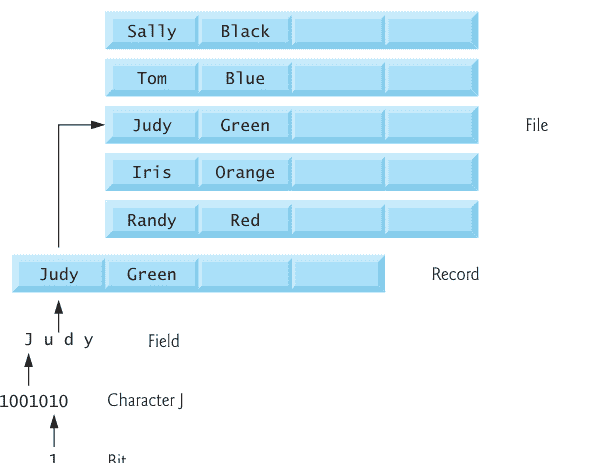

### 位

位是“*二进制数字*”的缩写——一个可以取*两个*值之一的数字——是计算机最小的数据项。它可以具有值0或1。值得注意的是，计算机令人印象深刻的功能仅涉及对0和1的最简单操作——检查位的值、设置位的值以及反转位的值（从1到0或从0到1）。位构成了二进制数系统的基础，我们在“数制”附录中讨论了这一点。

### 字符

以位的低级形式处理数据是繁琐的。相反，人们更喜欢使用**十进制数字**（0-9）、**字母**（A-Z和a-z）和**特殊符号**，例如
$ @ % & * ( ) - + " : ; , ? /

数字、字母和特殊符号统称为**字符**。计算机的**字符集**包含用于编写程序和表示数据项的字符。计算机只处理1和0，因此计算机的字符集将每个字符表示为1和0的模式。C语言默认使用**ASCII（美国信息交换标准代码）**字符集。C语言还支持由一个、两个、三个或四个字节（分别为8、16、24或32位）组成的**Unicode®**字符。¹⁸

> 18. “使用Unicode编程。” 访问于2020年11月1日。https://unicodebook.readthedocs.io/programming_languages.html。

Unicode包含世界上许多语言的字符。ASCII是Unicode的一个（微小的）子集，代表字母（a-z和A-Z）、数字和一些常见的特殊字符。你可以在以下网址查看Unicode的ASCII子集：
https://www.unicode.org/charts/PDF/U0000.pdf
要查看所有语言、符号、表情符号等的冗长Unicode图表，请访问：
http://www.unicode.org/charts/

### 字段

正如字符由位组成，**字段**由字符或字节组成。字段是一组传达意义的字符或字节。例如，由大写和小写字母组成的字段可以表示一个人的姓名，由十进制数字组成的字段可以表示一个人的年龄（以年为单位）。

### 记录

几个相关的字段可以用来组成一个**记录**。例如，在工资系统中，一个员工的记录可能由以下字段组成（这些字段的可能类型显示在括号中）：

- 员工识别号（一个整数）。
- 姓名（一组字符）。
- 地址（一组字符）。
- 每小时工资率（一个带小数点的数字）。
- 年度至今收入（一个带小数点的数字）。
- 预扣税款金额（一个带小数点的数字）。

因此，记录是一组相关的字段。上面列出的所有字段都属于同一个员工。一家公司可能有许多员工，每个员工都有一个工资记录。

### 文件

**文件**是一组相关的记录。更一般地说，文件包含任意格式的任意数据。一些操作系统将文件简单地视为*字节序列*——文件中字节的任何组织方式，例如将数据组织成记录，都是由应用程序程序员创建的视图。你将在第11章“文件处理”中看到如何做到这一点。一个组织拥有许多文件并不罕见，其中一些文件包含数十亿甚至数万亿字符的信息。正如我们将在下面看到的，随着大数据的出现，更大的文件大小正变得越来越普遍。

### 数据库

**数据库**是为了便于访问和操作而组织的数据集合。最流行的模型是**关系数据库**，其中数据存储在简单的表中。表包括记录和字段。例如，一个学生表可能包括名字、姓氏、专业、年级、学生ID号和平均绩点字段。每个学生的数据是一条记录，每条记录中的各个信息片段就是字段。你可以根据数据与多个表或数据库的关系来搜索、排序和操作数据。例如，一所大学可能会使用来自学生数据库的数据，并结合来自课程、校内住宿、膳食计划等数据库的数据。

### 大数据

下表显示了一些常见的字节度量单位：

| 单位 | 字节 | 约等于 |
| :--- | :--- | :--- |
| 1千字节（KB） | 1024字节 | 10³字节（精确为1024字节） |
| 1兆字节（MB） | 1024千字节 | 10⁶（1,000,000）字节 |
| 1吉字节（GB） | 1024兆字节 | 10⁹（1,000,000,000）字节 |
| 1太字节（TB） | 1024吉字节 | 10¹²（1,000,000,000,000）字节 |
| 1拍字节（PB） | 1024太字节 | 10¹⁵（1,000,000,000,000,000）字节 |
| 1艾字节（EB） | 1024拍字节 | 10¹⁸（1,000,000,000,000,000,000）字节 |
| 1泽字节（ZB） | 1024艾字节 | 10²¹（1,000,000,000,000,000,000,000）字节 |

全球产生的数据量是巨大的，并且其增长正在加速。**大数据**应用处理海量数据。这个领域正在快速发展，为软件开发者创造了大量机会。全球已有数百万信息技术（IT）工作岗位支持大数据应用。

### Twitter®——一个受欢迎的大数据来源

开发者青睐的一个大数据来源是Twitter。每天大约有8亿条推文。¹⁹ 尽管推文似乎限制在280个字符以内，但Twitter实际上为想要分析推文的程序员提供了每条推文近10,000字节的数据。所以8亿乘以10,000大约是8万亿字节，即每天8太字节（TB）的数据。这就是大数据。

预测是一个具有挑战性且通常成本高昂的过程，但准确预测的潜在回报是巨大的。**数据挖掘**是搜索大量数据（通常是大数据）以发现对个人和组织有价值的见解的过程。你从推文中挖掘出的情感可能有助于预测选举结果、一部新电影可能产生的收入以及公司营销活动的成功。它还可以帮助公司发现竞争对手产品供应中的弱点。

## 自我检查

1.  **（填空）** ________是“二进制数字”的缩写——一个可以取两个值之一的数字，是计算机最小的数据项。
    **答案：** 位。

> 19. “Twitter使用统计。” 访问于2020年11月1日。https://www.internetlivestats.com/twitter-statistics/。

## 1.4 机器语言、汇编语言与高级语言

程序员使用各种编程语言编写指令，其中一些可被计算机直接理解，另一些则需要中间翻译步骤。目前有数百种此类语言在使用。它们大致可分为三种类型：

- 机器语言。
- 汇编语言。
- 高级语言。

### 机器语言

任何计算机只能直接理解其自身的**机器语言**，该语言由其硬件设计定义。机器语言通常由一串数字（最终归结为1和0）组成，这些数字指示计算机一次执行一个最基本的操作。机器语言是机器相关的——特定的机器语言只能在一种类型的计算机上使用。这类语言对人类来说非常繁琐。例如，下面是一段早期的机器语言工资程序，它将加班费加到基本工资上，并将结果存储在总工资中：

```
+1300042774
+1400593419
+1200274027
```

在我们的“构建你自己的计算机”案例研究（练习7.28–7.30）中，你将“剖析”一台计算机并观察其内部结构。我们将介绍机器语言编程，你将编写几个机器语言程序。为了使这成为一次特别有价值的体验，你随后将构建一个计算机的软件模拟器，你可以在其上执行你的机器语言程序。

### 汇编语言与汇编器

用机器语言编程对大多数程序员来说实在太慢、太乏味了。程序员不再使用计算机能直接理解的数字串，而是开始使用类似英语的缩写来表示基本操作。这些缩写构成了**汇编语言**的基础。

被称为**汇编器**的翻译程序被开发出来，以便以计算机的速度将汇编语言程序转换为机器语言。下面这段汇编语言工资程序同样将加班费加到基本工资上，并将结果存储在总工资中：

```
load    basepay
add     overpay
store   grosspay
```

尽管这样的代码对人类来说更清晰，但在被翻译成机器语言之前，计算机无法理解它。

### 高级语言与编译器

随着汇编语言的出现，计算机的使用迅速增加。然而，程序员仍然需要使用大量指令来完成即使是简单的任务。为了加快编程过程，**高级语言**被开发出来，其中单个语句就能完成大量任务。一个典型的高级语言程序包含许多语句，这些语句被称为程序的**源代码**。

被称为**编译器**的翻译程序将高级语言源代码转换为机器语言。高级语言允许你编写看起来几乎像日常英语并包含常用数学符号的指令。用高级语言编写的工资程序可能包含如下单个语句：

```
grossPay = basePay + overTimePay
```

从程序员的角度来看，高级语言优于机器语言和汇编语言。C是世界上使用最广泛的高级编程语言之一。

在我们的“构建你自己的编译器”案例研究（练习12.24–12.27）中，你将构建一个编译器，它接受用高级编程语言编写的程序，并将它们转换为你在练习7.28中学习的Simpletron机器语言。练习12.24–12.27将“串联”整个编程过程。你将用一种简单的高级语言编写程序，在你构建的编译器上编译这些程序，然后在你于练习7.29中构建的Simpletron模拟器上运行这些程序。

### 解释器

将大型高级语言程序编译成机器语言可能需要相当长的计算机时间。**解释器**直接执行高级语言程序。解释器避免了编译延迟，但你的代码运行速度比编译后的程序慢。一些编程语言，如Java²⁰和Python²¹，使用编译和解释的巧妙混合来运行程序。

20. “Java虚拟机。” 访问于2020年11月2日。https://en.wikipedia.org/wiki/Java_virtual_machine#Bytecode_interpreter_and_just-in-time_compiler.
21. “Python字节码简介。” 访问于2020年11月1日。https://opensource.com/article/18/4/introduction-python-bytecode.

## 自我检查

1. （填空）被称为_______的翻译程序以计算机的速度将汇编语言程序转换为机器语言。
    答案：汇编器。

2. （填空）_______程序被开发出来直接执行高级语言程序，避免了编译延迟，尽管它们的运行速度比编译后的程序慢。
    答案：解释器。

3. （判断对错）高级语言允许你编写看起来几乎像日常英语并包含常用数学符号的指令。
    答案：正确。

## 1.5 操作系统

操作系统是使用户、软件开发人员和系统管理员使用计算机更方便的软件。它们提供允许应用程序安全、高效且相互并发执行的服务。包含操作系统核心组件的软件称为内核。Linux、Windows和macOS是流行的桌面计算机操作系统——你可以使用其中任何一个来学习本书。它们都部分用C编写。智能手机和平板电脑上使用的最流行的移动操作系统是Google的Android和Apple的iOS。

### Windows——专有操作系统

在20世纪80年代中期，微软开发了Windows操作系统，它由一个构建在DOS（磁盘操作系统）之上的图形用户界面组成——DOS是一个极其流行的个人计算机操作系统，用户通过键入命令与之交互。Windows 10是微软最新的操作系统——它包含用于语音交互的Cortana个人助手。Windows是一个专有操作系统——它完全由微软控制。它目前是世界上使用最广泛的桌面操作系统。

### Linux——开源操作系统

Linux操作系统是开源运动最伟大的成功之一。专有软件的销售或租赁主导了软件的早期岁月。通过开源，个人和公司为开发、维护和演进软件做出贡献。然后任何人都可以出于自己的目的使用该软件——通常是免费的，但需遵守各种（通常是宽大的）许可要求。开源代码通常比专有软件受到更广泛受众的审视，因此错误可以更快地被移除，使软件更加健壮。开源提高了生产力，并促进了创新的爆发。你将在本书中使用各种流行的开源库和工具。

开源社区中有许多组织。一些关键组织包括：

- GitHub（提供管理开源项目的工具——它有数百万个项目正在开发中）。
- **Apache软件基金会**（最初是Apache网络服务器的创建者）现在监督着350多个开源项目，包括一些大数据基础设施技术。
- **Eclipse基金会**（Eclipse集成开发环境帮助程序员方便地开发软件）。
- **Mozilla基金会**（Firefox网络浏览器的创建者）。
- **OpenML**（专注于机器学习的开源工具和数据）。
- **OpenAI**（从事人工智能研究并发布用于AI强化学习研究的开源工具）。
- **OpenCV**（专注于可在各种操作系统和编程语言中使用的开源计算机视觉工具）。
- **Python软件基金会**（负责Python编程语言）。

计算和通信的快速改进、成本的降低以及开源软件，使得创建基于软件的企业比仅仅十年前容易得多、经济得多。一个很好的例子是Facebook，它从一个大学宿舍里启动，并使用开源软件构建。

**Linux内核**是最流行的开源、自由分发、功能齐全的操作系统的核心。它由一个松散组织的志愿者团队开发，在服务器、个人计算机和嵌入式系统（如智能手机、智能电视和汽车系统核心的计算机系统）中很受欢迎。与微软的Windows和Apple的macOS源代码不同，Linux源代码可供公众检查和修改，并且可以免费下载和安装。因此，Linux用户受益于一个庞大的开发者社区，他们积极调试和改进内核，并能够定制操作系统以满足特定需求。

### Apple的macOS以及用于iPhone®和iPad®设备的Apple的iOS

Apple由史蒂夫·乔布斯和史蒂夫·沃兹尼亚克于1976年创立，迅速成为个人计算领域的领导者。1979年，乔布斯和几位Apple员工访问了Xerox PARC（帕洛阿尔托研究中心），了解Xerox的具有图形用户界面（GUI）的桌面计算机。该GUI为1984年推出的Apple Macintosh提供了灵感。

Objective-C编程语言由Stepstone在20世纪80年代初创建，为C编程语言添加了面向对象编程（OOP）功能。史蒂夫·乔布斯于1985年离开Apple并创立了NeXT Inc.。1988年，NeXT从Stepstone获得了Objective-C的许可。NeXT开发了一个Objective-C编译器和库，这些被用作NeXTSTEP操作系统用户界面和Interface Builder（用于构建图形用户界面）的平台。

乔布斯于1996年在Apple收购NeXT时回归Apple。Apple的**macOS操作系统**是NeXTSTEP的后代。Apple还有其他几个源自macOS的专有操作系统：

### 谷歌的 Android

Android——使用最广泛的移动和智能手机操作系统——基于 Linux 内核、Java 编程语言，以及现在的开源 Kotlin 编程语言。Android 是开源且免费的。虽然你不能纯粹用 C 语言开发 Android 应用，但可以将 C 代码整合到 Android 应用中。²³

根据 idc.com 的数据，2020 年出货的智能手机中，84.8% 使用 Android，而苹果仅占 15.2%。²⁴ Android 操作系统被用于众多智能手机、电子阅读器、平板电脑、电视、店内触摸屏自助终端、汽车、机器人、多媒体播放器等设备。

### 数十亿台计算机化设备

数十亿台个人电脑以及数量更庞大的移动设备正在使用中。智能手机、平板电脑和其他设备的爆炸式增长为移动应用开发者创造了巨大机遇。下表列出了许多计算机化设备，其中每一种都可能成为物联网的一部分（参见第 1.11 节）。

| 部分计算机化设备 |
|---|
| 汽车 | 蓝光光盘™播放器 | 建筑控制系统 |
| 有线电视机顶盒 | 台式电脑 | 信用卡 |
| CT 扫描仪 | GPS 导航系统 | 电子阅读器 |
| 游戏机 | 彩票系统 | 家用电器 |
| 家庭安防系统 | 核磁共振成像仪 | 医疗设备 |
| 移动电话 | 停车计时器 | 个人电脑 |
| 光学传感器 | 打印机 | 机器人 |
| 销售点终端 | 服务器 | 智能卡 |
| 智能电表 | 电视机 | 智能手机 |
| 平板电脑 | 电视顶置盒 | 恒温器 |
| 交通卡 | 自动取款机 | 车辆诊断系统 |

22. “导入的 C 和 Objective-C API。” 访问于 2020 年 11 月 3 日。https://developer.apple.com/documentation/swift/imported_c_and_objective-c_apis。
23. “向项目添加 C 和 C++ 代码。” 访问于 2020 年 11 月 3 日。https://developer.android.com/studio/projects/add-native-code。
24. “智能手机市场份额。” 访问于 2020 年 12 月 24 日。https://www.idc.com/promo/smartphone-market-share/os。

## 自我检查

1. （填空）Windows 是一个________操作系统——它完全由微软控制。
答案：专有的。

2. （判断对错）专有代码通常比开源软件受到更广泛受众的审查，因此错误往往能更快地被移除。
答案：错误。开源代码通常比专有软件受到更广泛受众的审查，因此错误往往能更快地被移除。

3. （判断对错）iOS 在全球智能手机市场上占据主导地位，超过 Android。
答案：错误。Android 目前占据 84.8% 的智能手机市场，但 iOS 应用的收入几乎是 Android 应用的两倍。²⁵

## 1.6 C 编程语言

C 语言由两种早期语言 BCPL²⁶ 和 B²⁷ 演化而来。BCPL 由 Martin Richards 于 1967 年开发，是一种用于编写操作系统和编译器的语言。Ken Thompson 在他的 B 语言中模仿了 BCPL 的许多特性，并于 1970 年使用 B 语言在贝尔实验室创建了 UNIX 操作系统的早期版本。

C 语言由 Dennis Ritchie 在贝尔实验室从 B 语言演化而来，最初于 1972 年实现。²⁸ C 语言最初作为 UNIX 操作系统的开发语言而广为人知。当今许多领先的操作系统都是用 C 和/或 C++ 编写的。C 语言在很大程度上与硬件无关——通过精心设计，可以编写出可移植到大多数计算机的 C 程序。

### 为性能而生

C 语言被广泛用于开发对性能要求高的系统，例如操作系统、嵌入式系统、实时系统和通信系统：

| 应用领域 | 描述 |
|---|---|
| 操作系统 | C 语言的可移植性和高性能使其成为实现操作系统的理想选择，例如 Linux 以及微软 Windows 和谷歌 Android 的部分组件。苹果的 macOS 是用 Objective-C 构建的，而 Objective-C 源自 C 语言。我们在第 1.5 节讨论了一些流行的桌面/笔记本电脑操作系统和移动操作系统。 |
| 嵌入式系统 | 每年生产的绝大多数微处理器都嵌入在通用计算机以外的设备中。这些**嵌入式系统**包括导航系统、智能家居电器、家庭安防系统、智能手机、平板电脑、机器人、智能交通路口等。C 语言是开发嵌入式系统最受欢迎的编程语言之一，这些系统通常需要尽可能快地运行并节省内存。例如，汽车的防抱死制动系统必须立即响应以减速或停车，同时防止打滑；视频游戏控制器应即时响应，以防止控制器与游戏动作之间出现延迟。 |
| 实时系统 | 实时系统通常用于需要近乎即时且可预测响应时间的“任务关键型”应用。实时系统需要持续工作。例如，空中交通管制系统必须持续监控飞机的位置和速度，并将信息及时报告给空中交通管制员，以便在可能发生碰撞时提醒飞机改变航线。 |
| 通信系统 | 通信系统需要快速将大量数据路由到目的地，以确保音频和视频等内容能够流畅、无延迟地传输。 |

到 1970 年代末，C 语言已演化为现在所称的“传统 C”。1978 年 Kernighan 和 Ritchie 的著作《C 程序设计语言》的出版，引起了人们对这门语言的广泛关注。这本书成为有史以来最成功的计算机科学书籍之一。

### 标准化

C 语言迅速扩展到各种**硬件平台**（即计算机硬件类型），导致出现了许多相似但通常不兼容的 C 版本。这对于需要为多个平台开发代码的程序员来说是一个严重问题。很明显，需要一个标准的 C 版本。1983 年，美国国家计算机与信息处理标准委员会（X3）成立了 X3J11 技术委员会，旨在“提供该语言的明确且与机器无关的定义”。1989 年，该标准首先通过**美国国家标准协会（ANSI）**在美国获得批准，随后通过**国际标准化组织（ISO）**在全球范围内获得批准。这个版本简称为标准 C。

### C11 和 C18 标准

我们讨论最新的 C 标准（称为 C11），该标准于 2011 年批准，并于 2018 年进行了错误修复更新（称为 C18）。C11 精炼并扩展了 C 语言的功能。我们将许多在领先 C 编译器中实现的新特性整合到了正文和附录 C（以易于包含或省略的章节形式）中。当前的 C 标准文件称为 *ISO/IEC 9899:2018*。可从 https://www.iso.org/standard/74528.html 订购副本。

根据 C 标准委员会的说法，下一个 C 标准可能在 2022 年发布。²⁹

由于 C 语言是一种与硬件无关、广泛可用的语言，C 应用程序通常只需很少或无需修改即可在各种计算机系统上运行。

## 自我检查

1. （填空）C 语言由两种早期语言 ________ 和 ________ 演化而来。
答案：BCPL，B。
2. （判断对错）可以编写出可移植到大多数计算机的 C 程序。
答案：正确。

## 1.7 C 标准库和开源库

C 程序由称为函数的片段组成。你可以编写所有需要的函数来构成一个 C 程序。然而，大多数 C 程序员都利用 C 标准库中丰富的现有函数。因此，学习 C 编程实际上包含两部分：

- 学习 C 语言本身，以及
- 学习如何使用 C 标准库中的函数。

在整本书中，我们将讨论许多这样的函数。P. J. Plauger 的著作《标准 C 库》是那些需要深入理解库函数、如何实现它们以及如何使用它们编写可移植代码的程序员的必读书目。我们在本书中使用并解释了许多 C 库函数。

《C 如何编程（第 9 版）》鼓励采用积木式方法来创建程序。在用 C 编程时，你通常会使用以下构建块：

- C 标准库函数，
- 开源 C 库函数，
- 你自己创建的函数，以及
- 其他人（你信任的人）创建并提供给你的函数。

创建自己的函数的优点是你确切知道它们是如何工作的。缺点是设计、开发、调试和性能调优新函数需要耗费大量时间。在整本书中，我们专注于使用现有的 C 标准库来提升你的程序开发效率，避免“重复造轮子”。这被称为软件复用。

使用 C 标准库函数而不是编写自己的版本可以提高程序性能，因为这些函数经过精心编写以实现高效执行。使用 C 标准库函数而不是编写自己的类似版本也可以提高程序的可移植性。

25. “2020 年上半年全球应用收入达 500 亿美元，同比增长 23%。” 访问于 2020 年 11 月 1 日。https://sensortower.com/blog/app-revenue-and-downloads-1h-2020。
26. “BCPL。” 访问于 2020 年 11 月 1 日。https://en.wikipedia.org/wiki/BCPL。
27. “B（编程语言）。” 访问于 2020 年 11 月 1 日。https://en.wikipedia.org/wiki/B_(programming_language)。
28. “C（编程语言）。” 访问于 2020 年 11 月 1 日。https://en.wikipedia.org/wiki/C_(programming_language)。
29. “编程语言 C — C2x 章程。” 访问于 2020 年 11 月 4 日。http://www.open-std.org/jtc1/sc22/wg14/www/docs/n2086.htm。

### 开源库

存在大量第三方和开源C语言库，它们能帮助你用少量代码完成重要任务。GitHub在其C语言分类下列出了超过32,000个代码仓库：
https://github.com/topics/c
此外，诸如 *Awesome C*
https://github.com/kozross/awesome-c
等页面提供了涵盖广泛应用领域的流行C语言库精选列表。

## 自我检查

1.  *（填空）* 大多数C程序员利用名为________的丰富现有函数集合。
**答案：** C标准库。
2.  *（填空）* 避免“重复造轮子”，而是使用现有组件。这被称为________。
**答案：** 软件复用。

## 1.8 其他流行编程语言

以下是几种其他流行编程语言的简要介绍：

- *BASIC* 于1960年代在达特茅斯学院开发，旨在让初学者熟悉编程技术。其许多最新版本是面向对象的。
- *C++* 基于C语言，由本贾尼·斯特劳斯特鲁普于1980年代初在贝尔实验室开发。C++提供了增强C语言特性的功能，并增加了面向对象编程能力。我们在附录D中介绍面向对象编程概念。
- *Python* 是一种面向对象语言，于1991年公开发布。它由阿姆斯特丹国家数学与计算机科学研究所的吉多·范罗苏姆开发。Python已迅速成为世界上最流行的编程语言之一，尤其在教育和科学计算领域，并在2017年超越编程语言R，成为最受欢迎的数据科学编程语言。30,31,32 Python流行的原因如下。33,34,35 它是开源的、免费的且广泛可用。它拥有庞大的开源社区支持。它相对容易学习。其代码比许多其他流行编程语言更易读。它通过广泛的标准库和数千个第三方开源库提升了开发者的生产力。它在Web开发和人工智能领域很受欢迎，后者正经历爆发式增长，部分原因在于其与数据科学的特殊关系。它在金融界被广泛使用。36
- *Java*——Sun Microsystems于1991年资助了一个由詹姆斯·高斯林领导的内部公司研究项目，催生了基于C++的面向对象编程语言Java。Java的一个关键目标是“一次编写，到处运行”，使开发者能够编写可在各种计算机系统上运行的程序。Java用于企业应用、Web服务器（向我们的Web浏览器提供内容的计算机）、消费设备应用（例如智能手机、平板电脑、电视机顶盒、家电、汽车等）以及许多其他用途。Java最初是首选的Android应用开发语言，尽管现在也支持其他几种语言。
- *C#*（基于C++和Java）是微软的三种主要面向对象编程语言之一——另外两种是Visual C++和Visual Basic。C#的开发旨在将Web集成到计算机应用中，现在被广泛用于开发多种类型的应用程序。作为微软众多开源计划的一部分，他们现在提供C#和Visual Basic的开源版本。
- *JavaScript* 是一种广泛使用的脚本语言，主要用于为网页添加可编程性（例如动画、用户交互等）。所有主流Web浏览器都支持它。许多Python可视化库输出JavaScript以创建可在Web浏览器中查看的交互式可视化。NodeJS等工具也使JavaScript能够在Web浏览器之外运行。
- *Swift* 于2014年推出，是苹果公司用于开发iOS和macOS应用的编程语言。Swift是一种现代语言，包含了来自Objective-C、Java、C#、Ruby、Python和其他语言的流行特性。Swift是开源的，因此也可用于非苹果平台。
- *R* 是一种流行的开源编程语言，用于统计应用和可视化。Python和R是使用最广泛的两种数据科学语言。

30. “2017年Python值得关注的5件事。” 访问于2020年11月1日。https://www.oreilly.com/ideas/5-things-to-watch-in-python-in-2017。
31. “Python超越R，成为数据分析、数据科学平台的领导者。” 访问于2020年11月1日。https://www.kdnuggets.com/2017/08/python-overtakes-r-leader-analytics-data-science.html。
32. “2017年数据科学工作报告：R超越SAS，但Python将两者都抛在身后。” 访问于2020年11月1日。https://www.r-bloggers.com/data-science-job-report-2017-r-passes-sas-but-python-leaves-them-both-behind/。
33. “为什么学习Python？这里有8个数据驱动的理由。” 访问于2020年11月1日。https://dbader.org/blog/why-learn-python。
34. “为什么学习Python。” 访问于2020年11月1日。https://simpleprogrammer.com/7-reasons-why-you-should-learn-python。
35. “2017年Python值得关注的5件事。” 访问于2020年11月1日。https://www.oreilly.com/ideas/5-things-to-watch-in-python-in-2017。
36. Kolanovic, M. and R. Krishnamachari, *Big Data and AI Strategies: Machine Learning and Alternative Data Approach to Investing* (J.P. Morgan, 2017).

## 自我检查

1.  （填空）如今，通用操作系统和其他性能关键系统的大部分代码是用________编写的。
**答案：** C或C++。
2.  （填空）________的一个关键目标是“一次编写，到处运行”，使开发者能够编写可在各种计算机系统和计算机控制设备上运行的程序。
**答案：** Java。
3.  （判断对错）R是最流行的数据科学编程语言。
**答案：** 错误。2017年，Python超越R成为最受欢迎的数据科学编程语言。

## 1.9 典型的C程序开发环境

C系统通常由几个部分组成：程序开发环境、语言和C标准库。以下讨论解释了典型的C开发环境。
C程序通常经历六个阶段才能执行——编辑、预处理、编译、链接、加载和执行。尽管《C How to Program, 9/e》是一本通用的C语言教材（独立于任何特定操作系统编写），但我们在本节中专注于基于Linux的典型C系统。在第1.10节，你将在Windows、macOS和/或Linux上测试创建和运行C程序。

### 1.9.1 阶段1：创建程序

阶段1（在下图中）包括在编辑器程序中编辑文件：


Linux系统上广泛使用的两个编辑器是vi和emacs。C和C++集成开发环境（IDE），如Microsoft Visual Studio和Apple Xcode，都集成了编辑器。你在编辑器中输入C程序，必要时进行更正，然后将程序存储在硬盘等辅助存储设备上。C程序文件名应以.c扩展名结尾。

### 1.9.2 阶段2和3：预处理和编译C程序

在阶段2（如下图所示），你发出编译程序的命令：

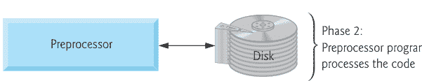

编译器将C程序翻译成机器语言代码（也称为**目标代码**）。在C系统中，编译命令在编译器的翻译阶段开始之前会调用一个**预处理器**程序。**C预处理器**遵循称为**预处理器指令**的特殊命令，这些指令对程序的源代码文件执行文本操作。这些操作包括插入其他文件的内容和各种文本替换。前面的章节讨论了最常见的预处理器指令。第14章讨论了其他预处理器功能。

在阶段3（如下图所示），编译器将C程序翻译成机器语言代码：

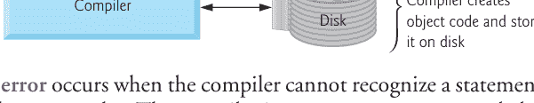

当编译器无法识别一条语句，因为它违反了语言规则时，就会发生**语法错误**。编译器会发出错误消息，以帮助你定位和修复不正确的语句。C标准没有规定编译器发出的错误消息的具体措辞，因此你在系统上看到的消息可能与其他系统上的不同。语法错误也称为**编译错误**或**编译时错误**。

### 1.9.3 阶段4：链接

下一阶段（如下图所示）称为**链接**：

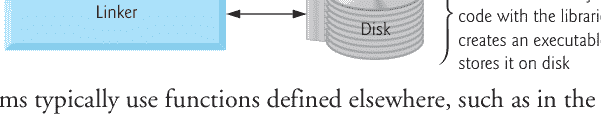

C程序通常使用在其他地方定义的函数，例如在标准库、开源库或特定项目的私有库中。C编译器生成的目标代码通常由于这些缺失部分而包含“空洞”。**链接器**将程序的目标代码与缺失函数的代码链接起来，生成一个**可执行映像**（没有缺失部分）。在典型的Linux系统上，编译和链接程序的命令是**gcc**（GNU C编译器）。要使用最新的C标准（C18）编译和链接名为welcome.c的程序，请在Linux提示符下键入

```
gcc -std=c18 welcome.c
```

并按*Enter*键（或*Return*键）。Linux命令区分大小写。如果程序编译和链接正确，编译器将生成一个名为a.out（默认）的文件，这就是welcome.c的可执行映像。

### 1.9.4 阶段五：加载

下一个阶段（如下图所示）称为**加载**：

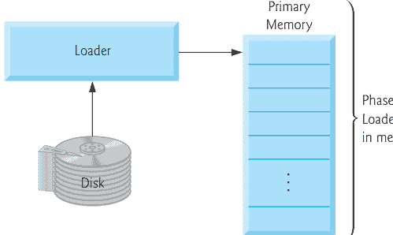

程序执行前，操作系统必须将其加载到内存中。**加载器**从磁盘获取可执行映像并将其传输到内存。支持该程序的共享库的其他组件也会被加载。

### 1.9.5 阶段六：执行

最后，在最后一个阶段（如下图所示），计算机在其CPU的控制下，**执行**程序，一次执行一条指令：

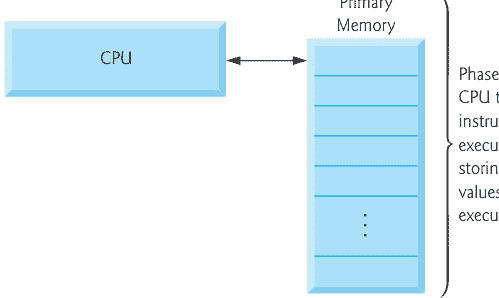

要在Linux系统上加载并执行程序，请在Linux提示符下输入`./a.out`并按*回车*键。

### 1.9.6 执行时可能出现的问题

程序并非总能一次成功运行。上述每个阶段都可能因各种错误而失败，我们将在下文讨论这些错误。例如，正在执行的程序可能试图除以零（这在计算机中是非法操作，就像在算术中一样）。这将导致计算机显示错误消息。然后，你需要返回编辑阶段，进行必要的更正，并再次经历剩余阶段以确定更正是否有效。

程序运行时发生的错误，如除以零，称为运行时错误或执行时错误。除以零通常是一个致命错误，会导致程序立即终止而无法成功完成其工作。非致命错误允许程序运行至完成，但通常会产生不正确的结果。

### 1.9.7 标准输入、标准输出和标准错误流

大多数C程序会进行输入和/或输出数据。某些C函数从`stdin`（标准输入流）获取输入，这通常是键盘。数据通常输出到`stdout`（标准输出流），这通常是计算机屏幕。当我们说一个程序打印结果时，我们通常是指结果显示在屏幕上。数据也可以输出到磁盘和打印机等设备。还有一个标准错误流，称为`stderr`，它通常连接到屏幕，用于显示错误消息。通常的做法是将常规输出数据（即stdout）路由到屏幕以外的设备，同时保持stderr分配给屏幕，以便用户能立即获知错误。

## 自我检查

- 1. （填空）C程序通常要经过六个阶段才能执行：______、______、______、______、______和______。
  答案：编辑、预处理、编译、链接、加载、执行。
- 2. （填空）当编译器无法识别一条语句，因为它违反了语言规则时，会发生______。
  答案：语法错误。
- 3. （填空）程序运行时发生的错误称为______或执行时错误。
  答案：运行时错误。

## 1.10 在Windows、Linux和macOS上测试运行C应用程序

在本节中，你将编译、运行并与你的第一个C应用程序进行交互——一个猜数字游戏，它从1到1000中随机选择一个数字，并提示你猜测。如果你猜对了，游戏结束。如果你猜错了，应用程序会指示你的猜测是高于还是低于正确数字。你的猜测次数没有限制，但你应该能够在10次或更少的尝试内正确猜出1到1000之间的数字。这个游戏背后有一些不错的计算机科学知识——在后面的章节中，你将探索二分查找技术。

你将在第5章的练习中创建这个应用程序。通常，这个应用程序会随机选择正确答案。为了测试运行，我们禁用了随机选择。每次运行应用程序时，它都使用相同的正确答案。这样，你就可以使用我们使用的相同猜测并看到相同的结果。这个答案可能因编译器而异。

### 测试运行总结

我们将演示使用以下工具创建C应用程序：

- 用于Windows的Microsoft Visual Studio 2019社区版（第1.10.1节）。
- macOS上Xcode中的Clang（第1.10.2节）。
- Linux上shell中的GNU gcc（第1.10.3节）。
- 在GNU编译器集合（GCC）Docker容器内运行的shell中的GNU gcc（第1.10.4节）。

你只需阅读与你的设置相对应的部分即可。

有许多开发环境可供你编译、构建和运行C应用程序。如果你的课程使用了与我们在此演示的不同的工具，请咨询你的讲师以获取有关该工具的信息。

### 1.10.1 在Windows 10上使用Visual Studio 2019社区版编译和运行C应用程序

在本节中，你将使用Microsoft Visual Studio 2019社区版在Windows上运行一个C程序。有多个版本的Visual Studio可用。在某些版本中，我们介绍的选项、菜单和说明可能略有不同。从现在开始，我们将简单地称其为“Visual Studio”或“IDE”。

#### 步骤1：检查你的设置

如果你尚未完成，请阅读本书的“开始之前”部分，了解安装IDE和下载本书代码示例的说明。

#### 步骤2：启动Visual Studio

从**开始**菜单启动Visual Studio。按*Esc*键关闭初始Visual Studio窗口。**不要**点击右上角的**X**，因为那将终止Visual Studio。你可以随时通过选择**文件 > 起始窗口**来访问此窗口。我们使用**>**表示从菜单中选择菜单项，因此**文件 > 打开**表示“从**文件**菜单中选择**打开**菜单项”。

#### 步骤3：创建项目

**项目**是一组相关文件，例如构成应用程序的C源代码文件。Visual Studio将应用程序组织成项目和**解决方案**，解决方案包含一个或多个项目。程序员使用多项目解决方案来创建大型应用程序。我们的示例只需要单项目解决方案。对于我们的代码示例，你将从一个**空项目**开始，并向其中添加文件。要创建项目：

1. 选择**文件 > 新建 > 项目...**以显示**创建新项目**对话框。
2. 选择带有**C++**、**Windows**和**控制台**标签的**空项目**模板。Visual Studio没有C编译器，但其Visual C++编译器可以编译大多数C程序。我们在此使用的模板适用于在命令提示符窗口中执行的命令行程序。根据你的Visual Studio版本和安装的选项，可能还有许多其他项目模板。你可以使用**搜索模板**文本框及其下方的下拉列表来筛选你的选择。点击**下一步**以显示**配置新项目**对话框。
3. 提供**项目名称**和**位置**。对于**项目名称**，我们指定了`c_test`。对于**位置**，我们选择了本书的示例文件夹，我们假设它位于你的用户帐户的**文档**文件夹中。点击**创建**以在Visual Studio中打开你的新项目。

此时，Visual Studio会创建你的项目，将其文件夹放在`C:\Users\YourUserAccount\Documents\examples`（或你指定的文件夹）中，并打开Visual Studio的主窗口。

当你编辑C代码时，Visual Studio会将每个文件显示为窗口中的一个单独选项卡。**解决方案资源管理器**——停靠在Visual Studio的左侧或右侧——用于查看和管理你的应用程序文件。在本书的示例中，你通常会将每个程序的代码文件放在**源文件**文件夹中。如果**解决方案资源管理器**未显示，你可以通过选择**视图 > 解决方案资源管理器**来显示它。

#### 步骤4：将GuessNumber.c文件添加到项目中

接下来，让我们将文件`GuessNumber.c`添加到项目中。在**解决方案资源管理器**中：

1. 右键单击**源文件**文件夹，然后选择**添加 > 现有项...**。
2. 在出现的对话框中，导航到本书示例文件夹的`ch01`子文件夹，选择`GuessNumber.c`，然后点击**添加**。³⁷

#### 步骤5：配置项目的编译器版本并禁用Microsoft错误消息

“开始之前”部分提到Visual C++可以编译大多数C程序。Visual C++编译器支持多个C++标准版本。我们将使用Microsoft的C++17编译器，我们必须在项目设置中进行配置：

1. 在**解决方案资源管理器**中，右键单击项目节点——`c_test`——并选择**属性**以显示项目的**C_test属性页**对话框。
2. 在**配置**下拉列表中，将**活动(Debug)**更改为**所有配置**。在**平台**下拉列表中，将**活动(Win32)**更改为**所有平台**。
3. 在左列中，展开**C/C++**节点，然后选择**语言**。
4. 在右列中，点击**C++语言标准**右侧的字段，点击向下箭头，然后选择**ISO C++17标准 (/std:c++17)**。³⁸

³⁷. 对于你将在后面章节中看到的多源代码文件程序，请选择给定程序的所有文件。当你开始自己创建程序时，可以右键单击**源文件**文件夹并选择**添加 > 新建项...**以显示添加新文件的对话框。你需要将C程序文件的文件名扩展名从`.cpp`更改为`.c`。

³⁸. 在撰写本文时，Microsoft仍在完成对C++20标准的支持。一旦可用，你应该选择**ISO C++20标准 (/std:c++20)**。

## 1.10 在 Windows、Linux 和 macOS 上测试驱动 C 应用程序

5. 在左侧列的 C/C++ 节点下，选择“预处理器”。
6. 在右侧列，“预处理器定义”值的末尾，插入 `;_CRT_SECURE_NO_WARNINGS`。
7. 在左侧列的 C/C++ 节点下，选择“常规”。
8. 在右侧列，点击“SDL 检查”右侧的字段，点击下拉箭头，然后选择“否 (/sdl-)”。
9. 点击“确定”以保存更改。

上述第 6 步和第 8 步消除了 Microsoft Visual C++ 对我们全书使用的多个 C 库函数的警告和错误消息。我们将在第 3.13 节中进一步讨论此问题。

#### 步骤 6：编译并运行项目

接下来，让我们编译并运行项目，以便您可以测试驱动该应用程序。选择“调试” > “开始执行(不调试)”或按 `Ctrl + F5`。如果程序编译正确，Visual Studio 将打开一个命令提示符窗口并执行该程序。为了可读性，我们更改了命令提示符的颜色方案³⁹和字体大小：


### 步骤 7：输入您的第一次猜测

在 `?` 提示符下，输入 `500` 并按 Enter。应用程序显示“太高了。再试一次。”，表示您输入的值大于应用程序选择的正确猜测数字：


### 步骤 8：输入另一次猜测

在下一个提示符下，输入 `250` 并按 Enter。应用程序显示“太高了。再试一次。”，表示您输入的值大于正确猜测数字：

28 第 1 章 计算机与 C 语言简介

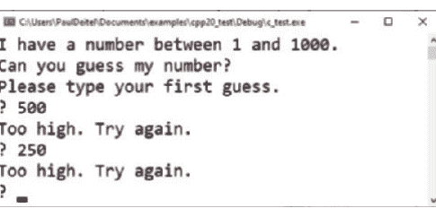

### 步骤 9：输入更多猜测

继续玩游戏，输入数值直到您猜中正确的数字。当您猜对时，应用程序显示“太棒了！您猜对了数字！”：


### 步骤 10：再次玩游戏或退出应用程序

在您猜中正确数字后，应用程序会询问您是否想再玩一局。在“请输入 (1=是, 2=否)？”提示符下，输入 `1` 以再次玩，这将选择一个新的数字供您猜测。如果您希望终止应用程序，请输入 `2`。每次执行此应用程序（步骤 6）时，它都会选择相同的数字供您猜测。要玩随机版本的游戏，请使用 `ch01` 文件夹的 `randomized_version` 子文件夹中的 `GuessNumber.c` 版本。

### 重用此项目用于后续示例

您可以按照本节中的步骤为本书中的每个应用程序创建一个单独的项目。但是，对于我们的示例，您可能会发现通过从项目中移除 `GuessNumber.c` 程序，然后添加另一个 C 程序来重用此项目会更方便。要从项目中（但不是从系统中）移除文件，请在解决方案资源管理器中选择它，然后按 `Del`（或 `Delete`）。重复步骤 4 以向项目添加不同的程序。

### 在 Windows 子系统 for Linux 中使用 Ubuntu Linux

一些 Windows 用户可能希望在 Windows 上使用 GNU gcc 编译器，特别是对于本书中少数 Visual C++ 无法编译的程序。您可以使用 GNU Compiler Collection Docker 容器（第 1.10.4 节）来实现，或者您可以在 Windows 子系统 for Linux 中运行的 Ubuntu Linux 中使用 gcc。要安装 Windows 子系统 for Linux，请按照以下说明操作：

https://docs.microsoft.com/en-us/windows/wsl/install-win10

一旦您在 Windows 系统上安装并启动了 Ubuntu，您可以使用以下命令切换到包含 Windows 系统上测试驱动代码示例的文件夹：

```
cd /mnt/c/Users/YourUseName/Documents/examples/ch01
```

然后您可以继续执行第 1.10.3 节中的步骤 2。

### 1.10.2 在 macOS 上使用 Xcode 编译和运行 C 应用程序

在本节中，您将使用 Apple Xcode IDE 中的 Clang 编译器在 macOS 上运行一个 C 程序。

#### 步骤 1：检查您的设置

如果您尚未完成，请阅读本书的“开始之前”部分，了解有关安装 IDE 和下载本书代码示例的说明。

#### 步骤 2：启动 Xcode

打开一个 Finder 窗口，选择“应用程序”并双击 Xcode 图标（）。如果这是您第一次运行 Xcode，“欢迎使用 Xcode”窗口将出现。通过点击左上角的 X 关闭此窗口——您可以随时通过选择“窗口” > “欢迎使用 Xcode”来访问它。我们使用 `>` 字符表示从菜单中选择菜单项。例如，符号 `文件 > 打开…` 表示“从文件菜单中选择打开…菜单项”。

#### 步骤 3：创建项目

项目是一组相关文件，例如组成应用程序的 C 源代码文件。我们为本书示例创建的 Xcode 项目是您将在 IDE 中执行的命令行工具项目。要创建项目：

1. 选择 `文件` > `新建` > `项目…`。

30 第 1 章 计算机与 C 语言简介

2. 在 **为您的新项目选择模板** 对话框的顶部，点击 **macOS**。
3. 在 **应用程序** 下，点击 **命令行工具** 并点击 **下一步**。
4. 对于 **产品名称**，为您的项目输入一个名称——我们指定了 **C_test_Xcode**。
5. 在 **语言** 下拉列表中，选择 **C**，然后点击 **下一步**。
6. 指定您要保存项目的位置。我们选择了包含本书代码示例的 `examples` 文件夹。
7. 点击 **创建**。

Xcode 创建您的项目并显示 **工作区窗口**，最初显示三个区域——**导航器区域**（左侧）、**编辑器区域**（中间）和 **实用工具区域**（右侧）。左侧的 **导航器** 区域顶部有图标，用于可以显示在那里的 *导航器*。对于本书，您将主要使用

- **项目** (📁)—显示项目中的所有文件和文件夹。
- **问题** (⚠️)—显示编译器生成的警告和错误。

点击导航器按钮会显示相应的导航器面板。中间的 **编辑器** 区域用于管理项目设置和编辑源代码。此区域始终显示在您的工作区窗口中。在 **项目** 导航器中选择一个文件会在 **编辑器** 区域中显示该文件的内容。您不会在本书中使用右侧的 **实用工具** 区域。您将在 **调试区域** 中运行并与猜数字程序交互，该区域将出现在 **编辑器** 区域下方。工作区窗口的工具栏包含用于执行程序、显示在 Xcode 中执行的任务进度以及隐藏或显示左侧（**导航器**）、右侧（**实用工具**）和底部（**调试**）区域的选项。

#### 步骤 4：从项目中删除 main.c 文件

默认情况下，Xcode 创建一个包含简单程序的 **main.c** 源代码文件，该程序显示“Hello, world!”。您不会在此测试驱动中使用 **main.c**。在 **项目** 导航器中，右键点击 **main.c** 文件并选择 **删除**。在出现的对话框中，选择 **移到废纸篓**。如果您清空废纸篓，该文件将从您的系统中移除。

#### 步骤 5：将 GuessNumber.c 文件添加到项目中

在 Finder 窗口中，打开本书示例文件夹中的 `ch01` 文件夹，然后将 **GuessNumber.c** 拖到 **项目** 导航器的 **C_Test_Xcode** 文件夹上。在出现的对话框中，确保选中 **如果需要则复制项目**，然后点击 **完成**。⁴⁰

#### 步骤 6：编译并运行项目

要编译并运行项目以便您可以测试驱动该应用程序，只需点击 Xcode 工具栏上的运行 (▶) 按钮。如果程序编译正确，Xcode 将打开 **调试** 区域并在 **调试** 区域的右半部分执行该程序：

40. 对于您将在本书后面看到的多源代码文件程序，请将给定程序的所有文件拖到项目的文件夹中。当您开始创建自己的程序时，可以右键点击项目的文件夹并选择 **新建文件...** 以显示用于添加新文件的对话框。

## 1.10 在 Windows、Linux 和 macOS 上测试驱动 C 应用程序


应用程序显示“请输入您的第一次猜测。”，然后在下一行显示一个问号 (?) 作为提示。

### 步骤 7：输入您的第一次猜测

点击调试区域，然后输入 `500` 并按 *Return*：

```
I have a number between 1 and 1000.
Can you guess my number?
Please type your first guess.
? 500
Too low. Try again.
? |
```

应用程序显示“太低了。再试一次。”，表示您输入的值小于应用程序选择的正确猜测数字。

### 步骤 8：输入另一次猜测

在下一个提示符下，输入 `750`：

```
I have a number between 1 and 1000.
Can you guess my number?
Please type your first guess.
? 500
Too low. Try again.
? 750
Too low. Try again.
?
```

应用程序显示“太低了。再试一次。”，表示您输入的值再次小于正确猜测数字。

### 步骤 9：输入更多猜测

继续玩游戏，直到您猜中正确的数字。当您猜对时，应用程序显示“太棒了！您猜对了数字！”：

```
? 875
Too high. Try again.
? 812
Too high. Try again.
? 781
Too low. Try again.
? 797
Too low. Try again.
? 805
Too low. Try again.
? 808

Excellent! You guessed the number!
Would you like to play again?
Please type (1=yes, 2=no)?
```

### 1.10.3 在 Linux 上使用 GNU gcc 编译和运行 C 应用程序

在本次实践演练中，我们假设你已阅读“开始之前”部分，并将下载的示例文件放置在你的用户账户的“文档”文件夹中。

#### 步骤 1：切换到 ch01 文件夹

在 Linux shell 中，使用 `cd` 命令切换到本书示例文件夹的 ch01 子文件夹：

```
~$ cd ~/Documents/examples/ch01
~/Documents/examples/ch01$
```

在本节的图示中，我们使用**粗体**来突出你应该输入的文本。我们的 Ubuntu Linux shell 提示符使用波浪号（~）表示你的主目录。每个提示符都以美元符号（$）结尾。在其他 Linux 发行版上，提示符可能有所不同。

#### 步骤 2：编译应用程序

在运行应用程序之前，你必须先对其进行编译：

```
~/Documents/examples/ch01$ gcc -std=c18 GuessNumber.c -o GuessNumber
~/Documents/examples/ch01$
```

`gcc` 命令用于编译应用程序：

- `-std=c18` 选项表示我们使用的是 C18——C 编程语言标准的最新版本。
- `-o` 选项为将用于运行程序的可执行文件（GuessNumber）命名。

#### 步骤 3：运行应用程序

在提示符后输入 `./GuessNumber` 并按 *Enter* 键来运行程序：

```
~/Documents/examples/ch01$ ./GuessNumber
I have a number between 1 and 1000.
Can you guess my number?
Please type your first guess.
?
```

`./` 告诉 Linux 从当前目录运行文件。这里需要它来指明 GuessNumber 是一个可执行文件。

#### 步骤 4：输入你的第一次猜测

应用程序显示 "Please type your first guess."，然后在下一行显示一个问号（?）作为提示符。在提示符处，输入 500——请注意，输出可能因你使用的编译器而异：

```
~/Documents/examples/ch01$ ./GuessNumber
I have a number between 1 and 1000.
Can you guess my number?
Please type your first guess.
? 500
Too high. Try again.
?
```

应用程序显示 "Too high. Try again."，这意味着你输入的值大于应用程序选择的正确猜测数字。

#### 步骤 5：输入另一次猜测

在下一个提示符处，输入 250：

```
~/Documents/examples/ch01$ ./GuessNumber
I have a number between 1 and 1000.
Can you guess my number?
Please type your first guess.
? 500
Too high. Try again.
? 250
Too low. Try again.
?
```

这次应用程序显示 "Too low. Try again."，这意味着你输入的值小于正确猜测数字。

#### 步骤 6：输入更多猜测

继续输入数值来玩游戏，直到你猜中正确的数字。当你猜对时，应用程序会显示 "Excellent! You guessed the number!"：

```
Too low. Try again.
? 375
Too low. Try again.
? 437
Too high. Try again.
? 406
Too high. Try again.
? 391
Too high. Try again.
? 383
Too low. Try again.
? 387
Too high. Try again.
? 385
Too high. Try again.
? 384
Excellent! You guessed the number!
Would you like to play again?
Please type (1=yes, 2=no)?
```

#### 步骤 7：再次玩游戏或退出应用程序

在你猜中正确数字后，应用程序会询问你是否想再玩一局。在 "Please type (1=yes, 2=no)?" 提示符处，输入 1 以再次游玩，这将选择一个新的数字供你猜测。如果你想终止应用程序，请输入 2。每次你执行此应用程序（步骤 3），它都会选择相同的数字供你猜测。要玩随机版本的游戏，请使用 ch01 文件夹的 `randomized_version` 子文件夹中的 `GuessNumber.c` 版本。

### 1.10.4 在 Windows 10、macOS 或 Linux 上原生运行的 GCC Docker 容器中编译和运行 C 应用程序

运行 GNU 的 gcc 编译器最便捷的跨平台方式之一是通过 GNU 编译器套件（GCC）Docker 容器。本节假设你已安装 Docker Desktop（Windows 或 macOS）或 Docker Engine（Linux）——如“开始之前”部分所述——并且 Docker 正在你的计算机上运行。

#### 执行 GNU 编译器套件（GCC）Docker 容器

打开命令提示符（Windows）、终端（macOS/Linux）或 shell（Linux），然后执行以下步骤来启动 GCC Docker 容器：

1. 使用 `cd` 命令导航到包含本书示例的示例文件夹。从这里执行 Docker 容器将使容器能够访问我们的代码示例。
2. Windows 用户：使用命令⁴¹ 启动 GCC Docker 容器

```
docker run --rm -it -v "%CD%":/usr/src gcc:latest
```

⁴¹. 将出现一个通知，要求你允许 Docker 访问当前文件夹中的文件。你必须允许；否则，你将无法在 Docker 中访问我们的源代码文件。

3. macOS/Linux 用户：使用命令 `docker run --rm -it -v "$(pwd)":/usr/src gcc:latest` 启动 GCC Docker 容器。

在上述命令中：

- `--rm` 会在你最终关闭容器时清理其资源。
- `-it` 以交互模式运行容器，这样你就可以输入命令来更改文件夹、使用 GNU gcc 编译器编译程序以及运行程序。
- `-v "%CD%":/usr/src`（Windows）或 `-v "$(pwd)":/usr/src`（macOS/Linux）允许 Docker 容器通过容器的 `/usr/src` 文件夹访问你当前文件夹的文件和子文件夹。你可以使用 `cd` 命令导航到 `/usr/src` 的子文件夹来编译和运行我们的程序。
- `gcc:latest` 是你在“开始之前”部分安装的容器名称。⁴²

容器运行后，你将看到一个类似于 `root@67773f59d9ea:/#` 的提示符，尽管 "@67773f59d9ea" 在你的计算机上会有所不同。该容器使用 Linux 操作系统，其中文件夹分隔符是正斜杠（/）。提示符在 : 和 # 之间显示当前文件夹位置。

#### 在 Docker 容器中切换到 ch01 文件夹

使用 `cd` 命令切换到 `/usr/src/ch01` 文件夹：

```
root@01b4d47cadc6:/# cd /usr/src/ch01
root@01b4d47cadc6:/usr/src/ch01#
```

现在，你可以使用第 1.10.3 节 *步骤 2–7* 中的命令，在 Docker 容器中编译、运行并与 GuessNumber 应用程序进行交互。

#### 终止 Docker 容器

你可以在容器的提示符处输入 *Ctrl + d* 来终止 Docker 容器。

## 1.11 互联网、万维网、云计算和物联网

在 20 世纪 60 年代末，美国国防部高级研究计划局（ARPA）推出了将大约十几所 ARPA 资助的大学和研究机构的主计算机系统联网的计划。

⁴². `gcc:latest` 是你将其下载到机器上时 gcc Docker 容器的最新版本名称。下载后，容器不会自动更新。你可以通过执行 `docker pull gcc:latest` 来使你的 GCC 容器保持最新可用版本。如果有新版本，Docker 将会下载它。

### 1.11.1 互联网：网络的网络

这些计算机将通过通信线路连接，运行速度约为每秒50,000比特，在当时（少数拥有网络接入的人中）大多数人通过电话线连接计算机的速度仅为每秒110比特，这是一个惊人的速率。学术研究即将实现巨大飞跃。ARPA着手实施后来迅速被称为ARPANET的项目，它是当今互联网的前身。如今最快的互联网速度已达到每秒数十亿比特，每秒万亿比特（太比特）的速度已在测试中！⁴³ 2020年，澳大利亚研究人员成功测试了每秒44.2太比特的互联网连接。⁴⁴

事情的发展与原计划有所不同。尽管ARPANET使研究人员能够将他们的计算机联网，但其主要好处被证明是能够通过后来被称为电子邮件（e-mail）的方式进行快速便捷的通信。即使在今天的互联网上也是如此，电子邮件、即时消息、文件传输以及Snapchat、Instagram、Facebook和Twitter等社交媒体，使全球数十亿人能够快速便捷地沟通。

在ARPANET上通信的协议（规则集）被称为传输控制协议（TCP）。TCP确保由称为数据包的顺序编号片段组成的消息能够正确地从发送者传递给接收者，完整无缺地到达并按正确顺序组装。

与互联网的早期发展并行，全球各组织正在实施自己的网络，用于组织内部（即一个组织内）和组织间（即组织之间）的通信。出现了各种各样的网络硬件和软件。一个挑战是使这些不同的网络能够相互通信。ARPA通过开发互联网协议（IP）实现了这一点，它创建了一个真正的“网络的网络”，即互联网当前的架构。组合的协议集现在被称为TCP/IP。每个连接到互联网的设备都有一个IP地址——一个唯一的数字标识符，用于通过TCP/IP通信的设备在互联网上相互定位。

企业迅速意识到，通过使用互联网，他们可以改善运营并向客户提供新的、更好的服务。公司开始投入大量资金来开发和增强其互联网存在感。这引发了通信运营商以及硬件和软件供应商之间的激烈竞争，以满足增长的基础设施需求。因此，互联网带宽——通信线路的信息承载能力——大幅增加，而硬件成本则急剧下降。

43. “BT Testing 1.4 Terabit Internet Connections.” 访问于2020年11月1日。https://testinternetspeed.org/blog/bt-testing-1-4-terabit-internet-connections/.
44. “Monash, Swinburne, and RMIT universities use optical chip to achieve 44Tbps data speed.” 访问于2021年1月9日。https://www.zdnet.com/article/monash-swinburne-and-rmit-universities-achieve-44tbps-data-speed-using-single-optical-chip/.

### 1.11.2 万维网：让互联网用户友好

**万维网**（简称“网络”）是与互联网相关的一系列硬件和软件的集合，它允许计算机用户定位和查看几乎任何主题的文档（包含文本、图形、动画、音频和视频的各种组合）。1989年，欧洲核子研究中心（CERN）的蒂姆·伯纳斯-李开始开发**超文本标记语言（HTML）**——一种通过“超链接”文本文档共享信息的技术。他还编写了通信协议，如**超文本传输协议（HTTP）**，以构成他新的超文本信息系统的骨干，他将其称为万维网。

1994年，伯纳斯-李创立了**万维网联盟（W3C, https://www.w3.org）**，致力于开发网络技术。W3C的主要目标之一是使网络普遍可访问，无论残疾、语言或文化如何。

### 1.11.3 云计算

如今越来越多的计算是在“云端”完成的——即使用分布在全球互联网上的软件和数据，而不是在你的桌面、笔记本电脑或移动设备上本地运行。**云计算**允许你根据任何给定时间的需求增加或减少计算资源，这比购买硬件来提供足够的存储和处理能力以满足偶尔的峰值需求更具成本效益。云计算还通过将管理这些应用程序（如安装和升级软件、安全、备份和灾难恢复）的负担转移给服务提供商来节省资金。

你日常使用的应用程序严重依赖各种**基于云的服务**。这些服务使用大规模的计算资源集群（计算机、处理器、内存、磁盘驱动器等）和数据库，通过互联网相互通信并与你使用的应用程序通信。通过互联网提供对其自身访问的服务被称为**Web服务**。

#### 软件即服务

云供应商专注于**面向服务的架构（SOA）**技术。它们提供“即服务”能力，应用程序可以连接并在云中使用。云供应商提供的常见服务包括：⁴⁵

| “即服务”缩写（注意有几个是相同的） |
| :--- |
| 大数据即服务（BDaaS） | 平台即服务（PaaS） |
| Hadoop即服务（HaaS） | 软件即服务（SaaS） |
| 基础设施即服务（IaaS） | 存储即服务（SaaS） |

45. 更多“即服务”缩写，请参见 https://en.wikipedia.org/wiki/Cloud_computing 和 https://en.wikipedia.org/wiki/As_a_service.

#### 混搭应用

**混搭应用**的应用程序开发方法使你能够通过组合（通常是免费的）互补的Web服务和其他形式的信息源，快速开发强大的软件应用程序。最早的混搭应用之一 www.housingmaps.com，将 www.craigslist.org 的房地产列表与谷歌地图结合起来，显示给定区域内待售或待租房屋的位置。访问 www.housingmaps.com 了解一些有趣的事实、历史、文章以及它如何影响房地产行业列表。

ProgrammableWeb (https://programmableweb.com/) 提供了一个包含近24,000个Web服务和近8,000个混搭应用的目录。他们还提供使用Web服务和创建自己的混搭应用的操作指南和示例代码。根据他们的网站，一些使用最广泛的Web服务是谷歌地图以及Facebook、Twitter和YouTube提供的其他服务。

### 1.11.4 物联网

互联网不再仅仅是*计算机*的网络——它是一个**物联网（IoT）**。一个*物*是指任何具有IP地址并能够自动通过互联网发送（在某些情况下接收）数据的对象。这样的*物*包括：

- 一辆装有用于支付通行费的应答器的汽车，
- 用于监测车库停车位可用性的监视器，
- 植入人体的心脏监护器，
- 水质监测器，
- 报告能源使用情况的智能电表，
- 辐射探测器，
- 仓库中的物品追踪器，
- 可以跟踪你的移动和位置的移动应用程序，
- 根据天气预报和家庭活动调节房间温度的智能恒温器，以及
- 智能家用电器。

根据statista.com的数据，目前已有超过230亿台物联网设备在使用中，到2025年可能会有超过750亿台物联网设备。⁴⁶

## 自我检查

1（填空）________是当今互联网的前身。
答案：ARPANET。

46. “Internet of Things (IoT) connected devices installed base worldwide from 2015 to 2025.” 访问于2020年11月1日。https://www.statista.com/statistics/471264/iot-number-of-connected-devices-worldwide/.

## 1.12 软件技术

在学习和从事软件开发的过程中，你会经常遇到以下流行术语：

- **重构：** 在保持程序正确性和功能的前提下，重新设计程序使其更清晰、更易于维护。许多集成开发环境（IDE）内置了*重构工具*，可以自动完成大部分重构工作。
- **设计模式：** 用于构建灵活且可维护的面向对象软件的成熟架构。设计模式领域试图列举这些反复出现的模式，鼓励软件设计人员*复用*它们，以更少的时间、金钱和精力开发出更高质量的软件。
- **软件开发工具包（SDK）**——开发者用来编写应用程序的工具和文档。

## 自我检查

1（填空）________ 是在保持程序正确性和功能的前提下，重新设计程序使其更清晰、更易于维护的过程。
答案：重构。

## 1.13 大数据有多大？

对于计算机科学家和数据科学家来说，数据如今与编写程序同等重要。根据IBM的数据，每天大约产生250亿亿字节（2.5 *艾字节*）的数据，⁴⁷ 世界上90%的数据是在过去两年内产生的。⁴⁸ 互联网在你的职业生涯中将扮演重要角色，它是这一趋势的主要推动力。根据IDC的数据，到2025年，全球数据供应量将达到每年175 *泽字节*（等于175万亿GB或1750亿TB）。⁴⁹ 请看以下各种流行数据度量单位的示例。

47. “欢迎来到人工智能世界。” 访问于2020年11月1日。https://www.ibm.com/blogs/watson/2016/06/welcome-to-the-world-of-a-i/.
48. “加速研究与发现。” 访问于2020年11月1日。https://www.ibm.com/watson/advantages/accelerate.
49. “IDC：预计到2025年全球数据量将达到175泽字节。” 访问于2020年11月1日。https://www.networkworld.com/article/3325397/storage/idc-expect-175-zettabytes-of-data-worldwide-by-2025.html.

### 兆字节（MB）

一兆字节大约是一百万（实际上是2^20）字节。我们日常使用的许多文件需要一兆或更多的存储空间。一些例子包括：

- MP3音频文件——高质量的MP3每分钟占用1到2.4 MB。50
- 照片——数码相机拍摄的JPEG格式照片每张可能需要约8到10 MB。
- 视频——智能手机摄像头可以录制不同分辨率的视频。每分钟视频可能需要许多兆字节的存储空间。例如，在我们的一部iPhone上，相机设置应用显示，30帧/秒（FPS）的1080p视频需要130 MB/分钟，而30 FPS的4K视频需要350 MB/分钟。

### 吉字节（GB）

一吉字节大约是1000兆字节（实际上是2^30字节）。一张双层DVD可以存储多达8.5 GB⁵¹，这相当于：

- 多达141小时的MP3音频，
- 大约1000张来自1600万像素相机的照片，
- 大约7.7分钟的30 FPS 1080p视频，或
- 大约2.85分钟的30 FPS 4K视频。

目前最高容量的超高清蓝光光盘可以存储多达100 GB的视频。⁵² 流媒体播放一部4K电影每小时可能使用7到10 GB（高度压缩）。

### 太字节（TB）

一太字节大约是1000吉字节（实际上是2^40字节）。最近的台式机硬盘容量可达20 TB，⁵³ 这相当于：

- 大约28年的MP3音频，
- 大约168万张来自1600万像素相机的照片，
- 大约226小时的30 FPS 1080p视频，或
- 大约84小时的30 FPS 4K视频。

Nimbus Data现在拥有最大的固态硬盘（SSD），容量为100 TB，它可以存储上述20 TB示例中音频、照片和视频的五倍。⁵⁴

50. “音频文件大小计算。” 访问于2020年11月1日。https://www.audiomountain.com/tech/audio-file-size.html.
51. “DVD。” 访问于2020年11月1日。https://en.wikipedia.org/wiki/DVD.
52. “超高清蓝光。” 访问于2020年11月1日。https://en.wikipedia.org/wiki/Ultra_HD_Blu-ray.
53. “硬盘驱动器历史。” 访问于2020年11月1日。https://en.wikipedia.org/wiki/History_of_hard_disk_drives.
54. “Nimbus Data 100TB SSD – 世界最大SSD。” 访问于2020年11月1日。https://www.cinema5d.com/nimbus-data-100tb-ssd-worlds-largest-ssd/.

### 拍字节、艾字节和泽字节

全球有超过40亿人上网，每天产生约250亿亿字节的数据<sup>55</sup>——即2500拍字节（每拍字节约1000太字节）或2.5艾字节（每艾字节约1000拍字节）。2016年3月的*AnalyticsWeek*文章指出，到2021年，将有超过500亿台设备连接到互联网（其中大部分通过物联网；第1.11.4节），并且到2020年，*地球上每个人*每秒将产生1.7兆字节的新数据。<sup>56</sup> 按照目前的数字（约77亿人<sup>57</sup>），这相当于：

- 每秒13拍字节的新数据，
- 每分钟780拍字节，
- 每小时46,800拍字节（46.8艾字节），或
- 每天1,123艾字节——即每天1.123泽字节（ZB）（每泽字节约1000艾字节）。

这相当于每天超过550万小时（超过600年）的4K视频，或每天约1160亿张照片！

### 更多大数据统计数据

要实时感受大数据，请查看 https://www.internetlivestats.com，其中包含各种统计数据，包括今天迄今为止的：

- 谷歌搜索次数。
- 推文数量。
- YouTube观看的视频数量。
- Instagram上传的照片数量。

你可以点击每项统计信息以获取更多详细信息。
其他一些有趣的大数据事实：

- 每小时，YouTube用户上传30,000小时的视频，每天在YouTube上观看的视频时长接近10亿小时。<sup>58</sup>
- 每秒，互联网流量为103,777 GB（或103.777 TB），发送9,204条推文，进行87,015次谷歌搜索，观看86,617个YouTube视频。<sup>59</sup>

55. “2020年每天产生多少数据？” 访问于2020年11月1日。https://techjury.net/blog/how-much-data-is-created-every-day/#gref.
56. “大数据事实。” 访问于2020年11月1日。https://analyticsweek.com/content/big-data-facts/.
57. “世界人口。” 访问于2020年11月1日。https://en.wikipedia.org/wiki/World_population.
58. “57个令人着迷且不可思议的YouTube统计数据。” 访问于2020年11月1日。https://www.brandwatch.com/blog/youtube-stats/.
59. “1秒内发送的推文。” 访问于2020年11月1日。http://www.internetlivestats.com/one-second.

- 在Facebook上，每天有32亿个“赞”和评论，⁶⁰ 通过Facebook Messenger发送50亿个表情符号。⁶¹

Domo, Inc. 的信息图“数据永不休眠 8.0”展示了关于*每分钟*产生多少数据的有趣统计数据，包括：⁶²

- 347,222个Instagram帖子。
- 上传到YouTube的500小时视频。
- 上传到Facebook的147,000张照片。
- 分享的41,666,667条WhatsApp消息。
- 观看的404,444小时Netflix视频。
- 479,452名用户与Reddit内容互动。
- 208,333名用户参加Zoom会议。
- 1,388,889人进行视频通话。

### 历年计算能力

数据量越来越大，处理数据的计算能力也在增强。当今的处理器性能通常以**FLOPS（每秒浮点运算次数）**来衡量。在1990年代初至中期，最快的超级计算机速度以千兆次浮点运算（10^9 FLOPS）衡量。到1990年代末，英特尔生产了第一台万亿次浮点运算（10^12 FLOPS）超级计算机。在2000年代初至中期，速度达到了数百万亿次浮点运算，然后在2008年，IBM发布了第一台千万亿次浮点运算（10^15 FLOPS）超级计算机。目前，最快的超级计算机——富士通的Fugaku⁶³——能够达到442千万亿次浮点运算。⁶⁴

分布式计算可以通过互联网连接数千台个人计算机，产生更多的FLOPS。2016年底，Folding@home网络——一个分布式网络，人们自愿贡献其个人计算机的资源用于疾病研究和药物设计⁶⁵——能够达到超过100千万亿次浮点运算。像IBM这样的公司现在正在致力于开发能够达到百亿亿次浮点运算（10^18 FLOPS）的超级计算机。⁶⁶

60. “Facebook：每天32亿个赞和评论。” 访问于2020年11月1日。https://marketingland.com/facebook-3-2-billion-likes-comments-every-day-19978.
61. “Facebook通过发布一些相当令人印象深刻的事实来庆祝世界表情符号日。” 访问于2020年11月1日。https://mashable.com/2017/07/17/facebook-world-emoji-day/.
62. “数据永不休眠 8.0。” 访问于2020年11月1日。https://www.domo.com/learn/data-never-sleeps-8.
63. “Top 500。” 访问于2020年12月24日。https://en.wikipedia.org/wiki/TOP500#TOP_500.
64. “FLOPS。” 访问于2020年11月1日。https://en.wikipedia.org/wiki/FLOPS.
65. “Folding@home。” 访问于2020年11月1日。https://en.wikipedia.org/wiki/Folding@home.
66. “一个新的超级计算驱动的天气模型可能为百亿亿次计算做好准备。” 访问于2020年11月1日。https://www.ibm.com/blogs/research/2017/06/supercomputing-weather-model-exascale/.

目前研发中的**量子计算机**，理论上其运算速度可达当今“传统计算机”的18,000,000,000,000,000,000倍！⁶⁷ 这个数字如此惊人，以至于理论上，量子计算机在一秒钟内完成的计算量，可能超过自世界上第一台计算机问世以来所有计算机完成计算量的总和。这种几乎难以想象的计算能力，可能会对基于区块链的加密货币（如比特币）造成巨大冲击。工程师们已经在重新思考区块链⁶⁸，为应对计算能力的这种巨大增长做准备。⁶⁹

超级计算能力的历史表明，它最终会从研究实验室——那些为实现这些性能指标投入了巨额资金的地方——逐步普及到“价格合理”的商用计算机系统，甚至台式电脑、笔记本电脑、平板电脑和智能手机。

计算能力的成本持续下降，尤其是在云计算领域。过去人们常问：“我的系统需要多少计算能力才能应对*峰值*处理需求？”如今，这种思路已转变为：“我能否在云端快速调用我*临时*完成最繁重计算任务所需的能力？”你只需为完成特定任务所使用的资源付费。

### 处理全球数据需要大量电力

来自全球联网设备的数据正在爆炸式增长，处理这些数据需要消耗巨大的能源。根据最近一篇文章，2015年用于处理数据的能源消耗以每年20%的速度增长，约占全球电力消耗的3%至5%。文章称，到2025年，数据处理的总能耗可能达到20%。⁷⁰

另一个巨大的电力消耗者是基于区块链的加密货币比特币。仅处理一笔比特币交易，其能耗大约相当于为一个普通美国家庭供电一周。这种能源消耗源于比特币“矿工”用来验证交易数据有效性的过程。⁷¹

据一些估计，一年的比特币交易消耗的能源超过许多国家。⁷² 比特币和以太坊（另一个流行的基于区块链的平台和加密货币）每年的能源消耗总和，超过了芬兰、比利时或巴基斯坦。⁷³

摩根士丹利在2018年预测，“今年用于创造加密货币的电力消耗，实际上可能超过该公司对2025年全球电动汽车需求的预测。”⁷⁴ 这种情况是不可持续的，特别是考虑到人们对基于区块链的应用（甚至超越加密货币热潮）的巨大兴趣。区块链社区正在努力解决这个问题。⁷⁵,⁷⁶

### 大数据机遇

大数据爆炸在未来几年很可能继续呈指数级增长。随着500亿台计算设备即将出现，我们只能想象未来几十年还会有多少增长。对于企业、政府、军队甚至个人来说，掌握所有这些数据至关重要。

有趣的是，一些关于大数据、数据科学、人工智能等领域的优秀文章，正出自摩根大通、麦肯锡、彭博等知名商业组织。鉴于其快速加速的成就，大数据对大企业的吸引力是不可否认的。许多公司正在通过大数据、机器学习和自然语言处理等技术进行大量投资并获得有价值的成果。这迫使竞争对手也进行投资，从而迅速增加了对具有计算机科学和数据科学经验的计算专业人才的需求。这种增长很可能会持续多年。

## 自我检查

- 1. **（填空）** 当今的处理器性能通常以________来衡量。
  **答案：** FLOPS（每秒浮点运算次数）。

- 2. **（填空）** 可能对基于区块链的加密货币（如比特币）和其他基于区块链的技术造成巨大冲击的技术是________。
  **答案：** 量子计算机。

- 3. **（判断正误）** 使用云计算时，无论你使用多少云服务，都支付固定价格。
  **答案：** 错误。云计算的一个关键好处是，你只需为完成特定任务所使用的资源付费。

### 1.13.1 大数据分析

数据分析是一门成熟且发展完善的学科。“数据分析”一词于1962年提出，⁷⁷ 尽管人们使用统计学分析数据已有数千年历史，可以追溯到古埃及时代。⁷⁸ 大数据分析是一个更近期的现象——“大数据”一词大约在1987年提出。⁷⁹

考虑大数据的四个V⁸⁰,⁸¹：

- 1. 量（Volume）——世界产生的数据呈指数级增长。
- 2. 速（Velocity）——数据产生的速度、在组织内流动的速度以及数据变化的速度都在快速增长。⁸²,⁸³,⁸⁴
- 3. 类（Variety）——数据过去是字母数字形式（即由字母字符、数字、标点符号和一些特殊字符组成）——如今，它还包括图像、音频、视频以及来自我们家庭、企业、车辆、城市等中数量激增的物联网传感器的数据。
- 4. 真（Veracity）——数据的有效性——它是否完整准确？在做出关键决策时，我们能否信任这些数据？它是真实的吗？

如今，大多数数据都是以数字方式创建的，具有*多样*的类型、巨大的*数量*和惊人的*速度*。摩尔定律及相关观察使我们能够经济地存储数据，并更快地处理和移动数据——而且所有这些速率都随时间呈指数级增长。数字数据存储的容量变得如此巨大，成本如此低廉，体积如此小巧，我们现在可以方便且经济地保留我们正在创建的*所有*数字数据。⁸⁵ 这就是大数据。

---
**参考文献**

⁶⁷. “Only God can count that fast — the world of quantum computing.” Accessed November 1, 2020. https://medium.com/@n.biedrzycki/only-god-can-count-that-fast-the-world-of-quantum-computing-406a0a91fcf4.
⁶⁸. “Blockchain.” Accessed December 24, 2020. https://en.wikipedia.org/wiki/Blockchain.
⁶⁹. “Is Quantum Computing an Existential Threat to Blockchain Technology?” Accessed November 1, 2020. https://singularityhub.com/2017/11/05/is-quantum-computing-an-existential-threat-to-blockchain-technology/.
⁷⁰. “‘Tsunami of data’ could consume one fifth of global electricity by 2025.” Accessed November 1, 2020. https://www.theguardian.com/environment/2017/dec/11/tsunami-of-data-could-consume-fifth-global-electricity-by-2025.
⁷¹. “One Bitcoin Transaction Consumes As Much Energy As Your House Uses in a Week.” Accessed November 1, 2020. https://motherboard.vice.com/en_us/article/ywbbpm/bitcoin-mining-electricity-consumption-ethereum-energy-climate-change.
⁷². “Bitcoin Energy Consumption Index.” Accessed November 1, 2020. https://digiconomist.net/bitcoin-energy-consumption.
⁷³. “Ethereum Energy Consumption Index.” Accessed November 1, 2020. https://digiconomist.net/ethereum-energy-consumption.
⁷⁴. “Power Play: What Impact Will Cryptocurrencies Have on Global Utilities?” Accessed November 1, 2020. https://www.morganstanley.com/ideas/cryptocurrencies-global-utilities.
⁷⁵. “Blockchains Use Massive Amounts of Energy—But There’s a Plan to Fix That.” Accessed November 1, 2020. https://www.technologyreview.com/s/609480/bitcoin-uses-massive-amounts-of-energybut-theres-a-plan-to-fix-it/.
⁷⁶. “How to fix Bitcoin’s energy-consumption problem.” Accessed November 1, 2020. http://mashable.com/2017/12/01/bitcoin-energy/.
⁷⁷. “A Very Short History Of Data Science.” Accessed November 1, 2020. https://www.forbes.com/sites/gilpress/2013/05/28/a-very-short-history-of-data-science/.
⁷⁸. “A Brief History of Data Analysis.” Accessed November 1, 2020. https://www.flydata.com/blog/a-brief-history-of-data-analysis/.
⁷⁹. Diebold, Francis. (2012). On the Origin(s) and Development of the Term “Big Data”. SSRN Electronic Journal. 10.2139/ssrn.2152421. https://www.researchgate.net/publication/255967292_On_the_Origins_and_Development_of_the_Term_'Big_Data'.
⁸⁰. “The Four V's of Big Data.” Accessed November 1, 2020. https://www.ibmbigdatahub.com/infographic/four-vs-big-data.
⁸¹. There are lots of articles and papers that add many other “V-words” to this list.
⁸². “Volume, velocity, and variety: Understanding the three V's of big data.” Accessed November 1, 2020. https://www.zdnet.com/article/volume-velocity-and-variety-understanding-the-three-vs-of-big-data/.
⁸³. “3Vs (volume, variety and velocity).” Accessed November 1, 2020. https://whatis.techtarget.com/definition/3Vs.
⁸⁴. “Big Data: Forget Volume and Variety, Focus On Velocity.” Accessed November 1, 2020. https://www.forbes.com/sites/brentdykes/2017/06/28/big-data-forget-volume-and-variety-focus-on-velocity.
⁸⁵. “How Much Information Is There In the World?” Accessed November 1, 2020. http://www.lesk.com/mlesk/ksg97/ksg.html. [The following article pointed us to this Michael Lesk article: https://www.forbes.com/sites/gilpress/2013/05/28/a-very-short-history-of-data-science/.]

以下理查德·W·汉明的引言——尽管出自1962年——为本书余下部分定下了基调：

> “计算的目的在于洞察，而非数字。”

数据科学正以惊人的速度产生新的、更深刻的、更微妙且更有价值的洞察。它确实在产生影响。大数据分析是这一答案中不可或缺的一部分。

要了解大数据在工业、政府和学术界的范围，请查看这张高分辨率图表——你可以点击放大以便阅读：

http://mattturck.com/wp-content/uploads/2018/07/Matt_Turck_FirstMark_Big_Data_Landscape_2018_Final.png

### 1.13.2 数据科学与大数据正在产生影响：用例

数据科学领域正在迅速发展，因为它正在产生产生重大影响的显著成果。我们在下表中列举了数据科学和大数据的用例。我们期望这些用例以及我们的示例、练习和项目能够激发有趣的学期项目、定向研究项目、顶点课程项目和论文研究。大数据分析带来了利润的提升、客户关系的改善，甚至体育球队在减少球员支出的情况下赢得了更多比赛和冠军。

| 数据科学用例 | | |
|---|---|---|
| 异常检测 | 信用评分 | 数据挖掘 |
| 辅助残障人士 | 犯罪预防 | 数据可视化 |
| 自动隐藏式字幕 | CRISPR基因编辑 | 诊断医学 |
| 脑部测绘 | 作物产量提高 | 动态驾驶路线 |
| 癌症诊断/治疗 | 客户流失与留存 | 动态定价 |
| 手写体分类 | 客服代理 | 电子健康记录 |
| 计算机视觉 | 网络安全 | 情感检测 |
| 面部识别 | 个性化医疗 | 共享经济 |
| 欺诈检测 | 网络钓鱼消除 | 相似性检测 |
| 游戏对弈 | 污染减少 | 智慧城市 |
| 健康结果改善 | 精准医疗 | 智能家居 |
| 人类基因组测序 | 疾病爆发预测 | 智能电表 |
| 身份盗窃预防 | 健康结果预测 | 智能恒温器 |
| 免疫疗法 | 天气敏感产品销售预测 | 智能交通控制 |
| 智能助手 | 预防医学 | 社交图谱分析 |
| 物联网（IoT）与医疗设备监控 | 防止疾病爆发 | 垃圾邮件检测 |
| 库存控制 | 房地产估值 | 股市预测 |
| 语言翻译 | 推荐系统 | 文本摘要 |
| 基于位置的服务 | 拼车 | 远程医疗 |
| 恶意软件检测 | 风险最小化 | 恐怖袭击预防 |
| 营销分析 | 机器人财务顾问 | 盗窃预防 |
| 自然语言翻译 | 节能 | 趋势发现 |
| 新药研发 | 自动驾驶汽车 | 可视化产品搜索 |
| 个人助手 | 情感分析 | 语音识别 |
| | | 天气预报 |

86. Hamming, R. W., *Numerical Methods for Scientists and Engineers* (New York: McGraw Hill, 1962). [以下文章指引我们找到了汉明的书及其引言：https://www.forbes.com/sites/gilpress/2013/05/28/a-very-short-history-of-data-science/.]

87. Turck, M., and J. Hao, “Great Power, Great Responsibility: The 2018 Big Data & AI Landscape,” http://mattturck.com/bigdata2018/.

88. Sawchik, T., *Big Data Baseball: Math, Miracles, and the End of a 20-Year Losing Streak* (New York: Flat Iron Books, 2015).

89. Ayres, I., *Super Crunchers* (Bantam Books, 2007), pp. 7–10.

90. Lewis, M., *Moneyball: The Art of Winning an Unfair Game* (W. W. Norton & Company, 2004).

## I.14 案例研究——一个大数据移动应用

在你的职业生涯中，你将使用多种编程语言和软件技术。凭借其1.3亿月活跃用户，⁹¹ 谷歌的Waze GPS导航应用是使用最广泛的大数据应用之一。早期的GPS导航设备和应用依赖静态地图和GPS坐标来确定前往目的地的最佳路线。它们无法根据变化的交通状况进行动态调整。

Waze处理海量的众包数据——即由其全球用户及其设备持续提供的数据。他们在数据到达时进行分析，以确定在最短时间内安全到达目的地的最佳路线。为此，Waze依赖于你的智能手机的互联网连接。该应用会自动向其服务器发送位置更新（假设你允许它这样做）。他们利用这些数据根据当前交通状况动态地为你重新规划路线，并调整他们的地图。用户会报告其他信息，例如路障、施工、障碍物、故障车道上的车辆、警察位置、油价等等。然后Waze会向这些位置的其他驾驶员发出警报。

Waze使用多种技术来提供服务。我们不清楚Waze的具体实现方式，但我们推断出他们可能使用的一系列技术。例如，

- 如今创建的大多数应用都至少使用一些开源软件。你将在案例研究中利用开源库和工具。
- Waze通过互联网在其服务器和用户的移动设备之间传递信息。如今，此类数据通常以JSON（JavaScript对象表示法）格式传输。通常，JSON数据会被你使用的库隐藏起来。
- Waze使用语音合成向你播报驾驶方向和警报，并使用语音识别来理解你的语音命令。许多云供应商提供语音合成和语音识别功能。
- 一旦Waze将口语化的自然语言命令转换为文本，它就会确定要执行的操作，这需要自然语言处理（NLP）。
- Waze显示动态更新的可视化内容，例如警报和交互式地图。
- Waze将你的手机用作流式物联网（IoT）设备。每部手机都是一个GPS传感器，通过互联网持续向Waze传输数据。
- Waze同时接收来自数百万部手机的物联网流。它必须立即处理、存储和分析这些数据，以更新你设备的地图、显示并播报相关警报，并可能更新你的驾驶方向。这需要通过云中的计算机集群实现的大规模并行处理能力。你可以使用各种大数据基础设施技术来接收流数据，将这些大数据存储在适当的数据库中，并使用提供大规模并行处理能力的软件和硬件来处理数据。
- Waze使用人工智能能力来执行数据分析任务，使其能够根据接收到的信息预测最佳路线。你可以分别使用机器学习和深度学习来分析海量数据并基于这些数据进行预测。
- Waze可能将其路线信息存储在图数据库中。此类数据库可以高效地计算最短路径。你可以使用图数据库，例如Neo4J。
- 许多汽车都配备了帮助它们“看到”周围汽车和障碍物的设备。这些设备用于帮助实现自动制动系统，是自动驾驶汽车技术的关键组成部分。导航应用可以利用摄像头和其他传感器，通过使用深度学习计算机视觉技术“实时”分析图像并自动报告这些项目，而不是依赖用户报告路边的障碍物和停驶的车辆。你可以将深度学习用于计算机视觉。

## 1.15 人工智能——计算机科学与数据科学的交汇点

当婴儿第一次睁开眼睛时，它能“看到”父母的脸吗？它理解什么是脸——甚至什么是简单形状的概念吗？婴儿必须“学习”周围的世界。这正是人工智能（AI）今天正在做的事情。它正在分析海量数据并从中学习。人工智能正被用于玩游戏、实现广泛的计算机视觉应用、支持自动驾驶汽车、使机器人能够学习执行新任务、诊断医疗状况、将语音近乎实时地翻译成其他语言、创建能够利用庞大的知识数据库回答各种问题的聊天机器人等等。就在几年前，谁能想到人工智能自动驾驶汽车会被允许上路——甚至变得普遍？然而，这现在已成为一个竞争异常激烈的领域。所有这些学习的最终目标是**通用人工智能**——一种能够像人类一样执行智能任务的人工智能。

### 人工智能里程碑

有几个人工智能里程碑特别引起了人们的关注和想象，让公众开始认为人工智能是真实的，并让企业考虑将人工智能商业化：

- 在1997年**IBM的深蓝**计算机系统与国际象棋大师加里·卡斯帕罗夫的比赛中，深蓝成为第一个在锦标赛条件下击败在任世界国际象棋冠军的计算机。⁹² IBM为深蓝加载了数十万局大师级国际象棋对局。深蓝能够使用*暴力计算*每秒评估多达2亿步棋！⁹³ 这就是大数据在发挥作用。IBM获得了卡内基梅隆大学弗雷德金奖，该奖项在1980年为第一个击败世界国际象棋冠军的计算机的创造者提供了10万美元奖金。⁹⁴
- 2011年，**IBM的沃森**在一场100万美元的比赛中击败了两位最优秀的人类《危险边缘》选手。沃森同时使用了数百种语言分析技术，在2亿页内容（包括整个维基百科）中定位正确答案，这需要4太字节的存储空间。⁹⁵,⁹⁶ 沃森是通过机器学习和强化学习技术训练的。⁹⁷ 强大的库使你能够使用各种编程语言执行机器学习和强化学习。
- 围棋——一种几千年前在中国发明的棋盘游戏<sup>98</sup>——被广泛认为是有史以来最复杂的游戏之一，有10<sup>170</sup>种可能的棋盘布局。<sup>99</sup> 为了让你对这个数字有多大有个概念，据信已知宇宙中（只有）10<sup>78</sup>到10<sup>82</sup>个原子！<sup>100,101</sup> 2015年，由谷歌DeepMind团队创建的**AlphaGo**使用*深度学习和两个神经网络击败了欧洲围棋冠军樊麾*。围棋被认为比国际象棋复杂得多。强大的库使你能够使用神经网络进行深度学习。
- 最近，谷歌将其AlphaGo人工智能推广，创建了**AlphaZero**——一种*自学其他游戏*的游戏人工智能。2017年12月，AlphaZero在不到四小时内学习了规则并自学了国际象棋，使用的是强化学习。然后，它在100局比赛中击败了世界冠军国际象棋程序Stockfish 8——赢得了或打平了每一局。在*自我训练*围棋仅八小时后，AlphaZero就能够与它的前身AlphaGo对弈，在100局中赢了60局。<sup>102</sup>

### 人工智能：一个有问题但没有解决方案的领域

几十年来，人工智能一直是一个有问题但*没有*解决方案的领域。这是因为一旦某个特定问题被解决，人们就会说：“嗯，那不是智能；它只是一个告诉计算机确切该做什么的计算机程序。”然而，通过机器学习、深度学习和强化学习，我们并没有预先编程解决*特定*问题的方案。相反，我们让计算机通过从数据中学习来解决问题——而且通常是大量数据。许多最有趣和最具挑战性的问题正在通过深度学习来解决。仅谷歌就有数千个深度学习项目正在进行中。<sup>103,104</sup>

## 自我检查

1（填空）人工智能的最终目标是产生一个________。
**答案：** 通用人工智能。

2（填空）IBM的沃森击败了两位最优秀的人类《危险边缘》选手。沃森是使用________学习和________学习技术的组合进行训练的。
**答案：** 机器，强化。

3（填空）谷歌的________在不到四小时内使用强化学习自学了国际象棋，然后在100局比赛中击败了世界冠军国际象棋程序Stockfish 8——赢得了或打平了每一局。
**答案：** AlphaZero。

## 自我复习练习

1.1 填写以下每个陈述中的空白：
a) 计算机在称为________的指令控制下处理数据。
b) 计算机的关键逻辑单元是：________单元、________单元、________单元、________单元和________单元。
c) 本章讨论的三种编程语言是________、________和________。
d) 将高级语言程序翻译成机器语言的程序称为________。
e) ________是基于Linux内核的移动设备操作系统。
f) 一个________允许设备响应运动。
g) C语言被广泛认为是________操作系统的语言。

1.2 填写以下关于C环境的每个句子中的空白。
a) C程序通常使用________输入到计算机中。
b) 在C系统中，一个________在翻译阶段开始之前自动执行。
c) ________将编译器的输出与各种库函数结合，生成可执行映像。
d) ________将可执行映像从磁盘传输到内存。

## 自我复习练习答案

1.1 a) 程序。 b) 输入、输出、内存、中央处理、算术和逻辑、辅助存储。 c) 机器语言、汇编语言、高级语言。 d) 编译器。 e) Android。 f) 加速度计。 g) UNIX。

1.2 a) 编辑器。 b) 预处理器。 c) 链接器。 d) 加载器。

## 练习

1.3 将以下每个项目分类为硬件或软件：
a) CPU。
b) C编译器。
c) ALU。
d) C预处理器。
e) 输入单元。
f) 一个编辑器程序。

---
**参考文献**

92. “Deep Blue versus Garry Kasparov.” 访问于2020年11月1日。 https://en.wikipedia.org/wiki/Deep_Blue_versus_Garry_Kasparov.
93. “Deep Blue (chess computer).” 访问于2020年11月1日。 https://en.wikipedia.org/wiki/Deep_Blue_(chess_computer).
94. “IBM Deep Blue Team Gets $100,000 Prize.” 访问于2020年11月1日。 https://articles.latimes.com/1997/jul/30/news/mn-17696.
95. “IBM Watson: The inside story of how the Jeopardy-winning supercomputer was born, and what it wants to do next.” 访问于2020年11月1日。 https://www.techrepublic.com/article/ibm-watson-the-inside-story-of-how-the-jeopardy-winning-supercomputer-was-born-and-what-it-wants-to-do-next/.
96. “Watson (computer).” 访问于2020年11月1日。 https://en.wikipedia.org/wiki/Watson_(computer).
97. “Building Watson: An Overview of the DeepQA Project.” 访问于2020年11月1日。 https://www.aaai.org/Magazine/Watson/watson.php, *AI Magazine*, Fall 2010.
98. “A Brief History of Go.” 访问于2020年11月1日。 http://www.usgo.org/brief-history-go.
99. “Google artificial intelligence beats champion at world’s most complicated board game.” 访问于2020年11月1日。 https://www.pbs.org/newshour/science/google-artificial-intelligence-beats-champion-at-worlds-most-complicated-board-game.
100. “How Many Atoms Are There in the Universe?” 访问于2020年11月1日。 https://www.universetoday.com/36302/atoms-in-the-universe/.
101. “Observable universe.” 访问于2020年11月1日。 https://en.wikipedia.org/wiki/Observable_universe#Matter_content.
102. “AlphaZero AI beats champion chess program after teaching itself in four hours.” 访问于2020年11月1日。 https://www.theguardian.com/technology/2017/dec/07/alphazero-google-deepmind-ai-beats-champion-program-teaching-itself-to-play-four-hours.
103. “Google has more than 1,000 artificial intelligence projects in the works.” 访问于2020年11月1日。 http://theweek.com/speedreads/654463/google-more-than-1000-artificial-intelligence-projects-works.
104. “Google says 'exponential' growth of AI is changing nature of compute.” 访问于2020年11月1日。 https://www.zdnet.com/article/google-says-exponential-growth-of-ai-is-changing-nature-of-compute/.

## 1.4（计算机组成）填写以下每个陈述中的空白：
a) 从计算机外部接收信息供计算机使用的逻辑单元是________。
b) ________是一个逻辑单元，它将计算机已处理的信息发送到各种设备，供计算机外部使用。
c) ________和________是计算机中保留信息的逻辑单元。
d) ________是计算机中用于执行计算的逻辑单元。
e) ________是计算机中用于进行逻辑决策的逻辑单元。
f) ________是计算机中用于协调其他逻辑单元活动的逻辑单元。

## 1.5 讨论以下各项的目的：
a) stdin
b) stdout
c) stderr

## 1.6（性别中立）编写一个手动处理文本段落并用性别中立词替换特定性别词的步骤。假设你已获得一份特定性别词及其性别中立替换词的列表（例如，用“配偶”替换“妻子”或“丈夫”，用“人”替换“男人”或“女人”，用“孩子”替换“女儿”或“儿子”，等等），解释你将如何阅读一段文本并手动执行这些替换。你的程序如何可能生成像“woperchild”这样的奇怪术语？你如何修改你的程序以避免这种可能性？在第3章中，你将了解到“procedure”的更正式的计算术语是“algorithm”，它指定了要执行的步骤以及执行这些步骤的顺序。

## 1.7（自动驾驶汽车）就在几年前，无人驾驶汽车在我们街道上的想法似乎是不可能的（事实上，我们的拼写检查软件不识别“driverless”这个词）。你将在本书中学习的许多技术正在使自动驾驶汽车成为可能。它们在某些地区已经很常见了。
a) 如果你叫了一辆出租车，一辆无人驾驶出租车为你停下，你会坐到后座吗？你会愿意告诉它你想去哪里并相信它能把你带到那里吗？你希望有哪些安全措施到位？如果汽车朝错误的方向开去，你会怎么做？
b) 如果两辆自动驾驶汽车从相反方向驶向一座单车道桥梁，该怎么办？它们应该通过什么协议来确定哪辆车应该继续前进？
c) 如果你跟在一辆在红灯前停下的汽车后面，灯变绿了，但汽车没有移动。你按喇叭，但没有反应。你下车，注意到没有司机。你会怎么做？
d) 如果一名警察拦下一辆超速的自动驾驶汽车，而你是唯一的乘客，谁——或者什么实体——应该支付罚单？
e) 自动驾驶汽车的一个严重担忧是它们可能被黑客攻击。有人可能将速度设置得很高（或很低），这可能是危险的。如果他们将你重定向到一个不是你想要的目的地，该怎么办？

## 1.8（研究：可重复性）数据科学研究中的一个关键概念是可重复性，它有助于其他人（和你自己）重现你的结果。研究可重复性，并列出在数据科学研究中用于创建可重复结果的概念。

## 1.9（研究：通用人工智能）人工智能领域最雄心勃勃的目标之一是实现*通用人工智能*——机器智能等于人类智能的时刻。研究这个引人入胜的话题。预计何时会发生？这引发了一些关键的伦理问题？人类智能似乎在很长一段时间内是稳定的。具有通用人工智能的强大计算机可以想象（并且快速）进化出远超人类的智能。研究并讨论这引发的问题。

## 1.10（研究：智能助手）许多公司现在提供计算机化的智能助手，如IBM Watson、Amazon Alexa、Apple Siri、Google Assistant和Microsoft Cortana。研究这些以及其他智能助手，并列出可以改善人们生活的用途。研究智能助手的隐私和伦理问题。寻找有趣的智能助手轶事。

## 1.11（研究：医疗保健中的AI）研究AI大数据应用在医疗保健领域快速发展的领域。例如，假设一个诊断医疗应用程序可以访问所有拍摄过的X光片和相关的诊断——这无疑是大数据。“深度学习”计算机视觉应用程序可以使用这些“标记”数据来学习诊断医疗问题。研究诊断医学中的深度学习，并描述其一些最重要的成就。让机器而不是人类医生进行医疗诊断有哪些伦理问题？你会信任机器生成的诊断吗？你会寻求第二意见吗？

## 1.12（研究：隐私和数据完整性立法）在前言中，我们提到了美国的HIPAA（健康保险可携带性和责任法案）和加州消费者隐私法案（CCPA），以及欧盟的GDPR（通用数据保护条例）。像这样的法律正变得越来越普遍和严格。调查这些法律中的每一项及其对你的隐私的影响。

## 1.13（研究：个人身份信息）保护用户的个人身份信息（PII）是隐私的一个重要方面。研究并评论这个问题。

## 1.14（研究：大数据、AI和云——公司如何使用这些技术）为你选择的一个主要组织，研究他们可能如何使用以下每种技术：AI、大数据、云、移动、自然语言处理、语音识别、语音合成、数据库、机器学习、深度学习、强化学习、Hadoop、Spark、物联网（IoT）和Web服务。

## 1.15（研究：Raspberry Pi和物联网）现在可以在几乎任何设备的核心放置一台计算机，并将这些设备连接到互联网。这导致了物联网（IoT），它将数十亿台设备互连。Raspberry Pi是一种经济实惠的计算机，通常是物联网设备的核心。研究Raspberry Pi及其使用的众多物联网应用中的一些。

## 1.16（研究：深度伪造的伦理）人工智能技术使得创建*深度伪造*成为可能——逼真的假视频，捕捉人的外观、声音、身体动作和面部表情。你可以让他们说和做你指定的任何事情。研究深度伪造的伦理。如果你打开电视，看到一位著名政府官员或新闻主播的深度伪造视频，报道核袭击即将发生，会发生什么？研究奥森·威尔斯及其1938年的“世界大战”广播，该广播引起了大规模恐慌。

## 1.17（研究：区块链——机遇的世界）像比特币和以太坊这样的加密货币基于一种称为区块链的技术，该技术在过去几年中经历了爆炸式增长。研究区块链的起源、应用以及它如何被用作加密货币的基础。研究区块链的其他主要应用。在未来许多年里，彻底理解区块链应用开发的软件开发人员将有非凡的机会。

## 1.18（研究：安全C和卡内基梅隆大学软件工程研究所的CERT部门）经验表明，构建能够抵御攻击的工业级系统具有挑战性。这种攻击可以是瞬时的，并且在全球范围内发生。世界上许多最大的公司、政府机构和军事组织的系统都曾被入侵。这种漏洞通常来自简单的编程问题。从软件开发开始就将安全性纳入其中可以显著减少漏洞。卡内基梅隆大学软件工程研究所（SEI）创建了CERT（https://www.sei.cmu.edu/about/divisions/cert/index.cfm）来分析和及时响应攻击。CERT发布并推广安全编码标准，以帮助C程序员和其他人实现工业级系统，避免使系统容易受到攻击的编程实践。随着新的安全问题的出现，CERT标准也在不断演变。SEI CERT C编码标准关注于“加固”计算机系统和应用程序以抵御攻击。研究CERT并讨论他们的成就和当前挑战。为了帮助你专注于安全的C编码实践，第2-12章和第14章包含安全C编码部分，介绍一些关键问题和技术，并提供链接和参考资料，以便你可以继续学习。

## 1.19（研究：IBM Watson）IBM正在与数万家公司合作——包括我们的出版商Pearson Education——涵盖广泛的行业。研究IBM Watson的一些关键成就以及IBM及其合作伙伴正在应对的挑战类型。

## C 编程简介

## 2


## 学习目标

在本章中，你将：

-   编写简单的 C 程序。
-   使用简单的输入和输出语句。
-   使用基本数据类型。
-   了解计算机内存概念。
-   使用算术运算符。
-   了解算术运算符的优先级。
-   编写简单的决策语句。
-   开始关注安全的 C 编程实践。

56 第 2 章 C 编程简介

-   2.1 简介
-   2.2 一个简单的 C 程序：打印一行文本
-   2.3 另一个简单的 C 程序：两个整数相加
-   2.4 内存概念
-   2.5 C 语言中的算术运算
-   2.6 决策：相等运算符和关系运算符
-   2.7 安全的 C 编程

小结 | 自测练习 | 自测练习答案 | 练习

## 2.1 简介

C 语言为计算机程序设计提供了一种结构化和规范的方法。本章介绍 C 编程，并给出几个示例来说明许多基本的 C 特性。我们逐条语句分析每个示例。在第 3 章和第 4 章中，我们将介绍结构化编程——一种能帮助你编写清晰、易于维护的程序的方法论。然后，在本书的剩余部分，我们将一直使用结构化方法。本章以我们的第一个“安全的 C 编程”小节结束。

## 2.2 一个简单的 C 程序：打印一行文本

我们从一个打印一行文本的简单 C 程序开始。该程序及其屏幕输出如图 2.1 所示。

```
1 // fig02_01.c
2 // A first program in C.
3 #include <stdio.h>
4
5 // function main begins program execution
6 int main(void) {
7     printf("Welcome to C!\n");
8 } // end function main
```

Welcome to C!

图 2.1 | 一个 C 语言的入门程序。

### 注释

第 1 行和第 2 行

```
// fig02_01.c
// A first program in C.
```

以 `//` 开头，表示这两行是注释。你插入注释是为了记录程序并提高程序的可读性。注释在执行程序时不会导致计算机执行任何操作——它们会被忽略。在我们的每个程序中，惯例是使用第 1 行的注释指定文件名，第 2 行的注释描述程序的目的。注释也有助于其他人阅读和理解你的程序。

你也可以使用 `/*...*/` **多行注释**，其中从第一行的 `/*` 到最后一行的 `*/` 之间的所有内容都是注释。我们更喜欢较短的 `//` 注释，因为它们消除了使用 `/*...*/` 注释时常见的编程错误，例如意外遗漏了结束的 `*/`。

### #include 预处理指令

第 3 行

```
#include <stdio.h>
```

是一个 **C 预处理指令**。预处理器在编译之前处理以 `#` 开头的行。第 3 行告诉预处理器包含 **标准输入/输出头文件 (`<stdio.h>`) 的内容**。这是一个包含编译器所需信息的文件，用于确保你正确使用标准输入/输出库函数，例如 `printf`（第 7 行）。第 5 章将更详细地解释头文件的内容。

### 空行和空白字符

我们只是将第 4 行留空。你使用空行、空格字符和制表符使程序更易于阅读。这些统称为 **空白字符**，通常会被编译器忽略。

### main 函数

第 6 行

```
int main(void) {
```

是每个 C 程序的一部分。`main` 后面的圆括号表明 `main` 是一个称为 **函数** 的程序构建块。C 程序由函数组成，其中一个必须是 `main`。每个程序都从 `main` 函数开始执行。作为良好的实践，应在每个函数前添加一个注释（如第 5 行）来说明该函数的目的。

函数可以返回信息。`main` 左侧的关键字 `int` 表示 `main` “返回”一个整数（整数）值。我们将在第 4 章使用数学函数执行计算时，以及在第 5 章创建自定义函数时，解释函数“返回值”的含义。目前，只需在你的每个程序中，在 `main` 左侧包含关键字 `int`。

函数在被调用执行时也可以接收信息。这里的圆括号中的 `void` 表示 `main` 不接收任何信息。在第 15 章，我们将展示一个 `main` 接收信息的例子。

左花括号 `{` 开始每个函数的 **主体**（第 6 行末尾）。对应的 **右花括号 `}`** 结束每个函数的主体（第 8 行）。当程序到达 `main` 的结束右花括号时，程序终止。花括号及其之间的程序部分构成一个 *块*——一个重要的程序单元，我们将在后续章节中进一步讨论。

### 输出语句

第 7 行

`printf("Welcome to C!\n");`

指示计算机执行一个 **动作**，即在屏幕上显示引号中包含的 **字符串** 字符。字符串有时也称为 **字符字符串**、**消息** 或 **字面量**。

整个第 7 行——包括“调用” `printf` 函数来执行其任务、圆括号内的 `printf` **参数** 以及分号 (;)——称为一个 **语句**。每个语句必须以分号 **语句终止符** 结束。`printf` 中的 “f” 代表 “格式化”。当第 7 行执行时，它会在屏幕上显示消息 Welcome to C!。字符通常按双引号之间显示的方式打印，但请注意，字符 `\n` 并未显示。

### 转义序列

在字符串中，反斜杠 (\) 是一个 **转义字符**。它表示 `printf` 应该做一些不寻常的事情。在字符串中，编译器将反斜杠与下一个字符组合形成一个 **转义序列**。转义序列 `\n` 表示 **换行**。当 `printf` 在字符串中遇到换行符时，它会将输出光标定位到下一行的开头。下面列出了一些常见的转义序列：

| 转义序列 | 描述 |
| :--- | :--- |
| \n | 将光标移动到下一行的开头。 |
| \t | 将光标移动到下一个水平制表位。 |
| \a | 产生声音或可见警报，而不改变当前光标位置。 |
| \\ | 因为反斜杠在字符串中具有特殊含义，所以需要 `\\` 在字符串中插入一个反斜杠字符。 |
| \" | 因为字符串用双引号括起来，所以需要 `\"` 在字符串中插入一个双引号字符。 |

### 链接器和可执行文件

像 `printf` 和 `scanf` 这样的标准库函数不是 C 编程语言的一部分。例如，编译器无法发现 `printf` 或 `scanf` 中的拼写错误。在编译 `printf` 语句时，编译器只是在目标程序中为“调用”库函数提供空间。但编译器不知道库函数在哪里——链接器知道。当链接器运行时，它会定位库函数并在目标程序中插入对这些函数的适当调用。现在目标程序完整并准备执行。链接后的程序称为 **可执行文件**。如果函数名拼写错误，链接器将发现错误——它将无法将程序中的名称与库中任何已知函数的名称匹配。

### 缩进约定

在定义函数主体的花括号内，将每个函数的整个主体缩进一级（我们建议三个空格）。这种缩进强调了程序的功能结构，并有助于使其更易于阅读。
为你喜欢的缩进大小设定一个约定，并统一应用该约定。制表符键可用于创建缩进，但制表位可能有所不同。专业的风格指南通常建议使用空格而不是制表符。一些代码编辑器实际上在你按 Tab 键时插入空格。

### 使用多个 printf

`printf` 函数可以用几种不同的方式显示 Welcome to C!。例如，图 2.2 使用两条语句产生与图 2.1 相同的输出。这之所以可行，是因为每个 `printf` 从前一个结束的地方继续打印。第 7 行显示 Welcome 后跟一个空格（但没有换行）。第 8 行的 `printf` 在同一行上紧接在空格之后开始打印。

```
1  // fig02_02.c
2  // Printing on one line with two printf statements.
3  #include <stdio.h>
4
5  // function main begins program execution
6  int main(void) {
7      printf("Welcome ");
8      printf("to C!\n");
9  } // end function main
```

> Welcome to C!

图 2.2 | 使用两条 printf 语句打印一行。

### 使用单个 printf 显示多行

一个 `printf` 可以显示多行，如图 2.3 所示。每个 `\n` 将输出光标移动到下一行的开头。

```
1  // fig02_03.c
2  // Printing multiple lines with a single printf.
3  #include <stdio.h>
4
5  // function main begins program execution
6  int main(void) {
7      printf("Welcome\nto\nC!\n");
8  } // end function main
```

> Welcome
to
C!

图 2.3 | 使用单个 printf 打印多行。

## 自我检查

1（多项选择）考虑以下代码：
`int main(void)`
以下哪项陈述是*错误*的？
a) `main`后的圆括号表明它是一个函数。
b) `main`左侧的关键字`int`表明`main`返回一个整数值，而括号中的`void`表示`main`不接收任何信息。
c) 左括号`(`开始每个函数体。对应的右括号`)`结束每个函数体。
d) 当执行到达`main`的末尾时，程序终止。
**答案：** c) 是*错误*的。实际上，左花括号`{`开始每个函数体，对应的右花括号`}`结束每个函数体。

2（多项选择）以下哪项陈述是*错误*的？
a) 每个`printf`从前一个`printf`停止打印的地方继续打印。
b) 在以下代码中，第一个`printf`显示`Welcome`后跟一个空格，第二个`printf`从输出的下一行开始打印：
`printf("Welcome ");`
`printf("to C!\n");`
c) 以下`printf`打印多行文本：
`printf("Welcome\nto\nC!\n");`
d) 每次遇到`\n`转义序列时，输出从下一行的开头继续。
**答案：** b) 是*错误*的。实际上，第二个`printf`紧接在第一个`printf`输出的空格之后开始打印。

## 2.3 另一个简单的C程序：两个整数相加

我们的下一个程序使用`scanf`标准库函数获取用户在键盘上输入的两个整数，然后计算它们的和并使用`printf`显示结果。程序和示例输出如图2.4所示。在图2.4的输入/输出对话框中，我们用**粗体**强调用户输入的数字。

```
1  // fig02_04.c
2  // 加法程序。
3  #include <stdio.h>
4
5  // 函数main开始程序执行
6  int main(void) {
7      int integer1 = 0; // 将保存用户输入的第一个数字
8      int integer2 = 0; // 将保存用户输入的第二个数字
9
10     printf("Enter first integer: "); // 提示
11     scanf("%d", &integer1); // 读取一个整数
12
13     printf("Enter second integer: "); // 提示
14     scanf("%d", &integer2); // 读取一个整数
15
16     int sum = 0; // 将保存和的变量
17     sum = integer1 + integer2; // 将总和赋值给sum
18
19     printf("Sum is %d\n", sum); // 打印和
20 } // 结束函数main
```

```
Enter first integer: 45
Enter second integer: 72
Sum is 117
```

图2.4 | 加法程序。

第2行的注释说明了程序的目的。同样，程序从main开始执行（第6-20行）——第6行和第20行的花括号分别标记了main函数体的开始和结束。

### 变量和变量定义

第7行和第8行

```
int integer1 = 0; // 将保存用户输入的第一个数字
int integer2 = 0; // 将保存用户输入的第二个数字
```

是定义。名称integer1和integer2是变量——程序可以存储值以供后续使用的内存位置。这些定义指定了integer1和integer2具有int类型。这意味着它们将保存整数值，例如7、-11、0和31914。第7行和第8行通过在变量名后跟一个`=`和一个值，将每个变量初始化为0。虽然没有必要显式初始化每个变量，但这样做将有助于避免许多常见问题。

### 在使用前定义变量

所有变量在程序中使用之前，都必须用名称和类型进行定义。你可以在main中变量首次在代码中使用之前的任何位置放置每个变量定义。通常，你应该在变量首次使用附近定义它们。

### 标识符和大小写敏感性

变量名可以是任何有效的标识符。每个标识符可以由字母、数字和下划线（_）组成，但不能以数字开头。C是大小写敏感的，所以a1和A1是不同的标识符。变量名应以小写字母开头。在后面的文本中，我们将为以大写字母开头的标识符和使用全大写字母的标识符赋予特殊意义。

避免与编译器生成的标识符和标准库标识符冲突。多单词变量名可以使程序更具可读性。对于此类名称：
- 用下划线分隔单词，如total_commissions，或
- 将单词连在一起，并将每个后续单词的首字母大写，如totalCommissions。

后一种风格被称为**驼峰命名法**，因为大写和小写字母的模式类似于骆驼的轮廓。我们更喜欢驼峰命名法。

### 提示消息

第10行

```
printf("Enter first integer: "); // 提示
```

显示"Enter first integer: "。此消息称为**提示**，因为它告诉用户执行特定操作。

### scanf函数和格式化输入

第11行

```
scanf("%d", &integer1); // 读取一个整数
```

使用**scanf**从用户获取值。该函数从标准输入读取，通常是键盘。

scanf中的“f”代表“格式化”。此scanf有两个参数——"%d"和&integer1。"%d"是**格式控制字符串**。它指示用户应输入的数据类型。**%d转换规范**指定数据应为整数——d代表“十进制整数”。每个转换规范以%字符开头。

scanf的第二个参数以&符号（&）开头，后跟变量名。&是**地址运算符**，当与变量名结合使用时，它告诉scanf变量integer1在内存中的位置（或地址）。然后scanf将用户输入的值存储在该内存位置。

使用&符号（&）对于初学程序员和使用不需要此表示法的其他语言编程的人来说常常令人困惑。目前，只需记住在每次调用scanf时，在每个变量前加上一个&符号。此规则的一些例外情况在第6章和第7章中讨论。在我们学习第7章中的指针后，&的使用将变得清晰。

在scanf语句中忘记变量前的&符号（&）通常会导致运行时错误。在许多系统上，这会导致“段错误”或“访问违规”。当用户的程序尝试访问其没有访问权限的计算机内存部分时，就会发生此类错误。此错误的确切原因将在第7章中解释。

当第11行执行时，计算机等待用户为integer1输入一个值。用户键入一个整数，然后按*Enter键*（或*Return键*）将数字发送给计算机。然后计算机将数字（或值）放入integer1中。程序中随后对integer1的任何引用都使用相同的值。

## 2.3 另一个简单的C程序：两个整数相加

函数`printf`和`scanf`促进了用户与计算机之间的交互。这种交互类似于对话，通常被称为**交互式计算**。

### 提示并输入第二个整数

第13行

```
printf("Enter second integer: "); // 提示
```

提示用户输入第二个整数，然后第14行

```
scanf("%d", &integer2); // 读取一个整数
```

从用户获取变量`integer2`的值。

### 定义sum变量

第16行

```
int sum = 0; // 将保存和的变量
```

定义了`int`变量`sum`，并在第17行使用`sum`之前将其初始化为0。

### 赋值语句

第17行的**赋值语句**

```
sum = integer1 + integer2; // 将总和赋值给sum
```

计算变量`integer1`和`integer2`的总和，然后使用**赋值运算符**（`=`）将结果赋值给变量`sum`。该语句读作：“`sum`*得到*表达式`integer1 + integer2`的值。”大多数计算都在赋值中执行。

### 二元运算符

`=`运算符和`+`运算符是**二元运算符**——每个都有两个**操作数**。`+`运算符的操作数是`integer1`和`integer2`。`=`运算符的操作数是`sum`和表达式`integer1 + integer2`的值。在二元运算符两侧放置空格以使运算符突出并使程序更具可读性。

### 使用格式控制字符串打印

第19行的格式控制字符串`"Sum is %d\n"`

```
printf("Sum is %d\n", sum); // 打印和
```

包含一些要显示的字面字符（`"Sum is "`）和转换规范`%d`，它是整数的占位符。`sum`是要插入以替换`%d`的值。整数的转换规范（`%d`）在`printf`和`scanf`中是相同的——对于大多数C数据类型都是如此，但并非全部。

### 结合变量定义和赋值语句

你可以在变量定义中初始化变量。例如，第16行和第17行可以将变量`integer1`和`integer2`相加，然后用结果初始化变量`sum`：

```
int sum = integer1 + integer2; // 将总和赋值给sum
```

### printf 语句中的计算

实际上，我们不需要变量 sum，因为我们可以在 printf 语句中执行计算。因此，第 16-19 行可以替换为

```
printf("Sum is %d\n", integer1 + integer2);
```

## 自我检查

- 1（多选题）哪个语句能正确提示用户输入？
a) printf("Enter the day of the week: ")
b) printf(Enter the day of the week: );
c) printf('Enter the day of the week: ');
d) printf("Enter the day of the week: ");
答案：d。

- 2（多选题）以下语句读作“sum 获得表达式 integer1 + integer2 的值”。在该语句中，= 是_______运算符。
sum = integer1 + integer2;
a) 相等。
b) 比较。
c) 赋值。
d) 以上都不是。
答案：c。

## 2.4 内存概念

每个变量都有一个名称、一个类型、一个值以及计算机内存中的一个位置。在图 2.4 的加法程序中，当第 11 行

```
scanf("%d", &integer1); // read an integer
```

执行时，程序将用户输入放入 integer1 的内存位置。假设用户输入 45 作为 integer1 的值。概念上，内存呈现如下：


当一个值被放入内存位置时，它会替换该位置之前的值，而之前的值会丢失。因此，这个过程被称为破坏性的。

再次回到我们的加法程序，当第 14 行

```
scanf("%d", &integer2); // read an integer
```

执行时，假设用户输入 72。概念上，内存呈现如下：

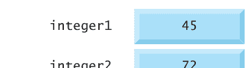

这些位置在内存中不一定是相邻的。

一旦我们有了 integer1 和 integer2 的值，第 18 行

```
sum = integer1 + integer2; // assign total to sum
```

将这些值相加，并将总和放入变量 sum 中，替换其之前的值。概念上，内存现在呈现如下：

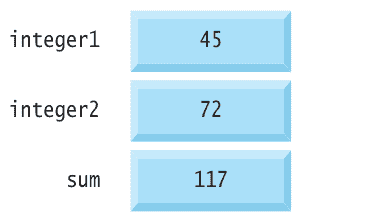

integer1 和 integer2 的值在计算中没有改变，计算使用了这些值但没有破坏它们。因此，从内存位置读取一个值是非破坏性的。

## 自我检查

- 1（多选题）以下陈述 a)、b) 或 c) 哪一个是错误的？
a) 变量名对应于计算机内存中的位置。
b) 每个变量都有一个名称、一个类型和一个值。
c) 当一个值被放入内存位置时，它会替换该位置之前的值。之前的值会丢失，因此这个过程被称为破坏性的。当从内存位置读取一个值时，这个过程被称为非破坏性的。
d) 以上所有陈述都是正确的。
答案：d。

## 2.5 C 语言中的算术运算

大多数 C 程序使用以下二元算术运算符进行计算：

| C 运算 | 算术运算符 | 代数表达式 | C 表达式 |
| :--- | :---: | :---: | :---: |
| 加法 | + | f + 7 | f + 7 |
| 减法 | - | p - c | p - c |
| 乘法 | * | bm | b * m |
| 除法 | / | x / y 或 x/y | x / y |
| 余数 | % | r mod s | r % s |

注意代数中未使用的各种特殊符号的使用。星号 (*) 表示乘法，百分号 (%) 表示余数运算符（下文介绍）。在代数中，要将 a 乘以 b，我们将这些单字母变量名并排放置，如 *ab*。在 C 中，ab 将被解释为一个双字母名称（或标识符）。大多数编程语言使用 * 运算符表示乘法，如 a * b。

### 整数除法和余数运算符

**整数除法**（即一个整数除以另一个整数）产生一个整数结果，因此 7 / 4 的结果为 1，17 / 5 的结果为 3。仅用于整数的**余数运算符** % 产生整数除法后的余数，因此 7 % 4 的结果为 3，17 % 5 的结果为 2。我们将讨论余数运算符的几个有趣应用。

在计算机系统上，尝试除以零通常是未定义的。通常，它会导致一个致命错误，使程序立即终止而未能成功完成其工作。非致命错误允许程序运行到完成，但通常会产生不正确的结果。

### 直线形式的算术表达式

算术表达式必须以**直线形式**编写，以便于将程序输入计算机。像“a 除以 b”这样的表达式必须写成 a/b，所有运算符和操作数都在一条直线上。代数符号

$$\frac{a}{b}$$

通常不被编译器接受，尽管一些专用软件包支持更自然的复杂数学表达式符号。

### 用于分组子表达式的括号

C 表达式中的括号使用方式与代数表达式相同。例如，要将 a 乘以 (b + c)，我们写 a * (b + c)。

### 运算符优先级规则

C 在算术表达式中应用运算符的精确顺序由以下**运算符优先级规则**确定，这些规则通常与代数中的相同：

- 1. 括号中的表达式首先计算。括号被称为“最高优先级”。在**嵌套括号**中，如
   ((a + b) + c)
   最内层括号中的运算符首先应用。
- 2. 接下来应用 *、/ 和 %。如果表达式包含多个 *、/ 和 % 运算符，则从左到右进行计算。这三个运算符被认为处于相同的优先级水平。
- 3. 接下来计算 + 和 -。如果表达式包含 + 和 - 运算符，则从左到右进行计算。这两个运算符具有相同的优先级水平，低于 *、/ 和 %。
- 4. 赋值运算符 (=) 最后计算。

运算符优先级规则指定了 C 用于计算表达式的顺序。¹ 当我们说从左到右计算时，我们指的是运算符的**分组**，有时也称为**结合性**。一些运算符从右到左分组。

### 代数和 C 表达式示例

让我们考虑几个表达式的计算。每个示例列出一个代数表达式及其 C 等效表达式。以下表达式计算五个项的平均值（算术平均值）：

```
代数：  m = (a + b + c + d + e) / 5
C：     m = (a + b + c + d + e) / 5;
```

在 C 语句中，需要括号来分组加法，因为除法的优先级高于加法。整个量 (a + b + c + d + e) 应该除以 5。如果我们错误地省略括号，我们得到 a + b + c + d + e / 5，它错误地计算为

```
a + b + c + d + e/5
```

以下表达式是直线方程：

```
代数：  y = mx + b
C：     y = m * x + b;
```

不需要括号。乘法首先计算，因为它的优先级高于加法。

以下表达式包含余数 (%)、乘法、除法、加法、减法和赋值运算：

```
代数：  z = pr mod q + w/x - y
C：     z = p * r % q + w / x - y;
```

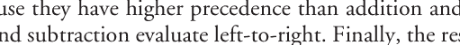

带圈的数字表示 C 计算运算符的顺序。乘法、余数和除法首先从左到右计算（即它们从左到右分组），因为它们的优先级高于加法和减法。接下来，加法和减法从左到右计算。最后，结果被赋值给 z。

### “同一级别”的括号

并非所有包含多对括号的表达式都包含嵌套括号。在以下表达式中，括号被称为“同一级别”：

```
a * (b + c) + c * (d + e)
```

在这种情况下，带括号的表达式从左到右计算。

68 第 2 章 C 编程简介

### 二次多项式的计算

为了更好地理解运算符优先级规则，让我们看看 C 如何计算二次多项式。

```
y = a * x * x + b * x + c;
```


语句下方的带圈数字表示 C 执行运算的顺序。C 没有指数运算符，因此我们将 x² 表示为 x * x。标准库的 pow（“幂”）函数执行指数运算，正如你将在第 4 章中看到的。

在前面的二次多项式中，假设 a = 2，b = 3，c = 7，x = 5。下图说明了运算符应用的顺序：

```
步骤 1. y = 2 * 5 * 5 + 3 * 5 + 7; （最左边的乘法）
2 * 5 是 10
步骤 2. y = 10 * 5 + 3 * 5 + 7; （最左边的乘法）
10 * 5 是 50
步骤 3. y = 50 + 3 * 5 + 7; （乘法在加法之前）
3 * 5 是 15
步骤 4. y = 50 + 15 + 7; （最左边的加法）
50 + 15 是 65
步骤 5. y = 65 + 7; （最后的加法）
65 + 7 是 72
步骤 6. y = 72 （最后的操作——将 72 放入 y）
```

### 使用括号提高清晰度

与代数一样，使用冗余括号使表达式更清晰是可以接受的。因此，前面的语句可以加括号如下：

```
y = (a * x * x) + (b * x) + c;
```

## 自我检查

- 1.（多选题）以下哪个表达式（如果有的话）正确地进行了 C 计算“将 3 加到 4 乘以 5 的量上”？
a) 3 + 4 * 5
b) 3 + (4 * 5)
c) (3 + (4 * 5))
d) 以上所有。

答案：d.

**2** *（多选题）* 考虑以下语句：
`y = a * x * x + b * x + c;`
下列哪些该语句的变体包含多余的括号？
    a) `y = (a * x * x + b * x + c);`
    b) `y = a * (x * x) + (b * x) + c;`
    c) `y = (a * x * x) + (b * x) + c;`
    d) 以上全部。

答案：d.

## 2.6 决策：相等与关系运算符

可执行语句要么执行计算、输入输出等操作，要么，正如你即将看到的，做出**决策**。例如，一个程序可能需要判断一个人的考试成绩是否大于或等于60分，从而决定是否打印“恭喜！你通过了。”的消息。

**条件**是一个可以为*真*（即条件满足）或*假*（即条件不满足）的表达式。本节介绍**if语句**，它允许程序根据条件的值做出决策。如果条件为*真*，则执行if语句体中的语句；否则，不执行。

### 相等与关系运算符

条件使用以下**相等**和**关系运算符**构成：

| 代数相等或关系运算符 | C语言相等或关系运算符 | C语言条件示例 | C语言条件含义 |
| :--- | :--- | :--- | :--- |
| *关系运算符* | | | |
| > | > | x > y | x 大于 y |
| < | < | x < y | x 小于 y |
| ≥ | >= | x >= y | x 大于或等于 y |
| ≤ | <= | x <= y | x 小于或等于 y |
| *相等运算符* | | | |
| = | == | x == y | x 等于 y |
| ≠ | != | x != y | x 不等于 y |

关系运算符 <、<=、> 和 >= 具有相同的优先级，并且从左到右分组。相等运算符 == 和 != 具有相同的优先级，该优先级低于关系运算符，并且也是从左到右分组。在C语言中，条件实际上可以是任何产生零（*假*）或非零（*真*）值的表达式。

### 混淆相等运算符 == 与赋值运算符

混淆 == 与赋值运算符（=）是一个常见的编程错误。为避免这种混淆，请将相等运算符读作“双等号”，将赋值运算符读作“赋值为”或“被赋予值”。正如你将看到的，混淆这些运算符可能导致难以发现的逻辑错误，而不是编译错误。

### 演示if语句

图2.5使用六个if语句来比较用户输入的两个数字。对于每个条件为*真*的if语句，相应的printf语句会执行。该程序和三个示例执行输出如图所示。

```
1  // fig02_05.c
2  // 使用if语句、关系
3  // 运算符和相等运算符。
4  #include <stdio.h>
5
6  // 函数main开始程序执行
7  int main(void) {
8      printf("Enter two integers, and I will tell you\n");
9      printf("the relationships they satisfy: ");
10
11     int number1 = 0; // 从用户读取的第一个数字
12     int number2 = 0; // 从用户读取的第二个数字
13
14     scanf("%d %d", &number1, &number2); // 读取两个整数
15
16     if (number1 == number2) {
17         printf("%d is equal to %d\n", number1, number2);
18     } // 结束 if
19
20     if (number1 != number2) {
21         printf("%d is not equal to %d\n", number1, number2);
22     } // 结束 if
23
24     if (number1 < number2) {
25         printf("%d is less than %d\n", number1, number2);
26     } // 结束 if
27
28     if (number1 > number2) {
29         printf("%d is greater than %d\n", number1, number2);
30     } // 结束 if
31
32     if (number1 <= number2) {
33         printf("%d is less than or equal to %d\n", number1, number2);
34     } // 结束 if
35
36     if (number1 >= number2) {
37        printf("%d is greater than or equal to %d\n", number1, number2);
38    } // 结束 if
39 } // 结束函数 main
```

图 2.5 | 使用if语句、关系运算符和相等运算符。（第1部分，共2部分。）

```
Enter two integers, and I will tell you
the relationships they satisfy: 3 7
3 is not equal to 7
3 is less than 7
3 is less than or equal to 7
```

```
Enter two integers, and I will tell you
the relationships they satisfy: 22 12
22 is not equal to 12
22 is greater than 12
22 is greater than or equal to 12
```

```
Enter two integers, and I will tell you
the relationships they satisfy: 7 7
7 is equal to 7
7 is less than or equal to 7
7 is greater than or equal to 7
```

图 2.5 | 使用if语句、关系运算符和相等运算符。（第2部分，共2部分。）

该程序使用scanf（第14行）将两个整数读入int变量number1和number2。第一个%d将一个值转换为存储在变量number1中。第二个将一个值转换为存储在变量number2中。

### 比较数字

第16-18行的if语句

```
if (number1 == number2) {
    printf("%d is equal to %d\n", number1, number2);
} // 结束 if
```

比较number1和number2的值是否相等。如果值相等，第17行显示一行文本，表明这两个数字相等。对于从第20、24、28、32和36行开始的if语句中的每个真条件，相应的主体语句都会显示一行文本。缩进每个if语句的主体并在每个if语句前后放置空行可以增强程序的可读性。

左花括号 { 开始每个if语句的主体（例如，第16行）。相应的右花括号 } 结束每个if语句的主体（例如，第18行）。任意数量的语句都可以放在if语句的主体中。²

在if语句的条件右括号后立即放置分号是一个常见错误。在这种情况下，分号被视为空语句，不执行任何任务——原本打算作为if语句主体一部分的语句不再属于它，并且总是会执行。

² 对于单语句主体，使用花括号来界定if语句的主体是可选的，但始终使用这些花括号被认为是良好的实践。在第3章中，我们将解释相关问题。

### 目前为止介绍的运算符

下表按从高到低的优先级列出了目前为止介绍的运算符：

| 运算符 | 分组 |
|---|---|
| () | 从左到右 |
| * / % | 从左到右 |
| + - | 从左到右 |
| < <= > >= | 从左到右 |
| == != | 从左到右 |
| = | 从右到左 |

赋值运算符（=）从右到左分组。在编写包含多个运算符的表达式时，请参考运算符优先级图表。确认表达式中的运算符按正确的顺序应用。如果对复杂表达式中的求值顺序不确定，请使用括号对表达式进行分组或将语句分解为多个更简单的语句。

### 关键字

我们在本章示例中使用的一些词，如int、if和void，是语言的关键字或保留字，对编译器具有特殊含义。下表包含C语言关键字。不要将它们用作标识符。

| 关键字 | | | | |
|---|---|---|---|---|
| auto | do | goto | signed | unsigned |
| break | double | if | sizeof | void |
| case | else | int | static | volatile |
| char | enum | long | struct | while |
| const | extern | register | switch | |
| continue | float | return | typedef | |
| default | for | short | union | |
| *C99标准新增的关键字* | | | | |
| _Bool | _Complex | _Imaginary | inline | restrict |
| *C11标准新增的关键字* | | | | |
| _Alignas | _Alignof | _Atomic | _Generic | _Noreturn |
| _Static_assert | _Thread_local | | | |

## 自我检查

- 1. （多选题）下列哪项陈述是错误的？
    a) 条件是一个可以为真或假的表达式。
    b) 条件可以是任何产生零（真）或非零（假）值的表达式。
    c) if语句根据条件的值做出决策。如果条件为*真*，则执行if语句体中的语句；否则，不执行。
    d) 你使用相等运算符和关系运算符来构成条件。

**答案：** b) 是*错误的*。实际上，在C语言中，条件可以是任何产生零（*假*）或非零（*真*）值的表达式。

- **2** *（多选题）* 下列哪项陈述是*错误的*？
    a) 如果number1等于number2，以下if语句将执行其主体：

    ```
    if (number1 == number2) {
        printf("%d is equal to %d\n", number1, number2);
    } // 结束 if
    ```

    b) 如果对复杂表达式的求值顺序不确定，请使用括号对表达式进行分组或将语句分解为更简单的语句。
    c) 任意数量的语句都可以放在if语句的主体中。使用花括号来界定if语句的主体是必需的。
    d) C语言的一些运算符，如赋值运算符（=），是从右到左分组，而不是从左到右。

**答案：** c) 是*错误的*。实际上，当主体只包含一条语句时，使用花括号来界定if语句的主体是可选的。然而，始终使用这些花括号有助于避免错误。

## 2.7 安全的C编程

我们在前言中提到了*SEI CERT C编码标准*，并指出我们将遵循某些准则，以帮助你避免使系统容易受到攻击的编程实践。

### 避免单参数printf

其中一条准则是避免使用只有一个字符串参数的printf。³ printf的第一个参数是一个格式字符串，printf会检查其中的转换规范。然后，它将每个转换规范替换为后续参数的值。无论是否有后续参数可用，它都会尝试这样做。

在后面的章节中，你将学习如何从用户输入字符串。虽然第一个printf参数通常是字符串字面量，但它也可能是一个包含从用户输入的字符串的变量。在这种情况下，攻击者可以构造一个用户输入的格式字符串，使其包含的转换规范多于额外的printf参数。这种漏洞已被攻击者用来读取他们本不应访问的内存。⁴

³ 有关更多信息，请参见CERT规则FIO30-C (https://wiki.sei.cmu.edu/confluence/display/c/FIO30-C.+Exclude+user+input+from+format+strings)。第6章的“安全的C编程”部分解释了此CERT准则中提到的用户输入概念。

⁴ “格式字符串攻击”，格式字符串软件攻击 | OWASP基金会。访问于2020年7月22日，https://owasp.org/www-community/attacks/Format_string_attack。

## 74 第2章 C编程入门

你可以采取一些预防措施来防止此类攻击。如果需要显示以换行符结尾的字符串，应使用`puts`函数而非`printf`，因为`puts`会在显示其字符串参数后自动添加换行符。例如，在图2.1的第7行

```
printf("Welcome to C!\n");
```

应改写为

```
puts("Welcome to C!");
```

`puts`函数仅显示其字符串参数的内容，因此转换规范将作为其单个字符显示。

要显示不带终止换行符的字符串，请使用带有两个参数的`printf`——一个`"%s"`格式控制字符串和要显示的字符串。`%s`转换规范是字符串的占位符。例如，在图2.2的第7行

```
printf("Welcome ");
```

应改写为

```
printf("%s", "Welcome ");
```

与`puts`类似，如果`printf`的第二个参数包含转换规范，它将作为其单个字符显示。

就目前而言，本章中的`printf`实际上是安全的，但这些修改是负责任的编码实践，随着我们深入学习C语言，它们将消除某些安全漏洞。我们将在本书后面解释其原理。从现在开始，我们在示例中使用这些实践，你也应该在代码中使用它们。

### scanf、printf、scanf_s和printf_s

我们将在后续的“安全C编程”部分（从第3.13节开始）进一步讨论`scanf`和`printf`。我们还将讨论`scanf_s`和`printf_s`，它们在C11中引入，旨在消除各种`scanf`和`printf`的安全漏洞。在后面的“安全C编程”部分，我们将讨论已知的`scanf`安全漏洞及其避免方法。

## 自我检查

- 1（代码）将以下语句重写为等效的安全`puts`语句：
  printf("Enter your age:\n");
  答案：puts("Enter your age:");
- 2（代码）将以下语句重写为等效的安全`printf`语句：
  printf("Enter your age:");
  答案：printf("%s", "Enter your age:");

## 总结

本章介绍了许多重要的C语言特性，包括在屏幕上显示数据、从用户输入数据、执行计算和做出决策。在下一章中，我们将在此基础上介绍结构化编程。你将更熟悉缩进技术。我们将学习如何指定*语句执行的顺序*——这被称为**控制流**。

### 第2.1节 简介

- C语言促进了结构化和规范化的计算机程序设计方法。

### 第2.2节 一个简单的C程序：打印一行文本

- **注释**（第56页）以`//`开头。它们**记录程序**（第56页）并提高程序可读性。**多行注释**以`/*`开头，以`*/`结尾（第57页）。
- 注释会被编译器忽略。
- **预处理器**在程序编译前处理以`#`开头的行。**#include指令**告诉预处理器（第57页）包含另一个文件的内容。
- **<stdio.h>头文件**（第57页）包含编译器用于确保你正确使用标准输入/输出库函数（如`printf`）的信息。
- `main`函数是每个程序的一部分。`main`后的括号表明`main`是一个称为**函数**（第57页）的程序构建块。程序包含一个或多个函数，其中一个必须是`main`，它是程序开始执行的地方。
- 函数可以返回信息。`main`左侧的关键字`int`表明`main`“返回”一个整数（整数）值。
- 函数在被调用执行时可以接收信息。`main`后括号中的`void`表明`main`不接收任何信息。
- 每个函数的**主体**（第57页）都以**左花括号**`{`开始。对应的**右花括号**`}`结束每个函数（第57页）。一对花括号及其之间的代码称为一个**块**。
- **printf函数**（第58页）指示计算机在屏幕上显示信息。
- **字符串**有时也称为**字符字符串**、**消息**或**字面量**（第58页）。
- 每个**语句**（第58页）必须以**分号语句终止符**（第58页）结束。
- 在`\n`（第58页）中，反斜杠（`\`）是一个**转义字符**（第58页）。当在字符串中遇到反斜杠时，编译器将其与下一个字符组合形成一个**转义序列**（第58页）。转义序列`\n`表示**换行**。
- 当换行符出现在`printf`输出的字符串中时，输出光标会定位到下一行的开头。
- **双反斜杠（\\）转义序列**在字符串中放置一个反斜杠。
- 转义序列`"`表示一个字面双引号字符。

### 第2.3节 另一个简单的C程序：两个整数相加

- **变量**（第61页）是内存中的一个位置，可以存储一个值供程序使用。
- `int`类型的变量（第61页）存储**整数整数值**。
- 所有变量在程序中使用前都必须用名称和**类型**进行定义。
- C语言中的变量名是任何有效的**标识符**（第61页）。标识符是由字母、数字和下划线（`_`）组成的一系列字符，且不能以数字开头。
- C语言**区分大小写**（第61页）。
- **scanf函数**（第62页）从标准输入（通常是键盘）获取输入。
- **scanf格式控制字符串**（第62页）指示要输入的数据类型。
- **%d转换规范**（第62页）表示一个整数（字母d代表“十进制整数”）。每个转换规范都以%开头。
- 跟在`scanf`格式控制字符串后的参数以**与号（&）**开头，后跟变量名。在此上下文中，与号——称为**地址运算符**（第62页）——告诉`scanf`变量的内存位置。然后计算机将值存储在该位置。
- 大多数计算在**赋值语句**（第63页）中执行。
- =运算符和+运算符是**二元运算符**——每个运算符有两个操作数（第63页）。
- 在指定格式控制字符串作为第一个参数的`printf`中，转换规范表示要输出的数据的占位符。

### 第2.4节 内存概念

- 每个**变量**都有一个**名称**、一个**类型**、一个**值**和一个内存位置。
- 当一个值被放入内存位置时，它会替换该位置之前的值，该值会丢失。因此这个过程被称为**破坏性**（第64页）。
- 从内存位置读取一个值是**非破坏性**（第65页）的。

### 第2.5节 C语言中的算术运算

- 大多数编程语言用*运算符表示乘法，如a * b。
- **算术表达式**必须以**直线形式**（第66页）编写，以便于将程序输入计算机。
- **括号**在C表达式中对项进行分组，其方式与代数表达式非常相似。
- C语言根据以下**运算符优先级规则**（第66页）以精确的顺序计算算术表达式，这些规则通常与代数中遵循的规则相同。
- 包含多个*、/和%运算的表达式从左到右计算。这三个运算符处于相同的优先级级别。
- 包含多个+和-运算的表达式从左到右计算。这两个运算符具有相同的优先级级别，低于*、/和%的优先级。
- 运算符**分组**（第67页）指定运算符是从左到右还是从右到左计算。

### 第2.6节 决策：相等和关系运算符

- 可执行的C语句要么执行**操作**，要么做出**决策**。
- C语言的**if语句**（第69页）允许程序根据条件（第69页）是**真**（第69页）还是**假**（第69页）来做出决策。如果条件为真，则执行if语句的主体；否则不执行。
- 你在if语句中使用**相等**和**关系运算符**（第69页）来形成条件。
- 所有关系运算符具有相同的优先级级别，并从左到右分组。相等运算符的优先级低于关系运算符，也从左到右分组。
- 为避免混淆赋值（=）和相等（==），赋值运算符应读作“赋值”，相等运算符应读作“双等号”。
- 编译器通常忽略**空白字符**，如制表符、换行符和空格。
- **关键字**（第72页；或保留字）对C编译器具有特殊含义，因此你不能将它们用作标识符，如变量名。

### 第2.7节 安全的C语言编程

- 为避免系统遭受攻击，一种实践方法是避免使用仅包含单个字符串参数的`printf`函数。
- 要显示一个字符串并在其后添加换行符，请使用**puts函数**（第74页），该函数会显示其字符串参数并在其后添加换行符。
- 要显示一个字符串且不添加尾随换行符，请使用`printf`函数，其第一个参数为`"%s"`转换说明符（第74页），第二个参数为要显示的字符串。

## 自我复习练习

**2.1** 填写以下每个空白处。
a) 每个C程序都从函数________开始执行。
b) 每个函数的函数体都以________开始，以________结束。
c) 每条语句都以________结束。
d) ________标准库函数用于在屏幕上显示信息。
e) 转义序列`\n`代表________字符，它使光标定位到屏幕下一行的开头。
f) ________标准库函数用于从键盘获取数据。
g) `printf`或`scanf`格式控制字符串中的转换说明符________分别表示将输出或输入一个整数。
h) 每当一个新值被放入一个内存位置时，该值会覆盖该位置中的先前值。这个过程被称为________。
i) 当从一个内存位置读取一个值时，该位置中的值会被保留；这个过程被称为________。
j) ________语句用于做出决策。

**2.2** 判断以下各项是*正确*还是*错误*。如果*错误*，请解释原因。
a) `printf`函数总是从新行的开头开始打印。
b) 注释会导致计算机在程序执行时显示`//`之后的文本。
c) `printf`格式控制字符串中的转义序列`\n`会将输出光标定位到下一行的开头。
d) 所有变量在使用前都必须定义。
e) 所有变量在定义时都必须指定类型。
f) C语言认为变量`number`和`NuMbEr`是相同的。
g) 定义可以出现在函数体的任何位置。
h) `printf`函数中格式控制字符串之后的所有参数都必须以`&`符号开头。
i) 取余运算符（`%`）只能用于整数操作数。
j) 算术运算符`*`、`/`、`%`、`+`和`-`都具有相同的优先级。
k) 一个打印三行输出的程序必须包含三个`printf`语句。

**2.3** 编写一条C语句来完成以下每个任务：
a) 定义变量`number`为`int`类型，并将其初始化为0。
b) 提示用户输入一个整数。以冒号（`:`）后跟一个空格结束提示消息，并将光标定位在空格之后。
c) 从键盘读取一个整数，并将该值存储在整型变量`a`中。
d) 如果`number`不等于7，则显示"number is not equal to 7."。
e) 在一行上显示"This is a C program."。
f) 在两行上显示"This is a C program."，使得第一行以C结尾。
g) 显示"This is a C program."，每个单词单独一行。
h) 显示"This is a C program."，单词之间用制表符分隔。

**2.4** 编写一条语句（或注释）来完成以下每个任务：
a) 说明一个程序将计算三个整数的乘积。
b) 提示用户输入三个整数。
c) 定义变量`x`为`int`类型，并将其初始化为0。
d) 定义变量`y`为`int`类型，并将其初始化为0。
e) 定义变量`z`为`int`类型，并将其初始化为0。
f) 从键盘读取三个整数，并将它们存储在变量`x`、`y`和`z`中。
g) 定义变量`result`，计算变量`x`、`y`和`z`中整数的乘积，并使用该乘积初始化变量`result`。
h) 显示"The product is"后跟整型变量`result`的值。

**2.5** 使用你在练习2.4中编写的语句，编写一个完整的程序来计算三个整数的乘积。

**2.6** 找出并纠正以下每条语句中的错误：

```
a) printf("The value is %d\n", &number);
b) scanf("%d%d", &number1, number2);
c) if (c < 7);{
    puts("C is less than 7");
}
d) if (c => 7) {
    puts("C is greater than or equal to 7");
}
```

## 自我复习练习答案

**2.1** a) main。 b) 左花括号（{），右花括号（}）。 c) 分号。 d) printf。 e) 换行符。 f) scanf。 g) %d。 h) 破坏性的。 i) 非破坏性的。 j) if。

**2.2** 答案如下：
a) 错误。`printf`函数总是从光标当前位置开始打印，而该位置可能在屏幕上的任何一行。
b) 错误。注释在程序执行时不会导致任何操作。它们用于记录程序并提高其可读性。
c) 正确。
d) 正确。
e) 正确。
f) 错误。C语言区分大小写，因此这些变量是不同的。
g) 正确。
h) 错误。`printf`函数中的参数通常不应以`&`符号开头。`scanf`函数中格式控制字符串之后的参数通常应以`&`符号开头。我们将在第6章和第7章讨论这些规则的例外情况。
i) 正确。
j) 错误。运算符`*`、`/`和`%`处于相同的优先级级别，而运算符`+`和`-`处于较低的优先级级别。
k) 错误。一个包含多个`\n`转义序列的`printf`语句可以打印多行。

**2.3** 答案如下：

```
a) int number = 0;
b) printf("%s", "Enter an integer: ");
c) scanf("%d", &a);
d) if (number != 7) {
    puts("The variable number is not equal to 7.");
}
e) puts("This is a C program.");
f) puts("This is a C\nprogram.");
g) puts("This\nis\na\nC\nprogram.");
h) puts("This\tis\ta\tC\tprogram.");
```

**2.4** 答案如下：

```
a) // 计算三个整数的乘积
b) printf("%s", "Enter three integers: ");
c) int x;
d) int y;
e) int z;
f) scanf("%d%d%d", &x, &y, &z);
g) int result = x * y * z;
h) printf("The product is %d\n", result);
```

**2.5** 答案如下。

```
1  // 计算三个整数的乘积
2  #include <stdio.h>
3
4  int main(void) {
5      printf("Enter three integers: "); // 提示
6
7      int x = 0;
8      int y = 0;
9      int z = 0;
10     scanf("%d%d%d", &x, &y, &z); // 读取三个整数
11
12     int result = x * y * z; // 计算乘积
13     printf("The product is %d\n", result); // 显示结果
14 } // 结束main函数
```

**2.6** 答案如下：
a) 错误：&number。
纠正：去掉`&`。我们稍后将讨论此规则的例外情况。
b) 错误：number2没有`&`符号。
纠正：number2应该是`&number2`。在本文后面，我们将讨论此规则的例外情况。
c) 错误：`if`语句条件右括号后的分号。无论`if`语句的条件是否为真，`puts`都会执行。右括号后的分号是一个空语句，不执行任何操作。
纠正：去掉右括号后的分号。
d) 错误：`=>`不是C语言中的运算符。
纠正：关系运算符`=>`应改为`>=`（大于或等于）。

## 练习

**2.7** 找出并纠正以下每条语句中的错误。（注意：每条语句可能有多个错误。）
a) scanf("d", value);
b) printf("The product of %d and %d is %d"\n, x, y);
c) firstNumber + secondNumber = sumOfNumbers
d) if (number => largest) {
    largest == number;
}
e) */ Program to determine the largest of three integers /*
f) Scanf("%d", anInteger);
g) printf("Remainder of %d divided by %d is\n", x, y, x % y);
h) if (x = y); {
    printf(%d is equal to %d\n", x, y);
}
i) print("The sum is %d\n," x + y);
j) Printf("The value you entered is: %d\n, &value);

**2.8** 填写以下每个空白处：
a) ________用于记录程序并提高其可读性。
b) 用于在屏幕上显示信息的函数是________。
c) 用于做出决策的C语句是________。
d) 计算通常由________语句执行。
e) ________函数从键盘输入值。

**2.9** 编写一条C语句或一行代码来完成以下每个任务：
a) 显示消息“Enter two numbers.”。
b) 将变量`b`和`c`的乘积赋值给变量`a`。

## 2.10 指出以下各项哪些是*真*的，哪些是*假*的。如果*假*，请解释原因。
a) C语言运算符从左到右求值。
b) 以下各项都是有效的变量名：_under_bar_、m928134、t5、j7、her_sales、his_account_total、a、b、c、z、z2。
c) 语句 `printf("a = 5;");` 是赋值语句的一个例子。
d) 不含括号的算术表达式从左到右求值。
e) 以下都是无效的变量名：3g、87、67h2、h22、2h。

## 2.11 填空：
a) 哪些算术运算符与乘法具有相同的优先级？ ________。
b) 当括号嵌套时，在算术表达式中首先计算哪一组括号？ ________。
c) 在程序执行过程中，计算机内存中一个可能在不同时间包含不同值的位置被称为 ________。

## 2.12 当执行以下每个语句时，会显示什么（如果有的话）？如果没有任何显示，则回答“无”。假设 x = 2 且 y = 3。
a) `printf("%d", x);`
b) `printf("%d", x + x);`
c) `printf("%s", "x=");`
d) `printf("x=%d", x);`
e) `printf("%d = %d", x + y, y + x);`
f) `z = x + y;`
g) `scanf("%d%d", &x, &y);`
h) `// printf("x + y = %d", x + y);`
i) `printf("%s", "\n");`

## 2.13 以下哪些C语句包含其值被替换的变量？
a) `scanf("%d%d%d%d%d", &b, &c, &d, &e, &f);`
b) `p = i + j + k + 7;`
c) `printf("%s", "Values are replaced");`
d) `printf("%s", "a = 5");`

## 2.14 给定方程 *y = ax³ + 7*，以下哪些（如果有的话）是该方程的正确C语句？
a) `y = a * x * x * x + 7;`
b) `y = a * x * x * (x + 7);`
c) `y = (a * x) * x * (x + 7);`
d) `y = (a * x) * x * x + 7;`
e) `y = a * (x * x * x) + 7;`
f) `y = a * x * (x * x + 7);`

## 2.15 说明以下每个C语句中运算符的求值顺序，并显示每个语句执行后 x 的值。
a) `x = 7 + 3 * 6 / 2 - 1;`
b) `x = 2 % 2 + 2 * 2 - 2 / 2;`
c) `x = (3 * 9 * (3 + (9 * 3 / (3))));`

## 2.16 （算术运算）编写一个程序，从用户那里读取两个整数，然后显示它们的和、积、差、商和余数。

## 2.17 （使用printf显示值）编写一个程序，在同一行上显示数字1到4。使用以下方法编写程序。
a) 使用一个不带转换说明符的printf语句。
b) 使用一个带四个转换说明符的printf语句。
c) 使用四个printf语句。

## 2.18 （比较整数）编写一个程序，从用户那里读取两个整数，然后显示较大的数字，后跟单词“is larger”。如果数字相等，则显示消息“These numbers are equal.”。仅使用本章学到的if语句的单选择形式。

## 2.19 （算术运算、最大值和最小值）编写一个程序，从键盘输入三个不同的整数，然后显示这些数字的和、平均值、积、最小值和最大值。仅使用本章学到的if语句的单选择形式。屏幕对话应如下所示：
```
Enter three different integers: 13 27 14
Sum is 54
Average is 18
Product is 4914
Smallest is 13
Largest is 27
```

## 2.20 （圆的面积、直径和周长）对于半径为2的圆，显示直径、周长和面积。使用3.14159作为π的值。使用以下公式（r是半径）：直径 = 2r，周长 = 2πr，面积 = πr²。在printf语句中执行每个计算，并使用转换说明符 `%f`。本章仅讨论了整数常量和变量。第3章将讨论浮点数——即可以有小数点的值。

## 2.21 以下代码显示什么？
```
printf("%s", "*\n**\n***\n****\n*****\n");
```

## 2.22 （奇数或偶数）编写一个程序，读取一个整数，确定并显示它是奇数还是偶数。使用取余运算符。偶数是2的倍数。任何2的倍数除以2时余数为零。

## 2.23 （倍数）编写一个程序，读取两个整数，确定并显示第一个是否是第二个的倍数。使用取余运算符。

## 2.24 区分致命错误和非致命错误这两个术语。为什么你可能更愿意经历致命错误而不是非致命错误？

## 2.25 *（字符的整数值）* 这里提前看一下。在本章中，你学习了整数和类型 `int`。C语言还可以表示大写字母、小写字母和相当多的特殊符号。C语言在内部使用小整数来表示每个不同的字符。计算机使用的字符集连同这些字符的相应整数表示被称为该计算机的字符集。例如，你可以通过执行语句
```c
printf("%d", 'A');
```
来显示大写字母A的整数等价形式。编写一个C程序，显示一些大写字母、小写字母、数字和特殊符号的整数等价形式。至少，确定以下字符的整数等价形式：A B C a b c 0 1 2 $ * + / 和空格字符。

## 2.26 *（分离整数中的数字）* 编写一个程序，输入一个五位数，将该数字分离成其各个数字，并显示这些数字，每个数字之间用三个空格分隔。*[提示：使用整数除法和取余运算的组合。]* 例如，如果用户输入42139，程序应显示
```
4   2   1   3   9
```

## 2.27 *（平方和立方表）* 仅使用本章学到的技术，编写一个程序，计算从0到10的数字的平方和立方，并使用制表符显示以下数值表：
| 数字 | 平方 | 立方 |
|--------|--------|------|
| 0      | 0      | 0    |
| 1      | 1      | 1    |
| 2      | 4      | 8    |
| 3      | 9      | 27   |
| 4      | 16     | 64   |
| 5      | 25     | 125  |
| 6      | 36     | 216  |
| 7      | 49     | 343  |
| 8      | 64     | 512  |
| 9      | 81     | 729  |
| 10     | 100    | 1000 |

## 2.28 *（目标心率计算器）* 锻炼时，你可以使用心率监测器来查看你的心率是否保持在医生和教练建议的安全范围内。根据美国心脏协会（AHA）（http://bit.ly/AHATargetHeartRates），计算最大心率（以每分钟心跳次数为单位）的公式是220减去你的年龄（以年为单位）。你的目标心率是最大心率的50-85%。编写一个程序，提示并输入用户的年龄，计算并显示用户的最大心率和目标心率范围。*[这些公式是AHA提供的估计值；最大和目标心率可能因个人的健康、体能和性别而异。在开始或修改锻炼计划之前，请务必咨询医生或合格的医疗保健专业人士。]*

## 2.29 *（升序排序）* 编写一个程序，从用户那里输入三个不同的数字。按递增顺序显示这些数字。回想一下，`if` 语句的主体可以包含多个语句。通过在所有六种可能的数字顺序上运行你的脚本来证明它有效。你的脚本能处理重复的数字吗？[这具有挑战性。在后面的章节中，你将更方便地处理更多数字。]

# 结构化程序开发

## 目标
在本章中，你将：
- 使用基本的问题解决技术。
- 通过自顶向下、逐步细化的过程开发算法。
- 使用 `if` 和 `if...else` 选择语句，根据条件选择要执行的操作。
- 使用 `while` 迭代语句在程序中重复执行语句。
- 使用计数器控制迭代和哨兵控制迭代。
- 使用结构化编程技术。
- 使用自增、自减和赋值运算符。
- 继续介绍安全的C编程。

## 第3章 结构化程序开发

## 3.1 引言
## 3.2 算法
## 3.3 伪代码
## 3.4 控制结构
## 3.5 if选择语句
## 3.6 if...else选择语句
## 3.7 while迭代语句
## 3.8 制定算法 案例研究1：计数器控制的迭代
## 3.9 使用自顶向下、逐步细化制定算法 案例研究2：哨兵控制的迭代
## 3.10 使用自顶向下、逐步细化制定算法 案例研究3：嵌套控制语句
## 3.11 赋值运算符
## 3.12 自增和自减运算符
## 3.13 安全的C编程

小结 | 自我复习题 | 自我复习题答案 | 练习题

## 3.1 引言

在编写程序解决问题之前，你必须对问题有透彻的理解，并仔细规划解决方案。第3章和第4章讨论了结构化计算机程序的开发。在4.11节中，我们将总结在此处和第4章中开发的结构化编程技术。

## 3.2 算法

任何计算问题的解决方案都涉及按特定顺序执行一系列操作。**算法**是解决问题的**过程**，它包含：

1. 要执行的**操作**，以及
2. 这些操作应执行的**顺序**。

以下示例表明，正确指定操作执行的顺序非常重要。
考虑一位初级主管起床去上班所遵循的“起床与振作算法”：

1. 起床，
2. 脱掉睡衣，
3. 洗个澡，
4. 穿好衣服，
5. 吃早餐，
6. 拼车去上班。

这个流程让主管准备好去上班，以便做出关键决策。假设以稍微不同的顺序执行相同的步骤：

1. 起床，
2. 脱掉睡衣，
3. 穿好衣服，
4. 洗个澡，
5. 吃早餐，
6. 拼车去上班。

在这种情况下，我们的初级主管上班时浑身湿透。在计算机程序中指定语句执行顺序被称为**程序控制**。在本章和下一章中，我们将研究C语言的程序控制能力。

## 自我检查

1 *(填空)* 一个解决问题的过程，它包含要执行的操作以及这些操作应执行的顺序，被称为________。

**答案：** 算法。

## 3.3 伪代码

**伪代码**是一种非正式的人工语言，类似于日常英语，它帮助你在将算法转换为结构化C程序之前进行开发。伪代码方便且用户友好。它帮助你在用编程语言编写程序之前“构思”程序。计算机不执行伪代码。

伪代码纯粹由字符组成，因此你可以在任何文本编辑器中输入它。通常，将精心准备的伪代码转换为C语言就像用其C语言等效语句替换伪代码语句一样简单。

伪代码描述了*操作*和*决策*，一旦你将伪代码转换为C语言并运行程序，这些操作和决策就会执行。定义不是可执行语句——它们只是给编译器的消息。例如，定义

```
int i = 0;
```

告诉编译器变量i的类型，指示编译器在内存中为该变量保留空间，并将其初始化为0。但这个定义在程序执行时不会执行任何操作，例如输入、输出、计算或比较。因此，一些程序员不在伪代码中包含定义。其他人选择列出每个变量并简要提及它的用途。

## 自我检查

1 *(多选)* 下列哪项陈述是*错误*的？

a) 伪代码对于开发将转换为结构化C程序的算法很有用。
b) 伪代码是一种比C语言更简洁的计算机编程语言。
c) 伪代码纯粹由字符组成，因此你可以方便地在任何文本编辑器程序中输入它。
d) 伪代码描述了操作和决策，一旦你将其转换为C语言并运行程序，这些操作和决策就会执行。

**答案：** b) 是*错误*的。实际上，伪代码不是一种实际的计算机编程语言。它帮助你在用编程语言编写程序之前“构思”程序。

## 3.4 控制结构

通常，程序中的语句按照你编写的顺序一个接一个地执行。这被称为**顺序执行**。正如你很快会看到的，各种C语言语句使你能够指定下一个要执行的语句可能不是序列中的下一个。这被称为**控制转移**。

在20世纪60年代，人们清楚地认识到，不加区分地使用控制转移是软件开发团队遇到的许多困难的根源。指责的矛头指向了**goto语句**，它允许你指定将控制转移到程序中许多可能的目的地之一。所谓的结构化编程的概念几乎等同于“**消除goto**”。

Böhm和Jacopini¹的研究表明，程序可以不使用任何goto语句来编写。那个时代的挑战是程序员将他们的风格转变为“无goto编程”。直到20世纪70年代后期，编程行业才开始认真对待结构化编程。结果令人印象深刻，软件开发团队报告说开发时间缩短了，系统更频繁地按时交付，软件项目更频繁地在预算内完成。使用结构化技术编写的程序更清晰、更容易调试和修改，并且更有可能从一开始就无错误。

Böhm和Jacopini的工作表明，所有程序都可以用三种**控制结构**来编写，即**顺序结构**、**选择结构**和**迭代结构**。顺序结构很简单——除非另有指示，否则计算机将按照C语句编写的顺序一个接一个地执行它们。

### 流程图

**流程图**是算法或算法一部分的图形表示。你使用某些特殊用途的符号（如矩形、菱形、圆角矩形和小圆圈）绘制流程图，这些符号由称为**流程线**的箭头连接。

流程图帮助你开发和表示算法，尽管大多数程序员更喜欢伪代码。流程图清楚地显示了控制结构如何运作。考虑以下流程图，它展示了算法中计算测验班级平均分的一部分的顺序结构：

> 1. C. Böhm and G. Jacopini, “Flow Diagrams, Turing Machines, and Languages with Only Two Formation Rules,” *Communications of the ACM*, Vol. 9, No. 5, May 1966, pp. 336–371. 这篇经典的计算机科学论文可在多个在线站点获取。


**矩形（或动作）符号**表示任何操作，例如计算、输入或输出。流程线指示执行操作的顺序。此程序段首先将成绩加到总分中，然后将计数器加1。正如我们很快会看到的，在程序中可以放置单个操作的任何地方，你都可以按顺序放置多个操作。

在绘制完整算法的流程图时，第一个符号是包含“Begin”的**圆角矩形符号**，最后一个是包含“End”的圆角矩形。当只绘制算法的一部分时，我们省略圆角矩形符号，而使用称为**连接符符号**的小圆圈。

### C语言中的选择语句

C语言以语句的形式提供三种类型的选择结构：

- **if单选择语句**（第3.5节）仅在条件为*真*时选择（执行）一个操作（或一组操作）。
- **if...else双选择语句**（第3.6节）在条件为*真*时执行一个操作（或一组操作），在条件为*假*时执行不同的操作（或一组操作）。
- **switch多选择语句**（在下一章讨论）根据表达式的值执行多个不同操作中的一个。

### C语言中的迭代语句

C语言以语句的形式提供三种类型的迭代结构，即while（第3.7节）、do...while和for。这些语句重复执行任务。我们将在下一章讨论do...while和for。

### 控制语句总结

仅此而已。C语言只有七种控制语句：顺序、三种选择和三种迭代。你通过组合每种类型的控制语句（数量适合程序实现的算法）来构建每个程序。

我们将看到，每个控制语句的流程图表示都有两个小圆圈符号，一个在控制语句的入口点，一个在出口点。这些**单入口/单出口控制语句**使得构建清晰的程序变得容易。

我们可以通过将一个控制语句的出口点连接到下一个的入口点，将控制语句流程图段彼此连接。这类似于孩子堆叠积木，因此我们称之为**控制语句堆叠**。你将在本章后面看到，连接控制语句的唯一其他方式是通过嵌套。

因此，我们将来需要构建的任何C程序，都可以仅由七种控制语句以仅两种方式组合而成。这就是简洁的本质。

## 自我检查

- 1（多选题）以下哪项陈述是*错误*的？
  a) 通常，程序中的语句按照它们被书写的顺序一个接一个地执行。这被称为控制转移。
  b) 程序可以不使用任何goto语句来编写。
  c) 所有程序都可以仅用三种控制结构来编写——顺序结构、选择结构和迭代结构。
  d) 顺序结构很简单——除非另有指示，计算机会按照C语句被书写的顺序一个接一个地执行它们。
  答案：a) 是*错误*的。这实际上被称为顺序执行。

- 2（多选题）以下哪项陈述是*错误*的？
  a) C语言只有七种控制语句：顺序、三种选择和三种迭代。
  b) 单入口/单出口控制语句使得构建清晰的程序变得容易。
  c) 将一个控制语句的出口点连接到下一个控制语句的入口点被称为控制语句堆叠。
  d) 连接控制语句的唯一其他方式是通过嵌套。因此，我们将来需要构建的任何C程序，都可以仅由七种不同类型的控制语句以仅两种方式组合而成。
  答案：d) 是*错误*的。连接控制语句的唯一其他方式是通过嵌套。

## 3.5 if选择语句

选择语句在不同的行动方案中进行选择。例如，假设考试的及格分数是60。以下伪代码语句判断条件“学生的成绩大于或等于60”是*真*还是*假*：

如果学生的成绩大于或等于60
    打印“通过”

如果为*真*，则打印“通过”，并按顺序执行下一个伪代码语句。请记住，伪代码不是真正的编程语言。如果为*假*，则忽略打印操作，并按顺序执行下一个伪代码语句。

上述伪代码用C语言编写如下

```
if (grade >= 60) {
    puts("Passed");
} // end if
```

当然，你还需要声明`int`类型的变量`grade`，但C语言的`if`语句代码与伪代码非常接近。这是伪代码使其成为如此有用的程序开发工具的特性之一。

### if语句中的缩进

if语句第二行的缩进是可选的，但强烈推荐使用。它强调了结构化程序的内在结构。编译器会忽略用于缩进和垂直间距的空白字符，如空格、制表符和换行符。

### if语句流程图

以下流程图片段说明了单选择if语句：

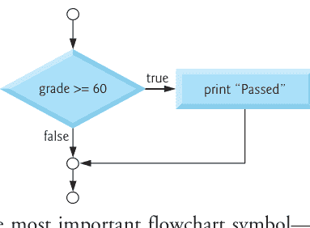

它包含了可能是最重要的流程图符号——菱形（或决策）符号，它表示需要做出决策。决策符号中的表达式通常是一个可以为真或为假的条件。从它引出的两条流线表示当表达式为真或为假时要采取的路径。决策可以基于任何表达式的值——零为假，非零为真。

if语句是一个单入口/单出口语句。我们很快就会了解到，其余控制结构的流程图片段也可以包含矩形符号来表示要执行的操作，以及菱形符号来表示要做出的决策。这就是我们一直强调的编程的操作/决策模型。

## 自我检查

- 1.（多选题）以下哪项陈述是错误的？
  a) 伪代码语句
      如果学生的成绩大于或等于60
          打印“通过”
      可以用C语言编写为
      ```
      if (grade >= 60) {
          puts("Passed");
      } // end if
      ```
  b) 从决策流程图符号引出的两条流线表示当符号中的表达式为真或为假时要采取的方向。
  c) 决策可以基于任何表达式——如果表达式求值为非零，则视为假；如果求值为零，则视为真。
  d) if语句是一个单入口/单出口语句。
  答案：c) 是错误的。实际上，决策可以基于任何表达式——如果表达式求值为零，则视为假；如果求值为非零，则视为真。

## 3.6 if...else选择语句

if...else选择语句指定了当条件为*真*或*假*时要执行的不同操作。例如，伪代码语句

```
如果学生的成绩大于或等于60
    打印“通过”
否则
    打印“不及格”
```

如果学生的成绩大于或等于60，则打印“通过”；否则，打印“不及格”。无论哪种情况，打印后，按顺序执行下一个伪代码语句。*else*的主体也进行了缩进。如果程序中有多个缩进级别，每个级别应缩进相同的额外空格量。上述伪代码可以用C语言编写如下

```
if (grade >= 60) {
    puts("Passed");
} // end if
else {
    puts("Failed");
} // end else
```

### if...else语句流程图

以下流程图说明了if...else语句的控制流：


### 条件表达式

**条件运算符**（?:）与if...else语句密切相关。这个运算符是C语言唯一的**三元运算符**——也就是说，它接受三个操作数。条件运算符及其三个操作数构成一个**条件表达式**。第一个操作数是一个条件。第二个是当条件为*真*时条件表达式的值。第三个是当条件为*假*时条件表达式的值。例如，以下puts语句的条件表达式参数，如果条件grade >= 60为真，则求值为字符串"Passed"；否则，求值为字符串"Failed"：

```
puts((grade >= 60) ? "Passed" : "Failed");
```

条件运算符可用于if...else语句无法使用的地方，包括表达式和函数（如printf）的参数。为条件运算符（?:）的第二个和第三个操作数使用相同类型的表达式，以避免细微的错误。

### 嵌套if...else语句

嵌套if...else语句通过将if...else语句放在if...else语句内部来测试多种情况。例如，以下伪代码语句打印：成绩大于或等于90打印A，大于或等于80（但小于90）打印B，大于或等于70（但小于80）打印C，大于或等于60（但小于70）打印D，所有其他成绩打印F。

```
如果学生的成绩大于或等于90
    打印“A”
否则
    如果学生的成绩大于或等于80
        打印“B”
    否则
        如果学生的成绩大于或等于70
            打印“C”
        否则
            如果学生的成绩大于或等于60
                打印“D”
            否则
                打印“F”
```

这段伪代码可以用C语言编写如下

```
if (grade >= 90) {
    puts("A");
} // end if
else {
    if (grade >= 80) {
        puts("B");
    } // end if
    else {
        if (grade >= 70) {
            puts("C");
        } // end if
        else {
            if (grade >= 60) {
                puts("D");
            } // end if
            else {
                puts("F");
            } // end else
        } // end else
    } // end else
} // end else
```

如果变量grade大于或等于90，所有四个条件都为真，但只有第一个测试后的puts语句会执行。然后，跳过“外部”if...else语句的else部分，绕过嵌套if...else语句的其余部分。

## 第3章 结构化程序开发

大多数程序员会将前面的if语句写成

```
if (grade >= 90) {
    puts("A");
} // end if
else if (grade >= 80) {
    puts("B");
} // end else if
else if (grade >= 70) {
    puts("C");
} // end else if
else if (grade >= 60) {
    puts("D");
} // end else if
else {
    puts("F");
} // end else
```

两种形式是等价的。后一种形式避免了向右的深度缩进，这种缩进会降低程序的可读性，有时还会导致行换行。

## 语句块与复合语句

要在if语句体中包含多条语句，必须将这些语句用花括号（{ 和 }）括起来。包含在一对花括号中的一组语句称为复合语句或语句块。复合语句可以放置在程序中任何可以放置单条语句的地方。

以下if...else语句的else部分包含一个复合语句，其中包含两条在条件为假时执行的语句：

```
if (grade >= 60) {
    puts("Passed.");
} // end if
else {
    puts("Failed.");
    puts("You must take this course again.");
} // end else
```

如果grade小于60，else中的两条puts语句都会执行，代码将打印：

```
Failed.
You must take this course again.
```

else子句中包围两条语句的花括号很重要。没有它们，语句

```
puts("You must take this course again.");
```

将位于else体之外（并且位于if...else语句之外），并且无论grade是否小于60都会执行，因此即使是及格的学生也必须重修这门课。为了避免此类问题，务必始终将控制语句的主体包含在花括号（{ 和 }）中，即使这些主体只包含单条语句。这解决了“悬垂else”问题，我们将在本章的练习中讨论这个问题。

## 3.6 if...else选择语句

### 错误的种类

语法错误（例如拼写错误“else”）由编译器捕获。逻辑错误在执行时产生影响。致命的逻辑错误会导致程序失败并提前终止。非致命的逻辑错误允许程序继续执行，但会产生不正确的结果。

### 空语句

在任何可以放置单条或复合语句的地方，都可以放置一个空语句，用分号（;）表示。在if的条件后放置分号，如

```
if (grade >= 60);
```

会导致单选择if语句中的逻辑错误，以及双选择和嵌套if...else语句中的语法错误。
在输入花括号内的单条语句之前，先输入复合语句的两个花括号。这有助于避免遗漏一个或两个花括号，从而防止语法错误（例如，if语句的if部分包含多条语句，这需要一对花括号）和逻辑错误。许多集成开发环境和代码编辑器会在你输入左花括号后立即为你插入右花括号。

## 自我检查

1. （真/假）以下代码在if...else语句的else部分包含一个复合语句：

```
if (grade >= 60) {
    puts("Passed.");
} // end if
else
    puts("Failed.");
    puts("You must take this course again.");
```

答案：假。此if...else语句的else部分中两个puts语句周围的花括号缺失。包含复合语句的正确代码是

```
if (grade >= 60) {
    puts("Passed.");
} // end if
else {
    puts("Failed.");
    puts("You must take this course again.");
} // end else
```

2. （真/假）以下puts语句的条件表达式参数

```
puts((grade >= 60) : "Passed" ? "Failed");
```

在条件grade >= 60为真时求值为字符串"Passed"；否则，求值为字符串"Failed"。

答案：*假*。此语句无法编译，因为条件运算符的?和:被颠倒了。产生所需结果的正确语句是

```
puts((grade >= 60) ? "Passed" : "Failed");
```

## 3.7 while迭代语句

**迭代语句**（也称为**重复语句**或循环）在某个条件保持*真*时重复一个动作。伪代码语句

```
While there are more items on my shopping list
    Purchase next item and cross it off my list
```

描述了购物过程中发生的迭代。条件“购物清单上还有更多物品”可能是*真*或*假*。如果是*真*，购物者会在条件保持*真*时重复执行“购买下一个物品并从清单上划掉”这个动作。最终，条件将变为*假*（当购物清单上的最后一个物品被购买并从清单上划掉时）。此时，迭代终止，伪代码语句中的下一条语句“执行”。

### 计算第一个大于100的3的幂

作为**while**语句示例，考虑一个查找第一个大于100的3的幂的程序段。整数变量product初始化为3。当以下代码段执行完毕时，product将包含所需答案：

```
int product = 3;
while (product <= 100) {
    product = 3 * product;
}
```

循环重复地将product乘以3，因此它依次取值9、27和81。当product变为243时，条件product <= 100变为*假*，终止迭代——product的最终值是243。执行继续到while之后的下一条语句。while语句体中的一个动作必须最终导致条件变为*假*；否则，循环将永远不会终止——这是一种称为**无限循环**的逻辑错误。while迭代语句中包含的语句构成其主体，主体可以是单条语句或复合语句。

### while语句流程图

以下流程图片段说明了前面的while迭代语句：

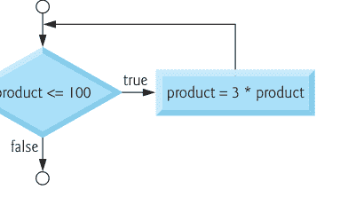

流程图清晰地显示了迭代——从矩形出来的流线指回进入判断框的流线。循环在每次迭代中测试菱形中的条件，直到条件最终变为*假*。此时，while语句退出，控制继续到顺序的下一条语句。

## 自我检查

1. *（程序段）* 本节中的while语句程序段查找第一个大于100的3的幂。重写此程序段，使其查找第一个大于或等于1024的2的幂，并将其留在product中。
**答案：** 见下文。

```
int product = 2;

while (product < 1024) {
    product = 2 * product;
}
```

2. *（填空）* while语句体中的一个动作必须最终导致条件变为*假*；否则，循环将永远不会终止。这是一种称为________的逻辑错误。
**答案：** 无限循环。

## 3.8 制定算法 案例研究1：计数器控制的迭代

为了说明算法是如何开发的，我们在本节和下一节中解决一个班级平均分问题的两个变体。考虑以下问题陈述：

> 一个由十名学生组成的班级参加了一次测验。这次测验的成绩（0到100范围内的整数）对你可用。确定这次测验的班级平均分。

班级平均分是成绩总和除以学生人数。解决此问题的算法必须输入成绩，然后计算并显示班级平均分。

### 班级平均分问题的伪代码

让我们使用伪代码列出要执行的动作，并指定它们应该执行的顺序。我们使用**计数器控制的迭代**来一次输入一个成绩。这种技术使用一个称为**计数器**的变量来指定一组语句应该执行的次数。在这个例子中，我们知道有十名学生参加了测验，所以我们需要输入10个成绩。当计数器超过10时，迭代终止。在这个案例研究中，我们只展示最终的伪代码算法（图3.1）和相应的C程序（图3.2）。在下一个案例研究中，我们将展示如何开发伪代码算法。计数器控制的迭代通常称为**确定性迭代**，因为在循环开始执行之前就知道迭代次数。

## 3.9 使用自顶向下、逐步细化的方法制定算法 案例研究 2：哨兵控制的迭代

让我们将班级平均分问题进行推广。考虑以下问题：

> 开发一个班级平均分程序，该程序在每次运行时都能处理任意数量的成绩。

在第一个班级平均分示例中，我们事先知道有10个成绩。在这个示例中，没有给出用户可能输入多少个成绩的提示。程序必须处理*任意*数量的成绩。程序如何确定何时停止输入成绩？它如何知道何时计算并打印班级平均分？

### 哨兵值

一种方法是使用**哨兵值**来表示“数据输入结束”。哨兵值也称为**信号值**、**虚拟值**或**标志值**。用户输入成绩，直到所有合法成绩输入完毕。然后用户输入哨兵值来表示“最后一个成绩已输入”。哨兵控制的迭代通常被称为**不定迭代**，因为在循环开始执行之前，迭代次数是未知的。

你应该选择一个不会与可接受的输入值混淆的哨兵值。测验成绩是非负整数，因此对于这个问题，-1是一个可接受的哨兵值。因此，班级平均分程序的一次运行可能会处理一串输入，例如95、96、75、74、89和-1。然后程序将计算并打印成绩95、96、75、74和89的班级平均分。哨兵值-1不应参与平均值的计算。

### 自顶向下、逐步细化

我们使用一种称为**自顶向下、逐步细化**的技术来处理班级平均分程序，这对于开发结构良好的程序至关重要。我们从**顶层**的伪代码表示开始：

计算测验的班级平均分

顶层是一个单一的语句，传达了程序的整体功能。因此，顶层实际上是一个程序的完整表示。不幸的是，顶层很少传达足够的细节来编写C程序。所以我们现在开始细化过程。我们将顶层分解为更小的任务，并按它们需要执行的顺序列出。这导致了以下**第一次细化**：

初始化变量
输入、求和并计数测验成绩
计算并打印班级平均分

这里，只使用了顺序结构——列出的步骤应该按顺序一个接一个地执行。每次细化，以及顶层本身，都是算法的完整规范。只有细节的层次不同。

### 第二次细化

为了进入下一个细化层次，即**第二次细化**，我们确定具体的变量。我们需要：

- 成绩的累计总和，
- 已处理成绩数量的计数，
- 一个变量用于接收每个输入的成绩值，以及
- 一个变量用于保存计算出的平均值。

伪代码语句

初始化变量

可以细化如下：

将总和初始化为零
将计数器初始化为零

只有总和和计数器需要初始化。用于计算平均值和用户输入成绩的变量不需要初始化，因为它们的值将分别通过计算和用户输入获得。伪代码语句

输入、求和并计数测验成绩

需要一个*迭代结构*来依次输入每个成绩。因为我们不知道要处理多少个成绩，我们将使用哨兵控制的迭代。用户将一次输入一个合法成绩。输入最后一个合法成绩后，用户将输入哨兵值。程序将在每次输入成绩后测试这个值，并在输入哨兵值时终止循环。上述伪代码语句的细化如下：

```
输入第一个成绩（可能是哨兵值）
当用户尚未输入哨兵值时
    将此成绩加入累计总和
    将成绩计数器加一
    输入下一个成绩（可能是哨兵值）
```

在伪代码中，我们不在构成循环体的语句集周围使用花括号。我们只需将循环体语句缩进在*while*下面。同样，伪代码是一种非正式的程序开发辅助工具。

伪代码语句

```
计算并打印班级平均分
```

可以细化如下：

```
如果计数器不等于零
    将平均值设置为总和除以计数器
    打印平均值
否则
    打印“未输入任何成绩”
```

我们在这里小心地测试**除以零**的可能性——这是一个致命错误 ⓧERR，如果未被检测到，将导致程序失败（通常称为“**崩溃**”）。你应该显式地测试这种情况，并在程序中适当地处理它，例如打印错误消息，而不是让致命错误发生。

### 完整的第二次细化

完整的第二次细化如图3.3所示。我们在伪代码中包含一些空行以提高可读性。

```
1  将总和初始化为零
2  将计数器初始化为零
3
4  输入第一个成绩（可能是哨兵值）
5  当用户尚未输入哨兵值时
6      将此成绩加入累计总和
7      将成绩计数器加一
8      输入下一个成绩（可能是哨兵值）
```

**图3.3** | 使用哨兵控制的迭代解决班级平均分问题的伪代码算法。（第1部分，共2部分。）

98 第3章 结构化程序开发

```
1 将总和设置为零
2 将成绩计数器设置为一
3
4 当成绩计数器小于或等于十时
5     输入下一个成绩
6     将成绩加入总和
7     将成绩计数器加一
8
9 将班级平均分设置为总和除以十
10 打印班级平均分
```

图3.1 | 使用计数器控制的迭代解决班级平均分问题的伪代码算法。

```
1 // fig03_02.c
2 // 使用计数器控制的迭代的班级平均分程序。
3 #include <stdio.h>
4
5 // 函数main开始程序执行
6 int main(void) {
7     // 初始化阶段
8     int total = 0; // 将成绩总和初始化为0
9     int counter = 1; // 下一个要输入的成绩编号
10
11    // 处理阶段
12    while (counter <= 10) { // 循环10次
13        printf("%s", "Enter grade: "); // 提示输入
14        int grade = 0; // 成绩值
15        scanf("%d", &grade); // 从用户读取成绩
16        total = total + grade; // 将成绩加入总和
17        counter = counter + 1; // 计数器加一
18    } // 结束while
19
20    // 终止阶段
21    int average = total / 10; // 整数除法
22    printf("Class average is %d\n", average); // 显示结果
23 } // 结束函数main
```

```
Enter grade: 98
Enter grade: 76
Enter grade: 71
Enter grade: 87
Enter grade: 83
Enter grade: 90
Enter grade: 57
Enter grade: 79
Enter grade: 82
Enter grade: 94
Class average is 81
```

图3.2 | 使用计数器控制的迭代的班级平均分问题。

**总和**是一个变量（第8行），用于累积一系列值的总和。计数器是一个变量（第9行），用于计数——在这种情况下，用于计数输入的成绩数量。用于存储总和的变量应初始化为零；否则，总和将包括存储在总和内存位置中的先前值。你应该初始化所有的计数器和总和。计数器通常初始化为零或一，具体取决于它们的用途——我们将展示每种情况的示例。未初始化的变量包含一个“**垃圾**”值——即存储在该变量保留的内存位置中的最后一个值。如果计数器或总和未初始化，你的程序结果可能不正确。这些都是逻辑错误的例子。

在前面的示例执行中，平均分是81，但我们输入的成绩总和是817。当然，817除以10应该得到81.7——一个带小数点的数字。下一节将展示如何处理这样的*浮点数*。

## 自我检查

1. **（填空）** 计数器控制的迭代通常被称为_______迭代，因为在循环开始执行之前，迭代次数是已知的。
   **答案：** 确定的。

2. **（判断题）** 用于存储总和的变量在程序中使用前应初始化为一；否则，总和将包括存储在总和内存位置中的先前值。
   **答案：** *错误。* 实际上，用于存储总和的变量在程序中使用前应初始化为*零*；否则，总和将包括存储在总和内存位置中的先前值。

## 基本程序中的阶段

许多程序在逻辑上可以分为三个阶段：

-   一个**初始化阶段**，用于初始化程序变量；
-   一个**处理阶段**，用于输入数据值并相应地调整程序变量；以及
-   一个**终止阶段**，用于计算并打印最终结果。

## 伪代码精化的次数

图 3.3 中的伪代码算法解决了更通用的班级平均分问题。该算法仅经过两级精化就开发出来了。有时需要更多级别的精化。当伪代码算法提供了足够的细节，足以让你将其转换为 C 语言时，你就终止自顶向下、逐步精化的过程。

在计算机上解决问题最具挑战性的部分是开发解决方案的算法。一旦指定了正确的算法，生成一个可工作的 C 程序通常就很简单了。许多程序员在编写程序时从未使用过伪代码等程序开发工具。他们觉得自己的最终目标是解决问题，而编写伪代码只会延迟最终输出的产生。对于你自己使用的小型程序，这可能行得通。但对于你将来在行业中可能参与的大型程序和软件系统，一个正式的开发过程是必不可少的。

## 任意数量成绩的班级平均分程序

图 3.4 展示了 C 程序和两个示例执行。虽然只输入了整数成绩，但平均值计算很可能产生一个带小数点的数字。`int` 类型无法表示这样的数字。因此，该程序引入了数据类型 **double** 来处理带小数点的数字——即**浮点数**。我们引入了一个强制转换运算符来强制平均值计算使用浮点数。这些特性在程序清单之后进行解释。注意，第 13 行和第 23 行在请求数据输入的提示中都包含了哨兵值。这是哨兵控制循环中的一个良好实践。

```c
// fig03_04.c
// 使用哨兵控制迭代的班级平均分程序。
#include <stdio.h>

// 函数 main 开始程序执行
int main(void) {
    // 初始化阶段
    int total = 0; // 初始化总和
    int counter = 0; // 初始化循环计数器

    // 处理阶段
    // 从用户获取第一个成绩
    printf("%s", "Enter grade, -1 to end: "); // 输入提示
    int grade = 0; // 成绩值
    scanf("%d", &grade); // 从用户读取成绩

    // 当尚未从用户读取到哨兵值时循环
    while (grade != -1) {
        total = total + grade; // 将成绩加到总和
        counter = counter + 1; // 计数器加一

        // 从用户获取下一个成绩
        printf("%s", "Enter grade, -1 to end: "); // 输入提示
        scanf("%d", &grade); // 读取下一个成绩
    } // 结束 while

    // 终止阶段
    // 如果用户至少输入了一个成绩
    if (counter != 0) {

        // 计算所有输入成绩的平均值
        double average = (double) total / counter; // 避免截断

        // 显示平均值，保留两位小数
        printf("Class average is %.2f\n", average);
    } // 结束 if
    else { // 如果没有输入成绩，输出消息
        puts("No grades were entered");
    } // 结束 else
} // 结束函数 main
```

```
Enter grade, -1 to end: 75
Enter grade, -1 to end: 94
Enter grade, -1 to end: 97
Enter grade, -1 to end: 88
Enter grade, -1 to end: 70
Enter grade, -1 to end: 64
Enter grade, -1 to end: 83
Enter grade, -1 to end: 89
Enter grade, -1 to end: -1
Class average is 82.50
```

```
Enter grade, -1 to end: -1
No grades were entered
```

图 3.4 | 使用哨兵控制迭代的班级平均分程序。

## 在 while 语句中始终使用花括号

如果没有这个 while 循环的花括号（第 18 行和第 25 行），只有第 19 行的语句会在循环体内。代码将被错误地解释为

```c
while (grade != -1)
    total = total + grade; // 将成绩加到总和
counter = counter + 1; // 计数器加一
// 从用户获取下一个成绩
printf("%s", "Enter grade, -1 to end: "); // 输入提示
scanf("%d", &grade); // 读取下一个成绩
```

ERR ⊗ 如果用户没有输入 -1 作为第一个成绩，这将导致无限循环。

## 显式和隐式类型转换

平均值通常是像 7.2 或 –93.5 这样包含小数部分的值。这些浮点数可以用 `double` 数据类型表示。第 32 行将变量 `average` 定义为 `double` 类型，以捕获计算的小数结果。通常，`total / counter`（第 32 行）的计算结果是一个整数，因为 `total` 和 `counter` 都是 `int` 变量。两个整数相除会导致整数除法——计算的任何小数部分都会被截断（即丢失）。你可以通过首先创建临时浮点数来用整数值产生浮点计算。C 提供了一元强制转换运算符来完成此任务。第 32 行

```c
double average = (double) total / counter;
```

使用强制转换运算符 `(double)` 创建其操作数 `total` 的临时浮点副本。存储在 `total` 中的值仍然是一个整数。以这种方式使用强制转换运算符称为显式转换。计算现在由一个浮点值——`total` 的临时 double 版本——除以存储在 `counter` 中的 int 值组成。

C 要求算术表达式中的操作数数据类型只需相同。在混合类型表达式中，编译器对选定的操作数执行称为隐式转换的操作，以确保它们具有相同的类型。例如，在一个包含 `int` 和 `double` 数据类型的表达式中，会创建 `int` 操作数的副本并隐式转换为 `double` 类型。在我们显式地将 `total` 转换为 `double` 之后，编译器隐式地创建 `counter` 的 double 副本，然后执行浮点除法并将浮点结果赋给 `average`。第 5 章讨论了 C 语言转换不同类型操作数的规则。

强制转换运算符通过将类型名称放在括号中形成。强制转换是一元运算符，只接受一个操作数。C 还支持一元加号 (+) 和减号 (–) 运算符，因此你可以编写像 -7 或 +5 这样的表达式。强制转换运算符从右向左结合，并且与其他一元运算符（如一元 + 和一元 –）具有相同的优先级。此优先级比乘法运算符 `*`、`/` 和 `%` 高一级。

## 格式化浮点数

转换——该值将有两位（2）小数位。如果使用 `%f` 转换规范而未指定精度，则**默认精度**为小数点后 6 位，就像使用了转换规范 `%.6f` 一样。当浮点值以指定精度打印时，打印的值会**四舍五入**到指定的小数位数。内存中的值保持不变。以下语句分别显示值 3.45 和 3.4：

```c
printf("%.2f\n", 3.446); // 显示 3.45
printf("%.1f\n", 3.446); // 显示 3.4
```

## 关于浮点数的说明

尽管浮点数并非总是“100% 精确”，但它们有许多应用。例如，当我们说“正常”体温是 98.6 华氏度时，我们不需要精确到很多位数。当我们在温度计上看到温度并读作 98.6 时，它实际上可能是 98.5999473210643。这里的关键是，对于大多数应用来说，简单地称这个数字为 98.6 是可以的。我们稍后会更多地讨论这个问题。

浮点数通常通过除法产生。当我们用 10 除以 3 时，结果是 3.3333333…，其中 3 的序列无限重复。计算机只分配固定的空间来存储这样的值，因此存储的浮点值只能是近似值。以假设它们被精确表示的方式使用浮点数可能导致不正确的结果。大多数计算机只能近似表示浮点数。因此，你也不应该比较浮点值是否相等。

## 自我检查

1.  **（填空题）** 哨兵控制迭代通常被称为 ________ 迭代，因为在循环开始执行之前不知道迭代次数。
    **答案：** 不定。

2.  **（选择题）** 下列哪项陈述是 *错误* 的？
    a) 许多程序在逻辑上可以分为三个阶段：一个初始化阶段，用于初始化程序变量；一个处理阶段，用于输入数据值并相应地调整程序变量；以及一个终止阶段，用于计算并打印最终结果。
    b) 当伪代码算法被指定得足够详细，足以让你能够将其转换为 C 语言时，你就终止自顶向下、逐步精化。
    c) 经验表明，在计算机上解决问题最困难的部分是从算法生成一个可工作的 C 程序。
    d) 许多程序员在编写程序时从未使用过伪代码等程序开发工具。他们觉得自己的最终目标是在计算机上解决问题，而编写伪代码只会延迟最终输出的产生。

**答案：** c) 是*错误的*。实际上，经验表明，在计算机上解决问题最困难的部分是开发解决方案的算法。一旦指定了正确的算法，生成可工作的C程序的过程通常是直接了当的。

**3** *(程序段)* 当浮点值以指定精度打印时，打印的值会被四舍五入。编写语句，分别以一位、四位和十位精度显示值98.5999473210643，并说明每种情况下显示的内容。
**答案：** 见下文。

```
printf("%.1f\n", 98.5999473210643); // 显示 98.6
printf("%.4f\n", 98.5999473210643); // 显示 98.5999
printf("%.10f\n", 98.5999473210643); // 显示 98.5999473211
```

## 3.10 使用自顶向下、逐步细化制定算法 案例研究 3：嵌套控制语句

让我们再解决一个完整的问题。我们将使用伪代码和自顶向下、逐步细化来制定算法，并编写相应的C程序。我们已经看到，控制语句可以像孩子堆叠积木一样，一个接一个地（按顺序）堆叠。在这个案例研究中，我们将看到C语言中控制语句可以连接的唯一另一种结构化方式，即将一个控制语句**嵌套**在另一个控制语句内部。考虑以下问题陈述：

> 一所大学开设了一门课程，为学生准备房地产经纪人州执照考试。去年，有10名完成该课程的学生参加了执照考试。自然，学校想知道其学生在考试中的表现如何。你被要求编写一个程序来总结结果。你得到了这10名学生的名单。每个名字旁边都有一个数字，1表示学生通过了考试，2表示学生未通过。

你的程序应按如下方式分析考试结果：
1.  输入每个测试结果（即1或2）。每次程序请求另一个测试结果时，显示提示消息“Enter result”。
2.  统计每种类型测试结果的数量。
3.  显示测试结果摘要，指出通过和未通过的学生人数。
4.  如果超过八名学生通过了考试，打印消息“Bonus to instructor!”。

仔细阅读问题陈述后，我们做出以下观察：

1.  程序必须处理10个测试结果。我们将使用计数器控制的循环。
2.  每个测试结果是一个数字——要么是1，要么是2。每次程序读取一个测试结果时，它必须确定结果是1还是2。我们将在算法中测试是否为1。如果数字不是1，我们假定它是2。练习3.27要求你确保每个测试结果都是1或2。
3.  使用两个计数器——一个统计通过考试的学生人数，另一个统计未通过考试的学生人数。
4.  在程序处理完所有结果后，它必须决定是否有超过8名学生通过了考试，如果是，则打印“Bonus to Instructor!”。

### 伪代码表示顶层

让我们继续进行自顶向下、逐步细化。我们从顶层的伪代码表示开始：

> 分析考试结果并决定是否应给予教师奖励

再次强调，重要的是要认识到顶层是程序的完整表示，但在伪代码能够自然地演变成C程序之前，可能需要多次细化。

### 第一次细化

我们的第一次细化是：

> 初始化变量
> 输入十个测验成绩并统计通过和失败次数
> 打印考试结果摘要并决定是否奖励教师

这里，即使我们有了整个程序的*完整*表示，仍然需要进一步细化。

### 第二次细化

我们现在确定具体的变量。我们需要计数器来记录通过和失败次数，一个计数器来控制循环过程，以及一个变量来存储用户输入。伪代码语句

> 初始化变量

可以细化如下：

> 将passes初始化为零
> 将failures初始化为零
> 将student初始化为一

只初始化了计数器和总计数。伪代码语句

> 输入十个测验成绩并统计通过和失败次数

需要一个循环来依次输入每个考试结果。这里我们事先知道恰好有十个考试结果，因此计数器控制的循环是合适的。在循环内部（即**嵌套**在循环内），一个双选择语句将确定每个考试结果是通过还是失败，并增加相应的计数器。上述伪代码语句的细化如下：

> 当student计数器小于或等于十时
>     输入下一个考试结果
>     如果学生通过
>         将passes加一
>     否则
>         将failures加一
>     将student计数器加一

伪代码语句

> 打印考试结果摘要并决定是否奖励教师

可以细化如下：

> 打印通过人数
> 打印失败人数
> 如果超过八名学生通过
>     打印“Bonus to instructor!”

### 完整的第二次细化

图3.5包含了完整的第二次细化。我们使用空行以提高可读性。

```
1  将passes初始化为零
2  将failures初始化为零
3  将student初始化为一
4
5  当student计数器小于或等于十时
6      输入下一个考试结果
7
8      如果学生通过
9          将passes加一
10     否则
11         将failures加一
12
13     将student计数器加一
14
15 打印通过人数
16 打印失败人数
17 如果超过八名学生通过
18     打印“Bonus to instructor!”
```

图3.5 | 考试结果问题的伪代码。

### 实现算法

这个伪代码现在已经足够细化，可以转换为C语言。图3.6展示了C程序和两个示例执行。

```
1  // fig03_06.c
2  // 考试结果分析。
3  #include <stdio.h>
4
5  // 函数main开始程序执行
6  int main(void) {
7      // 在定义中初始化变量
8      int passes = 0;
9      int failures = 0;
10     int student = 1;
11
12     // 使用计数器控制的循环处理10名学生
13     while (student <= 10) {
14         // 提示用户输入并获取用户值
15         printf("%s", "Enter result (1=pass,2=fail): ");
16         int result = 0; // 一个考试结果
17         scanf("%d", &result);
18
19         // 如果结果为1，则增加passes
20         if (result == 1) {
21             passes = passes + 1;
22         } // 结束if
23         else { // 否则，增加failures
24             failures = failures + 1;
25         } // 结束else
26
27         student = student + 1; // 增加student计数器
28     } // 结束while
29
30     // 终止阶段；显示通过和失败人数
31     printf("Passed %d\n", passes);
32     printf("Failed %d\n", failures);
33
34     // 如果超过八名学生通过，打印“Bonus to instructor!”
35     if (passes > 8) {
36         puts("Bonus to instructor!");
37     } // 结束if
38 } // 结束函数main
```

```
Enter Result (1=pass, 2=fail): 1
Enter Result (1=pass, 2=fail): 2
Enter Result (1=pass, 2=fail): 2
Enter Result (1=pass, 2=fail): 1
Enter Result (1=pass, 2=fail): 1
Enter Result (1=pass, 2=fail): 1
Enter Result (1=pass, 2=fail): 2
Enter Result (1=pass, 2=fail): 1
Enter Result (1=pass, 2=fail): 1
Enter Result (1=pass, 2=fail): 2
Passed 6
Failed 4
```

图3.6 | 考试结果分析。（第1部分，共2部分。）

```
Enter Result (1=pass, 2=fail): 1
Enter Result (1=pass, 2=fail): 1
Enter Result (1=pass, 2=fail): 1
Enter Result (1=pass, 2=fail): 2
Enter Result (1=pass, 2=fail): 1
Enter Result (1=pass, 2=fail): 1
Enter Result (1=pass, 2=fail): 1
Enter Result (1=pass, 2=fail): 1
Enter Result (1=pass, 2=fail): 1
Enter Result (1=pass, 2=fail): 1
Passed 9
Failed 1
Bonus to instructor!
```

图3.6 | 考试结果分析。（第2部分，共2部分。）

## 自我检查

1 (填空题) 控制语句可以像孩子堆叠积木一样，一个接一个地（按顺序）堆叠。C语言中控制语句可以连接的唯一另一种结构化方式是________——即将一个控制语句放在另一个控制语句内部。
答案：嵌套。

## 3.11 赋值运算符

C提供了几个赋值运算符来缩写赋值表达式。例如，语句
`c = c + 3;`
可以用**加法赋值运算符 +=** 缩写为
`c += 3;`
+= 运算符将运算符右侧表达式的值加到运算符左侧变量的值上，然后将结果存储在左侧变量中。因此，赋值 c += 3 将3加到c的当前值上。下表显示了算术赋值运算符、使用这些运算符的示例表达式以及解释：

| 赋值运算符 | 示例表达式 | 解释 | 赋值给 |
| :--- | :--- | :--- | :--- |
| 假设：int c = 3, d = 5, e = 4, f = 6, g = 12; | | | |
| += | c += 7 | c = c + 7 | 10 给 c |
| -= | d -= 4 | d = d - 4 | 1 给 d |
| *= | e *= 5 | e = e * 5 | 20 给 e |
| /= | f /= 3 | f = f / 3 | 2 给 f |
| %= | g %= 9 | g = g % 9 | 3 给 g |

## 自我检查

1.  （填空题）语句 `b = b * 5;` 可以使用乘法赋值运算符 `*=` 简写为 ________。
    **答案：** `b *= 5;`

2.  （填空题）赋值语句 `c -= 3;` 的作用是什么？ ________
    **答案：** 从 c 的当前值中减去 3。

## 3.12 自增和自减运算符

一元**自增运算符**（`++`）和一元**自减运算符**（`--`）分别用于将整型变量的值加一和减一。下表总结了每个运算符的两种版本：

| 运算符 | 示例表达式 | 说明 |
| :--- | :--- | :--- |
| `++` | `++a` | 将 a 加 1，然后在 a 所在的表达式中使用 a 的新值。 |
| `++` | `a++` | 在 a 所在的表达式中使用 a 的当前值，然后将 a 加 1。 |
| `--` | `--b` | 将 b 减 1，然后在 b 所在的表达式中使用 b 的新值。 |
| `--` | `b--` | 在 b 所在的表达式中使用 b 的当前值，然后将 b 减 1。 |

要将变量 c 加 1，你可以使用运算符 `++`，而不是表达式 `c = c + 1` 或 `c += 1`。如果你将 `++` 或 `--` 放在变量之前（即前缀形式），它们被称为**前自增**或**前自减**运算符。如果你将 `++` 或 `--` 放在变量之后（即后缀形式），它们被称为**后自增**或**后自减**运算符。按照惯例，一元运算符应紧邻其操作数，中间不留空格。

图 3.7 演示了 `++` 运算符的前自增和后自增版本之间的区别。对变量 c 进行后自增会导致它在 `printf` 语句中使用*之后*才被递增。对变量 c 进行前自增会导致它在 `printf` 语句中使用*之前*就被递增。该程序显示了使用 `++` 前后 c 的值。自减运算符（`--`）的工作方式类似。

```c
// fig03_07.c
// 前自增和后自增。
#include <stdio.h>

// 函数 main 开始程序执行
int main(void) {
    // 演示后自增
    int c = 5; // 将 5 赋值给 c
    printf("%d\n", c); // 打印 5
    printf("%d\n", c++); // 打印 5 然后后自增
    printf("%d\n\n", c); // 打印 6

    // 演示前自增
    c = 5; // 将 5 赋值给 c
    printf("%d\n", c); // 打印 5
    printf("%d\n", ++c); // 前自增然后打印 6
    printf("%d\n", c); // 打印 6
} // 函数 main 结束
```

```
5
5
6

5
6
6
```

**图 3.7** | 前自增和后自增。

图 3.6 中的三个赋值语句

```c
passes = passes + 1;
failures = failures + 1;
student = student + 1;
```

可以使用赋值运算符更简洁地写成

```c
passes += 1;
failures += 1;
student += 1;
```

使用前自增运算符写成

```c
++passes;
++failures;
++student;
```

或者使用后自增运算符写成

```c
passes++;
failures++;
student++;
```

当在一个单独的语句中对变量进行自增或自减时，前自增和后自增形式具有相同的效果。只有当变量出现在更大的表达式上下文中时，前自增和后自增才会产生不同的效果（前自减和后自减也类似）。

只有简单的变量名才能用作 `++` 或 `--` 运算符的操作数。尝试对简单变量名以外的表达式使用自增或自减运算符是语法错误——例如，`++(x + 1)`。

C 语言通常不指定运算符的操作数求值的顺序。我们将在下一章看到一些运算符的例外情况。为避免细微的错误，`++` 和 `--` 运算符应仅用于修改恰好一个变量的语句中。

下表按优先级从高到低列出了迄今为止显示的运算符。

| 运算符 | 结合性 | 类型 |
| :--- | :--- | :--- |
| `++` (后缀) `--` (后缀) | 从右到左 | 后缀 |
| `+` `-` (类型) `++` (前缀) `--` (前缀) | 从右到左 | 一元 |
| `*` `/` `%` | 从左到右 | 乘法 |
| `+` `-` | 从左到右 | 加法 |
| `<` `<=` `>` `>=` | 从左到右 | 关系 |
| `==` `!=` | 从左到右 | 相等 |
| `?:` | 从右到左 | 条件 |
| `=` `+=` `-=` `*=` `/=` `%=` | 从右到左 | 赋值 |

第三列命名了各种运算符组。请注意，条件运算符（`?:`）、一元运算符自增（`++`）、自减（`--`）、正号（`+`）、负号（`-`）和类型转换，以及赋值运算符 `=`、`+=`、`-=`、`*=`、`/=` 和 `%=` 是从右到左结合的。其他运算符是从左到右结合的。

## 自我检查

1.  （选择题）给定以下代码：
    ```c
    --i;
    ```
    下列哪个语句描述了这段代码的作用？
    a) 将 i 加 1，然后在 i 所在的表达式中使用 i 的新值。
    b) 在 i 所在的表达式中使用 i 的当前值，然后将 i 加 1。
    c) 将 i 减 1，然后在 i 所在的表达式中使用 i 的新值。
    d) 在 i 所在的表达式中使用 i 的当前值，然后将 i 减 1。
    **答案：** c。

2.  （这段代码做了什么？）这个程序显示的 x 的最终值是多少？
    ```c
    #include <stdio.h>

    int main(void) {
        int x = 7;
        printf("%d\n", x);
        printf("%d\n", x++);
        printf("%d\n\n", x);
        x = 8;
        printf("%d\n", x);
        printf("%d\n", ++x);
        printf("%d\n", x);
    }
    ```
    **答案：** 9。

3.  （选择题）下列哪个表达式包含语法错误？
    a) `++x + 1`
    b) `x++ + x`
    c) `++(x) + 1`
    d) `++(x + 1)`
    **答案：** d。只有简单的变量名才能用作 `++` 或 `--` 运算符的操作数。尝试对简单变量名以外的表达式使用自增或自减运算符是语法错误——例如，`++(x + 1)`。

## 3.13 安全的 C 编程

### 算术溢出

图 2.4 展示了一个加法程序，它使用以下语句计算两个 int 值的和

```c
sum = integer1 + integer2; // 将总和赋值给 sum
```

即使是这个简单的语句也存在潜在问题。将整数相加可能导致结果值过大，无法存储在 int 变量 sum 中。这被称为算术溢出，可能导致未定义行为，可能使系统容易受到攻击。

常量 `INT_MAX` 和 `INT_MIN` 表示可以存储在 int 变量中的特定于平台的最大值和最小值。这些常量在头文件 `<limits.h>` 中定义。对于其他整数类型，也有类似的常量，我们将在下一章介绍。你可以通过在文本编辑器中打开头文件 `<limits.h>` 来查看你的平台的这些常量的值。²

良好的实践是确保在执行上述算术计算之前，它们不会溢出。有关示例，请参见 CERT 网站。

https://wiki.sei.cmu.edu/confluence/display/c/

搜索指南 INT32-C。该代码使用了 `&&`（逻辑与）和 `||`（逻辑或）运算符，我们将在第 4 章讨论。在工业级代码中，你应该对所有计算执行此类检查。后续章节将展示处理此类错误的其他编程技术。

### scanf_s 和 printf_s

在第 6.13 节和第 7.13 节中讨论了安全问题。附录 K 被指定为可选，因此并非每个 C 供应商都实现它。特别是，GNU C++ 和 Clang C++ 编译器不实现附录 K，因此使用 `scanf_s` 和 `printf_s` 可能会损害你的代码在编译器之间的可移植性。

微软在 C11 标准之前就实现了自己的 Visual C++ 版本的 `printf_s` 和 `scanf_s`，其编译器立即开始对每个 `scanf` 调用发出警告。警告说 `scanf` 已被弃用——不应再使用——你应该考虑改用 `scanf_s`。微软现在将以前关于 `scanf` 的警告视为错误。包含 `scanf` 的程序将无法在 Visual C++ 上编译，你将无法执行该程序。

许多组织都有编码标准，要求代码在没有警告消息的情况下编译。有两种方法可以消除 Visual C++ 的 `scanf` 警告——使用 `scanf_s` 代替 `scanf` 或禁用这些警告。对于我们目前使用的输入语句，Visual C++ 用户可以简单地将 `scanf` 替换为 `scanf_s`。你可以按照以下步骤在 Visual C++ 中禁用警告消息：

1.  按 *Alt F7* 显示项目的 **属性页** 对话框。
2.  在左栏中，展开 **配置属性 > C/C++** 并选择 **预处理器**。
3.  在右栏中，在 **预处理器定义** 的值末尾插入 `;_CRT_SECURE_NO_WARNINGS`
4.  单击 **确定** 保存更改。

你将不再收到关于 `scanf`（或任何其他因类似原因被微软弃用的函数）的警告。对于工业级编码，不建议禁用警告。我们将在后面的安全 C 编码指南部分进一步讨论 `scanf_s` 和 `printf_s`。

## 自我检查

1.  **（填空题）** 将两个整数相加，导致结果值过大而无法存储在 `int` 变量中，这被称为算术 ________，可能导致未定义行为，可能使系统容易受到攻击。
    **答案：** 溢出。

2.  **（填空题）** 可以存储在 `int` 变量中的特定于平台的最大值和最小值分别由常量 `INT_MAX` 和 `INT_MIN` 表示，它们在头文件 ________ 中定义。
    **答案：** `<limits.h>`。

## 总结

### 第 3.1 节 简介

- 在编写程序解决特定问题之前，你必须透彻理解该问题并仔细规划解决方法。

## 第3章 结构化程序开发

## 第3.2节 算法

- 任何计算问题的解决方案都涉及按特定顺序执行一系列**操作**（第86页）。
- **算法**（第86页）是一种**过程**（第86页），它通过要执行的**操作**（第86页）以及这些操作应执行的顺序来解决问题。

## 第3.3节 伪代码

- **伪代码**（第87页）是一种人工且非正式的语言，用于帮助你开发算法。
- 伪代码类似于日常英语；它不是一种实际的计算机编程语言。
- 伪代码程序帮助你“构思”程序。
- 伪代码仅由字符组成。你可以使用任何文本编辑器输入伪代码。
- 精心准备的伪代码可以轻松转换为相应的C程序。
- 伪代码仅由操作和决策组成。

## 第3.4节 控制结构

- 通常，程序中的语句按照它们编写的顺序一个接一个地执行。这称为**顺序执行**（第88页）。
- 各种C语句使你能够指定下一个要执行的语句可能不是顺序中的下一个。这称为**控制转移**（第88页）。
- **结构化编程**几乎已成为“**消除goto**”（第88页）的同义词。
- 结构化程序更清晰、更易于调试和修改，并且更有可能是无错误的。
- 所有程序都可以使用**顺序**、**选择**和**迭代控制结构**（第88页）编写。
- 除非另有指示，计算机将自动按顺序执行C语句。
- **流程图**（第88页）是使用**矩形**、**菱形**、**圆角矩形**和**小圆圈**绘制的算法的图形表示，这些图形由称为**流程线**（第88页）的箭头连接。
- **矩形（操作）符号**（第89页）表示任何类型的操作，包括计算或输入/输出操作。
- **流程线**指示执行操作的顺序。
- 在绘制表示完整算法的流程图时，我们使用包含“开始”的圆角矩形作为第一个符号，使用包含“结束”的圆角矩形作为最后一个符号。当仅绘制算法的一部分时，我们省略圆角矩形符号，而使用称为**连接符符号**的小圆圈。
- **if单选择语句**选择或忽略单个操作（或一组操作）。
- **if...else双选择语句**（第89页）在两个不同的操作（或一组操作）之间进行选择。
- **switch多选择语句**（第89页）根据表达式的值在许多不同的操作中进行选择。
- C提供三种类型的**迭代语句**（也称为重复语句），即**while**、**do...while**和**for**。
- 控制语句流程图段可以通过控制语句**堆叠**（第89页）相互连接——将一个的出口点连接到下一个的入口点。
- 控制语句也可以**嵌套**。
- C使用**单入口/单出口控制语句**（第89页）。

## 第3.5节 if选择语句

- 选择结构用于在备选行动方案中进行选择。
- **菱形（决策）符号**（第91页）表示需要做出决策。
- **决策符号**的表达式通常是一个可以是*真*或*假*的条件。决策符号有两个流程线从其引出，指示当表达式为*真*或*假*时应采取的方向。
- 决策可以基于任何表达式的值——零为*假*，非零为*真*。

## 第3.6节 if...else选择语句

- **条件运算符**（?:，第92页）与if...else语句密切相关。
- 条件运算符是C中唯一的**三元运算符**——它接受三个操作数。第一个是条件。第二个是当条件为*真*时**条件表达式**（第92页）的值。第三个是当条件为*假*时条件表达式的值。
- **嵌套if...else语句**（第93页）通过将if...else语句放在if...else语句内部来测试多种情况。
- 一对花括号内的一组语句称为**复合语句**或**块**（第94页）。
- 语法错误由编译器捕获。逻辑错误在执行时产生影响。致命的逻辑错误导致程序失败并提前终止。非致命的逻辑错误允许程序继续执行但产生不正确的结果。

## 第3.7节 while迭代语句

- **while迭代语句**（第96页）指定一个操作在条件为*真*时重复执行。最终，条件将变为*假*。此时，迭代终止，并执行迭代语句之后的第一条语句。

## 第3.8节 制定算法 案例研究1：计数器控制迭代

- **计数器控制迭代**（第97页）使用一个称为**计数器**（第97页）的变量来指定一组语句应执行的次数。
- 计数器控制迭代通常称为**确定迭代**（第97页），因为在循环开始执行之前就知道迭代次数。
- **总计**（第99页）是一个用于累积一系列值之和的变量。用于存储总计的变量应初始化为零。
- **计数器**是一个用于计数的变量。计数器变量通常初始化为零或一，具体取决于其用途。
- **未初始化变量**包含一个“垃圾”值（第99页）——即存储在为该变量保留的内存位置中的最后一个值。

## 第3.9节 使用自顶向下、逐步细化制定算法 案例研究2：哨兵控制迭代

- **哨兵值**（第99页；也称为**信号值**、**虚拟值**或**标志值**）在哨兵控制循环中用于指示“数据输入结束”。
- **哨兵控制迭代**通常称为**不确定迭代**（第99页），因为在循环开始执行之前不知道迭代次数。
- 哨兵值必须选择得当，以免与可接受的输入值混淆。

## 第3章 结构化程序开发

- 在**自顶向下、逐步细化**（第100页）中，**顶部**是传达程序整体功能的语句。它是程序的完整表示。在**细化过程**中，我们将顶部分解为更小的任务，并按执行顺序列出这些任务。
- 类型**double**（第102页）表示带小数点的**浮点数**。
- 当两个整数相除时，结果的任何小数部分都会被**截断**（第104页）。
- 要使用整数值进行浮点计算，你可以将整数**转换**为浮点数。C提供**一元转换运算符**（double）来完成此任务。
- 转换运算符（第104页）执行**显式转换**。
- C要求算术表达式中的操作数具有相同的数据类型。为确保这一点，编译器对选定的操作数执行**隐式转换**（第104页）。
- 转换运算符通过将类型名称放在括号中形成。转换运算符是一个**一元运算符**——它只接受一个操作数。
- **转换运算符从右向左结合**，与其他一元运算符（如一元+和一元-）具有相同的优先级。此优先级比*、/和%高一级。
- printf转换说明符%.2f指定浮点值将显示小数点后两位数字。如果使用%f转换说明符（未指定精度），则**默认精度**（第105页）为6。
- 当浮点值以精度打印时，打印值会**四舍五入**（第105页）到指定的小数位数以供显示。

## 第3.11节 赋值运算符

- C提供几个赋值运算符用于**缩写赋值表达式**（第110页）。
- +=运算符将其右侧表达式的值加到其左侧变量的值上，并将结果存储在其左侧的变量中。
- 为每个二元运算符+、-、*、/和%提供了赋值运算符。

## 第3.12节 自增和自减运算符

- C提供**一元自增运算符**++（第111页）和**一元自减运算符**--（第111页），用于整型。
- 如果++或--运算符放在变量之前，它们分别称为**前自增**或**前自减运算符**。如果++或--运算符放在变量之后，它们分别称为**后自增**或**后自减运算符**。
- 前自增（前自减）变量会导致其增加（减少）1，然后在出现该变量的表达式中使用该变量的新值。
- 后自增（后自减）变量在出现该变量的表达式中使用该变量的当前值，然后将变量值增加（减少）1。
- 当在单独的语句中自增或自减变量时，前自增和后自增具有相同的效果。当变量出现在更大的表达式上下文中时，前自增和后自增具有不同的效果（前自减和后自减类似）。

## 第3.13节 安全的C编程

- 整数相加可能导致值过大而无法存储在int变量中。这称为**算术溢出**，可能导致不可预测的运行时行为，可能使系统容易受到攻击。

• `int` 变量能存储的最大值和最小值分别由头文件 `<limits.h>` 中的常量 `INT_MAX` 和 `INT_MIN` 表示。
• 在执行算术运算之前，确保计算不会溢出被认为是良好的实践。在工业级代码中，你应该对所有可能导致溢出或下溢的计算进行检查（第 114 页）。
• C11 标准的附录 K 引入了更安全的 `printf` 和 `scanf` 版本，称为 `printf_s` 和 `scanf_s`。附录 K 被指定为可选，因此并非每个 C 编译器供应商都会实现它。
• 微软在 C11 标准之前就实现了自己的 `printf_s` 和 `scanf_s` 版本，并开始对每个 `scanf` 调用发出警告。警告称 `scanf` 已被弃用——不应再使用——并建议考虑使用 `scanf_s` 代替。
• 许多组织都有编码标准，要求代码编译时不能有警告消息。有两种方法可以消除 Visual C++ 的 `scanf` 警告。你可以立即开始使用 `scanf_s`，或者禁用此警告消息。

## 自我复习练习

3.1 填写以下每个问题中的空白。
a) 一个通过要执行的操作以及这些操作应执行的顺序来解决问题的过程称为 ________。
b) 由计算机指定语句的执行顺序称为 ________。
c) 所有程序都可以用三种类型的控制语句来编写：________、________ 和 ________。
d) ________ 选择语句用于在条件为真时执行一个操作，在条件为假时执行另一个操作。
e) 用花括号（{ 和 }）将几条语句组合在一起称为 ________。
f) ________ 迭代语句指定当某个条件保持为真时，一条语句或一组语句将被重复执行。
g) 迭代特定次数称为 ________ 迭代。
h) 当事先不知道一组语句将重复多少次时，可以使用一个 ________ 值来终止迭代。

3.2 编写四条不同的 C 语句，每条语句都将整数变量 `x` 加 1。

3.3 编写一条 C 语句来完成以下每个任务：
a) 使用 `*=` 运算符将变量 `product` 乘以 2。
b) 使用 `=` 和 `*` 运算符将变量 `product` 乘以 2。
c) 测试变量 `count` 的值是否大于 10。如果是，打印 "Count is greater than 10"。
d) 计算 `quotient` 除以 `divisor` 后的余数，并将结果赋给 `quotient`。用两种不同的方式编写此语句。
e) 打印值 123.4567，保留两位小数。打印的值是什么？
f) 打印浮点值 3.14159，保留小数点后三位。打印的值是什么？

3.4 编写一条 C 语句来完成以下每个任务。
a) 定义变量 `x` 为 `int` 类型并将其设置为 1。
b) 定义变量 `sum` 为 `int` 类型并将其设置为 0。
c) 将变量 `x` 加到变量 `sum` 上，并将结果赋给变量 `sum`。
d) 打印 "The sum is: "，后跟变量 `sum` 的值。

3.5 将练习 3.4 中的语句组合成一个程序，计算从 1 到 10 的整数之和。使用 `while` 语句进行循环计算和递增操作。当 `x` 变为 11 时，循环应终止。

3.6 编写单条 C 语句来执行以下每个任务：
a) 使用 `scanf` 输入整数变量 `x`。使用转换说明符 `%d`。
b) 使用 `scanf` 输入整数变量 `y`。使用转换说明符 `%d`。
c) 将整数变量 `i` 设置为 1。
d) 将整数变量 `power` 设置为 1。
e) 将整数变量 `power` 乘以 `x`，并将结果赋给 `power`。
f) 将变量 `i` 递增 1。
g) 在 `while` 语句的条件中测试 `i` 是否小于或等于 `y`。
h) 使用 `printf` 输出整数变量 `power`。

3.7 编写一个 C 程序，使用前面练习中的语句来计算 `x` 的 `y` 次幂。该程序应有一个 `while` 迭代控制语句。

3.8 识别并纠正以下每个代码中的错误：
a) while (c <= 5) {
    product *= c;
    ++c;
}
b) scanf("%.4f", &value);
c) if (gender == 1) {
    puts("Woman");
}
else; {
    puts("Man");
}

3.9 以下 `while` 迭代语句（假设 `z` 的值为 100）有什么问题？它本应计算从 100 到 1 的整数之和。
while (z >= 0) {
    sum += z;
}

## 自我复习练习答案

3.1 a) 算法。 b) 程序控制。 c) 顺序、选择、迭代。 d) if...else。 e) 复合语句或块。 f) while。 g) 计数器控制或确定性。 h) 哨兵值。

3.2 答案如下：
x = x + 1;
x += 1;
++x;
x++;

3.3 答案如下：
a) product *= 2;
b) product = product * 2;
c) if (count > 10) {
    puts("Count is greater than 10.");
}
d) quotient %= divisor;
quotient = quotient % divisor;
e) printf("%.2f", 123.4567);
显示 123.46。
f) printf("%.3f\n", 3.14159);
显示 3.142。

3.4 答案如下：
a) int x = 1;
b) int sum = 0;
c) sum += x; 或 sum = sum + x;
d) printf("The sum is: %d\n", sum);

3.5 答案如下。

```
1 // 计算从 1 到 10 的整数之和
2 #include <stdio.h>
3
4 int main(void) {
5     int x = 1; // 设置 x
6     int sum = 0; // 设置 sum
7
8     while (x <= 10) { // 当 x 小于或等于 10 时循环
9         sum += x; // 将 x 加到 sum
10        ++x; // 递增 x
11    } // 结束 while
12
13    printf("The sum is: %d\n", sum); // 显示 sum
14 } // 结束 main 函数
```

3.6 答案如下：
a) scanf("%d", &x);
b) scanf("%d", &y);
c) i = 1;
d) power = 1;
e) power *= x;
f) ++i;
g) while (i <= y)
h) printf("%d", power);

3.7 答案如下。

```
1 // 计算 x 的 y 次幂
2 #include <stdio.h>
3
4 int main(void) {
5     printf("%s", "Enter first integer: ");
6     int x = 0;
7     scanf("%d", &x); // 从用户读取 x 的值
8     printf("%s", "Enter second integer: ");
9     int y = 0;
10    scanf("%d", &y); // 从用户读取 y 的值
11
12    int i = 1;
13    int power = 1; // 设置 power
14
15    while (i <= y) { // 当 i 小于或等于 y 时循环
16        power *= x; // 将 power 乘以 x
17        ++i; // 递增 i
18    } // 结束 while
19
20    printf("%d\n", power); // 显示 power
21 } // 结束 main 函数
```

3.8 答案如下：
a) 错误：缺少 while 循环体的右花括号。
纠正：在语句 `++c;` 后添加右花括号。
b) 错误：在 `scanf` 转换说明符中使用了精度。
纠正：从转换说明符中移除 `.4`。
c) 错误：`if...else` 语句的 `else` 部分后的分号导致逻辑错误。第二个 `puts` 将始终执行。
纠正：移除 `else` 后的分号。

3.9 变量 `z` 的值在 `while` 语句中从未改变。因此，创建了一个无限循环。为防止无限循环，必须递减 `z`，使其最终变为 0。

## 练习

3.10 识别并纠正以下每个代码中的错误。[注意：每段代码中可能有不止一个错误。]

```
a) if (age >= 65); {
    puts("Age is greater than or equal to 65");
}
else {
    puts("Age is less than 65");
}
```

b) int x = 1;
    int total;

    while (x <= 10) {
        total += x;
        ++x;
    }
c) While (x <= 100)
        total += x;
        ++x;
d) while (y > 0) {
        printf("%d\n", y);
        ++y;
    }

3.11 填写以下每个问题中的空白：
    a) 解决任何问题都涉及按特定 ________ 执行一系列操作。
    b) 过程的同义词是 ________。
    c) 累加多个数字之和的变量是 ________。
    d) 用于表示“数据输入结束”的特殊值称为 ________、________、________ 或 ________ 值。
    e) ________ 是算法的图形表示。
    f) 在流程图中，步骤应执行的顺序由 ________ 符号指示。
    g) 矩形符号对应于通常由 ________ 语句执行的计算，以及通常通过调用 ________ 和 ________ 标准库函数执行的输入/输出操作。
    h) 写在决策符号内的项目称为 ________。

3.12 以下程序打印什么？

```
1  #include <stdio.h>
2
3  int main(void) {
4      int x = 1;
5      int total = 0;
6
7      while (x <= 10) {
8          int y = x * x;
9          printf("%d\n", y);
10         total += y;
11         ++x;
12     } // 结束 while
13
14     printf("Total is %d\n", total);
15 } // 结束 main
```

## 3.13 编写一条伪代码语句，分别表示以下各项：
a) 显示消息 "Enter two numbers"。
b) 将变量 x、y 和 z 的和赋值给变量 p。
c) 在 if...else 选择语句中测试以下条件：变量 m 的当前值大于变量 v 当前值的两倍。
d) 从键盘获取变量 s、r 和 t 的值。

## 3.14 为以下各项编写伪代码算法：
a) 从键盘获取两个数，计算它们的和并显示结果。
b) 从键盘获取两个数，确定并显示这两个数中哪个（如果存在）更大。
c) 从键盘获取一系列正数，确定并显示它们的和。假设用户输入哨兵值 -1 来表示“数据输入结束”。

## 3.15 说明以下各项哪些是 *true*（真），哪些是 *false*（假）。如果陈述是 *false*，请解释原因。
a) 经验表明，在计算机上解决问题最具挑战性的部分是编写一个可工作的 C 程序。
b) 哨兵值必须是一个不会与合法数据值混淆的值。
c) 流程线指示要执行的操作。
d) 写在判定符号内的条件总是包含算术运算符（即 +、-、*、/ 和 %）。
e) 在自顶向下、逐步细化中，每次细化都是算法的完整表示。

**对于练习 3.16–3.20，请执行以下每个步骤：**
1. 阅读问题陈述。
2. 使用伪代码和自顶向下、逐步细化来制定算法。
3. 编写一个 C 程序。
4. 测试、调试并执行 C 程序。

### 3.16（汽车油耗）
驾驶员关心其汽车的油耗。一位驾驶员通过记录每次加满油箱所行驶的英里数和使用的加仑数，跟踪了多次加油情况。开发一个程序，使用 `scanf` 输入每次加油的行驶英里数和使用的加仑数。程序应计算并显示每次加油的每加仑英里数。处理完所有输入信息后，程序应计算并打印所有加油的综合每加仑英里数。以下是示例输入/输出对话：

```
Enter the gallons used (-1 to end): 12.8
Enter the miles driven: 287
The miles/gallon for this tank was 22.421875

Enter the gallons used (-1 to end): 10.3
Enter the miles driven: 200
The miles/gallon for this tank was 19.417475

Enter the gallons used (-1 to end): 5
Enter the miles driven: 120
The miles/gallon for this tank was 24.000000

Enter the gallons used (-1 to end): -1

The overall average miles/gallon was 21.601423
```

### 3.17（信用额度计算器）
开发一个 C 程序，用于确定百货商店客户是否超出了其赊购账户的信用额度。对于每位客户，以下信息可用：
a) 账户号码
b) 月初余额
c) 该客户本月所有消费项目的总额
d) 本月应用于该客户账户的所有贷项总额
e) 允许的信用额度

程序应使用 scanf 输入每项信息，计算新余额（= *月初余额 + 消费 – 贷项*），并确定新余额是否超过客户的信用额度。对于那些超出信用额度的客户，程序应显示客户的账户号码、信用额度、新余额以及消息“Credit limit exceeded.”。以下是示例输入/输出对话：

```
Enter account number (-1 to end): 100
Enter beginning balance: 5394.78
Enter total charges: 1000.00
Enter total credits: 500.00
Enter credit limit: 5500.00
Account:        100
Credit limit:   5500.00
Balance:        5894.78
Credit Limit Exceeded.

Enter account number (-1 to end): 200
Enter beginning balance: 1000.00
Enter total charges: 123.45
Enter total credits: 321.00
Enter credit limit: 1500.00

Enter account number (-1 to end): 300
Enter beginning balance: 500.00
Enter total charges: 274.73
Enter total credits: 100.00
Enter credit limit: 800.00

Enter account number (-1 to end): -1
```

### 3.18（销售佣金计算器）
一家大型化工公司按佣金制支付其销售人员。销售人员每周获得 200 美元，外加其当周总销售额的 9%。例如，一位一周销售价值 5000 美元化学品的销售人员将获得 200 美元加上 5000 美元的 9%，即总计 650 美元。开发一个程序，使用 scanf 输入每位销售人员上周的总销售额，并计算并显示该销售人员的收入。一次处理一位销售人员的数据。以下是示例输入/输出对话：

```
Enter sales in dollars (-1 to end): 5000.00
Salary is: $650.00

Enter sales in dollars (-1 to end): 1234.56
Salary is: $311.11

Enter sales in dollars (-1 to end): -1
```

### 3.19（利息计算器）
贷款的单利通过以下公式计算

```
interest = principal * rate * days / 365;
```

上述公式假设利率是年利率，因此除以 365（每年的天数）。开发一个程序，使用 scanf 输入多笔贷款的本金、利率和天数，并使用上述公式计算并显示每笔贷款的单利。以下是示例输入/输出对话：

```
Enter loan principal (-1 to end): 1000.00
Enter interest rate: .1
Enter term of the loan in days: 365
The interest charge is $100.00

Enter loan principal (-1 to end): 1000.00
Enter interest rate: .08375
Enter term of the loan in days: 224
The interest charge is $51.40

Enter loan principal (-1 to end): -1
```

### 3.20（工资计算器）
开发一个程序，用于确定每位员工的总工资。公司对每位员工工作的前 40 小时支付“正常工资”，对超过 40 小时的所有工作时间支付“一倍半工资”。你将获得一份公司员工名单、每位员工上周工作的小时数以及每位员工的小时工资率。你的程序应使用 scanf 输入每位员工的这些信息，并确定并显示员工的总工资。以下是示例输入/输出对话：

```
Enter # of hours worked (-1 to end): 39
Enter hourly rate of the worker ($00.00): 10.00
Salary is $390.00

Enter # of hours worked (-1 to end): 40
Enter hourly rate of the worker ($00.00): 10.00
Salary is $400.00

Enter # of hours worked (-1 to end): 41
Enter hourly rate of the worker ($00.00): 10.00
Salary is $415.00

Enter # of hours worked (-1 to end): -1
```

### 3.21（前减量与后减量）
编写一个程序，演示使用减量运算符 `--` 进行前减量和后减量之间的区别。

### 3.22（从循环中打印数字）
编写一个程序，利用循环在一行中并排打印从 1 到 10 的数字，数字之间有三个空格。

### 3.23（找出最大数）
找出最大数（即一组数中的最大值）在计算机应用中经常使用。例如，一个确定销售竞赛获胜者的程序将输入每位销售人员的销售单位数。销售单位最多的销售人员赢得竞赛。编写一个伪代码程序，然后编写一个使用 `scanf` 输入一系列 10 个非负数并确定并打印其中最大数的程序。你的程序应使用三个变量：
a) counter——一个计数到 10 的计数器（即跟踪已输入了多少个数字，并确定何时处理完所有 10 个数字）。
b) number——当前输入到程序中的数字。
c) largest——到目前为止找到的最大数字。

### 3.24（表格输出）
编写一个程序，使用循环打印以下数值表。在 `printf` 语句中使用制表符转义序列 `\t`，用制表符分隔列。

| N | 10*N | 100*N | 1000*N |
|---|---|---|---|
| 1 | 10 | 100 | 1000 |
| 2 | 20 | 200 | 2000 |
| 3 | 30 | 300 | 3000 |
| 4 | 40 | 400 | 4000 |
| 5 | 50 | 500 | 5000 |
| 6 | 60 | 600 | 6000 |
| 7 | 70 | 700 | 7000 |
| 8 | 80 | 800 | 8000 |
| 9 | 90 | 900 | 9000 |
| 10 | 100 | 1000 | 10000 |

### 3.25（表格输出）
编写一个程序，利用循环生成以下数值表：

| A | A+2 | A+4 | A+6 |
|---|---|---|---|
| 3 | 5 | 7 | 9 |
| 6 | 8 | 10 | 12 |
| 9 | 11 | 13 | 15 |
| 12 | 14 | 16 | 18 |
| 15 | 17 | 19 | 21 |

### 3.26（找出两个最大数）
使用类似于练习 3.23 的方法，找出 10 个数中的 *两个* 最大值。你只能 *一次* 输入每个数字。

## 第3章 结构化程序开发

3.27（验证用户输入）修改图3.6中的程序以验证其输入。对于每个输入，如果值不是1或2，则持续循环，直到用户输入正确的值。

3.28 以下程序输出什么？

```c
#include <stdio.h>

int main(void) {
    int count = 1; // initialize count

    while (count <= 10) { // loop 10 times
        // output line of text
        puts((count % 2) ? "****" : "++++++++");
        ++count; // increment count
    } // end while
} // end function main
```

3.29 以下程序输出什么？

```c
#include <stdio.h>

int main(void) {
    int row = 10; // initialize row

    while (row >= 1) { // loop until row < 1
        int column = 1; // set column to 1 as iteration begins

        while (column <= 10) { // loop 10 times
            printf("%s", (row % 2) ? "<" : "> "); // output
            ++column; // increment column
        } // end inner while

        --row; // decrement row
        puts(""); // begin new output line
    } // end outer while
} // end function main
```

3.30（悬垂else问题）确定当x为9且y为11，以及当x为11且y为9时，以下每个程序的输出。编译器会忽略C程序中的缩进。此外，除非通过花括号{}的放置明确指示，否则编译器总是将else与前面的if关联。乍一看，你可能不确定else匹配哪个if，因此这被称为“悬垂else”问题。我们从以下代码中移除了缩进，以使问题更具挑战性。[提示：应用你学过的缩进惯例。]

```c
a) if (x < 10)
    if (y > 10)
        puts("******");
    else
        puts("#####");
    puts("$$$$$");
```

```c
b) if (x < 10) {
    if (y > 10)
        puts("*****");
    else {
        puts("#####");
        puts("$$$$$");
    }
}
```

**3.31** *（另一个悬垂else问题）* 修改以下代码以产生所示输出。使用正确的缩进技术。除了插入花括号外，你不得进行任何其他更改。编译器会忽略程序中的缩进。我们从以下代码中移除了缩进，以使问题更具挑战性。[注意：可能不需要任何修改。]

```c
if (y == 8)
    if (x == 5)
        puts("@@@@@");
    else
        puts("#####");
puts("$$$$$");
puts("&&&&&");
```

a) 假设x = 5且y = 8，产生以下输出。

```
@@@@@
$$$$$
&&&&&
```

b) 假设x = 5且y = 8，产生以下输出。

```
@@@@@
```

c) 假设x = 5且y = 8，产生以下输出。

```
@@@@@
&&&&&
```

d) 假设x = 5且y = 7，产生以下输出。

```
#####
$$$$$
&&&&&
```

**3.32** *（星号正方形）* 编写一个程序，读入正方形的边长，然后用星号打印出该正方形。你的程序应适用于边长在1到20之间的所有正方形。例如，如果你的程序读入的大小为4，它应该打印

```
****
****
****
****
```

3.33 *（空心星号正方形）* 修改你在前面练习中编写的程序，使其打印一个空心正方形。例如，如果你的程序读入的大小为5，它应该打印

```
*****
*   *
*   *
*   *
*****
```

3.34 *（回文测试器）* 回文是一个数字或文本短语，正读和反读都相同。例如，以下每个五位数都是回文：12321、55555、45554和11611。编写一个程序，读入一个五位数并确定它是否是回文。*[提示：使用除法和取余运算符将数字分离成其各个位数。]*

3.35 *（打印二进制数的十进制等效值）* 输入一个仅包含0和1的二进制整数（5位或更少），并打印其十进制等效值。*[提示：使用取余和除法运算符从右到左逐个提取“二进制”数的位数。正如在十进制数字系统中，最右边的位具有1的位值，其左边的下一位具有10的位值，然后是100，然后是1000，依此类推，在二进制数字系统中，最右边的位具有1的位值，其左边的下一位具有2的位值，然后是4，然后是8，依此类推。因此，十进制数234可以解释为4 * 1 + 3 * 10 + 2 * 100。二进制1101的十进制等效值是1 * 1 + 0 * 2 + 1 * 4 + 1 * 8或1 + 0 + 4 + 8或13。]*

3.36 *（你的计算机有多快？）* 你如何确定你自己的计算机运行速度有多快？编写一个带有while循环的程序，从1数到1,000,000,000，在循环的每次迭代中递增1。每当计数达到100,000,000的倍数时，在屏幕上打印该数字。使用你的手表来计时循环的每1亿次迭代需要多长时间。*[提示：使用取余运算符来识别计数器每次达到100,000,000的倍数。]*

3.37 *（检测10的倍数）* 编写一个程序，一次打印一个星号，共打印100个星号。每打印第十个星号后，打印一个换行符。*[提示：从1数到100。使用%运算符来识别计数器每次达到10的倍数。]*

3.38 *（统计7的个数）* 编写一个程序，读入一个整数（5位或更少），确定并打印该整数中有多少位是7。

3.39 *（星号棋盘图案）* 编写一个程序，显示以下棋盘图案：

```
* * * * * * * *
 * * * * * * * *
* * * * * * * *
 * * * * * * * *
* * * * * * * *
 * * * * * * * *
* * * * * * * *
 * * * * * * * *
```

你的程序必须只使用三个输出语句，每个语句使用以下形式之一：

```c
printf("%s", "* ");
printf("%s", " ");
puts(""); // outputs a newline
```

**3.40** *（使用无限循环的2的倍数）* 编写一个程序，持续打印整数2的倍数，即2、4、8、16、32、64，依此类推。你的循环不应终止（即，你应该创建一个无限循环）。当你运行这个程序时会发生什么？

**3.41** *（圆的直径、周长和面积）* 编写一个程序，读入圆的半径（作为double值），计算并打印直径、周长和面积。使用3.14159作为π的值。

**3.42** 以下语句有什么问题？重写它以完成程序员可能试图完成的任务。

```c
printf("%d", ++(x + y));
```

**3.43** *（三角形的边）* 编写一个程序，读入三个非零整数值，确定并打印它们是否可以表示三角形的边。

**3.44** *（直角三角形的边）* 编写一个程序，读入三个非零整数，确定并打印它们是否可以是直角三角形的边。

**3.45** *（阶乘）* 非负整数*n*的阶乘写作*n*!（读作“*n*阶乘”），定义如下：

*n*! = *n* · (*n* - 1) · (*n* - 2) · . . . · 1（对于*n*大于或等于1的值）

以及

*n*! = 1（对于*n* = 0）。

例如，5! = 5 · 4 · 3 · 2 · 1，等于120。

- a) 编写一个程序，读入一个非负整数，计算并打印其阶乘。
- b) 编写一个程序，使用以下公式估算数学常数*e*的值：

$$e = 1 + \frac{1}{1!} + \frac{1}{2!} + \frac{1}{3!} + \dots$$

- c) 编写一个程序，使用以下公式计算$e^x$的值：

$$e^x = 1 + \frac{x}{1!} + \frac{x^2}{2!} + \frac{x^3}{3!} + \dots$$

**3.46** *（世界人口增长）* 世界人口在几个世纪以来增长显著。持续的增长最终可能挑战可呼吸空气、可饮用水、可耕地和其他有限资源的极限。有证据表明，近年来增长一直在放缓，世界人口可能在本世纪某个时候达到顶峰，然后开始下降。

对于本次练习，请研究世界人口增长问题。这是一个有争议的话题，因此请务必调查各种观点。获取当前世界人口及其增长率的估算值。编写一个程序，计算未来100年每年的世界人口增长，*使用当前增长率将保持不变的简化假设*。以表格形式打印结果。第一列应显示从1到100的年份。第二列应显示该年底的预期世界人口。第三列应显示该年世界人口的数值增长。根据你的结果，确定人口何时会达到今天的两倍，并最终达到四倍。

**3.47** *（通过密码学保护隐私）* 互联网通信和互联网连接计算机上数据存储的爆炸式增长大大增加了隐私方面的担忧。密码学领域关注的是对数据进行编码，使其难以（并且希望——在最先进的方案中——不可能）被未经授权的用户读取。在本次练习中，你将研究一种简单的*加密*和*解密*数据方案。一家希望通过互联网发送数据的公司要求你编写一个程序来加密数据，以便更安全地传输。所有数据都以四位整数的形式传输。你的应用程序应读取用户输入的四位整数，并按如下方式*加密*它：将每个数字替换为该数字加7后对10取余的结果。然后交换第一位和第三位，交换第二位和第四位。然后打印加密后的整数。编写另一个应用程序，输入一个加密的四位整数并*解密*它（通过反转加密方案）以形成原始数字。[*可选阅读项目：* 在工业级应用中，你需要使用比本练习中介绍的更强大的加密技术。研究一般的“公钥密码学”和特定的PGP（Pretty Good Privacy）公钥方案。你可能还想研究RSA方案，它在工业级应用中被广泛使用。]

# 第4章 程序控制

## 目标

在本章中，你将：

- 学习计数控制迭代的基础知识。
- 使用**for**和**do...while**迭代语句重复执行语句。
- 理解使用**switch**选择语句进行多路选择。
- 使用**break**和**continue**语句改变控制流。
- 在控制语句中使用逻辑运算符形成复杂条件。
- 避免混淆相等运算符和赋值运算符所带来的后果。

## 4.1 引言

你现在应该能够自如地阅读和编写简单的C程序了。接下来，我们将更详细地考虑迭代，并介绍C的for和do...while迭代语句。我们还将介绍：

- switch多路选择语句，
- break语句，用于立即退出某些控制语句，以及
- continue语句，用于跳过迭代语句体的剩余部分，然后继续循环的下一次迭代。

我们还将讨论用于组合条件的逻辑运算符，并总结此处和第3章中介绍的结构化编程原则。

## 4.2 迭代基础

大多数程序都涉及迭代（或循环）。循环是一组指令，计算机在某个循环继续条件保持为真时重复执行。我们已经讨论了两种迭代方式：

1. 计数控制迭代。
2. 哨兵控制迭代。

你在第3章中看到，计数控制迭代使用一个控制变量来计算一组指令执行的迭代次数。当控制变量的值表明已完成正确次数的迭代时，循环终止，执行继续到迭代语句之后的语句。

你在第3章中看到，如果事先不知道确切的迭代次数，并且循环包含每次执行循环时获取数据的语句，我们使用哨兵值来控制迭代。哨兵值表示“数据结束”。哨兵是在所有常规数据项都已提供给程序后输入的。哨兵必须与常规数据项不同。

## 自我检查

1. （填空）循环是一组指令，计算机在某个________条件保持*真*时重复执行。
   答案：循环继续。

2. （多选）以下哪项陈述是*错误的*？
   a) 当事先不知道确切的迭代次数，并且循环包含每次执行循环时获取数据的语句时，使用哨兵值来控制迭代。
   b) 哨兵值表示“数据结束”。
   c) 哨兵是在所有常规数据项都已提供后输入的。
   d) 哨兵必须与常规数据项匹配。
   答案：d) 是*错误的*。实际上，哨兵必须与常规数据项不同。

## 4.3 计数控制迭代

计数控制迭代需要：

- 控制变量的**名称**，
- 控制变量的**初始值**，
- 控制变量在每次迭代中修改的**增量**（或**减量**），以及
- 测试控制变量**最终值**以确定是否应继续循环的循环继续条件。

考虑图4.1，它显示了从1到5的数字。定义
`int counter = 1; // initialization`
命名了控制变量（counter），将其定义为整数，为其保留内存空间，并将其初始值设置为1。

```c
1 // fig04_01.c
2 // 计数控制迭代。
3 #include <stdio.h>
4
5 int main(void) {
6     int counter = 1; // 初始化
7
8     while (counter <= 5) { // 迭代条件
9         printf("%d ", counter);
10        ++counter; // 增量
11    }
12
13    puts("");
14 }
```

1 2 3 4 5

图4.1 | 计数控制迭代。

语句
`++counter; // increment`
在每次循环迭代结束时将counter增加1。while的条件
`counter <= 5`
测试控制变量的值是否小于或等于5（条件为真的最后一个值）。当控制变量超过5（即counter变为6）时，此while终止。

### 使用整数计数器

浮点值可能是近似的，因此使用浮点变量控制计数循环可能导致计数器值不精确和终止测试不准确。因此，你应该始终使用整数值来控制计数循环。

## 自我检查

1. （多选）以下a)、b)或c)中哪项是计数控制迭代所必需的？
   a) 控制变量（或循环计数器）的名称和初始值。
   b) 控制变量每次通过循环时修改的增量（或减量）。
   c) 测试控制变量最终值以确定是否应继续循环的循环继续条件。
   d) 以上所有都是计数控制迭代所必需的。
   答案：d。

2. （多选）根据本节的程序，以下陈述a)、b)或c)中哪项是错误的？
   a) 控制变量counter在每次循环迭代中增加1。
   b) 当counter为5时循环终止。
   c) 即使控制变量为5，while的体也会执行。
   d) 以上所有陈述都是正确的。
   答案：b) 是错误的。实际上，当控制变量变为6时循环终止。

## 4.4 for迭代语句

for迭代语句（图4.2的第8-10行）处理计数控制迭代的所有细节。为了可读性，请尝试将for语句的头部（第8行）放在一行中。for语句的执行如下：

- 当它开始执行时，for语句定义控制变量counter并将其初始化为1。
- 接下来，它测试其循环继续条件counter <= 5。counter的初始值为1，因此条件为真，for语句执行其printf语句（第9行）以显示counter的值，即1。• 接下来，`for`语句使用表达式`++counter`递增控制变量`counter`，然后重新测试循环继续条件。此时控制变量等于2，因此条件仍然为真，`for`语句再次执行其`printf`语句。
• 此过程持续进行，直到控制变量`counter`变为6。此时，循环继续条件为假，迭代终止。
程序继续执行`for`语句之后的第一条语句（第12行）。

```c
// fig04_02.c
// 使用for语句进行计数控制迭代。
#include <stdio.h>

int main(void) {
    // 初始化、迭代条件和递增
    // 都包含在for语句头部。
    for (int counter = 1; counter <= 5; ++counter) {
        printf("%d ", counter);
    }

    puts(""); // 输出一个换行符
}
```

1  2  3  4  5

图 4.2 | 使用for语句进行计数控制迭代。

### for语句头部组件

下图更详细地分析了图4.2中的`for`语句，它指定了计数控制迭代所需的每个项目。如果`for`的循环体中有多条语句，则需要使用花括号。与其他控制语句一样，即使`for`语句的循环体只有一条语句，也应始终将其放在花括号中。

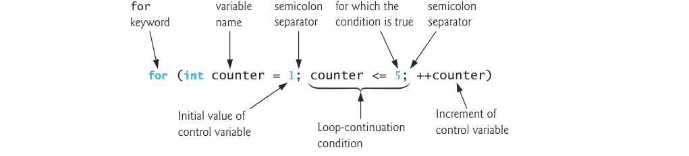

### 在for头部定义的控制变量仅在循环终止前存在

当您在第一个分号（;）之前定义控制变量时，如图4.2的第8行：

```c
for (int counter = 1; counter <= 5; ++counter) {
```

控制变量仅在循环终止前存在。因此，尝试在`for`语句的右花括号（}）之后访问该控制变量会导致编译错误。

### 差一错误

如果我们把循环继续条件`counter <= 5`写成`counter < 5`，那么循环将只执行四次。这是一种常见的逻辑错误，称为差一错误。在`while`或`for`语句条件中使用控制变量的最终值，并使用`<=`关系运算符，可以帮助避免差一错误。例如，要打印1到5的值，循环继续条件应该是`counter <= 5`而不是`counter < 6`。

### for语句的一般格式

`for`语句的一般格式是

```c
for (initialization; loopContinuationCondition; increment) {
    statement
}
```

其中

- *initialization*（初始化）命名循环的控制变量并提供其初始值，
- *loopContinuationCondition*（循环继续条件）决定循环是否应继续执行，以及
- *increment*（递增）在执行*statement*（语句）后修改控制变量的值，以便循环继续条件最终变为*false*（假）。

`for`头部中的两个分号是必需的。如果循环继续条件最初为*false*，程序将不会执行`for`语句的循环体。相反，程序将继续执行`for`语句之后的语句。

当循环继续条件永远不会变为*false*时，就会发生无限循环。为防止无限循环，请确保不要在`while`语句头部之后立即放置分号。在计数控制循环中，确保递增（或递减）控制变量，以便循环继续条件最终变为*false*。在哨兵控制循环中，确保最终输入哨兵值。

### for语句头部中的表达式是可选的

`for`头部中的三个表达式都是可选的。如果省略*loopContinuationCondition*，则条件始终为真，从而创建一个无限循环。如果程序在循环之前初始化了控制变量，则可以省略*initialization*表达式。如果程序在循环体中计算递增量，或者不需要递增，则可以省略*increment*表达式。

### 递增表达式的作用类似于独立语句

`for`语句的*increment*（递增）作用类似于`for`循环体末尾的独立C语句。因此，在`for`语句的递增表达式中，以下写法都是等效的：

```c
counter = counter + 1
counter += 1
++counter
counter++
```

`for`语句*increment*表达式中的递增可以是负数，此时它就是*递减*，循环将*向下*计数。

### 在for语句的循环体中使用控制变量

程序经常在循环体中显示控制变量的值或将其用于计算，但这种用法并非必需。控制变量通常用于控制迭代，而不会在`for`语句的循环体中被提及。虽然可以在`for`循环的循环体中更改控制变量的值，但应避免这样做，因为这种做法可能导致微妙的错误。最好不要更改它。

### for语句流程图

以下是图4.2中`for`语句的流程图：


此流程图清楚地表明，初始化只发生一次，而递增在每次执行循环体语句*之后*发生。

## 自我检查

1. （对/错）当您在第一个分号（;）之前定义控制变量时，控制变量仅在循环终止前存在。
   答案：对。
2. （多选题）以下陈述a)、b)或c)哪一项是*正确的*？
   a) `for`语句头部指定了使用控制变量进行计数控制迭代所需的每个项目。
   b) 如果`for`的循环体中有多条语句，则需要使用花括号。
   c) 即使控制语句的循环体只有一条语句，也应始终将其放在花括号中。
   d) 以上所有陈述都是*正确的*。
   答案：d。

## 4.5 使用for语句的示例

以下示例展示了在`for`语句中改变控制变量的方法。

1. 将控制变量从1变化到100，增量为1。
   ```c
   for (int i = 1; i <= 100; ++i)
   ```
2. 将控制变量从100变化到1，增量为-1（即递减1）。
   ```c
   for (int i = 100; i >= 1; --i)
   ```
3. 将控制变量从7变化到77，增量为7。
   ```c
   for (int i = 7; i <= 77; i += 7)
   ```
4. 将控制变量从20变化到2，增量为-2。
   ```c
   for (int i = 20; i >= 2; i -= 2)
   ```
5. 将控制变量在值2, 5, 8, 11, 14和17上变化。
   ```c
   for (int j = 2; j <= 17; j += 3)
   ```
6. 将控制变量在以下值序列上变化：44, 33, 22, 11, 0。
   ```c
   for (int j = 44; j >= 0; j -= 11)
   ```

### 应用：对2到100的偶数求和

图4.3使用`for`语句对2到100的偶数求和。每次循环迭代（第8-10行）都将控制变量`number`的当前值加到`sum`中。

```c
// fig04_03.c
// 使用for求和。
#include <stdio.h>

int main(void) {
    int sum = 0; // 初始化sum

    for (int number = 2; number <= 100; number += 2) {
        sum += number; // 将number加到sum
    }

    printf("Sum is %d\n", sum);
}
```

Sum is 2550

图 4.3 | 使用for求和。

### 应用：复利计算

下一个示例使用`for`语句计算复利。考虑以下问题陈述：

> 一个人在年利率为5%的储蓄账户中投资了1000.00美元。假设所有利息都留在账户中，请计算并打印10年中每年年底账户中的金额。使用以下公式确定这些金额：

$a = p(1 + r)^n$
其中
$p$是原始投资金额（即本金，此处为$1000.00），
$r$是年利率（例如，.05代表5%），
$n$是年数，此处为10，以及
$a$是第$n$年底的存款金额。

解决方案（图4.4）使用计数控制循环，对资金存入的10年中的每一年执行相同的计算。`for`语句执行其循环体10次，将控制变量从1变化到10，增量为1。C语言不包含幂运算符，因此我们使用标准库函数`pow`（第17行）来实现。调用`pow(x, y)`计算x的y次幂。该函数接受两个`double`类型的数据类型参数。计算完成后，`pow`返回（即给出）一个`double`值，然后我们将其乘以`principal`（第17行）。

```c
// fig04_04.c
// 计算复利。
#include <stdio.h>
#include <math.h>

int main(void) {
    double principal = 1000.0; // 初始本金
    double rate = 0.05; // 年利率

    // 输出表格列标题
    printf("%4s%21s\n", "Year", "Amount on deposit");

    // 计算十年中每年的存款金额
    for (int year = 1; year <= 10; ++year) {

        // 计算指定年份的新金额
        double amount = principal * pow(1.0 + rate, year);

        // 输出一行表格
        printf("%4d%21.2f\n", year, amount);
    }
}
```

| 年份 | 存款金额 |
|---|---|
| 1 | 1050.00 |
| 2 | 1102.50 |
| 3 | 1157.63 |
| 4 | 1215.51 |
| 5 | 1276.28 |
| 6 | 1340.10 |
| 7 | 1407.10 |
| 8 | 1477.46 |
| 9 | 1551.33 |
| 10 | 1628.89 |

图 4.4 | 计算复利。

## 4.6 switch 多重选择语句

在第3章中，我们讨论了 if 单选择语句和 if...else 双选择语句。有时，算法会包含一系列决策，这些决策分别测试一个变量或表达式可能取的每个整数值，然后执行不同的操作。这被称为多重选择。C语言提供了 switch 多重选择语句来处理此类决策。

switch 语句由一系列 case 标签、一个可选的 default case 以及每个 case 要执行的语句组成。图 4.5 使用 switch 来统计学生在考试中获得的每个不同字母等级的数量。

```c
// fig04_05.c
// 使用 switch 统计字母等级。
#include <stdio.h>

int main(void) {
    int aCount = 0;
    int bCount = 0;
    int cCount = 0;
    int dCount = 0;
    int fCount = 0;

    puts("Enter the letter grades.");
    puts("Enter the EOF character to end input.");
    int grade = 0; // 一个等级

    // 循环直到用户输入文件结束键序列
    while ((grade = getchar()) != EOF) {

        // 确定输入的是哪个等级
        switch (grade) { // 嵌套在 while 中的 switch
            case 'A': // 等级是大写 A
            case 'a': // 或小写 a
                ++aCount;
                break; // 退出 switch 是必要的
            case 'B': // 等级是大写 B
            case 'b': // 或小写 b
                ++bCount;
                break;
            case 'C': // 等级是大写 C
            case 'c': // 或小写 c
                ++cCount;
                break;
            case 'D': // 等级是大写 D
            case 'd': // 或小写 d
                ++dCount;
                break;
            case 'F': // 等级是大写 F
            case 'f': // 或小写 f
                ++fCount;
                break;
            case '\n': // 忽略输入中的换行符、
            case '\t': // 制表符、
            case ' ': // 和空格
                break;
            default: // 捕获所有其他字符
                printf("%s", "Incorrect letter grade entered.");
                puts(" Enter a new grade.");
                break; // 可选；无论如何都会退出 switch
        } // end switch
    } // end while

    // 输出结果摘要
    puts("\nTotals for each letter grade are:");
    printf("A: %d\n", aCount);
    printf("B: %d\n", bCount);
    printf("C: %d\n", cCount);
    printf("D: %d\n", dCount);
    printf("F: %d\n", fCount);
}
```

```
Enter the letter grades.
Enter the EOF character to end input.
a
b
c
C
A
d
f
C
E
Incorrect letter grade entered. Enter a new grade.
D
A
b
^Z --------- 并非所有系统都显示 EOF 字符的表示

Totals for each letter grade are:
A: 3
B: 2
C: 3
D: 2
F: 1
```

图 4.5 | 使用 switch 统计字母等级。（第 2 部分，共 2 部分。）

142 第 4 程序控制

你必须包含 `<math.h>`（第 4 行）才能使用 `pow` 和 C 的其他数学函数。¹ 如果你没有包含这个头文件，程序将无法正常工作，因为链接器将无法找到 `pow` 函数。函数 **pow** 需要两个 double 参数，但变量 `year` 是一个整数。`math.h` 文件包含的信息会告诉编译器在调用 `pow` 之前将 `year` 的值转换为临时的 double 表示。此信息包含在 `pow` 的**函数原型**中。我们将在第 5 章解释函数原型，同时也会总结许多其他数学库函数。

### 格式化数字输出

此程序使用转换说明符 `%21.2f` 来打印变量 `amount` 的值。转换说明符中的 21 表示值将被打印的**字段宽度**。字段宽度为 21 指定打印的值将使用 21 个字符位置。正如你在第 3 章所学，`.2` 指定了精度（即小数位数）。如果显示的字符数少于字段宽度，则值将右对齐并带有前导空格。这对于垂直对齐浮点值的小数点特别有用。要在字段中左对齐一个值，请在 `%` 和字段宽度之间放置一个 `-`（减号）。我们将在第 9 章详细讨论 `printf` 和 `scanf` 强大的格式化功能。

### 浮点数精度和内存要求

**float** 类型的变量通常需要四字节内存，大约有七位有效数字。double 类型的变量通常需要八字节内存，大约有 15 位有效数字——大约是 float 精度的两倍。大多数程序员使用 double 类型。C 默认将 3.14159 等浮点值视为 double 类型。源代码中的此类值被称为**浮点字面量**。

C 还有 long double 类型。此类变量通常存储在 12 或 16 字节的内存中。C 标准规定了每种浮点类型的最小大小，并指出 double 类型至少提供与 float 相同的精度，long double 类型至少提供与 double 相同的精度。有关 C 的基本数值类型及其典型范围的列表，请参见

https://en.cppreference.com/w/c/language/arithmetic_types

### 浮点数是近似值

在常规算术中，浮点数通常是除法的结果——当我们用 10 除以 3 时，结果是无限重复的序列 3.3333333...，其中 3 的序列无限重复。计算机只分配固定的空间来存储这样的值，因此存储的浮点值只能是近似值。因此，C 的浮点类型存在所谓的**表示误差**。假设浮点数是精确表示的（例如，在相等性比较中使用它们）可能会导致错误的结果。

浮点数有许多应用，特别是对于测量值。例如，当我们说“正常”体温为 98.6 华氏度时，我们不需要精确到很多位数字。当我们在温度计上读到温度为 98.6 时，它实际上可能是 98.5999473210643。对于大多数涉及体温的应用来说，将这个数字称为 98.6 是可以的。

### 关于显示四舍五入值的警告

在此示例中，我们将变量 `amount`、`principal` 和 `rate` 声明为 double 类型。我们处理的是美元的小数部分，因此需要一种允许其值中包含小数点的类型。不幸的是，浮点数可能会引起麻烦。以下是使用浮点数表示显示为小数点后两位的美元金额时可能出现问题的简单解释。存储在机器中的两个计算出的美元金额可能是 14.234（为显示目的四舍五入为 14.23）和 18.673（为显示目的四舍五入为 18.67）。当这些金额相加时，它们产生内部总和 32.907，通常会为显示目的四舍五入为 32.91。因此，你的输出可能显示为

```
14.23
+ 18.67
-------
32.91
```

但一个将显示的单个数字相加的人会期望总和为 32.90。你已被警告！

### 常见的美元金额可能有浮点表示误差

即使是简单的美元金额，例如你在杂货店或餐馆账单上看到的金额，当它们存储为 double 时也可能存在表示误差。为了看到这一点，我们创建了一个简单的程序，声明如下

```c
double d = 123.02;
```

然后以小数点后许多位精度显示 `d` 的值。输出显示 123.02 为 123.019999...，这是表示误差的另一个例子。虽然一些美元金额可以精确表示为 double，但许多不能。这是许多编程语言中的一个常见问题。

## 自我检查

- 1. （填空）要在字段中________一个值，请在 `%` 和字段宽度之间放置一个 `-`（减号）。
答案：左对齐。
- 2. （多选题）以下哪个 for 语句头是不正确的？
a) 将控制变量从 1 变化到 100，增量为 1。
for (int i = 1; i <= 100; ++i)
b) 将控制变量从 7 变化到 77，增量为 7。
for (int i = 7; i <= 77; i += 7)
c) 将控制变量按以下序列变化：2, 5, 8, 11, 15, 17。
for (int j = 2; j <= 17; j += 3)
d) 将控制变量从 20 变化到 2，增量为 -2。
for (int i = 20; i >= 2; i -= 2)
答案：c) 不正确。for 语句实际上生成的序列是 2, 5, 8, 11, 14, 17。它不会生成原始序列中的值 15。

### 读取字符输入

在程序中，用户输入学生的字母等级。在 `while` 循环头（第17行），

```c
while ((grade = getchar()) != EOF)
```

括号内的赋值表达式 `(grade = getchar())` 首先执行。`getchar` 函数（来自 `<stdio.h>`）从键盘读取一个字符，并将该字符存储在整型变量 `grade` 中。字符通常存储在 `char` 类型的变量中。然而，C语言可以将字符存储在任何整型变量中，因为字符在计算机中通常表示为单字节整数。函数 `getchar` 以 `int` 类型返回用户输入的字符。我们可以根据字符的使用方式，将其视为整数或字符。例如，语句

```c
printf("The character (%c) has the value %d.\n", 'a', 'a');
```

使用转换说明符 `%c` 和 `%d` 来打印字符 `'a'` 及其整数值。结果是

The character (a) has the value 97.

字符也可以通过使用转换说明符 `%c` 的 `scanf` 来读取。整数 97 是字符 `'a'` 在计算机中的数值表示。当今许多计算机使用 Unicode® 字符集。附录 B 包含了 ASCII（美国信息交换标准代码）字符集及其数值。ASCII 是 Unicode 的一个子集。

### 赋值具有值

赋值作为一个整体实际上具有一个值。赋值表达式 `grade = getchar()` 的值是 `getchar` 返回并赋给变量 `grade` 的那个字符。赋值具有值这一事实对于将多个变量设置为相同的值非常有用。例如，

```c
a = b = c = 0;
```

首先计算赋值 `c = 0`（因为 `=` 运算符从右向左结合）。然后，变量 `b` 被赋值为赋值表达式 `c = 0` 的值（即 0）。接着，变量 `a` 被赋值为赋值表达式 `b = (c = 0)` 的值（也是 0）。

赋值表达式 `grade = getchar()` 的值与 `EOF`（一个首字母缩写代表“文件结束”的符号）的值进行比较。我们使用 `EOF`（通常其值为 -1）作为哨兵值。用户输入一个系统相关的按键组合来表示“文件结束”——即“我没有更多数据要输入了”。`EOF` 是在 `<stdio.h>` 头文件中定义的符号整型常量（我们将在第6章看到符号常量是如何定义的）。如果赋给 `grade` 的值等于 `EOF`，程序终止。

我们在本程序中将字符表示为 `int` 类型，因为 `EOF` 具有整数值（再次说明，通常是 -1）。测试符号常量 `EOF` 而不是 `-1` 使程序更具可移植性。C标准规定 `EOF` 是一个负整数值（但不一定是 -1）。因此，`EOF` 在不同的系统上可能有不同的值。

## 4.6 switch 多重选择语句

### 输入 EOF 指示符

输入 `EOF`（文件结束）的按键组合是系统相关的。在 Linux/UNIX/macOS 系统上，`EOF` 指示符通过在单独一行输入以下内容来输入：

$Ctrl + d$

此表示法意味着同时按下 $Ctrl$ 键和 $d$ 键。在其他系统上，例如 Microsoft Windows，`EOF` 指示符可以通过输入以下内容来输入：

$Ctrl + z$

在 Windows 上，你还需要按 $Enter$ 键。

用户在键盘上输入等级。当按下 $Enter$ 键时，字符由 `getchar` 函数逐个读取。如果输入的字符不等于 `EOF`，则执行 `switch` 语句（第20-49行）。

### switch 语句详解

关键字 `switch` 后跟括号中的变量名 `grade`。这被称为**控制表达式**。`switch` 将此表达式的值与每个 **case 标签** 进行比较。每个 case 可以有一个或多个操作，但给定 case 中的多个操作不需要用花括号括起来。

假设用户输入了字母 C 作为等级。当 `switch` 将 C 与每个 case 进行比较时，如果匹配成功（`case 'C' :`），则执行该 case 的语句。对于字母 C，`switch` 将 `cCount` 增加 1（第31行），然后 `break` 语句（第32行）立即退出 `switch`，导致程序控制继续执行 `switch` 语句之后的第一条语句。

我们在这里使用 `break` 语句，因为 `switch` 语句中的 case 否则会连续执行。如果没有 `break` 语句，每次匹配成功时，所有剩余 case 的语句都会执行。（这个特性——称为“贯穿”——很少有用，尽管它非常适合紧凑地编程练习 4.38——迭代歌曲《圣诞节的十二天》！）在需要 `break` 语句的 `switch` 语句中忘记它是一个逻辑错误。

### default case

如果没有匹配发生，则执行 `default` case。在本程序中，它显示一条错误消息。你应该始终包含一个 `default` case；否则，`switch` 中未明确测试的值将被忽略。`default` case 通过让你关注处理异常条件的需要来帮助防止这种情况。有时不需要默认处理。

尽管 `switch` 语句中的 `case` 子句和 `default` case 子句可以以任何顺序出现，但通常将 `default` 子句放在最后。当 `default` 子句在最后时，不需要 `break` 语句。但许多程序员为了清晰和与其他 case 的对称性而包含这个 `break`。

### switch 语句流程图

以下 `switch` 多重选择语句流程图清楚地表明，每个 case 的 `break` 语句都会立即退出 `switch` 语句。

148 第4章 程序控制


### 忽略输入中的换行符、制表符和空格字符

在图 4.5 的 `switch` 语句中，以下行

```c
case '\n': // ignore newlines,
case '\t': // tabs,
case ' ': // and spaces in input
    break;
```

导致程序跳过换行符、制表符和空格字符。逐个读取字符可能会导致问题。要让程序读取字符，你必须通过按 Enter 键将它们发送到计算机。这会在我们希望处理的字符之后将换行符放入输入中。

通常，必须特别忽略这个换行符（和其他空白字符）才能使程序正常工作。我们 `switch` 语句中的前面几个 case 防止了每次在输入中遇到换行符、制表符或空格时都打印 `default` case 中的错误消息。本示例中的每个输入都会导致循环的两次迭代——第一次用于字母等级，第二次用于 `'\n'`。列出几个没有中间语句的 case 标签意味着每个 case 都会发生相同的操作。

## 4.6 switch 多重选择语句

### 常量整型表达式

使用 `switch` 语句时，请记住每个 case 只能测试一个**常量整型表达式**。该表达式可以是字符常量和整型常量的任何组合，其计算结果为一个常量整数值。字符常量可以表示为单引号中的特定字符，例如 `'A'`。字符必须用单引号括起来才能被识别为字符常量——双引号中的字符被识别为字符串。整型常量就是简单的整数值。在我们的示例中，我们使用了字符常量。

### 关于整型的说明

像 C 这样的可移植语言必须具有灵活的数据类型大小。应用程序可能需要各种大小的整数。C 提供了几种数据类型来表示整数。除了 `int` 和 `char`，C 还提供 `short int` 类型（可以缩写为 `short`）和 `long int` 类型（可以缩写为 `long`）。所有整型还有表示非负整数值的无符号变体。在第 5.14 节，我们将看到 C 还提供 `long long int` 类型（可以缩写为 `long long`）。

C 标准规定了每种整型的最小值范围。实际范围可能更大，具体取决于实现。对于 `short int`，最小范围是 -32767 到 +32767。对于大多数整数计算，`long int` 就足够了。`long int` 的最小值范围是 -2147483647 到 +2147483647。`int` 的范围大于或等于 `short int`，小于或等于 `long int`。在当今许多平台上，`int` 和 `long int` 表示相同的值范围。数据类型 `signed char` 可以表示 -127 到 +127 范围内的整数或 ASCII 字符集中的任何字符。有关有符号和无符号整型最小范围的完整列表，请参见 C 标准文档的第 5.2.4.2 节。

## 自我检查

- 1. （填空）偶尔，一个算法会包含一系列决策，其中对一个变量或表达式可能取的每个常量整型值分别进行测试，并采取不同的操作。这被称为 ________。
答案：多重选择。
- 2. （多选）以下陈述 a)、b) 或 c) 哪一项是 *错误* 的？
a) 赋值的值是赋给 `=` 左侧变量的值。
b) 赋值表达式 `grade = getchar()` 的值是 `getchar` 返回并赋给变量 `grade` 的字符。
c) 以下语句将变量 `a`、`b` 和 `c` 设置为 0：
0 = a = b = c;
d) 以上所有陈述都是 *正确* 的。
答案：c) 是 *错误* 的。正确的语句是：
a = b = c = 0;

## 4.7 do...while 迭代语句

do...while 迭代语句与 while 语句类似。while 语句在执行循环体之前测试其循环继续条件。do...while 语句在执行循环体之后测试其循环继续条件，因此循环体至少会执行一次。当 do...while 终止时，程序将继续执行 while 子句之后的语句。图 4.6 使用 do...while 语句显示从 1 到 5 的数字。我们选择在循环继续测试中对控制变量 counter 进行前自增（第 10 行）。

```c
// fig04_06.c
// 使用 do...while 迭代语句。
#include <stdio.h>

int main(void) {
    int counter = 1; // 初始化 counter

    do {
        printf("%d  ", counter);
    } while (++counter <= 5);
}
```

1  2  3  4  5

图 4.6 | 使用 do...while 迭代语句。

### do...while 语句流程图

以下 do...while 语句流程图清楚地表明，循环继续条件在循环操作首次执行之后才会执行：

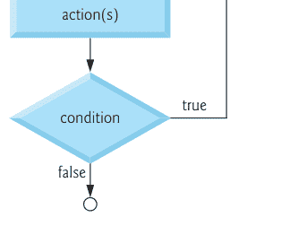

## 自我检查

- 1（多选题）以下陈述 a)、b) 或 c) 哪一项是错误的？
a) while 语句在执行其循环体之前测试其循环继续条件，因此循环体至少会执行一次。
b) do...while 语句在执行其循环体之后测试其循环继续条件。
c) 当 do...while 终止时，程序将继续执行 while 子句之后的语句。
d) 以上所有陈述都是*正确的*。
**答案：** a) 是*错误的*。实际上，如果 while 语句的循环继续测试在进入循环时失败，则循环体将不会执行。

- 2（判断题）假设 counter 初始化为 1，以下循环显示数字 1 到 10：

```c
do {
    printf("%d ", counter);
} while (++counter < 10);
```

**答案：** *错误*。此循环显示数字 1 到 9。要显示数字 1 到 10，请将循环继续条件中的 < 改为 <=。

## 4.8 break 和 continue 语句

break 和 continue 语句用于改变控制流。第 4.6 节展示了在 switch 语句中遇到 break 会终止 switch 的执行。本节讨论如何在迭代语句中使用 break。

### break 语句

break 语句在 while、for、do...while 或 switch 语句中执行时，会导致立即退出该语句。程序执行将继续到该 while、for、do...while 或 switch 之后的下一个语句。break 的常见用途是提前退出循环或跳过 switch 的剩余部分（如图 4.5 所示）。图 4.7 演示了 for 迭代语句中的 break 语句（第 12 行）。

```c
// fig04_07.c
// 在 for 语句中使用 break 语句。
#include <stdio.h>

int main(void) {
    int x = 1; // 在此处声明，以便在循环后使用

    // 循环 10 次
    for (; x <= 10; ++x) {
        // 如果 x 为 5，则终止循环
        if (x == 5) {
            break; // 仅在 x 为 5 时中断循环
        }

        printf("%d ", x);
    }

    printf("\n在 x == %d 时跳出循环\n", x);
}
```

**图 4.7** | 在 for 语句中使用 break 语句。（第 1 部分，共 2 部分。）

152 第 4 章 程序控制

```
1 2 3 4
在 x == 5 时跳出循环
```

图 4.7 | 在 for 语句中使用 break 语句。（第 2 部分，共 2 部分。）

当 if 语句检测到 x 变为 5 时，break 执行。这会终止 for 语句，程序将继续执行 for 之后的 printf。循环仅完整执行了四次。回想一下，当在 for 循环的初始化表达式中声明控制变量时，该变量在循环终止后将不再存在。在本例中，我们在循环之前声明并初始化了 x，以便在循环终止后可以使用其最终值。因此，for 头部的初始化部分（在第一个分号之前）为空。

### continue 语句

continue 语句在 while、for 或 do...while 语句中执行时，会跳过该控制语句体中剩余的语句，并执行循环的下一次迭代。在 while 和 do...while 语句中，循环继续测试在 continue 语句执行后立即进行评估。在 for 语句中，增量表达式执行，然后进行循环继续测试。图 4.8 在 for 语句中使用 continue（第 10 行）在 x 为 5 时跳过 printf 语句，并开始循环的下一次迭代。

```c
// fig04_08.c
// 在 for 语句中使用 continue 语句。
#include <stdio.h>

int main(void) {
    // 循环 10 次
    for (int x = 1; x <= 10; ++x) {
        // 如果 x 为 5，则继续循环的下一次迭代
        if (x == 5) {
            continue; // 跳过循环体中的剩余代码
        }

        printf("%d ", x);
    }

    puts("\n使用 continue 跳过打印值 5");
}
```

```
1 2 3 4 6 7 8 9 10
使用 continue 跳过打印值 5
```

图 4.8 | 在 for 语句中使用 continue 语句。

### break 和 continue 注意事项

一些程序员认为 break 和 continue 违反了结构化编程的规范，因此他们不使用它们。这些语句的效果可以通过我们即将讨论的结构化编程技术来实现，但 break 和 continue 语句执行速度更快。

在实现高质量软件工程和实现最佳性能软件之间存在一种张力——一个是以牺牲另一个为代价实现的。除了对性能要求最严格的情况外，请应用以下准则：首先，使你的代码简单且正确；然后使其快速且小巧，但仅在必要时。

## 自我检查

- 1（多选题）以下陈述 a)、b) 或 c) 哪一项是错误的？
a) break 语句终止 switch 语句的执行。
b) break 语句在 while、for 或 do...while 语句中执行时，会导致立即退出该语句。
c) break 的常见用途是提前退出循环或跳过 if...else 的剩余部分。
d) 以上所有陈述都是正确的。
答案：c) 是错误的。实际上，break 跳过的是 switch 的剩余部分，而不是 if...else。

- 2（多选题）以下陈述 a)、b) 或 c) 哪一项是错误的？
a) continue 语句在 while、for 或 do...while 语句中执行时，会跳过该控制语句体中剩余的语句，并执行循环的下一次迭代。
b) 在 while 和 do...while 语句中，循环继续测试在 continue 语句执行后立即进行评估。
c) 在 for 语句中，continue 语句执行后，进行循环继续测试，然后执行增量表达式。
d) 以上所有陈述都是正确的。
答案：c) 是错误的。实际上，在 for 语句中，continue 语句执行后，执行增量表达式，然后进行循环继续测试。

## 4.9 逻辑运算符

到目前为止，我们已经使用了简单的条件，例如 counter <= 10、total > 1000 和 grade != -1。我们已经用关系运算符（>、<、>= 和 <=）和相等运算符（== 和 !=）表达了这些条件。每个决策都精确地测试一个条件。为了在决策过程中测试多个条件，我们必须在单独的语句或嵌套的 if 或 if...else 语句中执行这些测试。C 提供了逻辑运算符，可用于通过组合简单条件来形成更复杂的条件。逻辑运算符是 &&（逻辑与）、||（逻辑或）和 !（逻辑非，也称为逻辑否定）。我们将考虑每个运算符的示例。

### 逻辑与（&&）运算符

假设我们希望确保在选择特定执行路径之前两个条件都为真。在这种情况下，我们可以使用逻辑运算符 &&，如下所示：

## 4.9 逻辑与（&&）运算符

```c
if (gender == 1 && age >= 65) {
    ++seniorFemales;
}
```

这个 if 语句包含两个简单条件。例如，条件 `gender == 1` 可能用于判断一个人是否为女性。条件 `age >= 65` 用于判断一个人是否为老年人。这两个简单条件会首先被求值，因为 `==` 和 `>=` 的优先级都高于 `&&`。然后，if 语句会考虑组合条件 `gender == 1 && age >= 65`，该条件当且仅当两个简单条件都为真时才为真。最后，如果这个组合条件为真，则前面的 if 语句会将 `seniorFemales` 的值加 1。如果任一或两个简单条件都为假，程序将跳过 if 的主体，继续执行下一条语句。

下表总结了 `&&` 运算符：

| 表达式1 | 表达式2 | 表达式1 && 表达式2 |
| :--- | :--- | :--- |
| 0 | 0 | 0 |
| 0 | 非零 | 0 |
| 非零 | 0 | 0 |
| 非零 | 非零 | 1 |

该表显示了 `expression1` 和 `expression2` 的零（假）和非零（真）值的所有四种可能组合。这类表通常被称为真值表。C 语言将所有包含关系运算符、相等运算符和/或逻辑运算符的表达式求值为 0 或 1。虽然 C 将真值设置为 1，但它接受任何非零值作为真。

## 4.10 逻辑或（||）运算符

现在让我们考虑 `||`（逻辑或）运算符。假设我们希望在程序中的某个点，确保两个条件中的一个或两个为真，然后才选择特定的执行路径。在这种情况下，我们使用 `||` 运算符，如下面的程序段所示：

```c
if (semesterAverage >= 90 || finalExam >= 90) {
    puts("Student grade is A");
}
```

这个语句包含两个简单条件。条件 `semesterAverage >= 90` 用于判断学生是否因整个学期的扎实表现而应得“A”。条件 `finalExam >= 90` 用于判断学生是否因期末考试的出色表现而应得“A”。然后，if 语句会考虑组合条件，如果任一或两个简单条件为真，则授予学生“A”。除非两个简单条件都为假（零），否则将打印消息“Student grade is A”。以下是逻辑或运算符（`||`）的真值表：

| 表达式1 | 表达式2 | 表达式1 \|\| 表达式2 |
| :--- | :--- | :--- |
| 0 | 0 | 0 |
| 0 | 非零 | 1 |
| 非零 | 0 | 1 |
| 非零 | 非零 | 1 |

## 4.11 短路求值

`&&` 运算符的优先级高于 `||`。这两个运算符都是从左到右结合。包含 `&&` 或 `||` 运算符的表达式仅求值到足以确定条件是 *真* 还是 *假* 为止。因此，条件

```c
gender == 1 && age >= 65
```

如果 `gender` 不等于 1，则停止求值——整个表达式保证为 *假*。如果 `gender` 等于 1，则条件继续求值——如果 `age` 大于或等于 65，整个表达式可能为 *真*。这种求值逻辑与和逻辑或表达式的性能特性被称为 **短路求值**。

在 `&&` 表达式中，将最可能为 *假* 的条件放在最左边。在使用 `||` 运算符的表达式中，将最可能为 *真* 的条件放在最左边。这可以减少程序的执行时间。

## 4.12 逻辑非（!）运算符

C 提供了一元 `!`（逻辑非）运算符，使你能够“反转”条件的含义。逻辑非运算符以单个条件作为操作数。当你对操作数条件为 *假* 时选择执行路径感兴趣时，可以使用它，如下面的程序段所示：

```c
if (!(grade == sentinelValue)) {
    printf("The next grade is %f\n", grade);
}
```

条件 `grade == sentinelValue` 周围的括号是必需的，因为逻辑非运算符的优先级高于相等运算符。以下是逻辑非运算符的真值表：

| 表达式 | !表达式 |
| :--- | :--- |
| 0 | 1 |
| 非零 | 0 |

在大多数情况下，你可以通过以不同方式表达条件来避免使用逻辑非。例如，前面的语句也可以写成：

```c
if (grade != sentinelValue) {
    printf("The next grade is %f\n", grade);
}
```

## 4.13 运算符优先级和结合性总结

下表显示了到目前为止介绍的运算符的优先级和结合性。运算符从上到下按优先级递减的顺序显示。

| 运算符 | 结合性 | 类型 |
| :--- | :--- | :--- |
| ++ (后缀) -- (后缀) | 从右到左 | 后缀 |
| + - ! ++ (前缀) -- (前缀) (类型) | 从右到左 | 一元 |
| * / % | 从左到右 | 乘法 |
| + - | 从左到右 | 加法 |
| < <= > >= | 从左到右 | 关系 |
| == != | 从左到右 | 相等 |
| && | 从左到右 | 逻辑与 |
| \|\| | 从左到右 | 逻辑或 |
| ?: | 从右到左 | 条件 |
| = += -= *= /= %= | 从右到左 | 赋值 |
| , | 从左到右 | 逗号 |

## 4.14 _Bool 数据类型

C 标准包含一个布尔类型——由关键字 `_Bool` 表示——它只能保存值 0 或 1。回想一下，条件中的值 0 是 *假*，而任何非零值是 *真*。将任何非零值赋给 `_Bool` 会将其设置为 1。该标准还包括 `<stdbool.h>` 头文件，它将 `bool` 定义为类型 `_Bool` 的简写，并将 `true` 和 `false` 分别定义为 1 和 0 的命名表示。在预处理期间，标识符 `bool`、`true` 和 `false` 分别被替换为 `_Bool`、1 和 0。

## 自我检查

1. （多选题）当执行以下 if 语句时，哪一对变量值会导致 `seniorFemales` 被递增？

```c
if (gender == 1 && age >= 65) {
    ++seniorFemales;
}
```

- a) gender 为 2，age 为 60。
- b) gender 为 2，age 为 73。
- c) gender 为 1，age 为 19。
- d) gender 为 1，age 为 65。

答案：d。

2. （多选题）当执行以下 if 语句时，哪一对变量值不会导致打印“Student grade is A”？

```c
if (semesterAverage >= 90 || finalExam >= 90) {
    puts("Student grade is A");
}
```

- a) semesterAverage 为 75，finalExam 为 80。
- b) semesterAverage 为 85，finalExam 为 91。
- c) semesterAverage 为 93，finalExam 为 67。
- d) semesterAverage 为 94，finalExam 为 90。

答案：a。

## 4.15 混淆相等（==）和赋值（=）运算符

有一种类型的错误，无论经验多么丰富的 C 程序员都倾向于频繁犯，因此值得单独一节来讨论。这个错误是意外地交换了运算符 `==`（相等）和 `=`（赋值）。这些交换之所以如此有害，是因为它们通常不会导致编译错误。相反，带有这些错误的语句通常能正确编译，允许程序运行完成，但很可能通过运行时逻辑错误产生不正确的结果。

C 的两个方面导致了这些问题。一个是任何产生值的表达式都可以用在任何控制语句的判断部分。如果值为 0，则被视为 *假*，如果值为非零，则被视为 *真*。第二个是赋值有一个值——即赋给 `=` 运算符左侧变量的值。

例如，假设我们打算写

```c
if (payCode == 4) {
    printf("%s", "You get a bonus!");
}
```

但我们意外地写了

```c
if (payCode = 4) {
    printf("%s", "You get a bonus!");
}
```

第一个 *if* 语句正确地为工资代码等于 4 的人颁发奖金。第二个 *if* 语句——带有错误的那个——在 *if* 条件中求值赋值表达式。赋值后条件中的值为 4。因为任何非零值都是 *真*，所以这个 *if* 语句中的条件总是 *真*。不仅 `payCode` 被无意中设置为 4，而且无论实际的 `payCode` 是什么，这个人总是会收到奖金！意外地使用运算符 `==` 进行赋值和意外地使用运算符 `=` 进行相等比较都是逻辑错误。

## 4.16 左值和右值

你可能倾向于编写像 `x == 7` 这样的条件，其中变量名在左边，常量在右边。通过反转这些项，使常量在左边，变量名在右边，如 `7 == x`，如果你意外地将 == 运算符替换为 =，你将受到编译器的保护。编译器会将其视为语法错误，因为赋值表达式的左侧只能放置变量名。这将防止运行时逻辑错误可能造成的严重破坏。

变量名被称为 *左值*（*lvalues*，即“左侧的值”），因为它们可以用于赋值运算符的左侧。常量被称为 *右值*（*rvalues*，即“右侧的值”），因为它们只能用于赋值运算符的右侧。*左值* 也可以用作 *右值*，但反之则不行。

### 在独立语句中混淆 == 和 =

问题的另一面可能同样令人不快。假设你想用一个简单的语句为变量赋值，例如

```
x = 1;
```

但错误地写成了

```
x == 1;
```

这里，这同样不是语法错误。编译器会计算条件表达式。如果 x 等于 1，条件为 *真*，表达式返回值 1。如果 x 不等于 1，条件为 *假*，表达式返回值 0。无论返回什么值，由于没有赋值运算符，该值只是被简单地丢弃了。x 的值保持不变，这很可能导致执行时的逻辑错误。不幸的是，我们没有一个方便的技巧来帮助你解决这个问题！然而，许多编译器会对这样的语句发出警告。

## 自我检查

- 1. （真/假）意外地交换 ==（相等）和 =（赋值）运算符是有害的，因为这些错误通常能正确编译，使得程序能够运行完成，但很可能产生错误的结果。
  **答案：** *真。*
- 2. （真/假）*右值* 也可以用作 *左值*，但反之则不行。
  **答案：** *假。* 实际上，*左值* 也可以用作 *右值*，但反之则不行。

## 4.11 结构化编程总结

正如建筑师运用其行业的集体智慧来设计建筑一样，程序员也应该运用其行业的集体智慧来设计程序。我们的领域比建筑学年轻，我们的集体智慧也相当稀疏。在短短九十年里，我们学到了很多东西。也许最重要的是，我们了解到结构化程序比非结构化程序更容易理解、测试、调试、修改，甚至在数学意义上证明其正确性。

第3章和第4章讨论了C语言的控制语句。现在，我们总结这些能力，并介绍一套简单的规则来构建结构化程序。下图总结了控制语句的流程图：

## 4.11 结构化编程总结


在图中，小圆圈表示每个语句的单一入口点和单一出口点。任意连接单个流程图符号可能导致非结构化程序。因此，编程行业选择将流程图符号组合起来，形成一组有限的控制语句，并仅通过两种简单的方式组合控制语句来构建结构良好的程序。为简单起见，仅使用单入口/单出口控制语句，并且你只能通过按顺序堆叠控制语句或嵌套它们来组合它们。

160 第4章 程序控制

### 构建结构化程序的规则

下表总结了构建结构化程序的规则。我们假设矩形流程图符号表示任何操作，包括输入/输出：

构建结构化程序的规则
1. 从下图所示的“最简流程图”开始。
2. “堆叠”规则——任何矩形（操作）都可以被两个按顺序排列的矩形（操作）替换。
3. “嵌套”规则——任何矩形（操作）都可以被任何控制语句（顺序、if、if...else、switch、while、do...while 或 for）替换。
4. 规则2和3可以按你喜欢的次数和任何顺序应用。

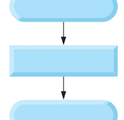

### 构建结构化程序的规则——堆叠规则

应用构建结构化程序的规则总是会产生一个结构化的流程图，具有整洁的、积木式的外观。将规则2反复应用于最简流程图，会产生一个包含许多按顺序排列的矩形的结构化流程图，如下图所示。规则2生成一个控制语句的堆栈，因此我们称规则2为 **堆叠规则**。


### 构建结构化程序的规则——嵌套规则

规则3被称为 **嵌套规则**。将规则3反复应用于最简流程图，会产生一个具有整齐嵌套控制语句的流程图。例如，在下图中，最简流程图中的矩形被替换为一个双选择（if...else）语句。然后，再次将规则3应用于双选择语句中的两个矩形，将每个矩形替换为双选择语句。围绕每个双选择语句的虚线框代表我们在原始流程图中替换的矩形。


规则4生成更大、更复杂、嵌套更深的结构。应用构建结构化程序规则所产生的流程图构成了所有可能的结构化流程图的集合，因此也构成了所有可能的结构化程序的集合。

正是因为消除了goto语句，这些积木才永远不会相互重叠。结构化方法的美妙之处在于，我们只使用少量简单的单入口/单出口部件，并且只以两种简单的方式组装它们。下图显示了应用规则2产生的堆叠积木类型，以及应用规则3产生的嵌套积木类型。该图还显示了*不能*出现在结构化流程图中的重叠积木类型（因为消除了goto语句）。


如果遵循构建结构化程序的规则，就*无法*创建如下图所示的非结构化流程图：


如果你不确定某个特定的流程图是否是结构化的，可以反向应用构建结构化程序的规则，尝试将该流程图简化为最简流程图。如果你成功了，那么原始流程图就是结构化的；否则，它就不是。

### 控制的三种形式

结构化编程提倡简洁性。Böhm 和 Jacopini 证明，只需要三种控制形式：

- 顺序。
- 选择。
- 迭代。

顺序是直接了当的。选择通过以下三种方式之一实现：

- if 语句（单选择）。
- if...else 语句（双选择）。
- switch 语句（多选择）。

可以很容易地证明，简单的 if 语句足以提供任何形式的选择。所有可以用 if…else 语句和 switch 语句完成的操作，都可以用一个或多个 if 语句来实现。

迭代通过以下三种方式之一实现：

- while 语句。
- do…while 语句。
- for 语句。

同样可以很容易地证明，while 语句足以提供任何形式的迭代。所有可以用 do…while 语句和 for 语句完成的操作，都可以用 while 语句来完成。

结合这些结果表明，C程序中曾经需要的任何形式的控制都可以仅用*三种*控制形式来表达：

- 顺序。
- if 语句（选择）。
- while 语句（迭代）。

而这些控制语句只能以*两种*方式组合——*堆叠*和*嵌套*。确实，结构化编程提倡简洁性。

在第3章和第4章中，我们讨论了如何仅由包含操作和决策的控制语句来组合程序。在第5章中，我们将介绍另一个称为函数的程序结构单元。我们将学习通过组合函数来构建大型程序，而这些函数本身又可以由控制语句组成。我们还将讨论使用函数如何促进软件的可重用性。

## 4.12 安全的C编程

### 检查函数 scanf 的返回值

图4.4使用了数学库函数 pow，该函数计算其第一个参数的第二个参数次幂，并将结果作为 double 值*返回*。然后，计算结果被用于调用 pow 的语句中。

许多函数返回的值表示它们是否成功执行。例如，函数 scanf 返回一个 int，表示输入操作是否成功。如果在 scanf 能够输入值之前发生输入失败，scanf 返回 EOF（在 <stdio.h> 中定义）；否则，它返回读入变量的项目数。如果这个值*不*匹配你打算输入的项目数，那么 scanf 就无法完成输入操作。

考虑以下期望将一个 int 值读入 grade 的语句：

```
scanf("%d", &grade); // read grade from user
```

如果用户输入一个整数，scanf 返回 1，表示确实读取了一个值。如果用户输入一个字符串，例如 "hello"，scanf 返回 0，表示它无法将输入转换为整数。在这种情况下，变量 grade *不会*接收到一个值。

函数 `scanf` 可以输入多个值，例如：

```
scanf("%d%d", &number1, &number2); // 读取两个整数
```

如果两个变量都成功输入，`scanf` 将返回 2。如果用户为第一个值输入了字符串，`scanf` 将返回 0，且 `number1` 和 `number2` 都不会接收到值。如果用户输入一个整数后跟一个字符串，`scanf` 将返回 1，且只有 `number1` 会接收到值。

为了使你的输入处理更加健壮，请检查 `scanf` 的返回值，以确保读取的输入数量与预期的输入数量匹配。否则，你的程序将使用变量的值，就好像 `scanf` 已成功完成一样。这可能导致逻辑错误、程序崩溃甚至攻击。

### 范围检查

即使 `scanf` 操作成功，读取的值可能仍然无效。例如，成绩通常是 0–100 范围内的整数。在输入成绩的程序中，你应该通过使用范围检查来验证每个成绩是否在 0–100 的范围内。然后，你可以要求用户重新输入任何超出范围的值。如果程序需要从特定值集合（例如非连续的产品代码）中输入，你可以确保每个输入都与集合中的值匹配。²

## 自我检查

1.  （填空）如果发生输入失败，`scanf` 返回值 ________；否则，它返回已读取的项目数。
    答案：EOF。
2.  （多选）给定以下代码：
    `scanf("%d%d", &grade1, &grade2); // 读取两个整数`
    以下陈述 a)、b) 或 c) 哪一个是错误的？
    a) 如果输入成功，`scanf` 将返回 0，表示两个变量的整数值都已输入。
    b) 如果用户为第一个值输入了字符串，`scanf` 将返回 0，且 `grade1` 和 `grade2` 都不会接收到值。
    c) 如果用户输入一个整数后跟一个字符串，`scanf` 将返回 1，且只有 `grade1` 会接收到值。
    d) 以上所有陈述都是正确的。
    答案：a) 是错误的。实际上，如果两个值都正确输入，`scanf` 将返回 2。

## 总结

### 第 4.2 节 迭代基础

- 大多数程序都涉及迭代（或循环）。循环是一组指令，计算机在某个循环继续条件（第 134 页）保持为真时重复执行。
- 计数器控制迭代使用一个**控制变量**（第 134 页）来计算迭代次数。当完成正确的迭代次数后，循环终止，程序从迭代语句后的语句恢复执行。
- 在哨兵控制迭代中，在所有常规数据项之后输入一个**哨兵值**以表示“数据结束”。哨兵必须与常规数据项不同。

### 第 4.3 节 计数器控制迭代

- 计数器控制迭代需要控制变量的**名称**（第 135 页）、其**初始值**（第 135 页）、每次循环修改的**增量**（或**减量**），以及测试控制变量**最终值**（第 135 页）的条件。
- 控制变量在每次执行指令组时**递增**（或**递减**）（第 135 页）。

### 第 4.4 节 for 迭代语句

- **for** 迭代语句处理计数器控制迭代的所有细节。
- 当 **for** 语句开始执行时，其控制变量被初始化。然后，检查循环继续条件。如果条件为真，则执行循环体。然后控制变量递增，并测试循环继续条件。此过程持续进行，直到循环继续条件失败。
- **for** 语句的一般格式为

```
for (initialization; condition; increment) {
    statements
}
```

其中 *initialization* 表达式初始化（并可能定义）控制变量，*condition* 表达式是循环继续条件，*increment* 表达式递增控制变量。
- **for** 头部中的三个表达式是可选的。如果省略 *condition*，C 语言假定条件为真，从而创建一个无限循环。如果控制变量在循环前已初始化，可以省略 *initialization* 表达式。如果增量由 **for** 语句体中的语句计算或不需要增量，可以省略 *increment* 表达式。
- **for** 头部中的两个分号是必需的。
- “增量”可以是负数，以创建一个向下计数的循环。
- 如果循环继续条件最初为假，则不执行循环体部分。相反，程序执行将继续到 **for** 语句之后的语句。

### 第 4.5 节 使用 for 语句的示例

- **函数 pow**（第 142 页）执行幂运算。调用 `pow(x, y)` 计算 x 的 y 次幂的值。该函数接收两个 double 参数并返回一个 double。
- 每当你需要数学函数（如 pow）时，请包含**头文件 <math.h>**（第 142 页）。
- 转换说明符 `%21.2f` 表示浮点值将在 21 个字符的字段中**右对齐**显示，小数点后有两位数字。
- 要在字段中**左对齐**一个值，请在 % 和字段宽度之间放置一个 -（减号）。

### 第 4.6 节 switch 多重选择语句

- 偶尔，算法会包含一系列决策，其中变量或表达式针对其可能假设的每个常量整数值分别进行测试，并采取不同的操作。这称为**多重选择**。C 语言提供了 **switch** 语句来处理这种情况。
- 字符通常存储在 **char** 类型的变量中（第 146 页）。字符可以存储在任何整数数据类型中，因为它们在计算机中通常表示为单字节整数。因此，我们可以根据用途将字符视为整数或字符。
- switch 语句由一系列 **case 标签**（第 147 页）、一个可选的 **default case** 和每个 case 要执行的语句组成。
- **getchar 函数**（头文件 <stdio.h>）从键盘读取并返回一个 **int** 类型的字符。
- 许多计算机今天使用 Unicode 字符集。ASCII 是 Unicode 的子集。
- 可以使用转换说明符 **%c** 通过 **scanf** 读取字符。
- **赋值表达式**作为一个整体实际上**有一个值**。这个值被赋给 = 左侧的变量。
- **EOF** 通常用作哨兵值。EOF 是在 <stdio.h> 中定义的符号整数常量。
- 在 macOS/Linux 系统上，通过键入 *Ctrl + d* 输入 EOF 指示符。在 Windows 上，可以通过键入 *Ctrl + z* 输入 EOF 指示符。
- 关键字 **switch** 后跟括号中的**控制表达式**（第 147 页）。此表达式的值与每个 case 标签进行比较。如果匹配，则执行该 case 的语句。如果不匹配，则执行 default case。
- **break 语句**导致程序控制继续到 switch 之后的语句。break 语句防止 switch 语句中的 case 一起运行。
- 每个 case 可以有一个或多个操作。在 switch 的 case 中，多个操作不需要用大括号括起来。
- **将多个 case 标签列在一起**可以为这些 case 中的任何一个执行相同的操作集。
- switch 语句中的每个 case 只能测试一个**常量整数表达式**（第 149 页）——即任何字符常量和整数常量的组合，其计算结果为常量整数值。字符常量可以表示为单引号中的特定字符，例如 'A'。字符必须用单引号括起来才能被识别为字符常量。整数常量就是整数值。
- 除了整数类型 **int** 和 **char**，C 语言还提供了 **short int**（可缩写为 **short**）和 **long int**（可缩写为 **long**）类型，以及所有整数类型的 **unsigned** 版本。C 标准规定了每种类型的最小值范围。实际范围可能更大，具体取决于实现。对于 short ints，最小范围是 -32767 到 +32767。long ints 的最小值范围是 -2147483647 到 +2147483647。**int** 的值范围大于或等于 short int，小于或等于 long int。在当今的许多平台上，ints 和 long ints 表示相同的值范围。数据类型 **signed char** 可用于表示 -127 到 +127 范围内的整数或 ASCII 字符集中的任何字符。

### 第 4.7 节 do...while 迭代语句

- **do...while 语句**在循环体执行*之后*测试循环继续条件。因此，循环体至少执行一次。当 do...while 终止时，程序执行继续到 while 子句之后的语句。

### 第 4.8 节 break 和 continue 语句

- **break 语句**，当在 while、for、do...while 或 switch 语句中执行时，会立即退出该语句。程序执行继续到下一条语句。
- **continue 语句**，当在 while、for 或 do...while 语句中执行时，会跳过循环体中剩余的语句，并执行下一次循环迭代。while 和

## 第4.9节 逻辑运算符

- 逻辑运算符 &&（逻辑与）、||（逻辑或）和 !（逻辑非，或逻辑取反）可用于通过组合简单条件来形成复杂条件。
- &&（逻辑与；第153页）运算符仅在两个操作数都为 *true* 时才求值为 *true*。
- C语言将所有包含关系运算符、相等运算符和/或逻辑运算符的表达式求值为0或1。虽然C语言将 *true* 值设置为1，但它接受 *任何非零* 值作为 *true*。
- ||（逻辑或；第153页）运算符在任一或两个操作数为true时求值为 *true*。
- &&运算符的优先级高于||。这两个运算符都是从左到右结合。
- &&或||运算符使用短路求值，一旦条件被确定为false或true就立即终止。
- C语言提供了 !（逻辑取反；第153页）运算符，使你能够“反转”条件的含义。与组合两个条件的二元运算符 && 和 || 不同，一元逻辑取反运算符只有一个条件作为操作数。
- 当我们希望在原始条件（不带逻辑取反运算符）为 *false* 时选择一条执行路径时，逻辑取反运算符放置在条件之前。

## 第4.10节 混淆相等运算符 (==) 和赋值运算符 (=)

- 程序员经常意外地交换运算符 == 和 =。包含这些错误的语句通常能正确编译，允许程序运行完成，但很可能通过运行时逻辑错误产生不正确的结果。
- 在像 7 == x 这样的条件中，如果你意外地将 == 替换为 =，编译器将报告语法错误。只有变量名才能放在赋值运算符的左侧。
- 变量名被称为 *左值*（*lvalues*，意为“左侧的值”；第158页），因为它们可以用在赋值运算符的左侧。
- 常量被称为 *右值*（*rvalues*，意为“右侧的值”；第158页），因为它们只能用在赋值运算符的右侧。*左值* 也可以用作 *右值*，但反之则不行。

## 自我复习练习

**4.1** 填写以下每个语句中的空白。
a) 在计数控制循环中，使用一个______来计算一组指令应重复执行的次数。
b) ______语句在迭代语句中执行时，会导致立即执行循环的下一次迭代。
c) ______语句在迭代语句或switch中执行时，会导致立即退出该语句。
d) ______用于测试一个特定变量或表达式可能取的每个常量整数值。

**4.2** 说明以下各项是 *true* 还是 *false*。如果答案是 *false*，请解释原因。
a) switch选择语句中必须有 *default* 情况。
b) switch语句的 *default* 情况中必须有break语句。
c) 表达式 (x > y && a < b) 在 x > y 为 *true* 或 a < b 为 *true* 时为 *true*。
d) 包含 || 运算符的表达式在任一或两个操作数为 *true* 时为 *true*。

**4.3** 编写一条语句或一组语句来完成以下每项任务：
a) 使用for语句计算1到99之间奇数的和。使用整型变量sum和count。
b) 在宽度为15个字符的字段中，以精度1、2、3、4和5打印值333.546372。输出左对齐。打印的五个值是什么？
c) 使用pow函数计算2.5的3次方的值。在宽度为10个位置的字段中，以精度2打印结果。打印的值是什么？
d) 使用while循环和计数器变量x打印从1到20的整数。每行只打印五个整数。[提示：使用计算 x % 5。当结果为0时，打印换行符，否则打印制表符。]
e) 使用for语句重复练习4.3(d)。

**4.4** 找出以下每个代码段中的错误并解释如何纠正：

```
a) x = 1;
   while (x <= 10);
       ++x;
   }

b) for (double y = .1; y != 1.0; y += .1) {
       printf("%f\n", y);
   }

c) switch (n) {
       case 1:
           puts("The number is 1");
       case 2:
           puts("The number is 2");
           break;
       default:
           puts("The number is not 1 or 2");
           break;
   }

d) 以下代码应打印值1到10。
   n = 1;
   while (n < 10) {
       printf("%d ", n++);
   }
```

## 自我复习练习答案

### 4.1

a) 控制变量或计数器。 b) continue。 c) break。 d) switch选择语句。

### 4.2

a) *False*。default情况是可选的。如果不需要默认操作，则不需要default情况。
b) *False*。break语句用于退出switch语句。在 *任何* 情况下都不是必须的。
c) *False*。当使用 && 运算符时，两个关系表达式都必须为 *true*，整个表达式才为 *true*。
d) *True*。

### 4.3

```
a) int sum = 0;
for (int count = 1; count <= 99; count += 2) {
    sum += count;
}
```

```
b) printf("%-15.1f\n", 333.546372); // 打印 333.5
printf("%-15.2f\n", 333.546372); // 打印 333.55
printf("%-15.3f\n", 333.546372); // 打印 333.546
printf("%-15.4f\n", 333.546372); // 打印 333.5464
printf("%-15.5f\n", 333.546372); // 打印 333.54637
c) printf("%10.2f\n", pow(2.5, 3)); // 打印 15.63
```

```
d) int x = 1;
while (x <= 20) {
    printf("%d", x);
    if (x % 5 == 0) {
        puts("");
    }
    else {
        printf("%s", "\t");
    }
    ++x;
}

或

int x = 1;
while (x <= 20) {
    if (x % 5 == 0) {
        printf("%d\n", x++);
    }
    else {
        printf("%d\t", x++);
    }
}

或

int x = 0;
while (++x <= 20) {
    if (x % 5 == 0) {
        printf("%d\n", x);
    }
    else {
        printf("%d\t", x);
    }
}
```

```
e) for (int x = 1; x <= 20; ++x) {
    printf("%d", x);
    if (x % 5 == 0) {
        puts("");
    }
    else {
        printf("%s", "\t");
    }
}

或

for (int x = 1; x <= 20; ++x) {
    if (x % 5 == 0) {
        printf("%d\n", x);
    }
    else {
        printf("%d\t", x);
    }
}
```

### 4.4

a) 错误：while头部后的分号导致无限循环。
纠正：将分号替换为 {，或者同时移除 ; 和 }。
b) 错误：使用浮点数控制for迭代语句。
纠正：使用整数，并执行适当的计算以获得所需的值。

```
for (int y = 1; y != 10; ++y) {
    printf("%f\n", (float) y / 10);
}
```

c) 错误：第一个case的语句中缺少break语句。
纠正：在第一个case的语句末尾添加break语句。如果你希望case 1:的语句每次执行时都执行case 2:的语句，这不一定是错误。
d) 错误：在while迭代继续条件中使用了不正确的关系运算符。
纠正：使用 <= 而不是 <。

## 练习

**4.5** 找出以下每项中的错误。*（注意：可能不止一个错误。）*

```
a) For (x = 100, x >= 1, ++x) {
    printf("%d\n", x);
}
```

b) 以下代码应打印给定整数是奇数还是偶数：

```
switch (value % 2) {
    case 0:
        puts("Even integer");
    case 1:
        puts("Odd integer");
}
```

c) 以下代码应输入一个整数和一个字符并打印它们。假设用户输入为 100 A。

```
scanf("%d", &intVal);
charVal = getchar();
printf("Integer: %d\nCharacter: %c\n", intVal, charVal);
```

```
d) for (x = .000001; x == .0001; x += .000001) {
    printf("%.7f\n", x);
}
```

e) 以下代码应输出从999到1的奇数：

```
for (x = 999; x >= 1; x += 2) {
    printf("%d\n", x);
}
```

f) 以下代码应输出从2到100的偶数：

```
counter = 2;
Do {
    if (counter % 2 == 0) {
        printf("%d\n", counter);
    }
    counter += 2;
} While (counter < 100);
```

g) 以下代码应计算从100到150的整数之和（假设total初始化为0）：

```
for (x = 100; x <= 150; ++x); {
    total += x;
}
```

## 4.6 指出以下每个 for 语句打印的控制变量 x 的值：

```
a) for (int x = 2; x <= 13; x += 2) {
    printf("%d\n", x);
}
b) for (int x = 5; x <= 22; x += 7) {
    printf("%d\n", x);
}
c) for (int x = 3; x <= 15; x += 3) {
    printf("%d\n", x);
}
d) for (int x = 1; x <= 5; x += 7) {
    printf("%d\n", x);
}
e) for (int x = 12; x >= 2; x -= 3) {
    printf("%d\n", x);
}
```

## 4.7 编写 for 语句来打印以下数值序列：

- a) 1, 2, 3, 4, 5, 6, 7
- b) 3, 8, 13, 18, 23
- c) 20, 14, 8, 2, -4, -10
- d) 19, 27, 35, 43, 51

## 4.8 下面的程序做了什么？

```
1 #include <stdio.h>
2
3 int main(void) {
4     int x = 0;
5     int y = 0;
6
7     // 提示用户输入
8     printf("%s", "Enter two integers in the range 1-20: ");
9     scanf("%d%d", &x, &y); // 读取 x 和 y 的值
10
11    for (int i = 1; i <= y; ++i) { // 从 1 计数到 y
12
13        for (int j = 1; j <= x; ++j) { // 从 1 计数到 x
14            printf("%s", "@");
15        }
16
17        puts(""); // 开始新行
18    }
19 }
```

## 4.9 （整数序列求和）编写一个程序，对一个整数序列求和。假设用 scanf 读取的第一个整数指定了剩余要输入的值的数量。你的程序每次执行 scanf 时应只读取一个值。一个典型的输入序列可能是

```
5 100 200 300 400 500
```

其中 5 表示接下来的五个值需要被求和。

## 4.10 （整数序列求平均值）编写一个程序，计算并打印几个整数的平均值。假设用 scanf 读取的最后一个值是哨兵值 9999。一个典型的输入序列可能是

```
10 8 11 7 9 9999
```

表示需要计算 9999 之前所有值的平均值。

## 4.11 （找出最小值）编写一个程序，找出几个整数中的最小值。假设读取的第一个值指定了剩余值的数量。

## 4.12 （计算偶数整数之和）编写一个程序，计算并打印从 2 到 30 的偶数整数之和。

## 4.13 （计算奇数整数之积）编写一个程序，计算并打印从 1 到 15 的奇数整数之积。

## 4.14 （阶乘）阶乘函数在概率问题中经常使用。一个正整数 *n* 的阶乘（写作 *n*!，读作“*n* 的阶乘”）等于从 1 到 *n* 的所有正整数的乘积。编写一个程序，计算从 1 到 5 的整数的阶乘。以表格格式打印结果。什么困难可能阻止你计算 20 的阶乘？

## 4.15 （修改复利程序）修改第 4.5 节的复利程序，使其对 5%、6%、7%、8%、9% 和 10% 的利率重复执行步骤。使用 for 循环来改变利率。

## 4.16 （打印三角形程序）编写一个程序，分别打印以下图案，一个在另一个下方。使用 for 循环生成图案。所有星号 (*) 应通过单个 printf 语句 `printf("%s", "*");` 打印（这会使星号并排打印）。[提示：最后两个图案要求每行以适当数量的空格开头。]

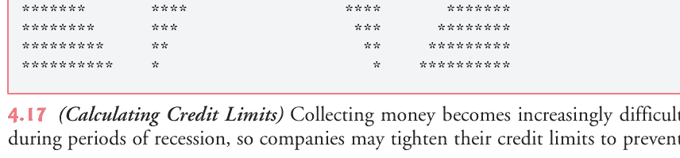

## 4.17 （计算信用额度）在经济衰退时期，收款变得越来越困难，因此公司可能会收紧其信用额度，以防止其应收账款（别人欠他们的钱）变得过大。为了应对长期的经济衰退，一家公司将其客户的信用额度削减了一半。因此，如果一个特定客户的信用额度是 2000 美元，现在就是 1000 美元。如果一个客户的信用额度是 5000 美元，现在就是 2500 美元。编写一个程序来分析这家公司的三个客户的信用状况。对于每个客户，你会得到：

- a) 客户的账号。
- b) 经济衰退前客户的信用额度。
- c) 客户的当前余额（即客户欠款的金额）。

你的程序应该计算并打印每个客户的新信用额度，并确定（并打印）哪些客户的余额超过了他们的新信用额度。

## 4.18 （打印条形图程序）计算机的一个有趣应用是绘制图形和条形图。编写一个程序，读取五个数字（每个在 1 到 30 之间）。对于读取的每个数字，你的程序应该打印一行包含该数量的相邻星号。例如，如果你的程序读取数字七，它应该打印 *******。

## 4.19 （计算销售额）一家在线零售商销售五种不同的产品，其零售价格如下表所示：

| 产品编号 | 零售价格 |
| :--- | :--- |
| 1 | $ 2.98 |
| 2 | $ 4.50 |
| 3 | $ 9.98 |
| 4 | $ 4.49 |
| 5 | $ 6.87 |

编写一个程序，读取一系列数字对，如下所示：

- a) 产品编号。
- b) 一天的销售数量。

你的程序应该使用 switch 语句来帮助确定每种产品的零售价格。你的程序应该计算并显示上周销售的所有产品的总零售价值。

## 4.20 （真值表）通过在每个空白处填入 0 或 1 来完成以下真值表。

| 条件1 | 条件2 | 条件1 && 条件2 |
| :--- | :--- | :--- |
| 0 | 0 | 0 |
| 0 | 非零 | 0 |
| 非零 | 0 | ______ |
| 非零 | 非零 | ______ |

| 条件1 | 条件2 | 条件1 \|\| 条件2 |
| :--- | :--- | :--- |
| 0 | 0 | 0 |
| 0 | 非零 | 1 |
| 非零 | 0 | _____ |
| 非零 | 非零 | _____ |

| 条件1 | !条件1 |
| :--- | :--- |
| 0 | 1 |
| 非零 | _____ |

## 4.21 重写图 4.2 的程序，在 for 语句之前定义并初始化变量 counter，然后在循环终止后输出 counter 的值。

## 4.22 （平均成绩）修改图 4.5 的程序，使其计算班级的平均成绩。

## 4.23 （用整数计算复利）修改图 4.4 的程序，使其仅使用整数来计算复利。*[提示：将所有货币金额视为整数的美分。然后使用除法和取余运算分别将结果“分解”为其美元部分和美分部分。插入一个小数点。]*

## 4.24 假设 i = 1, j = 2, k = 3 且 m = 2。每个语句打印什么？

- a) printf("%d", i == 1);
- b) printf("%d", j == 3);
- c) printf("%d", i >= 1 && j < 4);
- d) printf("%d", m <= 99 && k < m);
- e) printf("%d", j >= i || k == m);
- f) printf("%d", k + m < j || 3 - j >= k);
- g) printf("%d", !m);
- h) printf("%d", !(j - m));
- i) printf("%d", !(k > m));
- j) printf("%d", !(j > k));

## 4.25 （十进制、二进制、八进制和十六进制等价表）编写一个程序，打印十进制数 1—256 的二进制、八进制和十六进制等价表。如果你不熟悉这些数制，在尝试此练习之前请阅读在线附录 E。*[注意：你可以使用转换规范 %o 和 %X 分别将整数显示为八进制或十六进制值。]*

## 4.26 （计算 π 的值）从无穷级数计算 π 的值

π = 4 - 4/3 + 4/5 - 4/7 + 4/9 - 4/11 + ...

打印一个表格，显示由该级数的一项、两项、三项等近似的 π 值。你必须使用多少项才能首次得到 3.14？3.141？3.1415？3.14159？

## 4.27 （毕达哥拉斯三元组）一个直角三角形的边长可以都是整数。直角三角形三条边长的整数值集合是一个毕达哥拉斯三元组。这三条边必须满足的关系是：两条直角边的平方和等于斜边的平方。找出所有边长 side1、side2 和斜边都不大于 500 的毕达哥拉斯三元组。使用三重嵌套的 for 循环尝试所有可能性。这是“暴力”计算的一个例子。对许多人来说，这并不美观。但这种技术之所以重要有很多原因。首先，随着计算能力以惊人的速度增长，几年前的技术需要数年甚至数世纪计算机时间才能产生的解决方案，现在可以在几小时、几分钟、几秒甚至更短的时间内产生。其次，有大量有趣的问题，除了纯粹的暴力之外，没有已知的算法方法。我们在本书中研究了许多问题解决方法。我们将考虑各种有趣问题的暴力方法。

## 4.28 （计算周薪）一家公司支付其员工为经理（获得固定的周薪）、小时工（获得固定的小时工资，适用于前 40 小时，加班时间获得“一倍半”的工资）、佣金工人（获得 250 美元加上其每周总销售额的 5.7%）或计件工人（获得他们生产的每件物品的固定金额——这家公司的每个计件工人只从事一种物品的工作）。编写一个程序来计算每个员工的周薪。你事先不知道员工的数量。每种类型的员工都有一个工资代码：经理的工资代码为 1，小时工的代码为 2，佣金工人的代码为 3，计件工人的代码为 4。使用 switch 根据工资代码计算每个员工的工资。在 switch 内部，提示用户输入你的程序根据该员工的工资代码计算其工资所需的事实。[注意：你可以使用转换规范 %lf 通过 scanf 输入 double 类型的值。]

## 4.29 （德摩根定律）我们讨论了逻辑运算符 &&、|| 和 !。德摩根定律有助于更方便地表达逻辑表达式。这些定律指出，表达式 !(condition1 && condition2) 在逻辑上等价于表达式 (!condition1 || !condition2)。同样，表达式 !(condition1 || condition2) 在逻辑上等价于表达式 (!condition1 && !condition2)。使用德摩根定律为以下每个表达式编写等价表达式，然后编写一个程序来证明每种情况下的原始表达式和新表达式是等价的。

- a) !(x < 5) && !(y >= 7)
- b) !(a == b) || !(g != 5)
- c) !((x <= 8) && (y > 4))
- d) !((i > 4) || (j <= 6))

## 4.30 （用 if...else 替换 switch）通过将 switch 替换为嵌套的 if...else 语句来重写图 4.5。注意正确处理默认情况。接下来，通过将嵌套的 if...else 语句替换为一系列 if 语句来重写这个新版本。同样，这里也要注意正确处理默认情况。这个练习表明，switch 是一种便利结构，任何 switch 语句都可以仅用单选语句来编写。

**4.31** *（菱形打印程序）* 编写一个程序，打印以下菱形图案。你的 `printf` 语句可以打印一个星号（*）或一个空格。使用嵌套的 `for` 语句，并最小化 `printf` 语句的数量。

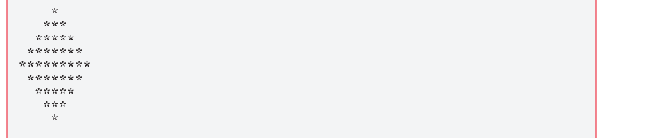

**4.32** *（修改后的菱形打印程序）* 修改你在练习 4.31 中编写的程序，使其读取一个 1 到 19 之间的奇数，以指定菱形的行数。然后，你的程序应显示一个相应大小的菱形。

**4.33** *（十进制值的罗马数字等价物）* 编写一个程序，打印一个表格，显示 1 到 100 范围内十进制数的罗马数字等价物。

**4.34** 描述你将如何用一个等效的 `while` 循环替换 `do...while` 循环。当你尝试用一个等效的 `do...while` 循环替换 `while` 循环时，会出现什么问题？假设你被告知必须移除一个 `while` 循环并用 `do...while` 循环替换它。你需要使用什么额外的控制语句？你将如何使用它来确保最终程序的行为与原始程序完全相同？

**4.35** 对 `break` 和 `continue` 语句的一个批评是它们都是非结构化的。实际上，`break` 和 `continue` 语句总是可以被结构化语句替换，尽管这样做可能很笨拙。描述你将如何从循环中移除任何 `break` 语句，并用某种结构化的等效语句替换该语句。[提示：`break` 语句从循环体内部终止循环。另一种退出方式是未能通过循环继续测试。考虑在循环继续测试中使用第二个测试，该测试表示“由于‘break’条件而提前退出”。] 使用你在此处开发的技术，从图 4.7 的程序中移除 `break` 语句。

**4.36** 以下程序段的功能是什么？

```c
for (int i = 1; i <= 5; ++i) {
    for (int j = 1; j <= 3; ++j) {
        for (int k = 1; k <= 4; ++k) {
            printf("%s", "*");
        }
        puts("");
    }
    puts("");
}
```

178 第 4 章 程序控制

**4.37** 概述你将如何从程序中的循环里移除任何 `continue` 语句，并用某种结构化的等效语句替换该语句。使用你在此处开发的技术，从图 4.8 的程序中移除 `continue` 语句。

**4.38** *（“圣诞节的十二天”歌曲）* 编写一个程序，使用迭代和 `switch` 语句打印歌曲“圣诞节的十二天”。一个 `switch` 语句应用于打印日期（即“第一天”、“第二天”等）。一个单独的 `switch` 语句应用于打印每段歌词的其余部分。

**4.39** *（浮点数在货币金额方面的局限性）* 第 4.5 节告诫了在货币计算中使用浮点值的问题。尝试这个实验：创建一个值为 1000000.00 的 `float` 变量。接下来，将字面浮点值 `0.12f` 加到该变量上。使用 `printf` 和转换说明符 `"%.2f"` 显示结果。你得到了什么？

**4.40** *（世界人口增长）* 几个世纪以来，世界人口增长显著。持续的增长最终可能挑战可呼吸空气、可饮用水、可耕地和其他有限资源的极限。有证据表明，近年来增长速度有所放缓，世界人口可能在本世纪某个时候达到顶峰，然后开始下降。

对于这个练习，在线研究世界人口增长问题。*务必调查各种观点。* 获取当前世界人口及其增长率（即今年可能增长的百分比）的估计值。编写一个程序，计算未来 75 年每年的世界人口增长，*使用当前增长率将保持不变的简化假设。* 以表格形式打印结果。第一列应显示从第 1 年到第 75 年的年份。第二列应显示该年底的预期世界人口。第三列应显示该年世界人口的数值增长。使用你的结果，确定如果今年的增长率持续下去，人口将在哪一年达到今天的两倍。

# 函数

## 5


## 目标

在本章中，你将：

-   从称为函数的小模块构建程序。
-   使用 C 标准库中的常用数学函数。
-   创建新函数。
-   理解函数原型如何帮助编译器确保你正确使用函数。
-   使用在函数之间传递信息的机制。
-   查看一些常用的 C 标准库头文件。
-   了解函数调用和返回机制如何由函数调用栈和栈帧支持。
-   使用模拟技术和随机数生成构建一个赌场游戏。
-   理解标识符的存储类如何影响其存储持续时间、作用域和链接。
-   编写和使用递归函数，即调用自身的函数。
-   通过查看安全随机数生成，继续我们关于安全 C 编程的介绍。

# 第 5 章 函数

-   5.1 简介
-   5.2 在 C 中模块化程序
-   5.3 数学库函数
-   5.4 函数
-   5.5 函数定义
    -   5.5.1 `square` 函数
    -   5.5.2 `maximum` 函数
-   5.6 函数原型：深入探讨
-   5.7 函数调用栈和栈帧
-   5.8 头文件
-   5.9 按值传递参数和按引用传递参数
-   5.10 随机数生成
-   5.11 随机数模拟案例研究：构建赌场游戏
-   5.12 存储类
-   5.13 作用域规则
-   5.14 递归
-   5.15 使用递归的示例：斐波那契数列
-   5.16 递归与迭代
-   5.17 安全 C 编程——安全随机数生成

摘要 | 自我复习练习 | 自我复习练习答案 | 练习

## 5.1 简介

大多数解决现实世界问题的计算机程序都比前几章介绍的程序大得多。经验表明，开发和维护程序的最佳方法是将其构建为更小的部分，每个部分都比原始程序更易于管理。这种技术称为**分而治之**。我们将描述一些用于设计、实现、操作和维护大型程序的关键 C 特性。

## 5.2 在 C 中模块化程序

在 C 中，你使用**函数**来模块化程序，方法是将你编写的新函数与预打包的 **C 标准库**函数结合起来。C 标准库提供了一个丰富的函数集合，用于执行常见的数学计算、字符串操作、字符操作、输入/输出和许多其他有用的操作。预打包函数使你的工作更容易，因为它们提供了你需要的许多功能。

C 标准包括 C 语言及其标准库——标准 C 编译器实现了两者。¹ 我们在前面章节中使用的函数 `printf`、`scanf` 和 `pow` 都来自标准库。

> **避免重复造轮子**
> 熟悉丰富的 C 标准库函数集合，以帮助减少程序开发时间。尽可能使用标准函数，而不是编写新函数。C 标准库函数由专家编写，经过充分测试且高效。此外，使用 C 标准库中的函数有助于使程序更具可移植性。

1.  C 标准库的某些部分被指定为可选，并非所有标准 C 编译器都可用。

### 定义函数

你可以定义函数来执行特定任务，这些任务可以在程序中的多个点使用。定义函数的语句只编写一次，并且对其他函数隐藏。正如我们将看到的，这种隐藏对于良好的软件工程至关重要。

### 调用函数和从函数返回

函数通过**函数调用**来**调用**，函数调用指定函数名称并提供函数执行其指定任务所需的信息（作为参数）。² 一个常见的类比是管理的层级形式。老板（**调用函数**或**调用者**）要求工人（**被调用函数**）执行一项任务并在完成后报告。例如，一个在屏幕上显示数据的函数调用工作函数 `printf` 来执行该任务。函数 `printf` 显示数据并在完成任务后报告——或**返回**——给调用者。老板函数不知道工作函数如何执行其指定任务。工作函数可能调用其他工作函数，而老板对此一无所知。下图显示了一个老板函数与几个工作函数进行层级通信：

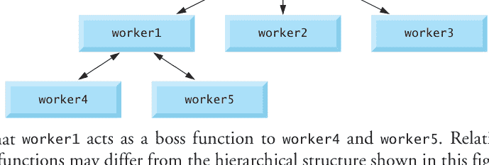

请注意，worker1 对 worker4 和 worker5 而言充当老板函数。函数之间的关系可能与此图所示的层级结构不同。

## 自我检查

1.  （填空）程序通常通过将你编写的新函数与 ________ 中可用的预打包函数结合起来编写。
    **答案：** C 标准库。
2.  （填空）函数通过函数 ________ 调用，该调用指定函数名称并提供函数执行其指定任务所需的信息（作为参数）。
    **答案：** 调用。

2.  在第 7 章“指针”中，我们将讨论函数指针。你将看到你也可以通过函数指针调用函数，并且实际上可以将函数传递给其他函数。

## 5.3 数学库函数

C语言的数学库函数（头文件 `math.h`）允许你执行常见的数学计算。本节我们将使用其中许多函数。要计算并打印900.0的平方根，你可以这样写：

```c
printf("%.2f", sqrt(900.0));
```

当这条语句执行时，它会调用数学库函数 `sqrt` 来计算900.0的平方根，然后将结果打印为30.00。`sqrt` 函数接受一个 `double` 类型的参数，并返回一个 `double` 类型的结果。事实上，数学库中所有返回浮点值的函数都返回 `double` 数据类型。请注意，`double` 值与 `float` 值一样，可以使用 `%f` 转换说明符进行输出。你可以将函数调用的结果存储在一个变量中以备后用，例如：

```c
double result = sqrt(900.0);
```

函数参数可以是常量、变量或表达式。如果 `c = 13.0`，`d = 3.0` 且 `f = 4.0`，那么语句

```c
printf("%.2f", sqrt(c + d * f));
```

将计算 `13.0 + 3.0 * 4.0 = 25.0` 的平方根，并将其打印为5.00。下表总结了几个C语言数学库函数。表中，变量 `x` 和 `y` 的类型为 `double`。C11标准通过 `complex.h` 头文件增加了复数功能。

| 函数 | 描述 | 示例 |
| :--- | :--- | :--- |
| sqrt(x) | x的平方根 | sqrt(900.0) 是 30.0<br>sqrt(9.0) 是 3.0 |
| cbrt(x) | x的立方根（仅限C99和C11） | cbrt(27.0) 是 3.0<br>cbrt(-8.0) 是 -2.0 |
| exp(x) | 指数函数 e^x | exp(1.0) 是 2.718282<br>exp(2.0) 是 7.389056 |
| log(x) | x的自然对数（以e为底） | log(2.718282) 是 1.0<br>log(7.389056) 是 2.0 |
| log10(x) | x的对数（以10为底） | log10(1.0) 是 0.0<br>log10(10.0) 是 1.0<br>log10(100.0) 是 2.0 |
| fabs(x) | x的浮点绝对值 | fabs(13.5) 是 13.5<br>fabs(0.0) 是 0.0<br>fabs(-13.5) 是 13.5 |
| ceil(x) | 将x向上舍入到不小于x的最小整数 | ceil(9.2) 是 10.0<br>ceil(-9.8) 是 -9.0 |
| floor(x) | 将x向下舍入到不大于x的最大整数 | floor(9.2) 是 9.0<br>floor(-9.8) 是 -10.0 |
| pow(x, y) | x的y次幂 (x^y) | pow(2, 7) 是 128.0<br>pow(9, .5) 是 3.0 |
| fmod(x, y) | x/y的浮点余数 | fmod(13.657, 2.333) 是 1.992 |
| sin(x) | x的三角正弦值（x以弧度为单位） | sin(0.0) 是 0.0 |
| cos(x) | x的三角余弦值（x以弧度为单位） | cos(0.0) 是 1.0 |
| tan(x) | x的三角正切值（x以弧度为单位） | tan(0.0) 是 0.0 |

## 自我检查

1.  （多选题）以下哪个陈述 a)、b) 或 c) 是错误的？
    a) 通过编写函数名后跟括号内的参数或逗号分隔的参数列表来调用函数。
    b) 以下语句计算并存储900.0的平方根：
       `double result = sqrt(900.0);`
    c) 要使用数学库函数，必须包含 `math.h` 头文件。
    d) 以上所有陈述都是正确的。
    答案：d。

2.  （判断题）函数参数可以是常量、变量或表达式。如果 `c = 16.0`，`d = 4.0` 且 `f = 5.0`，那么以下语句计算并打印100.00的平方根：
    `printf("%.2f", sqrt(c + d * f));`
    答案：错误。实际上，它计算的是36.0的平方根，并将其打印为6.00。

## 5.4 函数

函数允许你将程序模块化。在包含许多函数的程序中，`main` 通常被实现为一组对执行程序大部分工作的函数的调用。

### 程序功能化

“功能化”程序有几个动机。分而治之的方法使程序开发更易于管理。另一个动机是通过使用现有函数来构建新程序。这种软件可重用性是从C派生的面向对象编程语言（如C++、Java、C#（发音为“C sharp”）、Objective-C和Swift）中的一个关键概念。

通过良好的函数命名和定义，你可以从执行特定任务的标准化函数创建程序，而不是编写自定义代码。这被称为抽象。我们每次使用标准库函数（如 `printf`、`scanf` 和 `pow`）时都在使用抽象。第三个动机是避免在程序中重复代码。将代码打包为函数允许通过调用该函数从程序的其他位置执行它。

每个函数应限于执行单个、定义明确的任务，函数名应表达该任务。这有助于抽象并促进软件重用。如果无法选择一个简洁的名称来描述函数的功能，那么它可能执行了太多不同的任务。通常最好将这样的函数分解成更小的函数——这个过程称为*分解*。

## 自我检查

1.  （填空题）“功能化”程序有几个动机。分而治之的方法使程序开发更易于管理。另一个动机是________——使用现有函数作为构建块来创建新程序。
    **答案：** 软件可重用性。

2.  （判断题）每个函数应执行一系列丰富的相关任务，函数名应描述这些任务。
    **答案：** *错误。* 实际上，每个函数应限于执行单个、定义明确的任务，函数名应描述该任务。这有助于抽象并促进软件重用。

## 5.5 函数定义

我们介绍的每个程序都包含一个名为 `main` 的函数，该函数调用标准库函数来完成其任务。现在我们考虑如何编写自定义函数。

### 5.5.1 square 函数

考虑一个使用 `square` 函数来计算并打印从1到10的整数的平方的程序（图5.1）。

```c
// fig05_01.c
// 创建和使用函数。
#include <stdio.h>

int square(int number); // 函数原型

int main(void) {
    // 循环10次，每次计算并输出x的平方
    for (int x = 1; x <= 10; ++x) {
        printf("%d ", square(x)); // 函数调用
    }

    puts("");
}

// square函数定义，返回其参数的平方
int square(int number) { // number是函数参数的副本
    return number * number; // 返回number的平方，类型为int
}
```

图5.1 | 创建和使用函数。（第1部分，共2部分）

1 4 9 16 25 36 49 64 81 100

图5.1 | 创建和使用函数。（第2部分，共2部分）

#### 调用 square 函数

函数 `square` 在 `main` 中的 `printf` 语句（第10行）内被**调用**：

```c
printf("%d ", square(x)); // 函数调用
```

函数 `square` 在参数 `number`（第17行）中接收参数 `x` 值的副本。然后 `square` 计算 `number * number` 并将结果传回 `main` 中调用 `square` 的第10行。第10行将 `square` 的结果传递给 `printf` 函数，后者在屏幕上显示结果。这个过程重复10次——每次 `for` 语句迭代一次。

#### square 函数定义

函数 `square` 的定义（第17-19行）表明它期望一个 `int` 类型的参数 `number`。函数名前的关键字 `int`（第17行）表明 `square` 返回一个整数结果。`square` 中的 **return 语句** 将 `number * number` 的结果传回给调用函数。

选择有意义的函数名和有意义的参数名使程序更具可读性，并有助于避免过多的注释。程序应编写为小型函数的集合。这使得程序更易于编写、调试、维护、修改和重用。

需要大量参数的函数可能执行了太多任务。考虑将该函数分解成执行各个独立任务的更小的函数。如果可能，函数的返回类型、名称和参数列表应适合放在一行内。

#### 局部变量

在函数定义中定义的所有变量都是**局部变量**——它们只能在定义它们的函数中被访问。大多数函数都有**参数**，这些参数通过函数调用中的参数实现函数间的通信。函数的参数也是该函数的局部变量。

#### square 函数原型

第5行

```c
int square(int number); // 函数原型
```

是一个**函数原型**。括号中的 `int` 告诉编译器 `square` 期望从调用者那里接收一个整数值。函数名 `square` 左侧的 `int` 告诉编译器 `square` 向调用者返回一个整数结果。忘记函数原型末尾的分号是一个语法错误。

编译器将 `square` 的调用（第10行）与其原型进行比较，以确保：

- 参数数量正确，

### 函数定义的格式

函数定义的格式如下：

```
返回值类型 函数名(参数列表) {
    语句
}
```

函数名可以是任何有效的标识符。返回值类型是返回给调用者的结果类型。返回值类型 `void` 表示函数不返回值。返回值类型、函数名和参数列表有时统称为函数头。

参数列表是一个以逗号分隔的列表，指定了函数被调用时接收的参数。如果函数不接收任何参数，参数列表应包含关键字 `void`。每个参数必须包含其类型；否则，会发生编译错误。

在函数定义中，参数列表的右括号后放置分号是错误的，在函数中将参数重新定义为局部变量也是错误的。虽然这样做并非不正确，但不要为函数的实参与函数定义中的对应形参使用相同的名称——这有助于避免歧义。

### 函数体

花括号内的语句构成函数体，它也是一个块。可以在任何块中声明局部变量，并且块可以嵌套。函数不能嵌套——在另一个函数内部定义函数是语法错误。

### 从函数返回控制权

有三种方式可以将控制权从被调用函数返回到调用该函数的位置。如果函数不返回结果，当到达函数结束的右花括号时，控制权即被返回，或者通过执行以下语句返回：

```
return;
```

如果函数确实返回结果，则以下语句：

```
return 表达式;
```

会将表达式的值返回给调用者。

### main 的返回类型

main 函数的 `int` 返回值表示程序是否正确执行。在早期版本的 C 中，我们会在 main 的末尾显式放置：

```c
return 0; // 0 表示程序成功终止
```

C 标准指出，如果省略上述语句（正如本书中所做的那样），main 会隐式返回 0。你可以从 main 显式返回非零值，以表示程序执行期间发生了问题。有关如何报告程序失败的信息，请参阅特定操作系统的文档。

### 5.5.2 maximum 函数

让我们考虑一个自定义的 maximum 函数，它返回三个整数中的最大值（图 5.2）。接下来，它们被传递给 maximum（第 17 行），该函数确定最大的整数。这个值通过 maximum 中的 return 语句（第 32 行）返回给 main。然后，第 17 行的 printf 语句打印 maximum 返回的值。

```
1  // fig05_02.c
2  // 查找三个整数中的最大值。
3  #include <stdio.h>
4
5  int maximum(int x, int y, int z); // 函数原型
6
7  int main(void) {
8      int number1 = 0; // 用户输入的第一个整数
9      int number2 = 0; // 用户输入的第二个整数
10     int number3 = 0; // 用户输入的第三个整数
11
12     printf("%s", "Enter three integers: ");
13     scanf("%d%d%d", &number1, &number2, &number3);
14
15     // number1, number2 和 number3 是
16     // maximum 函数调用的实参
17     printf("Maximum is: %d\n", maximum(number1, number2, number3));
18 }
19
20 // maximum 函数定义
21 int maximum(int x, int y, int z) {
22     int max = x; // 假设 x 是最大的
23
24     if (y > max) { // 如果 y 大于 max，
25         max = y; // 将 y 赋值给 max
26     }
27
28     if (z > max) { // 如果 z 大于 max，
29         max = z; // 将 z 赋值给 max
30     }
31
32     return max; // max 是最大值
33 }
```

图 5.2 | 查找三个整数中的最大值。（第 1 部分，共 2 部分。）

```
Enter three integers: 22 85 17
Maximum is: 85
```

```
Enter three integers: 47 32 14
Maximum is: 47
```

```
Enter three integers: 35 8 79
Maximum is: 79
```

图 5.2 | 查找三个整数中的最大值。（第 2 部分，共 2 部分。）

该函数最初假设其第一个实参（存储在形参 `x` 中）是最大的，并将其赋值给 `max`（第 22 行）。接下来，第 24-26 行的 `if` 语句确定 `y` 是否大于 `max`，如果是，则将 `y` 赋值给 `max`。然后，第 28-30 行的 `if` 语句确定 `z` 是否大于 `max`，如果是，则将 `z` 赋值给 `max`。最后，第 32 行将 `max` 返回给调用者。

## 自我检查

1.  （多选题）以下代码行是一个 ________。
    `int square(int y);`
    a) 函数定义。
    b) 函数语句。
    c) 函数原型。
    d) 以上都不是。
    答案：c。

2.  （多选题）考虑图 5.2 中的 maximum 函数。以下哪个陈述是错误的？
    a) 该代码确定三个整数值中的最大值。
    b) 语句 `return max;` 将结果发送回调用函数。
    c) 第 21 行的代码——`int maximum(int x, int y, int z)`——通常称为函数头。
    d) 如果第 22 行的 `int max = x;` 被意外替换为 `int max = y;`，该函数仍将返回相同的结果。
    答案：d) 是错误的。该函数随后将错误地返回形参 `y` 和 `z` 中包含的值中较大的那个。

## 5.6 函数原型：深入探讨

C 的一个重要特性是函数原型，它借鉴自 C++。编译器使用函数原型来验证函数调用。标准之前的 C 不执行这种检查，因此可能不当地调用函数而编译器无法检测到错误。此类调用可能导致致命的运行时错误或非致命错误，从而引发微妙、难以检测的问题。函数原型纠正了这一缺陷。

你应该为所有函数包含函数原型，以利用 C 的类型检查能力。使用 `#include` 预处理指令从标准库头文件、第三方库头文件以及你或你的团队成员开发的函数的头文件中获取函数原型。

图 5.2 中 maximum 的函数原型（第 5 行）是：

```
int maximum(int x, int y, int z); // 函数原型
```

它声明 `maximum` 接受三个 `int` 类型的实参并返回一个 `int` 结果。请注意，函数原型（省略分号）与 `maximum` 定义的第一行相同。我们在函数原型中包含参数名称是为了文档目的。编译器会忽略这些名称，因此以下原型也是有效的：

```
int maximum(int, int, int);
```

### 编译错误

与函数原型不匹配的函数调用是编译错误。如果函数原型和函数定义不一致，也是错误。例如，在图 5.2 中，如果函数原型被写成：

```
void maximum(int x, int y, int z);
```

编译器将生成错误，因为函数原型的 `void` 返回类型与函数头中的 `int` 返回类型不同。

### 实参强制转换和“通常的算术转换规则”

函数原型的另一个重要特性是实参强制转换，即隐式地将实参转换为适当的类型。例如，使用整数实参调用数学库函数 `sqrt` 仍然有效，即使 `<math.h>` 中的函数原型指定了 `double` 形参。以下语句正确计算 `sqrt(4)` 并打印 `2.000`：

```
printf("%.3f\n", sqrt(4));
```

函数原型导致编译器在将 `int` 值 4 的副本传递给 `sqrt` 之前，将其转换为 `double` 值 4.0。通常，与函数原型形参类型不完全对应的实参值会在函数调用前转换为适当的类型。如果不遵循 C 的通常的算术转换规则，此类转换可能导致错误的结果。这些规则指定了如何在不丢失数据的情况下将值转换为其他类型。

在我们的 `sqrt` 示例中，`int` 被自动转换为 `double` 而不改变其值——`double` 可以表示比 `int` 宽得多的值范围。但是，将 `double` 转换为 `int` 会截断 `double` 的小数部分，从而改变原始值。将大的整数类型转换为小的整数类型（例如，`long` 转换为 `short`）也可能改变值。

### 混合类型表达式

通常的算术转换规则由编译器处理。它们适用于混合类型表达式——即包含多种数据类型值的表达式。在此类表达式中，编译器会为需要转换的值创建临时副本，然后将这些副本转换为表达式中的“最高”类型——这被称为**提升**。对于至少包含一个浮点值的混合类型表达式：

- 如果其中一个值是 `long double`，则其他值将被转换为 `long double`。
- 如果其中一个值是 `double`，则其他值将被转换为 `double`。
- 如果其中一个值是 `float`，则其他值将被转换为 `float`。

如果混合类型表达式仅包含整数类型，则通常的算术转换规定了一组整数提升规则。

C 标准文档的第 6.3.1 节详细规定了算术操作数和通常的算术转换规则。下表列出了浮点和整数数据类型，以及每种类型的 `printf` 和 `scanf` 转换说明符。在大多数情况下，下表中较低位置的整数类型会被转换为较高的类型：

| 数据类型 | printf 转换说明符 | scanf 转换说明符 |
| :--- | :--- | :--- |
| *浮点类型* | | |
| long double | %Lf | %Lf |
| double | %f | %lf |
| float | %f | %f |
| *整数类型* | | |
| unsigned long long int | %llu | %llu |
| long long int | %lld | %lld |
| unsigned long int | %lu | %lu |
| long int | %ld | %ld |
| unsigned int | %u | %u |
| int | %d | %d |
| unsigned short | %hu | %hu |
| short | %hd | %hd |
| char | %c | %c |

只有通过显式地将值赋给较低类型的变量，或者使用强制类型转换运算符，才能将值转换为较低类型。在函数调用时，实参会被转换为函数原型中指定的形参类型，就像实参被赋值给这些类型的变量一样。因此，如果我们向图 5.1 中的 `square` 函数传递一个 `double` 值，该 `double` 值会被转换为 `int`（一种较低类型），而 `square` 通常会返回一个不正确的值。例如，`square(4.5)` 返回 16，而不是 20.25。

**注意** 从提升层次结构中的较高数据类型转换为较低类型可能会改变数据值。许多编译器在此类情况下会发出警告。

### 函数原型注意事项

如果一个函数没有函数原型，编译器会根据函数的首次出现（无论是函数定义还是函数调用）来构造一个原型。这通常会导致警告或错误，具体取决于编译器。

始终为你定义或在程序中使用的函数包含函数原型，以帮助防止编译错误和警告。

放置在任何函数定义之外的函数原型适用于其后出现的所有对该函数的调用。放置在函数体内的函数原型仅适用于该原型之后在该函数内进行的调用。

## 自我检查

1. （填空）在混合类型表达式中，编译器会为每个需要转换的值创建一个临时副本，然后将这些副本转换为表达式中的“最高”类型——这被称为 ________。
   答案：提升。

2. （多选）考虑以下用于求最大值的函数原型：
   `int maximum(int x, int y, int z); // 函数原型`
   下列哪项陈述是错误的？
   a) 它表明 `maximum` 接受三个 `int` 类型的参数，并返回一个 `int` 类型的结果。
   b) 函数原型中必须包含参数名。
   c) 函数的原型通常与函数头相同，只是函数头不以分号结尾。
   d) 忘记在函数原型末尾加分号是语法错误。
   答案：b) 是错误的。函数原型中的参数名仅用于文档目的。编译器会忽略这些名称，因此 `int maximum(int, int, int);` 与前面的原型等效。

## 5.7 函数调用栈与栈帧

为了理解 C 语言如何执行函数调用，我们首先需要考虑一种称为**栈**的数据结构（即相关数据项的集合）。可以将栈想象成一叠盘子。你通常将盘子放在顶部——这被称为将盘子**压入**栈。类似地，你通常从顶部移除盘子——这被称为将盘子从栈中**弹出**。栈被称为后进先出（LIFO）数据结构——最后压入（插入）栈的项目是第一个从栈中弹出（移除）的项目。

### 函数调用栈

计算专业学生需要理解的一个重要机制是**函数调用栈**（有时称为程序执行栈）。这个数据结构——在“幕后”工作——支持函数的调用/返回机制。正如你将在本节中看到的，函数调用栈还支持创建、维护和销毁每个被调用函数的局部变量。

### 栈帧

当每个函数被调用时，它可能会调用其他函数，而这些函数又可能调用其他函数——所有这些都发生在任何函数返回之前。每个函数最终都必须将控制权返回给其调用者。因此，我们必须跟踪每个函数需要返回控制权给调用它的函数的返回地址。函数调用栈是处理此信息的完美数据结构。每次一个函数调用另一个函数时，一个条目会被压入栈中。这个条目被称为一个**栈帧**，它包含被调用函数需要返回到调用函数的*返回地址*。它还包含一些我们即将讨论的附加信息。当被调用函数返回时，该函数调用的栈帧被弹出，控制权转移到弹出的栈帧中指定的返回地址。

每个被调用函数总是在调用栈的*顶部*找到它返回到调用者所需的信息。如果一个被调用函数调用了另一个函数，那么新函数调用的栈帧会被压入调用栈。因此，新被调用函数返回到其调用者所需的返回地址现在位于栈顶。

栈帧还有另一个重要职责。大多数函数都有局部变量，这些变量在函数执行期间必须存在。如果函数调用其他函数，它们需要保持活动状态。但当被调用函数返回到其调用者时，被调用函数的局部变量需要“消失”。被调用函数的栈帧是为局部变量预留内存的完美场所。该栈帧仅在被调用函数处于活动状态时存在。当该函数返回——并且不再需要其局部变量时——其栈帧从栈中弹出。这些局部变量将不再为程序所知。

### 栈溢出

当然，计算机中的内存量是有限的，因此只有有限的内存可用于在函数调用栈上存储栈帧。如果发生的函数调用数量超过了函数调用栈上可以存储的栈帧数量，就会发生一种称为**栈溢出**的*致命*错误。

### 函数调用栈实战

现在让我们考虑调用栈如何支持 `main` 函数（图 5.3 的第 8-12 行）调用的 `square` 函数的操作。

3. 这就是网站 stackoverflow.com 名称的由来——一个用于获取编程问题答案的热门网站。

```c
// fig05_03.c
// 演示函数调用栈和栈帧，使用 square 函数。
#include <stdio.h>

int square(int x); // square 函数的原型

int main() {
    int a = 10; // 要平方的值（main 中的局部变量）

    printf("%d squared: %d\n", a, square(a)); // 显示 a 的平方
}

// 返回一个整数的平方
int square(int x) { // x 是一个局部变量
    return x * x; // 计算平方并返回结果
}
```

10 squared: 100

图 5.3 | 使用 square 函数演示函数调用栈和栈帧。

#### 步骤 1：操作系统调用 main 执行应用程序

首先，操作系统调用 `main`——这会将一个栈帧压入栈中（如下图所示）。该栈帧告诉 `main` 如何返回到操作系统（即转移到返回地址 R1），并包含 `main` 的局部变量 `a` 的空间，该变量初始化为 10。

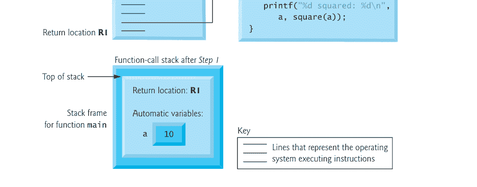

#### 步骤 2：main 调用函数 square 执行计算

函数 `main`——在返回到操作系统之前——现在调用图 5.3 第 11 行中的函数 `square`。这导致 `square`（第 15-17 行）的栈帧被压入函数调用栈，如下图所示：

## 5.8 头文件

每个标准库都有一个对应的头文件，其中包含该库中所有函数的函数原型，以及这些函数所需的各种数据类型和常量的定义。下表按字母顺序列出了程序中可能包含的几个标准库头文件。C标准还包含其他头文件。本表中多次使用的术语“宏”将在第14章详细讨论。

## 第5章 函数

| 头文件 | 说明 |
|---|---|
| *本书中使用或讨论的头文件：* | |
| <assert.h> | 包含用于添加诊断信息以辅助程序调试的信息。 |
| <ctype.h> | 包含用于测试字符特定属性的函数原型，以及可用于将小写字母转换为大写字母（反之亦然）的函数原型。 |
| <float.h> | 包含系统的浮点数大小限制。 |
| <limits.h> | 包含系统的整数大小限制。 |
| <math.h> | 包含数学库函数的函数原型。 |
| <signal.h> | 包含用于处理程序执行期间可能出现的各种条件的函数原型和宏。 |
| <stdarg.h> | 定义用于处理参数数量和类型未知的函数参数列表的宏。 |
| <stdio.h> | 包含标准输入/输出库函数的函数原型及其使用的信息。 |
| <stdlib.h> | 包含数字与文本相互转换、内存分配、随机数以及其他实用函数的函数原型。 |
| <string.h> | 包含字符串处理函数的函数原型。 |
| <time.h> | 包含用于操作时间和日期的函数原型和类型。 |
| *其他头文件：* | |
| <errno.h> | 定义用于报告错误条件的宏。 |
| <locale.h> | 包含函数原型和其他信息，使程序能够针对其运行的当前区域设置进行修改。区域设置的概念使计算机系统能够处理世界各地不同的数据表示约定，例如日期、时间、货币金额和大数字。 |
| <setjmp.h> | 包含允许绕过常规函数调用和返回序列的函数的函数原型。 |
| <stddef.h> | 包含C使用的通用类型定义。 |

你可以创建自定义头文件。程序员定义的头文件可以通过使用 `#include` 预处理指令来包含。例如，如果我们的 `square` 函数的原型位于头文件 `square.h` 中，我们将在程序顶部使用以下指令来包含该头文件：

```
#include "square.h"
```

第14.2节提供了有关包含头文件的更多信息，例如为什么程序员定义的头文件用引号（`""`）而不是尖括号（`<>`）括起来。

## 自我检查

- 1. （填空）________ 头文件包含字符串处理函数的函数原型。
答案：<string.h>。
- 2. （填空）________ 头文件包含用于添加诊断信息以辅助程序调试的信息。
答案：<assert.h>。

## 5.9 按值传递参数与按引用传递参数

在许多编程语言中，有两种传递参数的方式——按值传递和按引用传递。当参数按值传递时，会创建参数值的副本并传递给函数。对副本的更改不会影响调用者中原始变量的值。当参数按引用传递时，调用者允许被调用函数修改原始变量的值。

只要被调用函数不需要修改调用者原始变量的值，就应该使用按值传递。这可以防止可能阻碍正确可靠的软件系统开发的意外副作用（变量修改）。按引用传递应仅与需要修改原始变量的可信被调用函数一起使用。

在C语言中，所有参数都是按值传递的。在第7章“指针”中，我们将展示如何实现按引用传递。在第6章中，我们将看到出于性能原因，数组参数会自动按引用传递。我们将在第7章中看到这并不矛盾。目前，我们专注于按值传递。

## 自我检查

- 1. （判断对错）当参数按值传递时，会创建参数值的副本并传递给函数。对副本的更改也会应用于调用者中原始变量的值。
答案：错误。按值传递时，对副本的更改不会影响调用者中原始变量的值。
- 2. （判断对错）按引用传递应仅与需要修改原始变量的可信被调用函数一起使用。
答案：正确。

## 5.10 随机数生成

我们现在简短地、希望是有趣地，转向模拟和游戏领域。在本节和下一节中，我们将开发一个结构良好的游戏程序，其中包含多个自定义函数。该程序使用了我们学过的函数和几种控制语句。可以通过使用 `<stdlib.h>` 头文件中的C标准库函数 `rand`⁴ 将随机元素引入计算机应用。

4. C标准库函数 `rand` 已知是“可预测的”，这可能会创造安全漏洞机会。我们首选的每个平台都提供非标准的安随机数生成器。我们将在第5.17节“安全C编程——安全随机数生成”中提及这些。

### 获取随机整数值

考虑以下语句：
```c
int value = rand();
```

`rand` 函数生成一个介于 0 和 `RAND_MAX`（在 `<stdlib.h>` 头文件中定义的一个符号常量）之间的整数。C 标准规定 `RAND_MAX` 的值必须至少为 32,767，这是两字节（即 16 位）整数的最大值。本节中的程序在 Microsoft Visual C++ 上测试时，`RAND_MAX` 的最大值为 32,767；在 GNU gcc 和 Xcode Clang 上测试时，`RAND_MAX` 的最大值为 2,147,483,647。如果 `rand` 真正随机地生成整数，那么每次调用 `rand` 时，0 到 `RAND_MAX` 之间的每个数字被选中的机会（或概率）都是相等的。

`rand` 直接产生的值范围通常与特定应用所需的不同。例如，一个模拟抛硬币的程序可能只需要 0 表示“正面”，1 表示“反面”。一个模拟六面骰子的程序则需要 1 到 6 的随机整数。

### 掷六面骰子

为了演示 `rand`，让我们开发一个程序（图 5.4）来模拟掷六面骰子 10 次，并打印每次掷出的值。

```c
// fig05_04.c
// 通过 1 + rand() % 6 产生经过移位和缩放的随机整数。
#include <stdio.h>
#include <stdlib.h>

int main(void) {
    for (int i = 1; i <= 10; ++i) {
        printf("%d ", 1 + (rand() % 6)); // 显示随机骰子值
    }
    puts("");
}
```

```
6 6 5 5 6 5 1 1 5 3
```

**图 5.4** | 通过 `1 + rand() % 6` 产生经过移位和缩放的随机整数。

`rand` 函数的原型位于 `<stdlib.h>` 中。在第 9 行，我们使用取余运算符（`%`）与 `rand` 结合，如下所示
```c
rand() % 6
```
以产生 0 到 5 范围内的整数。这被称为**缩放**。数字 6 被称为**缩放因子**。然后，我们通过将之前的结果加 1 来**移位**产生的数字范围。输出确认结果在 1 到 6 的范围内——这些随机值被选择的顺序可能因编译器而异。

### 掷六面骰子 60,000,000 次

为了表明这些数字出现的概率大致*相等*，让我们用图 5.5 的程序模拟掷骰子 60,000,000 次。从 1 到 6 的每个整数应该大约出现 10,000,000 次。

```c
// fig05_05.c
// 掷六面骰子 60,000,000 次。
#include <stdio.h>
#include <stdlib.h>

int main(void) {
    int frequency1 = 0; // 掷出 1 的计数器
    int frequency2 = 0; // 掷出 2 的计数器
    int frequency3 = 0; // 掷出 3 的计数器
    int frequency4 = 0; // 掷出 4 的计数器
    int frequency5 = 0; // 掷出 5 的计数器
    int frequency6 = 0; // 掷出 6 的计数器

    // 循环 60000000 次并总结结果
    for (int roll = 1; roll <= 60000000; ++roll) {
        int face = 1 + rand() % 6; // 1 到 6 之间的随机数

        // 确定面值并增加相应的计数器
        switch (face) {
            case 1: // 掷出 1
                ++frequency1;
                break;
            case 2: // 掷出 2
                ++frequency2;
                break;
            case 3: // 掷出 3
                ++frequency3;
                break;
            case 4: // 掷出 4
                ++frequency4;
                break;
            case 5: // 掷出 5
                ++frequency5;
                break;
            case 6: // 掷出 6
                ++frequency6;
                break; // 可选
        }
    }

    // 以表格格式显示结果
    printf("%s%13s\n", "Face", "Frequency");
    printf("   1%13d\n", frequency1);
    printf("   2%13d\n", frequency2);
    printf("   3%13d\n", frequency3);
    printf("   4%13d\n", frequency4);
    printf("   5%13d\n", frequency5);
    printf("   6%13d\n", frequency6);
}
```

**图 5.5** | 掷六面骰子 60,000,000 次。

```
Face    Frequency
   1       9999294
   2      10002929
   3       9995360
   4      10000409
   5      10005206
   6       9996802
```

正如程序输出所示，通过缩放和移位，我们使用 `rand` 函数真实地模拟了掷六面骰子的过程。注意使用 `%s` 转换说明符将字符串 "Face" 和 "Frequency" 打印为列标题（第 42 行）。在第 6 章学习数组之后，我们将展示如何用一条语句优雅地替代这个 20 行的 switch 语句。

### 随机化随机数生成器

再次执行图 5.4 的程序会产生
```
6 6 5 5 6 5 1 1 5 3
```
这与我们在图 5.4 中显示的值序列完全相同。这些怎么会是随机数呢？具有讽刺意味的是，这种可重复性是 `rand` 函数的一个重要特性。在调试程序时，这种可重复性对于证明程序的修正是否正常工作至关重要。

`rand` 函数实际上生成的是伪随机数。重复调用 `rand` 会产生一个看似随机的数字序列。然而，每次执行程序时，该序列都会重复。一旦程序经过彻底调试，就可以使其在每次执行时产生不同的随机数序列。这被称为随机化，通过标准库函数 `srand` 实现。`srand` 函数接受一个 `int` 参数，并为 `rand` 函数设置种子，以便在每次程序执行时产生不同的随机数序列。

我们在图 5.6 中演示 `srand` 函数。`srand` 的函数原型位于 `<stdlib.h>` 中。

```c
// fig05_06.c
// 随机化掷骰子程序。
#include <stdio.h>
#include <stdlib.h>

int main(void) {
    printf("%s", "Enter seed: ");
    int seed = 0; // 用于为随机数生成器设置种子的数字
    scanf("%d", &seed);

    srand(seed); // 为随机数生成器设置种子

    for (int i = 1; i <= 10; ++i) {
        printf("%d ", 1 + (rand() % 6)); // 显示随机骰子值
    }

    puts("");
}
```

```
Enter seed: 67
6 1 4 6 2 1 6 1 6 4
```

```
Enter seed: 867
2 4 6 1 6 1 1 3 6 2
```

```
Enter seed: 67
6 1 4 6 2 1 6 1 6 4
```

**图 5.6** | 随机化掷骰子程序。

让我们多次运行程序并观察结果。请注意，只要提供不同的种子，每次运行程序都会获得不同的随机数序列。第一次和最后一次输出使用了相同的种子值，因此它们显示了相同的结果。

为了在不每次输入种子的情况下进行随机化，请使用如下语句
```c
srand(time(NULL));
```
这会使计算机读取其时钟以自动获取种子值。`time` 函数返回自 1970 年 1 月 1 日午夜以来经过的秒数。该值被转换为整数并用作随机数生成器的种子。`time` 的函数原型位于 `<time.h>` 中。我们将在第 7 章进一步讨论 `NULL`。

### 随机数的广义缩放和移位

`rand` 直接产生的值始终在以下范围内：
```
0 ≤ rand() ≤ RAND_MAX
```

如你所知，以下语句模拟掷六面骰子：
```c
int face = 1 + rand() % 6;
```
此语句总是将一个整数值（随机地）分配给变量 `face`，范围在 1 ≤ `face` ≤ 6。此范围的*宽度*（即范围内的连续整数个数）为 6，范围内的起始数字为 1。参考前面的语句，我们看到范围的宽度由用于通过取余运算符缩放 `rand` 的数字（即 6）决定，范围的起始数字等于加到 `rand % 6` 上的数字（即 1）。我们可以将此结果概括如下：
```c
int n = a + rand() % b;
```
其中
- `a` 是**移位值**（等于所需连续整数范围中的第一个数字），并且
- `b` 是*缩放因子*（等于所需连续整数范围的宽度）。

在练习中，你将从除连续整数范围之外的值集中随机选择整数。

## 自我检查

1. *（填空）* ________ 是 `rand` 函数的一个重要特性。当我们调试程序时，此特性对于证明程序的修正是否正常工作至关重要。
   **答案：** 可重复性。
2. *（判断对错）* 如果 `rand` 真正随机地生成整数，那么每次调用 `rand` 时，0 到 `RAND_MAX` 之间的每个数字被选中的机会（或概率）都是相等的。
   **答案：** *对。*
3. *（填空）* 一旦程序经过彻底调试，就可以使其在每次执行时产生不同的随机数序列。这被称为随机化，通过标准库函数 ________ 实现。
   **答案：** `srand`。

## 5.11 随机数模拟案例研究：构建赌场游戏

在本节中，我们模拟一种流行的骰子游戏，称为“双骰子”。游戏规则很简单：

> 玩家掷两个骰子。每个骰子有六个面。这些面包含 1、2、3、4、5 和 6 个点。骰子停止后，计算两个朝上面的点数之和。如果第一次投掷的和是 7 或 11，玩家获胜。如果第一次投掷的和是 2、3 或 12（称为“双骰子”），玩家输（即“庄家”赢）。如果第一次投掷的和是 4、5、6、8、9 或 10，则该和成为玩家的“点数”。要获胜，你必须继续掷骰子，直到你“达到你的点数”。如果玩家在达到点数之前掷出 7，则玩家输。

图 5.7 模拟了双骰子游戏，并显示了几个示例执行。

## 5.11 随机数模拟案例研究：构建赌场游戏

```c
// fig05_07.c
// 模拟掷双骰游戏。
#include <stdio.h>
#include <stdlib.h>
#include <time.h> // 包含函数 time 的原型

enum Status {CONTINUE, WON, LOST}; // 表示游戏状态的常量

int rollDice(void); // rollDice 函数原型

int main(void) {
    srand(time(NULL)); // 基于当前时间随机化

    int myPoint = 0; // 玩家必须掷出此点数才能获胜
    enum Status gameStatus = CONTINUE; // 可能为 CONTINUE、WON 或 LOST
    int sum = rollDice(); // 第一次掷骰子

    // 根据骰子点数和确定游戏状态
    switch(sum) {
        // 首次掷骰即获胜
        case 7: // 7 是赢家
        case 11: // 11 是赢家
            gameStatus = WON;
            break;
        // 首次掷骰即失败
        case 2: // 2 是输家
        case 3: // 3 是输家
        case 12: // 12 是输家
            gameStatus = LOST;
            break;
        // 记住点数
        default:
            gameStatus = CONTINUE; // 玩家应继续掷骰
            myPoint = sum; // 记住点数
            printf("Point is %d\n", myPoint);
            break; // 可选
    }

    // 当游戏未结束时
    while (CONTINUE == gameStatus) { // 玩家应继续掷骰
        sum = rollDice(); // 再次掷骰子

        // 确定游戏状态
        if (sum == myPoint) { // 通过掷出目标点数获胜
            gameStatus = WON;
        }
        else if (7 == sum) { // 掷出 7 则失败
            gameStatus = LOST;
        }
    }

    // 显示获胜或失败信息
    if (WON == gameStatus) { // 玩家赢了吗？
        puts("Player wins");
    }
    else { // 玩家输了
        puts("Player loses");
    }
}

// 掷骰子，计算点数和并显示结果
int rollDice(void) {
    int die1 = 1 + (rand() % 6); // 随机选择 die1 的值
    int die2 = 1 + (rand() % 6); // 随机选择 die2 的值

    // 显示本次掷骰结果
    printf("Player rolled %d + %d = %d\n", die1, die2, die1 + die2);
    return die1 + die2; // 返回骰子点数和
}
```

图 5.7 | 模拟掷双骰游戏。

玩家在首次掷骰时获胜：

```
Player rolled 5 + 6 = 11
Player wins
```

玩家在后续掷骰时获胜：

```
Player rolled 4 + 1 = 5
Point is 5
Player rolled 6 + 2 = 8
Player rolled 2 + 1 = 3
Player rolled 3 + 2 = 5
Player wins
```

玩家在首次掷骰时失败：

```
Player rolled 1 + 1 = 2
Player loses
```

玩家在后续掷骰时失败：

```
Player rolled 6 + 4 = 10
Point is 10
Player rolled 3 + 4 = 7
Player loses
```

在游戏中，玩家每次掷骰必须掷两个骰子。我们定义了 `rollDice` 函数来掷骰子、计算并打印它们的点数和。该函数只定义了一次，但被调用了两次（第 16 行和第 41 行）。该函数不接受参数，因此我们在参数列表（第 62 行）和函数原型（第 9 行）中指明了 `void`。函数 `rollDice` 确实返回两个骰子的点数和，因此在其函数头和函数原型中指明了返回类型为 `int`。

### 枚举

这个游戏相当复杂。玩家可能在首次掷骰或任何后续掷骰时获胜或失败。变量 `gameStatus` 被定义为一种新类型——`enum Status`——用于存储当前状态。第 7 行创建了一个称为枚举的新类型。枚举由关键字 `enum` 引入，是一组由标识符表示的整数常量。枚举常量有助于使程序更具可读性且更易于维护。枚举中的值从 0 开始，每次递增 1。在第 7 行中，常量 `CONTINUE` 的值为 0，`WON` 的值为 1，`LOST` 的值为 2。也可以为枚举中的每个标识符分配一个整数值（参见第 10 章）。枚举中的标识符必须唯一，但值可以重复。在枚举常量名称中仅使用大写字母，以使其在程序中突出显示，并表明它们不是变量。

当游戏获胜时，`gameStatus` 被设置为 `WON`。当游戏失败时，`gameStatus` 被设置为 `LOST`。否则，`gameStatus` 被设置为 `CONTINUE`，游戏继续进行。

### 游戏在首次掷骰时结束

如果游戏在第一次掷骰后结束，`gameStatus` 不是 `CONTINUE`，因此程序继续执行第 53-58 行的 `if…else` 语句，如果 `gameStatus` 是 `WON` 则打印 "Player wins"，否则打印 "Player loses"。

### 游戏在后续掷骰时结束

在第一次掷骰之后，如果游戏没有结束，则将 `sum` 保存在 `myPoint` 中。由于 `gameStatus` 是 `CONTINUE`，程序继续执行 `while` 语句。每次循环都会调用 `rollDice` 来产生一个新的点数和：

- 如果 `sum` 与 `myPoint` 匹配，则将 `gameStatus` 设置为 `WON`，`while` 循环终止，`if…else` 语句打印 "Player wins"，然后执行终止。
- 如果 `sum` 是 7（第 47 行），则将 `gameStatus` 设置为 `LOST`，`while` 循环终止，`if…else` 语句打印 "Player loses"，然后执行终止。

### 控制架构

注意程序的控制架构。我们使用了两个函数——`main` 和 `rollDice`——以及 `switch`、`while` 和嵌套的 `if…else` 语句。

### 相关练习

本构建赌场游戏案例研究由以下练习支持：

- 练习 5.47（掷双骰游戏修改）。
- 练习 6.20（掷双骰游戏统计）。

## 自我检查

1. （填空）枚举由关键字 ________ 引入，是一组由标识符表示的整数常量。
答案：enum。

2. （填空）在以下语句中
`enum Status {CONTINUE, WON, LOST};`
`CONTINUE`、`WON` 和 `LOST` 的值分别是 ______、______ 和 ______。
答案：0、1 和 2。

## 5.12 存储类

在第 2-4 章中，我们使用标识符作为变量名。变量的属性包括 *名称*、*类型*、*大小* 和 *值*。在本章中，我们还使用标识符作为用户定义函数的名称。实际上，程序中的每个标识符都有其他属性，包括存储类、存储持续时间、作用域和链接。

C 语言提供了 **存储类说明符** `auto`、`register`、`extern` 和 **`static`**。**存储类** 决定了标识符的存储持续时间、作用域和链接。**存储持续时间** 是标识符存在于内存中的时间段。有些短暂存在，有些被反复创建和销毁，而另一些则存在于整个程序执行期间。**作用域** 决定了程序可以在哪里引用标识符。有些可以在整个程序中被引用，有些只能在程序的某些部分被引用。对于多源文件程序，标识符的 **链接** 决定了该标识符是仅在当前源文件中已知，还是在任何具有适当声明的源文件中已知。本节讨论存储类和存储持续时间，第 5.13 节讨论作用域。第 15 章讨论标识符链接和多源文件编程。

### 局部变量和自动存储持续时间

存储类说明符分为 **自动存储持续时间** 和 **静态存储持续时间**。**`auto`** 关键字声明一个变量具有自动存储持续时间。当程序控制进入定义它们的块时，这些变量被创建。它们在块处于活动状态时存在，当程序控制退出该块时被销毁。

只有变量才能具有自动存储持续时间。函数的局部变量——在参数列表或函数体中声明的那些——默认具有自动存储持续时间，因此 `auto` 关键字很少使用。自动存储持续时间是一种节省内存的方式，因为局部变量仅在需要时存在。我们将具有自动存储持续时间的变量简称为局部变量。

### 静态存储类

关键字 `extern` 和 `static` 声明具有 *静态存储持续时间* 的变量和函数的标识符。静态存储持续时间的标识符从程序开始执行时存在直到终止。对于静态变量，存储仅在程序开始执行之前分配和初始化 *一次*。对于函数，函数的名称在程序开始执行时就存在。然而，即使这些名称从程序执行开始就存在，它们也并非总是

5. 关键字 `register` 已过时，不应使用。
6. C11 添加了存储类说明符 `_Thread_local`，这超出了本书的范围。

可访问性。存储持续期和作用域（*名称*可以被使用的*位置*）是两个独立的问题，我们将在第5.13节中看到。

具有静态存储持续期的标识符有几种类型：*外部标识符*（如全局变量和函数名）以及使用存储类说明符`static`声明的局部变量。全局变量和函数名默认具有`extern`存储类。全局变量通过在任何函数定义之外放置变量声明来创建。它们在整个程序执行期间都保留其值。全局变量和函数可以被文件中在其声明或定义之后的任何函数引用。这是使用函数原型的原因之一——当我们在调用`printf`的程序中包含`stdio.h`时，函数原型被放置在文件的开头，以使名称`printf`为文件的其余部分所知。

将变量定义为全局变量而非局部变量，可能会在不需要访问该变量的函数意外或恶意修改它时，导致非预期的副作用。通常，除了在具有独特性能要求的情况下（如第15章所讨论的），应避免使用全局变量。仅在特定函数中使用的变量应定义为该函数中的局部变量。

局部`static`变量仍然只在其定义的函数中已知，并在函数返回时保留其值。下次调用该函数时，`static`局部变量包含函数上次退出时的值。以下语句将局部变量`count`声明为`static`并初始化为1：

```
static int count = 1;
```

如果你没有显式初始化它们，所有具有静态存储持续期的数值变量默认初始化为零。

当显式应用于外部标识符时，关键字`extern`和`static`具有特殊含义。第15章讨论了`extern`和`static`在外部标识符和多源文件程序中的显式使用。

## 自我检查

1.  *（填空）* 程序中的每个标识符都有属性，包括存储类、存储持续期、________和________。
    **答案：** 作用域，链接。

2.  *（多选）* 以下陈述a)、b)或c)哪一项是*错误*的？
    a) 标识符的存储持续期是标识符在内存中存在的期间。
    b) 标识符的作用域是标识符在程序中可以被引用的位置。
    c) 关键字`auto`声明具有自动存储持续期的变量。此类变量在程序控制进入其定义的块时创建。它们在块活动时存在，并在程序控制退出块时被销毁。
    d) 以上所有陈述都是*正确*的。
    **答案：** d。

## 5.13 作用域规则

标识符的作用域是程序中可以引用该标识符的部分。例如，块中的局部变量只能在该块中其定义之后或在该块内嵌套的块中被引用。标识符的四种作用域是函数作用域、文件作用域、块作用域和函数原型作用域。

### 函数作用域

标签是后跟冒号的标识符，例如`start:`。标签是*唯一*具有**函数作用域**的标识符。标签可以在其出现的函数中的任何地方使用，但不能在函数体外被引用。标签用于switch语句（作为case标签）和goto语句（见第15章）。标签在其定义的函数中是隐藏的。这种**信息隐藏**是实现**最小特权原则**的一种手段——这是良好软件工程的一个基本原则。在应用程序的上下文中，该原则规定代码应仅被授予完成其指定任务所需的特权和访问权限，但不能更多。

### 文件作用域

在任何函数之外声明的标识符具有**文件作用域**。这样的标识符从其声明点直到文件末尾，在所有函数中都是“已知的”（即可访问的）。放置在函数之外的全局变量、函数定义和函数原型都具有文件作用域。

### 块作用域

在块内定义的标识符具有**块作用域**。块作用域在块的终止右花括号（`}`）处结束。在函数开头定义的局部变量具有块作用域，函数参数也是如此，它们被视为函数的局部变量。任何块都可以包含变量定义。当块嵌套时，如果外部块的标识符与内部块的标识符同名，则外部块的标识符将被隐藏，直到内部块终止。在内部块中执行时，内部块看到的是其局部标识符的值，*而不是*外部块同名标识符的值。因此，通常应避免使用隐藏外部作用域中名称的变量名。声明为`static`的局部变量仍然具有块作用域，即使它们在程序启动之前就已存在。因此，存储持续期*不会*影响标识符的作用域。

### 函数原型作用域

唯一具有**函数原型作用域**的标识符是那些在函数原型的参数列表中使用的标识符。如前所述，函数原型不需要参数列表中的名称——只需要类型。如果在函数原型的参数列表中使用了名称，编译器会忽略它。在函数原型中使用的标识符可以在程序中的其他地方重用，而不会产生歧义。

### 作用域示例

图5.8演示了全局变量、局部变量和静态局部变量的作用域问题。定义了一个全局变量x并初始化为1（第9行）。在任何定义了名为x的变量的块（或函数）中，这个全局变量都是隐藏的。在main中，定义了一个局部变量x并初始化为5（第12行）。然后打印该变量以显示全局x在main中被隐藏。接下来，在main中定义了一个新块，其中另一个局部变量x初始化为7（第17行）。打印该变量以显示它隐藏了main外部块中的x。当退出该块时，值为7的变量x被自动销毁，然后再次打印main外部块中的局部变量x，以显示它不再被隐藏。

```
1  // fig05_08.c
2  // 作用域。
3  #include <stdio.h>
4
5  void useLocal(void); // 函数原型
6  void useStaticLocal(void); // 函数原型
7  void useGlobal(void); // 函数原型
8
9  int x = 1; // 全局变量
10
11 int main(void) {
12     int x = 5; // main的局部变量
13
14     printf("local x in outer scope of main is %d\n", x);
15
16     { // 开始新作用域
17         int x = 7; // 新作用域的局部变量
18
19         printf("local x in inner scope of main is %d\n", x);
20     } // 结束新作用域
21
22     printf("local x in outer scope of main is %d\n", x);
23
24     useLocal(); // useLocal有自动局部x
25     useStaticLocal(); // useStaticLocal有静态局部x
26     useGlobal(); // useGlobal使用全局x
27     useLocal(); // useLocal重新初始化自动局部x
28     useStaticLocal(); // 静态局部x保留其先前的值
29     useGlobal(); // 全局x也保留其值
30
31     printf("\nlocal x in main is %d\n", x);
32 }
33
34 // useLocal在每次调用期间重新初始化局部变量x
35 void useLocal(void) {
36     int x = 25; // 每次调用useLocal时初始化
37
38     printf("\nlocal x in useLocal is %d after entering useLocal\n", x);
39     ++x;
40     printf("local x in useLocal is %d before exiting useLocal\n", x);
41 }
42
43 // useStaticLocal仅在第一次调用函数时初始化静态局部变量x；
44 // x的值在对该函数的调用之间保留
45 void useStaticLocal(void) {
46    static int x = 50; // 初始化一次
47
48    printf("\nlocal static x is %d on entering useStaticLocal\n", x);
49    ++x;
50    printf("local static x is %d on exiting useStaticLocal\n", x);
51 }
52
53 // 函数useGlobal在每次调用期间修改全局变量x
54 void useGlobal(void) {
55    printf("\nglobal x is %d on entering useGlobal\n", x);
56    x *= 10;
57    printf("global x is %d on exiting useGlobal\n", x);
58 }
```

```
local x in outer scope of main is 5
local x in inner scope of main is 7
local x in outer scope of main is 5

local x in useLocal is 25 after entering useLocal
local x in useLocal is 26 before exiting useLocal

local static x is 50 on entering useStaticLocal
local static x is 51 on exiting useStaticLocal

global x is 1 on entering useGlobal
global x is 10 on exiting useGlobal

local x in useLocal is 25 after entering useLocal
local x in useLocal is 26 before exiting useLocal

local static x is 51 on entering useStaticLocal
local static x is 52 on exiting useStaticLocal

global x is 10 on entering useGlobal
global x is 100 on exiting useGlobal

local x in main is 5
```

图5.8 | 作用域。（第2部分，共2部分。）

该程序定义了三个函数，每个函数都不接受参数且不返回任何值。函数useLocal定义了一个局部变量x并初始化为25（第36行）。当调用函数useLocal时，该变量被打印、递增，然后在退出函数前再次打印。每次调用此函数时，局部变量x都会被重新初始化为25。

函数useStaticLocal定义了一个静态变量x并在第47行将其初始化为50（回想一下，静态变量的存储空间仅在程序开始执行之前分配和初始化一次）。声明为静态的局部变量保留其即使变量超出其作用域，静态局部变量仍能保留其值。当调用 `useStaticLocal` 时，会打印 `x` 的值，将其递增，然后在退出函数前再次打印。在下一次调用此函数时，静态局部变量 `x` 将包含之前递增后的值 51。

函数 `useGlobal` 没有定义任何变量，因此当它引用变量 `x` 时，使用的是全局变量 `x`（第 9 行）。当调用 `useGlobal` 时，会打印全局变量的值，将其乘以 10，然后在退出函数前再次打印。下一次调用 `useGlobal` 函数时，全局变量仍然保持其修改后的值 10。最后，程序再次打印 `main` 函数中的局部变量 `x`（第 31 行），以表明所有函数调用都没有修改 `x` 的值，因为这些函数引用的都是其他作用域中的变量。

## 自我检查

1.  （填空）标识符的**作用域**是程序中可以引用该标识符的部分。例如，块中的局部变量只能在该块中定义之后或在嵌套于该块的块中被引用。
    答案：作用域。

2.  （判断题）任何块都可以包含变量定义。当块嵌套时，如果外部块的标识符与内部块的标识符同名，则内部块的标识符会被隐藏，直到外部块结束。
    答案：错误。实际上，当块嵌套时，如果外部块的标识符与内部块的标识符同名，则外部块的标识符会被隐藏，直到内部块结束。

## 5.14 递归

对于某些类型的问题，让函数调用自身实际上是有用的。递归函数是指直接或间接通过另一个函数调用自身的函数。递归是一个复杂的主题，在高级计算机科学课程中会详细讨论。在本节和下一节中，我们将介绍简单的递归示例。我们将在第 5-8、12 和 13 章中对递归进行广泛讨论。第 5.16 节中的表格总结了本书的递归示例和练习。

### 基例与递归调用

我们首先从概念上理解递归，然后研究几个包含递归函数的程序。递归问题解决方法有几个共同要素。调用递归函数来解决问题。该函数实际上只知道如何解决最简单的情况，即所谓的**基例**。如果函数以基例被调用，它只需返回一个结果。当以更复杂的问题被调用时，函数通常将问题分为两个概念部分：

-   函数知道如何处理的部分，以及
-   函数不知道如何处理的部分。

为了使递归可行，后一部分必须类似于原始问题，但稍微简单或小一些。因为这个新问题看起来像原始问题，所以函数启动（调用）一个自身的新副本来处理这个较小的问题——这被称为**递归调用**或**递归步骤**。递归步骤还包括一个返回语句，因为其结果将与函数知道如何解决的那部分问题组合起来，形成一个结果传递回原始调用者。

递归步骤在原始函数调用暂停时执行，等待递归步骤的结果。递归步骤可能导致更多这样的递归调用，因为函数不断将其被调用时的每个问题分成两个概念部分。为了使递归终止，每次函数以原始问题的稍微简化版本调用自身时，这个较小问题的序列必须最终**收敛于基例**。当函数识别出基例时，它将结果返回给函数的前一个副本，然后一系列返回操作沿着调用链一直进行，直到原始函数调用最终将最终结果返回给其调用者。作为这些概念实际应用的一个例子，让我们编写一个递归程序来执行一个流行的数学计算。

### 递归计算阶乘

非负整数 *n* 的阶乘，写作 *n*!（读作“*n* 的阶乘”），是乘积

*n* · (*n* − 1) · (*n* − 2) · . . . · 1

其中 1! 等于 1，0! 定义为 1。例如，5! 是乘积 5 * 4 * 3 * 2 * 1，等于 120。

大于或等于 0 的整数 `number` 的阶乘可以使用 `for` 语句*迭代*（非递归地）计算，如下所示：

```
unsigned long long int factorial = 1;
for (int counter = number; counter > 1; --counter)
    factorial *= counter;
```

阶乘函数的*递归*定义是通过观察以下关系得出的：

*n*! = *n* · (*n* − 1)!

例如，5! 显然等于 5 * 4!，如下所示：

5! = 5 · 4 · 3 · 2 · 1
5! = 5 · (4 · 3 · 2 · 1)
5! = 5 · (4!)

### 递归计算 5!

5! 的计算将按照下图所示进行。下图 (a) 部分显示了递归调用的连续过程，直到 1! 被计算为 1（即*基例*），从而终止递归。图 (b) 部分显示了从每个递归调用返回给其调用者的值，直到计算并返回最终值。

214 第 5 章 函数

a) 递归调用序列

b) 每个递归调用返回的值

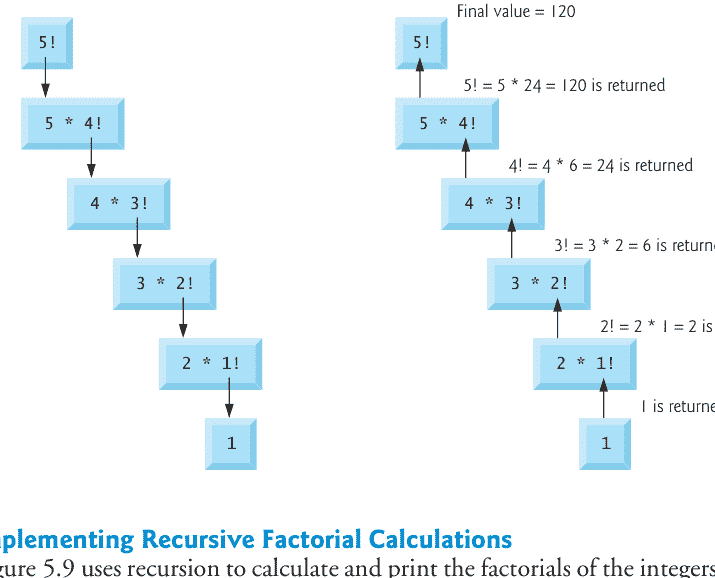

### 实现递归阶乘计算

图 5.9 使用递归计算并打印 0-21 的整数阶乘（选择 `unsigned long long int` 类型的原因稍后解释）。

```c
// fig05_09.c
// 递归阶乘函数。
#include <stdio.h>

unsigned long long int factorial(int number);

int main(void) {
    // 计算 factorial(i) 并显示结果
    for (int i = 0; i <= 21; ++i) {
        printf("%d! = %llu\n", i, factorial(i));
    }
}

// 函数 factorial 的递归定义
unsigned long long int factorial(int number) {
    if (number <= 1) { // 基例
        return 1;
    }
    else { // 递归步骤
        return (number * factorial(number - 1));
    }
}
```

图 5.9 | 递归阶乘函数。（第 1 部分，共 2 部分。）

```
0! = 1
1! = 1
2! = 2
3! = 6
4! = 24
5! = 120
6! = 720
7! = 5040
8! = 40320
9! = 362880
10! = 3628800
11! = 39916800
12! = 479001600
13! = 6227020800
14! = 87178291200
15! = 1307674368000
16! = 20922789888000
17! = 355687428096000
18! = 6402373705728000
19! = 121645100408832000
20! = 2432902008176640000
21! = 14197454024290336768
```

图 5.9 | 递归阶乘函数。（第 2 部分，共 2 部分。）

### 函数 factorial

递归阶乘函数首先测试终止条件是否为真，即 `number` 是否小于或等于 1。如果 `number` 确实小于或等于 1，`factorial` 返回 1，无需进一步递归，程序终止。如果 `number` 大于 1，则语句

return number * factorial(number - 1);

将问题表示为 `number` 与对 `factorial(number - 1)` 进行递归调用的乘积。调用 `factorial(number - 1)` 是一个比原始计算 `factorial(number)` 稍微简单的问题。

省略基例或错误地编写递归步骤，使其不收敛于基例，将导致无限递归，最终耗尽内存。这类似于迭代（非递归）解决方案中的无限循环问题，尽管无限循环通常不会耗尽内存。

### 阶乘值增长迅速

函数 `factorial`（第 15-22 行）接收一个 `int` 并返回一个 `unsigned long long int`。C 标准规定，`unsigned long long int` 类型的变量可以容纳至少 18,446,744,073,709,551,615 这么大的值。如图 5.9 所示，阶乘值增长迅速。我们选择 `unsigned long long int` 数据类型，以便程序可以计算更大的阶乘值。转换说明符 `%llu` 用于打印 `unsigned long long int` 值。不幸的是，阶乘函数产生大值的速度如此之快，以至于即使是 `unsigned long long int` 也无法帮助我们打印很多阶乘值，因为该类型的最大值很快就会被超过。

### 整数类型的局限性

即使我们使用无符号长整型（unsigned long long int），我们仍然无法计算超过21!的阶乘！这揭示了像C这样的过程式编程语言的一个弱点——该语言不易扩展以处理各种应用的独特需求。像C++这样的面向对象语言是可扩展的。通过一种称为类的语言特性，程序员可以创建新的数据类型，甚至是可以容纳任意大小整数的类型。

## 自我检查

1.  （填空）省略基本情况或错误地编写递归步骤，使其无法收敛到基本情况，将导致________，最终耗尽内存。
    答案：无限递归。

2.  （填空）以下代码本应迭代计算一个整数number的阶乘，但代码中存在一个错误：
    ```c
    unsigned long long int factorial = 1;
    for (int counter = number; counter >= 1; --counter)
        factorial * counter;
    ```
    你可以通过将________改为________来修正这个错误。
    答案：*, *=。

## 5.15 使用递归的示例：斐波那契数列

斐波那契数列
0, 1, 1, 2, 3, 5, 8, 13, 21, ...
以0和1开始，其特点是每个后续的斐波那契数都是前两个斐波那契数之和。

该数列出现在自然界中，特别是描述了一种螺旋形式。连续斐波那契数的比值收敛于一个常数1.618...。这个数字也反复出现在自然界中，被称为黄金比例或黄金分割。人类倾向于觉得黄金分割在美学上令人愉悦。建筑师经常设计长度和宽度比例为黄金分割的窗户、房间和建筑物。明信片也经常采用黄金分割的长宽比设计。

斐波那契数列可以递归定义如下：
fibonacci(0) = 0
fibonacci(1) = 1
fibonacci(n) = fibonacci(n – 1) + fibonacci(n – 2)

图5.10使用函数fibonacci递归计算第n个斐波那契数。斐波那契数往往很快变得很大。因此，我们为函数fibonacci的返回类型选择了数据类型unsigned long long int。

```c
// fig05_10.c
// 递归的斐波那契函数。
#include <stdio.h>

unsigned long long int fibonacci(int n); // 函数原型

int main(void) {
    // 计算并显示0-10的fibonacci(number)
    for (int number = 0; number <= 10; number++) {
        printf("Fibonacci(%d) = %llu\n", number, fibonacci(number));
    }

    printf("Fibonacci(20) = %llu\n", fibonacci(20));
    printf("Fibonacci(30) = %llu\n", fibonacci(30));
    printf("Fibonacci(40) = %llu\n", fibonacci(40));
}

// 函数fibonacci的递归定义
unsigned long long int fibonacci(int n) {
    if (0 == n || 1 == n) { // 基本情况
        return n;
    }
    else { // 递归步骤
        return fibonacci(n - 1) + fibonacci(n - 2);
    }
}
```

```
Fibonacci(0) = 0
Fibonacci(1) = 1
Fibonacci(2) = 1
Fibonacci(3) = 2
Fibonacci(4) = 3
Fibonacci(5) = 5
Fibonacci(6) = 8
Fibonacci(7) = 13
Fibonacci(8) = 21
Fibonacci(9) = 34
Fibonacci(10) = 55
Fibonacci(20) = 6765
Fibonacci(30) = 832040
Fibonacci(40) = 102334155
```

图 5.10 | 递归的斐波那契函数。

从main函数发起的fibonacci调用不是递归的（第10行和第13-15行），但所有后续对fibonacci的调用都是递归的（第24行）。每次调用fibonacci时，它都会立即测试基本情况——n是否等于0或1。如果为真，则返回n。有趣的是，如果n大于1，递归步骤会生成两个递归调用，每个调用都比原始的fibonacci调用问题稍简单。下图展示了函数fibonacci如何计算fibonacci(3)：

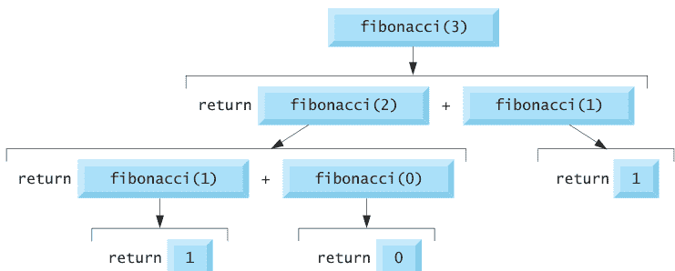

### 操作数的求值顺序

这个图引发了一些关于C编译器求值运算符操作数*顺序*的有趣问题。这与运算符应用于其操作数的顺序不同——即由运算符优先级和结合性规则决定的顺序。前面的图显示，在计算`fibonacci(3)`时，将进行*两个*递归调用，即`fibonacci(2)`和`fibonacci(1)`。但这些调用将以什么顺序进行？你可能简单地假设操作数将从左到右求值。出于优化原因，C*不*指定大多数运算符（包括+）的操作数的求值顺序。因此，你不应假设这些调用的执行顺序。调用可能先执行`fibonacci(2)`，然后执行`fibonacci(1)`，或者调用可能以相反的顺序执行，先`fibonacci(1)`后`fibonacci(2)`。在这个以及大多数其他程序中，最终结果将是相同的。但在某些程序中，操作数的求值可能具有*副作用*，这可能影响表达式的最终结果。

### 指定了操作数求值顺序的运算符

C仅指定了四个运算符的操作数求值顺序——`&&`、`||`、逗号（`,`）运算符和`?:`。前三个是二元运算符，其操作数保证*从左到右*求值。[注意：用于分隔函数调用中参数的逗号*不是*逗号运算符。] 最后一个运算符是C唯一的*三元*运算符。其最左边的操作数总是首先求值。如果最左边的操作数求值为非零（真），则接下来求值中间的操作数，最后一个操作数被忽略。如果最左边的操作数求值为零（假），则接下来求值第三个操作数，中间的操作数被忽略。

### 指数复杂度

对于像我们这里用来生成斐波那契数的递归程序，需要谨慎。`fibonacci`函数中的每一层递归都会使调用次数加倍。计算第*n*个斐波那契数所执行的递归调用次数是“大约2<sup>n</sup>量级”。这很快就会失控。仅计算第20个斐波那契数就需要大约2<sup>20</sup>或约一百万次调用，计算第30个斐波那契数需要大约2<sup>30</sup>或约十亿次调用，依此类推。计算机科学家将此称为**指数复杂度**。这类问题甚至会让世界上最强大的计算机也显得力不从心！复杂性问题，特别是指数复杂度，在通常称为“算法”的高级计算机科学课程中有详细讨论。

我们在本节中展示的例子使用了一个直观上吸引人的解决方案来计算斐波那契数，但存在更好的方法。练习5.48要求你更深入地研究递归，并提出实现递归斐波那契算法的替代方法。

## 自我检查

1.  （判断题）出于优化原因，C指定了大多数运算符（包括+）的操作数的求值顺序。
    **答案：** *错误。* 出于优化原因，C*不*指定大多数运算符（包括+）的操作数的求值顺序。C*仅*指定了*四个*运算符的操作数求值顺序——&&、||、逗号（,）运算符和?:。

2.  （选择题）考虑图5.10中实现递归斐波那契函数的代码。以下陈述a)、b)或c)哪一项是*错误*的？
    a) 图5.10中的所有fibonacci调用都是递归调用。
    b) 每次调用fibonacci时，它都会立即测试基本情况——n是否等于0或1。如果为真，则返回n。
    c) 如果n大于1，递归步骤会生成*两个*递归调用，每个调用都比原始的fibonacci调用问题稍简单。
    d) 以上所有陈述都是*正确*的。
    **答案：** a)是*错误*的。实际上，从main函数调用fibonacci不是递归调用，但所有后续对fibonacci的调用都是递归的（第24行）。

## 5.16 递归与迭代

在前面的章节中，我们研究了两个可以轻松地以递归或迭代方式实现的函数。本节比较这两种方法，并讨论为什么你可能选择一种方法而不是另一种。

### 迭代和递归的共同特征

- 迭代和递归都基于*控制语句*：迭代使用*迭代语句*；递归使用*选择语句*。
- 迭代和递归都涉及*重复*：迭代使用*迭代语句*；递归通过*重复的函数调用*实现重复。
- 迭代和递归都有*终止测试*：迭代在*循环继续条件失败*时终止；递归在*识别出基本情况*时终止。
- 计数器控制的迭代和递归都*逐渐接近终止*：迭代不断修改计数器，直到计数器取一个值这会导致*循环继续条件失败*；递归会不断生成原问题的更简单版本，直到*达到基本情况*。

- 迭代和递归都可能*无限*发生：如果循环继续测试*永不*变为假，则迭代中会发生*无限循环*；如果递归步骤每次*未能*以*趋近基本情况*的方式简化问题，则会发生*无限递归*。无限迭代和递归通常是由程序逻辑中的错误导致的。

### 递归的缺点

递归有许多缺点。它*反复*调用函数调用的机制，从而带来*开销*。这在处理器时间和内存空间上都可能代价高昂。每次递归调用都会导致函数的*另一个副本*（实际上只是函数的变量）被创建；这可能*消耗大量内存*。迭代通常发生在函数内部，因此省去了重复函数调用和额外内存分配的开销。那么为什么还要选择递归呢？

### 递归并非必需

任何可以通过递归解决的问题，也可以通过迭代（非递归）解决。当递归方法更自然地反映问题并导致程序更易于理解和调试时，会选择递归方法而非迭代方法。选择递归解决方案的另一个原因是，迭代解决方案可能并不明显。

### 本书中的递归示例和练习

大多数编程教材引入递归的时间比我们这里要晚得多。我们认为递归是一个足够丰富和复杂的主题，最好提前引入，并将示例分散到本书的其余部分。下表按章节总结了本书中的递归示例和练习。

| 递归示例和练习 |
| :--- |
| *第5章*<br>阶乘函数<br>斐波那契函数<br>最大公约数<br>两个整数相乘<br>整数的整数次幂<br>汉诺塔<br>递归主函数<br>可视化递归 | 反向打印数组<br>反向打印字符串<br>检查字符串是否为回文<br>数组中的最小值<br>线性搜索<br>二分搜索<br>八皇后问题 | *第12章*<br>搜索链表<br>反向打印链表<br>二叉树插入<br>二叉树的前序遍历<br>二叉树的中序遍历<br>二叉树的后序遍历<br>打印树 |
| *第6章*<br>数组元素求和<br>打印数组 | *第7章*<br>迷宫遍历 | *第13章*<br>选择排序<br>快速排序 |
| | *第8章*<br>反向打印从键盘输入的字符串 | |

### 结束语

让我们以贯穿本书的一些观察来结束这次讨论。良好的软件工程很重要，高性能也很重要。因此，我们在全书中包含了广泛的软件工程和性能提示。不幸的是，这些目标往往相互冲突。良好的软件工程是使开发我们所需的更大、更复杂的软件系统这一任务更易于管理的关键。高性能是实现未来系统的关键，这些系统将对硬件提出越来越大的计算需求。函数在这里扮演什么角色？

### 软件工程

将大程序划分为函数有助于良好的软件工程。但这是有代价的。一个高度功能化的程序——与没有函数的整体式（即单块）程序相比——可能会进行大量的函数调用。这些调用会消耗计算机处理器上的执行时间。尽管整体式程序可能性能更好，但它们更难编程、测试、调试、维护和演进。

### 性能

当今的硬件架构经过调整，使函数调用高效。C编译器帮助优化你的代码，而当今的硬件处理器和多核架构速度极快。对于你将构建的绝大多数应用程序和软件系统，专注于良好的软件工程将比高性能编程更重要。然而，在许多应用程序和系统中，如游戏编程、实时系统、操作系统和嵌入式系统，性能至关重要，因此我们在全书中包含了性能提示。

## 自我检查

1. （对/错）将大程序划分为函数有助于良好的软件工程。但一个高度功能化的程序——与没有函数的整体式（即单块）程序相比——可能会进行大量的函数调用。这些调用会消耗计算机处理器上的执行时间。尽管整体式程序可能性能更好，但它们更难编程、测试、调试、维护和演进。
    答案：对。
2. （多选）以下哪项陈述是错误的？
    a) 递归反复调用函数调用的机制，从而带来开销。这在处理器时间和内存空间上都可能代价高昂。
    b) 每次递归调用都会导致函数的语句和变量的另一个副本被创建；这可能消耗大量内存。
    c) 迭代通常发生在函数内部，因此省去了重复函数调用和额外内存分配的开销。
    d) 当递归方法更自然地反映问题并导致程序更易于理解和调试时，会选择递归方法而非迭代方法。
    **答案：** b) 是*错误的*。实际上，每次递归调用只会导致*函数的变量*的另一个副本被创建。

## 5.17 安全C编程——安全随机数生成

在第5.10节中，我们介绍了用于生成伪随机数的`rand`函数。此函数对于教科书示例来说足够，但不适用于工业级应用程序。根据C标准文档对`rand`函数的描述，“对产生的随机序列的质量没有保证，已知一些实现会产生*令人不安的*非随机低位比特。”CERT指南MSC30-C指出，必须使用特定于实现的随机数生成函数，以确保产生的随机数*不可预测*——这在密码学和其他安全应用中极其重要。
该指南介绍了几个被认为是安全的特定于平台的随机数生成器。更多信息，请参阅https://wiki.sei.cmu.edu/上的指南MSC30-C。如果你正在构建需要随机数的工业级应用程序，你应该为你的平台研究推荐使用的函数。例如：

- Microsoft Windows提供了`BCryptGenRandom`函数，它是Microsoft“密码学API：下一代”的一部分：
    https://docs.microsoft.com/en-us/windows/win32/seccng/cng-portal
- 基于POSIX的系统（如Linux）提供了`random`函数，你可以通过在终端或shell中执行以下命令来了解更多：
    `man random`
- MacOS的`stdlib.h`头文件提供了`arc4random`函数，你可以通过在macOS终端中执行以下命令来了解更多：
    `man arc4random`

## 自我检查

1. （对/错）CERT指南MSC30-C指出，必须使用特定于实现的随机数生成函数，以确保产生的随机数是可预测的——这在密码学和其他安全应用中极其重要。
    答案：*错*。实际上，CERT指南MSC30-C指出，必须使用特定于实现的随机数生成函数，以确保产生的随机数不可预测。

## 总结

### 第5.1节 引言

- 开发和维护大型程序的最佳方法是将其**划分**（第180页）成几个更小的部分，每个部分都比原始程序更易于管理。

### 第5.2节 C语言中的模块化程序

- **函数**（第180页）通过**函数调用**（第181页）来调用，函数调用指定函数名称并提供函数执行任务所需的信息（作为参数）。

### 第5.3节 数学库函数

- 通过编写函数名，后跟左括号、参数（或逗号分隔的参数列表）和右括号来调用函数。
- 每个参数可以是常量、变量或表达式。

### 第5.4节 函数

- “功能化”程序有几个动机。分而治之的方法使程序开发更易于管理。另一个是通过使用现有函数来构建新程序。这种软件可重用性是源自C的面向对象编程语言（如C++、Java、C#（发音为“C sharp”）、Objective-C和Swift）中的一个关键概念。
- 通过良好的函数命名和定义，你可以从执行特定任务的标准化函数创建程序，而不是自定义代码。这被称为抽象。每次我们使用标准库函数（如`printf`、`scanf`和`pow`）时，我们都在使用抽象。第三个动机是避免在程序中重复代码。将代码打包为函数允许通过调用该函数从其他程序位置执行它。

### 第5.5节 函数定义

- 传递给函数的参数在数量、类型和顺序上应与函数定义中的**参数**（第185页）匹配。
- 当程序遇到函数调用时，控制权从调用点转移到被调用函数，该函数的语句执行，然后控制权返回给调用者。
- **被调用函数**可以通过以下三种方式之一**将控制权返回**给调用者。如果函数不返回值，则在到达函数结束的右大括号时返回控制权，或通过执行语句
    ```c
    return;
    ```
    如果函数确实返回值，则语句
    ```c
    return expression;
    ```
    返回*表达式*的值。
- **局部变量**（第185页）仅在函数定义中已知。其他函数不允许知道函数的局部变量的名称，也不允许任何函数知道任何其他函数的实现细节。

## 5.6 函数原型：深入探讨

- 函数原型使编译器能够验证函数是否被正确调用。
- 编译器会忽略函数原型中提到的变量名。
- C标准的**常规算术转换规则**（第189页）决定了**混合类型表达式**（第190页）中的参数如何转换为相同类型。

## 5.7 函数调用栈与栈帧

- **栈**（第191页）是一种**后进先出**（LIFO；第191页）的数据结构——最后压入（插入）栈的项是第一个弹出（移除）的项。
- 被调用函数必须知道如何返回给其调用者，因此在调用函数时，调用函数的返回地址会被压入**程序执行栈**（第191页）。如果发生一系列函数调用，连续的返回地址会按照后进先出的顺序压入栈，这样最后执行的函数将最先返回给其调用者。
- 程序执行栈包含程序执行期间每次函数调用所使用的**局部变量的内存**。这些数据被称为函数调用的**栈帧**（第191页）。当进行函数调用时，该函数调用的栈帧会被压入程序执行栈。当函数返回给其调用者时，栈帧会从栈中弹出，这些局部变量对程序来说就不再可知。
- 如果函数调用的数量超过了程序执行栈所能存储的栈帧数量，就会发生称为**栈溢出**的错误。

## 5.8 头文件

- 每个标准库都有一个对应的**头文件**（第195页），其中包含该库函数的函数原型。
- 你可以创建并包含自己的头文件。

## 5.9 按值传递与按引用传递参数

- 当参数**按值传递**（第197页）时，会创建一个副本并传递给被调用函数。对副本的更改不会影响调用者中原始变量的值。
- 当参数**按引用传递**（第197页）时，调用者允许被调用函数修改原始变量的值。
- C语言中的所有调用默认都是按值传递。

## 5.10 随机数生成

- **函数rand**生成一个介于0和RAND_MAX之间的整数，C标准定义RAND_MAX至少为32767。
- 由rand产生的值可以被**缩放**和**偏移**，以产生特定范围（第198页）内的值。
- 要**随机化**程序，请使用C标准库函数srand。
- **srand函数**为随机数生成器设置种子（第200页）。通常，srand调用只在程序经过彻底调试后才插入程序中。这确保了可重复性，这对于证明对随机数生成程序的修正是否正常工作至关重要。
- rand和srand的函数原型包含在`<stdlib.h>`中。
- 要实现无需每次输入种子的随机化，我们使用`srand(time(NULL))`。
- 缩放和偏移随机数的通用方程是
    `int n = a + rand() % b;`
    其中`a`是偏移值（即所需连续整数范围中的第一个数），`b`是缩放因子（即所需连续整数范围的宽度）。

## 5.11 示例：一个机会游戏；介绍enum

- **枚举**（第206页）由关键字**enum**引入，是一组整数常量。枚举中的值从0开始，每次递增1。你也可以为枚举中的每个标识符分配一个整数。枚举中的标识符必须唯一，但值可以重复。

## 5.12 存储类

- 程序中的每个标识符都具有**存储类**、**存储期限**、**作用域**和**链接**（第207页）属性。
- C语言提供四种**存储类**，由**存储类说明符**指示：auto、register、extern和static（第207页）。
- 标识符的**存储期限**是该标识符存在于内存中的时间。
- 标识符的**链接**（第207页）决定了在多源文件程序中，标识符是仅在当前源文件中可知，还是在任何具有适当声明的源文件中可知。
- 函数的局部变量具有**自动存储期限**（第207页）——它们在程序控制进入其定义所在的块时创建，在块处于活动状态时存在，并在程序控制退出该块时被销毁。
- 关键字**extern**和**static**声明具有静态存储期限的变量和函数的标识符。**静态存储期限**（第207页）变量在程序开始执行之前分配和初始化一次。
- **具有静态存储期限的标识符**有两种类型：**外部标识符**（如全局变量和函数名）和使用存储类说明符static声明的**局部变量**。
- **全局变量**通过将变量定义放在任何函数定义之外来创建。全局变量在整个程序执行期间保留其值。
- **局部静态变量**在定义它们的函数调用之间保留其值。
- 所有具有静态存储期限的数值变量默认初始化为零。

## 5.13 作用域规则

- 标识符的**作用域**（第209页）是标识符在程序中可以被引用的位置。
- **信息隐藏**的目的是让函数只能访问完成其任务所需的信息。这是实现**最小特权原则**的一种手段。
- 标识符可以具有**函数作用域**、**文件作用域**、**块作用域**或**函数原型作用域**（第209页）。
- **标签**是唯一具有函数作用域的标识符。标签可以在其出现的函数中的任何位置使用，但不能在函数体外被引用。
- 在任何函数外声明的标识符具有文件作用域。这样的标识符从其声明点直到文件末尾，在所有函数中都是“已知”的。
- 在块内定义的标识符具有块作用域。块作用域在块的终止右花括号（}）处结束。
- 局部变量具有块作用域，函数参数（它们是局部变量）也是如此。
- 任何块都可以包含变量定义。当块嵌套时，如果外部块中的标识符与内部块中的标识符同名，则外部块中的标识符在内部块终止之前是“隐藏”的。
- 唯一具有函数原型作用域的标识符是那些在函数原型的参数列表中使用的标识符。

## 5.14 递归

- **递归函数**（第212页）是直接或间接调用自身的函数。
- 如果递归函数以**基本情况**（第212页）被调用，函数只需返回一个结果。如果以更复杂的问题被调用，它会将问题分成两个概念部分：一个函数知道如何处理的部分，以及一个比原始问题稍小的版本。因为这个新问题看起来像原始问题，所以函数会发起递归调用来处理这个较小的问题。
- 为了使递归终止，每次递归函数以比原始问题稍简单的版本调用自身时，越来越小的问题序列必须收敛于**基本情况**。当函数识别出基本情况时，结果会返回给前一个函数调用，然后一系列返回会一直进行，直到函数的原始调用最终返回最终结果。
- 标准C未指定大多数运算符（包括+）的操作数的求值顺序。在C的众多运算符中，标准仅指定了运算符&&、||、逗号（,）运算符和?:的操作数的求值顺序。前三个是二元运算符，其两个操作数从左到右求值。最后一个运算符是C唯一的三元运算符。其最左边的操作数首先求值；如果求值结果为非零，则接下来求值中间操作数，并忽略最后一个操作数；如果最左边的操作数求值结果为零，则接下来求值第三个操作数，并忽略中间操作数。

## 5.16 递归与迭代

- 迭代和递归都基于控制结构：迭代使用迭代语句；递归使用选择语句。
- 迭代和递归都涉及重复：迭代使用迭代语句；递归通过重复的函数调用实现重复。
- 迭代和递归都涉及终止测试：迭代在循环继续条件失败时终止；递归在识别出基本情况时终止。

## 自我复习练习

**5.1** 回答以下每个问题：
a) ________ 用于将程序模块化。
b) 函数通过 ________ 调用。
c) 仅在定义它的函数内已知的变量称为 ________。
d) ________ 语句用于将表达式的值返回给调用函数。
e) 关键字 ________ 用于函数头中，表示函数不返回值或表示函数没有参数。
f) 标识符的 ________ 是程序中可以使用该标识符的部分。
g) 从被调用函数返回控制权给调用者的三种方式是 ________、________ 和 ________。
h) ________ 允许编译器检查传递给函数的参数的数量、类型和顺序。
i) ________ 函数用于生成随机数。
j) ________ 函数用于设置随机数种子以使程序随机化。
k) 存储类说明符是 ________、________、________ 和 ________。
l) 在块或函数参数列表中声明的变量具有存储类 ________，除非另有指定。
m) 在任何块或函数外部定义的非静态变量是 ________ 变量。
n) 函数中的局部变量要在函数调用之间保留其值，必须使用 ________ 存储类说明符声明。
o) 四种标识符作用域是 ________、________、________ 和 ________。
p) 直接或间接调用自身的函数是 ________ 函数。
q) 递归函数通常有两个组成部分：一个通过测试 ________ 情况来提供终止递归的方法，另一个将问题表示为比原始调用稍简单的递归调用。

**5.2** 考虑以下程序：

```c
#include <stdio.h>
int cube(int y);

int main(void) {
    for (int x = 1; x <= 10; ++x) {
        printf("%d\n", cube(x));
    }
}

int cube(int y) {
    return y * y * y;
}
```

说明以下每个元素的作用域（函数作用域、文件作用域、块作用域或函数原型作用域）：
a) main 中的变量 x。
b) cube 中的变量 y。
c) 函数 cube。
d) 函数 main。
e) cube 的函数原型。
f) cube 函数原型中的标识符 y。

**5.3** 编写一个程序，测试第 5.3 节表格中所示的数学库函数调用示例是否确实产生指定的结果。

**5.4** 给出以下每个函数的函数头：
a) 函数 hypotenuse，接受两个 double 参数 side1 和 side2，并返回 double 结果。
b) 函数 smallest，接受三个整数 x、y、z，并返回一个整数。
c) 函数 instructions，不接受任何参数且不返回值。
d) 函数 intToFloat，接受一个整数参数 number，并返回一个 float。

**5.5** 给出以下每个函数的函数原型：
a) 练习 5.4(a) 中描述的函数。
b) 练习 5.4(b) 中描述的函数。
c) 练习 5.4(c) 中描述的函数。
d) 练习 5.4(d) 中描述的函数。

**5.6** 编写一个声明，用于浮点变量 lastValue，使其在定义它的函数调用之间保留其值。

**5.7** 找出以下每个程序段中的错误，并解释如何纠正错误（另见练习 5.46）：

```c
a) int g(void) {
        printf("%s", "Inside function g\n");
        int h(void) {
            printf("%s", "Inside function h\n");
        }
    }
```

```c
b) int sum(int x, int y) {
    int result = x + y;
}
```

```c
c) void f(float a); {
    float a;
    printf("%f", a);
}
```

```c
d) int sum(int n) {
    if (0 == n) {
        return 0;
    }
    else {
        n + sum(n - 1);
    }
}
```

```c
e) void product(void) {
    printf("%s", "Enter three integers: ")
    int a;
    int b;
    int c;
    scanf("%d%d%d", &a, &b, &c);
    int result = a * b * c;
    printf("Result is %d", result);
    return result;
}
```

## 自我复习练习答案

**5.1** a) 函数。 b) 函数调用。 c) 局部变量。 d) return。 e) void。 f) 作用域。 g) return; 或 return expression; 或遇到函数的右花括号。 h) 函数原型。 i) rand。 j) srand。 k) auto, register, extern, static。 l) auto。 m) 外部，全局。 n) static。 o) 函数作用域、文件作用域、块作用域、函数原型作用域。 p) 递归。 q) 基本。

**5.2** a) 块作用域。 b) 块作用域。 c) 文件作用域。 d) 文件作用域。 e) 文件作用域。 f) 函数原型作用域。

**5.3** 见下文。[注意：在大多数 Linux 系统上，编译此程序时必须使用 -lm 选项。]

```c
// ex05_03.c
// 测试数学库函数
#include <stdio.h>
#include <math.h>

int main(void) {
    // 计算并输出平方根
    printf("sqrt(%.1f) = %.1f\n", 900.0, sqrt(900.0));
    printf("sqrt(%.1f) = %.1f\n", 9.0, sqrt(9.0));

    // 计算并输出立方根
    printf("cbrt(%.1f) = %.1f\n", 27.0, cbrt(27.0));
    printf("cbrt(%.1f) = %.1f\n", -8.0, cbrt(-8.0));

    // 计算并输出指数函数 e 的 x 次方
    printf("exp(%.1f) = %f\n", 1.0, exp(1.0));
    printf("exp(%.1f) = %f\n", 2.0, exp(2.0));

    // 计算并输出对数（以 e 为底）
    printf("log(%f) = %.1f\n", 2.718282, log(2.718282));
    printf("log(%f) = %.1f\n", 7.389056, log(7.389056));

    // 计算并输出对数（以 10 为底）
    printf("log10(%.1f) = %.1f\n", 1.0, log10(1.0));
    printf("log10(%.1f) = %.1f\n", 10.0, log10(10.0));
    printf("log10(%.1f) = %.1f\n", 100.0, log10(100.0));

    // 计算并输出绝对值
    printf("fabs(%.1f) = %.1f\n", 13.5, fabs(13.5));
    printf("fabs(%.1f) = %.1f\n", 0.0, fabs(0.0));
    printf("fabs(%.1f) = %.1f\n", -13.5, fabs(-13.5));

    // 计算并输出 ceil(x)
    printf("ceil(%.1f) = %.1f\n", 9.2, ceil(9.2));
    printf("ceil(%.1f) = %.1f\n", -9.8, ceil(-9.8));

    // 计算并输出 floor(x)
    printf("floor(%.1f) = %.1f\n", 9.2, floor(9.2));
    printf("floor(%.1f) = %.1f\n", -9.8, floor(-9.8));

    // 计算并输出 pow(x, y)
    printf("pow(%.1f, %.1f) = %.1f\n", 2.0, 7.0, pow(2.0, 7.0));
    printf("pow(%.1f, %.1f) = %.1f\n", 9.0, 0.5, pow(9.0, 0.5));

    // 计算并输出 fmod(x, y)
    printf("fmod(%.3f, %.3f) = %.3f\n", 13.657, 2.333,
           fmod(13.657, 2.333));

    // 计算并输出 sin(x)
    printf("sin(%.1f) = %.1f\n", 0.0, sin(0.0));

    // 计算并输出 cos(x)
    printf("cos(%.1f) = %.1f\n", 0.0, cos(0.0));

    // 计算并输出 tan(x)
    printf("tan(%.1f) = %.1f\n", 0.0, tan(0.0));
}
```

```
sqrt(900.0) = 30.0
sqrt(9.0) = 3.0
cbrt(27.0) = 3.0
cbrt(-8.0) = -2.0
exp(1.0) = 2.718282
exp(2.0) = 7.389056
log(2.718282) = 1.0
log(7.389056) = 2.0
log10(1.0) = 0.0
log10(10.0) = 1.0
log10(100.0) = 2.0
fabs(13.5) = 13.5
fabs(0.0) = 0.0
fabs(-13.5) = 13.5
ceil(9.2) = 10.0
ceil(-9.8) = -9.0
floor(9.2) = 9.0
floor(-9.8) = -10.0
pow(2.0, 7.0) = 128.0
pow(9.0, 0.5) = 3.0
fmod(13.657, 2.333) = 1.992
sin(0.0) = 0.0
cos(0.0) = 1.0
tan(0.0) = 0.0
```

**5.4** 见下方答案：
a) `double hypotenuse(double side1, double side2)`
b) `int smallest(int x, int y, int z)`
c) `void instructions(void)`
d) `float intToFloat(int number)`

**5.5** 见下方答案：
a) `double hypotenuse(double side1, double side2);`
b) `int smallest(int x, int y, int z);`
c) `void instructions(void);`
d) `float intToFloat(int number);`

**5.6** `static float lastValue;`

**5.7** 见下方答案：
a) 错误：函数 h 在函数 g 内定义。
纠正：将 h 的定义移出 g 的定义。
b) 错误：函数体应返回一个整数，但没有返回。
纠正：将函数体中的语句替换为：
`return x + y;`
c) 错误：参数列表右括号后有分号，并且在函数定义中重新定义了参数 a。
纠正：删除参数列表右括号后的分号，并删除函数体中的声明 `float a;`。

d) 错误：`n + sum(n - 1)` 未被返回；`sum` 函数返回了不正确的结果。
修正：将 `else` 子句中的语句重写为
`return n + sum(n - 1);`

e) 错误：函数在不应该返回值的时候返回了一个值。
修正：删除 `return` 语句。

## 练习题

**5.8** 显示执行以下每条语句后变量 `x` 的值：
a) `x = fabs(7.5);`
b) `x = floor(7.5);`
c) `x = fabs(0.0);`
d) `x = ceil(0.0);`
e) `x = fabs(-6.4);`
f) `x = ceil(-6.4);`
g) `x = ceil(-fabs(-8 + floor(-5.5)));`

**5.9** *（停车费计算）* 一个停车场对停放不超过三小时的车辆收取最低 2.00 美元的费用，超过三小时后，每增加一小时（或不足一小时的部分）加收 0.50 美元。任何 24 小时内的最高收费为 10.00 美元。假设没有车辆停放超过 24 小时。编写一个程序，计算并打印昨天停放在此停车场的三位顾客的停车费。你需要输入每位顾客的停车时长。你的程序应以表格格式打印结果，并计算和打印昨天的总收入。程序应使用 `calculateCharges` 函数来确定每位顾客的费用。你的输出应采用以下格式：

| 车辆 | 时长 | 费用 |
|---|---|---|
| 1 | 1.5 | 2.00 |
| 2 | 4.0 | 2.50 |
| 3 | 24.0 | 10.00 |
| 总计 | 29.5 | 14.50 |

**5.10** *（数字四舍五入）* 函数 `floor` 的一个应用是将一个值四舍五入到最接近的整数。语句
`y = floor(x + .5);`
将 `x` 四舍五入到最接近的整数，并将结果赋给 `y`。编写一个程序，读取几个数字，并将每个数字四舍五入到最接近的整数。对于处理的每个数字，打印原始数字和四舍五入后的数字。

**5.11** *（数字四舍五入）* 函数 `floor` 可用于将数字四舍五入到特定的小数位。语句
`y = floor(x * 10 + .5) / 10;`
将 `x` 四舍五入到十分位（小数点后第一位）。语句
`y = floor(x * 100 + .5) / 100;`
将 `x` 四舍五入到百分位（小数点后第二位）。编写一个程序，定义函数以不同方式对数字 `x` 进行四舍五入：
- a) `roundToInteger(number)`
- b) `roundToTenths(number)`
- c) `roundToHundredths(number)`
- d) `roundToThousandths(number)`

对于程序输入的每个值，显示原始值、四舍五入到最接近整数的值、四舍五入到最接近十分位的值、四舍五入到最接近百分位的值以及四舍五入到最接近千分位的值。

**5.12** 回答以下每个问题：
- a) “随机”选择数字意味着什么？
- b) 为什么 `rand` 函数对于模拟机会游戏很有用？
- c) 为什么你会使用 `srand` 来使程序随机化？在什么情况下不希望随机化？
- d) 为什么通常需要对 `rand` 产生的值进行缩放和/或偏移？

**5.13** 编写语句，将随机整数赋值给变量 `n`，范围如下：
- a) 1 ≤ n ≤ 2
- b) 1 ≤ n ≤ 100
- c) 0 ≤ n ≤ 9
- d) 1000 ≤ n ≤ 1112
- e) −1 ≤ n ≤ 1
- f) −3 ≤ n ≤ 11

**5.14** 对于以下每组整数，编写一条语句，从该组中随机打印一个数字：
- a) 2, 4, 6, 8, 10。
- b) 3, 5, 7, 9, 11。
- c) 6, 10, 14, 18, 22。

**5.15** *（斜边计算）* 定义一个名为 `hypotenuse` 的函数，根据直角三角形的另外两条边的值计算其斜边。该函数应接受两个 `double` 参数，并返回一个 `double` 类型的斜边。使用下表中指定的边值测试你的程序：

| 边 1 | 边 2 |
|--------|--------|
| 3.0    | 4.0    |
| 5.0    | 12.0   |
| 8.0    | 15.0   |

## 第5章 函数

**5.16** *（幂运算）* 编写一个函数 `integerPower(base, exponent)`，返回
$$base^{exponent}$$
的值。例如，`integerPower(3, 4) = 3 * 3 * 3 * 3`。假设 `exponent` 是一个正的非零整数，`base` 是一个整数。函数 `integerPower` 应使用 `for` 语句来控制计算。不要使用任何数学库函数。

**5.17** *（倍数）* 编写一个函数 `isMultiple`，用于判断一对整数中第二个整数是否是第一个整数的倍数。该函数应接受两个整数参数，如果第二个是第一个的倍数则返回 1（真），否则返回 0（假）。在一个输入一系列整数对的程序中使用此函数。

**5.18** *（偶数或奇数）* 编写一个程序，输入一系列整数，并将它们逐个传递给函数 `isEven`，该函数使用取余运算符来确定一个整数是否为偶数。该函数应接受一个整数参数，如果整数是偶数则返回 1，否则返回 0。

**5.19** *（星号正方形）* 编写一个函数，显示一个由星号组成的实心正方形，其边长由整数参数 `side` 指定。例如，如果 `side` 为 4，该函数显示：
```
****
****
****
****
```

**5.20** *（显示任意字符的正方形）* 修改练习 5.19 中的函数，使其由字符参数 `fillCharacter` 中包含的任何字符组成正方形。因此，如果 `side` 为 5 且 `fillCharacter` 为 "#"，则此函数应打印：
```
#####
#####
#####
#####
#####
```

**5.21** *（项目：用字符绘制形状）* 使用与练习 5.19 和 5.20 中开发的技术类似的方法，生成一个可以绘制各种形状的程序。

**5.22** *（分离数字）* 编写程序段以完成以下任务：
a) 计算整数 `a` 除以整数 `b` 的商的整数部分。
b) 计算整数 `a` 除以整数 `b` 的整数余数。
c) 使用在 a) 和 b) 中开发的程序片段，编写一个函数，该函数输入一个介于 1 和 32767 之间的整数，并将其作为一系列数字打印出来，每个数字之间有两个空格。例如，4562 应打印为：
```
4  5  6  2
```

**5.23** *（以秒为单位的时间）* 编写一个函数，该函数接受三个整数参数（分别表示小时、分钟和秒），并返回自时钟上次“敲响 12 点”以来的秒数。使用此函数计算两个时间点之间的秒数，这两个时间点都在时钟的 12 小时周期内。

**5.24** *（温度转换）* 实现以下整数函数：
a) `toCelsius` 返回华氏温度对应的摄氏温度。
b) `toFahrenheit` 返回摄氏温度对应的华氏温度。
使用这些函数编写一个程序，打印显示从 0 到 100 摄氏度的所有摄氏温度对应的华氏温度，以及从 32 到 212 华氏度的所有华氏温度对应的摄氏温度的图表。以表格格式打印输出，在保持可读性的同时最小化输出行数。

**5.25** *（求最小值）* 编写一个函数，返回三个浮点数中的最小值。

**5.26** *（完美数）* 如果一个整数的所有因子（包括 1，但不包括其自身）之和等于该数本身，则称该整数为完美数。例如，6 是一个完美数，因为 6 = 1 + 2 + 3。编写一个函数 `isPerfect`，用于判断参数 `number` 是否为完美数。在一个确定并打印 1 到 1000 之间所有完美数的程序中使用此函数。打印每个完美数的因子以确认该数确实是完美数。通过测试远大于 1000 的数字来挑战你的计算机性能。

**5.27** *（素数）* 如果一个整数只能被 1 和其自身整除，则称其为素数。例如，2、3、5 和 7 是素数，而 4、6、8 和 9 不是。编写一个函数来判断一个数是否为素数。在一个确定并打印 1 到 10,000 之间所有素数的程序中使用此函数。在确定你已经找到所有素数之前，你实际上需要测试这 10,000 个数字中的多少个？最初你可能认为 n/2 是判断一个数是否为素数的上限，但你只需要测试到 n 的平方根。重写程序，并以两种方式运行。估算性能改进。

**5.28** *（反转数字）* 编写一个函数，接受一个整数值并返回其数字反转后的数字。例如，给定数字 7631，该函数应返回 1367。

**5.29** *（最大公约数）* 两个整数的最大公约数（GCD）是能整除这两个数的最大整数。编写一个函数 `gcd`，返回两个整数的最大公约数。

**5.30** *（学生成绩的质量点）* 编写一个函数 `toQualityPoints`，输入学生的平均分，如果平均分为 90–100 则返回 4，80–89 返回 3，70–79 返回 2，60–69 返回 1，低于 60 则返回 0。

**5.31** *（抛硬币模拟）* 编写一个模拟抛硬币的程序。对于每次抛掷，显示正面或反面。让程序抛硬币 100 次，并计算正面和反面的次数。显示结果。程序应调用一个不带参数的函数 `flip`，反面返回 0，正面返回 1。如果程序真实地模拟抛硬币，那么硬币的每一面出现的次数应大致相等，总共大约出现50次正面和50次反面。

**5.32** *（猜数字游戏）* 编写一个C程序，实现“猜数字”游戏，具体规则如下：你的程序通过在1到1000的范围内随机选择一个整数来确定要猜的数字。然后程序输出：

```
I have a number between 1 and 1000.
Can you guess my number?
Please type your first guess.
```

玩家输入第一个猜测。程序根据情况给出以下三种响应之一：

```
1. Excellent! You guessed the number!
   Would you like to play again (y or n)?
2. Too low. Try again.
3. Too high. Try again.
```

如果猜测不正确，你的程序应循环运行，直到玩家猜中数字。你的程序应不断告诉玩家“太高”或“太低”，以帮助玩家“逐步逼近”正确答案。

**5.33** *（猜数字游戏改进）* 修改你在练习5.32中的解决方案，以统计玩家的猜测次数。如果次数为10次或更少，打印“Either you know the secret or you got lucky!”；如果玩家在10次内猜中数字，则打印“Aha! You know the secret!”；如果玩家猜测次数超过10次，则打印“You should be able to do better!”。为什么不应该超过10次猜测？因为每次“好的猜测”都应该能排除一半的数字。现在请证明，对于1到1000之间的任何数字，都可以在10次或更少的尝试内猜中。

**5.34** *（递归求幂）* 编写一个递归函数 `power(base, exponent)`，当调用时返回

```
base^exponent
```

例如，`power(3, 4) = 3 * 3 * 3 * 3`。假设 `exponent` 是一个大于或等于1的整数。*提示：* 递归步骤将使用关系

```
base^exponent = base * base^(exponent-1)
```

终止条件发生在 `exponent` 等于1时，因为

```
base^1 = base
```

**5.35** *（斐波那契数列）* 斐波那契数列

```
0, 1, 1, 2, 3, 5, 8, 13, 21, ...
```

以0和1开始，其性质是每个后续项都是前两项之和。首先，编写一个*非递归*函数 `fibonacci(n)` 来计算第n个斐波那契数。函数的参数使用 `int` 类型，返回类型使用 `unsigned long long int`。然后，确定你的系统上可以打印的最大斐波那契数。

## 5.36 *（汉诺塔）*

每个计算机科学专业的学生都必须解决某些经典问题，而汉诺塔（如下图所示）是其中最著名的问题之一：

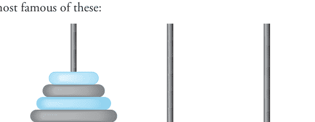

传说在远东的一座寺庙里，僧侣们正试图将一叠圆盘从一个柱子移动到另一个柱子。最初的圆盘堆有64个圆盘，穿在一个柱子上，从下到上按尺寸递减排列。僧侣们试图将这叠圆盘从这个柱子移动到第二个柱子，约束条件是每次只能移动一个圆盘，并且任何时候都不能将较大的圆盘放在较小的圆盘上面。第三个柱子可用于临时存放圆盘。据说当僧侣们完成任务时，世界就会终结，所以我们几乎没有动力去协助他们的工作。

假设僧侣们正试图将圆盘从柱子1移动到柱子3。我们希望开发一个算法，能够打印出圆盘在柱子间移动的精确序列。

如果我们用传统方法来处理这个问题，很快就会发现自己在管理圆盘时陷入一团糟。相反，如果我们用递归的思路来解决这个问题，它立刻变得容易处理。移动 $n$ 个圆盘可以看作是移动 $n - 1$ 个圆盘（因此是递归），具体步骤如下：

- a) 将 $n - 1$ 个圆盘从柱子1移动到柱子2，使用柱子3作为临时存放区。
- b) 将最后一个圆盘（最大的）从柱子1移动到柱子3。
- c) 将 $n - 1$ 个圆盘从柱子2移动到柱子3，使用柱子1作为临时存放区。

当最后一步涉及移动 $n = 1$ 个圆盘时，过程结束，即基本情况。这可以通过简单地移动圆盘而无需临时存放区来完成。

编写一个程序来解决汉诺塔问题。使用一个包含四个参数的递归函数：

- a) 要移动的圆盘数量。
- b) 这些圆盘最初所在的柱子。
- c) 要将这叠圆盘移动到的柱子。
- d) 用作临时存放区的柱子。

你的程序应打印出将圆盘从起始柱子移动到目标柱子所需的精确指令。例如，要将三个圆盘的堆从柱子1移动到柱子3，你的程序应打印以下移动序列：

1 → 3（这意味着将一个圆盘从柱子1移动到柱子3。）
1 → 2
3 → 2
1 → 3
2 → 1
2 → 3
1 → 3

**5.37** *（汉诺塔：迭代解法）* 任何可以递归实现的程序都可以迭代实现，尽管有时难度更大，清晰度也更低。尝试编写汉诺塔的迭代版本。如果你成功了，将你的迭代版本与你在练习5.36中开发的递归版本进行比较。研究性能、清晰度以及你证明程序正确性的能力等问题。

**5.38** *（可视化递归）* 观察递归“运行”很有趣。修改图5.9中的阶乘函数，以打印其局部变量和递归调用参数。对于每次递归调用，在单独的行上显示输出，并添加一级缩进。尽你所能使输出清晰、有趣且有意义。你的目标是设计并实现一种输出格式，帮助人们更好地理解递归。你可能希望将这种显示功能添加到本书中许多其他的递归示例和练习中。

**5.39** *（递归最大公约数）* 整数x和y的最大公约数是能同时整除x和y的最大整数。编写一个递归函数 `gcd`，返回x和y的最大公约数。x和y的最大公约数递归定义如下：如果y等于0，则 `gcd(x, y)` 是x；否则 `gcd(x, y)` 是 `gcd(y, x % y)`，其中 `%` 是取余运算符。

**5.40** *（递归main函数）* `main` 函数可以被递归调用吗？编写一个包含 `main` 函数的程序。包含一个初始化为1的静态局部变量 `count`。每次调用 `main` 时，对 `count` 进行后置自增并打印其值。运行你的程序。会发生什么？

**5.41** *（点之间的距离）* 编写一个函数 `distance`，计算两点 `(x1, y1)` 和 `(x2, y2)` 之间的距离。所有数字和返回值都应为 `double` 类型。

**5.42** 下面的程序是做什么的？如果你交换第7行和第8行，会发生什么？

```
1  #include <stdio.h>
2
3  int main(void) {
4      int c = '\0'; // variable to hold character input by user
5
6      if ((c = getchar()) != EOF) {
7          main();
8          printf("%c", c);
9      }
10 }
```

**5.43** 下面的程序是做什么的？

```
1  #include <stdio.h>
2
3  int mystery(int a, int b); // function prototype
4
5  int main(void) {
6      printf("%s", "Enter two positive integers: ");
7      int x = 0; // first integer
8      int y = 0; // second integer
9      scanf("%d%d", &x, &y);
10
11     printf("The result is %d\n", mystery(x, y));
12 }
13
14 // Parameter b must be a positive integer
15 // to prevent infinite recursion
16 int mystery(int a, int b) {
17     // base case
18     if (1 == b) {
19         return a;
20     }
21     else { // recursive step
22         return a + mystery(a, b - 1);
23     }
24 }
```

**5.44** 在你确定了练习5.43中的程序功能后，修改它，使其在移除第二个参数必须为正数的限制后仍能正常工作。

**5.45** *（测试数学库函数）* 编写一个程序，测试第5.3节表格中显示的数学库函数。通过让你的程序打印出各种参数值的返回值表来测试每个函数。

**5.46** 找出以下每个程序段中的错误并解释如何纠正：

```
a) double cube(float); // function prototype
   cube(float number) { // function definition
       return number * number * number;
   }
b) int randomNumber = srand();
c) double y = 123.45678;
   int x;
   x = y;
   printf("%f\n", (double) x);
d) double square(double number) {
       double number;
       return number * number;
   }
```

## 第5章 函数

e) int sum(int n) {
    if (0 == n) {
        return 0;
    }
    else {
        return n + sum(n);
    }
}

5.47 （Craps游戏修改）修改图5.7中的Craps程序以允许下注。将运行一局Craps游戏的程序部分封装为一个函数。将变量`bankBalance`初始化为1000美元。提示玩家输入赌注。使用`while`循环检查赌注是否小于或等于`bankBalance`，如果不是，则提示用户重新输入赌注，直到输入有效的赌注为止。输入正确的赌注后，运行一局Craps游戏。如果玩家赢了，将`bankBalance`增加赌注金额并打印新的`bankBalance`。如果玩家输了，将`bankBalance`减少赌注金额，打印新的`bankBalance`，检查`bankBalance`是否变为零，如果是，则打印消息“Sorry. You busted!”。在游戏过程中，打印各种消息以制造一些“闲聊”，例如“Oh, you're going for broke, huh?”或“Aw cmon, take a chance!”或“You're up big. Now's the time to cash in your chips!”。

5.48 （研究项目：改进递归斐波那契实现）在第5.15节中，我们用于计算斐波那契数的递归算法在直觉上很吸引人。然而，请记住该算法导致了递归函数调用的指数级爆炸。在线研究递归斐波那契实现。研究各种方法，包括练习5.35中的迭代版本和仅使用所谓“尾递归”的版本。讨论每种方法的相对优缺点。

## 计算机辅助教学

计算机为改善全球所有学生的教育体验创造了令人兴奋的可能性，正如接下来的五个练习所建议的那样。[注：了解一下诸如“每个孩子一台笔记本电脑”项目（www.laptop.org）之类的倡议。]

5.49 （计算机辅助教学）计算机在教育中的应用被称为计算机辅助教学（CAI）。编写一个程序来帮助小学生学习乘法。使用`rand`函数生成两个正的一位整数。然后程序应该向用户提出一个问题，例如

How much is 6 times 7?

学生输入答案。接下来，程序检查学生的答案。如果正确，显示消息“Very good!”并询问另一个乘法问题。如果答案错误，显示消息“No. Please try again.”并让学生重复尝试同一个问题，直到学生最终答对为止。应该使用一个单独的函数来生成每个新问题。该函数应在应用程序开始执行时调用一次，并在用户每次正确回答问题时调用一次。

## 随机数模拟案例研究：乌龟与兔子

**5.50** *（计算机辅助教学：减少学生疲劳）* CAI环境中的一个问题是学生疲劳。这可以通过改变计算机的响应来保持学生的注意力而减少。修改练习5.49的程序，以便为每个答案显示不同的评论，如下所示：
对正确答案的可能响应：
Very good!
Excellent!
Nice work!
Keep up the good work!
对错误答案的可能响应：
No. Please try again.
Wrong. Try once more.
Don't give up!
No. Keep trying.
使用随机数生成选择一个1到4之间的数字，用于选择对每个正确或错误答案的四个适当响应之一。使用`switch`语句发出响应。

**5.51** *（计算机辅助教学：监控学生表现）* 更复杂的计算机辅助教学系统会监控学生在一段时间内的表现。开始新主题的决定通常基于学生对先前主题的成功掌握情况。修改练习5.50的程序，以计算学生输入的正确和错误响应的数量。在学生输入10个答案后，你的程序应该计算正确答案的百分比。如果百分比低于75%，显示“Please ask your teacher for extra help.”，然后重置程序以便另一个学生可以尝试。如果百分比为75%或更高，显示“Congratulations, you are ready to go to the next level!”，然后重置程序以便另一个学生可以尝试。

**5.52** *（计算机辅助教学：难度级别）* 练习5.49–5.51开发了一个计算机辅助教学程序来帮助教授小学生乘法。修改该程序以允许用户输入难度级别。在难度级别1时，程序应该只在问题中使用个位数；在难度级别2时，使用最大为两位数的数字，依此类推。

**5.53** *（计算机辅助教学：改变问题类型）* 修改练习5.52的程序，以允许用户选择要学习的算术问题类型。选项1表示仅加法问题，2表示仅减法问题，3表示仅乘法问题，4表示所有这些类型的随机混合。

## 随机数模拟案例研究：乌龟与兔子

**5.54** *（乌龟与兔子赛跑）* 在这个问题中，你将重现历史上真正伟大的时刻之一——乌龟与兔子的经典赛跑。你将使用随机数生成来开发这一难忘事件的模拟。

我们的参赛者从70个方格的“方格1”开始比赛。每个方格代表赛道上的一个可能位置。终点线在方格70。第一个到达或超过方格70的参赛者将获得一桶新鲜的胡萝卜和生菜作为奖励。赛道蜿蜒穿过一个湿滑的山坡，因此参赛者偶尔会失足后退。

有一个时钟每秒滴答一次。每次滴答时，根据以下规则调整动物的位置：

| 动物 | 移动类型 | 时间百分比 | 实际移动 |
|---|---|---|---|
| 乌龟 | 快速前进 | 50% | 前进3个方格 |
| | 打滑 | 20% | 后退6个方格 |
| | 缓慢前进 | 30% | 前进1个方格 |
| 兔子 | 睡觉 | 20% | 完全不动 |
| | 大跳 | 20% | 前进9个方格 |
| | 大滑 | 10% | 后退12个方格 |
| | 小跳 | 30% | 前进1个方格 |
| | 小滑 | 20% | 后退2个方格 |

使用变量来跟踪动物的位置（即位置编号为1-70）。每个动物从位置1开始（即“起跑门”）。如果一个动物在方格1之前打滑，则将该动物移回方格1。如果一个动物移动超过方格70，则将该动物移回方格80。

通过生成一个范围在1 ≤ x ≤ 10的随机整数x来生成上表中的百分比。对于乌龟，当1 ≤ x ≤ 5时执行“快速前进”，当6 ≤ x ≤ 7时执行“打滑”，当8 ≤ x ≤ 10时执行“缓慢前进”。使用类似的技术来移动兔子。

通过打印以下内容开始比赛

```
ON YOUR MARK, GET SET
BANG !!!!
AND THEY'RE OFF !!!!
```

然后，对于每次滴答（即循环的每次迭代），打印一行70个位置，显示乌龟位置的字母T和兔子位置的字母H。偶尔，参赛者会落在同一个方格上。在这种情况下，乌龟会咬兔子，你的程序应该从该位置开始打印“OUCH!!!”。除了T、H或OUCH!!!（在平局的情况下）之外的所有打印位置都应该是空白的。

打印每一行后，测试是否任一动物已到达或超过方格70。如果是，则打印获胜者并终止模拟。如果乌龟获胜，打印“TORTOISE WINS!!! YAY!!!”。如果兔子获胜，打印“Hare wins. Yuch.”。如果两个动物在同一时钟滴答时获胜，你可能想偏向乌龟（“弱势方”），或者你可能想打印“It’s a tie”。如果两个动物都没有获胜，则再次执行循环以模拟下一个时钟滴答。当你准备好运行程序时，召集一群粉丝来观看比赛。你会惊讶于你的观众变得多么投入！

# 数组

## 6


## 学习目标

在本章中，你将：

- 使用数组数据结构来表示值的列表和表格。
- 定义数组、初始化数组并引用数组的各个元素。
- 定义符号常量。
- 将数组传递给函数。
- 使用数组来存储、排序和搜索值的列表和表格。
- 通过基本描述性统计（如均值、中位数和众数）入门数据科学。
- 定义和操作多维数组。
- 创建大小在执行时确定的可变长度数组。
- 理解与 `scanf` 输入、`printf` 输出和数组相关的安全问题。

# 第6章 数组

- 6.1 简介
- 6.2 数组
- 6.3 定义数组
- 6.4 数组示例
  - 6.4.1 定义数组并使用循环设置数组元素值
  - 6.4.2 在定义中使用初始化列表初始化数组
  - 6.4.3 使用符号常量指定数组大小并用计算初始化数组元素
  - 6.4.4 数组元素求和
  - 6.4.5 使用数组总结调查结果
  - 6.4.6 使用条形图绘制数组元素值
  - 6.4.7 掷骰子6000万次并在数组中总结结果
- 6.5 使用字符数组存储和操作字符串
  - 6.5.1 用字符串初始化字符数组
  - 6.5.2 用字符初始化列表初始化字符数组
  - 6.5.3 访问字符串中的字符
  - 6.5.4 向字符数组输入
  - 6.5.5 输出表示字符串的字符数组
  - 6.5.6 演示字符数组
- 6.6 静态局部数组和自动局部数组
- 6.7 将数组传递给函数
- 6.8 数组排序
- 6.9 数据科学入门案例研究：调查数据分析
- 6.10 搜索数组
  - 6.10.1 使用线性搜索搜索数组
  - 6.10.2 使用二分搜索搜索数组
- 6.11 多维数组
  - 6.11.1 说明二维数组
  - 6.11.2 初始化双下标数组
  - 6.11.3 设置一行中的元素
  - 6.11.4 计算二维数组中元素的总和
  - 6.11.5 二维数组操作
- 6.12 可变长度数组
- 6.13 安全的C编程

总结 | 自我复习题 | 自我复习题答案 | 练习题 | 递归练习题

## 6.1 简介

本章介绍数据结构。数组是由相同类型的相关数据项组成的数据结构。第10章讨论了C语言的结构体概念——一种由可能不同类型的相关数据项组成的数据结构。数组和结构体是“静态”实体，因为它们在其生命周期内保持相同的大小。

## 6.2 数组

数组是一组相同类型的元素，在内存中连续存储。下图显示了一个名为c的整数数组，包含五个元素：


要引用数组中的特定位置或元素，我们指定数组的名称，后跟元素的**位置编号**，并用方括号（[]）括起来。第一个元素位于位置编号0（零）。位置编号称为元素的**下标**（或**索引**）。下标必须是非负整数或整数表达式。

让我们更仔细地检查上图中的数组。数组的**名称**是c。c[0]的**值**是-45，c[2]是0，c[4]是1543。带下标的数组名是一个*左值*，可以用在赋值运算符的左侧。因此，语句：

```
c[2] = 1000;
```

将c[2]的当前值（0）替换为值1000。要打印数组c的前三个元素值的总和，我们可以写：

```
printf("%d", c[0] + c[1] + c[2]);
```

要将数组c的第3个元素的值除以2并将结果赋给变量x，请写：

```
x = c[3] / 2;
```

括住数组下标的方括号是具有最高优先级的运算符。下表显示了本文中到目前为止介绍的运算符的优先级和分组：

| 运算符 | 分组 | 类型 |
| :--- | :--- | :--- |
| [] () ++ (后缀) -- (后缀) | 从左到右 | 最高 |
| + - ! ++ (前缀) -- (前缀) (类型) | 从右到左 | 一元 |
| * / % | 从左到右 | 乘法 |
| + - | 从左到右 | 加法 |
| < <= > >= | 从左到右 | 关系 |
| == != | 从左到右 | 相等 |
| && | 从左到右 | 逻辑与 |
| \|\| | 从左到右 | 逻辑或 |
| ?: | 从右到左 | 条件 |
| = += -= *= /= %= | 从右到左 | 赋值 |
| , | 从左到右 | 逗号 |

## 自我检查

1. （多选题）以下哪项陈述是*错误*的？
   a) 任何数组元素都可以通过给出数组名称后跟元素在方括号（[]）中的位置编号来引用。
   b) 每个数组的第一个元素的位置编号是1。
   c) 数组名，像其他标识符一样，只能包含字母、数字和下划线，并且不能以数字开头。
   d) 方括号中的位置编号称为元素的下标（或索引），它必须是整数或整数表达式。
   答案：b) 是*错误*的。实际上，每个数组的第一个元素的位置编号是0。

2. （代码题）编写一条语句，显示int数组grades中前四个元素值的int乘积。
   答案：`printf("%d", grades[0] * grades[1] * grades[2] * grades[3]);`

## 6.3 定义数组

定义数组时，需要指定其元素类型和元素数量，以便编译器可以预留适当的内存量。以下定义为整数数组c预留了五个元素，其下标范围为0–4。

```
int c[5];
```

定义

```
int b[100];
int x[27];
```

为整数数组b预留了100个元素，为整数数组x预留了27个元素。这些数组的下标范围分别为0–99和0–26。

char数组可以存储一个字符串。字符串及其与数组的相似性在第8章中讨论。指针和数组之间的关系在第7章中讨论。

## 自我检查

1. （多选题）以下哪项陈述是*错误*的？
   a) 创建数组时，需要指定数组的元素类型和元素数量，以便编译器可以预留适当的内存量。
   b) 以下定义为double数组temperatures预留了空间，其索引编号范围为0–6：
      `double temperatures[7];`
   c) 以下定义为float数组b预留了50个元素，为float数组x预留了19个元素：
      `float b[50];`
      `float x[19];`
   d) string类型的数组可以存储一个字符串。
   答案：d) 是*错误*的。实际上，char类型的数组可以存储一个字符串。C语言没有string类型。

## 6.4 数组示例

本节提供几个示例，演示如何定义和初始化数组，以及如何执行许多常见的数组操作。

### 6.4.1 定义数组并使用循环设置数组元素值

与任何其他局部变量一样，未初始化的数组元素包含“垃圾”值。图6.1使用for语句将五元素整数数组n的元素设置为零（第10-12行），并以表格格式打印数组（第17-19行）。第一个printf语句（第14行）显示后续for语句中打印的两列的列标题。

```
1  // fig06_01.c
2  // 将数组元素初始化为零。
3  #include <stdio.h>
4
5  // 函数main开始程序执行
6  int main(void) {
7      int n[5]; // n是一个包含五个整数的数组
8
9      // 将数组n的元素设置为0
10     for (size_t i = 0; i < 5; ++i) {
11         n[i] = 0; // 将位置i的元素设置为0
12     }
13
14     printf("%s%8s\n", "Element", "Value");
15
16     // 以表格格式输出数组n的内容
17     for (size_t i = 0; i < 5; ++i) {
18         printf("%7zu%8d\n", i, n[i]);
19     }
20 }
```

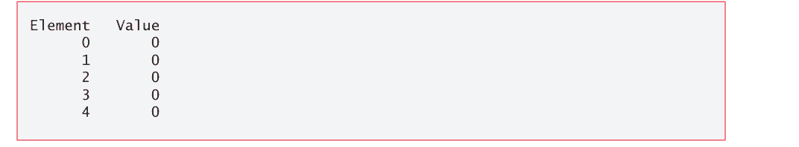

图 6.1 | 将数组元素初始化为零。

在每个for语句（第10行和第17行）中，计数器控制变量i的类型是**size_t**。C标准规定size_t表示一个无符号整数类型，建议用于表示数组大小或下标的任何变量。类型size_t在头文件<stddef.h>中定义，该头文件通常被其他头文件（如<stdio.h>）包含。¹ **转换说明符%zu**用于显示size_t值。

1. 如果你尝试编译图6.1并收到错误，请在你的程序中包含<stddef.h>。

### 6.4.2 使用初始化列表在定义中初始化数组

你可以在定义数组时，通过在花括号 `{}` 中提供以逗号分隔的数组初始化列表来初始化数组的元素。图 6.2 使用五个值初始化了一个整型数组（第 7 行），并以表格格式打印它。

```c
// fig06_02.c
// 使用初始化列表初始化数组的元素。
#include <stdio.h>

// 函数 main 开始程序执行
int main(void) {
    int n[5] = {32, 27, 64, 18, 95}; // 使用初始化列表初始化 n

    printf("%s%8s\n", "Element", "Value");

    // 以表格格式输出数组内容
    for (size_t i = 0; i < 5; ++i) {
        printf("%7zu%8d\n", i, n[i]);
    }
}
```

| Element | Value |
| :--- | :--- |
| 0 | 32 |
| 1 | 27 |
| 2 | 64 |
| 3 | 18 |
| 4 | 95 |

图 6.2 | 使用初始化列表初始化数组的元素。

如果初始化列表中的初始值少于数组元素的数量，剩余的元素将被初始化为 0。例如，图 6.1 本可以如下将数组 n 的元素初始化为零：

```c
int n[5] = {0}; // 将整个数组初始化为零
```

这显式地将 `n[0]` 初始化为 0，并隐式地将剩余元素初始化为 0。如果在数组初始化列表中提供的初始值多于数组中的元素数量，则会产生编译错误。例如，以下数组定义会产生编译错误，因为只有三个元素却提供了四个初始值：

```c
int n[3] = {32, 27, 64, 18};
```

以下定义创建了一个包含五个元素的数组，并用值 1–5 初始化：

```c
int n[] = {1, 2, 3, 4, 5};
```

当你省略数组大小时，编译器会根据初始值的数量计算数组的元素数量。

### 6.4.3 使用符号常量指定数组大小并用计算值初始化数组元素

图 6.3 使用值 2、4、6、8 和 10 初始化了一个包含五个元素的数组 `s`，然后以表格格式打印该数组。为了生成这些值，我们将循环计数器乘以 2 再加 2。

```c
// fig06_03.c
// 将数组 s 的元素初始化为从 2 到 10 的偶数。
#include <stdio.h>
#define SIZE 5 // 数组的最大大小

// 函数 main 开始程序执行
int main(void) {
    // 符号常量 SIZE 可用于指定数组大小
    int s[SIZE] = {0}; // 数组 s 有 SIZE 个元素

    for (size_t j = 0; j < SIZE; ++j) { // 设置值
        s[j] = 2 + 2 * j;
    }

    printf("%s%8s\n", "Element", "Value");

    // 以表格格式输出数组 s 的内容
    for (size_t j = 0; j < SIZE; ++j) {
        printf("%7zu%8d\n", j, s[j]);
    }
}
```

| Element | Value |
| :--- | :--- |
| 0 | 2 |
| 1 | 4 |
| 2 | 6 |
| 3 | 8 |
| 4 | 10 |

图 6.3 | 将数组 s 的元素初始化为从 2 到 10 的偶数。

第 4 行使用了 `#define` 预处理器指令

```c
#define SIZE 5
```

来创建一个值为 5 的符号常量 `SIZE`。符号常量是一个标识符，C 预处理器会在程序编译前将其替换为替换文本。在这个程序中，预处理器将所有 `SIZE` 的出现都替换为 5。

使用符号常量来指定数组大小使程序更易于阅读和修改。例如，在图 6.3 中，我们只需将 `#define` 指令中 `SIZE` 的值从 5 改为 1000，就可以让第一个 `for` 循环（第 11 行）填充一个包含 1000 个元素的数组。如果没有符号常量，我们就必须修改第 9、11 和 18 行的程序。随着程序变得越来越大，这种技术对于编写清晰、易读、可维护的程序变得越来越有用。符号常量（如 `SIZE`）比数字值 5 更容易理解，而数字 5 在代码中可能具有不同的含义。

不要在 `#define` 预处理器指令末尾加分号。如果你在第 4 行这样做，预处理器会将所有 `SIZE` 的出现替换为文本 `"5;"`。这可能导致编译时的语法错误或运行时的逻辑错误。请记住，预处理器不是 C 编译器。

在可执行语句中为符号常量赋值是编译错误——符号常量不是变量。按照惯例，符号常量名称只使用大写字母，以便它们在程序中突出显示。这也提醒你符号常量不是变量。

### 6.4.4 数组元素求和

图 6.4 对包含在五元素整型数组 `a` 中的值求和。`for` 语句的主体（第 14 行）执行累加。

```c
// fig06_04.c
// 计算数组元素的和。
#include <stdio.h>
#define SIZE 5

// 函数 main 开始程序执行
int main(void) {
    // 使用初始化列表初始化数组
    int a[SIZE] = {1, 2, 3, 4, 5};
    int total = 0; // 数组的和

    // 对数组 a 的内容求和
    for (size_t i = 0; i < SIZE; ++i) {
        total += a[i];
    }

    printf("The total of a's values is %d\n", total);
}
```

The total of a's values is 15

图 6.4 | 计算数组元素的和。

### 6.4.5 使用数组总结调查结果

我们的下一个示例使用数组来总结在调查中收集的数据结果。考虑以下问题陈述：

> 二十名学生被要求以 1 到 5 的等级（1 表示糟糕，5 表示优秀）评价学生食堂的食物质量。将这 20 个回答放入一个整型数组中，并总结调查结果。

图 6.5 是一个典型的数组应用。我们希望总结每种类型的回答数量。包含学生回答的 20 元素数组 `responses`（第 10–11 行）。我们使用一个 6 元素数组 `frequency`（第 14 行）来计算每个回答的出现次数。我们忽略 `frequency[0]`，因为让回答 1 递增 `frequency[1]` 而不是 `frequency[0]` 是合乎逻辑的。这允许我们直接将每个回答用作 `frequency` 数组的下标。你应该力求程序清晰。有时，为了编写更清晰的程序，牺牲最有效的内存或处理器时间使用是值得的。有时性能考虑远比清晰度考虑重要得多。

```c
// fig06_05.c
// 分析学生调查。
#include <stdio.h>
#define RESPONSES_SIZE 20 // 定义数组大小
#define FREQUENCY_SIZE 6

// 函数 main 开始程序执行
int main(void) {
    // 将调查回答放入 responses 数组
    int responses[RESPONSES_SIZE] =
        {1, 2, 5, 4, 3, 5, 2, 1, 3, 1, 4, 3, 3, 3, 2, 3, 3, 2, 2, 5};

    // 将频率计数器初始化为 0
    int frequency[FREQUENCY_SIZE] = {0};

    // 对于每个回答，选择 responses 数组的一个元素的值，
    // 并将该值用作 frequency 数组的下标以确定要递增的元素
    for (size_t answer = 0; answer < RESPONSES_SIZE; ++answer) {
        ++frequency[responses[answer]];
    }

    // 显示结果
    printf("%s%12s\n", "Rating", "Frequency");

    // 以表格格式输出频率
    for (size_t rating = 1; rating < FREQUENCY_SIZE; ++rating) {
        printf("%6zu%12d\n", rating, frequency[rating]);
    }
}
```

| Rating | Frequency |
| :--- | :--- |
| 1 | 3 |
| 2 | 5 |
| 3 | 7 |
| 4 | 2 |
| 5 | 3 |

图 6.5 | 分析学生调查。

#### 频率计数器如何递增

`for` 循环（第 19–21 行）从 `responses` 中获取每个回答，并递增五个频率数组计数器之一——`frequency[1]` 到 `frequency[5]`。循环中的关键语句是第 20 行：

```c
++frequency[responses[answer]];
```

它根据表达式 `responses[answer]` 的值递增相应的频率计数器。当计数器变量 `answer` 为 0 时，`responses[answer]` 为 1，因此 `++frequency[responses[answer]];` 被解释为 `++frequency[1];`，这会递增 `frequency[1]`。当 `answer` 为 1 时，`responses[answer]` 的值为 2，因此 `++frequency[responses[answer]];` 被解释为 `++frequency[2];`，这会递增 `frequency[2]`。当 `answer` 为 2 时，`responses[answer]` 的值为 5，因此 `++frequency[responses[answer]];` 被解释为 `++frequency[5];`，这会递增 `frequency[5]`，依此类推。

#### 无效的调查回答

无论处理多少个调查回答，只需要一个 6 元素的频率数组（忽略元素零）来总结结果。但如果数据包含无效值（如 13）怎么办？在这种情况下，程序将尝试向 `frequency[13]` 加 1，这超出了数组的边界。C 没有数组边界检查来防止程序引用不存在的元素。因此，执行中的程序可以在没有任何警告的情况下“越界”访问数组的任一端——这是一个我们在第 6.13 节讨论的安全问题。程序应该验证所有输入值是否正确，以防止错误信息影响程序的计算。

#### 验证数组下标

引用数组边界之外的元素是逻辑错误。在循环遍历数组时，数组下标不应低于 0，并且应始终小于数组元素的总数——即数组的大小减一。你应该确保所有数组引用都保持在数组的边界内。

### 6.4.6 用条形图绘制数组元素值

我们的下一个示例（图 6.6）从数组中读取数字，并以条形图的形式绘制信息。我们显示每个数字，后跟由该数量的星号组成的条形。嵌套的 `for` 语句（第 17–19 行）通过迭代 `n[i]` 次并在每次迭代中显示一个星号来显示条形。第 21 行结束每个条形。

```c
// fig06_06.c
// 显示条形图。
#include <stdio.h>
#define SIZE 5

// 函数 main 开始程序执行
int main(void) {
```

图 6.6 | 显示条形图。（第 1 部分，共 2 部分。）

### 6.4.7 掷骰子6000万次并用数组汇总结果

在第5章中，我们曾表示会展示一种更优雅的方式来编写图5.5的掷骰子程序。回顾一下，该程序将一个六面骰子掷了6000万次，并显示了每个面的出现次数。图6.7是图5.5的数组版本。第17行替代了图5.5中整个20行的switch语句。我们再次使用了一个频率数组，并忽略元素0，这样我们就可以将骰子面值作为数组的下标。

```c
// fig06_07.c
// 掷一个六面骰子6000万次
#include <stdio.h>
#include <stdlib.h>
#include <time.h>
#define SIZE 7

// 函数main开始程序执行
int main(void) {
    srand(time(NULL)); // 为随机数生成器设置种子

    int frequency[SIZE] = {0}; // 将所有频率计数初始化为0

    // 掷骰子6000万次
    for (int roll = 1; roll <= 60000000; ++roll) {
        size_t face = 1 + rand() % 6;
        ++frequency[face]; // 替代了图5.5中的整个switch语句
    }

    printf("%s%17s\n", "Face", "Frequency");

    // 以表格格式输出频率数组的1-6号元素
    for (size_t face = 1; face < SIZE; ++face) {
        printf("%4zu%17d\n", face, frequency[face]);
    }
}
```

| 面值 | 频率 |
|---|---|
| 1 | 9997167 |
| 2 | 10003506 |
| 3 | 10001940 |
| 4 | 9995833 |
| 5 | 10000843 |
| 6 | 10000711 |

图6.7 | 掷一个六面骰子6000万次。（第2部分，共2部分。）

```c
// 使用初始化列表初始化数组n
int n[SIZE] = {19, 3, 15, 7, 11};

printf("%s%13s%17s\n", "Element", "Value", "Bar Chart");

// 对于数组n的每个元素，输出一个条形图的条形
for (size_t i = 0; i < SIZE; ++i) {
    printf("%7zu%13d%8s", i, n[i], "");

    for (int j = 1; j <= n[i]; ++j) { // 打印一个条形
        printf("%c", '*');
    }

    puts(""); // 用换行符结束一个条形
}
```

| 元素 | 值 | 条形图 |
|---|---|---|
| 0 | 19 | ******************* |
| 1 | 3 | *** |
| 2 | 15 | *************** |
| 3 | 7 | ******* |
| 4 | 11 | *********** |

图6.6 | 显示条形图。（第2部分，共2部分。）

## 自我检查

1. （代码）重写以下代码段，定义一个包含七个元素的double数组m，并将其每个元素初始化为10：

```c
int n[5]; // n是一个包含五个整数的数组

// 将数组n的元素设置为0
for (size_t i = 0; i < 5; ++i) {
    n[i] = 0; // 将位置i处的元素设置为0
}
```

答案：

```c
double m[7]; // m是一个包含7个double的数组

// 将数组m的元素设置为10.0
for (size_t i = 0; i < 7; ++i) {
    m[i] = 10.0; // 将位置i处的元素设置为10.0
}
```

2. （选择题）以下陈述a)、b)或c)哪一个是正确的？

- a) 对于一个int数组，如果你提供的初始化器少于数组中的元素数量，剩余的元素将被初始化为0。
- b) 在数组初始化列表中提供的初始化器多于数组元素数量是一个语法错误——例如，`int n[3] = {32, 27, 64, 18};`是一个语法错误，因为有四个初始化器但只有三个数组元素。
- c) 如果在带有初始化列表的定义中省略了数组大小，编译器将根据初始化列表中的元素数量来确定元素数量。因此，以下代码创建了一个包含三个元素的int数组s：

```c
int s[] = {10, 20, 30};
```

- d) 以上所有陈述都是*正确的*。

答案：d。

## 6.5 使用字符数组存储和操作字符串

数组可以保存任何类型的数据，尽管给定数组的所有元素必须具有相同的类型。我们现在讨论在字符数组中存储字符串。到目前为止，我们唯一的字符串处理能力是用printf输出字符串。像"hello"这样的字符串实际上是一个由单个字符组成的数组，外加一个额外的东西。

### 6.5.1 用字符串初始化字符数组

字符数组有几个独特的特性。字符数组可以使用字符串字面量进行初始化。例如，

```c
char string1[] = "first";
```

将数组string1的元素初始化为字符串字面量"first"中的各个字符。在这种情况下，编译器根据字符串的长度确定了数组string1的大小。字符串"first"包含五个字符*加上一个字符串终止空字符*。因此，string1实际上包含六个元素。表示空字符的转义序列是'\0'。所有字符串都以这个字符结尾。表示字符串的字符数组应始终定义得足够大，以容纳字符串的字符数和终止空字符。

### 6.5.2 用字符初始化列表初始化字符数组

字符数组也可以用初始化列表中的单个字符常量进行初始化，但这可能很繁琐。前面的定义等同于

```c
char string1[] = {'f', 'i', 'r', 's', 't', '\0'};
```

### 6.5.3 访问字符串中的字符

你可以直接使用数组下标表示法访问字符串的各个字符。因此，string1[0]是字符'f'，string1[3]是's'，string1[5]是'\0'。

### 6.5.4 向字符数组输入

以下定义创建了一个字符数组，该数组能够存储一个*最多19个字符*的字符串和一个*终止空字符*：

```c
char string2[20];
```

语句`scanf("%19s", string2);`从键盘读取一个字符串到string2中。你将数组名传递给scanf，而不需要像非字符串变量那样使用&。&通常用于向scanf提供变量在内存中的位置，以便可以将值存储在那里。在6.7节中，当我们讨论将数组传递给函数时，我们将讨论为什么数组名不需要&。

你有责任确保读入字符串的数组能够容纳用户在键盘上输入的任何字符串。函数scanf不会检查数组有多大。它会读取字符，直到遇到空格、制表符、换行符或文件结束指示符。字符串string2的长度不应超过19个字符，以便为终止空字符留出空间。如果用户输入20个或更多字符，你的程序可能会崩溃或产生一个称为缓冲区溢出的安全漏洞。因此，我们使用了转换说明符%19s。这告诉scanf最多读取19个字符，防止它将字符写入string2末尾之后的内存。（在6.13节中，我们将重新讨论向字符数组输入时引发的潜在安全问题，并讨论C标准的scanf_s函数。）

### 6.5.5 输出表示字符串的字符数组

表示字符串的字符数组可以使用printf的%s转换说明符进行输出。例如，你可以用`printf("%s\n", string2);`打印字符数组string2。与scanf类似，printf不会检查字符数组有多大。它会显示字符串的字符，直到遇到终止空字符。[考虑一下，如果由于某种原因缺少终止空字符，会打印出什么。]

### 6.5.6 演示字符数组

图6.8演示了用字符串字面量初始化字符数组、将字符串读入字符数组、将字符数组作为字符串打印以及访问字符串的各个字符。该程序使用一个for语句（第20-22行）循环遍历string1数组，并使用%c转换说明符打印由空格分隔的各个字符。for语句中的条件在计数器小于数组大小且字符串中尚未遇到终止空字符时为真。此程序仅读取不包含空白字符的字符串。我们将在第8章中展示如何读取包含空白字符的字符串。

```c
// fig06_08.c
// 将字符数组视为字符串。
#include <stdio.h>
#define SIZE 20
```

图6.8 | 将字符数组视为字符串。（第1部分，共2部分。）

## 6.5 使用字符数组存储和操作字符串

```c
// 函数 main 开始程序执行
int main(void) {
    char string1[SIZE] = ""; // 保留20个字符
    char string2[] = "string literal"; // 保留15个字符

    // 提示用户输入字符串，然后读入数组 string1
    printf("%s", "Enter a string (no longer than 19 characters): ");
    scanf("%19s", string1); // 输入不超过19个字符

    // 输出字符串
    printf("string1 is: %s\nstring2 is: %s\n", string1, string2);
    puts("string1 with spaces between characters is:");

    // 输出字符，直到遇到空字符
    for (size_t i = 0; i < SIZE && string1[i] != '\0'; ++i) {
        printf("%c ", string1[i]);
    }

    puts("");
}
```

Enter a string (no longer than 19 characters): Hello there
string1 is: Hello
string2 is: string literal
string1 with spaces between characters is:
H e l l o

图 6.8 | 将字符数组视为字符串。（第2部分，共2部分。）

## 自我检查

- 1（多选题）以下陈述 a)、b) 或 c) 哪一项是错误的？
    a) 表示字符串的字符数组可以使用 `printf` 和 `%s` 转换说明符输出，例如：
        `printf("%s\n", month);`
    b) 函数 `printf` 与 `scanf` 一样，不会检查字符数组的大小。
    c) 当函数 `printf` 显示表示字符串的字符数组的字符时，它会在尝试打印数组末尾之后的第一个字符时停止。
    d) 以上所有陈述都是正确的。
    答案：c) 是错误的。实际上，`printf` 会持续显示字符，直到遇到终止空字符为止，即使该字符远超出数组末尾。

- 2（判断题）以下数组可以存储最多20个字符和一个终止空字符：
    `char name1[20];`
    答案：错误。实际上，该语句创建了一个字符数组，能够存储最多19个字符和一个终止空字符。

## 6.6 静态局部数组和自动局部数组

第5章讨论了存储类说明符 `static`。静态局部变量在程序的整个生命周期内存在，但仅在函数体内可见。我们可以将 `static` 应用于局部数组定义，以防止数组在每次函数调用时被创建和初始化，并在每次函数退出时被销毁。这减少了程序执行时间，特别是对于包含大型数组且频繁调用的函数的程序。静态数组在程序启动时初始化一次。如果你没有显式初始化静态数组，则该数组的元素默认初始化为零。

图6.9演示了函数 `staticArrayInit`（第21-38行）中的局部静态数组（第23行）和函数 `automaticArrayInit`（第41-58行）中的局部自动数组（第43行）。函数 `staticArrayInit` 被调用两次（第11行和第15行）。函数中的局部静态数组在程序启动时初始化为零（第23行）。该函数打印数组，将每个元素加5，然后再次打印数组。第二次调用该函数时，静态数组包含第一次调用期间存储的值。

```c
// fig06_09.c
// 如果未显式初始化，静态数组将初始化为零。
#include <stdio.h>

void staticArrayInit(void); // 函数原型
void automaticArrayInit(void); // 函数原型

// 函数 main 开始程序执行
int main(void) {
    puts("First call to each function:");
    staticArrayInit();
    automaticArrayInit();

    puts("\n\nSecond call to each function:");
    staticArrayInit();
    automaticArrayInit();
    puts("");
}

// 演示静态局部数组的函数
void staticArrayInit(void) {
    // 在函数调用前将元素初始化为0
    static int array1[3];

    puts("\nValues on entering staticArrayInit:");

    // 输出 array1 的内容
    for (size_t i = 0; i <= 2; ++i) {
        printf("array1[%zu] = %d  ", i, array1[i]);
    }

    puts("\nValues on exiting staticArrayInit:");

    // 修改并输出 array1 的内容
    for (size_t i = 0; i <= 2; ++i) {
        printf("array1[%zu] = %d  ", i, array1[i] += 5);
    }
}

// 演示自动局部数组的函数
void automaticArrayInit(void) {
    // 每次调用函数时初始化元素
    int array2[3] = {1, 2, 3};

    puts("\n\nValues on entering automaticArrayInit:");

    // 输出 array2 的内容
    for (size_t i = 0; i <= 2; ++i) {
        printf("array2[%zu] = %d  ", i, array2[i]);
    }

    puts("\nValues on exiting automaticArrayInit:");

    // 修改并输出 array2 的内容
    for (size_t i = 0; i <= 2; ++i) {
        printf("array2[%zu] = %d  ", i, array2[i] += 5);
    }
}
```

```
First call to each function:

Values on entering staticArrayInit:
array1[0] = 0  array1[1] = 0  array1[2] = 0
Values on exiting staticArrayInit:
array1[0] = 5  array1[1] = 5  array1[2] = 5

Values on entering automaticArrayInit:
array2[0] = 1  array2[1] = 2  array2[2] = 3
Values on exiting automaticArrayInit:
array2[0] = 6  array2[1] = 7  array2[2] = 8

Second call to each function:

Values on entering staticArrayInit:
array1[0] = 5  array1[1] = 5  array1[2] = 5 — values preserved from last call
Values on exiting staticArrayInit:
array1[0] = 10  array1[1] = 10  array1[2] = 10

Values on entering automaticArrayInit:
array2[0] = 1  array2[1] = 2  array2[2] = 3 — values reinitialized after last call
Values on exiting automaticArrayInit:
array2[0] = 6  array2[1] = 7  array2[2] = 8
```

图 6.9 | 如果未显式初始化，静态数组将初始化为零。（第2部分，共2部分。）

函数 `automaticArrayInit` 也被调用两次（第12行和第16行）。自动局部数组的元素用值1、2和3初始化（第43行）。该函数打印数组，将每个元素加5，然后再次打印数组。第二次调用该函数时，数组元素再次被初始化为1、2和3，因为该数组具有自动存储持续时间。

## 自我检查

- 1.（多选题）以下陈述 a)、b) 或 c) 哪一项是错误的？
    a) 静态局部变量在程序的整个生命周期内存在，但仅在函数体内可见。
    b) 静态局部数组只创建和初始化一次，而不是每次调用函数时都创建和初始化。这减少了程序执行时间，特别是对于包含大型数组且频繁调用的函数的程序。
    c) 如果你没有显式初始化静态数组，则该数组的元素默认初始化为零。
    d) 以上所有陈述都是正确的。
    答案：d。

## 6.7 将数组传递给函数

要将数组参数传递给函数，请指定数组名称而不带任何方括号。例如，如果数组 `hourlyTemperatures` 已定义为

```c
int hourlyTemperatures[HOURS_IN_A_DAY];
```

则函数调用

```c
modifyArray(hourlyTemperatures, HOURS_IN_A_DAY)
```

将数组 `hourlyTemperatures` 及其大小传递给函数 `modifyArray`。

回想一下，C语言中的所有参数都是按值传递的。然而，C语言自动将数组按引用传递给函数——被调用函数可以修改调用者原始数组元素的值。我们将在第7章看到这并不矛盾。数组名称的值就是数组第一个元素在内存中的地址。因为传递了数组的起始地址，所以被调用函数确切地知道数组存储在哪里。因此，被调用函数对数组元素所做的任何修改都会改变调用者原始数组元素的值。

### 证明数组名称是一个地址

图6.10通过使用 `%p` 转换说明符打印地址来演示“数组名称的值”实际上是数组第一个元素的地址，打印了 `array`、`&array[0]` 和 `&array`。`%p` 转换说明符通常以十六进制数输出地址，但这取决于编译器。十六进制（基数为16）数字由数字0到9和字母A到F组成——它们是十进制数字10-15的十六进制等价物。在线附录E深入讨论了二进制（基数为2）、八进制（基数为8）、十进制（基数为10；标准整数）和十六进制整数之间的关系。输出显示

## 6.7 将数组传递给函数

在数组中，`&array` 和 `&array[0]` 的值相同。该程序的输出取决于系统，但在特定计算机上，每次程序执行时地址总是相同的。

```c
// fig06_10.c
// 数组名与数组第一个元素的地址相同。
#include <stdio.h>

// 函数 main 开始程序执行
int main(void) {
    char array[5] = ""; // 定义一个大小为 5 的数组

    printf("    array = %p\n&array[0] = %p\n   &array = %p\n",
       array, &array[0], &array);
}
```

```
    array = 0031F930
&array[0] = 0031F930
   &array = 0031F930
```

图 6.10 | 数组名与数组第一个元素的地址相同。

按引用传递数组出于性能考虑是合理的。如果数组按值传递，每个元素的副本都会被传递。对于大型、频繁传递的数组，这将很耗时，并且会消耗存储空间来存储数组的副本。可以通过将数组放在结构体中来按值传递（如我们在第 10 章“结构体、联合体、位操作和枚举”中解释的那样）。

### 传递单个数组元素

虽然整个数组是按引用传递的，但单个数组元素是按值传递的，就像任何其他变量一样。单个数据，如单个 `int`、`float` 和 `char`，被称为标量。要将数组元素传递给函数，请在函数调用中使用带下标的数组名作为参数。在第 7 章中，我们将展示如何按引用传递标量（即单个变量和数组元素）给函数。

### 数组参数

为了使函数通过函数调用接收数组，函数的参数列表必须期望一个数组。函数 `modifyArray`（来自本节前面）的函数头可以写成

```c
void modifyArray(int b[], size_t size)
```

表示 `modifyArray` 期望在参数 `b` 中接收一个 `int` 数组，并在参数 `size` 中接收数组的元素数量。数组参数的方括号中不需要指定数组的元素数量。如果指定了，编译器会检查它是否大于零，然后忽略它——指定负值会导致编译错误。当被调用函数使用数组名 `b` 时，它将引用调用者的原始数组。因此，在函数调用中：

```c
modifyArray(hourlyTemperatures, HOURS_IN_A_DAY)
```

`modifyArray` 的参数 `b` 代表调用者中的 `hourlyTemperatures`。在第 7 章中，我们将介绍其他表示函数接收数组的符号。正如我们将看到的，这些符号基于数组和指针之间的密切关系。

### 传递整个数组与传递数组元素的区别

图 6.11 演示了传递整个数组与传递单个数组元素之间的区别。该程序首先打印整数数组 `a` 的五个元素（第 18-20 行）。接下来，我们将数组 `a` 及其大小传递给 `modifyArray`（第 24 行），该函数将 `a` 的每个元素乘以 2（第 45-47 行）。然后，第 28-30 行显示 `a` 更新后的内容。如输出所示，`modifyArray` 确实修改了 `a` 的元素。接下来，第 34 行打印 `a[3]` 的值，第 36 行将其传递给函数 `modifyElement`。该函数将其参数乘以 2（第 53 行）并打印新值。当 `main` 中的第 39 行再次显示 `a[3]` 时，它没有被修改，因为单个数组元素是按值传递的。

```c
// fig06_11.c
// 将数组和单个数组元素传递给函数。
#include <stdio.h>
#define SIZE 5

// 函数原型
void modifyArray(int b[], size_t size);
void modifyElement(int e);

// 函数 main 开始程序执行
int main(void) {
    int a[SIZE] = {0, 1, 2, 3, 4}; // 初始化数组 a

    puts("Effects of passing entire array by reference:\n\nThe "
         "values of the original array are:");

    // 输出原始数组
    for (size_t i = 0; i < SIZE; ++i) {
        printf("%3d", a[i]);
    }

    puts(""); // 输出一个换行符

    modifyArray(a, SIZE); // 按引用将数组 a 传递给 modifyArray
    puts("The values of the modified array are:");

    // 输出修改后的数组
    for (size_t i = 0; i < SIZE; ++i) {
        printf("%3d", a[i]);
    }

    // 输出 a[3] 的值
    printf("\n\n\nEffects of passing array element "
    "by value:\n\nThe value of a[3] is %d\n", a[3]);

    modifyElement(a[3]); // 按值传递数组元素 a[3]

    // 输出 a[3] 的值
    printf("The value of a[3] is %d\n", a[3]);
}

// 在函数 modifyArray 中，“b”指向内存中的原始数组“a”
void modifyArray(int b[], size_t size) {
    // 将每个数组元素乘以 2
    for (size_t j = 0; j < size; ++j) {
        b[j] *= 2; // 实际修改原始数组
    }
}

// 在函数 modifyElement 中，“e”是从 main 传递的数组元素 a[3] 的本地副本
void modifyElement(int e) {
    e *= 2; // 将参数乘以 2
    printf("Value in modifyElement is %d\n", e);
}
```

```
Effects of passing entire array by reference:

The values of the original array are:
 0  1  2  3  4
The values of the modified array are:
 0  2  4  6  8

Effects of passing array element by value:

The value of a[3] is 6
Value in modifyElement is 12
The value of a[3] is 6
```

图 6.11 | 将数组和单个数组元素传递给函数。（第 2 部分，共 2 部分。）

### 使用 const 防止函数修改数组元素

在程序中可能存在函数*不应*修改数组元素的情况。C 的类型限定符 `const`（“constant”的缩写）可以防止函数修改参数。当数组参数前有 `const` 限定符时，函数将数组元素视为常量。在函数体中尝试修改数组元素会导致编译时错误。这是最小权限原则的另一个例子。除非绝对必要，否则不应赋予函数修改调用者数组的能力。

以下名为 `tryToModifyArray` 的函数定义使用参数 `const int b[]`（第 3 行）来指定数组 `b` 是常量且不能被修改：

```c
// 在函数 tryToModifyArray 中，数组 b 是 const，因此不能用于修改调用者中的数组参数
void tryToModifyArray(const int b[]) {
    b[0] /= 2; // 错误
    b[1] /= 2; // 错误
    b[2] /= 2; // 错误
}
```

函数每次尝试修改数组元素都会导致编译器错误。`const` 限定符将在第 7 章的其他上下文中讨论。

## 自我检查

- 1（多选题）以下哪个陈述是错误的？
    a) 给定以下数组 `hourlyTemperatures`：
        ```c
        int hourlyTemperatures[HOURS_IN_A_DAY];
        ```
        以下函数调用将 `hourlyTemperatures` 及其大小传递给 `modifyArray`：
        ```c
        modifyArray(hourlyTemperatures, HOURS_IN_A_DAY)
        ```
    b) 回想一下，C 中的所有参数都是按值传递的，因此 C 自动按值将数组传递给函数。
    c) 数组名求值为数组第一个元素的地址。
    d) 由于传递了数组第一个元素的地址，被调用函数确切知道数组存储在哪里。
    答案：b) 是错误的。实际上，C 自动按引用将数组传递给函数——被调用函数可以修改调用者原始数组中的元素值。

- 2（讨论）根据以下函数头中有意义的函数名和参数定义，尽可能描述该函数可能做什么：
    ```c
    void modifyArray(int b[], size_t size)
    ```
    答案：函数 `modifyArray` 期望在参数 `b` 中接收一个整数数组，并在参数 `size` 中接收数组元素的数量。数组按引用传递，因此该函数能够修改调用者中的原始数组。

## 6.8 数组排序

排序数据——即将数据按升序或降序排列——是最重要的计算应用之一。银行按账号排序支票，以便在每月末准备个人银行对账单。电话公司按姓氏排序其账户列表，并在姓氏内按名字排序，以便轻松查找电话号码。几乎每个组织都必须对某些数据进行排序，在许多情况下，是大量数据。排序数据是一个引人入胜的问题，吸引了一些最激烈的计算机科学研究工作。在这里，我们讨论……

### 冒泡排序

图 6.12 将包含 10 个元素的数组 `a` 的值（第 8 行）按升序排列。我们使用的技术称为**冒泡排序**或**下沉排序**，因为较小的值会像水中的气泡一样逐渐“冒泡”到数组顶部，而较大的值则下沉到数组底部。该技术需要多次遍历数组。在每次遍历中，算法会比较连续的元素对（元素 0 和元素 1，然后是元素 1 和元素 2，依此类推）。如果一对元素是升序排列（或者值相同），我们保持原样。如果一对元素是降序排列，我们就在数组中交换它们的值。

```c
// fig06_12.c
// 将数组的值按升序排列。
#include <stdio.h>
#define SIZE 10

// 函数 main 开始程序执行
int main(void) {
    int a[SIZE] = {2, 6, 4, 8, 10, 12, 89, 68, 45, 37};

    puts("Data items in original order");

    // 输出原始数组
    for (size_t i = 0; i < SIZE; ++i) {
        printf("%4d", a[i]);
    }

    // 冒泡排序
    // 控制遍历次数的循环
    for (int pass = 1; pass < SIZE; ++pass) {
        // 控制每次遍历中比较次数的循环
        for (size_t i = 0; i < SIZE - 1; ++i) {
            // 比较相邻元素，如果第一个元素大于第二个元素则交换它们
            if (a[i] > a[i + 1]) {
                int hold = a[i];
                a[i] = a[i + 1];
                a[i + 1] = hold;
            }
        }
    }

    puts("\nData items in ascending order");

    // 输出排序后的数组
    for (size_t i = 0; i < SIZE; ++i) {
        printf("%4d", a[i]);
    }

    puts("");
}
```

图 6.12 | 将数组的值按升序排列。

Data items in original order
2 6 4 8 10 12 89 68 45 37
Data items in ascending order
2 4 6 8 10 12 37 45 68 89

首先，程序比较 `a[0]` 和 `a[1]`，然后比较 `a[1]` 和 `a[2]`，接着比较 `a[2]` 和 `a[3]`，依此类推，直到通过比较 `a[8]` 和 `a[9]` 完成一次遍历。尽管有 10 个元素，但只执行了九次比较。由于连续比较的方式，一个较大的值可能在一次遍历中向下移动多个位置，但一个较小的值可能只向上移动一个位置。

在第一次遍历中，最大的值保证会下沉到数组的底部元素 `a[9]`。在第二次遍历中，第二大的值保证会下沉到 `a[8]`。在第九次遍历中，第九大的值下沉到 `a[1]`。这使得最小的值留在 `a[0]`，因此只需要九次遍历即可对包含 10 个元素的数组进行排序。

### 交换元素

排序是通过嵌套的 `for` 循环（第 19-30 行）执行的。如果需要交换，则通过第 25-27 行的三个赋值语句完成：

```c
int hold = a[i];
a[i] = a[i + 1];
a[i + 1] = hold;
```

变量 `hold` 临时存储两个被交换值中的一个。仅用两个赋值语句无法完成交换：

```c
a[i] = a[i + 1];
a[i + 1] = a[i];
```

例如，如果 `a[i]` 是 7，`a[i + 1]` 是 5，在第一次赋值后，两个值都会变成 5，而值 7 将丢失——因此需要额外的变量 `hold`。

### 冒泡排序易于实现，但速度较慢

冒泡排序的主要优点是易于编程。然而，它的运行速度较慢，因为每次交换只能使一个元素向其最终位置移动一个位置。在对大型数组进行排序时，这一点变得尤为明显。在练习中，我们将开发更高效的冒泡排序版本。已经开发出了比冒泡排序效率高得多的排序算法。我们将在第 13 章研究其他算法。更高级的课程会更深入地研究排序和搜索。

## 自我检查

1.  （多选题）以下陈述 a)、b) 或 c) 中哪一项是*正确的*？
    a) 冒泡排序的主要优点是易于编程。
    b) 冒泡排序运行缓慢，因为每次交换只能使一个元素向其最终位置移动一个位置。在对大型数组进行排序时，这一点变得尤为明显。
    c) 已经开发出了比冒泡排序效率高得多的排序算法。
    d) 以上所有陈述都是*正确的*。
    答案：d。

2.  （判断题）如果在冒泡排序中需要交换，它使用以下赋值语句：
    ```c
    a[i] = a[i + 1];
    a[i + 1] = a[i];
    ```
    答案：*错误*。实际上，交换需要一个额外的变量和一条额外的语句：
    ```c
    int hold = a[i];
    a[i] = a[i + 1];
    a[i + 1] = hold;
    ```
    其中变量 `hold` 临时存储两个被交换值中的一个。

## 6.9 数据科学入门案例研究：调查数据分析

我们现在考虑一个更大的例子。计算机通常用于调查数据分析，以汇编和分析调查和民意调查的结果。图 6.13 使用了用 99 个调查响应初始化的数组 `response`。每个响应是一个 1 到 9 之间的数字。程序计算这 99 个值的平均值、中位数和众数。这个例子包含了数组问题中许多常见的操作，包括将数组传递给函数。注意第 48-52 行包含多个仅由空格分隔的字符串字面量。C 编译器会自动将这些字符串字面量组合成一个——这有助于使长字符串字面量更具可读性。

```c
// fig06_13.c
// 使用数组进行调查数据分析：
// 计算数据的平均值、中位数和众数。
#include <stdio.h>
#define SIZE 99

// 函数原型
void mean(const int answer[]);
void median(int answer[]);
void mode(int freq[], const int answer[]);
void bubbleSort(int a[]);
void printArray(const int a[]);

// 函数 main 开始程序执行
int main(void) {
    int frequency[10] = {0}; // 初始化数组 frequency

    // 初始化数组 response
    int response[SIZE] =
        {6, 7, 8, 9, 8, 7, 8, 9, 8, 9,
         7, 8, 9, 5, 9, 8, 7, 8, 7, 8,
         6, 7, 8, 9, 3, 9, 8, 7, 8, 7,
         7, 8, 9, 8, 9, 8, 9, 7, 8, 9,
         6, 7, 8, 7, 8, 7, 9, 8, 9, 2,
         7, 8, 9, 8, 9, 8, 9, 7, 5, 3,
         5, 6, 7, 2, 5, 3, 9, 4, 6, 4,
         7, 8, 9, 6, 8, 7, 8, 9, 7, 8,
         7, 4, 4, 2, 5, 3, 8, 7, 5, 6,
         4, 5, 6, 1, 6, 5, 7, 8, 7};

    // 处理响应
    mean(response);
    median(response);
    mode(frequency, response);
}

// 计算所有响应值的平均值
void mean(const int answer[]) {
    printf("%s\n%s\n%s\n", "--------", "  Mean", "--------");

    int total = 0; // 用于存储数组元素总和的变量

    // 计算响应值的总和
    for (size_t j = 0; j < SIZE; ++j) {
        total += answer[j];
    }

    printf("The mean is the average value of the data\n"
           "items. The mean is equal to the total of\n"
           "all the data items divided by the number\n"
           "of data items (%u). The mean value for\n"
           "this run is: %u / %u = %.4f\n\n",
           SIZE, total, SIZE, (double) total / SIZE);
}

// 对数组排序并确定中位数元素的值
void median(int answer[]) {
    printf("\n%s\n%s\n%s\n%s", "--------", " Median", "--------",
           "The unsorted array of responses is");

    printArray(answer); // 输出未排序的数组

    bubbleSort(answer); // 对数组排序
```

图 6.13 | 使用数组进行调查数据分析：计算数据的平均值、中位数和众数。

### 平均值

平均值是99个数值的算术平均数。函数 `mean`（第38–54行）通过将99个元素相加，然后将结果除以99来计算平均值。

### 中位数

中位数是中间值。函数 `median`（第57–73行）首先调用函数 `bubbleSort`（定义在第122–135行）对响应进行排序。然后，它通过选取排序后数组的中间元素 `answer[SIZE / 2]` 来确定中位数。当元素数量为偶数时，中位数应计算为两个中间元素的平均值——函数 `median` 目前不提供此功能。第61行和第66行调用函数 `printArray`（第138–148行）来输出排序前后的响应数组。

### 众数

众数是99个响应中出现最频繁的值。函数 `mode`（第76–119行）通过统计每种类型的响应数量，然后选择计数最大的值来确定众数。此版本的函数 `mode` 不处理平局情况（参见练习6.14）。函数 `mode` 还生成一个条形图，以帮助直观地确定众数。

### 相关练习

本案例研究由以下练习支持：

- 练习6.14（平均值、中位数和众数程序修改）。

## 自我检查

1.  （多选题）以下陈述 a)、b) 或 c) 中哪一项是 *错误* 的？
    a) 中位数是排序后数据项中的中间值。
    b) 查找数组中值的中位数的算法将数组按升序排序，然后选取排序后数组的中间元素。
    c) 当元素数量为偶数时，中位数计算为两个中间元素的平均值。
    d) 以上所有陈述都是 *正确* 的。
    答案：d。

2.  （多选题）以下陈述 a)、b) 或 c) 中哪一项是 *错误* 的？
    a) 众数是数据项中出现最频繁的值。
    b) 查找众数的算法统计每个值的出现次数，然后选择出现最频繁的值。确定众数的一个问题是遇到平局时该怎么办。
    c) 众数可以通过将值的频率绘制成条形图来直观地确定——最长的条形代表众数。
    d) 以上所有陈述都是 *正确* 的。
    答案：d。

## 6.10 数组搜索

你经常会处理存储在数组中的大量数据。可能需要确定数组是否包含与某个 **键值** 匹配的值。在数组中查找键值的过程称为 **搜索**。本节讨论两种搜索技术——简单的 **线性搜索** 技术和更高效（但更复杂）的 **二分搜索** 技术。练习6.32和6.33要求你实现线性搜索和二分搜索的递归版本。

### 6.10.1 使用线性搜索搜索数组

线性搜索（图6.14，第37–46行）将每个数组元素与 **搜索键** 进行比较。数组未排序，因此值在第一个元素中找到的可能性与在最后一个元素中找到的可能性相同。因此，平均而言，程序必须将搜索键与一半的数组元素进行比较。如果找到键值，则返回元素的下标；否则，返回 -1（一个无效下标）。

```c
// fig06_14.c
// 数组的线性搜索。
#include <stdio.h>
#define SIZE 100

// 函数原型
int linearSearch(const int array[], int key, size_t size);

// 函数 main 开始程序执行
int main(void) {
    int a[SIZE] = {0}; // 创建数组 a

    // 创建一些数据
    for (size_t x = 0; x < SIZE; ++x) {
        a[x] = 2 * x;
    }

    printf("Enter integer search key: ");
    int searchKey = 0; // 要在数组 a 中定位的值
    scanf("%d", &searchKey);

    // 尝试在数组 a 中定位 searchKey
    int subscript = linearSearch(a, searchKey, SIZE);

    // 显示结果
    if (subscript != -1) {
        printf("Found value at subscript %d\n", subscript);
    }
    else {
        puts("Value not found");
    }
}

// 将键与数组的每个元素进行比较，直到找到位置
// 或到达数组末尾；如果找到键则返回元素的下标
// 如果未找到键则返回 -1
int linearSearch(const int array[], int key, size_t size) {
    // 遍历数组
    for (size_t n = 0; n < size; ++n) {
        if (array[n] == key) {
            return n; // 返回键的位置
        }
    }

    return -1; // 未找到键
}
```

```
Enter integer search key: 36
Found value at subscript 18
```

图6.14 | 数组的线性搜索。（第1部分，共2部分。）

```c
// 确定最频繁的响应
void mode(int freq[], const int answer[]) {
    printf("\n%s\n%s\n%s\n", "--------", " Mode", "--------");

    // 将频率初始化为 0
    for (size_t rating = 1; rating <= 9; ++rating) {
        freq[rating] = 0;
    }

    // 汇总频率
    for (size_t j = 0; j < SIZE; ++j) {
        ++freq[answer[j]];
    }

    // 输出结果列的标题
    printf("%s%11s%19s\n\n%54s\n%54s\n\n",
        "Response", "Frequency", "Bar Chart",
        "1 1 2 2", "5 0 5 0 5");

    // 输出结果
    int largest = 0; // 表示最大频率
    int modeValue = 0; // 表示最频繁的响应

    for (size_t rating = 1; rating <= 9; ++rating) {
        printf("%8zu%11d ", rating, freq[rating]);

        // 跟踪众数值和最大频率值
        if (freq[rating] > largest) {
            largest = freq[rating];
            modeValue = rating;
        }

        // 输出代表频率值的条形
        for (int h = 1; h <= freq[rating]; ++h) {
            printf("%s", "*");
        }

        puts(""); // 开始新的输出行
    }

    // 显示众数值
    printf("\nThe mode is the most frequent value.\n"
        "For this run the mode is %d which occurred %d times.\n",
        modeValue, largest);
}

// 使用冒泡排序算法对数组进行排序的函数
void bubbleSort(int a[]) {
    // 控制遍历次数的循环
    for (int pass = 1; pass < SIZE; ++pass) {
        // 控制每次遍历比较次数的循环
        for (size_t j = 0; j < SIZE - 1; ++j) {
            // 如果元素顺序错误则交换
            if (a[j] > a[j + 1]) {
                int hold = a[j];
                a[j] = a[j + 1];
                a[j + 1] = hold;
            }
        }
    }
}

// 输出数组内容（每行20个值）
void printArray(const int a[]) {
    // 输出数组内容
    for (size_t j = 0; j < SIZE; ++j) {

        if (j % 20 == 0) { // 每20个值开始新行
            puts("");
        }

        printf("%2d", a[j]);
    }
}
```

```
--------
平均值
--------
平均值是数据项的平均值。
平均值等于所有数据项的总和除以
数据项的数量（99）。本次运行的
平均值为：681 / 99 = 6.8788

--------
中位数
--------
未排序的响应数组是
6 7 8 9 8 7 8 9 8 9 7 8 9 5 9 8 7 8 7 8
6 7 8 9 3 9 8 7 8 7 7 8 9 8 9 8 9 7 8 9
6 7 8 7 8 7 9 8 9 2 7 8 9 8 9 8 9 7 5 3
5 6 7 2 5 3 9 4 6 4 7 8 9 6 8 7 8 9 7 8
7 4 4 2 5 3 8 7 5 6 4 5 6 1 6 5 7 8 7

排序后的数组是
1 2 2 2 3 3 3 3 4 4 4 4 4 5 5 5 5 5 5 5
5 6 6 6 6 6 6 6 6 6 7 7 7 7 7 7 7 7 7 7
7 7 7 7 7 7 7 7 7 7 7 7 8 8 8 8 8 8 8
8 8 8 8 8 8 8 8 8 8 8 8 8 8 8 8 8 8 8
9 9 9 9 9 9 9 9 9 9 9 9 9 9 9 9 9 9 9

中位数是排序后的99个元素数组中的
第49个元素。
本次运行的中位数是 7

----------
众数
----------
响应  频率          条形图

          1  1  2  2
          5  0  5  0  5

    1        1          *
    2        3          ***
    3        4          ****
    4        5          *****
    5        8          ********
    6        9          *********
    7       23          ***********************
    8       27          ***************************
    9       19          *******************

众数是最频繁的值。
本次运行的众数是 8，出现了 27 次。
```

图6.13 | 使用数组进行调查数据分析：计算数据的平均值、中位数和众数。

### 6.10.2 使用二分查找搜索数组

线性查找对于小型或未排序的数组效果良好。然而，对于大型数组，线性查找效率低下。如果数组已排序，则可以使用高速的二分查找技术。

二分查找算法在每次比较后，会排除已排序数组中*一半*的元素。该算法定位数组的中间元素，并将其与查找键进行比较。如果它们相等，则算法找到了查找键，因此返回该元素的下标。如果不相等，则问题简化为搜索数组的*一半*。如果查找键小于中间元素，则算法搜索数组的*前半部分*；否则，搜索*后半部分*。如果查找键不是当前子数组（原始数组的一部分）的中间元素，则算法在原始数组的四分之一上重复此过程。搜索持续进行，直到查找键等于某个子数组的中间元素，或者直到子数组仅包含一个不等于查找键的元素——即未找到查找键。

#### PERF 二分查找算法的性能

在最坏的情况下，对一个包含1023个元素的已排序数组进行二分查找，只需10次比较。将1,024反复除以2，得到的值依次为512、256、128、64、32、16、8、4、2和1。数字1,024（2¹⁰）只需除以2十次即可得到值1。除以2相当于二分查找算法中的一次比较。一个包含1,048,576（2²⁰）个元素的数组，最多只需20次比较即可找到查找键。一个包含十亿个元素的已排序数组，最多只需30次比较即可找到查找键。与线性查找已排序数组相比，性能有了巨大的提升，线性查找需要将查找键与平均一半的数组元素进行比较。对于一个十亿元素的数组，这意味着平均5亿次比较与最多30次比较之间的差异！任何数组的最大比较次数可以通过找到大于数组元素数量的第一个2的幂来确定。

#### 实现二分查找

图6.15展示了函数`binarySearch`的迭代版本（第39-60行）。该函数接收四个参数：一个要搜索的整数数组`b`、一个要查找的整数`key`、数组下标`low`和`high`。最后两个参数定义了要搜索的数组部分。如果查找键与子数组的中间元素不匹配，则修改`low`下标或`high`下标，以便搜索更小的子数组：

- 如果查找键小于中间元素，则算法将`high`下标设置为`middle - 1`（第52行），然后继续在下标范围从`low`到`middle - 1`的元素上进行搜索。
- 如果查找键大于中间元素，则算法将`low`下标设置为`middle + 1`（第55行），然后继续在下标范围从`middle + 1`到`high`的元素上进行搜索。

程序使用一个包含15个元素的数组。大于该数组元素数量的第一个2的幂是16（2^4），因此最多需要4次比较即可找到查找键。我们使用函数`printHeader`（第63-79行）输出数组下标，使用函数`printRow`（第83-99行）在二分查找过程中输出每个子数组。我们用星号（*）标记每个子数组中的中间元素，以表示与查找键进行比较的元素。

```c
// fig06_15.c
// 对已排序数组进行二分查找。
#include <stdio.h>
#define SIZE 15

// 函数原型
int binarySearch(const int b[], int key, size_t low, size_t high);
void printHeader(void);
void printRow(const int b[], size_t low, size_t mid, size_t high);

// 函数main开始程序执行
int main(void) {
    int a[SIZE] = {0}; // 创建数组a

    // 创建数据
    for (size_t i = 0; i < SIZE; ++i) {
        a[i] = 2 * i;
    }

    printf("%s", "Enter a number between 0 and 28: ");
    int key = 0; // 要在数组a中定位的值
    scanf("%d", &key);

    printHeader();

    // 在数组a中搜索key
    int result = binarySearch(a, key, 0, SIZE - 1);

    // 显示结果
    if (result != -1) {
        printf("\n%d found at subscript %d\n", key, result);
    }
    else {
        printf("\n%d not found\n", key);
    }
}
```

图6.15 | 对已排序数组进行二分查找。（第1部分，共3部分。）

```c
// 执行数组二分查找的函数
int binarySearch(const int b[], int key, size_t low, size_t high) {
    // 循环直到low下标大于high下标
    while (low <= high) {
        size_t middle = (low + high) / 2; // 确定中间下标

        // 显示本次循环迭代中使用的子数组
        printRow(b, low, middle, high);

        // 如果key匹配，返回中间下标
        if (key == b[middle]) {
            return middle;
        }
        else if (key < b[middle]) { // 如果key < b[middle]，调整high
            high = middle - 1; // 下次迭代搜索数组的低端
        }
        else { // key > b[middle]，因此调整low
            low = middle + 1; // 下次迭代搜索数组的高端
        }
    } // 结束while

    return -1; // 未找到searchKey
}

// 打印输出的标题
void printHeader(void) {
    puts("\nSubscripts:");

    // 输出列标题
    for (int i = 0; i < SIZE; ++i) {
        printf("%3d ", i);
    }

    puts(""); // 开始新的输出行

    // 输出一行 - 字符
    for (int i = 1; i <= 4 * SIZE; ++i) {
        printf("%s", "-");
    }

    puts(""); // 开始新的输出行
}

// 打印一行输出，显示当前正在处理的数组部分。
void printRow(const int b[], size_t low, size_t mid, size_t high) {
    // 遍历整个数组
    for (size_t i = 0; i < SIZE; ++i) {
        // 如果在当前子数组范围之外，显示空格
        if (i < low || i > high) {
            printf("%s", "    ");
        }
        else if (i == mid) { // 显示中间元素
            printf("%3d*", b[i]); // 标记中间值
        }
        else { // 显示子数组中的其他元素
            printf("%3d ", b[i]);
        }
    }

    puts(""); // 开始新的输出行
}
```

图6.15 | 对已排序数组进行二分查找。（第2部分，共3部分。）

```
Enter a number between 0 and 28: 25

Subscripts:
  0   1   2   3   4   5   6   7   8   9  10  11  12  13  14
---------------------------------------------------------
  0   2   4   6   8  10  12  14* 16  18  20  22  24  26  28
                      16  18  20  22* 24  26  28
                                  24  26* 28
                                      24*

25 not found
```

```
Enter a number between 0 and 28: 8

Subscripts:
  0   1   2   3   4   5   6   7   8   9  10  11  12  13  14
---------------------------------------------------------
  0   2   4   6   8  10  12  14* 16  18  20  22  24  26  28
  0   2   4   6*  8  10  12
                      8  10* 12
                          8*

8 found at subscript 4
```

```
Enter a number between 0 and 28: 6

Subscripts:
  0   1   2   3   4   5   6   7   8   9  10  11  12  13  14
---------------------------------------------------------
  0   2   4   6   8  10  12  14* 16  18  20  22  24  26  28
  0   2   4   6*  8  10  12

6 found at subscript 3
```

图6.15 | 对已排序数组进行二分查找。（第3部分，共3部分。）

## 自我检查

1. （多选题）关于线性查找，以下哪项陈述是*错误*的？
   a) 它将每个数组元素与查找键进行比较。
   b) 因为数组没有任何特定顺序，所以值在第一个元素中找到的可能性与在最后一个元素中找到的可能性一样大。
   c) 平均而言，它将查找键与数组一半的元素进行比较。

d) 它适用于小型或未排序的数组。对于*大型*数组，它*效率低下*。
**答案：** a) 是*错误的*。它可能在到达数组末尾之前就找到匹配项，在这种情况下，它会在将每个元素与搜索键进行比较之前终止搜索。

**2** *（多选题）* 以下关于二分查找的陈述哪一项是*错误的*？
a) 如果数组已排序，可以使用高速二分查找技术。
b) 二分查找算法在每次比较后，会从考虑中排除已排序数组中的两个元素。
c) 该算法定位数组的中间元素，并将其与搜索键进行比较。如果它们相等，则找到搜索键，并返回该元素的数组索引。如果搜索键小于数组的中间元素，则算法搜索数组的前半部分；否则，算法搜索数组的后半部分。
d) 搜索持续进行，直到搜索键等于子数组的中间元素，或者直到子数组由一个不等于搜索键的元素组成（即，未找到搜索键）。
**答案：** b) 是*错误的*。实际上，二分查找算法在每次比较后，会从考虑中排除已排序数组中*一半*的元素。

## 6.11 多维数组

数组可以有多个下标。**多维数组**的一个常见用途是表示由*行*和*列*排列的信息组成的值表。要标识特定的表格元素，我们指定两个下标：

- *第一个*（按惯例）标识元素的*行*，
- *第二个*（按惯例）标识元素的*列*。

需要两个下标来标识特定元素的数组通常称为**二维数组**。多维数组可以有超过两个下标。

### 6.11.1 二维数组示例

下图说明了一个名为 a 的二维数组：


该数组包含三行四列，因此它被称为 3 乘 4 数组。通常，具有 *m* 行和 *n* 列的数组称为 **m 乘 n 数组**。

数组 a 中的每个元素都由一个形如 a[i][j] 的名称标识，其中 a 是数组名，i 和 j 是唯一标识每个元素的下标。第 0 行中的所有元素名称的第一个下标都是 0。第 3 列中的所有元素名称的第二个下标都是 3。将二维数组元素引用为 a[x, y] 而不是 a[x][y] 是一个逻辑错误。C 将 a[x, y] 视为 a[y]，因此这种程序员错误不是*语法*错误。在此上下文中，逗号是一个**逗号运算符**，它保证表达式列表从左到右求值。逗号分隔的表达式列表的值是列表中最右侧表达式的值。

### 6.11.2 初始化双下标数组

你可以在定义多维数组时对其进行初始化。例如，你可以用以下方式定义并初始化二维数组 int b[2][2]：

```c
int b[2][2] = {{1, 2}, {3, 4}};
```

初始化列表中的值按行分组在花括号中。第一组花括号中的值初始化第 0 行，第二组花括号中的值初始化第 1 行。因此，值 1 和 2 分别初始化元素 b[0][0] 和 b[0][1]，值 3 和 4 分别初始化元素 b[1][0] 和 b[1][1]。如果给定行的初始化器不足，则该行的剩余元素将初始化为 0。因此，定义：

```c
int b[2][2] = {{1}, {3, 4}};
```

将初始化 b[0][0] 为 1，b[0][1] 为 0，b[1][0] 为 3，b[1][1] 为 4。图 6.16 演示了定义和初始化二维数组。

```c
// fig06_16.c
// 初始化多维数组。
#include <stdio.h>

void printArray(int a[][3]); // 函数原型

// 函数 main 开始程序执行
int main(void) {
    int array1[2][3] = {{1, 2, 3}, {4, 5, 6}};
    puts("Values in array1 by row are:");
    printArray(array1);

    int array2[2][3] = {{1, 2, 3}, {4, 5}};
    puts("Values in array2 by row are:");
    printArray(array2);

    int array3[2][3] = {{1, 2}, {4}};
    puts("Values in array3 by row are:");
    printArray(array3);
}
```

**图 6.16** | 初始化多维数组。（第 1 部分，共 2 部分。）

```c
// 输出具有两行三列的数组的函数
void printArray(int a[][3]) {
    // 遍历行
    for (size_t i = 0; i <= 1; ++i) {
        // 输出列值
        for (size_t j = 0; j <= 2; ++j) {
            printf("%d ", a[i][j]);
        }

        printf("\n"); // 开始新的输出行
    }
}
```

```
Values in array1 by row are:
1 2 3
4 5 6
Values in array2 by row are:
1 2 3
4 5 0
Values in array3 by row are:
1 2 0
4 0 0
```

图 6.16 | 初始化多维数组。（第 2 部分，共 2 部分。）

#### array1 定义

该程序定义了三个具有两行三列的数组。array1 的定义（第 9 行）在两个子列表中提供了六个初始化器。第一个子列表将第 0 行初始化为值 1、2 和 3，第二个子列表将第 1 行初始化为值 4、5 和 6。

#### array2 定义

array2 的定义（第 13 行）在两个子列表中提供了五个初始化器，将第 0 行初始化为 1、2 和 3，将第 1 行初始化为 4、5 和 0。任何没有显式初始化器的元素都会自动初始化为零，因此 array2[1][2] 被初始化为 0。

#### array3 定义

array3 的定义（第 17 行）在两个子列表中提供了三个初始化器。第一行的子列表显式地将该行的前两个元素初始化为 1 和 2，并隐式地将第三个元素初始化为 0。第二行的子列表显式地将第一个元素初始化为 4，并隐式地将最后两个元素初始化为 0。

#### printArray 函数

该程序调用 printArray（第 23-33 行）来输出每个数组的元素。函数定义将数组参数指定为 int a[][3]。在一维数组参数中，数组括号是空的。多维数组的第一个下标不是必需的，但所有后续下标都是必需的。编译器使用这些下标来确定多维数组元素在内存中的位置。无论下标数量如何，所有数组元素在内存中都是连续存储的。在二维数组中，第一行存储在内存中，然后是第二行。

在参数声明中提供下标值使编译器能够告诉函数如何定位数组元素。在二维数组中，每一行基本上是一个一维数组。要定位特定行中的元素，编译器必须知道每行有多少个元素，以便在访问数组时跳过适当数量的内存位置。因此，在我们的示例中访问 a[1][2] 时，编译器知道要跳过第一行的三个元素才能到达第二行（第 1 行）。然后，编译器访问该行的第 2 个元素。

### 6.11.3 设置一行中的元素

许多常见的数组操作使用 for 迭代语句。例如，以下语句将 3 乘 4 的 int 数组 a 的第 2 行中的所有元素设置为零：

```c
for (int column = 0; column <= 3; ++column) {
    a[2][column] = 0;
}
```

我们指定了第 2 行，因此第一个下标始终是 2。循环仅改变列下标。前面的 for 语句等效于赋值语句：

```c
a[2][0] = 0;
a[2][1] = 0;
a[2][2] = 0;
a[2][3] = 0;
```

### 6.11.4 计算二维数组元素的总和

以下嵌套的 for 语句计算 3 乘 4 的 int 数组 a 的元素总和：

```c
int total = 0;
for (int row = 0; row <= 2; ++row) {
    for (int column = 0; column <= 3; ++column) {
        total += a[row][column];
    }
}
```

for 语句一次计算一行的元素。外部 for 语句首先将行下标设置为 0，以便内部 for 语句可以计算该行的元素总和。然后，外部 for 语句将行递增到 1，以便可以计算该行的元素总和。然后，外部 for 语句将行递增到 2，以便可以计算该行的元素总和。当嵌套的 for 语句终止时，total 包含数组 a 中所有元素的总和。

### 6.11.5 二维数组操作

图 6.17 使用 for 语句对名为 studentGrades 的 3 乘 4 数组执行几个常见的数组操作。每一行代表一个学生，每一列代表四次考试中的一次成绩。umn 代表学生在学期中四次考试之一的成绩。数组操作由四个函数执行：

-   函数 `minimum`（第 38–52 行）找出所有学生中本学期的最低分。
-   函数 `maximum`（第 55–69 行）找出所有学生中本学期的最高分。
-   函数 `average`（第 72–81 行）计算特定学生的学期平均分。
-   函数 `printArray`（第 84–98 行）以整洁的表格格式显示二维数组。

```c
// fig06_17.c
// 二维数组操作。
#include <stdio.h>
#define STUDENTS 3
#define EXAMS 4

// 函数原型
int minimum(const int grades[][EXAMS], size_t pupils, size_t tests);
int maximum(const int grades[][EXAMS], size_t pupils, size_t tests);
double average(const int setOfGrades[], size_t tests);
void printArray(const int grades[][EXAMS], size_t pupils, size_t tests);

// 函数 main 开始程序执行
int main(void) {
    // 初始化三名学生（行）的成绩
    int studentGrades[STUDENTS][EXAMS] =
        {{77, 68, 86, 73},
         {96, 87, 89, 78},
         {70, 90, 86, 81}};

    // 输出数组 studentGrades
    puts("The array is:");
    printArray(studentGrades, STUDENTS, EXAMS);

    // 确定最小和最大成绩值
    printf("\n\nLowest grade: %d\nHighest grade: %d\n",
        minimum(studentGrades, STUDENTS, EXAMS),
        maximum(studentGrades, STUDENTS, EXAMS));

    // 计算每个学生的平均成绩
    for (size_t student = 0; student < STUDENTS; ++student) {
        printf("The average grade for student %zu is %.2f\n",
            student, average(studentGrades[student], EXAMS));
    }
}
```

图 6.17 | 二维数组操作。（第 1 部分，共 3 部分。）

```c
// 查找最低分
int minimum(const int grades[][EXAMS], size_t pupils, size_t tests) {
    int lowGrade = 100; // 初始化为可能的最高分

    // 遍历成绩的行
    for (size_t row = 0; row < pupils; ++row) {
        // 遍历成绩的列
        for (size_t column = 0; column < tests; ++column) {
            if (grades[row][column] < lowGrade) {
                lowGrade = grades[row][column];
            }
        }
    }

    return lowGrade; // 返回最低分
}

// 查找最高分
int maximum(const int grades[][EXAMS], size_t pupils, size_t tests) {
    int highGrade = 0; // 初始化为可能的最低分

    // 遍历成绩的行
    for (size_t row = 0; row < pupils; ++row) {
        // 遍历成绩的列
        for (size_t column = 0; column < tests; ++column) {
            if (grades[row][column] > highGrade) {
                highGrade = grades[row][column];
            }
        }
    }

    return highGrade; // 返回最高分
}

// 确定特定学生的平均分
double average(const int setOfGrades[], size_t tests) {
    int total = 0; // 考试成绩总和

    // 计算一名学生所有成绩的总和
    for (size_t test = 0; test < tests; ++test) {
        total += setOfGrades[test];
    }

    return (double) total / tests; // 平均值
}

// 打印数组
void printArray(const int grades[][EXAMS], size_t pupils, size_t tests) {
    // 输出列标题
    printf("%s", "           [0]  [1]  [2]  [3]");

    // 以表格格式输出成绩
    for (size_t row = 0; row < pupils; ++row) {
        // 输出行标签
        printf("\nstudentGrades[%zu] ", row);

        // 输出一名学生的成绩
        for (size_t column = 0; column < tests; ++column) {
            printf("%-5d", grades[row][column]);
        }
    }
}
```

图 6.17 | 二维数组操作。（第 2 部分，共 3 部分。）

```
The array is:
            [0]  [1]  [2]  [3]
studentGrades[0] 77   68   86   73
studentGrades[1] 96   87   89   78
studentGrades[2] 70   90   86   81

Lowest grade: 68
Highest grade: 96
The average grade for student 0 is 76.00
The average grade for student 1 is 87.50
The average grade for student 2 is 81.75
```

图 6.17 | 二维数组操作。（第 3 部分，共 3 部分。）

#### 函数 minimum、maximum 和 printArray 中的嵌套循环

函数 `minimum`、`maximum` 和 `printArray` 各自接收三个参数——`studentGrades` 数组（在每个函数中称为 `grades`）、学生数量（数组的行数）和考试次数（数组的列数）。每个函数都使用嵌套的 `for` 语句遍历数组 `grades`。以下嵌套 `for` 语句来自函数 `minimum` 的定义：

```c
// 遍历成绩的行
for (size_t row = 0; row < pupils; ++row) {
    // 遍历成绩的列
    for (size_t column = 0; column < tests; ++column) {
        if (grades[row][column] < lowGrade) {
            lowGrade = grades[row][column];
        }
    }
}
```

外部 `for` 语句首先将 `row` 设置为 0，以便该行的元素（即第一个学生的成绩）可以在内部 `for` 语句中与变量 `lowGrade` 进行比较。内部 `for` 语句遍历特定行的四个成绩，并将每个成绩与 `lowGrade` 进行比较。如果某个成绩小于 `lowGrade`，则嵌套的 `if` 语句将 `lowGrade` 设置为该成绩。然后外部 `for` 语句将 `row` 递增到 1，并将该行的元素与 `lowGrade` 进行比较。接着外部 `for` 语句将 `row` 递增到 2，并将该行的元素与 `lowGrade` 进行比较。当嵌套语句完成执行时，`lowGrade` 包含二维数组中的最小成绩。函数 `maximum` 的工作方式与函数 `minimum` 类似。

#### 函数 average

函数 `average`（第 72–81 行）接受两个参数——一个特定学生的一维考试成绩数组（`setOfGrades`）和数组中考试成绩的数量。当第 33 行调用 `average` 时，第一个参数 `studentGrades[student]` 传递了二维数组某一行的地址。参数 `studentGrades[1]` 是数组第 1 行的起始地址。请记住，二维数组本质上是一维数组的数组，而一维数组的名称就是该数组在内存中的地址。函数 `average` 计算数组元素的总和，将总和除以考试成绩的数量，并返回浮点结果。

## 自我检查

1.  （这段代码做什么？）以下嵌套 `for` 语句做什么？

```c
product = 1;

for (row = 0; row <= 2; ++row) {
    for (column = 0; column <= 3; ++column) {
        product *= m[row][column];
    }
}
```

答案：它计算 3x4 双精度数组 `m` 中所有元素值的乘积。

2.  （这段代码做什么？）以下嵌套 `for` 语句做什么？

```c
// 遍历成绩的行
for (i = 0; i < pupils; ++i) {
    // 遍历成绩的列
    for (j = 0; j < tests; ++j) {
        if (grades[i][j] < lowGrade) {
            lowGrade = grades[i][j];
        }
    }
}
```

答案：它遍历一个具有 `pupil` 行和 `tests` 列的二维数组 `grades`，试图找出数组中的最小成绩。假设成绩范围是 0 到 100，则 `lowGrade` 需要初始化为 100 或更大的值。

## 6.12 变长数组

到目前为止，你定义的每个数组都是在编译时指定其大小。但如果直到执行时才能确定数组的大小怎么办？过去，为了处理这种情况，你必须使用动态内存分配（在第 12 章“数据结构”中介绍）。对于编译时未知数组大小的情况，C 语言提供了**变长数组**（VLAs）——其长度由执行时求值的表达式确定的数组。² 图 6.18 中的程序声明并打印了几个变长数组。

```c
// fig06_18.c
// 在 C99 中使用变长数组
#include <stdio.h>

// 函数原型
void print1DArray(size_t size, int array[size]);
void print2DArray(size_t row, size_t col, int array[row][col]);

int main(void) {
    printf("%s", "Enter size of a one-dimensional array: ");
    int arraySize = 0; // 一维数组的大小
    scanf("%d", &arraySize);

    int array[arraySize]; // 声明一维变长数组

    printf("%s", "Enter number of rows and columns in a 2-D array: ");
    int row1 = 0; // 二维数组的行数
    int col1 = 0; // 二维数组的列数
    scanf("%d %d", &row1, &col1);

    int array2D1[row1][col1]; // 声明二维变长数组

    printf("%s",
        "Enter number of rows and columns in another 2-D array: ");
    int row2 = 0; // 二维数组的行数
    int col2 = 0; // 二维数组的列数
    scanf("%d %d", &row2, &col2);

    int array2D2[row2][col2]; // 声明二维变长数组

    // 测试 sizeof 运算符对变长数组的作用
    printf("\nsizeof(array) yields array size of %zu bytes\n",
        sizeof(array));

    // 为一维变长数组赋值
    for (size_t i = 0; i < arraySize; ++i) {
        array[i] = i * i;
    }

    // 为第一个二维变长数组赋值
    for (size_t i = 0; i < row1; ++i) {
        for (size_t j = 0; j < col1; ++j) {
            array2D1[i][j] = i + j;
        }
    }
```

**图 6.18** | 在 C99 中使用变长数组。（第 1 部分，共 3 部分。）

² 此功能在 Microsoft Visual C++ 中不受支持。

### 创建VLA

第10–29行提示用户输入一维数组和两个二维数组的期望大小，并使用第14、21和29行的输入值创建VLA。只要表示数组大小的变量是整数，这些行就是有效的。

### sizeof运算符与VLA

创建数组后，我们在第32–33行使用sizeof运算符检查一维VLA的长度。sizeof运算符通常是编译时操作，但应用于VLA时，它在运行时执行。输出窗口显示sizeof运算符返回24字节的大小——是我们输入数字的四倍，因为机器上int的大小是4字节。

### 为VLA元素赋值

接下来，我们为VLA的元素赋值（第36–52行）。填充一维数组时，我们使用循环继续条件`i < arraySize`。与固定长度数组一样，没有防止超出数组边界的保护。

### 函数print1DArray

第64–69行定义了函数`print1DArray`，用于显示其一维VLA参数。VLA函数参数的语法与常规数组参数相同。我们在参数数组的声明中使用参数`size`，但这纯粹是给程序员的文档说明。

### 函数print2DArray

函数`print2DArray`（第71–80行）显示一个二维VLA。回想一下，在多维数组参数中，必须为除第一个下标外的所有下标指定大小。同样的限制也适用于VLA，只是大小可以由变量指定。传递给函数的`col`的初始值决定了每行在内存中的起始位置，就像固定大小数组一样。

## 自我检查

- 1（判断题）与固定长度数组不同，VLA提供防止超出数组边界的保护。
答案：错误。实际上，与固定长度数组一样，没有防止超出数组边界的保护。

- 2（判断题）sizeof是仅编译时操作。
答案：错误。实际上，通常sizeof是编译时操作，但当应用于VLA时，sizeof在运行时执行。

## 6.13 安全C编程

### 数组下标的边界检查

确保用于访问数组元素的每个下标都在数组边界内非常重要。一维数组的下标必须大于或等于0且小于元素数量。二维数组的行和列下标必须大于或等于0且分别小于行数和列数。这也适用于具有更多维度的数组。

允许程序从数组边界外的数组元素读取或写入是常见的安全漏洞。从越界数组元素读取可能导致程序崩溃，甚至在使用错误数据时看似正确执行。写入越界元素（称为缓冲区溢出）可能损坏程序在内存中的数据，导致程序崩溃，甚至允许攻击者利用系统并执行自己的代码。

C不提供数组的自动边界检查。你必须确保数组下标始终大于或等于0且小于数组的元素数量。有关帮助你防止此类问题的其他技术，请参阅CERT指南ARR30-C，网址为https://wiki.sei.cmu.edu/confluence。

### scanf_s

边界检查在字符串处理中也很重要。当将字符串读入char数组时，scanf不会自动防止缓冲区溢出。如果输入的字符数大于或等于数组的长度，scanf将写入字符——包括字符串的终止空字符（'\0'）——超出数组末尾。这可能会覆盖内存中其他变量的值。此外，如果程序写入这些其他变量，它可能会覆盖字符串的'\0'。

函数通过查找其终止'\0'字符来确定字符串的结束位置。例如，回想一下函数printf通过从内存中字符串的开头读取字符并继续直到遇到字符串的'\0'来输出字符串。如果'\0'缺失，printf将继续从内存中读取（并打印）直到遇到内存中后面的某个'\0'。这可能导致奇怪的结果或导致程序崩溃。

C11标准的可选附录K提供了许多字符串处理和输入/输出函数的更安全版本。当将字符串读入字符数组时，函数`scanf_s`执行检查以确保不会写入超出数组末尾。假设`myString`是一个20字符的数组，语句

```c
scanf_s("%19s", myString, 20);
```

将字符串读入`myString`。函数`scanf_s`要求格式字符串中的每个`%s`有两个参数：

- 用于放置输入字符串的字符数组，以及
- 数组的元素数量。

该函数使用元素数量来防止缓冲区溢出。例如，可以为`%s`提供一个对于底层字符数组来说太长的字段宽度，或者完全省略字段宽度。使用`scanf_s`时，如果输入的字符数加上终止空字符大于指定的数组元素数，则`%s`转换失败。对于前面的语句，其中只包含一个转换规范，`s`canf_s将返回0，表示未执行任何转换。数组`myString`将保持不变。我们将在后续的安全C编程部分讨论其他附录K函数。

并非所有编译器都支持C11标准的附录K函数。对于必须在多个平台和编译器上编译的程序，你可能需要编辑代码以使用每个平台上可用的`scanf_s`或`scanf`版本。你的编译器可能还需要特定设置才能让你使用附录K函数。

### 不要将从用户读取的字符串用作格式控制字符串

你可能已经注意到，在整本书中，我们不使用单参数printf语句。相反，我们使用以下形式之一：

- 当我们需要在字符串后输出'\n'时，我们使用函数`puts`（它自动在其单个字符串参数后输出'\n'），如
  ```c
  puts("Welcome to C!");
  ```
- 当我们需要光标保持在与字符串相同的行上时，我们使用函数`printf`，如
  ```c
  printf("%s", "Enter first integer: ");
  ```

因为我们显示的是字符串字面量，我们当然可以使用printf的单参数形式，如

```c
printf("Welcome to C!\n");
printf("Enter first integer: ");
```

当printf在其第一个（可能也是唯一的）参数中计算格式控制字符串时，它根据该字符串中的转换规范执行任务。如果格式控制字符串是从用户那里获得的，攻击者可以提供恶意的转换规范，这些规范将被格式化输出函数“执行”。既然你知道如何将字符串读入字符数组，重要的是要注意，你永远不应该将可能包含用户输入的字符数组用作printf的格式控制字符串。有关更多信息，请参阅CERT指南FIO30-C，网址为https://wiki.sei.cmu.edu/confluence。

## 自我检查

- 1（多选题）以下陈述a）、b）或c）哪一个是错误的？
  a）确保你用于访问数组元素的每个索引都在数组边界内非常重要。一维数组的索引必须大于或等于0且小于元素数量。

## 总结

### 第6.1节 引言

- **数组**（第244页）是由相同类型的相关数据项组成的数据结构。
- 数组是“静态”实体，因为它们在程序执行期间保持相同的大小。

### 第6.2节 数组

- 数组是**一组连续的内存位置**，它们通过具有相同的名称和类型而相互关联。
- 要引用特定的**位置**或**元素**（第244页），请指定数组的名称和元素的**位置编号**（第245页）。
- 每个数组的第一个元素位于位置0。
- 方括号中的位置编号更正式地称为**下标**（第245页）或**索引**。下标必须是整数或整数表达式。
- 括住数组下标的**方括号**是具有最高优先级的运算符。

### 第6.3节 定义数组

- 你需要指定数组的元素类型和**元素数量**，以便计算机可以预留适当数量的内存。
- **char类型的数组**可用于存储**字符串**。

### 第6.4节 数组示例

- 类型**size_t**表示**无符号整数类型**。建议将此类型用于表示数组大小或数组下标的任何变量。**头文件<stddef.h>**定义了size_t，并且经常被其他头文件（如<stdio.h>）包含。
- 数组的元素可以在定义数组时通过在定义后跟一个等号和花括号{}来初始化，花括号中包含一个逗号分隔的**初始化列表**（第248页）。如果初始化器少于数组元素，则剩余元素初始化为零。
- 语句`int n[10] = {0};`显式地将第一个元素初始化为零，并将剩余的九个元素初始化为零，因为初始化器少于数组元素。
- 如果在带有初始化器列表的定义中省略了数组大小，编译器将根据初始化器的数量确定数组的元素数量。
- **#define预处理器指令**可以定义一个**符号常量**——一个标识符，预处理器在程序编译前将其替换为替换文本。当程序被预处理时，符号常量的所有出现都会被替换为替换文本（第249页）。使用符号常量来指定数组大小使程序更易于阅读和**可修改**。
- C语言**没有数组边界检查**来防止程序引用不存在的元素。因此，执行中的程序可能会在没有警告的情况下“越过”数组的末尾。你应该确保所有数组引用都保持在数组的边界内。

### 第6.5节 使用字符数组存储和操作字符串

- 字符串字面量（如"hello"）在C语言中实际上是一个由单个字符组成的数组。
- **字符数组**可以使用**字符串字面量**初始化。在这种情况下，数组的大小由编译器根据字符串的长度确定。
- 每个字符串都包含一个特殊的**字符串终止字符**，称为**空字符**（第255页）。表示空字符的字符常量是'\0'。
- 表示字符串的字符数组应始终定义得足够大，以容纳字符串中的字符数和终止空字符。
- 字符数组也可以用初始化列表中的单个字符常量初始化。
- 因为字符串实际上是一个字符数组，我们可以使用数组下标符号直接访问字符串中的单个字符。
- 你可以使用`scanf`和**转换说明符%s**直接从键盘将字符串输入到字符数组中。字符数组的名称传递给`scanf`，而不需要像非数组变量那样使用前面的&。
- 函数`scanf`从键盘读取字符，直到遇到第一个空白字符——它不检查数组大小。因此，`scanf`可以写入数组末尾之外。因此，当使用`scanf`将字符串读入char数组时，你应该始终使用比char数组大小小1的字段宽度（例如，对于20个字符的数组使用"%19s"）。
- 表示字符串的字符数组可以使用`printf`和%s转换说明符输出。字符串的字符将被打印，直到遇到终止空字符。

### 第6.6节 静态局部数组和自动局部数组

- 我们可以将`static`应用于局部数组定义，这样函数就不会在每次调用时创建和初始化数组，并在每次函数退出时销毁它。这减少了程序执行时间，特别是对于包含大型数组的频繁调用函数的程序。
- `static`数组在程序启动时自动初始化一次。如果你没有显式初始化`static`数组，则该数组的元素由编译器初始化为零。

### 第6.7节 将数组传递给函数

- 要将数组参数传递给函数，请指定数组名称，不带任何方括号。
- 与包含字符串的char数组不同，其他数组类型没有特殊的终止符。因此，数组的大小被传递给函数，以便函数可以处理正确数量的元素。
- C语言自动通过引用将数组传递给函数——被调用的函数可以修改调用者原始数组中的元素值。数组名称的值为数组第一个元素的地址。由于传递了数组的起始地址，被调用的函数确切知道数组的存储位置，并且可以修改调用者中的原始数组。
- 虽然整个数组是通过引用传递的，但**单个数组元素是按值传递的**，就像简单变量一样。
- 单个数据项（如单个int、float和char）称为**标量**（第261页）。
- 要将数组元素传递给函数，请使用数组元素的下标名称。
- 要使函数通过函数调用接收数组，函数的参数列表必须指定将接收数组。数组的大小在数组方括号之间不是必需的。如果包含它，编译器会检查它是否大于零，然后忽略它。
- 如果数组参数前面有**const限定符**（第263页），则在函数体中修改元素的任何尝试都会导致编译错误。

### 第6.8节 数组排序

- **排序**数据——即将数据按升序或降序排列——是最重要的计算应用之一。
- 一种排序技术称为**冒泡排序**（第265页）或**下沉排序**，因为较小的值逐渐“冒泡”到数组顶部，就像水中的气泡上升一样，而较大的值则沉到数组底部。该技术是多次遍历数组。在每次遍历中，连续的元素对被比较。如果一对是升序的（或者值相同），我们保持值不变。如果一对是降序的，则它们的值在数组中交换。
- 冒泡排序可能在一次遍历中将一个大值向下移动多个位置，但可能只将一个小值向上移动一个位置。
- 冒泡排序的主要优点是它易于编程。然而，它运行缓慢。这在对大型数组进行排序时变得明显。

### 第6.9节 数据科学入门案例研究：调查数据分析

- **平均值**是一组值的算术平均值。
- **中位数**是排序后一组值中的“中间值”。
- **众数**是一组值中出现最频繁的值。

### 第6.10节 数组搜索

- 查找特定数组元素的过程称为**搜索**（第272页）。
- **线性搜索**将每个数组元素与搜索键（第272页）进行比较。数组没有任何特定的顺序，因此值在第一个元素中找到的可能性与在最后一个元素中找到的可能性一样大。因此，平均而言，搜索键将与数组的一半元素进行比较。
- 线性搜索算法（第272页）适用于小型或未排序的数组。对于排序数组，可以使用高速二分搜索算法。

• **二分查找**算法（第272页）在每次比较后，会从考虑中排除已排序数组一半的元素。该算法定位数组的中间元素，并将其与搜索键进行比较。如果两者相等，则找到搜索键，并返回该元素的下标。如果不相等，则问题简化为搜索数组的一半。如果搜索键小于中间元素，则搜索数组的前半部分；否则，搜索后半部分。如果搜索键在指定的子数组中未找到，则算法将在原始数组的四分之一上重复。搜索持续进行，直到搜索键等于子数组的中间元素，或者直到子数组由一个不等于搜索键的元素组成（即未找到搜索键）。
• 使用二分查找时，任何数组所需的最大比较次数可以通过找到大于数组元素数量的第一个2的幂来确定。

### 第6.11节 多维数组

• **多维数组**（第278页）的一个常见用途是表示由**行**和**列**组成的**值表**。要标识特定的表元素，我们指定两个下标。按照惯例，第一个下标标识元素的行，第二个标识其列。
• 需要两个下标来标识元素的数组称为**二维数组**（第278页）。多维数组可以有超过两个下标。
• 多维数组可以在定义时初始化。二维数组初始化列表中的值按行分组在花括号中。如果给定行的初始化器不足，则其剩余元素初始化为0。
• 多维数组参数声明中不需要第一个下标，但所有后续下标都是必需的。编译器使用这些大小来确定多维数组中元素在内存中的位置。无论下标数量如何，所有数组元素在内存中都是连续存储的。在二维数组中，第一行存储在内存中，然后是第二行，依此类推。
• 在参数声明中提供下标值使编译器能够告诉函数如何定位数组元素。在二维数组中，每行基本上是一个一维数组。要定位特定行中的元素，编译器必须知道每行有多少个元素，以便在访问给定行的元素时跳过适当数量的内存位置。

### 第6.12节 变长数组

• **变长数组**（第286页）是一种大小由执行时求值的表达式定义的数组。
• 当应用于变长数组时，**sizeof**在运行时操作。
• 变长数组在C中是可选的——您的编译器可能不支持它们。

## 自我复习练习

**6.1** 回答以下每个问题：
- a) 值的列表和表格存储在________中。
- b) 用于引用特定数组元素的数字称为其________。
- c) 应使用________来指定数组的大小，因为它使程序更易于修改。
- d) 将数组元素按顺序排列称为________数组。
- e) 确定数组是否包含键值称为________数组。
- f) 使用两个下标的数组称为________数组。

**6.2** 说明以下各项是*真*还是*假*。如果答案是*假*，请解释原因。
- a) 数组可以存储许多不同类型的值。
- b) 数组下标可以是double数据类型。
- c) 如果初始化列表中的初始化器少于数组元素，则剩余元素用初始化列表的最后一个值初始化。
- d) 如果初始化列表包含的初始化器多于数组元素，则是错误。
- e) 作为a[i]形式的参数传递给函数并在被调用函数中修改的单个数组元素，在调用函数中将包含修改后的值。

**6.3** 遵循以下关于名为fractions的数组的说明。
- a) 定义符号常量SIZE，替换文本为10。
- b) 定义一个具有SIZE个元素的double数组，并将元素初始化为0。
- c) 引用数组元素4。
- d) 将值1.667赋给数组元素九。
- e) 将值3.333赋给数组的第七个元素。
- f) 打印数组元素6和9，小数点后保留两位精度，并显示屏幕上显示的输出。
- g) 使用for迭代语句打印数组的所有元素。使用变量x作为循环的控制变量。显示输出。

**6.4** 编写语句以完成以下操作：
- a) 将table定义为一个整数数组，具有3行3列。假设符号常量SIZE已定义为3。
- b) 数组table包含多少个元素？打印元素总数。
- c) 使用for迭代语句将table的每个元素初始化为其下标之和。使用变量x和y作为控制变量。
- d) 打印数组table每个元素的值。假设数组已用以下定义初始化：
```c
int table[SIZE][SIZE] = {{1, 8}, {2, 4, 6}, {5}};
```

**6.5** 找出以下每个程序段中的错误并更正错误。
- a) `#define SIZE 100;`
- b) `SIZE = 10;`
- c) `int b[10] = {0};`
  `int i;`
  `for (size_t i = 0; i <= 10; ++i) {`
  `    b[i] = 1;`
  `}`
- d) `#include <stdio.h>;`
- e) `int a[2][2] = {{1, 2}, {3, 4}};`
  `a[1, 1] = 5;`
- f) `#define VALUE = 120`

## 自我复习练习答案

**6.1** a) 数组。 b) 下标（或索引）。 c) 符号常量。 d) 排序。 e) 搜索。 f) 二维。

**6.2** a) *假*。数组只能存储相同类型的值。
b) *假*。数组下标必须是整数或整数表达式。
c) *假*。C自动将剩余元素初始化为零。
d) *真*。
e) *假*。数组的单个元素是按值传递的。如果整个数组传递给函数，任何修改都将反映在原始数组中。

**6.3**
```c
a) #define SIZE 10
b) double fractions[SIZE] = {0.0};
c) fractions[4]
d) fractions[9] = 1.667;
e) fractions[6] = 3.333;
f) printf("%.2f %.2f\n", fractions[6], fractions[9]);
   输出：3.33 1.67。
g) for (size_t x = 0; x < SIZE; ++x) {
       printf("fractions[%zu] = %f\n", x, fractions[x]);
   }
```
输出：
```
fractions[0] = 0.000000
fractions[1] = 0.000000
fractions[2] = 0.000000
fractions[3] = 0.000000
fractions[4] = 0.000000
fractions[5] = 0.000000
fractions[6] = 3.333000
fractions[7] = 0.000000
fractions[8] = 0.000000
fractions[9] = 1.667000
```

**6.4**
```c
a) int table[SIZE][SIZE];
b) 九个元素。printf("%d\n", SIZE * SIZE);
c) for (size_t x = 0; x < SIZE; ++x) {
       for (size_t y = 0; y < SIZE; ++y) {
           table[x][y] = x + y;
       }
   }
d) for (size_t x = 0; x < SIZE; ++x) {
       for (size_t y = 0; y < SIZE; ++y) {
           printf("table[%d][%d] = %d\n", x, y, table[x][y]);
       }
   }
```
输出：
```
table[0][0] = 1
table[0][1] = 8
table[0][2] = 0
table[1][0] = 2
table[1][1] = 4
table[1][2] = 6
table[2][0] = 5
table[2][1] = 0
table[2][2] = 0
```

**6.5** a) 错误：#define预处理指令末尾的分号。
更正：删除分号。
b) 错误：使用赋值语句为符号常量赋值。
更正：在#define预处理指令中为符号常量赋值，不使用赋值运算符，如`#define SIZE 10`。
c) 错误：引用数组边界之外的数组元素（b[10]）。
更正：将控制变量的最终值更改为9或将`<=`更改为`<`。
d) 错误：#include预处理指令末尾的分号。
更正：删除分号。
e) 错误：数组下标使用不正确。
更正：将语句更改为`a[1][1] = 5;`。
f) 错误：符号常量的值未使用`=`定义。
更正：将预处理指令更改为`#define VALUE 120`。

## 练习

**6.6** 在以下每个问题中填空：
- a) C将值的列表存储在________中。
- b) 数组的元素通过它们________的事实相关联。
- c) 引用数组元素时，方括号内的位置编号称为________。
- d) 数组p的五个元素的名称是________、________、________、________和________。
- e) 特定数组元素的内容称为该元素的________。
- f) 命名数组、声明其类型并指定其元素数量称为________数组。
- g) 将数组的元素按升序或降序排列称为________。
- h) 在二维数组中，第一个下标标识元素的________，第二个标识其________。
- i) 一个m行n列的数组包含________行、________列和________个元素。
- j) 数组d中第3行第5列的元素的名称是________。

**6.7** 说明以下各项是*真*还是*假*。如果*假*，请解释原因。
- a) 要引用数组中的特定位置或元素，请指定数组的名称和特定元素的值。
- b) 数组定义为数组保留空间。

c) 要表示为整型数组 `p` 保留100个位置，应写为 `p[100];`。

d) 一个将15元素数组的元素初始化为零的程序必须包含一个 `for` 语句。

e) 一个计算二维数组元素总和的程序必须包含嵌套的 `for` 语句。

f) 以下数值集合的平均值、中位数和众数分别为5、6和7：1, 2, 5, 6, 7, 7, 7。

## 6.8 编写语句完成以下操作：
a) 显示字符数组 `f` 的第七个元素的值。
b) 将一个值输入到一维浮点数组 `b` 的第4个元素中。
c) 将一维整型数组 `g` 的五个元素都初始化为8。
d) 计算浮点型100元素数组 `c` 的元素总和。
e) 将数组 `a` 复制到数组 `b` 的前一部分。假设 `a` 有11个元素，`b` 有34个元素，且两个数组的元素类型相同。
f) 确定并打印99元素浮点数组 `w` 中的最小值和最大值。

## 6.9 考虑一个2行5列的整型数组 `t`。
a) 为 `t` 编写一个定义。
b) `t` 有多少行？
c) `t` 有多少列？
d) `t` 有多少个元素？
e) 写出 `t` 第二行所有元素的名称。
f) 写出 `t` 第三列所有元素的名称。
g) 编写一条语句，将 `t` 中第1行第2列的元素设置为0。
h) 编写一系列语句，将 `t` 的每个元素初始化为零。不要使用迭代语句。
i) 编写一个嵌套的 `for` 语句，将 `t` 的每个元素初始化为零。
j) 编写一条语句，从终端输入 `t` 的元素值。
k) 编写一系列语句，确定并打印数组 `t` 中的最小值。
l) 编写一条语句，显示 `t` 第一行的元素。
m) 编写一条语句，计算 `t` 第四列的元素总和。
n) 编写一系列语句，以表格格式打印数组 `t`。将列下标作为标题列在顶部，将行下标列在每行的左侧。

## 6.10 （销售佣金）
使用一维数组解决以下问题。一家公司按佣金制支付其销售人员。销售人员每周获得200美元底薪，外加该周总销售额的9%。例如，一位销售人员一周总销售额为3000美元，将获得200美元加上3000美元的9%，总计470美元。编写一个C程序（使用计数器数组），确定有多少销售人员的工资落在以下每个范围——假设每位销售人员的工资被截断为整数金额：

- a) $200–299
- b) $300–399
- c) $400–499
- d) $500–599
- e) $600–699
- f) $700–799
- g) $800–899
- h) $900–999
- i) $1000及以上

## 6.11 （冒泡排序）
图6.12中展示的冒泡排序对于大型数组效率低下。进行以下修改以提高其性能：

- a) 在第一遍之后，最大的数保证位于最高编号的数组元素中；在第二遍之后，两个最大的数“就位”，依此类推。修改冒泡排序，使其在第二遍时进行八次比较，第三遍时进行七次比较，依此类推，而不是每遍都进行九次比较。
- b) 数组中的数据可能已经处于正确或接近正确的顺序，那么如果较少的遍数就足够，为什么要做九遍？修改排序，在每遍结束时检查是否进行了任何交换。如果没有，则数据必须已经处于正确顺序，因此排序应终止。如果进行了交换，则至少还需要一遍。

## 6.12 编写循环执行以下一维数组操作：

- a) 将整型数组 `counts` 的10个元素初始化为零。
- b) 将整型数组 `bonus` 的15个元素各加1。
- c) 从键盘读取浮点数组 `monthlyTemperatures` 的12个值。
- d) 以列格式打印整型数组 `bestScores` 的五个值。

## 6.13 找出以下各语句中的错误：

```
a) 假设：char str[5] = "";
   scanf("%s", str); // 用户输入 hello
b) 假设：int a[3];
   printf("%d  %d  %d\n", a[1], a[2], a[3]);
c) double f[3] = {1.1, 10.01, 100.001, 1000.0001};
d) 假设：double d[2][10] = {0};
   d[1, 9] = 2.345;
```

## 6.14 （平均值、中位数和众数程序修改）
修改图6.13的程序，使 `mode` 函数能够处理众数值并列的情况。如果有两个值具有相同的频率，则数据是“双峰”的，应显示这两个值。如果有两个以上的值具有相同的频率，则数据是“多峰”的，应显示所有具有相同频率的值。同时修改 `median` 函数，使其在数组元素个数为偶数时，对中间两个元素取平均值。

## 6.15 （消除重复项）
使用一维数组解决以下问题。读取20个数字，每个数字在10到100之间（包含10和100）。在读取每个数字时，仅当它不是已读取数字的重复项时才打印它。为“最坏情况”（所有20个数字都不同）提供解决方案。使用尽可能小的数组来解决此问题。

## 6.16 标记3行5列二维数组 `sales` 的元素，以指示它们被以下程序段设置为零的顺序：

```
for (size_t row = 0; row <= 2; ++row) {
    for (size_t column = 0; column <= 4; ++column) {
        sales[row][column] = 0;
    }
}
```

## 6.17 以下程序的功能是什么？

```
1  // ex06_17.c
2  // 这个程序的功能是什么？
3  #include <stdio.h>
4  #define SIZE 10
5  
6  int whatIsThis(const int b[], size_t p); // 函数原型
7  
8  int main(void) {
9      // 初始化数组 a
10     int a[SIZE] = {1, 2, 3, 4, 5, 6, 7, 8, 9, 10};
11 
12     int x = whatIsThis(a, SIZE);
13     printf("Result is %d\n", x);
14 }
15 
16 // 这个函数的功能是什么？
17 int whatIsThis(const int b[], size_t p) {
18     if (1 == p) { // 基本情况
19         return b[0];
20     }
21     else { // 递归步骤
22         return b[p - 1] + whatIsThis(b, p - 1);
23     }
24 }
```

## 6.18 以下程序的功能是什么？

```
1  // ex06_18.c
2  // 这个程序的功能是什么？
3  #include <stdio.h>
4  #define SIZE 10
5  
6  // 函数原型
7  void someFunction(const int b[], size_t start, size_t size);
8  
9  // 函数 main 开始程序执行
10 int main(void) {
11     int a[SIZE] = {8, 3, 1, 2, 6, 0, 9, 7, 4, 5}; // 初始化 a
12 
13     puts("Answer is:");
14     someFunction(a, 0, SIZE);
15     puts("");
16 }
17 
18 // 这个函数的功能是什么？
19 void someFunction(const int b[], size_t start, size_t size) {
20     if (start < size) {
21         someFunction(b, start + 1, size);
22         printf("%d ", b[start]);
23     }
24 }
```

## 6.19 （掷骰子）
编写一个模拟掷两个骰子的程序。该程序应使用 `rand` 两次分别掷第一个和第二个骰子，然后计算它们的和。因为每个骰子的值可以是1到6的整数，所以和的值将从2到12不等，其中7是最常见的和，2和12是最不常见的和。下图显示了两个骰子的36种可能组合：

|   | 1 | 2 | 3 | 4 | 5 | 6 |
|---|---|---|---|---|---|---|
| 1 | 2 | 3 | 4 | 5 | 6 | 7 |
| 2 | 3 | 4 | 5 | 6 | 7 | 8 |
| 3 | 4 | 5 | 6 | 7 | 8 | 9 |
| 4 | 5 | 6 | 7 | 8 | 9 | 10 |
| 5 | 6 | 7 | 8 | 9 | 10 | 11 |
| 6 | 7 | 8 | 9 | 10 | 11 | 12 |

你的程序应该掷这两个骰子36,000次。使用一维数组来统计每个可能和出现的次数。以表格格式打印结果。同时，确定总数是否合理——例如，有六种方式可以掷出7，所以大约六分之一的投掷结果应该是7。

## 6.20 （Craps游戏统计）
编写一个程序，运行1,000,000局craps游戏（无人干预），并回答以下每个问题：

- a) 在第一轮、第二轮、...、第二十轮以及第二十轮之后赢得的游戏各有多少局？
- b) 在第一轮、第二轮、...、第二十轮以及第二十轮之后输掉的游戏各有多少局？
- c) 赢得craps游戏的几率是多少？你应该发现craps是最公平的赌场游戏之一。你认为这意味着什么？
- d) 一局craps游戏的平均长度是多少？
- e) 赢得的几率是否随着游戏长度的增加而提高？

## 6.21（航空公司预订系统）
一家小型航空公司刚刚为其新的自动化预订系统购买了一台计算机。公司总裁要求你为新系统编写程序。你需要编写一个程序，为该航空公司唯一一架飞机（容量：10个座位）的每个航班分配座位。

你的程序应显示以下选项菜单：
请输入 1 选择“头等舱”
请输入 2 选择“经济舱”

如果用户输入 1，则在头等舱区域（座位 1–5）分配一个座位。如果用户输入 2，则在经济舱区域（座位 6–10）分配一个座位。然后，你的程序应打印一张登机牌，标明乘客的座位号以及该座位是位于飞机的头等舱还是经济舱区域。

使用一个一维数组来表示飞机的座位图。将数组的所有元素初始化为 0，表示所有座位均为空。每分配一个座位，就将数组的相应元素设置为 1，表示该座位已不再可用。

当然，你的程序绝不应分配已被分配的座位。当头等舱区域已满时，你的程序应询问乘客是否可以接受被安排到经济舱区域（反之亦然）。如果接受，则进行相应的座位分配。如果不接受，则打印消息：“下一班航班将在 3 小时后起飞。”

## 6.22（总销售额）
使用一个二维数组来解决以下问题。一家公司有四名销售人员（1 到 4），他们销售五种不同的产品（1 到 5）。每天，每位销售人员为每种售出的不同产品提交一张销售单。每张销售单包含：
a) 销售人员编号
b) 产品编号
c) 该产品当天的总销售额（美元）

因此，每位销售人员每天提交 0 到 5 张销售单。假设上个月所有销售单的信息都可用。编写一个程序读取所有这些销售信息，并按销售人员和产品汇总总销售额。所有总额应存储在二维数组 `sales` 中。处理完上个月的所有信息后，以表格格式打印结果，其中每列代表一个特定的销售人员，每行代表一个特定的产品。对每行进行交叉求和，得到上个月每种产品的总销售额；对每列进行交叉求和，得到上个月每位销售人员的总销售额。你的表格打印输出应包括这些交叉总计，位于总计行的右侧和总计列的底部。

## 6.23（海龟图形）
Logo 语言使 *海龟图形* 的概念闻名遐迩。想象一只机械海龟在 C 程序的控制下在房间里行走。海龟的笔有两种位置：抬起或放下。当笔放下时，海龟在移动时会描绘出形状；当笔抬起时，海龟可以自由移动而不书写任何东西。在这个问题中，你将模拟海龟的操作，并创建一个计算机化的绘图板。

使用一个初始化为零的 50x50 数组 `floor`。从一个包含命令的数组中读取命令。始终跟踪海龟的当前位置以及笔当前是抬起还是放下。假设海龟总是从 `floor` 的位置 0, 0 开始，笔是抬起的。你的程序必须处理的海龟命令集如下表所示：

| 命令 | 含义 |
|---|---|
| 1 | 笔抬起 |
| 2 | 笔放下 |
| 3 | 向右转 |
| 4 | 向左转 |
| 5, 10 | 向前移动 10 个空格（或除 10 以外的其他数字） |
| 6 | 打印 50x50 数组 |
| 9 | 数据结束（哨兵值） |

假设海龟位于 `floor` 中心附近的某个位置。以下“程序”将绘制并打印一个 12x12 的正方形：

```
2
5, 12
3
5, 12
3
5, 12
3
5, 12
1
6
9
```

当海龟在笔放下状态下移动时，将数组 `floor` 的元素设置为 1。当给出命令 6 时，对于数组中的每个 1 显示一个星号，对于每个零显示一个空格。编写一个程序来实现此处讨论的海龟图形功能。编写几个海龟图形程序来绘制有趣的形状。添加其他命令以增强你的海龟图形语言的功能。

## 6.24（骑士巡游）
对国际象棋爱好者来说，一个更有趣的谜题是骑士巡游问题，最初由数学家欧拉提出。问题是：被称为骑士的棋子能否在一个空的棋盘上移动，并且恰好访问每个方格一次且仅一次？我们在此深入研究这个引人入胜的问题。

骑士进行 L 形移动（一个方向移动两格，然后垂直方向移动一格）。因此，从空棋盘中间的一个方格，骑士可以进行八种不同的移动（编号为 0 到 7），如下图所示：


a) 在一张纸上画一个 8x8 的棋盘，并尝试手动进行骑士巡游。在你移动到的第一个方格中放入 1，第二个方格放入 2，第三个放入 3，依此类推。在开始巡游之前，估计一下你认为你能走多远，记住完整的巡游包括 64 步。你走了多远？接近你的估计吗？

b) 现在让我们开发一个程序，让骑士在棋盘上移动。棋盘本身由一个 8x8 的二维数组 `board` 表示。每个方格初始化为零。我们用水平和垂直分量来描述八种可能的移动。例如，如上图所示的 0 型移动包括水平向右移动两格，垂直向上移动一格。2 型移动包括水平向左移动一格，垂直向上移动两格。向左的水平移动和向上的垂直移动用负数表示。这八种移动可以用两个一维数组 `horizontal` 和 `vertical` 描述如下：

```
horizontal[0] = 2      vertical[0] = -1
horizontal[1] = 1      vertical[1] = -2
horizontal[2] = -1     vertical[2] = -2
horizontal[3] = -2     vertical[3] = -1
horizontal[4] = -2     vertical[4] = 1
horizontal[5] = -1     vertical[5] = 2
horizontal[6] = 1      vertical[6] = 2
horizontal[7] = 2      vertical[7] = 1
```

变量 `currentRow` 和 `currentColumn` 表示骑士当前位置的行和列。要执行 `moveNumber`（介于 0 和 7 之间）类型的移动，你的程序使用以下语句

```
currentRow += vertical[moveNumber];
currentColumn += horizontal[moveNumber];
```

保持一个从 1 到 64 变化的计数器。将最新的计数记录在骑士移动到的每个方格中。记住测试每个潜在的移动，看看骑士是否已经访问过该方格。当然，还要测试每个潜在的移动，以确保骑士不会落在棋盘之外。

现在编写一个程序让骑士在棋盘上移动。运行该程序。骑士移动了多少步？

c) 在尝试编写并运行骑士巡游程序后，你可能已经获得了一些有价值的见解。我们将利用这些见解来开发一个用于移动骑士的 *启发式*（或策略）。启发式方法不能保证成功，但精心开发的启发式方法可以大大提高成功的可能性。你可能已经观察到，从某种意义上说，外围的方格比靠近棋盘中心的方格更麻烦。事实上，最麻烦或最难到达的方格是四个角。

直觉可能表明，你应该尝试将骑士首先移动到最麻烦的方格，并保留最容易到达的方格，这样当巡游接近尾声棋盘变得拥挤时，成功的可能性会更大。

我们通过根据每个方格的可达性对其进行分类来开发一个“可达性启发式”，并始终将骑士移动到（当然是在骑士的 L 形移动范围内）最难到达的方格。我们用一个二维数组 `accessibility` 来标记，其中的数字表示从多少个方格可以到达该特定方格。在空白棋盘上，中心方格因此被标记为 8，角方格被标记为 2，其他方格的可达性数字为 3、4 或 6，如下所示：

```
2 3 4 4 4 4 3 2
3 4 6 6 6 6 4 3
4 6 8 8 8 8 6 4
4 6 8 8 8 8 6 4
4 6 8 8 8 8 6 4
4 6 8 8 8 8 6 4
3 4 6 6 6 6 4 3
2 3 4 4 4 4 3 2
```

现在使用可达性启发式编写一个版本的骑士巡游程序。在任何时候，骑士都应移动到可达性数字最低的方格。如果出现平局，骑士可以移动到平局方格中的任何一个。因此，巡游可以从四个角中的任何一个开始。[注意：当骑士在棋盘上移动时，你的程序应随着越来越多的方格被占用而减少可达性数字。这样，在巡游的任何给定时间，每个可用方格的可达性数字将始终等于恰好可以从该方格到达的方格数量。] 运行这个版本的程序。你得到完整的巡游了吗？（*可选：* 修改程序以运行 64 次巡游，从棋盘的每个方格开始。你得到了多少次完整的巡游？）

d) 编写一个版本的骑士巡游程序，当遇到两个或多个方格之间的平局时，通过查看从“平局”方格可达的方格来决定选择哪个方格。你的程序应移动到下一步移动将到达可达性数字最低的方格。

## 6.25（骑士巡游：暴力方法）在练习6.24中，我们开发了一个骑士巡游的解决方案。所采用的方法称为“可达性启发式”，它能生成许多解并高效执行。随着计算机性能的持续提升，我们将能够仅凭强大的计算能力和相对简单的算法解决许多问题。我们将这种方法称为暴力问题求解。

- a) 使用随机数让骑士在棋盘上以其合法的L形移动随机行走。你的程序应运行一次巡游并打印最终的棋盘。骑士走了多远？
- b) 很可能，上述程序产生了一个相对较短的巡游。现在修改你的程序，尝试1000次巡游。使用一维数组来记录每种长度的巡游次数。当你的程序完成1000次巡游尝试后，应以表格格式打印这些信息。最佳结果是什么？
- c) 很可能，上述程序给你带来了一些“尚可”的巡游，但没有完整的巡游。现在“全力以赴”，让你的程序一直运行，直到它产生一个完整的巡游。*[注意：在强大的计算机上，这可能需要运行数小时。]* 再次记录每种长度的巡游次数，并在找到第一个完整巡游时打印此表格。你的程序在产生一个完整巡游之前尝试了多少次巡游？花了多少时间？
- d) 比较骑士巡游的暴力版本与可达性启发式版本。哪个需要对问题进行更仔细的研究？哪个更难开发？哪个需要更多的计算能力？我们能否（提前）确定使用可达性启发式能获得一个完整巡游？我们能否（提前）确定使用暴力方法能获得一个完整巡游？论证暴力问题求解的普遍优缺点。

## 6.26（八皇后问题）另一个让国际象棋爱好者着迷的谜题是八皇后问题。简单来说：是否可能在一个空棋盘上放置八个皇后，使得没有皇后“攻击”其他皇后——也就是说，没有两个皇后在同一行、同一列或同一条对角线上？使用在练习6.24中形成的思路，为解决八皇后问题制定一个启发式方法。运行你的程序。*提示：* 可以给棋盘的每个方格分配一个数值，表示一旦在该方格放置一个皇后，空棋盘上会有多少个方格被“消除”。例如，四个角中的每一个都会被分配值22，如下图所示：


一旦这些“消除数”被放置在所有64个方格中，一个合适的启发式方法可能是：将下一个皇后放在具有最小消除数的方格中。为什么这个策略在直觉上具有吸引力？

## 6.27（八皇后问题：暴力方法）在本练习中，你将开发几种暴力方法来解决在练习6.26中引入的八皇后问题。

- a) 使用在练习6.25中开发的随机暴力技术解决八皇后问题。
- b) 使用穷举技术（即尝试棋盘上八个皇后所有可能的组合）。
- c) 为什么你认为穷举暴力方法可能不适合解决八皇后问题？
- d) 比较并对比随机暴力和穷举暴力方法的普遍特点。

## 6.28（重复消除）在第12章中，我们将探索高速二叉搜索树数据结构。二叉搜索树的一个特点是，当向树中插入值时，重复的值会被丢弃。这被称为重复消除。编写一个程序，生成20个1到20之间的随机数。程序应将所有非重复值存储在一个数组中。使用尽可能小的数组来完成此任务。

## 6.29（骑士巡游：封闭巡游测试）在骑士巡游中，当骑士移动64次，恰好访问棋盘的每个方格一次且仅一次时，就发生了一次完整巡游。当第64次移动距离骑士开始巡游的位置仅一步之遥时，就发生了一次封闭巡游。修改你在练习6.24中编写的骑士巡游程序，以便在发生完整巡游时测试是否为封闭巡游。

## 6.30（埃拉托斯特尼筛法）一个质数是任何大于1且只能被自身和1整除的整数。在本练习中，你将使用埃拉托斯特尼筛法找出所有小于1000的质数。其工作原理如下：

- a) 创建一个100个元素的数组，所有元素初始化为1（真）。具有质数下标的数组元素将保持为1。所有其他数组元素最终将被设置为零。
- b) 从下标2开始（1不是质数），每次发现一个值为1的数组元素时，遍历数组的其余部分，并将每个下标是值为1的元素下标的倍数的元素设置为零。对于数组下标2，数组中2之后所有是2的倍数的元素将被设置为零（下标4、6、8、10等）。对于数组下标3，数组中3之后所有是3的倍数的元素将被设置为零（下标6、9、12、15等）。

当此过程完成时，仍然设置为1的数组元素表示其下标是一个质数。编写一个程序，确定并打印1到999之间的质数。忽略数组的元素0。

# 递归练习

## 6.31（回文）回文是正向和反向拼写相同的字符串。一些回文的例子是：“radar”、“able was i ere i saw elba”，以及如果你忽略空格，“a man a plan a canal panama”。编写一个递归函数testPalindrome，如果存储在数组中的字符串是回文则返回1，否则返回0。函数应忽略字符串中的空格和标点符号。

## 6.32（线性搜索）修改图6.14的程序，使用递归linearSearch函数执行数组的线性搜索。函数应接收一个整数数组、数组大小和搜索键作为参数。如果找到搜索键，返回数组下标；否则返回-1。

## 6.33（二分搜索）修改图6.15的程序，使用递归binarySearch函数执行数组的二分搜索。函数应接收一个整数数组、起始下标、结束下标和搜索键作为参数。如果找到搜索键，返回数组下标；否则返回-1。

## 6.34（八皇后问题）修改你在练习6.26中创建的八皇后程序，以递归方式解决该问题。

## 6.35（打印数组）编写一个递归函数printArray，它接受一个数组和数组大小作为参数，打印数组，并且不返回任何值。当接收到大小为零的数组时，函数应停止处理并返回。

## 6.36（反向打印字符串）编写一个递归函数stringReverse，它接受一个字符数组作为参数，从后向前打印它，并且不返回任何值。当遇到字符串的终止空字符时，函数应停止处理并返回。

## 6.37（查找数组中的最小值）编写一个递归函数recursiveMinimum，它接受一个整数数组和数组大小作为参数，并返回数组中的最小元素。当接收到一个元素的数组时，函数应停止处理并返回。

# 7 指针


## 目标

在本章中，你将：

- 使用指针和指针运算符。
- 使用指针通过引用将参数传递给函数。
- 理解**const**限定符的各种放置方式及其如何影响对变量可执行的操作。
- 对变量和类型使用**sizeof**运算符。
- 使用指针算术处理数组元素。
- 理解指针、数组和字符串之间的紧密关系。
- 定义和使用字符串数组。
- 使用函数指针。
- 了解使用指针的安全C编程。

# 第7章 指针

# 大纲

- 7.1 引言
- 7.2 指针变量的定义与初始化
- 7.3 指针运算符
- 7.4 通过引用传递函数参数
- 7.5 在指针中使用const限定符
  - 7.5.1 使用非指向常量数据的非常量指针将字符串转换为大写
  - 7.5.2 使用指向常量数据的非常量指针逐字符打印字符串
  - 7.5.3 尝试修改指向非常量数据的常量指针
  - 7.5.4 尝试修改指向常量数据的常量指针
- 7.6 使用按引用传递的冒泡排序
- 7.7 sizeof运算符
- 7.8 指针表达式与指针算术
  - 7.8.1 指针算术运算符
  - 7.8.2 将指针指向数组
  - 7.8.3 指针与整数相加
  - 7.8.4 指针与整数相减
  - 7.8.5 指针的递增与递减
  - 7.8.6 两个指针相减
  - 7.8.7 指针之间的赋值
  - 7.8.8 void指针
  - 7.8.9 指针比较
- 7.9 指针与数组的关系
  - 7.9.1 指针/偏移量表示法
  - 7.9.2 指针/下标表示法
  - 7.9.3 不能通过指针算术修改数组名
  - 7.9.4 演示指针下标和偏移量
  - 7.9.5 使用数组和指针进行字符串复制
- 7.10 指针数组
- 7.11 随机数模拟案例研究：洗牌与发牌
- 7.12 函数指针
  - 7.12.1 升序或降序排序
  - 7.12.2 使用函数指针创建菜单驱动系统
- 7.13 安全的C编程

总结 | 自我复习练习 | 自我复习练习答案 | 练习 | 函数指针数组练习 | 特别章节：将您自己的计算机构建为虚拟机 | 特别章节：嵌入式系统编程案例研究：使用Webots模拟器的机器人技术

## 7.1 引言

在本章中，我们将讨论C语言最强大的特性之一——**指针**。指针使程序能够

- 实现按引用传递，
- 在函数之间传递函数，
- 操作字符串和数组，以及
- 创建和操作在执行时动态增长和收缩的数据结构，例如链表、队列、栈和树。

本章解释基本的指针概念。在第7.13节中，我们将讨论各种与指针相关的安全问题。第10章探讨如何将指针与结构体一起使用。第12章介绍动态内存管理，并展示如何创建和使用动态数据结构。

## 7.2 指针变量的定义与初始化

指针是其值为内存地址的变量。通常，一个变量*直接*包含一个特定的值。然而，指针包含的是另一个包含特定值的变量的地址。指针*指向*那个变量。从这个意义上说，变量名直接引用一个值，而指针间接引用一个值，如下图所示：


通过指针引用值被称为**间接引用**。

### 声明指针

指针和所有变量一样，必须在使用前进行定义。以下语句将变量`countPtr`定义为`int *`——一个指向整数的指针：

```
int *countPtr;
```

这个定义从右向左读作，“`countPtr`是一个指向`int`的指针”或“`countPtr`指向一个`int`类型的对象¹”。`*`表示该变量是一个指针。

### 指针变量命名

我们的约定是在每个指针变量的名称末尾加上`Ptr`，以表明该变量是一个指针，并应相应地处理。其他常见的命名约定包括以`p`（例如`pCount`）或`p_`（例如`p_count`）开头。

### 在单独的语句中定义变量

以下定义中的`*`不会分配给每个变量：

```
int *countPtr, count;
```

因此`countPtr`是一个指向`int`的指针，但`count`只是一个`int`。因此，您应该始终将前面的声明写成两条语句以防止歧义：

```
int *countPtr;
int count;
```

### 初始化和为指针赋值

指针应在定义时初始化，或者可以为其赋值。指针可以初始化为`NULL`、`0`或一个地址：

> 1. 在C语言中，“对象”是一个可以保存值的内存区域。因此，C语言中的对象包括原始类型，如`int`、`float`、`char`和`double`，以及聚合类型，如数组和结构体（我们将在第10章讨论）。

- 值为`NULL`的指针指向*无*。`NULL`是一个值为`0`的*符号常量*，在头文件`<stddef.h>`（以及其他几个头文件，如`<stdio.h>`）中定义。
- 将指针初始化为`0`等同于将其初始化为`NULL`。更倾向于使用常量`NULL`，因为它强调您正在初始化一个指针，而不是一个存储数字的变量。当赋值为`0`时，它首先被转换为适当类型的指针。值`0`是唯一可以直接赋值给指针变量的整数值。
- 将变量的地址赋给指针将在第7.3节中讨论。初始化指针以防止意外结果。

## 自我检查

1. （对/错）定义：
   `int *countPtr, count;`
   指定`countPtr`和`count`的类型为`int *`——每个都是指向整数的指针。
   **答案：** *错误*。实际上，`count`是一个`int`，而不是指向`int`的指针。`*`仅适用于`countPtr`，不会分配给定义中的其他变量。

2. （多选）以下哪条陈述是*错误*的？
   a) 指针可以初始化为`NULL`、`0`或一个地址。
   b) 将指针初始化为`0`等同于将指针初始化为`NULL`，但更倾向于使用`0`。
   c) 唯一可以直接赋值给指针变量的整数是`0`。
   d) 初始化指针以防止意外结果。
   **答案：** b) 是*错误*的。实际上，更倾向于使用`NULL`，因为它突出了该变量是指针类型这一事实。

## 7.3 指针运算符

接下来，让我们讨论地址（`&`）和间接引用（`*`）运算符，以及它们之间的关系。

### 地址（`&`）运算符

一元*地址运算符*（`&`）返回其操作数的*地址*。例如，给定以下`y`的定义：
`int y = 5;`
语句
`int *yPtr = &y;`
使用变量`y`的*地址*初始化指针变量`yPtr`——然后说`yPtr`“指向”`y`。下图显示了内存中的变量`yPtr`和`y`：


### 内存中的指针表示

下图显示了上述指针在内存中的表示，假设整数变量`y`存储在位置600000，指针变量`yPtr`存储在位置500000：


`&`的操作数必须是一个变量；地址运算符*不能*应用于字面值（如27或41.5）或表达式。

### 间接引用（`*`）运算符

您将一元**间接引用运算符（`*`）**（也称为**解引用运算符**）应用于指针操作数，以获取指针所指向对象的*值*。例如，以下语句打印5，即变量`y`的值：

```
printf("%d", *yPtr);
```

以这种方式使用`*`被称为**解引用指针**。

解引用一个未初始化或未分配内存中另一个变量地址的指针是一个错误。这可能导致

- 致命的运行时错误，
- 意外修改重要数据并允许程序以错误结果运行完成，或
- 导致安全漏洞。²

### 演示`&`和`*`运算符

图7.1演示了指针运算符`&`和`*`。`printf`的**转换规范`%p`**在大多数平台上以十六进制整数输出内存位置。³输出显示`a`的*地址*和`aPtr`的*值*是相同的，证实了`a`的地址确实被赋给了指针变量`aPtr`（第7行）。`&`和`*`运算符是彼此的补充。以任意顺序连续应用于`aPtr`（第12行）会产生相同的结果。输出中的地址在使用不同处理器架构、不同编译器甚至不同编译器设置的系统上会有所不同。

```
1  // fig07_01.c
2  // 使用&和*指针运算符。
3  #include <stdio.h>
4
5  int main(void) {
```

图7.1 | 使用`&`和`*`指针运算符。（第1部分，共2部分。）

2. https://cwe.mitre.org/data/definitions/824.html.
3. 有关十六进制整数的更多信息，请参阅在线附录E。

## 7.4 按引用传递函数参数

向函数传递参数有两种方式——按值传递和按引用传递。默认情况下，参数（数组除外）是按值传递的。正如你所见，数组是按引用传递的。函数通常需要修改调用者中的变量，或者接收一个指向大型数据对象的指针，以避免复制该对象的开销（如按值传递时那样）。正如我们在第5章所看到的，`return`语句最多只能从被调用函数向其调用者返回一个值。按引用传递还能使函数通过修改调用者的变量来“返回”多个值。

### 使用 `&` 和 `*` 实现按引用传递

指针和间接运算符（`*`）实现了按引用传递。当调用一个需要修改调用者中变量的函数时，你使用 `&` 来传递每个变量的地址。正如我们在第6章所看到的，数组不使用 `&` 运算符传递，因为数组名等价于 `&arrayName[0]`——即数组在内存中的起始位置。一个接收调用者中变量地址的函数，可以使用间接运算符（`*`）来修改调用者内存中该位置的值，从而实现按引用传递。

### 按值传递

图7.2和图7.3中的程序展示了计算整数立方的两个版本函数——`cubeByValue` 和 `cubeByReference`。图7.2的第11行将变量 `number` 按值传递给函数 `cubeByValue`（第16-18行），该函数计算其参数的立方并返回新值。第11行将新值赋给 `main` 函数中的 `number`，替换了 `number` 的原值。

```c
// fig07_02.c
// 使用按值传递计算变量的立方。
#include <stdio.h>

int cubeByValue(int n); // 函数原型

int main(void) {
    int number = 5; // 初始化 number

    printf("The original value of number is %d", number);
    number = cubeByValue(number); // 将 number 按值传递给 cubeByValue
    printf("\nThe new value of number is %d\n", number);
}

// 计算并返回整数参数的立方
int cubeByValue(int n) {
    return n * n * n; // 计算局部变量 n 的立方并返回结果
}
```

The original value of number is 5
The new value of number is 125

图 7.2 | 使用按值传递计算变量的立方。

### 按引用传递

图7.3的第12行将变量 `number` 的地址传递给函数 `cubeByReference`（第17-19行）——传递地址实现了按引用传递。该函数的参数是一个指向 `int` 的指针，名为 `nPtr`（第17行）。函数使用表达式 `*nPtr` 来解引用指针，并计算其指向值的立方（第18行）。它将结果赋给 `*nPtr`——这实际上就是 `main` 函数中的变量 `number`——从而改变了 `main` 中 `number` 的值。除非调用者明确要求被调用函数修改调用者中参数变量的值，否则请使用按值传递。这可以防止意外修改调用者的参数，是“最小权限原则”的又一个例子。

```c
// fig07_03.c
// 使用指针参数按引用传递计算变量的立方。

#include <stdio.h>

void cubeByReference(int *nPtr); // 函数原型

int main(void) {
    int number = 5; // 初始化 number

    printf("The original value of number is %d", number);
    cubeByReference(&number); // 将 number 的地址传递给 cubeByReference
    printf("\nThe new value of number is %d\n", number);
}

// 计算 *nPtr 的立方；实际上修改了 main 中的 number
void cubeByReference(int *nPtr) {
    *nPtr = *nPtr * *nPtr * *nPtr; // 计算 *nPtr 的立方
}
```

The original value of number is 5
The new value of number is 125

图 7.3 | 使用指针参数按引用传递计算变量的立方。

### 使用指针参数接收地址

一个接收地址作为参数的函数，必须通过指针参数来接收它。例如，在图7.3中，函数 `cubeByReference` 的头部（第17行）是

```c
void cubeByReference(int *nPtr) {
```

它指定了 `cubeByReference` 接收一个整数变量的地址作为参数，将该地址本地存储在参数 `nPtr` 中，并且不返回值。

### 函数原型中的指针参数

`cubeByReference` 的函数原型（图7.3，第6行）指定了一个 `int *` 参数。与其他参数一样，函数原型中不必包含指针名称——编译器会忽略它们——但为了文档目的，包含它们是一个好习惯。

### 接收一维数组的函数

对于期望接收一维数组参数的函数，其函数原型和头部可以使用函数 `cubeByReference` 参数列表中所示的指针表示法（第17行）。编译器不区分接收指针的函数和接收一维数组的函数。因此，函数必须“知道”它何时接收的是数组，何时接收的是按引用传递的单个变量。当编译器遇到形式为 `int b[]` 的一维数组函数参数时，它会将参数转换为指针表示法 `int *b`。这两种形式可以互换使用。类似地，对于形式为 `const int b[]` 的参数，编译器会将其转换为 `const int *b`。

### 按值传递与按引用传递的逐步分析

图7.4和图7.5分别对图7.2和图7.3中的程序进行了图形化和逐步分析。

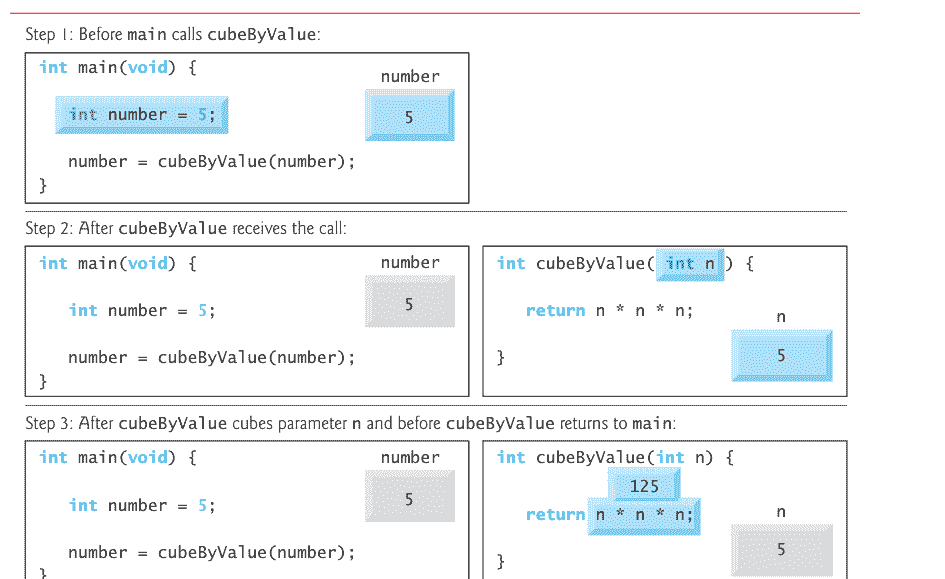

图 7.4 | 典型按值传递的分析。

步骤 4：`cubeByValue` 返回到 `main` 之后，将结果赋给 `number` 之前：

```c
int main(void) {
    int number = 5;
    number = cubeByValue(number);
}
```

步骤 5：`main` 完成对 `number` 的赋值之后：

```c
int main(void) {
    int number = 5;
    number = cubeByValue(number);
}
```

步骤 1：`main` 调用 `cubeByReference` 之前：

```c
int main(void)
{
    int number = 5;
    cubeByReference(&number);
}
```

步骤 2：`cubeByReference` 接收到调用之后，`*nPtr` 被立方之前：

```c
int main(void)
{
    int number = 5;
    cubeByReference(&number);
}
```

```c
void cubeByReference(int *nPtr)
{
    *nPtr = *nPtr * *nPtr * *nPtr;
}
```

步骤 3：`*nPtr` 被立方之后，程序控制权返回到 `main` 之前：

```c
int main(void)
{
    int number = 5;
    cubeByReference(&number);
}
```

```c
void cubeByReference(int *nPtr)
{
    *nPtr = *nPtr * *nPtr * *nPtr;
}
```

图 7.5 | 使用指针参数的典型按引用传递分析。

## 自我检查

1. （判断题）假设定义如下
   ```c
   double d = 98.6;
   double *dPtr;
   ```
   则以下语句将变量 `d` 的地址赋给指针变量 `dPtr`：
   ```c
   dPtr = &d;
   ```
   此时，变量 `dPtr` 被称为“指向” `d`。
   答案：正确。

2. （填空题）一元间接运算符（`*`）返回其指针操作数所指向对象的值。以这种方式使用 `*` 称为 _______。
   答案：解引用指针。

下表列出了迄今为止介绍的运算符的优先级和结合性：

| 运算符 | 结合性 | 类型 |
| :--- | :--- | :--- |
| () [] ++ (后缀) -- (后缀) | 从左到右 | 后缀 |
| + - ++ -- ! * & (类型) | 从右到左 | 一元 |
| * / % | 从左到右 | 乘法 |
| + - | 从左到右 | 加法 |
| < <= > >= | 从左到右 | 关系 |
| == != | 从左到右 | 相等 |
| && | 从左到右 | 逻辑与 |
| \|\| | 从左到右 | 逻辑或 |
| ?: | 从右到左 | 条件 |
| = += -= *= /= %= | 从右到左 | 赋值 |
| , | 从左到右 | 逗号 |

```c
int a = 7;
int *aPtr = &a; // 将 aPtr 设置为 a 的地址

printf("Address of a is %p\nValue of aPtr is %p\n\n", &a, aPtr);
printf("Value of a is %d\nValue of *aPtr is %d\n\n", a, *aPtr);
printf("Showing that * and & are complements of each other\n");
printf("&*aPtr = %p\n*&aPtr = %p\n", &*aPtr, *&aPtr);
```

Address of a is 0x7fffe69386cc
Value of aPtr is 0x7fffe69386cc

Value of a is 7
Value of *aPtr is 7

Showing that * and & are complements of each other
&*aPtr = 0x7fffe69386cc
*&aPtr = 0x7fffe69386cc

图 7.1 | 使用 `&` 和 `*` 指针运算符。

## 自我检查

1（多选题）以下哪项陈述是*错误*的？
    a) 默认情况下，参数（数组除外）按值传递。数组按引用传递。
    b) 函数通常需要能够修改调用者中的变量，或接收指向大型数据对象的指针以避免复制该对象。
    c) return 可以将一个或多个值从被调用函数返回给调用者。
    d) 按引用传递也可以通过修改调用者中的变量使函数“返回”多个值。

**答案：** c) 是*错误*的。return 最多只能将一个值从被调用函数返回给调用者。

2（多选题）以下哪项陈述是*错误*的？
    a) 你使用指针和间接运算符来实现按引用传递。
    b) 当调用一个需要修改其参数的函数时，使用取地址运算符（&）传递参数的地址。
    c) 数组使用运算符 & 按引用传递。
    d) 以上所有陈述都是*正确*的。

**答案：** c) 是*错误*的。数组不是使用运算符 & 按引用传递的，因为数组名等价于其第一个元素的地址——即 `&arrayName[0]`。

## 7.5 在指针中使用 const 限定符

**const 限定符**使你能够告知编译器某个特定变量的值不应被修改，从而强制执行最小权限原则。这可以减少调试时间，防止意外的副作用，使程序更健壮，也更易于修改和维护。如果尝试修改一个声明为 const 的值，编译器会捕获该错误并发出报错信息。

多年来，大量遗留代码是用早期的 C 版本编写的，当时没有使用 const，因为它尚不存在。即使是现在的代码，也没有像应该的那样经常使用 const。因此，通过重新设计现有 C 代码，存在显著的改进机会。

向函数传递数据指针有四种方式：

-   一个**指向非常量数据的非常量指针**。
-   一个**指向非常量数据的常量指针**。
-   一个**指向常量数据的非常量指针**。
-   一个**指向常量数据的常量指针**。

这四种组合中的每一种都提供不同的访问权限，将在接下来的几个示例中讨论。你如何选择其中一种可能性？让最小权限原则作为你的指导。始终授予函数足够的对其参数中数据的访问权限以完成其指定任务，但绝对不要更多。

### 7.5.1 使用指向非常量数据的非常量指针将字符串转换为大写

指向非常量数据的非常量指针授予最高级别的数据访问权限。数据可以通过解引用指针进行修改，并且指针本身也可以被修改以指向其他数据项。函数可能使用这样的指针来接收字符串参数，然后处理（并可能修改）字符串中的每个字符。图 7.6 中的函数 `convertToUppercase` 声明其参数为一个指向非常量数据的非常量指针，名为 `sPtr`（第 18 行）。该函数一次处理一个字符的数组字符串（由 `sPtr` 指向）。来自 `<ctype.h>` 头文件的 C 标准库函数 `toupper`（第 20 行）将每个字符转换为其对应的大写字母。如果原始字符不是字母或已经是大写，`toupper` 返回原始字符。第 21 行递增指针以指向字符串中的下一个字符。第 8 章将介绍许多 C 标准库的字符和字符串处理函数。

```c
// fig07_06.c
// 使用指向非常量数据的非常量指针将字符串转换为大写。
#include <ctype.h>
#include <stdio.h>

void convertToUppercase(char *sPtr); // 原型

int main(void) {
    char string[] = "cHaRaCters and $32.98"; // 初始化字符数组

    printf("转换前的字符串是: %s\n", string);
    convertToUppercase(string);
    printf("转换后的字符串是: %s\n", string);
}

// 将字符串转换为大写字母
void convertToUppercase(char *sPtr) {
    while (*sPtr != '\0') { // 当前字符不是
        *sPtr = toupper(*sPtr); // 转换为大写
        ++sPtr; // 使 sPtr 指向下一个字符
    }
}
```

转换前的字符串是: cHaRaCters and $32.98
转换后的字符串是: CHARACTERS AND $32.98

**图 7.6** | 使用指向非常量数据的非常量指针将字符串转换为大写。

### 7.5.2 使用指向常量数据的非常量指针逐字符打印字符串

指向常量数据的非常量指针可以被修改以指向任何适当类型的数据项，但它所指向的数据不能被修改。函数可能接收这样的指针来处理数组参数的元素而不修改它们。例如，函数 `printCharacters`（图 7.7）将参数 `sPtr` 声明为 `const char *` 类型（第 20 行）。该声明从右向左读作“sPtr 是一个指向字符常量的指针”。函数的 `for` 语句输出每个字符，直到遇到空字符。显示每个字符后，循环递增指针 `sPtr` 以指向字符串的下一个字符。

```c
// fig07_07.c
// 使用指向常量数据的非常量指针逐字符打印字符串。

#include <stdio.h>

void printCharacters(const char *sPtr);

int main(void) {
    // 初始化字符数组
    char string[] = "print characters of a string";

    puts("字符串是:");
    printCharacters(string);
    puts("");
}

// sPtr 不能用于修改它所指向的字符，
// 即 sPtr 是一个“只读”指针
void printCharacters(const char *sPtr) {
    // 遍历整个字符串
    for (; *sPtr != '\0'; ++sPtr) { // 无初始化
        printf("%c", *sPtr);
    }
}
```

> 字符串是:
print characters of a string

**图 7.7** | 使用指向常量数据的非常量指针逐字符打印字符串。

#### 尝试修改常量数据

图 7.8 显示了编译一个接收指向常量数据的非常量指针（`xPtr`）并尝试使用它修改数据的函数时产生的错误。显示的错误来自 Visual C++ 编译器。C 标准没有规定编译器警告或错误消息，编译器供应商也没有在不同编译器之间统一这些消息。因此，你收到的实际错误消息是特定于编译器的。例如，Xcode 的 LLVM 编译器报告的错误是：

```
error: read-only variable is not assignable
```

而 GNU gcc 编译器报告的错误是：

```
error: assignment of read-only location ‘*xPtr’
```

```c
// fig07_08.c
// 尝试通过指向常量数据的非常量指针修改数据。
#include <stdio.h>
void f(const int *xPtr); // 原型

int main(void) {
    int y = 7; // 定义 y

    f(&y); // f 尝试非法修改
}

// xPtr 不能用于修改
// 它所指向的变量的值
void f(const int *xPtr) {
    *xPtr = 100; // 错误：不能修改 const 对象
}
```

Microsoft Visual C++ 错误消息

```
fig07_08.c(16,5): error C2166: l-value specifies const object
```

**图 7.8** | 尝试通过指向常量数据的非常量指针修改数据。

#### 传递结构体与数组

如你所知，数组是聚合类型，将相同类型的相关数据项存储在一个名称下。第 10 章讨论了另一种形式的聚合类型，称为结构体（在其他语言中有时称为记录或元组），它可以将相同或不同类型的的相关数据项存储在一个名称下——例如，员工信息，如员工的 ID 号、姓名、地址和薪水。

与数组不同，结构体是按值传递的——传递整个结构体的副本。这需要在运行时复制结构体中的每个数据项并将其存储在计算机的函数调用栈上，从而产生开销。通过使用指向常量数据的指针传递大型对象（如结构体），可以获得按引用传递的性能和按值传递的安全性。在这种情况下，程序只复制结构体存储的地址——通常是四或八个字节。

如果内存不足且执行效率是关注点，请使用指针。如果内存充足且效率不是主要关注点，请按值传递数据以强制执行最小权限原则。一些系统不能很好地执行 const，因此按值传递仍然是防止数据被修改的最佳方式。

### 7.5.3 尝试修改指向非常量数据的常量指针

指向非常量数据的常量指针始终指向相同的内存位置，但该位置的数据可以通过指针进行修改。这是数组名的默认行为，数组名是指向数组第一个元素的常量指针。数组中的所有数据都可以通过使用数组名和数组下标来访问和更改。指向非常量数据的常量指针可用于接收数组作为参数。

## 7.5 在指针中使用 const 限定符

对于使用数组下标表示法访问数组元素的函数，将数组传递给该函数等同于传递一个指向该数组的指针。声明为 const 的指针必须在定义时初始化。如果指针是函数参数，它会在函数被调用时用指针实参初始化。

图 7.9 尝试修改一个常量指针。指针 ptr 在第 11 行被定义为 `int * const` 类型，从*右向左*读作“ptr 是一个指向整数的常量指针”。该指针在第 11 行用整型变量 x 的地址初始化。程序尝试在第 14 行将 y 的地址赋给 ptr，但编译器会产生错误。

```
1  // fig07_09.c
2  // 尝试修改一个指向非常量数据的常量指针。
3  #include <stdio.h>
4
5  int main(void) {
6      int x = 0; // 定义 x
7      int y = 0; // 定义 y
8
9      // ptr 是一个指向整数的常量指针，可以通过 ptr 修改该整数，
10     // 但 ptr 始终指向相同的内存位置
11     int * const ptr = &x;
12
13     *ptr = 7; // 允许：*ptr 不是 const
14     ptr = &y; // 错误：ptr 是 const；不能赋新地址
15 }
```

Microsoft Visual C++ 错误消息

> fig07_09.c(14,4): error C2166: l-value specifies const object

**图 7.9** | 尝试修改一个指向非常量数据的常量指针。

## 7.5.4 尝试修改一个指向常量数据的常量指针

**指向常量数据的常量指针**授予*最小*的访问权限。这样的指针总是指向*相同*的内存位置，并且该内存位置的数据*不能被修改*。这正是将数组传递给一个仅使用数组下标表示法查看数组元素而*不修改*元素的函数时应有的方式。图 7.10 在第 12 行将指针变量 ptr 定义为 `const int *const` 类型，从*右向左*读作“ptr 是一个指向整数常量的常量指针”。输出显示了当我们尝试*修改 ptr 指向的数据*（第 15 行）以及尝试*修改指针变量中存储的地址*（第 16 行）时产生的错误消息。

```
1  // fig07_10.c
2  // 尝试修改一个指向常量数据的常量指针。
3  #include <stdio.h>
4
5  int main(void) {
6      int x = 5;
7      int y = 0;
8
9      // ptr 是一个指向常量整数的常量指针。ptr 始终
10     // 指向相同的位置；该位置的整数
11     // 不能被修改
12     const int *const ptr = &x; // 初始化是允许的
13
14     printf("%d\n", *ptr);
15     *ptr = 7; // 错误：*ptr 是 const；不能赋新值
16     ptr = &y; // 错误：ptr 是 const；不能赋新地址
17 }
```

Microsoft Visual C++ 错误消息

```
fig07_10.c(15,5): error C2166: l-value specifies const object
fig07_10.c(16,4): error C2166: l-value specifies const object
```

**图 7.10** | 尝试修改一个指向常量数据的常量指针。

## 自我检查

1（多选题）在以下函数原型中，sPtr 是什么？
void convertToUppercase(char *sPtr);
a) 一个指向常量数据的非常量指针。
b) 一个指向非常量数据的常量指针。
c) 一个指向非常量数据的非常量指针。
d) 一个指向常量数据的常量指针。
答案：c。

2（填空题）**最小**的访问权限由一个指向**常量**数据的**常量**指针授予。这样的指针总是指向相同的内存位置，并且该内存位置的数据不能被修改。
答案：constant, constant。

## 7.6 使用传引用的冒泡排序

让我们改进图 6.12 的冒泡排序⁴程序，使用两个函数——bubbleSort 和 swap（图 7.11）。函数 bubbleSort 对数组进行排序。它调用函数 swap（第 42 行）来交换数组元素 array[j] 和 array[j + 1]。

4. 在第 12 章和附录 C 中，我们将研究能产生更好性能的排序方案。

```
1  // fig07_11.c
2  // 将值放入数组，将值排序为升序并打印结果数组。
3  #include <stdio.h>
4  #define SIZE 10
5  
6  void bubbleSort(int * const array, size_t size); // 原型
7  
8  int main(void) {
9      // 初始化数组 a
10     int a[SIZE] = { 2, 6, 4, 8, 10, 12, 89, 68, 45, 37 };
11 
12     puts("Data items in original order");
13 
14     // 遍历数组 a
15     for (size_t i = 0; i < SIZE; ++i) {
16         printf("%4d", a[i]);
17     }
18 
19     bubbleSort(a, SIZE); // 对数组排序
20 
21     puts("\nData items in ascending order");
22 
23     // 遍历数组 a
24     for (size_t i = 0; i < SIZE; ++i) {
25         printf("%4d", a[i]);
26     }
27 
28     puts("");
29 }
30 
31 // 使用冒泡排序算法对整数数组进行排序
32 void bubbleSort(int * const array, size_t size) {
33     void swap(int *element1Ptr, int *element2Ptr); // 原型
34 
35     // 控制遍历次数的循环
36     for (int pass = 0; pass < size - 1; ++pass) {
37         // 控制每次遍历中比较次数的循环
38         for (size_t j = 0; j < size - 1; ++j) {
39             // 如果相邻元素顺序错误则交换它们
40             if (array[j] > array[j + 1]) {
41                 swap(&array[j], &array[j + 1]);
42             }
43         }
44     }
45 }
46
47 // 交换 element1Ptr 和 element2Ptr 所指向的内存位置的值
48 void swap(int *element1Ptr, int *element2Ptr) {
49     int hold = *element1Ptr;
50     *element1Ptr = *element2Ptr;
51     *element2Ptr = hold;
52 }
```

```
Data items in original order
  2   6   4   8  10  12  89  68  45  37
Data items in ascending order
  2   4   6   8  10  12  37  45  68  89
```

**图 7.11** | 将值放入数组，将值排序为升序并打印结果数组。

### 函数 swap

请记住，C 语言在函数之间强制执行*信息隐藏*，因此 swap 默认情况下无法访问 bubbleSort 中的单个数组元素。因为 bubbleSort 希望 swap 能访问数组元素以进行交换，所以 bubbleSort 将每个元素的地址传递给 swap，因此元素是通过引用传递的。虽然整个数组会自动通过引用传递，但单个数组元素是*标量*，通常通过值传递。因此，bubbleSort 对每个数组元素使用取地址运算符（&）：

```
swap(&array[j], &array[j + 1]);
```

函数 swap 在 element1Ptr 中接收 &array[j]（第 50 行）。函数 swap 可以将 *element1Ptr 作为 array[j] 的同义词使用。类似地，*element2Ptr 是 array[j + 1] 的同义词。即使 swap 不允许这样写：

```
int hold = array[j];
array[j] = array[j + 1];
array[j + 1] = hold;
```

但第 51 到 53 行实现了完全相同的效果：

```
int hold = *element1Ptr;
*element1Ptr = *element2Ptr;
*element2Ptr = hold;
```

### 函数 bubbleSort 的数组参数

请注意，函数 bubbleSort 的头部（第 33 行）将 array 声明为 `int * const array` 而不是 `int array[]`，以表明 bubbleSort 接收一个一维数组参数。同样，这些表示法是可互换的；但是，为了可读性，通常更倾向于使用数组表示法。

### 函数 bubbleSort 体内的函数 swap 原型

函数 swap 的原型（第 34 行）包含在 bubbleSort 的体内，因为只有 bubbleSort 调用 swap。将原型放在 bubbleSort 中限制了只有从 bubbleSort（或源代码中出现在 swap 之后的任何函数）进行的调用才是正确的 swap 调用。在 swap 之前定义的其他函数如果尝试调用 swap，则没有正确的函数原型，因此编译器会自动生成一个。这通常会导致生成的原型与函数头部不匹配（并产生编译警告或错误），因为编译器假定返回类型和参数类型为 int。将函数原型放在其他函数的定义中，通过限制只有出现原型的函数才能进行正确的函数调用，从而强制执行了最小权限原则。

### 函数 bubbleSort 的 size 参数

函数 bubbleSort 接收数组大小作为参数（第 33 行）。当数组传递给函数时，数组第一个元素的内存地址当然不会传达数组元素的数量。因此，你必须将数组大小传递给函数，以便知道要排序多少个元素。另一种常见的做法是传递一个指向数组第一个元素的指针和一个指向数组末尾之后位置的指针。正如你将在第 7.8 节中学到的，这两个指针之间的差值就是数组的长度，并且生成的代码更简单。

将数组大小传递给 bubbleSort 有两个主要好处——*软件可重用性*和*良好的软件工程*。通过定义函数接收数组大小作为参数，我们使该函数可以被任何需要对任意大小的一维整数数组进行排序的程序使用。

我们本可以将数组大小存储在一个全局变量中，供整个程序访问。但是，其他需要整数数组排序功能的程序可能没有相同的全局变量，因此该函数无法在这些程序中使用。全局变量通常违反最小权限原则，并可能导致糟糕的软件工程。全局变量应仅用于表示真正共享的资源，例如当前时间。

数组大小本可以直接编程到函数中。这将限制该函数只能处理特定大小的数组，并显著降低其可重用性。只有处理编码到函数中的特定大小的一维整数数组的程序才能使用该函数。

## 自我检查

1（代码题）我们的 bubbleSort 函数在 swap 调用中对每个数组元素使用了取地址运算符（&）以实现传引用，如下所示：
swap(&array[j], &array[j + 1]);
假设函数 swap 在名为 firstPtr 和 secondPtr 的 `int *` 指针中分别接收 &array[j] 和 &array[j + 1]。请在函数 swap 中编写基于指针的代码，使用一个临时 int 变量 temp 来交换这两个元素中的值。
答案：

```
int temp = *firstPtr;
*firstPtr = *secondPtr;
*secondPtr = temp;
```

## 7.7 sizeof 运算符

C 语言提供了一元运算符 `sizeof` 来确定对象或类型在内存中所占的字节数。该运算符在编译时应用，除非其操作数是变长数组（VLA；第 6.12 节）。当应用于数组名时，如图 7.12（第 12 行）所示，`sizeof` 会以 `size_t` 值的形式返回数组的总字节数。在我们的计算机上，`float` 类型的变量存储在四个字节的内存中，而数组被定义为有 20 个元素。因此，数组共有 80 个字节。`sizeof` 是一个编译时运算符，因此它不会产生任何运行时开销（VLA 除外）。

```c
// fig07_12.c
// 将 sizeof 应用于数组名会返回数组中的字节数。
#include <stdio.h>
#define SIZE 20

size_t getSize(const float *ptr); // 原型

int main(void) {
    float array[SIZE]; // 创建数组

    printf("数组中的字节数是 %zu\n", sizeof(array));
    printf("getSize 返回的字节数是 %zu\n", getSize(array));
}

// 返回 ptr 的大小
size_t getSize(const float *ptr) {
    return sizeof(ptr);
}
```

```
数组中的字节数是 80
getSize 返回的字节数是 8
```

图 7.12 | 将 sizeof 应用于数组名会返回数组中的字节数。

尽管函数 `getSize` 接收一个包含 20 个元素的数组作为参数，但函数的参数 `ptr` 仅仅是指向数组第一个元素的指针。当你对指针使用 `sizeof` 时，它返回的是指针的大小，而不是它所指向的项的大小。在我们的 64 位 Windows、Mac 和 Linux 测试系统上，指针的大小是八个字节，因此 `getSize` 返回 8。在较旧的 32 位系统上，指针的大小通常是四个字节，因此 `getSize` 会返回 4。

数组中的元素数量也可以用 `sizeof` 来确定。例如，考虑以下数组定义：
```c
double real[22];
```

`double` 类型的变量通常存储在八个字节的内存中。因此，数组 `real` 包含 176 个字节。以下表达式确定了数组的元素数量：
```c
sizeof(real) / sizeof(real[0])
```

该表达式将数组 `real` 的总字节数除以存储数组一个元素（一个 `double` 值）所使用的字节数。此计算仅在使用实际数组名时有效，*不*在使用指向数组的指针时有效。

### 确定标准类型、数组和指针的大小

图 7.13 计算了存储每种标准类型所使用的字节数。此程序的结果取决于具体实现。它们通常在不同平台之间存在差异，有时在同一平台的不同编译器之间也会不同。输出显示了我们在 Mac 系统上使用 Xcode C++ 编译器的结果。

```c
// fig07_13.c
// 使用运算符 sizeof 确定标准类型的大小。
#include <stdio.h>

int main(void) {
    char c = 'a';
    short s = 0;
    int i = 0;
    long l = 0;
    long long ll = 0;
    float f = 0.0F;
    double d = 0.0;
    long double ld = 0.0;
    int array[20] = {0}; // 创建一个包含 20 个 int 元素的数组
    int *ptr = array; // 创建指向数组的指针

    printf("    sizeof c = %2zu\t      sizeof(char) = %2zu\n",
        sizeof c, sizeof(char));
    printf("    sizeof s = %2zu\t      sizeof(short) = %2zu\n",
        sizeof s, sizeof(short));
    printf("    sizeof i = %2zu\t      sizeof(int) = %2zu\n",
        sizeof i, sizeof(int));
    printf("    sizeof l = %2zu\t      sizeof(long) = %2zu\n",
        sizeof l, sizeof(long));
    printf("    sizeof ll = %2zu\t sizeof(long long) = %2zu\n",
        sizeof ll, sizeof(long long));
    printf("    sizeof f = %2zu\t      sizeof(float) = %2zu\n",
        sizeof f, sizeof(float));
    printf("    sizeof d = %2zu\t     sizeof(double) = %2zu\n",
        sizeof d, sizeof(double));
    printf("   sizeof ld = %zu\tsizeof(long double) = %zu\n",
        sizeof ld, sizeof(long double));
    printf("sizeof array = %zu\n  sizeof ptr = %zu\n",
        sizeof array, sizeof ptr);
}
```

```
sizeof c = 1            sizeof(char) = 1
sizeof s = 2            sizeof(short) = 2
sizeof i = 4            sizeof(int) = 4
sizeof l = 8            sizeof(long) = 8
sizeof ll = 8           sizeof(long long) = 8
sizeof f = 4            sizeof(float) = 4
sizeof d = 8            sizeof(double) = 8
sizeof ld = 16          sizeof(long double) = 16
sizeof array = 80
sizeof ptr = 8
```

图 7.13 | 使用运算符 sizeof 确定标准类型的大小。（第 2 部分，共 2 部分。）

存储特定类型所使用的字节数可能因系统而异。当编写依赖于类型大小且将在多个计算机系统上运行的程序时，请使用 `sizeof` 来确定存储这些类型所使用的字节数。你可以将 `sizeof` 应用于任何变量名、类型或值（包括表达式的值）。当应用于变量名（非数组名）或常量时，它会返回存储该特定类型变量或常量所使用的字节数。当类型作为 `sizeof` 的操作数时，必须使用括号。

## 自我检查

1.  （填空）给定数组定义：
    ```c
    double temperatures[31];
    ```
    表达式：
    ```c
    sizeof(temperatures) / sizeof(temperatures[0])
    ```
    确定了 `temperatures` 的什么属性？_______
    答案：数组中的元素数量（本例中为 31）。

2.  （判断题）当你对指针使用 `sizeof` 时，它返回指针所指向项的大小。
    答案：错误。实际上，当你对指针使用 `sizeof` 时，它返回的是指针的大小，而不是指针所指向项的大小。如果你对数组名使用 `sizeof`，它返回的是数组的大小。

## 7.8 指针表达式和指针算术

指针是算术表达式、赋值表达式和比较表达式中的有效操作数。然而，并非所有算术运算符都适用于指针变量。本节描述了可以将指针作为操作数的运算符，以及这些运算符的使用方法。

### 7.8.1 指针算术运算符

指针允许以下算术运算：

-   递增（++）或递减（--），
-   将一个整数加到指针上（+ 或 +=），
-   从指针中减去一个整数（- 或 -=），以及
-   从一个指针中减去另一个指针——仅当*两个*指针都指向*同一个*数组时才有意义。

对不引用数组元素的指针进行指针算术运算是一个逻辑错误。

### 7.8.2 将指针指向数组

假设数组 `int v[5]` 已定义，其第一个元素位于内存中的位置 3000。同时，假设指针 `vPtr` 指向 `v[0]`——因此 `vPtr` 的值为 3000。下图说明了在具有四字节整数的机器上的此场景：

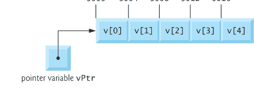

变量 `vPtr` 可以通过以下任一语句初始化为指向数组 `v`：
```c
vPtr = v;
vPtr = &v[0];
```

### 7.8.3 将整数加到指针上

在常规算术中，3000 + 2 的结果是 3002。在指针算术中通常不是这种情况。当你将一个整数加到指针上或从中减去一个整数时，指针会递增或递减该整数*乘以指针所指向对象的大小*。例如，语句
```c
vPtr += 2;
```
将产生 3008（3000 + 2 * 4），假设整数存储在四个字节的内存中。在数组 `v` 中，`vPtr` 现在将指向 `v[2]`，如下图所示：


### 7.8.4 从指针中减去一个整数

如果 `vPtr` 已经递增到 3016（即 `v[4]`），那么语句

```
vPtr -= 4;
```

会将 `vPtr` 重置回 3000（即 `v[0]`）——数组的起始位置。使用指针算术将指针调整到指向数组边界之外是一个逻辑错误，可能导致安全问题。

### 7.8.5 指针的递增和递减

要将指针递增或递减一个单位，请使用递增（`++`）和递减（`--`）运算符。以下任一语句

```
++vPtr;
vPtr++;
```

都会将指针递增，使其指向下一个数组元素。以下任一语句

```
--vPtr;
vPtr--;
```

都会将指针递减，使其指向前一个数组元素。

### 7.8.6 一个指针减去另一个指针

如果 `vPtr` 包含地址 3000，而 `v2Ptr` 包含地址 3008，那么语句

```
x = v2Ptr - vPtr;
```

会将 `vPtr` 和 `v2Ptr` 之间的*数组元素数量*赋值给 `x`，在此例中为 2（而不是 8）。除非在同一个数组的元素上进行，否则指针算术是未定义的。除非是数组的相邻元素，否则我们不能假设两个相同类型的变量在内存中是相邻存储的。

### 7.8.7 指针之间的赋值

相同类型的指针可以相互赋值。此规则的例外是 **void 指针**（即 `void *`）——一种可以表示*任何*指针类型的通用指针。所有指针类型都可以赋值给 `void *`，而 `void *` 也可以被赋值为任何类型的指针（包括另一个 `void *`）。在这两种情况下，都*不需要*强制转换操作。

### 7.8.8 void 指针

需要知道类型才能确定表示引用值所需的字节数。
*解引用 `void *` 指针是一个语法错误。*

### 7.8.9 比较指针

你可以使用相等和关系运算符来比较指针，但这种比较只有在指针指向同一个数组的元素时才有意义；否则，这种比较就是逻辑错误。指针比较是比较存储在指针中的地址。例如，这种比较可以显示一个指针指向的数组元素编号比另一个指针指向的更高。指针比较的一个常见用途是确定指针是否为 `NULL`。

## 自我检查

- 1. （填空）当你向指针加上一个整数或从指针中减去一个整数时，指针会递增或递减该整数乘以 _______。
**答案：** 指针所指向对象的大小。
- 2. （填空）指针 `v1Ptr` 和 `v2Ptr` 指向同一个包含八个字节双精度值的数组的元素。如果 `v1Ptr` 包含地址 3000，而 `v2Ptr` 包含地址 3016，那么语句
`size_t x = v2Ptr - v1Ptr;`
会将 _______ 赋值给 `x`。
**答案：** 2（而不是 16）——2 是指针之间的元素数量。

## 7.9 指针与数组的关系

数组和指针密切相关，并且通常可以互换使用。你可以将*数组名*视为指向数组第一个元素的*常量指针*。指针可以用于执行任何涉及数组下标的操作。

假设以下定义：

```
int b[5];
int *bPtr;
```

因为数组名 `b`（不带下标）是指向数组第一个元素的指针，所以我们可以通过以下语句将 `bPtr` 设置为数组 `b` 第一个元素的地址：

```
bPtr = b;
```

这等同于获取数组 `b` 第一个元素的地址，如下所示：

```
bPtr = &b[0];
```

### 7.9.1 指针/偏移量表示法

数组元素 `b[3]` 也可以用指针表达式来引用

```
*(bPtr + 3)
```

表达式中的 3 是指针的*偏移量*。当 `bPtr` 指向数组的第一个元素时，偏移量表示要引用哪个数组元素——偏移量的值与数组下标相同。这种表示法被称为**指针/偏移量表示法**。括号是必需的，因为 `*` 的优先级*高于* `+`。如果没有括号，上面的表达式会将 3 加到表达式 `*bPtr` 的值上（即，假设 `bPtr` 指向数组的开头，则会将 3 加到 `b[0]` 上）。正如数组元素可以用指针表达式引用一样，地址

```
&b[3]
```

也可以用指针表达式来写

```
bPtr + 3
```

数组名也可以被视为指针并用于指针算术。例如，表达式

```
*(b + 3)
```

引用元素 `b[3]`。通常，所有带下标的数组表达式都可以用指针和偏移量来写。在这种情况下，使用了数组名作为指针的指针/偏移量表示法。前面的语句没有以任何方式修改数组名；`b` 仍然指向第一个元素。

### 7.9.2 指针/下标表示法

指针可以像数组一样使用下标。如果 `bPtr` 具有值 `b`，那么表达式

```
bPtr[1]
```

引用数组元素 `b[1]`。这被称为**指针/下标表示法**。

### 7.9.3 不能用指针算术修改数组名

数组名总是指向数组的开头，所以它就像一个常量指针。因此，表达式

```
b += 3
```

是*无效的*，因为它试图用指针算术修改数组名的值。试图用指针算术修改数组名的值是一个编译错误。

### 7.9.4 演示指针下标和偏移量

图 7.14 使用我们讨论过的四种引用数组元素的方法——数组下标、以数组名为指针的指针/偏移量、**指针下标**以及使用指针的指针/偏移量——来打印整数数组 `b` 的四个元素。

```
// fig07_14.cpp
// 在数组中使用下标和指针表示法。
#include <stdio.h>
#define ARRAY_SIZE 4

int main(void) {
    int b[] = {10, 20, 30, 40}; // 创建并初始化数组 b
    int *bPtr = b; // 创建 bPtr 并使其指向数组 b

    // 使用数组下标表示法输出数组 b
    puts("Array b printed with:\nArray subscript notation");

    // 遍历数组 b
    for (size_t i = 0; i < ARRAY_SIZE; ++i) {
        printf("b[%zu] = %d\n", i, b[i]);
    }

    // 使用数组名和指针/偏移量表示法输出数组 b
    puts("\nPointer/offset notation where the pointer is the array name");

    // 遍历数组 b
    for (size_t offset = 0; offset < ARRAY_SIZE; ++offset) {
        printf("*(b + %zu) = %d\n", offset, *(b + offset));
    }

    // 使用 bPtr 和数组下标表示法输出数组 b
    puts("\nPointer subscript notation");

    // 遍历数组 b
    for (size_t i = 0; i < ARRAY_SIZE; ++i) {
        printf("bPtr[%zu] = %d\n", i, bPtr[i]);
    }

    // 使用 bPtr 和指针/偏移量表示法输出数组 b
    puts("\nPointer/offset notation");

    // 遍历数组 b
    for (size_t offset = 0; offset < ARRAY_SIZE; ++offset) {
        printf("*(bPtr + %zu) = %d\n", offset, *(bPtr + offset));
    }
}
```

```
Array b printed with:
Array subscript notation
b[0] = 10
b[1] = 20
b[2] = 30
b[3] = 40

Pointer/offset notation where the pointer is the array name
*(b + 0) = 10
*(b + 1) = 20
*(b + 2) = 30
*(b + 3) = 40

Pointer subscript notation
bPtr[0] = 10
bPtr[1] = 20
bPtr[2] = 30
bPtr[3] = 40

Pointer/offset notation
*(bPtr + 0) = 10
*(bPtr + 1) = 20
*(bPtr + 2) = 30
*(bPtr + 3) = 40
```

### 7.9.5 使用数组和指针进行字符串复制

为了进一步说明数组和指针的可互换性，让我们看看图 7.15 中的两个字符串复制函数——`copy1` 和 `copy2`。两个函数都将字符串复制到字符数组中，但它们的实现方式不同。

```
// fig07_15.c
// 使用数组表示法和指针表示法复制字符串。
#include <stdio.h>
#define SIZE 10

void copy1(char * const s1, const char * const s2); // 原型
void copy2(char *s1, const char *s2); // 原型

int main(void) {
    char string1[SIZE]; // 创建数组 string1
    char *string2 = "Hello"; // 创建一个指向字符串的指针

    copy1(string1, string2);
    printf("string1 = %s\n", string1);

    char string3[SIZE]; // 创建数组 string3
    char string4[] = "Good Bye"; // 创建一个包含字符串的数组

    copy2(string3, string4);
    printf("string3 = %s\n", string3);
}

// 使用数组表示法将 s2 复制到 s1
void copy1(char * const s1, const char * const s2) {
    // 遍历字符串
    for (size_t i = 0; (s1[i] = s2[i]) != '\0'; ++i) {
        ; // 循环体为空
    }
}
```

#### 使用数组下标表示法进行复制

函数 copy1 使用*数组下标表示法*将 s2 中的字符串复制到字符数组 s1。该函数定义计数器变量 i 作为数组下标。for 语句头（第 26 行）执行整个复制操作。该语句的主体是空语句。语句头指定 i 初始化为零，并在每次迭代中递增一。表达式 s1[i] = s2[i] 将一个字符从 s2 复制到 s1。当在 s2 中遇到空字符时，它会被赋值给 s1。由于赋值的值就是赋给左操作数（s1）的值，因此当 s1 的一个元素接收到值为 0 从而为 *false* 的空字符时，循环终止。

#### 使用指针和指针算术进行复制

函数 copy2 使用*指针和指针算术*将 s2 中的字符串复制到字符数组 s1。同样，for 语句头（第 34 行）执行复制操作。语句头不包含任何变量初始化。表达式 *s1 = *s2 通过对 s2 解引用并将该字符赋值给 s1 的当前位置来执行复制操作。赋值后，第 34 行递增 s1 和 s2 以指向每个字符串的下一个字符。当赋值将空字符复制到 s1 中时，循环终止。

#### 关于函数 copy1 和 copy2 的说明

*copy1* 和 *copy2* 的第一个参数都必须是一个足够大的数组，以容纳第二个参数的字符串。否则，当尝试写入不属于数组的内存位置时，可能会发生逻辑错误。在这两个函数中，第二个参数被复制到第一个参数中——字符从它那里逐个读取，但字符*从未被修改*。因此，第二个参数被声明为指向一个常量值，以强制执行*最小权限原则*。两个函数都不需要修改第二个参数中字符串的能力，所以我们简单地禁止了这种操作。

## 自我检查

1. （对/错）如果 bPtr 指向数组 b 的第二个元素（b[1]），那么元素 b[3] 也可以用指针/偏移量表示法表达式 *(bPtr + 3) 来引用。
答案：错误。由于指针指向数组 b 的*第二个元素*（b[1]），表达式应为 *(bPtr + 2)。

2. （填空）指针可以像数组一样使用下标。如果 bPtr 指向数组 b 的第一个元素，表达式 `bPtr[1]` 引用的是数组元素 ________。
答案：b[1]。

## 7.10 指针数组

数组可以包含指针。**指针数组**的一个常见用途是形成一个**字符串数组**，简称为**字符串数组**。C 字符串中的每个元素本质上都是指向其第一个字符的指针。因此，字符串数组中的每个条目实际上都是指向字符串第一个字符的指针。考虑字符串数组 `suit` 的定义，它可能在表示一副牌时很有用。

```c
const char *suit[4] = {"Hearts", "Diamonds", "Clubs", "Spades"};
```

该数组有四个元素。`char *` 表示每个 suit 元素都是“指向 char 的指针”类型。限定符 `const` 表示每个元素指向的字符串不能被修改。字符串 "Hearts"、"Diamonds"、"Clubs" 和 "Spades" 被放入数组中。每个字符串在内存中都存储为一个*以空字符结尾的字符字符串*，其长度比引号中的字符数多一个字符。因此，这些字符串的长度分别为 7、9、6 和 7 个字符。虽然看起来这些字符串被放入了数组，但实际上只存储了指针，如下图所示：


每个指针指向其对应字符串的第一个字符。因此，即使 `char *` 数组的大小是*固定的*，它也可以指向*任意长度*的字符字符串。这种灵活性是 C 语言强大的数据结构能力的一个例子。

花色本可以放在一个二维数组中，其中每一行代表一种花色，每一列代表花色名称中的一个字母。这样的数据结构必须每行有固定数量的列，并且该数量必须与最长字符串一样大。因此，当存储许多比最长字符串短的字符串时，可能会浪费大量内存。我们将在下一节中使用字符串数组来表示一副牌。

## 自我检查

1. （填空）指针数组的一个常见用途是形成一个字符串数组，简称为 ________。
答案：字符串数组。

2. （对/错）本节 suit 数组中字符串的字符直接存储在数组的元素中。
答案：错误。尽管数组看起来包含四个字符串，但每个元素实际上包含的是相应字符串第一个字符的地址。实际的字母和终止空字符存储在内存的其他地方。

## 7.11 随机数模拟案例研究：洗牌和发牌

让我们使用随机数生成来开发一个洗牌和发牌模拟程序，然后可以用它来实现玩纸牌游戏的程序。为了揭示一些微妙的性能问题，我们故意使用了次优的洗牌和发牌算法。在本章的练习和第 10 章中，我们将开发更高效的算法。

使用自顶向下、逐步细化的方法，我们将开发一个程序来洗一副 52 张的扑克牌，然后发出每张牌。自顶向下的方法在处理比你在前面章节中见过的更复杂的问题时特别有用。

### 将一副牌表示为二维数组

我们使用一个 4 行 13 列的二维数组 deck 来表示这副扑克牌：


行对应花色——第 0 行对应红心，第 1 行对应方块，第 2 行对应梅花，第 3 行对应黑桃。列对应牌的面值。第 0 到 9 列对应 A 到 10，第 10 到 12 列对应 J、Q 和 K。我们将用表示四种花色的字符串填充字符串数组 suit，并用表示 13 种面值的字符串填充字符串数组 face。

### 洗二维数组

这个模拟的牌堆可以如下*洗牌*。首先，将 deck 的所有元素设置为 0。然后，*随机*选择一个行（0-3）和一个列（0-12）。将数字 1 放入数组元素 deck[row][column] 中，以表示这张牌将是洗好的牌堆中发出的第一张牌。对数字 2、3、...、52 重复此过程，将每个数字随机插入 deck 数组中，以表示哪些牌将在洗好的牌堆中第二、第三、...、第五十二张被发出。随着 deck 数组开始填充牌号，一张牌可能被再次选中——即当它被选中时 deck[row][column] 非零。忽略此选择，并重复选择其他随机的行和列值，直到找到一张*未被选中*的牌。最终，数字 1 到 52 将占据 deck 数组的 52 个位置。此时，牌堆已完全洗好。

### 无限期延迟的可能性

如果已经洗过的牌被随机重复选中，这种洗牌算法可能会*无限期*执行。这种现象被称为**无限期延迟**。在本章的练习中，我们将讨论一种更好的洗牌算法，它消除了无限期延迟的可能性。

> PERF 有时，以“自然”方式产生的算法可能包含微妙的性能问题，例如无限期延迟。寻求避免无限期延迟的算法。

### 从二维数组发牌

要发出第一张牌，我们使用嵌套的 for 语句在数组中搜索等于 1 的 deck[row][column]，其中 row 从 0 变化到 3，column 从 0 变化到 12。数组的那个元素对应哪张牌？suit 数组已预加载了四种花色，因此要获取牌的花色，我们打印字符串 suit[row]。类似地，要获取牌的面值，我们打印字符串 face[column]。我们还打印字符串 " of "，例如 "King of Clubs"、"Ace of Diamonds" 等等。

### 使用自顶向下、逐步细化开发程序逻辑

让我们继续自顶向下、逐步细化的过程。*顶层*很简单：

```
洗牌并发出 52 张牌
```

我们的*第一次细化*得到：

```
初始化 suit 数组
初始化 face 数组
初始化 deck 数组
洗牌
发出 52 张牌
```

“洗牌”可以细化如下：

```
对于 52 张牌中的每一张
    将牌号放入 deck 中随机选择的未占用元素中
```

“发52张牌”可以细化如下：

- 对于52张牌中的每一张
    在牌组数组中找到该牌的编号，并打印其花色和点数

完整的*第二次细化*如下：

- 初始化花色数组
- 初始化点数数组
- 初始化牌组数组
- 对于52张牌中的每一张
    将牌号放入牌组中随机选择的空位
- 对于52张牌中的每一张
    在牌组数组中找到该牌的编号，并打印其花色和点数

“将牌号放入牌组中随机选择的空位”可以细化为：

- 随机选择牌组中的一个位置
- 如果该位置已被选择过
    重新随机选择牌组中的一个位置
- 将牌号放入所选位置

“在牌组数组中找到该牌的编号，并打印其花色和点数”可以细化为：

- 对于牌组数组中的每个位置
    如果该位置包含指定的牌号
        打印该牌的花色和点数

整合这些扩展，得到我们的*第三次细化*：

- 初始化花色数组
- 初始化点数数组
- 初始化牌组数组
- 对于52张牌中的每一张
    随机选择牌组中的一个位置
    如果该位置已被选择过
        重新随机选择牌组中的一个位置
    将牌号放入所选位置
- 对于52张牌中的每一张
    对于牌组数组中的每个位置
        如果该位置包含指定的牌号
            打印该牌的花色和点数

至此，细化过程完成。

### 实现洗牌和发牌程序

洗牌和发牌程序及其示例执行如图7.16所示。当函数`printf`使用转换说明符`%s`打印字符串时，对应的参数必须是指向字符串或包含字符串的字符数组的`char`指针。第59行的格式说明符将牌的点数*右对齐*在一个宽度为5的字段中，后跟“ of ”，然后将牌的花色*左对齐*在一个宽度为8的字段中。`%-8s`中的*减号*表示左对齐。

```c
// fig07_16.c
// 洗牌和发牌。
#include <stdio.h>
#include <stdlib.h>
#include <time.h>

#define SUITS 4
#define FACES 13
#define CARDS 52

// 函数原型
void shuffle(int deck[][FACES]);
void deal(int deck[][FACES], const char *face[], const char *suit[]);

int main(void) {
    // 初始化牌组数组
    int deck[SUITS][FACES] = {0};

    srand(time(NULL)); // 为随机数生成器设置种子
    shuffle(deck); // 洗牌

    // 初始化花色数组
    const char *suit[SUITS] = {"Hearts", "Diamonds", "Clubs", "Spades"};

    // 初始化点数数组
    const char *face[FACES] = {"Ace", "Deuce", "Three", "Four", "Five",
        "Six", "Seven", "Eight", "Nine", "Ten", "Jack", "Queen", "King"};

    deal(deck, face, suit); // 发牌
}

// 洗牌
void shuffle(int deck[][FACES]) {
    // 对于每张牌，随机选择牌组中的一个位置
    for (size_t card = 1; card <= CARDS; ++card) {
        size_t row = 0; // 行号
        size_t column = 0; // 列号

        // 选择新的随机位置，直到找到空位
        do {
            row = rand() % SUITS;
            column = rand() % FACES;
        } while(deck[row][column] != 0);

        deck[row][column] = card; // 将牌号放入所选位置
    }
}
```

图7.16 | 洗牌和发牌。（第1部分，共2部分。）

```c
// 发牌
void deal(int deck[][FACES], const char *face[], const char *suit[]) {
    // 发每张牌
    for (size_t card = 1; card <= CARDS; ++card) {
        // 遍历牌组的行
        for (size_t row = 0; row < SUITS; ++row) {
            // 遍历当前行的牌组列
            for (size_t column = 0; column < FACES; ++column) {
                // 如果该位置包含当前牌，则显示该牌
                if (deck[row][column] == card) {
                    printf("%5s of %-8s %c", face[column], suit[row],
                        card % 4 == 0 ? '\n' : ' '); // 两列格式
                }
            }
        }
    }
}
```

### 改进发牌算法

发牌算法存在一个缺陷。一旦找到匹配项，两个内部`for`语句会继续搜索牌组的剩余元素。我们将在本章的练习和第10章的案例研究中修正这个缺陷。

### 相关练习

本洗牌和发牌案例研究由以下练习支持：

- 练习7.12（洗牌和发牌：发扑克牌手牌）
- 练习7.13（项目：洗牌和发牌——哪种扑克牌手牌更好？）
- 练习7.14（项目：洗牌和发牌——模拟庄家）
- 练习7.15（项目：洗牌和发牌——允许玩家抽牌）
- 练习7.16（洗牌和发牌改进：高性能洗牌）

## 自我检查

1. （填空）我们提出的洗牌算法如果反复随机选择已经洗过的牌，可能会无限期执行。这种现象被称为________。
    答案：无限期延迟。

2. （判断正误）格式说明符“%5s of %-8s”将一个字符串右对齐在一个宽度为5的字段中，后跟“ of ”，然后将一个字符串左对齐在一个宽度为8的字段中。
    答案：错误。实际上，这个格式说明符将一个字符串右对齐在一个宽度为5的字段中，后跟“ of ”，然后将一个字符串左对齐在一个宽度为8的字段中。

## 7.12 函数指针

在第6章中，我们看到数组名实际上是数组第一个元素在内存中的地址。类似地，函数名实际上是执行函数任务的代码在内存中的起始地址。函数指针包含函数在内存中的地址。函数指针可以传递给函数、从函数返回、存储在数组中、赋值给相同类型的其他函数指针，以及相互比较是否相等或不等。

### 7.12.1 升序或降序排序

为了演示函数指针，图7.17展示了图7.11冒泡排序程序的修改版本。新版本包含`main`函数以及`bubbleSort`、`swap`、`ascending`和`descending`函数。函数`bubbleSort`除了接收一个`int`数组及其大小外，还接收一个函数指针作为参数——可以是`ascending`函数或`descending`函数。用户选择是按升序（1）还是降序（2）排序数组。如果用户输入1，`main`将`ascending`函数的指针传递给`bubbleSort`函数。如果用户输入2，`main`将`descending`函数的指针传递给`bubbleSort`函数。

```c
// fig07_17.c
// 使用函数指针的多功能排序程序。
#include <stdio.h>
#define SIZE 10

// 函数原型
void bubbleSort(int work[], size_t size, int (*compare)(int a, int b));
int ascending(int a, int b);
int descending(int a, int b);
```

图7.17 | 使用函数指针的多功能排序程序。（第1部分，共3部分。）

```c
int main(void) {
    // 初始化无序数组a
    int a[SIZE] = { 2, 6, 4, 8, 10, 12, 89, 68, 45, 37 };

    printf("%s", "Enter 1 to sort in ascending order,\n"
            "Enter 2 to sort in descending order: ");
    int order = 0;
    scanf("%d", &order);

    puts("\nData items in original order");

    // 输出原始数组
    for (size_t counter = 0; counter < SIZE; ++counter) {
        printf("%5d", a[counter]);
    }

    // 按升序排序数组；将ascending函数作为参数传递以指定升序排序
    if (order == 1) {
        bubbleSort(a, SIZE, ascending);
        puts("\nData items in ascending order");
    }
    else { // 传递descending函数
        bubbleSort(a, SIZE, descending);
        puts("\nData items in descending order");
    }

    // 输出排序后的数组
    for (size_t counter = 0; counter < SIZE; ++counter) {
        printf("%5d", a[counter]);
    }

    puts("\n");
}

// 多功能冒泡排序；参数compare是指向确定排序顺序的比较函数的指针
void bubbleSort(int work[], size_t size, int (*compare)(int a, int b)) {
    void swap(int *element1Ptr, int *element2ptr); // 原型

    // 控制遍历次数的循环
    for (int pass = 1; pass < size; ++pass) {
        // 控制每次遍历比较次数的循环
        for (size_t count = 0; count < size - 1; ++count) {
            // 如果相邻元素顺序错误，则交换它们
            if ((*compare)(work[count], work[count + 1])) {
                swap(&work[count], &work[count + 1]);
            }
        }
    }
}
```

图7.17 | 使用函数指针的多功能排序程序。（第2部分，共3部分。）

### 7.12.2 使用函数指针创建菜单驱动系统

函数指针的一个常见用途是在菜单驱动系统中。程序通过提示用户输入菜单项编号（例如0到2）来选择一个选项。程序为每个选项提供不同的函数服务。它将每个函数的指针存储在一个函数指针数组中。用户的选择被用作数组下标，数组中的指针则用于调用相应的函数。

图7.18提供了一个定义和使用函数指针数组机制的通用示例。我们定义了三个函数——function1、function2和function3。每个函数接受一个整数参数且不返回任何值。我们将这些函数的指针存储在数组f中（第13行）。从最左边的括号开始阅读定义，其含义是：“f是一个包含3个指针的数组，这些指针分别指向一个接受int参数并返回void的函数。”该数组使用三个函数的名称进行初始化。当用户输入一个0到2之间的值时，我们使用该值作为函数指针数组的下标。在函数调用中（第23行），`f[choice]`选择了数组中位于choice位置的指针。我们解引用该指针来调用函数，并将choice作为函数的参数传递。每个函数都打印其参数值和函数名，以表明函数被正确调用。在本章的练习中，你将开发几个菜单驱动系统。

```c
// fig07_18.c
// 演示函数指针数组。
#include <stdio.h>

// 函数原型
void function1(int a);
void function2(int b);
void function3(int c);

int main(void) {
    // 初始化一个包含3个指针的数组，这些指针分别指向一个接受int参数并返回void的函数
    void (*f[3])(int) = {function1, function2, function3};

    printf("%s", "Enter a number between 0 and 2, 3 to end: ");
    int choice = 0;
    scanf("%d", &choice);

    // 处理用户输入
    while (choice >= 0 && choice < 3) {
        // 调用数组f中位于choice位置的函数，并将choice作为参数传递
        (*f[choice])(choice);

        printf("%s", "Enter a number between 0 and 2, 3 to end: ");
        scanf("%d", &choice);
    }

    puts("Program execution completed.");
}

void function1(int a) {
    printf("You entered %d so function1 was called\n\n", a);
}

void function2(int b) {
    printf("You entered %d so function2 was called\n\n", b);
}

void function3(int c) {
    printf("You entered %d so function3 was called\n\n", c);
}
```

```
Enter a number between 0 and 2, 3 to end: 0
You entered 0 so function1 was called

Enter a number between 0 and 2, 3 to end: 1
You entered 1 so function2 was called

Enter a number between 0 and 2, 3 to end: 2
You entered 2 so function3 was called

Enter a number between 0 and 2, 3 to end: 3
Program execution completed.
```

图 7.18 | 演示函数指针数组。（第2部分，共2部分）

## 自我检查

1. （判断题）考虑以下出现在我们冒泡排序函数函数头中的参数：

`int (*compare)(int a, int b)`

这个compare参数是一个指向函数的指针，该函数接收两个整数参数并返回一个整数结果。`*compare`周围的括号是可选的，但我们为了清晰起见而包含它们。

**答案：** *错误*。括号是必需的，用于将`*compare`分组以表明compare是一个指针。如果没有括号，声明将是

```c
int *compare(int a, int b)
```

这仅仅是一个接收两个整数作为参数并*返回一个指向整数的指针*的函数头。

2. （填空题）正如指向变量的指针通过解引用来访问变量的值一样，指向函数的指针通过解引用来________。

**答案：** 调用该函数。

## 7.13 安全的C编程

### printf_s、scanf_s和其他安全函数

早期的安全C编程部分介绍了`printf_s`和`scanf_s`，并提到了C标准附录K中描述的其他更安全的标准库函数版本。像`printf_s`和`scanf_s`这样的函数使其更安全的一个关键特性是它们具有*运行时约束*，要求其指针参数非NULL。这些函数在尝试使用指针*之前*会检查这些运行时约束。任何NULL指针参数都是*约束违规*，会导致函数失败并返回状态通知。如果`scanf_s`的任何指针参数（包括格式控制字符串）为NULL，则调用`scanf_s`会返回EOF。如果格式控制字符串为NULL或任何对应于`%s`的参数为NULL，则调用`printf_s`会停止输出数据并返回一个负数。有关附录K函数的完整详细信息，请参阅C标准文档或编译器的库文档。

### 关于指针的其他CERT指南

被误用的指针是当今系统中许多常见安全漏洞的根源。CERT提供了各种指南来帮助你预防此类问题。如果你正在构建工业级的C系统，你应该熟悉位于 https://wiki.sei.cmu.edu/ 的 *CERT C安全编码标准*。以下指南适用于我们在本章中介绍的指针编程技术：

- EXP34-C：解引用NULL指针通常会导致程序崩溃，但CERT遇到过解引用NULL指针可能允许攻击者执行代码的情况。
- DCL13-C：第7.5节讨论了`const`与指针的用法。如果函数参数指向一个不会被函数更改的值，应使用`const`来表明该数据是常量。例如，要表示一个不会被修改的字符串指针，请使用`const char *`作为指针参数的类型。
- WIN04-C：本指南讨论了在Microsoft Windows上加密函数指针的技术，以帮助防止攻击者覆盖它们并执行攻击代码。

## 自我检查

1. （填空题）`printf_s` 和 `scanf_s` 等函数的一个关键特性是，它们具有运行时约束，要求其指针参数必须为 ________。
答案：非空（non-NULL）。

2. （判断题）误用指针是当今系统中许多最常见安全漏洞的根源。
答案：正确。

## 总结

### 第 7.2 节 指针变量的定义与初始化

- 指针（第 310 页）包含另一个包含值的变量的地址。从这个意义上说，变量名直接引用一个值，而指针间接引用一个值。
- 通过指针引用值称为间接引用（第 311 页）。
- 指针可以被定义为指向任何类型的对象。
- 指针应在定义时或在赋值语句中进行初始化。指针可以初始化为 `NULL`、`0` 或一个地址。值为 `NULL` 的指针不指向任何内容。将指针初始化为 `0` 等同于初始化为 `NULL`，但为了清晰起见，更推荐使用 `NULL`。值 `0` 是唯一可以直接赋给指针变量的整数值。
- `NULL` 是在 `<stddef.h>` 头文件（以及其他几个头文件）中定义的符号常量。

### 第 7.3 节 指针运算符

- `&`，或称地址运算符（第 312 页），是一个一元运算符，返回其操作数的地址。
- 地址运算符的操作数必须是一个变量。
- 间接引用运算符 `*`（第 313 页）返回其操作数所指向对象的值。
- `printf` 转换规范 `%p` 在大多数平台上以十六进制整数输出内存位置。

### 第 7.4 节 按引用传递参数给函数

- 在 C 语言中，参数（数组除外）是按值传递的（第 315 页）。
- C 程序通过使用指针和间接引用运算符来实现按引用传递（第 315 页）。要按引用传递变量，请对变量名应用地址运算符（`&`）。
- 当变量的地址传递给函数时，可以在函数中使用间接引用运算符（`*`）来读取和/或修改调用者内存中该位置的值。
- 接收地址作为参数的函数必须定义一个指针参数来接收该地址。
- 编译器不区分接收指针的函数和接收一维数组的函数。函数必须“知道”它何时接收的是数组，何时接收的是按引用传递的单个变量。
- 当编译器遇到形式为 `int b[]` 的一维数组函数参数时，编译器会将该参数转换为指针表示法 `int *b`。

### 第 7.5 节 在指针中使用 const 限定符

- **const 限定符**（第 319 页）表示变量的值不应被修改。
- 将指针传递给函数有四种方式（第 319 页）：**指向非常量数据的非常量指针**、**指向非常量数据的常量指针**、**指向常量数据的非常量指针**和**指向常量数据的常量指针**。
- 对于指向非常量数据的非常量指针，可以通过解引用指针修改数据，并且可以修改指针以指向其他数据项。
- 指向常量数据的非常量指针可以被修改以指向任何适当类型的数据项，但它指向的数据不能被修改。
- 指向非常量数据的常量指针始终指向相同的内存位置，并且可以通过指针修改该位置的数据。这是数组名的默认行为。
- 指向常量数据的常量指针始终指向相同的内存位置，并且该内存位置的数据不能被修改。

### 第 7.7 节 sizeof 运算符

- 一元 **sizeof 运算符**（第 328 页）确定变量或类型的大小（以字节为单位）。
- 当应用于数组名时，**sizeof** 返回数组的总字节数。
- **sizeof** 运算符可以应用于任何变量名、类型或值。
- 如果类型名作为其操作数提供，则与 **sizeof** 一起使用的括号是必需的。

### 第 7.8 节 指针表达式与指针算术

- 可以对指针执行有限的**算术运算**（第 331 页）。你可以**递增（++）**或**递减（--）**指针，**将整数加到指针上**（`+` 或 `+=`），**从指针中减去整数**（`-` 或 `-=`），以及**将一个指针减去另一个指针**。
- 当你将整数加到指针上或从指针中减去整数时，指针会按该整数乘以指针所指对象的大小进行递增或递减。
- 指向同一数组元素的两个指针可以相互减去，以确定它们之间的元素数量。
- 如果两个指针类型相同，则可以将一个指针赋值给另一个指针。一个例外是 **void \*** 指针（第 332 页），它可以表示任何指针类型。所有指针类型都可以赋值给 **void \*** 指针，并且 **void \*** 指针可以赋值给任何类型的指针。
- **void \*** 指针不能被解引用。
- **指针可以使用**相等和关系运算符进行比较，但除非指针指向同一数组的元素，否则这种比较没有意义。指针比较比较的是存储在指针中的地址。
- 指针比较的一个常见用途是**确定指针是否为 NULL**。

### 第 7.9 节 指针与数组的关系

- 在 C 语言中，数组和指针密切相关，通常可以互换使用。
- **数组名**可以被视为一个**常量指针**。
- 指针可用于执行涉及数组下标的任何操作。
- 当指针指向数组的开头时，向指针添加**偏移量**（第 333 页）表示应引用数组的哪个元素。偏移量值与数组下标相同。这被称为指针/偏移量表示法。
- 数组名可以被视为指针，并用于不尝试修改指针值的指针算术表达式中。
- 指针可以像数组一样被下标引用（第 334 页）。这被称为指针/下标表示法。
- 类型为 `const char *` 的参数通常表示一个常量字符串。

### 第 7.10 节 指针数组

- 数组可以包含指针（第 338 页）。指针数组的一个常见用途是形成字符串数组（第 338 页）。每个元素都是一个字符串，但 C 字符串本质上是指向其第一个字符的指针。因此，每个元素实际上是指向字符串第一个字符的指针。

### 第 7.12 节 函数指针

- 函数指针（第 347 页）包含内存中函数的地址。函数名实际上是执行函数任务的代码在内存中的起始地址。
- 函数指针可以传递给函数、从函数返回、存储在数组中、赋值给其他函数指针，并且可以相互比较是否相等或不等。
- 函数指针通过解引用来调用函数。在调用函数时，函数指针可以直接用作函数名。
- 函数指针的一个常见用途是在菜单驱动系统中。

## 自我复习练习

**7.1** 回答以下问题：
a) 指针变量包含的值是另一个变量的 ________。
b) 有三个值可用于初始化指针——________、________ 和 ________。
c) 可以赋给指针的唯一整数是 ________。

**7.2** 说明以下各项是*正确*还是*错误*。如果答案是*错误*，请解释原因。
a) 声明为 `void` 的指针可以被解引用。
b) 不同类型的指针在没有强制转换操作的情况下不能相互赋值。

**7.3** 回答以下问题。假设单精度浮点数存储在四个字节中，数组的起始地址是内存中的位置 1002500。练习的每个部分应在适当的地方使用前面部分的结果。
a) 定义一个名为 `numbers` 的浮点数组，包含 10 个元素，并将元素初始化为值 0.0、1.1、2.2、...、9.9。假设符号常量 `SIZE` 已定义为 10。
b) 定义一个指向浮点数的指针 `nPtr`。
c) 使用 `for` 语句和数组下标表示法打印数组 `numbers` 的元素。使用小数点后一位精度。
d) 给出两个单独的语句，将数组 `numbers` 的起始地址赋给指针变量 `nPtr`。

e) 使用指针 nPtr，通过指针/偏移量表示法打印 numbers 数组的元素。
f) 使用数组名作为指针，通过指针/偏移量表示法打印 numbers 数组的元素。
g) 通过对指针 nPtr 进行下标操作，打印 numbers 数组的元素。
h) 使用数组下标表示法、使用数组名作为指针的指针/偏移量表示法、使用 nPtr 的指针下标表示法以及使用 nPtr 的指针/偏移量表示法，引用 numbers 数组的第 4 个元素。
i) 假设 nPtr 指向数组 numbers 的开头，nPtr + 8 引用的是什么地址？该位置存储的值是什么？
j) 假设 nPtr 指向 numbers[5]，nPtr -= 4 引用的是什么地址？该位置存储的值是什么？

**7.4** 对于以下每项任务，编写一条执行指定操作的语句。假设已定义浮点变量 number1 和 number2，并且 number1 已初始化为 7.3。
a) 定义变量 fPtr 为指向 float 类型对象的指针。
b) 将变量 number1 的地址赋给指针变量 fPtr。
c) 打印 fPtr 所指向对象的值。
d) 将 fPtr 所指向对象的值赋给变量 number2。
e) 打印 number2 的值。
f) 打印 number1 的地址。使用 %p 转换说明符。
g) 打印存储在 fPtr 中的地址。使用 %p 转换说明符。打印的值是否与 number1 的地址相同？

**7.5** 完成以下每项任务：
a) 编写函数 exchange 的函数头，该函数接受两个指向浮点数的指针 x 和 y 作为参数，并且不返回值。
b) 编写 (a) 部分中函数的函数原型。
c) 编写函数 evaluate 的函数头，该函数返回一个整数，并接受一个整数参数 x 和一个指向函数 poly 的指针，poly 代表一个接受一个整数参数并返回一个整数的函数。
d) 编写 (c) 部分中函数的函数原型。

**7.6** 找出以下每个程序段中的错误。假设：

```
int *zPtr; // zPtr 将引用数组 z
int *aPtr = NULL;
void *sPtr = NULL;
int number;
int z[5] = {1, 2, 3, 4, 5};
sPtr = z;
```

a) ++zPtr;
b) // 使用指针获取数组
number = zPtr;
c) // 将数组元素 2 赋给 number；假设 zPtr 已初始化
number = *zPtr[2];

d) // 打印整个数组 z；假设 zPtr 已初始化
for (size_t i = 0; i <= 5; ++i) {
    printf("%d ", zPtr[i]);
}
e) // 将 sPtr 所指向的值赋给 number
number = *sPtr;
f) ++z;

## 自我复习练习答案

7.1 a) 地址。 b) 0, NULL, 一个地址。 c) 0。

7.2 a) 错误。指向 void 的指针不能被解引用，因为无法确切知道要解引用多少字节的内存。 b) 错误。void 类型的指针可以被赋值为其他类型的指针，void 类型的指针也可以被赋值给其他类型的指针。

7.3 答案如下：

```
a) float numbers[SIZE] =
    {0.0, 1.1, 2.2, 3.3, 4.4, 5.5, 6.6, 7.7, 8.8, 9.9};
b) float *nPtr;
c) for (size_t i = 0; i < SIZE; ++i) {
    printf("%.1f ", numbers[i]);
}
d) nPtr = numbers;
nPtr = &numbers[0];
e) for (size_t i = 0; i < SIZE; ++i) {
    printf("%.1f ", *(nPtr + i));
}
f) for (size_t i = 0; i < SIZE; ++i) {
    printf("%.1f ", *(numbers + i));
}
g) for (size_t i = 0; i < SIZE; ++i) {
    printf("%.1f ", nPtr[i]);
}
h) numbers[4]
*(numbers + 4)
nPtr[4]
*(nPtr + 4)
```

i) 地址是 1002500 + 8 * 4 = 1002532。值是 8.8。

j) numbers[5] 的地址是 1002500 + 5 * 4 = 1002520。
nPtr -= 4 的地址是 1002520 - 4 * 4 = 1002504。
该位置的值是 1.1。

7.4 答案如下：

```
a) float *fPtr;
b) fPtr = &number1;
c) printf("The value of *fPtr is %f\n", *fPtr);
d) number2 = *fPtr;
e) printf("The value of number2 is %f\n", number2);
f) printf("The address of number1 is %p\n", &number1);
g) printf("The address stored in fPtr is %p\n", fPtr);
Yes, the value is the same.
```

7.5 a) void exchange(float *x, float *y)
b) void exchange(float *x, float *y);
c) int evaluate(int x, int (*poly)(int))
d) int evaluate(int x, int (*poly)(int));

7.6 a) 错误：zPtr 未初始化。
修正：在进行指针运算之前，使用 zPtr = z; 初始化 zPtr。
b) 错误：指针未被解引用。
修正：将语句改为 number = *zPtr;
c) 错误：zPtr[2] 不是指针，不应被解引用。
修正：将 *zPtr[2] 改为 zPtr[2]。
d) 错误：使用指针下标引用了数组边界之外的数组元素。
修正：将 for 条件中的运算符 <= 改为 <。
e) 错误：解引用 void 指针。
修正：要解引用指针，必须先将其转换为整数指针。将语句改为 number = *((int *) sPtr);
f) 错误：试图使用指针算术修改数组名。
修正：使用指针变量而不是数组名来执行指针算术，或者对数组名进行下标操作以引用特定元素。

## 练习

7.7 回答以下问题：
a) ________ 运算符返回其操作数在内存中的位置。
b) ________ 运算符返回其操作数所指向对象的值。
c) 要在将非数组变量传递给函数时实现按引用传递，必须将变量的 ________ 传递给函数。

7.8 判断以下陈述的真假。如果为假，请解释原因。
a) 指向不同数组的两个指针不能进行有意义的比较。
b) 因为数组名是指向数组第一个元素的指针，所以数组名可以与指针以完全相同的方式进行操作。

7.9 回答以下问题。假设整数存储在四个字节中，数组的起始地址位于内存位置 1002500。
a) 定义一个包含五个元素的 int 数组 values，并将元素初始化为从 2 到 10 的偶数。假设符号常量 SIZE 定义为 5。
b) 定义一个指向 int 类型对象的指针 vPtr。
c) 使用数组下标表示法打印数组 values 的元素。使用 for 语句，并假设已定义整型控制变量 i。
d) 给出两条独立的语句，将数组 values 的起始地址赋给指针变量 vPtr。
e) 使用指针/偏移量表示法打印数组 values 的元素。
f) 使用数组名作为指针，通过指针/偏移量表示法打印数组 values 的元素。
g) 通过对指向数组的指针进行下标操作，打印数组 values 的元素。
h) 使用数组下标表示法、通过数组名的指针/偏移量表示法、指针下标表示法以及指针/偏移量表示法，引用 values 的第 4 个元素。
i) vPtr + 3 引用的是什么地址？该位置存储的值是什么？
j) 假设 vPtr 指向 values[4]，vPtr -= 4 引用的是什么地址？该位置存储的值是什么？

7.10 对于以下每项任务，编写一条执行指定操作的语句。假设已定义长整型变量 value1 和 value2，并且 value1 已初始化为 200000。
a) 定义变量 lPtr 为指向 long 类型对象的指针。
b) 将变量 value1 的地址赋给指针变量 lPtr。
c) 打印 lPtr 所指向对象的值。
d) 将 lPtr 所指向对象的值赋给变量 value2。
e) 打印 value2 的值。
f) 打印 value1 的地址。
g) 打印存储在 lPtr 中的地址。该值是否与 value1 的地址相同？

7.11 完成以下每项任务：
a) 编写函数 zero 的函数头，该函数接受一个长整型数组参数 bigIntegers，并且不返回值。
b) 编写 (a) 部分中函数的函数原型。
c) 编写函数 add1AndSum 的函数头，该函数接受一个整型数组参数 oneTooSmall，并返回一个整数。
d) 编写 (c) 部分中描述的函数的函数原型。
e) 判断一手牌是否包含同花（即五张牌花色相同）。
f) 判断一手牌是否包含顺子（即五张牌点数连续）。

**7.13** *（项目：洗牌与发牌——哪种扑克牌手牌更好？）* 使用练习 7.12 中开发的函数编写一个程序，发两手五张牌的扑克牌手牌，评估每手牌，并确定哪手牌更好。

**7.14** *（项目：洗牌与发牌——模拟庄家）* 修改练习 7.13 中开发的程序，使其能够模拟庄家。庄家的五张牌手牌是“面朝下”发出的，这样玩家就看不到它。然后程序应该评估庄家的手牌，并根据手牌的质量，庄家应该再抽一张、两张或三张牌来替换原始手牌中相应数量的不需要的牌。然后程序应该重新评估庄家的手牌。*[注意：这是一个难题！]*

**7.15** *（项目：洗牌与发牌——允许玩家抽牌）* 修改练习 7.14 中开发的程序，使其能够自动处理庄家的手牌，但允许玩家决定替换玩家手牌中的哪些牌。然后程序应该评估双方的手牌并确定谁赢。现在使用这个新程序与计算机玩 20 局。谁赢的局数更多，你还是计算机？让你的一个朋友与计算机玩 20 局。谁赢的局数更多？根据这些游戏的结果，改进你的扑克游戏程序（这也是一个难题）。再玩 20 局。你修改后的程序玩得更好吗？

**7.16** *（洗牌与发牌改进：高性能洗牌）* 在图 7.16 中，我们故意使用了一个效率低下的洗牌算法，存在无限期延迟的可能性。在这个问题中，你将创建一个避免无限期延迟的高性能洗牌算法。
按如下方式修改图 7.16 的程序。首先按如下方式初始化牌组数组：

| 未洗牌的数组 | | | | | | | | | | | | |
|---|---|---|---|---|---|---|---|---|---|---|---|---|
| | 0 | 1 | 2 | 3 | 4 | 5 | 6 | 7 | 8 | 9 | 10 | 11 | 12 |
| 0 | 1 | 2 | 3 | 4 | 5 | 6 | 7 | 8 | 9 | 10 | 11 | 12 | 13 |
| 1 | 14 | 15 | 16 | 17 | 18 | 19 | 20 | 21 | 22 | 23 | 24 | 25 | 26 |
| 2 | 27 | 28 | 29 | 30 | 31 | 32 | 33 | 34 | 35 | 36 | 37 | 38 | 39 |
| 3 | 40 | 41 | 42 | 43 | 44 | 45 | 46 | 47 | 48 | 49 | 50 | 51 | 52 |

修改洗牌函数，使其逐行逐列地遍历数组，每个元素只访问一次。每个元素应与数组中随机选择的一个元素交换。打印结果数组以确定牌组是否被充分洗牌。以下是一组洗牌后的示例值：

## 358 第7章 指针

示例洗牌数组

|   | 0  | 1  | 2  | 3  | 4  | 5  | 6  | 7  | 8  | 9  | 10 | 11 | 12 |
|---|----|----|----|----|----|----|----|----|----|----|----|----|----|
| 0 | 19 | 40 | 27 | 25 | 36 | 46 | 10 | 34 | 35 | 41 | 18 | 2  | 44 |
| 1 | 13 | 28 | 14 | 16 | 21 | 30 | 8  | 11 | 31 | 17 | 24 | 7  | 1  |
| 2 | 12 | 33 | 15 | 42 | 43 | 23 | 45 | 3  | 29 | 32 | 4  | 47 | 26 |
| 3 | 50 | 38 | 52 | 39 | 48 | 51 | 9  | 5  | 37 | 49 | 22 | 6  | 20 |

你可能希望你的程序多次调用洗牌函数，以确保得到满意的洗牌效果。

尽管本题中的方法改进了洗牌算法，但发牌算法仍然需要在牌组数组中搜索牌1，然后是牌2，接着是牌3，依此类推。更糟糕的是，即使发牌算法定位并发出了一张牌，算法仍然会搜索牌组的剩余部分。修改图7.16的程序，使得一旦一张牌被发出，就不再尝试匹配该牌号，程序立即继续发出下一张牌。在第10章中，我们将开发一个每张牌只需一次操作的发牌算法。

## 7.17 假设用户输入两个长度相同的字符串，这个程序的功能是什么？

```c
// ex07_19.c
// 这个程序的功能是什么？
#include <stdio.h>
#define SIZE 80

void mystery1(char *s1, const char *s2); // 原型

int main(void) {
    char string1[SIZE]; // 创建字符数组
    char string2[SIZE]; // 创建字符数组

    puts("Enter two strings: ");
    scanf("%39s%39s", string1, string2);
    mystery1(string1, string2);
    printf("%s", string1);
}

// 这个函数的功能是什么？
void mystery1(char *s1, const char *s2) {
    while (*s1 != '\0') {
        ++s1;
    }

    for (; *s1 = *s2; ++s1, ++s2) {
        ; // 空语句
    }
}
```

## 7.18 这个程序的功能是什么？

```c
// ex07_20.c
// 这个程序的功能是什么？
#include <stdio.h>
#define SIZE 80

size_t mystery2(const char *s); // 原型

int main(void) {
    char string[SIZE]; // 创建字符数组

    puts("Enter a string: ");
    scanf("%79s", string);
    printf("%d\n", mystery2(string));
}

// 这个函数的功能是什么？
size_t mystery2(const char *s) {
    size_t x;

    // 遍历字符串
    for (x = 0; *s != '\0'; ++s) {
        ++x;
    }

    return x;
}
```

## 7.19 找出以下每个程序段中的错误。如果错误可以纠正，请解释如何纠正。

a) int *number;
   printf("%d\n", *number);

b) float *realPtr;
   long *integerPtr;
   integerPtr = realPtr;

c) int *x, y;
   x = y;

d) char s[] = "this is a character array";
   int count;
   for (; *s != '\0'; ++s) {
       printf("%c ", *s);
   }

e) short *numPtr, result;
   void *genericPtr = numPtr;
   result = *genericPtr + 7;

f) float x = 19.34;
   float xPtr = &x;
   printf("%f\n", xPtr);

g) char *s;
    printf("%s\n", s);

## 7.20 （迷宫遍历）
以下网格是迷宫的二维数组表示。#符号代表迷宫的墙壁，句点（.）代表迷宫中可能路径上的方格。

```
# # # # # # # # # # # #
# . . . # . . . . . #
. . # . # . # # # # . #
# # # . # . . . . # . #
# . . . . # # # . # . .
# # # # . # . # . # . #
# . . # . # . # . # . #
# # . # . # . # . # . #
# . . . . . . . . # . #
# # # # # # . # # # . #
# . . . . . # . . . #
# # # # # # # # # # # #
```

维基百科页面 https://en.wikipedia.org/wiki/Maze_solving_algorithm 列出了几种寻找迷宫出口的算法。一种简单的迷宫行走算法可以保证找到出口（假设存在出口）。将你的右手放在右侧的墙上，然后开始向前走。永远不要把手从墙上移开。如果迷宫向右转，你就沿着墙向右走。只要你不把手从墙上移开，最终你会到达迷宫的出口。如果没有出口，你最终会回到起点。可能存在比你走过的路径更短的路径，但你可以保证走出迷宫。

编写递归函数 `mazeTraverse` 来遍历迷宫。该函数应接收一个表示迷宫的12x12字符数组和迷宫的起始位置作为参数。当 `mazeTraverse` 尝试定位迷宫出口时，它应在路径上的每个方格中放置字符 `X`。该函数应在每次移动后显示迷宫，以便用户可以观察迷宫的解决过程。

### 7.21 （随机生成迷宫）
编写函数 `mazeGenerator`，该函数接收一个二维12x12字符数组作为参数，并随机生成一个迷宫。该函数还应提供迷宫的起始和结束位置。使用几个随机生成的迷宫来测试你在练习7.20中的函数 `mazeTraverse`。

### 7.22 （任意大小的迷宫）
将练习7.20-7.21中的函数 `mazeTraverse` 和 `mazeGenerator` 泛化，以处理任意宽度和高度的迷宫。

### 7.23 假设用户输入两个长度相同的字符串，这个程序的功能是什么？

```c
// ex07_26.c
// 这个程序的功能是什么？
#include <stdio.h>
#define SIZE 80

int mystery3(const char *s1, const char *s2); // 原型

int main(void) {
    char string1[SIZE]; // 创建字符数组
    char string2[SIZE]; // 创建字符数组

    puts("Enter two strings: ");
    scanf("%79s%79s", string1, string2);
    printf("The result is %d\n", mystery3(string1, string2));
}

int mystery3(const char *s1, const char *s2) {
    int result = 1;

    for (; *s1 != '\0' && *s2 != '\0'; ++s1, ++s2) {
        if (*s1 != *s2) {
            result = 0;
        }
    }

    return result;
}
```

## 函数指针数组

### 7.24 （函数指针数组）
重写图6.17的程序，使用菜单驱动的界面。程序应向用户提供以下四个选项：

```
Enter a choice:
  0  Print the array of grades
  1  Find the minimum grade
  2  Find the maximum grade
  3  Print the average on all tests for each student
  4  End program
```

使用函数指针数组的一个限制是，所有指针必须具有相同的类型。这些指针必须指向具有相同返回类型且接收相同类型参数的函数。因此，必须修改图6.17中的函数，使它们都返回相同的类型并接受相同的参数。修改函数 `minimum` 和 `maximum`，使其打印最小值或最大值且不返回任何内容。对于选项3，修改图6.17中的函数 `average`，使其输出每个学生的平均分（而不是特定学生的平均分）。函数 `average` 应不返回任何内容，并接受与 `printArray`、`minimum` 和 `maximum` 相同的参数。将四个函数的指针存储在数组 `processGrades` 中，并使用用户的选择作为数组下标来调用每个函数。

### 7.25 （使用函数指针计算圆周长、圆面积或球体积）
使用图7.18中的技术，创建一个菜单驱动的程序。允许用户选择是计算圆的周长、圆的面积还是球的体积。然后程序应从用户输入一个半径，执行相应的计算并显示结果。使用一个函数指针数组，其中每个指针代表一个返回 `void` 并接收一个 `double` 参数的函数。相应的函数应各自显示消息，指示执行了哪个计算、半径的值以及计算结果。

### 7.26 （使用函数指针的计算器）
使用你在图7.18中学到的技术，创建一个菜单驱动的程序，允许用户选择是加、减、乘还是除两个数。然后程序应从用户输入两个 `double` 值，执行相应的计算并显示结果。使用一个函数指针数组，其中每个指针代表一个返回 `void` 并接收两个 `double` 参数的函数。相应的函数应各自显示消息，指示执行了哪个计算、参数的值以及计算结果。

### 7.27 （碳足迹计算器）
使用本章中学到的函数指针数组，你可以指定一组使用相同类型参数调用并返回相同类型数据的函数。全球各国政府和公司越来越关注建筑物燃烧各种燃料取暖、车辆燃烧燃料提供动力等产生的碳足迹（每年向大气中释放的二氧化碳）。许多科学家将这些温室气体归咎于所谓的全球变暖现象。创建三个函数，分别帮助计算建筑物、汽车和自行车的碳足迹。每个函数应从用户输入适当的数据，然后计算并显示碳足迹。（查看一些解释如何计算碳足迹的网站。）每个函数应不接收任何参数并返回 `void`。编写一个程序，提示用户输入要计算的碳足迹类型，然后调用函数指针数组中相应的函数。对于每种类型的碳足迹，显示一些标识信息和对象的碳足迹。

## 特别部分——将你自己的计算机构建为虚拟机

在接下来的几个练习中，我们暂时偏离高级语言编程的世界。我们“剥开”一个假想的简单计算机，看看它的内部结构。我们为这台计算机介绍机器语言编程，并编写几个机器语言程序。为了使这成为一个特别有价值的体验，我们随后在这台计算机上构建一个基于软件的*模拟*，你实际上可以在其上执行你的机器语言程序！这样的模拟计算机通常被称为**虚拟机**。

### 7.28 （机器语言编程）
让我们创建一台我们称之为Simpletron的计算机。顾名思义，它是一台简单的机器，但正如我们很快将看到的，它也是一台功能强大的机器。Simpletron运行用它直接理解的唯一语言编写的程序——即**Simpletron机器语言**，简称**SML**。

Simpletron 包含一个**累加器**——一个“特殊寄存器”，在 Simpletron 使用信息进行计算或以各种方式检查信息之前，信息会被放入其中。Simpletron 中的所有信息都以**字**的形式处理。字是一个带符号的四位十进制数，例如 +3364、-1293、+0007、-0001 等。Simpletron 配备了 100 个字的内存，这些字通过其位置编号 00、01、...、99 来引用。

在运行 SML 程序之前，我们必须**加载**或将程序放入内存。每个 SML 程序的第一条指令（或语句）总是放置在位置 00。

每个 **SML 指令**占用 Simpletron 内存中的一个字，因此指令是带符号的四位十进制数。我们假设 SML 指令的符号总是正号，但数据字的符号可以是正号或负号。每个 Simpletron 内存位置可能包含一条指令、程序使用的数据值或未使用（因此未定义）的内存区域。每个 SML 指令的前两位数字是**操作码**，指定要执行的操作。SML 操作码在下表中总结：

| 操作码 | 含义 |
| :--- | :--- |
| **输入/输出操作：** | |
| `#define READ 10` | 从键盘读取一个字到内存中的特定位置。 |
| `#define WRITE 11` | 将内存中特定位置的一个字写入屏幕。 |
| **加载/存储操作：** | |
| `#define LOAD 20` | 将内存中特定位置的一个字加载到累加器。 |
| `#define STORE 21` | 将累加器中的一个字存储到内存中的特定位置。 |
| **算术操作：** | |
| `#define ADD 30` | 将内存中特定位置的一个字加到累加器中的字上（结果留在累加器中）。 |
| `#define SUBTRACT 31` | 从累加器中的字减去内存中特定位置的一个字（结果留在累加器中）。 |
| `#define DIVIDE 32` | 将累加器中的字除以内存中特定位置的一个字（结果留在累加器中）。 |
| `#define MULTIPLY 33` | 将内存中特定位置的一个字乘以累加器中的字（结果留在累加器中）。 |
| **控制转移操作：** | |
| `#define BRANCH 40` | 跳转到内存中的特定位置。 |
| `#define BRANCHNEG 41` | 如果累加器为负，则跳转到内存中的特定位置。 |
| `#define BRANCHZERO 42` | 如果累加器为零，则跳转到内存中的特定位置。 |
| `#define HALT 43` | 停止——即程序已完成其任务。 |

SML 指令的最后两位数字是**操作数**——包含操作所应用的字的内存位置。

#### 两个数字相加的 SML 程序示例

让我们考虑几个简单的 SML 程序。以下 SML 程序从键盘读取两个数字，然后计算并打印它们的和：

| 位置 | 数字 | 指令 |
| :--- | :--- | :--- |
| 00 | +1007 | （读取 A） |
| 01 | +1008 | （读取 B） |
| 02 | +2007 | （加载 A） |
| 03 | +3008 | （加 B） |
| 04 | +2109 | （存储 C） |
| 05 | +1109 | （写入 C） |
| 06 | +4300 | （停止） |
| 07 | +0000 | （变量 A） |
| 08 | +0000 | （变量 B） |
| 09 | +0000 | （结果 C） |

指令 +1007 从键盘读取第一个数字并将其放入位置 07。然后 +1008 将下一个数字读入位置 08。*加载*指令 +2007 将第一个数字复制到累加器。*加*指令 +3008 将第二个数字加到累加器中的数字上。*所有 SML 算术指令都将结果留在累加器中。* *存储*指令 +2109 将结果从累加器复制到内存位置 09，然后*写入*指令 +1109 从该位置取出数字并将其作为带符号的四位十进制数打印到屏幕上。*停止*指令 +4300 终止执行。

#### 确定两个值中较大者的 SML 程序示例

下一个 SML 程序从键盘读取两个数字，然后确定并打印较大的值：

| 位置 | 数字 | 指令 |
| :--- | :--- | :--- |
| 00 | +1009 | （读取 A） |
| 01 | +1010 | （读取 B） |
| 02 | +2009 | （加载 A） |
| 03 | +3110 | （减 B） |
| 04 | +4107 | （负数跳转到 07） |
| 05 | +1109 | （写入 A） |
| 06 | +4300 | （停止） |
| 07 | +1110 | （写入 B） |
| 08 | +4300 | （停止） |
| 09 | +0000 | （变量 A） |
| 10 | +0000 | （变量 B） |

指令 +4107 是一个条件控制转移，类似于 if 语句。

现在编写 SML 程序来完成以下每项任务。

- a) 使用哨兵控制循环读取正整数，然后计算并打印它们的和。
- b) 使用计数器控制循环读取七个数字，其中一些为正，一些为负。计算并打印它们的平均值。
- c) 读取一系列数字。确定并打印最大的数字。读取的第一个数字表示应处理多少个数字。

### 7.29（计算机模拟器）

起初可能看起来很离谱，但在这个练习中，你将构建自己的计算机。不，你不会将组件焊接在一起。相反，你将使用**基于软件的模拟**这一强大技术来创建 Simpletron 的**软件模型**。你不会失望的。你的 Simpletron 模拟器将把你正在使用的计算机变成 Simpletron，你将能够实际运行、测试和调试你在练习 7.28 中编写的 SML 程序！

当你运行你的 Simpletron 模拟器时，它应该首先打印：

```
***             Welcome to Simpletron             ***
*** Please enter your program one instruction ***
*** (or data word) at a time. I will type the ***
*** location number and a question mark (?). ***
*** You then type the word for that location. ***
*** Type the sentinel -99999 to stop entering ***
*** your program.                              ***
```

使用一个包含 100 个元素的一维数组 memory 来模拟 Simpletron 的内存。现在假设模拟器正在运行，让我们检查输入练习 7.28 示例 2 程序时的对话：

```
00 ? +1009
01 ? +1010
02 ? +2009
03 ? +3110
04 ? +4107
05 ? +1109
06 ? +4300
07 ? +1110
08 ? +4300
09 ? +0000
10 ? +0000
11 ? -99999
*** Program loading completed ***
*** Program execution begins ***
```

SML 程序现在已被放置（或加载）到数组内存中。接下来，Simpletron 执行 SML 程序。它从位置 00 的指令开始，并按顺序继续，除非被控制转移到程序的其他部分。

使用变量 accumulator 来表示累加器寄存器。使用变量 instructionCounter 来存储包含正在执行的指令的内存位置编号（00 到 99）。使用变量 operationCode 来存储当前正在执行的操作（指令字的前两位数字）。使用变量 operand 来存储当前指令操作的内存位置编号。因此，如果一条指令有操作数，它是当前正在执行的指令的最右边两位数字。不要直接从内存执行指令。相反，将要执行的下一条指令从内存传输到名为 instructionRegister 的变量。然后“提取”前两位数字并放入变量 operationCode，“提取”后两位数字并放入 operand。

当 Simpletron 开始执行时，特殊寄存器初始化如下：

```
accumulator          +0000
instructionCounter   00
instructionRegister  +0000
operationCode        00
operand              00
```

现在让我们“逐步执行”内存位置 00 中的第一条 SML 指令 +1009。这个过程称为**指令执行周期**。

instructionCounter 告诉我们下一条要执行的指令的位置。我们通过使用 C 语句从内存中*获取*该位置的内容

```
instructionRegister = memory[instructionCounter];
```

操作码和操作数通过以下语句从指令寄存器中提取

```
operationCode = instructionRegister / 100;
operand = instructionRegister % 100;
```

现在 Simpletron 必须确定操作码实际上是*读取*（而不是*写入*、*加载*等）。switch 语句区分 SML 的十二种操作。switch 模拟各种 SML 指令的行为如下（我们将其他留给读者）：

```
read:    scanf("%d", &memory[operand]);
load:    accumulator = memory[operand];
add:     accumulator += memory[operand];
Various branch instructions: We'll discuss these shortly.
halt:    This instruction prints the message
         *** Simpletron execution terminated ***
```

然后打印每个寄存器的名称和内容以及所有 100 个内存位置的完整内容。这样的打印输出通常称为**计算机转储**。为了帮助你编写转储函数，下面的输出显示了一个示例转储：

#### 专题——构建你自己的虚拟机计算机

寄存器：
累加器 +0000
指令计数器 00
指令寄存器 +0000
操作码 00
操作数 00

内存：

|      | 0      | 1      | 2      | 3      | 4      | 5      | 6      | 7      | 8      | 9      |
|------|--------|--------|--------|--------|--------|--------|--------|--------|--------|--------|
| 0    | +0000  | +0000  | +0000  | +0000  | +0000  | +0000  | +0000  | +0000  | +0000  | +0000  |
| 10   | +0000  | +0000  | +0000  | +0000  | +0000  | +0000  | +0000  | +0000  | +0000  | +0000  |
| 20   | +0000  | +0000  | +0000  | +0000  | +0000  | +0000  | +0000  | +0000  | +0000  | +0000  |
| 30   | +0000  | +0000  | +0000  | +0000  | +0000  | +0000  | +0000  | +0000  | +0000  | +0000  |
| 40   | +0000  | +0000  | +0000  | +0000  | +0000  | +0000  | +0000  | +0000  | +0000  | +0000  |
| 50   | +0000  | +0000  | +0000  | +0000  | +0000  | +0000  | +0000  | +0000  | +0000  | +0000  |
| 60   | +0000  | +0000  | +0000  | +0000  | +0000  | +0000  | +0000  | +0000  | +0000  | +0000  |
| 70   | +0000  | +0000  | +0000  | +0000  | +0000  | +0000  | +0000  | +0000  | +0000  | +0000  |
| 80   | +0000  | +0000  | +0000  | +0000  | +0000  | +0000  | +0000  | +0000  | +0000  | +0000  |
| 90   | +0000  | +0000  | +0000  | +0000  | +0000  | +0000  | +0000  | +0000  | +0000  | +0000  |

执行完Simpletron程序后的转储将显示指令和数据值在执行终止时的实际值。你可以通过在格式说明符中将0格式化标志放在字段宽度之前（如"%02d"），来打印比其字段宽度短的整数前导0。你可以使用+格式化标志在值前放置+或-符号。因此，要生成形如+0000的数字，可以使用格式说明符"%+05d"。

现在让我们继续执行程序的第一条指令，即位于00位置的+1009。正如我们已经指出的，switch语句通过执行以下语句来模拟这一点：

```
scanf("%d", &memory[operand]);
```

在执行scanf之前，屏幕上应显示一个问号（?），以提示用户输入。Simpletron等待用户输入一个值，然后按*回车*（或*Enter*）键。然后该值被读入位置09。

至此，第一条指令的模拟完成。剩下的只是准备Simpletron执行下一条指令。因为刚刚执行的指令不是控制转移指令，我们只需按如下方式递增指令计数器寄存器：

```
++instructionCounter;
```

这完成了第一条指令的模拟执行。整个过程（即**指令执行周期**）随着**取**下一条要执行的指令而重新开始。

现在让我们考虑分支指令——控制转移——是如何模拟的。我们只需要适当地调整指令计数器中的值。因此，无条件分支指令（40）在switch中模拟为：

```
instructionCounter = operand;
```

条件“若累加器为零则分支”指令模拟为：

```
if (accumulator == 0) {
    instructionCounter = operand;
}
```

此时，你应该实现你的Simpletron模拟器，并运行你在练习7.28中编写的SML程序。你可以用额外的功能来增强SML，并在你的模拟器中提供这些功能。练习7.30列出了几个可能的增强功能。

你的模拟器应该检查各种类型的错误。例如，在程序**加载阶段**，用户输入到Simpletron内存中的每个数字必须在-9999到+9999的范围内。你的模拟器应该使用while循环来测试输入的每个数字是否在此范围内，如果不是，则不断提示用户重新输入数字，直到输入正确的数字。

在执行阶段，你的模拟器应该检查严重的错误，例如试图**除以零**、试图执行**无效操作码**以及**累加器溢出**（即，算术运算导致值大于+9999或小于-9999）。这些严重的错误是致命错误。当检测到致命错误时，打印如下错误消息：

```
*** 试图除以零 ***
*** Simpletron 执行异常终止 ***
```

并按照我们之前讨论的格式打印完整的计算机转储。这将帮助用户定位程序中的错误。

*实现说明：* 当你实现Simpletron模拟器时，在main中将内存数组和所有寄存器定义为变量。程序应包含另外三个函数——load、execute和dump。函数load从键盘读取用户输入的SML指令。（一旦你学习了第11章的文件处理，你将能够从文件中读取SML指令。）函数execute执行当前加载在内存数组中的SML程序。函数dump显示内存和存储在main变量中的所有寄存器的内容。根据需要将内存数组和寄存器传递给其他函数以完成它们的任务。函数load和execute需要修改在main中定义的变量，因此你需要使用指针通过引用将这些变量传递给函数。你需要修改我们在整个问题描述中展示的语句，以使用适当的指针表示法。

### **7.30** *（对Simpletron模拟器的修改）*

在本练习中，我们提出了对练习7.29的Simpletron模拟器的几项修改和增强。在练习12.24和12.25中，我们提议构建一个编译器，将用高级编程语言（BASIC的一种变体）编写的程序转换为Simpletron机器语言。以下一些修改和增强可能是执行编译器生成的程序所必需的：

- a) 将Simpletron模拟器的内存扩展到包含1000个内存位置（000到999），以使Simpletron能够处理更大的程序。
- b) 允许模拟器执行余数计算。这需要一条额外的Simpletron机器语言指令。
- c) 允许模拟器执行幂运算。这需要一条额外的Simpletron机器语言指令。
- d) 修改模拟器以使用十六进制值而不是整数值来表示Simpletron机器语言指令。在线附录E“数制”讨论了十六进制。
- e) 修改模拟器以允许输出换行符。这需要一条额外的Simpletron机器语言指令。
- f) 修改模拟器以处理浮点值，而不仅仅是整数值。
- g) 修改模拟器以检测除以0的逻辑错误。
- h) 修改模拟器以检测算术溢出错误。
- i) 修改模拟器以处理字符串输入。[提示：每个Simpletron字可以分为两组，每组容纳一个两位整数。每个两位整数代表一个字符的ASCII十进制等效值。添加一条机器语言指令，该指令将输入一个字符串并将其存储在特定的Simpletron内存位置开始。该位置字的前半部分将是字符串中字符的数量（即字符串的长度）。每个后续的半字包含一个表示为两个十进制数字的ASCII字符。机器语言指令将每个字符转换为其ASCII等效值，并将其分配给左半字或右半字。]
- j) 修改模拟器以处理以第(g)部分格式存储的字符串的输出。[提示：添加一条机器语言指令，该指令打印从指定Simpletron内存位置开始的字符串。该位置字的前半部分是字符串的字符长度。每个后续的半字包含一个表示为两个十进制数字的ASCII字符。机器语言指令检查长度，并通过将每个两位数字转换为其等效字符来打印字符串。]

## 专题——嵌入式系统编程案例研究：使用Webots模拟器进行机器人编程

7.31 Webots$^{5,6}$ 是一个开源的、全彩的、3D的机器人模拟器，具有控制台游戏级的图形效果。它使你能够创建一个虚拟现实，让机器人在模拟的真实世界环境中进行交互。它可以在Windows、macOS和Linux上运行。该模拟器在工业和研究中被广泛用于测试机器人的可行性和

5. “Webots开源机器人模拟器。” 访问于2020年12月11日。https://cyberbotics.com。
6. 本案例研究中的Webots环境屏幕截图版权归2020 Cyberbotics Ltd.所有，根据Apache许可证2.0版（http://www.apache.org/licenses/LICENSE-2.0）获得许可。

# 第7章 指针

为这些机器人开发控制器软件。Webots采用Apache开源许可证。以下是其许可证网页的说明：⁷

> “Webots根据Apache 2.0许可协议条款发布。Apache 2.0是一种[原文如此]行业友好、无传染性、宽松的开源许可证，它授予每个人免费使用软件源代码的权利，可用于任何目的，包括商业应用。”

Webots最初于1996年在瑞士联邦理工学院（EPFL）开发。1998年，EPFL的衍生公司Cyberbotics Ltd.成立，接管了Webots模拟器的开发工作。直到2018年，Webots一直作为专有许可软件销售。2018年，Cyberbotics在Apache 2.0许可证下将Webots开源。⁸,⁹

机器人技术通常不在入门编程教材中讨论，但Webots使其变得简单。Webots捆绑了数十种当今最受欢迎的真实世界机器人的模拟，这些机器人可以行走、飞行、滚动、驾驶等。要获取当前捆绑机器人的列表，请访问

https://cyberbotics.com/doc/guide/robots

## 自包含开发环境

Webots是一个**自包含的机器人模拟环境**，包含了开始开发和实验机器人所需的一切。它包括：

- 一个用于查看和与模拟交互的**交互式3D模拟区域**，
- 一个**代码编辑器**，您可以在其中查看捆绑的模拟代码、修改它并编写自己的代码，以及
- **编译器和解释器**，使您能够用C、C++、Java、Python和MatLab编写Webots代码。

您可以轻松修改现有模拟并重新运行其代码以查看更改的效果。您也可以开发全新的模拟，正如本案例研究中将要做的那样。

## 安装Webots

首先，请查看Webots系统要求：

https://cyberbotics.com/doc/guide/system-requirements

您可以从Cyberbotics主页下载适用于Windows、macOS或Linux的Webots安装程序：

https://cyberbotics.com/

下载后，运行安装程序并按照屏幕提示操作。

## 导览

安装完成后，在您的系统上运行**Webots应用程序**。您可以在**Webots导览**中快速概览许多捆绑的机器人模拟及其机器人的功能。为此，请选择**帮助 > Webots导览...**（首次打开Webots环境时，此导览将自动开始）。然后，在出现的窗口中（图7.19），勾选**自动**复选框并点击**下一步**。这将开始自动导览，它会短暂展示每个演示，然后切换到下一个。**导览 - Webots**窗口显示每个模拟的简要说明。图7.19显示了第三个模拟的说明，该模拟如图7.20所示。

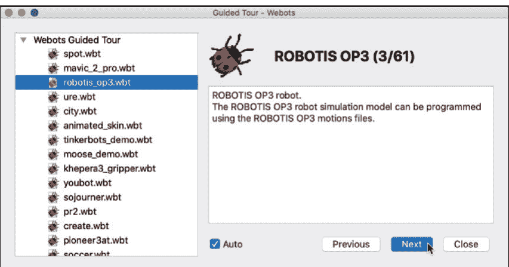

**图7.19** | 图7.20所示的ROBOTIS OP3机器人的简要说明。[本案例研究中的屏幕截图版权归Cyberbotics Ltd.所有，该公司根据Apache许可证2.0版（“许可证”）获得许可；除非符合许可证要求，否则您不得使用此文件。您可以在http://www.apache.org/licenses/LICENSE-2.0获取许可证副本。]

随着导览概览每个模拟，您将在Webots环境的3D查看区域中实时看到它——如图7.20的中心部分所示。正如您很快将看到的：

- 环境的左侧使您能够管理和配置机器人模拟中的组件，
- 环境的右侧提供了一个集成的代码编辑器，用于编写和编译控制模拟中机器人的C代码。

为了这个屏幕截图，我们缩小了代码编辑器。与大多数IDE一样，窗口内的区域可以通过拖动分隔条来调整大小。


图7.20 | 在Webots中运行的ROBOTIS OP3机器人模拟。

## 用户界面概览

通过阅读以下概览来熟悉Webots环境的用户界面：
https://cyberbotics.com/doc/guide/the-user-interface

## Webots教程1：您的第一个Webots模拟

Webots团队提供了八个教程，向您介绍Webots环境及其机器人模拟功能的许多方面：

- 教程1：您的第一个Webots模拟
- 教程2：环境的修改
- 教程3：外观
- 教程4：关于控制器的更多信息
- 教程5：复合实体与物理属性
- 教程6：四轮机器人
- 教程7：您的第一个PROTO
- 教程8：使用ROS

在本案例研究中，您将按照他们的第一个教程，使用几个预定义项目创建一个机器人模拟：

- 一个RectangleArena，您的机器人将在其中漫游，
- 几个WoodenBox障碍物，以及
- 一个e-puck机器人——一个简单的模拟机器人，它将在RectangleArena中移动，并在遇到WoodenBox或墙壁时改变方向。

e-puck模拟器对应于一个真实世界的教育机器人¹⁰，它具有：

- 两个独立控制的轮子（称为差速轮），因此机器人可以通过以不同速度移动轮子来改变方向，
- 一个摄像头（Webots环境3D查看区域的左上角显示一个小窗口，您可以在其中查看机器人“看到”的内容），
- 八个距离传感器，以及
- 10个强度可控的LED灯——其他e-puck机器人可以通过其摄像头“看到”这些灯，以实现多个e-puck机器人之间的视觉交互。

本教程重点介绍使用轮子使机器人移动。您可以完成Webots教程2-4以使用额外的e-puck功能。有关e-puck机器人的更多信息，请访问：

http://www.e-puck.org/

### 教程步骤

您可以在以下位置找到第一个Webots教程：

https://cyberbotics.com/doc/guide/tutorial-1-your-first-simulation-in-webots

下面，我们将概述每个教程步骤，提供额外的见解并澄清一些教程说明。¹¹ 本练习其余部分的步骤编号对应于Webots教程中的“动手实践”步骤。对于每个步骤，您应该：

1. 阅读Webots教程步骤，
2. 阅读我们对该步骤的额外评论，然后
3. 执行该步骤的任务。

教程仅显示您将创建的机器人模拟的一个图表。为了帮助您完成教程，我们包含了额外的屏幕截图¹²以澄清教程说明。**在完成步骤时，请务必在每次修改后保存您的更改。如果必须重置模拟，它将恢复到最后保存的版本。**

10. “e-puck，一个为工程教育设计的机器人。”访问于2020年12月13日。https://infoscience.epfl.ch/record/135236?ln=en。
11. 本讨论撰写于2020年12月。软件、文档和教程可能会更改。如果您遇到问题，请访问Webots论坛（https://discord.com/invite/nTwbN9m）并查看Webots StackOverflow问题（https://stackoverflow.com/questions/tagged/webots）或通过电子邮件deitel@deitel.com联系我们。
12. 我们在模拟版本中更改了背景颜色，以便屏幕截图在印刷品中更易读。

#### 步骤1：启动Webots应用程序

在步骤1中，您只需打开Webots环境。然后您将执行下面讨论的额外步骤。

#### 步骤2：创建您的虚拟世界

世界定义了模拟环境，并存储在.wbt文件中。在内部，此文件使用虚拟现实建模语言（VRML）来描述您世界的元素。每个世界都可以具有影响对象交互的特性，例如重力。世界指定了您的机器人可以漫游的区域以及它可以交互的对象。向导菜单中的“创建Webots项目目录”向导（图7.21-7.24）将指导您使用Webots所需的文件夹结构设置新世界。

在“创建Webots项目目录”向导的第一个屏幕中（图7.21），只需点击“继续”（或“下一步”）即可进入下一步。

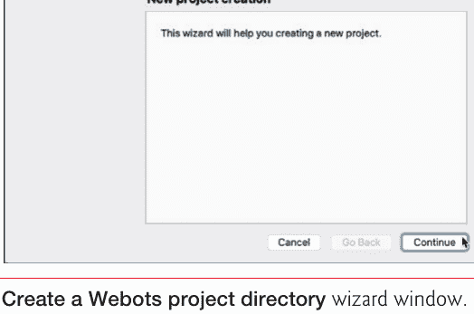

图7.21 | 初始“创建Webots项目目录”向导窗口。

在向导的“目录选择”步骤中（图7.22），将您的项目目录名称从my_project（默认值）更改为my_first_simulation——此文件夹的默认位置是您用户帐户的“文档”文件夹。¹³

在向导的“世界设置”步骤中（图7.23），您将世界的文件名从empty.wbt（默认值）更改为my_first_simulation.wbt，并确保所有四个复选框都被选中。这将向您的虚拟世界添加几个Webots预定义组件。

向导的“完成”步骤（图7.24）显示了向导将为您的模拟生成的所有文件夹和文件。在后续步骤中，您将添加障碍物和一个e-puck机器人，配置各种设置，并编写一些控制机器人的C代码。

13. 您可以更改Webots项目的存储位置。我们的项目存储在用户帐户的/Users/pauldeitel/Documents文件夹中，您将在几个屏幕截图中看到它。

#### 步骤 3：修改 RectangleArena

仿真中的每个元素都是世界**场景树**中的一个`节点`，你可以在 Webots 环境的左侧看到它。在此步骤中，你将选择场景树中的一个节点，然后更改其一些设置，称为`字段`。执行此步骤后，环境应如图 7.26 所示。

当你在世界中选择任何对象时——无论是通过在 3D 视图区域点击它，还是通过在场景树中点击其节点——RectangleArena 上方都会出现彩色箭头。你可以拖动这些箭头头来移动、旋转和倾斜对象。¹⁴ 拖动直箭头头会沿该轴移动对象。拖动圆形箭头头会绕该轴旋转或倾斜对象。保存你的环境，然后尝试这些箭头头，看看它们如何影响 RectangleArena 的位置。然后你可以重置环境以恢复原始位置。

> 14. “Webots 用户指南 R2020b 修订版 2 — 3D 窗口 — 移动实体对象。” 访问于 2020 年 12 月 13 日。https://cyberbotics.com/doc/guide/the-3d-window#moving-a-solid-object.


图 7.26 | 更改棋盘地板图案的方格大小并降低墙壁高度后的 RectangleArena。

#### 步骤 4：添加 WoodenBox 障碍物

Webots 环境附带了近 800 个预定义的对象和机器人——称为 PROTO 节点。PROTO 节点描述了一个复杂的对象或机器人，你可以将其添加到你的仿真中。种类繁多的 PROTO 节点使你能够创建真实世界环境的逼真 3D 仿真。你也可以创建自己的 PROTO 节点。

在此步骤中，你将使用“添加节点”对话框（图 7.27）添加一个 WoodenBox PROTO 节点。当你在对话框中选择一个 PROTO 节点时，它会显示一个简短的节点描述，提供指向该节点更详细在线文档的链接，并显示节点的许可信息（带有指向更多许可信息的链接）。浏览“添加节点”对话框，了解你可以在仿真中使用的各种各样的有生命（机器人和车辆）和无生命（墙壁、建筑物、家具、植物等）PROTO 节点。

接下来，你将调整 WoodenBox 的大小并移动它。然后你将制作两个副本，并将它们移动到 RectangleArena 内的其他位置。当此步骤要求你复制粘贴一个 WoodenBox 时，新的 WoodenBox 将与你复制的那个具有相同的大小和位置。按住 Shift 键并将新的 WoodenBox 拖动到不同的位置以查看它。我们发现通过在场景树中选择节点来复制节点更容易。当你完成此步骤时，你的世界应类似于图 7.28。你移动的最后一个 WoodenBox 将在你的世界中被选中。¹⁵

15. “Webots 用户指南 R2020b 修订版 2 — 3D 窗口。” 访问于 2020 年 12 月 13 日。https://cyberbotics.com/doc/guide/the-3d-window#moving-a-solid-object.

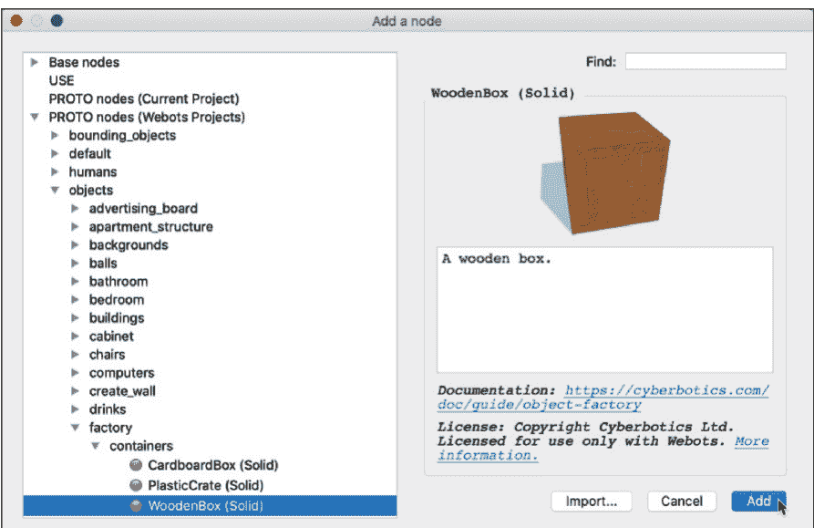

图 7.27 | 在“添加节点”对话框中选择 WoodenBox PROTO 节点。

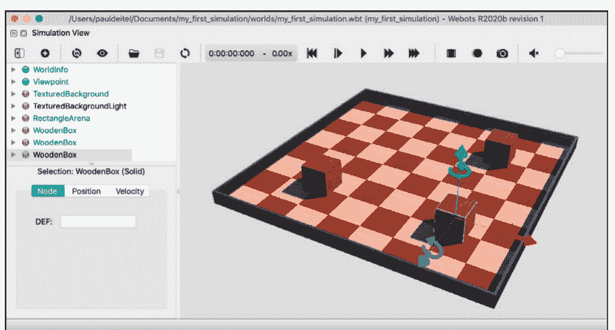

图 7.28 | 创建并定位三个 WoodenBox 对象后的虚拟世界。

#### 步骤 5：向你的虚拟世界添加一个机器人

在此步骤中，你将使用**添加节点**对话框将一个 e-puck 机器人添加到仿真中（图 7.29）。当你选择 E-puck (Robot) 节点时，对话框会显示机器人的描述、机器人的网站 (http://www.e-puck.org)、机器人的 Webots 文档链接以及机器人的许可信息。

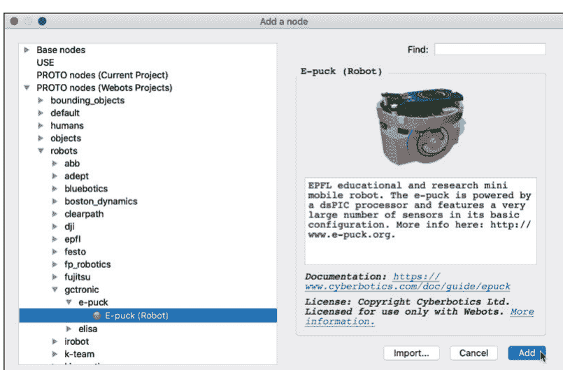

**图 7.29** | 将 e-puck 机器人 PROTO 节点添加到仿真中。

e-puck **被预配置为向前移动，如果它**与障碍物（如 WoodenBox 或墙壁）**碰撞，则向左旋转以改变方向**。尽管很小，e-puck 机器人实际上装载了技术，包括**距离传感器**，可用于编程使其完全**避免碰撞**。在 Webots 教程 4 中，你将学习如何使用这些距离传感器来避免障碍物。

机器人的行为由其**控制器**指定。我们刚刚描述的默认 e-puck 机器人控制器名为 **e-puck_avoid_obstacles**（你可以通过选择 **工具 > 文本编辑器** 在文本编辑器中查看此代码）。研究现有的捆绑控制器是了解更多关于控制 Webots 机器人的好方法。要完成此步骤，你将运行 e-puck 机器人的默认控制器（图 7.30）。我们点击了世界的背景区域以取消选择所有仿真元素。

#### 步骤 6：玩转物理

Webots 仿真器具有**物理引擎**，使对象能够像在现实世界中一样行动和交互。你可以配置的一些物理选项包括密度、质量、惯性、摩擦力和弹力。更多信息，请访问：

https://cyberbotics.com/doc/reference/physics

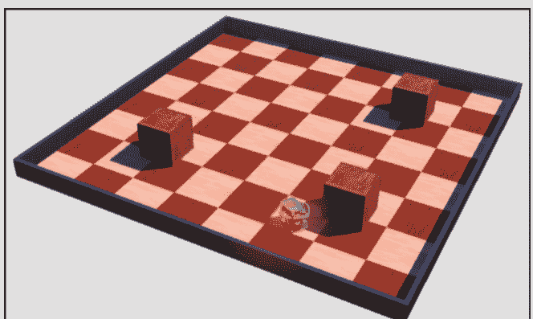

**图 7.30** | e-puck 机器人在 RectangleArena 中漫游的仿真。

在此步骤中，你将使用鼠标**对 e-puck 机器人施加力**。执行此操作后，你的世界应类似于图 7.31，红色箭头表示力的方向。当你执行此步骤时，如果你施加的力太大，可能会意外地使机器人翻倒——如图 7.31 所示。当然，机器人在现实世界中也可能翻倒。要在仿真中修复此问题，请点击**重置仿真**按钮，这将把仿真恢复到你最近一次保存的状态。


**图 7.31** | 手动对 e-puck 机器人施加力。在这种情况下，施加了过大的力，导致机器人翻倒。

你在**步骤 4** 中创建的 WoodenBox 障碍物默认固定在地板上，当 e-puck 撞到它们时不会移动。你将在本步骤中看到，设置 WoodenBox 的质量使它们能够响应力。WoodenBox 的质量越小，当 e-puck 机器人与之碰撞时，它移动的距离就越大。教程建议将 WoodenBox 的质量设置为 0.2 千克。尝试将每个 WoodenBox 的质量设置为更小和更大的值，看看这些质量如何影响物理交互。

#### 步骤 7：减小世界的时间步长

在整个仿真过程中，Webots 会跟踪你的仿真的**虚拟时间**。**基本时间步长**是一个以毫秒为单位的值。在整个仿真过程中，当虚拟时间增加一个基本时间步长时，Webots 会执行其物理计算：¹⁶

- 较大的基本时间步长值会降低物理计算频率。这使得仿真运行得更快，因为它们执行的计算更少；然而，这可能会使物理交互（例如对象之间的碰撞）变得不那么准确，并且仿真可能会感觉笨拙。
- 较小的值会增加物理计算频率，使物理计算更准确。这会导致仿真运行得更慢，因为它们执行的计算更多，但运动可能看起来更平滑。

当你创建此仿真的文件时，Webots 将基本时间步长设置为 32 毫秒。在此步骤中，你将把基本时间步长值减小到 16 毫秒。有关 Webots 仿真速度和性能的提示，请参见：
https://www.cyberbotics.com/doc/guide/speed-performance

#### 步骤 8：为你的机器人控制器创建一个 C 源代码文件

在此步骤中，你将用一个新的**自定义控制器**替换默认的 e-puck_avoid_obstacles 控制器。许多机器人可以使用你创建的每个控制器，但每个机器人一次只能有一个控制器。图 7.32–7.35 显示了你选择向导 > 新建机器人控制器...之后将经历的步骤。这些步骤将**为你的自定义控制器创建一个新的 C 源代码文件**，并在 Webots 环境右侧的代码编辑器中打开它：

- 在**新建控制器创建**步骤（图 7.32）中，你只需点击**继续**。
- 在**语言选择**步骤（图 7.33）中，确保选择了 **C**，然后点击**继续**。
- 在**名称选择**步骤（图 7.34）中，将默认的自定义控制器名称从 my_controller 更改为 epuck_go_forward，然后点击**继续**。
- **完成**步骤（图 7.35）显示了向导将为你的控制器生成的所有文件夹和文件。

# 第7章 指针


图 7.32 | 初始的“创建新机器人控制器”向导窗口。


图 7.33 | 为你的自定义机器人控制器选择C编程语言。

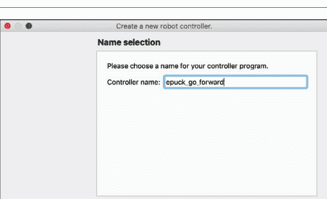

图 7.34 | 将默认的自定义控制器名称更改为 `epuck_go_forward`。


图 7.35 | 向导将为你的自定义控制器生成的文件夹和文件摘要。

## 步骤9：修改你的控制器代码以使机器人向前移动

你在步骤8中创建的新控制器包含了一个简单控制器的基本框架。在这一步中，你将向此文件添加代码，使e-puck机器人向前移动一小段距离。本教程并未精确指定每条语句应添加到控制器代码的哪个位置，因此请对你的控制器源代码文件进行以下更改：

1. 在 `main` 之前添加以下 `#include`：
   `#include <webots/motor.h>`
2. 接下来，你将使用Webots的 `wb_robot_get_device` 函数<sup>17</sup>来获取代表e-puck机器人左右轮电机的设备。在 `main` 中 `wb_robot_init` 调用之后添加以下代码：
   ```c
   // 获取电机设备
   WbDeviceTag left_motor =
     wb_robot_get_device("left wheel motor");
   WbDeviceTag right_motor =
     wb_robot_get_device("right wheel motor");
   ```
3. 最后，你将使用Webots的 `wb_motor_set_position` 函数<sup>18</sup>来使机器人移动一小段距离。在 `wb_robot_get_device` 调用之后、`while` 循环之前添加以下代码：
   ```c
   wb_motor_set_position(left_motor, 10.0);
   wb_motor_set_position(right_motor, 10.0);
   ```

> 17. “Webots参考手册 R2020b修订版2—机器人。” 访问于2020年12月13日。https://cyberbotics.com/doc/reference/robot#wb_robot_get_device。
> 18. “Webots参考手册 R2020b修订版2—电机。” 访问于2020年12月13日。https://cyberbotics.com/doc/reference/motor#wb_motor_set_position。

尝试为 `wb_motor_set_position` 的第二个参数设置不同的值，以了解它们如何影响移动距离。同时尝试在两次 `wb_motor_set_position` 调用中使用不同的值，使两个轮子旋转的量不同。

## 步骤10：修改你的控制器代码以改变机器人的速度

在这最后一步中，你将修改控制器代码以指定轮子的速度。对你的控制器源代码文件进行以下更改：

1. Webots中的速度对于旋转电机（如轮子中使用的电机）使用**弧度**；否则，速度使用**米每秒**。在 `#include <webots/robot.h>` 之后添加以下 `#define` 指令，以定义机器人轮子旋转的最大**弧度速度**（6.28是2π弧度）：
   ```c
   #define MAX_SPEED 6.28
   ```
2. 修改你对 `wb_motor_set_position` 函数的两次调用，将其第二个参数替换为Webots常量 `INFINITY`，这样**轮子将在整个仿真过程中持续旋转**（以你即将设置的速度）：
   ```c
   // 设置轮子持续旋转
   wb_motor_set_position(left_motor, INFINITY);
   wb_motor_set_position(right_motor, INFINITY);
   ```
3. 最后，你将使用Webots函数 `wb_motor_set_velocity` 函数<sup>19</sup>来指定以弧度每秒为单位的轮子旋转速度。在 `wb_robot_get_device` 调用之后、`while` 循环之前添加以下代码：
   ```c
   // 将电机速度设置为MAX_SPEED的10%
   wb_motor_set_velocity(left_motor, 0.1 * MAX_SPEED);
   wb_motor_set_velocity(right_motor, 0.1 * MAX_SPEED);
   ```

尝试为 `wb_motor_set_velocity` 的第二个参数设置不同的值，看看它们如何影响机器人的速度。尝试在两次调用中使用不同的值，使两个轮子不同步旋转。注意你设置这些值的方式——它们可能会导致机器人原地打转。

## 附加教程

一旦你完成了**教程1**，你可能希望继续学习Webots**教程2–8**。教程2–4对你刚刚创建的世界进行各种修改：

- 在**教程2**中，你将**向你的世界添加一个球**。你将了解更多关于节点类型以及如何配置物理选项以**使球在仿真中滚动**的知识。
- 在**教程3**中，你将学习如何使用**光照效果**和**纹理**来改善仿真的图形效果。
- 在**教程4**中，你将创建一个更复杂的控制器，使e-puck能够使用**其距离传感器来避开你之前创建的障碍物**。

**挑战：** 一旦你完成了**教程4**，尝试在你的世界中构建一个迷宫，看看你是否能编程让e-puck机器人穿越迷宫。以下页面列出了几种寻找迷宫出口的算法：
https://en.wikipedia.org/wiki/Maze_solving_algorithm

**教程5–7**深入探讨更高级的功能：

- 在**教程5**中，你将了解更多关于Webots中**物理**的知识。
- 在**教程6**中，你将使用一个**四轮机器人**并了解更多关于传感器的知识。
- 在**教程7**中，你将**创建自己的PROTO节点**。

在高级的**教程8**中，你将学习如何从 `webots_ros` 使用Webots节点。**ROS是机器人操作系统**<sup>20</sup>——一个用于编写机器人软件的框架。如果你打算进行此教程，Webots建议你首先在以下教程中了解更多关于ROS的知识：
http://wiki.ros.org/ROS/Tutorials

掌握Webots教程2–8将是一项“值得写入简历”的成就。

**7.32** *（挑战项目：Webots龟兔赛跑案例研究）* 对于这个具有挑战性的练习，我们建议你首先完成练习7.31末尾提到的Webots教程2–7。在练习5.54中，你模拟了龟兔赛跑。既然你已经熟悉了Webots 3D机器人仿真器，就让你的想象力在Webots惊人的功能中驰骋吧。使用Webots中数十种可用机器人中的两个来重现这场比赛。考虑为乌龟使用一个小型缓慢的机器人（例如练习7.31中的e-puck），为兔子使用一个大型快速的机器人（例如波士顿动力Spot<sup>21,22</sup>机器人）。回顾**Webots导览**，你会发现还有许多其他环境可供你的机器人漫游。考虑复制一个现有的地形环境，其中包含草地、花朵、树木和山丘等物体，以便在其中进行机器人比赛。

# 字符和字符串

## 8


## 目标

在本章中，你将：

- 使用字符处理库（`<ctype.h>`）的函数。
- 使用通用工具库（`<stdlib.h>`）的字符串转换函数。
- 使用标准输入/输出库（`<stdio.h>`）的字符串和字符输入/输出函数。
- 使用字符串处理库（`<string.h>`）的字符串处理函数。
- 使用字符串处理库（`<string.h>`）的内存处理函数。

# 第8章 字符和字符串

- 8.1 引言
- 8.2 字符串和字符基础
- 8.3 字符处理库
  - 8.3.1 函数 `isdigit`、`isalpha`、`isalnum` 和 `isxdigit`
  - 8.3.2 函数 `islower`、`isupper`、`tolower` 和 `toupper`
  - 8.3.3 函数 `isspace`、`iscntrl`、`ispunct`、`isprint` 和 `isgraph`
- 8.4 字符串转换函数
  - 8.4.1 函数 `strtod`
  - 8.4.2 函数 `strtol`
  - 8.4.3 函数 `strtoul`
- 8.5 标准输入/输出库函数
  - 8.5.1 函数 `fgets` 和 `putchar`
  - 8.5.2 函数 `getchar`
  - 8.5.3 函数 `printf`
  - 8.5.4 函数 `sscanf`
- 8.6 字符串处理库的字符串操作函数
  - 8.6.1 函数 `strcpy` 和 `strncpy`
  - 8.6.2 函数 `strcat` 和 `strncat`
- 8.7 字符串处理库的比较函数
- 8.8 字符串处理库的搜索函数
  - 8.8.1 函数 `strchr`
  - 8.8.2 函数 `strcspn`
  - 8.8.3 函数 `strpbrk`
  - 8.8.4 函数 `strrchr`
  - 8.8.5 函数 `strspn`
  - 8.8.6 函数 `strstr`
  - 8.8.7 函数 `strtok`
- 8.9 字符串处理库的内存函数
  - 8.9.1 函数 `memcpy`
  - 8.9.2 函数 `memmove`
  - 8.9.3 函数 `memcmp`
  - 8.9.4 函数 `memchr`
  - 8.9.5 函数 `memset`
- 8.10 字符串处理库的其他函数
  - 8.10.1 函数 `strerror`
  - 8.10.2 函数 `strlen`
- 8.11 安全的C编程

总结 | 自我复习练习 | 自我复习练习答案 | 练习 | 特别章节：高级字符串操作练习 | 一个具有挑战性的字符串操作项目 | Payoaf X Nylfomigrob Qubbfmh Mndoguk: Rbqlrut yua Boklnxhmywex | 安全的C编程案例研究：公钥密码学

## 8.1 引言

本章介绍C标准库函数，这些函数帮助你处理字符、字符串、文本行和内存块。本章讨论了用于开发编辑器、文字处理器、页面布局软件和其他各种文本处理软件的技术。像 `printf` 和 `scanf` 这样的格式化输入/输出函数执行的文本操作，可以使用本章介绍的函数来实现。

## 8.2 字符串和字符基础

字符是程序的基本构建块。每个程序都由字符组成——当字符被有意义地组合在一起时，计算机将其解释为一系列用于完成任务的指令。程序可能包含字符常量——每个字符常量都是一个 `int` 值，表示为单引号中的一个字符。字符常量的值是该字符在机器字符集中的整数值。集合。例如，'z' 代表字母 z 的整数值，而 '\n' 代表换行符的整数值。

字符串是一系列被视为单个单元的字符。字符串可以包含字母、数字和各种特殊字符，如 +、-、*、/ 和 $。字符串字面量（或字符串常量）用双引号书写，如下所示：

- "John Q. Doe"（一个姓名）
- "99999 Main Street"（一个街道地址）
- "Waltham, Massachusetts"（一个城市和州）
- "(201) 555-1212"（一个电话号码）

### 字符串以空字符结尾

每个字符串必须以空字符（'\0'）结尾。打印一个不包含结尾空字符的“字符串”是一个逻辑错误。其结果是未定义的。在某些系统上，打印会继续超出“字符串”的末尾，直到遇到空字符。在其他系统上，你的程序可能会过早终止（即“崩溃”），并指示“段错误”或“访问冲突”错误。

### 字符串与指针

你通过指向字符串第一个字符的指针来访问字符串。字符串的“值”是其第一个字符的地址。因此，在 C 语言中，说字符串是指向字符串第一个字符的指针是恰当的。这就像数组一样，因为字符串本质上就是字符数组。

### 初始化 char 数组和 char * 指针

你可以用字符串初始化一个字符数组或一个 `char *` 变量。定义

```c
char color[] = "blue";
const char *colorPtr = "blue";
```

将 `color` 和 `colorPtr` 初始化为字符串 "blue"。第一个定义创建了一个包含可修改字符 'b'、'l'、'u'、'e' 和 '\0' 的 5 元素数组 `color`。第二个定义创建了指针变量 `colorPtr`，它指向 "blue" 中的字母 'b'，这是不可修改的。

`color` 数组的定义也可以写成

```c
char color[] = {'b', 'l', 'u', 'e', '\0'};
```

前面的定义根据其初始化器的数量（5）自动确定数组的大小。当在字符数组中存储字符串时，数组必须足够大以存储字符串及其结尾的空字符。在字符数组中分配不足的空间来存储结束字符串的空字符是一个错误。C 允许你存储任何长度的字符串。如果字符串比你存储它的字符数组长，超出数组末尾的字符可能会覆盖内存中的其他数据。

### 字符串字面量不应被修改

C 标准指出字符串字面量是不可变的——即不可修改的。如果你可能需要修改字符串，它必须存储在字符数组中。

### 使用 scanf 读取字符串

函数 `scanf` 可以读取一个字符串并将其存储在字符数组中。假设我们有一个包含 20 个元素的字符数组 `word`。你可以用以下方式读取一个字符串到数组中：

```c
scanf("%19s", word);
```

由于 `word` 是一个数组，数组名是指向数组第一个元素的指针。因此，我们通常在 `scanf` 参数中使用的 `&` 在这里是不需要的。

回顾第 6.5.4 节，`scanf` 读取字符直到遇到空格、制表符、换行符或文件结束指示符。前面语句中的字段宽度 19 确保 `scanf` *最多*读取 19 个字符，为字符串的结尾空字符保留最后一个数组元素。这可以防止 `scanf` 将字符写入超出数组最后一个元素的内存中。

如果在转换说明符 `%19s` 中没有字段宽度 19，用户输入可能超过 19 个字符并覆盖内存中的其他数据。如果是这样，你的程序可能会崩溃，或者覆盖内存中的其他数据。因此，在使用 `scanf` 读取字符串时，务必使用字段宽度。（要读取任意长度的输入行，有一个非标准但广泛支持的函数 `readline`，通常包含在 `stdio.h` 中。）

## 自我检查

1. （填空）字符串通过指向字符串第一个字符的 ________ 来访问。
   **答案：** 指针。

2. （判断题）以下定义将 `color` 数组初始化为字符串 "blue"：
   ```c
   char color[] = {'b', 'l', 'u', 'e'};
   ```
   **答案：** *错误*。实际上，要成为一个字符串，`color` 数组必须以空字符结尾，如
   ```c
   char color[] = {'b', 'l', 'u', 'e', '\0'};
   ```

3. （判断题）打印一个不包含结尾空字符的字符串是一个逻辑错误——程序执行立即终止。
   **答案：** *错误*。实际上，打印会继续超出字符串的末尾，直到遇到空字符。

## 8.3 字符处理库

`字符处理库`（`<ctype.h>`）包含用于测试和操作字符数据的函数。每个函数接收一个 `unsigned char`（表示为 `int`）或 `EOF` 作为参数。正如我们在第 4 章讨论的，字符通常作为整数进行操作，因为 C 中的字符是一个字节的整数。`EOF` 的值通常为 -1。下表总结了字符处理库函数。

| 原型 | 函数描述 |
| :--- | :--- |
| `int isblank(int c);` | 如果 c 是文本行中分隔单词的空白字符，则返回真值；否则返回 0（假）。 |
| `int isdigit(int c);` | 如果 c 是数字，则返回真值；否则返回 0（假）。 |
| `int isalpha(int c);` | 如果 c 是字母，则返回真值；否则返回 0（假）。 |
| `int isalnum(int c);` | 如果 c 是数字或字母，则返回真值；否则返回 0（假）。 |
| `int isxdigit(int c);` | 如果 c 是十六进制数字字符，则返回真值；否则返回 0（假）。（有关二进制数、八进制数、十进制数和十六进制数的详细说明，请参见在线附录 E。） |
| `int islower(int c);` | 如果 c 是小写字母，则返回真值；否则返回 0（假）。 |
| `int isupper(int c);` | 如果 c 是大写字母，则返回真值；否则返回 0（假）。 |
| `int tolower(int c);` | 如果 c 是大写字母，`tolower` 返回 c 的小写形式；否则返回未更改的参数。 |
| `int toupper(int c);` | 如果 c 是小写字母，`toupper` 返回 c 的大写形式；否则返回未更改的参数。 |
| `int isspace(int c);` | 如果 c 是空白字符——换行符（'\n'）、空格（' '）、换页符（'\f'）、回车符（'\r'）、水平制表符（'\t'）或垂直制表符（'\v'）——则返回真值；否则返回 0（假）。 |
| `int iscntrl(int c);` | 如果 c 是控制字符——水平制表符（'\t'）、垂直制表符（'\v'）、换页符（'\f'）、警报符（'\a'）、退格符（'\b'）、回车符（'\r'）、换行符（'\n'）等——则返回真值；否则返回 0（假）。 |
| `int ispunct(int c);` | 如果 c 是除空格、数字或字母之外的打印字符——例如 $、#、(、)、[、]、{、}、;、: 或 %——则返回真值；否则返回 0（假）。 |
| `int isprint(int c);` | 如果 c 是打印字符（即屏幕上可见的字符），包括空格，则返回真值；否则返回 0（假）。 |
| `int isgraph(int c);` | 如果 c 是除空格之外的打印字符，则返回真值；否则返回 0（假）。 |

### 8.3.1 函数 isdigit、isalpha、isalnum 和 isxdigit

图 8.1 演示了函数 `isdigit`、`isalpha`、`isalnum` 和 `isxdigit`。函数 `isdigit` 确定其参数是否为数字（0–9）。函数 `isalpha` 确定其参数是否为大写（A–Z）或小写字母（a–z）。函数 `isalnum` 确定其参数是否为大写字母、小写字母或数字。函数 `isxdigit` 确定其参数是否为十六进制数字（A–F、a–f、0–9）。

392 第 8 章 字符和字符串

```c
// fig08_01.c
// 使用函数 isdigit、isalpha、isalnum 和 isxdigit
#include <ctype.h>
#include <stdio.h>

int main(void) {
    printf("%s\n%s\n%s\n\n", "According to isdigit: ",
        isdigit('8') ? "8 is a " : "8 is not a ", "digit",
        isdigit('#') ? "# is a " : "# is not a ", "digit");

    printf("%s\n%s\n%s\n%s\n%s\n\n", "According to isalpha:",
        isalpha('A') ? "A is a " : "A is not a ", "letter",
        isalpha('b') ? "b is a " : "b is not a ", "letter",
        isalpha('&') ? "& is a " : "& is not a ", "letter",
        isalpha('4') ? "4 is a " : "4 is not a ", "letter");

    printf("%s\n%s\n%s\n%s\n\n", "According to isalnum:",
        isalnum('A') ? "A is a " : "A is not a ", "digit or a letter",
        isalnum('8') ? "8 is a " : "8 is not a ", "digit or a letter",
        isalnum('#') ? "# is a " : "# is not a ", "digit or a letter");

    printf("%s\n%s\n%s\n%s\n%s\n%s\n", "According to isxdigit:",
        isxdigit('F') ? "F is a " : "F is not a ", "hexadecimal digit",
        isxdigit('J') ? "J is a " : "J is not a ", "hexadecimal digit",
        isxdigit('7') ? "7 is a " : "7 is not a ", "hexadecimal digit",
        isxdigit('$') ? "$ is a " : "$ is not a ", "hexadecimal digit",
        isxdigit('f') ? "f is a " : "f is not a ", "hexadecimal digit");
}
```

```
According to isdigit:
8 is a digit
# is not a digit

According to isalpha:
A is a letter
b is a letter
& is not a letter
4 is not a letter

According to isalnum:
A is a digit or a letter
8 is a digit or a letter
# is not a digit or a letter

According to isxdigit:
F is a hexadecimal digit
J is not a hexadecimal digit
7 is a hexadecimal digit
$ is not a hexadecimal digit
f is a hexadecimal digit
```

图 8.1 | 使用函数 isdigit、isalpha、isalnum 和 isxdigit。

图 8.1 使用条件运算符 (?:) 来确定对于每个测试的字符，输出中应打印字符串 " is a " 还是 " is not a "。例如，表达式

`isdigit('8') ? "8 is a " : "8 is not a "`

表示如果 '8' 是一个数字，则打印字符串 "8 is a "；如果 '8' 不是一个数字（即 isdigit 返回 0），则打印字符串 "8 is not a "。

### 8.3.2 函数 islower、isupper、tolower 和 toupper

图 8.2 演示了函数 **islower**、**isupper**、**tolower** 和 **toupper**。函数 islower 判断其参数是否为小写字母 (a–z)。函数 isupper 判断其参数是否为大写字母 (A–Z)。函数 tolower 将大写字母转换为小写字母并返回该小写字母。如果参数不是大写字母，tolower 将原样返回参数。函数 toupper 将小写字母转换为大写字母并返回该大写字母。如果参数不是小写字母，toupper 将原样返回参数。

```c
// fig08_02.c
// 使用函数 islower、isupper、tolower 和 toupper
#include <ctype.h>
#include <stdio.h>

int main(void) {
    printf("%s\n%s\n%s\n%s\n%s\n\n", "根据 islower 判断：",
        islower('p') ? "p 是一个 " : "p 不是一个 ", "小写字母",
        islower('P') ? "P 是一个 " : "P 不是一个 ", "小写字母",
        islower('5') ? "5 是一个 " : "5 不是一个 ", "小写字母",
        islower('!') ? "! 是一个 " : "! 不是一个 ", "小写字母");

    printf("%s\n%s\n%s\n%s\n%s\n\n", "根据 isupper 判断：",
        isupper('D') ? "D 是一个 " : "D 不是一个 ", "大写字母",
        isupper('d') ? "d 是一个 " : "d 不是一个 ", "大写字母",
        isupper('8') ? "8 是一个 " : "8 不是一个 ", "大写字母",
        isupper('$') ? "$ 是一个 " : "$ 不是一个 ", "大写字母");

    printf("%s%c\n%s%c\n%s%c\n%s%c\n",
        "u 转换为大写是 ", toupper('u'),
        "7 转换为大写是 ", toupper('7'),
        "$ 转换为大写是 ", toupper('$'),
        "L 转换为小写是 ", tolower('L'));
}
```
根据 islower 判断：
p 是一个小写字母
P 不是一个小写字母
5 不是一个小写字母
! 不是一个小写字母

图 8.2 | 使用函数 islower、isupper、tolower 和 toupper。（第 1 部分，共 2 部分。）

根据 isupper 判断：
D 是一个大写字母
d 不是一个大写字母
8 不是一个大写字母
$ 不是一个大写字母

u 转换为大写是 U
7 转换为大写是 7
$ 转换为大写是 $
L 转换为小写是 l

图 8.2 | 使用函数 islower、isupper、tolower 和 toupper。（第 2 部分，共 2 部分。）

### 8.3.3 函数 isspace、iscntrl、ispunct、isprint 和 isgraph

图 8.3 演示了函数 isspace、iscntrl、ispunct、isprint 和 isgraph。函数 isspace 判断一个字符是否是以下空白字符之一：空格 (' ')、换页 ('\f')、换行 ('\n')、回车 ('\r')、水平制表 ('\t') 或垂直制表 ('\v')。函数 iscntrl 判断一个字符是否是以下控制字符之一：水平制表 ('\t')、垂直制表 ('\v')、换页 ('\f')、警报 ('\a')、退格 ('\b')、回车 ('\r') 或换行 ('\n')。函数 ispunct 判断一个字符是否是除空格、数字或字母之外的打印字符，例如 $、#、(、)、[、]、{、}、;、: 或 %。函数 isprint 判断一个字符是否可以在屏幕上显示（包括空格字符）。函数 isgraph 与 isprint 相同，但不包括空格字符。

```c
// fig08_03.c
// 使用函数 isspace、iscntrl、ispunct、isprint 和 isgraph
#include <ctype.h>
#include <stdio.h>

int main(void) {
    printf("%s\n%s%s\n%s%s\n%s%s\n\n", "根据 isspace 判断：",
        "换行符", isspace('\n') ? " 是一个 " : " 不是一个 ",
        "空白字符",
        "水平制表符", isspace('\t') ? " 是一个 " : " 不是一个 ",
        "空白字符",
        isspace('%') ? "% 是一个 " : "% 不是一个 ", "空白字符");

    printf("%s\n%s%s\n%s%s\n%s%s\n\n", "根据 iscntrl 判断：",
        "换行符", iscntrl('\n') ? " 是一个 " : " 不是一个 ",
        "控制字符",
        iscntrl('$') ? "$ 是一个 " : "$ 不是一个 ", "控制字符");

    printf("%s\n%s%s\n%s%s\n%s%s\n\n", "根据 ispunct 判断：",
        ispunct(';') ? "; 是一个 " : "; 不是一个 ", "标点字符",
        ispunct('Y') ? "Y 是一个 " : "Y 不是一个 ", "标点字符",
        ispunct('#') ? "# 是一个 " : "# 不是一个 ", "标点字符");

    printf("%s\n%s%s\n%s%s%s\n\n", "根据 isprint 判断：",
        isprint('$') ? "$ 是一个 " : "$ 不是一个 ", "打印字符",
        "警报符", isprint('\a') ? " 是一个 " : " 不是一个 ",
        "打印字符");

    printf("%s\n%s%s\n%s%s%s\n",  "根据 isgraph 判断：",
        isgraph('Q') ? "Q 是一个 " : "Q 不是一个 ",
        "除空格外的打印字符",
        "空格", isgraph(' ') ? " 是一个 " : " 不是一个 ",
        "除空格外的打印字符");
}
```
根据 isspace 判断：
换行符是一个空白字符
水平制表符是一个空白字符
% 不是一个空白字符

根据 iscntrl 判断：
换行符是一个控制字符
$ 不是一个控制字符

根据 ispunct 判断：
; 是一个标点字符
Y 不是一个标点字符
# 是一个标点字符

根据 isprint 判断：
$ 是一个打印字符
警报符不是一个打印字符

根据 isgraph 判断：
Q 是一个除空格外的打印字符
空格不是一个除空格外的打印字符

图 8.3 | 使用函数 isspace、iscntrl、ispunct、isprint 和 isgraph。（第 2 部分，共 2 部分。）

## 自我检查

1.  （多选题）哪个函数被描述为“如果参数字符是数字或字母，则返回真值；否则返回 0（假）”？
    a) isalnum。
    b) isdigit。
    c) isalpha。
    d) isxdigit。
    答案：a。

2.  （代码题）以下 printf 打印什么？

```c
printf("%s\n%s%s\n%s%s\n%s%s\n%s%s\n\n", "根据 isalpha 判断：",
    isalpha('X') ? "X 是一个 " : "X 不是一个 ", "字母",
    isalpha('m') ? "m 是一个 " : "m 不是一个 ", "字母",
    isalpha('$') ? "$ 是一个 " : "$ 不是一个 ", "字母",
    isalpha('7') ? "7 是一个 " : "7 不是一个 ", "字母");
```

答案：
根据 isalpha 判断：
X 是一个字母
m 是一个字母
$ 不是一个字母
7 不是一个字母

## 8.4 字符串转换函数

本节介绍来自通用工具库 (<stdlib.h>) 的字符串转换函数。这些函数将数字字符串转换为整数和浮点值。下表总结了字符串转换函数。C 标准还包括 strtoll 和 strtoull，分别用于将字符串转换为 long long int 和 unsigned long long int。

| 函数原型 | 函数描述 |
|---|---|
| double strtod(const char *nPtr, char **endPtr); | 将字符串 nPtr 转换为 double。 |
| long strtol(const char *nPtr, char **endPtr, int base); | 将字符串 nPtr 转换为 long。 |
| unsigned long strtoul(const char *nPtr, char **endPtr, int base); | 将字符串 nPtr 转换为 unsigned long。 |

### 8.4.1 函数 strtod

函数 strtod（图 8.4）将表示浮点值的字符序列转换为 double。如果无法将其第一个参数的一部分转换为 double，则函数返回 0。该函数接收两个参数——一个字符串 (char *) 和一个指向字符串的指针 (char **)。字符串参数包含要转换为 double 的字符序列。字符串开头的空白字符将被忽略。该函数使用 char ** 参数将调用者中的一个 char *（stringPtr）指向字符串中已转换部分之后的第一个字符。如果无法转换任何内容，则函数将指针指向字符串的开头。第 10 行将 d 赋值为从 string 转换而来的 double 值，并将 stringPtr 指向 string 中的 %。

```c
// fig08_04.c
// 使用函数 strtod
#include <stdio.h>
#include <stdlib.h>

int main(void) {
    const char *string = "51.2% are admitted";
    char *stringPtr = NULL;
```

图 8.4 | 使用函数 strtod。（第 1 部分，共 2 部分。）

### 8.4.2 函数 strtol

函数 `strtol`（图 8.5）将表示整数的字符序列转换为 `long int` 类型。如果无法将其第一个参数的任何部分转换为 `long int`，则该函数返回 0。该函数有三个参数：一个字符串（`char *`）、一个指向字符串的指针和一个整数。此函数的工作方式与 `strtod` 完全相同，但第三个参数指定了被转换值的进制。

```c
// fig08_05.c
// 使用函数 strtol
#include <stdio.h>
#include <stdlib.h>

int main(void) {
    const char *string = "-1234567abc";
    char *remainderPtr = NULL;

    long x = strtol(string, &remainderPtr, 0);

    printf("%s\"%s\"\n%s%ld\n%s\"%s\"\n%s%ld\n",
        "The original string is ", string,
        "The converted value is ", x,
        "The remainder of the original string is ", remainderPtr,
        "The converted value plus 567 is ", x + 567);
}
```

> The original string is "-1234567abc"
> The converted value is -1234567
> The remainder of the original string is "abc"
> The converted value plus 567 is -1234000

图 8.5 | 使用函数 strtol。

第 10 行将 `string` 转换后的 `long` 值赋给 `x`，并将 `remainderPtr` 指向 `string` 中的 "a"。将第二个参数设为 `NULL` 会导致字符串的剩余部分被忽略。第三个参数 `0` 表示要转换的值可以是八进制（基数为 8）、十进制（基数为 10）或十六进制（基数为 16）格式。基数可以指定为 0 或 2 到 36 之间的任何值。¹ 从基数 11 到基数 36 的整数表示使用字母 A–Z 来表示整数值 10–35。例如，十六进制值可以由数字 0–9 和字符 A–F 组成。

### 8.4.3 函数 strtoul

函数 **strtoul**（图 8.6）将表示 *unsigned long int* 值的字符序列转换为 *unsigned long int* 类型。该函数的工作方式与函数 **strtol** 完全相同。第 10 行将 `string` 转换后的 *unsigned long int* 值赋给 `x`，并将 `remainderPtr` 指向 `string` 中的 "a"。第三个参数 `0` 表示要转换的值可以是八进制、十进制或十六进制格式。

```c
// fig08_06.c
// 使用函数 strtoul
#include <stdio.h>
#include <stdlib.h>

int main(void) {
    const char *string = "1234567abc";
    char *remainderPtr = NULL;

    unsigned long int x = strtoul(string, &remainderPtr, 0);

    printf("%s\"%s\"\n%s%lu\n%s\"%s\"\n%s%lu\n",
        "The original string is ", string,
        "The converted value is ", x,
        "The remainder of the original string is ", remainderPtr,
        "The converted value minus 567 is ", x - 567);
}
```

> The original string is "1234567abc"
> The converted value is 1234567
> The remainder of the original string is "abc"
> The converted value minus 567 is 1234000

图 8.6 | 使用函数 strtoul。

## 自我检查

1.  （讨论）为什么一个函数的参数列表会包含一个 `char **` 参数？
    答案：`char **` 通常是指向调用方中 `char *` 指针的指针。被调用函数使用这样的指针来通过引用接收一个 `char *`，以便在调用方中修改它——例如，使其指向另一个字符串。这是一个指向指针的指针的例子。

2.  （多选题）关于函数 `strtol`，以下哪个陈述是错误的？
    a) 它将表示整数的字符序列转换为 `long int`，或者如果无法将其第一个参数的任何部分转换为 `long int`，则返回 0。
    b) `strtol` 的三个参数是一个字符串（`char *`）、一个指向字符串的指针（`char **`）和一个整数。
    c) 字符串参数包含要转换为 `long` 的字符序列——字符串开头的任何空白字符都会被忽略。
    d) 该函数使用 `char **` 参数让调用方访问被转换字符串的数字部分。

    **答案：** d) 是 *错误的*。实际上，该函数使用 `char **` 参数修改调用方中的一个 `char *`，使其指向字符串已转换部分 *之后* 的第一个字符的位置。如果没有任何内容被转换，该函数会修改 `char *` 使其指向整个字符串。

## 8.5 标准输入/输出库函数

本节介绍标准输入/输出（`<stdio.h>`）库的字符和字符串处理函数，我们在下表中进行了总结。

| 函数原型 | 函数描述 |
| :--- | :--- |
| `int getchar(void);` | 从标准输入返回下一个字符作为整数。 |
| `char *fgets(char *s, int n, FILE *stream);` | 从指定流读取字符到数组 `s` 中，直到遇到换行符或文件结束符，或者读取了 `n - 1` 个字节。本章使用流 `stdin`（标准输入流）从键盘读取字符。一个终止空字符被附加到数组中。返回读入 `s` 的字符串。如果遇到换行符，它会被包含在存储的字符串中。 |
| `int putchar(int c);` | 打印存储在 `c` 中的字符并将其作为整数返回。 |
| `int puts(const char *s);` | 打印字符串 `s` 后跟一个换行符。如果成功则返回一个非零整数，如果发生错误则返回 `EOF`。 |
| `int sprintf(char *s, const char *format, ...);` | 等同于 `printf`，但输出存储在数组 `s` 中而不是打印在屏幕上。返回写入 `s` 的字符数，如果发生错误则返回 `EOF`。 |
| `int sscanf(char *s, const char *format, ...);` | 等同于 `scanf`，但输入是从数组 `s` 读取而不是从键盘读取。返回函数成功读取的项目数，如果发生错误则返回 `EOF`。 |

### 8.5.1 函数 fgets 和 putchar

图 8.7 使用函数 `fgets` 和 `putchar` 从标准输入（键盘）读取一行文本，并递归地以相反顺序输出该行的字符。第 12 行使用 `fgets` 将字符读入其 `char` 数组参数，直到遇到换行符或文件结束指示符，或者读取了最大字符数。最大字符数比 `fgets` 的第二个参数少一。第三个参数是要从中读取字符的流——在本例中是标准输入流（`stdin`）。当读取终止时，`fgets` 会向数组附加一个空字符（`'\0'`）。函数 `putchar`（第 27 行）打印其字符参数。

```c
// fig08_07.c
// 使用函数 fgets 和 putchar
#include <stdio.h>
#define SIZE 80

void reverse(const char * const sPtr);

int main(void) {
    char sentence[SIZE] = "";

    puts("Enter a line of text:");
    fgets(sentence, SIZE, stdin); // 读取一行文本

    printf("\n%s", "The line printed backward is:");
    reverse(sentence);
    puts("");
}

// 递归地以相反顺序输出字符串中的字符
void reverse(const char * const sPtr) {
    // 如果到达字符串末尾
    if ('\0' == sPtr[0]) { // 基本情况
        return;
    }
    else { // 如果未到达字符串末尾
        reverse(&sPtr[1]); // 递归步骤
        putchar(sPtr[0]); // 使用 putchar 显示字符
    }
}
```

> Enter a line of text:
> Characters and Strings
>
> The line printed backward is:
> sgnirtS dna sretcarahC

图 8.7 | 使用函数 fgets 和 putchar。

#### 函数 reverse

该程序调用递归函数 `reverse`² 来反向打印文本行。如果数组的第一个字符是空字符 `'\0'`，则 `reverse` 返回。否则，`reverse` 使用从元素 `sPtr[1]` 开始的子数组地址递归调用自身。第 27 行在递归调用完成后输出 `sPtr[0]` 处的字符。

---
¹ 有关八进制、十进制和十六进制数系统的详细解释，请参阅在线附录 E。
² 我们在这里使用递归是为了演示目的。通常，使用循环从字符串的最后一个字符（位于字符串长度减一的位置）迭代到第一个字符（位于位置 0）会更高效。

### 8.5.2 函数 getchar

图 8.8 使用函数 `getchar` 从标准输入逐个读取字符到字符数组 `sentence` 中，然后使用 `puts` 将这些字符作为字符串显示出来。函数 `getchar` 从标准输入读取一个字符，并将该字符作为整数返回。回顾第 4.6 节，返回整数是为了支持文件结束指示符。如你所知，`puts` 接受一个字符串作为参数，并显示该字符串，后跟一个换行符。当读取了 79 个字符或 `getchar` 读取到换行符时，程序停止输入字符。第 18 行将一个空字符附加到 `sentence` 以终止字符串。然后第 21 行使用 `puts` 显示 `sentence`。

```c
// fig08_08.c
// 使用函数 getchar
#include <stdio.h>
#define SIZE 80

int main(void) {
    int c = 0; // 用于保存用户输入字符的变量
    char sentence[SIZE] = "";
    int i = 0;

    puts("Enter a line of text:");

    // 使用 getchar 读取每个字符
    while ((i < SIZE - 1) && (c = getchar()) != '\n') {
        sentence[i++] = c;
    }

    sentence[i] = '\0'; // 终止字符串

    puts("\nThe line entered was:");
    puts(sentence); // 显示 sentence
}
```

Enter a line of text:
This is a test.

The line entered was:
This is a test.

图 8.8 | 使用函数 getchar。

### 8.5.3 函数 sprintf

图 8.9 使用函数 `sprintf` 将格式化数据打印到字符数组 `s` 中。该函数使用与 `printf` 相同的转换说明符（有关格式化的详细讨论，请参见第 9 章）。程序输入一个 `int` 值和一个 `double` 值，以便格式化并打印到数组 `s` 中。数组 `s` 是 `sprintf` 的第一个参数。

```c
// fig08_09.c
// 使用函数 sprintf
#include <stdio.h>
#define SIZE 80

int main(void) {
    int x = 0;
    double y = 0.0;

    puts("Enter an integer and a double:");
    scanf("%d%lf", &x, &y);

    char s[SIZE] = {'\0'}; // 创建字符数组
    sprintf(s, "integer:%6d\ndouble:%7.2f", x, y);

    printf("The formatted output stored in array s is:\n%s\n", s);
}
```

Enter an integer and a double:
298 87.375
The formatted output stored in array s is:
integer:   298
double:  87.38

图 8.9 | 使用函数 sprintf。

### 8.5.4 函数 sscanf

图 8.10 演示了函数 `sscanf`，它的工作方式类似于 `scanf`，但从字符串中读取格式化数据。程序从字符数组 `s` 中读取一个 `int` 和一个 `double`，将它们存储在 `x` 和 `y` 中，然后显示它们。

```c
// fig08_10.c
// 使用函数 sscanf
#include <stdio.h>

int main(void) {
    char s[] = "31298 87.375";
    int x = 0;
    double y = 0;

    sscanf(s, "%d%lf", &x, &y);
    puts("The values stored in character array s are:");
    printf("integer:%6d\ndouble:%8.3f\n", x, y);
}
```

The values stored in character array s are:
integer: 31298
double: 87.375

图 8.10 | 使用函数 sscanf。

## 自我检查

1.  （多选题）哪个函数被描述为“打印其参数中存储的字符并将其作为整数返回”？
    a) `getchar`。
    b) `sprintf`。
    c) `puts`。
    d) `putchar`。
    答案：d。

2.  （判断题）函数 `getchar` 从标准输入读取一个字符并将其作为 `char` 返回。
    答案：错误。实际上，`getchar` 返回一个 `int` 以支持文件结束指示符，其值为 -1。

## 8.6 字符串处理库的字符串操作函数

字符串处理库（`<string.h>`）提供了用于以下操作的有用函数：

-   操作字符串数据（复制字符串和连接字符串），
-   比较字符串，
-   在字符串中搜索字符和其他字符串，
-   标记化字符串（将字符串分离成逻辑部分），以及
-   确定字符串的长度。

本节介绍字符串处理库的字符串操作函数，这些函数在下表中进行了总结。除了 `strncpy` 之外，每个函数都会将空字符附加到其结果中。

| 函数原型 | 函数描述 |
|---|---|
| `char *strcpy(char *s1, const char *s2)` | 将字符串 `s2` 复制到数组 `s1` 中，并返回 `s1`。 |
| `char *strncpy(char *s1, const char *s2, size_t n)` | 将字符串 `s2` 中最多 `n` 个字符复制到数组 `s1` 中，并返回 `s1`。 |
| `char *strcat(char *s1, const char *s2)` | 将字符串 `s2` 附加到数组 `s1` 中，并返回 `s1`。字符串 `s2` 的第一个字符会覆盖 `s1` 的终止空字符。 |
| `char *strncat(char *s1, const char *s2, size_t n)` | 将字符串 `s2` 中最多 `n` 个字符附加到数组 `s1` 中，并返回 `s1`。字符串 `s2` 的第一个字符会覆盖 `s1` 的终止空字符。 |

函数 **strncpy** 和 **strncat** 指定了一个 `size_t` 参数。函数 `strcpy` 将第二个参数中的字符串复制到其第一个参数中的字符数组中。你必须确保该数组足够大以存储该字符串及其终止空字符，该字符也会被复制。函数 `strncpy` 等同于 `strcpy`，但只复制指定数量的字符。*函数 `strncpy` 不会复制其第二个参数的终止空字符，除非要复制的字符数超过字符串的长度。* 例如，如果第二个参数是 "test"，只有当 `strncpy` 的第三个参数至少为 5（"test" 中的四个字符加上一个终止空字符）时，才会写入终止空字符。如果第三个参数大于 5，某些实现会向数组附加空字符，直到写入第三个参数指定的总字符数。其他实现在写入第一个空字符后停止。如果第三个参数小于或等于第二个参数的字符串长度，而你没有向 `strncpy` 的第一个参数附加终止空字符，那么这就是一个逻辑错误。

### 8.6.1 函数 strcpy 和 strncpy

图 8.11 使用 `strcpy` 将数组 `x` 中的整个字符串复制到数组 `y` 中。它使用 `strncpy` 将数组 `x` 的前 14 个字符复制到数组 `z` 中。第 19 行将一个空字符（`'\0'`）附加到数组 `z`，因为 `strncpy` 调用*不会写入终止空字符*——第三个参数小于第二个参数的字符串长度。

```c
// fig08_11.c
// 使用函数 strcpy 和 strncpy
#include <stdio.h>
#include <string.h>
#define SIZE1 25
#define SIZE2 15

int main(void) {
    char x[] = "Happy Birthday to You"; // 初始化字符数组 x
    char y[SIZE1] = ""; // 创建字符数组 y
    char z[SIZE2] = ""; // 创建字符数组 z

    // 将 x 的内容复制到 y 中
    printf("%s%s\n%s%s\n",
        "The string in array x is: ", x,
        "The string in array y is: ", strcpy(y, x));

    strncpy(z, x, SIZE2 - 1); // 将 x 的前 14 个字符复制到 z 中
    z[SIZE2 - 1] = '\0'; // 终止 z 中的字符串，因为 '\0' 未被复制
    printf("The string in array z is: %s\n", z);
}
```

The string in array x is: Happy Birthday to You
The string in array y is: Happy Birthday to You
The string in array z is: Happy Birthday

图 8.11 | 使用函数 strcpy 和 strncpy。

### 8.6.2 函数 strcat 和 strncat

函数 `strcat` 将其第二个参数字符串附加到其字符数组第一个参数中的字符串中，替换第一个参数的空字符（`'\0'`）。你必须确保用于存储第一个字符串的数组足够大，以存储第一个字符串、第二个字符串以及从第二个字符串复制的终止空字符。函数 `strncat` 将第二个字符串中指定数量的字符附加到第一个字符串，并添加一个终止的 `'\0'`。图 8.12 演示了函数 `strcat` 和函数 `strncat`。

```c
// fig08_12.c
// 使用函数 strcat 和 strncat
#include <stdio.h>
#include <string.h>

int main(void) {
    char s1[20] = "Happy "; // 初始化字符数组 s1
    char s2[] = "New Year "; // 初始化字符数组 s2
    char s3[40] = ""; // 将字符数组 s3 初始化为空

    printf("s1 = %s\ns2 = %s\n", s1, s2);

    // 将 s2 连接到 s1
    printf("strcat(s1, s2) = %s\n", strcat(s1, s2));

    // 将 s1 的前 6 个字符连接到 s3
    printf("strncat(s3, s1, 6) = %s\n", strncat(s3, s1, 6));

    // 将 s1 连接到 s3
    printf("strcat(s3, s1) = %s\n", strcat(s3, s1));
}
```

s1 = Happy
s2 = New Year
strcat(s1, s2) = Happy New Year
strncat(s3, s1, 6) = Happy
strcat(s3, s1) = Happy Happy New Year

图 8.12 | 使用函数 strcat 和 strncat。

## 自我检查

1（多选题）关于函数 `strcat` 和 `strncat`，以下哪项陈述是*错误*的？
- a) 函数 `strcat` 将其第二个参数字符串附加到其字符数组第一个参数中的字符串之后。
- b) `strcat` 第二个参数的第一个字符被放置在第一个参数中字符串的结束空字符（`'\0'`）之后。
- c) 你必须确保包含第一个字符串的数组足够大，以存储第一个字符串、第二个字符串以及从第二个字符串复制过来的结束符 `'\0'`。
- d) 函数 `strncat` 将第二个字符串中指定数量的字符附加到第一个字符串。结果会自动附加一个结束符 `'\0'`。

答案：b) 是*错误*的。实际上，`strcat` 第二个参数的第一个字符*替换*了第一个参数中字符串的结束空字符（`'\0'`）。

2（填空题）函数 `strcpy` 将其第二个参数（一个字符串）复制到其第一个参数中，第一个参数是一个字符数组，必须是________。

答案：足够大以存储该字符串，包括其结束空字符。

## 8.7 字符串处理库的比较函数

本节介绍字符串处理库的字符串比较函数 `strcmp` 和 `strncmp`，它们总结如下。

| 函数原型 | 函数描述 |
|---|---|
| `int strcmp(const char *s1, const char *s2);` | 比较字符串 `s1` 与字符串 `s2`。如果 `s1` 等于、小于或大于 `s2`，函数分别返回 0、小于 0 或大于 0。 |
| `int strncmp(const char *s1, const char *s2, size_t n);` | 比较字符串 `s1` 与字符串 `s2` 的前 *n* 个字符。如果 `s1` 等于、小于或大于 `s2`，函数分别返回 0、小于 0 或大于 0。 |

图 8.13 使用 `strcmp` 和 `strncmp` 比较三个字符串。函数 `strcmp` 对其两个字符串参数进行逐字符比较。函数返回：
- 如果字符串相等，则返回 0，
- 如果第一个字符串小于第二个字符串，则返回*负值*，或
- 如果第一个字符串大于第二个字符串，则返回*正值*。

函数 `strncmp` 等同于 `strcmp`，但只比较指定数量的字符。函数 `strncmp` *不会*比较字符串中空字符之后的字符。程序打印每次函数调用返回的整数值。

```c
// fig08_13.c
// 使用函数 strcmp 和 strncmp
#include <stdio.h>
#include <string.h>

int main(void) {
    const char *s1 = "Happy New Year"; // 初始化字符指针
    const char *s2 = "Happy New Year"; // 初始化字符指针
    const char *s3 = "Happy Holidays"; // 初始化字符指针

    printf("s1 = %s\ns2 = %s\ns3 = %s\n\n%s%2d\n%s%2d\n%s%2d\n\n",
        s1, s2, s3,
        "strcmp(s1, s2) = ", strcmp(s1, s2),
        "strcmp(s1, s3) = ", strcmp(s1, s3),
        "strcmp(s3, s1) = ", strcmp(s3, s1));

    printf("%s%2d\n%s%2d\n%s%2d\n",
        "strncmp(s1, s3, 6) = ", strncmp(s1, s3, 6),
        "strncmp(s1, s3, 7) = ", strncmp(s1, s3, 7),
        "strncmp(s3, s1, 7) = ", strncmp(s3, s1, 7));
}
```

```
s1 = Happy New Year
s2 = Happy New Year
s3 = Happy Holidays

strcmp(s1, s2) =  0
strcmp(s1, s3) =  1
strcmp(s3, s1) = -1

strncmp(s1, s3, 6) =  0
strncmp(s1, s3, 7) =  1
strncmp(s3, s1, 7) = -1
```

图 8.13 | 使用函数 `strcmp` 和 `strncmp`。

### 字符串如何比较

要理解一个字符串“大于”或“小于”另一个字符串意味着什么，可以考虑按字母顺序排列姓氏的过程。毫无疑问，你会将“Jones”放在“Smith”之前，因为“J”在字母表中位于“S”之前。但字母表不仅仅是 26 个字母的列表——它是一个有序的字符列表。每个字母在列表中都有一个特定的位置。“Z”不仅仅是一个字母——具体来说，“Z”是字母表的第 26 个字母。另外，请记住小写字母的数值大于大写字母，所以“a”大于“A”。字符串比较函数如何知道一个特定的字母在另一个字母之前？所有字符在计算机内部都以字符集（如 ASCII 和 Unicode）中的数字代码表示；当计算机比较两个字符串时，它实际上比较的是每个字符串中字符的数字代码。这称为词典序比较。有关 ASCII 字符的数值，请参见附录 B。ASCII 是 Unicode 字符集的一个子集。

`strcmp` 和 `strncmp` 返回的负值和正值是依赖于实现的。对于某些实现，这些值是 -1 或 1，如图 8.13 所示。对于其他实现，返回的值是每个字符串中第一个不同字符的数字代码之差。对于本程序的比较，这就是“New”中的“N”和“Holidays”中的“H”的数字代码之差——6 或 -6，取决于哪个字符串是第一个参数。

## 自我检查

1（多选题）关于函数 `strcmp` 和 `strncmp`，以下哪项陈述是错误的？
- a) 函数 `strcmp` 逐字符比较其第一个字符串参数与第二个字符串参数。
- b) 函数 `strcmp` 在字符串相等时返回 0，如果第一个字符串小于第二个则返回负值，如果第一个字符串大于第二个则返回正值。
- c) 函数 `strncmp` 等同于 `strcmp`，但只比较指定数量的字符。
- d) 函数 `strncmp` 比较字符串中空字符之后的字符。

答案：d) 是错误的。实际上，函数 `strncmp` 不会比较字符串中空字符之后的字符。

2（讨论题）字符串比较函数 `strcmp` 和 `strncmp` 如何知道一个特定的字母“在另一个字母之前”？

答案：所有字符在计算机内部都以字符集（如 ASCII 和 Unicode）中的数字代码表示。当计算机比较两个字符串时，它比较的是字符的数字代码。这称为词典序比较。

## 8.8 字符串处理库的搜索函数

本节介绍字符串处理库中用于在字符串中搜索字符和其他字符串的函数，总结如下表。

| 函数原型 | 函数描述 |
|---|---|
| `char *strchr(const char *s, int c);` | 在字符串 `s` 中定位字符 `c` 的第一次出现。如果找到 `c`，`strchr` 返回指向 `s` 中 `c` 的指针。否则，返回 NULL 指针。 |
| `size_t strcspn(const char *s1, const char *s2);` | 确定并返回字符串 `s1` 的初始段的长度，该段由不包含在字符串 `s2` 中的字符组成。 |
| `size_t strspn(const char *s1, const char *s2);` | 确定并返回字符串 `s1` 的初始段的长度，该段仅由包含在字符串 `s2` 中的字符组成。 |
| `char *strpbrk(const char *s1, const char *s2);` | 在字符串 `s1` 中定位字符串 `s2` 中任何字符的第一次出现。如果找到 `s2` 中的字符，`strpbrk` 返回指向 `s1` 中该字符的指针。否则，返回 NULL。 |
| `char *strrchr(const char *s, int c);` | 在字符串 `s` 中定位 `c` 的最后一次出现。如果找到 `c`，`strrchr` 返回指向字符串 `s` 中 `c` 的指针。否则，返回 NULL。 |
| `char *strstr(const char *s1, const char *s2);` | 在字符串 `s1` 中定位字符串 `s2` 的第一次出现。如果找到该字符串，`strstr` 返回指向 `s1` 中该字符串的指针。否则，返回 NULL。 |
| `char *strtok(char *s1, const char *s2);` | 一系列对 `strtok` 的调用将字符串 `s1` 分割成由字符串 `s2` 中的字符分隔的标记。标记是逻辑片段，例如一行文本中的单词。第一次调用使用 `s1` 作为第一个参数。后续调用以继续标记化同一字符串需要将 NULL 作为第一个参数。每次调用返回指向当前标记的指针。如果没有更多标记，`strtok` 返回 NULL。 |

### 8.8.1 函数 strchr

函数 `strchr` 在字符串中搜索字符的第一次出现。如果找到该字符，`strchr` 返回指向字符串中该字符的指针；否则，`strchr` 返回 NULL。图 8.14 在 "This is a test" 中搜索 'a' 和 'z' 的第一次出现。

```c
// fig08_14.c
// 使用函数 strchr
#include <stdio.h>
#include <string.h>

int main(void) {
    const char *string = "This is a test"; // 初始化字符指针
    char character1 = 'a';
    char character2 = 'z';

    // 如果在字符串中找到 character1
    if (strchr(string, character1) != NULL) { // 可以移除 "!= NULL"
        printf("\'%c\' was found in \"%s\".\n", character1, string);
    }
    else { // 如果未找到 character1
        printf("\'%c\' was not found in \"%s\".\n", character1, string);
    }
```

图 8.14 | 使用函数 `strchr`。（第 1 部分，共 2 部分。）

### 8.8.2 函数 strcspn

函数 strcspn（图 8.15）用于确定其第一个字符串参数中，不包含其第二个字符串参数中任何字符的初始部分的长度。该函数返回该段的长度。

```c
// fig08_15.c
// 使用函数 strcspn
#include <stdio.h>
#include <string.h>

int main(void) {
    // 初始化两个字符指针
    const char *string1 = "The value is 3.14159";
    const char *string2 = "1234567890";

    printf("string1 = %s\nstring2 = %s\n\n%s\n%s%zu\n", string1, string2,
        "string1 中不包含 string2 中任何字符的初始段的长度",
        "为：",
        strcspn(string1, string2));
}
```

```
string1 = The value is 3.14159
string2 = 1234567890

string1 中不包含 string2 中任何字符的初始段的长度
为：13
```

图 8.15 | 使用函数 strcspn。

### 8.8.3 函数 strpbrk

函数 strpbrk 在其第一个字符串参数中搜索其第二个字符串参数中任何字符的首次出现。如果找到第二个参数中的字符，strpbrk 返回一个指向第一个参数中该字符的指针；否则，返回 NULL。图 8.16 在 string1 中定位 string2 中任何字符的首次出现。

```c
// fig08_16.c
// 使用函数 strpbrk
#include <stdio.h>
#include <string.h>

int main(void) {
    const char *string1 = "This is a test";
    const char *string2 = "beware";

    printf("%s\"%s\"\n'%c'%s \"%s\"\n",
        "在 ", string2, " 的字符中，", *strpbrk(string1, string2),
        " 最早出现在 ", string1, " 中");
}
```

```
在 "beware" 的字符中，
'a' 最早出现在 "This is a test" 中
```

图 8.16 | 使用函数 strpbrk。

### 8.8.4 函数 strrchr

函数 strrchr 在字符串中搜索指定字符的最后一次出现。如果找到该字符，strrchr 返回一个指向字符串中该字符的指针；否则，返回 NULL。图 8.17 在字符串 "A zoo has many animals including zebras" 中搜索字符 'z' 的最后一次出现。

```c
// fig08_17.c
// 使用函数 strrchr
#include <stdio.h>
#include <string.h>

int main(void) {
    const char *s1 = "A zoo has many animals including zebras";
    int c = 'z'; // 要搜索的字符

    printf("%s '%c' %s\n\"%s\"\n",
        "s1 中从字符", c, "的最后一次出现开始的剩余部分为：",
        strrchr(s1, c));
}
```

```
s1 中从字符 'z' 的最后一次出现开始的剩余部分为：
"zebras"
```

图 8.17 | 使用函数 strrchr。

### 8.8.5 函数 strspn

函数 strspn（图 8.18）用于确定其第一个参数中，仅包含其第二个参数字符串中字符的初始部分的长度。该函数返回该段的长度。

```c
// fig08_18.c
// 使用函数 strspn
#include <stdio.h>
#include <string.h>

int main(void) {
    const char *string1 = "The value is 3.14159";
    const char *string2 = "aehi lsTuv";

    printf("string1 = %s\nstring2 = %s\n\n%s\n%s%zu\n", string1, string2,
        "string1 中仅包含 string2 中字符的初始段的长度",
        "为：",
        strspn(string1, string2));
}
```

```
string1 = The value is 3.14159
string2 = aehi lsTuv

string1 中仅包含 string2 中字符的初始段的长度
为：13
```

图 8.18 | 使用函数 strspn。

### 8.8.6 函数 strstr

函数 strstr 在其第一个字符串参数中搜索其第二个字符串参数的首次出现。如果在第一个字符串中找到第二个字符串，strstr 返回一个指向第二个字符串在第一个字符串中位置的指针。图 8.19 使用 strstr 在字符串 "abcdefabcdef" 中查找字符串 "def"。

```c
// fig08_19.c
// 使用函数 strstr
#include <stdio.h>
#include <string.h>

int main(void) {
    const char *string1 = "abcdefabcdef";
    const char *string2 = "def"; // 要搜索的字符串

    printf("string1 = %s\nstring2 = %s\n\n%s\n%s%s\n", string1, string2,
        "string1 中从 string2 的首次出现开始的剩余部分为：",
        strstr(string1, string2));
}
```

```
string1 = abcdefabcdef
string2 = def

string1 中从 string2 的首次出现开始的剩余部分为：
defabcdef
```

图 8.19 | 使用函数 strstr。

### 8.8.7 函数 strtok

函数 strtok（图 8.20）将字符串分解为一系列标记——也称为对字符串进行标记化。标记是由分隔符（如空格或标点符号）分隔的字符序列。分隔符可以是任何字符。例如，在一行文本中，每个单词都是一个标记，而分隔单词的空格和标点符号就是分隔符。你可以在每次 strtok 调用中更改分隔符字符串。图 8.20 对字符串 "This is a sentence with 7 tokens" 进行标记化并打印这些标记。函数 strtok 通过在每个标记末尾放置 '\0' 来修改输入字符串，因此如果你打算在调用 strtok 后使用该字符串，请先复制它。有关假设 strtok 不修改其第一个参数中的字符串所带来的问题，请参见 CERT 建议 STR06-C。

```c
// fig08_20.c
// 使用函数 strtok
#include <stdio.h>
#include <string.h>

int main(void) {
    char string[] = "This is a sentence with 7 tokens";

    printf("要标记化的字符串为：\n%s\n\n", string);
    puts("标记为：");

    char *tokenPtr = strtok(string, " "); // 开始标记化句子

    // 继续标记化句子，直到 tokenPtr 变为 NULL
    while (tokenPtr != NULL) {
        printf("%s\n", tokenPtr);
        tokenPtr = strtok(NULL, " "); // 获取下一个标记
    }
}
```

```
要标记化的字符串为：
This is a sentence with 7 tokens

标记为：
This
is
a
sentence
with
7
tokens
```

图 8.20 | 使用函数 strtok。

#### 首次 strtok 调用

要标记化一个字符串（假设它包含多个标记），需要多次调用 strtok。第一次调用 strtok（第 12 行）接收两个参数：要标记化的字符串和包含分隔标记的字符的字符串。语句

```c
char *tokenPtr = strtok(string, " "); // 开始标记化句子
```

将 tokenPtr 赋值为指向 string 中第一个标记的指针。第二个参数 " " 表示标记由空格分隔。函数 strtok 在 string 中搜索第一个非分隔符（空格）的字符。这开始了第一个标记。然后，函数在字符串中找到下一个分隔符，并*用空字符 ('\0') 替换它*以终止当前标记。函数 strtok 保存一个指向该标记之后字符的指针，并返回一个指向当前标记的指针。

#### 后续 strtok 调用

第 17 行中的后续 strtok 调用继续标记化 string。这些调用接收 *NULL 作为其第一个参数*，以指示它们应从上次调用保存的 string 中的位置继续标记化。如果没有剩余的标记，strtok 返回 NULL。

## 自我检查

1.  （选择题）以下哪个函数被描述为“在字符串 s1 中定位字符串 s2 的首次出现——如果找到该字符串，函数返回一个指向 s1 中该字符串的指针；否则，返回 NULL”？
    a) strpbrk。
    b) strstr。
    c) strspn。
    d) strcspn。
    答案：b. strstr。
2.  （填空题）在函数 strtok 的上下文中，_______ 是由分隔符分隔的字符序列。
    答案：标记。

## 8.9 字符串处理库的内存函数

本节中的字符串处理库函数用于操作、比较和搜索内存块。这些函数将内存视为字符数组，可以操作任何数据块。下表总结了字符串处理库的内存函数。在函数讨论中，“对象”指的是一块数据。

| 函数原型 | 函数描述 |
|---|---|
| void *memcpy(void *s1, const void *s2, size_t n); | 将 s2 指向的对象中的 n 个字节复制到 s1 指向的对象中，然后返回一个指向结果对象的指针。 |
| void *memmove(void *s1, const void *s2, size_t n); | 将 s2 指向的对象中的 n 个字节复制到 s1 指向的对象中。复制操作的执行方式是，就好像字节首先从 s2 指向的对象复制到一个临时数组，然后再从临时数组复制到 s1 指向的对象中。返回一个指向结果对象的指针。 |

## 8.9 字符串处理库的内存操作函数

| 函数原型 | 函数描述 |
|---|---|
| `int memcmp(const void *s1, const void *s2, size_t n);` | 比较 s1 和 s2 指向的对象的前 n 个字节。如果 s1 等于、小于或大于 s2，函数分别返回 0、小于 0 或大于 0。 |
| `void *memchr(const void *s, int c, size_t n);` | 在 s 指向的对象的前 n 个字节中查找 c（转换为 unsigned char）的首次出现。如果找到 c，memchr 返回指向对象中 c 的指针；否则返回 NULL。 |
| `void *memset(void *s, int c, size_t n);` | 将 c（转换为 unsigned char）复制到 s 指向的对象的前 n 个字节中，然后返回指向结果的指针。 |

指针参数被声明为 `void *`，因此它们可用于操作任何数据类型的内存。回顾第 7 章，任何指针都可以直接赋值给 `void *` 指针，而 `void *` 指针也可以直接赋值给任何其他类型的指针。由于 `void *` 指针不能解引用，每个函数都接收一个 size 参数，该参数指定函数将处理的字节数。为简单起见，本节中的示例操作的是字符数组（字符块）。上表中的函数*不*检查终止空字符，因为它们操作的内存块不一定是字符串。

### 8.9.1 memcpy 函数

函数 `memcpy` 将其第二个参数指向的对象中的指定字节数复制到其第一个参数指向的对象中。该函数可以接收指向任何类型对象的指针。如果两个对象在内存中重叠——即它们是同一对象的一部分——则其结果是*未定义*的。在这种情况下，请使用 `memmove`。图 8.21 使用 `memcpy` 将数组 s2 中的字符串复制到数组 s1 中。当你知道要复制的字符串的大小时，函数 `memcpy` 比 `strcpy` 更高效。

```
1  // fig08_21.c
2  // 使用 memcpy 函数
3  #include <stdio.h>
4  #include <string.h>
5  
6  int main(void) {
7      char s1[17] = "";
8      char s2[] = "Copy this string";
9  
10     memcpy(s1, s2, 17); // 17 以便我们复制 s2 的终止符 \0
11     puts("使用 memcpy 将 s2 复制到 s1 后，s1 包含：");
12     puts(s1);
13 }
```

图 8.21 | 使用 memcpy 函数。（第 1 部分，共 2 部分。）

使用 memcpy 将 s2 复制到 s1 后，s1 包含：
Copy this string

图 8.21 | 使用 memcpy 函数。（第 2 部分，共 2 部分。）

### 8.9.2 memmove 函数

与 `memcpy` 类似，函数 `memmove` 将其第二个参数指向的对象中的指定字节数复制到其第一个参数指向的对象中。复制操作就像先将字节从第二个参数复制到一个临时数组，然后再从临时数组复制到第一个参数。这允许将字符串（或内存块）的一部分字节复制到同一字符串（或内存块）的另一部分，即使这两个部分重叠。除了 `memmove` 之外，在同一字符串的不同部分之间复制字符的字符串操作函数会产生未定义的结果。图 8.22 使用 `memmove` 将数组 x 的最后 10 个字节复制到数组 x 的前 10 个字节中。

```
1  // fig08_22.c
2  // 使用 memmove 函数
3  #include <stdio.h>
4  #include <string.h>
5
6  int main(void) {
7      char x[] = "Home Sweet Home"; // 初始化字符数组 x
8
9      printf("memmove 之前数组 x 中的字符串是：%s\n", x);
10     printf("memmove 之后数组 x 中的字符串是：%s\n",
11         (char *) memmove(x, &x[5], 10));
12 }
```

memmove 之前数组 x 中的字符串是：Home Sweet Home
memmove 之后数组 x 中的字符串是：Sweet Home Home

图 8.22 | 使用 memmove 函数。

### 8.9.3 memcmp 函数

函数 `memcmp`（图 8.23）将其第一个参数的指定字节数与第二个参数的相应字节进行比较。如果第一个参数大于第二个参数，函数返回大于 0 的值；如果参数相等，返回 0；如果第一个参数小于第二个参数，返回小于 0 的值。

```
1  // fig08_23.c
2  // 使用 memcmp 函数
3  #include <stdio.h>
4  #include <string.h>
5
6 int main(void) {
7     char s1[] = "ABCDEFG";
8     char s2[] = "ABCDXYZ";
9
10    printf("s1 = %s\ns2 = %s\n\n%s%2d\n%s%2d\n%s%2d\n", s1, s2,
11        "memcmp(s1, s2, 4) = ", memcmp(s1, s2, 4),
12        "memcmp(s1, s2, 7) = ", memcmp(s1, s2, 7),
13        "memcmp(s2, s1, 7) = ", memcmp(s2, s1, 7));
14 }
```

```
s1 = ABCDEFG
s2 = ABCDXYZ

memcmp(s1, s2, 4) =  0
memcmp(s1, s2, 7) = -1
memcmp(s2, s1, 7) =  1
```

图 8.23 | 使用 memcmp 函数。（第 2 部分，共 2 部分。）

### 8.9.4 memchr 函数

函数 **memchr** 在对象的指定字节数中搜索一个字节（表示为 unsigned char）的首次出现。如果找到该字节，memchr 返回指向对象中该字节的指针；否则返回 NULL。图 8.24 在字符串 "This is a string" 中搜索包含 'r' 的字节。

```
1  // fig08_24.c
2  // 使用 memchr 函数
3  #include <stdio.h>
4  #include <string.h>
5
6  int main(void) {
7      const char *s = "This is a string";
8
9      printf("找到字符 'r' 后 s 的剩余部分是 \"%s\"\n",
10         (char *) memchr(s, 'r', 16));
11 }
```

```
找到字符 'r' 后 s 的剩余部分是 "ring"
```

图 8.24 | 使用 memchr 函数。

### 8.9.5 memset 函数

函数 **memset** 将其第二个参数中的字节值复制到其第一个参数指向的对象的前 *n* 个字节中，其中 *n* 由第三个参数指定。你可以使用 memset 将数组的元素设置为 0，而不是为每个元素赋值 0。例如，一个包含五个元素的 int 数组 n 可以用以下方式重置为 0：

```
memset(n, 0, 5);
```

许多硬件架构都有块复制或清除指令，编译器可以使用这些指令来优化 memset，以实现高性能的内存清零。图 8.25 使用 memset 将 'b' 复制到 string1 的前 7 个字节中。

```
1 // fig08_25.c
2 // 使用 memset 函数
3 #include <stdio.h>
4 #include <string.h>
5
6 int main(void) {
7     char string1[15] = "BBBBBBBBBBBBBB";
8
9     printf("string1 = %s\n", string1);
10    printf("memset 后的 string1 = %s\n", (char *) memset(string1, 'b', 7));
11 }
```

string1 = BBBBBBBBBBBBBB
memset 后的 string1 = bbbbbbbBBBBBBB

图 8.25 | 使用 memset 函数。

## 自我检查

- 1（多选题）关于 memcpy 函数，以下哪项陈述是错误的？
a) 该函数将其第二个参数指向的对象中的指定字节数复制到其第一个参数指向的对象中。
b) 该函数可以接收指向任何类型对象的指针。
c) 如果两个对象在内存中完全独立，则此函数的结果是未定义的。
d) 当你知道要复制的字符串的大小时，该函数比 strcpy 更高效。
答案：c) 是错误的。实际上，如果两个对象在内存中重叠——即它们是同一对象的一部分——则结果是未定义的。在这种情况下，请使用 memmove。

- 2（填空题）字符串处理库的内存处理函数操作、比较和搜索内存块，这些函数将内存块视为 ________。
答案：字符数组。

- 3（判断题）函数 memmove 将其第二个参数指向的对象中的指定字节数复制到其第一个参数指向的对象中。复制操作就像先将字节从第二个参数复制到一个临时数组，然后再从临时数组复制到第一个参数。这允许将一个内存块的字节复制到同一内存块的另一部分，即使这两个部分重叠。
答案：正确。

## 8.10 字符串处理库的其他函数

字符串处理库中剩余的两个函数是 strerror 和 strlen，它们在下表中进行了总结。

| 函数原型 | 函数描述 |
|---|---|
| `char *strerror(int errnum);` | 以编译器和区域设置特定的方式将 errnum 映射到完整的文本字符串并返回该字符串。错误号在 errno.h 中定义。 |
| `size_t strlen(const char *s);` | 返回字符串 s 的长度——即字符串终止空字符之前的字符数。 |

### 8.10.1 strerror 函数

函数 strerror 接收一个错误号并创建一个错误消息字符串。返回指向该字符串的指针。图 8.26 演示了 strerror。

```
1 // fig08_26.c
2 // 使用 strerror 函数
3 #include <stdio.h>
4 #include <string.h>
5 
6 int main(void) {
7     printf("%s\n", strerror(2));
8 }
```

No such file or directory

图 8.26 | 使用 strerror 函数。

### 8.10.2 strlen 函数

函数 strlen 接收一个字符串作为参数，并返回字符串中的字符数——终止空字符不包含在长度中。图 8.27 演示了 strlen 函数。

```
1 // fig08_27.c
2 // 使用 strlen 函数
3 #include <stdio.h>
4 #include <string.h>
5 
6 int main(void) {
7     const char *string1 = "abcdefghijklmnopqrstuvwxyz";
8     const char *string2 = "four";
9     const char *string3 = "Boston";
```

图 8.27 | 使用 strlen 函数。（第 1 部分，共 2 部分。）

## 8.11 安全的C编程

### 安全的字符串处理函数

早期的安全C编程章节介绍了C11的`printf_s`和`scanf_s`函数。本章介绍了`sprintf`、`strcpy`、`strncpy`、`strcat`、`strncat`、`strtok`、`strlen`、`memcpy`、`memmove`和`memset`函数。C11标准的可选附录K提供了这些以及许多其他字符串处理和输入/输出函数的安全版本。如果你的C编译器支持附录K，请考虑使用这些函数的安全版本。除其他优点外，附录K版本通过要求额外的参数来指定目标数组中的元素数量，并确保指针参数非空，从而帮助防止缓冲区溢出。

### 读取数值输入与输入验证

验证输入到程序中的数据非常重要。例如，当你要求用户输入一个1-100范围内的`int`，然后尝试使用`scanf`读取该`int`时，可能会出现几个问题。用户可能输入：

- 一个超出程序所需范围的`int`（例如102）。
- 一个超出该计算机`int`允许范围的`int`（例如在32位`int`的机器上输入8,000,000,000）。
- 一个非整数的数值（例如27.43）。
- 一个非数值（例如`FOVR`）。

你可以使用本章学到的各种函数来全面验证此类输入。例如，你可以：

- 使用`fgets`将输入作为一行文本读取，
- 使用`strtol`将字符串转换为数字，并确保转换成功，然后
- 确保该值在范围内。

有关将输入转换为数值的更多信息和技术，请参阅CERT指南INT05-C，网址为 https://wiki.sei.cmu.edu/。

## 自我检查

1. （填空）除其他优点外，附录K的安全字符串处理函数通过要求额外的参数来指定目标数组中的元素数量，并确保指针参数非空，从而帮助防止缓冲区_______。
    答案：溢出。

2. （判断题）验证输入到程序中的数据非常重要。你可以使用各种字符串和字符处理函数来全面验证输入。例如，你可以使用`fgets`将输入作为一行文本读取，使用`strtol`将字符串转换为数字，确保转换成功，然后确保该值在范围内。
    答案：正确。

## 总结

### 第8.2节 字符串和字符基础

- 字符是源程序的基本构建块。每个程序都由一系列字符组成——当这些字符有意义地组合在一起时，计算机将其解释为用于完成任务的指令。
- 字符常量（第388页）是一个`int`值，表示为单引号中的字符。字符常量的值是该字符在机器字符集（第389页）中的整数值。
- 字符串（第389页）是一系列被视为单个单元的字符。字符串可以包括字母、数字和各种特殊字符（第389页），如`+`、`-`、`*`、`/`和`$`。字符串字面量或字符串常量用双引号书写。
- C中的字符串是以空字符（第389页；`'\0'`）结尾的字符数组。
- 字符串通过指向其第一个字符的指针进行访问。字符串的值是其第一个字符的地址。
- 字符数组或`char *`类型的变量可以在定义中用字符串初始化。
- 定义包含字符串的字符数组时，该数组必须足够大以存储字符串及其终止空字符。
- 可以使用`scanf`将字符串存储在数组中。`scanf`函数将读取字符，直到遇到空格、制表符、换行符或文件结束指示符。
- 要将字符数组作为字符串打印，该数组必须包含终止空字符。

### 第8.3节 字符处理库

- 函数**isdigit**（第391页）确定其参数是否为**数字**（0-9）。
- 函数**isalpha**（第391页）确定其参数是否为**大写字母**（A-Z）或**小写字母**（a-z）。
- 函数**isalnum**（第391页）确定其参数是否为**大写字母**（A-Z）、**小写字母**（a-z）或**数字**（0-9）。
- 函数**isxdigit**（第391页）确定其参数是否为**十六进制数字**（第391页；A-F，a-f，0-9）。
- 函数**islower**（第393页）确定其参数是否为**小写字母**（a-z）。
- 函数**isupper**（第393页）确定其参数是否为**大写字母**（A-Z）。
- 函数**toupper**（第393页）将小写字母转换为大写并返回。
- 函数**tolower**（第393页）将大写字母转换为小写并返回。
- 函数**isspace**（第394页）确定其参数是否为以下**空白字符**之一：`' '`（空格）、`'\f'`、`'\n'`、`'\r'`、`'\t'`或`'\v'`。
- 函数**iscntrl**（第394页）确定其参数是否为以下**控制字符**之一：`'\t'`、`'\v'`、`'\f'`、`'\a'`、`'\b'`、`'\r'`或`'\n'`。
- 函数**ispunct**（第394页）确定其参数是否为除空格、数字或字母之外的**打印字符**。
- 函数**isprint**（第394页）确定其参数是否为任何打印字符，包括空格字符。
- 函数**isgraph**（第394页）确定其参数是否为除空格字符之外的打印字符。

### 第8.4节 字符串转换函数

- 函数**strtod**（第396页）将表示**浮点**值的字符序列转换为`double`。其`char *`指针参数指定的位置被赋值为转换后字符串的剩余部分，如果字符串的任何部分都无法转换，则赋值为整个字符串。
- 函数**strtol**（第397页）将表示整数的字符序列转换为`long`。此函数的工作方式与**strtod**相同，但第三个参数指定被转换值的基数。
- 函数**strtoul**（第398页）的工作方式与**strtol**相同，但将表示整数的字符序列转换为`unsigned long int`。

### 第8.5节 标准输入/输出库函数

- 函数**fgets**（第399页）读取字符，直到遇到换行符或文件结束指示符。**fgets**的参数是一个`char`类型数组、要读取的最大字符数以及要读取的流。读取终止后，会将一个空字符（`'\0'`）附加到数组中。如果遇到换行符，它将包含在输入字符串中。
- 函数**putchar**（第399页）打印其字符参数。
- 函数**getchar**（第401页）从标准输入读取单个字符并将其作为整数返回。如果遇到文件结束指示符，**getchar**返回`EOF`。
- 函数**puts**（第401页）接受一个字符串（`char *`）作为参数，并打印该字符串后跟一个换行符。
- 函数**sprintf**（第401页）使用与**printf**函数相同的转换说明符，将格式化数据打印到`char`类型数组中。
- 函数**sscanf**（第402页）使用与**scanf**函数相同的转换说明符，从字符串中读取格式化数据。

### 第8.6节 字符串处理库的字符串操作函数

- 函数**strcpy**将其第二个参数字符串复制到其第一个参数`char`数组中。你必须确保该数组足够大以存储字符串及其终止空字符。
- 函数**strncpy**（第404页）等同于**strcpy**，但指定了从字符串复制到数组的最大字符数。仅当要复制的字符数比字符串长度多一个时，才会复制终止空字符。
- 函数**strcat**（第405页）将其第二个参数字符串（包括其终止空字符）附加到其第一个参数字符串。第二个字符串的第一个字符替换第一个字符串的空字符（`'\0'`）。你必须确保用于存储第一个字符串的数组足够大以存储第一个字符串和第二个字符串。
- 函数**strncat**（第404页）将第二个字符串中指定数量的字符附加到第一个字符串。终止空字符将附加到结果中。

### 第8.7节 字符串处理库的比较函数

- 函数**strcmp**（第406页）逐字符比较其第一个字符串参数和第二个字符串参数。如果字符串相等，则返回0；如果第一个字符串小于第二个，则返回负值；如果第一个字符串大于第二个，则返回正值。
- 函数**strncmp**（第406页）等同于**strcmp**，但**strncmp**比较指定数量的字符。如果其中一个字符串比指定的字符数短，**strncmp**将比较字符，直到遇到较短字符串中的空字符。

### 第8.8节 字符串处理库的搜索函数

- 函数**strchr**（第409页）搜索字符串中某个字符的首次出现。如果找到，**strchr**返回指向字符串中该字符的指针；否则，**strchr**返回`NULL`。
- 函数**strcspn**（第410页）确定其第一个参数字符串中不包含其第二个参数字符串中任何字符的初始部分的长度。该函数返回该段的长度。
- 函数**strpbrk**（第410页）在其第一个参数中搜索其第二个参数中任何字符的首次出现。如果找到第二个参数中的字符，**strpbrk**返回指向该字符的指针；否则，**strpbrk**返回`NULL`。
- 函数**strrchr**（第411页）搜索字符串中某个字符的最后一次出现。如果找到，**strrchr**返回指向字符串中该字符的指针；否则，**strrchr**返回`NULL`。
- 函数**strspn**（第412页）确定其第一个参数字符串中仅包含其第二个参数字符串中字符的初始部分的长度。该函数返回该段的长度。
- 函数**strstr**（第412页）在其第一个字符串参数中搜索其第二个字符串参数的首次出现。如果在第一个字符串中找到第二个字符串，则返回指向第一个参数中该字符串位置的指针。
- 对**strtok**（第413页）的一系列调用将其第一个字符串参数分解为由第二个字符串参数中包含的字符分隔的标记（第413页）。第一次调用包含要标记化的字符串作为第一个参数。后续调用以`NULL`作为第一个参数以继续标记化该字符串。每次调用都返回指向当前标记的指针。如果在调用函数时没有更多标记，则返回`NULL`。

## 第8.9节 字符串处理库的内存操作函数

-   函数 `memcpy`（第415页）将第二个参数所指向对象中的指定数量字节复制到第一个参数所指向的对象中。该函数可以接收指向任意类型对象的指针。
-   函数 `memmove`（第416页）将第二个参数所指向对象中的指定数量字节复制到第一个参数所指向的对象中。复制过程如同先将字节从第二个参数复制到一个临时数组，然后再从该临时数组复制到第一个参数。
-   函数 `memcmp`（第416页）比较其第一个和第二个参数中指定数量的字节。
-   函数 `memchr`（第417页）在对象的指定数量字节中搜索一个表示为 `unsigned char` 的字节的首次出现。如果找到该字节，则返回指向该字节的指针；否则，返回一个 `NULL` 指针。
-   函数 `memset`（第417页）将其第二个参数（视为 `unsigned char`）复制到第一个参数所指向对象的指定数量字节中。

## 第8.10节 字符串处理库的其他函数

-   函数 `strerror`（第419页）以与区域设置相关的方式将一个整数错误码映射为一个完整的文本字符串。返回指向该字符串的指针。
-   函数 `strlen`（第419页）接受一个字符串作为参数，并返回该字符串中的字符数——终止空字符不计入字符串长度。

## 自我复习练习

8.1 编写单条语句完成以下各项任务。假设变量 `c` 是 `char` 类型，变量 `x`、`y` 和 `z` 是 `int` 类型，变量 `d`、`e` 和 `f` 是 `double` 类型，变量 `ptr` 是 `char *` 类型，`s1` 和 `s2` 是包含100个元素的 `char` 数组。

-   a) 将变量 `c` 中存储的字符转换为大写字母。将结果赋值给变量 `c`。
-   b) 判断变量 `c` 的值是否为一个数字。使用如图8.1–8.3所示的条件运算符，在显示结果时打印“是”或“不是”。
-   c) 判断变量 `c` 的值是否为一个控制字符。使用条件运算符，在显示结果时打印“是”或“不是”。
-   d) 从键盘读取一行文本到数组 `s1` 中。不要使用 `scanf`。
-   e) 打印存储在数组 `s1` 中的文本行。不要使用 `printf`。
-   f) 将 `c` 在 `s1` 中最后一次出现的位置赋值给 `ptr`。
-   g) 打印变量 `c` 的值。不要使用 `printf`。
-   h) 判断 `c` 的值是否为一个字母。使用条件运算符，在显示结果时打印“是”或“不是”。
-   i) 从键盘读取一个字符，并将该字符存储在变量 `c` 中。
-   j) 将 `s2` 在 `s1` 中首次出现的位置赋值给 `ptr`。
-   k) 判断变量 `c` 的值是否为一个可打印字符。使用条件运算符，在显示结果时打印“是”或“不是”。
-   l) 从字符串 `"1.27 10.3 9.432"` 中读取三个 `double` 值到变量 `d`、`e` 和 `f` 中。
-   m) 将存储在数组 `s2` 中的字符串复制到数组 `s1` 中。
-   n) 将 `s1` 中首次出现的任何来自 `s2` 的字符的位置赋值给 `ptr`。
-   o) 比较 `s1` 中的字符串与 `s2` 中的字符串。打印结果。
-   p) 将 `c` 在 `s1` 中首次出现的位置赋值给 `ptr`。
-   q) 使用 `sprintf` 将整型变量 `x`、`y` 和 `z` 的值打印到数组 `s1` 中。每个值应使用宽度为7的字段打印。
-   r) 将 `s2` 中字符串的10个字符追加到 `s1` 中的字符串。
-   s) 确定 `s1` 中字符串的长度。打印结果。
-   t) 将 `s2` 中第一个标记的位置赋值给 `ptr`。字符串 `s2` 中的标记由逗号（`,`）分隔。

8.2 展示两种不同的方式来用字符串 `"AEIOU"` 初始化 `char` 数组 `vowel`。

8.3 当执行以下每个C语句时，会打印什么（如果有的话）？如果语句包含错误，请描述错误并说明如何纠正。假设以下变量定义：

```c
char s1[50] = "jack";
char s2[50] = "jill";
char s3[50] = "";
```

-   a) `printf("%c%s", toupper(s1[0]), &s1[1]);`
-   b) `printf("%s", strcpy(s3, s2));`
-   c) `printf("%s", strcat(strcat(strcpy(s3, s1), " and "), s2));`
-   d) `printf("%zu", strlen(s1) + strlen(s2));`
-   e) `printf("%zu", strlen(s3)); // 在执行完(c)部分后使用s3`

8.4 找出以下每个代码片段中的错误并解释如何纠正：

```c
a) char s[10] = "";
   strncpy(s, "hello", 5);
   printf("%s\n", s);
b) printf("%s", 'a');
c) char s[12] = "";
   strcpy(s, "Welcome Home");
d) if (strcmp(string1, string2)) {
       puts("The strings are equal");
   }
```

## 自我复习练习答案

8.1 参见下方答案：

```c
a) c = toupper(c);
b) printf("'%c'%sdigit\n", c, isdigit(c) ? " is a " : " is not a ");
c) printf("'%c'%scontrol character\n",
       c, iscntrl(c) ? " is a " : " is not a ");
d) fgets(s1, 100, stdin);
e) puts(s1);
f) ptr = strrchr(s1, c);
g) putchar(c);
h) printf("'%c'%sletter\n", c, isalpha(c) ? " is a " : " is not a ");
i) c = getchar();
j) ptr = strstr(s1, s2);
k) printf("'%c'%sprinting character\n",
    c, isprint(c) ? " is a " : " is not a ");
l) sscanf("1.27 10.3 9.432", "%f%f%f", &d, &e, &f);
m) strcpy(s1, s2);
n) ptr = strpbrk(s1, s2);
o) printf("strcmp(s1, s2) = %d\n", strcmp(s1, s2));
p) ptr = strchr(s1, c);
q) sprintf(s1, "%7d%7d%7d", x, y, z);
r) strncat(s1, s2, 10);
s) printf("strlen(s1) = %zu\n", strlen(s1));
t) ptr = strtok(s2, ",");
```

8.2

```c
char vowel[] = "AEIOU";
char vowel[] = {'A', 'E', 'I', 'O', 'U', '\0'};
```

8.3 参见下方答案：

-   a) Jack
-   b) jill
-   c) jack and jill
-   d) 8
-   e) 13

8.4 参见下方答案：

-   a) 错误：函数 `strncpy` 不会向数组 `s` 写入终止空字符，因为其第三个参数等于字符串 `"hello"` 的长度。
    纠正：将 `strncpy` 的第三个参数设为6，或者将 `'\0'` 赋值给 `s[5]`。
-   b) 错误：试图将一个字符常量作为字符串打印。
    纠正：使用 `%c` 输出该字符，或者将 `'a'` 替换为 `"a"`。
-   c) 错误：字符数组 `s` 不够大，无法存储终止空字符。
    纠正：声明数组时使用更多的元素。
-   d) 错误：函数 `strcmp` 在字符串相等时返回0；因此，`if` 语句中的条件为假，`printf` 不会执行。
    纠正：在条件中将 `strcmp` 的结果与0进行比较。

## 练习

8.5 （字符测试）编写一个程序，从键盘输入一个字符，并使用字符处理库中的每个函数对其进行测试。程序应打印每个函数返回的值。

8.6 （以大写和小写显示字符串）编写一个程序，将一行文本输入到 `char` 数组 `s[100]` 中。以大写字母和小写字母分别显示该行文本。

8.7 （将字符串转换为整数进行计算）编写一个程序，输入四个表示整数的字符串，将这些字符串转换为整数，求和并打印这四个值的总和。

8.8 （将字符串转换为浮点数进行计算）编写一个程序，输入四个表示浮点值的字符串，将这些字符串转换为 `double` 值，求和并打印这四个值的总和。

8.9 （比较字符串）编写一个程序，使用函数 `strcmp` 比较用户输入的两个字符串。程序应说明第一个字符串是小于、等于还是大于第二个字符串。

8.10 （比较字符串的部分内容）编写一个程序，使用函数 `strncmp` 比较用户输入的两个字符串。程序应输入要比较的字符数，然后显示第一个字符串中的这些字符是小于、等于还是大于第二个字符串。

8.11 （随机句子）使用随机数生成来创建句子。你的程序应使用四个指向 `char` 的指针数组，分别称为 `article`、`noun`、`verb` 和 `preposition`。通过按以下顺序从每个数组中随机选择一个单词来创建一个句子：`article`、`noun`、`verb`、`preposition`、`article` 和 `noun`。数组应填充如下：`article` 数组应包含冠词 `"the"`、`"a"`、`"one"`、`"some"` 和 `"any"`；`noun` 数组应包含名词 `"boy"`、`"girl"`、`"dog"`、`"town"` 和 `"car"`；`verb` 数组应包含动词 `"drove"`、`"jumped"`、`"ran"`、`"walked"` 和 `"skipped"`；`preposition` 数组应包含介词 `"to"`、`"from"`、`"over"`、`"under"` 和 `"on"`。

每选择一个单词，就将其连接到一个足够容纳整个句子的数组中的前一个单词后面。用空格分隔单词。最终的句子应以大写字母开头，以句号结尾。生成20个这样的句子。修改你的程序以生成一个由几个这样的句子组成的短篇故事。（想象一下随机生成学期论文的可能性？）

8.12 （五行打油诗）五行打油诗是一种幽默的五行诗，其中第一行和第二行与第五行押韵，第三行与第四行押韵。使用与练习8.11中开发的技术类似的方法，编写一个程序来生成随机的五行打油诗。将这个程序优化以产生好的打油诗是一个具有挑战性的问题，但结果将是值得的！

8.13 （猪拉丁语）编写一个程序，将英语短语编码为猪拉丁语。猪拉丁语是一种常用于娱乐的编码语言。形成猪拉丁语短语的方法存在许多变体。为简单起见，使用以下算法：

要将英语短语转换为猪拉丁语短语，请使用函数 `strtok` 将短语分词为单词。要将每个英语单词翻译成猪拉丁语

## 第8章 字符与字符串

单词，将英文单词的第一个字母移到单词末尾并添加字母“ay”。因此单词“jump”变为“umpjay”，单词“the”变为“hetay”，单词“computer”变为“omputercay”。单词之间的空格保持不变。假设：英文短语由空格分隔的单词组成，没有标点符号，且所有单词都有两个或更多字母。函数`printLatinWord`应显示每个单词。[提示：每次`strtok`找到一个标记时，将标记指针传递给函数`printLatinWord`，并打印猪拉丁语单词。我们在此提供了简化的猪拉丁语转换规则。如需更详细的规则和变体，请访问 https://en.wikipedia.org/wiki/Pig_latin。]

**8.14** *（标记化电话号码）* 编写一个程序，以`(555) 555-5555`形式的字符串输入电话号码。使用函数`strtok`提取区号、电话号码的前三位数字和后四位数字作为标记。将电话号码的七位数字连接成一个字符串。将区号字符串和电话号码字符串转换为整数，然后显示两者。

**8.15** *（显示单词反转的句子）* 编写一个程序，输入一行文本，使用函数`strtok`标记该行，并以相反顺序输出标记。

**8.16** *（搜索子字符串）* 编写一个程序，从键盘输入一行文本和一个搜索字符串。使用函数`strstr`在文本行中定位搜索字符串的首次出现。将位置赋值给`char *`类型的变量`searchPtr`。如果找到搜索字符串，打印从搜索字符串开始的文本行剩余部分。然后，再次使用`strstr`在文本行中定位搜索字符串的下一次出现。如果找到第二次出现，打印从第二次出现开始的文本行剩余部分。[提示：第二次调用`strstr`应包含`searchPtr + 1`作为其第一个参数。]

**8.17** *（计算子字符串出现次数）* 基于练习8.16编写一个程序，输入多行文本和一个搜索字符串，并使用函数`strstr`确定搜索字符串在文本行中的总出现次数。打印结果。

**8.18** *（计算字符出现次数）* 编写一个程序，输入多行文本和一个搜索字符，并使用函数`strchr`确定该字符在文本行中的总出现次数。

**8.19** *（计算字符串中字母表字母的数量）* 基于练习8.18的程序编写一个程序，输入多行文本，并使用函数`strchr`确定每个字母在文本行中的总出现次数。大写和小写字母应一起计数。将每个字母的总数存储在数组中，并在确定总数后以表格格式打印值。

**8.20** *（计算字符串中的单词数）* 编写一个程序，输入多行文本，并使用`strtok`计算总单词数。假设单词由空格或换行符分隔。

特别部分：高级字符串操作练习 429

**8.21** *（字符串列表按字母排序）* 使用字符串比较函数和数组排序技术编写一个程序，将字符串列表按字母顺序排序。使用你所在地区的10或15个城镇名称作为程序的数据。

**8.22** 附录B显示了ASCII字符集的数字代码表示。研究附录B，然后说明以下各项是*真*还是*假*。

- a) 字母“A”在字母“B”之前。
- b) 数字“9”在数字“0”之前。
- c) 加、减、乘、除的常用符号都在任何数字之前。
- d) 数字在字母之前。
- e) 如果排序程序将字符串按升序排序，那么程序会将右括号符号放在左括号符号之前。

**8.23** *（以“b”开头的字符串）* 编写一个程序，读取一系列字符串，并仅打印以字母“b”开头的字符串。

**8.24** *（以“ed”结尾的字符串）* 编写一个程序，读取一系列字符串，并仅打印以字母“ed”结尾的字符串。

**8.25** *（打印各种ASCII码对应的字母）* 编写一个程序，输入一个ASCII码并打印相应的字符。

**8.26** *（编写你自己的字符处理函数）* 使用附录B中的ASCII字符表作为指南，编写你自己的8.3节中字符处理函数的版本。

**8.27** *（编写你自己的字符串转换函数）* 编写你自己的8.4节中将字符串转换为数字的函数的版本。

**8.28** *（编写你自己的字符串复制和字符串连接函数）* 编写8.6节中每个字符串复制和字符串连接函数的两个版本。第一个版本应使用数组索引，第二个版本应使用指针和指针算术。

**8.29** *（编写你自己的字符串比较函数）* 编写图8.13中每个字符串比较函数的两个版本。第一个版本应使用数组索引，第二个版本应使用指针和指针算术。

**8.30** *（编写你自己的字符串长度函数）* 编写图8.27中函数`strlen`的两个版本。第一个版本应使用数组索引，第二个版本应使用指针和指针算术。

## 特别部分：高级字符串操作练习

前面的练习与文本内容对应，旨在测试读者对基本字符串操作概念的理解。本部分包含中级和高级问题，你应该会发现它们既具有挑战性又令人愉快。它们的难度差异很大。有些需要一两个小时的编程。其他则适用于可能需要两三周学习和实施的实验作业。有些是具有挑战性的学期项目。

**8.31** *（文本分析）* 字符串操作能力使得分析伟大作家作品的方法相当有趣。人们一直非常关注威廉·莎士比亚是否真实存在过。一些学者发现大量证据表明克里斯托弗·马洛实际上创作了归功于莎士比亚的杰作。研究人员使用计算机来寻找这两位作家作品中的相似之处。本练习探讨三种用计算机分析文本的方法。

- a) 编写一个程序，读取多行文本并打印一个表格，指示文本中每个字母的出现次数。例如，以下短语包含一个“a”、两个“b”、没有“c”，依此类推：
    To be, or not to be: that is the question:
- b) 编写一个程序，读取多行文本并打印一个表格，指示文本中出现的单词长度为1个字母、2个字母、3个字母等的单词数量。例如，短语
    Whether 'tis nobler in the mind to suffer
    包含

| 单词长度 | 出现次数 |
| :--- | :--- |
| 1 | 0 |
| 2 | 2 |
| 3 | 1 |
| 4 | 2（包括'tis） |
| 5 | 0 |
| 6 | 2 |
| 7 | 1 |

- c) 编写一个程序，读取多行文本并打印一个表格，指示文本中每个不同单词的出现次数。程序应按单词在文本中出现的顺序将单词包含在表格中。例如，行
    To be, or not to be: that is the question:
    Whether 'tis nobler in the mind to suffer
    包含单词“to”三次，“be”两次，“or”一次，依此类推。

**8.32** *（以各种格式打印日期）* 在商务信函中，日期通常以几种不同的格式打印。两种更常见的格式是
    07/21/2003 和 July 21, 2003
编写一个程序，读取第一种格式的日期并以第二种格式打印。

## 特别章节：高级字符串处理练习

**8.33** *（支票防伪）* 计算机在支票打印系统中被广泛使用，例如工资单和应付账款应用。许多故事流传着关于每周工资支票被（错误地）打印成超过100万美元金额的情况。由于人为错误和/或机器故障，计算机化支票打印系统会打印出奇怪的金额。当然，系统设计者会尽一切努力在系统中建立控制机制，以防止错误支票的发放。

另一个严重的问题是有人故意篡改支票金额然后欺诈性地兑现。为了防止美元金额被篡改，大多数计算机化支票打印系统采用一种称为*支票防伪*的技术。

设计用于计算机打印的支票包含固定数量的空格，计算机可以在其中打印金额。假设一张工资支票有九个空格，计算机应该在其中打印每周工资的金额。如果金额很大，那么所有九个空格都会被填满——例如：

```
11,230.60  (支票金额)
----------
123456789  (位置编号)
```

另一方面，如果金额少于1,000美元，那么通常会有几个空格留空——例如，

```
99.87
----------
123456789
```

包含四个空格。如果支票打印时留有空格，就更容易有人篡改支票金额。为了防止这种篡改，许多支票打印系统会插入*前导星号*来保护金额，如下所示：

```
****99.87
----------
123456789
```

编写一个程序，输入要打印在支票上的美元金额，然后以支票防伪格式打印该金额，必要时添加前导星号。假设打印金额有九个空格可用。

**8.34** *（支票金额的文字等价）* 继续上一个练习的讨论：一种常见的支票打印安全方法要求支票金额既要用数字书写，也要用文字“拼写出来”。即使有人能够篡改支票的数字金额，也极难更改文字金额。编写一个程序，输入数字支票金额，并写出该金额的文字等价形式。例如，金额52.43应写为

```
FIFTY TWO and 43/100
```

**8.35** *（项目：公制转换程序）* 编写一个程序，帮助用户进行公制转换。允许用户以字符串形式指定单位名称（即公制系统的厘米、升、克等，以及英制系统的英寸、夸脱、磅等），并应能回答简单的问题，例如

```
“2米等于多少英寸？”
“10夸脱等于多少升？”
```

你的程序应识别无效的转换。例如，以下问题没有意义——“英尺”是长度单位，而“千克”是质量单位。

> “5千克等于多少英尺？”

**8.36** *（使用更健康食材烹饪）* 美国的肥胖率正以惊人的速度增长。请查阅美国疾病控制与预防中心（CDC）的网页 www.cdc.gov/obesity/data/index.html，其中包含美国的肥胖数据和事实。随着肥胖率的增加，相关问题（如心脏病、高血压、高胆固醇、2型糖尿病）的发生率也在上升。编写一个程序，帮助用户在烹饪时选择更健康的食材，并帮助对某些食物（如坚果、麸质）过敏的人找到替代品。该程序应从用户那里读取一份食谱，并建议用更健康的替代品替换其中的一些食材。为简单起见，你的程序应假设食谱中没有使用茶匙、杯、汤匙等计量单位的缩写，并且数量使用数字（如1个鸡蛋、2杯）而不是拼写出来（一个鸡蛋、两杯）。一些常见的替代品如下表所示。你的程序应显示警告，例如“在对饮食进行重大改变之前，请务必咨询你的医生。”

| 食材 | 替代品 |
|---|---|
| 1杯酸奶油 | 1杯酸奶 |
| 1杯牛奶 | 1/2杯淡奶和1/2杯水 |
| 1茶匙柠檬汁 | 1/2茶匙醋 |
| 1杯糖 | 1/2杯蜂蜜、1杯糖蜜或1/4杯龙舌兰糖浆 |
| 1杯黄油 | 1杯人造黄油或酸奶 |
| 1杯面粉 | 1杯黑麦粉或米粉 |
| 1杯蛋黄酱 | 1杯农家奶酪或1/8杯蛋黄酱和7/8杯酸奶 |
| 1个鸡蛋 | 2汤匙玉米淀粉、竹芋粉或马铃薯淀粉，或2个蛋清，或1/2根大香蕉（捣碎） |
| 1杯牛奶 | 1杯豆奶 |
| 1/4杯油 | 1/4杯苹果酱 |
| 白面包 | 全麦面包 |

你的程序应考虑到替代品并非总是一对一的。例如，如果一份蛋糕食谱需要三个鸡蛋，合理地可以使用六个蛋清来代替。计量单位和替代品的转换数据可以从各种网站获取。你的程序应考虑用户的健康问题，如高胆固醇、高血压、减肥、麸质过敏等。对于高胆固醇，程序应建议鸡蛋和乳制品的替代品；如果用户希望减肥，则应建议糖等食材的低热量替代品。

**8.37** *（垃圾邮件扫描器）* 垃圾邮件（或垃圾电子邮件）每年给美国组织造成数十亿美元的损失，用于垃圾邮件预防软件、设备、网络资源、带宽和生产力损失。在线研究一些最常见的垃圾邮件信息和词语，并检查你自己的垃圾邮件文件夹。创建一个包含30个在垃圾邮件中常见词语和短语的列表。编写一个程序，用户输入一封电子邮件信息。将信息读入一个大型字符数组，并确保程序不会尝试在数组末尾之后插入字符。然后扫描信息中是否包含这30个关键词或短语中的每一个。每当信息中出现其中一个关键词或短语时，就为该信息的“垃圾邮件分数”增加一分。然后，根据信息获得的分数，评估其为垃圾邮件的可能性。

**8.38** *（短信语言）* 短信服务（SMS）是一种通信服务，允许在手机之间发送160个或更少字符的文本消息。随着全球手机使用的普及，短信在许多发展中国家被用于政治目的（例如表达意见和反对）、报道自然灾害新闻等。由于短信长度有限，短信语言——移动文本消息、电子邮件、即时消息等中常用词语和短语的缩写——经常被使用。例如，“in my opinion”在短信语言中是“IMO”。在线研究短信语言。编写一个程序，让用户使用短信语言输入一条消息，然后将其翻译成英语（或你自己的语言）。同时提供一种机制，将英语（或你自己的语言）文本翻译成短信语言。一个潜在的问题是，一个短信缩写可能扩展成多种短语。例如，IMO（如上所述）也可以代表“国际海事组织”、“纪念”等。

**8.39** *（性别中立）* 在练习1.6中，你研究了在所有形式的沟通中消除性别歧视。然后你描述了你将使用的算法，用于阅读一段文本并用性别中立的等价词替换性别特定的词语。创建一个程序，读取一段文本，然后用性别中立的词语替换性别特定的词语。显示生成的性别中立文本。

## 一个具有挑战性的字符串处理项目

**8.40** *（项目：填字游戏生成器）* 大多数人都曾做过填字游戏，但很少有人尝试过生成一个。生成填字游戏是一个困难的问题。这里建议将其作为一个需要相当复杂性和努力的字符串处理项目。要使最简单的填字游戏生成器程序工作，你必须解决许多问题。例如，如何在计算机中表示填字游戏的网格？应该使用一系列字符串，还是二维数组？你需要一个单词来源（即计算机化的词典），程序可以直接引用。这些单词应该以什么形式存储，以便于程序所需的复杂操作？真正有抱负的读者会想要生成游戏的“提示”部分，其中为每个“横向”单词和每个“纵向”单词打印简短的提示。仅仅打印空白游戏本身的版本也不是一个简单的问题。

## 8.41 维吉尼亚密码：加密与解密

毫无疑问，你注意到了上面的章节标题和本练习的标题看起来都像乱码。这不是错误！在本练习中，我们继续关注安全主题，介绍密码学。你将创建实现维吉尼亚密钥密码的函数。在加密和解密自己的文本后，你可以使用我们的解密函数和我们的密钥来解密上面加密的标题。

### 密码学

密码学已经使用了数千年，并且在当今互联的世界中至关重要。每天，密码学都在幕后被使用，以确保基于互联网的通信是私密和安全的。例如，大多数网站（包括 deitel.com）现在都使用 HTTPS 协议来加密和解密你的网络交互。

### 凯撒密码

尤利乌斯·凯撒使用一种简单的替换密码来加密军事通信。这种被称为凯撒密码的技术，将消息中的每个字母替换为字母表中其后的第三个字母。因此，A 被替换为 D，B 被替换为 E，C 被替换为 F，…… X 被替换为 A，Y 被替换为 B，Z 被替换为 C。因此，未加密的文本

```
Caesar Cipher
```

将被加密为

```
Fdhvdu Flskhu
```

加密后的文本称为密文。未加密的文本称为明文或清晰文本。

### 尝试密码

要以有趣的方式尝试凯撒密码和许多其他密码算法，请访问：

```
https://cryptii.com/pipes/caesar-cipher
```

这是开源 cryptii 项目的在线实现：

```
https://github.com/cryptii/cryptii
```

在 cryptii.com 上，你可以输入明文，选择要使用的密码，指定该密码的设置并查看生成的密文。

3. “Crypto Corner—Vigenère Cipher.” 访问于 2020 年 12 月 23 日。https://crypto.interactive-maths.com/vigenegravere-cipher.html。
4. “Vigenère cipher.” 访问于 2020 年 12 月 23 日。https://en.wikipedia.org/wiki/Vigenère_cipher。
5. “Cryptography.” 访问于 2020 年 12 月 23 日。https://en.wikipedia.org/wiki/Cryptography#History_of_cryptography_and_cryptanalysis。
6. Binance Academy, “History of Cryptography.” 访问于 2020 年 12 月 23 日。https://www.binance.vision/security/history-of-cryptography。
7. “Caesar Cipher.” 访问于 2020 年 12 月 23 日。https://en.wikipedia.org/wiki/Caesar_cipher。

### 维吉尼亚密码

像凯撒密码这样的简单替换密码相对容易解密。例如，“e”是英语中最常用的字母。因此，你可以研究英语密文，并假设出现频率最高的字符很可能是一个“e”。

维吉尼亚密钥密码使用明文中的字母和一个密钥来在 26 个凯撒密码（每个字母一个）中定位替换字符。这 26 个密码形成一个 26x26 的二维数组，称为**维吉尼亚方阵**：

| | A | B | C | D | E | F | G | H | I | J | K | L | M | N | O | P | Q | R | S | T | U | V | W | X | Y | Z |
|---|---|---|---|---|---|---|---|---|---|---|---|---|---|---|---|---|---|---|---|---|---|---|---|---|---|---|
| **A** | A | B | C | D | E | F | G | H | I | J | K | L | M | N | O | P | Q | R | S | T | U | V | W | X | Y | Z |
| **B** | B | C | D | E | F | G | H | I | J | K | L | M | N | O | P | Q | R | S | T | U | V | W | X | Y | Z | A |
| **C** | C | D | E | F | G | H | I | J | K | L | M | N | O | P | Q | R | S | T | U | V | W | X | Y | Z | A | B |
| **D** | D | E | F | G | H | I | J | K | L | M | N | O | P | Q | R | S | T | U | V | W | X | Y | Z | A | B | C |
| **E** | E | F | G | H | I | J | K | L | M | N | O | P | Q | R | S | T | U | V | W | X | Y | Z | A | B | C | D |
| **F** | F | G | H | I | J | K | L | M | N | O | P | Q | R | S | T | U | V | W | X | Y | Z | A | B | C | D | E |
| **G** | G | H | I | J | K | L | M | N | O | P | Q | R | S | T | U | V | W | X | Y | Z | A | B | C | D | E | F |
| **H** | H | I | J | K | L | M | N | O | P | Q | R | S | T | U | V | W | X | Y | Z | A | B | C | D | E | F | G |
| **I** | I | J | K | L | M | N | O | P | Q | R | S | T | U | V | W | X | Y | Z | A | B | C | D | E | F | G | H |
| **J** | J | K | L | M | N | O | P | Q | R | S | T | U | V | W | X | Y | Z | A | B | C | D | E | F | G | H | I |
| **K** | K | L | M | N | O | P | Q | R | S | T | U | V | W | X | Y | Z | A | B | C | D | E | F | G | H | I | J |
| **L** | L | M | N | O | P | Q | R | S | T | U | V | W | X | Y | Z | A | B | C | D | E | F | G | H | I | J | K |
| **M** | M | N | O | P | Q | R | S | T | U | V | W | X | Y | Z | A | B | C | D | E | F | G | H | I | J | K | L |
| **N** | N | O | P | Q | R | S | T | U | V | W | X | Y | Z | A | B | C | D | E | F | G | H | I | J | K | L | M |
| **O** | O | P | Q | R | S | T | U | V | W | X | Y | Z | A | B | C | D | E | F | G | H | I | J | K | L | M | N |
| **P** | P | Q | R | S | T | U | V | W | X | Y | Z | A | B | C | D | E | F | G | H | I | J | K | L | M | N | O |
| **Q** | Q | R | S | T | U | V | W | X | Y | Z | A | B | C | D | E | F | G | H | I | J | K | L | M | N | O | P |
| **R** | R | S | T | U | V | W | X | Y | Z | A | B | C | D | E | F | G | H | I | J | K | L | M | N | O | P | Q |
| **S** | S | T | U | V | W | X | Y | Z | A | B | C | D | E | F | G | H | I | J | K | L | M | N | O | P | Q | R |
| **T** | T | U | V | W | X | Y | Z | A | B | C | D | E | F | G | H | I | J | K | L | M | N | O | P | Q | R | S |
| **U** | U | V | W | X | Y | Z | A | B | C | D | E | F | G | H | I | J | K | L | M | N | O | P | Q | R | S | T |
| **V** | V | W | X | Y | Z | A | B | C | D | E | F | G | H | I | J | K | L | M | N | O | P | Q | R | S | T | U |
| **W** | W | X | Y | Z | A | B | C | D | E | F | G | H | I | J | K | L | M | N | O | P | Q | R | S | T | U | V |
| **X** | X | Y | Z | A | B | C | D | E | F | G | H | I | J | K | L | M | N | O | P | Q | R | S | T | U | V | W |
| **Y** | Y | Z | A | B | C | D | E | F | G | H | I | J | K | L | M | N | O | P | Q | R | S | T | U | V | W | X |
| **Z** | Z | A | B | C | D | E | F | G | H | I | J | K | L | M | N | O | P | Q | R | S | T | U | V | W | X | Y |

你使用标记行和列的粗体蓝色字母来查找替换。

### 密钥要求

对于此处描述的维吉尼亚密码，密钥必须只包含字母。像密码一样，密钥不应该容易被猜到。为了创建本练习开头标题中的密文，我们使用了以下 11 个随机选择的字符作为密钥：

```
XMWUJBVYHXZ
```

你的密钥可以有任意多个字符。解密密文的人**必须知道用于创建密文的密钥**。大概，你会提前提供它——可能是在面对面的会议上。当然，密钥必须被小心保管。

8. 有许多网站提供维吉尼亚密码解码器，试图在没有原始密钥的情况下解密密文。我们尝试了几个，但没有一个能恢复我们的原始文本。

### 维吉尼亚密码加密算法

要了解维吉尼亚密码的工作原理，让我们使用密钥 "XMWUJBVYHXZ" 来加密明文字符串：

Welcome to encryption

我们的加密和解密实现保留了明文的原始大小写。明文中的大写字母在密文中保持大写，反之亦然，明文中的小写字母在密文中保持小写，反之亦然。我们选择将明文中的非字母字符（如空格、数字和标点符号）直接传递到密文中，反之亦然。

首先，我们重复密钥，直到其长度与明文匹配：

Plaintext: W e l c o m e t o e n c r y p t i o n
Repeating key text: X M W U J B V Y H X Z X M W U J B V Y

在上面的图中，我们用浅蓝色高亮显示了密钥，然后用深蓝色高亮显示了密钥的八个重复字母。

我们开始加密时，使用重复密钥文本中的第一个字母（'X'）在维吉尼亚方阵中选择一行，并使用明文中的第一个字母（'W'）选择一列。该行和该列的交点（下面高亮显示）包含要替换密文中 'W' 的字母——在本例中为 'T'：

| | A | B | C | D | E | F | G | H | I | J | K | L | M | N | O | P | Q | R | S | T | U | V | W | X | Y | Z |
|---|---|---|---|---|---|---|---|---|---|---|---|---|---|---|---|---|---|---|---|---|---|---|---|---|---|---|
| **A** | A | B | C | D | E | F | G | H | I | J | K | L | M | N | O | P | Q | R | S | T | U | V | W | X | Y | Z |
| **B** | B | C | D | E | F | G | H | I | J | K | L | M | N | O | P | Q | R | S | T | U | V | W | X | Y | Z | A |
| **C** | C | D | E | F | G | H | I | J | K | L | M | N | O | P | Q | R | S | T | U | V | W | X | Y | Z | A | B |
| **D** | D | E | F | G | H | I | J | K | L | M | N | O | P | Q | R | S | T | U | V | W | X | Y | Z | A | B | C |
| **E** | E | F | G | H | I | J | K | L | M | N | O | P | Q | R | S | T | U | V | W | X | Y | Z | A | B | C | D |
| **F** | F | G | H | I | J | K | L | M | N | O | P | Q | R | S | T | U | V | W | X | Y | Z | A | B | C | D | E |
| **G** | G | H | I | J | K | L | M | N | O | P | Q | R | S | T | U | V | W | X | Y | Z | A | B | C | D | E | F |
| **H** | H | I | J | K | L | M | N | O | P | Q | R | S | T | U | V | W | X | Y | Z | A | B | C | D | E | F | G |
| **I** | I | J | K | L | M | N | O | P | Q | R | S | T | U | V | W | X | Y | Z | A | B | C | D | E | F | G | H |
| **J** | J | K | L | M | N | O | P | Q | R | S | T | U | V | W | X | Y | Z | A | B | C | D | E | F | G | H | I |
| **K** | K | L | M | N | O | P | Q | R | S | T | U | V | W | X | Y | Z | A | B | C | D | E | F | G | H | I | J |
| **L** | L | M | N | O | P | Q | R | S | T | U | V | W | X | Y | Z | A | B | C | D | E | F | G | H | I | J | K |
| **M** | M | N | O | P | Q | R | S | T | U | V | W | X | Y | Z | A | B | C | D | E | F | G | H | I | J | K | L |
| **N** | N | O | P | Q | R | S | T | U | V | W | X | Y | Z | A | B | C | D | E | F | G | H | I | J | K | L | M |
| **O** | O | P | Q | R | S | T | U | V | W | X | Y | Z | A | B | C | D | E | F | G | H | I | J | K | L | M | N |
| **P** | P | Q | R | S | T | U | V | W | X | Y | Z | A | B | C | D | E | F | G | H | I | J | K | L | M | N | O |
| **Q** | Q | R | S | T | U | V | W | X | Y | Z | A | B | C | D | E | F | G | H | I | J | K | L | M | N | O | P |
| **R** | R | S | T | U | V | W | X | Y | Z | A | B | C | D | E | F | G | H | I | J | K | L | M | N | O | P | Q |
| **S** | S | T | U | V | W | X | Y | Z | A | B | C | D | E | F | G | H | I | J | K | L | M | N | O | P | Q | R |
| **T** | T | U | V | W | X | Y | Z | A | B | C | D | E | F | G | H | I | J | K | L | M | N | O | P | Q | R | S |
| **U** | U | V | W | X | Y | Z | A | B | C | D | E | F | G | H | I | J | K | L | M | N | O | P | Q | R | S | T |
| **V** | V | W | X | Y | Z | A | B | C | D | E | F | G | H | I | J | K | L | M | N | O | P | Q | R | S | T | U |
| **W** | W | X | Y | Z | A | B | C | D | E | F | G | H | I | J | K | L | M | N | O | P | Q | R | S | T | U | V |
| **X** | X | Y | Z | A | B | C | D | E | F | G | H | I | J | K | L | M | N | O | P | Q | R | S | T | U | V | W |
| **Y** | Y | Z | A | B | C | D | E | F | G | H | I | J | K | L | M | N | O | P | Q | R | S | T | U | V | W | X |
| **Z** | Z | A | B | C | D | E | F | G | H | I | J | K | L | M | N | O | P | Q | R | S | T | U | V | W | X | Y |

Pqyoaf X Nylfomigrob Qwbbfmh Mndogvk: Rboqlrut yua Boklnxhmywex 437

此过程对密钥和明文的每一对字母重复进行：

| 明文： | W | e | l | c | o | m | e | | t | o | | e | n | c | r | y | p | t | i | o | n |
| 重复的密钥文本： | X | M | W | U | J | B | V | | Y | H | | X | Z | X | M | W | U | J | B | V | Y |
| 密文： | T | q | h | w | x | n | z | | r | v | | b | m | z | d | u | j | c | j | j | l |

### 使用维吉尼亚密码解密

解密过程将密文还原为原始明文。它与我们上面描述的过程相似，**并且需要使用与加密文本相同的密钥。** 与加密算法一样，解密算法也会循环使用密钥的字母。因此，我们再次重复密钥，直到其长度与密文匹配：

| 密文： | T | q | h | w | x | n | z | | r | v | | b | m | z | d | u | j | c | j | j | l |
| 重复的密钥文本： | X | M | W | U | J | B | V | | Y | H | | X | Z | X | M | W | U | J | B | V | Y |

我们开始解密时，使用重复密钥文本的第一个字母（'X'）在维吉尼亚方阵中选择一行。接下来，我们在该行中找到密文的第一个字母（'T'）。最后，我们将密文字母替换为该列顶部的明文字母（'W'），如下方维吉尼亚方阵中高亮显示所示：

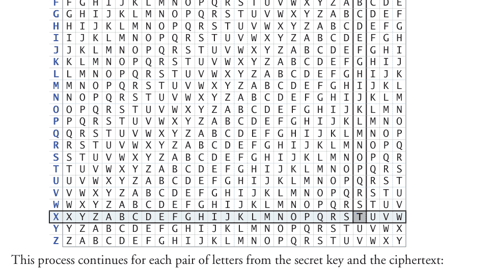

此过程对密钥和密文的每一对字母重复进行：

| 密文： | T | q | h | w | x | n | z | | r | v | | b | m | z | d | u | j | c | j | j | l |
| 重复的密钥文本： | X | M | W | U | J | B | V | | Y | H | | X | Z | X | M | W | U | J | B | V | Y |
| 明文： | W | e | l | c | o | m | e | | t | o | | e | n | c | r | y | p | t | i | o | n |

### 实现维吉尼亚密码

在本练习中，你应该在文件 `cipher.c` 中实现你的维吉尼亚密码代码。此源代码文件应包含以下内容：

- 函数 **checkKey** 接收一个密钥字符串，如果该字符串仅由字母组成则返回 true。否则，此函数返回 false，在这种情况下，该密钥不能用于维吉尼亚密码算法。此函数由下面描述的 **encrypt** 和 **decrypt** 函数调用。
- 函数 **getSubstitution** 接收一个密钥字符、一个来自明文或密文字符串的字符，以及一个布尔值，该布尔值指示是加密（true）还是解密（false）第二个参数中的字符。此函数由 **encrypt** 和 **decrypt** 函数（下面描述）调用，以对单个字符执行维吉尼亚密码加密或解密算法。该函数包含一个 26x26 的二维静态常量字符数组形式的维吉尼亚方阵。
- 函数 **encrypt** 接收一个包含**要加密的明文**的字符串、一个用于写入**加密文本**的字符数组以及**密钥**。该函数遍历明文字符。对于每个字母，**encrypt** 调用 **getSubstitution**，传递当前的密钥字符、要加密的字母和 true。然后函数 **getSubstitution** 对该字母执行维吉尼亚密码加密算法，并返回其密文等效字符。
- 函数 **decrypt** 接收一个包含**要解密的密文**的字符串、一个用于写入结果**明文**的字符数组以及用于创建密文的**密钥**。该函数遍历密文字符。对于每个字母，**decrypt** 调用 **getSubstitution**，传递当前的密钥字符、要解密的字母和 false。然后函数 **getSubstitution** 对该字母执行维吉尼亚密码解密算法，并返回其明文等效字符。

### 你应该创建的其他文件

除了 `cipher.c`，你还应该创建以下代码文件：

- **cipher.h** 应包含 **encrypt** 和 **decrypt** 函数原型。
- **cipher_test.c**，它 `#include "cipher.h"` 并使用你的 encrypt 和 decrypt 函数来加密和解密文本。

#### cipher_test.c

在你的应用程序中，执行以下任务：

1. 提示并输入一个**要加密的明文句子**和一个仅由字母组成的**密钥**，调用 **encrypt** 创建**密文**，然后显示它。使用我们的密钥 XMWUJBVYHXZ——这将使你能够解密本练习开头的乱码。
2. 使用你的 **decrypt 函数**和你在*步骤 1*中输入的**密钥**来**解密**你刚刚创建的**密文**。显示结果**明文**以确保你的 **decrypt 函数**正常工作。
3. 提示并输入本练习之前的密文章节标题或练习密文标题。然后，使用你的 **decrypt 函数**和你在*步骤 1*中输入的**密钥文本**来**解密密文**。

与往常一样，你应该确保你写入加密或解密文本的字符数组足够大，可以存储文本及其终止空字符。

一旦你的维吉尼亚密码加密和解密算法正常工作，就可以和朋友一起发送和接收加密消息，享受乐趣。当你将密钥传递给将用它来解密你的密文消息的人时，请注意保持密钥的安全。

### 编译你的代码

在 Visual C++ 和 Xcode 中，只需将所有三个文件添加到你的项目中，然后编译并运行代码。对于 GNU gcc，从包含 `cipher.c`、`cipher.h` 和 `cipher_test.c` 文件的文件夹执行以下命令：

```
gcc -std=c18 -Wall cipher.c cipher_test.c -o cipher_test
```

这将创建命令 `cipher_test`，你可以使用 `./cipher_test` 运行它。

### 密钥密码学的弱点：展望公钥密码学

密钥加密和解密有一个弱点——密文的安全性仅与密钥一样高。任何发现或窃取密钥的人都可以解密密文。在下一个练习中，我们将介绍**公钥密码学**。这种技术使用每个可能想向特定接收者发送秘密消息的发送者都知道的公钥进行加密。公钥可用于加密消息，但不能解密它们。消息只能使用只有接收者知道的配对私钥解密，因此它比密钥密码学中的密钥安全得多。在下一个案例研究练习中，你将探索公钥密码学。

### 关于密码学和计算能力的说明

理想情况下，密文应该是无法“破解”的——也就是说，*在没有*解密密钥的情况下，不可能从密文确定明文。由于各种原因，这个目标是不切实际的。因此，密码方案的设计者满足于使它们极其难以破解。当今功能日益强大的计算机的一个问题是，它们使得破解过去几十年中使用的大多数加密方案成为可能。

密码学是比特币等加密货币的基础。⁹ 量子计算将使功能极其强大的计算机成为可能，这正在使

> 9. “Cryptocurrency.” 访问于 2020 年 12 月 25 日。https://www.investopedia.com/terms/c/cryptocurrency.asp.

密码方案和加密货币面临风险。10,11 加密货币社区正在努力应对这些挑战。12,13,14

**8.42** *（维吉尼亚密码修改——支持所有 ASCII 字符）* 你在**练习 8.41** 中的维吉尼亚密码实现仅加密和解密字母 A–Z。所有其他字符都原样传递。修改你的实现以支持**附录 B** 中显示的完整 ASCII 字符集。

## 安全 C 编程案例研究：公钥密码学

**8.43** *（RSA15,16,17 公钥密码学）* 在上一个案例研究中，你开始学习密钥密码学。发送者的明文使用密钥加密形成密文。接收者使用*相同的*密钥解码密文，形成原始明文——这称为**对称加密**。密钥密码学的一个问题是，密文的安全性仅与密钥的安全性一样好，并且该密钥的多个副本“四处流传”。为了纠正这个问题，Diffie–Hellman18 提出了公钥密码学。

在这个案例研究练习中，我们将逐步介绍 **RSA 公钥密码学算法**。特别是，我们重点介绍如何生成：

- **公钥**，任何发送者都可以使用它为特定接收者将明文加密为密文，以及
- **私钥**，只有特定接收者才能使用它来解密密文。

RSA 基于复杂的数学，但你需要执行的生成公钥和私钥、使用公钥加密消息以及解密

10. “The Impact of Quantum Computing on Present Cryptography.” 访问于 2020 年 12 月 25 日。https://arxiv.org/pdf/1804.00200.pdf.
11. “Quantum Computing and its Impact on Cryptography.” 访问于 2020 年 12 月 25 日。https://www.cryptomathic.com/news-events/blog/quantum-computing-and-its-impact-on-cryptography.
12. “How Should Crypto Prepare for Google’s ‘Quantum Supremacy’?” 访问于 2020 年 12 月 25 日。https://www.coindesk.com/how-should-crypto-prepare-for-googles-quantum-supremacy.
13. “Here’s Why Quantum Computing Will Not Break Cryptocurrencies.” 访问于 2020 年 12 月 25 日。https://www.forbes.com/sites/rogerhuang/2020/12/21/heres-why-quantum-computing-will-not-break-cryptocurrencies/.
14. “How the Crypto World Is Preparing for Quantum Computing, Explained.” 访问于 2020 年 12 月 25 日。https://cointelegraph.com/explained/how-the-crypto-world-is-preparing-for-quantum-computing-explained.
15. “RSA (cryptosystem).” 访问于 2021 年 1 月 6 日。https://en.wikipedia.org/wiki/RSA_(cryptosystem).
16. “RSA Algorithm.” 访问于 2021 年 1 月 6 日。https://simple.wikipedia.org/wiki/RSA_algorithm.
17. “PKCS #1: RSA Cryptography Specifications Version 2.2.” 访问于 2021 年 1 月 8 日。https://tools.ietf.org/html/rfc8017.
18. “New Directions in Cryptography.” 访问于 2021 年 1 月 8 日。https://ee.stanford.edu/~hellman/publications/24.pdf.

### 公钥密码学

惠特菲尔德·迪菲和马丁·赫尔曼在其论文《密码学的新方向》^19 中引入了**公钥密码学**，以解决对称密钥密码学的一个弱点——即密钥必须同时被发送方和接收方知晓所带来的脆弱性。他们提出了这个想法，但并未实现该方案。

### RSA 公钥密码学

里维斯特、沙米尔和阿德曼是第一个发布公钥密码学可行实现的人。该方案被称为 RSA^20，取自他们姓氏的首字母缩写。RSA 是世界上应用最广泛的公钥密码学方案之一。^21 由于 RSA 可能较慢，^22 许多组织更倾向于使用更快的对称密钥加密，而用 RSA 来安全地传输密钥。

### 历史注记

英国的克利福德·科克斯在 RSA 论文发表前几年就创建了一个可行的公钥方案，^23 但他的工作是保密的，因此直到 RSA 出现约 20 年后才被公开。

RSA Security 公司曾持有 RSA 算法的专利。2000 年，该专利即将到期需要续费——他们没有选择续费，而是将该算法放入了公共领域。^24

19. 《密码学的新方向》。访问于 2021 年 1 月 8 日。https://ee.stanford.edu/~hellman/publications/24.pdf。
20. R. Rivest; A. Shamir; L. Adleman (1978 年 2 月)。《获取数字签名和公钥密码系统的方法》(PDF)。ACM 通讯。21 (2): 120–126。https://people.csail.mit.edu/rivest/Rsapaper.pdf。
21. 《RSA 算法 (Rivest-Shamir-Adleman)》。访问于 2021 年 1 月 8 日。https://searchsecurity.techtarget.com/definition/RSA。
22. 《RSA (密码系统)》。访问于 2021 年 1 月 6 日。https://en.wikipedia.org/wiki/RSA_(cryptosystem)。
23. 《克利福德·科克斯》。访问于 2021 年 1 月 8 日。https://en.wikipedia.org/wiki/Clifford_Cocks。
24. 《RSA Security 将 RSA 加密算法发布到公共领域》。访问于 2021 年 1 月 8 日。https://web.archive.org/web/20071120112201/http://www.rsa.com/press_release.aspx?id=261。

### RSA 算法步骤

下面的步骤 1–5 使用较小的整数值来解释 RSA 算法如何生成公钥/私钥对。然后，步骤 6 使用公钥将明文加密为密文，步骤 7 使用私钥将密文解密回原始明文。我们展示的步骤基于原始的 RSA 论文<sup>25</sup>和 RSA 算法维基百科页面。<sup>26</sup>

#### RSA 算法步骤 1——选择两个质数

选择两个不同的质数 p 和 q。在本案例研究中，我们将使用较小的质数——p = 13 和 q = 17。这将使我们在讨论中以及在你的计算机上使用 C 语言及其有限范围的内置整数数据类型时，计算保持在可管理范围内。在商业级 RSA 密码系统中，这些质数通常各有数百位数字，并且是随机选择的。要了解 RSA 中整数可能有多大，请访问 RSA 数字网页

```
https://en.wikipedia.org/wiki/RSA_numbers
```

该网页显示了从 100 位到 617 位长度不等的各种整数。C 语言的整数数据类型 `int`、`long int` 和 `long long int` 无法容纳如此大的整数，因此需要特殊处理来适应这些大数。

#### RSA 算法步骤 2——计算模数 (n)，它是公钥和私钥的一部分

计算**模数 n**，它就是 p 和 q 的乘积：

```
n = p * q
```

基于 p = 13 和 q = 17，n 是 221。正如你将看到的，n 是公钥和私钥的一部分。p 和 q 的值是保密的。

#### RSA 算法步骤 3——计算欧拉函数

计算 Φ(n)——读作“n 的 phi 值”——即**欧拉函数**。<sup>27</sup> 其计算很简单：

```
Φ(n) = (p - 1) * (q - 1)
```

给定 p = 13 和 q = 17，Φ(n) 是

```
Φ(n) = 12 * 16 = 192
```

这个数字用于确定**加密指数 (e)** 和**解密指数 (d)** 的计算，它们将分别帮助我们加密明文和解密密文，正如你将在下面看到的。

#### RSA 算法步骤 4——选择用于加密计算的公钥指数 (e)

接下来，我们选择一个用于加密的指数 e，它必须满足以下规则：

- 1 < e < Φ(n)
- e 必须与 Φ(n) 互质。

如果两个整数除了 1 之外没有其他公因数，则它们互质。
在我们的例子中，满足第一条规则且 Φ(n) = 192 的整数值是 2–191。192 的质因数分解是

```
192 = 2 * 2 * 2 * 2 * 2 * 2 * 3
```

e 的值必须与 Φ(n) 互质，因此我们必须从 e 的候选值中排除任何质因数及其所有倍数。因此，值 2 以及 2–190 之间的所有其他偶数整数被排除，值 3 及其所有倍数也被排除。这留下了以下奇数值作为 e 的可能值：

```
5   7   11  13  17  19  23  25  29  31  35  37  41  43  47  49
53  55  59  61  65  67  71  73  77  79  83  85  89  91  95  97
101 103 107 109 113 115 119 121 125 127 131 133 137 139 143 145
149 151 155 157 161 163 167 169 173 175 179 181 185 187 191
```

这些值中的任何一个都可以用作公钥加密指数 (e)。在我们接下来的讨论中，我们将选择 37，因此我们的公钥是 (37, 221)。

#### RSA 算法步骤 5——选择用于解密计算的私钥指数 (d)

最后一步是确定用于解密的私钥指数 d。我们必须选择一个 d 值，使得

```
(d * e) mod Φ(n) = 1
```

在我们的例子中，满足此条件的第一个 d 值是 109。我们可以通过代入 d、e 和 Φ(n) 的值来检查上述计算是否产生 1：

```
(109 * 37) mod 192
```

109 * 37 的值是 4033。如果你将 192 乘以 21，结果是 4032，余数为 1。所以，109 是一个有效的 d 值。d 有许多可能的值——每个值都是 109 加上欧拉函数 (192) 的倍数。例如，301 (109 + 1 * 192)：

```
(301 * 37) mod 192
```

301 * 37 是 11137，除以 192 余数为 1——192 * 58 是 11136，余数为 1。所以像下面这样的 d 值都可以工作：

```
109   301   493   685   877   . . .
```

我们选择了 109，所以我们的私钥是 (109, 221)。

### 使用 RSA 加密消息

一旦你有了公钥，使用 RSA 加密消息就很容易了。给定一个要加密成密文 (C) 的明文整数消息 (M)，以及一个由两个正整数组成的公钥 e（用于加密）和 n——通常表示为 (e, n)，消息发送者可以通过以下计算加密 M：

```
C = M^e mod n
```

M 的值必须在 0 <= M < n 的范围内。否则，你必须将消息分解成该范围内的值，并分别加密每个值。

让我们使用我们的公钥 (37, 221) 加密 M 值 122：

```
C = 122^37 mod 221
```

122^37 的值是一个巨大的数字，但你可以使用 Wolfram Alpha 网站执行此计算，网址为

https://www.wolframalpha.com/input/

按如下方式输入计算（^ 在 Wolfram Alpha 中代表幂运算）：

```
122^37 mod 221
```

你会看到结果是 5，这就是我们的密文。

### 使用 RSA 解密消息

如果你有私钥，解密消息也很容易。给定一个要解密成原始明文消息 (M) 的密文整数消息 (C)，以及一个由两个正整数组成的私钥 d 和 n——通常表示为 (d, n)，消息接收者可以通过以下计算解密 C：

```
M = C^d mod n
```

让我们使用我们的私钥 (109, 221) 解密 C 值 5：

```
M = 5^109 mod 221
```

同样，5^109 的值是一个巨大的数字，但你可以通过输入以下计算使用 Wolfram Alpha 执行此计算：

```
5^109 mod 221
```

你会看到结果是 122，这就是我们的明文。

请注意，n 是公钥和私钥的一部分。你还会看到指数 d 的值是基于指数 e 和模数值 n 的。

### 加密和解密字符串

假设你希望使用 RSA 加密一条明文消息，例如

```
Damn the torpedoes, full speed ahead!^28
```

如果整数值小于 n，你可以如前所述加密该值。你可以将每个生成的密文整数存储在一个整数数组中。如果你尝试将这些密文整数显示为字符，可能会看到一些奇怪的符号。例如，密文整数可能代表特殊字符，如换行符或制表符，或者可能超出 ASCII 范围。当你解密密文时，可以取出每个生成的整数，将其转换为字符，然后放入一个字符数组中，该数组将表示解密后的明文。在显示字符串之前，请确保以空字符终止它。

### 编程实现 RSA 算法

现在，用 C 语言实现 RSA 算法。允许用户加密和解密一个简单的整数，然后加密和解密一行文本。你的程序应该产生一个类似于以下内容的输出对话框：

```
Enter a prime number for p: 13
Enter a prime number for q: 17
n is 221
totient is 192

Candidates for e: 5 7 11 13 17 19 23 25 29 31 35 37 41 43 47 49 53 55 59 61 65 67 71 73 77 79 83 85 89 91 95 97 101 103 107 109 113 115 119 121 125 127 131 133 137 139 143 145 149 151 155 157 161 163 167 169 173 175 179 181 185 187 191

Select a value for e from the preceding candidates: 37

Candidate for d: 109

Select a value for d--either the d candidate above
or d plus a multiple of the totient: 109

Enter a non-negative integer less than n to encrypt: 122

The ciphertext is: 5

The decrypted plaintext is: 122

Enter a sentence to encrypt:
Damn the torpedoes, full speed ahead!

The ciphertext is:
DG`
ue
;X}eW;es9 fh s}eeW GueGW!

The decrypted plaintext is:
Damn the torpedoes, full speed ahead!
```

在实现 RSA 算法时，请记住以下提示：

- **模幂运算**：将明文消息提升到一个大指数（例如 122^37）会产生巨大的值，C 语言有限范围的内置整数类型无法表示。如你所知，RSA 加密和解密计算同时执行指数运算和模运算。这些可以使用模幂运算结合起来，以使 RSA 加密和解密计算保持在可管理的范围内。定义一个名为 `modularPow` 的函数来执行模幂运算。有关模幂运算算法，请参阅 https://en.wikipedia.org/wiki/Modular_exponentiation#Memory-efficient_method 处的伪代码。

- **计算最大公约数**：e 的候选值（*步骤 4*）必须与欧拉函数值互质——即它们的唯一公因数是 1。要确定两个数是否互质，你需要一个 **gcd 函数**来计算**两个整数的最大公约数**。你的程序应该显示所有可能的 e 候选值。在练习 5.29 中，你被要求编写一个 gcd 函数。

- **检查质数**——RSA 算法需要两个质数 p 和 q。你应该定义一个 **isPrime 函数**来**确定一个整数是否确实是质数**——用它来确认用户输入的 p 和 q 值是质数。练习 6.30 要求你实现埃拉托斯特尼筛法来寻找质数值。

你的程序还应该定义以下函数：

- 一个使用公钥 (e, n) 加密明文消息 M 的函数：
  ```c
  int encrypt(int M, int e, int n);
  ```

- 一个使用私钥 (d, n) 解密密文消息 C 的函数：
  ```c
  int decrypt(int C, int d, int n);
  ```

- 一个通过调用字符串每个字符的 **encrypt** 函数并将结果放入整数数组来加密字符串的函数：
  ```c
  void encryptString(
      char* plaintext, int ciphertext[], int e, int n);
  ```

- 一个通过调用每个整数的 **decrypt** 函数并将结果放入 **char** 数组来解密整数数组中密文的函数。size 参数表示被加密的字符数。确保在 decryptedPlaintext 中以空字符 ('\0') 终止字符串：
  ```c
  void decryptString(int ciphertext[],
      char decryptedPlaintext[], size_t size, int d, int n);
  ```

### 参考资料

有关 RSA 算法的精彩视频解释，请参阅以下两部分视频演示：

- RSA 加密算法（第 1 部分：计算示例）：<sup>29</sup>
  https://www.youtube.com/watch?v=4zahvcJ9glg
- RSA 加密算法（第 2 部分：生成密钥）：<sup>30</sup>
  https://www.youtube.com/watch?v=o0cTVTpUsPQ

29. Woo, Eddie (misterwootube). “The RSA Encryption Algorithm (1 of 2: Computing an Example),” November 4, 2014. https://www.youtube.com/watch?v=4zahvcJ9glg.
30. Woo, Eddie (misterwootube). “The RSA Encryption Algorithm (2 of 2: Generating the Keys),” November 4, 2014. https://www.youtube.com/watch?v=o0cTVTpUsPQ.

**8.44** *(对 RSA 算法的改进)* 1998 年，对 RSA 算法进行了一项改进，用 λ(n)（读作“n 的 lambda”）取代了 Φ(n)：<sup>31,32</sup>

λ(n) = lcm((p - 1), (q - 1))

其中 lcm 代表**最小公倍数**。<sup>33</sup> 在之前的 RSA 练习中，我们使用了 p = 13 和 q = 17 的 Φ(n)。相应的新 λ(n) 计算将是

λ(n) = lcm(12, 16)

其中 12 和 16 的最小公倍数是 48，正如你可以在下面的倍数列表中看到的：

12 24 36 **48** ...
16 32 **48** 60 ...

复制你之前练习的代码解决方案，并将每个 Φ(n) 的使用替换为 λ(n)，然后使用相同的质数值 p 和 q 测试你更新后的代码。当你使用 λ(n) 方法加密明文时，你的密文可能会不同，但解密后的明文应该相同。

**8.45** *(压力测试你的 RSA 算法极限)* 尝试使用逐渐增大的 p 和 q 值运行你的程序。它们变到多大时程序不再工作？另外，使用越来越大的 e 和 d 候选值测试你的程序。

**8.46** *(增强你的 RSA 代码)* 按以下方式修改你的 RSA 程序：

- a) 你的程序显示了加密指数 e 的所有可能候选值。修改你的程序以显示解密指数 d 的前五个潜在值（即 d 的第一个值加上 1 * 欧拉函数值，d 的第一个值加上 2 * 欧拉函数值，等等）。在你的可能性列表后跟一个省略号 (...)。
- b) 随着你的质数 p 和 q 变大，你最终会超过 int 类型的最大值限制，你可以在 <limits.h> 中找到该限制。修改你的代码，使用 long long int 类型进行所有 RSA 整数计算。请注意，即使这种类型也不足以容纳你在工业级 RSA 中使用的巨大整数。使用如此大的整数值需要特殊的编程。记得将任何 printf 和 scanf 语句的 %d 转换说明符更改为 %lld。

31. “RSA Algorithm.” Accessed January 7, 2021. https://simple.wikipedia.org/wiki/RSA_algorithm.
32. "PKCS #1: RSA Cryptography Specifications, Version 2.0." Accessed January 7, 2021. https://tools.ietf.org/html/rfc2437.
33. “Least common multiple.” Accessed January 7, 2021. https://en.wikipedia.org/wiki/Least_common_multiple.

**8.47** *(挑战项目：RSA 问题<sup>34</sup>)* 在这个练习中，你将研究针对工业级 RSA 实施的攻击。然后，你将尝试自己破解在练习 8.43 中构建的小型 RSA 实施所创建的密文。同样，这种小型实施并不安全。

- a) 研究针对工业级 RSA 系统实施的攻击类型。注意哪些类型成功了，哪些失败了。
- b) RSA 的强度来自于用于计算更巨大 n 值（即 p * q）的巨大质数 p 和 q（每个通常有数百位数字），以及分解 n 以找到 p 和 q 的计算成本。“RSA 问题”是在仅给定公钥 (e, n) 的情况下解密密文的任务。这要求你从 n 的质因数 p 和 q 中推导出 d 并解密密文。假设你有一个公钥 (e, n) 和使用该密钥通过你的小型 RSA 实施加密的密文，但你不知道解密所需的私钥。使用暴力计算技术找到 n 的质因数 p 和 q。然后，进行必要的计算以恢复 d 并解密消息。

34. “RSA Problem.” Accessed January 8, 2021. https://en.wikipedia.org/wiki/RSA_problem.

# 格式化输入/输出

## 9

## 学习目标

在本章中，你将：

- 使用输入和输出流。
- 使用打印格式化功能。
- 使用输入格式化功能。
- 打印整数、浮点数、字符串和字符。
- 使用字段宽度和精度进行打印。
- 在 `printf` 格式控制字符串中使用格式化标志。
- 输出字面量和转义序列。
- 使用 `scanf` 读取格式化输入。

## 第9章 格式化输入/输出

# 大纲

- 9.1 简介
- 9.2 流
- 9.3 使用 printf 进行格式化输出
- 9.4 打印整数
- 9.5 打印浮点数
  - 9.5.1 转换说明符 e、E 和 f
  - 9.5.2 转换说明符 g 和 G
  - 9.5.3 演示浮点转换说明符
- 9.6 打印字符串和字符
- 9.7 其他转换说明符
- 9.8 使用字段宽度和精度进行打印
  - 9.8.1 整数的字段宽度
  - 9.8.2 整数、浮点数和字符串的精度
  - 9.8.3 组合字段宽度和精度
- 9.9 printf 格式标志
  - 9.9.1 右对齐和左对齐
  - 9.9.2 使用和不使用 + 标志打印正数和负数
  - 9.9.3 使用空格标志
  - 9.9.4 使用 # 标志
  - 9.9.5 使用 0 标志
- 9.10 打印字面量和转义序列
- 9.11 使用 scanf 进行格式化输入
  - 9.11.1 scanf 语法
  - 9.11.2 scanf 转换说明符
  - 9.11.3 读取整数
  - 9.11.4 读取浮点数
  - 9.11.5 读取字符和字符串
  - 9.11.6 使用扫描集
  - 9.11.7 使用字段宽度
  - 9.11.8 跳过输入流中的字符
- 9.12 安全的 C 编程

小结 | 自测练习 | 自测练习答案 | 练习

## 9.1 简介

呈现结果是解决任何问题的重要组成部分。本章深入讨论 `printf` 和 `scanf` 的格式化功能，它们分别将数据输出到标准输出流和从标准输入流输入数据。在调用这些函数的程序中需要包含头文件 `<stdio.h>`。第11章讨论了标准输入/输出（`<stdio.h>`）库中包含的其他几个函数。

## 9.2 流

输入和输出是通过称为流的字节序列执行的：

- 在输入操作中，字节从设备（如键盘、固态硬盘、网络连接等）流入主存。
- 在输出操作中，字节从主存流向设备（如计算机屏幕、打印机、固态硬盘、网络连接等）。

当程序开始执行时，程序可以访问三个流：

- 标准输入流，连接到键盘，
- 标准输出流，连接到屏幕，以及
- 标准错误流，也连接到屏幕。

操作系统允许将这些流重定向到其他设备。第11章详细讨论了流处理。

## 自测

1. （填空）你可以将标准流________到其他设备。
   答案：重定向。

2. （多选）以下哪项陈述是*错误*的？
   a) 输入和输出是通过数组（即字节序列）执行的。
   b) 在输入操作中，字节从设备流向主存。
   c) 在输出操作中，字节从主存流向设备。
   d) 当执行开始时，标准流连接到程序。
   答案：a) 是*错误*的。实际上，输入和输出是通过流（即字节序列）执行的。

## 9.3 使用 printf 进行格式化输出

在整本书中，你已经看到了各种 `printf` 输出格式化功能。每个 `printf` 调用都包含一个描述输出格式的**格式控制字符串**。格式控制字符串由**转换说明符**、**标志**、**字段宽度**、**精度**和**字面字符**组成。与百分号（%）一起，它们构成**转换说明**。函数 `printf` 可以执行以下格式化功能：

1. 将浮点值**四舍五入**到指定的小数位数。
2. 将数字列按其小数点对齐。
3. **右对齐**和**左对齐**输出。
4. 在输出行的精确位置插入字面字符。
5. 以指数格式表示浮点数。
6. 以八进制和十六进制格式表示无符号整数。在线附录E讨论了八进制和十六进制值。
7. 以固定大小的字段宽度和精度显示数据。

`printf` 函数的形式为

```
printf(格式控制字符串, 其他参数);
```

*格式控制字符串*描述输出格式，可选的*其他参数*对应于*格式控制字符串*的转换说明。每个转换说明以百分号（%）开头，以转换说明符结尾。一个格式控制字符串中可以有多个转换说明。

## 自测

1. （填空）每个 `printf` 调用都包含一个描述输出格式的________。
   答案：格式控制字符串。

2. （多选）以下哪项是函数 `printf` 可以执行的格式化功能？
   a) 将浮点值四舍五入到指定的小数位数，并将数字列按其小数点对齐。
   b) 以指数格式表示浮点数。以八进制和十六进制格式表示无符号整数。
   c) 以固定大小的字段宽度和精度显示所有类型的数据。
   d) 以上所有都是 printf 的格式化功能。
   答案：d。

## 9.4 打印整数

整数是一个整数，例如 776、0 或 -52。整数值以以下整数转换说明符描述的几种格式之一显示。

| 转换说明符 | 描述 |
|---|---|
| d | 显示为有符号十进制整数。 |
| i | 显示为有符号十进制整数。 |
| o | 显示为无符号八进制整数。 |
| u | 显示为无符号十进制整数。 |
| x 或 X | 显示为无符号十六进制整数。x 使用数字 0-9 和小写字母 a-f，X 使用数字 0-9 和大写字母 A-F。 |
| h、l 或 ll（字母 "ell"） | 这些长度修饰符放在任何整数转换说明符之前，表示要显示的值是 short、long 或 long long 整数。 |

图 9.1 使用每个整数转换说明符打印一个整数。请注意，默认情况下不显示加号，但我们将稍后展示如何强制显示它们。第 10-11 行使用 `hd` 和 `ld` 转换说明符来显示 short 和 long 整数值。字面量 `2000000000L` 上的 `L` 后缀表示其类型为 long——C 将整数字面量视为 `int`。使用期望无符号值的转换说明符打印负值是一个逻辑错误。当第 14 行使用 `%u` 显示 -455 时，结果是无符号值 4294966841。一个小的负值由于其底层二进制表示中的“符号位”而显示为一个大的正整数。有关二进制数系统和符号位的讨论，请参见在线附录E。

```c
// fig09_01.c
// 使用整数转换说明符
#include <stdio.h>

int main(void) {
    printf("%d\n", 455);
    printf("%i\n", 455); // i 在 printf 中与 d 相同
    printf("%d\n", +455); // 加号不打印
    printf("%d\n", -455); // 减号打印
    printf("%hd\n", 32000); // 作为 short 类型打印
    printf("%ld\n", 2000000000L); // 作为 long 类型打印
    printf("%o\n", 455); // 八进制
    printf("%u\n", 455);
    printf("%u\n", -455);
    printf("%x\n", 455); // 使用小写字母的十六进制
    printf("%X\n", 455); // 使用大写字母的十六进制
}
```

```
455
455
455
-455
32000
2000000000
707
455
4294966841
1c7
1C7
```

图 9.1 | 使用整数转换说明符。

## 自测

1. （多选）哪个整数转换说明符被描述为“显示为无符号十进制整数”？
   a) `ud`。
   b) `ui`。
   c) `u`。
   d) 以上都不是。
   答案：c。

2. （这段代码做什么？）精确显示以下代码打印的内容：
   ```c
   printf("%d\n", 235);
   printf("%i\n", 235);
   printf("%d\n", +235);
   printf("%d\n", -235);
   ```
   答案：
   ```
   235
   235
   235
   -235
   ```

## 9.5 打印浮点数

浮点值包含小数点，例如 33.5、0.0 或 -657.983。浮点值使用下面总结的转换说明符显示。

## 9.5 打印浮点数

| 转换说明符 | 描述 |
|---|---|
| e 或 E | 以指数记数法显示浮点值。 |
| f 或 F | 以定点记数法显示浮点值。 |
| g 或 G | 根据数值的大小，以定点形式 f 或指数形式 e（或 E）显示浮点值。 |
| L | 在任何浮点转换说明符前放置此长度修饰符，表示应显示一个 `long double` 类型的浮点值。 |

### 指数记数法

转换说明符 `e` 和 `E` 以指数记数法显示浮点值——这是数学中科学记数法的计算机等价形式。例如，数值 150.4582 在科学记数法中表示为

1.504582 x 10²

在指数记数法中表示为

1.504582E+02

在这种记法中，`E` 代表“指数”，表示 1.504582 乘以 10 的二次方（E+02）。

### 9.5.1 转换说明符 e、E 和 f

使用转换说明符 `e`、`E` 和 `f` 显示的值，默认情况下在小数点右侧显示六位精度（例如，1.045927）。你可以明确指定其他精度。转换说明符 `f` 总是在小数点左侧打印至少一位数字，因此小数值前会加上“0.”。转换说明符 `e` 和 `E` 在指数前分别使用小写 `e` 或大写 `E`。每个都在小数点左侧打印恰好一位数字。

### 9.5.2 转换说明符 g 和 G

转换说明符 `g`（或 `G`）以 `e`（`E`）或 `f` 格式打印，且不带尾随零，因此 1.234000 显示为 1.234。如果转换为指数记数法后，数值的指数小于 -4，或指数大于或等于指定的精度，则转换说明符 `g` 使用 `e`（`E`）格式。否则，`g` 使用转换说明符 `f` 来打印该值。`g` 和 `G` 的默认精度是六位有效数字——最多显示六位数字。

至少需要一位小数位才能输出小数点。例如，使用转换说明符 `g`，数值 0.0000875、8750000.0、8.75 和 87.50 分别打印为 8.75e-05、8.75e+06、8.75 和 87.5。数值 0.0000875 使用 `e` 记法，因为当它转换为指数记数法时，其指数（-5）小于 -4。数值 8750000.0 使用 `e` 记法，因为其指数（6）等于默认精度。

**精度**
对于转换说明符 `g` 和 `G`，精度表示要显示的最大有效数字位数，包括小数点左侧的数字。因此，数值 1234567.0 使用转换说明符 `%g` 显示为 1.23457e+06。请记住，所有浮点转换说明符的默认精度都是 6。结果中有六位有效数字——小数点左侧一位，右侧五位（23457）。对于指数记数法，`g` 和 `G` 在指数前分别使用小写 `e` 或大写 `E`。在显示数据时，应向用户明确说明数据是否可能因格式化而不精确，例如指定精度导致的舍入误差。

### 9.5.3 演示浮点转换说明符

图 9.2 演示了每种浮点转换说明符。`%E`、`%e` 和 `%g` 转换说明符执行舍入，但 `%f` 不会。

```
1  // fig09_02.c
2  // 使用浮点转换说明符
3  #include <stdio.h>
4  
5  int main(void) {
6      printf("%e\n", 1234567.89);
7      printf("%e\n", +1234567.89); // 加号不打印
8      printf("%e\n", -1234567.89); // 减号打印
9      printf("%E\n", 1234567.89);
10     printf("%f\n", 1234567.89); // 小数点右侧六位数字
11     printf("%g\n", 1234567.89); // 使用小写 e 打印
12     printf("%G\n", 1234567.89); // 使用大写 E 打印
13 }
```

```
1.234568e+06
1.234568e+06
-1.234568e+06
1.234568E+06
1234567.890000
1.23457e+06
1.23457E+06
```

图 9.2 | 使用浮点转换说明符。

## 自我检查

- 1（填空）转换说明符 `e` 和 `E` 以指数记数法显示浮点值——这是数学中 _______ 的计算机等价形式。
答案：科学记数法。

- 2（多选）关于转换说明符 `e`、`E` 和 `f`，哪个陈述是错误的？
a) 使用转换说明符 `e`、`E` 和 `f` 显示的值，默认情况下在小数点右侧显示六位精度。
b) 转换说明符 `f` 总是在小数点左侧打印恰好一位数字。
c) 转换说明符 `e` 和 `E` 分别打印小写 `e` 和大写 `E`，位于指数前，并在小数点左侧打印恰好一位数字。
d) 以上所有陈述都是*正确的*。
**答案：** b) 是*错误的*。实际上，转换说明符 `f` 在小数点左侧打印*至少*一位数字。

## 9.6 打印字符串和字符

转换说明符 `c` 和 `s` 分别用于打印单个字符和字符串。转换说明符 `c` 需要一个 `char` 类型的参数。转换说明符 `s` 需要一个指向 `char` 的指针作为参数。转换说明符 `s` 会打印字符，直到遇到终止空字符（`'\0'`）。如果字符串没有空终止符，结果将是未定义的——`printf` 会继续打印直到遇到零字节，或者程序会提前终止（即“崩溃”）并指示“段错误”或“访问冲突”错误。图 9.3 中的程序使用转换说明符 `c` 和 `s` 显示字符和字符串。

```
1  // fig09_03.c
2  // 使用字符和字符串转换说明符
3  #include <stdio.h>
4
5  int main(void) {
6      char character = 'A'; // 初始化 char
7      printf("%c\n", character);
8
9      printf("%s\n", "This is a string");
10
11     char string[] = "This is a string"; // 初始化 char 数组
12     printf("%s\n", string);
13
14     const char *stringPtr = "This is also a string"; // char 指针
15     printf("%s\n", stringPtr);
16 }
```

A
This is a string
This is a string
This is also a string

**图 9.3** | 使用字符和字符串转换说明符。

### 格式控制字符串中的错误

大多数编译器不会捕获格式控制字符串错误。你通常会在程序运行时失败或产生不正确结果时才意识到此类错误。

- 使用 `%c` 打印字符串是一个逻辑错误——`%c` 期望一个 `char` 参数。字符串是一个指向 `char` 的指针（即 `char *`）。
- 使用 `%s` 打印一个 `char` 参数通常会导致一个致命的运行时逻辑错误，称为访问冲突。转换说明符 `%s` 期望一个指向 `char` 的指针类型的参数，因此它将 `char` 的数值视为指针。这样的小数值通常代表受操作系统限制的内存地址。

## 自我检查

- 1.（填空）转换说明符 `s` 会导致字符被打印，直到遇到 ________。
答案：终止空字符（`'\0'`）。
- 2.（判断）编译器会捕获格式控制字符串中的错误，因此你在运行时不会遇到不正确的结果。
答案：错误。实际上，大多数编译器不会捕获格式控制字符串中的错误。你通常直到程序运行时失败或产生不正确结果时才会意识到此类错误。

## 9.7 其他转换说明符

考虑 `p` 和 `%` 转换说明符：

- `p` — 以实现定义的方式显示一个指针值。
- `%` — 显示百分号字符。

图 9.4 中的 `%p` 以实现定义的方式打印 `ptr` 的值和 `x` 的地址，通常使用十六进制记法。变量 `ptr` 和 `x` 具有相同的值，因为第 7 行将 `x` 的地址赋给了 `ptr`。在你的系统上显示的地址会有所不同。最后一个 `printf` 语句使用 `%%` 来显示 `%` 字符——需要使用 `%%`，因为 `printf` 通常将 `%` 视为转换说明符的开始。在格式控制字符串中使用 `%` 而不是 `%%` 来尝试显示字面百分号字符是一个错误。当 `%` 出现在格式控制字符串中时，它后面必须跟一个转换说明符。

```
1 // fig09_04.c
2 // 使用 p 和 % 转换说明符
3 #include <stdio.h>
4
5 int main(void) {
6     int x = 12345;
7     int *ptr = &x;
8
9     printf("The value of ptr is %p\n", ptr);
10    printf("The address of x is %p\n\n", &x);
11
12    printf("Printing a %% in a format control string\n");
13 }
```

图 9.4 | 使用 `p` 和 `%` 转换说明符。（第 1 部分，共 2 部分。）

## 9.8 使用字段宽度和精度进行打印

数据打印的精确大小由字段宽度指定。如果字段宽度大于正在打印的数据，数据通常会在该字段内右对齐。一个表示字段宽度的整数被插入在百分号（%）和转换说明符之间（例如，%4d）。

### 9.8.1 整数的字段宽度

图 9.5 打印了两组各五个数字，将那些数字位数少于字段宽度的数字右对齐。宽度超过字段的值仍然会完整显示。请注意，负值的负号会占用字段宽度中的一个字符位置。字段宽度可用于所有转换说明符。如果未提供足够大的字段宽度来处理打印的值，可能会偏移其他正在打印的数据，产生令人困惑的输出。请了解你的数据！

```c
// fig09_05.c
// 在字段中右对齐整数
#include <stdio.h>

int main(void) {
    printf("%4d\n", 1);
    printf("%4d\n", 12);
    printf("%4d\n", 123);
    printf("%4d\n", 1234);
    printf("%4d\n\n", 12345);

    printf("%4d\n", -1);
    printf("%4d\n", -12);
    printf("%4d\n", -123);
    printf("%4d\n", -1234);
    printf("%4d\n", -12345);
}
```

图 9.5 | 在字段中右对齐整数。（第 1 部分，共 2 部分。）

### 9.8.2 整数、浮点数和字符串的精度

函数 `printf` 还允许你指定打印数据的精度。精度对不同类型具有不同的含义：

- 当与整数转换说明符一起使用时，精度表示要打印的最小位数。如果打印的值包含的位数少于指定的精度，并且精度值以零或小数点开头，则会在打印的值前添加零，直到总位数等于精度。如果精度值中既没有零也没有小数点，则会插入空格。整数的默认精度为 1。
- 当与浮点转换说明符 `e`、`E` 和 `f` 一起使用时，精度是小数点后出现的位数。
- 当与转换说明符 `g` 和 `G` 一起使用时，精度是要打印的最大有效位数。
- 当与转换说明符 `s` 一起使用时，精度是从字符串开头写入的最大字符数。

要使用精度，请在百分号和转换说明符之间放置一个小数点（.），后跟一个表示精度的整数。图 9.6 演示了在格式控制字符串中使用精度。当你打印一个浮点值，其精度小于该值原始的小数位数时，它会被四舍五入。

```c
// fig09_06.c
// 使用精度打印整数、浮点数和字符串
#include <stdio.h>

int main(void) {
    puts("使用整数的精度");
    int i = 873; // 初始化整数 i
    printf("\t%.4d\n\t%.9d\n\n", i, i);

    puts("使用浮点数的精度");
    double f = 123.94536; // 初始化双精度浮点数 f
    printf("\t%.3f\n\t%.3e\n\t%.3g\n\n", f, f, f);

    puts("使用字符串的精度");
    char s[] = "Happy Birthday"; // 初始化字符数组 s
    printf("\t%.11s\n", s);
}
```

```
使用整数的精度
    0873
    000000873

使用浮点数的精度
    123.945
    1.239e+02
    124

使用字符串的精度
    Happy Birth
```

图 9.6 | 使用精度打印整数、浮点数和字符串。（第 2 部分，共 2 部分。）

### 9.8.3 组合字段宽度和精度

字段宽度和精度可以通过在百分号和转换说明符之间放置字段宽度，后跟一个小数点，再跟一个精度来组合，如语句中所示

```c
printf("%9.3f", 123.456789);
```

该语句显示 123.457，小数点后三位数字，在九位字段中右对齐。

### 将字段宽度和精度指定为参数

可以使用格式控制字符串之后参数列表中的整数表达式来指定字段宽度和精度。要使用此功能，请在字段宽度或精度（或两者）的位置插入一个星号（*）。参数列表中匹配的 `int` 参数将被求值并用于替代星号。字段宽度的值可以是正数或负数（负数会导致输出在字段内左对齐，如下一节所述）。语句

```c
printf("%*.*f", 7, 2, 98.736);
```

使用 7 作为字段宽度，2 作为精度，并输出右对齐的值 98.74。

## 自我检查

1.  （多选题）以下哪项陈述是错误的？
    a) 整数的默认精度为 1。
    b) 当与浮点转换说明符 `e`、`E` 和 `f` 一起使用时，精度是小数点前出现的位数。
    c) 当与转换说明符 `g` 和 `G` 一起使用时，精度是要打印的最大有效位数。
    d) 当与转换说明符 `s` 一起使用时，精度是从字符串开头写入的最大字符数。

    **答案：** b) 是 *错误的*。当与浮点转换说明符 `e`、`E` 和 `f` 一起使用时，精度是小数点后出现的位数。

2.  *（这段代码做什么？）* 精确描述以下代码打印的内容：
    `printf("%9.3f", 123.456789);`

    **答案：** 该代码在九位字段中右对齐四舍五入后的值 123.457。

3.  *（这段代码做什么？）* 精确描述以下代码打印的内容：
    `printf("%*.*f", 7, 2, 98.736);`

    **答案：** 该语句使用 7 作为字段宽度，2 作为精度，并在宽度为 7 的字段中右对齐输出值 98.74。

## 9.9 printf 格式标志

函数 `printf` 还提供了 *标志* 来补充其输出格式化功能。下表总结了你可以在格式控制字符串中使用的五种标志。

| 标志 | 描述 |
| :--- | :--- |
| -（减号） | 在指定字段内左对齐输出。 |
| + | 在正值前显示加号，在负值前显示减号。 |
| 空格 | 在未使用 `+` 标志打印的正值前打印一个空格。 |
| # | 当与八进制转换说明符 `o` 一起使用时，在输出值前添加 0。当与十六进制转换说明符 `x` 或 `X` 一起使用时，在输出值前添加 0x 或 0X。对于使用 `e`、`E`、`f`、`g` 或 `G` 打印且不包含小数部分的浮点数，强制显示小数点。通常，只有当小数点后跟有数字时才会打印小数点。对于 `g` 和 `G` 说明符，不会消除尾随零。 |
| 0（零） | 用前导零填充字段。 |

### 9.9.1 右对齐和左对齐

转换规范中的标志放置在 `%` 的右侧，格式说明符之前。多个标志可以组合在一个转换说明符中。图 9.7 演示了字符串、整数、字符和浮点数的右对齐和左对齐。第 6 行和第 8 行输出代表列位置的数字行，因此你可以确认右对齐和左对齐是否正确工作。

### 9.9.2 使用和不使用 + 标志打印正数和负数

图 9.8 分别使用和不使用 + 标志打印了一个正数和一个负数。两种情况下都会显示负号，但只有在使用 + 标志时才会显示正号。

```c
// fig09_08.c
// 使用和不使用 + 标志打印正数和负数
#include <stdio.h>

int main(void) {
    printf("%d\n%d\n", 786, -786);
    printf("%+d\n%+d\n", 786, -786);
}
```

```
786
-786
+786
-786
```

图 9.8 | 使用和不使用 + 标志打印正数和负数。

### 9.9.3 使用空格标志

图 9.9 使用空格标志为正数添加一个前导空格。这对于对齐具有相同位数的正数和负数很有用。值 -547 在输出中没有前导空格，因为它有负号。

```c
// fig09_09.c
// 使用空格标志
// 不以 + 或 - 开头
#include <stdio.h>

int main(void) {
    printf("% d\n% d\n", 547, -547);
}
```

```
547
-547
```

图 9.9 | 使用空格标志。

### 9.9.4 使用 # 标志

图 9.10 使用 # 标志为八进制值添加前导 0，为十六进制值添加前导 0x 和 0X。对于 g，它强制打印小数点。

```c
// fig09_10.c
// 在转换说明符中使用 # 标志
// o, x, X 和任何浮点说明符
#include <stdio.h>

int main(void) {
    int c = 1427; // 初始化 c
    printf("%#o\n", c);
    printf("%#x\n", c);
    printf("%#X\n", c);

    double p = 1427.0; // 初始化 p
    printf("\n%g\n", p);
    printf("%#g\n", p);
}
```

```
02623
0x593
0X593

1427
1427.00
```

图 9.10 | 在转换说明符中使用 # 标志。

### 9.9.5 使用 0 标志

图 9.11 结合使用 + 标志和 0（零）标志，在九个字符宽的字段中打印 452，带有 + 号和前导零，然后仅使用 0 标志和九个字符宽的字段再次打印 452。

```c
// fig09_11.c
// 使用 0（零）标志
#include <stdio.h>

int main(void) {
    printf("%+09d\n", 452);
    printf("%09d\n", 452);
}
```

```
+00000452
000000452
```

图 9.11 | 使用 0（零）标志。

## 自我检查

1.  （多选题）以下哪个 printf 格式标志被描述为“在正值前显示加号，在负值前显示减号”？
    a) -。
    b) +。
    c) 0）。
    d) 以上都不是。
    答案：b。

2.  （这段代码做什么？）精确显示以下代码的输出：
    ```c
    puts("1234567890123456789012345678901234567890");
    printf("%10s%10d%10c%10f\n\n", "C18", 9, 'g', 6.41);
    puts("1234567890123456789012345678901234567890");
    printf("%-10s%-10d%-10c%-10f\n", "C18", 9, 'g', 6.41);
    ```
    答案：
    ```
    1234567890123456789012345678901234567890
            C18         9         g  6.410000
    1234567890123456789012345678901234567890
    C18         9         g         6.410000
    ```

3.  （这段代码做什么？）精确显示以下代码的输出：
    ```c
    printf("%d\n%d\n", 437, -437);
    printf("%+d\n%+d\n", 437, -437);
    ```
    答案：
    ```
    437
    -437
    +437
    -437
    ```

## 9.10 打印字面量和转义序列

正如你在本书中所看到的，格式控制字符串中包含的字面字符会直接由 `printf` 输出。然而，有几个“问题”字符，例如界定格式控制字符串本身的*引号* (")。各种控制字符，如*换行符*和*制表符*，必须用转义序列表示。转义序列由一个反斜杠 (\) 后跟一个特定的转义字符表示。下表列出了转义序列及其引起的操作。

| 转义序列 | 描述 |
| :--- | :--- |
| \'（单引号） | 输出单引号 (') 字符。 |
| \"（双引号） | 输出双引号 (") 字符。 |
| \?（问号） | 输出问号 (?) 字符。 |
| \\（反斜杠） | 输出反斜杠 (\) 字符。 |
| \a（警报或响铃） | 引起声音（响铃）或视觉警报（通常是闪烁程序运行所在的窗口）。 |
| \b（退格） | 将光标在当前行上后退一个位置。 |
| \f（换页或格式馈送） | 将光标移动到下一个逻辑页的开头。 |
| \n（换行） | 将光标移动到*下一行*的开头。 |
| \r（回车） | 将光标移动到*当前行*的开头。 |
| \t（水平制表符） | 将光标移动到下一个水平制表位。 |
| \v（垂直制表符） | 将光标移动到下一个垂直制表位。 |

## 自我检查

**1** *（多选题）* 以下陈述 a)、b) 或 c) 中哪一项是*错误*的？
    a) 格式控制字符串中包含的字面字符会被 `printf` 忽略。
    b) 各种控制字符，如换行符和制表符，必须用转义序列表示。
    c) 转义序列由一个反斜杠 (\) 后跟一个特定的转义字符表示。
    d) 以上所有陈述都是*正确*的。
    **答案：** a) 是*错误*的。实际上，`printf` 会显示格式控制字符串中包含的任何字面字符。

**2** *（多选题）* 哪个转义序列被描述为“引起声音（响铃）或视觉警报（通常是闪烁程序运行所在的窗口）”？
    a) \b。
    b) \r。
    c) \a。
    d) \v。
    **答案：** \a。

## 9.11 使用 scanf 进行格式化输入

精确的*输入格式化*可以通过 `scanf` 完成。每个 `scanf` 语句都包含一个格式控制字符串，该字符串描述了要输入的数据的格式。格式控制字符串由转换说明符和字面字符组成。函数 `scanf` 具有以下输入格式化功能：

1.  输入所有类型的数据。
2.  从输入流中输入特定字符。
3.  跳过输入流中的特定字符。

### 9.11.1 scanf 语法

函数 `scanf` 的编写形式如下：

`scanf(格式控制字符串, 其他参数);`

`格式控制字符串` 描述输入格式，`其他参数` 是指向将存储输入的变量的指针。

输入数据时，一次提示用户输入一个或几个数据项。避免要求用户在单个提示下输入多个数据项。始终考虑当输入错误数据时用户和你的程序将如何处理——例如，一个在程序上下文中无意义的整数值，或一个缺少标点符号或空格的字符串。

### 9.11.2 scanf 转换说明符

下表总结了用于输入所有类型数据的转换说明符。请注意，`d` 和 `i` 转换说明符在 `scanf` 输入时具有不同的含义，但在 `printf` 输出时可以互换使用。

| 转换说明符 | 描述 |
| :--- | :--- |
| **整数** | |
| `d` | 读取一个可选带符号的十进制整数。对应的参数是一个指向 `int` 的指针。 |
| `i` | 读取一个可选带符号的十进制、八进制或十六进制整数。对应的参数是一个指向 `int` 的指针。 |
| `o` | 读取一个八进制整数。对应的参数是一个指向无符号 `int` 的指针。 |
| `u` | 读取一个无符号十进制整数。对应的参数是一个指向无符号 `int` 的指针。 |
| `x` 或 `X` | 读取一个十六进制整数。对应的参数是一个指向无符号 `int` 的指针。 |
| `h`、`l` 和 `ll` | 放在任何整数转换说明符之前，表示要输入一个 `short`、`long` 或 `long long` 整数。 |
| **浮点数** | |
| `e`、`E`、`f`、`g` 或 `G` | 读取一个浮点值。对应的参数是一个指向浮点变量的指针。 |

### 9.11.3 读取整数

图 9.12 使用各种整数转换说明符读取整数，并将整数显示为十进制数。转换说明符 `%i` 可以输入十进制、八进制和十六进制整数。

```c
// fig09_12.c
// 使用整数转换说明符读取输入
#include <stdio.h>

int main(void) {
    int a = 0;
    int b = 0;
    int c = 0;
    int d = 0;
    int e = 0;
    int f = 0;
    int g = 0;

    puts("Enter seven integers: ");
    scanf("%d%i%i%i%o%u%x", &a, &b, &c, &d, &e, &f, &g);

    puts("\nThe input displayed as decimal integers is:");
    printf("%d %d %d %d %d %d %d\n", a, b, c, d, e, f, g);
}
```

图 9.12 | 使用整数转换说明符读取输入。（第 1 部分，共 2 部分。）

```
Enter seven integers:
-70 -70 070 0x70 70 70 70

The input displayed as decimal integers is:
-70 -70 56 112 56 70 112
```

图 9.12 | 使用整数转换说明符读取输入。（第 2 部分，共 2 部分。）

### 9.11.4 读取浮点数

输入浮点数时，可以使用任何浮点转换说明符 `e`、`E`、`f`、`g` 或 `G`。图 9.13 读取三个浮点数，每个数使用三种浮点转换说明符中的一种，并使用转换说明符 `f` 显示所有三个数字。

```c
// fig09_13.c
// 使用浮点转换说明符读取输入
#include <stdio.h>

int main(void) {
    double a = 0.0;
    double b = 0.0;
    double c = 0.0;

    puts("Enter three floating-point numbers:");
    scanf("%le%lf%lg", &a, &b, &c);

    puts("\nUser input displayed in plain floating-point notation:");
    printf("%f\n%f\n%f\n", a, b, c);
}
```

```
Enter three floating-point numbers:
1.27987 1.27987e+03 3.38476e-06

User input displayed in plain floating-point notation:
1.279870
1279.870000
0.000003
```

图 9.13 | 使用浮点转换说明符读取输入。

### 9.11.5 读取字符和字符串

字符和字符串分别使用转换说明符 `c` 和 `s` 输入。图 9.14 提示用户输入一个字符串。程序使用 `%c` 输入字符串的第一个字符并将其存储在字符变量 `x` 中，然后使用 `%s` 输入字符串的其余部分并将其存储在字符数组 `y` 中。

```c
// fig09_14.c
// 读取字符和字符串
#include <stdio.h>

int main(void) {
    char x = '\0';
    char y[9] = "";

    printf("%s", "Enter a string: ");
    scanf("%c%8s", &x, y);

    printf("The input was '%c' and \"%s\"\n", x, y);
}
```

```
Enter a string: Sunday
The input was 'S' and "unday"
```

**图 9.14** | 读取字符和字符串。

### 9.11.6 使用扫描集

可以使用扫描集输入一系列字符——扫描集是用方括号 `[]` 括起来的一组字符，并在格式控制字符串中以百分号开头。扫描集会扫描输入流中的字符，只寻找与扫描集中包含的字符匹配的字符。每次匹配到一个字符，它就会被存储在扫描集对应的字符数组参数中。当 `scanf` 遇到一个不在扫描集中的字符时，扫描集停止输入字符。如果输入流中的第一个字符与扫描集中的字符不匹配，`scanf` 不会修改其对应的数组参数。图 9.15 使用扫描集 `[aeiou]` 扫描输入流中的元音字母。对于我们的输入 "ooeeooahah"，前七个字母被输入。第八个字母 (h) 不在扫描集中，因此 `scanf` 停止扫描字符。

```c
// fig09_15.c
// 使用扫描集
#include <stdio.h>

int main(void) {
    char z[9] = "";

    printf("%s", "Enter string: ");
    scanf("%8[aeiou]", z); // search for set of characters

    printf("The input was \"%s\"\n", z);
}
```

**图 9.15** | 使用扫描集。（第 1 部分，共 2 部分。）

```
Enter string: oeeooahah
The input was "oeeooa"
```

图 9.15 | 使用扫描集。（第 2 部分，共 2 部分。）

#### 反转扫描集

反转扫描集可以扫描不在扫描集中的字符。要创建反转扫描集，请在扫描字符前的方括号中插入一个脱字符 (`^`)。当遇到反转扫描集中包含的字符时，输入终止。图 9.16 使用反转扫描集 `[^aeiou]` 搜索“非元音字母”。

```c
// fig09_16.c
// 使用反转扫描集
#include <stdio.h>

int main(void) {
    char z[9] = "";

    printf("%s", "Enter a string: ");
    scanf("%8[^aeiou]", z); // inverted scan set

    printf("The input was \"%s\"\n", z);
}
```

```
Enter a string: String
The input was "Str"
```

图 9.16 | 使用反转扫描集。

### 9.11.7 使用字段宽度

可以在 `scanf` 转换说明符中使用字段宽度，从输入流中读取特定数量的字符。图 9.17 将一系列连续的数字作为两位整数和一个由输入流中剩余数字组成的整数输入。

```c
// fig09_17.c
// 使用字段宽度输入数据
#include <stdio.h>

int main(void) {
    int x = 0;
    int y = 0;

    printf("%s", "Enter a six digit integer: ");
    scanf("%2d%d", &x, &y);

    printf("The integers input were %d and %d\n", x, y);
}
```

图 9.17 | 使用字段宽度输入数据。（第 1 部分，共 2 部分。）

```
Enter a six digit integer: 123456
The integers input were 12 and 3456
```

**图 9.17** | 使用字段宽度输入数据。（第 2 部分，共 2 部分。）

### 9.11.8 跳过输入流中的字符

您可能希望跳过输入流中的某些字符。格式控制字符串开头的空白字符（如空格、换行符和制表符）会跳过所有前导空白。其他字面字符会忽略输入中特定位置的这些字符。例如，您的程序可能将日期输入为

11-10-1999

日期中的每个数字都需要存储，但分隔数字的短横线可以丢弃。要消除不必要的字符，请将它们包含在 `scanf` 的格式控制字符串中。例如，要丢弃输入中的短横线，请使用语句

scanf("%d-%d-%d", &month, &day, &year);

#### 赋值抑制字符

尽管前面的 `scanf` 确实消除了输入中的短横线，但用户可能将日期输入为

10/11/1999

在这种情况下，前面的 `scanf` 不会消除不必要的字符。因此，`scanf` 提供了**赋值抑制字符 \***。此字符使 `scanf` 能够从输入中读取并丢弃数据，而不将其分配给变量。图 9.18 在 `%c` 转换说明符中使用赋值抑制字符，表示输入流中出现的字符应被读取并丢弃。只有月份、日期和年份被存储。我们打印变量的值以演示它们被正确输入。每个 `scanf` 调用的参数列表不包含用于包含赋值抑制字符的 "%*c" 说明符的变量。相应的字符只是被丢弃。

```c
// fig09_18.c
// 从输入流中读取并丢弃字符
#include <stdio.h>

int main(void) {
    int month = 0;
    int day = 0;
    int year = 0;
```

**图 9.18** | 从输入流中读取并丢弃字符。（第 1 部分，共 2 部分。）

## 第9章 格式化输入/输出

```c
printf("%s", "Enter a date in the form mm-dd-yyyy: ");
scanf("%d%*c%d%*c%d", &month, &day, &year);
printf("month = %d day = %d year = %d\n\n", month, day, year);

printf("%s", "Enter a date in the form mm/dd/yyyy: ");
scanf("%d%*c%d%*c%d", &month, &day, &year);
printf("month = %d day = %d year = %d\n", month, day, year);
```

Enter a date in the form mm-dd-yyyy: **07-04-2021**
month = 7 day = 4 year = 2021

Enter a date in the form mm/dd/yyyy: **01/01/2021**
month = 1 day = 1 year = 2021

图 9.18 | 从输入流中读取并丢弃字符。（第2部分，共2部分。）

## 自我检查

1.  （选择题）以下哪个陈述是*错误*的？
    a) 扫描集会扫描输入流中的字符，仅寻找与扫描集中字符匹配的字符。
    b) 每次匹配一个字符时，它都会存储在扫描集对应的字符数组参数中。
    c) 当遇到扫描集中不包含的字符时，扫描集停止输入字符。
    d) 如果流的第一个字符与扫描集中的字符匹配，`scanf`不会修改对应的数组参数。
    答案：d) 是*错误*的。实际上，如果流的第一个字符*不匹配*扫描集中的字符，`scanf`不会修改对应的数组参数。

2.  （填空题）在`scanf`转换说明符中，可以使用一个________来从输入流中读取特定数量的字符。
    答案：字段宽度。

3.  （填空题）`scanf`的________字符________使得`scanf`能够读取并丢弃输入中的数据，而不将其赋值给变量。
    答案：赋值抑制，*。

## 9.12 安全的C编程

C标准列出了许多使用不正确的库函数参数可能导致未定义行为的情况。这些情况可能引发安全漏洞，因此应当避免。当使用`printf`（或其任何变体，如`sprintf`、`fprintf`、`printf_s`等）与格式不正确的转换说明符时，就可能出现此类问题。CERT规则FIO00-C (https://wiki.sei.cmu.edu/) 讨论了这些问题。它提供了一个表格，展示了可用于构成转换说明符的格式标志、长度修饰符和转换说明符字符的有效组合。该表格还显示了每个有效转换说明符对应的正确参数类型。当你学习*任何*编程语言时，如果语言规范指出做某事可能导致未定义行为，请避免这样做以防止安全漏洞。

## 自我检查

1.  （判断题）未定义行为可能导致安全漏洞，因此应当避免。
    **答案：** *正确*。

## 总结

### 第9.2节 流

- 输入和输出通过**流**（第450页）执行，流是字节序列。
- **标准输入流**连接到键盘。**标准输出和错误流**连接到计算机屏幕（第450页）。
- 操作系统允许将标准流**重定向**到其他设备。

### 第9.3节 使用printf进行格式化输出

- **格式控制字符串**（第451页）描述了要输出的值的格式。它由**转换说明符**、**标志**、**字段宽度**、**精度**和**字面字符**组成。
- **转换说明符**（第451页）由一个**%**（第451页）和一个转换说明符组成。

### 第9.4节 打印整数

- 整数使用以下转换说明符（第452页）打印：**d**或**i**用于可选有符号整数，**o**用于八进制形式的无符号整数，**u**用于十进制形式的无符号整数，**x**或**X**用于十六进制形式的无符号整数。修饰符**h**、**l**或**ll**前缀于前面的转换说明符，以表示short、long或long long整数。

### 第9.5节 打印浮点数

- 浮点值使用以下转换说明符打印：**e**或**E**（第454页）用于科学计数法，**f**（第454页）用于常规浮点表示法，**g**或**G**用于**e**（或**E**）表示法或**f**表示法。当指定**g**（或**G**，第454页）转换说明符时，如果值的指数小于-4或大于或等于打印该值的精度，则使用**e**（或**E**）转换说明符。
- **g**和**G**转换说明符的**精度**表示打印的最大有效数字位数。

### 第9.6节 打印字符串和字符

- 转换说明符**c**（第456页）打印一个**字符**。
- 转换说明符**s**（第456页）打印一个以空字符结尾的**字符串**。

### 第9.7节 其他转换说明符

- 转换说明符**p**（第457页）以实现定义的方式显示一个**地址**（在许多系统中，使用十六进制表示法）。
- 转换说明符**%%**（第457页）导致输出一个字面的%。

## 第9章 格式化输入/输出

### 第9.8节 使用字段宽度和精度进行打印

- 如果**字段宽度**（第451页）大于被打印的对象，则对象默认**右对齐**。
- **字段宽度**可用于所有转换说明符。
- 整数转换说明符的**精度**表示打印的最小数字位数。
- 浮点转换说明符e、E和f的**精度**表示小数点后的数字位数。浮点转换说明符g和G的**精度**表示要显示的有效数字位数。
- 转换说明符s的**精度**表示要打印的字符数。
- **字段宽度**和**精度**可以通过将字段宽度、后跟一个小数点、再后跟精度，放置在百分号和转换说明符之间来组合。
- 可以通过格式控制字符串后的参数列表中的**整数表达式**来指定**字段宽度**和**精度**。为此，对字段宽度或精度使用星号(*)。参数列表中的匹配参数将替代星号使用。

### 第9.9节 printf格式标志

- **- 标志**将其参数在字段中左对齐。
- **+ 标志**（第462页）为正值打印加号，为负值打印减号。
- **空格标志**（第462页）在未使用+标志显示的正值前打印一个空格。
- **# 标志**（第463页）为八进制值添加前缀0，为十六进制值添加前缀0x或0X，并强制为使用e、E、f、g或G打印的浮点值打印小数点。
- **0 标志**（第463页）为未占据其整个字段宽度的值打印前导零。

### 第9.10节 打印字面量和转义序列

- 大多数要在`printf`语句中打印的**字面字符**可以直接包含在格式控制字符串中。但是，有几个“问题”字符，例如界定格式控制字符串本身的引号（"，第465页）。各种**控制字符**，如换行符和制表符，必须用**转义序列表示**。转义序列由一个反斜杠(\)后跟一个特定的转义字符表示。

### 第9.11节 使用scanf进行格式化输入

- **输入格式化**通过**scanf**库函数完成。
- **scanf**使用转换说明符**d**和**i**（第467页）输入可选有符号整数，使用**o**、**u**、**x**或**X**输入八进制、十进制和十六进制格式的无符号整数。修饰符**h**、**l**或**ll**放置在整数转换说明符之前，以输入short、long或long long整数。
- **scanf**使用转换说明符**e**、**E**、**f**、**g**或**G**输入浮点值。修饰符**l**和**L**放置在任何浮点转换说明符之前，以表示输入值是double或long double值。
- **scanf**使用转换说明符**c**（第468页）输入字符。
- **scanf**使用转换说明符**s**（第468页）输入字符串。
- 带有**扫描集**（第469页）的**scanf**扫描输入中的字符，仅寻找与扫描集中包含的字符匹配的字符。每个匹配的字符都存储在一个字符数组中。当遇到扫描集中不包含的字符时，输入停止。

• 要创建**反向扫描集**（第470页），请在扫描字符前的方括号中插入一个脱字符（^）。`scanf`会存储不在反向扫描集中的字符，并在遇到包含在反向扫描集中的字符时停止。
• `scanf`使用转换说明符`p`输入**地址值**。
• 转换说明符`n`将当前`scanf`中**已输入的字符数**存储起来。对应的参数是一个指向`int`的指针。
• **赋值抑制字符**（*，第471页）从输入流中读取并丢弃数据。
• **字段宽度**在`scanf`中用于从输入流中读取特定数量的字符。

## 自我复习练习

**9.1** 填写以下各项的空白：

a) 输入和输出以______的形式处理。
b) ______流通常连接到键盘。
c) ______流通常连接到计算机屏幕。
d) 精确的输出格式化通过______函数实现。
e) 格式控制字符串可以包含______、______、______、______和______。
f) 转换说明符______或______可用于输出有符号十进制整数。
g) 转换说明符______、______和______分别以八进制、十进制和十六进制形式显示无符号整数。
h) 修饰符______和______放置在整数转换说明符之前，以显示短整型或长整型值。
i) 转换说明符______以指数表示法显示浮点值。
j) 修饰符______放置在任何浮点转换说明符之前，以显示长双精度值。
k) 如果未指定精度，转换说明符e、E和f将显示小数点右侧______位精度的数字。
l) 转换说明符______和______用于打印字符串和字符。
m) 所有字符串都以______字符结尾。
n) `printf`转换说明符中的字段宽度和精度可以通过用______替换字段宽度或精度，并在相应的参数中放置整数表达式来用整数表达式控制。
o) ______标志将输出在字段中左对齐。
p) ______标志显示带加号或减号的值。
q) 精确的输入格式化通过______函数实现。
r) ______扫描字符串中的特定字符，并将字符存储在数组中。
s) 转换说明符______输入可选带符号的八进制、十进制和十六进制整数。
t) 转换说明符______可用于输入双精度值。
u) ______从输入流中读取并丢弃数据，而不将其赋值给变量。
v) ______可用于scanf转换说明符中，以指示应从输入流中读取特定数量的字符或数字。

## 9.2 找出以下各项中的错误并解释如何纠正。

a) 以下语句应打印字符'c'。
   `printf("%s\n", 'c');`
b) 以下语句应打印9.375%。
   `printf("%.3f%", 9.375);`
c) 以下语句应打印"Monday"的第一个字符。
   `printf("%c\n", "Monday");`
d) `puts(""A string in quotes"");`
e) `printf(%d%d, 12, 20);`
f) `printf("%c", "x");`
g) `printf("%s\n", 'Richard');`

## 9.3 为以下各项编写一条语句：

a) 在10位字段中右对齐打印1234。
b) 以指数表示法打印123.456789，带符号（+或-）和3位精度。
c) 将双精度值读入变量number。
d) 以八进制形式打印100，前面加0。
e) 将字符串读入字符数组string。
f) 将字符读入数组n，直到遇到非数字字符。
g) 使用整数变量x和y来指定显示双精度值87.4573的字段宽度和精度。
h) 读取格式为3.5%的值。将百分比存储在浮点变量percent中，并从输入流中消除%。不使用赋值抑制字符。
i) 以长双精度值打印3.333333，带符号（+或-），在20个字符的字段中，精度为3。

## 自我复习练习答案

9.1 a) 流。 b) 标准输入。 c) 标准输出。 d) printf。 e) 转换说明符、标志、字段宽度、精度、字面字符。 f) d, i。 g) o, u, x (或 X)。 h) h, l。 i) e (或 E)。 j) L。 k) 6。 l) s, c。 m) NULL ('\0')。 n) 星号 (*)。 o) - (减号)。 p) + (加号)。 q) scanf。 r) 扫描集。 s) i。 t) le, lE, lf, lg 或 lG。 u) 赋值抑制字符 (*)。 v) 字段宽度。

9.2 见下方答案：
a) 错误：转换说明符s期望一个指向char的指针类型的参数。
   纠正：要打印字符'c'，请使用转换说明符%c或将'c'改为"c"。
b) 错误：尝试打印字面字符%而未使用转换说明符%%。
   纠正：使用%%来打印字面%字符。
c) 错误：转换说明符c期望一个char类型的参数。
   纠正：要打印"Monday"的第一个字符，请使用转换说明符%.1s。
d) 错误：尝试打印字面字符"而未使用\"转义序列。
   纠正：将内部引号中的每个引号替换为\"。
e) 错误：格式控制字符串未用双引号括起来。
   纠正：将%d%d用双引号括起来。
f) 错误：字符x用双引号括起来。
   纠正：要用%c打印的字符常量必须用单引号括起来。
g) 错误：要打印的字符串用单引号括起来。
   纠正：使用双引号而不是单引号来表示字符串。

9.3
a) `printf("%10d\n", 1234);`
b) `printf("%+.3e\n", 123.456789);`
c) `scanf("%lf", &number);`
d) `printf("%#o\n", 100);`
e) `scanf("%s", string);`
f) `scanf("%[0123456789]", n);`
g) `printf("%*.*f\n", x, y, 87.4573);`
h) `scanf("%f%%", &percent);`
i) `printf("%+20.3Lf\n", 3.333333);`

## 练习

9.4 为以下各项编写一条printf或scanf语句：
a) 在15位字段中左对齐打印无符号整数40000，带8位数字。
b) 将十六进制值读入变量hex。
c) 带符号和不带符号打印200。
d) 以十六进制形式打印100，前面加0x。
e) 将字符读入数组s，直到遇到字母p。
f) 在9位字段中打印1.234，前面补零。
g) 读取格式为hh:mm:ss的时间，将时间的各部分存储在整数变量hour、minute和second中。跳过输入流中的冒号（:）。使用赋值抑制字符。
h) 从标准输入读取格式为"characters"的字符串。将字符串存储在字符数组s中。从输入中消除引号。
i) 读取格式为hh:mm:ss的时间，将时间的各部分存储在整数变量hour、minute和second中。跳过输入流中的冒号（:）。不使用赋值抑制字符。

9.5 显示以下每条语句打印的内容。如果语句不正确，请说明原因。

a) `printf("%-10d\n", 10000);`
b) `printf("%c\n", "This is a string");`
c) `printf("%*.*lf\n", 8, 3, 1024.987654);`
d) `printf("%#o\n%#X\n%#e\n", 17, 17, 1008.83689);`
e) `printf("% ld\n%+ld\n", 1000000, 1000000);`
f) `printf("%10.2E\n", 444.93738);`
g) `printf("%10.2g\n", 444.93738);`
h) `printf("%d\n", 10.987);`

9.6 找出以下程序段中的错误。解释如何纠正每个错误。

a) `printf("%s\n", 'Happy Birthday');`
b) `printf("%c\n", 'Hello');`
c) `printf("%c\n", "This is a string");`
d) 以下语句应打印"Bon Voyage"：
   `printf("%s", "Bon Voyage");`
e) `char day[] = "Sunday";`
   `printf("%s\n", day[3]);`
f) `puts('Enter your name: ');`
g) `printf(%f, 123.456);`
h) 以下语句应打印字符'O'和'K'：
   `printf("%s%s\n", 'O', 'K');`
i) `char s[10];`
   `scanf("%c", s[7]);`

9.7 （%d和%i的区别）编写一个程序来测试在scanf语句中使用%d和%i转换说明符时的区别。要求用户输入两个用空格分隔的整数。使用以下语句

`scanf("%i%d", &x, &y);`
`printf("%d %d\n", x, y);`

来输入和打印值。使用以下输入数据集测试程序：

`10      10`
`-10     -10`
`010     010`
`0x10    0x10`

9.8 （以各种字段宽度打印数字）编写一个程序，在不同大小的字段中打印整数值12345和浮点值1.2345。当值在包含比值更少位数的字段中打印时会发生什么？

9.9 （四舍五入浮点数）编写一个程序，打印100.453627四舍五入到最近位、十分位、百分位、千分位和万分位的值。

## 9.10（温度转换）编写一个程序，将0到212度的整数华氏温度转换为具有3位精度的浮点摄氏温度。使用以下公式进行计算：

celsius = 5.0 / 9.0 * (fahrenheit - 32);

以两个宽度为10个字符的右对齐列显示输出。对于正负值，摄氏温度前都要加上符号。

## 9.11（转义序列）编写一个程序来测试转义序列 \', ", \?, \, , , 
, 
 和 	。对于移动光标的转义序列，在打印转义序列前后各打印一个字符，以便清楚地显示光标移动的位置。

## 9.12（打印问号）编写一个程序，确定是否可以在 `printf` 格式控制字符串中将 `?` 作为字面字符打印，而不是使用 `\?` 转义序列。

## 9.13（使用每个 `scanf` 转换说明符读取整数）编写一个程序，使用每个 `scanf` 整数转换说明符输入值 437。使用所有整数转换说明符打印每个输入值。

## 9.14（使用浮点转换说明符输出数字）编写一个程序，使用转换说明符 `e`、`f` 和 `g` 分别输入值 1.2345。打印每个变量的值，以证明每个转换说明符都可用于输入相同的值。

## 9.15（读取引号中的字符串）在某些编程语言中，字符串是用单引号或双引号括起来输入的。编写一个程序，读取三个字符串：`suzy`、`"suzy"` 和 `'suzy'`。C 语言是忽略单引号和双引号，还是将其作为字符串的一部分读取？

## 9.16（将问号作为字符常量打印）编写一个程序，确定是否可以将 `?` 作为字符常量 `'?'` 打印，而不是作为字符常量转义序列 `'\?'` 打印。在 `printf` 语句的格式控制字符串中使用转换说明符 `%c`。

## 9.17（使用不同精度的 %g）编写一个程序，使用转换说明符 `g` 输出值 9876.12345。以从 1 到 9 的不同精度打印该值。

# 结构体、联合体、位操作和枚举

# 第10章

## 目标

在本章中，你将：

- 创建并使用**结构体**、**联合体**和**枚举**。
- 理解自引用**结构体**。
- 了解可以对**结构体**实例执行的操作。
- 初始化**结构体**成员。
- 访问**结构体**成员。
- 按值和按引用将**结构体**实例传递给函数。
- 使用 **typedef** 为现有类型名创建别名。
- 了解可以对**联合体**执行的操作。
- 初始化**联合体**。
- 使用位运算符操作整数数据。
- 创建用于紧凑存储数据的位域。
- 使用**枚举**常量。
- 考虑使用**结构体**、位操作和**枚举**时的安全问题。

# 第10章 结构体、联合体、位操作和枚举

- 10.1 简介
- 10.2 结构体定义
  - 10.2.1 自引用结构体
  - 10.2.2 定义结构体类型的变量
  - 10.2.3 结构体标签名
  - 10.2.4 可对结构体执行的操作
- 10.3 初始化结构体
- 10.4 使用 . 和 -> 访问结构体成员
- 10.5 在函数中使用结构体
- 10.6 typedef
- 10.7 随机数模拟案例研究：高性能洗牌与发牌
- 10.8 联合体
  - 10.8.1 联合体声明
  - 10.8.2 允许的联合体操作
  - 10.8.3 在声明中初始化联合体
  - 10.8.4 联合体演示
- 10.9 位运算符
  - 10.9.1 显示无符号整数的位
  - 10.9.2 使 displayBits 函数更通用和可移植
  - 10.9.3 使用按位与、或、异或和补码运算符
  - 10.9.4 使用按位左移和右移运算符
  - 10.9.5 位赋值运算符
- 10.10 位域
  - 10.10.1 定义位域
  - 10.10.2 使用位域表示牌的面值、花色和颜色
  - 10.10.3 未命名位域
- 10.11 枚举常量
- 10.12 匿名结构体和联合体
- 10.13 安全的C编程

总结 | 自我复习练习 | 自我复习练习答案 | 练习 | 特别章节：Raylib游戏编程案例研究

## 10.1 简介

结构体是在一个名称下相关变量的集合，在C标准中称为聚合。结构体可以包含许多不同类型的变量。这与数组形成对比，数组只包含相同类型的元素。在这里，我们将讨论：

- typedef——为先前定义的数据类型创建别名。
- 联合体——类似于结构体，但其成员共享相同的存储空间。
- 位运算符——用于操作整型操作数的位。
- 位域——结构体或联合体中的 `unsigned int` 或 `int` 成员，你可以指定成员存储的位数，帮助你紧凑地打包信息。
- 枚举——由标识符表示的整数常量集合。

在第11章和第12章中，你将看到：

- 结构体通常定义要存储在文件中的记录，并且
- 指针和结构体有助于形成链表、队列、栈和树等数据结构。

## 自我检查

1（填空）________类似于结构体，但其成员共享相同的存储空间。
答案：联合体。

2（填空）________是由标识符表示的整数常量集合。
答案：枚举。

## 10.2 结构体定义

结构体是**派生数据类型**——它们使用其他类型的对象构造而成。关键字 `struct` 引入结构体定义，例如：

```
struct card {
    const char *face;
    const char *suit;
};
```

标识符 `card` 是**结构体标签**，你将其与 `struct` 一起使用来声明**结构体类型**的变量——例如 `struct card`。在结构体花括号内声明的变量是结构体的**成员**。结构体的成员必须具有唯一的名称，但不同的结构体类型可以包含同名的成员而不会冲突。每个结构体定义以分号结束。

`struct card` 定义包含 `const char *` 类型的成员 `face` 和 `suit`。结构体成员可以是 `const` 或非 `const` 的基本类型变量（例如 `int`、`double` 等）或聚合类型，如数组或其他结构体类型的对象。第6章表明数组的所有元素都具有相同的类型。然而，结构体成员可以是不同类型。例如，以下 `struct` 包含用于员工名字和姓氏的 `char` 数组成员、用于员工年龄的 `int` 成员和用于员工时薪的 `double` 成员：

```
struct employee {
    char firstName[20];
    char lastName[20];
    int age;
    double hourlySalary;
};
```

### 10.2.1 自引用结构体

结构体类型不能包含其自身类型的变量（这会导致编译错误），但可以包含指向该结构体类型的指针。例如，下面更新的 `struct employee` 包含一个指向员工经理的指针，该经理将是另一个 `struct employee` 对象：

```
struct employee {
    char firstName[20];
    char lastName[20];
    unsigned int age;
    double hourlySalary;
    struct employee *managerPtr; // 指针
};
```

包含一个指向*相同*结构体类型指针的成员的结构体是**自引用结构体**。自引用结构体用于构建链接数据结构。

### 10.2.2 定义结构体类型的变量

结构体定义不会在内存中保留任何空间。相反，它创建了一个新的数据类型，你可以用它来定义变量。它就像一个蓝图，展示了如何构建该结构体的实例。以下语句使用 `struct card` 类型为变量保留内存：

```
struct card myCard;
struct card deck[52];
struct card *cardPtr;
```

变量 `myCard` 是一个 `struct card` 对象，数组 `deck` 由52个 `struct card` 对象组成，`cardPtr` 是一个指向 `struct card` 对象的指针。

给定结构体类型的变量也可以通过在结构体的右花括号和终止分号之间放置以逗号分隔的变量名列表来定义。例如，你可以将前面的定义合并到 `struct card` 定义中：

```
struct card {
    const char *face;
    const char *suit;
} myCard, deck[52], *cardPtr;
```

### 10.2.3 结构体标签名

结构体标签名是可选的。如果结构体定义未指定标签名，则必须在定义时定义该类型的任何变量，如前面的代码片段所示。始终提供结构体标签名，以便你以后可以声明该类型的新变量。

### 10.2.4 可对结构体执行的操作

你可以对结构体执行以下操作：

- 将一个结构体变量赋值给*相同*类型的另一个变量（第10.7节）——对于指针成员，这仅复制指针中存储的地址，
- 获取结构体变量的地址（&）（第10.4节），
- 访问结构体变量的成员（第10.4节），
- 使用 `sizeof` 运算符确定结构体变量的大小，以及
- 在定义中将结构体变量零初始化，例如
  `struct card myCard = {};`

将一种类型的结构体赋值给不同类型的结构体是编译错误。

#### 不允许比较结构体对象

结构体*不能*使用运算符 `==` 和 `!=` 进行比较，因为结构体成员可能不会存储在连续的内存字节中。有时结构体中会有“空洞”，因为计算机仅在某些内存边界（如半字、字或双字边界）上存储某些数据类型。这是机器相关的。字是用于在计算机中存储数据的内存单元，通常是四字节或八字节。

考虑以下结构体定义，它同时定义了变量 `sample1` 和 `sample2`：

```c
struct example {
    char c;
    int i;
} sample1, sample2;
```

在使用四字节字的计算机上，可能要求每个 `struct example` 的成员都按字边界对齐，即位于字的起始位置。下图展示了一个 `struct example` 变量在被赋值为字符和整数 97 后可能的内存对齐情况。此处我们显示其位表示。

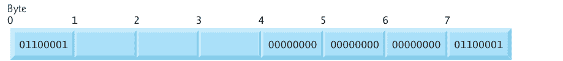

如果每个成员都从字边界开始存储，那么每个 `struct example` 变量在字节 1-3 中都有一个三字节的空洞。空洞的值是未指定的。即使 `sample1` 和 `sample2` 的成员值相等，这些空洞也不太可能包含相同的值，因此这两个结构体不一定相等。数据类型的大小和内存对齐的考虑因素是依赖于具体机器的。

## 自我检查

1.  （多选题）考虑以下 `struct name` 定义：

    ```c
    struct name {
        const char *first;
        const char *last;
    };
    ```

    下列陈述 a)、b) 或 c) 中哪一项是错误的？

    - a) 关键字 `struct` 引入结构体定义。
    - b) 结构体标签名可以与 `struct` 一起使用来声明该结构体类型的变量。
    - c) 在结构体花括号内声明的变量是结构体的成员，它们必须具有唯一的名称。
    - d) 以上所有陈述都是正确的。

    答案：d。

2.  （多选题）下列 a)、b) 或 c) 中哪一项不是可以对结构体执行的有效操作？

    - a) 将结构体变量赋值给相同类型的结构体变量。
    - b) 解引用一个结构体变量。
    - c) 访问结构体变量的成员，并使用 `sizeof` 来确定结构体变量的大小。
    - d) 以上所有陈述都是正确的。

    答案：b) 不是有效的操作。你不能解引用一个结构体，因为它不是指针，但你可以使用 `&` 获取结构体的地址。

## 10.3 初始化结构体

与数组类似，你可以通过初始化列表来初始化一个结构体变量。例如，以下语句使用类型 `struct card`（第 10.2 节）创建变量 `myCard`，并将成员 `face` 初始化为 `"Three"`，成员 `suit` 初始化为 `"Hearts"`：

```c
struct card myCard = {"Three", "Hearts"};
```

如果初始化列表中的初始化器少于成员数量，剩余的成员将自动初始化为 0 或 NULL（对于指针成员）。在函数定义外部（即外部）定义的结构体变量，如果在外部定义中没有显式初始化，则会被初始化为 0 或 NULL。你也可以将结构体变量赋值给相同类型的其他结构体变量，或者为单个结构体成员赋值。

## 自我检查

1.  （判断题）如果初始化列表中的初始化器少于结构体中的成员数量，则剩余的成员不会被初始化。
    答案：错误。实际上，它们会被初始化为 0（如果成员是指针，则初始化为 NULL）。
2.  （判断题）你可以将结构体变量赋值给相同类型的其他结构体变量，或者为单个结构体成员赋值。
    答案：正确。

## 10.4 使用 . 和 -> 访问结构体成员

你可以通过以下方式访问结构体成员：

- 结构体成员运算符（`.`），或点运算符，以及
- 结构体指针运算符（`->`），或箭头运算符。

### 结构体成员运算符 (.)

结构体成员运算符通过结构体变量名访问结构体成员。例如，使用第 10.3 节中的结构体变量 `myCard`，我们可以用以下语句打印 `suit` 成员：

```c
printf("%s", myCard.suit); // 显示 Hearts
```

### 结构体指针运算符 (->)

你可以使用结构体指针运算符——一个减号（`-`）和一个大于号（`>`），中间没有空格——通过指向结构体的指针来访问结构体成员。如果指针 `cardPtr` 指向我们之前定义的 `struct card` 对象 `myCard`，我们可以用以下语句打印其成员 `suit`：

```c
printf("%s", cardPtr->suit); // 显示 Hearts
```

表达式 `cardPtr->suit` 等价于 `(*cardPtr).suit`，后者解引用指针并使用结构体成员运算符（`.`）访问成员 `suit`。这里需要括号，因为结构体成员运算符（`.`）的优先级高于指针解引用运算符（`*`）。结构体指针运算符和结构体成员运算符具有最高优先级，并且从左到右结合，与括号（用于函数调用）和用于数组索引的方括号（`[]`）相同。

### 空格约定

不要在 `->` 和 `.`（点）运算符周围放置空格，以强调包含这些运算符的表达式本质上是单个变量名。在结构体指针运算符的 `-` 和 `>` 之间，或在任何其他多键运算符的组成部分（`?:` 除外）之间插入空格是语法错误。

### 演示结构体成员和结构体指针运算符

图 10.1 使用结构体成员和结构体指针运算符引用了结构体 `myCard` 的成员。第 16-17 行将 `"Ace"` 和 `"Spades"` 赋值给 `myCard` 的成员。第 19 行将 `myCard` 的地址赋值给 `cardPtr`。第 21-23 行使用以下方式显示 `myCard` 的成员：

- 结构体成员运算符和变量名 `myCard`，
- 结构体指针运算符和指针 `cardPtr`，以及
- 结构体成员运算符与解引用的指针 `cardPtr`。

```c
1  // fig10_01.c
2  // 结构体成员运算符和
3  // 结构体指针运算符
4  #include <stdio.h>
5
6  // card 结构体定义
7  struct card {
8      const char *face; // 定义指针 face
9      const char *suit; // 定义指针 suit
10 };
11
12 int main(void) {
13     struct card myCard; // 定义一个 struct card 变量
14
15     // 将字符串放入 myCard
16     myCard.face = "Ace";
17     myCard.suit = "Spades";
18
19     struct card *cardPtr = &myCard; // 赋值 myCard
20
21     printf("%s of %s\n", myCard.face, myCard.suit);
22     printf("%s of %s\n", cardPtr->face, cardPtr->suit);
23     printf("%s of %s\n", (*cardPtr).face, (*cardPtr).suit);
24 }
```

```
Ace of Spades
Ace of Spades
Ace of Spades
```

图 10.1 | 结构体成员运算符和结构体指针运算符。

## 自我检查

1.  （填空题）结构体成员运算符 _______ 和结构体指针运算符 _______ 可用于访问结构体成员。
    答案：`.`（点），`->`。
2.  （判断题）表达式 `cardPtr->suit` 等价于 `(*cardPtr).suit`，后者解引用指针并使用结构体成员运算符访问成员 `suit`。括号是可选的。
    答案：错误。如所示，这两个表达式是等价的。这里括号*是*必需的，因为结构体成员运算符（`.`）的优先级高于指针解引用运算符（`*`）。

## 10.5 在函数中使用结构体

使用结构体，你可以向函数传递：

- 单个结构体成员，
- 整个结构体对象，或
- 指向结构体对象的指针。

单个结构体成员和整个结构体对象是按值传递的，因此函数无法在调用者中修改它们。要按引用传递结构体，请使用结构体对象的地址。按引用传递结构体比按值传递结构体更高效，后者需要复制整个结构体。结构体对象的数组——像所有其他数组一样——是自动按引用传递的。

### 按值传递数组

在第 6 章中，我们提到你可以使用结构体来按值传递数组。为此，请创建一个包含数组成员的结构体。结构体是按值传递的，因此其成员也是按值传递的。

## 自我检查

1.  （填空题）结构体对象和单个结构体成员通过 _______ 传递给函数。
    答案：值。
2.  （讨论题）如何按值传递数组？
    答案：只需将数组放入结构体中，然后传递该结构体。结构体通常是按值传递的。

## 10.6 typedef

关键字 `typedef` 使你能够为先前定义的类型创建同义词（或别名）。它通常用于为结构体类型创建更短的名称，并简化函数指针等类型的声明。例如，以下 `typedef` 将 `Card` 定义为类型 `struct card` 的同义词：

```c
typedef struct card Card;
```

按照惯例，将 typedef 名称的首字母大写，以强调它们是其他类型名称的同义词。

你现在可以使用 Card 来声明 struct card 类型的变量。声明

```c
Card deck[52];
```

声明了一个包含 52 个 Card 结构体（即 struct card 类型的变量）的数组。使用 typedef 创建新名称*不会*创建新类型；typedef 创建的是一个替代的*类型名称*，它可以用作现有类型名称的*别名*。一个有意义的名称有助于使程序具有自解释性。例如，当我们阅读前面的声明时，我们知道“deck 是一个包含 52 张 Card 的数组。”

### 将 typedef 与结构体定义结合使用

程序员经常使用 typedef 来定义结构体类型，这样就不需要结构体标签了。例如，以下定义也创建了 Card 结构体类型：

```c
typedef struct {
    const char *face;
    const char *suit;
} Card;
```

### 内置类型的同义词

使用 typedef 有助于提高程序的可读性和可维护性。通常，typedef 用于为内置类型创建同义词。例如，一个需要四字节整数的程序可能在一个系统上使用 int 类型，在另一个系统上使用 long 类型。为可移植性而设计的程序通常使用 typedef 为四字节整数创建一个别名，例如 Integer。要将程序移植到另一个平台，你只需更改 Integer 的 typedef 并重新编译程序即可。

## 自我检查

1. （代码）编写一条 typedef 语句，为结构体类型 struct dice 创建更短的类型名称 Dice。
   **答案：** `typedef struct dice Dice;`

2. （判断题）使用 typedef 创建新名称会创建一个新类型。
   **答案：** *错误*。使用 typedef 创建新名称*不会*创建新类型。它只是创建了一个新的*类型名称*，该名称可以用作现有类型名称的*别名*。

## 10.7 随机数模拟案例研究：高性能洗牌与发牌

图 10.2 基于第 7 章的洗牌和发牌模拟。该程序将牌组表示为 Card 结构体数组，并使用高性能的洗牌和发牌算法。

490 第 10 章 结构体、联合体、位操作和枚举

```c
// fig10_02.c
// 使用结构体的洗牌和发牌程序
#include <stdio.h>
#include <stdlib.h>
#include <time.h>

#define CARDS 52
#define FACES 13

// card 结构体定义
struct card {
    const char *face; // 定义指针 face
    const char *suit; // 定义指针 suit
};

typedef struct card Card; // struct card 的新类型名称

// 函数原型
void fillDeck(Card * const deck, const char *faces[], const char *suits[]);
void shuffle(Card * const deck);
void deal(const Card * const deck);

int main(void) {
    Card deck[CARDS]; // 定义 Card 数组

    // 初始化 faces 指针数组
    const char *faces[] = { "Ace", "Deuce", "Three", "Four", "Five",
        "Six", "Seven", "Eight", "Nine", "Ten", "Jack", "Queen", "King"};

    // 初始化 suits 指针数组
    const char *suits[] = { "Hearts", "Diamonds", "Clubs", "Spades"};

    srand(time(NULL)); // 随机化

    fillDeck(deck, faces, suits); // 用 Card 填充牌组
    shuffle(deck); // 将 Card 随机排序
    deal(deck); // 发出所有 52 张 Card
}

// 将字符串放入 Card 结构体
void fillDeck(Card * const deck, const char * faces[],
    const char * suits[]) {
    // 遍历牌组
    for (size_t i = 0; i < CARDS; ++i) {
        deck[i].face = faces[i % FACES];
        deck[i].suit = suits[i / FACES];
    }
}
```

图 10.2 | 使用结构体的洗牌和发牌程序。（第 1 部分，共 2 部分）

## 10.7 高性能洗牌与发牌

```c
// 洗牌
void shuffle(Card * const deck) {
    // 遍历牌组，随机交换 Card
    for (size_t i = 0; i < CARDS; ++i) {
        size_t j = rand() % CARDS;
        Card temp = deck[i];
        deck[i] = deck[j];
        deck[j] = temp;
    }
}

// 发牌
void deal(const Card * const deck) {
    // 遍历牌组
    for (size_t i = 0; i < CARDS; ++i) {
        printf("%5s of %-8s%s", deck[i].face, deck[i].suit,
            (i + 1) % 4 ? " " : "\n");
    }
}
```

图 10.2 | 使用结构体的洗牌和发牌程序。（第 2 部分，共 2 部分）

第 35 行调用函数 fillDeck（第 41-48 行）来按顺序初始化 Card 数组，包含每种花色的“Ace”到“King”。第 36 行将 Card 数组传递给函数 shuffle（第 51-59 行），该函数实现了高性能的洗牌算法。函数 shuffle 接受一个包含 52 张 Card 的数组作为参数。该函数遍历这 52 张 Card。对于每张 Card，算法选择一个 0 到 51 之间的随机数，然后交换当前 Card 和随机选中的 Card。该算法在单次遍历整个数组的过程中执行了 52 次交换，Card 数组就被洗好了！这个算法不会像第 7 章的洗牌算法那样遭受无限期延迟。Card 是在数组中就地交换的，因此函数 deal（第 62-68 行）中的高性能发牌算法只需一次遍历数组就能发出洗好的牌。

492 第 10 章 结构体、联合体、位操作和枚举

### 相关练习——Fisher-Yates 洗牌算法

建议你在真实的纸牌游戏中使用无偏洗牌算法。这种算法确保所有可能的洗牌序列出现的概率相等。练习 10.18 要求你研究流行的无偏 Fisher-Yates 洗牌算法，并用它来重新实现图 10.2 中的 shuffle 函数。

## 自我检查

1. （代码）重写以下代码，避免单独的 typedef 语句：

```c
struct name {
    const char *first;
    const char *last;
};
typedef struct name Name;
```

答案：

```c
typedef struct name {
    const char *first;
    const char *last;
} Name;
```

2. （代码）修正以下代码，该代码旨在交换 Card 数组 deck 中的元素 i 和 j：

```c
deck[i] = deck[j];
deck[j] = deck[i];
```

答案：

```c
Card temp = deck[i];
deck[j] = deck[i];
deck[i] = temp;
```

3. （讨论）为什么我们在第 7 章介绍的洗牌算法会遭受无限期延迟？为什么本章的洗牌算法不会遭受无限期延迟？

答案：第 7 章的洗牌和发牌示例使用了一个 4x13 的数组来表示牌组中的四种花色和 13 个点数。洗牌算法使用哨兵控制的循环将 1-52（代表发牌顺序）放入随机选择的行和列中。如果随机选择的单元格已经包含这些值之一，该循环可能会无限期执行。本章的洗牌算法使用计数器控制的迭代来遍历一维数组一次。循环为每张牌迭代一次，然后终止，因此它不会遭受无限期延迟。

## 10.8 联合体

与结构体类似，联合体是一种派生数据类型，但其成员共享相同的内存。在程序执行的不同时间，当某些变量不相关时，其他变量可能是相关的。因此，联合体共享空间，而不是在未使用的变量上浪费存储空间。联合体的成员可以是任何类型。存储联合体所需的字节数必须至少足以容纳其最大的成员。

在大多数情况下，联合体包含两个或更多不同类型的项。一次只能引用一个成员——因此只能引用一种类型。你有责任使用正确的类型来引用数据。使用错误类型的变量引用当前存储的数据是逻辑错误——结果是依赖于实现的。

### 联合体的可移植性

存储联合体所需的内存量是依赖于实现的。运算符 sizeof 总是返回一个至少与联合体最大成员的字节大小一样大的值。某些联合体可能不容易在计算机系统之间移植。联合体是否可移植通常取决于给定系统上联合体成员类型的内存对齐要求。

### 10.8.1 联合体声明

以下联合体有两个成员——int x 和 double y：

```c
union number {
    int x;
    double y;
};
```

联合体定义通常放在头文件中，并包含在所有使用该联合体类型的源文件中。与结构体定义一样，联合体定义只是创建了一个新类型。在你使用该类型创建变量之前，它不会保留任何内存。

### 10.8.2 允许的联合体操作

可以对联合体执行的操作包括：

- 将一个联合体赋值给另一个相同类型的联合体，
- 获取联合体变量的地址（&），
- 通过结构体成员运算符（.）和结构体指针运算符（->）访问联合体成员，以及
- 对联合体进行零初始化。

两个联合体不能使用运算符 == 和 != 进行比较，原因与两个结构体不能比较相同。

### 10.8.3 在声明中初始化联合体

你可以在声明中使用联合体第一个成员类型的值来初始化联合体。第 10.8.1 节中的联合体 number 的第一个成员是 int，因此我们可以使用以下语句初始化该类型的对象：

```c
union number value = {10};
```

如果你用 double 初始化对象，如

```c
union number value = {1.43};
```

C 语言将截断初始化值的浮点部分——一些编译器会对此发出警告。

### 10.8.4 演示联合体

图10.3展示了一个名为`value`（第12行）的联合体数字变量，它既可以作为`int`类型也可以作为`double`类型。该程序的输出取决于具体实现。

```c
// fig10_03.c
// 以两种成员数据类型显示联合体的值
#include <stdio.h>

// number联合体定义
union number {
    int x;
    double y;
};

int main(void) {
    union number value; // 定义一个联合体变量

    value.x = 100; // 将一个int值放入联合体
    puts("将100放入int成员并打印两个成员：");
    printf("int: %d\ndouble: %.2f\n\n", value.x, value.y);

    value.y = 100.0; // 将一个double值放入同一个联合体
    puts("将100.0放入double成员并打印两个成员：");
    printf("int: %d\ndouble: %.2f\n\n", value.x, value.y);
}
```

Microsoft Visual Studio

```
将100放入int成员并打印两个成员：
int: 100
double: -92559592117433135502616407313071917486139351398276445610442752.00

将100.0放入double成员并打印两个成员：
int: 0
double: 100.00
```

GNU GCC 和 Apple Xcode

```
将100放入int成员并打印两个成员：
int: 100
double: 0.00

将100.0放入double成员并打印两个成员：
int: 0
double: 100.00
```

图 10.3 | 以两种成员数据类型显示联合体的值。

## 自我检查

1.  （讨论）与结构体类似，联合体也是一种派生数据类型。联合体与结构体有何不同？

    答案：联合体在其所有成员之间共享内存。在任何时刻，联合体中只能存储一个成员。你必须跟踪当前存储的是哪个成员。

2.  （判断题）以下联合体定义表明`number`是一个包含成员`int x`和`double y`的联合体类型：

    ```c
    union number {
        int x;
        double y;
    };
    ```

    对于一个拥有4字节`int`和8字节`double`的机器，编译器必须为这种联合体类型的变量预留至少12字节的空间。

    答案：错误。这些成员中同一时间只有一个处于活动状态，因此联合体只需要预留与最大成员所需存储空间一样大的空间——在这个例子中是8字节。

## 10.9 位运算符

计算机在内部将所有数据表示为比特序列。每个比特可以取值为0或1。在大多数系统中，八个比特构成一个字节——这是`char`变量的典型存储单元。位运算符用于操作整型操作数（包括有符号和无符号）的比特，尽管通常使用无符号整数。位数据操作是依赖于机器的。下表总结了位运算符。

| 运算符 | 描述 |
| :--- | :--- |
| & 按位与 | 逐位比较其两个操作数。如果两个操作数中对应的位都为1，则结果中的位设置为1。 |
| \| 按位或 | 逐位比较其两个操作数。如果两个操作数中对应的位至少有一个为1，则结果中的位设置为1。 |
| ^ 按位异或 | 逐位比较其两个操作数。如果两个操作数中对应的位不同，则结果中的位设置为1。 |
| << 左移 | 将第一个操作数的位左移第二个操作数指定的位数；从右侧用0位填充。 |
| >> 右移 | 将第一个操作数的位右移第二个操作数指定的位数；当左操作数为负数时，从左侧填充的方法是依赖于机器的。 |
| ~ 按位取反 | 所有0位设置为1，所有1位设置为0。这通常称为翻转比特。 |

每个位运算符的详细讨论将在后续示例中进行。这些示例展示了整型操作数的二进制表示。

### 10.9.1 显示无符号整数的比特

使用位运算符时，以二进制形式显示值¹以展示每个运算符的精确效果是很有用的。图10.4以二进制表示打印一个无符号整数，为了可读性使用了八位分组。我们用于测试这些示例的所有编译器都将无符号整数存储在4字节（32位）的内存中。

```c
// fig10_04.c
// 以比特形式显示无符号整数
#include <stdio.h>

void displayBits(unsigned int value); // 原型

int main(void) {
    unsigned int x = 0; // 用于保存用户输入的变量

    printf("%s", "Enter a nonnegative int: ");
    scanf("%u", &x);
    displayBits(x);
}

// 显示无符号整数值的比特
void displayBits(unsigned int value) {
    // 定义displayMask并左移31位
    unsigned int displayMask = 1 << 31;

    printf("%10u = ", value);

    // 遍历比特
    for (unsigned int c = 1; c <= 32; ++c) {
        putchar(value & displayMask ? '1' : '0');
        value <<= 1; // 将value左移1位

        if (c % 8 == 0) { // 每8位后输出空格
            putchar(' ');
        }
    }

    putchar('\n');
}
```

> Enter a nonnegative int: 65000
> 65000 = 00000000 00000000 11111101 11101000

图 10.4 | 以比特形式显示无符号整数。

1.  关于二进制（基数为2）数制系统的详细解释，请参见在线附录E。

#### 显示整数的比特

函数`displayBits`（第16-33行）使用按位与运算符将变量`value`与变量`displayMask`（第24行）组合。通常，按位与运算符与一个称为**掩码**的操作数一起使用——掩码是一个特定比特被设置为1的整数值。掩码用于隐藏值中的某些比特，同时选择其他比特。在函数`displayBits`中，第18行将掩码变量`displayMask`赋值为

```
1 << 31 (10000000 00000000 00000000 00000000)
```

左移运算符将值1从`displayMask`的低位（最右）比特移到高位（最左）比特，并从右侧填充0位。第24行

```c
putchar(value & displayMask ? '1' : '0');
```

确定为`value`的当前最左比特显示1还是0。使用&将`value`和`displayMask`组合会“掩码掉”（隐藏）`value`中除高位比特外的所有比特——任何与0进行“与”运算的比特结果都是0。如果最左比特是1，`value & displayMask`的计算结果为非零（真）值，第24行显示1；否则，显示0。第25行使用表达式`value <<= 1`将变量`value`左移一位。函数`displayBits`对`value`中的每个比特重复这些步骤。将逻辑与运算符（&&）用于按位与运算符（&）——反之亦然——是一个逻辑错误。下表总结了使用按位与运算符组合两个比特的结果。

| 比特1 | 比特2 | 比特1 & 比特2 |
| :---: | :---: | :---: |
| 0 | 0 | 0 |
| 0 | 1 | 0 |
| 1 | 0 | 0 |
| 1 | 1 | 1 |

### 10.9.2 使函数displayBits更通用和可移植

在图10.4的第18行，我们硬编码了整数31，表示值1应被移到变量`displayMask`的最左比特。类似地，在第23行，我们硬编码了整数32，表示循环应迭代32次，每次处理`value`中的一个比特。我们假设无符号整数总是存储在32位（四字节）的内存中。当今流行的计算机通常使用32位或64位字长的硬件架构。作为C程序员，你将倾向于在多种硬件架构上工作，有时无符号整数将存储在更少或更多的比特中。

可以通过将整数31（第18行）和32（第23行）替换为基于给定平台无符号整数大小计算这些整数的表达式，使图10.4更通用和可移植。符号常量`CHAR_BIT`（在`<limits.h>`中定义）表示一个字节中的比特数（通常为8）。回想一下，`sizeof`确定存储一个对象或类型所使用的字节数。表达式`sizeof(unsigned int)`对于32位无符号整数计算结果为4，对于64位无符号整数计算结果为8。你可以将31替换为

```
CHAR_BIT * sizeof(unsigned int) - 1
```

并将32替换为
`CHAR_BIT * sizeof(unsigned int)`
对于32位无符号整数，这些表达式的结果分别为31和32。对于64位无符号整数，结果分别为63和64。

### 10.9.3 使用按位与、按位或、按位异或和按位取反运算符

图10.5演示了按位与、按位或、按位异或和按位取反运算符。程序使用函数`displayBits`（第45-62行）来显示无符号整数值。

```c
// fig10_05.c
// 使用按位与、按位或、按位异或和按位取反运算符
#include <stdio.h>

void displayBits(unsigned int value); // 函数原型

int main(void) {
    // 演示按位与 (&)
    unsigned int number1 = 65535;
    unsigned int mask = 1;
    puts("The result of combining the following");
    displayBits(number1);
    displayBits(mask);
    puts("using the bitwise AND operator & is");
    displayBits(number1 & mask);

    // 演示按位或 (|)
    number1 = 15;
    unsigned int setBits = 241;
    puts("\nThe result of combining the following");
    displayBits(number1);
    displayBits(setBits);
    puts("using the bitwise inclusive OR operator | is");
    displayBits(number1 | setBits);

    // 演示按位异或 (^)
    number1 = 139;
    unsigned int number2 = 199;
    puts("\nThe result of combining the following");
    displayBits(number1);
    displayBits(number2);
    puts("using the bitwise exclusive OR operator ^ is");
    displayBits(number1 ^ number2);

    // 演示按位取反 (~)
    number1 = 21845;
    puts("\nThe one");
    displayBits(number1);
    puts("is");
    displayBits(~number1);
}

// 显示无符号整数值的二进制位
void displayBits(unsigned int value) {
    // 声明显示掩码并左移31位
    unsigned int displayMask = 1 << 31;

    printf("%10u = ", value);

    // 循环处理每一位
    for (unsigned int c = 1; c <= 32; ++c) {
        putchar(value & displayMask ? '1' : '0');
        value <<= 1; // 将值左移1位

        if (c % 8 == 0) { // 每8位后输出一个空格
            putchar(' ');
        }
    }

    putchar('\n');
}
```

图 10.5 | 使用按位与、按位或、按位异或和按位取反运算符。（第1部分，共2部分。）

```
The result of combining the following
    65535 = 00000000 00000000 11111111 11111111
         1 = 00000000 00000000 00000000 00000001
using the bitwise AND operator & is
         1 = 00000000 00000000 00000000 00000001

The result of combining the following
    15 = 00000000 00000000 00000000 00001111
   241 = 00000000 00000000 00000000 11110001
using the bitwise inclusive OR operator | is
   255 = 00000000 00000000 00000000 11111111

The result of combining the following
   139 = 00000000 00000000 00000000 10001011
   199 = 00000000 00000000 00000000 11000111
using the bitwise exclusive OR operator ^ is
    76 = 00000000 00000000 00000000 01001100

The one
 21845 = 00000000 00000000 01010101 01010101
is
4294945450 = 11111111 11111111 10101010 10101010
```

图 10.5 | 使用按位与、按位或、按位异或和按位取反运算符。（第2部分，共2部分。）

500 第10章 结构体、联合体、位操作和枚举

#### 按位与运算符 (&)

第10行将值65535
00000000 00000000 11111111 11111111
赋给整型变量`number1`，第11行将值1
00000000 00000000 00000000 00000001
赋给变量`mask`。当你在表达式`number1 & mask`（第16行）中使用按位与运算符（&）组合`number1`和`mask`时，结果为
00000000 00000000 00000000 00000001
`number1`中除最低位外的所有位都被变量`mask`“与”操作“屏蔽掉”（隐藏）了。

#### 按位或运算符 (|)

按位或运算符将操作数中的特定位置为1。第19行将15
00000000 00000000 00000000 00001111
赋给变量`number1`，第20行将241
00000000 00000000 00000000 11110001
赋给变量`setBits`。当你在表达式`number1 | setBits`（第25行）中使用按位或运算符组合`number1`和`setBits`时，结果为255
00000000 00000000 00000000 11111111
下表总结了使用按位或运算符组合两个位的结果。

| 位 1 | 位 2 | 位 1 \| 位 2 |
|---|---|---|
| 0 | 0 | 0 |
| 0 | 1 | 1 |
| 1 | 0 | 1 |
| 1 | 1 | 1 |

#### 按位异或运算符 (^)

按位异或运算符（^）在两个操作数的对应位中恰好有一个为1时，将结果中的该位设置为1。第28行将`number1`赋值为139
00000000 00000000 00000000 10001011
第29行将`number2`赋值为199
00000000 00000000 00000000 11000111
当你在表达式`number1 ^ number2`（第34行）中使用按位异或运算符组合这些变量时，结果为
00000000 00000000 00000000 01001100

下表总结了使用按位异或运算符组合两个位的结果。

| 位 1 | 位 2 | 位 1 ^ 位 2 |
|---|---|---|
| 0 | 0 | 0 |
| 0 | 1 | 1 |
| 1 | 0 | 1 |
| 1 | 1 | 0 |

#### 按位取反运算符 (~)

按位取反运算符（~）将其操作数中的所有1位在结果中设置为0，并将所有0位设置为1。这通常被称为“取值的二进制反码”。第37行将`number1`赋值为21845
00000000 00000000 01010101 01010101
表达式`~number1`（第41行）翻转所有位，产生
11111111 11111111 10101010 10101010

### 10.9.4 使用按位左移和右移运算符

图10.6演示了左移（<<）和右移（>>）运算符。同样，我们使用函数`displayBits`来显示无符号整数值。

```c
// fig10_06.c
// 使用按位移位运算符
#include <stdio.h>

void displayBits(unsigned int value); // 函数原型

int main(void) {
    unsigned int number1 = 960; // 初始化number1

    // 演示按位左移
    puts("\nThe result of left shifting");
    displayBits(number1);
    puts("8 bit positions using the left shift operator << is");
    displayBits(number1 << 8);

    // 演示按位右移
    puts("\nThe result of right shifting");
    displayBits(number1);
    puts("8 bit positions using the right shift operator >> is");
    displayBits(number1 >> 8);
}
```

图 10.6 | 使用按位移位运算符。（第1部分，共2部分。）

# 第10章 结构体、联合体、位操作和枚举

```c
// 显示无符号整数值的二进制位
void displayBits(unsigned int value) {
    // 声明显示掩码并左移31位
    unsigned int displayMask = 1 << 31;

    printf("%10u = ", value);

    // 循环处理每一位
    for (unsigned int c = 1; c <= 32; ++c) {
        putchar(value & displayMask ? '1' : '0');
        value <<= 1; // 将值左移1位

        if (c % 8 == 0) { // 每8位后输出一个空格
            putchar(' ');
        }
    }

    putchar('\n');
}
```

```
The result of left shifting
    960 = 00000000 00000000 00000011 11000000
8 bit positions using the left shift operator << is
    245760 = 00000000 00000011 11000000 00000000

The result of right shifting
    960 = 00000000 00000000 00000011 11000000
8 bit positions using the right shift operator >> is
    3 = 00000000 00000000 00000000 00000011
```

图 10.6 | 使用按位移位运算符。（第2部分，共2部分。）

#### 左移运算符 (<<)

左移运算符（<<）将其左操作数的位向左移动右操作数指定的位数。右侧空出的位用0填充。从左侧移出的位将丢失。第8行将变量`number1`赋值为960
00000000 00000000 00000011 11000000
使用表达式`number1 << 8`（第14行）将`number1`左移八位，结果为值245760
00000000 00000011 11000000 00000000

#### 右移运算符 (>>)

右移运算符（>>）将其左操作数的位向右移动右操作数指定的位数。对无符号整数进行右移时，左侧空出的位用0填充。从右侧移出的位将丢失。使用表达式`number1 >> 8`（第20行）对`number1`进行右移的结果为3
00000000 00000000 00000000 00000011

如果右操作数为负数或大于左操作数的位数，则右移或左移操作的结果是未定义的。对负数进行右移操作的结果是实现定义的。

### 10.9.5 位赋值运算符

每个二进制位运算符都有一个对应的赋值运算符。下表总结了这些位赋值运算符。

| 运算符 | 描述 |
| :--- | :--- |
| &= | 按位与赋值运算符。 |
| \|= | 按位或赋值运算符。 |
| ^= | 按位异或赋值运算符。 |
| <<= | 左移赋值运算符。 |
| >>= | 右移赋值运算符。 |

下表按优先级从高到低的顺序，列出了本文至此介绍的运算符的优先级和结合性。

| 运算符 | 结合性 | 类型 |
| :--- | :--- | :--- |
| () [] . -> ++ (后缀) -- (后缀) | 从左到右 | 最高 |
| + - ++ -- ! & * ~ sizeof (type) | 从右到左 | 一元 |
| * / % | 从左到右 | 乘法 |
| + - | 从左到右 | 加法 |
| << >> | 从左到右 | 移位 |
| < <= > >= | 从左到右 | 关系 |
| == != | 从左到右 | 相等 |
| & | 从左到右 | 按位与 |
| ^ | 从左到右 | 按位异或 |
| \| | 从左到右 | 按位或 |
| && | 从左到右 | 逻辑与 |
| \|\| | 从左到右 | 逻辑或 |
| ?: | 从左到右 | 条件 |
| = += -= *= /= %= &= \|= ^= <<= >>= | 从左到右 | 赋值 |
| , | 从左到右 | 逗号 |

## 自我检查

**1** (填空) 通常，按位与运算符与一个称为______的操作数一起使用，该操作数是一个特定位被设置为1的整数值。这用于隐藏值中的某些位，同时选择其他位。
**答案：** 掩码。

**2** (判断题) 按位异或运算符在任一（或两个）操作数的对应位为1时，将结果中的对应位设置为1。
**答案：** 错误。实际上，上述描述的是按位或运算符。按位异或运算符在两个操作数的对应位不同时，将结果中的对应位设置为1。

**3** (填空) 按位取反运算符将其操作数中的所有0位在结果中设置为1，并将所有1位设置为0。这通常称为______位。
**答案：** 翻转。

**4** (判断题) 由于位操作的机器依赖性，包含它们的程序可能无法正确工作，或者在不同系统上可能表现不同。
**答案：** 正确。

## 10.10 位域

你可以指定用于存储结构体或联合体中无符号或有符号整型成员的位数。这些被称为位域，它们通过以最少的位数存储数据来实现更好的内存利用。位域成员通常声明为 `int` 或 `unsigned int`。

### 10.10.1 定义位域

以下结构体 `bitCard`

```c
struct bitCard {
    unsigned int face : 4;
    unsigned int suit : 2;
    unsigned int color : 1;
};
```

包含三个 `unsigned int` 位域——`face`、`suit` 和 `color`——它们可以表示一副52张牌中的一张牌。你通过在无符号或有符号整型成员名称后跟一个冒号 (`:`) 和一个表示位域宽度（存储成员所需的位数）的整型常量来声明位域。宽度必须是0到你的系统上用于存储 `int` 的总位数之间（包含两端）的整型常量。我们的示例是在一台具有四字节（32位）整数的计算机上测试的。

前面的结构体定义表明成员 `face`、`suit` 和 `color` 分别存储在4位、2位和1位中。位数是基于每个成员所需的值范围确定的：

- `face` 存储从0（A）到12（K）的值——4位可以存储0–15范围内的值，
- `suit` 存储从0到3的值（0 = 红心，1 = 方块，2 = 梅花，3 = 黑桃）——2位可以存储0–3范围内的值，以及
- `color` 存储0（红色）或1（黑色）——1位可以存储0或1。

### 10.10.2 使用位域表示牌的点数、花色和颜色

图10.7在第19行创建了包含52个 `struct bitCard` 结构体的数组 `deck`。函数 `fillDeck`（第30–37行）将52张牌插入 `deck` 数组，函数 `deal`（第41–49行）打印这52张牌。请注意，结构体的位域成员的访问方式与任何其他结构体成员完全相同。

```c
// fig10_07.c
// 使用结构体中的位域表示牌
#include <stdio.h>
#define CARDS 52

// 带位域的 bitCard 结构体定义
struct bitCard {
    unsigned int face : 4; // 4位；0-15
    unsigned int suit : 2; // 2位；0-3
    unsigned int color : 1; // 1位；0-1
};

typedef struct bitCard Card; // struct bitCard 的新类型名

void fillDeck(Card * const deck); // 原型
void deal(const Card * const deck); // 原型

int main(void) {
    Card deck[CARDS]; // 创建 Card 数组

    fillDeck(deck);

    puts("牌值 0-12 对应 A 到 K");
    puts("花色值 0-3 对应红心、方块、梅花和黑桃");
    puts("颜色值 0-1 对应红色和黑色\n");
    deal(deck);
}

// 初始化 Card
void fillDeck(Card * const deck) {
    // 遍历 deck
    for (size_t i = 0; i < CARDS; ++i) {
        deck[i].face = i % (CARDS / 4);
        deck[i].suit = i / (CARDS / 4);
        deck[i].color = i / (CARDS / 2);
    }
}

// 以两列格式输出牌；牌 0-25 用 k1（第1列）索引；
// 牌 26-51 用 k2（第2列）索引
void deal(const Card * const deck) {
    // 遍历 deck
    for (size_t k1 = 0, k2 = k1 + 26; k1 < CARDS / 2; ++k1, ++k2) {
        printf("牌:%3d  花色:%2d  颜色:%2d   ",
            deck[k1].face, deck[k1].suit, deck[k1].color);
        printf("牌:%3d  花色:%2d  颜色:%2d\n",
            deck[k2].face, deck[k2].suit, deck[k2].color);
    }
}
```

图 10.7 | 使用结构体中的位域表示牌。（第1部分，共2部分。）

```
牌值 0-12 对应 A 到 K
花色值 0-3 对应红心、方块、梅花和黑桃
颜色值 0-1 对应红色和黑色

牌:  0  花色: 0  颜色: 0    牌:  0  花色: 2  颜色: 1
牌:  1  花色: 0  颜色: 0    牌:  1  花色: 2  颜色: 1
牌:  2  花色: 0  颜色: 0    牌:  2  花色: 2  颜色: 1
牌:  3  花色: 0  颜色: 0    牌:  3  花色: 2  颜色: 1
牌:  4  花色: 0  颜色: 0    牌:  4  花色: 2  颜色: 1
牌:  5  花色: 0  颜色: 0    牌:  5  花色: 2  颜色: 1
牌:  6  花色: 0  颜色: 0    牌:  6  花色: 2  颜色: 1
牌:  7  花色: 0  颜色: 0    牌:  7  花色: 2  颜色: 1
牌:  8  花色: 0  颜色: 0    牌:  8  花色: 2  颜色: 1
牌:  9  花色: 0  颜色: 0    牌:  9  花色: 2  颜色: 1
牌: 10  花色: 0  颜色: 0    牌: 10  花色: 2  颜色: 1
牌: 11  花色: 0  颜色: 0    牌: 11  花色: 2  颜色: 1
牌: 12  花色: 0  颜色: 0    牌: 12  花色: 2  颜色: 1
牌:  0  花色: 1  颜色: 0    牌:  0  花色: 3  颜色: 1
牌:  1  花色: 1  颜色: 0    牌:  1  花色: 3  颜色: 1
牌:  2  花色: 1  颜色: 0    牌:  2  花色: 3  颜色: 1
牌:  3  花色: 1  颜色: 0    牌:  3  花色: 3  颜色: 1
牌:  4  花色: 1  颜色: 0    牌:  4  花色: 3  颜色: 1
牌:  5  花色: 1  颜色: 0    牌:  5  花色: 3  颜色: 1
牌:  6  花色: 1  颜色: 0    牌:  6  花色: 3  颜色: 1
牌:  7  花色: 1  颜色: 0    牌:  7  花色: 3  颜色: 1
牌:  8  花色: 1  颜色: 0    牌:  8  花色: 3  颜色: 1
牌:  9  花色: 1  颜色: 0    牌:  9  花色: 3  颜色: 1
牌: 10  花色: 1  颜色: 0    牌: 10  花色: 3  颜色: 1
牌: 11  花色: 1  颜色: 0    牌: 11  花色: 3  颜色: 1
牌: 12  花色: 1  颜色: 0    牌: 12  花色: 3  颜色: 1
```

图 10.7 | 使用结构体中的位域表示牌。（第2部分，共2部分。）

性能 位域可以减少程序所需的内存，但它们是机器相关的。尽管位域节省空间，但使用它们可能导致编译器生成执行速度较慢的机器语言代码。这是因为访问可寻址存储单元的部分内容需要额外的机器语言操作。

性能 这是计算机科学中出现的众多空间/时间权衡示例之一。

错误 位域没有地址，因此尝试使用 `&` 运算符获取位域的地址是错误的。此外，对位域使用 `sizeof` 也是错误的。

### 10.10.3 未命名位字段

未命名位字段在结构体中用作填充。例如，以下定义

```c
struct example {
    unsigned int a : 13;
    unsigned int   : 19;
    unsigned int b : 4;
};
```

使用了一个未命名的19位字段作为填充。这19位中不能存储任何数据。成员b（假设在四字节字长的计算机上）存储在单独的内存字中。

宽度为零的未命名位字段会将下一个位字段对齐到新的存储单元边界。例如，结构体

```c
struct example {
    unsigned int a : 13;
    unsigned int   : 0;
    unsigned int   : 4;
};
```

使用了一个未命名的0位字段来跳过a所在存储单元的剩余位（无论有多少），并将b对齐到下一个存储单元边界。

## 自我检查

1. （填空）结构体定义

```c
struct example {
    unsigned int a : 13;
    unsigned int   : 19;
    unsigned int b : 4;
};
```

使用了一个未命名的19位字段作为________——这19位中不能存储任何数据。
答案：填充。

2. （多选）关于第10.10.1节的struct bitCard，以下哪项陈述a)、b)或c)是错误的？

- a) 位字段是通过在unsigned或signed整型成员名后跟一个冒号(:)和一个表示位字段宽度的整型常量来声明的。
- b) struct bitCard的定义表明成员face存储在4位中，成员suit存储在2位中，成员color存储在1位中。
- c) 位字段中的位数基于每个结构体成员所需的值范围。
- d) 以上所有陈述都是正确的。

答案：d。

## 10.11 枚举常量

第5.11节介绍了关键字`enum`，用于定义一组由标识符表示的整型枚举常量。枚举中的值从0开始（除非另有指定），并以1递增。例如，枚举

```c
enum months {
    JAN, FEB, MAR, APR, MAY, JUN, JUL, AUG, SEP, OCT, NOV, DEC
};
```

创建了新类型`enum months`，其中标识符被设置为整数0到11。要将月份编号为1到12，请使用：

```c
enum months {
    JAN = 1, FEB, MAR, APR, MAY, JUN, JUL, AUG, SEP, OCT, NOV, DEC
};
```

这显式地将JAN设置为1。其余的值从1开始递增，结果为1到12。

在给定作用域中可访问的任何枚举中的标识符必须是唯一的。每个枚举常量的值可以在定义中通过为标识符赋值来显式设置。多个枚举成员可以具有相同的常量值。

**ERR ⊗** 在枚举常量定义后为其赋值是语法错误。你应该只在枚举常量名称中使用大写字母，以使它们在程序中突出显示，并提醒你枚举常量不是变量。

图10.8在`for`语句中使用枚举变量`month`，从数组`monthName`中打印一年中的月份。我们将`monthName[0]`设置为空字符串`""`，并在本例中忽略它。

```c
// fig10_08.c
// 使用枚举
#include <stdio.h>

// 枚举常量表示一年中的月份
enum months {
    JAN = 1, FEB, MAR, APR, MAY, JUN, JUL, AUG, SEP, OCT, NOV, DEC
};

int main(void) {
    // 初始化指针数组
    const char *monthName[] = { "", "January", "February", "March",
        "April", "May", "June", "July", "August", "September", "October",
        "November", "December" };

    // 循环遍历月份
    for (enum months month = JAN; month <= DEC; ++month) {
        printf("%2d%11s\n", month, monthName[month]);
    }
}
```

```
 1   January
 2  February
 3     March
 4     April
 5       May
 6      June
 7       July
 8       August
 9       September
10      October
11      November
12      December
```

图 10.8 | 使用枚举。

## 自我检查

1. （代码）以下枚举创建了一个新类型`enum days`，其中标识符被设置为整数0到6：

```c
enum days {
    MON, TUE, WED, THU, FRI, SAT, SUN
};
```

重写此枚举，将星期编号为1到7。
答案：

```c
enum days {
    MON = 1, TUE, WED, THU, FRI, SAT, SUN
};
```

2. （判断题）同一作用域中的多个枚举常量可以具有相同的标识符。
答案：错误。实际上，在同一作用域中可访问的任何枚举中的标识符必须是唯一的。枚举的多个成员可以具有相同的常量值。

## 10.12 匿名结构体和联合体

匿名结构体和联合体可以嵌套在命名的结构体和联合体中。嵌套的匿名结构体或联合体中的成员是外部结构体或联合体的成员。它们可以通过外部类型的对象直接访问。例如，考虑以下结构体声明：

```c
struct myStruct {
    int member1;
    int member2;

    struct { // 匿名结构体
        int nestedMember1;
        int nestedMember2;
    }; // 嵌套结构体结束
}; // 外部结构体结束
```

对于名为`object`的`struct myStruct`变量，你可以这样访问成员：

```c
object.member1;
object.member2;
object.nestedMember1;
object.nestedMember2;
```

## 自我检查

1. （判断题）嵌套的匿名结构体或联合体中的成员是外部结构体或联合体的成员。它们可以通过外部类型的对象直接访问。
答案：正确。

## 10.13 安全的C编程

各种CERT指南和规则适用于本章的主题。有关每个主题的更多信息，请访问 https://wiki.sei.cmu.edu/。

### 结构体的CERT指南

正如我们在第10.2.4节中讨论的，结构体成员的边界对齐要求可能导致你创建的每个结构体变量包含额外的未定义数据字节。以下每条指南都与此问题相关：

- EXP03-C：由于边界对齐要求，结构体变量的大小不一定等于其成员大小之和。始终使用`sizeof`来确定结构体变量的字节数。我们将使用此技术来操作写入和读取文件的固定长度记录（第11章）以及创建自定义数据结构（第12章）。
- EXP04-C：第10.2.4节讨论了结构体变量不能进行相等或不等比较，因为它们可能包含未定义数据的字节。因此，你必须比较它们的各个成员。
- DCL39-C：在结构体变量中，未定义的额外字节可能包含安全数据——这些数据是这些内存位置先前使用时遗留下来的——不应该被访问。此CERT指南讨论了特定于编译器的机制，用于打包数据以消除这些额外字节。

### typedef的CERT指南

- DCL05-C：复杂的类型声明，例如函数指针的声明，可能难以阅读。你应该使用`typedef`来创建自文档化的类型名称，使你的程序更具可读性。

### 位操作的CERT指南

- INT02-C：由于整型提升规则（在第5.6节中讨论），对小于`int`的整型执行位运算可能导致意外结果。需要显式强制转换以确保结果正确。
- INT13-C：对有符号整型进行的一些位运算是实现定义的——这意味着这些运算在不同的C编译器中可能有不同的结果。因此，应使用无符号整型进行位运算。
- EXP46-C：逻辑运算符`&&`和`||`经常与位运算符`&`和`|`混淆。在条件表达式的条件（?:）中使用`&`和`|`可能导致意外行为，因为`&`和`|`运算符不使用短路求值。

### 枚举的CERT指南

- INT09-C：允许多个枚举常量具有相同的值可能导致难以发现的逻辑错误。在大多数情况下，枚举的每个枚举常量应具有唯一的值，以帮助防止此类逻辑错误。

## 自我检查

1. （填空）结构体变量不能进行相等或不等比较，因为它们可能包含未定义数据的字节。相反，你必须________。
答案：比较它们的各个成员。

2. （判断题）允许多个枚举常量具有相同的值可能导致难以发现的逻辑错误。在大多数情况下，枚举的每个枚举常量应具有唯一的值，以帮助防止此类逻辑错误。
答案：正确。

## 总结

### 第10.1节 引言

- 结构体（第482页）是在一个名称下相关变量的集合。它们可以包含许多不同数据类型的变量。
- 结构体通常用于定义要存储在文件中的记录。
- 指针和结构体可用于形成更复杂的数据结构，如链表、队列、栈和树。

### 第10.2节 结构体定义

- 关键字`struct`引入结构体定义（第483页）。
- 关键字`struct`之后的结构体标签（第483页）命名结构体定义。它与关键字`struct`一起用于声明`struct`类型的变量。
- 在`struct`定义的花括号内声明的变量是结构体的成员。
- 同一结构体类型的成员必须具有唯一的名称。
- 每个结构体定义必须以分号结尾。
- 结构体成员可以是基本数据类型或聚合数据类型。
- 结构体不能包含自身的实例，但可以包含指向其类型的指针。
- 包含指向同一结构体类型的指针成员的结构体被称为自引用结构体。自引用结构体（第483页）用于构建链接数据结构。
- 结构体定义创建新的数据类型，用于定义变量。
- 可以通过将逗号分隔的变量名列表放在结构体定义的右花括号和结束分号之间来声明给定结构体类型的变量。

## 第10.3节 结构体的初始化

- 结构体可以使用初始化列表进行初始化。
- 如果列表中的初始化项少于结构体中的成员数，则剩余成员将自动初始化为0（如果成员是指针，则初始化为NULL）。
- 在函数定义外部定义的结构体变量，如果在外部定义中未显式初始化，其成员将初始化为0或NULL。

## 第10.4节 使用 . 和 -> 访问结构体成员

- 结构体成员运算符（.）和结构体指针运算符（->）用于访问结构体成员（第486页）。
- 结构体成员运算符通过结构体变量名访问结构体成员。
- 结构体指针运算符通过指向结构体对象的指针访问结构体成员（第486页）。

## 第10.5节 在函数中使用结构体

- 结构体成员、整个结构体对象或指向结构体对象的指针可以传递给函数。
- 默认情况下，整个结构体对象是按值传递的。
- 要按引用传递结构体对象，请传递其地址。结构体对象数组会自动按引用传递。
- 要按值传递数组，请创建一个以该数组为成员的结构体。结构体是按值传递的，因此数组也是按值传递的。

## 第10.6节 typedef

- 关键字 `typedef`（第488页）为先前定义的类型创建同义词。
- 结构体类型的名称通常使用 `typedef` 定义，以创建更短的类型名称。

## 第10.8节 联合体

- 联合体（第492页）使用关键字 `union` 声明。其成员共享相同的存储空间。
- 联合体的成员可以是任何数据类型。`sizeof` 运算符返回的值至少与联合体最大成员的字节大小一样大。
- 一次只能引用一个联合体成员。你需要负责访问当前存储的成员。
- 对联合体的有效操作包括：将一个联合体赋值给另一个相同类型的联合体、获取联合体变量的地址（`&`），以及使用结构体成员运算符和结构体指针运算符访问联合体成员。
- 联合体可以在声明中使用第一个联合体成员类型的值进行初始化。

## 第10.9节 位运算符

- 计算机内部将所有数据表示为值为0或1的位序列。
- 在大多数系统上，**8位构成一个字节**——这是 `char` 类型变量的标准存储单元。其他数据类型存储在更多的字节中。
- **位运算符**操作整型操作数（`char`、`short`、`int` 和 `long`；包括有符号和无符号）的位。通常使用无符号整数。
- 位运算符（第495页）包括**按位与（&）**、**按位或（|）**、**按位异或（^）**、**左移（<<）**、**右移（>>）**和**按位取反（~）**。
- 按位与、按位或和按位异或运算符逐位比较其两个操作数。**按位与运算符**（第495页）在两个操作数的对应位都为1时，将结果中的该位设置为1。**按位或运算符**（第495页）在任一（或两个）操作数的对应位为1时，将结果中的该位设置为1。**按位异或运算符**（第495页）在两个操作数的对应位不同时，将结果中的该位设置为1。
- **左移运算符**（第495页）将其左操作数的位向左移动右操作数指定的位数。右侧空出的位用0填充；从左侧移出的位丢失。
- **右移运算符**（第495页）将其左操作数的位向右移动右操作数指定的位数。对无符号整数进行右移会导致左侧空出的位用0填充；从右侧移出的位丢失。
- **按位取反运算符**（第495页）将其操作数中的所有0位设置为1，所有1位设置为0。
- 通常，按位与与一个称为**掩码**（第497页）的操作数一起使用——掩码是一个特定位被设置为1的整数值。掩码用于隐藏值中的某些位，同时选择其他位。
- **CHAR_BIT**（第497页；在 `<limits.h>` 中定义）表示一个字节中的位数（通常为8）。它可用于使位操作程序更具通用性和可移植性。
- 每个二进制位运算符都有一个对应的**位赋值运算符**（第503页）。

## 第10.10节 位域

- **位域**（第504页）指定结构体或联合体中无符号或有符号整型成员存储的位数。
- 位域通过在无符号 `int` 或 `int` 成员名后跟一个冒号（:）和一个表示字段宽度的整数常量来声明（第504页）。该常量必须是介于0和系统上存储 `int` 所用总位数之间的整数（包含0和总位数）。
- 结构体的位域成员的访问方式与任何其他结构体成员完全相同。
- 可以指定一个**未命名的位域**（第507页）用作结构体中的**填充**（第507页）。
- **宽度为零的未命名位域**（第507页）将下一个位域对齐到新的存储单元边界。

## 第10.11节 枚举常量

- **枚举**定义了一组由标识符表示的整数常量（第507页）。枚举中的值从0开始，除非另有指定，然后递增1。
- 枚举中的标识符必须是唯一的。
- 枚举常量的值可以通过枚举定义中的赋值显式设置。

## 自我复习练习

### 10.1 填空：

a) ________ 是在同一个名称下的一组相关变量。
b) ________ 是在同一个名称下的一组变量，这些变量共享相同的内存。
c) 在使用 ________ 运算符的表达式中，如果每个操作数的对应位都为1，则位被设置为1。否则，位被设置为0。
d) 在结构体定义中声明的变量称为其 ________。
e) 在使用 ________ 运算符的表达式中，如果任一操作数的对应位中至少有一个为1，则位被设置为1。否则，位被设置为0。
f) 关键字 ________ 引入结构体声明。
g) 关键字 ________ 为先前定义的数据类型创建同义词。
h) 在使用 ________ 运算符的表达式中，如果任一操作数的对应位中恰好有一个为1，则位被设置为1。否则，位被设置为0。
i) 按位与运算符（&）通常用于 ________ 位——即选择某些位，同时将其他位清零。
j) 关键字 ________ 用于引入联合体定义。
k) 结构体的名称称为结构体 ________。
l) 你使用 ________ 或 ________ 运算符访问结构体成员。
m) ________ 和 ________ 运算符将值的位向左或向右移动。
n) ________ 是一组由标识符表示的整数。

### 10.2 判断以下各项是否正确。如果错误，请解释原因。

a) 结构体只能包含一种数据类型的变量。
b) 可以比较两个联合体（使用 ==）以确定它们是否相等。
c) 结构体的标签名是可选的。
d) 不同结构体的成员必须具有唯一的名称。
e) 关键字 `typedef` 用于定义新的数据类型。
f) 结构体总是按引用传递给函数。
g) 结构体不能使用运算符 `==` 和 `!=` 进行比较。

### 10.3 编写代码完成以下任务：

a) 定义一个名为 `part` 的结构体，包含无符号整型变量 `partNumber` 和字符数组 `partName`，其值可能长达25个字符（包括终止空字符）。
b) 定义 `Part` 作为 `struct part` 类型的同义词。
c) 使用 `Part` 声明变量 `a` 为 `struct part` 类型，数组 `b[10]` 为 `struct part` 类型，以及变量 `ptr` 为指向 `struct part` 的指针类型。
d) 从键盘读取一个零件编号和一个零件名称到变量 `a` 的各个成员中。
e) 将变量 `a` 的成员值赋给数组 `b` 的第3个元素。
f) 将数组 `b` 的地址赋给指针变量 `ptr`。
g) 使用变量 `ptr` 和结构体指针运算符引用成员，打印数组 `b` 第3个元素的成员值。

## 10.4 找出以下每项中的错误：

a) 假设结构体 `card` 包含两个名为 `face` 和 `suit` 的 `const char *` 指针。同时，变量 `c` 是一个 `struct card` 类型的变量，变量 `cPtr` 是一个指向 `struct card` 的指针。变量 `cPtr` 已被赋值为 `c` 的地址。
    `printf("%s\n", *cPtr->face);`

b) 假设结构体 `card` 包含两个名为 `face` 和 `suit` 的 `const char *` 指针。同时，数组 `hearts[13]` 是一个 `struct card` 类型的数组。以下语句应打印数组元素 10 的 `face` 成员。
    `printf("%s\n", hearts.face);`

c) `union values {
    char w;
    float x;
    double y;
};
union values v = {1.27};`

d) `struct person {
    char lastName[15];
    char firstName[15];
    unsigned int age;
}`

e) 假设 `struct person` 已按 (d) 部分定义，但已进行适当修正。
    `person d;`

f) 假设变量 `p` 的类型为 `struct person`，变量 `c` 是一个 `struct card`。
    `p = c;`

## 自我复习题答案

10.1 a) 结构体。 b) 联合体。 c) 按位与（&）。 d) 成员。 e) 按位或（|）。 f) struct。 g) typedef。 h) 按位异或（^）。 i) 掩码。 j) 联合体。 k) 标签名。 l) 结构体成员，结构体指针。 m) 左移（<<），右移（>>）。 n) 枚举。

10.2 参见下方答案：
    a) 错误。结构体可以包含多种数据类型的变量。
    b) 错误。联合体不能进行比较，因为即使两个联合体变量在其他方面完全相同，它们也可能包含具有不同值的未定义数据字节。
    c) 正确。
    d) 错误。不同结构体的成员可以有相同的名称，但给定结构体的成员必须具有唯一的名称。
    e) *错误。* 关键字 `typedef` 用于为先前定义的数据类型定义新名称（同义词）。
    f) *错误。* 结构体总是按值传递给函数。
    g) *正确，* 因为对齐问题。

**10.3** 参见下方答案：

a) `struct part {
    unsigned int partNumber;
    char partName[25];
};`
b) `typedef struct part Part;`
c) `Part a, b[10], *ptr;`
d) `scanf("%d%24s", &a.partNumber, a.partName);`
e) `b[3] = a;`
f) `ptr = b;`
g) `printf("%d %s\n", (ptr + 3)->partNumber, (ptr + 3)->partName);`

**10.4** 参见下方答案：

a) 应该包围 `*cPtr` 的括号被省略了，导致表达式的求值顺序不正确。表达式应为
`cPtr->face`
或
`(*cPtr).face`
b) 缺少数组索引。表达式应为 `hearts[10].face`。
c) 联合体只能用与其第一个成员类型相同的值进行初始化。
d) 结构体定义需要以分号结束。
e) 变量声明中省略了关键字 `struct`。声明应为
`struct person d;`
f) 不同结构体类型的变量不能相互赋值。

## 练习

**10.5** 为以下每个结构体和联合体提供定义：
a) `struct inventory`，包含字符数组 `partName[30]`、整数 `partNumber`、浮点数 `price`、整数 `stock` 和整数 `reorder`。
b) `union data`，包含 `char c`、`short s`、`long b`、`float f` 和 `double d`。
c) 一个名为 `address` 的 `struct`，包含字符数组 `streetAddress[25]`、`city[20]`、`state[3]` 和 `zipCode[6]`。
d) `struct student`，包含数组 `firstName[15]` 和 `lastName[15]`，以及类型为 (c) 部分 `struct address` 的变量 `homeAddress`。
e) `struct test`，包含十六个一位宽的位域。位域的名称为字母 a 到 p。

**10.6** 给定以下结构体和变量定义：

`struct customer {
    char lastName[15];
    char firstName[15];
    unsigned int customerNumber;
    struct {
        char phoneNumber[11];
        char address[50];
        char city[15];
        char state[3];
        char zipCode[6];
    } personal;
} customerRecord, *customerPtr;
customerPtr = &customerRecord;`

编写一个表达式，用于访问以下各部分中的结构体成员：

a) 结构体 `customerRecord` 的成员 `lastName`。
b) `customerPtr` 所指向的结构体的成员 `lastName`。
c) 结构体 `customerRecord` 的成员 `firstName`。
d) `customerPtr` 所指向的结构体的成员 `firstName`。
e) 结构体 `customerRecord` 的成员 `customerNumber`。
f) `customerPtr` 所指向的结构体的成员 `customerNumber`。
g) 结构体 `customerRecord` 的成员 `personal` 的成员 `phoneNumber`。
h) `customerPtr` 所指向的结构体的成员 `personal` 的成员 `phoneNumber`。
i) 结构体 `customerRecord` 的成员 `personal` 的成员 `address`。
j) `customerPtr` 所指向的结构体的成员 `personal` 的成员 `address`。
k) 结构体 `customerRecord` 的成员 `personal` 的成员 `city`。
l) `customerPtr` 所指向的结构体的成员 `personal` 的成员 `city`。
m) 结构体 `customerRecord` 的成员 `personal` 的成员 `state`。
n) `customerPtr` 所指向的结构体的成员 `personal` 的成员 `state`。
o) 结构体 `customerRecord` 的成员 `personal` 的成员 `zipCode`。
p) `customerPtr` 所指向的结构体的成员 `personal` 的成员 `zipCode`。

**10.7** *（扑克牌洗牌与发牌修改）* 修改图 10.7，使用高性能洗牌法（如图 10.2 所示）来洗牌。以两列格式打印结果牌组，使用牌面和花色名称。每张牌前标明其颜色。

**10.8** *（使用联合体）* 创建联合体 `integer`，其成员为 `char c`、`short s`、`int i` 和 `long b`。编写一个程序，输入 `char`、`short`、`int` 和 `long` 类型的值，并将这些值存储在 `union integer` 类型的联合体变量中。每个联合体变量应分别作为 `char`、`short`、`int` 和 `long` 打印。这些值是否总是能正确打印？

**10.9** *（使用联合体）* 创建联合体 `floatingPoint`，其成员为 `float f`、`double d` 和 `long double x`。编写一个程序，输入 `float`、`double` 和 `long double` 类型的值，并将这些值存储在 `union floatingPoint` 类型的联合体变量中。每个联合体变量应分别作为 `float`、`double` 和 `long double` 打印。这些值是否总是能正确打印？

**10.10** *（右移整数）* 编写一个程序，将一个整型变量右移 4 位。程序应在移位操作前后以二进制位形式打印该整数。你的系统在空出的位上填充的是 0 还是 1？

**10.11** *（左移整数）* 将一个 `unsigned int` 左移 1 位等同于将该值乘以 2。编写函数 `power2`，它接受两个整型参数 `number` 和 `pow`，并计算

`number * 2pow`

使用移位运算符计算结果。以整数和二进制位形式打印结果值。

**10.12** *（将字符打包到整数中）* 左移运算符可用于将四个字符值打包到一个四字节的 `unsigned int` 变量中。编写一个程序，从键盘输入四个字符并将它们传递给函数 `packCharacters`。要将四个字符打包到一个 `unsigned int` 变量中，将第一个字符赋值给 `unsigned int` 变量，将该 `unsigned int` 变量左移 8 位，然后使用按位或运算符将 `unsigned` 变量与第二个字符组合。对第三个和第四个字符重复此过程。在打包到 `unsigned int` 之前和之后以二进制位形式打印这些字符，以证明它们确实被正确地打包到了 `unsigned int` 变量中。

**10.13** *（从整数中解包字符）* 使用右移运算符、按位与运算符和掩码，编写函数 `unpackCharacters`，它接受练习 10.12 中的 `unsigned int` 并将其解包为四个字符。要从一个四字节的 `unsigned int` 中解包字符，将 `unsigned int` 与掩码 4278190080（11111111 00000000 00000000 00000000）进行按位与运算，并将结果右移 8 位。将结果值赋给一个 `char` 变量。然后将 `unsigned int` 与掩码 16711680（00000000 11111111 00000000 00000000）进行按位与运算。将结果赋给另一个 `char` 变量。对掩码 65280 和 255 继续此过程。在解包之前以二进制位形式打印 `unsigned int`，然后以二进制位形式打印这些字符，以确认它们被正确解包。

**10.14** *（反转整数的位顺序）* 编写一个程序，反转一个 `unsigned int` 值的位顺序。程序应从用户输入该值，并调用函数 `reverseBits` 以相反的顺序打印这些位。在反转位之前和之后都以二进制位形式打印该值，以确认位被正确反转。

**10.15** *（可移植的 displayBits 函数）* 修改图 10.4 中的函数 `displayBits`，使其在使用两字节整数和四字节整数的系统之间可移植。

整数。[提示：使用 `sizeof` 运算符来确定特定机器上整数的大小。]

**10.16** *（x 的值是多少？）* 下面的程序使用函数 `multiple` 来判断从键盘输入的整数是否是某个整数 X 的倍数。请检查函数 `multiple`，然后确定 X 的值。

```c
// ex10_16.c
// 本程序判断一个值是否是 X 的倍数。
#include <stdio.h>

int multiple(int num); // 函数原型

int main(void) {
    int y; // y 将存储用户输入的整数

    puts("Enter an integer between 1 and 32000: ");
    scanf("%d", &y);

    // 如果 y 是 X 的倍数
    if (multiple(y)) {
        printf("%d is a multiple of X\n", y);
    }
    else {
        printf("%d is not a multiple of X\n", y);
    }
}

// 判断 num 是否是 X 的倍数
int multiple(int num) {
    int mask = 1; // 初始化掩码
    int mult = 1; // 初始化乘积标志

    for (int i = 1; i <= 10; ++i, mask <<= 1) {
        if ((num & mask) != 0) {
            mult = 0;
            break;
        }
    }

    return mult;
}
```

**10.17** 下面的程序是做什么的？

```c
// ex10_17.c
#include <stdio.h>

int mystery(unsigned int bits); // 函数原型

int main(void) {
    unsigned int x; // x 将存储用户输入的整数
    puts("Enter an integer: ");
    scanf("%u", &x);

    printf("The result is %d\n", mystery(x));
}

// 这个函数是做什么的？
int mystery(unsigned int bits) {
    unsigned int mask = 1 << 31; // 初始化掩码
    unsigned int total = 0; // 初始化总计数

    for (unsigned int i = 1; i <= 32; ++i, bits <<= 1) {
        if ((bits & mask) == mask) {
            ++total;
        }
    }

    return !(total % 2) ? 1 : 0;
}
```

**10.18** *（Fisher-Yates 洗牌算法）* 在线研究 Fisher-Yates 洗牌算法，然后用它来重新实现图 10.2 中的洗牌函数。

## 特别章节：Raylib 游戏编程案例研究

你即将开始一段激动人心且充满挑战的旅程，进入图形、动画、多媒体和游戏开发的世界，使用的是免费、开源、跨平台的 **raylib 游戏编程库**。²³ 该库支持 Windows、macOS、Linux 以及其他多个平台，包括 Android、Raspberry Pi 和 Web。Raylib 是一个 C 语言库，但它可以与 C++、C#、Java、JavaScript、Python 以及许多其他编程语言一起使用。⁴

在本特别章节的前三个案例研究中，你将学习两个游戏和一个模拟程序，我们创建它们是为了帮助你学习 raylib 基础知识：

- 在练习 10.19 中，你将学习我们完全编码的 **SpotOn** 游戏，它通过要求你在快速移动的点消失前点击它们来测试你的反应能力。随着每个新游戏关卡的开始，点移动得更快，使游戏更具挑战性。
- 在练习 10.20 中，你将学习我们完全编码的 **Cannon** 游戏，它挑战你在时间限制到期前摧毁九个移动的目标。一个移动的阻挡物使游戏更具挑战性。
- 在练习 10.21 中，你将使用动态可视化让大数定律“活起来”。你将学习我们完全编码的掷骰子模拟程序，它显示一个动画条形图。当模拟程序掷骰子时，它会更新一个数组中的频率。然后，它显示每个骰子面的频率、其占总投掷次数的百分比以及一个代表频率大小的条形。对于一个六面骰子，值 1 到 6 应该以“相等的可能性”出现——每个值的概率是 1/6 或 16.67%。如果我们掷骰子 6000 次，我们预计每个面大约出现 1000 次。就像抛硬币一样，掷骰子是随机的，所以有些面出现的次数可能少于或多于 1000 次。随着掷骰子次数的增加，你将观察到频率接近 16.67%，条形图中的条形长度变得几乎相同，从而证实了大数定律。

这些游戏和模拟程序使用了许多 raylib 功能——形状、文本、颜色、声音、动画、碰撞检测以及处理用户输入事件（如鼠标点击和按键）。每个练习都建议了你可以对我们代码进行的改进。

### 学习我们完整的代码解决方案

成为专业程序员的一个关键方面是阅读和理解大量他人的代码。你将经常访问像 GitHub.com 这样的网站，寻找可以融入你自己项目的开源代码。对于这三个 raylib 案例研究，我们在 raylib 子文件夹中提供了完全编码的解决方案，该文件夹与章节示例代码一起，你可以从以下地址下载：

https://deitel.com/c-how-to-program-9-e

每个源代码文件都包含大量注释，这些注释：

- 概述了代码的顶层函数，
- 列出了我们使用的 raylib 函数，并且
- 提供了理解每个程序工作原理所需的详细信息。

你应该编译、运行并尝试每个程序，并仔细研究我们的代码。这将具有挑战性但很有回报。你将使用这个很酷的开源 raylib 包，在计算机图形学和游戏编程方面迈出一大步。然后，你将为尝试我们建议的代码修改和其他游戏编程练习打下良好的基础。

### Raylib 示例代码

Raylib 开发团队在以下地址提供了许多 C 语言编程演示：

https://www.raylib.com/examples.html

以及示例游戏：

https://www.raylib.com/games.html

并附有完整的源代码。考虑研究 raylib 为每个示例和游戏提供的完整源代码，以学习其他 raylib 功能和技术。

### 实现你自己的 Raylib 游戏和模拟程序

使用你在练习 10.19–10.21 中从我们代码中学到的知识，你将增强我们的 raylib 游戏和模拟程序，并开始创建你自己的：

- 在练习 10.22 中，你将重新实现你在练习 5.54 中完成的 **乌龟与兔子赛跑** 的解决方案。你将融入传统赛马的声音、乌龟和兔子的图像，并在比赛期间播放威廉·退尔序曲作为背景音乐。
- 在练习 10.23 中，你将使用 raylib 和美观的公共领域纸牌图像来显示一副牌，重新实现第 10.7 节的高性能洗牌和发牌模拟。
- 在练习 10.26 和 10.27 中，你将尝试增强我们的 SpotOn 和 Cannon 游戏。
- 在练习 10.28–10.30 中，你将为抛硬币、掷两个六面骰子（产生 2–12 的和）以及根据游戏长度显示赌场骰子游戏 Craps 的输赢结果创建可视化。

后续练习提出了各种其他游戏。发挥创意——设计并构建你自己的游戏吧！

### 独立的 Raylib Windows 环境

Raylib 有一个独立的 Windows 环境，包含了使用 raylib 创建自己游戏所需的一切。该软件包包含：

- raylib 游戏编程库，
- raylib 示例和示例游戏，
- MinGW⁵（Minimalist GNU for Windows）中的 gcc 编译器，以及
- Notepad++ 文本编辑器，它已预先配置，使你能够编译和运行 raylib 示例代码、raylib 示例游戏以及你自己的游戏。

你可以从以下地址免费下载此独立环境的 MinGW 版本：

https://raysan5.itch.io/raylib

在此环境中编译和运行 raylib 示例和示例游戏非常简单，只需在 Notepad++ 中打开 C 文件并按 *F6* 键即可。这将显示一个窗口，你将在其中看到编译和执行命令，当你点击 **OK** 时这些命令将运行。对于没有命令行参数的应用程序，只需点击 **OK** 即可编译和运行你的代码。对于有命令行参数的应用程序，例如我们的掷骰子模拟，请修改 **Execute program** 命令，将命令行参数放在行尾，然后点击 **OK**。

5. “MinGW (Minimalist GNU for Windows).” 访问于 2020 年 12 月 16 日。http://www.mingw.org/.

### 在 Windows、macOS 和 Linux 上安装 Raylib

以下链接包含了适用于 Windows、macOS 和 Linux 的 raylib 下载和安装说明。选择独立环境选项的 Windows 用户无需执行这些额外的安装步骤：

- Windows（适用于希望将 raylib 与其他 Windows 编译器一起使用的用户）：https://github.com/raysan5/raylib/wiki/Working-on-Windows
- macOS：https://github.com/raysan5/raylib/wiki/Working-on-macOS
- Linux：https://github.com/raysan5/raylib/wiki/Working-on-GNU-Linux

### Raylib 速查表

尽管 raylib 相对易于使用，但其函数在 raylib.com 上的文档并不详尽。要获取 raylib 函数的完整列表，请参阅 raylib 速查表：https://www.raylib.com/cheatsheet/cheatsheet.html

每个函数都列出了其原型，后跟一个简要说明其用途的注释。速查表还包含 raylib 自定义类型和颜色常量的名称。你会注意到 raylib 的函数名首字母大写。这与 C 语言函数名以小写字母开头的惯例不同。

### GitHub 上的 raylib.h 头文件

在使用开源软件时，你偶尔可能需要查看源代码来解答疑问。例如，raylib 定义了许多自己的类型——通常是结构体或枚举。其中大多数并未在速查表中列出。然而，完整的 raylib 源代码可在其 GitHub 仓库中找到：https://github.com/raysan5/raylib/

头文件 `raylib.h` 包含了 raylib 的类型定义：https://github.com/raysan5/raylib/blob/master/src/raylib.h

你将使用的一些 raylib 类型包括：

- `Vector2`：包含 `x` 和 `y` 成员，用于表示一个 x-y 坐标对。
- `Rectangle`：包含 `x`、`y`、`width` 和 `height` 成员，用于表示矩形的左上角、宽度和高度。
- `Color`：raylib 中的颜色使用 RGBA 颜色定义。每种颜色都有红色（`r`）、绿色（`g`）、蓝色（`b`）和 alpha（`a`；透明度）分量，其值范围在 0–255 之间。有关 raylib 预定义颜色常量的列表，请参阅 raylib 速查表。你也可以通过创建 `Color` 对象并设置其 `r`、`g`、`b` 和 `a` 成员来指定自定义颜色。
- `Sound`：包含用于存储通过 raylib 的 `LoadSound` 函数加载到内存中的声音的成员。
- `Texture2D`：包含表示加载到图形处理单元（GPU）内存中的纹理的成员。

对于这些 raylib 案例研究，你不需要了解 `Sound` 和 `Texture2D` 类型的详细信息。如果你好奇，可以在 `raylib.h` 中查看它们的定义。

### Raylib 使用逐帧动画

在 raylib 游戏中，游戏循环驱动着逐帧动画。每次循环迭代执行两个步骤：

1.  更新下一个动画帧的游戏元素：在此步骤中，你实现决定游戏元素新状态的游戏逻辑。这是实现游戏玩法逻辑的地方。此处执行的任务包括更新元素位置、检查用户输入事件（如鼠标点击）、检测游戏元素之间的碰撞、更新分数、检查游戏是否结束等。元素位置被指定为屏幕宽度和高度内的 x-y 坐标对——0,0 是左上角。
2.  绘制下一个动画帧的游戏元素：在此步骤中，你使用 raylib 的绘图函数在当前位置绘制游戏元素。Raylib 将新动画帧的像素存储在内存中——称为离屏缓冲区。当绘图步骤完成时，raylib 显示离屏缓冲区的内容，替换屏幕上之前的动画帧。

### Raylib 游戏结构

一个典型的 raylib 游戏在其 `main` 函数中具有以下结构，我们在代码清单下方进行解释：

```c
int main(void) {
    // initialization
    InitWindow(screenWidth, screenHeight, "Window Title");
    InitGame();
    SetTargetFPS(60);

    // game loop
    while (!WindowShouldClose()) {
        UpdateGame(); // update game elements
        DrawGame(); // draw next animation frame
    }

    // cleanup
    UnloadGame(); // release game resources
    CloseWindow(); // close game window
}
```

- raylib 函数 `InitWindow`（第 3 行）指定了游戏窗口的宽度（像素）、高度（像素）和标题。
- 一个典型的 raylib 示例游戏包含一个用户定义的 `InitGame` 函数（第 4 行）。这是你加载声音、纹理和图像、初始化游戏元素以及初始化维护游戏状态的变量的地方。当游戏终止且用户选择再次游玩时，你通常会在开始新游戏之前调用 `InitGame` 来重置游戏状态。
- raylib 函数 `SetTargetFPS`（第 5 行）指定了 raylib 每秒尝试绘制的动画帧数——更高的帧率会产生更流畅的动画。当今的主机游戏通常尝试显示每秒 60 帧，尽管有些游戏使用更多，有些使用更少。建议最低 30FPS 以实现流畅的动画。
- 主游戏循环（第 8–11 行）驱动游戏更新和动画。此循环一直运行，直到 raylib 的 `WindowShouldClose` 函数返回 `true`——当用户关闭窗口或按下 *Esc* 键时。此循环更新游戏元素，然后绘制它们。大多数 raylib 示例游戏将更新代码放在名为 `UpdateGame` 的函数中，将绘制代码放在名为 `DrawGame` 的函数中。这使得代码更易于维护。
- 当游戏循环终止时，`UnloadGame`（第 14 行）卸载你在 `InitGame` 中加载的任何游戏资源，例如声音、纹理和图像。
- raylib 函数 `CloseWindow`（第 15 行）释放游戏窗口的资源并关闭游戏窗口。然后，应用程序终止。

在此代码中，`InitGame`、`UpdateGame`、`DrawGame` 和 `UnloadGame` 是定义游戏逻辑的用户定义函数。raylib 代码示例和示例游戏倾向于使用这些名称，它们遵循 raylib 函数使用的大写首字母命名约定。我们在我们的游戏和类似的非游戏模拟（例如，`InitSimulation` 而不是 `InitGame`）中使用相同或类似的名称。我们使用本书中通用的函数命名约定来定义任何其他支持函数。

### 全局变量和常量

为了性能，raylib 游戏将游戏元素和游戏状态变量定义为静态全局变量。此类变量从其定义处开始直到定义它们的文件末尾才可知。使用静态全局变量使游戏函数能够直接访问游戏元素和状态，而无需将它们作为参数传递给函数。这消除了函数调用/返回机制的开销。正如你将看到的，即使相对简单的游戏也往往有许多游戏元素和游戏状态变量。定义具有大量参数的函数往往使代码更难以维护、修改和调试。

### 如何处理这些案例研究练习

对于前三个 raylib 练习中的每一个，我们都描述了游戏的功能并展示了游戏运行时的屏幕截图。对于每个游戏，你应该：

1.  阅读练习描述，了解游戏或模拟的内容。
2.  编译然后多次运行游戏或模拟。对于游戏，玩一玩以感受它们的工作方式。
3.  沉浸在我们提供的完整编码和注释的程序中。
4.  调整代码并重新运行，以查看你的修改效果。

通常，我们的代码以注释开头，概述我们编写的游戏函数、总结我们使用的 raylib 函数等。

### 与 Raylib 社区互动

以下是一些关键网站⁶，你可以在其中与其他 raylib 用户互动并观看 raylib 视频：

- Discord：https://discord.gg/VkzNHUE
- Twitter：http://www.twitter.com/raysan5
- Twitch：http://www.twitch.tv/raysan5
- Reddit：https://www.reddit.com/r/raylib
- Patreon：https://www.patreon.com/raylib
- YouTube：https://www.youtube.com/c/raylib

### Raylib rFXGen 音效生成器

Raylib 有几个在线工具可帮助你为游戏创建项目，包括图标、纹理、图形用户界面元素和布局以及音效：
https://raylibtech.itch.io/
我们使用了 raylib 的 rFXGen 在线音效生成器：
https://raylibtech.itch.io/rfxgen
来为我们的游戏创建音效。你可以使用我们提供的音效，也可以创建自己的。

### 游戏编程案例研究练习：SpotOn 游戏

10.19（游戏编程案例研究：SpotOn 游戏）在这个游戏编程案例研究练习中，你将研究我们的 SpotOn 游戏，它通过要求你在快速移动的点消失之前点击它们来测试你的反应能力：


6. “README.md.” 访问于 2020 年 12 月 16 日。https://github.com/raysan5/raylib/README.md.

### 游戏编程案例研究：大炮游戏

游戏从第一关开始，会在随机位置显示三个彩色圆点。这些圆点以随机速度向随机方向移动。每点击十个圆点，你就会进入新关卡——这会使圆点速度增加5%，使游戏难度逐渐提升。当你点击一个圆点时，应用会发出“啵”的一声，圆点消失。你将获得分数（当前关卡数乘以10）。准确性至关重要——任何未命中圆点的点击都会发出“噗”的声音，并扣除当前关卡数乘以15的分数。你当前的关卡和分数显示在游戏左上角。

游戏开始时你有三条生命——显示为游戏左下角的小圆圈。如果一个圆点在你点击前消失，你会听到“嗖”的一声并失去一条生命。每进入一个新关卡，你会获得一条生命，最多七条。当你失去所有生命时，游戏结束。你可以随时按*P*键暂停游戏，再次按*P*键恢复游戏。

编译并运行游戏，玩几次。接下来，研究这个游戏的代码（包括大量注释）。考虑调整代码，看看你的更改如何影响游戏玩法。例如，你可以更改`spotSpeed`常量的值，使圆点移动得更快或更慢。最后，通过实现我们在练习10.26中建议的增强功能来改进游戏。

### 游戏编程案例研究：大炮游戏

**10.20** *（游戏编程案例研究：大炮游戏）* 在**大炮**游戏中，你必须在十秒时间限制到期前摧毁九个目标：

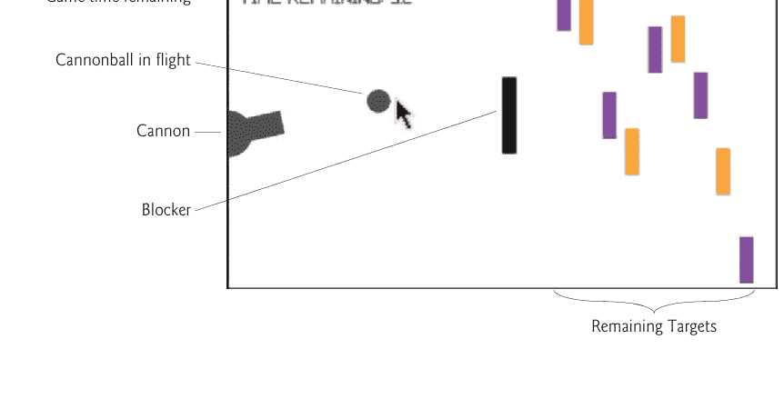

## 528 第10章 结构、联合、位操作和枚举


游戏有四种视觉组件：

- 一个你控制的**大炮**，
- 一个**炮弹**，
- **九个目标**以不同速度上下移动，以及
- 一个上下移动、保卫目标的**阻挡器**。

目标和阻挡器以不同但固定的速度垂直移动，当它们碰到屏幕顶部或底部时会反转方向。

要发射大炮，你需要点击鼠标。大炮会转向点击点，沿该方向直线发射一枚快速移动的炮弹，并播放**爆炸声**。屏幕上一次只能有一枚炮弹。

每次你摧毁一个目标，都会播放**目标摧毁声**，目标消失，剩余时间增加三秒的时间奖励。阻挡器无法被摧毁。当炮弹击中阻挡器时，会播放**阻挡器被击中声**，炮弹反弹回来，剩余时间减少两秒的时间惩罚。

你在时间到期前摧毁所有九个目标部分即获胜。如果计时器归零，你就输了。游戏结束时，应用会显示你是赢还是输，并显示发射次数和已用时间。你可以随时按*P*键暂停游戏，再次按*P*键恢复游戏。

编译并运行游戏，玩几次。接下来，研究这个游戏的代码和大量注释。这个应用程序需要一些三角函数来：

- 根据大炮的角度确定炮管端点，以及
- 确定用于在每个动画帧中移动炮弹的x和y增量——这些也基于大炮的炮管角度。

**我们为你提供了三角函数计算。**

考虑调整代码，看看你的更改如何影响游戏玩法。例如，你可以改变炮弹的移动速度。最后，通过实现我们在练习10.27中建议的增强功能来改进游戏。

### 使用raylib进行可视化——大数定律动画

**10.21** *（大数定律动画）* 在第5.10节和第6.4.7节中，我们使用随机数生成来模拟六面骰子的投掷。在这个下一个raylib案例研究练习中，你将使用动态可视化，使大数定律<sup>7,8</sup>在骰子投掷模拟中“活起来”，该模拟显示一个动画条形图。随着模拟反复投掷骰子，它会更新一个记录每个面出现频率的数组。然后，它显示每个骰子面的频率、其占总投掷次数的百分比，以及一个长度代表频率大小的条形。

对于六面骰子，面值1到6每个都应该以“相等的可能性”出现——任何一次投掷中每个面出现的概率是1/6<sup>th</sup>或大约16.67%。如果我们投掷骰子6000次，我们预计每个面大约出现1000次。就像抛硬币一样，掷骰子是随机的，所以面出现的次数可能少于或多于1000次。随着投掷次数的增加，大数定律指出每个频率都应该接近16.67%的期望值。如果是这样，条形图中的条形应该变得几乎长度相同，如下图所示的60次、6000次和6,000,000次骰子投掷的三个示例执行的屏幕截图：


## 530 第10章 结构、联合、位操作和枚举


### 在MacOS或Linux上运行模拟

当你执行此模拟时，它需要两个命令行参数，分别代表：

- 模拟的动画帧长度，以及
- 每个动画帧投掷的骰子数量。

如果程序的可执行文件名为`RollDieDynamic`，以下macOS或Linux命令将运行60个动画帧的模拟，每帧投掷一个骰子，总共投掷60次：

```
./RollDieDynamic 60 1
```

类似地，以下命令将运行600个动画帧的模拟，每帧投掷1000个骰子，总共投掷600,000次：

```
./RollDieDynamic 600 1000
```

尽管我们直到第15.3节才讨论命令行参数的细节，但这个完全编码的模拟提供了接收命令行参数所需的语句。

使用raylib的龟兔赛跑——多媒体“盛宴” 531

### 在MacOS或Linux上运行模拟

对于raylib独立的Windows环境，请执行以下步骤来运行此模拟：

1. 在Notepad++中打开RollDieDynamic.c。
2. 按F6键。
3. 在“执行”对话框中，修改编译和执行命令的最后一行以包含你的命令行参数，例如：
   cmd /c IF EXIST $(NAME_PART).exe $(NAME_PART).exe 600 1000
   Notepad++会将$(NAME_PART)替换为你正在运行的文件的基本名称——本例中为RollDieDynamic。
4. 单击“确定”以编译并运行程序。

### 多次运行程序

编译模拟并多次运行，改变命令行参数。接下来，研究模拟代码（包括大量注释）。就像我们的raylib游戏一样，你可以随时按P键暂停模拟，再次按P键恢复模拟。一旦你研究了代码，尝试练习10.28–10.30，在那里你将为抛硬币、投掷两个六面骰子（产生2-12的和）以及根据游戏长度显示赌场骰子游戏Craps的输赢结果创建可视化。你可能想使用你学到的技术来分析玩流行的纸牌游戏（如二十一点和各种版本的扑克）的结果。

### 案例研究：使用raylib的龟兔赛跑——多媒体“盛宴”

10.22（使用Raylib的多媒体龟兔赛跑）在这个练习中，你将使用来自练习10.19–10.21的raylib图形、动画和声音功能来增强练习5.54的龟兔赛跑。你将融入传统赛马的声音和多个乌龟和兔子的图像，以创建一个有趣的动画多媒体“盛宴”。为了在你的比赛中使用，我们在本章的示例文件夹中提供了一个resources子文件夹，其中包含以下音频剪辑和图像。⁹

- 我们创建的“Call to Post”小号曲目的音频录音，该曲目在赛马开始时播放。
- 我们为raylib大炮游戏创建的开炮声。你可以使用raylib的rFXGen声音生成器（https://raylibtech.itch.io/rfxgen）创建自己的开炮声。

9. 我们创建了这些音频和图像。如果你愿意，你可以在网上搜索其他的或创建自己的。请确保遵守你将在应用程序中使用的任何媒体的许可条款。

## 第10章 结构体、联合体、位操作与枚举

- 我们创建了一段音频剪辑，内容是播音员说：“他们出发了！”你可以录制自己作为播音员说这句话以及其他短语，在比赛过程中播放，例如“乌龟领先了！”、“兔子领先了！”、“他们冲过终点线了！”等。
- 一段来自维基共享资源的公共领域音频录音，内容是威廉·退尔序曲<sup>10</sup>，我们已将其编辑为仅包含疾驰部分（bada bum, bada bum, bada bum bum bum…），并放置在本章的资源文件夹中，供你在比赛期间播放。
- 我们创建的两张略有不同的乌龟图片和两张略有不同的兔子图片：


我们通过切换这些图片来创建动物奔跑的简单动画。你可以通过查看本章示例资源文件夹中提供的 `tortoise.gif` 和 `hare.gif` 动画 GIF 图像来查看这些动画。请随意使用这些图像，或者自己动手创作一些有趣的图像。

### 实现比赛

使用你在前面的 raylib 练习中学到的基本 raylib 游戏结构来实现比赛。在你的比赛中，执行以下任务：

- a) 比赛开始前，播放“入场号角”的小号音频，表示参赛者应就位。当“入场号角”播放时，乌龟和兔子应从屏幕左侧出现并就位。
- b) 播放炮声开始比赛，随后播音员说：“他们出发了！”此时，比赛动画开始。
- c) 在整个比赛过程中，在后台重复播放提供的威廉·退尔序曲的疾驰部分。请参阅 https://www.raylib.com/examples/web/audio/loader.html?name=audio_music_stream 处的 raylib 代码示例，了解如何在后台播放音乐。
- d) 当乌龟和兔子在屏幕上移动时，切换每个动物的两张图片，使其看起来在奔跑。乌龟移动得比兔子慢，因此你可能希望乌龟两张图片之间的切换速度比兔子两张图片之间的切换速度慢。当兔子睡觉时，停止切换其图片。
- e) 当乌龟和兔子处于同一位置时，显示“哎哟！”表示乌龟咬了兔子，并可选择播放高音“哎哟！”音频剪辑。
- f) 如果乌龟获胜，显示“乌龟赢了！”，并可选择播放“乌龟赢了！”音频剪辑，随后是欢呼声。如果兔子获胜，显示“兔子赢了”，并可选择播放“兔子赢了”音频剪辑，随后是嘘声。如果比赛以平局结束，你可能希望偏向处于劣势的乌龟，或者让播音员说：“平局！”
- g) 你可以在整个比赛过程中适当地播放人群欢呼声和嘘声以及额外的播音员评论。你或许可以在网上找到公共领域的人群声音。

> 10. “文件：焦阿基诺·罗西尼，威廉·退尔序曲（军乐队版本，2000年）.ogg。”访问于2021年1月2日。https://commons.wikimedia.org/wiki/File:Gioachino_Rossini,_William_Tell_Overture_(military_band_version,_2000).ogg.

### 随机数模拟案例研究：使用卡牌图像和 raylib 进行高性能洗牌与发牌

**10.23** *（使用卡牌图像和 Raylib 进行洗牌与发牌）* 在第10.7节中，你使用 Card 对象数组实现了一个高性能的洗牌与发牌模拟。在本练习中，你将把 raylib 功能整合到你的模拟中，并使用它们为牌组中的每张牌显示美观的、免费的公共领域卡牌图像。完成本练习后，你将具备开始实现你最喜欢的纸牌游戏以及升级前面章节中纸牌游戏练习解决方案所需的基本能力。

你将把未洗牌的52张卡牌图像加载为 raylib Texture2D 对象，然后将它们显示在4行13列的网格中：

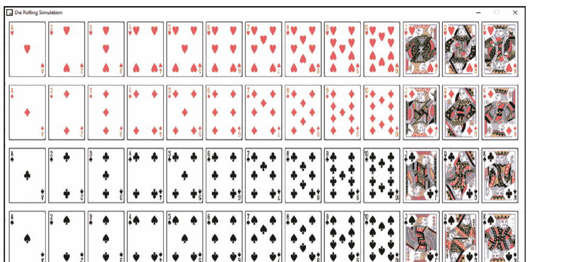

每次用户点击鼠标时，洗牌并重新显示卡牌：

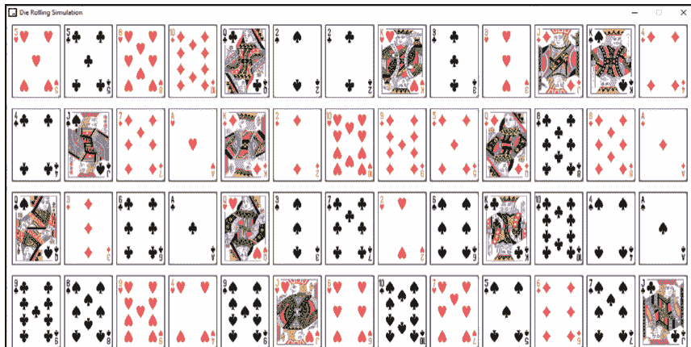

#### 来自维基共享资源的公共领域卡牌图像

我们从以下位置下载了这些公共领域<sup>11</sup>卡牌图像：
https://commons.wikimedia.org/wiki/
Category:SVG_English_pattern_playing_cards
并将它们提供在本章示例的 card_images 子文件夹中。我们使用卡牌的牌面和花色为每个卡牌图像文件命名。例如，黑桃花色的图像命名如下：

- Ace_of_Spades.png
- Deuce_of_Spades.png
- 3_of_Spades.png
- ...
- Jack_of_Spades.png
- Queen_of_Spades.png
- King_of_Spades.png

#### 实现模拟

使用你在练习10.19–10.21中学到的基本 raylib 游戏框架，以及你在练习10.21中学到的图像处理技术，执行以下任务：

- a) 修改图10.2的 struct card 定义，添加一个名为 image 的 Texture2D 成员。这将存储 raylib 关于已加载卡牌图像的信息。
- b) 当应用程序开始执行时，在你的 raylib 应用程序的 InitSimulation 函数中初始化未洗牌的牌组。修改初始化牌组数组的代码以加载每张牌的图像。你可以使用字符串处理功能，使用以下格式将每张牌的 *牌面* 和 *花色* 字符串组合成卡牌的图像文件名：
  *牌面_of_花色*.png（其中你填入 *牌面* 和 *花色*）
- c) 当 raylib 应用程序的 DrawFrame 函数第一次执行时，显示未洗牌的52个 Card 对象数组，如前所述。你需要进行计算以确定每张图像左上角的 x-y 坐标。
- d) 在 raylib 应用程序的 Update 函数中，检查用户是否点击了鼠标左键。如果是，则洗牌。下一次调用 DrawFrame 将显示洗好的牌组。

#### 绘图说明

以下说明将帮助你实现模拟：

- 对于本练习，将 raylib 窗口的 screenWidth 设置为1280，screenHeight 设置为620，为显示卡牌图像提供额外空间。
- 绘制每张图像时，将 raylib 函数 DrawTextureEx 的 scale 参数设置为0.25。这会缩小图像，为你提供足够的空间，以每行13张图像、共四行的方式绘制它们，而不会相互重叠。
- 绘制每张图像后，使用如下所示的 raylib 函数 DrawRectangleLines 在每张图像周围放置黑色边框，以与窗口的白色背景形成对比：
  `DrawRectangleLines(x, y, deck[i].image.width * scale, deck[i].image.height * scale, BLACK);`
  将变量 scale 设置为0.25，以使用与图像相同的缩放比例绘制矩形。

### 附加 Raylib 练习

**10.24** *（Raylib 演示）* 编译、运行并与 raylib 文件夹的 examples 子文件夹中捆绑的几个示例进行交互。研究为每个示例提供的源代码，以了解更多关于 raylib 的功能。

**10.25** *（Raylib 示例游戏）* 编译、运行并与 raylib 文件夹的 games 子文件夹中的几个示例游戏进行交互。研究为每个示例提供的源代码，以了解更多关于 raylib 的功能。发挥创意。尝试用你自己的增强功能修改游戏。

**10.26** *（项目：增强版 SpotOn 游戏）* 尝试以下 SpotOn 游戏修改中的几项：

- a) 为更高等级显示更多斑点。
- b) 使用更大、可能随机化的速度提升。
- c) 对一次点击摧毁多个斑点给予奖励。
- d) 对每种斑点颜色使用不同的分值。
- e) 通过允许斑点闪烁、自发改变方向、自发改变大小以及沿非线性路径移动，使斑点更难捕捉。
- f) 混合使用更小、更难点击的斑点。
- g) 当用户点击斑点时，为其销毁制作动画。例如，它可以变成从外向内逐渐消失的同心圆，或者变成从斑点中心向外扩散并逐渐消失的四片披萨。
- h) 当游戏进入下一关时播放警报声。
- i) 为重要事件（如获得或失去生命）显示文本。文本可以在屏幕上停留短暂时间，然后逐渐消失。
- j) 设置一个特殊颜色、快速移动的斑点。点击该斑点会摧毁屏幕上的所有斑点，并给玩家大量分数奖励。

**10.27** *（项目：增强版 Cannon 游戏）* 尝试以下 Cannon 游戏修改中的几项：

- a) 显示一条虚线，显示炮弹的路径。
- b) 当阻挡物撞击屏幕顶部或底部时播放声音。
- c) 当目标撞击屏幕顶部或底部时播放声音。
- d) 增强游戏以包含关卡。在每个关卡中，增加目标碎片的数量。
- e) 记录分数。每击中一个目标碎片，用户分数增加当前等级的10倍。每次炮弹击中阻挡物，分数减少当前等级的15倍。在屏幕左上角显示分数。
- f) 每次炮弹击中目标时，添加炮弹和目标爆炸动画。
- g) 每次炮弹击中阻挡物时，为炮弹添加爆炸动画。
- h) 当炮弹击中阻挡物时，将阻挡物的长度增加5%。
- i) 通过逐渐增加目标和阻挡物的速度，使游戏随着进程变得更难。
- j) 增加炮和目标之间独立移动的阻挡物数量。
- k) 添加一个持续四秒的奖励关卡。改变目标的颜色并添加音乐以表示这是奖励关卡。如果用户在四秒内击中目标，给用户1000分奖励。
- l) 允许用户通过上下箭头键移动大炮，以便可以从不同位置发射。

**10.28** *（数据科学入门：抛硬币的动态可视化）* 修改练习10.21中的大数定律掷骰子模拟，以模拟抛硬币。使用随机生成的1和2分别代表正面和反面。对20次、200次、20,000次和2,000,000次抛硬币运行模拟。你是否得到大约50%的正面和50%的反面？你是否看到了“大数定律”在起作用？

## 10.29（数据科学导论：掷两个骰子的动态可视化）

修改我们在练习10.21中的大数定律掷骰子模拟，以模拟掷两个骰子。计算两个骰子点数的和。每个骰子的点数从1到6，因此总和将从2到12不等，其中7是最常见的总和，2和12是最不常见的。下图显示了两个骰子的36种等可能组合及其对应的总和：

|   | 1 | 2 | 3 | 4 | 5 | 6 |
|---|---|---|---|---|---|---|
| 1 | 2 | 3 | 4 | 5 | 6 | 7 |
| 2 | 3 | 4 | 5 | 6 | 7 | 8 |
| 3 | 4 | 5 | 6 | 7 | 8 | 9 |
| 4 | 5 | 6 | 7 | 8 | 9 | 10 |
| 5 | 6 | 7 | 8 | 9 | 10 | 11 |
| 6 | 7 | 8 | 9 | 10 | 11 | 12 |

如果你掷骰子36,000次：

-   数值2和12各自出现的概率为1/36（2.778%），因此你应该预期每个大约出现1000次。
-   数值3和11各自出现的概率为2/36（5.556%），因此你应该预期每个大约出现2000次，以此类推。你应该预期大约出现6000次7。

显示一个动态条形图，其中包含总和2–12的每个值的条形，以总结它们的频率。分别运行360次、36,000次和36,000,000次掷骰子的模拟。

## 10.30（数据科学导论项目：赌场游戏输赢统计的动态可视化）

使用raylib重新实现你对练习6.20的解决方案，创建一个动态条形图，显示第一次掷骰、第二次掷骰、第三次掷骰等的输赢情况。使用成对的绿色和红色条形分别表示每次掷骰次数的赢和输。

## 10.31（项目：砖块游戏）

创建一个类似于大炮游戏的游戏，向静止的砖墙发射弹丸。目标是摧毁足够多的墙，以便能够射中墙后面的移动目标。你越快突破墙壁并击中目标，得分就越高。包括多层墙壁和一个小型移动目标。记录分数。通过使用更多层和更小的砖块建造墙壁，并增加移动目标的速度，来增加每一轮的难度。

## 10.32（项目：数字时钟）

创建一个在屏幕上显示数字时钟的应用程序。

## 10.33（项目：模拟时钟）

创建一个显示模拟时钟的应用程序，时钟具有适当长度和粗细的时针、分针和秒针，并随时间变化而旋转。

# 文件处理

## 11


## 目标

在本章中，你将：

-   理解文件和流的概念。
-   使用顺序访问文本文件处理向文件写入数据和从文件读取数据。
-   使用随机访问文件处理和二进制文件向文件写入数据、更新文件中的数据以及从文件读取数据。
-   开发一个重要的事务处理程序。
-   在文件处理的背景下研究安全C编程。

## 第11章 文件处理

-   11.1 引言
-   11.2 文件和流
-   11.3 创建顺序访问文件
    -   11.3.1 指向FILE的指针
    -   11.3.2 使用fopen打开文件
    -   11.3.3 使用feof检查文件结束指示符
    -   11.3.4 使用fprintf写入文件
    -   11.3.5 使用fclose关闭文件
    -   11.3.6 文件打开模式
-   11.4 从顺序访问文件读取数据
    -   11.4.1 重置文件位置指针
    -   11.4.2 信用查询程序
-   11.5 随机访问文件
-   11.6 创建随机访问文件
-   11.7 向随机访问文件随机写入数据
    -   11.7.1 使用fseek定位文件位置指针
    -   11.7.2 错误检查
-   11.8 从随机访问文件读取数据
-   11.9 案例研究：事务处理系统
-   11.10 安全C编程

总结 | 自我复习练习 | 自我复习练习答案 | 练习 | AI案例研究：自然语言导论——谁写了莎士比亚的作品？ | AI/数据科学案例研究——使用GNU科学库的机器学习 | AI/数据科学案例研究：时间序列与简单线性回归 | Web服务与云计算案例研究——libcurl和OpenWeatherMap

## 11.1 引言

你在第1章学习了数据层次结构。变量中的数据是临时的——当程序终止时，它就会丢失。文件支持长期数据保留。计算机将文件存储在辅助存储设备上，例如固态驱动器、闪存驱动器和硬盘驱动器。本章解释如何创建、更新和处理数据文件。我们考虑顺序访问和随机访问文件处理。

## 11.2 文件和流

C将每个文件视为一个顺序的字节流，如下图所示：


每个文件以文件结束标记结束，或者在系统维护的管理数据结构中记录的特定字节编号处结束。这是平台相关的，并且对你隐藏。

### 每个程序中的标准流

当你打开一个文件时，C会将一个流与之关联。当程序执行开始时，C会自动打开三个流：

-   标准输入流从键盘接收输入。
-   标准输出流在屏幕上显示输出。
-   标准错误流在屏幕上显示错误消息。

### FILE结构

打开一个文件会返回一个指向**FILE结构**（在`<stdio.h>`中定义）的指针，该结构包含程序处理文件所需的信息。在某些操作系统中，此结构包含一个**文件描述符**——一个指向操作系统数组（称为**打开文件表**）的整数索引。每个数组元素包含一个**文件控制块（FCB）**——操作系统用于管理特定文件的信息。你使用FILE指针**stdin**、**stdout**和**stderr**来操作标准输入、标准输出和标准错误流。

### 文件处理函数fgetc

标准库提供了许多用于从文件读取数据和向文件写入数据的函数。函数**fgetc**，类似于getchar，从其FILE指针参数指定的文件中读取一个字符。例如，调用`fgetc(stdin)`从标准输入流中读取一个字符。此调用等同于调用`getchar()`。

### 文件处理函数fputc

函数**fputc**，类似于putchar，将其第一个参数中的字符写入其第二个参数中FILE指针指定的文件。例如，函数调用`fputc('a', stdout)`向标准输出流写入一个字符，等同于`putchar('a')`。

### 其他文件处理函数

其他几个用于从标准输入读取数据和向标准输出写入数据的函数具有类似的文件处理函数。例如，**fgets**和**fputs**函数分别从文件中读取一行文本和向文件写入一行文本。接下来的几节介绍了函数scanf和printf的文件处理等效函数——**fscanf**和**fprintf**。本章稍后，我们将讨论函数**fread**和**fwrite**。

## 自我检查

1.  （填空）当程序执行开始时，C会自动打开三个流：______、______和______流。
    **答案：** 标准输入、标准输出、标准错误。

2.  （填空）C将每个文件视为一个顺序的字节流。每个文件以______结束，或者在系统维护的管理数据结构中记录的特定字节编号处结束。
    **答案：** 文件结束标记。

## 11.3 创建顺序访问文件

C不对文件施加任何结构。因此，诸如文件记录之类的概念不是C语言的一部分。以下示例展示了如何将自己的记录结构强加于文件。

图11.1创建了一个简单的顺序访问文件，该文件可用于应收账款系统中，以跟踪公司信用客户所欠的金额。对于每个客户，程序获取客户的账号、姓名和余额——客户因过去收到的商品和服务而欠公司的金额。每个客户的数据构成了该客户的“记录”。账号是此应用程序的记录键。此程序假设用户按账号顺序输入记录。在一个全面的应收账款系统中，排序功能将允许用户以任何顺序输入记录。然后程序将对记录进行排序并将其写入文件。图11.2–11.3使用在图11.1中创建的数据文件，因此你必须在运行图11.2–11.3中的程序之前运行图11.1中的程序。

```c
// fig11_01.c
// 创建一个顺序文件
#include <stdio.h>

int main(void){
    FILE *cfPtr = NULL; // cfPtr = clients.txt 文件指针

    // fopen 打开文件。如果无法创建文件，则退出程序
    if ((cfPtr = fopen("clients.txt", "w")) == NULL) {
        puts("File could not be opened");
    }
    else {
        puts("Enter the account, name, and balance.");
        puts("Enter EOF to end input.");
        printf("%s", "? ");

        int account = 0; // 账号
        char name[30] = ""; // 账户名称
        double balance = 0.0; // 账户余额

        scanf("%d%29s%lf", &account, name, &balance);

        // 使用 fprintf 将账号、姓名和余额写入文件
        while (!feof(stdin)) {
            fprintf(cfPtr, "%d %s %.2f\n", account, name, balance);
            printf("%s", "? ");
            scanf("%d%29s%lf", &account, name, &balance);
        }

        fclose(cfPtr); // fclose 关闭文件
    }
}
```

图11.1 | 创建一个顺序文件。（第1部分，共2部分。）

## 11.3 创建顺序访问文件

```
Enter the account, name, and balance.
Enter EOF to end input.
? 100 Jones 24.98
? 200 Doe 345.67
? 300 White 0.00
? 400 Stone -42.16
? 500 Rich 224.62
? ^Z
```

图 11.1 | 创建顺序文件。（第 2 部分，共 2 部分。）

### 11.3.1 指向 FILE 的指针

第 6 行将 `cfPtr` 定义为指向 `FILE` 结构的指针。程序通过单独的 `FILE` 指针来引用每个打开的文件。使用文件时，你无需了解 `FILE` 结构的具体细节。如果你感兴趣，可以在 `stdio.h` 中研究其声明。

### 11.3.2 使用 fopen 打开文件

第 9 行调用 `fopen` 来创建文件 "clients.txt" 并与其建立“通信线路”。`fopen` 返回的文件指针被赋值给 `cfPtr`。

`fopen` 函数接受两个参数：

-   一个文件名（可以包含指向文件位置的路径信息）
-   一个文件打开模式。

文件打开模式 "w" 表示 `fopen` 应以写入模式打开文件。如果文件不存在且文件打开模式为 "w"，`fopen` 会创建该文件。如果你打开一个现有文件，`fopen` 会不加警告地丢弃文件内容。如果你的程序不应该替换现有文件，这就是一个逻辑错误。

`if` 语句用于判断文件指针 `cfPtr` 是否为 `NULL`。如果是 `NULL`，则文件无法打开，可能是因为程序没有权限在指定文件夹中创建文件。在此程序中，文件被创建在与程序相同的文件夹中。如果 `cfPtr` 为 `NULL`，程序会打印错误消息并终止。否则，程序会处理用户的输入并将其写入文件。

### 11.3.3 使用 feof 检查文件结束指示符

程序会提示用户输入每条记录的各个字段，或在数据输入完成时输入文件结束符。文件结束符的按键组合取决于平台：

-   Windows: <Ctrl> + z，然后按 Enter
-   macOS/Linux: <Ctrl> + d

第 24 行调用 **feof** 来判断 `stdin` 的文件结束指示符是否已被设置。文件结束指示符通知程序没有更多数据需要处理。当用户输入*文件结束符组合键*时，操作系统会为标准输入流设置文件结束指示符。`feof` 函数的参数是一个指向要测试文件结束指示符的文件的 `FILE` 指针——本例中是 `stdin`。当文件结束指示符被设置时，该函数返回一个非零（*真*）值；否则，函数返回零（*假*）。本程序的 `while` 语句会持续执行，直到用户输入文件结束指示符。

### 11.3.4 使用 fprintf 写入文件

第 25 行将一条记录作为一行文本写入文件 `clients.txt`。你可以使用专门设计来读取该文件的程序（第 11.4 节）稍后检索数据。`fprintf` 函数等同于 `printf`，但 `fprintf` 还接收一个 `FILE` 指针参数，用于指定数据将被写入的文件。`fprintf` 函数可以通过使用 `stdout` 作为 `FILE` 指针参数，将数据输出到标准输出。

### 11.3.5 使用 fclose 关闭文件

用户输入文件结束符后，程序通过调用 **fclose**（第 30 行）关闭 `clients.txt` 文件，然后终止。`fclose` 函数接收 `FILE` 指针作为参数。如果你不显式调用 `fclose`，操作系统通常会在程序执行终止时关闭文件。这是操作系统“内务处理”的一个例子。你应该在文件不再需要时立即关闭它。这可以释放其他用户或程序可能正在等待的资源。

在图 11.1 的示例执行中，用户输入了五个账户的信息，然后输入文件结束符以完成数据输入。示例执行并未显示数据记录在文件中的实际外观。下一节将介绍一个读取该文件并显示其内容的程序，以验证程序是否成功创建了文件。

### FILE 指针、FILE 结构和 FCB 之间的关系

下图说明了 `FILE` 指针、`FILE` 结构和 FCB 之间的关系。当程序打开 "clients.txt" 时，操作系统会将该文件的一个 FCB 复制到内存中。该图显示了 `fopen` 返回的文件指针与操作系统用于管理该文件的 FCB 之间的连接。程序可以不处理任何文件、处理一个文件或处理多个文件。每个文件都有一个由 `fopen` 返回的不同文件指针。文件打开后，所有后续的文件处理函数都必须使用相应的文件指针来引用该文件。

## 11.3 创建顺序访问文件

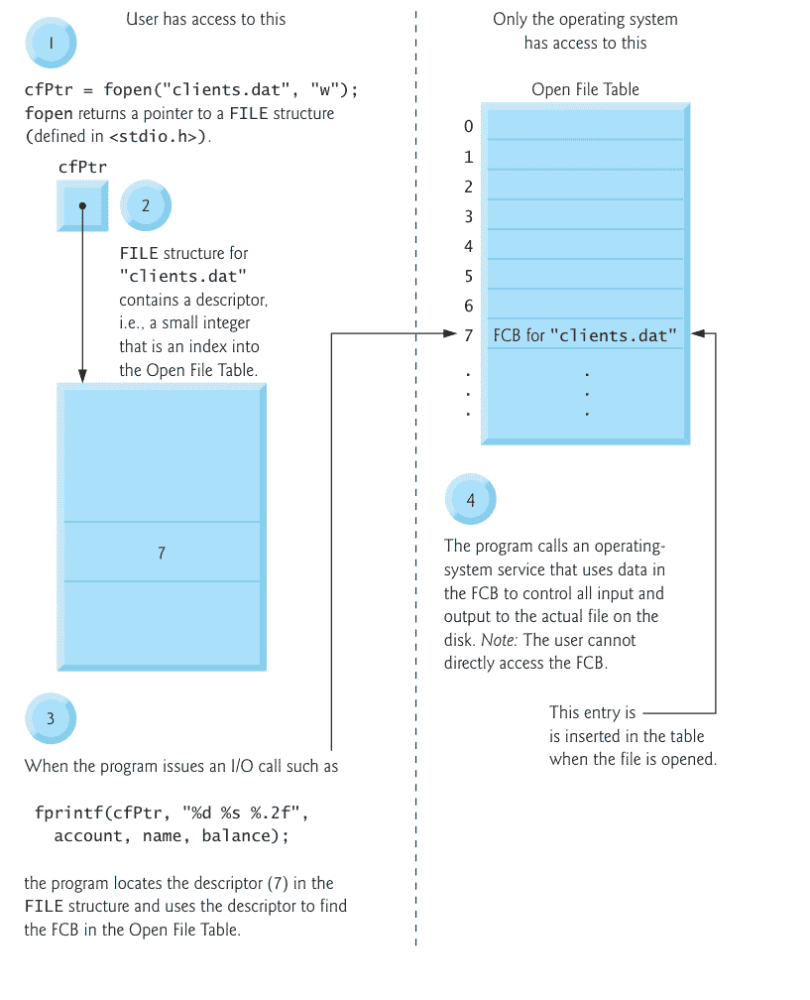

### 11.3.6 文件打开模式

下表总结了文件打开模式。包含字母 "b" 的模式用于处理二进制文件，我们将在第 11.5–11.9 节介绍随机访问文件时讨论这些内容。

546 第 11 章 文件处理

| 模式 | 描述 |
| :--- | :--- |
| r | 打开一个现有文件用于读取。 |
| w | 创建一个文件用于写入。如果文件已存在，则丢弃其当前内容。 |
| a | 打开或创建一个文件，用于在文件末尾写入——这用于将数据追加到文件的写操作。 |
| r+ | 打开一个现有文件用于更新（读取和写入）。 |
| w+ | 创建一个文件用于读取和写入。如果文件已存在，则丢弃其当前内容。 |
| a+ | 打开或创建一个文件用于读取和更新，所有写操作都在文件末尾进行——即写操作将数据追加到文件。 |
| rb | 打开一个现有的二进制文件用于读取。 |
| wb | 创建一个二进制文件用于写入。如果文件已存在，则丢弃其当前内容。 |
| ab | 打开或创建一个二进制文件，用于在文件末尾写入（追加）。 |
| rb+ | 打开一个现有的二进制文件用于更新（读取和写入）。 |
| wb+ | 创建一个二进制文件用于更新。如果文件已存在，则丢弃其当前内容。 |
| ab+ | 打开或创建一个二进制文件用于更新。写操作在文件末尾进行。 |

#### C11 独占写入模式

C11 新增了独占写入模式，¹ 用 "wx"、"w+x"、"wbx" 或 "wb+x" 表示。在独占写入模式下，如果文件已存在或无法创建，`fopen` 会失败。如果你的程序成功以独占写入模式打开一个文件，并且底层系统支持独占文件访问，那么*只有*你的程序可以在文件打开期间访问该文件。如果在以任何模式打开文件时发生错误，`fopen` 会返回 `NULL`。

#### ERR 常见文件处理错误

你可能遇到的一些常见文件处理逻辑错误包括：

-   打开一个不存在的文件进行读取。
-   在未被授予文件适当访问权限的情况下打开文件进行读取或写入（这取决于操作系统）。
-   在没有可用空间时打开文件进行写入。
-   以写入模式（"w"）打开文件，而实际上应该以更新模式（"r+"）打开——"w" 会丢弃文件内容。

## 自我检查

1 (代码) 下面的语句会将其输出写入何处？

```
fprintf(stdout, "%d %s %.2f\n", account, name, balance);
```

**答案：** 标准输出设备，通常是屏幕。

1.  某些编译器和平台不支持独占写入模式。

2 (判断题) 文件记录的概念是内置于 C 语言中的。
答案：错误。实际上，C 语言不对文件施加任何结构，因此像文件记录这样的概念不是 C 语言的一部分。你可以为文件施加自己的记录结构。

3 (填空题) C 程序使用单独的 ________ 结构来管理每个文件。
答案：FILE。

4 (判断题) 当你以写入模式打开文件时，如果文件已存在，`fopen` 会警告你。
答案：错误。`fopen` 会不加警告地丢弃文件内容。

5 (选择题) 哪种文件打开模式对应于描述“打开一个现有文件用于更新（读取和写入）”？
a) u。
b) rw。
c) r+。
d) w+。
答案：c。

## 11.4 从顺序访问文件读取数据

数据存储在文件中，以便在需要时可以检索进行处理。上一节演示了如何创建用于顺序访问的文件。本节展示如何从文件中顺序读取数据。如果文件内容不应被修改，则应仅以读取模式打开文件。这可以防止意外修改文件内容，也是最小权限原则的另一个例子。

图 11.2 从图 11.1 创建的文件 "clients.txt" 中读取并显示记录。第 6 行定义了 `FILE` 指针 `cfPtr`。第 9 行尝试以读取模式（"r"）打开文件，并判断是否成功打开——即 `fopen` 没有返回 `NULL`。第 18 行从文件中读取一条“记录”。`fscanf` 函数等同于 `scanf`，但其第一个参数是一个指向要读取文件的 `FILE` 指针。该语句第一次执行时，`account` 的值将为 100，`name` 的值将为 "Jones"，`balance` 的值将为 24.98。每次后续调用 `fscanf`（第 23 行）都会从文件中读取另一条记录，并为 `account`、`name` 和 `balance` 赋予新值。当没有更多数据可读时，第 26 行关闭文件，程序终止。`feof` 函数仅在程序尝试读取超过文件最后一行之后才返回真。

```
1  // fig11_02.c
2  // 读取并打印顺序文件
3  #include <stdio.h>
4
5  int main(void) {
6      FILE *cfPtr = NULL; // cfPtr = clients.txt 文件指针
```

图 11.2 | 读取并打印顺序文件。（第 1 部分，共 2 部分。）

### 11.4.1 重置文件位置指针

当从文件中顺序检索数据时，程序通常从文件开头读取，直到找到所需数据。在某些情况下，程序必须多次从头开始顺序处理文件。语句

```c
rewind(cfPtr);
```

将**文件位置指针**重新定位到 `cfPtr` 所指向文件的开头（字节 0）。文件位置指针实际上并不是一个指针。它是一个整数，指示下一个要读取或写入的字节的字节编号。这有时被称为**文件偏移量**。文件位置指针是与每个文件关联的 `FILE` 结构的一个成员。

### 11.4.2 信用查询程序

贷方余额是负数，借方余额是正数。该程序显示一个菜单，并允许信用经理输入四个选项之一：

-   选项 1 生成零余额账户列表。
-   选项 2 生成贷方余额账户列表。
-   选项 3 生成借方余额账户列表。
-   选项 4 终止程序执行。

```c
// fig11_03.c
// 信用查询程序
#include <stdbool.h>
#include <stdio.h>

enum Options {ZERO_BALANCE = 1, CREDIT_BALANCE, DEBIT_BALANCE, END};

// 确定是否显示记录
bool shouldDisplay(enum Options option, double balance) {
    if ((option == ZERO_BALANCE) && (balance == 0)) {
        return true;
    }

    if ((option == CREDIT_BALANCE) && (balance < 0)) {
        return true;
    }

    if ((option == DEBIT_BALANCE) && (balance > 0)) {
        return true;
    }

    return false;
}

int main(void) {
    FILE *cfPtr = NULL; // clients.txt 文件指针

    // fopen 打开文件；如果文件无法打开则退出程序
    if ((cfPtr = fopen("clients.txt", "r")) == NULL) {
        puts("File could not be opened");
    }
    else {
        // 显示请求选项
        printf("%s", "Enter request\n"
            " 1 - List accounts with zero balances\n"
            " 2 - List accounts with credit balances\n"
            " 3 - List accounts with debit balances\n"
            " 4 - End of run\n? ");
        int request = 0;
        scanf("%d", &request);

        // 显示记录
        while (request != END) {
            switch (request) {
            case ZERO_BALANCE:
                puts("\nAccounts with zero balances:");
                break;
            case CREDIT_BALANCE:
                puts("\nAccounts with credit balances:");
                break;
            case DEBIT_BALANCE:
                puts("\nAccounts with debit balances:");
                break;
            }

            int account = 0;
            char name[30] = "";
            double balance = 0.0;

            // 从文件中读取账户、姓名和余额
            fscanf(cfPtr, "%d%29s%lf", &account, name, &balance);

            // 读取文件内容（直到文件末尾）
            while (!feof(cfPtr)) {
                // 仅当余额为 0 时输出
                if (shouldDisplay(request, balance)) {
                    printf("%-10d%-13s%7.2f\n", account, name, balance);
                }

                // 从文件中读取账户、姓名和余额
                fscanf(cfPtr, "%d%29s%lf", &account, name, &balance);
            }

            rewind(cfPtr); // 将 cfPtr 重置到文件开头

            printf("%s", "\n? ");
            scanf("%d", &request);
        }

        puts("End of run.");
        fclose(cfPtr); // 关闭文件
    }
}
```

```
Enter request
 1 - List accounts with zero balances
 2 - List accounts with credit balances
 3 - List accounts with debit balances
 4 - End of run
? 1

Accounts with zero balances:
300       White           0.00

? 2

Accounts with credit balances:
400     Stone           -42.16

? 3

Accounts with debit balances:
100     Jones           24.98
200     Doe             345.67
500     Rich            224.62

? 4
End of run.
```

图 11.3 | 信用查询程序。

### 更新顺序文件

你无法在不破坏其他数据的情况下修改这种顺序文件中的数据。例如，如果需要将名称 "White" 更改为 "Worthington"，你不能简单地覆盖旧名称。White 的记录写入文件时是

```
300 White 0.00
```

如果你使用新名称从文件中的相同位置开始重写记录，记录将是

```
300 Worthington 0.00
```

新记录比原始记录有更多的字符。"Worthington" 中第二个 "o" 之后的字符将覆盖文件中下一个顺序记录的开头。这里的问题在于，在使用 `fprintf` 和 `fscanf` 的格式化输入/输出模型中，字段和记录的大小可以变化。例如，值 7、14、-117、2074 和 27383 都是 `int`，在内部存储的字节数相同，但当它们显示在屏幕上或作为文本写入文件时，它们是不同大小的字段。

因此，使用 `fprintf` 和 `fscanf` 的顺序访问通常不用于就地更新记录。相反，整个文件会被重写。在顺序访问文件中，我们通过以下方式完成上述名称更改：

-   将 `300 White 0.00` 之前的记录复制到新文件，
-   写入新记录，
-   将 `300 White 0.00` 之后的记录复制到新文件，然后
-   用新文件替换旧文件。

这需要处理文件中的每条记录才能更新一条记录。

## 自我检查

1.  **（填空）** 函数 `fscanf` 等同于函数 `scanf`，但 `fscanf` 接收一个 ________ 作为参数。
    **答案：** 用于读取数据的文件的文件指针。

2.  **（判断题）** 函数 `feof` 仅在程序尝试读取最后一行之后不存在的数据后才返回 true。
    **答案：** *True*。

3.  **（填空）** 以下语句将文件的 ________ 重新定位到文件的字节 0。
    `rewind(cfPtr);`
    **答案：** 文件位置指针。

4.  **（判断题）** 在使用 `fprintf` 和 `fscanf` 的格式化输入/输出模型中，字段——因此记录——的大小是固定的。
    **答案：** *False*。实际上，在此模型中，字段——因此记录——的大小可以变化。

## 11.5 随机访问文件

你使用格式化输出函数 `fprintf` 创建的记录长度可能不同。另一方面，*随机访问文件*使用*固定长度*的记录，这些记录可以直接（因此快速）访问，而无需搜索其他记录。这使得随机访问文件适用于需要快速访问特定数据的**事务处理系统**，例如航空预订系统、银行系统和销售点系统。还有其他方法可以实现随机访问文件，但我们将讨论限制在这种使用固定长度记录的直接方法上。

因为随机访问文件中的每条记录通常具有相同的长度，所以每条记录相对于文件开头的精确位置可以作为记录键的函数来计算。我们很快就会看到这如何促进对特定记录的即时访问，即使在大文件中也是如此。

下图说明了实现随机访问文件的一种方式。这样的文件就像一列有许多车厢的货运列车——有些是空的，有些装有货物。列车中的每节车厢长度相同。

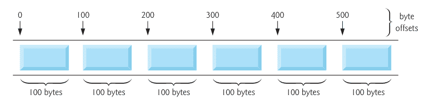

固定长度记录使程序能够*在不破坏文件中其他数据的情况下*向随机访问文件插入数据。先前存储的数据也可以更新或删除，而无需重写整个文件。在接下来的章节中，我们将解释如何- 创建一个随机访问文件，
- 输入数据，
- 顺序和随机读取数据，
- 更新数据，
- 以及删除不再需要的数据。

## 自我检查

1. （真/假）你写入和读取随机访问文件的单条记录，无需搜索其他记录即可直接访问。这使得随机访问文件适用于需要快速访问特定数据的系统。
   答案：真。

2. （填空）随机访问文件使用固定长度的记录，因此可以根据 ________ 计算出记录相对于文件起始位置的精确位置。
   答案：记录键。

## 11.6 创建随机访问文件

函数 `fwrite` 将内存中指定位置的指定字节数写入文件。数据写入文件位置指针的当前位置。函数 `fread` 从文件位置指针的当前位置读取指定字节数到内存中的指定区域。使用以下语句写入一个四字节整数：

```c
fprintf(fPtr, "%d", number);
```

根据区域设置的字符集，最多可能输出 11 位数字——10 位数字加一个符号，每个符号至少需要一个字节的存储空间。对于随机访问文件，语句

```c
fwrite(&number, sizeof(int), 1, fPtr);
```

总是将 `int` 变量 `number` 的四个字节（在四字节整数的系统上）写入由 `fPtr` 表示的文件。我们稍后会解释参数 `1`。之后，我们可以使用 `fread` 将这四个字节读入一个 `int` 变量。虽然 `fread` 和 `fwrite` 以固定大小而非可变大小的格式读写数据，但它们处理的是“原始”字节，而不是 `printf` 和 `scanf` 的人类可读文本格式。“原始”数据表示是系统相关的，因此“原始”数据可能无法在其他系统上读取，或者无法被其他编译器或使用不同编译选项生成的程序读取。

### fwrite 和 fread 可以读写数组

函数 `fwrite` 和 `fread` 可以读写数组。`fwrite` 和 `fread` 的第三个参数是要写入或读取的元素数量。前面的 `fwrite` 函数调用将单个整数写入文件，因此第三个参数是 `1`——就像我们正在写入一个数组元素。文件处理程序很少将单个字段写入文件。通常，它们一次写入一个 `struct`，正如我们在以下示例中所示。

## 第 11 章 文件处理

### 问题陈述

考虑以下问题陈述：

> 创建一个事务处理系统，能够存储多达 100 条固定长度的记录。每条记录应包含一个账号（记录键）、姓氏、名字和余额。该程序应使用随机访问文件，并能够更新账户、插入新账户、删除账户，并将所有记录列在格式化的文本文件中以便打印。

接下来的几个部分将介绍我们将用于创建事务处理程序的技术。图 11.4 展示了如何打开随机访问文件、使用 `struct` 定义记录格式、将数据写入文件以及关闭文件。该程序使用函数 `fwrite` 将文件 "accounts.dat" 的所有 100 条记录初始化为空 `struct`。每个空 `struct` 包含账号 `0`、姓氏和名字的空字符串（`""`）以及余额 `0.0`。我们初始化所有记录是为了创建文件将要存储的空间，并使得判断记录是否包含数据成为可能。

```c
// fig11_04.c
// 顺序创建随机访问文件
#include <stdio.h>

// clientData 结构定义
struct clientData {
    int account;
    char lastName[15];
    char firstName[10];
    double balance;
};

int main(void) {
    FILE *cfPtr = NULL; // accounts.dat 文件指针

    // fopen 打开文件；如果无法打开文件则退出
    if ((cfPtr = fopen("accounts.dat", "wb")) == NULL) {
        puts("File could not be opened.");
    }
    else {
        // 使用默认信息创建 clientData
        struct clientData blankClient = {0, "", "", 0.0};

        // 向文件输出 100 条空白记录
        for (int i = 1; i <= 100; ++i) {
            fwrite(&blankClient, sizeof(struct clientData), 1, cfPtr);
        }

        fclose(cfPtr); // fclose 关闭文件
    }
}
```

图 11.4 | 顺序创建随机访问文件。

第 17 行以二进制模式（"wb"）打开文件 "accounts.dat" 进行写入。函数 `fwrite`（第 26 行）将一块字节写入文件。参数为：

- `&blankClient`——要写入对象的地址，
- `sizeof(struct clientData)`——要写入对象的字节大小，
- `1`——要写入的该大小对象的数量，以及
- `cfPtr`——表示将存储字节的文件的 `FILE *`。

回想一下，`sizeof` 返回其操作数 `struct clientData` 的字节大小。

### 写入对象数组

在第 26 行，`fwrite` 写入一个不是数组元素的对象。要写入数组，请将其作为第一个参数传递给 `fwrite`，并将要输出的元素数量指定为第三个参数。

## 自我检查

1. （真/假）对于一个四字节的 `int` 变量 `number`，即使该数字的文本表示可能多达 11 位数字，以下语句也总是写入四个字节：
   `fwrite(&number, sizeof(int), 1, fPtr);`
   答案：真。

2. （填空）函数 `fread` 和 `fwrite` 以“原始数据”格式读写数据——即作为数据的 ________。
   答案：字节。

3. （填空）函数 `fwrite` 可以写入多个数组元素。在调用 `fwrite` 时，将指向数组的指针和 ________ 分别指定为第一个和第三个参数。
   答案：要写入的元素数量。

## 11.7 向随机访问文件随机写入数据

[注意：图 11.5、11.6 和 11.7 使用在图 11.4 中创建的数据文件，因此在运行图 11.5、11.6 和 11.7 之前必须先运行图 11.4。]

图 11.5 将数据写入文件 "accounts.dat"。它使用 `fseek` 和 `fwrite` 将数据存储在文件中的特定位置。函数 `fseek` 将文件位置指针设置为特定的字节位置，然后 `fwrite` 将数据写入该位置。

```c
// fig11_05.c
// 向随机访问文件随机写入数据
#include <stdio.h>

// clientData 结构定义
struct clientData {
    int account;
    char lastName[15];
    char firstName[10];
    double balance;
}; // 结构 clientData 结束

int main(void) {
    FILE *cfPtr = NULL; // accounts.dat 文件指针

    // fopen 打开文件；如果无法打开文件则退出
    if ((cfPtr = fopen("accounts.dat", "rb+")) == NULL) {
        puts("File could not be opened.");
    }
    else {
        // 使用默认信息创建 clientData
        struct clientData client = {0, "", "", 0.0};

        // 要求用户指定账号
        printf("%s", "Enter account number (1 to 100, 0 to end input): ");
        scanf("%d", &client.account);

        // 用户输入信息，然后复制到文件中
        while (client.account != 0) {
            // 用户输入姓氏、名字和余额
            printf("%s", "Enter lastname, firstname, balance: ");

            // 设置记录的 lastName、firstName 和 balance 值
            fscanf(stdin, "%14s%9s%lf", client.lastName,
                client.firstName, &client.balance);

            // 将文件中的位置定位到用户指定的记录
            fseek(cfPtr, (client.account - 1) *
                sizeof(struct clientData), SEEK_SET);

            // 将用户指定的信息写入文件
            fwrite(&client, sizeof(struct clientData), 1, cfPtr);

            // 允许用户输入另一个账号
            printf("%s", "\nEnter account number: ");
            scanf("%d", &client.account);
        }

        fclose(cfPtr); // fclose 关闭文件
    }
}
```

```
Enter account number (1 to 100, 0 to end input): 37
Enter lastname, firstname, balance: Barker Doug 0.00

Enter account number: 29
Enter lastname, firstname, balance: Brown Nancy -24.54
```

图 11.5 | 向随机访问文件随机写入数据。（第 2 部分，共 3 部分。）

## 11.7 随机写入数据到随机访问文件

```
Enter account number: 96
Enter lastname, firstname, balance: Stone Sam 34.98

Enter account number: 88
Enter lastname, firstname, balance: Smith Dave 258.34

Enter account number: 33
Enter lastname, firstname, balance: Dunn Stacey 314.33

Enter account number: 0
```

图 11.5 | 随机写入数据到随机访问文件。（第 3 部分，共 3 部分。）

### 11.7.1 使用 fseek 定位文件位置指针

第 38–39 行将 cfPtr 引用的文件的文件位置指针定位到由以下表达式计算出的字节位置：

(client.account - 1) * sizeof(struct clientData)

该表达式的值是偏移量或位移量。在此示例中，账号为 1–100。文件从字节 0 开始，因此在计算记录的字节位置时，我们从账号中减去 1。对于记录 1，第 38–39 行将文件位置指针设置为文件的字节 0。符号常量 SEEK_SET 表示 fseek 应相对于文件的开头移动文件位置指针。

下图说明了指向内存中 FILE 结构的 FILE 指针。此图中的文件位置指针表示下一个要读取或写入的字节是字节号 5。

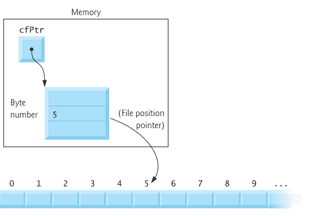

#### fseek 函数原型

fseek 的函数原型是

```
int fseek(FILE *stream, long int offset, int whence);
```

其中 offset 是从 stream 指向的文件中的 whence 位置开始查找的字节数。正偏移量向前查找，负偏移量向后查找。参数 whence 可以是 SEEK_SET、SEEK_CUR 或 SEEK_END（均在 <stdio.h> 中定义），它们表示查找开始的位置：

- SEEK_SET 表示查找从文件的*开头*开始。
- SEEK_CUR 表示查找从文件中的*当前位置*开始。
- SEEK_END 表示查找从文件的*末尾*开始。

你应该只对 SEEK_SET 使用正偏移量，只对 SEEK_END 使用负偏移量。

### 11.7.2 错误检查

为简单起见，本章中的程序*不*执行错误检查。工业级程序应通过检查 fscanf（图 11.5，第 34–35 行）、fseek（第 38–39 行）和 fwrite（第 42 行）等函数的返回值来确定它们是否正确运行。函数 fscanf 返回成功读取的数据项数量，如果在读取数据时出现问题则返回 EOF 值。如果无法执行查找操作（例如，尝试查找文件开头之前的位置），函数 fseek 返回非零值。函数 fwrite 返回其成功输出的项目数。如果此数字小于函数调用中的*第三个参数*，则发生了写入错误。

## 自我检查

1. （填空）函数 ________ 将文件位置指针设置为文件中的特定字节位置。
   **答案：** fseek。
2. （填空）符号常量 ________ 表示文件位置指针应相对于文件的开头进行定位。
   **答案：** SEEK_SET。

## 11.8 从随机访问文件读取数据

函数 fread 从文件中读取指定数量的字节到内存中。例如，

```c
fread(&client, sizeof(struct clientData), 1, cfPtr);
```

从 cfPtr 引用的文件中读取由 sizeof(struct clientData) 确定的字节数，将数据存储在 client 中，并返回读取的字节数。它从文件位置指针指定的位置读取字节。

函数 fread 可以通过提供指向将存储元素的数组的指针并指示要读取的元素数量来读取多个固定大小的数组元素。前面的语句读取一个元素。要读取多个元素，请将元素数量指定为 fread 的第三个参数。函数 fread 返回其成功输入的项目数。如果此数字小于函数调用的第三个参数，则发生了读取错误。

图 11.6 顺序读取 "accounts.dat" 文件中的每条记录，确定其是否包含数据，如果包含，则显示格式化的数据。函数 feof 确定何时到达文件末尾，fread 函数（第 28–29 行）将数据从文件传输到 clientData 结构 client。

```c
// fig11_06.c
// 顺序读取随机访问文件
#include <stdio.h>

// clientData 结构定义
struct clientData {
    int account;
    char lastName[15];
    char firstName[10];
    double balance;
};

int main(void){
    FILE *cfPtr = NULL; // accounts.dat 文件指针

    // fopen 打开文件；如果无法打开文件则退出
    if ((cfPtr = fopen("accounts.dat", "rb")) == NULL) {
        puts("File could not be opened.");
    }
    else {
        printf("%-6s%-16s%-11s%10s\n", "Acct", "Last Name",
            "First Name", "Balance");

        // 从文件中读取所有记录（直到文件末尾）
        while (!feof(cfPtr)) {
            // 读取一条记录
            struct clientData client = {0, "", "", 0.0};
            size_t result =
                fread(&client, sizeof(struct clientData), 1, cfPtr);

            // 显示记录
            if (result != 0 && client.account != 0) {
                printf("%-6d%-16s%-11s%10.2f\n", client.account,
                    client.lastName, client.firstName, client.balance);
            }
        }

        fclose(cfPtr); // fclose 关闭文件
    }
}
```

图 11.6 | 顺序读取随机访问文件。（第 1 部分，共 2 部分。）

| Acct | Last Name | First Name | Balance |
|------|-----------|------------|----------|
| 29 | Brown | Nancy | -24.54 |
| 33 | Dunn | Stacey | 314.33 |
| 37 | Barker | Doug | 0.00 |
| 88 | Smith | Dave | 258.34 |
| 96 | Stone | Sam | 34.98 |

图 11.6 | 顺序读取随机访问文件。（第 2 部分，共 2 部分。）

## 自我检查

1. （判断题）函数 fread 返回其成功输入的字节数。
   答案：错误。函数 fread 返回其成功输入的项目数。每个项目可以包含多个字节。如果项目数少于 fread 的第三个参数，则读取操作未成功完成。
2. （判断题）函数 fread 可以通过提供指向将存储元素的数组的指针并指示要读取的元素数量来读取多个固定大小的数组元素。
   答案：正确。

## 11.9 案例研究：事务处理系统

让我们使用随机访问文件创建一个事务处理程序（图 11.7）。该程序维护银行的账户信息——更新现有账户、添加新账户、删除账户，并将当前账户列表存储在文本文件中以供打印。我们假设图 11.4 的程序创建了文件 accounts.dat。

### 选项 1：创建格式化的账户列表

该程序有五个选项——选项 5 终止程序。选项 1 调用函数 textFile（第 58–86 行）将格式化的账户报告存储到名为 accounts.txt 的文本文件中，以便稍后打印。该函数使用 fread 和图 11.6 所示的顺序文件访问技术。选择选项 1 后，accounts.txt 包含：

| Acct | Last Name | First Name | Balance |
|------|-----------|------------|----------|
| 29 | Brown | Nancy | -24.54 |
| 33 | Dunn | Stacey | 314.33 |
| 37 | Barker | Doug | 0.00 |
| 88 | Smith | Dave | 258.34 |
| 96 | Stone | Sam | 34.98 |

### 选项 2：更新账户

选项 2 调用函数 updateRecord（第 89–125 行）来更新账户。该函数仅更新已存在的记录，因此函数首先检查用户指定的记录是否为空。首先，我们使用 fread 将记录读入结构 client。如果成员 account 为 0，则记录不包含信息。因此，程序显示一条消息说明记录为空，然后重新显示菜单选项。如果记录包含信息，函数 updateRecord 输入交易金额，计算新余额，并将记录重写到文件。选项 2 的典型输出是

```
Enter account to update (1 - 100): 37
37    Barker          Doug              0.00

Enter charge (+) or payment (-): +87.99
37    Barker          Doug              87.99
```

### 选项 3：创建新账户

选项 3 调用函数 newRecord（第 128–161 行）向文件添加新账户。如果用户输入一个已存在账户的账号，newRecord 会显示一条错误消息，指出该记录已包含信息，并再次打印菜单选项。此函数使用与图 11.5 中的程序相同的过程来添加新账户。选项 3 的典型输出是

```
Enter new account number (1 - 100): 22
Enter lastname, firstname, balance
? Johnston Sarah 247.45
```

### 选项 4：删除账户

选项 4 调用函数 deleteRecord（第 164–190 行）从文件中删除记录。删除是通过询问用户账号并重新初始化记录来完成的。如果账户不包含信息，deleteRecord 会显示一条错误消息，指出该账户不存在。

### 事务处理程序的代码

该程序如图 11.7 所示。文件 "accounts.dat" 使用 "rb+" 模式打开以进行更新（读取和写入）。

```c
// fig11_07.c
// 事务处理程序顺序读取随机访问文件，
// 更新已写入文件的数据，创建要放入文件的新数据，
// 并删除先前存储在文件中的数据。
#include <stdio.h>

// clientData 结构定义
struct clientData {
    int account;
    char lastName[15];
    char firstName[10];
    double balance;
};
```

图 11.7 | 事务处理程序。（第 1 部分，共 5 部分。）

## 11.9 案例研究：事务处理系统

```c
// prototypes
int enterChoice(void);
void textFile(FILE *readPtr);
void updateRecord(FILE *fPtr);
void newRecord(FILE *fPtr);
void deleteRecord(FILE *fPtr);

int main(void) {
    FILE *cfPtr = NULL; // accounts.dat file pointer

    // fopen opens the file; exits if file cannot be opened
    if ((cfPtr = fopen("accounts.dat", "rb+")) == NULL) {
        puts("File could not be opened.");
    }
    else {
        int choice = 0; // user

        // enable user to specify action
        while ((choice = enterChoice()) != 5) {
            switch (choice) {
                case 1: // create text file from record file
                    textFile(cfPtr);
                    break;
                case 2: // update record
                    updateRecord(cfPtr);
                    break;
                case 3: // create record
                    newRecord(cfPtr);
                    break;
                case 4: // delete existing record
                    deleteRecord(cfPtr);
                    break;
                default: // display message for invalid choice
                    puts("Incorrect choice");
                    break;
            }
        }

        fclose(cfPtr); // fclose closes the file
    }
}

// create formatted text file for printing
void textFile(FILE *readPtr) {
    FILE *writePtr = NULL; // accounts.txt file pointer

    // fopen opens the file; exits if file cannot be opened
    if ((writePtr = fopen("accounts.txt", "w")) == NULL) {
        puts("File could not be opened.");
    }
    else {
        rewind(readPtr); // sets pointer to beginning of file
        fprintf(writePtr, "%-6s%-16s%-11s%10s\n",
            "Acct", "Last Name", "First Name", "Balance");

        // copy all records from random-access file into text file
        while (!feof(readPtr)) {
            // create clientData with default information
            struct clientData client = {0, "", "", 0.0};
            size_t result =
                fread(&client, sizeof(struct clientData), 1, readPtr);

            // write single record to text file
            if (result != 0 && client.account != 0) {
                fprintf(writePtr, "%-6d%-16s%-11s%10.2f\n", client.account,
                    client.lastName, client.firstName, client.balance);
            }
        }

        fclose(writePtr); // fclose closes the file
    }
}

// update balance in record
void updateRecord(FILE *fPtr) {
    // obtain number of account to update
    printf("%s", "Enter account to update (1 - 100): ");
    int account = 0; // account number
    scanf("%d", &account);

    // move file pointer to correct record in file
    fseek(fPtr, (account - 1) * sizeof(struct clientData), SEEK_SET);

    // read record from file
    struct clientData client = {0, "", "", 0.0};
    fread(&client, sizeof(struct clientData), 1, fPtr);

    // display error if account does not exist
    if (client.account == 0) {
        printf("Account #%d has no information.\n", account);
    }
    else { // update record
        printf("%-6d%-16s%-11s%10.2f\n\n", client.account, client.lastName,
            client.firstName, client.balance);

        // request transaction amount from user
        printf("%s", "Enter charge (+) or payment (-): ");
        double transaction = 0.0; // transaction amount
        scanf("%lf", &transaction);
        client.balance += transaction; // update record balance

        printf("%-6d%-16s%-11s%10.2f\n", client.account, client.lastName,
            client.firstName, client.balance);

        // move file pointer to correct record in file
        fseek(fPtr, (account - 1) * sizeof(struct clientData), SEEK_SET);

        // write updated record over old record in file
        fwrite(&client, sizeof(struct clientData), 1, fPtr);
    }
}

// create and insert record
void newRecord(FILE *fPtr) {
    // obtain number of account to create
    printf("%s", "Enter new account number (1 - 100): ");
    int account = 0; // account number
    scanf("%d", &account);

    // move file pointer to correct record in file
    fseek(fPtr, (account - 1) * sizeof(struct clientData), SEEK_SET);

    // read record from file
    struct clientData client = {0, "", "", 0.0};
    fread(&client, sizeof(struct clientData), 1, fPtr);

    // display error if account already exists
    if (client.account != 0) {
        printf("Account #%d already contains information.\n",
            client.account);
    }
    else { // create record
        // user enters last name, first name and balance
        printf("%s", "Enter lastname, firstname, balance\n? ");
        scanf("%14s%9s%lf", &client.lastName, &client.firstName,
            &client.balance);

        client.account = account;

        // move file pointer to correct record in file
        fseek(fPtr, (client.account - 1) * sizeof(struct clientData),
            SEEK_SET);

        // insert record in file
        fwrite(&client, sizeof(struct clientData), 1, fPtr);
    }
}

// delete an existing record
void deleteRecord(FILE *fPtr) {
    // obtain number of account to delete
    printf("%s", "Enter account number to delete (1 - 100): ");
    int account = 0; // account number
    scanf("%d", &account);

    // move file pointer to correct record in file
    fseek(fPtr, (account - 1) * sizeof(struct clientData), SEEK_SET);

    // read record from file
    struct clientData client = {0, "", "", 0.0};
    fread(&client, sizeof(struct clientData), 1, fPtr);

    // display error if record does not exist
    if (client.account == 0) {
        printf("Account %d does not exist.\n", account);
    }
    else { // delete record
        // move file pointer to correct record in file
        fseek(fPtr, (account - 1) * sizeof(struct clientData), SEEK_SET);

        struct clientData blankClient = {0, "", "", 0}; // blank client

        // replace existing record with blank record
        fwrite(&blankClient, sizeof(struct clientData), 1, fPtr);
    }
}

// enable user to input menu choice
int enterChoice(void) {
    // display available options
    printf("%s", "\nEnter your choice\n"
        "1 - store a formatted text file of accounts called\n"
        "    \"accounts.txt\" for printing\n"
        "2 - update an account\n"
        "3 - add a new account\n"
        "4 - delete an account\n"
        "5 - end program\n? ");

    int menuChoice = 0; // variable to store user
    scanf("%d", &menuChoice); // receive choice from user
    return menuChoice;
}
```

图 11.7 | 事务处理程序。

### 相关练习

本事务处理系统案例研究由练习 11.11（硬件库存）和练习 11.17（改进的事务处理系统）提供支持。

## 自我检查

1. （讨论）在以下代码中，`if` 语句的条件测试了什么？
   `if ((cfPtr = fopen("accounts.dat", "rb+")) == NULL)`

   答案：该条件测试文件 `accounts.dat` 是否以二进制读写模式成功打开。

2. （讨论）在图 11.7 的程序中，以下语句的作用是什么？
   `fseek(fPtr, (account - 1) * sizeof(struct clientData), SEEK_SET);`

   答案：此语句将 `fPtr` 所代表文件的文件位置指针移动到 `clientData` 记录 `account` 的位置。

## 11.10 安全的 C 编程

### fprintf_s 和 fscanf_s

第 11.3–11.4 节中的示例分别使用了 `fprintf` 和 `fscanf` 函数来向文件写入文本和从文件读取文本。C 标准的附录 K 提供了这些函数的版本，名为 `fprintf_s` 和 `fscanf_s`，它们与我们之前介绍的 `printf_s` 和 `scanf_s` 函数相同，只是您还需要指定一个 `FILE` 指针参数来指示要操作的文件。如果您的 C 编译器的标准库包含这些函数，您应该使用它们而不是 `fprintf` 和 `fscanf`。与 `scanf_s` 和 `printf_s` 一样，Microsoft 版本的 `fprintf_s` 和 `fscanf_s` 与附录 K 中的版本有所不同。

### SEI CERT C 编码标准第 9 章

SEI CERT C 编码标准的第 9 章专门讨论输入/输出建议和规则——其中许多适用于一般的文件处理，其中一些适用于本章介绍的文件处理函数。有关每条规则的更多信息，请访问 https://wiki.sei.cmu.edu/：

- FIO03-C：当使用本章讨论的非排他性文件打开模式打开文件进行写入时，如果文件存在，`fopen` 函数会打开它并截断其内容，但不提供文件在 `fopen` 调用之前是否存在的指示。为确保不打开和截断现有文件，您可以使用 C11 的排他写入模式（在第 11.3 节中讨论），该模式仅在文件不存在时才允许 `fopen` 打开文件。
- FIO04-C：在工业级代码中，您应始终检查返回错误指示器的文件处理函数的返回值，以确保函数正确执行了任务。
- FIO07-C：`rewind` 函数不返回值，因此您无法测试操作是否成功。建议改用 `fseek` 函数，因为它在失败时返回非零值。
- FIO09-C：我们在本章中演示了文本文件和二进制文件。由于不同平台上二进制数据表示的差异，以二进制格式编写的文件通常不可移植。为了获得更可移植的文件表示，请考虑使用文本文件或可以处理不同平台上二进制文件表示差异的函数库。
- FIO14-C：某些库函数在文本文件和二进制文件上的操作并不完全相同。特别是，如果从 `SEEK_END` 进行查找，`fseek` 函数不能保证与二进制文件正确配合工作，因此应使用 `SEEK_SET`。

## 第11章 文件处理

## 第11.1节 引言

-   文件（第540页）用于永久保存大量数据。
-   计算机将文件存储在辅助存储设备上，例如固态驱动器、闪存驱动器和硬盘驱动器。

## 第11.2节 文件与流

-   C语言将每个文件视为一个字节的顺序流（第540页）。当文件被打开时，一个流会与该文件关联。
-   程序执行开始时，会自动打开三个流——标准输入（第540页）、标准输出（第540页）和标准错误（第540页）。
-   流提供了文件与程序之间的通信通道。
-   标准输入流使程序能够从键盘读取数据，标准输出流使程序能够在屏幕上打印数据。
-   打开文件会返回一个指向FILE结构（在`<stdio.h>`中定义；第541页）的指针，该结构包含用于处理文件的信息。此结构包括一个文件描述符（第541页）——一个指向操作系统数组（称为打开文件表，第541页）的索引。每个数组元素包含一个文件控制块（FCB；第541页），操作系统使用它来管理特定文件。
-   标准输入、标准输出和标准错误使用预定义的文件指针`stdin`、`stdout`和`stderr`进行操作。
-   函数`fgetc`（第541页）从文件中读取一个字符。它接收一个FILE指针作为参数，该指针指向要从中读取字符的文件。
-   函数`fputc`（第541页）向文件写入一个字符。它接收两个参数：要写入的字符和指向要写入字符的文件的FILE指针。
-   函数`fgets`和`fputs`（第541页）分别从文件中读取一行或向文件写入一行。

## 第11.3节 创建顺序访问文件

-   C语言不对文件施加任何结构。你必须提供文件结构以满足特定应用程序的要求。
-   C程序使用单独的FILE结构管理每个文件。
-   每个打开的文件必须有一个单独声明的**FILE指针**，用于引用该文件。
-   函数**`fopen`**（第544页）接受一个文件名和一个**文件打开模式**（第543页）作为参数，并返回一个指向已打开文件的FILE结构的指针，如果文件无法打开则返回NULL。
-   **文件打开模式"w"**用于打开文件进行写入。如果文件不存在，`fopen`会创建它。如果文件存在，其内容将被丢弃且不会发出警告。
-   函数**`feof`**（第544页）接收一个指向FILE的指针，当文件结束指示符被设置时返回一个非零（真）值；否则，函数返回零。任何尝试从`feof`返回真的文件读取的操作都将失败。
-   函数**`fprintf`**（第544页）等同于`printf`，但也接收一个指向要写入数据的文件的FILE指针作为参数。
-   函数**`fclose`**（第544页）接收一个文件指针作为参数，并关闭指定的文件。
-   当文件被打开时，该文件的文件控制块（FCB）会被复制到内存中。操作系统使用FCB来管理文件。
-   要读取现有文件，请以**读取**模式（"r"）打开它。
-   要向现有文件末尾添加记录，请以**追加**模式（"a"）打开文件。
-   要打开文件进行读写，请使用**更新模式**——"r+"、"w+"或"a+"。模式"r+"打开文件进行读写。模式"w+"创建一个文件进行读写，但会丢弃现有文件的内容。模式"a+"打开文件进行读写——所有写入都在文件末尾进行。如果文件不存在，则创建它。
-   每种文件打开模式都有一个对应的**二进制模式（b）**，用于操作**二进制文件**。
-   **独占写入模式**确保现有文件不会被覆盖。如果你的程序成功以独占写入模式打开文件，并且底层系统支持独占文件访问，那么在文件打开期间，只有你的程序可以访问该文件。

## 第11.4节 从顺序访问文件读取数据

-   函数**`fscanf`**（第547页）等同于函数`scanf`，但接收一个指向要从中读取数据的文件的FILE指针作为参数。
-   函数**`rewind`**将程序的**文件位置指针**（第548页）重新定位到其参数所指向文件的开头（即字节0）。
-   文件位置指针是一个整数值，指定文件中下一个读取或写入操作发生的字节位置。这有时被称为**文件偏移量**（第548页）。文件位置指针是与每个文件关联的FILE结构的一个成员。
-   顺序文本文件中的数据通常无法在不破坏文件中其他数据的情况下进行修改。

## 第11.5节 随机访问文件

-   **随机访问文件**（第552页）使用**固定长度**的记录，这些记录可以直接访问，无需搜索其他记录。
-   随机访问文件中的每条记录通常具有相同的长度，因此可以根据**记录键**计算出记录相对于文件开头的精确位置。
-   固定长度的记录使得可以在不破坏其他数据的情况下向随机访问文件中插入数据。先前存储的数据也可以在不重写整个文件的情况下进行更新或删除。

## 第11.6节 创建随机访问文件

-   函数**`fwrite`**（第552页）将从内存中指定位置开始的指定数量的字节传输到文件。数据从文件位置指针的位置开始写入。
-   函数**`fread`**（第552页）将从文件中由文件位置指针指定的位置开始的指定数量的字节传输到内存中从指定地址开始的区域。
-   函数**`fwrite`**和**`fread`**能够从文件**读取和写入数据数组**。`fread`和`fwrite`的第三个参数是要处理的元素数量。
-   文件处理程序通常一次写入一个结构体。

## 第11.7节 向随机访问文件随机写入数据

-   函数**`fseek`**（第555页）将文件的文件位置指针重新定位到特定的字节位置。它的第二个参数表示要查找的字节数，第三个参数表示从何处开始查找。第三个参数可以是——`SEEK_SET`、`SEEK_CUR`或`SEEK_END`。**`SEEK_SET`**（第557页）表示查找从文件开头开始；**`SEEK_CUR`**（第558页）表示查找从文件中的当前位置开始；**`SEEK_END`**（第558页）表示查找从文件末尾开始测量。
-   工业级程序应通过检查**`fscanf`**、**`fseek`**和**`fwrite`**等函数的返回值来确定它们是否正确运行。
-   函数**`fscanf`**返回成功读取的字段数，如果在读取数据时发生问题则返回`EOF`值。
-   函数**`fseek`**如果无法执行查找操作，则返回一个非零值。
-   函数**`fwrite`**返回它成功输出的项目数。如果此数字小于函数调用中的第三个参数，则发生了写入错误。

## 第11.8节 从随机访问文件读取数据

-   函数**`fread`**从文件中读取指定数量的字节到内存中。
-   函数**`fread`**可以通过提供一个指向将存储元素的数组的指针并指示要读取的元素数量来读取多个固定大小的数组元素。
-   函数**`fread`**返回它成功输入的项目数。如果此数字小于函数调用中的第三个参数，则发生了读取错误。

## 自我检查

1.  （填空）当你打开一个文件进行写入时，你可以通过使用________来确保现有文件不被截断，这允许`fopen`仅在文件不存在时才打开它。
    答案：独占写入模式。

2.  （判断对错）函数`rewind`不返回值，因此你无法测试操作是否成功。相反，使用函数`fseek`，因为它在失败时返回一个非零值。
    答案：正确。

3.  （判断对错）许多平台只允许同时打开有限数量的文件。因此，你应该在文件不再需要时立即关闭它。
    答案：正确。

## 总结

-   在许多平台上，你只能同时打开有限数量的文件。因此，你应该在文件不再被程序需要时立即关闭它。

## 自我复习练习

-   **11.1** 填写以下每个空白处：
    a) 函数_______关闭一个文件。
    b) _______函数以类似于`scanf`从`stdin`读取的方式从文件读取数据。
    c) 函数_______从指定文件读取一个字符。
    d) 函数_______从指定文件读取一行。
    e) 函数_______打开一个文件。
    f) 函数_______通常在随机访问应用程序中从文件读取数据时使用。
    g) 函数_______将文件位置指针重新定位到文件中的特定位置。

-   **11.2** 指出以下哪些是*正确*的，哪些是*错误*的。如果*错误*，请解释原因。
    a) 函数**`fscanf`**不能用于从标准输入读取数据。

## 第11章 文件处理

b) 你必须显式使用 `fopen` 来打开标准输入、标准输出和标准错误流。
c) 程序必须显式调用函数 `fclose` 来关闭文件。
d) 如果文件位置指针指向顺序文件中除文件开头以外的位置，则必须关闭并重新打开文件，才能从文件开头读取。
e) 函数 `fprintf` 可以写入标准输出。
f) 顺序访问文件中的数据可以在不覆盖其他数据的情况下进行更新。
g) 不必遍历随机访问文件中的所有记录来查找特定记录。
h) 随机访问文件中的记录长度不统一。
i) 函数 `fseek` 只能相对于文件开头进行定位。

11.3 编写单条语句完成以下操作。假设每条语句都适用于同一个程序。
a) 打开文件 "oldmast.dat" 用于读取，并将返回的文件指针赋给 `ofPtr`。
b) 打开文件 "trans.dat" 用于读取，并将返回的文件指针赋给 `tfPtr`。
c) 打开文件 "newmast.dat" 用于写入（并创建），并将返回的文件指针赋给 `nfPtr`。
d) 从文件 "oldmast.dat" 读取一条记录。该记录包含整数 `account`、字符串 `name` 和浮点数 `currentBalance`。
e) 从文件 "trans.dat" 读取一条记录。该记录包含整数 `account` 和浮点数 `dollarAmount`。
f) 向文件 "newmast.dat" 写入一条记录。该记录包含整数 `account`、字符串 `name` 和浮点数 `currentBalance`。

11.4 找出以下每项中的错误并解释如何纠正。
a) `fPtr` 引用的文件 ("payables.dat") 尚未打开。
```c
printf(fPtr, "%d%s%d\n", account, company, amount);
```
b) `open("receive.dat", "r+");`
c) 以下代码应从 "payables.dat" 读取一条记录。文件指针 `payPtr` 引用此文件，文件指针 `recPtr` 引用文件 "receive.dat"：
```c
scanf(recPtr, "%d%s%d\n", &account, company, &amount);
```
d) 应打开文件 "tools.dat" 以向文件添加数据，而不丢弃当前数据。
```c
if ((tfPtr = fopen("tools.dat", "w")) != NULL)
```
e) 应打开文件 "courses.dat" 用于追加，而不修改文件的当前内容。
```c
if ((cfPtr = fopen("courses.dat", "w+")) != NULL)
```

## 自我检查题答案

11.1 a) `fclose`。 b) `fscanf`。 c) `fgetc`。 d) `fgets`。 e) `fopen`。 f) `fread`。 g) `fseek`。

11.2 答案如下：
a) *错误。* 函数 `fscanf` 可以通过在调用 `fscanf` 时包含指向标准输入流 `stdin` 的指针来从标准输入读取。
b) *错误。* 这三个流在程序执行开始时由 C 自动打开。
c) *错误。* 文件将在程序执行终止时关闭，但所有文件都应使用 `fclose` 显式关闭。
d) *错误。* 函数 `rewind` 可用于将文件位置指针重新定位到文件开头。
e) *正确。*
f) *错误。* 在大多数情况下，顺序文件记录的长度并不统一。因此，更新一条记录可能会导致其他数据被覆盖。
g) *正确。*
h) *错误。* 随机访问文件中的记录通常长度统一。
i) *错误。* 可以从文件开头、文件末尾以及文件中的当前位置进行定位。

11.3
a) `ofPtr = fopen("oldmast.dat", "r");`
b) `tfPtr = fopen("trans.dat", "r");`
c) `nfPtr = fopen("newmast.dat", "w");`
d) `fscanf(ofPtr, "%d%s%f", &account, name, &currentBalance);`
e) `fscanf(tfPtr, "%d%f", &account, &dollarAmount);`
f) `fprintf(nfPtr, "%d %s %.2f", account, name, currentBalance);`

11.4 答案如下：
a) 错误：在使用 `fPtr` 之前，"payables.dat" 尚未打开。
纠正：使用 `fopen` 打开 "payables.dat" 用于写入、追加或更新。
b) 错误：函数 `open` 不是标准 C 函数。
纠正：使用函数 `fopen`。
c) 错误：函数 `scanf` 应为 `fscanf`。函数 `fscanf` 使用了不正确的文件指针来引用文件 "payables.dat"。
纠正：使用 `payPtr` 引用 "payables.dat" 并使用 `fscanf`。
d) 错误：文件内容被丢弃，因为文件是以写入模式 ("w") 打开的。
纠正：要向文件添加数据，可以以更新模式 ("r+") 打开文件，或以追加模式 ("a" 或 "a+") 打开文件。
e) 错误：文件 "courses.dat" 以 "w+" 模式打开用于更新，这会丢弃文件的当前内容。
纠正：以 "a" 或 "a+" 模式打开文件。

## 练习题

11.5 填空：
a) 大量数据以 ________ 的形式存储在辅助存储设备上。
b) 一个 ________ 由多个字段组成。
c) 为了便于从文件中检索特定记录，每条记录中的一个字段被选作 ________。
d) 一组传达意义的相关字符称为 ________。
e) 程序执行开始时自动打开的三个流的文件指针分别命名为 ________、 ________ 和 ________。
f) 函数 ________ 将一个字符写入指定文件。
g) 函数 ________ 将一行写入指定文件。
h) 函数 ________ 通常用于向随机访问文件写入数据。
i) 函数 ________ 将文件位置指针重新定位到文件开头。

**11.6** *（为文件匹配程序创建数据）* 编写一个简单程序，为检查练习 11.7 的程序创建一些测试数据。使用以下示例账户数据：

| 主文件：账户号 | 姓名 | 余额 | 交易文件：账户号 | 金额 |
| :--- | :--- | :--- | :--- | :--- |
| 100 | Alan Jones | 348.17 | 100 | 27.14 |
| 300 | Mary Smith | 27.19 | 300 | 62.11 |
| 500 | Sam Sharp | 0.00 | 400 | 100.56 |
| 700 | Suzy Green | -14.22 | 900 | 82.17 |

**11.7** *（文件匹配）* 练习 11.3 要求你编写一系列单条语句。这些语句构成了一类重要的文件处理程序的核心，即文件匹配程序。在商业数据处理中，每个系统通常有多个文件。例如，在应收账款系统中，通常有一个主文件，其中包含每个客户的详细信息，如客户姓名、地址、电话号码、未结余额、信用额度、折扣条款、合同安排，以及可能的近期购买和现金支付的简要历史记录。

当发生交易（如销售和付款）时，它们被输入到一个文件中。在每个业务期结束时（例如，某些公司为一个月，其他公司为一周，某些情况下为一天），交易文件（在练习 11.3 中称为 "trans.dat"）被应用于主文件（在练习 11.3 中称为 "oldmast.dat"），以更新每个账户的购买和付款记录。在更新过程中，主文件被重写为一个新文件（"newmast.dat"），然后在下一个业务期结束时用于再次开始更新过程。

文件匹配程序必须处理单文件程序中不存在的某些问题。例如，匹配并不总是发生。主文件上的客户可能在当前业务期没有进行任何购买或现金支付，因此该客户在交易文件上不会出现记录。同样，确实进行了一些购买或现金支付的客户可能刚刚搬到这个社区，公司可能还没有机会为该客户创建主记录。

使用练习 11.3 中的语句作为完整的文件匹配应收账款程序的基础。使用每个文件上的账户号作为匹配目的的记录键。假设每个文件都是一个顺序文件，记录按账户号递增顺序存储。

当发生匹配时（即，主文件和交易文件上出现具有相同账户号的记录），将交易文件上的金额加到主文件的当前余额上，并写入 "newmast.dat" 记录。（假设交易文件上的正数表示购买，负数表示付款。）当某个账户有主记录但没有相应的交易记录时，只需将主记录写入 "newmast.dat"。当有交易记录但没有相应的主记录时，打印消息 "Unmatched transaction record for account number ..."（用交易记录中的账户号填充）。

**11.8** *（测试文件匹配练习）* 使用练习 11.6 中创建的测试数据文件运行练习 11.7 的程序。仔细检查结果。

**11.9** *（处理多笔交易的文件匹配）* 可能（实际上是常见的）有多条具有相同记录键的交易记录。这是因为特定客户可能在一个业务期内进行多次购买和现金支付。重写你的练习 11.7 的应收账款文件匹配程序，以处理具有相同记录键的多条交易记录的可能性。修改练习 11.6 的测试数据，以包含以下额外的交易记录：

| 账户号 | 金额 |
|---|---|
| 300 | 83.89 |
| 700 | 80.78 |
| 700 | 1.53 |

**11.10** *（编写语句完成任务）* 编写语句完成以下操作。假设已定义结构

```c
struct person {
    char lastName[15];
    char firstName[15];
    char age[4];
};
```

并且文件已打开用于写入。

a) 初始化文件 "nameage.dat"，使其包含 100 条记录，其中 `lastName` = "unassigned"，`firstName` = ""，`age` = "0"。
b) 输入 10 个姓氏、名字和年龄，并将它们写入文件。
c) 更新一条记录；如果记录中没有信息，告诉用户 "No info"。

d) 通过重新初始化特定记录来删除包含信息的记录。

## 11.11 (硬件库存)
你是一家五金店的店主，需要维护一个库存清单，以便了解你拥有哪些工具、每种工具的数量以及每件工具的成本。编写一个程序，将文件 "hardware.dat" 初始化为100条空记录，允许你输入每件工具的相关数据，使你能够列出所有工具，允许你删除不再拥有的工具记录，并允许你更新文件中的*任何*信息。工具识别号应为记录号。使用以下信息初始化你的文件：

| 记录号 | 工具名称 | 数量 | 成本 |
|---|---|---|---|
| 3 | 电动砂光机 | 7 | 57.98 |
| 17 | 锤子 | 76 | 11.99 |
| 24 | 曲线锯 | 21 | 11.00 |
| 39 | 割草机 | 3 | 79.50 |
| 56 | 电锯 | 18 | 99.99 |
| 68 | 螺丝刀 | 106 | 6.99 |
| 77 | 大锤 | 11 | 21.50 |
| 83 | 扳手 | 34 | 7.50 |

## 11.12 (电话号码单词生成器)
标准电话键盘包含数字0-9。数字2-9每个都对应三个字母，如下表所示：

| 数字 | 字母 | 数字 | 字母 |
|---|---|---|---|
| 2 | A B C | 6 | M N O |
| 3 | D E F | 7 | P R S |
| 4 | G H I | 8 | T U V |
| 5 | J K L | 9 | W X Y |

许多人发现很难记住电话号码，因此他们利用数字与字母之间的对应关系，开发出与电话号码对应的七个字母的单词。例如，电话号码为686-2377的人可能会使用上表中所示的对应关系，开发出七个字母的单词 "NUMBERS"。

企业经常试图获取客户容易记住的电话号码。如果企业可以宣传一个简单的单词供客户拨打，那么毫无疑问，企业将接到更多的电话。

每个七个字母的单词恰好对应一个七位数的电话号码。希望增加外卖业务的餐厅，使用号码825-3688（即 "TAKEOUT"）肯定可以做到这一点。

每个七位数的电话号码对应许多不同的七个字母的单词。不幸的是，其中大多数代表无法识别的字母组合。然而，理发店的老板可能会很高兴知道，理发店的电话号码424-7288对应 "HAIRCUT"。酒类商店的老板无疑会欣喜地发现，商店的电话号码233-7226对应 "BEERCAN"。电话号码为738-2273的兽医会很高兴知道，该号码对应字母 "PETCARE"。

编写一个C程序，给定一个七位数，将每个可能的七个字母的单词写入文件。这样的单词有2187个（3的7次方）。避免使用包含数字0和1的电话号码。

## 11.13 (项目：电话号码单词生成器修改)
如果你有计算机化的词典可用，请修改你在练习11.12中编写的程序，以在词典中查找单词。该程序创建的一些七个字母的组合由两个或更多单词组成（例如，电话号码843-2677产生 "THEBOSS"）。

## 11.14 (在标准输入/输出流中使用文件处理函数)
修改图8.8中的示例，使用函数 `fgetc` 和 `fputs` 而不是 `getchar` 和 `puts`。程序应给用户选择：从标准输入读取并写入标准输出，或者从指定文件读取并写入指定文件。如果用户选择第二个选项，请让用户输入输入和输出文件的文件名。

## 11.15 (将类型大小输出到文件)
编写一个程序，使用 `sizeof` 运算符确定计算机系统上各种数据类型的大小（以字节为单位）。将结果写入文件 "datasize.dat"，以便稍后打印结果。文件中结果的格式应如下所示（你计算机上的类型大小可能与示例输出中显示的不同）：

| 数据类型 | 大小 |
|---|---|
| char | 1 |
| unsigned char | 1 |
| short int | 2 |
| unsigned short int | 2 |
| int | 4 |
| unsigned int | 4 |
| long int | 4 |
| unsigned long int | 4 |
| float | 4 |
| double | 8 |
| long double | 16 |

## 11.16 (带文件处理的Simpletron)
在练习7.29中，你编写了一个计算机的软件模拟，该模拟使用一种称为Simpletron机器语言（SML）的特殊机器语言。在模拟中，每次你想运行一个SML程序时，你都需要从键盘将程序输入到模拟器中。如果你在输入SML程序时出错，模拟器会重新启动，并重新输入SML代码。如果能从文件中读取SML程序而不是每次都输入，那将是很方便的。这将减少准备运行SML程序的时间和错误。

- a) 修改你在练习7.29中编写的模拟器，使其从用户在键盘上指定的文件中读取SML程序。
- b) Simpletron执行后，它会在屏幕上输出其寄存器和内存的内容。如果能将输出捕获到文件中，那将是很方便的，因此修改模拟器，使其将输出写入文件，同时也在屏幕上显示。

## 11.17 (修改的事务处理系统)
修改第11.9节的程序，增加一个选项，在屏幕上显示账户列表。考虑修改函数 `textFile`，使其根据指定输出位置的额外函数参数，使用标准输出或文本文件。

## 11.18 (项目：网络钓鱼扫描器)
网络钓鱼是一种身份盗窃形式，其中，发件人冒充可信来源，试图在电子邮件中获取私人信息，例如你的用户名、密码、信用卡号和社会安全号码。声称来自流行银行、信用卡公司、拍卖网站、社交网络和在线支付服务的网络钓鱼电子邮件可能看起来相当合法。这些欺诈性消息通常提供指向伪造（虚假）网站的链接，要求你输入敏感信息。

访问 https://snopes.com 和其他网站，查找顶级网络钓鱼骗局列表。同时，查看反网络钓鱼工作组（https://apwg.org/）和FBI的网络调查网站（https://www.fbi.gov/investigate/cyber），你可以在那里找到有关最新骗局以及如何保护自己的信息。

创建一个包含30个常见于网络钓鱼消息中的单词、短语和公司名称的列表。根据你估计其出现在网络钓鱼消息中的可能性，为每个项目分配一个分值（例如，如果有点可能得1分，如果中等可能得2分，如果非常可能得3分）。编写一个程序，扫描文本文件中的这些术语和短语。对于文本文件中出现的每个关键词或短语，将分配的分值加到该单词或短语的总分中。对于找到的每个关键词或短语，输出一行，包含该单词或短语、出现次数和总分。然后显示整个消息的总分。你的程序是否给你收到的一些实际网络钓鱼电子邮件分配了高分？它是否给你收到的一些合法电子邮件分配了高分？

# AI案例研究：自然语言处理入门——谁写了莎士比亚的作品？

## 11.19 (自然语言处理与相似性检测入门)
每天，我们以各种形式的交流使用自然语言，包括：

- 你阅读短信并查看最新的新闻片段。
- 你与家人、朋友和同事交谈并倾听他们的回应。
- 你有一个听力障碍的朋友，你通过手语与他交流，他喜欢看带隐藏字幕的视频节目。
- 你有一个盲人同事，他阅读盲文，听有声读物，并听屏幕阅读器讲述计算机屏幕上的内容。
- 你阅读电子邮件，区分垃圾邮件和重要通信。
- 你收到一封西班牙语的客户电子邮件，通过免费翻译程序处理，然后用英语回复，知道你的客户可以轻松地将你的电子邮件翻译回西班牙语。
- 你开车，观察路标，如 "Stop"、"Speed Limit 35" 和 "Road Under Construction"。
- 你给汽车发出语音命令，如 "call home" 或 "play classical music"，或者提问，如 "Where's the nearest gas station?"。
- 你教孩子如何说话和阅读。
- 你学习一门外语。

**自然语言处理（NLP）** 帮助计算机理解、分析和处理人类文本和语音。自然语言处理是在由推文、Facebook帖子、对话、电影评论、莎士比亚戏剧、历史文献、新闻条目、会议记录等组成的文本集合上执行的。文本集合被称为 **语料库**，其复数形式是 **语料库**。

一些关键的NLP应用包括：

- **自然语言理解**——理解文本内容或口语。
- **情感分析**——确定文本是积极、中立还是消极情绪。例如，公司分析关于其产品的推文的情感。
- **可读性评估**——根据使用的词汇、单词长度、句子长度、句子结构、涵盖的主题等，确定文本的可读性。在撰写本书时，我们使用了付费的NLP工具Grammarly²来帮助我们调整写作，以确保文本对广大受众的可读性。
- **智能虚拟助手**——帮助你执行日常任务的软件。流行的智能虚拟助手包括Amazon Alexa、Apple Siri、Microsoft Cortana和Google Assistant。
- **文本摘要**——总结大量文本的要点。这可以为忙碌的人节省宝贵的时间。
- **语音识别**——将语音转换为文本。
- **语音合成**——将文本转换为语音。

² Grammarly也有免费版本（https://www.grammarly.com）。

## 第11章 文件处理

- **语言识别**——在事先不知道文本语言的情况下接收文本，然后自动确定其语言。
- **跨语言翻译**——将文本转换为其他口语语言。
- **命名实体识别**——定位并分类诸如日期、时间、数量、地点、人物、事物、组织等项目。
- **聊天机器人**——基于人工智能的软件，人类通过自然语言与其交互。一个流行的聊天机器人应用是自动化客户支持。
- **相似性检测**——检查文档以确定它们的相似程度。基本的相似性度量包括平均句子长度、句子长度的频率分布、平均单词长度、单词长度的频率分布、单词使用的频率分布等。

许多底层的自然语言处理任务在执行其任务时支持上述应用，包括：

- **分词**——将文本分割成**标记**，即有意义的单元，如单词和数字。
- **词性标注**——识别每个单词的词性，如名词、动词、形容词等。
- **名词短语提取**——定位代表名词的词组，例如“红砖工厂”。³
- **拼写检查**和**拼写纠正**。
- **词干提取**——通过去除前缀或后缀将单词还原为其词干。例如，“varieties”的词干是“varieti”。
- **词形还原**——类似于词干提取，但根据原始单词的上下文生成真实的单词。例如，“varieties”的词形还原形式是“variety”。
- **词频统计**——确定每个单词在语料库中出现的频率。
- **停用词消除**——移除常见词，如 *a*、*an*、*the*、*I*、*we*、*you* 等，以分析语料库中的重要单词。
- **n-gram**——生成语料库中连续单词的集合，用于识别经常彼此相邻出现的单词。n-gram通常用于预测性文本输入，例如当您在智能手机上输入短信时，它会建议可能的下一个单词。

本案例研究练习有两个目的：

- 首先，它介绍了人工智能的一个关键子主题——自然语言处理，这将在当今任何学习编程的人的未来中发挥关键作用。

> 3. 短语“红砖工厂”说明了为什么自然语言如此困难。“红砖工厂”是制造红砖的工厂吗？还是一个制造任何颜色砖块的红色工厂？或者是一个用红砖建造的、生产任何类型产品的工厂？在当今的音乐世界中，它甚至可能是一个摇滚乐队的名称或您智能手机上游戏的名称。

- 其次，它介绍了自然语言处理的子主题——相似性检测，您将使用简单的数组、字符串和文件处理技术来执行此操作。

## 古腾堡计划

一个用于分析的绝佳文本来源是古腾堡计划中的大量免费电子书：
https://www.gutenberg.org
该网站包含超过60,000种各种格式的电子书，包括纯文本文件。这些在美国已不受版权保护。有关古腾堡计划使用条款和其他国家版权的信息，请参见：
https://www.gutenberg.org/policy/terms_of_use.html
在本案例研究练习中，您将使用威廉·莎士比亚的《罗密欧与朱丽叶》的纯文本电子书文件：
https://www.gutenberg.org/ebooks/1513
以及克里斯托弗·马洛的《爱德华二世》：
https://www.gutenberg.org/ebooks/20288
这些都可以在古腾堡计划免费下载。

### 从古腾堡计划下载电子书

古腾堡计划不允许通过程序访问其电子书。您必须先将书籍下载到自己的系统中，然后才能进行分析。⁴ 要将《罗密欧与朱丽叶》下载为纯文本文件，请在该剧的网页上右键单击 **Plain Text UTF-8** 链接，然后选择

- **链接另存为...**（Chrome/Firefox/Microsoft Edge），
- **下载链接文件为...**（Safari），或

将该剧保存到您将放置本练习解决方案的文件夹中。将文件保存为 *RomeoAndJuliet.txt* 和 *EdwardTheSecond.txt*。

### 谁写了莎士比亚的作品？

有些人认为威廉·莎士比亚的作品可能是由克里斯托弗·马洛、弗朗西斯·培根爵士或其他人所写。您可以在以下网址了解更多关于这一争议的信息：
https://en.wikipedia.org/wiki/Shakespeare_authorship_question
通过一些简单的相似性检测技术，您可以开始将莎士比亚的作品与其他作者的作品进行比较。在本案例研究练习中，您的最终目标是执行《罗密欧与朱丽叶》和克里斯托弗·马洛的《爱德华二世》之间的相似性检测，以确定克里斯托弗·马洛是否可能

4. “关于我们页面机器人访问的信息。”访问于2021年1月1日。https://www.gutenberg.org/policy/robot_access.html.

创作了莎士比亚的作品。如果您真的对这个问题感兴趣，可以探索更复杂的相似性检测技术。

### 分析《罗密欧与朱丽叶》以准备进行简单的相似性检测

您现在将执行一些简单的统计分析，作为确定文档相似性的基础。您将首先关注莎士比亚的《罗密欧与朱丽叶》。稍后，您将对《爱德华二世》执行相同的任务，然后比较您的分析结果。作为对照，您可能还想分析一位与此争议无关的第三位作者的戏剧。在阅读和处理《罗密欧与朱丽叶》时，您将跟踪以下项目，然后使用它们来显示各种统计数据：

- 句子总数。
- 单词总数。
- 字符总数。
- 每种长度的句子数量。
- 每种长度的单词数量。
- 独特单词的频率。

### 在分析《罗密欧与朱丽叶》之前清理它

数据并不总是准备好进行分析。例如，它可能格式错误。数据科学家在执行分析之前花费大量时间准备数据。为分析准备数据称为**数据清洗**或**数据整理**。

您从古腾堡计划下载的每本电子书都包含您不希望包含在分析中的信息和法律段落。您应该在文本编辑器中打开《罗密欧与朱丽叶》，并通过删除古腾堡计划文本来“清理”它。特别是，删除从文档开头到标题“THE TRAGEDY OF ROMEO AND JULIET”（包括该标题）的所有内容，然后删除从以下文本到文件末尾的所有内容：

> End of the Project Gutenberg EBook of Romeo and Juliet,
by William Shakespeare

在运行该剧的分析之前，您应该使用文本编辑器进行一些额外的文本清理：

- 每个角色的名字在每次该角色说话时都会被提及——这是戏剧中的标准做法。在本案例研究中，您将进行的特定分析不需要角色的名字。事实上，它们会“碍事”。对于更复杂的相似性检测，您可能希望保留它们。
- 戏剧还包括许多舞台指示，指示角色何时应进入和离开舞台、彼此决斗、中毒后倒下死亡等。这些指示也应被移除。

您可以编写一个程序来处理这些清理任务。但是要小心——仔细检查手稿可能会发现许多特殊情况，您的代码需要处理这些情况。为它们编程可能既耗时又容易出错。

### 人工智能案例研究：自然语言处理入门——谁写了莎士比亚的作品？

581

### 执行分析所需的数组

您现在已准备好分析《罗密欧与朱丽叶》，以创建用于简单相似性检测的统计数据。使用三个数组来记录表征该剧文本的各种计数。

- **sentenceLengths** 数组将记录有多少句子由一个单词、两个单词、三个单词等组成。
- **wordLengths** 数组将记录有多少单词由一个字符、两个字符、三个字符等组成。
- **wordFrequencies** 数组包含一个结构体，用于剧中的每个独特单词。结构体的成员是单词和该单词在剧中出现的次数。单词应作为字符串存储在固定长度的字符数组中，该数组必须足够大以存储剧中最长的单词及其终止空字符。

### 分析一个句子

考虑句子：

> “O Romeo, Romeo, wherefore art thou Romeo.”

- 该句子有七个单词，因此您的程序会将 sentenceLengths[7] 加1。
- 第一个单词（“O”）有一个字母，因此您的程序会将 wordLengths[1] 加1。
- 第二个单词（“Romeo”）有五个字母，因此您的程序会将 wordLengths[5] 加1，依此类推。

要执行词频统计，请将单词转换为小写字母，以便所有相同单词的出现都将比较为相等。在处理每个单词时，搜索 wordFrequencies 数组以确定该单词是否已在数组中。如果是，则将该单词的计数加一。否则，将该单词放入下一个空的 wordFrequencies 数组元素中，并将其计数设置为1。

### 实现您的分析代码

使用您学过的数组、字符串和文件处理技术来读取《罗密欧与朱丽叶》的内容并执行以下任务：

- 每个句子都以**句子终止符**结尾——**句号**（.）、**问号**（?）或**感叹号**（!）。定义一个 **processSentence 函数**，该函数读取单词直到遇到句子终止符。此函数在您处理每个单词时更新句子、单词和字符计数器。当您到达句子末尾时，递增 sentenceLengths 数组中的相应计数器，并将单词计数器重置为零。
- 对于每个单词，processSentence 应调用 **processWord 函数**来递增 wordLengths 数组中的相应计数器，并递增ment the word’s counter in the wordFrequencies array or add the word to the wordFrequencies array with a count of 1.
Remember to keep track of the total number of sentences, words and characters.

### 分析报告

接下来，显示《罗密欧与朱丽叶》的以下统计数据：

- 句子总数。
- 单词总数。
- 字符总数。
- 平均句子长度。
- 平均单词长度。
- 句子长度中位数。
- 单词长度中位数。
- 一个包含句子长度及其在所有句子长度中所占百分比的表格。
- 一个包含单词长度及其在所有单词长度中所占百分比的表格。
- 一个频率分布表，包含该剧的唯一单词、它们的频率以及它们在剧中所有单词中所占的百分比——按频率降序显示。

你的程序还应将这些统计数据输出到一个文件中，以便更容易地研究你产生的结果，并在不同戏剧之间进行比较。

### 分析克里斯托弗·马洛的戏剧《爱德华二世》

既然你已经分析了《罗密欧与朱丽叶》，现在请使用文本编辑器清理克里斯托弗·马洛的戏剧《爱德华二世》。作为任何数据科学研究的一部分，了解你的数据非常重要。《爱德华二世》中用于指定说话者和舞台指示的惯例与你在《罗密欧与朱丽叶》中看到的不同。因此，在清理《爱德华二世》时，请注意观察这些差异。清理完文本后，对《爱德华二世》运行你的分析程序。将分析结果与你为《罗密欧与朱丽叶》产生的结果进行比较。评论你发现的这些戏剧之间的相似之处。

## AI/数据科学案例研究——使用GNU科学库的机器学习

**11.20**（*使用简单线性回归的机器学习*）机器学习是人工智能中最令人兴奋和最有前途的子领域之一。我们的目标是为你提供一个友好、实践性的介绍，介绍一种更简单的机器学习技术。

### 预测

机器学习通常用于基于现有数据（通常是大量数据）进行预测。如果你能改进天气预报以挽救生命、减少伤害和财产损失，那不是太棒了吗？如果我们能改进癌症诊断和治疗方案以挽救生命，或者改进商业预测以最大化利润并保障人们的工作，那会怎样？检测欺诈性信用卡购买和保险索赔呢？预测客户“流失”、房屋可能的售价、新电影的票房，以及更广泛地说，新产品和服务的预期收入呢？预测教练和球员赢得更多比赛和冠军的最佳策略呢？所有这些类型的预测如今都在通过机器学习实现。

### GNU科学库和gnuplot

在这个案例研究中，你将**研究一个完全编码的程序**，该程序演示了一种称为**简单线性回归**的机器学习技术，该技术使用来自开源[GNU科学库](https://www.gnu.org/software/gsl/)的一个函数执行：

该库定义了许多工程、科学和数学中常用的算法。你将研究的程序随后向2D和3D绘图应用程序**gnuplot**传递命令，以创建多个绘图图像。正如你将看到的，gnuplot使用其自己的绘图语言，与C不同，因此在我们的代码中，我们提供了广泛的注释来解释gnuplot命令。

### 描述性统计

在数据科学中，你经常使用统计来描述和总结你的数据。一些基本的**描述性统计**包括：

- **最小值**——一组值中的最小值。
- **最大值**——一组值中的最大值。
- **范围**——最大值和最小值之间的差值。
- **计数**——一组值中的值的数量。
- **总和**——一组值中所有值的总和。

**离散度度量**（也称为**变异性度量**），如*范围*，确定值的分布程度。其他离散度度量包括*方差*和*标准差*。<sup>5,6,7</sup>

其他描述性统计包括均值、中位数和众数，我们在第6.9节中讨论过。这些是**集中趋势度量**——每个都是产生一个代表一组值中“中心”值的单一值的方法，即在某种意义上代表其他值的典型值。

5. “理解描述性统计。”访问于2021年1月1日。https://towardsdatascience.com/understanding-descriptive-statistics-c9c2b0641291。
6. “标准差。”访问于2021年1月1日。https://en.wikipedia.org/wiki/Standard_deviation。
7. “方差。”访问于2021年1月1日。https://en.wikipedia.org/wiki/Variance。

### 安斯库姆四重奏

数据分析中的一个重要步骤是“了解你的数据”。上述*基本描述性统计*当然可以帮助你更多地了解你的数据。但需要注意的是，截然不同的数据集实际上可能具有相同或几乎相同的描述性统计。为了说明这种现象，我们将考虑*安斯库姆四重奏*：

https://en.wikipedia.org/wiki/Anscombe%27s_quartet

安斯库姆四重奏由以下四组*x-y*坐标对组成，每组有11个数据样本：

| x1 | y1 | x2 | y2 | x3 | y3 | x4 | y4 |
|---|---|---|---|---|---|---|---|
| 10.0 | 8.04 | 10.0 | 9.14 | 10.0 | 7.46 | 8.0 | 6.58 |
| 8.0 | 6.95 | 8.0 | 8.14 | 8.0 | 6.77 | 8.0 | 5.76 |
| 13.0 | 7.58 | 13.0 | 8.74 | 13.0 | 12.74 | 8.0 | 7.71 |
| 9.0 | 8.81 | 9.0 | 8.77 | 9.0 | 7.11 | 8.0 | 8.84 |
| 11.0 | 8.33 | 11.0 | 9.26 | 11.0 | 7.81 | 8.0 | 8.47 |
| 14.0 | 9.96 | 14.0 | 8.10 | 14.0 | 8.84 | 8.0 | 7.04 |
| 6.0 | 7.24 | 6.0 | 6.13 | 6.0 | 6.08 | 8.0 | 5.25 |
| 4.0 | 4.26 | 4.0 | 3.10 | 4.0 | 5.39 | 19.0 | 12.50 |
| 12.0 | 10.84 | 12.0 | 9.13 | 12.0 | 8.15 | 8.0 | 5.56 |
| 7.0 | 4.82 | 7.0 | 7.26 | 7.0 | 6.42 | 8.0 | 7.91 |
| 5.0 | 5.68 | 5.0 | 4.74 | 5.0 | 5.73 | 8.0 | 6.89 |

有趣的是，这些数据集具有*几乎相同*的描述性统计。例如，在所有四个数据集中，*x*和*y*坐标的平均值分别为9和7.5。

以下图表——由我们的**完全编码的案例研究**示例创建——分别绘制了*x1-y1*、*x2-y2*、*x3-y3*和*x4-y4*数据：

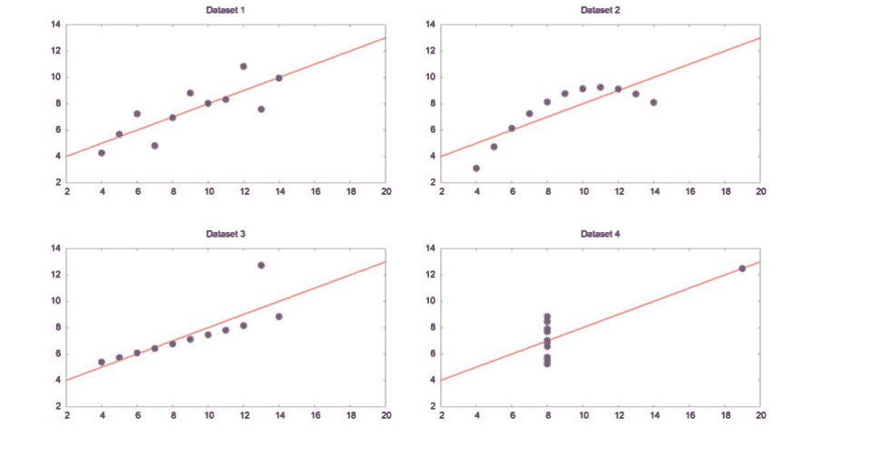

我们稍后将讨论这些线（称为**回归线**）。正如你在**可视化**中看到的——但不一定仅仅通过查看前面表格中的数据——这些安斯库姆四重奏数据集*有显著差异*。然而，就像它们的描述性统计一样，它们的回归线看起来是相同的。这表明你不能仅仅从描述性统计和回归中得出结论。你必须使用额外的工具，如上面的可视化，来**了解你的数据**。

### 简单线性回归

给定一组表示**自变量**（*x*）和**因变量**（*y*）的点（*x-y*坐标对），**简单线性回归**用一条直线（称为**回归线**）描述因变量和自变量之间的**线性关系**。前面图表中的线是安斯库姆四重奏中每个数据集的回归线。

考虑摄氏温度和华氏温度之间的线性关系。给定一个摄氏温度，我们可以使用以下公式计算相应的华氏温度：

```
fahrenheit = 9 / 5 * celsius + 32
```

在这个公式中，celsius是*自变量*，fahrenheit是*因变量*。每个华氏温度*取决于*计算中使用的摄氏温度。如果我们绘制每个摄氏温度对应的华氏温度，所有点都将出现在同一条直线上，揭示两种温度尺度之间的*线性关系*。

### 简单线性回归方程的组成部分

像前面图表中显示的回归线这样的任何直线（在二维中）上的点都可以用以下方程计算：

```
y = mx + b
```

其中

- *m*是直线的**斜率**，
- *b*是直线与*y*轴的**截距**（在*x* = 0处），或简称*y*截距，
- *x*是自变量，且
- *y*是因变量。

在将摄氏温度转换为华氏温度的公式中：

- *m*是9 / 5，
- *b*是32，
- *x*是celsius——独立的摄氏温度，且
- *y*是fahrenheit——由计算产生的因变量华氏温度。

在简单线性回归中，*y*是给定*x*的*预测值*。当然，一条直线有无限多个点。如果你能通过简单线性回归确定

### 简单线性回归的工作原理

简单线性回归是一种**机器学习**技术，用于确定一条“最佳拟合”数据的直线的斜率（$m$）和$y$轴截距（$b$）。简单线性回归算法会迭代地调整斜率和截距，并在每次调整后计算每个数据点到直线的距离的平方。当斜率和截距的值使这些平方距离之和最小时，就达到了“最佳拟合”。这被称为**普通最小二乘**计算。⁸

### 使用GNU科学库执行简单线性回归

**GNU科学库**的`gsl_fit_linear`函数封装了简单线性回归的计算，为你提供最佳拟合数据的直线的斜率和$y$轴截距。调用`gsl_fit_linear`后，你可以将斜率（$m$）和截距（$b$）代入$y = mx + b$方程，然后根据自变量$x$值预测因变量$y$值。我们还使用这些值与**gnuplot**一起显示数据的回归线以及数据点。

### 逗号分隔值（CSV）文件

我们已在文件`anscombe.csv`中为你提供了安斯库姆四重奏数据。该文件和本案例练习的源代码位于本章示例文件夹的`AnscombesQuartet`子文件夹中。`.csv文件扩展名`表明该文件采用**CSV（逗号分隔值）**格式——这是一种特别流行的数据集分发文件格式。CSV文件只是文本文件，其中每一行是一条信息记录，其各项由逗号分隔。以下是`anscombe.csv`的前两行：

```
x1,y1,x2,y2,x3,y3,x4,y4
10,8.04,10,9.14,10,7.46,8,6.58
```

CSV文件的第一行通常包含后续行中数据的列名。在`anscombe.csv`中，其余行是各列的数值。在我们的代码中，函数`readAnscombesQuartetData`将数据加载到数组中。

### 在macOS上安装GNU科学库

在macOS上，你可以使用**Homebrew包管理器**⁹安装GNU科学库，步骤如下：

```
brew install gsl
```

### 在Windows上安装GNU科学库

在Visual Studio中，你需要将GNU科学库添加到每个希望使用它的项目中。在Visual Studio中打开你的项目后，执行以下步骤：

1. 选择工具 > NuGet包管理器 > 管理解决方案的NuGet包...
2. 在“浏览”选项卡中，搜索“gsl-msvc-”，然后选择gsl-msvc-x64。
3. 在NuGet包管理器的右侧，勾选你的项目名称旁边的复选框，然后单击“安装”以将库添加到你的项目中。

### 在macOS上安装gnuplot

使用Homebrew包管理器安装gnuplot，步骤如下：

```
brew install gnuplot
```

### 在Windows上安装gnuplot

从以下地址下载并运行gnuplot Windows安装程序（gp541-win64-mingw.exe）：
https://sourceforge.net/projects/gnuplot/files/gnuplot/5.4.1/

单击“下一步”>，直到到达“选择其他任务”步骤，然后：

- 在“选择gnuplot的默认终端”下，选择windows单选按钮。
- 滚动到设置底部，勾选“将应用程序目录添加到PATH环境变量”复选框。

单击“下一步”>，然后单击“安装”。安装完成后，重新启动计算机。

### 在macOS上编译和运行程序

在macOS上，通过执行以下步骤编译anscome_macos.c：

1. 打开终端窗口。
2. 使用cd命令切换到本章示例文件夹的AnscombesQuartet子文件夹。
3. 使用以下命令编译程序：
4. 运行程序：

```
clang -std=c18 anscombe_macos.c -lgsl -o anscombe_macos
```

```
./anscombe_macos
```

该程序将在macOS上与anscome_macos.c相同的文件夹中创建四个PNG图像文件。你可以打开这些图像文件来查看四个图表。

### 在Windows上编译和运行程序

在你添加了GNU科学库的Visual Studio解决方案中：

- 将本章示例文件夹的AnscombesQuartet子文件夹中的文件anscome_windows.c添加到你的项目中。
- 修改第72行以指定anscombe.csv在你系统上的位置
- 生成并运行你的项目。

运行程序时，它将在你的项目文件夹中创建四个PNG图像文件。使用文件资源管理器导航到该文件夹，然后打开图像文件以查看四个图表。

## 第11章 文件处理

### 详细注释的代码

接下来，研究代码以学习如何使用GNU科学库的`gsl_fit_linear`函数执行简单线性回归，以及如何从C程序向gnuplot应用程序发送gnuplot命令。考虑调整gnuplot命令，看看你的更改如何影响我们程序生成的图表。例如，你可以更改图表的`pointtype`、`linewidth`和`linecolor`值。

## AI/数据科学案例研究：时间序列与简单线性回归

既然你已经仔细研究了安斯库姆四重奏的代码，你就可以将该程序应用于其他简单线性回归问题。简单线性回归通常用于分析**时间序列**——与时间点相关联的值序列（称为**观测值**）。一些例子包括每日收盘股价、每小时温度读数、飞机飞行中的位置变化、年度农作物产量和季度公司利润。也许最终的时间序列是来自全球Twitter用户的时间戳推文流。

### 时间序列

在本练习中，你将使用简单线性回归来分析一个包含纽约市1895年至2020年按年份*排序*的1月平均温度的时间序列。这是一个**单变量时间序列**——它每个时间点包含*一个*观测值。**多变量时间序列**每个时间点包含*两个或更多*观测值，例如天气应用程序中的每小时温度、湿度和气压读数。你在本练习中的目标是确定回归线是否具有：

- **负斜率**，表示该时间段内**平均温度呈下降趋势**，
- **零斜率**，表示该时间段内**平均温度趋势稳定**，或
- **正斜率**，表示该时间段内**平均温度呈上升趋势**。

### 从NOAA获取天气数据

美国国家海洋和大气管理局（NOAA）

`http://www.noaa.gov`

提供广泛的公共历史天气数据，包括特定城市在不同时间间隔内的平均温度时间序列。

我们从NOAA的“气候一览”时间序列中获取了纽约市1895-2020年（截至撰写本文时可用的最大日期范围）的1月平均温度，地址为：

`https://www.ncdc.noaa.gov/cag/city/time-series`

你可以选择整个美国、美国境内地区、州、城市等的天气数据。选择所需数据和要分析的时间范围后，单击**绘图**以显示图表并查看所选数据的表格。在该表格顶部，有图标可以点击以多种格式下载数据，包括CSV。

为了方便起见，我们提供了包含你将在本练习中使用的数据的文件nyc_ave_january_temps.csv。该文件位于本章示例文件夹的nycdata子文件夹中。我们还“清理”了数据，因此文件包含每个观测值的以下两列：

- 日期——格式为YYYY的值（例如2020）。下载的数据格式为YYYYMM（例如202001），其中01代表一月。我们从该列的每个数据项中移除了01，只保留年份。
- 温度——华氏温度浮点数。我们将此列从下载数据中的Value重命名。

我们删除了名为Anomaly的第三列，本练习不需要它。

### 执行回归

修改安斯库姆四重奏代码，使用纽约市1月平均温度数据执行简单线性回归，并绘制带有回归线的数据图表。你在过去126年中看到了什么趋势？

## Web服务与云案例研究——libcurl和OpenWeatherMap

11.21（使用OpenWeatherMap获取城市天气报告）这是我们的另一个挑战性案例研究练习。第1.11节介绍了互联网、网络、云、Web服务和混搭。在这个案例研究练习中，你将深入Web服务的世界，使用开源的libcurl¹⁰和cJSON¹¹库来调用Web服务并处理其返回的结果。你将研究一个完全编码、详细注释的程序，该程序与来自https://openweathermap.org/的OpenWeatherMap免费Web服务交互，以获取你选择的城市的当前天气报告。

然后，我们将挑战你使用从这个完全编码的示例中学到的知识创建你的第一个混搭。如果你有创业精神，你可以通过将现有的Web服务编织成混搭来快速原型化强大的新应用程序。即使你不打算做相关的挑战项目，仅仅掌握这个案例研究的代码也将为你打开广阔的Web服务世界。

### Web服务

Web服务所在的机器被称为Web服务主机。客户端应用程序（在我们的案例中，是一个C程序）通过网络向Web服务主机发送请求，主机处理请求并通过网络向客户端返回响应。这种分布式计算以多种方式使系统受益。例如，一个无法直接访问另一个系统上数据的应用程序可能是

10. “libcurl — 多协议文件传输库。”访问于2021年1月4日。https://curl.se/libcurl/.
11. “cJSON。”访问于2021年1月4日。https://github.com/DaveGamble/cJSON.

能够通过网络服务检索数据。同样，缺乏执行特定计算处理能力的应用程序可以使用网络服务来利用另一个系统更优越的资源。

### 表述性状态转移（REST）

当今大多数网络服务使用一种称为**表述性状态转移（REST）**的架构风格，通常被称为**RESTful网络服务**。在RESTful网络服务中，你可以调用的每个函数都由一个唯一的URL标识。**URL（统一资源定位符）**标识了互联网上资源（如网站和网络服务）的位置。当Web服务器收到对RESTful网络服务的请求时，它立即知道要在该服务器上调用哪个函数。RESTful网络服务可以从程序中调用（正如你将在这里所做的），也可以通过在Web浏览器的地址栏中输入相应的URL直接调用。

### OpenWeatherMap

OpenWeatherMap为其许多天气网络服务提供免费套餐。在使用它们之前，你必须在 https://openweathermap.org/ 注册一个免费账户。他们会发送一封电子邮件来验证你的账户。一旦你完成验证，他们会回复一封包含你的免费API密钥的电子邮件。你也可以在登录网站后，在你的账户的 **API Keys** 标签页下找到它。

你可以在 https://openweathermap.org/api 查看各种OpenWeatherMap API及其文档。

有些是免费的，有些仅对订阅者开放。使用免费的API密钥，你可以访问：

- 指定位置的**当前天气数据**（本案例研究中使用），
- **One Call API**，它返回指定位置的当前和未来天气数据的组合，以及
- 指定位置的**5天/3小时预报**。

### JavaScript对象表示法（JSON）

许多基于云的服务（如OpenWeatherMap）通过JSON对象与你的应用程序通信。**JSON（JavaScript对象表示法）**是一种基于文本的、人类和计算机可读的数据交换格式，用于将数据表示为名称/值对的集合。JSON已成为在应用程序之间通过互联网传输数据的首选数据格式。对于调用基于云的网络服务尤其如此。

每个JSON对象包含一个用花括号括起来的、以逗号分隔的*属性名*和*值*的列表。例如，以下键值对可能表示一条客户记录：

```
{"account": 100, "name": "Jones", "balance": 24.98}
```

JSON还支持数组，即用方括号括起来的、以逗号分隔的值。例如，以下是一个可接受的数字JSON数组：
[100, 200, 300]
JSON对象和数组中的值可以是：

- *双引号*中的字符串（如"Jones"），
- 数字（如100或24.98），
- JSON布尔值（表示为true或false），
- null（表示没有值，类似于C中的NULL），
- 数组（如[100, 200, 300]），以及
- 其他JSON对象。

图11.8包含一个来自OpenWeatherMap当前天气数据网络服务的JSON响应示例，我们已为可读性进行了格式化。即使你可能从未见过JSON编码的数据，你也应该会发现它组织良好、可读且相当容易理解。

```
1  {
2    "coord": {
3      "lon": -71.06,
4      "lat": 42.36
5    },
6    "weather": [
7      {
8        "id": 803,
9        "main": "Clouds",
10       "description": "broken clouds",
11       "icon": "04n"
12     }
13   ],
14   "base": "stations",
15   "main": {
16     "temp": 0.03,
17     "feels_like": -4.96,
18     "temp_min": -1.11,
19     "temp_max": 1.11,
20     "pressure": 1014,
21     "humidity": 93
22   },
23   "visibility": 10000,
24   "wind": {
25     "speed": 4.1,
26     "deg": 360
27   },
28   "clouds": {
29     "all": 75
30   },
31   "dt": 1609815037,
32     "sys": {
33       "type": 1,
34       "id": 3486,
35       "country": "US",
36       "sunrise": 1609762409,
37       "sunset": 1609795488
38     },
39     "timezone": -18000,
40     "id": 4930956,
41     "name": "Boston",
42     "cod": 200
43   }
```

图 11.8 | OpenWeatherMap针对美国马萨诸塞州波士顿的示例响应。

### 开源libcurl库

为了获取图11.8中的JSON响应，我们的应用程序使用了开源libcurl库中的函数：
https://curl.se/libcurl/

该库支持许多用于在应用程序之间传输数据的互联网和Web协议，可用于调用网络服务并接收其响应。你可以在以下位置找到libcurl C函数的文档：
https://curl.se/libcurl/c/

在我们完整的代码示例 `weather.c`（位于本章示例文件夹的 `weather` 子文件夹中）中，我们对调用网络服务并将其响应保存到文件所需的libcurl函数进行了详细注释。
要在macOS或Linux上安装libcurl：

- 对于macOS，你可以使用Homebrew包管理器¹²安装libcurl库，如下所示：
  brew install libcurl4
- 对于Ubuntu Linux，执行命令
  sudo apt install libcurl4-openssl-dev

在Visual Studio中，你需要将libcurl添加到每个希望使用它的项目中。在Visual Studio中打开你的项目后，执行以下步骤：

1. 选择“工具” > “NuGet包管理器” > “管理解决方案的NuGet程序包...”。
2. 在“浏览”选项卡中，搜索“curl”，然后选择“curl by curl contributors”。
3. 在NuGet包管理器的右侧，单击你项目名称旁边的复选框，然后单击“安装”以将库添加到你的项目中。

### 开源cJSON库

我们应用程序的libcurl部分将OpenWeatherMap JSON响应写入文件。为了显示天气报告，我们的应用程序将文件内容读入字符串，然后使用开源cJSON库从JSON中提取项目。你可以从以下位置下载cJSON：
https://github.com/DaveGamble/cJSON
该库没有安装过程。你只需将库的 `cJSON.h` 和 `cJSON.c` 文件包含在你的项目中即可。
cJSON的函数使你能够访问JSON响应中的项目，因此我们可以显示如下天气报告：

```
Boston Weather
Temperature: 0.0 C
Feels like: -5.0 C
Pressure: 1014 hPa
Humidity: 93%
Conditions: broken clouds
```

在 `weather.c` 中，我们对提取上述数据（针对你运行应用程序时指定的城市，下文讨论）所需的cJSON函数进行了详细注释。

### 在macOS和Linux上编译和运行程序

在macOS和Linux上，通过执行以下步骤编译天气应用程序：

1. 打开终端窗口。
2. 使用 `cd` 命令切换到本章示例文件夹的 `weather` 子文件夹。
3. 使用以下命令之一编译程序——macOS上使用 `clang`，Linux上使用 `gcc`：

```
clang -std=c18 -Wall weather.c cJSON.c -lcurl -o weather
gcc -std=c18 -Wall weather.c cJSON.c -lcurl -o weather
```

此应用程序接收两个命令行参数。虽然我们在第15.3节之前不讨论命令行参数的细节，但这个完整的模拟代码提供了接收命令行参数所需的语句。第一个是你想要获取当前天气的城市，例如

```
Boston,MA,USA
```

如果城市名称包含空格，请将位置用引号括起来：

```
"Los Angeles,CA,USA"
```

第二个命令行参数是你的OpenWeatherMap API密钥。以下命令将获取美国马萨诸塞州波士顿的当前天气数据：

```
./weather Boston,MA,USA API_KEY
```

请务必将 `API_KEY` 替换为你在注册免费账户时收到的OpenWeatherMap API密钥。
编译程序并多次运行。接下来，研究此应用程序的代码（包括详细的注释）。

### 在Visual Studio中编译和运行天气应用程序

在你添加了libcurl库的Visual Studio解决方案中，将本章示例文件夹的 `weather` 子文件夹中的 `weather.c` 和 `cJSON.c` 文件添加到你的项目中。按如下方式指定命令行参数：

- 在解决方案资源管理器中右键单击项目名称，然后选择 **属性**。
- 展开 **配置属性** 并选择 **调试**。
- 在 **命令参数** 右侧的文本框中输入参数。
- 生成并运行你的项目。

### 挑战：创建你自己的混搭应用

我们在第1.11.3节介绍了混搭应用。在研究了我们基于libcurl和网络服务的天气应用程序代码（包括详细注释）之后，作为挑战练习，尝试你的第一个混搭应用。Web混搭应用通常结合两个或多个互补网络服务的功能。对于许多流行的混搭应用，其中之一是地图服务，例如Google Maps或Microsoft的Bing Maps，但也有许多不使用地图的混搭应用可能性。

要构建一个网络服务混搭应用，你通常需要：

- 两个或多个互补的网络服务，当你将它们混搭在一起时，将帮助你产生一个有价值的新应用程序。
- 能够从你的C程序向网络服务发送请求，正如你在本案例研究中学习如何使用libcurl所做的那样。
- 能够以你的C程序能够理解的形式（通常是JSON）从该网络服务接收结果。

网络服务目录ProgrammableWeb
https://programmableweb.com/
列出了近**24,000个网络服务**和**8,000个混搭应用**。他们还提供关于使用网络服务和创建自己的混搭应用的“操作指南”和示例代码。根据他们的网站，一些使用最广泛的网络服务是Google Maps以及来自Facebook、Twitter和YouTube的其他服务。

熟悉ProgrammableWeb。查看他们描述的许多网络服务，重点关注免费的——网络服务提供商提供一些免费服务和一些付费服务是很常见的。阅读ProgrammableWeb关于创建自己的混搭应用的“操作指南”。为了获得灵感，浏览一下他们网站上列出的8,000个混搭应用。尝试找到两个互补的免费网络服务，从中你可以创建一个有价值的混搭应用，然后构建那个混搭应用。

¹² 如果找不到 `brew` 命令，请访问 https://brew.sh/ 获取安装说明。

# 数据结构

## 12

## 学习目标

在本章中，你将：

- 为数据对象动态分配和释放内存。
- 使用指针、自引用结构和递归构建链式数据结构。
- 创建和操作链表、队列、栈和二叉树。
- 了解链式数据结构的重要应用。
- 学习关于指针和动态内存分配的安全C编程建议。
- 可选地，在练习中构建你自己的编译器。

596 第12章 数据结构

## 12.1 引言
## 12.2 自引用结构
## 12.3 动态内存管理
## 12.4 链表
### 12.4.1 insert函数
### 12.4.2 delete函数
### 12.4.3 isEmpty和printList函数
## 12.5 栈
### 12.5.1 push函数
### 12.5.2 pop函数
### 12.5.3 栈的应用
## 12.6 队列
### 12.6.1 enqueue函数
### 12.6.2 dequeue函数
## 12.7 树
### 12.7.1 insertNode函数
### 12.7.2 遍历：inOrder、preOrder和postOrder函数
### 12.7.3 重复项消除
### 12.7.4 二叉树搜索
### 12.7.5 其他二叉树操作
## 12.8 安全C编程

小结 | 自我复习题 | 自我复习题答案 | 练习
特别章节：构建你自己的编译器

## 12.1 引言

我们已经学习了固定大小的数据结构，包括一维数组、二维数组和结构体。本章介绍可以在执行时增长和收缩的动态数据结构：

- 链表是“排成一行”的数据项的集合。你可以在链表中的任何位置插入和删除项。
- 栈在编译器和操作系统中很重要。你只能在栈的一端（称为栈顶）插入和删除项。
- 队列代表等待队列。你只能在队列的后端插入，只能从前端删除。后端和前端分别称为队列的尾部和头部。
- 二叉树有助于数据的高速搜索和排序，高效地消除重复数据项，并将表达式编译成机器语言。

这些数据结构中的每一种都有许多其他有趣的应用。

### 可选项目：构建你自己的编译器

我们希望你尝试在练习末尾名为“构建你自己的编译器”的特别章节中描述的可选主要项目。你一直在使用编译器将你的C程序翻译成机器语言，以便执行它们。在这个项目中，你将构建自己的编译器。它将读取一个用简单而强大的高级语言编写的语句文件。你的编译器将把这些语句翻译成一个Simpletron机器语言（SML）指令文件。SML是你在第7章的特别章节“构建你自己的计算机”中学到的（由Deitel创建的）语言。然后，你的Simpletron模拟器程序将执行你的编译器生成的SML程序！这个项目使你能够运用你在本书中学到的大部分内容。特别章节将仔细引导你完成高级语言的规范，并描述将每条高级语言语句转换为机器语言指令的算法。如果你喜欢挑战，你可能会尝试我们在练习中建议的对编译器和Simpletron模拟器的许多增强。

## 自我检查

1. （填空）哪种数据结构被描述为“有助于数据的高速搜索和排序，高效地消除重复数据项，并将表达式编译成机器语言”？ ________。
答案：二叉树。
2. （填空）哪种数据结构被描述为“排成一行的数据项的集合——可以在数据结构中的任何位置进行插入和删除”？ ________。
答案：链表。
3. （填空）哪种动态数据结构被描述为“你只能在一端（栈顶）插入和删除项”？ ________。
答案：栈。

## 12.2 自引用结构

自引用结构包含一个指向相同结构类型结构的指针成员。例如，以下定义创建了类型 `struct node`：

```c
struct node {
    int data;
    struct node *nextPtr;
};
```

我们的 `struct node` 有两个成员——整型成员 `data` 和指针成员 `nextPtr`。`nextPtr` 指向另一个 `struct node`。这个结构与我们正在定义的结构具有相同的类型，因此称为自引用结构。成员 `nextPtr` 是一个链接——它可以用来将一个 `struct node` 链接到另一个 `struct node`。我们将自引用结构对象链接起来，形成链表、队列、栈和树。

下图说明了两个链接在一起形成链表的自引用结构对象：

最后一个节点中的斜杠¹代表一个NULL指针，表示该节点不指向另一个节点。NULL指针表示数据结构的结束。不将最后一个节点的链接设置为NULL可能导致运行时错误。

> 1. 斜杠仅用于说明目的。它不对应于C的反斜杠字符。

## 自我检查

1. （填空）以下代码中应该用什么替换 ??? 以使其成为自引用结构体？ _______。

```c
struct node {
    int data;
    ??? *nextPtr;
};
```

答案：`struct node`。

2. （填空）一个 _______ 指针表示数据结构的结束。

答案：NULL。

3. （填空）自引用结构可以被 _______ 在一起，形成诸如链表、队列、栈和树等数据结构。

答案：链接。

## 12.3 动态内存管理

创建和维护在执行时增长和收缩的动态数据结构需要动态内存管理，它有两个组成部分：

- 在执行时获取更多内存以容纳新节点，以及
- 释放不再需要的内存。

`malloc` 函数、`free` 函数和 `sizeof` 运算符对于动态内存管理至关重要。

### malloc 函数

要在执行时请求内存，请将要分配的字节数传递给 `malloc` 函数。如果成功，`malloc` 返回一个指向已分配内存的 `void *` 指针。回想一下，`void *` 指针可以被赋值给任何指针类型的变量。

`malloc` 函数最常与 `sizeof` 一起使用。例如，以下语句使用 `sizeof(struct node)` 确定一个 `struct node` 对象的字节大小，在内存中分配该字节数的新区域，并将指向已分配内存的指针存储在 `newPtr` 中：

```c
newPtr = malloc(sizeof(struct node));
```

内存不保证被初始化，尽管许多实现出于安全考虑会初始化它。如果没有可用内存，`malloc` 返回 `NULL`。在访问动态分配的内存之前，务必测试 `NULL` 指针，以避免可能导致程序崩溃的运行时错误。

### free 函数

当你不再需要一块动态分配的内存时，立即通过调用 `free` 函数来释放内存，将其返回给系统。这将其返回给系统以供将来可能重新分配。要释放前面 `malloc` 调用分配的内存，请使用语句

```c
free(newPtr);
```

释放内存后，将指针设置为 `NULL`。这可以防止意外引用该内存，该内存可能已被分配用于其他目的。

在不再需要时不释放动态分配的内存可能导致系统过早耗尽内存。这有时被称为“内存泄漏”。引用已释放的内存是一个错误，通常会导致程序崩溃。释放你未使用 `malloc` 动态分配的内存是一个错误。

### calloc 和 realloc 函数

C还提供了 `calloc` 和 `realloc` 函数，用于创建和修改动态数组的大小。第15.8节讨论了这些函数。

## 自我检查

1. **（判断题）** `malloc` 函数接受要分配的字节数作为参数，并返回一个 `NULL` 指针。
   **答案：** *错误。* 实际上，`malloc` 返回一个指向已分配内存地址的 `void *` 指针，或者如果无法分配内存，则返回一个 `NULL` 指针。
2. **（讨论）** 精确描述以下语句的作用：
   `newPtr = malloc(sizeof(struct node));`
   **答案：** 该语句计算 `sizeof(struct node)` 以确定对象的字节大小，在内存中分配该字节数的新区域，并将指向已分配内存的指针存储在 `newPtr` 中。
3. **（讨论）** 编写一条语句，释放由 `malloc` 动态分配给 `newPtr` 的内存。
   **答案：** `free(newPtr);`
4. **（填空）** 在不再需要时不释放动态分配的内存可能导致系统耗尽内存。这有时被称为 ________。
   **答案：** 内存泄漏。

## 12.4 链表

链表是自引用结构对象（称为节点）的线性集合，通过指针链接连接——因此称为“链”表。你通过指向其第一个节点的指针访问链表，并通过节点的指针链接成员访问后续节点。你通过根据需要创建每个节点来动态存储数据。一个节点可以包含任何类型的数据，包括其他结构体对象。栈和队列也是线性数据结构。你很快就会看到它们是链表的受限版本。

## 第12章 数据结构

### 数组与链表

你可以将数据列表存储在数组中，但链表具有几个优点：

-   当数据项的数量不可预测时，链表是合适的选择。链表是动态的，因此其长度可以根据需要增加或减少。数组是固定大小的数据结构（尽管第15.8节展示了如何动态分配和重新分配数组）。
-   可以声明一个数组包含比预期数据项数量更多的元素，但这可能会浪费内存。对于在执行时增长和收缩的数据结构，使用链表和动态内存分配可以节省内存。然而，请记住，链表节点中的指针需要额外的内存。此外，动态内存分配会带来函数调用的开销。
-   固定大小的数组可能会被填满。只有当系统没有足够的内存来满足动态存储分配请求时，链表才会被填满。
-   链表可以通过在列表中的适当位置插入每个新元素来保持排序顺序。在已排序的数组中插入和删除可能很耗时。所有在插入或删除元素之后的元素都必须相应地移动。

### 数组在直接元素访问方面更快

另一方面，数组元素在内存中是连续存储的。这允许立即访问任何数组元素——任何元素的地址都可以根据其相对于数组起始位置的位置直接计算出来。链表则无法提供对其元素的这种即时访问。

### 链表示意图

链表节点在内存中不保证是连续存储的。然而，在逻辑上，节点看起来是连续的。下图说明了一个包含多个节点的链表。

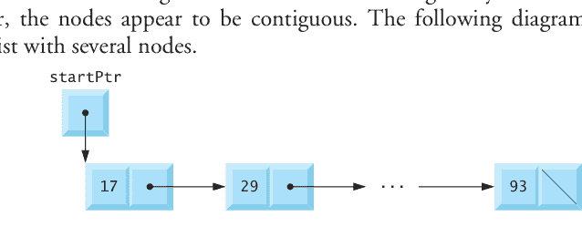

### 实现链表

图12.1操作一个字符列表。你可以按字母顺序在列表中插入一个字符（函数`insert`）或从列表中删除一个字符（函数`delete`）。下面是对该程序的详细讨论。为了讨论方便，我们拆分了这个程序的代码——输出显示在下面第一个代码表的末尾。

```c
// fig12_01.c
// 在列表中插入和删除节点
#include <stdio.h>
#include <stdlib.h>

// 自引用结构
struct listNode {
    char data; // 每个listNode包含一个字符
    struct listNode *nextPtr; // 指向下一个节点的指针
};

typedef struct listNode ListNode; // struct listNode的别名
typedef ListNode *ListNodePtr; // ListNode*的别名

// 函数原型
void insert(ListNodePtr *sPtr, char value);
char delete(ListNodePtr *sPtr, char value);
int isEmpty(ListNodePtr sPtr);
void printList(ListNodePtr currentPtr);
void instructions(void);

int main(void) {
    ListNodePtr startPtr = NULL; // 初始时没有节点
    char item = '\0'; // 用户输入的字符

    instructions(); // 显示菜单
    printf("%s", "? ");
    int choice = 0; // 用户的选择
    scanf("%d", &choice);

    // 当用户不选择3时循环
    while (choice != 3) {
        switch (choice) {
            case 1: // 插入一个元素
                printf("%s", "Enter a character: ");
                scanf("\n%c", &item);
                insert(&startPtr, item); // 在列表中插入item
                printList(startPtr);
                break;
            case 2: // 删除一个元素
                if (!isEmpty(startPtr)) { // 如果列表不为空
                    printf("%s", "Enter character to be deleted: ");
                    scanf("\n%c", &item);

                    // 如果找到字符，则删除它
                    if (delete(&startPtr, item)) { // 删除item
                        printf("%c deleted.\n", item);
                        printList(startPtr);
                    }
                    else {
                        printf("%c not found.\n\n", item);
                    }
                }
                else {
                    puts("List is empty.\n");
                }

                break;
            default:
                puts("Invalid choice.\n");
                instructions();
                break;
        }

        printf("%s", "? ");
        scanf("%d", &choice);
    } // 结束while

    puts("End of run.");
}

// 向用户显示程序说明
void instructions(void) {
    puts("Enter your choice:\n"
        "   1 to insert an element into the list.\n"
        "   2 to delete an element from the list.\n"
        "   3 to end.");
}
```

```
Enter your choice:
   1 to insert an element into the list.
   2 to delete an element from the list.
   3 to end.
? 1
Enter a character: B
The list is:
B --> NULL

? 1
Enter a character: A

The list is:
A --> B --> NULL

? 1
Enter a character: C
The list is:
A --> B --> C --> NULL

? 2
Enter character to be deleted: D
D not found.

? 2
Enter character to be deleted: B
B deleted.
The list is:
A --> C --> NULL

? 2
Enter character to be deleted: C
C deleted.
The list is:
A --> NULL

? 2
Enter character to be deleted: A
A deleted.
List is empty.

? 4
Invalid choice.

Enter your choice:
    1 to insert an element into the list.
    2 to delete an element from the list.
    3 to end.
? 3
End of run.
```

图 12.1 | 在列表中插入和删除节点。

第7-10行定义了自引用结构`struct listNode`，我们用它来构建本例的链表。第12和13行定义了`typedef`，我们用它来使代码更具可读性。名称`ListNode`代表一个`struct listNode`对象，名称`ListNodePtr`代表一个指向`struct listNode`对象的指针。`main`函数允许你在列表中插入字符（第34-39行）、从列表中删除项目（第40-58行）或终止程序。最初，`startPtr`（第23行）被设置为`NULL`以表示一个空列表。程序的主要链表函数是`insert`（第12.4.1节）和`delete`（第12.4.2节）。

### 12.4.1 函数 `insert`

在本例中，我们按字母顺序在列表中插入字符。函数`insert`（第81-110行）接收一个指向列表第一个节点的指针的地址和一个要插入的字符作为参数。这使得`insert`能够修改调用者指向列表第一个节点的指针，使其在数据项放置在列表前端时指向一个新的第一个节点。因此，我们通过引用传递指针。传递指针的地址会创建一个指向指针的指针——这有时被称为双重间接寻址。这是一个复杂的概念，需要仔细编程。

```c
// 按排序顺序将新值插入列表
void insert(ListNodePtr *sPtr, char value) {
    ListNodePtr newPtr = malloc(sizeof(ListNode)); // 创建节点

    if (newPtr != NULL) { // 有可用空间吗？
        newPtr->data = value; // 将值放入节点
        newPtr->nextPtr = NULL; // 节点不链接到另一个节点

        ListNodePtr previousPtr = NULL;
        ListNodePtr currentPtr = *sPtr;

        // 循环以在列表中找到正确的位置
        while (currentPtr != NULL && value > currentPtr->data) {
            previousPtr = currentPtr; // 移动到...
            currentPtr = currentPtr->nextPtr; // ...下一个节点
        }

        // 在列表开头插入新节点
        if (previousPtr == NULL) {
            newPtr->nextPtr = *sPtr;
            *sPtr = newPtr;
        }
        else { // 在previousPtr和currentPtr之间插入新节点
            previousPtr->nextPtr = newPtr;
            newPtr->nextPtr = currentPtr;
        }
    }
    else {
        printf("%c not inserted. No memory available.\n", value);
    }
}
```

`insert`函数执行以下步骤：

1.  调用`malloc`创建一个新节点，并将分配的内存地址赋给`newPtr`（第82行）。
2.  如果内存已分配，则将要插入的字符赋给`newPtr->data`（第85行），并将`NULL`赋给`newPtr->nextPtr`（第86行）。始终将`NULL`赋给新节点的链接成员。指针应在使用前初始化。
3.  我们将使用指针`previousPtr`和`currentPtr`分别存储插入点之前和之后的节点位置。将`previousPtr`初始化为`NULL`（第88行），将`currentPtr`初始化为`*sPtr`（第89行）——第一个节点的地址。
4.  定位新值的插入点。当`currentPtr`不为`NULL`且要插入的值大于`currentPtr->data`时（第92行），将`currentPtr`赋给`previousPtr`（第93行），然后将`currentPtr`前进到列表的下一个节点（第94行）。
5.  在列表中插入新值。如果`previousPtr`为`NULL`（第98行），则将新节点作为列表的第一个节点插入（第99-100行）。将`*sPtr`赋给`newPtr->nextPtr`（新节点的链接指向原来的第一个节点），并将`newPtr`赋给`*sPtr`，以便`main`中的`startPtr`指向新的第一个节点。否则，将新节点就位（第103-104行）。将 `newPtr` 赋值给 `previousPtr->nextPtr`（前一个节点指向新节点），并将 `currentPtr` 赋值给 `newPtr->nextPtr`（新节点的链接指向当前节点）。

为简化起见，我们实现的 `insert` 函数（以及本章中其他类似函数）使用了 `void` 返回类型。`malloc` 函数可能无法分配所请求的内存。在这种情况下，我们的 `insert` 函数最好返回一个状态，以指示操作是否成功。

#### 插入操作图解

下图说明了将一个包含 'C' 的节点插入有序列表的过程。部分 (a) 显示了插入前的列表和新节点。部分 (b) 显示了插入新节点后的结果。虚线箭头表示重新赋值的指针。


### 12.4.2 delete 函数

`delete` 函数（第113-141行）接收指向列表第一个节点的指针的地址和一个要删除的字符。

```c
// delete a list element
char delete(ListNodePtr *sPtr, char value) {
    // delete first node if a match is found
    if (value == (*sPtr)->data) {
        ListNodePtr tempPtr = *sPtr; // hold onto node being removed
        *sPtr = (*sPtr)->nextPtr; // de-thread the node
        free(tempPtr); // free the de-threaded node
        return value;
    }
    else {
        ListNodePtr previousPtr = *sPtr;
        ListNodePtr currentPtr = (*sPtr)->nextPtr;

        // loop to find the correct location in the list
        while (currentPtr != NULL && currentPtr->data != value) {
            previousPtr = currentPtr; // walk to ...
            currentPtr = currentPtr->nextPtr; // ... next node
        }

        // delete node at currentPtr
        if (currentPtr != NULL) {
            ListNodePtr tempPtr = currentPtr;
            previousPtr->nextPtr = currentPtr->nextPtr;
            free(tempPtr);
            return value;
        }
    }

    return '\0';
}
```

`delete` 函数执行以下步骤：

1.  如果要删除的字符与第一个节点的字符匹配（第115行），我们必须移除第一个节点。将 `*sPtr` 赋值给 `tempPtr`，我们将用它来释放节点的内存。将 `(*sPtr)->nextPtr` 赋值给 `*sPtr`，这样 `main` 中的 `startPtr` 现在指向之前列表的*第二个*节点。调用 `free` 来释放 `tempPtr` 指向的内存。返回被删除的字符。
2.  否则，用 `*sPtr` 初始化 `previousPtr`，用 `(*sPtr)->nextPtr` 初始化 `currentPtr`（第122-123行），以推进到第二个节点。
3.  定位要删除的字符。当 `currentPtr` 不为 `NULL` 且要删除的值不等于 `currentPtr->data` 时（第126行），将 `currentPtr` 赋值给 `previousPtr`（第127行），并将 `currentPtr->nextPtr` 赋值给 `currentPtr`（第128行），以推进到列表的下一个节点。
4.  如果 `currentPtr` 不为 `NULL`（第132行），则该字符在列表中。将 `currentPtr` 赋值给 `tempPtr`（第133行），我们将用它来释放该节点。将 `currentPtr->nextPtr` 赋值给 `previousPtr->nextPtr`（第134行），以连接被移除节点的前一个节点和后一个节点。释放 `tempPtr` 指向的节点（第135行），然后返回被删除的字符（第136行）。

如果尚未返回任何内容，第140行返回空字符（`'\0'`）以表示在列表中未找到该字符。

#### 删除操作图解

下图说明了从链表中删除包含 'C' 的节点的过程。部分 (a) 显示了删除前的链表。部分 (b) 显示了链接的重新赋值。指针 `tempPtr` 用于释放分配给存储 'C' 的节点的内存。注意，在第118行和第135行，我们释放了 `tempPtr`。之前我们建议将已释放的指针设置为 `NULL`。这里我们没有这样做，因为 `tempPtr` 是一个局部自动变量，并且函数在释放内存后立即返回。

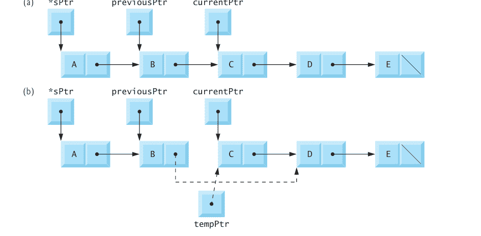

### 12.4.3 isEmpty 和 printList 函数

`isEmpty` 函数（第144-146行）是一个谓词函数——它不会以任何方式改变列表。相反，`isEmpty` 确定列表是否为空——即指向第一个节点的指针是否为 `NULL`。如果列表为空，`isEmpty` 返回 1；否则，返回 0。

```c
// return 1 if the list is empty, 0 otherwise
int isEmpty(ListNodePtr sPtr) {
    return sPtr == NULL;
}

// print the list
void printList(ListNodePtr currentPtr) {
    // if list is empty
    if (isEmpty(currentPtr)) {
        puts("List is empty.\n");
    }
    else {
        puts("The list is:");

        // while not the end of the list
        while (currentPtr != NULL) {
            printf("%c --> ", currentPtr->data);
            currentPtr = currentPtr->nextPtr;
        }

        puts("NULL\n");
    }
}
```

`printList` 函数（第149-165行）打印一个列表。该函数的 `currentPtr` 参数接收指向列表第一个节点的指针。该函数首先确定列表是否为空（第151-153行），如果是，则打印 "List is empty." 并终止。否则，第155-163行打印列表的数据。当 `currentPtr` 不为 `NULL` 时，第159行打印 `currentPtr->data` 中的值，第160行将 `currentPtr->nextPtr` 赋值给 `currentPtr` 以推进到下一个节点。如果列表最后一个节点的链接不为 `NULL`，打印算法将尝试打印超出列表末尾的内容，这是一个逻辑错误。此打印算法对于链表、栈和队列是相同的。

### 基于列表的递归练习

练习 12.17 要求你实现一个递归函数，以反向打印列表。练习 12.18 要求你实现一个递归函数，在链表中搜索特定的数据项。

## 自我检查

1.  （多选题）以下陈述 a)、b) 或 c) 哪一项是错误的？
    a) 链表是由称为节点的自引用结构组成的线性集合，通过指针链接连接——因此称为“链”表。
    b) 链表通过指向列表第一个节点的指针进行访问。
    c) 链表中的后续节点通过存储在每个节点中的链接指针成员进行访问。
    d) 以上所有陈述都是正确的。
    答案：d。
2.  （判断题）当数据结构中要存储的数据项数量不可预测时，链表是合适的。
    答案：正确。
3.  （判断题）链表中的元素在内存中是连续存储的。这允许直接访问任何元素，因为可以根据其相对于链表开头的位置直接计算其地址。数组则不提供对其元素的这种直接访问。
    答案：错误。实际上，情况正好相反。数组的元素在内存中是连续存储的，并支持按位置直接访问。链表则不提供对其元素的这种直接访问。
4.  （填空题）将指向链表第一个节点的指针的地址传递给函数，会创建一个指向指针的指针。这通常称为双重 ________。
    答案：间接引用。

## 12.5 栈

栈可以实现为链表的受限版本。你只能在顶部添加新节点和移除现有节点。因此，栈被称为**后进先出（LIFO）**数据结构。你通过指向其顶部元素的指针来访问栈。栈最后一个节点中的链接成员被设置为 `NULL` 以表示栈底。不以 `NULL` 结束栈可能导致运行时错误。

下图说明了一个包含多个节点的栈——`stackPtr` 指向栈的顶部元素。我们在这些图中以相同的方式表示栈和链表。它们之间的区别在于，插入和删除可以发生在链表中的任何位置，但只能发生在栈的顶部。


### 栈的主要操作

栈的主要函数是 `push` 和 `pop`。`push` 函数创建一个新节点并将其放在栈顶。`pop` 函数从栈顶移除一个节点，释放该节点的内存并返回弹出的值。

### 实现一个栈

图 12.2 实现了一个简单的整数栈。该程序允许你将值压入栈（`push` 函数）、从栈中弹出值（`pop` 函数）并终止程序。第7-10行定义了 `struct stackNode`，我们将用它来表示栈的节点。与图 12.1 一样，我们使用 `typedef`（第12-13行）使代码更具可读性。最初，`stackPtr`（第23行）被设置为 `NULL` 以表示一个空栈。该应用程序的大部分逻辑与图 12.1 类似，因此我们在此重点关注差异。

```c
// fig12_02.c
// A simple stack program
#include <stdio.h>
#include <stdlib.h>

// self-referential structure
struct stackNode {
    int data; // define data as an int
    struct stackNode *nextPtr; // stackNode pointer
};

typedef struct stackNode StackNode; // synonym for struct stackNode
typedef StackNode *StackNodePtr; // synonym for StackNode*

// prototypes
void push(StackNodePtr *topPtr, int info);
int pop(StackNodePtr *topPtr);
int isEmpty(StackNodePtr topPtr);
void printStack(StackNodePtr currentPtr);
void instructions(void);
```

### 12.5.1 函数 push

函数 push（第 70–82 行）通过以下步骤将新节点压入栈中：

1.  调用 malloc 创建一个新节点，然后将分配的内存地址赋值给 newPtr（第 71 行）。
2.  将要压入栈的值赋给 newPtr->data（第 75 行），并将 *topPtr（指向栈顶的指针）赋值给 newPtr->nextPtr（第 76 行）。现在，新栈顶节点的 link 成员指向了之前的栈顶节点。
3.  将 newPtr 赋值给 *topPtr（第 77 行）——这会修改 main 函数中的 stackPtr，使其指向新的栈顶。

下图说明了 push 操作。图 (a) 显示了在 push 操作将新节点插入栈顶之前的栈和新节点——*topPtr 代表 main 函数中的 stackPtr。图 (b) 中的虚线箭头说明了上述讨论的步骤 2 和 3，它们将包含 12 的节点插入栈顶。

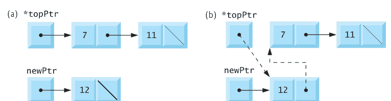

### 12.5.2 函数 pop

函数 pop（第 85–91 行）移除栈的顶部节点。函数 main 在调用 pop 之前会确定栈是否为空。pop 操作包含五个步骤：

1.  将 *topPtr 赋值给 tempPtr（第 86 行），tempPtr 将用于释放节点的内存。
2.  将 (*topPtr)->data 赋值给 popValue（第 87 行），以保存栈顶节点的值，以便我们可以返回它。
3.  将 (*topPtr)->nextPtr 赋值给 *topPtr（第 88 行），这样 main 函数中的 stackPtr 现在指向之前栈中的第二个元素（如果没有其他元素，则为 NULL）。
4.  释放 tempPtr 指向的内存（第 89 行）。
5.  将 popValue 返回给调用者（第 90 行）。

下图说明了 pop 操作。图 (a) 显示了在移除包含 12 的节点之前的栈——*topPtr 代表 main 函数中的 stackPtr。图 (b) 显示 tempPtr 指向正在被弹出的节点，*topPtr 指向新的栈顶节点。然后我们可以释放 tempPtr 指向的内存。

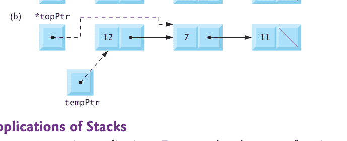

### 12.5.3 栈的应用

栈有许多有趣的应用。例如，每当进行函数调用时，被调用函数必须知道如何返回给其调用者，因此返回地址会被压入栈中（第 5.7 节）。在一系列函数调用中，连续的返回地址按照后进先出的顺序被压入栈中，以便每个函数都能返回给其调用者。栈以与传统非递归调用相同的方式支持递归函数调用。

栈包含了在每次函数调用时为自动局部变量创建的空间。当函数返回给其调用者时，该函数的自动变量的空间会从栈中弹出，程序将不再知道这些变量。栈有时也被编译器在计算表达式和生成机器语言代码的过程中使用。练习题探讨了几种栈的应用。

## 自我检查

1.  （多选题）以下哪项陈述是*错误*的？
    a) 栈必须实现为链表的受限版本。
    b) 新节点只能添加到栈顶，也只能从栈顶移除。
    c) 栈是一种后进先出（LIFO）的数据结构。
    d) 栈通过指向其顶部元素的指针来引用。

    **答案：** (a) 是*错误*的。实际上，栈*可以*实现为链表的受限版本，但并非必须如此。

2.  （多选题）以下陈述 a)、b) 或 c) 哪项是*错误*的？
    a) 当调用一个函数时，它必须知道如何返回给其调用者，因此被调用函数的返回地址会被压入栈中。
    b) 在一系列函数调用中，连续的返回地址按照后进先出的顺序被压入栈中，以便每个函数都能返回给其调用者。
    c) 栈以与传统非递归调用相同的方式支持递归函数调用。
    d) 以上所有陈述都是*正确*的。

    **答案：** (a) 是*错误*的。实际上，是*调用者*的返回地址被压入栈中。

## 12.6 队列

**队列**类似于杂货店的结账队伍：

-   队伍中的第一个人最先得到服务。
-   其他顾客只能在队尾排队并等待服务。

你只能从队列的**头部**（front）移除节点，也只能在队列的**尾部**（back）插入节点。因此，队列被称为**先进先出（FIFO）**数据结构。插入和移除操作分别称为入队（发音为“en-cue”）和出队（发音为“dee-cue”）。

### 队列的应用

队列在计算机系统中有许多应用：

-   对于只有单个处理器的计算机，一次只能为一个用户服务。其他用户的条目被放入队列中。随着用户接受服务，每个条目逐渐向队列前端移动。队列前端的条目是下一个接受服务的。

同样，对于今天的多核系统，运行的程序可能比处理器数量更多。当前未运行的程序被放入队列，直到当前繁忙的处理器变得可用。在附录C中，我们将讨论多线程。当一个程序的工作被划分为多个可以并行执行的线程时，线程的数量可能超过处理器数量。当前未运行的线程需要在队列中等待。

队列也支持打印后台处理。一个办公室可能只有一台打印机。许多用户可以在给定时间发送文档进行打印。当打印机繁忙时，额外的文档会被假脱机到内存或辅助存储中，就像缝纫线在需要之前被缠绕在线轴上一样。文档在队列中等待，直到打印机变得可用。

在计算机网络（如互联网）上传输的信息包也在队列中等待。每当一个数据包到达网络节点时，它必须被路由到通往其最终目的地的路径上的下一个网络节点。路由节点一次路由一个数据包，因此额外的数据包会被入队，直到路由器能够路由它们。

### 图解队列

下图说明了一个包含多个节点的队列。请注意指向队列头部和尾部的独立指针。与链表和栈一样，如果未将队列最后一个节点中的链接设置为NULL，可能会导致逻辑错误。

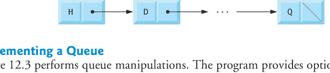

### 实现队列

图12.3执行队列操作。该程序提供了在队列中插入节点（函数`enqueue`）、从队列中移除节点（函数`dequeue`）以及终止程序的选项。第7-10行定义了`struct queueNode`，我们将用它来表示队列的节点。同样，我们使用`typedefs`（第12-13行）使代码更具可读性。此应用程序中的许多逻辑与我们的链表和栈示例相似，因此我们在此重点关注差异。最初，`headPtr`和`tailPtr`（第23-24行）均为`NULL`，表示一个空队列。

```c
// fig12_03.c
// 操作和维护队列
#include <stdio.h>
#include <stdlib.h>

// 自引用结构
struct queueNode {
   char data; // 将数据定义为字符
   struct queueNode *nextPtr; // queueNode指针
};

typedef struct queueNode QueueNode;
typedef QueueNode *QueueNodePtr;

// 函数原型
void printQueue(QueueNodePtr currentPtr);
int isEmpty(QueueNodePtr headPtr);
void enqueue(QueueNodePtr *headPtr, QueueNodePtr *tailPtr, char value);
char dequeue(QueueNodePtr *headPtr, QueueNodePtr *tailPtr);
void instructions(void);

int main(void) {
   QueueNodePtr headPtr = NULL; // 初始化headPtr
   QueueNodePtr tailPtr = NULL; // 初始化tailPtr
   char item = '\0'; // 用户输入的字符

   instructions(); // 显示菜单
   printf("%s", "? ");
   int choice = 0; // 用户的菜单选择
   scanf("%d", &choice);

   // 当用户未输入3时
   while (choice != 3) {
       switch(choice) {
           case 1: // 入队值
               printf("%s", "Enter a character: ");
               scanf("\n%c", &item);
               enqueue(&headPtr, &tailPtr, item);
               printQueue(headPtr);
               break;
           case 2: // 出队值
               // 如果队列不为空
               if (!isEmpty(headPtr)) {
                   item = dequeue(&headPtr, &tailPtr);
                   printf("%c has been dequeued.\n", item);
               }

               printQueue(headPtr);
               break;
           default:
               puts("Invalid choice.\n");
               instructions();
               break;
       }

       printf("%s", "? ");
       scanf("%d", &choice);
   }

   puts("End of run.");
}

// 向用户显示程序说明
void instructions(void) {
   printf ("Enter your choice:\n"
           "   1 to add an item to the queue\n"
           "   2 to remove an item from the queue\n"
           "   3 to end\n");
}

// 在队列尾部插入节点
void enqueue(QueueNodePtr *headPtr, QueueNodePtr *tailPtr, char value) {
   QueueNodePtr newPtr = malloc(sizeof(QueueNode));

   if (newPtr != NULL) { // 有可用空间吗？
      newPtr->data = value;
      newPtr->nextPtr = NULL;

      // 如果为空，在头部插入节点
      if (isEmpty(*headPtr)) {
         *headPtr = newPtr;
      }
      else {
         (*tailPtr)->nextPtr = newPtr;
      }

      *tailPtr = newPtr;
   }
   else {
      printf("%c not inserted. No memory available.\n", value);
   }
}

// 从队列头部移除节点
char dequeue(QueueNodePtr *headPtr, QueueNodePtr *tailPtr) {
   char value = (*headPtr)->data;
   QueueNodePtr tempPtr = *headPtr;
   *headPtr = (*headPtr)->nextPtr;

   // 如果队列为空
   if (*headPtr == NULL) {
      *tailPtr = NULL;
   }

   free(tempPtr);
   return value;
}

// 如果队列为空返回1，否则返回0
int isEmpty(QueueNodePtr headPtr) {
    return headPtr == NULL;
}

// 打印队列
void printQueue(QueueNodePtr currentPtr) {
    if (currentPtr == NULL) { // 如果队列为空
        puts("Queue is empty.\n");
    }
    else {
        puts("The queue is:");

        while (currentPtr != NULL) { // 当未到达队列末尾时
            printf("%c --> ", currentPtr->data);
            currentPtr = currentPtr->nextPtr;
        }

        puts("NULL\n");
    }
}
```

图 12.3 | 操作和维护队列。

```
Enter your choice:
    1 to add an item to the queue
    2 to remove an item from the queue
    3 to end

? 1
Enter a character: A
The queue is:
A --> NULL

? 1
Enter a character: B
The queue is:
A --> B --> NULL

? 1
Enter a character: C
The queue is:
A --> B --> C --> NULL

? 2
A has been dequeued.
The queue is:
B --> C --> NULL

? 2
B has been dequeued.
The queue is:
C --> NULL

? 2
C has been dequeued.
Queue is empty.

? 2
Queue is empty.

? 4
Invalid choice.

Enter your choice:
    1 to add an item to the queue
    2 to remove an item from the queue
    3 to end
? 3
End of run.
```

### 12.6.1 函数 enqueue

函数 enqueue（第72-92行）接收三个参数：

- headPtr的地址——指向队列头部的指针，
- tailPtr的地址——指向队列尾部的指针，以及
- 要插入的值。

该函数执行以下步骤：

1. 第73行调用 malloc 创建一个新节点，并将分配的内存位置赋给 newPtr。
2. 如果内存分配正确，第76-77行将要插入的值赋给 newPtr->data，并将 NULL 赋给 newPtr->nextPtr。
3. 如果队列为空（第80行），第81行将 newPtr 赋给 *headPtr，因为新节点既是队列的头部也是尾部；否则，第84行将 newPtr 赋给 (*tailPtr)->nextPtr，因为新节点是新的尾节点。
4. 第87行将 newPtr 赋给 *tailPtr，以将尾指针更新为新的尾节点。

#### 图解入队操作

下图说明了一个入队操作。部分(a)显示了操作前 main 的 headPtr 和 tailPtr 以及 enqueue 的新节点。部分(b)中的虚线箭头说明了前面讨论中的步骤3和步骤4，这些步骤将新节点添加到非空队列的尾部。


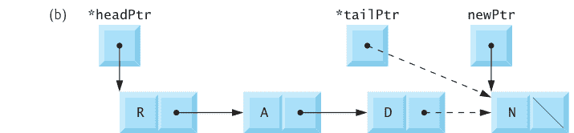

### 12.6.2 函数 dequeue

函数 dequeue（第95-107行）接收队列头指针和尾指针的地址作为参数，并移除队列的第一个节点。出队操作执行以下步骤：

1. 第96行将 (*headPtr)->data 赋给 value，以保存正在出队的数据。
2. 第97行将 *headPtr 赋给 tempPtr，该指针将用于释放内存。
3. 第98行将 (*headPtr)->nextPtr 赋给 *headPtr，以便 main 中的队列头指针现在指向新的头节点。
4. 第101行检查 *headPtr 是否为 NULL。如果是，第102行将 NULL 赋给 *tailPtr，因为队列现在为空。
5. 第105行释放 tempPtr 指向的内存。
6. 第106行将 value 返回给调用者。

#### 图解出队操作

下图说明了函数 dequeue。部分(a)显示了出队操作前的队列——dequeue 中的 *headPtr 和 *tailPtr 用于修改 main 的 headPtr 和 tailPtr。部分(b)显示 tempPtr 指向已出队的节点，main 的 headPtr 已更新为指向队列的新第一个节点。

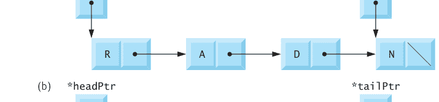

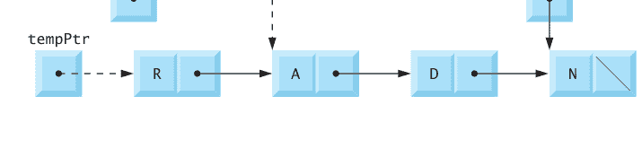

## 自我检查

1.  （多选题）以下关于队列的描述中，哪一项是*错误*的？
    -   a) 队列类似于杂货店的结账队伍——队伍中的第一个人最先接受服务，其他顾客在队伍末尾排队等待服务。
    -   b) 队列节点只能从队列的头部（起始端）移除，并且只能在队列的尾部（末端）插入。
    -   c) 队列是一种后进先出（FILO）的数据结构。
    -   d) 插入和移除操作分别称为入队（发音为“en-cue”）和出队（发音为“dee-cue”）。

    **答案：** (c) 是*错误*的。实际上，队列是一种先进先出（FIFO）的数据结构。

2.  （填空题）对于当今的________系统，运行的程序可能比处理器数量更多，因此当前未运行的程序会被放入队列，直到当前繁忙的处理器变得可用。

    **答案：** 多核。

## 12.7 树

到目前为止，我们已经介绍了线性数据结构——链表、栈和队列。**树**是一种具有特殊属性的非线性二维数据结构。树节点包含两个或更多链接。本节讨论**二叉树**——即节点包含两个链接的树，如下图所示：


每个节点中的链接可以全部、部分或全部不为NULL。**根节点**是树中的第一个节点。根节点中的每个链接指向一个**子节点**。**左子节点**是**左子树**中的第一个节点，**右子节点**是**右子树**中的第一个节点。给定节点的子节点称为**兄弟节点**。没有子节点的节点是**叶节点**。不将叶节点的链接设置为NULL可能导致运行时错误。计算机科学家通常将树的根节点画在顶部——这与自然界中的树正好相反。

### 二叉搜索树

本节介绍一个包含唯一值的**二叉搜索树**，其特点是任何*左*子树中的值都小于其**父**节点中的值，而任何右子树中的值都大于其父节点中的值。下图展示了一个包含九个值的二叉搜索树：


对于一组数据，二叉搜索树的形状可能会根据插入值的顺序而变化。

### 实现二叉搜索树

图12.4创建了一个二叉搜索树并遍历其节点——即访问树中的每个节点以对节点值执行某些操作，例如显示它们。我们将以三种方式遍历树——中序、前序和后序。程序生成10个随机数并将每个数插入树中，但会丢弃重复值。第9-13行定义了结构体treeNode，我们将用它来表示树的节点。同样，我们使用typedef（第15-16行）使代码更具可读性。

```c
// fig12_04.c
// 创建并遍历二叉树
// 前序、中序和后序
#include <stdio.h>
#include <stdlib.h>
#include <time.h>

// 自引用结构体
struct treeNode {
    struct treeNode *leftPtr; // 指向左子树的指针
    int data; // 节点值
    struct treeNode *rightPtr; // 指向右子树的指针
};

typedef struct treeNode TreeNode; // struct treeNode 的同义词
typedef TreeNode *TreeNodePtr; // TreeNode * 的同义词

// 函数原型
void insertNode(TreeNodePtr *treePtr, int value);
void inOrder(TreeNodePtr treePtr);
void preOrder(TreeNodePtr treePtr);
void postOrder(TreeNodePtr treePtr);

int main(void) {
    TreeNodePtr rootPtr = NULL; // 树初始为空
    srand(time(NULL));
    puts("The numbers being placed in the tree are:");

    // 在树中插入0到14之间的随机值
    for (int i = 1; i <= 10; ++i) {
        int item = rand() % 15;
        printf("%3d", item);
        insertNode(&rootPtr, item);
    }

    // 前序遍历树
    puts("\n\nThe preOrder traversal is:");
    preOrder(rootPtr);

    // 中序遍历树
    puts("\n\nThe inOrder traversal is:");
    inOrder(rootPtr);

    // 后序遍历树
    puts("\n\nThe postOrder traversal is:");
    postOrder(rootPtr);
}

// 将节点插入树中
void insertNode(TreeNodePtr *treePtr, int value) {
    if (*treePtr == NULL) { // 如果树为空
        *treePtr = malloc(sizeof(TreeNode));

        if (*treePtr != NULL) { // 如果内存已分配，则赋值数据
            (*treePtr)->data = value;
            (*treePtr)->leftPtr = NULL;
            (*treePtr)->rightPtr = NULL;
        }
        else {
            printf("%d not inserted. No memory available.\n", value);
        }
    }
    else { // 树不为空
        if (value < (*treePtr)->data) { // 值放入左子树
            insertNode(&((*treePtr)->leftPtr), value);
        }
        else if (value > (*treePtr)->data) { // 值放入右子树
            insertNode(&((*treePtr)->rightPtr), value);
        }
        else { // 重复的数据值被忽略
            printf("%s", "dup");
        }
    }
}

// 开始树的中序遍历
void inOrder(TreeNodePtr treePtr) {
    // 如果树不为空，则遍历
    if (treePtr != NULL) {
        inOrder(treePtr->leftPtr);
        printf("%3d", treePtr->data);
        inOrder(treePtr->rightPtr);
    }
}

// 开始树的前序遍历
void preOrder(TreeNodePtr treePtr) {
    // 如果树不为空，则遍历
    if (treePtr != NULL) {
        printf("%3d", treePtr->data);
        preOrder(treePtr->leftPtr);
        preOrder(treePtr->rightPtr);
    }
}

// 开始树的后序遍历
void postOrder(TreeNodePtr treePtr) {
    // 如果树不为空，则遍历
    if (treePtr != NULL) {
        postOrder(treePtr->leftPtr);
        postOrder(treePtr->rightPtr);
        printf("%3d", treePtr->data);
    }
}
```

图 12.4 | 创建并遍历二叉树。

```
The numbers being placed in the tree are:
    6   7   4  12   7dup   2   2dup   5   7dup 11

The preOrder traversal is:
    6   4   2   5   7  12  11

The inOrder traversal is:
    2   4   5   6   7  11  12

The postOrder traversal is:
    2   5   4  11  12   7   6
```

### 12.7.1 函数 insertNode

图12.4中创建二叉搜索树并遍历它的函数是递归的。函数insertNode（第51-75行）接收指向树根节点的指针的地址和一个要插入的整数作为参数。二叉搜索树中的每个新节点最初都作为叶节点插入。插入新节点的步骤如下：

1.  如果 *treePtr 为 NULL（第52行），第53行调用 malloc 创建一个新的叶节点，并将分配的内存赋给 *treePtr。第56行将要存储的整数赋给 (*treePtr)->data。第57-58行将 NULL 赋给 (*treePtr)->leftPtr 和 (*treePtr)->rightPtr。然后控制权返回给调用者——无论是 main 还是之前对 insertNode 的调用。
2.  如果 *treePtr 不为 NULL 且要插入的值小于 (*treePtr)->data，第66行递归调用 insertNode，传入 (*treePtr)->leftPtr 的地址，以在 treePtr 指向的节点的左子树中插入新节点。
3.  如果要插入的值大于 (*treePtr)->data，第69行递归调用 insertNode，传入 (*treePtr)->rightPtr 的地址，以在 treePtr 指向的节点的右子树中插入节点。

递归步骤持续进行，直到 insertNode 找到一个 NULL 指针，然后 *步骤 1* 将新节点作为叶节点插入。

### 12.7.2 遍历：函数 inOrder、preOrder 和 postOrder

函数 inOrder（第78-85行）、preOrder（第88-95行）和 postOrder（第98-105行）各自接收一个指向树根节点的指针并遍历树。下面我们描述遍历方式，并展示对以下树应用每种遍历的结果：


#### 中序遍历

中序遍历的步骤是：

1.  中序遍历*左*子树（第81行）。
2.  处理节点中的值（第82行）。
3.  中序遍历*右*子树（第83行）。

此遍历在处理左子树中的值之后处理每个节点的值。上述树的中序遍历结果是：
6 13 17 27 33 42 48

二叉搜索树的中序遍历按升序处理节点。创建二叉搜索树实际上是对数据进行排序。因此，这个过程称为**二叉树排序**。

#### 前序遍历

前序遍历的步骤是：

1.  处理节点中的值（第91行）。
2.  前序遍历*左*子树（第92行）。
3.  前序遍历*右*子树（第93行）。

此遍历在访问节点时处理其值。处理完值后，前序遍历会先处理左子树的值，再处理右子树的值。前述树的前序遍历结果为：
27 13 6 17 42 33 48

#### 后序遍历

后序遍历的步骤如下：

1.  后序遍历*左*子树（第101行）。
2.  后序遍历*右*子树（第102行）。
3.  处理节点中的值（第103行）。

此遍历在处理完节点左右子树中所有子节点的值之后，才处理该节点的值。前述树的后序遍历结果为：
6 17 13 33 48 42 27

### 12.7.3 重复值消除

二叉搜索树有助于消除重复值。在插入值以创建树的过程中，重复值在每次比较时都会遵循与原始值相同的“向左”或“向右”决策。因此，重复值最终会与树中包含相同值的节点进行比较。此时，可以忽略该重复值。

### 12.7.4 二叉树搜索

搜索与键匹配的值也非常快速。如果树是紧凑排列的，每一层包含的元素大约是前一层的两倍。因此，一个包含 *n* 个元素的二叉搜索树最多有 log₂*n* 层，因此最多需要 log₂*n* 次比较来找到匹配项或确定不存在匹配项。在搜索一个紧凑排列的、包含1,000个元素的二叉搜索树时，最多需要进行10次比较，因为 2¹⁰ > 1,000。在搜索一个紧凑排列的、包含1,000,000个元素的二叉搜索树时，最多需要进行20次比较，因为 2²⁰ > 1,000,000。

### 12.7.5 其他二叉树操作

在练习中，我们介绍了几种其他二叉树操作的算法，例如以二维树格式打印二叉树，以及对二叉树执行层序遍历。层序遍历从根节点层开始，逐行访问树的节点。每一层的节点从左到右访问。其他二叉树练习包括允许二叉搜索树包含重复值、创建字符串树以及确定二叉树的层数。

## 自我检查

1.  **（判断题）** 链表、栈、队列和树是线性数据结构。
    **答案：** *错误。* 实际上，树是非线性的二维数据结构。

2.  **（填空题）** 遍历二叉搜索树的三种常用方法是________、前序和后序。
    **答案：** 中序。

3.  **（填空题）** 创建二叉搜索树的过程实际上________了数据。
    **答案：** 排序。

4.  **（判断题）** 与一组数据对应的二叉搜索树的形状，与值插入树中的顺序无关。
    **答案：** *错误。* 实际上，与一组数据对应的二叉搜索树的形状会根据值插入树中的顺序而变化。

5.  **（判断题）** 节点只能作为根节点插入二叉搜索树。
    **答案：** *错误。* 实际上，节点只能作为*叶*节点插入二叉搜索树。

6.  **（填空题）** 二叉搜索树有助于________。在插入值以创建树的过程中，相同的值在每次比较时都会遵循与原始值相同的“向左”或“向右”决策。相同的值最终会与树中包含相同值的节点进行比较。
    **答案：** 重复值消除。

7.  **（判断题）** 一个包含 *n* 个元素的紧凑排列的二叉树最多有大约 log₂*n* 层。搜索这样的二叉树最多需要大约 log₂*n* 次比较来找到匹配项或确定不存在匹配项。因此，搜索一个（紧凑排列的）包含1,000,000,000个元素的二叉搜索树最多需要20次比较。
    **答案：** *错误。* 实际上，这最多需要30次比较。

## 12.8 安全的C编程

*SEI CERT C编码标准*的第8章专门讨论内存管理建议和规则——其中许多规则适用于本章中对指针和动态内存管理的使用。更多信息，请访问 https://wiki.sei.cmu.edu/。

-   MEM01-C/MEM30-C：指针应始终用 NULL 或内存中有效项的地址初始化。当你使用 free 释放动态分配的内存时，传递给 free 的指针不会被赋予新值，因此它仍然指向动态分配内存曾经所在的内存位置。使用这样的“悬空”指针可能导致程序崩溃和安全漏洞。当你释放动态分配的内存时，立即将指针赋值为 NULL 或一个有效地址。我们选择不对那些在调用 free 后立即超出作用域的局部指针变量执行此操作。
-   MEM01-C：当你尝试使用 free 释放已经释放的动态内存时，会发生未定义行为——这被称为“双重释放漏洞”。为确保你不会尝试多次释放同一内存，请在调用 free 后立即将指针设置为 NULL。释放一个 NULL 指针没有任何效果。
-   ERR33-C：大多数标准库函数返回的值可以用来检查函数是否成功执行了任务。例如，函数 malloc 在无法分配请求的内存时返回 NULL。在尝试使用存储 malloc 返回值的指针之前，你应始终确保 malloc 没有返回 NULL。

## 自我检查

1.  **（判断题）** 指针应始终初始化为 NULL。
    **答案：** 错误。实际上，指针应始终初始化为 NULL 或内存中有效项的地址。

2.  **（判断题）** 为避免两次释放同一内存并导致未定义行为，应将已释放的指针设置为 NULL。
    **答案：** 正确。释放一个 NULL 指针不会导致未定义行为。

3.  **（填空题）** 如果 malloc 无法满足内存分配请求，它会返回 ________。在使用 malloc 的指针返回值之前，务必检查此值。
    **答案：** NULL。

## 总结

### 第12.1节 简介

-   动态数据结构（第596页）在执行时增长和收缩。
-   链表（第596页）是“排成一行”的数据项集合——可以在链表中的任何位置进行插入和删除。
-   使用栈（第596页）时，插入和删除仅在顶部（第596页）进行。
-   队列（第596页）表示等待队列。插入在后端（尾部；第596页）进行。删除从前端（头部；第596页）进行。
-   二叉树有助于数据的高速搜索和排序、高效的重复值消除、表示文件系统目录以及将表达式编译成机器语言。

### 第12.2节 自引用结构

-   自引用结构（第597页）包含一个指向同类型结构的指针成员。
-   自引用结构可以链接在一起形成列表、队列、栈和树。
-   NULL 指针表示数据结构的结束。

### 第12.3节 动态内存管理

-   创建和维护动态数据结构需要动态内存管理（第598页）。
-   函数 malloc 和 free，以及运算符 sizeof，对于动态内存分配至关重要。
-   函数 malloc（第598页）接收要分配的字节数，并返回一个指向已分配内存的 void * 指针。void * 指针可以赋值给任何指针类型的变量。
-   如果没有可用内存，malloc 返回 NULL。
-   函数 free（第598页）释放内存，以便将来可以重新分配。
-   C 还提供函数 calloc 和 realloc 用于创建和修改动态数组。

### 第12.4节 链表

-   链表是自引用结构的线性集合，称为节点（第599页），通过指针链接（第599页）连接。
-   链表通过指向第一个节点的指针访问。后续节点通过存储在每个节点中的链接指针成员访问。
-   按照惯例，链表中最后一个节点的链接指针设置为 NULL 以标记链表的结束。
-   数据在链表中动态存储——每个节点在需要时创建。
-   节点可以包含任何类型的数据，包括其他结构体对象。
-   链表是动态的，因此列表的长度可以根据需要增加或减少。
-   链表节点在内存中不保证连续存储。然而，从逻辑上看，链表的节点似乎是连续的。

### 第12.5节 栈

-   栈（第608页）可以实现为链表的受限版本。新节点只能添加到栈顶，也只能从栈顶移除。
-   栈是后进先出（LIFO；第609页）的数据结构。
-   用于操作栈的主要函数是 push 和 pop。函数 push 创建一个新节点并将其放在栈顶。函数 pop 从栈顶移除一个节点，释放分配给弹出节点的内存，并返回弹出的值。
-   当你调用一个函数时，它必须知道如何返回给调用者，因此调用者的返回地址被压入栈中。如果发生一系列函数调用，连续的返回值会按照后进先出的顺序压入栈中，以便每个函数都能返回给其调用者。栈以与传统非递归调用相同的方式支持递归函数调用。
-   编译器在计算表达式和生成机器语言代码的过程中使用栈。

### 第12.6节 队列

-   队列节点只能从队列头部移除，只能在队列尾部插入——这被称为先进先出（FIFO；第614页）数据结构。
-   队列的插入和删除操作分别称为入队和出队（第615页）。

### 第12.7节 树

-   树（第621页）是一种非线性的二维数据结构。树节点包含两个或更多链接。
-   二叉树（第621页）是所有节点都包含两个链接的树。

## 第12章 数据结构

-   根节点（第621页）是树中的第一个节点。二叉树根节点中的每个链接都指向一个子节点（第621页）。左子节点（第621页）是左子树（第621页）中的第一个节点，右子节点（第621页）是右子树（第621页）中的第一个节点。一个节点的子节点被称为兄弟节点（第621页）。
-   没有子节点的节点被称为叶节点（第621页）。
-   二叉搜索树（无重复节点值；第621页）具有以下特性：任何左子树中的值都小于其父节点（第622页）中的值，任何右子树中的值都大于其父节点中的值。
-   在二叉搜索树中，节点只能作为叶节点插入。
-   中序遍历的步骤是：中序遍历左子树，处理节点中的值，然后中序遍历右子树。节点中的值只有在其左子树的值被处理后才会被处理。
-   二叉搜索树的中序遍历（第622页）按升序处理节点值。创建二叉搜索树实际上就是对数据进行排序，因此这个过程被称为二叉树排序（第625页）。
-   前序遍历（第622页）的步骤是：处理节点中的值，前序遍历左子树，然后前序遍历右子树。这种遍历在处理给定节点的值后，会处理该节点的左子树值，然后是其右子树值。
-   后序遍历（第622页）的步骤是：后序遍历左子树，后序遍历右子树，然后处理节点中的值。每个节点中的值只有在其子节点的值被处理后才会被处理。
-   二叉搜索树有助于消除重复（第626页）。在创建树时，尝试插入重复值会被识别出来，因为重复值在每次比较时都会遵循与原始值相同的“向左”或“向右”决策。因此，重复值最终会与树中包含相同值的节点进行比较。此时，重复值可以简单地被丢弃。
-   在二叉树中搜索与键匹配的值速度很快。在紧凑排列的树中，每一层包含的元素大约是前一层的两倍。一个包含n个元素的二叉搜索树最多有log₂n层，因此最多需要log₂n次比较来找到匹配项或确定不存在匹配项。搜索一个包含1,000个元素的紧凑排列的二叉搜索树最多需要10次比较，因为2¹⁰ > 1,000。搜索一个包含1,000,000个元素的紧凑排列的二叉搜索树最多需要20次比较，因为2²⁰ > 1,000,000。

## 自我复习练习

**12.1** 填写以下每个句子的空白：
a) 自__________结构用于形成动态数据结构。
b) 函数 __________ 用于动态分配内存。
c) __________ 是链表的一种特殊版本，其中节点只能从列表的开头插入和删除。
d) 查看链表但不修改它的函数被称为 __________。
e) 队列被称为 __________ 数据结构。
f) 链表中指向下个节点的指针被称为 __________。
g) 函数 __________ 用于回收动态分配的内存。
h) __________ 是链表的一种特殊版本，其中节点只能在列表的开头插入，只能在列表的末尾删除。
i) __________ 是一种非线性的二维数据结构，包含具有两个或更多链接的节点。
j) 栈被称为 __________ 数据结构，因为最后插入的节点是第一个被移除的节点。
k) __________ 树的节点包含两个链接成员。
l) 树的第一个节点是 __________ 节点。
m) 树节点中的每个链接指向该节点的 __________ 或 __________。
n) 没有子节点的树节点被称为 __________ 节点。
o) 二叉树的三种遍历算法（本章涵盖）是 __________、__________ 和 __________。

**12.2** *（讨论）* 链表和栈之间有什么区别？

**12.3** *（讨论）* 栈和队列之间有什么区别？

**12.4** 编写一条或多条语句来完成以下每个任务。假设所有操作都在main中进行（因此不需要指针变量的地址），并假设以下定义：

```
struct gradeNode {
    char lastName[20];
    double grade;
    struct gradeNode *nextPtr;
};

typedef struct gradeNode GradeNode;
typedef GradeNode *GradeNodePtr;
```

a) 创建一个指向列表开头的指针，名为startPtr。列表为空。

b) 创建一个GradeNode类型的新节点，由GradeNodePtr类型的新指针newPtr指向。将字符串"Jones"赋值给成员lastName，将值91.5赋值给成员grade（使用strcpy）。提供任何必要的声明和语句。

c) 假设startPtr指向的列表当前包含两个节点——一个包含"Jones"，一个包含"Smith"。节点按字母顺序排列。提供必要的语句来插入包含以下lastName和grade数据的节点——确保按顺序插入节点：

-   "Adams" 85.0
-   "Thompson" 73.5
-   "Pritchard" 66.5

使用指针previousPtr、currentPtr和newPtr执行插入操作。说明每次插入前previousPtr和currentPtr指向什么。假设newPtr始终指向新节点，并且新节点已被赋值。

d) 编写一个while循环，打印列表中每个节点的数据。使用指针currentPtr遍历列表。

e) 编写一个while循环，删除列表中的所有节点并释放与每个节点关联的内存。使用指针currentPtr遍历列表，使用指针tempPtr释放内存。

**12.5** *（二叉搜索树遍历）* 提供以下二叉搜索树的中序、前序和后序遍历。


## 自我复习练习答案

**12.1** a) 引用。 b) malloc。 c) 栈。 d) 谓词。 e) FIFO。 f) 链接。 g) free。 h) 队列。 i) 树。 j) LIFO。 k) 二叉。 l) 根。 m) 子节点，子树。 n) 叶。 o) 中序，前序，后序。

**12.2** 可以在链表中的任何位置插入节点，也可以从链表中的任何位置删除节点。然而，栈中的节点只能在栈顶插入，只能从栈顶删除。

**12.3** 队列有指向其头部和尾部的指针，因此节点可以在尾部插入，在头部删除。栈有一个指向栈顶的单一指针，节点的插入和删除都在此进行。

**12.4** 参见以下答案：

```
a) GradeNodePtr startPtr = NULL;
b) GradeNodePtr newPtr;
   newPtr = malloc(sizeof(GradeNode));
   strcpy(newPtr->lastName, "Jones");
   newPtr->grade = 91.5;
   newPtr->nextPtr = NULL;
c) 插入"Adams"时：
   previousPtr为NULL，currentPtr指向列表中的第一个元素。
   newPtr->nextPtr = currentPtr;
   startPtr = newPtr;
   插入"Thompson"时：
   previousPtr指向列表中的最后一个元素（包含"Smith"）
   currentPtr为NULL。
   newPtr->nextPtr = currentPtr;
   previousPtr->nextPtr = newPtr;
   插入"Pritchard"时：
   previousPtr指向包含"Jones"的节点
   currentPtr指向包含"Smith"的节点
   newPtr->nextPtr = currentPtr;
   previousPtr->nextPtr = newPtr;
d) currentPtr = startPtr;
while (currentPtr != NULL) {
    printf("Lastname = %s\nGrade = %6.2f\n",
           currentPtr->lastName, currentPtr->grade);
    currentPtr = currentPtr->nextPtr;
}
e) currentPtr = startPtr;
while (currentPtr != NULL) {
    tempPtr = currentPtr;
    currentPtr = currentPtr->nextPtr;
    free(tempPtr);
}
startPtr = NULL;
```

**12.5** *中序*遍历是：11 18 19 28 32 40 44 49 69 71 72 83 92 97 99
*前序*遍历是：49 28 18 11 19 40 32 44 83 71 69 72 97 92 99
*后序*遍历是：11 19 18 32 44 40 28 69 72 71 92 99 97 83 49

## 练习

**12.6** *（连接列表）* 编写一个程序，连接两个字符链表。该程序应包含一个concatenate函数，该函数接受指向两个列表的指针作为参数，并将第二个列表连接到第一个列表。

**12.7** *（合并有序列表）* 编写一个程序，将两个有序整数列表合并为一个有序列表。函数merge应接收指向要合并的每个列表的第一个节点的指针，并返回指向合并后列表的第一个节点的指针。

**12.8** *（插入有序列表）* 编写一个程序，将25个0到100之间的随机整数按顺序插入链表。该程序应计算元素的总和和浮点平均值。

**12.9** *（创建链表，然后反转其元素）* 编写一个程序，创建一个包含10个字符的链表，然后创建一个反向顺序的列表副本。

**12.10** *（反转句子中的单词）* 编写一个程序，输入一行文本，并使用栈打印反转后的行。

**12.11** *（回文测试器）* 编写一个程序，使用栈来确定字符串是否是回文（即字符串正向和反向拼写相同）。该程序应忽略空格和标点符号。

**12.12** *（超市模拟）* 编写一个程序，模拟超市的结账队伍。队伍是一个队列。顾客以1到4分钟的随机整数间隔到达。同时，每位顾客的服务时间也是1到4分钟的随机整数间隔。显然，速率需要平衡。如果平均到达率大于

## 特别章节：系统软件案例研究——构建你自己的编译器

如果到达率高于平均服务率，队列将无限增长。即使到达率和服务率平衡，随机性仍可能导致长队列。使用以下算法运行一个12小时（720分钟）的超市模拟：

1.  选择一个1到4之间的随机整数，以确定第一位顾客到达的时间。
2.  在第一位顾客到达时：
    确定顾客的服务时间（1到4的随机整数）；
    开始为顾客服务；
    调度下一位顾客的到达时间（当前时间加上1到4的随机整数）。
3.  对于一天中的每一分钟：
    如果下一位顾客到达，
        输出信息；
        将顾客入队；
        调度下一位顾客的到达时间。
    如果上一位顾客的服务完成，
        输出信息；
        将下一位顾客出队以接受服务；
        确定该顾客的服务完成时间
            （当前时间加上1到4的随机整数）。

现在运行你的模拟720分钟，并回答以下每个问题：
a) 任何时候队列中的最大顾客数量是多少？
b) 任何一位顾客经历的最长等待时间是多少？
c) 如果到达间隔从1到4分钟改为1到3分钟，会发生什么？

**12.13** *（允许二叉树中的重复值）* 修改图12.4的程序，允许二叉树包含重复值。

**12.14** *（字符串二叉搜索树）* 基于图12.4的程序编写一个程序，该程序输入一行文本，将句子分词为单独的单词，将单词插入二叉搜索树，并打印树的中序、前序和后序遍历。

将这行文本读入一个数组。使用 `strtok` 对文本进行分词。当找到一个标记时，为树创建一个新节点，将 `strtok` 返回的指针赋给新节点的 `string` 成员，并将该节点插入树中。

**12.15** *（重复消除）* 我们已经看到，在创建二叉搜索树时，重复消除是直接了当的。描述如何仅使用一维数组执行重复消除。比较基于数组的重复消除与基于二叉搜索树的重复消除的性能。

**12.16** *（二叉树的深度）* 编写一个函数 `depth`，它接收一个二叉树并确定它有多少层。

**12.17** *（递归反向打印列表）* 编写一个函数 `printListBackward`，它递归地以相反顺序输出列表中的项目。在一个测试程序中使用你的函数，该程序创建一个已排序的整数列表并反向打印该列表。

**12.18** *（递归搜索列表）* 编写一个函数 `searchList`，它递归地在链表中搜索指定值。如果找到该值，函数应返回指向该值的指针；否则，应返回 `NULL`。在一个测试程序中使用你的函数，该程序创建一个整数列表。程序应提示用户输入要在列表中定位的值。

**12.19** *（二叉树搜索）* 编写函数 `binaryTreeSearch`，尝试在二叉搜索树中定位指定值。该函数应接受一个指向二叉树根节点的指针和一个要定位的搜索键作为参数。如果找到包含搜索键的节点，函数应返回指向该节点的指针；否则，函数应返回一个 `NULL` 指针。

**12.20** *（层序二叉树遍历）* 图12.4的程序演示了遍历二叉树的三种递归方法——中序遍历、前序遍历和后序遍历。本练习介绍二叉树的**层序遍历**。这种遍历从根节点层开始，逐层从左到右处理节点值。层序遍历不是递归算法。它使用队列数据结构以正确的顺序处理节点。算法如下：

1.  将根节点插入队列。
2.  当队列中还有节点时，
    获取队列中的下一个节点。
    打印节点的值。
    如果节点的左子节点指针不是 `NULL`
        将左子节点插入队列。
    如果节点的右子节点指针不是 `NULL`
        将右子节点插入队列。

编写函数 `levelOrder` 来执行二叉树的层序遍历。该函数应接受一个指向二叉树根节点的指针作为参数。修改图12.4的程序以使用此函数。将此函数的输出与其他遍历的输出进行比较，以验证其正确工作。你需要修改并整合图12.3中的队列处理函数到此程序中。

**12.21** *（打印树）* 编写一个递归函数 `outputTree` 来显示二叉树。该函数应逐行输出树，树的顶部在屏幕左侧，树的底部朝向屏幕右侧。每行垂直输出。例如，练习12.5中的二叉树输出如下：

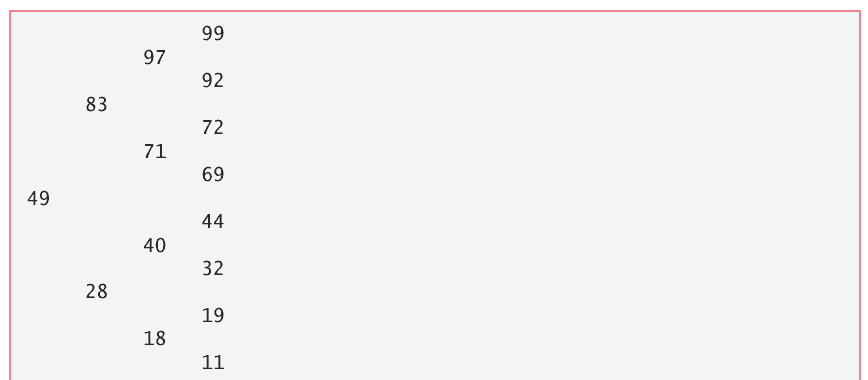

注意，最右边的叶节点出现在输出的最右列顶部，根节点出现在输出的左侧。输出的每一列都从上一列的右边五个空格处开始。函数 `outputTree` 应接收一个指向树根节点的指针和一个整数 `totalSpaces` 作为参数，`totalSpaces` 表示要输出的值之前的空格数。该变量应从零开始，以便根节点输出在屏幕左侧。该函数使用修改的中序遍历来输出树。算法如下：

当指向当前节点的指针不是 NULL 时，
    使用当前节点的右子树和 `totalSpaces + 5` 递归调用 `outputTree`。
    使用 for 语句从 1 计数到 `totalSpaces` 并输出空格。
    输出当前节点中的值。
    使用当前节点的左子树和 `totalSpaces + 5` 递归调用 `outputTree`。

在练习7.28中，我们介绍了虚构的 Simpletron 机器语言（SML）。在练习7.29中，你使用模拟创建了 Simpletron 计算机——一个*虚拟机*——来执行用 SML 编写的程序。在这个挑战章节中，你将构建一个编译器，将用 **Simple**（一种虚构的、简洁的高级编程语言）编写的程序转换为 SML。本节将编程过程的关键部分“串联”起来。你将：

- **编写**几个 Simple 高级语言程序，
- **编译**这些程序，使用你将构建的编译器，生成 SML 机器语言代码到一个文件中，
- **加载**该文件中的 SML 机器语言代码到 Simpletron 的内存中，并
- **执行** SML 机器语言程序，使用你在练习7.29中构建的 Simpletron 虚拟机。

本节包含六个练习。前两个涵盖你需要实现编译器的一些关键计算机科学技术。第三个介绍 Simple 高级语言，提供一些完整的编码示例，并要求你编写几个自己的 Simple 程序。第四个指导你构建编译器。第五个介绍编译器优化的关键主题——你将修改编译器以减少其生成的 SML 指令数量，这将使你的 SML 程序更节省内存并能更快执行。最后一个练习让你有机会修改编译器以添加更多有用的功能。

**12.22** *（中缀到后缀转换器）* 编译器使用栈来帮助求值表达式和生成机器语言代码。在本练习和下一个练习中，我们将研究编译器如何求值仅由单个数字整数常量、运算符和括号组成的算术表达式。你可以轻松修改我们提出的算法，使其也能处理多位整数和浮点数。

人们通常像 3 + 4 和 7 / 9 这样编写表达式，运算符位于其操作数*之间*。这称为**中缀表示法**。计算机“更喜欢”**后缀表示法**，其中运算符写在其两个操作数的*右侧*。前面的中缀表达式在后缀表示法中将显示为 3 4 + 和 7 9 /。

为了求值一个中缀表达式，一些编译器

- 首先将表达式转换为后缀表示法，然后
- 求值后缀版本。

每个**面向栈的算法**都需要对表达式进行一次从左到右的遍历。在本练习中，你将实现**中缀到后缀转换算法**。在下一个练习中，你将实现**后缀表达式求值算法**。

编写一个程序，将一个有效的中缀算术表达式（包含单个数字整数，例如

```
(6 + 2) * 5 - 8 / 4
```

）转换为后缀表达式。前面中缀表达式的后缀版本是

```
6 2 + 5 * 8 4 / -
```

注意，后缀表达式不包含括号。程序应将表达式读入字符数组 `infix`，并使用本章实现的栈函数来帮助在字符数组 `postfix` 中创建后缀表达式。创建后缀表达式的算法如下：

## 第12章 数据结构

1.  将左括号 '(' 压入栈中。
2.  在中缀表达式末尾添加一个右括号 ')'。
3.  当栈不为空时，从左到右读取中缀表达式并执行以下操作：
    如果中缀表达式的当前字符是数字，则将其复制到后缀表达式的下一个元素。
    如果中缀表达式的当前字符是左括号，则将其压入栈中。
    如果中缀表达式的当前字符是运算符，
        弹出栈顶所有优先级大于或等于当前运算符的运算符（如果有），并将弹出的运算符插入到后缀表达式中。
        将中缀表达式中的当前字符压入栈中。
    如果中缀表达式的当前字符是右括号，
        从栈顶弹出运算符并插入到后缀表达式中，直到栈顶为左括号。
        弹出（并丢弃）栈中的左括号。

表达式中允许使用以下算术运算：

- + 加法
- - 减法
- * 乘法
- / 除法

应使用以下声明来维护栈：

```c
struct stackNode {
    char data;
    struct stackNode *nextPtr;
};

typedef struct stackNode StackNode;
typedef StackNode *StackNodePtr;
```

程序应包含 main 函数和另外八个函数，其函数原型如下：

| 函数原型 | 描述 |
| :--- | :--- |
| `void convertToPostfix(char infix[], char postfix[]);` | 将中缀表达式转换为后缀表示法。 |
| `bool isOperator(char c);` | 如果 c 是运算符则返回 true；否则返回 false。请注意，bool、true 和 false 在 stdbool.h 中定义。 |
| `int precedence(char operator1, char operator2);` | 返回 -1、0 或 1，分别表示 operator1 的优先级小于、等于或大于 operator2 的优先级。 |
| `void push(StackNodePtr *topPtr, char value);` | 将一个值压入栈中。 |
| `char pop(StackNodePtr *topPtr);` | 从栈中弹出一个值并返回该值。 |
| `char stackTop(StackNodePtr topPtr);` | 返回栈顶值而不弹出栈。 |
| `bool isEmpty(StackNodePtr topPtr);` | 如果栈为空（即 topPtr 为 NULL）则返回 true；否则返回 false。 |
| `void printStack(StackNodePtr topPtr);` | 打印栈——此函数遍历实现栈的链表，但不修改它。 |

**12.23** *（后缀表达式求值器）* 编写一个程序来计算一个有效的后缀表达式，例如

`6 2 + 5 * 8 4 / -`

程序应读取一个由单个数字和运算符组成的后缀表达式到一个字符数组中。后缀表达式不包含括号——它们在中缀到后缀的转换过程中已被消除。程序应扫描后缀表达式，并使用以下算法和本章前面实现的栈函数对其进行求值：

1.  在后缀表达式末尾添加空字符 (`'\0'`)。当算法遇到此空字符时，后缀表达式的求值完成。
2.  当未遇到空字符 (`'\0'`) 时，从左到右读取表达式：
    如果当前字符是数字，
    将其整数值压入栈中。数字字符的整数值是其在计算机字符集中的值减去零字符 (`'0'`) 在计算机字符集中的值。
    否则，如果当前字符是运算符，
    将栈顶的两个元素弹出到变量 x 和 y 中。
    计算 y 运算符 x。
    将计算结果压入栈中。
3.  当在表达式中遇到空字符 (`'\0'`) 时，弹出栈顶值。这就是后缀表达式的结果。

此算法仅支持二元算术运算符。因此在*步骤 2* 中，如果运算符是 '/'，栈顶是 2，栈中的下一个元素是 8，那么你会将 2 弹出到 x 中，将 8 弹出到 y 中，计算 8 / 2，并将结果 4 压回栈中。这适用于每个二元算术运算符。

表达式中允许的算术运算是：

- + 加法
- - 减法
- * 乘法
- / 除法

应使用以下声明来维护栈：

```c
struct stackNode {
    int data;
    struct stackNode *nextPtr;
};

typedef struct stackNode StackNode;
typedef StackNode *StackNodePtr;
```

程序应包含 main 函数和另外六个函数，其函数原型如下：

| 函数原型 | 描述 |
| :--- | :--- |
| `int evaluatePostfixExpression(char *expr);` | 计算后缀表达式并返回其结果。 |
| `int calculate(int op1, int op2, char operator);` | 计算表达式 op1 运算符 op2 并返回其结果。 |
| `void push(StackNodePtr *topPtr, int value);` | 将一个值压入栈中。 |
| `int pop(StackNodePtr *topPtr);` | 从栈中弹出一个值并返回该值。 |
| `bool isEmpty(StackNodePtr topPtr);` | 如果栈为空（即 topPtr 为 NULL）则返回 true；否则返回 false。 |
| `void printStack(StackNodePtr topPtr);` | 打印栈——此函数遍历实现栈的链表，但不修改它。 |

**12.24（简单编程语言——编写简单程序）** 在构建编译器之前，让我们讨论一种简单而强大的高级语言，它类似于早期版本的 BASIC 编程语言。我们称这种语言为 *Simple*。每个 Simple 语句由一个行号和一个 Simple 指令组成。行号必须按升序出现。每条指令以以下 Simple 命令之一开头：`rem`、`input`、`let`、`print`、`goto`、`if...goto` 或 `end`，我们将在下表中描述它们。Simple 仅使用 +、-、* 和 / 运算符计算整数表达式。这些运算符的优先级与 C 语言相同。括号可以改变表达式的求值顺序。练习 12.27 建议对 Simple 编译器进行增强。其中一些建议的增强，例如添加浮点功能，也需要修改 Simpletron 虚拟机。

| 命令 | 示例语句 | 描述 |
| :--- | :--- | :--- |
| **rem** | `50 rem this is a remark` | 命令 `rem` 后面的文本仅用于文档目的，会被忽略——不会生成 SML 代码。 |
| **input** | `30 input x` | 显示一个问号以提示用户输入一个整数。从键盘读取该整数并将整数存储在 x 中。 |
| **let** | `80 let u = 4 * (j - 7)` | 将 4 * (j - 7) 的值赋给 u。等号右边可以出现任意复杂的**中缀表达式**。 |
| **print** | `10 print w` | 显示单个整数变量 w 的值。 |
| **goto** | `70 goto 45` | 将程序控制转移到第 45 行。 |
| **if...goto** | `35 if i == z goto 80` | 比较 i 和 z 是否相等，如果条件为真则将控制转移到第 80 行；否则，继续执行下一条语句。 |
| **end** | `99 end` | 终止程序执行。 |

### 附加的 Simple 语言规则

Simple 还有以下语言规则：

- Simple 编译器**仅识别小写字母**——Simple 程序中的所有字符都应为小写。
- **变量名是单个字母**。不允许使用多字符变量名，因此 Simple 程序应在 `rem` 语句中记录其变量。
- Simple 仅使用 **int** 变量。
- Simple **没有变量声明**——仅仅在程序中提及变量名就声明了该变量并将其初始化为零。
- Simple 的语法**不允许字符串操作**（读取字符串、写入字符串、比较字符串等）。
- Simple 使用**条件分支 if...goto 语句**和**无条件分支 goto 语句**来改变程序的控制流。如果 `if...goto` 语句中的条件为真，则控制转移到指定的行号。以下关系和相等运算符 <、>、<=、>=、== 或 != 在 `if...goto` 语句中有效。它们的优先级与 C 语言相同。

我们的编译器假设 Simple 程序输入正确。练习 12.27 要求你修改编译器以执行**语法错误检查**。

### 简单程序示例

让我们来看几个展示该语言特性的简单程序。第一个程序（图 12.5）从键盘读取两个整数，将值存储在变量 a 和 b 中，然后计算并打印它们的和（存储在变量 c 中）。

```
10 rem input two integers, then determine and print their sum
15 rem
20 rem input the two integers
30 input a
40 input b
45 rem
50 rem add integers and store result in c
60 let c = a + b
65 rem
70 rem print the result
80 print c
90 rem terminate program execution
99 end
```

图 12.5 | 输入两个整数，然后确定并打印它们的和。

下一个程序（图 12.6）确定并打印两个整数中较大的一个。整数从键盘输入并存储在变量 s 和 t 中。if…goto 语句测试条件 s >= t。如果条件为真，控制权转移到第 90 行，显示 s。否则，程序显示 t，然后将控制权转移到第 99 行的 end 语句，程序在此终止。

```
10 rem input two integers, then determine and print the larger one
20 input s
30 input t
32 rem
35 rem test if s is greater than or equal to t
40 if s >= t goto 90
45 rem
50 rem t is greater than s, so print t
60 print t
70 goto 99
75 rem
80 rem s is greater than or equal to t, so print s
90 print s
99 end
```

图 12.6 | 输入两个整数，然后确定并打印较大的一个。

Simple 没有像 C 的 for、while 或 do…while 那样的循环语句。但是，你可以使用 if…goto 和 goto 语句来模拟它们中的每一个。图 12.7 使用一个哨兵控制循环来计算几个整数的平方。每个整数从键盘输入并存储在变量 j 中。如果输入的值是哨兵值 -9999，控制权转移到第 99 行，程序终止。否则，k 被赋值为 j 的平方，k 输出到屏幕，控制权传递到第 20 行，输入下一个整数。

```
10 rem calculate squares of integers until user enters -9999 sentinel to end
20 input j
23 rem
25 rem test for sentinel value
30 if j == -9999 goto 99
33 rem
35 rem calculate square of j and assign result to k
40 let k = j * j
50 print k
53 rem
55 rem loop to get next j
60 goto 20
99 end
```

**图 12.7** | 计算整数的平方，直到用户输入 -9999 结束。

### 编写你自己的简单程序

以图 12.5–12.7 的示例程序为指导，编写 Simple 程序来完成以下任务：

- a) 输入三个整数，确定它们的平均值并打印结果。
- b) 使用哨兵控制循环输入 10 个整数，计算并打印它们的和。
- c) 使用计数器控制循环输入七个整数（一些正数，一些负数），计算并打印它们的平均值。
- d) 输入一系列整数，确定并打印最大的数。输入的第一个整数表示应处理多少个数字。
- e) 输入 10 个整数并打印最小的数。
- f) 计算并打印从 2 到 30 的偶数整数之和。
- g) 计算并打印从 1 到 9 的奇数整数之积。

**12.25** *（构建编译器；前提条件：完成练习 7.28、7.29、12.22、12.23 和 12.24）* 既然我们已经介绍了 Simple 语言（练习 12.24），让我们讨论如何构建一个 Simple 编译器。下图总结了将 Simple 程序编译为 SML，然后在 Simpletron 模拟器中执行的过程：


编译器读取包含 Simple 程序的文件，将其**编译**为 **SML 代码**，然后将 SML 指令逐行写入文本文件。接下来，Simpletron 模拟器将 SML 文件**加载**到 Simpletron 的 100 元素内存数组中，执行程序，并将结果输出到屏幕和文件。我们还将所有屏幕输出发送到文件，以便于打印硬拷贝。

你在练习 7.29 中开发的 Simpletron 模拟器从键盘获取输入，而不是文件。你必须修改 Simpletron 以从文件读取，这样它才能运行你的 Simple 编译器生成的程序。

编译器对 Simple 程序执行**两遍扫描**以将其转换为 SML：

- **第一遍扫描**构建一个**符号表**（下面详细讨论）。编译器将 Simple 程序的每个**行号**、**变量名**和**常量**存储在符号表中。每个条目都存储其**类型**及其在最终 SML 代码中的**位置**。**第一遍扫描**还为每个 Simple 语句生成相应的 **SML 指令**。正如你将看到的，如果 Simple 程序包含将控制权转移到程序后面行的语句，**第一遍扫描**的结果将是一个包含一些**未完成指令**的 SML 程序。
- **第二遍扫描**定位并**完成未完成的指令**，并将 SML 程序输出到文件。编译器的**第一遍扫描**代码比其**第二遍扫描**代码大得多。

### 第一遍扫描

编译器首先将 Simple 程序的第一条语句读入内存。编译器将该行分隔成单独的**标记**（即语句的“片段”）以进行处理和编译。你可以使用 **strtok 函数**来完成此操作。回想一下，每条语句都以一个**行号**开头，后跟一个**命令**。当编译器将语句的其余部分分解为标记时，如果标记是**行号**、**变量**或**常量**，它将被放入**符号表**中。只有当**行号**是语句中的**第一个标记**时，才会将其放入**符号表**中——你很快就会看到编译器如何处理作为条件或无条件分支目标的行号。

**symbolTable** 是一个 **tableEntry 结构体数组**，表示程序中的每个**符号**。程序中可以出现的符号数量没有限制。因此，**symbolTable** 可能很大。现在将 **symbolTable** 设为一个 200 元素的数组。一旦你有了一个可工作的编译器，你就可以调整它的大小。

**tableEntry** 结构体声明如下：

```
struct tableEntry {
    int symbol;
    char type; // 'C' (constant), 'L' (line number), 'V' (variable)
    int location; // 00 to 99
};
```

每个 **tableEntry** 包含三个成员：

- **symbol** 是一个整数，包含变量的 ASCII 表示（同样，**变量名**是**单个字符**）、**行号**或整数**常量**。
- **type** 是一个字符，表示符号的类型——'C' 表示常量，'L' 表示行号，'V' 表示变量。
- **location** 包含与该符号关联的 Simpletron **内存位置**（**00** 到 **99**）。Simpletron 内存是一个包含 100 个整数的数组，其中存储了 **SML 指令**和**数据**。对于**行号**，**location** 是 Simple 语句的 SML 指令开始的 Simpletron **内存数组**元素。对于**变量**或**常量**，**location** 是存储该**变量**或**常量**的 Simpletron 内存数组元素。**变量**和**常量**从 Simpletron 内存的 99 号位置向下分配。第一个变量或常量存储在 99 号位置，下一个存储在 98 号位置，依此类推。

**符号表**在将 Simple 程序转换为 SML 的过程中起着不可或缺的作用。我们在练习 7.28 中了解到，**SML 指令**是一个有符号的**四位整数**，由两部分组成——**操作码**和**操作数**。操作码由 Simple 命令决定。例如，**Simple 命令** `input` 对应 **SML 操作码** 10（*读取*），**Simple 命令** `print` 对应 **SML 操作码** 11（*写入*）。**操作数**是一个**内存位置**，包含**操作码**执行其任务所需的**数据**。例如，**操作码** 10 从键盘读取一个值并将其存储在**操作数**指定的**内存位置**中。编译器搜索 `symbolTable` 以确定每个**符号**的 **Simpletron 内存位置**，以便可以使用相应的 **location** 来**完成 SML 指令**。

每条 Simple 语句的编译过程都基于特定的命令。例如，在**行号**插入符号表后，编译器会忽略**rem 语句**的其余部分——rem 语句仅用于文档目的——不会生成 SML 代码。**input**、**print**、**goto** 和 **end** 语句对应于 **SML** 的 *read*、*write*、*branch*（到特定**位置**）和 **halt** 指令。编译器将包含这些 Simple 命令的语句直接转换为 SML。如果指定的**行号**指的是 Simple 程序文件中后面的语句，**goto 语句**最初可能包含一个**未解析的引用**。这称为**前向引用**。

当 **goto 语句**编译时带有**未解析的引用**，SML 指令必须被**标记**，以表明**编译器的第二遍扫描**必须完成该指令。标志存储在 100 元素的数组 `int flags` 中，每个元素初始化为 -1。如果**行号**引用的**内存位置****尚不清楚**（即不在**符号表**中），则其**行号**将存储在数组 `flags` 中与**未完成指令**具有相同下标的元素中。**未完成指令的操作数**暂时设置为 00。例如，一个**无条件分支指令**（进行**前向引用**）将保留为 +4000，直到**编译器的第二遍扫描**，我们稍后将描述。

编译 **if...goto** 或 **let 语句**比其他语句更复杂——每个语句都会产生多个 SML 指令。对于 **if...goto 语句**，编译器生成代码来测试条件，并可能分支到另一行。分支的结果可能是一个**未解析的前向引用**。每个 Simple **关系**

### 第二遍处理

编译器的第二遍处理执行两项任务：

-   解析所有未解析的引用，以及
-   将SML代码输出到文件。

每个引用的解析过程如下：

1.  在标志数组中搜索未解析的引用（即值不为-1的元素）。
2.  在符号表数组中定位包含存储在标志数组中的符号的结构（确保符号类型为'L'，表示行号）。
3.  将结构成员location中的内存地址插入到包含未解析引用的指令中（记住，包含未解析引用的指令其操作数为00）。
4.  重复步骤1-3，直到到达标志数组的末尾。

解析过程完成后，编译器将SML代码输出到文件，每行一条SML指令。Simpletron可以读取此文件并执行其指令（当然，前提是**模拟器经过修改**以**从文件读取其输入**）。

### 一个完整的示例

以下示例展示了将一个Simple程序完整转换为SML的过程。考虑一个Simple程序，它输入一个整数，计算从1到该整数的和，并打印该和。因此，如果用户输入4，程序将计算1 + 2 + 3 + 4，结果为10，并打印该值。图12.8显示了该程序以及编译器第一遍处理产生的SML指令。图12.9显示了编译器第一遍处理构建的符号表。图12.10显示了编译器如何从单元格99开始向下分配Simpletron内存。稍后，我们将逐步演示编译器如何创建这些表。

| Simple程序 | SML位置和指令 | 描述 |
| :--- | :--- | :--- |
| 5 rem sum 1 to x | 无 | rem被忽略 |
| 10 input x | 00 +1099 | 将x读入位置99 |
| 15 rem check y == x | 无 | rem被忽略 |
| 20 if y == x goto 60 | 01 +2098 | 将y（位置98）加载到累加器 |
| | 02 +3199 | 从累加器中减去x（位置99） |
| | 03 +4200 | 分支到零**未解析位置** |
| 25 rem increment y | 无 | rem被忽略 |
| 30 let y = y + 1 | 04 +2098 | 将y（位置98）加载到累加器 |
| | 05 +3097 | 将1（位置97）加到累加器 |
| | 06 +2196 | **存储到临时位置96** |
| | 07 +2096 | **从临时位置96加载** |
| | 08 +2198 | 将累加器存储到y（位置98） |
| 35 rem add y to total t | 无 | rem被忽略 |
| 40 let t = t + y | 09 +2095 | 将t（位置95）加载到累加器 |
| | 10 +3098 | 将y（位置98）加到累加器 |
| | 11 +2194 | **存储到临时位置94** |
| | 12 +2094 | **从临时位置94加载** |
| | 13 +2195 | 将累加器存储到t（位置95） |
| 45 rem loop to y == x test | 无 | rem被忽略 |
| 50 goto 20 | 14 +4001 | 分支到位置01 |
| 55 rem output result | 无 | rem被忽略 |
| 60 print t | 15 +1195 | 将t（位置95）输出到屏幕 |
| 99 end | 16 +4300 | 终止执行 |

**图12.8** | 编译器第一遍处理后产生的SML指令。

| 符号 | 类型 | 位置 |
|---|---|---|
| 5 | L | 00 |
| 10 | L | 00 |
| 'x' | V | 99 |
| 15 | L | 01 |
| 20 | L | 01 |
| 'y' | V | 98 |
| 25 | L | 04 |
| 30 | L | 04 |
| 1 | C | 97 |
| *已分配临时位置96* | | |
| 35 | L | 09 |
| 40 | L | 09 |
| 't' | V | 95 |
| *已分配临时位置94* | | |
| 45 | L | 14 |
| 50 | L | 14 |
| 55 | L | 15 |
| 60 | L | 15 |
| 99 | L | 16 |

图12.9 | 图12.8程序的符号表。

| 数据计数器 | 值 | 类型 |
|---|---|---|
| ... | | |
| **93** | | **下一个要分配的Simpletron内存单元** |
| 94 | *无* | *临时变量* |
| 95 | 't' | 变量 |
| 96 | *无* | *临时变量* |
| 97 | 1 | 常量 |
| 98 | 'y' | 变量 |
| 99 | 'x' | 变量 |

图12.10 | 编译器从内存的最后一个单元（99）开始向下分配Simpletron内存。

大多数Simple语句直接转换为单条SML指令。本程序中的例外是rem语句、第20行的if...goto语句以及第30行和第40行的let语句。注释不会转换为机器语言。但是，注释的行号会被放入符号表，以防该行号在goto或if...goto语句中被引用。

程序的第20行指定，如果条件y == x为真，程序控制应转移到第60行。因为第60行在程序中出现得*较晚*，编译器的**第一遍处理**尚未将60放入符号表（行号仅在作为编译器已处理语句的第一个标记出现时才放入符号表）。因此，此时无法确定SML指令数组中位置03处的分支零指令的操作数。编译器将60放入**标志数组**的位置03，以指示第二遍处理将完成此指令。

我们必须跟踪SML数组中的下一条指令位置，因为**Simple语句和SML指令之间不存在一一对应关系**。例如，第20行的if...goto语句编译成*三条*SML指令。每次产生一条指令时，我们必须将指令计数器递增到SML数组的下一个位置。Simpletron有限的内存大小可能会对包含许多语句、变量和常量的Simple程序构成问题。可以想象，编译器可能会耗尽Simpletron内存。为了测试这种情况，你的程序应包含一个**数据计数器**，以跟踪下一个变量或常量将在SML数组中存储的位置。如果指令计数器的值大于数据计数器的值，则SML数组已满。在这种情况下，编译过程应终止，编译器应显示**“内存不足”错误消息**。

### 编译过程第一遍处理的逐步解释

让我们逐步了解图12.8中Simple程序的编译过程。编译器读取程序的第一行：

```
5 rem sum 1 to x
```

语句中的第一个标记（行号）使用strtok确定（第8章讨论了C的字符串处理函数）。strtok返回的标记使用atoi转换为整数，因此符号5可以放入符号表。如果未找到该符号，则将其插入符号表。由于我们处于程序的开头，这是第一行，表中尚无符号。因此，5作为类型L（行号）插入符号表，并被分配SML内存数组中的第一个位置（00）。虽然这行是注释，但符号表中为行号分配了空间（以防它被goto或if...goto引用）。**如果程序分支到rem语句的行号，控制将在rem之后的第一条可执行语句处恢复。**rem语句不会生成SML指令，因此指令计数器不会递增。

接下来，编译器对语句进行分词：

```
10 input x
```

行号10作为类型L放入符号表，并被分配SML数组中的第一个位置（00）——程序以注释开始，因此指令计数器仍为00。命令input表明下一个标记是一个变量（只有变量可以作为input语句的参数出现）。因为input直接对应一个SML操作码，编译器只需确定x在SML数组中的位置。符号x未在符号表中找到。因此，它作为**x的ASCII表示**插入符号表，类型为V。

## 第12章 数据结构

（用于变量），并分配在SML数组的99号位置。数据存储从99开始，向下分配——98、97，依此类推。现在可以为这条语句生成SML代码。操作码10（SML的*读取*操作码）乘以100，再加上x的位置（由符号表确定），就完成了指令+1099。然后将其存储在SML数组的00号位置。指令计数器增加1，因为产生了一条SML指令。

接下来，编译器对语句进行词法分析

```
15 rem check y == x
```

在符号表中搜索行号15，未找到。该行号作为类型L插入，并分配SML数组的下一个位置（01）。同样，*rem*语句不产生代码，因此指令计数器不增加。

接下来，编译器对语句进行词法分析

```
20 if y == x goto 60
```

行号20插入符号表，赋予类型L，并分配SML数组的下一个位置01。命令*if*表示需要评估一个条件。变量y在符号表中未找到，因此将其插入并赋予类型V和SML位置98。接下来，生成SML指令来评估条件。SML中没有直接等价于*if...goto*的指令，因此必须通过使用x和y执行计算并根据结果进行分支来模拟。如果y等于x，y减去x的结果为零。因此，可以使用SML的*零分支指令*与计算结果来模拟*if...goto*语句。

第一步需要将y（从SML位置98）加载到累加器中。这产生指令01 +2098。接下来，从累加器中减去x。这产生指令02 +3199。累加器中的值可能为零、正数或负数。由于*运算符是==*，我们希望*零分支*。首先，在符号表中搜索分支位置（60），未找到。因此，将60放入标志数组的03号位置，并生成指令03 +4200。我们无法添加分支位置，因为我们尚未在SML数组中为行号60分配位置——该位置将在稍后解析。指令计数器增加到04。

编译器继续处理语句

```
25 rem increment y
```

行号25作为类型L插入符号表，并分配SML位置04。指令计数器不增加。

当语句

```
30 let y = y + 1
```

被词法分析时，行号30作为类型L插入符号表，并分配SML位置04。命令*let*表示该行是赋值语句。首先，将行上的所有符号插入符号表（如果尚未存在）。常量整数1作为类型C插入，并分配SML位置97。接下来，赋值的右侧**从中缀表示法转换为后缀表示法**。然后对后缀表达式（y 1 +）进行求值。在符号表中定位符号y，其对应的内存位置98被压入堆栈。符号1也在符号表中定位，其对应的内存位置97被*压入堆栈*。当遇到运算符+时，后缀求值器将堆栈*弹出*到运算符的右操作数，再次*弹出*到运算符的左操作数，然后生成SML指令

```
04 +2098 (加载 y)
05 +3097 (加 1)
```

表达式的结果存储在**内存中的临时位置**（96），指令为

```
06 +2196 (存储临时变量)
```

临时位置被*压入堆栈*。现在表达式已求值，结果必须存储在let语句的变量y中。因此，将临时位置加载到累加器中，并将累加器存储到y中，指令为

```
07 +2096 (加载临时变量)
08 +2198 (存储 y)
```

注意，这些SML指令中的一些——将累加器存储到临时位置96，然后立即从位置96重新加载累加器——看起来是**冗余的**。消除这种冗余是**编译器优化**的一个例子，我们稍后会详细讨论。

当编译器对语句进行词法分析时

```
35 rem add y to total
```

它将行号35作为类型L插入符号表，并分配位置09。

以下语句与第30行类似：

```
40 let t = t + y
```

变量t作为类型V插入符号表，并分配SML位置95。指令遵循与第30行相同的逻辑和格式，并生成指令09 +2095、10 +3098、11 +2194、12 +2094和13 +2195。t + y的结果在分配给t（95）之前，先分配给临时位置94。内存位置11和12中的指令也看起来是**冗余的**。同样，我们稍后将讨论这个优化问题。

语句

```
45 rem loop to y == x test
```

是注释，因此行号45作为类型L插入符号表，并分配SML位置14。

语句

```
50 goto 20
```

将控制转移到第20行。行号50作为类型L插入符号表，并分配SML位置14。**SML中goto的等价物**是*无条件分支（40）指令*，它将控制转移到特定的SML位置。编译器在符号表中搜索第20行，发现它对应于SML位置01。操作码（40）乘以100，再加上位置01，产生位置14的指令+4001。

语句

```
55 rem output result
```

是注释，因此行号55作为类型L插入符号表，并分配SML位置15。

语句

```
60 print t
```

是输出语句。行号60作为类型L插入符号表，并分配SML位置15。**SML中print的等价物**是**操作码11**（*写入*）。从符号表中确定变量t的位置，然后将其加到操作码乘以100的结果上。这形成位置15的指令+1195。

语句

```
99 end
```

是程序的最后一行。行号99作为类型L存储在符号表中，并分配SML位置16。end命令产生SML指令+4300（43是SML中的*停机*）。这作为最后一条指令写入SML内存数组。*停机*指令没有操作数。你能想到一个允许*停机*指令有操作数的有用理由吗？

### 编译过程的第二遍

在编译器的*第二遍*中，我们首先搜索**标志数组**中除-1以外的值。位置03包含60，因此编译器知道指令03是不完整的。编译器通过在符号表中搜索60来完成该指令，确定其位置并将该位置添加到不完整的指令中。在这种情况下，搜索确定第60行对应于SML位置15，因此产生位置03的完整指令+4215，替换+4200。Simple程序现在已成功编译。

### 构建你的编译器

要构建编译器，你必须执行以下每项任务：

- a) 修改你在练习7.29中编写的Simpletron模拟器程序，使其从用户指定的文件获取输入（参见第11章）。模拟器还应将其结果输出到文件，格式与屏幕输出相同。

- b) 修改练习12.22的中缀到后缀求值算法，以处理**多位整数操作数**和**单字母变量名操作数**。可以使用标准库函数strtok来定位表达式中的每个常量和变量。可以使用标准库函数atoi将常量从字符串转换为整数。后缀表达式的数据表示必须更改以支持变量名和整数常量。

- c) 修改后缀求值算法以处理**多位整数操作数**和**单字母变量名操作数**。该算法现在还应实现先前讨论的“钩子”，以便它生成SML指令而不是直接求值表达式。可以使用标准库函数strtok来定位表达式中的每个常量和变量，并且可以使用标准库函数atoi将常量从字符串转换为整数。后缀表达式的数据表示必须更改以支持变量名和整数常量。

- d) 构建编译器——整合*部分b*和*部分c*来求值let语句中的表达式。你的程序应包含一个执行编译器*第一遍*的函数和一个执行*第二遍*的函数。

**12.26** *（优化Simple编译器）* 当程序被编译并转换为SML时，会生成一组指令。某些指令组合经常重复出现，通常以三元组形式称为**产生式**。一个产生式通常由三条指令组成，如*加载*、*加*和*存储*。例如，图12.11显示了编译图12.8中的程序时产生的五条SML指令。前三条指令是将1加到y的产生式。指令06和07**将累加器值存储到临时位置96**，然后**从该位置将值重新加载回累加器**，以便指令08可以将值存储到位置98。通常，一个产生式后面跟着一个加载指令，用于刚刚存储的相同位置。可以通过消除对同一内存位置操作的*存储*指令和随后的*加载*指令来*优化*此代码。这种优化将使SML程序的“内存占用”减少25%并提高其执行速度。图12.12显示了图12.8程序的**优化后的SML**。*优化后的代码中指令减少了四条*。修改你的编译器以执行你在本练习中学到的优化。

```
04 +2098 (加载)
05 +3097 (加)
06 +2196 (存储)
07 +2096 (加载)
08 +2198 (存储)
```

**图12.11** | 来自图12.8程序的未优化代码。

## 12.27（增强简单编译器）对简单编译器进行以下修改。其中一些修改可能还需要对您在练习7.29中编写的简单模拟器程序进行调整。许多修改颇具挑战性，可能需要大量工作。

- a) 将简单模拟器的内存修改为1000个单元（000–999）。修改编译器以生成适用于1000单元简单模拟器内存的机器语言。
- b) 允许编译器处理浮点值，而不仅仅是整数。简单模拟器也必须修改以处理浮点值。
- c) 添加对一元负号的支持，以指定负整数值。
- d) 允许在let语句中使用取模运算符（%）。修改简单模拟器机器语言以包含取模指令。
- e) 允许在let语句中使用^作为幂运算符进行幂运算。修改简单模拟器机器语言以包含幂运算指令。
- f) 允许编译器识别简单语句中的大写和小写字母。因此，x和X将被视为不同的变量。无需修改简单模拟器。
- g) 允许输入语句读取多个变量的值，例如input x, y。无需修改简单模拟器。
- h) 允许编译器在单个print语句中输出多个值，例如print a, b, c。这将输出变量的值，每个值之间用一个空格分隔。无需修改简单模拟器。
- i) 允许print语句的操作数为中缀表达式。
- j) 为编译器添加语法检查功能，以便在简单程序中遇到语法错误时输出错误消息。无需修改简单模拟器。
- k) 允许整数数组。无需修改简单模拟器。
- l) 允许使用简单命令gosub和return指定的子程序。命令gosub将程序控制权传递给子程序，命令return将控制权传递回gosub之后的语句。这类似于C语言中的函数调用。同一个子程序可以从程序中分布的多个gosub调用。无需修改简单模拟器。
- m) 允许以下形式的重复结构

```
for x = 2 to 10
    rem Simple statements
next
```

此for语句从2循环到10，默认增量为1。无需修改简单模拟器。
- n) 允许以下形式的重复结构

```
for x = 2 to 10 step 2
    rem Simple statements
next
```

此for语句从2循环到10，增量为2。next行标记for语句主体的结束。无需修改简单模拟器。

# 第13章 计算机科学思维：排序算法与大O表示法

## 目标

在本章中，您将：

- 使用选择排序算法对数组进行排序。
- 使用插入排序算法对数组进行排序。
- 使用递归归并排序算法对数组进行排序。
- 了解排序算法的效率，并用“大O”表示法表达。
- 探索（在练习中）其他递归排序，包括快速排序和递归选择排序。
- 探索（在练习中）高性能桶排序。

# 大纲

13.1 引言
13.2 算法效率：大O
13.2.1 O(1)算法
13.2.2 O(n)算法
13.2.3 O(n²)算法
13.3 选择排序
13.3.1 选择排序实现
13.3.2 选择排序的效率
13.4 插入排序
13.4.1 插入排序实现
13.4.2 插入排序的效率
13.5 案例研究：可视化高性能归并排序
13.5.1 归并排序实现
13.5.2 归并排序的效率
13.5.3 总结各种算法的大O表示法
小结 | 自测练习 | 自测练习答案 | 练习

## 13.1 引言

在第6章中，您了解到排序是根据一个或多个排序键将数据按升序或降序排列。在这里，我们介绍选择排序和插入排序算法，以及更高效但更复杂的归并排序。我们介绍大O表示法，它用于估计算法的最坏情况运行时间——即算法为解决问题可能需要付出多大努力。

对于数组排序，重要的是要理解，无论使用哪种排序算法，结果都是相同的。您的算法选择只影响程序的运行时间和内存使用。我们在这里学习的选择排序和插入排序算法易于编程但效率低下。第三种算法——递归归并排序——效率更高但更难编程。

练习中介绍了另外两种递归排序——快速排序和选择排序的递归版本。另一个练习介绍了桶排序，它通过巧妙地使用比我们讨论的其他排序多得多的内存来实现高性能。

## 自测

1. （填空）排序根据一个或多个排序______将数据按升序或降序排列。
答案：键。
2. （多选）以下哪项陈述是错误的？
a) 大O表示法估计算法的最佳情况运行时间——即算法为解决问题可能需要付出多大努力。
b) 在排序中，无论使用哪种排序算法，排序后的数组都是相同的。
c) 您选择的排序算法会影响程序的运行时间和内存使用。
d) 选择排序和插入排序算法易于编程但效率低下。递归归并排序效率更高但更难编程。
答案：a)是错误的。实际上，大O表示法估计的是最坏情况运行时间。

## 13.2 算法效率：大O

描述算法工作量的一种方式是使用**大O表示法**，它表示算法为解决问题可能需要付出多大努力。对于搜索和排序算法，这主要取决于数据元素的数量。在本章中，我们使用大O来描述各种排序算法的最坏情况运行时间。

### 13.2.1 O(1)算法

假设一个算法测试数组的第一个元素是否等于第二个元素。如果数组有10个元素，此算法需要一次比较。如果数组有1,000个元素，该算法仍然只需要一次比较。事实上，该算法完全独立于数组的元素数量。该算法被称为具有**常数运行时间**，我们用大O表示法表示为*O(1)*，读作“阶1”。*O(1)*算法不一定只需要一次比较。*O(1)*意味着比较次数是*常数*——它不会随着数组大小的增加而增长。一个测试数组第一个元素是否等于接下来三个元素中任何一个的算法仍然是*O(1)*，即使它需要三次比较。

### 13.2.2 O(n)算法

一个测试数组第一个元素是否等于数组中*任何*其他元素的算法最多需要*n* – 1次比较，其中*n*是数组的元素数量。如果数组有10个元素，此算法最多需要九次比较。如果数组有1,000个元素，此算法最多需要999次比较。

随着*n*变大，表达式*n* – 1中的*n*占“主导地位”，因此减去1变得无关紧要。大O旨在突出这些主导项，并忽略那些随着*n*增长而变得不重要的项。因此，一个需要*n* – 1次比较的算法被称为*O(n)*。*O(n)*算法被称为具有**线性运行时间**。*O(n)*通常读作“*n*的量级”或直接读作“阶*n*”。

### 13.2.3 O(n²)算法

假设一个算法测试*任何*数组元素是否在数组其他地方重复。该算法将第一个元素与数组的所有其他元素进行比较。然后，该算法将第二个元素与除第一个之外的所有其他元素进行比较——第二个元素已经与第一个元素比较过了。然后，该算法将第三个元素与除前两个之外的所有其他元素进行比较。最终，该算法将总共进行(*n* – 1) + (*n* – 2) + … + 2 + 1 或 *n*²/2 – *n*/2 次比较。随着*n*增加，*n*²项占主导地位，*n*项变得无关紧要。大O表示法突出*n*²项，留下*n*²/2。但正如我们很快将看到的，大O表示法中省略了常数因子。

大O关注的是算法的运行时间如何随着处理项目数量的增加而增长。假设一个算法需要*n*²次比较。对于四个元素，该算法将需要16次比较；对于八个元素，该算法将需要64次比较。使用此算法，将元素数量加倍元素数量*翻倍*会使比较次数*增加四倍*。考虑一个需要*n*²/2次比较的类似算法。当有四个元素时，算法需要八次比较；当有八个元素时，算法需要三十二次比较。同样，元素数量翻倍会使比较次数*增加四倍*。两种算法的增长速度都与*n*的平方成正比，因此大O表示法忽略常数，两种算法都被视为**O(n²)**。这被称为**二次运行时间**，读作“*n*平方量级”或简称“*n*平方量级”。

当*n*较小时，O(n²)算法（在当今每秒可执行数十亿次操作的个人计算机上运行）不会明显影响性能。但随着*n*的增长，你会开始注意到性能下降。在一个包含一百万个元素的数组上运行O(n²)算法将需要一万亿次“操作”，而每次操作实际上可能需要多条机器指令来执行。这可能需要几个小时才能完成。一个包含十亿个元素的数组将需要一百亿亿次操作，这个数字如此之大，以至于算法可能需要几十年才能完成！正如你将在本章中看到的，O(n²)算法很容易编写。你还将看到一个具有更优大O度量的算法。高效的算法通常需要巧妙的编码和更多的工作来创建。它们卓越的性能完全值得付出额外的努力，尤其是当*n*变大以及算法被组合成更大的程序时。

## 自我检查

1. （对/错）在当今每秒可执行数十亿次操作的个人计算机上运行的O(n²)算法不会明显影响性能。
   **答案：** *错误。* 实际上，当*n*较小时，O(n²)算法不会明显影响性能。但随着*n*的增长，即使在当今强大的系统上，你也会开始注意到性能下降。

2. （填空）大O表示法关注的是算法的运行时间如何相对于被处理的________增长。
   **答案：** 项目数量。

3. （对/错）一个O(1)的算法只需要一次比较。
   **答案：** *错误。* O(1)意味着比较次数是*常数*。该算法可能需要多次比较，但这个数字不会随着数组大小的增加而增长。

4. （填空）一个O(n)的算法被称为具有________运行时间。
   **答案：** 线性。

5. （填空）一个O(n²)的算法被称为具有________运行时间。
   **答案：** 二次。

## 13.3 选择排序

**选择排序**是一种简单但效率低下的排序算法：

- 算法的第一次迭代选择数组中的最小元素，并将其与数组的第一个元素交换。
- 第二次迭代选择第二小的元素——即剩余元素中最小的——并将其与第二个元素交换。
- 算法持续进行，直到最后一次迭代选择第二大的元素，并将其与倒数第二个元素交换。这使得最大的元素留在最后。

在第*i*次迭代后，数组的*i*个最小值将按升序排列在数组的前*i*个元素中。

例如，考虑数组
34 56 4 10 77 51 93 30 5 52

选择排序首先确定数组的最小元素（4），然后将其与元素0中的值（34）交换，结果为
4 56 34 10 77 51 93 30 5 52

然后，选择排序从元素1开始确定剩余的最小值，即位于元素8中的值5。程序将5与元素1中的值56交换，结果为
4 5 34 10 77 51 93 30 56 52

在第三次迭代中，选择排序确定下一个最小值——元素3中的10——并将其与元素2中的34交换，结果为
4 5 10 34 77 51 93 30 56 52

这个过程持续进行，直到九次迭代后数组完全排序，如下所示
4 5 10 30 34 51 52 56 77 93

第一次迭代后，最小元素位于元素0。第二次迭代后，两个最小元素按顺序位于元素0和1。第三次迭代后，三个最小元素按顺序位于元素0–2，依此类推。

### 13.3.1 选择排序实现

图13.1实现了选择排序算法。第18–20行用10个随机整数值填充数组。主函数打印未排序的数组，将数组传递给函数selectionSort（第29行），然后在排序后再次打印数组。

```c
// fig13_01.c
// 选择排序算法。
#define SIZE 10
#include <stdio.h>
#include <stdlib.h>
#include <time.h>

// 函数原型
void selectionSort(int array[], size_t length);
void swap(int array[], size_t first, size_t second);
void printPass(int array[], size_t length, int pass, size_t index);

int main(void) {
    int array[SIZE] = {0}; // 声明要排序的整数数组

    srand(time(NULL)); // 为rand函数设置种子

    for (size_t i = 0; i < SIZE; i++) {
        array[i] = rand() % 90 + 10; // 为每个元素赋值
    }

    puts("未排序数组：");

    for (size_t i = 0; i < SIZE; i++) { // 打印数组
        printf("%d  ", array[i]);
    }

    puts("\n");
    selectionSort(array, SIZE);
    puts("已排序数组：");

    for (size_t i = 0; i < SIZE; i++) { // 打印数组
        printf("%d  ", array[i]);
    }

    puts("");
}

// 对数组进行选择排序的函数
void selectionSort(int array[], size_t length) {
    // 循环 length - 1 次
    for (size_t i = 0; i < length - 1; i++) {
        size_t smallest = i; // 剩余数组的第一个索引

        // 循环以找到最小元素的索引
        for (size_t j = i + 1; j < length; j++) {
            if (array[j] < array[smallest]) {
                smallest = j;
            }
        }

        swap(array, i, smallest); // 交换最小元素
        printPass(array, length, i + 1, smallest); // 输出本轮结果
    }
}

// 交换数组中两个元素的函数
void swap(int array[], size_t first, size_t second) {
    int temp = array[first];
    array[first] = array[second];
    array[second] = temp;
}

// 打印算法一轮迭代结果的函数
void printPass(int array[], size_t length, int pass, size_t index) {
    printf("第 %2d 轮后：", pass);

    // 输出直到选中项的元素
    for (size_t i = 0; i < index; i++) {
        printf("%d  ", array[i]);
    }

    printf("%d* ", array[index]); // 标记交换位置

    // 完成数组的输出
    for (size_t i = index + 1; i < length; i++) {
        printf("%d  ", array[i]);
    }

    printf("%s", "\n                "); // 用于对齐

    // 指示已排序的数组部分
    for (int i = 0; i < pass; i++) {
        printf("%s", "--  ");
    }

    puts(""); // 添加换行符
}
```

**图 13.1** | 选择排序算法。

```
未排序数组：
72  34  88  14  32  12  34  77  56  83
第  1 轮后：12  34  88  14  32  72* 34  77  56  83
                --
第  2 轮后：12  14  88  34* 32  72  34  77  56  83
                --  --
第  3 轮后：12  14  32  34  88* 72  34  77  56  83
                --  --  --
第  4 轮后：12  14  32  34* 88  72  34  77  56  83
                --  --  --  --
第  5 轮后：12  14  32  34  34  72  88* 77  56  83
                --  --  --  --  --
第  6 轮后：12  14  32  34  34  56  88  77  72* 83
                --  --  --  --  --  --
第  7 轮后：12  14  32  34  34  56  72  77  88* 83
                --  --  --  --  --  --  --
第  8 轮后：12  14  32  34  34  56  72  77* 88  83
                --  --  --  --  --  --  --  --
第  9 轮后：12  14  32  34  34  56  72  77  83  88*
                --  --  --  --  --  --  --  --  --
第 10 轮后：12  14  32  34  34  56  72  77  83  88*
                --  --  --  --  --  --  --  --  --  --
已排序数组：
12  14  32  34  34  56  72  77  83  88
```

在函数selectionSort（第40–55行）中，变量smallest（第43行）存储剩余最小元素的索引。第42–54行循环length - 1次。第43行将索引i——数组未排序部分的第一个索引——赋值给smallest。第46–50 行处理剩余的元素。对于每个元素，第 47 行判断该元素的值是否小于索引 `smallest` 处的值。如果是，第 48 行将当前元素的索引赋值给 `smallest`。循环结束后，`smallest` 包含剩余最小元素的索引。第 52 行调用 `swap`（第 58–62 行）来交换位置 `i` 和 `smallest` 处的值，将剩余最小的元素放置到数组中的位置 `i`。

输出使用破折号来下划线标示每趟排序后数组中已保证有序的部分。我们在与最小元素交换的元素旁边放置一个星号。星号左边的元素和最右侧破折号上方的元素就是每趟交换的两个值。

### 13.3.2 选择排序的效率

选择排序算法的时间复杂度为 $O(n^2)$。在我们的 `selectionSort` 函数中，外层循环（第 42–54 行）处理数组的前 $n - 1$ 个元素，将剩余最小的元素交换到其排序位置。内层循环（第 46–50 行）处理剩余的元素，寻找最小元素。该循环在第一次外层循环迭代时执行 $n - 1$ 次，第二次执行 $n - 2$ 次，然后是 $n - 3, ..., 3, 2, 1$。因此，这个内层循环总共迭代 $n(n - 1) / 2$ 或 $(n^2 - n)/2$ 次。在大 O 表示法中，较小的项被忽略，常数也被忽略，最终得到大 O 为 $O(n^2)$。

## 自我检查

1.  （讨论）考虑以下数组，它反映了选择排序第一趟的结果：
    4 56 34 10 77 51 93 30 5 52
    第二趟做了什么？显示结果数组。
    答案：第二趟将 56 与 5（第二小的元素）交换，结果为：
    4 5 34 10 77 51 93 30 56 52

2.  （代码）考虑以下 `selectionSort` 函数：

```c
void selectionSort(int array[], size_t length) {
    // loop over length - 1 elements
    for (size_t i = 0; i < length - 1; i++) {
        size_t smallest = i; // first index of remaining array

        // loop to find index of smallest element
        for (size_t j = i + 1; j < length; j++) {
            if (array[j] < array[smallest]) {
                ???
            }
        }

        swap(array, i, smallest); // swap smallest element
        printPass(array, length, i + 1, smallest); // output pass
    }
}
```

第 9 行的 `???` 应该用什么语句替换以完成代码？
答案：`smallest = j;`

## 13.4 插入排序

插入排序是另一种简单但效率不高的排序算法。该算法的第一次迭代取数组的第二个元素，如果它小于第一个元素，则将其与第一个元素交换。第二次迭代查看第三个元素，并将其插入到相对于前两个元素的正确位置，从而使所有三个元素都按顺序排列。在该算法的第 *i* 次迭代后，原始数组中的前 *i* 个元素已排序。

考虑以下数组作为示例：
34 56 4 10 77 51 93 30 5 52

插入排序的第一次迭代查看数组的前两个元素 34 和 56。这些元素已经有序，因此算法继续。如果它们无序，算法会交换它们。

在下一次迭代中，算法查看第三个值 4。该值小于 56，因此算法将 4 存储在一个临时变量中，并将 56 向右移动一个元素。然后算法确定 4 小于 34，因此将 34 向右移动一个元素。程序现在已到达数组的开头，因此将 4 放入元素 0，结果为
4 34 56 10 77 51 93 30 5 52

在下一次迭代中，算法将值 10 存储在一个临时变量中。然后程序将 10 与 56 进行比较，并将 56 向右移动一个元素，因为它大于 10。然后程序将 10 与 34 进行比较，将 34 向右移动一个元素。当程序将 10 与 4 进行比较时，它观察到 10 大于 4，并将 10 放入元素 1，结果为
4 10 34 56 77 51 93 30 5 52

在第 *i* 次迭代后，数组的前 *i* + 1 个元素彼此有序。然而，它们可能不在最终位置，因为数组后面可能有更小的值。

### 13.4.1 插入排序实现

图 13.2 实现了插入排序算法。在函数 `insertionSort`（第 39–55 行）中，变量 `insert`（第 43 行）保存你将要插入的元素，直到我们移动了其他元素。第 41–54 行处理从索引 1 到末尾的数组项。每次迭代将要插入的位置存储在 `moveItem`（第 42 行）中，并将要插入到其已排序部分的值存储在 `insert`（第 43 行）中。第 46–50 行定位要插入元素的位置。当算法到达数组前端或到达小于要插入的值的元素时，此循环终止。第 48 行将元素向右移动，第 49 行递减下一个要插入元素的位置。嵌套循环结束后，第 52 行将元素插入到位。程序的输出使用破折号表示每趟排序后数组中已排序的部分。我们在该趟插入到位的元素旁边放置一个星号。

666 第 13 章 计算机科学思维：排序算法与大 O

```c
// fig13_02.c
// The insertion sort algorithm.
#define SIZE 10
#include <stdio.h>
#include <stdlib.h>
#include <time.h>

// function prototypes
void insertionSort(int array[], size_t length);
void printPass(int array[], size_t length, int pass, size_t index);

int main(void) {
    int array[SIZE] = {0}; // declare the array of ints to be sorted

    srand(time(NULL)); // seed the rand function

    for (size_t i = 0; i < SIZE; i++) {
        array[i] = rand() % 90 + 10; // give each element a value
    }

    puts("Unsorted array:");

    for (size_t i = 0; i < SIZE; i++) { // print the array
        printf("%d  ", array[i]);
    }

    puts("\n");
    insertionSort(array, SIZE);
    puts("Sorted array:");

    for (size_t i = 0; i < SIZE; i++) { // print the array
        printf("%d  ", array[i]);
    }

    puts("");
}

// function that sorts the array
void insertionSort(int array[], size_t length) {
    // loop over length - 1 elements
    for (size_t i = 1; i < length; i++) {
        size_t moveItem = i; // initialize location to place element
        int insert = array[i]; // holds element to insert

        // search for place to put current element
        while (moveItem > 0 && array[moveItem - 1] > insert) {
            // shift element right one slot
            array[moveItem] = array[moveItem - 1];
            --moveItem;
        }

        array[moveItem] = insert; // place inserted element
        printPass(array, length, i, moveItem);
    }
}

// function that prints a pass of the algorithm
void printPass(int array[], size_t length, int pass, size_t index) {
    printf("After pass %2d: ", pass);

    // output elements till selected item
    for (size_t i = 0; i < index; i++) {
        printf("%d  ", array[i]);
    }

    printf("%d* ", array[index]); // indicate swap

    // finish outputting array
    for (size_t i = index + 1; i < length; i++) {
        printf("%d  ", array[i]);
    }

    printf("%s", "\n                "); // for alignment

    // indicate amount of array that is sorted
    for (size_t i = 0; i <= pass; i++) {
        printf("%s", "--  ");
    }

    puts(""); // add newline
}
```

```
Unsorted array:
72  16  11  92  63  99  59  82  99  30

After pass  1: 16* 72  11  92  63  99  59  82  99  30
                --  --
After pass  2: 11* 16  72  92  63  99  59  82  99  30
                --  --  --
After pass  3: 11  16  72  92* 63  99  59  82  99  30
                --  --  --  --
After pass  4: 11  16  63* 72  92  99  59  82  99  30
                --  --  --  --  --
After pass  5: 11  16  63  72  92  99* 59  82  99  30
                --  --  --  --  --  --
After pass  6: 11  16  59* 63  72  92  99  82  99  30
                --  --  --  --  --  --  --
After pass  7: 11  16  59  63  72  82* 92  99  99  30
                --  --  --  --  --  --  --  --
After pass  8: 11  16  59  63  72  82  92  99  99* 30
                --  --  --  --  --  --  --  --  --
After pass  9: 11  16  30* 59  63  72  82  92  99  99
                --  --  --  --  --  --  --  --  --  --
Sorted array:
11  16  30  59  63  72  82  92  99  99
```

图 13.2 | 插入排序算法。（第 2 部分，共 2 部分。）

### 13.4.2 插入排序的效率

与选择排序类似，插入排序算法的时间复杂度为 $O(n^2)$。与我们在 13.3.1 节中的 `selectionSort` 函数类似，`insertionSort` 函数使用嵌套循环。外层循环（第 41–54 行）迭代 SIZE – 1 次，将一个元素插入到已排序元素中的适当位置。对于本应用而言，SIZE – 1 等同于 $n - 1$，因为 SIZE 是数组的元素数量。内层循环（第 46–50 行）遍历数组的前序元素。在最坏情况下，这个 while 循环需要 $n - 1$ 次比较。每个单独的循环以 $O(n)$ 时间运行。在大 O 表示法中，你必须将嵌套循环中每个循环的迭代次数相乘。对于每次外层循环迭代，都会有特定次数的内层循环迭代。在此算法中，对于每次 $O(n)$ 的外层循环迭代，都会有 $O(n)$ 的内层循环迭代。将这些值相乘，得到的大 O 为 $O(n^2)$。

## 自我检查

- 1. *（填空）* 插入排序算法的第一次迭代取数组的第二个元素，如果它小于第一个元素，则将其与第一个元素交换。第二次迭代查看第三个元素，并将其插入到相对于前两个元素的正确位置，从而使所有三个元素有序。在算法的 *第 i 次* 迭代后，数组的 _______ 个元素将被排序。
    **答案：** 前 *i* 个。

- 2. *（讨论）* 插入排序和选择排序算法都以 $O(n^2)$ 时间运行。它们各自拥有的哪种程序结构导致了 $O(n^2)$ 的运行时间？
    **答案：** 它们各自都有一个嵌套的 for 循环。

### 13.5 案例研究：可视化高性能归并排序

归并排序算法效率高，但概念上比选择排序和插入排序更复杂。归并排序算法通过将数组分成两个大小相等的子数组，对每个子数组进行排序，然后将它们合并成一个更大的数组来对数组进行排序。当元素数量为奇数时，算法创建的两个子数组中，一个比另一个多一个元素。

我们在此示例中的归并排序实现是递归的。基本情况是单元素数组，它当然是已排序的。因此，当使用单元素数组调用归并排序时，它会立即返回。递归步骤将包含两个或更多元素的数组分成两个大小相等的子数组，递归地对每个子数组进行排序，然后将它们合并成一个更大的、已排序的数组。同样，如果元素数量为奇数，一个子数组会比另一个大一个元素。

假设算法已经合并了较小的数组以创建已排序的数组 A：

4 10 34 56 77

和 B：

5 30 51 52 93

归并排序将这两个数组合并成一个更大的、已排序的数组。A 中最小的元素是 4（位于元素 0）。B 中最小的元素是 5（位于元素 0）。为了确定合并后数组中的最小元素，算法比较 4 和 5。A 中的值更小，因此 4 成为合并后数组的第一个元素。接下来，算法比较 10（A 中的元素 1）和 5（B 中的元素 0）。B 中的值更小，因此 5 成为合并后数组的第二个元素。算法继续比较 10 和 30，10 成为数组的第三个元素，依此类推。

### 13.5.1 归并排序实现

图 13.3 实现了归并排序算法。第 35–37 行定义了 `mergeSort` 函数。第 36 行调用 `sortSubArray` 函数，参数为 0 和 length - 1（length 是数组的大小）。参数是要排序的数组的起始和结束下标，因此对 `sortSubArray` 的此调用作用于整个数组。第 40–62 行定义了 `sortSubArray` 函数。第 42 行测试基本情况。如果子数组大小为 1，则子数组已排序，因此函数直接立即返回。如果子数组的大小大于 1，则函数将子数组一分为二，递归调用 `sortSubArray` 函数对两半进行排序，然后将它们合并。第 56 行递归调用 `sortSubArray` 函数处理子数组的前半部分，第 57 行递归调用 `sortSubArray` 函数处理子数组的后半部分。当这两次调用返回时，每一半都已排序。第 60 行调用 `merge` 函数（第 65–111 行）处理这两半，将它们合并成一个更大的已排序子数组。

```c
// fig13_03.c
// 归并排序算法。
#define SIZE 10
#include <stdio.h>
#include <stdlib.h>
#include <time.h>

// 函数原型
void mergeSort(int array[], size_t length);
void sortSubArray(int array[], size_t low, size_t high);
void merge(int array[], size_t left, size_t middle1,
    size_t middle2, size_t right);
void displayElements(int array[], size_t length);
void displaySubArray(int array[], size_t left, size_t right);

int main(void) {
    int array[SIZE] = {0}; // 声明要排序的整数数组

    srand(time(NULL)); // 为 rand 函数设置种子

    for (size_t i = 0; i < SIZE; i++) {
        array[i] = rand() % 90 + 10; // 为每个元素赋值
    }

    puts("未排序数组：");
    displayElements(array, SIZE); // 打印数组
    puts("\n");
    mergeSort(array, SIZE); // 对数组进行归并排序
    puts("已排序数组：");
    displayElements(array, SIZE); // 打印数组
    puts("");
}

// 对数组进行归并排序的函数
void mergeSort(int array[], size_t length) {
    sortSubArray(array, 0, length - 1);
}

// 对数组的一部分进行排序的函数
void sortSubArray(int array[], size_t low, size_t high) {
    // 测试基本情况：数组大小为 1
    if ((high - low) >= 1) { // 如果不是基本情况...
        size_t middle1 = (low + high) / 2;
        size_t middle2 = middle1 + 1;

        // 输出分割步骤
        printf("%s", "分割：");
        displaySubArray(array, low, high);
        printf("%s", "\n ");
        displaySubArray(array, low, middle1);
        printf("%s", "\n ");
        displaySubArray(array, middle2, high);
        puts("\n");

        // 将数组一分为二，并递归地对每一半进行排序
        sortSubArray(array, low, middle1); // 前半部分
        sortSubArray(array, middle2, high); // 后半部分

        // 合并两个已排序的数组
        merge(array, low, middle1, middle2, high);
    }
}

// 将两个已排序的子数组合并成一个已排序的子数组
void merge(int array[], size_t left, size_t middle1,
    size_t middle2, size_t right) {
    size_t leftIndex = left; // 左子数组的索引
    size_t rightIndex = middle2; // 右子数组的索引
    size_t combinedIndex = left; // 临时数组的索引
    int tempArray[SIZE] = {0}; // 临时数组

    // 输出合并前的两个子数组
    printf("%s", "合并：");
    displaySubArray(array, left, middle1);
    printf("%s", "\n ");
    displaySubArray(array, middle2, right);
    puts("");

    // 合并子数组，直到其中一个结束
    while (leftIndex <= middle1 && rightIndex <= right) {
        // 将两个当前元素中较小的一个放入结果中
        // 并移动到子数组中的下一个位置
        if (array[leftIndex] <= array[rightIndex]) {
            tempArray[combinedIndex++] = array[leftIndex++];
        }
        else {
            tempArray[combinedIndex++] = array[rightIndex++];
        }
    }

    if (leftIndex == middle2) { // 如果到达左子数组的末尾...
        while (rightIndex <= right) { // 复制右子数组
            tempArray[combinedIndex++] = array[rightIndex++];
        }
    }
    else { // 如果到达右子数组的末尾...
        while (leftIndex <= middle1) { // 复制左子数组
            tempArray[combinedIndex++] = array[leftIndex++];
        }
    }

    // 将值复制回原始数组
    for (size_t i = left; i <= right; i++) {
        array[i] = tempArray[i];
    }

    // 输出合并后的子数组
    printf("%s", "          ");
    displaySubArray(array, left, right);
    puts("\n");
}

// 显示数组中的元素
void displayElements(int array[], size_t length) {
    displaySubArray(array, 0, length - 1);
}

// 显示数组中的特定元素
void displaySubArray(int array[], size_t left, size_t right) {
    // 输出空格以对齐
    for (size_t i = 0; i < left; i++) {
        printf("%s", "   ");
    }

    // 输出数组中剩余的元素
    for (size_t i = left; i <= right; i++) {
        printf(" %d", array[i]);
    }
}
```

图 13.3 | 归并排序算法。

# 第13章 计算机科学思维：排序算法与大O表示法

```
未排序数组：
 79 86 60 79 76 71 44 88 58 23
分割：   79 86 60 79 76 71 44 88 58 23
         79 86 60 79 76
                     71 44 88 58 23
分割：   79 86 60 79 76
         79 86 60
               79 76
分割：   79 86 60
         79 86
               60
分割：   79 86
         79
               86
合并：   79
               86
         79 86
合并：   79 86
               60
         60 79 86
分割：            79 76
                  79
                        76
合并：            79
                        76
                  76 79
合并：   60 79 86
                  76 79
         60 76 79 79 86
分割：                     71 44 88 58 23
                           71 44 88
                                 58 23
分割：                     71 44 88
                           71 44
                                 88
分割：                     71 44
                           71
                                 44
合并：                     71
                                 44
                           44 71
合并：                     44 71
                                 88
                           44 71 88
```

图 13.3 | 归并排序算法。（第4部分，共5部分。）

### 13.5 案例研究：可视化高性能归并排序


图 13.3 | 归并排序算法。（第5部分，共5部分。）

函数 `merge` 中的第80–89行循环执行，直到到达任一子数组的末尾。第83行测试子数组开头的哪个元素更小。如果左侧子数组元素更小或相等，第84行将其放入合并数组的正确位置。如果右侧子数组元素更小，第87行将其放入合并数组的正确位置。当 `while` 循环完成时，一个完整的子数组已放入合并数组，但另一个子数组仍包含数据。第91行测试我们是否到达了左侧子数组的末尾。如果是，第92–94行将右侧子数组的剩余元素添加到合并数组中。否则，我们到达了右侧子数组的末尾，第97–99行将左侧子数组的剩余元素添加到合并数组中。最后，第103–105行将 `tempArray` 的值复制到原始数组的正确部分。该程序的输出显示了归并排序执行的分割和合并过程，展示了算法每一步的排序进展。

### 13.5.2 归并排序的效率

归并排序是一种比插入排序或选择排序高效得多的算法（尽管从图13.3中繁忙的输出来看可能难以相信）。考虑对函数 `sortSubArray` 的第一次（非递归）调用。这会导致：

- 对函数 `sortSubArray` 的两次递归调用，每次调用的子数组大小约为原始数组的一半，以及
- 对函数 `merge` 的一次调用。

`merge` 调用在最坏情况下需要 $n - 1$ 次比较来填充原始数组，这是 $O(n)$ 的。回想一下，每个合并的元素都是通过比较每个子数组中的一个元素来选择的。对 `sortSubArray` 的两次调用导致：

- 对 `sortSubArray` 的另外四次递归调用，每次调用的子数组大小约为原始数组的四分之一，以及
- 对函数 `merge` 的另外两次调用。

这两次对函数 `merge` 的调用在最坏情况下各需要 n/2 – 1 次比较，总共 $O(n)$ 次比较。这个过程持续进行，每次对 `sortSubArray` 的调用都会生成另外两次对 `sortSubArray` 的调用和一次对 `merge` 的调用，直到算法将原始数组分割成单个元素的子数组。在每一层，合并子数组需要 $O(n)$ 次比较。每一层都将数组分成两半，因此数组大小加倍需要多一层。数组大小增加四倍需要多两层。这种模式是对数级的，导致 $\log_2 n$ 层。这最终产生了 $O(n \log n)$ 的总效率。

### 支持性练习

这个归并排序可视化案例研究由其他复杂排序的练习支持：练习13.6（桶排序）和练习13.7（快速排序）。桶排序通过巧妙地使用比我们讨论的其他排序多得多的内存来实现高性能——这是空间-时间权衡的一个例子。

### 13.5.3 总结各种算法的大O表示法

下表总结了我们已涵盖的排序算法以及你将在练习13.7中实现的快速排序算法的大O表示法。

| 算法 | 大O |
|---|---|
| 插入排序 | O(n²) |
| 选择排序 | O(n²) |
| 归并排序 | O(n log n) |
| 冒泡排序 | O(n²) |
| 快速排序 | 最坏情况：O(n²)<br>平均情况：O(n log n) |

下表列出了我们在本章中涵盖的大O值以及一些n值，以突出增长率的差异。该表包括 $O(\log n)$，这是你在第6章学到的二分查找的大O。

| n | 近似十进制值 | O(log n) | O(n) | O(n log n) | O(n²) |
|---|---|---|---|---|---|
| 2¹⁰ | 1000 | 10 | 2¹⁰ | 10 · 2¹⁰ | 2²⁰ |
| 2²⁰ | 1,000,000 | 20 | 2²⁰ | 20 · 2²⁰ | 2⁴⁰ |
| 2³⁰ | 1,000,000,000 | 30 | 2³⁰ | 30 · 2³⁰ | 2⁶⁰ |

## 自我检查

1.  （讨论）递归归并排序算法通过将数组分成两个大小相等的子数组、对每个子数组进行排序，然后将它们合并成一个更大的数组来对数组进行排序。归并排序中的子数组不是用我们已涵盖的排序（如冒泡排序、选择排序或插入排序）来排序的。解释归并排序中子数组实际上是如何排序的。

**答案：** 如果数组有偶数个元素，归并排序将数组分成两个大小相等的半部分。如果数组有奇数个元素，其中一个“半部分”比另一个“半部分”多一个元素。

然后，每一半被递归地分成两个更小的半部分。这个减半过程持续进行，直到每一半只包含一个元素。这是递归的基本情况，因为单个元素的数组是已排序的。

接下来，这些单个元素根据它们的值被合并成一个包含两个元素的已排序子数组。所以，回答这个问题，*排序实际上非常简单*。随着算法递归的展开，归并排序不断合并较小的已排序子数组以形成更大的已排序子数组。每次合并两个已排序子数组都会产生一个大约是被合并子数组两倍大小的更大已排序子数组。最后一次合并产生原始数组的已排序版本。

2.  （讨论）以下是我们归并排序示例输出的前三行：

分割：79 86 60 79 76 71 44 88 58 23
79 86 60 79 76
71 44 88 58 23

以下是输出的最后三行：

合并：60 76 79 79 86
23 44 58 71 88
23 44 58 60 71 76 79 79 86 88

比较这些输出。你的观察如何与归并排序的工作方式一致？

**答案：** 1. 在*最终合并阶段*，每个子数组对应于算法*第一次分割过程*产生的一个未排序子数组。2. 进入最终合并阶段的每个子数组都是*已排序的*。3. 包含10个元素的*最终合并数组*包含与进入第一次分割过程的原始未排序数组相同的元素。4. 包含10个元素的*最终合并数组*实际上是*已排序的*。递归归并排序将原始未排序数组分割成越来越小的部分，直到它们变成单个元素的部分，最终将这些部分合并以形成原始数组的最小已排序部分。它不断合并这些已排序的部分以形成越来越大的已排序部分，直到它最终合并原始未排序数组的两个——现在已排序的——半部分，形成最终的已排序数组。

## 总结

### 第13.1节 引言

- **排序**涉及将数据排列成有序状态。

### 第13.2节，算法效率：大O表示法

- 描述算法效率的一种方式是使用**大O表示法**（*O*；第658页），它表示算法为解决问题可能需要付出多大的努力。
- 对于搜索和排序算法，大O描述了算法的**工作量**如何根据数据中的元素数量而变化。
- $O(1)$ 算法被称为具有**常数运行时间**（第659页）。这并不意味着算法只需要一次比较。它只是意味着比较次数不会随着数组大小的增加而增长。
- $O(n)$ 算法被称为具有**线性运行时间**（第659页）。
- $O(n^2)$ 算法被称为具有**二次运行时间**（第660页）。
- 大O旨在突出主导因素，并忽略在 $n$ 值很大时变得不重要的项。
- 大O表示法关注的是算法运行时间的增长率，因此常数被忽略。

### 第13.3节，选择排序

- **选择排序**（第660页）的第一次迭代选择数组中的最小元素，并将其与第一个元素交换。第二次迭代选择第二小的元素（剩余元素中最小的），并将其与第二个元素交换。选择排序持续进行，直到最后一次迭代选择第二大的元素，并将其与倒数第二个元素交换，留下最大的元素作为最后一个。在选择排序的第 $i$ 次迭代中，数组中最小的 $i$ 个元素被排序到数组的前 $i$ 个位置。
- 选择排序算法以 $O(n^2)$ 时间运行（第664页）。

### 第13.4节，插入排序

- **插入排序**（第665页）的第一次迭代取数组中的第二个元素，如果它小于第一个元素，则将其与第一个元素交换。插入排序的第二次迭代查看第三个元素，并将其相对于前两个元素插入到正确位置。在插入排序的第 $i$ 次迭代之后，原始数组中的前 $i$ 个元素已排序。只需要 $n - 1$ 次迭代。
- 插入排序算法以 $O(n^2)$ 时间运行（第668页）。

### 第13.5节，案例研究：可视化高性能归并排序

- **归并排序算法**（第668页）比选择排序和插入排序更快，但实现起来更复杂。
- 归并排序算法通过将数组**分割**成两个大小相等的**子数组**、对每个子数组进行排序，然后将子数组**合并**成一个更大的数组来对数组进行排序。
- 归并排序的基本情况是包含一个元素的数组，它已经是排序好的，因此当使用单个元素数组调用归并排序时，它会立即返回。归并排序的合并部分接受两个已排序的数组（这些可以是单个元素的数组），并将它们组合成一个更大的已排序数组。
- 合并是通过查看每个数组的第一个元素（也是最小的元素）来执行的。归并排序将其中较小的元素放入更大的已排序数组的第一个元素中。如果子数组中仍有元素，归并排序会查看该子数组中的第二个元素（现在是剩余的最小元素），并将其与另一个子数组中的第一个元素进行比较。归并排序继续这个过程，直到其中一个子数组中的所有元素都被处理完毕。然后，归并排序将另一个子数组的剩余元素添加到更大的数组中。
- 归并排序算法的合并部分在两个子数组上执行，每个子数组的大小约为 $n/2$。创建每个子数组需要每个子数组 $n/2-1$ 次比较。

## 自我复习练习

**13.1** 填写以下每个陈述中的空白：
- a) 选择排序应用在128个元素的数组上运行的时间大约是在32个元素数组上运行的______倍。
- b) 归并排序的效率是______。

**13.2** 线性搜索的大O表示法是 $O(n)$，二分搜索的大O表示法是 $O(\log n)$。二分搜索（第6章）和归并排序的哪个关键方面导致了它们各自大O表示法中的对数部分？

**13.3** 在什么意义上插入排序优于归并排序？在什么意义上归并排序优于插入排序？

**13.4** 在文中，我们说归并排序将数组分成两个子数组后，会对这两个子数组进行排序并合并。为什么有人可能会对我们“然后对这两个子数组进行排序”的说法感到困惑？

## 自我复习练习答案

**13.1** a) 16，因为一个 $O(n^2)$ 算法处理四倍信息量所需时间是16倍。b) $O(n \log n)$。

**13.2** 两种算法都包含了“减半”——在每次遍历中以某种方式将某物减少一半。二分搜索在每次比较后排除考虑数组的一半。归并排序在每次调用时将数组分成两半。

**13.3** 插入排序比归并排序更容易理解和实现。归并排序的效率远高于插入排序——$O(n \log n)$ 对比 $O(n^2)$。

**13.4** 从某种意义上说，它并没有真正对这两个子数组进行排序。它只是不断地将原始数组分成两半，直到提供一个单元素子数组，这当然是已排序的。然后，它通过合并这些单元素数组来形成更大的子数组，从而构建原始的两个子数组，然后这些更大的子数组再被合并，依此类推。

## 练习

**13.5** *（递归选择排序）* 选择排序搜索数组以寻找数组的最小元素。当找到该元素时，它会与数组的第一个元素交换。然后对从第二个元素开始的子数组重复此过程。数组的每次遍历都会将一个元素放置在其正确位置。这种排序需要类似于冒泡排序的处理能力——对于一个有 $n$ 个元素的数组，必须进行 $n - 1$ 次遍历，并且对于每个子数组，必须进行 $n - 1$ 次比较以找到最小值。当被处理的子数组包含一个元素时，数组就已排序。编写一个递归函数 `selectionSort` 来执行此算法。

**13.6** *（桶排序）* 桶排序从一个待排序的一维正整数数组和一个二维整数数组开始，该二维数组的行索引从0到9，列索引从0到 $n - 1$，其中 $n$ 是数组中待排序值的数量。二维数组的每一行都是一个“桶”。在本练习中，你将编写一个 `bucketSort` 函数，该函数接受一个 `int` 数组及其大小作为参数。

算法如下：
- a) 遍历一维数组，并根据每个值的个位数，将该值放入桶中（二维桶数组的一行）。例如，将97放入第7行，3放入第3行，100放入第0行。
- b) 遍历桶数组的行和列，并将值复制回原始数组。上述值在一维数组中的新顺序是100、3和97。
- c) 对每个后续数位（十位、百位、千位等）重复此过程，并在处理完最大数字的最左位时停止。

数组的第二次遍历将100放入第0行，3放入第0行（它只有一位数字，所以我们将其视为03），97放入第9行。此次遍历后，一维数组中值的顺序是100、3和97。第三次遍历将100放入第1行，3（003）放入第0行，97（097）放入第0行（在3之后）。桶排序保证在处理完最大数字的最左位后，所有值都能正确排序。当所有值都被复制到二维桶数组的第0行时，桶排序就知道它完成了。

二维桶数组的大小是待排序 `int` 数组的十倍。这种排序技术比例如冒泡排序提供了好得多的性能，但需要大得多的存储容量。冒泡排序只需要一个额外的内存位置来存储被排序数据的类型。桶排序是空间-时间权衡的一个例子。它使用更多内存，但性能更好。

上述桶排序算法要求在每次遍历时将所有数据复制回原始数组。另一种可能性是创建第二个二维桶数组，并在两个桶数组之间反复移动数据，直到所有数据被复制到其中一个数组的第0行。然后第0行包含已排序的数组。

**13.7** *（快速排序）* 我们在第6章和本章的示例和练习中讨论了各种排序技术。我们现在介绍递归快速排序技术。一维值数组的基本算法如下：
- a) *分区步骤：* 取未排序数组的第一个元素，并确定其在已排序数组中的最终位置。该位置满足其左侧所有值都小于该值，右侧所有值都大于该值。我们现在有一个元素在其正确位置，并有两个未排序的子数组。
- b) *递归步骤：* 对每个未排序的子数组执行*分区步骤*。

对于每个子数组，*分区步骤*将另一个元素放置在其在已排序数组中的最终位置，并创建两个更多的未排序子数组。由一个元素组成的子数组是已排序的，因此该元素在其最终位置。

基本算法看起来很简单，但我们如何确定每个子数组第一个元素的最终位置呢？作为一个例子，考虑以下值集——粗体元素是分区元素，将被放置在其在已排序数组中的最终位置：

37 2 6 4 89 8 10 12 68 45

- a) 从最右边的数组元素开始，将每个元素与 **37** 进行比较，直到找到一个小于 **37** 的元素，然后交换 **37** 和该元素。第一个小于 **37** 的元素是12，所以我们交换 **37** 和12。在下面更新后的数组中，我们用斜体显示 *12* 以表示它刚刚与 **37** 交换：

12 2 6 4 89 8 10 **37** 68 45

- b) 从数组的左边开始，但从12*之后*的元素开始，将每个元素与 **37** 进行比较，直到找到一个大于 **37** 的元素，然后交换 **37** 和该元素。第一个大于 **37** 的元素是89，所以我们交换 **37** 和89。更新后的数组是

12 2 6 4 **37** 8 10 **89** 68 45

- c) 从右边开始，但从89*之前*的元素开始，将每个元素与 **37** 进行比较，直到找到一个小于 **37** 的元素，然后交换 **37** 和该元素。第一个小于 **37** 的元素是10，所以我们交换 **37** 和10。更新后的数组是

12 2 6 4 *10* 8 **37** 89 68 45

- d) 从左边开始，但从10*之后*的元素开始，将每个元素与 **37** 进行比较，直到找到一个大于 **37** 的元素，然后交换 **37** 和该元素。没有更多大于 **37** 的元素了。当我们将 **37** 与自身比较时，我们知道 **37** 已在其在已排序数组中的最终位置。

一旦对数组应用了分区，就有两个未排序的子数组。包含小于37的值的子数组包含12、2、6、4、10和8。包含大于37的值的子数组包含89、68和45。快速排序继续以与原始数组相同的方式对两个子数组进行分区。

编写递归函数 `quicksort` 来对一维整数数组进行排序。该函数应接收一个 `int` 数组、一个起始下标和一个结束下标作为参数。`quicksort` 应调用函数 `partition` 来执行分区步骤。

# 预处理器

## 14

## 目标

在本章中，你将：

- 使用 **#include** 来帮助管理大型程序中的文件。
- 使用 **#define** 创建带参数和不带参数的宏。
- 使用条件编译来指定程序中不应总是被编译的部分，例如用于辅助调试的代码。
- 在条件编译期间显示错误消息。
- 使用断言来测试表达式值是否正确。

# 大纲

14.1 简介
14.2 #include 预处理器指令
14.3 #define 预处理器指令：符号常量
14.4 #define 预处理器指令：宏
14.4.1 带一个参数的宏
14.4.2 带两个参数的宏
14.4.3 宏续行符
14.4.4 #undef 预处理器指令
14.4.5 标准库宏
14.4.6 不要在宏中放置带有副作用的表达式
14.5 条件编译
14.5.1 #if...#endif 预处理器指令
14.5.2 使用 #if...#endif 注释掉代码块
14.5.3 条件编译调试代码
14.6 #error 和 #pragma 预处理器指令
14.7 # 和 ## 运算符
14.8 行号
14.9 预定义符号常量
14.10 断言
14.11 安全的 C 编程

总结 | 自我检查练习 | 自我检查练习答案 | 练习

## 14.1 简介

C 预处理器在每个程序编译*之前*执行。它：

- 将其他文件包含到正在编译的文件中，
- 定义**符号常量**和**宏**，
- **条件编译**程序代码，以及
- **条件执行预处理器指令**。

预处理器指令以 # 开头。在一行中，预处理器指令之前只能出现空白字符和由 /* 和 */ 分隔的注释。

C 语言可能拥有所有现代编程语言中最大的“遗留代码”安装基础。它已经使用了大约五十年。作为一名专业的 C 程序员，你很可能会遇到多年前使用较旧编程技术编写的代码。本章介绍了其中一些技术，并推荐了一些可以替代它们的新技术。

## 自我检查

1. （多选）以下哪些是预处理器执行的操作？
   a) 将其他文件包含到正在编译的文件中。
   b) 定义符号常量和宏。
   c) 条件编译程序代码和条件执行预处理器指令。
   d) 以上所有。
   答案：d。

2. （判断对错）C 语言可能拥有所有现代编程语言中最大的“遗留代码”安装基础。它已经积极使用了大约五十年。
   答案：正确。

## 14.2 #include 预处理器指令

你在本书中已经使用了 #include 预处理器指令。当预处理器遇到 #include 时，它会用指定文件的副本替换该指令。#include 指令有两种形式：

```
#include <filename>
#include "filename"
```

它们的区别在于预处理器开始搜索文件的位置。对于用尖括号（< 和 >）括起来的文件名——例如标准库头文件——预处理器在依赖于实现的编译器和系统文件夹中搜索。你通常使用引号（""）括起来的文件名来包含你为程序定义的头文件。在这种情况下，预处理器从与 #include 指令所在的文件相同的文件夹开始搜索。如果编译器在当前文件夹中找不到指定的文件，它会搜索依赖于实现的编译器和系统文件夹。

除了将 #include 用于标准库头文件外，你还会经常在包含多个源文件的程序中使用它。你通常会为程序的公共声明创建头文件，然后将该文件包含到多个源文件中。此类声明的示例包括：

- 结构体和联合体声明，
- 类型定义，
- 枚举，以及
- 函数原型。

## 自我检查

1. （填空）_______ 预处理器指令会导致指定文件的副本被包含在指令所在的位置。
   答案：#include。

2. （填空）如果 #include 指令中的文件名用引号括起来，预处理器将从 _______ 开始搜索该文件。
   答案：与正在编译的文件相同的目录。

## 14.3 #define 预处理器指令：符号常量

#define 指令创建：

- 符号常量——表示为标识符的常量，以及
- 宏——定义为符号的操作。

#define 指令的格式是

```
#define identifier replacement-text
```

按照惯例，符号常量的*标识符*应仅包含大写字母和下划线。为符号常量使用有意义的名称有助于使程序具有自文档性。

### 替换符号常量

当预处理器遇到 #define 指令时，它会在整个源文件中将*标识符*替换为*替换文本*，忽略字符串字面量或注释中出现的任何*标识符*。例如，

```
#define PI 3.14159
```

将所有后续出现的符号常量 PI 替换为 3.14159。符号常量使你能够创建命名常量并在整个程序中使用它们的名称。

### 符号常量的常见错误

符号常量名称右侧的所有内容都会替换该符号常量。例如，

```
#define PI = 3.14159
```

会导致预处理器将*每个*出现的 PI 替换为 "= 3.14159"。不正确的 #define 指令会导致许多微妙的逻辑和语法错误。因此，与前面的 #define 相比，你可能更喜欢使用 *const* 变量，例如

```
const double PI = 3.14159;
```

这些变量还有一个额外的好处，即它们是在 C 中定义的，因此编译器可以检查它们的语法正确性和类型安全性。

## 自我检查

1. （填空）#define 指令创建 _______ 常量和 _______。
   答案：符号，宏。

2. （判断对错）语句
   ```
   #define PI 3.14159;
   ```
   将所有后续出现的符号常量 PI 替换为数值常量 3.14159。
   答案：*错误*。实际上，这是一个常见的 #define 错误。预处理器指令不是 C 语句，通常不应以分号结尾。上面的语句会将所有出现的 PI 替换为 3.14159;（包括分号），这可能会导致一个或多个编译错误。

## 14.4 #define 预处理器指令：宏

从技术上讲，在 #define 预处理器指令中定义的任何标识符都是宏。与符号常量一样，*宏标识符*在程序编译之前会被替换为*替换文本*。宏可以定义为带参数或不带参数。

不带参数的宏是符号常量。当预处理器遇到带参数的宏时，它会将参数替换到替换文本中，然后**展开**宏——即用其替换文本和参数列表替换该宏。

### 14.4.1 带一个参数的宏

考虑以下计算圆面积的单参数宏定义：

```
#define CIRCLE_AREA(x) ((PI) * (x) * (x))
```

#### 展开带参数的宏

无论 CIRCLE_AREA(*argument*) 在文件中的何处出现，预处理器都会：

- 将 *argument* 替换到替换文本中的 x，
- 将 PI 替换为其值 3.14159（来自第 14.3 节），以及
- 在程序中展开该宏。

例如，预处理器将

```
double area = CIRCLE_AREA(4);
```

展开为

```
double area = ((3.14159) * (4) * (4));
```

在编译时，编译器计算前面的表达式并将结果赋给变量 area。

#### 括号的重要性

替换文本中每个 x 周围的*括号*在宏参数是表达式时强制执行正确的求值顺序。考虑语句

```
double area = CIRCLE_AREA(c + 2);
```

它展开为

```
double area = ((3.14159) * (c + 2) * (c + 2));
```

这是正确求值的，因为括号强制了正确的求值顺序。如果你省略宏定义中的括号，宏展开将是

```
double area = 3.14159 * c + 2 * c + 2;
```

由于 C 的运算符优先级规则，这会*错误地*求值为

```
double area = (3.14159 * c) + (2 * c) + 2;
```

因此，你应该始终在替换文本中将宏参数括在括号中，以防止逻辑错误。

#### 最好使用函数

将 CIRCLE_AREA 宏定义为函数更安全。circleArea 函数

```
double circleArea(double x) {
    return 3.14159 * x * x;
}
```

其计算过程与宏 `CIRCLE_AREA` 相同，但函数的参数仅在函数调用时求值一次。此外，编译器会对函数进行类型检查，而预处理器不支持类型检查。过去，程序员常使用宏将函数调用替换为内联代码，以消除函数调用开销。如今的优化编译器通常会自动内联函数调用，因此许多程序员不再为此目的使用宏。你也可以使用 C 标准中的 `inline` 关键字（参见附录 C）。

### 14.4.2 双参数宏

以下双参数宏用于计算矩形面积：

```c
#define RECTANGLE_AREA(x, y) ((x) * (y))
```

程序中每出现一次 `RECTANGLE_AREA(x, y)`，预处理器就会将宏替换文本中的 `x` 和 `y` 替换为实际值，并在程序中展开该宏。例如，语句

```c
int rectangleArea = RECTANGLE_AREA(a + 4, b + 7);
```

会被展开为

```c
int rectangleArea = ((a + 4) * (b + 7));
```

### 14.4.3 宏续行符

宏或符号常量的替换文本是 `#define` 指令中标识符右侧的所有内容。如果替换文本比当前行剩余部分更长，可以在行尾放置一个反斜杠（`\`）续行符，以便在下一行继续书写替换文本。

### 14.4.4 #undef 预处理器指令

使用 `#undef` 预处理器指令可以在源文件的剩余部分中取消符号常量和宏的定义。指令 `#undef` 会取消符号常量或宏名称的定义。宏或符号常量的作用域从其定义开始，直到使用 `#undef` 取消定义，或直到源文件结束。一旦取消定义，宏或符号常量可以使用 `#define` 重新定义。

### 14.4.5 标准库宏

某些标准库函数实际上是基于其他库函数定义为宏的。`<stdio.h>` 头文件中常见的宏定义如下：

```c
#define getchar() getc(stdin)
```

宏 `getchar` 的定义使用了函数 `getc`，用于从标准输入流获取一个字符。`<stdio.h>` 头文件中的 `putchar` 函数和 `<ctype.h>` 头文件中的字符处理函数通常也实现为宏。

### 14.4.6 不要在宏中使用带副作用的表达式

带有*副作用*（例如，变量值被修改）的表达式*不应*传递给宏，因为宏参数可能被多次求值。我们将在第 14.11 节中展示一个示例。

## 自我检查

1. （判断正误）以下双参数宏用于计算矩形面积：
`#define RECTANGLE_AREA(x, y) ((x) * (y))`
程序中每出现一次 `RECTANGLE_AREA(x, y)`，`x` 和 `y` 的值就会被替换到宏替换文本中，并在宏名称所在位置展开宏。例如，语句
`double rectArea = RECTANGLE_AREA(a + 4, b + 7);`
会被展开为
`double rectArea = (a + 4 * b + 7);`
表达式的值在运行时求值并赋给变量 `rectArea`。
**答案：** *错误。* 实际上，正确的展开形式是：
`double rectArea = ((a + 4) * (b + 7));`

2. （填空）带有 ________ 的表达式不应传递给宏，因为宏参数可能被多次求值。
**答案：** 副作用。

## 14.5 条件编译

**条件编译**允许你控制哪些预处理器指令执行，以及 C 代码的哪些部分会被编译。每个条件预处理器指令都会求值一个常量整型表达式。强制转换表达式、`sizeof` 表达式和枚举常量*不能*在预处理器指令中求值。

### 14.5.1 #if...#endif 预处理器指令

条件预处理器结构与 `if` 选择语句非常相似。考虑以下预处理器代码：
```c
#if !defined(MY_CONSTANT)
#define MY_CONSTANT 0
#endif
```
这用于确定 `MY_CONSTANT` 是否*已定义*——即 `MY_CONSTANT` 是否已在当前源文件的先前 `#define` 指令中出现。如果 `MY_CONSTANT` 已定义，则表达式 `defined(MY_CONSTANT)` 求值为 1（真）；否则求值为 0（假）。如果结果为 0，则 `!defined(MY_CONSTANT)` 求值为 1，表示 `MY_CONSTANT` 之前未定义，因此 `#define` 指令会执行。否则，预处理器会跳过 `#define` 指令。

每个 `#if` 结构都以 `#endif` 结束。指令 `#ifdef` 和 `#ifndef` 分别是 `#if defined(name)` 和 `#if !defined(name)` 的简写。你可以使用以下指令测试多部分条件预处理器结构：

- `#elif`（相当于 `if` 语句中的 `else if`）和
- `#else`（相当于 `if` 语句中的 `else`）指令。

条件预处理器指令常用于*防止头文件在同一源文件中被多次包含*。这些指令也常用于启用和禁用代码，以使软件兼容一系列平台。

### 14.5.2 使用 #if...#endif 注释掉代码块

在程序开发过程中，通常需要“注释掉”部分代码以防止其被编译。如果代码包含多行注释，`/*` 和 `*/` 无法实现这一点，因为多行注释不能嵌套。相反，你可以使用以下预处理器结构：

```c
#if 0
    被阻止编译的代码
#endif
```

要启用代码编译，请将上述结构中的 `0` 替换为 `1`。

### 14.5.3 条件编译调试代码

条件编译有时用作*调试*辅助手段。例如，一些程序员使用 `printf` 语句打印变量值并确认程序的控制流。你可以将这些 `printf` 语句放在条件预处理器指令中，以便仅在调试代码时编译这些语句。例如，

```c
#ifdef DEBUG
    printf("Variable x = %d\n", x);
#endif
```

如果在 `#ifdef DEBUG` 之前使用以下指令定义了符号常量 `DEBUG`，则会编译 `printf` 语句：

```c
#define DEBUG
```

完成调试阶段后，你可以删除或注释掉源文件中的 `#define` 指令，这样在编译时就会忽略为调试目的插入的 `printf` 语句。在较大的程序中，你可能需要定义多个符号常量来控制源文件不同部分的条件编译。

许多编译器允许你使用编译器标志定义和取消定义符号常量（如 `DEBUG`），每次编译代码时提供该标志，这样就不需要修改代码。在 C 期望单条语句的位置（例如，控制语句的主体）插入条件编译的 `printf` 语句时，请确保条件编译的语句包含在花括号（`{}`）中。

## 14.6 #error 和 #pragma 预处理器指令

## 自我检查

1. （判断正误）条件编译语句
```c
#ifdef DEBUG
    printf("Variable x = %d\n", x);
#endif
```
如果在 `#ifdef DEBUG` 之前定义了符号常量 `DEBUG`（`#define DEBUG`），则会编译 `printf` 语句。
**答案：** *正确*。

2. （判断正误）在程序开发过程中，通常需要“注释掉”部分代码以防止其被编译。如果代码包含多行注释，应使用 `/*` 和 `*/` 来完成此任务。
**答案：** *错误。* 实际上，如果代码包含多行注释，则不能使用 `/*` 和 `*/` 来完成此任务，因为这种注释不能嵌套。相反，你可以使用以下预处理器结构：
```c
#if 0
    被阻止编译的代码
#endif
```

## 14.6 #error 和 #pragma 预处理器指令

**#error 指令**
```c
#error tokens
```
会打印一条与实现相关的信息，包括指令中指定的*标记*。标记是由空格分隔的字符序列。例如，
```c
#error 1 - Out of range error
```
包含 6 个标记。当某些系统处理 `#error` 指令时，这些标记会显示为错误消息，预处理停止，程序不会编译。

**#pragma 指令**
```c
#pragma tokens
```
会引发一个*由实现定义*的操作。如果实现无法识别 `#pragma`，则会忽略它。有关 `#error` 和 `#pragma` 的更多信息，请参阅 C 编译器的文档。

## 自我检查

1. （填空）当某些系统处理 ________ 预处理器指令时，指令中的标记会显示为错误消息，预处理停止，程序不会编译。
**答案：** #error。

2. （填空）`#pragma` 指令会引发一个 ________ 操作。
**答案：** 由实现定义。

## 14.7 # 和 ## 运算符

# 运算符将替换文本标记转换为用引号括起来的字符串。考虑以下宏定义：

```c
#define HELLO(x) puts("Hello, " #x);
```

当 `HELLO(John)` 出现在程序文件中时，预处理器将其展开为

```c
puts("Hello, " "John");
```

将 `#x` 替换为字符串 `"John"`。在预处理期间，由空格分隔的字符串会被连接起来，因此前面的语句等价于

```c
puts("Hello, John");
```

# 运算符必须在带参数的宏中使用，因为 # 的操作数引用了宏的某个参数。

## 运算符*连接两个标记*。考虑以下宏定义：

```c
#define TOKENCONCAT(x, y) x ## y
```

当 `TOKENCONCAT` 出现在文件中时，预处理器会连接参数并使用结果来替换宏。例如，`TOKENCONCAT(0, K)` 在程序中被替换为 `0K`。## 运算符必须有两个操作数。

## 自我检查

1.  （填空）预处理器运算符 _______ 导致替换文本标记被转换为用引号括起来的字符串。
    答案：#。
2.  （代码）## 预处理器运算符连接两个标记。编写由以下描述定义的宏：“当 `SIDEBYSIDE` 出现在程序中时，其参数被连接并用于替换宏。因此，`SIDEBYSIDE(GOOD, BYE)` 在程序中被替换为 `GOODBYE`。”
    答案：`#define SIDEBYSIDE(a, b) a ## b`

## 14.8 行号

`#line` 预处理器指令导致后续的源代码行被重新编号，从指定的常量整数值开始。指令

```c
#line 100
```

从下一行源代码开始，将行号从 100 开始编号。在 `#line` 指令中包含文件名，如

```c
#line 100 "file1.c"
```

表示从下一行源代码开始，行号从 100 开始编号，并且出于任何编译器消息的目的，文件名为 `"file1.c"`。这种形式的 `#line` 指令通常有助于使语法错误和编译器警告产生的消息更有意义。行号不会出现在源文件中。

## 自我检查

1.  （判断对错）预处理器指令
    ```c
    #line 100 "file1.c"
    ```
    表示从下一行源代码开始，行号从 100 开始编号，并且出于任何编译器消息的目的，文件名为 `"file1.c"`。
    **答案：** *正确*。

## 14.9 预定义符号常量

标准 C 提供了**预定义符号常量**，其中几个在下表中列出：

| 符号常量 | 说明 |
| :--- | :--- |
| `__LINE__` | 当前源代码行的行号（一个整数常量）。 |
| `__FILE__` | 源文件的名称（一个字符串）。 |
| `__DATE__` | 源文件被编译的日期（格式为 "Mmm dd yyyy"，例如 "Jan 19 2002"）。 |
| `__TIME__` | 源文件被编译的时间（格式为 "hh:mm:ss"）。 |
| `__STDC__` | 如果编译器支持标准 C，则值为 1；否则为 0。在 Visual C++ 中需要编译器标志 /Za。 |

其余的预定义符号常量在 C 标准的 6.10.8 节中。这些标识符以*两个*下划线开始和结束，并且通常对于在错误消息中包含附加信息很有用。这些标识符和 `defined` 标识符（在 14.5 节中使用）不能在 `#define` 或 `#undef` 指令中使用。

## 自我检查

1.  （填空）预定义符号常量 ________ 被描述为：“如果编译器支持标准 C，则值为 1；否则为 0。”
    **答案：** `__STDC__`。

## 14.10 断言

`assert` 宏——在 `<assert.h>` 中定义——在执行时测试表达式的值。如果值为假（0），`assert` 会打印错误消息，并通过调用通用工具库（`<stdlib.h>`）的 `abort` 函数来终止程序。

`assert` 宏是一个有用的调试工具，用于测试变量是否具有正确的值。例如，假设变量 `x` 在程序中永远不应大于 10。你可以使用断言来测试 `x` 的值，如果它大于 10 则打印错误消息，如

```c
assert(x <= 10);
```

如果当此语句执行时 `x` 大于 10，程序将显示一条错误消息，其中包含 `assert` 语句所在的行号和文件名，然后终止。然后你将专注于代码的这一区域以查找错误。

如果定义了符号常量 `NDEBUG`，则源文件中后续的断言将被*忽略*。因此，当不再需要断言时，与其手动删除每个断言，你可以在源文件中插入以下行：

```c
#define NDEBUG
```

许多编译器具有调试和发布模式，它们会自动定义和取消定义 `NDEBUG`。

断言并非旨在替代正常运行时条件下的错误处理。你应仅在程序开发期间使用它们来查找逻辑错误。C 标准还包括一个名为 `_Static_assert` 的功能，它本质上是 `assert` 的编译时版本，如果断言失败，则会产生*编译错误*。我们将在附录 C 中讨论 `_Static_assert`。

## 自我检查

1.  （判断对错）`assert` 宏——在 `<assert.h>` 中定义——在编译时测试表达式的值。
    **答案：** *错误。* 实际上，`assert` 宏在*执行时*测试表达式的值。`_Static_assert` 本质上是 `assert` 的编译时版本，如果断言失败，则会产生编译错误。
2.  （填空）当不再需要断言时，你可以在代码文件中插入行 _______，而不是手动删除每个断言。
    **答案：** `#define NDEBUG`。

## 14.11 安全的 C 编程

在 14.4 节中定义的 `CIRCLE_AREA` 宏：

```c
#define CIRCLE_AREA(x) ((PI) * (x) * (x))
```

是一个*不安全*的宏，因为它*多次*计算其参数 `x`。这可能导致微妙的错误。如果宏参数包含*副作用*——例如递增变量或调用修改变量值的函数——这些副作用将被执行*多次*。

例如，如果我们这样调用 `CIRCLE_AREA`：

```c
double result = CIRCLE_AREA(++radius);
```

预处理器将其展开为

```c
double result = ((3.14159) * (++radius) * (++radius));
```

这会将 `radius` *递增两次*。此外，前面语句的结果是*未定义的*，因为 C 允许在一条语句中*仅修改一次*变量。在函数调用中，参数在传递给函数之前*仅被计算一次*。因此，函数总是优于不安全的宏。

## 自我检查

1.  （填空）`CIRCLE_AREA` 宏
    ```c
    #define CIRCLE_AREA(x) ((PI) * (x) * (x))
    ```
    被认为是不安全的，因为它 ________。这可能导致微妙的错误。
    **答案：** 多次计算其参数 x。
2.  （判断对错）宏总是优于函数。
    **答案：** 错误。实际上，函数总是优于不安全的宏。

## 总结

### 14.1 节 引言

- 预处理器在程序编译之前执行。
- 所有**预处理器指令**（第 683 页）都以 # 开头。
- 在一行中，预处理器指令之前只能出现空白字符和注释。

### 14.2 节 #include 预处理器指令

- **#include 指令**（第 683 页）包含指定文件的副本。如果文件名用引号括起来，预处理器从与正在编译的文件相同的文件夹开始搜索。如果文件名用尖括号（< 和 >）括起来，如 C 标准库头文件的情况，则以实现定义的方式执行搜索。

### 14.3 节 #define 预处理器指令：符号常量

- **#define 预处理器指令**（第 683 页）创建符号常量和宏。
- **符号常量**（第 683 页）是常量的名称。

### 14.4 节 #define 预处理器指令：宏

- **宏**是在 `#define` 预处理器指令中定义的操作。宏可以定义为带参数或不带参数。
- **替换文本**（第 684 页）在符号常量的标识符之后或宏参数列表的右括号之后指定。如果宏或符号常量的替换文本长于行的其余部分，请在行尾使用**反斜杠**（\；第 686 页）以指示替换文本在下一行继续。
- 可以使用 **#undef 预处理器指令**（第 686 页）丢弃符号常量和宏。指令 `#undef` “取消定义”符号常量或宏名称。
- 符号常量或宏的**作用域**（第 686 页）从其定义开始，直到使用 `#undef` 取消定义或直到文件结束。

### 14.5 节 条件编译

- **条件编译**（第 688 页）使你能够控制预处理器指令是否执行以及程序代码是否编译。
- **条件预处理器指令**计算常量整数表达式。强制转换表达式、`sizeof` 表达式和枚举常量不能在预处理器指令中计算。
- 每个 **#if** 结构都以 **#endif**（第 688 页）结束。

## 14.6 #error 和 #pragma 预处理指令

- **#error 指令**（第 689 页）会终止预处理，阻止编译，并打印一条与实现相关的信息，该信息包含指令中指定的标记。
- **#pragma 指令**（第 689 页）会引发一个由实现定义的操作。如果实现无法识别 **#pragma**，则会忽略它。

## 14.7 # 和 ## 运算符

- **# 运算符**将一个*替换文本*标记转换为用引号括起来的字符串。**#** 运算符必须在带参数的宏中使用，因为 **#** 的操作数必须是宏的参数之一。
- **## 运算符**连接两个标记。**##** 运算符必须有两个操作数。

## 14.8 行号

- **#line 预处理指令**（第 690 页）会使后续的源代码行从指定的常量整数值开始重新编号。此指令还允许你指定在编译器错误信息中用于该源代码文件的文件名。

## 14.9 预定义符号常量

- 常量 **__LINE__**（第 691 页）是当前源代码行的行号（一个整数）。
- 常量 **__FILE__**（第 691 页）是文件的名称（一个字符串）。
- 常量 **__DATE__**（第 691 页）是源文件被编译的日期（一个字符串）。
- 常量 **__TIME__**（第 691 页）是源文件被编译的时间（一个字符串）。
- 常量 **__STDC__**（第 691 页）指示编译器是否支持标准 C。
- 每个预定义符号常量都以两个下划线开始和结束。

## 14.10 断言

- 宏 **assert**（第 691 页；<assert.h> 头文件）测试一个表达式的值。如果值为 0（假），assert 会打印一条错误消息并调用 **abort 函数**（第 691 页）来终止程序执行。

## 自我复习练习

**14.1** 填写以下每个空白处：
a) 每个预处理指令都必须以 ________ 开头。
b) 条件编译结构可以通过使用 ________ 和 ________ 指令来扩展以测试多种情况。
c) ________ 指令用于创建宏和符号常量。
d) 在一行中，预处理指令之前只能出现 ________ 字符。
e) ________ 指令会丢弃符号常量和宏名称。
f) ________ 和 ________ 指令是 #if defined(name) 和 #if !defined(name) 的简写形式。
g) ________ 使你能够控制预处理指令是否执行以及代码是否编译。
h) 如果宏的表达式求值为 0，______ 宏会打印一条消息并终止程序执行。
i) ________ 指令将一个文件插入到另一个文件中。
j) ________ 预处理运算符连接其两个参数。
k) ________ 预处理运算符将其操作数转换为一个字符串。
l) 字符 ________ 表示符号常量或宏的替换文本在下一行继续。
m) ________ 指令使源代码行从下一个源代码行开始，从指示的值开始编号。

**14.2** 编写一个程序来打印第 14.9 节中列出的预定义符号常量的值。

**14.3** 编写一个预处理指令来完成以下每个任务：
a) 定义符号常量 YES 的值为 1。
b) 定义符号常量 NO 的值为 0。
c) 包含头文件 common.h。该头文件位于与正在编译的文件相同的目录中。
d) 将文件中剩余的行从行号 3000 开始重新编号。
e) 如果符号常量 TRUE 已定义，则取消其定义并将其重新定义为 1。不要使用 #ifdef。
f) 如果符号常量 TRUE 已定义，则取消其定义并将其重新定义为 1。使用 #ifdef 预处理指令。
g) 如果符号常量 TRUE 不等于 0，则将符号常量 FALSE 定义为 0。否则将 FALSE 定义为 1。
h) 定义宏 CUBE_VOLUME，用于计算立方体的体积。该宏接受一个参数。

## 自我复习练习答案

**14.1** a) #。 b) #elif, #else。 c) #define。 d) 空白。 e) #undef。 f) #ifdef, #ifndef。 g) 条件编译。 h) assert。 i) #include。 j) ##。 k) #。 l) \。 m) #line。

**14.2** 见下文。[注意：在 Visual Studio 中，__STDC__ 需要 /Za 编译器标志才能工作。]

```c
// ex14_02.c
// 打印预定义宏的值
#include <stdio.h>
int main(void) {
    printf("__LINE__ = %d\n", __LINE__);
    printf("__FILE__ = %s\n", __FILE__);
    printf("__DATE__ = %s\n", __DATE__);
    printf("__TIME__ = %s\n", __TIME__);
    printf("__STDC__ = %d\n", __STDC__);
}
```

```
__LINE__ = 5
__FILE__ = ex14_02.c
__DATE__ = Jan 01 2021
__TIME__ = 11:39:12
__STDC__ = 1
```

**14.3** 见下方答案：

a) #define YES 1
b) #define NO 0
c) #include "common.h"
d) #line 3000
e) #if defined(TRUE)
    #undef TRUE
    #define TRUE 1
#endif
f) #ifdef TRUE
    #undef TRUE
    #define TRUE 1
#endif
g) #if TRUE
    #define FALSE 0
#else
    #define FALSE 1
#endif
h) #define CUBE_VOLUME(x) ((x) * (x) * (x))

## 练习

**14.4** *（球体体积）* 编写一个程序，定义一个带一个参数的宏来计算球体的体积。使用该宏计算半径从 1 到 10 的球体的体积，并以表格格式打印结果。球体体积的公式为

(4.0 / 3) * π * r³

其中 π 为 3.14159。

**14.5** *（两数相加）* 编写一个程序，定义一个带两个参数 x 和 y 的宏 SUM，并使用 SUM 产生以下输出：

```
The sum of x and y is 13
```

**14.6** *（两数中的较小者）* 编写一个程序，定义并使用名为 MINIMUM2 的宏来确定两个数值中的较小者。

**14.7** *（三数中的最小者）* 编写一个程序，定义并使用名为 MINIMUM3 的宏来确定三个数值中的最小者。宏 MINIMUM3 应使用练习 14.6 中的宏 MINIMUM2 来确定最小的数。

**14.8** *（打印字符串）* 编写一个程序，定义并使用宏 PRINT 来打印一个字符串值。

**14.9** *（打印数组）* 编写一个程序，定义并使用宏 PRINTARRAY 来打印一个整数数组。该宏应接收数组及其元素数量作为参数。

**14.10** *（数组内容求和）* 编写一个程序，定义并使用宏 SUMARRAY 来对数值数组中的值求和。该宏应接收数组及其元素数量作为参数。

# 15 其他主题

## 目标

在本章中，你将：

- 编写使用可变长度参数列表的函数。
- 处理命令行参数。
- 编译多源文件程序。
- 为数值常量分配特定类型。
- 使用 `exit` 和 `atexit` 终止程序。
- 处理程序中的外部异步事件。
- 动态分配数组并调整先前动态分配的内存大小。

# 第 15 章 其他主题

15.1 简介
15.2 可变长度参数列表
15.3 使用命令行参数
15.4 编译多源文件程序
15.4.1 其他文件中全局变量的 extern 声明
15.4.2 函数原型
15.4.3 使用 static 限制作用域
15.5 使用 exit 和 atexit 终止程序
15.6 整数和浮点字面量的后缀
15.7 信号处理
15.8 动态内存分配函数 calloc 和 realloc
15.9 goto：无条件分支

小结 | 自我复习练习 | 自我复习练习答案 | 练习

## 15.1 简介

本章介绍了一些在入门课程中通常不会涵盖的额外主题。这里讨论的一些功能特定于某些操作系统，特别是 macOS/Linux 和 Windows。

## 15.2 可变长度参数列表

本书中的大多数程序都使用了标准库函数 printf。至少，printf 必须接收一个字符串作为其第一个参数，但 printf 可以接收任意数量的附加参数。printf 的函数原型为

```c
int printf(const char *format, ...);
```

函数原型中的省略号 (...) 表示该函数接收任意数量、任意类型的参数。你可以使用此语法来定义自己的具有可变长度参数列表的函数。省略号必须是最后一个参数。将省略号放在参数列表中间是语法错误。

下表包含了可变参数 (<stdarg.h>) 头文件中用于构建具有可变长度参数列表的函数的宏和定义：

| 标识符 | 解释 |
| :--- | :--- |
| va_list | 一种类型，用于保存宏 va_start、va_arg 和 va_end 所需的信息。要访问可变长度参数列表中的参数，必须定义一个 va_list 类型的对象。 |
| va_start | 一个宏，你必须在访问可变长度参数列表的参数之前调用它。此宏初始化用 va_list 声明的对象，以供 va_arg 和 va_end 宏使用。 |
| va_arg | 一个宏，它展开为可变长度参数列表的下一个参数值。该值具有你指定为宏第二个参数的类型。每次使用 va_arg 都会修改用 va_list 声明的对象，使其指向下一个参数。 |
| va_end | 一个宏，它有助于从其可变长度参数列表被 va_start 宏引用的函数正常返回。 |

## 15.3 使用命令行参数

命令行参数通常用于向程序传递选项和文件名。如果函数的参数列表包含 `int argc` 和 `char *argv[]` 参数，`main` 函数可以从命令行接收参数：

- `argc` 参数接收用户输入的命令行参数数量。
- `argv` 参数是一个包含命令行参数的字符串数组。

图 15.2 展示了将一个文件逐字符复制到另一个文件的程序。假设该程序的可执行文件名为 `mycopy`。执行此程序的典型命令行是

    mycopy input output

此命令行表示应将文件 `input` 复制到文件 `output`。当程序执行时，如果 `argc` 不等于 3（`mycopy` 本身也算作一个参数），程序将打印错误信息（第 8 行）并终止。否则，数组 `argv` 将包含字符串 `"mycopy"`、`"input"` 和 `"output"`。该程序使用其第二个和第三个命令行参数作为文件名。

```c
// fig15_02.c
// 使用命令行参数
#include <stdio.h>

int main(int argc, char *argv[]) {
    // 检查命令行参数数量
    if (argc != 3) {
        puts("Usage: mycopy infile outfile");
    }
    else {
        FILE *inFilePtr = NULL; // 输入文件指针

        // 尝试打开输入文件
        if ((inFilePtr = fopen(argv[1], "r")) != NULL) {
            FILE *outFilePtr = NULL; // 输出文件指针

            // 尝试打开输出文件
            if ((outFilePtr = fopen(argv[2], "w")) != NULL) {
                int c = 0; // 保存从源文件读取的字符

                // 读取并输出字符
                while ((c = fgetc(inFilePtr)) != EOF) {
                    fputc(c, outFilePtr);
                }

                fclose(outFilePtr); // 关闭输出文件
            }
            else { // 无法打开输出文件
                printf("File \"%s\" could not be opened\n", argv[2]);
            }

            fclose(inFilePtr); // 关闭输入文件
        }
        else { // 无法打开输入文件
            printf("File \"%s\" could not be opened\n", argv[1]);
        }
    }
}
```

图 15.2 | 使用命令行参数。

我们使用函数 `fopen` 分别打开这些文件用于读取（第 14 行）和写入（第 18 行）。如果程序成功打开两个文件，第 22–24 行将从文件 `input` 中读取字符并写入文件 `output`。此过程持续进行，直到到达输入文件的末尾。然后程序终止。如果处理过程中没有发生错误，结果将是文件 `input` 的精确副本。

> [注意：在 Visual C++ 中，你可以通过在解决方案资源管理器中右键单击项目名称并选择“属性”，然后展开“配置属性”，选择“调试”，并在“命令参数”右侧的文本框中输入参数来指定命令行参数。]

## 自我检查

1. （填空）你可以通过在 `main` 的参数列表中包含参数 `int argc` 和 _______ 来向 `main` 传递命令行参数。
    **答案：** `char *argv[]`。

2. （讨论）假设 `inFilePtr` 代表一个成功打开的输入文件，`outFilePtr` 代表一个成功打开的输出文件，以下代码段的功能是什么？
    ```c
    while ((c = fgetc(inFilePtr)) != EOF) {
        fputc(c, outFilePtr);
    }
    ```
    **答案：** 此循环从输入文件中逐字符读取数据并将其写入输出文件，直到输入文件的文件结束指示符被设置。

## 15.4 编译多源文件程序

可以构建由多个源文件组成的程序。在创建多文件程序时需要考虑几个因素。例如，函数的定义必须完全包含在一个文件中——它不能跨越两个或更多文件。

### 15.4.1 其他文件中全局变量的 extern 声明

第 5 章介绍了存储类和作用域的概念。我们了解到，在任何函数定义之外声明的变量是全局变量。全局变量在声明之后，同一文件中定义的任何函数都可以访问它们。如果在每个使用它们的文件中都进行了声明，全局变量也可以被其他文件中的函数访问。例如，要在另一个文件中引用全局整型变量 `flag`，你可以使用声明

```c
extern int flag;
```

存储类说明符 `extern` 表示 `flag` 在同一文件的后面或在不同的文件中定义。编译器通知链接器，文件中出现了对变量 `flag` 的未解析引用。如果链接器找到了合适的全局定义，它将解析对 `flag` 的引用。如果链接器无法找到 `flag` 的定义，它将发出错误消息并且不会生成可执行文件。任何标识符在文件作用域声明的标识符默认具有`extern`链接属性。除非应用程序性能至关重要，否则应避免使用全局变量，因为它们违反了最小权限原则。

### 15.4.2 函数原型

正如`extern`声明可用于声明全局变量在其他程序文件中定义一样，函数原型可以将函数的作用域扩展到其定义所在的文件之外。函数原型中不需要`extern`说明符。只需在每个调用该函数的文件中包含函数原型，并将这些文件一起编译即可（参见第14.2节）。函数原型表明指定的函数在当前文件的后面部分定义，或者在另一个文件中定义。同样，编译器不会解析对此类函数的引用——链接器执行该任务。如果链接器找不到合适的函数定义，它会发出错误消息。

以使用函数原型扩展函数作用域为例，考虑任何包含预处理指令`#include <stdio.h>`的程序，该指令包含一个文件，其中定义了`printf`、`scanf`和许多其他函数的函数原型。一个`#include <stdio.h>`的文件可以使用`printf`和`scanf`，即使它们是在其他文件中定义的。我们不需要知道它们在哪里定义。链接器会自动解析我们对这些函数的引用。

### 软件可复用性

在多个源文件中创建程序有助于软件可复用性和良好的软件工程实践。许多应用程序共有的函数应存储在它们自己的源文件中。每个源文件都应有一个相应的头文件，其中包含函数原型。这使得不同应用程序的程序员可以通过包含适当的头文件并使用相应的源文件编译他们的应用程序来复用相同的代码。

### 15.4.3 使用 static 限制作用域

可以将全局变量或函数的作用域限制在其定义所在的文件内。将存储类说明符`static`应用于全局变量或函数，可以防止它在定义它的文件之外被使用。这被称为内部链接。在定义中没有以`static`开头的全局变量和函数具有外部链接。它们可以在包含适当声明的其他文件中被访问。

全局变量定义

```c
static const double PI = 3.14159;
```

创建了一个类型为`double`的常量变量`PI`，将其初始化为`3.14159`，并表明`PI`仅在其定义所在的文件中的函数可知。

`static`说明符通常用于仅在特定文件内调用的实用函数。如果一个函数不需要在文件外部使用，请通过将`static`应用于函数的定义和原型来强制执行最小权限原则。

## 自我检查

1.  （多选题）以下哪项陈述是*错误*的？
    a) 在任何函数定义之外声明的变量是全局变量。
    b) 在变量声明之后，同一文件中定义的任何函数都可以访问全局变量。
    c) 其他文件中的函数也可以访问全局变量。
    d) 一旦定义了全局变量，应用程序的所有文件都知道它。
    答案：d) 是*错误*的。实际上，全局变量必须在*每个*使用它的文件中声明。

2.  （填空题）在文件作用域声明的任何标识符默认是________。
    答案：extern。

3.  （判断题）你应该更喜欢全局变量而不是局部变量，因为全局变量强制执行最小权限原则。
    答案：错误。实际上，除非应用程序性能至关重要，否则应避免使用全局变量，因为它们*违反*了最小权限原则。

4.  （填空题）将`static`应用于全局变量或函数可以防止它被未在同一文件中定义的任何函数使用——这被称为________链接。
    答案：internal。

5.  （判断题）以下全局变量定义表明`PI`仅在其定义所在的文件中的函数可知：
    `static const double PI = 3.14159;`
    答案：*正确*。

## 15.5 使用 exit 和 atexit 终止程序

通用工具库（`<stdlib.h>`）提供了通过函数`main`常规返回之外的方法来终止程序执行。

### exit 函数

`exit`函数立即终止程序。此函数通常用于在检测到错误时终止程序。该函数接受一个参数——通常是`EXIT_SUCCESS`或`EXIT_FAILURE`：这些包含成功和不成功终止的实现定义值。

### atexit 函数

`atexit`函数注册一个函数，以便在程序通过到达`main`的末尾或调用`exit`终止时调用。此函数接受另一个函数的名称作为参数。回想一下，函数名是指向该函数的指针。在程序终止时调用的函数不能有参数，也不能返回值。当程序终止时，之前通过`atexit`注册的任何函数将按照其注册的相反顺序被调用。

## 15.5 使用 exit 和 atexit 终止程序

### 使用函数 exit 和 atexit

图15.3测试了函数`exit`和`atexit`。程序提示用户确定是使用`exit`还是通过到达`main`的末尾来终止程序。在每种情况下，函数`print`都在程序终止时执行。

```c
// fig15_03.c
// 使用 exit 和 atexit 函数
#include <stdio.h>
#include <stdlib.h>

void print(void); // 原型

int main(void) {
    atexit(print); // 注册函数 print
    puts("输入 1 以使用函数 exit 终止程序\n"
         "输入 2 以正常终止程序");
    int answer = 0; // 用户输入
    scanf("%d", &answer);

    // 如果 answer 是 1，则调用 exit
    if (answer == 1) {
        puts("\n正在使用函数 exit 终止程序");
        exit(EXIT_SUCCESS);
    }

    puts("\n正在通过到达 main 的末尾终止程序");
}

// 在终止前显示消息
void print(void) {
    puts("在程序终止时执行函数 print\n"
         "程序已终止");
}
```

```
输入 1 以使用函数 exit 终止程序
输入 2 以正常终止程序
1

正在使用函数 exit 终止程序
在程序终止时执行函数 print
程序已终止
```

```
输入 1 以使用函数 exit 终止程序
输入 2 以正常终止程序
2

正在通过到达 main 的末尾终止程序
在程序终止时执行函数 print
程序已终止
```

图 15.3 | 使用 exit 和 atexit 函数。

## 自我检查

1.  （判断题）函数`atexit`立即终止程序。
    答案：错误。实际上，函数`exit`导致程序立即终止。函数`atexit`注册一个函数，以便在程序通过到达`main`的末尾或调用`exit`终止时调用。

2.  （判断题）使用`EXIT_SUCCESS`调用`exit`向调用环境返回1，使用`EXIT_FAILURE`调用`exit`返回0。
    答案：错误。实际上，使用`EXIT_SUCCESS`或`EXIT_FAILURE`调用`exit`返回成功或不成功终止的实现定义值。

## 15.6 整数和浮点字面量的后缀

整数和浮点后缀使您能够显式指定字面值的数据类型。默认情况下，整数字面量的类型由能够存储该值的第一种类型决定——`int`，然后是`long int`，然后是`unsigned long int`等。没有后缀的浮点字面量类型为`double`。

整数后缀有用于无符号整数的`u`或`U`，用于长整数的`l`或`L`，以及用于长长整数的`ll`或`LL`。为了可读性，首选`L`和`LL`，因为小写`l`可能被误认为是`1`（一）。您可以将`u`或`U`与用于`long int`和`long long int`的后缀组合，以创建用于较大整数类型的无符号字面量。以下字面量的类型分别为`unsigned int`、`long int`、`unsigned long int`和`unsigned long long int`：

```
174u
8358L
28373ul
9876543210lllu
```

浮点后缀有用于单精度浮点数的`f`或`F`，以及用于长双精度浮点数的`l`或`L`。同样，为了可读性，首选`L`。以下是`float`和`long double`字面量：

```
1.28f
3.14159L
```

## 自我检查

1.  （填空题）C语言提供整数和浮点________来显式指定整数和浮点字面值的类型。
    答案：后缀。

2.  （填空题）以下常量的类型是________和________。
    1.28f
    3.14159L
    答案：float, long double。

## 15.7 信号处理

一个外部异步事件，或信号，可能导致程序过早终止。一些事件包括：

### 演示信号处理

图15.4使用`signal`函数捕获`SIGINT`信号。第11行调用`signal`函数，传入`SIGINT`和指向`signalHandler`函数的指针。当`SIGINT`信号发生时，控制权转移至`signalHandler`函数，该函数打印一条消息并让用户选择是否继续正常程序执行。如果用户希望继续执行，第49行通过再次调用`signal`重新初始化信号处理程序，控制权返回到程序检测到信号的位置。

```
1  // fig15_04.c
2  // Using signal handling
3  #include <signal.h>
4  #include <stdio.h>
5  #include <stdlib.h>
6  #include <time.h>
7  
8  void signalHandler(int signalValue); // prototype
9  
10 int main(void) {
11     signal(SIGINT, signalHandler); // register signal handler
12     srand(time(NULL));
13     // output numbers 1 to 100
14     for (int i = 1; i <= 100; ++i) {
15         int x = 1 + rand() % 50; // generate random number to raise SIGINT
16
17         // raise SIGINT when x is 25
18         if (x == 25) {
19             raise(SIGINT);
20         }
21
22         printf("%4d", i);
23
24         // output \n when i is a multiple of 10
25         if (i % 10 == 0) {
26             printf("%s", "\n");
27         }
28     }
29 }
30
31 // handles signal
32 void signalHandler(int signalValue) {
33     printf("\n%s%d%s\n%s",
34         "Interrupt signal (", signalValue, ") received.",
35         "Do you wish to continue (1 = yes or 2 = no)? ");
36     int response = 0; // user
37     scanf("%d", &response);
38
39     // check for invalid responses
40     while (response != 1 && response != 2) {
41         printf("%s", "(1 = yes or 2 = no)? ");
42         scanf("%d", &response);
43     }
44
45     // determine whether to continue
46     if (response == 1) {
47         // reregister signal handler for next SIGINT
48         signal(SIGINT, signalHandler);
49     }
50     else {
51         exit(EXIT_SUCCESS);
52     }
53 }
```

```
1   2   3   4   5   6   7   8   9  10
11  12  13  14  15  16  17  18  19  20
21  22  23  24  25  26  27  28  29  30
31  32  33  34  35  36
Interrupt signal (2) received.
Do you wish to continue (1 = yes or 2 = no)? 1
37  38  39  40
41  42  43  44  45  46  47  48  49  50
51  52  53  54  55  56  57  58  59  60
61  62  63  64  65  66  67  68  69  70
71  72  73  74  75  76  77  78  79  80
81  82  83  84  85  86  87  88  89  90
91  92
Interrupt signal (2) received.
Do you wish to continue (1 = yes or 2 = no)? 2
```

图 15.4 | 使用信号处理。

在此程序中，`raise`函数模拟了一个`SIGINT`信号。我们选择一个1到50之间的随机数。如果该数字是25，第20行调用`raise`来生成信号。通常，`SIGINT`信号是在程序外部发起的，当有人键入<Ctrl> c（Linux或Windows）或<command> c（macOS）来终止程序执行时。信号处理可用于捕获`SIGINT`并防止程序终止。

## 自我检查

1. （填空）一个外部异步事件，或______，可能导致程序过早终止。
    答案：信号。

2. （单选）以下哪个标准信号被描述为：“一个错误的算术运算，例如除以零或导致溢出的操作。”
    a) SIGILL
    b) SIGABRT
    c) SIGINT
    d) SIGFPE
    答案：d。

## 15.8 动态内存分配函数 calloc 和 realloc

第12章介绍了使用`malloc`函数动态分配内存的概念。正如我们在第12章所述，对于快速排序、搜索和数据访问，数组优于链表。数组通常是静态数据结构，无法调整大小。通用工具库（`<stdlib.h>`）提供了动态内存分配函数`calloc`和`realloc`，用于创建动态数组并修改其大小。

### calloc 函数

`calloc`（“连续分配”）函数

```
void *calloc(size_t nmemb, size_t size);
```

动态分配一个数组。它的两个参数是

- 数组的元素数量（`nmemb`），以及
- 每个元素的大小（`size`）。

`calloc`函数还将数组的元素初始化为零。该函数返回一个指向已分配内存的指针，如果无法分配内存，则返回一个`NULL`指针。`malloc`和`calloc`的主要区别在于`calloc`会清零它分配的内存，而`malloc`不会。

### realloc 函数

`realloc`函数

```
void *realloc(void *ptr, size_t size);
```

更改由先前的`malloc`、`calloc`或`realloc`调用分配的对象的大小。只要分配的内存量大于先前分配的量，原始对象的内容就不会被修改。否则，内容在新对象的大小范围内保持不变。该函数的两个参数是

- 指向原始对象的指针（`ptr`），以及
- 对象的新大小（`size`）。

如果`ptr`是`NULL`，`realloc`的工作方式与`malloc`完全相同。如果`ptr`不是`NULL`且`size`大于零，`realloc`会尝试为对象分配一个新的内存块。如果无法分配新空间，则由`ptr`指向的对象保持不变。`realloc`函数返回一个指向重新分配内存的指针，或者返回一个`NULL`指针以指示内存未被重新分配。

## 自我检查

1. （填空）通用工具库（`<stdlib.h>`）的动态内存分配函数`_______`和`_______`用于创建和修改动态数组。
    答案：`calloc`和`realloc`。

2. （单选）以下哪项陈述是错误的？
    a) `calloc`函数为数组动态分配内存。
    b) `calloc`函数的参数`size_t nmemb`和`size_t size`表示新数组的元素数量和每个元素的大小。
    c) `calloc`函数将动态分配的数组的元素初始化为零。该函数返回一个指向已分配内存的指针，如果无法分配内存，则返回`NULL`。
    d) `malloc`和`calloc`函数都会清零它们分配的内存。
    答案：d) 是错误的。实际上，`calloc`会清零它分配的内存，但`malloc`不会。

3. （判断对错）如果`realloc`的第一个参数是`NULL`，它的工作方式与`malloc`完全相同。否则，如果`realloc`的`size`参数大于零，它会尝试分配一个新的内存块。如果无法分配，则函数第一个参数指向的对象保持不变。该函数返回一个指向重新分配内存的指针，或者返回一个`NULL`指针以指示内存未被重新分配。
    答案：正确。

## 15.9 goto：无条件分支

我们一直强调使用结构化编程技术来构建易于调试、维护和修改的可靠软件的重要性。在某些情况下，性能比严格遵守结构化编程技术更重要。在这些情况下，可以使用一些非结构化编程技术。例如，我们可以在循环继续条件变为假之前使用`break`来终止迭代语句的执行。如果任务在循环终止*之前*完成，这可以节省不必要的循环迭代。

非结构化编程的另一个实例是**`goto`语句**——一个无条件分支。`goto`语句改变控制流，从语句中指定的**标签**之后的第一条语句继续执行。标签是一个标识符后跟一个冒号（`:`）。标签必须出现在引用它的`goto`语句所在的*同一*函数中。标签在函数之间不需要唯一。

### 演示 goto

图15.5使用`goto`语句循环十次，每次打印一个计数器值。第6行将`count`初始化为1。标签`start:`被跳过，因为标签不执行任何操作。第9行测试`count`是否大于10。如果是，第10行将控制权从`goto`转移到标签`end:`之后的第一条语句（第19行）。否则，第13-14行打印并递增`count`，控制权从`goto`（第16行）转移到标签`start:`之后的第一条语句（第9行）。

```
1  // fig15_05.c
2  // Using the goto statement
3  #include <stdio.h>
4
5  int main(void) {
6      int count = 1; // initialize count
7
8      start: // label
9          if (count > 10) {
10             goto end;
11         }
12
13         printf("%d  ", count);
14         ++count;
15
16         goto start; // goto start on line 9
17
18     end: // label
19         putchar('\n');
20 }
```

1  2  3  4  5  6  7  8  9  10

图 15.5 | 使用 `goto` 语句。

## 第15章 其他主题

第3章指出，任何程序都可以用顺序、选择和迭代语句来编写。当遵循结构化编程规则时，你可以在函数内创建深度嵌套的控制结构，而从这种结构中高效退出可能很困难。一些程序员在这种情况下使用`goto`语句作为从深度嵌套结构中快速退出的方式。这消除了测试多个条件以退出控制结构的需要。在其他情况下，实际上推荐使用`goto`——例如，参见CERT建议MEM12-C，“在使用和释放资源时，考虑在函数因错误退出时使用Goto-链”。请注意，`goto`语句是非结构化的，可能导致程序更难调试、维护和修改。

## 自我检查

- 1（多选题）以下陈述a）、b）或c）哪一项是错误的？
    a) 结构化编程技术帮助你构建易于调试、维护和修改的可靠软件。
    b) 在某些情况下，性能比严格遵守结构化编程技术更重要。在这些情况下，你可能会选择使用一些非结构化编程技术。
    c) 我们可以使用`break`提前终止迭代语句。如果任务在循环终止前完成，这可以节省不必要的循环迭代。
    d) 以上所有陈述都是正确的。
答案：d。

- 2（多选题）以下陈述a）、b）或c）哪一项是错误的？
    a) 非结构化编程的一个实例是`goto`语句——一个无条件分支。
    b) `goto`语句通过从语句中指定的标签后的第一条语句继续执行来改变控制流。标签是一个后跟冒号的标识符。
    c) 标签在应用程序的所有函数中必须是唯一的。作为特定`goto`语句目标的标签可以出现在应用程序的任何函数中。
    d) 以上所有陈述都是正确的。
答案：c）是错误的。实际上，标签在函数之间不需要是唯一的。此外，作为函数中`goto`语句目标的标签必须出现在该函数中。

- 3（判断题）当你遵循结构化编程规则时，可以在函数内创建深度嵌套的控制结构，而从这种结构中高效退出可能很困难。一些程序员在这种情况下使用`goto`语句作为从深度嵌套结构中快速退出的方式。这消除了测试多个条件以退出控制结构的需要。
答案：正确。

## 总结

### 第15.2节 可变长度参数列表

- 头文件`<stdarg.h>`（第700页）提供了构建具有可变长度参数列表的函数的功能。
- 函数原型中的省略号（`...`；第700页）表示可变数量的参数。
- `va_list`（第701页）保存宏`va_start`、`va_arg`和`va_end`所需的信息。
- 宏`va_start`（第701页）初始化一个`va_list`对象，供`va_arg`和`va_end`使用。
- 宏`va_arg`（第701页）展开为可变长度参数列表中下一个参数的值和类型。每次调用`va_arg`都会修改用`va_list`声明的对象，使其指向下一个参数。
- 宏`va_end`（第701页）有助于从其可变长度参数列表被`va_start`宏引用的函数正常返回。

### 第15.3节 使用命令行参数

- 要从命令行向`main`传递参数，请在`main`的参数列表中包含参数`int argc`和`char *argv[]`（第702页）。参数`argc`接收命令行参数的数量。参数`argv`是一个字符串数组，其中存储了命令行参数。

### 第15.4节 编译多源文件程序

- 函数定义必须完全包含在一个文件中。
- 存储类说明符`extern`（第704页）表示变量在同一文件的后面或程序的不同文件中定义。
- 全局变量必须在使用它们的每个文件中声明。
- 函数原型可以将函数的作用域扩展到其定义所在的文件之外。
- 对全局变量或函数应用存储类说明符`static`可以防止其在当前文件之外使用。这称为内部链接（第705页）。未以`static`开头的全局变量和函数具有外部链接（第705页），如果这些文件包含适当的声明或函数原型，则可以在其他文件中访问。
- `static`说明符通常用于仅由特定文件中的函数调用的实用函数。
- 如果函数不需要在特定文件之外使用，请对其应用`static`以强制执行最小权限原则。

### 第15.5节 使用exit和atexit终止程序

- 函数`exit`（第706页）强制程序终止。
- 函数`atexit`（第706页）注册一个函数，以便在程序通过到达`main`的末尾或调用`exit`终止时调用。
- 函数`atexit`接受一个指向函数的指针作为参数。在程序终止时调用的函数不能有参数，也不能返回值。
- 函数`exit`接受一个参数，通常是符号常量`EXIT_SUCCESS`（第706页）或符号常量`EXIT_FAILURE`（第706页）。
- 当调用函数`exit`时，任何用`atexit`注册的函数将按其注册的相反顺序被调用。

### 第15.6节 整数和浮点字面量的后缀

- **整数**和**浮点后缀**可用于指定整数和浮点常量的类型。整数后缀是`u`或`U`表示无符号整数，`l`或`L`表示长整数，`ul`或`UL`表示无符号长整数。没有后缀的整数常量的类型由能够存储该大小值的第一种类型决定（`int`，然后是`long int`，然后是`unsigned long int`等）。浮点后缀是`f`或`F`表示`float`，`l`或`L`表示`long double`。没有后缀的浮点常量具有类型`double`。

### 第15.7节 信号处理

- **信号处理库**（第709页）使能够使用函数**signal**（第709页）捕获意外事件。
- 函数`signal`接收两个参数——一个整数信号编号和一个指向信号处理函数的指针。
- 信号也可以使用**函数raise**（第709页）和一个整数参数生成。

### 第15.8节 动态内存分配：函数calloc和realloc

- **通用工具库**（`<stdlib.h>`）提供动态内存分配函数`calloc`和`realloc`，用于创建动态数组和调整其大小。
- 函数**calloc**（第711页）为数组分配内存。它接收数组的元素数量和每个元素的大小，并将数组的元素初始化为零。它返回一个指向已分配内存的指针，如果内存未分配，则返回`NULL`指针。
- 函数**realloc**更改由先前的`malloc`、`calloc`或`realloc`调用分配的对象的大小。只要分配的内存量大于先前分配的量，原始对象的内容就不会被修改。
- 函数`realloc`接收一个指向原始对象的指针和对象的新大小。如果`ptr`是`NULL`，`realloc`的工作方式与`malloc`相同。否则，如果`ptr`不是`NULL`且`size`大于零，`realloc`尝试为对象分配一个新的内存块。如果无法分配新空间，则`ptr`指向的对象保持不变。函数`realloc`返回一个指向重新分配内存的指针，或返回一个`NULL`指针以指示内存未重新分配。

### 第15.9节 使用goto进行无条件分支

- **goto语句**（第713页）改变程序的控制流。程序执行从`goto`语句中指定的**标签**（第713页）后的第一条语句继续。
- 标签是一个**后跟冒号的标识符**。标签必须出现在引用它的`goto`语句所在的同一函数中。

## 自我复习练习

- **15.1** 填写以下每个空白处：
    a) 函数参数列表中的________表示该函数可以接收可变数量的参数。
    b) 在访问可变长度参数列表中的参数之前，必须调用宏________。
    c) 宏________访问可变长度参数列表的各个参数。

d) 宏 ______ 用于从一个可变长度参数列表被宏 `va_start` 引用的函数中正常返回。

e) `main` 函数的参数 ______ 接收命令行中参数的数量。

f) `main` 函数的参数 ______ 将命令行参数存储为字符串。

g) 函数 ______ 强制程序终止执行。

h) 函数 ______ 注册一个在程序正常终止时被调用的函数。

i) 一个整数或浮点数 ______ 可以附加到整数或浮点常量后面，以指定该常量的确切类型。

j) 函数 ______ 可用于捕获意外事件。

k) 函数 ______ 从程序内部生成一个信号。

l) 函数 ______ 为数组动态分配内存，并将元素初始化为零。

m) 函数 ______ 更改先前分配的动态内存块的大小。

## 自我复习练习答案

15.1 a) 省略号 (...)。 b) `va_start`。 c) `va_arg`。 d) `va_end`。 e) `argc`。 f) `argv`。 g) `exit`。 h) `atexit`。 i) 后缀。 j) `signal`。 k) `raise`。 l) `calloc`。 m) `realloc`。

## 练习

15.2 （可变长度参数列表：计算乘积）编写一个程序，使用可变长度参数列表计算传递给函数 `product` 的一系列整数的乘积。用几次不同的调用测试你的函数，每次调用使用不同数量的参数。

15.3 （打印命令行参数）编写一个程序，打印程序的命令行参数。

15.4 （整数排序）编写一个程序，将整数数组按升序或降序排序。使用命令行参数传递 `-a` 表示升序，或 `-d` 表示降序。[注意：这是在 UNIX 中向程序传递选项的标准格式。]

15.5 （信号处理）阅读你的编译器文档，以确定信号处理库 (`<signal.h>`) 支持哪些信号。编写一个程序，包含标准信号 `SIGABRT` 和 `SIGINT` 的信号处理程序。该程序应通过调用函数 `abort` 生成 `SIGABRT` 类型的信号，并通过让用户输入 `<Ctrl> c` 或 `<command> C` 来生成 `SIGINT` 类型的信号，从而捕获这些信号。

15.6 （动态数组分配）编写一个程序，动态分配一个整数数组。数组的大小应从键盘输入。数组的元素应赋值为从键盘输入的值。打印数组的值。接下来，将数组的内存重新分配为当前元素数量的一半。打印数组剩余的值，以确认它们与原始数组前半部分的值匹配。

**15.7** *（命令行参数）* 编写一个程序，接受两个文件名作为命令行参数，逐个读取第一个文件的字符，并将它们以相反的顺序写入第二个文件。

## 运算符优先级表

运算符按优先级从高到低排列。

| 运算符 | 类型 | 结合性 |
| :--- | :--- | :--- |
| () | 圆括号（函数调用运算符） | 从左到右 |
| [] | 数组下标 | |
| . | 通过对象选择成员 | |
| -> | 通过指针选择成员 | |
| ++ | 一元后自增 | |
| -- | 一元后自减 | |
| ++ | 一元前自增 | 从右到左 |
| -- | 一元前自减 | |
| + | 一元正号 | |
| - | 一元负号 | |
| ! | 一元逻辑非 | |
| ~ | 一元按位取反 | |
| (type) | C 风格一元强制转换 | |
| * | 解引用 | |
| & | 取地址 | |
| sizeof | 确定字节大小 | |
| * | 乘法 | 从左到右 |
| / | 除法 | |
| % | 取模 | |
| + | 加法 | 从左到右 |
| - | 减法 | |
| << | 按位左移 | 从左到右 |
| >> | 按位右移 | |
| < | 关系小于 | 从左到右 |
| <= | 关系小于等于 | |
| > | 关系大于 | |
| >= | 关系大于等于 | |
| == | 关系等于 | 从左到右 |
| != | 关系不等于 | |
| & | 按位与 | 从左到右 |
| ^ | 按位异或 | 从左到右 |
| \| | 按位或 | 从左到右 |
| && | 逻辑与 | 从左到右 |
| \|\| | 逻辑或 | 从左到右 |
| ?: | 三元条件 | 从右到左 |
| = | 赋值 | 从右到左 |
| += | 加法赋值 | |
| -= | 减法赋值 | |
| *= | 乘法赋值 | |
| /= | 除法赋值 | |
| %= | 取模赋值 | |
| &= | 按位与赋值 | |
| ^= | 按位异或赋值 | |
| \|= | 按位或赋值 | |
| <<= | 按位左移赋值 | |
| >>= | 按位右移赋值 | |
| , | 逗号 | 从左到右 |

## ASCII 字符集

在下表中，左列的数字是字符代码十进制等效值（0–127）的十位数字，顶行的数字是字符代码十进制等效值的个位数字。例如，第 6 行第 5 列的字符 “A” 的代码是 65，第 3 行第 8 列的字符 “&” 的代码是 38。

| | 0 | 1 | 2 | 3 | 4 | 5 | 6 | 7 | 8 | 9 |
|---|---|---|---|---|---|---|---|---|---|---|
| 0 | nul | soh | stx | etx | eot | enq | ack | bel | bs | ht |
| 1 | lf | vt | ff | cr | so | si | dle | dc1 | dc2 | dc3 |
| 2 | dc4 | nak | syn | etb | can | em | sub | esc | fs | gs |
| 3 | rs | us | sp | ! | " | # | $ | % | & | ' |
| 4 | ( | ) | * | + | , | - | . | / | 0 | 1 |
| 5 | 2 | 3 | 4 | 5 | 6 | 7 | 8 | 9 | : | ; |
| 6 | < | = | > | ? | @ | A | B | C | D | E |
| 7 | F | G | H | I | J | K | L | M | N | O |
| 8 | P | Q | R | S | T | U | V | W | X | Y |
| 9 | Z | [ | \ | ] | ^ | _ | ` | a | b | c |
| 10 | d | e | f | g | h | i | j | k | l | m |
| 11 | n | o | p | q | r | s | t | u | v | w |
| 12 | x | y | z | { | | | } | ~ | del | |

# 多线程/多核及其他 C18/C11/C99 主题

## 目标

在本附录中，你将：

- 了解 C18 的目的。
- 学习 C99 和 C11/C18 中添加的头文件。
- 使用指定初始化器初始化数组和 **结构体**。
- 使用数据类型 **bool** 创建布尔变量，其数据值可以是 **true** 或 **false**。
- 对复数变量执行算术运算。
- 了解预处理器增强功能。
- 使用多线程在当今的多核系统上提高性能。

# 附录 C 多线程/多核及其他 C18/C11/C99 主题

- C.1 简介
- C.2 C99 中添加的头文件
- C.3 指定初始化器和复合字面量
- C.4 类型 bool
- C.5 复数
- C.6 具有可变长度参数列表的宏
- C.7 其他 C99 特性
- C.8 C11/C18 特性
- C.9 案例研究：多线程和多核系统的性能

## C.1 简介

C99（1999 年）和 C11（2011 年）标准完善并扩展了 C 的功能。自 C11 以来，只有一个新版本，即 C18¹（2018 年）。它“解决了 C11 中的缺陷，而没有引入新的语言特性。”² C99 和 C11/C18 标准添加的一些特性被指定为可选特性。在使用本附录中显示的特性之前，请检查你的编译器是否支持它们。我们的目标是介绍这些功能并提供进一步阅读的资源。

我们使用完整的代码示例和代码片段解释指定初始化器、复合字面量、类型 bool 和复数。我们简要介绍了其他特性，包括受限指针、可靠的整数除法、灵活数组成员、泛型数学、内联函数和无表达式返回。

我们讨论了 C11/C18 功能，包括改进的 Unicode® 支持、函数说明符 `_Noreturn`、类型泛型表达式、`quick_exit` 函数、内存对齐控制、静态断言、可分析性和浮点类型。

## C11/C18 多线程

本附录的一个关键特性是 C.9 节对多线程的介绍。在当今的多核系统中，硬件可以将多个处理器（核心）用于处理任务的不同部分。这使得任务（和程序）能够更快地完成。为了从 C 程序中利用多核架构，你需要编写多线程应用程序。当程序将任务拆分为单独的线程时，

1. ISO/IEC 9899:2018, Information technology — Programming languages — C, https://www.iso.org/standard/74528.html.
2. https://en.wikipedia.org/wiki/C18_(C_standard_revision). Also http://www.iso-9899.info/wiki/The_Standard.

## C.2 C99 中新增的头文件

下表列出了 C99 中新增的标准库头文件——这些头文件在 C11/C18 中仍然可用。我们将在 C.8.1 节讨论新的 C11/C18 头文件。

| 头文件 | 说明 |
| :--- | :--- |
| `<complex.h>` | 包含对复数的支持（参见 C.5 节）。 |
| `<fenv.h>` | 提供关于 C 实现的浮点环境和能力的信息。 |
| `<inttypes.h>` | 定义可移植的整数类型并为其提供格式说明符。 |
| `<stdbool.h>` | 包含定义 `bool`、`true` 和 `false` 的宏，用于布尔变量（参见 C.4 节）。 |
| `<stdint.h>` | 定义扩展整数类型及相关宏。 |
| `<tgmath.h>` | 提供泛型宏，允许将 `<math.h>` 中的函数用于多种参数类型（参见 C.7 节）。 |

## C.3 指定初始化器和复合字面量

[本节可在阅读完 10.3 节后阅读。]

指定初始化器允许你通过下标初始化数组元素，或通过名称初始化联合体或结构体成员。图 C.1 展示了如何使用指定初始化器来初始化特定的数组元素。

```c
// figC_01.c
// 使用指定初始化器初始化特定的数组元素。
#include <stdio.h>

int main(void) {
    int values[5] = {
        [0] = 123, // 初始化元素 0
        [4] = 456  // 初始化元素 4
    }; // 必须使用分号

    // 输出数组内容
    printf("values: ");

    for (size_t i = 0; i < 5; ++i) {
        printf("%d ", values[i]);
    }
    puts("");
}
```

图 C.1 | 使用指定初始化器初始化特定的数组元素。

```
values: 123 0 0 0 456
```

第 6–9 行定义了一个数组，并在花括号内初始化了其元素 0 和 4。注意其语法。每个初始化器之间用逗号分隔。初始化器列表的结束花括号后必须跟一个分号。未显式初始化的元素会被隐式初始化为零。

### 复合字面量

你可以使用初始化器列表来创建一个未命名的数组、结构体或联合体。这被称为复合字面量。例如，你可以将图 C.1 中的数组传递给一个函数，而无需事先声明它，如下所示：

```c
demoFunction((int [5]) {[0] = 1, [4] = 2});
```

图 C.2 使用复合字面量作为结构体数组中特定元素的指定初始化器。第 12 行和第 13 行各自使用指定初始化器来显式初始化数组中的一个结构体元素。例如，在第 12 行中，以下表达式是一个复合字面量，它创建了一个类型为 `struct twoInt` 的匿名结构体对象：

```c
{.x = 1, .y = 2}
```

该对象的 `x` 和 `y` 成员被初始化为 1 和 2。结构体和联合体成员的指定初始化器会列出每个成员的名称，并在前面加上一个点（`.`）。

```c
// figC_02.c
// 使用指定初始化器初始化结构体成员。
#include <stdio.h>

struct twoInt { // 声明一个包含两个整数的结构体
    int x;
    int y;
};

int main(void) {
    struct twoInt a[5] = {
        [0] = {.x = 1, .y = 2},
        [4] = {.x = 10, .y = 20}
    };

    // 输出数组内容
    printf("%2s%5s\n", "x", "y");

    for (size_t i = 0; i < 5; ++i) {
        printf("%2d%5d\n", a[i].x, a[i].y);
    }
}
```

图 C.2 | 使用指定初始化器初始化结构体成员。

```
x  y
1  2
0  0
0  0
0  0
10 20
```

第 11–14 行比下面不使用指定初始化器的可执行代码更简洁：

```c
struct twoInt a[5];

a[0].x = 1;
a[0].y = 2;
a[4].x = 10;
a[4].y = 20;
```

使用初始化器而非运行时赋值可以改善程序的启动时间。PERF

## C.4 布尔类型 bool

[本节可在阅读完 3.6 节后阅读。]

布尔类型 `_Bool` 只能保存值 0 或 1。回顾一下，在 C 的条件判断中，零表示假，任何非零值表示真。将任何非零值赋给 `_Bool` 会将其设置为 1。`<stdbool.h>` 头文件定义了宏 `bool`、`false` 和 `true`。这些宏将 `bool` 替换为关键字 `_Bool`，将 `false` 替换为 0，将 `true` 替换为 1。图 C.3 使用了一个名为 `isEven` 的函数（第 28–35 行），如果函数的参数是偶数则返回布尔值 `true`，如果是奇数则返回 `false`。

```c
// figC_03.c
// 使用 bool、true 和 false。
#include <stdio.h>
#include <stdbool.h> // 允许使用 bool、true 和 false

bool isEven(int number); // 函数原型

int main(void) {
    // 循环处理 2 个输入
    for (int i = 0; i < 2; ++i) {
        printf("Enter an integer: ");
        int input = 0; // 用户输入的值
        scanf("%d", &input);

        bool valueIsEven = isEven(input); // 判断输入是否为偶数

        // 判断输入是偶数还是奇数
        if (valueIsEven) {
            printf("%d is even\n\n", input);
        }
        else {
            printf("%d is odd\n\n", input);
        }
    }
}

// 如果 number 是偶数，isEven 返回 true
bool isEven(int number) {
    if (number % 2 == 0) { // number 能被 2 整除吗？
        return true;
    }
    else {
        return false;
    }
}
```

图 C.3 | 使用 bool、true 和 false。

```
Enter an integer: 34
34 is even

Enter an integer: 23
23 is odd
```

第 15 行声明了布尔变量 `valueIsEven`，并将用户的输入传递给函数 `isEven`，该函数返回一个布尔值。第 29 行判断参数是否能被 2 整除。如果能，第 30 行返回 `true`；否则，第 33 行返回 `false`。结果被赋给第 15 行的布尔变量 `valueIsEven`。如果 `valueIsEven` 为 `true`，第 19 行显示一个字符串，表明该值是偶数。如果 `valueIsEven` 为 `false`，第 22 行显示一个字符串，表明该值是奇数。函数 `isEven` 的函数体可以更简洁地写成：

```c
return number % 2 == 0;
```

但我们希望演示 `<stdbool.h>` 头文件中的 `true` 和 `false` 宏。

## C.5 复数

[本节可在阅读完 5.3 节后阅读。]

C99 引入了对复数和复数运算的支持。图 C.4 展示了基本的复数运算。我们使用 Apple 的 Xcode 编译并运行了这个程序。Microsoft Visual C++ 仅支持 C++ 标准定义的复数特性，不支持 C 语言中的那些特性。

```c
// figC_04.c
// 复数运算。
#include <complex.h> // 用于复数类型和数学函数
#include <stdio.h>

int main(void) {
    double complex a = 3.0 + 2.0 * I;
    double complex b = 2.7 + 4.9 * I;

    printf("a is %.1f + %.1fi\n", creal(a), cimag(a));
    printf("b is %.1f + %.1fi\n", creal(b), cimag(b));

    double complex sum = a + b; // 执行复数加法
    printf("a + b is: %.1f + %.1fi\n", creal(sum), cimag(sum));

    double complex difference = a - b; // 执行复数减法
    printf("a - b is: %.1f + %.1fi\n", creal(difference), cimag(difference));

    double complex product = a * b; // 执行复数乘法
    printf("a * b is: %.1f + %.1fi\n", creal(product), cimag(product));

    double complex quotient = a / b; // 执行复数除法
    printf("a / b is: %.1f + %.1fi\n", creal(quotient), cimag(quotient));

    double complex power = cpow(a, 2.0); // 执行复数幂运算
    printf("a ^ b is: %.1f + %.1fi\n", creal(power), cimag(power));
}
```

图 C.4 | 复数运算。

```
a is 3.0 + 2.0i
b is 2.7 + 4.9i
a + b is: 5.7 + 6.9i
a - b is: 0.3 + -2.9i
a * b is: -1.7 + 20.1i
a / b is: 0.6 + -0.3i
a ^ b is: 5.0 + 12.0i
```

要使用复数，请包含 `<complex.h>` 头文件（第 3 行）。这会将宏 `complex` 扩展为关键字 `_Complex`——这是一个保留了恰好两个元素的数组的类型，对应于复数的实部和虚部。你可以按照第 7、8、13、16、19、22 和 25 行所示的方式定义复数变量。我们将每个变量定义为 `double complex`，表示复数的实部和虚部以 `double` 值存储。C 也支持 `float complex` 或 `long double complex`。

算术运算符可用于复数，并且 `<complex.h>` 头文件提供了额外的数学函数，例如第 25 行的 `cpow`。你也可以对复数使用运算符 `!`、`++`、`--`、`&&`、`||`、`==`、`!=` 和一元 `&`。

第 13–26 行输出了各种算术运算的结果。你通过函数 `creal` 和 `cimag` 分别访问复数的实部和虚部，如第 10 行所示。在第 26 行的输出中，我们使用符号 `^` 表示幂运算。

## C.6 可变参数列表的宏

宏可以拥有可变参数列表。这允许为 `printf` 等函数创建宏包装器。例如，要自动将当前文件名添加到调试语句中，你可以定义如下宏：

```c
#define DEBUG(...) printf(__FILE__ ": " __VA_ARGS__)
```

这个 `DEBUG` 宏接受可变数量的参数，如参数列表中的 `...` 所示。与函数一样，`...` 必须是最后一个参数。与函数不同的是，`...` 可以是宏的唯一参数。标识符 `__VA_ARGS__`（以两个下划线开头和结尾）是可变参数列表的占位符。假设此宏出现在文件 `file.c` 中，预处理器会将以下宏调用：

```c
DEBUG("x = %d, y = %d\n", x, y);
```

替换为

```c
printf("file.c" ": " "x = %d, y = %d\n", x, y);
```

回想一下，预处理期间由空格分隔的字符串会被连接，因此这三个字符串字面量将组合形成 `printf` 的第一个参数。

## C.7 其他 C99 特性

这里我们简要概述一些额外的 C99 特性。这些包括关键字、语言能力和标准库新增内容。

### C.7.1 编译器最小资源限制

[本节可在第 15.4 节之后阅读。]

在 C99 之前，标准要求 C 实现支持标识符长度：

- 对于具有内部链接的标识符，不少于 31 个字符，以及
- 对于具有外部链接的标识符，不少于六个字符（第 15.4 节）。

C99 将这些限制提高到：具有内部链接的标识符 63 个字符，具有外部链接的标识符 31 个字符。这些只是最低限制。编译器可以自由支持超过这些限制的更长标识符。更多信息，请参阅 C18 标准的第 5.2.4.1 节。

C 还对许多语言特性设置了最低限制。例如，编译器必须支持 `struct`、`enum` 或 `union` 中至少 1,023 个成员，以及函数至少 127 个参数。有关其他限制的更多信息，请参阅 C18 标准第 5.2.4.1 节。

### C.7.2 restrict 限定符

[本节可在第 10.3 节之后阅读。]

`restrict` 限定符可以应用于指针，以表明它是访问其指向内存区域的唯一方式。该内存区域不能被其他指针访问，除非这些指针的值派生自受限指针的值，例如通过将一个 `restrict` 限定的指针赋值给一个非 `restrict` 限定的指针。

我们可以声明一个指向 `int` 的受限指针：

```c
int *restrict ptr;
```

受限指针允许编译器优化程序访问内存的方式。例如，标准库函数 `memcpy` 定义如下：

```c
void *memcpy(void *restrict s1, const void *restrict s2, size_t n);
```

`memcpy` 函数的规范指出，它不应用于在重叠的内存区域之间复制。使用受限指针允许编译器通过同时复制多个字节来优化复制操作，这更高效。如果另一个指针指向同一内存区域，却错误地将一个指针声明为受限的，可能会导致*未定义行为*。更多信息，请参阅 C99 标准第 6.7.3.1 节。

### C.7.3 可靠的整数除法

[本节可在第 2.5 节之后阅读。]

在早期的 C 编译器中，整数除法的行为因实现而异。有些将负商向负无穷方向舍入，而有些则向零舍入，导致结果不同。考虑将 –28 除以 5。精确结果是 –5.6。如果我们将商向零舍入，得到 –5。如果将 –5.6 向负无穷方向舍入，得到 –6。如今的 C 编译器简单地丢弃小数部分（相当于将商向零舍入），使得整数除法结果在不同系统间可靠。更多信息，请参阅 C 标准第 6.5.5 节。

### C.7.4 柔性数组成员

[本节可在第 10.3 节之后阅读。]

`struct` 的*最后一个*成员可以是长度未指定的数组，如：

```c
struct s {
    int arraySize;
    int array[];
};
```

这被称为**柔性数组成员**，通过在数组名称后指定空方括号 `[]` 来声明。要分配一个包含柔性数组成员的结构体，请使用如下代码：

```c
int desiredSize = 5;
struct s *ptr;
ptr = malloc(sizeof(struct s) + sizeof(int) * desiredSize);
```

`sizeof` 运算符会忽略柔性数组成员，因此 `sizeof(struct s)` 返回结构体所有成员（*除*柔性数组成员外）的大小。我们使用 `sizeof(int) * desiredSize` 分配的额外空间就是柔性数组的大小。

#### 柔性数组成员的限制

柔性数组成员有许多限制：

- 柔性数组成员只能声明为结构体的最后一个成员，因此每个结构体最多只能包含一个柔性数组成员。
- 柔性数组不能是结构体的唯一成员——结构体必须有一个或多个固定成员。
- 包含柔性数组的结构体不能是另一个结构体的成员。
- 具有柔性数组成员的结构体必须动态分配。你不能在编译时固定柔性数组成员的大小。

更多信息，请参阅 C99 标准第 6.7.2.1 节。

### C.7.5 泛型数学

[本节可在第 5.3 节之后阅读。]

C99 的 `<tgmath.h>` 头文件为 `<math.h>` 中的许多数学函数提供了泛型宏。例如，在包含 `<tgmath.h>` 之后，表达式 `sin(x)` 将调用：

- 如果 `x` 是 `float`，则调用 `sinf`（`sin` 的 `float` 版本），
- 如果 `x` 是 `double`，则调用 `sin`（接受 `double` 参数），
- 如果 `x` 是 `long double`，则调用 `sinl`（`sin` 的 `long double` 版本），或者
- 如果 `x` 是复数，则调用 `csin`、`csinf` 或 `csinl`（复数类型的 `sin` 函数）之一。

C11/C18 增加了更多泛型能力，我们将在本附录后面提及。

### C.7.6 内联函数

[本节可在第 5.5 节之后阅读。]

你可以通过在函数声明前放置关键字 `inline` 来声明内联函数，如：

```c
inline void someFunction();
```

PERF 这可以提高性能。函数调用需要时间。当我们声明一个函数为内联时，程序可能不再调用该函数。相反，编译器可以选择将每次对内联函数的调用替换为该函数代码体的副本。这提高了运行时性能，但可能会增加程序的大小。仅当函数简短且频繁调用时才将其声明为内联。如果你更改了内联函数的定义，则必须重新编译任何调用该函数的代码。`inline` 声明只是对编译器的建议，编译器可以决定忽略它。编译器也可以通过内联未声明为 `inline` 的函数来优化性能。更多信息，请参阅 C99 标准第 6.7.4 节。

### C.7.7 __func__ 预定义标识符

[本节可在第 14.9 节之后阅读。]

`__func__` 预定义标识符类似于 `__FILE__` 和 `__LINE__` 预处理器宏。当在函数体内使用时，`__func__` 是一个包含当前函数名称的字符串。与 `__FILE__` 和 `__LINE__` 不同，`__func__` 是一个真正的变量，而不是在预处理时可见的字符串字面量。因此，`__func__` 不能在预处理期间与其他字面量连接。

### C.7.8 va_copy 宏

[本节可在第 15.2 节之后阅读。]

第 15.2 节介绍了 `<stdarg.h>` 头文件和具有可变参数列表的函数。`va_copy` 宏接受两个 `va_list`，并将第二个参数复制到第一个参数中。这允许对可变参数列表进行多次遍历，而无需每次都从头开始。

## C.8 C11/C18 特性

C11/C18 精炼并扩展了 C 的能力。C11/C18 的一些特性被认为是可选的。Microsoft Visual C++ 仅对 C99 和 C11/C18 中添加的特性提供部分支持。

### C.8.1 C11/C18 头文件

下表列出了 C11 中添加的标准库头文件。

| 头文件 | 说明 |
| :--- | :--- |
| `<stdalign.h>` | 提供类型对齐控制。 |
| `<stdatomic.h>` | 提供对多线程中使用的对象的不可中断访问。 |
| `<stdnoreturn.h>` | 不返回函数。 |
| `<threads.h>` | 线程库（参见第 C.9 节）。 |
| `<uchar.h>` | UTF-16 和 UTF-32 字符工具。 |

### C.8.2 quick_exit 函数

除了 `exit`（第 15.5 节）和 `abort`，C11/C18 还提供了函数 `quick_exit`（头文件 `<stdlib.h>`）来终止程序。与 `exit` 一样，你调用 `quick_exit` 并传递一个退出状态作为参数——通常是 `EXIT_SUCCESS` 或 `EXIT_FAILURE`，但也可能使用其他特定于平台的值。程序将退出状态值返回给调用环境，以指示程序是成功终止还是发生了错误。

调用时，`quick_exit` 可以依次调用至少 32 个其他函数来执行清理任务。你使用 `at_quick_exit` 函数（类似于第 15.5 节中的 `atexit`）注册这些函数，这些函数必须返回 `void` 并具有 `void` 参数列表。它们按照注册的相反顺序被调用。函数 `quick_exit` 和 `at_quick_exit` 的动机在 http://www.open-std.org/jtc1/sc22/wg14/www/docs/n1327.htm 中有解释。

### C.8.3 Unicode® 支持

国际化与本地化是创建支持多种口语和特定区域需求（例如显示货币格式）的软件的过程。Unicode® 字符集包含世界上多种语言的字符和符号。

C11/C18 包含对 16 位（UTF-16）和 32 位（UTF-32）Unicode 字符集的支持，使您更容易对应用程序进行国际化和本地化。C18 标准的第 6.4.5 节讨论了如何创建 Unicode 字符串字面量。标准的第 7.28 节讨论了 Unicode 工具头文件（`<uchar.h>`），其中包含用于 UTF-16 和 UTF-32 字符的新类型 `char16_t` 和 `char32_t`。

### C.8.4 _Noreturn 函数说明符

`_Noreturn` 函数说明符表示一个函数不会返回到其调用者。例如，函数 `exit`（第 15.5 节）会终止程序，因此它不会返回到其调用者。此类 C 标准库函数现在使用 `_Noreturn` 声明。例如，C11/C18 标准将函数 `exit` 的原型显示为：

```
_Noreturn void exit(int status);
```

如果编译器知道一个函数不返回，它可以执行各种优化。如果无意中编写了一个 `_Noreturn` 函数使其返回，编译器还可以发出错误消息。

### C.8.5 类型泛型表达式

C11/C18 的 `_Generic` 关键字提供了一种机制，您可以使用它来创建一个宏（第 14 章），该宏可以根据宏的参数类型调用函数的不同类型特定版本。在 C11/C18 中，`_Generic` 用于实现类型泛型数学头文件（`<tgmath.h>`）的功能。许多数学函数提供分别接受 `float`、`double` 或 `long double` 参数的单独版本。在这种情况下，有一个宏会自动调用相应的类型特定版本。例如，当参数是 `float` 时，宏 `ceil` 调用函数 `ceilf`；当参数是 `double` 时，调用 `ceil`；当参数是 `long double` 时，调用 `ceill`。C18 标准的第 6.5.1.1 节讨论了使用 `_Generic` 的详细信息。

### C.8.6 附录 L：可分析性与未定义行为

C11/C18 标准文档定义了编译器供应商必须实现的语言特性。由于硬件和软件平台的范围极其广泛以及其他问题，标准在多处规定操作的结果是未定义行为。这些可能引发安全和可靠性问题。每当存在未定义行为时，就可能发生某些事情，使系统容易受到攻击或发生故障。术语“未定义行为”在 C18 标准文档中出现了大约 50 次。

负责 C11/C18 可选附录 L 的人员来自卡内基梅隆大学软件工程研究所的 CERT 部门：
https://www.sei.cmu.edu/about/divisions/cert/index.cfm
他们仔细审查了 C 标准中提到的所有未定义行为，并发现这些行为分为两类：

- 编译器实现者应该能够采取合理措施以避免严重后果的那些——称为*有界未定义行为*，以及
- 实现者无法采取合理措施的那些——称为*关键未定义行为*。

事实证明，大多数未定义行为属于第一类。David Keaton（CERT 安全编码计划的研究员）在以下文章中解释了这些类别：
https://insights.sei.cmu.edu/sei_blog/2012/06/improving-security-in-the-latest-c-programming-language-standard.html
C11/C18 标准的附录 L 确定了关键未定义行为。将此附录作为标准的一部分为编译器实现者提供了机会。符合附录 L 的编译器可以被依赖于对大多数在早期实现中可能被忽略的未定义行为采取合理措施。附录 L 仍然不保证对关键未定义行为采取合理行为。程序可以使用条件编译指令（第 14.5 节）来测试宏 `__STDC_ANALYZABLE__` 是否已定义，以确定实现是否符合附录 L。

### C.8.7 内存对齐控制

在第 10 章中，我们讨论了计算机平台具有不同的边界对齐要求，这可能导致结构体对象需要比其成员大小总和更多的内存。C11/C18 允许您使用 `<stdalign.h>` 头文件的特性来指定任何类型的边界对齐要求。`_Alignas` 用于指定对齐要求。运算符 `alignof` 返回其参数的对齐要求。函数 `aligned_alloc` 允许您为对象动态分配内存并指定其对齐要求。更多详细信息，请参见 C18 标准文档的第 6.2.8 节。

### C.8.8 静态断言

在第 14.10 节中，您了解到 C 的 `assert` 宏在执行时测试表达式的值。如果条件的值为假，`assert` 会打印错误消息并调用函数 `abort` 来终止程序。这对于调试目的很有用。C11/C18 提供了 `_Static_assert` 用于编译时断言，这些断言在预处理器执行后以及在编译期间表达式类型已知的点测试常量表达式。更多详细信息，请参见 C18 标准文档的第 6.7.10 节。

736 附录 C 多线程/多核及其他 C18/C11/C99 主题

### C.8.9 浮点类型

C11/C18 编译器可以选择性地提供对 IEC 60559 浮点算术标准的支持。在其特性中，IEC 60559 定义了应如何执行浮点算术，以确保无论计算是由硬件、软件还是两者共同执行，您在不同实现中总是得到相同的结果。您可以在以下网址了解更多关于此标准的信息：
http://www.iso.org/iso/iso_catalogue/catalogue_tc/catalogue_detail.htm?csnumber=57469

## C.9 案例研究：多线程和多核系统的性能

如果我们能够将注意力集中在一次只执行一项任务并做好它，那将是很好的。在一个同时发生很多事情的复杂世界中，这通常很难做到。本节介绍了 C 创建和管理多个任务的能力。正如我们将展示的，这可以显著提高程序的性能和响应能力。

### 并发与并行

当我们说两个任务并发运行时，我们的意思是它们同时都在取得进展。在 2000 年代初期之前，大多数计算机只有一个处理器。此类计算机上的操作系统通过在任务之间快速切换来并发执行任务，在切换到下一个任务之前执行每个任务的一小部分，以便所有任务都能持续进展。例如，您的计算机通常会并发执行许多任务，例如编译程序、将文件发送到打印机、接收电子邮件、发布推文、将视频上传到 YouTube、将照片上传到 Facebook 或 Instagram 等等。

PERF 当我们说两个任务并行运行时，我们的意思是它们真正同时执行。从这个意义上说，并行是并发的一个子集。人体执行各种各样的并行操作。例如，呼吸、血液循环、消化、思考和行走可以并行发生，所有感官——视觉、听觉、触觉、嗅觉和味觉——也可以并行发生。

没有人确切知道人脑有多强大，但各种文章指出它相当于 1000 亿个“处理器”3,4,5，我们发现的一篇文章说大脑相当于“五百万个当代 2 亿个晶体管芯片

- 3. “你的大脑里能装多少台超级计算机？” 访问于 2020 年 12 月 4 日。https://fountainmagazine.com/2016/issue-111-may-june-2016/how-many-supercomputers-would-fit-inside-your-brain.
- 4. “与计算机 CPU 相比，人脑是单核还是多核？” 访问于 2020 年 12 月 4 日。https://www.quora.com/When-compared-to-a-computer-CPU-is-human-brain-single-core-or-multi-core/answer/Frank-Heile.
- 5. “就计算机处理能力而言，人脑相当于什么？” 访问于 2020 年 12 月 4 日。https://cs.stackexchange.com/questions/20016/which-is-the-equivalent-processing-of-human-brain-in-terms-of-computer-processin/40075.

## C.9 案例研究：多线程与多核系统的性能

核心。⁶ 当今的多核计算机拥有多个处理器，可以并行执行任务。

### C 并发

C 程序可以拥有多个**执行线程**，每个线程都有自己的函数调用栈和程序计数器（用于跟踪下一条要执行的指令），允许该线程与其他线程并发执行。这种能力被称为**多线程**。

单线程应用程序的一个问题是，耗长的活动必须在其他活动开始之前完成——这可能导致响应性差。在多线程应用程序中，线程可以分布在多个可用核心上，使多个任务并行执行，从而使应用程序运行更高效。多线程还可以提高单处理器系统的性能——当一个线程无法继续（例如，因为它在等待事件发生，如计时器到期或 I/O 操作完成）时，另一个线程可以使用处理器。

具有多线程的单核系统可以有多个线程并发执行，但不是并行执行。具有多线程的多核系统可以有一些线程并发执行，而另一些线程真正并行执行。

### 多核系统

尽管多线程自 1960 年代末就已存在，⁷ 但由于多核系统的普及，人们对它的兴趣正在迅速增长。智能手机和平板电脑通常包含多核处理器。

第一个多核 CPU 由 IBM 于 2001 年推出。⁸ 如今大多数新处理器至少有两个核心，三核、四核和八核现在很常见。苹果最近推出的 M1 处理器有八个 CPU 核心和最多八个额外的图形处理单元（GPU）核心。⁹ AMD 拥有最多 32 个核心的桌面处理器。¹⁰ 英特尔为消费者提供最多 18 个核心的处理器¹¹，并为超级计算机、高端服务器和超高性能桌面系统提供最多 72 个核心的高端处理器。¹² 要充分利用多核架构，你需要编写多线程应用程序。

6. “Neural waves of brain.” December 4, 2020. https://biophilic.blogspot.com/2011/05/neural-waves-of-brain.html.
7. “Thread (computing)” Accessed December 4, 2020. https://en.wikipedia.org/wiki/Thread_(computing).
8. "Power 4: The First Multi-Core, 1GHz Processor" Accessed December 4, 2020. https://www.ibm.com/ibm/history/ibm100/us/en/icons/power4/.
9. “Apple unleashes M1.” Accessed November 18, 2020. https://www.apple.com/newsroom/2020/11/apple-unleashes-m1.
10. “AMD unveils world’s most powerful desktop CPUs.” Accessed November 18, 2020. https://www.zdnet.com/article/amd-unveils-worlds-most-powerful-desktop-cpus/.
11. “Intel Core Processor Family.” Accessed November 18, 2020. https://www.intel.com/content/www/us/en/products/processors/core.html.
12. "Xeon Phi" Accessed November 18, 2020. https://en.wikipedia.org/wiki/Xeon_Phi.

# 附录 C 多线程/多核及其他 C18/C11/C99 主题

## 并发编程是困难的

编写多线程程序可能很棘手。虽然人脑可以并发执行功能，但人们发现很难在并行的思维轨道之间跳跃。要了解为什么多线程程序编写和理解起来可能具有挑战性，请尝试以下实验：打开三本书到第 1 页，并尝试并发阅读这些书。从第一本书读几个词，然后从第二本读几个，再从第三本读几个，然后循环回到第一本书读接下来的几个词，依此类推。在这个实验之后，你将体会到多线程的许多挑战。你必须

- 在书之间*切换*，
- *短暂地阅读*，
- *记住你在每本书中的位置*，
- *将你正在阅读的书移近*以便你能看清它，并且
- *将你没有阅读的书推到一边*。

而且，在所有这些快速重复任务的混乱中，你必须尝试*理解*书中的内容！

## 标准多线程实现

以前，C 多线程库是非标准的、特定于平台的语言扩展。C 程序员通常希望他们的代码可跨平台移植——这是标准化多线程的一个关键好处。`<threads.h>` 头文件声明了（可选的）多线程功能，用于编写更可移植的多线程代码。
Microsoft Visual C++ 和 Apple 在 Xcode 中的 Clang 编译器版本不支持 `<threads.h>`。因此，我们使用以下工具测试了本节的示例：

- Ubuntu Linux 上的 GNU gcc 10.2，
- GNU Compiler Collection Docker 容器中的 GNU gcc 10.2，该容器可以在 Windows、macOS 和 Linux 上运行，
- 在 Windows Subsystem for Linux (WSL) 中运行的 Ubuntu Linux 上的 GNU gcc 10.2，以及
- Linux 上的 Clang 10.0。

在本节中，我们介绍基本功能，使你能够创建和执行线程以及简单的多线程应用程序。在本节末尾，我们将提到其他几个多线程功能，如果你想创建更复杂的多线程应用程序，你会想要探索这些功能。

## 运行多线程程序

当你运行一个程序时，它的任务与以下内容竞争处理器的注意力：

- 操作系统，
- 其他程序，以及
- 操作系统代表你运行的其他活动。

## C.9 案例研究：多线程与多核系统的性能

当你执行本节中的示例时，执行每个计算的时间将根据你计算机的以下因素而变化：

- 处理器速度，
- 处理器核心数量，以及
- 你计算机上正在运行的内容。

这就像开车去商店——所需的时间可能因交通状况、天气和其他因素而异。有些日子开车可能需要 10 分钟，但在高峰时段或恶劣天气下可能需要更长时间。

多线程本身也存在固有的*开销*。仅仅将一个任务分成两个线程并在双核系统上运行它，并*不会*使其运行速度加倍，尽管它通常会比顺序执行线程任务运行得更快。在单核处理器上执行多线程应用程序实际上可能比简单地顺序执行线程任务花费更长时间。

### 本节示例概述

为了令人信服地展示多线程在多核系统上的强大功能，本节介绍了两个程序：

- 一个*顺序*执行两个计算密集型计算。
- 另一个在*并行线程*中执行相同的计算密集型计算。

所示输出是使用 GNU Compiler Collection Docker 容器生成的。Docker 允许你在启动容器时使用命令行参数指定分配给容器的核心数：

```
--cpus=numberOfCores
```

我们使用 Docker 容器分别使用一个核心和两个核心执行每个程序，以展示程序在每种场景下的性能。我们显示每个程序的单个计算时间和总计算时间。输出显示了多线程程序在两个核心上执行而不是仅在一个核心上执行时的时间改进。

### C.9.1 示例：两个计算密集型任务的顺序执行

图 C.5 的第 35-42 行定义了递归的 `fibonacci` 函数，最初在第 5.15 节中讨论过。正如我们在那一节中看到的，对于较大的斐波那契值，递归实现可能需要大量的计算时间。此示例顺序执行 `fibonacci(50)`（第 14 行）和 `fibonacci(49)`（第 23 行）的计算。

```
1  // figC_05.c
2  // Fibonacci calculations performed sequentially
3  #include <stdio.h>
4  #include <time.h>
```

图 C.5 | 顺序执行的斐波那契计算。（第 1 部分，共 3 部分）

## 740 附录 C 多线程/多核及其他 C18/C11/C99 主题

```
5
6 long long int fibonacci(int n); // function prototype
7
8 int main(void) {
9     puts("Sequential calls to fibonacci(50) and fibonacci(49)");
10
11    // calculate fibonacci value for 50
12    time_t startTime1 = time(NULL);
13    puts("Calculating fibonacci(50)");
14    long long int result1 = fibonacci(50);
15    time_t endTime1 = time(NULL);
16
17    printf("fibonacci(50) = %llu\n", result1);
18    printf("Calculation time = %f minutes\n\n",
19        difftime(endTime1, startTime1) / 60.0);
20
21    time_t startTime2 = time(NULL);
22    puts("Calculating fibonacci(49)");
23    long long int result2 = fibonacci(49);
24    time_t endTime2 = time(NULL);
25
26    printf("fibonacci(49) = %llu\n", result2);
27    printf("Calculation time = %f minutes\n\n",
28        difftime(endTime2, startTime2) / 60.0);
29
30    printf("Total calculation time = %f minutes\n",
31        difftime(endTime2, startTime1) / 60.0);
32 }
33
34 // Recursively calculates fibonacci numbers
35 long long int fibonacci(int n) {
36    if (0 == n || 1 == n) { // base case
37        return n;
38    }
39    else { // recursive step
40        return fibonacci(n - 1) + fibonacci(n - 2);
41    }
42 }
```

a) 在具有一个核心的 Docker 容器上运行

```
Sequential calls to fibonacci(50) and fibonacci(49)
Calculating fibonacci(50)
fibonacci(50) = 12586269025
Calculation time = 1.700000 minutes

Calculating fibonacci(49)
fibonacci(49) = 7778742049
Calculation time = 1.050000 minutes

Total calculation time = 2.750000 minutes
```

图 C.5 | 顺序执行的斐波那契计算。（第 2 部分，共 3 部分）

b) 在双核 Docker 容器上运行

```
顺序调用 fibonacci(50) 和 fibonacci(49)
正在计算 fibonacci(50)
fibonacci(50) = 12586269025
计算时间 = 1.666667 分钟

正在计算 fibonacci(49)
fibonacci(49) = 7778742049
计算时间 = 1.066667 分钟

总计算时间 = 2.733333 分钟
```

图 C.5 | 顺序执行的斐波那契计算。（第 3 部分，共 3 部分。）

在每次 fibonacci 调用前后，我们都会捕获时间，以便确定计算的总处理时间。我们还使用这些时间来计算两次计算所需的总时间。第 19、28 和 31 行使用函数 `difftime`（来自头文件 `<time.h>`）来确定两个时间点之间的秒数。

第一个输出显示了程序在使用单核的 GNU 编译器 Docker 容器中的结果。第二个显示了在配置为使用两个核心的 Docker 容器中运行程序的结果。图 C.5 没有使用多线程，因此即使在双核 Docker 容器上，程序也只能在一个核心上执行。在我们的测试中，多次使用单核和双核运行程序，每次都会产生略有不同的结果。使用单核通常耗时更长，因为处理器需要在程序和 Docker 之间共享。

### C.9.2 示例：两个计算密集型任务的多线程执行

图 C.6 也使用了递归的 fibonacci 函数，但在单独的线程中执行每次调用。要使用 GNU gcc（在 Linux 或 GNU 编译器集合 Docker 容器中）编译此程序，请使用以下命令：

```
gcc -std=c18 figC_06.c -pthread
```

链接器使用 `-pthread` 选项将我们的程序链接到 Linux 操作系统的线程库。如果你在 Linux 上有 Clang，可以使用以下命令编译程序：

```
clang -std=c18 figC_06.c -pthread
```

```
1 // figC_06.c
2 // 在单独线程中执行的斐波那契计算
3 #include <stdio.h>
4 #include <threads.h>
5 #include <time.h>
6
7 #define NUMBER_OF_THREADS 2
8
9 int startFibonacci(void *nPtr);
10 long long int fibonacci(int n);
11
12 typedef struct ThreadData {
13     time_t startTime; // 线程开始处理的时间
14     time_t endTime; // 线程结束处理的时间
15     int number; // 要计算的斐波那契数
16 } ThreadData; // 结构体 ThreadData 结束
17
18 int main(void) {
19     // 传递给线程的数据；使用指定初始化器
20     ThreadData data[NUMBER_OF_THREADS] =
21         {[0] = {.number = 50},
22          [1] = {.number = 49}};
23
24     // 每个线程都需要一个类型为 thrd_t 的线程标识符
25     thrd_t threads[NUMBER_OF_THREADS];
26
27     puts("fibonacci(50) 和 fibonacci(49) 在单独线程中");
28
29     // 创建并启动线程
30     for (size_t i = 0; i < NUMBER_OF_THREADS; ++i) {
31         printf("启动线程以计算 fibonacci(%d)\n",
32             data[i].number);
33
34         // 创建一个线程并检查创建是否成功
35         if (thrd_create(&threads[i], startFibonacci, &data[i]) !=
36             thrd_success) {
37             puts("创建线程失败");
38         }
39     }
40
41     // 等待每个计算完成
42     for (size_t i = 0; i < NUMBER_OF_THREADS; ++i) {
43         thrd_join(threads[i], NULL);
44     }
45
46     // 确定第一个线程开始的时间
47     time_t startTime = (data[0].startTime < data[1].startTime) ?
48         data[0].startTime : data[1].startTime;
49
50     // 确定最后一个线程终止的时间
51     time_t endTime = (data[0].endTime > data[1].endTime) ?
52         data[0].endTime : data[1].endTime;
53
54     // 显示计算的总时间
55     printf("总计算时间 = %f 分钟\n",
56         difftime(endTime, startTime) / 60.0);
57 }
```

图 C.6 | 在单独线程中执行的斐波那契计算。（第 2 部分，共 4 部分。）

## C.9 案例研究：多线程和多核系统的性能

```
59 // 由线程调用以开始递归斐波那契计算
60 int startFibonacci(void *ptr) {
61     // 将 ptr 转换为 ThreadData *，以便我们可以访问参数
62     ThreadData *dataPtr = (ThreadData *) ptr;
63
64     dataPtr->startTime = time(NULL); // 计算前的时间
65
66     printf("正在计算 fibonacci(%d)\n", dataPtr->number);
67     printf("fibonacci(%d) = %lld\n",
68         dataPtr->number, fibonacci(dataPtr->number));
69
70     dataPtr->endTime = time(NULL); // 计算后的时间
71
72     printf("计算时间 = %f 分钟\n\n",
73         difftime(dataPtr->endTime, dataPtr->startTime) / 60.0);
74     return thrd_success;
75 }
76
77 // 递归计算斐波那契数
78 long long int fibonacci(int n) {
79     if (0 == n || 1 == n) { // 基本情况
80         return n;
81     }
82     else { // 递归步骤
83         return fibonacci(n - 1) + fibonacci(n - 2);
84     }
85 }
```

a) 在双核 Docker 容器上运行

```
fibonacci(50) 和 fibonacci(49) 在单独线程中
启动线程以计算 fibonacci(50)
启动线程以计算 fibonacci(49)
正在计算 fibonacci(50)
正在计算 fibonacci(49)
fibonacci(49) = 7778742049
计算时间 = 1.083333 分钟

fibonacci(50) = 12586269025
计算时间 = 1.733333 分钟

总计算时间 = 1.733333 分钟
```

b) 在双核 Docker 容器上运行

```
fibonacci(50) 和 fibonacci(49) 在单独线程中
启动线程以计算 fibonacci(50)
启动线程以计算 fibonacci(49)
正在计算 fibonacci(50)
正在计算 fibonacci(49)
fibonacci(49) = 7778742049
计算时间 = 1.033333 分钟

fibonacci(50) = 12586269025
计算时间 = 1.600000 分钟

总计算时间 = 1.600000 分钟
```

图 C.6 | 在单独线程中执行的斐波那契计算。（第 3 部分，共 4 部分。）

c) 在 *单核* Docker 容器上运行

```
fibonacci(50) 和 fibonacci(49) 在单独线程中
启动线程以计算 fibonacci(50)
启动线程以计算 fibonacci(49)
正在计算 fibonacci(50)
正在计算 fibonacci(49)
fibonacci(49) = 7778742049
计算时间 = 2.150000 分钟

fibonacci(50) = 12586269025
计算时间 = 2.816667 分钟

总计算时间 = 2.816667 分钟
```

d) 在 *单核* Docker 容器上运行

```
fibonacci(50) 和 fibonacci(49) 在单独线程中
启动线程以计算 fibonacci(50)
启动线程以计算 fibonacci(49)
正在计算 fibonacci(50)
正在计算 fibonacci(49)
fibonacci(49) = 7778742049
计算时间 = 2.166667 分钟

fibonacci(50) = 12586269025
计算时间 = 2.833333 分钟

总计算时间 = 2.833333 分钟
```

**图 C.6** | 在单独线程中执行的斐波那契计算。（第 4 部分，共 4 部分。）

前两个输出显示了多线程斐波那契示例在双核 Docker 容器上执行的情况。尽管执行时间有所不同，但执行两次斐波那契计算的总时间（在我们的测试中）少于图 C.5 的顺序执行——总执行时间与较长的 fibonacci(50) 计算时间相同。将我们的程序分成两个线程，使得两个斐波那契计算能够同时执行——每个核心上执行一个。最后两个输出显示了该示例在单核 Docker 容器上执行的情况。同样，每次执行的时间有所不同，但由于程序线程和 Docker 之间共享 *一个* 处理器的开销，总时间 *多于* 图 C.5 的顺序执行。

### struct ThreadData

第 12-16 行定义了一个 ThreadData 结构体类型，包含我们传递给 fibonacci 函数的数字和两个 `time_t` 成员，用于存储每个线程的 fibonacci 调用前后的时间。本例中每个线程执行的函数都接收一个 ThreadData 对象作为其参数。第 20-22 行创建了一个 ThreadData 数组，并使用指定初始化器（在 C.3 节中介绍）将其 number 成员设置为 50 和 49——即我们要计算的斐波那契数。

### thrd_t

第 25 行创建了一个 `thrd_t` 对象数组。当你创建一个线程时，多线程库会创建一个唯一的线程 ID 并将其存储在一个 `thrd_t` 对象中。该线程的 ID 可以与各种多线程函数一起使用。

### 创建和执行线程

第 30-39 行通过调用函数 `thrd_create`（第 35 行）创建了两个线程。该函数的三个参数是：

-   一个 `thrd_t` 指针，`thrd_create` 用它来存储线程的 ID。
-   一个指向函数（`startFibonacci`）的指针，指定要在该线程中执行的任务——此函数必须返回一个 `int` 并接收一个 `void *` 指针，该指针代表函数的参数。`int` 返回值表示线程终止时的状态。`void *` 指针使此函数能够接收适合你应用程序的任何类型的参数——在我们的例子中，是一个指向 ThreadData 对象的指针。回想一下，任何指针类型都可以赋值给 `void *`。
-   一个 `void *` 指针，指向 `thrd_create` 将传递给第二个参数中函数的参数。

如果线程创建成功，函数 `thrd_create` 返回 `thrd_success`；如果没有足够的内存来分配线程，则返回 `thrd_nomem`；否则返回 `thrd_error`。如果线程创建成功，指定为 `thrd_create` 第二个参数的函数将在新线程中开始执行。

### 连接线程

为确保程序在线程终止之前不会终止，第 42-44 行为每个线程调用 `thrd_join`。这会导致程序等待两个线程都终止后，才执行 `main` 中的剩余代码。函数 `thrd_join` 接收要连接的线程的 `thrd_t` ID 和一个 `int` 指针，`thrd_join` 在其中存储线程终止时返回的状态——如果你不需要此状态，请为此参数传递 `NULL`。

### 计算执行时间

线程终止后，第 47-56 行通过确定第一个线程开始和第二个线程结束之间的时间差来计算并显示总执行时间。

### 函数 startFibonacci

函数 `startFibonacci`（第 60-75 行）指定了要执行的任务。在本例中，我们：

## 746 附录C 多线程/多核及其他C18/C11/C99主题

- 调用斐波那契函数进行递归计算，
- 计时该计算过程，
- 显示计算结果，并
- 显示计算耗时（如我们在图C.5中所做的那样）。

线程执行直到`startFibonacci`返回线程状态（`thrd_success`，第74行），此时线程终止。当此函数执行完毕，其对应的线程也随之终止。

## C.9.3 其他多线程特性

还有许多其他多线程特性，包括_原子变量与原子操作、线程本地存储、条件变量与互斥锁。关于这些主题的更多信息，请参阅C18标准第6.7.2.4、6.7.3、7.17和7.26节，以及以下博客文章和文章：
https://smartbear.com/blog/test-and-monitor/c11-a-new-c-standard-aiming-at-safer-programming/
http://lwn.net/Articles/508220/
文档请参阅以下页面的线程部分：
https://en.cppreference.com/w/c/thread


# 面向对象编程概念简介

## D.1 引言

学习C语言后，你很可能会学习一种或多种基于C或受C影响的面向对象语言。这些语言包括Java、C++、C#、Objective-C、Python、Swift等等。这些语言通常支持多种编程范式：

- 过程式编程，
- 面向对象编程，
- 泛型编程，
- 函数式编程。

本附录将友好地概述面向对象编程的术语和概念。

## D.2 面向对象编程语言

C语言催生了一整代超越其过程式编程模型的新编程语言。随着对新颖且功能更强大的软件需求激增，快速、正确且经济地构建软件变得至关重要。**对象**，或者更准确地说，对象所属的**类**，本质上是**可复用**的软件组件。存在日期对象、时间对象、音频对象、视频对象、汽车对象、人物对象等等。几乎任何名词都可以合理地表示为一个软件对象，具有**属性**（例如，名称、颜色和大小）和**行为**（例如，计算、移动和通信）。软件开发团队可以采用模块化的面向对象设计与实现方法，比使用早期流行的技术更具生产力。面向对象程序通常更易于理解、修正和修改。

## D.3 汽车作为对象¹

为了帮助你理解对象及其内容，考虑一个简单的类比。假设你想驾驶一辆汽车，并通过踩油门踏板使其加速。在你能这样做之前，必须发生什么？嗯，在你能驾驶汽车之前，必须有人设计它。汽车通常始于工程图纸，类似于描述房屋设计的蓝图。这些图纸包括油门踏板的设计。踏板向驾驶员隐藏了使汽车加速的复杂机制，就像刹车踏板“隐藏”了使汽车减速的机制，方向盘“隐藏”了使汽车转向的机制一样。这使得人们即使对发动机、制动和转向机制的工作原理知之甚少，也能驾驶汽车。

正如你不能在厨房的蓝图上烹饪饭菜一样，你也不能驾驶汽车的工程图纸。在你能驾驶汽车之前，它必须根据描述它的工程图纸制造出来。一辆完成的汽车有一个实际的油门踏板来使其加速，但即便如此还不够。汽车不会自行加速（希望如此！），因此驾驶员必须踩下踏板来加速汽车。

## D.4 方法与类

在面向对象程序中执行任务需要一个方法。方法封装了执行其任务的程序语句。每个方法都向其用户隐藏这些语句，就像汽车的油门踏板向驾驶员隐藏使汽车加速的机制一样。在面向对象编程中，一个称为类的程序单元封装了执行该类任务的方法集。例如，一个表示银行账户的类可能包含一个向账户存钱的方法、一个从账户取钱的方法和一个查询账户余额的方法。类在概念上类似于汽车的工程图纸，后者封装了油门踏板、方向盘等的设计。

## D.5 实例化

正如在你能驾驶汽车之前必须有人根据其工程图纸制造汽车一样，在程序能够执行类的方法所定义的任务之前，你必须构建该类的一个对象。这个过程称为实例化。然后，该对象被称为其类的一个实例。

## D.6 复用

正如汽车的工程图纸可以被多次复用来制造许多汽车一样，你可以多次复用一个类来构建许多对象。在构建新类和程序时复用现有类可以节省时间和精力。复用还有助于你构建更可靠、更有效的系统。现有的类和组件通常经过了广泛的测试和调试（查找并移除错误）以及性能调优。正如可互换零件的概念对工业革命至关重要一样，可复用的类对于由对象技术推动的软件革命也至关重要。

在C++、Java、C#、Python、Swift等面向对象语言中，你通常会使用**积木式方法**来创建程序。为了避免重复造轮子，你会尽可能使用现有的高质量组件。这种软件复用是面向对象编程的一个关键优势。

## D.7 消息与方法调用

当你驾驶汽车时，踩下油门踏板会向汽车发送一条消息来执行一个任务——即加速。同样，你向对象发送消息。每条消息都实现为一个**方法调用**，告诉对象的一个方法执行其任务。例如，程序可能会调用银行账户对象的存款方法，将账户余额增加指定金额。

## D.8 属性与实例变量

汽车除了具有完成任务的能力外，还具有属性，例如其颜色、车门数量、油箱中的油量、当前速度以及总行驶里程记录（即里程表读数）。与其能力一样，汽车的属性在其工程图纸的设计中得以体现（例如，包括里程表和燃油表）。当你驾驶一辆实际的汽车时，这些属性随车而行。每辆汽车都维护着自己的属性。例如，每辆汽车都知道自己油箱里有多少油，但不知道其他汽车油箱里有多少油。

同样，对象在程序中使用时也带有属性。这些属性被指定为对象类的一部分。例如，一个银行账户对象有一个余额属性，表示账户中的金额。每个银行账户对象都知道它所代表的账户的余额，但不知道银行其他账户的余额。属性由类的**实例变量**指定。类的（及其对象的）属性和方法密切相关，因此类将它们的属性和方法封装在一起。

## D.9 继承

一个新的对象类可以通过**继承**方便地创建——新类（称为**子类**）从现有类（称为**超类**）的特征开始，可能对其进行定制并添加其自身的独特特征。在我们的汽车类比中，敞篷车类的对象当然也是更通用的“汽车”类的对象，但更具体地说，其车顶可以升起或降下。

¹ 在阅读本附录剩余部分时，请思考自动驾驶汽车将如何影响讨论。

## D.10 面向对象分析与设计（OOAD）

许多程序员在编写程序代码（即程序指令）时，并没有一个初始的规划阶段。这种方法对于像本书早期章节中介绍的小型程序可能有效。但如果你被要求创建一个软件系统来控制银行的数千台自动柜员机呢？或者假设你被要求加入一个由1000名软件开发人员组成的团队，共同构建下一代美国空中交通管制系统？

为了给如此庞大和复杂的项目创建最佳解决方案，你应该遵循一个详细的**分析**过程来确定项目的**需求**——即定义系统*应该做什么*。然后，你需要开发一个满足这些需求的**设计**——即指定系统*应该如何做*。理想情况下，在编写任何代码之前，你应该经历这个过程，仔细审查设计，并让其他软件专业人士审查你的设计。如果这个过程涉及从面向对象的角度分析和设计你的系统，那么它就被称为**面向对象分析与设计（OOAD）**过程。使用面向对象语言进行编程被称为**面向对象编程（OOP）**，它允许你将面向对象的设计实现为一个可工作的系统。


## 索引

**符号**
- \t 水平制表符转义序列 58
- , （逗号运算符） **279**
- !，逻辑非（NOT）运算符 **153**, 155
- !=，不等于运算符 69
- ?:，条件运算符 **92**, **113**, 217, 218
- . 点运算符 **486**
- .wbt 文件（Webots） **374**
- * 赋值抑制字符 **471**
- *, 乘法运算符 **65**, 104
- *, 指针运算符 313
- *=，乘法赋值运算符 **113**
- /，除法运算符 104
- /*...*/ 多行注释 **57**
- //，单行注释 **56**
- /=，除法赋值运算符 **113**
- \? 转义序列 465
- \' 单引号字符转义序列 465
- " 双引号字符转义序列 465
- \ 反斜杠字符转义序列 465
- \0 空字符转义序列 255
- \a 响铃转义序列 58, 465
- \b 转义序列 465
- \f 转义序列 391
- \f 换页转义序列 465
- \n 换行转义序列 58, 391, 465
- \r 回车转义序列 391, 465
- \t 水平制表符转义序列 465
- \v 垂直制表符转义序列 391, 465
- &，取地址运算符 **62**, 313
- &，按位与运算符 495
- &&，逻辑与运算符 **153**, 217, 218
- &=，按位与赋值运算符 503
- # 格式化标志 **463**
- #，预处理器运算符 57, **690**
- ##，预处理器运算符 **690**
- % 转换说明符中的字符 104, **451**
- %，取余运算符 **65**, 198
- %% 转换说明符 457
- %=，取余赋值运算符 **113**
- %c 转换说明 256
- %c 转换说明符 190, 456, **468**
- %d 转换说明符 62, 63, 190
- %E 转换说明符 **455**, 468
- %e 转换说明符 **455**, 468
- %f 转换说明 105
- %f 转换说明符 190
- %g 转换说明符 468
- %hd 转换说明符 190
- %hu 转换说明符 190
- %i 转换说明符 **467**
- %ld 转换说明符 190
- %Lf 转换说明符 190
- %lf 转换说明符 190
- %lld 转换说明符 190
- %llu 转换说明符 190
- %lu 转换说明符 190
- %p 转换说明 **313**
- %p 转换说明符 **457**
- %s 转换说明 **74**
- %s 转换说明符 341, 457, **468**
- %u 转换说明符 190, **452**
- %X 转换说明符 466
- %zu 转换说明 247
- ^ 反转扫描集 469
- ^，按位异或运算符 495
- ^=，按位异或赋值运算符 503
- + 标志 461, 462
- -，一元减运算符 113
- +，一元加运算符 113
- --，自减运算符 111, 113, 332
- ++，自增运算符 111, 113, 332
- +=，加法赋值运算符 110, 113
- <，小于运算符 69
- <<，左移运算符 495, 501
- <<=，左移赋值运算符 503
- =，赋值运算符 63, 113
- -=，减法赋值运算符 113
- >，大于运算符 69
- ->，结构指针运算符 486
- >>，右移运算符 495, 501
- >>=，右移赋值运算符 503
- |，按位或运算符 495
- |=，按位或赋值运算符 503
- ||，逻辑或运算符 153, 217
- ~，按位取反运算符 495, 501

## 数字

- 0 转换说明符 62, 467, 468
- 0x 463

## A

- a 文件打开模式 546
- a.out 22
- a+ 文件打开模式 546
- ab 文件打开模式 546
- ab+ 文件打开模式 546
- 异常程序终止 709
- abort 函数 691
- 绝对值 182
- 抽象 183
- 加速度计 5
- 访问权限 319
- 访问违规 62, 389, 456, 457
- 可访问性启发式 305
- 应收账款 174
- 累加器 363, 364, 368
- 累加器溢出 368
- 动作 58, 69, 69, 86, 87
- 动作语句 87
- 动作符号 89
- 动作/决策模型 91
- 将整数加到指针 331
- 加法 6
- 加法赋值运算符 (+=) 110
- 加法程序 60
- 地址 603
- 位域的地址 506
- 取地址运算符 (&) 62, 256, 312, 315, 326, 327
- 计算机的“管理”部分 6
- 高级字符串操作练习 429
- 聚合数据类型 322, 482
- AI xxx, xl
- 航空订票系统 302
- 响铃 (\a) 58
- 代数 65
- 算法 86
- 开发 xxv, xxviii, xli
- 插入排序 665
- 归并排序 668
- 选择排序 660
- _Alignas 关键字 735
- aligned_alloc 735
- 对齐 451
- AlphaGo 50
- AlphaZero 50
- ALU（算术逻辑单元） 6
- Amazon Alexa xxxii, 53
- AMD 处理器 737
- 美国国家计算机与信息处理标准委员会 17
- 美国国家标准协会 (ANSI) 17
- 和号 (&) 62
- 模拟时钟练习 537
- 分析 750
- 考试结果分析 109
- 可分析性 724
- 与 495
- Android
- 操作系统 15
- 智能手机 15
- 动画可视化 xxxvi
- raylib 中的动画 521
- 附录 K xxxiii, 289
- 从 C 标准中移除 xxxiii
- 异常检测 46
- 安斯库姆四重奏 xxvi, xxxvii, 584, 585
- ANSI 17
- Apache 软件基金会 14
- Apple 14
- Macintosh 14
- Siri xxxii, 53
- TV 15
- Watch **15**
- Xcode xxiv, li
- Apple M1 处理器 737
- 应用方法 xxx
- arc4random 函数
- POSIX 安全随机数 221
- arc4random 函数
- POSIX 安全随机数) 221
- 圆的面积 131
- argc **702**
- 参数 **58**, 62
- 函数的 **181**
- 参数强制转换 **189**
- 参数 **684**
- argv **702**
- 算术 23
- 赋值运算符 110
- 转换规则 **189**
- 平均值 67
- 运算符 xxiv, **65**
- 溢出 **114**
- 算术逻辑单元 (ALU) **6**
- 算术赋值运算符
- =, +=, -=, *=, /=, 和 %= 110
- 算术平均值（均值） 271
- 算术表达式 330
- 算术运算 363
- ARPANET 36
- 数组 **244**
- 边界检查 252, 289
- 数据结构 xxv
- 初始化器 **248**
- JSON 591
- 表示法 336
- 指针数组 **338**, 347
- 数组（续）
- 函数指针数组 361
- 下标表示法 255, 323, 337
- 字符串“数组” **338**
- 箭头运算符 (->) **486**
- 通用人工智能 **49**, 53
- 人工智能 (AI)
- xxiv, xxvi, xl, 49
- 即服务
- 大数据 (BDaaS) 37
- Hadoop (Haas) 37
- 基础设施 (IaaS) 37
- 平台 (PaaS) 37
- 软件 (SaaS) 37
- 存储 (SaaS) 37
- ASCII（美国信息交换标准代码） **146**, 408
- 字符集 **8**, 408
- 汇编器 **12**
- 汇编语言 **11**
- assert 宏 **691**
- <assert.h> 196, **691**
- 断言 xxvii
- 赋值
- 运算符 = **63**, 70
- 语句 **63**
- 赋值表达式 330
- 帮助残障人士 46
- 结合性 **67**
- 星号 (*) **65**
- at_quick_exit **733**
- atexit 函数 **706**
- 原子操作 745
- _Atomic 变量 745
- 属性 749
- 类的 **747**
- 对象的 749
- 对象的属性 749
- 可听（响铃） 465
- auto 存储类说明符 **206**
- 自动关闭字幕 46
- 自动存储 **206**, 260
- 自动驾驶汽车 **6**
- 平均值 67
- 均值 271
- Awesome C 库列表 19

## B

- B 语言 16
- 反斜杠 (\) 58, 465, **686**
- 带宽 **5**, 36
- 银行账户程序 561
- 条形图 174, 252
- 十进制数制 397
- 十六进制数制 397
- 八进制数制 397
- 基本情况 **211**
- 基本描述性统计
- xxvi, xxxiv
- 均值 271
- 中位数 271
- 众数 272
- BASIC 编程语言 19
- 基本时间步长 (Webots) **381**
- BCPL 16
- BCryptGenRandom 函数
- （微软安全随机数） 221
- BDaaS（大数据即服务） 37
- 行为
- 类的 **747**
- 贝尔实验室 16
- 大数据 xx, xxiv, **10**, 45
- 分析 46
- 大 O 表示法 xxvii, **658**, **659**, 664
- 二进制 391
- 二进制（基数为2）数制 496
- 二进制数字（位） 8
- 二进制文件 xxvi, 545
- 二进制数 175
- 二进制数制 8, 452
- 二元运算符 **63**

## 754 索引

二分查找 24, 219, **272**, 274, 275, 308
二叉搜索树 **621**, 625, 626, 634
二进制转十进制转换问题 130
二叉树 xxvii, **621**
创建与遍历 622
二叉树插入 219
二叉树排序 **625**
位（"二进制数字"） **6**, **8**
位域 **504**, 505
比特币 43, 54, 439
按位与（&）运算符 **495**, 500, 518
按位与、按位或、按位异或和按位取反运算符 498
按位赋值运算符 **503**
按位取反运算符（~） 498, 501
按位异或（^）运算符 **495**, 500
按位或（|）运算符 **495**, 500
按位运算符 xxvi, 495
按位移位运算符 501
按位异或 **495**
比雅尼·斯特劳斯特鲁普 19
空白 91
块 57, **94**, 186
数据块 414
块作用域 **208**
区块链 43, 54
函数体 **57**, **71**
while 循环体 96
伯姆和雅科皮尼 88
_Bool **727**
bool xxviii, 724
bool 725
_Bool 数据类型 156
布尔类型 **156**, **727**
JSON 中的布尔值 591
边界检查 252, 289
花括号（{}） 94
大脑映射 46
分支 645
负分支 646
零分支 646, 649, 650, 652
分支指令 367
break 147, 151, 152, 153, 177
砖块游戏练习 537
暴力计算 49
冒泡排序 **265**, 271, 299, 324, 326, 327, 344
使用按引用传递 324
桶排序 678
缓冲区溢出 256, 289
构建你自己的计算机 365
构建赌场游戏 xxv
积木式方法 **18**
构建你自己的编译器 596
构建你自己的编译器 636, 642, 643, 644, 647, 649, 650, 651, 653, 655
构建你自己的编译器案例研究 xxx, 643
构建你自己的计算机 596
构建你自己的计算机案例研究 xxx, xxxv, xxxviii, 11
积木式方法 **749**
字节 **6**, **8**, 495

语言参考（微软） xlv
开源社区 xxxi
预处理器 **22**, **57**, 682
标准 ISO/IEC 9899:2018 17
C 标准
文档 xxviii
C 标准库 320
C 标准库 18, 21, **180**, 197
函数 xxvi
头文件 xlv
C# 编程语言 **20**
C++ 188
C++ 编程语言 19
C11 xxix, 724
C11 头文件 733
C18 xxix, 32, 724
C99 17, **724**
C99 头文件 725
凯撒密码 434
计算 7, 63, 74
加州消费者隐私法案（CCPA） xxxii, 53
调用函数 **181**, **185**
按引用调用 488
按值调用 488
调用者 **181**
调用 185
调用函数（调用者） **181**
calloc **711**
驼峰命名法 **62**
癌症诊断 46
炮弹游戏（游戏编程案例研究） 527
**炮弹游戏** 应用练习增强 536
纸牌游戏 356
纸牌图像 522, 533
洗牌与发牌 339, 341, 342, 489

## C

C

代码仓库 xxxi
论坛 xlv
语言 16
C（续）
语言参考 xlv

## 索引

脱字符（^） **470**
卡内基梅隆大学软件工程研究所（SEI） 54
卡内基梅隆大学软件工程研究所 xxxix, 734
回车符（'\r'） 391
case 标签 **147**, 148, 208
区分大小写 **61**, 99
案例研究 xx
赌场骰子游戏 xxxiv
强制转换 687
强制转换运算符 102, **104**, 190
(float) 104
cbrt 函数 182
CC2020
未来计算课程范式
xl
CCPA（加州消费者隐私法案） xxxii, 53
ceil 函数 182
摄氏度 479
中央处理器（CPU） **6**
CERT C 编码标准 54
CERT C 安全编码标准 349
卡内基梅隆大学软件工程研究所 CERT 部门 xxxix, 54
挑战项目：RSA 问题 448
char * 456
char ** 396
char 基本类型 190
char 原始类型 **146**, 389
CHAR_BIT 符号常量 **497**
字符 **8**
字符集 **8**

字符和字符串转换说明符 456
字符数组 255, 256
字符常量 321, **388**
字符处理库 **390**
字符集 83, **146**, **388**
字符串 **58**, 246
聊天机器人 **578**
检查字符串是否为回文 219
检查保护 431
棋盘 130
国际象棋 49, 303
子节点 **621**
克里斯托弗·马洛的《爱德华二世》 xl
cimag 函数 **729**
密码
算法 434
凯撒密码 434
cryptii.com 434
替换密码 434
维吉尼亚密码 438, 439
密文 **434**, 442
圆的周长 131
cJSON 库 589, 593
Clang 编译器 li, 3, 25
clang-tidy xxxiii
类 **748**
实例变量 **749**
班级平均分问题 97, 102
计数器控制的循环 98
哨兵控制的循环 103
类 **747**
面向对象语言中的类 **215**
密码学中的明文 434
客户端应用 **589**
“气候一览”时间序列 588

“气候一览”时间序列 588
时钟 201
CloseWindow 函数（raylib） **525**
云 xx, xxxvii, 37, 589
计算 **37**
基于云的
服务 xxxvii, **37**
工具 xli
基于云的服务 590
计算机集群 48
代码 **2**
代码仓库 xxxi
编码标准 xxxiii
参数强制转换 **189**
抛硬币 234
raylib 中的碰撞检测 521
raylib 中的 Color 类型 **523**
raylib 中的颜色 521
列 278
逗号运算符（,） 217, 218, **279**
逗号分隔列表 279
逗号分隔值（CSV）文件 xxvi
Xcode 中的 **命令行工具** 项目 29
命令提示符窗口 25, 27
命令行参数 xxvii, 530, 593, 702, 703
注释 56
佣金 125, 298
常见编程错误 xliv
*ACM 通讯* 88
通信系统 xxxii
比较字符串 **403**
比较表达式 330
编译错误 **22**, 157
编译过程 649
编译 **21**

在 Xcode 中编译并运行程序 30
编译阶段 **21**
编译时错误 **22**
编译器 **12**, 22, 57, 58
- Apple Xcode（macOS） li
- Clang 3, 25
- GNU gcc li, 3, 25
- Microsoft Visual Studio li
- Visual Studio Community 版 3, 25
- macOS 上的 Xcode 3, 25
编译器优化 **651**
编译多源文件程序 xxvii
取反运算符（~） **495**
完整算法 89
复数 **729**
_Complex 关键字 **729**
复数 xxviii, 728
复数 **729**
复数 724, 725
complex.h 725, 729
complex.h 头文件 182
组件 747
复利 140, 141, 173
复合字面量 xxviii, **726**
复合字面量 724
复合语句 **94**
计算思维 xli
计算机转储 **366**
计算机硬件 xix
计算机内存概念 xxiv
计算机网络 615
计算机程序 **4**
计算机科学 xxiv
计算机科学与人工智能实验室（CSAIL） xxx
计算机科学课程 xxxix, xl
计算机科学主题 xxvii

计算机模拟器 365
计算机软件 xix
计算机视觉 46, 53
计算机视觉应用 49
计算机辅助教学（CAI） 239, 240
计算机辅助教学（CAI）：难度级别 240
计算机辅助教学（CAI）：监控学生表现 240
计算机辅助教学（CAI）：减少学生疲劳 240
计算机辅助教学（CAI）：改变问题类型 240
教育中的计算机 239
计算课程 2020（CC2020） xlviii
计算数组元素之和 250
连接字符串 **403**
并发操作 736
条件 **69**, 153
条件编译 xxvii, **682**, **687**
预处理器指令的条件执行 **682**
条件表达式 **92**
条件运算符（?:） **92**, 113
控制的条件转移 365
连接符符号 **89**
const 关键字 **263**, 319, 322, 338
常量 637
常量整型表达式 **149**
常量指针 322, 323, 333

指向常量数据的常量指针 **319**, 323
指向非常量数据的常量指针 **319**, 322, 323
常量运行时间 **659**
约束违规 349
容器（Docker） xlii, **liv**
continue 151, 153, 177
控制字符 **394**
控制语句 xxv
- 嵌套 89
- 堆叠 **89**, **90**
控制结构 **88**, **90**
控制变量 **134**, 140
- 递增 **135**
- 初始值 **135**
- 名称 **135**
控制器（Webots） **379**, **381**, **383**, **384**
switch 中的控制表达式 **147**
转换规则 **189**
转换说明符 **62**, 63
- %c 256
- %p **313**
- %zu **247**
转换说明符 **451**
- %d 62, 63
- %s **74**
转换说明符 **451**, 463
- %x 466
- 0（零）标志 464
- c **456**
- e 和 E **454**
- f **454**
- g（或 G） **454**
- s **456**
将小写字母转换为大写字母 196
使用更健康食材烹饪 432
互质 **443**

## 索引 757

复制 197
复制字符串 **403**
语料库 **577**
- 语料库（corpus的复数形式） **577**
更正 23
余弦函数 183
余弦 183
计数统计 **583**
计数器 **97**, 127
计数器控制的迭代 xxv, **97**, 135, 136
计数器控制的循环 106, 107
统计字母等级 147
计数循环 136
统计词频 **578**
CPU（中央处理单元） **6**, 23
破解RSA密文 448
CraigsList 38
双骰子（赌场游戏） 239
双骰子游戏 202
双骰子游戏统计 301
程序崩溃 389, 456
“崩溃” **101**
creal函数 **729**
创建句子 427
创建算法 xli
信用额度问题 125
信用额度 173
信用评分 46
犯罪预防 46
CRISPR基因编辑 46
作物产量提高 46
填字游戏生成器 433
众包数据 **47**
加密货币 43, 44, 54, 439
密码学 xxxv, 434
- 明文 434
密码学API
- 下一代（微软） 221
CSV（逗号分隔值）文件 xxvi
- .csv文件扩展名 586
<Ctrl> c709
<ctype.h>头文件 390, 196, 686
计算变量的立方
- 使用传引用 316
- 使用传值 315
立方根函数 182
当前技术趋势 xxiv
自定义函数 xxv
自定义头文件 196
客户
- 流失 46
- 留存 46
- 服务代理 46
Cyberbotics有限公司 370
网络安全 xl, 46
网络安全课程 xxxix, xl
数据科学 xxiv, xxv, xxvi, xl, xli, 46, 582, 583
- 了解你的数据 582
- 用例 46
数据科学课程
- 提案 xli
数据科学家 580
数据结构 xxvii, xli, 596
数据类型
- int **61**
数据可视化 46
数据整理 **580**
数据库 xli, **9**
数据交换格式
- JSON 590
数据集 584
日期 196
__DATE__，预定义符号常量 691
释放内存 598
调试 88
**调试**区域（Xcode） 30
调试 xxviii, 749
调试（在线附录） xlvi
十进制 177, 391, 397
- 数字 **8**
决策 **69**, 74
决策制定 xxiv
决策符号 91
一副扑克牌 338
分解 184
递减 **135**, 139, 332
递减指针 331
递减运算符（--） **111**
解密 132
深度学习 xl, 48, 53
深蓝 **49**
默认情况 147, 148
默认精度 **105**, 454
#define预处理器指令 **249**, 683
确定迭代 **97**
定义 **61**

## D

悬空指针 627
悬空else问题 94, 128, 129
数据 4
数据计数器（Simple编译器） **649**
数据层次结构 xxiv, **8**
数据挖掘 **10**
- Twitter 46
数据清洗 **580**
数据样本 584
分隔符 **413**
德摩根定律 176
因变量 **585**, 585
二叉树的深度 634
出队 614, **615**
解引用指针 **313**
解引用void *指针 333
解引用运算符（*） **313**, 486, 488
派生数据类型 **483**, 492
描述性统计 xxvi, xxxiv, **583**, 583
设计模式 **39**
设计过程 **750**
指定初始化器 xxvii, 724, **725**, 725, 726, 744
破坏性 **64**, 65
确定字符串长度 **403**
开发算法 xxv
开发环境 xli
设备 21, 24
诊断医疗状况 49
诊断医学 46
诊断 196
圆的直径 131
菱形符号 **91**
骰子游戏 202
掷骰子 199, 202, 253
- 模拟 xxxi
- 使用数组代替switch 253
字典 575
掷骰子模拟 520, 529
差动轮（Webots） **373**
difftime函数（头文件time.h） 741
数字 83
数字时钟练习 537
直接访问文件 xxvi, xxxvi
直接引用值 311
磁盘 23
位移 **557**
显示
- 二叉树 635
显示
- 以位显示无符号整数 496
- 以两种成员数据类型显示联合体的值 494
两点之间的距离 237
分而治之 **180**, 183
除以零 **368**
除法 6, 65
- 除以零 24, **101**
do...while迭代语句 89
do...while语句示例 150
Docker xlii, **liv**
- 容器 xlii, **liv**
- GNU编译器集合（GCC）容器 3, 25, 34
- 镜像 **liv**
Docker Desktop安装程序 liv
Docker Hub账户 liv
文档化程序 **56**
DOS（磁盘操作系统） 13
点运算符（.） 486
(double)强制转换运算符 104
双精度复数 729
双精度基本类型 **102**, 104, 189
双重间接寻址（指向指针的指针） **603**
双精度原始类型 141
双引号字符（'） 58
双选择语句 **89**, 107
下载示例 xlii
raylib游戏中的DrawGame函数 525
绘制图形 174
DrawRectangleLines函数（raylib） **535**
DrawTextureEx函数（raylib） 535
双核处理器 7
虚拟值 **99**
转储 **366**
重复消除 300, 307, **626**, 634
持续时间 206, 208
动态
- 驾驶路线 46
- 定价 46
动态动画可视化 xxxvi
动态数组 **711**
动态数据结构 xxvii, 310, **596**
动态内存分配 xxvii
动态内存分配 711
动态内存管理 310, **598**

## E

Eclipse基金会 **14**
编辑阶段 **21**, 23
编辑器 **21**, 388
**编辑器**区域（Xcode） 30
*爱德华二世* xli
EEPs（示例、练习和项目） xxx
效率
- 插入排序 668
- 归并排序 673
- 选择排序 664
八皇后问题 219, 306, 308
八皇后问题：暴力法 307
电子健康记录 46
数组元素 **244**, 245
raylib中的元素位置 524
#elif 688
函数原型中的省略号（...） 700
#else 688
emacs 21
电子邮件（电子邮件） 36
嵌入式系统 xxxii, 4, 14, 17
嵌入式系统编程案例研究 xxxiv
情绪检测 46
员工识别号 9
空项目模板 25
空语句 71
加密 132
“数据输入结束” 99
文件结束 147, 390, 399, 540, 543, 544
#endif 688
用密码学强制执行隐私 132
类英语缩写 11
入队 615
回车键 22, 62, 148
枚举 205, 507
枚举 xxvi, 205, 508
枚举常量 205, 507, 687
枚举示例 508
环境 21
EOF 146, 147, 390
e-puck机器人 373
e-puck机器人（Webots） 373
e-puck_avoid_obstacles控制器（Webots） 379
相等和关系运算符 333
相等运算符（==） 69
电子阅读器设备 15
<errno.h> 196
错误 23
- 条件 196
- 致命 66
- 消息 23, 24
- 非致命 66
错误检查（在文件处理中） 558
#error预处理器指令 689
转义字符 58, 465
转义序列 58, 465, 479
以太坊 43, 54
伦理 xxxii, xli, 54
欧拉 303
欧拉函数 442
事件 708
艾字节（EB） 41
每秒百亿亿次浮点运算 42
考试结果分析 109
考试结果问题 108
示例（下载） xlii
示例、练习和项目（EEPs） xxx, xxxi
独占写模式 546
可执行映像 22
可执行程序 58
执行 23
- 程序 5
- 并行执行 xxxviii
- 阶段 21
执行时错误 24
exit函数 706
- atexit函数 707
EXIT_FAILURE 706, 733
EXIT_SUCCESS 706, 733
exp函数 182
展开宏 685
显式转换 104
指数复杂度 218
指数格式 451, 452
指数函数 182
指数表示法 454
幂运算 68
- 模幂运算 445
幂运算符 141
表达式 144, 149, 186
可扩展语言 215
extern 206, 704
外部链接 705, 730

## F

f或F表示浮点数 708
fabs函数 182
Facebook 14
面部识别 47
阶乘 131, 173
阶乘函数 212, 219
华氏温度 479
假布尔值 69, 725
致命错误 24, 66, 83, 101, 368, 457
致命逻辑错误 95
FCB 541
fclose函数 544
fenv.h 725
feof函数 544, 559
取指 366
- 取下一条指令 367
fgetc函数 541, 575
fgets函数 399, 541
斐波那契函数 217, 219
斐波那契数列 215, 235
字段 9, 9
字段宽度 142, 451, 458, 460, 470
- 输入数据 470
字段（Webots） 376
先进先出（FIFO） 614
文件 9, 540
- 名称 21
- 作用域 208
文件控制块（FCB） 541
文件描述符 541
文件匹配程序 572
文件偏移量 **548**
文件打开模式 **543**, 546
FILE指针 **541**
文件位置指针 **548**
__FILE__，预定义符号常量 691
文件处理
- 错误检查 558
用于长期数据保留的文件 xxvi
在Visual Studio中筛选项目模板 26
最终值 **135**
控制变量的最终值 140
查找数组中的最小值 308
先进先出（FIFO） **614**
第一次细化 **100**, 107
Fisher-Yates洗牌算法 492
五张牌扑克 357
定点表示法 454
标志值 **99**
标记 645
标志 **451**, 461
柔性数组成员 **731**
柔性数组成员 xxvii, 724
翻转课堂 **xlii**
float基本类型 104, 190
float类型 **142**
<float.h> 196
浮点数 455
- 数字 99, **102**, 104, 105, 106
- 大小限制 196
浮点字面量 **142**
- 默认为double 142
浮点转换说明符 455, 459, 467
- 使用 455
浮点后缀
- f或F表示float **708**
- l或L表示long double **708**
浮点类型 724
floor函数 182
FLOPS（每秒浮点运算次数） 42
控制流 **75**
流程图 **88**, 91
- 顺序结构 88
do...while迭代语句的流程图 151
流程线 **88**
fmod函数 183
Folding@home网络 42
本书中的字体约定 xliii
fopen函数 **543**
for迭代语句 89, 140
格式控制字符串 **62**, 63, 451, 459, 466
格式化输入/输出模型 **551**
格式化 xxvi
换页符（\f） 391
前向引用（Simple编译器） **645**
大数据的四个V 45
fprintf函数 **541**
fprintf_s函数 566
fputc函数 **541**
fputs函数 **541**
小数部分 104
逐帧动画 **524**
每秒帧数 525
欺诈检测 47
fread函数 **541**, 553
free函数 598, 613
队列前端 596
fscanf函数 **541**
fscanf_s函数 566
fseek函数 **555**
__func__预定义标识符 **732**
函数 18, 22, **57**, 163, **180**
- 参数 **181**
- 函数体 **186**
- 函数调用 **181**, 186
- 调用和返回 196
- 调用栈 xxv
- 调用/返回机制 xxv
- 调用者 **181**
- 函数头 **186**, 346, 348
- 调用 **181**, **185**
- 函数名 185, 207, 220, 344
- 参数 185, 317, 323
- 函数指针 344, **347**
- 函数原型 **142**, **185**, 186, 188, 207, 317, 327
- 函数原型作用域 207, **208**
- 从函数返回 **181**, 182
- 回绕 548
- 作用域 **208**
函数调用
- 栈 322
函数式编程 xxxiii, 747
函数调用栈 **191**
函数 xxv
基本数据类型 xxiv
基本类型
- long double 142
fwrite **541**, 553, 555

## G

游戏循环 **524**
双骰子游戏 202, 301
游戏玩法 47, 197
游戏编程 xxx, xxxv
游戏编程案例研究
- 加农炮游戏 527
- SpotOn游戏 526
游戏编程案例研究 526

## 索引 761

游戏系统 xxxii
“垃圾值” 99
加里·卡斯帕罗夫 49
gcc 编译命令 22
GDPR（通用数据保护条例） xxxii, 53
性别中立 433
通用数据保护条例（GDPR） xxxii
通用工具库（stdlib） 396
随机生成迷宫 360
_Generic 关键字 734
泛型数学 724
泛型指针 332
泛型编程 xxxiii, 747
了解你的数据 582, 585
getc 686
getchar 401, 575, 686
获得问题解答 xlv
获得你的问题解答 xlv
千字节（GB） 6, 40
十亿次浮点运算/秒 42
GitHub xxx, xxxi, xxxii, xlv, 13
全局变量 207, 208, 327, 704
GNU C 标准库参考手册 xlv
GNU 编译器集合（GCC） Docker 容器 xxiv, 3, 25, 34, 739
GNU gcc xxiv, xliv, li, 3, 25
GNU 科学库 583, 586
gsl_fit_linear 函数 586
gnuplot xxxvii, 583
安装 587

围棋 50
黄金分割 215
黄金比例 215
良好的编程实践 xliv
Google 助手 xxxii, 53
Google 地图 38
高斯林，詹姆斯 20
goto 消除 88
无 goto 编程 88
goto 语句 88, 208, 713, 713, 713
GPS（全球定位系统）设备 5
GPS 传感器 48
GPU（图形处理单元） 737
图形用户界面（GUI） 14
图形处理单元（GPU） 737
Webots 中的重力 374
最大公约数 219
最大公约数 446
运算符分组 245, 314, 503
GNU 科学库的 gsl_fit_linear 函数 586
猜数字练习 235
GUI（图形用户界面） 14
吉多·范罗苏姆 19

硬件无关 16
硬件平台 17
队列头 596, 614
头文件 57, 156, 195, 683
<ctype.h> 390
<stdio.h> 399
<stdlib.h> 396
<string.h> 403
complex.h 725, 729
fenv.h 725
inttypes.h 725
stdbool.h 725
stdbool.h 727
stdint.h 725
tgmath.h 725
头文件
complex.h 182
健康保险流通与责任法案（HIPAA） xxxii
健康结果改善 47
启发式 305
十六进制 175, 391, 397, 451, 452
十六进制整数 313
高级语言 12
最高优先级 66
高位 497
高性能洗牌与发牌模拟 489, 490
HIPAA（健康保险流通与责任法案） xxxii, 53
直方图打印 252
钩子（简单编译器） 646
水平制表符（\t） 58, 391
HTML（超文本标记语言） 37
HTTP（超文本传输协议） 37
HTTPS 协议 434

## H

Hadoop（Apache）即服务（HaaS） 37
停止 366
停止指令 645
硬盘 5
硬盘驱动器 4, 21
硬件 xix, xxiv, 2, 4, 11

人类基因组测序 47
超文本标记语言（HTML） 37
超文本传输协议（HTTP） 37
直角三角形的斜边 232

## I

IBM 深蓝 49
IBM 沃森 xxxii, 49, 53
标识符 61, 684
身份盗窃预防 47
#if 688
if 选择语句 69
if 语句、关系运算符和相等运算符 70
if...else 选择语句 89, 92
#ifdef 预处理指令 688
#ifndef 预处理指令 688
图像 22
图像（Docker） liv
免疫疗法 47
不可变（不可修改） 390
隐式转换 104
并行 736
#include 预处理指令 683
包含头文件 196
递增控制变量 135, 140
递增指针 331
递增运算符（++） 111
递增 332
不定迭代 99
无限期延迟 340, 357, 491
缩进 91, 94

自变量 585, 585
索引（下标） 245
间接寻址 311, 315
间接寻址运算符（*） 313, 315
间接引用值 311
无限循环 96, 104, 138
无限递归 214
中缀表示法 637
中缀到后缀转换 637
中缀到后缀转换器练习 637
信息隐藏 208, 326
信息革命 5
信息技术（IT） 10
信息技术课程 xxxix
信息技术课程 2017 xl
基础设施即服务（IaaS） 37
继承 749
raylib 游戏中的 InitGame 函数 524
控制变量的初始值 135, 140
初始化阶段 102
初始化 61
初始化列表 255, 279
初始化多维数组 279
初始化结构体 486
将数组元素初始化为零 247
使用初始化列表初始化数组元素 248
InitWindow 函数（raylib） 524
内联函数 724, 732
内部块 208

最内层括号对 66
二叉树的中序遍历 219, 622, 625
输入 xxiv
输入设备 5
raylib 中的输入事件 521
输入单元 5
输入/输出运算符 363
使用字段宽度输入数据 470
插入字面字符 451
插入排序算法 665, 666, 668
实例 748
实例变量 749
实例化 748
指令 23, 640
计数器 649
指令执行周期 366, 367
教师解决方案手册 xlvi
教师补充材料 xlvi
int 类型 57, 61, 190
整数 57, 61
整数数组 244
整数常量 323
整数转换说明符 452
使用 452
整数除法 66, 104
整数提升 190
整数后缀
l 或 L 表示 long int 708
ll 或 LL 表示 long long int 708
u 或 U 表示 unsigned int 708
整数大小限制 196
整数类型
可移植 725
集成开发环境（IDE） 21
Intel 处理器 737

智能助手 xxxii, 47, 53
Amazon Alexa xxxii, 53
Apple Siri xxxii, 53
Google 助手 xxxii, 53
IBM 沃森 xxxii, 53
Microsoft Cortana xxxii, 53
智能虚拟助手 577
交互式注意力信号 709
交互式计算 63
截距 585
Interface Builder 14
跨语言翻译 578
内部链接 705, 730
国际标准化组织（ISO） 17
互联网 36, 589
互联网带宽 xix
物联网（IoT） xx, 15, 38, 45, 48, 54
医疗设备监控 47
互联网协议（IP） 36
解释器 12
中断 709
数据科学导论
抛硬币的动态可视化 536
掷两个骰子的动态可视化 537
数据科学导论项目
赌场游戏输赢统计的动态可视化 537
inttypes.h 725
无效操作码 368
库存 574
库存控制 47
反转扫描集 470
调用函数 181, 185
iOS 13, 15
IoT（物联网） 45

IP 地址 36, 38
iPad 15
iPadOS 15
iPhone 15
isalnum 函数 391
isalpha 函数 391
isblank 函数 391
iscntrl 函数 394
isdigit 函数 391
isgraph 函数 394
islower 函数 393
ISO（国际标准化组织） 17
ISO/IEC 9899 2018（C 标准文档） 17
isprint 函数 391, 394
ispunct 函数 391, 394
isspace 函数 391, 394
问题导航器 30
isupper 函数 393
isxdigit 函数 391
迭代 218
迭代语句 xxv, 88, 90, 96
迭代函数 274

## J

Jacopini, G. 88
Java 编程语言 15, 20
JavaScript 20
乔布斯，史蒂夫 14
JSON（JavaScript 对象表示法） xxxviii, 48, 590
- 数组 591
- 布尔值 591
- cJSON 库 589, 593
- 数据交换格式 590
- false 591
- JSON 对象 590
- null 591
- 数字 591
- 字符串 591
- true 591

## K

操作系统内核 13
Kernighan, B. W. 17
键值 272
键盘 4, 60, 62, 399
关键字 72
- C11 中新增 72
- C99 中新增 72
骑士巡游 303
- 暴力方法 306
- 闭合巡游测试 307
Kotlin 编程语言 15

## L

l 或 L 后缀表示 long double 字面量 708
l 或 L 后缀表示 long int 字面量 708
标签 208, 713
语言识别 578
语言翻译 47
两个数中较大的数 124
最大数问题 82
后进先出（LIFO） 191, 609
大数定律 529
前导星号 431
叶节点 621
最小访问权限 323, 324
最小公倍数 447
左对齐 142
左子节点 621
左对齐 146, 451
- 字段中的字符串 462
在字段中左对齐 462
左子树 621
左移运算符（<<） 495, 518
遗留代码 319
词形还原 578
长度修饰符 452
字母 8

二叉树的层序遍历 635
字典序比较 408
libcurl 库 589
libcurl 库（用于调用 Web 服务） 592
libcurl 开源库 xxxvii
库函数 18
LIFO（后进先出） 191, 609
五行诗练习 427
<limits.h> 头文件 196, 497
行号 640, 644
__LINE__，预定义符号常量 691
#line 预处理指令 690
线性数据结构 599
线性回归 585
线性关系 585, 585
线性运行时间 659
线性搜索 219, 272, 273, 308
链接（自引用结构中的指针） 597
链接阶段 21
链接 206
标识符的链接 206
链表 310, 482, 596, 599
链表 xxvii
链接器 22, 58, 704
链接器错误 704
链接 22
链接 599
Linux 21, 22, 700
- shell 提示符 3, 25
Linux 操作系统 13
- 内核 14
字面量 58
- 浮点 142
字面字符 451
实时代码方法 xix
实时代码示例 xliv

ll 或 LL 后缀表示 long long int 字面量 708
-lm 命令行选项用于使用数学库 142
加载 653
将程序加载到内存 363
加载阶段 21
加载/存储操作 363
加载器 23
加载 23
加载阶段 368
局部变量 185, 186, 206, 207, 258
区域设置 196
<locale.h> 头文件 196
位置 64
基于位置的服务 47
log 函数 182
log10 函数 182
log2n 次比较 626
逻辑错误 95, 99, 138, 158, 250, 493
逻辑与运算符（&&） 153, 497
逻辑决策 4
逻辑非（NOT）运算符（!） 153, 155
逻辑运算符 xxv, 153
逻辑或运算符（||） 153
逻辑页 465
逻辑单元 5
Logo 语言 302
long 149
long double 190
long double 基本类型 142
long int 190
long long int 190
循环 96, 99, 105, 137
循环继续条件 134, 136, 137, 150
循环继续条件 135, 138

小写字母 9, 83, 196
低位 497
左值（"left value"） 158, 245

## M

M1 处理器（Apple） 737
机器相关 11
机器无关 16
机器语言 11, 22
- 编程 xxxv, 11, 362
机器学习 xxx, xxxvii, xl, xli, 48, 582, 586
Macintosh 14
macOS 14
宏 196, 682, 684
- 参数 685
- 复杂 729
- 定义 685
- 展开 685
- 标识符 684
- 可变长度参数列表 730
main 57
Visual Studio 中的主窗口 26
malloc 函数 598, 711
恶意软件检测 47
计算机的“制造”部分 6
市场营销
- 分析 47
混搭 xxxviii, 38
混搭应用 589
掩码 497
大规模并行处理 48
主文件 572
数学库函数 196, 238
<math.h> 头文件 142, 182, 196
数学 xli
最大值 127
最大值 187

## 索引 765

最大统计量 **583**
迷宫遍历 219, 360
任意尺寸的迷宫 360
*n*×*n* 数组 **279**
均值 267
均值（平均数）xxxiv, 271
集中趋势度量 **583**
离散程度度量 **583**
标准差 583
方差 583
变异性度量 **583**
中位数 xxxiv, 267, 271
兆字节 (MB) 40
结构体成员 483
成员 **483**
memchr 函数 415, **417**
memcmp 函数 415, **416**
memcpy 函数 414, **415**, 731
memmove 函数 **416**
内存 5, **6**, 23
单元 **6**
内存地址 311
内存对齐控制 724
内存分配 196
内存边界 484
内存占用 653
字符串处理库的内存函数 414
内存利用率 504
memset 函数 415, **417**
菜单驱动系统 347
归并排序算法 **668**, 669, 673
合并两个数组 668
消息 **58**
方法 **748**
调用 **749**
公制转换程序 431

Microsoft xxxii
Cortana xxxii, 53
Visual C++ xxiv
Visual Studio Community 版 li, 21, 25
Microsoft 的下一代密码学 API 221
里程问题 124
最小统计量 **583**
数组中的最小值 219
MIT 计算机科学与人工智能实验室 (CSAIL) xxx
MIT Project MAC xxx
混合类型表达式 **190**
移动应用 15
众数 xxxiv, 267, 272, 299
双峰 299
多峰 299
本书的模块化架构 xxii
模幂运算 445
摩尔定律 **4**, 45
运动信息 5
鼠标 4
Mozilla 基金会 **14**
多核计算机 xxx
多核处理器 **xxxviii**, 7
多核系统 xxxiii, 737
多维数组 xxv, 278, 279, 281
初始化 279
多选语句 **89**, 147
多源文件程序 206, 207, 704, 705
整数的倍数 130
乘法 65
乘法运算符 104
两个整数相乘 219

使用函数指针的多用途排序程序 344
多线程应用 xxxviii
多线程 xxvii, xxx, xxxii, xxxviii, 615, **736**
-pthread 选项 741
多变量时间序列 **588**
互斥锁（多线程） 745

## N

n 的阶乘 (n!) 212
名称 135, **245**
控制变量的名称 **135**
变量的名称 64, 65
数组的名称 245
命名实体识别 **578**
美国国家海洋和大气管理局 (NOAA) xxxi, 588
自然 **577**
自然语言 48, **576**
自然语言处理 578
自然语言处理 (NLP) xxx, xxxvi, xl, 48, **577**
案例研究 xxvi
自然语言翻译 47
自然对数 182
**导航器**区域 (Xcode) 30
**问题 30**
**项目 30**
嵌套 **107**
嵌套构建块 161
嵌套控制语句 106
嵌套 *if...else* 语句 **93**, 94
嵌套括号 **66**, 67
嵌套 **106**
嵌套规则 **161**

神经网络 50
新药 47
换行符 (\n) **58**, 91, 256, 389, 390, 391, 471
NeXTSTEP 操作系统 14
n-gram **578**
NLP（自然语言处理） xl
节点 (Webots) **376**
NodeJS 20
节点 598, **599**
指向常量数据的非常量指针 **319**, 321
指向非常量数据的非常量指针 **319**
非破坏性 **65**
非致命错误 24, 66, 83, 95, 189
非线性数据结构 621
非递归函数 235
_Noreturn 函数说明符 724, **734**
不可修改（不可变） 390
Notepad++ 文本编辑器 522
名词短语提取 **578**
NULL 311, 333, 337, **543**, 604
空字符 ('\0') **255**, 256, 321, 337, 389, 639
JSON 中的 null 591
NULL 指针 597, 712
以空字符结尾的字符串 338
数制系统 xxviii
JSON 中的数字 591
数字代码 **407**

## O

*O*(1) **659**
*O*(*n* log *n*) 时间 **674**
*O*(*n*) 时间 **659**
*O*(*n*²) 时间 **660**, **664**, 668
对象 747
目标代码 **22**

面向对象分析与设计 (OOAD) **750**
面向对象语言 750
面向对象语言 xxii, xxviii, xxxiii
面向对象编程 (OOP) xxxiii, **14**, 19, 183, **750**
术语和概念 xxviii
目标程序 58
Objective-C 14
面向对象语言 747
面向对象编程 747
时间序列中的观测值 **588**
八核处理器 **7**
八进制数 175, 391, 397, 451, 452
差一错误 **138**
屏幕外缓冲区 **524**
偏移量 **333**, **557**
一维数组 326, 339
一维数组问题 302
二进制补码 **501**
在线 C 论坛 xlv
在线论坛 xlv
OOAD（面向对象分析与设计） 750
OOP（面向对象编程） **750**
打开文件表 **541**
开源 **13**, 15
代码 xxxi
社区 xxxi
提高生产力 **13**
库 47
运动 xix
软件 xxx, 47
OpenAI 14
OpenCV **14**

OpenML **14**
OpenWeatherMap xxxviii
当前天气数据 590
One Call API 590
OpenWeatherMap 网络服务 589
操作数 **63**, **363**, 645
操作系统 xxxii, **13**, 14, 16
操作码 **363**, 645
运算符优先级 72, 245 规则 **66**
运算符优先级图表 719
应用于数组名的 sizeof 运算符返回数组中的字节数 328
运算符 xxv, 110
优化（Simple 编译器） 653
优化后的代码 654
优化简单编译器 653
顺序 **86**, 88, 90
操作数的求值顺序 217
普通最小二乘法 **586**
方向信息 5
OS X 14
外部块 208, 211
越界数组元素 289
输出 xxiv
输出设备 **6**
输出单元 **6**
椭圆符号 **89**
溢出 709
重叠的内存区域 731
加班费问题 126

## P

π 175
数据包 **36**

填充 **507**
页面布局软件 388
回文 308
回文问题 130
并行 **736**
并行操作 736
并行线程 xxxviii
参数 **185**
参数列表 **186**, 223
函数的参数 **185**
参数类型 327
父节点 **621**
括号 () 66, 72
快速排序的分区步骤 678
词性 (POS) 标注 **578**
按引用传递 xxv, 260, 261, 310, **315**, 317, 326
按值传递 **315**, 317
传递数组 262
传递数组元素 262
将数组和单个数组元素传递给函数 262
1 和 0 的模式 8
百分号 (%) **65**
完美数 234
性能 xliv, 18
性能要求 207
性能调优 749
性能密集型系统 xxxii
并发执行操作 **736**
持久存储 7
个人助手 47
个性化医疗 47
个人身份信息 (PII) 53
拍字节 (PB) 41
每秒千万亿次浮点运算 4, 42
基本程序的阶段

初始化阶段 **102**
处理阶段 **102**
终止阶段 **102**
网络钓鱼 576
网络钓鱼消除 47
网络钓鱼扫描器 576
物理引擎 (Webots) **379**
Webots 中的物理 385
猪拉丁语练习 427
明文 442
平台即服务 (PaaS) 37
指针 xxv, **310**, 312, 314, 315
算术 331, 332, 334, 429
箭头 (->) 运算符 486
比较 333
表达式 333, 334
表示法 317, 334, 336
参数 316
下标 **334**
指向函数 **344**
指向指针（双重间接） 398, **603**
指向结构体 **486**
指向 void (void *) **332**
变量 323
指针/偏移量表示法 **334**
指针/下标表示法 334
扑克牌 356
轮询 250
污染减少 47
多项式 68
弹出 609
从栈中弹出 **191**
可移植性 18
可移植 18
可移植代码 **16**, 18
可移植整数类型 725
位置编号 **245**
后置递减 **111**
后缀求值 646

后缀表达式求值算法 **637**
后缀表达式求值器练习 639
后缀递增和递减运算符 111
后缀表示法 **637**
后置递增 **111**
后序遍历 **622**, 625, 626
二叉树的后序遍历 219
pow（幂）函数 68, **142**, 182
幂 182
PowerPoint 幻灯片 xlvi
#pragma 处理器指令 689, **689**
优先级 **66**, 245, 314
算术运算符的优先级 xxiv
算术运算符的优先级 72
精度 **104**, 142, 451, 452, 454
默认 454
整数、浮点数和字符串的精度 459
精准医疗 47
前置递减运算符 **111**
预定义符号常量 **691**
谓词函数 **607**
简单线性回归中的预测值 585
预测
疾病爆发 47
天气敏感型产品销售 47
预测分析 47
前缀递增和递减运算符 111
前置递增 111
运算符 **111**

## 768 前言

二叉树的前序遍历 219, 622, 625
预处理阶段 21
预处理器 xxvii, 22, 196, 682
预处理器指令 22, 682, 683, 686
预防医学 47
预防
- 疾病爆发 47
主存储器 6
质数 234, 446
最小权限原则 208, 263, 316, 319, 322, 327
打印
- 树 635
- 空心正方形 130
- 反向打印链表 219
- 正方形 129
- 反向打印字符串 219, 308
- 数组 219, 308
- 反向打印数组 219
- 字符 393
- 模式 173
printf 450
printf 函数 58
printf_s 函数 xxxiii
反向打印从键盘输入的字符串 219
使用指向常量数据的非常量指针逐字符打印字符串 321
打印字符 394
以各种格式打印日期 430
使用单个 printf 打印多行 59
使用两个 printf 语句打印一行 59
使用和不使用 + 标志打印正数和负数 462
隐私 xxxii, xxxv, xli, 53, 434
私有解密密钥 440
私钥 440, 442, 444
概率 198
问题解决 xxv, xxviii
过程式编程 xxxiii, 747
过程 86
处理队列 615
处理阶段 100, 102, 105
处理单元 4
乘积 80
产生式（Simple 编译器） 653
程序 4, 4
程序控制 87
程序执行栈 191
模拟掷骰子游戏的程序 203
ProgrammableWeb xxxviii, 38, 594
程序员 4
程序员定义的最大函数 187
编程 xli
编程基础 xx, xli
编程语言 xxiv
编程范式 xxxiii, 747
古登堡计划 xxxi, 579
Visual Studio 中的项目 25
Xcode 中的项目 29
Project MAC (MIT) xxx
项目导航器 30
提升 190
提示符 62
专有软件 13
保护环境 47
PROTO 节点 (Webots) 377
伪随机数 200
伪代码 87, 102, 105
-pthread 选项（多线程） 741
公共领域
- 卡片图像 522, 533
- 图像 534
公共领域卡片图像 533
公钥加密 440, 443
公钥 440, 442, 443
公钥密码学 xxxv, 439, 441
公钥/私钥对 442
压入 609, 612
压入栈 191
putchar 399
puts 401, 575
puts 函数 74
毕达哥拉斯三元组 176
Python 19
Python 软件基金会 14

## Q

四核处理器 7
二次运行时间 660
量子计算机 43
问题
- 获得解答 xlv
队列 xxvii, 310, 482, 596, 614, 615
quick_exit 函数 724
快速排序 219, 678

## R

r 文件打开模式 546
R 编程语言 19, 21
r+ 文件打开模式 546
弧度 183
半径 131
引发 709
将整数提升到整数幂 219
raylib 游戏编程库
- 元素位置 524
RAM（随机存取存储器） 6
rand 197
RAND_MAX 198, 201
random 函数 POSIX 安全随机数 221
随机数 196
- 生成 xxv, xxxiv
随机数生成 339, 427
随机访问文件 552, 555
随机化 200
范围检查 164
范围统计 583
raylib
- 大炮游戏 527
raylib
- 大数定律动画 529
raylib 速查表 523
raylib 游戏编程库 xxxv, 520
- 动画 xxxvi, 521
- 碰撞检测 xxxvi, 521
- 颜色 521
- 输入事件 xxxvi, 521
- 形状 xxxvi, 521
- 声音 xxxvi, 521
raylib 游戏编程库
- C 编程演示 521
- CloseWindow 函数 525
- 颜色常量 523
- Color 类型 523
- 自定义类型 523
- DrawGame 函数 525
- DrawRectangleLines 函数 535
- DrawTextureEx 函数 535
- 逐帧动画 524
- 游戏循环 524
- InitGame 函数 524
- InitWindow 函数 524
- 大数定律 529
- Rectangle 类型 523
- rFXGen 在线音效生成器 526
- RGBA 颜色 523
- 示例游戏 521
- SetTargetFPS 函数 524
- Sound 类型 523
- 类型 523
- UnloadGame 函数 525
- UpdateGame 函数 525
- Vector2 类型 523
- WindowShouldClose 函数 525
raylib.h 头文件 523
rb 文件打开模式 546
rb+ 文件打开模式 546
读取 645
可读性 71, 577
从输入流读取并丢弃字符 471
读取字符和字符串 469
使用浮点转换说明符读取输入 468
使用整数转换说明符读取输入 467
readline 函数（非标准） 390
实时系统 xxxii
现实世界数据 xli
realloc 711
计算机的“接收”部分 5
推荐系统 47
记录 9, 322, 542
记录键 542
矩形 91
矩形符号 89
raylib 中的 Rectangle 类型 523
RectangleArena (Webots) 372, 376
递归 xxv, 211, 217
递归步骤 212
递归调用 212
递归定义 212
递归函数 211
递归函数 gcd 237
递归函数 power 235
- 与迭代对比 218
递归示例
- 二分查找 219
- 二叉树插入 219
- 检查字符串是否为回文 219
- 八皇后问题 219
- 阶乘函数 219
- 斐波那契函数 219
- 最大公约数 219
- 二叉树的中序遍历 219
- 线性查找 219
- 迷宫遍历 219
- 数组中的最小值 219
- 两个整数相乘 219
- 二叉树的后序遍历 219
- 二叉树的前序遍历 219
- 反向打印链表 219
- 反向打印字符串 219
- 打印数组 219
- 反向打印数组 219
- 反向打印从键盘输入的字符串 219
- 快速排序 219
- 将整数提升到整数幂 219
- 递归 main 219
- 搜索链表 219
- 选择排序 219
- 数组元素求和 219
- 汉诺塔 219
- 可视化递归 219
递归
- 搜索列表 635
递归 main 219
递归选择排序 677
快速排序的递归步骤 678
reddit xlv
重定向输入或输出 450, 451
减少碳排放 47
冗余括号 68
重构 39
寄存器 206
回归线 585
强化学习 50
重新发明轮子 180
关系数据库 9
关系运算符 69
可靠的整数除法 724, 731
余数 183
取余运算符 (%) 65, 82, 198
可重复性 200
替换文本 249, 684
浮点数的表示误差 142
表述性状态转移 (REST) 590
可重现性 xli, xlii, 53
对 Web 服务的请求 589
需求 207
需求陈述 750
研究与项目练习 xxx
保留字 72
来自 Web 服务的响应 589
RESTful Web 服务 590
restrict 730
受限指针 730
受限指针 724
返回 315
返回结果 57, 185
从函数返回 181, 182
回车键 22, 367
return 语句 185, 187
返回类型 327
返回值类型 186, 223
可重用软件组件 747
重用 748
rewind 函数 548
rFXGen 在线音效生成器 (raylib) 526
RGBA（红、绿、蓝、Alpha）颜色 523
Richards, Martin 16
拼车 47
在字段中右对齐 142, 458
右花括号 (}) 57
右子节点 621
在字段中右对齐 451, 458, 462
右子树 621
在字段中右对齐整数 458
右移 (>>) 运算符 518
起床算法 86
风险最小化 47
风险监控与最小化 47
Ritchie, D. 16
机器人顾问 47
机器人
- e-puck 373
机器人学仿真 xxxiv
机器人仿真器 369, 385
使用 Webot 仿真器的机器人学 xxxiv
掷六面骰子 199
罗密欧与朱丽叶 xxxi, xli
二叉树的根节点 621, 635
四舍五入 105
舍入 80, 211, 451
数字舍入 143
向负无穷舍入 731
向零舍入 731
行 278
RSA 算法 xxxv
RSA 密文破解 448
RSA 问题 448
RSA 公钥密码学算法 440
运算符优先级规则 66
运行时约束 349
运行时错误 24
右值 ("right value") 158

## S

样本（数据集中） 584
Satya Nadella xxxii
储蓄账户示例 140
标量 261, 326
缩放 198
缩放因子 198, 202
扫描字符 467
扫描集 469
- 反转 470
scanf 450
scanf 函数 62
scanf_s 函数 xxxiii, 289
扫描图像 5
场景树 (Webots) 376, 377
科学、技术、工程和数学 (STEM) xx
科学计算 19
科学计数法 454
作用域 686
标识符的作用域 206, 208
作用域示例 209
屏幕 4, 6, 24
SDK（软件开发工具包） 39
搜索链表 219
字符串处理库的搜索函数 408
搜索键 272
搜索字符串 408
搜索 272, 274
- 数组 xxv
搜索二叉树 626
搜索字符串 403
第二次细化 100, 101, 108
辅助存储器 5
- 设备 21
- 单元 7
安全 C 73
安全 C 编程部分 xxxix
*《C 和 C++ 安全编码》, 第 2 版* 164
安全随机数
- arc4random 函数 221
- BCryptGenRandom 函数 221
- random 函数 221
安全性 xxxv, xxxix, xli, 434
安全漏洞 74, 472
种子 201
为 rand 函数设置种子 200
SEEK_CUR 558
SEEK_END 558
SEEK_SET 557, 558
段错误 62, 389, 456
SEI（卡内基梅隆大学软件工程研究所） 54
SEI CERT C 编码标准 xxi, 54, 73
选择排序 219, 677
- 递归 677
选择排序算法 660, 661, 664
选择语句 xxv, 90
选择结构 88, 90
自检练习 xxix
自文档化 61
自动驾驶汽车 47, 49
自引用结构 483, 597
分号 (;) 58, 71
向对象发送消息 749
情感分析 47, 577
哨兵控制迭代 xxv, 101
哨兵值 99, 101, 102, 124
顺序结构 88, 90
顺序结构流程图 88
顺序访问文件 542
顺序执行 88
顺序文件 542
面向服务的架构 (SOA) 37
<setjmp.h> 196
SetTargetFPS 函数 (raylib) 524
莎士比亚 xxxvii, 579
*《罗密欧与朱丽叶》* xli
raylib 中的形状 521
共享内存（联合体） 492
共享经济 47
Linux 上的 shell 提示符 3, 25
移位 198
由 1 + rand() % 6 产生的移位、缩放整数 198
移位值 202
计算机的“发送”部分 6
short 149, 189
短路求值 155
兄弟节点 621
副作用 197, 207, 217
埃拉托斯特尼筛法 307
SIGABRT 709
SIGFPE 709
SIGILL 709
SIGINT 709
符号位 452
信号 709
信号处理 xxvii, 709
- 库 709
信号值 99
<signal.h> 196, 709
有符号十进制整数 452
SIGSEGV 709
SIGTERM 709
硅 4
相似性检测 47, 578, 579

## 前言

简单自制编程语言 636
简单编译器 **645**
数据计数器 **649**
增强功能 654
第一遍扫描 644
hool **646**
优化 653
产生式 **653**
第二遍扫描 644
符号表 **644**
词法单元 **644**
未解析的前向引用 645
简单编译器案例研究 xxxviii, 643
简单编程语言 640
简单条件 154
单利问题 126
简单线性回归 xxvi, xxxvii, 586
最简流程图 160
Simpletron 575
Simpletron 计算机案例研究 xxxv
Simpletron 机器语言 xxxv, xxxviii
Simpletron 机器语言 (SML) **362**, 596
Simpletron 模拟器 362, 365, 368
修改 368
Simpletron 虚拟机 637, 641
模拟机器人 xxxiv
模拟 xxx, 197, 339
技术 xxv, xxxiv
模拟 xli
正弦函数 183
正弦 183

单入口/单出口控制语句 **89**, 91, 161
单选语句 **89**
下沉排序 **265**
size_t **247**, 404
sizeof 运算符 **328**, 484, 575, 598, 687
斜率 **585**
最小数问题 82
智慧城市 47
智能家居 47
智能恒温器 47
智能交通控制 47
智能电表 47
智能手机 15
SML **362**, 365, 368
指令 **363**
短信语言 433
社交图谱分析 47
软件 xix, xxiv, **2**
软件即服务 (SaaS) 37
基于软件的模拟 xxxv, 362, **365**
软件开发工具包 (SDK) **39**
软件工程 153, 208, 327
软件工程研究所 (卡内基梅隆大学) xxxix, 734
软件工程研究所 (SEI) 54
软件工程观察 xliv
软件模型 **365**
软件复用 **18**, **183**, 327, 705
固态硬盘 4, 5
**解决方案资源管理器** 26
添加现有文件 26
显示 26

Visual Studio 中的解决方案 **25**
解决问题 xli
排序算法
桶排序 678
插入排序 **665**
归并排序 **668**
快速排序 678
递归选择排序 677
选择排序 **660**
排序键 658
排序 265, 658
数组 xxv
raylib 中的 Sound 类型 **523**
raylib 中的声音 521
源代码 **12**
空格 471
空格标志 **462**, 463
空间-时间权衡 **674**
垃圾邮件
检测 47
垃圾邮件扫描器 432
与计算机对话 5
特殊字符 **389**
特别章节：高级字符串操作练习 429
特殊符号 **8**
语音识别 xl, 48, **577**
语音合成 xl, 48, **577**
拼写检查 **578**
拼写纠正 **578**
在归并排序中分割数组 668
SpotOn 游戏 (游戏编程案例研究) raylib
SpotOn 游戏 526
**SpotOn 游戏** 应用练习增强 535
sprintf 399, **401**
sqrt 函数 182
方括号 ([]) 245
平方根 182

srand 200
sscanf 399, **402**
栈 **191**, 310, 482, **596**, **608**
栈帧 **192**
栈溢出 **192**
栈程序 609
堆叠的积木 161
堆叠规则 **160**
StackOverflow xxx, xxxi, xlv
栈 xxvii
标准 C 17
标准数据类型 329
标准差 583
标准错误流 (stderr) **24**, **450**, **541**
标准输入 62
标准输入流 450
标准输入流 (stdin) xxvi, **24**, **450**, **541**
标准输入/输出头文件 (stdio.h) **57**
标准输入/输出库 (stdio) 399
标准库 22 头文件 **195**, **683**
标准输出流 450
标准输出流 (stdout) xxvi, **24**, **450**, **541**
标准版本的 C 17
语句 **58**, **88**, 640
语句终止符 (;) **58**
语句返回 185
静态 **206**, 206, 207, 208, 258
如果程序员未显式初始化，静态数组会自动初始化为零 258
_Static_assert 692

静态断言 724
静态代码分析工具 xxxiii
静态数据结构 **711**
静态全局变量 525
静态存储期 **206**
_Static_assert **735**
统计思维 xli
统计学
- 计数 **583**
- 骰子游戏 301
- 最大值 **583**
- 集中趋势度量 **583**
- 离散度度量 **583**
- 变异性度量 **583**
- 最小值 **583**
- 极差 **583**
- 标准差 583
- 总和 **583**
- 方差 583
stdalign.h 头文件 735
stdarg.h 196, 700
stdbool.h **156**, 725, **727**
stddef.h 196, 312
stderr (标准错误流) **24**, **541**
stdin (标准输入流) **24**, 399, **541**
stdint.h 725
stdio.h **57**, 146, 196, 207, 399, **450**, 541, 686
stdlib.h 196, 197, 198, **396**, 706
stdout (标准输出流) **24**, **541**, 544
词干提取 578
逐步细化 339
逐步细化, **100**
股市预测 47
停用词消除 **578**
存储即服务 (SaaS) 37
存储类 206

标识符的存储类 **206**
存储期 **206**, 260
标识符的存储期 206
存储单元边界 507
存储类说明符 **206**
存储 363
存储 653
存储数组 600
直线形式 **66**
strcat 函数 **405**
strchr 函数 **409**
strcmp 函数 **406**
strcpy 函数 404
strcspn 函数 **410**
流 **450**, **540**
strerror **419**
字符串 **58**, **389**
- 处理 xxvi
- 字符串数组 **338**
- JSON 中的字符串内置类型 591
- 字符串比较（词典顺序） 408
- 字符串比较函数 **406**
- 字符串连接 429
- 字符串常量 **389**
- 字符串转换函数 **396**
- 字符串复制 429
- 字符串是指针 389
- 字符串字面量 256, **389**, 390
- 仅由空白字符分隔的字符串字面量 267
- 字符串处理库的字符串操作函数 403, 407
- 字符串处理 196, 255
<string.h> 403
<string.h> 头文件 196
strlen 函数 **419**
strncat 函数 **404**, 405
strncmp 函数 **406**
strncpy 函数 **404**

strpbrk **410**
strpbrk 函数 409, 411
strrchr 函数 409, **411**
strspn 函数 **411**, 412
strstr 函数 409, **412**
strtod 函数 **396**
strtok 函数 409, **413**, 413
strtol 函数 **397**
strtoul 函数 396, **398**
结构体 244, **483**
结构 xxvi, **322**, 482
定义 483, 484
成员 (.) 运算符 **486**, 487, 493
指针 (->) 运算符 **486**, 487, 493
标签名 **483**, 484
类型 **483**
结构化编程 56, 75, 86, 88, 713
结构化编程总结 158
结构体 **482**
学生投票分析程序 251
子类 **749**
下标 **245**, 252
下标表示法 323
替换密码 434, 435
从指针减去一个整数 331
从一个指针减去另一个指针 331
减法 6
后缀
- 浮点数 **708**
- 整数 **708**
总和 80
数字之和 123
数组元素之和 219, 250
总和统计量 **583**
文本摘要 47
超类 **749**

超级计算机 **4**
超级计算 **43**
超市模拟 633
教师补充材料 xlvi
调查数据分析 xxv, **267**
调查数据分析程序 267
交换值 660, 665
Swift 编程语言 15, 20
瑞士联邦理工学院 (EPFL) 370
switch 多选语句 89, 144, 147
符号 83, **89**
符号表 644
符号表 (简单编译器) **644**
符号常量 146, **249**, **682**
对称加密 **440**
本书中的语法着色约定 xliii
语法错误 **22**, 95, 112, 114, 158
系统软件案例研究 xxiii

**T**
制表符 58, 83, 91, 465, 471
值表 278
平板电脑 15
表格格式 247
队列尾部 **596**, **614**
尾递归 239
tan 183
正切 183
TCP (传输控制协议) **36**
TCP/IP **36**
远程医疗 47
电话号码程序 428

电话号码单词问题 574
临时副本 104
临时双精度表示 142
太字节 (TB) **7**, 40
太次浮点运算 **42**
终止 24
终止空字符 255, 389, 401, 456
终止阶段 **102**, 105
终止请求 709
三元运算符 **92**, 217
恐怖袭击预防 47
测试项目文件 xlvi
测试 749
文本分析 430
文本文件 xxvi
文本处理 388
文本摘要 **577**
tgmath.h 725
卡内基梅隆大学软件工程研究所 CERT 部门 734
云计算 xx, xxxvii, 37, 589
*《圣诞节的十二天》* 147
盗窃预防 47
像开发者一样思考 xxxi
Thompson, Ken 16
thrd_create 函数 **744**
thrd_error **745**
thrd_join 函数 **745**
thrd_nomem **745**
thrd_success **745**
thrd_t 类型 **744**, 744
线程
- 执行线程 **736**
- 线程 ID 744
- 线程局部存储 745
_Thread_local 存储类说明符 206

线程 xxxviii
<threads.h> 头文件 **738**
时间 196
time.h 头文件的 time 函数 201
__STDC__，预定义符号常量 691
__TIME__，预定义符号常量 691
时间序列 **588**
气候概览 588
观测数据 **588**
<time.h> 196
计时操作 xxxii
TIOBE 指数 2
位切换 495
标记 409, 644, 690
标记化 **578**
标记化字符串 413
标记化字符串 413
标记化字符串 **403**
标记 **413**, **578**
标记（简单编译器） **644**
逆序标记 428
tolower 函数 **393**
顶部 **100**
自顶向下，逐步求精 xxv, **100**, 102, 105, 106, 107, 339, 340
栈顶 **596**
乌龟与兔子赛跑 240
使用 raylib 的多媒体 531
总计 **99**
欧拉函数 **442**
toupper 函数 320, **393**
汉诺塔 219, 236
尾随零 454
事务文件 572
事务处理程序 **552**, 560
事务处理系统 xxvi, xxxvi
控制转移 **88**, 363, 367
翻译语音 49
翻译 **11**
翻译程序 **12**
传输控制协议 (TCP) **36**
陷阱 **709**
捕获 SIGINT 711
遍历二叉树 622
将字符数组视为字符串 256
树 67, 310, 482, **621**
趋势发现 47
三角余弦 183
三角正弦 183
三角正切 183
真 725
真布尔值 **69**
截断 **104**
真值 **154**
真值表 **154**
海龟图形 302
tvOS **15**
二维数组 **278**, 282, 338
类型 64, 65
类型检查 189
typedef **488**
typedef 关键字 xxvi
类型通用表达式 724
类型通用宏 732
编程语言类型 xxiv

## U
u 或 U 表示无符号整数 **708**
Ubuntu Linux 29
在 Windows 子系统 for Linux 中 29
一元运算符 **104**, 113, 312
sizeof 328
无偏洗牌算法 492
无条件分支 652, 713
#undef 预处理指令 **686**, 691
未定义行为 734
未定义行为 472
下划线 (_) 61
Unicode 408
Unicode 字符集 **8**, 146, 408
Unicode 支持 724
联合体 **492**, 493, 494, 517
联合体 xxvi
单变量时间序列 **588**
UNIX 147
UNIX 操作系统 16
raylib 游戏中的 UnloadGame 函数 525
匿名位域 **507**
宽度为零的匿名位域 **507**
未解析的前向引用（简单编译器） 645
未解析的引用 704
不安全的宏 692
无符号十进制整数 452
无符号十六进制整数 452
无符号整数 190
无符号整数 495
无符号长整数 398
无符号长长整数 213, 214, 215
无符号八进制整数 452
无符号短整数 190
raylib 游戏中的 UpdateGame 函数 525
大写字母 83, 196
URL（统一资源定位符） **590**
用例 46
使用 # 标志 463
通常算术转换规则 **189**
**实用工具**区域 (Xcode) 30
实用函数 196

## V
大数据的 V 特征 45
va_arg **701**
__VA_ARGS__ **730**
va_copy 宏 **733**
va_end **701**
va_list **701**
va_start **701**
验证数据 **164**
值 **245**
变量的值 64, 65
变量 **61**
可变参数头文件 stdarg.h **700**
变量初始化 337
可变参数列表 xxvii
可变长度数组 (VLA) xxv
变量名 641, 644
可变参数列表 **700**, 701
宏 730
可变长度数组 (VLA) **286**
方差 583
多样性（大数据） 45
raylib 中的 Vector2 类型 **523**
速度（大数据） 45
真实性（大数据） 45
版本控制工具 xxxii
垂直制表符 ('\v') 391
vi 编辑器 21
维吉尼亚密码 438, 439
维吉尼亚方阵 **435**, **438**
维吉尼亚密钥密码 xxxv, **434**
维吉尼亚密钥密码 435
虚拟机 xxv, xxx, xxxv, **362**, 636
虚拟现实 **369**
虚拟现实建模语言 (VRML) **374**
虚拟时间 **381**
Visual C++ 编译器 xxxiii, lii, 25
Visual C++ 编程语言 20
可视化产品搜索 47
Visual Studio 21
将现有文件添加到项目 26
命令提示符窗口 27
社区版 xliv
社区版 li, 3, 25
编译并运行程序 27
显示 **解决方案资源管理器** 26
**空项目**模板 25
筛选项目模板 26
主窗口 26
项目 **25**
**搜索模板** 26
解决方案 **25**
**解决方案资源管理器** 26
可视化 xxxi, xli, 48, 585
动画 xxxvi
使用 raylib 进行可视化
大数定律动画 529
可视化递归 219, 237
语音识别 47
void * (指向 void 的指针) **332**, 415, 598
易变信息 **6**
容量（大数据） 45

## W
w 文件打开模式 546
w+ 文件打开模式 546
W3C（万维网联盟） **37**
计算机的“仓库”部分 7
watchOS **15**
Waze GPS 导航应用 47
wb 文件打开模式 546
wb+ 文件打开模式 546
天气预报 47
网络 589
Web 服务 xxxvii, xxxviii, 37, 590
使用 libcurl 调用 592
请求 **589**
响应 **589**
Web 服务主机 **589**
Web 服务 589
Web 服务主机 **589**
Webot 机器人模拟器 xxxiv
Webots xxxiv, **369**
.wbt 文件 **374**
避障 385
基本时间步长 **381**
控制器 **379**, **381**, **383**, **384**
**创建 Webots 项目目录**向导 374
差动轮 **373**
e-puck 机器人 **373**
e-puck_avoid_obstacles **379**
字段 **376**
重力 **374**
导览 371
光照效果 384
节点 **376**
物理学 385
物理引擎 **379**
物理选项 384
PROTO 节点 **377**
RectangleArena **372**, 376
场景树 **376**, 377
纹理 384
WoodenBox **372**, 377
世界 374
Webots 导览 371
**欢迎使用 Xcode**窗口 29
while 迭代语句 **96**
空白字符 **57**, **91**
字符串字面量分隔 267
位域宽度 **504**, 507
威廉·盖茨 xxxi
Windows 操作系统 **13**, 700, 709
Windows 子系统 for Linux (WSL) xxiv, xlv, **liii**, 29
WindowShouldClose 函数 (raylib) **525**
WoodenBox (Webots) **372**, 377
词边界 485
词频统计 **578**
单词 **363**
Xcode 中的工作区窗口 **30**
Webots 中的世界 374
世界人口增长 178
世界人口增长练习 131
万维网 **37**, 37
算法的最坏情况运行时间 659
算法的最坏情况运行时间 658
史蒂夫·沃兹尼亚克 14
写入 645
写入文件 544
Xcode (续)
编译并运行程序 30
**调试**区域 30
**编辑器**区域 30
**问题**导航器 **30**
**导航器**区域 30
项目 **29**
**项目**导航器 **30**
**实用工具**区域 30
**欢迎使用 Xcode**窗口 29
工作区窗口 **30**
施乐帕洛阿尔托研究中心 (Xerox PARC) 14

## X
Xcode xliv, li, 3, 21, 25
**命令行工具**项目 29

## y
y 截距 **585**, 586

## z
0 (零) 标志 **463**
泽字节 (ZB) 41

此页有意留白

# C 如何编程，第九版
附带介绍应用编程和系统编程的案例研究
作者：Paul Deitel & Harvey Deitel

## 第一部分（入门）编程基础快速入门

## 第二部分（中级）数组、指针和字符串

## 第四部分（高级）数据结构和算法

## 系统编程案例研究
1. 计算机和 C 语言简介
硬件、软件和互联网简介；试用 Microsoft Visual Studio、Apple Xcode、GNU gcc 和 Docker 中的 GNU gcc
6. 数组
一维和二维数组、将数组传递给函数、搜索、二分查找可视化、排序、安全 C
12. 数据结构
动态内存分配、链表、栈、队列和二叉树、安全 C
系统软件
- 构建你自己的计算机
- 使用中缀和后缀表示法构建你自己的编译器
2. C 编程简介
输入、输出、类型、算术、决策、安全 C
7. 指针
指针运算符 & 和 *，按值传递与按引用传递，数组和指针关系，安全 C
13. 计算机科学思维：排序算法和大 O 表示法
插入排序、选择排序、归并排序可视化、练习中包括快速排序在内的其他算法
嵌入式系统编程
- Webots 3D 机器人模拟器
3. 结构化程序开发
算法开发、问题解决、if、if/else、while、安全 C
8. 字符和字符串
C 标准库字符串和字符处理函数、安全 C
性能：线程/多核
4. 程序控制
for、do/while、switch、break、continue、逻辑运算符、安全 C

## 第三部分（中级）格式化输入/输出、结构体和文件处理

## 第五部分（高级）预处理器和其他主题

## 应用编程案例研究
5. 函数
自定义函数、模拟、随机数生成、枚举、函数调用和返回机制、递归、递归阶乘、递归斐波那契、安全 C
9. 格式化输入/输出
scanf 和 printf 格式化、安全 C
14. 预处理器
#include、条件编译、宏/参数、断言、安全 C
算法开发
- 计数控制循环
- 哨兵控制循环
- 嵌套控制语句
10. 结构体、联合体、位操作和枚举
使用结构体和联合体创建自定义类型、位运算符、枚举常量、安全 C
15. 其他主题
可变参数列表、命令行参数、多源文件程序、extern、exit/atexit、calloc/realloc、goto、数字字面量后缀、信号处理
随机数模拟
- 构建赌场游戏
- 使用卡牌图像进行洗牌/发牌
- 乌龟与兔子赛跑
11. 文件处理
流、文本和二进制文件、CSV 文件、顺序和随机访问文件、安全 C

## 附录
数据科学简介
- 数据分析：均值、中位数和众数
- C 是世界上最流行和最资深的编程语言之一
- C18/C11 标准
- 主题性、创新性的呈现方式
- 对基础知识的全面覆盖
- 问题解决/算法开发
- 20 多个有趣的计算机科学、数据科学和人工智能案例研究，展示了 C 语言的预期用途——有些是完全实现的，有些是部分实现的，有些需要学生进行在线研究
- 147 个完整的可运行程序
- 350 多个带答案的集成自检练习
- 445 个章末练习/项目
- 可用于 Windows®、macOS®、Linux®
- Visual C++®、Xcode® 和 GNU™ gcc
A. 运算符优先级
B. ASCII 字符集
C. 多线程/多核和其他 C11/C18 主题
D. 面向对象编程简介
直接访问文件处理
- 事务处理系统
- 使用大 O 表示法分析算法
- 根据 ACM/IEEE 2020 课程建议增强安全性和数据科学覆盖
- 使用免费开源库和工具
- 真实世界的示例和数据
- 传统或“翻转”课堂
- 安全 C 编程、隐私、伦理
- 系统编程和应用编程案例研究
- 像开发者一样思考，使用 GitHub®、开源、StackOverflow 等

## 在线附录
可视化搜索与排序
E. 数字系统
F–H. 使用 Visual Studio、GNU gdb 和 Xcode 调试器
人工智能/数据科学
- 机器学习、GNU 科学库、使用 gnuplot 绘图、CSV 文件
- 自然语言处理：谁写了莎士比亚的作品？
- 强调可视化
- 静态代码分析工具
- 性能、多线程、多核
- 有问题？请发邮件至 deitel@deitel.com
- 更新和勘误：https://deitel.com/chtp9
使用 raylib 进行游戏编程
- SpotOn 和 Cannon 游戏
通过密码学实现安全
- 密钥和 RSA 公钥加密
使用 raylib 进行可视化
- 大数定律动画
多媒体：音频和动画
Web 服务、混搭、云
- 使用 libcurl 访问 Web 服务；OpenWeatherMap JSON 结果
- 使用 Web 服务混搭进行快速应用开发

## 第九版及更早版本评审者评论（及其当时的所属机构）

> “Deitel的这本书为各种能力水平的学生提供了最清晰、最深入的标准C编程学习方法。有了这本书，我的学生拥有了一个巨大的资源，这将使他们不仅在我的课堂上取得成功，而且在未来多年的职业生涯中也能取得成功。” — **William Smith，塔尔萨社区学院**

> “如果你正在学习，尤其是教授C语言，那么章末练习的价值堪比黄金。我最喜欢的练习是——**为一种虚构的机器编写模拟器**；然后**为一种小型语言编写编译器，该编译器的目标是那个机器模拟器**。教授一些基础且有趣的计算机科学知识，使得这本书比单纯的C语言教科书丰富得多。” — **Jim Hogg，微软C/C++编译器团队项目经理**

> “第九版中新增的raylib图形和游戏编程案例研究，以及新的Webots 3D机器人模拟器案例研究，都是真实的、现代的、有趣且酷炫的。” — **Danny Kalev，认证系统分析师、C语言专家、C++标准委员会前成员**

> “扩展的示例以及配套的文本，是我见过的所有C语言文本中最好的。运行提供的示例代码并结合阅读文本，为学生提供了一个实验室，使他们能够彻底理解C语言的工作原理。” — **Tom Rethard，德克萨斯大学阿灵顿分校**

> “我特别喜欢第九版中贯穿始终的对**安全C编程**的强烈关注。读完这本书后，任何人都很难不清晰地理解**指针**！” — **José Antonio González Seco，安达卢西亚议会**

> “这是一本出色的C编程语言和**软件工程**入门书。它内容新颖，紧跟现代软件行业的现实。书中有很多有趣、引人入胜的练习，让我想动手编码。” — **Vytautas Leonavicius，微软**

更多评论见封底内页

## 第九版及更早版本评审者评论（及其当时的所属机构）

> “一本优秀的计算机科学入门教材。虽然C是一门复杂的语言，但这本书在使内容易于理解的同时，为进一步学习打下了坚实的基础。” — Robert C. Seacord，SEI/CERT安全编码经理，《CERT C安全编码标准》作者，C语言国际标准化工作组技术专家

> “C语言诞生近50年后，其相关性依然如故：几乎每个操作系统的内核都是用C实现的，许多Web服务器、编译器、网络协议和嵌入式系统也是如此。掌握C语言可能很棘手——除非你选择了正确的教科书。无论是从零开始的数组、指针、数据结构、算法，还是C预处理器，Deitels夫妇在这本易于理解、与时俱进的第九版《C How to Program》中都涵盖了这些内容以及更多。源代码已在三个IDE上进行了严格测试。每章都包含综合的自检问答、带解答的章末自测练习、总结、性能提示、安全编码指南，以及——最重要的——关键概念的通俗英语定义。有了《C How to Program》第九版，学习C语言从未如此简单！” — Danny Kalev，认证系统分析师、C语言专家、C++标准委员会前成员

> “一本出色的C语言入门书，包含许多清晰的示例。书中指出了语言的陷阱，并定义了简洁的编程方法来避免它们。” — John Benito，Blue Pilot Consulting, Inc.，ISO WG14（负责C编程语言标准的工作组）召集人

> “一本已经优秀的书现在变得卓越。这本新的第九版侧重于安全编程，并广泛涵盖了C11特性，包括多核编程。当然，所有这些都保持了Deitels夫妇“How to Program”系列的典型特点——惊人的写作质量、精选的真实世界示例和练习，以及为学生进入行业做准备的编程技巧和最佳实践。” — José Antonio González Seco，安达卢西亚议会

> “涵盖了构成任何计算机科学教育基础的核心主题，以及软件工程的重要实践，如软件设计方法和安全编程。对计算机科学和C编程进行了清晰的介绍；很高兴在深入语言之前看到背景和历史的介绍。示例与时俱进。核心概念介绍得很好。伪代码使用得当。程序结构覆盖得很好。指针章节非常出色；指针是学习C语言最难的部分，这里的主题以易于理解的方式呈现。我发现函数指针部分易于阅读；练习也很好（特别是Simpletron模拟器）。字符串章节因其练习而大放异彩，尤其是那些规模较大的练习。格式化I/O章节恰到好处——它很好地解释了printf和scanf的特性。结构体解释得很清楚——扑克牌示例很好地说明了它们的用法。这一章让我回想起在C语言中学习数据结构的美好回忆；它以清晰有趣的方式很好地涵盖了这些课程；通过章末的练习，学生应该能很容易地认识到这些结构的实用性，并且实现它们应该是有趣的实践。很好地强调了宏的陷阱。排序介绍得很好——示例很好地说明了排序算法，并清楚地解释了为什么有些算法比其他算法更高效。其他主题章节读起来非常有趣；许多主题表明了代码如何与操作系统外部的世界交互——重定向、错误、构建系统（make）、命令行等——这很好。” — Brandon Invergo，GNU/欧洲生物信息学研究所

> “教导初学者如何编写良好的C程序。涵盖了你期望的所有主题，以简单、实事求是的风格解释，并附有大量示例。但它也涵盖了你可能意想不到的主题：递归、算法、大O表示法、树遍历和多线程——以同样的风格使它们变得简单自然。另一个出色的特点是每章末尾长长的编码练习列表。” — Jim Hogg，微软公司C/C++编译器团队项目经理

> “第九版包含一个引人入胜的新导言章节，列出了21世纪的计算挑战和软件行业趋势。清晰地介绍了算法、结构化编程和伪代码。出色地涵盖了函数调用机制和栈帧、枚举类型、存储类说明符、作用域规则和递归。代码清单和自检问题及练习非常有用。对C语言一些最棘手的特性（即数组、指针和函数指针）进行了非常好的介绍。代码示例，包括洗牌和发牌模拟，体现了高效、安全的编程以及重用和模块化。构建你自己的计算机是一个极好的练习，用以展示C语言编程的强大功能，并在此过程中熟悉机器代码的概念。涵盖了基本技术和标准的字符串和内存处理函数。很少有教科书为每个标准库字符串函数提供完整的代码清单——这是本书的一个关键特点。字符串练习非常好，特别是用于随机句子生成以及风格和文本分析的高级字符串处理练习。提供了大量格式化I/O示例，包含每个格式标志和详细解释。解释了C的派生类型：结构体、联合体和枚举。介绍了位域及其相关的位运算符。直接的文件处理教程。对数据结构设计和实现的介绍非常好（在C语言教科书中很少见）——这是本书最强的特点之一。介绍了大O表示法，并用排序算法的真实世界示例加以说明。C预处理器的详细指南。” — Danny Kalev，认证系统分析师、C语言专家、C++标准委员会前成员

> “在近20年的编程书籍评审生涯中，我从第1页就能识别出书籍的质量。首要标志是标准术语的使用。然而，**《C语言程序设计》** 更胜一筹：它强调**安全的C编程**，包括附录K（即所谓的**安全标准库函数**）、**自测练习**、每章讨论主题的总结，最重要的是，提供了经过彻底测试和提炼的完整代码清单。C语言令初学者望而生畏并非秘密。其原始指针、从零开始的数组索引、未检查的数组和奇特的字符串是错误和安全漏洞的温床。**《C语言程序设计》** 毫不畏惧地直面这些问题，提出了有效的规避技巧。本书的主要优势在于其清晰、专业且对读者友好的风格。内容与时俱进、准确无误，几乎涵盖了C语言初学者需要了解的所有内容。” —— **Danny Kalev，认证系统分析师、C语言专家、前C++标准委员会成员**

> “对初学编程者而言是一本好书。涵盖了对后续编程课程和就业市场有用的材料。” —— **Fred J. Tydeman，Tydeman Consulting，J11（ANSI C）副主席**

> “对**数组**的讲解清晰——练习尤其出色。**指针**章节写得非常好；练习特别优秀，**尤其是Simpletron机器模拟器**。字符串练习富有创新性和挑战性。**格式化输入/输出**示例很好。提供了初学者执行**文件I/O**所需的信息，为构建实际应用打开了大门。**数据结构**章节很好，引导读者仔细学习如何使用**指针**和**链表**；练习同样出色。**我非常喜欢最后一个关于构建自己编译器的练习；通过完成这个示例，读者能很好地理解编译器工作的本质**——这是计算机科学中一个激动人心的话题。展示了每种排序算法演进过程的优秀示例。对C99和C11引入特性的有用概述——**多线程**将对读者影响最大。” —— **Jim Hogg，微软公司C/C++编译器团队项目经理**

> “**结构化程序开发**部分的练习选得很好——做得不错。” —— **普渡大学的Alan Bunning**

> “我喜欢**结构化编程总结**，其中包含如何使用**流程图构建块**来**形成结构化程序**的指导；我也喜欢章末的问题和**安全C编程**部分。” —— **Susan Mengel，德克萨斯理工大学**

> “对**函数调用**和**调用栈**的描述将有助于**初学程序员**理解函数如何工作——提供了大量的函数练习。” —— **Michael Geiger，马萨诸塞大学洛厄尔分校**

> “示例和章末编程项目很有价值。这是唯一一本提供如此多详细C语言示例的C语言书籍——我很高兴能有这样的资源与我的学生分享。我相信这本书能让我的学生为进入行业做好准备。一本好书。我总是很享受讲授**数组章节**；示例对我的**CE、EE和CSE学生**来说非常合适。**第8章及以后的内容用于我的数据结构课程**。这是唯一一本如此详细涵盖位运算的教材。” —— **Sebnem Onsay，奥克兰大学工程与计算机科学学院特别讲师**

> “优秀的C语言入门教材。对**数组**的覆盖恰到好处。**指针**章节写得很好，练习严谨。对**字符串函数**的讨论非常出色。关于**格式化输入/输出**和**文件**的章节很好。我很高兴在**二分查找**示例中看到了对**大O**运行时间的提示。” —— **John F. Doyle博士，印第安纳大学东南分校**

> “我自1975年起教授入门编程课程，自1986年起教授C语言编程。当Deitel的《C语言程序设计》第一版出版时，我们立刻采用了它——它显然是关于C语言的最佳教材。新版延续了这一传统——它绝对是面向学生的C语言编程教材中最好的一本！对语言以及编程的思想、概念和技术进行了全面而细致的讲解！**‘实时代码’也是一大亮点，鼓励学生积极参与。一本很棒的教材！**” —— **Richard Albright，戈尔迪-比康学院**

> “我喜欢它的写作质量。概述了初学者常见的错误。**二分查找的可视化**很好。**洗牌**示例通过漂亮的**伪代码**、出色的编码和解释，展示了问题的**端到端**解决方案。**纸牌和迷宫练习**非常引人入胜。” —— **Vytautas Leonavicius，微软公司**

> “**让你为就业市场做好准备**，提供**最佳实践**和开发技巧。对**多平台**的解释很好[在**Windows上运行Visual C++**，在**Linux上运行GNU C**，在**macOS上运行Xcode**]。” —— **Hemanth H.M.，SonicWALL软件工程师**

> “**控制语句**章节非常出色；练习的数量惊人。对**函数**的覆盖很好。**数据结构**章节写得很好，示例和练习都很棒；我特别喜欢关于**构建编译器**的部分。排序算法解释得很清楚，尤其是像归并排序和快速排序这样较难的算法，在阅读本书后变得简单明了。做得好！” —— **José Antonio González Seco，安达卢西亚议会**

> “**实时代码方法**使得理解C语言编程基础变得容易。我强烈推荐这本教材作为教学用书和参考书。” —— **Xiaolong Li，印第安纳州立大学**

> “一本面向C语言程序员的卓越教材和参考书。” —— **Roy Seyfarth，南密西西比大学**

> “对初学者和经验丰富的程序员来说都是宝贵的资源。对概念、技术和实践的解释全面、引人入胜且易于理解。一本必备书籍。” —— **Bin Wang，莱特州立大学计算机科学与工程系**