# C 深入：从初学者到专家简易指南

## 献词

> “本书谨献给所有作出日常牺牲的人，
> 尤其献给那些为确保我们的自由与安全而作出终极牺牲的人。”


> 你告诉我，一切最终都会好起来，
> 你还告诉我，如果它不好，那就不是结局。
> “我会穿越 1000 个世界与 10000 次轮回寻找你，直到找到你”


## 关于作者：

Harry H. Chaudhary 是一位印度计算机编程与畅销 Java 作者，也是科学黑客专业人士，在计算机编程、黑客技术和网络安全领域拥有独特经验。

他曾帮助许多国家政府和全球许多跨国软件公司保护其网络与安全。他撰写了多本关于各种计算机编程语言以及计算机安全与黑客技术的书。他主要以国际畅销编程书《Core Java Professional》闻名。

他是一名科班出身的软件工程师和硕士。他在 C 编程、C++ 编程以及 Core Java、数据结构和算法方面是权威。他广受赞誉的 C 与 C++、C# 和 Java 书籍。他拥有超过 5 年的软件方法论专家经验。他的教学与研究兴趣在于人工智能、编程语言领域。

他过着两种生活。一方面，他是一家体面软件公司的计算机程序编写者。另一方面，他生活在计算机世界中，以黑客别名“Harry”行事，几乎可算犯下各种计算机罪行。目前，他担任线下 IT 经理 @ 世界著名社区 Anonymous International Community。

## 作者自述：

你可能已经注意到这里缺少一些东西：没有令人印象深刻的资历。我没有在一所名牌大学担任过四分之一世纪的教授；也不是硅谷巨头的顶级高管。在某些方面，我和你们一样，是一名技术的学生。

多年来我的经验告诉我，许多最了解技术如何运作的人，在以一种让我能够理解的方式解释他们所知方面，成功也相当有限。我的兴趣，并且我相信我的技能，不在于成为专家，而在于成为教育者，把复杂信息以合理、易消化且有趣的形式呈现出来，好让我的书读起来有趣。

> “什么是真实？你如何定义真实？如果你说的是你能感觉到、闻到、尝到和看到的东西，那么真实就只是你的大脑所解读的电信号。”

> “……我现在才开始发现，把想法表达在纸上有多么困难。只要它仅仅是描述，那就相当容易；但一旦涉及推理，要做到恰当衔接、清晰以及适度流畅，对我来说，正如我所说，是一种我此前毫无概念的困难……——Harry


## 必备 C 编程技能——轻松掌握！

立即从畅销编程作者 Harry H. Chaudhary 那里学习 C 编程的所有基础知识和高级特性。本书从基础开始；我保证这本书会让你成为 100% 专家级的 C 编程冠军。

任何人都可以通过本书以专家级别学习 C 编程。工程专业学生和初级开发者也可以使用本书。在软件开发部分，我讲解了实际软件项目。众所周知，作者 Harry 主要以他的“编程世界中的简易技巧讲解——快乐学习风格！”而闻名。使用本书不需要任何先前的编程经验。

本书涵盖 BCA、MCA、B.TECH、M.TECH、BS (CS)、MS (CS)、BSC-IT (CS)、MSC-IT (CS) 以及计算机科学专业人士和黑客的常见核心教学大纲。本书包含 1000+ 个实时 C 程序代码示例、500+ 个实验练习、200+ 个按主题划分的 Brain Wash 代码书以及 20+ 个实际软件开发项目。这就是你所需的一切！不是吗？

本书是非常严肃的 C 编程内容：C 语言的完整入门。你将学到从基础到高级主题的一切。如果你读过本书，你就知道会看到什么：一种为大脑运作方式而设计的丰富视觉格式。如果你还没读过，那你有福了。你会明白为什么人们说它不同于你读过的任何其他 C 书。

学习一门新语言绝非易事。你可能认为问题出在你的大脑。它似乎有自己的想法，一个并不总是愿意吸收你被迫学习的枯燥技术内容的想法。

事实是，你的大脑渴望新奇。它不断搜索、扫描，等待不寻常的事情发生。毕竟，它就是这样被构造出来帮助你生存的。它把所有例行、普通、乏味的东西过滤到背景中，以免干扰大脑的真正工作——记录重要的事情。你的大脑如何


## 第 1 章：C 语言入门

### 引言

#### 你需要了解的关于语言层级的知识

编程语言会因与人类语言相似程度的不同而分为不同层级。使用常见词汇、相对容易被大部分人阅读和学习的编程语言称为高级语言。与之相对的是低级语言，这类语言不易阅读和学习。

高级语言包括曾经流行的 BASIC 编程语言，以及其他一些现在已经不太流行的语言。BASIC 的语法几乎就像英语，它的命令和指令都是英文单词，或者至少是由英文单词去掉几个元音、或严重违反拼写规则拼出来的。

最低级的编程语言是机器语言。这种语言是微处理器自身最原始、最基本的“吭哧”与“呻吟”。机器语言由微处理器能够理解并执行的数字和代码组成。

因此，没有人真正用机器语言编写程序；人们通常使用汇编语言，它比低级机器语言高一级，因为那些原始的“吭哧”与“呻吟”被拼写成了指令，而不是以原始数字输入。

既然有高级语言，为什么还会有人用低级语言？因为速度！用低级语言编写的程序能以计算机所能达到的最快速度运行，通常比用高级语言编写的同等功能程序快很多倍。此外，程序体积也更小。

一个用 Visual Basic 编写的程序可能有 **34K** 大小，但同一个程序用汇编语言编写可能只有 **896 字节**。另一方面，开发汇编语言程序所需的时间，比用更高级的语言编写同一个程序要长得多。这本身就是一种取舍。

C 编程语言被认为是一种中级语言。它既有低级语言般的底层“吭哧”与“叫嚷”，也有很多高级语言成分，读起来像迈克尔·克莱顿小说中的句子，只是人物刻画更多一些。

在 C 语言中，你既能获得高级编程语言及其开发速度的优势，也能获得低级语言的紧凑程序体积和运行速度。这就是 C 语言如此酷炫的原因。

**注意：** 不，我不是在开玩笑。C 语言是 20 世纪 70 年代初在 AT&T 贝尔实验室开发的。当时，贝尔实验室有一种名为 B 的编程语言，B 代表 Bell。他们创造的下一代语言就是 C，比 B 更进一步。

- C 语言既是 B 语言的继承者，也源于一种名为 BCPL 的语言，即 Basic Combined Programming Language（基础组合编程语言）。但你不得不承认，关于 B 的故事本身就足够有趣。
- 你可能会想，下一个更好的 C 版本应该叫 D 语言。但并不是，它叫 C++。
- C 被认为是一种中级语言。可以看看旁边的边栏“你不需要了解的语言层级知识”，了解那些无聊的细节。
- 在贝尔实验室创造 C 编程语言的人是丹尼斯·里奇。我提到他，是万一你在街上碰巧撞见里奇先生，你就可以说：“嘿，你不就是发明了 C 的丹尼斯·里奇吗？”他会说：“呃——呃，是的，就是我。”然后你可以说：“酷。”

### C 语言的历史

C 编程语言也许是最受欢迎的编程语言。C 语言由丹尼斯·里奇于 1972 年在美国贝尔实验室创建，作为 UNIX 操作系统的一部分。C 语言也曾被用来开发该操作系统的部分组件。20 世纪 60 年代，Basic Combined Programming Language（BCPL）在剑桥大学被开发出来，并被称为 B 语言。

它并不是一种完全令人满意的语言。丹尼斯·里奇改进了“B”语言，并于 1972 年在贝尔实验室实现了新语言。C 语言普遍受到大多数编译器的支持。C 语言由系统程序员丹尼斯·里奇于 1972 年在美国新泽西州的 AT&T 贝尔实验室开发。

从那时起，只要需要快速运行的程序，或者软件需要以某种方式与硬件交互，C 编程语言就一直事实上的选择。

Linux、Windows™、Mac™ 等大多数操作系统，要么是用 C 语言开发的，要么在操作系统的大部分组件及其自带工具中使用了 C 语言。

本课程是一堂 C 编程语言速成课。在第一课中，我们首先会编写第一个 C 程序。然后我们会学习屏幕打印、变量和函数。我们假定你至少熟悉一种主流操作系统。

- 在本课程中，你可以使用以下编译器或编程环境。
  - 在 UNIX 和 Linux 操作系统中使用 Gcc 和 cc。
  - 在 DOS 操作系统或 Windows 操作系统命令行环境中使用 Borland C 或 Turbo C。
  - “Bloodshed Dev-Cpp”集成开发环境（IDE）能为你提供完整而紧凑的编程环境。它随附“MinGW”和“GCC”C 编译器，学习本课程你不再需要其他工具。

### C 语言开发周期

下面就是在所谓开发周期中用七个步骤创建 C 程序的方法：

- 1. 想出一个程序创意。
- 2. 使用编辑器编写源代码。
- 3. 使用 C 编译器编译源代码并链接程序。
- 4. 为错误伤心欲绝（可选）。
- 5. 运行程序并进行测试。
- 6. 为 bug 抓狂（可选）。
- 7. 重新开始（必需）。

不必记住这个列表。它就像洗发水瓶上的说明一样，不过你编程时不必光着身子、浑身湿透。最终，就像洗头一样，你会不用思考就照着这些步骤做。你什么都不用背。C 开发周期并不是锻炼器材。事实上，编程能做的事主要是让你的屁股更贴合椅子。

第 1 步最难。其余步骤自然会水到渠成。

第 3 步其实包含两个步骤：编译和链接。不过，在本书大部分内容中，这两步会合并成一步完成。只有到后面，如果你仍然感兴趣，我才会详细讨论编译器和链接器的具体区别。

### 从文本文件到程序

当你创建程序时，你就成为了一名程序员。你的朋友或亲戚可能会称你为“电脑巫师”或“大师”，但请相信，程序员这个头衔要好得多。

作为程序员，你的工作并不是“programming（编程）”。不，编写程序的行为叫 coding（编码）。所以，当你坐下来编写程序时，你就是在 code（编码）程序。尽快习惯这个词！它很时髦。

程序员的工作就是编写代码！代码用来做什么？你使用什么类型的代码？秘密代码？摩尔斯电码？邮政编码？

> *计算机程序的目的是让计算机去做某件事。*

编程的目标是“让它发生”。C 语言只是与 PC 通信的一种工具。

作为程序员，你的职责是把计算机使用者的意图翻译成计算机能理解的东西，然后把用户想要的结果给他们。如果你无法完全满足他们，至少也要做得足够接近，让他们不会一直抱怨，或者更糟，要求退款。

你选择用来实现目标的工具是 C 编程语言。这就是你用来与 PC 通信的代码。接下来的小节会说明这一过程是如何运作的。毕竟，你总不能拿起鼠标就说：“你好，电脑！”

- 编程是电视网高管做的事。计算机程序员做的是编码。
- 你使用编程语言与计算机通信，准确地告诉它该做什么。

### 源代码（文本文件）

因为计算机听不懂人类语言，而且，嗯，殴打电脑——不管这对你来说多能发泄情绪——对 PC 也没多大用处，所以你最好的沟通方式就是给计算机写一张便条：一个保存在磁盘上的文件。

要写出这样一封给 PC 的信，你需要使用一个叫文本编辑器的程序。这个程序是文字处理器的原始版本，只是去掉了所有花哨的排版和打印控制。文本编辑器可以让你输入文本——仅此而已。

使用文本编辑器，你可以创建所谓源代码文件。这个文件唯一特别之处在于，它包含告诉计算机该做什么的指令。

虽然如果能写下“发出一个有趣的声音”这样的指令会很不错，但事实上，你必须用计算机能理解的语言来写指令。在这里，这些指令是用 C 语言编写的。

- 源代码文件是磁盘上的一个文本文件。该文件包含用 C 编程语言编写的、给计算机的指令。


You use a text editor to create the source code file. See Appendix A for more information on text editors.

### Creating the Goodbye Harry.C source code file:

```
#include <stdio.h>
int main()
{
    printf("Goodbye Harry, cruel world!\n");
    return(0);
}
```

As you review what you have typed, note how much of it is familiar to you. You recognize some words (include, main, “Goodbye Harry, cruel world!”, and return), and some words look strange to you (stdio.h, printf, and that thing).

When you have finished writing the instructions, save them in a file on disk. Name the file GOODBYE HARRY.C. Use the commands in your text editor to save this file, and then return to the command prompt to compile your instructions into a program.

### Stuff you need to remember

- In Windows Notepad, you must ensure that the file ends in .C and not in .TXT. Find a book about Windows for instructions on showing the file name extensions, which makes saving a text file to disk with a .C extension easier.
- Note that the text is mostly in lowercase. It must be; programming languages are more than case sensitive — they’re case-fussy. Don’t worry when English grammar or punctuation rules go wacky; C is a computer language, not English.
- Also note how the program makes use of various parentheses: the angle brackets, < and >; the curly braces, { and }; and the regular parentheses, ( and ).

## Save It! Compile and Link It! Run It!

Four steps are required in order to build any program in C. They are **保存、编译、链接 和 运行**. Most C programming language packages automatically perform the linking step.

Though whether or not it’s done manually, it’s still in there. Save! Saving means to save your source code. You create that source code in a text editor and save it as a text file with the C (single letter C) extension.

Compile and link! Compiling is the process of transforming the instructions in the text file into instructions the computer’s microprocessor can understand. The linking step is where the instructions are finally transformed into a program file. (Again, your compiler may do this step automatically.)

Run! Finally, you run the program you have created. Yes, it’s a legitimate program, like any other on your hard drive. You have completed all these steps in this chapter, culminating in the creation of the GOODBYEHARRY program. That’s how C programs are built.

At this stage, the hardest part is knowing what to put in the source file, which gets easier as you progress through this book. (But by then, getting your program to run correctly and without errors is the hardest part!)

You find the instructions to save, compile, and run often in this book. That’s because these steps are more or less mechanical. What’s more important is understanding how the language works. That’s what you start to find out about in the next chapter.

## History of C Language

As I mentioned earlier, C was developed by a system programmer Dennis Ritchie in 1970-72, at American Telegraph & Telecommunication (AT&T) Bell Laboratories in New Jersey, USA. It was written originally for programming under UNIX operating system.

C was developed from BCPL (Basic Combined Programming Language-B) which was improved and renamed as B. B was developed in 1960s at Cambridge University.

C is actually a symbolic instruction code, a set of commands that perform actions on a computer. The C language is often referred to as a middle-level language because we can write high as well as low level programs through C.

Languages prior to C are FORTRAN (Formula Translation), COBOL (Common Business Oriented Language), BASIC (Beginners All Purpose Symbolic Instruction Code) and Pascal. Languages after C are C++, Java, C# etc. C permits very close interaction with the inner workings of the computer.

## What is C?

C is a programming language used to write a program. Programs are a set of instructions given by a programmer to the computer in a high-level language. C uses a compiler to translate the high-level program into machine code before executing any instructions. A compiler is itself a computer program. Other translators are interpreters and assemblers.

The original high-level program is called the source program (.C) and the resulting machine language program is called the object program (.obj). It was named "C" because its features were derived from an earlier language called "B", which according to Ken Thompson was a stripped-down version of the BCPL programming language.

## Assembler vs. Compiler

In general, a compiler is a computer program that reads a program written in one language, which is called the source language, and translates it into another language, which is called the target language. Traditionally, the source language was a high-level language such as C++ and the target language was a low-level language such as Assembly language.

However, there are compilers that can convert a source program written in Assembly language to machine code or object code. Assemblers are such tools. So, both assemblers and compilers ultimately produce code that can be directly executed on a machine.

## What is a Compiler?

A compiler is a computer program that reads a program written in one language, which is called the source language, and translates it into another language, which is called the target language. Most often, the source language is a high-level language and the target language is a low-level language. So, in general, compilers can be seen as translators that translate from one language to another. In addition, compilers perform some optimizations to the code.

A typical compiler is made up of several main components. The first component is the scanner (also known as the lexical analyzer). The scanner reads the program and converts it to a string of tokens.

The second component is the parser. It converts the string of tokens into a parse tree (or an abstract syntax tree), which captures the syntactic structure of the program. The next component is the semantic routines that interpret the semantics of the syntactic structure. Code optimizations and final code generation follow this.

## What is an Assembler?

An assembler is software or a tool that translates Assembly language to machine code. So, an assembler is a type of compiler and the source code is written in Assembly language.

Assembly is a human-readable language but it typically has a one-to-one relationship with the corresponding machine code. Therefore, an assembler is said to perform isomorphic (one-to-one mapping) translation. Advanced assemblers provide additional features that support program development and debugging processes. For example, the type of assemblers called macro assemblers provide a macro facility.

## What is the difference between an Assembler and a Compiler?

A compiler is a computer program that reads a program written in one language and translates it into another language, while an assembler can be considered a special type of compiler which translates only Assembly language to machine code. Compilers usually produce the machine-executable code directly from a high-level language, but assemblers produce an object code which might have to be linked using linker programs in order to run on a machine. Because Assembly language has a one-to-one mapping with machine code, an assembler may be used for producing code that runs very efficiently for occasions in which performance is very important (e.g. graphics engines, embedded systems with limited hardware resources compared to a personal computer like microwaves, washing machines, etc.).

### Difference between:

|  | Assembler | Compiler |
|---|---|---|
| 1. | 它将助记符代码（如 PRN、ADD 和 SUB 等）翻译成机器语言代码。 | 它将高级语言翻译成汇编语言。 |
| 2. | 使用汇编器执行的程序执行速度更快，因为它直接将源代码转换为机器语言。 | 执行程序需要时间，因为它首先将源代码翻译成另一种编译器的语言，然后使用汇编器将其转换为机器语言。 |

## Difference between: Compiler and Interpreter

An interpreter is similar to sentence-by-sentence translation, whereas a compiler is similar to translating the whole passage.

|  | Compiler | Interpreter |
|---|---|---|
| 1. | 编译器在执行之前一次性将整个高级语言程序翻译成机器语言程序。这优化了翻译程序中机器语言指令的使用。因此，通常编译的程序比解释的程序运行更快。原始的高级语言程序称为源程序。编译器翻译后生成的编译程序即机器语言程序称为目标程序。 | 解释器在执行该程序时逐条指令地将用高级语言编写的程序翻译成机器语言。也就是说，它读取程序中编写的第一条指令并将其转换为等效的机器语言指令。然后 CPU 执行这些机器语言指令。之后，解释器读取并翻译下一条指令，依此类推。 |
| 2. | 编译器将整个程序作为输入。 | 解释器将单条指令作为输入。 |
| 3. | 目标代码永久保存以供将来使用。 | 不保存目标代码以供将来使用。 |
| 4. | 非耗时翻译方法。 | 耗时翻译方法。 |
| 5. | 它在...需要大量空间 | 解释器易于编写并且不 |


| 编译器 | 解释器 |
|---|---|
| 计算机。 | 需要大量内存空间。 |
| 6. 编译器的速度非常快。 | 速度非常慢。 |
| 7. 编译之后，源程序中的任何更改都需要重新编译整个代码。 | 翻译过程中，源程序中的任何更改都不需要重新翻译整个代码。 |
| 8. 中间目标代码会被**生成**。 | 不会**生成**中间目标代码。 |
| 9. 条件控制语句执行得更快。 | 条件控制语句执行得更慢。 |
| 10. 内存需求：更多（因为生成了目标代码） | 内存需求较少。 |
| 11. 程序无需每次**编译**。 | 每次都将高级语言程序转换为低级语言程序。 |
| 12. 错误在整个程序检查完毕后显示。 | 每解释一条指令都会显示错误（如果有的话）。 |
| 13. 示例：**C 编译器**。 | 示例：BASIC。 |

## 说明：编译器与解释器

只要理解编译器和解释器的概念——

- 1. 我们将完整程序作为输入交给编译器。我们的程序是采用人类可读格式的。
- 2. 人类可读格式会经过编译器的多个遍和阶段，最终转换为机器可读格式。
- 3. 而解释器每次只接受一行代码作为输入并执行该行。一旦发现错误，它就会终止代码的执行。
- 4. 解释器的内存需求较小，因为解释器不会创建目标代码。

编译器和解释器都实现同一个目的——将高级语言（如 C、Java）指令转换为计算机硬件能够理解的二进制形式。

它们都是用于执行高级程序和代码以完成各种任务的软件。针对不同的高级语言设计了特定的编译器/解释器。

不过，编译器和解释器虽然目标相同，但完成其任务的方式不同，即把高级语言转换为机器语言。请认真看下面——

编译器是一段把高级语言翻译成机器语言的代码。当用户用 Java 等高级语言编写代码并希望执行它时，在执行之前会使用为 Java 设计的特定编译器。编译器首先扫描整个程序，然后将其翻译成机器代码，由计算机处理器执行，并完成相应任务。

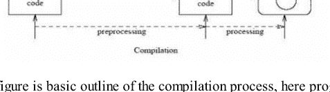

图中显示的是编译过程的基本轮廓；这里，用高级语言编写的程序称为源程序，转换后的程序称为目标程序。

### 解释器

解释器与编译器没有太大不同。它们也将高级语言转换为机器可读的二进制等价形式。每次解释器收到要执行的高级语言代码时，都会在将其转换为机器代码之前，先将代码转换为中间代码。代码的每个部分按顺序被解释，然后分别执行；如果代码的某一部分发现错误，它将停止解释该代码，而不会翻译下一组代码。

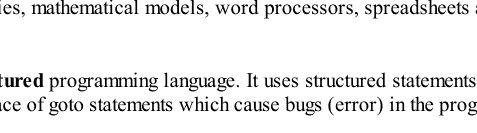

## C 语言编程的优点

- 1. **C 是一种通用**编程语言。你可以创建游戏、商业软件、实用工具、数学模型、文字处理器、电子表格和其他类型的软件。
- 2. **C 是一种结构化**编程语言。它使用 while、for 循环等结构化语句来代替会在程序中引发 bug（错误）的 goto 语句。
- 3. **系统无关性**——C 不需要操作系统提供任何服务，可以独立运行。C 可以在任何操作系统上运行。
- 4. **高效率**——C 编译器通常能够将源代码转换为高效的机器指令。C 语言的数据和控制机制与大多数小型计算机和微型计算机非常匹配。
- 5. **系统编程**——C 用于系统编程，即编写操作系统。UNIX 操作系统也是用 C 重写的。

## 语法与语义的区别

| 语义 | 语法 |
|---|---|
| 它是程序的逻辑或规划。语义可以通过以下任何一种方式编写：<br>1. 流程图。<br>2. 算法。<br>3. 伪代码。 | 它是用特定编程语言编写程序的方式。语法因语言而异。 |

## 流程图

流程图是程序逻辑的符号化表示。有一些预定义符号用于表示逻辑。流程图展示程序逻辑的实际流程。

流程图不过是问题求解过程中各个步骤的图示化表示。流程图指示过程的流向、相关操作和计算、决策点以及解决方案中的其他信息。一旦绘制完成并经过适当检查，流程图就会为编写程序提供极好的指导。

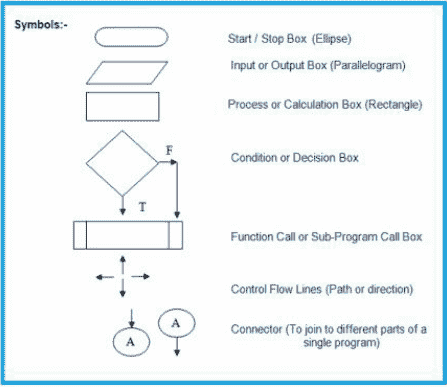

## 算法

一旦问题被正确定义，就必须制定一个详细、有限、逐步的求解过程。这个过程称为算法。算法可以用普通语言编写，也可以使用介于普通语言和编程语言之间的正式过程来编写。

两个数相加的算法——

- 1. 读取 A、B。
- 2. 设 SUM := A+B。
- 3. 输出 SUM。
- 4. 退出。

## 伪代码

有时，我们希望将算法转换为一种介于流程图和源代码之间的中间形式。伪代码是源代码的英文近似表示，它遵循某种语言的规则、风格和格式，但忽略大多数标点符号。

```c
main()
{
integer a,b,sum;
read in a and b;
add a & b and set it to sum;
write sum;
}
```

## C 程序的结构（源代码）

```c
#include<stdio.h> /* For printf() & scanf() */
#include<conio.h> /* For clrscr() & getch() */
main()
/* Starting point of the program execution*/
{
	int a,b,sum;
	/* Variable Declarations */
	clrscr();
	/* Clear Screen */
	printf("enter two numbers");
	/* Request for Input */
	scanf("%d %d",&a,&b);
	/* Input from user */
	sum=a+b;
	/* Adding two numbers */
	printf("sum=%d",sum);
	/* Output Sum */
	getch();
	/* To hold output screen */
}
/* End of main */
```

## C 程序说明

### 头文件的故事

头文件包含函数和变量的定义，可以通过预处理器的 `#include` 语句合并到任何 C 程序中。每个编译器都提供标准头文件，涵盖多个领域，如字符串处理、数学、数据转换、变量的打印和读取。

要使用任何标准函数，都应包含相应的头文件。这应在 C 源文件的开头完成。例如，要在程序中使用 printf() 函数，需要写出下面这一行——

`#include <stdio.h>`

`#include` 指令指示 C 预处理器查找文本文件“stdio.h”。该名称本身表示“标准输入输出”，“.h”表示它是头文件，而不是 C 源文件（C 源文件带有“.c”后缀）。它是一个文本文件，可以用任何文本编辑器查看。

### 注释

注释放在 /* 和 */ 字符序列之间，可以跨任意多行。

### main 函数

main 函数是最重要的。它定义了程序开始执行的位置。如果不编写 main 函数，程序将无法运行（它将没有起始点）。事实上，它甚至无法编译。

### 花括号

C 语言使用花括号字符“{”表示“开始”，“}”表示“结束”。它们更容易输入，而且过一段时间后，读起来也容易得多。

### printf()

printf 函数是产生输出的标准方式。该函数在标准库中定义，因此它始终存在并且始终以相同方式工作。此示例说明 printf 和 scanf 使用相同的格式说明符。

当出现“%i”时，它们都处理整数。scanf 是读取函数，因此从键盘读取整数；printf 是写入函数，因此向屏幕写入整数。表达式——请注意，C 语言很乐意计算“a-b”并将其作为整数值打印出来。本来可以创建另一个变量“c”并为其赋值，但没有必要。

printf 函数将输出写入屏幕。当它遇到格式说明符 %i 时，会输出一个整数。

### scanf()

scanf 函数与 printf“相反”。printf 在屏幕上产生输出，而 scanf 从键盘读取输入。序列“%i”指示 scanf 从键盘读取一个整数。由于使用了“%i %i”，将读取两个整数。输入的第一个值放入变量“a”，第二个值放入变量“b”。scanf 函数从键盘读取输入。当它遇到格式说明符 %i 时，


## C 的格式
- 语句以分号结束。
- 缩进会被编译器忽略。
- C 区分大小写 - 所有关键字和标准库函数均为小写。
- 字符串放在双引号中。
- 换行通过 \n 处理
- 程序能够标记成功或错误，忘记这样做的程序会随机选择其一！

### 分号
分号在 C 中非常重要。它们构成语句终止符，告诉编译器一个语句何时结束下一个语句何时开始。如果你在每个语句后未能放置一个，你将得到编译错误。

### 自由格式
C 是一种自由格式语言。这是必须到处使用分号的优点。把一个语句拆分到两行是没有问题的 - 你只需要不要在中间放置分号（反正你也不会这样做）。

示例程序中精心放置的空格和制表符会被编译器忽略。缩进完全是可选的，但应使用它使程序更易读。

### 大小写敏感
C 是一种区分大小写的语言。虽然 int 可以编译，但 “Int”、“INT” 或任何其他变体都不会。约 40 个 C 关键字均为小写。标准库中的数百个函数均为小写。

### 随机行为
既然 main 需要向操作系统返回一个整数，忘记这样做（要么只写 return 要么完全省略 return）会导致向操作系统返回一个随机整数。

这个随机值可能是零（成功），这种情况下你的程序可能会随机成功。更可能的是非零值，这会随机表示失败。

练习提示- WAP 表示“Write a Program”，有关按主题的编程示例请参阅本书最后一节。

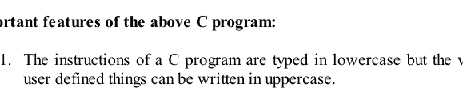

## 上述 C 程序的重要特性：
1. C 程序的指令以小写书写，但变量和用户自定义内容可以用大写书写。
2. 该程序的第一行是注释。每个注释以斜杠和星号 (/*) 开始，以星号和斜杠 (*/) 结束。注释有助于程序员解释程序的逻辑。它提高了程序的可读性。

这些注释可以放在程序的任何位置。编译器不读取这些注释。不允许嵌套注释。注释是对程序中语句的解释，以提高程序的可读性。
3. 注释不是必需的；一个好的做法是以注释开始程序，说明程序的目的、作者以及程序编写的日期。

可以在程序的任何位置编写任意数量的注释，例如注释可以在 --- 语句之前、之后或语句内编写。注释可以跨越多行，这种注释称为多行注释。
4. 程序的第二行和第三行称为头文件 (stdio.h 和 conio.h)，其中包含编译前必须包含在程序中的信息。# 是预处理器指令或编译器指令。该语句指示编译器在编译程序之前将头文件包含到程序中。我们也可以将 <stdio.h> 写成 “stdio.h”。
5. 每个 C 程序由一个或多个称为函数的模块组成。其中一个函数称为 main()。每个程序的执行都从 main 函数开始，它可能会调用其他函数。整个程序都写在用大括号括起来的这个 main 函数中。使用多个 main() 是非法的。
6. 变量的声明在程序的开括号之后立即进行。我们不能在程序中间声明变量。
7. 请注意，main 函数中的每个语句都以分号 (;) 结束。
8. 接下来是 printf( ) 语句:- printf(“Enter two numbers”); printf 是一个输出命令，要求用户输入一个数字。该消息称为“提示消息”，并在输出屏幕上打印为 Enter two numbers
9. 通过下一个语句 scanf( ) 将值输入到计算机中。scanf(“%d %d”,&a,&b); scanf 是一个输入命令，根据给定的格式说明符从用户获取一些值并将其存储到所需变量中。& 称为地址运算符。
10. 接下来是赋值语句:- sum= a+b; 它将变量 a 和 b 中的值相加并将其赋给变量 sum;
11. 最后的 printf( ) 用于在屏幕上显示 sum 的计算值。
12. 最后 getch( ) 函数用于显示输出屏幕。
13. main() 内部的所有语句都比 main() 稍微靠前一些。这称为缩进。这表明所有语句都在 main() 函数内部。

## 多项选择题：
1. C 是一种 :
   a. 高级语言。
   b. 低级语言。
   c. 中级语言。
   d. 汇编级语言。
2. 程序的逻辑称为:
   a. 语法。
   b. 语义。
   c. 流程图。
   d. 调试。
3. C 语言由以下哪位开发
   a. Ken Thompson。
   b. Dennis Ritchie。
   c. Patrick Naughton。
4. 流程图用于决定-
   a. 寻找解决方案所涉及的步骤顺序。
   b. 制作算法的辅助工具。
   c. 准备决策表。
   d. 调试程序。
5. C 程序在以下帮助下转换为机器语言 -
   a. 编辑器。
   b. 编译器。
   c. 操作系统。
   d. 以上都不是。
6. C 可以用于-
   a. 仅 MS-DOS 操作系统。
   d. Ed Frank.
   b. 仅 Linux 操作系统。
   c. 仅 Windows 操作系统。
   d. 以上全部。

答案:
1(c) 2(b) 3(b) 4(a)
5(b) 6(d)


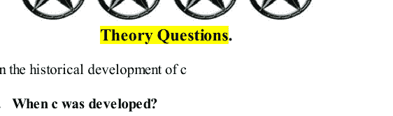

## 理论问题。
1. 解释 C 的历史发展
   1. C 是何时开发的？
   2. 谁开发了 C？
   3. C 是在哪里开发的？
   4. C 是高级、中级还是低级？
   5. 它可以在哪个操作系统上工作？
2. C 程序的主要组成部分是什么？名称 main 有何意义。
3. 什么是注释。注释可以放在哪里。
4. C 程序是否必须以小写书写？C 程序中是否可以使用大写？请解释。
5. 用于结束 C 语句的符号是什么？所有语句都这样结束吗？
6. 为什么 C 程序中的语句要缩进。
7. 什么是流程图？绘制流程图中使用的主要符号。

## 实验练习。
1. 编写程序以从键盘输入两个数字并打印它们的和。
2. 编写程序以从键盘输入两个数字并打印它们的平均值。
3. 编写程序以计算圆的面积。
4. 编写程序以打印给定时间（小时、分钟、秒）中的总秒数。
5. 编写程序将温度从华氏度转换为摄氏度。C=(F-32) * 5/9
6. 编写程序交换（互换）两个数字。
7. 编写程序在不使用第三个变量的情况下交换（互换）2 个数字。
8. 编写程序交换（互换）三个数字。
9. 编写程序在不使用第四个变量的情况下交换三个数字。
10. 编写程序在不使用 % 运算符的情况下计算 2 个数字的余数。

## 填空题。
1. ___ 是 C 语言的创造者。它在 ___ 于 _______ 年开发。
2. _______ 操作系统是用 C 开发的。
3. _______ 可以被认为是 C 的祖先。
4. C 语言使用 _______ 翻译成机器代码。
5. C 可以与 _______, _______ 和 _______ 操作系统一起使用。


C - 程序员
Harry.


## 章节


## C 记号
记号是程序中最小的独立单元。C 识别六种类型的记号。C 程序使用这些记号以及语言的语法来编写。以下是 C 记号：
- 关键字。
- 标识符。
- 字面量。
- 运算符。
- 分隔符。

### 1. 关键字
关键字是保留字，其含义已经向 C 编译器解释过。这些词由语言本身定义。C 中有 32 个关键字。

| auto | double | int | struct | break |
|---|---|---|---|---|
| else | long | switch | case | enum |
| register | typedef | char | extern | return |
| union | const | float | short | unsigned |
| continue | for | signed | void | default |
| goto | static | sizeof | volatile | do |
| while | if | -- | -- | -- |

### 2. 标识符
标识符是赋予变量的名称。使用这个标识符，我们可以访问该变量。C 程序中的所有其他名称（例如数组名或函数名）也称为标识符。

### 变量
在程序执行期间可能变化的实体称为变量。或者你可以说，变量是主内存中用于存储某种特定类型数据的位置，这些数据在程序执行期间会变化。变量名是赋予内存位置的名称。这些位置可以包含整型、实型或字符常量。程序中使用的所有变量都应声明，即在顶部用各自的数据类型进行类型说明。变量声明说明两件事：
- 1. 它告诉编译器变量的名称。
- 2. 它还告诉变量将保存的值的类型。

```
int a;
float b;
char c;
```

变量名可以由字母、数字和下划线（_）组成，并遵循以下规则——
- 1) 它们必须以字母开头。
- 2) 大写和小写是有区别的，即二者完全不同。
- 3) 变量名不应是关键字。

声明变量的基本格式是
```
[Data type name] var1, var2, -------;
```

变量声明说明两件事——
- 1. 它告诉编译器变量的名称。
- 2. 它还告诉变量将保存的值的类型。

```
int a;
float b;
char c;
```

这里 a 是整型变量，b 是浮点型变量，c 是字符型变量。; 称为终止符号或语句结束符。

### 基本类型声明
变量可用于存储任何数据类型的值。也就是说，变量类型与变量名没有任何关系。

**例如** `int a,b,c;`

其中 **a,b,c** 是赋予变量的名称。同一数据类型的全部变量用逗号分隔。声明语句必须以分号结尾。

假设我们要声明三个变量，那么……我们写成——
```c
int a, b, c;
```

在声明这三个整型变量的同时，计算机主内存中会创建三个内存位置，用于存储每种整型变量的操作数据。这些内存分配字段称为一个位置。

### 变量命名
最好为变量使用有意义的名称，即使这会使名称变得很长。还要记住，C 区分大小写。

名为“COUNTER”的变量不同于名为“counter”的变量。在 C 编程语言中，函数和命令都区分大小写。

你可以使用字母、数字和下划线 _ 字符来构成变量名。在 ANSI C 语言中，变量名最多可达 31 个字符。

### 有效名称
变量名中只能有效使用字母、数字和下划线字符。变量的第一个字符可以是字母或下划线，不过标准建议避免使用下划线作为首字母。

因此，变量名“temp_in_celsius”、“index32”和“sine_value”都是有效的，而“32index”、“temp-in-celsius”和“sine$value”则不是。使用像“_sine”这样的变量名会不被提倡，尽管它在语法上并非无效。

变量名可能相当长，编译器会检查前 31 个字符。名称可以长于此，但前 31 个字符内必须有差异。

### 3. 字面量/常量
C 中的常量指在程序执行期间不会改变的固定值。C 中有 2 种常量：


### 数值常量
A) 整型常量——
它们是一串数字。整数有三种类型：十进制、八进制、十六进制。

十进制数包含 0 到 9 的数字集合，可以是正数（+）或负数（-）。

例如：6、46、398、658736、-89、+598 都是整数

不允许使用空格、逗号或特殊符号。

例如：12 897、364,897、S56、78@56 都是无效或错误的数字。

八进制数由 0 到 7 的任意数字组合组成，并带有前导 0。

例如：037、0435、0551。

十六进制数有 16 个数字：0 到 9 以及字母 A 到 F（10-15），数字序列前带有 0x 或 0X。

例如：0X2、0x9f、0xbcd。

### B) 浮点或实型常量
整型常量不足以表示所有量，例如价格、距离、温度等。这些数字带有小数点（.），即小数部分，如 65.987、0.000569、89.36。

浮点数也可以用指数或科学记数法表示，例如 0.0000123 可以写成 1.23*10^-5 或 1.23e-05。因此一般形式为：

尾数 e 指数

所以，1.23 称为尾数，-05 称为指数

### C) 字符常量
### i) 单字符常量
单个字符字母（大写（'A' 到 'Z'）或小写（'a' 到 'z'））或数字（0 到 9）或特殊符号（@、#、$、%、*、&、+、-、.、:、/ 等），并用单引号（' '）括起来。

例如：'a' 或 'A' 或 '7' 或 '+' 都是字符常量。

注意：所有转义序列也被视为字符。

### ii) 字符串常量
字符串常量是单个字符或一组字符，并用双引号（" "）括起来。

例如："hello"、"4598"、"hello235"、"5+3"。

注意——字符常量‘7’与数字 7 并不相同。每个字符常量都有一个等价的整数值。

‘A’到‘Z’的 ASCII 码为 65 到 90。即‘A’的 ASCII 码为 65，‘B’的 ASCII 码为 66，依此类推。

‘a’到‘z’的 ASCII 码为 97 到 122

‘0’到‘9’的 ASCII 码为 48 到 57

‘ ’（空格）的 ASCII 码为 32。

☺（笑脸符号）的 ASCII 码为 1。

## 数据类型
C 语言的数据类型丰富。*数据类型有 4 类：*
- 1. 基本数据类型（int、float、char）
- 2. 用户定义数据类型（枚举、typedef）
- 3. 派生数据类型（数组、函数、指针、结构体、联合体）
- 4. 空数据类型（void）

## 基本数据类型
| 整数 | 实数 | 字符 |
|---|---|---|
| int 或 short 或 short int<br>占用 2 字节——<br>范围：-32768 到 +32767<br><br>long int 或 long<br>占用 4 字节<br>范围：-<br>-2,147,483,648<br>到 +2,147,483,647 | float 占用 4 字节——<br>范围：3.4e-38 到 3.4e38<br><br>double 占用 8 字节——<br>范围：1.7e-308 到 1.7e+308<br><br>long double 占用 10 字节<br>——<br>范围：3.4e-4932 到<br>1.1e+4932 | char 占用 1 字节<br>范围——<br>-128 到 +127 |

## 范围计算公式
2ⁿ⁻¹

其中 n 是数据类型占用的位数。

*int 的范围：*
int 占用 2 字节，即 16 位（因为 1 字节等于 8 位）

所以，2¹⁶⁻¹ = 2¹⁵ = 32768。

因此范围变为：-32768 到 +32767

> 注意——此公式不能用于计算实型数据类型（float、double、long double）的范围

## 用于基本数据类型的修饰符
signed、unsigned 和 short 可应用于字符和整数基本数据类型。修饰符 long 也可以应用于 double。

## 有符号和无符号
int 或 signed int 的范围是 -32768 到 +32767，它使用 2 字节，但有时程序只需要正值，而这些值可能超出 int 的范围。

在这种情况下，可以通过将负范围加到正范围上，使该数据类型变为无符号。因此 unsigned int 的范围变为：0 到 65535

unsigned int 只使用 2 字节。因此我们可以说，无符号数据类型使用的字节数与有符号数据相同。

> 注意：实型数据类型不能变为无符号。

## 格式说明符
printf 和 scanf 有很多格式说明符。以下是基本的几个：
- %d 以十进制打印 int 参数。
- %i 以十进制、十六进制或八进制打印 int 参数。
- %h 以十进制打印 short int 参数。
- %ld 以十进制打印 long int 参数。
- %lu 打印 unsigned long int 参数。
- %u 打印 unsigned int 参数。
- %f 打印 float 参数。
- %lf 打印 double 参数。
- %Lf 打印 long double 参数。


| 格式说明符 | 描述 |
|---|---|
| `%e` | 指数表示法。 |
| `%g` | 浮点数或指数表示法。 |
| `%o` | 以八进制（基 8）打印 int 参数 |
| `%x` | 以十六进制（基 16）打印 int 参数 |
| `%X` | 以大写十六进制（基 16）打印 int 参数 |
| `%c` | 打印字符。 |
| `%s` | 打印字符串。 |

## 转义序列

在 `printf()` 函数中使用的某些不可打印字符称为转义序列。转义序列始终以反斜杠（`\`）开头。常用的转义序列有：

### 转义序列

| 转义序列 | 描述 |
|---|---|
| `\a` | 响铃。 |
| `\b` | 退格（将光标向左移动一个位置） |
| `\f` | 换页（从打印机弹出当前纸张并装入新纸张） |
| `\n` | 换行字符。 |
| `\r` | 回车（将光标移到行首） |
| `\t` | 水平制表符。 |
| `\v` | 垂直制表符。 |
| `\\` | 打印反斜杠。 |
| `\"` | 打印双引号。 |
| `\'` | 打印单引号。 |
| `\?` | 打印问号。 |
| `\0` | 空字符（字符串结束） |


## 运算符

运算符可用于对值执行所需的计算。

### 运算符类型

运算符有三种类型：

- 1. 一元运算符：仅作用于一个操作数的运算符。
- 2. 二元运算符：作用于两个操作数的运算符。
- 3. 三元运算符：作用于三个操作数的运算符。

### 优先级规则

C 中的每个运算符都有与之关联的优先级。该优先级用于确定包含多个运算符的表达式如何求值。

优先级有不同的级别，一个运算符可能属于其中一个级别。优先级较高的运算符先求值。

### 结合性规则

相同优先级的运算符根据级别从左到右或从右到左求值。这称为运算符的结合性属性。C 中有 45 个运算符：

### 运算符类别

运算符主要分为 9 类：

- 1. 算术运算符。
- 2. 一元运算符。
- 3. 关系运算符。
- 4. 赋值运算符。
- 5. 相等运算符。
- 6. 逻辑运算符。
- 7. 条件运算符。
- 8. 位运算符。
- 9. 逗号运算符。

| 排名 | 运算符 | 描述 | 结合性 |
|------|-----------|--------------|--------------|
| 1 | `( )` | 函数调用。 | 从左到右。 |
| 1 | `[ ]` | 数组元素引用 | |
| 1 | `->` | 结构运算符（用于指针与成员之间） | |
| 1 | `.` | 结构运算符（用于对象与成员之间） | |
| 2 | `-` | 一元减 | 从右到左。 |
| 2 | `+` | 一元加 | |
| 2 | `++` | 自增 | |
| 2 | `--` | 自减 | |
| 2 | `!` | 逻辑非 | |
| 2 | `~` | 按位取反 | |
| 2 | `*` | 地址处的值（与指针一起使用） | |
| 2 | `&` | 取地址 | |
| 2 | `sizeof` | 求大小 | |
| 2 | `(type)` | 类型转换 | |
| 3 | `*` | 乘法 | 从左到右。 |
| 3 | `/` | 除法 | |
| 3 | `%` | 取模 | |
| 4 | `+` | 加法 | 从左到右。 |
| 4 | `-` | 减法 | |
| 5 | `<<` | 左移 | 从左到右。 |
| 5 | `>>` | 右移 | |
| 6 | `<` | 小于 | 从左到右。 |
| 6 | `<=` | 小于等于 | |
| 6 | `>` | 大于 | |
| 6 | `>=` | 大于等于 | |
| 7 | `==` | 相等（条件） | 从左到右。 |
| 7 | `!=` | 不等于 | |
| 8 | `&` | 按位与 | 从左到右。 |
| 9 | `^` | 按位异或 | 从左到右。 |
| 10 | `\|` | 按位或 | 从左到右。 |
| 11 | `&&` | 逻辑与 | 从左到右。 |
| 12 | `\|\|` | 逻辑或 | 从左到右。 |
| 13 | `?:` | 条件运算符 | 从右到左。 |
| 14 | `=, *=, /=, %=, +=, -=, &=, ^=, \|=, <<=, >>=` | 赋值运算符 | 从右到左。 |
| 15 | `,` | 逗号运算符 | 从左到右。 |

### 1. 算术运算符

这些运算符包括 `+`、`-`、`*`、`/`、`%`；这里的 `+` 和 `-` 运算符分别用于对两个操作数进行加法和减法。`*` 用于乘法，`/` 用于除法。

```
int i=2,j=3,k,l;
float a,b;
k=i/j*j;
l=j/i*i;
a=i/j*j;
b=j/i*i;
printf("%d, %d, %f, %f",k,l,a,b);
Output:- 0, 2, 0.000000, 2.000000
```

`%` 称为取模运算符，该运算符用于计算余数。

```
int a=5,b=3,c;
c=a%b;
printf("%d", c);
Output: 2
```

> 注意：取模运算符不适用于浮点数。

### 2. 一元运算符

`+`、`-`、`++`、`--`、`sizeof`、`(typecasting)` 一元运算符中的 `+` 和 `-` 用于表示数字的符号。`++` 运算符用于将变量加 1。

```
int a=5,b=4;
a++;
b--;
printf("%d,%d",a,b);
```

**输出：6, 3**

如果我们使用 `a++` 或 `++a`，两者都会将 `a` 的值增加 1。`a++` 称为**后缀**，而 `++a` 称为**前缀**。

### 后缀

```
int a=5,b;
b=a++;
printf("%d, %d",a,b);
Output:- 6,5
```

```
int i=3;
i=i++;
printf("%d",i);
Output:- 4
```

### 前缀

```
int a=5,b;
b=++a;
printf("%d, %d",a,b);
Output:- 6,6
```

```
int i=2;
printf("%d %d",++i, ++i);
```

- 1. 3 4
- 2. 4 3
- 3. 4 4
- 4. 输出可能因编译器而异。

输出：b

### 3. 关系运算符

`<`、`>`、`<=`、`>=` 这些运算符是布尔运算符（这类运算符以 1 或 0 给出答案。这里 1 被视为真，0 为假）。

```
int x=10,a,b;
a=x>2;
b=x<2;
printf("%d, %d",a,b);
Output:- 1,0
```

```
int x=10,y=20,z=5,i;
i=x<y<z;
printf("%d",i);
```

- 1. 1
- 2. 0
- 3. 错误
- 4. 以上都不是

输出：a

### 4. 赋值运算符

`=`、`+=`、`-=`、`*=`、`/=`、`%=` 这些运算符用于为变量赋值。

```
a=5; /* assigning 5 to variable a */
a=5+2; /*valid*/
a=b; /*valid*/
5=a; /*invalid*/
a+b=5; /*invalid*/
```

其他赋值运算符用于对变量执行算术运算，然后将值赋给同一变量：

- `a+=5;` 等价于 `a=a+5`
- `a-=5;` 等价于 `a=a-5`
- `a*=5;` 等价于 `a=a*5`
- `a/=5;` 等价于 `a=a/5`
- `a%=5;` 等价于 `a=a%5`

### 5. 相等运算符 - ==, !=

这两个运算符用于检查给定表达式的左右两边是否相等。该运算符也是布尔运算符；它同样以 0 或 1 给出答案。

```
int a,b,c=5;
a==5;
b!=2;
printf("%d, %d",a,b);
```

输出：1,0

### 6. 逻辑运算符 - &&, ||, !

这些运算符也是布尔运算符。`&&` 和 `||` 运算符与两个表达式一起使用。这些表达式中通常含有关系运算符或相等运算符。

| 表达式 1 | 表达式 2 | && | \|\| |
|---|---|---|---|
| 0 | 0 | 0 | 0 |
| 1 | 0 | 0 | 1 |
| 0 | 1 | 0 | 1 |
| 1 | 1 | 1 | 1 |

NOT 运算符用于反转表达式：

| 表达式 | ! |
|---|---|
| 0 | 1 |
| 1 | 0 |

```
int a=10,b=5,c,d;
c= a>3 && b!=3;
d= (a==10 || b>20);
printf("%d, %d",c,d);
Output:- 1, 1
```

输出：1, 1

### 使用短路运算符

```
int a=5,b=4,c;
c= (b == 3 && a++);
printf("%d, %d, %d", a,b,c);
Output:- 5, 4, 0
```

输出：5, 4, 0

现在让我们试着理解这个输出。该表达式中有四种类型的运算符：`b == 3` 含有相等运算符。`a++` 是一元运算符。这两个表达式通过逻辑 AND 连接。最后将值赋给变量 `c`。

在这个表达式中，`b == 3` 是一个假表达式，因此会得到 0。下一个运算符是逻辑 AND，该运算符作用于两个不同的表达式（只有当两个表达式都为真时，AND 才会给出答案 1），第一个是 `b == 3`，第二个是 `a++`。AND 的第一个表达式为假，因此为了加快程序执行速度，它不会计算下一个表达式。

```
int i=3,j=2,k=0,m;
m = ++i && ++j || ++k;
printf("%d %d %d %d", i , j, k,m);
Output:- 4 3 0 1
```

```
int i=3,j=2,k=0,m;
m = ++j && ++i || ++k;
printf("%d %d %d %d", i , j, k,m);
Output:- 4 3 0 1
```

```
int i=3,j=2,k=0,m;
m = ++i || ++j && ++k;
printf("%d %d %d %d", i , j, k,m);
Output:- 4 2 0 1
```

```
int i=3,j=2,k=0,m;
m = ++i && ++j && ++k;
printf("%d %d %d %d", i , j, k,m);
```

### 7. 条件运算符

这是 C 中唯一的三元类型运算符。它作用于三个操作数。这类运算符由两个协同工作的运算符（`?`）和（`:`）组成。让我们先了解该运算符的语法：

```
Condition ? true statement : false statement;
```

上述表达式的意思是：如果条件为真，即如果它返回非零值，那么返回的值将是真语句；否则返回的值将是假语句。


## 请考虑以下示例

```
1. int x=2,y;
 y = x > 5 ? 3 : 5;
```

输出：5

由于 x 的值小于 5，因此条件为假，因此会在分号之后的部分（ : ）被执行。

```
2. int a=5,b=4,c;
 a>b? g = a: g = b;
```

输出：- 这将产生错误‘LValue required’。可以通过将 : 部分中的语句用一对括号括起来来克服错误。a>b? g = a: (g = b); 如果没有括号，编译器会认为 b 被赋值为第二个 = 左侧表达式的结果。因此它会报告错误。

条件运算符的限制是 ? : 之后只允许一个语句。

```
3. Are the two statements same:
 a<=20?b=30;c=30;
 a<=20?b:c=30;
```

输出：- 否

```
4. int a=10,b;
 a>=5?b=100:b=200;
 printf("%d",b);
```

输出- 出现 Lvalue 错误。

第二个赋值应写在括号中如下：a>=5?b=100:(b=200);

```
5. Rewrite the following set of statements using conditional operators:
int a=1,b;
if(a>10)
b=20;
```

输出：- int a=1,b,dummy;
a>10?b=20:(dummy=1);

请注意以下内容将无法工作：a>10?b=20;;

```
6. Can you suggest some other way to write the following expression such that 30 is used only once?
a<=20?b=30;c=30;
```

输出：- ((a<=20)?b:&c)=30;

### 8. 位运算符 –

一些程序需要对位（0 和 1）进行操作，例如与计算机硬件部分交互的程序。因此 C 包含几个特殊的运算符，允许对位进行操作。

*位运算符通常分为三类：*

- 1. **按位取反运算符(~)**
- 2. **逻辑位运算符.(&, |, ^)**
- 3. **移位运算符.(<<, >>)**
- 总共有 6 个位运算符。

## 按位取反运算符：

也称为补码运算符。它是一个一元运算符，反转操作数的位，即所有 0 变为 1，所有 1 变为 0。操作数对于该运算符必须始终是整数值（int、short int、long int、unsigned、char）。

```
```c
unsigned int a= 5, b;
b = ~a;
printf("%u",b);
```
```

**输出：-** 将为 65530。

让我们现在评估输出：数字 5 的二进制等价为

0000 0000 0000 0101。

正如已经说过的，按位取反将所有 1 转换为 0，所有 0 转换为 1。所以补码将为 1111 1111 1111 1010，将数字转换为十进制数将给出—

1*2¹⁵+1*2¹⁴+1*2¹³+1*2¹²+1*2¹¹+1*2¹⁰+1*2⁹+1*2⁸+1*2⁷+1*2⁶+1*2⁵+1*2⁴+1*2³-

32768+16384+8192+4096+2048+1024+512+256+128+64+32+16+8+0+2+0
最终答案将为 65530。

### 9. 逻辑位运算符：

有三个逻辑位运算符按位与(&)、按位或(|)、按位异或(^)。这些运算符中的每一个都需要两个整数值来工作。

每个操作数单独转换为其各自的二进制数。二进制数的最左侧位称为最高有效位或 MSB。而最右侧位称为最低有效位。

| 操作数 1 | 操作数 2 | & | \| | ^ |
|----------|----------|---|----|---|
| 0 | 0 | 0 | 0 | 0 |
| 0 | 1 | 0 | 1 | 1 |
| 1 | 0 | 0 | 1 | 1 |
| 1 | 1 | 1 | 1 | 0 |

上表解释了所有逻辑位运算符的工作原理。

### 移位运算符：

两个位移位运算符是左移（<<）和右移（>>）。这些运算符中的每一个也需要两个操作数。第一个整数操作数表示要移位的位模式。第二个操作数指示要移位的位数。

```
int a,b;
a=20<<2;
b=20>>2;
printf("%d %d",a,b);
Output: 80, 5
```

程序将把 20 转换为其二进制等价，即 0000 0000 0001 0100，左移 2 位将导致位变为 0000 0000 0101 0000，整数数将为 80。如果将整数 20 的位向右移动 2 位，二进制数将为 0000 0000 0000 0101。

因此将数字向右移动 1 位会使数字减半，而将数字向左移动 1 位会使数字加倍。

逗号运算符从左到右工作但返回最右侧的值。该运算符通常用于 for 循环。由逗号运算符分隔的表达式从左到右求解。使用逗号运算符时，返回最右侧操作数的值和类型。例如在下面的赋值语句中：

```
i = (j = 1, k = 2, 3, 4);
```

表达式 j = 1, k = 2, 3, 4 首先被求值。然后表达式的值作为 4 返回并赋给 i。

| 1. int a; a = 5,6; printf("%d",a); 输出:- 5 | 2. int a; a = (5,6); printf("%d",a); 输出:- 6 |

## 部分已解程序：

1. 如果通过键盘输入一个四位数，编写一个程序来获得该数字的首位和末位之和。

```
int n,a,b,sum;
printf("Enter a four digit number: ");
scanf("%d",&n);
a=n%10;
b=n/1000;
sum = a + b;
printf("Sum of the first and last digit is %d", sum);
getch();
```

2. 打印一个数字的范围。例如数字 78 在 70 和 79 之间，102 在 100 和 109 之间。

```
int n,lower_r,upper_r;
printf("Enter a number: ");
scanf("%d",&n);
lower_r = n %10 * 10;    /*the arithmetic operators work from left to right*/
upper_r = lower_r + 10;
printf("Range is %d - %d",lower_r,upper_r);
getch();
```

## 3. 打印给定卢比的各种面额。例如如果一个人口袋里有 1779，程序应打印以下内容。

500 x 3 = 1500, 100 x 2 = 200, 50 x 1 = 50, 20 x 1 = 20, 10 x 0 = 0, 5 x 1 = 5, 2 x 2 = 4, 1 x 0 = 0

```
int Rs,a,b,c,d,e,f,g,h;
clrscr();
printf("Enter the amount: ");
scanf("%d",&Rs);
a= Rs/500;
Rs = Rs%500;
b = Rs/100;
Rs=Rs%100;
c=Rs/50;
Rs=Rs%50;
d=Rs/20;
Rs=Rs%20;
e=Rs/10;
Rs=Rs%10;
f=Rs/5;
Rs=Rs%5;
g=Rs/2;
Rs=Rs%2;
h=Rs/1;
printf("The various denominations of the given rupees are\n500 X %2d\n100 X %2d\n 50 X %2d\n 20 X %2d\n 10 X %2d\n 5 X %2d\n\n 2 X %2d\n 1 X %2d",a,b,c,d,e,f,g,h);
getch();
```


哦哦 是的！Demm Man ....
我们不知道
我们是新的 Fuc*in 程序员！LoL

## 多选题：

1. 带小数点的整数被称为：
a. 浮点数。
b. 字符。
c. 整数。
d. 无。

2. 声明 unsigned u 表示：
a. u 是字符
b. u 是无符号整数
c. u 是无符号字符
d. u 是无符号长整数

3. 哪个语句必须不以分号结尾：
a. #define
b. 变量声明
c. 赋值
d. 无

4. 指出有效的变量名：
a. gross salary
b. gross-salary
c. AVG
d. AVG.

5. 如果 a 是整数变量，a =5/2 将返回一个值。
a. 2.5
b. 3
c. 2
d. 0

6. 表达式，a=7/22*(3.14+2)*3/5 的计算结果为
a. 8.28
b. 6.28
c. 3.14
d. 0

7. 表达式 a=30*1000+2768 的计算结果为
a. 32768
b. -32768
c. 113040
d. 0

8. 表达式 a=4+2%-8 的计算结果为
a. -6
b. 6
c. 4
d. 以上都不是

9. 层次结构决定哪个运算符
a. 最重要
b. 最先使用
c. 最快
d. 操作最大数字

10. 在 C 中变量不能包含
a. 空格
b. 连字符 ( - )
c. 小数点
d. 以上全部

11. 算术指令不能包含--
a. 变量。
b. 常量。
c. 等号右侧的变量名。
d. 等号左侧的变量名。

12. 以下哪个是异类
a. +
b. -
c. /
d. **

13. 假设 d 为 float，操作 d=2/7.0 后 d 的值将为
a. 0
b. 0.2857
c. 无法确定。
d. 以上都不是。

答案-
1(a) 2(b) 3(a) 4(c)
5(c) 6(d) 7 (b) 8(b)
9(b) 10(d) 11(c) 12(d) 13(b)

## 理论问题 –

- 1. 解释什么是数据类型？列出 C 语言中所有的 数据类型及其在字节数（在 DOS 操作系统下）。列出所有格式说明符。也写出我们可以计算给定数据类型的范围的公式。
- 2. 通过此计算 int 的范围。
- 3. C 中有多少个关键字？给出所有关键字的名称？
- 4. 解释 C 中变量的所有命名规则。
- 5. 程序的特征。
- 6. 列出所有转义序列。
- 7. 你是什么意思由运算符的优先级？按优先级顺序列出 C 中所有可用的运算符。（从高到低）
- 8. 你是什么意思类型转换？解释隐式和显式类型转换

## 给出以下输出 -

```
1. int i =4, z=12;
   if( i = 5||z>50)
   printf("\nwelcome in matrix");
   else
   printf("\n you may go now");
```

输出：welcome in matrix
首先在 if 中 i 被赋值为 5，即非零值并假定为真，现在这个值与 (||) 或运算符一起使用，在或运算符的情况下，如果第一个条件为真，它不会转到下一个，而是直接以真值跳出，这被称为“短路”。

```
2. int i=4,z=12;
   if(i=5&&z>5)
      printf("hello");
   else
      printf("bye");
```

13. 我们应该怎么做才能将常数 3.14 视为 long double？

输出：使用 3.14l

14. 以下语句的输出将是什么：
    printf("%% %d
%%d",sizeof(3.14f),
    sizeof(3.14), sizeof(3.14l));
    a. 4 4 4
    b. 4 garbage value
garbage value
    c. 4 8 10
    d. Error
输出：c

15. 浮点数如何在二进制形式中存储？
输出：浮点数


**输出：hello**

首先，`i` 被赋值为 5，这是一个非零值，被假定为真。现在第二个条件 (`z >= 5`) 被检查，它为真，所以两个条件都为真，最终生成真，因此 `if` 下的语句被执行，消息 “hello” 被打印。

**3.**
```c
int i = 4, j = -1, k = 0, w, x, y, z;
w = i || j || k;
x = i && j && k;
y = i || j && k;
z = i && j || k;
printf("\nw=%d x=%d y=%d z=%d", w, x, y, z);
```
**输出：** `w = 1 x = 0 y = 1 z = 1`

`i = 4` 这是一个非零值，表示真条件。  
`j = -1` 这也是一个非零值，表示真条件。  
`k = 0` 表示假条件。

**4.**
```c
int i = 4, j = -1, k = 0, y, z;
y = j + 5 && j + 1 || k + 2;
z = i + 5 || j + 1 && k + 2;
printf("\n y =%d z =%d", y, z);
```
**输出：** `1 1`

在第一个语句中 `j + 5 = 4 (T)` 且 `j + 1 = 0 (F)` 且 `k + 2 = 2 (T)`。现在首先 `(j + 5 && j + 1)` → `(4 && 0)` 得到 `0 (F)`，第二个比较将是 `(0 || k + 2)` → `(0 || 2)` → `1 (T)`，所以 `y = 1`。  
在第二个语句中 `i + 5 = 9` 且在表达式 `(i + 5 || j + 1 && k + 2)` → `(9 || j + 1 && k + 2)` 中，我们知道在 `||` 运算符的情况下，如果第一个条件为真，则控制不会进入下一个条件；它会以真结果跳出，即 `1`，所以 `z = 1`。

**5.**
```c
int i = -3, j = 3;
if (!i + !j * 1)
    printf("Hello");
else
    printf("Bye");
```
**输出：** `Bye`

这里首先我们知道所有使用运算符的优先级。这里 `!`（非）比 `*`（乘法）优先级更高，然后是 `+`（加法）。  
`i = -3 (T)` 然后 `!i` → `(!T)` → `F (0)`；  
同样 `!j` 得到 `F (0)` 且 `0 * 1` 得到 `0`，现在表达式将转换为 `(0 + 0)` → `0`，所以条件为假，控制跳转到 else 块并执行它；结果打印出 “Bye”。

**6.**
```c
int a = 40;
if (a > 40 && a < 45)
    printf("a is between 40 and 45");
else
    printf("%d", a);
```
**输出：** `40`

这里 `a > 40` 是第一个比较，结果为假，表达式包含 `&&` 运算符。在 `&&` 的情况下，如果第一个条件为假，则控制会以假条件跳出，而在 `if` 条件为假，所以最终控制跳转到 else 块并打印 `a` 的值，即 `40`。

**7.**
```c
int a = 65;
printf("\n a>=65 ? %d: %c", a);
```
**输出：** `65`

**8.**
```c
float a = 0.7;
if (a < 0.7)
    printf("Hello");
else
    printf("Bye");
```
**输出：** `Hello`

**9.** 我们想要将 `x`，一个浮点数，四舍五入为 int 值。正确的方法是：
- a. `y = (int)(x + 0.5);`
- b. `y = int(x + 0.5);`
- c. `y = (int)x + 0.5;`
- d. `y = (int)((int)x + 0.5);`

**输出：** `a`

**10.** C 中可用的三种不同类型的实数数据类型是什么，它们使用的格式说明符是什么？

**输出：**

| 数据类型 | 大小 | 格式说明符 |
|---|---|---|
| float | 4 字节 | `%f` |
| double | 8 字节 | `%lf` |
| long double | 10 字节 | `%Lf` |

**11.** 默认情况下任何实数都被视为  
**输出：** `double`

**12.** 我们应该怎么做才能将常量 `3.14` 视为 float？  
**输出：** 使用 `3.14f`

实数以 IEEE 格式表示。IEEE 浮点存储格式使用符号位、尾数和指数来表示 2 的幂。符号位表示数字的符号：`0` 表示正值，`1` 表示负值。尾数在转换为其规范形式后以二进制表示。规范形式产生尾数，其最高有效数字始终为 `1`。IEEE 格式通过根本不存储该位来利用这一点。指数是在加上正整数偏移量后以无符号二进制格式存储的整数。这确保存储的指数始终为正。偏移量的值对于 float 为 `127`，对于 double 为 `1023`。

**16.**
```c
int p = 8, q = 20;
if (p == 5 && q < 5)
    printf("Hello Matrix");
else
    printf("Bye Matrix");
```
**输出：** `Bye Matrix`

起初编译器执行 `if` 中的表达式，在那里第一个比较 `p == 5` 给出假 `(0)`，这里表达式中涉及 `&&`，所以控制在不检查下一个条件的情况下跳出，并在 `if` 中给出假。现在由于 `if` 中条件为假，控制跳转到 else 块并打印 “Bye Matrix”。

**17.**
```c
int i = -1, j = 1, k, l;
k = i && j;
l = i || j;
printf("%d %d", i, j);
```
**输出：** `-1 1`

这里简单打印 `i` 和 `j` 的值，这不会影响 `i` 和 `j` 的值，所以 `i` 和 `j` 的值保持不变并通过 `printf()` 打印。

**18.**
```c
int j = 4, k;
k = !5 && j;
printf("k=%d", k);
```
**输出：** `0`

这里 `!` 具有第一优先级，解算时 `(!5)` → `!(T)` → `(F)`。在 `&&` 运算符的情况下，第一个条件为假，则控制不会进入下一个语句并以假条件即 `0` 跳出，所以 `k = 0`。

**19.**
```c
int i = -1, j = 1, k, l;
k = !i && j;
l = !i || j;
printf("%d %d", i, j);
```
**输出：** `-1 1`

这里 `i` 和 `j` 被打印，这不会影响上述步骤中的值并保持不变。

**20.**
```c
int x = 20, y = 40, z = 45;
if (x > y && x > z)
    printf("x is max");
else if (y > x && y > z)
    printf("y is max");
else
    printf("z is max");
```
**输出：** `z is max`

这里首先检查 `if` 中的第一个条件 `(x > y && x > z)`，`(x > y)` 给出假且涉及 `&&` 运算符，这里第一个条件为假，控制给出假结果并跳转到下一个 `else if` 块并检查条件；这里第一个条件 `y > x` 为真，然后第二个条件是 `y > z` 为假，最终表达式给出假，控制跳转到 else 块并打印出 “z is max”。

**21.**
```c
int i = 4, j, num;
j = (num < 0 ? 0 : num * num);
printf("%d", j);
```
**输出：** `Garbage`

因为 `num` 未初始化，条件检查时它变为假，编译器执行 `num * num` 并赋给 `j`，所以 `j` 也包含垃圾值。

**22.**
```c
int a, n = 30;
a = (n > 5 ? (n <= 10 ? 100 : 200) : 500);
printf("%d", n);
```
**输出：** `30`

这里我们看到 `n` 用于检查条件，但 `a` 可以根据条件改变，而 `n` 在上述程序中未改变，我们打印出 `n` 的值，即 `30`。

**23.**
```c
int k = 4;
(!k != 1 ? printf("\nHello") : printf("Bye"));
```
**输出：** `Hello`

这里 `!` 运算符在同一语句中出现两次，所以我们使用关联性从左到右求解表达式。现在清楚 `(!k)` 被求解，给出 `[(!4) → 0]`，表达式转换为 `0 != 1` 为真，所以 `?` 后的第一个 `printf` 被执行并打印出 “Hello”。


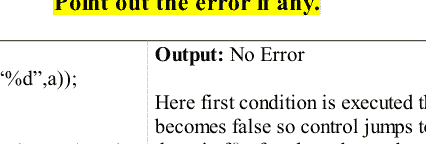

### 指出错误（如果有）。

**1.**
```c
int x = 2, y = 3;
(x == y ? printf("%d", a));
```
**输出：** 错误  
三元运算符 `? :` 必须成对使用；这里缺少 `:`。

**2.**
```c
int a = 3;
(a == 3 ? printf("Hello Matrix") : printf("Bye Matrix"));
```
**输出：** 无错误  
这里首先执行条件，它变为真，所以控制跳转到问号后的 `printf()` 并打印 “Hello Matrix”。

**3.**
```c
int a = 5, b = 10;
a = 10 && b != 10 ?
printf("come in");
printf("you can go");
```
这里三元运算符缺少 `:`。

**4.**
```c
int a = 65, b;
b = (a == 65 ? printf("you are correct"); : printf("you are wrong"));
```
**输出：** 错误  
这里第一个 `printf()` 后的 `;` 会终止语句，而它必须在 `:`（冒号）语句后终止，即在第二个 `printf()` 语句后。

**5.**
```c
int a = 10, b;
a <= 5 ? (b = 10) : (b = 15);
printf("%d %d", a, b);
```
在上述程序中首先检查条件，结果为假并执行冒号后的语句，将 `15` 赋给 `b`。然后打印 `a` 和 `b` 的值，分别为 `10` 和 `15`。该语句可以写成 `b = (a <= 5 ? 10 : 15);`。

### 浮点数

- 1. 编写程序计算三位数各位数字之和，例如 125 为 8。
- 2. 编写程序合并三个数字。例如 a = 1, b = 2, c = 8 为 128。
- 3. 编写程序打印三位数的反转。
- 4. 计算 HARISH 先生的毛薪。输入他的基本工资。他的 DA 为基本工资的 40%，HRA 为基本工资的 20%。


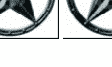

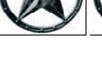

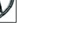


C - 程序员 Harry。


## 章
## ∞ 3 ∞
## （控制语句——条件）
## 引言——

如果程序能够决定需要执行哪些任务，那么程序会有用得多。在 C 程序中作出决定通常涉及测试一个或多个变量的值，

例如，“如果 X 大于 Y，则执行任务 1，

否则执行任务 2”。

C 程序可以使用一系列测试来满足许多不同的情况。上面给出的示例使用了 if-else 结构，这几乎是 C 程序能够执行的最简单的测试。

然而，不难想象，在作出这个决定之后，任务 1 或任务 2 也可能是一个 if-else 类型的测试，从而导致执行其他更专门的任务（可能包括更多测试）。在 C 中，可以通过按需使用任意多个嵌套 if-else 结构来实现这一点。

*switch* 结构与嵌套的 *if-else* 类似，但当必须根据变量的值选择（切换到）不同任务时，它更为合适。

- 1. 条件、选择或决策控制语句
- 2. switch case 控制语句。

## 1. 选择语句（决策控制结构）：

选择语句允许程序根据表达式的结果或变量的状态，从不同的执行路径集合中选择任意一条路径。

- 1. if
- 2. if else
- 3. 嵌套 if else
- 4. if-else-if

| (a) if 的语法 | (b) if else 的语法 |
|---|---|
| if(condition)<br>{<br>&nbsp;&nbsp;statements;<br>} | if(condition)<br>{<br>}<br>else<br>{<br>} |
| (c) 嵌套 if else 的语法 | (d) if-else-if 阶梯的语法 |
| if(condition)<br>{<br>&nbsp;&nbsp;if (condition)<br>&nbsp;&nbsp;{<br>&nbsp;&nbsp;}<br>&nbsp;&nbsp;else<br>&nbsp;&nbsp;{<br>&nbsp;&nbsp;}<br>}<br>else<br>{<br>&nbsp;&nbsp;if (condition)<br>&nbsp;&nbsp;{<br>&nbsp;&nbsp;}<br>&nbsp;&nbsp;else<br>&nbsp;&nbsp;{<br>&nbsp;&nbsp;}<br>} | if(condition1)<br>{<br>}<br>else if(condition2)<br>{<br>}<br>else if(condition3)<br>{<br>}<br>else<br>{<br>} |

## 2. Switch Case –

switch(expression)
{
    case 1:
        statement 1 sequence;
        break;
    case 2:
        statement 2 sequence;
        break;
    case 3:
        statement 3 sequence;
        break;
    --
    --
    case n:
        break;
    default :
        default statement sequence;
}

决策和 Switch Case 控制语句允许计算机决定接下来要执行哪条语句。

## 常见编程错误——

- 1. if 语句不包含 then 这个词。因此，写成下面这样是错误的：
  
  if(condition) then
  Statement;
  
- 2. 在 if 语句中，条件必须括在圆括号中。因此，写成下面这样是错误的：
  
  if condition
  statement;
  
- 3. 在 if 语句中，else 这个词后面不跟分号。因此，写成下面这样是逻辑错误。现在假语句将总是执行。
  
  if(condition)
  true statement;
  else;
  false statement;

- 4. 使用单个等号 =（用于比较）而不是双等号 ==，将被视为逻辑错误。

- 5. 在 switch 中，switch 后面的整数表达式必须括在圆括号中。因此，写成下面这样是错误的

switch i
{
       .......
       .......
}

## 一些已解决的问题——

### 1. 计算二次方程的实根

```c
#include<math.h>                 /*to use function sqrt*/

float a,b,c,d,r1,r2;
printf("enter three numbers: ");
scanf("%f %f %f",&a,&b,&c);
d=b*b-(4*a*c);
if(d<0)
        printf("roots are imaginary");
else
{
        r1=(-b+sqrt(d))/(2*a);                 /*to calculate square root */
        r2=(-b-sqrt(d))/(2*a);
        printf("The roots are %f %f",r1,r2);
}
```

### 2. 如果通过键盘输入一件商品的成本价和售价，编写程序（WAP）判断卖家是盈利还是亏损。还要确定他赚了多少利润或遭受了多少亏损。

```c
float cp,sp;
printf("Enter the cost price and the selling price of the item: ");
scanf("%f %f",&cp,&sp);
if(sp>cp)
        printf("profit  is  Rs.  %.2f",sp-cp);   /*%.2f is used to print
number up to 2 decimal places only*/
else if(cp > sp)
printf("loss is Rs %.2f",cp-sp);
else
printf("No Profit No Loss");
```

### 3. 编写程序（WAP）创建一个计算器，可以进行加法、减法、乘法、除法和取模（余数）运算。

```c
int a,b,ch;
printf("Enter two nos. ");
scanf("%d%d",&a,&b);
printf("1: Add\n2: Subtract\n3: Multiply\n4: Divide\n5: Modulus\nEnter your choice: ");
scanf("%d",&ch);
switch(ch)
{
case 1:
printf("%d\n",a+b);
break;
case 2:
printf("%d\n",a-b);
break;
case 3:
printf("%d\n",a*b);
break;
case 4:
printf("%f\n",(float)a/b);
break;
case 5:
printf("%d\n",a%b);
break;
default:
printf("Invalid Input");
}
getch();
```

## 演练提示：

我想借此机会在本课结尾提醒你。任何编程语言中都有许多命令和编程技巧，你不可能全部记住。

记住这些东西的唯一方法就是练习它们。你需要开始开发自己的小程序。从本课练习开始，然后继续做更复杂的练习。如果你不这样做，你所有的努力过一段时间就会变得毫无用处。我在编程课上总是引用这句话：

## 填空题——

- 1. 如果表达式 c=e1&&e2&&e3，那么若 e1 为假，e2 和 e3 ______ 被求值。
- 2. 逻辑运算符 == 检查两个值的 ______。
- 3. 所有字符在内部都表示为 ______。
- 4. 语句 " if(ch>= 'a' && ch<= 'z') returns ('A' + ch- 'a')" 对于给定的小写字母 'a' 到 'z' 之间的字符将返回 ______。
- 5. 在 printf 语句中，在 % 和转换字符之间可能会有 h，如果该整数要按 ______ 打印。
- 6. 数据类型 double 实际上是双精度 ______。
- 7. 运算符 *、/、% 具有 ______ 优先级。
- 8. 运算符 &、^、== 具有 ______ 优先级。
- 9. ______ 将汇编语言程序转换为机器码。
- 10. 花括号 { 和 } 用于将声明和语句组合成一个 ______ 语句。
- 11. 运算符 size of 返回数据类型的大小，单位为 ______。
- 12. 已知 a 是值为 0x6db7 的无符号整型变量，表达式
      b=a<<6;
将把 b 赋值为________
- 13. 表达式 11%3 的求值结果为 ______。
- 14. ? : 是 ______ 运算符。
- 15. 在包含 float 和 double 变量的混合数据类型 C 表达式中，结果的类型为 ______。
- 16. 一元运算符 ~ 用于对变量执行 ______。
- 17. 以下 C 表达式
    1+2*3-5
    的求值结果为 ______。

## 以下程序的输出将是什么——

| 左 | 右 |
|---|---|
| 1. int i =4;<br>switch (i)<br>{<br>        default:<br>                printf(“Matrix”);<br>        case 1:<br><br>printf(“Computer”);<br>                break;<br>        case 2:<br><br>printf(“Education”);<br>                break;<br>        case 3:<br>                printf(“Hello”);<br>}<br>**输出：** MatrixComputer<br><br>2. int i =4, j=2;<br>switch (i)<br>{<br>        case 1:<br>printf("Hello");<br>break;<br>case j:<br>    printf("Bye");<br>    break;<br>}<br>**输出：** 错误。switch 中需要常量表达式，不能使用 j。<br><br>3. int i =1;<br>switch (i)<br>{<br>    case 1:<br>        printf("Hello");<br>        break;<br>    case 1 * 2 +4:<br>        printf("Bye");<br>        break;<br>}<br>**输出：** 无错误。像 1*2+4 这样的常量表达式是可以接受的。<br><br>4. int i =4;<br>switch (i)<br>{<br>}<br>printf("Hello World");<br>**输出：** 可以出现不包含任何语句的 switch。<br><br>5. int i =1;<br>switch (i)<br>{<br>    printf("Matrix");/*common for both cases*/<br>    case 1:<br>        printf("Hello");<br>        break; | 13. int a=300,b,c;<br>if(a>=400)<br>        b=300;<br>        c=200;<br>printf(“\n%d %d”,b,c);<br>**输出：** b 包含垃圾值，且 c=200。因为 a 初始化为 300，检查条件时变为假，b 无法赋值为 300，所以 b 仍包含垃圾值；并且 if 不包含任何花括号，因此 if 的作用域仅限下一条语句，所以 c 在 if 作用域之外，将被赋值为 200。<br><br>14. int a=500,b,c;<br>if(a>=400)<br>        b=300;<br>        c=200;<br>        printf(“\n%d %d”,b,c);<br>**输出：** 300 200。因为 a 初始化为 500，检查条件时变为真，b 被赋值为 300；if 不包含任何花括号，因此 if 的作用域仅限下一条语句，所以 c 在 if 作用域之外，将被赋值为 200。<br><br>15. int x =10,y =20;<br>if(x = y);<br>    printf("\n%d %d",x,y);<br>**输出：** 10 20。<br>因为 if 包含 ;，所以可理解为<br>if(x = y)<br>{<br>;<br>}<br>printf("\n%d %d",x,y);<br>现在很清楚，if 包含空语句，执行 if 后控制到达 printf( )，打印出 x 和 y 的值，分别为 10 和 20。<br><br>16. int a = 3;<br>float b = 3.0;<br>if(a == b)<br>    printf("\n a and b are equal");<br>else<br>    printf("\n a and b are not equal");<br>**输出：** a 和 b 不相等<br>因为 a 和 b 都被赋值为 3，检查条件时条件为真，所以执行 if 的下一条语句并打印出 "a and b are not equal"。<br><br>17. int x=3,y=5; |

```
case 2:
    printf("Bye");
    break;
}
```

输出：- Hello
虽然没有错误，但第一个 printf 永远不会被执行。换句话说，switch 中的所有语句都必须属于某个 case 或其他情况。

## 6. 我们可以在 switch 语句中使用字符串吗？

输出：- 不可以，switch 只能用于整数常量或常量表达式。

## 7. 我们想要测试一个值是否位于 2 到 4 或 5 到 7 的范围内。我们可以使用 switch 做到这一点吗？

输出：- 可以，但如果范围更大，这就不太实用。

```
8. switch(a)
{
    case 2:
    case 3:
    case 4:
    /*some statements*/
    break;
    case 5:
    case 6:
    case 7:
    /*some other statements*/
    break;
}
```

break 被用来将控制权从 switch 中移出，那么能否用 continue 将控制权移回 switch 的开头？

```
if(x ==3)
    printf("\n %d",x);
else;
    printf("\n %d",y);
```

输出：-
3
5
因为 x 被初始化为 3，当条件被检查时它为真，因此会打印出 3。现在控制跳出了 if 结构，继续执行下一个打印语句，该语句打印出 y 的值，即 5。现在的问题是为什么下一个 printf() 会被执行？这是因为 else 后面的语句是 ; 而不是 printf()。这意味着 else 包含一个空语句，而下一条 printf() 在 if 结构之外。

```
18. int x = 3,y,z;
y = x =10;
z = x<10;
printf("\n x=%d y=%d z=%d");
```

输出：-
x = 10 y=10 z=0
这里首先 x 被初始化为 3，在下一个语句中 x 又被赋值为 10，这个值又被赋给 y，所以 y 的值也是 10。在下一个语句中，条件运算符(<)具有更高的优先级，因此首先检查条件，条件为假，得到值 0。所以 z 被赋值为 0。

注意：当条件为真时，结果为 1（非零）；当条件为假时，结果为 0（零）。并且

输出：- 不，continue 只能用于循环，不能用于 switch。

## 9.

```
char card = 3;
switch(card)
{
    case 1: printf("\n King");
    case 2: printf("Queen");
    default: printf("Joker");
}
printf("\nYou have lost the game:");
```

输出：- Joker
You have lost the game:

在上述程序中，case 变量是 card，其值为 3。由于没有哪个 case 常量是 3，因此没有完全匹配的情况，编译器会执行 default 后面的 printf( ) 语句，打印出 “Joker”，然后控制从 switch 块中出来，遇到一个 printf( ) 语句，打印出 “You have lost the game”。

## 10.

```
int prize = 3;
switch(prize)
{
    case '3': printf("\n Silver:"); break;
    case 3: printf("\n Gold") break;
```

反之亦然。

## 19.

```
int k=35;
printf("%d %d %d",k==35,k=50,k>40);
```

输出：-0 50 0

当执行 printf( ) 语句时，首先进行表达式和比较运算，表达式按照从右到左的顺序求解，因此先检查条件 (k>40)，因为 k=35，所以条件为假，得到 0。接着按从右到左的顺序，执行下一个 k=50，将 50 赋给 k，现在 k 与 35 比较，由于 k 是 50，不等于 35，所以结果为假，得到 0。打印顺序是从左到右。

## 20.

```
int a=97;
char b='a';
if(a==b) printf("hello matrix");
else printf("bye matrix");
```

输出：-hello matrix

这里 a 和 b 进行相等比较，但 b 包含字符 ‘a’，其 ASCII 值为 97。因此 a 和 b 相等，条件为真，于是执行 if 语句后面的语句。

## 21.

```
int x = 15;
printf("%d %d %d ",x!=15,x=20,x<30);
```

输出：-1 20 1

```
default:
    printf("\n Bronze");
}
```

这里在 printf( ) 语句中，表达式或比较首先按从右到左的顺序进行：先检查 x<30，因为 x 是 15，所以条件为真，得到 1；然后 x 被赋值为 20；接着进行 x!=15 比较，由于 x 已被赋值为 20，条件为真，得到 1。最后结果按从左到右的顺序打印。

输出：- 它总是会打印 “Gold”。这里编译器将 case 变量的值与 case 常量进行匹配，比较会发生在 3 和 '3' 之间，但匹配不成功，因为一个是整数，另一个是字符；当字符按 ASCII 值转换后，其值为 68，不等于 3。然后控制跳转到下一个 case，那将是一个完全匹配，因此会打印 “Gold”，并且由于 break 语句而跳出 switch 块。

```
11. int c =3;
switch(c)
{
    case 0:
        printf("Windows and Dos:");
    case 1+0:
        printf("Networking and security:");
    case 4/2:
        printf("Programming:");
    case 8%5:
        printf("Unix and Linux:");
}
```

输出：- Unix and Linux:
在这个程序中，编译器首先计算 case 常量的表达式，然后将 case 变量与 case 常量进行匹配

## 22. int ch = 'a'+ 'b' ;
```
switch(ch)
{
    case 'a':
    case 'b':
        printf("you have secured a");
    case 'A':
        printf("you are confused:");
    case 'b' + 'a':
        printf("you have secured both a and b:");
}
```

输出：- you have secured both a and b.

23. 在上述程序中，首先求解表达式 ch = 'a' + 'b'。因为字符常量会转换为其 ASCII 值，ch = 65 + 66 = 131，然后 switch 变量会与 case 常量匹配，由于在上述表达式中有相同的常量存在（'b'+'a' = 131），所以条件为真，并且语句 “you have secured both a and b:” 将会

常量。这里 8%5 结果为 3，将与 case 变量匹配，并打印 “Unix and Linux:”。

```
12. int k;
float j = 2.0;
switch(k = j+1)
{
    case 3:
        printf("you have
passed:");
        break;
    default:
        printf("Leave It");
}
```

输出：- you have passed:

这里编译器首先求解表达式 k = j+1，得到 k = 3。现在 k 成为 case 变量，其值与 case 常量匹配，打印出 “you have passed”，然后由于 “break” 语句跳出 switch 块。

## 指出下列程序中是否存在错误：

```
1. float a =12.25, b=5.2;
if(a = b)
printf("\n a and b becomes equal");
```

输出：- 没有错误。

在 if 语句中，a 并不是与 b 比较，而是 a 被赋值为 b，即非零值（5.2），在 if 中非零值被视为真，因此执行 if 下的 printf 语句。

```
7. int a=10,b=15;
if(a = =b)
    printf("equal");
elseif
    printf("a is max");
else
    printf("b is max");
```

输出：- 错误 - elseif 在 C 中不是单个关键字。两者必须分开，因此 else 和 if 之间需要空格。

```
2. if('A'<'a')
    printf("\n A is smaller than a");
```

输出：- 没有错误。

在 if 语句中，A（大写）与 a（小写）进行比较，我们知道字符首先被替换为其 ASCII 值，然后再进行比较。因为 A 的 ASCII 值是 65，a 的 ASCII 值是 97。

因此条件以真结果执行。

```
3. int x=10;
if(x>=2) then
    printf("Good");
```

输出：-

错误 - “then” 不能在 C 中使用。

```
4. int j =10, k =12;
if(k>=j)
{
    {
        k=j;
        j=k;
    }
}
```

输出：- 没有错误

可以使用任意数量的大括号。

```
5. int a =10, b = 15;
if(a%2 = b%5)
    printf("wonderful");
```

```
8. int ch=1;
switch(ch)
{
    case 0;
        printf("\nClub");
    case 1;
printf("\nDiamond");
}
```

输出：- 错误。

因为在 case 后面应该是冒号而不是分号。

```
9. int temp;
scanf("%d",temp);
switch(temp);
{
    case (temp<=20)
        printf("Oh! Damn Cool");
    case (temp>20 && temp<=30)
        printf("Rainy season:");
    case (temp>30 && temp<=40)
        printf("\n wish me I am on Everest:");
    default :
        printf("\n Let's Go for a Picnic:");
}
```

输出：-

错误。关系运算符不能用于 case 中。

```
10. float a = 3.5;
switch( a
```

输出：-

错误 - 需要左值。
首先求解 if 中的表达式
% 运算符的优先级高于 =
所以首先 b%5 得到 5，a%2 也得到 5。（从右到左的顺序）表达式
变为 5=5。现在进行赋值，
但我们知道不能给常量赋值。

```
6. int a,b;
printf("Enter two num:");
scanf("%d %d",a,b);
if(a>b)
    printf("a is max");
else
    printf("b is max");
```

输出：-

错误 - 在 scanf() 中需要 &（与号）。
这里编译器不会报告错误，但我们无法得到期望的结果，因为在运行时输入两个数字时，它们不会存储在 a 和 b 中，因为程序不知道 a 和 b 的地址，我们必须显式地提供它。

```
{
    case 0.5:
        printf("Hello C:");
    case 1.5:
        printf("Working in
C:");
    case 2.5:
        printf("Test your C Skill:");
    case 3.5:
        printf("Simply
C:");
}
```

输出：-

错误。浮点常量不允许用于 case。

```
11. int a = 3,b= 4,c;
c = b-a;
switch(c)
{
    case 1||2:
        printf("Hello
Matrix:");
        break;
    case a||b:
        printf("\nBye
Matrix");
        break;
}
```

输出：-

错误。case 需要常量值或常量表达式。逻辑运算符不允许用于 case。


## 实验室练习（WAP – 编写程序）

- 1. 编写程序，检查通过键盘输入的一个数字是偶数还是奇数。
- 2. 编写程序，打印两个数中的最大值。
- 3. 编写程序，打印三个数中的最大值。
- 4. 编写程序，打印四个数中的最大值。
- 5. 编写程序，打印四个数中的最大值。（简短逻辑）
- 6. 编写程序，打印三个数中的第二大值。
- 7. 编写程序，检查某一年是否为闰年。
- 8. 编写程序，在输入学生成绩后计算该学生的等级。
    百分比 >= 90：等级为‘A’
    百分比 >= 70：等级为‘B’
    百分比 >= 50：等级为‘C’
    百分比 < 50：等级为‘F’
- 9. 编写程序，计算客户的电话账单。月租为100卢比。费率如下。
    - 通话次数1至100：费率 = 0
    - 通话次数101至200：费率 = 0.80
    - 通话次数201至500：费率 = 1.00
    - 通话次数501至 --：费率 = 1.20
- 10. 编写程序，计算员工的养老金。
    如果此人是男性：
    - 年龄 >= 90：养老金为4000
    - 年龄 >= 60：养老金为6000
    - 年龄 < 60：养老金为0

    如果此人是女性：

| 年龄 | 养老金 |
|------|---------|
| >= 90 | 3000 |
| >= 60 | 5000 |
| < 60 | 0 |

- 11. 编写程序，检查一个三位数是否为魔数。（回文数）如果一个数的倒序与原来相同，则该数为魔数。
- 12. 通过键盘输入任意年份，编写程序判断该年是否为闰年。使用逻辑运算符 `&&` 和 `||`。
- 13. 通过键盘输入任意字符，编写程序判断输入的字符是大写字母、小写字母、数字还是特殊符号。
- 14. 编写程序，使用条件运算符判断通过键盘输入的年份是否为闰年。

> “他疯了吗？”
>
> “老板想让我创建一个计算机算法，将后见之明转化为先见之明。”

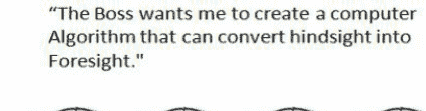


## 第4章：控制语句（循环）

### 引言

有时我们希望代码的某些部分执行多次。我们可以选择在程序中重复这段代码，或者使用循环。显然，如果我们需要将某段代码执行一百次或更多次，重复代码是不切实际的。相反，我们可以将需要重复的代码放在循环中。

```c
while(not a hundred times)
{
    code
}
```

循环会重复程序中的某一部分，直到达到指定次数或满足特定条件。**或者**换句话说，你可以说，循环是重复单个语句或一组语句的过程，直到满足终止循环的某个条件。

C 编程语言中有几种循环命令。我们将在接下来的章节中看到这些命令。

### 循环有四个部分

- 1. **初始化。**
- 2. **条件**
- 3. **语句**
- 4. **递增或递减。**

***别忘了，*** 循环是重复单个语句或一组语句的过程，直到满足终止循环的某个条件。

### 循环的类型

***入口控制循环：*** 在执行语句之前检查条件的循环。因此，如果条件一开始为假，循环将一次都不会运行。

**例如** for 循环、while 循环。

***出口控制循环：*** 在执行语句之后检查条件的循环。因此，如果条件一开始为假，循环至少会运行一次。

**例如** do while 循环。

### while 循环

C 语言有三种循环；`while` 是最简单的一种。它接受一个条件（在括号中，就像 `if` 语句一样）并进行求值。如果条件为真（非零，如前所述），则执行循环体。再次对条件求值；如果仍为真，则再次执行循环体。这一过程持续进行，直到条件最终变为假。然后执行跳转到循环之后的第一条语句。

while 循环由一个条件和一个必须在循环中运行的单个命令或命令块构成。正如我们之前所说，命令块是包含在一对左右花括号中的一系列命令。

在 while 循环中，会对条件进行求值，如果为真，则执行循环语句。在语句执行以及递增或递减之后，再次测试循环条件。这种重复执行语句、递增或递减以及测试条件的过程会持续进行，直到条件最终变为假，循环控制权转移到下一条语句。

再次提醒，如果循环体需要多条语句，则必须使用左右花括号。

它是所有循环中最简单的。该循环的使用方式如下：

```c
initialize;
while(condition)
{
    statement;
    increment or decrement;
}
```

`while` 循环是入口控制循环。会对条件进行求值，如果为真，则执行循环语句。在语句执行以及递增或递减之后，再次测试循环条件。这种重复执行语句、递增或递减以及测试条件的过程会持续进行，直到条件最终变为假，循环控制权转移到下一条语句。

### 语法

```c
initialization;
while(condition)
{
    statement;
    incrementation or decrementation;
}
```

### 自由语法

```c
while(condition)
    command;

while(condition)
{
    block of commands
}
```

循环条件是一个布尔表达式。布尔表达式是一种逻辑陈述，要么正确要么不正确。如果该逻辑陈述有效，其值为 1；如果无效，其值为 0。例如，布尔表达式 (3 > 4) 无效，因此其值为 0；而 (10 == 10) 是有效的逻辑表达式，因此其值为 1。

### 分号警告！

避免在 `while` 后面添加分号。我们已经看到，如果在 `if` 语句后面放置分号会产生问题。循环也存在类似的问题，而且更严重。对于 `if`，空操作语句可能只会执行一次。而对于循环，它可能会被无限次执行。

### 示例

```c
#include <stdio.h>
main()
{
    int i=0;
    while( i<100 )
    {
        printf("\ni=%d",i);
        i=i+1;
    }
    system("pause");
}
```

在上面的示例中，`i=i+1` 表示：将 1 加到 `i`，然后将其赋值给 `i`，或者简单地说，增加它的值。正如我们之前看到的，C 编程语言中有一个特殊的运算符可以做同样的事情。我们可以使用表达式 `i++` 来代替 `i=i+1`。

### 类型转换

有时你需要将某个值或变量的类型转换为另一种类型，以便将其赋给另一种类型的变量。这种转换在不同情况下可能很有用，例如当你想将变量类型转换为与具有不同类型参数的函数兼容时。

为此，C 编程语言实现了一些规则。在某些情况下会发生自动类型转换。`char` 会自动转换为 `int`。`unsigned int` 会自动转换为 `int`。

如果表达式中有两种不同的类型，那么两者都将转换为更好的类型。在赋值语句中，计算的最终结果将转换为保存计算结果的变量的类型（例如，赋值语句 `count=i+1;` 中的变量“count”）。

例如，如果你将一个 `int` 类型和一个 `float` 类型的值相加，并将其赋给一个 `double` 类型变量，结果将是 `double` 类型。

### 在示例中使用循环

**编写一个程序** – 接受一个人的分数，计算它们的总和及平均值，并打印出来。

```c
#include <stdio.h>
#include <conio.h>
main()
{
    int count=0;
    float num=0,sum=0,avg=0;
    printf("Enter score (-1 to stop): ");
    scanf("%f",&num);
    while(num>=0)
    {
        sum=sum+num;
        count++;
        printf("Enter score (-1 to stop): ");
        scanf("%f",&num);
    }
    avg=sum/count;
    printf("\nAverage=%f",avg);
    printf("\nSum=%f\n",sum);
    system("pause");
}
```

在此示例中，我们获取第一个数字，然后进入循环。我们将一直停留在循环内，直到用户输入一个小于 0 的值。如果用户输入的值小于 0，我们将其解释为停止接收分数。

以下是一次示例运行的输出结果：

```text
Enter score (-1 to stop): 12
Enter score (-1 to stop): 14
```


输入分数（-1 停止）：-1

平均=13.000000

总和=26.000000

## 练习笔记
再次提醒你，关于更多根据章节主题的编程示例，请阅读本书的最后一章，在那里我提到了超过 200 个 C 程序供你练习。

当用户输入 -1 作为 num 的值时，循环条件内部的逻辑表达式变为假（无效），因为 num>=0 不是一个有效语句。只要记住，“while 循环”会一直运行，直到其括号内的逻辑条件变为假（在这种情况下它会终止）。

打印序列 1, 2, 3, 4, 5,..............N

```
int i,n;

    printf("Enter the value of N ");
    scanf("%d",&n);
    i=1;
    while(i<=n)
    {
        printf("%d,",i);
        i++;
    }
    printf("\b ");        /*to remove the comma (,) printed at the last */
```

## do while 循环
C 中的 do while 循环是 while 循环的“倒置”版本。while 是条件后跟循环体，而 do while 是循环体后跟条件。

这意味着循环体必须在到达条件之前执行。因此循环体保证至少执行一次。如果条件为假，则循环体永远不会再次执行。

它是一个出口控制循环。循环的使用方式如下：

```
initialize;
do
{
    statement;
    increment or decrement;
}
while(condition);
```

这里在执行语句和增减之后才测试条件。因此在这种类型的循环中，程序首先评估循环体，然后再测试条件。因此即使条件一开始为假，语句也至少会执行一次。它是一个出口控制循环。

```
int j = 5;
printf("start\n");
do
printf("j = %i\n", j--);
while(j > 0);
printf("stop\n");
```

### 输出
start
j = 5
j = 4
j = 3
j = 2
j = 1
stop

例如

### 编写程序打印序列 1, 2, 3, 4, 5,............N
```
int i,n;
printf("Enter the value of N ");
scanf("%d",&n);
i=1;
do
{
printf("%d,",i);
i++;
} while(i<=n);
printf("\b ");      /*to remove the comma (,) printed at the last */
```

### 练习笔记
最重要的一点，do while 保证至少执行一次。

## for 循环
正如我之前所说，C 语言中有许多种循环。
我们将在本节学习 for 循环。

“For 循环”与 while 循环类似但更复杂。“For 循环”由一个控制语句构成，该语句决定循环运行的次数以及一个命令部分。命令部分可以是单个命令或一组命令。

### 练习笔记
记住 for 循环将循环的基本要素封装到一个语句中。更多示例请参阅本书最后一章

for 循环也是一种入口控制循环，它提供了一种更简洁的循环控制结构。循环的使用方式如下：

```
for (initialize; condition; increment or decrement)
{
    statement;
}
```

初始化部分在“for 循环”开始时只执行一次。我们可以在此处初始化循环变量。

测试条件是循环中最重要的一部分。如果此条件有效（真），循环将继续运行。如果条件变为无效（假），则循环将终止。

每次命令部分都会在每个循环周期中执行。我们使用这部分来达到终止循环的最终条件。

例如，我们可以增加或减少循环变量的值，使得在指定次数的循环后，循环条件变为无效，“for 循环”可以终止。

在此步骤中，我们用 for 循环重写示例 3-1。只需注意，我们不再需要 I=I+1 来增加循环变量。它现在包含在“for 循环”条件短语 (i++) 内部。

### 示例
```
#include<stdio.h>
#include<conio.h>
    main()
    {
    int i=0;
    for(i=0;i<100;i++ )
    printf("i=%d",i);
    system("pause");
    }
```

### 练习笔记
Stdio.h – 标准输入输出。

### 练习笔记
Conio.h – 控制台输入输出。

### 练习笔记
本质上你需要记住的只是必须分隔构造的三个部分的那两个分号字符。

### 示例
编写一个程序，获取一周各天的温度并计算该周的平均温度。

```
#include<stdio.h>
#include<conio.h>

main()
{
int count=0;
float num,sum,avg=0;
for(count=0;count<7;count++)
{
printf("Enter temperature : ");
scanf("%f",&num);
sum=sum+num;
}
avg=sum/7;
printf("\nAverage=%f\n",avg);
system("pause");
}
```

### 示例
下面的示例将打印乘法表（从 1*1 到 9*9）。运行程序并查看结果。

```
#include<stdio.h>

main()
{
int i,j;
for(i=1;i<10;i++)
{
for(j=1;j<10;j++)
{
printf("%3d *%d=",i,j);
printf("%3d\n",i*j);
}
}
system("pause");
}
```

### for 与 while 比较
构造：

```
For (initial-part; while-condition; update-part)
Body
```

等价于：

```
Initial-part;
While (while-condition)
{
Body;
Update-part;
}
```

这里，初始化首先工作，然后评估条件，如果条件为真，则首先执行语句，然后对变量进行增减，条件再次被测试，过程继续进行直到循环条件变为假。

初始化使用某些赋值运算符进行。如果要初始化多个变量，则赋值之间用逗号分隔。

在写完所有赋值后，使用分号将它们与条件分隔开。如果有多个条件，则它们之间用逻辑与（&&）或逻辑或（||）分隔。

在给出所有条件后，在给出增减之前使用分号。

如果循环体中有多个语句，则使用括号是强制性的。

for 循环的一个独特之处在于，如果不需要，可以省略一个或多个部分。然而分隔循环不同部分的那些分号是必要的。

也可以使用空语句设置延迟循环：for(i=100;i>0;i--);
在这个循环中没有语句，因此首先变量 i 被初始化为 100，条件被测试，然后进行递减，再次测试条件，i 再次递减，并重复直到条件变为假。

for 循环的另一个独特特性是嵌套，即将一个循环作为另一个循环的语句放置。在 ANSI C 中，嵌套允许最多 15 层，然而某些编译器允许更多。

## 跳转语句（新主题）
循环执行一组语句，直到条件变为假。循环重复的次数是预先决定的，并且设置了一个条件。但有时有必要跳过循环的某些部分或在特定条件为真时终止循环，此时跳转语句就发挥作用：

### C 支持四种跳转语句：
- i. break.
- ii. continue.
- iii. goto.
- iv. return.

### break
break 语句用于循环内部，直接退出循环。我们已经在 switch 语句中使用过 break。它用于跳过循环的进一步执行并将程序控制转移到循环之后的语句。

### continue
有时在特定条件为真时，有必要跳过语句的执行。continue 不会终止循环，而是直接跳转到下一次迭代。在 for 循环中，continue 将控制权带到下一个增减，但在 while 或 do while 循环中，continue 导致循环控制直接跳转到条件。

### goto
它也用于从程序的一个部分跳转到另一部分或退出深层嵌套循环。但使用 goto 不是一个好的做法，因为它使逻辑复杂化，长程序难以阅读。

### return
用于在函数中返回值并从被调用函数定义跳转到调用函数定义。


## exit() -
它不是一个跳转语句。它用于终止程序或直接退出程序，而不执行后续的中间语句。它是包含在 stdlib.h 和 process.h 中的库函数。exit 的用法为：exit( )

*Drill Note -* break、goto、continue、return 都是关键字。

## 让我们详细讨论这些 -
### Break 语句-
看起来很奇怪，C 语言有一个构造可以故意创建无限循环。这样的循环似乎应该不惜一切代价避免！

尽管如此，在 C 中可以通过跳出它们来让无限循环发挥作用。任何循环，无论条件如何，都可以使用 C 关键字 break 跳出。我们之前见过下面的循环：

```
printf("enter an integer: ");
while(scanf("%i", &j) != 1) {
while((ch = getchar()) != '\n')
;
printf("enter an integer: ");
```

### break 其实就是 Goto!
它并不一定能很好地解决这个问题，因为现在它使用了相当于 goto 语句的东西！goto 是现代编程的祸害，由于其密切关系，一些公司禁止使用 break。如果必须使用，也应适度使用，过度使用可能会导致 spaghetti

### break、switch 和循环-
这正是 switch 语句中使用的同一个 break 关键字。如果在循环内的 switch 中放置 break，break 会强制退出 switch 而不是循环。无法改变这一点

### continue
"continue" 语句

**Drill Note –** Continue 语句可用于循环。像 break 命令一样，"continue" 会改变程序的流程。它并不会终止循环。然而，它只是跳过当前循环迭代的剩余部分并返回到循环的起点。

### 示例 -
```
#include<stdio.h>
main()
{
while((ch=getchar())!='\n')
{
if(ch=='.')
continue;
putchar(ch);
}
system("pause");
}
```

在上面的示例中，程序接受所有输入但省略其中的 '.' 字符。文本会在你输入时回显，但在按下回车键（相当于插入 "\n" 字符）后才会打印主要输出。正如我们之前所说，这是因为 getchar() 函数是一个缓冲输入函数。

而 break 会强制立即退出最近的封闭循环，continue 关键字则会导致循环的下一次迭代。

对于 while 和 do while 循环，它直接跳到条件并重新评估它。对于 for 循环，它跳到循环的更新部分，执行该部分，然后重新评估条件。

### continue 其实就是 Goto-
适用于 break 使用的语句同样适用于 continue。它只是 goto 的另一种形式，应谨慎使用。

过度使用 continue 可能会导致意大利面条式代码而不是代码。事实上，上面的循环同样可以很容易地写成：

```
for(j = 1; j <= 10; j++)
if(j % 3 != 0)
printf("%i\n", j);
```

### continue、switch 和循环 -
虽然 break 对 switch 语句有影响，但 continue 没有这种影响。因此，放在循环内 switch 中的 continue 会影响循环。

### Drill Note –
- if (then) else - 注意分号
- switch 可以测试整数值
- while、do while、for - 再注意分号

### 回答以下问题 -
| 1. for 循环的三个部分是：a. 第 i __________ 表达式 b. 第 c __________ 表达式 c. 第 i __________ 表达式 2. break 语句用于退出：a. 一个 if 语句。b. 一个 for 循环 c. 一个程序 d. main() 函数 3. 当我们希望循环内的语句必须执行时，do-while 循环很有用：a. 仅一次 b. 至少一次 c. 多次 d. 以上都不是。 4. 在 do-while 循环中，初始化、条件、执行按什么顺序进行 - a. 初始化、测试、执行。b. 初始化、执行、测试 c. 测试、执行、初始化 | 5. 以下哪个语句用于将控制权带到循环的开头— a. exit b. break c. continue d. 以上都不是。 6. int i=1; for( ; i++ ; ) printf("%d", i); 7. int a=5; do { printf("%d\n",a); a = -1; } while(a >0); 8. 执行以下程序后 sum 的值是多少： int sum, index; sum=1; index=9; do { index=index-1; sum=sum*2; } while(index>9); |

```
int i=1;
for( ; i++ ; )
    printf("%d", i);
```

```
int a=5;
do
{
    printf("%d\n",a);
    a = -1;
} while(a >0);
```

```
int sum, index;
sum=1;
index=9;
do
{
    index=index-1;
```

```
sum=sum*2;
} while(index>9);
```

### 答案 —
1. 初始化,条件,增量    2. b    3. b    4. b    5. C
6. 1,2,3...32767, -32768,...无限循环    7. 5    8. 2

## 一些已解决的程序 -
### 1. 从 N 到 1 按逆序打印数字
N...........5, 4, 3, 2, 1

```
int i,n;
printf("Enter the value of N ");
scanf("%d",&n);
for(i=n;i>=1;i--)
printf("%d,",i);
printf("\b ");    /*To remove the comma (,) printed at the last */
```

### 2. 打印斐波那契数列 1, 1, 2, 3, 5, 8, 13,.................N
```
int prev,next,cnt,sum,n;
printf("Enter the value of N ");
scanf("%d",&n);
prev=0;
next=cnt=1;
while(cnt<=n)
{
    printf("%d,",next);
    sum = prev + next;
    prev = next;
    next = sum;
cnt++;
}
printf("\b ");
```

### 3. 打印数字 N 的阶乘
```
int n,i;
long int fact;
clrscr();
printf("Enter the number to get Factorial: ");
scanf("%d",&n);
for(i=n,fact=1;i>=1;i--)
fact = fact * i;
printf("Fact is %ld", fact);
```

### 4. /*编写程序打印以下内容
```
1
12
123
1234
12345                 up to N rows*/
int n,i,j;
clrscr();
printf("Enter the number of Rows: ");
scanf("%d",&n);
for(i=1;i<=n;i++)
{
for(j=1;j<=i;j++)
printf("%d",j);
printf("\n");
}
```

### 5. 编写程序检查给定的数字序列是否按升序排列。序列的哨兵值为 -1。
```
enum {false,true};
int prev,n,flag=true,i;
printf("Enter number 1 ");
scanf("%d",&n);
prev = n;
i=2;
```
```
while(n != -1)
{
    printf("Enter number %d ",i++);
    scanf("%d",&n);
    if(n < prev && n != -1)
        flag=false;
    prev=n;
}
if(flag == false)
    printf("Not in ascending order");
else
    printf("In ascending order");
```

### 6. 打印 9+99+999+............ n 项的和。
```
long int term,sum=0;
int n,cnt;
clrscr();
printf("Enter the value of n");
scanf("%d",&n);
for(cnt=1,term=9;cnt<=n;cnt++)
{
printf("%ld\n",term);
sum+=term;            /*adding the term to sum using assignment operator*/
term=(term*10) + 9;
}
printf("%ld",sum);
```

### 7.
/*帕斯卡三角形
1
11
121
1331
14641 */
```
main()
{
int i,j,n,b; /*b=preceding no*/
printf("enter the number of rows: ");
scanf("%d",&n);
for(i=0;i<n;i++)
{
    b=1;
    for(j=0;j<=i;j++)
    {
        if(i==0||j==0)
        printf("%3d",b);            /* %3d is used for providing each
        number a space of 3 characters */
        else
        {
            b=b*(i-j+1)/j;
            printf("%3d",b);
        }
    }
    printf("\n");
    }
```

### 8. 将十进制数转换为其二进制等价物
```
main()
{
    int n,i,a,r;
    printf("enter the no.: ");
    scanf("%d",&n);
    for(i=15;i>=0;i--)
    {
        a=1<<i;
        r=n&a;
        if(r==0)
            printf("0");
        else
            printf("1");
    }
}
```

### 9. 编写程序计算给定数字的自然对数
```
#include<math.h>
main()
{
    int x, i;
    float result=0;
printf("\nEnter the value of x:");
scanf("%d",&x);
for(i=1;i<=7;i++)
{
    if(i==1)
        result=result+pow((x-1.0)/x,i);
    else
        result=result+(1.0/2)*pow((x-1.0)/x,i);
}
printf("Log(%d) = %f",x,result);
}
```

## 一些已解决的程序 –
### 1. 检查一个数字是否为质数*/
```
enum bool {false,true};
int i,n;
enum bool FLAG=true;
clrscr();
printf("Enter a number: ");
scanf("%d",&n);
for(i=2;i<=n/2;i++)
{
    if(n%i==0)
    {
        FLAG=false;
        break;
    }
}
if(FLAG==true)
    printf("Prime number");
else
    printf("Not Prime Number");
```

2. 编写程序生成 n 个随机数。


```
#include <stdlib.h>
int a,i,n;
randomize(); /*initializes the random number generator*/
printf("enter the no. to be printed :");
scanf("%d",&n);
i=1;
while(i<=n)
{
    a=random(100)+1; /*generates a number between 0 and 99*/
    printf("%d\n",a);
    i++;
}
```

## 3. 编写程序生成以下输出：

```
a b c d e f g f e d c b a
a b c d e f   f e d c b a
a b c d e   e d c b a
a b c d   d c b a
a b c   c b a
a b   b a
a
```

```
int n,i,j,k,l;
printf("Enter the number of Rows :");
scanf("%d",&n);
for(i=n;i>=1;i--)
{
    for(j=1;j<=i;j++)
        printf("%c",j+97-1);
    for(k=1;k<=2*(n-i)-1;k++)
        printf(" ");
    for(l=i;l>=1;l--)
    {
        if(l==n)
            continue; /*passes the control of the loop directly to the decrement statement*/
        printf("%c",l+97-1);
    }
    printf("\n");
}
```

## 练习说明——

在注释中，你可以随意写任何内容，无论它是大写、小写还是特殊字符，都可以自由书写。

## 4. 编写程序打印用户输入的字符总数。输入以回车键结束。

```
char ch;
int i=0;
printf("Enter a sentence: ");
while((ch=getche())!='\r')      /*getche() is an input function */
{
    i++;
}
printf("\n%d",i);
```

## 5. 编写程序反转一个数字并求其八进制等价值。

```
#include<math.h>
main()
{
    int n, rev, a, oct, cnt;
    printf("\nEnter a number");
    scanf("%d",&n);               /*reverse the number*/
    rev=0;
    while(n>0)
    {
        a=n%10;
        rev=rev*10+a;
        n=n/10;
    }
    n=rev;
    cnt=oct=0;
    /*converting to octal*/
    while(n>0)
    {
        a=n%8;
        n=n/8;
        oct=oct+a*pow(10,cnt);
        cnt++;
    }
    printf("The octal equivalent of %d is %d",rev,oct);
}
```

## 练习说明——

再次提醒你，若想获得更多与章节主题相关的编程示例，请阅读本书最后一章，我在那里提到了 200 多个 C 程序供你练习。

## 奇怪的循环——

| 左侧 | 右侧 |
|---|---|
| 1. `for(i=1;i<=5;i--) printf("%d",i);`<br>输出：- 1,0,-1,-2...... | 12. `for(i=1;i<=5;) printf("%d",i++);`<br>输出：- 1,2,3,4,5 |
| 2. `for(i=1;i<=5;++i) printf("%d",i);`<br>输出：- 1,2,3,4,5 | 13. `for(i=1;5;i++) printf("%d",i);`<br>输出：- 1,2,3,4,5........... |
| 3. `for(i=1;++i<=5;) printf("%d",i);`<br>输出：- 2,3,4,5 | 14. `for(i=1;i<=5;i++); printf("%d",i);`<br>输出：- 6<br>由于增量表达式后存在分号，该循环没有任何语句。这样的循环称为空循环。 |
| 4. `for(i=1;i++<=5;) printf("%d",i);`<br>输出：- 2,3,4,5,6 | 15. `int i=1; for(i<=5;i++) printf("%d",i);`<br>输出：- 1,2,3,4,5 |
| 5. `for(i=1;i<=5;printf("%d",i++));`<br>输出：- 1,2,3,4,5 | 16. `int i=1; while() { printf("%d",i); i++; }`<br>输出：- 错误，因为缺少条件，而 while 循环中不允许这样。 |
| 6. `for(i=1;i<=5;printf("%d",++i));`<br>输出：- 2,3,4,5,6 | 17. `int i=1; while(i<=5) printf("%d",i++);`<br>输出：- 1,2,3,4,5 |
| 7. `for(i=1;i=5;i++) printf("%d",i);`<br>输出：- 5,5,5,5...... | 18. `for(i=1;i<4;i++) printf("%d",(i%2)? i:2*i);`<br>输出：- 1,4,3,8,5 |
| 8. `for(i=1;i=0;i++) printf("%d",i);`<br>输出：- 条件将被视为假，因为条件位置处是赋值 0。 |  |
| 9. `for( ; ;)`<br>输出：- 将生成空白屏幕。 |  |
| 10. `for(i=1;i++<=5;i++) printf("%d",--i);`<br>输出：- 1,2,3,4,5 |  |
| 11. `for(i=1;i==5;i++) printf("%d",i);`<br>输出：- 不会生成输出，因为条件检查 i 的值是否为 5，而一开始这是假的。 |  |

## 常见编程错误——

- 1. while 语句不包含 do 这个词。因此，这样写不合逻辑：

    ```
    while(condition) do
    {
        statement;
    }
    ```

- 2. break 和 continue 语句只影响最内层循环，例如：

    ```
    for(............)      /*loop 1*/
    {
    for(............)      /*loop2*/
    {
        ...............
        ...............
        break;
        ...............
        ...............
    }
    ...............
    }
    ```

break 语句会导致退出循环 2，但不会退出循环 1。

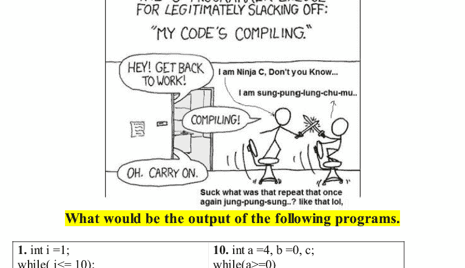

## 以下程序的输出会是什么。

- 1.

    ```
    int i=1;
    while(i<=10);
    {
        printf("%d",i);
        i++;
    }
    ```

    输出：- 无输出，因为这是一个无限循环。

    在上面的程序中，while 之后遇到一个“;”，因此编译器将其理解为以下形式：

    ```
    while(i<=10)
    {
        ;
    }
    ```

    显然，循环体中没有递增，只有空语句，因此条件仍然为真，导致无限循环；并且由于空语句，不会生成输出。

- 2.

    ```
    char ch;
    while(ch=0;ch<=255;ch++)
        printf("%d %c",ch,ch);
    ```

    输出：- 错误。
    在上面的程序中，“while”循环被用在“for”的位置，这会导致错误，因为语法不同。

- 3.

    ```
    int a=4;
    while( a =1)
    {
        a = a-1;
        printf("%d",a);
        --a;
    }
    ```

    输出：- 无输出
    因为第一次条件就为假，控制立即从循环体退出，不执行任何内容。

- 4.

    ```
    int a=4,b,c;
    b = --a;
    c = a--;
    printf("%d %d %d",a,b,c);
    ```

    输出：- 2 3 3

    在上面的程序中 a = 4。现在我们理解前置和后置递增/递减。

    `b = --a` [(1) a = a-1 [(a=3)]; (2) b=a [(b=3)]]；即在前缀递减中，先递减再赋值。

    `c=a--` [(1) c = a [c = 3]; (2) a = a-1 [a = 2]]；即在后缀递减中，先赋值再递减。因此最终 a = 2、b = 3、c = 3，并通过 `printf()` 打印出来。

- 5.

    ```
    int a=4,b=3,c;
    c = a-- - b;
    printf("%d%d%d",a,b,c);
    ```

    输出：- 3 3 1

    这里首先 a = 4；在表达式 `c = a-- - b;` 中，a 使用了后缀递减运算符，意味着先在表达式中使用 a，然后再递减，即 (1) c = a-b; [c = 4-3] [c = 1] (2) a = a-1; [a = 4-1] [ ]，而 b 仍然不变，因此最终 a = 3、b = 3、c = 1，并通过 `printf()` 打印出来。

- 6.

    ```
    while('a'<'b')
        printf("malayalam is a palindrome");
    ```

    输出：- “malayalam is a palindrome”被无限打印。
    因为条件 ‘a’<’b’ 永远不会变为假，每次都会执行循环体，打印上述消息“malayalam is a palindrome”。

- 7.

    ```
    int i;
    ```

- 10.

    ```
    int a=4, b=0, c;
    while(a>=0)
    {
        a--;
        b++;
        if (a == b)
            continue;
        else
            printf("%d %d",a,b);
    }
    ```

    输出：- 3 1
    1 3
    0 4
    -1 5

    在上面的程序中，首先 a = 4、b = 0；检查条件时它为真，控制执行循环体；a 减 1，b 加 1，因此 a = 3、b = 1。现在再次检查条件；a == b 为假，控制跳到 else 块并打印 a 和 b 的值，分别为 3 和 1。现在当控制到达循环末尾时，它再次跳到条件处；条件仍为真，循环体再次执行，得到 a = 2、b = 2。检查条件 a == b 时它为真，使用“continue”语句继续循环，控制跳到循环条件处，该条件为真，因为 a = 2 大于 0。循环体再次执行，a = 1、b = 3，并打印出来，因为 if 中的条件为假；从循环末尾控制跳到条件处，条件为真，a = 0、b = 4，二者不相等，因此打印出来。重复检查条件时它为真，执行得到 a = -1、b = 5，二者不相等，并通过 else 块打印；而这一次检查条件时它变为假，因为 a = -1 不大于或等于 0，于是跳出循环。

- 11.

    ```
    int a = 4, b =0,c;
    while(a>=0)
    {
        if(a = b)
            break;
        else
            printf("%d",a,b);
        a--;
        b++;
    }
    ```

    这里 a = 4、b = 0；检查循环条件时它为真，然后控制跳到 else 块，因为 a != b，并打印 a 和 b 的值，分别为 4 和 0。然后 a 减 1，b 加 1，因此 a = 3、b = 1。再次检查循环条件时它为真，控制执行循环体，并从 else 块打印 a 和 b 的值 3 和 1，因为条件为假；现在 a = 2、b = 2，循环条件再次为真，当比较 a = b 为真时，控制执行 if 块，并因“break”语句跳出循环。

- 12.

    ```
    int i;
    for(i=1;i<=5;printf("%u%d",i)); i++;
    ```

    输出：- 1 1 将被无限次打印。
    这里循环后使用了“;”，意味着循环包含 NULL 语句，并且由于没有使用花括号，i++ 不在循环体中。首先 i 被初始化为 1，检查条件时它为真，并打印 i，即 1；现在不会发生递增，每当检查条件时它总是为真，并无限打印 1。

- 13.

    ```
    int i =1,j =1;
    ```


```
while (i = 15)
{
    printf("\n%d", i);
    i++;
}
```

输出：无限打印 15。

因为在语句 `while(i = 15)` 中，`i` 并没有与 15 进行比较。这里 `i` 被赋值为 15，这是一个非零值，所以每次检查条件时 `i` 都会变成 15，条件为真并执行循环体，循环体首先打印 `i` 的值，即 15，然后自增 1，`i` 变成 16。但再次遇到条件检查时，`i` 又会变成 15，并再次以相同的方式执行循环体，这导致 15 被无限打印。

```
8. float a = 1.1;
while (a == 1.1)
{
    printf("\n%f", a);
    a = a - 0.1;
}
```

输出：无输出。

因为在条件中将浮点变量与双精度值进行比较，控制流跳出循环。

**练习笔记：** 每当我们使用浮点常量时，它被视为双精度类型值。

```
for ( ; ; )
{
    if (i > 5)
        break;
    else
        j += i;
    printf("%d\t", j);
    i += j;
}
```

输出：2  5

在此程序中，最初 `i = 1` 且 `j = 1`。当 `for` 循环中没有条件时，默认假设为真并执行循环体，当执行 `i > 5` 时，由于条件为假，控制跳转到 `else` 块，然后 `j += i` [`j = j + i`] 得到 `j = 2`，然后通过 `printf()` 打印 `j`。现在下一条语句 `i += j` 得到 `i = 3`，从循环的结束大括号控制跳转回循环并检查条件，该条件因缺失而为真，再次检查 `i > 5`，此时为假，控制执行 `else` 块，导致 `j = 5`（3 + 2）并被打印。现在 `i` 将为 8，下一次检查 `i > 5` 条件时将为真，由于 “break” 语句控制跳出循环。

## 实验练习

打印以下数列的前 n 项。

- 1. 1, 3, 5, 7, 9, ........
- 2. 2, 4, 6, 8, 10, ........
- 3. 1, 4, 9, 16, 25, .......
- 4. 1, 8, 27, 64, 125, .....
- 5. 1, -1, 1, -1, 1, .....
- 6. 1, 1, 2, 4, 7, 13, 24, ... (Lucas series)
- 7. 1 + x^2/2! + x^3/3! + x^4/4! + x^5/5! .......... (e^x)
- 8. x - x^3/3! + x^5/5! - x^7/7! + x^9/9! .......... (sin x)
- 9. 1 - x^2/2! + x^4/4! - x^6/6! + x^8/8! .......... (cos x)
- 10. x - x^2/2 + x^3/3 - x^4/4 + x^5/5 ............... (log(1+x))
- 11. 编写程序打印 n 的表格。
- 12. 编写程序计算 n 的阶乘。
- 13. 编写程序计算数字 n 的 p 次幂。


### 编写程序打印以下内容

| 左 | 右 |
|---|---|
| 16. | 25. |
| 1<br>21<br>321<br>4321<br>54321 | 1<br>121<br>12321<br>1234321<br>123454321 |
| 17. | 26. |
| 12345<br>1234<br>123<br>12<br>1 | 123454321<br>1234321<br>12321<br>121<br>1 |
| 18. | 27. |
| 54321<br>4321<br>321<br>21<br>1 | *<br>***<br>*****<br>*******<br>*****<br>***<br>* |
| 19. | 28. |
| 1<br>22<br>333<br>4444<br>55555 | **********<br>*&nbsp;&nbsp;&nbsp;*<br>*&nbsp;&nbsp;&nbsp;*<br>********** |
| 20. | 29. |
| *<br>**<br>***<br>****<br>***** | 4<br>434<br>43234 |

- 21.
  ```
  1
  123
  12345
  1234567
  123456789
  ```

- 22.
  ```
  987654321
  7654321
  54321
  321
  1
  ```

- 23.
  ```
  1
  12
  123
  1234
  12345
  ```

- 24.
  ```
  4321234
  43234
  434
  4
  ```

- 30.
  ```
  1
  232
  34543
  4567654
  567898765
  67890109876
  ```

- 31.
  ```
  a
  aba
  abcba
  abcdcba
  abcdedcba
  ```

- 32. 编写程序求从输入读取的值的平均值。输入中的值序列以 -1 终止。
- 33. 编写程序求 n 个数字序列的最大值、第二最大值、最大值的位置和第二最大值的位置。
- 34. 编写程序使用 while 循环打印所有 ASCII 值及其等效字符。ASCII 值范围为 0 到 255。
- 35. 编写程序打印 1 到 500 之间的所有阿姆斯特朗数。如果一个数的各位数字的立方和等于该数本身，则该数称为阿姆斯特朗数。例如，153 = (1*1*1) + (5*5*5) + (3*3*3)。如果数字是两位数，则我们对数字进行平方。
- 36. 编写程序打印 1 到 300 之间的所有质数。
- 37. 编写程序用笑脸填充整个屏幕。笑脸的 ASCII 值为 1。
- 38. 编写程序使用 for 循环求以下数列的前七项之和：
  1/1! + 2/2! + 3/3! + ......
- 39. 编写程序使用 for 循环生成 1、2 和 3 的所有组合。
- 40. 根据一项研究，人的智力水平近似可通过以下公式计算：i = 2 + (y + 0.5x)。编写程序，将生成 i、y 和 x 的值表，其中 y 从 1 变到 6，对于每个 y 值，x 从 5.5 变到 12.5，步长为 0.5。
- 41. 编写程序打印两个给定数之间的所有质数。
- 42. 编写程序计算给定数字的位数。
- 43. 编写程序打印给定数字所有数字之和。
- 44. 编写程序检查给定数字是否为回文。
- 45. 编写程序从用户输入的文本中统计所有元音、辅音、数字、空格、特殊符号，文本以回车键终止。
- 46. 编写程序求前 n 个质数之和。
- 47. 编写程序判断给定值序列中的指定值是否为质数。值序列从输入读取，以 0 终止。
- 48. 打印以下数列之和：1 x 2 + 2 x 3 + 3 x 4 + 4 x 5 + ...... + (n-1) x n。
- 49. 打印以下数列之和：1 + 1/2 + 1/3 + 1/4 + ...... + 1/n。
- 50. e^x = 1 - x + x^2/2! - x^3/3! + x^4/4! + ......
- 51. 编写程序读取 n 个数字并统计偶数和奇数。
- 52. 编写程序计算任意半径 r 的球体的体积 (4/3 π r^3) 和表面积 (4 π r^2)。
- 53. 编写程序计算边长为 a、b 和 c 的三角形的周长 p 和面积 a，其中
  p = a + b + c
  a = sqrt(s(s-a)(s-b)(s-c))
  且 2s = a + b + c
- 54. 编写程序读取正整数并确定并打印其二进制等价形式。
- 55. 编写程序打印 n 个数字之和、前 n 个偶数平方和以及前 n 个奇数立方和。
- 56. 编写程序计算 n 名员工的净工资。净工资为基本工资 + 津贴 + 房租补贴 + 城市补贴 - 公积金（津贴为基本工资的 39%，房租补贴为基本工资的 15%，若基本工资小于或等于 Rs. 8000/-，高于 Rs. 8000 为基本工资的 30%，城市补贴固定为 Rs. 800，公积金扣除为 Rs. 600）。
- 57. 编写程序计算 10 名员工的加班费。加班费按每小时 Rs. 12.00 计算，超出 40 小时的工作时间。假设员工不工作小时的分数部分。
- 58. 购买某些商品时，若购买数量超过 1000，则提供 10% 的折扣。如果通过键盘输入数量和单价，编写程序计算总费用。
- 59. 编写程序检查给定值序列是否按递增顺序排序。序列的哨兵值为 -1。
- 60. 编写程序求给定 n 个值序列中位置可被 3 整除的值之和与平均值。
- 61. 编写程序输入 n 名学生的成绩并统计获得 a、b、c、d 和 f 等级的学生人数。等级根据以下规则授予。

  | 成绩 | 等级 |
  |---|---|
  | >= 80 | A |
  | >= 70 | B |
  | >= 60 | C |
  | >= 50 | D |
  | < 50 | F |

哥伦比亚互联网技术支持。
格雷格为您服务，请说明您的问题性质。

我的电脑坏了。
我要求你修好它。
现在。

呃，我们只支持互联网问题，先生。

好吧，我的电脑连接互联网而且坏了。
修好它，你这个白痴！

是的，先生，没必要生气。

这样好多了。那我该怎么做？

Type 'Format C:'
这应该能解决所有问题。

## 第 5 章（一维数组）

数组是一组相似的数据项或元素。或者我们可以说数组是在单个名称下连续存储的同质数据元素的集合。

```
int i, a;
for (i = 1; i <= 5; i++)
{
    printf("Enter the no.");
    scanf("%d", &a);
}
```

在上述程序中，一旦新值被赋给变量 a，旧值就会丢失。

因此，到目前为止我们使用过的所有变量都不能同时保存一个以上的值。但有时我们希望为一个变量存储多个值。例如，如果我们希望将 10 名学生的成绩按升序排列。

有两种方法可以做到：

- (i) 使用 10 个不同的变量，使每个变量可以存储

单个学生的成绩。

(ii) 使用一个可以存储所有学生成绩的变量。

显然第二个选项更好，因为它们更容易处理。一次可以存储一个以上值的单个变量称为数组。

### 练习笔记

它是在单个名称下连续存储的同质数据元素的集合。

数组声明:-

```c
int a[6];
```

这里 a 是数组的名称，int 是数组将存储的值的数据类型，6 是数组的大小，[] 称为下标运算符。数组的大小必须是常量。最重要的是数组中的所有值都应为相同类型。

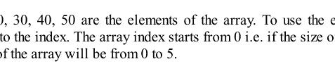

10、20、30、40、50 是数组的元素。要使用数组的元素，我们引用索引。数组索引从 0 开始，即如果数组大小为 6，则数组的索引将从 0 到 5。

在定义中我们还说数组的元素是连续存储的，即如果索引 0 处的元素地址为 100，则下一个元素的地址将为 102、104、106、108、110，如果数组是整数数组，因为整数只占用 2 字节。但如果它是浮点数组，则地址将为 100、104、108、112、116、120，因为浮点数占用 4 字节。

如果程序中要使用多个相同大小的数组，则可以使用另一种类型的声明。

### 例如

如果要计算班级学生的百分比，并且所有学生的成绩输入到数组中。那么所有数组都应为相同大小。

因此可以使用这种类型的声明：

```c
#define SIZE 10
main()
{
    int maths[SIZE], hindi[SIZE], english[SIZE];
}
```

### 练习笔记

这里 SIZE 是一个全局或符号常量。

### 数组初始化

| 代码 | 注释 |
|---|---|
| `int a[5];` | 此数组将包含垃圾值 |
| `int a[5] = {10,20,30,40,50};` | 此数组将包含 10,20,30,40,50 值 |
| `int a[5] = {0,0,0,0,0};` | 此数组将包含 0,0,0,0,0 值 |
| `int a[5] = {0};` | 此数组将包含 0,0,0,0,0 值 |
| `int a[5] = {1};` | 此数组将包含 1,0,0,0,0 值 |
| `int a[5] = {10,20,30};` | 此数组将包含 10,20,30,0,0 值 |
| `int a[] = {10,20,30};` | 此数组的大小将被假定为 3 |
| `int a[3] = {10,20,30,40};` | 初始化器过多错误。 |
| `static int a[5];` | 此数组将包含 0,0,0,0,0 值 |

### 练习笔记

如果数组的大小缺失但给出了值，则形成的数组的大小将等于初始化器的数量。

### 练习笔记

如果初始化器的数量超过数组的大小，则会给出初始化器过多的错误。

## 数组的局限性

- 1. 形成的数组将是 *同质的*。也就是说，在整数数组中只能存储整数值，而在浮点数组中只能存储浮点值，字符数组只能有字符。因此没有任何数组可以同时具有两种数据类型的值。
- 2. 在声明数组时传递数组的 *大小* 是 *强制性的*，并且大小必须是常量。因此会出现内存不足或浪费的情况。
- 3. 数组中元素的插入或删除需要移动。
- 4. 数组不检查其边界：在 C 中，没有检查输入到数组中的值是否超过数组大小。下标超过数组大小输入的数据将被简单地放置在数组之外，可能在数据顶部或程序本身。

这至少会导致不可预测的结果，并且不会有错误消息警告程序员超出数组大小。在某些情况下，程序可能会挂起。因此以下程序可能会产生不期望的结果：

```c
int a[10], i;
for (i = 0; i <= 20; i++)
    a[i] = i;
```

## 部分已解决程序

### 1. 编写程序打印 n 个数的平均值。

```c
int a[50], n, i, sum = 0;
float avg;
printf("Enter the number of elements in the array: ");
scanf("%d", &n);        /* input & sum of array */
for (i = 0; i < n; i++)        /* the first element in the array is numbered as 0,
                                  so the last element is one less than the size of the array */
{
    printf("Enter number %d", i + 1);
    scanf("%d", &a[i]);
    sum += a[i];
}
avg = (float) sum / n; /* typecasting sum from integer to float */
printf("average = %f", avg);
```

### 2. 编写程序在给定位置向一维数组（未排序）中插入元素。

```c
#define SIZE 20
main()
{
    int n, a[SIZE], item, pos, i;
    printf("enter the no. of elements in the array :");
    scanf("%d", &n); /* Input in array */
    for (i = 0; i < n; i++)
    {
        printf("Enter the element %d: ", i + 1);
        scanf("%d", &a[i]);
    }
    printf("Enter the item and its position of insertion :");
    scanf("%d %d", &item, &pos);
    pos--;
    for (i = n - 1; i >= pos; i--)
        a[i + 1] = a[i]; /* insertion */
    a[pos] = item; /* Output */
    for (i = 0; i < n + 1; i++)
        printf("%d", a[i]);
}
```

### 3. 编写程序读取整数数组。程序应分别显示出现在偶数和奇数下标位置的元素。

```c
int even, odd, a[50], n, i;
printf("Enter the number of terms :");
scanf("%d", &n);
/* input */
for (i = 0; i < n; i++)
{
    printf("Enter number %d: ", i + 1);
    scanf("%d", &a[i]);
}
printf("\nOdd\tEven\n");
for (i = 0; i < n; i++)
{
    if (i % 2 == 0)            /* array index starts from 0 */
        printf("\n%0d\t", a[i]);
    else
        printf("%d\t", a[i]);
}
```

### 4. 编写程序读取浮点数组并反转该数组。

```c
float a[10];
int n, i;
printf("Enter the number of terms: ");
scanf("%d", &n);
/* input */
for (i = 0; i < n; i++)
{
    printf("Enter the number %d", i);
    scanf("%f", &a[i]);
}
for (i = n - 1; i >= 0; i--)
{
    printf("%.2f,", a[i]);
}
```

### 5. 给出一些重复的随机数，编写程序按递增顺序打印它们及其频率。

```c
#define SIZE 100
main()
{
    int a[SIZE], b[SIZE], freq[SIZE], i, j, k, n, found, t;
    printf("Enter how many numbers");
    scanf("%d", &n);
    /* input array */
    for (i = 0; i < n; i++)
    {
        printf("enter element %d ", i + 1);
        scanf("%d", &a[i]);
    }
    for (i = 0, k = 0; i < n; i++)
```

### 7. 编写程序从给定的数字列表中找到第 k 小的数字：

```c
int a[20], i, j, n, t, k;
printf("Enter the number of elements in the list: ");
scanf("%d", &n);

/* input in the array */

for (i = 0; i < n; i++)
{
    printf("Enter the number %d: ", i + 1);
    scanf("%d", &a[i]);
}

/* loop to sort the array */

for (i = 0; i < n - 1; i++)
{
    for (j = i + 1; j < n; j++)
    {
        if (a[i] > a[j])
        {
            t = a[i];
            a[i] = a[j];
            a[j] = t;
        }
    }
}
printf("Enter the position of element: ");
scanf("%d", &k);
printf("the %d smallest element of the list is %d", k, a[k - 1]);
```

以下程序的输出会是什么？

| 程序 1 | 程序 5 |
|---|---|
| `int num[26], temp; num[0] = 100; num[25] = 200; temp = num[25]; num[25] = num[0]; num[0] = temp; printf("\n%d %d", num[0], num[25]);` | `int b[] = {10,20,30,40,50}; int i, *k; k = b; for (i = 0; i <= 4; i++) { printf("%d ", *k); k++; }` |

**输出：** 200 100

这里在声明后的前两个语句中，第一个和最后一个元素分别赋值为 100 和 200，然后在接下来的三个语句中交换它们。因此 num[0] = 200 且 num[25] = 100。

```c
2. int array[26], i;
for (i = 0; i <= 25; i++)
{
    array[i] = 'A' + i;
    printf("\n%d %c", array[i], array[i]);
}
```

**输出：**

65 A
66 B
-----
-----
90 Z

在上面的程序中，第一次 array[i] 将为 65，因为 i = 0 且 'A' 为 65，所以 array[0] = 65，通过 printf( ) 以整数和字符格式打印。并且每次 i 增加 1 时，数组将在后续位置包含 66、67、68，并通过 printf( ) 以整数和字符格式打印。

```c
3. int sub[50], i;
for (i = 0; i <= 48; i++);
{
    sub[i] = i;
    printf("\n%d", sub[i]);
}
```

**输出：** 49

由于 ";"（空语句）循环将执行到 48 而不执行任何语句，当 i 的

**输出：** 10 20 30 40 50

在上面的程序中，b 的基地址通过 k = b 语句分配给 k。因为当我们使用数组的名称时，它表示数组的基地址。并且循环在上面的程序中运行 5 次，每次 k 解引用相应的元素并打印它。我们知道当指针递增时，它会移动所需的字节（在上面的程序中移动 2 字节，因为它指向 int 数组）并指向下一个元素。这里第一次 k 包含第 0 个元素地址并通过解引用打印它，通过递增它指向下一个元素，并且由于循环运行 5 次，所以指针递增 5 次并指向从基地址开始的值，因此它打印所有数组元素。

```c
6. main()
{
    int a[] = {2,6,4,8,10};
    int i;
    change(a, 5);
    for (i = 0; i <= 4; i++)
        printf("%d ", a[i]);
}
change(int *b, int n)
{
    int i;
    for (i = 0; i < n; i++)
        *(b + i) = *(b + i) + 5;
}
```

**输出：** 7 11 9 13 15

这里指针 b 接收 a 的基地址，5 传递给 n。并且在 change( ) 中每次 b[i] 是

此时 value 为 49，条件变为假，控制跳出循环并执行下一条语句，即 `sub[i] = i; sub[i] = 49`。于是 sub[i] 的值通过 printf( ) 打印出来，为 49。

### 4.
```c
int b[] = {10,20,30,40,50};
int i;
for (i = 0; i<=4; i++)
    printf("%d ",*(b+i));
```
**输出：** 10 20 30 40 50

编译器将 *(b + i) 理解为 b[i]。在上述程序中，i 从 0 变到 4，每次通过 printf( ) 打印 b[i] 的值，依次为 10 20 30 40 50。

### 7.
```c
static int a[5];
int i;
for( i = 0; i<=4; i++)
    printf("%d ",a[i]);
```
**输出：** 0 0 0 0 0

因为这里数组的存储类别是 static（静态），在静态数组中所有元素都会被赋值为 0，所以当我们打印该数组 5 次时，打印出来的都是 0。

被替换为 b[i] + 5，循环将从 0 运行到 5。因此首先 b[0] = b[0] + 5（2+5 = 7），同样接下来四个元素也被修改，数组 b 中的值变为 7 11 9 13 15，并在 main() 中打印出来。

### 8.
```c
int a[5] = {5,1,15,20,25};
int i,j,k = 1,m;
i = ++a[1];
j = a[1]++;
m = a[i++];
printf("\n%d %d %d",i,j,m);
```
**输出：** 3 2 15

这里在第三条语句中 i = ++a[1]。我们知道数组下标从 0 开始，所以 a[1] = 1。上述语句中使用的是前缀自增运算符，因此 a[1] 的值先自增为 2，然后再赋值，所以 i 为 2；因此 a[1] = 2，i = 2。在下一条语句 j = a[1]++ 中，使用的是后缀自增运算符，所以先将 a[1] 的值赋给 j，因此 j 为 2，然后 a[1] 自增为 3。在下一条语句 m = a[i++] 中，因为 i = 2，所以先将 a[i]（即 a[2]）的值 15 赋给 m，然后 i 自增变为 3。所以最终 i = 3，j = 2，m = 15。

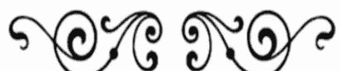

## 指出下列程序段中的错误（如果有）：

### 1.
```c
int char mixed[10],i;
for(i = 0; i< 10; i++)
{
scanf("%d",&mixed[i]);
}
```
**输出：** 错误。
因为 mixed 不能用作数据类型。

### 2.
```c
int SIZE;
scanf("%d",&SIZE);
int a[SIZE];
for(i = 1; i<=SIZE ;i++)
{
scanf("%d",a[i]);
printf("%0d",a[i]);
}
```
**输出：** 错误。
因为数组的大小必须是常量，但这里使用变量 SIZE 作为数组大小。

### 3.
```c
main()
{
int i, a = 2, b = 3;
int a[2+3];
for( i = 0; i< a+b;
i++)
{
scanf("%d",&a[i]);
printf("%d",a[i]);
}
}
```
**输出：** 没有错误。

### 6.
```c
main()
{
int a[6] = {10,20,30,40,50};
int i;
for(i = 0; i<=25; i++)
printf("\n%d",a[i]);
}
```
**输出：** 没有错误。
因为如果越过了数组边界，内存中下一个位置存储的垃圾值会被显示出来。但会显示一条警告：“正在超出数组边界”。

### 7.
```c
main()
{
int s[50];
for( i = 1; i<=50; i++)
{
s[i] = i;
printf("\n%d",s[i]);
}
}
```
**输出：** 没有错误。
这里数组大小为 50，由于数组下标从 0 开始，最后一个

### 4. 假设数组起始地址为 1200
```c
main()
{
int a[] = {2, 3, 4, 1, 6};
printf("%d %d", a, sizeof(a));
}
```
**输出：** 1200 10

### 5. 假设数组起始地址为 65486
```c
main()
{
int a[] = {12, 14, 15, 23, 45};
printf("%u %u", a+1, &a+1);
}
```
**输出：** 65488 65496

### 8. 假设数组起始地址为 65486
```c
main()
{
int a[] = {12, 14, 15, 23, 45};
printf("%u %u", a, &a);
}
```
**输出：** 65486 65486

```c
main()
{
float a[] = {12.4, 2.3, 4.5, 6.7};
printf("%d", sizeof(a)/sizeof(a[0]));
}
```
**输出：** 4

## 选择题。

### 1. 数组是–
- a) 不同类型的数据散布在内存中。
- b) 相同类型的数据散布在内存中。
- c) 相同类型的数据在内存中彼此相邻存放。
- d) 不同类型的数据在内存中彼此相邻存放。

**输出：** c) 相同类型的数据在内存中彼此相邻存放。

### 2. 表达式 num[4] 引用数组中的哪个元素？
- a) 第一个元素。
- b) 最后一个元素。
- c) 第四个元素。
- d) 第五个元素。

**输出：** d) 第五个元素

### 3. 这两个表达式中的 5 有什么区别？
```c
int num[5];
num[5] = 11;
```
- a) 第一个是特定元素，第二个是类型。
- b) 第一个是数组大小，第二个是特定元素。
- c) 第一个是特定元素，第二个是数组大小。
- d) 两者都指定数组大小。

**输出：** b) 第一个是数组大小，第二个是特定元素。

### 4. 下面的数组声明正确吗？
- a) int a(25);
- b) int size = 10, b[size];
- c) int c = {0,1,2};

**输出：** 全部错误。

在 (a) 中，数组维度中不允许使用括号“( )”。

在 (b) 中，数组大小是变量。

在 (c) 中，一个普通整型变量被赋了三个值，这种情况只可能发生在数组变量中。

### 5. 如果在初始化数组时试图放入过多的值，以至于超出了数组的大小，会发生什么？
- a) 什么也不会发生
- b) 可能导致系统故障
- c) 编译器给出错误信息
- d) 其他数据可能被覆盖

**输出：** b) 可能导致系统故障

### 6. 如果在初始化数组时放入的元素过少，会发生什么？
- a) 什么也不会发生
- b) 可能导致系统故障
- c) 编译器给出错误信息
- d) 未使用的元素将被填充为 0 或垃圾值

**输出：** d) 未使用的元素将被填充为 0 或垃圾值

### 7. 如果给一个下标超过数组大小的数组元素赋值，会发生什么？
- a) 该元素将被设置为 0
- b) 什么也不会发生，这种事经常发生。
- c) 其他数据可能被覆盖
- d) 编译器给出错误信息。

**输出：** c) 其他数据可能被覆盖

### 8. 当你把数组作为参数传递给函数时，实际传递的是什么？
- a) 数组的地址。
- b) 数组元素的值。
- c) 数组第一个元素的地址。
- d) 数组的元素个数。

**输出：** a) 数组的地址。

### 9. 下面哪些是使用指针的原因？
- a) 操作数组的一部分
- b) 引用 for 和 if 等关键字
- c) 从函数返回多个值
- d) 更方便地引用特定程序

**输出：** a) 和 c)

### 10. 如果你没有初始化静态数组，元素会被设置为什么？
- a) 0
- b) 一个未确定的值
- c) 一个浮点数
- d) 字符常量 '\0'

**输出：** a) 0

### 11. main()
```c
{
    int a[5]={2,3};
    printf("%d %d %d",a[2],a[3],a[4]);
}
```
- 1. 垃圾值
- 2. 2 3 3
- 3. 3 2 2
- 4. 0 0 0

**输出：** 0 0 0

解释：当数组被部分初始化时，其余数组元素会被初始化为 0。

## 判断下列说法是否正确：

- 1. 数组 int num[26] 有 26 个元素。
- 2. 表达式 num[1] 表示数组中的第一个元素。
- 3. 在声明数组时必须对其进行初始化。
- 4. 表达式 num[27] 表示数组中的第二十八个元素。
- 5. 浮点变量的地址始终是整数。

## 答案：

1. 错误 2. 错误 3. 错误 4. 正确 5. 正确

### 1. 如果 a[i]=i++ 是未定义的，那么同理 i=i+1 也应该是未定义的。但事实并非如此。为什么？

回答：如果一个对象要在表达式中被修改，那么在同一表达式中对它的所有访问都必须用于计算将要存储到该对象中的值。表达式 a[i]=i++ 是不允许的，因为对 i 的访问之一（a[i] 中的 i）与最终存储到 i 中的值无关。

在这种情况下，编译器可能不知道这次访问应该发生在自增后的值被存储之前还是之后。

表达式 i=i+1 是允许的，因为访问 i 是为了确定 i 的最终值。

### 2. 在任何上下文中提及数组名都会给出基地址吗？

回答：不是。据说数组名中包含其基地址，但在两种情况下数组不会给出其基地址：

- 1. 当数组名与 sizeof 运算符一起使用时。
- 2. 当数组名是 & 运算符的操作数时。

### 3. 对于一个包含 10 个整数的数组，表达式 a 和 &a 相同吗？

回答：不同。尽管在上面的问题中这两个表达式给出了相同的结果，但它们表示的是两种不同的含义。a 给出第一个 int 的地址，而 &a 给出整个 int 数组的地址。由于这两个地址恰好相同，所以表达式的结果相同。

## 实验练习 – WAP – 编写一个程序。

- 1. 编写程序：使用冒泡排序技术对一维数组进行排序。
- 2. 编写程序：使用选择排序或线性排序技术对一维数组进行排序。


- 3. 编写程序，使用插入排序技术对一维数组进行排序。
- 4. 编写程序，使用线性搜索方法在一维数组中查找某个元素。
- 5. 编写程序，使用二分搜索方法在一维数组中查找某个元素。
- 6. 编写程序，在一维有序数组中插入一个元素。
- 7. 编写程序，从一维数组（未排序）中的指定位置删除一个元素。
- 8. 编写程序，从一维有序数组中删除一个元素。
- 9. 编写程序，读取一个整数数组，并分别打印偶数和奇数元素。
- 10. 编写程序，求整数数组中偶数下标位置和奇数下标位置的元素之和。
- 11. 编写程序，从存储在数组中的一组值中找出最大值和最小值，以及它们在数组中的位置。
- 12. 编写程序，读取6个数字，判断它们是否严格升序。例如，序列5,6,7,9,11,14是严格升序，而序列5,5,6,7,9,11不是严格升序。显示适当的提示信息。
- 13. 编写程序，读取一组身高并计算平均身高。程序随后应计算每个身高与平均值的偏差。偏差 d 的定义为：d=m(i)-a，其中 a 表示平均身高，m(i) 表示身高。
- 14. 编写程序，将10个整数读入数组，然后显示它们的平均值。
- 15. 编写程序，显示整数数组中的最大值及其位置。如果最大值出现多次，应显示其最后出现的位置。
- 16. 编写程序，显示数组中的最大值和最小值及它们各自的位置。如果最大值和最小值出现多次，应显示它们第一次出现的位置。
- 17. 编写程序，将10名学生的学号和成绩读入两个不同的数组。程序将打印用户提供学号的学生的成绩。
- 18. 编写程序，读取两个数组，将它们的对应元素相加存入第三个数组，并显示第三个数组。
- 19. 编写程序，读取一个整数数组。读取数组后，程序应检查数组中是否有重复值，并显示适当的提示信息。
- 20. 编写程序，读取两个数组。将两个数组的对应元素按逆序相加，并存入第三个数组。显示第三个数组。
- 21. 编写程序，读取一个数组，并在数组末尾插入一个整数。
- 22. 编写程序，在数组开头插入一个整数。
- 23. 编写程序，将一个数组插入到另一个数组的末尾。
- 24. 编写程序，将一个数组插入到另一个数组的开头。
- 25. 编写程序，在用户指定位置将一个数组插入到另一个数组中。
- 26. 编写程序，判断一个数组是否为回文数组。
- 27. 编写程序，将数组中的所有负数移到末尾，而不改变原有顺序。例如，如果数组包含 5 -3 2 6 8 -4 7 -6 9 -1，则结果数组应为 5 2 6 8 7 9 -3 -4 -6 -1。可以使用两个数组。
- 28. 编写程序，删除数组开头的元素。
- 29. 编写程序，将数组向左旋转一个元素。
- 30. 编写程序，将数组向右旋转一个元素。
- 31. 编写程序，将数组向左旋转 n 个元素，n 的值由用户提供。
- 32. 编写程序，将数组向右旋转 n 个元素，n 的值由用户提供。
- 33. 编写程序，读取一个数组，将任何元素的多次出现替换为0，然后显示结果数组。例如，如果输入是 1 1 2 2 3 4 2 1 5 4，输出是 1 0 2 0 3 4 0 0 5 0。
- 34. 编写程序，按以下方式移动重复出现的元素。例如，如果输入是 1 1 2 2 3 4 2 1 5 4，输出是 1 2 3 4 5 0 0 0 0 0。
- 35. 编写程序，删除数组中的重复元素。
- 36. 编写程序，将数组的第 n 个元素放到第一个位置，第 (n+1) 个元素放到第二个位置，依此类推。
- 37. 编写程序，重新排列数组的元素，使奇数位置的元素位于偶数位置的元素之前。例如，1 2 3 4 5 6 7 8 应变为：1 3 5 7 2 4 6 8。
- 38. 编写程序，按降序对数组进行排序。
- 39. 编写程序，将任意十个数字存入数组，并打印所有数字的最小公倍数（LCM）和最大公约数（HCF）。
- 40. 编写程序，将任意十个数字存入数组 number，并打印最小值、最大值和平均值。
- 41. 编写程序，将任意100个数字存入数组。将前五十个数字按升序排列，后五十个数字按降序排列，并打印排序后的数组。
- 42. 编写程序，从键盘接受一个正的十进制整数，将其转换为等效的二进制数，并输出该整数及其二进制形式。
- 43. 编写程序，创建一个数组 age[20] 来存储任意20个年龄，并分别打印所有偶数年龄和奇数年龄之和。
- 44. 从键盘输入25个数字到一个数组中。编写程序，统计其中有多少个正数、多少个负数、多少个偶数和多少个奇数。

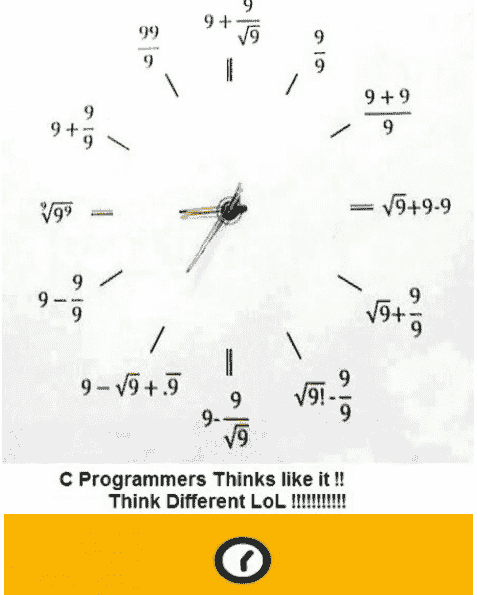

C语言程序员就是这样想的！！
换个思路，哈哈！！！！！！！！


## 第 6 章（二维数组（矩阵））

### 简介

二维数组通常称为表或矩阵，可以很容易地想象成由行和列组成。矩阵也可以看作是数组的数组。

要创建二维数组，请在方括号中指定两个维度，即行和列。

例如，以下声明创建了一个 4 行 5 列的矩阵。

```c
int mat[4][5];
#define MAXROW 4
#define MAXCOL 5
int mat[MAXROW][MAXCOL];
```

|   | 0 | 1 | 2 | 3 | 4 |
|---|---|---|---|---|---|
| 0 | 0,0 | 0,1 | 0,2 | 0,3 | 0,4 |
| 1 | 1,0 | 1,1 | 1,2 | 1,3 | 1,4 |
| 2 | 2,0 | 2,1 | 2,2 | 2,3 | 2,4 |
| 3 | 3,0 | 3,1 | 3,2 | 3,3 | 3,4 |

数组按行顺序存储，因此表达式 mat[0] 表示包含5个值的第一行，mat[1] 表示第二行，mat[2] 表示第三行，依此类推。

类似地，表达式 mat[0][0] 引用矩阵左上角的值；mat[2][3] 表示第三行中的第四个值。

### 矩阵初始化

- 1. int mat[4][3];
- 2. int mat[4][3] = {{10,20,30,40}, {50,60,70,80}, {90,100,110,120}};
- 3. int mat[4][3] = {10,20,30,40,50,60,70,80,90,100,110,120};
- 4. static int mat[4][3];

- 注意 - int mat[ ][ ] 是无效的，因为没有指定维度。
- 注意 - int mat[ ][ ]={1,2,3,4,5,6} 是无效的，因为无法确定矩阵的行和列。
- 注意 - int mat[ ][3]={1,2,3,4,5,6} 是有效的。
- 注意 - int mat[2][ ]={1,2,3,4,5,6} 是无效的，因为在矩阵声明中列是必需的。

### 多维数组的内存映射

|   | 0 | 1 | 2 | 3 |
|---|---|---|---|---|
| 0 | 10 | 5 | 6 | 7 |
| 1 | 36 | 94 | 56 | 29 |
| 2 | 83 | 67 | 12 | 69 |
| 3 | 39 | 55 | 13 | 29 |

上图中的数组排列只是在概念上成立。这是因为内存中并不存在行和列。

在内存中，无论是一维数组还是多维数组，数组元素都存储在一个连续的链中。给定的二维数组在内存中的元素排列如下所示：

| [0] | [0] | [0] | [0] | [1] | [1] | [1] | [1] | [2] | [2] | [2] | [2] | [3] | [3] |
|---|---|---|---|---|---|---|---|---|---|---|---|---|---|
| [0] | [1] | [2] | [3] | [0] | [1] | [2] | [3] | [0] | [1] | [2] | [3] | [0] | [1] |
| 10 | 5 | 6 | 7 | 36 | 94 | 56 | 29 | 83 | 67 | 12 | 69 | 86 | 39 |
| 100 | 102 | 104 | 106 | 108 | 110 | 112 | 114 | 116 | 118 | 120 | 122 | 124 | 126 |

### 已解决的示例程序

- 1. 编写程序，转置一个二维数组。

```c
#define maxrow 10
#define maxcol 10
main()
{
    int m[maxrow][maxcol],i,j,row,col;
    clrscr();
    printf("Enter number of rows and columns in the matrix: ");
    scanf("%d %d",&row,&col);
    for(i=0;i<row;i++)
    {
        for(j=0;j<col;j++)
        {
            printf("Enter element %d,%d: ",i+1,j+1);
            scanf("%d",&m[i][j]);
        }
    }
    /*To print the matrix as input by the user*/
    printf("Matrix input:\n\n");
    for(i=0;i<row;i++)
    {
        for(j=0;j<col;j++)
            printf("%d\t",m[i][j]);
        printf("\n");
    }
    /*transpose*/
    printf("\n\nTransposed matrix\n\n");
    for(i=0;i<col;i++)
    {
        for(j=0;j<row;j++)
            printf("%d\t",m[j][i]);
        printf("\n");
    }
    getch();
}
```


### 2. 使用键盘输入 3 * 3 矩阵，编写程序将其通过添加对应行和列转换为 4 * 4 矩阵。

```
int mat1[3][3],mat2[4][4]={0},i,j;      /* Input */
    for(i=0;i<3;i++)
        for(j=0;j<3;j++)
{
    printf("Enter element [%d,%d] ",i+1,j+1);
    scanf("%d",&mat1[i][j]);
}
/* Convert 3 * 3 matrix into 4 * 4 matrix */
    for(i=0;i<3;i++)
    for(j=0;j<3;j++)
{
        mat2[i][j] = mat1[i][j];
        mat2[i][3] += mat1[i][j];
        mat2[3][j] += mat1[i][j];
        mat2[3][3] += mat1[i][j];
}
    /* Output */
    for(i=0;i<4;i++)
{
        for(j=0;j<4;j++)
        printf("%d\t",mat2[i][j]);
        printf("\n");
}
```

### 3. 编写程序判断一个方阵是否对称。

```
int m[10][10], i, j, r,c;
    printf("Enter number of rows & columns of the Matrix:");
    scanf("%d%d",&r,&c);
    if(r !=c)
    {
        printf("Symmetric matrix must be a square matrix");
        getch();
        exit(1);
    }
    /*Matrix input*/
    for(i=0; i<r; i++)
    {
        for(j=0; j<c; j++)
        {
            printf("Enter element %d,%d",i+1,j+1);
            scanf("%d",&m[i][j]);
        }
    }
/* Check for symmetry*/
for(i=0; i<r; i++)
{
    for(j=0; j<c; j++)
    {
        if(m[ i ][ j ] != m[ j ][ i ])
        {
            printf("The matrix is not a symmetric");
            getch();
            exit(0);
        }
    }
    printf("The matrix is a symmetric");
```

## 实验练习 -

- 1. 编写程序查找矩阵的行和与列和。
- 2. 编写程序从二维数组 m[nxn] 准备一维数组 a[n²]，如果按行优先形式存储则包含数组 m 的所有元素，以及按列优先形式的一维数组 b[n²]。例如，对于以下数组：

    ```
    1 2 3 4
    5 6 7 8
    9 10 11 12
    13 14 15 16
    ```

    结果数组 a 将为 1 2 3 4 5 6 7 8 9 10 11 12 13 14 15 16,
    并且结果数组 b 将为 1 5 9 13 2 6 10 14 3 7 11 15 4 8 12 16
- 3. 编写程序读取 2 个矩阵，将其各个元素相加并显示结果矩阵。
- 4. 编写程序读取 2 个矩阵，矩阵相乘并显示结果矩阵。
- 5. 编写程序转置二维数组，但该数组以一维数组形式存储。
- 6. 编写程序创建方阵并在清屏后打印第一和第二对角线元素。还求出位于任一对角线上的所有元素的和。
- 7. 编写程序从矩阵中提取最大值和最小值元素。
- 8. 编写程序将矩阵的所有元素加倍。
- 9. 编写程序打印矩阵中所有非对角线元素。
- 10. 编写程序对矩阵的所有元素进行排序。
- 11. 编写程序求矩阵的行列式值。

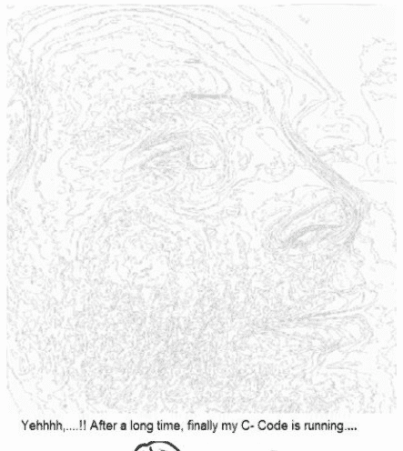

Yehhhh.....!! 经过长时间，终于我的 C- Code is running....


## 第 7 章

### 字符串（字符数组）

字符串是字符数组。任何用双引号括起来的字符组（双引号除外）称为字符串常量。

字符串是一维字符数组，以空字符 (`'\0'`) 终止。

```
char s[10] = {'s','h','i','v','a','m','\0','p','o','h'};
```

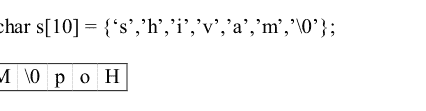

数组中的每个字符占用一个字节的内存，最后一个字符始终是 `'\0'`。这个 `'\0'` 称为空字符。它定义了字符串的结束。由于存在这个字符，处理字符串的各种函数能够知道字符串的结束位置。

因此可以说，给定字符串的输入在空字符 `'\0'` 处终止。而剩余的数组包含垃圾值。

练习笔记：空字符 `'\0'` 看起来像是输入了两个字符，但编译器将其视为单个字符。它是一个转义序列。

还请记住 `'0'` 与 `'\0'` 不同。`'0'` 的 ASCII 码是 48，而 `'\0'` 的 ASCII 码是 0。

### 字符数组初始化 -

- 1. `char s[10];`
- 2. `char s[7] = {'s','h','i','v','a','m','\0'};`
- 3. `char s[7] = {'s','h','i','v','a','m'};`
- 4. `char s[7] = "shivam";`
- 5. `char s[] = {'s','h','i','v','a','m','\0'};`

### 让我们观察字符串的几个重要方面 -

- 1. **在最后一次声明中缺少空字符，即编译器会在字符串末尾自动添加一个 `'\0'`。**
- 2. **字符串的大小应等于字符串中最大字符数加一。**
- 3. **不提及大小的字符串初始化也是允许的，如同整数数组。在这种情况下，数组大小将自动基于初始化的元素数量。**

### 字符串输入 -

用于输入的常用函数是 scanf。该函数也可以使用格式说明符 `%s` 来输入字符串。

For e.g.

```
scanf("%s",name);
```

在输入字符串时，不需要 &（取地址运算符）。

scanf 函数的一个问题是它在找到的第一个空白处结束输入（空白包括空格、制表符、回车符、换页符、换行符）。

因此如果以下行作为输入输入——**Shivam Kumar**——那么只有字符串“Shivam”会被作为输入取入变量 name，因为“Shivam”单词后的空白会结束字符串。

很多时候需要读取整行文本，而使用 scanf 是不可能的。这可以通过使用 getchar 函数实现。

该函数一次读取一个字符并将字符存储在数组中。因此我们必须使用循环重复使用该函数，直到用户输入空字符或换行符。

另一个可用于输入字符串的函数称为 gets()，用法如下：

```
char name[10];
gets(name);
```

该函数也可以读取空白字符，从而一次性将一行作为输入。

### 字符串输出 -

常用输出函数 printf() 也可用于字符串，使用格式说明符 `%s` 在屏幕上显示字符串。

```
printf("%s",name);
```

练习笔记 - 也可以使用 puts() 函数。

```
puts(name);
```

字符串的精度也可以用 `%10.3s` 指定。

表示要在宽度为 10 列的字段中打印前三个字符。字符串前会打印 7 个空格。但如果指定为 `%-10.4s`，则字符串将左对齐，所有 7 个空格都会打印在右侧。

- 1. 请记住，如果字段宽度小于字符串长度，则会打印等于字符串长度的字符串。`printf("%3.4s",name);` 将打印 4 个字符而不是 3 个。
- 2. 小数点右侧指定的整数值指定要打印的字符数。
- 3. 如果要打印的字符数指定为 0，则不打印任何内容。

```
char name[10]="Shivam Kumar";
printf("%s",name);
printf("%6s",name);
printf("%12.6s",name);
printf("%-12.6s",name);
printf("%.2s",name);
```

## 部分已解程序 -

### 1. 编写程序按升序对给定列表中的姓名进行排序。

```
#include<string.h>
main()
{
    char names[10][20], t[20];
    int i=0,j=0,n;
    printf("Enter how many names");
    scanf("%d",&n);
    /*Input names*/
    for(i=0;i<n;i++)
    {
        printf("Enter name %d ",i+1);
        gets(names[i]);
    }
    /*Sorting*/
    for(i=0;i<n-1;i++)
    {
        for(j=i+1;j<n;j++)
        {
            if(strcmp(names[i],names[j]) > 0)
            {
                strcpy(t,names[i]);
                strcpy(names[i],names[j]);
                strcpy(names[j],t);
            }
        }
    }
    /*Output*/
    for(i=0;i<n;i++)
    {
        printf("%s\n",names[i]);
    }
    getch();
}
```

### 2. 通过键盘输入字符串，编写程序按单词顺序反向打印字符串：

e.g. How Are You = You Are How. */

```
main()
{
    char s1[50],t1[50],t2[50]="";
    int i=0,j=0;
    printf("Enter a string");
    gets(s1);
    strcat(s1," ");
    while(s1[i]!='\0')
    {
        if(s1[i]==' ')
        {
            t1[j++]=' ';
            t1[j]='\0';
            strcat(t1,t2);
            strcpy(t2,t1);
            j=0;
        }
        else
            t1[j++]=s1[i];
        i++;
    }
    puts(t1);
    getch();
}
```

### 3. 编写程序输入文本并替换其中出现的输入字符串


在所有出现的位置输出数量相等的“*”。

```
char ch;
printf("Enter text: ");
while((ch=getch())!='\r')
    printf("*");
```

### 4. 编写一个程序，将类似“124”的字符串转换为整数124。

```
char str[6];
int num= 0, i;
printf("Enter a string containing a number:");
scanf("%s",str);
for(i=0; str[i]!='\0'; i++)
{
    if(str[i]>=48 && str[i]<=57)
        num = num*10+(str[i]-48);
    else
    {
        printf("Not a valid string");
        getch();
        return;
    }
}
printf("\nThe number is: %d\n",num);
```

训练说明：函数 atoi 也能将字符串转换为整数。

## 下面程序的输出是什么？

| 1. | 7. |
|---|---|
| char c[2]= "A";<br>printf("%c",c[0]);<br>printf("%s",c);<br>输出：A A<br>从第一个 printf( ) 输出‘A’，因为数组大小为2，所以‘A’存储在第0个位置，而‘\0’(NULL)存储在第1个位置。使用第二个 printf( ) 时，输出也为‘A’，因为整个字符串（即"A"）会被打印出来。 | char str1[] = {'H','e','l','l','o',0};<br>char str2[] = "Hello";<br>printf("\n%s",str1);<br>printf("\n%s",str2);<br>输出：Hello Hello<br>因为在第一个字符串中，最后一个字符是0，也就是NULL(`\0`)字符的ASCII码。当打印str1时，会打印整个字符串"Hello"；同样str2也会被打印出来。 |

### 2. char s[] = "Get organized! learn c!!"
```
char s[] = "Get organized! learn c!!";
printf("\n%s",&s[2]);
printf("\n%s",s);
printf("\n%s",&s);
printf("\n%c",s[2]);
```
输出：
t
organized! learn c!!
Get organized! learn c!!
Get organized! learn c!!
t

通过第一个 printf( )，打印的是"t organized! learn c!!"，因为我们传入的是&s[2]来打印字符串，所以打印会从字符串的第3个字符开始。因为当只使用字符串名称时，它包含的是基地址，字符串打印会从基字符开始。

通过第二个 printf( )，这里使用了字符串名称，所以会打印整个字符串。

通过第三个 printf( )，传入的是字符串的地址（因为没有使用下标或索引，所以是基地址），与第二个 printf( ) 相同，因此会打印整个字符串。

通过最后一个 printf( )，只打印第3个字符，因为这里使用了%c格式说明符，并且打印列表中使用的是s[2]，它指向第3个字符。

### 3. printf("%c","Harry"[4]);

### 8. printf(5+"Good Morning");

输出：Morning。

这里编译器会理解上述 printf 应当从字符串的第5个字符开始打印。

### 9. printf("\n%d %d %d",sizeof('3'),sizeof("3"),sizeof(3));

输出：2 2 2

因为第一个 sizeof 包含一个字符，但在C语言中，字符会被转换为其ASCII值，编译器将其视为int，所以占用2字节。第二个 sizeof 是一个只包含单个字符的字符串，但C编译器会在每个字符串末尾自动加上空字符，所以上述字符串将包含2个字符，占用2字节。第三个 sizeof 包含3，这是一个整数值，占用2字节。

```
char a[8] ="Rhombus";
int i;
for(i = 0; i<=7; i++)
printf("\n%d",*a);
a++;
```

输出：Error。因为数组'a'不能被递增。

### 11. main()
**输出：y。**
因为当我们打印s[4]时，它会打印字符串的第5个字符。这里我们在s的位置使用了字符串“matrix”，类似地，它会打印该字符串的第5个字符，即r。

```
char a[] = {'M','A','T','R','I','X'};
int i;
for(i = 0;i<=5;i++)
printf("%c",a[i]);
```

每次在条件为真时打印数组的第i个元素。因为计数器从0开始，所以打印从第0个元素开始，一直到第5个元素。这样字符串“MATRIX”的每个字符都会被打印，并由行分隔。

```
main()
{
char s[7]="Strings";
printf("%s",s);
}
```

不可预测。这里s[]被声明为7字符数组，但其中存储了8字符的字符串。这会导致超出为数组保留的第7字节之后的内存被“0”覆盖。总是有可能……

```
{
char string[] = "Author Harry";
int a=5;
printf("a>0?%20s":"%s",string);
}
```

**输出：Author Harry**

```
main()
{
printf(5+"Computers");
}
```

**输出：ters**

```
main()
{
char s1="Matrix";
char s2="Computers";
if(s1 == s2)
printf("Equal");
else
printf("Unequal");
}
```

**输出：Unequal**

```
main()
{
printf("%c", "Matrix"[4]);
}
```

**输出：i**
15. 对于读取多词字符串，以下哪个更合适？
gets()
scanf()
puts()

输出：gets()

重要的内容会被覆盖，这可能会不安全。

6. 你怎样在屏幕上输出 \n？

输出：“\n”

## 填空题：
- 1. “A”是一个________，而‘A’是一个________。
- 2. 字符串以________结尾，写成__。
- 3. 数组 char name[10] 最多可以包含____个字符。
- 4. 数组元素总是存储在________的内存位置中。

答案：
- 1. 字符串 字符
- 2. 空字符 \0
- 3. 9
- 4. 连续的

## 实验练习 -
- 1. 编写程序连接两个字符串。
- 2. 编写程序比较两个字符串。
- 3. 编写程序从键盘读取一行文本，并在屏幕上显示以下信息：
- 1. 单词数
- 2. 字符数。
- 4. 编写程序统计用户输入字符串的长度。
- 5. 编写程序将一个字符串复制到另一个字符串。
- 6. 编写程序将两个字符串连接到第三个字符串中。
- 7. 编写程序将一个字符串以相反顺序复制到另一个字符串中。
- 8. 编写程序检查用户输入的字符串是否是回文。
- 9. 编写程序将字符串转换为小写。
- 10. 编写程序删除用户输入字符串中的所有前导空格。
- 11. 编写程序打印输入字符串的所有循环移位。例如，单词" space "的旋转为：space paces acesp cespa espac
- 12. 编写程序输入任意字符串，并以相反顺序打印。
- 13. 编写程序输入一个字符串和一个待搜索的字符，并打印该字符在字符串中出现的频率。
- 14. 编写程序输入一个字符串，并打印该字符串中出现次数最多的字符。
- 15. 编写程序输入任意字符串，并打印每个字符在字符串中出现的频率。出现多次的字符只需在输出中显示一次，并附带频率值。
- 16. 编写程序显示输入的字符串中最长的单词（长度最大的单词）。
- 17. 编写程序输入任意姓名，并按照以下格式打印：输入：shruti 输出：s sh shr shru shrut shruti
- 18. 编写程序输入任意句子，并将每个单词的字符分别按字母顺序排列，然后打印句子。例如，输入：computer program in basic. 输出：cemoprtu agmoprr in abc is.
- 19. 编写程序使用一个下标变量接收用户输入的40名学生的计算机科学成绩，并按升序在一列中打印这些成绩。
- 20. 编写程序接收用户输入的谚语（如“failures are the pillars of success.”），然后输出该谚语中出现的元音字母的频率。
21. 一家城市酒店有10层楼（1到10层），每层有60个房间。使用一维数组存储住户姓名，使用二维数组 place(a, b) 表示房间位置，其中a和b分别代表楼层和房间号。编写程序在输入住户姓名和房间号后为其分配房间。

22. 编写程序输入文本，并打印包含元音字母数量最多的单词。

23. 编写程序将字符串中两个或多个连续空格替换为单个空格。例如，如果输入是：grim return to the planet of apes!! 输出应为：grim return to the planet of apes!!


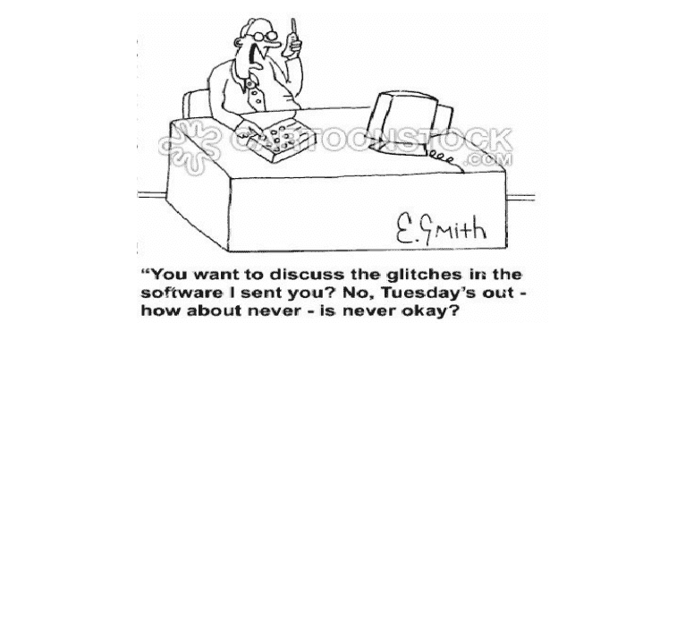

> 你想讨论我发给你的软件中的故障吗？不，周二不行——那“永远”怎么样——永远也不行吗？


## 第八章

（函数与你的大脑）

函数是一个小程序，它接收一些输入并为我们提供一些输出。函数允许将大型程序分解为许多较小的独立组件，每个组件都有明确的目的。它避免了反复重写代码。将逻辑分解为单独的函数使编写和调试的整个过程更加容易。

另一方面，可以说函数是一个用于执行某项任务的独立语句块。函数一旦被分配了某项工作，就可以被任意多次调用以执行该任务。每个 C 程序都会使用一些函数；常用的函数有 printf、scanf、main 等。

函数可以是库函数或用户自定义函数。库函数是随编译器一起提供并存在于磁盘中的函数。用户自定义函数是程序员自己编写的函数，目的是使程序更容易调试和跟踪。

printf()、scanf()、exit()、pow() 都是库函数。每个库函数都有一个头文件。C 语言中一共有 15 个头文件。main() 是一个用户自定义函数。

每个程序都必须有一个 main 函数。这个 main 函数用于标记执行的开始。虽然只用 main 函数就能编写任何程序，但这会带来很多问题。程序会变得过于庞大和复杂，因而难以跟踪、调试和测试。

但如果将同一个程序拆分成独立编码的小模块，然后再组合成一个整体，那么这些问题就能轻松解决。这些模块就称为函数。因此，函数可以定义为一个接收一些输入并为我们提供一些输出的小程序。

**要点提示 –** 我不会一遍又一遍地输入头文件，所以在编写程序时，请不要忘记在程序开头包含头文件。

### 计算两个数之和的函数

```c
int sum(int, int);      /* Function Prototype or Declaration */
main()
{
    int a,b,ans;
    printf("Enter two numbers: ");
    scanf("%d %d",&a,&b);
    ans = sum(a,b);          /* Function Call */
    printf(" sum is %d", ans);
    getch();
}
int sum(int x, int y)      /* Function Definition or Process */
{
    int z;
    z = x + y;
    return(z);
}
```

### 现在让我们来看看这个程序的一些特点

- 1. 第一条语句是函数的声明，它告诉编译器函数的名称以及所传递参数的数据类型。
- 2. 该声明也称为原型。
- 3. 如果输出类型是整数值，则函数声明不是必需的。在某些 C 编译器中，并非所有函数都需要声明。
- 4. 函数调用是使用函数的方式。函数声明一次，定义一次，但在同一程序中可以使用多次。
- 5. 当编译器遇到函数调用时，程序的控制权会转移到函数定义；然后函数将逐行执行，并在最后返回一个值。
- 6. 在主程序的末尾是函数的定义，也可以称为过程。
- 7. 函数定义不以分号结尾。
- 8. 函数可能返回值，也可能不返回值。因此，return 语句不是必需的。当遇到 return 语句时，控制权会立即返回给调用函数。
- 9. 虽然可以向函数传递任意数量的参数，但被调用函数在一次调用中只返回一个值。return 语句可以使用为：

```c
return;
```
或
```c
return(value);
```

- 10. 一个函数可以有多个 return 语句。它可以这样使用：

```c
if (a!=0)
    return(a);
else
    return(1);
```

- 11. 默认情况下，所有函数都返回 int。但如果函数必须返回特定类型的数据，则可以在函数名旁边使用类型说明符。

```c
long int fact(n)
```

- 12. 如果 main() 函数调用 sum() 函数，那么 main() 是调用函数，sum() 是被调用函数。

### 无参数且无返回值

有些函数不接收来自调用函数的任何值。因此，函数原型将如下所示：

`prn( )` 即不传递任何参数。这也可以通过 `prn(void)` 来实现。同样，调用函数也不会从该函数获得任何值。这可以通过在函数名之前使用关键字 `void` 来实现。为了说明这一点，让我们考虑以下程序：

```c
void prn();   /* declaration can also be made as void prn(void); */
main()
{
    prn();
    prn();
    prn();
}
void prn()
{
    printf("Hello");
}
```

### 参数传递机制

### （i）按值调用

当按值传递参数时，实际参数的副本会从调用函数传递给被调用函数定义中的形参。

现在，在被调用函数定义中对形参所做的任何更改都不会反映到调用函数的实参中。

例如，在上述计算两个数之和的函数中，调用语句写成如下形式：

```c
ans = sum(a, b);
```

在定义中，变量 x、y 分别接受 a、b 的值。这里，变量 a、b 称为实际参数，而 x、y 称为形式参数。

实际参数和形式参数的作用域不同，因此在形式参数中进行的任何更改都不会在实参中体现。

例如：

```c
void swap(int, int);
main()
{
    int a,b;
    printf("Enter 2 numbers");
    scanf("%d%d",&a,&b);
    swap(a,b);      /* In this call statement a,b are the actual parameters */

    printf("%d\t%d",a,b);
}
void swap(int x, int y)  /* In this function definition x & y are the formal parameters */
{
    int t;
    t=x; x=y; y=t;
}
```

**要点提示 –** 在上述示例中：对 x、y 所做的更改不会反映到 a、b 中。

### （ii）按引用调用

当按引用传递参数时，实际参数的地址会从调用函数传递给被调用函数定义中的形参。

现在，在被调用函数定义中对形参所做的任何更改都会反映到调用函数的实参中。

有时无法传递变量的值；例如，使用数组时，无法通过按值调用来传递数组的所有值。

因此，使用了另一种类型的函数调用机制：按引用调用，即传递变量的地址。

这里，定义将通过访问特定地址来工作。这种方法通常用于数组和指针。

例如：

```c
main()
{
    int a,b;
    printf("Enter 2 numbers");
    scanf("%d%d",&a,&b);
    swap(&a, &b);   /* In this call statement address
                       of a, b gets transferred */
    printf("%d\t%d",a,b);
}
void swap(int *p1, int *p2)   /* In this function
definition p1 & p2 are the pointers which receive the
address of a, b */
{
    int t;
    t=*p1; *p1=*p2; *p2=t;
}
```

**要点提示 –** 在上述示例中：对 p1、p2 所做的更改将自动反映到 a、b 中。

**要点提示 –** 数组也是按引用传递的。当我们传递数组名时，只有基地址会被传递到函数定义中。

### 函数的类型

- 1. 库函数 – 之前在库中定义的函数称为库函数。

例如：

```c
#include<math.h>
main()
{
    int n, p, ans;
    printf("Enter number and its power");
    scanf("%d%d",&n,&p);
    ans = pow(n,p);
    printf("%d",ans);
    getch();
}
```

### 常用库函数

### stdio.h 函数

| Function | 描述 |
| --- | --- |
| fclose() | 关闭一个流 |
| fcloseall() | 关闭所有打开的流 |
| feof() | 测试是否已到达流的文件末尾 |
| fflush() | 刷新一个流 |


| 函数 | 描述 |
|---|---|
| fgetc() | 获取流中的一个字符 |
| fgetpos() | 获取当前文件指针位置 |
| fsetpos() | 设置流的文件指针位置 |
| fgetchar() | 从 stdin 获取一个字符 |
| fgets() | 从流中获取字符串 |
| fopen() | 打开流 |
| fprintf() | 向流发送格式化输出 |
| fputc() | 向流输出一个字符 |
| fputs() | 向流输出字符串 |
| fread() | 从流读取数据 |
| fscanf() | 扫描并格式化从流输入的数据。 |
| fseek() | 将文件指针设置到特定位置。 |
| ftell() | 返回文件指针的当前位置。 |
| fwrite() | 向流写入数据。 |
| getc() | 获取一个字符。 |
| getchar() | 从 stdin 获取一个字符。 |
| gets() | 从 stdin 获取字符串。 |
| getw() | 从流获取整数。 |
| printf() | 向 stdin 发送格式化输出。 |
| putc() | 向 stdout 输出一个字符。 |
| putchar() | 在 stdout 输出一个字符。 |
| puts() | 输出字符串并附加换行符。 |
| putw() | 在流上输出整数 |
| remove() | 删除文件 |
| rename() | 重命名文件 |
| rewind() | 将文件指针移至流的开头 |
| scanf() | 扫描并格式化从 stdin 输入的数据。 |

## conio.h

| 函数 | 描述 |
|---|---|
| clrscr() | 清除文本模式窗口 |
| getch() | 从控制台获取字符但不回显到屏幕 |
| getche() | 从控制台获取字符并回显到屏幕 |
| putch() | 向屏幕上的文本窗口输出字符 |
| cgets() | 从控制台读取字符串 |
| getchar() | 从 stdin 输入字符。 |

## stdlib.h

| 函数 | 描述 |
|---|---|
| itoa() | 将整数转换为字符串。 |
| atoi() | 将数字字符串转换为整数。 |
| random() | 返回 0 到 number – 1 之间的随机数 |
| randomize() | 初始化随机数生成器。 |
| exit() | 终止程序。 |
| min() | 返回两个数中较小的一个。 |
| max() | 返回两个数中较大的一个。 |
| ltoa() | 将 long 转换为字符串 |
| ultoa() | 将无符号 long 转换为字符串 |
| atof() | 将字符串转换为浮点数 |
| _atold() | 将字符串转换为 long double |

## math.h

| 函数 | 描述 |
|---|---|
| abs() | 获取整数的绝对值 |
| acos() | 计算 cos 的反函数 接受以弧度为单位的角度值 |
| asin() | 计算 sin 的反函数 接受以弧度为单位的角度值 |
| atan() | 计算 tan 的反函数 接受以弧度为单位的角度值 |
| ceil() | 返回给定列表中的最大整数。 |
| cos() | 计算余弦 接受以弧度为单位的角度值 |
| cosh() | 接受以弧度为单位的角度值 |
| exp() | 计算指数 |
| floor() | 返回给定列表中的最小整数。 |
| log() | 计算自然对数 |
| log10() | 计算以 10 为底的对数 |
| pow() | 计算数的幂 |
| sin() | 计算角度的正弦值。接受以弧度为单位的角度值 |
| sqrt() | 计算数的平方根 |
| tan() | 计算角度的正切值。接受以弧度为单位的角度值。 |
| tanh() | 计算双曲正切值。 |

## string.h

| 函数 | 描述 |
|---|---|
| strcat() | 用于连接（合并）字符串的函数。 |
| strcmp() | 用于比较两个字符串的函数。 |
| strcpy() | 用于将字符串复制到另一个字符串的函数 |
| stricmp() | 用于忽略大小写比较两个字符串的函数。 |
| strlen() | 用于计算字符串长度的函数 |
| strlwr() | 将给定字符串转换为小写 |
| strrev() | 用于反转给定字符串的函数。 |
| strupr() | 将给定字符串转换为大写 |
| strdup() | 复制字符串。 |
| strnicmp() | 不区分大小写地比较一个字符串的前 n 个字符与另一个字符串。 |
| strncat() | 在第二个字符串末尾添加前 n 个字符。 |
| strncpy() | 将字符串的前 n 个字符复制到另一个字符串。 |
| strchr() | 查找字符的首次出现。 |
| strrchr() | 查找字符的最后一次出现。 |
| strstr() | 在另一个字符串中查找字符串的首次出现。 |
| strset() | 将字符串的所有字符设置为给定字符。 |
| strnset() | 将字符串的前 n 个字符设置为给定字符。 |

## 2. 用户自定义函数

我们定义的函数称为用户自定义函数。main() 函数也是用户自定义函数，因为 main() 的定义由我们定义。

例如：

```
int power(int, int);
main()
{
        int n, p, ans;
        printf("Enter number and its power");
        scanf("%d%d", &n, &p);
ans = power(n,p);
printf("%d",ans);
getch();
}
int power(int n, int p)
{
    int ans=1, i;
    for(i=1;i<=p;i++)
    {
        ans = ans * n;
    }
    return(ans);
}
```

## 函数参数为二维数组的：-

```
void mat_sum(int m1[][10], int r1, int c1, int m2[][10], int r2, int c2, int m3[][10])
{
    int i,j;
    if(r1 != c1 && r2 != c2)
    {
        printf("Can't sum");
        exit();
    }
    for(i=0;i<r1;i++)
        for(j=0;j<c1;j++)
            m3[i][j] = m1[i][j] + m2[i][j];
}
```

上述函数可以从 main() 中调用，形式为 mat_sum(m1,r1,c1,m2,r2,c2,m3);

## 递归

如果函数体内的语句调用了同一个函数，则该函数称为递归函数。有时称为“循环定义”，递归是指函数在定义中调用自身。递归函数应有两个部分：递归语句和终止条件。

假设我们想要计算一个整数的阶乘。如我们所知，一个数的阶乘是 1 到该数之间所有整数的乘积。4 的阶乘可以表示为 4! = 4 * 3! 其中 ! 表示阶乘。因此一个数的阶乘可以表示为其自身的形式。因此这可以使用递归来编程。

例如：

```c
int fact(int);                /*function definition */
main()
{
int n,ans;
printf("Enter a number: ");
scanf("%d",&n);
ans = fact(n);                 /*function call */
printf("factorial = %d",ans);
getch();
}
int fact(int n)
{
    if(n==0)                    /*terminating condition*/
    return (1);
    return (n*fact(n-1));       /*recursive statement*/
}
```

### 现在让我们评估这个程序：

假设 n 的值为 3，当程序控制从 main() 函数传递到 fact 函数时。由于 n 不等于 0，因此条件为假，递归语句被执行。

3*fact(2)

现在 fact(2) 是调用函数，因此程序控制再次回到定义的开头。终止条件仍然为假，因此递归语句被执行。

2*fact(1)
再次 fact(1) 是调用函数，因此程序控制再次回到定义的开头。终止条件仍然为假，因此

递归语句被执行。

```
1 * fact(0)
```

现在条件为真，因此对调用函数(fact(0)) 的答案为 1，依此类推。因此执行的顺序为：

```
fact(3)=3 * fact(2)
fact(2)=2 * fact(1)
fact(1)=1 * fact(0)
```

当我们使用递归程序时，会使用栈来组织数据。栈是一种后进先出（LIFO）数据结构。这意味着最后存储（push 操作）的项目将是第一个出来（pop 操作）的项目。

在上面的程序中，当调用 fact(2) 时，值 3 将存储在栈中。同样，当调用 fact(1) 时，值 2 将存储在栈中 3 的顶部。

现在当 fact(0) 返回 1 时，它将被乘以栈中的第一个值，即

+   1. 这个结果将被乘以栈中第二个等待的值，即 2，依此类推。

当一个函数在其定义中调用另一个函数时，称为链式调用。递归是一种特殊的链式调用，其中函数调用自身。

例如：

```
main()
{
    printf("Harry\n");
    main();
}
```

执行时程序的输出为 :
Harry
Harry
Harry


任何递归函数的执行都可能无限持续，因此为了使执行结束，需要应用终止条件。

使用递归函数是为了解决这样的问题：该问题的解可以表示为对问题的子集依次应用相同解。

但递归函数也有一些缺点：

- 1. 这些函数更耗时，因此程序的执行速度较慢。
- 2. 由于形成栈来保存等待值，占用了更多的内存空间。

## 填空 -
- 1. 函数在最后的 __ 或 __ 上将控制权返回给调用函数。
- 2. 为了不向调用函数返回任何内容，可以使用 ________。
- 3. 传递给函数的参数列表使用 ______ 分隔。
- 4. C 中函数的默认返回类型是 ________。
- 5. 在 C 中，函数传递的所有参数都是通过 ________。
- 6. 通过 ________ 可以实现按引用调用。
- 7. main 是一个 ________ 函数。
- 8. ________ 在函数中是强制性的。
- 9. ________ 是函数调用自身的 ability。
- 10. 程序停止递归的点称为 ____________。
- 11. 递归使用比迭代方法 __________ 的内存。

## 答案 -
- 1. `}` or return statement;
- 2. void
- 3. `,`
- 4. int
- 5. call-by-value
- 6. pointers
- 7. user defined
- 8. arguments
- 9. recursion
- 10. terminating condition
- 11. more

## 已解决的程序

### 1. 编写程序通过用户自定义函数计算数字 n 的 p 次幂。
```
int pow(int,int); /*declaration*/
main()
{
        int n,i,ans,p;
        printf("Enter two numbers: ");
        scanf("%d %d",&n,&p);
        ans=pow(n,p); /*call*/
        printf("%d to the power %d is %d",n,p,ans);
}
int pow(int n,int p) /*definition*/
{
        int i,ans=1;
        for(i=1;i<=p;i++)
                ans=ans*n;
        return(ans);
}
```

### 2. 编写程序使用递归函数计算两个数的最大公约数。
```
int gcd(int, int);
main()
{
int n,m;
int ans;
printf("\n Enter two integer numbers");
scanf("%d %d",&n,&m);
ans = gcd(n,m);
printf("GCD of %d and %d is %d",n,m,ans);
}
int gcd(int n, int m)
{
    if(n >= m && n%m == 0)
        return(m);
    else
        return gcd(m,n%m);
}
```

### 3. 编写程序使用非递归函数计算两个数的最大公约数。
```
int gcd(int,int);
main()
{
    int n,m,ans;
    printf("Enter two integers");
    scanf("%d %d",&n,&m);
    ans = gcd(n,m);
    printf("GCD of %d and %d is %d",n,m,ans);
}
int gcd(int n, int m)
{
    int t;
    while(m!=0)
    {
        t = m;
        m = n % m;
        n = t;
    }
    return (n);
}
```

### 4. 编写程序使用指针搜索子字符串。
```
int strsearch(char [],char []);
main()
{
    char s1[50],s2[10];
    int ans=0;
    printf("Enter a string");        /*input of string */
    gets(s1);
    printf("Enter a string");        /*input of substring to search*/
    gets(s2);
    ans = strsearch(s1,s2);           /*function call*/
    if(ans == -1)                     /*using the returned value*/
        printf("String is not found");
    else
        printf("String is found at pos %d",ans+1);
}
int strsearch(char s1[],char s2[])        /*definition*/
{
    int i,j;
    i=j=0;
    while(s1[i] != '\0')
    {
        if(s1[i] == s2[j])
        {
            while(s1[i+j] == s2[j] && s2[j] != '\0')
                j++;
            if(s2[j] == '\0')
                return (i);
            j=0;
        }
        i++;
    }
    return (-1);
}
```

### 5. 编写程序计算矩阵的行列式*/
```
#define MAXROW 4
#define MAXCOL 4
int det_mat(int [] [MAXCOL],int,int);
main()
{
    int mat[MAXROW][MAXCOL]={0};
    int r,c,i,j,sum;
    printf("Enter dimension of matrix");
    scanf("%d%d",&r,&c);
    /*Input Matrix */
    for(i=0;i<r;i++)
        for(j=0; j<c;j++)
        {
            printf("Enter element %d %d",i+1,j+1);
            scanf("%d",&mat[i][j]);
        }
    /*function call*/
    sum= det_mat(mat,r,c);
    /*output*/
    printf("%d",sum);
}
int det_mat(int mat[] [MAXCOL], int r, int c)
{
    int i,j,k,sign,sum,a;
    int mat2[MAXROW][MAXCOL]={0};
    sign = 1;
    sum = 0;
    if(c == 1)
        return(mat[0][0]);

    for(i=0 ; i<c; i++,sign *= -1)
    {
        for(j=1; j<r; j++)
        {
            for(k=0; k<c; k++)
            {
                if(k == i)
                    continue;
                if(k<i)
                    mat2[j-1][k-1]=mat[j][k];
                else
                    mat2[j-1][k]=mat[j][k];
            }
        }

}
}
    sum = sum + mat[0][i] * sign * det_mat(mat2,r-1,c-1);
}
    return (sum);
}
```

## 填空 –
return 语句只返回 ________。

通过包含适当的表达式并将控制转移到程序的其他部分，可以为 ________ 分配初始值。

一旦控制权从定义它的函数中转移出来，自动变量不会保留 ________。

extern 变量声明必须以存储类说明符 ________ 开始。

如果行 int sp;
    出现在任何函数之外，它 ______________ 外部变量 sp。

if the line
static char buffer[max];
Appears in one file of a program, then the variable name will not conflict with the same name in ________________ of the same program.

外部变量定义不得以存储类说明符 ________ 开始。

## 以下程序的输出会是什么？

| 1. main() { printf("\n welcome in c:"); display(); } | 5. main() { int i = 40,c; c = check(i); printf("\n%d",c); } |

```
display()
{
    printf("History of C:");
    main();
}
```
输出：两个消息将无限打印。

因为当 main( ) 调用 display 控制跳转到 display，并且因为在 display 的主体中再次调用 main 然后控制再次跳转到 main，这个过程会重复。

### 2. main()
```
main()
{
    float area;
    int radius = 1;
    area = circle (radius);
    printf("\n%f",area);
}
circle( int r)
{
    float a;
    a = 3.14*r*r;
    return(a);
}
```
输出：3.000000

因为在函数定义中没有显式的返回类型，默认返回类型是 int，所以当返回 a 即 3.14 时会降为 3。而当 3 以 float 形式打印时，会提升为浮点格式并打印为 3.000000。

### 3. main()
```
}
check(int ch)
{
    if(ch>=40)
        return(100);
    else
        return(10*10);
}
```
输出：100

因为值 i 传递给 ch 即 40。当在函数定义中检查条件时，它为真，所以 if 块被执行并返回 100。

### 6. main()
```
main()
{
    int i = 5, j = 2;
    hello (i, j);
    printf("\n%d %d",i,j);
}
hello(int i, int j)
{
    i = i*i;
    j = j*j;
}
```
输出：5 2

这里函数是按值调用，所以对形式参数的任何更改都不会影响实际参数。因此在 main( ) 函数中 i 和 j 仍然相同。

### 7. main()
```
main()
{
    int x = 5, y = 2;
    hello(&x ,&y);
    printf("\n%d %d",x,y);
}
hello(int *i,int *j)
{
```
```
main();
```
输出：消息将无限打印。

因为 main 再次调用 main()，这将是没有任何终止条件的递归调用，所以消息会无限打印。

```
4. main() {
static int i = 0;
i++;
if (i<=5) {
printf("%d\t",i);
}
else
exit();
}
```
输出：1 2 3 4 5

这里首先执行 i++，每次 i 的值增加 1。第一次它为 1，条件为真并打印 i 的值即 1，现在再次调用 main 函数，我们知道 i 声明为 static，所以它的值不会再次初始化，现在这次递增时它变为 2，以此类推，直到 i 不再为 5，i 会被打印并重复调用 main 函数，但当 i 变为 6 时条件为假，控制跳转

```
*i = *i * *i;
*j = *j * *j;
}
```
输出：25 4

在上述程序中，因为函数是按引用调用，x 和 y 的地址传递给 i 和 j，通过解引用 [*i = *i * *i] 变为 [x = x*x] 得到 25，类似地下一条语句得到 4。因为这里函数是按引用调用，所以它会改变实际参数，然后 x=25 和 y = 4 通过 printf() 打印。

```
8. main() {
int i = 5, j = 3;
calc( &i , j);
printf("\n %d %d",i,j);
}
calc(int *i, int j)
{
*i = *i * *i;
j = j*j
}
```
输出：25 3

这里两个参数传递给被调用函数，首先是 i 的地址，其次是 j 的值，所以当我们解引用 i 时它会改变实际参数，但对 j 的操作不会影响实际参数，所以 j 的值保持不变而 i 得到改变。


## 指出以下程序中的错误（如果有）：

### 1.

```c
main()
{
    int a = 3, b = 4, c, d, k;
    c = summult(a, b);
    d = summult(a, b);
    printf("\n%d", c, d);
}
summult(int x, int y)
{
    int a1, b1;
    a1 = x + y;
    b1 = x * y;
    return (a1, b1);
}
```

输出：错误。一个函数不能返回多个值。

### 2.

```c
main()
{
    int x;
    x = message();
}
message()
{
    printf("\n your computer can be affected by Viruses:");
    return;
}
```

输出：无错误。

### 7.

```c
main()
{
    message();
    message();
}
message()
{
    printf("Whole world is waiting for you:");
}
```

输出：错误。函数定义不能紧接在函数定义之后出现。

### 8.

```c
main()
{
    matrix()
    {
        printf("Welcome in the world of computer:");
    }
}
```

输出：错误。一个函数不能定义在另一个函数体内部。

### 9.

```c
main()
{
```

输出：因为这里函数定义前没有显式指定返回类型，所以默认返回类型为 int；并且这里函数定义中也存在 return 语句，因此它会返回一个垃圾整数值。但如果函数定义中为 void 类型，则会出现错误。

### 3.

```c
main()
{
    float a = 185.5;
    char ch = 'C';
    display(a, ch);
}

display(a, ch)
{
    printf("\n%f %c", a, ch);
}
```

输出：错误。
函数定义中的形参没有任何数据类型。

### 4.

```c
main()
{
    int a = 35, b;
    b = check(a);
    printf("\n %d", b);
}
check(m)
{
    int m;
    if(m > 40)
        return(1);
    else
        return(0);
}
```

```c
Matrix(computer());
}
void computer()
{
    printf("Beginning with C:");
}
```

### 9. main()

```c
main()
{
    int i = 135, a = 135, k;
    k = demo(i, a);
    printf("\n %d", k);
}
demo(int j, int b)
int c;
{
    c = j + b;
    return (c);
}
```

输出：错误。声明 int c 应该位于 demo() 的函数体内部。

### 10. main()

```c
main()
{
    int p = 23, f = 24;
    out(&p, &f);
    printf("\n%d", p, f);
}
out (int q, int g)
{
    q = q + q;
    g = g + g;
}
```

输出：错误。函数定义中的变量 q 和 g 应声明为整型指针。

输出：错误。变量 m 必须在花括号之前声明。形参可以通过以下两种方式声明：

```c
(a) Check(int m)
{
}
(b) check()
int m;
{
}
```

### 5. main()

```c
main()
{
    display();
}
void display()
{
    printf("Matrix");
}
```

输出：重声明错误，因为 display() 在定义之前被调用。在这种情况下，编译器假定函数 display() 被声明为 int display(); 也就是说，未声明的函数被假定返回 int 并接受未指定数量的参数。然后当我们定义该函数时，编译器发现它返回 void，因此编译器报告这一差异。

### 6. main()

```c
main()
{
    int a = 1;
    while(a <= 5)
```

### 11. main()

```c
main()
{
    int i = 35, *z;
    z = fun(&i);
    printf("\n%d", z);
}
fun( int *m)
{
    return(m + 2);
}
```

输出：不可预测的输出。
在上面的程序中，假设 i 的地址（&i）为 2005，它被传递给 m，因此 m 包含 i 的地址，并返回 m+2，等于 2007。所以该函数向 main() 返回 2007，main() 会将其存入 z，并通过 printf() 打印 z。这里的地址是编译器假定的，因此我们无法确定输出会是什么，但会打印出一个 int 值。

### 13. main()

```c
main()
{
    int a, b;
    a = sumdig(123);
    b = sumdig(123);
    printf("%d %d", a, b);
}
sumdig(int n)
{
    static int s = 0;
    int d;
    if(n != 0)
    {
        d = n % 10;
        n = (n - d) / 10;
        s = s + d;
        sumdig(n);
    }
    else
        return(s);
}
```

输出：6 12

```c
{
    printf("%d", a);
    if (a > 2)
        goto abc;
}
fun()
{
abc:
    printf("Author Harry");
}
```

输出：goto 不能将控制转移到另一个函数。

```c
main()
{
    int a = 10;
    void f();
    a = f();
    printf("%d", a);
}
void f()
{
    printf("Hello");
}
```

输出：该函数已被声明为 void，但程序仍试图将 f() 返回的值收集到变量 a 中。

### 14.

```c
f(int a, int b)
{
    int a;
    a = 20;
    return a;
}
```

输出：错误。变量 a 被重复声明。

### 15.

```c
main()
{
    int b = 10;
    b = f(20);
    printf("%d", b);
}
int f(int a)
{
    a > 20?
    return(10):return(20);
}
```

输出：return 语句不能像所示那样与条件运算符一起使用。可以改用以下写法：
`return(a > 20 ? 10 : 20);`

## 判断以下陈述为真还是假：

- 1. C 函数中常用的变量可供程序中的所有函数使用。
- 2. 要将控制权返回给调用函数，我们必须使用关键字 return。相同的变量名可以在不同函数中使用而不会产生任何冲突。
- 3. 每个被调用的函数都必须包含 return 语句。
- 4. 一个函数可以包含多个 return 语句。
- 5. 函数中的每个 return 语句可以返回不同的值。
- 6. 即使不向函数传递任何参数，并且函数不返回任何值，函数仍然可以有用。
- 7. 相同的名称可以用于不同的函数而不会产生任何冲突。
- 8. 一个函数可以从任何其他函数中被多次调用。
- 9. 函数必须返回某个值。
- 10. 一个函数可以有多个声明，但只能有一个定义。
- 11. 一个函数不能在另一个函数内部定义。
- 12. 以下函数能工作吗：

```c
main()
{
    f1(int a, int b);
    {
        return(f2(20));
    }
    f2 (int a)
    {
        return(a * a);
    }
}
```

- 13. 在一个函数中，永远不应出现两个 return 语句。
- 14. 在一个函数中，两个 return 语句永远不应连续出现。
- 15. 在 C 中，除 main() 之外的所有函数都可以递归调用。
- 16. 通常递归比循环运行得更慢。
- 17. 过多的递归调用可能导致栈溢出。

## 答案：

|  |  |  |  |
|---|---|---|---|
| 1. 错误 | 2. 错误 | 3. 正确 | 4. 错误 |
| 5. 正确 | 6. 正确 | 7. 正确 | 8. 错误 |
| 9. 错误 | 10. 正确 | 11. 正确 | 12. 正确 |
| 13. 错误 | 14. 正确 | 15. 错误 |  |
| 16. 正确 | 17. 正确 |  |  |

## 回答以下问题：

1. 当我们提到函数的原型时，我们是在定义函数还是声明函数？

输出：声明

2. 以下代码中有一个错误，请添加一条语句来消除它。

```c
main()
{
    int a;
    a = f(10, 3, 14);
    printf("%d", a);
}
f(int aa, float bb)
{
    return((float)aa + bb);
}
```

输出：
缺少函数 f 的声明，请在 main() 上方添加以下内容

```c
float f(int, float);
```

3. 定义函数的两种表示法通常被称为什么：

```c
int f( int a, float b)
{
    /*some code*/
}
int f(a, b)
int a;
float b;
{
    /*some code*/
}
```

输出：
第一种称为 ANSI 表示法，第二种称为 Kernighan 和 Ritchie 表示法，或简称为 K&R 表示法。

## 实验练习 —

- 1. 编写一个函数，它接受两个整数作为参数并返回它们的和。编写程序测试这个函数。
- 2. 编写一个函数，它接受两个整数作为参数并以 float 返回它们的平均值。编写程序测试这个函数。
- 3. 编写程序，使用一个将小写字符转换为大写字符的函数。
- 4. 编写程序，使用一个计算给定数字阶乘的函数。
- 5. 编写程序，使用一个计算给定数字幂的函数 power。
- 6. 编写程序，使用一个求三个整数量中最大值的函数。
- 7. 编写程序，从键盘接收任意年份，并使用一个函数判断该年份是否为闰年。
- 8. 编写程序，使用一个函数，该函数从 main() 接收一个 float 和一个 int，求这两个数的乘积，并返回该乘积，再通过 main() 打印。
- 9. 编写程序，使用一个计算 n 个奇数整数之和的函数。
- 10. 编写程序，使用一个计算从给定偶数整数开始的 n 个偶数整数之和的函数。
- 11. 编写程序，使用一个判断给定正整数是否为素数的函数。
- 12. 编写程序，使用一个判断给定正整数是否为斐波那契数的函数。
- 13. 编写程序，使用一个在实数序列中查找最长单调递增子序列长度的函数。
- 14. 编写程序，使用一个求传递给它的整数参数的绝对值的函数（不要使用任何库函数）。
- 15. 编写程序，使用一个函数，该函数接受两个参数：一个字符和一个整数，并将该字符打印给定次数。如果整数缺失，则该函数将该字符打印两次。
- 16. 编写程序，使用一个计算从给定数字开始的 n 个自然数之和的函数。
- 17. 编写程序，使用一个函数，该函数接受一个字符参数，并将其打印次数等于该函数被调用用于输入的次数。
- 18. 编写程序，使用一个函数，该函数接受一个实数作为参数，并返回该数字的各位数字之和（完整包括小数部分）。
- 19. 编写程序，使用一个函数，通过以下算法检查给定数字是否能被 11 整除：一个数字能被 11 整除，当且仅当奇数位数字之和与偶数位数字之和的差为零或能被 11 整除。
- 20. 编写程序，使用一个函数 isdigit，如果给定数字是数字，则它应返回非零值；否则返回 0。
- 21. 编写程序，使用一个函数 isalpha，如果……则应返回非零值


给定数字是字母则返回非零，否则为0。

22. 编写程序使用函数 isalnum，该函数应在给定字符为字母数字时返回非零值，否则返回0。

23. 编写程序使用函数 isupper，该函数应在给定字符为大写字符时返回非零值，否则返回0。

24. 编写程序使用函数 toupper，该函数接受一个字符参数并返回其等效的大写字符。

25. 编写程序使用函数返回两个整数的最大公约数(greatest common divisor)。

26. 编写程序调用函数 satis() 来判断发送给 satis() 的四个整数 a、b、c、d 是否满足方程 a^3+b^3+c^3=d^3。函数 satis() 如果上述方程在给定四个数下成立则返回 0，否则返回 -1。

27. 编写程序使用名为 carea() 的函数来计算圆的面积。函数 carea() 接收 float 类型的半径并返回 double 类型的面积。函数 main() 从用户获取半径值，调用 carea()，并显示结果。函数 carea() 是 main() 的局部函数。

28. 编写程序使用各种函数对以下级数求和：
a) (1)+(1+2)+(1+2+3)+(1+2+3+4)+_________ 直到 n 项
b) (2^2)+(2^2+4^2)+(2^2+4^2+6^2)+(2^2+4^2+6^2+8^2)+_______ 直到 n 项
c) 1+1/3+1/5+1/7+1/9+_______ 直到 n 项
d) 1+1/x+1/(x^2)+1/(x^3)+1/(x^4)+_______ 直到 n 项

29. 编写程序从键盘接收一个正数并使用函数获取该数的质因数。例如，24 的质因数为 2,2,2 和 3，而 35 的质因数为 5 和 7。

30. 编写程序使用函数计算任意等比数列的和。

31. 编写程序使用函数生成每第三个整数，从 i=1 开始并继续所有小于 100 的整数。计算能被 5 整除的那些整数的和。

32. 编写程序使用函数根据球体的直径计算球体的体积和表面积。

33. 编写程序使用函数打印数组的最大元素。

34. 编写程序使用函数，该函数以双精度数组名和数组大小作为参数，并交换该数组中的第一个和最后一个值。

35. 编写程序使用函数，该函数将接受整数数组作为参数。它应在对数组排序后找到并返回数组中的最小元素。调用程序需要排序后的数组。数组的大小可以定义为全局常量。

36. 编写程序使用函数，该函数接收 int 数组、其大小和字符 '+' 或 '-'。默认情况下字符应为 '+'。对于字符 '+'，函数返回存储在数组中的正数之和；对于字符 '-'，函数返回存储在数组中的负数之和。

37. 编写程序读取包含 15 个元素的 float 数组。程序使用函数 reverse() 来反转该数组。在需要的地方做出合适的假设。

38. 编写程序使用各种函数以递归形式表达以下代数公式：
a) y=(x1+x2+x3+_________ +xn)
b) y=1-x+(x^2)/2-(x^3)/6+(x^4)/24+_________ +(-1)^n x^n /n!
c) p=(f1*f2*f3*_________ *ft)

39. 编写程序使用函数，该函数以十进制数作为参数并返回其八进制等价数。

40. 编写程序使用函数，该函数以十进制数作为参数并返回其十六进制等价数。

41. 编写程序使用函数，该函数以六位数整数作为参数。如果该数是偶数，则将其各位数字相加，否则将各位数字相乘并返回结果。

42. 编写程序使用函数将数组中的所有负元素移到末尾而不改变原始顺序，即如果数组包含 5,-4,3,-2,6,-11,12,-8,9 则返回的数组将为 5,3,6,12,9,-4,-2,-11,-8

43. 编写程序使用函数实现二分搜索算法而不使用递归技术。

44. 编写程序使用函数打印字符串的长度。

45. 编写程序使用函数将一个字符串复制到另一个字符串。

46. 编写程序使用以下函数反转字符串：
a) func1() 使用另一个数组反转字符串。
b) func2() 不使用另一个数组反转字符串。

47. 编写程序使用函数连接两个字符串。

48. 编写程序使用函数将字符串转换为大写。

49. 编写程序使用函数查找一个字符串在另一个字符串中的首次出现。

50. 编写程序使用函数查找一个字符串在另一个字符串中的最后一次出现。

51. 编写程序使用函数比较两个字符串，如果字符串相等则返回 0，如果字符串不相等则返回 -1。

52. 编写程序使用两个函数 code() 和 decode()，它们接受字符串作为参数。code() 函数应修改参数字符串，将其中除空终止符外的所有字符加 1。decode() 函数将编码后的字符串恢复为原始形式。该程序应在命令行接受一个字符串，打印编码后的字符串，然后打印解码后的字符串。如果命令行未指定字符串，则提示输入。

53. 编写程序使用函数，该函数接受两个字符串作为参数并比较它们以找到两者之间最长公共子串的长度。

54. 编写程序使用函数分析一行文本，通过检查每个字符并确定其属于若干不同类别中的哪一类。特别是，我们想要统计元音、辅音、数字、空白字符和其他字符的数量。

55. 编写程序使用函数，该函数读取字符类型数组中的字符并将字符反向写入另一个字符数组。假设文本包含 80 个字符。

56. 编写程序使用函数对数组中位置 lb 与 ub 之间的所有元素进行排序（lb 为下界，ub 为上界）。

57. 编写程序使用函数，该函数以字符串作为参数并返回该字符串中每个字符的频率。

58. 编写程序使用函数，该函数以两个最多包含 80 个字符的字符串作为参数。检查这两个字符串并从这两个字符串中删除所有公共字符。在主函数中显示结果字符串。

59. 编写程序使用函数，该函数以两个字符串作为参数并返回第一个字符串在主字符串中首次出现的位置，如果不存在则返回 null。

60. 编写程序使用函数，该函数以字符串作为参数并用单个空格替换单词之间一个或多个空格。

61. 编写程序使用函数，该函数以字符串作为参数并设置字符串，使每个句子都以大写字符开头。

62. 编写程序使用函数，该函数以两个字符串作为参数并按字典顺序比较这些字符串，函数应根据 str1 是否字典顺序“小于”、“等于”或“大于”str2 返回 -1 或 0 或 1。

63. 编写程序使用函数在字典中搜索给定单词。字典是一个按字典顺序排序的字符字符串数组。使用二分搜索方法。可以使用标准 C 库函数来比较两个字符串。

64. 编写程序使用函数，该函数接受一组字符串并按字符串长度的递增顺序输出它们，并在长度相同时按字母顺序排序。

65. 编写程序使用函数，该函数接受一个字符串并用 "or" 替换文本中所有出现的字符串 "and"，修改后的文本应由 main() 函数打印。

66. 编写程序使用函数，该函数接受由换行符分隔的一组姓名并检查它们是否书写正确。姓名应以大写字母开头，其后姓名中的每个字符串应以大写字母开头。姓名中允许的唯一非字母字符是 "." 和 "-"（句点和连字符）。

67. 编写程序使用函数通过检查以下标准来识别电话号码是否有效。电话号码是一个 10 位数字字符串，其第一位数字为 '0'，后跟 2 位介于 1-4 之间的数字。其余位置可由 0-9 的任意数字占据，除了第 4 位可由 1-9 的任意数字占据。

68. 编写程序使用名为 pr_rev() 的函数，该函数从键盘读取字符串输入并将其反向打印。例如，hello 将被打印为 olleh。

69. 编写程序使用递归函数 print_num()，该函数有一个整数参数。它将在屏幕上打印从 1 到 n 的数字，其中 n 为参数值。

70. 编写程序使用函数使用递归方法计算给定数字的阶乘。

71. 编写程序使用函数使用递归方法计算两个给定数字的乘法。

72. 编写程序使用函数使用递归方法打印斐波那契数列的第 n 个元素。

73. 编写程序使用函数使用递归方法以相反顺序打印输入的字符串。

74. 编写程序求解汉诺塔问题。


75. 编写程序，使用递归技术实现快速排序来对数组排序。

76. 编写程序，使用递归函数将给定的十进制数转换为其等价的二进制数。

77. 编写程序，使用函数以递归技术实现二分查找算法。

78. 编写程序，使用函数求矩阵的行列式值。

79. 从键盘输入一个正数。编写一个函数来获取该数的质因数。例如，24 的质因数是 2、2、2 和 3，而 35 的质因数是 5 和 7。

80. 从键盘输入一个 5 位正整数，编写函数计算该 5 位数的各位数字之和：
- 1) 不使用递归。
- 2) 使用递归。

81. 编写程序，使用合适的函数以递归方式获取质因数。

82. 编写程序，使用合适的函数以递归方式生成斐波那契数列的前 n 项。

83. 编写程序，使用合适的函数求给定十进制整数的二进制等价形式并显示出来。

84. 编写程序，使用一个计算二项式系数 n!/((k!)(n-k)!) 的函数。

85. 编写程序，使用一个计算两点间距离的函数，并利用它开发一个计算顶点为 a(x1,y1)、b(x2,y2) 和 c(x3,y3) 的三角形面积的函数。使用这些函数开发一个程序：如果点 (x,y) 位于三角形 abc 内部，则返回 1，否则返回值 0。

86. 给定三个变量 x、y、z，编写一个函数将它们的值循环右移。换句话说，如果 x=5、y=8、z=10，循环移位后 y=5、z=8、x=10。用变量 a、b、c 调用该函数以循环移位它们的值。


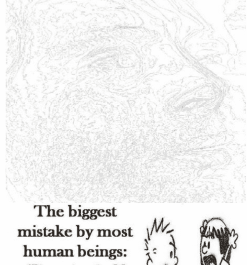

大多数人最大的错误：
“听一半，理解四分之一，说成双倍”。


## 章节
∞ 9 ∞
（你的大脑与指针）

## 引言
指针是一种特殊变量，用于存储其他变量的地址。指针可用于存储单个变量、数组、结构体、联合体甚至指针的地址。

## 指针——为什么？
## 使用指针使我们能够——
- 实现按引用调用（即编写可改变其参数的函数）
- 高效处理数组。
- 高效处理结构体（记录）。
- 创建链表、树、图等。
- 将数据放入堆中。
- 创建函数表以处理窗口事件、信号等。
- 已经在使用 scanf() 时用到指针
- 使用指针时必须小心，因为没有任何安全特性。

由于 C 编程是一种如此低级的语言，不使用指针几乎很难做任何事情。我们已经看到，不可能编写一个能修改其任何参数的函数。

## 头脑清洗练习——
指针也能够用于编写链表和其他此类数据结构。

标准库，连同 Windows、Windows 95 和 Windows NT
编程环境，都相当广泛地使用函数指针。

## 指针的问题——
一个问题是指针名声不好。它们被认为难以使用且难以理解。

## 指针的概念——
每个变量都存储在内存中，每个内存位置都有一个数字地址。变量的声明如下——

```
int a = 5;
```

这里 a 是变量名，变量的值是 5，而变量的地址是 100（假设）。

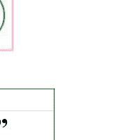

## 头脑清洗练习表——
| 声明指针 |
|---|
| 1. 指针通过使用星号“*”来声明 |
| 2. 声明一个整数：int i; |
| 3. 声明一个指向整数的指针：int *p; |

4. 关于“*”的位置存在一些争议：int* p;

第一步是了解如何声明指针。这是通过使用 C 的乘号字符“*”来完成的（显然它并不执行乘法）。

“*”放置在关键字 int 和变量名之间的某个位置。这样创建的不是一个整数，而是一个指向整数的指针。

## 头脑清洗练习表——
*上面和下面的表格都将帮助你轻松掌握指针的概念。*

| int | *pi; | /* pi 是一个指向 int 的指针 */ |
|---|---|---|
| long int | *p; | /* p 是一个指向 long int 的指针 */ |
| float * | pf; | /* pf 是一个指向 float 的指针 */ |
| char | c, d, *pc; | /* c 和 d 是 char，pc 是一个指向 char 的指针 */ |
| double * | pd, e, f; | /* pd 是一个指向 double 的指针，e 和 f 是 double */ |
| char * | start; | /* start 是一个指向 char 的指针 */ |
| char * | end; | /* end 是一个指向 char 的指针 */ |

变量的声明告诉编译器——
- 1. 在内存中保留空间以保存整数值。
- 2. 将名称“a”与此内存位置关联。
- 3. 在此位置存储值 5。

## 指针与间接运算符——
*与指针一起使用的两个基本运算符是：*
- 1. 取地址运算符 &
- 2. 间接运算符 *

```
main()
{
    int a = 5;
    int *p;                 /*pointer declaration*/
    p= &a;                  /*copying address of variable a to the pointer p*/
    *p = 10;                /*indirection or use of pointer to change the value of variable a*/
    printf("%d", a);
    printf("%d",*p);
    printf("%d",*(&a));
}
```

头脑清洗练习——上述程序中的所有 printf 语句都将输出 10。因为变量 p 并不像其他整数变量那样是普通变量。

它是一个存储其他变量（此处为 a）地址的变量。由于 p 是一个变量，编译器也必须为该变量提供内存。任何类型的指针在内存中都占两个字节。

```
int *p1;
float *p2;
char *p3;
All pointers p1, p2, p3 get 2 bytes each.
```

## 内存与指针——
假设为 int、float、char 声明三个指针。这三个指针都将在内存中占用 2 个字节。这是因为所有内存地址都是介于 0 到 65536 之间的整数值。因此可以说，无论指针是什么类型，它都以整数值形式存储地址，而每个整数只需要两个字节。

```
main()
{
    int a = 5,*p1;
    float b=2.5,*p2;
    char c='a',*p3;
    p1= &a;
    p2 = &b;
    p3=&c;
    printf("%d",sizeof(p1));
    printf("%d",sizeof(p2));
printf("%d",sizeof(p3));
```
输出：2 2 2

## 指针与地址——
```
main()
{
int a = 5;
int *p;
p = &a;
*p = 10;
printf("%d",p); /*prints the address in pointer p as integer */
printf("%u",p); /*prints the address in pointer p as unsigned integer */
printf("%x",p); /*prints the address in pointer p as hexadecimal */
printf("%X",p); /*prints the address in pointer p as hexadecimal */
}
```
输出：-12, 65524, ff4, FFF4

让我们分析一下输出。第一个答案是负值，这是因为指针的范围是从 0 到 65536，而变量是从上到下分配内存的，即从 65536 开始，然后 65535、65534，依此类推，直到 0。

变量 a 存储在地址 65524 处，如果我们使用格式说明符 %d 打印存储在指针 p 中的变量 a 的地址，就会打印一个负值，因为该地址超出了 int 的范围。

如果使用 %u，地址将以无符号整数形式打印。%x 或 %X 用于以十六进制形式打印地址，唯一区别是 %x 使用小写字母，而 %X 使用大写字母。

## 指针表达式：——
- 1. C 允许我们将整数与指针相加或相减。
- sum = sum + *p1;
- 2. 也允许使用简写运算符
- sum += *p1;
- ans = *p1++;

这会使指针 p1 指向其类型的下一个值，然后对该值解引用。

让我们用一个例子来说明这一点：
```
main()
{
int a[5]={10,20,30,40,50},*p;
p=a        /*address of array can be pointed into the pointer without
the use of & operator*/
printf("%d,",*++p);        /*dereferencing the next address*/
printf("%d",*++p);        /*dereferencing the address and adding 1 to
the element */
}
```
输出：20, 21

3. 以及将一个指针减去另一个指针。

```
*p1--;
main()
{
int a[5]={10,20,30,40,50},*p;
p=a;
printf("%d,",*++p);        /*dereferencing the next address i.e. index 1*/
printf("%d",*p--);        /*dereferencing the index 1 and then the postfix will
affect*/
printf("%d",*p);        /*dereferencing the pointer*/
}
```
输出：20, 20, 10

4. 如果 p1 和 p2 都是指向同一数组的指针，那么 p2-p1 给出 p1 和 p2 之间的元素个数。

```
*p3 = *p2 - *p1;
```

5. 两个指针也可以进行比较，例如 --
p1>p2
p1 = p2
p1 != p2.

这些比较只有在使用字符串或数组时才有用。

6. 两个指针不能相乘、相除或相加。

## 脑力洗涤练习 –

空指针是一种特殊的指针值，已知它不指向任何位置。这意味着任何其他指向其他变量、数组单元或任何其他东西的有效指针，都永远不会与空指针相等。

使用空指针的另一种方法是，通过使用任何一个标准头文件，包括 <stdio.h>、<stdlib.h> 和 <string.h>。要将指针初始化为空指针，您可能会使用如下代码-

```
#include <stdio.h>
int *p = NULL;
```

并且在检查所指向的值之前，您可能会使用如下代码来测试它是否为空指针 -

```
if(p != NULL)
printf("%d\n", *p);
```

也可以通过使用常量 0 来引用空指针，您会看到一些代码通过简单地执行以下操作来设置空指针

```
int *p = 0;
```

此外，由于 C 中“真”的定义是不等于 0 的值，您会看到使用简写代码来测试非空指针的代码，例如 -

```
printf("%d\n", *p);
```

这与我们之前的示例具有相同的含义；if(p) 等价于 if(p != 0) 且等价于 if(p != NULL)。

## 指针的指针 –

指针存储变量的地址，类似地，指针的地址也可以存储在另一个指针中。

```
main ()
{
int a=5;
int *p1;
int **p2; /*pointer to an integer*/
int ***p3; /*pointer to pointer to pointer to an integer*/
p1=&a;
p2=&p1;
p3=&p2;
printf("%d",a); /*output = 5*/
printf("%d",*p1); /*output = 5*/
printf("%d",**p2); /*output = 5*/
printf("%d",***p3); /*output = 5*/
printf("%u",*p2); /* address of p1 will be printed*/
}
```

## 指针与数组：

当声明数组时，编译器会分配一个基地址和足够的存储空间，以在连续的位置容纳数组中的所有元素。

基地址是数组中第一个元素（索引 0）的位置。

假设我们按如下方式声明数组：

```
static int a[5]={10,20,30,40,50};
```

假设数组 a 的基地址为 100，并且由于每个整数需要两个字节。

| [0] | [1] | [2] | [3] | [4] |
|------|------|------|------|------|
| 10 | 20 | 30 | 40 | 50 |
| 100 | 102 | 104 | 106 | 108 |

名称 a 被定义为指向第一个元素 a[0] 的常量指针，因此 a 的值是 100，即 a[0] 存储的位置。

即 a 等于 &a[0] 等于100。

如果我们将指针 p 声明为整数指针，那么我们可以使指针 p 指向数组 a –

```
p= a;
    or
    p = &a[0];
```

现在我们可以使用 p++ 来从一个元素移动到另一个元素，从而访问数组 a 的每个值。p 与 a 之间的关系如下所示：

- p 等于 &a[0];      (=100)
- p+1 等于 &a[1];    (=102)
- p+2 等于 &a[2];    (=104)
- p+3 等于 &a[3];    (=106)
- p+4 等于 &a[4];    (=108)

处理数组时，我们可以使用数组索引或指针来访问数组元素。因此我们可以指向数组的第三个元素，如下：

```
a[2] or *(p+2)      (remember the array index starts from 0).
```

## 指针与函数-

如前所述，将数组作为参数传递的函数使用传址机制。

## WAP（编写程序）交换两个数字。

| 使用传值调用：
void swap(int ,int);
main()
{
    int a,b;
    printf("Enter two numbers");
    scanf("%d %d",&a,&b); | 使用传址调用：
void swap(int * ,int*);
main()
{
    int a,b;
    printf("Enter two numbers");
    scanf("%d %d",&a,&b); |

```
swap(a,b);
printf("%d %d",a,b);
getch();
}
void swap( int, int)
{
    int x,y,t;
    t=x;
    x=y;
    y=t;
}
```

```
swap(&a,&b);
printf("%d %d",a,b);
getch();
}
void swap( int * p1, int * p2)
{
    int t;
    t=*p1;
    *p1=*p2;
    *p2=t;
}
```

## 在传址调用中-

- 函数原型声明为指针。
- 函数定义中使用解引用指针。
- 调用函数时，地址作为实际参数传递。

## 常见错误 -

指针在初始化之前包含垃圾地址。如果我们尝试解引用此指针，则不会产生任何错误，但它会跳转到该地址并在该地址中分配值。这是一个逻辑错误，编译器无法检测到。

## 内存分配 -

- 1. 静态内存分配。
- 2. 动态内存分配。

使用数组的传统方法是声明数组及其大小，并且由于数组的大小必须是常量，因此会导致内存浪费或不足，因为数组在程序编译时分配内存。

## 脑力洗涤练习 –

编译时分配的内存称为静态内存。这些问题可以通过使用指针来克服。指针可用于在程序执行时分配内存，称为动态内存。

因此，动态内存可以描述为在运行时分配内存的过程。C 本身没有此功能，但可以使用头文件 alloc.h 将其包含在程序中

| Functions | 任务 |
|---|---|
| malloc() | 分配请求数量的字节并返回指向起始地址的指针。 |
| calloc() | 分配请求数量的字节，将其初始化为零并返回指向起始地址的指针。它分配非连续内存。 |
| realloc() | 通过增加或减少字节数重新分配大小并返回指向起始地址的指针。 |
| free() | 释放先前分配的空间。 |

## 分配内存块(malloc) -

可以使用 malloc 函数分配内存块。malloc 函数为指定大小保留一块内存并返回类型为 void 的指针。这意味着我们可以将块的基地址分配给任何类型的指针。malloc 的一般语法是：

```
P= (cast type*) malloc(byte size);
```

现在让我们看一个例子：

```
P=(int*)malloc (10 * sizeof(int));
```

这里，malloc 函数返回一个整数类型指针 p，指向一块可以存储 10 个整数的内存区域。类似地，语句

```
P=(char*)malloc(10*sizeof(char));
Or
P=(char*)malloc(10); /*remember each character uses one byte*/
```

为字符类型指针 p 分配 10 字节的空间。

这可以说明如下：

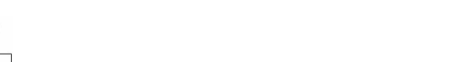

用于存储 10 个字符的空间

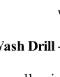

第一个字节的地址

malloc 可用于为复杂数据类型（如结构体）分配空间：

```
str_p= (struct store *)malloc(sizeof(struct store));
```

其中 str_p 是 struct store 类型的指针。

## 脑力洗涤练习 –

malloc 用于分配连续字节的内存。如果内存空间不足以满足请求，则请求可能会失败。如果失败，它将返回一个 NULL。

## 分配多个块 (calloc) -

Calloc 也是一个内存分配函数，通常用于为数组和结构体分配内存。malloc 用于分配单个存储空间块，calloc 分配多个存储块，每个块大小相同并初始化为零。calloc 的一般语法是：

```
P= (cast type*) calloc(n, array size);
```

现在让我们看一个例子：

```
P=(int*)calloc (10 , sizeof(int));
```

上述语句为 10 个块分配连续空间，每个块大小为 2 字节（因为 int 需要两个字节）。

所有字节都初始化为零，并且指针获取已分配块的起始地址。与 malloc 类似，如果此处内存请求无法满足，也会返回 NULL。

## 修改块大小 -

我们可能会后来发现，先前分配的内存不足，需要额外的空间，或者分配的内存比所需的大得多。

在这两种情况下，都必须更改块的大小，这可以通过使用 realloc 函数（重新分配内存）来实现。realloc 的一般语法是：

```
P= realloc(P, new size);
```

## 脑力洗涤练习 –

新大小可以大于或小于之前的大小。现在让我们看一个例子，假设用于存储 10 个整数的块是使用 malloc 分配的，如：

```
P=(int*)malloc (10 * sizeof(int));
```

现在要更改大小以便可以存储 5 个更多数字，语句将是：

```
P= realloc(P, 15);
```

该函数为指针 P 分配大小为 15 的新内存空间，并返回指向新块第一个字节的指针。

## 脑力洗涤练习 –

还请记住，新内存块可能与旧块开始于同一位置，也可能不开始于同一位置。

在这种情况下，它会在其他位置创建新的内存空间，将所有旧数据复制到那里，并将块地址返回给指针。

## 释放已使用的空间：

如果变量在编译时声明，则它们会根据

它们的存储类别，但如果使用动态分配，则释放空间是程序员的责任，如果未使用。

如果存储空间有限，也同样必要。我们可以释放内存空间，如果该空间中的数据不需要，使用函数 free 如：free(p);

## 1. 编写程序以从字符串中提取子串。

```c
#include<stdio.h>
#include<conio.h>
#include<string.h>
main()
{
    char str[20], news[20];
    char *s, *t;
    int pos, n, i;
    printf("Enter the string:");
    scanf("%s",str);
    printf("Enter the position and number of characters to extract:");
    scanf("%d%d",&pos,&n);
    s=str;
    t=news;
    if(n==0)
        n=strlen(str);
    s=s+pos-1;
    for(i=0;i<n;i++)
    {
        *t=*s;
        s++;
        t++;
    }
    *t='\0';
    printf("The substring is: %s\n",news);
    getch();
}
```

## 2. 编写程序对 4x4 矩阵的所有元素进行排序。

```c
main()
{
    int mat[4][4], *arr, i, j, k, t;
    printf("Enter the elements of 4x4 matrix:");
    /*matrix input*/
    for(i=0; i<4; i++)
    {
        for(j=0; j<4; j++)
        {
            printf("Enter element %d %d",i+1,j+1);
            scanf("%d",&mat[i][j]);
        }
    }
    /*sort the elements of the matrix*/
    arr = mat; /*Base address of the matrix array*/
    /* Print the matrix as entered using pointer*/
    printf("\nThe matrix formed is...\n");
    for(i=0; i<15; i++)/*number of passes*/
    {
        for(j=i+1; j<16; j++)
        {
            if(*(arr+i)>*(arr+j))
            {
                t = *(arr+i);
                *(arr+i)= *(arr+j);
                *(arr+j)=t;
            }
        }
    }
    /*print the sorted matrix*/
    printf("\n The sorted matrix is:\n");
    for(i=0; i<4; i++)
    {
        for(j=0; j<4; j++)
            printf("%d",mat[i][j]);
            printf("\n");
    }
    printf("\n\nPress any key to exit...");
    getch();
}
```

## 3. 编写程序输入任意字符串并删除其中多余的空白字符。

```c
#include<stdio.h>
#include<conio.h>
#include<string.h>
main()
{
    static char s1[50];
    char s2[50];
    char *s, *t;
    int i, l;
    printf("Enter a string");
    gets(s1);
    s=s1;
    t=s2;
    l=strlen(s);
    for(i=0;i<=l-1;i++)
    {
        if(*s==' ') /*check for a blank*/
        {
            if(*(s+1)!=' ')
            {
                *t=*s;
                t++;
            }
            s++;
        }
        else
        {
            *t=*s;
            t++;
            s++;
        }
    }
    *t='\0';
    printf("Original Statement:%s\n",s1);
    printf("Modified Statement:%s",s2);
    getch();
}
```

## 4. 编写程序使用指针连接 2 个字符串。不要使用 strcat 函数。

```c
main()
{
    char s1[20],s2[20],*p1,*p2;
    /* Input 1st string*/
    printf("Enter 1st string");
    gets(s1);
    /*Input 2nd string*/
    printf("Enter 2nd string");
    gets(s2);

    /*Assigning address of strings in two pointers*/

    p1 = s1;
    p2 = s2;

    /*Moving pointer 1 to the end of 1st string*/

    while(*p1 != '\0')
        p1++;

    /* Adding 2nd string to the end of 1st string*/

    while(*p2 != '\0')
        *p1++ = *p2++;

    /* Adding NULL to the end of string*/

    *p1 = '\0';

    /*Output string after concatenation*/
    puts(s1);
    getch();
}
```

## 5. 编写程序从键盘接收月份和年份作为整数，并按以下格式打印日历。

```c
static char *months[] = {
                         "January",
                         "February",
                         "March",
                         "April",
                         "May",
                         "June",
                         "July",
                         "August",
                         "September",
                         "October",
                         "November",
                         "December"
                         };

main()
{
                 static int days[12]={31,28,31,30,31,30,31,31,30,31,30,31};
                 long int ndays, ldays, tydays, tdays;
                 int d, i,         m, fday, y;
                 char ch;
                 clrscr();
                 printf("Enter year(1900 onwards)& month (number):");
                 scanf("%d %d",&y,&m);
                         ndays = (y-1)*365;
                         ldays = (y-1)/4-(y-1)/100+(y-1)/400;
                         tdays = ndays+ldays;
                         if((y%100==0&&y%400==0)||(y%4==0&&y%100!=0))
                                  days[1]=29;
                         else
                                  days[1]=28;
                         d= days[m-1];
                         tydays = 0;
                         for(i=0; i<m-1; i++)
                                  tydays = tydays + days[i];

                         tdays = tydays + tdays;
                         fday = tdays%7;
                         cal(y, m, fday, d);
}
```

```c
cal(int yr, int mo, int fd, int da)
{
    int i, r, c;
    char a;
    clrscr();
    gotoxy(25,2);
    printf("%s %d",months[mo-1],yr);
    gotoxy(5,5);
    printf("-------------------------------");
    gotoxy(5,7);
    printf("Mon Tue Wed Thu Fri Sat Sun");
    gotoxy(5,8);
    printf("-------------------------------");
    r = 9;
    c=11+6*fd;
    for(i=1; i<=da; i++)
    {
        gotoxy(c,r);
        printf("%d",i);
        if(c<=41)
            c=c+6;
        else
        {
            c=11;
            r=r+1;
        }
    }
    gotoxy(5,15);
    printf("--------------------------------");
    printf("\n\n\n\nPress any key to exit...");
    getch();
}
```

## 6. 编写程序读取一行并删除其中所有出现的单词 'the'。

```c
main()
{
    char str[80], str2[80];
    char *s,*q,*p;
    int i;
    clrscr();
    printf("\nEnter a sentence not more than 80 chars long:\n");
    gets(str);
    s = str; /*Base address of the string*/
    p = str2; /*Base address of new string*/
    while(*s)
    {
        q = s;
        if(*s=='t' || *s=='T')
        {
            s++;
            if(*s=='h')
            {
                s++;
                if(*s=='e')
                    ;
                else
                {
                    for(i=0; i<=2; i++)
                        *p++=*q++;
                }
            }
            else
            {
                *p++=*q++;
                s--;
            }
        }
        else
        {
            *p++=*s;
            s++;
        }
    }
    *p='\0';
    printf("\n\nSentence after deleting all occurrences of 'the' is:\n");
    puts(str2);
    getch();
}
```

## 下列程序的输出是什么：

- **1.**
  
  ```c
  char far *s1,*s2;
  printf("%d\n%d",sizeof(s1),sizeof(s2));
  ```
  
  **输出：** 4 2

- **2.** 表达式 `*p++` 和 `++*p` 相同吗？
  
  **输出：** 否。`*p++` 增加指针而不是它指向的值，而 `++*p` 增加 `p` 指向的值。

- **3.** 是否有另一条语句可以完成与 `++*p` 相同的功能？
  
  **输出：** `(*p)++`

- **4.** 引用与 `a[i][j][k][l]` 相同元素的等效指针表达式是什么？
  
  **输出：** `*(*(*(*(a+i)+j)+k)+l)`

- **5.** 下列程序的输出是什么：
  
  ```c
  int a[]={12, 13, 14, 15, 16};
  printf("%d %d %d", sizeof(a), sizeof(*a), sizeof(a[0]));
  ```
  
  **输出：** 10 2 2

- **6.** 假设数组从位置 1002 开始，以下程序的输出是什么。
  
  ```c
  int a[3][4]={1, 2, 3, 4,5, 6, 7, 8, 9, 10, 11, 12};
  printf("%u %u %u", a[0]+1, *(a[0]+1), *(*(a+0)+1));
  ```
  
  **输出：** 1004 2 2

## 7. 在以下程序中，如何使用 p 打印 50？

```c
main()
{
int a[]={10, 20, 30, 40, 50};
char *p;
p=(char*)a;
}
```

**输出：** `printf("%d",((int*)p+4));`

## 8. 在以下程序中，在函数 fun() 中添加一条语句，使 a 的地址存储在 j 中

```c
void fun(int**);
main()
{
    int *j;
    fun(&j);
}
void fun(int **k)
{
    int a=10;
/*add statement here*/
}
```

**输出：** `*k=&a;`

## 9. 如何声明一个包含三个函数指针的数组，其中每个函数接收两个 int 并返回一个 float？

**输出：** `float(*a[3])(int,int);`

- **26.** 如何动态分配二维数组？
  
  **输出：**
  
  ```c
  #include<alloc.h>
  #define MAXROW 10
  #define MAXCOL 10
  main()
  {
      int *p, i, j;
      p=(int *) malloc (MAXROW * MAXCOL * sizeof(int));
      /*input in matrix*/
      for(i=0;i<MAXROW;i++)
      {
          for(j=0;j<MAXCOL;j++)
          {
              p[i*MAXCOL+j]=i;
              printf("%d",p[i*MAXCOL+j]);
          }
          printf("\n");
      }
  }
  ```

- **27.** 如何动态分配一个整数二维数组，使得我们能够使用两个下标访问任何元素，如 `a[i][j]`？
  
  **输出：**
  
  ```c
  #include<alloc.h>
  #define MAXROW 10
  #define MAXCOL 10
  main()
  {
      int **p, i, j;
      p=(int **) malloc (MAXROW * sizeof(int*));
      for(i=0;i<MAXROW;i++)
          p[i]=(int *)malloc(MAXCOL * sizeof(int));
      for(i=0;i<MAXROW;i++)
      {
          for(j=0;j<MAXCOL;j++)
          {
              p[i][j] = i;
              printf("%d",p[i][j]);
          }
          printf("\n");
      }
  }
  ```

## 28. 如何动态分配一个整数二维数组，使得我们能够使用两个下标访问任何元素，如 `a[i][j]`？此外，数组的行应存储在相邻的内存位置中。

**输出：**

```c
#include<alloc.h>
#define MAXROW 3
#define MAXCOL 4
main()
{
    int **p, i, j;
    p=(int **) malloc (MAXROW * sizeof(int*));
```


### 10. 下面程序会产生编译错误或警告吗？

```c
float i=10, *j;
void *k;
k=&j;
j=k;
printf("%f",*j);
```

输出：否。这里在向 k 赋值和从 k 取值时不需要类型转换，因为当其他指针类型被赋给 void * 时会自动应用转换。

### 11. 下面程序能否编译？

```c
main()
{
    float i=10, *j;
    void *k;
    j=k=&a;
    j++;
    k++;
    printf("%u %u", j, k);
}
```

输出：否。语句 k++ 会报错，因为除非 void 指针被适当类型转换，否则不允许对 void 指针进行算术运算。

### 12. 下面程序代码能否成功编译？

```c
printf("%c", 7["Computer"]);
```

输出：是的，它会打印 Computer 的 r。

### 13. 空指针是什么？

输出：对于每种指针类型，C 定义了一个特殊的指针值，该值保证不指向该类型的任何对象或函数。通常，用来表示空指针的空指针常量是整数 0。

### 14. NULL 指针是否与未初始化指针相同？

输出：否。

### 15. NULL 宏在哪个头文件中定义？

输出：在文件 <stdio.h> 中

### 16. 空指针、NULL 宏、ASCII NUL 字符和空字符串之间有什么区别？

输出：空指针是指不指向任何地方的指针。NULL 宏用于在源代码中表示空指针。它与值 0 相关联。ASCII NUL 字符的所有位都为 0，但与空指针没有任何关系。空字符串只是空字符串 "" 的另一个名称。

### 17. 下面程序的输出是什么？

```c
#include<stdio.h>
main()
{
    int a, b=5;
    a= b+NULL;
    printf("%d",a);
}
```

输出：5

### 18.

```c
int a[] = {10,20,30,40,50};
int *j;
j = a;
j = j+3;
printf("\n%d",*j);
```

输出：40

### 19.

```c
float a[] = {3.24,1.5,2.5,3.5,4.5,5.5};
float *j,*k;
j = a;
k = a+4;
j = j*2;
k= k/2;
printf("\n%d %d",*j,*k);
```

输出：错误。因为不允许对指针进行乘法和除法运算。

### 20. 下面程序的输出是什么？

```c
#include<stdio.h>
main()
{
    printf("%d %d", sizeof(NULL), sizeof(""));
}
```

输出：2 1

### 21. near、far 和 huge 指针各占用多少字节？

输出：near 指针长 2 字节，far 和 huge 指针长 4 字节。

### 22. 下面程序的输出会是什么？

```c
char *f();
main()
{
    char *s;
    s=f();
    printf("%s",s);
}
char *f()
{
    char string[30];
    strcpy(string, "Matrix Computers");
    return(string);
}
```

输出：输出不可预测，因为 string 是一个自动类型的数组，当控制返回到 main() 时它就会失效。因此 s 将指向一个不再存在的数组。

### 23. 上述问题的解决方案是什么？

输出：

```c
char *f();
main()
{
    char *s;
    s=f();
    printf("%s",s);
}
char *f()
{
    static char string[30];
    strcpy(string, "Matrix Computers");
    return(string);
}
```

### 24. 上述问题是否存在其他解决方案？

输出：

```c
char *f();
main()
{
    char *s;
    s=f();
    printf("%s",s);
    free(s);
}
char *f()
{
    char *p;
    p=(char*)malloc(30);
    strcpy(p, "Matrix Computers");
    return(p);
}
```

### 25. 如何动态分配一维数组？

输出：

```c
#include<alloc.h>
#define SIZE 10
main()
{
    int *p,i;
    p=(int *) malloc (SIZE * sizeof(int));
    /*input in array*/
    for(i=0;i<SIZE;i++)
    {
        p[i]=i;
    }
    /*printing elements*/
    printf("%d",p[i]);
}
```

```c
p[0]=(int *) malloc (MAXROW * MAXCOL * sizeof(int));
for(i=0;i<MAXROW;i++)
    p[i]=p[0] + i * MAXCOL;

for(i=0;i<MAXROW;i++)
{
    for(j=0;j<MAXCOL;j++)
    {
        p[i][j] = i;
        printf("%d",p[i][j]);
    }
    printf("\n");
}
```

### 29. 下面代码是否总能工作：

```c
main()
{
    char *p;
    gets(p);
    printf("%s",p);
}
```

输出：否，因为 p 是一个未初始化的指针，它必须指向内存中的某个未知位置。我们输入的字符串将被存储到 p 指向的位置，从而覆盖该位置原有的内容。

### 30. 下面代码虽然有时可能工作，但是不合适的。如何改进它：

```c
main()
{
    char *p1 = "Matrix";
    char *p2 = "Computers";
    strcat(p1,p2);
    printf("%s",p1);
}
```

输出：

```c
main()
{
    char p1[25]= "Matrix";
    char *p2 = "Computers";
    strcat(p1,p2);
    printf("%s",p1);
}
```

### 31. 下面程序中第二个 printf() 的输出会是什么：

```c
#include<alloc.h>
main()
{
    int *p;
    p=(int*)malloc(20);
    printf("%u",p);
    /*suppose it prints 1314*/
    free(p);
    printf("%u",p);
}
```

输出：1314

### 32. 对 free() 我们只传递要释放的内存块的指针。那么 free() 如何知道应该释放多少字节？

输出：在大多数 malloc() 实现中，已分配字节数存储在已分配块旁边。因此 free() 很容易知道要释放多少字节。

### 33. 下面程序的输出会是什么：

```c
#include<alloc.h>
main()
{
    int *p;
    p=(int*)malloc(20);
    printf("%d",sizeof(p));
    free(p);
}
```

输出：2

### 34. malloc() 和 calloc() 函数有什么区别？

输出：与 malloc() 相比，calloc() 需要两个参数，要分配的元素数量和每个元素的大小。

例如，

```c
p=(int*) calloc(10, sizeof(int));
```

将为 10 个整数数组分配空间。此外，calloc() 会将每个元素初始化为 0。

### 35. 单次调用 malloc() 最多可以分配多少内存？

输出：64 KB。

### 36. 下面程序的输出应该是什么？

```c
main()
{
    char a[] = "Matrix Computers";
    char *b = "Matrix Computers";
    printf("%d %d", sizeof(a), sizeof(b));
    printf("\n%d %d", sizeof(*a), sizeof(*b));
}
```

输出：16 21  
1 1

### 37. 对于下面语句，a[3] 和 p[3] 是否会获取相同的字符？

```c
char a[] = "Matrix";
char *p = "Matrix";
```

输出：是

### 38. 编译器在何时会将 char a[] 和 char *a 视为相同？

输出：在定义函数时作为形式参数使用时。

### 39. 程序能否成功编译：

```c
main()
{
    char a[] = "Matrix";
    char *p = "Computers";
    a = "Computers";
    p = "Matrix";
    printf("%s %s", a, p);
}
```

输出：否，因为我们可以将新字符串赋给指针，但不能赋给数组。

### 40. 下面声明是什么意思：

```c
int (*p)[10];
```

输出：p 是一个指向包含 10 个整数的数组的指针。

### 41. 下面程序的输出会是什么：

```c
main()
{
    char *s[]={"Frogs", "Do", "Not", "Die", "They", "Croak!"};

    printf("%d %d",sizeof(s), sizeof(s[0]));
}
```

输出：12 2

### 42. 下面声明有什么区别：

```c
char *p="Matrix";
char a[] = "Matrix";
```

输出：这里 a 是一个足够大的数组，可以容纳字符串以及字符串后面的 '\0'。数组内的各个字符可以被更改，但数组的地址将保持不变。另一方面，p 是一个指针，初始化为指向字符串常量。指针 p 可以被修改以指向另一个字符串，但如果你尝试修改 p 指向的字符串，结果是未定义的。

### 43. 如果 int s[5] 是一个一维整数数组，下面哪个指的是数组中的第三个元素？

- a) *(s +2)
- b) *(s +3)
- d) s + 3
- e) s + 2

输出：a) *(s +2)


## 第 10 章

### (Your Brain on Structure & Union)

### (Enum, Bit Fields, Typedef)

### 介绍

数组是存储相同数据类型对象的首选方法。除了数组之外，还有三种派生数据类型可用于存储信息：结构、联合、位域、typedef 和枚举。与数组不同，这些可以用于存储相同或不同类型的数据。

### 结构

结构可以定义为一种派生数据类型，可以在一个单元中表示几种不同类型的数据。结构内的每个单独数据项称为成员。

结构是将不同类型的数据打包以更有意义地组织数据的方法。结构定义创建了一个格式，可用于声明结构变量。


结构体定义通过使用关键字 struct 来指定。其后是用花括号括起的成员及其数据类型。

例如：

```c
struct student        /*definition of structure*/
{
int roll;             /*members*/
char name [10 ];
float per;
}s1,s2;               /*objects or variables of the structure student*/
```

结构体的成员不是变量，因此不会为它们分配内存。只有当声明对象时，才会在内存中为它们分配空间。（例如 s1 和 s2）。

## 思维洗涤训练-
关键字 struct 声明了一个结构体 student，它包含三个不同的详细信息，即 roll、name、marks。这些字段称为结构体的成员或元素。该结构体命名为 student，这个名称称为结构体标签。

### 变量/对象声明 -
```
struct student s1,s2;
```

结构体的变量可以在定义的同时声明，如下所示：

```
struct student
{
    int roll;
    char name[50];
    float marks;
}s1,s2;
```

## 关于结构体的注意事项 -
- 1. 结构体定义以分号结束。
- 2. 整个定义被视为一条语句，而每个成员都在定义内部的单独语句中独立声明其名称和类型（也称为模板）
- 3. 标签名可以在结构体定义时声明，也可以稍后在 main 函数中声明。
- 4. 内存分配给变量，而不是分配给结构体的成员。

## 使用成员 -
在数组中，我们可以使用下标运算符 [ ] 访问数组的各个元素。

结构体使用不同的方案。它使用点或句点运算符（.）。因此，要引用上述结构体中的 marks：

*s1.marks*

这里变量名写在点之前，成员名写在点之后。

### 思维洗涤训练-
结构体的元素始终存储在连续的内存位置中。

```c
struct student
{
    int roll;
    char grade;
    int marks;
};
    main()
{
    struct student s1={2, 'A', 89};
    printf("Address of roll=%u",&s1.roll);
    printf("Address of grade=%u",&s1.grade);
    printf("Address of marks=%u",&s1.marks);
}
```

该程序的输出为：
Address of roll=65518
Address of grade=65520
Address of marks=65521

| S1.roll | s1.grade | s1.marks |
| 2 | A | 89 |
| 65518 | 65520 | 65521 |

## 使用数组的结构体 -
```c
struct student
{
    int roll;
    char name[50];
    int marks;
};

main()
{
    struct student s1;
    printf("Enter the data for student:");
    scanf("%d %s %d",&s1.roll,s1.name,&s1.marks);
    printf("RollNumber=%d,\nname=%s\nmarks=%d",s1.roll,
    s1.name,s1.marks);
}
```

在上述结构体定义中，使用数组来存储学生的姓名。虽然 scanf 的变量名之前总是包含 &，但字符串没有 & 运算符。

## 结构体数组 -
```c
struct student
{
    int roll;
    char name[50];
    int marks;
}s[10];
```

上述定义使用对象数组来存储 10 个学生的数据

## 结构体初始化 -
```c
struct student s1={1,"ajay",75.5};
struct student s2[3]={{1,"ajay",75.5}, {2,"vijay",75.5},{1,"akash",75.5} };
```

### 思维洗涤训练-
如果我们只初始化结构体的部分成员，那么其他成员将自动初始化为零。

## 结构体中的结构体（嵌套结构体） -
结构体中的结构体称为结构体嵌套。当一个结构体的对象是另一个结构体的成员时，就是这种情况。

```c
struct date
{
    int d;
    int m;
    int y;
};
struct employee
{
    int id;
    struct date dob;
    struct date doj;
}e1;
main()
{
    printf("Enter id of a employee");
    scanf("%d",e1.id);
    printf("Enter date of birth");
    scanf("%d%d%d",&e1.dob.d,&e1.dob.m,&e1.dob.y);
    .
    .
}
```

### 思维洗涤训练-
在上面的示例中，我们也可以在结构体 employee 的定义内部定义结构体 date。

## 结构体与指针 -
```c
struct student s1,*p;
p = &s1;
s1.roll = 5;
(*p).roll = 7;
or
p->roll = 7;
printf("%d",s1.roll);      /* This will print 7.
```

### 思维洗涤训练-
点（.）运算符用于通过对象访问结构体的成员。
（对象.成员）

箭头（->）运算符用于通过指针访问结构体的成员。
（指针->成员）

```c
struct box
{
    int feet;
    int inches;
};
void swap(struct box *, struct box *)
main()
{
    struct box b1,b2;
    clrscr();
    /*Input first object*/
    printf("Enter height in feet & inches of box 1");
    scanf("%d%d",&b1.feet,&b1.inches);
    /*Input second object*/
    printf("Enter height in feet & inches of box 2");
    scanf("%d%d",&b2.feet,&b2.inches);
    swap(&b1,&b2);
printf("After swap height of 1ST box- %d feet %d inches\n",b1.feet, b1.inches);
printf("After swap height of 2ND box- %d feet %d inches\n",b1.feet, b1.inches);
	getch();
}
void swap(struct box *p1, struct box *p2)
{
	int t;
	/*swapping feets*/
	t = p1->feet;
	p1->feet = p2->feet;
	p2->feet = t;
	/*swapping inches*/
	t = p1->inches;
	p1->inches = p2->inches;
	p2->inches = t;
}
```

## 联合体 -
联合体也是派生数据类型。它们也用于将多个变量组合在一起。但区别在于，联合体的所有成员共享同一内存位置，因此联合体一次只能有一个成员存储有效值。联合体是一种变量，用于在不同时间存储不同类型的数据。

联合体很像结构体。联合体中定义的不同变量称为联合体的成员。它们不必具有相同的数据类型。如果一个成员包含一个值，而另一个成员被赋值，那么第一个值将被第二个值覆盖。编译器分配足够的内存来容纳联合体中最大的成员。由于内存空间是共享的，这是一种节省内存的方法。

### 语法：
```c
union <union type name>
{
	<type> <variable names> ;
}
```
```
~~~
            ...
} [<union variables>] ;
~~~
```

### 例如：
```c
union data
{
        char c;                 /*member declaration*/
        int i;
        long l;
        float f;
}d1,d2;
```

### 思维洗涤训练-
在上面的示例中，d1 和 d2 将各获得 4 个字节，因为联合体中最大的成员是 4 个字节。如果有多个最大字节成员，则只考虑其中一个。

### 思维洗涤训练-
在上述声明中，union 是一个关键字。

### 思维洗涤训练-
点运算符用于访问联合体的成员。例如，要访问上述联合体的成员

```c
d.c= 'a';
d.i= 10;
d.l= 65534;
d.f= 72.456;
```

如果你在这个联合体的 f 成员中存储某些内容，然后访问 i 成员，那么 i 的值是不可预测的。

## 结构体与联合体的区别 -
| | **结构体** | **联合体** |
|---|---|---|
| **1.** | 关键字是 struct。 | 关键字是 union。 |
| **2.** | 结构体的对象将获得等于所有成员内存之和的内存。 | 联合体的对象将获得等于联合体中最大成员内存的内存。 |
| **3.** | 所有成员可以同时使用。 | 只有一个成员可以存储有效值。 |

## 枚举数据类型 -
枚举数据类型是一种具有用户指定常量值的数据类型。其语法类似于结构体或联合体：它用于定义常量。关键字是 enum。其后是枚举器类型。一个名称列表，这些名称是该数据类型允许的值。这些值括在花括号中，并用逗号分隔。

### 示例 –
```c
enum bool{FALSE ,TRUE};
/*false and true are constants with values 0 & 1. this numbering is done automatically*/
```

```c
enum bool b1,b2;
/*objects of enum bool*/
b1=FALSE;
or
b1=TRUE;
```

```c
enum dow {SUN,MON,TUE=5,WED,THU,FRI,SAT};
/*automatic numbers will be SUN=0,MON=1,TUE=5,WED=6 & so on*/
```

```c
/*enum declaration*/
enum color {blue, green, red, yellow};
enum color c1,c2;
```

```c
/*assigning values*/
c1 = red;
c2 = green;
```

```c
/*enum declaration*/
enum color {blue, green, red, yellow} c1,c2;

/*assigning values*/
c1 = red;
c2 = green;
```


5.

```c
enum color {blue=10, green=15, red=25, yellow=30};
```

如果我们不想要默认值 0、1、2……，那么我们可以自己给这些枚举常量赋值。

声明枚举类型不会分配存储空间，而只是描述用户指定的数据类型以及与花括号中给定值相关联的整数常量。默认情况下，第一个值被赋为 0，第二个值为 1，第三个值为 2，依此类推。

### 思维洗涤练习
在联合体中，我们也可以给出重复的值。

### 思维洗涤练习
在联合体中，我们可以提供浮点数。

## 位域

如果在程序中一个变量只需存储 1 或 0 两个值，那么我们只需要 1 位来存储它。类似地，如果该变量要存储 0 到 3 之间的值，则只需要 2 位，因为 0 到 3 之间所有数字的二进制都是两位。如果值在 0 到 7 之间变化，则需要 3 位。

但是如果我们存储一个整数，就会使用 2 个字节，从而浪费大量内存，因为没有可以按位处理的数据类型。然而，当有多个变量的值可以打包到同一个内存位置时，我们可以使用“位域”。

假设我们要存储关于某位俱乐部成员的数据。每位成员可以拥有以下数据：

- 1. 男性或女性。
- 2. 已婚、未婚、丧偶或离异。
- 3. 拥有八种爱好中的任意一种（板球、足球等）。
- 4. 可以从十六种方案中选择任意一种（年度方案、月度方案等）。

如果我们用 0 或 1 代替男性、女性来存储性别，这将节省一些字节。同样，其他值也可以转换为数字。

这意味着我们需要 1 位来存储性别，2 位存储婚姻状况，3 位存储爱好，4 位存储方案。因此加在一起我们总共需要 10 位，所以我们可以将上述所有信息打包到两个字节中。

因此声明如下：

```c
struct employee
{
    int gender:1;
    int mar_status:2;
    int hobbies:3;
    int scheme:4;
};
```

上述声明中的冒号告诉编译器我们正在讨论位域，冒号后面的数字表示分配给每个变量的位数。

## Typedef（类型重定义）

C 提供了 typedef 构造，它允许程序员为内置数据类型或用户自定义数据类型提供一个同义词（别名）。typedef 就像给数据类型起的一个昵称。程序变得更易于跟踪和理解。typedef 的一般用法是：

```c
e.g.
    typedef oldtypename newtypename;
    typedef int age;
```

在这里，age 成为 int 的同义词。因此，我们可以用 age 替代 int。

```c
age a1,a2;
    or
    int a1,a2;
```

现在，age 可用于定义 int 变量 a1 和 a2。

### 思维洗涤练习
在 typedef 的语法中，首先出现关键字 typedef，然后是数据类型，最后是用户为该数据类型提供的名称。

typedef 仅用于为数据类型创建同义词。在 typedef 中，不能定义变量，也不会分配存储空间。

### 例如，下面这种写法是错误的：

```c
typedef int age a1,a2; /*invalid*/
```

### 将 typedef 用于结构体：

```c
typedef struct student
{
    int roll;
    char name[50];
    int marks;
} st;

main()
{
    st s1,s2;
    or
    struct student s1,s2;
}
```

typedef 名称可以与结构体的标签名相同。

### typedef 与代码可移植性：

typedef 可用于提高代码的可移植性。

假设我们有一个应用程序，它假定所有整数都由 16 位存储单元表示。在计算机系统 A 上，int 可能使用 32 位；在另一个系统 B 上，int 可能使用 16 位。

因此，

```c
/* on computer system A */
/*integer has 16 bits*/
typedef short int INTEGER;

/*on computer system B*/
/*integer has 32 bits*/
typedef int INTEGER;
```

在整个程序中，我们可以在变量声明中使用 INTEGER 而不是 short int。这个 typedef 可以放在一个文件（如 port.h）中，然后在需要整数变量的文件中包含该文件。


## 填空题

- 1. ___ 是作为一个整体单元组合在一起的异构变量集合。
- 2. ___________________________ 为结构体提供了蓝图。
- 3. ________________ 只有当声明 ________ 时，才会为结构体分配内存。
- 4. ________________ 结构体的成员元素可以通过 ___ 与 ___ 访问。
- 5. ________________ 指向结构体的指针可以声明为 ________________。
- 6. ________________ 结构体提高了程序的 ________________。
- 7. ________________ 结构体在 ________________ 中得到了应用。
- 8. ________________ 结构体的大小是 ________________。
- 9. ________________ 彼此无关的异构对象的集合称为 ___。
- 10. ________________ 联合体的所有成员共享同一个 ______。
- 11. ________________ 联合体的大小是 ________________。
- 12. ________________ typedef 用于创建 ________________。
- 13. ________________ typedef 的语法是 ________________。

## 答案

| 编号 | 答案 |
|---|---|
| 1 | 结构体 |
| 2 | struct |
| 3 | 对象 |
| 4 | .（句点）或 ->（箭头运算符） |
| 5 | struct tag_name *ptr_to_pointer |
| 6 | 可读性 |
| 7 | 系统编程 |
| 8 | 所有数据成员和子成员的总和。 |
| 9 | 联合体 |
| 10 | 内存空间 |
| 11 | 其成员中所需的最大内存空间。 |
| 12 | 新的数据类型名 |
| 13 | typedef <名称> <新名称> |

## 部分例题解答

1. 编写一个程序，比较两个给定的日期。要存储日期，请使用一个包含三个成员的结构体，即日、月和年。如果两个日期相等，则显示消息“Equal”，否则显示“Unequal”。

```c
struct date
{
    int day, month, year;
};
int check_date(struct date *dt);
main()
{
    int chkdt;
    /*The dates to be compared*/
    struct date d1, d2;
    /*input the dates to be compared*/
    printf("\nEnter the dates to be compared:");
    chkdt = check_date(&d1);
    if(chkdt == 0)
        exit();
    fflush(stdin);
    chkdt = check_date(&d2);
    if(chkdt == 0)
        exit();
    /* Compare the two structures*/
    if((d1.day == d2.day)&&(d1.month == d2.month)&&(d1.year == d2.year))
        printf("\nDate are Equal");
    else
        printf("\nDate are Unequal");
    getch();
}
/*Function to check the date entered*/
int check_date(struct date *dt)
{
    printf("\nEnter date(dd)");
    scanf("%d",&dt->day);
    printf("\nEnter month(mm)");
    scanf("%d",&dt->month);
    printf("\nEnter date(yyyy)");
    scanf("%d",&dt->year);
    if((dt->day >31 || dt->day<0) || (dt->month >12 || dt->month < 0) ||
        (dt->year > 9999 || dt->year < 1000))
    {
        printf("\nImproper date entered");
        return(0);
    }
    else
        return(1);
}
```

## 以下程序的输出是什么？

### 1)

```c
main()
{
    struct message
    {
        int n;
        char mess1[50];
        char mess2[50];
    } m;
    m.n = 1;
    strcpy(m.mess1,"you can win");
    strcpy(m.mess2, "If you believe");
    /*assume that the structure is located
    at address 2005*/

    printf("\n%u %u %u",&m.n,m.mess1,m.mess2);
}
```

输出：结构体的每个成员变量的地址都会被打印出来。

### 2)

```c
struct gos
{
    int n;
    char mess1[50];
    char mess2[50];
} m1={2, "If you are driven by success","make sure that it is a quality drive"};
main()
{
    struct gos m2,m3;
    m2 = m1;
    m3 = m2;
    printf("\n%d %s %s",m1.n,m2.mess1,m3.mess2);
}
```

输出：2 If you are driven by success make sure that it is a quality drive。因为在创建结构体时，结构体对象 m1 已被初始化。在主程序中又创建了另外两个对象 m2 和 m3，m1 被复制到 m2，然后 m2 被复制到 m3，因此 m1 的值被复制到了 m2 和 m3 中。所以，打印 m1 的成员时会得到相同的输出。

### 4.

```c
main()
{
    struct emp
    {
        char name[20];
        int age;
        float sal;
    };
    struct emp e = {"Matrix"};
    printf("%d %f\n", e.age, e.sal);
}
```

- 1. 0.000000
- 2. 垃圾值
- 3. 错误
- 4. 以上都不是

解答：0.000000

解释：当一个自动存储期结构体被部分初始化时，结构体的其余元素会被初始化为 0。

### 5.

```c
struct emp
{
    char name[20];
    int age;
}
fun (int aa)
{
    int bb;
    bb=aa*aa;
    return(bb);
}
main()
{
    int a;
    a=fun(20);
    printf("\n%d",a);
}
```

解释：结构体定义末尾缺少分号，编译器会认为 fun() 将返回 struct emp 类型的值，而实际上它试图返回 int。这会导致类型不匹配，因此产生错误。

### 6. f(struct emp);


在 printf() 中更改成员对输出没有影响。

对象可以被赋给另一个对象，但不能用于其他操作。

```c
3 main()
{
    union a
    {
        int i;
        char ch[2];
    };
    union a z=512;
    printf("%d %d",z.ch[0],z.ch[1]);
}
```

输出：0 2 512 的二进制是 (00000010 00000000)

```c
struct emp
{
    char name[20];
    int age;
};
main()
{
    struct emp e = {"matrix", 30};
    f(e);
}
f(struct emp ee)
{
    printf("%s %d",ee.name,ee.age);
}
```

说明：会发生错误，可以通过在函数 f() 的声明之前声明结构体来纠正。

## Question-结构、联合和枚举之间的相似性是什么？

答案：它们都允许我们定义一种新的数据类型。

## Question-以下声明是否有效：

```c
typedef struct s
{
    int a;
    float b;
}s;
```

答案：是

## Question-结构体可以包含指向自身的指针吗：

答案：可以，这样的结构体被称为自引用结构体。

## Question-指出以下代码中的错误（如有）

```c
typedef struct
{
    int data;
    NODEPTR link;
}*NODEPTR;
```

答案：typedef 为类型定义了一个新的名称，在本例中错误在于 typedef 在被定义之前不能使用。在给定的代码片段中，在声明 link 字段时 typedef 声明尚未定义。

## Question: 如何消除上述问题？

答案：为了解决这个问题，首先必须为结构体命名（"struct node"）。然后将 link 字段声明为简单的 struct node *，如下所示：

```c
typedef struct node
{
    int data;
    struct node *link;
}*NODEPTR;
```

另一种消除问题的方法是将 typedef 声明与结构体定义分离，如下所示：

```c
struct node
{
    int data;
    struct node *link;
};

typedef struct node *NODEPTR;
```

另一种消除问题的方法是在结构体声明之前加上 typedef，在这种情况下应在使用 NODEPTR typedef 声明 link 字段时如下所示：

```c
typedef struct node *NODEPTR;
struct node
{
    int data;
    NODEPTR link;
};
```

在这种情况下，即使 struct node 尚未完全定义，你也可以声明一个涉及 struct node 的新的 typedef 名称；这是允许的。

## Question-

```c
void modify(struct emp*);
struct emp
{
    char name[20];
    int age;
};
main()
{
    struct emp e = {"Sanjay", 35};
    modify(&e);
    printf("%s %d", e.name, e.age);
}
void modify(struct emp *p)
{
    strupr(p->name);
    p->age = p->age + 2;
}
```

答案：struct emp 在函数 modify() 的声明中被提及，而结构体的定义尚未完成。为了解决问题，只需在结构体声明之前或之后声明函数，或在原型前加上语句 struct emp 即可。

## Question-以下代码是否有效：

```c
#include<alloc.h>
struct emp
{
    int len;
    char name[1];
};
main()
{
    char newname[] = "Rahul";
    struct emp *p= (struct emp *) malloc(sizeof(struct emp) - 1 +
    strlen(newname)+1);
    p->len=strlen(newname);
    strcpy(p->name, newname);
    printf("%d %s",p->len, p->name);
}
```

答案：是，该程序为结构体分配空间，并调整大小以使 name 字段能够容纳所请求的名字（而不仅仅是结构体声明所建议的一个字符）。

## Question-上述程序是否有更好的写法？

答案：实现该问题的最佳方法是使用字符指针而不是数组，如下所示：

```c
#include<alloc.h>
struct emp
{
    int len;
    char *name;
};
main()
{
    char newname[] = "Rahul";
    struct emp *p= (struct emp *) malloc(sizeof(struct emp));
    
    p->len=strlen(newname);
    p->name = malloc(p->len + 1);
    strcpy(p->name, newname);
    printf("%d %s",p->len, p->name);
}
```

显然，将长度和字符串存储在同一块内存中的“便利性”现在已经丢失，并且释放该结构体的实例需要两次调用 free() 函数。

## Question-如何释放上述问题中分配的内存？

```c
free(p->name);
free(p);
```

## Question- 以下程序的输出是什么？

```c
main()
{
    struct emp
    {
        char *n;
        int age;
    };
    struct emp e1 = {"David", 23};
    struct emp e2 = e1;
    strupr(e2.n);
    printf("%s\n", e1.n);
}
```

答案：David

当结构体被赋值、传递或返回时，复制是整体进行的。这意味着任何指针字段的副本都指向与原始相同的位置。

换句话说，被指向的内容不会被复制。因此，通过 e2.n 更改名称时，e1.n 也会自动更改。

## Question- 指出以下代码中的错误（如有）：

```c
main()
{
    struct emp
    {
        char n[20];
        int age;
    };
    struct emp e1 = {"David", 23};
    struct emp e2 = e1;
    if(e1 == e2)
        printf("The structures are equal");
}
```

结构不能使用内置的 == 和 != 运算符进行比较。这是因为编译器没有单一、良好的方式来实现结构体比较。对结构体中未使用填充位进行逐字节比较（这种填充用于保持后续字段的对齐正确）。逐字段比较可能需要对大型结构体进行不可接受的重复代码量。此外，任何编译器生成的比较都不可能期望用 strcmp 而不是 == 来比较指针字段。

## Question- 如何检查两个结构体变量的内容是否相同？

答案：

```c
struct emp
{
    char n[20];
    int age;
};
main()
{
    struct emp e1 = {"David", 23};
    struct emp e2;
    scanf("%s %d", e2.n, &e2.age);
    if(structcmp(e1, e2) == 0)
        printf("The structures are equal");
    else
        printf("Structures are unequal");
}
structcmp(struct emp x, struct emp y)
{
    if(strcmp(x.n, y.n) == 0)
        if(x.age == y.age)
            return(0);
    return(1);
}
```

简而言之，如果你需要比较两个结构体，你必须编写自己的函数来执行此操作，该函数按字段逐字段进行比较。

## Question-编译器如何实现结构体的传递和返回？

答案：当结构体作为函数参数传递时，整个结构体通常会被压入栈。为了避免这种开销，许多程序员更喜欢传递指向结构体的指针而不是实际的结构体。结构体通常从函数中返回到由编译器提供的额外“隐藏”参数指向的位置。

## Question- 如何从/向数据文件读写结构体？

答案：要写出结构体，我们可以使用 fwrite()，如下所示：

```c
fwrite(&e, sizeof(e), 1, fp);
```

其中 e 是一个结构体变量。相应的 fread() 调用可以从文件中读取结构体。

调用 fwrite() 时，它会从地址 &e 写出 sizeof(e) 字节。然而，使用 fwrite() 以内存映像形式写入的数据文件将不可移植，特别是如果它们包含浮点字段或指针。这是因为结构体的内存布局取决于机器和编译器。

不同的编译器可能会使用不同数量的填充，并且基本类型的大小和字节顺序在不同机器之间会有所不同。因此，以内存映像形式写入的结构体不一定能被在其他机器上运行的程序（甚至由其他编译器编译的程序）读回，如果你写入的数据文件将来会在机器之间交换，这是一个重要问题。

## Question-如果以下结构体使用 fwrite() 写入文件，fread() 能否成功读回？

```c
struct emp
{
    char *n;
    int age;
};
struct emp e = {"Sujay", 15};
FILE *fp;
fwrite(&e, sizeof(e), 1, fp);
```

答案：不能，因为结构体包含一个 char 指针，使用 fwrite() 将结构体写入磁盘时，只会写入指针 n 中存储的值（而不是它指向的字符串）。当该结构体被读回时，地址会被读回，但很不可能在内存的该地址处存在期望的字符串。

## Question-以下程序是否总是输出结构体大小为 7 字节？

```c
struct ex
{
    char ch;
    int i;
    long int a;
};
```

答案：

否，编译器可能会在结构体中留出空洞，通过为结构体中的第一个字符填充另一个字节，以确保其后的整数存储在偶数位置。


此外，该整数之后可能还有两个额外字节，以确保这个长整数存储在 4 的倍数地址上。

这样做是因为，当值被适当对齐时，许多机器能更高效地访问内存中的值。有些机器除非数据被适当对齐，否则根本无法执行非对齐访问。

你的编译器可能提供扩展，让你能够控制结构体的打包方式（即它们是否被填充），也许可以通过 #pragma 实现，但并没有标准方法。

如果你担心浪费空间，可以通过按从大到小的顺序排列结构体成员来尽量减少填充的影响。有时你可以通过使用位域来更好地控制大小和对齐，不过位域也有其自身的缺点。

## 问题

```
main()
{
    struct a
    {
        category:5;
        scheme: 4;
    };
    printf("size = %d", sizeof(struct a));
}
```

答案：size = 2

由于我们在结构体中使用了位域，并且总位数结果超过 8 位（确切地说是 9 位），所以该结构体的大小被报告为 2 字节。

## 实验练习——（WAP——编写程序）

- 1. 编写程序存储 10 名员工的信息，并根据用户输入的员工编号显示某位员工的信息。
- 2. 编写程序，使用结构体接受并打印一名学生的成绩。
- 3. 编写程序，使用一个函数，该函数接受两个日期（日、月、年）结构体对象作为参数，并返回日期较晚的结构体。
- 4. 编写程序，使用一个名为 point（x、y 坐标）的结构体来建模一个点。定义三个点，并让用户为其中两个点输入值。然后令第三个点等于另外两个点之和，并显示新点的值。与程序的交互可能如下所示：为 p1 输入坐标：2 3；为 p2 输入坐标：6 8；p1+p2 的坐标是：8 11。
- 5. 编写程序，将给定的天数加到给定日期上。尽可能使用结构体。
- 6. 为包含 20 条选民记录的数组给出必要的声明，每条记录由四个数据值组成，即 Id-no、name、address、age。利用上述声明编写一个程序段，打印所有年龄超过 60 岁的选民的 id-no. 和 name。（假定使用合适的数据类型。）

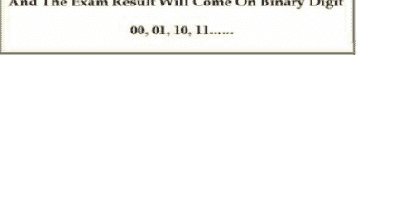

## 第11章（C语言中的控制台输入与输出）

### 引言

getchar() 用于将单个字符输入计算机。getchar 函数是标准 C 输入/输出库的一部分。它从标准输入设备（通常是键盘）返回单个字符。该函数不需要任何参数。

语法：

```
Character variable = getchar();
```

该函数用于将单个字符发送到标准输出设备（通常是显示器）。

它也是标准 C I/O 库的一部分。要发送的字符通常表示为字符型变量。它必须作为该函数的参数，写在括号内，放在单词 putchar 之后。

语法：

```
putchar(character variable);
```

### scanf 函数（输入数据）

该函数可用于输入数值、单个字符和字符串的任意组合。scanf() 从标准输入设备输入数据，并将其存储到计算机内存中。该函数返回成功输入的数据项数量。

语法：

```
cnt = scanf("control string", arg1, arg2, arg3, ..., argn);
```

其中 cnt 的值将是成功输入的数量，control string 是用于格式化的字符串，arg1、arg2、... 是表示各个输入数据项的实参。这些实参写成变量或数组，其类型与控制字符串中对应的字符组匹配。每个变量名前面都必须有一个和号（&）。

### printf 函数（输出数据）

该函数可用于输出数值、单个字符和字符串的任意组合。其用途是显示数据。printf() 将数据从计算机内存移动到标准输出设备。

语法：

```
printf("control string", arg1, arg2, ..., argn);
```

这里，控制字符串指的是包含格式信息的字符串，arg1、arg2、... 是表示各个输出数据项的实参。

控制字符串可以包含标志，标志会影响输出的外观。标志必须紧跟在百分号（%）之后。一些常用标志如下：

- `-`：数据项在字段内左对齐（为填满最小字段宽度所需的空白将添加到数据项之后，而不是之前）。
- `+`：每个带符号的数值数据项前都会有一个符号（+ 或 -）。如果没有此标志，则只有负数据项前面带符号。
- `0`：使前导零出现，而不是前导空白。仅适用于在最小大小大于数据项的字段内右对齐的数据项。
- `' '`（空格）：每个正的有符号数值数据项前都会有一个空格。如果同时存在 + 标志，则此标志会被 + 标志覆盖。
- `#`（与 o 和 x 类型转换一起使用）：使八进制和十六进制数据项分别以 0 和 0x 开头。
- `#`（与 e、f 和 g 类型转换一起使用）：使所有浮点数都包含小数点，即使数据项是整数。

### 可选格式说明符

- 1. 字段宽度说明符告诉 printf() 在打印一个值时屏幕上应使用多少列。**例如**

  ```
  int a=5;
  printf("%10d",a);
  ```

  会给整数 a 一个 10 列的字段宽度。由于该值无法占满完整的 10 列，因此它会右对齐，在左侧留下空白。

  **因此输出将是：**

  ```
           5
  ```

- 2. 如果在格式说明符中给出减号：

  ```
  int a=5;
  printf("%-10d",a);
  ```

  将意味着输出应左对齐，在右侧留出空间。

如果声明为：
**float a=2.5, b=0.00005, c=3000;**

请给出以下每个 printf 语句产生的输出：

- (i) `printf("%f %f %f", a, b, c);`  
  输出：`2.500000 0.000050 3000.000000`

  注意，每个浮点数在小数点后使用六位。

- (ii) `printf("%8e %8e %8e", a, b, c);`  
  输出：`2.500000e+00 5.000000e-05 3.000000e+03`

- (iii) `printf("%e %e %e", a, b, c);`  
  输出：`2.5000e+00  5.0000e-05  3.000e+03`

- (iv) `printf("%12.4e %12.4e %8.3e", a, b, c);`  
  输出：`  2.5000e+00   5.0000e-05 3.000e+03`

- (v) `printf("%-8f%+8f %08f", a, b, c);`  
  输出：`2.500000+0.000050 3000.000000`

- (vi) `printf("%#8f %8f %8f", a, b, c);`  
  输出：`2.500000 0.000050 3000.000000`

- (vii) `printf("%g %g %g", a, b, c);`  
  输出：`2.5 5e-05 3000`

- (viii) `printf("%#g %#g %#g", a, b, c);`  
  输出：`2.50000 5.00000e-05 3000.00`

### 示例

下面是一个简单的程序，它演示了标志与整数、浮点数量以及十进制、八进制、十六进制数一起使用的情况？

```c
#include<stdio.h>
#include<conio.h>
main( )
{
        int i=123;
        float x=12.0, y=-3.3;
        int p=1234,q = 01777, r=0xa08c;
        printf(":%6d  %7.0f  %10.1e:\n\n",i,x,y);
        printf(":%-6d %-7.0f %-10.1e:\n\n",i,x,y);
        printf(":%8u %8o %8x:\n\n",p,q,r);
    printf(":%-8u %-8o %-8x\n\n",p,q,r);
}
```

```text
output:
:              123              12               -3.3e+00:
:              123              12               -3.3e+00:
:              1234            1777              a08c:
:              1234            1777              a08c:
```

### gets() 函数和 puts() 函数

这些函数用于在计算机与标准输入/输出设备之间方便地传输字符串。每个函数都接受一个参数。该参数必须是表示字符串的数据项。字符串可以包含空白字符。

gets() 用于从键盘（标准输入）获取字符串。

puts() 用于将字符串放到标准输出上。

语法：

```
gets(character_string variable);
puts(character_string variable);
```

```c
#include<stdio.h>
main()
{
    char line[20];
    gets(line);
    puts(line);
}
```

### 以下程序的输出会是什么？

| 程序及输出（1、2） | 程序及输出（6） |
|---|---|
| 1. main() { char ch; ch = getchar(); if(islower(ch)) putchar(toupper(ch)); else putchar(tolower(ch)); }<br>输出：它会把小写字母转换为大写，把大写字母转换为小写。也就是说，如果你输入‘a’，输出将是‘A’；如果你输入‘A’，输出将是‘a’。<br>2. main( | 6. main() { printf("More often than \b\b not \r the person who \ wins is the one who thinks he can!"); }<br>输出：the person who wins is the one who thinks he can!。因为控制台会从左到右打印 printf 中的消息，当遇到 \b 时，它会把光标移动一个字符；当遇到 \r 时，它会把光标移到当前行的开头，然后打印下一条将会 |


```
{
	int i = 2;
	float f = 2.5367;
	char str[ ] = "Life is like that";
	printf( "%4d%3.5f\n%4s",i,f,str);
}
```

输出：--2（2 前面有 3 个空格，因为 i 以 4 列宽度打印） --3.536（数字前有 2 个空格，数字将按 3 位小数打印。）

is like that.（因为 str 包含超过 4 个字符，所以它会忽略最大长度并打印整个 str。）

## 3. main()

```
{
	int a=250;
	printf("%1d", a);
}
```

输出 250

## 4. main()

```
{
	float a =3.15529;
	printf("%6.2f",a);
	printf("%6.3f",a);
	printf("%5.4f",a);
	printf("%2.1f",a);
	printf("%0.0f",a);
}
```

输出：
--3.16
3.155
3.1553
3.2
3

## 7. char p[] = "The sixth sick sheikh's sixth ship is sick";

```
main()
{
	int i = 0;
	while(p[i]!='\0')
	{
		putchar(p[i]);
		i++;
	}
}
```

输出：
The sixth sick sheikh's sixth ship is sick
因为循环从 0 开始并成功执行，直到遇到空字符，所以字符串的每个字符都会从开头开始打印。

## 8. 以下程序的输出会是什么：

```
printf("%/%/%");
```

输出：%%

## 9. 以下代码能工作吗？如果能，输出会是什么：

```
int n=5;
printf("n=%*d",n,n);
```

输出：能。n= 5
* 表示将使用参数列表中的一个 int 值作为字段宽度。在参数列表中，宽度位于要打印的值之前。在这种情况下，格式说明符

## 5. 指出以下程序中存在的错误（如果有）：

```
char ch;
int i;
scanf("%c", &i);
scanf("%d", &ch);
printf("%c %d",ch, i);
```

输出：你将没有机会为第二个 scanf() 语句输入字符。此问题的解决方法是在第二个 scanf() 之前加上以下语句。

```
fflush(stdin);
```

这将把上一次 scanf() 命中的回车从输入流（即键盘）中刷新出去。

变成 %5d

## 10. 可以在 scanf() 格式字符串中指定可变字段宽度吗？

输出：
不可以。scanf() 格式字符串中 % 符号后的 * 用于抑制赋值。也就是说，当前输入字段会被扫描但不存储。

## 11. 在 fgets() 和 gets() 中，哪个函数使用起来安全？

输出：
fgets()，因为与 fgets() 不同，gets() 无法被告知所提供字符串将存入的缓冲区大小。因此，缓冲区始终存在溢出的可能性。

## 指出以下程序段中的错误（如果有）：

| 1. main( ) { int i; char a[] = "Hello"; while(a != '\0') { printf("%c",*a); a++; } } | 5. main( ) { int dd,mm,yy; printf("\n Enter day,month and year\n"); scanf("%d %*c %d %*c%d",&dd,&mm,&yy); printf("The date is:%d-%d-%d",dd,mm,yy); } 输出：无错误。 6. main( ) { char buffer[50]; int no = 97; double val = 2.34174; char name[10] = "Shweta"; |
|---|---|

输出：错误。“需要值”，因为数组不能递增。

```
2. main()
{
double dual;
scanf("%f",&dual);
printf("\nDouble Value = %lf",dual);
}
```

输出：无错误，但输出将是 -0.000000。因为 double 占 8 字节，float 占 4 字节。

```
3. main()
{
int level;
scanf("%d\n",&level);
printf("\nInteger Value = %d",level);
}
```

输出：错误。未定义符号 n。

```
4. main()
{
char *mess[5];
```

```
sprintf(buffer,"%d %lf %s",&no,&val.name);
printf("\n%d %lf %s",no,val.name);
sscanf(buffer,"%d %2.2lf %s",&no,&val.name);
printf("\n%s",buffer);
printf("\n%d %lf %s",no,val.name);
```

无错误。
因为 sprintf() 将变量打印到指定字符串中（例如，从字符串读取字符并转换，并将它们存储在变量中，复制到 buffer 数组中，当我们打印出 buffer 字符串并将它们存储到变量和 v 值中时）。

输出：无错误，但输出将是 -0.000000。因为 double 占 8 字节，float 占 4 字节。

输出：错误。未定义符号 n。

```
for(i = 0; i<5; i++)

scanf("%s",mess[i]);
}
```

**输出：** 错误。未定义符号 i；此外，当我们谈论指针数组时，它不应接收任何字符串，它可以接收任何字符串或字符的地址。


## **回答以下问题：-**

|  |  |
|---|---|
| 1) 要在 char str[100] 数组中接收字符串 "We have got the guts, you get the glory!!"，你会使用以下哪个函数？<br>a) scanf("%s",str);<br>b) gets(str);<br>c) getche(str);<br>d) fgetchar(str);<br>输出：gets(str)<br><br>2) 如果要从键盘接收单个键，你会使用哪个函数？<br>a) scanf( ) | 5) getchar( )、fgetchar( )、getch( ) 和 getche( ) 之间有什么区别？<br>输出：<br>所有函数都从键盘接收一个字符。它们之间有细微差别：<br>getchar( )：从键盘接收一个字符，但必须在字符后按回车键。<br>fgetchar( )：与 getchar( ) 相同。<br>getchar( ) 是宏，而 fgetchar( ) 是函数。<br>getch( )：从键盘接收一个字符，但不 |

b) gets()
c) getche()
d) getchar()
输出：getche()

回显（显示）在屏幕上。
getche()：从键盘接收一个字符并将其回显在屏幕上。

## 3) 如果要从键盘输入一个整数，你会使用哪个函数？

- a) scanf()
- b) gets()
- c) getch()
- d) getche()

输出：scanf()

## 4) 如果要从键盘接收一个字符串，哪个函数工作得更快？

- a) scanf()
- b) gets()

输出：gets()

## 6) printf() 的格式字符串可以包含：

- a) 字符、格式说明和转义序列
- b) 字符、整数和浮点数
- c) 字符串、整数和转义序列
- d) 引号、百分号和反斜杠字符

输出：a) 字符、格式说明和转义序列


## 章节

## 第 12 章

## （通过 C 进行文件处理）

## 简介-

到目前为止，我们一直使用 scanf 和 printf 函数来读写数据。这些是面向控制台的输入和输出函数，始终以键盘和屏幕作为目标位置。当数据量较小时，这没问题。然而，现实生活中的问题涉及大量数据，在这种情况下，面向控制台的输出和输入操作有两个主要问题：

A. 处理大量数据非常耗时。
B. 一旦程序关闭或计算机关闭，所有数据都会丢失。为了克服这些问题，我们使用文件处理。文件可用于将数据存储在硬盘上，以便数据永久保存，即使计算机关闭也不会被删除。

文件可以定义为磁盘上存储一组相关数据的位置。可以对文件执行许多函数操作：

- 命名文件。
- 打开文件。
- 从文件读取数据。

- 向文件写入数据。
- 关闭文件。

## 让我们看看一些文件函数

| 函数名 | 操作 |
|---|---|
| fopen() | 创建一个新文件或打开一个现有文件以供使用。 |
| fclose() | 关闭文件。 |
| fgetc() | 从文件读取一个字符。 |
| fputc() | 向文件写入一个字符。 |
| fprintf() | 向文件写入数据。 |
| fscanf() | 从文件读取数据。 |
| fgetw() | 读取一个整数。 |
| fputw() | 写入一个整数。 |
| fseek() | 将位置设置到文件中所需的位置。 |
| ftell() | 给出文件中的当前位置（即从开头开始的字节数）。 |
| rewind() | 将位置设置到文件开头。 |
| fwrite() | 向文件写入数据。 |
| fread() | 从文件读取数据。 |
| feof() | 测试是否已到达文件末尾。 |
| fflush() | 刷新流。 |
| Remove() | 删除指定的文件。 |
| Rename() | 更改文件的名称或路径。 |
| ferror() | 测试文件中是否发生了错误。 |

## 打开文件-

在我们能够从硬盘上的文件读取信息或向其中写入信息之前，我们必须打开文件。

要打开文件，使用 fopen( ) 函数和一个模式，该模式告诉编译器我们将要写入、读取或修改文件。这个 fopen( ) 函数执行三项任务：

- 在磁盘上搜索文件。


- 然后，它将文件从磁盘加载到内存中称为缓冲区的区域。
- 它设置一个字符指针，该指针将指向缓冲区中的第一个字符。

## 缓冲区的必要性

缓冲区是计算机内存中的临时区域，文件在其中保存一段时间，以便可以快速访问以读取或写入字符。每次都要转到硬盘读取一个字符并将其打印到屏幕上，然后再转到硬盘访问下一个字符，这样做效率相当低。

这里就用到了缓冲区：每当我们打开一个文件时，文件内容会被复制到这个临时区域，然后从缓冲区而不是从磁盘逐个字符地读取；同样，一次一个字符地将文件内容写入磁盘也会浪费时间，因此使用缓冲区来写入字符，然后再将它们传输到磁盘。

fopen() 收集文件名、文件大小和打开文件的模式等信息，然后将该文件的地址返回给名为 fp 的文件指针。可以这样说明：

```c
FILE *fp;
fp=fopen("file_name","mode");
```

这里 FILE 是在头文件 stdio.h 中定义的常量，因此必须使用 #include<stdio.h>

## 读取文件

函数 fgetc( ) 用于读取已从硬盘带到缓冲区（部分或全部）的文件内容。fgetc( ) 的用法如下：

```c
ch= fgetc(fp);
```

fgetc( ) 用于从指针的当前位置读取字符。此时指针向前移动一个位置，使其指向下一个字符。由 fgetc( ) 读取的字符被赋给变量 ch。

我们在一个无限 while 循环中使用这个 fgetc( )，但循环必须在文件末尾处中断。这是通过放在文件末尾的特殊字符来完成的。该字符的 ASCII 值为 26。返回的不是这个字符，而是一个称为 EOF 的宏。这个 EOF 也在 stdio.h 中定义。fgetc( ) 也可以替换为 getc( )。

有时，如果给定名称的文件不在磁盘上，我们以“r”模式打开文件时会遇到问题。同样，以“w”模式打开文件也可能因许多原因失败，例如磁盘空间不足、磁盘被写保护或磁盘损坏。现在，如果文件未打开，fopen ( ) 函数会返回 NULL（在 stdio.h 中定义，并作为 #define NULL 0 使用）。

### 文件打开模式包括：

- "r" 打开一个现有文件，仅供读取。
- "w" 打开一个新文件，仅供写入。
- "a" 打开一个现有文件用于追加。
- "r+" 打开一个现有文件，用于读取和写入。
- "w+" 打开一个新文件，用于读取和写入。
- "a+" 打开一个现有文件，用于读取和追加。

### 将字符写入文件

**函数 fputc( )** 用于将字符从屏幕打印到文件。而要在文件中打印字符串，则使用函数 fputs( )。

- `fputc(ch,fp);` 这里 ch 是字符的名称，fp 是文件指针。
- `fputs(s,fp);` 这里 s 是字符串的名称，fp 是文件指针。

### 让我们尝试一个简单的程序

```c
#include<stdio.h>
main()
{
    FILE *fp;                         /*declaring file pointer*/
    fp = fopen("sample.dat","r");     /*opening the file sample.dat in read mode*/

    if(fp==NULL)
        printf("file cannot be opened");
    else
    {
        ........
        fclose(fp);
    }
}
```

## 关闭文件

当我们完成读取文件后，需要关闭它。这通过 fclose() 完成。用法如下：fclose(fp);

要关闭文件，我们不需要文件名。fclose() 函数执行三项主要任务。

- 1. 缓冲区中的字符将被写入磁盘上的文件。
- 2. 在文件末尾将写入一个 ASCII 值为 26 的字符。
- 3. 缓冲区从文件中被清除。

### 1. 编写一个程序，统计文件中的字符、空格、制表符、换行符的数量。

```c
#include<stdio.h>
main()
{
    FILE *fp;
    char ch;
    int lines=0,tab=0,space=0,characters=0;
    fp=fopen("text.c","r");
    while(1) /* infinite loop*/
    {
        ch = fgetc(fp);
        if(ch == EOF)
            break;
        characters++;
        if(ch == 32)
            space++;
        if(ch == '\n')
            lines++;
        if(ch == '\t')
            tab++;
    }
    fclose(fp);
    printf("number of lines = %d\ntabs = %d\ncharacters = %d\nspaces = %d",lines,tab,characters,spaces);
    getch();
}
```

### 2. 编写一个程序，从键盘接收一些字符串并将其打印到文件中

```c
#include<stdio.h>
main()
{
    FILE *fp;
    char s[50];
    fp=fopen("text.c","w");        /*opening file*/
    if(fp==NULL)                   /*to check opening errors*/
    {
        puts("file opening error");
        exit();
    }
    printf("Enter some text");
    while(strlen(gets(s))>0)
    {
        fputs(s,fp);
        fputs("\n",fp);
    }
    fclose(fp);
}
```

### 3. 编写一个程序，从文件中读取所有字符串并打印到屏幕上

```c
#include<stdio.h>
main()
{
    FILE *fp;
    char s[50];
    fp=fopen("text.c","r");    /*opening file*/
    if(fp==NULL)               /*to check opening errors*/
    {
        puts("file opening error");
        exit();
    }
    while(fgets(s,49,fp)!= NULL)
        printf("%s",s);
    fclose(fp);
    getch();
}
```

## 多项选择题

- 1. 如果文件正确关闭，fclose 返回什么值：
  - a. 零
  - b. 一
  - c. -1
  - d. 无
- 2. 用于查看是否发生错误的函数是
  - a. ferror
  - b. fopen
  - c. fseek
  - d. 无
- 3. 哪种模式以读写模式打开文件
  - a. r++
  - b. a++
  - c. w++
  - d. r+
- 4. 在以下代码中：
  ```c
  FILE *fp;
  fp = fopen("trial","r");
  ```
  fp 指向
  - a. 文件中的第一个字符。
  - b. 一个结构，其中包含一个指向文件中第一个字符的字符指针。
  - c. 文件名。
  - d. 以上都不是。
- 5. 给定：FILE file_p;
  file_p=fopen("text.dat","a+");
  上面的错误是
  - a. FILE FILE_p
  - b. FILE *filem_p
  - c. FILE *file_p
  - d. 无
- 6. 要关闭文件，我们使用
  - a. fexit(file_p)
  - b. fclose
  - c. break
  - d. fclose(file_p)
- 7. 哪个条件用于测试文件结束条件——
  - a. eof
  - b. ferror
  - c. feof
  - d. 无
- 8. 哪个函数接收文件指针并将位置重置到文件开头
  - a. fseek
  - b. rewind
  - c. ftell
  - d. 以上所有

**答案：**

1 (a)  2 (a)  3 (d)  4 (b)  5 (c)  6 (b)
7 (c)  8 (b)


## 指出以下程序段中的错误（如果有）

### 1.

```c
#include "stdio.h"
main()
{
    FILE *fp;
    openfile("Myfile.txt", &fp);
    if(fp == NULL)
        printf("Unable to open file...");
}
openfile( char *fn, FILE **f)
{
    *f = fopen( fn, "r");
}
```

输出：无错误。在上面的程序中，为了打开文件，使用了函数 openfile( )，并传递了两个参数，第一个是文件名，第二个是文件指针。因为文件名是字符串，所以将由字符类型的指针接收它；而文件指针 f 被声明为 FILE 类型。其中 FILE 是预定义结构，并且由于 f 接收一个指针地址，因此它被声明为双重指针。

```c
error");
exit();
}
fclose(fp);
```

输出：无错误

### 2.

```c
#include "stdio.h"
#include "stdlib.h"
main( )
{
    FILE *fp;
    char c;
    fp = fopen("Try.c","r");
    if(fp =
    null)
    {
        puts("Cannot open file");
        exit();
    }
    while((c =
    getc(fp))!=EOF);
    fclose( fp);
}
```

输出：错误。“null”必须大写，因为它在 stdio.h 中预定义为 NULL。

### 7.

```c
#include "stdio.h"
main()
{
    unsigned char;
    FILE *fp;

    fp = fopen(
        "trial",'r');
    while((ch = getc(fp))!=EOF)

    printf("%c",ch);

    fclose(*fp);
}
```

输出：错误。调用 fopen 时参数“_mode”类型不匹配。因为模式必须用双引号括起来。
错误。未定义符号 ch。
错误。调用“fclose”时参数“_stream”类型不匹配。因为无需在 fp 前使用 *。

### 8.

```c
main() {
    FILE *fp;
    char name[25];
    int age;
    fp =
    fopen("yours","r");
    while(fscanf(fp,"%s %d",&name,&age)
    !=NULL)
        printf("%s %d\n",name,age);
    fclose(fp);
}
```

输出：错误。应使用 EOF 而不是 NULL，因为 fscanf 将从文件中读取记录，当它到达最后一条记录时，将遇到 EOF。

### 9.

```c
main() {
    FILE *fp;
    char names[20];
    int i;
    fp =
    fopen("student.dat","wb");
    for(i = 0; i<10;
    i++)
}
```

输出：错误。“null”必须大写，因为它在 stdio.h 中预定义为


```c
3. main() {
 char fname[ ];
 "c:\\students.dat";
 FILE *fp;
 fp = fopen( fname ,"r");
 if (fp == NULL)
 printf("\nUnable to open file...");
}
```

输出：无错误。但请记住必须包含 "stdio.h"。

```c
4. main() {
 FILE *fp;
 char str[80];
 fp = fopen("Try.c","r");
 while(fgets(str,80,fp) != EOF)
 fputs(str);
 fclose(fp);
}
```

输出：错误。因为 fputs() 需要两个参数，应写成 fputs(str,fp)，并且因为我们在循环中使用字符串，所以 EOF 的位置会出现 NULL。

```c
5. unsigned char;
```

```c
{
 puts("\nEnter name");
 gets(name);
 fwrite(name,sizeof(name),1,fp);
}
```

输出：错误。因为 sizeof 应该是单个单词，并且应使用 fclose 来关闭文件。

```c
10. FILE *fp;
 fp=fopen("matrix","r");
 fseek(fp,20,SEEK_SET);
 fclose(fp);
```

输出：应使用 20L 而不是 20，因为 fseek() 需要一个 long 偏移值。

```c
11. FILE *fp;
 char s[80];
 fp=fopen("matrix","r");
 while(!feof(fp))
 {
 fgets(s, 80,fp);
 puts(s);
 }
 fclose(fp);
```

输出：“matrix” 文件的最后一行将被读取两次。为避免

FILE *fp;
fp=fopen("matrix",
"r");
while((ch=getc(fp))!=EOF)
    printf("%c",ch);
fclose(fp);

输出：EOF 已在文件 "stdio.h" 中定义为 # define EOF -1，而 unsigned char 的范围是 0 到 255，因此当从文件中读取 EOF 时无法容纳在 ch 中。解决方法是将 ch 声明为 int。

6.    unsigned char;
FILE *fp;
fp=fopen("matrix",
"r");
    if(!fp)
    {
        printf("file
opening

为此，使用：
while(fgets(s,80,fp)!=NULL)
    puts(s);


C - Programmer  
Harry.


## 第13章
(杂项主题)

我们已经知道 # define 语句可用于定义符号常量。因此常量提供了一种简写表示法。Define 语句可用于定义宏，即它们可用于替换表达式、完整语句或一组语句。

使用宏求两个数最大值程序：

```c
#define max(a,b) a>b?a:b /*declaration of macro*/
main()
{
int a,b,ans;
printf("Enter two numbers");
scanf("%d %d",&a,&b);
ans = max(a,b);
printf("max = %d",ans);
getch();
}
```

该程序包含一个宏 max，表示表达式 a>b?a:b。当程序编译时，表达式 a>b?a:b 将替换标识符 max。

宏定义通常放在文件的开头，在第一个文件函数定义之前。宏的作用域是全局的。

多行宏也可以通过在除最后一行外的每一行末尾放置反斜杠来定义。此功能允许将单个宏表示为复合语句。

### 将变量声明为常量:-

我们可能希望某个变量的值在程序执行期间不发生变化。这可以通过在初始化时使用关键字 const 声明变量来实现。

```c
const float PI = 3.14;
```

此声明告诉编译器变量 pi 的值在程序执行期间不得更改。

### 将变量声明为 volatile:-

ANSI 标准定义了另一个限定符 volatile，可用于明确告知编译器变量的值可能随时被某些外部源（来自程序外部）更改。

```c
volatile int date;
```

即使变量不出现在赋值语句的左侧，其值也可能被某些外部因素更改。

当我们将变量声明为 volatile 时，编译器每次遇到该变量时都会检查其值，以查看是否有任何外部更改导致值发生变化。

### Mind Drill Note-

请记住，声明为 volatile 的变量的值也可以由其自身程序修改。

如果我们希望值不得被程序修改，而可能被其他进程更改，则可以将变量同时声明为 const 和 volatile，如 (volatile const int = 150;)。

### 定义符号常量:-

我们经常在程序中使用一些常量。这些常量可能在程序中多次出现。例如，pi 的值应始终为 3.14。因此它

可以在程序中用作

```c
### #define PI 3.14
```

### 被称为预处理器或编译器指令。

正如我们所知，PI 是一个常量，因此其值在整个程序中必须始终相同。符号常量也称为常量标识符。以下规则适用于 # define 语句：

- 为了区分变量和符号常量，符号常量以大写形式书写。
- # 与单词 define 之间不留空白。
- define 与符号常量之间需要留一个空白。
- 符号名称不使用数据类型声明。
- #define 语句不以分号结尾。
- #define 语句可以在程序的任何位置出现，但必须在使用之前。通常它们在 main () 之前使用。

### 预处理器指令:-

预处理器顾名思义，是在源代码通过编译器之前对其进行处理的程序。

### C 预处理器:

预处理器是一组特殊语句，在编译过程开始时执行。这些被称为指令。

### 一些预处理器有:

- 1. #include.:- 用于包含头文件。
- 2 #define :- 该语句用于定义符号常量和宏：即等同于表达式的单个标识符。

### 例如:

```c
#include<stdio.h>
#define area length*width
main()
{
    int length, width;
    printf("enter length and width");
    scanf("      %d %d",&length,&width);
    printf("\n area is %d",area);
}
```

3. #if、#elif、#else 和 #endif 允许根据一个或多个真/假条件的值对源程序进行条件编译。它们也与 defined 运算符一起使用。

### 例如:

```c
#if defined(FOREGROUND)
    #define BACKGROUND 0
#else
    #define FOREGROUND 0
    #define BACKGROUND 7
#endif
```

4. #elif :- #elif 类似于控制语句中使用的 else – if 子句

- 5. #else:-
- 6 #endif
- 7 #ifdef :- #ifdef 等价于 #if defined()。
- 8. #ifndef:- #ifndef 等价于 #if!defined。 即 "if not defined"。
- 9. #undef:- #undef 指令“取消定义”符号常量或宏标识符；即，它抵消了 #define 指令的效果。

### 例如:

```c
#define FOREGROUND 7
#define BACKGROUND 0
main()
{
    ........
```

```c
#undef FOREGROUND
#undef BACKGROUND
}
```

**Mind Drill Note-** _#if、#ifdef、#ifndef 必须以 #endif 结尾._

### 运算符:-

预处理器还包括两个特殊运算符：defined # 和 ##。

### 字符串化运算符 (#):-

它允许宏定义中的形式参数转换为字符串。如果宏定义中的形式参数前面有此运算符，则相应的实际参数将自动用双引号括起来。

### 标记粘贴运算符 (##):-

它导致宏定义中的各个项目被连接起来，从而形成单个项目。

### 示例:

```c
#define display(i) printf("x" #i "=%f\n",x##i)
```

假设此宏通过编写    display(3); 来访问；

结果将是：     printf("x3=%f\n", x3);

因此表达式 x##i 成为变量 x3，因为 3 是参数 i 的当前值。

### 多选题:

|  |  |
|---|---|
| **1. 什么是预处理器指令？**<br>1. 编译器向程序员发送的消息。<br>2. 编译器向链接器发送的消息。<br>3. 程序员向预处理器发送的消息。 | **4. 头文件是：**<br>1. 包含标准库函数的文件。<br>2. 包含定义和宏的文件。<br>3. 包含用户定义函数的文件。 |


输出：#define sqr(x) ((x)*(x))

3. #define cube(x) (x*x*x)
main()
{
    int a,b=3;
    a=cube(b++);
    printf("%d %d",a,b);
}
输出：27 6.

4.
#define MESS junk
main()
{
    printf("MESS");
}
输出：MESS

5. #define PRINT(int)
    printf("%d",int)
main()
{
    int x=2,y=3, z=4;
    PRINT (x);
    PRINT (y);
    PRINT (z);
}
输出：2 3 4

6. 你会如何定义上面的宏，使其输出：
    x=2 y=3 z=4
输出：
    #define PRINT(int)
    printf(#int "=%d", int)
main()
{
    int x=2,y=3, z=4;
}

在这种情况下（注意：未定义），而且 if 块不会因其内部不允许出现的编译错误而继续。

8. 下面的 typedef 能工作吗？
typedef #include I;
输出：不能，因为 typedef 只有在预处理器完成工作之后才起作用。

9. #define max(a,b) (a>b?a:b)
main()
{
    int x;
    x=max(3+2,2+7);
    printf("%d",x);
}
输出：9

10. 为下面的程序编写一个宏 PRINT，使其输出：
    x=4 y=4 z=5
    a=1 b=2 c=3
main()
{
    int x=4, y=4, z=5;
    int a=1, b=2, c=3;
    PRINT(x,y,z);
    PRINT(a,b,c);
}
输出：#define PRINT(var1, var2, var3) printf("\n" #var1 "=%0d" #var2 "=%0d" #var3 "=%0d", var1, var2, var3)

11. 定义宏 DEBUG，使得下面的程序

```
PRINT (x);
PRINT (y);
PRINT (z);
}
```

规则是：如果在宏展开中参数名前面有一个 #，那么（# 与参数的）组合将展开为一个带引号的字符串，其中参数被替换为实际实参。这可以与字符串连接结合使用，以打印我们程序中所需的输出。展开后，宏变成 printf("x" "=%d",x); 这两个字符串会被连接起来，因此效果是 printf("x=%d",x);

输出：
DEBUG: x=4
DEBUG: y=3.140000
DEBUG: ch=A

```
main()
{
    int x=4;
    float a=3.14;
    char ch= 'A';
    DEBUG(x,%d);
    DEBUG(a,%f);
    DEBUG(ch,%c);
}
```

```
Output: #define DEBUG(var,fmt)
printf("DEBUG" #var "=" #fmt "\n",var)
```

12. #define str(x) #x
#define Xstr(x) str(x)
#define oper multiply
main()
{
    char *opername=Xstr(oper);
    printf("%s",opername);
}

输出：multiply

## 回答以下问题：

1. 下面两个 #include 指令有什么区别：

```
#include<conio.h>
#include"conio.h"
```

答案：
#include "conio.h"：此命令会在当前目录以及搜索路径中可能已设置的指定目录列表中查找文件 conio.h。

#include<conio.h>：此命令只会在指定的目录列表中查找文件 conio.h。

## 2. 指出 swap 宏在预处理时会展开成什么。代码能编译吗？

```
#define swap (a, b, c) (c t; t=a; a=b; b=t)
main()
{
    int x=10,y=20;
    swap (x, y, int);
    printf("%d %d",x,y);
}
```

答案：(int t;t=a,a=b,b=t);

这段代码不能工作，因为 t 的声明不能出现在括号内。

## 3. 你会如何修改上一题中的 swap 宏，使其能够交换两个整数？

答案：#define swap(a,b,c) c t;t=a, a=b, b=t;

## 4. 下面的程序会在哪一行报告错误？

- 1. #define area( r ) (3.14*r *r);
- 2. main()
- 3. {
- 4.     float r=1.0, c;
- 5.     c=area(r);
- 6.     printf("%f",c);
- 7.     if(area(r) == 6.28)
- 8.         printf("Matrix");
- 9. }

答案：第 7 行，但真正的罪魁祸首是第 1 行中的分号。展开后，第 7 行变成 if((3.14*1.0*1.0); == 6.28)。因此出错。

## 5. 在下面的声明中，变量 b 的类型是什么？

```
#define floatptr float*
floatptr a,b;
```

答案：float，而不是指向 float 的指针，因为展开后声明变成：

```
float *a,b;
```

## 6. 头文件必须有 .h 吗？

答案：不是必须的，但传统上会给它们 .h 扩展名，以将它们与 .c 程序文件区分开。

## 7. 头文件通常包含什么？

答案：像 # define 这样的预处理指令、结构体、联合体和枚举声明、typedef 声明、全局变量和外部函数声明。不应在头文件中编写实际代码（即函数体）或全局变量定义。#include 指令应用于引入头文件，而不是其他 .c 文件。

## 8. 头文件如何确保它不会被包含多次？

答案：所有声明都必须按如下所示的方式编写。假设头文件名为 FUNCS.H。

```
#ifndef FUNCS
#define _FUNCS
#endif
```

现在，如果我们如下所示两次包含此文件，它只会被包含一次。

## 9. 包含时，会在哪里搜索头文件？

答案：如果使用 <> 包含头文件，则会在预定义的包含路径中搜索文件（该路径也可以更改）。如果使用 “ ” 语法包含，则除了预定义路径之外，还会在当前目录（通常是你调用编译器的目录）中搜索该文件。

## 判断正误：

a. 如果要包含的文件不存在，预处理器会闪出一条错误消息。

b. 预处理器可以捕获简单错误，如缺少声明、嵌套注释或花括号不匹配。

c. 如果头文件被包含两次，会导致错误吗？

d. 下面的程序会无限次打印该消息吗？

```
#define INFINITELOOP while (1)
main()
{
INFINITELOOP
printf("\nMatrix");
}
```

e. 下面的程序能成功编译吗？

```
main()
{
printf("Matrix" "computers");
}
```

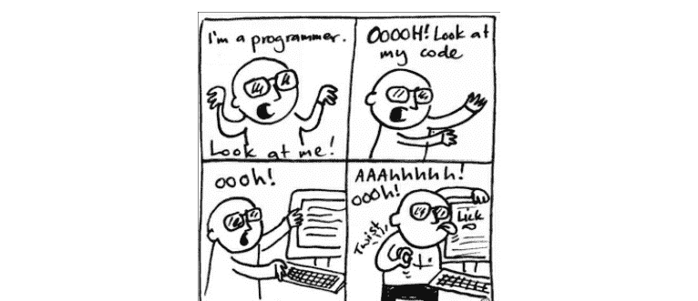

## 第 14 章（存储类）

存储类决定变量的内存位置。内存位置可以是——
- 1. 主存储器（RAM）。
- 2. CPU 寄存器。

它决定变量的默认值（零值或垃圾值）。它还决定变量的作用域和生命周期。作用域表示变量声明生效的区域，换句话说，即该特定变量可以被使用的区域。

四种不同的作用域是全局作用域、函数作用域、块作用域和原型作用域。

- 1. 自动存储类（auto）
- 2. 静态存储类（static）
- 3. 外部存储类（extern）
- 4. 寄存器存储类（register）。

### 自动存储类：-

在函数内部声明的变量默认具有自动存储类。它由垃圾值初始化。

声明形式为：int a 或 auto int a;

```
void prn();

main()
{
int a=5;
printf("%d ", a);
prn();
prn();
prn();
}

void prn()
{
int a=10;
a++;
printf("%d ",a);
}
```

输出：5 11 11 11

在上面的示例中，这两个变量名称相同，但作用域不同。prn() 中的变量 *a* 具有局部作用域，因此每次调用 prn() 时都会生成 *a* 的一个新副本。

### 静态存储类：-

静态存储类应仅在程序需要变量的值在不同函数调用之间保持存在时使用，例如在递归函数中。变量声明为：static int b; 静态变量将具有局部作用域和全局生命周期。

静态变量在各个函数内部定义，因此与自动变量具有相同的作用域。它们对于定义它们的函数来说是局部的。

```
```c
void prn();
main()
{
        prn();
        prn();
        prn();
}
void prn()
{
        static int a=10;
        a++;
        printf("%d ",a);
}
```
```

**输出：11 12 13**

在上面的示例中，只会创建变量 *a* 的一个副本，并且每次调用 prn() 时都会使用这个单一副本，因此它会递增变量 *a* 在上一次函数调用中的值。

### 外部存储类：-

在所有函数之外声明的变量具有外部存储类。extern 存储类应仅用于那些被程序中所有函数使用的变量；现在无需在所有函数中传递变量。

但也不建议将所有变量都存储为 extern，因为它会在程序的整个生命周期内保持活动，从而不必要地浪费大量内存。外部变量声明为 extern int c; 当一个程序中的变量还必须用于其他程序时，也会使用它，例如：-

| File1.c | File2.c |
|---------|---------|
| #include "File2.c"
int a; /*Variable definition */
main()
{
a = 5;
func();
printf("%d",a);
} | extern int a; /*Variable declaration*/
void func()
{
a=10;
} |

输出：10 变量 a 将在 File1.c 中获得内存。因为它在函数之外定义，所以被称为外部变量，并且其作用域是全局的。它也可以在另一个文件 File2.c 中使用。两个文件中使用的变量 a 是同一个。但是当我们编译 File2.c 时，必须告知编译器变量 a 将来自外部，因此我们将 a 声明为 extern int a;（此时不分配内存），但如果将其声明为 int a;，那么编译器会把它当作一个新变量。

### 寄存器：-

只有 14 个 CPU 寄存器可用，而且由于微处理器正在使用它们，我们可用的甚至更少。但是计算机访问 CPU 寄存器非常快，因此程序执行也非常快。因此，它最适合用于需要多次使用的循环计数器。然而，如果没有空闲寄存器，则使用 auto 存储类并继续执行。CPU 寄存器长度为 2 字节。因此它们的最大范围等于 int 的范围。float 值不能存储在寄存器中。即使我们写 register float x，也会为 x 假定为 auto。此类的变量声明如下，

```
register int d;
```

### 小结：-

| 默认值 |
|---------------|


| 存储类别 | 内存 |  | 作用域 | 生命周期 |
| 自动 | 主存（RAM） | 垃圾值 | 局部 | 局部 |
| 静态 | 主存（RAM） | 零 | 局部 | 全局 |
| 外部 | 主存（RAM） | 零 | 全局 | 全局 |
| 寄存器 | CPU寄存器 | 垃圾值 | 局部 | 局部 |

## 以下程序的输出将是什么——

```
1. int f(int);
    int g(int);
main()
{
    int x, y, s = 2;
    s *= 3;
    y = f(s);
    x = g(s);
    printf("\n% d %d %d",s,y,x);
}
int t =8;
int f( int a)
{
    a += -5;
    t -= 4;
    return(a+t);
}
int g(int a)
{
    a = 1;
    t += a;
    return(a+t);
}
```

输出：- 6 5 6

首先 s 将为 6，并传递给 f()，由 a 接收，处理后 a 将为 1，t 将为 4，因为 t 是全局变量，所以它在整个程序中可用；当调用 g() 时，a 再次接收 6，并被 1 覆盖，因此 a=1，t=t+a，所以 t=5，该函数返回 a+t，因此 x 将为 6，最终 s=6，x=6，y=5，这些将通过 printf() 打印出来。

```
4.
main()
{
    static int a[20];
    int i=0;
    a[i]=i++;
    printf("%d %d %d", a[0], a[1], i);
}
```

输出：-0 0 1

```
5.
float x =4.5;
main()
{
    float y, float f(float);
    x*=2.0;
    y = f(x);
    printf("\n%f %f",x,y);
}
float f(float a)
{
    a+=1.3;
    x-= 4.5;
    return(a+x);
}
```

输出：- 4.500000 14.800000

```
6.
int x = 10;
```

## 2.

```
main()
{
    static int c = 5;
    printf("\n c = %d",c--);
    if(c !=0)
        main();
}
```

输出：- 5 4 3 2 1

因为 c=5，先打印，然后减 1，再调用 main()，但由于这里 c 被定义为 static，所以控制不会转到初始化，这个条件将成立五次，每次 c 被打印然后递减，因此 c 将是 5 4 3 2 1。

```
main()
{
    int x = 20;
    {
        int x = 30;
        printf("%d ",x);
    }
    printf("\n %d",x);
}
```

输出：- 30 20

因为当控制执行最内层的 printf 时，它将打印 30，因为局部变量优先；当控制从这个块中出来时，作用域将结束，这里 x=20 并被打印。

## 3.

```
main()
{
    int i,j;
    for(i = 1; i<5; i++)
    {
        j = g(i);
        printf("\n%d",j);
    }
}
int g(int x)
{
    static int v = 1;
    int b = 3;
    v+=x;
    return(v+x+b);
}
```

输出：- 6 9 13 18

## 7.

```
main()
{
    extern int i;
    i=20;
    printf("%d",sizeof(i));
}
```

输出：- 错误：extern int i 是声明而不是定义

## 8.

```
main()
{
    extern int a;
    printf("%d",a);
}
int a=20;
```

输出：- 20

- 1. 外部存储类变量对于在其定义之前的函数不可用，除非在这些函数中显式声明该变量。
- 2. 自动存储类变量的值在多次函数调用之间持续存在。
- 3. 如果 CPU 寄存器不可用，寄存器存储类变量被视为静态存储类变量。
- 4. 寄存器类变量不能保存 float 值。
- 5. 如果我们尝试对 float 变量使用寄存器存储类，编译器将显示一条错误消息。
- 6. 如果变量 x 定义在所有函数之外，并且某个函数中也将变量 x 定义为局部变量，那么全局变量优先于局部变量。
- 7. 自动变量的默认值为零。
- 8. 静态变量的生命周期持续到控制仍在其定义所在的块内。
- 9. 如果要定义全局变量，那么其声明中必须使用 extern 关键字。
- 10. 寄存器变量的地址不可访问。

答案：

- 1. 正确
- 2. 错误
- 3. 错误
- 4. 正确
- 5. 错误
- 6. 错误
- 7. 正确
- 8. 错误
- 9. 错误
- 10. 正确


## 第15章（算法）

- 1. 读取 A 和 B。
- 2. 设置 SUM:=A + B。
- 3. 写入 SUM。
- 4. 退出。

- 1. 读取 A 和 B。
- 2. 如果 A > B，则：
  设置 MAX:=A。
否则：
  设置 MAX:=B。
[结构结束]
3. 写入 MAX。
4. 退出

### 算法3：三个数的最大值——

- 1. 读取 A、B、C。
- 2. 如果 A > B，则：
  如果 A > C，则：
    设置 MAX:=A。
  否则：
    设置 MAX:=C。
  [If 结构结束]
否则：
  如果 B > C，则：
  否则：
    设置 MAX:=C。
[If 结构结束]
- 3. 写入 MAX。
- 4. 退出。

### 算法4：从用户输入百分比并打印等级。（使用 Else if）

- 1. 读取 P。
- 2. 如果 P>=90，则：
  设置 GRADE:='A'。
否则如果 P >= 70，则：
  设置 GRADE := 'B'。
否则如果 P>=50，则：
  设置 GRADE:='C'。
否则：
  设置 GRADE:='F'。
[If Else 结构结束]。
- 3. 写入 GRADE。
- 4. 退出

### 算法5：使用 for 循环打印 1 到 N 的序列。

- 1. 读取 N。
- 2. 对 I:=1 到 N 重复步骤 3：
- 3. 写入 I。
  [步骤 2 循环结束]
- 4. 退出。

### 算法6：使用 while 循环打印 1 到 N 的序列。

- 1. 读取 N。
- 2. 设置 I:= 1
- 3. 当 I<=N 时重复步骤 4 和 5：
- 4. 写入 I。
- 5. 设置 I:=I+1。
  [步骤 3 循环结束]
- 6. 退出。

### 算法7：使用 do while 循环打印 1 到 N 的序列。

- 1. 读取 N。
- 2. 设置 I:=1。
- 3. 写入 I。
- 4. 设置 I:= I + 1。
- 5. 如果 I<=N，则：转到步骤3。
- 6. 退出。

### 算法8：将十进制数转换为等价的二进制数。

- 1. 读取 N。
- 2. 设置 B:=0。
- 3. 设置 I:=0。
- 4. 当 N>=0 时重复步骤 6 到 9
- 5. 设置 N:= N/2。
- 6. 设置 B:= B + 10^i * 余数 [这部分将负责反转累积的余数]。
- 7. 设置 I:=I+1。
- 8. 写入 B。

### 算法9：反转给定的 n 位数字的各位数字。

- 1. 读取 N。
- 2. 设置 REV:=0。
- 3. 当 N>=0 时重复步骤 5 和 6。
- 4. 设置 N:=N/10。
- 5. 设置 REV:= REV *10 + 余数。
- 6. 打印 REV 的值。
- 7. 退出。

### 算法10：验证给定数字是否为素数。

- 1. 读取 N。
- 2. 设置 I:=2 和 PRIME =1。
- 3. 当 I<=N/2 时重复步骤 4
- 4. 如果(N % I=0)
  设置 PRIME:=0。并退出循环结构。
  否则：
  设置 I:= I + 1。
  [If 结构结束。]
  [While 循环结束]
- 5. 如果 PRIME=1，则：
  打印该数是素数。
  否则
  打印该数不是素数。
- 6. 退出。

### 算法11：数组中的线性搜索

### 算法12：使用函数计算阶乘

- 1. 读取 N。
- 2. ANS=FACT (N)。
- 3. 写入 ANS。
- 4. 退出

[此过程用于计算 N 的阶乘]

- 1. 设置 ANS:=1
- 2. 对 I:=N 到 1 重复步骤 3
- 3. 设置 ANS:= ANS* I
- 4. [步骤 3 循环结束]
- 5. 返回 ANS。
- 6. 退出。


## 第16章（未解答的实践问题）

### 引言——

- 1. 像 (011)711 8802 这样的电话号码可以看作由三部分组成：区号 (011)、交换局号 (711) 和号码 (8802)。编写一个程序，使用结构体分别存储电话号码的这三个部分。将该结构体命名为 phone。创建一个数组来存储其成员的 20 条记录，其中每条记录存储 phone 类型的 memberno、成员姓名和电话号码。让用户输入所有记录的信息，然后在屏幕上显示完整信息。
- 2. 创建一个名为 volume 的结构体，它使用三个 distance 类型（英尺和英寸）的变量（length、width、height）来建模房间的体积。读取房间的三个维度，计算它表示的体积，并打印结果。体积应以（英尺）³ 的形式表示，也就是说，你必须将每个维度转换为英尺和英尺的小数部分。例如，长度 12 英尺 6 英寸将转换为 12.5 英尺。
- 3. 声明一个结构体来表示复数（一个具有实部和虚部的数）。编写一个 C 程序来将两个复数相加。
- 4. 声明一个结构体来表示复数（一个具有实部和虚部的数）。编写一个 C 程序来将两个复数相减。
- 5. 声明一个结构体来表示复数（一个具有实部和虚部的数）。编写一个 C 程序来将两个复数相乘。
- 6. 声明一个结构体来表示复数（一个具有实部和虚部的数）。编写一个 C 程序来将两个复数相除。
- 7. 编写程序记录板球比赛的得分。一个数组存储击球球队的信息，例如击球手姓名、得分、是否出局以及出局方式，连同总得分、已投球轮数、总轮数和额外分。另一个数组存储投球球队的信息，例如投球手姓名、投球轮数、maiden overs（无失分轮）、失分和取得的 wicket（三柱门）。程序读取上述信息，并根据用户的选择显示击球球队的信息或投球球队的信息。
- 8. 编写程序根据以下数据准备发票：客户编号、客户姓名和地址、销售数据、描述、数量、单价、折扣百分比、销售税百分比。
- 9. 编写程序准备并打印一组员工在一年中特定月份的工资单（工资条）。员工信息包含以下项目：员工姓名和职位、基本工资（bp）、特殊工资（sp）、向普通公积金缴款（pf）、向团体计划缴款（gis）、所得税扣款（it）、城市补偿津贴（cca）= 250 卢比、亲爱津贴（da）= 基本工资 < 3500 卢比时为 114%，基本工资 > 3500 且 < 6000 时为 85%，基本工资 > 6000 时为 74%；住房租金津贴（hra）= 基本工资 < 1500 卢比时为 250.00 卢比，基本工资 > 1499 且 2800 时为 450.00 卢比，基本工资 > 2799 且 < 时为 800.00 卢比。


3500 卢比。1000.00 基本工资 > 3499。程序计算上述数量、总工资、总扣除额、净工资并以指定格式打印。（提示：gross = bp + sp + hra + da + cca；net = gross - deductions（即 pf + gis + it）。在程序中使用结构体和数组。）

- **10.** 编写程序存储包含国家、首都及其总统姓名的 20 条记录。总统姓名是一个包含姓氏、名字、前缀（Mr.、Miss、Mrs.）的记录。程序应在给出国家名称或首都时显示整条记录。

- **11.** 假设一家商店库存中有若干商品，且每种商品最多由两个供应商供应。编写程序将 20 种商品的详细信息存储在数组中然后打印出来。

- **12.** 一个数组存储 25 名学生的详细信息（学号、姓名、三科成绩）。编写程序创建这样的数组并打印出在多于一科不及格的学生名单。假设及格分为 40%。

- **13.** 编写程序根据以下数据计算一组员工的所得税：总收入、人寿保险保费（LIC）、单位连结保险计划（ULIP）、公积金（PF）、邮局累积定期存款（CTD）、国家储蓄证书（NSC）。假设所得税计算采用以下规范：
  - a) 总收入所得税税率档次：

    | 总收入档次 | 所得税税率 |
    |---|---|
    | 最高 35000 | 无 |
    | 35001 至 60000 | 20% |
    | 60001 至 120000 | 30% |
    | 120000 及以上 | 40% |

  - b) 免税：对 LIC、GPF、PPF、ULIP、NSC、CTD 等的缴款可免缴所得税，但最高可获准的金额为 120000 卢比。

- **14.** 大小为 50 的线性数组存储以下信息：国家名称、国家首都和该国的年人均收入。编写完整的 C 程序执行以下操作：
  - a) 读取国家名称并显示首都和人均收入。
  - b) 读取首都名称并显示国家名称和人均收入。输入错误时显示错误信息。

- **15.** 使用结构体编写程序存储 50 种商品的价格清单并打印出最高价格以及所有价格的总和。

- **16.** 使用结构体用 C 语言编写程序模拟 20 名学生的成绩制作系统。每名学生的数据包括学号、姓名和三科成绩。百分比成绩和等级需根据上述信息计算。百分比成绩为平均成绩，等级按如下计算：

  | 百分比成绩 | 等级 |
  |---|---|
  | < 50 | 'F' |
  | >=50 < 60 | 'D' |
  | >=60 < 75 | 'C' |
  | >=75 < 90 | 'B' |
  | >=90 < 100 | 'A' |

- **17.** 用 C 语言编写程序模拟整数算术计算器。程序应能够显示上次计算的结果以及迄今为止执行的算术运算次数。任何错误操作应予以报告。

- **18.** 编写程序创建一个名为 "student" 的结构体，其结构体成员如下：1) 姓名 2) 学号 3) 三科成绩即英语、印地语、数学。使用结构体执行以下操作：
  - a) 接受姓名、学号和三科成绩。
  - b) 计算总分和百分比。
  - c) 以以下格式在屏幕上显示信息：

    XYZ 学校半期考试

    姓名：
    学号：
    印地语成绩：
    英语成绩：
    数学成绩：
    ------------------------
    总分：    百分比：

- **19.** 编写程序创建一个名为 "contestant" 的结构体用于选美比赛，检查以下条件并仅在满足以下标准时接受 5 名参赛者的详细信息：
  - a) 年龄在 18 至 20 之间。
  - b) 体重在 45 至 60 之间。
  - c) 学历为大学毕业。

  结构体成员为：1) 姓名 2) 年龄 3) 体重 4) 学历：1. 大专以下 2. 大学毕业 3. 研究生。

  现在以表格形式显示全部 5 名参赛者的详细信息。

- **20.** 编写程序创建一个名为 "stock" 的结构体。接受 10 种库存商品的详细信息。结构体成员为：1) 商品名称 2) 商品代码 3) 单价 4) 库存数量 5) 金额。现在提示用户输入他想查看的商品代码，搜索它，若存在则显示，否则给出适当信息。

- **21.** 编写程序创建一个结构体以指定以下学生数据：学号、姓名、院系、课程、入学年份。假设学院学生不超过 450 人。使用结构体执行以下操作：
  - a) 打印在特定年份入学的全部学生姓名。
  - b) 打印学号指定的学生的资料。

- **22.** 创建一个结构体以指定银行客户的数据。需存储的数据为：账号、姓名、账户余额。假设银行最多有 200 名客户。使用结构体执行以下操作：
  - a) 打印余额为 100 卢比的每个客户的账号和姓名。如果客户要求取款或存款，则以以下形式给出：账号、金额、（存款为 1，取款为 0）。
  - b) 给出信息，“余额不足以进行指定取款”。

- **23.** 一家汽车公司发动机零件的序列号从 AA0 到 FF9。需在结构体中指定的零件其他特征为：制造年份、材料和制造数量。现在执行以下操作：
  - a) 指定一个结构体以存储对应零件的信息。
  - b) 编写程序检索序列号在 BB1 和 CC6 之间的零件信息。

- **24.** 一条记录包含板球运动员姓名、年龄、已参加的测试赛场次数以及每场测试赛的平均得分。创建一个结构体数组以保存 20 名此类板球运动员的记录，然后编写程序读取这些记录并按平均得分升序排列。

- **25.** 创建一个结构体以表示图书馆中的一本书。它包括以下成员：书号、书名、作者、出版社、价格、册数、已借出册数。现在使用结构体执行以下操作：
  - a) 分配初始值。
  - b) 在检查可用性后借出一本书。
  - c) 归还一本书。
  - d) 显示图书信息。

- **26.** 创建一个结构体以表示 10 名客户的银行账户，其数据成员如下：存款人姓名、账号、账户类型（S 为储蓄账户，C 为活期账户）、余额金额。现在使用结构体执行以下操作：
  - a) 初始化数据成员。
  - b) 存款。
  - c) 在检查最低余额后取款（最低余额为 1000 卢比）。
  - d) 显示数据成员。

- **27.** 创建一个结构体以表示板球队中的击球手。它包括以下成员：名字、姓氏、得分、四分球数、六分球数。现在使用结构体执行以下操作：
  - a) 分配初始值。
  - b) 更新得分（如果需要应同时更新四分球和六分球）。
  - c) 显示击球手的信息。

  对访问标签做出适当假设。

- **28.** 创建一个结构体以表示板球队中的投球手。包括以下成员：名字、姓氏、投球局数、 maiden 局数、失分、取得 wickets 数。现在使用结构体执行以下操作：
  - a) 分配初始值。
  - b) 更新信息。
  - c) 显示投球手的信息。

  对访问标签做出适当假设。

- **29.** 编写程序管理房间的统计数据。房间结构体包括以下成员：长度、宽度、高度。现在使用结构体执行以下操作：
  - a) 分配初始值。
  - b) 计算面积。
  - c) 显示信息（长度、宽度、高度及面积）。

- **30.** 修改上述程序，使长度、宽度和高度成为包含以下内容的 distance 结构体的变量：米、厘米。

- **31.** 设 itemlist 为大小为 n 的线性数组（其中 n 为用户输入），其中数组的每个元素包含以下字段：商品、代码、商品价格、数量。声明一个结构体以 itemlist 作为数据成员并执行以下操作：
  - a) 向列表追加商品。
  - b) 根据商品代码从列表中删除商品。
  - c) 打印库存总价值。

- **32.** 编写程序处理 10 名账户持有人。程序应使用 Q.33 中定义的结构体。如有需要，对类定义做出必要修改。

- **33.** 编写一个结构体以表示向量（1 维数值数组）。现在使用该结构体执行以下操作：
  - a) 向量创建。
  - b) 修改给定元素。
  - c) 显示向量中的最大值。
  - d) 显示整个向量。
  - e) 加两个向量并显示结果向量。

  使用该结构体编写程序。

- **34.** 创建两个结构体 mc 和 fi，其中 mc 存储以米和厘米表示的距离值，而 fi 以英尺和英寸存储。编写程序读取两个结构体变量的值并可将 mc 的一个变量与 fi 的一个变量相加。

- **35.** 想象集市上一个售票亭。路过的人需要

购买一张票。票价定为 Rs. 2.50/-。售票亭记录到访人数和收到的总金额。请用名为 `ticketBooth` 的结构体为这个售票亭建模，包含以下成员：到访人数、收到的总金额。现在执行以下操作：

- a) 赋初值（将两个数据成员都设为 0）
- b) 如果未售票，只增加人数总计
- c) 如果售票，同时增加人数总计和金额总计
- d) 显示总计
- e) 显示已售出的票数（这个有点棘手）

编写程序（WAP），在代码中包含这个结构体。

36. 编写程序（WAP），在字符串结构体上执行各种操作，不使用语言自带的内置字符串函数。对字符串结构体的操作如下：

- a) 读取字符串。
- b) 显示字符串。
- c) 反转字符串。
- d) 将字符串复制到一个空字符串中。
- e) 拼接两个字符串。

37. 编写程序处理 20 名销售人员的销售活动。每名销售人员经营一种独立产品，并被分配一个年度目标。月底，本月销售额会累加到截至当前的销售额中。年底按如下方式计算佣金：如果实际销售额超过目标，则佣金为超出目标部分的 25% 加上目标的 10%；如果实际销售额等于目标，则佣金为目标销售额的 10%。否则佣金为零。

38. 一家书店维护店内正在销售图书的库存。列表包括作者、书名、价格、出版社和库存量等信息。当顾客需要某本书时，销售人员输入书名和作者，系统会在列表中查找并显示是否有货。如果无货，则显示适当消息。如果有货，则系统显示图书详情并询问所需册数。如果所需册数有库存，则显示所需册数的总费用，否则显示消息 “Sorry! These many copies are not in stock”。请使用名为 `stock` 的结构体设计该系统。该程序包含以下操作：

- a) 价格根据需要更新。
- b) 每本书的库存量应在交易完成后自动更新。
- c) 已售出图书（书名）总数可根据需要显示（同时以卢比显示总销售额）。

39. 编写程序，实时打印一场板球比赛的记分牌。显示内容应包括击球手姓名、得分、是否出局、出局方式、投球手数据（投出的回合数、零失分回合数、失分数、取得的三柱门数）。每投出一球，比分都应更新。（提示：使用单独的数组存储击球手和投球手的信息。）

40. 编写程序，根据以下数据准备发票：客户姓名、客户地址、销售日期、商品编号、商品描述、销售数量、商品单价、折扣百分比和销售税百分比。

注意：找出此处可能存在的不同结构体。

41. 一所学院每年维护其毕业生名单。年底，学院生成一份报告，列出以下内容：

年份：
在职毕业生人数：
非在职毕业生人数：
最高分获得者详情
姓名：
年龄：
专业：
平均分：

今年有 x% 的毕业生为非在职毕业生，n% 的毕业生获得一等成绩。

请为此编写程序，并使用以下结构体路径：

person -----> student -----> graduate student
(name, age) (roll no, average marks) (subject, employed)

这些结构体的数据成员显示在括号中。

42. 编写程序，读取几个不同的姓名，按字母顺序重新排列这些姓名，然后输出按字母顺序排列的列表。请在程序中使用结构体变量。

43. 假设银行会为客户维护两种账户，一种称为储蓄账户，另一种称为活期账户。储蓄账户提供复利和取款功能，但不提供支票簿功能。活期账户提供支票簿功能，但不支付利息。活期账户持有人还必须保持最低余额，如果余额低于该水平，将收取服务费。请创建一个存储客户姓名、账号和开户余额的结构体 `account`。从该结构体派生出 `current` 和 `savings` 结构体，使其更贴近各自的需求。现在执行以下任务：

- a) 为客户存入一笔金额并更新余额。
- b) 显示账户详情。
- c) 计算并存入利息。
- d) 检查余额后为客户取款并更新余额。
- e) 检查最低余额（针对活期账户持有人），必要时收取罚金并更新余额。

44. 编写程序，定义一个可以保存整数或浮点数的联合体。定义一个变量 `union type`，用于跟踪联合体内存储的数据类型。编写一个函数，打印联合体中存储的值。

45. 编写程序，定义一个类型为 `ans` 的联合体，包含两个成员：一个整数数量和一个浮点数量。计算这些数字的平均值和标准差并打印它们。

46. 编写程序完成以下工作：跟踪一个有 12 个品牌库存的二手车业务的销售情况，每个品牌都有相应的整数代码，并生成一份日报，其中显示：

- a) 当天开始时各品牌的库存量。
- b) 当天结束时各品牌售出的汽车总数。
- c) 各品牌的销量占库存量的百分比。
- （假设所有汽车价格相同）

示例输入：

| 汽车品牌编号 | 库存汽车数量 | 售出汽车数量 |
|---|---|---|
| 1 | 10 | 0 |
| 2 | 12 | 0 |
| 3 | 13 | 6 |

示例输出：

```
Brand #: 1
-------

brand #: 3
inventory at day's start: 23
total sales: 6
inventory at day's end: 17
sales as percentage of inventory: 26.086957
```

47. 编写程序，维护一个班级学生的姓名、学号和成绩。班级人数可变。包含用于计算全班平均成绩的函数。

48. 编写程序，读取一个字符串，并输出该字符串中每个字符出现的频率。

49. 编写程序，读取一个字符串，并输出该字符串中每个单词出现的频率。

50. 公司在周一至周五的工作日支付正常工资，周六和周日工作的工资为正常工资的 1.5 倍。给定以下格式的数据：

员工编号、每小时工资、周一工作时间、周二工作时间、...、周日工作时间。

编写程序，输出员工编号和周薪。请在程序中使用枚举数据类型。

51. 定义一个学生结构体，包含姓名、学号和六门课程的成绩。假设所有学生（all students）是一个学生数组。编写程序，打印每门课程获得最高分的学生姓名和学号。

52. 定义结构体 `mca_oops`，其成员为：`entry_no`、`marks`、`marks_minor`、`marks_major`、`total`。编写程序初始化各对象变量，计算总分，总分为 `marks_major` 与 `marks_minor` 之和。该程序处理 30 名学生并显示他们的成绩。

53. 创建印度大城市的结构体 `bigcity`。结构体的数据成员包括城市名称、STD 区号（例如加尔各答的 STD 区号是 033）等。编写程序，以交互方式询问居民的姓名、地址和本地电话号码，并按以下格式打印：

1. 姓名：S.P. Rama Rao
2. 地址：3/2 APC Road
3. 邮政编码：700052
4. 电话：(033)-4347270

END.


## 推荐：其他畅销 Java 图书（平装本与数字 PDF 版）

面向学生和专业人士的十大 Java 图书，可在 Amazon.com、Google Play 和 Google Books 上搜索。（图书页数：900，总章节数：30）

- 1. Java：21 天自学核心 Java。2014 年，ISBN - 978-1499643015。
- 2. Java 编程入门：简易版。2014 年，ISBN - 978-1499643039。
- 3. 专业核心 Java：轻松有趣地一步步学习 Java。ISBN - 978-1499651027。
- 4. 高效核心 Java：完整核心参考。ISBN - 978-1499642582。
- 5. Java 头脑风暴：2014 特别初学者版。ISBN - 978-1499651119。
- 6. Java 力量属于你：2014 特别初学者版。ISBN - 978-1499651621。
- 7. Java 思维训练：2014 特别初学者版。ISBN - 978-1499651324。
- 8. Java 编程思想：2014 特别初学者版。ISBN - 978-1499651478。
- 9. 高效核心 Java：完整核心参考。ISBN - 978-1499642582。
- 10. JAVA：更努力、更好、更快、更强。ISBN - 978-1499651614。

## 最佳 Java 面试图书

可在 Amazon.com、Google Play 和 Google Books 上搜索。请使用完整书名、ISBN 或作者姓名搜索，作者为 Harry H. Chaudhary。

- 1. 破解 Java 编程面试手册 2014 版。
- 2. Java 面试问答 2013-2014 版。
- 3. 让 Java 面试变简单。
- 4. 让技术面试变简单。


## 适合初学者或学生的最佳数据结构和算法书籍

请在 Amazon.com 或 Google Play 与 Google Books 上按完整书名、ISBN 或作者姓名（Harry H Chaudhary）搜索列表。

-   1. **数据结构与算法：轻松掌握。**
-      ISBN- 978-1495996016
-   2. **算法，专业版：初学者指南。**
-      ISBN- 978-1500137274
-   3. **数据结构与算法思维：**
-      ISBN-978-1500137281

## 适合初学者或学生的最佳 C++ 书籍

请在 Amazon.com 或 Google Play 与 Google Books 上按完整书名、ISBN 或作者姓名（Harry H Chaudhary）搜索列表。

-   1. **你的大脑与 C++：轻松快速学会 C++。**
-      ISBN-13: 978-1500349578
-   2. **学习 C++：面向初学者的快速简易 C++ 指南。**
-      ISBN-13: 978-1500349509
-   3. **学生用 C++：让你成为 C++ 冠军的初学者指南。**
-      ISBN-13: 978-1500349523
-   4. **无惧 C++：让你成为 C++ 冠军的初学者指南。**
-      ISBN-13: 978-1500349530
-   5. **C++ 如何编程：面向初学者的最新畅销版。**
-      ISBN-13: 978-1500349547
-   6. **每天一小时自学 C++（40 天冠军课程）**
-      ISBN-13: 978-1500339340
-   7. **高效 C++：从初学者到专家的简易版。**
-      ISBN-13: 978-1500329747
-   8. **如何成为 C++ 程序员：从初学者到专家的循序渐进版。** ISBN-13: 978-1500329662
-   9. C++ 编程思维：从初学者到专家的权威指南。 ISBN-13: 978-1500310790
-   10. C++ 专业编程。 ISBN- 978-1495995552

## 适合初学者或学生的最佳 C# 编程书籍

请在 Amazon.com 或 Google Play 与 Google Books 上按完整书名、ISBN 或作者姓名（Harry H Chaudhary）搜索列表。

-   1. 如何成为 C# 程序员。 ISBN: 978-1500193683。
-   2. 深入浅出 C#。 ISBN: 978-1500193690。
-   3. 高效 C#：ISBN: 978-1500193614。
-   4. C# 专业编程：ISBN: 978-1500193874。

## 我们期待您的反馈！

关于上述每本书的数字版，请在 Google Books 或 Google Play 上搜索——以仅 5.99 美元的限时优惠为认真读者下载这些书的数字版。先免费下载演示版，然后以 5.99 美元购买。

作为本书的读者，您是我们最重要的批评者和评论者。我们重视您的意见，想知道我们哪些地方做得对，哪些地方可以改进，您希望我们在哪些方面进行修订或出版，以及您愿意传递给我们的任何其他真知灼见。

您可以直接给我发电子邮件或写信，告诉我您喜欢或不喜欢的方面——以及我们如何能让我们的书更出色。

请注意，我无法帮助您解决与本书主题相关的技术问题，而且由于我收到的邮件数量很大，我可能无法回复每一条信息。写信时，请务必附上本书的书名和作者，以及您的姓名和电话或电子邮件地址。我会仔细审阅您的意见，并将其分享给作者（我自己）和参与本书编辑工作的编辑们。

还有一件事，别忘了在 Amazon.com 上给我们星级评价和评论。请访问 Amazon.com 或您购买本书的其他网站，发自内心地为我们的书写下您的客户评论和星级评分，这将帮助我们改进本书的数据，使其在未来越来越好。

我付出了辛勤的努力，花了几个月的时间来编写这本书，至少我希望能得到您的一条客户评论。我希望这本书对您帮助很大，请把这本书分享给其他学生，并告诉您的大学同学，但建议他们考虑从 pothi.com（PDF）、createspace.com 商店（平装本）、lulu.com、smashwords.com、amazon.com（Kindle 和平装本）或 google books（数字版）、google Play Store（数字版）购买自己的副本。

平装本和数字版都可以在 Amazon.com 和 Createspace 书店购买，但在 google books（数字版）、google Play Store（数字版）和 pothi.com 上，今天就下单即可享受折扣价获得数字版。我建议您购买平装本以获得更好的理解，请在 amazon.com 上使用以下 ISBN 搜索本书的平装本：ISBN10: 1500481033。ISBN-13: 978-1500481032。


## 章节

### 第 17 章 - 第 II 部分

### （按章节逐步讲解的程序）

### （激发 C 语言编程思维）

## 第 II 部分的特点

-   120 个 C 语言编程练习代码示例。
-   创建库函数的示例。
-   删除库函数的示例。
-   图形编程示例。
-   操作系统开发入门。
-   实际软件开发项目。
-   实际病毒编程。

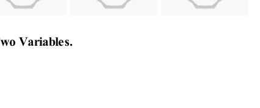

### 1. 编程求两个变量之和。

```c
#include<stdio.h>
#include<conio.h>
void main()
{
int a,b,c;
clrscr();
printf("\n\n\t\t I'm Learning C with Harry’s Book \n");
printf("\n\n\t\tEnter the value of a=");
scanf("%d",&a);
printf("\n\t\t Enter the value of b=");
scanf("%d",&b);
c=a+b;
printf("Sum=%d",c);
getch();
}
```

### 2. 编程求两个变量之差。

```c
#include<stdio.h>
#include<conio.h>
void main()
{
int a,b,c;
clrscr();
printf("\n\t\t\t I’m Learning C with Harry’s Book \n");
printf("\n\n\t Enter the value of a=");
scanf("%d",&a);
printf("\n\t Enter the value of b=");
scanf("%d",&b);
c=a-b;
printf("Sub is =%d",c);
getch();
}
```

### 3. 编程求两个变量之积。

```c
#include<stdio.h>
#include<conio.h>
void main()
{
int a,b,c;
clrscr();
printf("\n\t\t\t I’m Learning C with Harry’s Book \n");
printf("\n\n\t Enter the value of a=");
scanf("%d",&a);
printf("\n\t Enter the value of b=");
scanf("%d",&b);
c=a*b;
printf("Multiply is =%d",c);
getch();
}
```

### 4. 编程求两个变量之商。

```c
#include<stdio.h>
#include<conio.h>
void main()
{
int a,b,c;
clrscr();
printf("\n\t I'm Learning C with Harry's Book \n");
printf("\n\t Enter the value of a=");
scanf("%d",&a);
printf("\n\t Enter the value of b=");
scanf("%d",&b);
c=a/b;
printf("\n\t Divide is =%d",c);
getch();
}
```

### 5. 编程计算简单利息，要求用户输入本金、利率和时间。

```c
#include<stdio.h>
#include<conio.h>
void main()
{
float si,p,t,r;
clrscr();
printf("\n\t I'm Learning C with Harry's Book \n");
printf("\n\t Enter the value of p=");
scanf("%f",&p);
printf("\n\t Enter the value of t=");
scanf("%f",&t);
printf("\n\t Enter the value of r=");
scanf("%f",&r);
si=(p*t*r)/100;
printf("si=%f",si);
getch();
}
```

### 6. 编程读取一名大学生五个科目的成绩，并计算总成绩和百分比。

```c
#include<stdio.h>
#include<conio.h>
void main()
{
float s1,s2,s3,s4,s5,total,per;
clrscr();
printf("\n\t\t\tI'm Learning C with Harry's Book \n");
printf("\n\n\t Enter the value subject s1=");
scanf("%f",&s1);
printf("\n\t Enter the value of subject s2=");
scanf("%f",&s2);
printf("\n\t Enter the value subject s3=");
scanf("%f",&s3);
printf("\n\t Enter the value of subject s4=");
scanf("%f",&s4);
printf("\n\t Enter the value of s5=");
scanf("%f",&s5);
total=s1+s2+s3+s4+s5;
per=total/5;
printf("\n total=%f \n per=%f",total,per);
getch();
}
```

### 7. 编程使用第三个变量交换两个变量的值。

```c
#include<stdio.h>
#include<conio.h>
void main()
{
float a,b,c;
clrscr();
printf("\n\t\t\tI'm Learning C with Harry's Book \n");
printf("\n\n\t Enter the value of a=");
scanf("%f",&a);
printf("\n\n\t Enter the value of b=");
scanf("%f",&b);
c=a;
a=b;
b=c;
printf("\n after swapping a=%f\n\t b=%f",a,b);
getch();
}
```

注意：交换是指将两个变量的值相互调换。

注意：这里 c 是一个临时变量。


## 8. 编写不使用第三个变量交换两个变量的程序。

```c
#include<stdio.h>
#include<conio.h>
void main()
{
float a,b;
clrscr();
printf("\n\t\t I'm Learning C with Harry's Book \n");
printf("\n\n\t Enter the value of a=");
scanf("%f",&a);
printf("\n\n\t Enter the value of b=");
scanf("%f",&b);
a=a+b;
b=a-b;
a=a-b;
printf("\n\tAfter swapping a=%f\n\t\t b=%f",a,b);
getch();
}
```

## 9. 编写计算三角形面积（Tribhuj）的程序。

```c
#include<stdio.h>
#include<conio.h>
void main()
{
float a,b,c,s,r,area;
clrscr();
printf("\n\t\t I'm Learning C with Harry's Book \n");
printf("\n\n\t Enter the value of a=");
scanf("%f",&a);
printf("\n\n\t Enter the value of b=");
scanf("%f",&b);
printf("\n\t Enter the value of c=");
scanf("%f",&c);
s=a+b+c;
area=s*(s-a)*(s-b)*(s-c);
r=area;
printf("\n\t\t Area=%f",r);
getch();
}
```

## 10. 编写读取小时、分钟、秒时间并转换为总秒数的程序。

```c
#include<stdio.h>
#include<conio.h>
void main()
{
int hr,min,sec,totalsec;
clrscr();
printf("\n\t\t I'm Learning C with Harry's Book \n");
printf("\n\n\t Enter the value of hr=");
scanf("%d",&hr);
printf("\n\n\t Enter the value of min=");
scanf("%d",&min);
printf("\n\n\t Enter the value of sec=");
scanf("%d",&sec);
totalsec=(hr*3600)+(min*60)+sec;
printf("\n\n\t\t Totalsec=%d",totalsec);
getch();
}
```

## 11. 编写打印任意字符 ASCII 码的程序。

```c
#include<stdio.h>
#include<conio.h>
void main()
{
char ch;
clrscr();
printf("\n\t\t I'm Learning C with Harry's Book \n");
printf("\n\n\t Enter any character =");
scanf("%c",&ch);
printf("\n\n\t ASCII code of=%c is %d",ch,ch);
getch();
}
```

## 练习笔记：

ASCII 是一个表（美国信息交换标准代码。）

## 12. 编写程序判断输入的数字是偶数还是奇数。

```c
#include<stdio.h>
#include<conio.h>
void main()
{
int n;
clrscr();
printf("\n\t\t I'm Learning C with Harry's Book \n");
printf("\n\n\t Enter any number =");
scanf("%d",&n);
if(n%2==0)
printf("\n\t\t Number is even");
else
printf("\n\t\t Number is odd");
getch();
}
```

## 13. 编写程序检查输入的字符是大写、小写、数字还是特殊符号？

```c
#include<stdio.h>
#include<conio.h>
void main()
{
char ch;
clrscr();
printf("\n\t\t I'm Learning C with Harry's Book \n");
printf("\n\n\t Enter any character =");
scanf("%c",&ch);
if(ch>=65 && ch<=90)
printf("\n\t\t character is uppercase");
else
if(ch>=97 && ch<=122)
printf("\n\t\t character is smaller case");
else
if(ch>=48 && ch<=57)
printf("\n\t\t character is digit");
else
printf("Character is special symbol");
getch();
}
```

## 14. 编写程序根据 π 计算面积。

```c
#include<stdio.h>
#include<conio.h>
void main()
{
float r,area,pi=3.14;
clrscr();
printf("Enter radius");
scanf("%f",&r);
area=pi*r*r;
printf("area=%f",area);
getch();
}
```

## 15. 编写程序求两个数的平均值

```c
/* average of 2 no */
#include<stdio.h>
#include<conio.h>
void main()
{
int a,b;
float avg;
clrscr();
printf("Enter 2 no");
scanf("%d %d",&a,&b);
avg=(a+b)/2.0;
printf("average=%f",avg);
getch();
}
```

## 16. 编写程序输入总天数并换算成月数。

```c
#include<stdio.h>
#include<conio.h>
void main()
{
int n,m,d;
clrscr();
printf("Enter no of days\n");
scanf("%d",&n);
    m=n/30;
    d=n%30;
printf("months=%d,days=%d",m,d);
getch();
}
```

## 17. 编写程序使用第三个变量交换三个数。

```c
#include<stdio.h>
#include<conio.h>
void main()
{
int a,b,c,t;
clrscr();
printf("Enter three no");
scanf("%d %d %d",&a,&b,&c);
t=a;
a=b;
b=t;
t=c;
c=b;
b=t;
printf("%d %d %d",a,b,c);
getch();
}
```

## 18. 编写程序不使用第三个变量交换三个数。

```c
#include<stdio.h>
#include<conio.h>
void main()
{
int a,b,c;
clrscr();
printf("Enter three no");
scanf("%d %d %d",&a,&b,&c);
a=a+b;
b=a-b;
a=a-b;
b=b+c;
c=b-c;
b=b-c;
printf("%d %d %d",a,b,c);
getch();
}
```

## 19. 编写程序计算盈亏。

```c
#include<stdio.h>
#include<conio.h>
void main()
{
float sp,cp;
clrscr();
printf("Enter cost price and selling price\n");
scanf("%f%f",&cp,&sp);
if(cp<sp)
printf("profit=%.2f Rs",sp-cp);
else if(sp<cp)
printf("loss=%.2f Rs",cp-sp);
else
printf("no profit no loss");
getch();
}
```

## 20. 编写程序计算总分和百分比然后打印等级。

```c
#include<stdio.h>
#include<conio.h>
void main()
{
float p;
char grade;
clrscr();
printf("Enter percentage\n\n");
scanf("%f",&p);
if(p>=90)
grade='A';
else if(p>=70)
    grade='B';
    else if(p>=50)
    grade='C';
    else
    grade='F';
printf("grade=%c",grade);
getch();
}
```

## 21. 编写程序将小写字母转换为大写字母。

```c
/* lower case to upper case*/

#include<stdio.h>
#include<conio.h>
void main()
{
char ch;
clrscr();
printf("Enter a character\n");
scanf("%c",&ch);
if(ch>=97&&ch<=122)
ch=ch-32;
printf("%c",ch);
getch();
}
```

## 22. 编写程序找出两个数中的较大数

```c
#include<stdio.h>
#include<conio.h>
void main()
{
int a,b;
clrscr();
printf("Enter 2 no");
scanf("%d %d",&a,&b);
    if(a>b)
        printf("%d is greater",a);
    else if(a==b)
        printf("Both are equal");
    else
        printf("%d is greater ",b);
getch();
}
```

## 23. 编写程序从四个数中找出最大值

```c
#include<stdio.h>
#include<conio.h>
void main()
{
int a,b,c,d;
clrscr();
printf("Enter 4 no");
scanf("%d %d %d %d",&a,&b,&c,&d);
    if(a>b)
    {
        if(a>c)
        {
            if(a>d)
            printf("%d",a);
            else
            printf("%d",d);
        }
        else if(c>d)
            printf("%d",c);
        else
            printf("%d",d);
    }
    else if(b>c)
    {
        if(b>d)
            printf("%d",b);
        else
            printf("%d",d);
        }
    else
        {
            if(c>d)
                printf("%d",c);
            else
                printf("%d",d);
        }
    getch();
}
```

## 24. 编写程序使用 switch case 开发迷你计算器。

```c
/* calculator*/
#include<stdio.h>
#include<conio.h>
void main()
{
int a,b,ch;
clrscr();
printf("Enter two no\n");
scanf("%d %d",&a,&b);
printf("1\t add\n 2\t subtract\n 3\t multiplication\n 4\t divide\n 5\t modulus\n Enter your choice\n");
scanf("%d",&ch);

switch(ch)
    {
        case 1:
            printf("sum=%d",a+b);
            break;

        case 2:
            printf("subtraction=%d",a-b);
            break;

        case 3:
            printf("multiplication=%d",a*b);
            break;

        case 4:
            printf("division=%f",(float)a/b);
            break;

        case 5:
            printf("modulus=%d",a%b);
            break;

        default:
            printf("invalid input");
    }
    getch();
}
```

## 25. 编写程序使用算术运算符制作迷你计算器，每个运算符执行特定任务。

```c
#include<stdio.h>
#include<conio.h>
void main()
{
int a,b;
char ch;
    clrscr();
    printf("Enter two no\n");
    scanf("%d %d",&a,&b);
    flushall();
printf("\n + for add \n - for subtract \n * for multiplication \n / for divide\n Enter your choice\n");
scanf(" %c",&ch);
switch(ch)
{

case '+' :
    printf("sum=%d",a+b);
    break;

case '-' :
    printf("subtraction=%d",a-b);
    break;

case '*' :
    printf("multiplication=%d",a*b);
    break;

case '/' :
    printf("division=%f",(float)a/b);
    break;

case '%' :
    printf("modulus=%d",a%b);
    break;

default:
    printf("invalid input");
}
    getch();
}
```

## 26. 编写程序计算用户输入任意数的阶乘。

```c
#include<stdio.h>
#include<conio.h>
void main()
{
int n,i,f=1;
clrscr();
printf("Hello Guys, I'm Learning C Programming with Harry's Book ");
printf(" Enter the any no. For factorial");
scanf("%d",&n);
for (i=1;i<=n;i++)
f=f*i;
printf("\n factorial is = %d",f);
getch();
}
```

## 27. 编写程序计算数的幂。

```c
#include<stdio.h>
#include<conio.h>
void main()
{ int n,i,p;
long int ans=1;
clrscr();
printf("Enter a no and its power to be calculated");
scanf("%d %d",&n,&p);
i=p;
    while(i>=1)
    { ans*=n;
    i--;
    }
    printf("%ld",ans);
    getch();
}
```

## 28. 编写程序找出月份的天数。

```c
#include<stdio.h>
#include<conio.h>
void main()
{
```


```c
int a;
clrscr();
printf("Enter a month no");
scanf("%d",&a);

switch(a)
{
case 1:
case 3:
case 5:
case 7:
case 8:
case 10:
case 12:
    printf("There are 31 days in given month");
    break;
case 2:
    printf("There are 28 days in given month");
    break;
case 4:
case 6:
case 9:
case 11:
    printf("There are 30 days in given month");
    break;
default:
    printf("Invalid input");
}
getch();
}
```

## 29. 编写程序将温度从华氏度转换为摄氏度。

```c
#include<stdio.h>
#include<conio.h>
void main()
{
float f,c;
clrscr();
printf("Enter Temperature in F");
scanf("%f",&f);
c=(f-32)/1.8;
printf("Temperature in C is %f",c);
getch();
}
```

## 30. 编写程序显示给定年份是否为闰年。

```c
#include<stdio.h>
#include<conio.h>
void main()
{
int n;
clrscr();
printf("Enter an year");
scanf("%d",&n);
if(n%100==0)
{
    if(n%400==0)
        printf("leap year");
    else
        printf("Not leap year");
}
else
{
    if(n%4==0)
        printf("leap year");
    else
        printf("Not leap year");
}
getch();
}
```

## 31. 编写程序判断年份是否为闰年。

```c
#include<stdio.h>
#include<conio.h>
void main()
{
int y;
clrscr();
printf("Enter an year\n");
scanf("%d",&y);
if(y%400==0||y%100!=0&&y%4==0)
    printf("Given year is leap year\n");
else
    printf("Given year is not leap year");
getch();
}
```

## 32. 编写程序判断星期几。

```c
/* weekday*/
#include<stdio.h>
#include<conio.h>
void main()
{
int w;
clrscr();
printf("Enter a weekday\n");
scanf("%d",&w);
switch(w)
{
case 1:
    printf("Sunday");
    break;
case 2:
    printf("Monday");
    break;
case 3:
    printf("Tuesday");
    break;
case 4:
    printf("Wednesday");
    break;
case 5:
    printf("Thursday");
    break;
case 6:
    printf("Friday");
    break;
case 7:
    printf("Saturday");
    break;
default:
    printf("invalid input");
}
getch();
}
```

## 33. 编写程序实现电话账单公司的工作。

```c
/* telephone bill*/
#include<stdio.h>
#include<conio.h>
void main()
{
int calls;
float bill;
clrscr();
printf("Enter no of calls");
scanf("%d",&calls);
printf("calls 0 to 100\t 0Rs\n calls 101-200\t 0.80Rs\n calls 201-500\t 1.00Rs\n calls >500\t 1.20Rs\n");
if(calls<=100)
    bill=0;
else if(calls<=200)
    bill=(calls-100)*.80;
else if(calls<=500)
    bill=(calls-200)*1.00+80;
else
    bill=(calls-500)*1.20+380;
printf("bill=%.2fRs",bill);
getch();
}
```

## 34. 编写程序判断一个数是否为阿姆斯特朗数。

```c
#include<stdio.h>
#include<conio.h>
void main()
{
int n,sum=0,a,old;
clrscr();
printf("Enter a no.");
scanf("%d",&n);
old=n;
while(n!=0)
{
    a=n%10;
    n=n/10;
    sum=sum+a*a*a;
}
if(sum==old)
    printf("ARMSTRONG");
else
    printf("NOT ARMSTRONG");
getch();
}
```

## 35. 编写程序检查一个数是否为回文数。

```c
#include<stdio.h>
#include<conio.h>
void main()
{
int a;
long int n,old,rev=0;
clrscr();
printf("Enter a no");
scanf("%ld",&n);
old=n;
do
{
    a=n%10;
    n=n/10;
    rev=rev*10+a;
}while(n!=0);
if(old==rev)
    printf("PALINDROME");
else
    printf("NOT PALINDROME");
getch();
}
```

## 36. 编写程序检查一个数是否为素数。

```c
#include <stdio.h>
#include <conio.h>
void main()
{
int n,i,prime=1;
clrscr();
printf("Enter a no");
scanf("%d",&n);
for(i=2;i<=n/2;i++)
{
    if(n%i==0)
    {
        prime=0;
        break;
    }
}
if(prime==1)
    printf("Prime no");
else
    printf("Not prime no");
getch();
}
```

## 37. 编写程序反转给定数字。

```c
#include<stdio.h>
#include<conio.h>
void main()
{
int a;
long int n,rev=0;
clrscr();
printf("Enter a no");
scanf("%ld",&n);
do
{
    a=n%10;
    n=n/10;
    rev=rev*10+a;
}while(n!=0);
printf("%ld",rev);
getch();
}
```

## 38. 编写程序打印任意数字的乘法表。

```c
#include<stdio.h>
#include<conio.h>
void main()
{
int n,i,a;
clrscr();
printf("\n Enter any no.");
scanf("%d",&n);
for(i=1; i<=n; i++)
{
    a= n*i;
    printf("\n Table is = %d*%d",n,i,a);
}
getch();
}
```

## 39. 编写程序打印斐波那契数列。

```c
#include<stdio.h>
#include<conio.h>
void main()
{
int a=1, b=0, c=0, n, i;
clrscr();
printf("Enter how many terms u want to print series");
scanf("%d",&n);
for (i=1; i<=n; i++)
{
    printf("%d",c);
    c=a+b;
    a=b;
    b=c;
}
getch();
}
```

## 40. 编写程序打印序列 1,3,5,7,9......n

```c
#include<stdio.h>
#include<conio.h>
void main()
{
int s=1,n,i;
clrscr();
printf("Enter how many terms u want to print ");
scanf("%d",&n);
for (i=1; i<=n; i++, s+=2)
    printf("%d",s);
getch();
}
```

## 41. 编写程序打印 2,4,6,8,10........n

```c
#include<stdio.h>
#include<conio.h>
void main()
{
int s=2, n, i;
clrscr();
printf("Enter how many terms u want to print series");
scanf("%d",&n);
for (i=1; i<=n; i++,s+=2)
    printf("%d",s);
getch();
}
```

## 42. 编写程序打印序列 1,4,16,25,........n

```c
#include<stdio.h>
#include<conio.h>
void main()
{
int n, i;
clrscr();
printf("Enter how many terms u want to print ");
scanf("%d",&n);
for (i=1; i<=n; i++)
    printf("%d",i*i);
getch();
}
```

## 43. 编写程序打印 1 / 1! + 2 / 2! + 3 / 3! + ..........n

```c
#include<stdio.h>
#include<conio.h>
void main()
{
int n, s=1, i;
float fact=1;
clrscr();
printf("Enter how many terms u want to print series");
scanf("%d",&n);
for (i=1; i<=n; i++)
{
    printf("%d / %d! + ",i,fact);
    fact = fact * i;
    printf("%f+", i / fact);
}
getch();
}
```

## 44. 编写程序打印 1 + x2/y2 + x4/y4 + ..................n

```c
#include<stdio.h>
#include<conio.h>
#include<math.h>
void main()
{
int n,i,p=2,x,y;
float s,N,D;
clrscr();
printf("Enter how many terms u want to print series");
scanf("%d",&n);
printf("Enter the value of x and y");
scanf("%d%d",&x,&y);
printf("1+");
for (i=1; i<=n; i++)
{
    N=pow(x,p);
    D=pow(y,p);
    s=N/D;
    printf("%f+",s);
    p=p+2;
}
getch();
}
```

## 45. 编写程序打印 1+X2 /Y + X4/Y3 +.....N。

```c
#include<stdio.h>
#include<conio.h>
#include<math.h>
void main()
{
int n,i,p=2,q=1,x,y;
float s,N,D;
clrscr();
printf("Enter how many terms u want to print series");
scanf("%d",&n);
printf("Enter the value of x and y");
scanf("%d%d",&x,&y);
printf("1+");
for (i=1; i<=n; i++)
{
    N=pow(x,p);
    D=pow(y,q);
    s=N/D;
    printf("%f +",s);
    p=p+2;
    q=q+2;
}
getch();
}
```

## 46. 编写程序打印 1-X2 /Y + X4/Y3 -.....N。

```c
#include <stdio.h>
#include <conio.h>
#include <math.h>
void main()
{
int n,i,p=2,q=1,x,y;
float s,N,D;
clrscr();
printf("Enter how many terms u want to print series");
scanf("%d",&n);
printf("Enter the value of x and y");
scanf("%d%d",&x,&y);
printf("1-");
for (i=1; i<=n; i++)
{
    N=pow(x,p);
    D=pow(y,q);
    s=N/D;
    if(i%2==0)
        printf("%f -",s);
    else
        printf("%f +",s);
    p=p+2;
    q=q+2;
}
getch();
}
```

## 47. 编写程序使用循环打印以下图形。

```
*
**
***
****
*****
```

```c
#include<stdio.h>
#include<conio.h>
void main()
{
int n, i, j;
clrscr();
printf("Enter how many rows u want to print series");
scanf("%d",&n);
for (i=1; i<=n; i++)
{
    for (j=1; j<=i; j++)
        printf("*");
    printf("\n");
}
getch();
}
```

## 48. 编写程序打印此图形。

```
*****
****
***
**
*
```

```c
#include<stdio.h>
#include<conio.h>
void main()
{
int n,i,j;
clrscr();
printf("Enter how many rows u want to print series");
scanf("%d",&n);
for (i=n; i>=1; i--)
{
    for (j=n; j>=i; j--)
        printf("*");
    printf("\n");
}
getch();
}
```

## 49. 打印此图形。

```
1
12
123
1234
12345
```

```c
#include<stdio.h>
#include<conio.h>
void main()
{
int n,i,j;
clrscr();
printf("Enter how many rows u want to print series");
scanf("%d",&n);
for (i=1; i<=n; i++)
{
    for (j=1; j<=i; j++)
        printf("%d",j);
    printf("\n");
}
getch();
}
```

## 50. 编写程序打印此图形。

```
1
22
333
4444
55555
```

```c
#include<stdio.h>
#include<conio.h>
void main()
{
int n,i,j;
clrscr();
printf("Enter how many rows u want to print series");
scanf("%d",&n);
for (i=1; i<=n; i++)
{
    for (j=1; j<=i; j++)
        printf("%d", i);
    printf("\n");
}
getch();
}
```

## 51. 编写程序打印此图形。

```
1
2 3
4 5 6
7 8 9 10
11 12 13 14 15
```

```c
#include<stdio.h>
#include<conio.h>
void main()
{
```


int n, i, j, k=1;
clrscr();
printf("Enter how many rows u want to print series");
scanf("%d",&n);
for (i=1 ; i<=n ; i++)
{
for (j=1 ; j<=i; j++)
printf("%d", k++);
printf("\n");
}
getch();
}

## 52. 编写程序打印此图形。

A
AB
ABC
ABCD
ABCDE

#include<stdio.h>
#include<conio.h>
void main()
{
int n, i, j;
char ch;
ch='A';
clrscr();
printf("Enter how many rows u want to print series");
scanf("%d",&n);
for (i=1 ; i<=n ; i++)
{
for ( j=1 ; j<=i; j++)
printf("%c", ch++);
printf("\n");
}
getch();
}

## 53. 编写程序打印此图形。

A
BB
CCC
DDDD
EEEEE

#include<stdio.h>
#include<conio.h>
void main()
{
int n, i,j;
char ch;
ch='A';
clrscr();
printf("Enter how many rows u want to print series");
scanf("%d",&n);
for (i=1 ; i<=n ; i++)
{
for ( j=1 ; j<=i; j++)
printf("%c",ch);
ch++;
printf("\n");
}
getch();
}

## 54. 编写程序打印此图形。

A
BC
DEF
GHIJ
KLMNO

#include<stdio.h>
#include<conio.h>
void main()
{
int n, i,j;
char ch;
ch='A';
clrscr();
printf("Enter how many rows u want to print series");
scanf("%d",&n);
for (i=1 ; i<=n ; i++)
{
for ( j=1 ; j<=i; j++)
printf("%c",ch++);
printf("\n");
}
getch();
}

## 55. 编写程序打印此星形图案。

*
***
*****
*******
*********

#include<stdio.h>
#include<conio.h>
void main()
{
int n,i,j,K;
clrscr();
printf("Enter how many rows u want to print series");
scanf("%d",&n);
for (i=1;i<=n;i++)
{
for (j=1;j<=n-i;j++)
printf(" ");
for(k=1;k<=2*i-1;k++)
printf("*");
printf("\n");
}
getch();
}

## 56. 编写程序打印此图形。

*********
*******
*****
***
*

#include<stdio.h>
#include<conio.h>
void main()
{
int n,i,j,K;
clrscr();
printf("Enter how many rows u want to print series");
scanf("%d",&n);
for (i=n;i>=1;i--)
{
for (j=1;j<=n-i;j++)
printf(" ");
for(k=1;k<=2*i-1;k++)
printf("*");
printf("\n");
}
getch();
}

## 57. 编写程序按此形式打印此星形图案。

*
***
*****
*******
*********
*********
*******
*****
***
*

#include<stdio.h>
#include<conio.h>
void main()
{
int n,i,j,K;
clrscr();
printf("Enter how many rows u want to print series");
scanf("%d",&n);
for (i=1;i<=n;i++)
{
for (j=1;j<=n-i;j++)
printf(" ");
for(k=1;k<=2*i-1;k++)
printf("*");
printf("\n");
}
for (i=n-1;i>=1;i--)
{
for (j=1;j<=n-i;j++)
printf(" ");
for(k=1;k<=2*i-1;k++)
printf("*");
printf("\n");
}
getch();
}

## 58. 编写程序按此形式打印此星形图案。

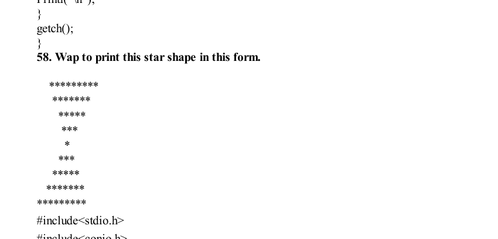

#include<stdio.h>
#include<conio.h>
void main()
{
int n,i,j,K;
clrscr();
printf("Enter how many rows u want to print series");
scanf("%d",&n);
for (i=n;i>=1;i--)
{
for (j=1;j<=n-i;j++)
printf(" ");
for(k=1;k<=2*i-1;k++)
printf("*");
printf("\n");
}
for (i=2;i<=n;i++)
{
for (j=1;j<=n-i;j++)
printf(" ");
for(k=1;k<=2*i-1;k++)
printf("*");
printf("\n");
}
getch();
}

## 59. 编写程序打印此二进制图形。

10000
01000
00100
00010
00001

#include<stdio.h>
#include<conio.h>
void main()
{
int n,i,j,K;
clrscr();
printf("Enter how many rows u want to print series");
scanf("%d",&n);
for (i=1;i<=n;i++)
{
for (j=1;j<=n;j++)
if(i==j)
printf("1");
else
printf("0");
printf("\n");
}
getch();
}

## 60. 编写程序打印此二进制图形。

A
ABA
ABCBA
ABCDCBA

#include<stdio.h>
#include<conio.h>
void main()
{
int n,i,j,K,l;
char ch;
clrscr();
printf("Enter how many rows u want to print series");
scanf("%d",&n);
for (i=1;i<=n;i++)
{
ch='A';
for (j=1;j<=n-i;j++)
printf(" ");
for(k=1;k<=i;k++);
printf("%c",ch++);
ch=ch-2;
for(l=1;l<i;l++)
printf("%c",ch--);
printf("\n");
}
getch();
}

## 61. 编写程序打印此二进制图形。

1
121
12321
1234321

#include<stdio.h>
#include<conio.h>
void main()
{
int n,i,j,K,l,m;
clrscr();
printf("Enter how many rows u want to print series");
scanf("%d",&n);
for (i=1;i<=n;i++)
{
m=1;
for (j=1;j<=n-i;j++)
printf(" ");
for(k=1;k<=i;k++);
printf("%d",m++);
m=m-2;
for(l=1;l<i;l++)
printf("%d",m--);
printf("\n");
}
getch();
}

## 62. 编写程序打印此图形。

1
12
123
1234

#include<stdio.h>
#include<conio.h>
void main()
{
int n,i,j,K;
clrscr();
printf("Enter how many rows u want to print series");
scanf("%d",&n);
for (i=1;i<=n;i++)
{
for (j=1;j<=n-i;j++)
printf(" ");
for(k=1;k<=i;k++);
printf("%d",k);
printf("\n");
}
getch();
}

## **********
*数组*
**********

## 63. 编写程序读取一个包含20个整数的数组，并打印所有输入数字的总和。

#include<stdio.h>
#include<conio.h>
void main()
{
int a[20],i,sum=0;
clrscr();
printf("Enter how many elements of this array series u want to Enter");
for (i=0;i<=19;i++)
{
scanf("%d",&a[i]);
sum=sum+a[i];
}
printf("\n sum=%d",sum);
getch();
}

## 64. 编写程序读取一个包含20个整数的数组，并统计偶数和奇数元素的总数。

#include<stdio.h>
#include<conio.h>
void main()
{
int a[20],i,odd=0,even=0;
clrscr();
printf("Enter how many elements of this array series u want to Enter");
for (i=0;i<=19;i++)
{
scanf("%d",&a[i]);
if (a[i] % 2==0)
    even++;
else
    odd++;
}
printf("\n even=%d,  odd=%d",even,odd);
getch();
}

## 65. 编写程序读取一个包含20个整数的数组，并统计正数、负数和零元素的总数。

#include<stdio.h>
#include<conio.h>
void main()
{
int a[20],i,pos=0,neg=0,zero=0;
clrscr();
printf("Enter how many elements of this array series u want to Enter");
for (i=0;i<=19;i++)
{
scanf("%d",&a[i]);
if(a[i]>0)
    pos++;
else if( a[i]<0)
neg++;
else
    zero++;
}
printf("\n pos=%d, neg=%d, zero=%d",pos,neg,zero);
getch();
}

## 66. 编写程序读取一个包含20个整数的数组，并将这些数组相加的结果存入第三个数组。

#include<stdio.h>
#include<conio.h>
void main()
{
int a[20],b[20],c[20],i;
clrscr();
printf("Enter how many elements of the first array");
for (i=0;i<=19;i++)
{
scanf("%d",&a[i] );
}
printf("Enter how many elements of the second array");
for (i=0;i<=19;i++)
{
scanf("%d",&b[i] );
}
for (i=0;i<=19;i++)
{
c[i]=a[i]+b[i];
}
printf("\n Addition after first and second array \n");
for(i=0;i<=10;i++)
{
printf("%d",c[i]);
}
getch();
}

## 67. 编写程序读取两个包含10个整数的数组，并使用第三个变量交换它们的值。

#include<stdio.h>
#include<conio.h>
void main()
{
int a[20],b[20],c,i;
clrscr();
printf("Enter how many elements of the first array");
for (i=0;i<=19;i++)
{
scanf("%d",&a[i]);
}
printf("Enter how many elements of the second array");
for (i=0;i<=19;i++)
{
scanf("%d",&b[i]);
}
/*swapping of arrays*/
for (i=0; i<19;i++)
{
c=a[i];
a[i]=b[i];
b[i]=c;
}
printf("\n after swapping first array \n")
for (i=0; i<19;i++)
{
printf("%d",a[i]);
}
printf("\n after swapping second array \n")
for (i=0; i<19;i++)
{
printf("%d",b[i]);
}
getch();
}

## 68. 编写程序反转数组。

#include<stdio.h>
#include<conio.h>
void main()
{
int a[20],i,j;
clrscr();
printf("\n\n Enter how many elements of the first array");
for (i=0;i<=19;i++)
{
scanf("%d",&a[i]);
}
for (i=0;j=10-1;i<10/2;i++;j--)
{
c=a[i];
a[i]=a[j];
a[j]=c;
}
printf("\n\n Reverse of array \n")
for (i=0; i<19;i++)
printf("%d",a[i]);
getch();
}

## 69. 编写程序读取一个3*3矩阵，并找出最大和最小元素。

#include<stdio.h>
#include<conio.h>
void main()
{
int a[5][5],i,j,min=-32767,max=-32768;
clrscr();
printf("\n Enter elements of the matrix");
for (i=0;i<=4;i++)
{
for (j=0; j<=4;j++)
{
scanf("%d",&a[i][j]);
if(max<a[i][j])
max=a[i][j];
else if(min>a[i][j])
min=a[i][j];
}
}
printf("\n max=%d, min=%d", max,min);
getch();
}

## 70. 编写程序读取一个3*3矩阵，并打印所有行的和。

#include<stdio.h>
#include<conio.h>
void main()
{
int a[5][5],i,j,sum=0;
clrscr();
printf("\n Enter elements of the matrix");
for (i=0;i<=4;i++)
{
for(j=0; j<=4;j++)
{
scanf("%d",&a[i][j]);
}
}
for(i=0;i<=4;i++)
{
sum=0;
for(j=0;j<=4;j++)
{
sum=sum+a[i][j];
}
printf("\n sum of %d row is =%d",i+1,sum);
}
getch();
}

## 71. 编写程序打印3*3矩阵并打印其转置。

#include<stdio.h>
#include<conio.h>
#include<conio.h>


```c
void main()
{
int a[3][3],i,j;
clrscr();
printf("\n Enter elements of the matrix");
for(i=0;i<3;i++)
{
for (j=0; j<3;j++)
{
scanf("%d",&a[i][j]);
}
}
printf("\n Transpose \n");
for (i=0;i<3;i++)
{
for(j=0;j<3;j++)
{
printf("%d",a[j][i]);
printf("\n");
}
}
getch();
}
```

## 72. 编写程序读取两个3*3矩阵，并将它们的值相加存入第三个矩阵。

```c
#include<stdio.h>
#include<conio.h>
void main()
{
int a[3][3],b[3][3],c[3][3],i,j;
clrscr();
printf("\n Enter elements of first matrix");
for(i=0;i<3;i++)
{
for (j=0; j<3;j++)
{
scanf("%d",&a[i][j]);
}
}
printf("\n Enter elements of second matrix");
for (i=0;i<3;i++)
{
for (j=0;j<3;j++)
{
scanf("%d",&b[i][j]);
}
}
/* Addition of matrix*/
for (i=0;i<3;i++)
for(j=0;j<3;j++)
c[i][j]=a[i][j]+b[i][j];
printf("\n Addition of first and second matrix \n");
for (i=0;i<3;i++)
{
for (j=0;j<3;j++)
{
printf("%d",c[i][j]);
}
printf("\n");
}
getch();
}
```

## 73. 编写程序读取两个3*3矩阵，将它们的值相减并存入第三个矩阵。

```c
#include<stdio.h>
#include<conio.h>
void main()
{
int a[3][3],b[3][3],c[3][3],i,j;
clrscr();
printf("\n Enter elements of first matrix");
for (i=0;i<3;i++)
{
for (j=0;j<3;j++)
{
scanf("%d",&a[i][j]);
}
}
printf("\n Enter elements of second matrix");
for (i=0;i<3;i++)
{
for (j=0; j<3;j++)
{
scanf("%d",&b[i][j]);
}
}
/* Subtraction of matrix*/
for (i=0;i<3;i++)
    for(j=0;j<3;j++)
c[i][j]=a[i][j]-b[i][j];
printf("\n Subtraction of first and second matrix \n");
for (i=0;i<3;i++)
{
for (j=0; j<3;j++)
{
printf("%d",c[i][j]);
}
printf("\n");
}
getch();
}
```

## 74. 编写程序读取两个3*3矩阵，将它们的值相乘并存入第三个矩阵。

```c
#include<stdio.h>
#include<conio.h>
void main()
{
int a[3][3],b[3][3],c[3][3],i,j,k;
clrscr();
printf("\n\n Enter elements of first matrix");
for (i=0;i<3;i++)
{
for (j=0; j<3;j++)
{
    scanf("%d",&a[i][j]);
}
}
printf("\n Enter elements of second matrix");
for (i=0;i<3;i++)
{
for (j=0; j<3;j++)
{
    scanf("%d",&b[i][j]);
}
}
/* Multiply of matrix*/
for (i=0;i<3;i++)
{
for (j=0; j<3;j++)
{
    c[i][j]=0;
for(k=0;k<3;k++)
    c[i][j]=c[i][j]+a[i][k]*b[k][j];
}
}
printf("\n MULTIPLY OF BOTH MATRIX \n");
for (i=0;i<3;i++)
{
for (j=0; j<3;j++)
{
    printf("%d",c[i][j]);
}
    printf("\n");
}
getch();
}
```

## 75. 编写程序读取一个数组并打印任一特定元素出现的次数。

```c
#include<stdio.h>
#include<conio.h>
void main()
{
 int a[10],i,item,count=0;
 clrscr();
 printf("\n Enter elements of array");
 for (i=0;i<10;i++)
 {
 scanf("%d",&a[i]);
 }
 printf("\n Enter the element you want to count occurrence \n");
 scanf("%d",&item);
 for (i=0;i<10;i++)
 {
 if(a[i]==item)
 {
 count++;
 }
 }
 printf("\n No. Occurrence %d times",count);
 getch();
 }
```

## 76. 编写程序读取2*2矩阵并将其转换到第三个矩阵。

```c
#include<stdio.h>
#include<conio.h>
#include<conio.h>
void main()
{
 int a[3][3],i,j,r,c=0;
 clrscr();
 printf("\n Enter elements of first matrix");
for(i=0;i<3;i++)
{
for(j=0; j<3; j++)
{
scanf("%d",&a[i][j]);
}
}
for(i=0;i<3;i++)
{
r=c=0;
for(j=0;j<3;j++)
{
r=r+a[i][j];
c=c+a[j][i];
}
a[2][2]=a[0][2]+a[1][2];
getch();
}
```

## 字符串

## 77. 编写程序计算字符串的长度。

```c
#include<stdio.h>
#include<conio.h>
#include<string.h>
void main()
{
char str[10];
int i,count=0;
clrscr();
printf("\n Enter a string \n");
gets(str);
for(i=0;str[i]!='\0';i++)
    count++;
printf("\n Length of the string is= %d",count);
getch();
}
```

## 78. 编写程序将一个字符串复制到另一个字符串中。

```c
#include<stdio.h>
#include<conio.h>
#include<string.h>
void main()
{
char s1[10],s2[10];
int i;
clrscr();
printf("\n Enter a string \n");
gets(s1);
for(i=0;s1[i]!='\0';i++)
s2[i]=s1[i];
s2[i]='\0';
puts(s1);
puts(s2);
getch();
}
```

## 79. 编写程序连接两个字符串。

```c
#include<stdio.h>
#include<conio.h>
#include<string.h>
void main()
{
char s1[10],s2[10];
int i,j;
clrscr();
printf("\n Enter first string \n");
gets(s1);
printf("\n Enter second string \n");
gets(s2);
for(i=0;s1[i]!='\0';i++)
for(j=0;s2[j]!='\0';j++)
s1[i]=s2[j];
s1[i]='\0';
puts(s1);
getch();
}
```

## 80. 编写程序比较两个字符串。

```c
#include<stdio.h>
#include<conio.h>
#include<string.h>
void main()
{
char s1[10],s2[10];
int i,f=0;
clrscr();
printf("\n Enter first string \n");
gets(s1);
printf("\n Enter second string \n");
gets(s2);
for(i=0;s1[i]!='\0' || s2[i]!='\0';i++)
{
if(s1[i]==s2[i])
continue;
else
{
 f=s1[i]-s2[i];
 break;
 }
}
if(f==0)
printf("\n string are equal \n");
else
printf("\n strings are not equal");
getch(); }
```

## 81. 编写程序反转字符串。

```c
#include<stdio.h>
#include<conio.h>
#include<string.h>
void main()
{
char c, str[10];
int i,n;
clrscr();
printf("\n Enter a string \n");
gets(str);
n=strlen(str);
for(i=0,j=n-1;i<n/2;i++,j--)
{
    c=str[i];
    str[i]=str[j];
    str[j]=c;
}
printf("\n REVERSE IS \n");
puts(str);
getch();
}
```

## 82. 编写程序查找字符串中任一特定字符出现的次数。

```c
#include<stdio.h>
#include<conio.h>
#include<string.h>
void main()
{
char c, str[10];
int i,count=0;
clrscr();

printf("\n Enter a string \n");
gets(str);
printf("\n Enter a character \n");
scanf("%c",&c);
for(i=0;str[i]!='\0';i++)
{
if(str[i]==c)
count++;
}
printf("\n character comes in string %d times",count );
getch();
}
```

## 83. 编写程序检查字符串中是否存在某个字符。

```c
#include<stdio.h>
#include<conio.h>
#include<string.h>
void main()
{
char c, str[10];
int i,f=0;
clrscr();
printf("\n Enter a string \n");
gets(str);
printf("\n Enter a character u want to search \n");
scanf("%c",&c);
for(i=0;str[i]!='\0';i++)
{
if(str[i]==c)
{
f=1;
break;
}
}
if(f==1)
printf("\n The character is present in string" );
else
printf("\n The character is not present in string" );
getch();
}
```

## 84. 编写程序统计字符串中元音字母的总数。

```c
#include<stdio.h>
#include<conio.h>
#include<string.h>
void main()
{
char str[10];
int i,vowel=0;
clrscr();
printf("\n Enter a string \n");
gets(str);
for(i=0;str[i]!='\0' ;i++)
{
if(str[i]=='a' || str[i]=='e' || str[i]=='i' || str[i]=='o' || str[i]=='u')
vowel++;
}
printf("\n total vowels in this string is=%d",vowel);
getch();
}
```

## 85. 将小写字母转换为大写字母的程序。

```c
#include<stdio.h>
#include<conio.h>
#include<string.h>
void main()
{
char str[10];
int i;
clrscr();
printf("\n Enter a string in lower case \n");
gets(str);
for(i=0;str[i]!='\0';i++)
{
    if(str[i]>=65 && str[i]<=90)
        continue;
    else
        str[i]=str[i]-32;
}
puts(str);
getch();
}
```

## 86. 编写程序统计给定文本行中的小写字母、大写字母、数字和特殊符号。

```c
#include<stdio.h>
#include<conio.h>
#include<string.h>
void main()
{
char str[10];
int i,lwr=0,upr=0,dig=0,ss=0;
clrscr();
printf("\n Enter a string \n");
gets(str);
for(i=0;str[i]!='\0';i++)
{
if(str[i]>=65 && str[i]<=90)
    upr++;
else
    if(str[i]>=97 && str[i]<=122)
        lwr++;
else
    if(str[i]>=48 && str[i]<=57)
        dig++;
else
    ss++;
}
printf("\n Total upper  case is=%d",upr);
printf("\n Total lower  case is=%d",lwr);
printf("\n Total digit  case is=%d",dig);
printf("\n Total sp.sym. case is=%d",ss);
getch();
}
```

## 87. 编写程序统计字符串中的总字符数和单词数。

```c
#include<stdio.h>
#include<conio.h>
#include<string.h>
void main()
{
char str[10];
int i,chr=0,word=1;
clrscr();
printf("\n Enter a string \n");
gets(str);
for(i=0;str[i]!='\0';i++)
{
chr++;
if(str[i]==' ')
word++;
}
printf("\n Total characters=%d",chr);
printf("\n Total words =%d",word);
getch();
}
```

## 88. 编写程序打印输入字符串或名称的ASCII值。

```c
#include<stdio.h>
#include<conio.h>
#include<string.h>
void main()
{
char str[10];
int i;
clrscr();
printf("\n Enter a string \n");
gets(str);
printf("\n ASCII values is \n");
```


```c
for(i=0;str[i]!='\0';i++)
{
 printf("%d",str[i]);
}
getch();}
```

## 89. 编写程序用另一个字符替换字符串中的字符。

```c
#include<stdio.h>
#include<conio.h>
#include<string.h>
void main()
{
char str[10],ch,chr;
int i,f=0;
clrscr();
printf("\n Enter a string \n");
gets(str);
printf("\n Enter the char which u want to replace \n");
scanf("%c",&ch);
printf("\n Enter the char by which u want to replace \n");
scanf("%c",&chr);
for(i=0;str[i]!='\0'; i++)
{
if(str[i]==ch)
{
str[i]=chr;
f=1;
}
}
if(f==0)
 printf("\n This Character is not present in this string");
getch();
}
```

## 90. 编写程序将每个单词的首字母转换为大写。

```c
#include<stdio.h>
#include<conio.h>
#include<string.h>
void main()
{
char str[10];
int i;
clrscr();
printf("\n Enter a string \n");
gets(str);
if(str[0]>=97 && str[0]<=122)
    str[0]=str[0]-32;
for(i=0;str[i]!='\0';i++)
{
    if(str[i]==' ')
        if(str[i+1]>=97 && str[i+1]<=122)
            str[i+1]=str[i+1]-32;
}
puts(str);
getch();
}
```

## 91. 编写程序使用预定义字符串函数查找长度、复制、连接、比较、反转。

```c
#include<stdio.h>
#include<conio.h>
#include<string.h>
void main()
{
char s1[30],s2[30];
int n;
clrscr();
printf("\n Enter first  string \n");
gets(s1);
printf("\n Enter second  string \n");
gets(s2);

/*To Find length of s1*/
n=strlen(s1);
printf("\n Length of first string is =%d",n);

/*To copy s1 into s2*/
strcpy(s2,s1);
puts(s2);

/*To concatenate s1 and s2*/
strcat(s1,s2);
puts(s1);

/*To compare s1 and s2*/
n=strcmp(s1,s2);
if(n==0)
    printf("\n strings are Equal");
else
    printf("\n string are Unequal");

/*To Reverse S1*/
strrev(s1);
puts(s1);
getch();
}
```

## 指针

## 92. 编写程序通过指针读取两个变量并交换它们。

```c
#include<stdio.h>
#include<conio.h>
void main()
{
int a,b,c,*p1,*p2;
clrscr();
printf("\n Enter Two Numbers \n");
scanf("%d%d",&a,&b);
/* Giving Variables References to Pointers */
p1=&a;
p2=&b;

/* swapping */
c=*p1;
*p1=*p2;
*p2=c;

printf("\n After swapping a=%d, b=%d",a,b);
getch();
}
```

## 93. 编写程序通过指针读取两个数字并将它们相加。

```c
#include<stdio.h>
#include<conio.h>
void main()
{
int a,b,sum=0,*p1,*p2;
clrscr();
printf("\n Enter Two Numbers \n");
scanf("%d%d",&a,&b);
/* Giving Variables References to Pointers */
p1=&a;
p2=&b;

/* sum */
sum=(*p1)+(*p2);
printf("\n Sum=%d ",sum);
getch();
}
```

## 带循环的指针

## 94. 编写程序读取 'n' 个数字并使用指针将它们相加。

```c
#include<stdio.h>
#include<conio.h>
void main()
{
int a,n,i,sum=0,*p;
clrscr();
printf("\n Enter How Many no.'s u want to add? \n");
scanf("%d",&n);
/* Giving Variables References to Pointers */
p=&sum;
for(i=0;i<=n;i++);
{
printf("\n Enter a no.");
scanf("%d",&a);
*p=*p+a;
}
printf("\n Sum=%d ",sum);
getch();
}
```

## 指针与数组操作

## 95. 编写程序读取数组中的 10 个元素并使用指针将它们相加。

```c
#include<stdio.h>
#include<conio.h>
void main()
{
int a[10],i,sum=0,*p;
clrscr();
printf("\n Enter ten numbers. \n");
for(i=0;i<10;i++);
scanf("%d",&a[i]);
/* Giving Variables References to Pointers */
p=&a;
for(i=0;i<10;i++);
{
    sum=sum+(*p);
    p++;
}
printf("\n Sum of all arrays is =%d ",sum);
getch();
}
```

## 96. 编写程序读取两个包含 10 个元素的数组并使用指针在第三个数组中相加它们的值。

```c
#include<stdio.h>
#include<conio.h>
void main()
{
int a[10],b[10],c[10],i,*p1,*p2;
clrscr();
printf("\n Enter ten elements for first array. \n");
for(i=0;i<10;i++);
scanf("%d",&a[i]);
printf("\n Enter ten elements for second array. \n");
for(i=0;i<10;i++);
scanf("%d",&b[i]);
p1=a;
p2=b;
for(i=0;i<10;i++)
{
c[i]=( *p1)+( *p2);
p1++;
p2++;
}
printf("\n After addition third array");
for(i=0;i<10;i++)
printf("\n %d",c[i]);
getch();
}
```

## 97. 编写程序使用指针计算阶乘。

```c
#include<stdio.h>
#include<conio.h>
void main()
{
int n,*p,i,f=1;
clrscr();
printf("\n Enter Any number for Factorial.\n");
scanf("%d",&n);
p=&f;
for(i=0;i<=n;i++)
*p=*p*i;
printf("\n Factorial using pointer is=%d", f);
getch();
}
```

## 98. 编写程序使用指针计算字符串的长度。

```c
#include<stdio.h>
#include<conio.h>
void main()
{
char str[10],*p;
int count=0;
clrscr();
printf("\n Enter a string");
gets(str);
p=str;
while(*p!='\0')
{
count++;
p++;
}
printf("\n Length of string is %d",count);
getch();
}
```

## 99. 编写程序使用指针将一个字符串复制到另一个字符串。

```c
#include<stdio.h>
#include<conio.h>
void main()
{
char s1[10],s2[10],*p1,*p2;
clrscr();
printf("\n Enter a string");
gets(s1);
p1=s1;
p2=s2;
while(*p1!='\0')
{
*p2=*p1;
p1++;
p2++;
}
*p2='\0';
puts(s1);
puts(s2);
getch();
}
```

## 100. 编写程序使用指针连接两个字符串。

```c
#include<stdio.h>
#include<conio.h>
void main()
{
char s1[10],s2[10],*p1,*p2;
int i,j;
clrscr();
printf("\n Enter first string");
gets(s1);
printf("\n Enter second string");
gets(s2);
p1=s1;
p2=s2;
while(*p1!='\0')
{
p1++;
}
while(*p2!='\0')
{
*p1=*p2;
p1++;
p2++;
}
*p1='\0';
puts(s1);
getch();
}
```

## 101. 编写程序使用指针比较两个字符串。

```c
#include<stdio.h>
#include<conio.h>
void main()
{
char s1[10],s2[10],*p1,*p2;
int i,f=0;
clrscr();
printf("\n Enter first string");
gets(s1);
printf("\n Enter second string");
gets(s2);
p1=s1;
p2=s2;
while(*p1!='\0'||*p2!='\0')
{
if(*p1==*p2)
{
p1++;
p2++;
continue;
}
else
{
f=*p1-*p2;
break;
}
}
if(f==0)
printf("\n string are equal");
else
printf("\n string are not equal");
getch();
}
```

## 结构体

## 102. 编写程序创建结构体 BOOK，读取并显示一本书的信息。

```c
#include<stdio.h>
#include<conio.h>
struct book
{
char name[10];
int pages;
float price;
};
void main()
{
struct book b;
printf("\n Enter information about book");
printf("\n Enter Name  of the book");
gets(b.name);
printf("\n Enter total pages and price of the book");
scanf("%d%f",&b.pages,&b.price);
printf("\n Displaying information about book");
printf("\n name =%s",b.name);
printf("\n pages=%d",b.pages);
printf("\n price=%f",b.price);
getch();
}
```

## 103. 编写程序创建学生结构体，读取十名学生信息并打印成绩大于 90 的学生的姓名。

```c
#include<stdio.h>
#include<conio.h>
struct student
{
char name[10];
int r_no;
float marks;
};
void main()
{
struct student s[10];
int i;
printf("\n Enter info. about students");
for(i=0;i<10;i++)
{
    printf("\n Plz Enter the name of the student");
    gets(s[i].name);
    printf("\n Enter r_no and marks");
    scanf("%d %f",&s[i].r_no,&s[i].marks);
}
printf("\n name of those whose have >90");
for (i=0;i<10;i++)
{
    if (s[i].marks>90)
        puts(s[i].name);
    getch();
}
```

## 104. 编写程序读取 10 个人的个人信息并打印居住在特定城市的人的详细信息。

```c
#include<stdio.h>
#include<conio.h>
#include<string.h>
struct personalinfo
{
char name[10];
char city[20];
char add [20];
};
void main()
{
struct personalinfo s[10];
int i,n;
char ct[20];
printf("Enter info of ten peoples");
for (i=0;i<10;i++)
{
    printf("\n Plz Enter the name of the Person");
    gets(s[i].name);
    printf("\n Plz Enter the name of the city");
    gets(s[i].city);
    printf("\n Plz Enter the address of the person");
    gets(s[i].add);
}
printf("\n Enter the city whose persons detail u want display");
gets(ct);
for (i=0;i<10;i++)
{
    n=strcmp(s[i].city,ct);
    if(n==0)
    {
        puts(s[i].name);
        puts(s[i].city);
        puts(s[i].add);
    }
}
getch();
}
```

## 105. 编写程序创建结构体 complex 来建模复数，读取两个复数并将它们相加。

```c
#include<stdio.h>
#include<conio.h>
struct complex
{
    float real,image;
};
void main()
{
    struct complex c1,c2,c3;
    printf("\n Plz Enter first complex no.");
    printf("\n Plz Enter the real part");
```

```c
scanf("%f",&c1.real);
printf("\n Plz Enter the imaginary part");
scanf("%f",&c1.image);
printf("\n Plz Enter the second complex no.");
printf("\n Plz Enter the real part");
scanf("%f",&c2.real);
printf("\n Plz Enter the imaginary part");
scanf("%f",&c2.image);
c3.real=c1.real+c2.real;
c3.image=c1.image+c2.image;
printf("\n sir After Addition both parts");
printf("\n real = %f,image=%f",c3.real,c3.image);
getch();
}
```

### 106. 编写程序创建 Distance 结构体并读取两个以英尺和英寸为单位的距离并打印它们的加法。好吧！！

```c
#include<stdio.h>
#include<conio.h>
struct distance
{
    float feet,inch;
};
void main()
{
    struct distance d1,d2,d3;
    printf("\n Plz Enter first distance.");
    printf("\n Plz Enter the feets");
    scanf("%f",&d1.feet);
    printf("\n Plz Enter the inches");
    scanf("%f",&d1.inch);
    printf("\n Plz Enter second distance.");
    printf("\n Plz Enter the feets");
    scanf("%f",&d2.feet);
    printf("\n Plz Enter the inches");
    scanf("%f",&d2.inch);

    d3.feet=d1.feet+d2.feet;
    d3.inch=d1.inch+d2.inch;

    while(d3.inch>=12)
    {
        d3.feet++;
        d3.inch=d3.inch-12;
    }
    printf("\n sir After Addition both parts");
    printf("\n feet = %f,inches=%f",d3.feet,d3.inch);
    getch();
}
```

### 107. 编写程序创建 Date 结构体并通过增加天数来增加日期，且日期应有效。

```c
#include<stdio.h>
#include<conio.h>
struct date
{
    int dd,mm,yy;
};
void main()
{
    struct date d;
    int day;
    printf("\n Plz Enter days,month,year.");
    scanf("\n %d%d%d",&d.dd,&d.mm,&d.yy);

    printf("\n Plz Enter no. of days you want to add");
    scanf("%d",&day);

    d.dd=d.dd+day;
    while(d.dd>=30)
    {
        d.mm++;
        d.dd=d.dd-30;
    }
    while(d.mm>12)
    {
        d.yy++;
        d.mm=d.mm-12;
    }

    printf("\n sir Date After Additions");
    printf("\n %d%d%d",d.dd,d.mm,d.yy);

    getch();
}
```

### 108. 编写程序读取 20 本书的信息并打印价格超过 1000 Rs 的那些书的名称和作者姓名。

```c
#include<stdio.h>
#include<conio.h>

struct book
{
    char name[10];
    char aname[10];
    int pages;
    float price;
};
void main()
{
    struct book b[20];
    int i;
    printf("\n Plz Enter info. of 20 books.");
    for(i=0;i<20;i++)
    {
        printf("\n Plz Enter name of books.");
        gets(b[i].name);
        printf("\n Plz Enter name of author.");
        gets(b[i].aname);
        printf("\n Plz Enter total pages and price of book");
        scanf("%d%f",&b[i].pages,&b[i].price);
    }

    for(i=0;i<20;i++)
    {
        if(b[i].price>1000)
        {
            printf("\n name =%s",b[i].name);
            printf("\n Author Name =%s",b[i].aname);
        }
    }
    getch();
}
```

## 文件处理

### 109. 编写程序从屏幕读取一行文本并存储到文件中。

```c
#include<stdio.h>
#include<conio.h>
#include<stdlib.h>
#include<string.h>
void main()
{
    FILE *fp;
    char str[20];
    fp=fopen("sample.txt","w");
    printf("\n Enter a line of text");
    gets(str);
    fprintf(fp,"%s",str);
    fclose(fp);
    getch();
}
```

### 110. 编写程序从文件中读取一行文本并显示它。

```c
#include<stdio.h>
#include<conio.h>
#include<stdlib.h>
#include<string.h>
void main()
{
    FILE *fp;
    char str[20];
    fp=fopen("sample.txt","r");
    if(fp==NULL)
    {
        printf("\n File doesn't exist");
        exit(1);
    }
    fscanf(fp,"%s",str);
    printf("\n file contains...");
    puts(str);
    fclose(fp);
    getch();
}
```

### 111. 编写程序从用户读取 'n' 个姓名并将它们存储到文件中，同时将其复制到另一个文件中。

```c
#include<stdio.h>
#include<conio.h>
#include<stdlib.h>
#include<string.h>
void main()
{
    FILE *fp1,*fp2;
    char str[20];
    int i,n;

    fp1=fopen("file1.txt","w+");
    printf("\n How many names u want to Enter");
    scanf("%d",&n);

    for(i=0;i<n;i++)
    {
        printf("\n Enter the name");
        gets(str);
        fprintf(fp1,"\n %s",str);
    }

    rewind(fp1);
    fp2=fopen("file2.txt","w");
    while(!feof(fp1))
    {
        fscanf(fp1,"\n %s",str); /* read from first file */
        fprintf(fp2,"\n%s",str); /* storing in to second file */
        puts(str);               /* Displaying on the screen */
    }
    getch();
}
```

### 112. 编写程序统计文件中总字符数和单词数。

```c
#include<stdio.h>
#include<conio.h>
#include<stdlib.h>
void main()
{
    FILE *fp1;
    char c;
    int ch=0,word=1;

    fp1=fopen("file1.txt","r");
    if(fp1==NULL)
    {
        printf("\n Sir File Doesn't Exist");
        exit(1);
    }
    while(!feof(fp1))
    {
        c=getc(fp1);
        ch++;
        if(c==' ')
            word++;
    }
    printf("\n Total Characters=%d",ch);
    printf("\n Total words =%d",word);
    getch();
}
```

## 函数

### 113. 编写程序展示函数之间值的发送与接收。

```c
#include<stdio.h>
#include<conio.h>
int calsum(int x,int y,int z); /* function prototype */
void main()
{
    int a,b,c,sum;
    printf("\n Enter any three numbers");
    scanf("\n %d%d%d",&a,&b,&c);
    sum=calsum(a,b,c); /* function calling */
    printf("\n Sum=%d",sum);
    getch();
}
/* function definition or body */
int calsum(int x,int y,int z)
{
    int d;
    d=x+y+z;
    return(d);
}
```

### 114. 编写程序计算数字的平方并带有返回类型。

```c
#include<stdio.h>
#include<conio.h>
float square(float); /* function prototype */
void main()
{
    float a,b;
    printf("\n Enter any number");
    scanf("\n %f",&a);
    b=square(a);
    printf("\n square of %f is %f",a,b);
    getch();
}
float square(float x)
{
    float y;
    y=x*x;
    return(y);
}
```

### 115. 编写程序使用按值调用的函数交换两个值。

```c
#include<stdio.h>
#include<conio.h>
void myswap(int x,int y); /* function prototype */
void main()
{
    int a=10,b=20;
    myswap(a,b);
    printf("\n a=%d,b=%d",a,b);
    getch();
}
void myswap(int x, int y)
{
    int t;
    t=x;
    x=y;
    y=t;
    printf("\n x=%d,y=%d",x,y);
}
```

### 116. 编写程序使用按引用调用的函数交换两个值。

```c
#include<stdio.h>
#include<conio.h>
void myswap(int *,int *); /* function prototype */
void main()
{
    int a=10,b=20;
    myswap(&a,&b);
    printf("\n a=%d,b=%d",a,b);
    getch();
}
void myswap(int *x,int *y)
{
    int t;
    t=*x;
    *x=*y;
    *y=t;
}
```

### 117. 编写程序使用按引用调用计算面积和周长。

```c
#include<stdio.h>
#include<conio.h>
void areaperi(int,float *,float *); /* function prototype */
void main()
{
    int radius;
    float area,perimeter;
    printf("\n Enter radius of a circle");
    scanf("%d",&radius);
    areaperi(radius,&area,&perimeter);
    printf("\n Area =%f",area);
    printf("\n Perimeter=%f",perimeter);
    getch();
}
void areaperi(int r,float *a,float *p)
{
    *a=3.14*r*r;
    *p=2*3.14*r;
}
```

## 递归

- 练习笔记：当函数调用自身时称为递归。
- 练习笔记：当任何函数调用自身时称为递归函数。

### 118. 编写程序在不使用递归函数的情况下计算阶乘。

```c
#include<stdio.h>
#include<conio.h>
int factorial(int); /* function prototype */
void main()
{
    int a,fact;
    printf("\n Enter any number");
    scanf("%d",&a);

    fact=factorial(a);
    printf("Factorial value=%d",fact);
    getch();
}
int factorial(int x)
{
    int f=1;
    int i;
    for(i=x;i>=1;i--)
        f=f*i;
    return(f);
}
```

### 119. 编写程序使用递归函数计算阶乘。

```c
#include<stdio.h>
#include<conio.h>
int rec(int); /* function prototype */
void main()
{
    int a,fact;
    printf("\n Enter any number");
    scanf("%d",&a);

    fact=rec(a);
    printf("Factorial value=%d",fact);
    getch();
}
int rec(int x)
{
    int f;
    if(x==1)
        return(1);
    else
        f=x*rec(x-1);
    return(f);
}
```

### 120. 编写程序使用函数构建迷你计算器。

```c
#include<stdio.h>
#include<conio.h>
int addi(int,int); /* function prototype */
int subt(int,int); /* function prototype */
int multi(int,int); /* function prototype */
float div(int,int); /* function prototype */
void main()
{
    int a,b,result,option;

    printf("\n\t\t Wel come to EvC iNSTITUTE JAIPUR");
    printf("\n\t\t\t plz Enter the values of a and b");
    scanf("%d%d",&a,&b);

    printf("\n\t\t\t Menu::-");
    printf("\n\t\t\t Enter 1 for Addition");
    printf("\n\t\t\t Enter 2 for subtraction");
    printf("\n\t\t\t Enter 3 for multiply");
    printf("\n\t\t\t Enter 4 for Division");
    printf("\n\t\t\t so, Select Your Option(1-4)");
    scanf("%d",&option);

    switch(option)
    {
    case 1:
    {
        result=addi(a,b); /* function calling */
        printf("%d",result);
        break;
    }
    case 2:
    {
        result=subt(a,b); /* function calling */
        printf("%d",result);
        break;
    }
    case 3:
    {
        result=multi(a,b); /* function calling */
        printf("%d",result);
        break;
    }
    case 4:
    {
        result=div(a,b); /* function calling */
        printf("%f",result);
        break;
    }
```

```c
}
default:
{
    printf("\n\t\t u have Entered out of option okay!!!");
}
}
getch();
}

int addi(int a, int b) /* function body & definition*/
{
    return(a+b);
}
int subt(int a, int b) /* function body & definition*/
{
    return(a-b);
}
int multi(int a, int b) /* function body & definition*/
{
    return(a*b);
}
float div(int a,int b) /* function body & definition*/
{
    float z;
    z=(float) (a/b);
    return(z);      /* function return type  */
}
```


C 程序员 Harry。


## 章节

## 第 18 章 - 第 II 部分

## (在 C 库中创建并插入自己的函数。)

## 在 C 库中创建并插入自己的函数。

正如你们所熟知，大多数时候我们使用标准的“C”库函数——有时也会使用用户自定义函数。但我最想在这里展示的是，如何将我们自己编写的“C”函数添加到漂亮的“C”标准库中？？

确实是可能的，这是在“C”编程中的专家做法。在将用户自定义函数添加到标准 C 库之后，我们可以随时轻松访问它们，请阅读步骤。

## 第 1 步 -

大多数“C”编译器在编译器实用程序中提供一个特殊的选项菜单，利用此实用程序我们可以轻松完成此任务。我认为在 Turbo C/C++ 编译器中提供了一个名为 “tlib.exe” 的实用程序，Turbo Librarian。让我们使用此实用程序并将函数添加到“C”库中。

## 第 2 步 –

这里我将我的阶乘函数添加到“C”库中 -

(a) 在某个文件中编写 factorial() 的函数定义，可以是 fact.c

```c
int factorial(int num)
{
    int i,f=1;
    for(i=1;i<=num;i++)
        f=f*i;
    return(f);
}
```

(b) 使用 Alt+F9 编译此 “fact.c” 文件，现在会自动创建一个名为 “fact.obj” 的新文件，其中包含机器语言中的编译代码。
(c) 通过发出以下命令将函数添加到库 “maths.lib” 中- c:\>tlib maths.lib+c:\fact.obj

这里，“maths.lib”是库文件名，+ 是一个开关，c:\fact.obj 是要添加到 maths.lib 中的文件的路径

(d) 在头文件中声明 factorial() 函数的原型，例如 “fact.h”，调用函数时应包含此文件，不要忘记。

(e) 例如，请看这里如何在任何程序中使用或调用我们添加的函数-

```c
#include "c:\fact.h"
#include<stdio.h>
#include<conio.h>
void main()
{
int f;
f=factorial(5);
printf("%d",f);
getch();
}
```

## 删除 C 库中的自己的函数。

步骤 - 只需在此处使用减号

(c) 通过发出以下命令将函数添加到库 “maths.lib” 中-

```
c:\>tlib maths.lib -c:fact.obj
```

## 创建自己的 C 库 -

假设你想创建一个自己的库，其中包含三个或更多你想要的自己的函数，例如：

- 1. factorial()
- 2. prime()
- 3. Fibonacci()

注意：这仅适用于 Turbo C/C++ 编译器，请遵循我的以下说明——

## 第 1 步 -

在名为 'myfuncs.c' 的文件中定义函数 factorial()、prime()、fibonacci()。不要在此文件中定义 main()。

```
int factorial(int);
int prime(int);
void fibonacci(int);
```

## 第 2 步:-

从编译器的选项菜单中选择 'Application' 选项，然后从弹出的对话框菜单中选择 'library' 选项

## 第 3 步:-

使用 Alt+F9 编译程序。这将创建名为 'myfuncs.lib' 的库文件。

## 步骤：4:-

完成啦，太棒了！！你的库现在已创建完成。现在你可以轻松使用这些函数，我将向你展示如何使用之前创建的函数库。

```
#include<stdio.h>
#include<conio.h>
#include"myfuncs.h"
void main()
{
int f,result;
f=factorial(5);
result=prime(13);
fibonacci(6);
printf("\n %d %d",f,result);
getch();   }
```

## 注意:-

'myfuncs.h' 文件应与 'sample.c' 文件位于同一目录中。如果不是，则在包含 'myfuncs.h' 时请指定适当的路径。

## 步骤:-

进入编译器菜单 'project' 并选择 'open project' 选项。然后弹出窗口出现，输入项目名称，例如 'sample.prj'，然后确定。

## 步骤:-

从项目菜单中选择 'Add item'，这样会弹出一个文件对话框。选择文件 'sample.c' 然后选择 'Add'，同样以相同的方式添加文件 'myfuncs.h.lib'，选择 Done！

## 步骤:-

使用 Ctrl+F9 编译并执行项目。


## 章节

## 第 19 章 - 第 II 部分

## (Graphics programming)

## *****Graphics programming*****

## *******************************

## 介绍-

要运行图形代码，请确保已在操作系统中安装了图形驱动软件。某些图形代码需要超过 250 MB 内存的显卡。

## 130. 编写程序在“C”中绘制椭圆或圆。

```c
#include<stdio.h>
#include<conio.h>
#include<graphics.h>
void main()
{
int gd=DETECT,gm;   /*initiate graphics mode*/
initgraph(&gd,&gm,""); /*initiate graphics driver & mode*/

circle(200,200,100); /*To draw a circle*/
ellipse(450,200,0,360,150,100);
outtextxy(175,200,"circle");
outtextxy(425,200,"ellipse");
getch();
}
```

## 131. 编写程序使用线函数（全部三种）绘制矩形。

```c
#include<stdio.h>
#include<conio.h>
#include<graphics.h>
void main()
{
int gd=DETECT,gm;   /*initiate graphics mode*/
initgraph(&gd,&gm,""); /*initiate graphics driver & mode*/
line(75,50,200,50);
```

```
line(200,50,200,100);
line(200,100,75,100);
line(75,100,75,50);
outtextxy(10,50,"(50,50)");
outtextxy(200,50,"(200,50)");
outtextxy(200,100,"(200,100)");
outtextxy(10,100,"(50,100)");
outtextxy(75,115,"(50,100)");
moveto(75,150);   /*it moves starting position*/
lineto(200,150);
lineto(200,200);
lineto(75,200);
lineto(75,150);
outtextxy(75,215,"using function lineto()");
moveto(75,250);
linerel(125,0);
linerel(0,50);
linerel(-125,0);
linerel(0,-50);
outtextxy(75,315,"using function linerel()");
getch();
}
```

## 132. 编写程序使用不同的线型绘制矩形。

```c
#include<stdio.h>
#include<conio.h>
#include<graphics.h>
void main()
{
int gd=DETECT,gm;   /*initiate graphics mode*/
initgraph(&gd,&gm,"");/*initiate graphics driver & mode*/
setlinestyle(1,0,3);
line(75,50,200,50);
line(200,50,200,100);
line(200,100,75,100);
line(75,100,75,50);
outtextxy(10,50,"(50,50)");
outtextxy(200,50,"(200,50)");
```

```
outtextxy(200,100,"(200,100)");
outtextxy(10,100,"(50,100)");
outtextxy(75,115,"(50,100)");
setlinestyle(2,0,1);
moveto(75,150);   /*it moves starting position*/
lineto(200,150);
lineto(200,200);
lineto(75,200);
lineto(75,150);
outtextxy(75,215,"using function centreline()");
setlinestyle(0,0,3);
moveto(75,250);
linerel(125,0);
linerel(0,50);
linerel(-125,0);
linerel(0,-50);
outtextxy(75,315,"using function solidline()");
getch();
}
```

## 其他图形命令或函数，你可以使用任何类似的函数 -

- 1, bar() -用于绘制条形。
- 语法:- bar(int left,int top,int right,int bottom);
- 2, bar3d() -用于绘制 3d 条形。
- 语法:- bar3d(int left,int top,int right,int bottom,int depth,int top flor);
- 3, cleardevice() - 用于清除图形屏幕。
- 语法:- cleardevice();
- 4, closegraph() - 危险，它关闭图形系统。
- 语法:- closegraph();
- 5, drawpoly() - 它绘制多边形的轮廓
- 语法:- drawpoly(int numpoints,int farpolypoints)
- 6, getbkcolor - 它返回背景颜色。
- 语法:- int A= getbkcolor();

7, getcolor() - 它返回当前绘图颜色。
**语法:-** int A= getcolor();

8, getmaxx() - 返回屏幕 x 的最大值。
**语法:-** int A= getmaxx();

9, getmaxy() - 返回屏幕 y 的最大值。
**语法:-** int A= getmaxy();

10, getpixel() - 它获取指定像素的颜色。
**语法:-** unsigned A= getpixel(int x,int y);

11, getx() - 它返回 x 的当前位置。
**语法:-** int A= getx();

12, gety() - 它返回 y 的当前位置。
**语法:-** int A= gety();

13, outtext() - 它在图形模式下在 x 和 y 的当前位置显示字符串。
**语法:-** outtext("string");

14, outtextxy() - 它在图形模式下在指定位置显示字符串。
**语法:-** outtextxy(int x,int y,"string");

15, setbkcolor() - 如果设置背景颜色。
**语法:-** setbkcolor(int color);

16, setcolor() - 设置绘图颜色。
**语法:-** setcolor(int color);

## 绘制和填充图像函数 -

- 1, EMPTY-FILL 0 -用于填充背景颜色。
- 2, SOLID-FILL 1 -用 BG 颜色填充区域。
- 3, LINE-FILL 2 -用 SMACK BG 颜色填充区域。
- 4, BKSLASH-FILL 3 -用粗线填充。
- 5, HATCH-FILL 7 -用浅斜线填充。


| 编号 | 填充 | 编号 | 填充描述 |
|---|---|---|---|
| 6 | XHATCH-FILL | 8 | 粗交叉阴影填充 |
| 7 | INTERLEAVE-FILL | 9 | 交错线填充 |
| 8 | WIDE-DOT-FILL | 10 | 宽间距点填充 |
| 9 | CLOSE-DOT-FILL | 11 | 密间距点填充 |
| 10 | USER-FILL | 12 | 用户定义填充 |


## 章节

## 第 20 章 - 第二部分

## （操作系统开发）

## 操作系统开发简介-

- (1) 强大的 API 函数。
- (2) 函数的共享。
- (3) 应用程序的外观与体验。
- (4) 与硬件无关的编程。

(5) 事件驱动编程模型

(6) DOS 模型。

### 1. 强大的 API 函数。

Windows 在自身内部提供了可以被其他用户自定义函数或库函数调用的函数。这些 Windows 函数被称为 API，即应用程序编程接口。Windows 提供了数百个功能非常丰富的函数。

它们不仅能帮助应用程序完成创建窗口、绘制直线、执行文件 I/O 等简单任务，还能完成连接端口、接入网络、修改位图、播放 MP3 文件等复杂任务。Windows 编程的关键在于理解这些 API 函数，并有效利用它们轻松创建功能丰富的应用程序。

### 2. 函数的共享。

Windows 程序执行时会调用多个 API 函数。可以想象，如果这些函数都成为每个程序 `.Exe` 文件的一部分，会浪费多少磁盘空间。为避免这种情况，API 函数被定义在具有特殊扩展名 `.DLL` 的特殊文件中，`.DLL` 代表 Dynamic Link Library（动态链接库）。

这些是二进制文件。`.dll` 文件中提供的函数可以在执行期间或安装时被链接。当多个程序在 Windows 下同时运行时，这些函数都可以共享并互相调用。

这些函数之间是动态链接的，即执行期间链接。函数不会成为可执行文件的一部分，因此 `Exe` 文件的大小不会失去控制。你还可以创建自己的 DLL。出于以下两个原因，你需要这样做。

- (a) 在不同可执行文件之间共享公共代码。
- (b) 将应用程序拆分为称为“段”的组件部分。

*提供一种轻松升级应用程序组件的方式。*

### 3. 一致的外观与体验：

这意味着每个程序都提供一致且相似的用户界面。

因此，用户不必花很长时间去掌握一个新程序。每个程序都占据一个窗口，也就是计算机屏幕上的一个矩形区域，窗口通过其自身的标题栏来识别。

大多数程序功能都通过程序菜单启动。如果信息较多，可以使用滚动条，并使用对话框输入用户信息。一旦你知道如何使用一个窗口程序，就能轻松理解另一个程序。还包括键盘和鼠标交互。

### 4. 与硬件无关的编程：

正如我所说，Windows 程序可以轻松调用 Windows API 函数。因此，应用程序可以轻松地与操作系统通信，那么 Windows 又是如何轻松地与硬件通信的呢？

假设我们编写了一个程序，其中包含一个菜单项，当选中该菜单项时，程序应在窗口中显示字符串“welcome to eve research labs India”。该菜单项可以通过键盘或鼠标选择。执行这个程序时，它会先进行初始化，然后等待用户输入。

用户输入任意键或单击鼠标来选择菜单项后，按键或鼠标单击就被称为“事件”，正如你在 Visual Basic 编程中所知。键盘或鼠标驱动程序会感知到这个事件的发生，然后设备驱动程序会通知 Windows。

Windows 随后会将该事件的发生通知给应用程序。这种通知被称为“消息”。这样，操作系统就完成了与应用程序的通信。

当应用程序收到该消息时，它会通过调用 Windows API 函数来显示字符串“welcome to EVC research labs India”，从而与操作系统通信。这个 API 函数又会与驱动屏幕的**显卡设备驱动程序**通信，以显示该字符串。因此，操作系统与应用程序之间存在双向通信。

### 5. 事件驱动编程模型。

当用户与 Windows 程序交互时，会发生大量事件。每个事件都会向程序发送一条消息，程序随后对该消息作出响应。由于用户与程序用户界面元素的交互顺序无法预测，事件发生的顺序也就无法预测。

因此，消息的顺序也变得不可预测。结果是，程序中响应不同消息的函数的调用顺序由事件发生的顺序决定。因此，这种编程模型被称为“事件驱动编程模型”。

用户与应用程序交互的方式可能有数百种。此外，有些事件也可能在没有任何用户交互的情况下发生。例如，创建窗口、绘制窗口内容等时候都会发生事件。

因此，发送到应用程序的消息可能有数百条，从而造成混乱。自然会产生一个问题：应用程序会按什么顺序处理这些消息？答案是，将到达应用程序的所有消息放入一个“队列”，从而为这种混乱建立秩序。队列中的消息按照先进先出（FIFO）算法顺序处理。

事实上，操作系统会维护多个这样的队列。有一个队列对所有应用程序是通用的，称为“系统消息队列”。此外，每个应用程序都有一个队列，称为“应用程序消息队列”。让我们理解维护这么多队列的必要性。当我们单击鼠标并发生事件时，设备驱动程序会把一条消息放入系统消息队列。操作系统取出这条消息，查明该消息是发给哪个应用程序的，然后将一条消息放入鼠标被单击的那个应用程序的应用程序消息队列中。

因此，事件驱动编程的全部内容就是这些。你的任务是预测用户可能对你的应用程序用户界面对象执行什么操作，并准备好相应的函数，等待在合适的时间执行。至于那个时间何时到来，除了用户本人，没有人真正知道。

你需要首先明白，简单软件编程与 Windows 操作系统开发编程之间存在区别：Windows 编程模型处于“宏”层面。让我们进一步深入，看看在 Windows 操作系统环境下开发程序时会遇到的一些明显问题。

## 以下是需要面对的问题：-

- (A) 指针的大小。
- (B) 整数的大小。

### (C) 大量使用 typedef。

### 1. 指针的大小：

你必须知道，Windows 允许多个程序同时驻留在内存中，为此，它需要强大的 32 位微处理器来执行这些程序，并需要简单的内存来存放它们。每当我们把一个值存储到某个内存位置时，该内存位置的地址也必须同时先存入 CPU 寄存器中。

最重要的一点是，微处理器能够访问的内存大小取决于 CPU 寄存器的大小。这意味着我们可以在不同时间向 CPU 寄存器中存储 2^32 个唯一地址，因此，使用 32 位寄存器最多可以访问 4 GB 的内存位置。在程序中，32 位地址必须存储在指针中；不要忘记，在 32 位环境下，每个指针都是 4 字节的实体。

### 2. 整数的大小：

我想告诉你，在 16 位环境中，整数的大小是 2 字节；而在 32 位环境中，整数的大小是 4 字节。32 位之后，整数的范围是 -2147483648 到 +2147483647。由此你可能会认为 int 和 long int 没有区别，但如果我们想存储一个人的年龄呢？我们知道年龄一般很难超过 100，在这种情况下，最好使用 short int。3

### 3. 大量使用 typedef：

如果我写下以下声明--

```
HANDLE h;
WPARAM w;
LPARAM I;
```

这些是数据类型吗？
不，它们是 typedef。
为什么 Windows 下的 C 程序会大量使用 typedef？
有两个原因！！

### (A)

典型的 Windows 程序需要执行多项复杂任务，例如：打印文档、发送邮件、执行 I/O、管理多个线程、数据处理等。所有这些任务都需要使用整数。但是，如果我们使用普通整数


如果使用数据类型来表示保存不同实体的普通变量，那么我们很快就会弄不清这些整数值到底代表什么；这可以通过使用 typedef 来处理，好吧！！

## (B)

在 Windows 编程中，在多个地方我们需要收集并处理不相似但相互关联的数据。这可以通过使用结构体来实现。

## Some Notes

- 使用 Visual C++ 等 32 位编译器进行 Windows 编程。
- 使用头文件 windows.h。

## Our First “C” Under Windows Programming

### 150. Write a Program That Prints “Hello!”

```c
#include <windows.h>

int _stdcall WinMain(HINSTANCE hInstance, HINSTANCE hPrevInstance,
                     LPSTR pszCmdLine, int nCmdShow)
{
    MessageBox(0, "Hello!", "Title", 0);
    return(0);
}
```

## Heavy Mind Wash Drill Notes

### 1.

始终为 32 位操作系统开发使用 32 位编译器，如 Microsoft Visual C++，或为 64 位操作系统开发使用 64 位编译器，好吧！！

### 2.

我想告诉你，每个 DOS 程序的执行都从 main() 函数开始；另一方面，每个 Windows 程序的执行都从 WinMain() 函数开始，就像你之前看到的那样。

### 3.

_stdcall 用在 WinMain() 之前——它表示 WinMain() 函数使用的调用约定。调用约定表示两件事：

- (a) 在函数调用时参数被压入栈的顺序（从左到右或从右到左）。
- (b) 调用函数或被调用函数在调用结束时从栈中移除参数。存在许多调用约定，如 _cdecl 和 _stdcall；这两种调用约定都从右到左传递参数。所有 API 函数都使用 _stdcall；如果未提及，则编译器假定使用 _cdecl 约定，好吧！！

### 4.

HINSTANCE 和 LPSTR 只是 typedef。第一个是 unsigned int，第二个是指向 char 的指针。这些 typedef 在 ‘windows.h’ 中定义。编写任何 Windows 下的“C”程序时，该头文件始终包含这些 typedef。

### 5.

hInstance、hPrevInstance、lpszCmdLine 和 nCmdShow 是变量名；你也可以使用 i、j、k 或其他变量名来代替它们。

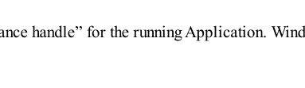

## Explanation of Whole Program

### WinMain() Receives Four Parameters, Which Are as Follows

### hInstance

这是正在运行应用程序的“实例句柄”。Windows 在应用程序启动时创建此 ID 号。我们将在许多 Windows 函数中使用此值来标识应用程序数据。最重要的是：句柄只是一个 32 位数字，引用一个实体；该实体可能是一个光标、画刷、图标、文件、设备或任何东西，好吧！！

### hPrevInstance

此参数是早期 Windows 版本的遗留物；现在不再使用，因此其值包含 0。这仅显示向后兼容性。

### lpszCmdLine

这是指向包含传递给程序的命令行参数的字符字符串的指针。这类似于传递给 main() 的 argv、argc 参数，就像在 DOS 程序中一样。

### nCmdShow

这是传递给函数的整数值。该整数告诉程序窗口在首次显示时应如何出现。

### MessageBox() Function

此函数弹出一个标题为“Title”的消息框，其中包含消息“Hello!”

*从 WinMain() 返回 0 表示成功；非零值表示失败。*


# 第 21 章 - 第 II 部分 (编程指南)

本章解释如何编写能够运行并且对其他智能生物可理解的计算机程序！这两个属性不是独立的！通常，其他程序员无法理解的程序运行得并不好。（更不用说它们是维护的噩梦！）

编写结构化程序（结构化代码和数据！）有助于大幅调试代码。以下是结构化程序的一些特性的快速回顾。

- 1. 大量的定义良好的函数！
- 2. 使用结构化循环结构（即 while 和 for）而不是 goto。
- 3. 使用具有单一目的且名称有意义的变量。
- 4. 使用结构化数据类型来表示复杂数据。
- 5. 使用 ADT（抽象数据类型）或 OOP（面向对象编程）编程范式。

编程时最常见的错误类型是：

- 1. 不加思考地编程。
- 2. 以非结构化的方式编写代码。

让我们按顺序来处理这些。

## 1.1 Thinking About Programming

当真正的程序员（或编程团队）被要求解决一个问题时，他们不会立即坐在终端前开始输入代码！他们首先通过思考问题的解决方案可能存在的众多方式来设计程序。

编程最大的神话之一是：“我越早开始编码，工作程序就越早产生。”这不是真的！！在编码前进行规划的程序会在未规划的程序之前成为工作程序。

是的，未规划的程序会被更快地输入并可能编译，但这些只是创建工作程序的第一步！接下来是调试阶段。

这就是规划程序的好处显现的地方。在绝大多数情况下，规划的程序比未规划的程序有更少的错误。此外，规划的程序通常比未规划的程序更结构化。因此，在规划的程序中查找错误会更容易。

那么在编码前如何设计程序呢？有几种不同的技术。其中最常见的一种称为自顶向下设计。这里首先创建程序的大纲。（本质上，首先查看 main() 函数的一般形式，然后递归地向下工作到最低层的函数。）关于如何以这种方式编写程序有很多参考资料。

自顶向下设计将程序划分为子任务。每个子任务都是必须解决的较小问题。问题是通过使用算法来解决的。

程序中的函数（和数据）实现算法。在编写实际代码之前，取一个非常小的问题并手工追踪所选算法将如何解决它。

这有几个目的：

- 1. 检查算法是否实际上能在给定问题上工作。（如果它不起作用，你可以立即开始寻找另一个算法。请注意，如果你立即开始编码，你可能要到输入了许多行代码后才会发现算法不起作用！）
- 2. 确保你理解算法实际的工作方式！（如果你无法手工追踪算法，你就无法编写程序来实现它！）
- 3. 给出算法的一次简短、简单运行的详细工作过程，可在以后调试代码时使用。

只有当你确信自己理解整个程序在代码中会是什么样子时。

## 1.2 Structured Programming

当程序结构化时，它被划分为可以单独测试的子单元。这在调试时是一个巨大的优势！子单元中的代码可以与程序其余代码分开调试。我发现随着子单元的编写而调试每个子单元很有用。如果直到整个程序写完才进行调试，调试会困难得多。

必须搜索程序的整个源代码以查找错误。如果子单元单独调试，则必须搜索错误的源代码会小得多！将程序的子单元存储到单独的源文件中可以使单独调试它们变得更容易。

ADT 和 OOP 范式也将程序划分为子单元。通常使用这些方法时，子单元比使用普通结构化代码时更独立。这有两个主要优点：

- 1. 子单元甚至更容易单独调试。
- 2. 子单元通常可以在其他程序中重用。（因此，新程序可以使用来自早期程序的先前调试过的子单元）

子单元通常通过编写一个小的驱动程序来单独调试。驱动程序为子单元 supposed 解决的子任务设置数据，调用子单元执行其子任务，然后显示结果以便检查。

当然，所有以下调试方法都可用于调试子单元，就像它们可用于调试整个程序一样。再次强调，子单元的优点是它们只是程序的一部分，因此比一次性调试整个程序更容易调试！

## 2. Compiling Programs


输入程序（或只是程序的一个子单元）后的第一步是编译程序。编译过程将你输入的源代码文件转换为机器语言并存储在目标文件中。这被称为编译。

在大多数系统中，目标文件会自动与系统库链接。这些库包含语言库中函数的代码。（例如，C 库包含 `printf()` 函数的代码。）

## 2.1 编译器错误

每种语言都有语法规则。这些规则决定了语言中哪些语句是合法的，哪些是不合法的。编译器程序设计用于强制执行这些规则。当规则被违反时，编译器会打印错误消息并且不会创建目标文件。

大多数编译器会在出现错误后继续扫描源文件并报告找到的其他错误。然而，一旦发现错误，编译器可能会被之后完全合法的语句弄糊涂并将其报告为错误。这就引出了编译器错误的第一个规则：

### 编译器错误的第一个规则

*列出的第一个编译器错误总是真正的错误；然而，后续的错误可能不是真正的错误。*

当第一个错误被移除时，后续的错误可能会消失。因此，如果后面的错误消息令人困惑，请忽略它们。修复你确定是错误的错误并重新编译。当其他真正的错误被移除时，令人困惑的错误可能会神奇地消失。

如果你有许多错误，第一个错误可能会从屏幕上滚动出去。解决这个问题的办法之一是使用重定向将错误保存到文件中。一个问题是错误写入的是 stderr，而不是 stdout，而 `>` 重定向操作符使用的是 stdout。

要重定向到 stderr，请使用 `2>` 操作符。

### 示例：

```text
$cc x.c 2>errors
$more errors
```

编译器只是其他人类创建的程序。经常它显示的错误消息令人困惑（或纯粹是错误的！）。不要假设错误消息所指的那一行总是真正错误所在的那一行。

编译器从上到下按顺序扫描源文件。

有时错误直到实际错误所在位置下方很多行才被编译器检测到。经常编译器太笨了，无法意识到这一点，并引用源文件中它意识到有问题的地方。真正的错误在代码中更早出现。这就引出了编译器错误的第二个规则：

### 编译器错误的第二个规则

> 编译器错误可能由编译器所指的那行代码之上的任何源代码行引起；然而，它不可能由下面的行引起。

在 C（和 C++）中，不要忘记 `#include` 预处理语句会将头文件代码插入到源文件中。头文件中的错误可能会导致引用主源文件中某行的编译器错误。

大多数系统允许将预处理后的代码（C 编译器实际编译的代码！）存储在文件中。这使你能够确切地看到正在编译的内容。该文件还将显示每个 C 宏是如何展开的。这对于发现通常很难找到错误的原因非常有帮助。

寻找令人困惑的编译器错误原因的一个有用技巧是删除（或注释掉）前面的代码段，直到错误消失。当错误消失时，最后删除的那段代码必须导致了错误。

编译器还可以显示警告。警告不是语法错误；然而，它可能是程序中的逻辑错误。它标记了程序中合法但可疑的语句。

除非你理解警告产生的原因，否则应将警告视为错误。编译器通常可以设置为不同的警告级别。对你来说，将此级别设置得尽可能高是有利的，以便编译器给出尽可能多的警告。仔细查看这些警告！

### 脑力洗练练习

**记住** 仅仅因为程序编译时没有错误或警告并不意味着程序是正确的！它只意味着程序的每一行在语法上都是正确的。也就是说，编译器理解每个语句要做什么。程序仍然可能存在许多逻辑错误！一篇英文论文在语法上可能是正确的（即名词、动词等放在正确的位置），但可能是胡言乱语。

## 2.2 链接器错误

链接器是一个将目标文件（包含单个源文件编译后的机器代码）和库（是目标文件集合的文件）链接在一起以创建可执行程序的程序。链接器将目标文件中使用的函数和全局变量与其在其他目标文件中的定义匹配起来。链接器使用函数或全局变量的名称（通常使用术语符号）来执行匹配。

最常见的链接器错误类型是未解析的符号或名称。当函数或全局变量被使用，但链接器找不到名称的匹配时，就会发生此错误。例如，在 IBM AIX 系统上，错误消息如下所示：0706-317 ERROR: Unresolved or undefined symbols detected:

Symbols in error (followed by references) are dumped to the load map. The `-bloadmap:<filename>` option will create a load map..fun

这条消息意味着程序中引用了一个名为 fun（忽略句点）的函数（或全局变量），但从未定义它。这些错误有两个常见原因：

- **拼写函数名错误**

  在上面的示例中，有一个名为 func 的函数。这不是编译器错误。 一个源文件中的代码可以使用另一个文件中定义的函数。编译器假设任何在引用它的文件中被引用但未定义的函数都将在另一个文件中定义并链接。只有在链接阶段才能检查这一假设。（请注意，C++ 编译器通常会为此生成编译器错误，因为 C++ 要求所有被引用的函数都有原型！）

- **未链接正确的库或目标文件**

  链接器必须知道形成可执行程序所需的库和目标文件。标准 C 库会自动链接。像 AIX 系统这样的 UNIX 系统不会自动链接标准 C 数学库！要在 AIX 系统上链接数学库，请在编译命令上使用 `-lm` 标志。例如，要编译使用 `sqrt` 的 C 程序，输入：`cc prog.c -lm`。记住 `#include` 语句只会将文本插入源文件。一种常见的误解是它还会链接适当的库！链接器永远看不到此语句！

链接器还存在一些相关错误。一个难以发现的错误是当函数或全局变量有两个定义时。链接器会选择它找到的第一个定义并忽略另一个。一些链接器在发生这种情况时会显示警告消息（AIX 链接器不会！）。

另一个与链接相关的错误是函数被错误的参数调用。链接器在匹配时只查看函数名称。它不进行参数检查。以下是一个示例：

文件：x.c

```c
int f( int x, int y)
{
    return x + y;
}
```

文件：y.c

```c
int main()
{
    int s = f(3);
    return 0;
}
```

这类错误可以通过使用原型来防止。例如，如果原型：`int f( int, int);` 被添加到 y.c 中，编译器将捕获此错误。实际上，最好将原型放在头文件中并在 x.c 和 y.c 中都包含它。为什么使用头文件？

这样所有文件使用的原型只有一个实例。如果在每个源文件中单独输入一个实例，就无法保证每个实例都相同。

如果只有一个实例，它就不会与自身不一致！为什么要在 x.c（函数定义的那个文件）中包含它？这样编译器可以检查原型并确保它与函数的定义一致。（补充说明：C++ 使用一种称为名称改编的技术来捕获这类错误。）

## 3. 运行时错误

运行时错误发生在程序运行时，通常会导致程序中止。在 UNIX/Linux 系统上，中止的程序会创建 coredump。

coredump 是一个名为 `core` 的二进制文件，其中包含程序中止时的状态信息。像 gdb 和 dbx 这样的调试器可以读取此文件并告诉你有关程序在中止时正在做什么的有用信息。有几种类型的运行时错误：

### 非法内存访问


这可能是最常见的错误类型。在 UNIX/Linux 下，程序会核心转储（coredump），并显示消息 Segmentation fault (coredump)。

使用 Win95 或 NT 时，程序也会中止。然而，传统 DOS 不检查非法内存访问；程序继续运行，但结果不可预测。

DOS 下的 Borland/Turbo C/C++ 编译器会检查写入 NULL 地址的数据。但是，错误消息 NULL pointer assignment 直到程序终止时才会显示。除零。所有操作系统都会检测到此错误并中止程序。

## 4. 调试工具

许多调试程序的方法会非常详细地将程序的行为与正确行为进行比较。通常，程序的正常输出不会显示所需的细节。调试工具允许你更详细地检查程序的行为。

### 4.1 assert 宏

assert 宏是一种将调试测试放入 C/C++ 程序的快捷简便方法。要使用此宏，必须在源文件顶部附近包含 assert.h 头文件。使用 assert 很简单。格式为：

```
assert(boolean (or int) expression);
```

如果布尔表达式的值为真（即非零），assert 不执行任何操作。但是，如果其值为假（零），assert 会打印错误消息并中止程序。例如，考虑以下 assert：

```
assert( x != 0 );
```

如果 x 为零，将显示以下内容：Assertion failed: x != 0, file err.c, line 6 Abnormal program termination 并且程序会中止。注意，实际的断言、文件名和文件中的行号都会被显示。assert 宏对于在程序中加入健全性检查非常有用。这些是程序正常工作时应始终为真的条件。它不应用于用户错误检查（例如用户请求读取的文件不存在时）。对于这些运行时错误，应使用普通的 if 语句。当然，在商业程序中，断言失败对最终用户并没有特别帮助。此外，检查断言会使程序运行至少比不检查时慢一点。幸运的是，即使不删除 assert 宏，也很容易禁用它。

如果定义了宏 NDEBUG（在包含 assert.h 的语句之前！），assert 宏完全不执行任何操作。如果以后需要启用断言，只需删除定义 NDEBUG 的那一行。

（如果使用此技术，请确保 assert 语句不执行程序正确运行所需的代码。如果定义了 NDEBUG，该代码将不会被执行！）

### 4.2 打印语句

这种历史悠久的调试方法涉及在程序中大量插入调试打印语句。打印语句的设计应既能显示程序正在执行什么代码，又能显示关键变量的值。

### 4.3 调试器

前面通过添加打印语句进行调试的方法有两个缺点：

- 1. 添加新的打印语句时，必须重新编译程序。
- 2. 信息输出是固定的，不能在程序运行时更改。

源码级调试器提供了一种更简单的方法来跟踪程序的执行。它们允许你：

- 1. 在程序运行时查看任意变量的值。
- 2. 当程序到达任意所需语句时暂停执行。（程序中的这个位置称为断点）。
- 3. 逐条语句单步执行程序。

我强烈建议你学习使用你所编程的任何系统上的调试器。调试器在调试程序时可以节省大量时间！

### 4.4 Lint

lint 程序检查 C 程序中的常见 Bug 列表。它扫描你的 C 源代码并打印出可能的问题列表。请注意，lint 非常挑剔！例如，以下行：

```
printf("Hello, World ");
```

将产生一条警告消息，因为 printf 返回一个未被存储的整数值。printf 的返回值经常被忽略，但 lint 仍会产生警告。有几种方法可以让 lint 对这个语句满意，其中一种是：

```
(void) printf("Hello, World ");
```

这表示忽略返回值。

### 4.5 走查

走查是手工检查程序逻辑的过程。程序员与其他人（最好是另一位程序员，但任何人都可以）坐下来，针对一个示例用例走查程序。通常，程序员在解释程序应该如何工作并仔细查看自己的代码的过程中，自己就会发现 Bug。

然而，程序员很容易“知道”程序应该做什么，却对程序实际在做什么视而不见。

学生在与其他学生一起使用这种方法时需要非常小心。同一个班级的两个学生不应该一起走查一个程序。

## 5. 一般提示

以下是一些调试程序的一般提示。

### 5.1 发现 Bug

在移除 Bug 之前，必须先发现它们！

- 积极测试程序！
- 从可以手工轻松检查的小问题开始。（你应该已经在规划阶段解决过其中一个问题！）
- 至少测试程序的每个功能一次！一次真的足够吗？如果可能，以不同方式测试功能。
- 不要忘记测试琐碎的问题。
- 不要对输入数据做出无效假设。

### 5.2 确定 Bug 的原因

Bug 只能由程序中已经执行的代码引起。确保不要浪费时间搜索尚未运行的代码。可以使用调试器或打印语句来确定哪些代码已经执行，哪些尚未执行。

不要通过盲目更改代码直到它似乎能工作来修复 Bug。你需要弄清楚为什么一个语句能工作而另一个不能。你应该为每一行代码都有一个充分的理由。“没有这一行它就不能工作”不是一个好理由！


## 章节

## 第 22 章 - 第 II 部分

## （常见 C 编程错误）

## 引言

## Bug

软件 Bug 是计算机程序或系统中的错误、缺陷、故障或过失，导致其产生不正确或意外的结果，或以非预期的方式运行。大多数 Bug 源于人们在程序的源代码或设计中的失误和错误，或源于此类程序所使用的框架和操作系统中的失误和错误，少数由编译器生成不正确的代码引起。

包含大量 Bug 和/或严重干扰其功能的 Bug 的程序被称为有 Bug 的（buggy）。详细描述程序中 Bug 的报告通常称为 Bug 报告、缺陷报告、故障报告、问题报告、麻烦报告、变更请求等。

## Bug 如何进入软件

在软件开发项目中，“错误”或“故障”可以在开发过程中的任何阶段引入。Bug 是编程任务中人为因素性质的后果。它们源于软件团队在需求规格说明、设计、编码、数据录入和文档编写期间的疏忽或相互误解。

## 例如

在创建一个相对简单的程序来将单词列表按字母顺序排序时，设计可能没有考虑当单词包含连字符时应该发生什么。也许，在将抽象设计转换为所选编程语言时，

## 预防

软件行业已经投入了大量精力来寻找防止程序员在编写软件时无意中引入 Bug 的方法。

## 这些包括

## 编程风格

虽然程序代码中的拼写错误通常会被编译器捕获，但 Bug 通常出现在程序员犯逻辑错误时。编程风格和防御性编程的各种创新旨在降低这些 Bug 出现的可能性，或使其更容易被发现。

在某些编程语言中，所谓的拼写错误，尤其是符号或逻辑/数学运算符的拼写错误，实际上代表逻辑错误，因为拼写错误的构造会被编译器接受，但其含义与程序员意图不同。

## 编程技术

Bug 常常会在运行中的程序的内部数据中造成不一致。可以编写程序在运行时检查其自身内部数据的一致性。如果遇到不一致，程序可以立即停止，以便定位和修复 Bug。或者，程序可以仅通知用户，尝试纠正不一致，然后继续运行。

## 开发方法学

有几种管理程序员活动的方案，以便产生更少的 Bug。其中许多属于软件工程学科（该学科也处理软件设计问题）。例如，形式化程序

规范用于说明程序的确切行为，以便消除设计缺陷。

不幸的是，对于除最短程序之外的任何东西，形式化规范都是不切实际的或不可能的[citation needed]，因为存在组合爆炸和不确定性的问题。

在现代，流行的方法包括自动化单元测试和自动化验收测试（有时会极端到测试驱动开发），以及敏捷软件开发（通常会与自动化测试结合，甚至在某些情况下强制要求自动化测试）。

所有这些方法都应该在缺陷和规范不佳的需求引入后不久就捕获它们，这应该使它们更容易、更便宜地修复，并在进入生产使用之前至少捕获其中一些。

## 编程语言支持

编程语言通常包含有助于程序员防止错误的功能，例如静态类型系统、受限命名空间和模块化编程等。例如，当程序员编写（伪代码）LET REAL VALUE PI = "THREE AND A BIT"时，尽管这在语法上可能是正确的，但代码会失败类型检查。根据语言和实现的不同，这可能在编译时或运行时被捕获。

此外，许多最近发明的语言故意排除了容易导致错误的功能，以牺牲代码可能需要的速度为代价：其一般原则是，由于摩尔定律，计算机变得更快而软件工程师变得更慢；几乎总是最好编写更简单、更慢的代码，而不是“巧妙”、难以理解的代码，尤其是考虑到维护成本相当可观。例如，Java 编程语言不支持指针算术；诸如 Pascal 和脚本语言等某些语言的实现通常在调试构建中至少具有数组的运行时边界检查。

## 代码分析

代码分析工具通过在编译器能力之外检查程序文本来帮助开发人员发现潜在问题。虽然通常情况下，给定规范找到所有编程错误的问题是不可解的（参见停机问题），但这些工具利用了人类程序员在编写软件时倾向于犯相同类型错误的事实。

## 仪器化

用于监控软件运行时性能的工具，无论是专门查找瓶颈等问题还是提供正确工作的保证，都可以显式地嵌入代码中（也许简单到一条写着 PRINT "I AM HERE" 的语句），也可以作为工具提供。经常会让人惊讶地发现代码的哪一部分占用了大部分时间，这种假设的消除可能会导致代码被重写。

## 调试

调试是查找并减少计算机程序中错误或缺陷（Errors）数量的系统过程，从而使其按预期行为。查找和修复错误，即“调试”，一直是计算机编程的重要组成部分。

早期的计算先驱 Maurice Wilkes 描述了他于 20 世纪 40 年代末的认识，即他余生的大部分时间将花费在查找自己程序中的错误上。随着计算机程序变得越来越复杂，错误变得更常见且更难以修复。

程序员花费在查找和修复错误上的时间和精力往往比编写新代码更多。软件测试员是专业人员，其主要任务是查找错误或编写支持测试的代码。在某些项目中，花在测试上的资源可能比开发程序还要多。

通常，调试最困难的部分是在源代码中找到错误。一旦找到，纠正它通常相对容易。被称为调试器的程序存在于帮助程序员通过逐行执行代码、观察变量值以及其他功能来观察程序行为，从而定位错误。

如果没有调试器，可以添加代码以将消息或值写入控制台（例如使用 C 编程语言中的 printf）或写入窗口或日志文件以跟踪程序执行或显示值。

然而，即使有调试器的帮助，定位错误也多少是一种艺术。程序中某一部分的错误导致完全不同部分出现故障的情况并不少见[citation needed]，这使得追踪变得特别困难（例如，图形渲染例程中的错误导致文件 I/O 例程失败），在系统中看似无关的部分。

## 引言

本章列出了作者一次又一次看到的常见 C 编程错误。还提供了错误的解决方案。

## 2. 初学者错误

这些是初学 C 语言的学生经常犯的错误。然而，专业人士有时也会犯这些错误！

### 2.1 忘记在 switch 语句中放置 break。

请记住，如果遇到 case，C 不会跳出 switch 语句。

## 例如：

```
int x = 2;
switch(x) {
case 2:
    printf("Two\n");
case 3:
    printf("Three\n");
}
```

## 输出：

Two
Three

## 添加 break 以跳出 switch：

```
int x = 2;
switch(x) {
case 2:
    printf("Two\n");
    break;
case 3:
    printf("Three\n");
    break; /* not necessary, but good if additional cases are added later */
}
```

### 2.2 使用 = 而不是 ==

C 的 = 运算符专门用于赋值并返回所赋的值。== 运算符专门用于比较并返回一个整数值（0 表示 false，非 0 表示 true）。由于这些返回值，当真正想要 == 时使用了 =，C 编译器通常不会标记错误。

## 例如：

```
int x = 5;
if ( x = 6 )
    printf("x equals 6\n");
```

这段代码打印出 x equals 6！为什么？if 中的赋值将 x 设置为 6 并将值 6 返回给 if。由于 6 不为 0，因此被解释为 true。

让编译器找到此类错误的一种方法是把任何常量（或任何右值表达式）放在左边。然后如果使用了 =，它就会成为错误：

```
if ( 6 = x )
```

### 2.3 scanf() 错误

有两种常见的 scanf() 错误：

### 2.3.1 忘记在参数上放置与号 (&)

scanf() 必须具有要存储输入的变量的地址。这意味着通常需要与号地址运算符来计算地址。

## 这里有一个例子：

```
int x;
char * st = malloc(31);

scanf("%d", &x);                 /* & required to pass address to scanf()  */
scanf("%30s", st);               /* NO & here, st itself points to variable! */
```

如上最后一行所示，有时不使用与号是正确的！

### 2.3.2 使用错误的格式说明符

C 编译器不会检查 scanf() 调用的参数是否使用了正确的格式。最常见的错误是为 double 使用 %f 格式（必须使用 %lf 格式）以及将字符和字符串的 %c 和 %s 混淆。

### 2.4 数组的大小

C 中的数组始终从索引 0 开始。这意味着定义为的 10 个整数的数组：

```
int a[10];
```

有效索引从 0 到 9 而不是 10！学生在一个数组中走得太远是非常常见的。这可能导致程序行为不可预测。

### 2.5 整数除法

与 Pascal 不同，C 对实数除法和整数除法都使用 / 运算符。了解 C 如何确定使用哪一种非常重要。如果两个操作数都是整数类型，则使用整数除法，否则使用实数除法。例如：

```
double half = 1/2;
```

这段代码将 half 设置为 0 而不是 0.5！为什么？因为 1 和 2 是整数常量。要修复这个问题，将其中至少一个改为实数常量。

```
double half = 1.0/2;
```

如果两个操作数都是整数变量并且需要实数除法，则将其中一个变量强制转换为 double（或 float）。

```
int x = 5, y = 2;
double d = ((double) x)/y;
```

### 2.6 循环错误

在 C 中，循环会重复循环语句之后的下一个语句。代码：

```
int x = 5;
while( x > 0 );
x--;
```

这是一个无限循环。为什么？while 后的分号将要重复的语句定义为空语句（什么都不做）。删除分号，循环就会按预期工作。

另一个常见的循环错误是迭代次数过多或过少。仔细检查循环条件！

### 2.7 未使用原型

原型告诉编译器函数的重要特性：函数的返回类型和参数。如果没有给出原型，编译器会假设函数返回 int 并且可以接受任意数量的任意类型参数。

使用原型的一个重要原因是让编译器检查函数调用参数列表中的错误。然而，如果函数不返回 int，则必须使用原型。例如，sqrt() 函数返回 double，而不是 int。

## 下面的代码：

```c
double x = sqrt(2);
```

如果上述代码之前没有出现如下原型，这段代码将无法正确工作：

```c
double sqrt(double);
```

为什么？没有原型时，C编译器假设sqrt()返回一个int。由于返回值存储在一个double变量中，编译器会插入代码将该值转换为double。这个转换是不必要的，并且会导致错误的值。

解决这个问题的方法是包含含有sqrt()原型的正确C头文件。对于你编写的函数，你可以将原型放在源文件的顶部，或者创建一个头文件并包含它。

### 2.8 未初始化指针

任何时候使用指针，你都应该能够回答这个问题：它指向哪个变量？如果你无法回答这个问题，那么它很可能没有指向任何变量。

这种错误通常会导致在UNIX/Linux上出现“段错误/核心转储”错误，或者在Windows下出现“一般保护故障”。（在美好的旧DOS时代，任何事情都可能发生！）

下面是一个这种错误的示例。

```c
#include <string.h>
int main()
{
char *st; /* defines a pointer to a char or char array */
strcpy(st, "abc"); /* what char array does st point to?? */
return 0;
}
```

如何正确操作？可以使用数组，也可以动态分配数组。

```c
#include <string.h>
int main()
{
char st[20]; /* defines an char array */
strcpy(st, "abc"); /* st points to char array */
return 0;
}
```

或者

```c
#include <string.h>
#include <stdlib.h>
int main()
{
    char *st = malloc(20);        /* st points to allocated array */
    strcpy(st, "abc");          /* st points to char array */
    free(st);                    /* don't forget to deallocate when done! */
    return 0;
}
```

实际上，对于这段代码的功能来说，第一种解决方案更为可取。为什么？动态分配只应在需要时使用。它比定义一个普通数组更慢，也更容易出错。

## 3. 字符串错误

### 3.1 混淆字符常量和字符串常量

C语言将字符常量和字符串常量视为非常不同的东西。字符常量用单引号括起来，字符串常量用双引号括起来。字符串常量充当指向实际字符串的指针。考虑以下代码：

```c
char ch = 'A';  /* correct */
char ch = "A";  /* error */
```

第二行将字符变量ch赋值为字符串常量的地址。这应该会产生一个编译错误。如果字符串指针被赋值为字符常量，也会发生同样的情况：

```c
const char * st = "A";  /* correct */
const char * st = 'A';   /* error */
```

### 3.2 使用 == 比较字符串

永远不要使用 == 运算符来比较字符串的值！字符串是字符数组。字符数组的名称就像一个指向字符串的指针（就像C中其他类型的数组一样）。那又怎样？考虑*以下代码：*

```c
char st1[] = "abc";
char st2[] = "abc";
if ( st1 == st2 )
    printf("Yes");
else
    printf("No");
```

这段代码输出*No*。为什么？因为`==`运算符比较的是st1和st2的*指针值*，而不是它们所指向的数据。比较字符串值的正确方法是使用`strcmp()`库函数。（确保包含`string.h`。）如果用以下代码替换上面的if语句：

```c
if ( strcmp(st1,st2) == 0 )
    printf("Yes");
else
    printf("No");
```

这段代码将输出*Yes*。出于类似的原因，也不要将其他关系运算符（<、>等）用于字符串。这里也应该使用`strcmp()`。

### 3.3 字符串未以空字符结尾

C语言假定字符串是一个带有终止空字符的字符数组。这个空字符的ASCII值为0，可以表示为0或`'\0'`。

这个值用于标记字符串中有意义数据的结束。如果缺少这个值，许多C字符串函数将继续处理超出有意义数据末尾的数据，而且常常会超过字符数组本身的末尾，直到它在内存中恰好找到一个零字节！

大多数创建字符串的C库字符串函数总是会正确地以空字符结尾。有些则不会（例如`strncpy()`）。请务必仔细阅读它们的描述。

### 3.4 没有为空终止符留出空间

C字符串在字符串中有意义数据的末尾必须有一个空终止符。一个常见的错误是没有为这个额外字符分配空间。例如，下面定义的字符串：`char str[30];` 只能容纳29个（不是30个）实际数据字符，因为空字符*必须*出现在最后一个数据字符之后。

这在动态分配时也可能是一个问题。下面是为字符串分配恰好所需大小以保存另一个字符串副本的正确方法。

```c
char * copy_str = malloc( strlen(orig_str) + 1);
strcpy(copy_str, orig_str);
```

常见的错误是忘记在strlen()的返回值上加1。strlen()函数返回数据字符的计数，其中不包括空终止符。

这种错误可能很难检测。它可能不会引起任何问题，或者只在极端情况下引起问题。在动态分配的情况下，它可能破坏堆（程序中用于动态分配的内存区域），并导致下一个堆操作（malloc()、free()等）失败。

## 4. 输入/输出错误

### 4.1 错误地使用 fgetc() 等函数

fgetc()、getc()和getchar()函数都返回一个整数值。

例如，fgetc()的原型是：

```c
int fgetc( FILE * );
```

有时这个整数值实际上就是一个简单字符，但有一种非常重要的情形是返回值不是字符！

这个值是什么？EOF。学生们普遍有一种误解，认为文件末尾有一个特殊的EOF字符。实际上文件末尾并不存储特殊字符。EOF是函数返回的一个整数错误码。下面是错误使用fgetc()的方式：

```c
int count_line_size( FILE * fp )
{
    char ch;
    int cnt = 0;

    while( (ch = fgetc(fp)) != EOF && ch != '\n')
        cnt++;
    return cnt;
}
```

这有什么问题？问题出现在while循环的条件中。为了说明，这里重写了循环以展示C在幕后会做什么。

```c
while( (int)( ch = (char) fgetc(fp) ) != EOF && ch != '\n')
    cnt++;
```

fgetc(fp)的返回值被强制转换为char，以将结果存储到ch中。然后必须将ch的值强制转换回int，以便与EOF进行比较。那又怎样？

将int值强制转换为char，然后再转换回int，可能不会得到原来的int值。这意味着在上面的示例中，如果fgetc()返回EOF值，强制转换可能会改变该值，从而使之后与EOF的比较结果为假。

解决方案是什么？如下所示，将ch变量改为int：

```c
int count_line_size( FILE * fp )
{
    int ch;
    int cnt = 0;
    while( (ch = fgetc(fp)) != EOF && ch != '\n')
        cnt++;
    return cnt;
}
```

现在唯一的隐式转换在第二个比较中。

```c
while( (ch = fgetc(fp)) != EOF && ch != (int) '\n' )
    cnt++;
```

这个转换完全没有害处！所以，这一切的教训是：始终使用int变量来存储fgetc()、getc()和getchar()的返回值。

### 4.2 错误地使用 feof()

人们对C的feof()函数的工作方式存在广泛的误解。许多程序员像使用Pascal的eof()函数一样使用它。然而，C的函数工作方式不同！

区别是什么？Pascal的函数在下次读取将因文件结束而失败时返回真。C的函数在上一次函数失败时返回真。下面是一个误用feof()的示例：

```c
#include <stdio.h>
int main()
{
    FILE * fp = fopen("test.txt", "r");
    char line[100];
    while( !feof(fp) ) {
        fgets(line, sizeof(line), fp);
        fputs(line, stdout);
    }
}
```


```
fclose(fp);
    return 0;
}
```

该程序会将输入文件的最后一行打印两次。为什么？在最后一行被读入并打印出来后，feof() 仍然会返回 0（false），循环会继续。下一个 fgets() 调用失败，因此保存最后一行内容的 line 变量没有被改变，又被再次打印出来。在此之后，feof() 会返回 true（因为 fgets() 失败），循环结束。

该如何修复？一种方法是如下所示：

```
#include <stdio.h>
int main()
{
    FILE * fp = fopen("test.txt", "r");
    char line[100];
    while( 1 )
    {
        fgets(line, sizeof(line), fp);
        if ( feof(fp) ) /* check for EOF right after fgets() */
        break;
        fputs(line, stdout);
    }
    fclose(fp);
    return 0;
}
```

然而，这并不是最好的方法。实际上完全没有理由使用 feof()。C 输入函数会返回可用于检查 EOF 的值。例如，fgets 在遇到 EOF 时返回空指针。

## 这是一个更好的程序版本：

```
#include <stdio.h>
int main()
{
FILE * fp = fopen("test.txt", "r");
char line[100];

while( fgets(line, sizeof(line), fp) != NULL )
    fputs(line, stdout);
fclose(fp);
return 0;
}
```

作者至今尚未见过任何学生正确使用 feof() 函数！顺便说一下，这段讨论同样适用于 C++ 和 Java。istream 的 eof() 方法的工作方式与 C 的 feof() 完全相同。

## 4.3 输入缓冲区中遗留字符 -

C 输入（和输出）函数会缓冲数据。缓冲将数据存储在内存中，仅在需要时才从（或向）I/O 设备读取（或写入）数据。一次读写大量数据比一次一个字节（或字符）要高效得多。通常缓冲对编程没有影响。

缓冲可见的一个地方是使用 scanf() 进行输入。键盘通常是行缓冲的。这意味着每一行输入都会存储在缓冲区中。当程序在想要处理下一行输入之前，没有处理完一行中的所有数据时，就可能出现问题。例如，考虑以下代码：

```
```c
int x;
char st[31];
printf("Enter an integer: ");
scanf("%d", &x);
printf("Enter a line of text: ");
fgets(st, 31, stdin);
```
```

fgets() 将不会读取输入的文本行。相反，它很可能只读取一个空行。事实上，程序甚至不会等待 fgets() 调用的输入。为什么？scanf() 调用读取表示输入整数所需的字符，但它会将 '\n' 留在输入缓冲区中。然后 fgets() 开始从输入缓冲区读取数据。它找到一个 '\n' 并停止，而不需要额外的键盘输入。

解决方案是什么？一个简单的方法是在 scanf() 调用后读取并丢弃输入缓冲区中的所有字符，直到遇到 '\n'。由于这可能在很多地方使用，将其做成一个函数是有意义的。下面是一个执行此操作的函数：

```
```c
/* function dump_line
 * This function reads and dumps any remaining characters on the current input
 * line of a file
 * Parameter:
 * fp - pointer to a FILE to read characters from
 * Precondition:
 * fp points to an open file
* Postcondition:
*   the file referenced by fp is positioned at the end of the next line
*   or the end of the file.
*/
```

```
void dump_line( FILE * fp )
{
    int ch;

    while( (ch = fgetc(fp)) != EOF && ch != '\n' )
        /* null body */;
}
```

下面是使用上述函数修复后的代码：

```
int x;
char st[31];
printf("Enter an integer: ");
scanf("%d", &x);
dump_line(stdin);
printf("Enter a line of text: ");
fgets(st, 31, stdin);
```

一种错误的做法是使用以下方法：

```
fflush(stdin);
```

这可以编译，但其行为在 ANSI C 标准中是未定义的。fflush() 函数仅用于打开输出的流，而不是输入。这种方法在某些 C 编译器上似乎有效，但完全不可移植！因此，不应使用它。

## 4.4 使用 gets() 函数 -

不要使用这个函数！它不知道传递给它的字符串可以安全存储多少字符。因此，如果读取的字符太多，内存将被破坏。

许多在互联网上被利用的安全漏洞都利用了这一事实！改用 fgets() 函数（并从 stdin 读取）。但请记住，与 gets() 不同，fgets() 不会丢弃输入中的终止 \n。

scanf() 函数也可能被危险地使用。%s 格式可能会覆盖目标字符串。然而，通过指定宽度可以安全地使用它。例如，格式 %20s 不会读取超过 20 个字符。

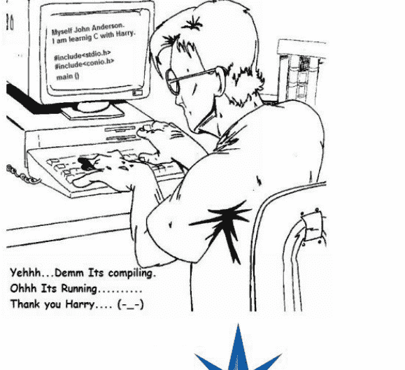

我自己约翰·安德森。
我正在和哈里学习 C 语言。

#include<stdio.h>
#include<conio.h>
main ()

耶...该死 它在编译。
哦 它在运行........
谢谢哈里.... (-_-)


## 章节

## 第 23 章 - 第 II 部分

## （使用 C 进行实时软件开发）

## 思维训练笔记 -

如果你在任何代码中发现错误，不要沮丧，尝试调试（修复它们）用尽你思维的每一丝脉搏，如果我带你到了 99%，那么至少你可以尝试剩下的 1%。

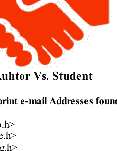

## 作者 vs. 学生

## 160. Wap 用于打印在任何文本文档中找到的电子邮件地址。

```
#include <stdio.h>
#include <ctype.h>
#include <string.h>

int main(void) {
char line[1024];
char address[256];
char *ptr1 = NULL;
char *ptr2 = NULL;

while((fgets(line, 1024, stdin)) != NULL) {
if(strchr(line, '@') != NULL && strchr(line, '.') != NULL)
{
for(ptr1 = line, ptr2 = address; *ptr1; ptr1++) {
if(isalpha(*ptr1) || isdigit(*ptr1) ||
strchr("._-@", *ptr1) != NULL)
*ptr2++ = *ptr1;
else
{
    *ptr2 = '\0';

    if(strlen(address) >= 6 && strchr(address, '@') != NULL &&
        strchr(address, '.') != NULL)
    printf("%s\n", address);

        ptr2 = address;
    } /* else */
    } /* for */
    } /* if */
} /* while */

return 0;
}
```

## 161. Wap 程序求解三变量线性方程。

```
#include<stdio.h>
#include<conio.h>
#include<stdlib.h>
main()
{
clrscr();
float a,b,c,d,l,m,n,k,p,q,r,s,x,y,z;
printf("PROGRAM TO SOLVE THREE VARIABLE LINEAR SIMULTANEOUS EQUATIONS");
printf("The equations are of the form:
ax+by+cz+d=0
lx+my+nz+k=0
px+qy+rz+s=0");
printf("Enter the coefficients in the order a,b,c,d,l,m,n,k,p,q,r,s");
scanf("%f%f%f%f%f%f%f%f%f%f%f%f",&a,&b,&c,&d,&l,&m,&n,&k,&p,&q,&r,&s);
printf("The equations you have input are:");
printf(" %.2f*x + %.2f*y + %.2f*z + %.2f = 0",a,b,c,d);
printf(" %.2f*x + %.2f*y + %.2f*z + %.2f = 0",l,m,n,k);
printf(" %.2f*x + %.2f*y + %.2f*z + %.2f = 0",p,q,r,s);
D = (a*m*r+b*p*n+c*l*q)-(a*n*q+b*l*r+c*m*p);
x = ((b*r*k+c*p*s+d*n*q)-(b*n*s+c*q*k+d*m*r))/D;
y = ((a*n*s+c*p*k+d*l*r)-(a*r*k+c*l*s+d*n*p))/D;
z = ((a*q*k+b*l*s+d*m*p)-(a*m*s+b*p*k+d*l*q))/D;

printf("The solutions to the above three equations are :");
printf(" x =%5.2f
 y =%5.2f
 z =%5.2f
",x,y,z);
getch();
return 0;
}
```

## 162. wap 开发 C 语言中的模拟或数字时钟。

```
#include<graphics.h>
#include<conio.h>
#include<math.h>
#include<dos.h>
void main()
{
int gd=DETECT,gm;
int x=320,y=240,r=200,i,h,m,s,thetamin,thetasec;
struct time t;
char n[12][3]={"3","2","1","12","11","10","9","8","7","6","5","4"};
initgraph(&gd,&gm,"f:\arun\tc");\put the directory which contains egavga.bgi
circle(x,y,210);
setcolor(4);
settextstyle(4,0,5);
for(i=0;i<12;i++)
{
if(i!=3)
outtextxy(x+(r-14)*cos(M_PI/6*i)-10,y-(r-14)*sin(M_PI/6*i)-26,n[i]);
else
outtextxy(x+(r-14)*cos(M_PI/6*i)-20,y-(r-14)*sin(M_PI/6*i)-26,n[i]);
}
gettime(&t);
printf("The current time is: %02d:%02d:%02d.%02d
",t.ti_hour, t.ti_min,
t.ti_sec, t.ti_hund);
while(!kbhit())
{

setcolor(5);
setfillstyle(1,5);
circle(x,y,10);
floodfill(x,y,5);
gettime(&t);
if(t.ti_min!=m)
{
setcolor(0);
line(x,y,x+(r-60)*cos(thetamin*(M_PI/180)),y-(r-60)*sin(thetamin*(M_PI/180)));
circle(x+(r-80)*cos(thetamin*(M_PI/180)),y-(r-80)*sin(thetamin*(M_PI/180)),10);

line(x,y,x+(r-110)*cos(M_PI/6*h-((m/2)*(M_PI/180))),y-(r-110)*sin(M_PI/6*h-((m/2)*(M_PI/180))));
circle(x+(r-130)*cos(M_PI/6*h-((m/2)*(M_PI/180))),y-(r-130)*sin(M_PI/6*h-((m/2)*(M_PI/180))),10);
}
if(t.ti_hour>12)
t.ti_hour=t.ti_hour-12;
if(t.ti_hour<4)
h=abs(t.ti_hour-3);
else
h=15-t.ti_hour;
m=t.ti_min;
if(t.ti_min<=15)
thetamin=(15-t.ti_min)*6;
else
thetamin=450-t.ti_min*6;
if(t.ti_sec<=15)
thetasec=(15-t.ti_sec)*6;
else
thetasec=450-t.ti_sec*6;
setcolor(4);
line(x,y,x+(r-110)*cos(M_PI/6*h-((m/2)*(M_PI/180))),y-(r-110)*sin(M_PI/6*h-((m/2)*(M_PI/180))));
circle(x+(r-130)*cos(M_PI/6*h-((m/2)*(M_PI/180))),y-(r-130)*sin(M_PI/6*h-((m/2)*(M_PI/180))),10);

line(x,y,x+(r-60)*cos(thetamin*(M_PI/180)),y-(r-60)*sin(thetamin*(M_PI/180)));
circle(x+(r-80)*cos(thetamin*(M_PI/180)),y-(r-80)*sin(thetamin*(M_PI/180)),10);
```

```c
setcolor(15);
line(x,y,x+(r-70)*cos(thetasec*(M_PI/180)),y-(r-70)*sin(thetasec*(M_PI/180)));
delay(1000);
setcolor(0);
line(x,y,x+(r-70)*cos(thetasec*(M_PI/180)),y-(r-70)*sin(thetasec*(M_PI/180)));
}
}
```

## 163. 编写程序打印文本中找到的 IP 地址（C 语言）。

```c
#include <stdio.h>
#include <regex.h>
#include <locale.h>
#include <string.h>
#include <stdlib.h>
#include <sys/types.h>
#define IPEXPR "([0-9]{1,3})\\.([0-9]{1,3})\\.([0-9]{1,3})\\.([0-9]{1,3})"
int main(void)
{
    char line[1024];
    char *address = NULL;
    char delim[] = ".,;:\^+-_(){ }[]<>*%&%$#@!?~-/\\|=\\t\\r\\n";
    int retval = 0;
    regex_t re;
    setlocale(LC_ALL,"");

    if(regcomp(&re, IPEXPR, REG_EXTENDED) != 0)
        return 1;

    while((fgets(line, 1024, stdin)) != NULL)
    {
        if(strchr(line, '.') == NULL)
            continue;

        address = strtok(line, delim);
        while(address != NULL)
        {
            if(strlen(address) <= 15)
                if((retval = regexec(&re, address, 0, NULL, 0)) == 0)
                    printf("%s\n", address);

            address = strtok(NULL, delim);

        } /* while */
    } /* while */
    return 0;
}
```

## 164. 编写程序打印进度条（C 语言）。

```c
#include<graphics.h>
#include<conio.h>
#include<alloc.h>
#include<dos.h>
void main()
{
    int gd=DETECT,gm;
    initgraph(&gd,&gm,"c:\\tc ");
    //put your directory where egavga.bgi is
    void *buffer;
    unsigned int size;
    setbkcolor(BLUE);
    line(230,330,370,330);
    line(230,350,370,350);
    line(226,335,226,345);
    line(226,335,230,330);
    line(226,345,230,350);
    line(374,335,374,345);
    line(374,335,370,330);
    line(374,345,370,350);
    outtextxy(275,365,"Loading");    //put your text here
    int x=232,y=336,x1=236,y1=344;
    for(int i=1;i<5;i++)
    {
        setfillstyle(1,RED);
        bar(x,y,x1,y1);
        x=x1+2;
        x1=x1+6;
    }
    size=imagesize(232,336,256,344);
    buffer=malloc(size);
    getimage(232,336,256,344,buffer);
    x=232;
    int m=0;
    while(!kbhit())
    {
        putimage(x,336,buffer,XOR_PUT);
        x=x+2;
        if(x>=350)
        {
            m++;
            x=232;
            if(m==5)
                return;
        }
        putimage(x,336,buffer,XOR_PUT);
        delay(20);            // delay(time) is the speed of moving bar
                              // less delay means fast and vice versa
    }
    getch();
}
```

## 165. 用 C 语言为公司开发数据库软件。

```c
#include <stdio.h>
typedef struct Employee
{
    char fname[20];
    char lname[20];
    char sub_taken[20];
    char last_edu[20];
    char join_date[20];
    int id;
    int age;
    float bsal;
}Employee;

int main(void)
{
    int id;
    FILE *fp,*ft;
    char another,choice;
    Employee emp;
    char fname[20];
    char lname[20];
    long int recsize;

    fp=fopen("EMP.DAT","rb+");
    if(fp==NULL)
    {
        fp=fopen("EMP.DAT","wb+");
        if(fp==NULL)
        {
            printf("\nCan't Open File");
            exit(1);
        }
    }
    recsize=sizeof(emp);
    while(1)
    {
        printf("\n1.Add Records\n2.Delete Records\n3.Modify Records\n4.List Records\n5.Exit");
        printf("Enter your choice");
        fflush(stdin);
        scanf("%c",&choice);
        switch(choice)
        {
            case '1':
                fseek(fp,0,SEEK_END);
                another='Y';
                while(another=='Y'||another=='y')
                {
                    printf("Enter the first name,last name,age and basic salary : ");
                    scanf("%s %s %d %f",emp.fname,emp.lname,&emp.age,&emp.bsal);
                    printf(" Enter joining date,id,last education,subject taken");
                    scanf("%s %d %s %s",emp.join_date,&emp.id,emp.last_edu,emp.sub_taken);
                    fwrite(&emp,recsize,1,fp);
                    printf(" Add another Record (Y/N): ");
                    fflush(stdin);
                    another=getchar();
                }
                break;
            case '2':
                another='Y';
                while(another=='Y'||another=='y')
                {
                    printf("Enter the id of the employee to be deleted : ");
                    scanf("%d",&id);
                    ft=fopen("TEMP.DAT","wb");
                    rewind(fp);
                    while(fread(&emp,recsize,1,fp)==1)
                    {
                        if(strcmp(emp.id,id)!=0)
                            fwrite(&emp,recsize,1,ft);
                    }
                    fclose(fp);
                    fclose(ft);
                    remove("EMP.DAT");
                    rename("TEMP.DAT","EMP.DAT");
                    fp=fopen("EMP.DAT","rb+");
                    printf("Delete another Record(Y/N): ");
                    fflush(stdin);
                    another=getchar();
                }
                break;
            case '3':
                another='Y';
                while(another=='Y'||another=='y')
                {
                    printf("Enter name of employee to modify : ");
                    scanf("%s",emp.fname);
                    rewind(fp);
                    while(fread(&emp,recsize,1,fp)==1)
                    {
                        if(strcmp(emp.id,id)==0)
                        {
                            printf("Enter new fname,new lname,age,basic salary,joining_date,subject taken and last education : ");
                            scanf("%s %s %d %f %s %s %s",emp.fname,emp.lname,&emp.age,&emp.bsal,emp.join_date,emp.sub_taken,emp.last_edu);
                            fseek(fp,-recsize,SEEK_CUR);
                            fwrite(&emp,recsize,1,fp);
                            break;
                        }
                    }
                    printf("Want to Modify another record(Y/N): ");
                    fflush(stdin);
                    another=getchar();
                }
                break;
            case '4':
                rewind(fp);
                while(fread(&emp,recsize,1,fp)==1)
                    printf("%s %s %d %g %s %s %s",emp.fname,emp.lname,emp.age,emp.bsal,emp.join_date,emp.last_edu,emp.sub_taken);
                break;
            case '5':
                fclose(fp);
                exit(0);
        }
    }
}
```

## 166. 接受密码的 C 程序。

这是一个简单的 C 语言登录程序。接受密码时，它使用“*”符号遮盖每个字符，并在用户按下 Enter 键后在下一行显示密码。它还接受退格键并做出相应处理。

```c
#include<stdio.h>
#include<conio.h>
char pw[25],ch;
int i;
void main()
{
    clrscr();
    puts("Enter password");
    while(1)
    {
        if(i<0)
            i=0;
        ch=getch();
        if(ch==13)
            break; /*13 is ASCII value of ENTER*/
        if(ch==8) /*ASCII value of BACKSPACE*/
        {
            putch('\b');
            putch(' ');
            putch('\b');
            i--;
            continue;
        }
        pw[i++]=ch;
        ch='*';
        putch(ch);
    }
    pw[i]='\0';
    printf("\n\n%s",pw);
    getch();
}
```

### 思维训练提示 –

对于每个“C”图形编程，请确保已根据你的主板安装图形驱动。否则，你无法运行任何包含图形编程的程序。

## 167. 开发一个禁用 USB 的程序。

```c
#include<stdio.h>
#include<conio.h>        // optional ok!
#include<windows.h>     // optional ok!
#include<dos.h>

void main()
{
    system("reg add HKEY_LOCAL_MACHINE\\SYSTEM\\CurrentControlSet\\Services\\USBSTOR /v Start /t REG_DWORD /d 4 /f");
    getch();
}
```

## 168. 开发一个启用 USB 的程序。

```c
#include<stdio.h>
#include<conio.h>        // optional
#include<windows.h>      // optional
#include<dos.h>          // optional
void main()
{
    system("reg add HKEY_LOCAL_MACHINE\\SYSTEM\\CurrentControlSet\\Services\\USBSTOR /v Start /t REG_DWORD /d 3 /f");
    getch();
}
```

别忘了写评论 || 留言。把这本终极好书告诉你的朋友。
本书的数字版（PDF-IPAD）也可在 Google Play || Google Books 上获取。平装版可在 Amazon.com || Createspace store || Flipkart.com 上购买。

读完本书后——打算学习 C++？如果是，那么试试由 Harry H Chaudhary 编写的《C++ Professional》。平装版在 Amazon.com 上售价 13 美元，数字版在 Google books 或 Google Play 上售价 5.99 美元。你也可以在亚马逊商店按作者姓名搜索图书。


