# C 语言深入解析


## 第二版序言

本书第一版因其简洁性而受到学生的赞赏。第二版保持了这一特点，同时增加了新主题并修正了前一版的错误。每个主题都进行了深入的讲解，同时没有牺牲文本和程序的清晰度。这种方法使本书适合初学者和高级程序员。

逻辑的发展以及对语言语法和特性的熟悉是优秀编程技能的两大支柱。章节的全面内容以及众多示例程序帮助你以逐步的方式发展逻辑，并让你对语言的语法感到舒适。记住，你不能仅通过阅读关于如何游泳的书来学会游泳，你必须跳进水里，同样，如果你想学习编程，你必须自己编写程序。所以先理解书中给出的程序，练习它们，修改它们并查看结果，并尝试编写类似的程序。

每一章都辅以带解答的练习，作为对该章的复习。我们强烈建议你在转向另一个主题之前完成所有练习。练习的结构使你能够测试和实施从本章获得的知识，这对于完全掌握一个主题非常重要。我们确信如果你理解了概念，你会喜欢做练习。

我们撰写本书的目的是使任何学生都能成为一名成熟的 C 程序员，能够应对行业挑战。这就是为什么包含项目构建、库开发和代码优化章节的原因。

我们感谢家人的爱与支持。

如果你有任何问题或建议，请随时联系我们-

suresh_k_sri@yahoo.co.in
deepali_tko@yahoo.co.in

Suresh Kumar Srivastava
Deepali Srivastava

## 第一版序言

你好！我是 Suresh Kumar Srivastava。首先我想告诉你‘C’语言书籍的写作想法是如何出现在我脑海中的。当我在‘B.Tech’第一学期时，C 语言是我的课程之一。我对计算机一无所知。所以那时学习‘C’语言对我来说非常困难。我遇到了很多问题。在彻底研究了许多标准和权威的‘C’书籍后，我能够方便地在‘C’中工作。现在我可以说我对‘C’有深入的了解，并认为自己有能力帮助我的师弟师妹们熟悉‘C’。这个想法激励我写一本初学者容易理解且包含所有理论概念及其编程实现的书籍。

我独自完成了这项工作。我是这项工作的发起者、构想者和完成者。

我非常感谢我的大哥 Raju Bhaiya 和姐姐 Reena didi 对我和我的工作的爱与关怀。我感谢我的朋友 Shailesh Raghuvanshi 对我书籍的校对工作。我还要感谢 BPB 出版社的 Manish Jain 先生和 Anil Tyagi 先生考虑我的作品。

Suresh Kumar Srivastava


# 第1章
## C语言简介
软件是一组程序的集合，而程序是一组给予计算机的指令。软件开发是一个逐步的过程。在开发软件之前，需要进行多个流程。第一步是理解用户需求。问题分析发生在软件开发的需求阶段。问题分析是为了获取用户需求并确定程序的输入和输出。

为了解决问题，实现了一个“算法”。算法是一系列给出解决问题方法的步骤。这个“算法”创建了程序的逻辑。在此“算法”的基础上，编写程序代码。编写程序代码之前的步骤如下-

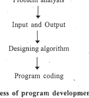

### 程序开发过程
### 1.1 设计方法
设计是获得给定问题解决方案的第一步。设计的目的是表示系统的解决方案。设计大型系统非常困难，因为系统的复杂性无法轻松表示。因此，出现了各种设计方法。

### 1.1.1 自顶向下设计
每个系统都有多个组件层次结构。顶层组件代表整个系统。自顶向下设计方法从顶层组件开始到最低层（底部）组件。在这种设计方法中，系统被划分为一些主要组件。然后每个主要组件被划分为较低层级的组件。同样，其他组件被划分直到最低层组件。

### 1.1.2 自底向上设计
自底向上设计方法是自顶向下方法的逆过程。它从最低层组件开始到最高层组件。首先设计基本组件，然后从这些基本组件设计更高层的组件。

### 1.1.3 模块化方法
将大型系统划分为模块是更好的做法。就编程而言，模块在逻辑上是程序的一个定义良好的部分。每个模块都是程序的独立部分。使用模块化方法编写的程序易于修改，因为一个模块的更改不会影响程序的其他模块。在模块级编程中，也很容易检查程序中的错误。

### 1.2 编程语言
在学习任何语言之前，了解各种语言类型及其特性是很重要的。了解程序员的基本需求以及他们在使用现有语言时遇到的困难是很有趣的。编程语言可以分为两种类型-

- 1. 低级语言
- 2. 高级语言

### 1.2.1 低级语言
此类别中的语言是机器级语言和汇编语言。

### 1.2.1.1 机器级语言
计算机只能理解数字信号，即二进制数字 0 和 1。因此，给予计算机的指令只能以二进制代码形式存在。机器语言由二进制 0 或 1 的指令组成。计算机只能理解机器级语言。用机器级语言编写程序是一项困难的任务，因为程序员很难用二进制代码编写指令。机器级语言程序容易出错，其维护非常困难。此外，机器语言程序不可移植。每台计算机都有自己的机器指令，因此为一台计算机编写的程序对其他计算机无效。

### 1.2.1.2 汇编语言
通过使用一种称为汇编语言的机器级语言的修改形式，在机器级语言中遇到的困难在一定程度上得到了减少。在汇编语言中，指令以类似英语的单词给出，例如 MOV、ADD、SUB 等。因此，编写和理解汇编程序更容易。由于计算机只能理解机器级语言，因此汇编语言程序必须被翻译成机器语言。用于翻译的转换器称为“汇编器”。尽管用汇编语言编写程序稍微容易一些，但程序员仍必须了解与计算机硬件相关的所有低级细节。在汇编语言中，数据存储在计算机寄存器中，而每台计算机都有不同的寄存器集合。因此，汇编语言程序也不可移植。由于低级语言与硬件相关，因此低级程序的执行速度更快。

## C语言简介
### 1.2.2 高级语言
高级语言是考虑到可移植性这一特性而设计的，即这些语言与机器无关。它们是类似英语的语言，因此编写和理解高级语言程序很容易。在用高级语言编程时，程序员不必关心低级细节，因此可以全身心地关注所解决问题的逻辑。为了将高级语言程序翻译成机器语言，使用编译器或解释器。每种语言都有自己的编译器或解释器。此类别中的一些语言有- FORTRAN、COBOL、BASIC、Pascal 等。

### 1.3 转换器
我们知道计算机只能理解机器级语言，即二进制 1 或 0。用机器级语言编写和维护程序很困难。因此，需要将高级和低级语言的代码转换为机器级语言，并使用转换器来实现这一目的。这些转换器只是计算机程序，它们接受用高级或低级语言编写的程序，并生成等效的机器语言程序作为输出。使用的三种转换器是-

- 汇编器
- 编译器
- 解释器

汇编器用于将低级语言（汇编语言）的代码转换为机器级语言。

编译器和解释器用于将高级语言的代码转换为机器级语言。高级程序称为源程序，对应的机器语言程序称为目标程序。虽然编译器和解释器执行相同的任务，但它们的工作方式存在差异。

编译器搜索程序的所有错误并列出它们。如果程序无错误，则将其代码转换为机器代码，然后程序可以通过单独的命令执行。解释器逐条检查程序语句的错误。检查完一条语句后，它将该语句转换为机器代码然后执行该语句。此过程一直持续到程序的最后一句或出现错误语句为止。

### 1.4 C语言的历史
在早期，每种语言都是为特定目的而设计的。例如，FORTRAN（公式翻译器）用于科学和数学应用，COBOL（通用商业导向语言）用于商业应用。因此，人们感受到了对一种能够承受大多数目的的语言的需求。“必要性是发明之母”。从这里，Dennis Ritchie 迈出了通往 C 的第一步。

C语言由 Dennis Ritchie 于 1970 年代在贝尔实验室开发。最初它是为在名为 UNIX 的操作系统中编程而设计的。C 语言出现后，整个 UNIX 操作系统都用它重写了。现在几乎整个 UNIX 操作系统及其提供的工具，包括 C 编译器本身，都是用 C 编写的。

C语言源自 B 语言，该语言由 Ken Thompson 在 AT&T 贝尔实验室编写。B 语言采用自一种名为 BCPL（基本组合编程语言）的语言，该语言由剑桥大学的 Martin Richards 开发。


## C语言简介

1982年，ANSI（American National Standards Institute，美国国家标准协会）成立了一个委员会来制定C语言标准。最终在1989年，推出了C语言标准，即ANSI C。目前大多数现代编译器都遵循该标准。

### 1.5 C语言的特点

C语言是一种中级语言。它既具有高级语言的简洁性，又具有低级语言的功能。C语言的这一特点使其适合编写应用程序和系统程序。因此，对于大多数应用，如数学、科学、商业和系统软件应用，C语言都是一种优秀、高效、通用的语言。

C语言是一种小巧的语言，仅包含32个英文单词作为关键字（如if、else、for、break等）。C语言的功能通过其自带的库函数得到增强。此外，C语言是可扩展的，因为它允许用户将自己的库函数添加到库中。

C语言包含编写结构化程序所需的控制结构，因此被认为是一种结构化编程语言。它包含选择结构（if...else、switch）、循环结构（while、for、do...while）以及循环退出结构（break）。

用C语言编写的程序是可移植的，即为一种类型的计算机或操作系统编写的程序可以在另一种类型的计算机或操作系统上运行。

### 1.6 C程序的结构

一个C程序是一个或多个函数的集合。每个函数都是语句的集合，并执行特定任务。C程序的一般结构如下：

```
Comments
Preprocessor directives
Global variables
main( ) function
{
    local variables
    statements
    ........
}
func1( )
{
    local variables
    statements
    ........
}
func2( )
{
    local variables
    statements
    ........
}
```

注释可以放置在程序中的任何位置，并包含在定界符/*和*/之间。注释通常用于文档说明。

预处理指令在C源代码经过编译器编译之前由预处理器处理。常用的预处理指令有`#include`和`#define`。`#include`用于包含头文件，`#define`用于定义符号常量和宏。

每个C程序都有一个或多个函数。如果程序只有一个函数，那么它必须是`main()`。每个C程序的执行都从`main()`函数开始。它有两个部分：局部变量的声明和语句。局部变量的作用域仅限于该函数。`main()`函数中的语句逐条执行。其他函数是用户自定义函数，它们也有局部变量和C语句。它们可以在`main()`之前或之后定义。有些变量可能要在多个函数中使用，因此有必要将它们声明为全局变量。这些变量称为全局变量。

### 1.7 C语言的运行环境

执行C程序的步骤如下：

- 1. 程序创建
- 2. 程序编译
- 3. 程序执行

### 1.7.1 Unix环境

UNIX操作系统通常提供一个命令行编译器，名为`cc`或`gcc`。

### (a) 程序创建

在Unix环境中，可以使用`vi`编辑器创建文件：

```
$ vi filename.c
```

这里的`$`是Unix提示符。按ESC和SHIFT+zz可以保存文件。

### (b) 程序编译

创建C程序后，可进行编译：

```
$ cc filename.c
```

如果程序包含数学函数，则编译方式为：

```
$ cc filename.c -lm
```

编译后，可执行代码存储在文件`a.out`中。

### (c) 程序执行

```
$ a.out
```

### 1.7.2 MS-DOS环境

在MS-DOS环境中，可以使用命令行或IDE（集成开发环境）来完成创建、编译和执行。

### 1.7.2.1 命令行

在Borland C中，命令行编译器是`bcc.exe`；在Turbo C中，命令行编译器是`tcc.exe`。

### (a) 程序创建

可以使用任何编辑器创建程序文件，并应以`.c`扩展名保存。

### (b) 程序编译

保存文件后，可以在DOS提示符下编写以下命令来编译C程序：

```
C:\>tcc filename (in Turbo C)
```

```
C:\>bcc filename (in Borland C)
```

### (c) 程序执行

编译C程序后，会生成可执行文件`filename.exe`。在DOS提示符下编写以下命令来执行它：

```
C:\>filename
```

### 1.7.2.2 集成开发环境

所有这些步骤都可以在IDE中使用菜单选项或快捷键完成。在Borland C中，程序`bc.exe`是IDE；在Turbo C中，程序`tc.exe`是IDE。因此，我们可以在命令提示符下输入`bc`或`tc`来打开IDE。

### (a) 程序创建

可以从菜单选项New创建新文件。可以通过菜单选项Save保存文件。如果文件未命名，则通过菜单选项Save as保存。可以从菜单选项Open打开现有文件。

### (b) 程序编译

通过菜单选项Compile编译文件。（Alt+F9）

### (c) 程序执行

通过菜单选项Run执行文件。（Ctrl+F9）。输出出现在输出窗口中，可以使用Alt+F5键查看。

我们仅向您提供了如何执行程序的初步知识。在工作时还可以探索其他几个选项，最好查阅编译器的使用手册来了解这些选项。

# 第2章：C语言的元素

每种语言都有一些基本元素和语法规则。在理解编程之前，必须了解C语言的基本元素。这些基本元素包括字符集、变量、数据类型、常量、关键字（保留字）、变量声明、表达式、语句等。所有这些都用于构造C程序。

C程序中使用的字符如下：

- A, B, C .............. Z
- a, b, c .............. z
- 0, 1, 2, 3, 4, 5, 6, 7, 8, 9

| 字符 | 含义 | 字符 | 含义 |
|---|---|---|---|
| + | 加号 | - | 减号（连字符） |
| * | 星号 | % | 百分号 |
| `\` | 反斜杠 | / | 斜杠 |
| < | 小于号 | = | 等号 |
| > | 大于号 | _ | 下划线 |
| ( | 左圆括号 | ) | 右圆括号 |
| { | 左大括号 | } | 右大括号 |
| [ | 左方括号 | ] | 右方括号 |
| ; | 分号 | , | 逗号 |
| . | 句点 | : | 冒号 |
| ' | 单引号 | " | 双引号 |
| ? | 问号 | ! | 感叹号 |
| & | 和号 | \| | 竖线 |
| @ | at 符号 | ^ | 脱字符号 |
| $ | 美元符号 | # | 井号 |
| ~ | 波浪号 | \` | 反引号 |

### 2.2 执行字符/转义序列

字符通过键盘打印在屏幕上，但有些字符如换行符、制表符、退格键不能像其他普通字符那样打印。C语言支持反斜杠（`\`）与C字符集中某些字符的组合来打印这些字符。

这些字符组合被称为转义序列，由两个字符表示。第一个字符是`\`，第二个字符来自C字符集。下面给出一些转义序列：

| 转义序列 | 含义 | ASCII值 | 用途 |
|---|---|---|---|
| `\b` | 退格 | 008 | 将光标移动到当前行的前一位置 |
| `\a` | 响铃（警报） | 007 | 产生警报蜂鸣声 |
| `\r` | 回车 | 013 | 将光标移动到当前行的开头。 |
| `\n` | 换行 | 010 | 将光标移动到下一行的开头 |
| `\f` | 换页 | 012 | 将光标移动到下一个逻辑页的起始位置。 |
| `\0` | 空 | 000 | 空 |
| `\v` | 垂直制表 | 011 | 将光标移动到下一个垂直制表位置 |
| `\t` | 水平制表 | 009 | 将光标移动到下一个水平制表位置。 |
| `\\` | 反斜杠 | 092 | 表示带有反斜杠（ `\` ）的字符 |

空白、水平制表、垂直制表、换行、回车、换页在C语言中称为空白符。

### 2.3 三字符序列

有些字符可能无法通过键盘输入。C语言支持“三字符序列”的功能来输出这些字符。这些三字符序列由三个字符组成。前两个是`??`，第三个是C字符集中的任意字符。下面是一些三字符序列：

| 三字符序列 | 符号 |
|---|---|
| `??<` | { 左大括号 |
| `??>` | } 右大括号 |
| `??(` | [ 左方括号 |
| `??)` | ] 右方括号 |
| `??!` | \| 竖线 |
| `??/` | \ 反斜杠 |
| `??=` | # 井号 |
| `??-` | ~ 波浪号 |
| `??'` | ^ 脱字符号 |


## 2.4 分隔符

分隔符在 C 中用于表达语法含义。如下所示——

- : 冒号，用于标签
- ; 分号，表示语句结束
- ( ) 圆括号，用于表达式
- [ ] 方括号，用于数组
- { } 花括号，用于语句块
- # 井号，预处理指令
- , 逗号，变量分隔符

## 2.5 保留字 / 关键字

有些单词被保留用于执行特定任务。这些单词称为关键字，它们在 C 中具有标准的、预定义的含义。它们始终以小写字母书写。C 中仅有 32 个可用关键字，如下所示——

- auto break case char
- const continue default do
- double else enum extern
- float for goto if
- int long register return
- short signed sizeof static
- struct switch typedef union
- unsigned void volatile while

## 2.6 标识符

我们在 C 程序中使用的所有单词要么是关键字，要么是标识符。关键字是预定义的，用户不能更改；而标识符是用户定义的单词，用于为变量、数组、函数、结构体等实体命名。命名标识符的规则如下——

- (1) 名称只能由字母（大写和小写）、数字和下划线符号（_）组成。
- (2) 第一个字符应为字母或下划线。
- (3) 名称不应是关键字。
- (4) 由于 C 区分大小写，大写和小写字母被视为不同。例如，code、Code 和 CODE 是三个不同的标识符。
- (5) 标识符名称可以任意长。某些 C 实现只识别前八个字符，不过大多数实现识别 31 个字符。ANSI 标准编译器识别 31 个字符。

标识符通常被赋予有意义的名称。有效标识符名称的一些示例——Value a net_pay rec1 _data MARKS

- 5bc 第一个字符应为字母或下划线
- int int 是关键字
- rec# # 是特殊字符
- avg 不允许有空白字符

## 2.7 数据类型

C 支持不同类型的数据。这些数据类型在内存中的存储表示不同。C 中有四种基本数据类型，即 int、char、float 和 double。

'char' 用于存储任意单个字符，'int' 用于存储整数值，'float' 用于存储单精度浮点数，'double' 用于存储双精度浮点数。我们可以将类型限定符与这些基本类型一起使用，以获得更多类型。

- 类型限定符有两类——
- 1. 大小限定符——short、long
- 2. 符号限定符——signed、unsigned

当使用限定符 unsigned 时，数值始终为正；当使用 signed 时，数值可以为正或负。如果未提及符号限定符，则默认假定为 signed 限定符。有符号数据类型的取值范围小于无符号类型。这是因为在有符号类型中，最左边的位用于表示符号，而在无符号类型中，该位也用于表示数值。

16 位机器上不同数据类型的大小和范围如下表所示。在字长不同的机器上，大小和范围可能有所不同。

| 基本数据类型 | 带类型限定符的数据类型 | 大小（字节） | 范围 |
|---|---|---|---|
| char | char 或 signed char | 1 | -128 至 127 |
|  | unsigned char | 1 | 0 至 255 |
| int | int 或 signed int | 2 | -32768 至 32767 |
|  | unsigned int | 2 | 0 至 65535 |
|  | short int 或 signed short int | 1 | -128 至 127 |
|  | unsigned short int | 1 | 0 至 255 |
|  | long int 或 signed long int | 4 | -2147483648 至 2147483647 |
|  | unsigned long int | 4 | 0 至 4294967295 |
| float | float | 4 | 3.4E-38 至 3.4E+38 |
| double | double | 8 | 1.7E-308 至 1.7E+308 |
|  | long double | 10 | 3.4E-4932 至 1.1E+4932 |

## 2.8 常量

常量是在程序执行期间不能更改的值。常量有三种类型——

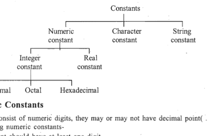

### 2.8.1 数值常量

数值常量由数字组成，它们可以有小数点（.），也可以没有。定义数值常量的规则如下——

- 1. 数值常量应至少包含一位数字。
- 2. 数值常量中不允许出现逗号或空格。
- 3. 数值常量可以为正或负，但默认符号始终为正。

数值常量有两种类型——

### 2.8.1.1 整型常量

整型常量是没有小数点（.）的整数。根据不同的数制，整型常量有三种类型。这些常量中允许使用的字符如下——

- 十进制常量——0,1,2,3,4,5,6,7,8,9（基数为 10）
- 八进制常量——0,1,2,3,4,5,6,7（基数为 8）
- 十六进制常量——0,1,2,3,4,5,6,7,8,9,A,B,C,D,E,F,a,b,c,d,e,f（基数为 16）

一些有效的十进制整型常量如下——

- 0
- 123
- 3705
- 23759

一些无效的十进制整型常量如下——

| 无效 | 备注 |
|---|---|
| 2.5 | 非法字符（.） |
| 3#5 | 非法字符（#） |
| 98 5 | 不允许空格 |
| 0925 | 首位不能为零 |
| 8,354 | 不允许逗号 |

在八进制整型常量中，第一位必须是 0。例如——

- 0
- 05

```
077
0324
```

在十六进制整型常量中，前两个字符应为 0x 或 0X。一些示例如下——

```
0x
0X23
0x515
0XA15B
0xFFF
0xac
```

默认情况下，整型常量的类型为 int。但如果整型常量的值超出 int 类型所能表示的范围，则类型被视为 unsigned int 或 long int。我们还可以通过为常量添加后缀 l 或 L（表示 long）、u 或 U（表示 unsigned）、ul 或 UL（表示 unsigned long）来显式指定常量的类型。例如——

```
6453                          Integer constant of type int
45238722UL or 45238722ul      Integer constant of type unsigned long int
6655U or 6655u                Integer constant of type unsigned int
```

### 2.8.1.2 实型（浮点）常量

浮点常量是包含小数点的数值常量。一些有效的浮点常量如下——

```
0.5
5.3
4000.0
0.0073
5597.
39.0807
```

为了表示非常大或非常小的实型常量，使用指数（科学）形式。这里数字以尾数和指数形式书写，二者用 'e' 或 'E' 分隔。尾数可以是整数或实数，而指数只能是整数（正或负）。例如，数字 1800000 可以写成 1.8e6，这里 1.8 是尾数，6 是指数。更多示例如下——

| 数字 | | | 指数形式 |
|---|---|---|---|
| 2500000000 | → | 2.5*10^9 | 2.5e9 |
| 0.0000076 | → | 7.6*10^-6 | 7.6e-6 |
| -670000 | → | -6.7*10^5 | -6.7E5 |

默认情况下，浮点常量的类型为 double。我们可以通过为常量添加后缀 f 或 F（表示 float 类型）、l 或 L（表示 long double）来显式指定常量的类型。例如——

```
2.3e5                         floating point constant of type double
2.4e-9l or 2.4e-9L            floating point constant of type long double
3.52f or 3.52F                floating point constant of type float
```

### 2.8.2 字符常量

字符常量是括在单引号内的单个字符。一些有效的字符常量如下——

- 'g'
- 'D'
- '$'
- ','
- '#'

一些无效的字符常量如下——

| 无效 | 备注 |
|---|---|
|'four' | 引号内只能有一个字符 |
|"d" | 不允许使用双引号 |
|'' | 单引号之间没有字符 |
|y | 缺少单引号 |

每个字符常量都有一个与之关联的唯一整数值。这个整数是字符在机器字符编码中的数值。如果机器使用 ASCII（美国信息交换标准代码），那么字符 'G' 表示整数值 71，字符 'S' 表示值 53。一些 ASCII 值如下——

- A - Z 的 ASCII 值（65 - 90）
- a - z 的 ASCII 值（97 - 122）
- 0 - 9 的 ASCII 值（48 - 57）
- ; 的 ASCII 值（59）

### 2.8.3 字符串常量

字符串常量包含零个、一个或多个字符。字符串常量括在双引号（" "）内。在字符串末尾，编译器会自动放置 '0'。

- "Kumar"
- "593"
- "8"
- " "
- "A"

注意，"A" 和 'A' 不同。前者是字符串常量，由字符 A 和 '0' 组成；后者是字符常量，表示整数值 65。

### 2.8.4 符号常量

如果我们想多次使用某个常量，可以给它提供一个名称。例如，如果必须在程序中的许多地方使用常量 3.14159265，那么可以给它起名为 PI，并使用这个名称，而不是在各处都写出常量值。这类常量称为符号常量或命名常量。

符号常量是替代一个字符序列的名称。这些字符可以表示数值常量、字符常量或字符串常量。

这些常量通常在程序开头定义如下

```c
#define name value
```

这里 'name' 是常量的符号名，通常用大写字母书写。'value' 可以是数值、字符或字符串常量。

符号常量的一些例子是-

```c
#define MAX 100
#define PI 3.14159625
#define CH 'y'
#define NAME "Suresh"
```

在程序中，这些名称将被相应的值所替换。这些符号常量提高了程序的可读性和可修改性。

## 2.9 变量

变量是可用于存储值的名称。变量可以取不同的值，但一次只能取一个。这些值可以在程序执行期间被改变。每个变量都关联一个数据类型。变量的数据类型决定了它可以取什么值。命名变量的规则与命名标识符的规则相同。

### 2.9.1 变量的声明

必须在使用变量之前先声明它。变量的声明指定了它的名称和数据类型。变量可以存储的类型和值的范围取决于其数据类型。变量声明的语法是-

```c
datatype variablename;
```

这里 datatype 可以是 int、float、char、double 等。变量声明的一些例子是-

```c
int x;
float salary;
char grade;
```

这里 x 是 int 类型的变量，salary 是 float 类型的变量，grade 是 char 类型的变量。我们也可以在一个声明中声明多个变量。例如-

```c
int x, y, z, total;
```

这里 x、y、z、total 都是 int 类型的变量。

### 2.9.2 变量的初始化

当变量被声明时，它包含一个未定义的值，通常称为垃圾值。如果我们愿意，可以在声明时为变量赋一个初始值，这称为变量的初始化。例如-

```c
int a = 5;
float x = 8.9, y = 10.5;
char ch = 'y';
double num = 0.15197e-7;
int l, m, n, total = 0;
```

在最后一次声明中，只有变量 total 被初始化了。

## 2.10 表达式

表达式是运算符、常量、变量和函数调用的组合。表达式可以是算术的、逻辑的或关系性的。

一些例子如下-

- x+y - 算术运算
- a = b+c - 使用两个运算符 ( = ) 和 ( + )
- a > b - 关系表达式
- a==b - 逻辑表达式
- func(a, b) - 函数调用

我们将在下一章学习这些运算符和表达式。

## 2.11 语句

在 C 程序中，指令以语句的形式编写。语句是程序的可执行部分，会导致计算机执行某些操作。语句可以分为-

- (i) 表达式语句
- (ii) 复合语句
- (iii) 选择语句 (if, if...else, switch)
- (iv) 迭代语句 (for, while, do...while)
- (v) 跳转语句 (goto, continue, break, return)
- (vi) 标签语句 (case, default, 用于 goto 的标签语句)

### 2.11.1 表达式语句

表达式语句由表达式后跟分号组成。例如-

```c
x = 5;
x = y - z;
func( a , b );
```

### 2.11.2 复合语句

复合语句由一对花括号 { } 括起来的若干语句组成。复合语句也称为语句块。请注意，闭合大括号后没有分号。例如-

```c
{
    int l=4,b=2,h=3;
    int area,volume;
    area=2*(l*b+b*h+h*l);
    volume=l*b*h;
}
```

如果要在块内声明任何变量，则只能在块的开头声明。在块内声明的变量只能在该块内使用。所有其他类别的语句将在后续章节中讨论。

## 2.12 注释

注释用于提高程序的可读性。它们解释程序的目的，有助于理解程序。注释写在 /* 和 */ 之间。可以是单行注释或多行注释。

注释的一些例子是

```c
/*Variable b represents basic salary*/
```

(单行注释)

```c
/*This is a C program to calculate simple interest */
```

(多行注释)

注释不能嵌套，即我们不能在另一个注释内部写注释。

# 第 3 章 C 语言的输入输出

任何程序都有三个主要功能——它接收数据作为输入，处理这些数据并给出输出。输入操作涉及数据从输入设备（通常是键盘）移动到计算机内存，而在输出操作中，数据从计算机内存移动到输出设备（通常是屏幕）。C 语言不提供任何输入输出操作的设施。输入输出是通过一组随每个 C 编译器提供的库函数来执行的。这些函数正式上不是语言的一部分，但在 C 的所有输入输出操作中都被认为是标准的。执行输入输出操作的一组库函数称为标准 I/O 库。

有几个头文件提供对各种库函数支持的必要信息。这些头文件使用程序开始处的 #include 指令进入程序。例如，如果程序使用标准 I/O 库中的任何函数，则应包含头文件 stdio.h，形式为 #include <stdio.h>

同样，还有其他头文件，如 math.h、string.h、alloc.h，在使用某些库函数时应包含它们。

在本章中，我们将讨论输入函数 scanf( ) 和 getchar( ) 以及输出函数 printf( ) 和 putchar( )。还有几个其他输入输出函数将在后续章节中讨论。

获取数据作为输入的一个简单方法是使用赋值语句给变量赋值的。

```c
int basic = 2000;
char ch = 'y';
```

但这样我们只能给变量赋特定的数据。

第二种方法是使用输入函数 scanf( )，它从键盘获取输入数据。在这种方法中，我们可以在运行时给变量赋任何值。对于输出，我们使用函数 printf( )。

### 3.1 转换说明符

函数 scanf( ) 和 printf( ) 使用转换说明符来指定数据的类型和大小。每个转换说明符必须以百分号 ( % ) 开头。下面给出一些转换说明符

- %c - 一个字符

```c
scanf("%c",&ch);
.........
}
```

这里控制字符串包含转换说明符字符 %c，这意味着应输入一个字符作为输入。此输入值将存储在变量 ch 中。

```c
#include<stdio.h>
main()
{
    float height;
    .......
    scanf("%f",&height);
    .......
}
```

这里控制字符串包含转换说明符字符 %f，这意味着应输入一个浮点数作为输入。此输入值将存储在变量 height 中。

```c
#include<stdio.h>
main()
{
    char str[30];
    scanf("%s",str);
    .......
}
```

在此示例中，控制字符串具有转换说明符字符 %s，意味着应作为输入获取一个字符串。请注意，变量 str 前没有 & 符号。输入的字符串将存储在变量 str 中。

单个 scanf() 函数也可以输入多个值。例如-

```c
#include<stdio.h>
main()
{
    int basic,da;
    scanf("%d%d",&basic,&da);
    .......
}
```

这里控制字符串有两个转换说明符字符，意味着应输入两个整数值。这些值存储在变量 basic 和 da 中。数据可以用空格作为分隔符输入，如-
1500 1200

```c
#include<stdio.h>
main()
{
    int basic;
    float hra;
```


```c
char grade;
........
scanf("%d %f %c", &basic, &hra, &grade);
........
```

这里控制字符串有三个转换说明字符 `%d`、`%f` 和 `%c`，这意味着可以输入一个整数值、一个浮点值和一个单个字符作为输入。这些值存储在变量 `basic`、`hra` 和 `grade` 中。输入数据可以输入为- `1500 200.50 A`。

```c
#include<stdio.h>
main()
{
    int basic;
    float hra;
    ........
    scanf("%d:%f", &basic, &hra);
    ........
}
```

这里的分隔符是冒号（ `:` ）。输入数据可以输入为- `1500:200.50`

值 1500 存储在变量 `basic` 中，200.50 存储在 `hra` 中。

```c
#include<stdio.h>
main()
{
    int basic;
    float hra;
    ........
    scanf("%d,%f", &basic, &hra);
    ........
}
```

这里的分隔符是逗号（ `,` ）。输入数据可以输入为- `1500, 200.40`。

```c
#include<stdio.h>
main()
{
    int day, month, year;
    int basic;
    ........
    scanf("%d-%d-%d", &day, &month, &year);
    scanf("%d", &basic);
    ........
}
```

这里如果数据输入为-

`24-5-1973`
`$3000`

则 24 存储在变量 `day` 中，5 存储在变量 `month` 中，1973 存储在变量 `year` 中，3000 存储在变量 `basic` 中。

如果我们在控制字符串内部的转换说明之间包含任何空格，则它们将被忽略。

```c
#include<stdio.h>
main()
{
    int x, y, z;
    .......
    scanf("%d %d %d", &x, &y, &z);
    .......
}
```

如果数据输入为-

`12 34 56`

则 12 存储在 `x` 中，34 存储在 `y` 中，56 存储在 `z` 中。

## 3.3 写入输出数据

输出数据可以使用 `printf()` 库函数从计算机内存写入到标准输出设备（监视器）。使用此函数可以以输出的形式写入所有类型的值（数值、字符或字符串）。`printf()` 函数可以写成-

```c
printf("control string", variable 1, variable 2,............);
```

在此函数中，控制字符串包含转换说明字符和文本。它应包含在双引号内。变量名前面不应加上与号（`&`）符号。如果控制字符串不包含任何转换说明，则不指定变量名。`printf()` 函数的一些示例如下-

```c
#include<stdio.h>
main()
{
    printf("C is excellent\n");
}
```

**输出：**

```text
C is excellent
```

这里控制字符串只有文本，没有转换说明字符，因此输出只有文本。

```c
#include<stdio.h>
main()
{
    int age;
    printf("Enter your age : ");
    scanf("%d", &age);
}
```

这里 `printf` 也没有包含任何转换说明字符，并用于显示一条消息，提示用户输入他的年龄。

```c
#include <stdio.h>
main()
{
    int basic = 2000;
    printf("%d", basic);
}
```

在此示例中，控制字符串包含转换说明字符 `%d`，这意味着将显示一个整数值。变量 `basic` 具有该整数值，将作为输出显示。

```c
#include <stdio.h>
main()
{
    float height = 5.6;
    printf("%f", height);
}
```

这里控制字符串具有转换说明字符 `%f`，这意味着将显示一个浮点数。变量 `height` 具有该浮点值，将作为输出显示。

```c
#include <stdio.h>
main()
{
    char ch = '%';
    printf("%c", ch);
}
```

在上面的示例中，控制字符串具有转换说明字符 `%c`，这意味着将显示一个单个字符，变量 `ch` 具有该字符值。

```c
#include <stdio.h>
main()
{
    char str[30];
    printf("%s", str);
}
```

这里控制字符串具有转换说明字符 `%s`，意味着将显示一个字符串，变量名 `str` 是一个字符数组，保存将要显示的字符串。

```c
{
    int basic = 2000;
    printf("Basic Salary = %d", basic);
}
```

**输出：**

```text
Basic Salary = 2000
```

这里控制字符串包含带转换说明字符 `%d` 的文本。文本将原样显示，变量 `basic` 的值将显示在 `%d` 的位置。

```c
#include<stdio.h>
main()
{
    int b = 1500;
    float h = 200.50;
    char g = 'A';
    printf("Basic = %d , HRA = %f , Grade = %c", b, h, g);
}
```

**输出：**

```text
Basic = 1500, HRA = 200.500000, Grade = A
```

这里控制字符串包含带三个转换说明字符 `%d`、`%f` 和 `%c` 的文本。`%d` 用于整数值，`%f` 用于浮点数，`%c` 用于单个字符。

```c
#include<stdio.h>
main()
{
    int num = 10;
    printf("Octal equivalent of decimal %d = %o", num, num);
}
```

**输出：**

```text
Octal equivalent of decimal 10 = 12
```

这里第二个转换说明字符是 `%o`，因此显示了存储在变量 `num` 中的十进制数的八进制等价值。

```c
#include<stdio.h>
main()
{
    int num = 10;
    printf("Hex equivalent of decimal %d = %x", num, num);
}
```

**输出：**

```text
Hex equivalent of decimal 10 = A
```

这里第二个转换说明字符是 `%x`，因此显示了存储在变量 `num` 中的十进制数的十六进制等价值。

在第 2 章我们学习了转义序列。这里我们将看到如何在 `printf` 语句中使用它们。最常用的转义序列是 `'\n'` 和 `'\t'`。

```c
#include<stdio.h>
main()
{
    int b = 1500;
    float h = 200.50;
    char g = 'A';
    printf("Basic = %d\nHRA = %f\nGrade = %c\n", b, h, g);
}
```

**输出：**

```text
Basic = 1500
HRA = 200.500000
Grade = A
```

`'\n'` 将光标移动到下一行的开头。这里我们在控制字符串末尾也放置了一个 `'\n'`，它确保下一个程序的输出从新行开始。

```c
#include<stdio.h>
main()
{
    int b = 1500;
    float h = 200.50;
    char g = 'A';
    printf("Basic = %d\tHRA = %f\tGrade = %c\n", b, h, g);
}
```

**输出：**

```text
Basic = 1500      HRA = 200.500000      Grade = A
```

`'\t'` 将光标移动到下一个制表位。同样，我们也可以使用其他转义序列。例如 `'\b'` 将光标向后移动一个位置，`'\r'` 将光标移动到当前行的开头，`'\a'` 通过蜂鸣声提醒用户，`'\v'` 将光标移动到下一个垂直制表位（下一行的第一列），`'\f'` 将光标移动到下一页。`'\v'` 和 `'\f'` 仅在输出通过打印机打印时有效。

如果我们想打印字符如单引号（`'`）、双引号（`"`）或反斜杠字符（`\`），则必须在格式字符串中用反斜杠字符在其前面加上前缀。

例如-

```text
printf("9 \\ 11 \\ 1978");              will print      9 \ 11 \ 1978
printf("She said, \"I have to go\".");   will print      She said, "I have to go".
```

## 3.4 格式化输入和输出

格式化输入和输出意味着数据以特定格式输入和显示。通过格式规范可以获得更好的结果呈现。不同规范的格式如下-

### 3.4.1 整数输入的格式

`%wd`

这里 `'d'` 是整数值的转换说明字符，`'w'` 是指定输入数据最大字段宽度的整数。如果输入的长度超过此最大字段宽度，则值不会正确存储。例如-

```c
scanf("%2d%3d", &a, &b);
```

- (i) 当输入数据长度小于给定的字段宽度时，输入值保持不变并存储在给定的变量中。

  输入- `6 39`

  结果- `6` 存储在 `a` 中，`39` 存储在 `b` 中。

- (ii) 当输入数据长度等于给定的字段宽度时，输入值保持不变并存储在给定的变量中。

  输入- `26 394`

  结果- `26` 存储在 `a` 中，`394` 存储在 `b` 中。

- (iii) 当输入数据长度大于给定的字段宽度时，输入值被更改并存储在变量中为-

  输入- `269 3845`

  结果- `26` 存储在 `a` 中，`9` 存储在 `b` 中，其余输入被忽略。

### 3.4.2 整数输出的格式

`%wd`

这里 `w` 是指定输出数据最小字段宽度的整数。如果变量的长度小于指定的字段宽度，则变量以前导空格右对齐。例如-

```c
printf("a=%3d, b=%4d", a, b);
```

- (i) 当变量的长度小于宽度说明符时。

  变量的值- `78 9`

  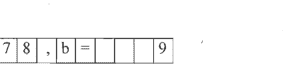

  第一个数据的宽度说明符为 3，而它只有 2 位数字，因此有一个前导空格。第二个数据的宽度说明符为 4，而它只有 1 位数字，因此有 3 个前导空格。

- (ii) 当变量的长度等于宽度说明符时

  变量的值- `263 1941`


## C 语言中的输入与输出

**结果：** 5.3 存储在 x 中，5.92 存储在 y 中

（iii）当输入数据的长度大于给定宽度时，给定值会被修改后存储在给定变量中，如下所示：

**输入：**

```
5.93 65.87
```

**结果：**

5.9 存储在 x 中，3.00 存储在 y 中。

### 3.4.4 浮点数输出的格式

`%w.nf`

这里，`w` 是整数，表示输入数据的总宽度，`n` 是小数点后要打印的位数。默认情况下，小数点后打印 6 位数字。例如：

```c
printf("x = %4.1f, y = %7.2f ", x, y);
```

如果变量的总长度小于指定宽度 `w`，则数值右对齐并在前面填充空格。如果小数点后的位数多于 `n`，则数字会被四舍五入。

**变量的值：**

```
8 5.9
```

**输出：**

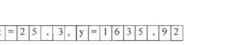

**变量的值：**

```
25.3 1635.92
```

**输出：**

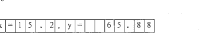

**变量的值：**

```
15.231 65.875948
```

**输出：**

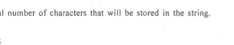

### 3.4.5 字符串输入的格式

`%ws`

这里，`w` 指定将存储在字符串中的字符总数。

```c
char str[8];
scanf("%3s", str);
```

```c
scanf("%d %d %d", &a, &b, &c);
printf("%d %d %d", a, b, c);
```

输出：

```
Enter three numbers : 25 30 35
25 35 25381
The variable c has garbage value.
```

### 3.6 字符 I/O

### 3.6.1 getchar() 和 putchar()

宏 getchar() 和 putchar() 可用于字符 I/O。getchar() 从标准输入读取一个字符。putchar() 每次向标准输出输出一个字符。

```c
main ()
{
char ch;
printf("Enter a character : ");
ch=getchar();
printf("The entered character is : ");
putchar(ch);
}
```

输出：

```
Enter a character : B
The entered character is : B
```

### 练习

**1.**

```c
#define MSG "Hello World\n"
main ()
{
    printf(MSG);
}
```

**2.**

```c
main ()
{
    printf("Indian\b is great\n");
    printf("New\rDelhi\n");
}
```

**3.**

```c
main ()
{
    int a = 11;
    printf("a = %d\t", a);
    printf("a = %o\t", a);
    printf("a = %x\n", a);
}
```

**4.**

```c
main()
{
    int a = 50000;
    unsigned int b = 50000;
    printf("a = %d, b = %u\n", a, b);
}
```

**5.**

```c
main()
{
    char ch;
    printf("Enter a character:");
    scanf("%c", &ch);
    printf("%d\n", ch);
}
```

**6.**

```c
main()
{
    float p = 123.1265;
    printf("%f\t", p);
    printf("%.2f\t", p);
    printf("%.3f\n", p);
}
```

**7.**

```c
main()
{
    int a = 625, b = 2394, c = 12345;
    printf("%5d, %5d, %5d\n", a, b, c);
    printf("%3d, %4d, %5d\n", a, b, c);
}
```

**8.**

```c
main()
{
    int a = 98;
    char ch = 'c';
    printf("%c, %d\n", a, ch);
}
```

**9.**

```c
main( )
{
    float a1, b1, a2, b2, a3, b3;
    a1 = 2;
    b1 = 6.8;
    a2 = 4.2;
    b2 = 3.57;
    a3 = 9.82;
    b3 = 85.673;
    printf("%3.1f,%4.2f\n", a1, b1);
    printf("%5.1f,%6.2f\n", a2, b2);
    printf("%7.1f,%8.2f\n", a3, b3);
}
```

**10.**

```c
main()
{
    printf("%10s\n", "India");
    printf("%4s\n", "India");
    printf("%.2s\n", "India");
    printf("%5.2s\n", "India");
}
```

### 答案

**1.** `Hello World`

**2.**

```
India is great
Delhi
```

`\b` 将光标移动到当前行的前一个位置，`\r` 将光标移动到当前行的开头，`\n` 将光标移动到下一行的开头。

**3.** `a = 11 a = 13 a = b`

**4.** `a = -15536, b = 50000`  
值 50000 超出了 int 数据类型的范围。

**5.** 该程序输入一个字符，并输出其 ASCII 值。

**6.** `123.126503 123.13 123.127`

**7.** `625, 2394, 12345`  
`625, 2394, 12345`

**8.** `b, 99`

**9.**

```
2.0,6.80
    4.2, 3.57
    9.8, 85.67
```

**10.**

```
     India
India
In
   In
```

# 第 4 章 运算符与表达式

运算符指定要执行的操作，该操作会生成一个值。变量和常量可以通过各种运算符连接，形成表达式。操作数是运算符作用的数据项。有些运算符需要两个操作数，而另一些运算符只作用于一个操作数。C 语言包含大量运算符，可分为以下几类：

1. 算术运算符
2. 赋值运算符
3. 自增和自减运算符
4. 关系运算符
5. 逻辑运算符
6. 条件运算符
7. 逗号运算符
8. sizeof 运算符
9. 位运算符
10. 其他运算符

### 4.1 算术运算符

算术运算符用于数值计算。它们分为两种类型：

1. 一元算术运算符
2. 二元算术运算符

### 4.1.1 一元算术运算符

一元运算符只需要一个操作数。例如：

```
+x    -y
```

这里，`-` 会改变操作数 y 的符号。

### 4.1.2 二元算术运算符

二元运算符需要两个操作数。共有五个二元算术运算符：

| 运算符 | 用途 |
| --- | --- |
| `+` | 加法 |
| `-` | 减法 |
| `*` | 乘法 |
| `/` | 除法 |
| `%` | 求整数除法中的余数 |

`%`（取模运算符）不能用于浮点操作数。C 语言中没有幂运算符。不过，有一个库函数 `pow()` 可以执行幂运算。请注意，一元正号和一元负号运算符不同于加法和减法运算符。

### 4.2 整数算术运算

当两个操作数都是整数时，对这些操作数进行的算术运算称为整数算术运算，结果值始终是整数。设两个变量为 `a` 和 `b`。当 `a = 17`、`b = 4` 时，以下运算的结果为：

| 表达式 | 结果 |
| --- | --- |
| `a + b` | 21 |
| `a - b` | 13 |
| `a * b` | 68 |
| `a / b` | 4（小数部分被截断） |
| `a % b` | 1（整数除法后的余数） |

除法运算后，小数部分会被截断，结果只保留商的整数部分。取模运算后，结果会是整数除法的余数部分。进行除法和取模运算时，第二个操作数不能为零。

```c
/* P4.1 Program to understand the integer arithmetic operation */
#include <stdio.h>
main()
{
    int a = 17, b = 4;
    printf("Sum = %d\n", a + b);
    printf("Difference = %d\n", a - b);
    printf("Product = %d\n", a * b);
    printf("Quotient = %d\n", a / b);
    printf("Remainder = %d\n", a % b);
}
```

输出：

```
Sum = 21
Difference = 13
Product = 68
Quotient = 4
Remainder = 1
```

### 4.3 浮点算术运算

当两个操作数都是浮点类型时，对这些操作数进行的算术运算称为浮点算术运算。设两个变量为 `a` 和 `b`。当 `a = 12.4`、`b = 3.1` 时，以下运算的结果为：

| 表达式 | 结果 |
| --- | --- |
| `a + b` | 15.5 |
| `a - b` | 9.3 |
| `a * b` | 38.44 |
| `a / b` | 4.0 |

取模运算符 `%` 不能用于浮点数。

```c
/* P4.2 Program to understand the floating point arithmetic operation */
#include <stdio.h>
main()
{
    float a = 12.4, b = 3.8;
    printf("Sum = %.2f\n", a + b);
    printf("Difference = %.2f\n", a - b);
    printf("Product = %.2f\n", a * b);
    printf("a/b = %.2f\n", a / b);
}
```

输出：

```
Sum = 16.20
Difference = 8.60
Product = 47.12
a/b = 3.26
```

### 4.4 混合模式算术运算

当一个操作数是整数类型，另一个操作数是浮点类型时，对这些操作数进行的算术运算称为混合模式算术运算，结果值为浮点类型。

| 表达式 | 结果 |
| --- | --- |
| `a + b` | 14.5 |
| `a - b` | 9.5 |
| `a * b` | 30.0 |
| `a / b` | 4.8 |

有时，混合模式算术运算有助于获得精确结果。例如，表达式 `5 / 2` 的结果将是 `2`，因为这里应用的是整数算术运算。如果希望得到精确结果，可以将其中一个操作数设为浮点类型。例如，`5.0 / 2` 或 `5 / 2.0` 的结果都是 `2.5`。

### 赋值运算符

可以使用赋值运算符将值存储到变量中。赋值运算符 `=` 用于赋值表达式和赋值语句。

左侧操作数应为变量，右侧操作数可以是任何变量、常量或表达式。右侧操作数的值被赋给左侧操作数。以下是一些赋值表达式的示例：

```c
x = 8 /* 8 is assigned to x */
y = 5 /* 5 is assigned to y */
s = x + y - 2 /* Value of expression x+y-2 is assigned to s */
y = x /* Value of x is assigned to y */
x = y /* Value of y is assigned to x */
```

被赋的值被视为赋值表达式的值。例如，`x = 8` 是一个赋值表达式，其值为 8。

我们也可以有多个赋值表达式，例如：

```c
x = y = z = 20
```

这里，x、y、z 三个变量都会被赋值为 20，整个表达式的值也为 20。

如果在赋值表达式后加上分号，它就变成了赋值语句。例如，以下都是赋值语句：

```c
x = 8;
y = 5;
s = x + y - 2;
x = y = z = 20;
```

当赋值运算符左侧的变量也出现在右侧时，可以使用复合赋值运算符来避免两次写出该变量。例如：

```c
x = x + 5
```

也可以写成：

```c
x += 5
```

这里，`+=` 是复合赋值运算符。

类似地，还有其他复合赋值运算符：

- `x -= 5` 等价于 `x = x - 5`
- `y *= 5` 等价于 `y = y * 5`
- `sum /= 5` 等价于 `sum = sum / 5`
- `k %= 5` 等价于 `k = k % 5`

### 自增和自减运算符

C 语言有两个有用的运算符：自增（`++`）和自减（`--`）。它们是一元运算符，因为只作用于单个操作数。自增运算符（`++`）将变量的值增加 1，自减运算符（`--`）将变量的值减少 1。


++x 等价于    x = x + 1
--x 等价于    x = x - 1

这些运算符只能用于变量；不能用于常量或表达式。例如，表达式 ++5 或 ++(x+y+z) 是无效的。

这些运算符分为两类：
- 1. 前缀递增 / 递减：运算符写在操作数之前（例如 ++x 或 --x）
- 2. 后缀递增 / 递减：运算符写在操作数之后（例如 x++ 或 x--）

### 4.6.1 前缀递增 / 递减

这里先递增 / 递减变量的值，然后在运算中使用新值。

假设有一个变量 x，其值为 3。

语句 y = ++x; 表示先将 x 的值递增 1，再将 x 的值赋给 y。

这条语句等价于下面两条语句：

x = x+1;
y = x;

因此现在 x 的值为 4，y 的值也为 4。

语句 y = --x; 表示先将 x 的值递减 1，再将 x 的值赋给 y。

这条语句等价于下面两条语句：

x = x-1;
y = x;

因此现在 x 的值为 3，y 的值也为 3。

```
/*P4.3 Program to understand the use of prefix increment / decrement */
#include<stdio.h>
main()
{
int x=8;
printf("x = %d\t",x);
printf("x = %d\t",++x); /*prefix increment*/
printf("x = %d\t",--x); /*prefix decrement*/
printf("x = %d\n",x);
}
```

输出：

x = 8    x = 9   x = 9   x = 8   x = 8

在第二个 printf 语句中，先递增 x 的值，然后打印；类似地，在第四个 printf 语句中，先递减 x 的值，然后打印。

### 4.6.2 后缀递增 / 递减

这里先在运算中使用变量的值，然后再执行递增 / 递减。

假设有一个变量 x，其值为 3。

语句 y = x++; 表示先将 x 的值赋给 y，然后递增 x。这条语句等价于下面两条语句：

y = x;
x = x+1;

因此现在 x 的值为 4，y 的值为 3。

因此 y = x--; 表示先将 x 的值赋给 y，然后递减 x。

这条语句等价于下面两条语句：

y = x;
x = x-1;

因此现在 x 的值为 3，y 的值为 4。

```
/*P4.4 Program to understand the use of postfix increment/decrement*/
#include<stdio.h>
main()
{
 int x=8;
 printf("x = %d\n",x);
 printf("x = %d\n",x++); /*postfix increment*/
 printf("x = %d\n",x);
 printf("x = %d\n",x--); /*postfix decrement*/
 printf("x = %d\n",x);
}
```

输出：

 x = 8 x = 8 x = 9 x = 9 x = 8

在第二个 printf 语句中，先打印 x 的值，然后递增 x；类似地，在第四个 printf 语句中，先打印 x 的值，然后递减 x。

## 4.7 关系运算符

关系运算符用于根据两个表达式之间的关系比较它们的值。包含关系运算符的表达式称为关系表达式。如果关系为真，则关系表达式的值为 1；如果关系为假，则表达式的值为 0。C 语言中的关系运算符如下：

| 运算符 | 含义 |
| --- | --- |
| < | 小于 |
| <= | 小于或等于 |
| == | 等于 |
| != | 不等于 |
| > | 大于 |
| >= | 大于或等于 |

假设有两个变量 a = 9 和 b = 5，并用它们组成简单的关系表达式：

| 表达式 | 关系 | 表达式的值 |
|------------|----------|--------------------|
| a < b | 假 | 0 |
| a <= b | 假 | 0 |
| a == b | 假 | 0 |
| a != b | 真 | 1 |
| a > b | 真 | 1 |
| a >= b | 真 | 1 |
| a == 0 | 假 | 0 |
| b!=0 | 真 | 1 |
| a>8 | 真 | 1 |
| 2 > 4 | 假 | 0 |

关系运算符通常用在 if...else 结构和循环中。在下一个程序中，我们将使用 if 语句来演示关系运算符的用法。if 控制语句会计算一个表达式；如果该表达式为真（非零），则执行下一条语句，否则跳过下一条语句。if 语句的细节将在第 5 章讨论。这里使用它只是为了让你了解关系运算符的用法。

```
/*P4.5 Program to understand the use of relational operators*/
#include<stdio.h>
main()
{
int a,b;
printf("Enter values for a and b : ");
scanf("%d%d",&a,&b);
if(a<b)
printf("%d is less than %d\n",a,b);
if(a<=b)
printf("%d is less than or equal to %d\n",a,b);
if(a!=b)
printf("%d is not equal to %d\n",a,b);
if(a>b)
printf("%d is greater than %d\n",a,b);
if(a>=b)
printf("%d is greater than or equal to %d\n",a,b);
}
```

输出：

Enter values for a and b : 12 7
12 is not equal to 7
12 is greater than 7
12 is greater than or equal to 7

需要特别注意的是，赋值运算符（=）和相等运算符（==）完全不同。赋值运算符用于赋值，而相等运算符用于比较表达式。初学者通常会把两者混淆，用其中一个代替另一个，从而产生难以发现的错误。例如，如果在上述程序中使用 = 代替 ==，就会得到错误输出。

```
if(a = b)
printf("%d is equal to %d\n",a,b);
```

这里 a = b 被视为赋值表达式，因此 b 的值被赋给变量 a，整个表达式的值变为 7，这是一个非零值，所以下一条语句会被执行。

## 4.8 逻辑或布尔运算符

将两个或更多表达式组合起来的表达式称为逻辑表达式。组合这些表达式时使用逻辑运算符。这些运算符对假返回 0，对真返回 1。操作数可以是常量、变量或表达式。C 语言有三种逻辑运算符。

| 运算符 | 含义 |
|---|---|
| && | 与 |
| \|\| | 或 |
| ! | 非 |

其中逻辑 NOT 是单目运算符，其余两个是双目运算符。在了解这些运算符之前，先理解真和假的概念：在 C 语言中，任何非零值都被视为真，零被视为假。

### 4.8.1 与（&&）运算符

只有当两个条件都为真时，该运算符的结果才为真，否则结果为假。

### 布尔表

| 条件1 | 条件2 | 结果 |
|---|---|---|
| 假 | 假 | 假 |
| 假 | 真 | 假 |
| 真 | 假 | 假 |
| 真 | 真 | 真 |

假设有三个变量 a = 10、b = 5 和 c = 0。

假设我们有一个逻辑表达式：

(a == 10) && (b < a)

这里条件 a == 10 和 b < a 都为真，因此整个表达式为真。由于逻辑运算符对真返回 1，所以这个表达式的值为 1。

| 表达式 |  | 结果 | 表达式的值 |
|---|---|---|---|
| (a ==10) && (b>a) | 真 && 假 | 假 | 0 |
| (b>=a) && (b==3) | 假 && 假 | 假 | 0 |
| a && b | 真 && 真 | 真 | 1 |
| a && c | 真 && 假 | 假 | 0 |

最后两个表达式中只使用了变量。由于非零值被视为真，零值被视为假，因此变量 a 和 b 被视为真，变量 c 被视为假。

### 4.8.2 或（||）运算符

只有当两个条件的值都为假时，该运算符的结果才为假，否则结果为真。

### 布尔表

| 条件1 | 条件2 | 结果 |
|---|---|---|
| 假 | 假 | 假 |
| 假 | 真 | 真 |
| 真 | 假 | 真 |
| 真 | 真 | 真 |

假设有三个变量 a = 10、b = 5 和 c = 0。

考虑逻辑表达式：

```
(a >= b) || (b > 15)
```

该表达式的结果为真，因为其中一个条件为真。

| 表达式 |  | 结果 | 表达式的值 |
|---|---|---|---|
| a \|\| b | 真 \|\| 真 | 真 | 1 |
| a \|\| c | 真 \|\| 假 | 真 | 1 |
| (a<9) \|\| (b>10) | 假 \|\| 假 | 假 | 0 |
| (b!=7) \|\| c | 真 \|\| 假 | 真 | 1 |

### 4.8.3 非（!）运算符

这是一个单目运算符，它会取条件的相反值。如果条件的值为假，则结果为真；如果条件的值为真，则结果为假。

### 布尔表

| 条件 | 结果 |
|---|---|
| 假 | 真 |
| 真 | 假 |

假设有三个变量 a = 10、b = 5 和 c = 0。

假设我们有如下逻辑表达式：

```
! ( a == 10 )
```

条件 (a==10) 的值为真。NOT 运算符对该条件的值取反，因此结果为假。


| 表达式 |  | 结果 | 表达式的值 |
|---|---|---|---|
| !a | !true | 假 | 0 |
| !c | !false | 真 | 1 |
| !(b>c) | !true | 假 | 0 |
| !(a && c) | !false | 真 | 1 |

## 4.9 条件运算符

条件运算符是一个三元运算符（? 和 :），它需要三个表达式作为操作数。写法为- 测试表达式 ? 表达式1 : 表达式2。首先对测试表达式进行求值。

- (i) 如果测试表达式为真（非零），则求值表达式1，并且它成为整个条件表达式的值。
- (ii) 如果测试表达式为假（零），则求值表达式2，并且它成为整个条件表达式的值。

例如考虑这个条件表达式- a > b ? a : b。这里首先求值表达式 a > b，如果值为真则变量 a 的值成为条件表达式的值，否则变量 b 的值成为条件表达式的值。假设 a = 5 且 b = 8，我们在语句中使用上述条件表达式如下- max = a > b ? a : b ; 首先求值表达式 a > b，因为它是假的，所以 b 的值成为条件表达式的值并赋给变量 max。

在我们的下一个示例中，我们在条件表达式后加上分号写了一个条件语句。a < b ? printf("a is smaller") : printf("b is smaller"); 由于表达式 a < b 为真，所以第一个 printf 函数被执行。

```
/*P4.6 Program to print the larger of two numbers using conditional operator */
#include<stdio.h>
main()
{
    int a,b,max;
    printf("Enter values for a and b : ");
    scanf("%d %d",&a,&b);
    max = a>b ? a:b;    /*ternary operator*/
    printf("Larger of %d and %d is %d\n",a,b,max);
}
```

输出：
输入 a 和 b 的值 : 12 7
12 和 7 中较大的是 12

## 4.10 逗号运算符

逗号运算符（ , ）用于允许在只会使用一个表达式的情况下出现不同的表达式。表达式由逗号运算符分隔。分隔的表达式从左到右求值，整个复合表达式的类型和值是右most 表达式的类型和值。

例如考虑这个表达式-
a = 8, b = 7, c = 9, a+b+c

这里我们组合了 4 个表达式。最初 8 被赋给变量 a，然后 7 被赋给变量 b，9 被赋给变量 c，之后求值 a+b+c，它成为整个表达式的值。所以上述表达式的值为 24。现在考虑这个语句-
sum = ( a = 8, b = 7, c = 9, a+b+c );

这里右侧整个表达式的值将被赋给变量 sum，即 sum 将被赋值为 24。由于逗号运算符的优先级低于赋值运算符，因此这里需要括号。逗号运算符有助于使代码更紧凑，例如如果不使用逗号运算符，上述任务将需要在 4 条语句中完成。

```
a = 8;
b = 7;
c = 9;
sum = a+b+c;
```

```
/*P4.7 Program to understand the use of comma operator */
#include<stdio.h>
main()
{
    int a,b,c,sum;
    sum = (a=8,b=7,c=9,a+b+c);
    printf("Sum = %d\n",sum);
}
```

输出：
和 = 24

```
/* P4.8 Program to interchange the value of two variables using comma operator*/
#include<stdio.h>
main()
{
    int a=8,b=7,temp;
    printf("a = %d, b = %d\n",a,b);
    temp=a, a=b, b=temp;
    printf("a = %d, b = %d\n",a,b);
}
```

输出：
a = 8, b = 7
a = 7, b = 8

逗号运算符也用于循环，我们将在下一章学习关于它的内容。

## 4.11 sizeof 运算符

sizeof 是一个一元运算符。该运算符以字节为单位给出其操作数的大小。操作数可以是变量、常量或任何数据类型（ int, float, char 等）。例如 sizeof(int) 给出 int 数据类型占用的字节数，即 2。

```
/*P4.9 Program to understand the sizeof operator*/
#include<stdio.h>
main()
{
    int var;
    printf("Size of int = %d",sizeof(int));
    printf("Size of float = %d",sizeof(float));
    printf("Size of var = %d",sizeof(var));
    printf("Size of an integer constant = %d",sizeof(45));
}
```

输出：
int 的大小 = 2
float 的大小 = 4
var 的大小 = 2
一个整数常量的大小 = 2

通常 sizeof 运算符用于制作可移植程序，即可在不同机器上运行的程序。例如，如果我们编写程序假设 int 为 2 字节，那么它在 int 为 4 字节的机器上就不会正确运行。所以为了制作可在所有机器上运行的通用代码，我们可以使用 sizeof 运算符。

## 位运算符

C 具有支持在位级操作数据的能力。位运算符用于对单个位进行操作。位运算符仅对整数操作。位运算符如下-

| 位运算符 | 含义 |
|---|---|
| & | 按位与 |
| \| | 按位或 |
| ~ | 按位取反 |
| << | 左移 |
| >> | 右移 |
| ^ | 按位异或 |

这些位运算符将在第 13 章中详细讨论。

## 其他运算符

我们将在后续章节中学习许多其他运算符。本章要介绍的最后一个运算符是类型转换运算符。在学习它之前，我们将讨论 C 中的类型转换。

## 4.12 类型转换

C 提供了在表达式中混合不同类型变量和常量的功能。在这类操作中，一个操作数的的数据类型被转换为另一个操作数的数据类型。这称为类型转换。不同类型的类型转换如下-

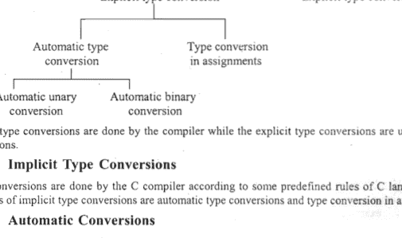

隐式类型转换由编译器完成，而显式类型转换是用户定义的转换。

### 4.12.1 隐式类型转换

这些转换是根据 C 语言的某些预定义规则由 C 编译器完成的。隐式类型转换的两种类型是自动类型转换和赋值中的类型转换。

### 4.12.2 自动转换

### 自动一元转换

所有类型为 char 和 short 的操作数在任何操作之前都会被转换为 int。某些编译器在任何操作之前都会将所有 float 操作数转换为 double。

### 自动二元转换

自动二元转换的规则如下-

- (i) 如果一个操作数是 long double，则另一个将被转换为 long double，结果为 long double。
- (ii) 否则如果一个操作数是 double，则另一个将被转换为 double，结果为 double。
- (iii) 否则如果一个操作数是 float，另一个将被转换为 float，结果为 float。
- (iv) 否则如果一个操作数是 unsigned long int，则另一个将被转换为 unsigned long int，结果为 unsigned long int。
- (v) 否则如果一个操作数是 long int，另一个是 unsigned int：
  - (a) 如果 long int 可以表示 unsigned int 的所有值，则 unsigned int 将被转换为 long int，结果为 long int。
  - (b) 否则两个操作数都将被转换为 unsigned long int，结果为 unsigned long int。
- (vi) 否则如果一个操作数是 long int，则另一个将被转换为 long int，结果为 long int。
- (vii) 否则如果一个操作数是 unsigned int，则另一个将被转换为 unsigned int，结果为 unsigned int。
- (viii) 否则两个操作数都是 int，结果为 int。

如果我们排除无符号变量，那么这些规则相当简单，可以通过为每种数据类型分配一个等级来总结。每当有两个不同数据类型的操作数时，等级较低的操作数将被转换为等级较高操作数的类型。这称为数据类型的提升。


如果赋值表达式中两个操作数的类型不同，则右手操作数的类型将被转换为左手操作数的类型。这里如果右手操作数的等级较低，则它将被提升到左手操作数的等级，如果它等级较高，则它将被降级到左手操作数的等级。

- 1. 当 long 转换为 int，或 int 转换为 short int 或 char 时，一些高位可能会被丢弃。
- 2. 在 float 类型转换为 int 类型期间，小数部分可能会被截断。
- 3. 当 double 类型转换为 float 类型时，数字会被四舍五入。
- 4. 当有符号类型更改为无符号类型时，符号可能会被丢弃。
- 5. 当 int 转换为 float，或 float 转换为 double 时，精度或精确度不会增加。

```
/*P4.10 Program to understand the type conversion in assignment*/
main( )
{
char c1,c2;
int i1,i2;
float f1,f2;
c1='a';
i1=80.56; /*Demotion:float converted to int, only 80 assigned to i1*/
f1=12.6;
}
```


```
c2=i1;    /*Demotion : int converted to char*/
i2=f1;    /*Demotion : float converted to int*/
/*Now c2 has character with ASCII value 80,i2 is assigned value 12*/
printf("c2 = %c,  i2 = %d\n",c2,i2);
f2=i1;    /*Promotion : int converted to float*/
i2=c1;    /*Promotion : char converted to int*/
/*Now i2 contains ASCII value of character 'H' which is 72*/
printf("f2 = %.2f,  i2 = %d\n",f2,i2);
}
```

输出:
 c2 = P,   i2 = 12
 f2 = 80.00, i2 = 72

## 4.12.4 显式类型转换或类型强制转换

可能存在某些情况，隐式转换无法满足我们的目的。例如-

```
float z;
int x = 20, y = 3;
z = x/y;
```

z 的值将是 6.0 而不是 6.66。

在这种情况下，我们可以指定自己的转换，称为类型转换或强制转换。这是通过类型转换运算符实现的。类型转换运算符是一个一元运算符，用于临时将表达式转换为特定数据类型。表达式可以是任何常量或变量

类型转换运算符的语法是-
(datatype) expression
这里数据类型连同括号一起称为类型转换运算符。
因此如果我们将上面的语句写成-
z = (float)x/y;
现在 z 的值将为 6.66。这是因为类型转换运算符 (float) 临时将 int 变量 x 转换为 float 类型，因此进行了浮点运算，小数部分没有丢失。
请注意，类型转换运算符仅在评估此表达式时临时更改变量 x 的数据类型，在程序的其他地方它仍然只是一个 int 变量。

```
/*P4.11 Program to illustrate the use of cast operator*/
#include<stdio.h>
main()
{
    int x=5,y=2;
    float p,q;
    p=x/y;
    printf("p = %f\n",p);
    q=((float)x)/y;
    printf("q = %f\n",q);
}
```

### 输出：

p = 2.000000
q = 2.500000

最初表达式 x/y 被求值，x 和 y 都是整数，因此根据整数运算，除法后小数部分被截断，结果为整数值 2。该值将被赋给 p，但 p 是一个 float 变量，所以根据赋值中的隐式类型转换，整数值 2 将被转换为 float 然后赋给 p。因此 p 的最终值是 2.0

当使用类型转换运算符时，执行浮点运算，因此 q 的值为 2.5

以下是类型转换运算符使用的其他示例-

| 表达式 | 描述 |
|---|---|
| (int)20.3 | 常量 20.3 转换为整数类型，小数部分丢失（结果 20） |
| (float)20/3 | 常量 20 转换为 float 类型，然后除以 3（结果 6.66） |
| (float)(20/3) | 先将 20 除以 3，然后将整个表达式的结果转换为 float 类型（结果 6.00） |
| (double)(x + y -z) | 表达式 x+y-z 的结果转换为 double |
| (double)x+y-z | 先将 x 转换为 double，然后在表达式中使用 |

## 4.13 运算符的优先级和结合性

对于包含多个运算符的表达式求值，C 语言中定义了某些优先级和结合性规则。让我们看看这些规则是什么以及为什么需要它们。

考虑以下表达式-

```
2 + 3 * 5
```

这里有两个运算符——加法和乘法运算符。如果先执行加法，结果将是 25；如果先执行乘法，结果将是 17。

在 C 语言中，运算符被分组在一起，每个组都被赋予一个优先级等级。所有运算符的优先级在下面的表中给出。表中上方的行具有更高的优先级，随着向下移动优先级降低。因此优先级等级为 1 的运算符具有最高优先级，优先级等级为 15 的运算符具有最低优先级。因此，只要表达式包含多个运算符，优先级更高的运算符就会先被求值。例如在上面的表达式中，乘法将在加法之前执行，因为乘法运算符的优先级高于加法运算符。

| 操作符 | 描述 | 优先级等级 | 结合性 |
|---|---|---|---|
| ( ) | 函数调用 | 1 | 从左到右 |
| [ ] | 数组下标 | 1 | 从左到右 |
| -> | 箭头运算符 | 1 | 从左到右 |
| . | 点运算符 | 1 | 从左到右 |
| + | 一元加 | 2 | 从右到左 |
| - | 一元减 | 2 | 从右到左 |
| ++ | 自增 | 2 | 从右到左 |
| -- | 自减 | 2 | 从右到左 |
| ! | 逻辑非 | 2 | 从右到左 |
| ~ | 按位取反 | 2 | 从右到左 |
| * | 间接寻址 | 2 | 从右到左 |
| & | 取地址 | 2 | 从右到左 |
| (datatype) | 类型转换 | 2 | 从右到左 |
| sizeof | 字节大小 | 2 | 从右到左 |
| * | 乘法 | 3 | 从左到右 |
| / | 除法 | 3 | 从左到右 |
| % | 取模 | 3 | 从左到右 |
| + | 加法 | 4 | 从左到右 |
| - | 减法 | 4 | 从左到右 |
| << | 左移 | 5 | 从左到右 |
| >> | 右移 | 5 | 从左到右 |
| < | 小于 | 6 | 从左到右 |
| <= | 小于或等于 | 6 | 从左到右 |
| > | 大于 | 6 | 从左到右 |
| >= | 大于或等于 | 6 | 从左到右 |
| == | 等于 | 7 | 从左到右 |
| != | 不等于 | 7 | 从左到右 |
| & | 按位与 | 8 | 从左到右 |
| ^ | 按位异或 | 9 | 从左到右 |
| \| | 按位或 | 10 | 从左到右 |
| && | 逻辑与 | 11 | 从左到右 |
| \|\| | 逻辑或 | 12 | 从左到右 |
| ? : | 条件运算符 | 13 | 从右到左 |
| = | 赋值运算符 | 14 | 从右到左 |
| *= /= %= | 赋值运算符 | 14 | 从右到左 |
| += -= | 赋值运算符 | 14 | 从右到左 |
| &= ^= \|= | 赋值运算符 | 14 | 从右到左 |
| <<= >>= | 赋值运算符 | 14 | 从右到左 |
| , | 逗号运算符 | 15 | 从左到右 |

让我们取一些表达式并看看它们是如何求值的-

(i) x = a+b < c

这里 + 运算符的优先级高于 < 和 =，而 < 的优先级高于 =，所以首先求值 a+b，然后求值 < 运算符，最后将整个值赋给 x。如果初始值是 a = 2，b = 6，c = 9，则 x 的最终值为 1。

(ii) x *= a + b

这里 + 运算符的优先级高于 *=，所以 a+b 会在复合赋值之前求值。这被解释为 x = x*(a+b)，而不是 x = x*a+b。如果初始值是 x = 5，a = 2，b = 6，则 x 的最终值为 13。

(iii) x = a<=b || b==c

这里运算符的求值顺序为 <=、==、||。如果初始值是 a = 2，b = 3，c = 4，则 x 的最终值为 1。

在上面的示例中，我们考虑了包含具有不同优先级级别的运算符的表达式。现在考虑一种情况，即表达式中出现两个具有相同优先级的运算符。

例如-

5 + 16 / 2 * 4

这里 / 和 * 的优先级高于 + 运算符，所以它们将在加法之前求值。但 / 和 * 具有相同的优先级，所以哪一个先求值仍然是一个问题。如果 / 先于 * 求值，结果是 37，否则结果是 7。类似地考虑这个表达式-

20 - 7 - 5 - 2 -1

这里我们有四个减法运算符，当然它们具有相同的优先级级别。如果我们决定从右到左求值，答案将是 5，如果从左到右求值，答案将是 17。

为了解决这类问题，每个运算符都被赋予一个结合性属性。同一组内的运算符的结合性相同。所有运算符要么从左到右结合，要么从右到左结合。所有运算符的结合性也在优先级表中给出。现在再次考虑上面两个表达式-

5 + 16 / 2 *4

由于 / 和 * 运算符从左到右结合，所以 / 将在 * 之前求值，正确结果是 37。

20 - 7 - 5 - 2 -1

减法运算符从左到右结合，所以该表达式的值是 5。

赋值运算符从右到左结合。假设我们有一个像这样的多重赋值表达式-

x = y = z = 5

这里最初整数值 5 被赋给变量 z，然后表达式 z = 5 的值被赋给变量 y。表达式 z = 5 的值是 5，所以 5 被赋给变量 y，现在表达式 y = z = 5 的值变为 5。现在该表达式的值被赋给 x，整个表达式 x = y = z = 5 的值变为 5。

条件运算符也从右到左结合。考虑这个表达式-

x ? y : a ? b : c


由于条件运算符是右结合的，因此该表达式被视为：

x ? y : (a ? b : c)

如果 x 非零，则该表达式的值等于 y。如果 x 为零，则该表达式的值等于表达式 (a ? b : c) 的值，即如果 a 非零则等于 b，如果 a 为零则等于 c。

## 4.14 圆括号在表达式求值中的作用

如果我们想改变任何操作的优先级顺序，可以使用圆括号。根据圆括号规则，所有被圆括号括起来的操作都会先执行。

例如在表达式 24/2+4 中，除法会根据优先级规则先于加法进行，但如果我们将 2+4 放在圆括号内，则加法会先执行。因此表达式 24/(2+4) 的值为 4。

对圆括号内表达式的求值同样适用优先级和结合性规则。例如-

(22 - 4 ) / (2*4*2-1)

这里在圆括号内乘法会先于加法进行。

表达式中可以嵌套圆括号，即一对圆括号可以被另一对圆括号包围。例如-

( 4* (3+2) )/10

在这些情况下，最内层的圆括号内的表达式总是先求值，然后是下一个内层圆括号，依此类推，直到最外层圆括号。求完所有带圆括号的表达式后，剩余的表达式按通常方式求值。在上面的表达式中，3+2 先求值，然后是 4*5，然后是 20/10。

有时在复杂表达式中，圆括号仅用于提高可读性。例如比较下面两个表达式-

x = a!=b && c*d>=m%n

x = (a!=b) && ( (c*d) >=(m%n) )

这两个表达式的求值方式相同，但第二个表达式中执行的操作更清晰。

让我们取一些表达式并根据优先级、结合性和圆括号规则对它们进行求值。

a = 8, b = 4, c = 2, d = 1, e = 5 , f = 20

a + b - ( c + d ) * 3 % e + f / 9

a + b - (c + d) * 3 % e + f / 9

a =17, b = 5, c = 6, d = 3, e = 5

a % 6 - b / 2 + ( c * d - 5 ) / e

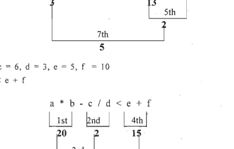

a = 4, b = 5, c = 6, d = 3, e = 5, f = 10

a * b - c / d < e + f

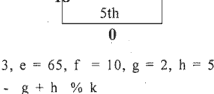

a = 8, b = 5, c = 8, d = 3, e = 65, f = 10, g = 2, h = 5, k = 2

a - b + c / d = = e / f - g + h % k

> a - b + c / d == e / f - g + h % k
> [4th] [1st] [2nd] [3rd]
> 3 5 2 6 1
> 5
> 1
> a = 8, b = 3, c = 2, d = 3, e = 2, f = 11

> a - b || (a - b * c) + d && e - f % 3
> [4th] [1st] [3rd]
> 5 6 2 0
> 5 7th 0
> 1

以下程序打印上述表达式的结果-

```c
main()
{
int a,b,c,d,e,f,g,h,k;
a=8,b=4,c=2,d=1,e=5,f=20;
printf("%d\t",a-b-(c+d)*3%+f/9);
printf("%d\t",a*b-c/d+e+f);
printf("%d\t",a+b+c,d=3,e=2,h=5,k=2);
printf("%d\t",a-b+c,d=3,e=2,f=11);
printf("%d\t",a-b || (a-b*c)+d&&e-f%3);
}
```

10 5 0 1 1

## 4.15 操作数的求值顺序

C 未指定操作数的求值顺序。例如考虑表达式-

```
    y = (++x) + (--x);                  /*Assume value of x is 5*/
```

这里加法运算符的两个操作数是 (++x) 和 (--x)。这两个操作数需要相加，然后结果赋给变量 y。在相加之前，这两个操作数将被求值。现在如果先求值第一个操作数(++x)，则 y 将被赋值为 11，而如果先求值第二个操作数(--x)，则 y 将被赋值为 9。由于 C 对此类争议保持沉默，答案可能在不同编译器上有所不同，因此最好避免此类表达式。

有四个例外运算符，C 明确指定了操作数的求值顺序。这些运算符是逻辑与( && )、逻辑或( || )、条件( ? : )和逗号运算符( , )。在所有这些情况下，左侧操作数先求值。

对于逻辑与和逻辑或运算符，有时不需要求值第二个操作数。在 && 运算符中，如果第一个操作数求值为假(零)，则第二个操作数不被求值，而在 || 运算符的情况下，如果第一个操作数求值为真(非零)则第二个操作数不被求值。

### 练习

假设 stdio.h 已包含在所有程序中。

```
    (1) main( )
    {
        int a=-3;
        a=-a-a+!a;
        printf("%d\n",a);
    }
```

```
    (2) main( )
    {
        int a=2,b=1,c,d;
        c=a<b;
        d=(a>b)&&(c<b);
        printf("c = %d, d = %d\n",c,d);
    }
```

```
    (3) main( )
    {
        int a=9,b=15,c=16,d=12,e,f;
        e=!(a<b||b<c);
        f=(a>b)? a-b:b-a;
        printf("e = %d, f = %d\n",e,f );
    }
```

```
    (4) main( )
    {
        int a=5;
        a=6;
```

```
a=a+5*a;
printf("a = %d\n",a);
}
```

```
(5) main()
{
int a,b=5;
printf("%d, %d\t++,a,b-");
printf("%d, %d\t++,a,b");
printf("%d, %d\t++,a,b+");
printf("%d, %d\n",a,b);
}
```

```
(6) main()
{
int x,y,z;
x=8++;
y=++x++;
z=(x+y)--;
printf("x = %d, y = %d, z = %d\n",x,y);
}
```

```
(7) main()
{
int a=4,b=8,c=3,d=9,z;
z=a++ + ++b * c-- - --d;
printf("a = %d,b = %d,c = %d,d = %d, z = %d\n",a,b,c,d,z);
}
```

```
(8) main()
{
int a=14,b,c;
a=a+5;
b=a/3;
c=a/5*3;
printf("a = %d, b = %d, c = %d\n",a,b,c);
}
```

```
(9) main()
{
int a=15,b=13,c=16,x,y;
x=a-3*2+c*2/4*2+b/4;
y=a=b+5-b/3;
printf("x = %d, y = %d\n",x,y);
}
```

```
(10) main()
{
int x,y,z,k=10;
k+=(x=5,y=x+2,z=x*y);
printf("x = %d,y = %d,z = %d,k = %d\n",x,y,z,k);
}
```

## 运算符和表达式

```
(11)main()
{
	int a;
	float b;
	b=15/2;
	printf("%f\t%c\n",b);
	b=(float)15/2+(15/2);
	printf("%f\n",b);
}
```

```
(12)main()
{
	int a=9;
	char ch='A';
	a=a+ch+24;
	printf("%d\t%c\t%d\t%c\n",ch,ch,a,a);
}
```

```
(13)main()
{
	int a,b,c,d;
	a=b=c=d=4;
	a*=b+1;
	c+=d*3;
	printf("a = %d,c = %d\n",a, c);
}
```

```
(14)main()
{
	int a=5,b=10,temp;
	temp=a,b=a,b=temp;
	printf("a = %d,b = %d\n",a,b);
}
```

```
(15)main()
{
	int a=10,b=3,max;
	a?b:max=a=b;
	printf("%d",max);
}
```

```
(16)#include<stdio.h>
main()
{
	int a=5,b=6;
	printf("%d\t",a=b);
	printf("%d\t",a==b);
	printf("%d",a,b);
}
```

```
(17)main()
```

```
    {
        int a=3,b=4,c=3,d=4,x,y;
        x=(a=5)&&(b=7);
        y=(c=5)||(d=8);
        printf("a=%d,b=%d,c=%d,d=%d,x=%d,y=%d\n",a,b,c,d,x,y);
        x=(a==6)&&(b=9);
        y=(c==6)||(d=10);
        printf("a=%d,b=%d,c=%d,d=%d,x=%d,y=%d\n",a,b,c,d,x,y);
    }
```

```
    (18)main()
    {
        int a=10;
        a=a++ + a--;
        printf("%d\n",a);
    }
```

```
    (19)main()
    {
        int a=2,b=2,x,y;
        x=4*(+ +a*2+3);
        y=4*(b+ +2+3);
        printf("a=%d,b=%d,x=%d,y=%d\n",a,b,x,y);
    }
```

## 编程练习

-   1. 输入摄氏温度并将其转换为华氏温度。
-   2. 输入圆的半径并计算圆的面积和周长。
-   3. 编写程序接受十进制数并以八进制和十六进制打印该数。
-   4. 输入任意五位数并打印除以 3 后的余数值。
-   5. 输入任意两个数，如果第一个数大于第二个数则打印这两个数的和，否则打印它们的差。用条件运算符编写此程序。
-   6. 编写程序接受本金、利率和年数并求出简单利息。
-   7. 输入五科成绩并计算总百分比成绩。

## 答案

-   (1) 6
-   (2) c = 0, d = 1
-   (3) e = 0, f = 6
-   (4) 36
-   (5) 6, 5    6, 4    7, 4    7, 5
-   (6) 错误，像 8++、++x+、(x+y)- 这样的表达式无效。
-   (7) a = 5, b = 9, c = 2, d = 8, z = 23
-   (8) a = 4, b = 1, c = 0
-   (9) x = 17, y = 8
-   (10) x = 5, y = 7, z = 12, k = 22

## 运算符和表达式

(11) 7.000000 14.500000
(12) 65,A 98,b
(13) a = 20, c = 16

+ 运算符的优先级高于 +-。复合赋值运算符的结合性是从右到左

(14) a = 10, b = 5

由于赋值运算符的优先级低于条件运算符，因此条件语句被解释为- ( a?b?max = a : max) = b;
现在该语句简化为语句 10 a?b?max = a : max = b; 这会导致错误。因此解决方案是在第三个操作数周围加上圆括号，如- a?b?max = a : (max = b);

(15) 6 1 6 6

(16) a = 5, b = 7, c = 5, d = 4, x = 1, y = 1

(17) a = 5, b = 7, c = 5, d = 10, x = 0, y = 1

(18) 这类表达式的结果未定义。

(19) a = 3, b = 3, x = 36, y = 28


# 第5章：控制语句

在C程序中，语句按照它们在程序中出现的顺序依次执行。但有时我们可能希望使用条件来只执行程序的一部分。另外，在许多情况下，我们可能希望多次执行某些语句。控制语句使我们能够指定程序中各种指令的执行顺序。这决定了控制流。控制语句定义了控制如何转移到程序的其他部分。C语言支持四种类型的控制语句，如下所示：

- if...else
- goto
- switch
- loop
  - while
  - do...while
  - for

### 5.1 复合语句或块

复合语句或块是用一对花括号 {} 括起来的一组语句。块内的语句按顺序执行。一般形式如下：

```c
{
    statement1;
    statement2;
    ........
    .........
}
```

例如：

```c
{
    i=4;
    b=2;
    area=i*b;
    printf("%d",area);
}
```

复合语句在语法上等同于单个语句，可以出现在程序中允许单个语句的任何地方。

### 5.2 if...else

这是一个双向条件控制语句。该语句用于测试条件并采取两种可能操作之一。如果条件为真，则执行单个语句或语句块（程序的一部分），否则执行另一个单个语句或语句块（程序的另一部分）。回想一下，在C中，任何非零值都被视为真，零被视为假。

语法1：

```c
if(condition)
    statement1;

if(condition)
{
    statement;
    ........
```

在 if 部分之后可以是单个语句或语句块。

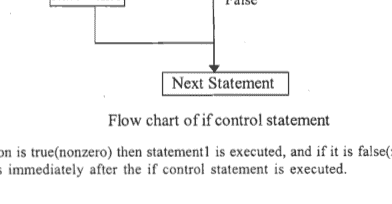

if 控制语句的流程图

如果条件为真（非零），则执行 statement1；如果为假（零），则执行紧跟在 if 控制语句之后的语句。

语法2：

```c
if(condition)
    statement1;
else
    statement2;

if(condition)
{
    statement;
    ........
}
else
{
    statement;
    ........
}
```

if...else 控制语句的流程图

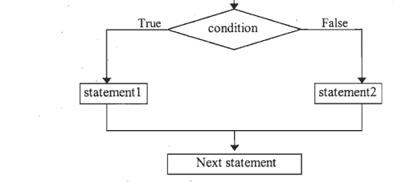

这里，如果条件为真，则执行 statement1；如果为假，则执行 statement2。之后，控制转移到紧跟在 if...else 控制语句之后的语句。

```c
/*P5.1 Program to print a message if negative number is entered*/
#include<stdio.h>
main()
{
    int num;
    printf("Enter a number : ");
    scanf("%d",&num);
    if(num<0)
        printf("Number entered is negative\n");
    printf("Value of num is : %d\n", num);
}
```

第一次运行：

```text
Enter a number : -6
Number entered is negative
Value of num is : -6
```

第二次运行：

```c
/*P5.2 Program to print the larger and smaller of the two numbers*/
#include<stdio.h>
main()
{
    int a,b;
    printf("Enter the first number : ");
    scanf("%d",&a);
    printf("Enter the second number : ");
    scanf("%d",&b);
    if(a>b)
        printf("The larger number is : %d\n",a);
    else
        printf("The larger number is : %d\n",b);
    printf("The smaller number is : %d\n",a<b?a:b);
}
```

```c
printf("Enter the second number : ");
scanf("%d",&b);
if(a>b)
    printf("larger number = %d and smaller number = %d\n", a, b);
else
    printf("larger number = %d and smaller number = %d\n", b, a);
```

```text
Enter the first number : 9
Enter the second number : 11
larger number = 11 and smaller number = 9
```

```c
#include<stdio.h>
main()
{
    int num;
    printf("Enter a number : ");
    scanf("%d",&num);
    if(num%2==0) /*test for even */
        printf("Number is even\n");
    else
        printf("Number is odd\n");
}
```

```text
Enter the number : 15
Number is odd
```

### 5.2.1 if...else 的嵌套

我们可以在 if 块或 else 块中使用另一个 if...else 语句。这称为 if...else 语句的嵌套。下面是一个嵌套示例，其中 if 块和 else 块内部都有 if...else。

```c
if(condition 1)
{
    if(condition 2)
        statementA1;
    else
        statementA2;
}
else
{
    if(condition 3)
        statementB1;
    else
        statementB2 ;
}
```

在嵌套 if...else 语句时，有时在将 else 部分与相应的 if 部分匹配时可能会产生混淆。让我们看一个例子：

```c
if(grade=='A')
{
    if(marks>95)
        printf("Excellent");
}
else
    printf("Work hard for getting A grade");
```

如果我们不用花括号而将上述代码写为：

```c
if(grade=='A')
if(marks>95)
    printf("Excellent");
else
    printf("Work hard for getting A grade");
```

这里 else 部分与第二个 if 匹配，但我们希望它与第一个 if 匹配。编译器不会根据缩进来匹配 if 和 else 部分，它将 else 部分与最近的未匹配的 if 部分匹配。因此，每当对 if 和 else 部分的匹配有疑问时，我们可以使用花括号将每个 if 和 else 块括起来。

```c
/*P5.4 Program to find largest number from three given numbers*/
#include <stdio.h>
main()
{
    int a,b,c,large;
    printf("Enter three numbers : ");
    scanf("%d%d%d",&a,&b,&c);
    if(a>b)
    {
        if(a>c)
            large=a;
        else
            large=c;
    }
    else
    {
        if(b>c)
            large=b;
        else
            large=c;
    }
    printf("Largest number is %d\n",large);
}
```

下一个程序判断给定的年份是否为闰年。世纪年（可被100整除）如果能被400整除，则是闰年；非世纪年如果能被4整除，则是闰年。

```c
/*P5.5 Program to find whether a year is leap or not*/
#include <stdio.h>
main()
{
    int year;
    printf("Enter year : ");
    scanf("%d",&year);
    if(year%400==0)
        printf("Leap year");
    else if(year%100==0)
        printf("Not leap year");
    else if(year%4==0)
        printf("Leap year");
    else
        printf("Not leap year");
}
```

```c
int year;
printf("Enter year : ");
scanf("%d",&year);
if(year%100==0)
{
    if(year%400==0)
        printf("Leap year\n");
    else
        printf("Not leap\n");
}
else
{
    if(year%4==0)
        printf("Leap year\n");
    else
        printf("Not leap\n");
}
```

注意，我们可以使用一个 if 条件和 && 及 || 运算符来编写这个程序。

```c
if(year%4==0 && year%100!=0 || year%400==0)
    printf("Leap year\n");
else
    printf("Not leap\n");
```

### 5.2.2 else if 阶梯

这是一种嵌套类型，除了最后一个 else 部分外，每个 else 部分中都有一个 if...else 语句。这种嵌套类型在程序中经常使用，也称为 else if 阶梯。

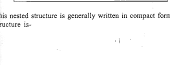

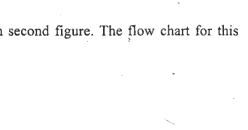

这种嵌套结构通常以紧凑形式编写，如第二幅图所示。该结构的流程图如下：

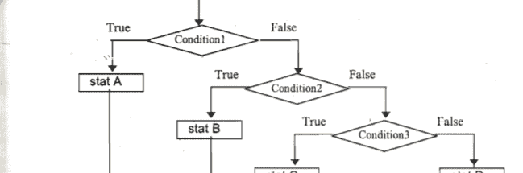

在这里，每个条件都会被检查，当发现某个条件为真时，执行与该条件对应的语句，并且控制从嵌套结构中退出，不再检查其余条件。如果没有一个条件为真，则执行最后一个 else 部分。

```c
/*P5.6 Program to find out the grade of a student when the marks of 4 subjects are given. The method of assigning grade is as-
per<85 grade=A
per<70 and per>55 grade=B
per<55 and per>40 grade=C
per<40 grade=E
Here per is percentage.
*/
#include<stdio.h>
main()
{
    float m1,m2,m3,m4,total,per;
    char grade;
    printf("Enter marks of 4 subjects : ");
    scanf("%f%f%f%f",&m1,&m2,&m3,&m4);
    total=m1+m2+m3+m4;
    per=total/4;
    if(per>=85)
        grade='A';
    else if(per>=70)
        grade='B';
    else if(per>=55)
        grade='C';
    else if(per>=40)
        grade='D';
    else
        grade='E';
    printf("Percentage is %f\nGrade is %c\n",per,grade);
}
```

如果我们不使用 else if 阶梯，这个问题的等效代码将是：

```c
if(per>=85)
    grade='A';
if(per<85 && per>=70)
    grade='B';
if(per<70 && per>=55)
    grade='C';
if(per<55 && per>=40)
    grade='D';
if(per<40)
    grade='E';
```

在 if...else 阶梯中，一旦发现某个条件为真，就不再检查其他条件；而在这种情况下，所有条件都会被检查，浪费大量时间，而且这里的条件也更冗长。

### 5.3 循环

当我们希望多次执行程序的一部分或一个语句块时，会使用循环。例如，假设我们要打印“C is the best”10次。获得所需输出的一种方法是——写10个 printf 语句，这不是首选。另一种方法是——使用循环。使用循环，我们可以编写一个循环语句和仅一个 printf 语句，这种方法肯定比第一种好。借助循环，我们可以重复执行程序的一部分，直到某个条件为真。C语言中有三种循环语句：

- while
- do while
- for

### 5.3.1 while 循环

while 语句可以写成：

```c
while(condition)
{
    statement;
}
```


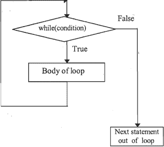

**while 循环流程图**

与 if-else 语句类似，这里也可以有单条语句或语句块，这里称为循环体。现在来看看这个循环是如何工作的。

首先计算条件；如果为真，则执行循环体中的语句。执行之后，再次检查条件，如果发现为真，则再次执行循环体中的语句。这意味着这些语句会一直连续执行，直到条件为真；当条件变为假时，循环终止，控制流出循环。循环体的每次执行称为一次迭代。

```c
/* P5.7 - Program to print the numbers from 1 to 10 using while loop */
#include<stdio.h>
main()
{
    int i=1;
    while(i<=10)
    {
        printf("%d\t", i);
        i=i+1;   /*Statement that changes the value of condition */
    }
    printf("\n");
}
```

**输出：**

1       2       3       4       5       6       7       8       9       10

这里最初条件 (1 <= 10) 为真。循环每迭代一次，i 的值就增加；当 i 的值等于 11 时，条件变为假，循环终止。

注意，循环体内部应该有一条改变条件值的语句，以便条件最终在某个时刻变为假。

```c
/*P5.8 Program to print numbers in reverse order with a difference of 2*/
main()
{
    int k=10;
    while(k>=2)
    {
        printf("%d\t",k);
        k=k-2;
    }
    printf("\n");
}
```

**输出：**

10      8      6      4      2

```c
/*P5.9 Program to print the sum of digits of any number*/
#include<stdio.h>
main()
{
    int n,sum=0,rem;
    printf("Enter the number : ");
    scanf("%d", &n);
    while(n>0)
    {
        rem=n%10; /* taking last digit of number */
        sum+=rem;
        n/=10;   /* skipping last digit */
    }
    printf("Sum of digits = %d\n",sum);
}
```

**输出：**

Enter the number : 1452
Sum of digits = 12

这里我们从右到左提取数字的各位，然后把这些数字逐个加到变量 sum 中。注意，变量 sum 被初始化为 0。这是因为我们要向它加一些数字；如果没有初始化，这些数字就会加到它其中存在的垃圾值上。下面看看当 n 的值为 1452 时循环如何工作。

| 阶段 | rem | sum | n |
| --- | --- | --- | --- |
| 循环开始前 | 垃圾值 | 0 | 1452 |
| 第 1 次迭代后 | 1452%10 = 2 | 0+2 = 2 | 145 |
| 第 2 次迭代后 | 145%10 = 5 | 2+5 = 7 | 14 |
| 第 3 次迭代后 | 14%10 = 4 | 7+4 = 11 | 1 |
| 第 4 次迭代后 | 1%10 = 1 | 11+1 = 12 | 0 |

现在由于 n 的值等于 0，因此条件 ( n > 0 ) 变为假，循环停止。

我们已将变量 fact 声明为 long 类型而不是 int 类型。这是因为阶乘增长非常快，可能超出 int 的范围（32767）。甚至 8 的阶乘也超过这个限制。

```c
/*P5.12 Program to convert a binary number to a decimal number*/
#include<stdio.h>
main()
{
    int n,nsave,rem,d,j=1,dec=0;
    printf("Enter the number in binary : ");
    scanf("%d",&n);
    nsave=n;
    while(n>0)
    {
        rem=n%10;        /*taking last digit*/
        d=rem*j;
        dec+=d;
        j*=2;
        n/=10;          /*skipping last digit*/
    }
    printf("Binary number = %d, Decimal number = %d\n",nsave,dec);
}
```

**输出：**

Enter the number in binary : 1101
Binary number = 1101, Decimal number = 13

要将二进制数转换为十进制数，我们从右到左提取二进制位，并在乘以 2 的幂后相加。这与程序 P5.9 有些类似，只是我们需要在相加之前把数字乘以 2 的幂。下面看看对于二进制数 1101，循环是如何工作的。

| 阶段 | rem | d | dec | j | n |
| --- | --- | --- | --- | --- | --- |
| 循环开始前 | 垃圾值 | 垃圾值 | 0 | 1 | nsave=1101 |
| 第 1 次迭代后 | 1 | 1*1 | 1 | 2 | 110 |
| 第 2 次迭代后 | 0 | 0*2 | 1+0 | 4 | 11 |
| 第 3 次迭代后 | 1 | 1*4 | 1+0+4 | 8 | 1 |
| 第 4 次迭代后 | 1 | 1*8 | 1+0+4+8 | 16 | 0 |

现在 n 的值变为 0，因此循环终止。我们使用了一个变量 nsave 来保存二进制数的值，因为 n 的值在循环执行后会发生变化。

（上述程序仅对不超过 11111 的二进制数有效；对于更大的数，请使用 long int。）

### 5.3.2 do...while 循环

### do ... while 循环流程图

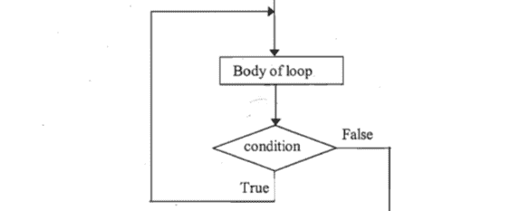

这里首先执行循环体中的语句，然后计算条件。如果条件为真，则再次执行循环体，此过程持续到条件变为假。注意，与 while 循环不同，这里在条件之后放置分号；而在 while 循环中，先计算条件再执行语句，在 do while 循环中，先执行语句再计算条件。因此，如果初始条件为假，while 循环根本不会执行，而 do while 循环至少会执行一次。

```c
/*P5.13 Program to print the numbers from 1 to 10 using do...while loop*/
#include<stdio.h>
main()
{
	int i=1;
	do
	{
		printf("%d\t",i);
		i=i+1;
	}while(i<=10);
	printf("\n");
}
```

**输出：**

1 2 3 4 5 6 7 8 9 10

通常 while 循环比 do while 循环使用得更频繁，但在某些情况下使用 do while 循环更好。例如，在接下来的两个程序中，最好使用 do while 循环。

```c
/*P5.14 Program to count the digits in any number */
#include<stdio.h>
main()
{
    int n,count=0,rem;
    printf("Enter the number : ");
    scanf("%d",&n);
    do
    {
        n/=10;
        count++;
    }while(n>0);
    printf("Number of digits = %d\n",count);
}
```

如果我们用 while 循环编写同样的程序，那么当输入数字为 0 时就不会得到正确答案。数字 0 的位数是 1，但使用 while 循环时答案会变成 0。

```c
/* P5.15 Program to find the sum of numbers entered*/
#include<stdio.h>
main()
{
    int num,sum=0;
    do
    {
        printf("Enter a number (0 to stop) : ");
        scanf("%d",&num);
        sum+=num;
    }while(num!=0);
    printf("Sum is %d\n",sum);
}
```

在这个程序中，如果我们使用 while 循环，那么条件将在顶部检查，因此要么必须给变量 num 一些初始值，要么必须在循环之前编写重复的 printf 和 scanf() 语句。

do...while 循环通常用于检查输入数据的有效性。假设我们希望用户输入员工 ID，而有效 ID 仅在 100 到 500 的范围内。如果用户输入了无效 ID，我们希望忽略该 ID 并再次要求他输入另一个 ID，并且希望此过程持续到他输入有效 ID 为止。在这类情况下，我们可以使用 do...while 循环。

```c
do
{
    printf("Enter employee ID : ");
    scanf("%d",&emp_id);
}while(emp_id<100 || emp_id>500);
```

只有当输入的数字在 100 到 500 的有效范围内时，这个循环才会终止。

### 5.3.3 for 循环

在 C 语言编程中，for 语句非常有用。它有三个表达式，并使用分号分隔这些表达式。for 语句可以写成：

```c
for(expression1;expression2;expression3)
    statement;
for(expression1;expression2;expression3)
{
    statement;
    statement;
    ........
}
```

循环体可以是单条语句或语句块。

expression1 是初始化表达式，expression2 是测试表达式或条件，expression3 是更新表达式。expression1 在循环开始时只执行一次，用于初始化循环变量。该表达式通常是赋值表达式。expression2 是条件，在循环的每次迭代之前进行测试。该条件通常使用关系运算符和逻辑运算符。expression3 是更新表达式，在每次执行循环体之后执行。

现在让我们看看这个循环是如何工作的。首先执行初始化表达式并初始化循环变量，然后检查条件；如果条件为真，则执行循环体。执行循环体之后，控制转移到 expression3（更新表达式），它修改循环变量，然后再次检查条件；如果为真，则执行循环体。此过程持续到条件为真；当条件变为假时，循环终止，控制转移到循环之后的语句。

for 循环完成的工作可以通过编写 while 循环来完成，如下所示：

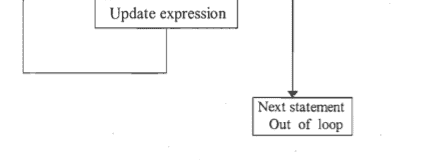

### for 循环流程图


```c
expression 1;
while(expression 2)
{
    statement;
    .......
    .......
    expression 3;
}
```

虽然 `while` 循环和 `for` 循环的任务相同，但 `for` 循环通常用于预先知道迭代次数的情况，而 `while` 循环用于迭代次数未知的情况。

```c
/*P5.16 Program to print the numbers from 1 to 10 using for loop*/
#include<stdio.h>
main()
{
    int i;
    for(i=1;i<=10;i++)
        printf("%d\t",i);
    printf("\n");
}
```

**输出：**

```text
1    2    3    4    5    6    7    8    9    10
```

```c
/*P5.17 Program to print numbers in reverse order with a difference of 2*/
main()
{
    int k;
    for(k=10;k>=2;k-=2)
        printf("%d\t",k);
    printf("\n");
}
```

**输出：**

```text
10    8    6    4    2
```

```c
/*P5.18 Multiply two positive numbers without using * operator*/
#include<stdio.h>
main()
{
    int a,b,i;
    int result=0;
    printf("Enter two numbers to be multiplied : ");
    scanf("%d%d",&a,&b);
    for(i=1;i<=b;i++)
        result=result+a;
    printf("%d * %d = %d\n",a,b,result);
}
```

```c
/*P5.19 Find the sum of this series upto n terms
1+2+4+7+11+16+...........*/
#include<stdio.h>
main()
{
    int i,n,sum=0,term=1;
    printf("Enter number of terms : ");
    scanf("%d",&n);
    for(i=1;i<=n;i++)
    {
        sum+=term;
        term=term+i;
    }
    printf("The sum of series upto %d terms is %d\n",n,sum);
}
```

```c
/*P5.20 Program to generate fibonacci series
1,1,2,3,5,8,13,21,34,55,89............................
In this series each number is the sum of the previous two numbers*/
#include<stdio.h>
main()
{
    long x,y,z;
    int i,n;
    x=0;
    y=1;
    printf("Enter the number of terms : ");
    scanf("%d",&n);
    printf("%ld    ",y);
    for(i=1;i<n;i++)
    {
        z=x+y;
        printf("%ld    ",z);
        x=y;
        y=z;
    }
    printf("\n");
}
```

`for` 循环中的三个表达式都是可选的。我们可以省略 `for` 循环中的任意一个或全部三个表达式，但无论如何，两个分隔分号必须始终存在。如果初始化工作是在进入循环之前完成的，则省略 `expression 1`。`expression 2` 是一个条件，如果省略，则始终假定为真，因此这种循环永远不会停止执行。这种循环是无限的，为了避免这种情况，循环内部应该有一个将控制带出循环的语句。`expression 3` 是更新表达式，当它出现在循环体内时，可以省略。

```c
/*P5.21 Program to print the sum of digits of any number using for loop*/
#include<stdio.h>
main()
{
    int n,sum=0,rem;
    printf("Enter the number : ");
    scanf("%d",&n);
    for( ;n>0;n/=10)
    {
        rem=n%10; /*taking last digit of number*/
        sum+=rem;
    }
    printf("Sum of digits = %d\n",sum);
}
```

我们还可以使用逗号分隔任意数量的表达式。例如，我们可能希望初始化多个变量，或者使用多个变量作为循环变量。

```c
/*P5.22 Program to print numbers using for loop*/
#include<stdio.h>
main()
{
    int i,j;
    for(i=0,j=10;i<=j;i++,j--)
        printf("i = %d    j = %d\n",i,j);
}
```

**输出：**

```text
i = 0    j = 10
i = 1    j = 9
i = 2    j = 8
i = 3    j = 7
i = 4    j = 6
i = 5    j = 5
```

### 5.3.4 循环的嵌套

当一个循环写在另一个循环的循环体内时，就称为循环的嵌套。任何类型的循环都可以嵌套在任何其他类型的循环中。例如，`for` 循环可以嵌套在另一个 `for` 循环中，也可以嵌套在 `while` 或 `do while` 循环中。同样，`while` 和 `do while` 循环也可以互相嵌套。

```c
/*P5.23 Program to understand nesting in for loop*/
#include<stdio.h>
main()
{
    int i,j;
    for(i=1;i<=3;i++)        /*outer loop*/
    {
        printf("i = %d\n",i);
        for(j=1;j<=4;j++)    /*inner loop*/
            printf("j = %d\t",j);
        printf("\n");
    }
}
```

**输出：**

```text
i = 1
j = 1    j = 2    j = 3    j = 4
i = 2
j = 1    j = 2    j = 3    j = 4
i = 3
j = 1    j = 2    j = 3    j = 4
```

这里，外层循环每迭代一次，内层循环就执行 4 次。

下一个程序打印阿姆斯特朗数。阿姆斯特朗数是一个三位数，其各位数字的立方和等于该数本身。例如，371 就是一个阿姆斯特朗数，因为 371 = 3^3 + 7^3 + 1^3 = 27 + 343 + 1。

```c
/*P5.24 Program to print Armstrong numbers from 100 to 999*/
#include<stdio.h>
main()
{
    int num,n,cube,d,sum;
    printf("Armstrong numbers are :\n");
    
    for(num=100;num<=999;num++)   /*outer loop*/
    {
        n=num;
        sum=0;
        while(n>0)      /*inner loop*/
        {
            d=n%10;
            n/=10;
            cube=d*d*d;
            sum=sum+cube;
        }/*End of while loop*/
        if(num==sum)
            printf("%d\n",num);
    }/*End of for loop*/
}
```

这里，外层 `for` 循环用于生成从 100 到 999 的数字，内层 `while` 循环用于提取数字并计算这些数字的立方和。

```c
/*P5.25 Program to find the sum of digits of a number until the sum is reduced to 1 digit.
For example: 538769->38->11->2*/
#include<stdio.h>
main()
{
    long num;
    int dig,sum;
    printf("Enter a number : ");
    scanf("%ld",&num);
    printf("%ld->",num);
    do {
        for(sum=0; num!=0; num/=10)
        {
            dig=num%10;
            sum+=dig;
        }
        printf("%d\t", sum);
        num=sum;
    }while(num/10!=0);
    printf("\n");
}
```

**输出：**

```text
Enter a number: 789988
789988->49    13    4
```

这里，内层 `for` 循环用于求数字的各位数字。

### 5.3.5 无限循环

无限循环是指不断执行且永不终止的循环。有时我们会错误地写出这种循环，有时我们也会在程序中故意使用这种循环。让我们来看一些例子，了解哪些类型的错误会导致无限循环。

- (A)

  ```c
  for(i=0; i<=5; i--)
      printf("%d", i);
  ```

  这个循环会一直执行到 `i` 的值小于或等于 5，即只有当 `i` 大于 5 时循环才会终止。`i` 的初始值为 0，每次迭代后其值都在减小，因此它永远不会大于 5。所以循环条件永远不会变为假，循环将无限期地执行下去。要使循环正确工作，我们应该写 `i++` 而不是 `i--`。

- (B) 循环体内应该有一条语句，在每次迭代后改变循环变量的值。在 `for` 循环中，这项工作由更新表达式完成，但在 `while` 和 `do while` 循环中，我们可能会忘记改变循环变量，这可能导致无限循环。

  ```c
  int k=1;
  do
  {
      printf("%d", k);
      sum=sum+k;
  }while(k<5);
  ```

  这里，我们没有在循环体内改变 `k` 的值，因此循环变成了无限循环。

- (C) 初学者常犯的一个错误是在应该使用相等运算符（`==`）的地方使用了赋值运算符（`=`）。如果在循环条件中犯了这种错误，可能会导致循环无限执行。例如，考虑这个循环：

  ```c
  while(n=2)
  {
      .......
  }
  ```

  这里，我们希望循环一直执行到 `n` 的值等于 2。所以我们应该写成

## 控制语句

这里介绍 `break` 语句。它可以写成 `break;`。当遇到 `break` 时，循环被终止，控制权转移到循环之后的语句。`break` 语句通常与条件一起使用。如果在嵌套循环结构中写入 `break`，则会导致退出最内层循环。

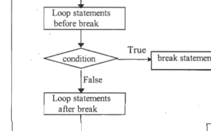

```c
/*P5.26 Program to understand the use of break*/
#include <stdio.h>
main( )
{
    int n;
    for(n=1;n<=5;n++)
    {
        if(n==3)
        {
            printf("I understand the use of break\n");
            break;
        }
        printf("Number = %d\n",n);
    }
    printf("Out of for loop\n");
}
```


**输出：**

```
Number = 1
Number = 2
I understand the use of break
Out of for loop
```

这是一个简单的程序，虽然用处不大，但说明了 break 语句的使用。如果没有 break 语句，这个循环会执行 5 次。但在这里当 n 的值等于 3 时，遇到 break，循环被终止。

现在我们来看一个检查数字是否为素数的程序。素数是指只能被 1 和自身整除的数。数 n 为素数当且仅当 n/2、n/3、n/4...√n 的余数都为非零，或者说 n 不能被 2 到 √n 之间的任何数整除。

```c
/*P5.27 Program to find whether a number is prime or not*/
#include<stdio.h>
#include<math.h>
main()
{
    int i,num,flag=1;
    printf("Enter a number : ");
    scanf("%d",&num);

    for(i=2;i<=sqrt(num);i++)
    {
        if (num%i==0)
        {
            printf("%d is not prime\n",num);
            flag=0;
            break;
        }
    }
    if(flag==1)
        printf("%d is prime\n",num);
}
```

`sqrt()` 是一个返回数字平方根的库函数，使用此函数时我们必须包含头文件 `math.h`。for 循环的范围是从 2 到 √n，如果该数能被此范围内的任何数整除，则该数不是素数，也就没有必要检查其他数的可整除性，因此控制流通过 break 语句从循环中转移出来。控制流从循环中退出有两种情况：在循环完全执行后，当循环条件变为假时退出，或由于 break 语句而退出。如果控制流在循环完全执行后退出，则 flag 的值为 1，该数是素数。

### 5.5 continue 语句

continue 语句用于当我们想要跳过循环的某些语句后进入循环的下一轮迭代时。这个 continue 语句可以简单地写成：

```c
continue;
```

它通常与条件一起使用。当遇到 continue 语句时，当前迭代的剩余语句都会被跳过。

**输出：**

```
Number = 1
Number = 2
I understand the use of continue
Number = 4
Number = 5
Out of for loop
```

```c
/*P5.29 Program to find the sum and average of 10 positive integers*/
#include<stdio.h>
main()
{
    int i=1,n,sum=0;
    float avg;
    printf("Enter 10 positive numbers : \n");
    while(i<=10)
    {
        printf("Enter number %d : ",i);
        scanf("%d", &n);
        if(n<0)
        {
            printf("Enter only positive numbers\n");
            continue;
        }
        sum+=n;
        i++;
    }
    avg=sum/10.0;
    printf("Sum = %d Avg = %f\n",sum,avg);
}
```

在此程序中，如果输入任何负数，则会显示一条消息并且控制流转移到循环开始处。

### 5.6 goto 语句

这是一个无条件控制语句，用于将控制流转移到程序的另一部分。

goto 语句可以这样使用：

```c
goto label;
------
------
label:
statement;
------
------
```

这里 label 是任何有效的 C 标识符，其后跟一个冒号。每当遇到语句 `goto label;` 时，控制就会转移到标签之后的语句。

```c
/*P5.30 Program to print whether the number is even or odd*/
#include<stdio.h>
main()
{
    int n;
    printf("Enter the number : ");
    scanf("%d", &n);
    if(n%2==0)
        goto even;
    else
        goto odd;

even:
    printf("Number is even");
    goto end;

odd:
    printf("Number is odd");
    goto end;

end:
    printf("\n");
}
```

```
Enter the number : 14
Number is even
```

标签可以放在任何位置。如果标签在 goto 之后，则控制流向前转移，这称为前向跳转或前向 goto；如果标签在 goto 之前，则控制流向后转移，这称为后向跳转或后向 goto。在前向 goto 中，goto 和标签之间的语句不会被执行，而在后向 goto 中，goto 和标签之间的语句会重复执行。一个以上的 goto 可以与同一个标签关联，但我们不能在多个位置使用相同的标签。

使用 goto 语句只能在函数内部转移控制。 （函数概念将在后续章节介绍）

任何标签后面都应该有一个语句。如果标签位于程序末尾，后面没有要编写的语句，我们可以在标签后写空语句（单个分号），因为程序不能以标签结束。

应该避免使用 `goto`，因为很难理解控制流被转移到哪里。有时它会导致“意大利面条”代码，这种代码难以理解，调试和维护也非常困难。我们完全可以在不使用 goto 的情况下完成所有工作，并且在结构化编程中不鼓励使用 goto。

尽管不推荐使用 goto，但在一种情况下 goto 实际上可以使代码更简单、更易读。这种情况出现在我们需要从深层嵌套循环中退出时。

```c
for( ............)
{
    while(...........)
    {
        for( ............)
        {
            if( ............)
                goto stop;
        }
    }
}
stop:
```

如前所述，我们完全可以在不使用 goto 的情况下编写任何代码，因此这里也有另一种退出深层嵌套循环的方法。

```c
flag=0;
for(..............)
{
    while(...........)
    {
        for( ............)
        {
            if( ............)
            {
                flag=1;
                break; /*out of innermost loop*/
            }
        }
        if( flag == 1 )
            break; /*out of while loop*/
    }
    if( flag == 1 )
        break; /* out of outer for loop*/
}
```

我们可以看到在嵌套循环的情况下，使用 goto 的代码更易读，如果不使用它则必须执行许多测试。

### 5.7 switch 语句

这是一个多向条件控制语句。有时程序中需要从多个备选方案中做出选择。为此我们使用 switch 语句。可以这样写：

```c
switch(expression)
{
  case constant1:
    statement
    ........
  case constant2:
    statement
    ........
    ..........
    ..........
  case constantN:
    statement
    ........
  default :
    statement
    ........
}
```

这里 switch、case 和 default 是关键字。switch 关键字后面的 "expression" 可以是产生整数值的任何 C 表达式。它可以是任何整数或字符变量的值，也可以是返回整数的函数调用，或产生整数的算术、逻辑、关系、按位表达式。它也可以是任何整数或字符常量。由于字符会被转换为其 ASCII 值，所以我们也可以在此表达式中使用字符。数据类型 long int 和 short int 也允许。

case 关键字后面的常量应为整数或字符类型。它们可以是常量或常量表达式。这些常量必须彼此不同。

我们不能使用浮点或字符串常量。单个 case 中不允许多个常量；每个 case 后面只能跟一个常量。

每个 case 后面可以跟任意数量的语句。case 下也可能没有任何语句。如果 case 后面跟多个语句，则没有必要将它们用一对大括号括起来，但这样做也不是错误。case 下的语句可以是任何有效的 C 语句，如 if else、while、for 甚至另一个 switch 语句。将一个 switch 语句写在另一个内部称为 switch 嵌套。现在我们来看一些编写 switch 表达式和 case 常量的有效和无效方式。

`int a, b, c; char d, e; float f;`

**有效：**

- `switch(a)`
- `switch(a>b)`
- `switch(d+e-3)`
- `switch(a>b && b>c)`
- `switch(func(a, b))`

**无效：**

- `switch(f)`
- `switch(a+4.5)`

**有效：**

- `case 4:`
- `case 'a':`
- `case 2+4:`
- `case 'a'>'b':`

**无效：**

- `case "second":`
- `case 2.3:`
- `case a:`
- `case a>b:`
- `case a+2:`
- `case 2, 4, 5:`
- `case 2 4 : 4 : 5 :`

现在让我们看看 switch 语句是如何工作的。首先计算 switch 表达式，然后


该表达式的值会逐一与每个 `case` 常量比较。如果表达式的值与某个 `case` 常量匹配，则执行该 `case` 下的所有语句；如果没有 `case` 常量与表达式的值匹配，则执行 `default` 下的语句块。`default` 是可选的，如果不存在且没有任何 `case` 匹配，则不执行任何操作。这些 `case` 和 `default` 可以按任意顺序出现。

```c
/*P5.31 Program to understand the switch control statement*/
#include<stdio.h>
main()
{
    int choice;
    printf("Enter your choice : ");
    scanf("%d",&choice);
    switch(choice)
    {
        case 1:
            printf("First\n");
        case 2:
            printf("Second\n");
        case 3:
            printf("Third\n");
        default:
            printf("Wrong choice\n");
    }
}
```

输出：
Enter your choice : 2
Second
Third
Wrong choice

这里 `choice` 的值与第二个 `case` 匹配，因此 `case 2` 之后的所有语句会按顺序执行。除了 `case 2` 的语句之外，`case 3` 和 `default` 的语句也会被执行。这就是所谓的 `case` 穿透（falling through）。

如果我们不想让控制流从匹配的 `case` 继续向下穿透执行之后所有 `case` 的语句，可以使用 `break` 语句。如果 `switch` 中遇到 `break` 语句，则 `break` 之后的所有语句都不会执行，控制流会跳出整个 `switch`。下面用 `break` 重写上面的程序。

```c
/*P5.32 Program to understand the switch with break statement*/
#include<stdio.h>
main()
{
    int choice;
    printf("Enter your choice : ");
    scanf("%d",&choice);
    switch(choice)
    {
        case 1:
printf("First\n");
break;
case 2:
printf("Second\n");
break;
case 3:
printf("Third\n");
break;
default:
printf("Wrong choice\n");
}
/*End of main()*/
```

输出：
Enter your choice : 2
Second

并不是说，只要 `switch` 中使用了 `break`，每个 `case` 语句后面都必须有 `break`。某些 `case` 可以使用 `break`，另一些可以不使用。因此，`switch` 中的 `break` 是可选的，是否使用取决于程序的需求和逻辑。`continue` 语句不能用于 `switch` 中。

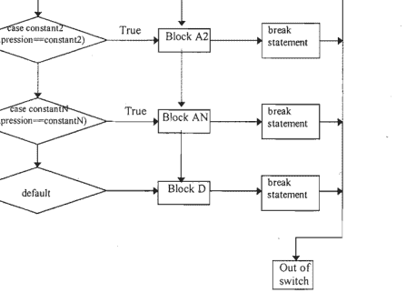

最后一个 `case`（或位于最后的 `default`）后面在逻辑上不需要 `break`，但这样做是一种良好的编程习惯，因为将来我们可能需要在末尾添加新的 `case`。

```c
/*P5.33 Program to perform arithmetic calculations on integers*/
#include<stdio.h>
main()
{
char op;
int a,b;
printf("Enter number operator and another number : ");
scanf("%d %c %d",&a,&op,&b);
switch(op)
{
case '+':
printf("Result = %d\n",a+b);
break;
case '-':
printf("Result = %d\n",a-b);
break;
case '*':
printf("Result = %d\n",a*b);
break;
case '/':
printf("Result = %d\n",a/b);
break;
case '%':
printf("Result = %d\n",a%b);
break;
default:
printf("Enter valid operator\n");
}/*End of switch*/
}/*End of main()*/
```

输出：
Enter number operator and another number : 2+5
Result = 7

在这个程序中，合法的乘法运算符只有 `'*'`。如果我们希望 `'x'` 和 `'X'` 也作为合法的乘法运算符，可以像下面这样修改上面的 `switch` 语句。

```c
switch(op)
{
...............
...............
case '-':
result = a-b;
break;
case 'x':
case 'X':
case '*':
result = a*b;
break;
...............
...............
}
```

## 控制语句

```c
break;
case '/':
....................
....................
}/*End of switch*/
```

这里我们添加了两个没有语句的 `case`。由于 `case 'x'` 和 `case 'X'` 后面没有 `break`，在这两种情况下都会执行 `case '*'` 的语句。

```c
#include<stdio.h>
main( )
{
char ch;
printf("Enter an alphabet : ");
scanf("%c", &ch);
switch(ch)
{
case 'a':
case 'e':
case 'i':
case 'o':
case 'u':
printf("Alphabet is a vowel\n");
break;
default:
printf("Alphabet is a consonant\n");
}
}
```

在这个程序中，如果有人输入大写元音，它会被当作辅音处理。解决这个问题的一种方法是再添加 5 个大写元音的 `case`。但我们也可以不添加任何 `case`，用另一种方式解决。我们之前学过，`switch` 表达式可以是返回 `int` 或 `char` 的函数调用。所以把 `switch` 表达式改为 `tolower(ch)`，问题就解决了。`tolower()` 是一个把大写字母转换为小写字母的库函数，使用它时需要包含头文件 `ctype.h`。

`switch` 语句在菜单驱动程序中非常重要。下面我们编写一个菜单驱动的（模拟）程序，它的结构类似数据库应用。虽然这个程序本身不执行任何实际功能，但它展示了菜单驱动程序的结构。

```c
#include<stdio.h>
main( )
{
int choice;
while(1)
{
printf("1.Create database\n");
printf("2.Insert new record\n");
printf("3.Modify a record\n");
printf("4.Delete a record\n");
printf("5.Display all records\n");
printf("6.Exit\n");
printf("Enter your choice : ");
scanf("%d",&choice);
switch(choice)
{
case 1:
    printf("Database created.....\n\n");
    break;
case 2:
    printf("Record inserted.....\n\n");
    break;
case 3:
    printf("Record modified.....\n\n");
    break;
case 4:
    printf("Record deleted.....\n\n");
    break;
case 5:
    printf("Records displayed.....\n\n");
    break;
case 6:
    exit(1);
default:
    printf("Wrong choice\n");
}/*End of switch*/
/*End of while*/
/*End of main*/
```

这里我们把 `switch` 放在一个无限循环中。函数 `exit()` 用于终止程序。每次循环执行时，都会显示所有选项并提示输入选择。程序会根据选择执行相应操作。如果输入选项 6，程序就会退出。在实际程序中，我们会把完整代码写在各个 `case` 中，而不仅仅是简单的 `printf` 语句。

## 5.8 一些附加问题

### 问题 1

编写一个程序，判断输入的日期是否有效。假设 1850 年到 2050 年之间的日期是有效的。

```c
/*P5.36 Program to check whether a date is valid or not.*/
#include<stdio.h>
main()
{
    int d,m,y;
    int flag=1,isLeap=0;
    printf("Enter date (dd/mm/yyyy) : ");
    scanf("%d/%d/%d",&d,&m,&y);
    if(y%4==0 && y%100!=0 || y%400==0)
        isLeap=1;
    if(y<1850 || y>=2050)
flag=0;
else if(m<1 || m>12)
    flag=0;
else if(d<1)
    flag=0;
else if(m==2)      /*check for number of days in February*/
{
    if(d>28)
        flag=0;
    if(d==29 && isLeap)
        flag=1;
}
else if(m==4 || m==6 || m==9 || m==11)/*check days in april, june, sept, nov*/
{
    if(d>30)
        flag=0;
}
else if(d>31)
    flag=0;

if(flag==0)
    printf("Not a valid date\n");
else
    printf("Valid Date \n");
}/*End of main() */
```

### 问题 2

编写一个程序，计算两个日期在年、月、日上的差值。假设输入的日期都在有效范围内，并且第一个日期早于第二个日期。

```c
/*P5.37 Program to get difference of two dates in years, months, days*/
#include<stdio.h>
main( )
{
    int d1,d2,d,m1,m2,y1,y2;
    printf("Enter first date (dd/mm/yyyy) : ");
    scanf("%d/%d/%d",&d1,&m1,&y1);
    printf("Enter second date (dd/mm/yyyy) : ");
    scanf("%d/%d/%d",&d2,&m2,&y2);
    if(d2<d1)
    {
        if(m2==3)
        {
            if(y2%4==0 && y2%100!=0 || y2%400==0)  /*check for leap*/
                d2=d2+29;
            else
                d2=d2+28;
        }
        else if(m2==5 || m2==7|| m2==10|| m2==12)
            d2=d2+30;
        else
            d2=d2+31;
        m2=m2-1;
    }
    if (m2<m1)
    {
        y2=y2-1;
        m2=m2+12;
    }
    y=y2-y1;
    m=m2-m1;
    d=d2-d1;
    printf("Difference of the two dates is : ");
    printf("%d years %d months %d days\n",y,m,d);
}/*End of main()*/
```

这里我们是用第二个日期减去第一个日期，因此可以通过如下方式得到年、月、日的差值：

`y = y2 - y1;`      `m = m2 - m1;`      `d = d2 - d1;`

我们假设第二个日期晚于第一个日期，因此 `y2` 始终大于或等于 `y1`，`y` 也始终为正。

但 `m2` 可能小于 `m1`，此时 `m` 会为负；如果 `d2` 小于 `d1`，那么 `d` 也会为负。所以在计算 `y`、`m` 和 `d` 之前，应确保 `m2` 大于或等于 `m1`，且 `d2` 大于或等于 `d1`。

如果 `d2` 小于 `d1`，就从 `m2` 借一个月，并把该月的天数加到 `d2` 上。由于各月的天数不同，加到 `d2` 上的天数取决于借来的月份。我们总是借 `m2` 之前的那一个月。例如，如果 `m2 = 5`（五月），就从 `m2` 借四月，因此给 `d2` 加上 30。

`d2 = d2+30;`          `m2 = m2-1;`

如果 `m2 = 3`（三月），就从 `m2` 借二月，因此给 `d2` 加上 28 或 29（若是闰年）。

`d2 = d2+28;`      `m2 = m2-1;`

在程序中，这是通过嵌套的 `if else` 语句实现的。

如果 `m2` 小于 `m1`，就从 `y2` 借 1 年（12 个月）加到 `m2` 上。这样 `m2` 就会大于 `m1`。

`m2 = m2+12;`      `y2 = y2-1;`

### 问题 3

编写一个程序，使用俄罗斯农夫乘法计算两个数的乘积。俄罗斯农夫乘法通过乘以 2、除以 2 和加法来计算任意两个正数的乘积。这里将第一个数反复除以 2（整数除法），并将第二个数反复乘以 2，直到第一个数变为 1。假设我们要计算 19 乘以 25，可以像下面这样把除以 2 和乘以 2 的结果分别写在两列中：


|   |   |   |
|---|---|---|
| 19 | 25 | 相加 |
| 9 | 50 | 相加 |
| 4 | 100 |  |
| 2 | 200 |  |
| 1 | 400 | 相加 |
| 475 |  |  |

现在为了得到乘积，我们将把右列中那些对应左列值为奇数的数值相加。因此，将 25、50、400 相加得到 475，这就是 19 和 25 的乘积。现在我们将看看这种方法如何在程序中实现。

```
/*P5.38 Program to multiply two numbers by russian peasant method*/
#include<stdio.h>
main()
{
    int a,b,x,y,s=0;
    printf("Enter two numbers to be multiplied : ");
    scanf("%d%d",&x,&y);
    a=x;
    b=y;
    while(a>=1)          /*Loop till first number reduces to 1*/
    {
        if(a%2!=0)       /*If first number is odd*/
            s=s+b;       /*Add second number to s*/
        a/=2;            /*Divide first number by 2*/
        b*=2;            /*Multiply Second number by two*/
    }
    printf("%d * %d = %d\n",x,y,s);
}
```

## 问题 4

编写一个货币程序，对于给定金额的货币，说明需要多少张 100、50、20、10、5、2 和 1 卢比纸币。例如，如果总金额是 545 卢比，则需要五张 100 卢比纸币、两张 20 卢比纸币和一张 5 卢比纸币。这类程序可用于 ATM 机。

```
/*P5.39 Program to find out the number of notes required for a given
amount of money*/
#include<stdio.h>
main( )
{
    int n,choice,notes;
    printf("Enter the total amount in Rs : ");
    scanf("%d",&n);
    printf("Enter the value of note from which u want to begin : ");
    scanf("%d",&choice);
    switch (choice)
    {
        default:
            printf("Enter only valid values");
    }
```

```
break;
case 100:
    notes=n/100;
    printf("Number of 100 Rs notes = %d\n",notes);
    n=n%100;
case 50:
    notes=n/50;
    printf("Number of 50 Rs notes = %d\n",notes);
    n=n%50;
case 20:
    notes=n/20;
    printf("Number of 20 Rs notes = %d\n",notes);
    n=n%20;
case 10:
    notes=n/10;
    printf("Number of 10 Rs notes = %d\n",notes);
    n=n%10;
case 5:
    notes=n/5;
    printf("Number of 5 Rs notes = %d\n",notes);
    n=n%5;
case 2:
    notes=n/2;
    printf("Number of 2 Rs notes = %d\n",notes);
    n=n%2;
case 1:
    notes=n/1;
    printf("Number of 1 Rs notes = %d\n",notes);
}
printf("\n");
}
```

### 输出：

Enter the total amount in Rs : 748
Enter the value of note from which u want to begin : 50
Number of 50 Rs notes = 14
Number of 20 Rs notes = 2
Number of 10 Rs notes = 0
Number of 5 Rs notes = 1
Number of 2 Rs notes = 1
Number of 1 Rs notes = 1

该程序的逻辑很简单，没有使用 break 语句。default 语句位于开头，并且在 default 之后有一个 break。

## 问题 5

编写一个程序，从给定日期推算出星期几。

计算星期几的公式是——

day = (y + j + f - h + fh) % 7;
j = 日期的儒略日
y = 给定日期的年份（4 位数字）
f = (y-1)/4 的整数部分
h = (y-1)/100 的整数部分
fh = (y-1)/400 的整数部分
变量 day 的值告诉我们星期几。

| 变量 day 的值 | 星期名称 |
|---|---|
| 0 | 星期六 |
| 1 | 星期日 |
| 2 | 星期一 |
| 3 | 星期二 |
| 4 | 星期三 |
| 5 | 星期四 |
| 6 | 星期五 |

在上述公式中，日期的儒略日表示该日期落在一年中的第几天。1 月 1 日的儒略日是 1，2 月 2 日是 33，12 月 31 日是 365（闰年为 366）。

现在让我们确定程序的结构。一旦得到变量 day 的值，我们就可以使用 switch 根据 day 的值打印星期名称。

为了计算 day 的值，我们必须求出儒略日的值。假设输入日期的日、月和年分别存储在变量 d、m 和 y 中。我们再取另一个变量 j 来表示儒略日的值。

最初，j 的值取为 d，然后把前面各月的天数加到 j 上，从而得到儒略日的值。我们可以为此使用 switch 语句，并以 m 作为 switch 变量。

```
j=d;
switch(m)
{
    case 2:  j+=31;  break;
    case 3:  j+=31+28;  break;
    case 4:  j+=31+28+31;  break;
    case 5:  j+=31+28+31+30;  break;
    case 6:  j+=31+28+31+30+31;  break;
    case 7:  j+=31+28+31+30+31+30;  break;
    case 8:  j+=31+28+31+30+31+30+31;  break;
    case 9:  j+=31+28+31+30+31+30+31+31;  break;
    case 10: j+=31+28+31+30+31+30+31+31+30;  break;
    case 11: j+=31+28+31+30+31+30+31+31+30+31;  break;
    case 12: j+=31+28+31+30+31+30+31+31+30+31+30;  break;
}
```

假设日期是 2002 年 5 月 2 日，那么 d = 2，m = 5，因此控制将进入 case 5，儒略日将是 2+31+28+31+30 = 122。

应用于 switch 语句的上述逻辑很简单，但正如我们所看到的，整个 switch 语句读起来和理解起来都很令人困惑。如果我们省略 break 语句，按降序排列 case，并把 switch 变量取为 m-1，那么我们就可以通过编写一个非常简洁的 switch 语句来完成这项工作。

```
j=d;
switch(m - 1)
{
case 11: j+=30;
case 10: j+=31;
case 9: j+=30;
case 8: j+=31;
case 7: j+=31;
case 6: j+=30;
case 5: j+=31;
case 4: j+=30;
case 3: j+=31;
case 2: j+=28;
case 1: j+=31;
}
```

这里如果 d = 2，m = 5，那么控制将进入 case (5-1)，并且由于没有 break，case 4、3、2、1 的所有语句都将被执行。因此 j = 2+30+31+28+31 = 122。这表明 switch 语句可以根据程序的需要和逻辑灵活使用。

我们已经求出了儒略日，但如果年份是闰年呢？在这种情况下，如果月份不是一月或二月，我们就必须给月份加 1。我们将这样做。

```
if(y%4==0&&y%100!=0 || y%400==0) /*check for leap year*/
if(m!=1&&m!=2)
j++;
```

回想一下，非整百年份如果能被 4 整除就是闰年，而整百年份（能被 100 整除）如果能被 400 整除才是闰年。

*PS.40 从给定日期查找星期几的程序*

```
#include<stdio.h>
main()
{
int d,m,y,j,f,h,fh,day;
printf("Enter date (dd/mm/yyyy) : ");
scanf("%d%d%d",&d,&m,&y);
j=d;
switch(m - 1)
{
case 11: j+=30;
case 10: j+=31;
case 9: j+=30;
case 8: j+=31;
case 7: j+=31;
case 6: j+=30;
case 5: j+=31;
case 4: j+=30;
case 3: j+=31;
case 2: j+=28;
case 1: j+=31;
}
if(y%4==0&&y%100!=0||y%400==0)
    if(m!=1&&m!=2)
        j=j+1;
f=(y-1)/4;
h=(y-1)/100;
fh=(y-1)/400;
day=(y+j+f-h+fh)%7;
switch(day)
{
    case 0: printf("Saturday\n"); break;
    case 1: printf("Sunday\n"); break;
    case 2: printf("Monday\n"); break;
    case 3: printf("Tuesday\n"); break;
    case 4: printf("Wednesday\n"); break;
    case 5: printf("Thursday\n"); break;
    case 6: printf("Friday\n"); break;
}
/*End of main()*/
}
```

## 问题 6

编写一个程序来打印三元组数。任意三个数如果满足以下条件，就是三元组数——

- 1. 每个数都是三位数。
- 2. 三个数中的所有数字（共 9 位）都应互不相同。
- 3. 第二个数应是第一个数的两倍，第三个数应是第一个数的三倍。

例如——

219    438    657
267    534    801

```
/*P5.41 Program to print triad numbers*/
#include<stdio.h>
main()
{
    int m,n,p,num;
    int i,k,d1,d2,d3;
    for(num=100;num<=999/3;num++)/*Loop A*/
    {
        for(i=num; i<=3*num; i+=num)/*Loop B */
        {
            k=i;
            d1=k%10; k/=10;
            d2=k%10; k/=10;
            d3=k%10; k/=10;
            if(d1==d2 || d2==d3 || d3==d1)
                goto nextnum;
        }/*End of loop B*/
```

```
for(m=num;m>0;m/=10)/*Loop C*/
{
    d1=m%10;
    for(n=num*2;n>0;n/=10)/*Loop D*/
    {
        d2=n%10;
        for(p=num*3;p>0;p/=10)  /*Loop E*/
        {
            d3=p%10;
            if(d1==d2||d2==d3||d1==d3)
                goto nextnum;
        }/*End of Loop E*/
    }/*End of Loop D*/
}/*End of loop C*/
printf("%d %d %d\t",num,num*2,num*3);
nextnum:
}/*End of loop A*/
}/*End of main()*/
```

循环 A 用于生成数字。由于三元组数是三位数，因此该循环从 100 开始。该循环的上限是 333（999/3），因为对于大于 333 的数，3*num 将不再是三位数。

循环 B 位于循环 A 内部，它执行三次，分别对应 i = num、i = 2*num 和 i = 3*num。它判断一个数（i）中的三位数字是否互不相同。在这个循环中，d1、d2、d3 是同一个数的数字；如果发现任意两位数字相同，我们就再次转到循环 A 的更新表达式，以检查下一个数。

循环 C、D、E 是嵌套循环，用于判断三个数（num、2*num、3*num）中是否存在任何共同的数字。这里 d1、d2、d3 分别是 num、2*num、3*num 的数字。如果任意两位数字相同，我们就转到循环 A 的更新表达式，以检查下一个数。注意，在循环 C、D 和 E 中比较的是不同数字的各位，而在循环 B 中比较的是同一个数的各位。

## 问题 7

编写一个程序，求两个数的最小公倍数和最大公因数。

```
/*P5.42 Program to find the LCM and HCF of two numbers*/
#include<stdio.h>
main()
{
    int x,y,a,b;
    printf("Enter two numbers : ");
    scanf("%d %d",&x,&y);
    a=x;b=y;
    while(a!=b)
    {
        if(a<b)
            a=a+x;
        else
            b=b+y;
```


```c
}
printf("LCM of %d and %d is %d\n",x,y,a);
a=x; b=y;
while(a!=b)
{
    if(a>b)
        a=a-b;
    else
        b=b-a;
}
printf("HCF of %d and %d is %d\n",x,y,a);
```

## 输出

输入两个数字：60 135  
60 和 135 的最小公倍数是 540  
60 和 135 的最大公约数是 15

## 5.9 金字塔

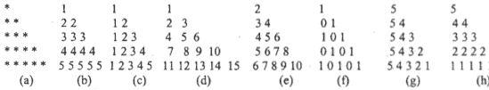

金字塔 (a) 的程序如下：

```c
main( )
{
    int i,j,n;
    printf("Enter n : ");
    scanf("%d",&n);

    for(i=1;i<=n;i++)
    {
        for(j=1;j<=i;j++)
            printf("* ");
        printf("\n");   /*for next line of pyramid*/
    }
}
```

这里外层 for 循环用于控制行数，内层循环用于控制每行的星号数。可以看出，星号数等于行号，因此内层循环在第一行执行 1 次，第二行执行 2 次，第三行执行 3 次，依此类推。

在上面的程序中，如果打印 i 的值，就会得到金字塔 (b)；而打印 j 的值，就会得到金字塔 (c)。

对于金字塔 (d)，我们取一个变量 p = 1，并将 printf 语句写成：

```c
printf("%3d", p++);
```

对于金字塔 (e)，我们打印 i+j 的值；对于金字塔 (f)，如果 (i+j) 是偶数则打印 1，如果 (i+j) 是奇数则打印 0。

对于金字塔 (g)，我们需要打印 (n+1-j)；对于金字塔 (h)，我们需要打印 (n+1-i)。这两个金字塔也可以通过反转循环然后打印 i 和 j 的值来编写。例如，金字塔 (g) 的代码可以写成：

```c
for(i=n;i>=1;i--)
{
    for(j=n;j>=i;j--)
        printf("%3d",j);
    printf("\n");
}
```

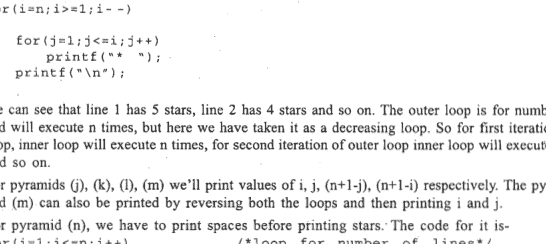

金字塔 (i) 的代码如下：

```c
for(i=n;i>=1;i--)
{
    for(j=1;j<=i;j++)
        printf("* ");
    printf("\n");
}
```

我们可以看到第 1 行有 5 个星号，第 2 行有 4 个星号，依此类推。外层循环控制行数，会执行 n 次，但这里我们将其写成了递减循环。因此，外层循环第一次迭代时，内层循环执行 n 次；外层循环第二次迭代时，内层循环执行 n-1 次，依此类推。

对于金字塔 (j)、(k)、(l)、(m)，我们将分别打印 i、j、(n+1-j)、(n+1-i) 的值。金字塔 (j) 和 (m) 也可以通过反转两个循环然后打印 i 和 j 来实现。

对于金字塔 (n)，我们需要在打印星号之前打印空格。其代码如下：

```c
for(i=1;i<=n;i++)   /*loop for number of lines*/
{
    for(j=1;j<=n-i;j++)   /*loop for printing spaces*/
        printf(" ");
    for(j=1;j<=i;j++)   /*loop for printing stars*/
        printf("*");
    printf("\n");   /*for next line of pyramid*/
}
```

金字塔 (o) 的代码与此相同，只是 printf 语句中星号后面多了一个空格。

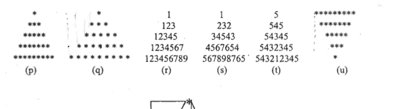

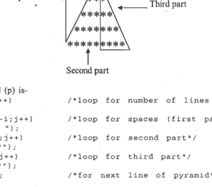

金字塔 (p) 的代码如下：

```c
for (i=1;i<=n;i++)
{
    for(j=1;j<=n-i;j++)
        /*loop for spaces (first part)*/
    printf(" ");
    for(j=1;j<=i;j++)
        /*loop for second part*/
    printf("*");
    for(j=1;j<=i;j++)
        /*loop for third part*/
    printf("*");
    printf("\n");
        /*for next line of pyramid*/
}
```

这里第一部分和第二部分与金字塔 (n) 中的写法相同，第三部分与金字塔 (a) 中的写法相同。

金字塔 (q) 的代码相同，只是第一个用于空格的 for 循环范围变为 1 到 2*(n-i)，并且 printf 语句中星号后面会有一个空格。

金字塔 (r)、(s) 和 (t) 的循环与金字塔 (p) 相同，但这里我们取一个变量 p 并打印它的值。

对于金字塔 (r)，每次在第二个内层 for 循环之前将 p 的值初始化为 1，然后在最后两个 for 循环中打印 p++ 的值。

对于金字塔 (s)，在第二个内层 for 循环之前将 p 的值初始化为 i，然后在第二个 for 循环中打印 p++ 的值。之后将 p 的值减 1，然后在第三个 for 循环中打印 -p 的值。

对于金字塔 (t)，在第二个内层 for 循环之前将 p 的值初始化为 n，然后在第二个循环中打印 p-- 的值，在第三个循环中打印 p++ 的值。在第三个 for 循环之前，p 的值需要加 2。金字塔 (t) 的代码如下：

```c
for(i=1;i<=n;i++)
    /*loop for number of lines in pyramid*/
{
    for(j=1;j<=n-i;j++ )
        /*loop for spaces (first part)*/
    printf(" ");
    p=n;
    for(j=1;j<=i;j++ )    /*loop for second part */
    printf("%d",p--);
    p=p+2;
    for(j=1;j<=i;j++)    /*loop for third part */
    printf("%d",p++);
    printf("\n");    /* for next line of pyramid */
}
```

倒置金字塔 (u) 的代码如下：

```c
for(i=1;i<=n;i++)
{
    for(j=1;j<=i;j++)
        printf(" ");
    for(j=1;j<=n-i;j++)
        printf("*");
    for(j=1;j<=n-i;j++)
        printf("*");
    printf("\n");
}
```

|  |  |  |  |
|---|---|---|---|
| * | 1 | 1 | 5 |
| *** | 123 | 232 | 545 |
| ***** | 12345 | 34543 | 54345 |
| ******* | 1234567 | 4567654 | 5432345 |
| ********* | 123456789 | 567898765 | 543212345 |
| *********** | 1234567 | 4567654 | 5432345 |
| ********* | 12345 | 34543 | 54345 |
| ***** | 123 | 232 | 545 |
| *** | 1 | 1 | 5 |
| (v) | (w) | (x) | (y) |

菱形 (v) 可以通过将金字塔 (p) 和 (u) 拼接得到，因此其代码也与 (p) 和 (u) 相同。注意，如果 n = 5，那么这个菱形中上半部分金字塔有 5 行，而倒置金字塔只有 4 行。因此，这里的倒置金字塔循环范围为 1 到 n-1，而不是 1 到 n。菱形 (v) 的代码如下：

```c
for(i=1;i<=n;i++)
{
    for(j=1;j<=n-i;j++)
        printf(" ");
    for(j=1;j<=i;j++)
        printf("*");
    for(j=1;j<=i;j++)
        printf("*");
    printf("\n");
}
for(i=1;i<=n-1;i++)
{
    for(j=1;j<=i;j++)
        printf(" ");
    for(j=1;j<=n-i;j++)
        printf("*");
    for(j=1;j<=n-i;j++)
        printf("*");
    printf("\n");
}
```

菱形 (w)、(x) 和 (y) 的循环结构与 (v) 相同，其逻辑分别与金字塔 (r)、(s) 和 (t) 类似。在第二个外层 for 循环中也应用同样的（变量 p 的）逻辑。

菱形 (y) 的代码如下：

```c
for(i=1;i<=n;i++)
{
    for(j=1;j<=n-i;j++)
        printf(" ");
    p=n;
    for(j=1;j<=i;j++)
        printf("%d",p--);
    p=p+2;
    for(j=1;j<=i;j++)
        printf("%d",p++);
    printf("\n");
}
for(i=1;i<=n-1;i++)
{
    for(j=1;j<=n-i;j++)
        printf(" ");
    p=n;
    for(j=1;j<=n-i;j++)
        printf("%d",p--);
    p=p+2;
    for(j=1;j<=n-i;j++)
        printf("%d",p++);
    printf("\n");
}
```

在菱形 (x) 中，第一个 for 循环将 p 初始化为 i，但第二个 for 循环将 p 初始化为 n-i。

## 练习

假设所有程序都已包含 stdio.h。

- (1) main()
  {
      int a=9;
      if(a==5)
          printf("It is important to be nice\n");
      else
          printf("It is nice to be important\n");
  }

- (2) main()
  {
      int a=20,b=3;
      if(a<10)
          a=a-5;
      b=b+5;
      printf("%d    %d\n",a,b);
  }

- (3) main()
  {
      int a=9,b=0,c=0;
      if(!a<10&&!b||c)
          printf("Difficulties make us better\n");
      else
          printf("Difficulties make us bitter\n");
  }

- (4) main()
  {
      int i=1,j=9;
      if(i>=5&&j<5);
          i=j+2;
      printf("%d\n",i);
  }

- (5) main( )
  {
      int a=0,b=0;
      if(!a)
      {
          b=!a;
          if(b)
              a=!b;
      }
      printf("%d, %d \n",a,b);
  }

- (6) main( )
  {
      int a=5;
      begin:
      if(a)
      {
          printf("%d   ",a);
          a--;
          goto begin;
      }
  }

- (7) main()
  {
      int a=5;
      begin:
      if(a)
          printf("%d\t",a);
          a--;
          goto begin;
  }

- (8) main()
  {
      int a=2,x=10;
      if(a==2)
          if(x==8)
              printf("a is equal to 2 and x is equal to 8");
          else
              printf("a is not equal to 2");
  }

- (9) main()
  {
      int a=6,b=4;
      while(a+b)
      {
          printf("a = %d, b = %d\n",a,b);
          a=a/2;
          b-=3;
      }
  }

- (10) main( )
  {
      int i=10;
      do
      {
          printf("i=%d\n",i);
          i=i-3;
      }while(i);
  }

- (11) main()
  {
      int i,j=10;
      for(;i<j;j-=2)
          printf("%d ",j);
  }

- (12) main()
  {
      int i,j,x=0;
      for(i=0;i<5;i++)
          for(j=i;j>0;j--)


```c
x=i+j+1;
    printf("x = %d\n",x);
}
```

```c
(13)main()
{
    int i,index=0;
    for(i=0;i<10;i++)
    {
        int i=0;
        while(i++<5)
            index++;
    }
    printf("index = %d\n",index);
}
```

```c
(14)main()
{
    int i;
    for(i=1;i<10;i++)
    {
        if(i==3)
            continue;
        printf("%d ",i);
    }
}
```

```c
(15)main()
{
    int i=1;
    while(i<10)
    {
        if(i==3)
            continue;
        printf("%d ",i);
        i++;
    }
}
```

```c
(16)main()
{
    int i,sum;
    for(i=0;i<10;i+=3)
        sum +=i*i;
    printf("%d",sum);
}
```

```c
(17)main()
{
    int c=50;
    for( ;c ; )
        c--;
    printf("c = %d\n",c);
}
```

```c
(18)main()
{
    char ch='A';
    switch(ch)
    {
        case 'A':  case 'B':
            ch++;
            continue;
        case 'C':  case 'D':
            ch++;
    }
}
```

```c
(19)main()
{
    int var=2,x=1,y=2;
    switch(var)
    {
        case x:
            x++;
        case y:
            y++;
    }
}
```

```c
(20)main()
{
    char ch='A';
    while(ch<='D')
    {
        switch(ch)
        {
            case 'A':  case 'B':
                ch++;
                continue;
            case 'C':  case 'D':
                ch++;
        }
        printf("%c",ch);
    }
}
```

```c
(21)main()
{
    int n,sum=0;
    for( ; ; )
    {
        scanf("%d", &n);
        sum+=n;
        if(sum>100)
            break;
    }
}
```

```c
(22)main()
{
    int i,sum1=0,sum2=0;
    for(i=1;i<5;i++)
        sum1+=i;
    i=1;
    while(i<5)
    {
        i++;
        sum2+=i;
    }
    printf("%d  %d\n",i,sum1,sum2);
}
```

## 编程练习

- 1. 编写一个程序，打印 1 到 99 之间的素数。（提示：参见 P5.27，不要输入数字，而是使用一个生成 1 到 99 数字的 for 循环）
- 2. 编写一个程序，输入一个数并求该数的逆序数。
- 3. 输入一个数和一个数字，判断该数字是否出现在这个数中；如果出现，则统计它在这个数中出现的次数。
- 4. 编写一个程序，接受任意数 n，并打印从 1 到 n 的所有数的平方和。
- 5. 编写一个程序，接受任意数 n，并打印从 1 到 n 的所有能被 3 整除的数的立方。
- 6. 编写一个程序，接受任意六位数，并打印该数中所有偶数位数字之和以及所有奇数位数字之积。
- 7. 编写一个程序，求 x 的 y 次幂的值，其中 x 和 y 是正整数。
- 8. 编写一个程序，接受最多六位的任意数，并用英文单词打印该数。
  例如：1265 = one two six five
- 9. 编写一个程序，输入一个数并测试它是否为斐波那契数。
- 10. 编写一个程序，打印所有小于 50 的勾股三元组。如果 x < y < z 且 x²+y² = z²，则任意三个数 x、y、z 称为勾股三元组。
- 11. 求以下级数前 n 项之和，其中 x 是用户输入的整数。
  - 1 + 2 + 4 + 7 + 11 + 16 + ........
  - 1 + 11 + 111 + 1111 + .....
  - x + x² +x³ +x⁴........
  - x + x² -x³ + x⁴........
  - 1/x - 1/x² +1/x³ -1/x⁴

## 答案

- (1) 友善很重要
  变量 a 被赋值为 5，因此 if 条件变为真。
- (2) 20 8
- (3) 困难使我们更优秀
- (4) 11
  if 部分后面有一个分号，它被视为空语句。
- (5) 0, 1
- (6) 5 4 3 2 1
- (7) 该程序无限运行，因为 goto 语句不在 if 结构内部。
- (8) a 不等于 2。
  这里 else 部分与第二个 if 配对；如果我们想让它与第一个 if 配对，就应该把第二个 if 括在括号中。
- (9) a = 6, b = 4
  a = 3, b = 1
  a = 1, b = 1
  a = 0, b = 1
  a = 0, b = 1
  a = 0, b = 1
  ............
  b 的值永远不会变为零，因此条件永远不会变为假，导致无限循环。
- (10) 10 7 4 1 -2 -5 -8 ............
  i 的值永远不会变为零，导致无限循环。
- (11) 10 8 6 4 2
  当赋值表达式 ( i = j ) 的值为零时，循环终止。
- (12) x = 6
- (13) index = 50
- (14) 1 2 4 5 6 7 8 9
- (15) 该程序打印 1 2，然后进入无限循环。
- (16) 变量 sum 没有初始化为零；如果初始化为零，结果将是 126。
- (17) c = 0
- (18) 错误，continue 不能在 switch 内使用。
- (19) 错误，switch 中只能使用常量表达式。
- (20) DE
  这里 continue 语句位于 while 循环内。
- (21) 循环将输入数字，并在这些数字之和超过 100 时终止。
- (22) 5 10

# 第6章

## 函数

函数是一个自包含的子程序，用于完成某些特定的、定义明确的任务。一个程序由一个或多个函数组成。如果一个程序只有一个函数，那么它必须是 main() 函数。

### 6.1 使用函数的优点

- 1. 通常，一个困难的问题会被分解为若干子问题，然后分别求解。这种分治技术通过函数在 C 中实现。一个程序可以划分为多个函数，每个函数执行某些特定任务。因此，使用 C 函数可以将程序的工作模块化并加以划分。
- 2. 当某些特定代码需要在程序中的不同位置多次使用时，使用函数可以避免重复编写该代码。
- 3. 程序变得易于理解、修改，并且易于调试和测试。编写程序以及理解程序的每个部分完成什么工作都变得简单。
- 4. 函数可以存储在库中，从而实现可重用性。

C 程序有两类函数——

- 1. 库函数
- 2. 用户定义函数

### 6.2 库函数

C 具有提供库函数来执行某些操作的功能。这些函数存在于 C 库中，并且是预定义的。例如，sqrt() 是一个数学库函数，用于求任意数的平方根。函数 scanf() 和 printf() 是输入/输出库函数。类似地，我们有用于字符串操作的 strlen()、strcmp() 等函数。

要使用库函数，我们必须使用预处理指令 #include 包含相应的头文件。例如，要使用 printf()、scanf() 等输入/输出函数，我们必须包含 stdio.h。对于数学库函数，我们必须包含 math.h；对于字符串库，应包含 string.h。下面的程序演示了库函数 sqrt() 的使用。

```c
/*P6.1 Program to find the square root of any number.*/
#include<stdio.h>
#include<math.h>
main()
{
    double n,s;
    printf("Enter a number : ");
    scanf("%lf",&n);
    s=sqrt(n);
    printf("The square root of %.2lf is : %.2lf\n", n, s);
}
```

### 输出：

Enter a number : 16

The square root of 16.00 is : 4.00

在这个程序中，我们使用了三个库函数——printf()、scanf() 和 sqrt()。本章后面我们将进一步学习库函数。

### 6.3 用户定义函数

用户可以为执行程序中的任何特定任务创建自己的函数。这类函数称为用户定义函数。要创建和使用这些函数，我们应该了解以下三件事——

- 1. 函数定义
- 2. 函数声明
- 3. 函数调用

在讨论这三点之前，我们编写了两个简单程序，将用作参考。第一个程序画一条线，第二个程序将两个数相加。

```c
/*P6.2 Program to draw a line*/
#include<stdio.h>
void drawline(void); /*Function Declaration*/
main()
{
    drawline(); /*Function Call*/
}
void drawline(void) /*Function Definition*/
{
    int i;
    for(i=1;i<=80;i++)
        printf("-");
}
```

```c
/*P6.3 Program to find the sum of two numbers*/
#include<stdio.h>
int sum(int x,int y); /*Function declaration*/
main()
{
    int a,b,s;
    printf("Enter values for a and b : ");
    scanf("%d %d",&a,&b);
    s=sum(a, b); /*Function call*/
    printf("Sum of %d and %d is %d\n",a,b,s);
}
int sum(int x,int y) /*Function definition*/
{
    int s;
```


```
s=x+y;
return s;
}
```

## 6.4 函数定义

函数定义包含函数的完整描述和代码。它说明函数做什么以及其输入和输出是什么。函数定义由两部分组成——函数头和函数体。函数定义的一般语法是-

```
return_type  func_name( type1 arg1,type2 arg2,...... )
{
    local variables declarations;
    statement;
    ........
    return(expression);
}
```

函数定义中的第一行称为函数头，其后函数体写在花括号中

return_type 表示函数将返回的值的类型。return_type 是可选的，如果省略，则默认为 int。函数可以返回一个值或不返回值。如果函数不返回任何值，则应将 void 写在 return_type 的位置

func_name 指定函数名称，可以是任何有效的 C 标识符。函数名之后在括号中给出参数声明，其中提及参数的类型和名称。这些称为形式参数，用于接收值。函数可以接受任意数量的参数，甚至可以不接受参数。如果没有参数，则括号可以留空，也可以写 void 在括号内。

函数体是一个复合语句（或块），它由变量声明和 C 语句组成，后跟可选的 return 语句。在函数内部声明的变量称为局部变量，因为它们仅对该函数局部，即它们仅在声明它们的函数中存在，不能在程序的其他地方使用。函数体内部可以有任意数量的有效 C 语句。return 语句是可选的。如果函数不返回值，则可以省略。

函数定义可以放在程序的任何位置。但通常所有定义都放在 main() 函数之后。注意，函数定义不能放在另一个函数定义内部。函数定义也可以放在不同的文件中。

在 P6.2 中，函数定义为-

```
void drawline(void)
{
    int i;
    for(i=1;i<80;i++)
        printf("-");
}
```

这里函数不返回值，所以在 return_type 的位置写 void，并且由于它不接受任何参数，所以在括号内写 void。int 变量 i 在函数体内声明，所以它是局部变量，只能在此函数内部使用。

## 函数

在 P6.3 中，函数定义为-

```
int sum(int x,int y)
{
 int s;
 s=x+y;
 return s;
}
```

该函数返回 int 类型的值，因为在 return_type 的位置写了 int。该函数接受两个形式参数 x 和 y，两者均为 int 类型。变量 s 在函数内部声明，所以它是局部变量。形式参数 x 和 y 在函数内部也用作局部变量。

函数定义描述了函数能做什么，但要在程序中实际使用它，函数应在某处被调用。函数调用只需写出其名称，后跟括号内的参数列表即可。func_name(arg1, arg2, arg3...) 这些参数 arg1, arg2, ... 称为实际参数。这里 func_name 称为被调用函数，而放置此函数调用的函数称为调用函数。例如在程序 P6.3 中，main() 是调用函数，sum() 是被调用函数，a、b 是实际参数。函数调用写在右边，形式为- s = sum(a, b);

即使没有实际参数，函数调用也应有空括号。例如在程序 P6.2 中，函数调用写为- drawline( );

当函数被调用时，控制权传递给被调用函数，被调用函数执行完毕后，控制权转移到调用函数中函数调用之后的语句。下图显示了从 main() 调用两个函数 func1() 和 func2() 时控制权的转移。

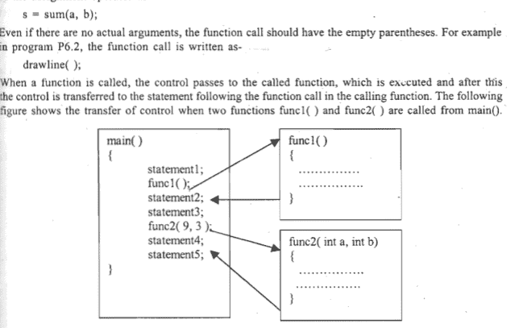

如果函数返回值，则此函数调用可在程序中的任何表达式中像操作数一样使用。该操作数的类型和值将是函数返回值的类型和值。例如-

```
s = sum(a, b);    /*Assigning the return value of sum( ) to variable s */
b = max(x, y)*10;    /*return value of max( ) is multiplied by 10 and assigned to variable b*/
if ( isprime(x) ==1 )    /*return value of isprime( ) is used in if condition*/
    printf("Number is prime");
printf("%d\n", sum(a+b) );    /*Return value of sum( ) is printed*/
```

如果函数声明为 void，则不能在任何表达式中这样使用。例如，像这样写表达式是没有意义且无效的-

```
s = drawline();
```

如果在函数调用后加上分号，则函数调用可作为语句使用。在这种情况下，如果函数返回值，则该值会被丢弃。例如-

```
draw(x, y);
display( a, b, c);
printprimes( );
```

函数调用不能出现在赋值语句的左侧。

```
func(x, y) = a; /* Invalid */
```

函数代码只有在被其他函数调用时才会被执行。如果函数被定义但一次也没有被调用，则其代码永远不会被执行。函数可以被调用多次，因此每次调用时代码都会执行。函数的执行要么在到达函数体结束的大括号时结束，要么在遇到 return 语句时结束。

## 6.6 函数声明

调用函数需要关于被调用函数的信息。如果被调用函数的定义放在调用函数之前，则不需要声明。例如，如果在程序 P6.3 中，我们将 sum( ) 的定义写在 main( ) 之前，则不需要声明。

```
/*P6.4 Program to find the sum of two numbers*/
#include<stdio.h>
int sum(int x,int y)    /*Function definition*/
{
    int s;
    s=x+y;
    return s;
}
main()
{
    int a,b,s;
    printf("Enter values for a and b : ");
    scanf("%d %d",&a,&b);
    s=sum(a,b);    /*Function call*/
    printf("Sum of %d and %d is %d\n",a,b,s);
}
```

## 函数

这里 sum() 的定义写在 main() 之前，所以 main() 知道关于函数 sum() 的所有信息。但在这种情况下，需要函数声明。函数声明也称为函数原型，它向编译器提供以下三方面的信息-

- 1. 函数的名称。
- 2. 函数接收的参数数量和类型。
- 3. 函数返回的值的类型。

函数声明告诉编译器具有这些特征的函数将在程序后面被定义和使用。函数声明的一般语法是-

```
return_type func_name(type1 arg1, type2 arg2, ......);
```

这看起来就像函数定义的头，只是在末尾有一个分号。声明函数时参数的名称是可选的。这些仅用于描述目的。因此我们也可以这样写声明-

```
return_type func_name(type1, type2, ......);
```

在程序 P6.2 中，声明写为-

```
void drawline(void);
```

在程序 P6.3 中，声明写为-

```
int sum(int x, int y);
```

现在我们将写两个使用函数的示例程序。

```
/*P6.5 Program that finds whether a number is even or odd*/
#include<stdio.h>
void find(int n);
main()
{
 int num;
 printf("Enter a number : ");
 scanf("%d",&num);
 find(num);
}
void find(int n)
{
 if(n%2==0)
  printf("%d is even\n",n);
 else
  printf("%d is odd\n",n);
}
```

```
/*P6.6 Program that finds the larger of two numbers*/
#include<stdio.h>
int max(int x, int y);
main()
{
 int a,b;
 printf("Enter two numbers : ");
 scanf("%d%d",&a,&b);
 printf("%d %d = %d",a,b,max(a,b));
}
```


```c
printf("Maximum of %d and %d is : %d\n",a,b,max(a,b));
}
max(int x,int y)
{
    if(x>y)
        return x;
    else
        return y;
}
```

## 6.7 return 语句

`return` 语句用于在函数中将值返回给调用函数。它也可以用于从被调用函数立即退出并返回调用函数，而不返回任何值。

该语句可以出现在函数体内的任何位置。它有两种使用方式——

- `return;`
- `return ( expression );`

这里 `return` 是关键字。`return` 语句的第一种形式用于终止函数而不返回任何值。在这种情况下只写 `return` 关键字。下面的程序使用了这种形式的 `return` 语句。

```c
/*P6.7 Program to understand the use of return statement*/
#include<stdio.h>
void funct(int age,float ht);
main()
{
    int age;
    float ht;
    printf("Enter age and height: ");
    scanf("%d %f", &age, &ht);
    funct(age,ht);
}
void funct(int age,float ht)
{
    if(age>25)
    {
        printf("Age should be less than 25\n");
        return;
    }
    if(ht<5)
    {
        printf("Height should be more than 5\n");
        return;
    }
    printf("Selected\n");
}
```

`return` 语句的第二种形式用于终止函数并向调用函数返回一个值。程序 P6.3 和 P6.6 使用了 `return` 语句的第二种形式。`return` 语句返回的值可以是任何常量、变量、表达式，甚至是任何其他函数调用（该调用返回一个值）。例如，在程序 P6.3 中，我们可以直接写 `return (x+y)`，而不必先取一个变量再返回它。同样，在程序 P6.6 中，我们可以直接写 `return ( x>y ? x : y )`。

其他一些有效 `return` 语句的示例包括——

- `return 1;`
- `return x++;`
- `return ( x*y*z );`
- `return ( 3 * sum(a, b) );`

将返回值括在圆括号中是可选的。

我们可以在一个函数中使用多个 `return` 语句，但一旦遇到第一个 `return` 语句，函数就会终止，其后的所有语句都不会执行。

下一个函数比较两个日期（d1/m1/y1 和 d2/m2/y2），如果第一个日期较小则返回 1，如果第二个日期较小则返回 -1，如果两个日期相同则返回 0。在这个函数中，我们使用了 7 个 `return` 语句。

```c
int cmpdate( int d1, int m1, int y1, int d2, int m2, int y2)
{
    if(y1<y2)
        return 1;
    if(y1>y2)
        return -1;
    if(m1<m2)
        return 1;
    if(m1>m2)
        return -1;
    if(d1<d2)
        return 1;
    if(d1>d2)
        return -1;
    return 0;
}
```

下一个程序使用一个函数来求一个数的阶乘。

```c
/*P6.8 Program to find out the factorial of a number*/
#include<stdio.h>
long int factorial(int n);
main()
{
    int num;
    printf("Enter a number : ");
    scanf("%d",&num);
    if(num<0)
        printf("No factorial of negative number\n");
    else
        printf("Factorial of %d is %ld\n",num,factorial(num));
}
long int factorial(int n)
{
    int i;
    long int fact=1;
    if(n==0)
        return 1;
    for(i=n;i>1;i--)
        fact*=i;
    return fact;
}
```

一个函数只能返回一个值。如果我们想返回多个值，就必须使用后续章节讨论的另一种技术。试图使用逗号返回多个值是不正确的。

```c
return 1, 2, 3;
```

这里该表达式使用了逗号运算符，因此只会返回最右侧的值。

如果函数不返回任何值，则应将其声明为 `void`。所有不是 `void` 类型的函数都会返回一个值。如果函数不是 `void` 类型，且没有通过 `return` 语句返回值，则会自动返回一个垃圾值。

如果返回值的类型不是函数定义中指定的类型，那么在转换合法的情况下，会将其转换为该类型。

## 6.8 函数参数

调用函数向被调用函数发送一些值以进行通信；这些值称为参数（arguments 或 parameters）。

**实际参数：** 在函数调用中写出的参数称为实际参数，因为这些值是实际发送给被调用函数的值。实际参数可以写成变量、常量、表达式或任何返回值的函数调用。例如——

```c
func(x)
func(a*b, c*d+k)
func(22, 43)
func(1, 2, sum(a, b))
```

**形式参数：** 在函数定义中写出的参数名称称为形式参数或哑参数，因为它们仅用于保存调用函数发送的值。

```c
/*P6.9 Program to understand formal and actual arguments*/
#include<stdio.h>
main()
{
    int m=6,n=3;
    printf("%d\t",multiply(m,n));
    printf("%d\t",multiply(15,4));
    printf("%d\t",multiply(m+n,m-n));
    printf("%d\n",multiply(6,sum(m,n)));
}
multiply(int x,int y)
{
    int p;
    p=x*y;
    return p;
}
sum(int x, int y)
{
    return x+y;
}
```

**输出：**

```c
18 60 27 54
```

在这个程序中，函数 `multiply()` 被调用了 4 次。变量 `x` 和 `y` 是 `multiply()` 的形式参数。第一次调用该函数时，实际参数是变量 `m` 和 `n`，因此形式参数 `x` 和 `y` 分别用 `m` 和 `n` 的值初始化，并返回 `p=18`。第二次调用函数时，实际参数为 15 和 4，因此这次 `x` 和 `y` 分别初始化为 15 和 4，于是返回 `p=60`。同样，第三次 `x` 和 `y` 分别初始化为 `m+n=9` 和 `m-n=3`，于是返回 `p=27`。在第四次调用中，第一个参数是常量值（6），而第二个参数是函数调用。因此这次 `x` 被初始化为 6，`y` 被初始化为函数 `sum()` 返回的值，即 9。于是这次返回 `p=54`。

形式参数和实际参数的名称可以相同，也可以不同，因为它们写在不同的函数中。

```c
/*P6.10 Program to understand formal and actual arguments*/
#include<stdio.h>
main()
{
    int a=6,b=3;
    func(a,b);
    func(15,4);
    func(a+b,a-b);
}
func(int a,int b)
{
    printf("a = %d    b = %d\n",a,b);
}
```

**输出：**

```c
a = 6   b = 3
a = 15  b = 4
a = 9   b = 3
```

在上面的程序中，我们可以看到 `main()` 内 `a` 和 `b` 的值是 6 和 3，而 `func()` 内的 `a` 和 `b` 则用每次调用时发送的实际参数值初始化。在函数内对形式参数所做的任何更改都不会影响实际参数。

## 6.9 函数的类型

根据参数和返回值，函数可以分为四类。

1. 无参数且无返回值的函数。
2. 无参数但有返回值的函数。
3. 有参数但无返回值的函数。
4. 有参数且有返回值的函数。

### 6.9.1 无参数且无返回值的函数

无参数且无返回值的函数写法如下——

```c
void func(void);
main()
{
    ........
    func();
    ........
}
void func(void)
{
    ........
    statement;
    ........
}
```

在上面的示例中，函数 `func()` 由 `main()` 调用，函数定义写在 `main()` 函数之后。由于函数 `func()` 没有参数，`main()` 不能向 `func()` 发送任何数据；又因为它没有 `return` 语句，所以该函数不能向 `main()` 返回任何值。调用函数和被调用函数之间没有通信。由于没有返回值，这类函数不能用作表达式中的操作数。P6.2 中的函数 `drawline()` 就是这类函数的一个示例。让我们再看一个示例程序——

```c
/*P6.11 Program that uses a function with no arguments and no return values*/
#include<stdio.h>
void dispmenu(void);
main()
{
    int choice;
    dispmenu();
    printf("Enter your choice :");
    scanf("%d",&choice);
}
void dispmenu(void)
{
    printf("1.Create database\n");
    printf("2.Insert new record\n");
    printf("3.Modify a record\n");
}
```


```c
printf("4.Delete a record\n");
printf("5.Display all records\n");
printf("6.Exit\n");
}
```

## 6.9.2 无参数但有返回值的函数

这类函数不接收任何参数，但可以返回一个值。

```c
int func(void);
main()
{
    int r;
    .......
    r=func();
    .......
}
int func(void)
{
    ........
    ........
    return (expression);
}
```

下一个程序使用了这种类型的函数。

```c
/*P6.12 Program that returns the sum of squares of all odd numbers from 1 to 25*/
#include<stdio.h>
int func(void);
main()
{
    printf("%d\n",func());
}
int func(void)
{
    int num,s=0;
    for(num=1;num<=25;num++)
    {
        if(num%2!=0)
            s+=num*num;
    }
    return s;
}
```

输出：

2925

## 6.9.3 有参数但无返回值的函数

这类函数带有参数；因此，调用函数可以向被调用函数发送数据，但被调用函数不返回任何值。这些函数可以写成：

```c
void func(int,int);
main()
{
    func(a,b);
    ...
}
void func(int c,int d)
{
    statements
}
```

这里的`a`和`b`是实际参数，用于发送值；`c`和`d`是形式参数，用于接收来自实际参数的值。

```c
/*P6.13 Program to find the type and area of a triangle.*/
#include<stdio.h>
#include<math.h>
void type(float a,float b,float c);
void area(float a,float b,float c);
main()
{
    float a,b,c;
    printf("Enter the sides of triangle : ");
    scanf("%f%f%f",&a,&b,&c);
    if(a<b+c && b<c+a && c<a+b)
    {
        type(a,b,c);
        area(a,b,c);
    }
    else
        printf("No triangle possible with these sides\n");
}
void type(float a,float b,float c)
{
    if((a*a)+(b*b)==(c*c)||(b*b)+(c*c)==(a*a)||(c*c)+(a*a)==(b*b))
        printf("The triangle is right angled triangle\n");
    if(a==b && b==c)
        printf("The triangle is equilateral\n");
    else if(a==b || b==c || c==a)
        printf("The triangle is isosceles\n");
    else
        printf("The triangle is scalene\n");
}
void area(float a,float b,float c)
{
    float s, area;
    s=(a+b+c)/2;
    area=sqrt(s*(s-a)*(s-b)*(s-c));
    printf("The area of triangle = %f\n",area);
}
```

## 6.9.4 有参数且有返回值的函数

这类函数带有参数，因此调用函数可以向被调用函数发送数据。它们也可以使用`return`语句向调用函数返回一个值。这个函数可以写成：

```c
int func(int,int);
main()
{
    int r;
    ........
    r=func(a,b);
    ........
    func(c,d);
}
int func(int a,int b )
{
    ........
    ........
    return (expression);
}
```

这里的`return`语句将表达式的值返回给调用函数。我们之前编写的`sum()`、`multiply()`和`max()`函数就是这类函数的例子。让我们再看一个示例程序：

```c
/*P6.14 Program to find the sum of digits of any number*/
#include<stdio.h>
int sum(int n);
main()
{
    int num;
    printf("Enter the number : ");
    scanf("%d",&num);
    printf("Sum of digits of %d is %d\n",num,sum(num));
}
int sum(int n)
{
    int i,sum=0,rem;
    while(n>0)
    {
        rem=n%10;        /*rem takes the value of last digit*/
        sum+=rem;
        n/=10;           /*skips the last digit of number*/
    }
    return (sum);
}
```

在描述不同类型的函数时，为简单起见，我们假设参数和返回值都是`int`类型。这些值可以是任何数据类型。

## 6.10 关于函数声明的更多内容

放置函数声明的关键点是它必须在函数调用之前。通常，所有函数声明都写在`main()`函数之前。这样，函数声明对所有函数都是可见的。也可以只在调用该函数的那些函数内部进行声明。注意，如果函数定义出现在函数调用之前，则不需要声明。

如果函数返回`int`或`char`类型的值，则不必声明该函数，因为默认情况下每个函数都会返回一个`int`值。编译器假设任何在定义中未指定返回类型的函数都会返回`int`值。但如果函数返回的是`int`以外的值，例如`float`、`double`、指针、数组、结构体等，则必须在函数调用之前声明它。

函数的声明有两个主要用途。第一，它告诉编译器函数的返回类型。第二，它指定了函数的参数类型和数量。因此，它可以用来检查函数定义和函数调用中参数数量和类型是否匹配。我们已经看到，声明`int`或`char`类型的函数是可选的，但最好声明所有函数，因为这样可以检查函数调用中参数的数量和类型。通过这种方式，我们可以防止由于函数调用中参数数量和类型错误而可能出现的bug。

## 6.11 无参数函数的声明

如果函数没有参数，那么可以将括号留空，也可以在括号内写入`void`。但最好写上`void`，因为当括号为空时，编译器会假定没有关于参数的信息。可能没有参数，也可能有任意数量的参数。因此，编译器将无法检查函数调用中参数类型和数量的任何不匹配。

类似地，如果函数不返回任何值，可以将返回类型指定为`void`。这将避免在表达式中意外使用该函数。例如：

```c
/*P6.15 Program to understand declaration of functions with no arguments*/
#include<stdio.h>
void func1();
void func2(void);
main()
{
    func1(1.3,'a'); /*will not generate any error*/
    func2(1.3,'a'); /*will generate error*/
}
void func1()
{
    printf("\nFunction1\n");
}
void func2(void )
{
    printf("\nFunction2\n");
}
```

这里我们看到，`func1()`可以用错误数量和类型的参数调用，并且不会显示任何编译错误，因此这可能是一个难以发现的bug。而用任何参数调用函数`func2()`则是不可能的。

## 6.12 如果没有函数声明

如果实际参数多于形式参数，那么多余的实际参数会被忽略。如果实际参数少于形式参数，那么多余的形式参数会接收到垃圾值。

```c
func(int a, int b,int c)
{
    ........
    ........
}
```

```c
func(1, 2, 3, 4, 5);        /*Actual arguments more than formal*/
```

这里最后两个参数被忽略。`a = 1`，`b = 2`，`c = 3`。

```c
func(1, 2);                 /*Actual arguments less than formal*/
```

这里第三个参数接收到一个垃圾值。`a = 1`，`b = 2`，`c = 垃圾值`。

如果对应的实际参数和形式参数之间存在类型不匹配，那么编译器会尝试将实际参数的类型转换为形式参数的类型，如果转换合法的话；否则，一个垃圾值会被传递给形式参数。

## 6.13 函数参数的求值顺序

当一个函数被调用且带有多个参数时，参数的求值顺序是未指定的。这种求值顺序在像`multiply(m, n)`或`multiply(m+n, n)`这样的函数调用中并不重要。但如果我们有一个像这样的函数调用：

```c
int m = 3, k;
k = multiply(m, m++);
```

现在，如果第一个参数先被求值，`k`的值将是9；如果第二个参数先被求值，`k`的值将是12。但由于在C中参数的求值顺序未指定，且取决于编译器，因此在不同编译器上的结果可能会不同。类似地，如果我们写：

```c
int i = 10;
printf("%d %d %d", --i, i++, i);
```

这里的结果也是不可预测的。因此，最好避免使用这些可能在不同编译器上产生不同结果的参数表达式。

## 6.14 main() 函数

每个C程序的执行总是从`main()`函数开始。每个函数都在`main()`中直接或间接地被调用，当所有函数完成其操作后，控制权返回到`main()`。一个程序中只能有一个`main()`函数。

`main()`函数是一个用户自定义函数，但其名称、参数的数量和类型在语言中是预定义的。操作系统调用`main()`函数，而`main()`向操作系统返回一个整数值。如果返回值为零，则表示函数已成功终止；任何非零的返回值都表示出错。如果在`main()`中没有指定返回值，则会自动返回一个垃圾值。调用带整数参数的`exit()`函数


相当于从 main() 返回该值。main() 函数也可以接受参数，这将在后续章节中讨论。

main() 函数的定义、声明和调用——

- 函数声明——由 C 编译器完成
- 函数定义——由程序员完成
- 函数调用——由操作系统完成

## 6.15 库函数

库函数从形式上说并不是 C 语言的一部分，但每个 C 编译器都会提供它们。库函数的源代码不会提供给用户。这些函数是预编译的，用户只能获得目标代码。该目标代码由链接器链接到你的程序的目标代码中。不同类别的库函数被分组存放在不同的库文件中。当我们在程序中调用某个库函数时，链接器会从库文件中选出该函数的代码，并将其加入程序。

库函数的定义、声明和调用——

- 函数定义——预定义、预编译，并存在于库中。
- 函数声明——位于头文件中（扩展名为 .h 的文件）
- 函数调用——由程序员完成

要在程序中使用库函数，我们应当知道——

- （i）函数的名称及其用途
- （ii）它接受的参数类型和数量
- （iii）它返回值的类型
- （iv）需要包含的头文件名称。

我们可以定义自己的任意函数，其名称与 C 库中任意函数相同。如果这样做，那么我们所定义的函数将优先于同名的库函数。标准库函数将在第 18 章讨论。

## 6.16 旧式函数声明

旧式函数声明不会告知编译器参数的类型和数量。旧式声明的语法是——

```c
return_type func_name( );
```

## 6.17 旧式函数定义

旧式函数定义写法与我们已学习的写法略有不同。尽管这种风格已不再使用，但编译器仍然支持它。

```c
return_type func_name(argument list)
argument declarations
{
    local variables declarations;
    statements;
    return(expression);
}
```

基于 K&R C 的编译器支持这种语法，而基于 ANSI C 的新编译器支持两种编写函数头的方式。让我们看一个用旧式风格编写的函数定义示例——

```c
float func1(a,b,z)
int a,b;
float z;
{
    float s;
    s=(a+b)/z;
    return s;
}
```

这里还有几个关于函数的程序。

```c
/*P6.16  Program to find the reverse of a number and check whether it is a palindrome or not.
Palindrome is a number that remains same when reversed.*/
#include<stdio.h>
int reverse(int n);
main()
{
    int num;
    printf("Enter a number : ");
    scanf("%d",&num);
    printf("Reverse of %d is %d\n",num,reverse(num));
    if(num==reverse(num))
        printf("Number is a palindrome\n");
    else
        printf("Number is not a palindrome\n");
}
reverse(int n)
{
    int rem,rev=0;
    while(n>0)
    {
        rem=n%10;
        rev=rev*10+rem;
        n/=10;
    }
    return rev;
}
```

### 输出：

```c
Enter a number : 3113
Reverse of 3113 is 3113
Number is a palindrome
```

```c
/*P6.17 Program to find whether the number is prime or not.*/
#include<stdio.h>
#include<math.h>
int isprime(int n);
main()
{
    int num;
    printf("Enter a number : ");
    scanf("%d", &num);
    if(isprime(num))
        printf("Number is prime\n");
    else
        printf("Number is not prime\n");
}
int isprime(int n)
{
    int i,flag=1;
    for(i=2;i<=sqrt(n);i++)
    {
        if(n%i==0)
        {
            flag=0;
            break;
        }
    }
    return (flag);
}
```

```c
/*P6.18 Program to print all prime numbers less than 500*/
#include<stdio.h>
#include<math.h>
int isprime(int n);
main()
{
    int i;
    for(i=1;i<=500;i++)
        if(isprime(i))
            printf("%d ",i);
}
int isprime(int n)
{
    ......
    ......
}
```

```c
/*P6.19 Program to print twin primes less than 500. If two consecutive odd numbers are both prime (e.g. 17, 19) then they are known as twin primes.*/
#include<stdio.h>
#include<math.h>
int isprime(int n);
main()
{
    int i=3,j;
    while(i<500)
    {
        j=i;
        i=i+2;
        if(isprime(j) && isprime(i))
            printf("%5d %5d\n",j,i);
    }
}
int isprime(int n)
{
    ......
    ......
}
```

```c
/*P6.20 Program to convert a decimal number to binary number*/
#include<stdio.h>
long int binary(long int num);
main()
{
    long int num;
    printf("Enter the decimal number : ");
    scanf("%ld",&num);
    printf("Decimal = %ld , Binary = %ld\n",num,binary(num));
}
long binary(long int num)
{
    long rem,a=1,bin=0;
    while(num>0)
    {
        rem=num%2;
        bin=bin+rem*a;
        num/=2;
        a*=10;
    }
    return bin;
}
```

下面讨论该程序中所使用的逻辑——

| 数字 | 商 | 余数 |
|--------|----------|-----------|
| 29/2   | 14       | 1         |
| 14/2   | 7        | 0         |
| 7/2    | 3        | 1         |
| 3/2    | 1        | 1         |
| 1/2    | 0        | 1         |

`1*1 + 0*10 + 1*100 + 1*1000 + 1*10000 = 11101`

通过这种方法，我们只能得到最大到 1023 的十进制数的二进制等价值，因为对于大于 1023 的数（二进制为 1111111111），其二进制等价值将超出 long int 的范围。在下一章中，我们将看到一种更好的打印二进制数的方法。

```c
/*P6.21 Program to raise a floating point number to an integer power eg a^n where a is floating point and n is integer value*/
#include<stdio.h>
main()
{
    float a;
    int n;
    float power(float a,int n);
    printf("Enter base : ");
    scanf("%f",&a);
    printf("Enter exponent : ");
    scanf("%d",&n);
    printf("%f raised to power %d is %f\n",a,n,power(a,n));
}
float power(float a,int n)
{
    int i;
    float p=1;
    if(n==0)
        return 1;
    else
    {
        for(i=1;i<=abs(n);i++)
            p=p*a;
        if(n>0)
            return p;
        else
            return 1/p;
    }
}
```

## 6.18 局部变量、全局变量和静态变量

### 6.18.1 局部变量

在函数体或代码块内部定义的变量，只在该函数块内是局部的，称为局部变量。例如——

```c
func()
{
    int a,b;
    ......
    ......
}
```

这里 a 和 b 是局部变量，它们定义在函数 func() 的函数体内。局部变量只能在其被声明的那些函数或代码块中使用。同一个变量名可以在不同函数中使用。例如——

```c
func1()
{
int a=2,b=4;
............
............
}

func2()
{
int a=15,b=20;
............
............
}
```

这里 a = 2、b = 4 的值是函数 func1() 的局部值，而 a = 15、b = 20 是函数 func2() 的局部值。

### 6.18.2 全局变量

在任何函数之外定义的变量称为全局变量。程序中的所有函数都可以访问和修改全局变量。如果一个变量要被程序中的许多函数使用，将其声明为全局变量是很有用的。全局变量在声明时会自动初始化为 0。

```c
/*P6.22 Program to understand the use of global variables*/
#include<stdio.h>
void func1(void);
void func2(void);
int a,b=6;
main()
{
printf("Inside main() : a = %d, b = %d\n",a,b);
func1();
func2();
}

void func1(void)
{
printf("Inside func1() : a = %d, b = %d\n",a,b);
}

void func2(void)
{
int a=8;
printf("Inside func2() : a = %d, b = %d\n",a,b);
}
```

```c
Inside main() : a = 0, b = 6
Inside func1() : a = 0, b = 6
Inside func2() : a = 8, b = 6
```

这里 a 和 b 声明在所有函数之外，因此它们是全局变量。变量 a 由于是全局变量，将自动初始化为 0。现在我们可以在任何函数中使用这些变量。在 func2() 中，有一个与全局变量同名的局部变量。每当局部变量和全局变量发生冲突时，局部变量优先。因此在 func2() 内部，该值 ...

局部变量的值被打印出来。

## 6.18.3 静态变量

静态变量是通过在声明前写关键字 `static` 来声明的。

```c
static type var_name;
```

静态变量只初始化一次，且静态变量的值在函数调用之间得以保留。如果静态变量未初始化，则会自动初始化为 0。

```c
/*P6.23 Program to understand the use of static variables*/
#include<stdio.h>
void func(void);
main()
{
    func();
    func();
    func();
}
void func(void)
{
    int a=10;
    static int b=10;
    printf("a = %d    b = %d\n",a,b);
    a++;
    b++;
}
```

**输出：**

```text
a = 10   b = 10
a = 10   b = 11
a = 10   b = 12
```

这里 `b` 是一个静态变量。第一次调用函数时，`b` 被初始化为 10。在函数内部，`b` 的值变为 11。该值会被保留，下一次调用函数时，`b` 的值仍为 11，且初始化被忽略。类似地，第三次调用函数时，`b` 的值是 12。请注意，非静态变量 `a` 在每次调用时都会被初始化，其值不会被保留。

## 6.19 递归

递归是一种强大的技术，用于以简便的方式编写复杂的算法。根据这种技术，一个问题以自身为基础来定义。该问题通过将其划分为与原问题性质相似的小问题来解决。这些较小的问题被解决，其解被应用以得到原问题的最终解。

要在编程中实现递归，一个函数应能够调用自身。这种功能在 C 中可用。函数在其函数体内一次又一次地调用自身，被称为递归函数。在递归中，调用函数和被调用函数是相同的。例如：

```c
main()
{
    ......
    rec();
    ......
}
rec()
{
    ......
    rec();   // recursive call
    ......
}
```

这里 `rec()` 在函数 `rec()` 的函数体内部被调用。应该有一个终止条件来停止递归；否则，`rec()` 将会无限地调用自身并且永远不会返回。

```c
rec()
{
    if(...) /*terminating condition*/
    .....
    rec();
}
```

在为问题编写递归函数之前，我们应考虑以下几点：

1. 我们应该能够用一个类似的、更小的问题来定义该问题的解。每一 步我们都更接近原问题的最终解。
2. 应该有一个终止条件来停止递归。

现在我们将取一些问题并为其编写递归函数求解：

- (i) 阶乘
- (ii) 幂
- (iii) 斐波那契数
- (iv) 汉诺塔

我们知道正整数 `n` 的阶乘可以通过将 1 到 `n` 的所有整数相乘得到。

`n! = 1 * 2 * 3 * ........ * (n-1) * n`

这是阶乘的迭代定义，在上一章中我们曾用循环编写程序来计算阶乘。现在我们将尝试找出阶乘的递归定义。

我们知道 `6! = 6*5*4*3*2*1`。我们可以写成 `6! = 6 * 5!`。类似地，我们可以写 `5! = 5*4!`。所以，一般地，我们可以写 `n! = n * (n-1)!`。

现在求 `(n-1)` 的阶乘的问题与求 `n` 的阶乘的问题相似，但规模肯定更小。所以我们已将阶乘问题的解定义为其自身。我们知道 0 的阶乘为 1。这可以作为终止条件。所以阶乘的递归定义可以写成：

```text
n! = { 1          n=0
      n * (n-1)!   n>0 }
```

现在我们将编写一个程序，使用递归函数求阶乘。

```c
/*P6.24 Program to find the factorial of a number by recursive method*/
#include<stdio.h>
long fact(int n);
main()
{
    int num;
    printf("Enter a number : ");
    scanf("%d",&num);
    printf("Factorial of %d is %ld\n",num,fact(num));
}
long fact(int n)
{
    if (n==0)
        return(1);
    else
        return(n*fact(n-1));
}
```

该函数如果参数 `n` 为 0 则返回 1；否则返回 `n*fact(n-1)`。要返回 `n*fact(n-1)`，必须先计算 `fact(n-1)` 的值，为此必须再次调用 `fact()`，这次参数为 `n-1`。调用 `fact()` 的过程会一直继续，直到它被调用时参数为 0。

假设我们想求 5 的阶乘：

- 起初，`main()` 调用 `factorial(5)`。
- 由于 5 > 0，`factorial(5)` 调用 `factorial(4)`。
- 由于 4 > 0，`factorial(4)` 调用 `factorial(3)`。
- 由于 3 > 0，`factorial(3)` 调用 `factorial(2)`。
- 由于 2 > 0，`factorial(2)` 调用 `factorial(1)`。
- 由于 1 > 0，`factorial(1)` 调用 `factorial(0)`。

**缠绕阶段**

当 `factorial()` 被调用且 `n=0` 时，`if` 语句内部的条件变为真，因此递归停止，控制返回到 `factorial(1)`。现在每个被调用的函数都将其值返回给前一个函数。这些值以与函数调用相反的顺序返回。

递归函数工作分为两个阶段。第一个是缠绕阶段，接下来是展开阶段。在缠绕阶段，函数不断调用自身。缠绕阶段在某次调用中达到终止条件时停止。然后展开阶段开始，被调用的函数以相反的顺序返回数值。

在上述情况下，函数 `factorial()` 被调用了 6 次，但内存中只有一个该函数的副本。每次函数调用都不同，因为每次提供的参数都不同。

现在我们将编写一个递归函数来求 `a^n`。

求 `a^n` 的迭代定义为：

`a^n = a * a * a ........... n times`

递归定义可以写成：

```text
a^n = { 1          n=0
        a * a^(n-1)  n>0 }
```

```c
/*P6.25 Program to raise a floating point number to a positive integer using recursion*/
#include<stdio.h>
float power(float a,int n);
main()
{
    float a,p;
    int n;
    printf("Enter a and n : ");
    scanf("%f%d",&a,&n);
    p=power(a,n);
    printf("%f raised to power %d is %f\n",a,n,p);
}
float power(float a,int n)
{
    if(n==0)
        return(1);
    else
        return(a*power(a,n-1));
}
```

在 P5.20 中，我们曾编写程序打印斐波那契数列。现在我们将编写求斐波那契数的递归定义。

```text
fib(n) = { 1                     n=0 or n=1
           fib(n-1)+fib(n-2)    n>1 }
```

```c
/*P6.26 Program to generate Fibonacci series using recursion*/
#include<stdio.h>
```

## 当 n=1 时

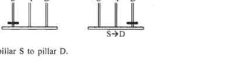

S→D 表示将盘子从支柱 S 移到支柱 D。

## 当 n=2 时

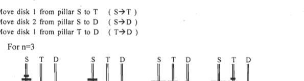

- (i) 将盘 1 从支柱 S 移到 T (S→T)
- (ii) 将盘 2 从支柱 S 移到 D (S→D)
- (iii) 将盘 1 从支柱 T 移到 D (T→D)

## 当 n=3 时

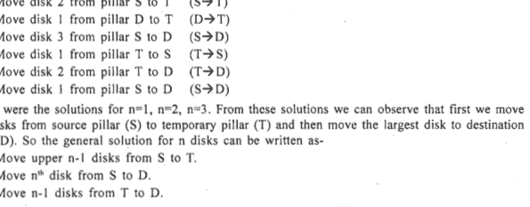

- (i) 将盘 1 从支柱 S 移到 D (S→D)
- (ii) 将盘 2 从支柱 S 移到 T (S→T)
- (iii) 将盘 1 从支柱 D 移到 T (D→T)
- (iv) 将盘 3 从支柱 S 移到 D (S→D)
- (v) 将盘 1 从支柱 T 移到 S (T→S)
- (vi) 将盘 2 从支柱 T 移到 D (T→D)
- (vii) 将盘 1 从支柱 S 移到 D (S→D)

这些是 n=1、n=2 和 n=3 的解。从这些解中，我们可以观察到首先将 n-1 个盘子从源支柱 S 移到临时支柱 T，然后将最大盘子移到目标支柱 D。所以 n 个盘子的一般解可以写成：

1. 将上部的 n-1 个盘子从 S 移到 T。
2. 将第 n 个盘子从 S 移到 D。
3. 将 n-1 个盘子从 T 移到 D。

要将 n-1 个盘子从 S 移到 T，可以使用 D 作为临时支柱，要将 n-1 个盘子从 T 移到 D，可以使用 S 作为临时支柱。

```text
tofh(n, source, temp, dest) =

Move disk from source to dest    n=1
tofh(n-1, source, dest, temp)
Move nth disk from source to dest    n>1
tofh(n-1, temp, source, dest)
```

```c
/*P6.27 Program to solve Tower of Hanoi problem using recursion*/
#include<stdio.h>
main()
{
    char source='S',temp='T',dest='D';
    int ndisk;
    printf("Enter the number of disks : ");
    scanf("%d",&ndisk);
    printf("Sequence is :\n");
    tofh(ndisk,source,temp,dest);
}
tofh(int ndisk,char source,char temp,char dest)
{
    if(ndisk>0)
    {
        tofh(ndisk-1,source,dest,temp);
        printf("Move Disk %d %c->%c\n",ndisk,source,dest);
        tofh(ndisk-1,temp,source,dest);
    }
}/*End of tofh()*/


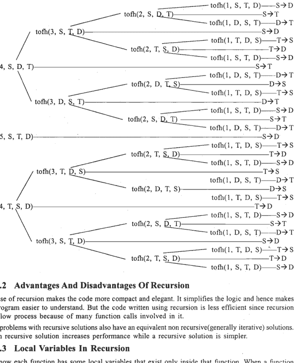

## 6.19.2 递归的优点和缺点

使用递归使代码更紧凑、更优雅。它简化了逻辑，因此使程序更易于理解。但是，由于递归过程中涉及许多函数调用，递归是一个缓慢的过程，所以使用递归编写的代码效率较低。

大多数可用递归方案解决的问题也都有等价的非递归（通常是迭代）方案。非递归方案能提高性能，而递归方案更简单。

## 6.19.3 递归中的局部变量

我们知道，每个函数都有一些仅存在于该函数内部的局部变量。当函数被递归调用时，每次调用都会创建一组新的局部变量（static 变量除外）；这些变量的名称相同，但存储在不同位置，并包含不同的值。编译器会记住这些值，直到函数调用结束，以便这些值在回溯阶段可用。

## 6.20 一些附加问题

### 问题 1

编写一个程序，根据用户的选择将二进制数或八进制数转换为十进制数。

```
/*P6.28 Program to convert a binary or octal number to a decimal number*/
#include<stdio.h>
main()
{
    int num,base,result;
    char choice;
    printf("Enter 'b' for binary and 'o' for octal : ");
    scanf("%c",&choice);
    printf("Enter the number : ");
    scanf("%d",&num);
    if(choice=='b')
        base=2;
    else
        base=8;
    result=func(num,base);
    printf("Decimal number is %d\n",result);
}
func(int n,int base)
{
    int rem,d,j=1,dec=0;
    while(n>0)
    {
        rem=n%10; /* taking last digit */
        d=rem*j;
        dec+=d;
        j*=base;
        n/=10;   /* skipping last digit */
    }
    return dec;
}
```

### 问题 2

编写一个程序实现以下排列和组合公式。

从 n 个对象中一次取 r 个的排列数公式为——
p(n, r) = n! / (n-r)!
从 n 个对象中一次取 r 个的组合数公式为——
c(n, r) = n! / r! * (n-r)!
这也可以写成——
c(n, r) = p(n, r) / r!

```
/*P6.29 Program to find out permutations and combinations*/
#include<stdio.h>
long factorial(int);
long perm(int,int);
long comb(int,int);
main()
{
    int n,r;
    printf("Enter n : ");
    scanf("%d",&n);
    printf("Enter r : ");
    scanf("%d",&r);
    printf("Total combinations are : %ld\n",comb(n,r));
    printf("Total permutations are : %ld\n",perm(n,r));
}
long comb(int n,int r)
{
    long c;
    c=perm(n,r)/factorial(r);
    return c;
}
long perm(int n,int r)
{
    long p;
    p=factorial(n)/factorial(n-r);
    return p;
}
long factorial(int k)
{
    long fact=1;
    while( k>0 )
    {
        fact*=k;
        k--;
    }
    return fact;
}
```

### 问题 3

编写一个程序打印帕斯卡三角形。

```
1
1 2 1
1 3 3 1
1 4 6 4 1
1 5 10 10 5 1
1 6 15 20 15 6 1
```

```
/*P6.30 Program to print Pascal's triangle*/
#include<stdio.h>
long factorial(int);
long comb(int,int);
main()
{
	int i,j,k;
	printf("Enter number of rows for Pascal's triangle : ");
	scanf("%d",&k);
	for(i=0;i<k;i++)
	{
		for(j=0;j<=i;j++)
			printf("%5ld",comb(i,j));
		printf("\n");
	}
}
long comb(int n,int r)
{
	long c;
	c=factorial(n)/(factorial(r)*factorial(n-r)) ;
	return c;
}
long factorial(int k)
{
	long fact=1;
	while(k>0)
	{
		fact*=k;
		k--;
	}
	return fact;
}
```

### 问题 4

编写一个程序将十进制数转换为罗马数字。十进制数对应的罗马数字如下——

| 1 - i | 9 - ix | 100 - c |
|-------|--------|---------|
| 4 - iv | 10 - x | 500 - d |
| 5 - v | 50 - l | 1000 - m |

一些示例：

- 14 xiv
- 48 xxxxviii
- 123 cxxiii
- 772 dcclxii
- 1009 mix
- 2856 mmdccclvi

```
/*#include<stdio.h>
int roman(int,int,char);
main()
{
int num;
printf("Enter a number : ");
scanf("%d",&num);
if(num>=1000)
num=roman(num,1000,'m');
if(num>=500)
    num=roman(num,500,'d');
if(num>=100)
    num=roman(num,100,'c');
if(num>=50)
    num=roman(num,50,'l');
if(num>=10)
    num=roman(num,10,'x');
if(num>=5)
    num=roman(num,5,'v');
if(num>=1)
    roman(num,1,'i');
printf("\n");
}
int roman(int n,int k,char c)
{
    if(n==9)
    {
        printf("ix");
        return 0;
    }
    if(n==4)
    {
        printf("iv");
        return 0;
    }
    while(n>=k)
    {
        printf("%c",c);
        n=n-k;
    }
    return n;
}
```

### 问题 5

编写一个程序，使用递归打印一个正整数的逆序。

```
/*P6.32 Program to print the reverse of a positive integer*/
#include<stdio.h>
void reverse(long int n);
main()
{
    long int num;
    printf("Enter number : ");
    scanf("%ld",&num);
    reverse(num);
    printf("\n");
}
void reverse(long int n)
{
    int rem;
    if(n==0)
    return;
    else
    {
        rem=n%10;
        printf("%d",rem);
        n/=10;
        reverse(n);
    }
}
```

### 问题 6

编写一个程序，读入一个数并打印该数是否能被 11 整除，使用如下算法：一个数能被 11 整除，当且仅当奇数位数字之和与偶数位数字之和的差为零或能被 11 整除。

```
/* P6.33 Program that tests whether a number is divisible by 11 or not */
#include<stdio.h>
void test(long int x);
main()
{
    long int num;
    printf("Enter the number to be tested : ");
    scanf("%ld",&num);
    test(num);
}
void test(long int n)
{
    int s1=0,s2=0,k;
    while(n>0)
    {
        s1+=n%10;
        n/=10;
        s2+=n%10;
        n/=10;
    }
    k=s1>s2?(s1-s2):(s2-s1);
    if(k>10)
        test(k);
    else if(k==0)
        printf("The number is divisible by 11\n");
    else
        printf("The number is not divisible by 11\n");
}
```

### 问题 7

编写一个程序，使用递归函数根据用户的选择将十进制数转换为 (i) 二进制 (ii) 八进制 (iii) 十六进制。

## 函数

将十进制数转换为二进制、八进制或十六进制的程序

```
/* P6.34 Program to convert a decimal number to Binary, Octal or Hexadecimal */
#include<stdio.h>
void convert(int, int);
main()
{
int num,base;
int choice;
while(1)
{
printf("\n1.Binary\n");
printf("\n2.Octal\n");
printf("\n3.Hexadecimal\n");
printf("\n4.Exit\n");
printf("Enter your choice : ");
scanf("%d",&choice);
switch(choice)
{
case 1:
base=2;
break;
case 2:
base=8;
break;
case 3:
base=16;
break;
case 4:
exit(1);
default:
printf("Wrong choice\n");
continue; /*Takes to start of while loop*/
}
printf("Enter the number in decimal: ");
scanf("%d",&num);
convert(num,base);
printf("\n");
}
}
void convert(int num,int base)
{
int rem;
rem=num%base;
num/=base;
if (num>0)
convert(num,base);
if(rem<10)
printf("%d", rem);
else
printf("%c",rem-10+'A');
}
```

### 问题 8

编写一个程序，分别使用迭代和递归方法求出一个数的质因数。56 的质因数是 2、2、7，98 的质因数是 2、7，121 的质因数是 11、11。

```
/*P6.35 Program to print the prime factors*/
#include <stdio.h>
void pfact(int num);
void rpact(int n);
main()
{
int num;
printf("Enter a number : ");
scanf("%d",&num);
pfact(num);printf("\n");
rpact(num);printf("\n");
}
void pfact(int num)
{
int i;
for(i=2;num!=1;i++)
{
while(num%i==0)
{
printf("%d ",i);
num=num/i;
}
}
}
void rpact(int num)
{
static int i=2;
if(num==1)
return;
else
{
while(num%i==0)
{
printf("%d ",i);
num=num/i;
}
}
i++;
rpact(num);
}
```

### 问题 9

编写一个程序，分别用迭代和递归方法求出该级数的和。

```
/*P6.36 Program to find out the sum of series*/
#include<stdio.h>
long int fact(int num);
double power(float x,int n);
double series(float x,int n);
double rseries(float x,int n);
main()
{
    float x;
    int n;
    printf("Enter x : ");
    scanf("%f",&x);
    printf("Enter number of terms : ");
    scanf("%d",&n);
    printf("Iterative    %f\n",series(x,n));
    printf("Recursive    %f\n",rseries(x,n));
}
long int fact(int num)
{
    int i;
    long int f=1;
    for(i=1;i<=num;i++)
        f=f*i;
    return f;
}
double power(float x,int n)
{
    int i;
    float p=1;
    for(i=1;i<=n;i++)
        p=p*x;
    return p;
}
double series(float x,int n)
{
    int i,j,sign=1;
    float term,sum;
    for(i=1;i<=n;i++)
    {
        sign=(i&2==0)?-1:1;
        j=2*i-1;
        term=sign*power(x,j)/fact(j);
        sum+=term;
    }
    return sum;
}
double rseries(float x,int n)
{
    int sign=1;
    float term,sum;
    if(n==0)
```

sum=0;
else
{
sign=(n%2==0)?-1:1;
term=sign*power(x,2*n-1)/fact(2*n-1);
sum=term+rseries(x,n-1);
}
return sum;
}

该级数的第 i 项为 x^(2*i-1)/(2*i-1)!。在迭代函数中，我们将从 i=1 到 i=n 循环，并累加所有项。为了计算某一项的分子和分母，我们将使用函数 power() 和 fact()。由于各项的正负号交替，因此我们将取一个变量 sign，将其初始化为 1，并在循环的每次迭代中将其乘以 -1。

## 问题 10

编写一个程序，用递归方法求出两个数的最小公倍数和最大公因数。迭代方法见程序 P5.42。

```
/*P6.37 Program to find out the LCM and HCF of two numbers recursively*/
#include<stdio.h>
int m,n;
main()
{
int x,y;
printf("Enter two numbers : ");
scanf("%d %d",&x,&y);
printf("HCF of %d and %d is %d\n",x,y,hcf(x,y));
m=x;n=y;
printf("LCM of %d and %d is %d\n",x,y,lcm(x,y));
}
int hcf(int a,int b)
{
if(a==b)
return(b);
else if(a<b)
hcf(a,b-a);
else
hcf(a-b,b);
}
int lcm(int a,int b)
{
if(a==b)
return(b);
else if(a<b)
lcm(a+m,b);
else
lcm(a,b+n);
}
```

## 练习

假设所有程序都包含 stdio.h。

```c
(1) void func(void);
    main()
    {
        printf("Lucknow\n");
        goto ab;
    }
    void func(void)
    {
        ab:
        printf("Bareilly\n");
    }
```

```c
(2) main()
    {
        int i=9;
        if(i==9)
        {
            int i=25;
        }
        printf("i=%d",i);
    }
```

```c
(3) void func(int a,int b);
    main()
    {
        int x;
        x=func(2,3);
    }
    void func(int a,int b)
    {
        int s;
        s=a+b;
        return;
    }
```

```c
(4) main()
    {
        int x=5;
        x=func();
        printf("%d\n",x);
    }
    int func(int a)
    {
        a=a*2;
    }
```

```c
(5) main()
{
    static int x=5;
    if(x>0)
    {
        printf("%d ",x);
        x--;
        main();
    }
}
```

```c
(6) main()
{
    int s;
    s=func(2,3);
    printf("%d\n",s);
}
int func(int a,int b,int c)
{
    c=4;
    return (a+b+c);
}
```

```c
(7) main()
{
    int s;
    s=func(2,3,6);
    printf("%d\n",s);
}
int func(int a,int b)
{
    return (a+b);
}
```

```c
(8) func(int x,int y);
main()
{
    int p=func(5,6);
    printf("%d",p);
}
func(int x,int y)
{
    int x=2;
    return x*y;
}
```

```c
(9) main()
{
    int var1=12,var2=35;
    printf("%d",max(var1,var2));
}
int max(int x,int y)
{
    x>y?return x:return y;
}
```

```c
(10)main()
{
    int n=5;
    printf("%d\n",func(n));
}
func(int n)
{
    return(n+sqr(n-2)+cube(n-3)); }
sqr(int x)
{
    return(x*x); }
cube(int x)
{
    return (x*x*x); }
```

```c
(11)main()
{
    int func(int a,int b);
    {
        return (a+b);
    }
    int c;
    c=func(3,5);
    printf("%d",c);
}
```

```c
(12)main()
{
    int x=5;
    func1(x);
}
func1(int a)
{
    printf("Value of a = %d\n",a);
    if(a>0)
        func2(-a);
}
func2(int b)
{
    printf("Value of b = %d\n",b);
    if(b>0)
        func1(-b);
}
```

```c
(13)void disp(int, int);
main()
{
    int x=15;
    float y=290.5;
    disp(x,y);
}
void disp(int a, int b)
{
    printf("%d\n", a, b);
}
```

```c
void func(void);
main()
{
    int i=5;
    for(i=i+1;i<8;i++)
        func();
}
void func(void)
{
    int j;
    for(j=1;j<3;j++)
        printf("%d\t",++j);
}
```

```c
main()
{
    int i=10,k;
    for ( ; ; )
    {
        k=mult(i);
        if(-i<5)
            break;
    }
    printf("k=%d\n",k);
}
mult(int j)
{
    j*=j;
    return(j);
}
```

```c
main()
{
    int i=2,j=3;
    printf("%d\n",func(i,j));
}
func(int a,int b)
{
    a=a-5;
    b++;
    return(!a+-b);
}
```

```c
main()
{
    int x;
    x=func(2,3,4);
    printf("%d\n",x);
}
func(int a,int b,int c)
{
    return(a,b,c);
}
```

```c
(18)void func(int a,int b);
main()
{
    int i=5,j=10;
    func(i/2,j%3);
}
void func(int a,int b)
{
    a=a/2;
    b--;
    printf("%d\t",a+b);
}
```

```c
(19)int a=5;
void func(void );
main()
{
    func();
    printf("%d\n", a);
}
void func(void)
{
    int a=2;
    printf("%d\t",a);
}
```

```c
(20)main()
{
    int a=2,b=5;
    a=func(a+b,a-b);
    printf("%d\n",a);
}
func(int x,int y)
{ return x+y, x-y; }
```

```c
(21)main()
{
    int i=0,k=3;
    i+=func(k);
    i+=func(k);
    i+=func(k);
    printf("%d\n",i);
}
func(int k)
{
    static int m=2;
    m=m+k;
    return m;
}
```

```c
(22)main()
{
    int n=8;
    printf("%d\n",func(n));
}
func(int n)
{
    if(n==0)
        return 0;
    else
        return(n+func(n-1));
}
```

```c
(23)main()
{
    int a=2,b=6;
    printf("%d\t",func1(a,b));
    printf("%d\n",func2(a,b));
}
func1(int a,int b)
{
    int i,s=0;
    for(i=a;i<=b;i++)
    {
        s=s+i*i;
    }
    return s;
}
func2(int a,int b)
{
    int s;
    if(a<b)
        s=a*a+func2(a+1,b);
    else
        s=a*a;
}
```

```c
(24)main()
{
    int a=7,b=8;
    printf("%d\n",func(a,b));
}
func(int x,int y)
{
    if(x==0)
        return y;
    else
        func(--x,++y);
}
```

```c
(25)main()
{
    int x=55,y=17;
    printf("%d\n",func(x,y));
}
func(int x,int y)
{
    int q=0;
    if(x<y)
        return 0;
    else
        return func(x-y,y)+1;
}
```

```c
(26)main()
{
    func1(6);
    printf("\n");
    func2(6);
}
func1(int x)
{
    printf("%d ",x);
    if(x>2)
        func1(--x);
}
func2(int x)
{
    if(x>2)
        func2(--x);
    printf("%d ",x);
}
```

## 编程练习

- 1. 编写一个函数 cubesum()，它接受一个整数并返回该数各位数字的立方和。使用该程序打印给定范围内的阿姆斯特朗数。（见程序 P5.24）
- 2. 编写一个函数，输入一个数并返回该数各位数字的乘积，直到乘积缩减为一位数（类似 P5.25）。将各位数字相乘直到得到一位数所需的次数称为该数的持久性。编写另一个函数 pers( )，输入一个数并返回其持久性。
  例如：86 → 48 → 32 →6（持久性 3）
  341 → 12 → 2（持久性 2）
- 3. 编写一个函数 sumdiv()，求一个数的因数之和。（一个数的因数是能整除该数的那些数）。例如，36 的因数是 1、2、3、4、6、9、18。如果一个数的因数之和等于该数，则称该数为完全数。例如，28 是完全数，因为 1+2+4+7+14 =28。编写一个程序打印给定范围内的所有完全数。
- 4. 编写一个程序求该级数前 n 项之和。1 + 1 / 2 + 1 / 4 + 1 / 9 + 1 / 16 + ...............
- 5. 编写一个程序求二次方程 ax² + bx + c = 0 的根。
- 6. 编写一个函数，接受一个小写字符并返回其对应的大写字符。
- 7. 编写一个程序 mult()，接受两个整数并返回它们的乘积。不要使用 * 运算符。类似地，再编写两个函数 quo() 和 rem()，分别接受两个整数并返回商和余数，且不使用 / 和 % 运算符。
- 8. 编写一个递归函数求一个数的各位数字之和。
  sumd(n) = { 0 n=0 ; (n%10) + sumd(n/10) n>0 }
- 9. 编写一个递归函数，求从 n 个对象中一次取 r 个的组合数
  rcomb(n, r)= 1 r = 0 或 n = r ; rcomb(n-1, r) + rcomb(n-1, r-1) 否则
- 10. 编写一个程序，使用递归以英文单词形式打印数字。例如，如果有一个数 31246，则程序应打印 Three one Two four Six

## 答案

- (1) 不能在函数之间使用 goto，因此该程序将显示错误，指出 ab 是未定义标签。
- (2) i = 9
- (3) 该函数声明为 void，因此不返回任何值，所以函数调用不能用于任何表达式中。
- (4) 如果没有通过 return 语句返回值，并且函数未声明为 void 类型，则返回垃圾值，因此变量 x 将具有垃圾值。
- (5) 5 4 3 2 1 这里 main() 的定义是以递归方式编写的。
- (6) 9 由于缺少函数声明，因此将垃圾值传入变量 c；在函数内部，变量 c 被赋值为 4。如果函数声明为 int func( int , int );，那么我们将收到错误，指出调用 func() 时参数太少。


(7) 5
如果函数声明为-
int func(int,int);
那么在调用 func() 时会得到一个错误，提示调用 func() 时多了一个参数。

(8) Error : Multiple declaration for x in func().
(8) 错误：func() 中 x 的多次声明。

(9) Error : Expression syntax
条件运算符的操作数应为表达式，但 return x 和 return y 不是表达式。

(10) 22
我们可以在另一个调用的 return 语句中进行函数调用。

(11) 我们会得到错误，因为函数定义不能写在另一个函数的定义内部。

(12) a 的值 = 5
b 的值 = 4
a 的值 = 3
b 的值 = 2
a 的值 = 1
b 的值 = 0
这是一个间接递归的例子。

(13) 15 290

(14) 2 2

(15) k = 25

(16) 3

(17) 4
这里表达式 a, b, c 被视为使用逗号运算符的表达式，因此表达式的值为最右值，故返回 c 的值。

(18) 1

(19) 2 5
在 func() 中，将访问局部变量，因为当局部变量和全局变量发生冲突时，局部变量具有优先权。

(20) 10
(21) 24
(22) 36
func() 求出数列 1+2+3....+n 的和
(23) 90 90
func1() 和 func2() 两个函数都返回从 a 到 b 的数字的平方和，func1() 使用迭代方法，而 func2() 使用递归方法。
(24) 15
func() 是用于加两个整数的递归函数。
(25) 3
func() 是用于求商的递归函数。
(26) 6 5 4 3 2
2 2 3 4 5

以下是一些数组声明的示例-

```c
int age[100];
float sal[15];
char grade[20];
```

这里 age 是一个整型数组，可以存储 100 个整型元素。数组 sal 是一个大小为 15 的浮点型数组，可以容纳浮点值，第三个是一个大小为 20 的字符型数组，可以容纳字符。上述数组的各个元素为-

- age[0], age[1], age[2], ................ age[99]
- sal[0], sal[1], sal[2], ................sal[14]
- grade[0], grade[1], grade[2], ................grade[19]

当声明数组时，编译器会在内存中分配足够的空间来容纳数组的所有元素，因此编译器在编译时应知道数组的大小。因此我们不能在声明中使用变量来指定数组的大小。符号常量可用于指定数组的大小。例如-

```c
#define SIZE 10
main()
{
int size=15;
float sal[SIZE]; /*Valid*/
int marks[size]; /*Not valid*/
..................
}
```

使用符号常量指定数组大小使得如果以后需要更改数组大小，修改程序变得方便，因为大小只需在一个地方更改，即在 #define 指令中。

## 7.1.2 访问一维数组元素

在 C 语言中，可以通过指定数组名后跟方括号中的下标来访问数组元素。在 C 语言中，数组下标从 0 开始。因此如果有一个大小为 5 的数组，则有效下标将从 0 到 4。最后一个有效下标比数组大小小 1。这个最后一个有效下标有时被称为数组的上限，而 0 被称为数组的下限。

```c
int arr[5]; /*Size of array arr is 5, can hold five integer elements*/
```

- arr[0], arr[1], arr[2], arr[3], arr[4]

这里 0 是下限，4 是数组的上限。下标可以是产生整数值的任何表达式。它可以是任何整数常量、整数变量、整数表达式或函数调用的 return(int)。例如，如果 i 和 j 是整数变量，则这些是一些有效的下标数组元素-

```c
arr[3]
arr[i]
arr[i+j]
```

`arr[2*j]`

`arr[i++]`

下标数组元素在程序中被视为任何其他变量。我们可以在其中存储值、打印其值或执行对同数据类型任何简单变量有效的任何操作。例如如果 arr[5] 和 sal[10] 是两个数组，则这些是有效语句-

```c
int arr[5];
float sal[10];
int i;
scanf("%d", &arr[1]);              /*input value into arr[1]*/
printf("%f", sal[3]);               /*print value of sal[3]*/
arr[4] = 25;                         /*assign a value to arr[4]*/
arr[4]++;                            /*increment the value of arr[4] by 1*/
arr[5] += 20;                        /*Add 20 to the value of arr[5]*/
sum = arr[0] + arr[1] + arr[2] + arr[3] + arr[4]; /*Add all the values of array arr[5]*/
i = 2;
scanf("%f", &sal[i]);               /*Input value into sal[2]*/
printf("%f", sal[i]);               /*print value of sal[2]*/
printf("%f", sal[i++]);             /*Print value of sal[2] and increment the value of i*/
```

在 C 语言中没有对数组边界的检查。例如如果我们有一个数组 arr[5]，有效下标只有 0、1、2、3、4，如果有人尝试访问超出这些下标的元素，如 arr[5]、arr[10] 或 arr[-1]，编译器不会显示任何错误信息，但这可能导致运行时错误，这可能很难调试。因此，提供数组边界检查是程序员的责任，在需要的地方进行检查。

## 7.1.3 处理一维数组

处理数组时通常使用 for 循环，循环变量用于下标的位置。循环变量的初始值取为 0，因为数组下标从零开始。每次循环变量增加 1，以便我们可以访问并处理数组中的下一个元素。循环中的总遍数将等于数组中的元素数，并且在每次遍历中我们将处理一个元素。

假设 arr[10] 是 int 类型的数组-

- **Reading values in arr[10]**
```c
for (i = 0; i < 10; i++)
    scanf("%d", &arr[i]);
```

- **Displaying values of arr[10]**
```c
for (i = 0; i < 10; i++)
    printf("%d ", arr[i]);
```

- **Adding all the elements of arr[10]**
```c
sum = 0;
for (i = 0; i < 10; i++)
    sum += arr[i];
```

```
even++;
else
odd++;
}
printf("Even numbers = %d, Odd numbers =%d\n",even,odd );
```

## 7.1.4 一维数组的初始化

声明后，局部数组的元素具有垃圾值，而全局和静态数组的元素会自动初始化为零。我们可以在声明时显式初始化数组。

数组初始化的语法为-

```c
data_type array_name[size]={value1, value2........valueN };
```

这里 array_name 是数组变量的名称，size 是数组的大小，value1、value2、........valueN 是称为初始化器的常量值，它们依次分配给数组元素。这些值用逗号分隔，并在结束大括号后有一个分号。例如-

```c
int marks[5] = {50, 85, 70, 65, 95};
```

此初始化后数组元素的值为-
marks[0] : 50, marks[1] : 85, marks[2] : 70, marks[3] : 65, marks[4] : 95

初始化一维数组时，指定数组大小是可选的。如果在初始化时省略大小，则编译器假定数组大小等于初始化器的数量。例如-

```c
float sal[] = { 99, 78, 50, 45, 67, 89};
```

这里假定数组 marks 的大小为 6，而 sal 的大小假定为 3。

如果在初始化期间初始化器的数量小于数组的大小，则将所有剩余的数组元素赋值为零。例如-

```c
int marks[5] = { 99, 78};
```

这里数组的大小为 5，而只有 2 个初始化器。此初始化后元素的值为-
marks[0] : 99, marks[1] : 78, marks[2] : 0, marks[3] : 0, marks[4] : 0

因此如果我们像这样初始化一个数组-

```c
int arr[100] = {0};
```

则 arr 的所有元素都将被初始化为零。

如果初始化器的数量超过括号中给出的大小，则编译器会显示错误。例如-

```c
int arr[5] = {1, 2, 3, 4, 5, 6, 7, 8}; /*Error*/
```

我们不能通过简单地将其赋给另一个数组来复制一个数组的所有元素到另一个数组。例如如果我们有两个数组 a[5] 和 b[5]，则

```c
int a[5] = {1, 2, 3, 4, 5};
int b[5];
b = a; /*Not valid*/
```

我们必须使用for循环逐个复制数组的所有元素。

```c
for (i = 0; i < 5; i++)
    b[i] = a[i];
```

在下面的程序中，我们将找出一个整数数组中的最大值和最小值。

```c
/*P7.4 程序：查找数组中的最大值和最小值*/
#include<stdio.h>
main()
{
    int i,j,arr[10]={2,5,4,1,8,9,11,6,3,7};
    int min,max;
    min=max=arr[0];
    for(i=1;i<10;i++)
    {
        if(arr[i]<min)
            min=arr[i];
        if(arr[i]>max)
            max=arr[i];
    }
    printf("Minimum = %d, Maximum = %d\n",min,max);
}
```

**输出：**

Minimum = 1, Maximum = 11

我们将第一个元素的值作为min和max的初始值。在for循环内部，我们从第二个元素开始比较，所以这次循环从1开始而不是从0开始。

下面的程序将反转数组的元素。

```c
/*P7.5 程序：反转数组的元素*/
#include<stdio.h>
main()
{
    int i,j,temp,arr[10]={1,2,3,4,5,6,7,8,9,10};
    for(i=0,j=9;i<j;i++,j--)
    {
        temp=arr[i];
        arr[i]=arr[j];
        arr[j]=temp;
    }
    printf("After reversing the array is : ");
    for(i=0;i<10;i++)
        printf("%d ",arr[i]);
    printf("\n");
}
```

**输出：**

After reversing the array is : 10 9 8 7 6 5 4 3 2 1

在for循环中，我们使用了逗号运算符，并使用了两个变量i和j。变量i初始化为下界，j初始化为上界。循环每执行一次，i递增而j递减。在循环内部，a[i]与a[j]交换。因此a[0]将与a[9]交换，a[1]与a[8]交换，a[2]与a[7]交换，依此类推。

下一个程序打印一个十进制数的二进制等价形式。从十进制数29得到二进制数的过程如下所示：

| 表达式 | 商 | 余数 | 数组 | 备注 |
|---|---|---|---|---|
| 29/2 | 14 | 1 | a[0] | 最低有效位 |
| 14/2 | 7 | 0 | a[1] | |
| 7/2 | 3 | 1 | a[2] | |
| 3/2 | 1 | 1 | a[3] | |
| 1/2 | 0 | 1 | a[4] | 最高有效位 |

我们将余数存储在数组中，最后按逆序打印数组以得到二进制数。

```c
/*P7.6 程序：将十进制数转换为二进制数*/
#include<stdio.h>
main()
{
 int num,rem,arr[15],i,j;
 printf("Enter a decimal number : ");
 scanf("%d",&num);
 i=0;
 while(num>0)
 {
  arr[i]=num%2;   /*将余数存入数组*/
  num/=2;
  i++;
 }
 printf("Binary number is : ");
 for(j=i-1;j>=0;j--)/*逆序打印数组*/
  printf("%d",arr[j]);
 printf("\n");
}
```

**输出：**

Enter a decimal number : 29
Binary number is : 11101

下一个程序在数组中搜索特定项。

```c
/*P7.7 程序：在数组中搜索某个项*/
#include<stdio.h>
#define SIZE 10
main()
{
 int i,arr[SIZE]={23,12,56,98,76,14,65,11,19,45};
 int item;
 printf("Enter the item to be searched : ");
 scanf("%d",&item);
 for(i=0;i<SIZE;i++)
 {
    if(item==arr[i])
    {
        printf("%d found at position %d\n",item,i+1);
        break;
    }
 }
 if(i==SIZE)
    printf("Item %d not found in array\n", item);
}
```

将要搜索的项与数组的每个元素进行比较，如果找到该元素，则通过break语句终止for循环。控制流可以从循环中出来的情况有两种：第一种是找到项并通过break终止循环；第二种是未找到项且循环完整执行。在第二种情况下，i的值将等于SIZE。这里我们是顺序搜索项的，因此这种搜索被称为线性搜索或顺序搜索。

## 7.1.5 一维数组与函数

### 7.1.5.1 向函数传递单个数组元素

我们知道，数组元素在程序中与任何其他简单变量一样对待。因此，我们可以像传递其他简单变量一样，将单个数组元素作为参数传递给函数。

```c
/*P7.8 程序：向函数传递数组元素*/
#include<stdio.h>
main()
{
    int arr[10],i;
    printf("Enter the array elements : ");
    for(i=0;i<10;i++)
    {
        scanf("%d",&arr[i]);
        check(arr[i]);
    }
}
check(int num)
{
    if(num%2==0)
        printf("%d is even\n",num);
    else
        printf("%d is odd\n",num);
}
```

### 7.1.5.2 向函数传递整个一维数组

我们可以将整个数组作为实际参数传递给函数。相应的形式参数应声明为相同数据类型的数组变量。

```c
main()
{
    int arr[10];
    .......
    .......
    func(arr); /*在函数调用中，指定数组名时不带方括号*/
}
func(int val[10])
{
    .......
    .......
}
```

在形式参数中指定数组的大小是可选的，例如我们可以将函数定义写为：

```c
func(int val[ ])
{
    .......
    .......
}
```

我们之前学过，对形式参数所做的更改不会影响实际参数，但在将数组传递给函数时情况并非如此。将数组传递给函数的机制与传递简单变量完全不同。我们之前学过，对于简单变量，被调用函数会创建变量的副本并对其进行操作，因此函数中所做的任何更改都不会影响原始变量。当数组作为实际参数传递时，被调用函数实际上可以访问原始数组并对其操作，因此函数内部所做的任何更改都会影响原始数组。下面是一个将数组传递给函数的程序。

```c
/*P7.9 程序：理解将数组传递给函数的影响*/
#include<stdio.h>
main()
{
    int i,arr[6]={1,2,3,4,5,6};
    func(arr);
    printf("Contents of array are now : ");
    for(i=0;i<6;i++)
        printf("%d ",arr[i]);
    printf("\n");
}
func(int val[])
{
    int sum=0,i;
    for(i=0;i<6;i++)
    {
        val[i]=val[i]*val[i];
        sum+=val[i];
    }
    printf("The sum of squares = %d\n",sum);
}
```

**输出：**

The sum of squares = 91
The contents of array are now : 1 4 9 16 25 36

这里我们可以看到，在被调用函数内部对数组所做的更改会反映在调用函数中。形式参数的名称不同，但它引用的是原始数组。

由于在函数定义中不必指定数组的大小，因此我们可以编写能够处理相同类型但不同大小数组的通用函数。例如，在下一个程序中，函数add()能够对任意大小的整数数组的元素进行求和。

```c
/*P7.10 程序：使用一个可处理不同大小数组的通用函数*/
#include<stdio.h>
main()
{
    int a[5]={2,4,6,8,10};
    int b[8]={1,3,5,7,9,11,13,15};
    int c[10]={1,2,3,4,5,6,7,8,9,10};
    printf("Sum of elements of array a : %d\n",add(a,5));
    printf("Sum of elements of array b : %d\n",add(b,8));
    printf("Sum of elements of array c : %d\n",add(c,10));
}
add(int arr[],int n)
{
    int i,sum=0;
    for(i=0;i<n;i++)
        sum+=arr[i];
    return sum;
}
```

**输出：**

Sum of elements of array a : 30
Sum of elements of array b : 64
Sum of elements of array c : 55

## 7.2 二维数组

### 7.2.1 二维数组的声明与访问单个元素

二维数组的声明语法与一维数组类似，但这里有两个下标。

`data_type array_name[行数][列数];`

这里行数指定数组的行数，列数表示数组中的列数。数组中元素的总数为行数 * 列数。例如：

`int arr[4][5];`

这里arr是一个有4行5列的二维数组。该数组的单个元素可以通过使用两个下标来访问，其中第一个下标表示行号，第二个下标表示列号。该数组的起始元素是arr[0][0]，最后一个元素是arr[3][4]。此数组中的元素总数为4*5 = 20。


|  | 列 0 | 列 1 | 列 2 | 列 3 | 列 4 |
|---|---|---|---|---|---|
| 行 0 | arr[0][0] | arr[0][1] | arr[0][2] | arr[0][3] | arr[0][4] |
| 行 1 | arr[1][0] | arr[1][1] | arr[1][2] | arr[1][3] | arr[1][4] |
| 行 2 | arr[2][0] | arr[2][1] | arr[2][2] | arr[2][3] | arr[2][4] |
| 行 3 | arr[3][0] | arr[3][1] | arr[3][2] | arr[3][3] | arr[3][4] |

## 7.2.2 处理二维数组

处理二维数组时，我们使用两个嵌套的 for 循环。外层循环对应行，内层循环对应列。

```
int arr[4][5];
```

```
(i) Reading values in arr
for (i = 0; i < 4; i++ )
for (j = 0; j < 5; j++ )
scanf("%d", &arr[i][j]);
```

```
(ii) Displaying values of arr
for (i = 0; i < 4; i++ )
for (j = 0; j < 5; j++ )
printf("%d ", arr[i][j]);
```

这将把所有元素打印在同一行。如果我们想将不同行的元素打印在不同的行上，则可以这样写-

```
for(i=0;i<4;i++)
{
for(j=0;j<5;j++)
printf("%d ",arr[i][j]);
printf("\n");
}
```

```
/*P7.11 Program to input and display a matrix*/
#define ROW 3
#define COL 4
#include<stdio.h>
main()
{
int mat[ROW][COL],i,j;
printf("Enter the elements of matrix(%dx%d) row-wise :\n",ROW,COL);
for(i=0;i<ROW;i++)
for(j=0;j<COL;j++)
scanf("%d",&mat[i][j]);
printf("\nThe matrix that you have entered is :\n");
for(i=0;i<ROW;i++)
{
for(j=0;j<COL;j++)
printf("%d ",mat[i][j]);
printf("\n");
}
}
```

## 数组

```
printf("%5d",mat[i][j]);
printf("\n");
}
printf("\n");
}
```

输出：
输入矩阵(3x4)元素，按行输入 -
2 3 4 7
8 5 1 9
1 8 2 5
你输入的矩阵是 -
2 3 4 7
8 5 1 9
1 8 2 5

## 2.2.3 二维数组的初始化

二维数组可以像一维数组那样进行初始化。例如- int mat[4][3] = { 11, 12, 13, 14, 15, 16, 17, 18, 19, 20, 21, 22}; 这些值按行分配给元素，因此初始化后的元素值如下- mat[0][0] : 11 mat[0][1] : 12 mat[0][2] : 13 mat[1][0] : 14 mat[1][1] : 15 mat[1][2] : 16 mat[2][0] : 17 mat[2][1] : 18 mat[2][2] : 19 mat[3][0] : 20 mat[3][1] : 21 mat[3][2] : 22

```
int mat[4][3] = { 11, 12, 13, 14, 15, 16, 17, 18, 19, 20, 21, 22};
```

初始化时，我们可以使用内部大括号按行分组元素。例如- int mat[4][3]={{11,12,13}, /* Row 0 */ {14,15,16}, /* Row 1 */ {17,18,19}, /* Row 2 */ {20,21,22} /* Row 3 */ };

```
int mat[4][3]={{11,12,13}, /*Row 0*/ {14,15,16}, /*Row 1*/ {17}, /*Row 3*/ };
```

每一行中剩余的元素将被赋值为 0，因此元素的值将为-

mat[0][0] : 11    mat[0][1] : 0    mat[0][2] : 0
mat[1][0] : 12    mat[1][1] : 13   mat[1][2] : 0
mat[2][0] : 14    mat[2][1] : 15   mat[2][2] : 16
mat[3][0] : 17    mat[3][1] : 0    mat[3][2] : 0

在二维数组中，第一个维度是可选的，但第二个维度必须始终存在。例如-

```
int mat[][3]=(
    {1,10},
    {2,20,200},
    {3},
    {4,40,400}
);
```

这里第一个维度取 4，因为初始化列表中有 4 行。

二维数组也称为矩阵。下一个程序将两个矩阵相加；两个矩阵的阶数应相同。

```
/*P7.12 Program for addition of two matrices.*/
#define ROW 3
#define COL 4
#include<stdio.h>
main()
{
    int i,j,mat1[ROW][COL],mat2[ROW][COL],mat3[ROW][COL];
    printf("Enter matrix mat1(%dx%d)row-wise :\n",ROW,COL);
    for(i=0;i<ROW;i++)
        for(j=0;j<COL;j++)
            scanf("%d",&mat1[i][j]);

    printf("Enter matrix mat2(%dx%d)row-wise :\n",ROW,COL);
    for(i=0;i<ROW;i++)
        for(j=0;j<COL;j++)
            scanf("%d",&mat2[i][j]);

    /*Addition*/
    for(i=0;i<ROW;i++)
        for(j=0;j<COL;j++)
            mat3[i][j]=mat1[i][j]+mat2[i][j];

    printf("The resultant matrix mat3 is :\n");
    for(i=0;i<ROW;i++)
    {
        for(j=0;j<COL;j++)
            printf("%5d",mat3[i][j]);
        printf("\n");
    }
}
```

输出：
输入第一个矩阵 mat1(3x4) 元素，按行输入 -
1 2 8 4
5 6 7 8
3 2 1 4
输入第二个矩阵 mat2(3x4) 元素，按行输入 -
2 5 4 2
1 5 2 6
9 4 7 2
结果矩阵 mat3 为 -
3 7 12 6
6 11 9 14
12 6 8 6

现在我们将编写一个程序来乘以两个矩阵。矩阵相乘要求第一个矩阵的列数等于第二个矩阵的行数。第一个矩阵的每一行与第二个矩阵的列相乘然后相加得到结果矩阵的元素。如果我们将阶数为 m×n 和 n×p 的两个矩阵相乘，则相乘后的矩阵的阶数为 m×p。

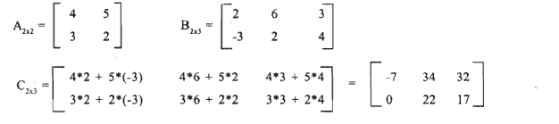

```
/*P7.13 Program for multiplication of two matrices*/
#include <stdio.h>
#define ROW1 3
#define COL1 4
#define ROW2 4
#define COL2 2
main ()
{
int mat1[ROW1][COL1],mat2[ROW2][COL2],mat3[ROW1][COL2];
int i,j,k;
printf("Enter matrix mat1(%dx%d)row-wise :\n",ROW1,COL1);
for(i=0;i<ROW1;i++)
for(j=0;j<COL1;j++)
scanf("%d",&mat1[i][j]);
printf("Enter matrix mat2(%dx%d)row-wise :\n",ROW2,COL2);
for(i=0;i<ROW2;i++)
for(j=0;j<COL2;j++)
scanf("%d",&mat2[i][j]);
for(i=0;i<ROW1;i++)
for(j=0;j<COL2;j++)
{
mat3[i][j]=0;
for(k=0;k<COL1;k++)
mat3[i][j]=mat3[i][j]+mat1[i][k]*mat2[k][j];
}
printf("The resultant matrix mat3 is :\n");
for(i=0;i<ROW1;i++)
{
for(j=0;j<COL2;j++)
printf("%d ",mat3[i][j]);
printf("\n");
}
}
```

```
for(i=0;i<ROW2;i++)
for(j=0;j<COL2;j++)
scanf("%d",&mat2[i][j]);
/*Multiplication */
for(i=0;i<ROW1;i++)
for(j=0;j<COL2;j++)
{
mat3[i][j]=0;
for(k=0;k<COL1;k++)
mat3[i][j]+=mat1[i][k]*mat2[k][j];
}
printf("The Resultant matrix mat3 is :\n");
for(i=0;i<ROW1;i++)
{
for(j=0;j<COL2;j++)
printf("%5d",mat3[i][j]);
printf("\n");
}
```

输出：
输入矩阵 mat1(3x4) 按行输入 -
2 1 4 3
5 2 7 1
3 1 4 2
输入矩阵 mat2(4x2) 按行输入 -
1 2
3 4
5 2
6 2
结果矩阵 mat3 为：
31 34
31 55
26 34

下一个程序求出矩阵的转置。转置矩阵定义为通过交换矩阵的行和列得到的矩阵。如果一个矩阵的阶数为 m x n，则其转置矩阵的阶数为 n x m。

```
/*P7.14 Program to find the transpose of matrix.*/
#include <stdio.h>
#define ROW 3
#define COL 4
main()
{
int mat1[ROW][COL],mat2[COL][ROW],i,j;
printf("Enter matrix mat1(%dx%d) row-wise : \n",ROW,COL);
```

```
for(i=0;i<ROW;i++)
for(j=0;j<COL;j++)
scanf("%d",&mat1[i][j]);
for(i=0;i<COL;i++)
for(j=0;j<ROW;j++)
mat2[i][j]=mat1[j][i];
printf("Transpose of matrix is:\n");
for(i=0;i<COL;i++)
for(j=0;j<ROW;j++)
printf("%5d",mat2[i][j]);
printf("\n");
}
```

```
输入矩阵 mat1(3x4) 按行输入
3 2 1 5
6 5 8 2
9 3 4 1
矩阵的转置为-
3 6 9
2 5 3
1 8 4
5 2 1
```

## 3.3 多于两个维度的数组

我们将简要介绍三维数组。我们可以将三维数组视为二维数组的数组。例如，如果我们有一个数组- int arr[2][4][3] ;

我们可以将其视为一个由两个二维数组组成的数组，每个二维数组有 4 行和 3 列。

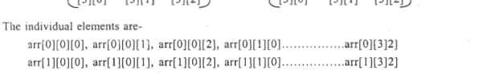

- arr[0][0][0], arr[0][0][1], arr[0][0][2], arr[0][1][0] ............arr[0][1][2]
- arr[1][0][0], arr[1][0][1], arr[1][0][2], arr[1][1][0] ............arr[1][1][2]
- arr[1][0][0], arr[1][0][1], arr[1][0][2], arr[1][1][0] ............arr[1][1][2]

上述数组中的元素总数为-

= 2 * 4 * 3
= 24

该数组可以初始化为-

```
int arr[2][4][3]=(
    {
        {1,2,3},        /*Matrix 0, Row 0*/
        {4,5},         /*Matrix 0, Row 1*/
        {6,7,8},       /*Matrix 0, Row 2*/
        {9}            /*Matrix 0, Row 3*/
    },
    {
        {10,11},       /*Matrix 1, Row 0*/
        {12,13,14},    /*Matrix 1, Row 1*/
        {15,16},       /*Matrix 1, Row 2*/
        {17,18,19}     /*Matrix 1, Row 3*/
    }
);
```

初始化后元素的值如下-

arr[0][0][0] : 1      arr[0][0][1] : 2      arr[0][0][2] : 3
arr[0][1][0] : 4      arr[0][1][1] : 5      arr[0][1][2] : 0
arr[0][2][0] : 6      arr[0][2][1] : 7      arr[0][2][2] : 8
arr[0][3][0] : 9      arr[0][3][1] : 0      arr[0][3][2] : 0

arr[1][0][0] : 10     arr[1][0][1] : 11     arr[1][0][2] : 0
arr[1][1][0] : 12     arr[1][1][1] : 13     arr[1][1][2] : 14
arr[1][2][0] : 15     arr[1][2][1] : 16     arr[1][2][2] : 0
arr[1][3][0] : 17     arr[1][3][1] : 18     arr[1][3][2] : 19

请记住，多维数组初始化的规则是最后一个下标变化最频繁，第一个下标变化最慢。

## 7.3.1 多维数组与函数

多维数组也可以像一维数组一样传递给函数。传递多维数组时，第一个（最左边的）维度可以省略，但函数定义中必须指定所有其他维度。例如，像这样编写函数是无效的-

```
func(int a[ ],int b[ ][ ],int c[ ][ ][ ]) /*Invalid*/
{
    .........
}
```


## 7.4 字符串简介

我们将在单独的章节中详细讨论字符串；这里只是简单介绍字符串。在 C 语言中，字符串被视为 char 类型的数组，并以空字符（`'\0'`）结尾。这个空字符的 ASCII 值为零。

以下是字符串变量初始化的两种形式：

```c
char str[10] = {'I','n','d','i','a','\0'};
char str[10] = "India"; /*Here the null character is automatically placed at the end*/
```

### 7.4.1 字符串的输入和输出

```c
/*P7.15 Program for input and output of strings using scanf() and printf() */
#include<stdio.h>
main()
{
    char str[10]="Anpara";
    printf("String is : %s\n",str);
    printf("Enter new value for string : ");
    scanf("%s",str);
    printf("String is : %s\n",str);
}
```

**输出：**

String is : Anpara
Enter new value for string : Bareilly
String is : Bareilly

下面的程序使用 `gets()` 和 `puts()` 函数进行字符串的输入和输出。

```c
/*P7.16 Program for input and output of strings using gets() and puts()*/
#include<stdio.h>
main()
{
    char str[10];
    printf("Enter string : ");
    gets(str);
    printf("String is : ");
    puts(str);
}
```

**输出：**

Enter string : New Delhi
String is : New Delhi

## 7.5 一些附加问题

### 问题 1

编写一个使用数组的程序，读取一个十进制数，并根据用户的选择将其转换为（1）二进制、（2）八进制或（3）十六进制。

```c
/*P7.17 Program to convert a decimal number to Binary, octal or hexadecimal*/
#include<stdio.h>
main()
{
    int num,opt;
    printf("Enter a decimal number : ");
    scanf("%d",&num);
    printf("1. Binary\n 2. Octal\n 3. Hexadecimal\n");
    printf("Enter your option : ");
    scanf("%d",&opt);
    switch(opt)
    {
    case 1:
        printf("Binary equivalent is : ");
        func(num,2);
        break;
    case 2:
        printf("Octal equivalent is : ");
        func(num,8);
        break;
    case 3:
        printf("Hexadecimal equivalent is : ");
        func(num,16);
        break;
    }
    printf("\n");
}
func(int num,int b)
{
    int i=0,j,rem;
    char arr[20];
    while(num>0)
    {
        rem=num%b;
        num/=b;
        if(rem>9&&rem<16)
            arr[i++]=rem-10+'A';
        else
            arr[i++]=rem+'0';
    }
    for(j=i-1;j>=0;j--)
        printf("%c",arr[j]);
}
```

### 问题 2

编写一个通过二分查找在数组中搜索元素的程序。

二分查找的前提是数组必须是有序的。首先，我们将待查找的项目与数组的中间元素进行比较。如果该项目与中间元素相同，则查找成功；否则，将数组分成两部分。第一部分包含中间元素左侧的所有元素，另一部分包含中间元素右侧的所有元素。由于数组是有序的，左侧部分的所有元素都小于中间元素，右侧部分的所有元素都大于中间元素。现在，如果待查找的项目小于中间元素，则在数组的左侧部分查找；如果大于中间元素，则在数组的右侧部分查找。

现在，我们只取一部分进行查找，并将该项目与该部分的中间元素进行比较。这一过程将持续进行，直到我们找到所需项目，或者中间元素没有左、右部分可以继续查找为止。

为了实现这一过程，我们将使用 3 个变量，即 low、up 和 mid，它们将跟踪数组中用于查找元素的那一部分的下限、上限和中间值的状态。mid 的值将按如下方式计算：`mid = (low+up) / 2`

- 如果 `item > arr[mid]`，则继续在右侧部分查找
  - `low = mid+1`，`up` 保持不变
- 如果 `item < arr[mid]`，则继续在左侧部分查找
  - `up = mid-1`，`low` 保持不变
- 如果 `item == arr[mid]`，查找成功
  - 在 `mid` 位置找到项目
- 如果 `low > up`，查找失败
  - 数组中未找到项目

让我们以一个包含 10 个元素的有序数组为例。假设我们要查找的元素是 49。图中以粗边框显示了数组中查找该元素的部分。

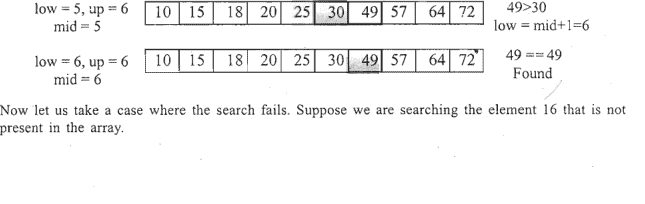

现在让我们考虑一个查找失败的情况。假设我们要查找数组中不存在的元素 16。

| 0 | 1 | 2 | 3 | 4 | 5 | 6 | 7 | 8 | 9 |
|---|---|---|---|---|---|---|---|---|---|
| 10 | 15 | 18 | 20 | 25 | 30 | 49 | 57 | 64 | 72 |

low = 0, up = 9
mid = 4

up = mid-1 = 3

low = 0, up = 3
mid = 1

low = mid+1 = 2

low = 2, up = 3
mid = 2

16 < 18
up = mid-1 = 1

现在 low = 2，up = 1，low 的值已超过 up 的值，因此查找失败。

```c
/*P7.18 Program to search an element through binary search*/
#include <stdio.h>
#define SIZE 10
main()
{
    int arr[SIZE];
    int low,up,mid,i,item;
    printf("Enter elements of the array(in sorted order) : \n");
    for(i=0;i<SIZE;i++)
        scanf("%d",&arr[i]);
    printf("Enter the item to be searched : ");
    scanf("%d",&item);
    low=0;
    up=SIZE-1;
    while(low<=up&&item!=arr[mid] )
    {
        mid=(low+up)/2;
        if(item>arr[mid])
            low=mid+1; /*Search in right portion */
        else
            up=mid-1; /*Search in left portion */
        }
    if(item==arr[mid])
        printf("%d found at position %d\n",item,mid+1);
    else
        printf("%d not found in array\n", item);
}
```

### 问题 3

编写一个程序，通过选择排序将一维数组的元素按升序排序。

排序是将给定元素按升序或降序排列的过程。例如，如果一个数组的元素为：

5, 11, 15, 8, 7, 54, 63, 44

将这些元素按升序排序后，元素将变为：

5, 7, 8, 11, 15, 44, 54, 63

```
10  40  50  60  30  20      arr[1] > arr[4], Exchange
10  30  50  60  40  20      arr[1] > arr[5], Exchange
10  20  50  60  40  30
Pass 3:
    10  20  50  60  40  30      arr[2] < arr[3]
    10  20  50  60  40  30      arr[2] > arr[4], Exchange
    10  20  40  60  50  30      arr[2] > arr[5], Exchange
    10  20  30  60  50  40
Pass 4:
    10  20  30  60  50  40      arr[3] > arr[4], Exchange
    10  20  30  50  60  40      arr[3] > arr[5], Exchange
    10  20  30  40  60  50
Pass 5:
    10  20  30  40  60  50      arr[4] > arr[5], Exchange
    10  20  30  40  50  60

Sorted array is :

    10  20  30  40  50  60
```

各趟中进行的交换如下图所示：

| 第1趟 | 第2趟 | 第3趟 | 第4趟 | 第5趟 |
|---|---|---|---|---|
| i=0<br>j=1 j=2 j=3 j=4 j=5 | i=1<br>j=2 j=3 j=4 j=5 | i=2<br>j=3 j=4 j=5 | i=3<br>j=4 j=5 | i=4<br>j=5 |
| 0 40 20 20 20 20 | 10 10 10 10 | 10 10 10 | 10 10 | 10 |
| 1 20 40 40 40 40 | 40 40 40 30 | 20 20 20 | 20 20 | 20 |
| 2 50 50 50 50 50 | 50 50 50 50 | 50 50 40 | 30 30 | 30 |
| 3 60 60 60 60 60 | 60 60 60 60 | 60 60 60 | 60 50 | 40 |
| 4 30 30 30 30 30 | 30 30 30 40 | 40 40 50 | 50 60 | 60 |
| 5 10 10 10 10 10 | 20 20 20 20 | 30 30 30 | 40 40 | 50 |
| 交换 | 交换 | 交换 | 交换 | 交换 |

```c
/*P7.19 Program of sorting using selection sort*/
#include <stdio.h>
#define SIZE 10
main()
{
    int arr[SIZE];
    int i,j,temp;
    printf("Enter elements of the array :\n");
    for(i=0;i<SIZE;i++)
        scanf("%d",&arr[i]);
    for(i=0;i<SIZE-1;i++)
        for(j=i+1;j<SIZE;j++)
        {
            if(arr[i]>arr[j])
            {
                temp=arr[i];
                arr[i]=arr[j];
                arr[j]=temp;
            }
        }
    printf("Sorted array is : \n");
    for(i=0;i<SIZE;i++)
        printf("%d ",arr[i]);
    printf("\n");
}
```

### 问题 4

编写一个程序，通过冒泡排序将一维数组的元素按升序排序。如果给定 N 个元素，则通过冒泡排序对它们进行排序的过程如下：数组的元素为 `arr[0]`、`arr[1]`、...、`arr[N-1]`

**第 1 趟：**

- 比较第 0 个和第 1 个元素，如果第 0 个 > 第 1 个，则交换它们
- 比较第 1 个和第 2 个元素，如果第 1 个 > 第 2 个，则交换它们
- 比较第 2 个和第 3 个元素，如果第 2 个 > 第 3 个，则交换它们
- 比较第 N-2 个和第 N-1 个元素，如果第 N-2 个 > 第 N-1 个，则交换它们

**第 2 趟：**

- 比较第 0 个和第 1 个元素，如果第 0 个 > 第 1 个，则交换它们
- 比较第 1 个和第 2 个元素，如果第 1 个 > 第 2 个，则交换它们
- 比较第 2 个和第 3 个元素，如果第 2 个 > 第 3 个，则交换它们
- 比较第 N-3 个和第 N-2 个元素，如果第 N-3 个 > 第 N-2 个，则交换它们

**第 N-1 趟：**

比较第 0 个和第 1 个元素，如果第 0 个 > 第 1 个，则交换它们

让我们以一个未排序的元素列表为例，应用冒泡排序对其进行排序。数组的元素为：

40 20 50 60 30 10


20 40 50 60 30 10 arr[2] < arr[3]
20 40 50 60 30 10 arr[3] > arr[4], 交换
20 40 50 30 60 10 arr[4] > arr[5], 交换
20 40 50 30 10 60

### 第 2 趟：

20 40 50 30 10 60 arr[0] < arr[1]
20 40 50 30 10 60 arr[1] < arr[2]
20 40 50 30 10 60 arr[2] > arr[3], 交换
20 40 30 50 10 60 arr[3] > arr[4], 交换
20 40 30 10 50 60

### 第 3 趟：

20 40 30 10 50 60 arr[0] < arr[1]
20 40 30 10 50 60 arr[1] > arr[2], 交换
20 30 40 10 50 60 arr[2] > arr[3], 交换
20 30 10 40 50 60

### 第 4 趟：

20 30 10 40 50 60 arr[0] < arr[1]
20 30 10 40 50 60 arr[1] > arr[2], 交换
20 10 30 40 50 60

### 第 5 趟：

20 10 30 40 50 60 arr[0] > arr[1], 交换
10 20 30 40 50 60

排序后的数组是-
10 20 30 40 50 60

| 第1趟 | 第2趟 | 第3趟 | 第4趟 | 第5趟 |
|---|---|---|---|---|
| i=0 j=0 j=1 j=2 j=3 j=4 | i=1 j=0 j=1 j=2 j=3 | i=2 j=0 j=1 j=2 | i=3 j=0 j=1 | i=4 j=0 |
| 0 40 20 20 20 20 | 0 20 20 20 20 | 0 20 20 20 | 0 20 20 | 0 20 |
| 1 20 40 40 40 40 | 1 40 40 40 40 | 1 40 40 40 | 1 10 10 | 1 10 |
| 2 50 50 50 50 50 | 2 50 50 50 30 | 2 30 30 40 | 2 30 30 | 2 10 |
| 3 60 60 60 60 30 | 3 30 30 30 50 | 3 10 10 10 | 3 40 40 | 3 30 |
| 4 30 30 30 30 60 | 4 10 10 10 10 | 4 50 50 50 | 4 50 50 | 4 40 |
| 5 10 10 10 10 10 | 5 60 60 60 60 | 5 60 60 60 | 5 60 60 | 5 60 |
| 交换 交换 交换 | 交换 交换 | 交换 交换 | 交换 | 交换 |

```c
/*P7.20 Program of sorting using bubble sort*/
#include <stdio.h>
#define SIZE 10
main()
{
    int arr[SIZE];
    int i,j,temp;
    printf("Enter elements of the array :\n");
    for(i=0;i<SIZE;i++)
        scanf("%d",&arr[i]);
    for(i=0;i<SIZE-1;i++)
    {
        for(j=0;j<SIZE-1-i;j++)
        {
            if(arr[j]>arr[j+1])
            {
                temp=arr[j];
                arr[j]=arr[j+1];
                arr[j+1]=temp;
            }
        }
    }
    printf("Sorted array is :\n");
    for(i=0;i<SIZE;i++)
        printf("%d ",arr[i]);
    printf("\n");
}
```

## 问题 5

编写一个程序，将元素插入到已排序的一维数组的适当位置，以便插入后数组仍然保持有序。

假设我们有一个大小为 10 的数组，其中有九个元素按升序排列，最右侧的一个空间为空，用于插入新元素。

| 2 | 4 | 6 | 9 | 12 | 15 | 16 | 19 | 20 |   |
|---|---|---|---|---|---|---|---|---|---|
| 0 | 1 | 2 | 3 | 4 | 5 | 6 | 7 | 8 | 9 |

要插入一个项目，我们将从数组右侧开始将其与数组元素进行比较，并不断将其向右移动。一旦我们得到一个小于该项目的元素，我们就会停止此过程并插入该项目。假设我们要在数组中插入数字 13-

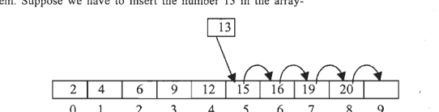

插入后数组变为-

| 2 | 4 | 6 | 9 | 12 | 13 | 15 | 16 | 19 | 20 |
|---|---|---|---|---|---|---|---|---|---|
| 0 | 1 | 2 | 3 | 4 | 5 | 6 | 7 | 8 | 9 |

```c
/*P7.21 Program to insert an item in a sorted array at the proper place by shifting other elements to the right*/
#include<stdio.h>
#define SIZE 10
main()
{
    int arr[SIZE];
    int i,item;
    printf("Enter elements of the array(in sorted order) : \n");
    for(i=0;i<SIZE-1;i++) /*rightmost space in array should be empty*/
        scanf("%d",&arr[i]);
    printf("Enter the item to be inserted : ");
    scanf("%d",&item);
    for(i=SIZE-2;item<arr[i]&&i>=0;i--)
        arr[i+1]=arr[i]; /*Shift elements to the right*/
    arr[i+1]=item;    /*Insert item at the proper place*/
    for(i=0;i<SIZE;i++)
        printf("%d ",arr[i]);
    printf("\n");
}
```

循环中条件 i>=0 的存在是因为如果项目要插入到第 0 个位置，则 i 的值将变为 -1，但 a[-1] 不是有效元素。

## 问题 6

编写一个程序，通过插入排序按升序对一维数组的元素进行排序。

要通过插入排序对数组进行排序，我们将使用前一个程序中描述的插入过程。在这里，我们将把数组的每个元素放在先前已排序元素列表的适当位置。

假设数组 arr 中有 N 个元素。那么将每个元素插入到适当位置的过程如下-

- **第 1 趟：**
  arr[1] 在 arr[0] 之前或之后插入。
  所以 arr[0] 和 arr[1] 已排序。
- **第 2 趟：**
  arr[2] 插入在 arr[0] 之前、在 arr[0] 和 arr[1] 之间或在 arr[1] 之后。
  所以 arr[0]、arr[1] 和 arr[2] 已排序。
- **第 3 趟：**
  arr[3] 插入到数组 arr[0]、arr[1]、arr[2] 中的适当位置
  所以 arr[0]、arr[1]、arr[2]、arr[3] 已排序。

### 第 N-1 趟：

arr[N-1] 插入到数组中的适当位置
        arr[0], arr[1], ................arr[N-2]
    所以 arr[0], arr[1]................arr[N-1] 已排序。

让我们取一个无序的元素列表并通过应用插入排序对其进行排序。

```
~~~
90  30  10  40  50  20  100  70  80  60
~~~
```

```
~~~
k=1,  Insert item = arr[1] = 30   in  90
k=2,  Insert item = arr[2] = 10   in  30  90
k=3,  Insert item = arr[3] = 40   in  10  30  90
k=4,  Insert item = arr[4] = 50   in  10  30  40  90
k=5,  Insert item = arr[5] = 20   in  10  30  40  50  90
k=6,  Insert item = arr[6] = 100  in  10  20  30  40  50  90
k=7,  Insert item = arr[7] = 70   in  10  20  30  40  50  90  100
k=8,  Insert item = arr[8] = 80   in  10  20  30  40  50  70  90  100
k=9,  Insert item = arr[9] = 60   in  10  20  30  40  50  70  80  90  100
~~~
```

```c
/*P7.22 Program to sort numbers using insertion sort*/
#include <stdio.h>
#define SIZE 10
main()
{
    int arr[SIZE];
    int i,k,item;
    printf("Enter elements of the array :\n");
    for(i=0;i<SIZE;i++)
        scanf("%d",&arr[i]);
    for(k=1;k<SIZE;k++)
    {
        item=arr[k]; /*item is to be inserted at proper place*/
        for(i=k-1;item<arr[i]&&i>=0;i--)
            arr[i+1]=arr[i];
        arr[i+1]=item;
    }
    printf("Sorted array is :\n");
    for(i=0;i<SIZE;i++)
        printf("%d ",arr[i]);
    printf("\n");
}
```

## 问题 7

编写一个程序，将两个已排序的数组合并到第三个已排序的数组中

如果有两个已排序的数组，那么将这些已排序的数组合并到另一个按排序顺序的数组中的过程称为合并。让我们取两个按排序顺序的数组 arr1 和 arr2，我们将把它们合并到第三个已排序的数组 arr3 中。

```
~~~
arr1-   5   8   9   28   34
~~~

arr2- 4 22 25 30 33 40 42
```

我们将从每个数组中取一个元素，将它们进行比较，然后取较小的那个放入第三个数组。此过程将一直持续到一个数组的元素用完为止。然后取未完成数组的剩余元素放入第三个数组。合并的整个过程如下所示。arr3 是合并后的数组，i、j、k 是分别用于 arr1、arr2、arr3 的下标的变量。

最初 i = 0, j = 0, k = 0

现在因为 arr1 没有更多元素可比较，所以在 arr3 中取 40、42。因此最终数组 arr3 为- arr3- 4 5 8 9 22 25 28 30 33 40 42

```c
/*P7.23 Program for merging two sorted arrays into a third sorted array*/
#include<stdio.h>
#define SIZE1 5
#define SIZE2 7
#define SIZE3 SIZE1+SIZE2
main()
{
int arr1[SIZE1],arr2[SIZE2],arr3[SIZE3];
int i,j,k;
printf("Enter elements of the array arr1 (in sorted order) : \n");
for(i=0;i<SIZE1;i++)
scanf("%d",&arr1[i]);
printf("Enter elements of the array arr2 (in sorted order) :\n");
for(i=0;i<SIZE2;i++)
scanf("%d",&arr2[i]);
i=0,j=0,k=0;
while((i<SIZE1)&&(j<SIZE2))
{
if(arr1[i]<arr2[j])
arr3[k++]=arr1[i++];
else
arr3[k++]=arr2[j++];
}
while(i<SIZE1) /*Put remaining elements of arr1 into arr3*/
arr3[k++]=arr1[i++];
while(j<SIZE2) /*Put remaining elements of arr2 into arr3*/
arr3[k++]=arr2[j++];
printf("Merged array arr3 is : \n");
for(i=0;i<SIZE3;i++)
printf("%d ",arr3[i]);
printf("\n");
/*End of main() */
}
```

## 数组

## 问题 8

编写一个程序，使用二维数组打印 Pascal 三角形。在程序 P6.30 中，我们曾使用函数打印此三角形

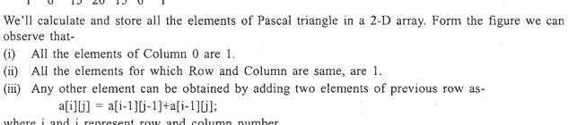

我们将计算并存储 Pascal 三角形的所有元素到一个二维数组中。从图中我们可以观察到-

- (i) 第 0 列和第 1 列的所有元素。
- (ii) 行和列相同的元素都是 1。
- (iii) 任何其他元素都可以通过将上一行的两个元素相加得到，如-
  a[i][j] = a[i-1][j-1]+a[i-1][j];
  其中 i 和 j 表示行号和列号。

```c
/* P7.24 Program to print the Pascal triangle */
#include<stdio.h>
```


```
#define MAX 15
main()
{
    int a[MAX][MAX];
    int i,j,n;
    printf("Enter n :");
    scanf("%d",&n);
    for(i=0;i<n;i++)
    {
        for(j=0;j<=i;j++)
            if(j==0||i==j)
                a[i][j]=1;
            else
                a[i][j]=a[i-1][j-1]+a[i-1][j];
    }
    for(i=0;i<n;i++)
    {
        for(j=0;j<=i;j++)
            printf("%5d", a[i][j]);
        printf("\n");
    }
}
```

## 问题 9

编写一个程序来打印幻方矩阵。

- (i) 幻方矩阵是一个 n x n 阶方阵，即行数等于列数。
- (ii) 幻方矩阵只对奇数 n 存在。
- (iii) 矩阵中的数字为 1, 2, 3, 4......n²，每个数字在矩阵中只能出现一次。
- (iv) 每行、每列和每条对角线的元素之和相等。这个和始终等于 n(n²+1)/2。

n = 3、n = 5、n = 7 的幻方矩阵如下所示：

| 2 | 9 | 4 |
| 7 | 5 | 3 |
| 6 | 1 | 8 |

| 9 | 2 | 25 | 18 | 11 |
| 3 | 21 | 19 | 12 | 10 |
| 22 | 20 | 13 | 6 | 4 |
| 16 | 14 | 7 | 5 | 23 |
| 15 | 8 | 1 | 24 | 17 |

| 20 | 11 | 2 | 49 | 40 | 31 | 22 |
| 12 | 3 | 43 | 41 | 32 | 23 | 21 |
| 4 | 44 | 42 | 33 | 24 | 15 | 13 |
| 45 | 36 | 34 | 25 | 16 | 14 | 5 |
| 37 | 35 | 26 | 17 | 8 | 6 | 46 |
| 29 | 27 | 18 | 9 | 7 | 47 | 38 |
| 28 | 19 | 10 | 1 | 48 | 39 | 30 |

n=3
Sum = 15

n=5
Sum = 65

n=7
Sum=175

创建幻方矩阵的步骤如下：

从底行中间列开始填充数字，因此最初将数字 1 放在底行的中间列。继续放置数字，每次向下移动一行并向左移动一列（左下），直到遇到以下情况之一：

- (i) 如果到达矩阵的左下角，或到达一个已经填充的方格，则在同列中向上移动一行。这种情况在前一个放置的数字能被 n 整除时发生。
- (ii) 如果需要移动到最左边列的左侧，则转到最右边列。
- (iii) 如果需要移动到底行下方，则转到最顶行。

```
/*P7.25 Program to print the magic matrix*/
#include<stdio.h>
#define MAX 20
main()
{
    int a[MAX][MAX],i,j,n,num;
    printf("Enter value of n(odd value) : ");
    scanf("%d",&n);
    i=n-1; /*Bottom row*/
    j=(n-1)/2; /*Centre column*/
    for(num=1;num<=n*n;num++)
    {
        a[i][j]=num;
        i++; /*move down*/
        j--; /*move left*/
        if(num%n==0)
        {
            i-=2; /*one above the previous row*/
            j++; /*back to the previous column*/
        }
        if(i==n)
            i=0; /*go to topmost row*/
        if(j==-1)
            j=n-1; /*go to rightmost column*/
    }/*End of for*/
    for(i=0;i<n;i++)
    {
        for(j=0;j<n;j++)
            printf("%4d",a[i][j]);
        printf("\n");
    }
}
```

## 问题 10

编写一个程序来打印螺旋矩阵。

螺旋矩阵是一个 n x n 方阵，通过从最左列和最顶行开始以螺旋形式放置数字 1, 2, 3, 4 ......n² 形成。螺旋矩阵对 n 的偶数和奇数值都存在。n = 3、n = 4、n = 7 的螺旋矩阵如下所示：

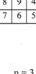

n = 3

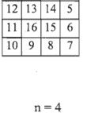

n = 4

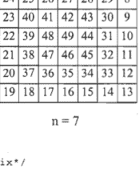

n = 7

```
/*P7.26 Program to print the spiral matrix*/
#include<stdio.h>
#define MAX 20
main()
{
    int n,i=0,j=0,l,u,num=1,arr[MAX][MAX]={0};
    printf("Enter value of n : ");
    scanf("%d",&n);
    l=0;u=n-1;
    for(num=1;num<=n*n;num++)
    {
        arr[i][j]=num;
        if(i==l&&j<u)
            j++;
        else if(j==u&&i<u)
            i++;
        else if(i==u&&j>l)
            j--;
        else if(j==l&&i>l)
            i--;
        if(arr[i+1][j]!=0)      /*If square already filled*/
        {
            l++;
            u--;
            i++;
            j++;
        }
    }
    /*End of for*/
    for(i=0;i<n;i++)
    {
        for(j=0;j<n;j++)
            printf("%4d",arr[i][j]);
        printf("\n");
    }
}
```

## 数组

### 练习

```
main()
{
int i,size=5,arr[size];
for(i=0;i<size;i++)
scanf("%d",arr[i]);
for(i=0;i<size;i++)
arr[i]++;
printf("%d ",arr[i]);
}
```

```
main()
{
int arr[4]={2,4,8,16},i=4,j;
while(i)
{
j=arr[i]+i;
i--;
}
printf("%d\n",j);
}
```

```
main()
{
int i=0,sum=0,arr[6]={4,2,6,0,5,10};
while(arr[i])
{
sum=sum+arr[i];
i++;
}
printf("sum = %d\n",sum);
}
```

```
main()
{
int i,arr[8]={1,2,3,4,5,6,7,8};
for(i=7;i>=0;i--)
printf("%d\t",--arr[i]);
}
```

```
main()
{
int arr[5]={5,10,15,20,25};
func(arr);
}
func(int arr[ ])
{
int i,sum=0;
while(i>2)
sum=sum+arr[i];
printf("sum = %d\n", sum);
}
```

```
(6) main()
{
    int x[10],y[3][4],z[2][3][5];
    printf("%u \t %u \t %u\n",sizeof(x),sizeof(y),sizeof(z));
}
```

```
(7) main()
{
    int a=4,b=6;
    int arr1[5]={1,2,3,4,5};
    int arr2[5]={6,7,8,9,10};
    swapvar(a,b);
    swaparr(arr1,arr2);
    printf("a = %d, b = %d\n",a,b);
    printf("arr1[0] = %d, arr1[4] = %d\n",arr1[0],arr1[4]);
    printf("arr2[0] = %d, arr2[4] = %d\n",arr2[0],arr2[4]);
}
swapvar(int a,int b)
{
    int temp;
    temp=a,a=b,b=temp;
}
swaparr(int arr1[5],int arr2[5])
{
    int i,temp;
    for(i=0;i<5;i++)
    { temp=arr1[i], arr1[i]=arr2[i], arr2[i]=temp; }
}
```

```
(8) main()
{
    int i,j,arr[3][4]={{1,2,3,4},{5,6,7,8},{9,10,11,12}};
    for(i=0;i<4;i++)
    {
        for(j=0;j<3;j++)
            printf("%3d",arr[j][i]);
        printf("\n");
    }
}
```

```
(9) #include<math.h>
main()
{
    int i,j,arr[200];
    for(i=2;i<200;i++)
        arr[i]=1;
    for(i=2;i<=sqrt(200);i++)
        for(j=i*2;j<200;j+=i)
            arr[j]=0;
    for(i=2;i<200;i++)
        if(arr[i]==1)
            printf("%d\t",i);
}
```

```
(10)main()
{
    int a[10]={2,-3,4,-5,6,7,1,9,-10,-11};
    int i,j,x,k=0;
    for(i=0;i<10;i++)
    {
        x=a[k];
        if(x<0)
        {
            for(j=k;j<10;j++)
                a[j]=a[j+1];
            a[9]=x;
        }
        else
            k++;
    }
    for(i=0;i<10;i++)
        printf("%d ",a[i]);
    printf("\n");
}
```

## 编程练习

- 1. 编写程序，接受 n 个数字，并显示最高和最低数字的和。
- 2. 编写程序，在数组中接受 n 个数字，并显示所有偶数的和以及所有奇数的乘积。
- 3. 编写程序，使用以下方法将一维数组的数字按降序排序：
  (i) 选择排序 (ii) 冒泡排序 (iii) 插入排序
- 4. 编写函数，仅反转数组的前 n 个元素。
- 5. 编写程序，修改数组的元素，使最后一个元素成为数组的第一个元素，所有其他元素向右移动。
  1 2 3 4 5 6 7 8 9 → 9 1 2 3 4 5 6 7 8
  我们可以说我们将数组向右旋转了一个元素。现在修改上述程序，以便我们可以将数组旋转任意数量的元素。例如，当我们把数组旋转 3 个元素时，结果将是-
  1 2 3 4 5 6 7 8 9 → 7 8 9 1 2 3 4 5 6
- 6. 编写程序，求出矩阵的行列式。
- 7. 编写程序，统计一个数字在矩阵中出现的次数。
- 8. 编写程序，按行将二维数组的所有元素存储到一维数组中。
- 9. 编写程序，判断矩阵是否对称。如果矩阵的转置等于矩阵，则该矩阵是对称的。
- 10. 编写程序，检查数组的元素是否互不相同。
- 11. 编写程序，检查矩阵的元素是否互不相同。
- 12. 编写程序，求出方阵主对角线和副对角线元素的和。
- 13. 编写程序，输入一个奇数大小的方阵，然后检查它是否为幻方矩阵。如果矩阵中的所有元素互不相同，并且每行、每列和每条对角线的元素之和相等，则该矩阵是幻方矩阵。
- 14. 编写程序，螺旋打印矩阵的元素。例如，如果矩阵是-
  2 5 8
  1 3 7
  6 2 9
  输出应为-
  2 5 8 7 9 2 6 1 3
- 15. 编写程序，反转矩阵的行。
  1 2 3 4      13 14 15 16
  5 6 7 8  →   9 10 11 12
  9 10 11 12     5 6 7 8
  13 14 15 16    1 2 3 4
- 16. 编写程序，反转矩阵的列
  1 2 3 4      4 3 2 1
  5 6 7 8  →   8 7 6 5
  9 10 11 12   12 11 10 9
  13 14 15 16  16 15 14 13
- 17. 编写程序，对矩阵的元素进行排序 (i) 按行 (ii) 按列
  5 8 2 1   1 2 5 8   5 8 2 1   1 3 2 1
  3 6 9 4 → 3 4 6 9   3 6 9 4 → 3 6 2 4
  1 7 2 8   1 2 7 8   1 7 2 8   5 7 5 7
  8 3 5 7   3 5 7 8   8 3 5 7   8 8 9 8
  矩阵          (i)          矩阵          (ii)

## 答案

- (1) 错误，数组的大小应为常量表达式。
- (2) j = 5
- (3) sum = 12
- (4) 6 4 2 0
- (5) sum = 60
- (6) 20 24 60
- (7) a = 4, b = 6
  arr[0] = 6, arr[4] = 10


arr2[0] = 1, arr2[4] = 5

对函数内数组所做的任何更改在调用函数中都是可见的。

（8）
1 5 9
2 6 10
3 7 11
4 8 12
这里行按垂直方向打印，列按水平方向打印。

（9）打印所有小于200的素数。这种找出素数的方法称为埃拉托斯特尼筛法。

（10）2 4 6 7 1 9 -3 -5 -10 -11
这个程序将数组末尾的负数抑制掉。

# 第8章
指针

C 是一种非常强大的语言，而 C 的真正威力在于指针。指针的概念既有趣又具有挑战性。只要彻底理解基础知识，指针的使用非常简单。因此，必须从各个方面理解指针，而不是仅仅停留在对语法和用法的肤浅了解上。使用指针可以使代码更高效、更紧凑。指针的一些用途包括——
- 1. 访问数组元素。
- 2. 从函数返回多个值。
- 3. 访问动态分配的内存。
- 4. 实现链表、树和图等数据结构。

在学习指针之前，了解内存如何在计算机中组织非常重要。计算机中的内存由按顺序排列的字节组成。每个字节都有一个索引号，称为该字节的地址。这些字节的地址从零开始，最后一个字节的地址比内存大小小 1。假设我们有 64 MB 的 RAM，那么内存将由 64 * 2^20 = 67108864 个字节组成。这些字节的地址将从 0 到 67108863。

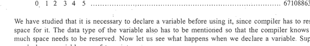

我们已经学过，在使用变量之前必须声明它，因为编译器必须为它预留空间。还必须指明变量的数据类型，以便编译器知道需要预留多少空间。现在让我们看看声明变量时会发生什么。假设我们声明一个 int 类型的变量 age。

```
int age;
```

编译器从内存中为这个变量保留 2 个连续的字节，并将名称 age 与它关联起来。这两个分配字节中第一个字节的地址称为变量 age 的地址。

假设编译器为变量 age 的存储保留了编号为 2588 和 2589 的字节，那么变量 age 的地址将是 2588。让我们给这个变量赋一些值——age = 20;

现在这个值将存储在这 2 个字节中（当然是以二进制形式）。分配的字节数取决于变量的数据类型。例如，对于一个 float 变量将分配 4 个字节，第一个字节的地址称为该变量的地址。现在我们将了解如何找出变量的地址。

### 8.2 地址运算符

C 提供了一个地址运算符'&'，当它放在变量前面时，返回该变量的地址。这个运算符可以读作“...的地址”，所以 &age 表示 age 的地址，类似地 &sal 表示 sal 的地址。下面的程序使用地址运算符打印变量的地址。

```
/*P8.1 Program to print address of variables using address operator*/
#include<stdio.h>
main()
{
    int age=30;
    float sal=1500.50;
    printf("Value of age = %d, Address of age = %u\n",age,&age);
    printf("Value of sal = %f, Address of sal = %u\n",sal,&sal);
}
```

### 输出：

Value of age = 30, Address of age = 65524
Value of sal = 1500.500000, Address of sal = 65520

这里我们使用 %u 控制序列来打印地址，但这并不意味着地址是无符号整数。我们使用它是因为没有专门的控制序列来显示地址。地址只是整数。每次运行程序时这些地址可能都不同，这取决于操作系统为这个程序分配了内存的哪个部分。

地址运算符不能用于常量或表达式。

- &i; /*有效，与变量一起使用*/
- &arr[1]; /*有效，与数组元素一起使用*/
- &289; /*无效，与常量一起使用*/
- &(i+k); /*无效，与表达式一起使用*/

这个地址运算符对我们来说并不陌生，我们已经在 scanf( ) 函数中使用过它。变量的地址提供给 scanf( )，以便它知道在哪里写入输入值。所以现在你可以理解为什么在 scanf( ) 中要在变量名之前放置'&'。

### 8.3 指针变量

经过这番简短的介绍，终于到了介绍指针的时候了。指针是存储内存地址的变量。像所有其他变量一样，它也有名称，必须被声明，并在内存中占据一些空间。它被称为指针，是因为它通过存储某个位置的地址来指向内存中的特定位置。

### 8.3.1 指针变量的声明

与其他变量一样，指针变量在使用前也应被声明。声明的一般语法是——

```
data_type *pname;
```

这里 pname 是指针变量的名称，它应该是一个有效的 C 标识符。名称前面的星号'*'告诉编译器该变量被声明为指针。这里的 data_type 称为指针的基类型。让我们看一些指针声明——

```
int *iptr;
float *fptr;
char *cptr, ch1, ch2;
```

这里 iptr 是一个指针，应该指向 int 类型的变量，类似地，fptr 和 cptr 应该分别指向 float 和 char 类型的变量。这里变量 iptr 的类型是“指向 int 的指针”或 (int *)，或者我们可以说 iptr 的基类型是 int。我们也可以像第三个声明语句那样组合简单变量和指针变量的声明，其中 ch1 和 ch2 被声明为 char 类型的变量。

指针也是变量，所以编译器会为它们预留空间，它们也会有一些地址。所有指针，无论其基类型如何，在内存中占据相同的空间，因为它们都只包含地址。通常用 2 个字节来存储一个地址（在不同的计算机中可能有所不同），因此编译器为一个指针变量分配 2 个字节。

现在问题来了：既然所有指针都只包含地址，并且每个指针都占据 2 个字节，那么为什么我们必须在声明语句中提到数据类型呢？当我们学习间接运算符和指针算术时，我们将会明白这一点。

### 8.3.2 给指针变量赋值

当我们声明一个指针变量时，它包含垃圾值，即它可能指向内存中的任何位置。因此，我们应始终在程序中使用它之前为其赋一个地址。使用未赋值的指针可能会产生不可预测的结果，甚至导致程序崩溃。指针可以通过赋值语句被赋给一个变量的地址。例如——

```
int *iptr, age = 30;
float *fptr, sal = 1500.50;
iptr = &age;
fptr = &sal;
```

现在 iptr 包含变量 age 的地址，即它指向变量 age，类似地 fptr 指向变量 sal。由于 iptr 被声明为 int 类型的指针，我们应该只将整数变量的地址赋给它。如果我们赋其他数据类型的地址，编译器不会显示任何错误，但输出将是不正确的。

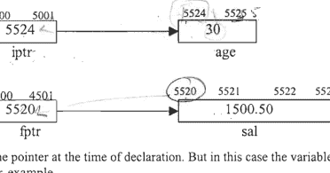

我们也可以在声明时初始化指针。但在这种情况下，变量应在指针之前声明。例如——

```
int age = 30, *iptr = &age;
float sal = 1500.50, *fptr = &sal;
```

也可以将一个指针变量的值赋给另一个指针变量，前提是它们的基类型相同。例如，如果我们有一个整型指针 p1，那么我们可以将 iptr 的值赋给它，如下所示——

```
p1 = iptr;
```

现在指针变量 iptr 和 p1 都包含变量 age 的地址，并且指向同一个变量 age。

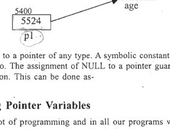

我们可以将常量零赋给任何类型的指针。在 stdio.h 中定义了一个符号常量 NULL，它表示值零。将 NULL 赋给指针可以保证它不指向任何有效的内存位置。这可以这样完成——

```
ptr = NULL;
```

### 8.3.3 解引用指针变量

到目前为止，我们已经进行了很多编程，在所有程序中我们都使用了变量的名称来访问它。我们也可以使用指针间接访问变量。为此，我们将使用间接运算符(* )。通过将间接运算符放在指针变量之前，我们可以访问地址存储在指针中的变量。让我们看一个例子——

```
int a = 87;
float b = 4.5;
int *p1 = &a;
float *p2 = &b;
```

在我们的程序中，如果在 p1 前放置'*'，那么我们可以访问地址存储在 p1 中的变量。由于 p1 包含变量 a 的地址，我们可以通过写 *p1 来访问变量 a。类似地，我们可以通过写 *p2 来访问变量 b。因此，我们可以使用 *p1 和 *p2 来代替变量名 a


现在我们可以在程序中的任何地方使用 `*p1` 和 `*p2`。让我们看一些示例：

| 表达式 | 等价于 | 等价写法 |
|---|---|---|
| `*p1 = 9;` | 等价于 | `a = 9;` |
| `(*p1)++;` | 等价于 | `a++;` |
| `x = *p2 + 10;` | 等价于 | `x = b + 10;` |
| `printf("%d %f", *p1, *p2);` | 等价于 | `printf("%d %f", a, b);` |
| `scanf("%d%f", p1, p2);` | 等价于 | `scanf("%d%f", &a, &b);` |

间接运算符可以读作“地址处的值”。例如，`*p1` 可以读作“地址 `p1` 处的值”。这个间接运算符（`*`）不同于声明指针变量时使用的星号。

现在我们来看术语 `*(&age)` 的含义，其中 `age` 是一个变量。由于 `&age` 是一个地址，用 `*` 运算符对它解引用将得到该地址处的变量，而该地址处的变量就是 `age`。因此，`*(&age)` 与写 `age` 相同。

```c
/*P8.2 Program to dereference pointer variables*/
#include<stdio.h>
main()
{
    int a=87;
    float b=4.5;
    int *p1=&a;
    float *p2=&b;
    printf("Value of p1 = Address of a = %u\n",p1);
    printf("Value of p2 = Address of b = %u\n",p2);
    printf("Address of p1 = %u\n",&p1);
    printf("Address of p2 = %u\n",&p2);
    printf("Value of a = %d %d %d \n",a,*p1,*(&a));
    printf("Value of b = %f %f %f \n",b,*p2,*(&b));
}
```

输出：

```text
Value of p1 = Address of a = 65524
Value of p2 = Address of b = 65520
Address of p1 = 65518
Address of p2 = 65516
Value of a = 87 87 87
Value of b = 4.500000 4.500000 4.500000
```

我们已经看到，在声明指针变量时，必须指明数据类型。原因在于，当我们使用间接运算符时，不同数据类型所检索到的字节数会不同。指针的值只告诉起始字节的地址。例如，假设我们有一个指针 `ptr`，它包含地址 2000，当我们写 `*ptr` 时，编译器知道它必须访问从地址 2000 开始的信息。因此，编译器会查看指针的基类型，并根据该基类型检索信息。例如，如果基类型是 `int`，则会检索 2 字节信息；如果基类型是 `float`，则会检索 4 字节信息，依此类推。下图说明了这一事实。阴影部分表示检索到的字节数。

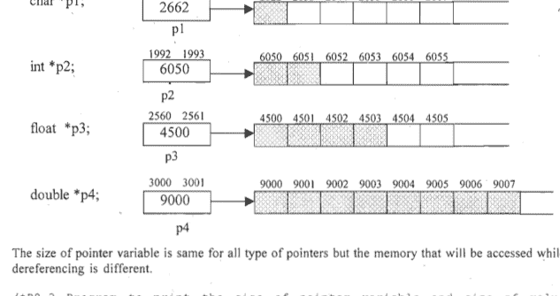

对于所有类型的指针，指针变量的大小都相同，但解引用时访问的内存不同。

```c
/*P8.3 Program to print the size of pointer variable and size of value dereferenced by that pointer*/
#include<stdio.h>
main()
{
char a='x',*p1=&a;
int b=12,*p2=&b;
float c=12.4,*p3=&c;
double d=18.3,*p4=&d;
printf("sizeof(p1) = %d , sizeof(*p1) = %d\n",sizeof(p1),sizeof(*p1));
printf("sizeof(p2) = %d , sizeof(*p2) = %d\n",sizeof(p2),sizeof(*p2));
printf("sizeof(p3) = %d , sizeof(*p3) = %d\n",sizeof(p3),sizeof(*p3));
printf("sizeof(p4) = %d , sizeof(*p4) = %d\n",sizeof(p4),sizeof(*p4));
}
```

输出：

```text
sizeof(p1) = 2 , sizeof(*p1) = 1
sizeof(p2) = 2 , sizeof(*p2) = 2
sizeof(p3) = 2 , sizeof(*p3) = 4
sizeof(p4) = 2 , sizeof(*p4) = 8
```

## 8.4 指针算术

并非所有类型的算术运算都可以用于指针。可以执行的有效运算只有：

- (1) 将整数加到指针上以及自增运算。
- (2) 从指针中减去整数以及自减运算。
- (3) 用一个指针减去另一个同类型指针。

指针算术会根据指针基类型的大小进行缩放。例如，如果我们有一个整型指针 `pi`，它包含地址 1000，那么自增后得到 1002 而不是 1001。这是因为 `int` 数据类型的大小为 2。类似地，对 `pi` 自减时，我们将得到 998 而不是 999。表达式 `(pi + 3)` 将表示地址 1006。让我们看看 `int`、`float` 和 `char` 指针的一些指针算术。

```c
int a = 5, *pi = &a;
float b = 2.2, *pf = &b;
char c = 'x', *pc = &c;
```

假设变量 `a`、`b` 和 `c` 的地址分别为 1000、4000 和 5000，那么最初 `pi`、`pf`、`pc` 的值将分别为 1000、4000 和 5000。

- `pi++;` 或 `++pi;` → `pi = 1000 + 2 = 1002`（因为 `int` 为 2 字节）
- `pi = pi - 3;` → `pi = 1002 - 3*2 = 996`
- `pi = pi + 5;` → `pi = 996 + 5*2 = 1006`
- `pi--;` 或 `--pi;` → `pi = 1006 - 2 = 1004`

- `pf++;` 或 `++pf;` → `pf = 4000 + 4 = 4004`（因为 `float` 为 4 字节）
- `pf = pf - 3;` → `pf = 4004 - 3*4 = 3992`
- `pf = pf + 5;` → `pf = 3992 + 5*4 = 4012`
- `pf--;` 或 `--pf;` → `pf = 4012 - 4 = 4008`

- `pc++;` 或 `++pc;` → `pc = 5000 + 1 = 5001`（因为 `char` 为 1 字节）
- `pc = pc - 3;` → `pc = 5001 - 3 = 4998`
- `pc = pc + 5;` → `pc = 4998 + 5 = 5003`
- `pc--;` 或 `--pc;` → `pc = 5003 - 1 = 5002`

编译器会自动缩放所有这些算术运算，因为它知道指针的基类型。对于 `char` 指针，这种算术看起来像普通算术，因为 `char` 的大小为 1 字节。变量 `a`、`b` 和 `c` 的地址不受这些运算影响；只有指针向前或向后移动。

假设 `pi` 是一个整型指针，最初包含地址 1000。

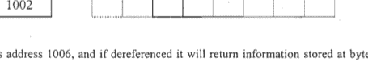

(a) `pi++;`

自增后，指针 `pi` 指向地址 1002；如果解引用（`*pi`），它将返回存储在字节 1002 和 1003 中的信息。


(b) `pi = pi + 2;`

现在 `pi` 包含地址 1006，如果解引用，它将返回存储在字节 1006 和 1007 中的信息。

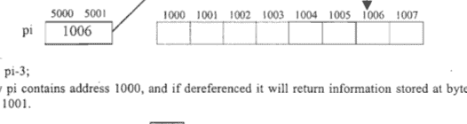

(c) `pi = pi - 3;`

现在 `pi` 包含地址 1000，如果解引用，它将返回存储在字节 1000 和 1001 中的信息。

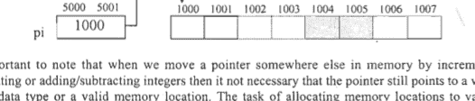

(d) `printf("%d", *(pi + 2));`

这里指针不会移动到地址 1004，因为我们没有为它分配任何新值。存储在字节 1004 和 1005 中的整数将被打印。

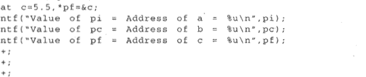

需要注意，当我们通过自增/自减或加减整数将指针移动到内存中的其他位置时，指针不一定仍然指向相同数据类型的变量或有效的内存位置。为变量分配内存位置的任务由编译器完成。我们不知道编译器将它们存储在哪里以及以什么顺序存储。我们应确保以这样的方式移动指针，使它们始终指向有效的内存位置。对于数组，元素按连续顺序存储。因此，这种算术通常应用于数组。

```c
/*P8.4 Program to show pointer arithmetic*/
#include<stdio.h>
main()
{
 int a=5,*pi=&a;
 char b='x',*pc=&b;
 float c=5.5,*pf=&c;
 printf("Value of pi = Address of a = %u\n",pi);
 printf("Value of pc = Address of b = %u\n",pc);
 printf("Value of pf = Address of c = %u\n",pf);
 pi++;
 pc++;
 pf++;
 printf("Now value of pi = %u\n",pi);
 printf("Now value of pc = %u\n",pc);
 printf("Now value of pf = %u\n",pf);
}
```

输出：

```text
Value of pi = Address of a = 1000
Value of pc = Address of b = 4000
Value of pf = Address of c = 8000
Now value of pi = 1002
Now value of pc = 4001
Now value of pf = 8004
```

```c
/*P8.5 Program to understand the postfix/prefix increment/decrement in a pointer variable of base type int */
#include<stdio.h>
main ()
{
	int a=5;
	int *p;
	p=&a;
	printf("Value of p = Address of a = %u\n",p);
	printf("Value of p = %u\n",++p);
	printf("Value of p = %u\n",p++);
	printf("Value of p = %u\n",--p);
	printf("Value of p = %u\n",p--);
}
```

输出：

```text
Value of p = Address of a = 1000
Value of p = 1002
Value of p = 1002
Value of p = 1002
Value of p = 1000
```

在第一个 `printf` 中，打印了 `a = 1000` 的地址。在第二个 `printf` 中，首先将指针自增，然后打印其值。由于指针的基类型是 `int`，它增加了 2。类似地，执行其他 `printf` 语句。

用一个指针减去另一个相同基类型的指针会返回一个整数，表示两个指针之间的元素个数。如果我们有两个 `int` 指针 `ptr1` 和 `ptr2`，分别包含地址 3000 和 3010，那么 `ptr2 - ptr1` 将得到 5（因为 `int` 的大小为 2）。这种运算通常在两个指针变量都指向同一数组的元素时执行。

永远不能对指针执行的算术运算有：

- 两个指针相加、相乘、相除。
- 指针乘以任何数字。
- 指针除以任何数字。
- 将 `float` 或 `double` 值加到指针上。

`*` 运算符与自增/自减运算符的优先级相同，它们的结合性是从右到左。在指针表达式中组合这些运算符时可能会产生混淆。


因此我们应当谨慎使用它们。

假设 `ptr` 是一个整型指针，`x` 是一个整型变量。现在我们来看看下面给出的指针表达式是如何被解释的。

```
x = *ptr++;
x = *++ptr;
x = ++*ptr;
x = (*ptr)++;
```

### (i) x = *ptr++

表达式 `*ptr++` 等价于 `*(ptr++)`，因为这些运算符从右到左结合。因此，自增运算符将作用于 `ptr`，而不是 `*ptr`。自增运算符是后缀形式，所以首先在表达式中使用 `ptr` 的值，然后将其自增。因此，首先对 `ptr` 所指向的整数进行解引用并赋值给 `x`，然后 `ptr` 自增。这与下面的写法相同——

```
x = *ptr;
ptr = ptr+1;
```

### (ii) x = *++ptr

表达式 `*++ptr` 等价于 `*(++ptr)`。这里自增运算符同样作用于 `ptr`。自增运算符是前缀形式，所以首先将 `ptr` 自增，然后在表达式中使用它的新值。因此，首先 `ptr` 的值自增，然后对新地址处的值进行解引用并赋值给 `x`。这与下面的写法相同——

```
ptr = ptr+1;
x = *ptr;
```

### (iii) x = ++*ptr

表达式 `++*ptr` 等价于 `++(*ptr)`。这里自增运算符作用于 `*ptr`，而不是 `ptr`。因此这里指针的值不会改变，但指针所指向的值会改变，即 `*ptr` 将自增。由于自增运算符是前缀形式，因此首先 `*ptr` 的值自增，然后这个值被赋值给 `x`。这与下面的写法相同——

```
*ptr = *ptr+1;
x = *ptr;
```

### (iv) x = (*ptr)++

这里自增运算符同样作用于 `*ptr`，并且由于它是后缀自增，因此首先将 `*ptr` 的值赋值给 `x`，然后它再自增。这与下面的写法相同——

```
x = *ptr;
*ptr = *ptr+1;
```

我们举一个例子来理解这些表达式是如何被解释的。假设地址 2000 处的值是 25，地址 2002 处的值是 38，`ptr` 是一个整型指针，它包含地址 2000，因此 `*ptr` 的值是 25。现在我们来看看，如果这是所有情况下的初始条件，上述四种情况的结果分别会是什么。

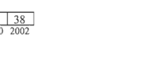

(i) x = *ptr++;
x 的值 = 25，ptr 中包含的地址 = 2002，*ptr = 38

(ii) x = *++ptr;
x 的值 = 38，ptr 中包含的地址 = 2002，*ptr = 38

(iii) x = ++*ptr;
x 的值 = 26，ptr 中包含的地址 = 2000，*ptr = 26

(iv) x = (*ptr)++;
x 的值 = 25，ptr 中包含的地址 = 2000，*ptr = 26

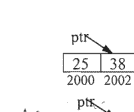

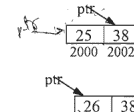

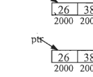

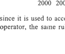

在上述四种指针表达式形式中，第一种通常会被使用，因为它用于访问数组中的元素。在上面的语句中我们使用的是自增运算符，同样的规则也适用于自减运算符。

## 8.6 指针比较

关系运算符 `==`、`!=`、`<=`、`<`、`>=`、`>` 可用于指针。运算符 `==` 和 `!=` 用于比较两个指针，以判断它们是否包含相同的地址。只有当两者都为 `NULL`，或者它们包含同一变量的地址时，它们才相等。这些运算符在同一类型的指针之间，或在 `NULL` 指针与任何其他指针之间，或在 `void` 指针与任何其他指针之间使用是有效的。关系运算符 `<`、`>`、`>=`、`<=` 在同一类型的指针之间有效。只有当两个指针都指向同一数组的元素时，这些运算才有意义。

## 8.7 指向指针的指针

我们知道，指针是一个可以保存内存地址的变量。这个指针变量在内存中占用一些空间，因此它也有地址。我们可以将指针变量的地址存储在另一个变量中，这称为指向指针的指针变量。类似地，我们可以有指向指针的指针的指针变量，并且这个概念可以扩展到任意层次，但在实践中只使用指向指针的指针。指向指针的指针通常用于将指针变量传递给函数时。

声明指向指针的指针的语法如下——

```
data_type **pptr;
```

这里变量 `pptr` 是一个指向指针的指针，它可以指向一个指向 `data_type` 类型变量的指针。声明中使用的双星号告知编译器正在声明一个指向指针的指针。现在我们举一个例子——

```
int a = 5;
int *pa = &a;
int **ppa = &pa;
```

这里变量 `a` 的类型是 `int`，变量 `pa` 的类型是 `(int *)` 或指向 `int` 的指针，变量 `ppa` 的类型是 `(int **)` 或指向 `int` 的指针的指针。

### 指针

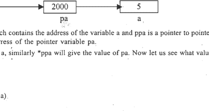

这里 `pa` 是一个指针变量，它包含变量 `a` 的地址；`ppa` 是一个指向指针的指针变量，它包含指针变量 `pa` 的地址。
我们知道 `*pa` 给出 `a` 的值，类似地，`*ppa` 将给出 `pa` 的值。现在我们来看看 `**ppa` 会给出什么值。

**ppa
→ *(ppa)
→ *pa（因为 *pa 给出 pa）。
→ a（因为 *pa 给出 a）

因此我们可以看到，`**ppa` 将给出 `a` 的值。所以，要访问由指向指针的指针间接指向的值，我们可以使用双重间接运算符。下面的表格将使这个概念更清楚。

| a 的值 | a | *pa | **ppa | 5 |
|------------|---|---|---|---|
| a 的地址 | &a | pa | **ppa | 2000 |
| pa 的值 | &pa | pa | **ppa | 2000 |
| pa 的地址 | &ppa | ppa | **ppa | 3000 |
| ppa 的值 | &ppa | ppa | **ppa | 3000 |
| ppa 的地址 | &ppa | ppa | **ppa | 4000 |

```c
/* P8.6 Program to understand pointer to pointer */
#include<stdio.h>
int main()
{
int a=5;
int *pa;
int **ppa;
pa=&a;
ppa=&pa;
printf("Address of a = %u\n",&a);
printf("Value of pa = Address of a = %u\n",pa);
printf("Value of *pa = Value of a = %d\n",*pa);
printf("Address of pa = %u\n",&pa);
printf("Value of ppa = Address of pa = %u\n",ppa);
printf("Value of *ppa = Value of pa = %u\n",*ppa);
printf("Value of **ppa = Value of a = %d\n",**ppa);
printf("Address of ppa = %u\n",&ppa);
}
```

Address of a = 65524
Value of pa = Address of a = 65524
Value of *pa = Value of a = 5
Address of pa = 65524
Value of ppa = Address of pa = 65524
Value of *ppa = Value of pa = 3000
Value of **ppa = Value of a = 5
Address of ppa = 4000

Address of pa = 65522
Value of ppa = Address of pa = 65522
Value of *ppa = Value of pa = 65524
Value of **ppa = Value of a = 5
Address of ppa = 65520

## 8.8 指针与一维数组

数组的元素存储在连续的内存位置中。假设我们有一个 `int` 类型的数组 `arr[5]`。

```
int arr[5] = {1, 2, 3, 4, 5};
```

它在内存中的存储如下——

| 5000 | 5002 | 5004 | 5006 | 5008 |
|---|---|---|---|---|
| 1 | 2 | 3 | 4 | 5 |
| arr[0] | arr[1] | arr[2] | arr[3] | arr[4] |

这里 5000 是第一个元素的地址，并且由于每个元素（`int` 类型）占用 2 个字节，所以下一个元素的地址是 5002，依此类推。数组第一个元素的地址也称为数组的基地址。因此我们已经看到，数组的元素在内存中一个接一个地顺序存储。

在 C 语言中，指针和数组密切相关。我们可以使用指针表达式访问数组元素。实际上，编译器也是通过将下标表示法转换为指针表示法来访问数组元素的。以下是理解指针与数组关系的主要要点。

- 1. 数组的元素存储在连续的内存位置中。
- 2. 数组名是一个常量指针，它指向数组的第一个元素，即它存储第一个元素的地址，也称为数组的基地址。
- 3. 根据指针运算，当一个指针变量自增时，它指向其基类型的下一个位置。

例如——

```
int arr[5] = { 5 , 10 , 15 , 20, 25 }
```

这里 `arr[5]` 是一个数组，它有 5 个元素，每个元素的类型都是 `int`。

| arr[0] | arr[1] | arr[2] | arr[3] | arr[4] |
|---|---|---|---|---|
| 5 | 10 | 15 | 20 | 25 |
| 2000 | 2002 | 2004 | 2006 | 2008 |

我们可以通过在带下标的变量名前应用 `&` 运算符来获取数组元素的地址。因此，`&arr[0]` 给出第 0 个元素的地址，`&arr[1]` 给出第一个元素的地址，依此类推。由于数组下标从 0 开始，我们将数组的第一个元素称为第 0 个元素，依此类推。

下面的程序表明，数组的元素存储在连续的内存位置中。

```
/*P8.7 Program to print the value and address of the elements of an
```

```c
array */
#include<stdio.h>
main()
{
    int arr[5]={5,10,15,20,25};
    int i;
    for(i=0;i<5;i++)
    {
        printf("Value of arr[%d] = %d\t",i,arr[i]);
        printf("Address of arr[%d] = %u\n",i,&arr[i]);
    }
}
```

## 输出：

arr[0] 的值 = 5      arr[0] 的地址 = 2000
arr[1] 的值 = 10     arr[1] 的地址 = 2002
arr[2] 的值 = 15     arr[2] 的地址 = 2004
arr[3] 的值 = 20     arr[3] 的地址 = 2006
arr[4] 的值 = 25     arr[4] 的地址 = 2008

数组名‘arr’表示数组第 0 个元素的地址，即 2000。第 0 个元素的地址也可以用 &arr[0] 表示，因此 arr 和 &arr[0] 代表相同的地址。数组名是一个常量指针，根据指针运算，当一个整数加到指针上时，我们得到相同基础类型的下一个元素的地址。因此 (arr+1) 将表示下一个元素 arr[1] 的地址。类似地 (arr+2) 表示 arr[2] 的地址，以此类推。换句话说，我们可以说指针表达式 (arr+1) 指向数组的第 1 个元素，(arr+2) 指向数组的第 2 个元素，以此类推。

| 表达式 | 含义 | 地址 | 值 |
|---|---|---|---|
| arr | → 指向第 0 个元素 | → &arr[0] | → 2000 |
| arr+1 | → 指向第 1 个元素 | → &arr[1] | → 2002 |
| arr+2 | → 指向第 2 个元素 | → &arr[2] | → 2004 |
| arr+3 | → 指向第 3 个元素 | → &arr[3] | → 2006 |
| arr+4 | → 指向第 4 个元素 | → &arr[4] | → 2008 |

一般可以写成-
指针表达式 (arr+i) 表示与 &arr[i] 相同的地址。现在如果我们对 arr 解引用，则得到数组的第 0 个元素，即表达式 *arr 或 *(arr+0) 表示数组的第 0 个元素。类似地，对 (arr+1) 解引用得到第 1 个元素，以此类推。

| 表达式 | 含义 | 等价 | 值 |
|---|---|---|---|
| *arr | → 第 0 个元素的值 | → arr[0] | → 5 |
| *(arr+1) | → 第 1 个元素的值 | → arr[1] | → 10 |
| *(arr+2) | → 第 2 个元素的值 | → arr[2] | → 15 |
| *(arr+3) | → 第 3 个元素的值 | → arr[3] | → 20 |
| *(arr+4) | → 第 4 个元素的值 | → arr[4] | → 25 |

一般可以写成-
*(arr+i) = arr[i]
因此在下标表示法中，数组元素的地址是 &arr[i]，其值是 arr[i]，而在指针表示法中，地址是 `(arr+i)`，元素是 `*(arr+i)`。

/*P8.8 Program to print the value, and address of elements of an array
using pointer notation*/
#include<stdio.h>
main()
{
    int arr[5]={5,10,15,20,25};
    int i=0;
    for(i=0;i<5;i++)
    {
        printf("Value of arr[%d] = %d\t", i, *(arr+i));
        printf("Address of arr[%d] = %u\n", i, arr+i);
    }
}
```

此程序的输出与 P8.7 相同。

通过指针表示法访问数组元素比通过下标表示法访问更快，因为编译器最终会将下标表示法转换为指针表示法，然后再访问数组元素。

数组下标是可交换的，即 `arr[i]` 与 `i[arr]` 相同。

我们之前看到-

`arr[i]` is equivalent to `*(arr + i)`

现在 `*(arr+i)` 与 `*(i+arr)` 相同，因此我们可以将上述语句写成-

`arr[i]` is equivalent to `*(i + arr)`

现在 `*(i+arr)` 可以在下标表示法中写成 `i[arr]`，因此

`arr[i]` is equivalent to `i[arr]`

```
/* P8.9 Program to print the value of array elements using pointer and
subscript notation */
#include<stdio.h>
main()
{
    int arr[5]={5,10,15,20,25};
    int i=0;
    for(i=0;i<5;i++)
    {
        printf("Value of arr[%d]=",i);
        printf("%d\t",arr[i]);
        printf("%d\t",*(arr+i));
        printf("%d\t",*(i+arr));
        printf("%d\n",i[arr]);
        printf("Address of arr[%d] = %u\n",i,&arr[i]);
    }
}
```

## 输出：

arr[0] 的值 = 5&emsp;&emsp;5&emsp;&emsp;5&emsp;&emsp;5
arr[0] 的地址 = 2000

arr[1] 的值 = 10 10 10 10
arr[1] 的地址 = 2002
arr[2] 的值 = 15 15 15 15
arr[2] 的地址 = 2004
arr[3] 的值 = 20 20 20 20
arr[3] 的地址 = 2006
arr[4] 的值 = 25 25 25 25
arr[4] 的地址 = 2008

## 8.9 指针变量的子脚本

假设我们取一个指针变量 ptr，并用数组第 0 个元素的地址对其进行初始化。

```
int *ptr;
ptr = arr; /*We could also write ptr = &arr[0] */
```


在应用指针运算和解引用后，我们可以看到表达式 (ptr+i) 表示数组第 i 个元素的地址，而表达式 *(ptr+i) 表示数组第 i 个元素的值。根据指针和下标表示法的等价性，*(ptr+i) 可以写成 ptr[i]。因此，如果我们有一个指向数组第 0 个元素的指针变量，则可以通过对该指针变量进行下标操作来访问数组元素。这种指针和下标表示法的等价性在动态数组和向函数传递数组时使用。

现在让我们看看数组名和指针变量之间的区别。数组名是一个常量指针，因此它将始终指向数组的第 0 个元素。它不是一个变量，因此我们不能为其分配其他地址，也不能通过递增或递减来移动它。

```
arr = &num;    /*Illegal*/
arr++;        /*Illegal*/
arr = arr-1;   /*Illegal*/
```

但由于 ptr 是一个指针变量，所有这些操作对它都是有效的。

```
ptr = &num;    /* Now ptr points to variable num*/
ptr++;         /* ptr points to next location */
ptr = ptr-1;   /*ptr points to previous location*/
```

```
/*8.10 Program to print the value and address of array elements by subscripting a pointer variable*/
#include<stdio.h>
main()
{
    int arr[5]={5,10,15,20,25};
    int i,*p;
```

## C 语言深入解析

```
p=arr;
for(i=0;i<5;i++)
{
printf("Address of arr[%d] = %u %u %u %u\n",i,arr[i],arr++,p++,&p[i]);
printf("Value of arr[%d] = %d %d %d %d \n",i,arr[i],*(arr+i),*(p+i),p[i]);
}
```

输出
arr[0] 的地址 = 2000 2000 2000 2000
arr[0] 的值 = 5 5 5 5
arr[1] 的地址 = 2002 2002 2002 2002
arr[1] 的值 = 10 10 10 10
arr[2] 的地址 = 2004 2004 2004 2004
arr[2] 的值 = 15 15 15 15
arr[3] 的地址 = 2006 2006 2006 2006
arr[3] 的值 = 20 20 20 20
arr[4] 的地址 = 2008 2008 2008 2008
arr[4] 的值 = 25 25 25 25

## 8.10 指向数组的指针

在上一节中，我们有一个指向数组第 0 个元素的指针。我们也可以声明一个可以指向整个数组而不是仅数组的一个元素的指针。此指针在讨论多维数组时很有用。现在我们将看到如何声明指向数组的指针。

int (*ptr)[10];

这里 ptr 是可以指向包含 10 个整数的数组的指针。注意，必须将指针名用括号括起来。这里 ptr 的类型是“指向包含 10 个整数的数组的指针”。

请注意，指向数组第 0 个元素的指针和指向整个数组的指针是完全不同的。以下程序显示了这一点。

```
/*P8.11 Program to understand difference between pointer to an integer and pointer to an array of integers*/
#include<stdio.h>
main()
{
int *p; /*Can point to an integer*/
int (*ptr)[5]; /*Can point to an array of 5 integers*/
int arr[5];
p=arr; /*Points to 0th element of arr*/
ptr=arr; /*Points to the whole array arr*/
printf("p = %u, ptr = %u\n",p,ptr);
p++;
ptr++;
printf("p = %u, ptr = %u\n",p,ptr);
}
```

```
Output:

p = 3000, ptr = 3000
p = 3002, ptr = 3010
```

这里 p 是一个指向数组 arr 第 0 个元素的指针，而 ptr 是一个指向整个数组 arr 的指针。p 的基类型是‘int’，而 ptr 的基类型是‘包含 5 个整数的数组’。我们知道指针运算是相对于基大小执行的，因此如果我们写 ptr++，则指针 ptr 将向前移动 10 字节。以下图示显示了两个指针 p 和 ptr，在本章中我们将使用较暗的箭头表示指向数组的指针。


对指针表达式进行解引用时，我们得到该指针表达式指向的值。指向数组的指针指向一个数组，因此对其进行解引用时应得到该数组，而数组名表示基地址。因此，每当对指向数组的指针进行解引用时，我们都会得到其指向的数组的基地址。

```
/*P8.12 Program to dereference a pointer to an array*/
#include<stdio.h>
main()
{
    int arr[5]={3,5,6,7,9};
    int *p=arr;
    int (*ptr)[5]=arr;
    printf("p = %u, ptr = %u\n",p,ptr);
    printf("*p = %d, *ptr = %u\n",*p,*ptr);
    printf("sizeof(p) = %u, sizeof(*p) = %u\n",sizeof(p),sizeof(*p));
    printf("sizeof(ptr) = %u, sizeof(*ptr) = %u\n",sizeof(ptr),
    sizeof(*ptr));
}
```

```
Output:

p = 3000, ptr = 3000
*p = 3, *ptr = 3000
sizeof(p) = 2, sizeof(*p) = 2
sizeof(ptr) = 2, sizeof(*ptr) = 10
```

## 8.11 指针与二维数组

在二维数组中，我们可以使用两个下标访问每个元素，其中第一个下标表示行号，第二个下标表示列号。2-D 数组的元素也可以借助指针表示法访问。假设 arr 是一个 2-D 数组，那么我们可以使用指针表达式 *( *(arr+i) + j ) 访问此数组的任意元素 arr[i][j]。现在我们将看到如何

该表达式可以推导出来。让我们取一个二维数组 arr[3][4]：

```c
int arr[3][4] = {
    {10, 11, 12, 13},
    {20, 21, 22, 23},
    {30, 31, 32, 33}
};
```

| | 列 0 | 列 1 | 列 2 | 列 3 |
|---|---|---|---|---|
| 行 0 | 10 | 11 | 12 | 13 |
| 行 1 | 20 | 21 | 22 | 23 |
| 行 2 | 30 | 31 | 32 | 33 |

我们一直在用行和列来讨论二维数组，但由于计算机中的内存是线性组织的，不可能按行和列存储二维数组。行和列的概念只是理论上的；实际上，二维数组以行优先顺序存储，即行挨着行放置。下面的图示说明了上述二维数组在内存中的存储方式。


每一行都可以被视为一个一维数组，因此二维数组可以被视为一组依次放置的一维数组。换句话说，我们可以说二维数组是一个数组的数组。这里 arr 是一个包含 3 个元素的数组，其中每个元素都是包含 4 个整数的一维数组。

我们知道数组名是一个指向数组第 0 个元素的常量指针。对于二维数组而言，第 0 个元素是一个一维数组，因此二维数组的名称代表指向一个一维数组的指针。例如，在上述情况下，arr 指向第 0 个一维数组并包含地址 5000。由于 arr 是“指向包含 4 个整数的数组的指针”，根据指针运算，表达式 `(arr+1)` 将表示地址 5008，表达式 `(arr+2)` 将表示地址 5016。所以我们可以说 arr 指向第 0 个一维数组，`(arr+1)` 指向第 1 个一维数组，`(arr+2)` 指向第 2 个一维数组。


| 表达式 | 指向 | 地址 |
|---|---|---|
| `arr` | arr 的第 0 个元素，即第 0 个 1-D 数组 | 5000 |
| `arr+1` | arr 的第 1 个元素，即第 1 个 1-D 数组 | 5008 |
| `arr+2` | arr 的第 2 个元素，即第 2 个 1-D 数组 | 5016 |

一般我们可以写成：

`arr+i` 指向 arr 的第 i<sup>th</sup> 个元素 -> 指向第 i<sup>th</sup> 个 1-D 数组。

由于 `(arr+i)` 指向 arr 的第 i<sup>th</sup> 个元素，对其解引用后我们得到 arr 的第 i<sup>th</sup> 个元素，这当然是一个一维数组。因此表达式 `*(arr+i)` 给出了第 i<sup>th</sup> 个一维数组的基地址。

我们之前已经证明指针表达式 `*(arr+i)` 等价于下标表达式 `arr[i]`。所以 `*(arr+i)`，与 `arr[i]` 相同，给出了第 i<sup>th</sup> 个一维数组的基地址。

| 表达式 | 等价表达式 | 基地址 | 指向 | 地址 |
|---|---|---|---|---|
| `*(arr+0)` | `arr[0]` | 第 0<sup>th</sup> 个 1-D 数组的基地址 | 第 0<sup>th</sup> 个 1-D 数组的第 0<sup>th</sup> 个元素 | 5000 |
| `*(arr+1)` | `arr[1]` | 第 1<sup>st</sup> 个 1-D 数组的基地址 | 第 1<sup>st</sup> 个 1-D 数组的第 0<sup>th</sup> 个元素 | 5008 |
| `*(arr+2)` | `arr[2]` | 第 2<sup>nd</sup> 个 1-D 数组的基地址 | 第 2<sup>nd</sup> 个 1-D 数组的第 0<sup>th</sup> 个元素 | 5016 |

一般我们可以写成：

| 表达式 | 等价表达式 | 基地址 | 指向 |
|---|---|---|---|
| `*(arr+i)` | `arr[i]` | 第 i<sup>th</sup> 个 1-D 数组的基地址 | 第 i<sup>th</sup> 个 1-D 数组的第 0<sup>th</sup> 个元素 |

请注意，两个表达式 `(arr+i)` 和 `*(arr+i)` 都是指针，但它们的基类型不同。`(arr+i)` 的基类型是“包含 4 个 int 的数组”，而 `*(arr+i)` 或 `arr[i]` 的基类型是“int”。

要访问我们二维数组的任何单个元素，我们应该能够访问第 i<sup>th</sup> 个一维数组的第 j<sup>th</sup> 个元素。由于 `*(arr+i)` 的基类型是“int”并且它包含第 i<sup>th</sup> 个一维数组的第 0<sup>th</sup> 个元素的地址，我们可以通过向 `*(arr+i)` 添加整数值来获取第 i<sup>th</sup> 个一维数组中后续元素的地址。例如，`*(arr+i)+1` 将表示第 i<sup>th</sup> 个一维数组的第 1<sup>st</sup> 个元素的地址，而 `*(arr+i)+2` 将表示第 i<sup>th</sup> 个一维数组的第 2<sup>nd</sup> 个元素的地址。类似地，`*(arr+i)+j` 将表示第 i<sup>th</sup> 个一维数组的第 j<sup>th</sup> 个元素的地址。对该表达式进行解引用，我们可以得到第 i<sup>th</sup> 个一维数组的第 j<sup>th</sup> 个元素。

- `arr` 指向第 0<sup>th</sup> 个 1-D 数组。
- `*arr` 指向第 0<sup>th</sup> 个 1-D 数组的第 0<sup>th</sup> 个元素。
- `(arr+i)` 指向第 i<sup>th</sup> 个 1-D 数组。
- `*(arr+i)` 指向第 i<sup>th</sup> 个 1-D 数组的第 0<sup>th</sup> 个元素。
- `*(arr+i)+j` 指向第 i<sup>th</sup> 个 1-D 数组的第 j<sup>th</sup> 个元素。
- `*(*(arr+i)+j)` 表示第 i<sup>th</sup> 个 1-D 数组的第 j<sup>th</sup> 个元素的值。


```c
/* P8.13 Program to print the values and address of elements of a 2-D array */
#include<stdio.h>
main()
{
    int arr[3][4] = {
        {10, 11, 12, 13},
        {20, 21, 22, 23},
        {30, 31, 32, 33}
    };
    int i, j;
    for(i = 0; i < 3; i++)
    {
        printf("Address of %dth 1-D array = %u %u\n", i, arr[i], *(arr+i));
        for(j = 0; j < 4; j++)
            printf("%d %d ", arr[i][j], *(*(arr+i)+j));
        printf("\n");
    }
}
```

Output:

```text
Address of 0th 1-D array = 65000 65000
10 10 11 11 12 12 13 13
Address of 1st 1-D array = 65008 65008
20 20 21 21 22 22 23 23
Address of 2nd 1-D array = 65016 65016
30 30 31 31 32 32 33 33
```

## 8.12 对数组指针进行下标引用

在“下标引用指针变量”一节中，我们已经看到如何对包含一维数组基地址的指针变量进行下标引用。现在我们将看到如何对包含二维数组基地址的数组指针进行下标引用。

假设 arr 是一个包含 3 行 4 列的二维数组，ptr 是一个指向包含 4 个整数的数组的指针。

```c
int arr[3][4] = {
    {10, 11, 12, 13},
    {20, 21, 22, 23},
    {30, 31, 32, 33}
};
int (*ptr)[4];
ptr = arr;
```


由于 ptr 是指向包含 4 个整数的数组的指针，根据指针运算，`ptr+i` 将指向第 i<sup>th</sup> 行的基地址。对 `(ptr+i)` 进行解引用，我们得到第 i<sup>th</sup> 行的基地址。要访问第 i<sup>th</sup> 行的第 j<sup>th</sup> 个元素的地址，我们可以将 j 加到指针表达式 `*(ptr+i)` 上。所以指针表达式 `*(ptr+i)+j` 给出第 i<sup>th</sup> 行的第 j<sup>th</sup> 个元素的地址。所以指针表达式 `*(*(ptr+i)+j)` 给出第 i<sup>th</sup> 行的第 j<sup>th</sup> 个元素的值。

我们已经研究过指针表达式 `*(*(ptr+i)+j)` 等价于下标表达式 `ptr[i][j]`。因此，如果我们有一个包含二维数组基地址的指针变量，那么我们就可以通过对该指针变量进行双重下标引用来访问数组的元素。

```c
/* P8.14 Program to print elements of a 2-D array by subscripting a pointer
   to an array variable */
#include<stdio.h>
main()
{
    int i, arr[3][4] = {{10,11,12,13},{20,21,22,23},{30,31,32,33}};
    int (*ptr)[4];
    ptr = arr;
    printf("%u %u %u\n", ptr, ptr+1, ptr+2);
    printf("%u %u %u\n", *ptr, *(ptr+1), *(ptr+2));
    printf("%d %d %d\n", **ptr, *(*(ptr+1)+2), *(*(ptr+2)+3));
    printf("%d %d %d\n", ptr[0][0], ptr[1][2], ptr[2][3]);
}
```

Output:

```text
5000 5008 5016
5000 5008 5016
10 22 33
10 22 33
```

## 8.13 指针与三维数组

在三维数组中，我们可以使用三个下标来访问每个元素。让我们取一个三维数组：

```c
int arr[2][3][2] = {
    {
        {5, 10},
        {6, 11},
        {7, 12}
    },
    {
        {20, 30},
        {21, 31},
        {22, 32}
    }
};
```

我们可以将三维数组视为二维数组的数组，即三维数组的每个元素都被视为一个二维数组。三维数组 arr 可以被视为包含两个元素的数组，其中每个元素都是一个二维数组。数组名 arr 是指向数组第 0<sup>th</sup> 个元素的指针，所以 arr 指向第 0<sup>th</sup> 个二维数组。

现在让我们看看如何使用指针表示法访问三维数组的任何元素。

| 表达式 | 描述 |
|---|---|
| `arr` | 指向第 0<sup>th</sup> 个二维数组 |
| `arr+i` | 指向第 i<sup>th</sup> 个二维数组 |
| `*(arr+i)` | 给出第 i<sup>th</sup> 个二维数组的基地址，所以指向第 i<sup>th</sup> 个二维数组的第 0<sup>th</sup> 个元素；二维数组的每个元素都是一个一维数组，所以它指向第 i<sup>th</sup> 个二维数组的第 0<sup>th</sup> 个一维数组 |
| `*(arr+i)+j` | 指向第 i<sup>th</sup> 个二维数组的第 j<sup>th</sup> 个一维数组 |
| `*(*(arr+i)+j)` | 给出第 i<sup>th</sup> 个二维数组的第 j<sup>th</sup> 个一维数组的基地址，所以它指向第 i<sup>th</sup> 个二维数组的第 j<sup>th</sup> 个一维数组的第 0<sup>th</sup> 个元素 |
| `*(*(arr+i)+j)+k` | 指向第 i<sup>th</sup> 个二维数组的第 j<sup>th</sup> 个一维数组的第 k<sup>th</sup> 个元素 |
| `*(*(*(arr+i)+j)+k)` | 给出第 i<sup>th</sup> 个二维数组的第 j<sup>th</sup> 个一维数组的第 k<sup>th</sup> 个元素的值 |

所以我们可以看出指针表达式 `*(*(*(arr+i)+j)+k)` 等价于下标表达式 `arr[i][j][k]`。

我们之前已经看到表达式 `*(arr+i)` 等价于 `arr[i]`，表达式 `*(*(arr+i)+j)` 等价于 `arr[i][j]`。所以我们可以说 `arr[i]` 表示第 i<sup>th</sup> 个二维数组的基地址，而 `arr[i][j]` 表示第 i<sup>th</sup> 个二维数组的第 j<sup>th</sup> 个一维数组的基地址。

```c
/* P8.15 Program to print the elements of a 3-D array using pointer notation */
#include<stdio.h>
main()
{
    int arr[2][3][2] = {
        {
            {5, 10},
            {6, 11},
            {7, 12}
        },
        {
            {20, 30},
            {21, 31},
            {22, 32}
        }
    };

    int i, j, k;
    for(i = 0; i < 2; i++)
        for(j = 0; j < 3; j++)
        {
            for(k = 0; k < 2; k++)
                printf(" %d\t", *(*(*(arr+i)+j)+k));
            printf("\n");
        }
}
```

Output:

```text
5 10
6 11
```

|     |     |
|-----|-----|
| 7   | 12  |
| 20  | 30  |
| 21  | 31  |
| 22  | 32  |

下图展示了上述程序中所用的三维数组在内存中的存储方式。


## 8.14 指针与函数

函数的参数可以通过两种方式传递：

1. 按值调用
2. 按引用调用

在按值调用中，只将参数的值发送给函数；而在按引用调用中，将参数的地址发送给函数。在按值调用方法中，对形式参数所做的任何修改都不会改变实际参数。在按引用调用方法中，对形式参数所做的任何修改也会改变实际参数。C 在向函数传递参数时只使用按值调用，但我们可以使用指针来模拟按引用调用。

到目前为止我们编写的所有函数都使用了按值调用方法。下面是另一个使用按值调用的简单程序：

```c
/* P8.16 Program to explain call by value */
#include<stdio.h>
main()
{
    int a=5,b=8;
    printf("Before calling the function, a and b are %d,%d\n",a,b);
    value(a,b);
    printf("After calling the function, a and b are %d,%d\n",a,b);
}
value(int x,int y)
{
    x++;
    y++;
    printf("In function changes are %d,%d\n",x,y);
}
```

**输出：**

```
Before calling the function, a and b are 5, 8
In function changes are 6, 9
After calling the function, a and b are 5, 8
```

这里的 a 和 b 是在 main() 函数中声明的变量，而 x 和 y 是在 value() 函数中声明的。这些变量位于内存中的不同地址。每当调用 value() 函数时，都会创建两个名为 x 和 y 的变量，并用变量 a 和 b 的值对它们进行初始化。这种参数传递方式称为按值调用，因为我们只是将实际参数的值提供给被调用的函数。在 value() 函数中对变量 x 和 y 执行的任何操作都不会影响变量 a 和 b。

在调用 value() 函数之前，a = 5，b = 8。a 和 b 的值被复制到 x 和 y 中。由于 x、y 与 a、b 的内存位置不同，因此当 x 和 y 的值递增时，不会对 a 和 b 的值产生影响。所以在调用该函数之后，a 和 b 与调用该函数之前相同，值仍为 5 和 8。


尽管 C 不使用按引用调用，但我们可以通过将变量的地址作为参数传递给函数来模拟它。为了在函数内部接收地址，我们需要指针变量。下面是一个通过传递变量 a 和 b 的地址来模拟按引用调用的程序。

```c
/* P8.17 Program to explain call by reference */
#include<stdio.h>
main()
{
    int a=5;
    int b=8;
    printf("Before calling the function, a and b are %d,%d\n",a,b);
    ref(&a,&b);
    printf("After calling the function, a and b are %d,%d\n",a,b);
}
ref(int *p,int *q)
{
    (*p)++;
    (*q)++;
    printf("In function changes are %d,%d\n",*p,*q);
}
```

**输出：**

```
Before calling the function, a and b are 5, 8
In function changes are 6, 9
After calling the function, a and b are 6, 9
```

这里我们在函数调用中传递变量 a 和 b 的地址。因此，函数声明中接收的形式参数应声明为指针类型。每当调用 ref() 函数时，都会创建两个指向 int 的指针变量，名为 p 和 q，并用 a 和 b 的地址对它们进行初始化。现在，如果我们解引用指针 p 和 q，就能够在 ref() 函数中访问变量 a 和 b。

main() 通过写出变量名来访问变量 a 和 b 所占用的内存位置，而 ref() 通过写出 `*p`、`*q` 来间接访问相同的内存位置。


在调用 ref() 函数之前，a = 5，b = 8。实际参数的值被复制到指针变量 p 和 q 中，而这里的实际参数是变量 a 和 b 的地址。由于 p 包含变量 a 的地址，因此我们可以在函数内部通过写出 `*p` 来访问变量 a；同样，可以通过写出 `*q` 来访问变量 b。

现在 `(*p)++` 表示将地址 2000 处的值（即 5）递增。类似地，`(*q)++` 表示将地址 2002 处的值（即 8）递增。现在 `*p` 的值为 6，`*q` 的值为 9。当我们返回到 main() 时，会看到变量 a 和 b 的值已经改变。这是因为 ref() 函数知道 a 和 b 的地址，所以能够间接访问它们。

因此，通过这种方式，我们可以通过传递参数的地址来模拟按引用调用。当被调用的函数需要向调用函数返回多个值时，这种方法特别有用。


## 8.15 从函数返回多个值

我们已经学过，通过 return 语句只能从函数返回一个值。这个限制可以通过使用按引用调用来克服。让我们看一个简单的例子来理解这个概念。假设我们希望一个函数返回传给它的两个数的和、差和积。如果使用 return 语句，那么我们将不得不编写三个不同的函数，每个函数中有一个 return 语句。下面的程序展示了如何从单个函数返回所有这些值。

```c
/* P8.18 Program to show how to return more than one value from a function using call by reference */
#include<stdio.h>
main()
{
    int a,b,sum,diff,prod;
    a=6;
    b=4;
    func(a,b,&sum,&diff,&prod);
    printf("Sum = %d, Difference = %d, Product = %d\n",sum,diff,prod);
}
func(int x,int y,int *ps,int *pd,int *pp)
{
    *ps=x+y;
    *pd=x-y;
    *pp=x*y;
}
```

**输出：**

```
Sum = 10, Difference = 2, Product = 24
```

在 func() 中，变量 a 和 b 按值传递，而变量 sum、diff、prod 按引用传递。func() 函数知道变量 sum、diff 和 prod 的地址，因此它使用指针间接访问这些变量并改变它们的值。

## 8.16 返回指针的函数

我们可以有一个返回指针的函数。此类函数的声明语法为：`type *func(type1, type2, ...);`

```c
float *fun(int, char); /* This function returns a pointer to float. */
int *func(int, int); /* This function returns a pointer to int. */
```

在返回指针时，要确保该指针返回的内存地址在函数终止后仍然存在。例如，下面这种形式的函数是无效的：

```c
main()
{
    int *ptr;
    ptr=func();
    ........
}
```

```c
int *func()
{
    int x=5;
    int *p=&x;
    ........
}
```

这里我们返回了一个指向局部变量的指针。我们知道局部变量只存在于函数内部。假设变量 x 存储在地址 2500，那么 p 的值将是 2500，并且该值将由 func() 函数返回。一旦 func() 终止，局部变量 x 将不再存在。

func() 返回的地址被赋给 main() 内的指针变量 ptr，所以现在 ptr 将包含地址 2500。当我们解引用 ptr 时，我们试图访问一个已不再存在的变量的值。因此，永远不要返回指向局部变量的指针。现在我们来看一个使用返回指针的函数的程序。

```c
#include<stdio.h>
int *fun(int *p,int n);
int main()
{
    int arr[10]={1,2,3,4,5,6,7,8,9,10}, *ptr;
    int n = 5;
    ptr=fun(arr,n);
    printf("Value of arr = %u, Value of ptr = %u, value of *ptr = %d\n",arr,ptr,*ptr);
}
int *fun(int *p,int n)
{
    p=p+n;
    return p;
}
```

```
Value of arr = 65104, Value of ptr = 65114, Value of *ptr = 6
```

在上一章中，我们学过：当数组传递给函数时，在函数内部所做的修改会影响原始数组。下面是一个验证这一事实的简单程序。

```c
int i,arr[5]={3,6,2,7,1};
func(arr);
printf("Inside main() : ");
for(i=0;i<5;i++)
    printf("%d ",arr[i]);
printf("\n");
```


```c
func(int a[])
{
    int i;
    printf("Inside func() : ");
    for(i=0;i<5;i++)
    {
        a[i]=a[i]*2;
        printf("%d",a[i]);
    }
    printf("\n");
}
```

# 输出：

Inside func() : 5 8 4 9 3
Inside main() : 5 8 4 9 3

现在，在学习指针之后，我们已经能够理解当数组传递给函数时实际发生了什么。用于接收数组的形式参数有三种声明方式。我们可以将其声明为无大小数组或有大小数组，也可以将其声明为指针。

```c
func(int a[])
{
    ....
}
func(int a[5])
{
    ....
}
func(int *a)
{
    ....
}
```

在这三种情况下，编译器在函数内部都只为指针变量保留空间。在函数调用中，数组名不带任何下标或地址运算符传递。由于数组名表示数组第一个元素的地址，因此该地址被赋给函数中的指针变量。所以在函数内部，我们有一个包含数组基地址的指针。

在上面的程序中，参数 a 被声明为基类型为 int 的指针变量，并用数组 arr 的基地址初始化。我们已经学过，如果有一个包含数组基地址的指针变量，那么我们可以通过指针表示法或下标表示法访问任何数组元素。所以在函数内部，我们可以通过写 *(a+i) 或 a[i] 来访问 arr 的第 i 个元素。由于我们直接访问原始数组，因此对被调用函数中的数组所做的所有更改都会反映到调用函数中。


下面的程序将说明我们讨论过的这一点。

```
/*P8.21 Program to verify the fact that when an array is passed to a function, the receiving argument is declared as a pointer */
#include<stdio.h>
main()
{
    float f_arr[5]={1.4,2.5,3.7,4.1,5.9};
    int i_arr[5]={1,2,3,4,5};
    char c_arr[5]={'a','b','c','d','e'};
    printf("Inside main() : ");
    printf("Size of arr = %u\t",sizeof(f_arr));
    printf("Size of arr = %u\t",sizeof(i_arr));
    printf("Size of arr = %u\n",sizeof(c_arr));
    func(f_arr,i_arr,c_arr);
}
func(float f [],int *i,char c[5])
{
    printf("Inside func() : ");
    printf("Size of f = %d\t",sizeof(f));
    printf("Size of i = %d\t",sizeof(i));
    printf("Size of c = %d\n",sizeof(c));
}
```

输出：
    Inside main() : Size of f_arr = 20          Size of i_arr = 10          Size of c_arr = 5
    Inside func() : Size of f = 2               Size of i = 2               Size of c = 2

在函数 func( ) 内部，f、i、c 被声明为指针，这一点从它们每个的大小都是 2 字节可以明显看出。

## 8.18 将二维数组传递给函数

我们在上一章已经学过，每当多维数组传递给函数时，最左边的维度可以省略，但所有其他维度都必须指定。因此，如果我们有一个 3 行 4 列的二维数组，那么接受它的函数定义可以写成以下两种方式：

```
func(int a[3][4])
{
```

```
}
func(int a[][4])
{
    -----
}
```

在函数中对数组所做的任何更改都会反映到调用函数中。

每当二维数组传递给函数时，函数实际上接收的是一个指向一维数组的指针，其中一维数组的大小等于列数。例如在上面的情况中，函数接收的是一个指向包含 4 个整数的数组的指针。因此我们也可以按这种形式编写函数定义：

```c
func(int (*a)[4])
{
    -----
}
```

这里 a 被声明为指向包含 4 个整数的数组的指针，并用原始二维数组的基地址初始化。现在在函数内部，我们可以使用指针表示法或下标表示法来访问元素。下面的程序将把这些点讲清楚。

```c
/*P8.22 Program to pass a 2-D array to a function*/
#include<stdio.h>
main()
{
    int i,j,arr[3][4]={ 
                    (11,12,13,14),
                    (15,16,17,18),
                    (19,20,21,22),
                    };
    printf("Inside main() : sizeof(arr) = %u\n",sizeof(arr));
    func(arr);
    printf("Contents of array after calling func() are :\n");
    for(i=0;i<3;i++)
    {
        for(j=0;j<4;j++)
            printf("%d ",arr[i][j]);
        printf("\n");
    }
}
func(int (*a)[4])
{
    int i,j;
    printf("Inside func() : sizeof(a) = %u\n",sizeof(a));
    printf("Inside func() : sizeof(*a) = %u\n",sizeof(*a));
    for(i=0;i<3;i++)
        for(j=0;j<4;j++)
            a[i][j]=a[i][j]+2;
}
```

# 输出：

Inside main() : sizeof(arr) = 24

Inside func() : sizeof(a) = 2
Inside func() : sizeof(*a) = 8
Contents of array after calling func() are -
13 14 15 16
17 18 19 20
21 22 23 24


## 8.19 指针数组

我们可以声明一个以指针为元素的数组。这个数组的每个元素都是一个指针变量，可以保存适当类型任何变量的地址。声明指针数组的语法与声明数组类似，只是在数组名之前放置一个星号。

datatype *arrayname[size];

例如，要声明一个包含整数指针、大小为 10 的数组，我们可以写：
int *arrp[10];

```
/*P8.23 Program for understanding the concept of array of pointers*/
#include<stdio.h>
main()
{
    int *pa[3];
    int i,a=5,b=10,c=15;
    pa[0]=&a;
    pa[1]=&b;
    pa[2]=&c;
    for(i=0;i<3;i++)
    {
        printf("pa[%d] = %u\t",i,pa[i]);
        printf("*pa[%d] = %d\n",i,*pa[i]);
    }
}
```

输出：

pa[0] = 2012    *pa[0] = 5
pa[1] = 2560    *pa[1] = 10
pa[2] = 3020    *pa[2] = 15


这里 pa 被声明为指针数组。这个数组的每个元素都是指向整数的指针。pa[i] 给出 ‘pa’ 的第 i 个元素的值，该值是某个 int 变量的地址，而 *pa[i] 给出该 int 变量的值。

指针数组也可以包含另一个数组元素的地址。

```
/*P8.24 Program for understanding array of pointers*/
#include<stdio.h>
main()
{
    int i,arr[4]={5,10,15,20};
    int *pa[4];
    for(i=0;i<4;i++)
        pa[i] = &arr[i];
    for(i=0;i<4;i++)
    {
        printf("pa[%d] = %u\t",i,pa[i]);
        printf("*pa[%d] = %d\n",i,*pa[i]);
    }
}
```

# 输出：

pa[0] = 1000    *pa[0] = 5
pa[1] = 1002    *pa[1] = 10
pa[2] = 1004    *pa[2] = 15
pa[3] = 1006    *pa[3] = 20

这里 'pa' 被声明为指针数组。这个数组的每个元素都包含数组 'arr' 的每个元素的地址。


现在我们取一个 3 行 4 列的二维数组 arr。声明一个大小为 3 的指针数组，并将该数组中每个指针赋为二维数组每一行第 0 个元素的地址，即 pa 的第 i 个元素是指向二维数组第 i 行第 0 个元素的指针。这可以这样做：

```
int arr[3][4]={{10,11,12,13},{20,21,22,23},{30,31,32,33}};
int *pa[3];
for(i=0;i<3;i++)
    pa[i]=arr[i];
```


现在让我们看看如何使用指针数组 pa 访问二维数组 arr 的元素。pa[0] 是指向数组 arr 的第 0 个一维数组第 0 个元素的指针，类似地，pa[i] 将是指向第 i 个一维数组第 0 个元素的指针。

由于指针 pa[i] 的基类型是 int，所以如果我们想要第 i 个一维数组第 j 个元素的地址，那么我们可以将 j 加到表达式 pa[i] 上。因此表达式 pa[i]+j 将给出第 i 个一维数组第 j 个元素的地址。所以表达式 *(pa[i]+j) 将给出第 i 个一维数组第 j 个元素的值。

我们知道 pa[i] 等价于 *(pa+i)。因此上面的表达式可以写成 *((pa+i)+j)，并且我们知道这个表达式等价于 pa[i][j]。所以最后我们可以通过写 pa[i][j] 来访问第 i 个一维数组的第 j 个元素。

```
/*P8.25 program for understanding array of pointers*/
#include<stdio.h>
main()
{
    int i,j,arr[3][4]={{10,11,12,13},{20,21,22,23},{30,31,32,33}};
    int *pa[3];
    for(i=0;i<3;i++)
        pa[i]=arr[i];
    for(i=0;i<3;i++)
    {
        for(j=0;j<4;j++)
            printf("%d ",pa[i][j]);
        printf("\n");
    }
}
```

# 输出：

10 11 12 13
20 21 22 23
30 31 32 33

## 8.20 void 指针

我们已经学习过，应该给指针分配与指针声明中所述类型相同的地址。


声明。例如，如果我们有一个指向 `int` 的指针，那么把 `float` 变量的地址赋给它是不正确的。但这条规则的一个例外是指向 `void` 的指针。指向 `void` 的指针是一种通用指针，可以指向任何数据类型。`void` 指针的声明语法如下：

```
void *vp;
```

这里 `void` 是一个关键字，`vp` 被声明为 `void` 类型的指针。例如：

```
int i= 2, *ip = &i;
float f = 2.3, *fp = &f;
double d;
void *vp;
/*Incorrect */
ip = fp;
/*Correct*/
vp = ip;
/*Correct */
vp = fp;
/*Correct */
vp = &d;
```

我们可以将任何数据类型的地址赋给 `void` 指针，也可以将 `void` 指针赋给任何数据类型的指针。

`void` 指针不能直接使用间接运算符进行解引用。在解引用之前，它应该被类型转换为相应的指针数据类型。例如，如果 `vp` 是一个 `void` 指针，并且它保存了一个整型变量的地址，那么我们不能只写 `*vp` 来解引用它。我们必须写 `*(int *)vp`，其中最左侧的星号是间接运算符，`(int *)` 用于类型转换。类似地，在没有类型转换的情况下，不能对 `void` 指针执行指针运算。

```
/*P8.26 Program to understand the dereferencing of a void pointer*/
#include<stdio.h>
main ()
{
int a=3;
float b=3.4, *fp=&b;
void *vp;
vp=&a;
printf("Value of a = %d\n",*(int *)vp);
printf("Value of a = %d\n",*(int *)vp);
vp=fp;
printf("Value of b = %f\n",*(float *)vp);
}
```

输出：

Value of a = 3
Value of a = 12
Value of b = 3.400000

```
/*P8.27 Program to understand pointer arithmetic in void pointers */
#include<stdio.h>
main()
{
int i;
float a[4]={1.2,2.5,3.6,4.6};
void *vp;
vp=a;
for(i=0;i<4;i++)
{
printf("%1.f\t",*(float *)vp);
(vp=(float *)vp+1 ; /*Can't write vp=vp+1*/
}
printf("\n");
}
```

**输出：**

1.2  2.5  3.6  4.6

`void` 指针通常用于将指针传递给需要对不同数据类型执行相同操作的函数。

## 指针

### 8.21 动态内存分配

到目前为止，我们所做的内存分配都是静态内存分配。程序可以使用的内存是固定的，也就是说，在程序执行期间，我们不能增加或减少内存的大小。在许多应用中，无法预测程序在运行时需要多少内存。例如，如果我们声明一个整型数组 `int emp_no[200];`，在数组中，声明时必须指定数组的大小，因此该数组的大小在运行时是固定的。此时可能出现两类问题。第一种情况是，需要存储的值的数量小于数组大小，因此会浪费内存。例如，如果只需要在上面的数组中存储 50 个值，那么 150 个值（300 字节）的空间就会被浪费。第二种情况是，如果我们想存储的值超过数组大小，程序就会失败，例如需要在上面的数组中存储 205 个值。

为了克服这些问题，我们应该能够在运行时分配内存。在程序执行时分配内存的过程称为动态内存分配。这种内存的分配和释放可以借助一些内置函数来完成，这些函数的原型位于 `alloc.h` 和 `stdlib.h` 头文件中。这些函数从一个称为堆的内存区域获取内存，并在不需要时释放这些内存，以便可以将其用于其他目的。

指针在动态内存分配中扮演着重要角色，因为我们只能通过指针访问动态分配的内存。

### 8.21.1 malloc()

```
void *malloc(size_t size);
```

这个函数用于动态分配内存。参数 `size` 指定要分配的字节数。`size_t` 类型在 `stdlib.h` 中定义为 `unsigned int`。成功时，`malloc()` 返回一个指向所分配内存第一个字节的指针。返回的指针是 `void` 类型，可以类型转换为适当的指针类型。它通常按如下方式使用：`ptr = (datatype *) malloc ( specified size );`，其中 `ptr` 是 `datatype` 类型的指针，`specified size` 是需要保留内存的字节大小。表达式 `( datatype *)` 用于将 `malloc()` 返回的指针进行类型转换。例如：

```
int *ptr;
ptr = ( int * ) malloc (10);
```


这会分配 10 个连续字节的内存空间，第一个字节的地址存储在指针变量 `ptr` 中。这块空间可以容纳 5 个整数。分配的内存包含垃圾值。我们可以使用 `sizeof` 运算符使程序更具可移植性，也更容易阅读。

```
ptr = ( int * ) malloc ( 5 * sizeof ( int ) );
```

这会分配足以保存 5 个整数值的内存空间。

如果堆中没有足够的内存可用，则 `malloc()` 返回 `NULL`。因此，我们应该始终检查 `malloc()` 返回的值。

```
ptr = (float *) malloc(10*sizeof(float));
if ( ptr == NULL )
printf("Sufficient memory not available");
```

与为变量和数组分配的内存不同，动态分配的内存没有关联的名称。因此，它只能通过指针访问。我们有一个指针，它指向所分配内存的第一个字节，并且可以使用指针运算访问后续字节。

```
/*P8.28 Program to understand dynamic allocation of memory*/
#include<stdio.h>
#include<alloc.h>
main()
{
    int *p,n,i;
    printf("Enter the number of integers to be entered : ");
    scanf("%d",&n);
    p=(int *)malloc(n*sizeof(int));
    if(p==NULL)
    {
        printf("Memory not available\n");
        exit(1);
    }
    for(i=0;i<n;i++)
    {
        printf("Enter an integer : ");
        scanf("%d",p+i);
    }
    for(i=0;i<n;i++)
        printf("%d\t",*(p+i));
}
```

`malloc()` 函数返回一个 `void` 指针，我们之前已经学过，`void` 指针可以在不进行类型转换的情况下赋值给任意类型的指针。但我们仍然使用了类型转换，因为这是一种良好的实践，而且还能确保与 C++ 兼容。

## 指针

```
void *calloc(size_t n, size_t size);
```

`calloc()` 函数用于分配多个内存块。它与 `malloc()` 函数有些类似，但有两个区别。第一个区别是它接受两个参数。第一个参数指定内存块的数量，第二个参数指定每个内存块的大小。例如，这会分配 5 个内存块，每个内存块包含 2 个字节，起始地址存储在 `int` 类型的指针变量 `ptr` 中。等效的 `malloc()` 调用是 `ptr = (int *) malloc ( 5 * sizeof(int) );`。

在这里，我们必须自己进行乘法计算，而 `calloc()` 函数会替我们完成计算。

`calloc()` 和 `malloc()` 之间的另一个区别是，由 `malloc()` 分配的内存包含垃圾值，而由 `calloc()` 分配的内存会被初始化为零。但是，`calloc()` 的这种初始化不是非常可靠，因此在需要时最好显式初始化这些元素。

与 `malloc()` 类似，如果堆中没有足够的内存可用，`calloc()` 也会返回 `NULL`。

```
void *realloc(void *ptr, size_t newsize);
```

我们可能希望增大或减小由 `malloc()` 或 `calloc()` 分配的内存。函数 `realloc()` 用于改变内存块的大小。它会在不丢失旧数据的情况下改变内存块的大小。这被称为内存的重新分配。

这个函数接受两个参数，第一个是指向先前由 `malloc()` 或 `calloc()` 分配的内存块的指针，第二个是该内存块的新大小。例如：`ptr = (int *) realloc ( ptr, size );`

这条语句分配指定大小的内存，并且该内存块的起始地址存储在指针变量 `ptr` 中。如果我们想改变这个内存块的大小，那么可以使用 `realloc()`，例如：`ptr = (int *) realloc ( ptr, newsize );`

这条语句分配 `newsize` 字节的内存空间，并且该内存块的起始地址存储在指针变量 `ptr` 中。`newsize` 可能小于或大于旧大小。如果 `newsize` 更大，那么旧数据可能不会丢失，而新分配的字节是未初始化的。如果旧地址处没有足够的内存来连续存储所有字节，`ptr` 中包含的起始地址可能会改变。这个函数会将旧内存块的内容移动到新内存块中，并且旧内存块的数据不会丢失。失败时，`realloc()` 返回 `NULL`。

```
/*P8.29 program to understand the use of realloc() function*/
#include<stdio.h>
#include<stdlib.h>
main()
{
	int i,*ptr;
	ptr=(int *)malloc(5*sizeof(int));
	// more code here
```


```c
if (ptr == NULL) {
    printf("Memory not available\n");
    exit(1);
}
ptr = (int *)realloc(ptr, 9 * sizeof(int)); /* Allocate memory for 4 more integers */
if (ptr == NULL) {
    printf("Memory not available\n");
    exit(1);
}
printf("Enter 4 more integers : ");
for (i = 5; i < 9; i++)
    scanf("%d ", ptr + i);
for (i = 0; i < 9; i++)
    printf("%d ", *(ptr + i));
```

### 8.2.1.4 free()

声明：void free(void *p)

动态分配的内存不会自动释放；它会一直存在到程序结束。如果我们已经用完动态分配的内存，就有责任释放它，以便这些内存可以被重新使用。函数 free() 用于释放动态分配的内存空间。由 free() 释放的内存会再次可供堆使用，并可用于其他目的。例如——

```c
free(ptr);
```

```c
int *ptr;
ptr = (int *)malloc(10 * sizeof(int));
...........
```

这里我们通过 malloc() 为 10 个整数分配了内存，因此每次调用该函数时，都会预留 10 个整数的空间。我们知道，函数终止时局部变量会消失，而由于 ptr 是局部指针变量，所以它会在函数终止时自动释放。但动态分配的空间不会自动释放，因此该空间会一直保留在那里而无法使用，从而导致内存泄漏。我们应该在函数末尾调用 free() 来释放该内存空间。

由于动态分配的内存空间在函数终止后不会释放，因此返回指向动态分配内存的指针是有效的。例如——

```c
int *func()
{
    int *ptr;
    ptr = (int *)malloc(10 * sizeof(int));
    ........
    return ptr;
}
```

这里我们在 func() 中通过 malloc() 分配了内存，并返回了指向该内存的指针。现在调用函数接收到了该内存的起始地址，因此它可以使用这块内存。注意，现在对函数 free() 的调用应放在调用函数中，在调用函数用完这块内存之后进行。这里 func() 被声明为返回指针的函数。回想一下，返回局部变量的地址是无效的，因为该变量在函数终止后就会消失。

### 8.21.5 动态数组

由 malloc()、calloc() 和 realloc() 分配的内存总是由连续字节组成。此外，在 C 中指针表示法和下标表示法是等价的，也就是说，我们可以对指针变量使用下标。因此，我们也可以通过下标表示法访问动态分配的内存。我们可以利用这些特性创建大小可在运行时变化的动态数组。

现在我们将使用下标表示法重写程序 P8.28。

```c
/*P8.30 Program to access dynamically allocated memory as a 1d array*/
#include<stdio.h>
#include<alloc.h>
main()
{
    int *p, n, i;
    printf("Enter the number of integers to be entered : ");
    scanf("%d", &n);
    p = (int *)malloc(n * sizeof(int));
    if (p == NULL)
    {
        printf("Memory not available\n");
        exit(1);
    }
    for (i = 0; i < n; i++)
    {
        printf("Enter an integer : ");
        scanf("%d", &p[i]);
    }
    for (i = 0; i < n; i++)
        printf("%d\t", p[i]);
}
```

通过这种方式，我们可以模拟一个在执行时输入大小的一维数组。

现在我们来看看如何创建动态分配的二维数组。在下一个程序中，我们使用指向数组的指针来动态分配一个二维数组。这里列数是固定的，而行数可以在运行时输入。

```c
/*P8.31 Program to dynamically allocate a 2-D array using pointer to an array*/
#include<stdio.h>
#include<alloc.h>
main()
{
    int i, j, rows;
    int (*a)[4];
    printf("Enter number of rows : ");
    scanf("%d", &rows);
    a = (int (*)[4])malloc(rows * 4 * sizeof(int));
    for (i = 0; i < rows; i++)
        for (j = 0; j < 4; j++)
        {
            printf("Enter a[%d][%d] : ", i, j);
            scanf("%d", &a[i][j]);
        }
    printf("The matrix is :\n");
    for (i = 0; i < rows; i++)
    {
        for (j = 0; j < 4; j++)
            printf("%5d", a[i][j]);
        printf("\n");
    }
    free(a);
}
```

假设输入的行数为 3。下图展示了如何使用指向数组的指针访问动态分配的内存。由于有 3 行和 4 列，因此我们将通过 malloc() 分配 24 字节，并将 malloc() 返回的地址赋给 a。malloc() 的返回值经过了适当的类型转换。


现在我们将使用指针数组来分配一个二维数组。这里行数是固定的，而列数可以在运行时输入。

```c
/*P8.32 Program to dynamically allocate a 2-D array using array of pointers*/
#include<stdio.h>
#include<alloc.h>
main()
{
    int *a[3], i, j, cols;
    printf("Enter number of columns : ");
    scanf("%d", &cols);
    /* Initialize each pointer in array by address of dynamically allocated memory */
    for (i = 0; i < 3; i++)
        a[i] = (int *)malloc(cols * sizeof(int));
    for (i = 0; i < 3; i++)
        for (j = 0; j < cols; j++)
        {
            printf("Enter value for a[%d][%d] : ", i, j);
            scanf("%d", &a[i][j]);
        }
    printf("The matrix is :\n");
    for (i = 0; i < 3; i++)
    {
        for (j = 0; j < cols; j++)
            printf("%5d", a[i][j]);
        printf("\n");
    }
    for (i = 0; i < 3; i++)
        free(a[i]);
}
```

假设输入的列数为 4。该图展示了如何使用指针数组动态分配二维数组。在这种情况下，各行可能不会连续分配。


如果我们希望在运行时同时输入行数和列数，那么我们也可以动态分配指针数组。

```c
/*P8.33 Program to dynamically allocate a 2-D array*/
#include<stdio.h>
#include<alloc.h>
main()
{
    int **a, i, j, rows, cols;
    printf("Enter number of rows and columns : ");
    scanf("%d%d", &rows, &cols);
    /* Allocate a one dimensional array of int pointers */
    a = (int **)malloc(rows * sizeof(int *));
    /* Allocate a one dimensional array of integers for each row pointer */
    for (i = 0; i < rows; i++)
        a[i] = (int *)malloc(cols * sizeof(int));
    for (i = 0; i < rows; i++)
    {
        for (j = 0; j < cols; j++)
        {
            printf("Enter a[%d][%d] : ", i, j);
            scanf("%d", &a[i][j]);
        }
    }
    printf("The matrix is :\n");
    for (i = 0; i < rows; i++)
    {
        for (j = 0; j < cols; j++)
            printf("%5d", a[i][j]);
        printf("\n");
    }
    for (i = 0; i < rows; i++)
        free(a[i]);
    free(a);
}
```

假设输入的行数为 3、列数为 4，那么上述程序对应的图将如下所示——


这里各行并不连续，但我们可以通过下标访问每个元素。任何一行的大小都可以通过 realloc() 轻松增大或减小。

函数的代码驻留在内存中，因此每个函数都像程序中的所有其他变量一样具有地址。只需写出函数名而不加括号，就可以获得函数的地址。

```c
/*P8.34 Program to illustrate that every function has an address and how to access that address*/
#include<stdio.h>
main()
{
    int func1();
    printf("Address of function main() is : %u \n", main);
    printf("Address of function func1() is : %u \n", func1);
    func1(); /* Function call */
}
func1()
{
    printf("India is great\n");
}
```

### 输出：

- 函数 main() 的地址是：657
- 函数 func1() 的地址是：691
- 印度很伟大

### 8.22.1 声明指向函数的指针

我们已经知道函数具有地址，因此我们可以拥有包含这些地址的指针，从而指向这些函数。声明指向函数的指针的语法如下——

```c
return type (*ptr_name)(type1, type2, ......);
```

例如——

```c
float (*fp)(int);
char (*func_p)(float, char);
```

这里 fp 是一个指针，它可以指向任何返回 float 值并接受一个 int 值作为参数的函数。类似地，func_p 是一个指针，它可以指向返回 char 并接受 float 和 char 作为参数的函数。

我们可以看到，这个声明与函数声明有些相似，不同之处在于指针名前有一个 *，并且被括在括号中。使用 * 是显而易见的，因为我们在声明指向变量的指针时也这样做，但为什么指针名要括在括号中呢？让我们去掉括号看看。

```c
float *fp(int);
```

你会如何声明一个返回指向 float 的指针并接受一个 int 值的函数？嗯，正是与上面完全相同的方式。因此，在这个声明中，fp 被声明为函数而不是指针，这是因为括号的优先级高于 * 运算符。这就是将指针名括在括号内的原因。

现在我们已经学会了如何声明指向函数的指针，下一步是将函数的地址赋给它。

```c
float (*fp)(int, int);    /* Declaring a function pointer */
float func(int, int);     /* Declaring a function */
```


```
fp = func; /*Assign address of function func() to pointer fp*/
```

在上述赋值之后，`fp` 包含函数 `func()` 的地址。在程序任何地方使用函数地址之前，必须先声明该函数，因为如果没有声明，编译器将不知道这个函数并会产生错误。

## 8.22.2 通过函数指针调用函数

现在我们来看看如何使用函数指针调用函数。

```
r = func(a, b); /*Calling function in usual way*/
r = (*fp)(a, b); /*Calling function via function pointer */
```

通过函数名或函数指针调用函数的效果和结果完全相同。

```
/**P8.35 Program to invoke a function using function pointer**/
#include<stdio.h>
main()
{
    float (*fp)(int,float);
    float add(int,float);
    float result;
    fp=add; /*Assign address of function add() to pointer fp*/
    /*Invoking a function directly using function's name*/
    result=add(5,6.6);
    printf("%f\n",result);
    /*Invoking a function indirectly by dereferencing function pointer*/
    result=(*fp)(5,6.6);
    printf("%f\n",result);
}
float add(int a,float b)
{
    return(a+b);
}
```

输出：
```
11.600000
11.600000
```

## 8.22.3 将函数地址作为参数传递给其他函数

我们可以像传递其他参数一样，将函数地址作为参数传递给其他函数。要接收函数地址作为参数，应声明适当类型的形参。然后，我们可以通过解引用形参指针变量来调用作为参数传入的函数。下面的程序将说明这一点。

```
/** P8.36 Program to send a function’s address as an argument to other function */
#include<stdio.h>
main()
{
    void func(char,void(*fp)(float));
    void fun1(float);
    printf("Function main() called\n");
    func('a',fun1);
}
```

这里 `func()` 是一个接受两个参数的函数：一个 char 和一个函数指针。这个函数指针可以指向任何接受 float 且不返回值的函数。该函数指针可以作为第二个参数传递给函数 `func()`。函数 `main()` 调用函数 `func()`，而函数 `func()` 使用函数指针间接调用 `fun1()`。现在我们将编写同样的程序，这次传递一个包含函数 `fun1()` 地址的指针。

```
/* P8.37 Program to pass a pointer containing function’s address as an argument */
#include<stdio.h>
main()
{
    void func(char,void(*fp)(float));
    void fun1(float);
    void (*p)(float);
    p=fun1;
    printf("Function main() called\n");
    func('a',p);
}
void func(char b,void (*fp)(float)) /*Value of p stored in fp*/
{
    printf("Function func() called\n");
    (*fp)(8.5); /*Calling fun1 indirectly using pointer*/
}
void fun1(float f)
{
    printf("Function fun1() called\n");
}
```

输出：
```
Function main() called
Function func() called
Function fun1() called
```

## 8.22.4 使用函数指针数组

所有这些内容可能看起来有点令人困惑，你可能会想，既然可以很容易地通过函数名调用函数，为什么还要使用函数指针调用函数。嗯，在许多应用中，我们事先并不知道将调用哪个函数。在这种情况下，我们可以将不同函数的地址存入一个数组，然后根据某个索引号调用适当的函数。

让我们通过一个程序来理解这个概念。在这个程序中，我们将根据用户的选择对两个数进行加、减、乘或除。为此，我们当然会编写四个不同的函数。这些函数的地址将存储在一个函数指针数组中。

```
float add(float, int);    /*Declaration of functions */
float sub(float, int);
float mul(float, int);
float div(float, int);
```

```
float (*fp[4])(float, int);    /*Declare an array of function pointers*/
```

```
fp[0] = add;    /*Assigning address to elements of the array of function pointer*/
fp[1] = sub;
fp[2] = mul;
fp[3] = div;
```

除了上面的赋值语句，我们也可以这样初始化数组：

```
float (*fp[])(float, int) = { add, sub, mul, div };
```

现在我们可以看到：

- `(*fp[0])(a, b);` 等价于 `add(a, b);`
- `(*fp[1])(a, b);` 等价于 `sub(a, b);`
- `(*fp[2])(a, b);` 等价于 `mul(a, b);`
- `(*fp[3])(a, b);` 等价于 `div(a, b);`

在下面的程序中，函数 `select()` 用于显示菜单选项并输入用户的选择。根据用户的选择，调用相应的函数。

```
/*P8.38 Program to understand the use of array of function pointers*/
#include<stdio.h>
int select(void);
float add(float,int);
float sub(float,int);
float mul(float,int);
float div(float,int);
main()
{
    int i,b;
    float a,r;
    float (*fp[])(float, int)={add,sub,mul,div};
    while(1)
    {
        i=select();
        if(i==5)
            exit(1);
        printf("Enter a float and a integer : ");
        scanf("%f %d",&a,&b);
        r=(*fp[i-1])(a,b);
        printf("Result is %f\n",r);
    }
}
int select(void)
{
    int choice;
    printf("1.Add\n");
    printf("2.Subtract\n");
    printf("3.Multiply\n");
    printf("4.Divide\n");
    printf("5.Exit\n");
    printf("Enter your choice : ");
    scanf("%d",&choice);
    return choice;
}
float add(float a,int b)
{
    return a+b;
}
float sub(float a,int b)
{
    return a-b;
}
float mul(float a,int b)
{
    return a*b;
}
float div(float a,int b)
{
    return a/b;
}
```

这个程序可以用 switch 编写，但使用函数指针编写可以提高效率。函数指针通常用于编译器、解释器和数据库程序中。

下面回顾本章中使用的指针声明：

| 声明 | 注释 |
|---|---|
| `int *p;` | /*指向 int 的指针 */ |
| `int **p;` | /*指向 int 指针的指针 */ |
| `int *p[20];` | /* 20 个 int 指针的数组*/ |
| `int (*p)[20];` | /* 指向 20 个整数数组的指针 */ |
| `int *f(void);` | /*返回 int 指针的函数*/ |
| `int (*fp)(void);` | /*指向函数的指针，函数返回 int */ |
| `int (*fp[4])(void);` | /*4 个指向函数的指针的数组，每个函数返回 int */ |
| `int *(*fp)(void);` | /*指向函数的指针，函数返回一个 int 指针 */ |
| `float *(*fp)(int, float);` | /*指向函数的指针，函数接受 int 和 float 类型的两个参数并返回 float 指针*/ |
| `float *(*fp[4])(int, float);` | /*4 个指向函数的指针的数组，每个函数接受 int 和 float 类型的两个参数并返回 float 指针*/ |

## 练习

假设所有程序都包含 stdio.h。

- **(1)**

    ```
    main()
    {
        int a=5,*ptr;
        ptr=&a;
        printf("Input a number : ");
        scanf("%d",ptr);          /*Suppose the input number is 16*/
        printf("%d %d\n",a,*ptr);
    }
    ```

- **(2)**

    ```
    main()
    {
        int *ptr;
        printf("Enter a number :");
        scanf("%d",ptr);
        printf("%d\n",*ptr);
    }
    ```

- **(3)**

    ```
    main()
    {
        int arr[5],i;
        for(i=0;i<5;i++)
            printf("%u ",arr+i);      /*Suppose base address of arr is 5000*/
        printf("\nEnter 5 numbers\n");
        for(i=0;i<5;i++)
            scanf("%d",arr+i);
        for(i=0;i<5;i++)
            printf("%d ",*(arr+i));
    }
    ```

- **(4)**

    ```
    main()
    {
        int i,arr[5]={25,30,35,40,45},*p;
        p=&arr;
        for(i=0;i<5;i++)
            printf("%d\t%d\t",*(p+i),p[i]);
    }
    ```

- **(5)**

    ```
    main()
    ```


```c
{
    int i,arr[5]={25,30,35,40,45},*p;
    p=&arr[4];
    for(i=0;i<5;i++)
        printf("%d\t%d\t",*(p-i),p[-i]);
}
```

```c
(5) main()
{
    int i,arr[5]={25,30,35,40,55},*p;
    for(i=0;i<5;i++)
    {
        printf("%d ",*arr);
        arr++;
    }
}
```

```c
(7) main()
{
    int i,arr[5]={25,30,35,40,45},*p=arr;
    for(i=0;i<5;i++)
    {
        (*p)++;
        printf("%d ",*p);
        p++;
    }
}
```

```c
(8) main()
{
    int i,arr[5]={25,40,55,70,85},*p=arr;

    for(i=0;i<5;i++)
        printf("%d ",*p++);
    printf("\n");

    for(i=0;i<5;i++)
        printf("%d ",*--p);
    printf("\n");
}
```

```c
(9) main()
{
    int i,arr[5]={25,40,55,70,85},*p=arr;
    for(i=0;i<8;i++)
        printf("%d ",*++p);
    printf("\n");
    for(i=0;i<7;i++)
        printf("%d ",(*p)++);
    printf("\n");
}
```

```c
(10) main()
{
    int arr[10]={25,30,35,40,55,60,65,70,85,90},*p;
    for(p=&arr[0];p<arr+10;p++)
        printf("%d ",*p);
}
```

```c
(11) main()
{
    int arr[10]={25,30,35,40,55,60,65,70,85,90},*p;
    for(p=arr+2;p<arr+8;p+=2)
        printf("%d ",*p);
}
```

```c
(12) main()
{
    int i,arr[10]={25,30,35,40,55,60,65,70,85,90};
    int *p=arr+9;
    for(i=0;i<10;i++)
        printf("%d ",*p--);
}
```

```c
(13) main()
{
    int arr[10]={25,30,35,40,55,60,65,70,85,90},*p;
    for(p=arr+9;p>=arr;p--)
        printf("%d ",*p);
}
```

```c
(14) main()
{
    int arr[4]={10,20,30,40};/*Assume base address of arr is 5000*/
    int x=100,*ptr=arr;
    printf("%u %d %d\n",ptr,*ptr,x);
    x=*ptr++;
    printf("%u %d %d\n",ptr,*ptr,x);
    x=*++ptr;
    printf("%u %d %d\n",ptr,*ptr,x);
    x=++*ptr;
    printf("%u %d %d\n",ptr,*ptr,x);
    x=(*ptr)++;
    printf("%u %d %d\n",ptr,*ptr,x);
}
```

```c
(15) main()
{
    int x, arr[8]={11, 22, 33, 44, 55, 66, 77, 88};
    x = (arr+2)[3];
    printf("%d\n", x);
}
```

```c
(16) main()
{
    int arr[8]={11,22,33,44,55,66,77,88};
    int *p,*q;
    q=arr/2;
    p=q*2;
    printf(" %d %d",*p,*q);
}
```

```c
(17) main()
{
    int arr[6]={1,2,3,4,5,6};
    int *p=arr;
    printf("Size of p = %u, Size of arr = %u\n",sizeof(p),sizeof(arr));
}
```

```c
(18) main()
{
    float a=5,*p,**pp;
    p=&a; /*Assume address of a is 5000*/
    pp=&p; /*Assume address of p is 5520*/
    printf("a = %f, p= %u, pp = %u\n",a,p,pp);
    a=a+1;
    p=p+1;
    pp=pp+1;
    printf("a = %f, p= %u, pp = %u\n",a,p,pp);
}
```

```c
(19) int a=5,b=10;
main()
{
    int x=20,*ptr=&x;
    printf("%d ",*ptr);
    change1(ptr);
    printf("%d ",*ptr);
    change2(&ptr);
    printf("%d\n",*ptr);
}
change1(int *p)
{
    p=&a;
}
change2(int **pp)
{
    *pp=&b;
}
```

```c
(20) main()
{
    int a=2,b=6;
    func(a,&b);
    printf("a = %d, b = %d\n",a,b);
}
func(int x,int *y)
{
    int temp;
    temp=x;
    x=*y;
    *y=temp;
}
```

```c
(21) int *ptr;
main()
{
    func();
    printf("%d\n",*ptr);
}
func()
{
    int num=10;
    ptr=&num;
}
```

```c
(22) main()
{
    int a=5,b=8;
    func(a,b);
    printf("a = %d , b = %d\n",a,b);
}
func(int x, int y)
{
    int temp;
    temp=*(&x),*(&x)=*(&y),*(&y)=temp;
}
```

```c
(23) main()
{
    int arr[5]={1,2,3,4,5};    /*Assume base address of arr is 2000*/
    int *p=&arr;
    printf("p = %u,\t",p);
    func1(p);
    printf("p = %u,\t",p);
    func2(&p);
    printf("p = %u\n",p);
}
void func1(int *ptr)
{
    ptr++;
}
void func2(int **pptr)
{
    (*pptr)++;
}
```

```c
(24) main()
{
    int arr[10];
    func(arr);
}
func(int a[10])
{
    int b[10];
    int x=5,y=4;
    a=&x;
    b=&y;
}
```

```c
(25) main()
{
    int arr[3][4]; /*Assume base address of arr is 5000*/
    printf("%u\t",arr);
    printf("%u\t",arr[0]);
    printf("%u\n",&arr[0][0]);
    printf("%d\t",sizeof(arr));
    printf("%d\t",sizeof(arr[0]));
    printf("%d\n",sizeof(arr[0][0]));
}
```

```c
(26) main()
{
    int arr[3][4][5];  /*Assume base address of arr is 2000*/
    printf("%u\t",arr);
    printf("%u\t",arr[0]);
    printf("%u\t",arr[0][0]);
    printf("%u\n",&arr[0][0][0]);
    printf("%d\t",sizeof(arr));
    printf("%d\t",sizeof(arr[0]));
    printf("%d\t",sizeof(arr[0][0]));
    printf("%d\n",sizeof(arr[0][0][0]));
}
```

```c
(27) main()
{
    int arr[10] = {1,2,3,4,5,6,7,8,9,10};
    func(arr+3);
}
func(int a[])
{
    int i;
    for(i=0;a[i]!=8;i++)
        printf("%d ",a[i]);
}
```

```c
(28) main()
{
    int i,j;
    int arr[10]={3,2,4,1,5,9,8,10,7,6};
    for(i=0;i<10;i++)
        for(j=0;j<9-i;j++)
            if(*(arr+j)>*(arr+j+1))
                swap(arr+j,arr+j+1);
    for(i=0;i<10;i++)
        printf("%d\t",arr[i]);
    printf("\n");
}
swap(int *b,int *c)
{
    int temp;
    temp=*b;*b=*c;*c=temp;
}
```

```c
(29) main()
{
    int i,arr[3][4] = {{10,11,12,13},{20,21,22,23},{30,31,32,33}};
    int *pa[3];
    int (*p)[4];
    p=arr;
    for(i=0;i<3;i++)
        pa[i]= arr[i];
    printf("%d %d %d\n",pa[0][0],pa[0][1],pa[2][3]);
    printf("%d %d %d\n",p[0][0],p[0][1],p[2][3]);
}
```

```c
(30) int *func1(void);
int *func2(void);
main()
{
    int *ptr1,*ptr2;
    ptr1=func1();
    ptr2=func2();
    printf("%d %d\n",*ptr1,*ptr2);
}
int *func1(void)
{
    int a=8,*p=&a;
    return p;
}
int *func2(void)
{
    int *p;
    p=(int *)malloc(sizeof(int));
    *p=9;
    return p;
}
```

```c
(31) main()
{
    int i, arr[3][4] = {{10,11,12,13},{20,21,22,23},{30,31,32,33}};
    int *p=arr;
    for(i=0;i<12;i++)
        printf("%d ",p[i]);
    printf("\n");
}
```

# 答案

- **1.** 16 16
- **2.** ptr 未初始化，它包含垃圾值，可能指向内存中的任意位置，使用前应初始化 ptr。
- **3.** 5000 5002 5004 5006 5008  
  Enter 5 numbers : 1 2 3 4 5  
  1 2 3 4 5

  第一个 for 循环打印数组元素的地址，第二个 for 循环向数组中输入数字，第三个 for 循环打印数组元素。
- **4.** 25 25 30 30 35 35 40 40 45 45
- **5.** 45 45 40 40 35 35 30 30 25 25
- **6.** 错误，因为 arr 是常量指针，不能被改变。
- **7.** 26 31 36 41 46  
  通过 (*p)++，我们递增 p 所指向的值；通过 p++，我们递增指针。
- **8.** 25 40 55 70 85  
  85 70 55 40 25
- **9.** 26 27 28 29 30 31 32 33  
  33 34 35 36 37 38 39
- **10.** 25 30 35 40 55 60 65 70 85 90
- **11.** 35 55 65
- **12.** 90 85 70 65 60 55 40 35 30 25
- **13.** 90 85 70 65 60 55 40 35 30 25
- **14.** 5000 10 100  
  5002 20 10  
  5004 30 30  
  5004 31 31  
  5004 32 31
- **15.** (arr+2)[3] 将被解释为 *(arr+2+3) 或 *(arr+5)，这与 arr[5] 相同。
- **16.** 错误，因为指针不支持乘法和除法运算。
- **17.** Size of p = 2, Size of arr = 12
- **18.** a = 5.000000, p= 5000, pp = 5520  
  a = 6.000000, p= 5004, pp = 5522
- **19.** 20 20 10  
  因为我们需要改变 ptr 的值，所以必须传递它的地址；在函数中，我们需要接收指针的地址，因此需要一个指向指针的指针，所以函数 change2( ) 能够改变 ptr 的值，而 change1( ) 不能改变 ptr 的值。
- **20.** a = 2, b=2  
  因为传递的是 b 的地址，所以它的值会改变；而 a 的值不会改变，因为传递的是它的值。
- **21.** 在这个程序中，我们把局部变量 num 的地址赋给了 ptr。当函数 func( ) 终止时，变量 num 失效，它使用的内存可能被用于其他用途。该程序可能输出 10，但内存随时可能被覆盖。
- **22.** a = 5 b = 8  
  我们传递的是变量 a 和 b 的值，因此它们的值不会改变。写 *(&x) 与写 x 相同。
- **23.** p = 2000, p = 2000, p = 2002  
  推理与第 19 题相同。
- **24.** 错误，a = &x 没问题，因为 a 被声明为指针变量；但 b = &y 不可以，因为 b 是数组名，因此是常量指针。
- **25.** 5000 5000 5000  
  24 8 2
- **26.** 2000 2000 2000 2000  
  120 40 10 2
- **27.** 4 5 6 7  
  arr[3] 的地址被传递给函数。在函数内部，a 被声明为指针变量，并用 arr[3] 的地址初始化。
- **28.** 1 2 3 4 5 6 7 8 9 10  
  这些数字通过冒泡排序进行排序
- **29.** 10 11 33  
  10 11 33  
  pa 是一个包含 3 个指针的数组，每个指针的基类型为 int；而 p 是指向包含 4 个整数的数组的指针。
- **30.** -20 9  
  返回局部变量的地址是错误的，但可以返回动态分配内存的地址。
- **31.** 10 11 12 13 20 21 22 23 30 31 32 33


# 第 9 章
字符串

C 语言中没有单独的字符串数据类型。字符串被当作 char 类型的数组处理。如果字符数组以空字符（'\0'）结尾，那么它就是一个字符串。这个空字符是 ASCII 值为 0 的转义序列。字符串通常用于存储和操作文本形式的数据，例如单词或句子。

字符串常量是用双引号括起来的一系列字符。它有时被称为字面量。双引号不是字符串的一部分。字符串常量的一些示例如下——

- "Taj Mahal"
- "2345"
- "Subhash Chandra Bose was a great leader"
- ""（空字符串，仅包含 '\0'）
- "My age is %d and height is %f\n"（printf 中使用的控制字符串）

每当字符串常量在程序中的任何位置被写出时，它都会作为以空字符（'\0'）结尾的字符数组存储在内存中的某个位置。字符串常量本身成为指向该数组中第一个字符的指针。例如，字符串 "Taj Mahal" 在内存中将存储为——

| 1000 | 1001 | 1002 | 1003 | 1004 | 1005 | 1006 | 1007 | 1008 | 1009 |
|------|------|------|------|------|------|------|------|------|------|
| T    | a    | j    |   | M    | a    | h    | a    | l    | \0   |

每个字符占用一个字节，编译器会自动在末尾插入空字符。字符串常量 "Taj Mahal" 实际上是指向字符 'T' 的指针。因此，每当程序中使用字符串常量时，它都会被替换为指向该字符串的指针。

如果我们有一个 char * 类型的指针变量，那么我们可以将这个字符串常量的地址赋给它，如下所示——
char *p = "Taj mahal";

```
char *p = "Taj mahal";
```

类似地，当我们写：
printf("Subhash Chandra Bose\n");
时，实际上传递给 printf() 函数的是一个指向字符的指针（char *）。

如果程序中使用了相同的字符串常量，它们将被分别存储在不同的内存位置。

```
#include<stdio.h>
main()
{
	printf("\n\n","good");
	printf("\n\n","good");
	if("bad" == "bad")
		printf("Same\n\n");
	else
		printf("Not same\n\n");
}
```

输出
174
183
Not same

从上面的输出可以看出，两个字符串 "good" 是相同的，但它们存储在不同的位置。当我们使用相等运算符比较两个相同的字符串时，实际上比较的是地址，而不是字符串。（稍后我们将学习用于比较字符串的库函数 strcmp()。）

你能猜出表达式 "software"[4] 表示什么吗？根据指针与下标记法的等价性，这个表达式等价于 *("software"+4)。我们知道 "software" 表示第一个字符（即 's'）的地址。在这个地址上加 4，就得到字符 'w' 的地址，再对其解引用，就得到字符 "w"。

在某些编译器中，我们还可以通过将字符串常量的地址存储在指针中来修改字符串常量，但这样做并不是好做法，而且此类程序的行为是未定义的。因此，我们绝不应尝试修改字符串常量。

我们已经学过，字符串常量给出其第一个字符的地址，但这条规则有一个例外；当字符串常量用作字符数组的初始化器时，它不表示任何地址，也不会存储在内存中的任何位置。例如——
```
char arr[5] = "Deep";
```
这里，字符串常量 "Deep" 不存储在内存中，因此不表示任何地址。

注意，'b' 和 "b" 是不同的。'b' 是字符常量，表示字符 'b' 的 ASCII 值；而 "b" 是字符串常量，由字符 'b' 和空字符 '\0' 组成。

在字符串常量内部，反斜杠被视为转义字符，因此如果需要在字符串常量中包含反斜杠字符，则它前面应再加一个反斜杠。

例如，考虑下面两个 printf 语句——
printf("good\nbad");
printf("I love \"C\" programming");

这两个语句的输出将是——

Character = a   Address = 1004

| arr[0] | arr[1] | arr[2] | arr[3] | arr[4] | arr[5] |
|---|---|---|---|---|---|
| I | n | d | i | a | \0 |
| 1000 | 1001 | 1002 | 1003 | 1004 | 1005 |

```
/*P9.3 Program to print the address and characters of the string using pointer*/
#include<stdio.h>
main()
{
    char str[] ="India";
    char *p;
    p=str;
    while(*p!='\0')
    {
        printf("Character = %c\t",*p);
        printf("Address=%u\n",p);
        p++;
    }
}
```

该程序的输出与上一个程序相同。

这里，'p' 是一个指针变量，保存数组 str[] 的基地址。将该指针加 1 会得到字符数组 str[] 下一个元素的地址，因此通过递增并解引用该指针，我们可以打印字符串的所有元素。这个过程与其他数组中所用的过程类似，不同之处在于这里的循环在遇到字符 '\0' 时终止，该字符表示字符串的结束。

有一种输入和打印字符串的快捷方式，即在 printf() 和 scanf() 的控制字符串中使用 %s 格式说明。

```
/*P9.4 Program to input and output a string variable using scanf()*/
#include<stdio.h>
main()
{
    char name[20];
    printf("Enter name :");
    scanf("%s",name);
    printf(" %s ",name);
    printf(" %s\n","Srivastava");
}
```

### 第 1 次运行：
Enter a name: Deepali
Deepali Srivastava

### 第 2 次运行：
Enter a name : Suresh Kumar
Suresh Srivastava

printf() 接受字符串的基地址，并继续显示字符，直到遇到字符 '\0'。

当我们使用 %s 输入字符串时，空字符会自动存储在数组末尾。我们在 scanf() 中没有使用 & 符号，因为数组名本身就是数组的地址。在第 2 次运行中，当我们输入带空格的字符串时，无法得到所需结果。这是因为 scanf() 一遇到空白字符就停止读取。因此，要输入带空白的字符串，我们可以使用函数 gets()。它只在遇到换行符时停止读取，并将该换行符替换为空字符。我们还有另一个函数 puts()，它可以输出字符串，并将空字符替换为换行符。

```
/*P9.5 Program to understand the use of gets() and puts()*/
#include<stdio.h>
main()
{
    char name[20];
    printf("Enter name : ");
    gets(name);
    printf("Entered name is : ");
    puts(name);
}
```

```
Output:
    Enter name : Suresh Kumar
    Entered name is : Suresh Kumar
```

## 9.3 字符串库函数

有几个用于操作字符串的库函数。这些函数的原型位于头文件 string.h 中。下面我们将讨论其中一些——

### 9.3.1 strlen( )
此函数返回字符串的长度，即字符串中不包括终止空字符的字符数。它接受一个参数，该参数是指向字符串第一个字符的指针。例如，strlen("suresh") 返回值为 6。类似地，如果 s1 是一个包含名字 "deepali" 的数组，那么 strlen(s1) 返回值为 7。

```
/*P9.6 Program to understand the work of strlen() function*/
#include<stdio.h>
#include<string.h>
main()
{
    char str[20];
    int length;
    printf("Enter the string:\n");
    scanf("%s",str);
    length=strlen(str);
    printf("Length of the string is : %d\n",length);
}
```

输出：
Enter the string : CinDepth
Length of the string is : 8

### 此函数的创建
数组版本——
```
int astrlen(char str[])
{
    int i=0;
    while(str[i]!='\0')
        i++;
    return i;
}
```

指针版本——
```
int pstrlen(char *str)
{
    char *start=str;
    while(*str!='\0')
        str++;
    return (str-start);
}
```

我们也可以将 while 条件写成——
```
while(*str)
```
因为 '\0' 的 ASCII 值为 0，而在 C 中 0 被视为假。

### 9.3.2 strcmp()
此函数用于比较两个字符串。如果两个字符串匹配，strcmp() 返回值 0，否则返回非零值。此函数逐字符比较字符串。当到达字符串末尾，或两个字符串中的对应字符不相同时，比较停止。不匹配时返回的非零值是两个字符串中不匹配字符的 ASCII 值之差——
- 当 s1 < s2 时 < 0
- 当 s1 == s2 时 = 0
- 当 s1 > s2 时 > 0

通常，我们不使用不匹配时返回的确切非零值。我们只需要知道它的符号，以比较两个字符串的字母顺序位置。我们可以使用此函数按字母顺序对字符串排序。

```
/*P9.7 Program to understand the work of strcmp() function*/
#include<stdio.h>
#include<string.h>
main()
{


```c
char str1[10],str2[10];
printf("Enter the first string : ");
scanf("%s",str1);
printf("Enter the second string : ");
scanf("%s",str2);
if((strcmp(str1,str2))==0)
    printf("Strings are same\n");
else
    printf("Strings are not same\n");
}
```

**输出：**
```text
Enter the first string : Bangalore
Enter the second string : Mangalore
Strings are not same
```

```c
int strcmp(char str1[ ],char str2[ ])
{
    int i=0;
    while(str1[i]!='\0'&&str2[i]!='\0'&&str1[i]==str2[i])
        i++;
    if(str1[i]==str2[i])
        return 0;
    else
        return(str1[i]-str2[i]);
}
```

```c
int pstrcmp(char *str1,char *str2)
{
    while(*str1!='\0'&&*str2!='\0'&&*str1==*str2)
    {
        str1++;
        str2++;
    }
    if(*str1==*str2)
        return 0;
    else
        return(*str1-*str2);
}
```

此函数用于将一个字符串复制到另一个字符串。strcpy( str1, str2 ) 将 str2 复制到 str1。这里 str2 是源字符串，str1 是目标字符串。如果 str2 = "suresh"，则此函数将 "suresh" 复制到 str1 中。此函数以两个字符串的指针作为参数，并返回第一个字符串的指针。

```c
/*P9.8 理解 strcpy() 函数工作原理的程序*/
#include<stdio.h>
#include<string.h>
main()
{
    char str1[10],str2[10];
    printf("Enter the first string : ");
    scanf("%s",str1);
    printf("Enter the second string : ");
    scanf("%s",str2);
    strcpy(str1,str2);
    printf("First string :%s \t\t Second string : %s\n",str1,str2);
    strcpy(str1,"Delhi");
    strcpy(str2,"Calcutta");
    printf("First string :%s \t\t Second string : %s\n",str1,str2);
}
```

**输出：**
```text
Enter the first string : Bombay
Enter the second string : Mumbai
First string : Mumbai        Second string : Mumbai
First string : Delhi         Second string : Calcutta
```

程序员应注意，第一个字符串必须有足够的空间来容纳第二个字符串。像 strcpy("New", str1) 或 strcpy("New", "York") 这样的函数调用是无效的，因为 "New" 是存储在只读内存中的字符串常量，我们不能覆盖它。

```c
strcpy("New", str1);        /*无效*/
strcpy("New", "York");      /*无效*/
```

### 实现此函数

- 数组版本——

```c
char *astrcpy(char str1[ ],char str2[ ])
{
    int i=0;
    while(str2[i]!='\0')
    {
        str1[i]=str2[i];    /*逐字符复制*/
        i++;
    }
    str1[i]='\0';
    return str1;
}
```

- 指针版本——

```c
char *pstrcpy(char *str1,char *str2)
{
    while(*str2!='\0')
    {
        *str1=*str2;
        str1++;
        str2++;
    }
    *str1='\0';
    return str1;
}
```

我们可以将上述函数简洁地写为——

```c
char *strcpy(char *str1,char *str2)
{
    while(*str1++ = *str2++);
    return str1;
}
```

## 9.3.4 strcat()

此函数用于连接两个字符串。如果第一个字符串是 "King"，第二个字符串是 "size"，那么使用此函数后，第一个字符串变为 "Kingsize"。

```c
strcat(str1, str2); /*将str2连接到str1的末尾*/
```

第一个字符串中的空字符会被移除，第二个字符串会被添加到第一个字符串的末尾。第二个字符串不受影响。

此函数以两个字符串的指针作为参数，并返回第一个（连接后的）字符串的指针。

### 9.9 理解 strcat() 函数工作原理的程序

```c
#include<stdio.h>
#include<string.h>
main()
{
    char str1[20],str2[20];
    printf("Enter the first string : ");
    scanf("%s",str1);
    printf("Enter the second string : ");
    scanf("%s",str2);
    strcat(str1,str2);
    printf("First string : %s \tSecond string : %s\n",str1,str2);
    strcat(str1,"_one");
    printf("Now first string is : %s \n",str1);
}
```

### 输出：

```text
Enter the first string : data
Enter the second string : base
First string : database Second string : base
Now first string is : database_one
```

### 实现此函数

- 数组版本——

```c
char *astrcat(char str1[],char str2[])
{
    int i=0,j=0;
    while(str1[i]!='\0') /*检查第一个字符串的结尾*/
        i++;
    while(str2[j]!='\0') /*将第二个字符串添加到第一个字符串的末尾*/
    {
        str1[i]=str2[j];
        i++;
        j++;
    }
    str1[i]='\0';
    return str1;
}
```

- 指针版本——

```c
char *pstrcat(char *str1,char *str2)
{
    while(*str1!='\0')
        str1++;
    while(*str2!='\0')
    {
        *str1=*str2;
        str1++;
        str2++;
    }
    *str1='\0';
    return str1;
}
```

函数 strcat() 返回指向第一个字符串的指针，因此它可以嵌套使用。下面的程序说明了这一点。

```c
#include<stdio.h>
#include<string.h>
main()
{
    char str1[20]="Subhash ";
    char str2[10]="Chandra ";
    strcat(str1,str2);
    printf("str1 - %s\n",str1);
}
```

**输出：**
```text
str1 - Subhash Chandra Bose
```

其他与字符串相关的函数将在库函数章节中讲解。

## 9.4 字符串指针

我们可以定义一个字符指针，并用字符串常量初始化它。例如——

```c
char *ptr = "Chennai";
```

这里 ptr 是一个字符指针，它指向字符串常量 "Chennai" 的第一个字符，即包含该字符串常量的基地址。

现在我们来比较定义为数组的字符串和定义为指针的字符串。

```c
char str[] = "Mumbai";
char *ptr = "Chennai";
```

这两种形式看起来相似，但它们之间有一些区别。初始化本身在这两种形式中含义就不同。在数组形式中，初始化是以下形式的简写——

```c
char str[] = {'M', 'u', 'm', 'b', 'a', 'i', '\0'};
```

而在指针形式中，字符串常量的地址被赋给指针变量。

现在让我们看看它们在内存中的表示方式。

| 1000 | 1001 | 1002 | 1003 | 1004 | 1005 | 1006 |
|---|---|---|---|---|---|---|
| M | u | m | b | a | i | \0 |
| str[0] | str[1] | str[2] | str[3] | str[4] | str[5] | str[6] |

| 5220 | 5221 |
|---|---|
| 200 |  |

| 200 | 201 | 202 | 203 | 204 | 205 | 206 | 207 |
|---|---|---|---|---|---|---|---|
| C | h | e | n | n | a | i | \0 |

这里 str 是一个字符数组，系统为其保留了 7 个字节。由于 str 是数组名，因此它是一个常量指针，始终指向数组的第一个元素。数组的元素用字符串的字符进行初始化。请注意，我们之前提到过，当字符串常量作为数组初始化器出现时，它不会返回地址。

在第二种情况下，字符串常量 "Chennai" 被存储在内存中的某个位置，并为其保留了 8 个连续的字节。该字符串常量返回其第一个字符的地址，并赋给指针变量 ptr。因此在这种情况下，总共保留了 10 个字节，指针变量占 2 个字节，字符串占 8 个字节。

主要区别在于，str 是常量指针，始终包含地址 1000，而 ptr 是指针变量，可以包含任何其他地址。因此，字符串赋值对指针是有效的，但对定义为数组的字符串是无效的。

```c
str = "Bombay";    /*无效*/
ptr = "Delhi";     /*有效*/
```

我们可以将任意长度的字符串赋给 ptr。该字符串常量会被存储在某个位置，其地址会被赋给 ptr。

| 5220 | 5221 |
|---|---|
| 310 |  |

| 310 | 311 | 312 | 313 | 314 | 315 |
|---|---|---|---|---|---|
| D | e | l | h | i | \0 |

我们可以通过 scanf()、strcpy 或逐字符赋值来为 str 赋一个不同的字符串。

```c
strcpy(str, "Bombay");
scanf("%s", str);
```

或

```c
str[0] = 'B'; str[1] = 'o'; str[2] = 'm'; str[3] = 'b'; str[4] = 'a'; str[5] = 'y'; str[6] = '\0';
```

这会将新字符串写入地址 1000，但要注意字符串的大小不能超过数组的大小。

我们之前已经学过，某些编译器将字符串常量存储在只读区域，因此它们不能被修改。所以以下操作是无效的——

```c
char *ptr = "Bareilly";
ptr[0] = 'D'; /*无效*/
scanf("%s",ptr);
strcpy(ptr, "Bareilly"); /*无效*/
```

我们不能对未初始化的指针使用 scanf()，因为它包含垃圾值——

```c
char *ptr;
scanf("%s",ptr); /*无效*/
```

为此，我们首先应该通过 malloc() 分配内存，并让这个指针指向该内存区域。

```c
ptr = (char *)malloc(20);
scanf("%s",ptr); /*有效*/
```

```c
/*P9.11*/
#include<stdio.h>
main()
{
    char *str;
    str=(char *)malloc(10);
    printf("Enter a string : ");
    scanf("%s",str);
    printf("String is : %s\n",str);
}
```

**输出：**
```text
Enter a string : Oxford
String is : Oxford
```

## 9.5 字符串数组或二维字符数组

字符串是字符数组，因此字符串数组即字符类型数组的数组，也就是二维字符数组。

假设我们声明并初始化一个二维字符数组，如下所示——

```c
char arr[5][10] = {
"white",
"red",
"green",
"
```


```
"yellow",
"blue"
};
```

此初始化等价于

```
char arr[5][10] = {
{'w','h','i','t','e','\0'},
{'r','e','d','\0'},
{'g','r','e','e','n','\0'},
{'y','e','l','l','o','w','\0'},
{'b','l','u','e','\0'}
};
```

这里，数组的第一个下标表示数组中字符串的数量，第二个下标表示每个字符串的最大长度。这个二维数组预留的空间为50字节。

这里，二维数组的名称为arr，它给出了数组的基地址，即第一个字符串的地址。

- arr[0] 表示第0个字符串，指向第0个字符串的第0个字符
- arr[1] 表示第1个字符串，指向第1个字符串的第0个字符
- arr[i] 表示第i个字符串，指向第i个字符串的第0个字符
- arr[i][j] 表示第i个字符串中的第j个字符

因此我们看到，如果我们要访问字符串中的单个字符，则使用两个下标；如果要访问字符串，则使用一个下标。

| 起始地址 | 字符串内容 | 结束地址 |
|---|---|---|
| 2000 | w h i t e \0 | 2009 |
| 2010 | r e d \0 | 2019 |
| 2020 | g r e e n \0 | 2029 |
| 2030 | y e l l o w \0 | 2039 |
| 2040 | b l u e \0 | 2049 |

这就是字符串数组的内部存储表示。2000是第一个字符串的基地址。类似地，2010是第二个字符串的基地址。这里每个字符串在内存中预留了10字节。我们可以看到，第一个字符串只占用6字节，因此浪费了4字节。类似地，第二个字符串只占用4字节，浪费了6字节。数组占用的总字节数为50，而字符串只使用了28字节，因此浪费了22字节内存。现在我们通过一个程序来看如何打印这些字符串。

```
/*P9.12 Program to print the strings of the two-dimensional character array*/
#include<stdio.h>
#define N 5
#define LEN 10
main()
{
    char arr[N][LEN]={
        "white",
        "red",
        "green",
        "yellow",
        "blue"
    };
    int i;
    for(i=0;i<N;i++)
    {
        printf ("String = %s\t",arr[i] );
        printf ("Address of string = %u\n", arr[i]);
    }
}
```

输出：

```
String = white      Address of string = 2000
String = red        Address of string = 2010
String = green      Address of string = 2020
String = yellow     Address of string = 2030
String = blue       Address of string = 2040
```

在上述程序中，我们使用字符串初始化了二维数组。假设我们在声明时不对其进行初始化，并尝试随后向其赋值字符串，如下所示：

```
arr[0] = "white";      /*Invalid*/
arr[1] = "red";        /*Invalid*/
```

这会产生错误“lvalue required”。类似地，我们不能编写

```
arr[0] = arr[1];       /*Invalid*/
```

如果我们想给字符串赋值，就必须使用strcpy()或scanf()函数。

```
strcpy(arr[0], "white");      /*Valid*/
scanf("%s", arr[0]);          /*Valid*/
strcpy(arr[0], arr[1]);       /*Valid*/
```

现在我们用一个程序来演示如何使用选择排序技术按字母顺序对字符串进行排序。

```
/*P9.13 Program to sort the array of strings*/
#include<stdio.h>
#define N 5
#define LEN 10
main()
{
    char arr[N][LEN]={
        "white",
        "red",
        "green",
        "yellow",
        "blue"
    };
    char temp[10];
    int i,j;
    printf("Before sorting :\n");
    for(i=0;i<N;i++)
        printf (" %s   ", arr[i]);
    printf("\n");
    for(i=0;i<N;i++)
        for(j=i+1;j<N;j++)
            if(strcmp(arr[i],arr[j])>0)
            {
                strcpy(temp,arr[i]);
                strcpy(arr[i],arr[j]);
                strcpy(arr[j],temp);
            }
    printf("After sorting :\n");
    for(i=0;i<N;i++)
        printf (" %s   ",arr[i]);
}
```

输出：

```
Before sorting :
white red green yellow blue
After sorting :
blue green red white yellow
```

排序后字符串的内部表示为：

| 起始地址 | 字符串内容 | 结束地址 |
|---|---|---|
| 2000 | b l u e \0 | 2009 |
| 2010 | g r e e n \0 | 2019 |
| 2020 | r e d \0 | 2029 |
| 2030 | w h i t e \0 | 2039 |
| 2040 | y e l l o w \0 | 2049 |

排序后的内部表示

这里的排序效率不高，因为每次都要复制整个字符串。

## 9.6 指向字符串的指针数组

我们已经学习了指针数组。指向字符串的指针数组是一个字符指针数组，其中每个指针指向字符串的第一个字符，即该数组的每个元素包含一个字符串的基地址。我们举一个例子来看看这个数组如何声明和初始化。

```
char *arrp[] ={
    "white",
    "red",
    "green",
    "yellow",
    "blue"
};
```

这里arrp是一个指向字符串的指针数组。我们没有指定数组的大小，因此大小由初始化器的数量决定。初始化器是字符串常量。arrp[0]包含字符串“white”的基地址，类似地，arrp[1]包含字符串“red”的基地址。

现在让我们看看这些字符串是如何存储在内存中的-


| 字符串 | 字符串地址 | 字符串地址存储的位置 |
|---|---|---|
| white | 100 | 2000 |
| red | 106 | 2002 |
| green | 110 | 2004 |
| yellow | 116 | 2006 |
| blue | 123 | 2008 |

这里所有字符串占用28字节，指针数组占用10字节。所以总共占用38字节。在二维数组中，对于这些相同的字符串，总占用字节为50字节。因此我们可以看到这里节省了12字节。

在图中我们看到字符串存储在连续的内存位置。但这并不是必须的，它们可能不是连续存储的，指针可以指向位于任何位置的字符串。现在让我们看看如何打印这些字符串。

```
/*P9.14 Program to print the address and string using array of pointer to strings*/
#include<stdio.h>
main()
{
    int i;
    char *arrp[] = {
        "white",
        "red",
        "green",
        "yellow",
        "blue"
    };
    for(i=0;i<5;i++)
    {
        printf ("String : %s\t",arrp[i] );
        printf ("Address of string : %u\t",arrp[i] );
        printf("Address of string is stored at : %u\n",arrp+i );
    }
}
```

输出：

```
String : white      Address of string : 100      Address of string is stored at : 2000
String : red        Address of string : 106      Address of string is stored at : 2002
String : green      Address of string : 110      Address of string is stored at : 2004
String : yellow     Address of string : 116      Address of string is stored at : 2006
String : blue       Address of string : 123      Address of string is stored at : 2008
```

除了初始化，我们也可以在声明后赋值字符串，例如：

```
arrp[0] = "white";      /*Valid*/
arrp[1] = "red";        /*Valid*/
```

记住，这种赋值在使用二维数组时是非法的。这里它是合法的，因为arrp[0]是一个指针变量，它可以被赋值为任何字符串的地址。

现在让我们比较字符串数组和指向字符串的指针数组。之前我们研究了声明为指针的字符串和声明为数组的字符串之间的差异。这里我们也有同样的差异，该程序对此进行了说明。

```
/*P9.15 Program to show the differences between array of strings and array of pointers to strings*/
#include<stdio.h>
main()
{
    char  arr[5][10];
    char *arrp[5];

    arr[0]="January";                 /*Invalid*/
    arrp[0]="January";                /*Valid*/

    strcpy(arr[1],"February");        /*Valid*/
    strcpy(arrp[1],"February");       /*Invalid, arrp[1] not initialized*/

    scanf("%s",arr[2]);               /*Valid*/
    scanf("%s",arrp[2] );             /*Invalid, arrp[2] not initialized*/

    arrp[3]=(char *)malloc(10);
    strcpy(arrp[3],"March");          /*Valid*/

    arrp[4]=(char *)malloc(10);
    scanf("%s",arrp[4] );             /*Valid*/
}
```

我们已经看到，不能使用scanf()直接在指针数组中输入字符串。我们必须先通过malloc()分配内存。这里有一个程序，我们先输入字符串，然后为该字符串分配所需的内存。该内存由指针数组的一个元素指向。

```
/*P9.16*/
#include<stdio.h>
#include<string.h>
main()
{
        char *arrp[10],str[20];
        int i;
        for(i=0;i<10;i++)
        {
                printf("\nEnter string %d :  ",i+1);
                gets(str);
                /* Now allocate memory sufficient to hold the string*/
                arrp[i]=(char *)malloc(strlen(str)+1);
                strcpy(arrp[i],str);
        }
        for(i=0;i<10;i++)
                printf("%s\t",*(arrp+i));
        printf("\n");
        for(i=0;i<10;i++)
                free(arrp[i]);
}
```

如果我们想在运行时输入字符串的数量，那么我们可以像上一章程序P8.33中所做的那样动态分配指针数组。

指针数组也可以用于将逻辑上相关的数据项分组在一起。例如，我们可以将月份名称放入一个数组中，然后通过相应的下标访问它们。

```
/*P9.17  Program to input a date and print the month*/
#include<stdio.h>
main()
{
        int d,m,y;
        char *months[]={"January", "February", "March", "April", "May",
                        "June", "July", "August", "September", "October",
                        "November", "December"};
        printf("Enter date (dd/mm/yy) : ");
        scanf("%d/%d/%d",&d,&m,&y);
        printf("Month : %s\n",months[m-1]);
}
```

输出：

```
Enter date : 2/5/2002

Month : May
```

我们也可以使用switch语句来实现，但使用指针数组使内容更简洁。

下一个程序使用选择排序技术对指针数组所表示的字符串进行排序


## 9.18 使用指针数组表示的字符串排序程序

```c
#include<stdio.h>
#define N 5
main()
{
    char *arrp[N]={ "white","red","green","yellow","blue" };
    int i,j;
    char *temp;
    printf("Before sorting : \n");
    for(i=0;i<N;i++)
        printf("%s\t",arrp[i]);
    printf("\n");
    for(i=0;i<N;i++)
        for(j=i+1;j<N;j++)
            if(strcmp(arrp[i],arrp[j])>0)
            {
                temp=arrp[i];
                arrp[i]=arrp[j];
                arrp[j]=temp;
            }
    printf("After sorting :\n");
    for(i=0;i<N;i++)
        printf("%s\t",arrp[i]);
    printf("\n");
}
```

输出：

排序前 -
    white  red  green  yellow  blue
排序后 -
    blue  green  red  white  yellow


这里排序高效，因为交换的只是指针。

## 9.7 sprintf()

### 声明：

```
int sprintf (char *str, const char *controlstring [, argument1, argument2, .........]);
```

此函数与 printf() 函数相同，只是它不会将格式化输出发送到屏幕，而是将格式化输出存储到字符串中。因此借助此函数我们可以将任何数据类型变量转换为字符串。末尾会自动追加空字符。此函数返回输出到字符串的字符数，不包括空字符。程序员有责任使字符串的大小足够大以存储所有参数，从而避免溢出。

在下面的程序中，我们使用 sprintf 将整数和浮点值转换为字符串。

```c
/*P9.19 Program to convert integer and float values to strings using sprintf() function*/
#include<stdio.h>
main()
{
    char str1[10];
    char str2[10];
    int x=1348;
    float y=234.56;
    sprintf(str1,"%d",x);
    sprintf(str2,"%.2f",y);
    printf("str1 = %s,str2 = %s\n",str1,str2);
}
```

### 输出：

str1 = 1348, str2 = 234.56

```c
/*P9.20 Program to understand the use of sprintf() function*/
#include<stdio.h>
main()
{
    char str[30];
    char name[10]="Suresh";
    int m1=89,m2=78,m3=80;
    float per=(m1+m2+m3)/3.0;
    char gr='A';
    sprintf(str,"Result - %s %d %d %d %f %c\n",name,m1,m2,m3,per,gr);
    printf("The string is :\n");
    puts(str);
}
```

### 输出：

字符串为-
Result - Suresh 89 78 80 82.333336 A

## 9.8 sscanf()

```
int sscanf (const char *str, const char *controlstring [, address1, address2, ………]);
```

此函数与 scanf( ) 函数相同，只是数据是从字符串中读取而不是从标准输入读取。我们可以从字符串中读取格式化文本并将其转换为不同数据类型的变量。在下面的程序中，我们有两个字符串，使用 sscanf( ) 将其转换为整数和浮点值。

```c
/*P9.21 Program to convert strings to integer and float values*/
#include<stdio.h>
main()
{
    char str1[10]="1348";
    char str2[10]="234.56";
    int x;
    float y;
    sscanf(str1,"%d",&x);
    sscanf(str2,"%f",&y);
    printf("Value of x = %d, Value of y = %.2f\n",x,y);
}
```

输出：
Value of x = 1348, Value of y = 234.56

```c
/*P9.22 Program to understand the use of sscanf( ) function*/
#include<stdio.h>
main()
{
    struct{
        char name[10];
        int age;
        float sal;
    }emp;
    char str[30]="Anita 23 8000.0";
    sscanf(str,"%s%d%f",&emp.name,&emp.age,&emp.sal);
    printf("Name    : %s\n",emp.name);
    printf("Age     : %d\n",emp.age);
    printf("Salary  : %.2f\n",emp.sal);
}
```

输出：
Name    : Anita
Age     : 23
Salary  : 8000.00

sscanf( ) 可用于验证输入数据。我们知道如何对数据进行简单的有效性检查，例如是否在指定范围内，但如果用户在需要整数的地方开始输入字符串怎么办。这种类型的错误很难检测和纠正。这里我们可以使用 sscanf( ) 来检查是否输入了有效整数值。为此，我们将输入取为字符串而不是整数变量，然后检查该字符串的每个字符，如果字符串中任何字符不是数字、‘+’ 或 ‘-’，则我们可以打印输入不是有效整数的消息。如果输入字符串中的所有字符都是有效的，则我们可以使用 sscanf() 将该字符串转换为整数变量，然后在程序中使用该整数变量。

## 9.9 一些附加问题

### 问题 1

编写一个程序来测试一个词是否为回文。回文是指反转后保持不变的词。例如 – radar, madam

```c
/*P9.23 Program to test whether a word is palindrome or not*/
#include<stdio.h>
#include<string.h>
main()
{
    char str[10];
    int i=0,j,flag;
    printf("Enter the word : ");
    scanf("%s",str);
    j=strlen(str)-1;
    while(i<j)
    {
        if(str[i]==str[j])
            flag=1;
        else
        {
            flag=0;
            break;
        }
        i++;
        j--;
    }
    if(flag==1)
        printf("Word is palindrome\n" );
    else
        printf("Word is not palindrome\n" );
}
```

### 问题 2

编写一个程序将小写字符串转换为大写。

```c
/*P9.24*/
#include<stdio.h>
main()
{
    char str[10];
    int i=0;
    printf("Enter a string in lowercase : ");
    scanf("%s",str);
    while(str[i]!='\0')
    {
        str[i]=str[i]-32;
        i++;
    }
    printf("The uppercase string is : %s\n",str);
}
```

### 问题 3

编写一个程序输入任意字符串并按相反顺序打印它。

```c
/*9.25 Program to enter any string and print it in reverse order.*/
#include<stdio.h>
main()
{
char str[20];
int len;
printf("Enter any string : ");
scanf("%s",str);
len=strlen(str)-1;
while(len>=0)
{
printf("%c",str[len]);
len--;
}
printf("\n");
}
```

### 问题 4

编写一个程序接受任意一行并统计其中的单词数。

```c
/*9.26*/
#include<stdio.h>
main()
{
char line[100];
int count=0,i=0;
printf("Enter the line of text : ");
gets(line);
while(line[i]!='\0')
{
if(line[i]==32)
count++;
i++;
}
if(line[i]=='\0')
count++;
printf("The number of words in line = %d\n", count);
}
```

### 问题 5

编写一个程序输入两个最多包含 80 个字符的字符串。检查这两个字符串并从中删除所有共同字符。显示结果字符串。

```c
/*p9.27*/
#include<stdio.h>
main()
{
    char str1[80],str2[80],str3[80],str4[80];
    int i,j,k,flag;

    printf("Enter the first string : ");
    scanf("%s",str1);
    printf("Enter the second string : ");
    scanf("%s",str2);
    k=0;
    for(i=0;i<strlen(str1);i++)
    {
        flag=0;
        for(j=0;j<strlen(str2);j++)
        {
            if(str1[i]==str2[j])
            {
                flag=1;
                break;
            }
        }
        if(flag!=1)
        {
            str3[k]=str1[i];
            k++;
        }
    }
    str3[k]='\0';

    k=0;
    for(i=0;i<strlen(str2);i++)
    {
        flag=0;
        for(j=0;j<strlen(str1);j++)
        {
            if(str2[i]==str1[j])
            {
                flag=1;
                break;
            }
        }
        if(flag!=1)
        {
            str4[k]=str2[i];
            k++;
        }
    }
    str4[k]='\0';
}
printf("The first string is : %s\n",str3);
printf("The second string is : %s\n",str4);
```

### 问题 6

编写一个程序读取一个字符串并输出该字符串中每个字符的频率。

```c
* P9.28 *
#include<stdio.h>
main()
{
char str[10],ch;
int i,j,n,count;
printf("Enter a string : ");
scanf("%s",str);
n=strlen(str);
for(i=0;i<n;i++)
{
    ch=str[i];
    if(ch!=' ')
    {
        count=0;
        for(j=0;j<n;j++)
        {
            if(ch==str[j])
            {
                count++;
                str[j]=' ';
            }
        }
        printf("%c occurs %d times\n",ch,count );
    }
}
```

### 问题 7

编写一个程序输入一个四位数并以文字形式显示它。

```c
*P9.29*
#include<stdio.h>
main()
{
int n,num,d=0,dig[4];
char *ones[ ]={"","One","Two","Three","Four","Five","Six","Seven","Eight","Nine","Ten"};
char *el[ ]={"Ten","Eleven","Twelve","Thirteen","Fourteen","Fifteen","Sixteen","Seventeen","Eighteen","Nineteen"};
```


```c
char *tens[]={" "," ","Twenty","Thirty","Forty","Fifty","Sixty",
"Seventy","Eighty","Ninety"};
printf("Enter a 4 digit number : ");
scanf("%d",&num);
n=num;
do
{
    dig[d]=n%10;
    n/=10;
    d++;
}while(n>0);

if(d==4)
    printf("%s Thousand",ones[dig[3]]);
if(d>=3&&dig[2]!=0)
    printf(" %s Hundred ",ones[dig[2]]);
if(d>=2)
{
    if (dig[1]==0)
        printf("%s\n",ones[dig[0]]);
    else if(dig[1]==1)
        printf("%s\n",el[dig[0]]);
    else
        printf("%s %s\n",tens[dig[1]],ones[dig[0]]);
}
if(d==1 && num!=0)
    printf("%s\n",ones[dig[0]]);
if(num==0)
    printf("Zero\n");
}
```

## 问题 8

编写一个函数，将字符串转换为整数（字符串包含十进制数制中的整数）。

```c
/*P9.30*/
#include<stdio.h>
#include<string.h>
main()
{
    char str[20];
    printf("Enter a number : ");
    scanf("%s",str);
    printf("%d\n",str_to_i(str));
}
int str_to_i(char str[])
{
    int i,num=0;
    if(str[0]=='-')
        i=1;
    else
        i=0;
    while(i<strlen(str))
        num=num*10+(str[i++]-48);

    if(str[0]=='-')
        return -num;
    else
        return num;
}
```

## 问题 9

编写函数将整数和浮点值转换为字符串。

```c
/*P9.31*/
#include<stdio.h>
#include<string.h>
void i_to_str(int num,char str[],int base);
void f_to_str(float num,char str[]);
main()
{
    char str1[10],str2[10],str3[10],str4[10],str5[10];
    int x=45;
    float y=58.5;
    i_to_str(x,str1,16);puts(str1);
    i_to_str(x,str2,10);puts(str2);
    i_to_str(x,str3,8);puts(str3);
    i_to_str(x,str4,2);puts(str4);
    f_to_str(y,str5);puts(str5);
}
void i_to_str(int num,char str[],int b)
{
    int i=0,temp,rem,j;
    while(num>0)
    {
        rem=num%b;
        num/=b;
        if(rem>9 && rem<16)
            str[i++]= rem-10+'A';
        else
            str[i++]=rem+'0';
    }
    str[i]='\0';
    for(i=0,j=strlen(str)-1;i<j;i++,j--) /*Reverse the string*/
    {
        temp=str[i];
        str[i]=str[j];
        str[j]=temp;
    }
}
void f_to_str(float num,char str[])
{
    int i,k;
    float f;
    i=num;
    i_to_str(i,str,10);
    str[strlen(str)+1]='\0';
    str[strlen(str)]='.';
    f=num-i;
    k=f*10000; /*we'll get the float value upto 4 decimal places*/
    i_to_str(k, str+strlen(str),10);
}
```

### 输出：

```text
2D
45
55
101101
58.5000
```

## 练习

假设 stdio.h 已包含在所有程序中。

- (1)
```c
main()
{
    int i=0;
    char name[10]={'M','o','h','i','n','i','\0'};
    while(name[i])
    {
        printf("%c",name[i]);
        i++;
    }
}
```

- (2)
```c
main()
{
    char *str;
    printf("Enter a string : ");
    gets(str);
    printf("String is %s\n",str);
}
```

- (3)
```c
#include<string.h>
main()
{
    char *str1="Good",*str2="Morning";
    strcat(str1,str2);
    printf("%s\n",str1);
}
```

- (4)
```c
#include<string.h>
main()
{
    char str[10]="How";
    strcat(str,'?');
    printf("%s\n",str);
}
```

- (5)
```c
main()
{
    char str[]="Vijayanagar";
    str=str+5;
    printf("%s\n",str);
}
```

- (6)
```c
main()
{
    char str[]="Vijayanagar";
    func(str+5);
}
func(char *str)
{
    printf("%s\n",str);
}
```

- (7)
```c
main()
{
    char str[]={70,97,105,116,104,0};
    printf("%s\n",str);
}
```

- (8)
```c
main()
{
    char str[]="painstaking";
    char *p=str+5;
    printf("%c\t",*p);
    printf("%s\n",p);
}
```

- (9)
```c
main()
{
    printf("%c\t","Determination"[2]);
    printf("%c\t","Determination"+2);
    printf("%s\t","Determination"+2);
    printf("determination"+2);
    printf("\t");
    printf("determination"+strlen("Deepali"));
    printf("\t");
    printf("Determination"+sizeof("Deepali"));
    printf("\n");
}
```

- (10)
```c
main()
{
    char str[]="Lucknow";
    char *p=str;
    p++;
    p=p+2;
    p[3]='t';
    printf("%s      %s\n",str,p);
}
```

- (11)
```c
#include<string.h>
main()
{
    char *p[]={"Orange","Yellow","Sky""Blue","Black"};
    char arr[10];
    printf("%s      %s      %s\n",p[1],p[2],p[3]);
    strcpy(arr,"Luck"  "now");
    printf("%s\n",arr);
}
```

- (12)
```c
#include<string.h>
main()
{
    char str1[15]="Good ";
    char str2[ ]="Evening";
    strcpy(str1+strlen(str1),str2);
    printf("%s\n",str1);
}
```

- (13)
```c
main()
{
    char name[15]="Vikramaditya";
    int i=0;
    while(name[i])
    {
        printf("%c ",name[i]);
        i=i+3;
    }
}
```

- (14)
```c
main()
{
    char str[10][20];
    int i;
    for(i=0;i<10;i++)
        scanf("%s",str[i]);
    for(i=0;i<10;i++)
        printf("%s",str[i]);
}
```

- (15)
```c
main()
{
    char *str[10];
    int i;
    for(i=0;i<10;i++)
        scanf("%s",str[i]);
    for(i=0;i<10;i++)
        printf("%s",str[i]);
}
```

- (16)
```c
#include<string.h>
char *combine( char *arr1, char *arr2);
main()
{
    char *str=combine("Suresh","Kumar");
    puts(str);
}
char *combine(char *arr1,char *arr2)
{
    char str[80];
    int x,y,i,j;
    x=strlen(arr1);
    y=strlen(arr2);
    strcpy(str,arr1);
    for(i=x,j=0;j<x+y;i++,j++)
        str[i]=arr2[j];
    str[i]='\0';
    return(str);
}
```

- (17)
```c
main()
{
    char *str="Deepali Srivastava";
    int i=0;
    while(str[++i]);
        printf("%d\n",i);
}
```

- (18)
```c
main()
{
    int d1,m1,y1;
    char date[11]="24/05/1973";
    date[2]=date[5]='\0';
    sscanf(date,"%d",&d1);
    sscanf(date+3,"%d",&m1);
    sscanf(date+6,"%d",&y1);
    date[2]=date[5]='/';
    printf("d1=%d,m1=%d,y1=%d\n",d1,m1,y1);
    printf("date = %s\n",date);
}
```

- (19)
```c
main()
{
    char *str="doubtful";
    func(str);
}
func(char *p)
{
    if(*p!='.')
    {
        printf("%c",*p);
        func(++p);
    }
}
```

- (20)
```c
main()
{
    char *ptr;
    ptr="My name is %s and age is %d\n";
    printf(ptr,"Ranju",30);
}
```

- (21)
```c
void func1(char arr[ ]);
void func2(char a[ ]);
main()
{
    int i;
    char arr[5];
    puts(arr);
    func1(arr);
    puts(arr);
    func2(arr);
    puts(arr);
}
void func1(char x[])
{
    x="Jack";
    puts(x);
}
void func2(char x[])
{
    x[0]='J',x[1]='i',x[2]=' ',x[3]=' ',x[4]='\0';
    puts(x);
}
```

- (22)
```c
main()
{
    char *ptr;
    ptr="Every saint has a past, \
Every sinner has a future.\n";
    printf("Giving ""is ""living.""\n");
    printf(ptr);
}
```

## 编程练习

- 1. 编写一个函数用于执行不区分大小写的字符串比较。
- 2. 编写一个程序接受一行文本并显示该行文本中辅音和空格的数量。
- 3. 编写一个函数在字符串中搜索字符并返回该字符在字符串中出现的次数。它应接受两个参数，首先是字符串然后是字符。
- 4. 编写一个函数将字符串中所有出现的字符替换为另一个字符。它应接受三个参数，一个字符串和两个字符。
- 5. 编写一个函数从字符串中删除所有出现的字符。它应接受两个参数，一个字符串和一个字符。
- 6. 编写一个程序接受一行文本和一个单词。显示该单词在文本中出现的次数。
- 7. 编写一个函数从字符串中删除所有前导和尾随空格。
- 8. 编写一个程序输入文本并将文本中所有出现的单词 "Calcutta" 替换为 "Kolkata"。
- 9. 编写一个程序接受一行文本并在删除所有空格和分隔符后打印该文本。
- 10. 编写一个程序接受任意 10 个姓名并在按字母降序排序后显示这些姓名。
- 11. 编写一个程序对文本进行编码并对编码后的文本进行解码。
  - (i) 执行编码，使每个字符都被其下一个字符替换。例如将 a 替换为 b，b 替换为 c，依此类推。将 z 替换为 a。

    ```text
    Plain text : program
    Encoded text : qsp hsbn
    Decoded text : program
    ```

  - (ii) 根据以下替换执行编码

    ```text
    a b c d e f g h i j k l m n o p q r s t u v w x y z
    m n k g h d t a b w v u p r q c z j x i e y f l o s
    ```

    ```text
    Plain text : program
    Encoded text : cjq tjmp
    Decoded text : program
    ```

- 12. 输入一个字符串并更改它，使字符按字母顺序排列。例如字符串 "motivate" 应更改为 "aeimotv"。
- 13. 编写一个程序缩写输入文本。例如如果输入是 "World Health Organization"，则输出应为 WHO。
- 14. 编写一个函数从字符串中提取子字符串。假设子字符串从第 i 个字符开始，长度为 n 个字符。
- 15. 编写一个程序输入 0 到 6 之间的数字，并使用指针数组打印相应的星期几。例如如果输入 0 则打印 Sunday，如果输入 1 则打印 Monday。
- 16. 考虑以下人员姓名和城市列表

  | 姓名 | 城市 |
  | --- | --- |
  | Reeta | Kanpur |
  | Alok | Rampur |
  | Manish | Lucknow |
  | Reena | Rampur |
  | Suresh | Lucknow |
  | Divya | Kanpur |
  | Deepali | Lucknow |
  | Saumya | Rampur |
  | Kriti | Renusagar |

  编写一个程序，使得如果输入一个人的姓名则显示城市，如果输入一个城市则显示居住在该城市的所有人员的姓名。

  提示：将城市名称和人员姓名分别存储在指向字符串的单独数组中。


## 答案

17. 编写一个程序，输入5行文本，然后使用指向字符串的指针数组将它们分别存储为独立的字符串。

- (1) Mohini
- (2) 指针 str 包含一个垃圾值，在通过 gets() 读取任何字符串之前应初始化它。
- (3) str1 指向的内存不可写，因为某些编译器将字符串常量 "Good" 存储在只读内存中。我们应使用字符数组 str[15]。
- (4) '?' 表示一个字符，而 strcat 只连接字符串，因此我们应写成 "?"。
- (5) 错误：因为数组名是常量指针，不能被修改。
- (6) nagar
- (7) Faith
这里假定整数值是字符的 ASCII 等价值，并且这些字符会存储在数组中。
- (8) t taking
- (9) , t t termination , termination nation ation
- (10) Lucknot knot
- (11) Yellow SkyBlue Black
Lucknow
- (12) Good Evening
- (13) V r a t
- (14) 第一个循环将输入 10 个字符串，下一个 for 循环将显示它们。
- (15) 指针数组中的指针未初始化，因此输入字符串是无效的。
- (16) str 是在 combine() 内部声明的局部数组，因此它只存在于该函数内部，所以将其地址返回给任何其他函数都是错误的。有时此程序可能给出期望的输出，但数组 str 占用的内存随时可能被覆盖。如果我们希望此程序正常工作，可以在 main() 中声明数组 str，并将其传递给 combine()。
- (17) 18
- (18) d1 = 24, m1 = 5, y1 = 1973
date = 24/05/1973
- (19) doubt
- (20) My name is Ranju and age is 30
- (21) ______
Jack
______
Jill
Jill

两条虚线表示垃圾值。如果数组作为参数传递，那么在函数内部我们有一个指向数组的指针，当然这是一个局部指针变量。在 func1() 中，x 被声明为指向 char 的指针，并用数组 arr 的地址初始化。在此函数内部，字符串常量 "Jack" 的地址被赋给指针 x。所以现在 x 已经丢失了数组 arr 的地址，它与这个数组无关了。

因此，在调用 func1() 之后，数组 arr 仍然包含垃圾值。现在调用 func2()，并将数组 arr 传递给它。这里同样，x 被声明为指向 char 的指针，并用 arr 的地址初始化。

> 给予即生活。

> 每个圣人都有过去，每个罪人都有未来。

相邻的字符串常量会被拼接。任何字符串常量都可以通过放置一个 " 来在下一行继续。

# 第 10 章

### 结构体和联合体

数组是相同类型元素的集合，但在许多实际应用中，我们可能需要获取逻辑相关的不同类型数据。例如，如果我们要创建一个人的记录，其中包含该人的姓名、年龄和身高，那么我们不能使用数组，因为这三个数据元素都是不同类型。


为了存储这些不同数据类型的相关字段，我们可以使用结构体，它能够存储异构数据。使用结构体，可以将不同类型的数据归组在一个名称下。结构体的数据元素称为成员。

### 10.1 定义结构体

结构体定义会创建一个模板或格式，用于描述其成员的特征。所有将要声明为该结构体类型的变量都将采用此模板的形式。结构体定义的一般语法是——

```
struct tagname{
    datatype member1;
    datatype member2;
    .............
    datatype memberN;
};
```

这里 struct 是关键字，它告诉编译器正在定义结构体。member1、member2 ………… memberN 称为结构体的成员，并在花括号内声明。花括号末尾应有一个分号。这些成员可以是任何数据类型，如 int、char、float、数组、指针或另一种结构体类型。tagname 是结构体的名称，它在程序后续用于声明此结构体类型的变量。

结构体定义在内置数据类型之外又提供了一种数据类型。我们可以声明这种新数据类型的变量，这些变量将具有所定义结构体的格式。需要注意的是，结构体模板的定义不会为成员保留任何内存空间；只有当声明此结构体类型的实际变量时，才会保留空间。尽管模板内声明成员的语法与我们声明变量时使用的语法相同，但这些成员不是变量，在它们与结构体变量关联之前并不存在。结构体内部的成员名称应彼此不同，但这些名称可以与结构体外部声明的任何其他变量名相同。两个不同结构体的成员名称也可以相同。

让我们举一个定义结构体模板的例子。

```
struct student{
    char name[20];
    int rollno;
    float marks;
};
```

这里 student 是结构体标签，此结构体有三个成员，即 name、rollno 和 marks。结构体模板可以全局或局部定义，也就是说，它可以放在程序中所有函数之前，也可以局部存在于某个函数中。如果模板是全局的，那么所有函数都可以使用它；如果它是局部的，那么只有包含它的函数才能使用它。

### 10.2 声明结构体变量

通过定义结构体，我们只是创建了一种格式；结构体的实际使用将在我们基于此格式声明变量时发生。我们可以通过两种方式声明结构体变量——

- 在结构体定义时声明
- 使用结构体标签

### 10.2.1 在结构体定义时声明

```
struct student{
    char name[20];
    int rollno;
    float marks;
}stu1,stu2,stu3;
```

这里 stu1、stu2 和 stu3 是 struct student 类型的变量。当我们在定义结构体模板的同时声明变量时，tagname 是可选的。因此我们也可以这样声明它们——

```
struct{
    char name[20];
    int rollno;
    float marks;
}stu1,stu2,stu3;
```

### 10.2.2 使用结构体标签

```c
struct student{
        char name[20];
        int rollno;
        float marks;
};
struct student stu1,stu2;
struct student stu3;
```

这里 stu1、stu2 和 stu3 是使用结构体标签 student 声明的结构体变量。

声明结构体变量会在内存中保留空间。每个声明为 struct student 类型的结构体变量都有三个成员，即 name、rollno 和 marks。结构体将为每个变量保留足以容纳所有成员的空间。例如，每个 struct student 类型的变量将占用 26（20+2+4）字节。

### 10.3 结构体变量的初始化

初始化结构体变量的语法与数组类似。所有值都放在花括号中，并且这些值的数量、顺序和类型应与结构体模板定义中相同。初始化值只能是常量表达式。

```c
struct student{
                char name[20];
                int rollno;
                float marks;
             }stu1={"Mary",25,98};
struct student stu2={"John",24,67.5};
```

这里 stu1 各成员的值将是：name 为“Mary”，rollno 为 25，marks 为 98。stu2 各成员的值将是：name 为“John”，rollno 为 24，marks 为 67.5。

不能在定义结构体时初始化成员。

```c
struct student {
                char name[20];
                int rollno;
                float marks=99;  /*Invalid*/
             }stu;
```

这是无效的，因为不存在名为 marks 的变量，而且结构体定义不会分配内存。

如果初始化器的数量少于成员数量，则其余成员被初始化为零。例如，如果我们有以下初始化——

```c
struct student stu1 = {"Mary"};
```

这里 stu1 的成员 rollno 和 marks 将被初始化为零。这等价于以下初始化——

```c
struct student stu1 = {"Mary", 0, 0};
```

一些旧编译器只允许初始化全局和静态结构体，但 ANSI 标准编译器没有这种限制。

### 10.4 访问结构体的成员

要访问结构体变量的任何成员，我们使用点（ . ）运算符，它也称为句点或成员运算符。访问结构体成员的格式是——

```c
structvariable.member
```


点运算符左侧应有一个结构体类型的变量，右侧应为该结构体的成员名。例如考虑以下结构体——

```c
struct student{
        char name[20];
        int rollno;
        float marks;
      };
struct student stu1,stu2;
```

stu1 的名字由 - stu1.name 给出
stu1 的 rollno 由 - stu1.rollno 给出
stu1 的 marks 由 - stu1.marks 给出
stu2 的名字由 - stu2.name 给出
stu2 的 rollno 由 - stu2.rollno 给出
stu2 的 marks 由 - stu2.marks 给出

我们可以像程序中任何其他普通变量一样使用 stu1.name、stu1.marks、stu2.marks 等。
它们可以被读取、显示、处理、赋值或作为参数传递给函数。
我们不能使用 student.name 或 student.rollno，因为 student 不是结构体变量，而是结构体标签。

```c
/*P10.1 Program to display the values of structure members*/
#include<stdio.h>
#include<string.h>
struct student{
        char name[20];
        int rollno;
        float marks;
      };
main()
{
    struct student stu1={"Mary",25,68};
    struct student stu2,stu3;
    strcpy(stu2.name,"John");
    stu2.rollno=26;
    stu2.marks=98;
    printf("Enter name, rollno and marks for stu3 : ");
    scanf("%s %d %f",&stu3.name,&stu3.rollno,&stu3.marks);
    printf("stu1 : %s %d %.2f\n",stu1.name,stu1.rollno,stu1.marks);
    printf("stu2 : %s %d %.2f\n",stu2.name,stu2.rollno,stu2.marks);
    printf("stu3 : %s %d %.2f\n",stu3.name,stu3.rollno,stu3.marks);
}
```

```
Output:
Enter name, rollno and marks for stu3 : Tom 27 79.5
stu1 : Mary 25 68.00
stu2 : John 26 98.00
stu3 : Tom 27 79.50
```

在本程序中我们声明了三个 struct student 类型的变量。第一个变量 stu1 已被初始化，第二个变量 stu2 的成员通过单独的语句赋予值，而第三个变量 stu3 的值由用户输入。注意由于 stu2.name 是一个数组，所以我们不能使用赋值运算符为其赋字符串，因此使用了 strcpy() 函数。

点运算符是优先级最高的运算符之一，其结合性为从左到右。在这里它将优先于所有其他一元、关系、逻辑、算术和赋值运算符。在 ++stu.marks 这样的表达式中，首先会访问 stu.marks，然后其值增加 1。

## 10.5 结构体变量的赋值

我们可以将一个结构体变量的值赋给另一个结构体变量，如果两个变量都是同一结构体类型定义的。例如——

```c
/*P10.2 Program to assign a structure variables to another structure variable*/
struct student{
    char name[20];
    int rollno;
    float marks;
}
main()
{
    struct student stu1={"Oliver",12,98};
    struct student stu2;
    stu2=stu1;
    printf("stu1 : %s %d %.2f\n",stu1.name,stu1.rollno,stu1.marks);
    printf("stu2 : %s %d %.2f\n",stu2.name,stu2.rollno,stu2.marks);
}
```

```
Output:

stu1 : Oliver 12 98.00
stu2 : Oliver 12 98.00
```

不允许对结构体变量使用一元、关系、算术、位运算符。我们可以使用带成员的变量，前提是该成员本身不是结构体。

## 10.6 结构体在内存中的存储

结构体的成员存储在连续的内存位置中。

```c
/*P10.3 Program to show that members of structure are stored in consecutive memory locations*/
#include<stdio.h>
main()
{
    struct student{
        char name[5];
        int rollno;
        float marks;
    }stu;
```

```c
printf("Address of name = %u\n",&stu.name);
printf("Address of rollno = %u\n",&stu.rollno);
printf("Address of marks = %u\n",&stu.marks);
```

输出：
Address of stu.name = 65514
Address of stu.rollno = 65519
Address of stu.marks = 65521

输出在不同机器上可能不同，占用的字节数也可能因下一节所述的原因而变化，但这里需要注意的主要点是结构体成员存储在连续的内存位置中。

## 10.7 结构体的大小

在某些情况下，如读写文件，我们可能需要找出结构体的大小。通过 sizeof 运算符找出结构体的大小时，我们可以使用结构体变量名或带 struct 关键字的标签名。例如——

```
sizeof( struct student )
sizeof( stu1 )
sizeof( stu2 )
```

如果 stu1 和 stu2 是 struct student 类型的变量，则这三个表达式都会给出相同的结果。

结构体的大小在不同机器上可能不同。这是因为某些计算机存在特定的内存对齐限制。例如某些机器只在偶数地址存储整数，长整型只在地址为 4 的倍数处存储。这称为数据对齐。考虑以下结构体——

```c
struct
{
    char ch;
    int num;
};
```

## 10.8 结构体数组

我们知道数组是相同数据类型的元素的集合。我们可以声明结构体数组，其中数组的每个元素都是结构体类型。结构体数组可以声明为——

```c
struct student stu[10];
```

| | | |
|---|---|---|
| stu[0].name | stu[0].rollno | stu[0].marks |
| stu[1].name | stu[1].rollno | stu[1].marks |
| stu[2].name | stu[2].rollno | stu[2].marks |
| ............... | ............... | ............... |
| stu[9].name | stu[9].rollno | stu[9].marks |

数组中的所有结构体都存储在连续的内存位置中。

```c
/*P10.4 Program to understand array of structures*/
#include<stdio.h>
struct student {
char name[20];
int rollno;
float marks;
};

main()
{
int i;
struct student stuarr[10];
{
for(i=0;i<10;i++)
{
printf("Enter name, rollno and marks : ");
scanf("%s%d%f",stuarr[i].name,&stuarr[i].rollno,&stuarr[i].marks);
}
for(i=0;i<10;i++)
{
printf("%s %d %f \n",stuarr[i].name,stuarr[i].rollno, stuarr[i].marks);
}
}

```

在某些编译器中，上述程序可能无法正确工作，并在运行时给出消息“floating point not linked”。这个问题出现的原因是浮点格式（用于 scanf 及其他相关函数）并不总是链接，以减小可执行文件的大小。解决此问题的方案将在你的编译器手册中给出。例如，Borland C 建议包含以下两行来解决此问题。

```
extern unsigned _floatconvert;
#pragma extref _floatconvert
```

避免上述问题的另一种方法是插入如下函数的定义

```
void link()
{ 
float x, *ptr = &x; 
}
```

结构体数组可以使用与数组相同的语法进行初始化。例如

```
struct student stuarr[3]={
{"Mary",12,98.5},
{"John",11,97},
{"Tom",12,89.5}
};
```

如果初始化列表中包含所有初始化项，则内部的花括号对是可选的。

## 10.9 结构体内的数组

我们可以在结构体中有一个数组作为成员。在 student 结构体中，我们已将 name 成员作为字符数组。现在我们将在 student 结构体内部声明另一个数组。

```c
struct student{
    char name[20];
    int rollno;
    int submarks[4];
};
```

数组 submarks 表示学生在 4 门科目中的成绩。

如果 stu 是 struct student 类型的变量，则——

- stu.submarks[0] - 表示学生在第一科的成绩
- stu.submarks[1] - 表示第二科的成绩。
- stu.name[0] - 表示 name 成员的第一个字符。
- stu.name[4] - 表示 name 成员的第五个字符。

如果 stuar[10] 是 struct student 类型的数组，则——

- stuar[0].submarks[0] - 表示第一个学生在第一科的成绩
- stuar[4].submarks[3] - 表示第五学生在第四科的成绩。
- stuar[0].name[0] – 表示第一个学生 name 成员的第一个字符
- stuar[5].name[7] – 表示第六学生 name 成员的第八个字符

```c
/*P10.5 Program to understand arrays within structures*/
#include<stdio.h>
struct student{
    char name[20];
    int rollno;
    int submarks[4];
};
main()
{
    int i,j;
    struct student stuarr[3];
    for(i=0;i<3;i++)
    {
        printf("Enter data for student %d\n",i+1);
        printf("Enter name : ");
        scanf("%s",stuarr[i].name);
        printf("Enter roll number : ");
        scanf("%d", &stuarr[i].rollno);
        for(j=0;j<4;j++)
        {
            printf("Enter marks for subject %d : ",j+1);
            scanf("%d",&stuarr[i].submarks[j]);
        }
    }
}
```


```c
for(i=0;i<3;i++)
{
    printf("Data of student %d\n",i+1);
    printf("Name : %s, Roll number : %d\nMarks : ", stuarr[i].name, stuarr[i].rollno);
    for(j=0;j<4;j++)
        printf("%d ",stuarr[i].submarks[j]);
    printf("\n");
}
```

## 10.10 嵌套结构（结构中的结构）

结构成员可以是任何数据类型，包括另一种结构类型，即我们可以将一个结构包含在另一个结构中。一个结构变量可以是另一个结构的成员。这称为结构的嵌套。

```c
struct tag1{
    member1;
    member2;
    .......
    struct tag2{
        member1;
        member2;
        .......
        member m;
    }var1;
    .......
    member n;
}var2;
```

要访问内部结构的 member1，我们将写：`var2.var1.member1`

以下是嵌套结构的示例：

```c
struct student{
    char name[20];
    int rollno;
    struct date{
        int day;
        int month;
        int year;
    }birthdate;
    float marks;
}stu1,stu2;
```

这里我们在结构 student 内部定义了一个结构 date。此结构 date 有三个成员 day、month、year，而 birthdate 是类型为 struct date 的变量。我们可以按如下方式访问内部结构的成员：

- `stu1.birthdate.day` → stu1 出生日期的日
- `stu1.birthdate.month` → stu1 出生日期的月
- `stu1.birthdate.year` → stu1 出生日期的年
- `stu2.birthdate.day` → stu2 出生日期的日

这里我们在结构 student 内部定义了结构 date 的模板，我们本可以在外部定义它，然后使用标签在结构 student 内部声明其变量。但请记住，如果我们在外部定义内部结构，则该定义必须始终在外部结构定义之前。这里在这种情况下，date 结构应在 student 结构之前定义。

```c
struct date{
    int day;
    int month;
    int year;
};
```

```c
struct student{
    char name[20];
    int rollno;
    float marks;
    struct date birthdate;
}stu1,stu2;
```

在外部定义 date 结构的优点是我们也可以在其他任何地方声明 date 类型的变量。假设我们定义一个结构 teacher，那么我们也可以在其中声明 date 结构的变量，如下所示：

```c
struct teacher{
    char name[20];
    int age;
    float salary;
    struct date birthdate,joindate;
}t1,t2;
```

嵌套结构也可以在声明时初始化。例如：

```c
struct teacher t1 = { "Sam", 34, 9000, {8, 12, 1970}, { 1, 7, 1995 } };
```

结构自身嵌套是无效的。例如以下结构定义是无效的：

```c
struct person{
    char name[20];
    int age;
    float height;
    struct person father; /*Invalid*/
}emp;
```

结构的嵌套可以扩展到任意级别。以下示例显示了三级嵌套，即第一个结构嵌套在第二个结构内部，而第二个结构嵌套在第三个结构内部。

```c
struct time
{
    int hr;
    int min;
    int sec;
};

struct date
{
    int day;
    int month;
    int year;
    struct time t;
};

struct student
{
    char name[20];
    struct date dob;  /*Date of birth*/
}stu1,stu2;
```

要访问学生 stu1 出生日期的小时，我们可以写：`stu1.dob.t.hr`

## 10.11 指向结构的指针

我们已经学过，指针是一个变量，它保存另一个变量的起始地址，该变量的数据类型如 int、float 或 char。同样，我们也可以有指向结构的指针，它可以指向一个结构变量的起始地址。这些指针称为结构指针，可以声明如下：

```c
struct student{
    char name[20];
    int rollno;
    int marks;
};
struct student stu,*ptr;
```

这里 ptr 是一个指针变量，可以指向类型为 struct student 的变量。我们将使用 & 运算符来访问结构变量的起始地址，因此 ptr 可以通过以下写法指向 stu：
`ptr = &stu;`

通过结构指针访问结构成员有两种方法。

我们知道 ptr 是指向一个结构的指针，因此通过对其解引用我们可以得到结构变量的内容。因此 *ptr 将给出 stu 的内容。所以要访问结构变量的成员，我们可以写：

```c
(*ptr).name
(*ptr).rollno
(*ptr).marks
```

这里括号是必要的，因为点运算符的优先级高于 * 运算符。语法令人困惑，因此 C 提供了另一种通过指针访问结构成员的机制。我们可以使用箭头运算符 (->)，它由连字符符号和大于号符号组成。我们可以按如下方式访问成员：

```c
ptr->name
ptr->rollno
ptr->marks
```

箭头运算符的优先级与点运算符相同，并且它也从左到右结合。

```c
/*P10.6 Program to understand pointers to structures*/
#include<stdio.h>
struct student{
    char name[20];
    int rollno;
    int marks;
};
main()
{
    struct student stu={"Mary",25,68};
    struct student *ptr=&stu;
    printf("Name - %s\t",ptr->name);
    printf("Rollno - %d\t",ptr->rollno);
    printf("Marks - %d\n",ptr->marks);
}
```

我们也可以有指向结构变量各个成员的指针。例如：

```c
int *p = &stu.rollno;
float *ptr = &stu.marks;
```

表达式 &stu.rollno 等价于 &(stu.rollno)，因为点运算符的优先级高于地址运算符。

## 10.12 结构内的指针

指针也可以用作结构的成员。例如我们可以这样定义一个结构：

```c
struct student
{
    char name[20];
    int *ptrmem;
};
struct student stu,*stuptr=&stu;
```

这里 ptrmem 是指向 int 的指针，是结构 student 的一个成员。

要访问 ptrmem 的值，我们将写 `stu.ptrmem` 或 `stuptr->ptrmem`

要访问 stu.ptrmem 所指向的值，我们将写 `*stu.ptrmem` 或 `*stuptr->ptrmem`

由于点运算符和箭头运算符的优先级高于解引用运算符，因此表达式 *stu.ptrmem 等价于 *(stu.ptrmem)，而表达式 *stuptr->ptrmem 等价于 *(stuptr->ptrmem)。

## 10.13 结构与函数

结构可以以不同的方式作为参数传递给函数。我们可以传递单个成员、整个结构变量或结构指针给函数。同样，一个函数可以返回结构成员、整个结构变量或指向结构的指针。

### 10.13.1 将结构成员作为参数传递

我们可以像其他普通变量一样将单个结构成员作为参数传递给函数。

```c
/*P10.7 Program to understand how structure members are sent to a function */
#include<stdio.h>
#include<string.h>
struct student {
    char name[20];
    int rollno;
    int marks;
};
display(char name[],int rollno,int marks);
main()
{
    struct student stu1={"John",12,87};
    struct student stu2;
    strcpy(stu2.name,"Mary");
    stu2.rollno=18;
    stu2.marks=90;
    display(stu1.name,stu1.rollno,stu1.marks);
    display(stu2.name,stu2.rollno,stu2.marks);
}
display(char name[],int rollno,int marks)
{
    printf("Name - %s\t",name);
    printf("Rollno - %d\t",rollno);
    printf("Marks - %d\n",marks);
}
```

**输出：**
```
Name - John Rollno - 12 Marks - 87
Name - Mary Rollno - 18 Marks - 90
```

这里我们将变量 stu1 和 stu2 的成员传递给函数 display()。形式参数的名称可以与成员的名称相同。我们也可以使用传址调用来传递参数，这样在被调函数中做的更改将反映在调用函数中。在这种情况下，我们必须发送成员的地址。也可以从函数返回单个成员。

### 10.13.2 将结构变量作为参数传递

当成员很多时，传递单个成员给函数变得繁琐，而且成员之间的关系也会丢失。我们可以把整个结构作为参数传递。

```c
/*P10.8 Program to understand how a structure variable is sent to a function */
#include<stdio.h>
struct student{
    char name[20];
    int rollno;
    int marks;
};
display(struct student);
main()
{
    struct student stu1={"John",12,87};
    struct student stu2={"Mary",18,90};
```


```
inc_marks(struct student *stuptr)
{
    (stuptr->marks)++;
}
display(struct student *stuptr)
{
    printf("Name - %s\t",stuptr->name);
    printf("Rollno - %d\t",stuptr->rollno);
    printf("Marks - %d\n",stuptr->marks);
}
```

输出：
Name - John Rollno - 12 Marks - 88
Name - Mary Rollno - 18 Marks - 91

## 10.13.4 从函数返回结构变量

结构变量可以像其他任何变量一样从函数返回。返回值可以赋给适当类型的结构。

```
/*P10.10 Program to understand how a structure variable is returned from a function*/
#include<stdio.h>
struct student{
    char name[20];
    int rollno;
    int marks;
}
void display(struct student);
struct student change(struct student stu);
main()
{
    struct student stu1={"John",12,87};
    struct student stu2={"Mary",18,90};
    stu1=change(stu1);
    stu2=change(stu2);
    display(stu1);
    display(stu2);
}
struct student change(struct student stu)
{
    stu.marks=stu.marks+5;
    stu.rollno=stu.rollno-10;
    return stu;
}

void display(struct student stu)
{
    printf("Name - %s\t",stu.name);
    printf("Rollno - %d\t",stu.rollno);
    printf("Marks - %d\n",stu.marks);
}
```

**输出：**
Name - John Rollno - 2 Marks - 92

Name - Mary Rollno - 8 Marks - 95

## 13.5 从函数返回指向结构的指针

也可以从函数返回指向结构的指针。在下面的程序中，函数 `func()` 返回一个指向结构的指针。

```
/*P10.11 Program to understand how a pointer to structure is returned
from a function*/
#include<stdio.h>
#include<string.h>
struct student{
                char name[20];
                int rollno;
                int marks;
            };
void display(struct student *);
struct student *func();
main()
{
    struct student *stuptr;
    stuptr=func();
    display(stuptr);
}

struct student *func()
{
    struct student *ptr;
    ptr=(struct student *) malloc(sizeof(struct student));
    strcpy(ptr->name,"Joseph");
    ptr->rollno=15;
    ptr->marks=98;
    return ptr;
}

void display(struct student *stuptr)
{
    printf("Name -  %s\t",stuptr->name);
    printf("Rollno -  %d\t",stuptr->rollno);
    printf("Marks -  %d\n",stuptr->marks);
}
```

**输出：**
Joseph     15     98

## 13.6 将结构数组作为参数传递

如果我们将数组传递给函数，类似地，我们也可以将结构数组传递给函数，其中数组的每个元素都是结构类型。这可以写成-

```
/*P10.12 Program to understand how an array of structures is sent to
function */
#include<stdio.h>
```

## C 语言深入解析

```
struct student{
char name[20];
int rollno;
int marks;
};
void display(struct student);
void dec_marks(struct student stuarr[ ]);
main()
{
int i;
struct student stuarr[3]={
{"Mary",12,98},
{"John",11,97},
{"Tom",13,89}
};
dec_marks(stuarr);
for(i=0;i<3;i++)
display(stuarr[i]);
}
void dec_marks(struct student stuarr[ ])
{
int i;
for(i=0;i<3;i++)
stuarr[i].marks=stuarr[i].marks-10;
}
void display(struct student stu)
{
printf("Name - %s\t", stu.name);
printf("Rollno - %d\t", stu.rollno);
printf("Marks - %d\n", stu.marks);
}
```

```
Name - Mary Rollno - 12 Marks - 88
Name - John Rollno - 11 Marks - 87
Name - Tom Rollno - 13 Marks - 89
```

在被调用函数内部对结构数组所做的所有更改都将在被调用函数中可见。

下面的程序计算学生的总成绩和等级，然后根据成绩对学生姓名进行排序并打印出排序后的记录。

```
/*P10.13 Program to find out and print the grade of students*/
#include<stdio.h>
#define N 5
struct student
{
char name[20];
int rollno;
int marks[6];
int total;
};
```

## 结构和联合

```
```c
char grade;
void display(struct student arr[]);
void calculate(struct student stu[]);
void sort( struct student arr[] );
main()
{
struct student stu[N],temp;
int i,j;
for(i=0;i<N;i++)
{
printf("Enter name : ");
scanf("%s",stu[i].name);
printf("Enter rollno : ");
scanf("%d",&stu[i].rollno);
stu[i].total=0;
printf("Enter marks in 6 subjects : ");
for(j=0;j<6;j++)
scanf("%d",&stu[i].marks[j]);
}
calculate(stu);
sort(stu);
for(i=0;i<N;i++)
display(stu[i]);
}
void calculate(struct student stu[])
{
int i,j;
{
for(i=0;i<N;i++)
{
for(j=0;j<6;j++)
stu[i].total+=stu[i].marks[j];
if(stu[i].total>500)
stu[i].grade='A';
else if(stu[i].total>400)
stu[i].grade='B';
else if(stu[i].total>250)
stu[i].grade='C';
else
stu[i].grade='D';
}
}
}
void sort(struct student stu[])
{
int i,j;
struct student temp;
for(i=0;i<N-1;i++)
for(j=i+1;j<N;j++)
if(stu[i].total<stu[j].total)
{
temp=stu[i];
stu[i]=stu[j];
stu[j]=temp;
}
}
```
```

```
```c
stu[i]=stu[j];
 stu[j]=temp;
 }
 void display(struct student * *);
 {
 int i;
 printf("Rollno - %d\t",stu.rollno);
 printf("Name - %s\n",stu.name);
 printf("Total - %d\t",stu.total);
 printf("Grade -%c\n",stu.grade);
 }
```
```

在下面的程序中，记录根据用户的选择按不同的键进行排序

```
```c
/*P10.14 Program to sort the records on different keys*/
#include<stdio.h>
#define N 5
struct date {
 int day;
 int month;
 int year;
 };
struct employee{
 char name[20];
 struct date dob;
 struct date doj;
 int salary;
 };
void sort_name(struct employee emp[]);
void sort_dob(struct employee emp[]);
void sort_dob(struct employee emp[]);
void sort_salary(struct employee emp[]);
void display(struct employee emp[]);
int datecmp(struct date date1, struct date date2 );
main ( )
{
 struct employee emp[N];
 int i,choice;
 for(i=0;i<N;i++)
 {
 printf("Enter name :");
 scanf("%s", emp[i].name);
 printf("Enter date of birth(dd/mm/yy) : ");
 scanf("%d/%d/%d",&emp[i].dob.day, &emp[i].dob.month, &emp[i].dob.year);
 printf("Enter date of joining(dd/mm/yy) : ");
 scanf("%d/%d/%d",&emp[i].doj.day, &emp[i].doj.month, &emp[i].doj.year);
 printf("Enter salary : ");
 scanf("%d",&emp[i].salary);
 }
}
```

```
```c
printf("\n");
}
while(1)
{
    printf("1.Sort by name\n");
    printf("2.Sort by date of birth\n");
    printf("3.Sort by date of joining\n");
    printf("4.Sort by salary\n");
    printf("5.Exit\n");
    printf("6.Enter your choice :");
    scanf("%d", &choice);
    switch(choice)
    {
        case 1:
            sort_name(emp);
            break;
        case 2:
            sort_dob(emp);
            break;
        case 3:
            sort_doj(emp);
            break;
        case 4:
            sort_salary(emp);
            break;
        case 5:
            exit(1);
        default:
            printf("Wrong choice\n");
    }
    printf("\n");
    display(emp);
}

void display(struct employee emp[])
int i;
printf("NAME\t\tDOB\t\tDOJ\t\tSALARY\n");
for(i=0;i<N;i++)
{
    printf("%s\t",emp[i].name);
    printf("%d/%d/%d\t",emp[i].dob.day,emp[i].dob.month,emp[i].dob.year);
    printf("%d/%d/%d\t",emp[i].doj.day,emp[i].doj.month,emp[i].doj.year);
    printf("%d\n",emp[i].salary);
}
printf("\n");

void sort_name(struct employee emp[])
```

```
```c
int datecmp(struct date date1, struct date date2)
if(date1.year<date2.year)
return 1;
if(date1.year>date2.year)
return -1;
if(date1.month<date2.month)
return 1;
if(date1.month>date2.month)
return -1;
if(date1.day<date2.day)
return 1;
if(date1.day>date2.day)
return -1;
return 0;
```
```

## 10.14 自引用结构

包含指向其自身类型结构的指针的结构称为自引用结构。例如-

```
```c
struct tag{
    datatype member1;
    datatype member2;
    ...
    struct tag *ptr1;
    struct tag *ptr2;
};
```
```

这里 ptr1 和 ptr2 是结构指针，可以指向类型为 struct tag 的结构变量，因此 struct tag 是一个自引用结构。这类结构有助于实现链表或树等数据结构。我们将在本章讨论链表数据结构。

## 10.15 链表

列表是一组元素的集合。在计算机内存中维护列表有两种方法。第一种方法是使用数组来存储列表的元素，但数组有一些缺点。从数组中插入和删除元素需要更多的处理。如果列表中的元素数量小于数组的大小，则内存会被浪费，如果元素数量超过数组的大小，也会遇到问题。

在内存中实现列表的第二种方法是使用自引用结构。这类结构称为链表。链表由节点组成，每个节点有两个部分，第一部分包含信息，第二部分包含下一个节点的地址。链表最后一个节点的地址部分将为 NULL。链表节点的一般形式为-

```
```c
struct node {
    datatype member1;
    datatype member2;
    ...
};
```

```
struct node *link; /* Pointer to next node of the list */
};
```


链表的节点在内存中不是连续存储的。在数组列表中，我们可以使用数组名执行操作。在链表的情况下，我们将借助指向链表第一个节点的指针执行所有操作。该指针通常命名为 start，并且是我们访问链表的唯一来源。如果指针 start 包含 NULL 值，则列表将被视为空。

现在我们取一个链表，其信息部分包含一个整数值。该列表节点的结构定义如下-

```c
struct node{
    int info;
    struct node *link;
};
```

指针变量 start 将声明为-

```c
struct node *start;
```

这里有一个包含 4 个节点的链表-


我们可以清楚地看到，每个节点的地址存储在前一个节点的 link 部分中，第一个节点的地址存储在指针变量 start 中。最后一个节点的 link 部分包含 NULL。

我们将讨论该列表的以下操作。

- (i) 遍历列表
- (ii) 搜索元素
- 元素的插入
- 元素的删除
- 列表的创建
- 列表的反转

## 15.1 遍历链表

遍历列表意味着恰好访问每个节点一次。为此我们取一个结构指针 ptr。初始时 ptr 被赋值为 start。

```c
ptr = start;
```

现在 ptr 指向链表的第一个节点。我们可以通过编写 ptr->info 来访问第一个节点的信息部分。

现在我们将指针 ptr 向前移动，使其指向下一个元素。这可以通过将下一个元素的地址赋给 ptr 来轻松完成，如—

```c
ptr = ptr->link;
```

现在 ptr 具有下一个元素的地址。同样，我们可以通过赋值遍历链表的每个元素，直到 ptr 具有 NULL 值，即最后一个元素的 link 部分值。因此，链表可以遍历如下—

```c
while(ptr!=NULL)
{
    printf("%d ",ptr->info);
    ptr=ptr->link;
}
```

## 15.2 在链表中搜索

在搜索元素时，我们遍历链表，并在遍历过程中将每个元素的信息部分与给定元素进行比较。可以写成—

```c
while(ptr!=NULL)
{
    if(ptr->info==data)  /*Search successful*/
        ............
    else
        ptr=ptr->link;  /*Go to next element*/
}
```

这里 data 是我们想要搜索的元素。

## 15.3 向链表中插入

链表中的插入可能有两种方式—

- 在开头插入
- 在中间或末尾插入

要插入一个节点，首先我们将使用 malloc() 为该节点动态分配空间。假设 tmp 是一个指向此动态分配节点的指针。在节点的信息部分我们将放置值。

```c
tmp = (struct node *)malloc( sizeof(struct node) );
tmp->info = data;
```

节点的 link 部分包含垃圾值，我们将在两种情况下分别为其分配地址。

### 15.4 在开头插入

插入后，新节点将成为第一个节点，而当前第一个节点将排在第二位。因此我们只需要调整节点的链接。

```c
tmp->link = start;
```

现在插入的节点指向下一个节点，即链表的开始节点。

现在插入的节点是链表的第一个节点。因此 start 应重新分配为-

```c
start = tmp;
```

现在 start 将指向插入的节点，即链表的第一个节点。

下图显示了此过程，虚线表示插入前的链接。


### 15.5 在中间或末尾插入

首先我们遍历链表以获取要在其后插入元素的节点。我们获取指针 q，该指针指向要在其后插入新节点的元素。要在节点后插入元素，我们将该节点的 link 部分赋给插入节点的 link 部分，并将插入节点的地址放入前一个节点的 link 部分。

```c
tmp->link = q->link;
```

```c
q->link = tmp;
```

这里 q 指向前一个节点。执行语句 1 后，插入节点的 link 将指向前一个节点之后的下一个节点。

执行语句 2 后，前一个节点的 link 将指向插入的节点。

如果要在末尾插入节点，以上两个语句也适用。在这种情况下，q 将指向最后一个节点，因此 q->link 将为 NULL。因此执行语句 1 后，插入节点的 link 将指向 NULL。插入节点的 link 部分将具有 NULL，因此它将成为最后一个节点。


## 15.6 从链表中删除

要从链表中删除节点，首先我们遍历链表并与每个元素进行比较。找到元素后，删除可能有两种情况-

1. 删除第一个节点
2. 删除中间或末尾的节点

节点的删除也需要调整链接。这些链接操作会将节点从链表中删除，但它仍会占用内存。由于每个节点的内存都是由我们动态分配的，因此在删除节点后释放该内存是我们的责任。为了释放内存，我们将使用 free() 函数，为此我们需要一个指向要删除节点的指针。我们取一个指针 tmp 使其指向要删除的节点，并在删除节点后调用 free，如-

```c
free(tmp);
```

### 15.7 删除第一个节点


由于要删除的节点是第一个节点，因此 tmp 将被赋予第一个节点的地址。

```c
tmp = start;
```

因此现在 tmp 指向要删除的第一个节点。

由于 start 指向链表的第一个节点，因此 start->link 将指向链表的第二个节点。删除第一个节点后，第二个节点将成为第一个节点，因此 start 应被赋予第二个节点的地址，如-

```c
start = start->link;
```

现在我们应该释放要删除的元素，即由 tmp 指向的。

```c
free( tmp );
```

### 15.8 删除中间或末尾的节点


我们将遍历列表并获取一个指向要删除节点前一个节点的指针。假设该指针是 q，因此要删除的节点将被 q->link 指向，因此我们将此值赋给 tmp，如-

```c
tmp = q->link;
```

因此现在 tmp 将指向要删除的节点。现在我们将要删除节点的 link 部分赋给前一个节点的 link 部分。可以这样做-

```c
q->link = tmp->link;
```

现在前一个节点的 link 将指向要删除节点之后的节点。最后我们将释放已删除的节点，如-

```c
free(tmp);
```

如果要删除的节点是链表的最后一个节点，则第二个语句可以写成-

```c
q->link = NULL;
```

## 15.9 创建列表

如果您理解了上述操作，创建列表非常简单。它类似于在列表末尾插入元素。首先我们将为节点分配内存，如-

```c
tmp = malloc(sizeof(struct node));
tmp->info = data;
tmp->link = NULL;
```

如果列表为空并且我们正在插入第一个元素，则必须将指针 start 初始化为-

```c
if ( start == NULL ) /*If list is empty */
    start = tmp;
```

之后我们将继续在列表末尾插入新节点。

现在我们有能力编写一个创建链表并对其执行操作的程序。每个操作都已在单独的函数中实现。指针 start 被设为全局，以便所有函数都可以访问它，并且使我们的程序简单。如果我们在 main() 中声明 start，则必须将其传递给所有其他函数，并在这些函数中使用指向指针的指针。

```c
/*P10.15 Program of single linked list*/
#include <stdio.h>
#include <malloc.h>
struct node
{
    int info;
    struct node *link;
}*start;
main()
{
    int choice,n,m,position,i;
    while(1)
    {
        printf("1.Create List\n");
        printf("2.Add at beginning\n");
        printf("3.Add after \n");
        printf("4.Delete\n");
        printf("5.Display\n");
        printf("6.Search\n");
        printf("7.Quit\n");
        printf("Enter your choice : ");
        scanf("%d",&choice);
        switch(choice)
        {
            case 1:
                start=NULL;
                printf("How many nodes you want : ");
                scanf("%d",&n);
                for(i=0;i<n;i++)
                {
                    printf("Enter the element : ");
                    scanf("%d",&m);
                    create_list(m);
                }
                break;
            case 2:
                printf("Enter the element : ");
                scanf("%d",&m);
                addatbeg(m);
                break;
            case 3:
```


```c
printf("Enter the element : ");
scanf("%d",&m);
printf("Enter the position after which this element is inserted : ");
scanf("%d",&position);
addafter(m,position);
break;
case 4:
if(start==NULL)
{
printf("List is empty\n");
continue;
}
printf("Enter the element for deletion : ");
scanf("%d",&m);
del(m);
break;
case 5:
display();
break;
case 6:
printf("Enter the element to be searched : ");
scanf("%d",&m);
search(m);
break;
case 7:
exit();
default:
printf("Wrong choice\n");
}/*End of switch*/
/*End of while*/
/*End of main()*/

create_list(int data)
{
struct node *q,*tmp;
tmp=malloc(sizeof(struct node));
tmp->info=data;
tmp->link=NULL;
if(start==NULL) /*If list is empty*/
start=tmp;
else
{
/*Element inserted at the end*/
q=start;
while(q->link!=NULL)
q=q->link;
q->link=tmp;
}
}
/*End of create_list()*/
```

```c
addatbeg(int data)
{
struct node *tmp;
tmp=malloc(sizeof(struct node));
tmp->info=data;
tmp->link=start;
start = tmp;
}
/*end of addatbeg()*/
```

```c
addafter(int data, int pos)
{
struct node *tmp, *q;
int i;
q=start;
for(i=0;i<pos-1;i++)
{
    q=q->link;
    if(q==NULL)
    {
        printf("There are less than %d elements", pos);
        return;
    }
}
/*End of for*/
tmp=malloc(sizeof(struct node));
tmp->link=q->link;
tmp->info=data;
q->link=tmp;
}
/*End of addafter()*/
```

```c
del(int data)
{
struct node *tmp,*q;
if(start->info==data)
{
    tmp=start;
    start=start->link; /*First element deleted*/
    free(tmp);
    return;
}
q=start;
while(q->link->link!=NULL)
{
    if(q->link->info==data)/*Element deleted in between*/
    {
        tmp=q->link;
        q->link=tmp->link;
        free(tmp);
        return;
    }
    q=q->link;
}
/*End of while */
if(q->info==data) /*Last element deleted*/
{
    tmp=q->link;
    free(tmp);
    q->link=NULL;
    return;
}
printf("Element %d not found\n",data);
}/*End of del()*/
```

```c
display()
{
    struct node *q;
    if(start==NULL)
    {
        printf("List is empty\n");
        return;
    }
    q=start;
    printf("List is :\n");
    while(q!=NULL)
    {
        printf("%d ",q->info);
        q=q->link;
    }
    printf("\n");
}/*End of display() */
```

```c
search(int data)
{
    struct node *ptr=start;
    int pos=1;
    while(ptr!=NULL)
    {
        if(ptr->info==data)
        {
            printf("Item %d found at position %d\n",data,pos);
            return;
        }
        ptr=ptr->link;
        pos++;
    }
    printf("Item %d not found in list\n",data);
}/*End of search() */
```

## 10.15.10 反转链表

让我们取一个链表-

第二节点的链接应指向第一个节点，因此
`p2->link = p1;`
现在我们将使用 p3 指针遍历链表并向前移动指针 p1 和 p2。我们将 p1 设置为 p2 的链接部分，以便每个节点的链接现在指向其前一个节点。

```c
p2->link=p1;
while(p3!=NULL)
{
    p1=p2;
    p2=p3;
    p3=p3->link;
    p2->link=p1;
}
```

当此循环终止时，p3 将为 NULL，p2 将指向最后一个节点，并且每个节点的链接现在指向其前一个节点。现在 start 应指向链表的最后一个节点，即反转后链表的第一个节点。
`start = p2;`


如果链表只包含一个元素，则在初始化 p3 时会出现问题，因此我们在开始时检查此条件-

```c
if ( start->link == NULL )
return;
```

以下是反转链表的函数 reverse。

```c
reverse()
{
    struct node *p1,*p2,*p3;
    if(start->link==NULL) /*if only one element in the list*/
    return;
    p1=start;
    p2=p1->link;
    p3=p2->link;

    p1->link=NULL;
    p2->link=p1;

    while(p3!=NULL)
    {
        p1=p2;
        p2=p3;
        p3=p3->link;
        p2->link=p1;
    }
    start=p2;
}
/*End of reverse() */
```

## 10.16 联合

联合是一种派生数据类型，如结构体，它也可以包含不同数据类型的成员。联合的定义、联合变量的声明以及成员的访问所使用的语法与结构体中使用的语法相似，但这里使用关键字 union 而不是 struct。联合与结构体之间的主要区别在于为成员分配内存的方式。在结构体中，每个成员都有自己的内存位置，而联合的成员共享同一内存位置。当声明一个联合类型的变量时，编译器会分配足够的内存来容纳联合中最大的成员。由于所有成员共享同一内存位置，因此我们一次只能使用一个成员。因此联合用于节省内存。联合的概念在不需要同时使用联合的所有成员时很有用。

联合的定义语法为-

```c
union union_name{
    datatype member1;
    datatype member2;
    ...............
};
```

与结构体变量类似，联合变量可以在定义时一起声明或单独声明。例如-

```c
union union_name{
    datatype member1;
    datatype member2;
    ...........
}variable_name;
```

这也可以声明为-
`union union_name variable_name;`

我们可以访问联合成员使用与结构体相同的语法。如果我们有一个联合变量，则可以使用点(.)运算符访问其成员，如果我们有一个指向联合的指针，则可以使用箭头(->)运算符访问其成员。

```c
/*10.16 Program for accessing union members*/
#include<stdio.h>
main()
{
    union result{
        int marks;
        char grade;
        float per;
    }res;
    res.marks=90;
    printf("Marks : %d\n",res.marks);
    res.grade='A';
    printf("Grade : %c\n",res.grade);
    res.per=85.5;
    printf("Percentage : %f\n",res.per);
}
```

输出 :

Marks : 90
Grade : A
Percentage : 85.500000

在第一个 printf 之前，将值 90 分配给联合成员 marks，因此其他成员 grade 和 per 包含垃圾值。在第一个 printf 之后，将值 'A' 分配给联合成员 grade。因此现在另外两个成员 marks 和 per 包含垃圾值。联合一次只能有一个成员保存值，不要尝试同时使用所有成员。因此类型为 result 的联合变量可以被视为 int 变量或 char 变量或 float 变量。跟踪当前保存值的成员是程序员的责任。

联合变量也可以被初始化，但有一个限制。我们知道由于内存共享，所有成员不能同时保存值。因此在初始化期间也只能为一个成员赋初始值，并且这种特权给予第一个成员。因此只能为联合的第一个成员赋初始值。初始化器的类型应与第一个成员的类型匹配。例如，我们可以按如下方式初始化上述联合变量-

```c
union result res ={78};
```

现在我们将编写一个程序并比较为联合和结构体变量分配的内存

```c
/* P10.17 Program to compare the memory allocated for a union and structure variable*/
#include<stdio.h>
struct stag{
    char c;
    int i;
    float f;
};
union utag{
    char c;
    int i;
    float f;
};
main()
{
    union utag uvar;
    struct stag svar;
    printf("Size of svar = %u\n",sizeof(svar));
    printf("Address of svar : %u\t",&svar);
    printf("Address of members : %u %u %u\n",&svar.c,&svar.i,&svar.f);
    printf("Size of uvar = %u\n",sizeof(uvar));
    printf("Address of uvar : %u\t",&uvar);
    printf("Address of members : %u %u %u\n",&uvar.c,&uvar.i,&uvar.f);
}
```

输出 :

Size of svar = 7
Address of svar : 65514 Address of members : 65514 65515 65517
Size of uvar = 4
Address of uvar : 65522 Address of members : 65522 65522 65522


联合成员的地址相同，而结构体成员的地址不同。变量 svar 和 uvar 大小的差异也表明联合在内存使用上非常经济。请注意，如前所述，联合和结构体变量的大小都可能受到填充的影响。

结构体可以是联合的成员，或者联合可以是结构体的成员。例如-

```c
union result
{
    int marks;
    char grade;
};
```

```c
struct res
{
    char name[15];
    int age;
    union result performance;
} data;
```

这里 data 是类型为 struct res 的结构体变量。它有三个成员，一个字符数组 name，一个整数 age 以及一个联合成员 performance。联合一次只能取一个值，要么是整数值 marks，要么是字符值 grade。这也可以写成-


```c
{
    int marks;
    char grade;
} performance;
} data;
```

如果我们想使用成员 `grade`，那么可以这样写：

```c
data.performance.grade
```

类似地，要使用成员 `marks`，我们可以这样写：

```c
data.performance.marks
```

联合体的其他一些特性包括：

- 可以声明联合体数组。
- 函数可以将联合体变量作为参数，并可以返回联合体变量。
- 可以声明指向联合体的指针。
- 联合体可以嵌套。
- 联合体可以像结构体一样自引用。

除了节省内存空间外，联合体在其他情况下也很有用。我们可以使用联合体声明一个能够保存不同数据类型值的数组。下面的程序展示了这一点：

```c
/* P10.18 Program that uses an array of unions to hold values of different
   data types */
#include <stdio.h>
union num {
    int i;
    long int l;
    float f;
    double d;
};

main()
{
    union num arr[10]; /* Size of this array will be 10*sizeof(double) */
    arr[0].i = 12;
    arr[1].l = 400000;
    arr[2].f = 11.12;
    arr[3].d = 23.34;
    printf("%d\t", arr[0].i);
    printf("%ld\t", arr[1].l);
    printf("%f\t", arr[2].f);
    printf("%f\n", arr[3].d);
}
```

输出：

```text
12      400000      11.120000      23.340000
```

联合体在底层编程中也很有用。我们可以使用联合体操作数据类型中的各个字节。例如，我们可以判断给定机器的字节序是小端序还是大端序。首先我们来看看什么是机器的字节序，然后编写一个程序来确定它。

机器的字节序规定了多字节数据项在内存中的存储顺序。

```c
int class;
};
union {
    struct student stu;
    char c[sizeof(student)];
} var;
```

现在我们可以按字节访问存储在 `var.stu` 中的信息。这对于将结构体变量 `var` 逐字节写入任何文件可能很有帮助。

## 10.17 typedef

类型定义功能允许我们为已有的数据类型定义一个新名称。一般语法为：

```c
typedef data_type new_name;
```

这里 `typedef` 是一个关键字，`data_type` 是任何已有的数据类型，可以是标准数据类型或用户定义类型，而 `new_name` 是作为该数据类型新名称的标识符。注意，我们并没有创建任何新的数据类型，而只是为已有数据类型创建一个新名称。例如，我们可以通过编写以下语句为 `int` 类型定义一个新名称：

```c
typedef int marks;
```

现在 `marks` 是 `int` 的同义词，我们可以在程序中的任何地方使用 `marks` 代替 `int`。例如：

```c
marks sub1, sub2;
```

这里 `sub1` 和 `sub2` 实际上是 `int` 变量，与使用 `int` 关键字声明的任何变量类似。上面的声明等价于：

```c
int sub1, sub2;
```

更多示例如下：

```c
typedef unsigned long int ulint;
```

```c
typedef float real;
```

这里 `ulint` 是类型 `unsigned long int` 的另一个名称，`real` 是 `float` 的另一个名称。`typedef` 声明可以写在允许其他声明出现的任何地方。我们可以仅使用一条 `typedef` 语句为单个数据类型给出多个名称。例如：

```c
typedef int age, marks, units;
```

在上面的 `typedef` 语句中，我们为数据类型 `int` 定义了三个名称。

由于 `typedef` 在语法上被视为一种存储类，因此我们不能在 `typedef` 语句中包含存储类。例如，以下类型的语句是无效的：

```c
typedef static char schar;
```

```c
typedef extern int marks;
```

现在我们来看看如何使用 `typedef` 为指针、数组、函数和结构体定义新名称。

### 1. 指针

```c
typedef float *fptr;
```

在这条语句之后，`fptr` 是 `float *` 或指向 `float` 的指针的同义词。现在考虑以下声明：

```c
fptr p, q, *r;
```

这里 `p` 和 `q` 被声明为指向 `float` 的指针，而 `r` 被声明为指向 `float` 指针的指针。

### 2. 数组

```c
typedef int inarr[10];
```

在这条语句之后，`inarr` 是大小为 10 的整型数组的另一个名称。现在考虑以下声明语句：

```c
inarr a, b, c[15]; /* Equivalent to: int a[10], b[10], c[15][10]; */
```

这里 `a` 和 `b` 被声明为大小为 10 的一维数组，而 `c` 被声明为大小为 15×10 的二维数组。

### 3. 函数

```c
typedef float funct(float, int);
```

这里 `funct` 是一个函数，它接受两个值，一个 `float` 和一个 `int`，并返回一个 `float` 值。

现在考虑以下声明语句：

```c
funct add, sub, mul, div;
```

这里 `add`、`sub`、`mul` 和 `div` 被声明为接受一个 `float` 和一个 `int` 值并返回一个 `float` 值的函数。

上面的语句等价于以下声明语句：

```c
float add(float, int);
float sub(float, int);
float mul(float, int);
float div(float, int);
```

### 4. 结构体

类似地，我们也可以使用 `typedef` 为结构体定义新名称。假设我们有如下结构体定义：

```c
struct studentrec {
    char name[20];
    int marks;
};
```

现在每当我们想要使用这个结构体时，都必须写 `struct studentrec`。我们可以使用 `typedef` 为这个结构体取一个简短而有意义的名称。

```c
typedef struct studentrec Student;
```

现在我们可以像这样声明变量：

```c
Student stu1, stu2; /* Equivalent to: struct studentrec stu1, stu2; */
```

```c
char name[20];
int age;
} person;
person student, teacher, emp;
```

这里 `person` 是这个结构体的新名称，我们定义了三个结构体变量，它们具有上述定义的形式。

在我们的链表结构体定义中，我们可以这样写：

```c
typedef struct node
{
    int item;
    struct node *link;
} node;
```

现在我们可以在程序中的任何地方使用 `node` 代替 `struct node`：

```c
node *start, *ptr;
```

这里新名称与标记名相同。我们不能省略标记名，因为必须在结构体内部定义指向该结构体的指针。

### 使用 typedef 的优点

- 它使我们的程序更具可读性和可理解性，因为我们可以通过为已有类型提供有意义且描述性的名称来记录程序。
- 在结构体中，它很重要，因为我们可以为结构体提供一个单一名称；不必反复编写 `struct` 关键字。
- 它使我们的程序更具可移植性。当程序在另一台以不同字节数表示标准数据类型的机器上运行时，只需更改 `typedef` 语句。

`typedef` 声明可能看起来与 `#define` 指令相似，但它们不同。基本区别在于：`typedef` 声明由编译器解释，而 `#define` 指令由预处理器处理。在 `#define` 指令中，我们可以为任何文本定义展开，而在 `typedef` 中，我们只能为数据类型定义新名称。下面的程序展示了 `#define` 指令与 `typedef` 声明之间的区别。

```c
/* P10.20 Program to understand the difference between #define and typedef */
#include <stdio.h>
#define fp float *
main()
{
    fp p1, p2, p3;
    typedef float *fptr;
    fptr ptr1, ptr2, ptr3;
    printf("%u %u %u\n", sizeof(p1), sizeof(p2), sizeof(p3));
    printf("%u %u %u\n", sizeof(ptr1), sizeof(ptr2), sizeof(ptr3));
}
```

### 输出

```text
2 4 4
2 2 2
```

从输出中可以看出，`p1` 被声明为指向 `float` 的指针，而 `p2` 和 `p3` 被声明为 `float` 变量。实际上，预处理器将声明展开为：

```c
float *p1, p2, p3;
```

因此，使用 `#define` 时，我们无法成功地为指向 `float` 的指针类型定义新名称。

变量 `ptr1`、`ptr2` 和 `ptr3` 都被声明为指向 `float` 的指针，因此 `typedef` 成功地为指向 `float` 的指针类型定义了一个新名称。

## 练习

假设所有程序都包含 `stdio.h`。

```c
(1) main()
{
    struct A {
        int marks;
        char grade;
    } A1;
    struct A B1;
    A1.marks = 80;
    A1.grade = 'A';
    printf("Marks = %d\t", A1.marks);
    printf("Grade = %c\t", A1.grade);
    B1 = A1;
    printf("Marks = %d\t", B1.marks);
    printf("Grade = %c\n", B1.grade);
}
```

```c
(2) main()
{
    struct rec {
        char *name;
        int age;
    } *ptr;
    char name1[10] = "Somalika";
    ptr->name = name1;
    ptr->age = 93;
    printf("%s\t", ptr->name);
    printf("%d\n", ptr->age);
}
```

```c
(3) struct student { char name[20]; int age; };
main()
{
    struct student stu1 = {"Anita", 10}, stu2 = {"Anita", 12};
    if (stu1 == stu2)
        printf("Same\n");
    else
        printf("Not same\n");
}
```

```c
(4) main()
```


```c
{
    struct tag{
        int i;
        char c;
    };
    struct tag var={2,'s'};
    func(var);
}
func(struct tag v)
{
    printf("%d %c\n",v.i,v.c);
}
```

(5)
```c
main()
{
    struct tag{
        int i;
        char c;
    };
    struct tag var={2,'s'};
    func(var);
}
func(struct { int i; char c; } v)
{
    printf("%d %c\n",v.i,v.c);
}
```

(6)
```c
struct tag{ int i; char c;};
void func(struct tag);
main()
{
    struct tag var={12,'c'};
    func(var);
    printf("%d\n",var.i);
}
void func(struct tag var)
{
    var.i++;
}
```

(7)
```c
struct tag{ int i; char c;};
void func(struct tag *);
main()
{
    struct tag var={12,'c'};
    func(&var);
    printf("%d\n",var.i);
}
void func(struct tag *ptr)
{
    ptr->i++;
}
```

## 结构和联合

```c
#include <string.h>
main()
{
    union tag{
        char name[15];
        int age;
    }rec;
    strcpy(rec.name, "Somalika");
    rec.age=23;
    printf("Name = %s\n",rec.name);
}
```

```c
struct{
    char a[20];
    int b;
    union{
        double c;
        struct{
            char d[15];
            float e;
        }x;
    }z;
}y;
main()
{
    printf("%u %u %u\n",sizeof(y.z.x),sizeof(y.z),sizeof(y));
}
```

```c
main()
{
    typedef short int s_int;
    unsigned s_int var = 3;
    printf("%u",var);
}
```

```c
typedef struct tag{ int i; char c; }tag;
main()
{
    struct tag v1={1,'a'};
    struct tag v2={2,'b'};
    printf("%d %c %d %c\n",v1.i,v1.c,v2.i,v2.c);
}
```

```c
typedef struct { char name[20]; int age; }stu;
typedef struct { int data; node *link; }node;
main()
{
    stu *p=malloc(sizeof(stu));
    node *ptr=malloc(sizeof(node));
    p->age=30;
    ptr->data=3;
    printf("%d %d\n",p->age,ptr->data);
}
```

## 编程练习

- 1. 编写一个程序，接受五个人的姓名、年龄和地址，并显示每个人的姓名。
- 2. 编写一个程序，接受五列火车的名称和到达时间，并以铁路时间格式显示名称。
  - （注：例如，下午2点写作14.00）
- 3. 编写一个程序，接受10条具有以下结构的记录——

  ```c
  struct{
      char *name;
      int *age;
      float salary;
  }
  ```

  显示排序前和排序后的记录。排序基于主键 name 和次键 age。
- 4. 编写一个程序，接受五条员工记录。结构如下——

  ```c
  struct{
      char name[25];
      int age;
      int basic;
  }
  ```

  按如下方式计算员工的总工资——

  总工资 = Basic + DA + HRA

  DA = basic 的 10%

  HRA = basic 的 5%

  按总工资降序显示员工的姓名、年龄和总工资。
- 5. 编写一个程序，将一个链表连接到另一个链表的末尾。
- 6. 编写一个程序，删除链表的第一个节点并将其插入到末尾。
- 7. 编写一个程序，统计链表中某个元素出现的次数。
- 8. 找出链表中的最大和最小元素，打印所有元素的总和，并求出平均值。
- 9. 编写一个程序，使用链表维护学生记录。节点链表的结构如下——

  ```c
  struct node{
      char name[20];
      int rollno;
      int marks;
      struct node *link;
  }
  ```

  现在根据学号查找特定记录。

## 答案

(1) 分数 = 80   等级 = A   分数 = 80   等级 = A

## 第11章：文件

到目前为止，我们执行的输入和输出操作仅通过屏幕和键盘完成。程序终止后，所有输入的数据都会丢失，因为主存储器是易失性的。如果以后要使用这些数据，就必须将其保存在永久存储设备中。C 支持文件的概念，通过文件可以将数据存储在磁盘或辅助存储设备上。存储的数据可以在需要时读取。文件是放置在磁盘上的相关数据的集合。

C 中的文件处理大致可以分为两类——

- 高级（标准文件或面向流的文件）
- 低级（面向系统的文件）

高级文件处理由库函数管理，而低级文件处理由系统调用管理。高级文件处理更常用，因为它更易于管理，并且对程序员隐藏了大部分细节。本章只讨论高级文件处理。

为了使用 I/O 函数，程序中应包含头文件 `stdio.h`。我们已经使用 `scanf()`、`printf()`、`gets()`、`puts()`、`getchar()` 和 `putchar()` 等函数完成了与屏幕和键盘的 I/O。使用面向流的文件 I/O 的优点是，文件中的 I/O 在某种程度上类似于屏幕和键盘 I/O。例如，我们有 `fscanf()`、`fprintf()`、`fgets()`、`fputs()` 等函数，它们等同于我们之前学习过的函数。

### 11.1 文本模式和二进制模式

在文件中存储数据有两种方式：二进制格式和文本格式。在文本格式中，数据以字符行的形式存储，每一行以换行字符（`'\n'`）结尾。在二进制格式中，数据按其在计算机内存中的表示方式存储在磁盘上。Unix 系统不区分文本文件和二进制文件。

文本文件是人类可读的形式，可以使用任何文本编辑器创建和读取；而二进制文件不是人类可读的形式，只能由为它们编写的特定程序创建和读取。文件中存储的二进制数据无法使用文本编辑器读取。

整数 1679 在二进制文件中只占 2 个字节，而在文本文件中占 4 个字节，因为在二进制文件中它按整数存储，而在文本文件中它按 4 个字符的序列存储，即 `'1'`、`'6'`、`'7'`、`'9'`。

1679 的十六进制值是 0x068F，因此在二进制格式中由两个字节 0x06 和 0x8F 表示。在文本文件中，这个数字 1679 由字节 0x31、0x36、0x37、0x39（ASCII 值）表示。

| 格式 | - | 字节 |
|---|---|---|
| 二进制 | - | 0000 0110 1000 1111 |
| 文本 | - | 0011 0001 0011 0110 0011 0111 0011 1001 |

文本文件和二进制文件都会记录文件的长度，并在达到该长度时识别文件结束。在文本文件中，还有一种检测文件结束的方法。ASCII 值为 26 的字符在文本文件中被视为文件结束字符。所有输入函数在遇到该字符时停止从文本文件读取，并向程序返回文件结束信号。C 不会在文件中插入该字符；可以通过键盘按 Ctrl+Z（在某些系统上为 Ctrl+D）输入它。在二进制文件中，没有这样的字符表示文件结束。

在文本文件中，换行存储为回车 `'\r'`（ASCII 13）和换行 `'\n'`（ASCII 10）的组合；而在二进制文件中，换行仅存储为 `'\n'`（ASCII 10）。

在二进制格式中，数据按其在内存中的表示方式存储，因此在内存和文件之间传输数据时无需进行转换。在文本格式中，在内存和文件之间传输数据时必须进行一些转换。例如，向文本文件写入时，换行符（`'\n'`）必须转换为 `'\r'` 和 `'\n'` 的组合；而从文本文件读取时，这个组合（`'\r'` 和 `'\n'`）会转换回 `'\n'`。

与文本文件相比，二进制文件中的输入和输出操作耗时更少，因为在二进制文件中无需进行转换。然而，使用二进制格式写入的数据可移植性较差，因为不同机器上数据类型的大小和字节序可能不同。在文本格式中不会出现这些问题，因此它被认为更具可移植性。

### 11.2 缓冲区的概念

缓冲区是内存中的一块区域，数据在写入文件之前临时存储在这里。当我们打开一个文件时，缓冲区会自动与其文件指针关联。我们发送给文件的任何数据都不会立即写入文件。首先它被发送到缓冲区，当缓冲区满时，其内容才会写入文件。关闭文件时，缓冲区的所有内容都会自动写入文件，即使缓冲区未满也是如此。这称为刷新缓冲区。我们也可以通过后文描述的 `fflush()` 函数显式刷新缓冲区。

使用缓冲区的概念是为了提高效率。如果没有缓冲区，我们每次写入一个字节的数据都必须访问磁盘。这会耗费大量时间，因为每次访问磁盘时，读写磁头都必须重新定位。进行缓冲时，数据会收集在缓冲区中，并且一次将与缓冲区大小相等的数据写入文件，因此磁盘被访问的次数减少，从而提高了效率。

C 编程中文件操作的步骤如下：

- 1. 打开文件
- 2. 读取文件或向文件写入数据
- 3. 关闭文件

`fopen()` 和 `fclose()` 函数分别用于打开和关闭文件。

### 11.3 打开文件


程序员，而操作系统负责处理所有这些事情。

```c
typedef struct{
..........
..........
}FILE;
```

文件指针是指向类型为 FILE 的结构体的指针。每当打开一个文件时，都会关联一个类型为 FILE 的结构体，并且指向该结构体的文件指针标识该文件。使用 fopen() 函数来打开文件。

### 声明：

```c
FILE *fopen( const char *filename, const char *mode);
```

fopen() 函数接受两个字符串作为参数，第一个是待打开的文件名，第二个是决定对文件执行哪些操作（读、写、追加等）的模式。成功时，fopen() 返回一个类型为 FILE 的指针，失败时返回 NULL。fopen() 的返回值被赋给之前声明的 FILE 指针。例如：

```c
FILE *fp1, *fp2;
fp1 = fopen ( "myfile.txt", "w" );
fp2 = fopen ( "yourfile.dat", "r" );
```

文件名长度限制为 FILENAME_MAX 个字符。使用 fopen() 打开文件后，文件名在程序中不再用于对其进行任何操作。每当我们需要对文件执行操作时，都会使用 fopen() 函数返回的文件指针。因此，文件名有时被称为外部名，而与其关联的文件指针则被称为内部名。第二个参数表示文件要以何种模式打开。模式的可能取值如下：

- 1. "w"（写入）：如果文件不存在，则此模式会为写入创建一个新文件；如果文件已存在，则先前的数据将被擦除，新输入的数据将被写入文件。
- 2. "a"（追加）：如果文件不存在，则此模式会创建一个新文件；如果文件已存在，则新输入的数据会追加到现有数据的末尾。在此模式下，文件中的现有数据不会像 "w" 模式那样被擦除。
- 3. "r"（读取）：此模式仅用于打开现有文件以便读取。被打开的文件必须存在，且文件先前的数据不会被擦除。
- 4. "w+"（写入+读取）：此模式与 "w" 模式相同，但在此模式下也可以读取和修改数据。如果文件不存在则创建新文件，如果文件存在则先前数据将被擦除。
- 5. "r+"（读取+写入）：此模式与 "r" 模式相同，但在此模式下也可以写入和修改现有数据。被打开的文件必须存在，且文件先前的数据不会被擦除。由于可以添加新数据并修改现有数据，因此此模式也称为更新模式。

## 7.2 "a+"（追加+读取）

此模式与 "a" 模式相同，但在此模式下也可以读取文件中存储的数据。如果文件不存在，则创建新文件；如果文件已存在，则新数据会追加到现有数据的末尾。在此模式下，我们无法修改现有数据。

我们可以通过在模式后追加 'b' 来以二进制模式打开文件，也可以通过在模式后追加 't' 来以文本模式打开文件。但由于文本模式是默认模式，因此在以文本模式打开文件时通常省略 't'。例如：

- "wb" 或 "w+b"：以写入模式打开的二进制文件
- "ab+" 或 "a+b"：以追加模式打开的二进制文件
- "r+t" 或 "rt+"：以更新模式打开的文本文件
- "r"：以读取模式打开的文本文件

### 7.3.1 打开文件时出错

如果打开文件时发生错误，则 fopen() 返回 NULL。因此，我们可以通过检查 fopen() 的返回值来检查打开时是否出错。

```c
FILE *fp;
fp = fopen("text.dat", "w");
if(fp==NULL)
{
    printf("Error in opening file");
    exit(1);
}
```

打开文件时出错可能由各种原因引起，例如：

- 1. 如果我们尝试以读取或更新模式打开文件，而文件不存在或我们没有该文件的读取权限。
- 2. 如果我们尝试创建文件但磁盘空间不足或我们没有写入权限。
- 3. 如果我们尝试创建已存在的文件且没有删除该文件的权限。
- 4. 操作系统限制了同时可以打开的文件数量，而我们尝试打开的文件超过了该数量。

我们可以给出完整路径名来打开文件。假设我们要在 DOS 中打开路径为 \booksdir\names.dat 的文件，则必须写成：

```c
fp = fopen("\\booksdir\\names.dat", "w");
```

不要用单引号给出模式，因为它是一个字符串而不是字符常量。

```c
fp = fopen("file.dat", 'w'); /*Error*/
```

## 7.4 关闭文件

使用 fopen() 函数打开的文件在不再对其执行操作时必须关闭。关闭文件后，文件与程序之间的连接将被切断。

声明： int fclose(FILE *fptr);

关闭文件时，与其关联的所有缓冲区都会被刷新，即缓冲区中的所有数据都会写入文件。文件关闭后，系统为该文件分配的缓冲区将被释放，以便这些缓冲区可供其他文件使用。某些系统对同时可以打开的文件数量有限制，因此我们应关闭当前未使用的文件，以便打开其他文件。

尽管程序正常终止时所有文件都会自动关闭，但有时可能需要通过 fclose() 关闭文件，例如当我们需要以其他模式重新打开文件或超过系统允许打开的文件数量时。此外，当不再对文件执行操作时，显式地通过 fclose() 关闭文件是一种良好的做法，因为这让程序的阅读者清楚地知道该文件现在已无用。

fclose() 在出错时返回 EOF，成功时返回 0（EOF 是在 stdio.h 中定义的一个常量，其值为 -1）。当磁盘空间不足或磁盘已被从驱动器中取出时，fclose() 可能出错。

如果打开了多个文件，则可以通过为每个文件调用 fclose() 来关闭所有文件。

```c
fclose(fptr1);
fclose(fptr2);
........................
........................
```

我们也可以通过调用单个函数 fcloseall() 来关闭多个文件。它关闭所有已打开的文件。

**声明：** int fcloseall(void);

出错时，fcloseall() 返回 EOF，成功时返回已关闭的文件数。我们可以这样使用它：

```c
n=fcloseall( );
if(n==EOF)
    printf("Could not close all open files\n");
else
    printf("%d files successfully closed\n",n);
```

## 7.5 文件结束

文件读取函数需要知道文件结束位置，以便停止读取。当到达文件末尾时，操作系统会向程序发送文件结束信号。程序接收到该信号后，文件读取函数返回 EOF，EOF 是在文件 stdio.h 中定义的一个常量，其值为 -1。EOF 是一个整数值，因此请确保将函数的返回值赋给一个整型变量。请注意，EOF 值并不存在于文件末尾，它是在到达文件末尾时由文件读取函数返回的。

## 7.6 通用文件程序的结构

```c
main( )
{
    FILE *fp;
    fp=fopen("filename","mode");
    ........................
    ........................
    ........................
    fclose ( fp );
}/*End of main */
```

## 7.7 预定义文件指针

预定义常量文件指针在程序执行时自动打开。

| 文件指针 | 设备 |
|---|---|
| stdin | 标准输入设备（键盘） |
| stdout | 标准输出设备（屏幕） |
| stderr | 标准错误输出设备（屏幕） |

用于文件 I/O 的函数有

- 字符 I/O：fgetc( ), fputc( ), getc( ), putc( )
- 字符串 I/O：fgets( ), fputs( )
- 整数 I/O：getw( ), putw( )
- 格式化 I/O：scanf( ), fprintf( )
- 记录 I/O：fread( ), fwrite( )

我们将逐一详细讨论这些函数。

## 7.8 字符 I/O

### 7.8.1 fputc()

声明： int fputc( int c, FILE *fptr);

此函数在当前文件位置向指定文件写入一个字符，然后递增文件位置指针。成功时返回表示已写入字符的整数，失败时返回 EOF。

```c
/*7.8.1 Program to understand the use of fputc() function*/
#include<stdio.h>
main()
{
    FILE *fptr;
    int ch;
    if((fptr=fopen("myfile.txt","w"))==NULL)
    {
        printf("File does not exist\n");
        exit(1);
    }
    else
    {
        printf("Enter text :\n");
        /*Press Ctrl+z in DOS and Ctrl+d in Unix to stop reading characters*/
        while((ch=getchar())!=EOF)
            fputc(ch,fptr);
    }
    fclose(fptr);
}
```


林间小径可爱、幽暗而深邃
但在我睡去之前，我还有很长的路要走。
^Z

执行此程序后，这段文本连同 ^Z 字符将被写入 myfile.txt

### 11.8.2 fgetc()
声明: int fgetc( FILE *fptr );

本函数从给定文件中读取单个字符并递增文件指针位置。成功时返回字符在转换为 int 时不带符号扩展后的值。文件结束或出错时返回 EOF。在下一个程序中，我们将读取在前一个程序中创建的 myfile.txt 文件。

```
/*P11.2 Program to understand the use of fgetc()*/
#include<stdio.h>
main()
{
 FILE *p;
 char ch;
 if((p=fopen("myfile.txt", "r"))==NULL)
   printf("This file doesn't exist\n");
 else
 {
   while((ch=fgetc(p))!=EOF)
     printf("%c",ch);
 }
 fclose(p);
}
```

### Output
输出

林间小径可爱、幽暗而深邃
但在我睡去之前，我还有很长的路要走。

我们在程序中编写的 while 循环等价于以下代码-

```
ch=fgetc(p);
while(ch!=EOF)
{
  printf("%c",ch);
  fgetc(p);
}
```

fputc( ) 和 fgetc( ) 返回的值不是 char 类型而是 int 类型。这是因为函数在文件结束或出错时返回整数值 EOF(-1)。出于同样的原因，用于存储从文件中读取的字符的变量 ch 也被声明为 int 类型。

### 11.8.3 getc() and putc()
getc( ) 和 putc( ) 的操作与 fgetc( ) 和 fputc( ) 完全相似，唯一的区别是前两者被定义为宏，而后两者是函数。

## 11.9 Integer I/O
11.9 整数 I/O

### 11.9.1 putw()
声明: int putw(int value, FILE *fptr)

本函数将整数值写入 fptr 指向的文件。成功时返回写入文件中的整数，出错时返回 EOF。

```
/*P11.3 Program to understand the use of putw() function*/
#include<stdio.h>
main()
{
    FILE *fptr;
    int value;
    fptr=fopen("num.dat","wb");
    for(value=1;value<=30;value++)
        putw(value,fptr);
    fclose(fptr);
}
```

此程序将整数 1 到 30 写入文件 "num.dat"。

### 11.9.2 getw()
声明: int getw( FILE *fptr );

本函数从与 fptr 关联的文件中返回整数值。成功时返回输入文件中的下一个整数，错误或文件结束时返回 EOF。

```
/*P11.4 Program to understand the use of getw() function*/
#include<stdio.h>
main()
{
    FILE *fptr;
    int value;
    fptr=fopen("num.dat","rb");
    while((value=getw(fptr))!=EOF)
        printf("%d\t",value);
    fclose(fptr);
}
```

此程序将读取并打印文件 "num.dat" 中的整数，该文件是在之前创建的。

如果 getw() 与文本文件一起使用，则当文件中存在整数 26 时会停止读取，因为在文本文件中文件结束由 ASCII 26 表示，而这也是一个有效整数值。因此 getw() 不应与文本文件一起使用。

EOF 的值为 -1，这是一个有效的整数值，因此如果文件中不存在 -1，此程序将正确工作，如果文件中存在 -1，则 getw() 将停止读取，-1 之后的所有值都将被遗留未读。因此我们应使用 feof() 检查文件结束，使用 ferror() 检查错误。这些函数将在本章后面讨论。

## 11.9 Integer I/O
11.9 整数 I/O

### 11.9.1 putw()
声明: int putw(int value, FILE *fptr)

本函数将整数值写入 fptr 指向的文件。成功时返回写入文件中的整数，出错时返回 EOF。

```
/*P11.3 Program to understand the use of putw() function*/
#include<stdio.h>
main()
{
FILE *fptr;
int value;
fptr=fopen("num.dat","wb");
for(value=1;value<=30;value++)
    putw(value,fptr);
fclose(fptr);
}
```

此程序将整数 1 到 30 写入文件 "num.dat"。

### 11.9.2 getw()
声明: int getw( FILE *fptr );

本函数从与 fptr 关联的文件中返回整数值。成功时返回输入文件中的下一个整数，错误或文件结束时返回 EOF。

```
/*P11.4 Program to understand the use of getw() function*/
#include<stdio.h>
main()
{
FILE *fptr;
int value;
fptr=fopen("num.dat","rb");
while((value=getw(fptr))!=EOF)
    printf("%d\t",value);
fclose(fptr);
}
```

此程序将读取并打印文件 "num.dat" 中的整数，该文件是在之前创建的。

如果 getw() 与文本文件一起使用，则当文件中存在整数 26 时会停止读取，因为在文本文件中文件结束由 ASCII 26 表示，而这也是一个有效整数值。因此 getw() 不应与文本文件一起使用。EOF 的值为 -1，这是一个有效的整数值，因此如果文件中不存在 -1，此程序将正确工作，如果文件中存在 -1，则 getw() 将停止读取，-1 之后的所有值都将被遗留未读。因此我们应使用 feof() 检查文件结束，使用 ferror() 检查错误。这些函数将在本章后面讨论。

## 11.10 String I/O
11.10 字符串 I/O

### 11.10.1 fputs()
声明: int fputs(const char *str, FILE *fptr);

本函数将 str 指向的以空字符结尾的字符串写入文件。标记字符串结束的空字符不会写入文件。成功时返回写入的最后一个字符，错误时返回 EOF。

```
/*P11.5 Program to understand the use of fputs()*/
#include<stdio.h>
main()
{
FILE *fptr;
char str[80];
fptr=fopen("test.txt","w");
printf("Enter the text\n");
printf("To stop entering, press Ctrl+d in Unix and Ctrl+z in Dos\n");
while(gets(str)!=NULL)
fputs(str,fptr);
fclose(fptr);
}
```

假设我们在运行程序后输入以下文本-

Yesterday is history
Tomorrow is mystery
Today is a gift
That's why it is called Present
^Z

当输入第一行文本并按下 Enter 键时，gets() 函数将换行符转换为空字符，数组 str 包含 "Yesterday is history"(20 个字符 +1 个空字符)。现在 str 使用 fputs() 写入文件 test.txt。空字符不会写入文件，因此只写入 20 个字符。

在前几章中我们学习过 puts() 函数，它在屏幕上打印字符串。这两个函数的不同之处在于 puts() 将空字符转换为换行符，而 fputs() 不会。fputs() 只有在字符串中包含换行符时才会将换行符写入文件。因此第一行文本后换行符不会进入文件。紧跟在第一行文本之后，第二行文本将被写入。在下一个程序中我们将看到如何使用 fgets() 读取此文件

### 11.10.2 fgets()
声明: char *fgets(char *str, int n, FILE *fptr);

本函数用于从文件中读取字符并将这些字符存储在 str 指向的字符串中。它最多从文件中读取 n-1 个字符，其中 n 为第二个参数。fptr 是一个文件指针，指向从中读取字符的文件。本函数在成功时返回 str 指向的字符串，在错误或文件结束时返回 NULL。

本函数与 printf() 函数相同，但它将格式化数据写入文件而不是标准输出(屏幕)。本函数与 printf() 的参数相同，但它有一个额外的参数，即 FILE 类型的指针，指向要写入输出的文件。它在成功时返回输出到文件的字符数，错误时返回 EOF。

```c
/*P11.7 Program to understand the use of fprintf()*/
#include<stdio.h>
main()
{
    FILE *fp;
    char name[10];
    int age;
    fp=fopen("rec.dat","w");
    printf("Enter your name and age : ");
    scanf("%s%d",name,&age);
    fprintf(fp,"My name is %s and age is %d",name,age);
    fclose(fp);
}
```

```c
/*P11.8 Program to understand the use of fprintf()*/
#include<stdio.h>
struct student
{
    char name[20];
    float marks;
}stu;
main()
{
    FILE *fp;
    int i,n;
    fp=fopen("students.dat","w");
    printf("Enter number of records : ");
    scanf("%d",&n);
    for(i=1;i<=n;i++)
    {
        printf("Enter name and marks : ");
        scanf("%s%f",stu.name,&stu.marks);
        fprintf(fp,"%s %f",stu.name,stu.marks);
    }
}
```

### 11.11.2 fscanf()
声明: fscanf ( FILE *fptr, const char *format [, address, ...] );

本函数与 scanf() 函数类似，但它从文件而不是标准输入读取数据，因此它有一个额外的参数，即 FILE 类型的指针，指向将从中读取数据的文件。它在成功时返回被赋值的参数数量，在文件结束时返回 EOF。

在下一个程序中，我们将读取使用 fprintf() 在 P11.8 中创建的 students.dat 文件。请注意，fscanf() 中使用的格式字符串应与写入文件时 fprintf() 中使用的格式字符串相同。


```c
/* P11.9 Program to understand the use of fscanf() */
#include<stdio.h>
struct student
{
    char name[20];
    float marks;
} stu;
main()
{
    FILE *fopen(),*fp;
    fp=fopen("students.dat","r");
    printf("NAME\tMARKS\n");
    while(fscanf(fp,"%s%f",stu.name,&stu.marks)!=EOF)
        printf("%s\t%f\n",stu.name,stu.marks);
    fclose(fp);
}
```

我们之前提到过文件指针 stdout 和 stdin 是自动打开的。如果我们在函数 fprintf() 和 fscanf() 中使用这些文件指针，那么这些函数调用就等同于 printf() 和 scanf()。

如果我们用 stdout 替换文件指针 fp 那么—
fprintf( stdout, "My age is %d", age); 等同于 printf("My age is %d", age);

如果我们用 stdin 替换文件指针 fp 那么—
fscanf(stdin,"%s%d", name, &age); 等同于 scanf("%s%d", name, &age);

## 11.12 块读写

将数据块存储到文件中而不是单个元素是有用的。每个块都有固定的大小，它可以是结构体或数组。很容易从文件中读取整个块或将整个块写入文件。为此有两个有用的函数——fread() 和 fwrite()。虽然我们可以通过这些函数读写从单个字符到数组和结构体的任何类型的数据，但它们主要用于读写结构体和数组。

使用这些函数时，文件通常以二进制模式打开（例如 "wb"、"rb"）。

### 11.12.1 fwrite()

此函数用于将整个块写入给定文件。

声明：size_t fwrite( const void *ptr, size_t size, size_t n, FILE *fptr );

size_t 在 stdio.h 中定义为—
typedef unsigned int size_t;

ptr 是一个指针，它指向包含要写入文件的信息的内存块，size 表示每个项目以字节为长的长度，n 是要写入文件中的项目数，fptr 是一个 FILE 指针，它指向要写入数据的那文件。

如果成功，fwrite( ) 将向文件写入 n 个项目或总共 ( n * size ) 字节并返回 n。在出错或文件结束时它将返回小于 n 的数字。

要将变量 fval 中包含的单个 float 值写入文件

```c
fwrite( &fval, sizeof(float), 1, fp);
```

要将整数数组 arr[10] 写入文件。

```c
fwrite( arr, sizeof(arr), 1, fp);
```

要仅将上述数组的前 5 个元素写入文件

```c
fwrite( arr, sizeof(int), 5, fp);
```

请注意，这里在第三个参数中我们将发送整数的大小，因为这里我们要写入的项目是整数而不是数组。

要写入一个结构体变量，其定义为

```c
struct record{
        char name[20];
        int roll;
        float marks;
        }student;
```

```c
fwrite(&student,sizeof(student),1,fp);
```

这将把单个结构体变量写入文件。

要写入结构体数组

假设 stu_arr[200] 是上面定义的结构体数组—

```c
fwrite( stu_arr, sizeof(stu_arr), 1, fp);
```

这里它将把数组 stu_arr 的全部 200 个元素写入文件。

要仅写入结构体数组的一部分

假设在上述数组 stu_arr[200] 中我们只输入了 100 个学生的记录，那么将整个数组写入文件是没有用的（会写入垃圾值）。我们可以按如下方式写入 100 条记录—

```c
fwrite(stu_arr, sizeof(struct record), 100, fp);
```

我们使用了 sizeof 运算符而不是直接发送大小，这样我们的程序就具有可移植性，因为不同计算机上数据类型大小可能不同。而且如果向我们的结构体添加新元素，我们无需重新计算并更改程序中的大小。

```c
/*P11.10 Program to understand the use of fwrite()*/
#include<stdio.h>
struct record
    {
        char name[20];
        int roll;
        float marks;
    }student;
main()
{
    int i,n;
    FILE *fp;
    fp=fopen("stu.dat","wb");
    if(fp==NULL)
    {
        printf("Error in opening file\n");
        exit(1);
    }

    printf("Enter number of records : ");
    scanf("%d", &n);
    for(i=0;i<n;i++)
    {
        printf("Enter name : ");
        scanf("%s",student.name);
        printf("Enter roll no : ");
        scanf("%d", &student.roll);
        printf("Enter marks : ");
        scanf("%f",&student.marks);
        fwrite(&student,sizeof(student),1,fp);
    }

    fclose(fp);
}
```

### 11.12.2 fread()

声明：size_t fread(void *ptr, size_t size, size_t n, FILE *fptr);

这里 ptr 是一个指针，它指向接收从文件中读取的数据的内存块，size 是每个项目以字节为长的长度，n 是要从文件中读取的项目数，fptr 是一个文件指针，它指向要从中读取数据的那文件。

成功时它从文件中读取 n 个项目并返回 n，如果发生错误或文件结束则返回小于 n 的值。我们可以使用 feof() 和 ferror() 来检查这些条件。

```c
fread(&fval, sizeof(float), 1, fp);
```

```c
fread(arr, sizeof(arr), 1, fp);
```

```c
fread(arr, sizeof(int), 5, fp);
```

```c
struct record{
char name[20];
int roll;
float marks;
}student;

fread(&student, sizeof(student),1,fp);
```

这将从文件中读取单个结构体变量并将其存储在变量 student 中。

### 要读取结构体数组

假设 stu_arr[200] 是上面定义的结构体数组。

```c
fread( stu_arr, sizeof(stu_arr), 1, fp);
```

这里它将从文件中读取结构体数组并将其存储在 stu_arr 中。

要从文件中读取 100 条记录并将它们存储在 stu_arr[200] 的前 100 个结构体中。

```c
fread( stu_arr, sizeof(struct record), 100, fp);
```

以下程序读取在 P11.10 中创建的文件 stu.dat。

```c
/*P11.11 Program to understand the use of fread()*/
#include<stdio.h>
struct record
{
    char name[20];
    int roll;
    float marks;
}student;
main()
{
    FILE *fp;
    fp=fopen("stu.dat","rb");
    if(fp==NULL)
    {
        printf("Error in opening file\n");
        exit(1);
    }
    printf("\nNAME\tROLLNO\tMARKS\n");
    while(fread(&student,sizeof(student),1,fp)==1)
    {
        printf("%s\t",student.name);
        printf("%d\t",student.roll);
        printf("%f\n",student.marks);
    }
    fclose(fp);
}
```

fread() 函数返回成功读取的记录数，因此只要文件中还有记录它就会返回 1，而当文件中没有记录时它会返回小于 1 的数字。因此我们在 while 循环中使用了此条件以在到达文件末尾时停止读取。

## 11.13 文件随机访问

我们可以以两种方式访问文件中存储的数据，顺序访问或随机访问。到目前为止，我们的程序中只使用了顺序访问。例如，如果我们想访问第四十四条记录，则必须顺序读取前四十三条记录才能到达第四十四条记录。在随机访问中，数据可以随机访问和处理，即在这种情况下可以直接访问第四十四条记录。如果想访问特定记录，就无需顺序读取每条记录。随机访问比顺序访问花费的时间更少。

C 支持以下用于随机访问文件处理的函数：
- fseek()
- ftell()
- rewind()

在研究这些函数之前，有必要理解文件位置指针的概念。文件位置指针指向文件中的特定字节，并且对文件的所有读写操作都在该字节处进行。当进行读写操作时，该指针会自动向前移动。为了随机访问数据，我们必须控制该位置指针。

### 11.13.1 fseek()

此函数用于将文件位置指针设置在指定的字节处。

```c
Declaration: int fseek( FILE *fp, long displacement, int origin );
```

这里 fp 是一个文件指针，displacement 是一个 long 整数，可以为正或负，它表示从第三个参数指定的位置向前（如果为正）或向后（如果为负）跳过的字节数。该参数声明为 long 整数，以便可以在大文件中移动。

第三个参数名为 origin，是位移发生相对的位置。它可以取以下三个值之一。

| 常量 | 值 | 位置 |
|---|---|---|
| SEEK_SET | 0 | 文件开头 |
| SEEK_CUR | 1 | 当前位置 |
| SEEK_END | 2 | 文件末尾 |

这三个常量在 stdio.h 中定义，因此我们可以使用这些名称或它们的值。

fseek( ) 函数使用示例—

- 1. `fseek ( p, 10L , 0 );`  
  起始位置为 0，这意味着位移将相对于文件开头，因此位置指针从文件开头向前跳过 10 个字节。由于第二个参数是 long 整数，因此附加了 L。
- 2. `fseek ( p, 5L , 1 );`  
  位置指针从当前位置向前跳过 5 个字节。
- 3. `fseek ( p, 8L , SEEK_SET );`  
  位置指针从文件开头向前跳过 8 个字节。
- 4. `fseek ( p , -5L , 1 );`  
  位置指针从当前位置向后跳过 5 个字节。
- 5. `fseek ( p, 0L , 2 );`  
  起始位置为 2，表示文件末尾，位移为 0，表示从文件末尾跳过 0 个字节。因此在此语句之后，位置指针将指向文件末尾。
- 6. `fseek( p, -6L, SEEK_END );`  
  位置指针从文件末尾向后跳过 6 个字节。
- 7. `fseek ( p, 0L , 0 );`  
  这表示从文件开头跳过 0 个字节。在此语句之后，位置指针指向文件开头。


```c
main()
{
    FILE *fp;
    fp = fopen("stu.dat", "rb");
    if (fp == NULL)
    {
        printf("Error in opening file\n");
        exit(1);
    }
    printf("Position pointer in the beginning -> %ld\n", ftell(fp));
    while (fread(&student, sizeof(student), 1, fp) == 1)
    {
        printf("Position pointer -> %ld\n", ftell(fp));
        printf("%s\t", student.name);
        printf("%d\t", student.roll);
        printf("%f\n", student.marks);
    }
    printf("Size of file in bytes is %ld\n", ftell(fp));
    fclose(fp);
}
```

出错时，`ftell()` 返回 -1L 并将 `errno` 设置为正值。

## 11.13 rewind()

Declaration: `rewind(FILE *fptr);`

该函数用于将文件位置指针移动到文件的开头。这里 `fptr` 是 FILE 类型的指针。`rewind()` 函数在打开文件进行更新时很有用。

使用 `rewind(fptr)` 等价于 `fseek(fptr, 0L, 0)`。

### 11.14 用于理解 rewind() 用法的程序

```c
#include<stdio.h>
main()
{
    FILE *fp;
    fp = fopen("stu.dat", "rb");
    if (fp == NULL)
    {
        printf("Error in opening file\n");
        exit(1);
    }
    printf("Position pointer -> %ld\n", ftell(fp));
    fseek(fp, 0, 2);
    rewind(fp);
    printf("Position pointer -> %ld\n", ftell(fp));
    fclose(fp);
}
```

注：我们将编写一些程序对文件 `stu.dat` 执行各种操作。

### 11.15 向文件追加记录的程序

```c
#include<stdio.h>
main()
{
    struct record
    {
        char name[20];
        int roll;
        float marks;
    } student;
    FILE *fp;
    int choice = 1;
    fp = fopen("stu.dat", "ab"); /* opened in append mode */
    if (fp == NULL)
    {
        printf("Error in opening file\n");
        exit(1);
    }
    while (choice == 1)
    {
        printf("Enter name : ");
        scanf("%s", student.name);
        printf("Enter roll no : ");
        scanf("%d", &student.roll);
        printf("Enter marks : ");
        scanf("%f", &student.marks);
        fwrite(&student, sizeof(student), 1, fp);
        printf("Want to enter more?(1 for yes/0 for no) : ");
        scanf("%d", &choice);
    }
    fclose(fp);
}
```

### P11.16 从文件读取记录并计算每个学生的成绩并显示的程序

grade = A 如果 marks >= 80
      = B 如果 marks >= 60 且 < 80
      = C 如果 marks < 60

```c
#include<stdio.h>
main()
{
    struct record
    {
        char name[20];
        int roll;
        float marks;
    } student;
    FILE *fp;
    char grade;
    fp = fopen("stu.dat", "rb"); /* opened in read mode */
    if (fp == NULL)
    {
        printf("Error in opening file\n");
        exit(1);
    }
    printf("\nNAME\t\tMARKS\t\tGRADE\n\n");
    while (fread(&student, sizeof(student), 1, fp) == 1)
    {
        printf("%s\t\t", student.name);
        printf("%2.2f\t\t", student.marks);
        if (student.marks >= 80)
            printf("A\n");
        else if (student.marks >= 60)
            printf("B\n");
        else
            printf("C\n");
    }
    fclose(fp);
}
```

### 11.17 修改文件中记录的程序

```c
#include<stdio.h>
main()
{
    struct record
    {
        char name[20];
        int roll;
        float marks;
    } student;
    FILE *fp;
    char name[20];
    long size = sizeof(student);
    unsigned flag = 0;
    fp = fopen("stu.dat", "rb+");
    if (fp == NULL)
    {
        printf("Error in opening file\n");
        exit(1);
    }
    printf("Enter name of student whose record is to be modified : ");
    scanf("%s", name);
    while (fread(&student, sizeof(student), 1, fp) == 1)
        if (strcmp(student.name, name) == 0)
        {
            printf("Enter new data -->\n");
            printf("Enter name : ");
            scanf("%s", student.name);
            printf("Enter roll no : ");
            scanf("%d", &student.roll);
            printf("Enter marks : ");
            scanf("%f", &student.marks);
            fseek(fp, -size, 1);
            fwrite(&student, sizeof(student), 1, fp);
            flag = 1;
            break;
        }
    if (flag == 0)
        printf("Name not found in file\n");
    else
        printf("Record Modified.....\n");
    fclose(fp);
}
```

为了修改记录，我们已以更新 `rb+` 模式打开文件 `stu.dat`。我们将借助 `fread()` 一条一条地读取所有记录，一旦学生的姓名与我们输入的要修改的姓名匹配，我们就会输入该学生的新数据，并将该数据写入文件。在 `fwrite()` 之前我们使用了 `fseek()` 向后跳过一条记录，因为在读取时我们已到达要修改的记录的末尾，即位置指针位于下一条记录的开头，因此如果不使用 `fseek()` 写入新数据，则会覆盖下一条记录。修改数据后我们将停止读取，并借助 `break` 语句退出 while 循环。

### P11.18 从文件中删除记录的程序

```c
#include<stdio.h>
main()
{
    struct record
    {
        char name[20];
        int roll;
        float marks;
    } student;
    FILE *fp, *fptmp;
    char name[20];
    unsigned flag = 0;
    fp = fopen("stu.dat", "rb");
    if (fp == NULL)
    {
        printf("Error in opening file\n");
        exit(1);
    }
    printf("Enter the name to be deleted : ");
    scanf("%s", name);
    fptmp = fopen("tempfile.dat", "wb");
    while (fread(&student, sizeof(student), 1, fp) == 1)
    {
        if (strcmp(name, student.name) != 0)
            fwrite(&student, sizeof(student), 1, fptmp);
        else
            flag = 1;
    }
    fclose(fp);
    fclose(fptmp);
    remove("stu.dat");
    rename("tempfile.dat", "stu.dat");
    if (flag == 0)
        printf("Name not found in file\n");
    else
        printf("Record deleted.......\n");
}
```

为了从 `stu.dat` 中删除一条记录，我们将创建一个临时文件 `tempfile.dat` 并将所有记录复制到该文件中，除了要删除的记录，然后我们将删除原始的 `stu.dat` 文件并将 `tempfile.dat` 重命名为 `stu.dat` 文件。宏 `remove()` 用于删除文件，函数 `rename()` 用于重命名文件。

### P11.19 按升序显示记录的程序，排序依据为姓名

```c
#include<stdio.h>
main()
{
    struct record
    {
        char name[20];
        int roll;
        float marks;
    } student, temp, stu[50];
    FILE *fp;
    int i, j, k = 0;
    fp = fopen("stu.dat", "rb"); /* opened in read mode */
    if (fp == NULL)
    {
        printf("Error in opening file\n");
        exit(1);
    }
    while (fread(&student, sizeof(student), 1, fp) == 1)
        stu[k++] = student;
    /* Bubble sort */
    for (i = 0; i < k; i++)
    {
        for (j = 0; j < k - 1 - i; j++)
        {
            if (strcmp(stu[j].name, stu[j + 1].name) > 0)
            {
                temp = stu[j];
                stu[j] = stu[j + 1];
                stu[j + 1] = temp;
            }
        }
    }
    printf("\nNAME\t\tROLLNO\t\tMARKS\n\n");
```

### P11.11

### P11.20 合并两个文件的程序

```c
#include<stdio.h>
struct record
{
    char name[20];
    int roll;
    float marks;
} stu1, stu2;
main()
{
    FILE *fp1, *fp2, *fp3;
    int i, j;
    if ((fp1 = fopen("sectionA.dat", "rb")) == NULL)
    {
        printf("Error in opening file\n");
        exit(1);
    }
    if ((fp2 = fopen("sectionB.dat", "rb")) == NULL)
    {
        printf("Error in opening file\n");
        exit(1);
    }
    if ((fp3 = fopen("merged.dat", "wb")) == NULL)
    {
        printf("Error in opening file\n");
        exit(1);
    }
    i = fread(&stu1, sizeof(stu1), 1, fp1);
    j = fread(&stu2, sizeof(stu2), 1, fp2);
    while ((i == 1) && (j == 1))
    {
        if (stu1.marks > stu2.marks)
        {
            fwrite(&stu1, sizeof(stu1), 1, fp3);
            i = fread(&stu1, sizeof(stu1), 1, fp1);
        }
        else
        {
            fwrite(&stu2, sizeof(stu2), 1, fp3);
            j = fread(&stu2, sizeof(stu2), 1, fp2);
        }
    }
    while (i == 1) /* Write remaining records of sectionA.dat into merged.dat */
    {
        fwrite(&stu1, sizeof(stu1), 1, fp3);
        i = fread(&stu1, sizeof(stu1), 1, fp1);
    }
    while (j == 1) /* Write remaining records of sectionB.dat into merged.dat */
    {
        fwrite(&stu2, sizeof(stu2), 1, fp3);
        j = fread(&stu2, sizeof(stu2), 1, fp2);
    }
    fclose(fp1);
    fclose(fp2);
    fclose(fp3);
}
```

下一个程序是一个菜单驱动的程序，我们在其中管理书籍数据库。到目前为止我们所学过的所有操作都已合并到此单一程序中。

### P11.21 编写一个程序来管理书籍数据库

```c
#include<stdio.h>
#include<string.h>
void insert(FILE *fp);
void del(FILE *fp);
void modify(FILE *fp);
void booksold(FILE *fp);
int search(FILE *fp, char *name);
void display(FILE *fp);
void list(FILE *fp);
struct {
    char name[50];
    int ncopies;
    float cost;
} book;
main()
{
    int choice;
    FILE *fp;
    fp = fopen("books.dat", "rb+");
    if (fp == NULL)
    {
        fp = fopen("books.dat", "wb+");
        if (fp == NULL)
        {
            puts("Error in opening file\n");
            exit(1);
        }
    }
    while (1)
    {
        printf("1.Insert a new record\n");
        printf("2.Delete a record\n");
        printf("3.Display record of a book\n");
        printf("4.Modify an existing record\n");
        printf("5.List all records\n");
        printf("6.Book sold\n");
        printf("7.Exit\n");
        printf("Enter your choice : ");
        scanf("%d", &choice);
        switch (choice)
```


```c
{
    case 1:
        insert(fp);
        break;
    case 2:
        del(fp);
        break;
    case 3:
        display(fp);
        break;
    case 4:
        modify(fp);
        break;
    case 5:
        list(fp);
        break;
    case 6:
        booksold(fp);
        break;
    case 7:
        fclose(fp);
        exit(1);
    default :
        printf("Wrong choice\n");
}/*End of switch */
}/*End of main */
void insert(FILE *fp)
{
    fseek(fp, 0, 2);
    printf("Enter book name : ");
    scanf("%s", book.name);
    printf("Enter number of copies : ");
    scanf("%d", &book.ncopies);
    printf("Enter cost of book : ");
    scanf("%f", &book.cost);
    fwrite(&book, sizeof(book), 1, fp);
}/*End of insert */
void del(FILE *fp)
{
    FILE *fptmp;
    char name[20];
    printf("Enter the name of book to be deleted from database : ");
    scanf("%s", name);
    if(search(fp, name) == 0)
        return;
    fptmp = fopen("tempfile.dat", "wb");
    rewind(fp);
    while(fread(&book, sizeof(book), 1, fp) == 1)
    {
        if(strcmp(name, book.name) != 0)
            fwrite(&book, sizeof(book), 1, fptmp);
    }
    fclose(fp);
    fclose(fptmp);
    remove("books.dat");
    rename("tempfile.dat", "books.dat");
    printf("\nRecord deleted.......\n\n");
    fp = fopen("books.dat", "rb+");
}/*End of del()*/

void modify(FILE *fp)
{
    char name[50];
    long size = sizeof(book);
    printf("Enter the name of the book to be modified : ");
    scanf("%s", name);
    if(search(fp, name) == 1)
    {
        printf("Enter new data-->\n\n");
        printf("Enter book name : ");
        scanf("%s", book.name);
        printf("Enter number of copies : ");
        scanf("%d", &book.ncopies);
        printf("Enter cost of book : ");
        scanf("%f", &book.cost);
        fseek(fp, -size, 1);
        fwrite(&book, sizeof(book), 1, fp);
        printf("\nRecord successfully modified\n\n");
    }
}/*End of modify()*/

void booksold(FILE *fp)
{
    char name[50];
    long size = sizeof(book);
    printf("Enter the name of the book to be sold : ");
    scanf("%s", name);
    if(search(fp, name) == 1)
    {
        if(book.ncopies > 0)
        {
            book.ncopies--;
            fseek(fp, -size, 1);
            fwrite(&book, sizeof(book), 1, fp);
            printf("One book sold\n");
            printf("Now number of copies = %d\n", book.ncopies);
        }
        else
            printf("Book is out of stock\n\n");
    }
}
/*End of booksold()*/
void display(FILE *fp)
{
    char name[50];
    printf("Enter the name of the book : ");
    scanf("%s", name);
    search(fp, name);
    printf("\nName\t%s\n", book.name);
    printf("Copies\t%d\n", book.ncopies);
    printf("Cost\t%f\n\n", book.cost);
}
/*End of display()*/
int search(FILE *fp, char *name)
{
    unsigned flag = 0;
    rewind(fp);
    while(fread(&book, sizeof(book), 1, fp) == 1)
    {
        if(strcmp(name, book.name) == 0)
        {
            flag = 1;
            break;
        }
    }
    if(flag == 0)
        printf("\nName not found in file\n\n");
    return flag;
}
/*End of search()*/
void list(FILE *fp)
{
    rewind(fp);
    printf("\nNAME\tCOPIES\t\tCOST\n\n");
    while(fread(&book, sizeof(book), 1, fp) == 1)
    {
        printf("%s\t", book.name);
        printf("%d\t\t", book.ncopies);
        printf("%f\n", book.cost);
    }
    printf("\n");
}
/*End of list()*/
```

我们以更新（`rb+`）模式打开了文件 `books.dat`。如果文件不存在，`fopen()` 将返回 NULL，因此我们会以 `"wb+"` 模式打开文件来创建它。所以程序第一次运行时，文件会以 `"wb+"` 模式打开。`"wb+"` 模式和 `"rb+"` 模式允许的操作相同，但 `"rb+"` 模式的缺点是它无法创建文件，而 `"wb+"` 模式的缺点是每次打开文件时都会清空文件内容。

`insert( )` 函数很简单：我们通过 `fseek( )` 将位置指针放到文件末尾，然后在那里插入一条新记录。

`search( )` 函数在文件中查找一条记录；如果该记录不存在，则显示一条消息并返回 0。如果记录存在，则位置指针会被置于所搜索到的记录的末尾，函数返回 1。在开始查找之前，我们调用了 `rewind( )` 函数，以便搜索从文件开头开始。`search( )` 函数被用于 `del( )`、`modify`、`booksold( )` 和 `display( )` 函数中。

`del( )` 函数首先调用 `search( )`，如果记录不存在，我们就从该函数返回。否则，就像之前看到的那样，使用临时文件删除记录。在 `del( )` 函数结束时，会以 `"rb+"` 模式打开 `books.dat` 文件，因为该文件已被此函数关闭，并且该函数有责任在返回主菜单并执行任何其他操作之前，以 `"rb+"` 模式重新打开该文件。

`modify( )` 函数很简单。`booksold( )` 函数会搜索要售出的书，并将副本数量减 1。如果副本数量为 0，则显示缺货的消息。为了减少副本数量，我们编写了 `book.ncopies--`。我们可以这样写，因为 `book` 是一个全局变量，调用 `search( )` 后，它包含的是待售图书的记录。

`display( )` 函数搜索某条特定记录并在屏幕上显示其详细信息，而 `list( )` 函数则在屏幕上显示所有书籍的详细信息。

## 11.14 其他文件函数

### 11.14.1 feof( )

到目前为止，在读取文件时，我们一直使用函数的返回值来检测文件结尾。例如，`fgetc( )`、`getc( )`、`getw( )`、`fprintf( )` 在文件结束时返回 EOF，而 `fgets( )` 在文件结束时返回 NULL。但是这些函数在文件结束和发生错误时返回相同的值。因此，如果某个函数停止读取，我们无法判断是到达了文件结尾还是遇到了错误。借助 `ferror( )` 和 `feof( )`，我们可以分别检查这两种情况。

声明：`int feof( FILE *fptr );`

`feof( )` 宏用于检查文件结束条件。如果已到达文件结尾，则返回非零值，否则返回零。

在程序 P11.11 中，我们可以使用 `feof( )` 函数来读取文件。

```c
fread(&student, sizeof(student), 1, fp);
while(!feof(fp))
{
    printf("%s\t", student.name);
    printf("%d\t", student.roll);
    printf("%f\n", student.marks);
    fread(&student, sizeof(student), 1, fp);
}
```

下面我们看看如果把上述代码写成下面这样会发生什么：

```c
while(!feof(fp))
{
    fread(&student, sizeof(student), 1, fp);
    printf("%s\t", student.name);
}
printf("%d\t", student.roll);
printf("%f\n", student.marks);
}
```

在这种情况下，文件中的最后一条记录可能会被处理两次，因为在 C 语言中，只有在输入函数尝试在文件末尾读取之后，才会指示文件结束。

### 11.14.2 ferror()

声明：`int ferror(FILE *fptr);`

`ferror()` 宏用于检测对文件执行读取或写入操作时发生的任何错误。如果发生错误，即该文件的错误指示符被设置，则返回非零值，否则返回零。

```c
/*P11.22 Program to understand the use of ferror()*/
#include<stdio.h>
main()
{
    FILE *fptr;
    int ch;
    fptr = fopen("test", "w");
    ch = getc(fptr);
    if(ferror(fptr))
    {
        printf("Error in read operation\n");
        exit(1);
    }
    else
        printf("%c", ch);
    fclose(fptr);
}
```

### 输出：

读取操作出错

这里文件以写入模式打开，并尝试从文件中读取，这会产生错误，`ferror()` 会检测到该错误。

通常，我们会检查输入函数的返回值以决定何时停止从文件中读取。几乎所有输入函数在文件结束和发生错误时都返回相同的值，因此，为了区分这两种情况，需要使用 `feof()` 和 `ferror()` 函数。

```c
/*P11.23 Program to understand the use of feof() and ferror()*/
#include<stdio.h>
main()
{
    FILE *fptr;
    int ch;
    if((fptr = fopen("myfile.c", "r")) == NULL)
    {
        printf("File doesn't exist\n");
        exit(1);
    }
    else
    {
        while((ch = getc(fptr)) != EOF)
            printf("%c", ch);
    }
    if(feof(fptr))
        printf("End of file\n");
    if(ferror(fptr))
        printf("Error\n");
    fclose(fptr);
}
```

### 11.14.3 clearerr( )

声明：`void clearerr(FILE *fptr);`

该函数用于将文件结束和错误指示符设置为 0。

```c
/*P11.24 Function to understand the use of clearerr()*/
#include<stdio.h>
main()
{
    FILE *fptr;
    int ch;
    fptr = fopen("test", "w");
    ch = getc(fptr);
    if(ferror(fptr))
    {
        printf("Error in read operation\n");
        clearerr(fptr);
    }
    fclose(fptr);
}
```

### 11.14.4 perror( )

声明：`void perror(const char *str);`

该函数用于显示用户提供的消息以及系统生成的错误消息。它会先输出参数 `str`，然后输出冒号、与 `errno` 当前值相关的消息，最后输出换行符。`errno` 是一个全局变量，每当发生错误时都会被设置为特定值。通过阅读下一个程序 P11.25，可以理解该函数的用法。

### 11.14.5 rename( )

声明：`int rename(const char *oldname, const char *newname);`

该函数用于重命名文件。也可以在参数中提供完整路径，但驱动器必须相同，目录则可以不同。成功时返回 0，出错时返回 -1，并将 `errno` 设置为下列值之一：

| Code | 含义 |
|------|---------|
| ENOENT | 无此文件或目录 |
| EACCES | 权限被拒绝 |
| ENOTSAM | 不是同一设备 |


```c
/*P11.25 Program to understand the use of rename()*/
#include <stdio.h>
main()
{
    char old_name[80],new_name[80];
    printf("Enter the name of file to be renamed : ");
    gets(old_name);
    printf("Enter a new name for the file : ");
    gets(new_name);
    if(rename(old_name,new_name)==0)
        printf("File %s renamed to %s\n",old_name, new_name);
    else
        perror("File not renamed");
}
```

假设我们给出一个不存在的文件名，那么 errno 的值将被设置为 ENOENT，perror 显示的消息将是：

文件未重命名：没有那个文件或目录

### 11.14.6 unlink( )

声明：int unlink(const char *filename);

此函数用于从目录中删除文件。我们也可以将完整路径名作为参数传入。删除前应先关闭文件。成功时返回 0，出错时返回 -1，并将 errno 设置为以下值之一：

- ENOENT    路径或文件名未找到
- EACCES    权限被拒绝

```c
/*P11.26 Program to understand the use of unlink()*/
#include<stdio.h>
main()
{
    FILE *fptr;
    char name[15];
    printf("Enter the file name:");
    scanf("%s",name);
    fptr=fopen(name,"r");
    fclose(fptr);
    if(unlink(name)==0)
        printf("File %s is deleted\n",name);
    else
        perror("File not deleted : ");
}
```

### 11.14.7 remove( )

声明：int remove(const char *filename);

remove 是一个从目录中删除文件的宏。它类似于函数 unlink()。

### 11.14.8 fflush( )

声明：int fflush(FILE *fptr);

此函数将任何已缓冲但未写入的输出写入与 fptr 关联的文件。调用 fflush( ) 后文件不会关闭。成功时返回 0，出错时返回 EOF。如果我们用 stderr 调用此函数，那么所有未写入的缓冲错误消息都将被写出。

```c
fflush(stderr);
```

要刷新所有输出流，我们可以写：

```c
fflush(NULL);
```

尽管 fflush( ) 仅为输出流定义，但在某些编译器中，fflush( ) 可以与 stdin 一起使用，以丢弃标准输入上未读取的字符。例如考虑以下情况：

```c
printf("Enter an integer : ");
scanf("%d", &i);
printf("Enter a character : ");
scanf("%c", &ch);
```

输入整数后，我们按 Enter 键，使第一个 scanf( ) 终止。整数值被 scanf( ) 读取，但换行符（ASCII 10）仍在输入缓冲区中。因此，下一个 scanf( ) 会把这个换行符读入变量 ch，并在用户输入任何字符之前就终止。当我们在 scanf( ) 之后使用 gets( ) 时，也可能出现类似问题，因为 gets( ) 在遇到换行符时就会终止。为避免此类问题，我们可以使用 fflush(stdin) 丢弃任何未读取的字符。例如：

```c
printf("Enter an integer : ");
scanf("%d", &i);
printf("Enter a character : ");
fflush(stdin);
scanf("%c", &ch);
```

注意，fflush(stdin) 不可移植，它可能无法在每个编译器上工作。

### 11.14.9 tmpfile( )

声明：FILE *tmpfile(void);

tmpfile( ) 创建一个临时二进制文件，并以 "wb+" 模式打开它。成功时返回一个 FILE 类型的指针，指向该临时文件；出错时返回 NULL。由 tmpfile( ) 创建的文件是临时的，因为它在关闭时或程序终止时会自动删除。

### 11.14.10 tmpnam( )

声明：char *tmpnam(char str[L_tmpnam]);

此函数用于为文件生成唯一名称。参数 str 可以是 NULL，也可以是最少 L_tmpnam 个字符的数组。如果 str 为 NULL，则 tmpnam( ) 将临时文件名存储在内部静态数组中，并返回指向该数组的指针。如果 str 不为 NULL，则 tmpnam( ) 将临时文件名存储在 str 中并返回 str。在程序执行期间，tmpnam( ) 可以生成的不同文件名的数量由 TMP_MAX 指定，TMP_MAX 定义在 stdio.h 文件中。注意，tmpnam( ) 只创建文件名，不创建文件。可以用 fopen( ) 打开使用 tmpnam( ) 生成的名称的文件，并应使用 fclose( ) 关闭它。

### 11.14.11 freopen( )

声明：FILE *freopen(const char *filename, const char *mode, FILE *fptr);

此函数用于将新文件与文件指针关联。与 fptr 关联的文件会像通过 fclose() 一样关闭；之后，第一个参数中指定的文件名会按指定模式像通过 fopen() 一样打开，并且此 fptr 现在与该文件关联。成功时 freopen() 返回 fptr，出错时返回 NULL。

此函数通常用于更改与文件指针 stdin、stdout 和 stderr 关联的文件。例如，文件指针 stderr 与屏幕关联；如果我们想把错误消息存储在文件中而不是显示在屏幕上，那么可以这样使用 freopen()：freopen("errorfile", "a", stderr);

## 11.15 命令行参数

函数 main() 可以接受两个参数。当 main() 接受参数时，其定义可以写成：

```c
main(int argc,char *argv[ ])
```

第一个参数是 int 类型，第二个是指向字符串的指针数组。按照惯例，这些参数命名为 argc（argument counter，参数计数器）和 argv（argument vector，参数向量），用于访问在命令提示符下提供的参数。让我们看看这是如何完成的。

程序被编译并创建可执行文件。在 DOS 中，可执行文件的名称与程序名相同，并具有 .exe 扩展名。在 UNIX 中，可执行文件命名为 a.out。在 UNIX 中，我们可以使用 -o 选项为可执行文件指定任何其他名称，例如：cc -o myprog myprog.c

现在程序在命令提示符下执行，并向其提供参数。第一个参数始终是可执行文件的名称。参数 argc 和 argv 可用于访问命令行参数。参数 argc 表示命令行上的参数个数。在命令行提供的所有参数在内部都存储为字符串，它们的地址存储在名为 argv 的指针数组中。

```c
/*11.27 Program to understand command line arguments*/
#include<stdio.h>
main(int argc,char *argv[ ])
{
int i;
printf("argc=%d\n",argc);
for(i=0;i<argc;i++)
printf("argv[%d]=%s\n",i,argv[i]);
}
```

假设程序名为 myprog.c，并在命令提示符下执行：myprog you r 2 good

变量 argc 的值为 5，因为在命令提示符下总共提供了五个参数。第一个参数是程序名，所以 argv[0] 指向字符串 "myprog" 的基地址（它可能包含文件的完整路径）。类似地，argv[1] 指向字符串 "you" 的基地址，argv[2] 指向字符串 "r" 的基地址，argv[3] 指向字符串 "2" 的基地址，argv[4] 指向字符串 "good" 的基地址。

输出将是：

- argc = 5
- argv[0] = myprog
- argv[1] = you
- argv[2] = r
- argv[3] = 2
- argv[4] = good

注意每个参数都存储为字符串，所以 argv[3] 并不表示整数 2，而是指向字符串 "2" 的指针。如果我们想在程序中将其用作整数，则必须使用函数 atoi() 将其转换为整数。

## 11.16 一些附加问题

### 问题 1

编写一个程序，将一个文件复制到另一个文件。两个文件的名称应作为命令行参数传递。

```c
/*P11.28 Program to copy a file to another*/
#include<stdio.h>
main(int argc,char *argv[])
{
    FILE *source,*dest,*fopen();
    int c;
    if(argc!=3)
    {
        printf("Wrong number of arguments\n");
        exit(1);
    }
    if((source=fopen(argv[1],"r"))==NULL)
    {
        printf(" Can't open source file\n");
        exit(1);
    }
    if((dest=fopen(argv[2],"w"))==NULL)
    {
        printf(" Can't open destination file\n");
        exit(1);
    }
    while((c=fgetc(source))!=EOF)
        fputc(c,dest);
    fclose(source);
    fclose(dest);
}
```

在此程序中，我们首先使用 argc 检查命令行参数的数量，这样做是一种良好实践。


## 问题 2

编写一个程序，从无语法错误的 C 源程序中删除所有注释行。

```c
/*P11.29*/
#include<stdio.h>
main()
{
    FILE *fp1,*fp2;
    char name[50];
    int c1,c2,found='n';
    printf("Enter the file name : ");
    scanf("%s",name);

    if((fp1=fopen(name,"r"))==NULL)
    {
        printf("Error in opening file\n");
        exit(1);
    }

    fp2=fopen("c:\\new.c","w");
    c1=fgetc(fp1);
    c2=fgetc(fp1);

    while(c2!=EOF)
    {
        if(c1=='/'&&c2=='*')
            found='y';
        if(found=='n')
            fputc(c1,fp2);
        if(c1=='*'&&c2=='/')
        {
            found='n';
            c2=fgetc(fp1);
        }
        c1=c2;
        c2=fgetc(fp1);
    }
    fclose(fp1);
    fclose(fp2);
}
```

## 问题 3

编写一个程序，统计文本文件中的单词数。假设单词以空格、制表符、换行符、逗号、句号、分号、冒号、连字符结尾。

```c
/*P11.30 Program to count the number of words*/
#include<stdio.h>
#include<stdlib.h>
main()
{
    char line[81];
    int i,count=0;
    FILE *fptr;
    if((fptr=fopen("test.txt","r"))==NULL)
    {
        printf("File doesn't exist\n");
        exit(1);
    }
    while((fgets(line,81,fptr))!=NULL)
    {
        for(i=0;line[i]!='\0';i++)
            if(is_end(line[i]))
                count++;
    }
    printf("Number of words in the file = %d\n",count);
    fclose(fptr);
}
is_end(int ch)
{
    switch(ch)
    {
        case '\n': case '\t': case ' ': case ',': case '.': case ';':
        case ':': case '-':
            return 1;
    }
    return 0;
}
```

这是一个简单的程序，通过统计终止单词的字符来统计文本文件中的单词数。该程序在某些情况下可能会给出错误输出，让我们考虑这些情况并相应地修改程序。

如果文件包含两个或多个相邻的终止字符，则输出将是错误的。例如，有两个或多个相邻空格，或者一个句号后跟一个空格或换行符。在这种情况下，我们可以将 if 条件修改为——

```c
if ( is_end(line[i]) && !is_end(line[i-1]) )
```

如果文件中有两个或多个相邻的换行符，那么尽管修改了 if 条件，输出仍将是错误的。这是因为 fgets( ) 在遇到换行符时会停止读取。因此，我们可以将此条件放在 while 循环的开头。

```c
if ( line[0] == '\n' )
    continue;
```

## 问题 4

编写一个程序，统计给定单词在文本文件中出现的次数。文本文件的任何一行都不超过 80 个字符（包括换行符）。假设文件名为 test.txt，要统计的单词为 "that"，并且文件包含以下数据。

```text
This is the house that Jack built, that is the house that John built.
This is better than that.
His name is John.
She is not sure whether that is his book.
```

输出应重现包含该单词的行以及给定单词的出现次数，并在最后给出给定单词在文件中的频率，如下所示——

Number of times the given word occurs in the file is 5.

```c
/*P11.31*/
#include<stdio.h>
#include<stdlib.h>
#include<string.h>
int display(char line[ ],char wordtext[ ]);
main()
{
    char line[81];
    int total = 0;
    FILE *fptr;
    if((fptr=fopen("test.txt","r"))==NULL)
    {
        printf("File doesn't exist\n");
        exit(1);
    }
    while((fgets(line,81,fptr))!=NULL)
        total=total+display(line,"that");
    printf("Number of times the given word occurs in file is %d\n",total);
    fclose(fptr);
}
int display(char line[ ],char wordtext[ ])
{
    int i,j,k,len;
    char str[80];
    int count=0;
    len=strlen(wordtext);
    for(i=0;line[i]!='\0';i++)
    {
        k=0;
        if(is_end(line[i-1])&&is_end(line[i+len]))
        {
            for(k=0,j=i;k<len;j++,k++)
                str[k]=line[j];
            str[k]='\0';
            if(strcmp(str,wordtext)==0)
                count++;
        }
    }
    if(count>0)
    {
        printf("%s",line);
        printf("count=%d\n",count);
    }
    return count;
}
is_end(int ch)
{
    switch(ch)
    {
        case '\n': case '\t': case ' ': case ',': case '.': case ':':
        case ';': case '-':
            return 1;
    }
    return 0;
}
```

### 输出

This is the house that Jack built, that is the house that John built.

count = 3

This is better than that.

She is not sure whether that is his book.

count = 1

Number of times the given word occurs in the file is 5.

display( ) 函数内部使用的逻辑很简单。我们通过 strchr 函数求出给定单词的长度。假设长度为 4，那么我们会逐个提取字符串 str 中的 4 个字母的单词，并使用 strcmp( ) 将这个字符串 str 与给定单词进行比较。

如果单词出现在行首，该程序将不会统计它。例如，如果文件中有一行如下——that is his book。

这里单词 "that" 将不会被统计。原因是在我们的逻辑中，我们假设单词之前有一个单词结束字符（例如空格、换行符、逗号等）。

但这是数组的第一个字符，因此该条件失败，该单词不会被统计。

将 if 条件修改为——

```c
if ( ( is_end(line[i-1]) || i == 0 ) && is_end(line[i+len]) )
```

如果你还想统计单词嵌入在另一个单词中时的出现次数，那么完全删除上述 if 条件。例如，如果要搜索的单词是 "rot"，那么像 parrot、rotten、carrot、rotate、rotary 等单词中的出现也会被统计。

我们的程序执行的搜索区分大小写，因为 strcmp 执行的比较区分大小写。如果我们想执行不区分大小写的搜索，那么我们必须自己编写一个函数，对两个字符串执行不区分大小写的搜索。

```c
strncmp_in(char *str1,char *str2)
{
    int i;
    for(i=0;str1[i]!='\0';i++)
        if(toupper(str1[i])!=toupper(str2[i]))
            return 1;
    return 0;
}
```

该函数比较两个长度相等的字符串，如果它们不相同则返回 1，否则返回 0。

函数 toupper 的声明位于头文件 ctype.h 中。

## 问题 5

编写一个程序，读取文本文件 WRONG.DAT，并在按如下方式更正文本后复制到另一个文件 RIGHT.DAT：

- 1. 如果前一个单词以句号或换行符结尾，则将单词的第一个字符替换为大写。
- 2. 如果下一个单词以元音开头，则将单词 'a' 替换为单词 'an'。

（字母 a、e、i、o、u 或 A、E、I、O、U 称为元音）

```c
/*P11.32*/
#include<stdio.h>
#include<ctype.h>
main()
{
    char wrong[81],right[120];
    int ch,i,j;
    FILE *fptr1,*fptr2;

    if((fptr1=fopen("wrong.dat","r"))==NULL)
    {
        printf("File doesn't exist\n");
        exit(1);
    }
    if((fptr2=fopen("right.dat","w"))==NULL)
    {
        printf("File doesn't exist\n");
        exit(1);
    }
    while((fgets(wrong,81,fptr1))!=NULL)
    {
        i=0;j=0;
        while(wrong[i]!='\0')
        {
            if(islower(wrong[i])&&(i==0||wrong[i-1]=='.'))
                right[j++]=toupper(wrong[i++]);
            else if(wrong[i]==' '&&wrong[i-1]=='a' &&is_vowel(wrong[i+1]))
            {
                right[j++]='n';
                right[j++]=wrong[i++];
            }
            else
                right[j++]=wrong[i++];
        }
        right[j]='\0';
        fputs(right, fptr2);
    }
}
is_vowel(int ch)
{
    switch(ch)
    {
        case 'a': case 'A': case 'e': case 'E': case 'i': case 'I': case 'o': case 'O':
        case 'u': case 'U':
            return 1;
    }
    return 0;
}
```

## 练习

假设所有程序都包含 stdio.h。

### (1)

```c
main()
{
    FILE *fptr;
    unsigned char ch;
    fptr=fopen("myfile.dat","w");
    while((ch=fgetc(fptr))!=EOF)
        putchar(ch);
    fclose(fptr);
}
```

### (2)

```c
main()
{
    FILE *fp;
    int ch;
    fp=fopen("myfile.dat","w");
    fprintf(fp,"If equal love there cannot be.");
    fputc(26,fp);
    fprintf(fp,"..let the more loving one be me\n");
    fclose(fp);
    fp=fopen("myfile.dat","r");
    while((ch=fgetc(fp))!=EOF)
        putchar(ch);
}
```

### (3)

```c
main()
{
    FILE *fptr1,*fptr2;
    char fname[20];
    printf("Enter the path of first file : ");
    scanf("%s", fname);
    fptr1=fopen(fname,"r");
    if(fptr1==NULL)
    { printf("Error in opening first file\n"); exit(1); }
    fptr2=fopen("c:\\mydir\\names.dat","r");
    if(fptr2==NULL)
    { printf("Error in opening second file\n"); exit(1);
    fclose(fptr1); fclose(fptr2);
}
```


假设第一个文件的路径输入为-
c:\mydir\myfile.dat

```
(4) main()
{
    FILE *fptr;
    int ch;
    fptr=fopen("names.dat",'w');
    while((ch=fgetc(fptr))!=EOF)
        putchar(ch);
    fclose(fptr);
}
```

```
(5) main()
{
    char name[50];
    int empid;
    fprintf(stdout,"Enter your name : ");
    fgets(name,50,stdin);
    fprintf(stdout,"Enter your empid : ");
    fscanf( stdin,"%d",&empid );
    fprintf(stdout,"Your empid is : %d", empid);
    fputc('\n',stdout);
    fprintf(stdout,"Your name is : ");
    fputs(name,stdout);
}
```

```
(6) main()
{
    FILE *fptr;
    char str[80];
    fptr=fopen("test.txt","r");
    while(fgets(str,80,fptr)!=EOF)
        puts(str);
}
```

```
(7) main(int argc,char *argv[ ])
{
    int i, sum=0;
    for(i=1;i<argc;i++)
        sum=sum+argv[i];
    printf("%d\n",sum);
}
```

假设可执行文件的名称为 add 且在命令行中调用方式为-
add 2 4 6 8

## 编程练习

- 1. 编写一个程序将文件复制到另一个文件，使得空白行不写入新文件。
- 2. 编写一个程序将文件的全部小写字符转换为大写。

- 3. 编写一个程序显示文件中字母和数字字符的总数量。
- 4. 编写一个程序从文件中删除所有注释。假设注释以双斜杠（ // ）开始并持续到行尾。
- 5. 编写一个程序将任意数量的文件连接起来并将输出写入目标文件。
- 6. 编写一个程序在文件中插入行号和页码。
- 7. 考虑以下结构
- struct {
- char name;
- int age;
- int sal;
- }
- 编写一个程序将此结构的 10 条记录存储在文件中并按 name 和 age 排序，其中 name 为主键，age 为次要键。
- 8. 修改程序 P11.21，使待删除的记录被标记为已删除，并编写一个函数从文件中物理删除已标记的记录。

```
struct {
char name;
int age;
int sal;
}
```

编写一个程序将此结构的 10 条记录存储在文件中并按 name 和 age 排序，其中 name 为主键，age 为次要键。

8. 修改程序 P11.21，使待删除的记录被标记为已删除，并编写一个函数从文件中物理删除已标记的记录。

## 答案

- (1) 该程序将显示文件的内容，并在到达文件末尾时进入无限循环，因为 ch 的数据类型为 unsigned char，而 EOF 的值为 -1 为有符号数。
- (2) If value love there cannot be..
由于我们以文本模式读取，所以 26 被视为文件结束字符，其后的任何文本都不会被读取。
- (3) 打开第二个文件时出错。在字符串常量内部，反斜杠被视为转义字符，因此在打开第二个文件时我们应在路径名中使用双反斜杠。第一个文件的名称不是字符串常量，因此无需在其中输入双反斜杠。
- (4) mode 的值应使用双引号括起来，因为它是一个字符串。
- (5) 当使用 stdout 调用 fprintf()、fputc() 时，它们分别等同于 printf()、putchar()。当使用 stdin 调用 fscanf()、fgets()、fgetc() 时，它们分别等同于 scanf()、gets() 和 getchar()。
- (6) fgets() 在文件结束或出错时不会返回 NULL，而是返回 EOF。整个文件的内容将被显示，然后 fgets() 在文件末尾返回 NULL，但循环条件检查 EOF，因此最后一行将被无限显示。
- (7) 命令行参数以字符串形式存储，因此我们必须使用 atoi() 函数将其转换为整数。正确的语句应为 sum = sum + atoi(argv[1]);

# 第 12 章

### C 预处理器

C 具有一种特殊的预处理器功能，使其区别于没有此类功能的其他高级语言。使用预处理器的一些优点是-

- 程序的可读性得到提高。
- 程序修改变得容易。
- 使程序具有可移植性和高效性。

我们知道我们编写的代码由编译器翻译成目标代码。但在编译之前，代码会经过 C 预处理器。预处理器扫描整个源代码并对其进行修改，然后再交给编译器。


以符号 # 开头的行称为预处理器指令。当预处理器找到以符号 # 开头的行时，它将其视为自己的命令并据此工作。所有指令都由预处理器执行，编译器不会接收任何以 # 符号开头的行。预处理器指令的一些特性是-

- 每个预处理器指令都以 # 符号开头。
- 一行上只能有一个指令。
- 指令末尾没有分号。
- 要在下一行继续指令，应在行尾放置反斜杠。
- 预处理器指令可以放置在程序的任何位置（函数内部或外部），但通常写在程序的开头。
- 指令从出现的位置起一直有效到程序结束。

预处理器指令执行的主要功能是-

- 1. 简单宏替换
- 2. 带参数的宏
- 3. 条件编译

### 4. 包含文件

### 5. 错误生成、pragmas 和预定义宏名称

执行这些功能的预处理器指令如下所示-

- #define #else #error
- #if #elif #line
- #ifdef #endif #pragma
- #ifndef #undef

有三个运算符与这些指令一起使用-

- Defined 运算符 - defined( )
- 字符串化运算符 - #
- 标记粘贴运算符 - ##

除了通过指令提供的功能外，预处理器执行的另一项重要任务是将其中的每个注释替换为单个空格。

### 12.1 #define

我们已经使用过此指令来定义符号常量。一般语法是-

```
#define macro_name macro_expansion
```

这里 macro_name 是任何有效的 C 标识符，通常用大写字母表示以区别于其他变量。macro_expansion 可以是任何文本。macro_name 和 macro_expansion 之间需要一个空格。C 预处理器用 macro_expansion 替换 macro_name 的所有出现。例如-

```
#define TRUE 1
#define FALSE 0
#define PI 3.14159265
#define MAX 100
#define RETIRE_AGE 58
```

C 预处理器在 C 源代码中搜索 macro_name 并用 macro_expansion 替换它

例如，无论代码中出现宏名 TRUE 的位置，都将被 1 替换。这类常量称为符号常量。这些常量提高了程序的可读性。例如，使用名称 PI 比使用其本身的值更好。此外，如果在一段时间后我们决定更改常量的值，则只需在一个地方进行更改。例如，如果我们决定将 RETIRE_AGE 从 58 增加到 60，则只需更改 #define 指令即可。如果我们没有定义此常量，则必须将每次出现的 58 替换为 60。我们已经利用此功能来定义数组的大小。

我们也可以在 macro_expansion 的位置定义任何字符串常量。

```
/*P12.1 Program to show that macro expansion can be a string constant*/
#include <stdio.h>
#define MSG "I understand the use of #define\n"
main()
{
printf(MSG);
}
```

### 输出：

I understand the use of #define

C 预处理器搜索宏名 MSG 并在 printf() 中替换消息 "I understand the use of #define\n"。

我们有各种各样的宏扩展。以下是更多示例-

```
#define AND &&
#define OR ||
#define BEGIN main(){
#define END }
#define INFINITE while( 1 )
#define NEW_LINE printf("\n");
#define ERROR printf("An error has occurred\n");
```

最后两个指令中有一个分号。此分号只是 macro_expansion 的一部分。现在每当我们在程序中写 NEW_LINE 或 ERROR 时，它们将被 printf 调用和终止分号替换。

请记住，C 预处理器将简单地用 macro_expansion 替换 macro_name，而 macro_expansion 可以是任何文本。因此，我们有责任确保替换后生成的代码在 C 中有效。例如，如果我们像这样定义宏 MAX-

```
#define MAX 5;
```

现在考虑以下声明语句-

```
int arr[MAX];
```

这将被预处理器翻译为-

```
int arr[5];
```

这在 C 中是无效的。

如果 macro_name 出现在字符常量、字符串常量或注释中，则不会被替换而是保持原样。例如-

```
#define SUN 2
#define WINDOWS 3
printf("Rays of SUN are coming through the WINDOWS");
```

这里字符串内部不会进行替换。

也可以在没有 macro_expansion 的情况下定义宏。例如-

```
#define TEST
```

这用于编译指令中，预处理器只需要知道宏是否已定义。

### 12.2 带参数的宏

#define 指令也可以用于定义带参数的宏。一般语法是-

```
#define macro_name(arg1, arg2, .....) macro_expansion
```


这里 arg1、arg2……是形式参数。macro_name 被替换为 macro_expansion，形式参数被替换为宏调用中提供的对应实际参数。因此，对于不同的实际参数，macro_expansion 会不同。例如，假设我们定义以下两个宏：

```
#define SUM(x, y) ( (x) + (y) )
#define PROD(x, y) ( (x) * (y) )
```

现在假设程序中包含以下两条语句：

```
s = SUM(5, 6);
p = PROD(m, n);
```

经过预处理器处理后，这些语句将展开为：

```
s = ( (5) + (6) );
p = ( (m) * (n) );
```

由于这只是文本替换，因此参数可以是任何数据类型。例如，我们也可以使用宏 SUM 来求 long 或 float 类型的和。

以下语句：

```
s = SUM( 2.3, 4.8 );
```

将展开为：

```
s = ( (2.3) + (4.8) );
```

```
/*P12.2 Program to understand macros with arguments*/
#include<stdio.h>
#define SUM(x,y) ((x)+(y))
#define PROD(x,y) ((x)*(y))
main()
{
int l,m,i,j,a=5,b=3;
float p,q;
l=SUM(a,b);
m=PROD(a,b);
i=SUM(4,6);
j=PROD(4,6);
p=SUM(2.2,3.4);
q=PROD(2.2,3.4);
printf("l=%d,m=%d,i=%d,j=%d,p=%f,q=%f\n",l,m,i,j,p,q);
}
```

输出：

l = 8, m = 15, i = 10, j = 24, p = 5.6, q = 7.5

让我们再看一些带参数宏的示例：

```
#define SQUARE(x) (x)*(x)
#define MAX( x, y ) ( (x) > (y) ? (x) : (y) )
#define MIN( x, y ) ( (x) < (y) ? (x) : (y) )
#define ISLOWER(c) ( c >= 97 && c <= 122 )
#define ISUPPER(c) ( c >= 65 && c <= 90 )
```

```
#define TOUPPER(c) ( (c) + 'A' - 'a' )
#define ISLEAP(y) ( (y%400 == 0) || ( y%100!=0 && y%4 == 0) )
#define BLANK_LINES(n) { int i; for ( i = 0; i < n; i++ ) printf("\n"); }
#define CIRCLE_AREA(rad) ( 3.14 * (rad) * (rad) )
```

注意 macro_name 与左括号之间不应有空格，否则宏展开会被认为从左括号开始。例如，如果我们这样编写宏：

```
#define SQUARE(x) ( (x)*(x) )
```

现在任何像 SQUARE(5) 这样的调用都会展开为：

```
(x)*(x))(5)
```

这里 SQUARE 被视为无参数宏，而文本 (x)*(x)) 被视为宏展开。因此 SQUARE 被宏展开替换，而 (5) 原样写出。

## 12.3 宏中的嵌套

一个宏名也可用于定义另一个宏名，即宏展开中也可包含另一个宏的名称。例如：

```
#define PI 3.14
#define PISQUARE PI*PI
```

现在如果我们有一个表达式：

```
k = PISQUARE;
```

预处理器第一次会将其展开为：

```
k = PI * PI;
```

现在预处理器会再次重新扫描这个展开后的表达式，如果发现任何宏就替换它们。这个重新扫描过程会持续到表达式中不再有宏为止。因此最终展开后的表达式为：

```
k = 3.14 * 3.14;
```

下面是宏嵌套的另一个示例：

```
#define ISLOWER(c) (c >= 97 && c <= 122)
#define TOUPPER(c) ISLOWER(c) ? (c + 'A' - 'a') : c
```

这里宏 TOUPPER 在其展开中使用了宏 ISLOWER。仅当字符为小写时才会改为大写，否则保持不变。

以下程序说明嵌套宏的用法：

```
/*P12.3 Program to understand nesting in macros*/
#include<stdio.h>
#define ISLOWER(c) (c>=97&&c<=122)
#define ISUPPER(c) (c>=65&&c<=90)
#define ISALPHA(c) ( ISLOWER(c) || ISUPPER(c))
#define ISNUM(c) (c>=48&&c<=57)
#define ISALPHANUM(c) ( ISALPHA(c) || ISNUM(c))
main()
{
```
```c
char ch;
printf("Enter a character \n");
scanf("%c", &ch);
if (ISALPHANUM(ch))
printf("%c is an alphanumeric character\n",ch);
else
printf("%c is not an alphanumeric character\n",ch);
```
```

如果宏名出现在其自身的展开中，则它不会被展开。因此不要尝试编写这样的递归宏：

```c
#define FACTORIAL(k) k * FACTORIAL(k-1) /*Incorrect*/
```

## 12.4 宏的问题

你一定想知道为什么宏展开中使用了这么多括号。由于预处理器只是用实际参数替换形式参数，在某些情况下我们可能得不到期望的结果。让我们看看使用宏时会出现什么样的问题，以及如何避免它们。

在以下程序中，我们定义了一个宏 PROD，其宏展开中没有任何括号：

```c
/*PL2.4*/
#include<stdio.h>
#define PROD(x,y) x*y
main()
{
printf("%d\t",PROD(2,4));
printf("%d\n",PROD(3+4,5+1));
}
```

输出：
8 24

这里第一个 printf() 给出正确结果 8，但第二个 printf() 打印 24，而我们期望结果是 7 和 6 的乘积，即 42。让我们看看预处理器如何展开这些宏。

PROD(3+4, 5+1 ) 被展开为 3+4*5+1

乘法运算符的优先级高于加法运算符，因此计算过程为 3+20*1 =24，所以得到了错误结果。这个问题可以通过将形式参数括在括号中来解决。因此现在我们这样重写程序：

```c
/*PL2.5*/
#include<stdio.h>
#define PROD(x,y) (x)*(y)
main()
{
printf("%d\t",PROD(2,4));
printf("%d\t",PROD(3+4,5+1));
printf("%d\n",60/PROD(2,3));
}
```

输出：

8 42 90

现在前两个 printf() 给出了期望结果。在第三个 printf 中，我们试图用 60 除以 2 和 3 的乘积，期望结果是 10，但得到 90，所以我们的宏仍然有问题。让我们再次看看预处理器是如何进行展开的。

PROD(2, 4) 被展开为 (2)*(4)
PROD(3+4, 5+1) 被展开为 (3+4)*(5+1)
60/PROD(2, 3) 被展开为 60 / (2)*(3)

这里我们可以看到，在最后一种情况下，首先 60 除以 2，然后结果乘以 3，因为 / 和 * 运算符从左到右结合。所以结果不是期望的结果。为了解决这类问题，我们应该将整个宏展开括在括号中。因此定义宏的正确方式是：

```
#define PROD(x, y) ( (x)*(y) )
```

现在 60/PROD(2, 3) 将展开为 60 / ( (2)*(3) )，因此 60 除以 2 和 3 的乘积，我们就能得到期望结果。

因此，如果你的宏接受参数并希望它正常工作，最好在整个宏展开以及每个参数周围都加上括号。

现在考虑这个程序，我们会发现另一类问题。

```
/*P12.6*/
#include<stdio.h>
#define SQUARE(x) ((x)*(x))
main()
{
int k=5,s;
s=SQUARE(k++);
printf("s = %d, k = %d\n",s,k);
}
```

输出：

s = 25, k = 7

这里语句
s = SQUARE(k++); 被展开为 s = ( (k++) * (k++) );

这里 k 的值被递增了两次，而我们本意是将 k 的平方赋给变量 s，然后只将 k 的值递增一次。此外，像 (k++)*(k++) 这样的表达式在 C 中的结果未定义。因此在这种情况下，最好使用函数而不是宏。

```
s=square(k++);
printf("s = %d, k = %d\n",s,k);
}
```

输出：

s = 25, k = 6

现在我们将看到另一类问题。考虑这个程序，其中我们编写了一个宏来交换任意数据类型的两个变量的值。

```
/*P12.8*/
#include<stdio.h>
#define SWAP(dtype,x,y) { dtype t; t = x, x = y, y = t; }
main()
{
    int a=2,b=5;
    SWAP(int,a,b)
    printf("a=%d,b=%d\n",a,b);
}
```

输出：
a = 5, b=2

这个程序没有问题。它按我们的预期工作，并交换了 a 和 b 的值。宏按以下方式展开：

SWAP(int, a, b) 被展开为 { int t; t = a, a = b, b = t; }

宏展开后，main() 函数将如下所示：

```
main()
{
    int a=2,b=5;
    { int t; t=a, a=b, b=t; }
    printf("a = %d, b = %d\n",a,b);
}
```

这里 t 是局部于其定义所在代码块的变量。

现在考虑下一个程序，它与上面的程序类似，只是要交换的变量名是 s 和 t。

```
/*P12.9*/
#include<stdio.h>
#define SWAP(dtype,x,y) { dtype t; t=x, x=y, y=t; }
main()
{
    int s=2, t=5;
    SWAP(int,s,t)
    printf("s = %d, t = %d\n",s,t);
}
```

输出：

s = 2, t = 5

s 和 t 变量的值没有被交换。宏展开后，main 函数将如下所示：

```c
main() {
    int s = 2, t = 5;
    { int t; t = s; s = t; t = t; }
    printf("s = %d, t = %d\n", s, t);
}
```

现在你明白问题出在哪里了。当宏展开时，块内声明的变量 t 与 `main()` 中块外声明的变量 t 发生了冲突。为避免这类问题，我们可以对宏中声明的局部变量采用某种命名约定。例如，我们可以决定将它们用大写字母书写。

下面是另一个可能导致程序产生意外结果的问题。

```c
/*P12.10*/
#include <stdio.h>
#define MACRO(x) if(x==0) printf("Out for a Duck\n")
main()
{
    int runs = 12;
    if(runs < 100)
        MACRO(runs);
    else
        printf("Scored a century\n");
}
```

输出：

```
Scored a century
```

runs 的值只有 12，所以输出是错误的。让我们看看代码展开后发生了什么。

展开后的代码是——

```c
if(runs<100)
 if(runs==0) printf("Out for a duck");
else
 printf("Scored a century\n");
```

else 部分与宏的 if 部分匹配了。为避免这个问题，我们可以将整个宏括在花括号内，或者使用条件运算符。

```c
#define MACRO(x) { if ( x == 0 ) printf("Out for a Duck\n") }
#define MACRO(x) x == 0 ? printf("Out for a duck\n") : printf("\n")
```

## 12.5 宏与函数

我们已经看到，带参数的宏可以执行与函数类似的任务。在本主题中，我们将比较函数与宏的优缺点。

更快。

因此，函数速度慢但占用内存较少，而宏速度快但由于代码重复会占用更多内存。如果宏很小，那很好；但如果宏很大并且被多次调用，最好将其改为函数，因为它可能会大幅增加程序大小。有时宏会非常有用，并且还能提高执行速度。例如，在文件 stdio.h 中，getchar() 和 putchar() 被定义为宏。如果它们被定义为函数，那么处理每个字符都会有一次函数调用，这会增加运行时间。

预处理器只是替换或置换文本，而不进行任何类型的检查。因此，宏可以用于不同类型的参数，正如我们之前在程序 P12.4 中的宏 SUM 所看到的那样。函数会执行类型检查，因此必须为每种数据类型编写单独的函数。请记住，宏缺少类型检查功能会使它们更容易出错。

因此，是使用宏还是函数，取决于可用内存、你的需求以及要执行的任务性质。

## 12.6 泛型函数

现在我们将探索预处理器一个有趣而强大的特性。我们可以定义宏，用于为不同数据类型生成函数。这类宏称为泛型函数。这些宏通常将函数名和数据类型作为参数，宏会被替换为一个函数定义。所有这些听起来可能有点令人困惑，别担心，下面的程序会消除你所有的困惑。

```c
/*P12.11 Program to understand generic functions */
#include <stdio.h>
#define MAX(FNAME, DTYPE) \
DTYPE FNAME(DTYPE X, DTYPE Y) \
{ \
    return X > Y ? X : Y; \
}
MAX(max_int, int)
MAX(max_float, float)
MAX(max_double, double)
main()
{
    int p;
    float q;
    double r;
    p = max_int(3, 9);
    q = max_float(7.4, 5.7);
    r = max_double(12.34, 13.54);
    printf("p = %d, q = %0.2f, r = %0.2f \n", p, q, r);
}
```

输出：

```
p = 9, q = 7.40, r = 13.54
```

在 main() 之前编写的三个宏调用展开如下——

```c
MAX(max_int, int) → int max_int (int X, int Y)
{
    return X > Y ? X : Y;
}

MAX(max_float, float) → float max_float (float X, float Y)
{
    return X > Y ? X : Y;
}

MAX(max_double, double) → double max_double (double X, double Y)
{
    return X > Y ? X : Y;
}
```

因此我们可以看到，在 main() 之前编写的三个宏调用被展开为函数定义。通过这种方式，我们可以为不同数据类型生成函数定义。

## 12.7 #undef

宏的定义从 #define 指令开始一直存在到程序结束。如果我们想取消定义这个宏，可以使用 #undef 指令。

语法：

```c
#undef macro_name
```

在此指令之后，如果程序中遇到 macro_name，它不会被 macro_expansion 替换。换句话说，现在宏的作用域仅限于 #define 和 #undef 指令之间的代码。当我们希望宏定义只在程序的一部分中有效时，就可以使用它。该指令通常与其他条件编译指令一起使用。

## 12.8 字符串化运算符（#）

如果在宏的定义中，形参出现在宏展开的字符串内部，那么它不会被实参替换。例如，如果我们有一个宏——

```c
#define SHOW(var) printf("var = %d", var)
```

那么调用 SHOW(x); 将展开为 printf("var = %d", x); 这里字符串外部的形参 var 被实参 x 替换了，但在字符串内部这种替换没有发生。要解决这类问题，我们可以使用字符串化运算符。该运算符用于宏的定义中。它使其前面的参数转换为字符串，换句话说，它将宏参数字符串化。因此，如果在宏展开中有一个形参前面带有 #，那么该运算符和参数都会被替换为用双引号括起来的实参。我们可以使用字符串化运算符将上面的宏写成——

```c
#define SHOW(var) printf(#var " = %d", var)
```

现在调用 SHOW(x); 将展开为 printf("x" " = %d", x); 我们知道相邻字符串会被拼接，因此在字符串拼接之后，这变成—— printf("x = %d", x); 我们可以让上面的宏更通用，以便它可以显示任意类型的变量。

```c
/*P12.12 Program to understand the use of stringizing operator*/
#include <stdio.h>
#define SHOW(var, format) printf(#var " = %" #format "\n", var);
main()
{
    int x = 9;
    float y = 2.5;
    char z = '$';
    SHOW(x, d);
    SHOW(y, 0.2f);
    SHOW(z, c);
    SHOW(x * y, 0.2f);
}
```

输出：

```
x = 9
y = 2.50
z = $
x*y = 22.50
```

上面程序中的宏展开如下——

```c
SHOW(x, d);  → printf("x" " = %" "d" "\n", x);
SHOW(y, 0.2f );  → printf("y" " = %" "0.2f" "\n", y);
SHOW(z, c);  → printf("z" " = %" "c" "\n", z);
SHOW(x*y, 0.2f);  → printf("x*y" " = %" "0.2f" "\n", x*y);
```

字符串拼接之后，上面的语句看起来像这样——

```c
printf("x = %d\n", x);
printf("y = %0.2f \n", y);
printf("z = %c\n", z);
printf("x*y = %0.2f \n", x*y);
```

## 12.9 标记粘贴运算符（##）

标记粘贴运算符 ## 用于宏定义中，将两个标记连接成一个标记。顾名思义，该运算符将两个标记粘贴为一个。

```c
/*P12.13 Program to understand the use of token pasting operator*/
#include <stdio.h>
#define PASTE(a, b) a##b
#define MARKS(subject) marks_##subject
main()
{
    int k2 = 14, k3 = 25;
    int marks_chem = 89, marks_maths = 98;
    printf("%d %d ", PASTE(k, 2), PASTE(k, 3));
    printf("%d %d\n", MARKS(chem), MARKS(maths));
}
```

输出：

```
14 25 89 98
```

标记粘贴运算符将上面的语句转换为——

```c
printf("%d %d", k2, k3);
printf("%d %d", marks_chem, marks_maths);
```

## 12.10 包含文件

预处理器指令 #include 用于将文件包含到源代码中。我们已经在程序中使用过该指令来包含头文件。文件名应位于尖括号或双引号内。语法是——

```c
#include "filename"
#include <filename>
```

预处理器用指定文件的内容替换 #include 指令。包含该文件后，文件的全部内容都可以在程序中使用。如果文件名在双引号中，首先在当前目录（源文件所在目录）中搜索；如果在那里找不到，再到标准包含目录中搜索。如果文件名在尖括号内，则仅在标准包含目录中搜索该文件。标准包含目录的规范由实现定义。

通常，尖括号用于包含标准头文件，而双引号用于包含与特定程序相关的头文件。我们也可以指定完整路径而不是文件名。例如——

```c
#include "C:\mydir\myfile.h"
```

注意，这里的路径不是字符串常量，因此不需要将反斜杠写成双份。

#include 指令不应用于包含其他 '.c' 文件的内容。它通常仅用于包含头文件。头文件被赋予 '.h' 扩展名，以便与其他 C 文件区分，尽管这并非必要。头文件通常包含宏定义、enum、structure、union、typedef 的声明、外部函数和全局变量。函数定义或全局变量定义不应放在头文件中。

包含文件可以嵌套，即一个被包含的文件可以包含另一个 #include 指令。

## 12.11 条件编译

有时我们可能希望根据某些条件编译代码的某些部分。我们知道，在编译之前，源代码会经过预处理器。因此，我们可以指示预处理器只将代码的某些部分提供给编译器进行编译。

条件编译是指根据某些条件编译代码的一部分。

这些条件在预处理阶段进行检查。条件编译中使用的指令有——

- `#ifdef`
- `#ifndef`
- `#if`
- `#else`
- `#elif`
- `#endif`


每个 #if 指令都应以 #endif 指令结束。这些指令的工作方式与 if...else 构造类似。

## 12.11.1 #if 和 #endif

后跟 #if 的表达式会被求值，如果结果非零，则 #if 和 #endif 之间的语句会被编译，否则会被跳过。这写成如下形式-

```c
#if constant-expression
........
statements
........
#endif
```

constant-expression 应为整型表达式，且不应包含枚举常量、sizeof 运算符、强制类型转换运算符或任何关键字或变量。它可以包含算术、逻辑、关系运算符。如果表达式中出现任何未定义的标识符，则将其视为值为零。

```c
/*P12.14 Program to understand the use of #if directive*/
#include<stdio.h>
#define FLAG 8
main()
{
    int a=20,b=4;
#if FLAG >= 3
    printf("Value of FLAG is greater than or equal to 3\n");
    a=a+b;
    b=a*b;
    printf("Values of variables a and b have been changed\n");
#endif
    printf("a = %d, b = %d\n",a,b);
    printf("Program completed\n");
}
```

输出：
Value of FLAG is greater than or equal to 3
Values of variables a and b have been changed
a = 24, b = 96
Program completed

在此程序中，FLAG 被定义为值 8。首先求值常量表达式 FLAG >= 3；由于它是真（非零），因此 #if 和 #endif 之间的所有语句都会被编译。假设 FLAG 的值改为 2，现在常量表达式 FLAG >= 3 将求值为假，因此 #if 和 #endif 之间的语句将不会被编译。在这种情况下，程序的输出将为-
a = 20, b = 4
Program completed

## 12.11.2 #else 和 #elif

#else 与 #if 预处理指令一起使用。它类似于 if...else 控制结构。形式如下-

```c
#if constant-expression
    statements
#else
    statements
#endif
```

如果常量表达式求值为非零，则 #if 和 #else 之间的语句会被编译，否则 #else 和 #endif 之间的语句会被编译。

```c
/*P12.15 Program to understand the use of #else directive*/
#include<stdio.h>
#define FLAG 8
main()
{
    int a=20,b=4;
    #if FLAG>=3
    printf("Value of FLAG is greater than or equal to 3\n");
    a=a+b;
    b=a*b;
    #else
    printf("Value of FLAG is less than 3\n");
    a=a-b;
    b=a/b;
    #endif
    printf("a = %d, b = %d\n",a,b);
    printf("Program completed\n");
}
```

### 输出：

Value of FLAG is greater than or equal to 3
    a = 24, b = 96
    Program completed

这里 FLAG 的值是 8，所以常量表达式 FLAG >= 3 求值为真，因此 #if 和 #else 之间的语句会被编译。如果 FLAG 的值改为 2，则常量表达式 FLAG >= 3 将求值为零，所以现在 #else 和 #endif 之间的语句将被编译，程序的输出将为-
Value of FLAG is less than 3
    a = 16, b = 4
    Program completed

#if 和 #else 的嵌套也是可能的，这可以通过使用 #elif 来实现。这类似于我们在控制语句中学习过的 else...if 阶梯。每个 #elif 都有一个常量表达式，首先求值该表达式，如果值为真则编译该部分代码并跳过所有其他 #elif 表达式，否则求值下一个 #elif 表达式。

### 语法：

```c
#if constant-expression1
    ......
#elif constant-expression2
    ......
#elif constant-expression3
    ......
#else
    ......
#endif
```

上述代码可使用 #if 和 #else 指令写成如下形式-

```c
#if constant-expression1
    ......
#else
#if constant-expression2
    ......
#else
#if constant-expression3
    ......
#else
    ......
#endif
#endif
#endif
```

这里每个 #if 都应有一个 #endif，而使用 #elif 时只有一个 #endif。让我们看一个使用 #elif 指令的程序-

```c
/*P12.16 Program to understand the use of #elif directive*/
#include<stdio.h>
#define FLAG 1
main()
{
    int a=20,b=4;
    #if FLAG==0
        printf("Value of FLAG is zero\n");
        a++;
        b++;
    #elif FLAG==1
        printf("Value of FLAG is one\n");
        a--;
        b--;
    #elif FLAG==2
        printf("Value of FLAG is two \n");
        a=a-3;
        b=b-3;
    #else
        printf("Value of FLAG is greater than two or less than zero\n");
        a=a+b;
        b=a-b;
    #endif
    printf("a = %d, b = %d\n",a,b);
    printf("Program completed\n");
}
```

### 输出：

Value of FLAG is one
a = 19, b = 3
Program completed

这里表达式 FLAG == 1 为真，因此与此 #elif 对应的语句会被编译。

## 12.11.3 defined 运算符

语法：defined(macro_name )

该运算符仅与 #if 和 #elif 指令一起使用。如果 macro_name 已使用 #define 定义，则求值为 1，否则求值为零。例如：

```c
#if defined(FLAG)
```

如果宏 FLAG 已使用 #define 定义，则表达式 defined(FLAG) 的值将为 1，否则其值为 0。

## 12.11.4 #ifdef 和 #ifndef

#ifdef 和 #ifndef 指令提供了将 #if 与 defined 运算符结合使用的替代简写形式。

#if defined(macro_name ) 等价于 #ifdef macro_name

#if !defined(macro_name ) 等价于 #ifndef macro_name

#ifdef 的语法-

```c
#ifdef macro_name
......
#endif
```

如果 macro_name 已使用 #define 指令定义，则 #ifdef 和 #endif 之间的语句将被编译。如果 macro_name 未定义或已使用 #undef 取消定义，则这些语句不会被编译。

#ifndef 的语法-

让我们看一个程序-

```c
/*P12.17 Program to understand the use of #ifdef directive*/
#include<stdio.h>
#define FLAG
main()
{
 int a=20,b=4;
 #ifdef FLAG
 printf("FLAG is defined\n ");
 a++;
 b++;
 #endif
 printf("a = %d, b= %d\n",a,b);
 printf("Program completed\n");
}
```

### 输出：

    FLAG is defined
    a = 21, b = 5
    Program completed

宏 FLAG 已被定义，所以 #ifdef 和 #endif 之间的语句会被编译。如果我们从程序中删除宏 FLAG 的定义，则这些语句不会被编译，程序的输出将为-
    a = 20, b = 4
    Program completed

```c
/*P12.18 Program to understand the use of #undef and #ifdef directives*/
#include<stdio.h>
#define FLAG
main()
{
    int a=20,b=4;
    #ifdef FLAG
    printf("FLAG is defined\n");
    a++;
    b++;
    #endif
    #undef FLAG
    #ifdef FLAG
    printf("Preprocessor\n");
    a++;
    b++;
    #endif
    printf("a = %d, b= %d\n",a,b);
    printf("Program completed\n");
}
```

### 输出：

    FLAG is defined
    a = 21, b = 5
    Program completed

这里我们在程序中间取消定义了宏 FLAG。所以宏 FLAG 仅在 #undef 指令之前的程序部分中被定义，在其后的程序部分中未被定义。

```c
/*P12.19 Program to understand the use of #ifndef directive*/
#include<stdio.h>
main()
{
    int a=20,b=4;
    #ifndef MAX
    printf("MAX is not defined\n");
    a--;
    b--;
    #endif
    printf("a = %d, b = %d\n",a,b);
    printf("Program completed\n");
}
```

### 输出：

MAX is not defined
a = 19, b = 3
Program completed

这里宏 MAX 未被定义，所以 #ifndef 和 #endif 之间的语句会被编译。

defined 运算符的存在在某些情况下很重要。例如，我们不能在此处使用简写形式（#ifdef 和 #ifndef）-

- (i) 当我们需要检查多个宏的存在时，例如-

```c
#if defined(ABC) && defined(PQR) && !defined(XYZ)
```

- (ii) 当需要在 #elif 中检查宏的存在时

```c
#if defined(ABC)
       ...........
#elif defined( PQR)
       ...........
#elif defined(XYZ)
       ...........
#endif
```

条件编译在许多情况下都很有用，例如编写可移植代码、调试、注释。我们将逐一讨论这些情况。

## 12.11.5 编写可移植代码

假设我们想编写一个可以在不同系统上运行的程序。在这种情况下，代码中的某些行将是系统相关的。这些行可以使用条件编译指令编写。假设我们为不同的机器制作了不同的头文件。我们可以编写代码以在特定机器上工作时包含适当的头文件。

```c
#if MACHINE == ABC
#define hfile abc.h
#elif MACHINE == PQR
#define hfile pqr.h
#elif MACHINE == XYZ
#define hfile xyz.h
#else
#define hfile newfile.h
#endif
#include"hfile"
```

现在当我们想在机器 ABC 上工作时，我们可以将宏 MACHINE 定义为-
#define MACHINE ABC
所以文件 abc.h 将被包含。
如果我们想在机器 XYZ 上工作，我们可以将 MACHINE 定义为-
#define MACHINE XYZ
现在文件 xyz.h 将被包含。


Similarly if we have some code in the program that is different for different machines, we can use the above structure.

## 12.11.6 Debugging

编译器可以检测语法错误，但无法检测导致输出错误的结果运行时错误。为了追踪程序中这类错误，调试必须由程序员完成。在涉及许多函数和变量的大型程序中，这可能是一项困难的任务。为此调试目的，我们可以在代码中插入一些 printf 语句来告诉我们中间结果。调试完成后，我们不需要这些语句，可以删除它们。但假设几天后我们再次需要调试程序，那么我们就必须再次插入所有这些语句。如果使用预处理器指令，我们有另一种更好的替代方案。使用这些指令，我们可以根据需要使这些调试语句处于活动或非活动状态。以下程序展示了这一点-

```c
#include<stdio.h>
#define DEBUG
main()
{
    int x;
    #ifdef DEBUG
        printf("Starting main()\n");
    #endif
    ............
    func();
    ............
    #ifdef DEBUG
        printf("Now value of x = %d and y = %d \n",x,y);
    #endif
    ........
}
func(){
    #ifdef DEBUG
        printf("Inside func()\n");
    #endif
    ..........
}
```

调试完成后，我们只需取消定义或删除宏 DEBUG。这将使 #ifdef 条件为假，所有调试语句都不会被编译。这样，我们就可以通过定义或删除宏 DEBUG 在调试模式和正常模式之间切换，而无需删除所有调试语句。

为每个调试语句包含 #ifdef 和 #endif 会使内容看起来更冗长且令人困惑。为了使其更简洁，我们可以定义另一个宏 SHOW。宏 SHOW 的定义方式是：如果宏 DEBUG 已定义，则 SHOW 将被替换为一个 printf 语句，而如果 DEBUG 未定义，则 SHOW 不会被替换为任何内容。

```c
#include<stdio.h>
#define DEBUG
#ifdef DEBUG
#define SHOW(message)    printf message
#else
    #define SHOW(message)
#endif
main()
{
    int x, y;
    SHOW("*Starting main()\n");
    func();
    SHOW("*Now value of x = %d and y = %d \n",x,y);
}
func()
{
    SHOW("*Inside func()\n");
}
```

这里发送给宏 SHOW 的参数 message 由控制字符串和我们想要发送给 printf() 的所有参数组成，并且这些参数需要用括号括起来。这就是为什么我们在调用 SHOW 时使用了两对括号。

## 12.11.7 Commenting A Part Of Code

假设在测试时或出于其他原因，我们想要注释掉源代码中包含许多注释的部分。这不能使用我们通常的技术（/*.... */）来完成，因为 C 中注释不能嵌套。因此，这里我们可以使用条件编译指令来注释掉源代码的部分

```c
#include<stdio.h>
#define COMMENT
main()
{
    .........
    .........
    #ifndef COMMENT
        statement...     /* ...comment ....*/
        statement...     /* ...comment.....*/      Code to be commented
    #endif
    .......
    .......
}
```

如果宏 COMMENT 已定义，则代码将被注释掉（不编译），如果该宏未定义，则它将被视为常规代码并进行编译。

## 12.11.8 Other Uses of conditional compilation

如果打开任何头文件，你会看到文件的整个内容都被 #ifndef ... #endif 指令包围。例如，如果我们打开 stdio.h 文件

```c
#ifndef __STDIO_H
#define __STDIO_H
....contents of stdio.h file.....
#endif
```

这种编码方式确保此文件的内容只会被包含一次。第一次包含 stdio.h 文件时，预处理器发现宏 __STDIO_H 未定义，因此它定义此宏并包含文件内容。此后，每当在程序中包含 stdio.h 时，预处理器发现宏 __STDIO_H 已定义，因此它跳过 #ifndef 和 #endif 之间的所有语句。

我们可以使用类似的策略来避免程序中的多次定义。例如，常量 NULL 的定义可能需要由 stdio.h、stdlib.h、string.h、alloc.h 等多个文件使用。此常量可以在所有这些文件中定义，但如果我们包含多个具有 NULL 定义的文件，则程序将有 NULL 的多个定义。因此，NULL 的定义被放在单独的文件 _null.h 中，并且该文件被包含在所有其他文件中。

这些文件不会直接包含 _null.h 文件，而是将包含指令放在 #ifndef 和 #endif 内部，如下所示-

```c
#ifndef NULL
#include<_null.h>
#endif
```

现在只有在 NULL 未定义时才会包含此文件。

## 12.12 Predefined Macro Names

存在某些预定义宏名称，不能通过 #undef 或 #define 取消定义或重新定义。

| 宏 | 描述 |
|---|---|
| __DATE__ | 表示编译日期的字符串常量，格式为 "mm dd yyyy" |
| __TIME__ | 表示编译时间的字符串常量，格式为 "hh:mm:ss" |
| __FILE__ | 表示正在编译的文件名的字符串常量。 |
| __LINE__ | 表示正在编译的行号的十进制常量。 |
| __STDC__ | 十进制常量，如果使用 ANSI 标准编译则为 1 |

```c
/*P12.20 Program to display the values of predefined constants*/
#include<stdio.h>
main( )
{
    printf("%s\n", __DATE__);
    printf("%s\n", __TIME__);
    printf("%s\n", __FILE__);
    printf("%d\n", __LINE__);
}
```

输出:
Sep 24 2003
10:24:42

宏 __FILE__ 和 __LINE__ 可用于在程序中编写错误消息，可指示发生错误的行号和文件名。

## 12.13 #line

该指令用于调试目的。

语法:

```c
#line dec_const string_const
```

这里 dec_const 是任意十进制常量，string_const 是任意字符串常量。该指令将 dec_const 和 string_const 分别赋给宏 __LINE__ 和 __FILE__。如果未指定 string_const，则宏 __FILE__ 保持不变。

```c
/* P12.21 Program to understand the use of #line, name of this file is prog.c */
#include<stdio.h>
main()
{
    printf("C in depth\n");
    printf("%d %s\n",__LINE__,__FILE__);
    #line 25 "myprog.c"
    printf("%d %s\n",__LINE__,__FILE__);
}
```

输出:

C in depth
6 C:\prog.c
25 myprog.c

## 12.14 #error

该预处理器指令用于调试目的。#error 指令会停止编译并显示与其关联的致命错误消息。

语法:

```c
#error message
```

```c
#error Timer not available for Windows
#endif
```

假设程序使用 ANSI C 标准编写，则此行可以插入代码开头。

```c
#ifndef __STDC__
#error This program should be run using ANSI C
#endif
```

假设有两个文件，不能同时包含，那么我们可以使用 #error 指令来阻止同时包含这两个文件。例如，假设文件 stdarg.h 和 varargs.h 不能同时包含，那么我们可以在文件中插入 #error 指令，如下所示-

```c
/*Structure of file stdarg.h*/
#ifndef __STDARG_H
#define __STDARG_H

#ifdef __VARARGS_H
#error Can't include both stdarg.h and varargs.h
#endif
...contents of file.......
#endif
```

```c
/*Structure of file varargs.h*/
#ifndef __VARARGS_H
#define __VARARGS_H

#ifdef __STDARG_H
#error Can't include both stdarg.h and varargs.h
#endif
...contents of file.......
#endif
```

## 12.15 Null Directive

仅由符号 # 组成的预处理器指令称为空指令，它没有任何效果。

## 12.16 #pragma

这是一个实现定义的指令，允许向编译器提供各种指令

语法:

```c
#pragma name
```

这里 name 是我们想要的 pragma 的名称。不同编译器的 pragma 可能不同。你应该查阅编译器手册以了解可用的 pragma 及其详细信息。任何无法识别的 pragma 指令都会被忽略，不会显示错误或警告。Turbo C 中可用的一些 #pragma 语句如下-

# #pragma startup

它允许程序员指定应在程序启动时调用的函数，即在 main 之前

main() 被调用。例如—

```c
#pragma startup func1
```

函数 func1() 将在 main() 函数之前被调用。

### #pragma exit

它允许程序员指定程序退出时（即程序终止前）应被调用的函数。

```c
#pragma exit func2
```

函数 func2() 将在程序终止前立即被调用。

### #pragma inline

它告诉编译器程序中包含内联汇编代码。

### #pragma warn

我们可以使用此 pragma 打开或关闭警告信息。

## 12.7 如何查看预处理器展开后的代码

在本章中，我们通过解释预处理器如何展开代码来讨论了所有概念。现在我们将告诉你如何在预处理阶段后查看代码。该过程在不同系统上可能有所不同，我们将针对 Turbo C 和 UNIX 进行讨论。

在 Turbo C 中，我们有一个名为 cpp（C 预处理器）的实用程序（可执行文件）。该实用程序创建一个包含展开源代码的文件。该文件的名称与源代码文件相同，并具有“.i”扩展名。例如，假设源代码位于文件 d:\myfile.c 中，则展开后的代码将位于 myfile.i 中。我们可以在命令提示符下创建展开文件，如下所示—

```c
C:\TC>cpp d:\myfile.c
```

如果源代码包含 #include 指令，则必须指定包含文件的路径：例如，如果 c:\tc\include 是包含文件的路径，则应写为—

```c
C:\TC>cpp -Ic:\tc\include d:\myfile.c
```

文件 myfile.i 将在 cpp 所在的目录中创建。我们可以使用文本编辑器或 type 命令查看此文件。要了解有关 cpp 使用语法的更多信息，只需在命令提示符下键入 cpp 即可。

在 UNIX 中，我们可以使用 -E 选项查看展开后的代码。使用此选项，预处理器的输出会显示在终端上。如果使用 -P 选项，则预处理器的输出将存储在与源文件同名但扩展名为“.i”的文件中。我们可以使用 -I 来告知预处理器包含文件的路径。

## 练习

假设所有程序都已包含 stdio.h。

```c
(1) #define MAX 5;
main()
{
    printf("%d",MAX);
}
```

```c
(2) #define MSSG printf("If you lapse, don't collapse\n");
main()
{
    MSSG
}
```

```c
(3) #define PROD (x,y) ((x)*(y))
main()
{
    int a=3,b=4;
    printf("Product of a and b = %d",PROD(a,b));
}
```

```c
(4) #define A 50
#define B A+100
main()
{
    int i,j;
    i=B/20;
    j=500-B;
    printf("i = %d, j = %d\n",i,j);
}
```

```c
(5) #define NEW_LINE printf("\n");
#define BLANK_LINES(n) {int i; for(i=0;i<n;i++) printf("\n");}
main()
{
    printf("When you have a chance");
    NEW_LINE
    printf("to embrace an opportunity");
    BLANK_LINES(3)
    printf("Give it a big hug");
    NEW_LINE
}
```

```c
(6) #define INFINITE while(1)
#define CHECK(a) if(a==0) break
main()
{
    int x=5;
    INFINITE
    {
        printf("%d ",x--);
        CHECK(x);
    }
}
```

```c
(7) #define ABS(x) ((x)<0 ?-(x):(x))
main()
{
    int array[4]={1,-2,3,-4};
    int *p=array+3;
    while(p>=array)
    {
        printf("%d ",ABS(*p));
        p--;
    }
}
```

```c
(8) #define . ;
main()
{
    printf("If the lift to success is broken, ");
    printf("Try the stairs.");
}
```

```c
(9) #define CUBE(x) (x*x*x)
main()
{
    printf("%d\n",CUBE(1+2));
}
```

```c
(10)#define CUBE(x) ((x)*(x)*(x))
main()
{
    int i=1;
    while(i<=8)
        printf("%d\t",CUBE(i++));
}
```

```c
(11)#define SWAP(dtype,x,y) {dtype t; t=x+y, x=t-x, y=t-y;}
main()
{
    int a=1,b=2,x=3,y=4,s=25,t=26;
    SWAP(int,a,b)
    SWAP(int,x,y)
    SWAP(int,s,t)
    printf("a=%d,b=%d,x=%d,y=%d,s=%d,t=%d\n",a,b,x,y,s,t);
}
```

```c
(12)#define INC(dtype,x,i) x=x+i
main()
{
    int arr[5]={20,34,56,12,96},*ptr=arr;
    INC(int,arr[2],3);
    INC(int*,ptr,2);
    printf("*ptr = %d\n",*ptr);
}
```

```c
(13)#define INT int
main()
{
    INT a=2,*p=&a;
    printf("%d %d\n",a,*p);
}
```

```c
(14)#define Y 10
main()
{
    #if X || Y && Z
        printf("Sea in Depth\n");
    #else
        printf("See in depth\n");
    #endif
}
```

```c
(15)main()
{
    int x=3,y=4,z;
    z=x+y;
    #include <string.h>
    printf("%d\n",z);
}
```

```c
(16)#define DIFF(FNAME, DTYPE, RTYPE) \
    RTYPE FNAME(DTYPE X, DTYPE Y){ return X-Y;}
DIFF(diff_int,int,int)
DIFF(diff_iptr,int*,int)
DIFF(diff_float,float,float)
DIFF(diff_fptr,float*,int);
main()
{
    int iarr[5]={1,2,3,4,5},a,p,q;
    float farr[7]={1.2,2.3,3.4,4.5,5.6,6.7,7.8},b;
    a=diff_int(iarr[4],iarr[1]);
    b=diff_float(farr[6],farr[2]);
    p=diff_iptr(&iarr[4],&iarr[1]);
    q=diff_fptr(&farr[4],&farr[1]);
    printf("a = %d, b = %.1f, p = %d, q = %d\n",a,b,p,q);
}
```

```c
(17)#define MAX 3
main()
{
    printf("Value of MAX is %d\n",MAX);
    #undef MAX
    #ifdef MAX
        printf("Have a good day");
    #endif
}
```

```c
(18)#define PRINT1(message) printf(message);
#define PRINT2(message) printf("message");
#define PRINT3(message) printf(#message);
main()
{
    PRINT1("If we rest, we rust.\n")
    PRINT2("If we rest, we rust.\n")
    PRINT3("If we rest, we rust.\n")
}
```

```c
(19)#define show(value) printf ( #value " = %d\n", value);
main()
{
    int a=10,b=5,c=4;
    show(a/b*c);
}
```

```c
(20)#define MACRO(a) if(a<=5) printf(#a" = %d\n",a);
main()
{
    int x=6,y=15;
    if(x<=y)
        MACRO(x);
    else
        MACRO(y);
}
```

```c
(21)main()
{
    #line 100 "system.c"
    printf("%d %s\n",__LINE__,__FILE__);
}
```

## 答案

- 1. 该程序将显示错误，因为 5 后有一个分号，由于此原因，展开后 printf 语句看起来像这样— printf(" %d ", 5;)
- 2. If you lapse, don't collapse
- 3. 宏名 PROD 与左括号之间有一个空格，因此宏展开后 printf 语句看起来像这样：
  printf("Product of a and b = %d", (x, y) ( )(x)*(y) )(a, b) );
  因此程序报错 x 和 y 是未定义的符号。
- 4. i = 55, j = 550
  值计算为：i = A+100/20; j = 500-A+100;
- 5. When you have a chance
  to embrace an opportunity
  Give it a big hug
- 6. 5 4 3 2 1
- 7. 4 3 2 1
- 8. 该程序将报错，因为宏名不是有效的 C 标识符。
- 9. 7
  宏调用 CUBE(1+2) 展开为 — (1+2*1+2*1+2)
- 10. 6 120 504
  宏 CUBE(i++) 展开为 ( (x++)*(x++)*(x++) )，此类表达式的值是未定义的。因此虽然我们得到了输出，但这些值可能不同。
- 11. a = 2, b = 1, x = 4, y = 3, s = 7, t = 26
  前两个宏调用交换了值，但第三个给出了意外的结果。
  第三个宏调用展开为—
  { int t; t = s+t, s = t-s, t = t-t; }
  这些计算使用的是在此块内声明的变量 t。因此块外定义的变量 t 的值保持不变（26）。块内声明的变量 t 包含垃圾值，因此变量 s 得到该垃圾值。
- 12. *ptr = 59
- 13. 2 2
- 14. See in depth
- 15. 该程序将产生许多错误，所有错误都说明此处不允许声明。
  我们知道展开后，#include 指令会被文件内容替换。在此情况下，预处理器也在语句 z = a + y; 后插入文件 string.h 的所有内容。
  文件 string.h 包含许多声明，我们知道在 C 语言中，声明只允许在块开始时、在任何可执行语句之前。因此我们得到所有这些错误。如果将 #include 指令放在所有可执行语句之前，程序将正确编译。
- 16. a = 3, b = 4.4, p = 3, q = 3
- 17. Value of MAX is 3
- 18. If we rest, we rust.
  message"If we rest, we rust.\n"
- 19. a/b*c = 8
- 20. 在此程序中我们会得到 else 位置错误的错误。由于 x <= y 为真，因此 MACRO(x) 将展开为—
  if (x<=y)
      if (x<=5) printf("x = %d\n",x);;
  else
      if (y<=5) printf("y = %d\n",y);;
  双分号导致了问题。单个分号被视为空语句，因此 if 部分中有两个语句，但它们不在括号内。因此要正确编译此程序，我们必须从宏展开或宏调用中删除一个分号，或者可以将宏调用放在括号内。
- 21. 100 system.c


# 第13章
### 位运算

我们知道，在计算机内部，数据以称为位（0 和 1）的二进制数字表示。到目前为止，我们只能访问和操作字节。但某些应用程序，如系统编程，需要操作一个字节内的单个位。在大多数高级语言中不具备这项功能，但 C 语言具有操作一个字节中单个位的特殊功能。这一功能通过支持位运算的位运算符来实现。这些位运算符包括：

| 运算符 | 含义 |
|---|---|
| & | 按位与 |
| \| | 按位或 |
| ^ | 按位异或（XOR） |
| ~ | 取反 |
| << | 按位左移 |
| >> | 按位右移 |

这里除取反运算符是一元运算符外，其余运算符都是二元运算符。这些位运算符只适用于整型数据，即 char、int、short、long，包括有符号和无符号类型。当这些运算符应用于有符号类型时，结果可能依赖于具体实现，因为不同实现以不同的方式表示有符号数据。

这些运算符对操作数的每一位分别进行运算，因此使用这些运算符时，我们需要考虑操作数的二进制表示（位模式）。在书写位模式时，位的编号从 0 开始，自右向左编号。例如，如果有一个整数变量 s = 0x3C60，该整数的二进制模式是 0011 1100 0110 0000。位的编号如下：


这里最右侧（第 0 位）是最低有效位，而最左侧（第 15 位）是最高有效位。如果某位的值为 1，则称该位为开；如果其值为 0，则称该位为关。

在我们的程序中将使用函数 bit_pattern()，它接收一个整数作为输入，并打印该整数的 16 位二进制模式。该函数的定义见程序 P13.13。在我们的示例中，我们将用十六进制表示整数，因为十六进制与二进制之间的转换更容易。

除取反运算符外，所有位运算符都可以与赋值运算符组合，形成复合赋值运算符：&=、|=、<<=、>>=、^=

### 13.1 按位与（&）

它是一个二元运算符，需要两个操作数。这两个操作数逐位进行比较，即比较两个操作数中所有对应的位。只有当两个操作数中的位都为 1 时，结果位才为 1，否则为 0。

真值表

| 操作数1的位 | 操作数2的位 | 结果位 |
|---|---|---|
| 0 | 0 | 0 |
| 0 | 1 | 0 |
| 1 | 0 | 0 |
| 1 | 1 | 1 |

设 a = 0x293B 和 b = 0x1A2F 是两个整数变量。这两个变量的二进制表示以及对它们执行按位与运算后的结果如下所示：

a 0010 1001 0011 1011 (0x293B)
b 0001 1010 0010 1111 (0x1A2F)
a&b 0000 1000 0010 1011 (0x082B)

```c
/*P13.1*/
#include<stdio.h>
main()
{
 int a,b;
 printf("Enter values for a and b : ");
 scanf("%d%d",&a,&b);
 printf("a = %d\t\t",a); bit_pattern(a);
 printf("b = %d\t\t",b); bit_pattern(b);
 printf("a&b = %d\t\t",a&b); bit_pattern(a&b);
}
```

如果希望以十六进制输入和显示 a 和 b 的值，请使用 %x。函数 bit_pattern() 的定义见程序 P13.13。

### 13.2 按位或（|）

比较两个操作数中对应的位，只有当两个操作数中的位都为 0 时，结果位才为 0，否则为 1。

真值表

| 操作数1的位 | 操作数2的位 | 结果位 |
|---|---|---|
| 0 | 0 | 0 |
| 0 | 1 | 1 |
| 1 | 0 | 1 |
| 1 | 1 | 1 |

变量 a 和 b 执行按位或运算的结果如下所示：

a    0010 1001 0011 1011      (0x293B)
b    0001 1010 0010 1111      (0x1A2F)
a | b 0011 1011 0011 1111      (0x3B3F)

```c
/*P13.2*/
#include<stdio.h>
main()
{
int a,b;
printf("Enter values for a and b : ");
scanf("%d%d",&a,&b);
printf("a = %d\t\t",a); bit_pattern(a);
printf("b = %d\t\t",b); bit_pattern(b);
printf("a|b = %d\t\t",a|b); bit_pattern(a|b);
}
```

### 13.3 按位异或（^）

比较两个操作数中对应的位，如果两个操作数中的位值不同，结果位为 1，否则为 0。

真值表

| 操作数1的位 | 操作数2的位 | 结果位 |
|---|---|---|
| 0 | 0 | 0 |
| 0 | 1 | 1 |
| 1 | 0 | 1 |
| 1 | 1 | 0 |

变量 a 和 b 执行按位异或运算的结果如下所示：

```c
/*P13.3*/
#include<stdio.h>
main()
{
int a;
printf("Enter values for a and b : ");
scanf("%d%d", &a, &b);
printf("a = %d\t\t a: "); bit_pattern(a);
printf("b = %d\t\t b: "); bit_pattern(b);
printf("a^b = %d\t\t a^b: "); bit_pattern(a^b);
}
```

当按位运算符 &、|、^ 对两个大小不同的操作数执行运算时，较小操作数的大小会增加，以匹配较大操作数的大小。例如，如果两个操作数的大小分别为 16 位和 32 位，那么 16 位操作数将被转换为 32 位。多出的位添加在较小操作数的左侧。如果较小操作数是无符号类型，则所有这些多出的位都填入 0；如果它是有符号类型，则这些位将填入符号位。

### 13.4 取反（~）

取反运算符是一元运算符，只需要一个操作数。它对该操作数的值取反。如果操作数的位为 1，则结果位为 0；如果操作数的位为 0，则结果位为 1。

| 操作数的位 | 结果位 |
|---|---|
| 0 | 1 |
| 1 | 0 |

```c
/*P13.4*/
#include<stdio.h>
main()
{
int a;
printf("Enter value for a : ");
scanf("%d",&a);
printf("a = %d\t\t a: "); bit_pattern(a);
printf("~a = %d\t\t ~a: "); bit_pattern(~a);
}
```

对操作数连续应用两次取反运算符后，结果就是原始操作数，即 ~(~a) 等于 a。取反运算符的这一特性可用于数据的加密和解密。要加密数据，可以对其应用取反运算符；要解密数据，即恢复原始数据，可以对加密后的数据应用取反运算符。例如：

原始数据 : 0000 1110 0101 0011
加密数据 : 1111 0000 1010 1100 (对原始数据应用 ~)

解密数据 : 0000 1111 0101 0011 (对加密数据应用 ~)

### 13.5 按位左移（<<）

该运算符用于将位向左移动。它需要两个操作数。左操作数是其位被移动的操作数，右操作数表示要移动的位数。位左移后，右侧会腾出相同数量的位位置。这些位置用 0 填充。设整数变量 a = 0x1346。a 的二进制表示是 0001 0011 0100 0110。现在我们来计算 a << 4：

初始位模式

0001 0011 0100 0110

左移后的位模式

0001 0011 0100 0110 0000
丢失的位
填充的位

将所有位向左移动 4 位后，最左侧的 4 位丢失，而最右侧的 4 个位位置变为空位，并用 0 填充。

```c
/*P13.5*/
#include<stdio.h>
main()
{
 int a;
 printf("Enter value for a : ");
 scanf("%d",&a);
 printf("a = %d\t",a);   bit_pattern(a);
 a=a<<2;
 printf("a = %d\t",a);   bit_pattern(a);
}
```

### 13.6 按位右移（>>）

该运算符与左移运算符类似，只是它将位向右移动。位右移后，左侧会腾出相同数量的位位置。在无符号整数中，这些位置用 0 填充。我们再次使用变量 a = 0x1346，这次来求 a >> 的结果：

初始位模式

0001 0011 0100 0110

右移后的位模式

0000 0001 0011 0100
填充的位
0110
丢失的位

无符号整数中的右移

在右移中，如果第一个操作数是有符号整数，则结果取决于编译器。有些编译器采用逻辑移位，而另一些编译器可能采用算术移位。


逻辑移位——空出的位总是用 0 填充。

算术移位——空出的位用初始位模式中最左边位的值填充。如果最左边位是 1，则空出的位置用 1 填充；如果最左边位是 0，则空出的位置用 0 填充。

以下两个示例展示了有符号整数中的算术移位。第一种情况下最左边位是 1，因此空出的位用 1 填充；第二种情况下最左边位是 0，因此空出的位用 0 填充。


## 有符号整数中的算术右移

实际上，最左边位表示符号位。如果数字为负数，则此位被置为 1。换句话说，在算术移位中，空出的位用符号位填充。

我们知道，像 x/2 或 x*5 这样的表达式不会改变 x 的值，同理 x<<4 或 x>>3 也不会改变 x 的值。如果我们写出 x = x<<4，那么只有 x 的值会被改变。

在使用左移和右移运算符时，如果右操作数为负数，或者其值大于用于表示左操作数的位数，则结果是未定义的。

```
/*P13.6*/
#include<stdio.h>
main()
{
    int a;
    printf("Enter value for a : ");
    scanf("%x",&a);
    printf("a = %x\t",a);    bit_pattern(a);
    a=a>>2;
    printf("a = %x\t",a);    bit_pattern(a);
}
```

## 13.7 使用移位运算符进行乘以 2 和除以 2

右移一位的效果等同于整数除以 2，左移一位的效果等同于乘以 2。因此，我们可以使用移位运算符将整数乘以或除以 2 的幂。例如，要将一个整数乘以 2²，我们将其左移 2 位；要乘以 2³，则左移 3 位。类似地，要将一个整数除以 2²，我们将其右移 2 位；要除以 2³，则右移 3 位。

对于右移，如果编译器采用逻辑移位，那么在带符号整数中，除以 2 的效果不会显现。

| 语句 | a 的位模式 | a 的十进制值 | 说明 |
|---|---|---|---|
| (i) a = 45; | 0000 0000 0010 1101 | 45 |  |
| (ii) a = a << 1; | 0000 0000 0101 1010 | 90 | (= 45*2^1) |
| (iii) a = a << 2; | 0000 0001 0110 1000 | 360 | (= 90*2^2) |
| (iv) a = a << 5; | 0010 1101 0000 0000 | 11520 | (= 360*2^5) |
| (v) a = a << 3; | 0110 1000 0000 0000 | 26624 | (= 11520*2^3) |
| (vi) a = a >> 1; | 0011 0100 0000 0000 | 13312 | (= 26624 / 2^1) |
| (vii) a = a >> 6; | 0000 0000 1101 0000 | 208 | (= 13312 / 2^6) |
| (viii) a = a >> 4; | 0000 0000 0000 1101 | 13 | (= 208 / 2^4) |
| (ix) a = a >> 1; | 0000 0000 0000 0110 | 6 | (= 13 / 2^1) |

在语句 (v) 中，乘以 2^3 的效果没有显现，这是因为一个值为 1 的位从左侧被丢弃了。所以在左移的情况下，如果值为 1 的位被移出并丢失，那么乘以 2 的幂的效果就不会显现。

在语句 (ix) 中，a 的值为 13，它被右移 1 位，结果为 6，这表明余数被丢弃了。

## 13.8 掩码

掩码是一种操作，通过它我们可以有选择地掩蔽或过滤变量的位，使得某些位根据需要被改变，而其余位保持不变。通过掩码，我们可以操作位模式中的位，并执行诸如测试某位、反转某位、开启或关闭某位等操作。掩码借助按位运算符来实现。要被掩码的位模式作为第一个操作数，第二个操作数称为掩码。掩码根据我们的需要来选择。

在接下来的讨论中，我们将取一个任意的 16 位位模式，并在其上展示不同类型的掩码操作。

b15 b14 b13 b12 b11 b10 b9 b8 b7 b6 b5 b4 b3 b2 b1 b0

这里的 b15、b14、……、b1、b0 都是位，它们可能是 0 或 1。

### 13.8.1 使用按位与进行掩码

|  | b15 | b14 | b13 | b12 | b11 | b10 | b9 | b8 | b7 | b6 | b5 | b4 | b3 | b2 | b1 | b0 |
|---|---|---|---|---|---|---|---|---|---|---|---|---|---|---|---|---|
| (原始值) | b15 | b14 | b13 | b12 | b11 | b10 | b9 | b8 | b7 | b6 | b5 | b4 | b3 | b2 | b1 | b0 |
| (掩码) | 0 | 0 | 0 | 0 | 1 | 1 | 1 | 0 | 0 | 0 | 0 | 0 | 1 | 1 | 1 | 1 |
| (新值) | 0 | 0 | 0 | 0 | b11 | b10 | b9 | b8 | 0 | 0 | 0 | 0 | b3 | b2 | b1 | b0 |

这里我们可以看到，当掩码中为 0 时，新的位值变为 0；而当掩码中为 1 时，新的位值保持不变。

我们可以使用 & 运算符关闭任意位。例如，如果我们想要关闭位模式中的最后 4 位，我们可以选择掩码，使得最后四位为 0。

```
a = a & 0xFFF0
```

b15 b14 b13 b12 b11 b10 b9 b8 b7 b6 b5 b4 b3 b2 b1 b0  (原始值)
1 1 1 1 1 1 1 1 1 1 1 1 0 0 0 0  (掩码)
b15 b14 b13 b12 b11 b10 b9 b8 b7 b6 b5 b4 0 0 0 0  (新值)

在本章后面，我们将看到一种使用按位与和取反运算符来关闭位的更好方法，

按位与运算符通常用于测试某个特定的位是开还是关。假设我们想要测试第 5 位，我们将选择仅第 5 位为 1 的掩码——

b15 b14 b13 b12 b11 b10 b9 b8 b7 b6 b5 b4 b3 b2 b1 b0  (原始值)
0 0 0 0 0 0 0 0 0 0 1 0 0 0 0 0  (掩码)
0 0 0 0 0 0 0 0 0 0 b5 0 0 0 0 0  (新值)

如果原始位模式中的第 5 位是 0，那么新值将为零；如果原始位模式中的第 5 位是 1，那么新值将非零。

```
mask = 0x20;
if((a&mask)==0)
    printf("5th bit is off");
else
    printf("5th bit is on");
```

因此，通过选择合适的掩码并使用按位与运算符，我们可以测试一个位是开还是关。我们可以使用 if...else、条件运算符或移位运算符来获取位值。让我们看看获取第 5 位的不同方法：

- mask = 0x20;
- 1. if((a&mask)==0)
  bit=0;
  else
  bit=1;
- 2. bit=(a&mask)?1:0;
- 3. bit=(a&mask)>>5;

/*P13.7 A program to test 5th bit*/
#include<stdio.h>
main()
{
    int a,bit,mask=0x20;
    printf("Enter an integer : ");
    scanf("%d",&a);
    printf("a = %d\t",a);   bit_pattern(a);
    if((a&mask)==0)
        bit=0;
    else
        bit=1;
    printf("5th bit is %d\n",bit);
}

### 13.8.2 使用按位或进行掩码

b15 b14 b13 b12 b11 b10 b9 b8 b7 b6 b5 b4 b3 b2 b1 b0    (原始值)
0 0 0 0 1 1 1 1 0 0 0 0 1 1 1 1    (掩码)
b15 b14 b13 b12 1 1 1 1 b7 b6 b5 b4 1 1 1 1    (新值)

这里我们可以看到，当掩码中为 1 时，新的位值变为 1；而当掩码中为 0 时，新的位值保持不变。

我们可以使用按位或运算符来开启特定的位。掩码的选择方式是，要被开启的位应为 1，其余位应为 0。

假设我们想要开启第 5 位

b15 b14 b13 b12 b11 b10 b9 b8 b7 b6 b5 b4 b3 b2 b1 b0    (原始值)
0 0 0 0 0 0 0 0 0 1 0 0 0 0 0 0    (掩码)
b15 b14 b13 b12 b11 b10 b9 b8 b7 b6 1 b4 b3 b2 b1 b0    (新值)

mask = 0x20;
a = a | mask;

/*P13.8 A program to switch on the 5th bit*/
#include<stdio.h>
main()
{
int a,bit,mask=0x20;
printf("Enter an integer : ");
scanf("%d",&a);
printf("a = %d\t",a);   bit_pattern(a);
a=a|mask;
printf("After switching on 5th bit, the value of a is :\n");
printf("a = %d\t",a);   bit_pattern(a);
}

### 13.8.3 使用按位异或进行掩码

b15 b14 b13 b12 b11 b10 b9 b8 b7 b6 b5 b4 b3 b2 b1 b0    (原始值)
0 0 0 0 1 1 1 1 0 0 0 0 1 1 1 1    (掩码)
b15 b14 b13 b12 b11 b10 b9 b8 b7 b6 b5 b4 b3 b2 b1 b0    (新值)

这里我们可以看到，当掩码中为 1 时，相应的位值被反转；而当掩码中为 0 时，新的位值保持不变。

我们之前已经看到，取反运算符 (~) 会对一个数中的所有位进行取反。但如果我们想要对一个数中的某些特定位进行取反，那么我们可以使用按位异或运算符。

掩码的选择方式应该是：要被取反的位为 1，其余位为 0。

现在假设我们想要取反第 5 位的值。


b15 b14 b13 b12 b11 b10 b9 b8 b7 b6 b5 b4 b3 b2 b1 b0  （原始值）
0 0 0 0 0 0 0 0 0 1 0 0 0 0 0  （掩码）
b15 b14 b13 b12 b11 b10 b9 b8 b7 b6 b5 b4 b3 b2 b1 b0  （新值）

mask = 0x20;
a = a ^ mask

因此，我们可以使用该运算符在 0 和 1 之间翻转位。例如，如果我们有一个整型变量 a，并且想要翻转它的第 5 位。

假设最初变量 a 中的第 5 位为 1
mask = 0x20;
a = a ^ mask   （第 5 位变为 0，其他所有位保持不变）
a = a ^ mask   （第 5 位变为 1，其他所有位保持不变）
a = a ^ mask   （第 5 位变为 0，其他所有位保持不变）

从上述操作我们还可以看出，当一个操作数与一个值进行两次异或运算时，结果与原操作数相同。这一特性可用于加密。

例如，如果变量 var 的初始值为 var = 0xF13A
var = var ^ 0x1F; （加密）
var = var ^ 0x1F; （解密）
执行第一条语句后，var 的值变为 0xF125，而执行第二条语句后，我们得到 var 的原始值（0xF13A）。

```
/*P13.9 A program to toggle 5th bit using bitwise XOR operator*/
#include<stdio.h>
main()
{
    int a,bit_mask=0x20;
    printf("Enter an integer : ");
    scanf("%d",&a);
    printf("a = %d\t",a);    bit_pattern(a);
    a = a^bit_mask;
    printf("a = %d\t",a);    bit_pattern(a);
    a = a^bit_mask;
    printf("a = %d\t",a);    bit_pattern(a);
}
```

当一个值与自身进行异或运算时，结果为 0，这很明显，因为所有对应位都相同。例如，像 var^var 这样的表达式的值将为 0。异或运算符的这一特性可用于比较两个值是否相等。

## 13.8.4 使用按位与和按位取反运算符关闭位

我们已经看到，可以使用按位与运算符关闭位。让我们看看使用按位与运算符时会出现什么样的可移植性问题。

假设我们想要关闭整型变量 a 的第 5 位，可以将掩码取为 - 1111 1111 1101 1111 (0xFFDF)

```
a = a & 0xFFDF;
```

现在假设我们在使用 32 位存储整数的计算机上使用这段代码，那么 0xFFDF 将被表示为 -
0000 0000 0000 0000 1111 1111 1101 1111

现在这个掩码还会关闭最左边的 16 位，这不是我们想要的结果。因此，在使用 32 位表示整数的计算机上，关闭第 5 位所需的合适掩码应该是 -
1111 1111 1111 1111 1111 1111 1101 1111 ( 0xFFFFFFDF )

```
a = a & 0xFFFFFFDF;
```

如果我们能为两种类型的计算机编写同一行代码，那就更好了。我们可以通过将按位取反运算符与 AND 运算符结合来实现，如下所示 -

```
a = a & ~0x20
```

在使用 16 位表示整数的计算机上，这被解释为 -
a = a & 1111 1111 1101 1111
而在使用 32 位表示整数的计算机上，这被解释为 -
a = a & 1111 1111 1111 1111 1111 1111 1101 1111

```
/*P13.10 A program to switch off the 5th bit*/
#include<stdio.h>
main()
{
int a,bit,mask=0x20;
printf("Enter an integer : ");
scanf("%d",&a);
printf("a = %d\t",a);  bit_pattern(a);
a=a&~mask;
printf("After switching off the 5th bit, the value of a is :\n");
printf("a = %d\t",a);  bit_pattern(a);
}
```

现在让我们总结对整型变量 a 中第 5 位的不同操作 -
mask = 0x20;
测试变量 a 中的第 5 位：a & mask
打开变量 a 中的第 5 位：a = a | mask;
关闭变量 a 中的第 5 位：a = a & ~ mask;
反转变量 a 中的第 5 位：a = a ^ mask;

类似地，我们可以通过这些操作处理任意位，只需恰当地选择掩码。
处理第 6 位：mask = 0x40  (0000 0000 0100 0000)
处理第 9 位：mask = 0x200  (0000 0010 0000 0000)
处理第 3 位和第 6 位：mask = 0x48  (0000 0000 0100 1000)
我们可以通过将整数 1 左移位数来计算掩码。
处理第 4 位：mask = 1<<4 ( 0000 0000 0001 0000 )
处理第 6 位：mask = 1<<6 ( 0000 0000 0100 0000 )

```
/*P13.11 Program to test any bit in an integer*/
#include<stdio.h>
main()
{
    int a,bit,mask,bitposition;
    printf("Enter an integer : ");
    scanf("%d",&a);
    printf("Enter the bit position : ");
    scanf("%d",&bitposition);
    mask=1<<bitposition;
    printf("a = %d\t",a);    bit_pattern(a);
    if((a&mask)==0)
        bit=0;
    else
        bit=1;
    printf("The bit at position %d is %d\n",bitposition,bit);
}
```

如果我们想逐位处理所有位，那么可以使用循环。例如，下面这个程序将打开整型变量 a 中的所有位。

```
/*P13.12 Program to switch on all the bits in an integer variable*/
#include<stdio.h>
main()
{
    int a,mask,i;
    printf("Enter the value of a : ");
    scanf("%d",&a);
    printf("%d\t",a);  bit_pattern(a);
    for(i=0;i<=15;i++)
    {
        mask=1<<i;
        a=a|mask;  /*switch on the ith bit*/
    }
    printf("%d\t",a);  bit_pattern(a);
}
```

还有另一种方法可以为特定位置计算合适的掩码。我们可以采用一个掩码数组，如下所示 -

unsigned int arr_mask[] = { 0x1, 0x2, 0x4, 0x8, 0x10, 0x20, 0x40, 0x80, 0x100, 0x200, 0x400, 0x800, 0x1000, 0x2000, 0x4000, 0x8000};

现在，用于处理任意位的掩码可以这样计算 -
    mask = arr_mask[bitposition];

例如，要打开第 4 位，我们可以写
    x = x | arr_mask[4];

## 13.9 一些附加问题

### 问题 1

编写一个程序，打印 16 位整数的位模式。

现在我们可以编写一直使用的函数 bit_pattern() 的定义了。打印整数的二进制模式需要测试该整数中的每一位。位编号是从右到左，但我们必须从左到右打印各位，因此首先打印第 15 位，然后打印第 14 位，依此类推，直到第 0 位。所以我们将从第 15 位开始测试各位。要测试第 15 位，掩码应为 1<<15。类似地，要测试第 14 位，掩码应为 1<<14，依此类推。

```
/*P13.13 Printing the binary pattern of a 16 bit integer*/
#include<stdio.h>
main()
{
    int a;
    printf("Enter an integer : ");
    scanf("%d",&a);
    bit_pattern(a);
}
bit_pattern(int a)
{
    int i,mask;
    for(i=15;i>=0;i--)
    {
        mask=1<<i;
        if((a&mask)==0)
            printf("0");
        else
            printf("1");
    }
    printf("\n");
}
```

第 1 次迭代中，掩码为：1000 0000 0000 0000，测试并打印第 15 位
第 2 次迭代中，掩码为：0100 0000 0000 0000，测试并打印第 14 位
第 3 次迭代中，掩码为：0010 0000 0000 0000，测试并打印第 13 位
....................
....................
最后一次迭代中，掩码为：0000 0000 0000 0001，测试并打印第 0 位

为了使该程序具有可移植性，我们可以将 for 循环修改为 -
for( i = sizeof(int)-1 ; i>=0; i-- )

### 问题 2

编写一个程序，使用按位运算符判断一个数是偶数还是奇数。

如果一个数的最低有效位（最右边）为 1，则该数为奇数；如果其最低有效位为 0，则该数为偶数。这意味着我们只需测试最低有效位是 1 还是 0。我们知道按位与运算符适合测试位。现在我们必须选择合适的掩码。由于我们要检查最右边的位，因此将采用最右边位为 1、所有其他位为 0 的掩码。

```
/*P13.14 Program to find whether a number is even or odd*/
#include<stdio.h>
main()
{
    int num;
    int mask=0x1;
    printf("Enter a number : ");
    scanf("%d",&num);
    if((num&mask)==0)
        printf("Number is even\n");
    else
        printf("Number is odd\n");
}
```

### 问题 3

编写一个程序，输入小于或等于 16 位的二进制模式，并将其转换为整数

```
/*P13.15 Program to convert a binary pattern to an integer*/
#include<stdio.h>
main()
{
    char bit;
    int i,num=0;
    printf("Enter any bit pattern less than or equal to 16 bits :\n");
    for(i=0;i<=15;i++)
    {
        bit=getchar();
        if(bit=='0')
            num=num<<1;
        else if(bit=='1')
            num=(num<<1)+1;
        else
            break;
    }
    printf("Hexadecimal : %x\n",num);
    printf("Decimal : %d\n",num);
}
```

### 问题 4

编写一个程序，在给定的无符号 16 位整数中交换前 8 位和后 8 位。

例如，如果最初的位模式为 - 1000 1111 0011 0001
交换后应变为 - 0011 0001 1000 1111
这可以通过以下方式实现 -
x          1000 1111 0011 0001
x<<8       0011 0001 0000 0000
x>>8       0000 0000 1000 1111
x<<8 | x>>8 0011 0001 1000 1111
如果该整数是无符号的，则此方法可以正常工作；但如果该整数是有符号负数，那么根据算术移位，在右移后，最左边的 8 位将被填充为 1


## 位运算

如果无法得到我们期望的结果，为了避免这个问题，我们可以在右移后强制将最左边的 8 位设为零。因此现在可以这样写：

```c
x = (x<<8) | ((x>>8) & 0x0FF)
```

```c
/*P13.16 将 16 位整数的前 8 位与后 8 位交换的程序*/
#include<stdio.h>
main()
{
    int num,i;
    printf("Enter number in hexadecimal : ");
    scanf("%x",&num);
    printf("Before swapping, num = %x\n",num);
    bit_pattern(num);
    num=(num<<8) | ((num>>8)&0x0FF) ;
    printf("After swapping, num = %x\n",num);
    bit_pattern(num);
}
```

## 问题 5

编写一个程序，使用按位异或运算符交换两个变量的值。

```c
/*P13.17 使用按位异或运算符交换变量的值，不使用临时变量*/
#include<stdio.h>
main()
{
    int x,y;
    printf("Enter values for x and y : ");
    scanf("%d%d",&x,&y);
    printf("x = %d, y = %d\n",x,y);
    x=x^y;
    y=x^y;
    x=x^y;
    printf("x = %d, y = %d\n",x,y);
}
```

## 问题 6

编写一个程序，打印一个数的二进制补码位模式。

我们知道，二进制补码可以通过对二进制反码加 1 得到。另一种求二进制补码的方法是：从右向左扫描位模式，在首次遇到值为 1 的位之后，将其余所有位取反。例如：

```text
位模式：0000 0001 0110 0000
二进制补码：1111 1110 1010 0000
```

```c
/*P13.18 打印一个数的二进制补码的程序。*/
#include<stdio.h>
main()
{
    int num,i,mask;
    printf("Enter a number : ");
    scanf("%d",&num);
    printf("Two's complement is : %d\n",-num+1);

    for(i=0;i<=15;i++)
    {
        mask=1<<i;
        if((num&mask)!=0)        /*查找值为 1 的位*/
            break;
    }
    for(i=i+1;i<=15;i++)
    {
        mask=1<<i;
        num=num^mask;    /*将该位取反*/
    }
    printf("Two's complement is : %d\n",num);
}
```

## 问题 7

编写一个函数，将位向右循环移位 n 位。

```text
初始位模式             ：0000 0000 0000 1101
向右循环移位 4 位后    ：1101 0000 0000 0000
```

同样，编写一个函数，将位向左循环移位 n 位。

```text
初始位模式             ：1001 0000 1001 0011
向左循环移位 3 位后    ：1000 0100 1001 1100
```

```c
/*P13.19*/
#include<stdio.h>
main()
{
    int num,n,i,bit;
    printf("Enter number in hexadecimal : ");
    scanf("%x",&num);
    bit_pattern(num);
    printf("Enter number of positions to be rotated : ");
    scanf("%d",&n);
    n=n%16;
    num=rotate_right(num, n);
    printf("Number after right rotation is : %x\n",num);
    bit_pattern(num);
    num=rotate_left(num,n);
    printf("Number after left rotation is : %x\n",num);
    bit_pattern(num);
}

rotate_right(int num,int n)
{
    int i,lsbit;
    for(i=1;i<=n;i++)
    {
        lsbit=num&1?1:0;            /*测试最低有效位*/
        num=num>>1;
        if(lsbit==0)
            num=num&~(1<<15);  /*关闭最高有效位*/
        else
            num=num|(1<<15);   /*开启最高有效位*/
    }
    return num;
}

rotate_left(int num,int n)
{
    int i,msbit;
    for(i=1;i<=n;i++)
    {
        msbit=num&(1<<15)?1:0;          /*测试最高有效位*/
        num=num<<1;
        if(msbit==0)
            num=num&~1;        /*关闭最低有效位*/
        else
            num=num|1;         /*开启最低有效位*/
    }
    return num;
}
```

## 问题 8

编写一个函数 `mult(num, n, err)`，使用移位运算符 `>>` 和 `<<` 计算 `num * 2^n` 的值。假设 `num` 和 `n` 都是 32 位无符号正整数。如果计算成功，函数将参数 `err` 设为 0；如果发生溢出，则设为 1。当结果无法用 32 位无符号整数表示时，就会发生溢出。比较结果时，不要使用加法、减法、乘法或除法。

```c
/*P13.20*/
#include<stdio.h>
main()
{
    unsigned int num,n,err=0;
    printf("Enter the number and power of 2 : ");
    scanf("%u%u",&num,&n);
    mult(num,n,err);
}

mult(int num,int n,int err)
{
    unsigned int result=num;
    while(n>0)
    {
        num=num<<1; /*乘以 2*/
        n--;
        if(num<result)
        {
            err=1;
            break;
        }
        result=num;
    }
    if(err==1)
        printf("Overflow\n");
    else
        printf("Result = %u\n",result);
}
```

现在我们已经充分了解如何操作字节中的各个位。这种位操作有助于维护布尔标志。例如，我们可以用一个字符变量保存 8 个标志，或用一个整数变量保存 16 个标志。每一位都可以用来表示一个标志。当程序中需要使用许多标志时，这样做肯定可以节省内存，而且用单个变量维护多个标志也很方便。我们可以使用按位运算符测试、开启或关闭、切换任意单个标志。每个标志的操作都需要使用不同的掩码。为提高可读性，通常会使用 `#define` 为每个标志对应的掩码命名。下面通过一个例子来了解具体做法。我们声明一个无符号整数类型的变量，然后用其中的各个位表示与文件属性相关的不同标志。变量声明如下：

```c
unsigned int flags;
```

接下来，我们将使用这个变量的 10 个位表示 10 个不同的标志。


为提高可读性，我们会为与这些位对应的每个掩码命名。

```c
#define _F_RDWR 0x0003    /* 读/写标志        第 0 位和第 1 位 */
#define _F_READ 0x0001    /* 只读文件          第 0 位 */
#define _F_WRIT 0x0002    /* 只写文件          第 1 位 */
#define _F_BUF 0x0004     /* 已分配缓冲区数据  第 2 位 */
#define _F_LBUF 0x0008    /* 行缓冲文件        第 3 位*/
#define _F_ERR 0x0010     /* 错误指示标志      第 4 位*/
#define _F_EOF 0x0020     /* EOF 指示标志       第 5 位*/
#define _F_BIN 0x0040     /* 二进制文件指示标志 第 6 位*/
#define _F_IN 0x0080      /* 数据正在输入      第 7 位*/
#define _F_OUT 0x0100     /* 数据正在输出      第 8 位*/
#define _F_TERM 0x0200    /* 文件是终端        第 9 位 */
```

现在，我们可以执行掩码操作来操作不同的标志，例如：

```c
/*开启错误标志*/
flags=flags|_F_ERR;

/*关闭写入标志*/
flags&=~_F_WRIT;

/*切换输入标志*/
flags=flags^_F_IN;

/*测试 EOF 标志*/
if((flags&_F_EOF)==0)
    printf("EOF flag is not set ");
else
    printf("EOF flag is set ");
```

现在再看一个例子：变量 `permissions` 将保存授予不同类别用户的访问权限信息。用户分为三类：所有者、组用户、其他用户；权限分为四类：读取、写入、追加、执行。


这些位对应的掩码可以命名为：

```c
#define R_OWNER 0x0001    /* 第 0 位 */
#define W_OWNER 0x0002    /* 第 1 位 */
#define A_OWNER 0x0004    /* 第 2 位 */
#define E_OWNER 0x0008    /* 第 3 位*/
#define R_GROUP 0x0010    /* 第 4 位*/
#define W_GROUP 0x0020    /* 第 5 位*/
#define A_GROUP 0x0040    /* 第 6 位*/
#define E_GROUP 0x0080    /* 第 7 位*/
#define R_OTHERS 0x0100   /* 第 8 位*/
#define W_OTHERS 0x0200   /* 第 9 位 */
#define A_OTHERS 0x0400   /* 第 10 位*/
#define E_OTHERS 0x0800   /* 第 11 位 */
```

```c
unsigned int permission;
permission = 0x19F;
```

执行此语句后，所有者将获得全部权限，组用户将获得读取和执行权限，其他用户将仅获得读取权限。

要授予其他用户执行权限，可以这样写：

```c
permission = permission | E_OTHERS;  /*开启第 11 位*/
```

要撤销组用户的读取权限，可以这样写：

```c
permission = permission & ~R_GROUP;  /*关闭第 4 位*/
```

## 13.10 位域

我们已经了解了如何使用按位运算符访问和操作单个位或位组。位域提供了另一种访问位的方法。位域是在结构体中定义的一组相邻位；与其他成员不同的是，它的大小以位为单位指定。位域的数据类型可以是 `int`、`signed int` 或 `unsigned int`。

下面通过一个例子展示位域的定义语法。

```c
struct tag {
    unsigned a:2;
    unsigned b:5;
    unsigned c:1;
    unsigned d:3;
};
```

这里，结构体包含四个位域：a、b、c 和 d。它们的大小分别为 2、5、1 和 3 位。与结构体的其他成员一样，可以使用点运算符访问位域。位域出现在表达式中时，会被当作整数（但取值范围较小）。下面是一些使用位域的有效表达式。

```c
struct tag var;
var.a=2;
printf("%d",var.b);
x=var.a+var.b;
if(var.c==1)
    printf("Flag is on\n");
```

如果位域的大小为 n，那么该位域可取值范围为 0 到

| 位域 | 位数 | 取值范围 |
|---|---|---|
| a | 2 | 0 到 2^2-1（0 到 3） |
| b | 5 | 0 到 2^5-1（0 到 31） |
| c | 1 | 0 到 2^1-1（0 和 1） |
| d | 3 | 0 到 2^3-1（0 到 7） |

给位域赋予超出其取值范围的值是无效的，例如：

```c
var.b = 54;  /*无效*/
```

我们不能对位域使用 `sizeof` 和取地址运算符，因此不能使用 `scanf` 将输入读入位域。

```c
scanf("%d", &var.a);  /*无效*/
```


我们可以将值输入到一个临时变量中，然后将其赋给位域。

```
scanf("%6d", &temp);
var.a = temp;
```

如果我们有指向结构的指针，则可以使用箭头运算符 (->) 来访问位域。使用位域的代码比等效的掩码操作更容易理解，但位域被认为是非可移植的，因为与之相关的大多数问题都是实现相关的。

我们曾提到位域的数据类型可以是 int、signed int 或 unsigned int。某些编译器可能将普通的 int 字段视为有符号，而其他编译器则视为无符号。因此，为了可移植性，最好在位域的声明中明确指定 signed 或 unsigned。如果位域被定义为有符号，则它至少应为 2 位长，因为一位用于符号。

位域在整数内的分配方向也是实现相关的。某些 C 编译器从右到左分配位域，而其他编译器可能从左到右分配。如果位域从右到左分配，则第一个字段占用最低有效位。如果位域从左到右分配，则第一个字段占用最高有效位。


四个位域从右到左分配


四个位域从左到右分配

关于位域的另一个实现相关的问题是它们是否可以跨越整数边界。例如考虑以下结构-

```
struct tag{
    unsigned a:5;
    unsigned b:2;
    unsigned c:12;
};
```

前两个字段在 16 位整数中只占用 7 位，因此仍有 9 位可用于另一个位域。但下一个位域所需的位数超过 9。某些实现可能会从新的整数开始下一个字段(c)，而其他实现可能只是将下一个字段放置在 12 个相邻位中，即前一个整数中未使用的 9 位和下一个整数中的 3 位。


位域跨越整数边界


## 位域不跨越整数边界

我们可以定义未命名的位域来控制位域在整数内的对齐方式。未命名位域的大小提供了整数内的填充。

```
struct tag{
    unsigned a:5;
    unsigned b:2;
    unsigned :9; /* padding within first integer */
    unsigned c:12;
};
```

这里未命名的位域填满了第一个整数的 9 个未使用位，因此位域 c 从第二个整数开始。由于这 9 位没有名称，因此无法从程序中访问它们

我们也可以将未命名位域的大小设为零，这样就不需要提供填充，下一个位域将从第二个整数开始。

```
struct tag{
    unsigned a : 5;
    unsigned b : 2;
    unsigned : 0;
    unsigned c : 12; /*this field starts from next integer*/
};
```

现在我们将使用位运算符之前看到的文件权限示例。

```
struct permission
{
    unsigned r_owner:1;
    unsigned w_owner:1;
    unsigned a_owner:1;
    unsigned e_owner:1;
    unsigned r_group:1;
    unsigned w_group:1;
    unsigned a_group:1;
    unsigned e_group:1;
    unsigned r_others:1;
    unsigned w_others:1;
    unsigned a_others:1;
    unsigned e_others:1;
};
```

```
struct permission perm = {1, 1, 1, 1, 1, 0, 0, 1, 1, 0, 0, 0};
```

执行此语句后，所有者将获得所有权限，组将获得读和执行权限，其他用户将只获得读权限。

现在我们可以像这样编写授予和撤销权限的语句-

```
perm.e_others = 1;    /*grant execute permission to others*/
```

```
perm.r_group = 0;    /*take away read permission from group*/
```

## 练习

假设所有程序都已包含 stdio.h。

```
(1) main() { int x=5,y=4; if(x | y) printf("x&y = %d, x&&y = %d\n",x&y,x&&y); }
```

```
(2) main() { int x=5,y=13,z; z=x^y; printf("z=%d\n",z); }
```

```
(3) main() { int x; x=(0xFF>>8)<<8; printf("%x\n",x); }
```

```
(4) main() { int k; k=((3<<4)^(96>>1)); printf("%d\n",k); }
```

```
(5) main() { int k=0xC9FB;    /*1100 1001 1111 1011*/ k&=~(1<<5); printf("%x\t",k); k|=(1<<2); printf("%x\t",k); k^=(1<<14); printf("%x\n",k); }
```

```
(6) main() { int x=0x1F; x<<=2; printf("%x ",x); x>>=2; printf("%x\n",x); }
```

```
(7) main()
{
    unsigned int arr_mask[ ]={ 0x1,0x2,0x4,0x8,0x10,0x20,0x40,
    0x80,0x100,0x200,0x400,0x800,
    0x1000,0x2000,0x4000,0x4000};

    int i,num=0x38F;
    for(i=15;i>=0;i--)
        num&arr_mask[i] ? printf("*"):printf("0");
    printf("\n");
}
```

```
(8) main()
{
    int num=0xA01D,pos=3,bit;
    int mask=1<<pos;
    bit=(num&mask)>>pos;
    printf("%d",bit);
}
```

```
(9) main()
{
    int i,bit,num=0x238B;
    unsigned int mask;
    for(i=15;i>=0;i--)
    {
        mask=1<<i;
        bit=(num&mask)>>i;
        printf("%d",bit);
    }
}
```

```
(10)main()
{
    int num=0x1F,pos=3,bit;
    bit=(num>>pos)&1;
    printf("%d\n",bit);
}
```

```
(11)main()
{
    int i,num=0xA0DF ;
    for(i=15;i>=0;i--)
        printf("%d",(num>>i)&1);
}
```

```
(12)main()
{
    int i,num=0x1A3B;
    unsigned int mask;
```

```
mask=1<<15;
for(i=15;i>=0;i--)
{
    (num&mask) ? printf("*"):printf("0");
    mask=mask>>1;
}
```

## 答案

(1) x&y = 1, x&&y = 1
(2) z = 8
(3) 0
(4) 0
3<<4 的计算结果为 48，96>>1 也计算为 48，而 48^48 的计算结果为 0。

(5) c9db    c9df    89df
1<<5 是 0000000000100000
~(1<<5) 是 1111111111011111
1<<2 是 0000000000000100
1<<14 是 0100000000000000

(6) 1f 1f
不会有变化，如果语句写成 x = x<<2;，则 x 的值会改变。

(7) 0000001110001111
打印整数的二进制模式，我们已将掩码取入数组中。

(8) 1
提取位置 pos 处的位
num 的位模式是 1010 0000 0001 1101
1 的位模式是 0000 0000 0000 0001
mask = 1<<3 的位模式是 0000 0000 0000 1000
num & mask 的位模式是 0000 0000 0000 1000
(num&mask)>>3 的位模式 0000 0000 0000 0001
以这种方式我们可以提取位置 pos 处的位。

(9) 0010001110001110
打印整数的二进制模式，提取位的逻辑与上一个问题中使用的一样。

(10) 1
提取位置 pos 处的位
num 的位模式 0000 0000 0001 1111
num>>3 的位模式 0000 0000 0000 0011
(现在位于位置 3 的位已来到最右位置)
1 的位模式 0000 0000 0000 0001
(num>>3)&1 的位模式 0000 0000 0000 0001

(11) 1010 0000 1101 1111
打印整数的二进制模式，提取位的逻辑与上一个问题中使用的一样。

(12) 0001 1010 0011 1011
打印整数的二进制模式
最初 mask 是 1<<15 1000 0000 0000 0000
mask = mask>>1 0100 0000 0000 0000
mask = mask>>1 0010 0000 0000 0000
因此我们可以看出在每次迭代中 mask 都会发生变化，因此我们可以提取所有 bi

# 第14章

## C 中的其他特性

### 14.1 枚举

文字比数字更能表达含义，这就是 C 中包含枚举数据类型的理由。有时用有意义且描述性的名称代替 1、2、3 等整数常量，可以增强代码的可读性并使其自文档化。例如，假设我们正在制作一个与日期相关的程序，那么如果我们可以使用 Jan、Feb、Mar、Apr 等名称而不是数字 1、2、3、4 就会更好。

枚举类型是一种用户定义的数据类型，只能取自用户定义的有名称整数常量列表的值，这些常量称为枚举数。定义枚举数据类型的语法与结构或联合相同。定义的一般格式为-

```
enum tag{
    member1,
    member2,
    .......
    .......
};
```

这里 enum 是关键字，tag 是标识符，指定正在定义的新枚举类型的名称，member1、member2 是标识符，表示整数常量并称为枚举常量或枚举数。这些枚举数的列表称为枚举数列表。注意与结构和联合一样，这里大括号内的成员不是变量，而是命名整数常量。

从定义中，我们可以声明此新数据类型的变量为-

```
enum tag var1, var2, var3;
```

这里 var1、var2、var3 是类型为 enum tag 的变量。这些变量只能取自枚举数列表的值。

变量也可以与定义一起声明为-

```
enum tag {
    member1,
    member2,
    .......
    .......
}var1, var2, var3;
```

这里 tag 是可选的。让我们举一个例子-

```
enum month{ Jan, Feb, Mar, Apr, May, Jun };
```


这里定义了一个新的数据类型 month，枚举器列表包含六个枚举器。
内部编译器将这些枚举器视为整数常量。它们会被自动赋予从 0、1、2... 等开始的整数值，直到枚举的最后一个成员。在上面的例子中，这些枚举器将取以下值-
Jan 0
Feb 1
Mar 2
Apr 3
May 4
Jun 5

这些是分配给枚举器的默认值。也可以显式地为枚举器赋值，但在此情况下，后续未赋值的枚举器将取比前一个枚举器值大一的值。例如-

```
enum month{ Jan, Feb = 4, Mar, Apr, May = 11, Jun };
```

现在枚举器将取以下值-
Jan 0
Feb 4
Mar 5
Apr 6
May 11
Jun 12

我们可以为枚举器分配任何有符号整数值，前提是该值在范围内
也可以将相同的值赋给多个枚举器。

```
enum month{ Jan, January = 0, Feb = 1, February = 1, Mar = 2, March = 2 };
```

枚举变量可以像其他整数变量一样处理。我们可以从枚举器列表为它们赋值，或者将它们与其他变量和相同类型的值进行比较。例如-

```
enum month{ Jan, Feb, Mar, Apr, May, Jun } m1, m2;
m1 = Mar;
m2 = May;
```

现在 m1 的整数值为 2，m2 将取值为 4。
任何类型为 enum month 的变量只能取枚举中指定的 6 个枚举器的值。
例如这无效-
m1 = Dec; /*Invalid*/
enum 数据类型定义的其它示例有-
enum suit{ Spades, Hearts, Clubs, Diamonds};
enum position { Ace = 1, King, Queen, Jack, Ten, Nine, Eight, Seven, Six, Five, Three, Two };
enum month{ Jan, Feb, Mar, Apr, May, Jun, Jul, Aug, Sep, Oct, Nov, Dec};
enum day{ Sunday, Monday, Tuesday, Wednesday, Thursday, Friday, Saturday};
enum color{ white, black, red, green, blue, yellow, pink, brown};

```
enum boolean{ true , false};
enum switch{ off, on};
enum subject{ Hindi, English, Maths, Physics, Chemistry, Biology, History };
enum base{ Binary = 2, Octal = 8, Decimal = 10, Hexadecimal = 16};
```

是使用这些枚举定义的某些代码示例-

```
enum color walls, floor;
if(walls==pink)
    floor=blue;
else
    floor=white;
```

```
enum day today;
today=Monday;
if(today==Sunday)
    printf("Holiday\n");
else if(today==Saturday)
    printf("Half working day\n");
else
    printf("Full working Day\n");
```

```
enum subject s;
int passmarks;
switch(s)
{
    case hindi:
    case english:
        passmarks=25;
        break;
    case maths:
        passmarks=40;
        break;
    case physics:
    case chemistry:
        passmarks=35;
        break;
    default:
        passmarks=33;
}
```

假设我们需要一个返回月份天数的函数。它可以写成-

```
enum month m;
int days;
if( m==Apr || m==Jun || m==Sep || m==Nov )
    days=30;
if( m==Jan || m==Mar || m==May || m==Jul || m==Aug || m==Oct || m==Dec)
    days=31;
if( m==Feb )
    days=28 ;
```

```
/* P14.1 Program to print the value of enum variables*/
#include<stdio.h>
main()
{
    enum month{Jan,Feb,Mar,Apr,May,Jun}m1,m2;
    m1=Mar;
    printf("m1 = %d \n",m1);
    printf("Enter value for m2 : ");
    scanf("%d",&m2);
    printf("m2 = %d \n",m2);
}
```

## 输出 :

m1 = 2
Enter the value for m2 : 5
m2 = 5

不可能以枚举器名称的形式进行输入和输出。输入和输出只能以其整数值的形式进行。你可能想使用 %s 来输出和输入枚举变量，但这是无效的，因为枚举器不是字符串。

```
printf("%s", m1); /*Invalid*/
```

由于枚举器是标识符，所以它们的名字在同一作用域内应与其他标识符不同。以下代码是错误的，因为标识符 chemistry 在两个不同的地方被使用。

```
enum group1{ physics, chemistry, maths};
enum group2{ zoology, botany, chemistry }; /*Invalid*/
float maths; /* Invalid*/
```

我们可以在枚举的定义中使用 typedef，例如:-

```
typedef enum{false, true} boolean;
```

现在我们可以像这样定义变量-
boolean flag = true;
我们之前看到过也可以使用 #define 定义常量，例如:-

```
#define Sun 0
#define Mon 1
#define Tue 2
#define Wed 3
```

现在我们将比较由 #define 预处理器指令和 enum 定义的常量。

- (i) 通过定义 enum，我们定义了一个新的类型，其变量可以声明，但使用 #define 我们只能为某些常量值命名。
- (ii) enum 是 C 语言的一部分（32 个关键字），但 #define 不是。
- (iii) 所有 #define 指令都是全局的，而 enum 遵守作用域规则。
- (iv) 在 #define 中我们必须显式地为所有常量赋值，而在 enum 中值由编译器自动分配。

我们始终可以使用整数变量而不是枚举变量编写程序，但在复杂的程序中使用 enum 会使程序更易于理解。

## 14.2 存储类

除了数据类型之外，每个变量还有一个称为存储类的属性。正确使用存储类使我们的程序高效且快速。在较大的多文件程序中，了解存储类是不可或缺的。我们可以在声明变量时指定存储类。一般语法是-
storage_class datatype variable_name;

- 有四种存储类-
- 1. 自动
- 2. 外部
- 3. 静态
- 4. 寄存器

关键字 auto、static、register、extern 用于这些存储类。因此我们可以像这样写声明语句-
auto int x, y;
static float d;
register int z;

当声明中没有存储类说明符时，编译器会根据声明的位置假定默认存储类。

存储类决定变量的以下四个方面-

- (1) 生命周期 - 变量的创建和销毁之间的时间。
- (2) 作用域 - 变量可供使用的位置。
- (3) 初始值 - 未初始化变量取的默认值。
- (4) 存储位置 - 为变量分配存储的内存位置。

现在我们将逐一详细讨论这些存储类。

### 14.2.1 自动

在块/函数内部声明且没有存储类说明符的所有变量称为自动变量。我们也可以使用关键字 auto 声明自动变量，尽管通常不这样做。以下两个声明语句是等价的，都将 a 和 b 声明为类型为 int 的自动变量。

```
func()
{
    int a,b;
    ....
}
```

```
func()
{
    auto int a,b;
    .......
}
```

未初始化的自动变量最初包含垃圾值。这些变量的作用域在它们被声明的函数或块内部，不能在任何其他函数/块中使用。

在下一个程序中，main() 内部有不同的块，不同块中声明的变量 x 是不同的。

```
*P14.4 Program to understand automatic variables*
#include<stdio.h>
main()
int x=3;
printf("%d\t",x);
{
int x=10;
printf("%d\t",x);
}
{
int x=26;
printf("%d\t",x);
}
printf("%d\n",x);
```

输出：

3 10 26 3

### 14.2.2 外部

需要被许多函数和不同文件使用的变量可以声明为外部变量。未初始化的外部变量的初始值为零。

在研究外部变量之前，让我们先了解它们的定义和声明之间的区别。外部变量的声明声明变量的类型和名称，而定义为变量保留存储空间并同时作为声明。关键字 extern 在声明中指定，但在定义中不指定。例如外部变量 salary 的定义将写成-
float salary;
它的声明将写成-
extern float salary;

以下几点将阐明外部变量的定义和声明的概念。

- 外部变量的定义-
- (a) 定义创建变量，因此在定义时分配内存。
- (b) 只能有一个定义。
- (c) 变量可以用定义进行初始化，且初始化器应为常量。
- (d) 关键字 extern 在定义中未指定。某些编译器可能允许使用 extern，但在定义中最好省略此关键字。
- (e) 定义只能写在函数外部。
- 外部变量的声明-
- (a) 声明不会创建变量，它仅引用已在某处创建的变量，因此在声明时不会分配内存。


- (b) 可以有多个声明。
- (c) 变量不能在声明时初始化。
- (d) 声明中必须始终指定关键字 extern。
- (e) 声明也可以放在函数内部。

考虑以下程序：

```
#include<stdio.h>
int x=8;
main()
{
    ......
}
func1()
{
    ......
}
func2()
{
    .........
}
```

在这个程序中，变量 x 对所有函数都是可用的，因为外部变量从其定义点开始一直到程序结束都是活跃的。现在，如果我们像这样改变变量 x 的定义位置——

```
#include<stdio.h>
main()
{
    ......
}
func1()
{
    ......
}
int x=8;
func2()
{
    .........
}
```

现在 x 在 main() 和 func1() 之后定义，因此这两个函数不能使用它，它只能用于函数 func2()。假如我们想在函数 main() 中使用这个变量，那么可以在该函数中放置一个声明，如下所示：

```
#include<stdio.h>
main()
{
    extern int x;
    ......
}
func1()
{
    ......
}
int x=8;
func2( )
{
..........
}
```

现在 x 将对函数 func2( ) 和 main( ) 可用。

到目前为止，我们都是把程序写在一个文件中。当程序很大时，它会被写在不同的文件中，这些文件被分别编译，之后链接在一起形成可执行程序。现在我们来考虑一个多文件程序，它写在三个文件中，即 first.c、second.c 和 third.c。


在 first.c 文件中，定义并初始化了一个外部变量 x。该变量既可以在 main( ) 和 func1( ) 中使用，但其他文件无法访问它。假如 second.c 文件想要访问这个变量，那么我们可以在这个文件中放置声明，如下所示：


现在，这个变量可以在文件 first.c 和 second.c 中被访问和修改，对它所做的一切更改在两个文件中都是可见的。如果 second.c 文件中只有一个函数需要这个变量，那么 extern 声明可以放在该函数内部。因此，使用 extern 关键字声明外部变量可以用来扩展该变量的作用域。

假设我们的程序由许多文件组成，并且在文件 first.c 中定义了许多可能也被其他文件需要的变量。我们可以在每个需要它的文件中为每个变量放置一个 extern 声明。另一种更好、更实用的方法是将所有 extern 声明集中放到一个头文件中，然后在需要访问这些变量的文件中包含该头文件。

## 14.2.3 静态（static）

静态变量有两种类型：

- (1) 局部静态变量
- (2) 全局静态变量

### 14.2.3.1 局部静态变量

局部静态变量的作用域与自动变量相同，即只能在定义它的函数或块内部使用。静态变量的生命周期比自动变量更长。静态变量在编译时创建，并在程序结束时才消亡。它不会在每次控制进入函数/块时被创建和销毁。因此，静态变量只被创建一次，其值在函数调用之间得以保留。如果它被初始化了，那么初始化值只在创建时放入一次，而不会在每次调用函数时都进行初始化。

静态变量只能用常量或常量表达式初始化。与自动变量不同，我们不能使用先前已初始化变量的值来初始化静态变量。如果静态变量没有被显式初始化，那么默认情况下它的初始值为零。

```c
int x = 8;
int y = x; /*Valid*/
static int z = x; /*Invalid, initializer should be constant*/
```

让我们用一个程序来理解局部静态变量的用法。该程序与 P14.2 类似，但这里 x 和 y 被声明为静态变量。

```c
/*P14.5 Program to understand the use of local static variables*/
#include<stdio.h>
main()
{
func();
func();
func();
}
func()
{
static int x=2,y=5;
printf("x=%d,y=%d\n",x,y);
x++; y++;
}
```

**输出：**
x = 2, y = 5
x = 3, y = 6
x = 4, y = 7

注意，初始化的效果只在第一次调用时体现。在后续调用中不执行初始化，变量 x 和 y 中保存的是上一次函数调用留下的值。下一个程序也说明了局部静态变量的用法。

```c
/*P14.6 Program to understand the use of local static variable */
#include<stdio.h>
main()
{
    int n,i;
    printf("Enter a number :");
    scanf("%d",&n);
    for(i=1;i<=10;i++)
        func(n);
    printf("\n");
}
func(int n)
{
    static int step; /* Automatically initialized to 0 */
    step=step+n;
    printf("%d\t",step);
}
```

**输出：**
输入数字：4
4   8   12   16   20   24   28   32   36   40

下一个程序使用递归函数求一个数的各位数字之和。函数 sumd() 内部的变量 sum 应声明为 static。

```c
/*P14.7 Program to find out the sum of digits of a number recursively*/
#include<stdio.h>
int sumd(int num);
main()
{
    int num;
    printf("Enter a number : ");
    scanf("%d",&num);
    printf("Sum of digits of %d is %d\n",num,sumd(num));
}
int sumd(int num)
{
    static int sum=0;
    if(num>0)
    {
        sum=sum+(num%10);
        sumd(num/10);
    }
    return sum;
}
```

### 14.2.3.2 全局静态变量

如果局部变量被声明为 static，那么它在整个程序运行期间都保持存活。对于全局变量而言，static 限定符不是用来延长生命周期的，因为全局变量的生命周期已经与程序的生命周期相同。这里，static 限定符用于信息隐藏。如果外部变量被定义为 static，那么程序中的其他文件就无法使用它。因此，我们可以通过将外部变量声明为 static，使其成为某个文件私有的变量。

```
first.c
int x = 8;
static int y =10;
main()
{
.......
}
func1()
{
..........
}
```

```
second.c
extern int x;
func2()
{
..........
}
func3()
{
..........
}
```

```
third.c
func4()
{
..........
}
func5()
{
..........
}
```

这里，变量 y 被定义为静态外部变量，因此它只能在文件 first.c 中使用。我们不能通过在其他文件中为它放置 extern 声明来使用它。

## 14.2.4 寄存器存储类

register 存储类只能应用于局部变量。寄存器变量的作用域、生命周期和初始值与自动变量相同。两者之间唯一的区别在于它们存储的位置。自动变量存储在内存中，而寄存器变量存储在 CPU 寄存器中。寄存器是处理器中的小型存储单元。存储在寄存器中的变量比存储在内存中的变量访问速度快得多。因此，对于频繁使用的变量，可以赋予 register 存储类以加快处理速度。例如，用作循环计数器的变量可以声明为寄存器变量，因为它们经常被使用。

```c
/*P14.8 Program to understand the use of register variable*/
#include<stdio.h>
main()
{
    register int i;
    for(i=0;i<20000;i++)
    printf("%d\n",i);
}
```

寄存器变量没有内存地址，因此我们不能对它们使用地址运算符（&）。处理器中的寄存器数量有限，因此我们只能将少数几个变量声明为 register。如果许多变量都被声明为 register，而 CPU 寄存器又不可用，则编译器会将它们视为自动变量。

CPU 寄存器通常为 16 位，因此我们只能为 int、char 或指针类型指定 register 存储类。如果声明为 register 变量的类型不是这些类型，编译器会将其视为自动变量。

register 存储类说明符可以应用于函数的形参，而其他三种存储类说明符不能这样使用。


## 14.3 函数中的存储类

存储类说明符 extern 和 static 可用于函数定义。没有任何存储说明符的函数定义等价于带关键字 extern 的函数定义，即默认情况下函数定义被视为外部定义。如果函数是外部的，那么程序的所有文件都可以使用它；如果它是 static 的，那么只能在定义它的文件中使用。

如果要在另一个文件中使用外部函数，那么该文件应包含函数声明，并且在该声明中指定 extern 是一种好做法。

```c
first.c
main()
{
    ........
}
float func1(int)
{
    ..........
}
```

```c
second.c
extern float func1(int);
func2()
{
    ..........
}
static int func3(int)
{
    ..........
}
```

```c
third.c
void func4()
{
    ..........
}
void func5()
{
    ..........
}
```

这里函数 func1() 定义在文件 first.c 中。它的声明放在文件 second.c 中，因此它也可以在该文件中使用。文件 second.c 中的函数 func3() 被定义为 static，因此任何其他文件都不能使用它。通常，所有函数的声明都收集在头文件中，并且该头文件被包含在其他文件中。

## 14.4 链接属性

C 中有三种链接属性——

- (a) 外部链接
- (b) 内部链接
- (c) 无链接

局部变量没有链接属性，因此其作用域仅限于声明它们的块内。全局变量和函数具有外部链接，因此可以在程序的任何文件中使用。静态全局变量和静态函数具有内部链接，因此其作用域仅在声明它们的文件中。

## 14.5 程序执行期间的内存

寄存器变量存储在 CPU 寄存器中，其余变量存储在内存中。现在让我们看看运行 C 程序时内存是如何组织的。

代码区：该区域用于存储程序的可执行代码。该区域的大小在运行时不会改变。

数据区：该区域存储静态变量和全局变量。它进一步细分为两个区域，即已初始化数据区和未初始化数据区。已初始化数据区存储所有已初始化的静态变量和全局变量，而未初始化数据区存储所有未初始化的静态变量和全局变量。划分该区域的原因是所有未初始化变量可以统一赋值为零。数据区的大小也是固定的，在运行时不会改变。

| 代码区 | 程序的代码 |
|---|---|
| 已初始化数据 | 已初始化的静态变量<br>已初始化的全局变量 |
| 未初始化数据 | 未初始化的静态变量<br>未初始化的全局变量 |
| 堆 | 动态分配的内存 |
|  |  |
| 栈 | 已初始化和未初始化的自动变量 |

### 程序执行期间的内存

堆：该区域用于动态分配的内存。从堆中分配内存是程序的责任。该区域的大小是动态的，即它可能在运行时改变。

栈：自动变量存储在该区域中。该区域的大小会随时间不断变化。

下表总结了存储类的所有特性——

| 关键字 | 声明位置 | 生命周期 | 作用域 | 初始值 | 存储位置 | 链接属性 | 可否初始化 |
|---|---|---|---|---|---|---|---|
| auto（或无） | 函数/块内 | 函数/块 | 函数/块 | 垃圾值 | 内存（栈） | 无 | 常量变量 |
| register | 函数/块内 | 函数/块 | 函数/块 | 垃圾值 | 寄存器 | 无 | 常量变量 |
| static（局部） | 函数/块内 | 程序运行期 | 函数/块 | 零 | 内存（数据区） | 无 | 常量 |
| （无） | 函数外（外部变量的定义） | 程序运行期 | 从定义到文件末尾（可使用 extern 声明在其他文件中共享） | 零 | 内存（数据区） | 外部 | 常量 |
| extern | 函数外或函数内（外部变量的声明） | 程序运行期 | 从声明到文件末尾/函数 | - | 内存（数据区） | 外部 | 不能初始化 |
| static（全局） | 函数外 | 程序运行期 | 从定义到文件末尾（不能使用 extern 声明在其他文件中共享） | 零 | 内存（数据区） | 内部 | 常量 |

## 14.6 const

如果任何变量使用 const 限定符声明，那么程序不能改变该变量的值。const 限定符可以出现在声明中数据类型之前或之后。例如——

```
const int x = 9;
int const x = 9;
```

这两个声明等价，并将 x 声明为 const 变量。程序中任何改变该变量值的尝试都会导致错误。例如，以下语句无效——

```
x = 10;    /*Invalid*/
x = func(); /*Invalid*/
x++;      /*Invalid*/
```

const 限定符通知编译器该变量可以存储在只读存储器中。const 变量只能通过初始化或某些硬件设备赋值。注意，const 变量的值不能由程序修改，但程序外部的任何外部事件都可以改变其值。

如果将数组、结构体或联合体声明为 const，那么其中的每个成员都会成为常量。例如——

```c
const int arr[5] = { 10, 11, 12, 13, 14 };
const struct { char x; int y; float z; } var = { 'A', 12, 29.5 };
arr[2] = 22;          /*Invalid*/
var.x = 'B';          /*Invalid*/
```

const 变量在 C 中不是真正的编译期常量。因此，我们不能在需要常量表达式的地方使用 const 变量，例如在数组维度或 case 标签中。

例如，以下代码在 C 中无效。

```c
const int size=10;
int arr[size];
```

在将数组参数传递给函数时，const 限定符可能很有用。我们知道，当数组作为参数传递时，函数可以访问原始数组并可以修改它。如果我们不希望函数对数组做任何更改，那么可以在形参列表中把数组声明为 const。

```
func( const char arr[] )
{
    ........
}
```

现在我们将看看如何在指针声明中使用 const。使用 const 限定符可以声明三种类型的指针。

- (i) 指向 const 数据的指针
- (ii) const 指针
- (iii) 指向 const 数据的 const 指针

考虑这些声明——

```
const int a = 2, b = 6;
const int *p1 = &a;    /* or int const *p1 = &a; */
```

这里 p1 被声明为指向 const 整数的指针。我们可以改变指针 p1，但不能改变 p1 所指向的变量。

```
*p1 = 9;          /*Invalid*/
p1 = &b;          /*Valid since p1 is not a constant itself*/
```

现在考虑这些声明——

```
int a = 2, b = 6;
int *const p2 = &a;
```

这里 p2 被声明为 const 指针。我们不能改变指针变量 p2，但可以改变 p2 所指向的变量。

```
*p2 = 9;          /*Valid*/
p2 = &b;          /*Invalid since p2 is a constant*/
```

现在考虑这些声明——

```
const int a=2, b=6;
const int const *p3=&a;
```

这里 p3 被声明为指向 const 整数的 const 指针。我们既不能改变指针变量 p3，也不能改变它所指向的变量。

```
*p3 = 9;          /*Invalid*/
p3 = &b;          /*Invalid*/
```

因此，使用 const 的三种不同指针声明是——

```
int const *ptr;  or  const int *ptr;          /* pointer to const integer */
int *const ptr;                              /* const pointer to an integer */
const int *const ptr;                        /* const pointer to a const integer */
```

以下示例将进一步阐明这个概念。

```c
char str1[] = "wealthy";
char str2[]="strong";
const char *pc=str1;    /*pointer to const*/
char *const cp=str1;   /*const pointer*/
const char *const cpc=str1;  /*const pointer to const*/
```

```
pc=str2;    /*Valid*/
cp=str2    /*Invalid*/
cpc=str2;  /*Invalid*/
```

```
*pc='h';  /*Invalid*/
*cp='h';   /*Valid*/
*cpc='h';  /*Invalid*/
```

如果我们想将 const 变量的地址赋给非 const 指针，那么必须使用强制类型转换运算符。例如——

```
const int a = 10;
int *ptr;
ptr = (int *)&a;
```

现在如果我们试图通过 ptr 间接改变变量 a 的值，那么结果是未定义的，并且可能出现运行时错误。

```
*ptr = 12;    /* undefined*/
```

## 14.7 volatile

每当程序中遇到一个变量时，编译器都会从内存中读取该变量的值。但有时为了优化，编译器会将当前使用的变量的值存储在任何未使用的寄存器中。现在，当程序中下一次遇到该变量，并且编译器看到程序没有改变该变量的值时，它就从寄存器而不是内存中读取该值。这个过程节省了时间，因为访问寄存器比访问内存更快。

编译器的这种自动优化有时可能导致错误结果。这通常发生在变量的值可以被程序外部的某些外部过程修改时。当我们有内存映射 I/O、在多个进程之间共享的变量或可被中断例程修改的变量时，就会出现这类情况。

例如，假设我们有一个变量 time，它表示当前系统时间，其值由系统时钟控制。现在考虑这个循环——while( time != T ) /* 在变量 time 的值等于 T 之前什么也不做*/

在程序中遇到的。编译器的优化阶段永远不会试图将 volatile 变量的值缓存在寄存器中。

volatile 变量的值可以在程序内部被改变。如果我们不希望发生这种情况，可以将限定符 `const` 与限定符 `volatile` 一起使用。例如：

`const volatile int x;`

如果数组、结构体或联合体被声明为 volatile，那么每个成员都会变为 volatile。

## 14.8 可变参数函数

在我们到目前为止创建的函数中，参数的数量和数据类型在函数定义时就是固定的。在某些情况下，我们可能需要能够接受不同数量的、不同类型参数的函数。库函数 `printf()` 和 `scanf()` 就是这类函数的例子。我们已经多次使用这些函数，并传入不同数量和类型的参数。我们也可以创建自己的、能够接受可变数量参数的函数。这类函数也称为可变参数函数。

头文件 `stdarg.h` 提供了定义可变参数函数所需的功能。该文件定义了一种名为 `va_list` 的新类型，以及三个可操作这种新类型变量的宏：`va_start`、`va_arg` 和 `va_end`。

| 类别 | 名称 | 描述 |
| --- | --- | --- |
| 类型 | `va_list` | 用于声明参数指针变量。 |
| 宏 | `va_start` | 初始化参数指针变量。 |
| 宏 | `va_arg` | 获取当前参数并递增参数指针。 |
| 宏 | `va_end` | 将 `NULL` 赋给参数指针。 |

接受可变数量参数的函数应在参数列表末尾使用省略号（`...`）定义。省略号只能出现在参数列表末尾，并且至少应有一个固定参数。例如：

```
func( char *str, int num, ... )
{
      .....
}
```

这里 `func()` 接受两个固定参数，即 `str`、`num`，之后它可以接受任意数量的参数。例如，以下所有对 `func()` 的调用都是有效的：

```
func("Chennai", 40, 67.89, 'P', "Madras", 23, 67 );
func("Lucknow", 35, 66 );
func("Bareilly", 30, 'x', 20, 39, 12.5);
```

首先，我们声明一个 `va_list` 类型的变量。

`va_list ap;`

按惯例，这个变量命名为 `ap`。这里 `ap` 称为参数指针，将用于指向未命名参数。宏 `va_start` 初始化 `ap`，并使其指向传给函数的第一个未命名参数。该宏接受两个参数：第一个是参数指针 `ap`，第二个是传给函数的最后一个固定参数的名称（即紧挨在省略号之前的参数）。例如，在上面的函数 `func()` 中，`va_start` 将按如下方式调用：

`va_start( ap, num);`

现在，我们可以使用 `va_arg` 依次访问各个可变参数。该宏接受 `ap` 和当前参数的数据类型。

`arg = va_arg( ap, datatype);`

它返回当前参数的值，并递增指针 `ap`，使其指向下一个参数。调用 `va_start` 后，第一次调用 `va_arg` 返回第一个未命名参数，第二次调用返回第二个未命名参数，依此类推。如果函数调用中当前参数的数据类型与 `va_arg` 中的数据类型不匹配，则行为未定义。

在退出函数之前应调用宏 `va_end`。该宏将参数指针设置为 `NULL`。

`va_end(ap);`

调用 `va_end` 后不能使用这些未命名参数。如果我们想使用这些参数，就必须再次用 `va_start` 初始化 `ap`。

整个过程总结为以下步骤：

- (i) 包含头文件 `stdarg.h`。
- (ii) 函数头应包含省略号，以表示可变参数列表。
- (iii) 声明一个 `va_list` 类型的变量。
- (iv) 使用 `va_start` 初始化参数指针，使其指向第一个未命名参数。
- (v) 使用 `va_arg` 获取参数的值。
- (vi) 处理完这些参数后，调用宏 `va_end`。

无法统计函数调用中传入了多少个参数，也无法得知每个参数的类型。程序员有责任通过固定参数将这些信息传递给函数。例如，我们可以决定将第一个固定参数作为整数，表示未命名参数的总数。通常会将格式字符串作为固定参数传入，其中包含有关每个参数类型的信息。例如，`printf()` 使用格式字符串，其中包含表示每个未命名参数数据类型的转换规范。

现在，我们来看一个示例程序，并应用所有这些概念。在这个程序中，我们将创建一个函数 `sum()`，它返回传给它的整数之和。

```
/*P14.9 Program to find out the sum of integers */
#include<stdio.h>
int sum(int , ...);
main( )
{
printf("Total = %d\n",sum(2,9,68));
printf("Total = %d\n",sum(3,11,79,32));
printf("Total = %d\n",sum(5,23,34,45,56,78));
}
int sum(int num, ...)
{
    int i;
    va_list ap;
    int arg, total=0;
    va_start(ap,num);
    for(i=0;i<num;i++)
    {
        arg=va_arg(ap,int);
        printf("%d ",arg);
        total+=arg;
    }
    va_end(ap);
    return total;
}
```

输出：

```
9 68 Total = 167
11 79 32 Total = 122
23 34 45 56 78 Total = 236
```

这里我们以不同数量的参数调用了函数 `sum`。我们只取了一个固定参数 `num`，它表示传给函数的未命名参数的数量。它在循环中用于逐个遍历未命名参数。在函数内部，首先声明一个 `va_list` 类型的变量。然后调用 `va_start`，并将 `num` 传给它，因为它是最后一个固定参数。之后，在循环内重复调用 `va_arg` 来获取每个可变参数。

在上面的程序中，我们使用了可变数量的参数，但它们都是同一类型。现在，我们来看另一个程序，其中未命名参数具有不同的类型。这个函数的工作方式与 `printf()` 函数有些相似。在这个函数中，我们只会看到一个固定参数，它将是一个格式字符串。在函数内部，我们将扫描这个格式字符串，以了解未命名参数的数据类型。格式字符串中的文本通过 `putchar()` 打印。我们分别使用 `putchar()` 和 `fputs()` 打印字符值和字符串值。整数值和浮点值首先被转换为字符串，然后使用 `fputs()` 打印。我们使用了将整数转换为字符串的 `i_to_str()` 函数，以及将浮点数转换为字符串的 `f_to_str()` 函数。这些函数的定义在字符串一章（程序 P9.31）中给出。这个 `print()` 函数比 `printf()` 更聪明一些，因为它还可以打印整数的二进制表示。

```
/*P14.10 Program that uses a function similar to printf()*/
#include<stdarg.h>
#include<stdio.h>
void i_to_str(int num,char str[],int b);
void f_to_str(float num,char str[]);
void print(char *format, ...);
main()
{
    int a=125;
    float b= 563.66;
char c='Q';
char *name="Ranju";
print("Value of a in binary = %b\n",a);
print("Value of a in octal = %o\n",a);
print("Value of a in decimal = %d\n",a);
print("Value of a in hexadecimal = %x\n",a);
print("Value of b = %f\n",b);
print("Value of c = %c\n",c);
print("Value of name = %s\n",name);
}
void print(char *format, ...)
{
char *p,*str;
int k;
float l;
va_list ap;
va_start(ap,format);
for(p=format;*p!='\0';p++)
{
if (*p == '%')
{
p++;
switch(*p)
{
case 'b':
k=va_arg(ap,int);
i_to_str(k,str,2);
fputs(str,stdout);
break;
case 'd':
k=va_arg(ap,int);
i_to_str(k,str,10);
fputs(str,stdout);
break;
case 'o':
k=va_arg(ap,int);
i_to_str(k,str,8);
fputs(str,stdout);
break;
case 'x':
k=va_arg(ap,int);
i_to_str(k,str,16);
fputs(str,stdout);
break;
case 'c':
k=va_arg(ap,int);
putchar(k);
break;
case 's':
str=va_arg(ap,char *);
```

```
fputs(str,stdout);
break;
case 'f':
l=va_arg(ap,double);
f_to_str(l,str);
fputs(str,stdout);
break;
case '%':
putchar('%');
break;
}
}
else
putchar(*p);
}
```

这里我们使用 int 在 va_arg 中提取 char 值，使用 double 提取 float 值。这是因为在可变数量参数的情况下，默认参数提升会被应用，即类型为 char 和 short int 的参数会被提升为 int，类型为 float 的参数会被转换为 double。因此，使用 int 来提取 char、short int 或 int，使用 double 来提取 float 或 double。

我们将函数 print 定义为 void 类型，如果需要，你可以像 printf() 一样返回输出的字符数。

函数 i_to_str() 和 f_to_str() 不能处理负数，因此在调用这些函数之前，我们需要为负数编写额外的条件，如下所示-
```
if ( k<0)
{
    k = -k; putchar('-');
}
```

## 14.8.1 将可变数量的参数传递给另一个函数

假设我们编写一个函数 func1()，它接受可变数量的参数，并且我们想将所有这些未命名参数传递给另一个函数 func2()。为此，函数 func2() 应该被声明为能够接受 va_list 类型的变量。
```
func1(int num, ...)
{
    va_list ap;
    va_start(ap,num);
    func2(num,ap);
    .....
    .....
}
func2(int num,va_list ap)
{
    ........
    ........
}
```

因此，在 func2() 内部无需声明 va_list 类型的变量，也不需要调用宏 va_start。变量 ap 可以在宏 va_arg 中使用以检索参数。但在 func2() 中，我们只能使用未命名参数一次，不可能再次调用 va_start 来重新遍历可变参数列表。现在我们举一个简单的例子来看看如何实现这一点。在程序 P14.9 中，我们制作了一个函数 sum()，它显示整数并返回其总和。现在我们将制作一个单独的函数 display() 来显示数字，并将初始化的参数指针发送到该函数。
```
/*P14.11 Program in which the variable length list is passed to another function*/
#include<stdio.h>
#include<stdarg.h>
int sum(int ,...);
void display(int,va_list);
main()
{
    printf("Total= %d\n",sum(2,99,68));
    printf("Total= %d\n",sum(3,11,79,32));
    printf("Total= %d\n",sum(5,23,34,45,56,78));
}
int sum(int num, ...)
{
    int i;
    va_list ap;
    int arg,total=0;
    va_start(ap,num);
    display(num,ap);
    for(i=0;i<num;i++)
    {
        arg=va_arg(ap,int);
        total+=arg;
    }
    va_end(ap);
    return total;
}
void display(int num,va_list ap)
{
    int i,arg;
    for(i=0;i<num;i++)
    {
        arg=va_arg(ap,int);
        printf("%d ",arg);
    }
}
```

库函数 vprintf 就是这样一个接受 va_list 类型变量的函数。它与 printf 函数类似，只是它接受 va_list 类型的变量而不是可变参数列表。printf 和 vprintf 的原型如下-
int printf ( const char *format [, argument, ...] );
int vprintf ( const char *format, va_list arglist);
类似地，vfprintf 和 vsprintf 与 fprintf 和 sprintf 类似，只是存在这一个区别。
int fprintf (FILE *stream, const char *format [, argument, ...]);

```
int vfprintf(FILE *stream, const char *format, va_list arglist);
int sprintf (char *buffer, const char *format [, argument, ...]);
int vsprintf(char *buffer, const char *format, va_list arglist);
```

现在我们将编写一个调试函数 error()，它将显示错误信息以及发生错误的文件名、函数名和行号。如果该函数只接受特定类型的固定数量参数，则用处不大，因为在不同时间错误信息可能需要显示不同变量的值。因此我们将其定义为可变参数函数。前四个参数是固定的，其中前三个分别代表文件名、函数名和行号。第四个参数是一个格式字符串，表示错误信息，与 printf() 函数的格式字符串类似。在此之后，我们可以有可变数量的参数，这些参数将根据格式字符串中存在的转换说明符（%d、%s 等）与错误信息一起写入。error() 函数的定义可以写成如下-
```
error(char *file,char *fname,int line,char *format, ...)
{
    va_list ap;
    va_start(ap,format);
    printf("ERROR : ");
    printf("File - %s ", file);
    printf("Function - %s ", fname);
    printf("Line - %d\n", line);
    vprintf(format,ap);
    printf("\n");
}
```

这里我们使用 vprintf 来打印错误信息以及可变数量的参数。现在假设该函数在文件 myfile.c 的函数 myfunc() 中于第 44 行被调用，如下所示-
```
myfunc()
{
    ........
    error(__FILE__,
"myfunc",__LINE__,"Value of a must be less than %d and greater than %d\n",100,5);
    ........
}
```

输出如下-
ERROR : File - c:\dir\myfile.c , Function - myfunc , Line - 44
Value of a must be less than 100 and greater than 5

如果我们想将输出发送到流 stderr，则可以在 error 函数的定义中使用 fprintf 和 vfprintf 代替 printf 和 vprintf。

## 14.9 lvalue 和 rvalue

有时我们会遇到使用术语 lvalue 和 rvalue 的编译器错误。可以出现在赋值运算符左侧的表达式称为 lvalue，只能出现在赋值运算符右侧的表达式称为 rvalue。

rvalue 的一些例子是-
- x+y*z
- monday（这里 monday 是一个枚举常量）
- &x（这里 x 是一个整数变量）
- arr（这里 arr 是数组的名称）

这些表达式的值可以在程序中使用，但不能被修改，我们不能将它们写在赋值运算符的左侧。如果我们尝试编写如下语句，将会得到 'lvalue required' 错误-
```
5 = x;
x+y*z = 12;
&x = p;
arr = ptr;
```

lvalue 的一些例子是-
- var（var 是一个整数变量）
- ptr（ptr 是一个指针）
- *ptr（ptr 是一个指针变量）
- emp（emp 是一个结构体变量）
- emp->salary（这里 emp 是一个结构体变量，salary 是其成员）
- arr[2]（arr 是一个 1-d 数组）

所有这些表达式都可以出现在赋值运算符的左侧和右侧，即我们可以在程序中使用它们的值，并且它们的值可以被修改。

## 14.10 C 程序的编译与执行

在程序被转换为可执行形式之前，它会经过不同的阶段。下面的图示显示了这些阶段-

### 14.10.1 预处理器

源代码是我们使用任何文本编辑器编写的代码，源代码文件扩展名为 '.c'。该源代码首先通过预处理器。预处理器展开此代码并将其传递给编译器。我们已在第 12 章讨论了预处理器的作用。

### 14.10.2 编译器

展开后的代码被传递给编译器。编译器将此代码转换为机器的汇编语言代码。

### 14.10.3 汇编器

该汇编语言由系统的汇编器转换为目标代码。目标文件名称与源文件相同。在 DOS 中，目标文件扩展名为 '.obj'，在 UNIX 中扩展名为 '.o'。

### 14.10.4 链接器

通常用 C 编写的程序都使用库函数。库函数是预编译的，其目标代码存储在扩展名为 '.lib'（或 '.a'）的库文件中。链接器将库函数目标代码与我们程序的目标代码合并。我们的程序可能还包含引用


到在其他文件中定义的函数。链接器也将这些文件目标代码链接到我们的程序中。因此，链接器的任务是将我们程序的目标代码与其他文件或库函数的目标代码合并。链接器的输出是可执行文件。在 DOS 中，可执行文件与源代码文件同名，扩展名为 ‘.exe’，在 UNIX 中，可执行文件命名为 a.out 或使用 -o 选项指定的输出名称。

## 练习

```c
enum month{jan,feb,mar,apr,may};
main()
{
	enum month m;
	m++;feb;
	printf("%d\n", m);
}
```

```c
enum day{sum=1,mon,tue,wed};
main()
{
	enum day dl;
	printf("%d\n",mon);
	dl=mon+2;
	printf("%d\n",dl);
}
```

```c
struct tag{
```


```
auto int x;
static int y;
};
main()
{
    struct tag s;
    s.x=4;
    s.y=5;
}
```

```
(4) int var=6;
main()
{
    int var=18;
    printf("%d",var);
}
```

```
(5) main()
{
    int i,sum=0;
    for(i=0;i>5;i++)
    {
        int i=10;
        sum=sum+i++;
    }
    printf("sum = %d",sum);
}
```

```
(6) main()
{
    int i,sum=0;
    for(i=0;i>5;i++)
    {
        static int i=10;
        sum=sum+i++;
    }
    printf("sum = %d",sum);
}
```

```
(7) int x=89;
main()
{
    func1(x);
    printf("%d\t",x);
    func2();
    printf("%d\n",x);
}
func1(int x)
{ x++; }
func2()
{ x++; }
```

```
(8) int x=2;
    static int y=5;
    main()
    {
        int x=3;
        func();
        func();
        printf("Inside main() : x=%d,y=%d\n",x,y);
    }
    func()
    {
        static int x;
        x=x+2;
        printf("Inside func() : x=%d,y=%d\n",x,y);
    }
```

```
(9) main()
    {
        func1();
        func2();
    }
    func1()
    {
        extern int x;
        x++;
        printf("%d\t",x);
    }
    int x=89;
    func2()
    {
        x++;
        printf("%d\n",x);
    }
```

```
(10) main()
    {
        const int *ptr=func();
        *ptr = 7;
        printf("*ptr=%d",*ptr);
    }
    func()
    {
        int *p=malloc(1*sizeof(int));
        return p;
    }
```

```
(11) main()
    {
        char str1[] ="hockey";
        char str2[] ="Cricket";
        char const *p=str1;
*p='j';
    p=str2;
}
```

```
(12)main()
{
    char str1[]="hockey";
    char str2[]="cricket";
    char *const p=str1;
    *p='j';
    p=str2;
}
```

```
(13)main()
{
    int a[]={1,2,3,4};
    int b[]={5,6,7,8};
    int c[]={9,10,11,12};
    func(a,b,c);
}
func(int a[],const int b[],int c[])
{
    a=c;
    a[0]++;
    b=c;
    b[0]++;
}
```

```
(14)main()
{
    const int i=23;
    const int j=thrice(i);
    printf("j=%d\n",j);
}
thrice(int i)
{
    return 3*i;
}
```

```
(15)main()
{
    int i=3;
    const int j=i;
    const int k=func();
    int *ptr=&k;
    const int m=*ptr;
    printf("%d\t%d\t%d\t%d\n", i, j, k, m);
}
func()
{
    return 4;
}
```

```
(16)int *func();
main()
{
    int i, size;
    const int *arr=func(&size);
    for(i=0;i<size;i++)
    {
        printf("Enter a[%d] : ", i);
        scanf("%d", &arr[i]);
    }
    for(i=0;i<size;i++)
        printf("%d\t", arr[i]);
}
int *func(int *psize)
{
    int *p;
    printf("Enter size : ");
    scanf("%d", psize );
    p=malloc(*psize*sizeof(int));
    return p;
}
```

```
(17)#include <stdarg.h>
void func(int n,...);
main()
{
    int count=4;
    func(count,2,3,4,5);
}
void func(int n,...)
{
    va_list ap;
    int a,i;
    for(i=0;i<n;i++)
    {
        a=va_arg(ap,int);
        printf("%d ",a);
    }
}
```

```
(18)#include <stdarg.h>
main()
{
    int a=2,b=3,c=4,d=5;
    func(4,2,3,8,5);
}
func(int a, ...,int b)
{
    va_list *ap;
    va_start(ap, a);
    for(i=0;i<b;i++)
printf("%d",va_arg(ap,int));
va_end(ap);
}
```

```
(19)main()
{
    int x=6;
    ++x++;
    printf("%d\n",x);
}
```

## 答案

(1) 错误：需要左值

(2) 2   4

(3) 错误：存储说明符不能在结构体模板的定义内部使用

(4) 18
当局部变量与同名全局变量发生冲突时，局部变量具有优先级。

(5) sum = 0

(6) sum = 0

(7) 89  90

(8) Inside func() : x = 2, y = 5
Inside func() : x = 4, y = 5
Inside main() : x = 3, y = 5

(9) 90  91

(10) 错误：不能修改常量对象

(11) 错误：不能修改常量对象
这里 p=str2 是有效的，但 *p='j' 是无效的。

(12) 错误：不能修改常量对象
这里 p=str2 是无效的，但 *p='j' 是有效的

(13) 错误：不能修改常量对象
语句 b=c; 和 b[0]++; 都是无效的。

(14) 69

(15) 3  3   4   4

(16) Enter size : 3
Enter a[0] : 5
Enter a[1] : 6
Enter a[2] : 7
5  6  7

(17) 由于 ap 未由 va_start 初始化，因此它可能指向内存中的任意位置，因此我们会得到垃圾值。

(18) 省略号应始终位于参数列表的末尾，另一个错误是在声明参数指针时使用了星号

(19) 错误：需要左值

# 第15章
## 构建项目和创建库

我们已经学习了 C 语言，现在我们将进入现实生活中的问题并逐步了解如何解决它们。在这里，我们将使用我们的 C 程序开发一个真实的项目，并包含项目的整个软件生命周期。这将让你了解如何在 C 中开发一个完整的项目。我们将在 Turbo C 以及 Unix 中开发这个项目。也将看到如何开发一个库并在不同的程序中使用该库的函数。

我们要制作的项目与日期有关。日期相关操作在许多应用程序中非常重要。大多数应用程序项目都需要日期相关的操作。因此，我们的目标是在 C 中开发一个项目，该项目将执行所有日期相关的操作。现在我们将逐步进入软件开发生命周期的不同阶段来开发这个项目。这些阶段如下-

- 1. 需求分析
- 2. 顶层设计
- 3. 详细设计
- 4. 编码
- 5. 测试

### 15.1 需求分析

第一步是需求分析。在这里，我们通过分析日期的不同操作来思考我们项目的需求。我们非常清楚日期需要哪些操作，以及日期的不同属性。因此，在分析之后，我们得出了一个文档，其中给出了项目的全部需求。这被称为 SRS（软件需求规范）。

- 1. 给定日期有效或无效。
- 2. 根据给定日期的星期几。
- 3. 比较两个日期。
- 4. 两个日期相差的天数。
- 5. 两个日期相差的年、月和日。
- 6. 给定日期增加年数。
- 7. 给定日期减去年数。
- 8. 给定日期增加月数。
- 9. 给定日期减去月数。
- 10. 给定日期增加天数。
- 11. 给定日期减去天数。

### 15.2 顶层设计

现在我们将进入第二步，即顶层设计。在这里，我们将整个项目划分为不同的模块。这样，每当需要更改时，它只会影响一个特定模块，而不会影响其他模块。现在我们将在不同的文件中编写不同的模块。所有模块都将以不同的文件实现，如-

- 1. Datefmt.c
- 该文件将包含将日期从字符串形式转换为整数变量以及相反转换的模块。
- 2. Valid.c
- 该文件将包含检查给定日期是否有效的模块。
- 3. Leap.c
- 该文件将包含检查给定年份是否为闰年的模块。
- 4. Julian.c
- 该文件将包含获取儒略数以及将儒略数从给定日期转换为月份和天数的模块。
- 5. Weekday.c
- 该文件将包含获取给定日期星期几的模块。
- 6. Cmpdate.c
- 该文件将包含比较两个日期的模块。
- 7. Diffymd.c
- 该文件将包含查找两个日期之间年、月和日差异的模块。
- 8. Diffdays.c
- 该文件将包含查找两个日期之间天数差异的模块。
- 9. Addyear.c
- 该文件将包含向给定日期添加年份的模块。
- 10. Subyear.c
- 该文件将包含从给定日期减去年份的模块。
- 11. Addmonth.c
- 该文件将包含向给定日期添加月份的模块。
- 12. Submonth.c
- 该文件将包含从给定日期减去月份的模块。
- 13. Adddays.c
- 该文件将包含向给定日期添加天数的模块。
- 14. Subdays.c
- 该文件将包含从给定日期减去天数的模块。

### 15.3 详细设计

现在我们将进入下一步，即详细设计。在这里，我们逐一分析所有模块的详细设计。我们分析每个模块需要哪些函数，该函数的输入和返回值是什么，并得出一个详细设计文档，其中包含每个模块的函数原型的信息。让我们看看每个模块所需的函数-
请注意，日期将始终采用 dd/mm/yyyy 格式。


## 1. Datefmt.c

```
void splitDate(char *date, int *y, int *m, int *d)
```

输入：
- date：dd/mm/yyyy 格式的字符串
- y：整数指针，将获取年份值。
- m：整数指针，将获取月份值。
- d：整数指针，将获取日值

返回值 - 无

```
void formDate(char *date, int y, int m, int d)
```

输入：
- date：指向字符的指针，用于以字符串形式获取日期
- y：表示给定日期年份的整数
- m：表示给定日期月份的整数
- d：表示给定日期日的整数

返回值 - 无

## 2. Valid.c

```
int isValid(char *date)
```

输入：
- date
返回值
- 0：日期无效
- 1：日期有效

## 3. Leap.c

```
int isLeap(int year)
```

输入：
- year
返回值：
- 0：不是闰年
- 1：闰年

## 4. Julian.c

```
int julian(int d, int m, int y)
```

输入：
- d：给定日期的日
- m：给定日期的月
- y：给定日期的年
返回值：
- 包含儒略日数的整数值。

## 5. Weekday.c

void weekDay(char *date, char *dayWeek)
输入：
- date：dd/mm/yyyy 格式的给定日期
- dayWeek：指向字符的指针，用于获取星期几
返回值：无

## 6. Cmpdate.c

int cmpdate(char *date1, char *date2)
输入：
- date1：dd/mm/yyyy 格式的第一个日期
- date2：dd/mm/yyyy 格式的第二个日期
返回值：
- -1：date1 > date2
- 0：date1 == date2
- 1：date1 < date2

## 7. Diffymd.c

void diffYMD(char *date1, char *date2, int *y, int *m, int *d)
输入：
- date1：dd/mm/yyyy 格式的第一个日期
- date2：dd/mm/yyyy 格式的第二个日期
- y：整数指针，将获取年数
- m：整数指针，将获取月数
- d：整数指针，将获取天数
返回值：无

## 8. Diffdays.c

int diffDays(char *date1, char *date2)
输入：
- date1：dd/mm/yyyy 格式的第一个日期
- date2：dd/mm/yyyy 格式的第二个日期
返回值：包含两个日期相差天数的整数值

## 9. Addyear.c

void addYear(char *date, int iyear, char *newDate)
输入：
- date：给定日期
- iyear：要加上的年数
- newDate：字符指针，将获取相加后的新日期
返回值：无

## 10. Subyear.c

void subYear(char *date, int dyear, char *newDate)
输入：
- date：给定日期
- dyear：要减去的年数
返回值：无

## 11. Addmonth.c

```
void addMonth(char *date, int imonth, char *newDate)
```

输入：
- date：给定日期
- imonth：要加上的月数
- newDate：字符指针，将获取相加后的新日期
返回值：无

## 12. Submonth.c

```
void subMonth (char *date, int dmonth, char *newDate)
```

输入：
- date：给定日期
- dmonth：要减去的月数
- newDate：字符指针，将获取相减后的新日期
返回值：无

## 13. Adddays.c

```
void addDays(char *date, int days, char *newDate)
```

输入：
- date：给定日期
- days：要加上的天数
- newDate：字符指针，将获取相加后的新日期
返回值：无

## 14. Subdays.c

```
void subDays(char *date, int days, char *newDate)
```

输入：
- date：给定日期
- days：要减去的天数
- newDate：字符指针，将获取相减后的新日期
返回值：无

## 15.4 编码

现在我们将进入下一步，即编码。这里我们为 ... 中给出的每个函数编写逻辑，最后用 C 语言编写代码。所有函数的编码如下所示。我们维护一个头文件，其中包含所有函数原型，并将被包含在使用该函数的文件中。

### 15.4.1 Dtmanip.h

```
void formDate(char *date, int y, int m, int d);
void splitDate(char *date,int *y,int *m, int *d);
int isValid(char *date);
int isLeap(int y);
```

```
void addDays(char *date,int days,char *newDate);
void addMonth(char *date,int imonth,char *newDate);
void addYear(char *date,int iyear,char *newDate);
int cmpDate(char *date1,char *date2);
int diffDays(char *date1,char *date2);
void diffYMD(char *date1,char *date2,int *y,int *m,int *d);
void subDays(char *date,int days,char *newDate);
void subMonth(char *date,int dmonth,char *newDate);
void subYear(char *date,int dyear,char *newDate);
void weekDay(char *date,char *dayWeek);
void revJulian(int j,int y,int *d,int *m);
int julian(int d,int m,int y);
```

### 15.4.2 Datefmt.c

```
/*To split and form the date*/
void splitDate(char *date,int *y,int *m,int *d)
{
 date[2]=date[5]='\0';
 *d=atoi(date);
 *m=atoi(date+3);
 *y=atoi(date+6);
 date[2]=date[5]='/';
}/*End of splitDate()*/
```

```
void formDate(char *date,int y,int m,int d)
{
 char arr[9][3]={"01","02","03","04","05","06","07","08","09"};
 if(d<10)
 strcpy(date,arr[d-1]);
 else
 sprintf(date,"%d",d);
 if(m<10)
 strcpy(date+3,arr[m-1]);
 else
 sprintf(date+3,"%d",m);
 sprintf(date+6,"%d",y);
 date[2]=date[5]='/';
}/*End of formDate()*/
```

函数 splitDate() 用于在不同整数变量中获取日、月、年的值。我们使用了库函数 atoi()，它将字符串转换为整数。splitDate() 的第一个参数是一个字符串，其中包含 dd/mm/yyyy 格式的日期。

函数 formDate() 用于根据日、月、年的值构成 dd/mm/yyyy 格式的日期。这里我们使用了库函数 sprintf() 将整数转换为字符串。

### 15.4.3 Valid.c

```
/*To find whether a date entered is valid or not.*/
```

```
int isValid(char *date)
{
    int d,m,y;

    if(date[2]!='/' || date[5]!='/' || strlen(date)!=10)
        return 0;
    splitDate(date,&y,&m,&d);

    if( d==0 || m==0 || y==0)
        return 0;
    if( d<1 || d>31 || m<1 || m>12)
        return 0;

    if(m==2) /*check for number of days in February*/
    {
        if(d==29 && isLeap(y))
            return 1;
        if( d>28)
            return 0;
    }

    if( m==4 || m==6 || m==9 || m==11) /*Check for days in april, june,sept, nov*/
    {
        if(d>30)
            return 0;
    }

    return 1;
}/*End of isValid()*/
```

如果日期有效，此函数返回 1，否则返回零。在此函数中，我们首先检查日期的格式。如果日期不是 dd/mm/yyyy 格式，则无效。之后我们调用函数 splitDate() 获取变量 y、m、d 的值。在 splitDate() 内部，我们使用了 atoi( )，如果它不能成功将字符串转换为整数，则返回 0。例如，假设用户输入的日期为：69/ii/1988，这里变量 m 的值将为零，因为 atoi() 无法成功工作。因此，如果变量 y、m、d 中任何一个的值为零，则该日期无效。函数其余部分很简单。

### 15.4.4 Leap.c

```
int isLeap(int year)
{
    if(year%4==0 && year%100!=0 || year%400==0)
        return 1;
    else
        return 0;
}/*End of isLeap()*/
```

### 15.4.5 Julian.c

```
/*Function to calculate julian days */
```

```
int julian(int d,int m,int y)
{
    int j=d;
    switch(m-1)
    {
        case 11: j+=30;
        case 10: j+=31;
        case 9: j+=30;
        case 8: j+=31;
        case 7: j+=31;
        case 6: j+=30;
        case 5: j+=31;
        case 4: j+=30;
        case 3: j+=31;
        case 2: j+=28;
        case 1: j+=31;
    }
    if(isLeap(y) && m!=1 && m!=2)
        j=j+1;
    return j;
}
/*End of julian()*/
```

```
/*Function to get the value of day and month from julian days */
void revJulian(int j, int y, int *d, int *m)
{
    int i;
    int month[13]={0,31,28,31,30,31,30,31,31,30,31,30,31};
    if(isLeap(y))
        month[2]=29;
    for(i=1;i<=12;i++)
    {
        if(j<=month[i])
            break;
        j=j-month[i];
    }
    *d=j;
    *m=i;
}
/*End of revJulian()*/
```

求儒略日的逻辑在第 5 章的问题 5（程序 P5.40）中给出。
函数 revJulian() 在已知儒略日和年份值时求出日和月的值。数组 month 存储每个月的天数。

### 15.4.6 Weekday.c

```
/*To find day of week from a given date */
#include<string.h>
void weekDay(char *date,char *dayWeek)
{
    int d,m,y,j,f,h,fh,day;
    splitDate(date,&y,&m,&d);

```

```c
j=julian(d,m,y);
f=(y-1)/4;
h=(y-1)/100;
fh=(y-1)/400;
day=(y+j+f-h+fh)%7;
switch(day)
{
    case 0: strcpy(dayWeek,"Saturday"); break;
    case 1: strcpy(dayWeek,"Sunday"); break;
    case 2: strcpy(dayWeek,"Monday"); break;
    case 3: strcpy(dayWeek,"Tuesday"); break;
    case 4: strcpy(dayWeek,"Wednesday"); break;
    case 5: strcpy(dayWeek,"Thursday"); break;
    case 6: strcpy(dayWeek,"Friday"); break;
}
/*End of weekDay()*/
```

这个函数的逻辑与 P5.40 中给出的类似。

## 15.4.7 Cmpdate.c

```c
/*To compare two dates*/
int cmpDate(char *date1,char *date2)
{
    int d1,m1,y1,d2,m2,y2;
    splitDate(date1,&y1,&m1,&d1);
    splitDate(date2,&y2,&m2,&d2);

    if(y1<y2)
        return 1;
    if(y1>y2)
        return -1;
    if(m1<m2)
        return 1;
    if(m1>m2)
        return -1;
    if(d1<d2)
        return 1;
    if(d1>d2)
        return -1;
    return 0;
}/*End of cmpDate()*/
```

该函数如果 date1 在 date2 之前返回 1，如果 date2 在 date1 之前返回 -1，如果两个日期相同则返回 0。

## 15.4.8 Diffymd.c

```c
/*To get difference of two dates in years, months and days*/
void diffYMD(char *date1, char *date2,int *y,int *m,int *d)
{
    int d1,m1,y1,d2,m2,y2;
    splitDate(date1,&y1,&m1,&d1);
    splitDate(date2,&y2,&m2,&d2);
    if(d2<d1)
    {
        if(m2==3)
        {
            if(isLeap(y2))
                d2=d2+29;
            else
                d2=d2+28;
        }
        else if(m2==5 || m2==7 || m2==10 || m2==12)
            d2=d2+30;
        else
            d2=d2+31;
        m2=m2-1;
    }
    if(m2<m1)
    {
        y2=y2-1;
        m2=m2+12;
    }
    *y=y2-y1;
    *m=m2-m1;
    *d=d2-d1;
}/*End of diffYMD*/
```

这个函数的逻辑与程序 P5.37 中给出的类似。

## 15.4.9 Diffdays.c

```c
/*To get difference of two dates in days*/
int diffDays(char *date1,char *date2)
{
    int d1,m1,y1,d2,m2,y2,j1,j2;
    int y,d,i,days;
    d=0;
    splitDate(date1,&y1,&m1,&d1);
    splitDate(date2,&y2,&m2,&d2);
    j1=julian(d1,m1,y1);
    j2=julian(d2,m2,y2);
    if(y1==y2)
        return (j2-j1);
    for(i=y1+1;i<y2-1;i++)
    {
        if(isLeap(i))
            d=d+366;
        else
            d=d+365;
    }
    if (isLeap(y1))
        days=(366-j1)+d+j2;
    else
        days=(365-j1)+d+j2;

    return days;
}/*End of diffDays()*/
```

假设我们想找出 1970 年 5 月 5 日和 1975 年 10 月 3 日之间的差值。日差将是三个分量 D1、d、D2 的总和

- D1 = 365 - 1970 年 5 月 5 日的儒略日 = 365 - 125 = 240
- D2 = 1975 年 10 月 3 日的儒略日 = 276
- d = 1971 年至 1974 年的总天数 = 365 + 366 + 365 + 365 = 1461


因此总天差 = 240 + 1461 + 276 = 1977。如果两个日期在同一年，则只需通过减去儒略日即可求出差值。

## 15.4.10 Addyear.c

```c
/*To add years to a date*/
void addYear(char *date,int iyear,char *newDate)
{
    int d,m,y;
    splitDate(date,&y,&m,&d);
    y=y+iyear;
    if(d==29 && m==2 && !isLeap(y))
        d=28;
    formDate(newDate,y,m,d);
}/*End of addYear()*/
```

## 15.4.11 Subyear.c

```c
/*To subtract years from a date*/
void subYear(char *date,int dyear,char *newDate)
{
    int d,m,y;
    splitDate(date,&y,&m,&d);
    y=y-dyear;
    if(d==29 && m==2 && !isLeap(y))
        d=28;
    formDate(newDate,y,m,d);
}/*End of subYear()*/
```

## 15.4.12 Addmonth.c

```c
/* To add months to a date*/
void addMonth(char *date,int imonth,char *newDate)
{
    int d,m,y,quot,rem;
    splitDate(date, &y, &m,&d);
    quot=imonth/12;
    rem=imonth%12;
    y=y+quot;
    m=m+rem;
    if(m>12)
    {
        y=y+1;
        m=m-12;
    }
    if(m==2 && d>=29)
    {
        if(!isLeap(y))
            d=28;
        if(isLeap(y))
            d=29;
    }
    if((m==4 || m==6 || m==9 || m==11) && d==31)
        d=30;
    formDate(newDate,y,m,d);
}/*End of addMonth()*/
```

## 15.4.13 Submonth.c

```c
/*To subtract months from a date*/
void subMonth(char *date,int dmonth,char *newDate)
{
    int d,m,y,quot,rem;
    splitDate(date,&y,&m,&d);
    quot=dmonth/12;
    rem=dmonth%12;
    y=y-quot;
    m=m-rem;
    if(m<=0)
    {
        y=y-1;
        m=m+12;
    }
    if(m==2 && d>=29)
    {
        if(!isLeap(y))
            d=28;
        if(isLeap(y))
            d=29;
    }
    if((m==4 || m==6 || m==9 || m==11) && d==31)
        d=30;
    formDate(newDate,y,m,d);
}/*End of subMonth()*/
```

## 15.4.14 Adddays.c

```c
/*To add days to a date*/
void addDays(char *date,int days,char *newDate)
{
 int d1,m1,y1,d2,m2,y2;
 int j1,x,j2,k;
 splitDate(date,&y1,&m1,&d1);
 j1=julian(d1,m1,y1);
 x=isLeap(y1) ? 366-j1 : 365-j1;
 if(days<=x)
 {
   j2=j1+days;
   y2=y1;
 }
 else
 {
   days=days-x;
   y2=y1+1;
   k=isLeap(y2) ? 366: 365;
   while(days>=k)
   {
     if(isLeap(y2))
       days=days-366;
     else
       days=days-365;
     y2++;
     k=isLeap(y2) ? 366:365;
   }/*End of while*/
   j2=days;
 }/*End of else*/
 revJulian(j2,y2,&d2,&m2);
 formDate(newDate,y2,m2,d2);
}/*End of addDays()*/
```

假设我们想给日期 1970 年 5 月 5 日加上天数。首先我们会求出该日期的儒略日(j1)，结果为 125。现在我们将尝试找出新日期的年份和儒略日(j2)，之后我们将使用函数 revJulian() 来找出新日期的确切日和月。

首先我们通过用 365 减去 j1 来求出 1970 年剩余的天数。该值计算为 240 并存储在变量 x 中。现在如果要添加的天数小于或等于 x，则新日期的年份保持不变，新日期的儒略日可以通过写 j2 = j1 + days 来求出；例如，如果我们要在 1970 年 5 月 5 日加上 200 天，则 j2 的值为 125 + 200 = 325，因此在调用 revJulian() 和 formDate() 后，我们得到的新日期为 21/11/1970。

假设我们要在 1970 年 5 月 5 日加上 1900 天。首先我们用 1900 减去 x=240（结果为 1660），之后我们将到达下一年的即 1971 年。因此现在我们要在 1971 年 1 月 1 日加上 1660 天。现在不断地从 1660 中减去各年的天数，直到得到一个小于 365（闰年为 366）的数值。

- 1660 - 365 = 1295，我们已到达 1972 年 1 月 1 日
- 1295 - 366 = 929，我们已到达 1973 年 1 月 1 日（减去 366 因为 1972 年是闰年）
- 929 - 365 = 564，我们已到达 1974 年 1 月 1 日
- 564 - 365 = 199，我们已到达 1975 年 1 月 1 日（199 < 365）

现在年份 y2 为 1975，儒略日 j2 为 199，因此在调用 revJulian() 和 formDate() 后，我们将得到确切的日期，结果为 18/07/1975

## 15.4.15 Subdays.c

```c
/*To subtract days from a date*/
void subDays(char *date,int days,char *newDate)
{
    int d1,m1,y1,d2,m2,y2;
    int j1,j2,x,k;
    splitDate(date,&y1,&m1,&d1);
    j1=julian(d1,m1,y1);
    if(days<j1)
    {
        j2=j1-days;
        y2=y1;
    }
    else
    {
        days=days-j1; /*Now subtract days from 1st Jan y1*/
        y2=y1-1;
        k=isLeap(y2)?366:365;
        while(days>=k)
        {
            if(isLeap(y2))
                days=days-366;
            else
                days=days-365;
            y2--;
            k=isLeap(y2)?366:365;
        }
        j2=isLeap(y2)?366-days:365-days;
    }
    revJulian(j2,y2,&d2,&m2);
    formDate(newDate,y2,m2,d2);
}/*End of subDays()*/
```

该函数的逻辑与 addDays() 有些相似。

## 15.4.16 Main.c

```c
#include<stdio.h>
#include "dtmanip.h"
main()
{
    int choice;
    char date[11],date1[11],date2[11];
    char dayWeek[10],newDate[11];
    int iyear,imonth,dyear,dmonth,days;
    int y,m,d;

    while(1)
    {
        printf("1. Date validation\n");
        printf("2. Compare dates\n");
        printf("3. Difference of Dates in days\n");
        printf("4. Difference of Dates in years,months,days\n");
        printf("5. Day of week\n");
        printf("6. Add years\n");
        printf("7. Add months\n");
        printf("8. Add days\n");
        printf("9. Subtract years\n");
        printf("10. Subtract months\n");
        printf("11. Subtract days\n");
        printf("12. Exit\n");
        printf("Enter your choice : ");
        scanf("%d",&choice);

    switch(choice)
    {
    case 1:
        printf("Enter date (dd/mm/yyyy) : ");
        scanf("%s",date);
        if(isValid(date))
            printf("Valid date\n");
        else
            printf("Not a Valid Date\n");
        break;
    case 2:
        printf("Enter first date (dd/mm/yyyy) : ");
        scanf("%s",date1);
        printf("Enter second date (dd/mm/yyyy) : ");
        scanf("%s",date2);
        if(!isValid(date1) || !isValid(date2))
        {
            printf("Enter only valid dates\n");
            break;
        }
        if(cmpDate(date1,date2)==0)
            printf("Date : %s and Date : %s are same.\n",date1,date2);
        else if(cmpDate( date1, date2 ) == 1)
            printf("Date : %s < Date : %s\n",date1,date2);
        else if(cmpDate( date1, date2 ) == -1)
            printf("Date : %s > Date : %s\n",date1,date2);
    }
```

```
break;
case 3:
printf("Enter first date (dd/mm/yyyy) : ");
scanf("%s",date1);
printf("Enter second date (dd/mm/yyyy) : ");
scanf("%s",date2);
if(!isValid(date1) || !isValid(date2))
{
printf("Enter only valid dates\n");
break;
}
if(cmpDate(date1,date2)==1)
days=diffDays(date1,date2);
else
days=diffDays(date2,date1);
printf("Difference in days = %d\n",days);
break;
case 4:
printf("Enter first date (dd/mm/yyyy) : ");
scanf("%s",date1);
printf("Enter second date (dd/mm/yyyy) : ");
scanf("%s",date2);
if(!isValid(date1) || !isValid(date2))
{
printf("Enter only valid dates\n");
break;
}
if(cmpDate(date1,date2)==1)
diffYMD(date1,date2,&y,&m,&d);
else
diffYMD(date2,date1,&y,&m,&d);
printf("Difference of the two dates is : ");
printf("%d years %d months %d days\n",y, m, d);
break;
case 5:
printf("Enter date (dd/mm/yyyy) : ");
scanf("%s",date);
weekDay(date,dayWeek);
printf("Day of week is %s\n",dayWeek);
break;
case 6:
printf("Enter date (dd/mm/yyyy) : ");
scanf("%s",date);
if(!isValid(date))
{
printf("Enter a valid date\n");
break;
}
printf("Enter the number of years to be added : ");
scanf("%d",&iyear);
addYear(date,iyear,newDate);
printf("Now the new date is %s\n",newDate);
break;
case 7:
printf("Enter date (dd/mm/yyyy) : ");
scanf("%s",date);
if(!isValid(date))
{
printf("Enter a valid date\n");
break;
}
printf("Enter the number of months to be added : ");
scanf("%d",&imonth);
addMonth(date,imonth,newDate);
printf("Now the new date is %s\n",newDate);
break;
case 8:
printf("Enter date (dd/mm/yyyy) : ");
scanf("%s",date);
if(!isValid(date))
{
printf("Enter a valid date\n");
break;
}
printf("Enter the number of days to be added : ");
scanf("%d",&days);
addDays(date,days,newDate);
printf("Now the new date is %s\n",newDate);
break;
case 9:
printf("Enter date (dd/mm/yyyy) : ");
scanf("%s",date);
if(!isValid(date))
{
printf("Enter a valid date\n");
break;
}
printf("Enter the number of years to be subtracted : ");
scanf("%d",&dyear);
subYear(date,dyear,newDate);
printf("Now the new date is %s\n",newDate);
break;
case 10:
printf("Enter date (dd/mm/yyyy) : ");
scanf("%s",date);
if(!isValid(date))
{
printf("Enter a valid date\n");
break;
}
printf("Enter the number of months to be subtracted : ");
scanf("%d",&dmonth);
subMonth(date,dmonth,newDate);
printf("Now the new date is %s\n",newDate);
break;
case 11:
printf("Enter date (dd/mm/yyyy) : ");
scanf("%s",date);
if(!isValid(date))
{
printf("Enter a valid date\n");
break;
}
printf("Enter the number of days to be subtracted : ");
scanf("%d",&days);
subDays(date,days,newDate);
printf("Now the new date is %s\n",newDate);
break;
case 12:
exit(1);
default:
printf("Wrong choice\n");
}/*End of switch*/
}/*End of while*/
}/*End of main()*/
```

## 15.5 在 Turbo C 中构建项目

- 1. 首先转到 Project --> Open Project
  - 创建一个项目文件 DT.prj
- 2. 现在将打开一个窗口，显示项目中的所有文件。目前项目中没有添加任何文件。
- 3. 现在转到菜单选项 Project --> Add Items，并向项目中添加一个文件。添加的文件将出现在项目窗口中。
- 4. 类似地，将所有文件逐个添加到项目中。现在你可以在项目窗口中看到所有文件。
- 5. 现在，你可以通过双击项目窗口中的相应项来打开任意文件。可以通过选中文件并按 Delete 键，或使用菜单选项 delete item 从项目中删除任意文件。
- 6. 现在转到 Compile --> Build All，它将编译所有文件并构建项目。每个文件的所有错误都会显示在窗口中。如果没有错误，则会显示成功。
- 7. 现在转到 Run --> Run，程序将运行。
- 8. 现在关闭所有窗口，包括项目项窗口。
- 9. 现在转到 Project --> Close Project 以关闭项目。

## 15.6 测试

现在我们进入下一个也是最后一个步骤，即测试。在这里，我们为所有模块编写不同的测试用例，并检查模块对每个用例是否给出正确结果。我们对每个单独模块进行测试，这称为模块测试；同时我们也会进行集成测试，它测试集成后所有模块是否仍正常工作，或者找出集成后哪个模块出现问题。

在我们的项目中，我们将在集成后测试功能，因为这里的模块测试和集成测试或多或少是相同的。因此，我们将使用不同的测试用例检查功能；如果出现任何错误，我们将修改相应的代码部分并再次进行测试。

## 15.7 在 Turbo C 中创建库并在程序中使用它

假设我们想向库中添加一个模块。首先，我们将通过编译生成 .obj 文件，然后借助 tlib 实用程序将 .obj 文件中的函数添加到库中。整个过程如下——

- 1. 通过如下编译文件生成 .obj 文件——

  `d:\> tcc -c xyz.c (ENTER)`

  现在将创建 xyz.obj。

  也可以通过 Alt + F9 生成 .obj 文件。
- 2. 现在我们将按如下方式把 xyz.obj 中的所有函数添加到新库中——

  `d:\> tlib ABC.lib+xyz.obj (ENTER)`

  现在将创建新库 ABC.lib，其中将包含 XYZ.obj 的所有函数。
- 3. 创建一个名为 ABC.h 的头文件，其中将包含库 ABC.lib 中所有可用函数的原型。
- 4. 现在，通过包含头文件 ABC.h，你可以调用库 ABC.lib 中的任意函数。
- 5. 假设我们想再添加一些模块。首先我们会获取所有模块的 .obj 文件，然后按如下方式添加它们——

  `d:\> tlib ABC.lib+XYZ1.obj+XYZ2.obj+XYZ3.obj (ENTER)`

现在我们将为日期项目创建库 dtmanip.lib，并在一个示例文件中调用这些函数。

- 1. 首先，我们将按如下方式为所有模块生成 .obj 文件——

  `d:\> tcc -c Datefmt.c Valid.c Leap.c Julian.c Weekday.c Cmpdate.c Diffymd.c Diffdays.c Addyear.c Subyear.c Addmonth.c Submonth.c Adddays.c Subdays.c`

  这将为所有模块生成 .obj 文件。
- 2. 现在，我们将通过添加这些模块来创建一个用于日期操作的新库 dtmanip.lib。

  `d:\> tlib dtmanip.lib+Datefmt.obj+Valid.obj+Leap.obj+Weekday.obj+Cmpdate.obj+Diffdays.obj+Diffymd.obj+Addyear.obj+Addmonth.obj+Adddays.obj+Subyear.obj+Submonth.obj+Subdays.obj+Julian.obj`

  现在将创建新库 dtmanip.lib，其中将包含上述模块的所有函数。
- 3. 我们将创建一个头文件 dtmanip.h，该文件已在前文给出。
- 4. 现在我们将创建一个示例文件，例如日期项目的 main.c，并调用 dtmanip.lib 中可用的函数。
- 5. 创建新项目 testlib，并将 dtmanip.h、main.c 和 dtmanip.lib 添加到此项目中。
- 6. 现在我们可以构建并运行此项目。

所以现在我们就有了日期操作库，只要需要进行日期相关操作，它也可以在任何其他地方使用。

## 15.7.1 从库中删除模块

我们可以按如下方式从库中删除任意模块——

`d:\> tlib dtmanip-Diffdays`

这将从 dtmanip 库中删除 Diffdays 模块。

## 15.7.2 从库中获取模块

我们可以按如下方式从库中获取模块——

```
d:\> tlib dtmanip*Valid
```

现在我们将从 dtmanip.lib 中获取 Valid 模块。可以按如下方式将其添加到另一个库中——

```
d:\> tlib newdlt.lib+Valid.obj
```

这会将我们从 dtmanip.lib 获取的 Valid 模块添加到 newdlt.lib 中。

## 15.7.3 更改库中模块的版本

这可以通过从库中删除特定模块，然后再添加该模块来完成，如下所示——

```
d:\> tlib dtmanip-Adddays
```

这将从 dtmanip.lib 库中删除 Adddays 模块。

```
d:\> tlib dtmanip+Adddays.obj
```

这会将 Adddays 模块的新版本添加到 dtmanip.lib 库中。

我们也可以按如下方式一步完成同样的事情——

```
d:\> tlib dtmanip-+Adddays
```

这将从 dtmanip.lib 中删除 Adddays 模块，并将 Adddays 的新版本添加到 dtmanip.lib 中。

## 15.8 在 Unix 上构建项目

在 Unix 平台上构建项目需要 makefile 概念。Unix 提供了一个用于构建项目的实用程序 make。该实用程序负责处理依赖关系。

我们非常清楚如何使用 Unix cc 编译器编译文件，并获取目标文件和可执行文件。

假设我们想编译单个文件 main.c。那么这看起来非常简单——

```
cc -o Date main.c
```

它将编译 main.c 并生成可执行文件 Date。


以及哪一个不需要再次重新编译。即使一遍又一遍地在命令行上编译这些文件，也是一个大问题。

解决方案是 make 实用程序。这个实用程序会处理所有这些问题，甚至还提供一些更多功能，以便以更好的方式管理项目。

### 15.8.1 编写 Makefile

make 实用程序使用 makefile 来构建项目。这个 makefile 包含告诉 make 实用程序如何使用给定源文件构建项目的命令。这个 makefile 包含依赖规则和构建规则。

左侧 : 右侧
    cc 右侧（通过用于链接库的选项进行编译）

这里第一行中，左侧是目标，右侧是目标所依赖的源文件。第二行用于构建。如果任何源文件发生更改，那么 make 将执行构建规则，否则它什么也不做。我们必须理解 make 实用程序究竟对 makefile 做了什么。

- 1. 它读取 makefile，并得知目标需要哪些目标文件和库，然后检查每个目标文件需要哪些源文件。
- 2. 它会检查每个目标文件相对于其依赖源文件的时间和日期；如果某个源文件的日期晚于其目标文件，那么它将对那个特定目标文件应用构建规则。
- 3. 现在它会检查目标相对于其依赖目标文件的时间和日期；如果某个目标文件的日期晚于其目标，那么它将对目标应用构建规则。

现在我们将看看 Date 项目的 makefile 会是什么样，然后我们将看看 makefile 每一行的含义。

Makefile 1：

```
#
#   Date project Makefile
#
#
TARGET=Dt
OBJS=Datefmt.o Valid.o Leap.o Julian.o Cmpdate.o Adddays.o Addmonth.o Addyear.o \
Subdays.o Submonth.o Subyear.o Diffymd.o Diffdays.o Weekday.o Main.o

$(TARGET):$(OBJS)
    cc -o $(TARGET) $(OBJS)
Datefmt.o:Datefmt.c
    cc -c Datefmt.c
Valid.o:Valid.c
    cc -c Valid.c
Leap.o:Leap.c
    cc -c Leap.c
Julian.o:Julian.c
    cc -c Julian.c
Cmpdate.o:Cmpdate.c
    cc -c Cmpdate.c
Adddays.o:Adddays.c
    cc -c Adddays.c
Addmonth.o:Addmonth.c
    cc -c Addmonth.c
Addyear.o:Addyear.c
    cc -c Addyear.c
Subdays.o:Subdays.c
    cc -c Subdays.c
Submonth.o:Submonth.c
    cc -c Submonth.c
Subyear.o:Subyear.c
    cc -c Subyear.c
Diffymd.o:Diffymd.c
    cc -c Diffymd.c
Diffdays.o:Diffdays.c
    cc -c Diffdays.c
Weekday.o:Weekday.c
    cc -c Weekday.c
Main.o:Main.c
    cc -c Main.c
```

我们也可以这样编写 makefile。

# Makefile2：

# Date 项目 Makefile

```
TARGET=Dt
OBJS=Datefmt.o Valid.o Leap.o Julian.o Cmpdate.o Adddays.o Addmonth.o Addyear.o \
    Subdays.o Submonth.o Subyear.o Diffymd.o Diffdays.o Weekday.o Main.o
all:$(TARGET)
$(TARGET):$(OBJS)
cc $(OBJS) -o $@
```

### 15.8.2 使用 Make 构建项目

我们可以简单地执行 make，如下：

```
$make (ENTER)
```

它会在当前目录中搜索 makefile 文件并构建项目。但假设我们有许多用于不同项目的 makefile，那么我们可以使用某种命名约定来为项目命名 makefile。比如我们可以将项目的 makefile 命名为 project_makefile。这里我们的项目是 Date，所以我们可以将 makefile 命名为 Date_makefile。

我们可以这样执行：

```
$make -f Date_makefile (ENTER)
```

我想建议你查看 make 的 Unix 手册页。这对构建工作非常有用，而构建工作也会占用项目的一部分时间。通常团队中会有一个人专门负责处理项目的构建工作。

### 15.9 在 Unix 中创建库并在程序中使用

现在我们将了解创建库的过程，以及如何在另一个文件中调用这个库的函数

- 1. 首先我们将编译所有文件，为源文件创建 .o 文件。
      `$cc -c Datefmt.c Valid.c Leap.c Julian.c Cmpdate.c Adddays.c Addmonth.c Addyear.c \ Subdays.c Submonth.c Subyear.c Diffymd.c Diffdays.c Weekday.c Main.c`
      这将为所有源 .c 文件生成 .o 文件。
- 2. 现在我们将把所有 .o 文件赋给一个变量。
      `$OBJS= Datefmt.o Valid.o Leap.o Julian.o Cmpdate.o Adddays.o Addmonth.o Addyear.o \ Subdays.o Submonth.o Subyear.o Diffymd.o Diffdays.o Weekday.o Main.o`
- 3. 将使用归档器 ar 创建库 dt，如下：
      `ar ruv Libdt.a $OBJS`
- 4. 现在我们将编写文件 Main.c，并在其中调用 dt 库的函数。
- 5. 现在 Main.c 将按如下方式编译：
      `cc -o Dt Main.c -L. -ldt`

# 第 16 章

### C 语言代码优化

### 16.1 优化是一种技术

当我们思考优化时，看起来我们只是在谈论让代码变得更短。但事实并非如此，有时较短的代码比较长的代码需要更多的执行时间。因此这里就涉及性能问题，而这取决于你想要的是便于维护但性能较差的较短代码，还是不利于维护但性能较好的较长代码。现在我们将谈到资源优化。通常资源在不同进程之间共享。假设你的程序占用更多资源，那么它肯定会影响需要相同资源的其他进程的性能。因此我们需要在考虑资源（例如处理器时间）的情况下编写并优化程序。你可能会惊讶地发现，大多数时候，像处理器这样的硬件增加，仅仅是因为我们糟糕的编程，比如不必要的变量、糟糕的搜索和排序算法。这是因为我们只考虑让程序正常运行，只有在出现问题后才考虑资源。公司花费超过 $50 million 的资源，在单台服务器中添加超过 12 个处理器，仅仅是因为他们没有考虑程序中的其他事情，并且无法找到这个个别问题。因此我们的工作不仅是编写程序，还要养成从系统整体视角编写优化程序的习惯。这就是为什么优化是一种技术，因为它考虑程序中的许多其他事情，而不仅仅是代码。你将在后续每个主题中看到更多内容。

### 16.2 借助工具进行优化

我们代码的第一个工具是编译器。我们可以借助编译器本身进行大量优化。它提供了许多选项。所以首先我们应该更好地理解我们的编译器。编译器手册可以帮助你理解不同的选项。我们应该知道编译器能为我们做什么，以及它不能为我们做什么。因此，编译器不为我们做的事情，我们来做；编译器为我们做的事情，我们就不做。我们还有一些不同的工具，可以帮助我们以更好的方式编写代码。比如我们可以使用工具 purify 来了解代码中哪里出现了内存泄漏。我们还可以使用 purecov 来了解我们的代码完成了多少覆盖率，以便我们可以编写覆盖率更好的代码。

### 16.3 借助循环进行优化

### 16.3.1 循环展开

我们可以展开小型循环。让我们看一个例子：

```
int a=5;
for(i=0;i<4;i++)
{
value[i]=a;
a=a+5;
}
```

这可以简单地写成这样：

```
int value[] = { 5, 10, 15, 20 };
```

在初始化时。或者，也可以像这样写在程序中间：

```
value[0]=5;
value[1]=10;
value[2]=15;
value[3]=20;
```

这显然比前一种写法更好，但大多数时候编译器会自动完成这一点，不过我们可以期望获得一点优势，而且养成编写优化代码的习惯甚至会更好。你可以在矩阵程序中获得这种优势。

### 16.3.2 避免在循环中计算

我们应该避免任何在循环内值或多或少保持不变的计算。对于避免可以从内层循环中移除的计算或任何内容，也是如此。

```
for(i=0;i<10;i++)
{
    value[i]=b*(20-b/3*c%2)*1/2;
}
```

我们可以避免这种计算，可以写成：

```
a=b*(20-b/3*c%2)/2
for(i=0;i<10;i++)
{
    value[i]=a*1;
}
```

始终尽量减少内层循环中的操作，因为这可以提高效率。

### 16.4 快速数学运算

### 16.4.1 避免不必要的整数除法

我们知道除法运算很慢，所以应该尽量减少除法运算。让我们看一个例子：

```
int a, b, c, d;
d = a/b/c;
```

这种除法运算可以消除为：

```
d=a/(b*c);
```

乘法运算比除法运算更有效。因此我们应该尝试将除法运算转换为乘法。

### 16.4.2 乘以和除以 2 的幂

我们知道计算机理解的基础是二进制（0 或 1），即基数为 2。因此我们总是需要对 2 的幂的数进行乘法和除法运算。一种方法是进行简单的

用 2 的幂对该数进行除法或乘法，如下：

```
a = a * 8 ( 8 is 2³ )
a = a / 8 ( 8 is 2³ )
```

执行相同操作的第二种方式是：乘法运算使用左移 <<，除法运算使用右移 >>。可以这样做：

```
a = a << 3 (or a = a * 2³ )
a = a >> 3 (or a = a / 2³ )
```

所以，
a << b 等价于 a * 2^b，并且
a >> b 等价于 a / 2^b

这些位运算将比乘法和除法运算快得多。对于简单操作，编译器可能会自动优化代码，但在复杂表达式的情况下，始终建议使用位运算，这是更有效的优化。

假设我们想乘以 6，那么可以写成：

```
a = a << 1 + a << 2;
```

编译器无法优化这段代码，因此我们应该始终养成编写优化代码的习惯，而不要总想着编译器能否优化它。

## 16.5 简化表达式

有时我们可以通过简化表达式来减少一些运算。让我们看一个简单的例子：

```
x * y + y *4
```

这可以简化为：

```
( x + 4 ) * y
```

这将减少一次乘法运算。

## 16.6 为函数声明原型

我们应该始终为函数声明原型。这会让编译器了解函数，有助于编译器优化代码。

## 16.7 更好的函数调用方式

我们知道调用函数意味着要用函数参数建立栈，因此应始终设法减少函数参数，这可以改善栈机制。最好使用指针，而不是传递结构体或大数组，因为后者可能给栈带来开销并降低程序效率。

## 16.8 优先使用 int 而非 char 或 short

应始终优先使用 int 而非 char，因为 C 使用整数执行 char 的所有运算。在诸如将 char 传递给函数或进行任何算术运算等所有操作中，char 首先会被转换为整数，操作完成后再转换回 char。对于单个 char，这可能不会影响效率，但假设同一操作在循环中执行 100 次，就可能降低程序效率。

## 16.9 使用寄存器变量

寄存器变量存储在 CPU 寄存器中。如果将变量声明为 register，那么它将从寄存器而不是内存中访问，这总是更快。我们知道寄存器数量有限，因此只应把使用频繁的变量声明为 register。如果有嵌套循环，那么应把内层循环变量设为 register，因为它们的使用次数比外层循环变量更多。

## 16.10 使用 switch 语句进行优化

编译器会以不同方式翻译 switch 语句。如果 case 标签是较小的连续整数值，那么它会创建跳转表。这非常快，而且不依赖于 case 标签的数量。如果 case 标签跨度较大且不连续，那么它会创建比较树，即 if...else 语句。因此在这种情况下，应把最常出现的标签放在前面，把最少出现的标签放在最后。让我们看一个例子：

```c
switch( no_of_day )
{
    case 31:
        .......
        break;
    case 30:
        .......
        break;
    case 28:
    case 29:
        .......
        break;
    default:
        printf("Incorrect value\n");
        break;
}/*End of switch*/
```

有时我们会看到，除了一个或两个语句外，所有 case 中都写有大量重复代码。让我们看一个例子：

```c
switch(expression)
{
    case a:
        .......
        .......
        break;
    case b:
        .......
        .......
        break;
    case c:
        common statements;
        different statements;
        common statements;
        break;
    case d:
        common statements;
        different statements;
        common statements;
        break;
    case e:
        common statements;
        different statements;
        common statements;
        break;
    case f:
        common statements;
        different statements;
        common statements;
        break;
    default:
        break;
}
```

这里我们可以把所有 case 合并在一起，只写一次公共语句，并使用另一个 switch 在相关 case 中编写不同语句。这里我们把 case c、d、e、f 放在一起，编写公共语句，然后可以使用另一个 switch，在 case c、d、e、f 中编写不同语句。然后在这个 switch 之后，我们可以再次编写公共语句。很多程序员会重复这个问题，因为他们没有使用这个技巧。

```c
switch(expression)
{
    case a:
        ........
        ........
        break;
    case b:
        .....
        .....
        break;
    case c:
    case d:
    case e:
    case f:
        common statements;
        switch(expression)
        {
        case c:
            different statements;
            break;
        case d:
            different statements;
            break;
        case e:
            different statements;
            break;
        case f:
            different statements;
            break;
        }/*End of switch*/
        common statements;
        break;
    default:
        break;
}/*End of switch*/
```

希望这能帮助许多新程序员。

## 16.11 避免指针解引用

应始终避免在循环中或将其作为参数传递时进行指针解引用。这会给内存带来很多麻烦。假设它在循环中使用，就会影响效率。因此最好将其赋值给某个临时变量，然后在循环中使用该临时变量。

## 16.12 优先使用前置递增/递减而非后置递增/递减

在两者都用于同一工作的地方，应优先使用前置递增/递减而非后置递增/递减。在前置递增中，它先递增该值，然后直接复制到变量位置；而在后置递增中，它先把值复制到临时变量，递增后再把值复制到变量位置。对于一次性操作，可能没有影响，但假设此操作位于执行 1000 次的循环中，就肯定会影响效率。因此为了获得效率，始终最好使用前置递增/递减。

## 16.13 优先使用数组而非内存分配

只要可能，我们就应使用数组，而不是配合内存分配的指针。与动态存储相比，使用数组索引访问总是很快。这基本上也取决于需求。但如果我们确定不会使用超过特定大小的存储，就可以优先使用该特定大小的数组。内存分配和释放有一定负担，在某些情况下可以用数组避免。可以以创建栈或队列为例：当我们知道栈和队列的大小不会超过特定大小时，使用数组比用链表实现更好。

## 16.14 使用数组风格代码而非指针

指针是 C 中区别于其他语言的特殊特性。有效使用指针可以让 C 语言更高效。但它也会给编译器优化代码带来问题。指针可以读写内存的任意部分，这使得编译器很难优化使用指针的代码。在某些地方，我们可以把指针当作数组使用。例如我们可以使用 ptr[0]、ptr[1]……，这会让编译器的优化工作更容易。

## 16.15 理解表达式顺序

在 C 中，我们在控制语句中使用大量表达式，并且还会用 || 或 && 运算符连接多个表达式。让我们以 || 运算符为例：
A || B
这里首先会计算 A；如果它为真，则无需计算表达式 B，条件将为真。但如果 A 为假，则会检查 B；此时如果 B 为真，整个条件将为真，否则为假。假设表达式 A 为真的概率很低，而 B 为真的概率很高，那么大多数情况下，在计算表达式 A 之后都会去计算 B。所以大多数时候我们都在不必要地计算 A。在这种情况下，最好将


## C语言中的代码优化

将具有更高概率为真的表达式B放在第一个条件位置。

```
B || A (preferred)
```

现在它将首先检查B，如果B为真，则条件为真，并且大多数情况下会跳过A的求值，从而提高性能。

现在让我们看一下&&运算符的一个例子。

```
C && D
```

这里将首先求值表达式C，如果C为假，则无需求值表达式D，条件即为假。如果C为真，则检查D，如果D也为真，则整个条件为真，否则为假。

这里我们要检查哪个表达式更可能为真，该表达式应放在条件的第一个表达式位置。

现在假设所有用||或&&运算符连接的表达式为真或假的概率相等，那么可以比其他表达式更快求值的表达式应放在条件的首位。

我们应该始终声明程序中使用的所有函数，如果该函数仅在该文件中使用，那么它应该始终声明为static，这意味着该函数的作用域将仅限于该文件。如果未声明为static，则它将被解释为extern，编译器将为此函数的外部链接承担不必要的负担，因为它会认为该函数也可能在文件外部使用。

我们可以通过流水线方式编写指令来实现并行编码。我们可以将循环的一条指令分成多个部分，这有助于减少循环次数并绝对提高效率。让我们看一个例子——

```c
total=0;
for(i=1;i<=100;++i)
total += i;
```

这里我们简单地计算从1到100的数字总和。同样的事情可以这样做：

```c
total1=0;
total2=0;
total3=0;
total4=0;
total=0;
for(i=1;i<=100;i=i+4)
{
total1=total1+i;
total2=total2+i+1;
total3=total3+i+2;
total4=total4+i+3;
}
total = total1 + total2 + total3 + total4;
```

这看起来并不是很吸引人的优化，但在需要大量计算的地方，如数学或图形处理中，它可以提高效率。

我们可以提取在程序中多处使用的公共表达式。让我们看一个例子——

```c
x = a*10/b;
y = c*5/b;
```

我们可以写成这样：

```c
temp = 5/b;
x = a*2*temp;
y = c*temp;
```

这里我们通过使用temp变量和乘法避免了表达式的求值。这里的表达式非常小，但假设它是一个大表达式并且在很多地方使用，那么这将是一个更好的选择。这些事情需要通过仔细检查代码手动完成，因为编译器无法针对这些类型的技巧进行优化。

### 16.19 根据大小声明局部变量

局部变量应根据其大小进行声明。我们应优先从大到小声明数据类型大小的变量。编译器按照声明的顺序分配变量。从大到小声明数据类型变量有助于编译器的对齐和填充。让我们看一个例子——

```c
int a;
float b;
long c;
double d, e[2];
```

这应该声明为：

```c
double e[2];
double d;
long c;
float b;
int a;
```

### 16.20 优先使用整数比较

我们应始终在条件中优先使用整数比较，因为它比其他任何数据类型都快。

### 16.21 避免字符串比较

我们应该尽可能避免字符串比较。字符串比较非常慢，因为它要比较每个字符。通常我们使用strcmp( )函数来比较两个字符串。但这是非常慢的，如果我们要比较的字符串中有大量数据，效率会很低。我们知道无法避免比较字符串，但我们可以使用一些技巧进行比较：

- 1. 比较第一个字符串的'0'索引与第二个字符串的相同索引。
- 2. 首先比较两个字符串的第一个字符；如果它们相同，才比较整个字符串。

这两点在避免大多数字符串比较方面非常重要。

# 第17章

## C与汇编的交互

C语言具有与汇编交互的出色特性。这使得它更加有用。虽然我们可以与其他语言交互是好事，但问题来了，为什么需要它呢？我们很清楚汇编是一种低级语言，可以直接与硬件交互。它在寄存器中进行操作，因此与其他语言相比始终更快。有许多事情只能通过汇编语言完成。我们可以很容易地在C中使用这些特性。我们可以在C代码中编写内联汇编例程，同时我们的C模块也可以与汇编模块交互。

### 17.1 内联汇编语言

我们可以通过在程序中的每条汇编语句前使用asm关键字，在C语言中编写汇编语句。

例如-

```
asm mov AX, 5
```

让我们用一个C程序来通过汇编语句打印一个字符。

```c
main()
{
    asm mov dl,65
    asm mov ah,2
    asm int 21h
}
```

这里我们在汇编中使用INT 21。让我们看看它的描述——

### INT 21H服务2 – 字符输出

输入：

- DL = ASCII字符
- AH = 2

为了在MASM中编写同样的东西，我们必须使用关键字_asm，并且所有汇编语句将放在以'{'开始、以'}'结束的块中。

```c
main()
{
    _asm {
        mov dl,65
        mov ah,2
        int 21h
    }
}
```

现在我们可以像其他C程序一样编译并运行这个程序。现在你会想这是如何发生的。实际上，你的C编译器会从你的程序中解析汇编代码，创建一个汇编文件，然后使用汇编器（TASM或MASM）进行汇编，当它创建目标文件时，该目标文件将链接到你的C可执行文件。

现在问题来了，这在C语言程序中很容易实现，那么为什么还需要内联汇编呢？请记住，通过硬件进行的交互最好只通过汇编语言来完成。有很多事情不能用C完成，只能通过汇编语言完成，而且没有可用的C函数替代。

假设我们想要获取键盘上任意按下键的扫描码。每个键都有扫描码，包括特殊键（Ctrl、Alt、Shift）和普通键的组合。没有可用的C函数来获取按下键的扫描码。但我们可以使用带有汇编的INT 16来获取扫描码。让我们看看INT 16是如何工作的。

### INT 16H，服务0 – 从键盘读取按键

输入：

- AH = 0

输出：

- AH = 扫描码
- AL = ASCII码

```c
main()
{
    asm mov ah,0
    asm int 16h
}
```

在这两条asm语句之后，扫描码将存在于AH寄存器中，我们可以在程序的另一部分使用它。所以现在你有了一个好主意，开始编写键盘交互的程序吧。

现在我们希望在C语句中获取数据，并在asm语句中使用它。假设我们要打印一个字符串，那么我们需要使用INT 21的第9个例程。请参见下面的描述——

### INT 21H服务9 – 字符串打印

输入：

- AH = 9
- DS:DX 指向以'$'结尾的字符串

INT 21的服务9用于打印以'$'结尾的字符串。让我们看一个示例程序。

```c
main()
{
    char *ptr="C with Assembly $";
    asm mov dx,ptr
    asm mov ah,9
    asm int 21h
}
```

这里INT 21服务9将打印——

C with Assembly

现在我们希望在用户自定义函数中编写汇编语句。可以这样写：

```c
main()
{
    func();
}
```

```c
func()
{
    asm mov dl,65
    asm mov ah,2
    asm int 21h
}
```

这里我们在函数func()中编写了打印字符'A'的asm语句。假设我们想在C语句中获取这个字符，那么可以这样：

```c
char ch='A';
main()
{
    func();
}
func()
{
    asm mov dl,ch
    asm mov ah,2
    asm int 21h
}
```

这里我们编写了一个不传递任何值也不返回任何值的函数。假设我们想编写一个传递一些值的函数，并且想在asm语句中使用这些参数值，并想从函数中返回值，那么我们必须以某种不同的方式来做。

在C中，当我们传递参数时，它们会进入堆栈。它压入的是参数的值而不是地址，对于返回，我们使用汇编指令RET。它按逆序压入参数。

让我们看一个不传递任何参数的程序：

```c
main()
{
    func();
}
func()
{
    asm mov dl,65
    asm mov ah,2
    asm int 21h
}
```

这里我们不传递任何参数，因此func()将在堆栈中设置如下：


这里在large、medium和huge内存模型中，返回地址是4字节，因为这些内存模型可以有多个代码段。


假设我们在函数中传递参数。让我们举个例子——

```
main() {
 display('x','y');
}
display(char x,char y) {
 asm


}
```


我们知道 C 会按相反顺序压入参数（取决于编译器），所以首先压入 y，然后压入 x 到栈中（未定义）。

现在的问题是，如何从栈中获取这些参数以便在 asm 语句中使用。SP 是栈指针，它指向栈中的当前字。我们可以使用基址指针 BP 来保存 SP 的位置，这样借助 BP 就能从栈中获取参数值，然后将其用于我们的 asm 语句中。

```
ASSUME CS:CODE_SEG, DS:CODE_SEG, ES:CODE_SEG, SS:CODE_SEG

ORG 100H

START : JMP DISPLAY

STR DB "Suresh Srivastava.$"

DISPLAY PROC NEAR

MOV DX, OFFSET STR

MOV AH, 9

INT 21H

INT 20H

DISPLAY ENDP
    END START
```

这里我们的程序有一个用于打印字符串的过程。让我们再看另一个程序，它调用一个用于显示字符串的过程。

```
CODE_SEG SEGMENT
    ASSUME CS:CODE_SEG, DS:CODE_SEG, ES:CODE_SEG, SS:CODE_SEG
    ORG 100H

START: DISPLAY PROC NEAR
    CALL SUB_DISPLAY
    INT 20H
DISPLAY ENDP
SUB_DISPLAY PROC NEAR
    JMP GO
    ALL_OK DB "Suresh Srivastava.$"
GO: MOV DX, OFFSET ALL_OK
    MOV AH, 9
    INT 21H
    RET
SUB_DISPLAY ENDP
CODE_SEG ENDS
    END START
```

现在考虑模块化编程。假设我们想把所有过程写在不同的文件中，并且这些过程将在主模块中被调用。因此我们必须链接所有文件。让我们看一个示例程序，它有两个文件，其中一个文件包含在另一个文件中被调用的过程。

### MAIN.ASM

```
CODE_SEG SEGMENT
    ASSUME CS:CODE_SEG, DS:CODE_SEG, ES:CODE_SEG, SS:CODE_SEG
    ORG 100H

START:
DISPLAY PROC NEAR
    CALL SUB_DISPLAY
    INT 20H
DISPLAY ENDP
CODE_SEG ENDS
    END START
```

### EXPROC.ASM

```
CODE_SEG SEGMENT
    ASSUME CS:CODE_SEG, DS:CODE_SEG, ES:CODE_SEG, SS:CODE_SEG
SUB_DISPLAY PROC NEAR
    JMP GO
    ALL_OK DB "Suresh Srivastava.$"
GO: MOV DX, OFFSET ALL_OK
    MOV AH, 9
    INT 21H
    RET
SUB_DISPLAY ENDP
CODE_SEG ENDS
    END
```

我们可以看到这里两个文件都位于代码段中。END START 和 ORG 语句只出现在 MAIN.ASM 中。因为它只能有一个入口，并且我们希望两个文件在内存中一个接一个地排列。

## 17.2.1 内存模型

我们有不同的内存模型——tiny、small、medium、compact、huge，它们设定了代码区和数据区的限制。因此我们根据程序需求选择内存模型。不同模型及其对代码、数据和数组的限制如下所示——

|  | 代码段 | 数据段 | 数组 |
|---|---|---|---|
| Tiny | 全部位于同一段中 |  |  |
| Small | < 64 K | < 64 K | < 64 K |
| Medium | > 64 K | < 64 K | < 64 K |
| Compact | < 64 K | > 64 K | < 64 K |
| Large | > 64 K | > 64 K | < 64 K |
| Huge | > 64 K | > 64 K | > 64 K |

## 17.2.2 C 与库中的段

只有当汇编程序和 C 程序具有相同的段名时，我们才能将二者链接起来。C 标准库根据其内存模型使用不同的段名。为解决这个问题，我们提供了简化段伪指令，Turbo C 和 Microsoft C 都支持它。我们有以下用于声明的关键字。

- `.CODE` - 代码
- `.DATA` - 已初始化数据
- `.DATA?` - 未初始化数据
- `.FARDATA` - 已初始化的非 DGROUP 数据（Compact/Large/Huge）
- `.FARDATA?` - 未初始化的非 DGROUP 数据（Compact/Large/Huge）

这里我们无需写成 CODE_SEG 之类；当我们使用内存模型时，正确的段名会被放置。让我们看一个程序——

```
.MODEL SMALL
.CODE
ORG 100H
START:
DISPLAY PROC NEAR
CALL SUB_DISPLAY
INT 20H
DISPLAY ENDP
END START
```

```
.MODEL SMALL
.CODE
SUB_DISPLAY PROC NEAR
JMP GO
ALL_OK DB "Suresh Srivastava.$"
GO: MOV DX, OFFSET ALL_OK
MOV AH, 9
INT 21H
RET
SUB_DISPLAY ENDP
END
```

这里模型被声明为 SMALL，因此段名将根据内存模型自动放置。这里代码段在文件结束时自动结束。如果有数据段，那么代码段将在数据段开始时结束。我们可以看到，不必担心维护不同的段名；使用简化伪指令时，段名将根据内存模型放置。要使用段地址，我们必须使用带 @ 前缀的形式，例如 @code、@data。

现在我们必须链接这两个文件，因此过程将在 MAIN.ASM 中声明为 EXTRN，而在其定义可用时将其声明为 PUBLIC。请参阅下面用于链接的程序。

```
EXTRN SUB_DISPLAY:NEAR
.MODEL SMALL
.CODE
    ORG 100H
START:
DISPLAY PROC NEAR
    CALL SUB_DISPLAY
INT 20H
DISPLAY ENDP
    END START
```

### EXPROC.ASM

```
PUBLIC SUB_DISPLAY
.MODEL SMALL
.CODE
SUB_DISPLAY PROC NEAR
    JMP GO
    ALL_OK DB "Suresh Srivastava.$"
GO: MOV DX, OFFSET ALL_OK
    MOV AH, 9
    INT 21H
    RET
SUB_DISPLAY ENDP
END
```

这里我们可以看到，SUB_DISPLAY 在文件 EXPROC.ASM 中被声明为 PUBLIC，以便它可以在另一个文件中被调用。它在 MAIN.ASM 中被声明为 EXTRN，因此可以在文件 MAIN.ASM 中调用。

```
d:\>TASM MAIN.ASM
d:\>TASM EXPROC.ASM
d:\>TLINK MAIN+EXPROC
d:\>EXE2BIN MAIN MAIN.COM
d:\>MAIN
```

Suresh Srivastava

## 17.3 在 C 程序中链接汇编过程

现在我们将了解如何在 C 程序中调用一个汇编过程。我们将在 C 中编写主程序，它将调用 asm 程序中的汇编过程，以获取键盘任意键的扫描码。

### Main.c

```
extern int getscancode( );
main()
{
    printf("Scan code of pressed key %x\n",getscancode());
}
```

getscancode() 函数将在 asm 程序中定义，因此这里会将其声明为 extern，以便在 C 程序中调用该 asm 过程。该过程名将带有下划线（_），因为将过程链接到 C 中时需要这样。假设内存模型为 small，那么我们的栈将如下所示——

| 位置 | 内容 |
|---|---|
| BP + 2 | 返回地址 |
| BP | BP |

由于我们没有传递任何参数，因此栈帧中只会有函数的返回值。请看下面的 asm 过程——

```
.MODEL SMALL
.CODE
PUBLIC _getscancode
_getscancode PROC
PUSH BP
MOV BP, SP
MOV AH, 0
INT 16H
POP BP
RET
_getscancode ENDP
END
```

这里该过程将获取所按键的扫描码并返回该值。这里过程名使用小写字母，因为 C 区分大小写，并且它会搜索小写形式的标签。但汇编器会将所有公共变量变为大写，因此我们应该使用汇编器的 -mx 选项，以便使用公共变量的相同大小写形式。现在我们可以按如下方式将汇编过程与 C 程序链接——

```
d:\tasm -mx GET.ASM
d:\tcc Main.c GET.obj
```

我们已经了解了如何在 C 程序中调用汇编过程，但该函数中没有参数。现在我们将了解如何在 C 函数中传递参数，以及如何在汇编过程中使用这些参数。

假设我们在 C 程序中调用一个函数 ADDNUM，如下所示——

```
extern int ADDNUM(int,int);
main()
{
int total,a=5,b=10;
total=ADDNUM(a,b);
printf("Total=%d\n",total);
}
```

现在我们来看看它在内存中的情况。

Small、Compact：

| 值 | 地址 |
|---|---|
| 5 | BP+6 |
| 10 | BP+4 |
| 返回地址 | BP+2 |
| 旧 BP | BP |

Medium、Large、Huge：

| 值 | 地址 |
|---|---|
| 5 | BP+8 |
| 10 | BP+6 |
| 返回地址 | BP+2、BP+4 |
| 旧 BP | BP |

假设我们采用 small 内存模型，那么我们可以看到 a 的位置是 BP+6，b 的位置是 BP+4（在栈中）。现在可以在汇编过程中使用这一点。用于此目的的汇编过程将如下所示——

### ADD.ASM

```
.MODEL SMALL
.CODE
    PUBLIC _ADDNUM
_ADDNUM PROC
    PUSH BP
    MOV BP, SP
    MOV AX, [BP+4]
    MOV BX, [BP+6]
    ADD AX, BX
    POP BP
    RET
_ADDNUM ENDP
END
```

现在我们可以按如下方式将汇编过程与 C 程序链接——

```
d:\>tasm -mx ADDNUM.ASM
d:\> tcc MAIN.c ADDNUM.obj
```


# 第18章
## 库函数
## 18.1 数学函数

头文件 math.h 包含若干指数、对数、三角、双曲和其他数学函数的声明。在所有三角函数中，角度均以弧度为单位。

### 18.1.1 abs()
```
int abs(int x);
```
它返回参数的绝对值。如果参数为正，则返回正值；如果参数为负，则取其负值并返回正值。

### 18.1.2 acos()
```
double acos(double x);
```
该函数返回 x 的反余弦值，即 cos⁻¹x。参数应在 -1 到 1 范围内，返回值位于 0 到 π 范围内。

### 18.1.3 asin()
```
double asin(double x);
```
该函数返回 x 的反正弦值，即 sin⁻¹x。参数应在 -1 到 1 范围内，返回值位于 -π/2 到 π/2 范围内。

### 18.1.4 atan()
```
double atan(double x);
```
该函数返回 x 的反正切值，即 tan⁻¹x。参数应在 -1 到 1 范围内，返回值位于 -π/2 到 π/2 范围内。

### 18.1.5 atan2()
```
double atan2(double y, double x);
```
该函数用于计算 y/x 的反正切值，即 tan⁻¹(y/x)。返回值位于 -π 到 π 范围内。

### 18.1.6 cabs()
```
double cabs(struct complex x);
```
该函数返回复数的绝对值。

### 18.1.7 ceil()
声明：double ceil(double x);
该函数找到不小于 x 的最小整数并以 double 形式返回。例如-
- x = 2.4 return value 3.0
- x = -2.4 return value -2.0

### 18.1.8 cos()
声明：double cos(double x);
该函数返回 x 的三角余弦值。参数值必须以弧度为单位，返回值介于 -1 和 1 之间。

### 18.1.9 cosh()
声明：double cosh(double x);
该函数返回 x 的双曲余弦值。

### 18.1.10 exp()
声明：double exp(double x);
该函数返回 e^x 的值。

### 18.1.11 fabs()
声明：double fabs(double x);
该函数与 abs() 函数相同，但它计算浮点数的绝对值。

### 18.1.12 floor()
声明：double floor(double x);
该函数找到不大于 x 的最大整数并以 double 形式返回。例如-
- x = 2.4 return value 2.0
- x = -2.4 return value -3.0

### 18.1.13 fmod()
声明：double fmod(double x, double y);
它返回 x/y 的浮点余数。结果的符号与 x 相同。如果 y 的值为零，结果是实现定义的。
- x = 7.0, y = 4.0 return value 3.0
- x = 4.6, y = 2.2 return value 0.2

### 18.1.14 frexp()
声明：double frexp( double arg, int *exprt );
该函数将第一个参数分解为尾数和指数，使得
arg = mantissa * 2^exponent
它返回尾数值，其范围为 [0.5, 1 )，而指数值存储在 exprt 指向的变量中，即 *exprt 给出指数值。如果 arg 的值为 0
则函数返回 0，且 *exprt 中存储的值也为 0。

### 18.1.15 ldexp()
声明：double ldexp(double arg, int exp);
该函数用于获得表达式 arg * 2^exp 的值。

### 18.1.16 log()
声明：double log(double arg);
该函数返回参数的自然对数（底为 e）。

### 18.1.17 log10()
声明：double log10(double arg);
该函数返回参数的以 10 为底的对数。

### 18.1.18 modf()
声明：double modf(double arg , double *ptr);
该函数将第一个参数 arg 分解为整数部分和小数部分。两部分与 arg 的符号相同。小数部分由函数返回，而整数部分存储在 ptr 指向的变量中。

### 18.1.19 pow()
声明：double pow(double x, double y);
该函数返回 x^y 的值。

### 18.1.20 sin()
声明：double sin(double arg);
该函数返回参数的三角正弦值，其中参数以弧度为单位。

### 18.1.21 sinh()
声明：double sinh(double x);
该函数返回 x 的双曲正弦值。

### 18.1.22 sqrt()
声明：double sqrt(double x);
该函数返回 x 的平方根。

### 18.1.23 tan()
声明：double tan(double x);
该函数返回 x 的三角正切值。

### 18.1.24 tanh()
声明：double tanh(double x);
该函数返回 x 的双曲正切值。

## 18.2 字符类型函数
头文件：ctype.h

### 18.2.1 isalnum( )
声明：int isalnum(int arg);
此宏如果参数是字母数字（a...z, A...Z, 0...9），则返回非零值，否则返回零。

### 18.2.2 isalpha( )
声明：int isalpha(int arg);
此宏如果参数是字母（a...z, A...Z），则返回非零值，否则返回零。

### 18.2.3 iscntrl( )
声明：int iscntrl(int arg);
iscntrl( ) 如果参数是控制字符，则返回非零值，否则返回零。

### 18.2.4 isdigit( )
声明：int isdigit(int arg);
此宏如果参数是数字（0...9），则返回非零值，否则返回零。

### 18.2.5 isgraph( )
声明：int isgraph(int arg);
此宏如果参数是图形字符（除空格外的任何可打印字符），则返回非零值，否则返回零。

### 18.2.6 islower( )
声明：int islower(int arg);
此宏如果参数是小写字符（a...z），则返回非零值，否则返回零。

### 18.2.7 isprint( )
声明：int isprint(int arg);
此宏如果参数是可打印字符（包括空格），则返回非零值，否则返回零。

### 18.2.8 ispunct( )
声明：int ispunct(int arg);
此宏如果参数是标点字符，则返回非零值，否则返回零。

### 18.2.9 isspace( )
声明：int isspace(int arg);
此宏如果参数是空白字符（空格、水平制表符、垂直制表符、换页符、换行符、回车符），则返回非零值，否则返回零。

### 18.2.10 isupper()
声明：int isupper(int arg);
此宏用于检查给定的字符是否为大写字符（A....Z）。
如果参数是大写字符，则返回非零，否则返回零。

### 18.2.11 isxdigit()
声明：int isxdigit(int arg);
此宏用于检查给定的字符是否为十六进制数字（A....F, a....f, 0....9）。
如果参数是十六进制数字，则返回非零，否则返回零。

### 18.2.12 tolower()
声明：int tolower(int arg);
此宏用于将大写字符（A....Z）转换为等效的小写字符（a....z）。
如果参数是大写字符，则返回小写字符，否则返回不变的值。

### 18.2.13 toupper()
声明：int toupper(int arg);
宏 toupper( ) 用于将小写字符（a....z）转换为等效的大写字符（A....Z）。
如果参数是小写字符，则返回大写字符，否则返回不变的值。

## 18.3 字符串操作函数
头文件：string.h

### 18.3.1 strcat()
声明：char *strcat(char *str1, const char *str2);
此函数用于连接两个字符串。str1 中的空字符被移除，str2 连接在 str1 的末尾。函数返回指向连接后字符串的指针。

### 18.3.2 strchr()
声明：char *strchr(const char *str, int ch);
此函数返回字符串 str 中字符 ch 的首次出现位置的指针。如果字符串中不存在该字符，则返回 NULL。
```
#include<stdio.h>
#include<string.h>
main()
{
char *p;
p=strchr("Multinational",'n');
printf("%s\n",p);
}
```
输出：
    national

### 18.3.3 strcmp( )
**声明：** `char *strcmp(const char *str1, const char *str2);`
此函数用于按字典顺序比较两个字符串。
`strcmp( str1, str2 )` 返回一个值-
| 返回值 | 条件 |
| --- | --- |
| `< 0` | 当 `str1 < str2` 时 |
| `= 0` | 当 `str1 == str2` 时 |
| `> 0` | 当 `str1 > str2` 时 |

### 18.3.4 strcpy( )
**声明：** `char *strcpy(char *str1, char *str2);`
此函数将字符串 str2 复制到 str1 中，包括空字符，并返回指向第一个字符串的指针。

### 18.3.5 strspn( )
**声明：** `size_t strspn(const char *str1, const char *str2)`
此函数返回 str1 的第一个字符的索引，该字符与 str2 的任何字符匹配。例如-
| 示例 | 结果 |
| --- | --- |
| `strspn("abcmnop", "lmn");` | 将返回 3 |
| `strspn("abcmnop", "ln");` | 将返回 4 |
| `strspn("1234ABCD", "COT");` | 将返回 6 |

### 18.3.6 strlen( )
**声明：** `size_t strlen(const char *str);`
它返回字符串中字符的数量，不包括空字符。

### 18.3.7 strncat( )
**声明：** `char *strncat(char *str1, const char *str2, size_t length);`
此函数与 `strcat( )` 相同，但它只将字符串的一部分连接到另一个字符串。`str1` 中的空字符被移除，`str2` 的 *length* 个字符追加到 `str1` 的末尾，最后在 `str1` 的末尾添加一个空字符。此函数返回 `str1`。
```c
#include<stdio.h>
#include<string.h>
main()
{
    char str1[15]="ABC";
    strncat(str1,"DEFGHIJ",4);
    printf("%s\n",str1);
}
```
输出：
    ABCDEFG


### 18.3.8 strncmp()
声明：int strncmp(const char *arr1, const char *arr2, size_t length);

头文件：string.h

该函数与 strcmp() 类似，但它比较字符串的字符，直到指定长度。

strncmp( str1, str2, len ) 返回一个值——
- < 0 当 str1 < str2 时
- = 0 当 str1 = str2 时
- > 0 当 str1 > str2 时

```
#include <stdio.h>
#include <string.h>
int main()
{
int l,m,n,p;
l=strncmp("Deepali","Deepanjali",4);
m=strncmp("Deepanjali","Suraiya",6);
n=strncmp("Suresh","Suraiya",3);
p=strncmp("Suresh","Suraiya",5);
printf("%d\t%d\t%d\t%d\n",l,m,n,p);
}
```

输出：
0 -2 0 4

### 18.3.9 strncpy()
声明：char *strncpy(char *str1, const char *str2, size_t length);

它与 strcpy() 相同，但它将字符串的字符复制到指定长度。这里 str2 应该是一个以空字符结尾的字符串，而 str1 应该是一个数组。

如果 str2 的字符数多于 length，那么 str1 可能不会以空字符结尾。
如果 str2 的字符数少于 length，那么空字符将被添加到 str1 的末尾，直到复制了指定长度的字符。

```
char str1[10];
strncpy(str1,"Departmental",6);
str1[6]='\0';
printf("%s\n",str1);
```

输出：
Depart

### 18.3.10 strpbrk()
声明：char *strpbrk(const char *str1, const char *str2);

该函数返回 str1 字符串中第一个与 str2 中任意字符匹配的字符的指针。如果两个字符串中没有共同字符，则返回 NULL。

```c
#include<stdio.h>
#include<string.h>
main()
{
    char *p1,*p2,*p3;
    p1=strpbrk("abcmnop","lmn");
    p2=strpbrk("abcmnop","ln");
    p3=strpbrk("1234ABCD","COT");
    printf("%s\t%s\t%s\n",p1,p2,p3);
}
```

输出：

    mnop    nop    CD

### 18.3.11 strrchr()
声明：char *strrchr(const char *str, int ch);

该函数返回一个指针，指向字符 ch 在 str 所指向的字符串中最后一次出现的位置；否则返回 NULL。

```c
#include<stdio.h>
#include<string.h>
main()
{
    char *p;
    p=strrchr("Multinational",'n');
    printf("%s\n",p);
}
```

输出：

    nal

### 18.3.12 strspn()
声明：size_t strspn(const char *str1, const char *str2);

该函数返回 str1 中第一个与 str2 中任何字符都不匹配的字符的索引。例如——
- `strspn("cindepth","datastructure")` 将返回 1
- `strspn("abcdefg hijk","completedatabase")` 将返回 5
- `strspn("1234ABCD","AB12")` 将返回 2

### 18.3.13 strstr()
声明：char *strstr(const char *arr1, const char *arr2);

该函数用于定位子字符串在另一个字符串中第一次出现的位置。第二个参数是指向子字符串的指针，第一个参数是指向要在其中搜索子字符串的字符串的指针。该函数返回一个指针，指向子字符串在另一个字符串中第一次出现的起始位置。如果子字符串不存在，则返回 NULL。

```
#include<stdio.h>
#include<string.h>
main()
{
    char *ptr;
    ptr=strstr("placement_section","cement");
    printf("%s",ptr);
}
```

输出：

    cement section

## 18.4 输入/输出函数

### 18.4.1 access()
声明：int access( const char *fname, int mode );

头文件：io.h

该函数用于查看文件是否存在。它还会检查文件类型。mode 的可能值如下——

| 模式 | 值 |
|------|-------|
| 0 | 文件是否存在 |
| 1 | 可执行文件 |
| 2 | 写访问 |
| 4 | 读访问 |
| 6 | 读/写访问 |

### 18.4.2 chmod()
声明：int chmod( const char *fname, int mode );

头文件：io.h

该函数用于将文件的访问模式更改为 mode 的值。这些模式如下——

| 模式 | 含义 |
|------|---------|
| S_IREAD | 读访问 |
| S_IWRITE | 写访问 |
| S_IREAD | S_IWRITE | 读写访问 |

### 18.4.9 `fflush()`
**声明：** int fflush( FILE *fptr );

**头文件：** stdio.h

该函数将任何缓冲的未写入输出写入与 fptr 关联的文件。成功时返回 0，出错时返回 EOF。

### 18.4.10 `fgetc()`
**声明：** int fgetc( FILE *fptr );

**头文件：** stdio.h

该函数从给定文件中读取单个字符，并递增文件指针位置。成功时，它在将字符转换为 int（不进行符号扩展）后返回该字符。到达文件末尾或出错时返回 EOF。

### 18.4.11 `fgets()`
**声明：** char *fgets( char *str, int n, FILE *fptr );

**头文件：** stdio.h

该函数用于从文件中读取字符，这些字符存储在 str 所指向的字符串中。它从文件中最多读取 n-1 个字符，其中 n 是第二个参数。fptr 是一个文件指针，指向从中读取字符的文件。成功时该函数返回 str 所指向的字符串；出错或到达文件末尾时返回 NULL。

### 18.4.12 `fileno()`
**声明：** int fileno( FILE *stream );

**头文件：** stdio.h

fileno( ) 函数用于返回指定文件指针的文件描述符。

### 18.4.13 `fopen()`
**声明：** FILE *fopen( const char *fname, const char *mode );

**头文件：** stdio.h

fopen( ) 函数用于打开文件。它接受两个字符串作为参数，第一个是要打开的文件的名称，第二个是模式，用于决定要对文件执行哪些操作（读、写、追加等）。成功时，fopen( ) 返回一个 FILE 类型的指针；出错时返回 NULL。

### 18.4.14 `fprintf()`
**声明：** int fprintf ( FILE *fptr, const char *format [, argument, … ] );

**头文件：** stdio.h

该函数与 printf( ) 函数相同，但它将格式化数据写入文件而不是标准输出。该函数的参数与 printf( ) 中相同，但它有一个额外参数，即一个 FILE 类型的指针，指向要将输出写入的文件。成功时返回输出到文件的字符数，出错时返回 EOF。

### 18.4.15 fputc()
声明：int fputc( int ch, FILE *fptr );
头文件：stdio.h

该函数将字符写入指定文件的当前位置，然后递增文件位置指针。成功时返回一个表示所写入字符的整数，出错时返回 EOF。

### 18.4.16 fputs()
声明：int fputs( const char *str, FILE *fptr );
头文件：stdio.h

该函数将 str 所指向的以空字符结尾的字符串写入文件。标记字符串结尾的空字符不会写入文件。成功时返回最后写入的字符，出错时返回 EOF。

### 18.4.17 fread()
声明：size_t fread( void *ptr, size_t size, size_t n, FILE *fptr );
头文件：stdio.h

该函数用于从给定文件中读取整个块。这里 ptr 是一个指针，指向接收从文件读取的数据的内存块，size 是每个项的长度（以字节为单位），n 是要从文件中读取的项数，fptr 是一个文件指针，指向从中读取数据的文件。成功时它从文件中读取 n 个项并返回 n；如果出错或到达文件末尾，则返回一个小于 n 的值。

### 18.4.18 fputchar()
声明：int fputchar( int arg );
头文件：stdio.h

该函数用于将字符写入标准输出。

### 18.4.19 fscanf()
声明：int fscanf ( FILE *fptr, const char *format [, address, ...] );
头文件：stdio.h

该函数与 scanf ( ) 函数类似，但它从文件而不是标准输入读取数据，因此它多了一个参数，即一个 FILE 类型的指针，指向将从中读取数据的文件。成功时返回被赋值的参数个数，到达文件末尾时返回 EOF。

### 18.4.20 fseek()
声明：int fseek( FILE *fp , long disp, int position);
头文件：stdio.h

该函数用于将文件位置指针设置到指定字节处。这里 fp 是一个文件指针，displacement 是一个长整数，可以为正或为负，它表示从第三个参数指定的位置向后（如果为负）或向前（如果为正）跳过的字节数。第三个参数可以取以下三个值之一。


| 常量 | 值 | 位置 |
|---|---|---|
| SEEK_SET | 0 | 文件开头 |
| SEEK_CURRENT | 1 | 当前位置 |
| SEEK_END | 2 | 文件末尾 |

## 18.4.21 fstat()
**声明：** `int fstat( int fd, struct stat *finfo );`
**头文件：** `sys/stat.h`
此函数用于将文件信息填充到 `finfo` 结构中。`finfo` 的结构与 `sys/stat.h` 中定义的 `stat` 相同。

## 18.4.22 ftell()
**声明：** `int ftell( FILE *stream );`
**头文件：** `stdio.h`
此函数返回文件位置指针的当前位置。该值从文件开头开始计数。

## 18.4.23 isatty()
**声明：** `int isatty( int handle );`
**头文件：** `io.h`
此函数用于检查句柄是否与字符设备关联。字符设备可以是终端、控制台、打印机或串行端口。成功时返回非零值，否则返回零。

## 18.4.24 open()
**声明：** `int open( const char *fname, int access, unsigned mode );`
**头文件：** `io.h`
此函数用于打开文件。`access` 是基础模式与修饰符的组合。修饰符通过对基础模式应用 OR 运算符得到。

| 基础模式 | 含义 |
|---|---|
| O_WRONLY | 只写 |
| O_RDONLY | 只读 |
| O_RDWR | 读 / 写 |

| 修饰符 | 含义 |
|---|---|
| O_APPEND | 追加 |
| O_BINARY | 二进制文件 |
| O_CREAT | 如果文件不存在，则创建文件，并使用 mode 设置属性 |
| O_EXCL | 与 O_CREAT 一起使用时，如果文件已存在，则不创建文件。 |
| O_NDELAY | Unix 兼容 |
| O_TEXT | 文本文件 |
| O_TRUNC | 如果文件不存在，则将其截断为长度 0 |

参数 `mode` 仅与 `O_CREAT` 修饰符一起使用。

| 模式 | 含义 |
|---|---|
| S_IREAD | 读 |
| S_IWRITE | 写 |
| S_IREAD / S_IWRITE | 读 / 写 |

## 18.4.25 read()
**声明：** `int read( int fd, void *arr, unsigned num );`
**头文件：** `io.h`
此函数用于读取文件。其中 `fd` 是文件描述符，`num` 是从文件读取的字节数，`arr` 指向保存从文件中读取的数据的数组。文件指针位置会根据从文件中读取的字节数递增。如果遇到文件末尾，则实际读取的字节数将小于 `num`。

## 18.4.26 remove()
**声明：** `int remove( const char *fname );`
**头文件：** `stdio.h`
此函数用于删除文件。成功时返回 0，出错时返回 -1。

## 18.4.27 rename()
**声明：** `int rename( const char *old, const char *new );`
**头文件：** `stdio.h`
此函数用于重命名文件。参数中也可以提供完整路径，但驱动器必须相同，目录可以不同。成功时返回 0，出错时返回 -1。

## 18.4.28 setbuf()
**声明：** `void setbuf( FILE *fptr, char *buffer );`
**头文件：** `stdio.h`
`setbuf()` 函数指定文件将使用的缓冲区。缓冲区大小应为 `BUFSIZ` 字节，该值在 `stdio.h` 中定义。如果以 `null` 调用 `setbuf()`，则 I/O 将不使用缓冲。

## 18.4.29 sopen()
声明：`int sopen( const char *fname, int acc, int shmode, int mode );`
头文件：`io.h`
宏 `sopen()` 用于以共享模式打开文件。它用于网络环境。`access` 是基础模式与修饰符的组合。修饰符通过对基础模式应用 OR 运算符得到。

| 基础模式 | 含义 |
|-----------|---------|
| O_WRONLY | 只写 |
| O_RDONLY | 只读 |
| O_RDWR | 读 / 写 |

| 修饰符 | 含义 |
|-----------|---------|
| O_APPEND | 用于追加二进制文件 |
| O_BINARY | 如果文件不存在，则创建文件，并使用 mode 设置属性 |
| O_CREAT | 当与 O_CREAT 一起使用时，如果文件已存在，则不创建文件，如果文件已存在，则不创建文件 |
| O_EXCL | 如果文件已存在，则不创建文件，如果文件已存在，则不创建文件 |
| O_NDELAY | 文本文件 |
| O_TEXT | 文本文件 |
| O_TRUNC | 文本文件 |

`shmode` 是文件的共享模式。具体如下：

| shmode | 含义 |
|--------|---------|
| SH_COMPACT | 兼容模式 |
| SH_DENYRD | 不允许读取 |
| SH_DENYWR | 不允许写入 |
| SH_DENYRW | 不允许读 / 写 |
| SH_DENYNO | 允许读 / 写 |
| SH_DENYNONE | 允许读 / 写 |

参数 `mode` 仅与 `O_CREAT` 修饰符一起使用。模式如下：

| 基础模式 | 含义 |
|---|---|
| S_IREAD | 读 |
| S_IWRITE | 写 |
| S_IREAD / S_IWRITE | 读 / 写 |

## 18.4.30 stat()
**声明：** `int stat( char *fname, struct stat *finfo );`
**头文件：** `sys/stat.h`
此函数用于将文件信息填充到 `finfo` 结构中。`finfo` 的结构与 `sys/stat.h` 中定义的 `stat` 相同。

## 18.4.31 sprintf()
**声明：** `int sprintf( char *str, const char *controlstring [, arg1, arg2, .........] );`
**头文件：** `stdio.h`
此函数与 `printf()` 函数相同，区别在于它不是将格式化输出发送到屏幕，而是将格式化输出存储在字符串中。此函数返回输出到字符串的字符数（不包括空字符），失败时返回 `EOF`。

## 18.4.32 sscanf()
**声明：** `int sscanf( const char *str, const char *controlstring [, address1, address2,.....] );`
**头文件：** `stdio.h`
此函数与 `scanf()` 函数相同，区别在于数据从字符串读取，而不是从标准输入读取。我们可以从字符串中读取格式化文本，并将其转换为不同数据类型的变量。

## 18.4.33 tell()
**声明：** `long tell( int fd );`
**头文件：** `io.h`
此函数与 `ftell()` 相同，用于获取当前文件指针位置。

## 18.4.34 tmpfile()
**声明：** `FILE *tmpfile( void );`
**头文件：** `stdio.h`
`tmpfile()` 创建一个临时二进制文件，并以更新模式（`wb+`）打开。成功时返回指向该临时文件的 `FILE` 类型指针，出错时返回 `NULL`。由 `tmpfile()` 创建的文件是临时的，因为它在关闭或程序终止时会被自动删除。

## 18.4.35 tmpnam()
`char *tmpnam( char *arr );`
**头文件：** `stdio.h`
此函数用于生成唯一的文件名。在程序执行期间，`tmpnam()` 可以生成的不同文件名数量由 `TMP_MAX` 指定，该值定义在 `stdio.h` 文件中。该文件名存储在由 `arr` 指向的数组中。

## 18.4.36 unlink()
声明：`int unlink( const char *fname );`
头文件：`stdio.h`
此函数用于从目录中删除文件。参数中也可以提供完整路径名。删除文件前必须先关闭文件。成功时返回 0，出错时返回 -1，并且 `errno` 会被设置为以下值之一：
- ENOENT 路径或文件名未找到
- EACCES 权限被拒绝

# 附录 A
### ASCII 字符
| ASCII 值 | 字符 | ASCII 值 | 字符 | ASCII 值 | 字符 |
|---|---|---|---|---|---|
| 000 | NUL | 049 | 1 | 098 | b |
| 001 | SOH | 050 | 2 | 099 | c |
| 002 | STX | 051 | 3 | 100 | d |
| 003 | ETX | 052 | 4 | 101 | e |
| 004 | EOT | 053 | 5 | 102 | f |
| 005 | ENQ | 054 | 6 | 103 | g |
| 006 | ACK | 055 | 7 | 104 | h |
| 007 | BEL | 056 | 8 | 105 | i |
| 008 | BS | 057 | 9 | 106 | j |
| 009 | HT | 058 | : | 107 | k |
| 010 | LF | 059 | ; | 108 | l |
| 011 | VT | 060 | < | 109 | m |
| 012 | FF | 061 | = | 110 | n |
| 013 | CR | 062 | > | 111 | o |
| 014 | SO | 063 | ? | 112 | p |
| 015 | SI | 064 | @ | 113 | q |
| 016 | DLE | 065 | A | 114 | r |
| 017 | DC1 | 066 | B | 115 | s |
| 018 | DC2 | 067 | C | 116 | t |
| 019 | DC3 | 068 | D | 117 | u |
| 020 | DC4 | 069 | E | 118 | v |
| 021 | NAK | 070 | F | 119 | w |
| 022 | SYN | 071 | G | 120 | x |
| 023 | ETB | 072 | H | 121 | y |
| 024 | CAN | 073 | I | 122 | z |
| 025 | EM | 074 | J | 123 | { |
| 026 | SUB | 075 | K | 124 | \| |
| 027 | ESC | 076 | L | 125 | } |
| 028 | FS | 077 | M | 126 | ~ |
| 029 | GS | 078 | N | 127 | DEL |
| 030 | RS | 079 | O |  |  |
| 031 | US | 080 | P |  |  |
| 032 | 空格 | 081 | Q |  |  |
| 033 | ! | 082 | R |  |  |


| ASCII 值 | 字符 |
|---|---|
|  | b |
|  | c |
|  | d |
|  | e |
|  | f |
|  | g |
|  | h |
|  | i |
|  | j |
|  | k |
|  | l |
|  | m |
|  | n |
|  | o |
|  | p |
|  | q |
|  | r |
|  | s |
|  | t |
|  | u |
|  | v |
|  | w |
|  | x |
|  | y |
|  | z |
|  | { |
|  | \| |
|  | } |
|  | ~ |
|  | DEL |

| ASCII 值 | 字符 | ASCII 值 | 字符 |
|---|---|---|---|
| 034 | " | 083 | S |
| 035 | # | 084 | T |
| 036 | $ | 085 | U |
| 037 | % | 086 | V |
| 038 | & | 087 | W |
| 039 | ' | 088 | X |
| 040 | ( | 089 | Y |
| 041 | ) | 090 | Z |
| 042 | * | 091 | [ |
| 043 | + | 092 | \ |
| 044 | , | 093 | ] |
| 045 | - | 094 | ^ |
| 046 | . | 095 | _ |
| 047 | / | 096 | \` |
| 048 | 0 | 097 | a |

* 字符从 1 - 32 以及字符 127 都是控制字符。

# 附录 B

### 优先级和结合性

| 运算符 | 描述 | 优先级 | 结合性 |
|---|---|---|---|
| ( ) | 函数调用 | 1 |  |
| [ ] | 数组下标 |  |  |
| -> | 箭头运算符 |  |  |
| . | 点运算符 |  |  |
| + | 一元加 | 2 |  |
| - | 一元减 |  |  |
| ++ | 自增 |  |  |
| -- | 自减 |  |  |
| ! | 逻辑非 |  |  |
| ~ | 按位取反 |  |  |
| * | 间接寻址 |  |  |
| & | 地址 |  |  |
| (datatype) | 类型转换 |  |  |
| sizeof | 字节大小 |  |  |
| * | 乘法 | 3 |  |
| / | 除法 |  |  |
| % | 取模 |  |  |
| + | 加法 | 4 |  |
| - | 减法 |  |  |
| << | 左移 | 5 |  |
| >> | 右移 |  |  |
| < | 小于 | 6 |  |
| <= | 小于或等于 |  |  |
| > | 大于 |  |  |
| >= | 大于或等于 |  |  |
| == | 等于 | 7 |  |
| != | 不等于 |  |  |
| & | 按位与 | 8 |  |
| ^ | 按位异或 | 9 |  |
| \| | 按位或 | 10 |  |
| && | 逻辑与 | 11 |  |
| \|\| | 逻辑或 | 12 |  |
| ? : | 条件运算符 | 13 |  |
| *= /= %= += -= &= ^= \|= <<= >>= = | 赋值运算符 | 14 | 从右到左 |
| , | 逗号运算符 | 15 | 从左到右 |

# 附录 C

### 转换说明

- %c - 一个字符
- %d - 一个十进制整数
- %f - 一个浮点数
- %e - 一个浮点数
- %g - 一个浮点数
- %lf - 长范围的浮点数（用于 double 数据类型）
- %h - 一个短整数
- %o - 一个八进制整数
- %x - 一个十六进制整数
- %i - 一个十进制、八进制或十六进制整数
- %s - 一个字符串
- %u - 一个无符号十进制整数

修饰符 h 可用于转换说明符 d、i、o、u、x 之前以指定短整数，而修饰符 l 可用于它们之前以指定长整数。

修饰符 l 可用于转换说明符 f、e、g 之前以指定 double，而修饰符 L 可用于它们之前以指定 long double。

| 键 | 正常 | Shift | Ctrl | Alt |
|---|---|---|---|---|
| A | 1E61 | 1E41 | 1E01 | 1E00 |
| B | 3062 | 3042 | 3002 | 3000 |
| C | 2E63 | 2E42 | 2E03 | 2E00 |
| D | 2064 | 2044 | 2004 | 2000 |
| E | 1265 | 1245 | 1205 | 1200 |
| F | 2166 | 2146 | 2106 | 2100 |
| G | 2267 | 2247 | 2207 | 2200 |
| H | 2368 | 2348 | 2308 | 2300 |
| I | 1769 | 1749 | 1709 | 1700 |
| J | 246A | 244A | 240A | 2400 |
| K | 256B | 254B | 250B | 2500 |
| L | 266C | 264C | 260C | 2600 |
| M | 326D | 324D | 320D | 3200 |
| N | 316E | 314E | 310E | 3100 |
| O | 186F | 184F | 180F | 1800 |
| P | 1970 | 1950 | 1910 | 1900 |
| Q | 1071 | 1051 | 1011 | 1000 |
| R | 1372 | 1352 | 1312 | 1300 |
| S | 1F73 | 1F53 | 1F13 | 1F00 |
| T | 1474 | 1454 | 1414 | 1400 |
| U | 1675 | 1655 | 1615 | 1600 |
| V | 2F76 | 2F56 | 2F16 | 2F00 |
| W | 1177 | 1157 | 1117 | 1100 |
| X | 2D78 | 2D58 | 2D18 | 2D00 |
| Y | 1579 | 1559 | 1519 | 1500 |
| Z | 2C7A | 2C5A | 2C1A | 2C00 |
| 1 | 0231 | 0221 | 7800 |  |
| 2 | 0332 | 0340 | 0300 | 7900 |
| 3 | 0433 | 0423 | 7A00 |  |
| 4 | 0534 | 0524 | 7B00 |  |
| 5 | 0635 | 0625 | 7C00 |  |
| 6 | 0736 | 075E | 071E | 7D00 |
| 7 | 0837 | 0826 | 7E00 |  |
| 8 | 0938 | 092A | 7F00 |  |
| 9 | 0A39 | 0A28 | 8000 |  |
| 0 | 0B30 | 0B29 | 8100 |  |
| - | 0C2D | 0C5F | 0C1F | 8200 |
| = | 0D3D | 0D2B | 8300 |  |
| [ | 1A5B | 1A7B | 1A1B | 1A00 |
| ] | 1B5D | 1B7D | 1B1D | 1B00 |
| ; | 273B | 273A | 2700 |  |
| ' | 2827 | 2822 |  |  |
| \` | 2960 | 297E |  |  |
| \ | 2B5C | 2B7C | 2B1C | 2600 (same as Alt L) |
| , | 332C | 333C |  |  |
| . | 342E | 343E |  |  |
| / | 352F | 353F |  |  |
| F1 | 3B00 | 5400 | 5E00 | 6800 |
| F2 | 3C00 | 5500 | 5F00 | 6900 |
| F3 | 3D00 | 5600 | 6000 | 6A00 |
| F4 | 3E00 | 5700 | 6100 | 6B00 |
| F5 | 3F00 | 5800 | 6200 | 6C00 |
| F6 | 4000 | 5900 | 6300 | 6D00 |
| F7 | 4100 | 5A00 | 6400 | 6E00 |
| F8 | 4200 | 5B00 | 6500 | 6F00 |
| F9 | 4300 | 5C00 | 6600 | 7000 |
| F10 | 4400 | 5D00 | 6700 | 7100 |
| F11 | 8500 | 8700 | 8900 | 8B00 |
| F12 | 8600 | 8800 | 8A00 | 8C00 |
| BackSpace | 0E08 | 0E08 | 0E7F | 0E00 |
| Del | 5300 | 532E | 9300 | A300 |
| Down Arrow | 5000 | 5032 | 9100 | A000 |
| End | 4F00 | 4F31 | 7500 | 9F00 |
| Enter | 1C0D | 1C0D | 1C0A | A600 |
| Esc | 011B | 011B | 011B | 0100 |
| Home | 4700 | 4737 | 7700 | 9700 |
| Ins | 5200 | 5230 | 9200 | A200 |
| Keypad 5 | 4C35 | 8F00 |  |  |
| Keypad * | 372A | 9600 | 3700 |  |
| Keypad - | 4A2D | 4A2D | 8E00 | 4A00 |
| Keypad + | 4E2B | 4E2B | 4E00 |  |
| Keypad / | 352F | 352F | 9500 | A400 |
| LeftArrow | 4B00 | 4B34 | 7300 | 9B00 |
| PgDn | 5100 | 5133 | 7600 | A100 |
| PgUp | 4900 | 4939 | 8400 | 9900 |
| PrtSc | 7200 |  |  |  |
| RightArrow | 4D00 | 4D36 | 7400 | 9D00 |
| SpaceBar | 3920 | 3920 | 3920 | 3920 |
| Tab | 0F09 | 0F00 | 9400 | A500 |
| Up Arrow | 4800 | 4838 | 8D00 | 9800 |

# 索引

- !, 40
- #define, 378
- #else 和 #elif, 390
- #error, 399
- #if 和 #endif, 390
- #ifdef 和 #ifndef, 393
- #line, 399
- #pragma, 400
- #undef, 387
- &, 408
- &&, 39
- ^, 409
- |, 408
- ||, 40
- ~, 410
- <<, 411
- >>, 411

### A

- abs(), 505
- access(), 519
- acos(), 505
- 实际参数, 118
- 地址运算符, 197
- AND (&&) 运算符, 39
- argc, 367
- argv[], 367
- 算术运算符, 32
  - 二元算术运算符, 32
  - 一元算术运算符, 32
- 数组, 158
  - 数组和函数, 165, 174
  - 超过两个维度, 173
  - 一维数组, 158
  - 二维数组, 167
- asin(), 505
- 汇编与 C 交互, 495
  - 内联汇编语言, 495
  - 两个汇编文件的链接, 498
  - 在 C 程序中链接汇编过程, 502
- 赋值运算符, 35
- 运算符的结合性, 47
- atan(), 505
- atan2(), 505
- 自动类型转换, 44
- automatic, 437

### B

- 二分查找, 176
- 位域, 426
- 按位运算符, 407
  - 按位与 (&), 408
  - 按位左移 (<<), 411
  - 按位或 (|), 408
  - 按位右移 (>>), 411
  - 按位异或 (^), 409
  - 按位取反 (~), 410
- break 语句, 78
- 冒泡排序, 181
- 缓冲区, 335

### C

- C 字符集, 7
- cabs(), 505
- calloc(), 233
- ceil(), 506
- 字符 I/O, 339
- 字符类型函数, 508
- C 的特性, 4
- chmod(), 513
- clearerr(), 364, 514
- close(), 514
- 代码优化, 487
- 逗号运算符, 42
- 命令行参数, 367
- 注释, 161
- C 程序的编译, 457
- 复合语句或块, 58
- 条件编译, 389
- 条件运算符, 41
- const, 447
- 常量, 10
  - 字符常量, 13
  - 数值常量, 11
  - 字符串常量, 13
  - 符号常量, 13
- continue 语句, 80
- 控制语句, 58
- 转换说明, 17
- cos(), 506
- cosh(), 506
- creat(), 514

### D

- 数据类型, 10
- 分隔符, 9
- 设计方法, 1
  - 自底向上设计, 2
  - 模块化方法, 2
  - 自顶向下设计, 1
- do...while 循环, 69
- 动态内存分配, 231

### E

- 枚举, 433
- C 的环境, 5
  - MS-DOS 环境, 5
  - Unix 环境, 5
- 转义序列, 8
- 操作数的求值, 53
- 执行字符, 8
- exp(), 506
- 表达式, 15
- 外部, 439

### F

- fabs(), 506
- fclose(), 514
- feof(), 362, 514
- ferror(), 363, 514
- fflush(), 366, 515
- fgetc(), 340, 515
- fgets(), 342, 515
- fileno(), 515
- 文件, 334
  - 块读写, 345
  - 字符 I/O, 339
  - 关闭文件, 337
  - 文件结束, 338
  - 格式化 I/O, 343
    - 整数 I/O, 341
  - 打开文件, 335
  - 其他文件函数, 362
  - 预定义文件指针, 339
  - 文件随机访问, 348
  - 字符串 I/O, 342
  - 一般文件程序的结构, 338
  - 文本和二进制模式, 334
- 浮点运算, 34
- floor(), 506
- fmod(), 506
- fopen(), 515
- for 循环, 71
- 格式化输入和输出, 24
  - 浮点数值输入, 26
  - 浮点数值输出, 27
  - 整数输入格式, 24
  - 整数输出格式, 25
  - 字符串输入格式, 27
  - 字符串输出格式, 28
- fprintf(), 343, 515
- fputc(), 339, 516
- fputchar(), 516
- fputs(), 342, 516
- fread(), 347, 516
- free(), 234
- freopen(), 367
- frexp(), 506
- fscanf(), 344, 516
- fseek(), 349, 516
- fstat(), 517
- ftell(), 350, 517
- 函数, 110
  - 优点, 110
  - 库函数, 110
  - 用户定义函数, 111
    - 定义, 112
    - 调用, 113
    - 声明, 114, 124, 126
    - 参数, 118, 125
    - 类型, 120
    - 可变数量的参数, 450
- fwrite(), 345


## G
- getc() 和 putc()，340
- getchar()，29
- getw()，341
- 全局变量，131
- goto，82

## H
- 高级语言，3
- C 语言历史，3

## I
- 标识符，9
- if...else，59
  - if...else 嵌套，61
  - else if 阶梯结构，63
- 包含文件，389
- 递增和递减运算符，35
  - 后缀递增/递减，36
  - 前缀递增/递减，36
- 输入/输出函数，513
- 插入排序，184
- 整数运算，33
- isalnum()，508
- isalpha()，508
- isatty()，517
- iscntrl()，508
- isdigit()，508
- isgraph()，508
- islower()，508
- isprint()，508
- ispunct()，508
- isspace()，508
- isupper()，509
- isxdigit()，509
- 链表，309
  - 链表的创建，314
  - 从链表中删除，313
  - 删除中间节点，314
  - 删除第一个节点，313
  - 在中间或末尾插入，312
  - 在开头插入，312
  - 向链表中插入，311
  - 反转链表，318
  - 在链表中搜索，311
  - 遍历链表，311
- 局部变量，130
- log()，507
- log10()，507
- 逻辑或布尔运算符，39
  - AND（&&）运算符，39
  - OR（||）运算符，40
  - NOT（!）运算符，40
- 循环，65
  - while 循环，65
  - do...while 循环，69
  - for 循环，71
  - 循环嵌套，75
  - 无限循环，77
- 左值，456

## K
- 关键字，9

## L
- ldexp()，507
- 库创建，484
  - 在 Turbo C 中创建库，482
  - 在 Unix 中创建库，486
- 库函数，110，126
- 链接，445

## M
- 宏，379
  - 通用函数，386
  - 宏与函数，385
  - 宏中的嵌套，381
  - 预定义宏名称，398
  - 宏的问题，382
- 魔方矩阵，188
- main() 函数，125
- malloc()，231
- 掩码，413
  - 使用按位 AND 进行掩码，413
  - 使用按位 OR 进行掩码，415
  - 使用按位 XOR 进行掩码，415
  - 使用按位 AND 和补码运算符关闭位，416
- 程序执行期间的内存，445
- 内存模型，500
- 内存，196
- 数组合并，185
- 混合模式算术，34
- modf()，507

## N
- NOT（!）运算符，40
- 空指令，400
- 数值常量，11

## O
- 一维数组，158
- open()，517
- OR（||）运算符，40

## P
- 帕斯卡三角形，187
- perror()，364
- 指针，196
  - 指针数组，227
  - 返回指针的函数，222
  - 指针运算，201
  - 指针比较，206
  - 指向数组的指针，212
  - 指向指针的指针，206
  - 指针与函数，219
  - 指针与一维数组，208
  - 指针与三维数组，217
  - 指针与二维数组，213
  - 函数指针，238
  - 指针变量，197
  - 对指向数组的指针进行下标访问，216
  - 对指针变量进行下标访问，211
- pow()，507
- 运算符优先级，47
- 预处理器，377
- 编程语言，2
  - 高级语言，3
  - 低级语言，2
- 项目构建，464
  - 在 Turbo C 中构建项目，481
  - 在 Unix 上构建项目，483
  - 编码，468
  - 详细设计，465
  - 需求分析，464
  - 测试，481
  - 顶层设计，465
- putchar()，29
- putw()，341

## R
- read()，518
- realloc()，233
- 递归，132
  - 汉诺塔，136
  - 递归的优缺点，139
  - 递归中的局部变量，139
- 寄存器，444
- 关系运算符，37
- remove()，365，518
- rename()，364，518
- 保留字，9
- return 语句，116
- rewind()，351
- 右值，456

## S
- 选择排序，180
- 自引用结构，309
- setbuf()，518
- sin()，507
- sinh()，507
- sizeof 运算符，43
- 螺旋矩阵，189
- sprintf()，272，520
- sqrt()，507
- sscanf()，273，520
- stat()，520
- 语句，15
- 静态变量，132，442
- 函数中的存储类，445
- 存储类，437
- strcat()，261，509
- strchr()，509
- strcmp()，258，510
- strcpy()，259，510
- strcspn()，510
- 字符串操作函数，509
- 字符串化运算符（#），387
- 字符串，175，253
  - 指向字符串的指针数组，267
  - 字符串数组或字符二维数组，264
  - 字符串常量或字符串字面量，253
  - 字符串库函数，257
  - 字符串指针，262
  - 字符串变量，255
- strlen()，257，510
- strncat()，510
- strncmp()，511
- strncpy()，511
- strbrk()，512
- strchr()，512
- strcspn()，512
- strstr()，512
- 结构体，288
  - 访问结构体成员，291
  - 结构体数组，293
  - 结构体内的数组，295
  - 结构体变量的赋值，292
  - 声明结构体变量，289
  - 定义结构体，288
  - 结构体变量的初始化，290
  - 嵌套结构体，296
  - 指向结构体的指针，298
  - 结构体内的指针，299
  - 结构体的大小，293
  - 结构体在内存中的存储，292
  - 结构体与函数，299
- scanf() 中的抑制字符，28
- switch 语句，84

## T
- tan()，507
- tanh()，507
- tell()，520
- tmpfile()，366，522
- tmpnam()，366，520
- 标记粘贴运算符（##），388
- tolower()，509
- toupper()，509
- 翻译器，3
- 三字符组，8
- 二维数组，167
- 类型转换，44
  - 隐式类型转换，44
  - 自动转换，44
  - 赋值中的类型转换，45
  - 显式类型转换，46
- typedef，326

## U
- 联合体，321
- unlink()，365，521
- 用户定义函数，111

## V
- va_arg，450
- va_end，450
- va_list，450
- va_start，450
- 可变参数数量，450
- 变量，14
  - 变量的声明，14
  - 变量的初始化，14
- vfprintf()，455
- void 指针，229
- volatile，449
- vprintf()，455
- vsprintf()，455

## W
- while 循环，65

# C 语言深入解析
本书在不损害文本和程序清晰性的前提下深入讲解每个主题。这种方法使本书既适合新手也适合高级程序员。结构良好的程序易于初学者理解，对经验丰富的程序员也有用。本书包含约 300 个程序、210 道练习题和 80 道编程练习，并附有解答和解题提示。本版新增了五章。关于项目开发和库创建的章节可以帮助学生实践所学知识，成为一名出色的 C 程序员。

### 关于作者
Suresh Kumar Srivastava 在软件行业工作了 7 年。他通过了 DOEACC 协会的 B 级考试。他曾从事设备驱动程序、调试器和系统软件领域的开发工作。他喜欢从事系统方面的工作，也喜欢在软件开发工具方面做一些创造性工作。他撰写了一本关于数据结构的书，书名为《Data Structures through C in Depth》，该书对从事系统软件开发的学生很有用。

Deepali Srivastava 在 MJP Rohilkhand 大学获得数学硕士学位和高级 PG DCA。她的兴趣领域是 C 语言和数据结构。她也喜欢学习和研究系统软件。她撰写了一本关于数据结构的书，书名为《Data Structures through C in Depth》。她计划研究其他一些主题，并在系统软件开发中发挥自己的创造力。

