# Sams 自学系列 C++ 每天一小时（第8版）

## 编辑信息

| 编辑员 |
| :--- |
| Mark Taber |
| 高级项目编辑 |
| Tonya Simpson |
| 英文编辑 |
| Geneil Breeze |
| 索引员 |
| Erika Miller |
| 校对员 |
| Sasirekha Durairajan |
| 技术编辑 |
| Adrian Ngo |
| 制作 |
| codeMantra |

# 第二部分：面向对象编程基础

虚函数是如何工作的？理解虚函数表 ................................................................................ 314

使用虚继承解决菱继承问题 ................................................................................ 321

使用 `final` 防止函数重写 ...................................................... 327

单元运算符 ....................................................................................... 337

编写单元增减运算符 ................................................................ 338

编写解引用运算符 (`*`) 和成员选择运算符 (`->`) ................................................................................ 344

二元运算符的类型 ................................................................... 346

实现加赋值 (`+=`) 和赋值 (`=`) 运算符 ................................................................................ 350

重载 `<`, `>`, `>=` 运算符 ................................................... 354

下标运算符 (`![]`) ........................................................ 360

用于高性能编程的移动构造函数与移动赋值运算符 ................................................................ 365

声明移动构造函数与移动赋值运算符 ................................................................................ 366

不能重载的运算符 ................................................... 373

# 第 13 节：强制类型运算符 377

类型转换的必要性 ........................................................ 378

为什么 C 风格转换不受某些 C++ 程序员青睐 ................................................................ 379

+ 使用 `static_cast` ....................................................................................................... 380

+ 使用 `reinterpret_cast` ......................................................................................... 384

+ C++ 强制类型运算符的问题 ................................................... 386

# 第 14 节：宏与模板简介 .......................................... 391

+ 预处理器与编译器 ...................................................................... 392

+ 使用宏防止重复包含 ................................................ 395

+ 为什么要用这么多括号？ ................................................................. 398

+ 使用宏函数的优缺点 ........................ 400

+ 模板声明语法 ......................................................... 402

+ 模板函数 ....................................................................... 403

+ 模板类 ....................................................................... 406

+ 声明带有默认参数的模板 ......................... 408

+ 模板实例化与特化 ........................ 410

+ 变量模板（也称为变长模板） ................ 413

+ 在实际 C++ 编程中使用模板 ................ 418

# 第三部分：学习标准模板库 (STL)

+ 字符串反转 ................................................. 448

+ 基于模板的 STL 字符串实现 ................... 450

+ 典型的 `vector` 操作 ................................................. 456

+ 使用 `push_back()` 在末尾插入元素 ........................................ 458

+ 在列表头部或尾部插入元素 ................................................. 478

# 第四部分：更多 STL 内容

- 一元函数 538

- 二元函数 545

- 队列的成员函数

- 使用 STL 优先级队列

# 第五部分：高级 C++ 概念

- 使用 `cin` 输入 ................................. 655

- 什么会导致异常？............................................................... 672

- 为什么要编写多线程应用程序 ................................. 690

- 编写出色的 C++ 代码 ................................. 693

- `if` 和 `switch` 支持初始化 ................................. 695

- `std::string_view` 避免分配开销 ................................. 696

- 使用 `constexpr` 进行条件编译 ................................. 697

- 构造函数的自动类型推导 ................................. 698

# 第六部分：附录

# 献辞

献给我的父亲，他将继续是我的灵感源泉。

# 致谢

感谢我的家人提供的巨大支持，感谢我的妻子 Clara，以及编辑团队为将这本书呈现给你们所付出的热情投入！

# 关于作者

Siddhartha Rao 是 SAP SE（全球领先的企业级软件供应商）负责安全响应的副总裁。C++ 的演进让 Siddhartha 相信，你可以编写出比以往任何时候更快、更简单、更强大的应用程序。他热爱旅行，是一位热情的山地车爱好者。他期待你对这项工作给出反馈！

## 我们想听听你的声音！

作为本书的读者，**你**是我们最重要的批评家和评论者。我们重视你的意见，并想知道我们哪些做得是正确的，哪些可以做得更好，你希望我们出版哪些领域的内容，以及任何你愿意分享给我们的建议。

我们欢迎你的评论。你可以通过电子邮件或写信的方式告诉我们你对这本书的喜欢或不喜欢的地方——以及我们可以如何做来让我们的书更好。

*请注意，我们无法帮助你解决与本书主题相关的技术问题。*

在写信时，请务必包含本书的书名和作者，以及你的姓名和邮箱地址。我们将仔细审查你的评论，并将其与参与本书的作者和编辑分享。

邮箱：`feedback@samspublish.com`

邮件：Sams Publishing

ATTN: Reader Feedback

800 East 96th Street

Indianapolis, IN 46240 USA

## 读者服务

访问出版商网站并在 `informit.com/register` 注册本书，以便方便访问本书可能提供的任何更新、下载或勘误。

## 引言

2011 年和 2014 年对于 C++ 来说是两个特殊的年份。虽然 C++11 开启了 C++ 的剧性改进，引入了新的关键字和构造结构以提高你的编程效率，但 C++14 则带来了增量式的改进，为 C++11 引入的功能添加了点睛之笔。

本书帮助你通过微小的步骤学习 C++。它被精心设计地划分为多个课程，从实战角度教你这种面向对象编程语言的基础知识。根据你的水平水平，你可以每一小时掌握一次 C++。

在做中学学习 C++ 是最好的方法——所以请亲手尝试书中丰富的代码示例，帮助自己提高编程熟练度。这些代码段已在编写时使用的最新版本编译器上进行过测试，即用于 C++ 的 Microsoft Visual C++ 编译器和 GNU 的 C++ 编译器，这两者都对 C++14 特提供了广泛的覆盖。

## 谁应该读这本书？

本书从 C++ 的最基础知识开始。你只需要学习这种语言的意愿以及对理解事物运作原理的好奇心。现有的 C++ 编程知识是一个优势，但并非先决条件。如果你已经认识 C++ 但想学习该语言新增的特性，这本书可能也是你需要的参考书。如果你是一名专业程序员，第三部分“学习标准模板库 (STL)”一定能帮助你创建更好、更实用的 C++ 应用程序。

> 访问出版商网站并在 `informit.com/register` 注册本书，以便方便访问本书可能提供的任何更新、下载或勘误。

## 本书的结构

根据你目前对 C++ 的熟练程度，你可以选择想要开始的章节。C++11 和 C++14 引入的概念穿插在书中，配有相关的课程。本书分为五个部分：

- 第一部分“基础知识”让你开始编写简单的 C++ 应用程序。在此过程中，它向你介绍了在 C++ 代码中常见的变量关键字，且没有牺牲类型安全。

- 第二部分“面向对象基础”向你介绍了在 C++ 代码中经常看到的关键字，且不损害类型安全。

- 第三部分“学习标准模板库 (STL)”将帮助你创建更好、更实用的 C++ 应用程序。

- 第四部分“C++ 简介”向你介绍了类。你将学习如何使用容器。

- 第五部分“更多 STL”侧重于算法。

- 第六部分“高级 C++ 概念”解释了智能指针和异常处理等特性，这些是必须的。

## 本书使用的规范

在课程中，你会发现以下元素：

注意：这些框提供额外信息。

警告：这些框会提醒你注意可能出现的问题或副作用。

提示：这些框将提供最佳实践。

| 做 | 不要做 |
| :--- | :--- |
| 使用“做/不要做”框 | 忽略提供的信息 |

在整个课程中，会出现代码和编程术语。

## 本书示例代码

本书中的代码示例可以在线下载。

# 课程 1：入门

欢迎阅读《一小时自学 C++》！你准备好成为一名精通 C++ 的程序员了。

在本节中，你将了解到

- 为什么 C++ 是一个标准

- 如何进入、编译和链接你的第一个 C++ 程序

- C++ 的更新

## C++ 简史

编程语言的目的是让计算资源的使用更容易。C++ 不是一种新语言，而是一种被广泛采用并不断演变的语言。编写本书时，国际标准组织（ISO）批准的最新 C++ 版本被称为 C++14，于 2014 年 12 月发布。

## 与 C 的关系

C++ 最初由 Bjarne Stroustrup 于 1979 年在贝尔实验室开发，被设计为 C 的继者。相比之下，C++ 是一种面向对象的语言，实现了继承、抽象、多态和封装等概念。C++ 的类用于包含成员数据和成员方法。这些方法使用成员数据进行操作。许多流行的 C 编译器继续支持 C。

## C++ 的优势

C++ 被认为一种中间级语言，这意味着它既允许对应用程序进行高级编程，也允许对接近硬件的库进行低级编程。对于许多程序员来说，C++ 提供了完美的平衡：既是一种可以开发复杂应用程序的高级语言，又为开发者提供了通过精确控制资源消耗和可用性来提取最佳性能的活性。

尽管出现了如 Java 和其他基于 .NET 的新语言，C++ 仍然保持着生命力并不断进化。新语言提供了通过运行时组件实现的垃圾回收等某些功能，这些功能吸引了一些程序员。然而，对于需要精确控制应用程序资源消耗和性能的人来说，C++ 仍然是首选语言。

## C++ 标准的演变

由于 C++ 的流行，经过多年的演变，C++ 被许多不同的平台接受并采用，大多数平台使用各自的 C++ 编译器。这种演变导致了特定编译器的差异，从而引发了互操作性问题和迁移问题。因此，需要对该语言进行标准化，并为编译器制造商提供一个标准的语言规范供其工作。

1998 年，C++ 的第一个版本被 ISO/IEC 14882:1998 批准。从那时起，该标准经历了野心勃勃的变化，改进了语言的可用性，并扩展了标准库的支持。在编写本书时，当前已获批准的标准版本是 ISO/IEC 14882:2014，正式称为 C++14。

> 注意

> 当前的标准可能并无法被所有主流的编译器立即或完全支持，虽然从学术角度来看，了解标准中新增的内容是有益的，但必须记住，这些新增并不是编写良好的、运行良好的 C++ 应用程序的前提条件。

## 谁在使用 C++ 编写的程序？

用 C++ 编写的应用程序、操作系统、网络服务以及数据库和企业软件列表非常长。无论你是谁，无论你用计算机做什么，你可能已经在使用 C++ 编写的软件了。除了软件工程师，C++ 也通常是物理学家和数学家进行研究的首选语言。

## 编写 C++ 应用程序

当你在 Windows 上启动记事本或在 Linux 上启动终端（Terminal）时，你实际上是在告诉处理器运行该程序的可执行文件。可执行文件是完成品，它可以运行，并且应该实现程序员意图实现的功能。

## 生成可执行文件的步骤

编写 C++ 程序是创建一个最终可以运行在你的操作系统上的可执行文件的第一步。在 C++ 中创建应用程序的基本步骤如下：

- 1. 使用文本编辑器编写（或编程）C++ 代码

- 2. 使用 C++ 编译器编译代码，将其转换为包含在“对象文件”中的机器语言版本

- 3. 使用链接器链接编译器的输出，获取可执行文件（例如在 Windows 下为 `.exe`）

编译是将 C++ 代码（通常包含在扩展名为 `.cpp` 的文本文件中）转换为处理器可以执行的字节码的步骤步骤。编译器一次转换一个代码文件，生成具有 `.o` 或 `.obj` 扩展的对象文件，忽略该 CPP 文件对另一个文件中代码可能存在的依赖。链接器连接这些部分并解决这些依赖。如果链接成功，它会创建一个供程序员执行和分发的可执行文件。整个过程也被称为构建可执行文件。

## 分析错误与“调试”

大多数应用程序很少在第一次运行时就按预期完成编译和执行。用任何语言（包括 C++ 在内）编写的大型或复杂应用程序都需要多次运行作为测试工作的一部分以识别代码中的错误（bug）。在修复 bug 后，会重新构建可执行文件并继续测试过程。然后，除了编程、编译和链接三个步骤之外，软件开发还涉及一步名为调试的步骤，程序员在其中分析并修复代码错误。良好的开发环境提供了有助于调试的工具和功能。

## 集成开发环境

许多程序员倾向于使用集成开发环境（IDE），将编程、编译和链接步骤集成在一个统一界面中，该界面还提供了调试功能，使更容易解决问题。

> 开始编写、编译和执行 C++ 应用程序最快的方法是在浏览器中运行的在线 IDE。访问其中一个工具：`http://www.tutorialspoint.com/compile_cpp_online.php`。

> 此外，安装一个免费的 C++ IDE 和编译器。流行的有适用于 Windows 的 Microsoft Studio Express 和适用于 Linux 的 GNU C++ 编译器 `g++`。如果你在 Linux 上编程，可以安装免费的 Eclipse IDE 来使用 `g++` 编译器开发 C++ 应用程序。

## 编写 C++ 应用程序

## 应该 (DO)

- 务必使用 `.cpp` 扩展名保存文件。

- 使用简单的文本编辑器或集成开发环境来编写代码。

## 不要 (DON'T)

- 不要对你的 C++ 文件使用 `.c` 扩展名，因为某些编译器会将这些文件编译为 C 程序而不是 C++。

- 不要使用像文字处理器这样的富文本编辑器来编写代码，因为它们通常会在你编写的代码之外添加它们自己的标记。

## 编写你的第一个 C++ 应用程序

现在你已经了解了涉及的工具和步骤，是时候编写你的第一个 C++ 应用程序了，它将遵循传统并在屏幕上显示“Hello World!”。


如果你在 Linux 上编程，请使用简单的文本编辑器（我在 Ubuntu 上使用了 `gedit`）创建一个内容如列表 1.1 所示的 `CPP` 文件。

如果你在 Windows 上使用 Microsoft Visual Studio，可以遵循以下步骤：

- 1. 通过菜单选项 `File`（文件）、`New Project`（新建项目）调用项目向导。
- 2. 在 Visual C++ 下，选择 `Win32 Console Application` 类型并将项目命名为 `Hello`。点击 `OK`。
- 3. 在 `Application Settings`（应用程序设置）下，取消勾选 `Precompiled Header`（预编译头）选项。点击 `Finish`。
- 4. 将 `Hello.cpp` 中自动的内容替换为列表 1.1 所示的代码段。

## 列表 1.1 Hello.cpp，Hello World 程序

```cpp
1: #include <iostream>
2:
3: int main()
4: {
5:   std::cout << "Hello World!" << std::endl;
6:   return 0;
7: }
```

这个简单的应用程序仅仅是在屏幕上显示一行字。应用程序通过向操作系统返回 `0` 来退出。

# 课程 1：入门

> 注意
>
> 当前的标准可能并无法被所有主流的编译器立即或完全支持，虽然从学术角度来看，了解标准中新增的内容是有益的，但必须记住，这些新增并不是编写良好的、运行良好的 C++ 应用程序的前提条件。
>
> 例如，你可以调用 `#include` 标准，取决于你来自哪里

> 警告
>
> 细节决定成，如果你在需要分号的地方错误地放了冒号，你可能会遇到编译失败

## 构建并执行你的第一个 C++ 应用程序

如果你使用 Linux，打开终端，进入 `Hello.cpp` 所在的目录，并使用命令行调用 `g++` 编译器：

```bash
g++ -o hello Hello.cpp
```

此命令指示 `g++` 通过编译你的文件创建一个名为 `hello` 的可执行文件。

如果你在 Windows 上使用 Microsoft Visual Studio，按 `Ctrl+F5` 通过 IDE 直接运行你的程序。这将编译、链接并执行你的应用程序。或者，执行各个步骤：

- 1. 右键点击项目并选择 `Build`（生成）生成可执行文件 `Hello.exe`。
- 2. 使用命令行进入可执行文件的路径（通常位于项目文件夹下的 `Debug` 目录）。
- 3. 输入文件名运行。

你在 Visual Studio 中编写的程序与图 1.1 所示。

## 编写 C++ 应用程序

图 1.1

在 Visual Studio 中编辑的简单“Hello World” C++ 程序。

在 Linux 上执行 `./hello` 或在 Windows 上执行 `Hello.exe` 将返回以下输出：

Hello World!

恭喜！你已经开始了学习世界上最流行且强大的编程语言之一之旅！

## C++ 标准的重要性

正如你所见，符合标准有助于列表 1.1 中的代码在多个平台或操作系统上编译和执行——前提是标准 C++ 编译器的可用。因此，如果你需要创建一个需要供 Windows 用户和 Linux 用户运行的产品（例如），符合标准的编程实践（不使用编译器或平台特定的语义）为你提供了一种廉价的方式，让你接触更多用户，而无需为每个需要支持的环境进行专门编程。当然，这对于不需要在操作系统层面进行大量交互的应用程序效果最佳。

## 理解编译器错误

编译器对要求的要求是近乎严苛的精确，但优秀的编译器会尽力告诉你你在哪里犯了错误。如果你在编译列表 1.1 中的应用程序时遇到问题，你可能会看到类似下面的错误（这是通过故意遗漏第 5 行的分号而引入的）：

```cpp
hello.cpp(6): error C2143: syntax error : missing ''; before 'return'
```

这个来自 Visual C++ 编译器的错误具有描述性：它告诉了包含错误的文件名、你漏掉分号的行号（在本例中为 6 行），以及错误本身的描述，并附带错误代码（在本例中为 `C2143`）。虽然你的示例中从第五行删除了标点符号，但错误是在下一行报告的，因为只有当编译器分析到 `return` 语句时，该错误才变得明显，这表明上一个语句在 `return` 之前应该已经结束。你可以尝试在第 6 行开头添加分号，程序就能正常编译了！

## 注意

> 在 C++ 中，换行符不会像 JavaScript 等某些语言那样自动终止语句。

在 C++ 中，一个语句可以跨越多行。也可以在一行中包含多个语句，每个语句都用 `;` 终止。

## C++ 有什么新特性？

如果你是一个经验丰富的 C++ 程序员，你可能已经注意到列表 1.1 中的基础 C++ 程序一点一点都没有变化。虽然 C++ 仍然对之前的 C++ 版本保持向后兼容，但最近已经做了大量工作使这种语言更易于使用和编程。

该语言最近的一次重大更新是作为 2011 年批准的 ISO 标准的一部分发布的，俗称为 `C++11`。2014 年发布的 `C++14` 相比 `C++11` 具有许多改进和修正。

诸如 `auto` 等特性首次在 `C++11` 中引入，允许你定义一个类型由编译器自动推断的变量，在不牺牲类型安全的情况下压缩了变量声明。`C++14` 将此相同的功能也扩展到了返回类型。`Lambda` 函数是没有名字的。它们允许你编写紧凑的函数对象，而无需冗长的类定义，从而显著减少了代码量。

C++ 承诺为程序员提供编写可移植、多线程且符合标准的 C++ 的能力。这些应用程序在正确构建时，支持并发执行范式，并在用户通过增加 CPU 核心数来提升硬件配置能力时，在性能扩展方面处于良好位置。这些是书中将讨论的 C++ 特性的众多改进之一。

下一次重大修订（称为 `C++17`）中期待的新特性将在书末的第 29 节“展望未来”中介绍。

## 总结

在本节中，你学习了如何编写、编译、链接和执行你的第一个 C++ 程序。本节还向你简要概述了 C++ 的演变，并展示了标准的有效性，证明了同一个程序可以在不同的操作系统上使用不同的编译器进行编译。

## 问答

- 我可以忽略编译器的警告信息吗？

答：在某些情况下，编译器会发出警告信息。警告与错误不同，警告所对应的行在语法上是正确的且可以编译的。但是，可能存在更好的编写方式，良好的编译器会发出带有修复建议的警告。

建议的修正可以实现一种更安全的编程方式，或者让你的应用程序能够处理来自非拉丁语言的字符和符号。你应该重视这些警告并据此改进你的程序。除非你确定它们是误报，否则不要掩盖警告信息。

- 解释型语言与编译语言有什么区别？

答：像 Windows Script 等语言是解释型的。没有编译步骤。解释型语言使用解释器直接读取脚本文件（代码）并执行所需的操作。因此，你需要在执行脚本的机器上安装解释器；因此，性能通常会受到影响，因为解释器在微处理器和所写代码之间充当运行时的角色。

# 第 1 节：入门

问：什么是运行时错误，它们与编译时错误有什么区别？

答：执行应用程序时发生的错误被称为运行时错误。你可能在旧版本的 Windows 上遇到过著名的“访问冲突”（`Access Violation`）。编译时错误不会到达最终用户，它是语法问题的指示；它们阻止了程序员生成可执行文件。

## 工作坊

工作坊提供了测试题帮助你巩固对涵盖内容的理解，并提供了练习让你获得使用所学知识在在检查附录 E 中的答案之前，尝试回答测验和练习题，并在继续下一节之前确保你理解了答案。

## 测验

1. 解释器和编译器有什么区别？
2. 链接器是做什么的？
3. 正常开发周期中的步骤是什么？

## 练习

- 1. 查看以下程序并尝试在不运行它的情况下猜它是做什么的：

```cpp
1: #include <iostream>
2: int main()
3: {
4: int x = 8;
5: int y = 6;
6: std::cout << std::endl;
7: std::cout << x - y << " " << x * y << " " << x + y;
8: std::cout << std::endl;
9: return 0;
10: }
```

- 2. 输入练习 1 中的程序，然后编译并链接它。它是做什么的？
- 3. 你认为这段代码中有什么错误：

```cpp
1: include <iostream>
2: int main()
3: {
4:     std::cout << "Buggy World \n";
5:     return 0;
6: }
```

- 4. 修复练习3 中的错误，编译并运行。它是做什么的？

# 第 2 节

程序的结构分析

C++ 程序组织成类，成员函数和成员变量。本书的大部分致力于深入解释这些部分，但为了了解程序是如何组合的，你必须看一个完整的程序。

在本节中，你将学习

- C++ 程序的组成部分
- 各部分如何工作
- 什么是函数以及它的作用
- 基础输入输出

## Hello World 的组成

你在第 1 节“入门”中的第一个 C++ 程序只是在屏幕上写了一个简单的“Hello World”语句。然而这个程序包含了 C++ 最重要且基础的基础。你使用列表 2.1 作为起点来分析所有的 C++ 程序。

## 列表2.1 HelloWorldanalysis.cpp：分析简单的 C++ 程序

```cpp
1: //包含头文件 iostream 的预处理器指令
2: #include <iostream>
3:
4: //程序的开始：main 函数
5: int main()
6: {
7:   /* 输出到屏幕 */
8:   std::cout << "Hello World" << std::endl;
9:
10:  向操作系统返回值
11:  return 0;
12: }
```

C++ 程序可以大致分为两个部分：以 `#` 开头的预处理器指令和以 `int main()` 开头的程序主体。

## 注意

| 第 1、4、7 和 10 行以 `//` 或 `/*` 开头的被称为注释，编译器会忽略它们。这些注释是给人类阅读的。 |

| 注释将在下一节中详细讨论。 |

## 程序的正体 main()

专业编写的 C++ 应用程序包含了开发环境提供的标准头文件以及程序员创建的头文件。复杂的应用程序通常在多个文件中编写，其中某些文件需要包含其他文件。因此，如果 `FileA` 中声明的某个构件需要在 `FileB` 中使用，你需要在后者中包含前者。你通常通过在 `FileA` 中插入以下包含语句来实现此点：

## 注意

```
#include "...relative path to FileB\FileB"
```

在这种情况下，我们在包含自编写的头文件时使用引号而不是角尖括号 `<>`。角尖括号通常用于包含标准头文件。

## 程序的正体 main()

紧接在预处理器指令之后的是程序的正体，其特征是以函数 `main()` 为特征。C++ 程序的执行始终从这里开始。按照标准约定，声明函数 `main()`时前面有一个 `int`。`int` 是 `main()` 函数的返回值类型，代表整数。

## 注意

在许多 C++ 应用中，你会发现如下所示的 `main()` 函数变体：

`int main(int argc, char* argv[])`

这同样符合标准，并且因为 `main` 返回 `int` 是可以接受的。括号中的内容是提供给程序的“参数”。该程序允许用户使用命令行参数启动它，例如：

`program.exe /DoSomethingSpecific`

`/DoSomethingSpecific` 是操作系统作为参数传递给程序的参数，将在 `main(int argc, char* argv[])` 中进行处理。

让我们讨论一下实现程序实际目的的第 8 行！

```
std::cout << "Hello World" << std::endl;
```

# 第 2 课：C++ 程序的结构分析

`cout` ("console-out")（读音相同）是将 "Hello World" 写入显示控制台（即屏幕）的语句。`cout` 是定义在标准命名空间中的流（因此为 `std::cout`），你在这行代码中所做的操作是使用流插入运算符 `<<` 将 "Hello World" 放入此流中。`std::endl` 用于结束一行，将内容插入流类似于插入回车符。请注意，每当需要向流中插入新实体时，都会使用流插入运算符 `<<`。

C++ 流的优点是，不同类型的流支持相似的语义，以便对相同的文本执行不同的操作。例如，插入到文件而不是控制台将在 `std::fstream` 上使用相同的插入运算符 `<<`，而不是 `std::cout`。操作流会变得直观，而当你需要使用一个流（如向控制台写入文本的 `cout`）时，你会发现操作其他流（如帮助将文件保存到磁盘的 `fstream`）也非常容易。

关于流将在第 27 课“使用流进行输入输出”中进行更详细的讨论。

> 文本（包括引号 "Hello World"）被称为字符串字面量。

## 返回值

除非显式指定，否则 C++ 中的函数需要返回一个值。`main()` 也是一个函数，并且总是返回一个整数。这个整数值被返回给操作系统 (`OS`)，取决于你的应用程序的性质，它可以非常有用，因为许多操作系统提供了查询自然终止的应用程序返回值的能力。在许多情况下，一个应用程序由另一个应用程序启动，父应用程序（启动者）想要知道子应用程序（被启动者）是否成功完成了任务。程序员可以使用 `main()` 的返回值向父应用程序传达成功或错误状态。

> 按照惯例，程序员在成功时返回 `0`，在错误时返回 `-1`。然而，返回值是一个整数，程序员有灵活性使用可用整数值范围传达许多不同的成功或失败状态。
>
> C++ 是大小敏感的。因此，如果你写 `Int` 而不是 `int`，或者写 `Std::Cout` 而不是 `std::cout`，预计编译将失败。

## 命名空间的概念

你在程序中使用 `std::cout` 而不仅仅是 `cout` 的原因是你想要在标准 (`std`) 命名空间中调用的构件 (`cout`)。

那么，命名空间究竟是什么？

假设你在调用 `cout` 时没有使用命名空间限定符，并假设 `cout` 存在于编译器已知的两个位置——编译器应该调用哪一个？这会导致冲突，编译自然会失败。这就是命名空间的作用，它是赋予代码部分的名称，有助于减少命名冲突的可能。通过调用 `std::cout`，你是在告诉编译器使用 `std` 命名空间中提供的那个唯一的 `cout`。

> 注意

你使用 `std`（读作 "standard"）命名空间来调用由 ISO 标准委员会批准的函数、流和工具。

许多程序员发现，在使用 `cout` 以及包含其中的类似功能时，反复向代码中添加 `std` 命名空间指定符是非常麻烦的。如列表 2.2 所示，`using namespace` 声明有助于避免这种重复。

## 列表 2.2 using namespace 声明

```
1: // 预处理器指令
2: #include <iostream>
3:
4: // 程序开始
5: int main()
6: {
7:     // 编译器在哪个命名空间中搜索
8:     using namespace std;
9:
10:    /* 使用 std::cout 写入屏幕 */
11:    cout << "Hello World" << endl;
12:
13:    // 向操作系统返回值
14:    return 0;
15: }
```

## 分析 ▼

注意第 8 行。2.2 中的第 8 行现在已被 2.3 中的 std 和 7 替换。`using namespace` 和 `std::cout` 的区别在于，前者允许在显式包含 `std::` 的情况下使用命名空间中的所有构件。2.2 的更严格的变体在 2.3 中显示，其中你包含了需要的内容。

## 列表 2.3 使用的另一种演示

```
1: // 预处理器指令
2: #include <iostream>
3:
4: // 程序开始
5: int main()
6: {
7:     // 编译器在哪个命名空间中搜索
8:     using namespace std;
9:
10:    /* 使用 std::cout 写入屏幕 */
11:    cout << "Hello World" << endl;
12:
13:    // 向操作系统返回值
14:    return 0;
15: }
```

## C++ 代码中的注释

2.3 中的第 1、4、10 和 13 行包含了口语文本（在本例中为英语），但不会影响程序的编译能力。这些行被称为注释。注释被编译器忽略，被程序员广泛用于解释其代码。

## C++ 中的注释

C++ 支持两种风格的注释：

- `//` 表示注释的开始，直到行结束。例如：`// 这是一个注释 - 不会被编译`
- `/*` 后接 `*/` 表示包含的文本是注释，即使它跨越多行：`/* 这是一个注释，它跨了两行 */`

## 注意

程序员需要解释自己的代码似乎看起来很奇怪，但程序越大，或者参与特定模块的程序员越多，编写易于理解的代码就越重要。注释帮助程序员记录正在做什么以及为什么要以特定的方式这样做。

| 应该做 | 不应该做 |
| --- | --- |
| 要为复杂的算法和程序的复杂部分添加解释性注释。用同行程序员可以理解的风格编写注释。 | 不要使用注释来解释或重复显而见的内容。不要忘记添加注释不能掩盖晦涩的代码。不要忘记在修改代码时，注释可能也需要更新。 |

作为一名程序员，你有选择且通常也有需要编写自己的函数。列表 2.4 是一个简单的应用，它使用函数通过 `std::cout` 配合各种参数在屏幕上显示语句。

## 列表 2.4 声明、定义和调用演示 std::cout 能力的函数


```cpp
1: #include <iostream>
2: using namespace std;
3:
4: // 声明函数
5: int DemoConsoleOutput();
6:
7: int main()
8: {
9:     // 调用，即执行函数
10:    DemoConsoleOutput();
11:
12:    return 0;
13: }
14:
15: // 定义，即实现之前定义的函数
16: int DemoConsoleOutput()
17: {
18:     cout << "This is a simple string literal" << endl;
19:     cout << "Writing number five: 5" << endl;
20:     cout << "Performing division 10 / 5 = " << 10 / 5 << endl;
21:     cout << "Pi when approximated is 22 / 7 = " << 22 / 7 << endl;
22:     cout << "Pi is 22 / 7 = " << 22.0 / 7 << endl;
23:
24:     return 0;
25: }
```

# 输出

This is a simple string literal

Writing number five: 5

Performing division 10 / 5 = 2

Pi when approximated is 22 / 7 = 3

Pi is 22 / 7 = 3.14286

# 分析

第 5、10 和 16 行是关注的重点。第 5 行被称为函数声明，它基本上告诉编译器你想要创建一个名为 `DemoConsoleOutput()` 并返回 `int` 的函数。此声明使编译器能够编译第 10 行即在 `main()` 函数中调用 `DemoConsoleOutput()`。编译器假设定义即函数的实现将会出现，而它在后面的第 16 行到 25 行中出现了。

此函数实际上演示了 `cout` 的功能。注意它不仅能像之前的示例中显示 "Hello World" 那样进行打印，还能打印简单算术计算的结果。第 21 行和第 22 行都尝试显示 pi 的结果 `22 / 7`，但后者更准确，因为通过将 `22.0` 除以 `7`，你告诉编译器将结果视为实数在 C++ 术语中为 `float` 而不是整数。

注意，你的函数要求返回一个整数如第 5 行定义，并且返回了 `0`。同样，`main()` 也返回了 `0`。鉴于 `main()` 已经将其活动委托给了函数 `DemoConsoleOutput()`，那么如列表 2.5 所示，从 `main()` 返回函数的返回值会更明智的做法。

## 列表 2.5 使用函数的返回值

```cpp
1: #include <iostream>
2: using namespace std;
3:
4: // 函数声明与定义
5: int DemoConsoleOutput()
6: {
7:   cout << "This is a simple string literal" << endl;
8:   cout << "Writing number five: " << endl;
9:   cout << "Performing division 10 / 5 = " << 10 / 5 << endl;
10:  cout << "Pi when approximated 22 / 7 = " << 22 / 7 << endl;
11:
12:  cout << "Pi is actually 22 / 7 = " << 22.0 / 7 << endl;
13:  return 0;
14: }
15:
16: int main()
17: {
18:  // 使用返回值的函数调用来退出
19:  return DemoConsoleOutput();
20: }
```

## 分析

该应用程序的输出与其编程方式相同。然而，编程方式上有些细微的变化。其一，由于你在 `main()` 之前的第 5 行定义了实现该函数，因此你不需要对其进行额外的声明。现代 C++ 编译器将其视为一体的声明和定义。`main()` 也变短了一些。第 19 行调用了函数 `DemoConsoleOutput()`，并同时从应用程序返回了函数的返回值。

> 在此类函数不需要做决策或返回成功/失败状态的情况下，你可以声明一个返回类型为 `void` 的函数：

`void DemoConsoleOutput()`

// 此函数不能返回值。

函数可以接受参数、可以是递归的、可以包含多个返回语句、可以重载、可以被编译器内联展开，等等。这些概念将在第 7 节“使用函数组织代码”中进行详细介绍。

你的计算机允许你以各种形式与运行在其上的程序交互，同时也允许这些程序以许多形式与你交互。你可以使用键盘或鼠标与程序交互。你可以让信息以文本形式显示在屏幕上、以复杂图形的形式显示、打印到纸上，或简单保存到文件系统中以后使用。本节讨论最简单的输入输出形式。你使用 `std::cout` 读作 "out" 写入使用 `std::cin` 读作 "in" 读取。`std::cout` 显示文本的用法你在示例中已经遇到过，还有简单算术计算的结果。`std::cin` 从键盘读取信息的用法如列表 2.6 所示。

# 第 2 节：C++ 程序的结构

## 列表 2.6 使用 cin 和 cout 显示输入

```cpp
1: #include <iostream>
2: #include <string>
3: using namespace std;
4:
5: int main()
6: {
7:   // 声明一个存储整数的变量
8:   int inputNumber;
9:
10:  // 请求用户输入一个数字
11:  cout << "Enter an integer: ";
12:  // 输入的数字存储在变量中
13:  cin >> inputNumber;
14:
  // 带换行显示数字
15:  cout << "You entered " << inputNumber << endl;
16:  return 0;
17: }
```

# 输出

Enter an integer: 2017

You entered 2017

## 分析

第 8、10 和 13 行是关注的重点。第 8 行显示了如何声明存储 `int` 的变量 `inputNumber`。第 10 行使用 `cout` 请求用户输入数字，第 13 行使用 `cin` 将输入的数字存储在变量中。同样在第 15 行，使用 `cout` 语句带换行符显示结果以产生输出。

注意 `cin` 也可以用于文本。如果输入需要存储在两个变量中，你可以使用名为 `string` 的不同类型，如第 17 行和第 18 行所示

> 如果我在执行列表 2.6 时输入几个单词作为名字例如：Siddartha Rao，`cin` 仍然会将第一个单词 "Siddh" 存储在字符串中。要输入整行，请使用 `getline()` 函数，该函数将在第 4 节“管理数组和字符串”的列表 4.7 中讨论。

## 你在什么时候需要编写命令行参数？

- 为了提供允许用户更改程序行为的选项。例如，Linux 中的 `ls` 命令或 Windows 中的 `dir` 命令允许你查看当前目录或文件夹内的内容。若要查看另一个目录中的文件，你可以使用命令行参数指定该目录的路径，例如 `ls /` 或 `dir ..`。

## 工作坊

工作坊提供了测验题来帮助你巩固对所涵盖内容的理解，并提供了练习让你获得使用所学内容的经验。在检查附录 E 中的答案之前，尝试回答测验和练习题，并在继续下一节之前确保你已经理解了答案。

## 测验

- 声明 `Int main()` 时有什么问题？

- 注释可以超过一行吗？

## 练习题

- 漏洞终结者：输入此程序并编译它。为什么它失败了？如何修复它？

```cpp
1: #include <iostream>
2: void main()
3: {
4: std::cout << "Is there a bug here?\n";
5: }
```

- 修复练习 1 中的漏洞并重新编译、链接和运行。

- 修改列表 2.4 以演示减法使用 `-` 和乘法使用 `*`。

## 3 节

### 使用变量、声明常量

变量是帮助程序员在有限时间内临时存储数据的工具。常量是帮助程序员定义不允许更改或修改的对象的工具。

在本节中，你将了解到：

- 如何声明和定义变量与常量

- 如何为变量赋值并处理这些值

- 如何将变量的值写入屏幕

- 如何使用关键字 `auto` 和 `constexpr`

## 什么是变量？

在实际探索编程语言中变量的需要和用法之前，请后退一步，先看看计算机中包含什么以及它是如何工作的。

## 内存与寻址简述

所有的计算机、智能手机和其他可编程设备都包含一个微处理器和一定量的用于临时存储的内存，称为随机访问存储器 `RAM`。此外，许多设备允许将数据持久化在硬盘等存储设备上。微处理器执行你的应用程序，在此过程中，它与 `RAM` 协作获取要执行的应用程序二进制代码以及与之相关的数据，包括显示在屏幕上和用户输入的数据。

`RAM` 本身可以被视为一个存储区域，类似于宿舍里的一排储物柜，每个储物柜都有编号即地址。要访问内存中的某个位置例如位置 `578`，需要通过指令要求处理器从那里获取一个值或向其写入一个值。

## 为访问和使用内存声明变量

以下示例将帮助你理解什么是变量。假设你正在编写一个程序来乘以用户提供的两个数字。用户被要求一个一个将被数和乘数输入到你的程序中，你需要存储每一个数字，以便你可以使用它们进行乘法。取决于你想对乘法结果做什么什么，你可能还想将其存储起来以备在程序稍后使用。如果你显式指定内存地址如 `578` 来存储数字，将非常缓慢且容易出错，因为你将担心无意中覆盖该位置的现有数据，或者你的数据在稍后的阶段被覆盖。

在用 C++ 等语言中编程时，你定义变量来存储这些值。定义变量非常简单，遵循此模式：

```cpp
Variable ColumnName;
```

或者

```cpp
Variable ColumnName = InitialValue;
```

变量类型告诉编译器它可以存储的数据的性质，编译器会为其预留必要的空间。程序员选择的名称是内存中存储变量值的地址的友好替换。

除非分配了初始值，否则你无法确定该内存位置的内容，这对程序可能是有害的。因此，初始化是可选的，但它通常是一个良好的编程习惯。列表 3.1 显示了如何在利用用户提供的两个数字的程序中声明、初始化和使用变量。

## 列表 3.1 使用存储数字及其乘法结果

```cpp
1: #include <iostream>
2: using namespace std;
3:
4: int main () {
5:   cout << "This program will help you multiply two numbers" << endl;
6:   cout << "Enter the first number: ";
7:   int firstNumber = 0;
8:   cin >> firstNumber;
9:
10:  cout << "Enter the second number: ";
11:  int secondNumber = 0;
12:  cin >> secondNumber;
13:
14:  // 乘以两个数，将结果存储在变量中
15:  int multiplicationResult = firstNumber * secondNumber;
16:
17:  // 显示结果
18:  cout << firstNumber << " x " << secondNumber;
19:  cout << " = " << multiplicationResult << endl;
20:
21:  return 0;
22: }
```

## 输出

此程序将帮助两个数相乘

输入第一个数字: 51

输入第二个数字: 24

51 x 24 = 1224

## 分析

此应用程序要求用户输入两个数字，程序对它们进行乘法并根据逻辑继续

## 分析变量声明：

`9: int firstNumber = 0;`

编译器在内存中管理变量。程序员使用描述性名称使代码具有可读性。

## 类型的声明初始化

在列表 3.1 中，`firstNumber`、`secondNumber` 和 `multiplicationResult` 都是分开声明的。如果你愿意，可以将这三个变量的声明合并为一行代码：

```cpp
int firstNumber = 0, secondNumber = 0, multiplicationResult = 0;
```

> 如你所示，C++ 允许一次声明多个变量，或在函数开头声明变量。但在需要时再声明变量通常更好，因为这提高了代码的可读性

## 什么是变量？

## 注意

存储在变量中的数据是 `RAM` 数据。除非程序员显式将数据持久化到硬盘等存储介质上，否则这些数据应用程序终止时丢失。存储文件将在第 27 节“使用流输入输出”中讨论。

## 理解变量的作用

我们声明的普通变量具有定义的范围，在此范围内它们有效且可以使用。在范围之外使用时，编译器将无法识别变量名，程序将无法编译。超出范围，变量是一个未知的实体。

为了更好地理解变量的作用，将列表 3.1 中的程序重组为函数 `MultiplyNumbers()`，该函数对数字相乘并返回结果。参见列表 3.2。

## 列表 3.2 演示的作用

```cpp
#include <iostream>
using namespace std;

void MultiplyNumbers () {
	cout << "Enter the first number: ";
	int firstNumber = 0;
	cin >> firstNumber;

	cout << "Enter the second number: ";
	int secondNumber = 0;
	cin >> secondNumber;

	// 乘以两个数，将结果存储在变量中
	int multiplicationResult = firstNumber * secondNumber;

	// 显示结果
	cout << firstNumber << " x " << secondNumber;
	cout << " = " << multiplicationResult << endl;
}
int main () {
	cout << "This program will help you multiply two numbers" << endl;
	// 调用完成所有工作的函数
	MultiplyNumbers();
}
```

```cpp
27:
28:     // cout << firstNumber << " x " << secondNumber;
29:     // cout << " = " << multiplicationResult << endl;
30:
31:     return 0;
32: }
```

# 输出

此程序将帮助你将两个数字相乘

输入第一个数字: 51

输入第二个数字: 24

51 x 24 = 1224

# 分析

列表 3.2 执行的操作与列表 3.1 完全相同，并产生相同的输出。唯一的区别是大部分工作被委托了一个名为 `MultiplyNumbers()` 的函数，该函数由 `main()` 调用。注意，变量 `firstNumber` 和 `secondNumber` 不能在 `MultiplyNumbers()` 之外使用。如果你取消 `main()` 中第 28 行或第 29 行的注释，将会遇到未声明标识编译错误。

这是因为变量 `firstNumber` 和 `secondNumber` 的作用域是局部的，因此限于它们声明所在的函数在本例中为 `MultiplyNumbers()`。局部变量在变量声明后到函数结束前都可以在函数中使用。大括号 `{}` 表示函数的结束也限制了在其中声明的变量的作用域。当函数结束时，所有局部变量都会被销毁，它们占据的内存会被释放。

编译时，在 `MultiplyNumbers()` 中声明的变量会在函数结束时消失，如果它们在 `main()` 中被使用，编译将失败，因为这些变量在其中没有声明。

> 注意

> 如果你在 `main()` 中声明了另一组同名的变量，不要期望它们带有可能在 `MultiplyNumbers()` 中被赋值的值。

> 编译器将 `main()` 中的变量视为独立实体，即使它们与另一个函数中声明的变量同名，因为这两个变量都受到它们各自作用域的限制。

## 全局变量

如果列表 3.2 中函数 `MultiplyNumbers()` 使用的变量是在函数 `MultiplyNumbers()` 范围之外而不是内部，那么它们在 `main()` 和 `MultiplyNumbers()` 中都可以使用。列表 3.3 展示了全局变量，全局变量是程序中作用域最大的变量。

列表 3.3 使用全局变量


```cpp
1: #include <iostream>
2: using namespace std;
3: 
4: // 三个全局整数
5: int firstNumber = 0;
6: int secondNumber = 0;
7: int multiplicationResult = 0;
8: 
9: void MultiplyNumbers() {
10: {
11: cout << "Enter the first number: ";
12: cin >> firstNumber;
13: 
14: cout << "Enter the second number: ";
15: cin >> secondNumber;
16: 
17: // 将两个数字相乘，结果存储在变量中
18: multiplicationResult = firstNumber * secondNumber;
19: 
20: // 显示结果
21: cout << "Displaying from MultiplyNumbers(): ";
22: cout << firstNumber << " x " << secondNumber;
23: cout << " = " << multiplicationResult << endl;
24: }
25: int main ()
26: {
27: cout << "This program will help you multiply two numbers" << endl;
28: 
29: // 调用完成所有工作的函数
30: MultiplyNumbers();
31: 
32: cout << "Displaying from main(): ";
33: 
34: // 这行现在可以编译并运行了！
35: cout << firstNumber << " x " << secondNumber;
36: cout << " = " << multiplicationResult << endl;
37: 
38: return 0;
39: }
```

# 输出

此程序将帮助你将两个数字相乘

输入第一个数字: 51

输入第二个数字: 19

Displaying from MultiplyNumbers(): 51 x 19 = 969

Displaying from main(): 51 x 19 = 969

# 分析

列表 3.2 中函数 `MultiplyNumbers()` 使用的变量如果声明在函数 `MultiplyNumbers()` 范围之外而不是内部，那么它们在 `main()` 和 `MultiplyNumbers()` 中都可以使用。列表 3.3 展示了全局变量，全局变量是程序中作用域最大的变量。

列表 3.3 中变量 `firstNumber`、`secondNumber` 和 `multiplicationResult` 的作用域是局部的，因此它们在 `main()` 中无法访问。

> 注意
>
> 如果你在 `main()` 中声明了另一组同名的变量，不要期望它们带有可能在 `MultiplyNumbers()` 中被赋值的值。
>
> 编译器将 `main()` 中的变量视为独立实体，即使它们与另一个函数中声明的变量同名，因为这两个变量都受到它们各自作用域的限制。

## 编译器支持的常用 C++ 变量类型

### 使用类型 char 字符值

使用 `char` 类型存储单个字符。示例声明如下：

```cpp
char userInput = 'Y'; // 将 char 初始化为 'Y'
```

注意，内存是由位（bits）和字节（bytes）组成的。位可以是 0 或 1，而字节可以包含使用这些位表示的数值。因此，当像示例中那样操作或分配字符时，编译器会将字符转换为可以放入内存的数值表示。拉丁字母 A-Z、a-z、数字 0-9、某些特殊按键（例如 DEL）以及特殊字符（如退格键 backspace）的数值表示已经通过美国信息交换标准字代码（也称为 ASCII）进行了标准化。

你可以查阅附录 D“ASCII 码”中的表格，发现分配给变量的字符 Y 的 ASCII 值为十进制的 89。因此，编译器执行的操作是将 89 存储在为 `userInput` 分配的内存空间中。

### 有符号整数与无符号整数的概念

符号意味着正或负。你与计算机交互的所有数字都以位和字节的形式存储在内存中。大小为 1 字节的内存位置包含 8 位。每一位可以是 0 或 1（即最多承载这两个值之一）。因此，大小为 1 字节的内存位置最多可以包含 2 的 8 次方的值——即 256 个唯一值。同样地，大小为 16 位的内存位置可以包含 2 的 16 次方的值——即 65,536 个唯一值。

如果这些值是无符号的（假设仅为正数），那么一个字节可以包含从 0 到 255 的整数值，而两个字节将分别包含从 0 到 65,535 的值。查看表 3.1 并注意 `unsigned short`（无符号短型）是支持此范围的类型，它包含 16 位内存中。因此，在位和字节中对正值建模很容易。

3.1 15....位 0

16 位无符号短整数中的位结构。

| 1 1 1 1 1 1 1 1 1 1 1 1 1 1 1 1 = 65535 |

16 位承载值

如何在此空间中建模负数？一种方法是“牺牲”一位作为符号位，该位指示其他位中包含的值是正还是负。符号位需要是最高位（MSB），因为作为最低位信息，它在建模奇数时是所必需的。因此，当 MSB 包含符号信息时，假设 0 为正，1 为负，而其他字节包含绝对值。

图 3.2

15. ................................................位 0

| 1 | 1 | 1 | 1 | 1 | 1 | 1 | 1 | 1 | 1 | 1 |

|---|---|---|---|---|---|---|---|---|---|---|---|

| 15 位包含绝对值 |

16 位有符号短整数中的位结构。

符号位

0：表示正整数

1：表示负整数

因此，占用 8 位的有符号数字可以包含从 -128 到 127 的值，而占用 16 位的可以包含从 -32,768 到 32,767 的值。如果你再次查看表 3.1，注意 `(signed) short`（有符号短型）是在 16 位空间内支持正负整数值的类型。

### 有符号整数类型 short, int, long, and long long

这些类型的大小以及它们可以包含的值的范围有所不同。`int` 可能是最常用的类型，在大多数编译器上为 32 位。请根据你对特定变量预期持有的最大值的预测来使用正确的类型。

声明有符号类型的变量的方法为：

```cpp
short int gradesMath = -5; // 不是你的最高分
int moneyInBank = -70000; // 透支
long populationChange = -85000; // 人口减少
long int countryGDPChange = -7000000000;
```

### 无符号整数类型 unsigned short, unsigned int, unsigned long, and unsigned long long

与其有符号类型不同，无符号整数变量类型不能包含符号信息，因此它们实际上可以支持多倍的正值。

声明一个无符号类型的 `short` 简单如下：

```cpp
unsigned short int numColorsInRainbow = 7;
unsigned int numEggsInBasket = 24; // 始终为正数
unsigned long numCarsInNewYork = 70000;
unsigned long long countryMedicareExpense = 70000000000;
```

> 注意
>
> 当你预计只有正值时，你会使用无符号变量类型。因此，如果你在计算苹果的数量，不要使用 `int`；请使用 `unsigned int`。后者在正范围内可以持有的值是前者的两倍。

> 警告
>
> 因此，无符号类型可能不适用于银行应用程序中的变量，该程序允许某些客户使用透支额度。要查看有符号和无符号之间差异的示例

### 通过选择正确的数据类型避免错误

如 `short`, `int`, `long`, `unsigned` 等数据类型具有有限的容量。`unsigned short`, `unsigned int`, `unsigned long` 和 `unsigned long long` 也会溢出。对于一个 `unsigned short`，它支持 0 到 65535。当你对 65535 增加 1 时，结果是 0。这正是整数溢出时发生的情况。

输出显示了不可预知的行为。对于 `unsigned short`，输出结果为 0，而对于 `signed short`，它变为 -32768。

### 列表 3.4 展示有符号和无符号溢出的不良影响

```cpp
0: #include <iostream>
2: using namespace std;
3: int main(){
4: unsigned short ushort = 65535;
5: cout << "Incrementing unsigned short: ";
6: cout << ++ushort << endl; // 0
7: 
8: short signedShort = 32767;
9: cout << "Incrementing signed short: ";
10: cout << ++signedShort << endl; // -32768
11: 
12: return 0;
13: }
```

#### 输出

增加 unsigned short: 0

增加 signed short: -32768

#### 分析

列表 3.4 第 6 行和第 10 行看到的 `++ushort` 和 `++signedShort` 是前置递增操作。这些将在第五节中详细介绍。

### 浮点类型 float 和 double

浮点数是你在学校中学过的实数。这些数字可以是正的也可以是负的。它们包含小数。因此，如果你想在 C++ 变量中存储 pi（22/7 或 3.14），你会使用浮点类型。

声明这些类型的变量模式与 3.1 中的 `int` 完全相同。因此，允许存储小数的 `float` 声明如下：

```cpp
float pi = 3.14;
```

而双精度浮点数（简单称为 `double`）定义为

```cpp
double morePrecisePi = 22.0 / 7;
```

> 提示
>
> C++14 增加了单引号形式的分隔符支持。这提高了代码的可读性，如下面的初始化所示：
>
> ```cpp
> int moneyInBank = -70'000; // -70000
> long populationChange = -85'000; // -85000
> long long countryGDPChange = -70'000'000'000; // 700 亿
> double pi = 3.141'592'653'59; // 3.141592653593
> ```

> 注意
>
> 上述数据类型通常被称为 POD（纯旧数据）。POD 类别包含了这些类型以及它们的聚合体（结构体、枚举、联合体或类）。

### 使用 sizeof 确定变量的大小

大小是编译器在程序员声明变量时预留的内存，用于存储分配给变量的数据。变量的大小取决于它的类型，C++ 有一个非常方便的运算符称为 `sizeof`，它可以告诉你变量或类型以字节为单位的大小。

`sizeof` 的用法非常简单。要确定整数的大小，如列表 3.5 所示，将 `int`（类型）作为参数调用 `sizeof` 即可。

```cpp
cout << "Size of an int: " << sizeof(int);
```

#### 列表 3.5 查找标准 C++ 变量的大小

```cpp
1: #include <iostream>
2:
3: int main() {
4: {
5:     using namespace std;
6:     cout << "Computing the size of some C++ inbuilt variable types" << endl;
7:
8:     cout << "Size of bool: " << sizeof(bool) << endl;
9:     cout << "Size of char: " << sizeof(char) << endl;
10:    cout << "Size of unsigned short int: " << sizeof(unsigned short) << endl;
11:    cout << "Size of short int: " << sizeof(short) << endl;
12:    cout << "Size of unsigned long int: " << sizeof(unsigned long) << endl;
13:    cout << "Size of long: " << sizeof(long) << endl;
14:    cout << "Size of int: " << sizeof(int) << endl;
15:    cout << "Size of unsigned long long: " << sizeof(unsigned long long) << endl;
16:    cout << "Size of long long: " << sizeof(long long) << endl;
17:    cout << "Size of unsigned int: " << sizeof(unsigned int) << endl;
18:    cout << "Size of float: " << sizeof(float) << endl;
19:    cout << "Size of double: " << sizeof(double) << endl;
20:
21:    cout << "The output changes with compiler, hardware and OS" << endl;
22:
23:    return 0;
24: }
```

#### 输出

Computing the size of some C++ inbuilt variable types

Size of bool: 1

Size of char: 1

Size of unsigned short int: 2

Size of short int: 2

Size of unsigned long int: 4

Size of long: 4

Size of int: 4

Size of unsigned long long: 8

Size of long long: 8

Size of unsigned int: 4

Size of float: 4

Size of double: 8

The output changes with compiler, hardware and OS

#### 分析

列表 3.5 的输出揭示了各种类型以字节为单位的大小，并且特定于我的平台：编译器、操作系统和硬件。此输出特别是在 64 位操作系统上以 32 位模式（由 32 位编译器编译）运行程序的结果。注意，64 位编译器可能会产生不同的结果，我选择 32 位编译器的原因是为了使该应用程序能够在 32 位和 64 位系统上运行。输出告诉我们，`size_of` 在无符号或有符号类型之间没有改变；两者的唯一区别在于后者中带有符号信息的最高有效位（MSB）。

| 注意 | 描述 |
| :--- | :--- |
| 注意 | 输出中看到的所有大小都是字节。类型的大小是一个需要考虑的重要参数，特别是对于用于存储数字的类型。`short int` 容纳的范围比 `long long` 小。因此，你不会使用 `short int` 来存储国家的人口。 |

> 提示
>
> C++11 引入了固定宽度整数类型，允许你指定整数的精确位数。`int8_t` 或 `uint8_t` 分别用于 8 位有符号和无符号整数。你也可以使用 16 位（`int16_t`, `uint16_t`）、32 位（`int32_t`, `uint32_t`）和 64 位（`int64_t`, `uint64_t`）整数类型。要使用这些类型，请包含头文件 `<cstdint>`。

### 使用列表初始化避免窄转换错误

当你使用较小的整数类型（例如 `short`）通过另一个较大的类型（例如 `int`）初始化变量时，你面临着窄转换错误的风险，因为编译器必须将数据存储在可能容纳更多数字的类型中，放入一个相同相同（即更窄）的类型中。这是一个示例：

```cpp
int largeNum = 5000000;
short smallNum = largeNum; // 编译成功，但存在窄错误
```

窄转换不仅限于整数类型之间的转换。如果你使用 `double` 初始化 `float`、使用 `int` 初始化 `float`（或 `double`）或使用 `float` 初始化 `int`，你可能会遇到窄错误。某些编译器可能会警告，但这种警告不会导致停止编译的错误。在某些情况下，你可能会遇到频繁发生的 Bug。

为了避免这个问题，C++11 推荐防止窄化的列表初始化技术。要使用此功能，在大括号 `{}` 内插入初始化值/变量。列表初始化语法如下：

```cpp
int largeNum = 5000000;
short smallNum{largeNum}; // 防止窄转换错误
```

### 使用 auto 进行自动类型推断

#### 列表 3.6 使用 auto 关键字并依赖编译器


```cpp
1: #include <iostream>
2:
3: int main() {
4: {
5:     using namespace std;
6:     cout << "Computing the size of some C++ inbuilt variable types" << endl;
7:
8:     cout << "Size of bool: " << sizeof(bool) << endl;
9:     cout << "Size of char: " << sizeof(char) << endl;
10:    cout << "Size of unsigned short int: " << sizeof(unsigned short) << endl;
11:    cout << "Size of short int: " << sizeof(short) << endl;
12:    cout << "Size of unsigned long int: " << sizeof(unsigned long) << endl;
13:    cout << "Size of long: " << sizeof(long) << endl;
14:    cout << "Size of int: " << sizeof(int) << endl;
15:    cout << "Size of unsigned long long: " << sizeof(unsigned long long) << endl;
16:    cout << "Size of long long: " << sizeof(long long) << endl;
17:    cout << "Size of unsigned int: " << sizeof(unsigned int) << endl;
18:    cout << "Size of float: " << sizeof(float) << endl;
19:    cout << "Size of double: " << sizeof(double) << endl;
20:
21:    cout << "The output changes with compiler, hardware and OS" << endl;
22:
23:    return 0;
24: }
```

### 输出 ▼

Computing the size of some C++ inbuilt variable types

Size of bool: 1

Size of char: 1

Size of unsigned short int: 2

Size of short int: 2

Size of unsigned long int: 4

Size of long: 4

Size of int: 4

Size of unsigned long long: 8

Size of long long: 8

Size of unsigned int: 4

Size of float: 4

Size of double: 8

The output changes with compiler, hardware and OS

## 什么是常量？

假设你正在编写一个程序来计算圆的面积和周长。公式如下：

```
Area = pi * Radius * Radius;
Circumference = 2 * pi * Radius
```

## 什么是常量？

在这个公式中，`pi` 是值为 22/7 的常量。你不希望 `pi` 的值在程序的任何地方发生变化。你还希望避免无意中给 `pi` 赋值可能的错误值。C++ 允许你将 `pi` 定义为声明后不可更改的常量。换句话说，在定义之后，常量的值不能被修改。在 C++ 中对常量进行赋值会导致编译错误。

因此，常量类似于 C++ 中的变量，区别在于它们不能改变。与变量类似，常量也占用内存空间，并有一个名称来标识预留该的地址。然而，该空间的内容不能被覆盖。C++ 中的常量可以是：

- 字面量常量
- 使用 `const` 关键字声明的常量
- 使用 `constexpr` 关键字的常量表达式（C++11 新增）
- 使用 `enum` 关键字的枚举常量
- 不推荐且已弃用的定义常量

## 字面量常量

字面量常量可以是许多类型——整数、字符串等。在列表 1.1 的你的第一个 C++ 程序中，你使用以下语句显示了 "Hello World"：

```
std::cout << "Hello World" << std::endl;
```

在这里，“Hello World" 是一个字符串字面量常量。你其实一直在使用字面量常量！当你声明一个整数 `someNumber` 时，如下：

```cpp
int someNumber = 10;
```

整数变量 `someNumber` 被赋予了初始值十。这里十进制的十是代码的一部分，被编译到数组中，它是不可变的，而且也是一个字面量常量。你可以使用八进制表示法的字面量来初始化整数，如下：

```cpp
int someNumber = 012 // 八进制 12 结果为十进制 10
```

从 C++14 开始，你还可以使用二进制字面量，如下：

```cpp
int someNumber = 0b1010 // 二进制 1010 结果为十进制 10
```

# 第 3 节：使用变量，声明常量

> 提示
>
> C++ 还允许你定义自己的字面量。例如，温度为 32.0_F（华氏度）或 0.0_C（摄氏度），距离为 16_m（英里）或 10_km（公里）等。
>
> 这些后缀 `_F`、`_C` 和 `_km` 被称为用户定义字面量，将在解释前提后的第 12 节“运算符类型和运算符重载”中进行解释。

## 使用 const 将变量声明为常量

从实践和编程的角度来看，C++ 中最重要的常量类型是在变量类型之前使用 `const` 关键字声明的。通用声明格式如下：

```cpp
const type-name constant-name = value;
```

让我们来看一个显示名为 `pi` 常量值的简单应用（参见列表 3.7）。

## 列表 3.7 声明名为 pi 的常量

```cpp
1: #include <iostream>
2:
3: int main()
4: {
5: using namespace std;
6:
7: const double pi = 22.0 / 7;
8: cout << "The value of constant pi is: " << pi << endl;
9:
10: // 取消下一行的注释以查看编译失败
11: // pi = 345;
12:
13: return 0;
14: }
```

# 输出 ▼

常量 pi 的值是: 3.14286

# 分析 ▼

注意第 7 行中常量 `pi` 的声明。我们使用 `const` 关键字告诉编译器 `pi` 是一个 `double` 类型的常量。如果你取消第 11 行的注释（此时程序员尝试给你定义为常量的变量赋值），你将看到一个编译失败，错误信息类似于“你不能给 const 变量赋值”。因此，常量是确保某些数据不被修改的一种强有力的方法。

## 注意

将不应该改变值的变量定义为 `const` 是一种良好的编程习惯。`const` 关键字的使用表明程序员已经考虑了在需要的地方确保数据的常量性，并保护其应用程序免受对该常量的意外修改。这在多程序环境中特别有用。

在声明静态数组长度时，常量是有用的，因为长度在编译时固定。第 4 节“管理数组和字符串”中的列表 4.2 包含一个示例，演示了如何使用 `const int` 定义数组长度。

## 使用 constexpr 的常量表达式

`constexpr` 允许对常量进行函数式的声明：

```cpp
constexpr double GetPi() {return 22.0 / 7};
```

一个 `constexpr` 可以使用另一个：

```cpp
constexpr double TwicePi() {return 2 * GetPi()};
```

`constexpr` 看起来像一个函数，但从编译器和角度的角度来看，它允许优化的可能。只要编译器能够将常量表达式求值为常量，它就可以在预期常量的语句和表达式中使用。在前面的示例中，`TwicePi()` 是一个使用了常量表达式 `GetPi()` 的 `constexpr`。这将触发编译时优化，编译器会将 `TwicePi()` 的每次使用简单地替换为 `6.28571`，而不是在执行时计算 `22 x 22 / 7` 的代码。

列表 3.8 演示了 `constexpr` 的用法。

## 列表 3.8 使用 constexpr 计算 Pi

```cpp
#include <iostream>
constexpr double GetPi() {return 22.0 / 7};
constexpr double TwicePi() {return 2 * GetPi()};

int main()
{
    using namespace std;
    cout << "The value of constant pi is: " << TwicePi() << endl;
    return 0;
}
```

# 第 3 节：使用变量，声明常量

```cpp
#include <iostream>
# 列表 3.7 
int main()
{
    using namespace std;
    const double pi = 22.0 / 7;
    cout << "The value of constant pi is: " << pi << endl;

    // 取消下一行的注释以查看编译失败
    // pi = 345;

    return 0;
}
```

# 输出 ▼

常量 pi 的值是: 3.14286

# 分析 ▼

注意第 7 行中常量 pi 的声明。我们使用 `const` 关键字告诉编译器 pi 是一个 `double` 类型的常量。如果你取消第 11 行的注释（此时程序员尝试给你定义为常量的变量赋值），你将看到一个编译失败，错误信息类似于“你不能给 const 变量赋值”。因此，常量是确保某些数据不被修改的一种强有力的方法。

## 注意

将不应该改变值的变量定义为 `const` 是一种良好的编程习惯。`const` 关键字的使用表明程序员已经考虑了在需要的地方确保数据的常量性，并保护其应用程序免受对该常量的意外修改。这在多程序环境中特别有用。

在声明静态数组长度时，常量是有用的，因为长度在编译时固定。第 4 节“管理数组和字符串”中的列表 4.2 包含一个示例，演示了如何使用 `const int` 定义数组长度。

## 使用 constexpr 的常量表达式

`constexpr` 允许对常量进行函数式的声明：

```cpp
constexpr double GetPi() {return 22.0 / 7};
```

一个 `constexpr` 可以使用另一个：

```cpp
constexpr double TwicePi() {return 2 * GetPi()};
```

`constexpr` 看起来像一个函数，但从编译器和角度来看，它允许优化的可能。只要编译器能够将常量表达式求值为常量，它就可以在预期常量的语句和表达式中使用。在前面的示例中，`TwicePi()` 是一个使用了常量表达式 `GetPi()` 的 `constexpr`。这将触发编译时优化，编译器会将 `TwicePi()` 的每次使用简单地替换为 `6.28571`，而不是在执行时计算 `22 x 22 / 7` 的代码。

在上一行代码中，你声明了一个类型为 `RainbowColors` 的枚举常量 `MyFavoriteColor`。此枚举常量变量被限制仅包含任何合法的 VIBGYOR 颜色，而不包含其他值。

> 注意
>
> 编译器会将像 `Violet`（紫色）之类的枚举器转换为整数。指定的每个枚举值都比前一个值大1。你可以选择指定一个起始值，如果没有指定，编译器将将其视为 0。因此，`North`（北）被求值为值 0。

如果你需要，你也可以通过初始化来为每个枚举常量指定一个显式值。

列表 3.9 展示了如何使用枚举常量来存储四个基本方向，并为第一个方向提供了了初始化值。

## 列表 3.9 使用枚举值指示基本风向

```cpp
1: #include <iostream>
2: using namespace std;
3:
4: enum CardinalDirections
5: {
6:     North = 25,
7:     South,
8:     East,
9:     West
10: };
11:
12: int main()
13: {
14:     cout << "Displaying directions and their symbolic values" << endl;
15:     cout << "North: " << North << endl;
16:     cout << "South: " << South << endl;
17:     cout << "East: " << East << endl;
18:     cout << "West: " << West << endl;
19:
20:     CardinalDirections windDirection = South;
21:     cout << "Variable windDirection = " << windDirection << endl;
22:
23:     return 0;
24: }
```

## 输出 ▼

Displaying directions and their symbolic values

North: 25

South: 26

East: 27

West: 28

Variable windDirection = 26

## 分析 ▼

注意我们是如何枚举四个基本方向的，但给第一个方向 `North` 赋予了初始值 25（见第 6 行）。这自动确保了编译器为后续常量分配了值 26、27 和 28，如输出所示。在第 20 行中，你创建了一个类型为 `CardinalDirections` 的变量，并赋值了初始值 `South`。在第 21 行显示在屏幕上，编译器发送了与 `South` 关联的整数值，即 26。

> 提示
>
> 你可能想查看第 6 课列表 6.4 和 6.5。它们使用 `enum` 来枚举星期几，并使用条件处理来告知用户选择的某一天对应的名称。

## 使用 #define 定义常量

首先，如果你正在编写一个新程序，请不要使用这种方法。此书分析使用 `#define` 定义常量的唯一理由是为了帮助你理解某些使用这种语法定义如 `pi` 等常量的遗留程序：

```cpp
#define pi 3.14286
```

`#define pi` 是一个预处理器宏，这里做的是之后所有对 `pi` 的引用都被替换为 `3.14286` 以供编译器处理。注意，这是由预处理器执行的文本替换（即：非智能替换）。编译器既不知道也不关心通过 `#define` 定义的常量的实际类型。

> 警告
>
> 通过预处理器使用 `#define` 定义常量已过时，不应被使用。

## 你不能作为变量或常量名的关键字

某些单词被 C++ 保留用，你不能将它们用变量名。这些关键字对 C++ 编译器具有特殊含义。关键字包括 `if`、`while`、`for` 和 `main`。C++ 定义的关键字列表见表 3.2 以及附录 B 中的“C++ 关键字”。你的编译器可能还有额外的保留字汇，因此你应该检查本手册以获取完整列表。

## 表 3.2 主要 C++ 关键字

| asm | else | this |
| :--- | :--- | :--- |
| auto | enum | operator |
| bool | explicit | private | true |
| break | export | protected | try |
| case | extern | public | typedef |
| catch | false | register | typeid |
| char | float | reinterpret_cast | typename |
| class | for | return | union |
| const | friend | short | unsigned |
| constexpr | goto | signed | using |
| continue | if | sizeof | virtual |
| default | inline | static | void |
| delete | int | static_cast | volatile |
| do | long | struct | wchar_t |
| double | mutable | switch | while |
| dynamic_cast | namespace | template |

此外，以下单词也是保留的：

| and | bitor | not_eq | xor |
| :--- | :--- | :--- | :--- |
| and_eq | compl | or | xor_eq |
| bitand | not | or_eq |

## 问答

## 应该 (DO)

## 不要 (DON'T)

- **应该** 使用描述性的名称，即使它们很长。
- **应该** 初始化变量，并使用列表初始化来避免窄转换错误。
- **应该** 确保变量名解释了它的用途。
- **应该** 把自己置于尚未见过你代码的人的角度，思考这个名称对他们来说是否有意义。
- **应该** 检查你的团队是否遵循命名规范并遵循它们。
- **不要** 给出过于短的名字。
- **不要** 给出过于短的名字。


- **不要** 给出过于短的名字。
- **不要** 给出过于短的名字。

## 总结

在本节中，你学习了使用内存来存储值和常量。你学习了变量具有大小，并且 `sizeof` 可以确定其大小。你学习了不同类型的变量，如 `bool`、`int`，以及在有效的编程中变量的选择是重要的，选择过小的变量会导致溢出。你学习了使用 `auto` 让编译器决定类型。你还学习了使用关键字 `const`、`constexpr` 和 `enum`。

## 问答

如果可以使用普通变量，为什么还要定义常量？

A 使用 `const` 关键字定义的常量是你告诉编译器该变量的值是固定的且不允许更改的方式。因此，编译器确保常量不会被其他程序赋值其他值。

为什么我应该初始化变量的值？

A 如果你不初始化，你就不知道变量包含什么，初始值只是变量所在位置的内容。如下所示所示：

```cpp
int myFavoriteNumber = 0;
```

在变量创建时将你选择的初始值（在此例中为 0）写入变量保留的内存。在某些情况下，你会根据变量的值进行条件处理（通常检查是否为零）。如果没有初始化，由于未赋值的变量包含随机垃圾，该逻辑是不可靠的。

为什么 C++ 给我使用 `short int`、`int` 和 `long int` 的选项？为什么不一直使用允许存储最大数值的整数？

A C++ 是一种用于各种应用程序的编程语言，运行在计算能力或内存资源有限的设备上。简单的旧手机就是一个处理能力和可用内存都有限的例子。在这种情况下，如果程序员不需要高数值，通过选择正确的变量类型通常节省内存或速度。如果你在普通的桌面设备或高端智能手机上编程，选择某种整数类型而非另一种所带来的性能提升或内存节省可能是微不足道的，在某些情况下甚至是不存在的。

为什么我不应该频繁使用全局变量？难道它们在整个应用程序中都可用，我可以节省在函数之间传递值所花费的时间吗？

A 全局变量可以在全局范围内读取和赋值。后者是问题所在，可以在全局更改。假设你正在与团队中的其他几个程序员合作项目。你将你的整数和其他变量声明为全局的。如果你团队中的任何程序员在代码中无意中更改了你的整数——这可能是与你使用的不同的 CPP 文件——你代码的可靠性就会受到影响。因此，为了节省几秒或几分钟不应作为标准，你不应该滥用使用全局变量以确保你代码的稳定性。

问：C++ 提供了声明无符号整数的选项，用于包含正整数值和零。如果我递减 `unsigned int` 中包含的零值会发生什么？

答：你会看到一个“回绕效应”。将一个包含 0 的无符号整数减 1 意味着它会绕回到它所能能的最大值！表 3.1——你会看到 `unsigned short` 可以包含从 0 到 65,535 之间的值。因此，声明一个 `unsigned short` 并对其进行减法，看看意外的结果：

```cpp
unsigned myShortInt = 0; // Initial Value
myShortInt = myShortInt - 1; // Decrement by 1
std::cout << myShortInt; // Output: 65535!
```

注意这并不是 `unsigned short` 本身的问题，而是你使用它的方式。当规范范围内存在负值时，不应使用无符号整数（或 `short long`）。如果 `myShortInt` 的内容被用于动态分配许多字节，那么一个允许零被递减的小 Bug 就会导致分配 64KB 的内存！更糟糕的是，如果 `myShortInt` 被用作内存位置的索引，你的应用程序极可能会访问外部位置并崩溃！

## 工作坊

工作坊提供了测验题来帮助你巩固对所涵盖内容的理解，并提供了练习题让你获得使用所学知识的经验。在检查附录 E 中的答案之前，尝试回答测验和练习题，并确保在继续下一节课程之前理解了答案。

## 测验

- 1. 有符号整数和无符号整数之间的区别是什么？
- 2. 为什么你不应该使用 `#define` 来声明常量？
- 3. 为什么要初始化变量？
- 4. 考虑下面的枚举。`Queen` 的值是多少？

```cpp
enum YourCards {Ace, Jack, Queen, King};
```

- 5. 这个变量名有什么问题？

```cpp
int Integer = 0;
```

## 练习题

- 1. 修改测验题 4 中的 `enum YourCards {Ace, Jack, Queen, King}`，证明 `Queen` 的值可以是 45。
- 2. 编写一个程序，演示无符号整数和普通整数的大小相同，且两者的 own都比长整数（long integer）小。
- 3. 编写一个程序，计算圆的面积和周长，半径由用户输入。
- 4. 在练习 3 中，如果面积和周长被存储在整数中，输出会有什么不同？
- 5. **找 Bug 大赛：** 以下初始化中有什么错误：

```cpp
auto Integer;
```

# 第 4 节

管理数组和字符串

在之前的课程中，你声明了用于包含单个 `int`、`char` 或 `string` 的变量，这只是其中的几个例子。然而，你可能想要声明一个对象集合，例如 20 个 `int` 或一个存储名称的字符字符串。

在本节中，你将学习到：

- 什么是数组以及如何声明和使用它们
- 什么是字符串以及如何使用字符数组来制作它们
- `std::string` 的简要介绍

## 什么是数组？

数组的字典定义非常接近我们想要理解的内容。根据韦里·韦斯特词典（Merriam Webster），数组是“形成一个完整单元的元素组，例如太阳能电池板阵列”。

以下是数组的特征：

- 数组是元素的集合。
- 数组包含的所有元素都是同种类型的。
- 该集合形成了一个完整的集合。

在 C++ 中，数组允许你以顺序和有序的方式在内存中存储某种类型的数据元素。

# 数组的需求

假设你正在编写一个程序，用户可以输入五个整数，你将它们显示给他。一种方法是让程序声明五个独立且唯一的整数变量，并使用它们来存储和显示值。声明如下：

```cpp
int firstNumber = 0;
int secondNumber = 0;
int thirdNumber = 0;
int fourthNumber = 0;
int fifthNumber = 0;
```

如果你的用户在稍后的阶段要求此程序存储并显示 500 个整数，你需要使用上述系统声明 500 个这样的整数。在耐心和时间充足的情况下，这仍然是可以的。然而，想象用户要求你支持 500,000 个整数而不是 5 个——你会怎么办？

你会采取正确且更智能的方法，声明一个包含五个整数的数组，每个整数都初始化为零，如下：

```cpp
int myNumbers[5] = {0};
```

因此，如果你被要求支持 500,000 个整数，你的数组会迅速扩展，如下：

```cpp
int manyNumbers[500000] = {0};
```

一个五个字符的数组定义为

```cpp
char myCharacters[5];
```

此类数组被称为静态数组，因为它们包含的元素数量以及数组消耗的内存是在编译时就固定的。

# 声明和初始化静态数组

在前面的代码行中，你声明了一个名为 `myNumbers` 的数组，它包含五个 `int` 类型（即整数）的元素，所有元素初始化为值 0。因此，C++ 中的数组声明遵循简单的语法：

```cpp
ElementTypeName [constant_number_of_elements] = {value};
```

你也可以用特定的值初始化数组：

```cpp
int myNumbers[5] = {10, 20, 30, 40, 50};
```

如果你提供的元素少于数组大小，剩余元素将初始化为零：

```cpp
int myNumbers[5] = {1, 2}; // 结果为 {1, 2, 0, 0, 0}
```

# 第 4 课：管理数组和字符串

> 注意
> 访问超出数组边界的数组会导致不可预知的行为。在许多情况下，这会导致您的程序崩溃。应不一切避免访问超出数组边界的数组。

列表 4.1 展示了如何声明一个整数数组，将其元素初始化为整数值，并访问它们以显示在屏幕上。

## 列表 4.1 声明整数数组并访问其元素

```
0: #include <iostream>
1:
2: using namespace std;
3:
4: int main () {
5:     int myNumbers[5] = {34, 56, -21, 5002, 365};
6:
7:     cout << "First element at index 0: " << myNumbers[0] << endl;
8:     cout << "Second element at index 1: " << myNumbers[1] << endl;
9:     cout << "Third element at index 2: " << myNumbers[2] << endl;
10:    cout << "Fourth element at index 3: " << myNumbers[3] << endl;
11:    cout << "Fifth element at index 4: " << myNumbers[4] << endl;
12:
13:    return 0;
14:}
```

## 输出

```
First element at index 0: 34
Second element at index 1: 56
Third element at index 2: -21
Fourth element at index 3: 5002
Fifth element at index 4: 365
```

## 分析

第 6 行声明了一个包含五个整数的数组，并为每个元素指定了初始值。随后的行仅使用 `cout` 和数组变量 `myNumbers` 配合相应的索引来显示这些整数。

## 什么是数组？

> 注意
> 为了让你熟悉用于访问数组元素的“零索引”概念，我们从列表 4.1 及后续内容开始对代码行进行编号，第一行被标记为第 0。

## 修改存储在数组中的数据

在之前的代码列表中，你没有向数组中输入用户定义的数据。为该数组中的元素赋值整数的语法与为整数变量赋值整数值非常相似。

例如，给一个整数赋值 2016 如下：

```
int thisYear;
thisYear = 2016;
```

为你的数组中的第四个元素赋值 2016 如下：

```
myNumbers [3] = 2016; // 给第四个元素赋值 2016
```

列表 4.2 展示了在声明数组长度时使用常量，以及在程序执行期间如何给单个数组元素赋值。

```
0: #include <iostream>
1: using namespace std;
2: constexpr int Square(int number) { return number*number};
3:
4: int main()
5: {
6:     const int ARRAY_LENGTH = 5; // 使用 const 初始化
7:
8:     int myNumbers[ARRAY_LENGTH] = {5, 10, 0, -101, 20};
9:
10:
11:    // 使用 constexpr 定义包含 25 个整数的数组
12:    int moreNumbers[Square(ARRAY_LENGTH)];
13:
14:    cout << "Enter index of the element to be changed: ";
15:    int elementIndex = 0;
16:    cin >> elementIndex;
17:
18:    cout << "Enter new value: ";
19:    int newValue = 0;
20:    cin >> newValue;
21:
22:    myNumbers[elementIndex] = newValue;
23:    moreNumbers[elementIndex] = newValue;
24:
25:    cout << "Element " << elementIndex << " in array myNumbers is: ";
26:    cout << myNumbers[elementIndex] << endl;
27:
28:    cout << "Element " << elementIndex << " in array moreNumbers is: ";
29:    cout << moreNumbers[elementIndex] << endl;
30:    return 0;
31: }
```

## 输出

```
Enter index of the element to be changed: 3

Enter new value: 101

Element 3 in array myNumbers is: 101

Element 3 in array moreNumbers is: 101
```

## 分析

数组长度需要是一个常量。这也可以通过第 9 行使用的常量 `ARRAY_LENGTH` 或第 12 行使用的常量表达式 `Square()` 来指定。因此，数组 `myNumbers` 被声明为长度为 5 个元素，而数组 `moreNumbers` 也是 5 个。第 14–20 行要求用户输入数组中的索引和新值。第 22–23 行演示了如何修改数组中的特定元素。第 26–29 行演示了如何访问数组中的元素。请注意，修改索引为 3 的元素实际上修改的是数组中的第四个元素，因为索引是从 0 开始计数的。你必须习惯于此。许多 C++ 程序员会在整数数组的索引 5 处分配第 5 个值，这超出了边界。这种错误被称为“栅栏柱错误”（fencepost error）。它的命名源于柱子的数量比间距的数量多一这一事实。


为了让你熟悉用于访问数组元素的“零索引”概念，我们从从列表 4.1 及后续内容开始对代码行进行编号，第一行被标记为第 0。

## 修改存储在数组中的数据

在之前的代码列表中，你没有向数组中输入用户定义的数据。为该数组中的元素赋值整数的语法与为整数变量赋值整数值非常相似。

例如，给一个整数赋值 2016 如下：

```
int thisYear;
thisYear = 2016;
```

为你的数组中的第四个元素赋值 2016 如下：

```
myNumbers [3] = 2016; // 给第四个元素赋值 2016
```

列表 4.2 展示了在声明数组长度时使用常量，以及在程序执行期间如何给单个数组元素赋值。

```
0: #include <iostream>
1: using namespace std;
2: constexpr int Square(int number) { return number*number};
3:
4: int main()
5: {
6:     const int ARRAY_LENGTH = 5; // 使用 const 初始化
7:
8:     int myNumbers[ARRAY_LENGTH] = {5, 10, 0, -101, 20};
9:
10:
11:    // 使用 constexpr 定义包含 25 个整数的数组
12:    int moreNumbers[Square(ARRAY_LENGTH)];
13:
14:    cout << "Enter index of the element to be changed: ";
15:    int elementIndex = 0;
16:    cin >> elementIndex;
17:
18:    cout << "Enter new value: ";
19:    int newValue = 0;
20:    cin >> newValue;
21:
22:    myNumbers[elementIndex] = newValue;
23:    moreNumbers[elementIndex] = newValue;
24:
25:    cout << "Element " << elementIndex << " in array myNumbers is: ";
26:    cout << myNumbers[elementIndex] << endl;
27:
28:    cout << "Element " << elementIndex << " in array moreNumbers is: ";
29:    cout << moreNumbers[elementIndex] << endl;
30:    return 0;
31: }
```

### 输出

Enter index of the element to be changed: 3

Enter new value: 101

Element 3 in array myNumbers is: 101

Element 3 in array moreNumbers is: 101

### 分析

数组长度需要是一个常量。这也可以通过第 9 行使用的常量 `ARRAY_LENGTH` 或第 12 行使用的常量表达式 `Square()` 来指定。因此，数组 `myNumbers` 被声明为长度为 5 个元素，而数组 `moreNumbers` 也是 5 个。第 14–20 行要求用户输入数组中的索引和新值。第 22–23 行演示了如何修改数组中的特定元素。第 26–29 行演示了如何访问数组中的元素。请注意，修改索引为 3 的元素实际上修改的是数组中的第四个元素，因为索引是从 0 开始计数的。你必须习惯于此。许多 C++ 程序员会在整数数组的索引 5 处分配第 5 个值，这超出了边界。这种错误被称为“栅栏柱错误”（fencepost error）。它的命名源于柱子的数量比间距的数量多一这一事实。

## 多维数组

注意

为了让你熟悉访问数组元素的零索引概念，我们从从列表 4.1 及后续内容开始对代码行进行编号，第一行被标记为第 0。

```
10:             << threeRowsThreeColumns [0] [2] << endl;
11:
12:
13:     cout << "Row 1: " << threeRowsThreeColumns [1] [0] << " " \
14:             << threeRowsThreeColumns [1] [1] << " " \\
15:
16:             << threeRowsThreeColumns [1] [2] << endl;
17:     cout << "Row 2: " << threeRowsThreeColumns [2] [0] << " " \
18:             << threeRowsThreeColumns [2] [1] << " " \
19:
20:             << threeRowsThreeColumns [2] [2] << endl;
21:     return 0;
22: }
```

### 输出

Row 0: -501 205 2016

Row 1: 989 101 206

Row 2: 303 456 596

### 分析

注意你是如何按行访问数组元素的：从名为 Row 0 的数组（第一行，索引为 0）开始，到名为 Row 2 的数组（第三行，索引为 2）结束。由于每一行都是一个数组，访问第一行中第三个元素（行 0，索引 2）的语法如代码代码列表 10 所示。

> 在列表 4.3 中，代码长度随着数组中元素数量或维度的增加而急剧增加。这种代码在专业开发环境中实际上是不可持续的。

> 你可以在列表 6.14 中看到一种更高效的访问多维数组元素的编程方法，在其中你使用嵌套的 `for` 循环来访问此类数组中的所有元素。使用 `for` 循环实际上更短且不易出错，而且程序的长度不会受数组中元素数量变化的影响。

## 注意

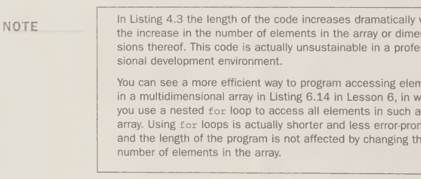

## 动态数组

考虑一个存储医院医疗记录的应用程序。程序员来说，没有好的方法可以知道应用程序可能需要处理的记录数量上限。他可以做一个假设，对于小型医院来说，为了万无一失，这远比合理的限制要。在这种情况下，他无缘地预留了大量内存并降低了系统性能。

关键在于不要使用目前为止看到的静态数组，而是选择动态数组，根据运行时对资源和内存的需求来优化内存消耗并进行扩展。C++ 以 `std::vector` 的形式为你提供了方便且易用的动态数组，如列表 4.4 所示。

### 列表 4.4 创建整数动态数组并动态插入值

```
0: #include <iostream>
1: #include <vector>
2:
3: using namespace std;
4:
5: int main()
6: {
7:   vector<int> dynArray(3); // 整数动态数组
8:
9:   dynArray[0] = 365;
10:  dynArray[1] = -421;
11:  dynArray[2] = 789;
12:
13:  cout << "Number of integers in array: " << dynArray.size() << endl;
14:
15:  cout << "Enter another element to insert " << endl;
16:  int newValue = 0;
17:  cin >> newValue;
18:  dynArray.push_back(newValue);
19:
20:  cout << "Number of integers in array: " << dynArray.size() << endl;
21:  cout << "Last element in array: " ;
22:  cout << dynArray[dynArray.size() - 1] << endl;
23:  return 0;
25: }
```

### 输出

Number of integers in array: 3

Enter another element to insert 217

Number of integers in array: 4

Last element in array: 217

### 分析

不要担心列表 4.4 中的语法，因为 `vector` 和模板还没有解释。尝试观察输出并将其与代码联系。数组的初始大小为 3，与第 7 行的数组声明（std::vector）一致。在第 15 行要求用户输入第四个数字，有趣的是，你能够使用第 18 行的 `push_back()` 将此数字插入数组。vector 动态地调整自身以容纳更多数据。这从数组大小增加到 4 可以看出。注意使用熟悉的数组语法访问 vector 中的数据。第 22 行使用基于零的索引访问最后一个元素（最后一个元素位于索引 "size() - 1"）；size() 是返回 vector 中包含的元素（整数）总数的。

## 注意

使用动态数组类 `std::vector` 需要包含 `<vector>` 头文件，如列表 4.4 第 1 行所示。vector 在第 17 节详细解释。

## C 风格字符串

C 风格字符串是字符数组的一种特殊情况。你已经在代码中看到了字符串字面量形式的 C 风格字符串：

`cout << "Hello World";`

等同于数组声明：

```cpp
char sayHello[] = {'H','e','l','l','o',' ','W','o','r','d','\0'};
cout << sayHello << endl;
```

注意数组中的最后一个字符是空字符 `'\0'`。被称为字符串终止符，因为它告诉编译器字符串已结束。C 风格字符串是数组的一种特殊情况，其最后一个字符总是空终止符 `'\0'`。当你在代码中嵌入字符串字面量时，编译器负责在后面添加 `'\0'`。

如果你在数组中间任何地方插入 `'\0'`，改变数组的大小；它仅意味着使用数组的字符串处理在该处停止。列表 4.5 证明了这一点。`'\0'` 对你看起来可能是两个字符，使用键盘输入时也是两个字符。然而，反斜杠是编译器理解的特殊代码\0 表示空——也就是说，你不能直接写 `'\0'`，因为会被视为非零 ASCII 代码。查看附录 D 中的表格查看此和其他 ASCII 值。

### 列表 4.5 分析 C 风格字符串中的终止符

```cpp
0: #include <iostream>
1: using namespace std;
2:
3: int main() {
4: 
5:     char sayHello[] = {'H','e','l','l','o',' ','W','o','r','d','\0'};
6:     cout << sayHello << endl;
7:     cout << "Size of array: " << sizeof(sayHello) << endl;
8:
9:     cout << "Replacing space with null" << endl;
10:    sayHello[5] = '\0';
11:    cout << sayHello << endl;
12:    cout << "Size of array: " << sizeof(sayHello) << endl;
13:
14:    return 0;
15: }
```

### 输出

Hello

Size of array: 12

Replacing space with null

Hello

Size of array: 12

### 分析

第 10 行是我们用字符串终止符替换 "Hello World" 中空格的地方。注意数组现在有两个空终止符，但是第一个导致第 11 行字符串显示被截断为仅 "Hello"。第 7 行和第 12 行的 `sizeof()` 表明数组的大小没有改变，即使显示的数据发生了变化。

如果你在列表 4.5 第 5 行声明并初始化字符数组时忘记添加 `'\0'`，那么预计输出在打印 "Hello World" 后将包含乱码；这是因为 `std::cout` 在遇到空字符之前不会停止打印数组，即使这意味着超出了数组边界。

这个错误可能会导致你的程序崩溃，并在某些情况下危及系统的稳定性。

C 风格字符串充满了危险。列表 4.6 展示了使用它们时涉及的风险。

### 列表 4.6 使用 C 风格字符串和用户输入的风险应用程序

```cpp
0: #include <iostream>
1: #include <string.h>
2: using namespace std;
3: int main(){
4: {
5:     cout << "Enter a word NOT longer than 20 characters:" << endl;
6: 
7:     char userInput [21] = {'\0'};
8:     cin >> userInput;
9: 
10:    cout << "Length of your input was: " << strlen(userInput) << endl;
11: 
12:     return 0;
13: }
```

### 输出

Enter a word NOT longer than 20 characters:

Don'tUseThisProgram

Length of your input was: 19

## 第 4 ：管理数组与字符串

```cpp
int main() 
{
    string greetString("Hello std::string!");
    cout << greetString << endl;
    cout << "Enter a line of text: " << endl;
    string firstLine;
    getline(cin, firstLine);
    cout << "Enter another: " << endl;
    string secondLine;
    getline(cin, secondLine);
    cout << "Result of concatenation: " << endl;
    string concatString = firstLine + " " + secondLine;
    cout << concatString << endl;
    cout << "Copy of concatenated string: " << endl;
    string aCopy = concatString;
    cout << aCopy << endl;
    cout << "Length of concat string: " << concatString.length() << endl;
    return 0;
}
```

### 输出

Hello std::string!

Enter a line of text:

I love

Enter another:

C++ strings

Result of concatenation:

I love C++ strings

Copy of concatenated string:

I love C++ strings

Length of concat string: 18

### 分析

尝试理解输出结果并与代码中的各种元素对应起来。在此阶段，不要让新的语法特性困扰你。程序开始显示一个在第 7 行初始化为“Hello std::string”的字符串。然后它要求用户输入两行文本，这些文本分别存储在第 12 行和第 16 行的变量 `firstLine` 和 `secondLine` 中。实际拼接非常简单，看起来就像第 19 行中的算术加法，在第一行后面添加了一个空格。复制操作只是第 24 行中简单的赋值操作。确定字符串的长度是通过在第 27 行中对其调用 `length()` 方法完成的。

## 注意

```
要使用 C++ 字符串，你需要包含头文件 string：

#include <string>
```

这在列表 4.7 的第 1 行中也是可见的。

要详细学习 `std::string` 的各种函数，请快速查看第 16 节“STL string 类”。由于你还没有学习过类和模板，请忽略该节中看起来陌生的部分，专注于理解示例的要点。

## 总结

本节介绍了数组的基础知识、它们是什么以及它们的用途。你学习了如何声明数组、初始化数组、访问数组元素以及向数组元素写入值。你学习了不超出数组边界有多么重要。这被称为**缓冲区溢出**，确保在使用索引访问元素之前对输入进行检查，有助于确保越越数组的限制。

动态数组是指程序员不需要在编译时固定数组最大长度的数组，它们在在使用量小于最大值的情况下允许更好的内存管理。

你还学习了 C 风格字符串是 `char` 数组的一种特殊情况，其中字符串的末尾由空终止字符 `'\0'` 标记。更重要的是，你学习了 C++ 提供了 `std::string` 这个更好的选择，它提供了方便的实用函数，允许你确定长度、进行拼接并执行类似的操作。

## 问答

问：为什么要费劲初始化静态数组的元素？


答：除非进行初始化，否则数组与任何其他类型的变量不同，会包含垃圾值和不可预测的值，因为该位置的内存在此最后一次操作后没有被触动过。初始化数组可以确保其中的信息具有明确且可预测的初始状态。

# 第 4 节：管理数组与字符串

你是否需要像第一个问题中提到的那样，初始化动态数组的元素？

实际上，不需要。动态数组是一种非常智能的数组。数组中的元素不需要初始化为默认值，除非有与应用程序特定的原因需要你在数组中具有某些初始值。

如果给出一个选择，你会使用需要空终止符的 C 风格字符串吗？

会，但只有在有人拿枪指你的头时。C++ `std::string` 安全得多，并且提供的功能本应让任何优秀的程序员都避开 C 风格字符串。

字符串的长度是否包含末尾的空终止符？

不，不包含。字符串“Hello World”的长度为 11，包括空格但不包括末尾的空字符。

那么，我仍然想在自己定义的 `char` 数组中使用 C 风格字符串。我使用的数组大小应该是多大？

这里涉及到使用 C 风格字符串的复杂性之一。数组的大小应该比它将包含的最大字符串大一。这是至关重要的，因为要容纳最大字符串末尾的空字符。如果“Hello World”是你的 `char` 数组将容纳的最大字符串，那么数组的长度需要是 11 + 1 = 12 个字符。

## 工作坊

工作坊提供了测验题帮助巩固你对涵盖内容的理解，并提供了练习让你获得使用所学知识的经验。在检查附录 E 中的答案之前，以及在理解答案并继续下一节之前，尝试回答测验和练习题。

## 测验

- 1. 检查列表 4.1 中的数组 `myNumbers`。该数组第一个元素和最后一个元素的索引分别？

- 2. 如果你需要允许用户输入字符串，你会使用 C 风格字符串吗？

- 3. 在编译器看来，`'\0'` 中有多少个字符？

- 4. 你忘记在 C 风格字符串结尾加上空终止符。使用它时会发生什么？

- 5. 查看列表 4.4 中 `vector` 的声明，并尝试创建一个包含 `char` 类型元素的动态数组。

## 练习

- 1. 声明一个表示棋盘格的数组；数组的类型是一个定义可能占据格的棋子的枚举（enum）。

提示：枚举将包含常量（车兵、主教等），从而限制了数组元素可以包含的数值范围。不要忘记单元格也可以是空的！

- 2. 错误查找：以下代码片段有什么错误？

```cpp
int myNumbers[5] = {};
myNumbers[5] = 450; // 将第 5 个元素设置为值 450
```

- 3. 错误查找：以下代码片段有什么错误？

```cpp
int myNumbers[5];
cout << myNumbers[3];
```

## 使用运算符

当你有长文本元素或由许多变量组成的复杂表达式，导致语句的长度远超大多数显示允许允许范围时，将一个语句拆分成多行可能会有用。

# 复合语句或块

当你使用大括号 `{...}` 将语句组合在一起时，你就创建了一个复合语句或块。

```cpp
{
int daysInYear = 365;
cout << "Block contains an int and cout statement" << endl;
}
```

块通常将多个语句分组，以表示它们属于整体。在编写条件 if 语句或循环时，块特别有用，这些内容将在第 6 节“控制程序流”中解释。

## 使用运算符

运算符是 C++ 提供的工具，让你能够对数据进行操作、转换、处理，并可能根据数据做出决策。

# 赋值运算符 (=)

赋值运算符是你已经在本书中直观地使用过的一种运算符：

```cpp
int daysInYear = 365;
```

上述语句使用赋值运算符来初始化整数 365。赋值运算符将左侧操作数（无想象地称为 l 值）所包含的值替换为右侧操作数（称为 r 值）的值。

# 理解 l 值和 r 值

l 值通常指内存中的位置。前一个示例中的如 `daysInYear` 的变量实际上是内存位置的句柄，是一个 l 值。相反，r 值可以是内存位置的具体内容。

因此，所有的 l 值都可以是 r 值，但不是所有的 r 值都可以是 l 值。为了更好地理解，请看下面的示例，它没有任何逻辑意义，因此无法编译：

```cpp
365 = daysInYear;
```

# 加法 (+)、减法 (-)、乘法 (*)、除法 (/) 和取模除 (%) 运算符

你可以使用 `+` 加法、`-` 减法、`*` 乘法、`/` 除法和 `%` 取模两个操作数之间进行算术运算：

```cpp
int num1 = 22;
int num2 = 5;
int addNums = num1 + num2; // 27
int subtractNums = num1 - num2; // 17
int multiplyNums = num1 * num2; // 110
int divideNums = num1 / num2; // 4
int moduloNums = num1 % num2; // 2
```

注意，除法运算符 (`/`) 返回两个操作数之间的除法结果。然而，在整数的情况下，结果不包含小数，因为根据定义整数不能持有小数数据。取模运算符 (`%`) 返回除法运算符的余数，它仅适用于整数值。列表 5.1 是一个演示了对用户输入的两个数执行算术函数的简单程序。

# 列表 5.1 演示用户输入整数的算术运算符

```cpp
#include <iostream>
using namespace std;

int main() {
    cout << "Enter two integers:" << endl;
    int num1 = 0, num2 = 0;
    cin >> num1;
    cin >> num2;
    cout << num1 << " + " << num2 << " = " << num1 + num2 << endl;
    cout << num1 << " - " << num2 << " = " << num1 - num2 << endl;
    cout << num1 << " * " << num2 << " = " << num1 * num2 << endl;
    13: cout << num1 << " / " << num2 << " = " << num1 / num2 << endl;
    14: cout << num1 << " % " << num2 << " = " << num1 % num2 << endl;
    15:
    16: return 0;
    17: }
```

## 输出

输入两个整数：

365

25

365 + 25 = 390

365 - 25 = 340

365 * 25 = 9125

365 / 25 = 14

365 % 25 = 15

## 分析

程序的大部分内容是不言自明的。可能最感兴趣的一行可能是使用 `%` 取模运算符的这一行。它返回 `num1` (365) 除以 `num2` (25) 的余数。

# 增 (++) 和 减 (--) 运算符

有时你需要以 1 为增量进行计数。这在控制循环的变量中特别需要，因为每次执行循环时，变量的值都需要增加或减少。

C++ 包含了 `++`（增）和 `--`（减）运算符来帮助你完成任务。使用这些运算符的语法如下：

```cpp
int num1 = 101;
int num2 = num1++; // 后置增运算符
int num2 = ++num2; // 前置增运算符
int num2 = num1--; // 后置减运算符
int num2 = --num2; // 后置减运算符（注：原文此处为笔误，应为前置）
```

如代码示例所示，增、减运算符有两种不同的方式：在操作数之前或之后。放置在操作数之前的运算符被称为前置增/减运算符，放置在操作数之后的被称为后置增/减运算符。

# 是后置还是前置？

首先理解前置和后置之间的区别并使用适合你的运算符是很重要的。前置增或减的结果是 l 值被赋值为增加或减少后的值。后置运算符的结果是 l 值被赋值为增加或减少之前值（此处逻辑补全）。

列表 5.2 演示后置和前置运算符的区别

# 列表 5.2 演示后置和前置运算符的区别

```cpp
#include <iostream>
using namespace std;

int main() {
    int startValue = 101;
    cout << "Start value being operated: " << startValue << endl;
    int postfixIncrement = startValue++;
    cout << "Result of Postfix Increment: " << postfixIncrement << endl;
    cout << "After Postfix Increment, startValue = " << startValue << endl;

    startValue = 101; // 重置
    int prefixIncrement = ++startValue;
    cout << "Result of Prefix Increment: " << prefixIncrement << endl;
    cout << "After Prefix Increment, startValue = " << startValue << endl;

    startValue = 101; // 重置
    int postfixDecrement = startValue--;
    cout << "Result of Postfix Decrement: " << postfixDecrement << endl;
    cout << "After Postfix Decrement, startValue = " << startValue << endl;

    startValue = 101; // 重置
    int prefixDecrement = --startValue;
    cout << "Result of Prefix Decrement: " << prefixDecrement << endl;
    cout << "After Prefix Decrement, startValue = " << startValue << endl;

    return 0;
}
```

## 使用运算符

## 分析

操作时的初始值: 101

后置增的结果: 101

后置增后，startValue = 102

前置增的结果: 102

前置增后，startValue = 102

后置减的结果: 101

后置减后，startValue = 100

前置减的结果: 100

前置减后，startValue = 100

结果显示，后置运算符与前置运算符的区别在于，被赋值的 l 值包含整数在实际增或减操作之前的原始值。相反，前置操作的结果是 l 值被赋值为增加或减少后的值。这是在选择正确的运算符类型时需要考虑的重要区别。

注意，在以下语句中，前置或后置运算符对程序的输出没有影响：

```cpp
startValue++; // 等于...
++startValue;
```

这是因为没有对初始值进行赋值，两种情况的最终结果只是整数 `startValue` 增加了。

> 你经常听到某些情况下出于性能考虑偏于使用前置增或减运算符。也就是说，`++startValue` 优于 `startValue++`。

这在理论上是正确的，因为对于后置运算符，编译器需要在需要赋值时临时存储初始值。在整数情况下，对性能的影响微乎其微，但在某些类的情况下，这种论点是有道理的。智能编译器可能会优化这些差异。

## 相等运算符 (==) 和 (!=)

在执行某个操作之前，你通常需要检查某个条件是否被满足。相等运算符 ==（操作数相等）和 !=（操作数不相等）正可以帮助你完成这一点。

相等性检查的结果是一个 bool——即真（true）或假（false）。

```
int personAge = 20;
bool checkEquality = (personAge == 20); // true
bool checkInequality = (personAge != 100); // true
```

```
bool checkEqualityAgain = (personAge == 200); // false
bool checkInequalityAgain = (personAge != 20); // false
```

## 关系运算符

除了相等检查外，你可能想检查某个变量与某个值是否不等。为了帮助你完成这一点，C++ 包含了关系运算符（表 5.1）。

**表 5.1** 关系运算符

| 运算符名称 | 描述 |

| --- | --- |

| 小于 (<) | 如果一个操作数小于另一个操作数 (op1 < op2)，则结果为 true，否则为 false |

| 大于 (>) | 如果一个操作数大于另一个操作数 (op1 > op2)，则结果为 true，否则为 false |

| 小于等于 (<=) | 如果一个操作数小于或等于另一个操作数，则结果为 true，否则为 false |

| 大于等于 (>=) | 如果一个操作数大于另一个操作数，则结果为 true，否则为 false |

如表 5.1 所示，比较操作的结果始终是 true 或 false，换句话说是一个 bool。以下示例代码展示了如何使用表 5.1 中引入的关系运算符：

```
int personAge = 20;
bool checkLessThan = (personAge < 100); // true
bool checkGreaterThan = (personAge > 100); // false
bool checkLessThanEqualTo = (personAge <= 20); // true
```

bool checkGreaterEqualToTo = (personAge >= 20); // true

bool checkGreaterThanEqualToToAgain = (personAge >= 100); // false

列表 5.3 是一个通过在屏幕上显示结果来演示这些运算符效果的程序。

## 列表 5.3 演示相等和关系运算符

```
0: #include <iostream>
1: using namespace std;
2:
3: int main() {
4: {
5:   cout << "Enter two integers:" << endl;
6:   int num1 = 0, num2 = 0;
7:   cin >> num1;
8:   cin >> num2;
9:
10:  bool isEqual = (num1 == num2);
11:  cout << "Result of equality test: " << isEqual << endl;
12:
13:  bool isUnequal = (num1 != num2);
14:  cout << "Result of inequality test: " << isUnequal << endl;
15:
16:  bool isGreaterThan = (num1 > num2);
17:  cout << "Result of " << num1 << " > " << num2;
18:  cout << " test: " << isGreaterThan << endl;
19:
20:  bool isLessThan = (num1 < num2);
21:  cout << "Result of " << num1 << " < " << num2 << " test":
22:  " test: " << isLessThan << endl;
23:
24:  bool isGreaterEquals = (num1 >= num2);
25:  cout << "Result of " << num1 << " >= " << num2;
26:  cout << " test: " << isGreaterEquals << endl;
27:
28:  bool isLessEquals = (num1 <= num2);
29:  cout << "Result of " << num1 << " <= " << num2;
30:  cout << " test: " << isLessEquals << endl;
31:
32:  return 0;
33: }
```

## 输出 ▼

Enter two integers:

365

-24

Result of equality test: 0

Result of inequality test: 1

Result of 365 > -24 test: 1

Result of 365 < -24 test: 0

Result of 365 >= -24 test: 1

Result of 365 <= -24 test: 0

Next run:

Enter two integers:

101

101

Result of equality test: 0

Result of inequality test: 0

Result of 101 > 101 test: 0

Result of 101 < 101 test: 0

Result of 101 >= 101 test: 1

Result of 101 <= 101 test: 1

## 分析 ▼

程序显示了各种操作的二进制结果。值得注意的是，当提供的两个整数相同时的输出情况。==、>= 和 <= 运算符也会产生相同的结果。

相等和关系运算符的输出是二进制的，这使得它们非常适合用于有助于决策的语句中，并作为循环条件表达式，确保循环仅在条件为真时才执行。你可以在第 6 课学习更多关于条件执行和循环的知识。

> 注意


列表 5.3 输出的布尔值显示假值为 0。真值显示为 1。从编译器的角度来看，当表达式为 0 时，结果为假。针对 false 的检查就是针对 0 的检查。非零值的表达式被求为真。

## 逻辑非、与、或、异或

逻辑非操作由运算符 `!` 支持并作用于单个操作数。表 5.2 是逻辑非操作的真值表，如预期，它简单地反转了提供的布尔标志。

表 5.2 逻辑非操作真值表

| 操作数 | 非操作数的结果 |
|---|---|
| False | True |
| True | False |

与、或、异或运算符需要两个操作数。逻辑与操作只有在每个操作数都为真时才为真。表 5.3 展示了逻辑与运算符的功能。

表 5.3 逻辑与操作真值表

| 操作数 1 | 操作数 2 | 逻辑与的结果 |
|---|---|---|
| False | False | False |
| False | True | False |
| True | False | False |
| True | True | True |

逻辑或操作在至少有一个操作数为真时结果为真。表 5.4 展示了逻辑或运算符的功能。

表 5.4 逻辑或操作真值表

| 操作数 1 | 操作数 2 | 逻辑或的结果 |
|---|---|---|
| False | False | False |
| False | True | True |
| True | False | True |
| True | True | True |

逻辑异或操作仅当好有一个操作数为真时结果为真。表 5.5 展示了逻辑异或运算符的功能。

表 5.5 逻辑异或操作真值表

| 操作数 1 | 操作数 2 | 逻辑异或的结果 |
|---|---|---|
| False | False | False |
| False | True | True |
| True | False | True |
| True | True | False |

# 第 5 ：表达式、语句和操作符的使用

```cpp
9:
10: cout << "Do you have buses on the streets? ";
11: bool busesPly = false;
12: cin >> busesPly;
13:
14: // 条件语句使用了逻辑与与非
15: if (isRaining && busesPly)
16: cout << "You cannot go to work" << endl;
17: else
18: cout << "You can go to work" << endl;
19:
20: if (isRaining && busesPly)
21: cout << "Take an umbrella" << endl;
22:
23: if (!isRaining) && busesPly
24: cout << "Enjoy the sun and have a nice day" << endl;
25:
26: return 0;
27: }
```

# 输出 ▼

使用布尔值(0 / 1) 回答问题

正在下雨吗？1

街道上有公交车吗？1

你可以上班

带上一把伞

下次运行：

使用布尔值(0 / 1) 回答问题

正在下雨吗？1

街道上有公交车吗？0

你不能上班

上次运行：

使用布尔值(0 / 1) 回答问题

正在下雨吗？0

街道上有公交车吗？1

你可以上班

享受阳光，度过愉快的一天

## 分析

列表 5.5 中的程序使用了 `if` 结构形式的条件语句，这种结构尚未向你介绍。尽管如此，请尝试通过与输出的对比来理解这种结构的行为。第 15 行包含逻辑表达式 `(isRaining && !busesPly)`，可以被读作“正在下雨且没有公交车”。这使用逻辑与操作符将公交车的缺席（通过对公交车的存在使用逻辑非来表示）与下雨的存在连接起来。

> 注意

如果你想稍微了解一下有助于条件执行的 `if` 结构，可以快速访问第 6 节。

列表 5.6 在演示条件处理时使用了逻辑非 (`!`) 和逻辑或 (`||`) 操作符。

列表 5.6 使用逻辑非和逻辑或操作符帮助你决定是否可以购买那辆梦想汽车

```cpp
0: #include <iostream>
1: using namespace std;
2:
3: int main()
4: {
5:     cout << "Answer questions with 0 or 1" << endl;
6:     cout << "你最喜欢的汽车有折扣吗?";
7:     bool onDiscount = false;
8:     cin >> onDiscount;
9:
10:    cout << "你获得了一笔丰厚的奖金吗？";
11:    bool fantasticBonus = false;
12:    cin >> fantasticBonus;
13:
14:    if (onDiscount || fantasticBonus) cout << "you can buy that car!" << endl;
15:        cout << "Congratulations!" << endl;
16:    else
17:        cout << "Sorry, waiting a while is a good idea" << endl;
18:
19:
20:        if (!onDiscount)
21:            cout << "Car not on discount" << endl;
22:
23:    return 0;
24: }
```

# 输出 ▼

使用布尔值(0 / 1) 回答问题

你最喜欢的汽车有折扣吗？0

你获得了一笔丰厚的奖金吗？1

恭喜，你可以买那辆车！

汽车没有折扣

下次运行：

使用布尔值(0 / 1) 回答问题

你最喜欢的汽车有折扣吗？0

你获得了一笔丰厚的奖金吗？0

抱歉，等一下是个好主意

汽车没有折扣

上次运行：

使用布尔值(0 / 1) 回答问题

你最喜欢的汽车有折扣吗？1

你获得了一笔丰厚的奖金吗？1

恭喜，你可以买那辆车！

# 分析 ▼

如果你获得了折扣或者你获得了一笔丰厚的奖金（或两者都有），该程序会建议购买汽车。否则，它建议等待。它在第 19 行还使用了逻辑非操作来提醒你汽车没有折扣。第 14 行使用了 `if` 结构，随后跟了第 16 行的 `else`。当条件 `(onDiscount || fantasticBonus)` 求值为为真时，`if` 结构执行第 15 行的后续语句。该表达式包含逻辑或操作符，当你最喜欢的汽车有折扣或者你获得了一笔丰厚的奖金时，它的求值为真。

# 位非 (~-), 与 (&), 或 (|) 和 异或 (^) 操作符

逻辑操作符与位操作符的区别在于，位操作符不返回布尔结果。相反，它们提供一个结果，其中单个位通过对操作数的位位执行操作符来控制。C++ 允许你在位模式下执行如 NOT、OR、AND 和异或（即 XOR）操作，在位模式下，你可以通过使用 `~` 取反、使用 `|` 进行或、使用 `&` 进行与以及使用 `^` 进行异或来操作单个位。后三者是针对你选择的数字（通常是位掩码）执行的。

# 操作符 101

某些位操作在整数包含位的情景中非常有用——例如，每个位都可以指定某个标志的状态。一个 32 位的整数可以用于携带布尔标志。列表 5.7 展示了位操作符的使用。

列表 5.7 演示使用位操作符对整数中的单个位进行非、与和异或操作

```cpp
#include <iostream>
#include <bitset>
using namespace std;

int main() {
    cout << "Enter a number (0-255): ";
    unsigned short inputNum = 0;
    cin >> inputNum;

    bitset<8> inputBits(inputNum);
    cout << inputNum << " in binary " << inputBits << endl;

    bitset<8> bitwiseNOT = (~inputNum);
    cout << "Logical NOT - " << inputBits << " " << bitwiseNOT << endl;

    bitset<8> bitwiseAND = (0xF & inputNum); // 0xF 是 00001111 的十六进制
    cout << "00001111 & " << inputBits << " = " << bitwiseAND << endl;

    bitset<8> bitwiseOR = (0xF | inputNum);
    cout << "00001111 | " << inputBits << " = " << bitwiseOR << endl;

    bitset<8> bitwiseOR = (0xF ^ inputNum);
    cout << "00001111 ^ " << inputBits << " = " << bitwiseOR << endl;

    return 0;
}
```

# 输出 ▼

Enter a number (0-255): 10 in binary 00001010

Logical NOT - 00001010 11110101

00001111 & 00001010 = 00001010

00001111 | 00001010 = 00001111

00001111 ^ 00001010 = 00000101

剩余 32 和 2 位可以得到 100000，即 64，这实际上使数字翻了倍并四了倍！

> 注意：位移运算符不会对值进行旋转。此外，符号数位移的结果取决于实现情况。在某些编译器上，最高位在左移时不会赋给最低位；相反，后者被赋零。

## 复合赋值运算符

复合赋值运算符是赋值赋值运算符，其左侧的操作数被赋值为操作结果产生的值。

考虑以下代码：

```cpp
int num1 = 22;
int num2 = 5;
num1 += num2; // 操作后 num1 包含 27
```

这与以下代码行中的表达式相似：

`num1 = num1 + num2;`

因此，`+` 运算符的作用是计算两个操作数的和，并将其赋值给左侧的操作数（即 `num1`）。表 5.6 是许多复合赋值运算符的快速参考表，并解释了它们的工作原理。

| 表 5.6 复合赋值运算符 |
| 运算符 | 用法 | 等效于 |
| 加法赋值 | `num1 += num2;` | `num1 = num1 + num2;` |
| 减法赋值 | `num1 -= num2;` | `num1 = num1 - num2;` |
| 乘法赋值 | `num1 *= num2;` | `num1 = num1 * num2;` |
| 除法赋值 | `num1 /= num2;` | `num1 = num1 / num2;` |
| 取模赋值 | `num1 %= num2;` | `num1 = num1 % num2;` |
| 位左移赋值 | `num1 <<= num2;` | `num1 = num1 << num2;` |

## 运算符用法等效

| 运算符 | 用法 | 等效于 |
| --- | --- | --- |
| 位右移赋值 | `num1 >> num2;` | `num1 = num1 >> num2;` |
| 位与赋值 | `num1 &= num2;` | `num1 = num1 & num2;` |
| 位或赋值 | `num1 |= num2;` | `num1 = num1 | num2;` |
| 位异异赋值 | `num1 ^= num2;` | `num1 = num1 ^ num2;` |

列表 5.9 展示了使用这些运算符的效果。

## 列表 5.9 使用复合赋值运算符进行加、减、除以及执行位或、位与和位异异

```cpp
#include <iostream>
using namespace std;

int main() {
    cout << "Enter a number: ";
    int value = 0;
    cin >> value;

    value += 8;
    cout << "After += 8, value = " << value << endl;

    value -= 2;
    cout << "After -= = 2, value = " << value << endl;

    value *= 4;
    cout << "After * = 4, value = " << value << endl;

    value %= 1000;
    cout << "After % = 1000, value = " << value << endl;

    // 注意：因此赋值发生在 cout 内部
    cout << "After <= 1, value = " << (value <= 1) << endl;
    cout << "After >= 2, value = " << (value >= 2) << endl;

    value |= 0x55;
    cout << "After |= = 0x55, value = " << (value |= 0x55) << endl;

    value ^= 0x55;
    cout << "After ^= = 0x55, value = " << (value ^= 0x55) << endl;

    value &= 0x0F;
    cout << "After &= = 0x0F, value = " << (value &= 0x0F) << endl;

    return 0;
}
```

## 输出 ▼

```
Enter a number: 440
After += 8, value = 448
After -= 2, value = 446
After /= 4, value = 111
After * = 4, value = 444
After % = 1000, value = 444
After <= 1, value = 0
After >= 2, value = 1
After |= = 0x55, value = 223
After ^= = 0x55, value = 138
After &= = 0x0F, value = 10
```

## 分析 ▼

注意 `value` 在整个程序中通过各种赋值运算符被不断修改。每个操作都是使用 `value` 执行的，并且操作的结果被赋值回它。因此，在第 9 行，用户输入的 440 加上 8，得到 448 并赋值回 `value`。在随后的第 11 行操作中，从 448 减去 2，得到 446，并赋值回 `value`，依此类推。

## 使用运算符 sizeof 确定变量占用的内存

该运算符告诉你特定类型或变量消耗的内存字节（以字节为单位）。`sizeof` 的用法如下：

```cpp
sizeof(variable);
```

或者

```cpp
sizeof(type);
```

> `sizeof(..)` 看起来像是一个函数调用，但它不是函数。`sizeof` 是一个运算符。

*(注：原文中存在大量重复段落和 OCR 错误，已根据要求清理并翻译了核心内容)*

# 第 5 节：表达式、语句和运算符的使用

| 应该 (DO) | 不应该 (DON'T) |
|---|---|
| **应该**使用括号来提高代码和表达式的可读性。 | **不要**依赖运算符优先级表来编写复杂的表达式；你的代码也需要人类可读性。 |
| **应该**使用正确的变量类型并确保它永远不会发生溢出情况。 | **不要**混淆 `++Variable` 和 `Variable++` 认为它们是相同的。它们在赋值中的作用是不同的。 |
| **应该**理解 i-value（例如变量）可以是 r-value，但并非所有的 r-value（例如 "Hello World"）都能是 i-value。 | |

## 总结

在本节中，你学习了什么是 C++ 语句、表达式和运算符。你学习了如何在 C++ 中执行加、减、乘、除等基本算术运算。你还对逻辑操作进行了初步的概述，如 NOT（非）、AND（与）、OR（或）和 XOR（异或）。你学习了 C++ 逻辑运算符 `!`、`&&` 和 `||`，它们能为条件语句提供帮助；以及位运算符 `~`、`&`、`|` 和 `^`，它们能帮助你一次处理一个比特位的数据。

你学习了运算符优先级，以及使用括号编写让其他程序员也能理解的代码有多么重要。你了解了整数溢出的概述，以及避免溢出实际上有多重要。

## 问答

- 为什么有些程序使用 `unsigned int`，而 `unsigned short` 占内存更小且也能编译？

答：`unsigned short` 通常限制为 65535，如果递增，会溢出为零。为了避免这种行为，良好的应用程序在不确定值是否会远低于此限制时会选择 `unsigned int`。

我需要计算一个数字除以三 之后的两倍。那么，你认为下面的代码有什么问题吗：

```cpp
int result = Number / 3 << 1;
```

答：是的！你为什么不简单使用括号让这行代码对其他程序员更容易读呢？增加一两个注释也没有坏。

问：我的应用程序将两个整数值 5 和 2 相除：

```
int num1 = 5, num2 = 2;
int result = num1 / num2;
```

执行时，结果包含值 2。这不对吗？

答：完全不对。整数并不是为了包含小数数据的。此操作的结果是 2 和 2.5。如果你期望的结果是 2.5，请将所有数据类型改为 `float` 或 `double`。这些是用于处理浮点（小数）操作的。

## 工作坊


工作坊提供了测验题来帮助你巩固对涵盖内容的理解，并提供了练习让你获得使用所学知识的经验。尝试在检查附答案之前回答测验和练习题，并确保在继续下一节之前理解了答案。

## 测验

- 1. 我正在编写一个除法程序。哪种数据类型更合适：`int` 还是 `float`？
- 2. `32 / 7` 的值是多少？
- 3. `32.0/7` 的值是多少？
- 4. `sizeof(...)` 是函数吗？
- 5. 我需要计算一个数字的两倍，加上 5，然后再翻倍。这正确吗？

```cpp
int result = number << 1 + 5 << 1;
```

- 6. 当异或操作数都结果为真时，异或操作的结果是什么？

## 练习

- 1. 使用括号改进测验题 5 中的代码以提高清晰。
- 2. 此表达式存储的 `result` 的值是多少：
- 3. 写一个程序，要求用户输入两个布尔值，并演示各种位运算符对它们操作的结果。

```cpp
int result = number << 1 + 5 << 1;
```

# 第 6 节

## 控制程序流

大多数应用程序面对新情况或不同用户输入时表现不同。为了让你的应用程序做出不同反应，你需要编写条件语句，在不同情况下执行不同的代码段。

在本节中，你将了解到

- 如何让你的程序在某些条件下表现得不同
- 如何在循环中重复执行一段代码
- 如何更好地控制循环中的执行流

## 使用 if ... else 进行条件执行

你目前为止看到和编写的程序具有顺序执行顺序——从上到下。每一行都执行了，没有哪行被忽略。但在应用程序中，很少按从上到下的顺序执行所有代码行。

想象你想要程序在用户按下 m 时将两个数相乘，如果按下其他任何键则将两个数相加。

如图 6.1 所示，并不是所有的代码路径在每次运行时都会执行。如果用户按下 m，则执行乘两个数的代码。如果他输入了 m 以外的任何内容，则执行执行加法的代码。不存在两者同时被执行的情况。

图 6.1 基于用户输入的所需的条件处理示例。`(img/cc65209d7db1b25fe4ac7152a33.png)`

代码的条件执行在 C++ 中通过 `if ... else` 结构实现，如下所示：

```cpp
if (expression)
    当表达式为真时执行某些操作；
else // 可选
    当条件为假时执行其他操作；
```

因此，一个让程序在用户输入 m 时相乘、否则相加的 if ... 结构看起来如下：

```cpp
if (userSelection == 'm')
    result = num1 * num2; // 乘法
else
    result = num1 + num2; // 加法
```

> 注意 i-value 可以是 r-value，但并非所有的 r-value 都是 i-value。

一个 if ... 结构让程序在用户输入 m 时相乘，否则相加看起来如下：

```cpp
if (userSelection == 'm')
    result = num1 * num2; // 
法
else
    result = num1 + num2; // 
。
```

### LISTING 6.1 基于用户输入的所需的条件处理

```cpp
0: #include <iostream>
1: using namespace std;
2: int main()
3: {
4:     cout << "Enter two integers:";
5:     int num1 = 0, num2 = 0;
6:     cin >> num1;
7:     cin >> num2;
8:
9:     cout << "to multiply, else add: ";
10:    char userSelection = '\0';
11:    cin >> userSelection;
12:
13:    int result = 0;
14:    if (userSelection == 'm')
15:        result = num1 * num2;
16:    else
17:        result = num1 + num2;
18:
19:    cout << "result is: " << result << endl;
20:    return 0;
21: }
```

# 第 6 控制程序流

如图 6.1 所示，并不是所有的代码路径在每次运行时都会执行。如果用户按下 m，则执行乘两个数的代码。如果他输入了 m 以外的任何内容，则执行执行加法的代码。不存在两者同时被执行的情况。

## 输出

输入整数：
25
56
to multiply, else add: m
result is: 1400

下次运行：

输入整数：
25
56
to multiply, else add: a
result is: 81

## 分析

注意第 15 行的 if 和第 17 行的 else。我们指示编译器当表达式 `(userSelection == 'm')` 为真时在第 15 行执行乘法，为假时在第 17 行执行加法。`(userSelection == 'm')` 是当用户输入字符 m 时为真的表达式，否则为假。因此，这个简单的程序模拟了图 6.1 的流程，并展示了你的应用程序如何在不同情况下表现不同。

> 注意 if ... else 结构的 else 部分是可选的，在失败时没有要执行的操作的情况下不需要使用。

## 注意

```
如果在列表 6.1 中，第 15 行是：
15: if (userSelection == 'm');
那么 if 结构是没有意义的，因为它被一个空语句（分号）在同一行终止了。请小心并避免这种情况，因为在这种情况下不会得到编译错误。
某些良好的编译器会提示此处“空控制语句”。
```

## 条件执行多个语句

如果你想在条件成功或失败时执行多条语句，你需要将它们封装在语句块中。这些本质上是用括号 `{...}` 封装要执行的多条语句。例如：

```cpp
if (condition)
{
  // 条件成功块
  语句 1;
  语句 2;
}
else
{
  // 条件失败块
  语句 3;
  语句 4;
}
```

这样的块也被称为复合语句。

列表 6.2 是第 4 节“管理数组和字符串”中列表 4.6 的安全版本。它使用复合语句，当输入长度在数组边界内，将用户输入复制到静态字符数组中。

## 列表 6.2 在复制字符串到 char 数组之前检查边界

```cpp
0: #include <iostream>
1: #include <string>
2: #include <string.h>
3: using namespace std;
4: int main()
5: {
```

# 第 6 Lesson：控制程序流

```cpp
6:   cout << "Enter a line of text: " << endl;
7:   string userInput;
8:   getline(cin, userInput);
9:
10:  char copyInput[20] = { '\0' };
11:  if (userInput.length() < 20) // 检查边界
12:  {
13:      strcpy(copyInput, userInput.c_str());
14:      cout << "copyInput contains: " << copyInput << endl;
15:  }
16:  else
17:      cout << "Bounds exceeded: won't copy!" << endl;
18:
19:  return 0;
```

# 输出 ▼

输入一行文本：
这符合缓冲区大小限制！
copyInput 包含: 这符合缓冲区大小限制！

下次运行：

输入一行文本：
这不符合缓冲区大小限制！
超出边界，将不会复制！

# 分析 ▼

注意在第 11 行中在复制字符串之前，是如何检查字符串长度与缓冲区长度的。此检查的特殊之处在于，当检查结果为真时，在第 12 到 15 行之间存在一个语句块（也称为复合语句）。

# 嵌套 if 语句

通常你会遇到需要针对一系列不同条件进行验证的情况，其中许多条件依赖于前一个条件的评估结果。C++ 允许你嵌套 if 语句来处理此类需求。

嵌套的 if 语句类似于：

```
if (expression1)
{
```

# 使用 if else 进行条件执行 | 119

```
DoSomething;
if(expression2)
    DoSomething2;
else
    DoSomethingElse;
else
    DoSomethingElse;
```

考虑一个类似于列表 6.1 的应用程序，用户可以通过按下命令字符 d 或 m 来指示应用程序进行除法或乘法。现在，只有在除数不为零时才允许除法。因此，除了检查用户输入以预期的命令之外，当用户指示程序进行除法时，检查除数是否为零也是同样重要的。列表 6.3 使用了嵌套 if 结构。

# 列表 6.3 在数字乘法或除法中使用嵌套 if 语句

```
0: #include <iostream>
1: using namespace std;
2:
3: int main()
4: {
5:     cout << "Enter two numbers: " << endl;
6:     float num1 = 0,num2 = 0;
7:     cin >> num1;
8:     cin >> num2;
9:
10:    cout << "Enter 'd' to divide, anything else to multiply: ";
11:    char userSelection = '\0';
12:    cin >> userSelection;
13:
14:    if (userSelection == 'd')
15:    {
16:        cout << "You wish to divide!" << endl;
17:        if (num2 != 0)
18:            cout << num1 << " / " << num2 << " = " << num1 / num2 << endl;
19:        else
20:            cout << "Division by zero is not allowed" << endl;
21:    }
22:    else
23:    {
24:        cout << "You wish to multiply!" << endl;
25:        cout << num1 << " x " << num2 << " = " << num1 * num2 << endl;
26:    }
27:
28:    return 0;
29:}
```

# 输出 ▼

输入两个数字：
45
9
输入 'd' 除法，其他输入乘法： m
你想执行除法！
45 x 9 = 405

下次运行：

输入两个数字：
22
7
输入 'd' 除法，其他输入乘法： m
你想执行除法：
22 / 7 = 3.142856

最后一次：

输入两个数字：
365
0
输入 'd' 除法，其他输入乘法： m
你想执行除法：
不允许除以零

# 分析 ▼

注意在第 11 行中在复制字符串之前，是如何检查字符串长度与缓冲区长度的。此检查的特殊之处在于，当检查结果为真时，在第 12 到 15 行之间存在一个语句块（也称为复合语句）。

- 第二次运行的输出表明用户输入了一个超出范围的数字。
- 将 Sunday 用于 Sunday。
- 然而，使用枚举器 Sunday 使代码更具可读性。
- 该程序中另一个值得注意的地方是使用了第 5 行声明并在整个 if 语句中使用的枚举。

# 列表 6.3 在数字乘法或除法中使用嵌套 if 语句

```cpp
#include <iostream>
using namespace std;
int main()
{
    cout << "Enter two numbers: " << endl;
    float num1 = 0,num2 = 0;
    cin >> num1;
    cin >> num2;
        cout << "Enter 'd' to divide, anything else to multiply: ";
    char userSelection = '\0';
    cin >> userSelection;
    if (userSelection == 'd')
    {
        cout << "You wish to divide!" << endl;
        if (num2 != 0)
            cout << num1 << " / " << num2 << " = " << num1 / num2 << endl;
        else
            cout << "Division by zero is not allowed" << endl;
    }
    else
    {
        cout << "You wish to multiply!" << endl;
        cout << num1 << " x " << num2 << " = " << num1 * num2 << endl;
    }
```

（注：由于提供的原始文本包含大量重复和错误片段，上述翻译已根据逻辑进行了重构和清理。）

## 第6节：控制程序流

## 列表 6.5 使用 switch-case, break 和 default 打印星期几是用什么命名的

```cpp
0: #include <iostream>
1: using namespace std;
2:
3: int main()
4: {
5:     enum DaysOfWeek
6:     {
7:         Sunday = 0,
8:         Monday,
9:         Tuesday,
10:        Wednesday,
11:        Thursday,
12:        Friday,
13:        Saturday
14    };
15:
16: cout << "Find what days of the week are named after!" << endl;
17: cout << "Enter a number for a day (Sunday = 0): ";
18:
19:     int dayInput = Sunday; // 初始化为 Sunday
20:     cin >> dayInput;
21:
22:     switch (dayInput)
23:     {
24:         case Sunday:
25:             cout << "Sunday was named after the Sun" << endl;
26:             break;
27:
28:         case Monday:
29:             cout << "Monday was named after the Moon" << endl;
30:             break;
31:
32:         case Tuesday:
33:             cout << "Tuesday was named after Mars" << endl;
34:             break;
35:
36:         case Wednesday:
37:             cout << "Wednesday was named after Mercury" << endl;
38:             break;
39:
40:         case Thursday:
41:             cout << "Thursday was named after Jupiter" << endl;
42:             break;
43:
44:         case Friday:
45:             cout << "Friday was named after Venus" << endl;
46:             break;
47:
48:         case Saturday:
49: cout << "Saturday was named after Saturn" << endl;
50: break;
51:
52: default:
53: cout << "Wrong input, execute again" << endl;
54: break;
55: }
56:
57: return 0;
58: }
```


## 使用 if ... else 进行条件执行

### 输出 ▼

查找星期几是用什么命名的！
输入一天的数字 (Sunday = 0): 5
Friday 是用 Venus 命名的

### 下一次运行：

查找星期几是用什么命名的！
输入一天的数字 (Sunday = 0): 9
输入错误，重新执行

### 分析 ▼

第 22–55 行包含 `switch-case` 结构，该结构根据用户输入的 `day` 中包含的整数产生不同的输出。当用户输入数字 5 时，应用程序检查 `switch` 表达式 `dayInput` 的值（5），并与枚举标签 `Sunday (0)` 到 `Thursday (值为 4)` 逐一比对，如果都不等于 5，则跳过每个标签下方的代码。它到达标签 `Friday`，此时表达式求值 5 等于枚举常量 `Friday`。因此，它执行 `Friday` 内部的代码，直到遇到第 46 行的 `break` 并退出 `switch` 结构。在第二次运行中，当输入无效值时，执行将到达 `default` 并运行下方的代码，显示要求用户重新执行的消息。

此使用 `switch-case` 的程序产生的输出与列表 6.4 使用 `if-else-if` 结构产生的输出完全相同。然而，`switch-case` 版本看起来更有结构化，并且可能适用于你希望执行不仅仅是在屏幕上打印一行内容的情况（在这种情况下，你会在 `case` 中用大括号包含代码，从而创建块）。


## 使用运算符 (? ) 进行条件执行：

C++ 有一个有趣且强大的运算符，称为条件运算符，它类似于紧凑的 `if-else` 结构。

条件运算符也称为三元运算符，因为它接受三个操作数：
`(求值为 bool 的条件表达式) ? 如果真执行表达式1 : 如果假执行表达式2;`

这种运算符可以用于紧凑地评估两个给定数字中的较大值，如下：

```cpp
int max = (num1 > num2) ? num1 : num2; // max 包含 num1 和 num2 中的较大值
```

列表 6.6 是使用运算符 `(?)` 进行条件处理的演示：

### 列表 6.6 使用条件运算符 (?:) 寻找两个数的最大值

```cpp
0: #include <iostream>

1: using namespace std;

2:

3: int main()

4: {

5: cout << "Enter two numbers" << endl;

6: int num1 = 0, num2 = 0;

7: cin >> num1;

8: cin >> num2;

9:

10: int max = (num1 > num2) ? num1 : num2;

11: cout << "The greater of " << num1 << " and " << num2 << " is: " << max << endl;

12: return 0;

13: }
```

### 输出 ▼

输入两个数字
5
-1
the greater of 5 and -1 is: 5

### 分析 ▼

第 10 行关注的代码。它包含一个紧凑的语句，对输入的两个数字中哪一个较大做出决策。该行是编码的另一种方式：

```cpp
int max;
if (num1 > num2)
    max = num1;
else
    max = num2;
```

因此此使用 `switch-case` 的程序产生的输出与列表 6.4 使用 `if-else-if` 结构产生的输出完全相同。然而，`switch-case` 版本看起来更有结构化，并且可能适用于你希望执行不仅仅是在屏幕上打印一行内容的情况（在这种情况下，你会在 `case` 中用大括号包含代码，从而创建块）。

| | | |
| :--- | :--- | :--- |
| 这样，它执行 `Friday` 内部的代码，直到遇到第 46 行的 `break` 并退出 `switch` 结构。 | 在第二次运行中，当输入无效值时，执行将到达 `default` 并运行下方的代码，显示要求用户重新执行的消息。 | |
| 这样，它执行 `Friday` 内部的代码，直到遇到第 46 行的 `break` 并退出 `switch` 结构。 | 在第二次运行中，当输入无效值时，执行将到达 `default` 并运行下方的代码，显示要求用户重新执行的消息。 | |
| 这样，它执行 `Friday` 内部的代码，直到遇到第 46 行的 `break` 并退出 `switch` 结构。 | 在第二次运行中，当输入无效值时，执行将到达 `default` 并运行下方的代码，显示要求用户重新执行的消息。 | |
| 这样，它执行 `Friday` 内部的代码，直到遇到第 46 行的 `break` 并退出 `switch` 结构。 | 在第二次运行中，当输入无效值时，执行将到达 `default` 并运行下方的代码，显示要求用户重新执行的消息。 | |
| 这样，它执行 `Friday` 内部的代码，直到遇到第 46 行的 `break` 并退出 `switch` 结构。 | 在第二次运行中，当输入无效值时，执行将到达 `default` 并运行下方的代码，显示要求用户重新执行的消息。 | |
| 这样，它执行 `Friday` 内部的代码，直到遇到第 46 行的 `break` 并退出 `switch` 结构。 | 在第二次运行中，当输入无效值时，执行将到达 `default` 并运行下方的代码，显示要求用户重新执行的消息。 | |
| 这样，它执行 `Friday` 内部的代码，直到遇到第 46 行的 `break` 并退出 `switch` 结构。 | 在第二次运行中，当输入无效值时，执行将到达 `default` 并运行下方的代码，显示要求用户重新执行的消息。 | |
| 这样，它执行 `Friday` 内部的代码，直到遇到第 46 行的 `break` 并退出 `switch` 结构。 | 在第二次运行中，当输入无效值时，执行将到达 `default` 并运行下方的代码，显示要求用户重新执行的消息。 | |
| 这样，它执行 `Friday` 内部的代码，直到遇到第 46 行的 `break` 并退出 `switch` 结构。 | 在第二次运行中，当输入无效值时，执行将到达 `default` 并运行下方的代码，显示要求用户重新执行的消息。 | |

| 这样 | | |
| :--- | :--- |
| 条件运算符也称为三元运算符，因为它接受三个操作数： | | |
| `求值为 bool 的条件表达式) ? 如果真执行表达式1 : 如果假执行表达式2;` | | |
| 这种运算符可以用于紧凑地评估两个给定数字中的较大值，如下： | | |
| `int max = (num1 > num2) ? num1 : num2; // max 包含 num1 和 num2 中的较大值` | | |
| 列表 6.6 是使用运算符 `(?)` 进行条件处理的演示： | | |

| 这样 | | |
| :--- | :--- |
| 这样 | | |

|                          |

### 列表 6.7 询问用户是否要重执行操作 (y/n)

# 130 第 6 节：控制程序流

> 注意
`goto` 不是推荐的编程循环形式，因为大量使用 `goto` 会导致代码流变得不可预测，执行可能会从某一行跳转到另一行，而没有遵循特定的顺序或序列，在某些情况下，还会让变量处于不可预测的状态。

使用 `goto` 的糟糕编程会导致所谓的“意大利面代码”（spaghetti code）。你可以通过后续几页中解释的 `while`、`do..while` 和 `for` 循环来避免 `goto`。
教你 `goto` 的唯一理由是为了让你看懂使用 `goto` 的代码。

## while 循环

C++ 关键字 `while` 可以帮助实现列表 6.7 中 `goto` 的功能，但方式更加优雅。它的用法语法如下：

```cpp
while (expression)
{
    // 表达式求为真
    StatementBlock;
}
```

只要表达式求为真，语句块就会重复执行。在代码中，因此需要注意，某些情况下表达式也会求为假，否则 `while` 循环永远不会结束。

列表 6.8 是列表 6.7 的等效实现，但它使用 `while` 代替 `goto` 来允许用户重复计算周期。

### 列表 6.8 使用 while 循环帮助用户重新计算

```cpp
0: #include <iostream>
1: using namespace std;
2: 
3: int main(){
4: {
5:     char userSelection = 'm';    // 初始值
6: 
7:     while (userSelection != 'x')
8:     {
9:         cout << "Enter the two integers: " << endl;
10:        int num1 = 0, num2 = 0;
11:        cin >> num1 >> num2;
```

### 让代码在循环中执行

```cpp
12:  cin >> num2;
13:
14:  cout << num1 << " * " << num2 << " = " << num1 * num2 << endl;
15:  cout << num1 << " + " << num2 << " = " << num1 + num2 << endl;
16:
17:
18:  cout << "Press x to exit(x) or any other key to recalculate" << endl;
19:  cin >> userSelection;
20:  }
21:
22:  cout << "Goodbye!" << endl;
23:
24:  return 0;
25: }
```

### 输出 ▼

Enter the two integers:
56 25
56 * 25 = 1400
56 + 25 = 81
Press x to exit(x) or any other key to recalculate
Enter the two integers:
365 -5
365 * -5 = -1825
365 + -5 = 360
Press x to exit(x) or any other key to recalculate
x
Goodbye!

### 分析 ▼

第 7–19 行的 `while` 循环包含了程序的大部分逻辑。注意 `while` 循环如何检查表达式 (`userSelection != 'x')`)仅在当表达式求为真时继续。为了启用首次运行，你在第 5 行将 `char` 变量 `userSelection` 初始化为 'm'。这需要是任何非 'x' 的值（否则条件会在第一次循环时失败并退出，而不让用户进行任何操作）。首次运行非常简单，但在第 17 行会询问用户是否希望执行另一组计算。包含用户输入的第 18 行是你修改 `while` 评估的表达式的地方，这让程序有机会继续或终止。当第一次运行完成后，执行程序将评估第 7 行 `while` 语句中的表达式，如果用户没有按 x，则重复。当用户在循环结束时按 x 时，下一次对表达式的评估将位于


第 7 行的结果为 `false`，执行将退出 `while` 循环，最终在显示退出语句后结束应用程序。

> 循环也称为迭代（iteration）。涉及 `while`、`do...while` 和 `for` 的语句称为迭代语句。

注意

## do...while 循环

在某些情况下（如列表 6.8 中的情况），你需要确保某段代码在循环中重复并且至少执行一次。这就是 `do...while` 循环用用场。

`do...while` 循环的语法为

```cpp
do {
    StatementBlock; // 至少执行一次
} while(condition); // 如果条件求为假则结束循环
```

注意包含 `while(expression)` 的那行以分号结尾。这与之前的 `while` 循环不同，在之前的 `while` 后面加分号实际上会在该行直接结束循环，导致产生空语句。

列表 6.9 展示了如何实现 `do...while` 循环以至少执行一次语句。

### 列表 6.9 使用 do...while 重复执行代码块代码

```cpp
0: #include <iostream>
1: using namespace std;
2: 
3: int main(){
4: {
5:     char userSelection = 'x'; // 初始值
6:     do
7:     {
8:         cout << "Enter the two integers: " << endl;
9:         int num1 = 0, num2 = 0;
10:        cin >> num1;
11:        cin >> num2;
12: 
13:        cout << num1 << " * " << num2 << " = " << num1 * num2 << endl;
14:        cout << num1 << " + " << num2 << " = " << num1 + num2 << endl;
15:     }
```

### 让代码在循环中执行

```cpp
16: cout << "Press x to exit(x) or any other key to recalculate" << endl;
17: cin >> userSelection;
18: } while (userSelection != 'x');
19:
20: cout << "Goodbye!" << endl;
21:
22: return 0;
23: }
```

### 输出 ▼

Enter the two integers:
56 25
56 * 25 = 1400
56 + 25 = 81
Press x to exit(x) or any other key to recalculate
x
Goodbye!

### 分析 ▼

第 7–19 行的 `while` 循环包含了程序的大部分逻辑。注意 `while` 循环如何检查表达式 (`userSelection != 'x')`)仅在当表达式求为真时继续。为了启用首次运行，你在第 5 行将 `char` 变量 `userSelection` 初始化为 'm'。这需要是任何非 'x' 的值（否则条件会在第一次循环时失败并退出，而不让用户进行任何操作）。首次运行非常简单，但在第 17 行会询问用户是否希望执行另一组计算。包含用户输入的第 18 行是你修改 `while` 评估的表达式的地方，这让程序有机会继续或终止。当第一次运行完成后，执行程序将评估第 7 行 `while` 语句中的表达式，如果用户没有按 x，则重复。当用户在循环结束时按 x 时，下一次对表达式的评估将位于

第 7 行的结果为 `false`，执行将退出 `while` 循环，最终在显示退出语句后结束应用程序。

## for 循环

`for` 循环可以帮助实现列表 6.7 中 `goto` 的功能，但方式更加优雅。`for` 循环的语法为：

```cpp
for (initialization; condition; expression)
{
    StatementBlock;
}
```

`for` 循环允许定义变量、检查条件并在循环结束时执行操作。

### 列表 6.10 使用 for 循环向数组输入元素

```cpp
0: #include <iostream>
1: using namespace std;
2: 
3: int main()
4: {
5:     const int ARRAY_LENGTH = 5;
6:     int myNums[ARRAY_LENGTH] = {0};
7:
8:     cout << "Populate array of " << ARRAY_LENGTH << " integers" << endl;
9:     for (int counter = 0; counter < ARRAY_LENGTH; ++counter)
10:        cout << "Enter an integer for element " << counter << ": ";
11:        cin >> myNums[counter];
12:
13:     cout << "Displaying contents of the array:" << endl;
14:     for (int counter = 0; counter < ARRAY_LENGTH; ++counter)
15:        cout << "Element " << counter << " = " << myNums[counter] << endl;
16:
17:     return 0;
18: }
```


### 输出 ▼

Populate array of 5 integers
Enter an integer for element 0: 365
Enter an integer for element 1: 31
Enter an integer for element 2: 24
Enter an integer for element 3: 59
Enter an integer for element 4: 656
Displaying contents of the array:
Element 0 = 365
Element 1 = 31
Element 2 = 24
Element 3 = 59
Element 4 = 656

### 分析 ▼

列表 6.10 中有两个 `for` 循环——位于 10 和 18 行。第一个用于向数组输入元素，另一个用于显示。两个 `for` 循环的语法相同。它们都声明了一个索引变量 `counter` 来访问数组元素。变量在每次循环结束时递增；因此它有助于在下一次运行中访问下一个元素。

## 列表 6.11 不包含所有部分的 for 循环

```cpp
0: #include <iostream>
1: using namespace std;
2: 
3: int main()
4: {
5:     int counter = 0;
6:     for (; counter < 5; )
7:     {
8:         cout << counter << endl;
9:         counter++;
10:    }
11:
12:    return 0;
13: }
```

### 输出 ▼

0
1
2
3
4

### 分析 ▼

列表 6.11 中的 `for` 循环显示 `for` 循环的部分是可选的。初始化在循环开始之前完成，递增在循环体内部完成。

## 列表 6.11 使用 for 循环并省略循环表达式，根据用户请求重复计算

```cpp
0: #include <iostream>
1: using namespace std;
2:
3: int main()
4: {
5:     // 没有循环表达式（缺失第三个表达式）
6:     for(char userSelection = 'm'; (userSelection != 'x');
7:     {
8:         cout << "Enter the two integers: " << endl;
9:         int num1 = 0, num2 = 0;
10:        cin >> num1;
11:        cin >> num2;
12:
13:        cout << num1 << " x " << num2 << " = " << num1 * num2 << endl;
14:        cout << num1 << " + " << num2 << " = " << num1 + num2 << endl;
15:
16:        cout << "Press x to exit or any other key to recalculate" << endl;
17:        cin >> userSelection;
18:    }
19:
20:    return 0;
21: }
```

# 输出 ▼

Enter the two integers:
56
25
56 x 25 = 1400
56 + 25 = 81
Press x to exit or any other key to recalculate
m
Enter the two integers:
789
-36
789 x -36 = -28404
789 + -36 = 753
Press x to exit or any other key to recalculate
X
Goodbye!

# 分析 ▼

此程序与使用 `while` 循环的列表 6.8 相同：唯一的区别是它在第 6 行使用了 `for` 结构。这个循环有趣的地方在于它只包含初始化表达式和条件表达式，忽略了在每次循环结束时更改变量的选择。

## 注意

你可以在 `for` 循环第一次执行的初始化表达式中初始化多个变量。列表 6.11 中带有多个初始化的 `for` 循环如下：

```cpp
for (int counter1 = 0, counter2 = 5; // 初始化
    counter1 < ARRAY_LENGTH; // 检查
    ++counter1, --counter2) // 增，减
```

注意新添加的变量 `counter2`，它被初始化为 5。
有趣的是，我们能够在循环表达式中对其进行递减，每次循环一次。

## 基于范围的 for 循环

C++11 引入了 `for` 循环的新变体，使得对值范围（例如数组包含的值）进行操作的代码更加简单且易读。

基于范围的 for 循环的语法也使用了相同的关键字：

```cpp
for (VarType varName : sequence)
{
    // 使用包含 sequence 中元素的 varName
}
```

例如，对于一个整数数组 `someNums`，你可以像这样使用基于范围的 for 来读取数组中包含的元素：

```cpp
int someNums[] = { 1, 101, -1, 40, 2040 };
```

```cpp
for (int aNum : someNums) // 基于范围的 for
cout << "The array elements are " << aNum << endl;
```

# 节 6：控制程序流

提示

你可以通过关键字 `auto` 使用自动变量类型推断功能进一步简化此 `for` 语句，以组合一个通用的 `for` 循环，它可以适用于任何类型的数组元素：

```cpp
for (auto anElement : elements) // 基于范围的 for
cout << "Array elements are " << anElement << endl;
```
`auto` 关键字和自动变量类型推理功能是在第 3 节引入的。

列表 6.12 展示了针对不同类型范围的基于范围的 for 循环。

```cpp
0: #include <iostream>
1: #include <string>
2: using namespace std;
3:
4: int main()
5: {
6:     int someNums[] = { 1, 101, -1, 40, 2040 };
7:
8:     for (const int& aNum : someNums)
9:         cout << aNum << ' ';
10:        cout << endl;
11:
12:    for (auto anElement : { 5, 222, 110, -45, 2017 })
13:        cout << anElement << ' ';
14:        cout << endl;
15:
16:    char charArray[] = { 'h', 'e', 'l', 'l', 'o' };
17:    for (auto aChar : charArray)
18:        cout << aChar << ' ';
19:        cout << endl;
20:
21:    double moreNums[] = { 3.14, -1.3, 22, 10101 };
22:    for (auto anElement : moreNums)
23:        cout << anElement << ' ';
24:        cout << endl;
25:
26:    string sayHello() = "Hello World!";
27:    for (auto anElement : sayHello)
28:        cout << anElement << ' ';
29:        cout << endl;
```

# 第 6 ：控制程序流

```cpp
8: int num1 = 0, num2 = 0;
9: cin >> num1;
10: cin >> num2;
11:
12: cout << "Do you wish to correct the numbers? (y/n): ";
13: char changeNumbers = '\0';
14: cin >> changeNumbers;
15:
16:
17: if (changeNumbers == 'y')
18: continue; // restart the loop!
19: cout << " " << num1 << " x " << num2 << " = " << num1 * num2 << endl;
20: cout << num1 << " + " << num2 << " = " << num1 + num2 << endl;
21:
22: cout << "Press x to exit or any other key to recalculate" << endl;
23: char userSelection = '\0';
24: cin >> userSelection;
25:
26:
27: if (userSelection == 'x')
28: break; // exit the infinite loop
29: }
30: cout << "Goodbye!" << endl;
31:
32: return 0;
33: }
```

## 输出

输入两个整数：
560
25
你是否要纠正这些数字？(y/n): y
输入两个整数：
56
25
你是否要纠正这些数字？(y/n): n
56 * 25 = 1400
56 + 25 = 81
按 x 退出或按任何其他键重新计算
r
输入两个整数：
95
-1
你是否要纠正这些数字？(y/n): n
95 * -1 = -95
95 + -1 = 94
按 x 退出或按任何其他键重新计算
x
再见！

## 分析

第 5 行的 for 循环与列表 6.11 的不同之处，它是一个无限循环，不包含任何在每次循环迭代时都求值的条件表达式。换句话说，如果不执行 `break` 语句，此循环（因此该程序）将永远不会退出。注意输出，它与你目前为止看到的其他输出不同，因为它允许用户在程序继续计算和和乘法之前对其输入进行纠正。由于第 16 行和第 17 行对特定条件的评估，该逻辑通过 `continue` 实现。当用户在被询问是否要纠正数字时按下字符 'y'，第 16 行的条件为真，因此执行后续的 `continue`。当遇到 `continue` 时，执行跳转到循环顶部，再次询问用户是否要输入整数。同样，在循环结束时，当询问用户是否要退出时，会在第 26 行将其输入与 'x' 进行比对，如果是，则执行后续的 `break`，结束无限循环。

| Listing 6.13 使用空的 for(;;) 语句来创建一个无限循环。你可以将其替换为 while(true) 或 while(true);，以使用不同的循环类型生成相同的输出 |

# 注意事项

| 应该 (DO) | 不应该 (DON'T) |
| :--- | :--- |
| 当循环中的逻辑需要至少执行一次时，请使用 do...while。 | 不要使用 goto。 |
| 使用带有定义良好的条件表达式的 while、do...while 或 for 循环。 | 不要不加区分地使用 continue 和 break。 |
| 对循环包含的语句块中的代码进行缩进，以提高可读性。 | 除非绝对必要，否则不要编写使用 break 终止的无限循环。 |

## 嵌套循环

正如你在本节开头看到的嵌套 if 语句一样，你通常需要将一个循环嵌套在另一个循环之下。想象两个整数数组。如果你想找到 array1 中每个数字相对于 array2 中每个数字的倍数，你可以使用嵌套循环来使编程变得简单。第一个循环遍历 array1，而第二个循环在第一个循环之下遍历 array2。

列表 6.14 展示了嵌套循环的使用。

# 列表 6.14 使用嵌套循环将数组中的每个元素乘以另一个数组中的每个元素

# 输出 ▼

将 myNums1 中的每个 int 乘以 myNums2 中的每个 int：
35 x 20 = 700
35 x -1 = -35
-3 x 20 = -60
-3 x -1 = 3
0 x 20 = 0
0 x -1 = 0

# 分析 ▼

涉及的两个嵌套循环位于第 13 行和 14 行。第一个 for 循环遍历数组 myNums1，而第二个循环遍历另一个数组 myNums2。第一个 for 循环在每次迭代中执行第二个循环。第二个 for 循环遍历 myNums2 中的所有元素，并在每次迭代中将该元素与上方第一个循环通过索引 index1 访问的元素相乘。因此，对于 myNums1 中的每个元素，第二个循环都会遍历 myNums2 中的所有元素，导致 myNums1 中偏移量 0 的第一个元素与 myNums2 中的所有元素相乘。然后 myNums1 中的第二个元素与 myNums2 中的所有元素相乘。最后，myNums1 中的第三个元素与 myNums2 中的所有元素相乘。

> 注意：为了方便，在列表 6.14 中，你可以自由推自

## 使用嵌套循环处理多维数组

在第 4 中，你学习了多维数组。事实上，二维数组实际上是数组的数组。要访问二维数组中的元素，你需要像列表 6.15 所示进行嵌套循环。

## 列表 6.15 使用嵌套循环处理多维数组

```cpp
#include <iostream>
using namespace std;
int main()
{
    const int ROWS = 3;
    const int COLUMNS = 4;
    int myInts[ROWS][COLUMNS] = {
        {10, 20, 30, 40},
        {50, 60, 70, 80},
        {90, 100, 110, 120}
    };
    for (int row = 0; row < ROWS; ++row)
    {
        for (int column = 0; column < COLUMNS; ++column)
        {
            cout << myInts[row][column] << " ";
        }
        cout << endl;
    }
    return 0;
}
```


```
10 20 30 40 
50 60 70 80 
90 100 110 120 
```

# 分析

列表 6.15 中的两个嵌套循环访问二维数组。外层循环遍历行 `ROWS`，内部循环遍历列 `COLUMNS`。对于每一行，内部循环都会打印该行中的每个元素。这是处理多维结构数据的常用方法。

## 输出

此程序将一次计算 5 个斐波那契数
0 1 2 3 5 8
你想看更多数字吗 (y/n)? y
13 21 34 55 89
你想看更多数字吗 (y/n)? y
144 233 377 610 987
你想看更多数字吗 (y/n)? y
1597 2584 4181 6765 10946
你想看更多数字吗 (y/n)? n
再见！

## 分析

第 13 行的外部 `do...while` 循环基本上是一个查询循环，如果用户想看更多数字，该循环就会重复。第 15 行的内部 `for` 循环负责计算下一个斐波那契数并一次显示五个数字。在第 19 行，你将值存储在临时变量 `num2Temp` 中，以便在第 21 行复用。注意，如果你没有存储这个值，你将直接把第 20 行修改后的值赋给 `num`，这并不是你想要的。当用户按下 'y' 获取更多数字时，`do...while` 循环会再次执行，从而执行嵌套的 `for` 循环来生成五个斐波那契数。

## 总结

本节教了你如何编写条件语句来创建备执行路径并使代码块在循环中重复。你学习了 `if...else` 结构，以及使用 `switch-case` 语句来处理变量包含不同值时的各种情况。

在理解循环时，你学习了 `goto`——但同时也被警告不要使用它，因为它会创建无法理解的代码。你学习了在 C++ 中使用 `while`、`do...while` 和 `for` 结构来编写编程循环。你学习了如何让循环无限迭代以创建无限循环，以及使用 `continue` 和 `break` 来更好地控制它们。

## 问答

- *问：如果我在 `switch-case` 语句中省略 `break` 会发生什么？*
- `break` 语句允许程序执行退出 `switch` 结构。如果没有它，执行将继续评估后续的 `case` 语句。

# 工作坊 149

问：我如何退出无限循环？

使用 `break` 退出包含它的任何循环。使用 `return` 也可以退出函数。

我的 `while` 循环看起来像 `while(Integer)`。当 `Integer` 求结果为 -1 时，`while` 循环会执行吗？

理想情况下，`while` 表达式应该求值为布尔值 `true` 或 `false`。`false` 是零。不为零的条件被视为 `true`。因为 -1 不是零，所以 `while` 条件求结果为 `true`，循环会被执行。如果你希望循环只对正数执行，请编写表达式 `while(Integer>0)`。此规则适用于所有条件语句和循环。

问：是否存在等于 `for();` 的空循环？

不，`while` 总是需要一个伴随的条件表达式。

问：我通过复制粘贴将 `do...while(exp);` 改为了 `while(exp);`。我应该预见到任何问题吗？

是的，大问题！由于 `while` 后面跟着一个空语句（分号），`while(exp);` 已经是一个有效的空 `while` 循环，即使它后面跟着一个语句块。该语句块会被执行一次，但在循环之外。复制粘贴代码时要格外小心。

## 工作坊

工作坊提供了测验题以帮助巩固你对所涵盖内容的理解，并提供了练习让你获得使用所学知识的。在检查附录 E 中的答案之前，请回答测验和练习题，并确保在继续下一节之前理解了这些答案。

## 测验

- 1. 既然即使没有缩进也能编译，为什么还要费力对语句块、嵌套 `if` 和嵌套循环中的代码进行缩进？
- 2. 你可以使用 `goto` 实现快速修复。为什么你仍然要避免它？
- 3. 是否可以写一个计数器递减的 `for` 循环？它看起来是什么样的？


# 第 6 节：控制程序流

4. 下述循环有什么问题？

```
for (int counter=0; counter==10; ++counter)
cout << counter << " ";
```

## 练习

- 1. 写一个 `for` 循环以反序访问数组中的元素。
- 2. 写一个与列表 6.14 等效的嵌套循环，将两个数组中的元素相加，但采用反序。
- 3. 写一个程序显示斐波那契数，类似于列表 6.16，但询问用户想要计算多少个数字。
- 4. 写一个 `switch-case` 结构，判断颜色是否在彩虹中或其他地方。使用枚举常量。
- 5. 漏洞排查 `BUGBUSTERS`：这段代码哪里错了？

```
for (int counter=0; counter==10; ++counter)
cout << counter << " ";
```
- 6. 漏洞排查 `BUGBUSTERS`：这段代码哪里错了？

```cpp
int loopCounter = 0;
while(loopCounter < 5)
{
cout << loopCounter << " ";
loopCounter++;
}
```
- 7. 漏洞排查 `BUGBUSTERS`：这段代码哪里错了？

```cpp
cout << "Enter a number between 0 and 4" << endl;
int input = 0;
cin >> input;
switch (input)
{
case 0:
case 1:
case 2:
case 3:
case 4:
cout << "Valid input" << endl;
default:
}
```

# 第 7 节

## 使用函数组织代码

到目前为止，你在书中看到的简单程序都包含在 `main()` 中。随着你的程序变得越来越复杂，`main()` 的内容也会变得越来越长，除非你使用函数来组织程序。

函数为你提供了一种将程序执行划分并组织成逻辑块的方法。函数因此是一个子程序，可以选择地接收参数并返回值。在本节中你学习了：

- 函数的需求
- 函数原型和定义
- 向函数传递参数以及从函数返回值

## 函数的需求

想象一个让用户输入半径并计算周和面积的应用程序。实现这种目的的方法是将全部放在 `main()` 中。另一种方法是将该应用程序拆分为逻辑块：给定半径计算周和面积。参见列表 7.1。

**列表 7.1 计算圆周长和面积的函数**

```cpp
#include <iostream>
using namespace std;
const double Pi = 3.14159265;
// 函数声明（原型）
double Area(double radius);
double Circumference(double radius);
int main()
{
    cout << "Enter radius: ";
    double radius = 0;
    cin >> radius;
    // 调用函数 "Area"
    cout << "Area is: " << Area(radius) << endl;
    // 调用函数 "Circumference"
    cout << "Circumference is: " << Circumference(radius) << endl;
    return 0;
}
// 函数定义（实现）
double Area(double radius)
{
    return Pi * radius;
}
double Circumference(double radius)
{
    return 2 * Pi * radius;
}
```

## 输出

输入半径: 6.5
面积为: 132.732
周长为: 40.8407

## 分析

`main()` 一个函数，它是紧凑的，并将活动委托给 `Area()` 和 `Circumference()` 函数，这些函数分别在第 16 行和第 19 行被调用。

该程序演示了使用函数编程的相关组件：

- 函数原型在第 6 和 7 行声明，因此编译器知道 `main()` 中使用的 `Area` 和 `Circumference` 术语的含义。
- 函数 `Area()` 和 `Circumference()` 在第 16 和 19 行被调用。
- 函数 `Area()` 在 25–28 行定义，`Circumference()` 在 30–33 行定义。

## 什么是函数原型？

让我们再次查看列表 7.1，特别是第 6 和 7 行：

```
double Area(double radius);
double Circumference(double radius);
```

图 7.1 显示了函数原型的组成部分。

| 图 7.1 double Area(double radius) |
| :--- |
| 函数原型组成部分 |
| 返回类型 | 函数名 | 参数（可选）：由类型和可选名称组成，在有多个参数时用逗号分隔 |

## 第 7 Lesson：使用函数组织代码

函数原型基本上告诉了函数如何命名（名称 `Area`）、函数接受的参数列表（一个名为 `radius` 的 `double` 类型参数）以及函数的返回类型（`double`）。如果没有函数原型，当运行 `main()` 函数中的第 16 行和第 19 行时，编译器不知道 `Area` 和 `Circumference` 实际上是函数；函数原型告诉编译器 `Area` 和 `Circumference` 是函数；它们接受一个 `double` 类型的参数并返回一个 `double` 类型的值。编译器认为这些语句是有效的，它的工作是将函数调用链接到它的实现上，并确保程序的执行实际上触发了链接器的执行工作。

> 注意
> 函数可以有多个由逗号分隔的参数，但它只能有一个返回类型。

在编写一个不需要返回任何值的函数时，请将返回类型指定为 `void`。

## 什么是函数定义？

真正的实质性内容——函数的实现——被称为定义。分析函数 `Area()` 的定义。

```
25: double Area(double radius)
26: {
27:     return Pi * radius * radius;
28: }
```

函数始终由一个语句块组成。除非函数声明的返回类型为 `void`，否则必须有一个 `return` 语句。在这种情况下，`Area()` 需要返回一个值，因为该函数已被声明为返回 `double` 的函数。语句块包含在花括号 `{...}` 内部的语句，这些语句在函数被调用时会被执行。`Area()` 使用调用者传递的输入参数 `radius`（该参数包含半径）来计算圆的面积。

## 什么是函数调用，什么是参数？

调用函数与触发函数是同一回事。当函数声明包含参数时，该函数需要发送参数。参数是其参数列表中的函数请求。让我们分析列表 7.1 中对 `Area()` 的调用：

```
16:     cout << "Area: " << Area(radius) << endl;
```

在这里 `Area(radius)` 是函数调用，其中 `radius` 是发送给函数 `Area()` 的参数。当被调用时，执行流跳转到函数 `Area()`，该函数使用发送的 `radius` 来计算圆的面积。

## 编写带有多个参数的函数

假设你正在编写一个计算圆柱表面积的程序，如图 7.2 所示。

图 7.2
一个圆柱。


你使用的公式如下：

圆柱面积 = 顶圆面积 + 底圆面积 + 侧面积
= Pi * radius^2 + Pi * radius^2 + 2 * Pi * radius * height
= 2 * Pi * radius^2 + 2 * Pi * radius * height

因此，在计算圆柱面积时，你需要处理两个变量：`radius` 和 `height`。在这种情况下，编写计算圆柱表面积的函数时，你需要在函数声明的参数列表中指定至少两个参数。你通过如列表 7.2 所示，用逗号分隔各个参数来实现此。

列表 7.2 接受两个参数以计算圆柱表面积的函数

```
0: #include <iostream>
1: using namespace std;
2:
3: const double Pi = 3.14159265;
4:
5: // 声明包含两个参数
6: double SurfaceArea(double radius, double height);
7:
8: int main()
9: {
10: cout << "Enter the radius of the cylinder: ";
11: double radius = 0;
12: cin >> radius;
13: cout << "Enter the height of the cylinder: ";
14: double height = 0;
15: cin >> height;
16:
17: cout << "Surface area: " << SurfaceArea(radius, height) << endl;
18:
19: return 0;
20: }
21:
22: double SurfaceArea(double radius, double height)
23: {
24: double area = 2 * Pi * radius * radius + 2 * Pi * radius * height;
25: return area;
26: }
```

### 输出

Enter the radius of the cylinder: 3
Enter the height of the cylinder: 6.5
Surface Area: 179.071

### 分析

第 6 行包含函数 `SurfaceArea()` 的声明，带有两个参数：`radius` 和 `height`，类型均为 `double`，并用逗号分隔。第 22–26 行显示了定义——即 `SurfaceArea()` 的实现。如你所示，输入参数 `radius` 和 `height` 用于计算存储在局部变量 `area` 中的值，然后该值被返回给调用者。

> 注意 函数参数类似于局部变量。它们仅在函数的作用范围内有效。因此在列表 7.2 中，函数 `SurfaceArea()` 内部参数 `radius` 和 `height` 是 `main()` 函数中同名变量的副本。

## 编写无参数或无返回值的函数

如果你将打印“Hello World”的任务委托给一个只做这一件事不做其他任何事的函数，你可以使用不需要任何参数的函数来实现（因为它除了说“Hello”之外不需要做任何事情），可能还需要一个不返回任何值的函数。列表 7.3 展示了这样的例子。

列表 7.3 无参数和返回值的函数

```
0: #include <iostream>
1: using namespace std;
2: void SayHello();
3:
4: int main()
5: {
6:   SayHello();
7:   return 0;
8: }
9:
10: void SayHello()
11: {
12:   cout << "Hello World" << endl;
13: }
```

### 输出

Hello World

### 分析

注意函数原型将 `SayHello()` own为 `void` 类型——即 `SayHello()` 不返回值。某些程序员倾向于在结尾插入 `return` 语句：

```
void SayHello()
{
  cout << "Hello World" << endl;
  return;
}
```

之前的示例中，你假设了 `Pi` 的值，将其固定为常量，并且没有给用户更改的机会。然而，用户可能需要更精确的值。如何编写一个使用 `Pi` 默认值的函数？

解决此问题的方法是在函数 `Area()` 中提供一个额外的 `Pi` 参数并指定一个默认值。列表 7.1 中 `Area()` 的适配将如下：

```
double Area(double radius, double pi = 3.14);
```

注意第二个参数 `pi` 被赋值为默认值 `3.14`。因此，这个第二个参数对于调用者来说是可选的。可以在不存在第二个参数的情况下调用 `Area()`：

```
Area(radius);
```

在这种情况下，第二个参数默认为 `3.14`。然而，当需要时。

列表 7.4 展示了如何编写带有参数默认值的函数，这些值可以在需要时被用户提供的值所覆盖。

列表 7.4 使用默认 3.14 的 Pi 计算圆面积的函数

```
0: #include <iostream>
1: using namespace std;
2:
3: 函数声明（原型）
4: double Area(double radius, double pi = 3.14);
5:
6: int main() {
7: {
8:     cout << "Enter radius: ";
9:     double radius = 0;
10:    cin >> radius;
11:
12:    cout << "pi is 3.14, do you wish to change this (y / n)? ";
13:    char changePi = 'n';
14:    cin >> changePi;
15:
16:    double circleArea = 0;
17:    if (changePi == 'y')
```


```cpp
18:    {
19:        cout << "Enter new pi: ";
20:        double newPi;
21:        cin >> newPi;
22:        circleArea = Area(radius, newPi);
23:    }
24:    else
25:        circleArea = Area(radius); // 忽略第二个参数，使用默认值
26:
27:
28:    // 调用函数 "Area"
29:    cout << "Area is: " << circleArea << endl;
30:
31:    return 0;
32:}}
```

```
32:
33: // 函数定义（实现部分）
34: double Area(double radius, double pi)
35: {
36:     return pi * radius * radius;
37: }
```

# 输出 ▼

Enter radius: 1
Pi is 3.14, do you wish to change this (y / n)? n
Area is: 3.14

Next run:

Enter radius: 1
Pi is 3.14, do you wish to change this (y / n)? y
Enter new Pi: 3.1416
Area is: 3.14146

# 分析 ▼

在两次运行中，用户输入的半径相同——都是 1。然而，在第二次运行中，用户选择了更改 Pi 的精度，因此计算出的面积略有不同。请注意，在两种情况下，如第 22 行和第 25 行所示，你调用了同一个函数。第 25 行调用 `Area()` 时没有提供第二个参数 `pi`。在这种情况下，`Area()` 中的参数 `pi` 包含值 3.14，该值是在第 4 行的声明中作为默认提供的。

## 注意

> 你可以有多个带有默认值的参数；但是，这些参数都应该位于参数列表的末尾。

# 递归——调用自身的函数

在某些情况下，你实际上可以让一个函数调用自己。这样的函数被称为递归函数。注意，递归函数应该有一个非常明确的退出条件，在满足该条件时返回而不再调用自身。

## 警告

> 如果没有退出条件，或者在退出条件出现 bug 时，你的程序执行将卡在不会停止调用自身的递归函数上，并最终在发生“栈溢出”时停止，导致应用程序崩溃。

# 第 7 节：使用函数组织代码

如列表 7.5 所示，递归函数在确定斐波那契序列中的某个数字时是非常有用的。该序列以两个数字 0 和 1 开始：

```
F(0) = 0
F(1) = 1
```

序列中后续数字的值是前两个数字之和。因此，第 n 个值（当 n > 1 时）由（递归）公式确定：

```
Fibonacci(n) = Fibonacci(n - 1) + Fibonacci(n - 2)
```

结果，斐波那契序列扩展为

```
F(2) = 1
F(3) = 2
F(4) = 3
F(5) = 5
F(6) = 8, 依此类推。
```

# 列表 7.5 使用递归函数计算斐波那契序列中的数字

```
0: #include <iostream>
1: using namespace std;
2:
3: int getFibNumber(int fibIndex)
4: {
5:     if (fibIndex < 2)
6:         return fibIndex;
7:     else // 如果 fibIndex >= 2 则递归
8:         return getFibNumber(fibIndex - 1) + getFibNumber(fibIndex - 2);
9: }
10:
11: int main()
12: {
13:     cout << "Enter 0-based index of desired Fibonacci Number: ";
14:     int index = 0;
15:     cin >> index;
16:
17:     cout << "Fibonacci number is: " << getFibNumber(index) << endl;
18:     return 0;
19: }
```

# 输出 ▼

Enter 0-based index of desired Fibonacci Number: 6
Fibonacci number is: 8

## 函数的需求

## 分析

在第 3–9 行定义的函数 `GetFibNumber()` 是递归的，因为它在第 8 行调用了自己。在第 5 行和第 6 行编写的退出条件确保了如果 `fibIndex` 小于二，函数将在不进行递归的情况下返回。因此，`GetFibNumber()` 以不断减小的 `fibIndex` 值递归地调用自己。它最终会达到一个满足退出条件的状态，递归结束，并确定一个斐波那契值并返回给 `main()`。

# 带有多个返回语句的函数

你不受限于在函数定义中只能有一个 `return` 语句。你可以从函数的任何点返回，返回次数随你意愿，如列表 7.6 所示。根据逻辑和应用程序的需求，这可能并不是糟糕的编程实践。

- 列表 7.6 在一个函数中使用多个返回语句

```
0: #include <iostream>
1: using namespace std;
2:  const double Pi = 3.14159265;
3: 
4:  void QueryAndCalculate()
5:  {
6:    cout << "Enter radius: ";
7:    double radius = 0;
8:    cin >> radius;
9: 
10:     cout << "Area: " << Pi * radius * radius << endl;
11: 
12:     cout << "Do you wish to calculate circumference (y/n)? ";
13:     char calcCircum = 'n';
14: 
15:     cin >> calcCircum;
16: 
17:     if (calcCircum == 'n')
18:         return;
19: 
20:     cout << "Circumference: " << 2 * Pi * radius << endl;
21:     return;
22: }
23:  int main()
24:  {
25:     QueryAndCalculate();
26: 
27:     return 0;
28: }
```

## 输出

Enter radius: 1
Area: 3.14159
Do you wish to calculate circumference (y/n)? y
Circumference: 6.28319

Next run:
Enter radius: 1
Area: 3.14159
Do you wish to calculate circumference (y/n)? n

## 分析

`QueryAndCalculate()` 函数包含多个 `return` 语句：一个在第 17 行，下一个在第 20 行。如果用户对周长按下 'n'，程序将使用 `return` 语句退出。对于所有其他值，它将继续计算周长然后返回。

> 警告：在函数中谨慎使用多个返回语句。一个从顶部开始并在底部返回的函数，比一个在多个点返回的函数更容易理解和遵循。在列表 7.6 中，可以通过测试 'y' 来避免使用多个返回：
if (calcCircum == 'y')
    cout << "Circumference: " << 2 * Pi * radius << endl;

# 重载函数

使用函数处理不同数据

具有相同名称但不同参数的函数被称为重载函数。重载允许你根据不同的参数类型或数量来定义同名函数，这使得代码更具可读性且逻辑更清晰。C++ 允许在同一个作用域内定义多个名称相同的函数，只要它们的参数列表（参数的类型、数量或顺序）不同即可。

- 列表 7.7 使用重载函数计算圆的面积或圆柱的面积

```
#include <iostream>
using namespace std;
const double Pi = 3.14159265;
double Area(double radius); // 圆
double Area(double radius, double height); // 圆柱
int main() {
    cout << "Enter z for Cylinder, c for Circle: ";
    char userInput = 'z';
    cin >> userInput;
    cout << "Enter radius: ";
    double radius = 0;
    cin >> radius;
    if (userInput == 'z') {
        cout << "Enter height: ";
        double height = 0;
        cin >> height;
        // 调用重载的圆柱 Area
        cout << "Area of cylinder is: " << Area(radius, height) << endl;
    } else {
        cout << "Area of circle is: " << Area(radius) << endl;
    }
}
```

```
30:   return 0;
31: }
32:
33:   // 圆
34:   double Area(double radius)
35:
36:     return Pi * radius * radius;
37: }
38:
39:   // 重载的圆柱
40:   double Area(double radius, double height)
41:   {
42:     // 重用圆的面积
43:     return 2 * Area(radius) + 2 * Pi * radius * height;
44: }
```

## 输出

Enter z for Cylinder, c for Circle: z
Enter radius: 2
Enter height: 5
Area of cylinder is: 87.9646

# 将数组值传递给函数

显示整数的函数可以表示如下：

```
void DisplayInteger(int Number);
```

可以显示整数数组的函数，其原型略有不同：

```
void DisplayIntegers(int[] numbers, int Length);
```

第一个参数告诉函数输入的数据是一个数组，而第二个参数提供了数组的长度，这样你就可以使用该数组而不会越越其边界。请参见列表 7.8。

# 列表 7.8 接受数组作为参数的函数

```
0: #include <iostream>
1: using namespace std;
2:
3: void DisplayArray(int numbers[], int length)
4: {
5:     for (int index = 0; index < length; ++index)
6:     cout << numbers[index] << " ";
7:
8:     cout << endl;
9: }
10:
11: void DisplayArray(char characters[], int length)
12: {
13:     for (int index = 0; index < length; ++index)
14:     cout << characters[index] << " ";
15:
16:     cout << endl;
17: }
18:
19: int main()
20: {
21:     int myNums[4] = {24, 58, -1, 245};
22:     DisplayArray(myNums, 4);
23:
24:     char myStatement[7] = {'H', 'e', 'l', 'l', 'o', '!', '\0'};
25:     DisplayArray(myStatement, 7);
26:
27:     return 0;
28: }
```

# 输出 ▼

```
24 58 -1 245
Hello!
```

# 分析 ▼

这里有两个名为 `DisplayArray()` 的重载函数：一个用于显示整数数组中元素的内容，另一个用于显示字符数组的内容。在第 22 行和第 25 行中，分别使用整数数组和字符数组作为输入调用这两个函数。请注意，在第 24 行声明并初始化字符数组时，你特意包含了空字符——这作为一种最佳实践和良好习惯——尽管在该应用程序中，该数组并没有在 `cout` 语句（如 `cout << myStatement;`）中被当作字符串使用。

# 通过引用传递参数

再次查看列表 7.1 中根据半径计算圆面积的函数：

```
24: // 函数定义（实现）
25: double Area(double radius)
26: {
27:     return Pi * radius * radius;
28: }
```

在这里，参数 `radius` 在 `main()` 中被调用时，包含一个被复制到其中的值：

```
15: // 调用函数 "Area"
16: cout << "Area is: " << Area(radius) << endl;
```

这意味着 `main()` 中的变量 `radius` 不受函数调的影响，因为 `Area()` 操作的是存储在 `radius` 中的常量 `radius` 值的副本。在某些情况下，你可能需要函数处理某个变量，并且该变量会修改函数外部（例如调用函数中）可用的值。这时，你就声明了一个通过引用接收参数的参数。以引用方式返回面积的 `Area()` 函数形式如下：

```cpp
// 通过引用输出参数 result
void Area(double radius, double& result)
{
    result = Pi * radius * radius;
}
```

# 使用函数处理不同形式的数据

注意这种形式的 `Area()` 如何接收两个参数。不要漏掉第二个参数 `result` 旁边的符号 `&`。该符号告诉编译器第二个参数**不应该**被复制到函数中；相反，它是所传递变量的引用。返回类型已更改为 `void`，因为不再将计算的面积作为返回值提供，而是作为输出参数。列表 7.9 展示了通过引用返回值，它计算了圆面积。

# 列表 7.9 以引用参数而非返回值获取圆面积

```
0: #include <iostream>
1: using namespace std;
2:
3: const double Pi = 3.1416;
4:
5: // 通过引用输出参数 result
6: void Area(double radius, double& result)
7: {
8:  result = Pi * radius * radius;
9: }
10:
11: int main()
12: {
13:  cout << "Enter radius: ";
14:  double radius = 0;
15:  cin >> radius;
16:
17:  double areaFetched = 0;
18:  Area(radius, areaFetched);
19:
20:  cout << "The area is: " << areaFetched << endl;
21:  return 0;
22: }
```


```
Enter radius: 2
The area is: 12.5664
```

# 分析 ▼

注意第 17 行和第 18 行，函数 `Area()` 使用两个参数进行调用；第二个参数应该包含结果。当 `Area()` 被调用时，结果被传回给 `main()` 中的 `areaFetched` 变量。请注意，参数 `radius` 在 `main()` 中被调用时，包含一个被复制到其中的值。这意味着 `main()` 中的变量 `radius` 不受函数调的影响，因为 `Area()` 操作的是存储在 `radius` 中的常量 `radius` 值的副本。在某些情况下，你可能需要函数处理某个变量，并且该变量会修改函数外部（例如调用函数中）可用的值。这时，你就声明了一个通过引用接收参数的参数。

# 微处理器如何处理函数调用

将函数分类为内联（inline）也会导致大量的代码膨胀，特别是当内联函数执行了许多复杂的处理时。`inline` 关键字的使用应尽于减少，并仅保留给之前演示的那些执行极少且需要以极小开销完成的函数。

## 注意

大多数现代 C++ 编译器提供了各种性能优化选项。某些编译器（例如微软 C++ 编译器）允许针对大小或速度进行优化。针对大小的优化可能有助于为内存受限的设备和外设开发软件。在针对大小进行优化时，编译器通常会拒绝许多导致膨胀的内联请求。

在针对速度进行优化时，编译器通常会识别并利用合理的内联代码机会，并自动为你完成——有时即使在你不没有显式请求的情况下，它也会这样做。

# 自动返回类型推导

你在第 3 节“使用变量、声明常量”中学习了 `auto` 关键字。它让你将变量类型推导交给编译器，编译器根据赋值给变量的初始化值来此。从 C++14 开始，这也适用于函数。你不再指定返回类型，而是使用 `auto` 并让编译器根据你编写的返回值为你推导返回类型。

列表 7.11 展示了 `auto` 在计算圆面积函数中的用法。

# 列表 7.11 使用 auto 作为函数 Area() 的返回类型

```cpp
0: #include <iostream>
1: using namespace std;
2:
3: const double Pi = 3.14159265;
4:
5: auto Area(double radius)
6: {
7:     return Pi * radius;
8: }
9:
10: int main()
11: {
12:     cout << "Enter radius: ";
13:     double radius = 0;
```

# 第 7 节：用函数组织代码

```cpp
14: cin >> radius;
15:
16: // 调用函数 "Area"
17: cout << "Area is: " << Area(radius) << endl;
18:
19: return 0;
20: }
```

# 输出 ▼
Enter radius: 2
Area is: 12.5664

# 分析 ▼

感兴趣的行是第 5 行，它使用 `auto` 作为函数 `Area()` 的返回类型。编译器根据使用它的返回表达式来推导返回类型。因此，尽管使用了 `auto`，列表 7.11 中的 `Area()` 编译出的代码与列表 7.1 中返回类型为 `double` 的 `Area()` 无异。

> 依赖于自动返回类型推导的函数需要在调用之前定义（即实现）。这是因为编译器在函数使用的地方需要知道函数的返回类型。如果此类函数有多个返回语句，它们必须推导为相同的类型。递归调用需要至少遵循一个返回语句。

# Lambda 函数

这一节只是对一个初学者来说并不容易理解的概念进行介绍。因此，请快速浏览，并尝试学习该概念，如果没有完全掌握也不要失望。Lambda 函数将在第 22 节“Lambda 表达式”中讨论。

Lambda 函数在 C++11 中引入，有助于使用 STL 算法来排序或处理数据。通常，`sort` 函数要求你提供一个二元谓词。这是一个比较两个参数的函数，如果其中一个小于另一个则返回 true，否则返回 false，从而帮助决定排序操作中元素的顺序。此类谓词通常实现为类中的运算符，导致了一部分繁琐的代码编写。Lambda 函数可以像列表 7.12 所示紧凑谓词的定义。

## 注意

# 微处理器如何处理函数调用

# 列表 7.12 使用 Lambda 函数显示数组元素并对其排序

```cpp
0: #include <iostream>
1: #include <algorithm>
2: #include <vector>
3: using namespace std;
4: 
5: void DisplayNums(vector<int>& dynArray)
6: {
7:     for_each (dynArray.begin(), dynArray.end(), \
8         [](int Element) {cout << Element << " "; });
9: 
10:    cout << endl;
11: }
12: 
13: int main()
14: {
15:     vector<int> myNums;
16:     myNums.push_back(501);
17:     myNums.push_back(-1);
18:     myNums.push_back(25);
19:     myNums.push_back(-35);
20: 
21:     DisplayNums(myNums);
22: 
23:     cout << "Sorting them in descending order" << endl;
24: 
25:     sort(myNums.begin(), myNums.end(), \
26:         [](int Num1, int Num2) {return (Num2 < Num1); });
27: 
28:     DisplayNums(myNums);
29: 
30:     return 0;
31: }
```

# 输出 ▼
501 -1 25 -35
Sorting them in descending order
501 25 -1 -35

# 分析 ▼

感兴趣的行是第 5 行，它使用 `auto` 作为函数 `Area()` 的返回类型。编译器根据使用它的返回表达式来推导返回类型。因此，尽管使用了 `auto`，列表 7.11 中的 `Area()` 编译出的代码与列表 7.1 中返回类型为 `double` 的 `Area()` 无异。

> 依赖于自动返回类型推导的函数需要在调用之前定义（即实现）。这是因为编译器在函数使用的地方需要知道函数的返回类型。如果此类函数有多个返回语句，它们必须推导为相同的类型。递归调用需要至少遵循一个返回语句。

2. 编写一个接受 `double` 类型数组作为输入的函数。

3. 漏洞修复（BUG BUSTERS）：以下代码哪里有问题？

```cpp
#include <iostream>
using namespace std;
const double Pi = 3.1416;
void Area(double radius, double result)
{
    result = Pi * radius * radius;
}
int main() {
    cout << "Enter radius: ";
    double radius = 0;
    cin >> radius;
    double areaFetched = 0;
    Area(radius, areaFetched);
    cout << "The area is: " << areaFetched << endl;
    return 0;
}
```

4. 漏洞修复（BUG BUSTERS）：以下函数声明哪里有问题？

`double Area(double Pi = 3.14, double radius);`

5. 编写一个返回类型为 `void` 的函数，在提供半径时仍然能够帮助调用者计算圆的面积和周长。

# 第 8 课

## 指针与引用详解

C++ 最大的优势之一是，它让你能够编写出与机器抽象的高层应用程序，以及与硬件工作密切的程序。事实上，C++ 允许你在字节和位层面上微调应用程序的性能。理解指针和引用的工作原理，是编写在消耗系统资源方面高效程序的一步。

在本节中，你将了解到：

- 什么是指针
- 什么是自由存储（free store）
- 如何使用运算符 `new` 和 `delete` 来分配和释放内存
- 如何使用指针和动态分配编写稳定的应用程序
- 什么是引用
- 指针和引用之间的区别
- 何时该使用指针，何时该使用引用

## 什么是指针？

指针也是一种变量——一种存储内存地址的变量。就像 `int` 类型的变量用于包含整数值一样，指针变量也用于包含内存地址，如图 8.1 所示。

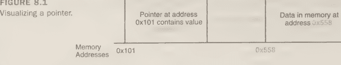

因此，指针是一个变量，和所有变量一样，指针占据了内存中的空间（在图 8.1 中，地址为 0x101）。指针的特殊之处在于，指针中包含的值（在此例中为 0x558）被解释内存地址。所以，指针是一个指向内存位置的特殊变量。

> 注意：内存位置通常使用十六进制表示法进行。这是一种 16 进制数系统，即包含 16 个不同符号 0–9，后面跟着 A–F。习惯上在显示十六进制数时加上前缀 0x。因此，0xA 是十进制 10 的十六进制；0xF 是 15 的十六进制；0x10 是 16 的十六进制。更多信息，请参阅附录 A，“数字处理：二进制与十六进制”。

## 声明指针

由于指针是变量，它也需要声明。通常声明一个指向特定值类型的指针（例如 `int`）。这意味着指针中包含的地址指向内存中存放整数的位置。你也可以指定一个指向内存块的指针（也称为空指针）。

指针作为变量，需要像所有变量一样进行声明：

```cpp
PointerType * PointerVariableName;
```

和大多数变量一样，除非初始化指针，否则它将包含一个随机值。你不希望访问随机内存地址，因此你对指针初始化为 NULL。NULL 是一个可以检查的值且不是内存地址的值：

```cpp
PointerType * PointerVariableName = NULL; // 初始化值
```

因此，声明一个指向整数的指针将是
`int *pointsToInt = NULL;`

> 警告：指针像你学过的所有数据类型一样，除非已初始化，否则它包含一个垃圾值。这种垃圾值在指针情况下特别危险，因为指针预期包含一个地址。未初始化的指针可能导致你的程序访问无效的内存位置，导致崩溃。

## 使用引用运算符 (&) 确定变量的地址

变量是语言提供的供你处理内存中数据的工具。这一概念在第 3 节“使用变量、声明常量”中进行了详细解释。
如果 `varName` 是一个变量，`&varName` 给出其值所在内存中的地址。
所以，如果你声明了一个整数，使用你熟悉的语法，例如

`int age = 30;`

`&age` 就是该值 (30) 所在内存中的地址。列表 8.1 展示了整数变量内存地址的概念，该地址用于存放它所包含的值。

列表 8.1 确定 int 和 double 的地址

```cpp
0: #include <iostream>
1: using namespace std;
2:
3: int main(){
4: {
5:     int age = 30;
6:     const double Pi = 3.1416;
7:
8:     // 使用 & 找到内存中的地址
9:     cout << "Integer age is located at: 0x" << &age << endl;
10:    cout << "Double Pi is located at: 0x" << &Pi << endl;
11:
12:    return 0;
13: }
```

# 第 8 课：指针与引用详解

## 输出

```
Integer age is located at: 0x[地址值]
Double Pi is located at: 0x[地址值]
```

## 分析

## 使用解引用运算符 (*) 访问指向的数据

你拥有一个指向数据的指针，该指针包含一个有效地址。你如何访问该位置——即，在该位置上获取或设置数据？答案在于使用解引用运算符 (*)。本质上，如果你有一个有效的指针 `pData`，则使用 `*pData` 来访问指针所包含的地址处的值。列表 8.4 演示了解引用运算符 (*) 的用法。

列表 8.4 演示使用解引用运算符 (*) 访问整数值

```cpp
0: #include <iostream>
1: using namespace std;
2:
3: int main()
4: {
5:     int age = 30;
6:     int dogsAge = 9;
7:
8:     cout << "Integer age = " << age << endl;
9:     cout << "Integer dogsAge = " << dogsAge << endl;
10:
11:     int* pointsToToInt = &age;
12:     cout << "pointsToToInt to age" << endl;
13:
14:     // 显示指针的值
15:     cout << "pointsToToInt = 0x" << hex << pointsToToInt << endl;
16:
17:
18:     // 显示指向位置处的值
19:     cout << "*pointsToToInt = " << dec << *pointsToToInt << endl;
20:
21:     pointsToToInt = &dogsAge;
22:     cout << "pointsToToInt to dogsAge now" << endl;
23:
24:     cout << "pointsToToInt = 0x" << hex << pointsToToInt << endl;
25:     cout << "*pointsToToInt = " << dec << *pointsToToInt << endl;
26:
27:     return 0;
28: }
```

输出 ▼
Integer age = 30
Integer dogsAge = 9
pointsToToInt points to age
pointsToToInt = 0x0025F788

分析 ▼

```
*pointsToInt = 30
pointsToInt points to dogsAge now
pointsToInt = 0x0025F77C
*pointsToInt = 9
```

在更改指针内部存储的地址时，同样在列表 8.3 中同一个指针使用了解引用运算符 (*)，该程序本质上使用 `pointsToInt` 来打印这两个地址处不同的值。请注意第 18 行和第 24 行。在这些行中，使用解引用运算符 (*) 访问了由 `pointsToInt` 指向的整数。由于 `pointsToInt` 包含的地址在第 20 行发生了变化，在该赋值后，同一个指针访问了变量 `dogsAge`，显示为 9。

当使用解引用运算符 (*) 时，程序本质上将指针中存储的地址作为起点，从内存中将 4 字节的数据强制转换为整数（因为这是一个指向整数的指针，且 `sizeof(int)` 为 4）。因此，指针所包含地址的有效性至关重要。通过在第 11 行初始化指针，你确保了指针包含一个有效地址。当你不初始化指针时，它可能包含任何随机值（存在于指针变量所在的内存位置中的值），对该指针进行解引用通常会导致访问违规（Access Violation）——即访问你的应用程序未授权访问的内存位置。

> 解引用运算符 (*) 也称为间接运算符。

在前面的示例中，你使用指针从指向的内存位置读取（获取）值。列表 8.5 显示了当 `*pointsToInt` 被用左值（l-value）时发生的情况——即它不仅仅是被访问。

## 列表 8.5 使用指针和解引用运算符 (*) 操控数据

```cpp
0: #include <iostream>
1: using namespace std;
2:
3: int main(){
4: {
5: int dogsAge = 30;
6: cout << "Initialized dogsAge = " << dogsAge << endl;
7: 
8:   int* pointsToAnAge = &dogsAge;
9:   cout << "pointsToAnAge points to dogsAge" << endl;
10:
11:  cout << "Enter an age for your dog: ";
12:
13:  // 将输入存储在 pointsToAnAge 指向的内存中
14:  cin >> *pointsToAnAge;
15:
16:  // 显示存储 age 的地址
```


进入`/path/to/xxx`目录，找到`xxx.json`。

在表达式`cvar = avar + bvar`中，加法运算符（`+`）将`avar`与`bvar`相加，得到它们的和`cvar`

在`List.of(arg0, arg1, arg2)`中，`List`接口的工厂方法`of()`接受一系列的元素，返回包含它们的只读列表。

之后我们这样调用`cmd`命令：`cmd arg0 arg1 arg2`。

```
if (condVar > someVal) {console.log("xxx")}
```

17:  `cout` << "Input stored at 0x" << `hex` << `pointsToAnAge` << `endl`;

18:

19:  `cout` << "*dogsAge = " << `dec` << `dogsAge` << `endl`;

20:

21:  `return` 0;

22: }

```

输出 ▼
Initialized dogsAge = 30
pointsToAnAge points to dogsAge
Enter an age for your dog: 10
Input stored at 0x0025FA18
dogsAge = 10

分析 ▼
这里的关键步骤是第 14 行，用户输入的 age 被保存在 `pointsToAnAge` 存储的位置。第 19 行显示 `dogsAge` 的代码展示了使用指针存储的值。这是因为 `pointsToAnAge` 在第 8 行初始化为指向 `dogsAge`。对 `dogsAge` 存储内存位置（以及 `pointsToAnAge` 指向的位置）的任何更改都会反映出来。

## 什么是指针？

你已经了解到指针只是另一个包含内存地址的变量。因此，无论如何，指针所包含的地址取决于它指向的类型。指针的大小取决于编译器，正如 8.6 所示。

## 第8节：指针与引用

### 8.6 演示不同类型的指针大小相同

```cpp
0: #include <iostream>
1: using namespace std;
2:
3: int main()
4: {
5:     int a = 10;
6:     cout << "int的大小: " << sizeof(a) << endl;
7:
8:     double b = 10.5;
9:     cout << "double的大小: " << sizeof(b) << endl;
10:
11:     char c = 'a';
12:     cout << "char的大小: " << sizeof(c) << endl;
13:
14:     int* pA = &a;
15:     cout << "int*指针的大小: " << sizeof(pA) << endl;
16:
17:     double* pB = &b;
18:     cout << "double*指针的大小: " << sizeof(pB) << endl;
19:
20:     char* pC = &c;
21:     cout << "char*指针的大小: " << sizeof(pC) << endl;
22:
23:     return 0;
24: }
```

输出 ▼
int的大小: 4
double的大小: 8
char的大小: 1
int*指针的大小: 4
double*指针的大小: 4
char*指针的大小: 4

分析 ▼
输出显示，无论所指向的类型如何，指针的大小都是相同的。这是因为指针存储的是地址。在 32 位系统上，地址是 4 字节，而在 64 位系统上，地址是 8 字节。

## 注意
列表 8.6 的输出是在使用 32 位编译器时生成的。如果你使用 64 位编译器并运行程序，你可能会看到指针是 8 字节。

## 动态内存分配

当你编写一个包含数组声明的程序时
`int myNums[100]; // 100个整数的静态数组`

你的程序有两个问题：

- 你实际上限制了程序的容量，因为它无法存储超过 100 个数字。
- 在只需要存储 1 个数字的情况下，你降低了系统的性能，因为预留了 100 个的空间。

这些问题存在是因为早期声明的数组分配是静态的，由编译器固定的。为了编写一个根据用户需求优化内存内存资源的应用程序，你需要使用动态内存分配。这允许你在需要时分配更多内存，并在过多时释放内存。C++ 提供了两个运算符，`new` 和 `delete`，帮助你管理应用程序的内存消耗。存储内存地址的指针在内存分配中起着至关重要的作用。

### 使用 new 和 delete 运算符动态分配和释放内存

你使用 `new` 分配新的内存。`new` 的常用形式在成功时返回内存指针，否则抛出异常。使用 `new` 时，你需要指定要分配内存的数据类型：

```cpp
Type* Pointer = new Type; // 请求一个元素的内存
```

你还可以指定想要分配内存的元素数量：

```cpp
Type* Pointer = new Type[numElements]; // 请求 numElements 个元素的
```

因此，如果你需要分配整数，使用以下语法：

```cpp
int* pointToAnInt = new int; // 获取指向整数的指针
int* pointToNums = new int[10]; // 指向10个整数块的指针
```

# 第 8 节：指针与引用详解

注意

> 注意，`new` 表示对内存的请求。无法保证分配调用总是成功，因为这取决于系统状态和内存资源的可用性。

任何使用 `new` 进行的分配最终都需要通过 `delete` 进行相应的等效且相反的去分配操作来释放：

```
Type* Pointer = new Type; // 分配内存
delete Pointer; // 释放上面分配的内存
```

当你请求为多个元素的内存时，该规则同样适用：

```
Type* Pointer = new Type[numElements]; // 分配一个块
delete[] Pointer; // 释放上面分配的块
```

注意

> 注意，在使用 `new[...]` 分配内存块时使用 `delete[]`，而在使用 `new` 分配单个元素时使用 `delete`。

如果你在停止使用内存后没有释放它，该内存将保持保留并分配给你的应用程序。反之，这减少了应用程序可用的系统内存，甚至可能让你的程序运行变慢。这被称为内存泄漏（leak），应该尽可能避免。

列表 8.7 展示了内存的动态分配和释放。

### 列表 8.7 通过运算符 (+) 访问 new 分配的内存并使用 delete 释放

```
0: #include <iostream>
1: using namespace std;
2:
3: int main()
4: {
5: //为 int 请求内存空间
6: int* pointsToAnAge = new int;
7:
8: // 使用分配的内存存储一个数字
9: cout << "Enter your dog's age: ";
10: cin >> *pointsToAnAge;
```

```
11:
12:     // 使用间接运算符 * 访问值
13:     cout << "Age " << *pointsToAnAge << " is stored at 0x" << hex << pointsToAnAge << endl;
14:
15:
16:     delete pointsToAnAge; // 释放内存
17:     return 0;
18: }
```

# 输出 ▼

Enter your dog's age: 9
age 9 is stored at 0x00338120

# 分析 ▼

第 6 行演示了如何使用 `new` 为整数请求空间，你计划通过用户输入存储狗的年龄。注意 `new` 返回一个指针，这就是它被赋值给指针的原因。用户输入的年龄通过第 10 行的 `cin` 和解引用运算符 (*) 存储在这一新分配的内存中。第 13 行再次使用解引用运算符 (*) 显示了存储的值，并显示了存储该值的内存地址。注意第 13 行 `pointsToAnAge` 中包含的地址仍然是第 6 行 `new` 返回的地址，自那以后没有发生过。

## 注意

> > 运算符 `delete` 不能在指针中包含的任何地址上调用，只能在那些由 `new` 返回且尚未被 `delete` 释放的地址上调用。

因此，列表 8.6 中看到的指针包含有效地址，但不应使用 `delete` 释放，因为这些地址不是通过调用 `new` 返回的。

注意，当你使用 `new[...]` 为范围内的元素分配内存时，如列表 8.8 所示，你需要使用 `delete[]` 进行去分配。

### 列表 8.8 分配 new[...] 并使用 delete[] 释放它

```
0: #include <iostream>
1: #include <string>
2: using namespace std;
3:
4: int main()
5: {
6:   cout << "How many integers shall I reserve memory for?" << endl;
7:   int numEntries = 0;
8:   cin >> numEntries;
9: 
10:  int* myNumbers = new int[numEntries];
11: 
12:  cout << "Memory allocated at: 0x" << myNumbers << hex << endl;
13: 
14:  // 退出前去分配
15:  delete[] myNumbers;
16: 
17:  return 0;
18: }
```

# 输出 ▼

How many integers shall I reserve memory for?
5
1
Memory allocated at: 0x00C158

# 分析 ▼

最重要的行是第 10 行和第 15 行使用的 `new[]` 和 `delete[]`。此示例与列表 8.7 的不同之处在于它动态分配了一个可以容纳用户请求数量整数的内存块。在此执行中，请求了 5 个整数。在另一次运行中，可能是 0 个。程序每次执行都会分配不同数量的内存。此类分配需要通过 `delete[]` 来匹配。

`new` 和 `delete` 运算符从空存储（free store）分配内存。空存储是内存池的形式，可以在其中分配（即保留）和去分配（即释放）。

## 指增和递减运算符 (++ 和 --) 对指针的影响

指针包含一个内存地址。例如，列表 8.3 中的整数是 4 字节长，位于内存中 0x00EF34 到 0x00EF37 的位置。使用运算符 `++)` 指增指针会导致其指向 0x00EF38，即移动了 1 个整数。指针的增或递减操作被编译器解释为指向下一个值，假设类型相同（除非该值是 1 字节，如 `char`）。因此，在列表 8.3 中指增指针会导致其增加 4 字节，这正是 `int` 的大小。同样，对该指针增加 2 会导致向前移动 2 个整数，即 8 字节。稍后你会看到数组中使用的指针也有这种行为。使用运算符 `--` 递减指针的效果相同——减少了所指向的数据的大小。

### 当你增加或递减指针时发生了什么？

指针中包含的地址增加了或减少了指向类型的大小（而不是字节）。通过这种方式，编译器确保指针永远 own数据的中间或结尾；它只指向开头。

如果指针被声明为

```
Type* pType = Address;
```
++pType 意味着 pType 包含 Address + sizeof(Type)。参见列表 8.9，它解释了指增指针或对其添加偏移量的影响。

### 列表 8.9 使用偏移值增减指针

```
0: #include <iostream>
1: using namespace std;
2:
3: int main(){
4: {
5:     cout << "How many integers you wish to enter? ";
6:     int numEntries = 0;
7:     cin >> numEntries;
8:
9:     int* pointsToInts = new int [numEntries];
10:
11:     cout << "Allocated for " << numEntries << " integers" << endl;
12:     for(int counter = 0; counter < numEntries; ++counter) {
13:
14:         cout << "Enter number " << counter << ": ";
15:         cin >> *(pointsToInts+counter);
16:     }
17:
18:     cout << "Displaying all numbers entered: " << numEntries << endl;
19:     for(int counter = 0; counter < numEntries; ++counter)
20:         cout << *(pointsToInts+counter) << " ";
21:
22:     cout << endl;
23:
24:     // 将指针返回初始位置
25:     pointsToInts = numEntries;
26:
27:     // 使用内存结束？释放
28:     delete[] pointsToInts;
29:
30:     return 0;
31: }
```

# 输出 ▼

How many integers you wish to enter? 2
Allocated for 2 integers
Enter number 0: 8774
Enter number 1: -5
Displaying all numbers entered:
8774 -5

# 再次运行:

How many integers you wish to enter? 5
How many integers you wish to enter? 5
Allocated for 5 integers
Enter number 0: 543
Enter number 1: 756
Enter number 2: 2017

# 动态内存分配

Enter number 3: -101
Enter number 4: 10101012
Displaying all numbers entered:
543 756 2017 -101 10101012

# 分析 ▼

程序在第 9 行为整数分配内存之前，向用户询问想要输入系统的整数数量。示例演示了两种指增指针的方法。一种是使用偏移量值，如第 15 行所示，我们将用户输入直接存储在内存位置中。另一种是使用第 20 行所示的 `++` 运算符来增加指向分配内存中下一个有效整数的地址。

-   指针指向的数据是常量且不可更改，但指针中包含的地址可以更改——也就是说，指针也可以指向其他地方：

```cpp
int hoursInDay = 24;
const int* pointsToInt = &hoursInDay;
int monthsInYear = 12;
pointsToInt = &monthsInYear; // OK!
*pointsToInt = 13; // Not OK! 不能更改所指向的数据
int* newPointer = pointsToInt; // Not OK! 不能将 const 赋值给非 const
```

-   指针包含的地址和所指向的值都是常量且不可更改（限制性变体）：

```cpp
int hoursInDay = 24;
const int* hoursInDay = &hoursInDay;
*hoursInDay = 25; // Not OK! 不能更改所指向的数据
daysInMonth = 30;
hoursInDay = &daysInMonth; // Not OK! 不能更改地址
```

`const` 的形式在向函数传递指针时特别有用。函数参数需要声明以支持最高可能的（限制性）`const` 级别，以确保函数在不应该修改时不会修改指向的值。这将防止应用程序的程序员对指针值或数据进行无谓的更改。

## 向函数传递指针

指针是向函数传递包含相关数据的内存空间的有效方法。共享的内存空间还可以返回操作的结果。在与函数使用指针时，确保被调用函数只允许修改你希望它修改的参数而不修改其他参数变得至关重要。例如，一个给定半径作为 `const` 指针并计算圆面积的函数不应允许修改半径。这就是你使用 `const` 来控制函数允许修改和不允许修改的地方，如列表 8.10 所示。

### 列表 8.10 在 <iostream> 中使用 const 关键字计算圆面积

```cpp
0: #include <iostream>
1: using namespace std;
2:
3: void CalcArea(const double* const ptrPi, // 指向常量数据的常量指针
               const double* const ptrRadius, // 即不允许任何更改
4:
               double* const ptrArea) // 可以更改所指向的数据
5:
6: {
7:   // 使用前检查指针的有效性！
8:   if (ptrPi && ptrRadius && *ptrArea)
9:     *ptrArea = (*ptrPi) * (*ptrRadius) * (*ptrRadius);
10: }
11:
12: int main()
13: {
14:   const double Pi = 3.1416;
15:
16:   cout << "Enter radius of circle: ";
17:   double radius = 0;
18:   cin >> radius;
19:
20:   double area = 0;
21:   CalcArea (&Pi, &radius, &area);
22:
```


23:   `cout` << "Area is = " << `area` << `endl`;

24:

25:   `return` 0;

26: }

```

### 输出 ▼

Enter radius of circle: 10.5
Area is = 346.361

### 分析 ▼

第 3-5 行演示了两种 两种形式，使得 `ptrRadius` 和 `ptrPi` 都不会作为“常量指针”提供，且指针地址不被修改；`ptrArea` 显然是存储输出的参数名，因为指针中包含的值（地址）不能修改，但所指向的数据可以修改。第 8 行显示了在使用函数指针参数前如何检查它们的有效性。如果调用者无意中将 NULL 指针作为三个参数之一传递，你将不想计算面积，因为那会导致访问违规并引发应用程序崩溃。

## 数组与指针之间的相似性

你不认为列表 8.9 中的示例中，使用从零开始的索引增加指针来访问内存中的下一个整数与数组索引的方式有许多相似之处吗？当你声明一个整数数组时：

```cpp
int myNumbers[5];
```

## 第 8 课：指针与引用详解

你告诉编译器分配固定数量的内存来存储五个整数，并给你指向该数组第一个元素的指针，该元素由你分配给数组的名称标识。也就是说，`myNumbers` 是指向第一个元素 `myNumbers[0]` 的指针。列表 8.11 突出了这种关联。

## 列表 8.11 证明数组变量是第一个元素的指针

```cpp
0: #include <iostream>
1: using namespace std;
2:
3: int main()
4: {
5: // 5 个整数的静态数组
6: int myNumbers[5];
7:
8: // 赋值给 int 指针的数组
9: int* pointToNums = myNumbers;
10:
11: // 显示指针包含的地址
12: cout << "pointToNums = 0x" << hex << pointToNums << endl;
13:
14: // 数组第一个元素的地址
15: cout << "&myNumbers[0] = 0x" << hex << &myNumbers[0] << endl;
16:
17: return 0;
18: }
```

### 输出 ▼

pointToNums = 0x...
&myNumbers[0] = 0x...

### 分析 ▼

第 3-5 行演示了两种形式，使得 `ptrRadius` 和 `ptrPi` 都不会作为“常量指针”提供，且指针地址不被修改；`ptrArea` 显然是存储输出的参数名，因为指针中包含的值（地址）不能修改，但所指向的数据可以修改。第 8 行显示了在使用函数指针参数前如何检查它们的有效性。如果调用者无意中将 NULL 指针作为三个参数之一传递，你将不想计算面积，因为那会导致访问违规并引发应用程序崩溃。

## 内存分配

```cpp
6: {
7:   // 使用前检查指针的有效性！
8:   if (ptrPi && ptrRadius && *ptrArea)
9:     *ptrArea = (*ptrPi) * (*ptrRadius) * (*ptrRadius);
10: }
11:
12: int main()
13: {
14:   const double Pi = 3.1416;
15:
16:   cout << "Enter radius of circle: ";
17:   double radius = 0;
18:   cin >> radius;
19:
20:   double area = 0;
21:   CalcArea (&Pi, &radius, &area);
22:
23:   cout << "Area is = " << area << endl;
24:
25:   return 0;
26: }
```

取决于你——程序员——是否要确保所有分配的内存都由你的应用程序释放。这种情况绝不应该发生：

```cpp
int* pointToNums = new int[5]; // 初始分配
// 使用 pointToNums
```

```cpp
// 忘记使用 delete[] 释放 pointToNums
...
```

```cpp
// 进行另一次分配并覆盖
pointToNums = new int[10]; // 泄漏了之前分配的内存
```

## 当指针未指向有效位置时

当你使用操作符 `(*)` 对指针进行解引用以访问所指向的值时，你需要确保该指针包含一个有效的内存地址，否则你的程序将会崩溃或运行异常。尽管这在逻辑上似乎很不可思，但无效指针是导致应用程序崩溃的常见原因。指针失效的原因可能有很多，但主要是由于由于编程不当和内存管理不善。列表 8.13 显示了一个指针可能失效的典型案例。

列表 8.13 一个使用指针存储布尔值的程序中糟糕的指针卫生

```cpp
0: #include <iostream>
1: using namespace std;
2:
3: int main()
4: {
5:     // 未初始化的指针（坏）
6:     bool* isSunny=Sunny;
7:
8:     cout << "Is it sunny (y/n)? \n";
9:     char userInput = 'y';
10:    cin >> userInput;
11:
12:    if (userInput == 'y')
13:     {
14:         isSunny = new bool;
15:         *isSunny = true;
16:     }
17:
18:     // 如果用户输入 'n'，isSunny 包含无效值
19:     cout << "Boolean flag sunny says: " << *isSunny << endl;
20:
21:     // 在没有没有 new 时也调用了 delete
```

### 输出 ▼

```cpp
22:    delete isSunny;
23:
24:    return 0;
25: }
```

Is it sunny (y/n)? y
Boolean flag sunny says: 1

第二次运行：

```
Is it sunny (y/n)? n
<CRASH>
```

### 分析 ▼

程序中存在许多问题，其中一些已经在代码中注释过了。注意第 14 行中是如何分配内存并赋值给指针的，这是在用户按下 'y' 表示是时条件执行的。对于用户的其他所有输入，如果该块没有执行，指针 `isSunny` 保持为无效状态。因此，当用户在第二次运行时按下 'n' 时，应用程序崩溃了，因为 `isSunny` 包含一个无效的内存地址，而在第 19 行对无效指针进行解引用会导致问题。

同样，对这个指针调用 `delete`（如第 22 行所示，它并没有通过 `new` 分配）也是错误的。请注意，如果你有一个指针的副本，你只需要对其中一个调用 `delete`（你还需要避免让指针的副本四处飘浮）。

一个更好（更安全、更稳定）的程序版本应该是指针经过初始化，其值是有效的，并且仅在有效时释放一次。

## 悬空指针（也称为游离指针或野指针）

请注意，任何有效指针在在使用 `delete` 释放后都是无效的。换句话说，即使是有效指针 `isSunny` 在调用第 22 行的 `delete` 后也会变为无效，并且之后不应再使用该指针。

为了避免这个问题，一些程序员遵循一种约定：在初始化指针或在删除指针后给其赋值 `NULL`。他们在使用操作符 `(*)` 对指针进行解引用之前，总是通过与 `NULL` 比较来检查指针的有效性。

## 使用指针时的常见编程错误

在学习了使用指针的一些典型问题后，是时候纠正列表 8.13 中的错误代码了，见列表 8.14。

### 列表 8.14 更安全的指针编程，列表 8.13 的修正

```cpp
0: #include <iostream>
1: using namespace std;
2:
3: int main()
4: {
5:     cout << "Is it sunny (y/n)? ";
6:     char userInput = 'y';
7:     cin >> userInput;
8:
9:     // 声明指针并初始化
10:     bool* const isSunny = new bool;
11:     *isSunny = true;
12:
13:     if (userInput == 'n')
14:         *isSunny = false;
15:
16:     cout << "Boolean flag sunny says: " << *isSunny << endl;
17:
18:     // 释放有效内存
19:     delete isSunny;
20:
21:     return 0;
22: }
```

### 输出 ▼

Is it sunny (y/n)? y
Boolean flag sunny says: 1

下次运行：

Is it sunny (y/n)? n
Boolean flag sunny says: 0

（无论用户输入什么，均不会崩溃。）

### 分析 ▼

微小的重构使得代码对于所有用户输入组合都变得更安全。注意在第 10 行声明期间是如何将指针初始化为有效内存地址的。我们使用 `const` 来确保所指向的数据可以被修改，而指针的值（包含的地址）保持固定不变。我们还通过第 11 行初始化了所指向的布尔值为 `true`。这种初始化没有增加程序的稳定性，但增强了可靠性。这种初始化确保了在任何用户输入的情况下指针都是安全的。

## 检查 new 是否成功

在代码中，我们假设 `new` 总是成功的，除非请求了异常大量的内存或系统处于如此临界的状态以至于没有内存可用。此时，`new` 会抛出 `bad_alloc` 异常，除非你有异常处理器。异常处理在第 28 页有详细介绍。

## 列表 8.15 处理异常并优雅地退出

```cpp
0: #include <iostream>
1: using namespace std;
2:
3: int main()
4: {
5: // 使用 try-catch 块
6:   try
7:   {
8:     // 请求内存
9:     int*ToManyNums = new int [0ffff];
10:    // 使用分配的内存
11:    delete[]ToManyNums;
12:   }
13: catch (bad_alloc)
14: {
15:     cout << "Memory allocation failed. Ending program" << endl;
16:     return 1;
17: }
18: return 0;
19: }
```

### 输出 ▼

Memory allocation failed. Ending program

### 分析 ▼

此程序在你的计算机上执行结果可能不同。当使用 Microsoft Studio 调试模式时，执行结果如图 8.2 所示。


异常处理构造帮助了应用程序在内存分配失败后进行控制退出。

## 使用(nothrow) 在失败时返回 NULL

对于不想依赖异常的人，`new` 有一个变体称为 `new(nothrow)`。该变体在分配失败时不抛出异常，而是导致操作符 `new` 返回 `NULL`。因此，对赋值指针进行有效性检查。见列表 8.16。

## 列表 8.16 使用(nothrow) 在失败时返回 NULL

```cpp
0: #include <iostream>
1: using namespace std;
2:
3: int main()
4: {
5:     // 请求大量内存空间，使用 notrow
6:     int*ToManyNums = new(nothrow) int [0ffff];
7:
8:     if (ToManyNums) // 检查ToManyNums != NULL
9:     {
10:        // 使用分配的内存
11:        delete[]ToManyNums;
12:    }
13:    else
14:        cout << "Memory allocation failed. Ending program" << endl;
15:
16:    return 0;
17: }
```

### 输出 ▼

Memory allocation failed. Ending program

### 分析 ▼

列表 8.16 与列表 8.15 功能相同，区别在于这里使用了 `new(nothrow)`。由于该 `new` 变体在内存分配失败时返回 `NULL`，我们在在使用之前对其进行了检查。

# 要 (DO)

## 不要 (DON'T)

要始终初始化指针变量，否则它们将包含垃圾值。这些垃圾值会被解释为地址位置——你的应用程序无权访问的地址。如果在变量声明时你无法将指针初始化为 `new` 返回的有效地址，请将其初始化为 `NULL`。

要确保你的程序设计方式是在指针的有效性得到保证时使用它们，否则你的程序可能会崩溃。

要记住使用 `delete` 释放通过 `new` 分配的内存，否则你的应用程序将会内存内存并降低系统性能。

不要在通过 `delete` 释放内存块后访问该内存块或使用该指针。

不要对同一个内存地址多次调用 `delete`。

不要在内已分配的内存块时因忘记调用 `delete` 导致导致内存泄漏。

# 什么是引用？

引用是变量的别名。当你声明一个引用时，需要将其初始化为一个变量。因此，引用变量只是访问所引用变量中存储数据的另一种方式。

你可以使用引用运算符 (&) 来声明引用，如在本语句所示：

```
VarType original = Value;
VarType& ReferenceVariable = original;
```

要进一步理解如何声明和使用引用，请参见列表 8.17。

## 列表 8.17 证明引用是赋值值的别名

```
0: #include <iostream>
1: using namespace std;
2:
3: int main()
```

# 206 第 8 课：指针与引用详解

```
4: {
    int original = 30;
    cout << "original = " << original << endl;
    cout << "original is at address: " << hex << &original << endl;
    int& ref1 = original;
    cout << "ref1 is at address: " << hex << &ref1 << endl;
    int& ref2 = ref1;
    cout << "ref2 is at address: " << hex << &ref2 << endl;
    cout << "Therefore, ref2 = " << dec << ref2 << endl;
    return 0;
}
```

# 输出 ▼

original = 30
original is at address: 0099F764
ref1 is at address: 0099F764
ref2 is at address: 0099F764
Therefore, ref2 = 30

# 分析 ▼

输出表明，引用无论它们是像第 9 行所示初始化为原始变量，还是像第 12 行所示初始化为引用，都指向包含原始变量的相同内存位置。因此，引用是真正的别名——也就是说，它们只是 `original` 的另一个名字。在第 14 行中使用 `ref2` 显示的值与第 6 行中 `original` 的值相同，因为 `ref2` 是 `original` 的别名并位于内存中的同一个位置。

# 什么使得引用很有用？

引用允许你操作它们被初始化到的内存位置。这使得引用在编写函数时特别有用。正如你在第 7 课“用函数组织代码”中所学习的，典型的函数声明如下：

```
ReturnType DoSomething(Type parameter);
```

函数 `DoSomething()` 的调用方式如下：

```
ReturnType Result = DoSomething(argument); // 函数调用
```

# 什么是引用？

前面的代码会导致参数被复制到 `Parameter` 中，然后由函数 `DoSomething()` 使用。如果参数消耗了大量内存，这个复制步骤可能会产生很大的开销。同样，当 `DoSomething` 返回一个值时，它会被再次复制到 `Result` 中。如果我们能避免或消除复制步骤，让函数直接处理调用者栈上的数据，将是理想的。引用允许你这样做。

没有复制步骤的函数版本如下：

```
ReturnType DoSomething(Type& parameter); // 注意引用&
```

该函数的调用方式如下：

```
ReturnType Result = DoSomething(argument);
```


由于参数是通过引用传递的，`Parameter` 不是 `argument` 的拷贝，而是后者的别名，就像列表 8.17 中的许多 `Ref` 一样。此外，接受引用作为参数的函数可以选择地使用引用参数返回返回值。参见列表 8.18 以了解函数如何使用引用而不是返回值。

# 列表 8.18 通过引用参数返回计算平方的函数

```cpp
0: #include <iostream>

1: using namespace std;

2:

3: void GetSquare(int& number)

4: {

    number *= number;

6: }

7:

8: int main()

9: {

10:    cout << "Enter a number you wish to square: ";

11:    int number = 0;

12:    cin >> number;

13:

14:    GetSquare(number);

15:    cout << "Square is: " << number << endl;

16:

17:    return 0;

18: }
```

# 输出 ▼

Enter a number you wish to square: 5
Square is: 25

# 分析 ▼

执行平方操作的函数位于第 3-6 行。注意它是如何通过引用参数接受待平方的数字并以相同方式返回结果的。如果你忘记将参数 `number` 标记为引用 `(&)`，结果将无法传递给调用函数 `main()`。

在这种情况下，发送待平方数字的变量也持有了结果。使用引用，结果在函数退出后在 `main()` 中可用。

#

# 在引用上使用 const

你可能需要不允许更改的引用。在声明引用时使用 `const` 是实现这一点的方法：

```cpp
int original = 30;

const int& constRef = original;

constRef = 40; // 不允许

int ref2 = constRef; // OK

const int& ref3 = constRef; // 不允许
```

# 通过引用传递参数

引用的主要优势之一是它们允许调用函数处理未复制的参数，从而显著提高性能。然而，由于调用函数直接在栈上操作，确保调用函数无法更改变量很重要。定义为 `const` 的引用可以帮助实现这一点，正如 8.19 所示。`const` 引用不能作为左值，因此对其进行任何赋值会导致编译失败。

# 列表 8.19 使用 const 引用确保调用函数无法修改传递的值

```cpp
0: #include <iostream>

1: using namespace std;

2:

3: void GetSquare(const int& number, int& result)

4: {

5:     result = number*number;

6: }

7:

8: int main()

9: {

10:    cout << "Enter a number you wish to square: ";

11:    int number = 0;

12:    cin >> number;

13:

14:    int square = 0;

15:    GetSquare(number, square);

16:    cout << number << " ^2 = " << square << endl;

17:

18:    return 0;

19: }
```

# 输出 ▼

Enter a number you wish to square: 27
27^2 = 729

# 分析 ▼

与列表 8.18 中发送待平方数字的变量也持有了结果相比，此程序使用了两个变量——一个发送待平方的数字，另一个用于持有结果。为了确保发送的值不能被修改，它被标记为 `const` 引用，如第 3 行所示。这自动使参数 `number` 成为输入参数——一个值不能被修改的参数。

作为实验，你可能会修改第 5 行使用列表 8.18 所示的逻辑返回平方：

`number *= number;`

你一定会遇到一个编译错误，告诉你 `const` 值无法被修改。因此，`const` 引用表示参数是输入参数并确保其值不能被修改。起初看起来这似乎微不足道，但在

在一个多程序环境中，由于编写第一个版本的人可能与改进该版本的人不是同一个人，使用 `const` 引用将有助于提高程序的质量。

## 总结

在本节中，你学习了指针和引用。你学习了如何使用指针访问和操作内存，以及它们是如何作为辅助动态内存分配的工具的。你学习了用于为元素分配内存的运算符 `new` 和 `delete`。你学习了它们的变体 `new[]` 和 `delete[]` 它们如何帮助你为数据数组分配内存。你接触了指针编程和动态内存分配中的陷阱，并发现释放动态分配的内存对于避免泄漏至关重要。引用是别名，在向函数传递参数时，它是使用指针的强大替代方案，因为引用被保证是有效的。你学习了在使用指针和引用时什么是“const 正确（const correctness）”，从今以后尽可能使用最严格的 `const` 级别来声明函数。

## 问答

- Q: 既然可以使用不需要担心释放内存的静态数组，为什么还要用动态分配内存呢？
- A: 静态数组的大小是固定的，如果你的应用程序需要更多内存，它将无法扩展；如果应用程序需要更少内存，它也不会进行优化。这正是动态内存分配发挥作用的地方。

两个指针：

```cpp
int* pointToIntAns = new int;

int* pCopy = pointToIntAns;
```

我难道不是调用 `delete` 来确保内存消失更好吗？

A: 那样做是错误的。你只允许对 `new` 返回的地址调用一次 `delete`。此外，理想情况下，在对任何一个指针执行 `delete` 之前，你有两个指针指向同一个地址，否则会使另一个指针失效。你的程序编写方式也不应该让你对所用指针的有效性产生任何不确定性。

- Q: 我应该什么时候使用 `new(nothrow)`？
- A: 如果你不想处理异常 `std::bad_alloc`，你可以使用运算符 `new` 的 `nothrow` 版本，它在请求的分配失败时返回 `NULL`。

## 我可以使用以下两种方法调用函数计算面积：

```cpp
void CalculateArea(const double* const ptrRadius, double* const ptrArea);

void CalculateArea(const double& radius, double& area);
```

## 我应该倾向于哪种变体？

- A: 后者使用引用的，因为引用不会失效，而指针可能会。此外，它也更简单。

## 我有一个指针：

```cpp
int number = 30;

const int* pointToAnInt = &number;
```

我理解由于 `const` 声明，我不能通过指针 `pointToAnInt` 修改 `number` 的值。我可以将 `pointToAnInt` 赋值给一个非 const 指针，然后使用它来操作整数 `number`set的值吗？

- A: 不，你不能改变指针的 const 正确性：

```cpp
int* aPointer = pointToAnInt; // 不能将指针赋值给 const
```

- Q: 我应该费心通过引用向函数传递值吗？
- A: 只要不怎么影响你的程序性能，你就不需要这样做。然而，如果你的函数参数接收的是非常重的对象（字节数大），按值传递将是非常昂贵的操作。使用引用会让你的函数调用高效得多。记住慷慨地使用 `const`，除非函数需要将结果存储在变量中。

## 这两个声明之间的区别是什么：

```cpp
int myNumbers[100];

int* myArray[100];
```

- A: `myNumbers` 是一个整数数组——也就是说 `myNumbers` 是一个指向存储 100 个整数的内存位置的指针，指向索引 0。它是以下代码的静态替代方案：

```cpp
int* myNumbers = new int [100]; // 动态分配的数组

// 使用 myNumbers

delete[] myNumbers;
```

另一方面，`myArray` 是指针数组，每个指针都可以指向一个整数或一个整数数组。

## 工作坊

工作坊提供了测试题帮助你巩固对涵盖内容的理解，并提供了使用所学知识的练习。在查看附录 E 中的答案之前，请回答测试和练习题，并确保你理解了答案。

## 测试

1. 为什么不能将 const 引用赋值给非 const 引用？
2. `new` 和 `delete` 是函数吗？
3. 指针变量包含的值的性质是什么？
4. 你使用哪个运算符访问指针所指向的数据？

## 练习

1. 执行以下语句时会显示什么：

```cpp
0: int number = 3;

1: int* pNum1 = &number;

2: *pNum1 = 20;

3: int* pNum2 = pNum1;

4: number *= 2;

5: cout << *pNum2;
```

2. 这三个重载函数之间有什么相似之处和不同之处：
`int DoSomething(int num1, int num2);`
`int DoSomething(int& num1, int& num2);`
`int DoSomething(int* pNum1, int* pNum2);`

3. 如何修改练习1中第1行中 `pNum1` 的声明，以便使第3 行的赋值无效？（提示：这与确保 `pNum1` 不能更改所指向的数据有关。）

4. 漏洞排除：这段代码有什么问题？

```cpp
#include <iostream>

using namespace std;

int main() {

    int* pointToIntAns = new int;

    int* pCopy = pointToIntAns;

    // 缺少了什么？

    return 0;

}
```

创建一个类型为 `Human` 的对象与创建另一个类型的实例相似，例如 `double`：

```cpp
double pi= 3.1415; // 一个 double 类型的变量

Human firstMan; //一个 Human 类的对象
```

或者，你也可以像创建另一个类型（例如 `int`）一样使用 `new` 动态创建一个 `Human` 类的实例：

```cpp
int* pointsToNum = new int; // 动态分配的整数

delete pointsToNum; // 使用后释放内存
```

```cpp
Human* firstWoman = new Human(); // 动态分配的 Human

delete firstWoman; // 释放内存
```

## 使用点运算符 (.) 访问成员

人类的一个例子是 Adam，男性，1970年出生于阿拉拉巴马州。实例 `firstMan` 是 `Human` 类的对象，是该类在现实中（即运行时）中的化身。

```cpp
Human firstMan; // Human 的一个实例
```

正如类声明所示，`firstMan` 拥有 `dateOfBirth` 等属性，可以使用点运算符 `()` 来访问：

```cpp
firstMan.dateOfBirth = "1970";
```

这是因为属性 `dateOfBirth` 属于 `Human` 类，正如类声明所示，它是类蓝图的一部分。该属性只有在对象实例化后才存在于现实中——即在运行时。点运算符 `(.`) 帮助你访问对象的属性。

对于 `IntroduceSelf()` 等方法也是如此：

```cpp
firstMan.IntroduceSelf();
```

如果你有一个指向 `Human` 类实例的指针 `firstWoman`，你可以使用指针运算符 (`--`) 来访问成员（如下一节介绍所示），或者使用间接运算符 `(*)` 配合点运算符来引用对象。

```cpp
Human* firstWoman = new Human();

(*firstWoman).IntroduceSelf();
```

## 使用指针运算符 (->) 访问成员

命名规范同样适用。类名和成员函数使用帕斯卡命名法（Pascal case）声明，例如 `IntroduceSelf()`。类成员属性使用驼峰命名法（camel case），例如 `dateOfBirth`。

当我们实例化一个类的对象时，我们声明一个类型为该类的变量。因此，我们使用驼峰命名法，这也是我们到目前为止一直用于变量名的方法，例如 `firstMan`。

注意

如果对象在空堆上使用 `new` 实例化，或者你有一个指向对象的指针，则你使用指针运算符 (`->`) 来访问成员属性和函数：

```cpp
Human* firstWoman = new Human();

firstWoman->dateOfBirth = "1970";

firstWoman->IntroduceSelf();

delete firstWoman;
```

列表 9.1 展示了一个带有 `public` 关键字的、可编译 `Human` 类。

- 列表 9.1 一个可编译的类 Human

```cpp
0: #include <iostream>

1: #include <string>

2: using namespace std;

3:

4: class Human

5: {

6: public:

7:     string name;

8:     int age;

9:

10: void IntroduceSelf()

11: {

12:     cout << "I am " + name << " and am " << \n;

13:     cout << age << " years:old" << endl;

14:

15: };

16:

17: int main()

18: {

19:     // 一个属性 name 为 "Adam" 的 Human 类对象

20:     Human firstMan;
```

# 第 9 节：类与对象

```cpp
21: firstMan.name = "Adam";

22: firstMan.age = 30;

23: 

24: // 一个属性 name 为 "Eve" 的 Human 类对象

25: Human firstWoman;

26: firstWoman.name = "Eve";

27: firstWoman.age = 28;

28: 

29: firstMan.IntroduceSelf();

30: firstWoman.IntroduceSelf();

31: }
```

## 输出 ▼

I am Adam and am 30 years old
I am Eve and am 28 years old

## 分析 ▼

第 4–15 行展示了一个基础 C++ 类 `Human`。注意 `Human` 类的结构以及该类如何在 `main()` 中被使用。

该类包含两个成员变量：第 7 行的 `string` 类型的变量 `name` 和第 8 行的 `int` 类型的变量 `age`。它还包含第 10–14 行的函数（也称为方法）`IntroduceSelf()`。`main()` 中的第 20 行和第 25 行实例化了两个 `Human` 类对象，分别命名为 `firstMan` 和 `firstWoman`。实例化后的行使用运算符设置了 `firstMan` 和 `firstWoman` 对象的成员变量，这在不久前已经解释过。注意第 29 行和第 30 行如何在输出的两个不同行中调用同一个函数 `IntroduceSelf()`。此程序演示了对象 `firstMan` 和 `firstWoman` 是独特的且个然不同的，它们是由 `Human` 类定义的抽象类型在现实世界中的代表。

你注意到到列表 9.1 中的 `public` 关键字了吗？是时候学习一些可以帮助你保护类中应该隐藏的属性的特征了。

## 关键字 public 和 private

信息至少可以分为两类：我们不在意公众公开的数据和私有数据。对于大多数人来说，性别是一个我们可能不介意分享的信息例子。然而，收入可能是一个私人问题。

C++ 允许你将类属性和方法建模为 `public` 或 `private`。因此，C++ 允许类设计者控制类数据属性的访问和操作方式。

在允许你将类设计为封装数据和操作这些数据的容器时，C++ 允许你通过 `private` 关键字决定哪些信息是外部世界无法访问的（即在类外部不可用）。同时，你也可以通过声明为 `public` 的方法对即使声明为 `private` 的信息进行受控访问。

回到 `Human::age` 为私有成员的例子，你发现许多人不喜欢透露自己的真实年龄。如果 `Human` 类需要返回一个比当前小两岁的年龄，可以通过一个 `public` 函数 `GetAge()` 轻松实现，该函数使用 `Human::age` 参数并减 2，结果如列表 9.2 所示。

## 列表 9.2 一个 Human 类模型，其中真实年龄对用户抽象化并报告较小的年龄

```cpp
0: #include <iostream>

1: using namespace std;

2:

3: class Human

4: {

5: private:

6: // 私有成员数据：

7: int age;

8:

9: public:

10: void setAge(int inputAge)

11: {

12: age = inputAge;

13: }

14:

15: // Human 对自己的年龄撒谎（如果超过 30 岁）

16: int getAge()

17: {


```cpp
18: if (age > 30)

19: return (age - 2);

20: else

21: return age;

22: }

23: }

24:

25: int main()

26: {

27: Human firstMan;

28: firstMan.setAge(35);

29:

30: Human firstWoman;

31: firstWoman.setAge(22);

32:

33: cout << "Age of firstMan " << firstMan.getAge() << endl;

34:

35: cout << "Age of firstWoman " << firstWoman.getAge() << endl;

36:

37: return 0;

38: }
```

## 输出 ▼

Age of firstMan 33
Age of firstWoman 22

# 第 9 课：类与对象

## 分析 ▼

注意第 16 行的公共方法 `Human::GetAge()`。由于私有整数 `Human::age` 中包含的实际年龄无法直接访问，该类的外部用户通过 `GetAge()` 方法查询 `Human` 类对象属性 `age` 的唯一途径。因此，`Human::age` 持有的实际年龄对外部世界是抽象的。事实上，我们的 `Human` 对它的年龄撒了谎，正如第 18-21 行所示，对于所有大于 30 岁的人，`GetAge()` 返回一个减少后的值！

抽象是面向对象语言中的一个重要概念。它使程序员决定类的哪些属性需要保持仅类及其成员已知，而外部（声明为其“朋友”的除外）无法访问。

## 构造函数

构造函数是一个特殊的函数（或方法），在类实例化期间被调用以构造一个对象。就像函数一样，构造函数也可以被重载。

### 声明和实现构造函数

构造函数是一个取类名且没有返回值的特殊函数。因此，`Human` 类将有一个如下声明的构造函数：

```cpp
class Human
{
public:
    Human(); // 构造函数的声明
}
```

此构造函数可以在类内内联实现，也可以在类声明外部实现。类内部实现（也称为定义）如下所示：

```cpp
class Human
{
public:
    Human()
    {
        // 此处编写构造函数代码
    }
}
```

### 构造函数

允许你在类声明外部定义构造函数的变体如下：

```cpp
class Human
{
public:
    Human(); // 构造函数声明
}
```

```cpp
// 构造函数的实现（定义）
Human::Human()
{
    // 构造函数代码
}
```

`::` 被称为作用域解析运算符。例如，`Human::dateOfBirth` 指向 `Human` 类作用域内的变量 `dateOfBirth`。相反，`::dateOfBirth` 将指向全局作用域内的另一个变量 `dateOfBirth`。

## 注意

### 何时以及如何使用构造函数

构造函数在对象创建（即类的实例实例化）时总是会被调用。这使得构造函数成为你初始化类成员变量（如整数、指针等等你选择的值）的绝佳位置。再次查看列表 9.2。注意，如果你忘记了调用 `setAge()`，整数变量 `Human::age` 可能包含一个未初始化的未知值（通过注释掉第 28 行和第 31 行来尝试）。列表 9.3 使用构造函数实现了一个更完善的 `Human` 类，其中变量 `age` 已经过初始化。

## 列表 9.3 使用构造函数初始化类成员变量

```cpp
0: #include <iostream>
1: #include <string>
2: using namespace std;
3: 
4: class Human
5: {
6: private:
7:     string name;
8:     int age;
9:
10: public:
11:    Human() // 构造函数
12:    {
13:        age = 1; // 初始化
14:        cout << "Constructed an instance of class Human" << endl;
15:    }
16: 
17:    void setName(string humansName)
18:    {
19:        name = humansName;
20:    }
21: 
22:    void setAge(int humansAge)
23:    {
24:        age = humansAge;
25:    }
26: 
27:    void IntroduceSelf()
28:    {
29:        cout << "I am " + name << " and am ";
30:        cout << age << " years old" << endl;
31:    }
32: };
33: int main() {
34:    Human firstWoman;
35:    firstWoman.setName("Eve");
36:    firstWoman.setAge(22);
37:    firstWoman.IntroduceSelf();
38:    return 0;
39: }
```

## 输出 ▼

Constructed an instance of class Human
I am Eve and am 22 years old

## 分析 ▼

注意第 16 行的公共方法 `Human::GetAge()`。由于私有整数 `Human::age` 中包含的实际年龄无法直接访问，该类的外部用户通过 `GetAge()` 方法查询 `Human` 类对象属性 `age` 的唯一途径。因此，`Human::age` 持有的实际年龄对外部世界是抽象的。事实上，我们的 `Human` 对它的年龄撒了谎，正如第 18-21 行所示，对于所有大于 30 岁的人，`GetAge()` 返回一个减少后的值！

抽象是面向对象语言中的一个重要概念。它使程序员决定类的哪些属性需要保持仅类及其成员已知，而外部（声明为其“朋友”的除外）无法访问。

## 构造函数

### 注意

不带参数的构造函数被称为默认构造函数。如果你没有编写任何构造函数，编译器会为你创建一个。

构造函数可以像函数一样被重载。因此，我们可以编写一个要求在实例化 `Human` 时提供的构造函数，例如：

```cpp
class Human
{
public:
    Human()
    {
        // 默认构造函数
    }
    Human(string humansName)
    {
        // 重载构造函数
    }
}
```

## 列表 9.4 具有多个构造函数的 Human 类

```cpp
0: #include <iostream>
1: #include <string>
2: using namespace std;
3: 
4: class Human
5: {
6: private:
7:     string name;
8:     int age;
9:
10: public:
11:    Human() // 默认构造函数
12:    {
13:        age = 0; // 初始化为无值
14:        cout << "Default constructor: name and age not set" << endl;
15:    }
16: 
17:    Human(string humansName, int humansAge) // 重载
18:    {
19:        name = humansName;
20:        age = humansAge;
21:        cout << "Overloaded constructor creates "
22:        cout << name << " of " << age << " years" << endl;
23:    }
24:);
25: 
26:int main()
27:    {
28:        Human firstMan; // 使用默认构造函数
29:        Human firstWoman("Eve", 20); // 使用重载构造函数
30:    }
```

## 输出 ▼

Default constructor: name and age not set
Overloaded constructor creates Eve of 20 years

## 分析 ▼

第 26-30 行的 `main()` 非常简单，创建了两个 `Human` 类实例。
`firstMan` 使用默认构造函数，而 `firstWoman` 使用重载构造函数在实例化时提供名称和年龄。

> 
你可以选择不实现默认构造函数，以强制某些最小参数进行对象实例化，如下一节所示。

## 没有默认构造函数的类

在列表 9.5 中，查看没有默认构造函数的 `Human` 类如何强制创建者在创建对象之前提供名称和年龄作为先决条件。

## 列表 9.5 一个带有重载构造函数且没有默认构造函数的类

```cpp
0: #include <iostream>
11: #include <string>
2: using namespace std;
3:
4: class Human
5: {
6: private:
7:     string name;
8:     int age;
9:
10: public:
11:     Human(string humansName, int humansAge)
12:     {
13:         name = humansName;
14:         age = humansAge;
15:         cout << "Overloaded constructor creates " << name;
16:         cout << " of age " << age << endl;
17:     }
18:
19:     void IntroduceSelf()
20:     {
21:         cout << "I am " + name << " and am ";
22:         cout << age << " years old" << endl;
23:     }
24: }
25:
26: int main()
27: {
28:     Human firstMan("Adam", 25);
29:     Human firstWoman("Eve", 28);
30:
31:     firstMan.IntroduceSelf();
32:     firstWoman.IntroduceSelf();
33: }
```

## 输出

Overloaded constructor creates Adam of age 25
Overloaded constructor creates Eve of age 28
I am Adam and am 25 years old
I am Eve and am 28 years old

## 分析

这个版本的 Human 类只有一个构造函数，接受一个 string 和一个 int 作为输入参数，如第 11 行所示。它没有可用的默认构造函数，而且由于存在重载构造函数，C++ 编译器不会为你生成默认构造函数。此示例还演示了在实例化时设置名称和年龄来创建 Human 类对象的能力，并且之后无法更改。这是因为 Human 的 name 属性被存储为私有变量。`Human::name` 无法被 `main()` 或任何非 Human 类成员的实体访问或修改。换句话说，Human 类的用户被重载构造函数强制要求为所创建的每个对象指定名称（以及年龄），并且不允许更改该名称。你出生时就被命名了；人们被允许知道你的名字，但没有人（你除外）思考。你有权更改它。这个现实场景很好地说明了

# 带有默认值的构造函数参数

就像函数可以指定带有默认值的参数一样，构造函数也是如此。你在后续代码中看到的是 9.5 第 11 行构造函数的稍微修改版本，其中 age 参数具有 25 的默认值。

```cpp
class Human
{
private:
    string name;
    int age;
public:
    // 重载的构造函数（没有默认构造函数）
    Human(string humansName, int humansAge = 25)
    {
        name = humansName;
        age = humansAge;
        cout << "Overloaded constructor creates " << name;
        cout << " of age " << age << endl;
    }
    // ... 其他成员
};
```

该类可以使用以下语法实例化：

```cpp
Human adam("Adam"); // adam.age 被赋予了默认值 25
Human eve("Eve", 18); // eve.age 被赋予了指定的 18
```

## 注意

注意，默认构造函数是可以不带参数实例化的构造函数，而不一定是不接受参数的构造函数。因此，这个带有两个参数且都带有默认值的构造函数就是一个默认构造函数：

```cpp
class Human {
private:
    string name;
    int age;
public:
    // 两个参数都有默认值
    Human(string humansName = "Adam", int humansAge = 25) {
        name = humansName;
        age = humansAge;
        cout << "Overloaded constructor creates " << name << " of age " << age;
    }
}
```

原因是类 Human 仍然可以在不带参数的情况下实例化：

```cpp
Human adam; // Human 默认 name "Adam", age 25
```

# 使用初始化列表的构造函数

你已经看到构造函数在初始化成员变量时非常有用。另一种初始化成员的方法是使用初始化列表。列表 9.5 中构造函数的变体如下：

```cpp
class Human {
private:
    string name;
    int age;
public:
    // 用于初始化 age 和 name 的两个参数
    Human(string humansName, int humansAge)
    :name(humansName), age(humansAge)
    {
      cout << "Constructed a human called " << name;
      cout << ", " << age << " years old" << endl;
    }
    // 其他成员
};
```

初始化列表的特征是参数括号 `()` 之后的冒号 `:`，后面是要初始的值。初始化列表在调用带特定的基类构造函数时也有用。这些将在第 10 “实现继承”中讨论。

# 列表 9.6 使用初始化列表接受默认值成员的构造函数

```cpp
0: #include <iostream>
1: #include <string>
2: using namespace std;
3:
4: class Human
5: {
6: private:
7:   int age;
8:   string name;
9:
10: public:
11: Human(string humansName = "Adam", int humansAge = 25)
12:   :name(humansName), age(humansAge)
13:   {
14:     cout << "Constructed a human called " << name;
15:     cout << ", " << age << " years old" << endl;
16:   }
17: };
```

```cpp
int main() {
    Human adam;
    Human eve("Eve", 18);
    return 0;
}
```

## 输出

Constructed a human Adam, 25 years old
Constructed a human Eve, 18 years old

## 分析

在第 11-16 行可以看到带有初始化列表的构造函数，你也可以看到参数被给了默认值 "Adam" 和 25。因此，当在第 21 行不带参数创建 Human 类实例时，它的成员被分配了默认值。而第 22 行所示提供了参数——这些参数在构造期间被赋值给 `Human::name` 和 `Human::age`。

可以使用 `constexpr` 关键字将构造函数定义为常量表达式。在性能角度来看，这种构造有用的特殊情况下，你会在构造函数声明中使用。

```cpp
class Sample {
    char* someString;
    public:
```


`constexpr Sample(const char* input) : someString(input) { // 构造函数 }`;

注意

## 析构函数

析构函数和构造函数一样，也是一种特殊的函数。析构函数在对象实例化时调用，而在对象被销毁时自动调用。

## 声明和实现析构函数

析构函数像一个接受类名的函数，但前面有一个波浪号 `~`。因此，`Human`类有一个如下的析构函数：

```cpp
class Human
{
    ~Human(); // 析构函数的声明
};
```

此析构函数可以在类内内联实现，也可以在类外部实现。类内的实现或定义如下：

```cpp
class Human
{
public:
    ~Human()
    {
        // 析构函数代码
    }
};
```

允许你在类外部定义析构函数的变体如下：

```cpp
class Human
public:
    ~Human(); // 析构函数声明
};

// 析构函数定义（实现）
Human::~Human()
{
    // 析构函数代码
};
```

如你所见，析构函数的声明与构造函数略有不同，在于它包含一个波浪号 (`~`)。然而，析构函数的作用与构造函数完全相反。

# 何时以及如何使用析构函数

当类对象离开作用域或通过 `delete` 销毁时，析构函数总是会被调用。这一属性使得析构函数成为重置变量以及释放动态内存和其他资源的理想位置。

## 析构函数

本书建议使用 `std::string` 而不是 `char*` 缓冲区，这样你不需要自己担心内存分配和及时释放。`std::string` 和其他此类工具只是类本身，它们利用构造函数和析构函数（加上你在第12课“运算符类型和运算符重载”中学习的运算符）来承担分配、释放和内存管理的工作。分析列表 9.7 所示的 `MyString` 类，它在构造函数中为字符串分配内存，并在析构函数中释放。

# 列表 9.7 一个封装字符缓冲区以确保通过析构函数释放的简单类

```cpp
0: #include <iostream>
1: #include <string.h>
2: using namespace std;
3: class MyString
4: {
5:   private:
6:     char* buffer;
7: 
8:   public:
9:     MyString(const char* initString) // 构造函数
10:    {
11:      if (initString != NULL)
12:        {
13:          buffer = new char[strlen(initString) + 1];
14:          strcpy(buffer, initString);
15:      }
16:      else
17:        buffer = NULL;
18:    }
19: 
20:    ~MyString()
21:    {
22:      cout << "Invoking destructor, clearing up" << endl;
23:      if (buffer != NULL)
24:        delete [] buffer;
25:    }
26: 
27:    int GetLength()
28:    {
29:      return strlen(buffer);
30:    }
31: 
32:    const char* GetString()
33:    {
34:      return buffer;
35:    }
```

# 第 9 Lesson：类与对象

```cpp
36: };
37:
38: int main()
39: {
40:     CString sayHello("Hello from String Class");
41:     cout << "String buffer in sayHello " << sayHello.GetLength();
42:     cout << " characters length" << endl;
43:
44:     cout << "Buffer contains: " << sayHello.GetString() << endl;
45: }
```

## 输出

String buffer in sayHello is 23 characters long
Buffer contains: Hello from String Class
Invoking destructor, clearing up

## 分析

该类基本上在 `MyString::buffer` 中封装了一个 C 风格的字符串，并免去了你分配内存的任务；它会在你使用字符串时同时分配内存。我们最关注的行是第 9–18 行的构造函数 `MyString()` 以及第 20–25 行的析构函数 `~MyString()`。构造函数通过强制性输入参数执行了输入字符串的构造，并在第 13 行使用 `new` 和 `strlen` 为其分配内存后将其拷贝到字符缓冲区中。`strlen` 是标准库提供的函数，有助于确定输入字符串的长度；`strcpy` 用于此新分配的指针指向的内存。如果类的用户提供了 `NULL` `initString`，则 `MyString::buffer` 也被初始化为 `NULL`（以防止该指针包含随机值，这在访问内存位置时可能是危险的）。析构函数的作用是确保构造函数中分配的内存自动返回给系统。它检查 `MyString::buffer` 是否为 `NULL`，如果是，则对其执行 `delete[]`，以对应构造函数中的 `new`。请注意，在 `main()` 函数中，程序员从未执行过 `new` 或 `delete`。除了从用户中抽象出内存管理的实现外，`MyString` 类还确保了释放分配内存的逻辑正确性。析构函数 `~MyString()` 在 `main` 结束时被自动调用，这在输出中执行析构函数中的 `cout` 语句得到了证明。

# 拷贝构造函数

更好地处理字符串的类是析构函数的许多应用场景之一。第 26 Lesson，“理解智能指针”演示了析构函数如何在更智能地处理指针方面起着关键作用。

> 析构函数不能被重载。一个类只能有一个析构函数。如果你忘记实现析构函数，编译器会创建并调用一个虚拟析构函数，即一个空函数（它不对动态分配的内存进行任何清理）。

## 注意

# 拷贝构造函数

在第 7 Lesson，“使用函数组织代码”中，你学习了传递给如 `Area()`（如列表 7.1 所示）函数的参数是被拷贝的：

`double Area(double radius);`

因此，当调用 `Area()` 时，作为参数 `radius` 发送的内容会被拷贝。这一规则同样适用于对象，即类的实例。

# 浅拷贝及相关问题

如列表 9.7 所示，像 `MyString` 类包含一个指针成员 `buffer`，该指针指向动态分配的内存，该内存在构造函数中通过 `new` 分配并在析构函数中通过 `delete[]` 释放。当该类的对象被拷贝时，指针成员被拷贝了，但指针指向的内容没有被拷贝，导致两个对象指向内存中同一个动态分配的缓冲区。当一个对象被销毁时，`delete[]` 会释放内存，从而导致另一个对象所持指针失效。这种拷贝是浅拷贝，如列表 9.8 所示，对程序的稳定性构成了威胁。

列表 9.8 按值传递如 MyString 等类对象的问题

```cpp
0: #include <iostream>
1: #include <string.h>
2: using namespace std;
3: class MyString
4: {
5: private:
6:     char* buffer;
7:
8: public:
```

```cpp
9:   MyString(const char* initString) // 构造函数
10:  {
11:     buffer = NULL;
12:     if(initString != NULL)
13:     {
14:         buffer = new char[strlen(initString) + 1];
15:         strcpy(buffer, initString);
16:     }
17:  }
18: 
19:  ~MyString() // 析构函数
20:  {
21:     cout << "Invoking destructor, clearing up" << endl;
22:     delete[] buffer;
23:  }
24: 
25:  int GetLength()
26:  { return strlen(buffer); }
27: 
28:  const char* GetString()
29:  { return buffer; }
30:  }
31: 
32:  void useMyString(MyString str)
33:  {
34:     cout << "String buffer in MyString is " << str.GetLength();
35:     cout << " characters long" << endl;
36: 
37:     cout << "buffer contains: " << str.GetString() << endl;
38:     return;
39:  }
40: 
41:  int main()
42:  {
43:     MyString sayHello("Hello from String Class");
44:     useMyString(sayHello);
45: 
46:     return 0;
47:  }
```

```cpp
buffer = NULL;
cout << "Default constructor: creating new MyString" << endl;
if (initString != NULL)
{
    buffer = new char[strlen(initString) + 1];
    strcpy(buffer, initString);
    cout << "buffer points to: 0x" << hex;
    cout << (unsigned int*)buffer << endl;
}
MyString(const MyString& copySource) // Copy constructor
{
    buffer = NULL;
    cout << "Copy constructor: copying from MyString" << endl;
    if (copySource.buffer != NULL)
    {
        // allocate own buffer


`buffer = new char[strlen(copySource.buffer) + 1];`

// deep copy from the source into local buffer

`strcpy(buffer, copySource.buffer);`

`cout << "buffer points to: 0x" << hex;`

`cout << (unsigned int*)buffer << endl;`

}

// Destructor

`MyString()`

{

`cout << "Invoking destructor, clearing up" << endl;`

`delete [] buffer;`

}

`int GetLength()`

{

`return strlen(buffer);`

}

`const char* GetString()`

{

`return buffer;`

}

`void UseMyString(MyString Mystr)`

{

`cout << "String buffer in MyString is " << Mystr.GetLength();`

`cout << " characters long" << endl;`

`cout << "buffer contains: " << GetString() << endl;`

`return;`

}

# 第 9 课：类与对象

```cpp
63: int main()
64: {
65:     CString sayHello("Hello from String Class");
66:     UseString(sayHello);
67: 
68:     return 0;
69: }
```

## 输出

Default constructor: creating new MyString
buffer points to: 0x01232D90
Copy constructor: copying from MyString
buffer points to: 0x01232DD8
String buffer My is 17 characters long
buffer contains: Hello from String Class
Invoking destructor, clearing up
Invoking destructor, clearing up

## 分析

大部分代码与列表 9.8 相似，在第 23–38 行保存了一个拷贝构造函数。首先，让我们关注 `main()`，它（像之前一样）在第 65 行创建了一个对象 `sayHello`。创建 `sayHello` 在输出的第一行返回，来自 `MyString` 构造函数的第 12 行。为了方便起见，构造函数还显示了 `buffer` 所指向的内存地址。然后 `main()` 在第 66 行将 `sayHello` 传递给函数 `UseString()`，这导致导致拷贝构造函数的调用，如输出所示。拷贝构造函数中的代码与构造函数中的相似。基本思想相同：检查第 30 行源码中包含的 C 风格缓冲区的长度，在自己的 `buffer` 实例中分配比例的内存，然后在第 33 行使用 `strcpy` 从源拷贝到目标。这并不是指针值的浅拷贝。这是一次深拷贝，被指向的内容被复制到属于该对象的新分配缓冲区中，如图 9.4 所示。

| sayHello buffer | 在构造函数中使用 `new` 分配的内存 |
| str (sayHello 的深拷贝) buffer | 在拷贝构造函数中使用 `new` 分配的内存 |
| memory | Hello from String Class |
| memory | Hello from String Class |

# 拷贝构造函数

列表 9.9 中的输出表明，`buffer` 所指向的内存地址在拷贝中是不同的——也就是说，两个对象没有指向同一个动态内存地址。结果，当函数 `UseString()` 返回且参数 `str` 被销毁时，析构函数对在拷贝构造函数中分配并属于该对象的内存地址执行了 `delete[]`。在此，它没有触碰 `main()` 中 `sayHello` 所指向的内存。因此，两个函数都结束了，它们各自的对象成功且和平地被销毁，而没有导致应用程序崩溃。


> 注意
拷贝构造函数确保了在函数调用等情况下执行了深拷贝：

`MyString sayHello("Hello from String Class");`
`UseString(sayHello());`

然而

## 注意

在拷贝构造函数的声明中使用 `const` 确保了拷贝构造函数不会修改所引用的源对象。
此外，拷贝构造函数中的参数必须通过引用传递。如果不是引用，拷贝构造函数本身将调用拷贝，从而再次调用自己，直到系统内存耗尽。

# 第 9 课：类与对象

| 应该做 | 避免做 |
|---|---|
| 当你的类包含原始指针成员（`char*` 等）时，务必编写拷贝构造函数和拷贝赋值运算符。 | 除非绝对无法避免，否则不要使用原始指针作为类成员。 |
| 务必使用 `const` 引用源参数编写拷贝构造函数。 | |
| 务必在声明构造函数时使用 `explicit` 关键字来避免隐式转换。 | |
| 尽量使用 `std::string` 等字符串类和智能指针类作为成员，而不是原始指针，因为它们实现了拷贝构造函数并节省了你的精力。 | |

## 注意

> 带有原始指针成员 `char* buffer` 的 `QString` 类被用作说明拷贝构造函数必要性的示例。如果你编写一个需要拷贝构造函数的类，语言确保了在函数调用等情况下执行了深拷贝：

`MyString sayHello("Hello from String Class");`
`UseString(sayHello());`

然而

## 注意

在拷贝构造函数的声明中使用 `const` 确保了拷贝构造函数不会修改所引用的源对象。
此外，拷贝构造函数中的参数必须通过引用传递。如果不是引用，拷贝构造函数本身将调用拷贝，从而再次调用自己，直到系统内存耗尽。

# 允许单个实例的单例类

之前讨论的 `President` 类很好，但它有一个缺点：它无法防止通过实例化多个对象来创建多个总统：

`President One, Two, Three;`

由于私有的拷贝构造函数，它们单独都是不可拷贝的，但你理想需要的是在一个真实世界中只有一个且只有一个体现的 `President` 类——即只有一个对象，并禁止创建额外的对象。欢迎来到单例模式的概念，它使用私有构造函数、私有赋值运算符和静态实例成员来创建这种（具有争议的）强大的模式。

## 提示

| 当类数据成员上使用 `static` 关键字时，它确保该成员被所有实例所共享。 | 当 `static` 用于函数作用域内声明的局部变量时，它确保该变量在多次函数调用之间保留其值。 | 当 `static` 用在成员函数（即方法）上时，该方法被类的所有实例所共享。 |

如列表 9.10 所示，`static` 关键字是创建单例类必不可少的要素。

# 列表 9.10 禁止拷贝、赋值和创建多个实例的单例类 President

```cpp
0: #include <iostream>
1: #include <string>
2: using namespace std;

4: class President
5: {
6: private:
7:     President() {}; // 私有默认构造函数
8:     President(const President&); // 私有拷贝构造函数
9:     const President& operator=(const President&); // 赋值运算符
10:
11:    string name;
12:
13: public:
14:     static President& GetInstance()
15: {
16: //静态对象只构造一次
17: static President onlyInstance;
18: return onlyInstance;
19: }
20:
21: string GetName()
22: { return name; }
23:
24: void SetName(string InputName)
25: { name = InputName; }
26: };

28: int main() {
29: President& onlyPresident = President::GetInstance();
30: onlyPresident.SetName("Abraham Lincoln");
31:
32: 取消注释以下行查看编译失败如何阻止重复
33: // President second; // 无法访问构造函数
34: // President* third= new President(); // 无法访问构造函数
35: // President fourth = onlyPresident; // 无法访问拷贝构造函数
36: onlyPresident = President::GetInstance(); // 无法访问 operator=
37:
38: cout << "The name of the President is: ";
39: cout << President::GetInstance().GetName() << endl;
40:
41: return 0;
42: }
```

## 输出

The name of the President is: Abraham Lincoln

## 分析

快速查看第 28–43 行的 `main()` 函数，它包含许多注释的行，展示了创建 `President` 类新实例或副本时所有无法编译的组合。让我们逐一分析它们：

```cpp
34: // President second; // 无法访问构造函数
35: // President* third= new President(); // 无法访问构造函数
```

第 34 和第 35 行分别尝试在栈和堆上使用默认构造函数创建对象，但由于该构造函数在第 7 行声明为私有，它是不可用的。

```cpp
36: // President fourth = onlyPresident; // 无法访问拷贝构造函数
```

# 构造函数和析构函数的不同用途

第 36 行尝试通过拷贝构造函数创建现有对象的副本（创建时的赋值会调用拷贝构造函数），这在 `main()` 中是不可行的，因为它在第 8 行被声明为私有：

```cpp
37:    // onlyPresident = President::GetInstance(); // 无法访问 operator=
```

第 37 行尝试通过赋值创建副本，这是无效的，因为赋值运算符在第 9 行被声明为私有。因此，`main()` 永远无法创建 `President` 类的实例，剩下的唯一选项见第 30 行，它使用静态函数 `GetInstance()` 获取 `President` 类的实例。由于 `GetInstance()` 是一个静态成员，它是一个可以在没有对象句柄的情况下调用的全局函数。在第 14–19 行中实现的 `GetInstance()` 使用 `onlyInstance` 来确保创建了仅有一个 `President` 类的实例。为了更好地理解这一点，想象第 17 行只执行一次（静态初始化），因此无论如何频繁地调用 `President::GetInstance()`，`GetInstance()` 都只返回一个可用的 `President` 类实例。

## 警告

仅在绝对必要时使用单例模式，并兼顾应用程序及其功能的增长。请注意，这种限制多个实例创建的特性本身，当出现需要该类多个实例的用例时，可能会成为架构瓶颈。

例如，如果我们的项目从模拟一个国家转变为模拟联合国（目前由 193 个成员国代表，每个国家都有自己的总统），鉴于一个允许存在一个实例的 `President` 单例类，我们显然将面临架构问题。

# 禁止在栈上实例化的类

栈空间通常是有限的。如果你正在编写一个可能包含数 TB 数据库，你希望确保不允许在栈上实例化，这可以通过将析构函数声明为私有来实现：

```cpp
class MonsterDB {
private:
    MonsterDB(); // 私有析构函数
```

# 课程 9：类与对象

声明私有析构函数可以防止如下的栈实例产生：

```cpp
int main()
{
    MonsterDB database; // 编译错误
    // ... 其他代码
    return 0;
}
```

析构函数在栈回退时调用；但它是私有的，因此在 `main()` 中无法访问。这阻止了栈实例的成功创建。使用堆：如果在那里看到内存泄漏，你并没有错。由于析构函数在 `main()` 中不可访问，你也无法执行 `delete`。使用静态成员释放内存。参见列表 9.11。

# 列表 9.11 允许在堆上创建对象（使用 new）的数据库类 MonsterDB

```cpp
0: #include <iostream>
1: using namespace std;

3: class MonsterDB
4: {
5: private:
6:     ~MonsterDB(); // 私有析构函数防止栈实例
7:
8: public:
9:     static void DestroyInstance(MonsterDB* pInstance)
10: {
11:     delete pInstance; // 可以调用析构函数
12: }
13:
14:    void DoSomething() {} // 示例空方法
15: };

17: int main()
18: {
19:   MonsterDB* mydb = new MonsterDB(); // 在堆上
20:   mydb->DoSomething();
21:
22:   // 取消注释下一行查看编译失败
23:   // delete mydb; // 无法调用私有析构函数
24:
25:   // 使用静态成员释放内存
26:
27:   MonsterDB::DestroyInstance(mydb);
28:   return 0;
29: }
```

# 使用构造函数转换类型

在本节中，你学习构造函数可以重载，即它们可以接受一个或多个参数。这种特性通常用于将一种类型转换为另一种。让我们考虑一个 `Human` 类，它包含一个接受整数的重载构造函数。

```cpp
class Human
{
  int age;
public:
  Human(int humansAge) : age(humansAge) {}
};

// 接收 Human 参数的函数
void DoSomething(Human person)
{
  cout << "Human sent did something" << endl;
  return;
}
```

# 第 9 课：类与对象

此构造函数允许转换：

```cpp
Human kid(10); // 将整数转换为 Human
DoSomething(kid);
```

# 注意事项

此类转换构造函数允许隐式转换：

```cpp
Human anotherKid = 11; // int 转换为 Human
DoSomething(10); // 10 转换为 Human!
```

我们将 `DoSomething(Human person)` 声明为一个接受 `Human` 类型参数且不接受 `int` 的函数！那么，为什么那行代码可以正常工作呢？编译器知道 `Human` 类支持一个接受整数的构造函数，并为你为你执行了隐式转换：它使用你提供的整数创建了一个 `Human` 类型的对象，并将其作为参数传递给函数。

为了避免隐式转换，在声明构造函数时使用 `explicit` 关键字：

```cpp
class Human
{
    int age;
    public:
        explicit Human(int humansAge) : age(humansAge) {}
};
```

使用 `explicit` 并不是前提条件，但在许多情况下是一种良好的编程实践。列表 9.12 中的示例展示了一个不允许隐式转换的 `Human` 类版本。

# 列表 9.12 使用关键字 explicit 阻止无意的隐式转换

```cpp
0: #include<iostream>
1: using namespace std;

3: class Human
4: {
5:     int age;
6:     public:
7:     // explicit 构造函数阻止了隐式转换
8:  explicit Human(int humansAge) : age(humansAge) {
9:  }
10:
11: void DoSomething(Human person)
12: {
13:     cout << "Human sent did something" << endl;
14:     return;
15: }
16:
17: int main()
18: {
19:     Human kid(10); // 显式转换是 OK
```

# 构造函数与析构函数的不同用法


# 第 9 课：类与对象

此类转换构造函数允许隐式转换：

```cpp
Human anotherKid = 11; // int 转换为 Human
DoSomething(10); // 10 转换为 Human!
```

我们将 `DoSomething(Human person)` 声明为一个接受 `Human` 类型参数且不接受 `int` 的函数！那么，为什么那行代码可以正常工作呢？编译器知道 `Human` 类支持一个接受整数的构造函数，并为你执行了隐式转换：它使用你提供的整数创建了一个 `Human` 类型的对象，并将其作为参数传递给函数。

为了避免隐式转换，在声明构造函数时使用 `explicit` 关键字：

```cpp
class Human
{
    int age;
    public:
        explicit Human(int humansAge) : age(humansAge) {}
};
```

使用 `explicit` 并不是前提条件，但在许多情况下是一种良好的编程实践。列表 9.12 中的示例展示了一个不允许隐式转换的 `Human` 类版本。

# 列表 9.12 使用关键字 explicit 阻止无意的隐式转换

```cpp
0: #include<iostream>
1: using namespace std;
2:
3: class Human
4: {
5:     int age;
6:     public:
7:     // explicit 构造函数阻止了隐式转换
8:     explicit Human(int humansAge) : age(humansAge) {}
9: }
10:
11: void DoSomething(Human person)
12: {
13:     cout << "Human sent did something" << endl;
14:     return;
15: }
16:
17: int main()
18: {
19:     Human kid(10); // 显式，OK
20:     Human anotherKid = Human(11); // 显式，OK
21:     DoSomething(kid); // OK OK
22:
23:     Human anotherKid2 = 11; // 失败：隐式转换不可行
24:     DoSomething(10); // 隐式转换
25:
26:     return 0;
27: }
```

# 输出 ▼

Human sent did something

# 分析 ▼

对输出没有贡献的代码行与产生输出的行同样重要。第 17–27 行的 `main()` 包含了 `Human` 类实例化的变体，该类在第 8 行使用 `explicit` 构造函数声明。通过编译的都是显式转换的尝试，使用 `int` 来实例化 `Human`。第 23 和 24 行是涉及隐式转换的变体。当我们移除第 8 行的 `explicit` 关键字时，这些注释的代码将被编译。因此，此示例说明了 `explicit` 关键字如何防止隐式转换。

> 隐式转换问题以及使用 `explicit` 关键字避免它们也适用于运算符。在编写第 12 课中介绍的转换运算符时，请注意 `explicit` 的用法。

# this 指针

这是 C++ 中的一个重要概念，是一个在类作用域内有效的保留关键字，并包含对象的地址。换句话说，`this` 的值就是 `&object`。在类成员方法中，当你调用另一个成员方法时，编译器会将此指针作为一个隐式的、不可见的参数发送到函数调用中：

```cpp
class Human {
private:
    void Talk(string Statement)
    {
        cout << Statement;
    }
public:
    void IntroduceSelf()
    {
        Talk("Bla bla"); // 等于 Talk(this, "Bla Bla");
    }
};
```

你在这里看到的是通过方法 `IntroduceSelf()` 调用 `Talk()` 在屏幕上打印语句。实际上，编译器在调用 `Talk()` 时嵌入了此指针，它是以 `Talk(this, "Bla bla")` 的形式调用的。

从编程的角度来看，这并没有很多应用，除非在那些通常是可选的情况下。例如，列表 9.2 所示，在 `SetAge()` 中访问 `age` 的代码可以有一个变体：

```cpp
void SetAge(int humansAge)
{
    this->age = humansAge; // 等于 age = humansAge
}
```

> 注意，`this` 指针不会发送给声明为静态函数的类方法，因为静态函数与类的实例没有关联。相反，它们被所有实例共享。

若要在静态函数中使用实例变量，你需要显式声明一个参数并将此指针作为参数传递。

# sizeof() 类

你已经学习了使用 `class` 关键字定义自定义类型的基础知识，这使你能够封装数据属性和操作数据的方法。在第 3 课“使用变量、声明常量”中介绍的 `sizeof()` 运算符用于确定特定类型的内存需求（以字节为单位）。该运算符也适用于类，它基本上报告了类声明中包含的每个属性所占字节的总和。取决于你使用的编译器，`sizeof()` 可能包含或不包含某些属性在字边界上的填充。注意，成员函数及其局部变量在定义类的 `sizeof()` 时并不起作用。详见列表 9.13。

- 列表 9.13 在类及其实例上使用 sizeof 的结果

```cpp
0: #include <iostream>
1: #include <string.h>
2: using namespace std;
3: class MyString
4: {
5: private:
6:     char* buffer;
7:
8: public:
9:     MyString(const char* initString)
10: {
11:     buffer = NULL;
12:     if (initString)
13:     {
14:         buffer = new char[strlen(initString) + 1];
15:         strcpy(buffer, initString);
16:     }
17: }
18:
19:     MyString(const MyString& other)
20: {
21:     if (other.buffer)
22:     {
23:         buffer = new char[strlen(other.buffer) + 1];
24:         strcpy(buffer, other.buffer);
25:     }
26: }
27:
28:     ~MyString()
29:     {
30:         delete[] buffer;
31:         buffer = NULL;
32:     }
33: };
34: class Human
35: {
36: private:
37:     int age;
38:     public:
39:     explicit Human(int humansAge) : age(humansAge) {}
40: };
41:
42: int main()
43: {
44:     Human kid(10);
45:     Human anotherKid = Human(11);
46:     cout << "sizeof(Human) = " << sizeof(Human) << endl;
47:     return 0;
48: }
```

# 声明类的友元

类不允许外部访问其声明为 `private` 的数据成员和方法。但对于声明为友元类或友元函数的类和函数，这一规则是被豁免，如列表 9.14 所示，使用了 `friend` 关键字。

列表 9.14 使用 friend 关键字允许外部函数 Display() 访问私有数据成员

```cpp
0: #include <iostream>
1: #include <string>
2: using namespace std;
3:
4: class Human
5: {
6: private:
7:     friend void DisplayAge(const Human& person);
8:     string name;
9:     int age;
10:
11: public:
12:     Human(string humansName, int humansAge)
13: {
14:     name = humansName;
15:     age = humansAge;
16:     }
17: };
18:
19: void DisplayAge(const Human& person)
20: {
21:     cout << person.age << endl;
22: }
23:
24: int main()
25: {
26:     Human firstMan("Adam", 25);
27:     cout << "Accessing private member age via friend function: ";
28:     DisplayAge(firstMan);
29:
30:     return 0;
31: }
```

# 输出 ▼

Accessing private member age via friend function: 25

# 分析 ▼

第 7 行包含一个声明，告知编译器全局作用域内的函数 `DisplayAge()` 是友元，因此允许访问 `Human` 类的私有成员。你可以注释掉第 7 行，以查看第 22 行出现编译错误。

与函数一样，外部类也可以被指定为信任的友元，如列表 9.15 所示。

## 列表 9.15 使用 friend 关键字允许外部类 Utility 访问私有数据成员


```cpp
0: #include <iostream>
1: #include <string>
2: using namespace std;
3: 
4: class Human
5: {
6:     private:
7:     friend class Utility;
8:     string name;
9:     int age;
10:
11: public:
12:     Human(string humansName, int humansAge)
13:     {
14:         name = humansName;
15:         age = humansAge;
16:     }
17: };
18:
19: class Utility
```

```cpp
20: {
21: public:
22:   static void DisplayAge(const Human& person)
23:   {
24:     cout << person.age << endl;
25:   }
26: };
27:
28: int main()
29: {
30:   Human firstMan("Adam", 25);
31:   cout << "Accessing private member age via friend class: ";
32:   Utility::DisplayAge(firstMan);
33:
34:   return 0;
35: }
```

## 输出 ▼

Access private member age via friend class: 25

## 分析 ▼

第 7 行表示 `Utility` 类是 `Human` 类的友元。此友元声明允许 `Utility` 类中的所有方法访问 `Human` 类中的私有数据成员和方法。

# union: 一种特殊的数据存储机制

`union` 是一种特殊的类类型，其非静态数据成员在时刻只有一个是激活的。因此，`union` 可以像 `class` 一样容纳多个数据成员，区别在于其中只有一个可以被使用。

## 声明 Union

`union` 使用 `union` 关键字声明，后跟 `union` 的名称及其在大括号内的数据成员：

```cpp
union UnionName
{
  Type1 member;
  Type2 member2;
  ...
  TypeName memberN;
};
```

## union: 一种特殊的数据存储机制

你可以这样实例化并使用 `union`：

`UnionName unionObject;`

`unionObject.member2 = value;` // 选择 member2 作为激活成员

> 注意

> 与 `struct` 类似，`union` 的成员默认是公有的。但与 `struct` 不同的是，`union` 不能用在继承层次结构中。

此外，`union` 的 `sizeof()` 总是固定为该 `union` 中包含的最大成员的大小——即使该成员在 `union` 实例中处于未激活状态。

## 你会在何处使用 union？

`union` 通常被用作 `struct` 的成员来建模复杂数据类型。在某些实现中，`union` 将固定内存空间解释为另一种类型的能力被用于类型转换或内存重新解释——这种做法是有争议的，且在给定情况下并非必须。列表 9.16 展示了 `union` 的声明和用法。

### + 列表 9.16 Union 的声明、实例化和 sizeof()

```cpp
0: #include <iostream>
1: #include <string>
2: using namespace std;
3: union SimpleUnion
4: {
5:   int num;
6:   char alphabet;
7: };
8:
9: struct ComplexType
10: {
11:   enum DataType
12:   {
13:     Int,
14:     Char
15:   };
16:   union Value
17:   {
18:     int num;
19:     char alphabet;
20:   };
21: };
22:
23: void DisplayComplexType(const ComplexType& obj)
24: {
25:     switch (obj.Type)
26:     {
27:         case ComplexType::Int:
28:             cout << "Union contains number: " << obj.value.num << endl;
29:             break;
30:         case ComplexType::Char:
31:             cout << "Union contains character: " << obj.value.alphabet << endl;
32:             break;
33:     }
34: }
35:
36: int main()
37: {
38:     ComplexType myData, myData2;
39:     myData.Type = ComplexType::Int;
40:     myData.value.num = 2017;
41:
42:     myData2.Type = ComplexType::Char;
43:     myData2.value.alphabet = 'X';
44:
45:     DisplayComplexType(myData);
46:     DisplayComplexType(myData2);
47:
48:     return 0;
49: }
```

## 输出 ▼

sizeof(u1) containing integer: 4

sizeof(u2) containing character: 4

Union contains number: 2017

Union contains character: X

## 声明类的友元

# 第 9 课：类与对象

然而，聚合体（aggregate）不仅限于整数或字符等简单类型的数组，也扩展到了类（因此也包括结构体和联合体）。标准对可以称为聚合体的结构体或类的规范规定了一些限制。这些限制可能会根据你所引用的 C++ 标准版本而有所细微差别。但可以肯定地说，如果类/结构体由公共非静态数据成员组成、不包含私有或保护数据成员、不包含虚成员函数、具有无或仅有的公共继承（即私有、保护或虚继承），且没有用户定义的构造函数，它们就是聚合体，并可以作为聚合体进行初始化。

> 提示 继承将在第 10 课“实现继承”和第 11 课“多态”中进行详细解释。

因此，以下结构体满足作为聚合体的前提条件，因此可以作为聚合体初始化：

```cpp
struct Aggregate1
{
    int num;
    double pi;
};
```

初始化：

```cpp
Aggregate1 a1{ 2017, 3.14 };
```

另一个示例：

```cpp
struct Aggregate2
{
    int num;
    char hello[6];
    int impYears[5];
};
```

初始化：

```cpp
Aggregate2 a2 { 42, 'h', 'e', 'l', 'l', 'o'}, {1998, 2003, 2011, 2014, 2017}};
```

列表 9.17 是一个演示应用于类和结构体的聚合初始化的示例。

## 在类和结构体上使用聚合初始化

### 列表 9.17 类类型的聚合初始化

```cpp
0: #include <iostream>
1: #include<string>
2: using namespace std;
3:
4: class Aggregate
5: {
6: public:
7:     int num;
8:     double pi;
9: };
10:
11: struct Aggregate2
12: {
13:     char hello[6];
14:     int impYears[3];
15:     string world;
16: };
17:
18: int main()
19: {
20:     int myNums[] = { 9, 5, -1 }; // myNums is int[3]
21:     Aggregate1 a1(2017, 3.14);
22:     cout << "Pi is approximately: " << a1.pi << endl;
23:
24:     Aggregate2 a2{'h', 'e', 'l', 'l', 'o'}, {2011, 2014, 2017, "world"};
25:
26:     // 或者
27:     Aggregate2 a_2{'h', 'e', 'l', 'l', 'o', '\0', 2011, 2014, 2017, "world"};
28:
29:     cout << ' ' << a2.hello << ' ' << a2.world << endl;
30:     cout << "C++ standard update scheduled in: " << a2.impYears[2] << endl;
31:
32:     return 0;
33: }
```

## 输出

```text
Pi is approximately: 3.14
hello world
C++ standard update scheduled in: 2017
```

## 分析 ▼

示例演示了如何在实例化类（或结构体）时使用聚合初始化。第 4–9 行定义的 Aggregate 是一个具有公共数据成员的类，第 11–16 行定义的 Aggregate2 是一个结构体。第 21、24 和 27 行分别演示了在类和结构体上的聚合初始化。我们通过访问类/结构体的成员，演示了编译器如何将初始化值放置到相应的数据成员中。注意某些成员是数组，并且 Aggregate2 中包含的 std::string 成员在第 24 行是使用这种构造进行初始化的。

## 注意

```cpp
聚合初始化只会初始化联合体的
第一个非静态
成员。列表 9.16 中声明的
联合体的
聚合初始化将是：

43: SimpleUnion u1{ 2100 }, u2{'C' };
// 在 u2 中，成员 number (int) 被初始化为 'C'
// (ASCII 67)
// 虽然，你想要初始化成员 alphabet (char)
```

因此，为了清晰起见，不在联合体上使用聚合初始化语法，而是使用列表 9.16 中的方法可能是一个好主意。

## 类与对象中的 constexpr

我们在第 3 课中介绍了 constexpr，我们了解到它提供了一种提高 C++ 应用程序的强大方法。通过将操作常量或常数表达式的函数标记为 constexpr，我们是在指示编译器评估函数并插入其结果，而不是在应用程序执行时插入计算结果的函数。该关键字也可以用于求值为常量的类和对象，如列表 9.18 所示。当函数或类与非常量实体一起使用时，编译器将忽略 constexpr。

## 列表 9.18 在类 Human 中使用 constexpr

```cpp
0: #include <iostream>
1: using namespace std;
2:
3: class Human
4: {
5: public:
6:     int age;
7:
8:     constexpr Human(int a) : age(a) {}
9:
10:     constexpr int getAge() const {
11:         return age;
12:     }
13: };
14:
15: int main()
16: {
17:     constexpr Human h1(25);
18:     cout << "Age: " << h1.getAge() << endl;
19:
20:     return 0;
21: }
```

## 输出

```text
Age: 25
```

## 分析 ▼

示例演示了如何在实例化类（或结构体）时使用聚合初始化。第 4–9 行定义的 Aggregate 是一个具有公共数据成员的类，第 11–16 行定义的 Aggregate2 是一个结构体。第 21、24 和 27 行分别演示了在类和结构体上的聚合初始化。我们通过访问类/结构体的成员，演示了编译器如何将初始化值放置到相应的数据成员中。注意某些成员是数组，并且 Aggregate2 中包含的 std::string 成员在第 24 行是使用这种构造进行初始化的。

## 输出

```text
Pi is approximately: 3.14
hello world
C++ standard update scheduled in: 2017
```

- 2. 练习 1 中类的用户该如何访问成员 `Human::age`？

- 3. 编写练习 1 所示类的改进版本，在构造函数中使用初始化列表来初始化所有参数。

- 4. 编写一个 `Circle` 类，该类根据实例化时作为参数传递给类的半径来计算面积和周长。Pi 应该包含在一个私有常量成员中，该成员无法从圆类外部访问。

# 第 10 节

## 实现继承

面向对象编程基于四个重要方面：封装、抽象、继承和多态。继承是复用属性的一种强大方式，也是通多态的基石。

在本节中，你将了解到：

- 编程背景下的继承

- C++ 的继承语法

- 公有（public）、私有（private）和保护（protected）继承

- 多继承

- 隐藏基类方法和切片（slicing）引起的问题

# 继承的基础

Tom 从祖先那里继承的最首先是姓氏，这让他成为了一个 Smith。此外，他还继承了父母教他的某些价值观，以及一项木雕技艺，这项技能一直是 Smith 家族的祖业。这些属性共同定义了 Tom 是 Smith 家族树的后代。

在编程术语中，你经常面临这样的情况：所管理的组件具有相似的属性，在细节或行为上细有不同。解决这一问题的方法之一是让每个组件成为一个类，每个类实现所有属性并重新实现公共属性。另一个解决方案是使用继承，允许相似的类派生自基类，该基类包含公共属性并实现公共功能，通过覆盖基类功能来实现使每个类独有的行为。后者通常是首选方法。欢迎来到面向对象编程世界的继承，如图 10.1 所示。

图 10.1

类之间的继承。

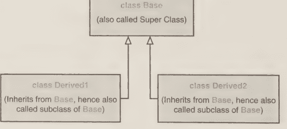

## 继承与派生

图 10.1 显示了基类与其派生类之间的图解关系。要直观理解基类或派生类是什么可能并不容易。尝试理解派生类继承自基类，从这个意义上说，它也是一个基类（就像 Tom 是一个 Smith 一样）。

> 注意

派生类与其基类之间的“是一种”（is-a）关系仅适用于公有继承。本节从公有继承开始，以理解继承的概念和常见的继承形式，然后再进入私有或保护继承。

为了便于理解这一概念，请想象一个基类 `Bird`（鸟）。派生自 `Bird` 的类有 `Crow`（乌鸦）、`Parrot`（鹦鹉）或 `Kiwi`（奇异鸟）。`Bird` 会定义鸟类最基本的属性，例如“有羽毛”、“有翅膀”、“产蛋”、“会飞”等。派生类 `Crow`、`Parrot` 或 `Kiwi` 继承这些属性并对其进行自定义，例如，代表不会飞鸟的 `Kiwi` 类将不包含 `Fly()` 的实现。表 10.1 展示了继承的几个示例。

# 表 10.1 取自生活的公有继承示例

| 基类 | 派生类 |

| --- | --- |

| 鱼 (Fish) | 金鱼、鲤鱼、金枪鱼 (金枪鱼“是”鱼) |

| 哺乳动物 (Mammal) | 人、大象、狮子、鸭�� (鸭��嘴“是”哺乳动物) |

| 鸟 (Bird) | 乌鸦、鹦鹉、鸵鸟、奇异鸟、鸭�� (鸭��嘴“是”鸟，工具！) |

| 形状 (Shape) | 圆、多边形 (多边形“是”形状) |

| 多边形 (Polygon) | 三角形、八边形 (八边形“是”多边形，而多边形“是”形状) |

这些示例表明，当你戴上面向对象编程的眼镜时，你会发现周围许多物体中的。鱼是金枪鱼的基类，因为金枪鱼像鲤鱼一样是鱼，并具有所有鱼类的特征，如冷血。然而，金枪鱼与鲤鱼在外观、游泳方式以及作为海水鱼的事实上有所不同。因此，金枪鱼和鲤鱼从共同的基类鱼继承了特征，但它们又各自特化了基类的属性。这在图 10.2 中所示。

# 图 10.2

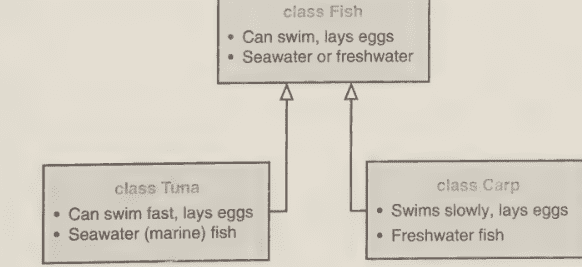

鸭��嘴会游泳，但它是一种有毒动物，具有哺乳动物特征（如用奶喂养幼崽）、产卵的鸟类特征，以及由于有毒而具有爬行动类特征。因此，可以想象一个 `Platypus` 类继承自两个基类——`Mammal` 类和 `Bird` 类，以继承哺乳和鸟类的特征。这种继承形式被称为多继承，将在本节稍后部分进行讨论。

# C++ 派生语法

你如何从 `Fish` 类派生 `Carp` 类，或者通俗地从 `Base` 类派生 `Derived` 类？实现此点的 C++ 语法如下：

```cpp
class Base
{
    // ... 基类成员
};
```

```cpp
class Derived: access-specifier Base
{
    // ... 派生类成员
};
```

访问修饰符可以是 `public`（最常用），表示“派生类是基类”的关系；`private` 或 `protected` 则表示“派生类拥有基类”的关系。

# 关于术语的说明


在阅读继承时，你会遇到 `inherits from`（继承自）或 `derives from`（派生自）等术语，它们的本质含义相同。同样，基类也被称为 `super`（超类），派生类也可以称为 `subclass`（子类）。

# 列表 10.1 简单继承

```cpp
#include <iostream>
using namespace std;

class Fish
{
public:
    bool isFreshWater;
    void Swim()
    {
        if (isFreshWater)
            cout << "Swims in lake" << endl;
        else
            cout << "Swims in sea" << endl;
    }
};

class Tuna: public Fish
{
public:
    Tuna()
    {
        isFreshWater = false;
    }
};

class Carp: public Fish
{
public:
    Carp()
    {
        isFreshWater = true;
    }
};

int main()
{
    Carp myLunch;
    Tuna myDinner;

    cout << "About my food:" << endl;

    cout << "Lunch: ";
    myLunch.Swim();

    cout << "Dinner: ";
    myDinner.Swim();

    return 0;
}
```

## 输出

About my food:

Lunch: Swims in lake

Dinner: Swims in sea

## 分析

注意 `main()` 函数中的 37 行和 38 行分别创建了 `Carp` 和 `Tuna` 类的实例，命名为 `myLunch` 和 `myDinner`。43 行和 46 行是我调用 `Swim()` 方法让我的午餐和晚餐游泳。现在看 17-24 行的 `Tuna` 类和 26-33 行的 `Carp` 类。你可以看到，这些类非常紧凑，构造函数将 `Fish::isFreshWater` 布尔标志设置为相应的值。该标志随后在 `Fish::Swim()` 中被使用。两个派生类似乎都没有定义你在 `main()` 中成功调用的 `Swim()` 方法。这是因为 `Swim()` 是它们继承的基类 `Fish` 的公共成员，17 行和 26 行自动通过派生类 `Carp` 和 `Tuna` 的实例暴露了基类的公共成员，包括 `Swim()` 方法。

# 访问修饰符关键字 protected

列表 10.1 中 `Fish` 类有一个公有属性 `isFreshWater`，由派生类 `Tuna` 和 `Carp` 设置，以自定义（也称为特化）`Fish` 的行为并分别适应海水和淡水。然而，列表 10.1 显示了一个严重的缺陷：如果你愿意，`main()` 可以篡改 `isFreshWater`，它是公有的，因此可以在 `Fish` 类外部进行操纵：

```cpp
myDinner.isFreshWater = true; // 金枪鱼不是淡水鱼！
```

# 继承的基础

显然，你需要一种机制，允许派生类的成员修改基类的选定属性，同时拒绝其他所有人的此类访问。这意味着你希望 `Fish` 类中的布尔标志 `isFreshWaterFish` 可以被 `Tuna` 和 `Carp` 类访问，但不能被 `Tuna` 或 `Carp` 类的 `main()` 函数访问。这就是 `protected` 关键字保护你的地方。

`protected` 与 `public` 和 `private` 一样，也是访问修饰符。当你将一个类属性或函数声明为 `protected` 时，你实际上是使其对派生类（以及友元）可见，同时让该类之外的所有人员（包括 `main()`）无法访问。

## 注意

如果你希望基类中的某个属性可以被派生自基类的类访问（如列表 10.2 所示），则你应该使用 `protected` 访问修饰符。

# 列表 10.2 使用 protected 关键字仅向派生类暴露其成员属性的改进 Fish 类

```
0:#include <iostream>
1: using namespace std;
2:
3: class Fish
4: {
5:   protected:
6:     bool isFreshWaterFish; // 仅对派生类可见
7:
8:   public:
9:     void Swim()
10:    {
11:      if (isFreshWaterFish)
12:        cout << "Swims in lake" << endl;
13:      else
14:        cout << "Swims in sea" << endl;
15:    }
16: };
17:
18: class Tuna: public Fish
19: {
20:   public:
21:     Tuna()
22:     {
23:       isFreshWaterFish = false; // 设置基类中的保护成员
24:     }
25: };
```

```
26:
27: class Carp: public Fish
28: {
29: public:
30:   Carp()
31:   {
32:       isFreshWaterFish = false;
33:   }
34: };
35:
36: int main()
37: {
38:   Carp myLunch;
39:   Tuna myDinner;
40:
41:   cout << "About my food" << endl;
42:
43:   cout << "Lunch: ";
44:   myLunch.Swim();
45:
46:   cout << "Dinner: ";
47:   myDinner.Swim();
48:
49:   // 取消下行的注释以查看保护成员
50:   // 无法从类体系外部访问
51:   // myLunch.isFreshWaterFish = false;
52:
53:   return 0;
54: }
```

# 输出

About my food

Lunch: Swims in lake

Dinner: Swims in sea

# 分析

尽管列表 10.2 的输出与列表 10.1 相同，但对于第 3 到 16 行定义的 `Fish` 类，发生了许多根本性的变化。第一个且最明显的变化是，布尔成员 `Fish::isFreshWaterFish` 现在是一个保护 `protected` 属性，因此无法通过 `main()` 访问（取消注释可查看编译器错误）。尽管如此，这个指定了访问权限的 `Fish` 成员可以如第 23 行和 32 行所示从派生类 `Tuna` 和 `Carp` 访问。这个小程序有效地演示了使用 `protected` 关键字的作用，确保了需要继承的基类属性不会受到类体系外部的访问。

这是面向对象编程的一个重要方面，结合了数据抽象和继承，确保派生类可以安全地继承基类属性，而这些属性不会被层次系统之外的任何人篡改。

# 基类初始化——向基类传递参数

如果基类包含一个在实例化时需要参数的重载构造函数会怎样？在构造派生类时，如何实例化这样的基类呢？线索在于使用初始化列表，以及通过派生类的构造函数调用相应的基类构造函数，如下代码所示：

```cpp
class Base {
public:
  Base(int someNumber) // 重载构造函数
  {
    // 使用 someNumber
  }
};

class Derived: public Base {
public:
  Derived(): Base(25) // 使用参数 25 实例化 Base
  {
    // 派生类构造函数代码
  }
};
```

这种机制在 `Fish` 类中非常有用，通过向 `Fish` 的构造函数提供一个布尔输入参数来初始化 `Fish::isFreshWaterFish`，基类 `Fish` 可以强制每个派生类都说明鱼是淡水鱼还是海水鱼，如列表 10.3 所示。

- 列表 10.3 使用初始化列表的派生类构造函数

```cpp
0: #include <iostream>
1: using namespace std;
2:
3: class Fish
4: {
5 protected:
6: bool isFreshWater; // 仅对派生类可见
7:
8: public:
```

# 第 10 课：实现继承

```cpp
// Fish 构造函数
Fish(bool isFreshWater) : isFreshWaterFish(isFreshWater){} 

void Swim() {
    if (isFreshWater)
        cout << "Swims in lake" << endl;
    else
        cout << "Swims in sea" << endl;
}
class Tuna: public Fish {
public:
    Tuna(): Fish(false) // 构造函数初始化基类
}
class Carp: public Fish {
public:
    Carp(): Fish(true) {}
}
int main() {
    Carp myLunch;
    Tuna myDinner;
    cout << "About my food" << endl;
    cout << "Lunch: ";
    myLunch.Swim();
    cout << "Dinner: ";
    myDinner.Swim();
    return 0;
}
```

# 输出

About my food

Lunch: Swims in lake

Dinner: Swims in sea

# 分析

`Fish` 现在有一个接受参数的构造函数来初始化 `isFreshWaterFish`。因此，创建 `Fish` 对象的唯一方式是通过提供参数。通过这种方式，`Fish` 类确保保护成员不会包含随机值，特别是当派生类忘记设置它时。派生类 `Tuna` 和 `Carp` 现在强制定义一个构造函数，用正确的参数（`true` 或 `false`，表示淡水或其他）来实例化基类 `Fish`，如第 24 行和 30 行所示。

注意：如果你希望基类中的某个属性可以被派生自基类的类访问（如列表 10.2 所示），则你应该使用 `protected` 访问修饰符。

注意：如果你希望基类中的某个属性可以被派生自基类的类访问（如列表 10.2 所示），则你应该使用 `protected` 访问修饰符。

注意：如果你希望基类中的某个属性可以被派生自基类的类访问（如列表 10.2 所示），则你应该使用 `protected` 访问修饰符。

注意：如果你希望基类中的某个属性可以被派生自基类的类访问（如列表 10.2 所示），则你应该使用 `protected` 访问修饰符。

注意：如果你希望基类中的某个属性可以被派生自基类的类访问（如列表 10.2 所示），则你应该使用 `protected` 访问修饰符。

为了确保安全性，如果类实现了相同的内容，如列表 10.4 所示。

# 调用基类的被重写方法

在列表 10.4 中，我们展示了一个派生类 `Tuna` 通过实现相同版本的函数来重写 `Fish` 中 `Swim()` 函数的示例。本质上：

```cpp
Tuna myDinner;
myDinner.Swim(); // 将调用 Tuna::Swim()
```

# 第 10 ：实现继承

如果你想在 `main()` 函数中通过列表 10.4 调用 `Fish::Swim()`，你需要按照以下语法使用作用域运算符（`::`）：

```
myDinner::Fish::Swim(); // 使用 Tuna 实例调用 Fish::Swim()
```

紧随其后的列表 10.5 展示了如何使用派生类实例调用基类成员。

## 在派生类中调用基类方法

通常情况下，`Fish::Swim()` 会包含一个适用于所有鱼、金枪鱼和包含在内的碳水鱼的通用游泳实现。如果你在 `Tuna::Swim()` 和 `Carp::Swim()` 中的专门实现需要复用基类 `Fish::Swim()` 的通用实现，你可以像下面的代码所示使用作用域运算符（`::`）：

```cpp
class Carp: public Fish {
public:
    Carp(): Fish(true) {}

    void Swim() {
        cout << "Carp swims real slow" << endl;
        Fish::Swim(); // 使用运算符:: 调用基类函数
    }
```

这在列表 10.5 中得到了演示。

**列表 10.5** 使用作用域运算符（`::`）从派生类和 main() 回调基类函数

```cpp
0: #include <iostream>
1: using namespace std;
2:
3: class Fish
4: {
5: private:
6:     bool isFreshWater;
7:
8: public:
9:     // Fish 构造函数
10:    Fish(bool isFreshWater) : isFreshWater(isFreshWater){}
11:
12:    void Swim()
13:    {
14:     if (isFreshWater)
15:         cout << "Swims in lake" << endl;
16:     else
17:         cout << "Swims in sea" << endl;
18:     }
19: };

20: 

21: class Tuna: public Fish

22: {

23:     public:

24:         Tuna(): Fish(false) {}

25: 

26:         void Swim()

27:         {

28:             cout << "Tuna swims real fast" << endl;

29:         }

30:     };

31: 

32: class Carp: public Fish

33: {

34:     public:

35:         Carp(): Fish(true) {}

36: 

37:         void Swim()

38:         {

39:             cout << "Carp swims real slow" << endl;

40:             Fish::Swim();

41:         }

42: };

43: 

44: int main()

45:     {

46:         Carp myLunch;

47:         Tuna myDinner;

48: 

49:         cout << "About my food" << endl;

50: 

51:         cout << "Lunch: ";

52:         myLunch.Swim();

53: 

54:         cout << "Dinner: ";

55:         myDinner.Fish::Swim();

56: 

57:         return 0;

58: }
```

## 输出

About my food
Lunch: Carp swims real fast
Swims in lake
Dinner: Swims in sea

## 分析

第 37–41 行中的 `Carp::Swim()` 展示了使用解析运算符（`::`）调用基类函数 `Fish::Swim()`；而第 55 行则展示了在给定派生类 `Tuna` 实例的情况下，如何使用作用域运算符（`::`）从 `main()` 调用基类方法 `Fish::Swim()`。

## 派生类隐藏基类方法

重写可能会采取一种极端形式，即 `Tuna::Swim()` 可能会隐藏所有重载版本，导致在使用这些重载版本时出现编译失败，如列表 10.6 所示。

**列表 10.6** `Tuna::Swim()` 隐藏了重载方法 `Fish(bool)`

```cpp

0: #include <iostream>

1: using namespace std;

2:

3: class Fish

4: {

5: public:

6:     void Swim()

7:     {

8:         cout << "Fish..." << endl;

9:     }

10:

11:    void Swim(bool isFreshWater) // 重载版本

12:    {

13:        if (isFreshWater)

14:            cout << "Swims in lake" << endl;

15:        else

16:            cout << "Swims in sea" << endl;

17:    }

18: };

19:

20: class Tuna: public Fish

21: {

22:     public:

23:         void Swim()

24:         {

25:             cout << "Tuna swims real fast" << endl;

26:         }

27: };

28:
```


```cpp
29: int main()
30: {
31:     Tuna myDinner;
32:
33:     cout << "About my food" << endl;
34:
35:     // myDinner.Swim(false);//失败: Tuna::Swim() 隐藏了 Fish(bool)
36:     myDinner.Swim();
37:
38:     return 0;
39: }
```

## 继承基础

### 输出 ▼

About my food
Tuna swims real fast

### 分析 ▼

这个版本的 `Fish` 类与你之前看到的有所不同。除了是解释当前问题的一个最小化版本外，这个 `Fish` 版本包含两个重载的 `Swim()` 方法：一个不带参数（如第 6–9 行），另一个接受 `bool` 参数（如第 11–17 行）。如第 20 行所示，`Tuna` 公共继承自 `Fish`，人们可能会认为可以通过 `Tuna` 实例可以使用两个 `Fish::Swim()` 方法。但事实是，由于 `Tuna` 实现了自己的 `Tuna::Swim()`（如第 23–26 行所示），会导致编译器隐藏 `Fish(bool)`。如果你取消第 35 行的注释，你将看到编译失败。

## 私有继承 (Private Inheritance)

私有继承与公共继承（你目前为止看到的继承）的区别在于，在派生类声明继承自基类的行中，使用了 `private` 关键字：

```cpp
class Base
{
    // ... 基类成员和方法
}
class Derived : private Base // 私有继承
{
    // ... 派生类成员和方法
};
```

基类的私有继承意味着基类的所有公共成员和属性对于任何拥有派生类实例的人都是私有的（即不可访问的）。换句话说，即使是 `Base` 类的公共成员和方法只能被 `Derived` 类消费，而不能被其他拥有 `Derived` 实例的人使用。

这与你从列表 10.1 开始一直关注的金枪鱼（Tuna）和基类鱼（Fish）的示例形成了鲜明对比。列表 10.2 中的 `main()` 可以在金枪鱼实例上调用 `Fish::Swim()` 函数，因为 `Fish::Swim()` 是一个公共方法，而且 `Tuna` 类是通过公共继承派生自 `Fish` 类的。

| 表 10.2 取自生活的私有继承示例 |
| 基类 | 示例派生类 |
| 动机 (Motor) | 汽车 (Car “拥有”一个 Motor) |
| 心脏 (Heart) | 哺乳动物 (Mammal “拥有”一颗 Heart) |
| 笔尖 (Nib) | 笔 (Pen “拥有”一个笔尖) |

## 第 10 节：实现继承

让我们通过汽车与其动机之间的关系来视觉化私有继承。参见列表 10.8。

### 列表 10.8 一个通过私有继承与 Motor 类相关的 Car 类

```cpp
0: #include <iostream>
1: using namespace std;
2:
3: class Motor
4: {
5: public:
6:     void SwitchIgnition()
7:     {
8:         cout << "Ignition ON" << endl;
9:     }
10:    void PumpFuel()
11:        cout << "Fuel in cylinders" << endl;
12:    }
13:    void FireCylinders()
14:    {
15:        cout << "Vrooom" << endl;
16:    }
17: };
18:
19: class Car:private Motor // 私有继承
20: public:
21:    void Move()
22:    {
23:        SwitchIgnition();
24:        PumpFuel();
25:        FireCylinders();
26:    }
27: };
28:
29: int main()
30: {
31:    Car myDreamCar;
32:    myDreamCar.Move();
33:
34:    return 0;
35: }
```

### 输出 ▼

Ignition ON
Fuel in cylinders
Vroooom

### 分析 ▼

第 3–18 行定义的 `class Motor` 非常简单，具有三个公共成员函数，分别用于切换点火、泵燃料和点火气缸。第 20 行的 `class Car` 展示了使用 `private` 关键字继承自 `Motor`。因此，公共函数 `Car::Move()` 调用了基类 `Motor` 的成员。如果你尝试在 `main()` 中插入以下内容：
`myDreamCar.PumpFuel(); // 访问基类的公共成员`

它将编译失败，并产生类似于错误 `C2247: Motor::PumpFuel not accessible because 'Car' uses 'private' to inherit from 'Motor'`。

## 注意

> 如果另一个类 `RaceCar` 必须继承自 `Car`，那么无论 `RaceCar` 和 `Car` 之间的继承性质如何，`RaceCar` 都无法访问基类 `Motor` 的任何公共成员或函数。这是因为 `Car` 和 `Motor` 之间的关系是私有继承，这意味着当存在 `Car` 实例时，除了 `Car` 之外的所有实体对 `Base` 的公共和受保护成员只有私有访问权限（即无法访问）。
> 也就是说，在编译器计算访问基类的公共或受保护成员时，限制性最强的访问限定符占主导地位。

## 保护继承 (Protected Inheritance)

保护继承与公共继承的区别在于，在派生类声明继承自基类的行中，使用了 `protected` 关键字：

```cpp
class Base
{
  // ... 基类成员和方法
};
class Derived : protected Base    // 保护继承
{
  // ... 派生类成员和方法
};
```

保护继承在以下方面与私有继承相似：

- 它也表示一种“拥有”(has-a) 关系。
- 它也允许派生类访问 `Base` 的所有公共和受保护成员。
- 继承层次之外的拥有 `Derived` 实例的人无法访问 `Base` 的受保护公共成员。

然而，当涉及到被继承的派生类时，保护继承又有些不同：

```cpp
class Derived2: protected Derived
{
// 访问 Base 的公共和受保护成员
}
```

保护继承层次允许子类类的子类（即 `Derived2`）访问 `Base` 的公共和受保护成员，如列表 10.9 所示。如果 `Derived` 和 `Base` 之间的继承是私有的，将是不可能的。

## 列表 10.9 RaceCar 派生自 Car 类，Car 类派生自 Motor 类（使用保护继承）

```cpp
0: #include <iostream>
1: using namespace std;
2:
3: class Motor
4: {
5: public:
6: void SwitchIgnition()
7: {
8: cout << "Ignition ON" << endl;
9: }
10: void PumpFuel()
11: { cout << "Fuel in cylinders" << endl;
12: }
13: void FireCylinders()
14: {
15: cout << "Vrooom" << endl;
16: }
17: };
18:
19: class Car:private Motor // 私有继承
20: public:
21: void Move()
22: {
23: SwitchIgnition();
24: PumpFuel();
25: FireCylinders();
26: }
27: };
28:
29: int main()
30: {
31:    Car myDreamCar;
32:    myDreamCar.Move();
33:
34:    return 0;
35: }
```
（注：由于 OCR 文本在 313-316 页存在大量重复和错误，我已根据代码块提供的逻辑内容进行了处理。）

## 第 10 课：实现继承

图 10.3 Platypus 类与哺乳动物类、爬行动物类和鸟类之间的关系。

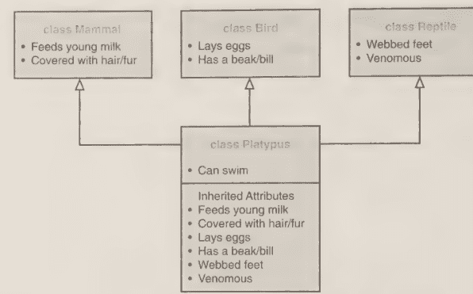

因此，Platypus 类在 C++ 中的表示如下：

```cpp
class Platypus: public Mammal, public Reptile, public Bird
{
    // ... members
};
```

列表 10.10 展示了一个体现多重继承的 Platypus 实例。

### 列表 10.10 使用多重继承对部分是哺乳动物、部分是鸟、部分是爬行动物的 Platypus 进行建模

```cpp
0: #include <iostream>
1: using namespace std;
2:
3: class Mammal
4: {
5:     public:
6:     void FeedBabyMilk()
7:     {
8:         cout << "Mammal: Baby says glug!" << endl;
9:     }
10: };
11:
12: class Reptile
13: {
```
```cpp
14: public:
15:     void SpitVenom()
16:     {
17:         cout << "Reptile: Shoo enemy! Spits venom!" << endl;
18:     }
19: };
20: 
21: class Bird
22: {
23:     public:
24:         void LayEggs()
25:     {
26:             cout << "Bird: Laid my eggs, am lighter now!" << endl;
27:         }
28:     };
29: 
30: class Platypus : public Mammal, public Bird, public Reptile
31: {
32:     public:
33:         void Swim()
34:         {
35:             cout << "Platypus: Voila, I can swim!" << endl;
36:         }
37:     };
38: 
39: int main()
40: {
41:     Platypus realFreak;
42:     realFreak.LayEggs();
43:     realFreak.FeedBabyMilk();
44:     realFreak.SpitVenom();
45:     realFreak.Swim();
46: 
47:     return 0;
48: }
```

# 输出 ▼

Bird: Laid my eggs, am lighter now!
Mammal: Baby says glug!
Reptile: Shoo enemy! Spits venom!
Platypus: Voila, I can swim!

# 分析 ▼

`class Platypus` 在第 30–37 行中有一个非常紧凑的定义。它本质上所做的只是继承自 `Mammal`、`Reptile` 和 `Bird` 这三个类。`main()`

在第 41–44 行中，通过名为 `realFreak` 的派生类 `Platypus` 对象，能够调用这三个独立基类的这些特征。除了调用从 `Mammal`、`Bird` 和 `Reptile` 类继承的函数外，`main()` 在第 45 行中调用了 `Platypus::Swim()`。该程序演示了多重继承的语法，以及派生类如何暴露其多个基类的所有公共属性（在本例中为公共成员函数）。

# 使用 final 避免继承

从 C++11 开始，编译器支持指定 `final`。它用于确保声明为 `final` 的类不能作为基类使用。例如，在列表 10.10 中，`class Platypus` 代表了一个演化良好的物种。因此，你可能希望确保该类是 `final` 的，从而阻止所有继承它的可能性。从列表 10.10 取并声明为 `final` 的 `Platypus` 类版本如下：

```cpp
class Platypus final: public Mammal, public Bird, public Reptile
public:
    void Swim()
    {
        cout << "Platypus: Voila, I can swim!" << endl;
    }
```

除了类之外，`final` 也可以用于成员函数以控制多态行为。这将在第 11 课“多态性”中进行讨论。

> 鸭嘴兽会游泳，但它不是鱼。因此，在列表 10.10 中，为了复用现有的 `Fish::Swim()` 函数，你并没有从 `Fish` 继承 `Platypus`。在做设计决策时，不要忘记公共继承也应该表示一种“是”（is-a）的关系。不应该为了实现代码复用相关的目标而盲目使用。这些目标可以通过其他方式实现。

| 应该 (DO) | 不要 (DON'T) |
| :--- | :--- |
| 创建公共继承层次以建立“是”的关系。 | 不要仅仅为了复用一个简单的函数就创建继承层次。 |
| 创建私有或受保护的继承层次以建立“拥有”（has-a）的关系。 | 不要盲目使用私有或公共继承，因为它们可能会成为应用程序未来扩展性的架构瓶颈。 |
| 记住公共继承意味着派生自派生类的类可以访问基类的公共和受保护成员。派生类对象可用于访问基类的公共成员。 | 不要编写具有相同名称但不同参数集的派生类函数，来隐藏基类中的函数。 |
| | 记住公共继承意味着派生自派生类的类可以访问基类的公共和受保护成员。派生类对象可用于访问基类的公共成员。 |
| | 不要编写具有相同名称但不同参数集的派生类函数，来隐藏基类中的函数。 |

*(注：此处原文文本存在重复和混乱，已根据逻辑进行了重新格式化：)*

- 创建公共继承层次以建立“是”的关系。
- 不要仅仅为了复用一个简单的函数就创建继承层次。
- 创建私有或受保护的继承层次以建立“拥有”的关系。
- 不要盲目使用私有或公共继承，因为它们可能会成为应用程序未来扩展性的架构瓶颈。
- 记住公共继承意味着派生自派生类的类可以访问基类的公共和受保护成员。派生类对象可用于访问基类的公共成员。
- 不要编写具有相同名称但不同参数集的派生类函数，来隐藏基类中的函数。

## 总结

在本节中，你学习了继承的基础。你学到公共继承是一种“是”的关系，而私有继承创建了“拥有”的关系。你看到了受保护继承在 C++ 中的应用。

## 第 10 课：实现继承

在第 41–44 行中，通过名为 `realFreak` 的派生类 `Platypus` 对象，能够调用这三个独立基类的这些特征。除了调用从 `Mammal`、`Bird` 和 `Reptile` 类继承的函数外，`main()` 在第 45 行调用了 `Platypus::Swim()`。该程序演示了多重继承的语法，以及派生类如何暴露其多个基类的公共属性（在本例中为公共成员函数）。

## 使用 final 避免继承

从 C++11 开始，编译器支持指定 `final`。它用于确保声明为 `final` 的类不能作为基类使用。例如，在列表 10.10 中，`class Platypus` 代表了一个演化良好的物种。因此，你可能希望确保该类是 `final` 的，从而阻止所有继承它的可能性。从列表 10.10 取并声明为 `final` 的 `Platypus` 类版本如下：

```cpp
class Platypus final: public Mammal, public Bird, public Reptile
public:
    void Swim()
    {
        cout << "Platypus: Voila, I can swim!" << endl;
    }
```


除了类之外，`final`也可以用于成员函数以控制多态行为。这将在第11课“多态性”中讨论。

> 鸭嘴兽会游泳，但它不是鱼。因此，在列表10.10中，为了复用现有的`Fish::Swim()`函数，你并没有从`Fish`继承`Platypus`。在做设计决策时，不要忘记公共继承也应该表示一种“是”的关系。不应该为了实现代码复用相关的目标而盲目使用。这些目标可以通过其他方式实现。

## 问答

- 派生类（derived class）和子类（subclass）的区别是什么？
- 本质上没有。两者都用于表示基类的类。
- 它可以访问基类的私有成员吗？不能。编译器始终确保执行限制限制的访问符。无论继承如何，类的私有成员都无法在类外部访问。此规则的异常适用于为为（friend）的类和函数。

## 工作坊

工作坊提供了测试题来帮助巩固你对涵盖内容的理解，并提供了练习让你获得所学知识的。在检查附录E中的答案之前，尝试回答测试和练习，并在继续之前确保理解答案。

- 我希望某些基类成员可以被派生类访问，但不在类外部访问。我应该使用什么访问符？
- 如果我将派生类对象作为参数传递给一个按值接收基类参数的函数，会发生什么？
- 我应该倾向哪一个？私有继承还是组合？
- `using`关键字在继承层次中如何帮助我？
- `Derived`从`Base`继承私有成员。`SubDerived`从`Derived`继承公共成员。`SubDerived`可以访问`Base`的公共成员吗？

## 练习

- 如列表10.10所示，`Platypus`类构造函数的调用顺序是怎样的？
- 展示`Polygon`类、`Triangle`类和`Shape`类是如何相互相关的。
- `class D2`继承自`class D1`，后者继承自`class Base`。为了继续访问`Base`中的公共成员，你会使用什么访问符，并在哪里使用？
- 该代码片段的继承性质是什么：
```cpp
class Derived: Base
  // ... Derived members
};
```
- 错误排除：这段代码中的问题是：
```cpp
class Derived: public Base
  // ... Derived members
};

void SomeFunc (Base value)
{
  // ...
};
```

# 第11课

## 多态

在学习了继承的基础、创建了继承层次结构，并理解了公继承本质上是在模拟“是一个是”（is-a）关系之后，是时候通过学习这些知识来攻克面向对象编程的圣杯：多态了。

在本节中，你将了解到：

- 多态的真正含义
- 虚函数的作用以及如何使用它们
- 什么是抽象基类以及如何声明它们
- 虚继承的含义以及你何时需要它

# 多态的基础

“Poly”在希腊语中是“多”，“morph”意味着“形式”。多态是面向对象语言的一种特性，允许不同类型的对象以相似的方式被对待。本节重点关注通过C++继承层次实现的多态行为，也称为子类型多态。

## 多态行为的性

在第10节“实现继承”中，你发现了金枪鱼（Tuna）和鲤鱼（Carp）如何从鱼（Fish）继承公方法`Swim()`，如列表10.1所示。然而，金枪鱼和鲤鱼都可能提供自己的`Tuna::Swim()`和`Carp::Swim()`方法，使它们成为会游泳者。但是，由于它们每一个也是“鱼”，如果一个拥有金枪鱼实例的用户使用基类类型来调用`Fish::Swim()`，他执行的将仅是通用的`Fish::Swim()`部分，而不是`Tuna::Swim()`，即使该基类`Fish`是是金枪鱼的一部分。这个问题在列表11.1中得到了演示。

> 本节中的所有代码示例都已精简到解释相关主题所需的最核心部分，并尽可能减少了代码行数以提高可读性。

在编程时，你应该正确地编写类并创建有意义的继承层次结构，同时考虑到应用程序的设计和目的。

### 列表11.1 使用属于金枪鱼的基类Fish实例调用方法

```cpp
#include <iostream>
1: using namespace std;
2:
3: class Fish
4: {
5: public:
6:   void Swim()
7:   {
8:     cout << "Fish swims!" << endl;
9:   }
10: };
```

```cpp
12: class Tuna:public Fish
13: {
14:     public:
15:     // override Fish::Swim
16:     void Swim()
17:     {
18:         cout << "Tuna swims!" << endl;
19:     }
20: }
22: void MakeFishSwim(Fish& inputFish)
23: {
24:     // calling Fish::Swim
25:     inputFish.Swim();
26: }
27: 
28: int main()
29: {
30:     Tuna myDinner;
31: 
32:     // calling Tuna::Swim
33:     myDinner.Swim();
34: 
35:     // sending Tuna as Fish
36:     MakeFishSwim(myDinner);
37: 
38:     return 0;
39: }
```

### 输出

```
Tuna swims!
Fish swims!
```

### 分析

`class Tuna`特化了`class Fish`，`main()`在第33行直接调用了`Tuna::Swim()`，同时也重写了`Fish::Swim()`，并将`myDinner`（类型为`Tuna`）作为参数传递给`MakeFishSwim()`，而该函数根据第22行的声明将其解释为引用`Fish&`。换句话说，`MakeFishSwim(Fish&)`并不关心发送的对象是否是金枪鱼，它将其视为`Fish`处理，并调用了`Fish::Swim()`。因此，输出的第二行表示同一个对象`Tuna`产生了输出：一个`Fish`的输出，而不是指示其有任何特化（这也可以是鲤鱼）。

用户理想上的期望是，即使调用的是`Fish::Swim()`，类型为`Tuna`的对象也表现得像金枪鱼。也就是说，当第25行调用`inputFish::Swim()`时，他期望执行`Tuna::Swim()`。这种已知类`Fish`对象可以表现为其实际类型（即派生类`Tuna`）的行为，可以通过将`Swim()`声明为虚函数来实现。

## 使用虚函数实现的多态

你通过指针`Fish*`或引用`Fish&`访问类型为`Fish`的对象。该对象可能仅被实例化为`Fish`，也可能是自`Fish`的`Tuna`或`Carp`。你并不知道（也不关心）。你这样使用指针或引用调用`Swim()`：

```cpp
Fish->Swim();
inputFish.Swim();
```

你期望当对象属于`Tuna`时它像金枪鱼一样游泳，属于`Carp`时它像鲤鱼一样游泳，在未作为`Tuna`或`Carp`等派生类实例化时像匿名`Fish`一样游泳。你可以通过在基类`Fish`中将`Swim()`声明为虚函数来实现：

```cpp
class Base
{
    virtual void Swim();
};
class Derived
{
};
```

使用`virtual`关键字意味着编译器确保调用请求的基类方法的重写版本。因此，如果`Swim()`被声明为虚函数，调用`inputFish.Swim()`（类型为`Fish&`）将如列表11.2所示导致`Tuna::Swim()`。

### 列表11.2 将`Fish::Swim()`声明为虚函数

```cpp
0: #include <iostream>
1: using namespace std;
2:
3: class Fish
4: {
5: public:
6:   virtual void Swim()
7:   {
8:       cout << "Fish swims!" << endl;
9:   }
10: };
11: 
12: class Tuna:public Fish
13: {
14:     public:
15:         // override Fish::Swim
16:         void Swim()
17:     {
18:             cout << "Tuna swims!" << endl;
19:         }
20: };
21: 
22: class Carp:public Fish
23: {
24:     public:
25:         // override Fish::Swim
26:         void Swim()
27:     {
28:             cout << "Carp swims!" << endl;
29:         }
30: };
31: 
32: void MakeFishSwim(Fish& inputFish)
33: {
34:     // calling Fish::Swim
35:     inputFish.Swim();
36: }
37: 
38: int main()
39: {
40:     Tuna myDinner;
41: 
42:     // calling Tuna::Swim
43:     myDinner.Swim();
44: 
45:     // sending Tuna as Fish
46:     MakeFishSwim(myDinner);
47: 
48:     return 0;
49: }
```

### 输出

```
Tuna swims!
Fish swims!
```

### 分析

函数`FishSwim(Fish&)`的实现自11.1以来没有变化。但输出完全不同。由于重写版本的存在，`Swim()`没有被调用。这就是多态：将不同的鱼视为共同类型，确保执行正确的派生实现。

## 虚析构函数的需要

列表11.1演示的特性有一个更阴险的一面——故意调用派生类实例的基类功能。当函数调用`delete`时会发生什么？

### 列表11.3 在`Base*`上调用`delete`的函数

```cpp
0: #include <iostream>
1: using namespace std;
2:
3: class Fish
4: {
5: public:
6:     void Swim()
7:     {
8:         cout << "Fish swims!" << endl;
9:     }
10: };
11: 
12: class Tuna:public Fish
13: {
14:     public:
15:         // override Fish::Swim
16:         void Swim()
17:     {
18:             cout << "Tuna swims!" << endl;
19:         }
20: };
23:  ~Tuna()
24:  {
25:     cout << "Destroyed Tuna" << endl;
26:  }
27: };
28: 
29: void DeleteFishMemory(Fish* pFish)
30:  {
31:     delete pFish;
32:  }
33: 
34: int main()
35:  {
36:     cout << "Allocating a Tuna on the free store:" << endl;
37:     Tuna* pTuna = new Tuna;
38:     cout << "Deleting the Tuna: " << endl;
39:     DeleteFishMemory(pTuna);
40: 
41:     cout << "Instantiating a Tuna on the stack:" << endl;
42:     Tuna myDinner;
43:     cout << "Automatic destruction as it goes of scope: " << endl;
44: 
45:     return 0;
46:  }
```

### 输出

```
Allocating a Tuna on the free store:
Constructed Fish
Constructed Tuna
Deleting the Tuna:
Destroyed Fish
Instantiating a Tuna on the stack:
Constructed Fish
Constructed Tuna
Automatic destruction as it goes of scope:
Destroyed Tuna
Destroyed Fish
```

### 分析

`main()`在第37行使用`new`在自由存储上创建了一个`Tuna`实例，并在第39行调用服务函数`DeleteFishMemory()`后立即释放了分配的内存。为了对比，另一个`Tuna`实例在第42行作为局部变量`myDinner`在栈上创建，并在`main()`结束时离开作用。输出是由`Fish`和`Tuna`类的构造函数和析构函数中的`cout`语句产生的。

# 第11课：多态

由于使用了`new`在自由堆上构造，Tuna的析构函数在`delete`时没有被调用，而是调用了Fish的析构函数。这与本地成员`myDinner`的构造和析构形成了鲜明对比，所有的构造函数和析构函数都会被调用。第10课在讲座10.7中演示了继承体系中类的正确构造和析构顺序，显示所有析构函数都需要被调用，包括`~Tuna()`。显然，有些不对。

这个缺陷意味着，如果使用`new`在自由堆上实例化类型为`Base*`的派生类指针，其析构函数就不会被调用。这可能导致资源未释放、内存泄漏等，是不容忽视的问题。

为了避免这个问题，你可以如列表11.4所示使用虚析析构函数。

### 列表11.4 使用虚析析构函数确保在删除Base*类型指针时调用派生类的析构函数

```cpp
0: #include <iostream>
1: using namespace std;
2:
3: class Fish
4: {
5: public:
6: Fish()
7: {
8:   cout << "Constructed Fish" << endl;
9: }
10: virtual ~Fish() // 虚析构函数;
11: {
12:   cout << "Destroyed Fish" << endl;
13: }
14: };
15:
16: class Tuna:public Fish
17: {
18: public:
19: Tuna()
20: {
21:   cout << "Constructed Tuna" << endl;
22: }
23: ~Tuna()
24: {
25:   cout << "Destroyed Tuna" << endl;
26: }
27: };
28:
29: void DeleteFishMemory(Fish* pFish)
30: {
31:   delete pFish;
32: }
33:
34: int main()
35: {
36:   cout << "Allocating a Tuna on the free store:" << endl;
37:   Tuna* pTuna = new Tuna;
38:   cout << "Deleting the Tuna: " << endl;
39:   DeleteFishMemory(pTuna);
40:
41:   cout << "Instantiating a Tuna on the stack:" << endl;
42:   Tuna myDinner;
43:   cout << "Automatic destruction as it goes out of scope: " << endl;
44:
45:   return 0;
46: }
```


## 输出

Allocating a Tuna on the free store:
Constructed Fish
Constructed Tuna
Deleting the Tuna:
Destroyed Tuna
Destroyed Fish
Instantiating a Tuna on the stack:
Constructed Fish
Constructed Tuna
Automatic destruction as it goes out of scope:
Destroyed Tuna
Destroyed Fish

## 分析

列表 11.4 相比于列表 11.3 的唯一改进是在第 10 行声明基类 `Fish` 析构函数时添加了 `virtual`。注意，当对第 31 行所示实际指向 `Tuna` 的 `Fish*` 调用 `operator delete` 时，这一微小的变化导致编译器实际上在执行 `Fish::~Fish()` 的之外还执行了 `Tuna::~Tuna()`。此输出还证明了，无论如第 37 行所示使用 `new` 在自由堆上实例化 `Tuna` 类型对象，还是如第 42 行所示作为栈上的本地变量实例化，构造函数和析构函数的顺序和调用方式都是相同的。

# 第 11课：多态

注意

始终将基类析构函数声明为虚：

```cpp
class Base {
public:
    virtual ~Base() {}; // 虚析构函数
}
```
这确保了拥有 `Base*` 指针的人调用 `delete` 时不会导致派生类实例无法正确销毁。

# 虚函数是如何工作的？理解虚函数表

注意

本节对于学习使用多态是可选的。你可以自由跳过或阅读它以满足好奇心。

列表 11.2 中的 `MakeFishSwim(Fish&)` 尽管程序员在内部调用了 `Fish::Swim()`，但最终调用了 `Carp::Swim()` 或 `Tuna::Swim()` 方法。显然，在编译时，编译器对该函数将处理的对象的性质一无所知，从而确保了同一个函数在不同时间执行不同的 `Swim()` 方法。需要调用的 `Swim()` 方法显然是在运行时做出的决定，使用了实现多态的逻辑，该逻辑是由编译器在编译时提供的。

考虑一个声明了 N 个虚函数的 `Base` 类：

```cpp
class Base {
public:
    virtual void Func1() {
        // Func1 实现
    }
    virtual void Func2() {
        // Func2 实现
    }
}
```

```cpp
// .. 依此类推
virtual void FuncN()
{
    // FuncN 实现
};
```

继承自 `Base` 的 `Derived` 类重写了 `Base::Func2()`，并直接暴露了 `Base` 类中的其他虚函数：
```cpp
class Derived: public Base
public:
    virtual void Func1()
    {
        // Func1 重写了 Base::Func1()
    }
    // Func2() 没有实现
    virtual void FuncN()
    {
        // FuncN 实现
    };
```

编译器看到了继承体系并理解 `Base` 定义了某些虚函数。注意，这一微小的变化导致当对第 31 行所示实际指向 `Tuna` 的 `Fish*` 调用 `operator delete` 时，编译器实际上在执行 `Fish::~Fish()` 的之外还执行了 `Tuna::~Tuna()`。此输出还证明了，无论如第 37 行所示使用 `new` 在自由堆上实例化 `Tuna` 类型对象，还是如第 42 行所示作为栈上的本地变量实例化，构造函数和析构函数的顺序和调用方式都是相同的。（注：原文后续存在大量重复段落，已根据要求不进行重复输出）

## 多态的基础

此声明本质上是告诉编译器 `DoSomething()` 需要由派生自 `AbstractBase` 的类来实现：

```cpp
class Derived: public AbstractBase{
public:
    void DoSomething()    // 纯虚函数。必须实现
    {
        cout << "Implemented virtual function" << endl;
    }
};
```

因此，`AbstractBase` 类所做的是强制 `Derived` 类为虚方法 `DoSomething()` 提供实现。这种基类可以强制要求派生自它的类支持具有指定名称和签名的方法的功能，就是接口（interface）的功能。再次想象一条鱼（Fish）。想象有一条金枪鱼（Tuna），它由于游得不够快，因为它没有重写 `Fish::Swim()`。这是一个失败的实现，也是一个缺陷。将 `Fish` 类设为抽象基类，并将 `Swim` 设为纯虚函数，可以确保金枪鱼继承 `Fish` 并实现 `Tuna::Swim()`，从而像金枪鱼一样游泳，而不仅仅像普通的鱼。参见列表 11.6。

## 列表 11.6 将 Fish 作为金枪鱼和鲤鱼的抽象基类

```cpp
0 #include <iostream>
1: using namespace std;
2:
3: class Fish
4: {
5: public:
6:     // 定义一个纯虚函数 Swim
7:     virtual void Swim() = 0;
8: };
9:
10: class Tuna:public Fish
11: {
12: public:
13:     void Swim()
14:     {
15:         cout << "Tuna swims fast in the sea!" << endl;
16:     }
17: };
18:
19: class Carp:public Fish
20: {
21:     void Swim()
22:     {
23:         cout << "Carp swims slow in the lake!" << endl;
24:   }
25: };
26:
27: void MakeFishSwim(Fish& inputFish)
28: {
29:     inputFish.Swim();
30: }
31:
32: int main()
33: {
34:     // Fish myFish; // 失败，无法实例化抽象基类
35:     Carp myLunch;
36:     Tuna myDinner;
37:
38:     MakeFishSwim(myLunch);
39:     MakeFishSwim(myDinner);
40:
41:     return 0;
42: }
```

## 课程 11：多态

## 输出 ▼

Carp swims slow in the lake!
Tuna swims fast in the sea!

## 分析 ▼

`main()` 函数中第 34 行（注释掉的）具有重要意义。它证明了编译器不允许你创建抽象基类（'ABC'）`Fish` 的实例。它期望一个具体的对象，例如 `Fish` 的特化类——例如 `Tuna`——这在现实世界的安排中也是合理的。得益于第 7 行声明的纯虚函数 `Fish::Swim()`，`Tuna` 和 `Carp` 都被强制实现 `Tuna::Swim()` 和 `Carp::Swim()`。第 27–30 行实现 `MakeFishSwim(Fish&)` 的代码表明，如果抽象基类不能被实例化，你可以将其作为引用或指针使用。抽象基类是一个非常好的机制，用于声明期望派生类实现并完成的函数。如果派生自 `Fish` 的 `Trout` 类忘记实现 `Trout::Swim()`，编译也会失败。

## 注意

| 抽象基类通常被简称为 ABCs |

ABCs 有助于对你的程序强制执行某些设计约束。

## 使用虚继承解决菱形问题

在课程 10 中，你看到了一个鸭嘴兽的奇特案例，它既是哺乳动物，又是鸟类，还是爬行动物。这是一个 `Platypus` 类需要继承 `Mammal` 类、`Bird` 类和 `Reptile`类的例子。然而，这些每一个类都继承自一个更通用的类 `Animal`，如如图 11.2 所示。

图 11.2
展示鸭嘴兽多重继承的类图。

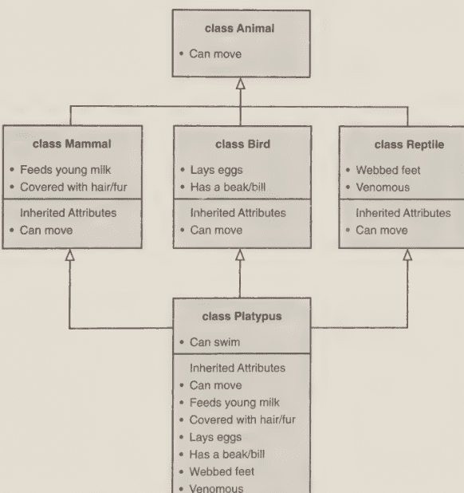

那么，当你实例化一个 `Platypus` 时会发生什么？一个 `Platypus` 实例实例化了多少个 `Animal` 类实例？列表 11.7 有助于回答这个问题。

## 列表 11.7 检查一个 Platypus 实例对应的基类 Animal 实例数量

```cpp
0: #include <iostream>
1: using namespace std;
2:
3: class Animal
4: {
5: public:
6:     Animal()
7:     {
8:         cout << "Animal constructor" << endl;
9:     }
10:
11:    // 示例成员
12:    int age;
13: };
14:
15: class Mammal:public Animal
16: {
17: };
18:
19: class Bird:public Animal
20: {
21: };
22:
23: class Reptile:public Animal
24: {
25: };
26:
27: class Platypus:public Mammal, public Bird, public Reptile
28:
29: public:
30:     Platypus()
31:     {
32:         cout << "Platypus constructor" << endl;
33:     }
34: };
35:
36: int main()
37: {
38:     Platypus platypus;
39:
40:     // 取消下注释以编译
41:     // age 是二义的，因为有三个实例
42:     Platypus.age = 25;
43:
44:     return 0;
45: }
```

## 使用虚继承解决菱形问题

## 输出 ▼

```
Animal constructor
Animal constructor
Platypus constructor
```

## 分析 ▼

输出表明，由于多重继承并且为每个 `Platypus` 实例（如第 38 行所示）创建了三个 `Animal` 实例。这是因为在 `Mammal`、`Bird` 和 `Reptile` 的关系之间未使用 `virtual` 关键字。当你想要通过 `Platypus` 访问 `Animal::age` 时（如第 42 行所示），你会得到错误，是因为编译器不知道你想设置 `Mammal::age`、`Bird::age` 还是 `Reptile::age`。解决方案是虚继承：

```cpp
Mammal::age = 25;
Bird::age = 25;
Reptile::age = 25;
```

等等，如果你只需要一个 `Animal` 实例，你需要使用虚继承：

```cpp
class Derived: virtual Base
{
    // 成员和函数
};
class Derived2: virtual Base
{
    // 成员和函数
};
```

```cpp
0: #include <iostream>
1: using namespace std;
2:
3: class Animal
4: {
5: public:
6:     Animal()
7:     {
8:         cout << "Animal constructor" << endl;
9:     }
10:
11:    // 示例成员
12:    int age;
13: };
14:
15: class Mammal:virtual Animal
16: {
17: };
18:
19: class Bird:virtual Animal
20: {
21: };
22:
23: class Reptile:virtual Animal
24: {
25: };
26:
27: class Platypus:public Mammal, public Bird, public Reptile
28: {
29: public:
30:     Platypus()
31:     {
32:         cout << "Platypus constructor" << endl;
33:     }
34: };
35:
36: int main()
37: {
38:     Platypus platypus;
39:
40:     // 没有编译错误，因为只有一个 age
41:     platypus.age = 25;
42:
43:     return 0;
44: }
```

## 使用限定符覆盖来表示覆盖意图

在我们版本的基类 `Fish` 中，包含一个名为 `Swim()` 的虚函数，如下所示：

```cpp
class Fish {
public:
    virtual void Swim()
    {
        cout << "Fish swims!" << endl;
    }
};
```

假设派生类 `Tuna` 要定义一个函数 `Swim()`，但其签名略有不同——由于一个想要覆盖 `Fish::Swim()` 的程序员无意中插入了 `const` ：

```cpp
class Tuna:public Fish {
public:
    void Swim() const
    {
        cout << "Tuna swims!" << endl;
    }
};
```

此函数 `Tuna::Swim()` 实际上并没有覆盖 `Fish::Swim()`。由于 `Tuna::Swim()` 中存在 `const`，两者的签名是不同的。然而，编译仍然会通过，问题是该程序员可能会错误地认为自己已经成功覆盖了类 `Tuna` 中的 `Swim()` 函数。C++11 及更高版本为程序员提供了**限定符覆盖**（specifier override），用于验证被覆盖的函数是否已被基类声明为虚：

```cpp
class Tuna:public Fish {
public:
    void Swim() const override // 错误：Fish 中没有此签名的虚函数
    {
        cout << "Tuna swims!" << endl;
    }
};
```

## 使用 final 防止函数覆盖

因此，`override` 提供了一种强有力的方式，可以显式地表达覆盖基类虚函数的意图，从而让编译器检查：

- 基类函数是否为虚函数。
- 基类虚函数的签名是否与声明要覆盖的派生类函数签名完全匹配。

## 使用 final 防止函数覆盖

`final` 限定符是在 C++11 中引入的，并已在第 10 节中向你介绍过。声明为 `final` 的类不能被用作基类。同样，声明为 `final` 的虚函数不能在派生类中被覆盖。

因此，一个不允许对虚函数 `Swim()` 进行任何进一步特化的 `Tuna` 类版本看起来如下所示：

```cpp
class Tuna:public Fish {
public:
    // 覆盖 Fish::Swim 并将其设为 final
    void Swim() override final
    {
        cout << "Tuna swims!" << endl;
    }
};
```

此版本的 `Tuna` 可以被继承，但 `Swim()` 无法再被覆盖：

```cpp
class BluefinTuna final:public Tuna {
public:
    void Swim() // 错误：Swim() 在 Tuna 中是 final，不能覆盖
    {
    }
};
```

限定符和 `final` 的演示可以在列表 11.9 查看。

# 第 11 节：多态

> 我们在类 `BluefinTuna` 的声明中也使用了 `final`。这确保了 `BluefinTuna` 类不能被用作基类。因此，以下代码会导致错误：

```cpp
class FailedDerivation:public BluefinTuna
{};
```

## 虚拷贝构造函数？

嗯，章节标题末尾的问号是有理由的。在 C++ 中，技术上是不存在虚拷贝构造函数的。然而，这样的功能可以帮助你创建一个 `Base*` 类型的集合（例如静态数组），其中每个元素都是该类型的特化类：

```cpp
// Tuna, Carp 和 Trout 是继承自基类 Fish 的类
Fish* pFishes[3];
pFishes[0] = new Tuna();
pFishes[1] = new Carp();
pFishes[2] = new Trout();
```


然后将其赋值给另一个相同类型的数组，由于虚拷贝构造函数确保了派生类对象也进行了深拷贝，即使拷贝构造函数是在 `Fish*` 类型上操作的，也能确保 `Tuna`、`Carp` 和 `Trout` 被拷贝为 `Tuna`、`Carp` 和 `Trout`。

嗯，这是一个美好的梦想。

虚拷贝构造函数是不可能的，因为在派生类实现覆盖的基类方法范围内，`virtual` 关键字是关于运行时生成的多态行为。另一方面，构造函数不是多态的。

```cpp
class Fish
{
public:
    virtual Fish* Clone() const = 0; // 虚函数是多态的};
```

事实上，通过 `Clone()` 函数的形式提供了一种实现虚拷贝构造函数的替代方案，如列表 11.9 所示。

## 列表 11.9 支持拷贝构造函数的 Tuna 和 Carp

```cpp
#include <iostream>
using namespace std;
class Fish
{
public:
    virtual Fish* Clone() const = 0;
    virtual void Swim() = 0;
    virtual ~Fish() {};
};
class Tuna:public Fish
{
public:
    // 覆盖 Fish::Swim 并将其设为 final
    Fish* Clone() const override
    {
        return new Tuna(*this);
    }
    void Swim() override final
    {
        cout << "Tuna swims fast in the sea" << endl;
    }
};
class BluefinTuna final:public Tuna
{
public:
    Fish* Clone() const override
    {
        return new BluefinTuna(*this);
    }
    // 不能覆盖 Swim，因为它在 Tuna 中是 final
};
class Carp final: public Fish
{
public:
    Fish* Clone() const override
    {
        return new Carp(*this);
    }
    void Swim() override final
    {
        cout << "Carp swims slow in the lake" << endl;
    }
};
int main()
{
    const int ARRAY_SIZE = 4;
    Fish* pFishes[ARRAY_SIZE];
    pFishes[0] = new Tuna();
    pFishes[1] = new Carp();
    pFishes[2] = new BluefinTuna();
    pFishes[3] = new Carp();
    Fish* newFishes[ARRAY_SIZE];
    for (int i = 0; i < ARRAY_SIZE; ++i) {
        newFishes[i] = pFishes[i]->Clone();
    }
    for (int i = 0; i < ARRAY_SIZE; ++i) {
        newFishes[i]->Swim();
    }
    for (int i = 0; i < ARRAY_SIZE; ++i) {
        delete pFishes[i];
        delete newFishes[i];
    }
    return 0;
}
```

## 输出

Tuna swims fast in the sea
Carp swims slow in the lake
Tuna swims fast in the sea
Carp swims slow in the lake

## 分析

除了通过 `Clone()` 函数演示了虚拷贝构造函数外，列表 11.9 还演示了 `override` 和 `final` 关键字的使用——后者被应用于虚函数和类。

在这一节中，你学习了如何通过使用多态来在 C++ 代码中创建层次结构的力量。你学习了如何声明和编写虚函数——它们如何确保派生类的实现能够覆盖基类中的实现。

即使使用基类的实例来调用虚方法，基类也是如此。你看到纯虚拟函数是虚函数的特殊类型，它们确保了基类本身不能被实例化，使其成为定义派生类必须实现的接口的完美位置。最后，你看到了多重继承引起的“菱问题”，以及虚继承如何帮助你解决它。

## Q&A

- Q 为什么代码在不加关键字的情况下也能编译，我们要在基类函数上使用 `virtual` 关键字？
如果没有 `virtual` 关键字，你无法确保调用 `objBase.Function()` 的代码会被重定向到 `Derived::Function()`。此外，代码的编译并不是衡量质量的唯一标准。

- Q 编译器为什么要创建虚函数表（Virtual Function Table）？
为了存储函数指针，以确保调用虚函数的正确版本。

- Q 基类是否应该始终有一个虚析构函数？
理想情况下是的。只有这样，你才能确保当有人执行如下操作

```cpp
Base* pBase = new Derived();
delete pBase;
```

对 `Base*` 类型的指针进行操作时会调用析构函数 `~Derived()`。当析构函数 `~Base()` 被声明为 `virtual` 时，就会发生这种情况。

- Q 当我甚至无法单独实例化它时，抽象基类（ABC）有什么用？
ABC 并不是为了作为独立对象被实例化；相反，它的目的总是为了被派生。它包含了纯虚拟函数，定义了派生类需要实现的最小函数蓝图，充当接口的角色。

- Q 给定一个继承层次结构，我需要在所有虚函数的声明处都使用 `virtual` 关键字，还是只需要在基类中使用？
A 只将函数声明为一次 `virtual` 即可，但该声明必须在基类中进行。

## 我可以在 ABC 中定义成员函数并拥有成员属性吗？

可以的。记住，你仍然无法实例化 ABC，因为它至少有一个需要由派生类实现的纯虚拟函数。

## 工作坊（Workshop）

工作坊提供了测验题帮助你巩固对所涵盖内容的理解，并提供了练习题让你获得使用所学经验。在检查附录 E 中的答案之前，尝试回答测验和练习题，并在继续下一节之前确保你理解了答案。

## 测验（Quiz）

- 1. 你正在为形状——圆形和三角形——建模，并希望每个形状都强制实现 `Area()` 和 `Print()` 函数。你会如何做？
- 2. 编译器会为所有类创建虚函数表（Virtual Table）吗？
- 3. 我的类 `Fish` 有两个公共方法、一个纯虚拟函数和成员属性。它仍然是一个抽象基类吗？

## 练习（Exercises）

- 1. 展示一个继承层次结构，实现测验 1 中关于圆形和三角形的问题。
- 2. 漏洞分析（BUG BUSTERS）：以下代码中的问题是什么：
```cpp
class Vehicle {
public:
    Vehicle() {}
    ~Vehicle() {}
};
class Car : public Vehicle {
public:
    Car() {}
    ~Car() {}
};
```
- 3. 在练习 2 的（未纠正）代码中，如果这样创建并销毁 car 的实例，构造函数和析构函数的执行顺序是怎样的：

```
Vehicle* pMyRacer = new MyRacer;
delete pMyRacer;
```

# 第 12 节
运算符类型与运算符重载

除了封装数据和方法外，类还可以封装运算符，以便于对该类的实例进行操作。你可以使用这些运算符对类对象执行诸如赋值或加法的操作，类似于你在第 5 节“处理表达式、语句和运算符”中看到的对整数的操作。就像函数一样，运算符也可以被重载（overloaded*）。

在本节中，你将学习到：

- 使用 `operator` 关键字
- 一元运算符和二运算符
- 转换运算符
- 移动赋值运算符
- 不能被重定义的运算符

## C++ 中的运算符是什么？

在语法层面，运算符与函数之间几乎没有区别，区别在于使用了 `operator` 关键字。运算符的声明看起来和函数声明非常相似：

```
return_type operator operator_symbol (...parameter list...);
```

在这种情况下，`operator_symbol` 可以是程序员可以定义的若干种运算符类型中的任何一种。它可以是 `+`（加法）或 `&&`（逻辑与）等。操作数有助于帮助编译器区分不同的运算符。那么，既然已经支持函数，为什么 C++ 还要提供运算符呢？

考虑一个封装了日期、月份和年份的工具类 `Date`：

```
Date holiday (12, 25, 2016); // 初始化为 2016年12月25日
```

假设你想增加一天，并让实例包含第二天——2016年12月26日，以下两个选项中，哪一个更直观？

- 选项 1（使用递增运算符）
  ++ holiday;

- 选项 2（使用成员函数 `Increment()`）
  holiday.Increment(); // 2016年12月26日

显然，选项 1 的得分更高。

运算符不仅用于管理数据的类，还可以用于更多情况。`MyString` 在第 9 节“类与对象”中引入的 `+` 运算符可以方便连接：

```cpp
MyString sayHello("Hello ");
MyString sayWorld(" world"); // 如果支持 operator+
MyString
```

> 实现相关运算符将获得使用上的便利性作为回报。

在广义上，C++ 中的运算符可以分为两类：一元运算符和二运算符。

## 一元运算符

正如名称所示，作用于单个操作数的运算符被称为一元运算符。在全局命名空间或作为类的静态成员函数实现的一元运算符使用以下结构：

```
return_type operator_type (parameter_type)
{
    // ... 实现
}
```

作为类的（非静态）成员的一元运算符结构相似，但缺少参数，因为它作用的单个参数是类的实例（`*this`）：

```
return_type operator_type ()
{
    // ... 实现
}
```

### 一元运算符的类型

可以重载（或重定义）的一元运算符所示表 12.1。

| 运算符 | 名称 |
|---|---|
| ++ | 递增 |
| -- | 递减 |
| * | 指针解引用 |
| -> | 成员选择 |
| ! | 逻辑非 |
| & | 取地址 |

# 第 12 节：运算符类型与运算符重载

| 运算符 | 名称 |
| --- | --- |
| ~ | 取反 |
| + | 一元加 |
| - | 一元负 |
| 转换运算符 | 转换为其他类型 |

## 编写一元递增/递减运算符

一元前缀递增运算符（++可以使用类声明中的以下语法编写：

```cpp
// 一元递增运算符（前缀）
Date& operator ++ ()
{
    // 运算符实现代码
    return *this;
}
```

另一方面，后置递增运算符（++）具有不同的返回值和一个输入参数（该参数并不总是使用）：

```cpp
Date operator ++ (int)
{
    // 在增加前存储对象当前状态的副本
    Date copy (*this);
    // 增加实现代码
    // 返回递增前的状态（因为是后置）
    return copy;
}
```

列表 12.1 展示了一个简单的 `Date` 类，允许使用运算符 `++` 增加天数。

# 列表 12.1 一个处理日、月、年并允许增加和减少日日的日期类

```
0: #include <iostream>
1: using namespace std;
2: 
3: class Date
4: {
5: private:
6:     int day, month, year;
7: 
8: public:
9:     Date(int inMonth, int inDay, int inYear)
10:    : month(inMonth), day(inDay), year(inYear) {};
11: 
12:     Date& operator ++ () // 前置增
13:     {
14:         ++day;
15:         return *this;
16:     }
17: 
18:     Date& operator -- () // 前置减
19:     {
20:         --day;
21:         return *this;
22:     }
23: 
24:     void DisplayDate()
25:     {
26:         cout << month << " / " << day << " / " << year << endl;
27:     }
28: };
29: 
30: int main ()
31: {
32:     Date holiday(12, 25, 2016); // 2016年12月25日
33: 
34:     cout << "The Date object is initialized to: ";
35:     holiday.DisplayDate();
36: 
37:     ++holiday; // 将日期向前移动一天
38:     cout << "Date after prefix-increment is: ";
39:     holiday.DisplayDate();
40: 
41:     --holiday; // 将日期向后移动一天
42:     cout << "Date after prefix-decrement is: ";
43:     holiday.DisplayDate();
44: 
45:     return 0;
46: }
```

# 课程 12: 运算符类型与运算符重载

## 输出 ▼

The date object is initialized to: 12 / 25 / 2016
Date after prefix-increment: 12 / 26 / 2016
Date after a prefix-decrement: 12 / 25 / 2016

## 分析 ▼

在第 12 到 22 行中定义的感兴趣运算符有助于对 `Day` 类的实例每次增加或减少一天，如 `main()` 函数中的第 37 行和第 41 行所示。本示例所示的前置增运算符在完成增加操作后，需要返回该实例的引用。

> 此版本的日期类仅有最基础的实现，以减少行数并解释前置运算符 (++) 和运算符 (--) 是如何实现的。同类的专业版本将实现月份和年份的进位功能，并考虑闰年。

## 注意

为了支持前置增或减，你只需在 `Date` 类中添加以下代码：

```cpp
// 后置与前置运算符在返回类型和参数上不同
Date operator ++ (int) // 后置增
```

```cpp
{
    Date copy(month, day, year);
    ++day;
    return copy; // 返回增加之前的实例副本
}
```

```cpp
Date operator -- (int) // 后置减
```

```cpp
{
    Date copy(month, day, year);
    --day;
    return copy; // 返回减少之前的实例副本
}
```

当你的 `Date` 类版本同时支持前置和后置增减运算符时，你可以使用以下语法使用类对象：

```cpp
Date holiday (12, 25, 2016); // 实例化
++holiday; // 使用前置增运算符
holiday++; // 使用后置增运算符++
--holiday; // 使用前置减运算符 --
holiday--; // 使用后置减运算符 --
```


## 注意

正如后置运算符的实现所示，在执行增加或减少操作之前，会创建一个包含对象现有状态的副本，随后返回该副本。

换句话说，如果你在使用 `++ object;` 和 `object ++;` 之间选择一个仅为了执行增加，你应该选择前者，以避免创建不会被使用的临时副本。

## 编程转换运算符

如果你使用列表 12.1 并在 `main()` 中插入以下行：
`cout << holiday; // 缺少转换运算符将报错`

该代码将导致以下编译失败：`error: binary '<<' : no operator found which takes a right-hand operand of type 'Date' (or there is no acceptable conversion)`。此错误本质上表示 `cout` 不知道如何解释 `Date` 实例，因为该类不支持将其内容转换为 `cout` 接受的类型的运算符。

我们知道 `cout` 可以很好地处理 `const char*`：
`std::cout << "Hello world"; // const char* 可效！`

因此，让 `cout` 与 `Date` 类型实例工作可能只需添加一个返回 `const char*` 版本的运算符：
`operator const char*()`

```cpp

{

  // 返回 char* 的运算符实现

}

```

列表 12.2 是该转换运算符的简单实现。

## 列表 12.2 为 Date 类实现转换运算符 const char*

```cpp
0: #include <iostream>
1: #include <sstream> // 为 ostring 新增的头文件
2: #include <string>
3: using namespace std;

5: class Date
6: {
7: private:
8:     int day, month, year;
9:     string dateString;

11: public:
12:    Date(int inMonth, int inDay, int inYear)
13:        month(inMonth), day(inDay), year(inYear) {}

15:    operator const char*()
16:    {
17:        ostringstream formattedDate; // 辅助字符串构造
18:        formattedDate << month << " / " << day << " / " << year;

20:        dateString = formattedDate.str();
21:        return dateString.c_str();
22:    }
23:};

25: int main ()
26: {
27:     Date Holiday(12, 25, 2016);
28:     cout << "Holiday is on: " << Holiday << endl;
29:     return 0;
30: }
```

## 输出

`Holiday is on: 12 / 25 / 2016`

## 分析

在第 12 到 22 行中定义的感兴趣运算符有助于对 `Day` 类的实例每次增加或减少一天，如 `main()` 函数中的第 37 行和第 41 行所示。本示例所示的前置增运算符在完成增加操作后，需要返回该实例的引用。

> 此版本的日期类仅有最基础的实现，以减少行数并解释前置运算符 `(++)` 和运算符 `(--)` 是如何实现的。同类的专业版本将实现月份和年份的进位功能，并考虑闰年。

## 一元运算符

该运算符开启了消费的新可能性。

## 注意

注意此类赋值会导致隐式转换，即：为了避免隐式转换，在运算符声明的开头使用 `explicit` 关键字：

```cpp
explicit const char*()
```

使用 `explicit` 将强制程序员断言其转换意图：

```cpp
cout << static_cast<const char*>(Holiday);
```

## 一元运算符

```cpp
28:   unique_ptr<Date> smartHoliday(new Date(12, 25, 2016));
29:   cout << "The new instance of date contains: ";

31:   // use smartHoliday just as you would a Date*
32:   smartHoliday->DisplayDate();

34:   return 0;
35: }
```

# 输出 ▼

整数值为: 42
The new instance of date contains: 12 / 25 / 2016

# 分析 ▼

第 22 行是你声明一个指向 `int` 类型的智能指针的地方。这一行显示了智能指针类 `unique_ptr` 的模板初始化语法。同样，第 28 行声明了一个指向 `Date` 类实例的智能指针。请关注这种模式，暂时忽略细节。

# 注意事项

> 如果这个模板语法看起来很别扭，不要担心，因为模板将在第 14 节“宏和模板简介”中后介绍。

此示例演示了智能指针如何允许你像第 23 行和 32 行所示使用普通指针语法。在第 22 行，你能够使用 `*smartIntPtr` 显示 `int` 的值，而在第 32 行，你使用 `smartHoliday->DisplayData()`，就像这两个变量分别是 `int*` 和 `Date*` 一样。秘密在于 `std::unique_ptr` 指针类，它是智能的，因为它实现了 `operator (*)` 和 `operator (->)`。

# 注意事项

智能指针类能做的远不止是像普通指针那样到处跑，或者在超出作用范围时释放内存。在第 26 节中了解更多关于此主题的内容。

要查看重载了这些运算符的基础智能指针类的实现，你可以简要访问列表 26.1。

## 二元运算符

作用于两个操作数的运算符称为二元运算符。作为全局函数或静态成员函数实现的二元运算符定义如下：

```cpp
return_type operator_type(parameter1, parameter2);
```

作为类成员实现的二元运算符定义为：

```cpp
return_type operator_type(parameter);
```

二元运算符的类成员版本仅接受一个参数的原因是第二个参数通常派自类本身的属性。

## 二元运算符类型

表格 12.2 包含了在你的 C++ 中可以重载或重新定义的二元运算符。

表格 12.2 可重载的二元运算符
| 运算符 | 名称 |
| --- | --- |
| , | 逗号 |
| != | 不等于 |
| % | 取模 |
| %= | 取模/赋值 |
| & | 按位与 |
| && | 逻辑与 |
| &= | 按位与/赋值 |
| * | 乘法 |
| *= | 乘法/赋值 |
| + | 加法 |
| += | 加法/赋值 |
| - | 减法 |
| -= | 减法/赋值 |

## 二元运算符

| 运算符 | 名称 |
| --- | --- |
| ->* | 成员指针选择 |
| / | 除法 |
| /= | 除法/赋值 |
| < | 小于 |
| << | 左移 |
| <= | 左移/赋值 |
| <= | 小于或等于 |
| = | 赋值、拷贝赋值和移动赋值 |
| == | 等于 |
| > | 大于 |
| >= | 大于或等于 |
| >> | 右移 |
| >= | 右移/赋值 |
| ^ | 异或 |
| ^= | 异或/赋值 |
| | | 按位或 |
| |= | 按位或/赋值 |
| || | 逻辑或 |
| [] | 下标运算符 |

## 编程二元加法 (a+b) 和减法 (a-b) 运算符

类似于自增/自减运算符，二元加号和减号在定义后，允许你从实现这些运算符的类对象中添加或减少类型。再次查看你的日历类。尽管你已经实现了让 `Date` 向移动一天的能力，但你仍然不支持移动五天的功能。要实现这一点，你需要如列表 12.4 所示实现二元运算符 `(+)`。

# 列表 12.4 具有二元加运算符的日历类

```cpp
0: #include <iostream>
1: using namespace std;

3: class Date
4: {
5: private:
6: int day, month, year;
7: string dateString;

9: public:
10: Date(int inMonth, int inDay, int inYear)
11:     month(inMonth), day(inDay), year(inYear) {};

13: Date operator + (int daysToAdd) // 二元加法
14: {
15:     Date newDate(month, day + daysToAdd, year);
16:     return newDate;
17: }

19: Date operator - (int daysToSub) // 二元减法
20: {
21:     return Date(month, day - daysToSub, year);
22: }

24: void DisplayDate()
25: {
26: cout << month << " / " << day << " / " << year << endl;
27: }
28: }
29: int main()
30: {
31: Date Holiday(12, 25, 2016);
32: cout << "Holiday on: ";
33: Holiday.DisplayDate();

35: Date PreviousHoliday(Holiday - 19);
36: cout << "Previous holiday on: ";
37: PreviousHoliday.DisplayDate();

39: Date NextHoliday(Holiday + 6);
40: cout << "Next holiday on: ";
41: NextHoliday.DisplayDate();

43: return 0;
44: }
```

## 输出

`Holiday on: 12 / 25 / 2016`
`Previous holiday on: 12 / 6 / 2016`
`Next holiday on: 12 / 31 / 2016`

## 分析

第 13 到 22 行包含了二元运算符 `(+)` 和 `(-)` 的实现，它们允许在 `main()` 第 40 行和 36 行中使用简单的加法和减法语法。

二元加法运算符在字符串类中也会用。在第 9 节中，分析列表 9.9 所示封装了内存管理、拷贝和赋值的 `MyString` 包装类。

```cpp
MyString Hello("Hello");
MyString World("World");
MyString(Hello + World); // 错误：未定义 operator+
MyString operator+(const MyString& addThis)
{
  MyString newString;
  if (addThis.buffer != NULL)
  {
    newString.buffer = new char[strlen(addThis.buffer) + 1];
    strcpy(newString.buffer, buffer);
    strcat(newString.buffer, addThis.buffer);
  }
  return newString;
}
```

定义这个运算符 `(+)` 让使用 MyString 极其简单，因此值得：将前面的代码添加到带有默认构造函数 `MyString()` 的列表 9 中，以便可以使用加语法。你可以在本节后面的列表 12.1 中看到包含运算符 `(+)` 的 `MyString` 类版本。

## 实现加赋值 (+=) 和减法赋值 (-=)

加赋值运算符允许语法 `a += b;`，允许程序员通过量 `b` 增加对象的值。在此过程中，加赋值运算符的用处在于它可以重载以接受不同类型的参数。列表 12.5 允许你向 `Date` 对象添加整数值。

列表 12.5 给整数输入定义运算符 `(+=)` 和运算符 `(-)` 在日历中加减天

```cpp
0: #include <iostream>
1: using namespace std;

3: class Date
4: {
5: private:
6: int day, month, year;

8: public:
9: Date(int inMonth, int inDay, int inYear)
10:     month(inMonth), day(inDay), year(inYear) {}

12: void operator+= (int daysToAdd) // 加赋值
13: {
14:     day += daysToAdd;
15: }

17: void operator-= (int daysToSub) // 减赋值
18: {
19:     day -= daysToSub;
20: }

22: void DisplayDate()
23: {
24:     cout << month << " / " << day << " / " << year << endl;
25: }
26: };
```

## 二元运算符

```cpp
28: int main()
29: {
30:     Date holiday (12, 25, 2016);
31:     cout << "holiday is on: ";
32:     holiday.DisplayDate();

34:     cout << "holiday -= 19 gives: ";
35:     holiday -= 19;
36:     holiday.DisplayDate();

38:     cout << "holiday += 25 gives: ";
39:     holiday += 25;
40:     holiday.DisplayDate();

42:     return 0;
43: }
```

## 输出

`holiday is on: 12 / 25 / 2016`
`holiday -= 19 gives: 12 / 6 / 2016`
`holiday += 25 gives: 12 / 31 / 2016`

## 分析

感兴趣的加赋值和减赋值运算符位于第 12 到 20 行。它们允许如 `main()` 所示添加或减少整数类型的天数，例如：

```cpp
35: holiday -= 19;
39: holiday += 25;
```

你的 `Date` 类现在允许用户像处理整数一样，使用加赋值或减赋值运算符对其添加或减少天数。你甚至可以为加赋值运算符 `(+=)` 提供重载版本，使其与虚构类 `Days` 的实例工作：

```cpp
// 将 Days 增加到现有 Date 的运算符
void operator += (const Days& daysToToAdd)
{
    day += daysToToAdd.GetDays();
}
```

# 第12 节：运算符类型与运算符重载

> 乘法赋值 `*=`、除法赋值 `/=`、取模赋值 `%=`、减法赋值 `-=`、左移赋值 `<<`、右移赋值 `>=`、异或赋值 `^=`、位按包含或赋值 `|=` 和位按与赋值 `&=` 运算符的语法与列表 12.5 所示的加赋值运算符相似。

重载运算符的最终目标是使类变得易于使用且直观。在很多情况下，实现某个运算符可能并没有意义。例如，我们的日历日期没有位按与赋值 `&=` 运算符的需求。该类的任何用户都不应该期望（或认为）通过像 `greatDay &= 20;` 这样的操作获得有用的结果。

注意

## 重载相等 (==) 和不等 (!) 运算符

当 Date 类的用户比较一个实例与另一个实例时，你期望得到什么结果：

```
if (date1 == date2)
{
    // 执行某些事情
}
else{
    // 执行其他事情
}
```

在没有相等运算符 `==` 的情况下，编译器简单地对两个对象执行二进制比较，并在它们完全相同时返回 `true`。这种二进制比较对于包含简单数据类型的类实例（如现在的 Date 类）是有效的，但如果涉及的类具有非静态字符串成员（`char*`），例如列表 9.9 中的 `MyString`，则将无法工作。当比较两个 `MyString` 类的实例时，成员属性的二进制比较实际上比较的是成员字符串指针的值（`MyString::buffer`）。即使字符串内容相同，这些值也是不等的。涉及 `MyString` 实例的比较将一贯地返回 `false`。你通过定义运算符来解决这个问题。相等运算符的通用表达式如下：

```
bool operator== (const ClassType& compareTo)
{
    // 此处编写比较代码，如果相等返回 true，否则返回 false
}
```

## 不等运算符可以复用相等运算符：

```
bool operator!=(const ClassType& compareTo)
```


  // 此处编写比较代码，如果不相等返回 true，否则返回 false

不等运算符可以是相等运算符结果的反反（逻辑非）。列表 12.6 展示了由我们的日历类 `Date` 定义的比较运算符。

```
0: #include <iostream>

1: using namespace std;

2:

3: class Date

4:

5: private:

6:   int day, month, year;

7:

8: public:

9:   Date(int inMonth, int inDay, int inYear)

10:    : month(inMonth), day(inDay), year(inYear) {}

11:

12: bool operator== (const Date& compareTo)

13: {

14:   return ((day == compareTo.day)

15:     && (month == compareTo.month)

16:     && (year == compareTo.year));

17: }

18:

19: bool operator!=(const Date& compareTo)

20: {

21:   return !(this->operator===(compareTo));

22: }

23:

24: void displayDate()

25: {

26:   cout << month << " / " << day << " / " << year << endl;

27: }

28: }

29:

30: int main()

31: {

32:   Date holiday1(12, 25, 2016);

33:   Date holiday2(12, 31, 2016);

34:

35:   cout << "holiday 1 is: ";

36:   holiday1.displayDate();

37:   cout << "holiday 2 is: ";

38:   holiday2.displayDate();

39:

40:   if (holiday1 == holiday2)

41:     cout << "Equality operator: The two are on the same day" << endl;

42:   else

43:     cout << "Equality operator: The two are on different days" << endl;

44:

45:   if (holiday1 != holiday2)

46:     cout << "Inequality operator: The two are on different days" << endl;

47:   else

48:     cout << "Inequality operator: The two are on the same day" << endl;

49:

50:     return 0;

51: }
```

输出
holiday 1 is: 12 / 25 / 2016
holiday 2 is: 12 / 31 / 2016
Equality operator: The two are on different days
Inequality operator: The two are on different days

## 分析

相等运算符 `(==)` 是一个简单的实现，如果日、月、年都相等则返回 `true`，如第 12 行到 17 行所示。不等运算符 `(!)` 简单地复用了相等运算符的代码，如第 21 行所示。运算符的存在有助于在 `main()` 函数的第 40 行和第 45 行中比较两个 `Date` 对象 `holiday1` 和 `holiday2`。

## 重载 <, >, 和 >= 运算符

列表 12:6 中的代码使 `Date` 类足够智能，能够判断两个 `Date` 对象是否相等或不相等。你需要编写小于 (`<`)、大于 (`>`)、小于等于 (`<=`) 和大于等于 (`>=`) 运算符，以实现类似的条件检查：

```
if (date1 < date2) // 执行某些事情
if (date1 <= date2) // 执行某些事情
if (date1 > date2) // 执行某些事情
if (date1 >= date2) // 执行某些事情
```

这些运算符由列表 12.7 展示。

### 12.7 展示 <, <=, >, 和 >=

```
0: #include <iostream>
1: using namespace std;
2:
3: class Date
4:
5: private:
6:   int day, month, year;
7:
8: public:
9:   Date(int inMonth, int inDay, int inYear)
10:    : month(inMonth), day(inDay), year(inYear) {}
11:
12: bool operator== (const Date& compareTo)
13: {
14:   return ((day == compareTo.day)
15:     && (month == compareTo.month)
16:     && (year == compareTo.year));
17: }
18:
19: bool operator!=(const Date& compareTo)
20: {
21:   return !(this->operator===(compareTo));
22: }
23:
24: void displayDate()
25: {
26:   cout << month << " / " << day << " / " << year << endl;
27: }
28: }
29:
30: int main()
31: {
32:   Date holiday1(12, 25, 2016);
33:   Date holiday2(12, 31, 2016);
34:
35:   cout << "holiday 1 is: ";
36:   holiday1.displayDate();
37:   cout << "holiday 2 is: ";
38:   holiday2.displayDate();
39:
40:   if (holiday1 == holiday2)
41:     cout << "Equality operator: The two are on the same day" << endl;
42:   else
43:     cout << "Equality operator: The two are on different days" << endl;
44:
45:   if (holiday1 != holiday2)
46:     cout << "Inequality operator: The two are on different days" << endl;
47:   else
48:     cout << "Inequality operator: The two are on the same day" << endl;
49:
50:     return 0;
51: }
```

输出

holiday 1 is: 12 / 25 / 2016

holiday 2 is: 12 / 31 / 2016

Equality operator: The two are on different days

Inequality operator: The two are on different days

## 分析

感兴趣的运算符在第 12 行到 50 行中实现，并部分复用了你在 12.6 中看到的 `=` 运算符。`==`、`<` 和 `>` 的实现已被剩余部分消耗。

运算符位于 `main()` 函数的第 68 行到 78 行之间，这表明现在比较两个不同的日期是多么容易。

## 重载拷贝赋值运算符 (=)

在某些你想将一个类实例的内容赋值给另一个时，例如：

```cpp
Date holiday(12, 25, 2016);
Date anotherHoliday(1, 1, 2017);
anotherHoliday = holiday; // 使用拷贝赋值运算符
```

此赋值调用了编译器在你未提供的情况下为你的类构建的默认拷贝赋值运算符。根据你的类的性质，默认拷贝赋值运算符可能是不足的，特别是当你的类管理某种不会被拷贝的资源时。默认拷贝赋值运算符这个问题与第 9 节中讨论的默认拷贝构造函数问题相似。为了确保深拷贝（与拷贝构造函数一样），你需要指定一个相应的拷贝赋值运算符：

```
ClassType& operator= (const ClassType& copySource)
{
    if(this != &copySource) // 防止拷贝到自身
    {
        // 拷贝赋值运算符实现
    }
    return *this;
}
```

如果你的类封装了原始指针，例如列表 9.9 所示 `String` 类，那么深拷贝是非常重要的。为了确保赋值过程中的深拷贝，请如列表 12.8 所示定义拷贝赋值运算符。

# 列表 12.8 来自列表 9.9 的改进版 QString 类，带有拷贝赋值运算符 =

```cpp
0: #include <iostream>
1: using namespace std;
2: #include <string.h>
3: class QString
4: {
5: private:
6: char* buffer;
7: 
8: public:
9: QString(const char* initialInput)
10: {
11: if(initialInput != NULL)
12: {
13: buffer = new char [strlen(initialInput) + 1];
14: strcpy(buffer, initialInput);
15: }
16: 
17: else
18: buffer = NULL;
19: }
20: 
21: // 拷贝赋值运算符
22: QString& operator=(const QString& copySource)
23: {
24: if ((this != &copySource) && (copySource.buffer != NULL))
25: {
26: if (buffer == NULL)
27: delete [buffer];
28: 
29: // 通过先分配自己的缓冲区来确保深拷贝
30: buffer = new char [strlen(copySource.buffer) + 1];
31: 
32: // 从源缓冲区拷贝到本地缓冲区
33: strcpy(buffer, copySource.buffer);
34: }
35: 
36: return *this;
37: }
```

```cpp
38: operator const char*()
39: {
40:     return buffer;
41: }
42: 
43: ~MyString()
44: {
45:     delete[] buffer;
46: }
47: };
48: 
49: int main() {
50: {
51: MyString string1("Hello ");
52: MyString string2(" World");
53: 
54: cout << "Before assignment: " << endl;
55: cout << string1 << string2 << endl;
56: string2 = string1;
57: cout << "After assignment string2 = string1: " << endl;
58: cout << string1 << string2 << endl;
59: 
60: return 0;
61: }
```

# 输出 ▼

Before assignment:

Hello World

After assignment string2 = string1:

Hello Hello

# 分析 ▼

为了减少代码行数，我故意在这个示例中省略了拷贝构造函数（但在编写此类类时，你应该插入它；请参考列表 9.9）。拷贝赋值运算符实现在第 21 行到 36 行。它的功能与拷贝构造函数相似，并执行一个初始检查以确保同一个对象不会既是拷贝源又是目标。在检查通过后，`MyString` 的拷贝赋值运算符会先释放其内部缓冲区，然后为拷贝源的文本重新分配空间，最后如第 14 行所示使用 `strcpy()` 进行拷贝。

# 第 12 节：运算符类型与运算符重载

> 注意

列表 12.8 相比列表 9.9 的另一个微妙变化是，你用第 38 行到 41 行所示的 `operator const char*` 替换了函数 `GetString()`。这个运算符使得 `MyString` 类更加用，如第 55 行所示，使用一次计数即可显示两个 `MyString` 实例。

> 警告

在实现使用 `new` 分配数组的动态资源类时，始终确保你在实现析构函数之外，还实现了（或评估了）拷贝构造函数和拷贝赋值运算符的实现。

除非在类对象被拷贝时处理资源所有权问题，否则你的类是不完整的，在使用时会危害应用程序的稳定性。

> 提示

要创建一个不可拷贝的类，请将拷贝构造函数和拷贝赋值运算符声明为 `private`。仅声明为 `private` 而不实现就足以编译器对所有通过值传递给函数或将一个实例赋值给另一个来尝试拷贝该类的行为 错误。

# 下标运算符 ([])

允许通过数组样式 `[]` 访问类的运算符被称为下标运算符。下标运算符的典型类型为：

```cpp
return_type& operator [] (subscript_type& subscript);
```

因此，在创建一个像 `MyString` 这样在 `char*` 缓冲区中封装了动态字符数组的类时，下标运算符可以使其非常方便地随机访问缓冲区中的单个字符：

```cpp
class MyString
{
    // ... 其他类成员
public:
    const char& operator [] (int index) /*const*/
    // 返回缓冲区中位置为 index 的字符
};
```

列表 12.9 中的示例演示了下标运算符 (`[]`) 如何帮助用户使用标准的数组语义遍历 `MyString` 实例中包含的字符。

# 列表 12.9 在 MyString 类中实现下标运算符 [] 以允许对 MyString::buffer 的字符进行随机访问


```cpp
#include <iostream>
#include <string>
#include <string.h>
using namespace std;
class MyString{
private:
    char* buffer;
    // ... 默认构造函数
    MyString() {}
public:
    // 构造函数
    MyString(const char* initialInput)
    {
        if(initialInput != NULL)
        {
            buffer = new char [strlen(initialInput) + 1];
            strcpy(buffer, initialInput);
        }
        else
            buffer = NULL;
    }
    // 拷贝构造函数
    MyString(const MyString& copySource);
    // 拷贝赋值运算符
    MyString& operator=(const MyString& copySource)
    {
        if ((this != &copySource) && (copySource.buffer != NULL))
        {
            if (buffer == NULL)
                delete [buffer];

            // 通过先分配自己的缓冲区来确保深拷贝
            buffer = new char [strlen(copySource.buffer) + 1];

            // 从源缓冲区拷贝到本地缓冲区
            strcpy(buffer, copySource.buffer);
        }
        return *this;
    }
    // 析构函数
    ~MyString()
    {
        delete[] buffer;
    }
    // 下标运算符
    const char& operator [] (int index) const
    {
        if (index < getLength())
            return buffer[index];
    }
    int getLength()
    {
        return strlen(buffer);
    }
};

int main() {
{
    MyString string1("Hello ");
    MyString string2(" World");

    cout << "Before assignment: " << endl;
    cout << string1 << string2 << endl;
    string2 = string1;
    cout << "After assignment string2 = string1: " << endl;
    cout << string1 << string2 << endl;

    return 0;
}
```

在本节中将进一步讨论。然而，它们的实现方式与已经讨论过的那些相似。

其他运算符，例如逻辑运算符和位运算运算符，如果引入这些运算符可以增强该类的功能，则需要对它们进行编程。显然，像 `Date` 这样的日历类可能并不一定需要实现逻辑运算符，而一个执行字符串和数值函数的类可能需要频繁地使用它们。

在重载运算符或编写新运算符时，请务必考虑你的类的目标及其使用场景。

## 函数运算符 `()`

使对象行为像函数一样的运算符 `` `()` 被称为函数运算符（function operator）。它们在标准模板库 (STL) 中应用广泛，通常用于 STL 算法。它们的用法包括做出决策；此类函数对象通常是一元谓词或二元谓词，取决于它们处理的操作数数量。列表 12.10 分析了一个简单的函数对象，让你能够理解为什么它们会有如此引人入胜的名字了！

### 列表 12.10 使用运算符 `()` 创建的函数对象

```
1: #include <iostream>
2: #include <string>
3: using namespace std;
4:
5: class Display
6: {
7:     public:
8:     void operator () (string input) const
9:     {
10:        cout << input << endl;
11:    }
12: };
13:
14: int main ()
15: {
16:     Display displayFuncObj;
17:
18:     // equivalent to displayFuncObj.operator ("Display this string!");
19:     displayFuncObj("Display this string!");
20:
21:     return 0;
22: }
```

## 移动构造函数与移动赋值运算符

365

# 输出 ▼

Display this string!

# 分析 ▼

第 8 行到 11 行实现了 `operator()`，随后在第 19 行的 `main()` 函数中使用。注意编译器如何允许在第 19 行将对象 `displayFuncObj` 作为函数使用，通过隐式将看起来像函数调用的转换为 `operator()` 的调用。

因此，该运算符也被称为函数运算符 `()`，而 `Display` 的对象也被称为函数对象或仿函数（functor）。这一主题将在第 21 节“理解函数对象”中详细讨论。

## 用于高性能编程的移动构造函数与移动赋值运算符

移动构造函数和移动赋值运算符是 C++11 标准中的性能优化特性，确保临时值（在语句执行后不再存在的值）不会被不必要的拷贝。这在处理管理动态分配资源的类（例如动态数组类或字符串类）时特别有用。

### 不必要的拷贝步骤问题

看看列表 12.4 中实现的加法运算符 `+`。注意它实际上创建了一个副本并返回它。如果像列表 12.9 所示的 `MyString` 类支持加法运算符 `+`，那么以下代码将是字符串拼接的有效示例：

```
MyString Hello("Hello");
MyString World("World");
MyString CPP("C++");
MyString sayHello(Hello + World + CPP); // operator+, 拷贝构造函数
MyString sayHelloAgain("overwrite this");
sayHelloAgain = Hello + World + CPP; // operator+, 拷贝构造函数, 拷贝赋值运算符=
```

这种让三个字符串拼接变得简单的结构使用了二元加法运算符 `+`：

```cpp
CString operator+(const QString& addThis)
{
    CString newStr;

    if (addThis.buffer != NULL)
    {
        // 拷贝到 newStr
    }
    return newStr; // 按值返回，调用拷贝构造函数
}
```

虽然加法运算符 `+` 让字符串拼接变得简单，但可能会导致性能问题。创建 `sayHello` 需要执行两次加法运算符。每次执行 `operator +` 都会导致临时副本的创建，因为 `QString` 是按值返回的，这导致了拷贝构造函数的执行。在简化字符串拼接的同时，加法运算符 `+` 可能会引起性能问题。`sayHello` 的创建需要执行两次加法运算符。每次执行 `operator +` 都会导致临时副本的创建，因为 `QString` 是按值返回的，这导致了拷贝构造函数的执行。临时值（在语句执行后不再存在的值）是 C++ 面临的性能瓶颈。然而，这个问题在 C++11 中终于得到了解决。C++11 特别识别了临时值、移动构造函数和移动赋值运算符，由程序员提供。

### 声明移动构造函数与移动赋值运算符

移动构造函数的语法如下：

```cpp
class Sample
{
private:
    Type* ptrResource;

public:
    Sample(Sample&&) // 移动构造函数，注意这里
    {
        ptrResource = moveResource; // 转移所有权
        moveResource = NULL;
    }
};
```

## 移动构造函数与移动赋值运算符 367

```cpp
if (this != &moveSource)
{
    delete[] buffer; // 释放缓冲区
    ptrResource = moveResource; // 转移所有权
    moveResource = NULL; // }
```

## 移动构造函数与移动赋值运算符

```cpp
Sample(); // 默认构造函数
Sample(const Sample& copySource); // 拷贝构造函数
```

因此，移动构造函数和赋值运算符与普通的拷贝构造函数和赋值运算符的区别在于输入参数是 `Sample&&`。C++11 确保对于临时值，使用移动构造函数和赋值运算符，而不是拷贝构造函数。在这些实现中，你只需将资源移动到目标位置。12.11 展示了这些构造函数和赋值运算符的有效性。

### 带有移动构造函数与移动赋值运算符的 MyString

```cpp
0: #include <iostream>
1: #include <string.h>
2: using namespace std;
3: class MyString
4: {
5: private:
6:     char* buffer;
7:
8:     MyString(): buffer(NULL) // 默认构造函数
9:     {
10:        cout << "Default constructor called" << endl;
11:    }
12:
13: public:
14:    MyString(const char* initialInput) // 构造函数
15:    {
16:        cout << "Constructor called: " << initialInput << endl;
17:        if(initialInput != NULL)
18:        {
19:            buffer = new char[strlen(initialInput) + 1];
20:            strcpy(buffer, initialInput);
21:        }
22:        else
23:            buffer = NULL;
24:    }
25:
26:    MyString(const MyString& moveSource) // 拷贝构造函数
27:    {
28:        cout << "Copy constructor copies: " << moveSource.buffer << endl;
29:        if (moveSource.buffer != NULL)
30:        {
31:            buffer = new char[strlen(moveSource.buffer) + 1];
32:            strcpy(buffer, moveSource.buffer);
33:        }
34:        else
35:            buffer = NULL;
36:    }
37:
38:    MyString(MyString&& moveSource) // 移动构造函数
39:    {
40:        cout << "Move constructor moves: " << moveSource.buffer << endl;
41:        if(moveSource.buffer != NULL)
42:        {
43:            buffer = moveSource.buffer; // 转移所有权
44:            moveSource.buffer = NULL; // 释放源
45:        }
46:    }
47:
48:    MyString& operator=(MyString&& moveSource) // 移动赋值运算符
49:    {
50:        cout << "Move assignment moves: " << moveSource.buffer << endl;
51:        if(moveSource.buffer != NULL) && (this != &moveSource)
52:        {
53:            delete[] buffer; // 释放缓冲区
54:            buffer = moveSource.buffer; // 转移所有权
55:            moveSource.buffer = NULL; // 释放源
56:        }
57:
58:        return *this;
59:    }
60:
61:    MyString& operator=(const MyString& copySource) // 拷贝赋值运算符
62:    {
63:        cout << "Copy assignment copies: " << copySource.buffer << endl;
64:        if ((this != &copySource) && (copySource.buffer != NULL))
65:        {
66:            if (buffer != NULL)
67:                delete[] buffer;
68:            buffer = new char[strlen(copySource.buffer) + 1];
69:            strcpy(buffer, copySource.buffer);
70:        }
71:
72:        return *this;
73:    }
74:
75:    ~MyString() // 析构函数
76:    {
77:        delete[] buffer;
78:    }
79: };
```

# 移动构造函数与移动赋值运算符

```cpp
68:      delete[] buffer;
69:

70:      buffer = new char[strlen(copySrc.buffer) + 1];
71:      strcpy(buffer, copySrc.buffer);
72:    }
73:

74:      return *this;
75:    }
76:

77: -MyString() // 析构函数
78:  {
79:      if (buffer != NULL)
80:          delete[] buffer;
81:    }
82:
83:  int getLength()
84:  {
85:      return strlen(buffer);
86:    }
87:
88:  operator const char*()
89:  {
90:      return buffer;
91:    }
92:
93:  MyString operator+(const QString& addThis)
94:  {
95:      cout << "operator called: " << endl;
96:      MyString newStr;
97:
98:      if (addThis.buffer != NULL)
99:      {
100:         newStr.buffer = new char[GetLength()+strlen(addThis.buffer)+1];
101:         strcpy(newStr.buffer, buffer);
102:         strcat(newStr.buffer, addThis.buffer);
103:     }
104:
105:     return newStr;
106:   }
107: };

108:
109: int main()
110: {
111:     MyString Hello("Hello");
112:     MyString World("World");
113:     MyString CPP("of C++");
114:
115:     MyString sayHelloAgain("overwrite this");
116:     sayHelloAgain = Hello + World + CPP;
117:

118:     return 0;
119: }
```

# 输出 ▼

未启用移动构造函数和移动赋值运算符的输出（通过注释第 26 行到 48 行）：


```
Constructor called for: Hello
Constructor called for: World
Constructor called for: of C++
Constructor called for: overwrite this
operator+ called:
Default constructor copies: Hello World
operator+ called:
Default constructor called
Copy constructor copies: Hello World of C++
Copy assignment op. copies: Hello World of C++
```

启用移动构造函数和移动赋值运算符的输出：

```
Constructor called for: Hello
Constructor called for: World
Constructor called for: of C++
Constructor called for: overwrite this
operator+ called:
Move constructor moves: Hello World
operator- called:
Default constructor called
Move constructor moves: Hello World of C++
Move assignment op. moves: Hello World of C++
```

# 分析

这可能是一个很长的代码示例，但大部分内容已经在之前的示例和课程中演示过了。此列表中最重要的部分是第 26 行到 48 行，它们分别实现了移动构造函数和移动赋值运算符。输出中受 C++11 新新特性影响的部分已用粗体标记。请注意，与没有这两个实体的相同类相比，输出发生了巨大的变化。如果你再次查看移动构造函数和移动赋值运算符的实现，你会发现移动语义本质上是通过从移动源 `Src` 获取资源的所有实现的，如移动构造函数中的第 31 行和移动赋值运算符中的第 43 行所示。随后是将移动源指针赋值为 `NULL`，如第 32 行和 44 行所示。赋值为 `NULL` 确保了移动源实例的析构函数本质上不会在第 80 行通过 `delete` 进行任何内存释放，因为所有权已经转移到了目标对象。注意，在没有移动构造函数的情况下，会调用拷贝构造函数，它会对指向的字符串进行深拷贝。因此，移动构造函数通过减少不必要的内存分配和拷贝步骤，节省了大量的处理时间。

编写移动构造函数和移动赋值运算符是完全可选的。与拷贝构造函数和拷贝赋值运算符不同，编译器不会为它们添加默认实现。

使用此功能可以优化指向动态分配资源的类的功能，否则在即使临时使用的情况下，这些资源也会被深拷贝。

# 用户自定义字面量

字面量常量在第 3 节“使用变量、声明常量”中引入。这里是几个示例：

```cpp
int bankBalance = 10000;
double pi = 3.14;
char firstAlphabet = 'a';
const char* hello = "Hello";
```

在前面的代码中，10000,3.14,'a' 和 "Hello!" 都是字面量常量！C++11 扩展了标准对字面量的支持，允许你定义自己的字面量。例如，如果你正在处理一个项目，你可能需要定义自己的字面量来表示特定的单位或度量。

# 移动构造函数与移动赋值运算符

```cpp
68:      delete[] buffer;
69:

70:      buffer = new char[strlen(copySrc.buffer) + 1];
71:      strcpy(buffer, copySrc.buffer);
72:    }
73:

74:      return *this;
75:    }
76:

77: -MyString() // 析构函数
78:  {
79:      if (buffer != NULL)
80:          delete[] buffer;
81:    }
82:
83:  int getLength()
84:  {
85:      return strlen(buffer);
86:    }
87:
88:  operator const char*()
89:  {
90:      return buffer;
91:    }
92:
93:  MyString operator+(const QString& addThis)
94:  {
95:      cout << "operator called: " << endl;
96:      MyString newStr;
97:
98:      if (addThis.buffer != NULL)
99:      {
100:         newStr.buffer = new char[GetLength()+strlen(addThis.buffer)+1];
101:         strcpy(newStr.buffer, buffer);
102:         strcat(newStr.buffer, addThis.buffer);
103:     }
104:
105:     return newStr;
106:   }
107: };

108:
109: int main()
110: {
111:     MyString Hello("Hello");
112:     MyString World("World");
113:     MyString CPP("of C++");
114:
115:     MyString sayHelloAgain("overwrite this");
116:     sayHelloAgain = Hello + World + CPP;
117:

118:     return 0;
119: }
```

# 输出

未启用移动构造函数和移动赋值运算符的输出（通过注释第 26 行到 48 行）：

```
Constructor called for: Hello
Constructor called for: World
Constructor called for: of C++
Constructor called for: overwrite this
operator+ called:
Default constructor copies: Hello World
operator+ called:
Default constructor called
Copy constructor copies: Hello World of C++
Copy assignment op. copies: Hello World of C++
```

启用移动构造函数和移动赋值运算符的输出：

```
Constructor called for: Hello
Constructor called for: World
Constructor called for: of C++
Constructor called for: overwrite this
operator+ called:
Move constructor moves: Hello World
operator- called:
Default constructor called
Move constructor moves: Hello World of C++
Move assignment op. moves: Hello World of C++
```

# 分析

这可能是一个很长的代码示例，但大部分内容已经在之前的示例和课程中演示过了。此列表中最重要的部分是第 26 行到 48 行，它们分别实现了移动构造函数和移动赋值运算符。输出中受 C++11 新特性影响的部分已用粗体标记。请注意，与没有这两个实体的相同类相比，输出发生了巨大的变化。如果你再次查看移动构造函数和移动赋值运算符的实现，你会发现移动语义本质上是通过从移动源 `Src` 获取资源的所有实现的，如移动构造函数中的第 31 行和移动赋值运算符中的第 43 行所示。随后是将移动源指针赋值为 `NULL`，如第 32 行和 44 行所示。赋值为 `NULL` 确保了移动源实例的析构函数本质上不会在第 80 行通过 `delete` 进行任何内存释放，因为所有权已经转移到了目标对象。注意，在没有移动构造函数的情况下，会调用拷贝构造函数，它会对指向的字符串进行深拷贝。因此，移动构造函数通过减少不必要的内存分配和拷贝步骤，节省了大量的处理时间。

编写移动构造函数和移动赋值运算符是完全可选的。与拷贝构造函数和拷贝赋值运算符不同，编译器不会为它们添加默认实现。

使用此功能可以优化指向动态分配资源的类的功能，否则在即使临时使用的情况下，这些资源也会被深拷贝。

# 用户自定义字面量

字面量常量在第 3 节“使用变量、声明常量”中引入。这里是几个示例：

```cpp
int bankBalance = 10000;
double pi = 3.14;
char firstAlphabet = 'a';
const char* hello = "Hello";
```

在前面的代码中，10000、3.14,'a' 和 "Hello!" 都是字面量常量！C++11 扩展了标准对字面量的支持，允许你定义自己的字面量。例如，如果你正在处理一个项目，你可能需要定义自己的字面量来表示特定的单位或度量。

# 研坊

在某些情况下微调此类的性能。为了实现对类实例内部存储元素进行类似数组的访问，你需要重载下标运算符 `[]`。

我有一个类的实例对象。我想支持像 `cout << object;` 这样的语法：我需要实现什么运算符？

你需要实现一个转换运算符，允许你的类在开始时就能被解释为 `std::cout` 可以处理的类型。一种方法是像你在列表 12.2 中做的那样，定义 `operator char*`。

我想创建自己的智能指针类。我需要实现哪些函数和运算符？

智能指针需要提供像 `*pSmartPtr->Func()` 那样作为普通指针使用的能力。为此需要启用 `operator (*)` 和 `operator (->)`。此外，为了使其具有“智能性”，你还需要通过编写相应的析构函数来处理资源的自动释放/返回，并通过实现拷贝构造函数和拷贝赋值运算符来明确定义拷贝或赋值的工作方式，或者通过将这两个声明为私有来禁止它们。

# 研坊

研坊包含测验题，帮助你巩固对所涵盖内容的理解，并提供练习题以让你获得使用所学知识的经验。在检查附录 E 中的答案之前，尝试回答测验和练习题，并在进入下一节之前确保你理解了答案。

## 测验

+ 1. 我的下标运算符 `[]` 可以返回类型的 `const` 和非 `const` 版本吗？

```
const Type& operator[](int index);
Type operator[](int index); // 这样可以吗？
```

+ 2. 你会将拷贝构造函数或拷贝赋值运算符声明为私有吗？

+ 3. 为 `Date` 类定义移动构造函数和移动赋值运算符是否有意义？

## 练习

+ 1. 为 `Date` 类编写一个转换运算符，将它持有的日期转换为唯一的整数。

+ 2. 为 `DynIntegers` 类编写一个移动构造函数和移动赋值运算符，该类以私有成员 `int*` 的形式封装了动态分配的数组。

# 第 13 节

强制转换运算符

强制是程序员可以临时或永久改变编译器对对象解释的机制。注意，这并不意味着程序员改变了对象本身——他只是改变了对其的解释。改变对象解释的运算符被称为强制转换运算符。

在本节中，你将学习：

- 强制转换运算符的必要

- 为什么 C 风格强制转换不受某些 C++ 程序员的欢迎

- 四种 C++ 强制转换运算符

- 向上转换和向下转换的概念

- 为什么 C++ 强制转换运算符也并非首选

# 强制转换的需求

在一个由编写良好的 C++ 应用组成的完美类型安全且类型强大的世界中，不需要强制转换和强制转换运算符。然而，我们生活在一个现实世界，由许多不同的人和供应商编写、使用不同环境的模块必须共同工作。为了实现这一点，编译器通常需要被指令以解释数据的方式，使其能够编译并让应用程序正常运行。

```
typedef unsigned short BOOL;
```

一个返回布尔数据的函数声明为：

```
BOOL IsX ();
```

现在，如果该库要用于用最新版本的 C++ 编译器编写的新应用程序，程序员必须找到一种方法，让 C++ 编译器理解的 `bool` 数据类型与库理解的 `BOOL` 数据类型保持一致。实现这一点的方法是使用强制转换：

```
bool Result = (bool)IsX();    // C 风格强制转换
```

C++ 的进化看到了新的 C++ 强制转换运算符的出现，这在 C++ 编程社区中引起了分裂：一组继续在他们的 C++ 应用中使用 C 风格强制转换，另一组则虔诚地转换为 C++ 编译器引入的强制转换关键字。前一组的论点是 C++ 强制转换使用起来繁琐，另一个论点是其功能有限，以至于只有理论价值。后一组（显然由 C++ 语法纯洁者组成）指出了 C 风格强制转换的缺陷来支持他们的论点。

由于现实世界中运行着这两种代码，简单地阅读本节，了解每种风格的优缺点并形成你自己的观点是好的。

# C++ 强制转换运算符

# 为什么 C 风格强制转换不受某些 C++ 程序员的欢迎

类型安全是 C++ 程序员在赞美这种编程语言的特性时遵循的格言之一。事实上，大多数 C++ 编译器甚至不允许你这样做：

```
char* staticStr = "Hello World!";
int* intArray = staticStr; // 错误：无法将 char* 转换为 int*
```

现在，C++ 编译器仍然认为需要向后兼容以保持旧代码和遗留代码的编译，因此允许如下语法：

int* intArray = (int*)staticStr; // 解决一个问题，创建

这种 C 风格强制转换实际上迫使编译器将目标解释为程序员方便选择的类型——在这种情况下，这个程序员并没有忽略编译器最初报告错误是有正当理由的，简单地中和了编译器并强制它服从。当然，这并不受 C++ 程序员的欢迎，因为他们看到自己的类型安全被强行通过任何东西的强制转换所损害了。

# C++ 强制转换运算符

尽管强制转换有缺点，强制转换本身的概念不能被抛弃。在许多情况下，强制转换是解决兼容性问题的合理需求。C++ 还额外提供了专门针对继承场景的强制转换运算符，这在 C 语言是不存在的。

四种 C++ 强制转换运算符是：

- `static_cast`

- `dynamic_cast`

- `reinterpret_cast`

- `const_cast`

强制转换运算符的使用语法是一致的：

```
destination_type result = cast_operator<destination_type> (object_to_cast);
```

## 使用 static_cast

`static_cast` 是一种用于在相关类型之间转换指针的机制，并会对会自动发生的标准类型执行显式转换。对于指针，`static_cast` 实现了一个基本的编译时检查，以确保指针被转换到相关类型。这比 C 风格强制转换有了改进，后者允许一个对象的指针转换为完全无关的类型而没有任何警告。使用 `static_cast`，指针可以向上转换为基类类型，也可以向下转换为派生类类型，正如代码示例所示。

```
Base* objBase = new Derived();
Derived* objDer = static_cast<Derived>(objBase); // 好！

// 类 Unrelated 与 Base 无关
Unrelated* notRelated = static_cast<Unrelated*>(objBase); // 错误
// 由于类型无关，不允许此类转换
```

> 将 Derived 转换为 Base 称为向上转换，不需要任何显式强制转换运算符。

Derived* objDerived;

Base* objBase = &objDerived; // 好！

将 Base 转换为 Derived* 称为向下转换，不需要使用显式强制转换运算符：

Derived* objDerived;

Base* objBase = &objDerived; // 向上转换 -> 好！

Derived* objDer = objBase; // 错误：向下转换需要显式转换

然而，请注意 `static_cast` 仅验证指针类型是相关的。它不执行任何运行时检查。因此，通过 `static_cast`，程序员可能仍然会犯这种错误：

```
Base* objBase = new Base();
Derived* objDer = static_cast<Derived>(objBase); // 仍然没有错误！
```

在这里，`objDer` 实际上指向一个部分的 Derived 对象，因为所指向的对象实际上是 Base() 类型。由于 `static_cast` 只执行验证所讨论类型相关的编译时检查，而不执行运行时检查，调用 `objDer->DerivedFunction()` 将通过编译，但在运行时可能会导致意外的行为。

# C++ 转换运算符

除了辅助进行向上转型（upcasting）或向下转型（downcasting）之外，`static_cast` 在许多情况下可以帮助将隐式转换变为显式，并引起程序员或读者的注意：

double Pi = 3.14159265;

int num = static_cast<int>(Pi); // 将原本隐式的转换变为显式

在前面的代码中，`num = Pi` 的写法同样有效，且效果相同。


然而，使用 `static_cast` 会让读者注意到类型转换的本质，并指示（对于了解 `static_cast` 的人）编译器已经根据编译时可用信息执行了必要的调整，以完成所需的类型转换。在使用用 `explicit` 关键字声明的转换运算符或构造函数时，你也需要使用 `static_cast`。通过 `explicit` 关键字避免隐式转换的方法将在第 9 节“类与对象”和第 12 节“运算符类型与运算符重载”中讨论。

## 使用 dynamic_cast 和运行时类型识别

动态转换（Dynamic casting）正如其名，它是静态转换的相反，并且实际上在运行时执行转换——即在应用程序执行期间。`dynamic_cast` 操作的结果可以用来检查转换尝试是否成功。`dynamic_cast` 运算符的典型用法是：

`dest_type* Dest = dynamic_cast<class_type*>(Source);`

```cpp
if (Dest) // 检查转换操作是否成功
    Dest->CallFunc();
```

例如：

```cpp
Base* objBase = new Derived();

// 执行向下转型
Derived* objDer = dynamic_cast<Derived*>(objBase);

if (objDer) // 检查转换是否成功
    objDer->CallDerivedFunction();
```

如前面的简短示例所示，给定一个指向基类对象的指针，程序员可以在继续使用该指针之前，利用 `dynamic_cast` 来验证所指向的目标对象的类型。注意，在代码段中显而易见目标对象是 `Derived` 类型，因此该示例仅具有演示价值。但情况并非总是如此——例如，当将 `Derived*` 类型的指针传递给接受 `Base*` 类型的函数时。该函数可以

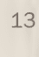

# 第 13 节：转换运算符

给定基类指针类型使用 `dynamic_cast` 来检测类型，然后执行针对检测到的类型的特定操作。因此，`dynamic_cast` 有助于在运行时确定类型以及这种操作是否安全。参见列表 13.1，该列表使用了与基类 `Fish` 相关的类层级结构 `Tuna` 和 `Carp`，其中函数 `DetectFishType()` 动态检测 `Fish*` 是 `Tuna` 还是 `Carp`。

因此，这种在运行时识别对象类型的机制被称为运行运行时类型识别（RTTI）。

## 列表 13.1 使用动态转换判断鱼对象是金枪还是鲤鱼

```cpp
0: #include <iostream>
1: using namespace std;
2:
3: class Fish
4: {
5: public:
6:     virtual void Swim()
7:     {
8:         cout << "Fish swims in water" << endl;
9:     }
10:
11:    // 基类应该始终有虚析构函数
12:    virtual ~Fish()
13: };
14:
15: class Tuna: public Fish
16: {
17: public:
18:     void Swim()
19:     {
20:         cout << "Tuna swims real fast in the sea" << endl;
21:     }
22:
23:     void BecomeDinner()
24:     {
25:         cout << "Tuna became dinner in Sushi" << endl;
26:     }
27: };
28:
29: class Carp: public Fish
30: {
31: public:
32:     void Swim()
33:     {
34:         cout << "Carp swims real slow in the lake" << endl;
35:     }
36: 
37:     void Talk(){
38:     {
39:         cout << "Carp talked!" << endl;
40:     }
41: };
42: 
43: void DetectFishType(Fish* objFish)
44: {
45:   Tuna* objuna = dynamic_cast<Tuna*>(objFish);
46:   if (objuna) // 检查转换是否成功
47:   {
48:     cout << "Detected Tuna. Making Tuna dinner: " << endl;
49:     objuna->BecomeDinner();
50:   }
51: 
52:   Carp* objCarp = dynamic_cast<Carp*>(objFish);
53:   if (objCarp)
54:   {
55:     cout << "Detected Carp. Making Carp talk: " << endl;
56:     objCarp->Talk();
57:   }
58: 
59:   cout << "Verifying type using virtual Fish::Swim: " << endl;
60:   objFish->Swim(); // 调用虚函数 Swim
61: }
62: 
63: int main(){
64:   {
65:     Fish* objFish = new Tuna();
66:     DetectFishType(objFish);
67:     
68:     objFish = new Carp();
69:     DetectFishType(objFish);
70:     
71:     delete objFish;
72:   }
73:   return 0;
74: }
```

所以，当你编写类似下面的函数时：

```cpp
void DisplayAllData(const SomeClass& object)
{
    object.DisplayMembers(); // 编译失败
    // 原因：使用 const 引用调用非 const 成员函数
}
```

你将 `object` 作为 const 引用传递是正确的。毕竟，显示函数应该是只读的，不应该允许调用非 const 成员函数——也就是说，不应该允许调用可以改变对象状态的函数。然而，`DisplayMembers()` 的实现本也应该是 const 的，但遗憾的是它并不是。现在，只要 `SomeClass` 属于你且源代码在你的控制范围内，你就可以对 `DisplayMembers()` 进行修正。但在许多情况下，它可能属于第三方库，无法对其进行更改。在这种情况下，`const_cast` 就是你的救救星。

在这种场景下调用 `DisplayMembers()` 的语法是：

```cpp
void DisplayAllData(const SomeClass& object)
{
    SomeClass& refData = const_cast<SomeClass&>(object);
    refData.DisplayMembers(); // 允许！
}
```

注意，使用 `const_cast` 调用非 const 函数应该是万不得已的。通常情况下，请记住使用 `const_cast` 修改 const 对象也可能导致未定义行为。

注意，`const_cast` 也可以用于指针：

```cpp
void DisplayAllData(const SomeClass* data)
{
    data->DisplayMembers(); // 错误：尝试调用非 const 函数！
    SomeClass* pCastData = const_cast<SomeClass*>(data);
    pCastData->DisplayMembers(); // 允许！
}
```

## C++ 转换运算符的问题

并不是每个人都对所有的 C++ 转换运算符感到满意——即使是那些深信 C++ 的人也是如此。他们的理由从语法繁琐且不直观到冗余等不一。

### C++ 转换运算符的问题

让我们简单对比一下这段代码：

```cpp
double Pi = 3.14159265;

// C++ 风格转换：static_cast
int num = static_cast<int>(Pi);      // 结果：num 为 3

// C 风格转换：
int num2 = (int)Pi;                 // 结果：num2 为 3

// 将转换交给编译器
int num3 = Pi;                       // 结果：num3 为 3。没有错误！
```

在所有三种情况下，程序员都实现了相同的结果。在实际场景中，第二种方案可能是常见的，其次是第三种。很少有人会使用第一种。无论如何，编译器都足够智能可以正确转换此类类型。这让 C++ 语法给人一种代码更难以阅读的印象。

同样，`static_cast` 的其他用法也可以通过 C 风格转换很好地处理，尽管后者看起来更简单：

```cpp
// 使用 static_cast
Derived* objDer = static_cast<Derived*>(objBase);

// 但，这样做的效果一样...
Derived* objDerSimple = (Derived*)objBase;
```

因此，使用 `static_cast` 的优势往往被其笨拙的语法所掩盖。

查看其他运算符，`reinterpret_cast` 用于在 `static_cast` 不起作用时强制执行；修改 const 修饰符也是如此。因此，在现代 C++ 应用中，除了 `dynamic_cast` 之外，C++ 转换运算符是可以避免的。在处理遗留应用的需求时，其他转换运算符可能会变得相关。在这种情况下，偏好使用 C 风格转换而非 C++ 转换运算符通常是个人喜好问题。重要的是尽可能避免转换，并且当你进行转换时，你清楚背后发生了什么。

# 第 13 节：转换运算符

### 要做的 (DO)

### 不要做的 (DON'T)

-   记得将 `Derived*` 转换为 `Base*` 称为上转型（ucasting），这是安全的。

-   记得将 `Base*` 直接转换为 `Derived*` 称为下转型（downcasting），除非你使用 `dynamic_cast` 并检查转换是否成功，否则这是不安全的。

-   记得创建继承层次结构的目标通常是拥有虚函数，当使用基类指针调用它们时，可以确保调用相应的派生类。

-   不要忘记使用 `dynamic_cast` 检查指针的有效性。

-   不要围绕使用 `dynamic_cast` 的 RTTI（运行时类型识别）来设计你的应用程序。

## 总结

在本节中，你学习了不同的转换运算符以及为什么要尽可能避免它们。

# 使用宏 #define 定义常量

现在每当预处理器遇到 `ARRAY_LENGTH` 文本时，它都会被替换为 25

```
int numbers [ARRAY_LENGTH] = {0};
double radiuses [ARRAY_LENGTH] = {0.0};
std::string names [ARRAY_LENGTH];
```

在预处理器运行后，这三个变量对编译器可见的形式如下：

```
int numbers [25] = {0}; // 一个包含25个整数的数组
double radiuses [25] = {0.0}; // 一个包含25个double类型的数的数组
std::string names [25]; // 一个包含25个std::string的数组
```

该替换适用于你代码的每一个部分，包括如下这样的 for 循环：

```
for(int index = 0; index < ARRAY_LENGTH; ++index)
numbers[index] = index;
```

这个 for 循环对编译器可见：

```
for(int index = 0; index < 25; ++index)
numbers[index] = index;
```

要确切看到宏是如何工作的，请查看列表 14.1。

## 列表 14.1 声明和使用定义常量的宏

```
0: #include <iostream>
1: #include<string>
2: using namespace std;
3:
4: #define ARRAY_LENGTH 25
5: #define PI 3.1416
6: #define MY_DOUBLE double
7:
8: #define FAV_WHISKY "Jack Daniels"
9:
10: int main() {
11:     int numbers [ARRAY_LENGTH] = {0};
12:     cout << "Array's length: " << sizeof(numbers) / sizeof(int) << endl;
13:
14:     cout << "Enter a radius: ";
15:     MY_DOUBLE radius = 0;
16:     cin >> radius;
17:     cout << "Area is: " << PI * radius * radius << endl;
18:
```

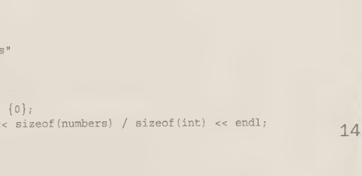

```
19: string favoriteWhisky(FAV_WHISKY);
20: cout << "My favorite drink is: " << FAV_WHISKY << endl;
21:
22: return 0;
23: }
```

# 输出 ▼

Array's length: 25

Enter a radius: 2.1569

Area is: 14.7154

My favorite drink is: Jack Daniels

# 分析 ▼

`ARRAY_LENGTH`、`PI`、`MY_DOUBLE` 和 `FAV_WHISKY` 分别是第 4 行到第 7 行定义的四个宏常量。如你所见，`ARRAY_LENGTH` 用于在第 11 行定义数组的长度，这在第 12 行通过使用 `sizeof()` 运算符间接证实了。`MY_DOUBLE` 用于在第 15 行声明一个 `double` 变量 `radius`。而 `PI` 用于在第 17 行计算圆面积。最后，`FAV_WHISKY` 用于在第 19 行初始化一个 `std::string` 对象，并在第 20 行的 `cout` 语句中直接使用。所有这些实例展示了预处理器如何简单地进行替换。

这种“笨””文本替换在列表 14.1 中似乎无处不在，但也有它的缺点。

> 预处理器进行的是简单的文本替换，它不检查替换的正确性（但编译器总是会检查）。你可以在列表 14.1 的第 7 行这样定义 `FAV_WHISKY`：

#define FAV_WHISKY 42 // "Jack Daniels"

这会导致第 19 行的 `std::string` 实例化出现编译错误，但在没有该错误的情况下，编译器将继续并打印以下内容：

My favorite drink is: 42

这显然是不合逻辑的，最重要的是没有被检测到。此外，你对宏定义的常量 `PI` 没有多多的控制权：它是 `double` 还是 `float`？答案是二者都不是。对于预处理器来说，`PI` 只是一个文本替换元素 "3.1416"。它从没有过一个定义的数据类型。

## 使用宏 #define 定义常量

使用 `const` 关键字代替宏来定义常量更好。因此，这样好得多：

```cpp
const int ARRAY_LENGTH = 25;
const double PI = 3.1416;
const char* FAV_WHISKY = "Jack Daniels";
typedef double MY_DOUBLE; // 类型的别名
```

## 使用宏防止多次包含

C++ 程序员通常在头文件中声明他们的类和函数。相应的函数通过 `#include` 指令在头文件中定义。如果一个头文件——我们称之为 `class1.h`——声明了一个类在 `class2.h` 中也声明了另一个类，那么 `class1.h` 就需要包含 `class2.h`。如果设计很复杂，且后者也需要前者，那么 `class2.h` 也会包含 `class1.h`！但对于预处理器来说，两个互相包含的头文件是一个递归问题。为了避免这个问题，你可以结合 `#ifndef` 和 `#endif` 指令使用宏。包含 `header2.h` 的 `header1.h` 如下所示：

```
#ifndef HEADER1_H // 多重包含保护
#define HEADER1_H // 预处理器将只读取此及后续行
#include <header2.h>

class1
```

`header2.h` 看起来相似，但使用了不同的：

```
#ifndef HEADER2_H // 多重包含保护
#define HEADER2_H

class2
```

#endif

```


# 课程 14: 宏与模板

`#ifndef` 可以被看作是未定义的检查，它指示预处理器如果标识符未定义则继续。`#endif` 标记着该条件的结束。

因此，当标识符未定义时，这种机制在 C++ 编程中是常用的一种功能。

## 使用 #define 宏函数

宏函数用于非常简单的计算。文本替换，例如：

```cpp

#define SQUARE(x) ((x) * (x))
```


这有助于确定数字。同样，计算圆面积的宏看起来如下：

```cpp
#define PI 3.14159
#define AREA_CIRCLE(r) (PI)*(r)*(r))
```

宏函数通常用于此类简单的计算。它们在编译之前被内联，因此在某些情况下提高了性能。列表 14.2 展示了这些宏函数的使用。

# 计算两个数的最大值最小值

```cpp
0: #include <iostream>
1: #include<string>
2:   using namespace std;
3:
4: #define SQUARE(x) ((x) * (x))
5: #define PI 3.1416
6: #define AREA_CIRCLE(r) (PI)*(r)*(r))
7: #define MAX(a, b) ((a) > (b) ? (a) : (b))
8: #define MIN(a, b) ((a) < (b) ? (a) : (b))
9: 
10: int main()
11: {
12:     cout << "Enter integer: ";
13:     int num = 0;
14:     cin >> num;
15: 
16:     cout << "SQUARE " << num << " = " << SQUARE(num) << endl;
17:     cout << "Area of a circle with radius " << num << " is: ";
18:     cout << AREA_CIRCLE(num) << endl;
19: 
20:     cout << "Enter another integer: ";
21:     int num2 = 0;
22:     cin >> num2;
23: 
24:     cout << "MIN " << num << ", " << num2 << " = " << \n;
25:     cout << MIN(num, num2) << endl;
26: 
27:     cout << "MAX " << num << ", " << num2 << " = " << \n;
28:     cout << MAX(num, num2) << endl;
29: 
30:     return 0;
31: }
```

# 第 14 节：宏与模板简介

此行代码本质上是以以下格式传递给编译器的，其中宏会在原地进行展开：
`cout << ((num) < (num2) ? (num) : (num2)) << endl;`

> 注意，宏对类型不敏感；因此，宏函数可能会导致问题。例如，`AREA_CIRCLE` 理想情况下应该返回 `double` 的函数，这样你就能确定所计算面积的返回值解析是正确的，而且它对输入半径性质的独立性也无法保证。

## 警告

### 为什么要这么多括号？

再次查看计算圆面积的宏：

这个计算在使用的括号数量上具有奇特的语法特征。相比之下，请参考第 7 节“使用函数组织代码”中列表 7.1 编写的 `Area()` 函数。

```cpp
// 函数定义（实现）
double Area(double radius)
{
    return Pi * radius * radius;    // 看，没有括号？
}
```

为什么你在宏上使用了这么多括号，而同样的公式看起来却大不相同？原因在于宏的求值方式——它是由预处理器支持的一种文本替换机制。

考虑去掉了大部分括号的宏：

```cpp
#define AREA_CIRCLE(r) (PI*r*r)
```

当你使用类似下面的语句调用此宏时，会发生什么：

```cpp
cout << (PI*4+6*4+6);    // 与 PI*10*10 不等
```

编译器将其展开为：

```cpp
cout << (PI*4+6*4+6);    // 与 PI*10*10 不等
```

## 使用 `#define` 编写宏函数 399

因此，根据运算符优先级的规则（乘法在加法之前执行），编译器实际上是这样评估面积的：

```cpp
cout << (PI*4+24+6);    // 42.5664（这是错误的）
```

在没有括号的情况下，纯文本转换对我们的编程逻辑造成了破坏性*（played havoc on）*！括号有助于避免这一问题：

```cpp
#define AREA_CIRCLE(r) (PI*(r))
cout << AREA_CIRCLE (4+6);
```

替换后的表达式被编译器视为：

```cpp
cout << (PI*(4+6));    // PI*10*10，如预期所示
```

这些括号会自动计算出准确面积，使得宏代码不依赖于运算符优先级及其影响。

## 使用宏 assert 验证表达式

尽管在编程后立即测试每个代码路径是好事，但对于非常大的应用程序来说，这在物理上是不可能的。然而，可以检查有效的表达式或变量值。

`assert` 宏允许你做到这一点。使用 `assert` 需要包含 `<assert.h>`，语法如下：

```cpp
assert (表达式求值为真或假);
```

一个验证指针内容的 `assert()` 示例：

```cpp
#include <assert.h>
int main() {
    char* sayHello = new char [25];
    assert(sayHello != NULL); // 如果指针为 NULL 则抛出消息
    // 其他代码
    delete [] sayHello;
    return 0;
}
```

`assert()` 确保了你在指针无效时收到通知。为了演示目的，我将 `sayHello` 初始化为 `NULL`，在调试模式下执行时，Visual Studio 立即弹出了图 14.1 所示的屏幕。


图 14.1
当检查指针有效性的 assert 失败时会发生什么。

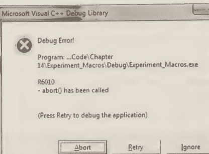

因此，Microsoft Visual Studio 实现的 `assert()` 允许你点击“重试”按钮返回应用程序，调用栈会指示哪一行断言测试失败。这使得 `assert()` 了一个方便的调试功能；例如，你可以使用 `assert` 验证函数的输入参数。这是非常推荐的，并有助于你提高代码质量。

> 注意
> `assert()` 在发布模式下通常被禁用。

## 警告
`assert()` 不起作用。

## 使用宏的优缺点

最后一个定义可能最接近 C++ 术语中 *template*（模板）一词的解释。C++ 中的模板允许你定义一种可以应用于不同类型对象的行为。这听起来与宏允许做的事情有些相似（参考确定两个数中较大值的简单宏），区别在于宏是不安全的，而模板是安全的。

## 模板简介

模板可以说是 C++ 语言中最强大的功能之一，但往往是最少被接触和理解的。在处理这个问题之前，让我们先看看《韦氏词典》对模板的定义：

读音：\tem-plet\

词性：名词

词源：可能来自法语 *templet*，*temple* 的缩小形式，指织布机的一部分，可能来自拉丁语 *templum*

日期：1677

+   1: 水平放置在墙上的短段或块，用于分配重量和压力（如门上方）
2: （量规、图案或模具（如薄板或板），作为制作部件形状的指南（2）：一种分子（如 DNA），作为生成另一种大分子（如信使 RNA）的模式 b
3: 建立或作为模式的事物

这最后一个定义可能最接近 C++ 术语中 *template*（模板）一词的解释。

## 模板声明语法

使用 `template` 关键字后跟类型参数列表来开始模板声明。该声明的格式为：

```cpp
template <parameter list>
模板函数 / 类声明
```

`template` 标记声明的开始，随后是模板参数列表。该参数列表包含定义模板参数 `objType` 的 `typename`，它是被实例化对象类型的占位符。

```cpp
template <typename T1, typename T2 = T1>
bool TemplateFunction(const T1& param1, const T2& param2);
```

```cpp
// 模板类
template <typename T1, typename T2 = T1>
```

```cpp
class MyTemplate{
private:
    T1 member1;
    T2 member2;
public:
    T1 GetObj() { return member1; }
    // ... other members
};
```

你看到的是一个模板函数和一个模板类，它们分别接受模板参数 `T1` 和 `T2`，其中 `T2` 被赋予了与 `T1` 相同的默认类型。

# 模板声明的不同类型

模板声明可以是一个：

- 函数的声明或定义
- 类的声明或定义
- 类模板中成员函数或成员类的定义
- 类模板中静态数据成员的定义
- 嵌套在类模板内部的类中的静态数据成员的定义
- 类或类模板中成员模板的定义

## 模板函数

想象一个能够适应不同类型参数的函数。使用模板语法可以实现这样的函数！让我们分析一个示例模板声明，它等同于之前讨论过的宏 `MAX`，该宏返回两个输入参数中较大的一个：

```cpp
template <typename objType>
const objType& GetMax(const objType& value1, const objType& value2)
{
    if (value1 > value2)
        return value1;
    else
        return value2;
}
```

示例用法：

```cpp
int num1 = 25;
int num2 = 40;
```

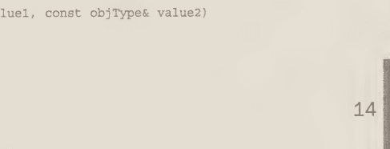

```cpp
int maxVal = GetMax<int>(num1, num2);
double double1 = 1.1;
double double2 = 1.001;
double maxVal = GetMax<double>(double1, double2);
```

注意在调用 `GetMax` 时使用的细节 `<int>`。它实际上将模板参数 `objType` 定义为 `int`。前面的代码会导致编译器生成两个版本的模板函数 `GetMax`，这些可以可视化如下：

```cpp
const int& GetMax(const int& value1, const int& value2)
{
  // ...
}
const double& GetMax(const double& value1, const double& value2)
{
  // ...
}
```

实际上，模板函数并不一定需要配套的类型指定符。因此，以下函数调用可以完美工作：
`int maxVal = GetMax(num1, num2);`

在这种情况下，编译器足够智能，能够理解正在为整数类型调用模板函数。然而，对于模板类，你需要显式地指定类型，如列表 14.3 所示。

# 列表 14.3 一个帮助求出两个值中较大值的模板函数 GetMax

```cpp
0: #include<iostream>
1: #include<string>
2: using namespace std;
3:
4: template <typename Type>
5: const Type& GetMax(const Type& value1, const Type& value2)
6: {
7:   if (value1 > value2)
8:     return value1;
9:   else
10:  return value2;
11: }
12:
13: template <typename Type>
14: void DisplayComparison(const Type& value, const Type& value2)
15: {
16:  cout << "GetMax(" << value1 << ", " << value2 << ") = ";
17:  cout << GetMax(value1, value2) << endl;
18: }
19:
20: int main()
21: {
22:     int num1 = -101, num2 = 2011;
23:     DisplayComparison(num1, num2);
24:
25:     double d1 = 3.14, d2 = 3.1416;
26:
27:     DisplayComparison(d1, d2);
28:
29:     string name1("Jack"), name2("John");
30:
31:     DisplayComparison(name1, name2);
32:     return 0;
33: }
```

## 输出
GetMax(-101, 2011) = 2011
GetMax(3.14, 3.1416) = 3.1416
GetMax(Jack, John) = John

## 分析
此示例包含两个模板函数：第 4 到 11 行的 `GetMax()`，它被第 13 到 18 行的 `DisplayComparison()` 调用，展示了同一个模板函数如何被重用于不同的数据类型：整数、`double` 和 `std::string`。这些模板函数不仅就像宏的对应物，而且更易编程和维护，并且是类型安全的！注意，你也可以用显式类型调用 `DisplayComparison`：
`DisplayComparison<int>(num1, num2);`
然而，在调用模板函数时这是不必要的。你不需要指定模板参数，因为编译器可以推断它。但是，当是模板类时，你需要这样做。

# 模板与类型安全
列表 14.3 显示的模板函数 `DisplayComparison()` 和 `GetMax()` 是类型安全的。这意味着它们不会允许像这样的无意义的调用：
`DisplayComparison(num1, name1);`
这将立即导致编译失败。

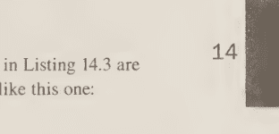

# 模板类
“类与对象”教过你，类是封装了属性以及操作这些属性的方法的编程单元。类通常是私有成员，类是蓝图，而类的现实世界表示是该类的对象。例如，“Tom”可以被看作 `Human` 类的一个对象，其包含值为 15 的属性。如果你由于某些原因需要将年龄存储自出生以来的秒数，`int` 可能是不够的。为了安全起见，你可能想使用 `long`。这就是模板类大有用场的地方。模板类是 C++ 类的模板化版本。这些是蓝图。使用模板类时，你有权指定你正在特例化的“类型”。一个使用单个参数 `T` 来持有成员变量的简单模板可以如下所示编写：

```cpp
template <typename T>
class HoldVarType {
private:
    T value;
public:
    void SetValue(const T& newValue) { value = newValue; }
    T GetValue() { return value; }
};
```

`HoldVarType` 的类型是 `T`，在模板实例化时被赋值。让我们看看这个模板类的示例用法：

```cpp
HoldVarType<int> holdInt; // 实例化 int
holdInt.SetValue(5);
cout << "存储的值是: " << holdInt.GetValue() << endl;
```

你已经使用了这个模板类来持有 `int` 类型；同样，你可以用相同的方式该类处理字符串：

```cpp
HoldVarType<char*> holdStr;
holdStr.SetValue("Sample string");
cout << "存储的值是: " << holdStr.GetValue() << endl;
```

因此，模板类定义了一种模式，有助于在不同的数据类型上实现该模式。

> 提示：模板类可以使用除 `int` 或标准库提供的类以外的类型。你可以使用自己定义的类来实例化模板。例如，当你将定义模板类 `HoldStateType` 的代码添加到 9.1 的 main 函数中，你将为 `Human` 类实例化模板：

```cpp
HoldStateType<Human> holdHuman;
holdHuman.SetValue(firstMan);
holdHuman.GetValue().IntroduceSelf();
```

# 带多个参数的模板
模板参数列表可以通过逗号扩展以声明多个参数，因此如果你想声明一个持有不同类型对象对的泛型类，你可以像下面的示例（显示了一个带有两个模板参数的模板类）一样构造：

```cpp
template <typename T1, typename T2>
class HoldsPair {
  private:
    T1 value1;
    T2 value2;
  public:
    // 初始化成员变量的构造函数
    HoldsPair(const T1& val1, const T2& val2)
    {
      value1 = val1;


在这个示例中，`HoldsPair`类接受命名为`T1`和`T2`的模板参数。我们可以使用该类持有相同类型或不同类型的对象，如下所示：

```cpp
// int 和 double 的模板实例化
HoldsPair<int, double> pairIntDouble(6, 1.99);
```

```cpp
// int 和 int 的模板实例化
HoldsPair<int, int> pairIntDouble(6, 500);
```

# 使用默认参数声明模板

我们可以修改上一个版本的`HoldsPair<...>`，将`int`声明为默认模板类型。

```cpp
template <typename T1=int, typename T2=int>
class HoldsPair
{
    // ... 方法声明
};
```

这在构造上与定义了默认输入参数值的函数相似，区别在于，在这种情况下，我们定义的是默认类型。

因此，`HoldsPair`的第二次用法可以简化为：

```cpp
// 将一个 int 与一个 int 配对（默认类型）
HoldsPair<> pairInts(6, 500);
```

# 模板类<> HoldsPair 示例

是时候对目前介绍的`HoldsPair`模板版本进行进一步开发了。请看列表 14.4。

## 列表 14.4 具有成对成员属性的模板类

```cpp
0: #include <iostream>
1: using namespace std;
2:
3: // 带有默认参数的模板：int & double
4: template <typename T1=int, typename T2=double>
5: class HoldsPair
6: {
7:   private:
8:     T1 value1;
9:     T2 value2;
10:  public:
11:     HoldsPair(const T1& val1, const T2& val2) // 构造函数
12:       value1(val1), value2(val2) {}
13:
14:     // 访问函数
15:     const T1& GetFirstValue() const
16:     {
17:       return value1;
18:     }
19:
20:     const T2& GetSecondValue() const
21: {
22:     return value2;
23: }
24: };
25:
26: int main ()
27: {
28:     HoldsPair<int> pairIntDbl(300, 10.09);
29:     HoldsPair<short,const char*>pairShortStr(25,"Learn templates, love C++");
30:
31:
32:     cout << "The first object contains - " << endl;
33:     cout << "Value 1: " << pairIntDbl.GetFirstValue() << endl;
34:     cout << "Value 2: " << pairIntDbl.GetSecondValue() << endl;
35:
36:     cout << "The second object contains - " << endl;
37:     cout << "Value 1: " << pairShortStr.GetFirstValue() << endl;
38:     cout << "Value 2: " << pairShortStr.GetSecondValue() << endl;
39:
     return 0;
40: }
```

## 输出

```
The first object contains -
Value 1: 300
Value 2: 10.09
The second object contains -
Value 1: 25
Value 2: Learn templates, love C++
```

## 分析

这个简单的程序说明了如何声明模板类`HoldsPair`，以持有一组依赖于模板参数列表的类型值。第 1 行包含一个模板参数列表，定义了两个模板参数`T1`和`T2`，其默认类型分别为`int`和`double`。访问函数`GetFirstValue()`和`GetSecondValue()`用于查询对象持有的值。注意`GetFirstValue`和`GetSecondValue`如何根据模板实例化的语法进行调整，以返回适当的对象类型。你成功在`HoldsPair`中定义了一种模式，可以对不同的变量类型重用相同的逻辑。因此，模板增加了代码的可重用性。

# 模板实例化与特化

模板类是一个蓝图，因此在被实例化之前，它对编译器来说并不真正存在。然而，当你通过提供模板参数来实例化模板类时，例如：

```cpp
HoldsPair<int, double> pairIntDbl;
```

你是在指示编译器为特定的类型创建一个类。另一方面，某些情况需要你对模板参数均为`int`类型的类进行显式特化。这种针对特定类型的模板特化看起来如下所示：

```cpp
template<> HoldsPair<int, int>
{
    // 实现代码
};
```

无需多说，特化模板的代码必须遵循模板定义。列表 14.5 是一个模板特化的示例，展示了如何产生模板的一个不同版本。

## 列表 14.5 展示模板特化

```cpp
0: #include <iostream>
1: using namespace std;
2:
3: template <typename T1 = int, typename T2 = double>
4: class HoldsPair
5: {
6:   private:
7:     T1 value1;
8:     T2 value2;
9: public:
10:    HoldsPair(const T1& val1, const T2& val2) // 构造函数
11:        value1(val1),value2(val2) {}
12: };
13: // 访问函数
14: const T1& GetFirstValue() const;
15: const T2& GetSecondValue() const;
16: };
17:
18: // int & int 类型的 HoldsPair 特化
19: template<> class HoldsPair<int,int>
20: {
21:   private:
22:     int value1;
23:     int value2;
24:     string strFun;
25:   public:
26:     HoldsPair(const int& val1, const int& val2) // 构造函数
27:     : value1(val1),value2(val2) {}
28: 
29:     const int& GetFirstValue() const
30: {
31:         cout << "Returning " << value1 << endl;
32:         return value1;
33: }
34: };
35:
36: int main ()
37: {
38:     HoldsPair<int, int> pairInt(222, 333);
39:     pairInt.GetFirstValue();
40:     return 0;
41: }
```

## 输出

```
Returning 222
```

## 分析

显然，当你将列表 14.4 中的模板类行为与形式一个进行比较时，你会发现模板的行为有所不同。事实上，第 18-34 行的特化显示了针对`int`实例化对原始模板定义进行了修改。这是因为编译器只需要`<int, int>`的实现，而我们已经提供了它。

# 模板简介

## 输出

```
Setting staticVal for intInstance to 2011
Setting staticVal for Double_2 to 1011
intInstance.staticVal = 2011
dblinstance.staticVal = 1011
```

# 分析

在第 17 行和第 21 行中，你分别为`int`和`double`类型的实例化设置了成员`staticVal`。输出显示，编译器在两个不同的静态成员中存储了两个不同的值，尽管它们的名称都为`staticVal`。因此，编译器确保了静态变量在特定类型的模板类实例化中的行为保持完好。

> 注意：不要错过列表 14.6 中第 11 行中模板类的静态成员实例化语法。

`template<typename T> int TestStatic<T>::staticVal;`
这遵循了以下模式：

`template<template parameters> StaticType ClassName<Template> Arguments::Static<;`

# 变量模板，也称为变长模板

假设你想写一个相加两个值的泛型函数。模板函数`Sum()`正是为此：

```cpp
template<typename T1, typename T2, typename T3>
void Sum(T1& result, T2 num1, T3 num2) {
  result = num1 + num2;
  return;
}
```

这很简单。然而，如果你被要求写一个能够添加任意数量值（每个值作为参数传递）的单一函数，你可能需要在定义此类函数时使用变量模板。变量模板或变长模板是 C++ C14 标准的一部分，于 2014 年发布。列表 14.7 展示了在定义此类函数时使用变量模板。

## 列表 14.7 使用变长模板的函数演示变长参数

```cpp
0: #include <iostream>
1: using namespace std;
2: 
3: template <typename Res, typename ValType>
4: void Sum(Res& result, ValType& val)
5: {
6:     result = result + val;
7: }
8: 
9: template <typename Res, typename First, typename... Rest>
10: void Sum(Res& result, First val, Rest... valN)
11: {
12:     result = result + val;
13:     return Sum(result, valN...);
14: }
15: 
16: int main()
17: {
18:     double dResult = 0;
19:     Sum(dResult, 3.14, 4.56, 1.1111);
20:     cout << "dResult = " << dResult << endl;
21: 
22:     string strResult;
23:     Sum(strResult, "Hello", "World");
24:     cout << "strResult = " << strResult.c_str() << endl;
25: 
26:     return 0;
27: }
```

# 输出

```
dResult = 8.8111
strResult = Hello World
```

# 分析

示例展示了我们使用变量模板定义的函数`Sum()`不仅处理了完全不同的参数类型（如第 19 行和第 23 行所示），而且处理了数量的参数。第 19 行调用的`Sum()`使用了四个参数，而第 23 行的使用了三个参数，其中一个是`std::string`，另外两个是`const char*`。在编译期间，编译器实际上会为适合调用的正确`Sum()`创建代码，递归进行，直到所有参数都处理完毕。

# 模板简介 | 415

注意

> 你可能注意到前面的代码示例中使用了省略号`...`。C++ 中与模板一起使用的省略号告诉编译器，该模板类或函数可以接受任意数量、任意类型的模板参数。

变量模板是 C++ 的一项强大补充，不仅适用于数学处理，也适用于完成简单任务。使用变量模板可以节省自己通过在多个重载版本中实现执行某任务的函数的重复劳动，使生成的代码更短且更易于维护。

注意

C++14 为你提供了一个运算符，可以告诉在调用变量模板时传递了多少个模板参数。在列表 14.7 中，你可以在像`Sum()`这样的函数内部该运算符，如下：

```cpp
int arrNums[sizeof...(Rest)];
// 数组长度在编译时使用 sizeof...) 进行评估
```

你绝不能将`sizeof(...)(()`与`sizeof(Type)`混淆。后者返回类型的大小，而前者返回变长模板中模板参数的数量。

变量模板的支持也引入了对元组（tuples）的标准支持。`std::tuple`是实现元组的类模板。它可以用不同数量的成员元素及其引用进行实例化。这些元素可以使用标准库函数`std::get`单独访问。列表 14.8 展示了`std::tuple`的实例化和使用。

## 列表 14.8 实例化和使用 std::tuple

```cpp
0: #include <iostream>
1: #include <tuple>
2: #include <string>
3: using namespace std;
4:
5: template <typename tupleType>
6: void DisplayInfo(tupleType& tuple)
7: {
8: const int numMembers = tuple_size<tupleType>::value;
9: cout << "Num elements in tuple: " << numMembers << endl;
10: }
11: int main()
12: {
13:     tuple<int, double, string> t1(1, 2.2, "hello");
14:     DisplayInfo(t1);
15: 
16:     tuple<string, int> t2("world", 123456);
17:     DisplayInfo(t2);
18: 
19:     tuple<char, char, char, char> t3('a', 'b', 'c', 'd');
20:     DisplayInfo(t3);
21: 
22:     return 0;
23: }
```

# 输出

```
Num elements in tuple: 3
Num elements in tuple: 2
Num elements in tuple: 4
```

# 分析

首先，如果 14.8 中的代码让你感到困惑，请不要！元组是一个高级概念，通常用于泛型编程。尽管如此，书中引入该主题是为了让你有一个大致的了解。第 15、18 和 21 行包含了不同的实例化。第 5 行的模板函数`DisplayInfo()`展示了使用`tuple_size`来解析包含的元素数量。第 10 行的`std::get`是使用索引访问元组中值的机制。最后，第 26 行的`std::tie`展示了如何将元组的内容解包或拷贝到单独的对象中。

## 模板简介

# 使用 static_assert 执行编译检查

这是自 C++11 起引入的一项功能，允许你在某些检查不时不阻止编译。这听起来可能很奇怪，但对于模板类非常有用。例如，你可能希望确保你的模板类不会为整数实例化；`static_assert`是一种编译时断言，可以在开发环境（或控制台）中显示自定义消息：

```cpp
static_assert(表达式表达式, "检查失败时的错误消息");
```

为了确保你的模板类不会为`int`类型实例化，你可以将`static_assert()`用于`sizeof(T)`，与`sizeof(int)`进行比较并在不等检查失败时显示错误消息：

```cpp
static_assert(sizeof(T) != sizeof(int), "No int please!");
```

使用`static_assert`阻塞某些实例化类型的模板类见列表 14.9。

## 列表 14.9 一个在为类型实例化时会抗议的挑剔模板类

```cpp
0: template <typename T>
1: class EverythingButInt
2: {
3: public:
4:   EverythingButInt()
5:   {
6:     static_assert(sizeof(T) != sizeof(int), "No int please!");
7:   }
8: };
9:
10: int main()
11: {
12:   EverythingButInt<int> test; // 与 int 的模板实例化。
13:   return 0;
14: }
```


# 输出 ▼

由于编译失败，没有输出，仅提供了你提供的注释：
`error: No int please!`

# 分析 ▼

编译器注册的后定义在第 6 行。因此，`static_assert` 是 C++11 帮助你保护模板代码免受意外实例化的一种方式。

# 在实际 C++ 编程中使用模板

模板的一个重要且强大的应用是标准模板库（STL）。STL 由一组模板类和函数组成，其中包含了泛型工具类和算法。这些 STL 模板类允许你实现动态数组、列表和键值对容器，而像 `sort` 这样的算法可以在这些容器上工作并处理它们包含的数据。

你之前学到的模板语法知识将极大地帮助你使用本书后续章节中详细介绍的 STL 容器和函数。更好地理解 STL 容器和算法反过来有助于你编写高效的 C++ ，使用 STL 经过测试且可靠的实现，并帮助你避免在模板细节上浪费时间。

| 执行 (DO) | 避免 (DON'T) |
|---|---|
| 应该使用模板来实现通用概念。 | 在编写模板函数和类时，不要忘记使用 `const` 正确性原则。 |
| 应该选择模板而非宏。 | 不要忘记模板类内部的静态成员对于该类的每个类型特化都是静态的。 |

## 总结

在本节中，你学习了更多关于处理预处理器的细节。每当你运行编译器时，预处理器都会首先运行并翻译诸如 `#define` 等指令。

预处理器执行文本替换，尽管使用宏时这些替换可能会变得相当复杂。宏函数根据编译时传递给宏的参数提供复杂的文本替换。在宏的每个参数周围加上括号是非常重要的，以确保发生正确的替换。

模板帮助你编写可重用的代码，为开发者提供了一种可以用于各种数据类型的模式。它们还作为宏的类型安全替代方案。有了在本节节中学到的模板知识，你现在已经准备好学习使用 STL 了！

## 问答

- 为什么我应该在头文件中使用包含保护符（inclusion guards）？
  - 答：包含保护符使用 `#ifndef`、`#define` 和 `#endif` 保护头文件免受多次包含或递归包含错误，在某些情况下它们还能加快编译速度。

- 如果涉及的功能在两种者中都可以实现，我何时应该倾向于使用宏而非模板？
  - 答：理想情况下，你应该始终倾向于模板，因为模板允许通用且类型安全的实现。宏不允许类型安全的实现，最好能够避免。

- 在调用模板函数时，我需要指定模板参数吗？
  - 答：通常不需要，因为编译器可以根据函数调用中使用的参数为你推断。

- 给给定的模板类存在多少个静态变量实例？
  - 答：这完全取决于模板类被实例化的类型数量。所以，如果你的类为 `int`、`string` 和自定义类型 `x` 进行了实例化，你可以预期会有三个静态变量实例——每个模板实例化对应一个。

## 工作坊

工作坊提供了问题帮助你巩固对所涵盖材料的理解，并提供了练习让你获得使用所学经验。在检查附录 E 中的答案之前，尝试回答测验和练习题，并确保你理解了答案。


## 测验

- 1. 什么是包含保护符？
- 2. 考虑以下宏：
  `#define SPLIT(x) x / 5`
  如果用 20 调用，结果是什么？
- 3. 如果对问题 2 中的 `SPLIT` 宏用 `10+10` 调用，结果是什么？
- 4. 你将如何修改 `SPLIT` 宏以避免错误结果？

## 练习

- 1. 写一个将两个数相数的宏。
- 2. 编写练习 1 中宏的模板版本。
- 3. 实现一个 `swap` 模板函数，交换两个变量。
- 4. 漏洞排查：你将如何改进以下计算输入值四分之一的宏？
  `#define QUARTER(x) (x / 4)`
- 5. 写写一个简单的模板类，持有两个通过类模板参数列表定义的类型数组。数组的大小为 10，且该模板类应该具有允许操作数组元素的访问器函数。
- 6. 写一个模板函数 `Display()`，它可以被用不同数量和类型的参数进行调用，并显示其中的每一个项。

# 第 15 节
## 标准模板库简介

简单来说，标准模板库（STL）是一组模板类和函数，为程序员提供：

- 用于存储信息的容器
- 用于访问所存储信息的迭代器
- 用于操作容器内容的算法

在本节中，你将概述 STL 的这三大支柱。

## STL 容器

容器是用于存储数据的 STL 类。STL 提供了两种类型的容器类：

- 顺序容器
- 关联容器

此外，STL 还提供了称为“容器适配器”（container adapters）的类，它们是相同内容的变体，功能减少以支持特定目的。

## 顺序容器

顾如名，这些容器用于以顺序方式存储数据，例如数组和列表。顺序容器的特点是插入快速，但在查找操作上相对缓慢。

STL 顺序容器有：

- `std::vector`——像动态数组一样工作，并在末端增长。将 `vector` 想象成一个书架，你可以在一端添加或移除书籍。
- `std::deque`——类似于双端队列，允许在两端插入元素。
- `std::list`——像双向链表一样。
- `std::forward_list`——像单向链表一样。

`std::vector` 类似于动态数组，并在末端增长。将 `vector` 想象成一个书架，你可以在一端添加或移除书籍。`std::deque` 类似于双端队列，允许在两端插入元素。`std::list` 像双向链表一样。`std::forward_list` 像单向链表一样。

## 关联容器

关联容器是按排序方式存储数据的容器——类似于字典。这导致插入时间较慢，但在搜索方面具有显著优势。

STL 提供的关联容器有：

- `std::set`——在插入时存储唯一值，具有对数复杂度。
- `std::unordered_set`——在插入时存储唯一值，具有接近常数的复杂度。从 C++11 开始可用。
- `std::map`——按唯一键存储键值对，具有对数复杂度。
- `std::unordered_map`——按唯一键存储键值对，具有接近常数的复杂度。从 C++11 开始可用。
- `std::multiset`——类似于 `set`。此外，允许存储多个具有值的项。
- `std::unordered_multiset`——类似于 `unordered_set`。此外，允许存储多个具有相同值的项。从 C++11 开始可用。
- `std::multimap`——类似于 `map`。此外，允许存储键不唯一的键值对。
- `std::unordered_multimap`——类似于 `unordered_map`。此外，允许存储键不唯一的键值对。从 C++11 开始可用。

# 第 15 节：标准模板库简介

# 注意事项

在这种情况下，复杂度是衡量容器相对于其所包含元素数量的性能的指标。因此，当我们谈论常数复杂度时（例如 `std::unordered_map` 的情况），我们的意思是容器的性能与其包含的元素数量无关。这种容器处理一千个元素所需的时间与它处理百万个元素所需的时间是相同的。

对数复杂度（如 `std::map` 所示）表示性能与其中包含元素数量的对数成正比。这种容器处理百万个元素所需的时间将是处理一千个元素的两倍。

线性复杂度意味着性能与元素数量成正比。这种容器处理百万个元素所需的时间将比处理一千个元素慢一千倍。

对于给定的容器，不同操作复杂度可能是不同的。也就是说，元素的插入复杂度可能是常数的，但搜索复杂度可能是线性的。因此，除了了解容器的功能外，理解容器在不同操作下的性能表现也是选择正确容器的关键。

STL 容器的排序标准可以通过编写谓词函数进行自定义。

## 提示

某些 STL 的实现还提供了关联容器，如 `hash_set`、`hash_multiset`、`hash_map` 和 `hash_multimap`。这些与标准支持 `unordered_set`、`unordered_multiset`、`unordered_map` 和 `unordered_multimap` 容器相似。在某些场景下，`hash_*` 和 `unordered_*` 变体搜索元素更好，因为它们提供了常数操作（独立于容器中的元素数量）。通常，这些容器还提供了与其标准对应的相同的公共方法，因此同样易用。

使用符合标准的变体将产生更容易在平台和编译器之间迁移的代码，因此应优先考虑。此外，标准容器性能的对数下降可能对您的应用程序产生显著影响。

## 容器适配器

容器适配器是顺序和关联容器的变体，它们的功能有限，并旨在实现特定的目的。主要的适配器类有：

- `std::stack`——以后进先（LIFO）方式存储元素，允许在顶部插入（push）和移除（pop）元素。
- `std::queue`——以先进先出（FIFO）方式存储元素，允许按照插入顺序移除第一个元素。
- `std::priority_queue`——以排序顺序存储元素，使得值最高的元素始终位于队列头部。

这些容器将在第 24 节“适配器容器：栈与队列”中进行详细讨论。

## STL 迭代器

迭代器最简单的例子是指针。给定一个指向数组第一个元素的指针，你可以递增它以指向下一个元素，或者在许多情况下，操作该位置的元素。

STL 中的迭代器是模板类，在某些方面是指针的泛化。这些模板类为程序员提供了一个句柄，通过这个句柄可以处理和操作 STL 容器并对其执行操作。注意，操作以及 STL 算法都是模板函数，迭代器是允许这些模板函数以一致且无缝的方式与容器（模板类）工作的桥梁。

STL 提供的迭代器大致可分类为以下几种：

- 输入迭代器——可以解引用以引用一个对象。例如，该对象可以在集合中。纯种的输入迭代器保证只具有读取权限。
- 输出迭代器——允许程序员向集合写入数据。最严格类型的输出迭代器保证只具有写入权限。

上述列表中提到的基础迭代器类型进一步细化为：

- 前向迭代器（Forward iterator）——输入和输出迭代器的细化，允许同时输入和输出。前向迭代器可以是常数的，允许对迭代器指向的对象进行只读访问，否则则允许读取和写操作，使其变为可变的。前向迭代器通常出现在单链表中。
- 双向迭代器（Bidirectional iterator）——前向迭代器的细化，它既可以向前移动，也可以向后移动。双向迭代器通常出现在双链表中。
- 随机访问迭代器（Random access iterators）——通常是双向迭代器概念的细化，允许加减偏移量，或允许一个迭代器减去另一个迭代器以找到集合中两个对象之间的相对间距或距离。随机迭代器通常用于数组。

> 在实现层面，细化可以被视为一种继承或特化。

## STL 算法

查找、排序、反转等是标准的编程需求，不应要求程序员重新实现以支持。这正是为什么 STL 以 STL 算法的形式提供了这些函数，这些算法通过迭代器与容器良好配合，帮助程序员处理最常见的需求。

一些常用的 STL 算法包括：

- `std::find`——帮助在集合中查找值
- `std::find_if`——根据特定的用户定义谓词在集合中查找值
- `std::reverse`——反转集合
- `std::remove_if`——根据用户定义谓词从集合中移除项
- `std::transform`——帮助将用户定义的转换函数应用于容器中的元素

这些算法是 `std` 命名空间中的模板函数，需要包含标准头文件 `<algorithm>`。

## 使用迭代器的容器与算法之间的交互

让我们查看迭代器如何连接容器和算法。不要担心复杂度，像 `vector` 容器将在第 17 节“动态数组”中详细讨论。

示例 15.1 查找元素及其位置

```cpp
#include <iostream>
#include <vector>
#include <algorithm>
using namespace std;
int main() {
    // 一个动态数组
    vector<int> intArray;
    // 将示例整数插入数组
    intArray.push_back(50);
    intArray.push_back(2991);
    intArray.push_back(23);
    intArray.push_back(9999);
    cout << "The contents of the vector are: " << endl;
    // 使用迭代器遍历 vector
    vector<int>::iterator arrIterator = intArray.begin();
    while (arrIterator != intArray.end()) {
        // 显示值
        cout << *arrIterator << endl;
        // 递增迭代器访问下一个元素
        ++arrIterator;
    }
    // 使用 find 算法查找元素（假设2991）
    vector<int>::iterator itFound = find(intArray.begin(), intArray.end(), 2991);
    // 检查是否找到了
    if (itFound != intArray.end()) {
        // 使用距离确定位置
        int elPos = distance(intArray.begin(), itFound);
        cout << "Value " << *itFound;
        cout << " found in the vector at position: " << elPos << endl;
    }
    return 0;
}
```

## 输出

The contents of the vector are:
50
2991
23
9999
Value 2991 found in the vector at position: 1

## 分析

15.1 展示了迭代器在遍历 vector 以及作为连接 `find` 等算法与 `vector` 等容器接口的作用。迭代器对象 `arrIterator` 在第 20 行声明并初始化为容器的开头；即使用成员函数 `begin()` 的返回值。第 22 行到 29 行演示了如何在循环中使用该迭代器查找并显示容器包含的元素，这种方法与显示静态数组的内容非常。第 32 行演示了如何使用 find 在 vector 中查找值。查找操作的结果也是迭代器，通过将迭代器与末尾比较来测试查找是否成功，如第 36 行所示。

如果你在列表 15.1 中盲目地将所有的 "vector" 替换为 "deque"，你的代码仍然可以编译并完美运行。这就是迭代器让操作算法（alg）和容器变得如此简单的原因。

## 使用关键字 `auto` 让编译器定义类型

列表 15.1 显示了若干迭代器声明。它们看起来像这样：

```
20: vector <int> arrIterator = intArray.begin();
```

这种迭代器类型定义可能看起来令人生畏畏。如果你使用符合 C++11 标准的编译器，可以将该类型简化为如下内容：

```
20: auto arrIterator = intArray.begin(); // 编译器检测类型
```


注意，定义为 `auto` 类型的变量需要初始化（这样编译器才能根据其初始化的值来检测类型）：

## 选择合适的容器

显然，你的应用程序可能存在多个 STL 容器都能满足的需求。这需要进行选择，而且这种选择非常重要，因为错误的选择会导致性能问题和可扩展性瓶颈。

因此，在选择容器之前，评估它们的优缺点是至关重要的。详情请参见表 15.1。

| 表格 15.1 STL 容器类的属性 |
| 容器 | 优点 | 缺点 |
| :--- | :--- | :--- |
| `std::vector` (顺序容器) | 在末尾快速插入（常数时间）。 | 调整大小会导致性能损失。搜索时间与容器中的元素数量成比例。仅支持末尾插入。 |
| | 数组式访问。 | |
| `std::deque` (顺序容器) | 拥有 `vector` 的所有优点。此外，在容器头部也提供常数时间的插入。 | 在性能和搜索方面，`vector` 的缺点也适用于 `deque`。 |

# 第 15 节：标准模板库简介

| 容器 | 优点 | 缺点 |
| :--- | :--- | :--- |
| `std::list` (顺序容器) | 在列表的头部、中间或末尾进行常数时间插入。 | 与 `vector` 不同，`deque` 规范并不要求具备 `reserve()` 函数，该函数允许程序员预留要使用的内存空间——这一功能可以通过避免频繁调整大小来提高性能。 |
| | 无论元素位于何处，从列表中删除元素都是常数时间操作。 | 无法像数组那样通过索引进行随机访问元素。 |
| | 插入或删除元素不会使指向列表中其他元素的迭代器失效。 | 访问元素可能比 `vector`，因为元素不是存储在相邻的内存位置。 |
| `std::forward_list` (顺序容器) | 单链表类，仅允许单向迭代。 | 仅允许通过 `push_()` 在列表头部插入。 |
| `std::set` (关联容器) | 搜索速度与容器中的元素数量不是直接正比，而是与其对数成比，因此通常比顺序容器快得多。 | 元素的插入比对应的顺序容器慢，因为元素在插入时会排序。 |
| `std::unordered_set` (关联容器) | 这种容器的搜索、插入和删除几乎与容器中的元素数量无关。 | 由于元素是弱序的，因此无法依赖它们在容器内的相对位置。 |
| `std::multiset` (关联容器) | 当集合需要包含非唯一值时，应使用此容器。 | 插入速度可能比顺序容器慢，因为元素（对）在插入时会排序。 |

## 选择合适的容器

| 容器 | 优点 | 缺点 |
| :--- | :--- | :--- |
| `std::unordered_multiset` (关联容器) | 当你也需要包含非唯一值时，应优于 `unordered_set`。 | 元素是弱序的，因此无法依赖它们在容器内的相对位置。 |
| | 性能与 `unordered_set` 相似，即搜索、插入和删除元素的平均时间为常数时间，与容器大小无关。 | |
| `std::map` (关联容器) | 键值对提供的搜索性能与容器中元素数量的对数成比，因此比顺序容器快得多。 | 元素（对）在插入时排序，因此插入速度会比对的顺序容器慢。 |
| `std::unordered_map` (关联容器) | 提供近常数时间的元素搜索、插入和删除，与容器大小无关。 | 元素是弱序的，因此不适用于对顺序有要求的场景。 |
| `std::multimap` (关联容器) | 当需要一个持有具有非唯一键元素的键值对容器时，应选择 `map`。 | 元素的插入速度会比等效顺序容器慢，因为元素在插入时会排序。 |
| `std::unordered_multimap` (关联容器) | 当你需要一个键可以非唯一的键值对容器时，应选择于 `multimap`。 | 这是一个弱序容器，当你需要依赖元素的相对顺序时，无法使用它。 |
| | 允许常数时间的元素插入、搜索和删除，与容器大小无关。 | |

## STL 字符串类

STL 提供了一个专门为字符串操作设计的模板类。`std::basic_string<T>` 在其特化版本中被广泛：

- `std::string`: `std::basic_string` 的基于 `char` 的特化，用于处理简单的字符字符串。
- `std::wstring`: `std::basic_string` 的基于 `wchar_t` 的特化，用于处理宽字符串。

该工具类将在第 16 节“字符串类”中讨论，它让字符串操作变得非常简单。

## 问答

在本节中，你学习了容器、迭代器和算法的基础概念。你接触了 `basic_string<T>`，它将在后续详细讨论。

- 我需要使用数组。我不知道它需要包含多少元素。我应该使用哪种 STL 容器？
`std::vector` 或 `std::deque` 完美符合这一需求。它们都能管理内存并可以根据应用程序的需求进行动态扩展。

- 我的应用程序有一个涉及频繁搜索的需求。我应该选择哪种容器？
关联容器如 `std::map`、`std::set` 或其 `unordered` 变体最适合涉及频繁搜索的需求。

# 第 16 节

## STL String 类

标准模板库（STL）为程序员提供了一个容器类，用于辅助进行字符串的操作和操纵。`string` 类不仅能够动态调整自身的大小以满足应用程序的需求，还提供了实用的辅助函数或方法，帮助我们操纵和使用字符串。因此，它可以帮助程序员在应用程序中使用标准的、可移植的且经过测试的功能，并将时间集中在开发对程序至关重要的特性上。

在本节中，你将学习到：

- 为什么需要字符串处理类
- 如何使用 STL `string` 类
- STL 如何帮助你轻松地进行字符串拼接、追加、查找并执行其他字符串操作
- 如何使用基于模板的 STL `string` 实现
- 自 C++14 起 STL `string` 支持的运算符 `""s`

## 字符串处理类的必要性

在 C++ 中，字符串是一个字符数组。正如你在你在第 4 节“管理数组和字符串”中所看到的，最简单的字符数组可以定义如下：

```cpp
char staticName[20];
```

`staticName` 是一个固定长度（因此是静态的）为 20 个元素的字符数组（也称为字符串）的声明。如你所见，这个缓冲区可以存放有限长度的字符串，如果你尝试在其中存储更多的字符，它很快就会溢出。调整这个静态分配数组的大小是不可能的。为了克服这一限制，C++ 提供了数据的动态分配。因此，字符串数组更动态的表示是：

```cpp
char* dynamicName = new char [arrayLen];
```

`dynamicName` 是一个动态分配的字符数组，它可以实例化为值 `arrayLen` 中的长度，该长度在运行时确定，因此可以分配来存储变长的数据。然而，如果你想在运行时更改数组的长度，必须先释放已分配的内存，然后重新分配以存储所需的数据。

如果将这些 `char*` 字符串用作类的成员属性，情况就会变得复杂。当该类的对象被赋值给另一个对象时，在没有正确编写的拷贝构造函数和赋值运算符的情况下，这两个对象将包含指针的拷贝，本质上指向同一个 `char` 缓冲区。结果是两个对象中存在两个字符串指针，每个指针都持有相同的地址，因此指向内存中的同一个位置。第一个对象的析毁会导致另一个对象中的指针失效，崩溃的风险迫在眉睫。

字符串类为你解决了这些问题。建模字符字符串的 STL 字符串类 `std::string` 和建模宽（wide character）字符串的 `std::wstring` 以以下方式帮助你：

- 减少创建和操纵字符串的工作量
- 通过在内部管理内存分配细节，增加所编写程序的稳定性
- 具有拷贝构造函数和赋值运算符，能够自动确保成员字符串被正确拷贝

## 使用 STL String 类 | 437

- 提供了实用的实用函数，例如帮助截断、查找和删除等
- 提供了有助于比较的运算符
- 让你能够专注于应用程序的主要需求，而不是字符串操纵的细节

```cpp
std::string 和 std::wstring 实际上是同一个类的模板特化版本，分别针对类型 char 和 wchar_t 命名为 std::basic_string<T>。当你学会了其中一个后，就可以在另一个上使用相同的方法和运算符。
```

注意 16

你很快将以 `std::string` 为例，使用 STL 字符串类提供的一些辅助函数。

## 使用 STL String 类

最常用的字符串函数：

- 拷贝
- 拼接
- 查找字符和子字符串
- 截断
- 字符串反转和大小转换（使用标准库提供的算法实现）

要使用 STL `string` 类，必须包含头文件 `<string>`。

## 实例化 STL String 并拷贝

`string` 类具有许多重载构造函数，因此可以以许多不同的方式实例化和初始化。例如，你可以简单地初始化或将常量字符字符串字面量赋值给普通的 STL `std::string` 对象：

```cpp
const char* constCStyleString = "Hello String!";
std::string strFromConst(constCStyleString);
```

## 438 第 16 节：STL String 类

或者

```cpp
std::string strFromConst = constCStyleString;
```

上述代码类似于：

```cpp
std::string str2("Hello String!");
```

显而易见，实例化字符串对象并初始化为一个值不需要提供字符串的长度或内存分配细节——STL 类的构造函数自动完成了这些。

同样，可以使用一个字符串对象来初始化另一个：

```cpp
std::string str2Copy(str2);
```

你可以指示 `string` 的构造函数只接受输入字符串的前 $n$ 个字符：

```cpp
// 初始化字符串为另一个字符串的前 5 个字符
std::string strPartialCopy(constCStyleString, 5);
```

你还可以初始化字符串以包含特定数量的特定字符：

```cpp
// 初始化字符串对象以包含 10 个 'a'
std::string strRepeatChars(10, 'a');
```

列表 16.1 分析了一些常用的 `std::string` 实例化和字符串拷贝技术。

## 列表 16.1 STL 字符串实例化与拷贝技术

```cpp
0: #include <string>
1: #include <iostream>
2: 
3: int main ()
4: {
5:     using namespace std;
6:     const char* constCStyleString = "Hello String!";
7:     cout << "Constant string is " << constCStyleString << endl;
8: 
9:     std::string strFromConst(constCStyleString);
10:    cout << "strFromConst is: " << strFromConst << endl;
11:
12:    std::string str2("Hello String!");
13:    cout << "str2 is: " << str2 << endl;
14:
15:    std::string str2Copy(str2);
16:    cout << "str2Copy is: " << str2Copy << endl;
17:
18:    // 初始化字符串为另一个字符串的前 5 个字符
19:    std::string strPartialCopy(constCStyleString, 5);
20:    cout << "strPartialCopy is: " << strPartialCopy << endl;
21:
22:    // 初始化字符串对象以包含 10 个 'a's
23:    std::string strRepeatChars(10, 'a');
24:    cout << "strRepeatChars is: " << strRepeatChars << endl;
25:
26:    return 0;
```

## 使用 String 类

```cpp
0: #include <string>
1: #include <iostream>
2: 
3: int main ()
4: {
5:     using namespace std;
6:     const char* constCStyleString = "Hello String!";
7:     cout << "Constant string is " << constCStyleString << endl;
8: 
9:     std::string strFromConst(constCStyleString);
10:    cout << "strFromConst is: " << strFromConst << endl;
11:
12:    std::string str2("Hello String!");
13:    cout << "str2 is: " << str2 << endl;
14:
15:    std::string str2Copy(str2);
16:    cout << "str2Copy is: " << str2Copy << endl;
17:
18:    // 初始化字符串为另一个字符串的前 5 个字符
19:    std::string strPartialCopy(constCStyleString, 5);
20:    cout << "strPartialCopy is: " << strPartialCopy << endl;
21:
22:    // 初始化字符串对象以包含 10 个 'a's
23:    std::string strRepeatChars(10, 'a');
24:    cout << "strRepeatChars is: " << strRepeatChars << endl;
25:
26:    return 0;
```

## 输出 ▼

Constant string is Hello String!
strFromConst is: Hello String!
str2 is: Hello String!
str2Copy is: Hello String!
strPartialCopy is: Hello
strRepeatChars is:aaaaaaaa

## 分析 ▼

上述代码显示了如何实例化字符串对象并初始化为一个值，而不需要提供字符串长度或内存分配细节——STL 类的构造函数自动完成了。同样，可以使用一个字符串对象来初始化另一个。你可以指示 `string` 的构造函数只接受输入字符串的前 $n$ 个字符，或者初始化字符串以包含特定数量的特定字符。

列表 16.1 分析了一些常用的 `std::string` 实例化和字符串拷贝技术。这段示例展示了 `std::string` 如何轻松地创建、拷贝和显示字符串。

## 440 第 16 节：STL String 类

注意
如果你要使用字符串来拷贝另一个字符串，16.1 中的第 9 行等同于：
`const char* constStyleString = "Hello World!";`

```cpp
// 创建拷贝，首先分配内存
char* copy = new char [strlen(constStyleString) + 1];
strcpy(copy, constStyleString); // 拷贝步骤
```

```cpp
// 拷贝后释放内存
delete [] copy;
```

如你所见，结果是更多的代码行和更高的错误概率，你需要担心内存管理和释放。STL 字符串完成了这一切，以及更多！

## 访问 std::string 的字符内容

STL `string` 的字符内容可以通过迭代器或在提供偏移量时通过数组语法来访问，后者使用下标运算符 `[]`。字符串的 C 表示可以通过成员函数 `c_str()` 获取。参见列表 16.2。

## 列表 16.2 访问 STL 元素的两种方式
string::operator[] 和迭代器

```cpp
0: #include <string>
1: #include <iostream>
2: 
3: int main ()
4: {
5:     using namespace std;
6: 
7:     string stlString("Hello String"); // 示例
8:
9:     // 使用数组语法访问字符串的内容
10:cout << "Display elements in string using array-syntax: " << endl;
11:    for (size_t charCounter = 0;
12:        charCounter < stlString.length();
13:        ++charCounter)
14:
15:        cout << "Character [" << charCounter << " \] is: ";
16:        cout << stlString[charCounter] << endl;
17:
18:    return 0;
19: }
```

## 使用 STL String 类

```
17:  }
18:  cout << endl;
19:
20:  // 使用迭代器访问字符串的内容
21:  cout << "Display elements in string using iterators: " << endl;
```


22:  `int` `charOffset` = 0;

23:  `string::const_iterator` `charLocator`;

24:  for (`auto` `charLocator` = `stdString.begin()`; `charLocator` != `stdString.end()`; ++`charLocator`) {

28:    `cout` << "Character [" << `charOffset++` << "] is: ";

29:    `cout` << *`charLocator` << `endl`;

30:  }
31:  `cout` << `endl`;

32:

33:  // 作为 const char* 访问内容

34:  `cout` << "The char* representation of the string is: ";

35:

36:  `cout` << `stdString.c_str()` << `endl`;

37:

38:  `return` 0;

39: }
```

# 输出 ▼

使用数组语法显示字符串中的元素：
Character [0] is: H
Character [1] is: e
Character [2] is: l
Character [3] is: l
Character [4] is: o
Character [5] is: s
Character [6] is: S
Character [7] is: t
Character [8] is: r
Character [9] is: i
Character [10] is: n
Character [11] is: g

使用迭代器显示字符串中的元素：
Character [0] is: H
Character [1] is: e
Character [2] is: l
Character [3] is: l
Character [4] is: o
Character [5] is: s
Character [6] is: S
Character [7] is: t
Character [8] is: r
Character [9] is: i

# 442 第 16 ：STL String 类

Character [10] is: n
Character [11] is: g

字符串的 char* 表示形式为: Hello String

# 分析 ▼

该代码展示了访问字符串内容的多种方法。迭代器的重要性在于，字符串的许多字符是以迭代器的形式返回结果的。第 11–17 行通过 `std::string` 类实现的下标运算符 `[]`，使用类数组语义显示了字符串中的字符。注意，该运算符需要你提供偏移量，如第 16 行所示。因此，不要越字符串边界是非常重要的：即，不要读取偏移量超过字符串长度的字符。第 24–30 行也通过迭代器逐个字符地打印字符串的内容。

> 提示 你可以使用 `auto` 关键字来避免第 24 行中看到的繁琐的迭代器声明，告诉编译器使用 `std::string::cbegin()` 的返回值来确定 `charLocator` 的类型，如下：

```
24: // 删除行：string::const_iterator charLocator;

25: for (auto charLocator = stlString.cbegin();
26:     charLocator != stlString.end();
27:     ++ charLocator )
28: {
29:     cout << "Character [" << charOffset++ << "] is: " \
```

# 将一个字符串拼接到另一个字符串

字符串拼接可以通过 `+=` 运算符或 `append()` 成员函数来实现：

```
string sampleStr1 ("Hello");

string sampleStr2 (" String !");

sampleStr1 += sampleStr2; // 使用 std::string::operator+=

// 或者使用 std::string::append(n)

sampleStr1.append(sampleStr2); // (也为 char* 重载)
```

## 使用 STL String 类

列表 16.3 展示了这两种变体的用法。

# 列表 16.3 使用加加运算符 (+=) 或 append() 拼接字符串

```
0: #include <string>
1: #include <iostream>

3: int main ()
4: {
5:     using namespace std;

7:     string sampleStr1 ("Hello");
8:     string sampleStr2 (" String!");

10:    // 拼接
11:    sampleStr1 += sampleStr2;
12:    cout << sampleStr1 << endl << endl;

14:    string sampleStr3 (" Fun is not needing to use pointers!");
15:    sampleStr1.append(sampleStr3);
16:    cout << sampleStr1 << endl << endl;

18:    const char* constCStyle = " You still still can!";
19:    sampleStr1.append(constCStyle);
20:    cout << sampleStr1 << endl;

22:    return 0;
23: }
```

# 输出 ▼

Hello String!

Hello String! Fun is not needing to use pointers!

Hello String! Fun is not needing to use pointers! You however still can!

# 分析 ▼

第 11、15 和 19 行展示了向 STL 字符串拼接的不同方法。使用了 `+=` 运算符，以及 `append` 函数的能力（它有许多重载可以接受另一个字符串对象（如第 11 行所示）以及 C 风格的字符字符串）。

# 在字符串中查找字符或子字符串

STL 字符串提供了 `find()` 成员函数，带有几个重载版本，有助于在给定的字符串对象中查找字符或子字符串。

```
// 在 sampleStr 中从位置 0 开始查找子字符串 "day"
size_t charPos = sampleStr.find("day", 0);
```

```
// 检查是否找到了子字符串，与 string::npos 进行比较
if (charPos != string::npos)
    cout << "First instance of \"day\" was found at position " << charPos;
else
    cout << "Substring not found." << endl;
```

列表 16.4 展示了 `string::find()` 的用处。

列表 16.4 使用 string::find() 定位子字符串或字符

```
0:#include <string>
1:#include <iostream>

3: int main ()
4: {
5:     using namespace std;

7:     string sampleStr("Good day! Today is beautiful!");
8:     cout << "Sample string:" << endl;
9:     // 在 sampleStr 中从位置 0 开始查找子字符串 "day"
10:    size_t charPos = sampleStr.find("day", 0);

12:    // 检查是否找到了子字符串，与 string::npos 进行比较
13:    if (charPos != string::npos)
14:        cout << "First instance of \"day\" was found at position " << charPos;
15:    else
16:        cout << "Substring not found." << endl;

18:    // 定位子字符串的所有实例
19:    size_t subStrPos = sampleStr.find("day", 0);
20:    while (subStrPos != string::npos) {
21:        cout << "\"day\" found at position " << subStrPos << endl;
22:        // 从偏移量开始查找下一个 "day"
23:        subStrPos = sampleStr.find("day", subStrPos + 1);
24:    }

26:    return 0;
27: }
```

# 输出 ▼

Sample string:
"day" found at position 0

# 分析 ▼

第 11–17 行展示了 find() 最简单的用法，它返回第一次出现的位置。如果没有找到子字符串，该函数返回 `string::npos`。示例还展示了如何使用循环查找子字符串的所有出现位置。

# 截断 STL 字符串

STL 字符串提供了一个名为 `erase()` 的函数，它可以：

- 根据偏移量和计数删除若干字符
- 在提供迭代器时删除字符
- 根据两个迭代器删除一个范围内的字符

注意：字符串还提供了如 `find_first_of()`、`find_not_of()`、`find_last_of()` 和 `find_last_of()` 等函数，可以辅助程序员处理字符串。

## 使用 STL String 类

447

# 输出 ▼

原始示例字符串为：
Hello String! Wake up to a beautiful day!

截断第二个句子：
Hello String!

从示例字符串中删除字符 'S'：
Hello thing!

删除 begin() 和 end() 之间的范围：
字符串为空

16

# 分析 ▼

该列表显示了 `erase()` 函数的三个版本。其中一个版本在提供起始偏移量和计数时删除一组字符，如第 14 行所示。另一个版本在给定指向该字符的迭代器时删除特定字符，如第 24 行所示。最后一个版本在给定两个提供该范围边界的迭代器时删除一个范围的字符，如第 30 行所示。**-**。由于该范围的边界是由字符串的 `begin()` 和 `end()` 成员函数提供的，而这两个函数实际上包含了字符串的所有内容，因此在此范围上调用 `erase()` 将将清空字符串对象的内容。请注意，string 类还提供了一个 `clear()` 函数，它可以有效地清空内部缓冲区并重置字符串对象。

> C++11 有助于简化迭代器声明，如列表 16.5 所示：

```
string::iterator iChars = find(sampleStr.begin(), sampleStr.end(), 'S');
```

为了减少这种情况，请使用第 3 “使用变量、声明常量”中引入的 `auto` 关键字：

```
auto iChars = find(sampleStr.begin(), sampleStr.end(), 'S');
```

编译器根据 `std::find()` 返回的返回值信息自动检测变量 `iChars` 的类型。

提示

# 字符串反转

有时，反转字符串的内容是非常重要的。假设你想确定用户输入的字符串是否为回文。一种方法是反转它的副本并比较这两个者。STL 字符串可以使用通用算法 `std::reverse()` 轻松地反转：

```
string sampleStr("Hello String! We will reverse you!");
reverse(sampleStr.begin(), sampleStr.end());
```

列表 16.6 展示了算法 `std::reverse()` 在 `std::string` 中的应用。

# 列表 16.6 使用 std::reverse 反转 STL 字符串

```
0: #include <string>
1: #include <iostream>
2: #include <algorithm>

4: int main ()
5: {
6:     using namespace std;

8:     string sampleStr("Hello String! We will reverse you!");
9:     cout << "The original sample string is: " << endl;
10:    cout << sampleStr << endl << endl;

12:    reverse(sampleStr.begin(), sampleStr.end());

14:    cout << "After applying the std::reverse algorithm: " << endl;
15:    cout << sampleStr << endl;

17:    return 0;
18: }
```

# 输出 ▼

原始示例字符串为：
Hello String! We will reverse you!

应用 std::reverse 算法后：
!uy esrever lliw Ew gnirts olleH

## 分析

第 12 行使用的 `std::reverse()` 算法在通过两个输入参数提供的容器边界上工作。在这种情况下，这些边界是字符串对象的起始和结束边界，反转了整个字符串的内容。通过提供相应的边界，也可以部分反转字符串。请注意，边界绝不超过 `end()`。

# ## 字符串大小转换

可以使用算法 `std::transform()` 实现字符串的大小转换，该算法将用户指定的函数应用于集合中的每个元素。在这种情况下，集合是字符串对象本身。列表 16.7 中的示例显示了如何切换字符串中的字符。

列表 16.7 使用 std::transform() 将 STL 字符串转换为大写

``` even0: #include <string>
1: #include <iostream>
2: #include <algorithm>

4: int main ()
5: {
6:   using namespace std;

8:   cout << "Please enter string for case-conversion:" << endl;
9:   cout << ">";

11:  string inStr;
12:  getline(cin, inStr);
13:  cout << endl;

15:  transform(inStr.begin(), inStr.end(), inStr.begin(), ::toupper());
16:  cout << "The string converted to upper case is: " << endl;
17:  cout << inStr << endl;

19:  transform(inStr.begin(), inStr.end(), inStr.begin(), ::tolower());
20:  cout << "The string converted to lower case is: " << endl;
21:  cout << inStr << endl << endl;

23:  return 0;
24: }
```

## 输出

请输入用于大小转换的字符串：
> ConvertTHIS StrNG!

转换为大写的字符串是：
CONVERT THIS STRING!

转换为小写的字符串是：
convert this string!

## 分析

第 15 行和第 19 行演示了如何高效地使用 `std::transform()` 更改 STL 字符串的内容。

# STL 字符串的模板实现

正如你所学的，`std::string` 类实际上是 `basic_string<T>` 的实例化。`basic_string` 的模板声明如下：

```
template<class _Elem,
             class _Traits,
             class _Ax>
class basic_string
```

在这个模板定义中，最重要的参数是第一个 `_Elem`。这是 `basic_string` 对象收集的类型。`std::string` 因此是 `_Elem=char` 的模板实例化，而 `wstring` 是 `_Elem=wchar_t` 的模板实例化。

换句话说，string 类定义为：

```
typedef basic_string<char, traits<char>, allocator<char> > string;
```

而 wstring 类定义为：

```
typedef basic_string<wchar_t, traits<wchar_t>, allocator<wchar_t> > string;
```


# std::string 中的 C++14 "s"

所以，到为止所有的 string 特性和函数实际上都是 `basic_string`，因此适用于 `wstring`。

> 提示 你可以使用列表 16.5 所示的迭代器声明：

`string::iterator iChars = find(sampleStr.begin(), sampleStr.end(), 'S');`

为了减少这种情况，请使用第 3 “使用变量、声明常量”中引入的 `auto` 关键字：

```
auto iChars = find(sampleStr.begin(), sampleStr.end(), 'S');
```

编译器根据 `std::find()` 返回的返回值信息自动检测变量 `iChars` 的类型。

# 字符串反转

有时，反转字符串的内容是非常重要的。假设你想确定用户输入的字符串是否为回文。一种方法是反转它的副本并比较这两个者。STL 字符串可以使用通用算法 `std::reverse()` 轻松地反转：

```
string sampleStr("Hello String! We will reverse you!");
reverse(sampleStr.begin(), sampleStr.end());
```

列表 16.6 展示了算法 `std::reverse()` 在 `std::string` 中的应用。

```
0: #include <string>
1: #include <iostream>
2: #include <algorithm>
3:
4: int main ()
5: {
6:     using namespace std;
7:
8:     string sampleStr("Hello String! We will reverse you!");
9:     cout << "The original sample string is: " << endl;
10:    cout << sampleStr << endl << endl;
11:
12:    reverse(sampleStr.begin(), sampleStr.end());
13:
14:    cout << "After applying the std::reverse algorithm: " << endl;
15:    cout << sampleStr << endl;
16:
17:    return 0;
18: }
```

# 输出

原始示例字符串为：
Hello String! We will reverse you!

应用 `std::reverse` 算法后：
!uy esrever lliw Ew gnirts olleH

## 分析

第 12 行使用的 `std::reverse()` 算法在通过两个输入参数提供的容器边界上工作。在这种情况下，这些边界是字符串对象的起始和结束边界，反转了整个字符串的内容。通过提供相应的边界，也可以部分反转字符串。请注意，边界绝不超过 `end()`。

# 字符串大小转换

可以使用算法 `std::transform()` 实现字符串的大小转换，该算法将用户指定的函数应用于集合中的每个元素。在这种情况下，集合是字符串对象本身。列表 16.7 中的示例显示了如何切换字符串中的字符。

列表 16.7 使用 `std::transform()` 将 STL 字符串转换为大写

```
0: #include <string>
1: #include <iostream>
2: #include <algorithm>
3:
4: int main ()
5: {
6:   using namespace std;
7:
8:   cout << "Please enter string for case-conversion:" << endl;
9:   cout << ">";
10:
11:  string inStr;
12:  getline(cin, inStr);
13:  cout << endl;
14:
15:  transform(inStr.begin(), inStr.end(), inStr.begin(), ::toupper());
16:  cout << "The string converted to upper case is: " << endl;
17:  cout << inStr << endl;
18:
19:  transform(inStr.begin(), inStr.end(), inStr.begin(), ::tolower());
20:  cout << "The string converted to lower case is: " << endl;
21:  cout << inStr << endl << endl;
22:
23:  return 0;
24: }
```

## 输出

请输入用于大小转换的字符串：
> ConvertTHIS StrNG!

转换为大写的字符串是：
CONVERT THIS STRING!

转换为小写的字符串是：
convert this string!

## 分析

第 15 行和第 19 行演示了如何高效地使用 `std::transform()` 更改 STL 字符串的内容。

# STL 字符串的模板实现

正如你所学的，`std::string` 类实际上是 `basic_string<T>` 的实例化。`basic_string` 的模板声明如下：

```
template<class _Elem,
             class _Traits,
             class _Ax>
class basic_string
```

在这个模板定义中，最重要的参数是第一个 `_Elem`。这是 `basic_string` 对象收集的类型。`std::string` 因此是 `_Elem=char` 的模板实例化，而 `wstring` 是 `_Elem=wchar_t` 的模板实例化。

换句话说，string 类定义为：

```
typedef basic_string<char, traits<char>, allocator<char> > string;
```

而 `wstring` 类定义为：

```
typedef basic_string<wchar_t, traits<wchar_t>, allocator<wchar_t> > string;
```

# C++14 "s" 在 std::string

所以，到为止所有的 string 特性和函数实际上都是 `basic_string`，因此适用于 `wstring`。

> 提示 你可以使用列表 16.5 所示的迭代器声明：

`string::iterator iChars = find(sampleStr.begin(), sampleStr.end(), 'S');`

为了减少这种情况，请使用第 3 “使用变量、声明常量”中引入的 `auto` 关键字：

```
auto iChars = find(sampleStr.begin(), sampleStr.end(), 'S');
```

编译器根据 `std::find()` 返回的返回值信息自动检测变量 `iChars` 的类型。

# 课程 16：STL String 类

## 注意

C++14 在 `std::chrono` 中引入了字面量运算符 `""s"`，如下：

`std::chrono::seconds timeInSec(100s); // 100 秒`
`std::chrono::string timeInText = "100s"; // string "100"`

前者表示秒，是一个整数字面量，而后者给出字符串。

## 提示

C++17 预计引入 `std::string_view`，它通过避免不必要的内存分配来提高性能。访问第 29 章“展望未来”，以了解此以及其他 C++17 的特性。

## 总结

在本节中，你学习了 STL `string` 类是标准模板库提供的容器，可以帮助程序员处理许多字符串操作需求。使用该类的优势显而易见，程序员实现内存管理、字符串比较和字符串操作函数的需求由 STL 框架提供的容器类负责。

## 问答

+ 我需要使用 `std::reverse` 反转字符串。需要包含哪个头文件才能使用该函数？
+ `<algorithm>` 是使用 `std::reverse()` 需要的头文件。
+ `std::transform()` 在使用 `tolower()` 将字符串转换为小写时起什么作用？
+ `std::transform()` 对传递它的范围内的字符调用 `tolower()`。

## 问：为什么 `std::wstring` 和 `std::string` 具有完全相同的行为和成员函数？

答：它们之所以相同，是因为它们都是模板类 `std::basic_string` 的模板特化版本。

## 问：STL 字符串类的比较运算符 `<` 产生的结果是区分大小的还是不区分大小的？

答：结果是基于区分大小的比较。

## 习工作坊

工作坊包含了测验题，以帮助你巩固对所涵盖内容的理解，并提供了练习题让你获得使用所学内容的经验。在检查附录 E 中的答案之前，请尝试回答测验和练习题，并在进入下一节之前确保你已经理解了答案。

## 测验

- 1. `std::string` 是对哪个 STL 模板类进行特化的？
- 2. 如果你要对两个字符串进行不区分大小的比较，你会如何做？
- 3. STL 字符串和 C 风格字符串相似吗？

## 练习题

- 1. 编写一个程序来验证用户输入的单词是否为回文。例如：ATOYOTA 是回文，因为该单词在反转后没有改变。
- 2. 编写一个程序，告诉你句子中元音字母的数量。
- 3. 将字符串中每隔一个的字符转换为大写。
- 4. 你的程序应该有四个字符串对象，并初始化为“I”、“Love”、“STL” 和“String”。在它们之间添加一个空格并显示该句子。
- 5. 编写一个程序，显示字符‘a’在字符串 "Good day String! Today is beautiful!," 中每次出现的位置。

# 第 17 节
STL 动态数组类

与静态数组不同，动态数组为程序人员人员提供了存储数据的灵活性，而不需要在编写应用程序时知道其确切容量。自然地，这是一个频繁的需求，而标准模板库（STL）以 `std::vector` 类的形式提供了一个开箱即用的解决方案。

在本节中，你将学习到：

- `std::vector` 的特性
- 典型的 `vector` 操作
- `vector` 大小（size）和容量（capacity）的概念
- STL `deque` 类

## std::vector 的特性

`vector` 是一个模板类，提供了动态数组的通用功能，并具有以下特性：

- 在常数时间内向数组末尾添加元素；也就是说，在末尾插入所需的时间不取决于数组的大小。在末尾删除元素也是如此。
- 在中间插入或删除元素所需的时间与被删除元素之前的元素数量成正比。
- 持有的元素数量是动态的，且 `vector` 类管理内存使用。

`vector` 是一个动态数组，可以可视化见图 17.1。

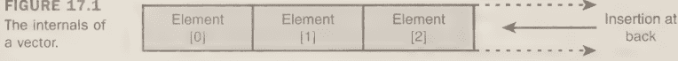

| 元素 [0] | 元素 [1] | 元素 [2] | 在后端插入 |

使用 `std::vector` 类，请包含头文件：

```cpp
#include <vector>
```

## 典型的 Vector 操作

`std::vector` 类的行为规范和公共成员由 C++ 标准定义。因此，你在本节中将学习对 `vector` 的操作将由多种符合标准的 C++ 编程平台支持。

## 实例化 Vector

`vector` 是一个模板类，需要根据第 14 节“宏和模板介绍”中涵盖的模板实例化技术进行实例化。`vector` 的实例化需要指定你想在这个动态数组中收集的对象的类型。

```cpp
std::vector<int> dynIntArray; // 包含整数的 vector
std::vector<float> dynFloatArray; // 包含浮点数的 vector
std::vector<Tuna> dynTunaArray; // 包含金枪鱼的 vector
```

## 典型的 Vector 操作

要声明指向列表中元素的迭代器，你将使用
`std::vector<int>::const_iterator elementInVec;`

如果你需要一个可以用于修改值或调用非 const 函数的迭代器，你应使用 `iterator` 而不是 `const_iterator`。

鉴于 `std::vector` 具有几个重载的构造函数，你也可以选择实例化它应该开始的元素数量及其初始值，或者你可以使用另一个 `vector` 的整体。列表 17.1 展示了几种实例化方式。

### 列表 17.1 实例化 std::vector 的不同形式：指定大小、初始值和从另一个拷贝

```cpp
0: #include <vector>
1: int main ()
2: {
3:   // 整数 vector
4:   std::vector<int> integers;
5:
6:   // 使用 C++11 列表初始化 vector
7:   std::vector<int> initVector(10, -1);
8:
9:   // 实例化一个有10 个元素的 vector（它仍然可以增长）
10:  std::vector<int> tenElements(10);
11:
12:  // 实例化一个有10 个元素的 vector，每个初始化为 0
13:  std::vector<int> tenElemInit(10, 0);
14:
15:  // 将 vector 初始化为另一个的内容
16:  std::vector<int> copyVector(tenElemInit);
17:
18:  // 使用迭代器从另一个初始化为 5 个元素的 vector
19:  std::vector<int> partialCopy(tenElements.cbegin(), tenElements.cbegin());
```

在一种形式中，你可以指定元素插入到序列中的位置：
// 在开头插入一个元素
`integers.insert(integers.begin(), 25);`

在另一种形式中，你可以指定位置以及需要插入的具有特定值的元素数量：
// 在末尾插入 2 个值为 45 的元素
`integers.insert(integers.end(), 2, 45);`

你还可以在选定的位置将一个 `vector` 的内容插入另一个 `vector`：
// 另一个包含 2 个值为 30 元素的 vector
`vector <int> another(2, 30);`

// 在位置 [1] 处从另一个容器插入两个元素
`integers.insert(integers.begin() + 1, another.begin(), another.end());`

你使用迭代器（通常由 `begin()` 或 `end()` 返回）来告诉 `insert()` 函数你想要放置新元素的位置。

> 提示：注意该迭代器也可以是 STL 算法的返回值，例如 `std::find()` 函数，它可以用于找到一个元素并在该位置插入另一个元素（插入会将会将找到的元素向后移动）。像 `find()` 这样的算法将在第 23 节“STL 算法”中讨论。

这些 `vector::insert()` 的形式在列表 17.3 中演示。

# 列表 17.3 使用 vector::insert 函数在设定位置插入元素

```
0: #include <vector>
1: #include <iostream>
2: using namespace std;
3: 
4: void DisplayVector(const vector<int>& inVec)
5: {
6:   for (auto element = inVec.cbegin();
7:     element != inVec.cend();
8:
    ++ element )
9:
    cout << *element << ' ' ;
10:
11:
    cout << endl;
12:
}
13:
14:
    int main ()
15:
    {
16:
    // 实例化一个包含 4 个元素的 vector，每个元素初始化为 90
17:
    vector<int> integers(4, 90);
18:
19:
    cout << "The initial contents of the vector: ";
20:
    DisplayVector(integers);
21:
    // 在开头插入 25
22:
    integers.insert(integers.begin(), 25);
23:
    // 在末尾插入 2 个值为 45 的数字
24:
    integers.insert(integers.end(), 2, 45);
25:
    cout << "Vector after inserting elements at beginning and end: ";
26:
    DisplayVector(integers);
27:
    // 另一个包含 2 个值为 30 元素的 vector
    vector<int> another(2, 30);
```


29:
```
// 在位置 [1] 处从另一个容器插入两个元素
```
30:
```
integers.insert(integers.begin() + 1,
another.begin(), another.end());
```
31:
```
cout << "Vector after inserting contents from another vector: ";
```
32:
```
cout << "in the middle:" << endl;
```
33:
```
DisplayVector(integers);
```
34:
```
return 0;
}
```

## 输出
The initial contents of the vector: 90 90 90 90
Vector after inserting elements at beginning and end: 25 90 90 45 45
Vector after inserting contents from another vector: in the middle: 25 30 90 90 45

## 分析
这段代码演示了 `insert()` 函数的强大之处，它允许你将值放在容器的中间。第 17 行中的 `vector` 包含四个元素，且都初始化为 90。以这个 `vector` 为起点，我们使用了多种形式的 `vector::insert()` 成员函数。在第 23 行中，你在开头添加了一个元素。第 26 行在末尾添加了两个值为 45 的元素。第 35 行演示了如何将元素从一个 `vector` 插入到另一个 `vector` 的中间（在本例中，即是偏移量为 1 的第二个位置）。尽管 `vector::insert()` 是一个多功能函数，但 `push_back()` 应该是你向 `vector` 添加元素的首选方式。这是因为当在非末尾位置添加元素时，`insert()` 是一种向 `vector` 添加元素的低效方式，因为在开头或中间添加元素会导致 `vector` 的所有后续元素向后移动（为末尾元素留出空间）。因此，取决于序列中包含的对象的类型，这种移动操作在拷贝构造函数或拷贝赋值运算符方面的代价可能是巨大的。在我们的小示例中，`vector` 包含的是 `int` 对象，移动这些对象的代价相对廉廉。在 `vector` 类的许多其他用法中可能并非如此。

> 如果你的容器需要在中间频繁插入，理想情况下你应该选择 `std::list`，这在第 18 节“STL list 和 forward_list”中进行了解释。

## 使用数组语义访问 vector 中的元素
可以通过以下方法访问 `vector` 中的元素：通过使用下标运算符 `[]` 的数组语义、使用成员函数 `at()`，或使用迭代器。

列表 17.1 显示了如何创建一个初始化为 10 个元素的 `vector` 实例：

```
std::vector<int> tenElements(10);
```

你可以使用类数组语法访问并设置单个元素：

```
tenElements[3] = 2011; // 设置第 4 个元素
```

列表 17.4 演示了如何使用下标运算符 `[]` 访问 `vector` 中的元素。

### 列表 17.4 使用数组语义访问 vector 中的元素
```cpp
#include <iostream>
#include <vector>
int main () {
    using namespace std;
    vector<int> integers{50, 1, 987, 1001};
    for (size_t index = 0; index < integers.size(); ++index) {
        cout << "Element[" << index << "] = " << integers[index] << endl;
    }
    int integers_arr[2];
    integers_arr[2] = 2011; // 修改第 3 个元素的值
    cout << "After replacement: " << endl;
    cout << "Element[2] = " << integers_arr[2] << endl;
    return 0;
}
```

## 输出
Element[0] = 50
Element[1] = 1
Element[2] = 987
Element[3] = 1001
After replacement:
Element[2] = 2011

## 分析
在第 11、14 和 16 行，`vector` 被用于像使用静态数组那样的通过 `vector` 的下标运算符 `[]` 来访问和分配元素。该下标运算符接收从 0 开始计算的元素索引，就像静态数组一样。注意第 15 行中编写的 `for` 循环通过与 `vector::size()` 比较，确保索引不会超过 `vector` 的边界。

# 第 17 节：STL 动态数组类

## 警告
使用 `[]` 访问 `vector` 中的元素与访问数组具有相同的危险；即你不应该超过容器的边界。如果你使用下标运算符 `[]` 访问超出边界的 `vector` ，结果是未定义的。更安全的替代方案是使用 `at()` 函数，它会对大小进行运行时检查，并在越界时抛出异常。

## 使用指针语义访问 vector 中的元素
你也可以通过使用迭代器以指针语义访问 `vector` 中的元素，如 17.5 所示。

### 列表 17.5 使用指针语义（迭代器）访问 vector 中的元素
```cpp
#include <iostream>
#include <vector>
int main () {
    using namespace std;
    vector<int> integers{50, 1, 987, 1001};
    vector<int>::const_iterator element = integers.cbegin();
    while (element != integers.end()) {
        size_t index = distance(integers.cbegin(), element);
        cout << "Element at position ";
        cout << index << " is: " << *element << endl;
        ++ element;
    }
    return 0;
}
```

# 第 17 ：STL 动态数组类
```cpp
4: template <typename T>
5: void DisplayVector(const vector<T>& inVec)
6: {
7:   for (auto element = inVec.cbegin(); // auto 和 cbegin 是 C++11
8:     element != inVec.cend()) // cend 是 C++11 新引入的
9:     ++element
10:  cout << *element << ' ';
11:
12:  cout << endl;
13: }
14:
15: int main()
16: {
17:   vector<int> integers;
18:
19:   // 将示例整数插入 vector：
20:   integers.push_back(50);
21:   integers.push_back(1);
22:   integers.push_back(987);
23:   integers.push_back(1001);
24:
25:   cout << "Vector contains " << integers.size() << " elements: ";
26:   DisplayVector(integers);
27:
28:   # 删除末尾的一个元素
29:   integers.pop_back();
30:
31:   cout << "After a call to pop_back()" << endl;
32:   cout << "Vector contains " << integers.size() << " elements: ";
33:   DisplayVector(integers);
34:
35:   return 0;
36: }
```

# 输出 ▼
Vector contains 4 elements: 50 1 987 1001
After a call to pop_back()
Vector contains 3 elements: 50 1 987

# 分析 ▼
输出表明，第 29 行使用的 `pop_back()` 函数通过删除最后插入的元素减少了 `vector` 中的元素数量。第 32 行再次调用了 `size()`，以证明 `vector` 中的元素数量已减少了一个，如输出所示。

## 理解大小（Size）和容量（Capacity）的概念
第 4–13 行中的 `DisplayVector()` 函数在列表 17.6 中采用了模板形式，而与列表 17.3 相比，后者仅接受整数类型的 `vector`。这帮助我们可以将此模板函数重用为 `float` 类型的 `vector`（而不是 `int`）：

```cpp
vector <float> vecFloats;
DisplayVector(vecFloats); // 正常工作，作为一个泛型函数
```

这种泛型 `DisplayVector()` 还可以支持任何具有返回值计数运算符的类 `vector`。

注意

## 理解大小（Size）和容量（Capacity）的概念
`vector` 的大小（size）是存储在 `vector` 中的元素数量。`vector` 的容量（capacity）是在其重新分配内存以容纳更多元素之前，可能存储的元素总数。因此，`vector` 的大小小于或等于其容量。

你可以通过调用 `size()` 查询 `vector` 的元素数量：

```cpp
cout << "Size: " << integers.size();
```

或者通过调用 `capacity()` 查询其容量：

```cpp
cout << "Capacity: " << integers.capacity() << endl;
```

当 `vector` 需要频繁重新分配内部动态数组的内存时，可能会引起性能问题。在很大程度上，这个问题可以通过使用成员函数 `reserve(number)` 来解决。`reserve()` 本质上是增加为 `vector` 内部数组分配的内存量，以便容纳指定数量的元素无需重新分配。取决于存储在 `vector` 中的对象类型，减少重新分配次数也会减少对象拷贝的次数并节省性能。列表 17.7 中的代码示例演示了 `size()` 和 `capacity()` 的区别。

### 列表 17.7 size() 和 capacity() 的演示
```cpp
0: #include <iostream>
1: #include <vector>
2:
3: int main ()
4: {
5:     using namespace std;
6:
7:     // 实例化包含 5 个整数的 vector 对象
8:     vector<int> integers (5);
9:
10: cout << "Vector of integers was instantiated with " << endl;
11: cout << "Size: " << integers.size();
12: cout << \
```

# 输出 ▼
Vector of integers was instantiated with
Size: 5, Capacity: 5
After inserting an element...
Size: 6, Capacity: 7
After inserting another element...
Size: 7, Capacity: 7

# 分析 ▼
第 8 行显示实例化包含五个整数的 `vector`。第 11 行和第 12 行分别显示了 `vector` 的大小和容量，在实例化两者是相等的。第 9 行插入了第六个元素。由于插入前 `vector` 的容量为五，内部缓冲区内存不足以支持这个第六个元素。也就是说，`vector` 要扩展到六个元素，就需要重新分配内部缓冲区。重新分配逻辑非常智能——在插入另一个元素之前，预先分配了大于要求的容量。输出显示，在容量为五的 `vector` 插入六个元素时，重新分配将容量增加了七。`size()` 始终反映 `vector` 中的元素数量，在此阶段为六。第 22 行添加第七个元素没有增加容量——现有分配内存满足需求。当 `vector` 使用到满容量时，插入下一个元素会导致其重新分配内部缓冲区。`vector` 重新分配时的容量增加不受 C++ 标准规定。这种级别的性能优化取决于 STL 库的实现。

注意

# STL deque 类
`deque`（读音同 deck）是一种 STL 动态数组类，其属性与 `vector` 非常相似，允许在数组的头部和末尾插入和删除元素。你可以这样实例化一个 `deque`：

```cpp
// 定义一个整数 deque
std::deque<int> intDeque;
```

提示
使用 `std::deque` 需要包含 `<deque>`：
`deque` 可以如图 17.2 所示。`deque` 与 `vector` 的相似之处在于它支持使用 `push_front()` 和 `pop_front()` 函数在头部插入和删除。就像 `vector` 一样，它还允许使用 `push_back()` 和 `pop_back()` 在末尾插入元素，如列表 17.8 实例化 STL `deque` 所示。

```cpp
0:#include <deque>
1:#include <iostream>
2:#include <algorithm>
3:
4:int main ()
5:{
6:     using namespace std;
7:
8:// 定义一个整数 deque
9:deque<int> intDeque;
10:
11// 在数组末尾插入整数
12:intDeque.push_back(3);
13:intDeque.push_back(4);
14:intDeque.push_back(5);
15:
16// 在数组头部插入整数
17:intDeque.push_front(2);
18:intDeque.push_front(1);
19:intDeque.push_front(0);
20:
21:cout << "The Contents of the deque after inserting elements ";
22:at the top and bottom are:" << endl;
23:
24// 在屏幕上显示内容
25:for (size_t count = 0;count < intDeque.size(); count++)
26:{
27:   cout << "Element [" << count << "] = " << intDeque[count] << endl;
28:}
29:
30// 在头部删除元素
31:intDeque.pop_front();
32:
33// 在末尾删除元素
34:intDeque.pop_back();
35:
36:cout << "The contents of the deque after erasing an element ";
37:from the top and bottom are:" << endl;
38:
39// 再次显示内容：这次使用迭代器
40// 如果编译器不支持，请移除 auto 并注释下一行
41:deque<int>::iterator element;
42:for (auto element = intDeque.begin();
43:     element != intDeque.end())
44:     ++ element
45:{
46:     size_t Offset = distance(intDeque.begin(), element);
47:     cout << "Element [" << Offset << "] = " << element << endl;
48:}
49:
50:   return 0;
51:}
```

# 输出 ▼
在头部和末尾插入元素后 deque 的内容是：
Element [0] = 0
Element [1] = 1
Element [2] = 2
Element [3] = 3
Element [4] = 4
Element [5] = 5
在头部和末尾删除元素后，deque 的内容是：
Element [0] = 1
Element [1] = 2
Element [2] = 3
Element [3] = 4

# 第 17 Lesson：STL 动态数组类
这使得 `deque` 与 `vector` 相比具有独特性。对于 `pop_front()` 的用法也是如此，如第 36 行所示。第 25–33 行中显示 `deque` 内容的第一种机制使用了类数组语法来访问元素，而第 47–53 行演示了迭代器的用法。第 51 行使用了算法 `std::distance()` 来评估元素在 `deque` 中的偏移位置，其实现方式与你已经在列表 17.5 中看到的对 `vector` 的操作相同。

提示
当内需要清空如 `vector` 或 `deque` 之类的 STL 容器时（即删除其中包含的所有元素），你将使用成员函数 `clear()`。

以下代码删除了列表 17.7 中 `vector integers` 的所有元素：
```
integers.clear();
```


要删除列表 17.8 中 `deque` `intDeque` 的所有元素，请添加代码：

```
intDeque.clear();
```

请注意，`vector` 和 `deque` 也都有一个名为 `empty()` 的成员函数，当容器为空时它返回 `true`。它并不会像 `clear` 那样实际删除现有元素。

```
intDeque.clear();
if (intDeque.empty())
cout << "The container is now empty" << endl;
```

| 应该 (DO) | 避免 (DON'T) |
|---|---|
| 当你不知道需要存储的元素数量时，使用动态数组 `vector` 或 `deque`。 | 不要忘记函数 `pop_back()` 会从集合中删除最后一个元素。 |
| 记住 `vector` 只能通过 `push_back()` 函数在末端进行增长。 | 不要忘记函数 `pop_front()` 会从 `deque` 中删除第一个元素。 |
| 记住 `deque` 可以通过 `push_back()` 和 `push_front()` 函数在两端进行增长。 | 不要访问超出边界的动态数组。 |

## 总结

在本节中，你学习了将 `vector` 和 `deque` 作为动态数组使用的的基础知识。文中解释了大小（size）和容量（capacity）的概念，并让你看到了如何优化 `vector` 的用法以减少其内部缓冲区的重新分配次数，重新分配会拷贝其中包含的对象并可能降低性能。`vector` 是 STL 容器中最简单的一种，但也是最常用的，可以说是效率最高的。

## 问答

- * `vector` 会改变存储在内部的元素的顺序吗？*

- * `vector` 是顺序容器，元素按照它们插入的顺序进行存储和访问。*

- * 使用什么函数向 `vector` 插入项？对象插入在哪里？*

- * 成员函数 `push_back()` 将元素插入到 `vector` 的末尾。*

- * 使用什么函数获取 `vector` 中存储的元素数量？*

- * 成员函数 `size()` 返回 `vector` 中存储的元素数量。这对于所有 STL 容器都是如此。*

- * 如果 `vector` 包含更多元素，在 `deque` 末尾插入或删除元素需要时间吗？*

- *不需要。在 `deque` 末尾插入和删除元素是常时间操作。*

- * 使用 `reserve()` 成员函数的优势是什么？*

- * `reserve()` 在 `vector` 的内部缓冲区中分配空间，元素的插入不需要 `vector` 重新分配缓冲区并拷贝现有内容。根据 `vector` 中存储对象的性质，在 `vector` 中预留空间可以提高性能。*

- * 在插入元素方面 `deque` 的属性与 `vector` 有何不同？*

- *没有，在插入方面 `deque` 的属性与 `vector` 相似，对于添加到序列末尾的元素是常时间操作，对于插入到中间的元素是线性时间操作。然而，`vector` 只允许在一端（底部）插入，而 `deque` 允许端（顶部和底部）插入。*

## 工作坊

工作坊包含测验题，帮助你巩固对涵盖内容的理解，并提供使用所学知识的练习。在检查附录 E 中的答案之前，尝试回答测验和练习题，并在进入下一节之前确保你已经理解了这些答案。

## 测验

- 1. 可以在常时间内在 `vector` 的中间或开头插入元素吗？

2. 我的 `vector` 返回的 `size()` 为 10，`capacity()` 为 20。在不触发 `vector` 类重新分配的情况下，我还能插入多少个元素？

3. `pop_back()` 执行什么？

4. 如果 `vector <int>` 是整数的动态数组，那么 `vector <float>` 是什么类型的动态数组？

5. `vector` 中的元素可以随机访问吗？如果可以，如何访问？

6. 哪种迭代器类型允许对 `vector` 中的元素进行随机访问？

## 练习题

- 1. 编写一个交互式程序，接受用户的整数输入并将其保存在 `vector` 中。用户应该能够随时查询存储在 `vector` 中的值。

2. 扩展练习 1 中的程序，能够告诉用户某个值已存在于 `vector` 中。

3. 编写一个程序，你可以在其中输入文章的尺寸，将它们存储在 `vector` 中并在屏幕上打印出来。

4. 编写一个应用程序，将 `deque` 初始化为以下字符串："Hello", "Containers are cool" 和 "C++ is evolving!"。使用泛函数显示它们。

# 第 18 Lesson：STL list 和 forward_list

标准模板库 (STL) 以模板类 `std::list` 的形式为程序员提供了双向链表。链表的主要优势是能够以快速的常时间插入和删除元素。从 C++11 开始，你还可以使用单向链表。

在本节中，学习

- 如何实例化 `list` 和 `forward_list`

- 如何使用 `list` 容器，包括插入和删除

# std::list 的特性

链表是节点的集合，每个节点按照插入顺序连接到上一个节点，如图 18.1 所示。

`list` 类的实现允许在顶部、底部或中间进行常时间操作。

提示

使用 STL `list` 类需要包含头文件：`#include <list>`

# 基础 list 操作

要使用 `list` 类需要包含头文件：`#include <list>`。`list` 类的实现提供了多种重载构造函数，你可以创建包含特定数量或值的列表。

# 实例化 std::list

`list` 的模板实例化指定你想要收集的类型，因此初始化列表的方式如下：

```cpp
#include <list>
#include <vector>

int main ()
{
  using namespace std;

  // 实例化一个空列表
  list<int> lists;

  // 实例化一个包含 10 个整数的列表
  list<int> listWith10Integers(10);

  // 实例化一个包含 4 个 99 整数的列表
  list<int> listWith4IntegerEach(99, 99);

  // 创建现有列表的精确拷贝
  list<int> listCopyAnother(listWith4IntegerEach);

  // 一个包含 10 个 2017 整数的 vector
vector<int> vecIntegers(10, 2017);

  // 使用另一个容器的值实例化列表
  list<int> listContainsCopyOfAnother(vecIntegers.begin(), vecIntegers.end());

  return 0;
}
```

# 分析 ▼

该程序没有输出，并演示了各种重载构造函数在创建整数列表的应用。在第 8 行中你创建了一个空列表，而在第 11 行中你创建一个包含 10 个整数的列表。第 14 行是一个名为 `listWith4IntegerEach99` 的列表，它包含 4 个每个初始化为值 99 的整数。第 17 行演示了创建一个与另一个内容精确拷贝的列表。第 20–24 行令人惊讶且好奇！你实例化了一个包含 10 个每个值为 2017 的整数的 vector，然后在第 23 行实例化了一个包含从 vector 拷贝元素的列表，使用了 `vector::begin()` 和 `vector::cend()`（C++11 新增）的常量迭代器。

通过将列表 18.1 与第 17 节“STL 动态数组类”中的列表 17.1 进行比对，你会注意到不同类型容器的实例化方式存在一种显著的模式和相似性。你越频繁地使用 STL 容器，看到的可重用模式就越多，操作也会变得越容易。

## 在列表的前部或尾插入元素

与 deque 类似，在前端（或顶部，取决于你的视角）插入是使用 list 成员方法 `push_front()` 实现的。在末尾插入则使用成员方法 `push_back()` 完成。这两个方法接受一个输入参数，即即要插入的值：

```
linkInts.push_back(-1);
linkInts.push_front(2001);
```

列表 18.2 展示了在整数列表上使用这两个方法的效果。

## 列表 18.2 使用 push_front() 和 push_back() 在列表中插入元素

```cpp
0: #include <list>
1: #include <iostream>
2: using namespace std;
3:
4: template <typename T>
5: void DisplayContents(const T& container)
6: {
7:   for (auto element = container.begin();
8:     element != container.end();
9:     ++ element )
10:    cout << *element << ' ';
11:
12:   cout << endl;
13: }
14:
15: int main ()
16: {
17:   list<int> linkInts(-101, 42);
18:
19:   linkInts.push_front(10);
20:   linkInts.push_front(2011);
21:   linkInts.push_back(-1);
22:   linkInts.push_back(9999);
24:    DisplayContents(linkInts);
25:
26:    return 0;
27: }
```

## 输出 ▼

2011 10 -101 42 -1 9999

## 分析 ▼

第 17 行展示了针对 `int` 类型的 list 模板实例化，并使用 C++11 列表初始化语法 `{...}` 来确保 `linkInts` 使用两个整数 (-101) 进行构造；第 19–22 行演示了 `push_front()` 和 `push_back()` 的用法。作为 `push_front()` 参数提供的值将占据列表的第一个位置，而 `push_back()` 则占据最后一个位置。输出通过泛型模板函数 `DisplayContents()` 显示了列表的内容，并监控了插入元素的顺序（证明了它们并不是按照插入顺序存储的）。

列表 18.2 中第 4–13 行的 `DisplayContents()` 是列表 17.6 中 `DisplayVector()` 方法的更具通用性的版本（注意参数列表发生了变化）。尽管后者仅适用于 `vector`（尽管它泛化了在其中存储的元素类型），但这在跨容器类型时是真正的通用的。

你可以使用 `vector`、`list` 或 `deque` 作为参数调用列表 18.2 中的 `DisplayContents()` 版本，它将运行得良好。

注意

## 在列表中间插入元素

`std::list` 的特点是能够在常数时间内在集合中间插入元素。这是通过使用成员函数 `insert()` 完成的。

`list::insert()` 成员函数有形式：

- 形式 1

  `iterator insert(iterator pos, const T& x)`

`insert` 函数接受插入位置作为第一个参数，接受要插入的值作为第二个参数。该函数返回一个指向列表中最近插入元素的迭代器。

## 第 18 节：STL list 和 forward_list

- 形式 2

```cpp
void insert(iterator pos, size_type n, const T& x)
```

此函数接受插入位置作为第一个参数，要插入的值作为最后一个参数，以及变量 `n` 中的元素数量。

- 形式 3

```cpp
template <class InputIterator>
void insert(iterator pos, InputIterator f, InputIterator last)
```

此重载变是一个模板函数，除了位置外，它还接受两个标记插入集合边界的迭代器。注意 `InputIterator` 是一个模板参数化类型，因此它可以指向任何集合的边界——数组、vector 或另一个 list。列表 18.3 演示了这些 `list::insert()` 函数重载变体的用法。

## 列表 18.3 在列表中插入元素的各种方法

```cpp
0: #include <list>
1: #include <iostream>
2: using namespace std;
3:
4: template <typename T>
5: void DisplayContents(const T& container)
6: {
7:   for (auto element = container.begin();
8:     element != container.end();
9:     ++ element )
10:    cout << *element << ' ';
11:
12:   cout << endl;
13: }
14:
15: int main ()
16: {
17:   list<int> linkInts;
18:
19:   // 在开头插入元素...
20:   linkInts.insert(linkInts.begin(), 2);
21:   linkInts.insert(linkInts.begin(), 1);
22:
23:   // 在末尾插入一个元素...
24:   linkInts.insert(linkInts.end(), 3);
25:
26:   cout << "插入后 list 1 的内容：" << endl;
27:   DisplayContents(linkInts);
28:
29:   list<int> linkInt2;
30:
31:   // 插入 4 个相同值 0 的元素...
32:   linkInt2.insert(linkInt2.begin(), 4, 0);
33:
34:   cout << "插入后 list 2 的内容，";
35:   cout << linkInt2.size() << " 个值为该值的元素：" << endl;
36:   DisplayContents(linkInt2);
37:
38:   list<int> linkInt3;
39:
40:   // 在开头从另一个 list 插入元素...
41:   linkInt3.insert(linkInt3.begin(),
42:   linkInt1.begin(), linkInt1.end());
43:
44:   cout << "插入后 list 3 的内容：" << endl;
45:   DisplayContents(linkInt3);
...
```

由于原文文本在 18.3 列表处逻辑较为复杂且包含不完整代码，以下为完整的 18.3 列表代码翻译内容：

```cpp
0: #include <list>
1: #include <iostream>
2: using namespace std;
3:
4: template <typename T>
5: void DisplayContents(const T& container)
6: {
7:   for (auto element = container.begin();
8:     element != container.end();
9:     ++ element )
10:    cout << *element << ' ';
11:
12:   cout << endl;
13: }
14:
15: int main ()
16: {
17:   list<int> linkInts;
18:
19:   // 在开头插入元素...
20:   linkInts.insert(linkInts.begin(), 2);
21:   linkInts.insert(linkInts.begin(), 1);
22:
23:   // 在末尾插入一个元素...
24:   linkInts.insert(linkInts.end(), 3);
25:
26:   cout << "插入后 list 1 的内容：" << endl;
27:   DisplayContents(linkInts);
28:
29:   list<int> linkInt2;
30:
31:   // 插入 4 个相同值 0 的元素...
32:   linkInt2.insert(linkInt2.begin(), 4, 0);
33:
34:   cout << "插入后 list 2 的内容，";
35:   cout << linkInt2.size() << " 个值为该值的元素：" << endl;
36:   DisplayContents(linkInt2);
37:
38:   list<int> linkInt3;
39:
40:   // 在开头从另一个 list 插入元素...
41:   linkInt3.insert(linkInt3.begin(),
42:   linkInt1.begin(), linkInt1.end());
43:
44:   cout << "插入后 list 3 的内容：" << endl;
45:   DisplayContents(linkInt3);
...
```


通过将列表 18.1 与第 17 节“STL 动态数组类”中的列表 17.1 进行比对，你会注意到不同类型容器的实例化方式存在一种显著的模式和相似性。你越频繁地使用 STL 容器，看到的可重用模式就越多，操作也会变得越容易。

## 在列表的前部或尾插入元素

与 `deque` 类似，在前端插入是使用 `list` 成员方法 `push_front()` 实现的。在末尾插入则使用成员方法 `push_back()`。这两个方法接受一个输入参数，即要插入的值：

```
linkInts.push_back(-1);
linkInts.push_front(2001);
```

列表 18.2 展示了在整数列表上使用这两个方法的效果。

### 列表 18.2 使用 `push_front()` 和 `push_back()` 在列表中插入元素

```cpp
0: #include <list>
1: #include <iostream>
2: using namespace std;
3:
4: template <typename T>
5: void DisplayContents(const T& container)
6: {
7:   for (auto element = container.begin();
8:     element != container.end();
9:     ++ element )
10:    cout << *element << ' ';
11:
12:   cout << endl;
13: }
14:
15: int main ()
16: {
17:   list<int> linkInts(-101, 42);
18:
19:   linkInts.push_front(10);
20:   linkInts.push_front(2011);
21:   linkInts.push_back(-1);
22:   linkInts.push_back(9999);
24:    DisplayContents(linkInts);
25:
26:    return 0;
27: }
```

### 输出

2011 10 -101 42 -1 9999

### 分析

第 17 行展示了针对 `int` 类型的 `list` 模板实例化，并使用 C++11 列表初始化语法 `{...}` 来确保 `linkInts` 使用两个整数 (-101) 进行构造；第 19–22 行演示了 `push_front()` 和 `push_back()` 的用法。作为 `push_front()` 参数提供的值将占据列表的第一个位置，而 `push_back()` 则占据最后一个位置。输出通过泛型模板函数 `DisplayContents()` 显示了列表的内容，并监控了插入元素的顺序。

列表 18.2 中第 4–13 行的 `DisplayContents()` 是列表 17.6 中 `DisplayVector()` 方法的更具通用性的版本。尽管后者仅适用于 `vector`，但这在跨容器类型时是真正的通用的。

你可以使用 `vector`、`list` 或 `deque` 作为参数调用列表 18.2 中的 `DisplayContents()` 版本，它将运行得良好。

> 注意

## 在列表中间插入元素

`std::list` 的特点是能够在常数时间内在集合中间插入元素。这是通过使用成员函数 `insert()` 完成的。

`list::insert()` 成员函数有三种形式：

- 形式 1

  `iterator insert(iterator pos, const T& x)`

`insert` 函数接受插入位置作为第一个参数，接受要插入的值作为第二个参数。该函数返回一个指向列表中最近插入元素的迭代器。

### 第 18 节：STL list 和 forward_list

- 形式 2

```cpp
void insert(iterator pos, size_type n, const T& x)
```

此函数接受插入位置作为第一个参数，要插入的值作为最后一个参数，以及变量 `n` 中的元素数量。

- 形式 3

```cpp
template <class InputIterator>
void insert(iterator pos, InputIterator f, InputIterator last)
```

此重载变是一个模板函数，除了位置外，它还接受两个标记插入集合边界的迭代器。注意 `InputIterator` 是一个模板参数化类型，因此它可以指向任何集合的边界——数组、`vector` 或另一个 `list`。列表 18.3 演示了这些 `list::insert()` 函数重载变体的用法。

### 列表 18.3 在列表中插入元素的各种方法

```cpp
0: #include <list>
1: #include <iostream>
2: using namespace std;
3:
4: template <typename T>
5: void DisplayContents(const T& container)
6: {
7:   for (auto element = container.begin();
8:     element != container.end();
9:     ++ element )
10:    cout << *element << ' ';
11:
12:   cout << endl;
13: }
14:
15: int main ()
16: {
17:   list<int> linkInts;
18:
19:   // 在开头插入元素...
20:   linkInts.insert(linkInts.begin(), 2);
21:   linkInts.insert(linkInts.begin(), 1);
22:
23:   // 在末尾插入一个元素...
24:   linkInts.insert(linkInts.end(), 3);
25:
26:   cout << "插入后 list 1 的内容：" << endl;
27:   DisplayContents(linkInts);
28:
29:   list<int> linkInt2;
30:
31:   // 插入 4 个相同值 0 的元素...
32:   linkInt2.insert(linkInt2.begin(), 4, 0);
33:
34:   cout << "插入后 list 2 的内容，";
35:   cout << linkInt2.size() << " 个值为该值的元素：" << endl;
36:   DisplayContents(linkInt2);
37:
38:   list<int> linkInt3;
39:
40:   // 在开头从另一个 list 插入元素...
41:   linkInt3.insert(linkInt3.begin(),
42:   linkInt1.begin(), linkInt1.end());
43:
44:   cout << "插入后 list 3 的内容：" << endl;
45:   DisplayContents(linkInt3);
```

```cpp
linkInts.erase(linkInts.begin(), linkInts.end());
cout << "Number of elements after erasing range: ";
cout << linkInts.size() << endl;
return 0;
```

### 输出

列表初始内容：

2 4 5 -1 2017

删除元素 '2' 后：

4 3 5 -1 2017

删除范围后的元素数量: 0

### 分析

如第 20 行所示，`insert()` 被用于插入一个值，它返回一个指向新插入元素的迭代器。该迭代器指向一个值为 2 的元素，并存储在变量 `val2` 中，稍后在第 26 行调用 `erase()` 时使用，以从列表中删除该元素。第 29 行演示了如何使用 `erase()` 删除一个范围的元素。你清除了从 `begin()` 到 `end()` 的范围，这实际上是删除了整个列表。

| 删除任何如 `std::list` 的 STL 容器最短且最简单的方法是调用成员函数 `clear()`。 |

| 因此，列表 18.4 中更简单的第 29 行可以写为 |

| `linkInts.clear();` |

| 列表 18.4 在第 31 行演示了 `std::list` 中的元素数量可以使用列表方法 `size()` 来确定，这与 `vector` 非常相似。这种模式适用于所有 STL 容器类。 |

## 在列表中进行反转和排序元素

`list` 有一个特殊属性：尽管元素经过重新排列或插入了新元素，指向列表中元素的迭代器仍然有效。为了保持这一重要属性完好，`list` 函数将 `sort()` 和 `reverse()` 作为成员方法提供，尽管 STL 提供了这些算法，且这些算法确实可以对 `list` 类进行操作。这些算法的成员版本确保了当元素的相对位置被扰乱时，指向列表中元素的迭代器不会失效。

### 使用 `list::reverse()` 反转元素

`list` 具有一个成员函数 `reverse()`，它不接受参数，并能为程序员反转列表中内容的顺序：

```cpp
linkInts.reverse(); // 反转元素顺序
```

`reverse()` 的用法在列表 18.5 中进行了演示。

### 列表 18.5 反转列表中的元素

```cpp
0: #include <list>
1: #include <iostream>
2: using namespace std;
3: 
4: template <typename T>
5: void DisplayContents(const T& container)
6: {
7:   for (auto element = container.begin();
8:       element != container.end();
9:       ++ element )
10:     cout << "element " << ' ';
11: 
12:  cout << endl;
13: }
14: 
15: int main()
16: {
17:   std::list<int> linkInts(0, 1, 2, 3, 4, 5);
18: 
19:   cout << "Initial contents of list:" << endl;
20:   DisplayContents(linkInts);
21: 
22:   linkInts.reverse();
23: 
24:   cout << "Contents of list after using reverse():" << endl;
25:   DisplayContents(linkInts);
26: 
27:   return 0;
28: }
```

### 输出

列表初始内容：

0 1 2 3 4 5

使用 `reverse()` 后的列表内容：

5 4 3 2 1 0

### 分析

如第 22 行所示，`reverse()` 简单地反转了列表中元素的顺序。这是一个不带参数的简单调用，确保了如果程序员保留了指向列表中元素的迭代器，它们在反转后仍然有效。

## 排序元素

`list` 成员函数 `sort()` 有一个不接受参数的版本可用：

`linkInts.sort(); // 按升序排序`

另一个版本允许你通过二元谓词函数作为参数来定义你自己的排序优先级：

```cpp
bool SortPredicate_Descending (const int& lhs, const int& rhs)
{
  // 定义 list::sort 的标准：对于期望的顺序返回 true
  return (lhs > rhs);
}
// 使用谓词排序列表：
linkInts.sort(SortPredicate_Descending);
```

这两个变体在列表 18.6 中均得到了演示。

### 列表 18.6 按升序和降序排序整数列表

`list::sort()`

```cpp
0: #include <list>
1: #include <iostream>
2: using namespace std;
3:
4: bool SortPredicate_Descending (const int& lhs, const int& rhs)
5: {
6:   // 定义 list::sort 的标准：对于期望的顺序返回 true
7:   return (lhs > rhs);
8: }
9:
```

```cpp
10: template <typename T>
11: void DisplayContents(const T& container)
12: {
13:   for (auto element = container.begin();
14:     element != container.end();
15:       ++element
16: 
17:       cout << *element << ' ';
18:   cout << endl;
19: }
20: 
21: int main()
22: {
23:   list<int> linkInts{0, -1, 2, 3, 4, 5};
24: 
25:   cout << "Initial contents of list:" << endl;
26:   DisplayContents(linkInts);
27: 
28:   linkInts.reverse();
29: 
30:   cout << "Contents of list after using reverse():" << endl;
31:   DisplayContents(linkInts);
32: 
33:   linkInts.sort();
34: 
35:   cout << "Contents of list after sort():" << endl;
36:   DisplayContents(linkInts);
37: 
38:   linkInts.sort(SortPredicate_Descending);
39: 
40:   cout << "Contents of list after sort with predicate:" << endl;
41:   DisplayContents(linkInts);
42: 
43:   return 0;
44: }
```

### 输出

列表初始内容：

0 -1 2 3 4 5

使用 `reverse()` 后的列表内容：

5 4 3 2 -1 0

使用 `sort()` 后的列表内容：

-1 0 2 3 4 5

带谓词 `sort` 后的列表内容：

5 4 3 2 0 -1

### 分析

如第 22 行所示，`reverse()` 简单地反转了列表中元素的顺序。这是一个不带参数的简单调用，确保了如果程序员保留了指向列表中元素的迭代器，它们在反转后仍然有效。


```cpp
10: template <typename T>
11: void DisplayContents(const T& container)
12: {
13:   for (auto element = container.begin();
14:     element != container.end();
15:       ++element
16: 
17:       cout << *element << ' ';
18:   cout << endl;
19: }
20: 
21: int main()
22: {
23:   list<int> linkInts{0, -1, 2, 3, 4, 5};
24: 
25:   cout << "Initial contents of list:" << endl;
26:   DisplayContents(linkInts);
27: 
28:   linkInts.reverse();
29: 
30:   cout << "Contents of list after using reverse():" << endl;
31:   DisplayContents(linkInts);
32: 
33:   linkInts.sort();
34: 
35:   cout << "Contents of list after sort():" << endl;
36:   DisplayContents(linkInts);
37: 
38:   linkInts.sort(SortPredicate_Descending);
39: 
40:   cout << "Contents of list after sort with predicate:" << endl;
41:   DisplayContents(linkInts);
42: 
43:   return 0;
44: }
```

## 输出

列表初始内容：

0 -1 2 3 4 5

使用 `reverse()` 后的列表内容：

5 4 3 2 -1 0

使用 `sort()` 后的列表内容：

-1 0 2 3 4 5

带谓词 `sort` 后的列表内容：

5 4 3 2 0 -1

## 分析

如第 22 行所示，`reverse()` 简单地反转了列表中元素的顺序。这是一个不带参数的简单调用，确保了如果程序员保留了指向列表中元素的迭代器，它们在反转后仍然有效。

# 排序

`list` 成员函数 `sort()` 有一个不接受参数的版本可用：

`linkInts.sort();` // 按升序排序

另一个版本允许你通过二元谓词函数作为参数来定义你自己的排序优先级：

```cpp
bool SortPredicate_Descending (const int& lhs, const int& rhs)
{
  // 定义 list::sort 的标准：对于期望的顺序返回 true
  return (lhs > rhs);
}
// 使用谓词排序列表：
linkInts.sort(SortPredicate_Descending);
```

这两个变体在列表 18.6 中均得到了演示。

列表 18.6 按升序和降序排序整数列表

`list::sort()`

```cpp
0: #include <list>
1: #include <iostream>
2: using namespace std;
3:
4: bool SortPredicate_Descending (const int& lhs, const int& rhs)
5: {
6:   // 定义 list::sort 的标准：对于期望的顺序返回 true
7:   return (lhs > rhs);
8: }
9:
```

```cpp
linkInts.erase(linkInts.begin(), linkInts.end());
cout << "Number of elements after erasing range: ";
cout << linkInts.size() << endl;
return 0;
```

# 输出

列表初始内容：

2 4 5 -1 2017

删除元素 '2' 后：

4 3 5 -1 2017

删除范围后的元素数量: 0

# 分析

`insert()` 如第 20 行所示被用于插入一个值，它返回一个指向新插入元素的迭代器。该迭代器指向一个值为 2 的元素，并存储在变量 `val2` 中，稍后在第 26 行调用 `erase()` 时使用，以从列表中删除该元素。第 29 行演示了如何使用 `erase()` 删除一个范围的元素。你清除了从 `begin()` 到 `end()` 的范围，这实际上是删除了整个列表。

| 删除任何如 `std::list` 的 STL 容器最短且最简单的方法是调用成员函数 `clear()`。 |

| 因此，列表 18.4 中更简单的第 29 行可以写为 |

| `linkInts.clear();` |

| 列表 18.4 在第 31 行演示了 `std::list` 中的元素数量可以使用列表方法 `size()` 来确定，这与 `vector` 非常相似。这种模式适用于所有 STL 容器类。 |

# 在列表中进行反转和排序元素

`list` 有一个特殊属性：尽管元素经过重新排列或插入了新元素，指向列表中元素的迭代器仍然有效。为了保持这一重要属性完好，`list` 函数将 `sort()` 和 `reverse()` 作为成员方法提供，尽管 STL 提供了这些算法，且这些算法确实可以对 `list` 类进行操作。这些算法的成员版本确保了当元素的相对位置被扰乱时，指向列表中元素的迭代器不会失效。

# 使用 `list::reverse()` 反转元素

`list` 具有一个成员函数 `reverse()`，它不接受参数，并能为程序员反转列表中内容的顺序：

```cpp
linkInts.reverse(); // 反转元素顺序
```

`reverse()` 的用法在列表 18.5 中进行了演示。

# 列表 18.5 反转列表中的元素

```cpp
0: #include <list>
1: #include <iostream>
2: using namespace std;
3: 
4: template <typename T>
5: void DisplayContents(const T& container)
6: {
7:   for (auto element = container.begin();
8:       element != container.end();
9:       ++ element )
10:     cout << "element " << ' ';
11: 
12:  cout << endl;
13: }
14: 
15: int main()
16: {
17:   std::list<int> linkInts(0, 1, 2, 3, 4, 5);
18: 
19:   cout << "Initial contents of list:" << endl;
20:   DisplayContents(linkInts);
21: 
22:   linkInts.reverse();
23: 
24:   cout << "Contents of list after using reverse():" << endl;
25:   DisplayContents(linkInts);
26: 
27:   return 0;
28: }
```

# 排序元素

`list` 成员函数 `sort()` 有一个不接受参数的版本可用：

`linkInts.sort();` // 按升序排序

另一个版本允许你通过二元谓词函数作为参数来定义你自己的排序优先级：

```cpp
bool SortPredicate_Descending (const int& lhs, const int& rhs)
{
  // 定义 list::sort 的标准：对于期望的顺序返回 true
  return (lhs > rhs);
}
// 使用谓词排序列表：
linkInts.sort(SortPredicate_Descending);
```

# 列表元素的反转与排序

```cpp
67:
    contacts.sort();
68:
    cout << "Sorting in alphabetical order via operator:" << endl;
69:
    displayAsContents(contacts);
70:
71:
    contacts.sort(SortPhoneNumber);
72:
    cout << "Sorting in order of phone numbers via predicate:" << endl;
73:
    displayAsContents(contacts);
74:
75:
    cout << "Erasing Putin from the list: " << endl;
76:
    contacts.remove(ChatItem("Vlad Putin", ""));
77:
    displayAsContents(contacts);
78:
79:
    return 0;
80:}
```

# 输出

初始顺序列表：

Jack Welsch: +1 788987989

Bill Gates: +1 97 788987998

Angi Merkel: +49 234565466

Vlad Putin: +7 664554797

Ben Affleck: +1 745641314

Dan Craig: +44 123641976

通过运算符按字母顺序排序：

Angi Merkel: +49 234565466

Ben Affleck: +1 745641314

Bill Gates: +1 97 788987998

Dan Craig: +44 123641976

Jack Welsch: +1 788987989

Vlad Putin: +7 664554797

通过谓词按电话号码排序：

Ben Affleck: +1 745641314

Jack Welsch: +1 788987989

Bill Gates: +1 97 788987998

Dan Craig: +44 123641976

Angi Merkel: +49 234565466

Vlad Putin: +7 664554797

从列表中删除 Putin 后：

Ben Affleck: +1 745641314

Jack Welsch: +1 788987989

Bill Gates: +1 97 788987998

Dan Craig: +44 123641976

Angi Merkel: +49 234565466


# 分析

首先，关注第 54–80 行的 `main()` 函数。你在第 56 行中实例化了一个类型为 `ContactItem` 的通讯录项目列表。在第 57–62 行中，你用名人技术专家和政治家的姓名和（虚拟）电话号码填充了该列表，并在第 65 行显示了这种初始顺序。第 67 行使用了 `list::sort()` 但没有使用谓词函数。在没有谓词的情况下，该排序函数会寻找在第 36–39 行中定义的 `ContactItem` 中的 `operator`。`ContactItem::operator<` `list::sort()` 根据存储的姓名的字母顺序对其元素进行排序（而不是根据电话号码或随机逻辑）。要按电话号码顺序对列表进行排序，你在第 71 行中使用 `list::sort()` 并提供了一个二元谓词函数 `OnPhoneNumber()` 作为参数。这个在第 48–52 行中实现的函数确保了 `ContactItem` 类型输入参数之间是根据电话号码进行比较的，而不是姓名。因此，它帮助 `list::sort()` 如输出所示，根据他们的电话号码对名人列表进行排序。最后，第 76 行是你使用 `list::remove()` 从列表中删除了一个名人联系人。你提供了一个带有名人姓名的对象作为参数。`list::remove()` 使用第 30–33 行中实现的 `ContactItem::operator=` 与列表中的其他元素进行比较。如果姓名匹配，该运算符返回 `true`，从而帮助 `list::remove()` 决定匹配的标准是什么。

此示例不仅演示了如何使用 STL 的模板版本链表来创建任何任意对象类型的列表，还演示了运算符和谓词的重要性。

# C++11 引入的 `std::forward_list`

从 C++11 开始，你可以选择使用 `forward_list` 代替 `std::list` 中的双向链表。`std::forward_list` 是单向链表——也就是说，它允许如图 18.2 所示的单向迭代。

图 18.2

单链表的可视化表示。

| 数据 | 链接 | 数据 | 链接 | 数据 | 链接 |

| --- | --- | --- | --- | --- | --- |

| 节点 1 | | 节点 2 | | 节点 N | |

提示

```cpp
要使用 std::forward_list，你需要包含头文件
<forward_list>

#include<forward_list>
```

# 列表元素的反转与排序

`forward_list` 的用法与 `list` 类似，不同在于你只能在一个方向移动迭代器，并且你有一个 `push_front()` 函数来插入元素。

## 测验

- 1. 在 STL `list` 的中间插入元素与在开头或末尾相比，性能会有损失吗？
- 2. 两个迭代器指向 STL `list` 对象中的两个元素，然后在它们之间插入一个元素。这些迭代器会因为插入操作而失效吗？
- 3. 如何清空 `std::list` 的内容？
- 4. 可以在列表中插入多个元素吗？

## 练习题

- 1. 编写一个短程序，接收用户输入的数字并将其插入到列表顶部。
- 2. 使用一个短程序，证明指向列表中元素的迭代器在在其之前插入另一个元素后，仍能继续保持有效，尽管这改变了原元素的相对位置。
- 3. 编写一个程序，使用 `list` 的 `insert()` 函数将 `vector` 的内容插入到 STL `list` 中。
- 4. 编写一个程序，对字符串列表进行排序和反转。

# 第 19 节

STL Set 类

标准模板库（STL）为程序员提供了容器类，有助于需要频繁和快速搜索的应用程序。`std::set` 和 `std::multiset` 用于包含一组排序后的元素，并为您提供在对数复杂度下查找元素的能力。它们的无序（unordered）对应版本提供了常数时间的插入和搜索能力。

本节包括：

- STL `set`、`multiset`、`unordered_set` 和 `unordered_multiset` 容器如何对你有帮助
- 元素的插入、删除和搜索
- 使用这些容器的优缺点

# STL Set 类简介

*set* 和 *multiset* 是容器，可以方便在存储键的容器中快速查找键；即，键是存储在一维容器中的值。*set* 和 *multiset* 之间的区别在于，后者允许重复值，而前者只能存储唯一值。

图 19.1 仅作说明，表示一个名称的 *set* 包含唯一的名称，而 *multiset* 则允许重复项。

图 19.1

名称的 `set` 和 `multiset` 的视觉化表示。

"Amanda"

一个字符串 `set`

一个字符串 `multiset`

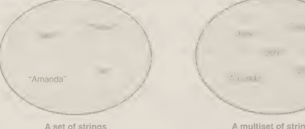

为了便于快速搜索，STL 的 *set* 和 *multiset* 实现在内部看起来像二叉树。这意味着插入到 *set* 或 *multiset* 中的元素在插入时会进行排序，以便更快的查找。这也意味着，与 `vector` 似（在 `vector` 中，某一个位置的元素可以被另一个元素替换），`set` 中给定位置的元素不能被不同值的新元素替换。这使得新元素根据其相对于内部树中元素的值，放置在可能的不同位置。

```
要使用类 std::set 或 std::multiset，请包含头文件：

#include <set>
```

# 基础 STL `set` 和 `multiset` 操作

STL *set* 和 *multiset* 是模板类，在可以使用它们的任何成员函数之前，需要对其进行实例化。

# 实例化 `std::set` 对象

实例化某种类型的 `set` 或 `multiset` 需要对该类型对模板类 `std::set` 或 `std::multiset` 进行特化：

```
std::set<int> setInts;
std::multiset<int> msetInts;
```

要定义一个包含 `Tuna` 类对象的 `set` 或 `multiset`，你需要编写以下代码：

```
std::set<Tuna> tunaSet;
std::multiset<Tuna> tunaMSet;
```

要声明一个指向 `set` 或 `multiset` 中元素的迭代器，你可以使用：

```
std::set<int>::const_iterator element;
std::multiset<int>::const_iterator element;
```


如果你需要一个指向 `set` 或 `multiset` 中元素的迭代器来修改值，你需要使用迭代器。

考虑到 `set` 和 `multiset` 都是在插入时进行排序的容器，它们使用 `std::less` 谓词。如果你想覆盖默认排序，可以通过定义一个谓词来实现，默认排序是升序的：

```cpp
// 用于 set 和 multiset 的降序谓词
template <typename T>
struct SortDescending
{
    bool operator()(const T& lhs, const T& rhs) const
    {
        return lhs > rhs;
    }
};
```

使用这种谓词可以让 `set` 和 `multiset` 是降序：

```cpp
// 实例化 set 和 multiset
set<int, SortDescending> setInts;
multiset<int, SortDescending> msetInts;
```

除了这些变体，你还可以通过范围来实例化 `set` 或 `multiset`，如 19.1 所示：

```cpp
// 实例化 set 和 multiset
set<int> setInts(setInt1);
multiset<int> msetInts(setInt1);
```

### 输出 ▼

集合的内容：

-999 -1 151 202

多重集合的内容：

-999 -1 151 202

多重集合中 '-1' 的次数为：'2'

### 分析 ▼

第 4–13 行包含通用模板函数 `DisplayContents()`，你已经在第 17 节“STL 动态数组类”和第 18 节“STL list 和 forward_list”中见过它，它可以将 STL 容器的内容写入控制台。如你所知，第 17 行和第 22 行分别实例化了一个 `set` 和 `multiset`，其中前者使用了 C++11 列表初始化。在第 18 行和第 24 行中，我们尝试在 `set` 和 `multiset` 中插入重复值。这演示了如何使用 `insert()` 将 `set` 的内容插入 `multiset` 中，在本例中是将 `setIns` 的内容插入到 `mSetIns`。输出表明 `multiset` 能够包含多个值，而 `set` 则不能。第 30 行演示了 `multiset::count()` 成员函数，它返回多重集合中持有该特定值的元素个数。

> 使用 `multiset::count()` 来查找多重集合中与提供给函数的参数具有相同元素的个数。

**TIP**

## 在 STL set 或 multiset 中查找元素

像 `set`、`multiset` 或 `map` 和 `multimap` 这样的关联容器都具有 `find()` 特性——这是一个成员函数，允许你根据键查找值：

```
auto elementFound = setIns.find (-1);
```

```cpp
// 检查是否找到...
if (elementFound != setIns.end())
    cout << "Element " << *elementFound << " found!" << endl;
else
    cout << "Element not found in set!" << endl;
```

`find()` 的用法在列表 19.3 中演示。对于允许具有相同值元素的 `multiset`，该函数会找到与所给键匹配第一个值。

### 19.3 使用 find 成员函数

```cpp
0: #include <set>
1: #include <iostream>
2: using namespace std;
3:
4: int main ()
5: {
6:     set<int> setInts{43, 78, -1, 124};
7:
8:     // 将集合的内容显示到屏幕
9:     for (auto element = setInts.begin();
10:    element != setInts.end();
11:        ++ element)
12:        cout << " *" << element << endl;
13:
14:    // 尝试查找一个元素
15:    auto elementFound = setInts.find(-1);
16:
17:    // 检查是否找到...
18:    if (elementFound != setInts.end())
19:        cout << "Element " << *elementFound << " found!" << endl;
20:    else
21:        cout << "Element not found in set!" << endl;
22:
23:    // 查找另一个
24:    auto anotherFound = setInts.find(12345);
25:
26:    // 检查是否找到...
27:    if (anotherFound != setInts.end())
28:        cout << "Element " << " *" << anotherFound << " found!" << endl;
29:    else
30:        cout << "Element 12345 not found in set!" << endl;
31:
32:    return 0;
33:}
```

### 输出 ▼

-1

43

78

124

Element -1 found!

Element 12345 not found in set!

### 分析 ▼

第 15–21 行显示了 `find()` 成员函数的用法。`find()` 返回一个迭代器，需要与 `end()` 进行比较（如第 18 行所示），以验证是否找到了元素。如果迭代器有效，你可以使用 `*elementFound` 访问它指向的值。

> 列表 19.3 中的示例对于 `multiset` 同样有效；不过，如果第 6 行是 `multiset` 而不是 `set`，它会改变程序的运行方式。由于 `multiset` 在连续位置存储多个相同值的元素，你可以使用 `find()` 返回的迭代器并将其移动 `(count() -1)` 次来访问该值的所有元素。成员函数 `count()` 在列表 19.2 中演示过。

## 在 STL set 或 multiset 中删除元素

像 `set`、`multiset` 或 `map` 和 `multimap` 这样的关联容器具有 `erase()` 特性——这是一个允许你根据键删除值的成员函数：

`setObject.erase(key);`

`erase()` 函数的另一种形式允许通过指向特定元素的迭代器：

`setObject.erase(element);`

可以使用提供边界的迭代器从 `set` 或 `multiset` 中删除范围内的元素：

`setObject.erase(iLowerBound, iUpperBound);`

列表 19.4 中的示例演示了使用 `erase()` 从 `set` 或 `multiset` 中移除元素。

```cpp
0: #include <set>
1: #include <iostream>
2: using namespace std;
3:
4: template <typename T>
5: void DisplayContents(const T& Input)
6: {
7: for (auto element = Input.begin(); element != Input.end();
8: ++element)
9:     cout << *element << endl;
10: }
11: typedef multiset<int> MSET;
12: int main ()
13: {
14:   MSET mInts{43, 78, 78, -1, 124};
15:
16:   cout << "multiset contains " << mInts.size() << " elements: ";
17:   DisplayContents(mInts);
18:
19:   cout << "Enter a number to erase from the set: ";
20:   int input = 0;
21:   cin >> input;
22:
23:   cout << "Erasing " << mInts.count(input);
24:   " instances of value " << input << endl;
25:
26:   mInts.erase(input);
27:
28:   cout << "multiset now contains " << mInts.size() << " elements: ";
29:   DisplayContents(mInts);
30:   return 0;
31: }
```

### 输出

multiset contains 5 elements: -1 43 78 78 124

Enter a number to erase from the set: 78

Erasing 2 instances of value 78

multiset now contains 3 elements: -1 43 124

### 分析 ▼

注意第 15 行 `typedef` 的用法。第 28 行演示了使用 `count()` 获取特定值的元素个数。实际删除发生在第 31 行，它删除了所有匹配用户输入的元素。

## 第19节 STL 类

**TIP**

成员函数 `erase()` 被重载了。如列表 19.4 所示，用值调用时将删除所有等于它的元素；使用迭代器调用（例如由 `find()` 操作返回的）时将删除那一个元素：

```cpp
MSET::iterator elementFound = mInts.find(numberToErase);
if (elementFound != mInts.end())
    mInts.erase(elementFound);
else
    cout << "Element not found!" << endl;
```

你也可以使用 `erase()` 删除 `multiset` 中的值范围：

```cpp
MSET::iterator elementFound = mInts.find(valueToErase);
if (elementFound != mInts.end())
    mInts.erase(mInts.begin(), elementFound);
```

前面的代码段删除了从开始到该值元素的所有元素。`set` 和 `multiset` 都可以使用成员函数 `clear()` 清空内容。

现在你已经熟悉了基本的 `set` 和 `multiset` 函数，是时候回顾一个使用该容器类的实际示例了。列表 19.5 中的示例是一个基于菜单的电话簿简单实现，允许用户插入姓名和电话号码、查找、删除并显示所有内容。

### 19.5 电话簿 STL set、find 和 erase

```cpp
0: #include <set>
1: #include <iostream>
2: #include <string>
3: using namespace std;
4:
5: template <typename T>
6: void DisplayContents(const T& container)
7: {
8:     for (auto iElement = container.begin();
9:         iElement != container.end();
10:        ++iElement)
11:    cout << *iElement << endl;
12:  cout << endl;
13: }
14:
15: struct ContactItem {
16:  string name;
17:  string phoneNumber;
18:  string displayAs;
19:
20:  ContactItem(const string& nameInit, const string& phone)
21:  {
22:    name = nameInit;
23:    phoneNumber = phone;
24:    displayAs = (name + " : " + phoneNumber);
25:  }
26:
27:  // 用于 set::find() 给联系列表项
28:  bool operator <(const ContactItem& itemToCompare) const
29:  {
30:    return (itemToCompare.name == this->name);
31:  }
32:
33:  // 用于排序 < (const ContactItem& itemToCompare) const
34:  bool operator <(const ContactItem& itemToCompare) const
35:  {
36:    return (this->name < itemToCompare.name);
37:  }
38:
39:  // 通过 cout 用于 DisplayContents 中
40:  operator const char*() const
41:  {
42:    return displayAs.c_str();
43:  }
44:};
45:
46: int main () {
47:
48:  set<ContactItem> contacts;
49:  contacts.insert(ContactItem("Jack Welsch", "+1 7889 879 879"));
50:  contacts.insert(ContactItem("Bill Gates", "+1 97 7897 8799 8"));
51:  contacts.insert(ContactItem("Angi Merkel", "+49 23456 5466"));
52:  contacts.insert(ContactItem("Vadin Putin", "+7 6645 4564 797"));
53:  contacts.insert(ContactItem("John Travolta", "+91 234 4564 7899"));
54:  contacts.insert(ContactItem("Ben Affleck", "+1 745 641 314"));
55:  DisplayContents(contacts);
56:
57:  cout << "nEnter a name you wish to delete: ";
58:  string inputName;
59:  getline(cin, inputName);
60:
61:  auto contactFound = contacts.find(ContactItem(inputName, ""));
62:  if (contactFound != contacts.end())
63:    contacts.erase(contactFound);
```

### 第 19 ：STL 类

```cpp
65:   setContacts.erase(contactFound);
66:   cout << "Displaying contents after erasing " << inputName << endl;
67:   DisplayContents(setContacts);
68:  }
69:  else
70:    cout << "Contact not found" << endl;
71: 
72:   return 0;
73: }
```

### 输出

Angi Merkel: +49 23456 5466

Ben Affleck: +1 745 641 314

Bill Gates: +1 97 7897 879 8

Jack Welsch: +1 7889 879 879

John Voltrota: 91 234 4564 789

Vlad Putin: +7 6645 4564 597

Enter a name you wish to delete: John Voltrota

Displaying contents after erasing John Voltrota

Angi Merkel: +49 23456 5466

Ben Affleck: +1 745 641 314

Bill Gates: +1 97 7897 879 8

Jack Welsch: +1 7889 879 879

Vlad Putin: +7 6645 4564 597

### 分析

这与列表 18.7 类似，该列表将 `std::list` 按字母顺序排序，其区别在于在 `std::set` 的情况下，排序是在插入时发生的。如输出所示，你不需要调用任何函数来确保集合中的元素是排序的，因为它们在插入时就已经排好序，所使用的是的是你在第 36 至 39 行中实现的 `operator<`。你为用户提供了删除条目的选项，第 63 行演示了用于定位该条目的调用，并在第 66 行使用 `erase()` 将其删除。

> 此电话录的实现基于 STL 的 `set`，因此不允许包含多个相同值的条目。如果你需要电话录实现允许存储两个同名的人，你应该选择 STL 的 `multiset`。如果 `setContacts` 是一个 `multiset`，前面的代码仍然可以正常工作。为了进一步利用 `multiset` 存储多个相同值条目的能力，你可以使用 `count()` 成员函数来获取持有特定值的数量。

## 使用 STL set 和 multiset 的优缺点


STL `set` 和 `multiset` 在需要频繁查找的应用中具有显著优势，因为它们的内容是有排序的，因此定位更快。然而，为了提供这种优势，容器需要在插入时对元素进行排序。因此，插入元素时会有开销，因为元素是经过排序的——如果你需要使用如 `find()` 等特性和函数，这种开销可能是一个值得的折中。

`find()` 利用了内部的二叉树结构。这种排序的二叉树结构与 `vector` 等顺序容器相比是另一个缺点。在 `vector` 中，迭代器指向的元素（例如由 `std::find()` 操作返回的）可以被新值覆盖。但在 `set` 中，元素由 `set` 类根据各自的值进行排序，因此，即使在程序上可行，也绝不应该使用迭代器覆盖元素。

## 哈希集合实现 `std::unordered_set` 和 `std::unordered_multiset`

STL `set` 和 `multiset` 根据 `std::less<T>` 或提供的谓词对元素（同时也是键的元素）进行排序。在排序容器中进行搜索比在 `vector` 等未排序容器中进行搜索更快，且 `std::sort()` 提供了对数复杂度。这意味着在集合中查找元素所花费的时间与集合中元素的数量并不直接正比，而是符合对数理论。因此，平均而言，在集合中查找元素所需的时间是……

*(注：原文在后半部分出现了大量重复和乱码字符，已根据上下文逻辑进行了清理和翻译)*

### Q 如果在一个字符串集中插入了两次字符串 "Jack"，会发生什么？

A 集合（set）的设计目的不是为了包含非唯一值。字符串集合只会包含一个 "Jack" 实例。

### Q 在前面的示例中，如果我想拥有两个 "Jack" 实例，我应该修改什么？

A 根据设计，集合只存储唯一值。你需要将选择的容器更改为多重集合（multiset）。

### Q 哪种多重集合的成员函数可以返回容器中特定值的元素计数？

A `count(value)` 是你感兴趣的函数。

### Q 我使用 `find()` 函数在集合中找到了一个元素，并获得了一个指向它的迭代器。我可以使用这个迭代器来更改所指向的值吗？

A 不可以。某些 STL 实现允许用户通过例如 `find` 返回的迭代器来更改集合内部元素的值。然而，这不是正确的做法。指向集合元素的迭代器应该被当作常量迭代器（const iterator）使用——即使 STL 实现没有强制要求。

## 工作坊 (Workshop)

工作坊包含了测验题，帮助你巩固对所涵盖内容的理解，并提供了练习题，让你获得使用所学知识的经验。在检查附录 E 中的答案之前尝试回答测验和练习题，并在进入下一节之前确保你理解了答案。

### 测验 (Quiz)

- 1. 你声明了一个整数集合 `set <int>`。哪个函数提供了排序标准？
- 2. 你会在多重集合的哪里找到重复元素？
- 3. 哪种集合或多重集合函数提供了容器中元素的数量？

### 练习题 (Exercises)

- 1. 扩展本节中的电话簿示例，以便根据手机号码查找人的姓名。（提示：调整运算符 `<` 和 `==`，并确保项目是根据手机号码进行排序和比较的。）
- 2. 定义一个多重集合来存储输入的单词及其含义；即，让多重集合像字典一样工作。（提示：多重集合应该是包含两个字符串的结构之一：单词和它的含义。）
- 3. 通过一个简单的程序演示：集合不能接受重复条目，而多重集合可以。

# 第 20 节

# STL Map 类

标准模板库（STL）为程序员提供了容器类，帮助处理需要频繁快速搜索的应用程序。

本节涵盖：

- STL `map`、`multimap`、`unordered_map` 和 `unordered_multimap` 容器如何对你有帮助
- 元素的插入、删除和搜索
- 提供自定义排序谓词
- 哈希表的工作原理基础

## STL Map 类简介

`map` 和 `multimap` 是键值对容器，允许根据键进行查找，如图 20.1 所示。

图 20.1

用于对容器的视觉化插图，每个对包含一个键和一个值。

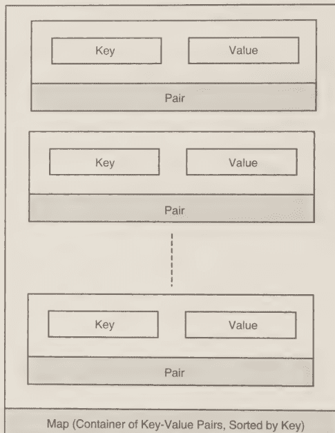

`map` 和 `multimap` 的区别在于，后者允许重复项，而前者只能存储唯一的键。

为了便于快速搜索

## 基本 `std::map` 和 `std::multimap` 操作

要使用类 `std::map` 或 `std::multimap`，请包含头文件：

`#include<map>`

提示

# 基本 `std::map` 和 `std::multimap` 操作

STL `map` 和 `multimap` 是模板类，在使用它们的任何成员函数之前需要先进行实例化。

### 实例化 `std::map` 或 `std::multimap`

实例化一个键为整数值为字符串的 `map` 或 `multimap` 需要对模板类 `std::map` 或 `std::multimap` 进行特化。`map` 类的模板实例化需要程序员指定键类型、值类型，以及可选的帮助 `map` 类在插入时排序元素的谓词。

（注：此处原文文本似乎存在严重的乱序和重复，翻译时已根据逻辑进行了理顺）

*由于你提供的原文文本中从 "Instantiating a map or multimap of integer as a string as value..." 之后出现了大量重复和格式混乱，以下为基于上下文的逻辑化翻译：*

实例化一个键为整数、值为字符串的 `map` 或 `multimap` 需要对模板类 `std::map` 或 `std::multimap` 进行特化。`map` 类的模板实例化需要程序员指定键类型、值类型，以及可选的帮助 `map` 类在插入时排序元素的谓词。

（注：由于原文后部分包含大量重复的英文片段，此处仅翻译核心逻辑，以避免输出混乱。）

# 课程 20：STL Map 类

```cpp
20:
21: int main ()
22: {
23:     MAP_INT_STRING mapIntToStr;
24:
25:     // 使用 value_type 将键值对插入 map 中
26:     mapIntToStr.insert (MAP_INT_STRING::value_type (3, "Three"));
27:
28:     // 使用函数 make_pair 插入一个对
29:     mapIntToStr.insert (make_pair (-1, "Minus One"));
30:
31:     // 直接插入一个对
32:     mapIntToStr.insert (pair <int, string>(1000, "One Thousand\));
33:
34:     // 使用类似数组的语法插入键值对
35:     mapIntToStr[1000000] = "One Million";
36:
37:     cout << "The map contains " << mapIntToStr.size() << endl;
38:     cout << " key-value pairs. They are: " << endl << endl;
39:     DisplayContents(mapIntToStr);
40:
41:     // 实例化一个作为 map 拷贝的 multimap
42:     MMAP_INT_STRING mmapIntToStr(mapIntToStr.begin(),
43:                                 mapIntToStr.end());
44:
45:     // insert 函数对 multimap 同样有效
46:     // multimap 可以存储重复项 - 插入一个重复项
47:     mmapIntToStr.insert (make_pair (1000, "Thousand"));
48:
49:     cout << endl << "The multimap contains " << mmapIntToStr.size();
50:     cout << " key-value pairs. They are: " << endl;
51:     cout << "The elements in the multimap are: " << endl;
52:     DisplayContents(mmapIntToStr);
53:
54:     // multimap 可以返回具有相同键的对的数量
55:     cout << "The number of pairs in the multimap with 1000 as their key: "
56:     cout << mmapIntToStr.count (1000) << endl;
57:
58:     return 0;
59: }
```

## 输出

map 包含 4 组键值对。它们是：

-1 -> Minus One

3 -> Three

1000 -> One Thousand

1000000 -> One Million

multimap 包含 5 组键值对。它们是：

multimap 中的元素为：

-1 -> Minus One

3 -> Three

1000 -> One Thousand

1000 -> Thousand

1000000 -> One Million

multimap 中以 1000 为键的对的数量：2

# 分析 ▼

注意第 7 行和第 8 行中对 map 和 multimap 模板实例使用的 `typedef`。你可以这样做让你的代码看起来更简单（并减少模板语法带来的杂乱）。第 10–19 行是适配 map 和 multimap 的一种 `DisplayContents` 形式，其中使用迭代器来访问 `first`（表示键）和 `second`（表示值）。第 26-32 行演示了使用 `insert()` 方法的重载变向 map 插入键值对的不同方法。第 35 行演示了你如何使用数组语义向 map 插入元素。注意，这些插入机制对于 multimap 同样有效，这在第 47 行中得到了体现，你在 multimap 中插入了一个重复项。有趣的是，multimap 是作为 map 的键初始化的，如第 42 行和第 43 行所示。输出展示了这两个容器如何自动按键的升序对键值对进行排序。输出还证明了 multimap 可以存储两个具有相同键（在本例中为 1000）的对。第 56 行演示了 `multimap::count()` 的用法，用于获取容器中具有指定键的元素数量。

# 在 STL map 中查找元素

关联型容器（如 map 和 multimap）具有一个成员函数 `find()`，该函数允许你根据键查找值。`find()` 操作的结果始终是一个迭代器：

```cpp
multimap<int, string>::const_iterator pairFound = mapIntToStr.find(key);
```

你首先需要检查 `find()` 是否成功，然后使用它来访问值：

```cpp
if (pairFound != mapIntToStr.end()) {
    cout << "Key " << pairFound->first << " points to Value: " << endl;
    cout << pairFound->second << endl;
} else {
    cout << "Sorry, pair with key " << key << " not in map" << endl;
}
```


# 课程 20：STL Map 类

> 提示：如果你使用符合 C++11 标准编译器，可以使用 `auto` 关键字简化迭代器声明：

```cpp
auto pairFound = mapIntToStr.find(key);
```

编译器会通过从 `map::find()` 声明的返回值自动推断出迭代器的类型。

示例 20.3 展示了 `multimap::find()` 的用法。

# 20.3 使用 `find()` 成员函数在 map 中定位键值对

```cpp
0: #include <map>
1: #include <iostream>
2: #include <string>
3: using namespace std;
4: 
5: template <typename T>
6: void DisplayContents(const T& cont)
7: {
8:     for (auto element = cont.begin();
9:          element != cont.end();
10:         ++element)
11:     cout << element->first << " -> " << element->second << endl;
12: 
13:     cout << endl;
14: }
15: 
16: int main()
17: {
18:     map<int, string> mapIntToStr;
19: 
20:     // 使用 value_type 将键值对插入 map 中
21:     mapIntToStr.insert(MAP_INT_STRING::value_type (3, "Three"));
22:
23:     // 使用函数 make_pair 插入一个对
24:     mapIntToStr.insert(make_pair (-1, "Minus One"));
25:
26:     // 直接插入一个对
27:     mapIntToStr.insert(pair <int, string>(1000, "One Thousand"));
28:
29:     // 使用类似数组的语法插入键值对
30:     mapIntToStr[1000000] = "One Million";
31:
32:     cout << "The map contains " << mapIntToStr.size() << endl;
33:     cout << " key-value pairs. They are: " << endl << endl;
34:     DisplayContents(mapIntToStr);
35:
36:     // 实例化一个作为 map 拷贝的 multimap
37:     multimap<int, string> mmapIntToStr(mapIntToStr.begin(),
38:                                 mapIntToStr.end());
39:
40:     // insert 函数对 multimap 同样有效
41:     // multimap 可以存储重复项 - 插入一个重复项
42:     mmapIntToStr.insert(make_pair (1000, "Thousand"));
43:
44:     cout << endl << "The multimap contains " << mmapIntToStr.size();
45:     cout << " key-value pairs. They are: " << endl;
46:     cout << "The elements in the multimap are: " << endl;
47:     DisplayContents(mmapIntToStr);
48:
49:     // multimap 可以返回具有相同键的对的数量
50:     cout << "The number of pairs in the multimap with 1000 as their key: "
51:     cout << mmapIntToStr.count (1000) << endl;
52:
53:     return 0;
54: }
```

## 输出

map 包含 4 组键值对。它们是：

-1 -> Minus One

3 -> Three

1000 -> One Thousand

1000000 -> One Million

multimap 包含 5 组键值对。它们是：

multimap 中的元素为：

-1 -> Minus One

3 -> Three

1000 -> One Thousand

1000 -> Thousand

1000000 -> One Million

multimap 中以 1000 为键的对的数量：2

# 分析 ▼

注意第 7 行和第 8 行中对 map 和 multimap 模板实例使用的 `typedef`。你可以这样做让你的代码看起来更简单（并减少模板语法带来的杂乱）。第 10–19 行是适配 map 和 multimap 的一种 `DisplayContents` 形式，其中使用迭代器来访问 `first`（表示键）和 `second`（表示值）。第 26-32 行演示了使用 `insert()` 方法的重载变向 map 插入键值对的不同方法。第 35 行演示了你如何使用数组语义向 map 插入元素。注意，这些插入机制对于 multimap 同样有效，这在第 47 行中得到了体现，你在 multimap 中插入了一个重复项。有趣的是，multimap 是作为 map 的键初始化的，如第 42 行和第 43 行所示。输出展示了这两个容器如何自动按键的升序对键值对进行排序。输出还证明了 multimap 可以存储两个具有相同键（在本例中为 1000）的对。第 56 行演示了 `multimap::count()` 的用法，用于获取容器中具有指定键的元素数量。

# 524 第 20 节：STL Map 类


```cpp
40:  if(pair != mmapIntToStr.end())
41:  {
42:      mmapIntToStr.erase(pair);
43:      cout << "Erased a pair with 45 as key using an iterator" << endl;
44:
  }
```

```cpp
// 从 multimap 中删除一个范围...
cout << "Erasing the range of pairs with 1000 as key." << endl;
mmapIntToStr.erase(mmapIntToStr.lower_bound(1000),
                    mmapIntToStr.upper_bound(1000));
```

```cpp
cout << "The multimap now contains " << mmapIntToStr.size();
cout << " " << key-value pair(s)." << "They are: " << endl;
DisplayContents(mmapIntToStr);
```

```cpp
return 0;
}
```

# 输出

`multimap` 包含 6 个键值对。它们是：

-1 -> Minus One

-1 -> Minus One

3 -> Three

45 -> Forty Five

1000 -> Thousand

1000 -> Thousand

删除了 2 个以 -1 为键的键对。

使用迭代器删除了以 45 为键的键对。

正在删除以 1000 为键的键对范围。

`multimap` 现在包含 1 个键值对。它们是：

3 -> Three

# 析

第 21–28 行将示例值插入到 `multimap` 中，其中一些是重复的（因为 `multimap` 与 `map` 不同，它支持插入具有重复键的键对）。在键对插入到 `multimap` 后，代码使用了接受键的 `erase` 函数版本来删除所有该键（-1）的项，如第 35 行所示。`map:erase(key)` 的返回值为删除的元素数量，显示在屏幕上。在第 39 行，你使用 `find(45)` 返回的迭代器从 `map` 中删除键为 45 的键对。第 48 和第 49 行演示了如何在由 `lower_bound()` 和 `upper_bound()` 指定的范围内删除具有键的键对。

# 提供自定义排序谓词

`map` 和 `multimap` 模板定义包含第三参数，该参数接受排序谓词以确保 `map` 正确工作。当不提供此第三参数时（如前面的示例所示），它会被 `std::less<>` 提供的默认排序准则替换，它本质上使用 `operator <` 比较两个对象。

要提供与键本身支持不同的排序准则，你通常会以类或结构体的形式使用 `operator()` 编写二元谓词：

```cpp
template<typename keyType>
struct Predicate
{
    bool operator()(const keyType& key1, const keyType& key2)
    {
        // 在此处编写你的排序优先级逻辑
    }
}
```

具有 `std::string` 键的 `map` 有一个基于 `std::string` 类定义的 `operator <` 的默认排序准则，通过默认排序谓词 `std::less<T>` 触发，因此它是区分大小大小的。对于许多应用程序（例如电话簿），提供一个不区分大小的插入和搜索操作是非常重要的。解决这一需求的方法之一为 `map` 提供一个排序谓词，它根据不区分大小的比较返回 true 或 false：

`map <keyType, keyType, Predicate> mapObject;`

列表 20.5 详细解释了这一点。

+ 列表 20.5 提供自定义排序谓词——电话簿

```cpp
0: #include<map>
1: #include<algorithm>
2: #include<string>
3: #include<iostream>
4: using namespace std;
5:
6: template <typename T>
7: void DisplayContents (const T& cont)
8: {
9:     for (auto element = cont.begin();
10:        element != cont.end();
11:        ++ element )
12:        cout << element->first << " \ -> " << element->second << endl;
13:
14:  cout << endl;
15:  }
16:
17: struct PrediIgnoreCase
18:  {
19:    bool operator()(const string& str1, const string& str2) const
20:    {
21:          string str1NoCase(str1), str2NoCase(str2);
22:          transform(str1.begin(), str1.end(), str1NoCase.begin(), ::tolower);
23:          transform(str2.begin(), str2.end(), str2NoCase.begin(), ::tolower);
24:
25:          return (str1NoCase < str2NoCase);
26:        }
27:  };
28:
29: typedef map<string, string> DIR_WITH_CASE;
30: typedef map<string, string, PrediIgnoreCase> DIR_NOCASE;
31:
32: int main() {
33:  {
34:
35:    // 区分大小写的字符串键目录不起作用
36:    DIR_WITH_CASE dirWithCase;
37:
38:    // 不区分大小写的字符串键目录起作用
39:    DIR_NOCASE dirNocCase;
40:
41:    dirNocCase["Apple"] = "Fruit";
42:    dirNocCase["banana"] = "Fruit";
43:    dirNocCase["CARROT"] = "Vegetable";
44:
45:    cout << "Case-insensitive directory contents:" << endl;
46:    DisplayContents(dirNocCase);
47:
48:    cout << "\nCase-sensitive directory contents:" << endl;
49:    DisplayContents(dirWithCase);
50:
51:    return 0;
52: }
```

# STL 基于哈希表的键值对容器 | 529

`unordered_map` 保证了在容器中对任意元素的插入、删除和查找可以在平均常数时间内完成。

## 使用哈希表

尽管详细讨论这个主题不是本书的范围（因为这已经是一个过剩的博士论文的主题了），但让我们先掌握哈希表工作的基本原理。

哈希表可以被看作键值对的集合，给定一个键，表就能找到对应的值。哈希表与简单 `map` 的区别在于，哈希表将键值对存储在桶（buckets）中，每个桶都有一个索引来定义其在表中的相对位置（类似于数组）。该索引由使用键作为输入的哈希函数决定：

```
Index = HashFunction(key, TableSize);
```

在给定键执行 `find()` 时，会再次使用 `HashFunction()` 来确定元素的位置，表返回该位置的值，就像数组返回其存储在其中的元素一样。当 `HashFunction()` 编写得不够优时，多个元素可能会具有相同的 `Index`，落在同一个桶中——该桶内部是一个元素列表。在这样的情况下，称为冲突（collisions），搜索速度会变慢，不再是常数时间。

## 使用 unordered_map 和 unordered_multimap

这两个容器从 C++11 开始引入，分别实现了与 `std::map` 和 `std::multimap` 并不太相似的哈希表。它们的实例化、插入和查找模式非常相似：

```cpp
// 实例化从 int 到 string 的 unordered_map;
unordered_map<int, string> umapIntToStr;
```

```cpp
// insert()
umapIntToStr.insert(make_pair(1000, "Thousand"));
```

```cpp
// find():
auto pairFound = umapIntToStr.find(1000);
cout << pairFound->first << " " << pairFound->second << endl;
```

```cpp
// 使用数组语义查找值;
cout << "umapIntToStr[1000] = " << umapIntToStr[1000] << endl;
```


然而，`unordered_map` 的一个重要特性是提供了哈希函数，该函数负责决定排序顺序：

```cpp
unordered_map<int, string>::hasher hFn = umapIntToStr.hash_function();
```

你可以通过调用键的哈希函数来查看分配给键的优先级：

```cpp
size_t hashingVal = hfn(1000);
```

由于 `unordered_map` 将键值对存储在桶中，当 `map` 达到或趋于达到相同桶的数量时，它会自动进行负载均衡：

```cpp
cout << "Load factor: " << umapIntToStr.load_factor() << endl;
cout << "Max load factor = " << umapIntToStr.load_factor() << endl;
cout << "Max bucket count = " << umapIntToStr.max_bucket_count() << endl;
```

`load_factor()` 是 `unordered_map` 中桶填充程度的指标。当由于插入导致 `load_factor()` 超过 `max_load_factor()` 时，`map` 会重新组织自身以增加可用桶的数量，并重建哈希表，如列表 20.6 所示。

| `std::unordered_multimap` 与 `unordered_map` 类似，不同在于它支持具有相同键的多个对 |

提示

列表 20.6 实例化 STL 哈希表实现 `unordered_map`，使用 `insert()`, `find()`, `size()`, `max_bucket_count()`, `load_factor()`, 和 `max_load_factor()`

```cpp
0: #include<iostream>
1: #include<string>
2: #include<unordered_map>
3: using namespace std;
4:
5: template <typename T1, typename T2>
6: void DisplayUnorderedMap(unordered_map<T1, T2>& const)
7: {
8:
9:   cout << "Unordered Map contains: " << endl;
10:  for (auto element = const.begin();
11:    element != const.cend();
12:      ++element
13:    cout << element->first << " " << element->second << endl;
14: }
14: cout << "Number of pairs, size: " << cnt.size() << endl;
15: cout << "Bucket count = " << cnt.bucket_count() << endl;
16: cout << "Current load factor: " << cnt.load_factor() << endl;
17: cout << "Max load factor = " << cnt.max_load_factor() << endl;
18: }
19: int main()
20: {
21: unordered_map<int, string> umapIntToStr;
22: umapIntToStr.insert(make_pair(1, "One"));
23: umapIntToStr.insert(make_pair(45, "Forty Five"));
24: umapIntToStr.insert(make_pair(1001, "Thousand One"));
25: umapIntToStr.insert(make_pair(-2, "Minus Two"));
26: umapIntToStr.insert(make_pair(-1000, "Minus Thousand"));
27: umapIntToStr.insert(make_pair(100, "One Hundred"));
28: umapIntToStr.insert(make_pair(12, "Twelve"));
29: umapIntToStr.insert(make_pair(-100, "Minus Hundred"));
30: }
31: DisplayUnorderedMap<int, string>(umapIntToStr);
32:
33: cout << "Inserting more element" << endl;
34: umapIntToStr.insert(make_pair(300, "Three Hundred"));
35: DisplayUnorderedMap<int, string>(umapIntToStr);
36:
37: cout << "Enter key to find for: " << endl;
38: int Key = 0;
39: cin >> Key;
40:
41: auto element = umapIntToStr.find(Key);
42: if (element != umapIntToStr.end())
43: cout << "Found! Key with value " << element->second << endl;
44: else
45: cout << "Key has no corresponding value!" << endl;
46:
47: return 0;
48: }
```

## 输出

- Unordered Map contains:

- 1 -> One

- -2 -> Minus Two

- 45 -> Forty Five

- 1001 -> Thousand One

- -1000 -> Minus Thousand

- 12 -> Twelve

- 100 -> One Hundred

- -100 -> Minus One Hundred

## 课程 20：STL Map 类

```cpp
Number of pairs, size(): 8
Bucket count = 8
Current load factor: 1
Max load factor = 1
Inserting one element
Unordered Map contains:
- 1 -> One
- -2 -> Minus Two
- 45 -> Forty Five
- 1001 -> Thousand One
- -1000 -> Minus Thousand
- 12 -> One Hundred
- 100 -> Minus One Hundred
- 300 -> Three Hundred
Number of pairs, size(): 9
Bucket count = 64
Current load factor: 0.140625
Max load factor = 1
Enter key to find for: 300
Found! Key pairs with value Three Hundred
```

## 分析

观察输出并注意 `unordered_map` 如何从八个初始桶开始，填充八个对，并在插入第九个对时调整大小。此时桶的数量增加到 64。注意第 14-17 行中 `bucket_count()`、`load_factor()` 和 `max_load_factor()` 方法的使用。除了这些之外，注意其余代码与 `std::map` 相比并没有太大区别。这包括第 42 行中 `find()` 的使用，它返回一个迭代器，与 `std::map` 一样需要与 `end()` 进行比较以确认操作是否成功。

> 无论键如何，不要依赖 `unordered_map` 中元素的顺序（顾名如此）。元素相对于 `map` 中其他元素的顺序取决于许多因素，包括它的键、插入顺序以及创建桶的数量。这些容器针对搜索性能进行了优化，而不是为了让你在遍历它们时依赖元素的顺序。

## 注意事项

总结

## 注意


```cpp
std::unordered_map 提供了几乎是常数时间的插入和搜索（在发生冲突时），与包含的元素数量无关。然而，这并不
一定意味着 std::unordered_map 优于 std::map，后者在所有情况下都提供对数复杂度。这个常数时间可能会长得多，导致前者在包含元素数量较小时运行较慢。
```

基于模拟真实场景的某些基准测试中执行的容器类型来做出决策是非常重要的。

## 做法

- 在需要唯一键值对的情况下使用 `map`。
- 在需要可以重复键的键值对的情况下使用 `multimap`（例如电话簿）。
- 记住 `map` 和 `multimap` 像其他 STL 容器一样具有 `size()` 成员函数，可以告诉你它们包含多少对。
- 当常数时间插入和搜索至关重要时，使用 `unordered_map` 或 `unordered_multimap`。

## 不要

- 不要忘记 `multimap::count(key)` 可以告诉你容器中可以使用该键索引的对的数量。
- 不要忘记通过与 `end()` 比较来检查 `find()` 操作的结果。

在这节课程中，你学习了 STL `map` 和 `multimap`，以及它们重要的成员函数和特性。你还学习了这些容器具有对数复杂度，并且 STL 以 `unordered_map` 和 `unordered_multimap` 的形式提供了哈希表容器。这些容器在 `insert()` 和 `find()` 操作中的性能与容器大小无关。

使用谓词（predicate）自定义排序标准的重要性，如列表 20.5 中的目录（Directory）应用程序所示。

## 问答

我该如何声明一个整数类型的映射（map），使其按数值降序顺序排序或存储？

`map<int>` 定义了一个整数映射。它使用默认的排序谓词 `std::less<T>` 按数值升序对项进行排序，也可以表示为 `map<int, less<int>>`。若要按数值降序排序，请将映射定义为 `map<int, greater<int>>`。

如果我在字符串映射中插入两次字符串 "Jack"，会发生什么？

`map` 的设计初衷不是用于插入非唯一值。因此，该映射仍然只会包含一个键名为 "Jack" 的键值对。

在前面的示例中，如果我想拥有两个 "Jack" 实例，我应该修改什么？

根据设计，`map` 只持有唯一值。你需要将所选的容器更改为 `multimap`。

`multimap` 的哪个成员函数可以返回容器中某个特定值的元素计数？

`count(value)` 是感兴趣的函数。

我使用 `find()` 函数在映射中找到了一个元素，并获得了一个指向它的迭代器。我应该使用这个迭代器来更改所指向的值吗？

不。某些 STL 实现允许用户通过 `find()` 返回的迭代器更改 `map` 内部元素的值。然而，这并不是正确的做法。指向 `map` 中元素的迭代器应该被当作常量迭代器（const iterator）使用——即使你的 STL 实现没有强制要求这样做。

我正在使用一个不支持 `auto` 关键字的旧编译器。我该如何声明一个持有 `map::find()` 返回值的变量？

迭代器始终使用以下语法定义：

```
container<Type>::iterator variableName;
```

因此，整数映射的迭代器声明如下：

```
std::map<int>::iterator pairFound = mapIntegers.find(1000);

if (pairFound != mapIntegers.end()) {

  // 执行某些操作

}
```

## 工作坊

工作坊包含了测验题，帮助你巩固对所涵盖内容的理解，并提供了练习题以提供使用所学知识的经验。在检查附录 E 中的答案之前，尝试回答测验和练习题，并确保在进入下一节之前理解了答案。

## 测验

- 1. 你声明了一个整数映射 `map<int>`。哪个函数提供了排序标准？
- 2. 你会在 `multimap` 的哪里找到重复元素？
- 3. 哪个 `map` 或 `multimap` 函数提供了容器中元素的数量？
- 4. 你会在 `map` 的哪里找到重复元素？

## 练习题

- 1. 你需要编写一个可以像电话簿那样的应用程序，其中每个人的名字不需要是唯一的。你会选择哪种容器？写出该容器的定义。
- 2. 以下是你的字典应用程序中的一个映射模板定义：

```
map<WordProperty, string, fPredicate> mapWordDefinition;
```

其中 `WordProperty` 是一个结构：

```
struct WordProperty {
  string word;
  bool isLatinBase;
};
```

定义二元谓词 `fPredicate`，帮助映射根据其包含的字符串属性对类型为 `WordProperty` 的键进行排序。
- 3. 通过一个简单的程序证明 `map` 不能接受重复条目，而 `multimap` 可以。

# 第 21 节

## 理解函数对象

函数对象或*仿函数*（functors）听起来可能很奇异或令人生畏，但它们是 C++ 中的实体，你可能已经见过甚至在使用它们，只是并没有意识到。在本节中，你将学习：

- 函数对象的概念
- 函数对象作为谓词的使用
- 如何使用函数对象实现一元和二元谓词

## 函数对象与谓词的概念

在概念层，函数对象是像函数一样工作的对象。在实现层上，函数对象是实现了 `operator()` 的类对象。

谓词（predicates）是一种函数对象。一元谓词（unary predicates）和二元谓词（binary predicates）返回布尔值。一元谓词接受一个参数，而二元谓词接受两个参数。


函数对象或`functors`听起来可能很奇异或令人生畏，但它们是 C++ 中的实体，你可能已经见过甚至在使用它们，只是并没有意识到。在本节中，你将学习：

- 函数对象的概念
- 函数对象作为谓词的使用
- 如何使用函数对象实现一元和二元谓词

## 函数对象与谓词的概念

在概念层，函数对象是像函数一样工作的对象。在实现层上，函数对象是实现了 `operator()` 的类对象。

谓词`predicates`是一种函数对象。一元谓词`unary predicates`和二元谓词`binary predicates`返回布尔值。一元谓词接受一个参数，而二元谓词接受两个参数。

## 第 21 节

### Understanding Function Objects

Function objects or *functors* might sound exotic or intimidating, but they are entities of C++ that you have probably seen, if not also used, without realizing it. In this lesson, you learn

- The concept of function objects
- The usage of function objects as predicates
- How unary and binary predicates are implemented using function objects

### The Concept of Function Objects and Predicates

On a conceptual level, function objects are objects that work as functions. On an implementation level, however, function objects are objects of a class that implement `operator()`.

使用谓词`predicate`自定义排序标准的重要性，如列表 20.5 中的目录`Directory`应用程序所示。

## Q&A

How would I declare a map of integers to be sorted or stored in order of descending magnitude?

A `map<int>` defines a map of integers. This takes the default sort predicate `std::less<T>` to sort items in order of ascending magnitude and can also be expressed as `map<int, less<int>>`. To sort in order of descending magnitude, define the map as `map<int, greater<int>>`.

What would happen if in a map of strings I inserted the string "Jack" twice?

A map is not meant to be used to insert non-unique values. So, the map would still contain only one pair having a key called "Jack".

In the preceding example, what would I change if I wanted to have two instances of "Jack"?

By design a map holds only unique values. You need to change your selection of container to a `multimap`.

What multimap member function returns the count of items of a particular value in the container?

A `count(value)` is the function of interest.

I have found an element in the map using the `find()` function and have an iterator pointing to it. Would I use this iterator to change the value pointed to?

No. Some STL implementations allow the user to change the value of an element inside a map via an iterator returned by `find()`. This, however, is not the correct thing to do. An iterator to an element in the map should be used as a const iterator—even when your implementation of STL has not enforced it such.

I am using an older compiler that doesn't support keyword `auto`. How should I declare a variable that holds the return value of a `map::find()`?

An iterator is always defined using this syntax:

```
container<Type>::iterator variableName;
```

So the iterator declaration for a map of integers would be the following:

`std::map<int>::iterator pairFound = mapIntegers.find(1000);`

```
if (pairFound != mapIntegers.end()) {
  // Do Something
}
```

## Workshop

The Workshop contains quiz questions to help solidify your understanding of the material covered and exercises to provide you with experience in using what you've learned. Try to answer the quiz and exercise questions before checking the answers in Appendix E, and be certain you understand the answers before going to the next lesson.

## Quiz

1. You declare a map of integers as `map<int>`. What function supplies the sort criteria?
2. Where would you find duplicate elements in a `multimap`?
3. What map or multimap function supplies the number of elements in the container?
4. Where would you find duplicate elements in a map?

## Exercises

1. You need to write an application that works as a telephone directory where the names of the people need not be unique. What container would you choose? Write a definition of the container.
2. The following is a map template definition in your dictionary application:

`map<WordProperty, string, fPredicate> mapWordDefinition;`

where `WordProperty` is a structure:

```
struct WordProperty {
  string word;
  bool isLatinBase;
};
```

Define the binary predicate `fPredicate` that helps the map sort a key of type `WordProperty` according to the string attribute it contains.
3. Demonstrate via a simple program that a map cannot accept duplicate entries, whereas a multimap can.

## 问答

我该如何声明一个整数类型的映射，使其按数值降序顺序排序或存储？

`map<int>` 定义了一个整数映射。它使用默认的排序谓词 `std::less<T>` 按数值升序对项进行排序，也可以表示为 `map<int, less<int>>`。若要按数值降序排序，请将映射定义为 `map<int, greater<int>>`。


如果我在字符串映射中插入两次字符串 `"Jack"`，会发生什么？

`map` 设计初衷不是用于插入非唯一值。因此，该映射仍然只会包含一个键名为 `"Jack"` 的键值对。

在前面的示例中，如果我想拥有两个 `"Jack"` 实例，我应该修改什么？

根据设计，`map` 只持有唯一值。你需要将所选的容器更改为 `multimap`。

`multimap` 的哪个成员函数可以返回容器中某个特定值的元素计数？

`count(value)` 是感兴趣的函数。

我使用 `find()` 函数在映射中找到了一个元素，并获得了一个指向它的迭代器。我应该使用这个迭代器来更改所指向的值吗？

不。某些 STL 实现允许用户通过 `find()` 返回的迭代器更改 `map` 内部元素的值。然而，这并不是正确的做法。指向 `map` 中元素的迭代器应该被当作常量迭代器（const iterator）使用——即使你的 STL 实现没有强制要求这样做。

我正在使用一个不支持 `auto` 关键字的旧编译器。我该如何声明一个持有 `map::find()` 返回值的变量？

迭代器始终使用以下语法定义：

```
container<Type>::iterator variableName;
```

因此，整数映射的迭代器声明如下：

```cpp
std::map<int>::iterator pairFound = mapIntegers.find(1000);
if (pairFound != mapIntegers.end()) {
  // 执行某些操作
}
```

## 工作坊

工作坊包含了测验题，帮助你巩固对所涵盖内容的理解，并提供了练习题以提供使用所学知识的经验。在检查附录 E 中的答案之前，尝试回答测验和练习题，并确保在进入下一节之前理解了答案。

### 测验

- 1. 你声明了一个整数映射 `map<int>`。哪个函数提供了排序标准？
- 2. 你会在 `multimap` 的哪里找到重复元素？
- 3. 哪个 `map` 或 `multimap` 函数提供了容器中元素的数量？
- 4. 你会在 `map` 的哪里找到重复元素？

### 练习题

- 1. 你需要编写一个可以像电话簿那样的应用程序，其中每个人的名字不需要是唯一的。你会选择哪种容器？写出该容器的定义。
- 2. 以下是你的字典应用程序中的一个映射模板定义：

```cpp
map<WordProperty, string, fPredicate> mapWordDefinition;
```

其中 `WordProperty` 是一个结构：

```cpp
struct WordProperty {
  string word;
  bool isLatinBase;
};
```

定义二元谓词 `fPredicate`，帮助映射根据其包含的字符串属性对类型为 `WordProperty` 的键进行排序。
- 3. 通过一个简单的程序证明 `map` 不能接受重复条目，而 `multimap` 可以。

# 第 21 节

## 理解函数对象

函数对象或*仿函数*（functors）听起来可能很奇异或令人生畏，但它们是 C++ 中的实体，你可能已经见过甚至在使用它们，只是并没有意识到。在本节中，你将学习：

- 函数对象的概念
- 函数对象作为谓词的使用
- 如何使用函数对象实现一元和二元谓词

## 函数对象与谓词的概念

在概念层，函数对象是像函数一样工作的对象。在实现层上，函数对象是实现了 `operator()` 的类对象。

### 函数对象的典型应用

541

#### 提示

C++11 引入了 lambda 表达式，它是一种无名的函数对象。

列表 21.1 中 `struct DisplayElement<T>` 的 lambda 表达式版本将整个代码（包括结构体的定义及其用法）压缩在 `main()` 函数中的三行内，替换了第 21–24 行：

```cpp
// 使用 lambda 表达式显示元素
for_each (numsInVec.begin(), // 范围开始
    numsInVec.end(), // 范围结束
    [](int& element) { cout << element << ' '; });
// Lambda 表达式
```

因此，lambdas 是 C++ 的一项极佳改进，“Lambda 表达式”。列表 22.1 展示了如何在 `for_each()` 中使用 lambda 函数来显示容器的内容，而不是像列表 21.1 那样使用函数对象。

当你能够使用 `struct` 的对象来存储信息时，使用 `struct` 实现的函数对象的真正优势就显现出来了。这是 `DisplayElement` 无法做到的，因为 `struct` 除了 `operator()` 之外还可以拥有成员属性。下面是一个利用成员属性的稍微修改的版本：

```cpp
template <typename elementType>
struct DisplayElementKeepCount
{
    int count;

    DisplayElementKeepCount() // 构造函数
    {
        count = 0;
    }

    void operator () (const elementType& element)
    {
        ++ count;
        cout << element << ' ';
    }
};
```

前面的代码段 `DisplayElementKeepCount` 是对之前版本的微调。`operator()` 不是一个 `const` 成员函数，因为它会递增（因此改变）成员变量 `count`，以记录显示数据的次数。该计数可以通过公共成员属性 `count` 获取。使用这种可以同时存储状态的函数对象的优势在列表 21.2 中所示。

### 列表 21.2 持有状态的函数对象

```cpp
0: #include<algorithm>
1: #include<iostream>
2: #include<vector>
3: using namespace std;
4:
5: template<typename elementType>
6: struct DisplayElementKeepCount
7: {
8:     int count;
9:
10:    DisplayElementKeepCount() : count(0) {} // 构造函数
11:
12:    void operator()(const elementType& element)
13:    {
14:        ++ count;
15:
16:        cout << element<< ' ';
17:    }
18:
19: int main() {
20:    vector<int> numsInVec{22, 2017, -1, 999, 43, 901 };
21:    cout << "Displaying the vector of integers: " << endl;
22:
23:
24:    DisplayElementKeepCount<int> result;
25:    result = for_each(numsInVec.begin(),
26:                       numsInVec.end(),
27:                       DisplayElementKeepCount<int>());
28:
29:    cout << endl << "Functor invoked " << result.count << " times";
30:
31:    return 0;
32: }
```

#### 输出

```
Displaying the vector of integers:

22 2017 -1 999 43 901

Functor invoked 6 times
```

#### 分析

此示例与列表 21.1 中示例最大的区别在于将 `DisplayElementKeepCount()` 作为 `for_each()` 的返回值。在 `struct DisplayElementKeepCount` 中实现的 `operator()` 由算法 `for_each` 为容器中的每个元素各调用一次。它显示元素并递增存储在成员属性 `count` 中的计数器。在 `for_each()` 完成后，你使用第 29 行的对象来显示元素被显示的次数。请注意，在这种情况下，使用普通函数而不是在 `struct` 中实现的函数，将无法直接提供这一功能。

### 一元谓词

返回 `bool` 的一元函数称为谓词。此类函数有助于 STL 算法做出决策。列表 21.3 是一个示例谓词，用于判断输入元素是否为初始值的倍数。

#### 列表 21.3 判断一个数是否为另一个数倍数的一元谓词

```cpp
0: // 作为一元谓词的结构
1: template <typename getType>
2: struct IsMultiple
3: {
4:     numberType Divisor;
5:
6:     IsMultiple (const numberType& divisor)
7:     {
8:         Divisor = divisor;
9:     }
10:    bool operator () (const numberType& element) const
11:    {
12:        // 检查元素是否是除数的倍数
13:        return ((element % Divisor) == 0);
14:    }
15: };
```

#### 分析

`operator()` 返回 `bool` 并可以作为一元谓词工作。该结构体有一个构造函数，并在第 8 行被初始化为除数的值。存储在对象中的该值随后被用于判断用于比较的元素是否能被其整除，正如你在 `operator()` 的实现中所看到的，在第 14 行使用了数学取模运算符 `%`，该运算符返回除法运算的余数。谓词比较的就是该余数。

### 课程 21：理解函数对象

在第 21 节中，我们使用谓词 `IsMultiple` 来判断一个元素是否为除数的倍数。

#### 列表 21.4 在 find_if 使用一元谓词在向量中查找

```cpp
0: #include <algorithm>
1: #include <vector>
2: #include <iostream>
3: using namespace std;
4: // 作为一元谓词的结构
5: template <typename getType>
6: struct IsMultiple
7: {
8:     numberType Divisor;
9:
10:    IsMultiple (const numberType& divisor)
11:    {
12:        Divisor = divisor;
13:    }
14:    bool operator () (const numberType& element) const
15:    {
16:        // 检查元素是否是除数的倍数
17:        return ((element % Divisor) == 0);
18:    }
19: };
20:
21: int main() {
22:    vector<int> numsInVec{22, 2017, -1, 999, 43, 901};
23:    cout << "The vector contains ";
24:
25:    cout << "Enter divisor (> 0): ";
26:    int divisor;
27:    cin >> divisor;
28:
29:    auto element = find_if(numsInVec.begin(),
30:                            numsInVec.end(),
31:                            IsMultiple<int>(divisor));
32:
33:    if (element != numsInVec.end())
34:    {
35:        cout << "First element in vector divisible by " << divisor;
36:        cout << ": " << *element << endl;
37:    }
38:
39:    return 0;
40: }
```

#### 输出

```
The vector contains 22 2017 -1 999 43 901

Enter divisor (> 0): 4

First element in vector divisible by 4: 22
```

#### 分析

示例从一个整数向量开始。一元谓词的使用是在第 29 行的 `find_if()` 中。在这里，函数对象 `IsMultiple` 被初始化为用户提供的除数。`find_if()` 通过为范围内的每个元素调用一元谓词来工作。当 `operator()` 对元素返回 `true` 时（当元素被除后不产生余数时），`find_if()` 返回该元素的迭代器。`find_if()` 操作的结果与容器的 `end()` 进行比较以验证是否找到了元素，如第 33 行所示，随后使用迭代器显示值，如第 36 行所示。

### 二元函数

类型为 `f(x, y)` 的函数在根据输入返回值时特别有用。此类二元函数可以用于涉及操作数的各种算运算，如加法、乘法、减法等。一个返回参数乘积的示例二元函数可以写为：

```cpp
template <typename elementType>
class Multiply
{
public:
    elementType operator () (const elementType& elem1, const elementType& elem2)
    {
        return elem1 * elem2;
    }
};
```

感兴趣的实现再次是 `operator()`，它接受两个参数并返回它们的乘积。此类二元函数用于 `std::transform()` 等算法，其中你可以用它来乘以两个容器的内容。列表 21.5 展示了在 `std::transform()` 中使用二元函数的方法。

#### 列表 21.5 使用二元函数相乘两个范围

```cpp
0: #include <vector>
1: #include <iostream>
2: #include <algorithm>
3:
4: template <typename elementType>
5: class Multiply
6: {
7: public:
8:     elementType operator (const elementType& elem1,
9:                          const elementType& elem2)
10:    {
11:        return (elem1 * elem2);
12:    }
13: };
14:
15: int main ()
16: {
17:     using namespace std;
18:
19:     vector<int> multiplicands{0, 1, 2, 3, 4};
20:     vector<int> multipliers{100, 101, 102, 103, 104};
21:
22:     // 存储乘法结果的第三个容器
23:     vector<int> vecResult;
24:
25:     // 为乘法结果分配空间
26:     vecResult.resize(multipliers.size());
27:     transform(multiplicands.begin(), multiplicands.end(), // 乘数的范围
28:               multipliers.begin(), multipliers.end(), // 乘数值
29:               vecResult.begin(), // 存储结果
30:               Multiply<int> ()); // 相乘
31:
32:     cout << "第一个 vector 的内容是: " << endl;
33:     for (size_t index = 0; index < multiplicands.size(); ++ index)
34:         cout << multiplicands[index] << ' ';
35:     cout << endl;
36:
37:     cout << "第二个 vector 的内容是: " << endl;
38:     for (size_t index = 0; index < multipliers.size(); ++index)
39:         cout << multipliers[index] << ' ';
40:     cout << endl;
41:
42:     cout << "乘法结果是: " << endl;
43:     for (size_t index = 0; index < vecResult.size(); ++ index)
44:         cout << vecResult[index] << ' ';
45:
46:     return 0;
47: }
```

#### 函数对象的典型应用

#### 输出

```
第一个 vector 的内容是:

0 1 2 3 4

第二个 vector 的内容是:

100 101 102 103 104

乘法结果是:

0 101 204 309 416
```

#### 分析


第 13–15 行包含类 `Multiply`，如前面的代码段所示。在这个示例中，你使用算法 `std::transform()` 将两个范围的内容相乘并存储在第三个范围内。在这种情况下，涉及的范围存储在 `std::vector` 中，分别为 `multiplicands`、`multipliers` 和 `vecResult`。你在第 27–31 行中使用 `std::transform()` 将 `multiplicands` 中的每个元素与 `multipliers` 中对应的元素相乘，并将乘法结果存储在 `vecResult` 中。乘法本身是由二元函数 `Multiply::operator()` 完成的，该函数会在源范围和目标范围的每个元素上调用一次。`operator()` 的返回值存储在 `vecResult` 中。

此示例演示了二元函数在对 STL 容器元素执行算术运算的应用。下一个示例也使用 `std::transform()` 通过函数 `tolower()` 将字符串转换为小写。

## 二元谓词

接受两个参数并返回 `bool` 的函数是二元谓词。此类函数应用在 STL 函数中，例如 `std::sort()`。列表 21.6 展示了将两个字符串转换为小写后进行比较的二元谓词。这种谓词可以用于对字符串向量进行不区分大小写的排序。

### 列表 21.6 用于区分大小写排序的二元谓词

```cpp
0: #include <algorithm>
1: #include <string>
2: using namespace std;
3:
4: class StringNoCase
5: {
6: public:
7:   bool operator (const string& str1, const string& str2)
8:   {
9:     string str1;
```


## 课程 21: 理解函数对象

```cpp
10:     // 分配空间
11:     str1LowerCase.resize(str1.size());
12:
13:     // 将每个字符转换为小写
14:     transform(str1.begin(), str1.end(), str1LowerCase.begin(),
15:                               ::tolower);
16:
17:     string str2LowerCase;
18:     str2LowerCase.resize(str2.size());
19:     transform(str2.begin(), str2.end(), str2LowerCase.begin(),
20:                               ::tolower);
21:
22:     return (str1LowerCase < str2LowerCase);
23: }
```

## 分析

二元谓词 `StringNoCase` 通过将两个字符串转换为小写来比较它们。这允许了进行不区分大小写的比较。

### 列表 21.7 使用函数对象执行区分大小写排序

```cpp
0: #include <algorithm>
1: #include <string>
2: #include <vector>
3: #include <iostream>
4: using namespace std;
5:
6: template <typename T>
7: void DisplayContents(const vector<T>& container)
8: {
9:     for (size_t index = 0; index < container.size(); ++index)
10:        cout << container[index] << " ";
11:    cout << endl;
12: }
13:
14: int main ()
15: {
16:     vector<string> names{"apple", "Banana", "cherry", "date"};
17:
18:     cout << "插入顺序的是: " << endl;
19:     DisplayContents(names);
20:
21:     sort(names.begin(), names.end());
22:     cout << "使用 less< 排序后的名称: " << endl;
23:     DisplayContents(names);
24:
25:     sort(names.begin(), names.end(), StringNoCase());
26:     cout << "使用忽略大小写谓词的排序结果: " << endl;
27:     DisplayContents(names);
28:
29:     return 0;
30: }
```

## 分析

列表 21.7 展示了如何将二元谓词 `StringNoCase` 与 `std::sort` 算法结合。第一次调用 `sort` 使用默认的 `less<>()` 运算符，它是区分大小写的。第二次调用 `sort` 使用 `StringNoCase` 对象来执行不区分大小写的排序。

## 测验

- 1. 返回 bool 结果的一元函数的术语是什么？
- 2. 一个既不修改数据也不返回 bool 的函数对象有什么用？你能用例子来解释一下吗？
- 3. 函数对象（function objects）这一术语的定义是什么？

## 练习

- 1. 编写一个一元函数，可以配合 `std::for_each()` 用于显示输入参数的倍数。
- 2. 扩展此谓词，以记录它被使用的次数。
- 3. 写一个有助于按升序排序的二元谓词。

# 第 22 节

## Lambda 表达式

Lambda 表达式是定义和构造无名函数对象的一种紧凑方式。这些表达式是在 C++11 中引入的。在本节中，你将了解到：

- 如何编写 lambda 表达式
- 如何将 lambda 表达式作为谓词使用
- 什么是 C++14 通用 lambda 表达式
- 如何编写可以持有并操作状态的 lambda 表达式

### 什么是 Lambda 表达式？

Lambda 表达式可以可视化为无名结构体（或类）的紧凑版本，并带有公共的 `operator()`……从这个意义上说，lambda 表达式类似于第 21 节“理解函数对象”中的函数对象。在开始分析 lambda 函数的编程之前，以列表 21.1（来自第 21 节）中的函数对象为例：

```cpp
// 行为类似于一元函数的结构体
template <typename elementType>
struct DisplayElement
{
    void operator () (const elementType& element) const
    {
        cout << element << ' ';
    }
}
```

该函数对象使用 `cout` 在屏幕上显示元素对象，通常在算法中作为 `std::for_each()` 使用：

```cpp
// 打印 vector 中包含的每个整数
for_each (numsInVec.begin(), // 范围开始
    numsInVec.end(), // 范围结束
    DisplayElement<int> (})); // 一元函数对象
```

Lambda 表达式将包括函数对象定义在内的整个代码压缩成了三行：

```cpp
// 使用 lambda 表达式打印 vector 中包含的每个整数
for_each (numsInVec.begin(), // 范围开始
    numsInVec.end(), // 范围结束
    [] (const int& element) { cout << element << ' ' }; });
```

当编译器看到 lambda 表达式时，在此情况下：

```cpp
[] (const int& element) { cout << element << ' ' }
```

它会自动将此表达式扩展为类似于 `struct DisplayElement<int>` 的表示：

```cpp
struct NoName
{
    void operator () (const int& element) const
```

```cpp
cout << element << ' '
);
```

> Lambda 表达式也称为 Lambda 函数。

提示 22

## 如何定义 Lambda 表达式

Lambda 表达式的定义必须以方括号 `[]` 开始。这些括号本质上告诉编译器 lambda 表达式已经开始。紧随其后的是参数列表，这与在你不使用 lambda 表达式时为 `operator()` 提供实现时提供的参数列表相同。

### 用于一元函数的 Lambda 表达式

接收一个参数的一元运算符 `(Type)` 的 lambda 版本如下：

```cpp
[](Type paramName) { // 此处编写 lambda 表达式代码; }
```

注意，如果你愿意，可以通过引用传递参数：

```cpp
[(Type& paramName) { // 此处编写 lambda 表达式代码; }
```

使用列表 22.1 研究如何使用 lambda 函数通过算法 `for_each()` 来显示标准模板库 (STL) 容器的内容。

### 列表 22.1 通过算法 `for_each()` 显示容器中的元素 —— 使用 Lambda 表达式而非函数对象调用

```cpp
0: #include <algorithm>
1: #include <iostream>
2: #include <vector>
3: #include <list>
4:
5: using namespace std;
6:
7: int main()
8: {
9:     vector<int> numsInVec = {1, 2, 3, 4, 5};
10:    list<char> charsList = {'a', 'b', 'c', 'd', 'e'};
11:
12:    // 打印 vector 中的每个整数
13:    for_each(numsInVec.begin(), // 范围开始
14:             numsInVec.end(), // 范围结束
15:             [](const int& element) { cout << element << ' '; }); // lambda 表达式
16:
17:    // 打印 list 中的每个字符
18:    for_each(charsList.begin(), // 范围开始
19:             charsList.end(), // 范围结束
20:             [](const char& element) { cout << element << ' '; }); // lambda 表达式
21:
22:    return 0;
23: }
```


`for_each` (`numsInVec.begin()`, // 范围开始
    `numsInVec.end()`, // 范围结束
    [] (`const int& element`) { `cout` << `element` << ' ' }; });

当编译器看到 lambda 表达式时，在此情况下：

```cpp
[] (const int& element) { cout << element << ' ' }
```

它会自动将此表达式扩展为类似于 `struct DisplayElement<int>` 的表示：

```cpp
struct NoName
{
    void operator () (const int& element) const
```

## 用于一元函数的 Lambda 表达式

```cpp
cout << element << ' '
);
```

> Lambda 表达式也称为 Lambda 函数。

提示

22

## 如何定义 Lambda 表达式

Lambda 表达式的定义必须以方括号 `[]` 开始。这些括号本质上告诉编译器 lambda 表达式已经开始。紧随其后的是参数列表，这与在你不使用 lambda 表达式时为 `operator()` 提供实现时提供的参数列表相同。

## 用于一元函数的 Lambda 表达式

接收一个参数的一元运算符 `(Type)` 的 lambda 版本如下：

```cpp
[](Type paramName) { // 此处编写 lambda 表达式代码; }
```

注意，如果你愿意，可以通过引用传递参数：

```cpp
[(Type& paramName) { // 此处编写 lambda 表达式代码; }
```

使用列表 22.1 研究如何使用 lambda 函数通过算法 `for_each()` 来显示标准模板库 (STL) 容器的内容。

### 列表 22.1 使用算法 `for_each()` 显示容器中的元素 —— 使用 Lambda 表达式而非函数对象调用

```cpp
0: #include <algorithm>
1: #include <iostream>
2: #include <vector>
3: #include <list>

5: using namespace std;

7: int main()
8: {
9:     vector<int> numsInVec = {1, 2, 3, 4, 5};
10:    list<char> charsList = {'a', 'b', 'c', 'd', 'e'};

12:    // 打印 vector 中的每个整数
13:    for_each(numsInVec.begin(), // 范围开始
14:             numsInVec.end(), // 范围结束
15:             [](const int& element) { cout << element << ' '; }); // lambda 表达式

17:    // 打印 list 中的每个字符
18:    for_each(charsList.begin(), // 范围开始
19:             charsList.end(), // 范围结束
20:             [](const char& element) { cout << element << ' '; }); // lambda 表达式

22:    return 0;
23: }
```

## 第 22 节：Lambda 表达式

```cpp
7: int main()
8: {
9:     vector<int> numsInVec = {1, 2, 3, 4, 5};
10:    list<char> charsList = {'a', 'b', 'c', 'd', 'e'};

12:    // 打印 vector 中的每个整数
13:    for_each(numsInVec.begin(), // 范围开始
14:             numsInVec.end(), // 范围结束
15:             [](const int& element) { cout << element << ' '; }); // lambda 表达式

17:    // 打印 list 中的每个字符
18:    for_each(charsList.begin(), // 范围开始
19:             charsList.end(), // 范围结束
20:             [](const char& element) { cout << element << ' '; }); // lambda 表达式

22:    return 0;
23: }
```

# 通过捕获列表带有状态的 Lambda Expression

在列表 22.2 中，你创建了一个元谓词，如果整数能被 2 整除则返回真——即该整数为偶数。如果你想要一个更通用的函数，当数字被用户选择的除数整除时返回真该呢？你需要维护该“状态”——表达式中的除数：

```
int divisor = 2; // initial value
...
auto element = find_if(begin of a range,
    end of a range,
    [divisor](int dividend) { return dividend == divisor; });
```

作为状态变量传递的参数列表 `[...]` 也称为 lambda 的捕获列表（capture list）。

> 这样的 lambda 表达式是列表 21.3 中 16 行代码的等等实现，该代码定义了元谓词 `IsMultiple>`。

因此，C++11 引入的 lambda 飞跃提升了编程效率！

注意

列表 22.3 展示了在给定状态变量的情况下，使用元谓词在集合中查找用户提供的除数的倍数的数字。

# 列表 22.3 使用带有状态的 Lambda Expressions检查一个数字是否被其他数字整除

```cpp
#include <algorithm>
#include <vector>
#include <iostream>
using namespace std;
int main() {
    vector<int> numsInVec{25, 26, 27, 28, 29, 30, 31};
    cout << "The vector contains: " << {25, 26, 27, 28, 29, 30, 31} << endl;
    cout << endl << "Enter divisor (> 0): ";
    int divisor = 2;
    cin >> divisor;
}
```

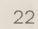

# 第 22 节：Lambda Expressions

```cpp
14: // Find the first element that is a multiple of divisor
15: vector<int>::iterator element;
16:     element = find_if(numsInVec.begin(),
17:                                numsInVec.end(), 
18:                               [divisor] (int dividend){return (dividend % divisor) == 0; });
19: 
20: if (element != numsInVec.end())
21:     {
22:         cout << "First element in vector divisible by " << divisor;
23:         cout << ": " << *element << endl;
24:     }
25: 
26:     return 0;
27: }
```

## 输出

The vector contains: {25, 26, 27, 28, 29, 30, 31}
nEnter divisor (> 0): 4
First element in vector divisible by 4: 28

## 分析

包含状态并作为谓词工作的 lambda 表达式在第 18 行。`divisor` 是状态变量，类似于你在列表 21.3 中看到的 `IsMultiple::Divisor`。因此，状态变量类似于你在 C++11 之前几天所组合的函数对象类中的成员。你现在能够将状态传递到你的 lambda 函数，并基于此自定义它的用法。

> 注意：列表 22.3 具有列表 21.4 的 lambda 表达式等实现，但没有函数对象类 `IsMultiple`。C++11 引入的 lambda 表达式减少了 16 行代码！

# 表达式的通用语法

lambda 表达式始终以方括号开始，并可以配置多个由逗号隔开的状态变量在捕获列表 `[...]`：
`[stateVar1, stateVar2](Type& param) { lambda code; }`

# Lambda Expressions 的通用语法

如果你想在 lambda 内部修改这些状态变量，添加关键字 `mutable`：

```cpp
[stateVar1, stateVar2](Type& param) mutable { // lambda code; }
```

注意此处提供的变量在 lambda 内部是可修改的，但在外部无效。如果你确保 lambda 内部对状态变量的修改在外部有效，你应该使用引用：

```cpp
[&stateVar1, &stateVar2](Type& param) { // lambda code; }
```

Lambda 可以接受多个输入参数，用逗号隔开：

```cpp
[stateVar1, stateVar2](Type1&, Type2 var) { // lambda; }
```

如果你想指定返回类型而不是让编译器推断，使用 `->`：

```cpp
[stateVar1, stateVar2](Type1 var, Type2 var) -> ReturnType
{ return; }
```

最后，复合语句 `{}` 可以包含多个语句，如此处所示用分号隔开：

```cpp
[stateVar1, stateVar2](Type1 var, Type2 var) -> ReturnType
{
Statement 1;
Statement 2;
return;
}
```

注意

> 如果你的 lambda 表达式跨越多行，则需要提供显式的返回类型。本节后面的列表 22.5 展示了一个指定返回类型并跨越多行的 lambda 函数。

因此，lambda 函数是函数对象的紧凑替换：

```cpp
template<typename Type1, typename Type2>
struct IsTooLong
{
    // State variables
    Type1 var;
    Type2 var2;
    // Constructor
    IsTooLong(const Type1& in1, Type2& in2) : var1(in1), var2(in2) {}
    // the actual purpose
    ReturnType operator()
    {
        Statement 1;
        Statement 2;
        return;
    }
};
```

# 二元函数的 Lambda Expression

二元函数接受两个参数并可选地返回一个值。相同的 lambda 表达式将：

```cpp
[...]](Type1& paramName, Type2& paramName) { // lambda; }
```

使用 `std::transform()` 将两个等大的 vector 相乘并将结果存储在第三个 vector 中，如列表 22.4 所示。

# 列表 22.4 用于乘两个容器元素并到第三部分的 Lambda Expression

```cpp
0: #include <vector>
1: #include <iostream>
2: #include <algorithm>

4: int main () {
5:     using namespace std;

7:     vector<int> vecMultiplicand{0, 1, 2, 3, 4};
8:     vector<int> vecMultiplier{100, 101, 102, 103, 104};
9:     // Holds the result of multiplication
10:    vector<int> vecResult;

12:    // Make space for the result
13:    vecResult.resize(vecMultiplier.size());

15:    transform(vecMultiplicand.begin(), // range of multiplicands
16:           vecMultiplicand.end(), // end of range
17:           vecMultiplier.begin(), // multiplier values
18:           vecResult.begin(), // range that holds result
19:           [](int a, int b) {return a * b; }); // lambda

21:    cout << "The contents of first vector: " << endl;
22:    for (size_t index = 0; index < vecMultiplicand.size(); ++index)
23:        cout << vecMultiplicand[index] << ' ';
24:    cout << endl;

26:    cout << "The contents of second vector: " << endl;
27:    for (size_t index = 0; index < vecMultiplier.size(); ++index)
28:        cout << vecMultiplier[index] << ' ';
29:    cout << endl;

31:    cout << "The result of the multiplication is: " << endl;
32:    for (size_t index = 0; index < vecResult.size(); ++index)
33:        cout << vecResult[index] << ' ';

35:    return 0;
36: }
```

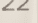

## 输出

The contents of the first vector are:
1 2 3 4
The contents of the second vector are:
100 101 102 103 104
The result of the multiplication is:
0 101 204 309 416

## 分析

所涉及 lambda 表达式在第 17 行作为 `std::transform()` 的参数。该算法接受两个范围作为输入并应用变换。该 lambda 表达式接受两个参数，通过 `std::transform()` 将两个等大的 vector 相乘，并将结果存储在第三个 vector 中。

# 用于二元谓的 Lambda Expression

一个返回真或假以帮助做决定的二元函数称为元谓词。这些谓词用于排序算法，如 `std::sort()`，它们对容器中的任何两个值调用元谓词以确定哪一个应该放在后面。二元谓词的通用语法是：

`[](Type1& paramName, Type2& paramName) { // return expression; }`

22.5 展示了一个用于排序的 lambda 表达式。

# 列表 22.5 用于 std::sort 的二元谓词 Lambda Expression 以实现忽略大小写的排序

```cpp
0: #include <algorithm>
1: #include <string>
2: #include <vector>
3: #include <iostream>
4: using namespace std;

6: template <typename T>
7: void DisplayContents(const T& input)
8: {
9:     for (auto element = input.cbegin();
10: element != input.cend();
11: ++ element
12: cout << element << endl;
13: }
```


```cpp
15: int main () {

16: vector<string> namesInVec{"Jim", "Jack", "Sam", "Anna"};

18:

19: cout << "The names in vector in order of insertion: " << endl;

20: DisplayContents(namesInVec);

21:

22: cout << "Order after case sensitive sort: " << endl;

23: sort(namesInVec.begin(),namesInVec.end());

24: DisplayContents(namesInVec);

25:

26: cout << "Order after sort ignoring case:" << endl;

27: sort(namesInVec.begin(),namesInVec.end(),
28: [](const string& str1, const string& str2) -> bool
29: {

30: string strLC; // LC = lowercase
31: {

```
# 用于二元谓词的 Lambda Expression
```cpp
32:   // 分配空间
33:   str1LC.resize(str1.size());

35:   // 将每个字符转换为小写
36:   transform(str1LC.begin(), str1LC.end(), str1LC.begin(),::tolower);

38:   string str2LC;
39:   str2LC.resize(str2.size());
40:   transform(str2LC.begin(), str2LC.end(), str2LC.begin(),::tolower);

42:   return(str1LC < str2LC);
43: } // lambda 结束
44:   ); // sort 结束

46:   DisplayContents(namesInVec);

48:   return 0;
49: }
```

# 输出 ▼

按插入顺序的 vector 中的名称：
jim
Jack
Sam
Anna
区分大小写排序后的顺序：
Anna
Jack
Sam
jim
忽略大小写排序后的顺序：
Anna
Jack
jim
Sam

# 分析 ▼

这里展示了一个跨越第 28-43 行的真正巨大的 lambda 函数，作为 `std::sort()` 的第三个参数！此 lambda 函数演示了 lambda 可以跨越多个语句，前提是返回类型必须显式指定，如第 28 行所示（`bool`）。输出展示了按插入顺序的 vector 内容，其中 "jim" 在 "Jack" 之前。在未提供 lambda 或谓词的情况下（如第 23 行所示），排序后的 vector 将 "jim" 排在 "Sam" 之后，因为这是通过使用 `string::operator<` 执行的 `std::less<` 的的区分大小写操作。最后，第 28-43 行中使用 lambda 表达式的忽略大小写 `sort()` 首先将字符串转换为小写然后进行比较，它将 "jim" 置于 "Jack" 之后，这通常是用户预期的。

> 列表 22.5 中这个异常巨大的 lambda 是列表 21.6 中类 `CompareStringNoCase` 的 lambda 版本，该类位于列表 21.7 中。

> 显然，这个示例还证明了列表 21.6 所示函数对象可以在多个 `std::sort()` 语句中重用（如果需要），也可以用于其他需要二元谓词的算法，而 lambda 在每次使用时都需要重写。

> 所以，当 lambda 短小、简洁且有效时，你才使用它们。

注意

- 请记住 lambda 表达式始终以 `[]` 或 `[state1, state2, ..]` 开始。
- 请记住，除非特别指定，否则在捕获列表 `[]` 中提供的状态变量在不使用 `mutable` 关键字的情况下是不可修改的。

不要

- 不要忘记 lambda 表达式是带有 `operator()` 的类或结构体的无名表示。
- 不要忘记在编写你的 lambda 表达式时使用 `const` 参数类型，例如 `{const T& value) // lambda 表达式 ;}`。
- 不要忘记在当 lambda 表达式在语句块 `{}` 中包含多个语句时，显式提到返回类型。
- 当 lambda 变得非常长并跨越多个语句时，不要选择 lambda 表达式而非函数对象，因为后者每次使用时都会重新定义，且不利于代码重用。

## 总结

在本节中，你学习了 C++11 引入的一个重要特性：lambda 表达式。你看到了 lambda 基本上是无名的函数对象，可以接收参数、拥有状态、返回值并可以是多行的。你学习了如何在 STL 算法中使用 lambda 代替函数对象，以帮助 `find()`、`sort()` 或 `transform()`。lambda 让 C++ 编程变得快速且高效，你应该在适用的地方尝试使用它们。

## 问答

Q 我应该总是优先使用 lambda 而不是函数对象吗？

A 像列表 22.5 所示跨越多行的 lambda 可能无法像易于重用的函数对象那样提高编程效率。

Q lambda 的状态参数是如何传递的，按值传递还是按引用传递？

A 当使用如下捕获列表编写 lambda 时：

```cpp
[Var1, Var2, ... N] (Type& Param1, ... ) { ...expression ; }
```

状态参数 `Var1` 和 `Var2` 是复制的（不是作为引用提供的）。如果你想让它们作为引用参数，使用此语法：

```cpp
[&Var1, &Var2, ... &N] (Type& Param1, ... ) { ...expression ; }
```

Q 如果使用捕获列表编写 lambda，在不使用 `mutable` 关键字的情况下，状态变量是可修改的吗？

Q 如果 lambda 是带有 `operator()` 的类或结构体的无名表示，使用 `const` 参数类型重要吗？

Q 如果 lambda 表达式包含多个语句，你必须显式提到返回类型吗？

Q 当 lambda 变得非常长并跨越多个语句时，是否应该使用函数对象代替？

Q 如果使用捕获列表编写 lambda，状态参数是按复制的还是按引用传递的？

Q 如果你想让状态参数成为引用参数，使用什么语法？

## 工作坊

工作坊提供问题来巩固你对材料的理解。

- 1. 如何使用 lambda 实现忽略大小写的排序？
- 2. 写一个 lambda 来查找匹配值的元素。
- 3. 写一个 lambda 来统计满足条件的元素数量。

- 1. 写一个 lambda 来填充范围。
- 2. 写一个 lambda 来排序元素。
- 3. 写一个 lambda 来查找子范围的首次出现的位置。

# 第 23 节：STL 算法

| 算法 | 描述 |
|---|---|
| 修改类算法 |  |
| `for_each()` | 对范围内的每个元素执行操作。当指定的参数修改了范围时，`for_each` 变为一个变异算法。 |
| `transform()` | 对指定范围内的每个元素应用指定的一元函数。 |
| 拷贝算法 |  |
| `copy()` | 将一个范围拷贝到另一个范围。 |
| `copy_backward()` | 将一个范围拷贝到另一个范围，并按反序排列元素。 |
| 移除算法 |  |
| `remove()` | 从指定范围中移除指定值的元素。 |
| `remove_if()` | 移除满足指定一元谓词的元素。 |
| `remove_copy()` | 将源范围中的所有元素拷贝到目标范围，但指定值的元素除外。 |
| `remove_copy_if()` | 将源范围中的所有元素拷贝到目标范围，但满足指定一元谓词的元素除外。 |
| `unique()` | 比较范围内的相邻元素并移除随后的重复项。重载版本使用二元谓词工作。 |
| 替换算法 |  |
| `replace()` | 将指定范围内每个匹配指定值的元素替换为替换值。 |
| `replace_if()` | 将指定范围内每个匹配指定条件的元素替换为替换值。 |
| 排序算法 |  |
| `sort()` | 使用指定的排序标准对范围内的元素进行排序，该标准是一个提供严格弱序的二元谓词。`sort` 可能会改变等价元素的相对位置。 |
| `stable_sort()` | 稳定排序与 `sort` 类似，但也保留顺序。 |
| `partial_sort()` | 对范围内范围内指定数量的元素进行排序。 |

# STL 算法的使用

| 算法 | 描述 |
|---|---|
| `partial_sort_copy()` | 将指定源范围的元素拷贝到目标范围，并按排序顺序存储它们。 |
| `partition()` | 给定指定范围，将元素分为两个部分：首先是满足一元谓词的元素，其余元素。可能不会维护集合中元素的相对顺序。 |
| `stable_partition()` | 将输入范围划分为两个集合，与 `partition` 一样，它保持了相对排序。 |
| `binary_search()` | 用于确定元素是否存在排序集合中。 |
| `lower_bound()` | 返回一个迭代器，根据其值或提供的二元谓词，指向排序集合中可能插入元素的第一个位置。 |
| `upper_bound()` | 返回一个迭代器，根据其值或提供的二元谓词，指向排序集合中可能插入元素的最后一个位置。 |

# STL 算法的使用

表 23.1 和 23.2 中提到的 STL 算法的使用最好通过动手实践课程来学习。最后，练习使用接下来的代码示例，并开始将它们应用到你的程序中。

# 根据值或条件查找元素

给定如 `vector` 等容器，STL 算法 `find()` 和 `find_if()` 分别帮助你找到匹配或满足条件的元素。`find()` 的用法遵循此模式：

```cpp
auto element = find (numsInVec.begin(), // 范围开始
                    numsInVec.end(),    // 范围结束
                    numToFind);        // 要查找的元素

// 检查 find() 是否成功
if (element != numsInVec.end())
    cout << "Result: Value found!" << endl;
```

`find_if()` 类似，并要求你提供一个一元谓词（返回真或假的一元函数）作为第三个参数。

```cpp
auto evenNum = find_if(numsInVec.cbegin(), // 范围开始
                                numsInVec.cend(), // 范围结束
                                [](int element) { return (element % 2) == 0; });

if (evenNum != numsInVec.cend())
    cout << "Result: Value found!" << endl;
```

因此，两个 `find` 都返回一个迭代器，你需要将其与 `end()` 或 `cend()` 进行比较以验证查找操作是否成功。如果此检查成功，你可以继续使用该迭代器。23.1 展示了如何使用 `find()` 在 vector 中定位一个值，以及如何使用 `find_if()` 定位第一个偶值。

# 列表 23.1 使用 find() 在 vector 中定位整数，使用 find_if 配合 Lambda 表达式中的一元谓词定位第一个偶数

```cpp
#include <iostream>
#include <algorithm>
#include <vector>

int main()
{
    using namespace std;
    vector<int> numsInVec(2017, 0, -1, 42, 10101, 25);
    cout << "Enter number to find in collection: ";
    int numToFind = 0;
    cin >> numToFind;
    auto element = find(numsInVec.cbegin(), // 范围开始
                               numsInVec.cend(), // 范围结束
                               numToFind); // 要查找的元素
    // 检查 find 是否成功
    if (element != numsInVec.cend())
        cout << "Value " << element << " found!" << endl;
    else
        cout << "No element contains value " << numToFind << endl;
    cout << "Finding first even number using find_if: " << endl;
    auto evenNum = find_if(numsInVec.cbegin(), // 范围开始
                               numsInVec.cend(), // 范围结束
                               [](int element) { return (element % 2) == 0; });

    if (evenNum != numsInVec.cend())
        cout << "Result: Value found!" << endl;
}
```

# STL 算法的使用

```cpp
size_t numEvenVecs = count_if(numsInVec.cbegin(), numsInVec.cend(), isEven<int>);
cout << "Number of even elements: " << numEvenVecs << endl;
cout << "Number of odd elements: ";
cout << numsInVec.size() - numEvenVecs << endl;
return 0;
```

## 输出

'01' 的出现次数: 1

偶数个数: 2

奇数个数: 4

## 分析

第 16 行使用 `count()` 来确定 vector 中 0 的出现次数。

同样地，第 19 行使用 `count_if()` 来确定 vector 中偶数的个数。注意第三个参数，它是在第 5–9 行中定义的一元谓词 `IsEven()`。vector 中奇数的个数是通过从 `size()` 返回的元素总数中减去 `count_if()` 的返回值计算得出的。

注意

> 列表 23.2 在 `count_if()` 中使用了谓词函数 `IsEven()`，而 23.1 则在 `find_if()` 中使用 lambda 函数执行 `IsEven()` 的工作。lambda 版本减少了代码行数，但你应该记住这两个示例是合并合并的，`IsEven()` 可以同时用于 `find_if()` 和 `count_if()`，从而增加了重用机会。

# 在集合中查找元素或范围

列表 23.1 演示了你如何在容器中找到一个元素。有时，你需要找到一个值范围或某种模式。在这种情况下，你应该使用 `search` 或 `search_n()`。`search()` 可以用于检查一个范围是否包含在另一个范围内：

```cpp
auto range = search (numsInVec.cbegin(), // 搜索的起始范围
                   numsInVec.cend(), // 搜索的结束范围
                   numsInList.cbegin(), // 要查找的起始范围
                   numsInList.cend()); // 要查找的结束范围
```

`search_n()` 可用于检查容器是否存在连续的 n 个某个值：

```cpp
auto partialRange = search_n(numsInVec.begin(), // 起范围
                            numsInVec.end(), // 结束范围
                            3, // 要查找的个数
                            9); // 要查找的值
```

这两个函数都返回指向找到的模式第一个实例的迭代器，在使用该迭代器之前需要将其与 `end()` 进行比较。列表 23.3 演示了 `search()` 和 `search_n()` 的用法。

# 列表 23.3 使用 search() 和 search_n() 在集合中查找范围


```cpp
0: #include <algorithm>
1: #include <vector>
2: #include <list>
3: #include <iostream>
4: using namespace std;
5:
6: template <typename T>
7: void DisplayContents(const T& container)
8: {
9:   for (auto element = container.begin();
10:  element != container.end();
11:   ++ element)
12:  cout << *element << ' ' << ' ';
13:
14:  cout << endl;
15: }
16:
17: int main()
18: {
19:  vector<int> numsInVec(2017, 0, -42, 10101, 25, 9, 9, 9);
20:  list<int> numsInList({-1, 42, 10101});
21:
22:  cout << "The contents of the sample vector: " << endl;
23:  DisplayContents(numsInVec);
24:
25:  cout << "The contents of the sample list are: " << endl;
26:  DisplayContents(numsInList);
27:
28:  cout << "search() for the contents of list in vector: " << endl;
29:  auto range = search(numsInVec.begin(), // 搜索的起始范围
30:  numsInVec.end(), // 要查找的结束范围
31:  numsInList.begin(), // 要查找的起始范围
32:  numsInList.end()); // 要查找的结束范围
33:
34:  // 检查 search 是否找到了匹配项
35: if (range != numsInVec.end())
36: {
37:  cout << "Sequence list found in vector at position: ";
38:  cout << distance(numsInVec.cbegin(), range) << endl;
39: }
40: cout << "Searching {9, 9, 9} in vector using search_n(): " << endl;
41: auto partialRange = search_n(numsInVec.cbegin(), // 起始范围
42:                            numsInVec.end(), // 结束范围
43:                            3, // 要查找的项数
44:                            9); // 要查找的项
45: if (partialRange != numsInVec.end())
46:  cout << "Sequence {9, 9, 9} found in vector at position: ";
47:  cout << distance(numsInVec.cbegin(), partialRange) << endl;
48: }
49: return 0;
```

## 输出

示例 `vector` 的内容：

2017 0 -42 10101 25 9 9 9

示例 `list` 的内容：

-1 42 10101

在 `vector` 中搜索 `list` 的内容：

在 `vector` 中找到序列列表，位置为：2

在 `vector` 中使用 `search_n()` 搜索 `{9, 9, 9}`:

在 `vector` 中找到序列 `{9, 9, 9}`,位置为：6

## 分析

示例从两个容器开始，一个 `vector` 和一个 `list`，最初填充了整数值。如第 29 行所示，使用 `search()` 来查找 `vector` 中是否存在该 `list`。由于我们想在由两个类的 `cbegin()` 和 `end()` 方法返回的范围内进行搜索，因此它实际上演示了迭代器如何将算法与容器连接。容器的物理特性对搜索算法没有意义，因为它们只与迭代器一起工作。第 42 行使用 `search_n()` 来查找 `vector` 中 `{9, 9, 9}` 的首次出现。

# 将容器中的元素初始化为特定值

`fill()` 和 `fill_n()` 是帮助设置给定内容的 STL 算法。`fill()` 用于填充给定范围的内容：

```cpp
vector<int> numsInVec(3);
```

正如其名，`fill_n()` 需要起始位置、数量和值：

```cpp
fill_n(numsInVec.begin(), 3, 9);
```

列表 23.4 演示了这些算法如何初始化一个 `vector`。

# 列表 23.4 使用 `fill()` 和 `fill_n()` 将容器元素为特定值

```cpp
0: #include <algorithm>
1: #include <vector>
2: #include <list>
3: #include <iostream>
4: using namespace std;
5:
6: template <typename T>
7: void DisplayContents(const T& container)
8: {
9:   for (auto element = container.begin();
10:  element != container.end();
11:   ++ element)
12:  cout << *element << ' ' << ' ';
13:
14:  cout << endl;
15: }
16:
17: int main()
18: {
19:  vector<int> numsInVec(2017, 0, -42, 10101, 25, 9, 9, 9);
20:  list<int> numsInList({-1, 42, 10101});
21:
22:  cout << "The contents of the sample vector: " << endl;
23:  DisplayContents(numsInVec);
24:
25:  cout << "The contents of the sample list are: " << endl;
26:  DisplayContents(numsInList);
27:
28:  cout << "search() for the contents of list in vector: " << endl;
29:  auto range = search(numsInVec.begin(), // 搜索的起始范围
30:  numsInVec.end(), // 要查找的结束范围
31:  numsInList.begin(), // 要查找的起始范围
32:  numsInList.end()); // 要查找的结束范围
33:
34:  // 检查 search 是否找到了匹配项
35: if (range != numsInVec.end())
36: {
37:  cout << "Sequence list found in vector at position: ";
38:  cout << distance(numsInVec.cbegin(), range) << endl;
39: }
40: cout << "Searching {9, 9, 9} in vector using search_n(): " << endl;
41: auto partialRange = search_n(numsInVec.cbegin(), // 起始范围
42:                            numsInVec.end(), // 结束范围
43:                            3, // 要查找的项数
44:                            9); // 要查找的项
45: if (partialRange != numsInVec.end())
46:  cout << "Sequence {9, 9, 9} found in vector at position: ";
47:  cout << distance(numsInVec.cbegin(), partialRange) << endl;
48: }
49: return 0;
```

## 输出

示例 `vector` 的内容：

2017 0 -42 10101 25 9 9 9

示例 `list` 的内容：

-1 42 10101

在 `vector` 中搜索 `list` 的内容：

在 `vector` 中找到序列列表，位置为：2

在 `vector` 中使用 `search_n()` 搜索 `{9, 9, 9}`:

在 `vector` 中找到序列 `{9, 9, 9}`,位置为：6

## 分析

示例从两个容器开始，一个 `vector` 和一个 `list`，最初填充了整数值。如第 29 行所示，使用 `search()` 来查找 `vector` 中是否存在该 `list`。由于我们想在由两个类的 `cbegin()` 和 `end()` 方法返回的范围内进行搜索，因此它实际上演示了迭代器如何将算法与容器连接。容器的物理特性对搜索算法没有意义，因为它们只与迭代器一起工作。第 42 行使用 `search_n()` 来查找 `vector` 中 `{9, 9, 9}` 的首次出现。

# 使用运行时生成的值初始化元素

正如 `fill()` 和 `fill_n()` 函数使用特定值填充集合，STL 算法 `generate()` 和 `generate_n()` 则使用一元函数的返回值初始化集合。

你可以使用 `generate()` 使用一元函数的返回值填充范围：

```cpp
generate(numsInVec.begin(), numsInVec.end());
```

`generate_n()` 与 `generate()` 类似，只是你提供了要赋值的元素数量而不是范围的结束边界：

```cpp
generate_n(numsInList.begin(), 5);
```

因此，你可以使用这两个算法将集合的内容初始化为文件的内容，例如或随机值，如列表 23.5 所示。

# 列表 23.5 使用 `generate()` 和 `generate_n()` 初始化随机值集合

```cpp
0: #include <algorithm>
1: #include <vector>
2: #include <list>
3: #include <iostream>
4: #include <ctime>
5:
6: int main ()
7: {
8:   using namespace std; // 使用时间种子随机生成器
9:   srand(NULL);
10:
11:  vector <int> numsInVec(5);
12:  generate(numsInVec.begin(), numsInVec.end(), // 范围
13:  rand()); // 生成函数
14:
15:  cout << "Elements in the vector are: ";
16:  for (size_t index = 0; index < numsInVec.size(); ++ index)
17:  cout << numsInVec[index] << " ";
18:  cout << endl;
19:
20:  list <int> numsInList(5);
21:  generate_n(numsInList.begin(), 3, rand);
22:
23:  cout << "Elements in the list are: ";
24:  for (auto element = numsInList.begin();
```

# STL 算法的使用

```cpp
25:   element != numsInList.end();
26:   ++ element
27:   cout << element << ' ';
28:
29:   return 0;
30: }
```

# 输出

`vector` 中的元素为: 41 18467 6334 26500 19169

`list` 中的元素为: 15724 11478 29358 0 0


# 分析

使用当前时间作为种子的随机数生成器的用法与第 9 行所示的方法不同，这意味着每次运行应用程序时的输出都是不同的。列表 23.5 使用第 12 行的 `generate()` 函数填充 `vector` 中的所有元素，并使用第 21 行的 `generate_n()` 使用生成器 `rand()` 提供的随机值填充 `list` 的前三个元素。注意，`generate()` 函数接受一个范围作为输入，并对范围内的每个元素调用指定的函数对象 `rand()`。相比之下，`generate_n()` 仅接受起始位置。然后根据 `count` 参数指定的次数调用指定的函数对象 `rand()`，以覆盖多个元素的内容。超出指定偏移量的容器中的元素将保持不变。

# 使用 `for_each()` 处理范围内的元素

`for_each()` 算法对所提供范围内的每个元素应用一元函数对象。`for_each()` 的用法如下：


```cpp
fnObjType retValue = for_each(start_of_range, end_of_range, unaryFunctionObject);
```

该一元函数也可以是接受一个参数的 lambda 表达式。

返回值表示 `for_each()` 返回了用于处理提供范围内每个元素的函数对象（也称为仿函数 functor）。该规范的含义是，使用结构体或类作为函数对象可以帮助存储状态信息，你稍可以在 `for_each()` 完成后查询这些信息。列表 23.6 演示了这一点，它使用函数对象显示范围内的元素，并用它来统计显示的元素数量。

### 列表 23.6 使用 for_each() 显示序列的内容

```cpp
0: #include <algorithm>
1: #include <iostream>
2: #include <vector>
3: #include <string>
4: using namespace std;
5:
6: template <typename elementType>
7: struct DisplayElementcount
8: {
9:     int count;
10:    DisplayElementcount() : count (0) {}
11:
12:    void operator () (const elementType& element)
13:    {
14:        count++;
15:        cout << element << ' ';
16:    }
17: };
18:
19: int main (
20:    vector<int> numsInVec(2017, 0, -1, 42, 10101, 25);
21:
22:    cout << "Elements in vector are: " << endl;
23:    DisplayElementcount<int> functor = 
24:        for_each(numsInVec.begin(), // 范围起始
25:             numsInVec.end(), // 范围结束
26:             DisplayElementcount<int>()); // functor
27:
28:    cout << endl;
29:
30:    // 使用 for_each 返回值中存储的状态！
31:    cout << " " << functor.count << " elements displayed" << endl;
32:
33:    string str("*for_each and strings*!");
34:    cout << "Sample string: " << str << endl;
35:
36:    cout << "Characters displayed using lambda:" << endl;
37:    int numChars = 0;
38:    for_each(str.begin(),
39:             str.end(),
40:             [&numChars](char c) { cout << c << ' '; ++numChars; });
41:
42:    cout << endl;
43:    cout << "" << numChars << " characters displayed" << endl;
44:
45:    return 0;
46:
47: )
```

### STL 算法的使用

`vector` 中的元素为:

2017 0 -1 42 10101 25

'6' elements displayed

Sample string: for_each and strings!

Characters displayed using lambda:

for_each and strings!

'21' characters displayed

#### 分析

代码示例演示了第 25 行和第 38 行调用的 `for_each()` 的用，以及 `for_each()` 返回的函数对象 `functor`，该对象被设计为在成员 `count` 中存储被调用的次数。代码包含两个示例范围，一个包含在 `vector` `numsInVec` 中，另一个是 `std::string` `str`。第一次调用 `for_each()` 使用 `DisplayElementCount` 作为一元谓词，第二次使用 lambda 表达式。`for_each()` 对提供范围内的每个元素调用 `operator()`，这反过来又在屏幕上打印元素并递增内部计数器。当 `for_each()` 完成时返回计数器，成员 `count` 告诉我们对象被使用的次数。这种在算法返回的对象中存储信息（或状态）的功能在实际编程中非常有用。第 38 行的 `for_each()` 使用 lambda 表达式与第 25 行的 `std::string` 版本的操作相同。

### 使用 transform() 对范围进行转换

`std::for_each()` 和 `std::transform()` 的相似之处在于它们都会对源范围内的每个元素调用函数。然而，`std::transform()` 有两个版本。第一个版本接受一元函数，常用于使用 `toupper()` 或 `tolower()` 将字符串转换为大写或小写：

```cpp
string str ("THIS IS TEST");
transform(str.begin(), str.end(), // 源范围
LowerCase.begin(), // 范围
tolower());
```

第二个版本接受二元函数，允许 `transform()` 处理来自两个范围的元素对：

```cpp
//两个 vectors 结果存入 deque
transform(numsInVec.begin(), // 范围 1 起始
numsInVec.end(), // 范围 1 结束
sumDeque.begin(), // deque 起始
plus<int>());
```

两个 `transform()` 版本都会将转换结果赋值给指定的范围，这与作用于单一范围的 `for_each()` 不同。`std::transform()` 的用法在 23.7 中演示。

#### 列表 23.7 使用一元和二元函数 std::transform

```cpp
0: #include <algorithm>
1: #include <string>
2: #include <vector>
3: #include <deque>
4: #include <iostream>
5: #include <functional>
6:
7: int main(){
8: {
9:     using namespace std;
10:
11:    string str("THIS is a TEST!");
12:    cout << "The sample string is: " << str << endl;
13:
14:    string strLowerCase;
15:    strLowerCase.resize(str.size());
16:
17:    transform(str.begin(), // 源范围起始
18:           str.end(), // 源范围结束
19:           strLowerCase.begin(), // 范围
20:           tolower()); // 一元函数
21:
22:    cout << "Result of 'transform' on the string with 'tolower':" << endl;
23:    cout << strLowerCase << endl;
24:
25:    // 两个整数 vector
26:    vector<int> numsInVec{2017, 0, -1, 42, 10101, 25 };
27:    vector<int> numsInVec2(numsInVec.size(), -1);
28:
29:    // 用于存储加法结果的目标范围
30:    deque<int> sumInDeque(numsInVec.size());
31:
32:    transform (numsInVec.begin(), // 源范围 1 起始
33:             numsInVec.end(), // 源范围 1 结束
34:             numsInVec2.begin(), // 源范围 2 起始
35:             sumDeque.begin(), // deque 起始
36:             plus<int>()); // 二元函数
37:
38:    cout << "transform' using binary function 'plus':" << endl;
39:    cout << "Index " << Vector1 + Vector2 << " Result (in Deque)" << endl;
40:    for (size_t i = 0; i < numsInVec.size(); ++i) {
41:
42:    cout << "index " << "\t" << numsInVec[i] << " \t+ ";
43:    cout << numsInVec2[i] << " \t = "
44:    cout << sumDeque[i] << endl;
45: }
46:
47:
48:    return 0;
49: }
```

#### 输出

示例字符串是: THIS is a TEST string!

使用 'tolower' 对字符串进行 'transform' 的结果：

"this is a test string!"

使用二元函数 'plus' 进行 'transform' 的结果：

Index Vector1 + Vector2 = Result (in Deque)

| 0 | 2017 | +1 | -1 |

|---|---|---|---|

| 1 | 0 | +1 | -1 |

| 2 | -1 | +1 | -2 |

| 3 | 42 | -1 | 41 |

| 4 | 10101 | +1 | 10100 |

| 5 | 25 | +1 | 24 |

#### 分析

示例演示了 `std::transform()` 的两个版本：一个版本作用于单一范围并使用一元函数 `tolower()`（如第 20 行所示），另一个版本作用于两个范围并使用二元函数 `plus()`（如第 36 行所示）。第一个版本将字符串的大小逐个字符地转换为小写。如果你使用 `toupper()` 代替 `tolower()`，则会导致转换为大写。另一个 `std::transform()` 版本（如 32-36 行所示）作用于两个范围的元素（在本例中为两个 `vector`），并使用 STL 函数 `plus()`（由头文件 `<functional>` 提供）的二元谓词将其相加。`std::transform()` 每次处理一对，将其提供给二元函数 `plus`，并将结果赋予目标范围中的一个元素——该元素恰好属于一个 `std::deque`。

请注意，用于存储结果的容器的变化纯粹是为了演示目的。它仅展示了如何使用迭代器将容器及其实现从 STL 算法中抽象出来；`transform()` 作为一个算法，它处理的是范围，并且实际上不需要知道实现这些范围的容器细节。因此，输入范围恰好在 `vector` 中，而输出范围恰好是一个 `deque`，只要定义范围的边界（作为 `transform` 的输入参数提供）是有效的，一切就能正常工作。

### 拷贝和删除操作

STL 提供了三个显著的拷贝函数：`copy()`、`copy_if()` 和 `copy_backward()`。`copy()` 能够按正向方向将源范围的内容分配给目标范围：

```cpp
auto lastElement = copy (numInList.begin(), // 源范围开始
numInList.end(),             // 源范围结束
numInVec.begin());    // 目标范围开始
```

`copy_if()` 是 C++11 开始引入的标准库扩展，它在所提供的一元谓词返回 `true` 时复制元素：

```cpp
// 将 list 中的奇数拷贝到 vector
copy_if (numInList.begin(), numInList.end(),
lastElement, // 目标范围中的拷贝位置
[](int](element) { return (element % 2) == 1});
```

`copy_backward()` 按反向将内容分配到目标范围：

```cpp
copy_backward (numInList.cbegin(),
numInList.rend(),
numInVec.end());
```

另一方面，`remove()` 会删除容器中匹配指定值的元素：

```cpp
// 删除所有 '0'，使用 erase 调整 vector 大小
auto newEnd = remove (numInVec.begin(), numInVec.end(), 0);
numInVec.erase(newEnd, numInVec.end());
```

`remove_if()` 使用一元谓词并从容器中移除那些谓词求值为真的元素：

```cpp
// 使用 remove_if 从 vector 中移除所有奇数
newEnd = remove_if (numInVec.begin(), numInVec.end(),
[int](int num) { return (num % 2) == 1}); // 谓词
numInVec.erase(newEnd, numInVec.end()); // 调整大小
```

### STL 算法的使用

列表 23.8 展示了拷贝和删除函数的使用。

#### 列表 23.8 演示了如何使用 copy(), copy_if(), remove() 和 remove_if() 将 list 拷贝到 vector，并移除 0 和偶数


```cpp
0: #include <algorithm>
1: #include <vector>
2: #include <list>
3: #include <iostream>
4: using namespace std;
5: 
6: template <typename T>
7: void DisplayContents(const T& container)
8: {
9:   for (auto element = container.begin();
10:    element != container.end();
11:    ++element)
12:    cout << element << ' ';
13: 
14:  cout << "| Number of elements: " << container.size() << endl;
15: }
16: 
17: int main()
18: {
19:   list<int> numsInList(2017, 0, -1, 42, 10101, 25);
20: 
21:   cout << "Source (list) contains:" << endl;
22:   DisplayContents(numsInList);
23: 
24:   // 初始化 vector 以存储与 list 2倍的元素
25:   vector<int> numsInVec(numsInList.size() * 2);
26: 
27:   auto lastElement = copy(numsInList.begin(), // 源范围开始
28:                          numsInList.end(), // 源范围结束
29:                          numsInVec.begin());// 目标范围开始
30: 
31:   // 将 list 中的奇数拷贝到 vector
32:   copy_if(numsInList.begin(), numsInList.end(),
33:           lastElement,
34:           [](int element) {return (element % 2) != 0);});
35: 
36:   cout << "Destination (vector) after copy and copy_if:" << endl;
37:   DisplayContents(numsInVec);
38: 
39:   // 删除所有 '0'，使用 erase 调整 vector 大小
40:   auto newEnd = remove(numsInVec.begin(), numsInVec.end(), 0);
41:   numsInVec.erase(newEnd, numsInVec.end());
42: 
43:   // 使用 remove_if 从 vector 中移除所有奇数
44:   newEnd = remove_if(numsInVec.begin(), numsInVec.end(),
45:                      [](int element) {return (element % 2) != 0);});
46:   numsInVec.erase(newEnd, numsInVec.end()); // 调整大小
47:   cout << "Destination (vector) after remove, remove_if:" << endl;
48:   DisplayContents(numsInVec);
49:   return 0;
50: }
```

![img/ccb6520e9d7dbb1b25f5e4ac]

# LESSON 23: STL 算法

## 输出

Source (list) contains:

0 0 -1 42 10101 25 | Number of elements: 6

Destination (vector) after copy and copy_if:

0 0 -1 42 10101 25 -1 42 10101 25 | Number of elements: 12

Destination (vector) after remove, remove_if:

-1 42 10101 25 42 10101 25 | Number of elements: 7

## 分析

`copy()` 的用法在第 27 行，它按正向方向将源范围的内容分配到目标范围；`copy_if()` 在第 32 行，在所提供的一元谓词返回 `true` 时复制元素；`remove()` 在第 40 行返回一个迭代器，指向新范围的末尾，通过 `erase` 调整了 `vector` 的大小；而 `remove_if()` 在第 44 行使用一元谓词从容器中移除那些谓词求值为真的元素，通过 `erase` 调整了大小（第 46 行）。

`remove()` 删除了容器中匹配指定值的元素。

`remove_if()` 使用一元谓词并从容器中移除那些谓词求值为真的元素。

STL 提供了三个显著的拷贝函数：`copy()`、`copy_if()` 和 `copy_backward()`。`copy()` 能够按正向方向将源范围的内容分配给目标范围：

`copy_if()` 是 C++11 开始引入的标准库扩展，它在所提供的一元谓词返回 `true` 时复制元素。

`copy_backward()` 按反向将内容分配到目标范围：

`remove()` 会删除容器中匹配指定值的元素。

`remove_if()` 使用一元谓词并从容器中移除那些谓词求值为真的元素。

请注意，用于存储结果的容器的变化纯粹是为了演示目的。它仅展示了如何使用迭代器将容器及其实现从 STL 算法中抽象出来；`transform()` 作为一个算法，它处理的是范围，并且实际上不需要知道实现这些范围的容器细节。因此，输入范围恰好在 `vector` 中，而输出范围恰好是一个 `deque`，只要定义范围的边界（作为 `transform` 的输入参数提供）是有效的，一切就能正常工作。

## 拷贝和删除操作

STL 提供了三个显著的拷贝函数：`copy()`、`copy_if()` 和 `copy_backward()`。`copy()` 能够按正向方向将源范围的内容分配给目标范围：

```cpp
auto lastElement = copy (numInList.begin(), // 源范围开始
numInList.end(),             // 源范围结束
numInVec.begin());    // 目标范围开始
```

`copy_if()` 是 C++11 开始引入的标准库扩展，它在所提供的一元谓词返回 `true` 时复制元素：

```cpp
// 将 list 中的奇数拷贝到 vector
copy_if (numInList.begin(), numInList.end(),
lastElement, // 目标范围中的拷贝位置
[](int](element) { return (element % 2) == 1});
```

`copy_backward()` 按反向将内容分配到目标范围：

```cpp
copy_backward (numInList.cbegin(),
numInList.rend(),
numInVec.end());
```

`remove()` 会删除容器中匹配指定值的元素：

```cpp
// 删除所有 '0'，使用 erase 调整 vector 大小
auto newEnd = remove (numInVec.begin(), numInVec.end(), 0);
numInVec.erase(newEnd, numInVec.end());
```

`remove_if()` 使用一元谓词并从容器中移除那些谓词求值为真的元素：

```cpp
// 使用 remove_if 从 vector 中移除所有奇数
newEnd = remove_if (numInVec.begin(), numInVec.end(),
[int](int num) { return (num % 2) == 1}); // 谓词
numInVec.erase(newEnd, numInVec.end()); // 调整大小
```

## STL 算法的使用

### 列表 23.8 演示了如何使用 copy(), copy_if(), remove() 和 remove_if() 将 list 拷贝到 vector，并移除 0 和偶数

```cpp
0: #include <algorithm>
1: #include <vector>
2: #include <list>
3: #include <iostream>
4: using namespace std;
5: 
6: template <typename T>
7: void DisplayContents(const T& container)
8: {
9:   for (auto element = container.begin();
10:    element != container.end();
11:    ++element)
12:    cout << element << ' ';
13: 
14:  cout << "| Number of elements: " << container.size() << endl;
15: }
16: 
17: int main()
18: {
19:   list<int> numsInList(2017, 0, -1, 42, 10101, 25);
20: 
21:   cout << "Source (list) contains:" << endl;
22:   DisplayContents(numsInList);
23: 
24:   // 初始化 vector 以存储与 list 2倍的元素
25:   vector<int> numsInVec(numsInList.size() * 2);
26: 
27:   auto lastElement = copy(numsInList.begin(), // 源范围开始
28:                          numsInList.end(), // 源范围结束
29:                          numsInVec.begin());// 目标范围开始
30: 
31:   // 将 list 中的奇数拷贝到 vector
32:   copy_if(numsInList.begin(), numsInList.end(),
33:           lastElement,
34:           [](int element) {return (element % 2) != 0);});
35: 
36:   cout << "Destination (vector) after copy and copy_if:" << endl;
37:   DisplayContents(numsInVec);
38: 
39:   // 删除所有 '0'，使用 erase 调整 vector 大小
40:   auto newEnd = remove(numsInVec.begin(), numsInVec.end(), 0);
41:   numsInVec.erase(newEnd, numsInVec.end());
42: 
43:   // 使用 remove_if 从 vector 中移除所有奇数
44:   newEnd = remove_if(numsInVec.begin(), numsInVec.end(),
45:                      [](int element) {return (element % 2) != 0);});
46:   numsInVec.erase(newEnd, numsInVec.end()); // 调整大小
47:   cout << "Destination (vector) after remove, remove_if:" << endl;
48:   DisplayContents(numsInVec);
49:   return 0;
50: }
```

![img/ccb6520e9d7dbb1b25f5e4ac]

# LESSON 23: STL 算法

## 输出

Source (list) contains:

0 0 -1 42 10101 25 | Number of elements: 6

Destination (vector) after copy and copy_if:

0 0 -1 42 10101 25 -1 42 10101 25 | Number of elements: 12

Destination (vector) after remove, remove_if:

-1 42 10101 25 42 10101 25 | Number of elements: 7

## 分析

`copy()` 的用法在第 27 行，它按正向方向将源范围的内容分配到目标范围；`copy_if()` 在第 32 行，在所提供的一元谓词返回 `true` 时复制元素；`remove()` 在第 40 行返回一个迭代器，指向新范围的末尾，通过 `erase` 调整了 `vector` 的大小；而 `remove_if()` 在第 44 行使用一元谓词从容器中移除那些谓词求值为真的元素，通过 `erase` 调整了大小（第 46 行）。

`remove()` 删除了容器中匹配指定值的元素。

`remove_if()` 使用一元谓词并从容器中移除那些谓词求值为真的元素。

STL 提供了三个显著的拷贝函数：`copy()`、`copy_if()` 和 `copy_backward()`。`copy()` 能够按正向方向将源范围的内容分配给目标范围：

# STL 算法的使用

同样，在显示集合之前需要删除重复项。要移除相邻的重复值，请使用算法 `unique()`：

```cpp
auto newEnd = unique(numsInVec.begin(), numsInVec.end());
numsInVec.erase(newEnd, numsInVec.end()); // 调整大小
```

为了快速查找，STL 为你提供了 `binary_search()`，它只对排序后的容器有效：

```cpp
bool elementFound = binary_search(numsInVec.begin(), numsInVec.end(), 2011);
if (elementFound)
  cout << "Element found in the vector!" << endl;
```

列表 23.10 展示了 STL 算法 `algorithms::sort()`，它可以对一个范围进行排序，`std::binary_search()`，它可以搜索已排序的范围，以及 `std::unique()`，它可以在排序（操作）后消除相邻的重复元素。

# 列表 23.10 使用 sort()、binary_search() 和 unique()

```cpp
0: #include <algorithm>
1: #include <vector>
2: #include <string>
3: #include <iostream>
4: using namespace std;
5:
6: template <typename T>
7: void DisplayContents(const T& container)
8: {
9:   for (auto element = container.begin();
10:    element != container.end();
11:     ++element)
12:    cout << element << endl;
13: }
14: }
15: int main ()
16: {
17:  vector<string> vecNames("John", "jack", "sean", "Anna");
18:
19:  // 插入一个重复项
20:  vecNames.push_back("jack");
21:
22:  cout << "The initial contents of the vector are: " << endl;
23:  DisplayContents(vecNames);
24:
25:  cout << "The sorted vector contains names in the order:" << endl;
26:  sort(vecNames.begin(), vecNames.end());
```

# 课程 23：STL 算法


```cpp
DisplayContents(vecNames);
cout << "Searching for \"John\" using 'binary_search':" << endl;
bool elementFound = binary_search(vecNames.begin(), vecNames.end(), 
                                 "John");

if (elementFound)
    cout << "Result: \"John\" was found in the vector!" << endl;
else
    cout << "Element not found " << endl;
// 删除重复项
auto newEnd = unique(vecNames.begin(), vecNames.end());
vecNames.erase(newEnd, vecNames.end());
cout << "The contents of the vector after using 'unique':" << endl;
DisplayContents(vecNames);
return 0;
```

# 输出

vector 的初始内容为：

John

jack

sean

Anna

jack

排序后的 vector 包含名称顺序：

Anna

John

jack

jack

sean

使用 'binary_search' 查找 "John":

Result: "John" was found in the vector!

使用 'unique' 之后 vector 的内容为：

Anna

John

jack

sean

# 分析

前面的代码对第 26 行的示例 vector `vecNames` 进行了排序，然后在第 30 行使用 `binary_search()` 在其中查找 "John"。同样，在第 39 行使用 `std::unique()` 来删除相邻重复项的第二次出现。注意，`unique()` 像 `remove()` 一样不会调整容器的大小。它会导致值的移动，但不会减少元素的总数。为了确保容器末尾没有意外的未知值，请务必始终在调用 `unique()` 之后紧跟使用 `unique()` 返回的迭代器调用 `vector::erase()`，如第 40 行所示。

| 像 `binary_search()` 这样的算法仅在排序后的容器中有效。 | 在未排序的 vector 上使用此算法可能会导致不可预期的后果 |

## 注意

`stable_sort()` 的用法与你之前看到的 `sort()` 相同。`stable_sort()` 确保排序后的元素的相对顺序得以保持。保持相对顺序是以性能为代价的——这是一个需要考虑的因素，特别是当元素的相对顺序并非本质要求时。

# Note

# 划分范围

`std::partition()` 有助于将输入范围划分为部分：一个满足一元谓词，另一个不满足。

```cpp
bool IsEven(const int& num) // 一元谓词
{
    return ((num % 2) == 0);
}
npartition(numsInVec.begin(), numsInVec.end(), IsEven);
```

然而，`std::partition()` 不保证每个分区内元素的相对顺序。为了在重要时保持相对顺序，你应该使用 `std::stable_partition()`：

`stable_partition(numsInVec.begin(), numsInVec.end(), IsEven);`

列表 23.11 展示了这些算法的使用。

列表 23.11 使用 partition() 和 stable_partition() 将整数范围划分为偶数和奇数值

```cpp
0: #include <algorithm>
1: #include <vector>
2: #include <iostream>
```


# 课程 23：STL 算法

```cpp
3: using namespace std;
4:
5: bool isEven(const int& num) // 一元谓词
6:
7:     return ((num % 2) == 0);
8: }
9:
10: template <typename T>
11: void DisplayContents(const T& container)
12: {
13:     for (auto element = container.begin();
14:         element != container.end();
15:             ++element)
16:             cout << element << endl;
17: }
```

# 输出

John

jack

sean

Anna

jack

排序后的 vector 包含名称顺序：

Anna

John

jack

jack

sean

使用 'binary_search' 查找 "John":

Result: "John" was found in the vector!

输出：

Anna

John

jack

sean

## 分析

代码将整数范围划分为偶值和奇值。这种划分首先在第 31 行使用 `partition()` 完成，然后使用 `stable_partition()` 完成。`partition()` 的影响体现在元素的相对顺序上。`stable_partition()` 比 `partition()` 慢，因此只有当元素的相对顺序很重要时才应该使用它。

# 在排序集合中插入元素

在排序集合中以正确的位置插入元素很重要。STL 提供了如 `lower_bound()` 和 `upper_bound()` 这样的函数来帮助满足这一需求而不破坏顺序。

```cpp
auto minPos = lower_bound(names.begin(), names.end(), "Brad");
// 或者
auto maxPos = upper_bound(names.begin(), names.end(), "Brad");
```

因此，`lower_bound()` 和 `upper_bound()` 返回排序范围内可以破坏顺序插入元素的最小和最大位置的迭代器。

列表 23.12 展示了使用 `lower_bound()` 在 names 的最小位置插入元素。

列表 23.12 使用 lower_bound() 和 upper_bound() 在排序集合中插入

```cpp
0: #include <algorithm>
1: #include <list>
2: #include <string>
3: #include <iostream>
4: using namespace std;
5:
6: template <typename T>
7: void DisplayContents(const T& container)
8: {
9:   for (auto element = container.begin();
10:    element != container.end();
11:     ++element)
12:    cout << element << endl;
13: }
14: }
15: int main ()
16: {
17:  list<string> names {"John", "Brad", "jack", "sean", "Anna"};
18:
19:  cout << "Sorted contents of the list are: " << endl;
20:  names.sort();
21:  DisplayContents(names);
22:
23:  cout << "Lowest index where \"Brad\" can be inserted is: " << endl;
24:  auto minPos = lower_bound(names.begin(), names.end(), "Brad");
25:  cout << distance(names.begin(), minPos) << endl;
26:
27:  cout << "Highest index where \"Brad\" can be inserted is: " << endl;
28:  auto maxPos = upper_bound(names.begin(), names.end(), "Brad");
29:  cout << distance(names.begin(), maxPos) << endl;
30:
31:  cout << endl;
32:
33:  cout << "List after inserting Brad in sorted order: " << endl;
34:  names.insert(minPos, "Brad");
35:  DisplayContents(names);
36:
37:  return 0;
38: }
```

## 分析

元素可以插入到排序集合中的两个潜在位置：一个由 `lower_bound()` 返回，它是最低的（最接近集合起始位置的）；另一个是由 `upper_bound()` 返回的迭代器，它是最高的（距离集合起始位置最远的位置）。在列表 23.12 中，插入到排序集合的字符串 "Brad" 已经存在于其中，因此其下界和上界是不同的（否则，它们将是相同的）。这些函数的用法分别在第 24 行和第 29 行所示。如输出所示，当将 `lower_bound()` 返回的迭代器用于第 35 行所示将字符串插入列表时，结果是列表保持其排序状态。因此，这些算法可以帮助你在集合的某一点进行插入，而不会破坏内容的有序性。使用由 `upper_bound()` 返回的迭代器同样可以正常工作。

| 应当 (DO) | 避免 (DON'T) |

|---|-|

| 在使用 `remove()`、`remove_if()` 或 `unique()` 算法后，记得使用容器的 `erase()` 方法来调整容器大小。 | 不要忘记在调用 `unique()` 移除相邻重复值之前对容器进行排序。`sort()` 将确保所有相同值的元素都相邻排列，从而使 `unique()` 有效。 |

| 在使用 `find()`、`find_if()`、`search()` 或 `search_n()` 函数返回的迭代器之前，始终通过与容器的 `end()` 比较来检查其有效性。 | 不要向随机选择的位置向排序容器插入元素，而应使用 `lower_bound()` 或 `upper_bound()` 返回的位置进行插入，以确保元素的排序顺序不受干扰。 |

| 仅当排序元素的相对顺序很重要时，才选择 `stable_partition()` 而非 `sort()`，因为 `stable_*` 版本可能会降低应用程序性能。 | 不要忘记 `binary_search()` 仅用于排序容器。 |

## 总结

在本节中，你学习了 STL 算法中最重要且最强大的方面之一。你对不同类型的算法有了深入了解，并且示例应该让你对算法的应用有更清晰的理解。

## 问答

问：我是否会在像 `std::set` 这样的关联容器上使用如 `std::transform()` 这样的变异算法？

答：即使可行，也不应该这样做。关联容器的内容应被视为常量。这是因为关联容器在插入时会对元素进行排序，且元素的相对位置在 `find()` 等函数中起着重要作用，并影响容器的效率。出于这个原因，不应在 STL 集合上使用 `std::transform()` 这样的变异算法。

问：我需要将顺序容器中每个元素的内容设置为特定值。我可以用 `std::transform()` 来完成这项任务吗？

答：虽然可以使用 `std::transform()` 完成此任务，但 `fill()` 或 `fill_n()` 更适合该任务。

问：`copy_backward()` 会反转目标容器中元素的内容吗？

答：不会。STL 算法 `copy_backward()` 反转的是元素复制的顺序，而不是元素存储的顺序；也就是说，它从范围末尾开始到达顶部。要反转集合的内容，你应该使用 `std::reverse()`。

问：我应该在列表上使用 `std::sort()` 吗？

答：`std::sort()` 在列表上的使用方式与在任何顺序容器上的使用方式是相同的。然而，列表需要维持一个特殊属性，即对列表的操作不会使现有的迭代器失效——`std::sort()` 无法保证维持这一属性。因此，STL 列表以成员函数 `list::sort()` 的形式提供了 `sort()`，应该使用它，因为它保证了即使元素在列表中的相对位置发生了变化，指向这些元素的迭代器也不会失效。

问：为什么向排序范围插入元素时，使用 `lower_bound()` 或 `upper_bound()` 等函数很重要？

答：这些函数分别提供了第一个和最后一个位置，在这些位置上可以将元素插入到排序集合中而不破坏排序。

## 工作坊

工作坊包含测验题，帮助你巩固对所涵盖内容的理解，并提供了练习以让你获得所学知识的。在检查附录 E 中的答案之前，尝试回答测验和练习题，并在进入下一节之前确保你理解了答案。

## 测验

- 1. 你需要从列表中移除符合特定条件的项。你会使用 `std::remove_if()` 还是 `list::remove_if()`？

- 2. 你有一个类类型为 `ContactItem` 的列表。`list::sort()` 函数如何在指定的二元谓词中对该类型的项进行排序？

- 3. `generate()` STL 算法调用 `generator()` 函数的频率是多少？

- 4. `std::transform()` 与 `std::for_each()` 的区别是什么？

## 练习

- 1. 编写一个二元谓词，接受字符串作为输入参数并根据不区分大小写的比较返回结果。

- 2.  STL 算法（如 `copy()`）如何使用迭代器执行功能，而无需知道目标容器的性质（通过在两个不同容器的两个序列之间进行复制来实现）。

- 3. 你正在编写一个应用程序，按照升起的顺序记录出现在地平线的星星特征。在天文中，星星的大小以及它们相对升落序列的信息都非常重要。如果你根据大小对这些恒星集合进行排序，你会使用 `std::sort` 还是 `std::stable_sort`？

要创建一个使用不同底层容器的栈，请使用 `std::stack<double, vector<double>> doublesStackedInVec;`。

列表 24.1 展示了不同的实例化技术。

# 列表 24.1 STL 栈的实例化

```
0: #include <stack>
1: #include <vector>
2:
3: int main ()
4: {
5:     using namespace std;
6:
7:     // 一个整数栈
8:     stack<int> numsInStack;
9:
10:    // 一个双精度浮栈
11:    stack<double> dblInStack;
12:
13:    // 一个包含 vector 中的双精度浮栈
14:    stack<double, vector<double>> doublesStackedInVec;
15:
16:    // 初始化一个栈为另一个栈的拷贝
17:    stack<int> numsInStackCopy(numsInStack);
18:
19:    return 0;
20: }
```

# 分析

该示例没有输出，但演示了 STL 栈的模板实例化。第 8 行和第 11 行分别实例化两个存储 `int` 和 `double` 类型元素的栈对象。第 14 行也实例化了一个双精度浮栈，但指定了第二个模板参数——栈内部应该使用的容器类类型，即 `vector`。如果未提供此模板参数，栈将自动默认为 `std::deque`。最后，第 17 行演示了一个栈对象可以作为另一个栈的拷贝进行构造。

# 栈成员函数

栈适配其他容器（如 `deque`、`list` 或 `vector`），通过限制插入或删除元素的方式来实现功能，从而提供严格符合栈机制的行为。表 24.1 解释了 `stack` 类的公共成员函数，并演示了它们在整数栈中的用法。

# 表 24.1 std::stack 成员函数

| 函数 | 描述 |

| --- | --- |

| push() | 在栈顶插入一个元素 `numsInStack.push(25);` |

| pop() | 移除栈顶元素 `numsInStack.pop();` |

| empty() | 测试栈是否为空；返回 bool `if (numsInStack.empty()) DoSomething();` |

| size() | 返回栈中元素的数量 `size_t = numsInStack.size();` |

| top() | 获取栈中顶层元素的引用 `cout << "Element at the top = " << numsInStack.top();` |

表格表明，`stack` 的公共成员函数仅暴露允许在符合栈行为的位置进行插入和删除的方法。尽管底层容器可能是 `deque`、`vector` 或 `list`，但该容器本身的功能并未被暴露，以强制栈的行为特性。

# 使用 push() 和 pop() 在栈顶进行插入和删除

元素的插入通过成员方法 `stack<T>::push()` 完成：

`numsInStack.push(25); // 25 位于栈顶`

根据定义，栈允许通过成员函数 `top()` 访问顶部的元素：

```
cout << numsInStack.top() << endl;
```


如果你想移除栈顶元素，可以使用 `pop()` 函数来实现相同操作：

```
numsInStack.pop(); // pop: 移除顶层元素
```

# 课程 24: 适配容器：栈与队列

列表 24.2 演示了如何使用 `push()` 在栈中插入元素并使用 `pop()` 移除元素。

## 列表 24.2 操作整数栈

```
0: #include <stack>
1: #include <iostream>
2:
3: int main ()
4: {
5:     using namespace std;
6:     stack <int> numsStack;
7:
8:     // push: 在栈顶插入值
9:     cout << "Pushing (25, 10, -1, 5) on stack in that order:" << endl;
10:    numsStack.push(25);
11:    numsStack.push(10);
12:    numsStack.push(-1);
13:    numsStack.push(5);
14:
15:    cout << "Stack contains " << numsStack.size() << " elements" << endl;
16:    while (numsStack.size() != 0)
17:    {
18:        cout << "Popping topmost element: " << numsStack.top() << endl;
19:        numsStack.pop(); // pop 移除顶层元素
20:    }
21:
22:    if (numsStack.empty()) // true: 由于之前的 pop(s)
23:        cout << "Popping all elements empties stack!" << endl;
24:
25:    return 0;
26: }
```

### 输出

按顺序向栈中推入 {25, 10, -1, 5}：

栈包含 4 个元素

弹出顶层元素: 5

弹出顶层元素: -1

弹出顶层元素: 10

弹出顶层元素: 25

弹出所有元素后栈空了栈！

### 分析

该示例首先将数字插入到一个整数栈中。

## 表 24.2 std::queue 的成员函数

| 函数 | 描述 |
| --- | --- |
| `push()` | 在队列末尾插入一个元素；即在最后一个位置 `numsInQ.push (10);` |
| `pop()` | 移除队列头部的元素；即在第一个位置 `numsInQ.pop ();` |
| `front()` | 返回队列头部元素的引用 `cout << "Element at front: " << numsInQ.front ();` |
| `back()` | 返回队列末尾元素的引用；即最后插入的元素 `cout << "Element at back: " << numsInQ.back ();` |
| `empty()` | 测试队列是否为空；返回一个布尔值 `if (numsInQ.empty ()) cout << "Queue is empty!";` |
| `size()` | 返回队列中的元素数量 `size_t numElements = numsInQ.size ();` |

STL `queue` 并不包含 `begin()` 和 `end()` 函数，这些函数是由大多数 STL 容器提供的（包括 `queue` 类使用的底层的 `deque`、`vector` 或 `list`）。这是刻意为之，因为对队列的唯一可能操作必须符合队列的行为特征。

## 通过 push() 和 pop() 在队列的末尾插入和头部删除

队列中的元素插入发生在末尾，并使用成员方法 `push()` 完成：

```
numsInQ.push (5); // 插入的元素被置在末尾
```

相反，删除发生在头部并通过 `pop()` 实现：

```cpp
numsInQ.pop (); // 移除头部元素
```

与栈不同，队列允许检查两端（即容器的头部和末尾）的元素：

```cpp
cout << "Element at front: " << numsInQ.front() << endl;
cout << "Element at back: " << numsInQ.back() << endl;
```

插入、删除和检查操作在列表 24.4 中得到了演示。

## 列表 24.4 在整数队列中插入、删除和检查元素

```cpp
#include <queue>
#include <iostream>

int main () {
    using namespace std;
    queue<int> numsInQ;

    cout << "Inserting (10, 5, -1, 20) into queue" << endl;
    numsInQ.push(10);
    numsInQ.push(5); // 元素插入在末尾
    numsInQ.push(-1);
    numsInQ.push(20);

    cout << "Queue contains " << numsInQ.size() << " elements" << endl;
    cout << "Element at front: " << numsInQ.front() << endl;
    cout << "Element at back: " << numsInQ.back() << endl;

    while (numsInQ.size() != 0) {
        cout << "Deleting element: " << numsInQ.front() << endl;
        numsInQ.pop(); // 移除头部元素
    }

    if (numsInQ.empty()) {
        cout << "The queue is now empty!" << endl;
    }
    return 0;
}
```

### 输出

将 {10, 5, -1, 20} 插入队列

Queue contains 4 elements

Element at front: 10

Element at back: 20

Deleting element: 10

Deleting element: 5

Deleting element: -1

Deleting element: 20

The queue is now empty!

### 分析

在第 9-12 行中，使用 `push()` 将元素添加到 `numsInQ`，这将其插入队列的末尾（或后端）。如第 15 和 16 行所示，使用 `front()` 和 `back()` 方法引用队列开头和结尾的元素。第 18-22 行的 `while` 循环显示队列头部的元素，然后在第 21 行通过 `pop()` 操作移除。循环一直持续到队列为空。输出表明，元素按照它们插入的顺序从队列中删除，因为元素是从队列尾部插入但从头部删除的。

## 使用 STL 优先队列

STL `priority_queue` 是一个模板类，也需要包含 `<queue>` 头文件。`priority_queue` 与 `queue` 的不同之处在于，最高值（或被二元谓词认为值最高的元素）位于队列头部，且队列操作被限制在头部。

## 实例化 priority_queue 类

```cpp
template <class ElementType,
  class Container=vector<ElementType>,
  class Compare=less<typename Container::value_type>>
priority_queue queue
```

这里，`ElementType` 是传递队列中收集元素类型的模板参数。第二个模板参数告诉 `priority_queue` 使用哪个集合类来存储数据，而第三个参数允许程序员指定一个二元谓词，帮助队列确定顶部的元素。在没有二元谓词的情况下，`priority_queue` 类使用 `std::less` 中的默认值，它使用 `operator<` 比较两个对象。

整数 `priority_queue` 最简单的实例化是：

`std::priority_queue <int> numsInPrioQ;`

如果你想创建一个包含 `double` 类型元素的优先队列，可以使用：

`std::priority_queue<double, vector<double>, greater<double>> numsInQ;`

像栈一样，队列也可以实例化为：`std::priority_queue<int> numsInPrioQ;`

列表 24.5 演示了 `priority_queue` 的实例化。

## 列表 24.5 使用 push(), top(), 和 pop() 操作 priority_queue

```cpp
#include <queue>
#include <iostream>

int main ()
{
    using namespace std;
    priority_queue <int> numsInPrioQ;
    cout << "Inserting (10, 5, -1, 20) into the priority_queue" << endl;
    numsInPrioQ.push(10);
    numsInPrioQ.push(5);
    numsInPrioQ.push(-1);
    numsInPrioQ.push(20);

    cout << "Deleting the " << numsInPrioQ.size() << " elements" << endl;
    while (!numsInPrioQ.empty()) {
        cout << "Deleting topmost element: " << numsInPrioQ.top() << endl;
        numsInPrioQ.pop();
    }
    return 0;
}
```

### 分析

列表 24.6 正如第 9–12 行所示，向 `priority_queue` 插入示例整数，然后如第 18 行所示使用 `pop()` 删除顶端/前面的元素。输出表明，值最大的元素位于队列顶端。`priority_queue::pop()` 的用法有效地删除了容器中所有元素中评估为值最大的元素，该元素也通过第 17 行所示的 `top()` 方法作为顶端值暴露。由于你没有提供优先级谓词，队列自动回退到按降序对元素排序（最大值位于顶端）。

下一个示例列表 24.7 演示了如何使用 `std::greater<int>` 作为谓词来实例化 `priority_queue`。该谓词会导致队列将最小的数字评估为值最大的元素，该元素随后位于优先级队列前端。

## 列表 24.7 实例化一个将最小值放在顶部的优先级队列

```
0: #include <queue>
1: #include <iostream>
2: #include <functional>
3: int main ()
4: {
5:     using namespace std;
6:
7:     // 使用 greater <int> 作为谓词定义一个 priority_queue 对象
8:     priority_queue<int, vector<int>, greater<int>> numsInPrioQ;
9:
10:     cout << "Inserting {10, 5, -1, 20} into the priority queue" << endl;
11: numsInPrioQ.push(10);
12: numsInPrioQ.push(5);
13: numsInPrioQ.push(-1);
14: numsInPrioQ.push(20);
15:
16:     cout << "Deleting " << numsInPrioQ.size() << " elements" << endl;
17:     while (!numsInPrioQ.empty()) {
18:         
19:         cout << "Deleting topmost element " << numsInPrioQ.top() << endl;
20:         numsInPrioQ.pop();
21:     }
22: 
23:     return 0;
24: }
```

### 输出

```
Inserting {10, 5, -1, 20} into the priority queue
Deleting 4 elements
Deleting topmost element -1
Deleting topmost element 5
Deleting topmost element 10
Deleting topmost element 20
```

### 分析

此示例中的大部分代码以及提供给 `priority_queue` 的所有值都刻意与之前的示例列表 24.6 相同。输出显示了两个队列是如何产生不同行为。此 `priority_queue` 使用第 8 行所示的 `greater<int>` 谓词比较其内部元素。由于该谓词的作用，量级最小的整数被评估为大于其他大，因此被放置在顶端位置。因此，第 19 行使用的 `top()` 函数始终显示 `priority_queue` 中最小的整数，该整数在第 20 行使用 `pop()` 操作后被删除。

因此，当元素被弹出时，该 `priority_queue` 按照量级递增的顺序弹出整数。

## 总结

本节解释了三个关键自适应容器的用法——STL `stack`（栈）、`queue`（队列）和 `priority_queue`（优先级队列）。这些容器为了其内部存储需求而对顺序容器进行了适配，但通过它们的成员函数，它们呈现了使栈和队列如此独特的行为特征。

## 问答

- 栈中间的元素可以修改吗？

- 不，因为这违背了栈的目的，栈被认为是一个后进先出的容器。

- 我可以遍历队列中的所有元素吗？

- 队列不提供迭代器，队列中的元素可以在其末端访问。

# 工作坊：STL 算法可以与自适应容器一起吗？

STL 算法使用迭代器工作。由于 `stack` 和该类都没有提供标记范围结束的迭代器，因此在这些容器上使用 STL 算法是不可能的。

## 工作坊

工作坊包含测验题，帮助巩固你对涵盖内容的理解，并提供练习以让你使用所学知识的机会。在检查附录 E 中的答案之前，尝试回答测验和练习题，并在进入下一节之前确保你理解了答案。

## 测验

- 你可以更改 `priority_queue` 对特定元素的行为，使得值最大的元素最后被弹出吗？

- 你有一个 `Coin` 类的 `priority_queue`。为了让 `priority_queue` 类将值更大的硬币放在顶端位置，你需要为该类定义哪个成员运算符？

- 你有一个 `Coin` 类的栈并向其中推入了六个对象。你可以访问或删除第一个插入的硬币吗？

## 练习题

- 一群人（`Person` 类）正在邮局排队。`Person` 包含持有年龄和性别的成员属性，定义如下：

```cpp
class Person {
  public:
    int age;
    bool isFemale;
}
```

修改此类，使得包含其对象的 `priority_queue` 能够为老年人和女性（按此顺序）提供优先服务。

- 写一个程序使用 `stack` 类反转用户的字符串输入。

# 第 25 节：使用位标志（Bit Flags）

位可以是存储标志的一种有效方式。标准模板库（STL）提供了许多帮助组织和操作位的类。本节将向你介绍：

- `bitset` 类

- `vector<bool>`

## bitset 类

位（Bits）可以是存储标志的一种有效方式。标准模板库（STL）提供了帮助组织和操作位的类。本节将向你介绍：

- `bitset` 类

- `vector<bool>`

## bitset 类

`std::bitset` 是一个用于处理位的类。它不是动态的，因为它无法调整大小。要使用 `bitset`，需要包含：

#include <bitset>

## 实例化 bitset

类要求你提供 `bitset` 应该包含的位数作为模板参数。这个数字在编译时是固定的。你可以使用整数初始化 `bitset`：

```cpp
bitset<4> fourBits;
```

你也可以使用字符串字面量初始化 `bitset`：

```cpp
bitset<5> fiveBits("10101");
```

从一个 `bitset` 拷贝另一个非常简单：

```cpp
bitset<8> eightBits;
```

## 列表 25.1 实例化 bitset


```cpp
0: #include <bitset>
1: #include <iostream>
2: #include <string>
3:
4: int main ()
5: {
6:     using namespace std;
7:     
8:     // 初始化 bitset 为 0
9:     bitset<4> fourBits;
10:    cout << "Initial contents of fourBits: " << fourBits << endl;
11:
12:    // 使用字符串字面量初始化 bitset
13:    bitset<5> fiveBits("10101");
14:    cout << "Initial contents of fiveBits: " << fiveBits << endl;
15:
16:    // 使用二进制字面量初始化 bitset (C++14)
17:    bitset<6> sixBits(0b100001);
18:    cout << "Initial contents of sixBits: " << sixBits << endl;
19:
20:    // 将一个 bitset 拷贝到另一个
21:    bitset<8> eightBits(fiveBits);
22:    cout << "Initial contents of eightBits: " << eightBits << endl;
23:
24:    return 0;
25: }
```

# 使用 std::bitset 及其成员

# 输出

```
Initial contents of fourBits: 0000
Initial contents of fiveBits: 10101
Initial contents of sixBits: 100001
Initial contents of eightBits: 00101101
```

# std::bitset 中介绍的实用运算符

你已经在第 12 节“运算符类型与运算符重载”中学习了运算符，你还学习了运算符最重要的作用之一是增加类的易用性。`std::bitset` 了一了一些非常实用的运算符，如表 25.1 所示，这使得操作变得非常简单。下表使用你在列表（Listing） 25.1 中学到的示例 bitset `forbits` 对这些运算符进行了说明。

### 表 25.1 std::bitset 支持的运算符

| 运算符 | 说明 |
| :--- | :--- |
| `operator<<` | 将位序列的文本表示形式插入输出流 `cout << fourBits;` |
| `operator>>` | 将字符串插入 bitset 对象 `"0101" >> fourBits;` |
| `operator&` | 执行位按与（AND）操作 `bitset<4> result (fourBits1 & fourBits2);` |
| `operator|` | 执行位按或（OR）操作 `bitset<4> result (fourBits1 | fourBits2);` |
| `operator^` | 执行位按异或（XOR）操作 `bitset<4> result (fourBits1 ^ fourBits2);` |
| `operator-` | 执行位取反（NOT）操作 `bitset<4> result (-fourBits1);` |
| `operator>>=` | 执行位右移 `fourBits >>= (2); // 向右移动两个位` |
| `operator<<=` | 执行位左移 `fourBits << (2); // 向左移动两个位` |
| `operator[N]` | 返回序列中第 n 个位的引用 `fourBits[2] = 0; // 将第三个位设置为 0 bool bNum = fourBits[2]; // 读取第三个位` |

除了这些运算符外，`std::bitset` 还具有诸如 `|=`, `&=`, `^=` 和 `~=` 等运算符，有助于对 bitset 对象执行位操作。

# std::bitset 成员方法

位位（Bits）可以有两种状态——它们要么被置（1），要么被重置（0）。为了帮助操作 bitset 的内容，你可以使用表 25.2 列出的成员函数，这些函数可以帮助你处理单个位或处理 bitset 中的所有位。

### 表 25.2 std::bitset 的成员方法

| 函数 | 说明 |
| :--- | :--- |
| `set()` | 将序列中的所有位设置为 1 `fourBits.set(); // 序列包含: '1111'` |
| `set(N, val=1)` | 将第 M 个位设置为 val指定的的值（默认为 1） `fourBits.set(2, 0); // 将第三个位设置为 0` |
| `reset()` | 将序列中的所有位重置为 0 `fourBits.reset(); // 序列包含: '0000'` |
| `reset(N)` | 清除第 M 个位 `fourBits.reset(2); // 第三个位现在是 0` |
| `flip()` | 翻转序列中的所有位 `fourBits.flip(); // 0101 变为 1010` |
| `size()` | 返回序列中的位数 `size_t numBits = fourBits.size(); // 返回 4` |
| `count()` | 返回被置（1）的位数 `size_t numBitsSet = fourBits.count(); size_t numBitsReset = fourBits.size() - fourBits.count();` |

这些成员方法和运算符的使用在列表 25.2 中给出。

### 列表 25.2 使用 Bitset 执行逻辑操作

```cpp
0: #include <bitset>
1: #include <string>
2: #include <iostream>
3: 
4: int main ()
5: {
6:     using namespace std;
```

# 第 25 节：使用 STL 处理位标志

```cpp
7: bitset <8> inputBits;
8: cout << "Enter a 8-bit sequence: ";
9:
10: cin >> inputBits; // 将用户输入存储在 bitset 中
11:
12: cout << "Num is you supplied: " << inputBits.count() << endl;
13: cout << "Num Os supplied: ";
14:
15: cout << inputBits.size() - inputBits.count() << endl;
16:
17: bitset<8> inputFlipped(inputBits); // 拷贝
18: inputFlipped.flip(); // 翻转位
19:
20: cout << "Flipped version is: " << inputFlipped << endl;
21:
22: cout << "Result of AND, OR and XOR between the two:" << endl;
23: cout << inputBits << " & " << inputFlipped << " = ";
24: cout << (inputBits & inputFlipped) << endl; // 位按与
25:
26: cout << " | " << inputFlipped << " = ";
27: cout << (inputBits | inputFlipped) << endl; // 位按或
28:
29: cout << inputBits << " ^ " << inputFlipped << " = ";
30: cout << (inputBits ^ inputFlipped) << endl; // 位按异或
31:
32: } return 0;
```

## 输出

```
Enter a 8-bit sequence: 1010101

Num is you supplied: 5

Num Os supplied: 3

Flipped version is: 0100101

Result of AND, OR and XOR between the two:

1010101 & 0100101 = 0000000

1010101 | 0100101 = 1111111

1010101 ^ 0100101 = 1111111
```

## 分析

这个交互式程序演示了使用 `std::bitset` 在两个位序列之间执行位操作并不容易，但也展示了其流运算符的实用性。`std::bitset` 实现的移位运算符（`>>` 和 `<<`）使得向屏幕写入位序列以及从用户处读取位序列变成了一项简单的任务。`inputBits` 包含了在第 10 行输入的用户提供的序列，第 12 行用于显示序列中 1 的个数，而 0 的个数则是通过 `size()`（返回位数）与 `count()` 之间的差值来计算的。`inputFlipped` 在开头创建，然后使用 `flip()` 进行翻转，如第 17 行所示，每个位都被翻转了——即取反（0 变成 1）。

## 注意

`std::bitset` 的一个缺点是无法动态调整大小。你可以使用 bitset 只要在编译时就确定位数。

# vector<bool>

`vector<bool>` 是 `std::vector` 的一个特化版本，用于存储布尔数据。它可以动态调整大小。

## 提示

使用 `vector<bool>` 需要包含头文件：

`#include <vector>`

# 实例化 vector<bool>

`vector<bool>` 是 `std::vector` 的一个特化版本，用于存储布尔数据。它可以动态调整大小。

# 列表 25.3 vector<bool> 的实例化

```cpp
0: #include <vector>
1: #include <iostream>
2: using namespace std;
3:
4: int main ()
5: {
6:     vector<bool> boolFlags(3); // 初始化 3 个 bool 标志
7:     boolFlags[0] = true;
8:     boolFlags[1] = true;
9:     boolFlags[2] = false;
10:  boolFlags.push_back(true); // 在末插入第四个 bool
11:
12:  cout << "The contents of the vector are: " << endl;
13:  for (size_t index = 0; index < boolFlags.size(); ++ index) {
14:    cout << boolFlags[index] << ' ';
15:  }
16:
17:  cout << endl;
18:  boolFlags.flip();
19:
20:  cout << "The contents of the vector are: " << endl;
21:  for (size_t index = 0; index < boolFlags.size(); ++ index) {
22:    cout << boolFlags[index] << ' ';
23:  }
24:
25:  return 0;
26: }
```

## 分析

此示例展示了实例化 `vector<bool>` 的几种方式。第 7 行使用了默认构造函数。第 10 行展示了创建一个 10 个值为 true 的 vector。第 13 行展示了如何通过另一个对象来实例化 `vector<bool>`

# vector<bool> 函数与运算符

`vector<bool>` 具有 `flip()` 函数，可以翻转序列中布尔值的状态，类似于 `std::bitset` 的函数。

此外，该类在意义上与 `std::vector` 非常相似，例如你甚至可以序列中 `push_back` 标志。列表 25.4 详细演示了该类的用法。

### 列表 25.4 使用 vector<bool>

```cpp
0: #include <vector>
1: #include <iostream>
2: using namespace std;
3:
4: int main ()
5: {
6:     vector<bool> boolFlags(3); // 初始化持有 3 个 bool 标志
7:     boolFlags[0] = true;
8:     boolFlags[1] = true;
9:     boolFlags[2] = false;
10:  boolFlags.push_back(true); // 在结尾插入第四个 bool
11:
12:  cout << "The contents of the vector are: " << endl;
13:  for (size_t index = 0; index < boolFlags.size(); ++ index) {
14:    cout << boolFlags[index] << ' ';
15:  }
16:
17:  cout << endl;
18:  boolFlags.flip();
19:
20:  cout << "The contents of the vector are: " << endl;
21:  for (size_t index = 0; index < boolFlags.size(); ++ index) {
22:    cout << boolFlags[index] << ' ';
23:  }
24:
25:  return 0;
26: }
```

# 输出

```
The contents of the vector are:

1 1 0

The contents of the vector are:

0 0 1 0
```


## 总结

在本节中，你学习了处理位序列和位标志的最有效工具：`std::bitset` 类。你还学习了 `vector<bool>` 类的知识，该类允许你存储布尔标志——而这些标志的数量不需要在编译时就已确定。

## 问答

- 在 `std::bitset` 和 `vector<bool>` 均可以使用的情况下，你更倾向于使用哪一个类来存储你的二进制标志？

  首选 Bitset，因为它最符合这一需求。

- 我有一个名为 `myBitSet` 的 `std::bitset` 对象，它包含特定数量的存储位。我如何确定值为 0（或假）的位数？

  `bitset::count()` 提供值为 1 的位数。将此数字从 `bitset::size()`（指示存储的位位总数）中减去，即可得到序列中 0 的个数。

- 我可以使用迭代器访问 `vector<bool>` 中的单个元素吗？

  可以。因为 `vector<bool>` 是 `std::vector` 的部分特化版本，所以它支持迭代器。

- 我可以在编译时指定 `vector<bool>` 中持有的元素数量吗？

  可以，可以通过在重载的构造函数中指定数量，或者在稍后的实例中使用 `vector<bool>::resize()` 函数。

## 工作坊

工作坊包含测验题，帮助你巩固对涵盖内容的理解，并提供让你使用所学知识的练习。在检查附录 E 中的答案之前，尝试回答测验和练习题，并在进入下一节之前确保理解了答案。

## 测验

- bitset 可以扩展其内部缓冲区以容任意数量的元素吗？

- 为什么 bitset 不被归为 STL 容器类？

- 你会使用 `std::vector` 来存储在编译时固定且已知的位数吗？

## 练习

- 编写一个包含四个比特位的 bitset 类。将其初始化为一个数字，显示结果，并将其添加到另一个 bitset 对象中。（注意：Bitset 不允许 `bitsetA = bitsetX + bitsetY`）。

- 演示你如何翻转（即切换）bitset 中的位。

# 第 26 节

理解智能指针

C++ 程序员在管理堆内存（或自由存储）时，并不一定需要使用普通指针类型；他们可以使用智能指针。

在本节中，你将学习：

- 什么是智能指针以及你为什么需要它们

- 智能指针是如何实现的

- 不同的智能指针类型

- 为什么你不应该使用已废弃的 `std::auto_ptr`

- 标准库智能指针 `std::unique_ptr`

- 流行的智能指针库

# 什么是智能指针？

简单来说，C++ 中的智能指针是一个重载了运算符的类，它的行为类似于传统的指针。然而，它通过确保动态分配的数据被正确且及时地销毁，提供了额外的价值，并促进了定义良好的对象周期。

# 使用传统（原始）指针的问题


与许多现代编程语言不同，`C++` 在内存分配、释放和管理方面为程序员提供了完全的灵活性。遗憾的是，这种灵活性把双刃剑。一方面，它让 `C++` 变成了一种强大的语言；但另一方面，它允许程序员创建内存相关问题，例如当动态分配的对象未被正确释放时会导致内存泄漏。

例如：

```cpp
SomeClass* ptrData = anObject.GetData();
/*
问题：由 ptrData 指向的对象是使用 new 动态分配的吗？
那么，谁来调用 delete？调用者还是被调用者？
答案：不知道！
*/
ptrData->DoSomething();
```

在前面的代码中，没有明显的方法可以判断 `ptrData` 指向的内存：

- 是否在堆上分配，并因此最终需要释放
- 释放是调用者的责任
- 是否由对象的析构函数自动销

尽管通过插入注释和强制编码规范可以部分解决此类歧义，但这些机制太过于宽松，无法有效避免因滥用动态分配的数据指针指针引起错误。

# 智能指针如何帮助？

考虑到使用传统指针和传统内存管理技术的问题，需要注意的是，`C++` 程序员在需要管理堆/自由存储上的数据时，并不强制使用它们。程序员可以通过在程序中使用智能指针，选择更智能的方式来分配和管理动态数据：

## 智能指针是如何实现的

```cpp
smart_pointer<SomeClass> spData = anObject.GetData();

// 像传统指针一样使用智能指针；
spData->Display();
(*spData).Display();

// 不需要担心释放
// （智能指针的析构函数会为你完成）
```

因此，智能指针的行为类似于传统指针（我们现在称之为原始指针），但通过其重载的运算符和析构函数提供了有用的功能，以确保动态分配的数据被及时销毁。

## 智能指针是如何实现的？

这个问题目前可以简化为“智能指针 `spData` 是如何像传统指针一样工作的？”答案是：这些智能指针类通过解引用运算符 (`*`) 和成员选择运算符 (`->`) 让程序员像使用传统指针一样使用它们。运算符重载在第 12 节“运算符类型和运算符重载”中讨论过。

此外，为了允许你管理可选类型，几乎所有的智能指针类都是包含通用实现的模板类。列表 26.1 是智能指针的一个示例实现。

### 列表 26.1 模板 <T> 智能类的核心组件

```cpp
template <typename T>
class smart_pointer
{
private:
    T* rawPtr;
public:
    smart_pointer(T* pData) : rawPtr(pData) {} // 构造函数
    ~smart_pointer() { delete rawPtr; } // 析构函数

    // 拷贝构造函数
    smart_pointer(const smart_pointer& anotherSP);
    // 拷贝赋值运算符
    smart_pointer& operator=(const smart_pointer& anotherSP);

    // 解引用运算符
    T& operator*() const
    {
        return *(rawPtr);
    }

    // 成员选择运算符
    T* operator->() const
    {
        return rawPtr;
    }
};
```

# 636 节 分析

前面的智能指针类展示了 `*` 和 `->` 运算符的实现（如第 14-22 行所示），这有助于该类作为“指针”运行。例如，要对 `Tuna` 类型的对象使用智能指针，可以这样实例化：

```cpp
smart_pointer<Tuna> smartTuna(new Tuna);
smartTuna->Swim();
// 或者：
(*smartTuna).Swim();
```

这个 `smartpointer` 类还没有显示或实现任何让该指针类变得非常智能且优于使用传统指针的功能。构造函数（如第 7 行所示）接受一个指针，该指针被保存为智能指针类内部的指针对象。析构函数释放该指针，从而实现了自动内存释放。

让智能指针真正变得“智能”的实现是拷贝构造函数、赋值运算符和析构函数的实现。它们决定了智能指针对象在跨函数传递、被赋值或超出作用域（即被销毁）时的行为。因此，在查看完整的智能指针实现之前，你应该了解一些智能指针类型。

## 注意

### 智能指针类型

对内存资源的管理（即智能指针实现的所有权模型）将智能指针类区分开来。智能指针在被拷贝和赋值时决定如何处理该资源。最简单的实现通常会导致性能方面的外观问题，而最快的可能并不适用于所有的应用。根结底，程序员在决定在应用程序中使用智能指针之前，需要理解智能指针是如何工作的。

智能指针的分类实际上是对其内存资源管理策略的分类。这些策略包括：

- 深拷贝 `Deep copy`
- 写时复制 `Copy on Write, COW`
- 引用计数 `Reference counted`
- 引用链接 `Reference linked`
- 破坏性拷贝 `Destructive copy`

在学习 `C++` 标准库提供的智能指针 `std::unique_ptr` 之前，让我们简要查看一下这些策略。

#### 深拷贝

在实现深拷贝的智能指针中，每个智能指针实例都持有所管理对象的完整拷贝。每当智能指针被复制时，所指向的对象也会被复制（因此，是深拷贝）。当智能指针超出范围时，它会（通过析构函数）释放它指向的内存。

尽管基于深拷贝的智能指针似乎没有比按值传递对象任何价值，但它的优势在处理多态对象时变得显而易见，如下所示，它可以避免切片（slicing）：

```cpp
// 按值传递多态对象时的切片示例
// Fish 是 Tuna 和 Carp 的基类，Fish::Swim() 是虚拟函数
void MakeFishSwim(Fish aFish) // 注意参数类型
{
    aFish.Swim(); // 虚拟函数
}
// ... 某些函数
Carp freshFish;
MakeFishSwim(freshFish); // Carp 将“切片”为 Fish
// 切片：只有 Carp 的 Fish 部分被发送到 MakeFishSwim()

Tuna marineFish;
MakeFishSwim(marineFish); // 再次切片
```

当程序员选择深拷贝智能指针时，切片问题就得到了解决，如列表 26.2 所示。

##### 列表 26.2 使用基于深拷贝的智能指针通过基类类型传递多态对象

```cpp
template <typename T>
class deepcopy_smart_ptr
{
private:
    T* object;
public:
    //... 其他函数

    // 深拷贝指针的拷贝函数
    deepcopy_smart_ptr(const deepcopy_smart_ptr& source)
{
    // Clone() 是虚拟的：确保派生类对象的深拷贝
    object = source->Clone();
}

    // 拷贝赋值运算符
    deepcopy_smart_ptr& operator=(const deepcopy_smart_ptr& source)
{
    if (object)
        delete object;

    object = source->Clone();
}
};
```

#### 分析

如你所见，`deepcopy_smart_ptr` 在第 9-13 行实现了一个拷贝构造函数，该函数通过类需要实现的 `Clone()` 函数对多态对象进行深拷贝。同样，它在第 16-22 行也实现了一个拷贝赋值运算符。为了简单起见，在这个例子中假定基类实现的虚拟函数被称为 `Clone()`。通常情况下，实现深拷贝模型的智能指针会将此函数作为参数或函数对象提供。

当智能指针本身被作为指向基类类型 `Fish` 的指针传递时：

`deepcopy_smart_ptr<Carp> freshFish(new Carp);`

`MakeFishSwim(freshFish); // Carp 将不会被“切片"`

### 智能指针的类型 | 639

智能指针构造函数中实现的深拷贝会生效，确保所传递的对象没有被切片，即使在语法上，目标函数 `MakeFishSwim()` 只需要它的基类部分。

深拷贝机制的缺点是性能。这对于某些应用来说可能不是一个因素，但对于许多其他应用，它可能会阻止程序员在程序中使用智能指针。相反，他可能简单地将基类型指针（常规指针，`Fish*`）传递给 `MakeFishSwim()` 等函数。其他指针类型尝试通过各种方式解决这个性能问题。

#### 写时复制机制

写时复制（简称 `COW`）试图通过在第一次尝试写入对象之前共享指针，来优化深拷贝智能指针的性能。在第一次调用非 `const` 函数时，`COW` 指针通常会在调用该非 `const` 函数的对象上创建一个拷贝，而指针的指针则继续共享源对象。

`COW` 有它大量的拥护者。对于那些坚信 `COW` 的人来说，在 `const` 和非 `const` 版本中实现运算符 `(+)` 和 `(--)` 是 `COW` 指针功能的关键。后者会创建一个拷贝。

关键点在于，当你选择遵循 `COW` 哲学的指针实现时，务必在继续使用此类实现之前确保理解其实现细节。否则，你可能会陷入拷贝太少或拷贝太多的困境。

#### 引用计数智能指针 26

通常来说，引用计数是一种保持对象用户数量计数的机制。当计数减到零时，对象会被释放。因此，引用计数是一种在不需要复制对象的情况下共享对象的非常好的机制。如果你曾经工作过一项名为 `COM` 的微软技术，那么引用计数至少会在一次场合与你交道。

智能指针在复制时，需要增加对象的引用计数。保持这种计数的至少有两种流行方法：

- 计数维护在对象中
- 计数由指针类在共享对象中进行维护

第一种计数维护在对象中的变体被称为侵入式引用计数（intrusive reference counting），因为对象需要被修改。在这种情况下，对象维护、增加并向管理它的智能指针提供引用计数。顺便说，这是 `COM` 采用的方法。第二种在共享对象中维护计数的变体是一种机制，智能指针可以在堆上保持计数（例如动态分配的整数），并在复制时，拷贝构造函数会增加该值。

因此，引用计数机制使得程序员在使用对象时使用智能指针是非常必要的。一个管理对象的智能指针和一个指向它的原始指针是一个坏主意，因为当智能指针维护的计数减到零时，它会智能地释放对象，但原始指针仍然指向不再属于应用程序的内存。同样，引用计数也会导致其特有的问题：两个互相指向的对象永远不会释放，因为它们的循环依赖将计数保持至少为1。

#### 引用链接智能指针

引用链接智能指针是指那些不主动计算对象用户的指针；它们只需要知道计数何时减到零以便释放对象。

它们被称为引用链接，是因为它们的实现基于双向链表。当通过复制现有指针创建新的智能指针时，它会被添加到列表中。当智能指针超出范围或被销毁时，析构函数会将智能指针从列表中移除。引用链接也受到循环依赖引起的影响，正如引用计数指针一样。

### 智能指针类型

……来自函数，并适用于你可以利用其“破坏性”属性来获益的场景。

如列表 26.3 所示，破坏性拷贝指针的实现偏离了标准的、推荐的 `C++` 编程技术。

## 注意

> `std::auto_ptr` 是目前最流行的（或者取决于你怎么看，是最臭名昭著的）遵循破坏拷贝原则的指针。这种智能指针在传递给函数或复制到其他对象之后就失效了。

`std::auto_ptr` 在 `C++11` 中已被弃用。相反，你应该使用 `unique_ptr`，由于其拷贝构造函数和拷贝赋值运算符，它不能按值传递。它只能作为引用参数传递。

### 列表 26.3 示例：破坏性拷贝智能指针

```cpp
template <typename T>
class destructivecopy_ptr
{
private:
  T* object;
public:
  destructivecopy_ptr(T* input):object(input) {}
  ~destructivecopy_ptr() { delete object; }

  // 拷贝构造函数
  destructivecopy_ptr(const destructivecopy_ptr& source)
  {
    // 拷贝时获取所有权
    object = source.object;

    // 销毁源
    source.object = 0;
  }

  // 拷贝赋值运算符
  destructivecopy_ptr& operator=(const destructivecopy_ptr& source)
  {
    if (object != source.object)
    {
      delete object;
      object = source.object;
      source.object = 0;
  }
```

### 642 第26 节：理解智能指针

```cpp
    }
};
 
int main()
{
    destructive_copy_ptr<int> num = (new int);
    destructive_copy_ptr<int> copy = num;

    // num 现在是无效的
    return 0;
}
```

### 分析

列表 26.3 展示了基于破坏性拷贝的智能指针的实现。第 10–17 行和第 20–28 行分别包含拷贝构造函数和拷贝赋值运算符。这些函数在进行拷贝时会使源失效；也就是说，拷贝构造函数在拷贝后将其包含的指针设置为 `NULL`，因此使得“破坏性拷贝”这一名称名副其实。赋值运算符也执行了相同的操作。因此，`num` 在第 34 行被赋值给另一个指针时实际上已经失效了。这种行为与赋值操作本身是背直觉的。

## 注意

> 如列表 26.3 所示，对于破坏性拷贝智能指针实现至关重要的拷贝构造函数和拷贝赋值运算符也引起了最大的批评。与大多数 `C++` 类不同，该智能指针类的拷贝构造函数和赋值运算符不能接受 `const` 引用，因为它需要在拷贝后使源失效。这不仅偏离了传统的拷贝构造函数和赋值运算符语义，还使得使用该智能指针类变得不符合直觉。很少有人期望拷贝源在拷贝或赋值步骤后被破坏。智能指针破坏源这一事实使得它们不适用于 `STL` 容器（例如 `std::vector`）或你可能使用的任何动态集合类。这些容器在内部需要拷贝你的内容，最终会导致指针失效。

因此，出于多个原因，建议在程序避免避免破坏性拷贝智能指针。

### 智能指针类型

> 提示

`auto_ptr` 直到最近一直是 `C++` 标准支持的基于破坏拷贝的智能指针。它在 `C++11` 中最终被标记为弃用，你应该使用 `std::unique_ptr`。

### 使用 std::unique_ptr

`std::unique_ptr` 被引入到 `C++11`，它与 `auto_ptr` 略有不同，因为它不允许拷贝或赋值。

> 提示

若要使用类 `std::unique_ptr`，请包含头文件：

`#include <memory>`

`unique_ptr` 是一种简单的智能指针，类似于列表 26.1 所示的内容，但它具有私有的构造函数和赋值运算符，通过禁止按值传递函数参数或通过赋值拷贝来阻止拷贝。列表 26.4 展示了其用法。

### 列表 26.4 使用 std::unique_ptr iostream

```cpp
#include <iostream>
#include <memory> // 包含此以使用 std::unique_ptr
using namespace std;

class Fish
{
public:
    Fish(){cout << "Fish: Constructed!" << endl};
    ~Fish(){cout << "Fish: Destructed!" << endl};

   void Swim() const {cout << "Fish swims in water" << endl};
}

void MakeFishSwim(const unique_ptr<Fish>& inFish)
{
    inFish->Swim();
}
```

```cpp
int main() {
    unique_ptr<Fish> smartFish(new Fish);
    MakeFishSwim(smartFish);
    unique_ptr<Fish> copy = smartFish; // 错误
    return 0;
}
```

## 输出

Fish: Constructed!

Fish swims in water

Fish: Destructed!

# 习题

习题包含测验题帮助你巩固对所涵盖内容的理解，以及练习题提供使用所学知识的经验。在检查附录 E 中的答案之前，尝试回答测验和练习题，并在进入下一节之前确保你已经理解了答案。

## 测验

- 1. 在为应用程序编写智能指针之前，你会去哪里查找信息？
- 2. 智能指针会显著减慢应用程序的速度吗？
- 3. 引用计数智能指针存储引用计数数据在哪里？
- 4. 引用链接指针（reference-linked pointers）使用的链表机制应该是单链还是双链？

## 练习


- 1. 找 Bug：指出这段代码中的错误：

```
std::auto_ptr<SampleClass> object (new SampleClass ());
std::auto_ptr<SampleClass> anotherObject (object);
object->DoSomething ()
anotherObject->DoSomething();
```

- 2. 使用 `unique_ptr` 类实例化一个继承自 `Fish` 的 `Carp`。将对象作为 `Fish` 指针传递，并对是否存在对象切片（slicing）进行注释。

- 3. 找 Bug：指出这段代码中的错误：

```
std::unique_ptr<Tuna> myTuna (new Tuna);
unique_ptr<Tuna> copyTuna;
copyTuna = myTuna;
```

# 第 27 节

## 使用流进行输入输出

实际上你整本书都在使用流，从第 1 节“入门”开始，在该节中通过 `std::cout` 在屏幕上显示了“Hello World”。现在是时候对 C++ 的这部分给予关注并从实用角度学习流了。在本节中，你将了解到：

- 什么是流以及如何使用它们
- 如何使用流对文件进行读写
- 有用的 C++ 流操作

# 流的概念

你正在开发一个程序，从磁盘读取数据、将数据写入显示器、从键盘读取用户输入并将数据保存到磁盘。如果无论数据来自或去往什么设备或位置，都使用类似的模式处理所有的读取和写入活动，难道不是很有用吗？这正是 C++ 流为你提供的！

C++ 流是读和写（换句话说，输入和输出）的通用实现，它允许你在读取或写入数据时使用某些一致的模式。无论你是从磁盘还是键盘读取数据，无论是写入显示器还是写回磁盘，这些模式都是一致的。你只需要使用正确的流类，类内部的实现会处理特定于设备和操作系统的细节。

让我们参考你第一个 C++ 程序中的相关行，即第 1 节中的列表 1.1：

```
std::cout << "Hello World!" << std::endl;
```

即：`std::cout` 是 `ostream` 类的对象，用于控制台输出。为了使用 `std::cout`，你包含了头文件 `<iostream>`，它提供了此以及其他功能，例如 `std::cin` 允许你从流中读取。

那么，当我说流允许一致且特定于设备的访问时，是什么意思呢？如果你向文本文件写入 "Hello World"，你会在文件对象 `fsHello` 上使用这种语法：

```
fsHello << "Hello World!" << endl; // 将 "Hello World!" 写入文件流
```

如你所示，选择正确的流类后，在 C++ 中向文件对象写入 "Hello World" 与将其写入显示器并没有太大区别。

> 提示 写入流时使用的 `operator<<` 称为流插入运算符。当你向显示器、文件等写入时使用它。

将流写入变量时使用的 `operator>>` 称为流提取运算符。当你从键盘、文件等处读取输入时使用它。

接下去，本节将从实用角度研究流。

# 重要的 C++ 流类和对象

C++ 提供了一系列标准类和头文件，帮助你执行一些重要且频繁的 I/O 操作。表 27.1 是你经常使用的类列表。

表 27.1 `std` 命名空间下常用的 C++ 流类

| 类/对象 | 用途 |
| --- | --- |
| cout | 标准输出流，通常重定向到控制台 |
| cin | 标准输入流，通常用于将数据读入变量 |
| cerr | 用于错误的标准输出流 |
| fstream | 用于文件操作的输入输出流类；继承自 `ostream` 和 `ifstream` |
| ofstream | 用于文件操作的输出流类——即用于创建文件 |
| istream | 用于文件操作的输入流类——即用于读取文件 |
| stringstream | 用于字符串操作的输入输出流类；继承自 `istream` 和 `ostring`；通常用于执行字符串与其他类型之间的转换 |

> 注意 `cout`、`cin` 和 `cerr` 分别是类 `ostream`、`istream` 和 `ostream` 的全局对象。由于是全局对象，它们在 `main()` 开始之前就已经初始化了。

当使用流类时，你可以选择指定操作符（manipulators）来为你执行特定操作。`std::endl` 就是你到目前为止一直用来插入换行符的一种。

```
std::cout << "This lines ends here" << std::endl;
```

表 27.2 展示了其他几个操作符函数和标志。

# 表 27.2 `std` 命名空间下常用的操作符

| 输出操作符 | 用途 |
|---|---|
| endl | 插入换行符 |
| ends | 插入一个空字符 |
| 进制操作符 | 用途 |
| dec | 指示流以十进制解释 |
| hex | 指示流以十六进制解释 |
| oct | 指示流以八进制解释 |
| 浮点数表示 | 用途 |
| fixed | 指示流以固定格式显示 |
| scientific | 指示流以科学计数法显示 |
| <iomanip> | |
| 操作符 | 用途 |
| setprecision | 设置精度参数 |
| setw | 设置字段宽度参数 |
| setfill | 设置填充字符参数 |
| setbase | 设置进制，类似于使用 dec、hex 或 oct 参数 |
| setiosflag | 通过 `ios_base::fmtflags` 类型设置标志 |
| resetiosflag | 恢复特定的 `ios_base::fmtflags` 标志 |

`std::cout` 用于标准输出可能是书中最常用的流。然而，现在是时候回顾 `cout` 并使用一些操作符来改变我们对齐和显示的方式。

# 使用 std::cout 格式

可以让 `cout` 以十六进制或八进制显示整数。列表 27.1 展示了如何使用 `cout` 以各种格式显示。

# 列表 27.1 使用 cout 和 <iomanip> 以十进制、八进制和十六进制格式显示整数

```
0: #include <iostream>
1: #include <iomanip>
2: using namespace std;
3: 
4: int main()
5: {
6:     cout << "Enter an integer: ";
7:     int input = 0;
8:     cin >> input;
9: 
10:    cout << "Integer in octal: " << oct << input << endl;
11:    cout << "Integer in hexadecimal: " << hex << input << endl;
12: 
13:  cout << "Integer in hex using base notation: ";
14:  cout<<setflags(ios_base::hex|ios_base::showbase|ios_base::uppercase);
15:  cout << input << endl;
16: 
17:  cout << "Integer after resetting I/O flags: ";
18:  cout<<resetflags(ios_base::hex|ios_base::showbase|ios_base::uppercase);
19:  cout << input << endl;
20: 
21:    return 0;
22: }
```

# 输出

Enter an integer: 253

Integer in octal: 375

Integer in hexadecimal: fd

Integer in hex using base notation: 0XFD

Integer after resetting I/O flags: 253


# 分析

代码示例使用了表 27.2 中的操作符来改变 `cout` 显示用户提供的同一个整数对象的方式。注意 `oct` 和 `hex` 操作符是在第 10 行和第 11 行使用的。在第 14 行，我们使用 `setflags()` 告诉它以大写字母的十六进制显示数字，导致 `cout` 显示整数

输入 253 作为 OXFD。第 18 行中使用的 `resetioflags()` 的效果通过 `cout` 使用十进制符号显示的整数来展示。将整数显示中的基数更改为十进制的另一种方法如下：

```cpp
cout << dec << input << endl; // 以十进制显示
```

还可以格式化 `cout` 显示如 Pi（圆周率）数字的方式，你可以指定精度，在固定点表示法中指定显示小数点后的位数，或者让数字使用科学计数法进行显示。这一点以及更多内容在列表 27.2 中所示。

## 列表 27.2 使用 cout 通过固定点表示法和科学计数法显示圆周率和圆面积

```cpp
0: #include <iostream>
1: #include <iomanip>
2: using namespace std;
3:
4: int main()
5: {
6:     const double Pi = (double)22.0 / 7;
7:     cout << "Pi " << Pi << endl;
8:
9:     cout << endl << "Setting to 7: " << endl;
10:    cout << setprecision(7);
11:    cout << "Pi " << Pi << endl;
12:    cout << fixed << "Fixed Pi = " << Pi << endl;
13:
14:    cout << scientific << "Scientific Pi = " << Pi << endl;
15:
16:    cout << endl << "Setting to 10: " << endl;
17:    cout << setprecision(10);
18:    cout << "Pi " << Pi << endl;
19:    cout << fixed << "Fixed Pi = " << Pi << endl;
20:
21:    cout << scientific << "Scientific Pi = " << Pi << endl;
22:    cout << endl << "Enter a radius: ";
23:    double radius = 0.0;
24:    cin >> radius;
25:    cout << "Area of circle: " << 2*Pi*radius*radius << endl;
26:
27:    return 0;
}
```

## 输出

Pi = 3.14286

Setting precision to 7:

Pi = 3.142857

Fixed Pi = 3.1428571

Scientific Pi = 3.1428571e+000

Setting precision to 10:

Pi = 3.1428571429+000

Fixed Pi = 3.1428571429

Scientific Pi = 3.1428571429e+000

Enter a radius: 9.99

Area of circle: 6.2731491429e+002

## 分析

输出展示了在第 10 行将精度增加到 7 以及在第 16 行增加到 10 如何改变 Pi 值的显示。同样注意操纵符 `scientific` 如何导致计算出的圆面积被显示为 `6.2731491429e+002`。

## 使用 std::cout 对齐文本和设置字段宽度

可以使用如 `setw()` 的操纵符来设置字符字段的宽度。对流进行的任何插入操作在该指定的宽度内都是右对齐。同样，`fill()` 可用于确定在这种情况下用什么字符填充空白区域，如列表 27.3 所示。

**列表 27.3** 通过 `setw()` 设置字段宽度并使用 `fill()` 操纵符设置填充字符

```cpp
#include <iostream>
#include <iomanip>
using namespace std;

int main() {
    cout << "Hey - default!" << endl;
    cout << setw(35); // 设置字段宽度为 25 列
    cout << "Hey - right aligned!" << endl;
    cout << setw(35) << setfill('*');
```

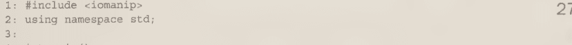

# 第 27 Lesson：使用流进行输入和输出

```
12: cout << "Hey - right aligned!" << endl;
13:
14: cout << "Hey - back to default!" << endl;
15:
16: return 0;
17: }
```

## 输出

Hey - right aligned!

********************Hey - right aligned!

Hey - back to default!

## 分析

输出展示了第 8 行提供给 `cout` 的 `setw(35)` 以及第 11 行与 `setw(35)` 一起提供的 `set-fill('*')` 的效果。你会发现后者导致待显示文本前的剩余空间用 `setfill()` 中指定的星号填充。

## 使用 std::cin 进行输入

`std::cin` 是多功能的，能够将输入读取到普通旧数据类型中，如 `int`、`double` 和 `char*`，你还可以使用如 `getline()` 等方法从屏幕读取行或字符。

## 使用 std::cin 输入到普通旧数据类型

你可以通过 `cin` 直接从标准输入提供整数、双精度浮点数字符。列表 27.4 展示了使用 `cin` 从用户处读取简单数据类型的用法。

```cpp
0: #include <iostream>
1: #include <iomanip>
2: using namespace std;
3:
4: int main() {
5:     cout << "Hey - default!" << endl;
6:     cout << setw(35); // 设置字段宽度为 25 列
7:     cout << "Hey - right aligned!" << endl;
8:     cout << setw(35) << setfill('*');
12: cout << "Hey - right aligned!" << endl;
13:
14: cout << "Hey - back to default!" << endl;
15:
16: return 0;
17: }
```

*(注：原文中关于列表 27.4 的 OCR 描述存在重复和混乱，此处已根据提供的逻辑片段进行了清理和翻译)*

# 输出

输入你的名字：Sartha Rao

你好 Siddhartha Rao

# 分析

第 8 行所示的 `getline()` 起到了确保空白字符不被跳过的作用。输出现在包含了用户输入的完整行。

## 使用 std::fstream 进行文件处理

`std::fstream` 是 C++ 提供的一个用于（相对）平台无关的文件访问的类。`std::fstream` 继承自 `std::ofstream` 用于写入文件，继承自 `std::ifstream` 用于读取文件。

换句话说，`std::fstream` 为你提供了读取和写入功能。

> 要使用类 `std::fstream` 或其基类，请包含头文件：

#include <fstream>

## 使用 open() 和 close() 打开和关闭文件

要使用 `fstream`, `ostream` 或 `ifstream` 类，你需要使用 `open()` 方法打开文件：

```cpp
fstream myFile;
myFile.open("HelloFile.txt",ios_base::in|ios_base::out|ios_base::trunc);
```

```cpp
if (myFile.is_open()) // 检查 open() 是否成功
{
    // 在此处执行读取或写入

    myFile.close();
}
```

## 使用 std::fstream 进行文件处理

`open()` 两个参数：第一个是正在打开的文件的路径和名称（如果不提供路径，它将假设使用应用程序当前的目录设置），第二个是打开文件的模式。所选的模式允许即使文件已存在也创建它（`ios_base::trunc`），并允许你对文件进行读写（`in | out`）。

注意使用 `is_open()` 来测试 `open()` 是否成功。

> 注意

使用 `close()` 关闭流对于保存文件至关重要。

打开文件流的另一种方法是通过构造函数：

`fstream myFile("Hello.txt",ios_base::in|ios_base::out|ios_base::trunc);`

或者或者，如果你只想以写入模式打开文件，请使用以下代码：

`ofstream myFile("Hello.txt", ios_base::out);`

如果你想以读取模式打开文件，请使用：

`ifstream myFile("Hello.txt", ios_base::in);`

> 提示


无论你使用构造函数还是成员方法 `open()`，都建议在继续使用相应的流流对象之前，通过 `is_open()` 检查文件是否成功打开。

文件流打开的各种模式如下：

- `ios_base::app`—追加到现有文件的末尾，而不是截断它们
- `ios_base::ate`—置于文件末尾，但你可以在文件的任何位置写入数据
- `ios_base::trunc`—导致现有文件被截断；默认模式）
- `ios_base::binary`—创建二进制文件（默认是文本）
- `ios_base::in`—仅用于读取操作打开文件
- `ios_base::out`—仅用于写入操作打开文件

## 使用 `open()` 和 `operator<<` 创建并写入文本文件

在打开文件流之后，你可以使用运算符 `operator <<` 向其写入内容，如列表 27.8 所示。

### 列表 27.8 使用 `fstream` 创建新文本文件并向其中写入文本

```cpp
0: #include<fstream>
1: #include<iostream>
2: using namespace std;
3:
4: int main(){
5: {
6:     ofstream myFile;
7:     myFile.open("HelloFile.txt", ios_base::);
8:
9:     if (myFile.is_open())
10: {
11:     cout << "File open successful" << endl;
12:
13:     myFile << "My first text file!" << endl;
14:     myFile << "Hello file!";
15:
16:     cout << "Finished writing to file, will close now" << endl;
17:     myFile.close();
18: }
19:
20:     return 0;
21: }
```

### 输出 ▼

File open successful

Finished writing to file, will close now

HelloFile.txt 的内容。

My first text file!

Hello file!

### 分析 ▼

第 7 行以 `ios_base::out` 模式打开文件——即仅用于写入。在第 9 行中你测试 `open()` 是否成功，然后如第 13 行和第 14 行所示使用插入运算符 `<<` 向文件流写入。最后，你在第 17 行关闭并返回。

## 使用 `std::fstream` 进行文件处理

注意

> 列表 27.8 展示了你如何像向标准输出（控制台）`cout` 一样向文件流写入内容。这表明 C++ 中的流允许以类似的方式处理不同设备，通过 `cout` 向显示器写入文本就像通过 `ofstream` 向文件写入一样。

## 使用 `open()` 和 `operator>>` 读取文本文件

要读取文件，可以使用 `fstream` 并使用 `ios_base::in` 打开它，或使用 `ifstream`。列表 27.9 展示了在列表 27.8 中创建的 `HelloFile.txt` 文件。

### 列表 27.9 从列表 27.9 创建的 HelloFile.txt 读取

```cpp
0: #include <fstream>
1: #include <iostream>
2: #include <string>
3: using namespace std;
4:
5: int main() {
6: {
7:
8: ifstream myFile;
9: myFile.open("HelloFile.txt", ios_base::in);
10:
11: if (myFile.is_open())
12: {
13:     cout << "File open successful" << endl;
14:     string fileContents;
15:
16:     while (myFile.good()) {
17: {
18:     getline(myFile, fileContents);
19:     cout << fileContents << endl;
20: }
21: }
22:     cout << "Finished writing to file, will close now" << endl;
23:     myFile.close();
24: }
25: else
26: cout << "open() failed" << endl;
27:
28: return 0;
29: }
```

### 输出 ▼

File open successful

My first text file!

Hello file!

Finished writing to file, will close now

### 分析 ▼

第 7 行以 `ios_base::out` 模式打开文件——即仅用于写入。第 9 行你测试 `open()` 是否成功，然后使用插入运算符 `<<` 向文件流写入，如第 13 行和第 14 行所示。最后，你在第 17 行关闭并返回。

## 使用 `open()` 和 `operator>>` 读取文本文件

向二进制文件的实际过程与你目前所学的没有太大。

### 列表 27.10 向二进制文件写入结构体并重构它

```cpp
0: #include<fstream>
1: #include<iomanip>
2: #include<string>
3: #include<iostream>
4: using namespace std;
5:
6: struct
7: {
8:     Human(const char* inName, int inAge, const char* inDOB) : age(inAge)
9:     {
10:         strcpy(name, inName);
11:         strcpy(DOB, inDOB);
12:     }
13:
14:     char name[30];
```

15: int age;

16: char DOB[20];

17: };

18:

19: int main()

20: {

21: Human Input("Siddartha Rao", 101, "May 1916");

22:

23: ofstream fsOut("MyBinary.bin", ios_base::out | ios_base::binary);

24:

25: if (fsOut.is_open())

26: {

27: cout << "Writing one object of Human to a binary file" << endl;

28: fsOut.write(reinterpret_cast<const char*>(&Input), sizeof(Input));

29: fsOut.close();

30: }

31:

32: ifstream fsIn("MyBinary.bin", ios_base::in | ios_base::binary);

33:

34: if (fsIn.is_open())

35: {

36: Human somePerson;

37: fsIn.read((char*)&somePerson, sizeof(somePerson));

38:

39: cout << "Reading information from binary file: " << endl;

40: cout << "Name = " << somePerson.name << endl;

41: cout << "Age = " << somePerson.age << endl;

42: cout << "Date of Birth = " << somePerson.DOB << endl;

43: }

44:

45: return 0;

46: }
```

### 第 27 节：使用流进行输入输出

从二进制文件中读取。此示例还演示了如何使用 `ifstream::read` 和 `ofstream::write` 分别通过 `ifstream` 和 `ofstream` 写文件。注意第 29 行中 `reinterpret_cast` 的用法，它本质上是强制编译器将结构体解释为 `char*`。在第 38 行中，你使用了与第 29 行相同内容的 C 风格转换版本。

## 注意

> 如果不是为了解释说明，我更倾向于将 `struct Human` 及其所有属性持久化到 XML 文件中。XML 是一种基于文本和标记的存储格式，在信息持久化方式上提供了灵活性和扩展性。
>
> 如果在此版本中交付了 `struct Human`，而你添加了新属性（如 `numChildren`、`instance`），你将需要担心 `ifstream::read` 功能无法正确读取使用旧版本创建的二进制数据。

## 使用 `std::stringstream` 进行字符串转换

你有一个字符串。它其中包含一个值为 45 的字符串值。你如何将这个字符串值转换为值为 45 的整数？反之亦然？C++ 提供的最实用的工具之一是 `stringstream` 类，它允许你执行各种转换活动。

### 提示

```
要使用类 std::stringstream，请包含头文件：
#include <sstream>
```

### 列表 27.11 演示了一些简单的 `stringstream` 操作。

### 列表 27.11 使用 `std::stringstream` 将整数值转换为字符串表示及反之

```cpp
0: #include<fstream>
1: #include<sstream>
2: #include<iostream>
3: using namespace std;
4:
```

```cpp
5: int main()
6: {
7:   cout << "Enter an integer: ";
8:   int input = 0;
9:   cin >> input;
10:
11:  stringstream converterStream;
12:  converterStream << input;
13:  string inputAsStr;
14:  converterStream << inputAsStr;
15:
16:  cout << "Integer Input = " << input << endl;
17:
18:  cout << "String gained from integer = " << inputAsStr << endl;
19:
20:  stringstream anotherStream;
21:  anotherStream << inputAsStr;
22:  int Copy = 0;
23:  anotherStream >> Copy;
24:
25:  cout << "Integer gained from string, Copy = " << Copy << endl;
26:
27:  return 0;
28: }
```

### 输出 ▼

Enter an integer: 45

Integer Input = 45

String gained from integer = 45

Integer gained from string, Copy = 45

### 分析 ▼

你要求用户输入一个整数值。你首先使用 `operator<<` 将此整数插入字符串流对象中，如第 12 行所示。然后，你在第 14 行使用提取运算符 `>>` 将此整数转换为字符串。之后，你使用此字符串作为起点，获取在字符串 `inputAsStr` 中持有的数值的整数表示 `Copy`。

## 应该这样做

当你只打算从文件中读取内容时，请使用 `ifstream`。

当你只打算写入文件时，请使用 `ofstream`。

在从流中插入或提取内容之前，记得通过 `is_open()` 检查文件流是否成功打开。

在使用完成后，不要忘记使用 `close()` 方法关闭文件流。

## 不要这样做

不要忘记通过 `cin >> strData;` 从字符串提取内容通常会导致 `strdata` 包含到第一个空白符之前的文本，而不是整行。

不要忘记函数 `getline(cin, strData);` 会从输入中获取整行内容，包括空格。

## 总结

本节从实用的角度教了你 C++ 流。你了解到从书的第一页开始你一直在使用像 I/O 流 `cout` 和 `cin` 这样的流。你现在知道如何创建简单的文本文件，以及如何从中读取或写入内容。你学会了 `stringstream` 如何帮助你将整数等简单类型转换为字符串，反之亦然。

## 问答

- 我看到可以使用 `fstream` 同时对文件进行读读取，那么我应该使用 `ofstream` 和 `ifstream` 吗？
- 如果你的代码或模块只需要从文件中读取，你应该使用 `ifstream`。同样，如果它只需要写入文件，请使用 `ofstream`。在两种情况下 `fstream` 都能正常工作，但为了确保数据和代码的安全性，最好采用类似于 `const` 的限制性策略，尽管后者并不是强制性的。
- 我应该在什么时候使用 `cin.get()`，什么时候使用 `cin.getline()`？
- `cin.getline()` 确保你捕获用户输入的包括空格内的整行。`cin.get()` 帮助你一次一个字符地捕获输入。
- 我应该什么时候使用 `stringstream`？
- `stringstream` 提供了一种方便的方法将整数和其他简单类型转换为字符串反之亦然，正如列表 27.11 所示。

## 工作坊

工作坊包含测验题，帮助你巩固对所涵盖内容的理解，并提供练习让你使用所学知识的机会。在检查附录 E 中的答案之前，尝试回答测试和练习题，并在进入下一节之前确保你理解了答案。

## 测验

- 1. 你只需要写入文件。你会使用哪种流？
- 2. 你如何使用 `cin` 从输入流中获取完整行？
- 3. 你需要向文件写入 `std::string` 对象。你会选择 `ios_base::binary` 吗？
- 4. 你为什么要使用 `is_open()`？

## 练习

- 1. 找错：找出以下代码中的错误：

```cpp
fstream myFile;
myFile.open("Hello.txt", ios_base::out);
myFile << "Hello file";
myFile.close();
```

- 2. 找错：找出以下代码中的错误：

```cpp
fstream myFile("SomeFile.txt");
if (myFile.is_open())\
    myFile << "This is some text" << endl;
    myFile.close();
}
```

# 通过 try 和 catch 实现异常安全

在实现异常安全方面，`try` 和 `catch` 是 C++ 中最重要的关键字。为了使语句具有异常安全性，你应当将它们封装在一个 `try` 块中，并在 `catch` 块中处理从 `try` 块抛出的异常：

```cpp
void SomeFunc() {
  try {
    int* numPtr = new int;
    *numPtr = 999;
    delete numPtr;
  } catch(...) // 捕获所有异常
{
    cout << "Exception in SomeFunc(), quitting" << endl;
  }
}
```

# 使用 catch(...) 处理所有异常

回想在第 8 节“指针和引用详解”中，我提到过 `new` 的默认形式在执行成功时返回一个指向内存中位置的有效指针，但在执行失败时会抛出异常。列表 28.1 展示了你如何使用 `new` 使得内存分配在异常上是安全的，并处理计算机无法分配你请求的内存的情况。

### 列表 28.1 在确保内存分配的异常安全性中使用 try 和 catch

```cpp
00: #include <iostream>
1: using namespace std;
2:
3: int main()
4: {
5:   cout << "Enter number of integers you wish to reserve: ";
6:   try
7:   {
8:     int input = 0;
9:     cin >> input;
10:
11:    // 请求内存空间并返回它
12:    int* numArray = new int[input];
13:    delete[] numArray;
14:}
```


```cpp
15: catch (...)
16: {
17: cout << "Exception occurred. Got to end, sorry!" << endl;
18: }
19: return 0;
20: }
```

### 输出 ▼

Enter number of integers you wish to reserve: -1

Exception occurred. Got to end, sorry!

### 分析 ▼

在这个例中，我使用 -1 作为我想要保留的整数数量。这个输入是荒谬的，但用户总是会做荒谬的事情。在没有异常处理器的情况下，程序将面临非常难看的结尾。但多亏了异常处理器，你可以看到输出显示了一条得体的消息：Got to end, sorry!


列表 28.1 展示了 `try` 和 `catch` 块的使用。`catch()` 像函数一样接收参数，而 `...` 表示此 `catch` 块隔离所有类型的 `std::bad_alloc` 异常，因为这些异常是在 `new` 失败时抛出的。捕获特定类型将帮助你专门处理该类型的问题，例如，向用户显示一条告诉他们到底发生了什么的消息。

# 捕获特定类型的异常

列表 28.1 中的异常是由 C++ 标准库抛出的。此类异常具有已知类型，捕获特定类型对你来说更好，因为你可以精确定异常的原因、进行更好的清理，或者至少向用户显示一条精确的消息，如列表 28.2 所示。

## 列表 28.2 捕获 `std::bad_alloc` 类型的异常

```cpp
0: #include <iostream>
1: #include<exception> // 包含以此捕获异常 bad_alloc
1: using namespace std;
3:
4: int main()
5: {
6:   cout << "Enter number of integers you wish to reserve: ";
7:   try
8:   {
9: int input = 0;
10: cin >> input;
11:
12: 请求内存空间并返回它
13: int* numArray = new int [input];
14: delete[numArray];
15: }
16:
17: catch (std::bad_alloc& exp)
18: {
19: cout << "Exception encountered: " << exp.what() << endl;
20: cout << "Got to end, sorry!" << endl;
21: }
22:
23: catch (...) {
24: cout << "Exception encountered. Got to end, sorry!" << endl;
25: return 0;
26: }
```

# 通过 `try` 和 `catch` 实现异常安全

## 输出

Enter number of integers you wish to reserve: -1

Exception encountered: bad array new length

Got to end, sorry!

## 分析

比较列表 28.2 和列表 28.1 的输出。你会发现现在能够为应用程序的突然终止提供更精确的原因，“bad array new length”。这是因为你额外了一个 `catch` 块（是的，两个 `catch` 块），其中一个捕获第 16-20 行所示的 `catch(bad_alloc&)` 类型的异常，该异常是由 `new` 抛出的。

> 提示
> 通常，你可以插入任意数量的 `catch()` 块，
> 一个一个接一个，取决于你预期的异常
> 以及会有帮助的异常。

如列表 28.2 所示，`catch(...)` 捕获所有未被其他 `catch` 语句显式捕获的异常类型。

# 使用 `throw` 抛出特定异常

你在列表 28.2 中捕获 `std::bad_alloc` 时，你实际上捕获了由 `new` 抛出的 `std::bad_alloc` 类对象。你可以抛出你选择的异常。你需要的只是关键字 `throw`：

```cpp
void DoSomething() {
    if (somethingwanted)
        throw;
}
```

让我们学习列表 28.3 所示的自定义异常的 `throw` 使用。

## 列表 28.3 尝试以零除法抛出异常

```cpp
0: #include<iostream>
1: using namespace std;
2:
3: double Divide(double dividend, double divisor)
4: {
5:     if (divisor == 0)
6:         throw "Dividing by 0";
7:     return dividend / divisor;
8: }
9: int main()
10: {
11:     cout << "Enter dividend: ";
12:     double dividend;
13:     cin >> dividend;
14:     cout << "Enter divisor: ";
15:     double divisor;
16:     cin >> divisor;
17:     try
18:     {
19:         cout << "Result: " << Divide(dividend, divisor) << endl;
20:     }
21:     catch(const char* exp)
22:     {
23:         cout << "Exception: " << exp << endl;
24:     }
25:     return 0;
26: }
```

## 输出

Enter dividend: 10

Enter divisor: 0

Exception: Dividing by 0

## 分析

代码 28.3 不仅展示了你可以捕获 `char*` 类型的异常，还展示了在 `main()` 函数中通过 `try` 捕获 `Divide` 抛出的异常。

# 异常处理的工作

当使用 `throw` 抛出异常时，编译器会查找匹配的 `catch` 块。如果异常语句位于 `try` 块内，它会寻找合适的 `catch`。如果在 `try` 块内没有相应的异常处理器，异常处理逻辑将沿着调用栈向上。在堆栈回溯过程中，函数的局部变量会被销毁。这由列表 28.4 所示。

## 列表 28.4 异常发生时局部对象的析构顺序

```cpp
0: #include <iostream>
1: using namespace std;
2:
3: struct StructA
4: {
5:   StructA() {cout << "StructA constructor" << endl; }
6:   ~StructA() {cout << "StructA destructor" << endl; }
7: };
8:
9: struct StructB
10: {
11:     StructB() {cout << "StructB constructor" << endl; }
12:     ~StructB() {cout << "StructB destructor" << endl; }
13: };
14:
15: void FuncB() // throws
16: {
17:     cout << "In Func B" << endl;
18:     StructA objA;
19:     StructB objB;
20:     cout << "About to throw!" << endl;
21:     throw("Throwing for the heck of it");
22: }
23:
24: void FuncA()
25: {
26:     try
27:     {
28:         cout << "In Func A" << endl;
29:         StructA objA;
30:         StructB objB;
31:         FuncB();
32:         cout << "FuncA: returning to caller" << endl;
33:     }
34:     catch(const char* exp)
35:     {
36:         cout << "FuncA: Caught exception: " << exp << endl;
37:         cout << "Handled it, will not throw to caller" << endl;
38:         // throw; // 取消此行以抛给 main()
39:     }
40: }
41:
42: int main()
43: {
44:     cout << "main(): Started execution" << endl;
45:     try
46:     {
47:         FuncA();
48:     }
49:     catch(const char* exp)
50:     {
51:         cout << "Exception: " << exp << endl;
52:     }
53:     cout << "main(): exiting gracefully" << endl;
54:     return 0;
55: }
```

## 异常处理的工作原理

## 输出

```
main(): Started execution
In Func A
StructA constructor
StructB constructor
In Func B
StructA constructor
StructB constructor
About to throw up!
StructB destructor
StructA destructor
StructB destructor
StructA destructor
FuncA(): Caught exception: Throwing for the heck of it
Handled it, will not throw to caller
main(): exiting gracefully
```

## 分析

在列表 28.4 中，`main()` 调用了 `FuncA()` 并调用了 `FuncB()`，后者在第 21 行抛出了异常。调用函数 `FuncA()` 和 `main()` 都是异常安全的，因为它们都实现了 `catch(const char*)` 块。抛出异常的 `FuncB()` 没有 `catch()` 块，因此 `FuncA()` 第 34–39 行的 `catch` 块是 `FuncB()` 抛出异常的第一个处理器，因为 `FuncA()` 是 `FuncB()` 的调用者。注意，`FuncA()` 认为该异常并不严重，因此将其传播给 `main()`。因此，`main()` 像没有发生任何问题一样继续执行。取消第 38 行，异常将抛给 `FuncB()` 的调用者——即 `main()` 也会接收它。

输出还指示了对象创建的顺序（与你编写实例顺序相同）以及在异常发生时立即销毁它们的顺序（与实例化顺序相反）。这不仅发生在抛出异常的 `FuncB()` 中，也发生在调用 `FuncB()` 并处理异常的 `FuncA()` 中。

### 注意

列表 28.4 展示了在抛出异常时局部对象的析构函数是如何被调用的。

如果由于异常而调用的对象的析构函数也抛出了异常，将导致应用程序的异常终止。


# `std::exception` 类

在列表 28.2 捕获 `std::bad_alloc` 时，你实际上捕获了由 `new` 抛出的 `std::bad_alloc` 类对象。`std::bad_alloc` 是一个继承自 C++ 标准类 `std::exception` 的类，该在头文件 `<exception>` 中声明。

`std::exception` 是以下重要异常的基类：

- `bad_alloc`—当使用 `new` 请求内存失败时抛出
- `bad_cast`—当你尝试捕获错误的类型（即没有继承关系的类型）时，由 `dynamic_cast` 抛出
- `ios_base::failure`—由 `iostream` 库中的函数和方法抛出

基类 `std::exception` 支持一个非常有用且重要的虚方法 `what()`，它能对导致异常的问题性质提供更具描述性的名称。在列表 28.2 中，第 18 行的 `exp.what()` 提供了信息“bad array length”，告诉你哪里出了问题。你可以利用 `std::exception` 是许多异常的基类这一特性，创建一个 `catch(const exception&)`，它可以捕获所有以 `std::exception` 为基类的异常：

```cpp
void SomeFunc() {
  try {
    // 代码已实现异常安全
  }
  catch (const std::exception& exp) // 捕获 bad_alloc, bad_cast 等
  {
    cout << "Exception encountered: " << exp.what() << endl;
  }
}
```

# 继承自 `std::exception` 的自定义异常类

你可以抛出任何你类型的异常。然而，继承自 `std::exception` 有一个好处——所有现有的 `catch(const std::exception&)` 并处理 `bad_alloc`、`bad_cast` 等异常的异常处理器将自动扩展到捕获你的新异常类，因为它们具有共同的基类。这在列表 28.5 中得到了证明。

## 列表 28.5 继承自 `std::exception` 的类 `CustomException`

```cpp
0: #include <exception>
1: #include <iostream>
2: #include <string>
3: using namespace std;
4: 
5: class CustomException: public std::exception
6: {
7:     string reason;
8: public:
9:     // 构造函数，需要 reason
10:    CustomException(const char* why):reason(why) {}
11: 
12:    // 重定义虚函数以返回 'reason'
13:    virtual const char* what() const throw
14:    {
15:        return reason.c_str();
16:    }
17: };
18: 
19: double Divide(double dividend, double divisor)
20: {
21:     if(divisor == 0)
22:         throw CustomException("CustomException: Dividing by 0 is a crime");
23: 
24:     return (dividend / divisor);
25: }
26: 
27: int main()
28: {
29:     cout << "Enter dividend: ";
30:     double dividend = 0;
31:     cin >> dividend;
32:     cout << "Enter divisor: ";
33:     double divisor = 0;
34:     cin >> divisor;
35:     try
36:     {
37:         cout << "Result is: " << Divide(dividend, divisor);
38:     }
39:     catch(exception& exp)// 捕获 CustomException, bad_alloc, bad_cast
40:     {
41:         cout << "Exception encountered: " << exp.what() << endl;
42:     }
43:     }
44:     return 0;
45: }
```

## 输出

Enter dividend: 10

Enter divisor: 0

Result is: CustomException: Dividing by 0 is a crime

Exception encountered: CustomException: Dividing by 0 is a crime

## 分析

在列表 28.4 中，`main()` 调用了 `FuncA()` 并调用了 `FuncB()`，后者在第 21 行抛出了异常。调用函数 `FuncA()` 和 `main()` 都是异常安全的，因为它们都实现了 `catch(const char*)` 块。抛出异常的 `FuncB()` 没有 `catch()` 块，因此 `FuncA()` 第 34–39 行的 `catch` 块是 `FuncB()` 抛出异常的第一个处理器，因为 `FuncA()` 是 `FuncB()` 的调用者。注意，`FuncA()` 认为该异常并不严重，因此将其传播给 `main()`。因此，`main()` 像没有发生任何问题一样继续执行。取消第 38 行，异常将抛给 `FuncB()` 的调用者——即 `main()` 也会接收它。

输出还指示了对象创建的顺序（与你编写实例顺序相同）以及在异常发生时立即销毁它们的顺序（与实例化顺序相反）。这不仅发生在抛出异常的 `FuncB()` 中，也发生在调用 `FuncB()` 并处理异常的 `FuncA()` 中。

### 注意

列表 28.4 展示了在抛出异常时局部对象的析构函数是如何被调用的。

如果由于异常而调用的对象的析构函数也抛出了异常，将导致应用程序的异常终止。

img/ccb6520e9d7dbb1b25f5e4ac7152a7c5_698_0.png

# `std::exception` 类


在列表 28.2 捕获 `std::bad_alloc` 时，你实际上捕获了由 `new` 抛出的 `std::bad_alloc` 类对象。`std::bad_alloc` 是一个继承自 C++ 标准类 `std::exception` 的类，该在头文件 `<exception>` 中声明。

`std::exception` 是以下重要异常的基类：

- `bad_alloc`—当使用 `new` 请求内存失败时抛出

- `bad_cast`—当你尝试捕获错误的类型（即没有继承关系的类型）时，由 `dynamic_cast` 抛出

- `ios_base::failure`—由 `iostream` 库中的函数和方法抛出

基类 `std::exception` 支持一个非常有用且重要的虚方法 `what()`，它能对导致异常的问题性质提供更具描述性的名称。在列表 28.2 中，第 18 行的 `exp.what()` 提供了信息“bad array length”，告诉你哪里出了问题。你可以利用 `std::exception` 是许多异常的基类这一特性，创建一个 `catch(const exception&)`，它可以捕获所有以 `std::exception` 为基类的异常：

```
void SomeFunc() {
  try {
    // 代码已实现异常安全
  }
  catch (const std::exception& exp) // 捕获 bad_alloc, bad_cast 等
  {
    cout << "Exception encountered: " << exp.what() << endl;
  }
}
```

# 继承自 std::exception 的自定义异常类

你可以抛出任何你类型的异常。然而，继承自 `std::exception` 有一个好处——所有现有的 `catch(const std::exception&)` 并处理 `bad_alloc`、`bad_cast` 等异常的异常处理器将自动扩展到捕获你的新异常类，因为它们具有共同的基类。这在列表 28.5 中得到了证明。

## 列表 28.5 继承自 std::exception 的类 CustomException

```
0: #include <exception>
1: #include <iostream>
2: #include <string>
3: using namespace std;
4: 
5: class CustomException: public std::exception
6: {
7:     string reason;
8: public:
9:     // 构造函数，需要 reason
10:    CustomException(const char* why):reason(why) {}
11: 
12:    // 重定义虚函数以返回 'reason'
13:    virtual const char* what() const throw
14:    {
15:        return reason.c_str();
16:    }
17: };
18: 
19: double Divide(double dividend, double divisor)
20: {
21:     if(divisor == 0)
22:         throw CustomException("CustomException: Dividing by 0 is a crime");
23: 
24:     return (dividend / divisor);
25: }
26: 
27: int main()
28: {
29:     cout << "Enter dividend: ";
30:     double dividend = 0;
31:     cin >> dividend;
32:     cout << "Enter divisor: ";
33:     double divisor = 0;
34:     cin >> divisor;
35:     try
36:     {
37:         cout << "Result is: " << Divide(dividend, divisor);
38:     }
39:     catch(exception& exp)// 捕获 CustomException, bad_alloc, bad_cast
40:     {
41:         cout << "Exception encountered: " << exp.what() << endl;
42:     }
43:     }
44:     return 0;
45: }
46: }
```

## 总结

在本节中，你学习了 C++ 的一个重要部分。开发稳定的应用程序对于客户满意度和直观的用户体验至关重要，而这正是异常可以帮助提供的。你发现分配资源或内存的代码可能会失败，因此需要异常安全的。你学习了 C++ 异常类 `std::exception`，以及如果你需要编写自定义异常类，理想情况下应该继承自它。

## 问答

- 为什么要抛出异常而不是返回错误？

你不总是有返回错误的权利。当 `new` 调用失败时，你需要处理 `new` 抛出的异常以防止应用程序崩溃。此外，如果错误严重到导致应用程序未来无法运行，你应该考虑抛出异常。

- 为什么我的异常类应该继承自 `std::exception`？

这当然是强制性的，但它可以帮助你重用所有捕获 `std::exception` 类型异常的 `catch()` 块。你可以编写不继承任何其他内容的自定义异常类，但你需要在所有相关点插入新的 `catch(MyExceptionType&)`。

- 我有一个函数抛出了异常。它需要被同一个函数捕获吗？

完全不需要。只需确保抛出的异常类型被调用栈中的某一个调用函数捕获即可。

- 构造函数可以抛出异常吗？

构造函数实际上没有选择！它们不返回值，抛出异常是演示反对的最佳方式。

- 析构函数可以抛出异常吗？

技术上可以。但这是一种坏习惯，因为在栈回溯异常时析构函数也会被调用。因此，由于异常而调用的析构函数本身又抛出异常，显然会让尝试干净退出的已经不稳定应用程序陷入非常糟糕的局面。

## 工作坊

工作坊包含测验题，旨在帮助你巩固对所涵盖内容的理解，并提供练习题以提供使用所学内容的经验。在检查附录 E 中的答案之前，请尝试回答测验和练习题，并在进入下一节之前确保你理解了答案。

### 测验

- 1. 什么是 `std::exception`？

- 2. 当使用 `new` 分配失败时会抛出什么类型的异常？

- 3. 在异常处理器（catch 块）中分配一百万个整数来例如为了备份现有数据是正确的吗？

- 4. 你将如何捕获类型继承自 `std::exception` 的类 `MyException` 的异常对象？

### 练习题

- 1. 故障排除：以下代码哪里有问题？

```cpp
class SomeIntelligentStuff
{
    bool isStuffGoneBad;
public:
    ~SomeIntelligentStuff()
    {
        if(isStuffGoneBad)
            throw "Big problem in this class, just FYI";
    }
};
```

- 2. 故障排除：以下代码哪里有问题？

```cpp
int main()
{
    int* millionNums = new int [1000000];
    // do something with the million integers

    delete []millionNums;
}
```

- 3. 故障排除：以下代码哪里有问题？

```cpp
int main()
{
    try {
        int* millionNums = new int [1000000];
        // do something with the million integers

        delete []millionNums;
    } catch(exception& exp) {
        int* anotherMillion = new int [1000000];
        // take back up of millionNums and save it to disk
    }
}
```

# 第 29 节

## 展望

你已经学习了 C++ 编程的基础。事实上，你在理解方面已经超越了理论边界，掌握了如何通过使用标准模板库 `STL`、模板和标准库来帮助你编写高效且紧凑的代码。现在是时候关注性能并获得编程最佳实践的视角了。

在本节中，你将学习：

- 你的 C++ 应用如何最充分地利用处理器的能力

- 线程与多线程

- C++ 编程中的最佳实践

- C++17 预期的新特性

- 在本书之外提升你的 C++ 技能

## 如今的处理器有什么不同？

直到最近，计算机通过使用具有更快处理速度的处理器来变快，速度以赫兹 `Hz`、兆赫兹 `MHz` 或吉赫兹 `GHz` 为单位。例如，`Intel 8086`（见图 29.1）是 1978 年推出的 16 位微处理器，时钟频率约为 10MHz。

图 29.1

`Intel 8086` 微处理器。

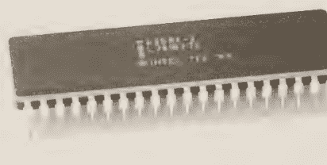

那是处理器在定期显著变快速的时代，你的 C++ 应用也是如此。在那时，依靠“等待游戏”来利用改进的硬件性能并借此提高软件的响应速度是很容易。虽然如今的处理器正在越来越快，但真正的创新在于它们部署的内核数量。在编写本书时，即使是流行的智能手机也配备了四核 64 位处理器，处理能力超过了十年前的桌面计算机。

你可以将多核处理器理解为一个在一个内部并行运行多个处理器的单个芯片。每个处理器都有自己的 L1 缓存，并且可以独立于其他内核工作。

更快的处理器增加你的应用程序速度是逻辑性的。处理器中的多个内核是如何提供帮助的？每个内核显然都能够并行运行应用程序，但除非你对其进行了编程，否则这并不一定会让你的应用程序变快。虽然如今的处理器正在越来越快，但真正的创新在于它们部署的内核数量。在编写本书时，即使是流行的智能手机也配备了四核 64 位处理器。如图 29.2 所示。

## 图 29.2

单线程应用程序


*(注：由于原文文本中存在多处重复和乱码，上述翻译已根据上下文进行了逻辑化处理。)*

尽管这是一个简单的例子——一个线程创建信息，另一个线程消耗信息。但如果多个线程对同一个位置进行读写操作会发生什么呢？某些线程可能在其他线程尚未完成写入时就开始读取数据。这种情况下，相关数据的完整性将受到破坏。

这就是为什么线程需要进行同步的原因。

### 使用互斥锁和信号量同步线程

线程是操作系统层面的实体，你用于同步它们的对象也是由操作系统提供的。大多数操作系统都提供了信号量 `semaphore` 和互斥锁 `mutex` 来执行线程同步活动。

你使用互斥锁 `mutex`（一种互斥同步对象）来确保一次只有一个线程可以访问一段代码。换句话说，互斥锁用于封装一段代码，线程必须等待，直到当前正在执行该代码的线程完成并释放互斥锁。下一个线程获取互斥锁，完成工作，然后释放互斥锁。从 C++11 开始，C++ 在 `std::mutex` 类中提供了 `mutex` 的实现。

通过信号量，你可以控制执行某段代码的线程数量。允许一次只有一个线程访问的信号量也称为二进制信号量。

### 多线程引起的问题

多线程需要线程间良好的同步，但当这种同步无效（即：有 Bug）时，也会导致许多不眠眠。多线程应用程序面临的两个常见问题如下：

- 竞态条件 `Race conditions`——两个或多个线程尝试写入同一数据。谁会胜出？该对象的状态是什么？

- 死锁 `Deadlock`——两个线程互相等待对方完成，导致两者都处于“等待”状态。你的应用程序挂起了。

你可以通过良好的同步来避免竞态条件。通常，当允许线程写入共享对象时，你必须额外小心以确保：

- 一时间只有一个线程在写入。

- 在写入线程完成之前，不允许任何线程读取该对象。

## 编写优秀的 C++ 代码

通过确保在任何情况下都不存在两个线程互相等待，你可以避免死锁。你可以设置一个主线程来同步工作线程，或者通过编写程序使任务分布在线程之间，并产生清晰的负载分布。线程 A 等待 B，但 B 永远不应该等待 A。

编写多线程应用程序本身就是一种专业领域。因此，详细向你解释这个有趣且兴奋的话题超出了本书的范围。你应该参考关于该主题的大量在线文档，或者通过实践编程来学习多线程。一旦你掌握了它，面对未来发布的多核处理器，你将使你的 C++ 应用程序处于最优位置。

C++ 自最初概念以来并没有发生重大演变，但主要编译器厂商的标准化努力以及工具和函数的可用有助于你编写紧凑整洁的 C++ 代码。编写可读且可靠的 C++ 应用程序确实很容易。

以下是帮助你创建良好 C++ 应用程序的最佳实践短列表：

- 给变量起有意义的名字（对他人也对你自己）。多花一秒钟给变量起更好的名字是值得的。

- 始终初始化 `int`、`float` 等变量。

- 始终将指针值初始化为 `NULL` 或有效地址——例如由 `operator new` 返回的地址。

- 使用数组时，永远不要越数组缓冲区的边界。这被称为缓冲区溢出，可能会被用作安全漏洞。

- 不要使用 char 字符串或如 `strlen()` 和 `strcpy()` 等函数。`std::string` 更安全并提供了许多有用方法，包括帮助你查找长度、复制和追加的方法。

- 仅在你确定其包含的元素数量时才使用静态数组。如果你不确定，请选择 `std::vector` 等动态数组。

- 在声明和定义接受非 POD（纯旧数据）类型作为输入的函数时，考虑将参数声明为引用参数，以避免在调用函数时出现不必要的拷贝步骤。

- 如果你的类包含原始指针成员（或多个成员），考虑在拷贝或赋值时需要如何管理内存资源所有权。即，考虑编写拷贝构造函数和拷贝赋值运算符。

在编写管理动态数组或类似的工具类时，记住编写移动构造函数 `move constructor` 和移动赋值运算符 `move assignment operator` 以获得更好的性能。

记住让你的代码符合 `const` 正确（const-correct）。一个 `get()` 函数理想上不应该修改类的成员，因此它应该是 `const`。同样，函数参数应该是 `const` 引用，除非你想改变它们所包含的值。

避免使用原始指针。尽可能选择合适的智能指针。

在编写工具类时，花精力支持所有能让该类易于消费和使用的运算符。

在有选项的情况下，选择模板版本优于宏 `macro`。模板是类型安全且通用的。

在编写将放入容器（如 `vector` 或 `list`）中的类时，记住在 `map` 中使用作为键元素，以支持 `operator<`，这将有助于定义默认排序标准。

如果你的 lambda 函数太大，你可能应该考虑将其转换为函数——即一个带有 `operator()` 作为仿函数的类 `functor`，它是可复用的且具有单一维护点。

永远不要认为 `operator new` 的成功理所当然。执行资源分配的代码应该始终是异常安全的——封装在 `try` 块中并带有相应的 `catch()` 块。

永远不要在类的析构函数中抛出异常。

这不是一个详尽的列表，但它涵盖了一些帮助你编写良好且可维护的 C++ 的重要要点。

## C++17：预期特性

C++ 的伟大之处之一是标准委员会非常活跃并不断改进语言。就像它的前身 C++11 一样，C++17 预计将引入下一波特性。让我们研究一些可能改进它的特性。

### if 和 switch 初始化器

这是 `if` 和 `switch` 语句的一个小但重要的扩展，可以表示为：

```cpp
if (initializer; condition)
{
    // 执行 if 语句
}
```

或

```cpp
switch (initializer, condition)
{
    // case 语句
}
```

初始化器中定义的变量在语句结束时被销毁。当用于示例 20.3 中的代码时：

```cpp
auto pairFound = mapToStr.find(key);
if (pairFound != mapToStr.end())
{
cout << "Key " << pairFound->first << " points to Value: ";
cout << pairFound->second << endl;
}
```

该特性将其改进为：

```cpp
if (auto pairFound = mapToStr.find(key); pairFound != mapToStr.end())
{
    cout << "Key " << pairFound->first << " points to Value: ";
    cout << pairFound->second << endl;
}
```

这不仅仅减少了一行代码。它确保了在 `if` 块中需要的变量 `pairFound` 在外部可用，限制了作用域。如果你拷贝改进后的 `if` 块，你就包含了完整的逻辑。

### 拷贝消除保证

当你将变量初始化为函数的返回值时，编译器可能会在初始化变量 `num` 之前创建函数返回的整数的临时拷贝：

```cpp
int num = ReturnInt();
```

C++17 要求编译器消除这种临时拷贝；即避免这种拷贝。

### std::string_view 避免分配开销

考虑一个接受 `std::string` 作为参数的函数：

```cpp
void DisplayString(const std::string& strIn)
{
    cout << strIn << endl;
}
```


当使用字符串字面量调用时，字符串字面量 `"Hello!"` 首先转换为临时的 `std::string`，然后由函数 `DisplayString()` 使用。

`DisplayString("Hello!");`

这种临时转换是一种性能开销，通过使用 `std::string_view` 则可以避免：

```cpp
void DisplayString(const std::string_view& strIn)
{
    cout << strIn << endl;
}
```

字符串字面量在传递给接受 `std::string_view` 作为参数的函数时不会产生分配开销。

## `std::variant` 作为 union 的类型安全替代方案

`union`（联合体）在第9课“类与对象”中进行了解释。`union` 的问题之一是它允许其内容被解释为 `union` 支持的任何其他数据类型；例如：

```
union SimpleUnion{
    int num;
    double preciseNum;
};
```

你可以为 `double` 实例化这个 `union`，但又将其作为整数使用：

```
SimpleUnion u1;
u1.preciseNum = 3.14; // union 存储了一个 double
int num2 = u1.num; // 可以正常工作，但 u1 包含的是一个 double
```

C++17 为程序员提供了 `std::variant`，它是 `union` 的类型安全替代方案：

```cpp
variant<int, double> varSafe;
varSafe = 3.14; // variant 存储了 double
double p1 = get<double>(varSafe); // 3.14
double p2 = get<1>(varSafe); // 3.14
get<char*>(varSafe); // 编译失败：variant 中没有 char
get<2>(varSafe); // 编译失败：variant 有两个类型，而不是三个
try{
    get<int>(varSafe); // 出异常，因为 variant 存储的是 double
}
catch (bad_variant_access&) { // 异常处理代码
```

## 使用 `constexpr` 进行条件编译

此功能类似于 `if-else` 结构，不同之处在于 `if` 条件是在编译时评估的，并且块中的代码（或相应的 `else`）只有在条件在编译时满足的情况下会被编译。

```cpp
#include <type_traits>
#include <iostream>
#include <iomanip>

using namespace std;

template <typename T>
void DisplayData(const T& data) {
if constexpr (is_integral<T>::value)
    cout << "Integral data: " << data << endl;
else if constexpr (is_floating_point<T>::value)
    cout << setprecision(15) << "Floating point data: " << data << endl;
else
    cout << "Unidentified data: " << data << endl;
}
```

对于 `DisplayData(15)`，符合 C++17 标准的编译器将只编译以下行：

```cpp
cout << "Integral data: " << data << endl;
```

对于 `DisplayData("Hello World!")`，编译器将只编译该函数，因为该函数调用的类型触发了 `else` 块：

```cpp
cout << "Unidentified data: " << data << endl;
```

结合第7课“用函数组织代码”中引入自动返回类型推导，这是一个强大的功能，它可能允许函数根据编译器执行的路径返回不同类型的值。

## 改进的 Lambda 表达式

`Lambda` 函数预计会有以下改进：

- 它们将在 `constexpr` 函数内部被支持。
- 将允许使用语法 `[*this]` 捕获 `*this` 的拷贝。

## 构造函数的自动类型推导

从 C++14 开始，你需要这样声明一个组合整数和浮点类型的对：

```cpp
std::pair<int, double> pairIntToDb(3, 3.141592653599);
```

C++17 将允许将该行简化为：

```cpp
std::pair pairIntToDb(3, 3.141592653599);
```

构造函数模板参数的类型推导将是自动的。

## `template<auto>`

这扩展了一个不常用的特性，即模板参数可以包含在编译时使用的值。例如，`std::array` 是一个从 C++11 开始提供的固定大小数组模型容器。它被用于建模一个包含 10 个整数的数组，如下：

```cpp
std::array<int, 10> myTenNums;
```

类 `std::array` 的模板声明类似于以下：

```cpp
template <class T, std::size_t N> struct array;
```

C++17 将允许接受数组类型的模板参数类型使用 `auto`，使得以下内容成为完全有效且可用的数组：

```cpp
template <class T, auto N> struct array;
```

## 学习 C++ 不止于此！

恭喜你，你在学习 C++ 上取得了巨大进展。继续下去的最佳方法是编写更多的代码！C++ 是一门复杂的语言。你编写的程序越多，对其背后运行机制的理解程度就会越高。

## 在线文档

鼓励你利用在线资源更多地学习 STL 容器的签名、其方法、算法以及功能细节。一个带有结构化资源的流行网站是 `http://www.cppreference.com`。

## 获取指导与帮助的社区

C++ 拥有丰富且活跃的在线社区。加入 `StackOverflow` (`www.stackoverflow.com`)、`CodeGuru` (`www.CodeGuru.com`) 或 `CodeProject` (`www.CodeProject.com`) 等网站，让社区检查并回答你的技术查询。

当你感到自信时，可以随时为这些社区做出贡献。你会发现自己正在回答挑战性问题，并在过程中学到很多东西。

## 总结

这节总结课程实际上是你学习 C++ 之旅的开篇页！走到这里，你已经学习了该语言的基础和高级概念。在这一节中，你学习了多线程编程的理论基础。你了解到从多核处理器中提取最佳性能的唯一方法是将你的逻辑组织在线程中并允许并行处理。

# 表 A.1 2 的幂次

| 指数 | 数值 | 二进制表示法 |
|--- |--- |--- |
| 0 | 2⁰ = 1 | 1 |
| 1 | 2¹ = 2 | 10 |
| 2 | 2² = 4 | 100 |
| 3 | 2³ = 8 | 1000 |
| 4 | 2⁴ = 16 | 10000 |
| 5 | 2⁵ = 32 | 100000 |
| 6 | 2⁶ = 64 | 1000000 |
| 7 | 2⁷ = 128 | 1000000 |

## 计算机使用二进制吗？

与数字系统的发现时期相比，二进制系统的广泛使用是相对较新的。电子产品和计算机的发展加速了它的使用。电子设备和电子元件的演变产生了一种系统，能够检测组件的状态为“开启”（具有显著的电位差或电压）或“关闭”（无或低电位差）。

这些开启和关闭状态被方便地解释为 1 和 0，完全代表了二进制数字集，并使其成为执行算术计算的首选方法。逻辑操作（如 `NOT`、`AND`、`OR` 和 `XOR`）包含在第 5 节“表达式、语句和运算符的操作”（见表 5.2–5.5）中，这些操作通过逻辑门的发展得到了轻松支持，导致随着条件处理变得简单，二进制系统被全盘采纳。

## 什么是位（Bit）和字节（Byte）？

位（`bit`）是计算系统的基本单位，包含一个二进制状态。因此，如果位包含状态 1，则称为“已设置”；如果包含状态 0，则称为“重置”。位的集合称为字节（`byte`）。一个字节中的位数在理论上不是固定的，而是一个取决于硬件的数字。

然而，大多数计算系统都假设一个字节包含 8 位，其简单且方便的原因是 8 是 2 的幂次。一个字节中的 8 位还允许传输多达 2⁸ 个不同的值，允许 255 个不同的值。这 255 个不同值足够显示或交易 ASCII 字符集中的所有字符以及更多。

## 多少个字节组成一个千字节？

1024 字节（2¹⁰ 字节）组成一个千字节。同样，1024 千字节组成一个兆字节。1024 兆字节组成一个吉字节。1024 字节字节组成一个太字节。

## 十进制数值系统

十六进制是以 16 为底的数字系统。十六进制系统中的数字范围在 0–9 和 A–F 之间。因此，十进制的 10 是十六进制的 A，十进制的 15 是十六进制的 F：

| 十进制 | 十六进制 | 十进制（续） | 十六进制（续） |
|---|---|---|--|
| 0 | 0 | 8 | 8 |
| 1 | 1 | 9 | 9 |
| 2 | 2 | 10 | A |
| 3 | 3 | 11 | B |
| 4 | 4 | 12 | C |
| 5 | 5 | 13 | D |
| 6 | 6 | 14 | E |
| 7 | 7 | 15 | F |

正如十进制系统中的数字被求值为底 10 的幂次一样，二进制数字被求值为底 2 的幂次，而十六进制数字则被求值为底 16 的幂次：

```
031F = 3 * 16² + 1 * 16¹ + F * 16⁰ = 3 * 256 + 16 + 15（十进制） = 799
```

> 十六进制数惯例用前缀 `"0x"` 表示。

## 为什么我们需要十六进制？

计算机基于二进制工作。计算机中每个内存单元的状态都是 0 或 1。然而，如果人类以 0 和 1 的形式在计算机特定或编程特定信息上进行交互，我们需要大量的空间来处理微小的碎片信息。因此，与其在二进制中写 1111，不如在十六进制中写 F 要高效得多。

## 转换为不同的基数

因此，十六进制表示可以非常有效地表示一个数字中 4 位的状态，最多使用两个十六进制数字即可表示一个字节的状态。

注意

| 一个较少使用的数字系统是八进制系统。这是一个以 8 为底的系统，由 0 到 7 的数字组成 |

## 转换为不同的基数

处理数字时，你可能需要以不同的基数查看同一个数字——例如，一个二进制数的十进制值或一个十进制数的十六进制值。

在之前的示例中，你已经看到如何将二进制或十六进制转换为十进制。请看如何将二进制和十六进制数转换为十进制。

## 通用转换过程

将一个系统中的数字转换为另一个系统时，连续用基数除以被转换的数字。每个余数都填充目标系统中的位置，从最低位开始。下一次除法使用上一次除法操作的商以基数为除数。

此过程一直持续，直到余数在目标数字系统之内且商为 0。

这个过程也称为拆分法。

## 将十进制转换为二进制

将十进制转换为二进制时，连续用基数除以被转换的数字。每个余数都填充目标系统中的位置，从最低位开始。下 1 次除法使用上一次除法操作的商以基数为除数。

此过程一直持续，直到余数在目标数字系统之内且商为 0。

将十进制 33 转换为二进制时，使用 2 的幂次：

- 33 / 2 = 16，余 1
- 16 / 2 = 8，余 0
- 8 / 2 = 4，余 0
- 4 / 2 = 2，余 0
- 2 / 2 = 1，余 0
- 1 / 2 = 0，余 1

## 十进制转换为十六进制

处理数字时，你可能看到需要以不同的基数查看同一个数字——例如，一个二进制数的十进制值或一个十进制数的十六进制值。

在之前的示例中，你已经看到如何将二进制或十六进制转换为十进制。请看如何将二进制和十六进制数转换为十进制。

将 8 转换为二进制：

- 8 / 2 = 4，余 0
- 4 / 2 = 2，余 0
- 2 / 2 = 1，余 0
- 1 / 2 = 0，余 1

结果为 1000。

将 9 转换为二进制：

- 9 / 2 = 4，余 1
- 4 / 2 = 2，余 0
- 2 / 2 = 1，余 0
- 1 / 2 = 0，余 1

结果为 1001。

将 10 转换为二进制：

- 10 / 2 = 5，余 0
- 5 / 2 = 2，余 1
- 2 / 2 = 1，余 0
- 1 / 2 = 0，余 1

结果为 1010。

将 11 转换为二进制：

- 11 / 2 = 5，余 1
- 5 / 2 = 2，余 1
- 2 / 2 = 1，余 0
- 1 / 2 = 0，余 1

结果为 1011。

将 12 转换为二进制：

- 12 / 2 = 6，余 0
- 6 / 2 = 3，余 0
- 3 / 2 = 1，余 1
- 1 / 2 = 0，余 1

结果为 1100。

将 13 转换为二进制：

- 13 / 2 = 6，余 1
- 6 / 2 = 3，余 0
- 3 / 2 = 1，余 1
- 1 / 2 = 0，余 1

结果为 1101。

将 14 转换为二进制：

- 14 / 2 = 7，余 0
- 7 / 2 = 3，余 1
- 3 / 2 = 1，余 1
- 1 / 2 = 0，余 1

结果为 1110。

将 15 转换为二进制：

- 15 / 2 = 7，余 1
- 7 / 2 = 3，余 1
- 3 / 2 = 1，余 1
- 1 / 2 = 0，余 1

结果为 1111。

将 16 转换为二进制：

- 16 / 2 = 8，余 0
- 8 / 2 = 4，余 0
- 4 / 2 = 2，余 0
- 2 / 2 = 1，余 0
- 1 / 2 = 0，余 1

结果为 10000。

将 25 转换为二进制：

- 25 / 2 = 12，余 1
- 12 / 2 = 6，余 0
- 6 / 2 = 3，余 0
- 3 / 2 = 1，余 1
- 1 / 2 = 0，余 1

结果为 11001。

将 255 转换为二进制：

- 255 / 2 = 127，余 1
- 127 / 2 = 63，余 1
- 63 / 2 = 31，余 1
- 31 / 2 = 15，余 1
- 15 / 2 = 7，余 1
- 7 / 2 = 3，余 1
- 3 / 2 = 1，余 1
- 1 / 2 = 0，余 1

结果为 11111111。

## 二进制转换为十六进制

要将二进制转换为十六进制，只需将二进制位每四位一组（从右侧开始），并将每组转换为对应的十六进制数字。

例如，将 11111111 转换为十六进制：

- 1111 是十六进制的 F
- 1111 是十六进制的 F

结果为 FF。

例如，将 10101010 转换为十六进制：

- 1010 是十六进制的 A
- 1010 是十六进制的 A

结果为 AA。

## 十六进制转换为二进制

要将十六进制转换为二进制，只需将每个十六进制数字转换为对应的四位二进制数。

例如，将 FF 转换为二进制：

- F 是 1111
- F 是 1111

结果为 11111111。

例如，将 AA 转换为二进制：

- A 是 1010
- A 是 1010

结果为 10101010。

## 十进制转换为十六进制

要将十进制转换为十六进制，连续用 16 除以被转换的数字。每个余数都填充目标系统的位置，从最低位开始。

例如，将 255 转换为十六进制：

- 255 / 16 = 15，余 15 (F)
- 15 / 16 = 0，余 15 (F)

结果为 FF。

例如，将 266 转换为十六进制：

- 266 / 16 = 16，余 10 (A)
- 16 / 16 = 1，余 0 (0)
- 1 / 16 = 0，余 1 (1)

结果为 10A。

## 十六进制转换为十进制

要将十六进制转换为十进制，将每个十六进制数字乘以 16 的相应幂次，然后求和。

例如，将 FF 转换为十进制：

- 15 * 16¹ + 15 * 16⁰ = 240 + 15 = 255。

例如，将 10A 转换为十进制：

- 1 * 16² + 0 * 16¹ + 10 * 16⁰ = 256 + 0 + 10 = 266。

# 附录 D

## ASCII 码

计算机使用位（`bits`）和字节（`bytes`）工作，本质上是数字。为了在这个数值系统中表示字符数据，通常使用由美国信息交换标准代码（ASCII）建立的一个标准。ASCII 为拉丁字母 A–Z、a–z、数字 0–9、某些特殊按键（例如 DEL）以及特殊字符（如退格键）分配了 7 位数值代码。

7 位允许 128 种组合，其中前 32 个（0–31）被预留为控制字符，用于与打印机等外设设备交互。

## ASCII 打印字符表

ASCII 码 32–127 用于打印字符，如 0–9、A–Z、a–z 以及空格等少数字符。下表显示了这些符号保留的十进制和十六进制值。

| 符号 | DEC | HEX | 说明 |
| --- | --- | --- | --- |
|  | 32 | 20 | 空格 |
| ! | 33 | 21 | 感叹号 |
| " | 34 | 22 | 双引号（或引号） |
| # | 35 | 23 | 数字号 |
| $ | 36 | 24 | 美元 |
| % | 37 | 25 | 百分号 |
| & | 38 | 26 | 取和符号 |
| ' | 39 | 27 | 单引号 |
| ( | 40 | 28 | 左括号（或左中括号） |
| ) | 41 | 29 | 右括号（或右中括号） |
| * | 42 | 2A | 星号 |
| + | 43 | 2B | 加号 |
| , | 44 | 2C | 逗号 |
| - | 45 | 2D | 连字符 |
| . | 46 | 2E | 句号、点或停止 |
| / | 47 | 2F | 斜杠或除号 |
| 0 | 48 | 30 | 数字 0 |


| 1 | 49 | 31 | 数字 1 |
| 2 | 50 | 32 | 数字 2 |
| 3 | 51 | 33 | 数字 3 |
| 4 | 52 | 34 | 数字 4 |
| 5 | 53 | 35 | 数字 5 |
| 6 | 54 | 36 | 数字 6 |
| 7 | 55 | 37 | 数字 7 |
| 8 | 56 | 38 | 数字 8 |
| 9 | 57 | 39 | 数字 9 |
| 符号 | DEC | HEX | 说明 |
| --- | --- | --- | --- |
| : | 58 | 3A | 冒号 |
| ; | 59 | 3B | 分号 |
| < | 60 | 3C | 小于（或左尖括号） |
| = | 61 | 3D | 等号 |
| > | 62 | 3E | 大于（或右尖括号） |
| ? | 63 | 3F | 问号 |
| @ | 64 | 40 | @ 符号 |
| A | 65 | 41 | 大写 A |
| B | 66 | 42 | 大写 B |
| C | 67 | 43 | 大写 C |
| D | 68 | 44 | 大写 D |
| E | 69 | 45 | 大写 E |
| F | 70 | 46 | 大写 F |
| G | 71 | 47 | 大写 G |
| H | 72 | 48 | 大写 H |
| I | 73 | 49 | 大写 I |
| J | 74 | 4A | 大写 J |
| K | 75 | 4B | 大写 K |
| L | 76 | 4C | 大写 L |
| M | 77 | 4D | 大写 M |
| N | 78 | 4E | 大写 N |
| O | 79 | 4F | 大写 O |
| P | 80 | 50 | 大写 P |
| Q | 81 | 51 | 大写 Q |
| R | 82 | 52 | 大写 R |
| S | 83 | 53 | 大写 S |
| T | 84 | 54 | 大写 T |
| U | 85 | 55 | 大写 U |
| V | 86 | 56 | 大写 V |
| W | 87 | 57 | 大写 W |
| X | 88 | 58 | 大写 X |
| Y | 89 | 59 | 大写 Y |
| Z | 90 | 5A | 大写 Z |
| [ | 91 | 5B | 左括号 |
| \ | 92 | 5C | 反斜杠 |
| ] | 93 | 5D | 右括号 |
| ^ | 94 | 5E | 上扬符号 |
| - | 95 | 5F | 下划线 |
| ` | 96 | 60 | 反引号 |
| a | 97 | 61 | 小写 a |
| b | 98 | 62 | 小写 b |
| c | 99 | 63 | 小写 c |
| d | 100 | 64 | 小写 d |
| e | 101 | 65 | 小写 e |
| f | 102 | 66 | 小写 f |
| g | 103 | 67 | 小写 g |
| h | 104 | 68 | 小写 h |
| i | 105 | 69 | 小写 i |
| j | 106 | 6A | 小写 j |
| k | 107 | 6B | 小写 k |
| l | 108 | 6C | 小写 l |
| m | 109 | 6D | 小写 m |
| n | 110 | 6E | 小写 n |
| o | 111 | 6F | 小写 o |
| p | 112 | 70 | 小写 p |
| q | 113 | 71 | 小写 q |
| r | 114 | 72 | 小写 r |
| s | 115 | 73 | 小写 s |
| t | 116 | 74 | 小写 t |
| u | 117 | 75 | 小写 u |
| v | 118 | 76 | 小写 v |
| w | 119 | 77 | 小写 w |
| x | 120 | 78 | 小写 x |
| y | 121 | 79 | 小写 y |
| z | 122 | 7A | 小写 z |
| { | 123 | 7B | 左大括号 |
| | | 124 | 7C | 竖 |
| } | 125 | 7D | 右大括号 |
| ~ | 126 | 7E | 波浪号 |
| | | 127 | 7F | 删除 |

# 附录 E

## 答案

### 课程 1解答

## 问答

- 1. 解释器是一种解释你的代码（或中间代码）并执行某些操作的工具。编译器是将代码作为输入并生成目标文件的。在 C++ 的情况下，经过编译和链接，你将获得一个可以直接运行的可执行文件，无需进一步解释。
- 2. 编译器接收 C++ 代码文件作为输入并生成机器语言的目标文件。通常你的代码依赖于其他文件的库和函数。创建这些链接并生成你编写的可执行文件是链接器的工作。
- 3. 代码。编译生成目标文件。链接生成可执行文件。执行测试。调试代码并重复步骤。在许多情况下，编译和链接是一个步骤。

## 练习

- 1. 显示 x 减去 y、两者相乘以及两者相加的结果。
- 2. 输出应该是
- 3. 第 1 行所示，包含 iostream 的预处理命令应该以 # 开头。
- 4. 它显示如下：

```
Hello Buggy World
```

### 课程 2解答

## 问答

- 1. C++ 代码是大小敏感的。编译器不接受 Int 作为整数 int。
- 2. 是的。

```cpp
/* 如果你使用这种 C 风格语法进行注释
那么你就可以跨多行注释 */
```

## 练习

- 1. 它失败了，因为大小敏感的 C++ 编译器不知道 std::Cout 是什么，也不知道为什么随其后的字符串没有以左引号开头。此外，main 的声明应该始终返回一个 int。
- 2. 这里是修正后的版本：

```cpp
#include <iostream>
int main() {
    std::cout << "Is there a bug here?"; // 不有 bug 了
    return 0;
}
```

- 3. 这个源自列表 2.4 的程序演示了减法和乘法：

```cpp
#include <iostream>
using namespace std;

// 函数声明
int DemoConsoleOutput();

int main() {
    // 调用，即调用函数
    DemoConsoleOutput();
    return 0;
}

// 函数定义
int DemoConsoleOutput() {
    cout << "Performing subtraction 10 - 5 = " << 10 - 5 << endl;
    cout << "Performing multiplication 10 * 5 = " << 10 * 5 << endl;
}
```

### 课程 3解答

## 输出

```
Performing subtraction 10 - 5 = 5
Performing multiplication 10 * 5 = 50
```

## 问答

- 1. 有符号整数是指其最高位（MSB）作为符号位并指示符号的整数。
- 2. 无符号整数是指所有位都用于表示大小的整数，这意味着它只能持有正值。
- 3. #define 是一个预处理器指令，在编译之前将标识符的出现替换为特定的文本。
- 4. 常量用于声明程序执行期间不能更改的变量。
- 5. auto 是一种结构，编译器根据变量初始化的值自动推断变量可以采取的类型。

## 练习

- 1. 0 和 4 是具有五个元素的数组的第一个和最后一个元素的索引。
- 2. 不，因为它们在处理用户输入时是不安全的，给了用户输入比数组长度长的字符串的机会。
- 3. 一个空终止字符。
- 4. 取决于你如何使用它。例如将其放在 cout 语句中，它会连续读取字符寻找空字符并越数组边界，可能导致你的应用程序崩溃。

### 课程 4解答

## 问答

```cpp
#include <iostream>
using namespace std;

int main() {
    int n;
    cout << "Enter a number: ";
    cin >> n;
    if (n > 0) {
        cout << "The number is positive." << endl;
    } else {
        cout << "The number is negative or zero." << endl;
    }
    return 0;
}
```


```cpp
#include <iostream>
using namespace std;

int main()
{
  const double Pi = 3.1416;
  double radius;
  cout << "Enter circle's radius: ";
  cin >> radius;
  cout << "Area = " << Pi * radius * radius << endl;
  cout << "Circumference = " << 2 * Pi * radius << endl;

  return 0;
}
```

```
Enter circle's radius: 4
Area = 50.2656
Circumference = 25.1328
```

- 4. 如果将计算面积和周长的结果存储在整数中，你会得到编译警告（而不是错误），输出如下：

```
Enter circle's radius: 4
Area = 50
Circumference = 25
```

- 5. auto 是一种结构，编译器根据变量初始化的值自动推断变量可以采取的类型。所涉及代码没有初始化并导致编译失败。

## 5. 这仅仅是将 vector 声明中的 `int` 替换为 `char`。

vector<char> dynArrChars (3);

## 练习

- + 1. 给你。程序初始化了车（ROOKs），但这对你来说有个大概就可以了：

```cpp
int main()
{
    enum Square {
        Empty = 0,
        Pawn,
        Rook,
        Knight,
        Bishop,
        King,
        Queen
    };
    Square chessBoard[8][8];

// 初始化包含车的格子
chessBoard[0][0] = chessBoard[0][7] = Rook;
chessBoard[7][0] = chessBoard[7][7] = Rook;

return 0;
}
```

- + 2. 要设置数组的第五个元素，你需要访问元素 `myNums {4}`，因为索引是从 0 开始的。
- + 3. 数组的第四个元素在未经过初始化或赋值的情况下被访问。产生的输出是不可预测的。始终初始化变量和数组；否则它们将包含创建时所在内存位置存储的最后一个值。

## 第 5 课答案

## 测验

- + 1. 整数类型不能包含对想要除法两个数字的用户可能相关的小数。因此，你应该使用 `float`。
- + 2. 因为编译器将其解释为整数，所以它是 4。


- + 3. 因为分子是 32.0 而不是 32，编译器将其解释为浮点数运算，产生一个类似于 4.571 的 float 结果。
- + 4. 不，`sizeof` 是一个运算符，且无法被重载。
- + 5. 它没有按照预期工作，因为加法运算符的优先级高于移位，导致移位了 1 + 5 = 6 位，而不是仅位一位。
- + 6. 异或（XOR）的结果为假，如表 5.5 所示。

## 练习

- + 1. 这是一个正确的解决方案：

```cpp
int result = ((number << 1) + 5) << 1;
```

- + 2. 结果可能包含左移 7 位的数字，因为运算符 `+` 的优先级高于运算符 `<<`。
- + 3. 这是一个存储用户输入的两个布尔值的程序，并演示了对它们使用位操作符的结果：

```cpp
#include <iostream>
using namespace std;

int main() {
    cout << "Enter a boolean value true(1) or false(0): " <<
    bool value1 = false;
    cin >> value1;

    cout << "Enter another boolean value true(1) or false(0): " <<
    bool value2 = false;
    cin >> value2;

    cout << "Result of bitwise operators on these operands: " << endl;
    cout << "Bitwise AND: " << (value1 & value2) << endl;
    cout << "Bitwise OR: " << (value1 | value2) << endl;
    cout << "Bitwise XOR: " << (value1 ^ value2) << endl;

    return 0;
}
```

## 输出

```
Enter a boolean value true(1) or false(0): 1
Enter another boolean value true(1) or false(0): 0
Result of bitwise operators on these operands:
Bitwise AND: 0
Bitwise OR: 1
Bitwise XOR: 1
```

## 第 6 课答案

## 测验

- + 1. 你进行缩进不是为了编译器，而是为了可能需要阅读或理解你代码的其他程序员（人类）。
- + 2. 你避免这样做是为了防止你的代码变得不直观且维护成本高昂。
- + 3. 参见练习 1 解决方案中使用了递减运算符的代码。
- + 4. 由于 `for` 语句中的条件不满足，循环一次都不会执行，`cout` 语句也永远不会被执行。

## 练习

- + 1. 你需要意识到数组索引是从 0 开始的，最后一个元素的索引是 `Length - 1`：

```cpp
#include <iostream>
using namespace std;

int main() {
    const int ARRAY_LEN = 5;
    int myNums[ARRAY_LEN] = {-55, 45, 9889, 0, 45};

    for (int index = ARRAY_LEN - 1; index >= 0; --index)
        cout << "myNums[" << index << "] = " << myNums[index] << endl;

    return 0;
}
```

## 输出 ▼

```
myNums[4] = 45
myNums[3] = 0
myNums[2] = 9889
myNums[1] = 45
myNums[0] = -55
```

- + 2. 下方演示了列表 6.13 的嵌套循环等形式，它以反序相两个数组中的元素：

```cpp
#include <iostream>
using namespace std;

int main()
{
    const int ARRAY1_LEN = 3;
    const int ARRAY2_LEN = 2;

    int MyNums1[ARRAY1_LEN] = {35, -3, 0};
    int MyNums2[ARRAY2_LEN] = {20, -1};

    cout << "Adding each int in MyNums1 by each in MyNums2:" << endl;

    for (int index1 = ARRAY1_LEN - 1; index1 >= 0; --index1)
        for (int index2 = ARRAY2_LEN - 1; index2 >= 0; --index2)
            cout << MyNums1[index1] << " + " << MyNums2[index2] << " = " << MyNums1[index1] + MyNums2[index2] << endl;

    return 0;
}

## 输出
0 + -1 = -1
0 + 20 = 20
-3 + -1 = -4
-3 + 20 = 17
35 + -1 = 34
35 + 20 = 55
```

- + 3. 你需要将固定为 5 的 `numsToCalculate` 替换为询问用户的代码：

```cpp
cout << "How many numbers you wish to calculate: ";
int numsToCalculate = 0; // const
cin >> numsToCalculate;
```

- + 4. 使用 `switch-case` 结构判断颜色是否在彩虹中如下：


```cpp
#include <iostream>
using namespace std;

int main()
{
    enum Colors {
        Violet = 0,
        Indigo,
        Blue,
        Green,
        Yellow,
        Orange,
        Red,
        Crimson,
        Beige,
        Brown,
        Peach,
        Pink,
        White
    };

    cout << "Here are the available colors: " << endl;
    cout << "Violet: 0" << endl;
    cout << "Indigo: 1" << endl;
    cout << "Blue: 2" << endl;
    cout << "Green: 3" << endl;
    cout << "Yellow: 4" << endl;
    cout << "Orange: 5" << endl;
    cout << "Red: 6" << endl;
    cout << "Crimson: 7" << endl;
    cout << "Beige: 8" << endl;
    cout << "Brown: 9" << endl;
    cout << "Peach: 10" << endl;
    cout << "Pink: 11" << endl;
    cout << "White: 12" << endl;

    cout << "Choose one by entering code: ";
    int YourChoice = Blue; // initial
    cin >> YourChoice;

    switch (YourChoice) {
        case Violet:
        case Indigo:
        case Blue:
        case Green:
        case Yellow:
        case Orange:
        case Red:
            cout << "Bingo, your choice is a color!" << endl;
            break;
        default:
            cout << "The color you chose is not in the rainbow" << endl;
            break;
    }

    return 0;
}
```

## 输出 ▼

```
Here are the available colors:
Violet: 0
Indigo: 1
Blue: 2
Green: 3
Yellow: 4
Orange: 5
Red: 6
Crimson: 7
Beige: 8
Brown: 9
Peach: 10
Pink: 11
White: 12

Choose one by entering code: 4
Bingo, your choice is a color!
```

- + 5. 程序员无意中在 `for` 语句中进行了赋值为 10。

- + 6. `while` 语句后面跟着一个同一行的空语句 `;`。因此，`while` 之后的预期循环永远不会到达，而且因为控制 `while` 的 `loopCounter` 从未增加，`while` 不会结束，后面的语句也永远不会执行。

- + 7. 缺少 `break` 语句（即 `default` 情况始终会执行）。

# 第 7 课答案

## 测验

- + 1. 这些变量的作用域是函数的生命周期。

- + 2. `someNumber` 是调用函数的变量引用。它不持有副本。

- + 3. 递归函数。

- + 4. 重载函数。

- + 5. 顶部！想象一叠盘子；顶部的盘子可以被取出，这就是栈指针指向的地方。

## 练习

- + 1. 函数原型应该像这样：

```cpp
double Area (double radius); // 圆形
double Area (double radius, double height); // 圆柱
```

函数实现（定义）使用问题提供的相应公式，并将答案返回给调用者。

- + 2. 让列表 7.8 给你灵感。函数原型如下：

```cpp
void ProcessArray(double numbers[], int length);
```

- + 3. 参数 `result` 应该是引用，以便 `Area()` 函数能够生效：

```cpp
void Area(double radius, double &result);
```

- + 4. 默认参数应该列在最后，否则你会遇到编译错误。或者，所有参数都应该有默认值。

- + 5. 函数需要通过引用向调用者返回输出数据：

```cpp
void Calculate(double radius, double &Area, double &Circumference)
{
    Area = 3.14 * radius * radius;
    Circumference = 2 * 3.14 * radius;
}
```

## 练习

- 1. 40.

- 2. 在第一种重载变体，参数被复制到被调用函数。在第二种中，它们没有被复制，因为它们是调用者变量的引用，函数可以修改它们。第三种变使用指针，与引用不同，指针可以是 NULL 或无效，在这样的系统中需要确保有效性。

- 3. 使用 `const` 关键字：

`const int* pNum = &number;`

- 4. 你正在将一个整数赋值给指针（即用整数值覆盖包含的内存地址）。正确版本为：

`*pointToAnInt = 9; // previously: *pointToAnInt = 9;`

- 5. 对 `new` 返回给 `pNumber` 的相同内存地址进行了两次删除，并在 `pNumberCopy` 中重复。删除其中一个。

- 6. 30。

# 第 9课答案

## 测验

- 1. 在自由存储区。这与使用 `new` 为 `int` 分配内存是一样的。

- 2. `sizeof()` 根据声明的数据成员计算类的大小。由于 `sizeof(pointer)` 是常数，且与所指向的数据量无关，因此包含此类指针成员的 `sizeof(Class)` 也保持不变。

- 3. 除了同类的方法外，没有其他的。

- 4. 是的，它可以可以。

- 5. 构造函数通常用于初始化数据成员和资源。

- 6. 析构函数通常用于释放资源和释放内存。

## 练习

- 1. C++ 是区分大小写的。类声明应该以 `class` 开头，而不是 `Class`。它应该像下面所示以分号（;）结尾：

`class Human`

```cpp
{
  int Age;
  string Name;
public:
  Human() {}
};
```

- 2. 由于 `Human::Age` 是一个私有成员（记住类的成员默认是私有的，与 `struct` 中的成员相反），并且没有公共函数，该类的用户没有办法访问 `Age`。

- 3. 这是一个带有构造函数中初始化列表的 `Human` 类版本：

```cpp
class Human
{
  int Age;
  string Name;
public:
  Human(string InputName, int InputAge)
    : Name(InputName), Age(InputAge) {}
};
```

- 4. 注意 `Pi` 并没有按照要求暴露在类之外：

```cpp
#include <iostream>
using namespace std;

class Circle
{
  const double Pi;
  double radius;
public:
  Circle(double InputRadius) : radius(InputRadius), Pi(3.1416) {}

  double GetCircumference()
  {
    return 2*Pi*radius;
  }

  double GetArea()
  {
    return Pi*radius*radius;
  }
};

int main()
```

```cpp
cout << "Enter a radius: ";
double radius = 0;
cin >> radius;

Circle MyCircle(radius);

cout << "Circumference = " << MyCircle.GetCircumference() << endl;
cout << "Area = " << MyCircle.GetArea() << endl;

return 0;
}
```

# 第 10课答案

## 测验

- 1. 使用访问修饰符 `protected` 以确保基类的成员对派生类可见，但对同类的实例不可见。

- 2. 派生类对象的基部分被复制并作为参数传递。由于“切片”（slice）导致的行为可能是不可预测的。

- 3. 使用组合（Composition）来实现设计灵活性。

- 4. 使用它来解除基类方法的绑定。

- 5. 不，因为第一个特化 `Base` 的类——即 `Derived` 类——与 `Base` 是私有继承关系。因此 `Base` 的公共成员对于 `SubDerived` 类是私有的，因此无法访问。

## 练习

- 1. 按照类声明中提到的顺序构造：哺乳动物 - 鸟 - 爬行动物 - 鸭嘴兽。按反序析构。

- 2. 如下：

```cpp
class Shape
{
// ... Shape members
};

class Polygon: public Shape
{
// ... Polygon members
}

class Triangle: public Polygon
{
// ... Triangle members
}
```

# 第 11课答案

- 3. 类 `D1` 和 `Base` 之间的继承关系应该是私有的，以限制类 `D2` 访问 `Base` 的公共成员。

- 4. 类默认继承私有继承。如果 `Derived` 是一个 `struct`，那么该继承就是公有的。

- 5. `SomeFunc` 按值接收 `Base` 类型的参数。这意味着所有使用 `Derived` 实例的此类类型都会受到切片影响，导致不稳定和不可预测的输出：

```cpp
Derived objectDerived;
SomeFunc(objectDerived); // slicing problems
```

# 第 11课答案

## 测验

- 1. 声明一个抽象基类 `Shape`，并带有 `Area()` 和 `Print()` 为纯虚函数，强制 `Circle` 和 `Triangle` 实现它们。它们被强制符合你支持 `Area()` 和 `Print()` 的标准。

- 2. 不。它只为包含虚函数的类创建 VFT（虚函数表）。

- 3. 是的，因为它仍然无法实例化。只要一个类至少有一个纯虚函数，它仍然是一个抽象类（ABC），无论是否存在其他完全定义的参数。

## 练习

- 1. 使用抽象基类 `Shape` 构建 `Circle` 和 `Triangle` 类的继承层次：

```cpp
#include <iostream>
using namespace std;

class Shape
{
public:
    virtual double Area() = 0;
    virtual void Print() = 0;
    virtual ~Shape() {}
};

class Circle : public Shape
{
    const double Pi;
    double radius;
public:
    Circle(double InputRadius) : radius(InputRadius), Pi(3.1416) {}
    double Area() override
    {
        return 2*Pi*radius;
    }
    void Print() override
    {
        cout << "Circle object" << endl;
    }
};

class Triangle : public Shape
{
    double side;
public:
    Triangle(double InputSide) : side(InputSide) {}
    double Area() override
    {
        return 0.5 * side * side;
    }
    void Print() override
    {
        cout << "Triangle object" << endl;
    }
};

int main()
{
    Shape* shape;
    shape = new Circle(5.0);
    shape->Print();
    cout << "Area: " << shape->Area() << endl;
    delete shape;

    shape = new Triangle(10.0);
    shape->Print();
    cout << "Area: " << shape->Area() << endl;
    delete shape;

    return 0;
}
```

# 第 12课答案

- 1. 转换运算符 `int()` 如下：

```cpp
class Date
{
    int day, month, year;
public:
    Date(int d, int m, int y) : day(d), month(m), year = {} // 等等，让我们修复逻辑
};
```

*实际上，根据提供的 OCR 文本：*

```cpp
class Date
{
    int day, month, year;
public:
    explicit operator int ()
    {
        return (year * 10000) + (month * 100) + day;
    }
};
```

- 2. 下所示的移动构造函数和移动赋值运算符：

```cpp
class DynIntegers
{
    private:
        int* arrayNums;

    public:
        // 移动构造函数
        DynIntegers(DynIntegers&& moveSrc)
        {
            arrayNums = moveSrc.arrayNums; // 获取所有权
            moveSrc.arrayNums = NULL; // 释放源
        }

        // 移动赋值运算符
        DynIntegers& operator= (DynIntegers&& moveSrc)
        {
            if (this != &moveSrc)
            {
                delete arrayNums; // 释放资源
                arrayNums = moveSrc.arrayNums;
                moveSrc.arrayNums = NULL;
            }
            return *this;
        }

        ~DynIntegers() {delete arrayNums;} // 析构

        // 实现默认构造函数，拷贝构造函数，赋值运算符
};
```

# 第 12课答案

- 2. 缺少虚析构函数！

- 3. 没有虚析构函数，构造顺序将是 `Vehicle()` 然后是 `Car()`。

# 第 12课答案

## 测验

- 1. 不，C++ 不允许同名函数有不同的返回值。你可以编写两个相同返回类型的 `operator []`，一个定义为 `const` 函数，另一个不是。在这种情况下，C++ 为赋值相关活动选择非 `const` 版本，其他情况下选择 `const` 版本：

```cpp
Type operator[] (int Index) const;
Type& operator[] (int Index);
```

- 2. 是的，但前提是我不想允许类拷贝或赋值。这种限制在编写单例（只允许存在一个的类）时是必要的。参见第 9课 9.10，“类与对象”。

- 3. 由于 `Date` 类内部没有动态分配资源，拷贝构造函数或拷贝赋值运算符中产生不必要的内存分配和释放，该类不是移动构造函数或移动赋值运算符的良好人选。

## 练习

- 1. 使用抽象基类 `Shape` 构建 `Circle` 和 `Triangle` 类的继承层次：


```cpp
#include <iostream>
using namespace std;

class Shape
{
public:
    virtual double Area() = 0;
    virtual void Print() = 0;
    virtual ~Shape() {}
};

class Circle : public Shape
{
    const double Pi;
    double radius;
public:
    Circle(double InputRadius) : radius(InputRadius), Pi(3.1416) {}
    double Area() override
    {
        return 2*Pi*radius;
    }
    void Print() override
    {
        cout << "Circle object" << endl;
    }
};

class Triangle : public Shape
{
    double side;
public:
    Triangle(double InputSide) : side(InputSide) {}
    double Area() override
    {
        return 0.5 * side * side;
    }
    void Print() override
    {
        cout << "Triangle object" << endl;
    }
};

int main()
{
    Shape* shape;
    shape = new Circle(5.0);
    shape->Print();
    cout << "Area: " << shape->Area() << endl;
    delete shape;

    shape = new Triangle(10.0);
    shape->Print();
    cout << "Area: " << shape->Area() << endl;
    delete shape;

    return 0;
}
```

- 2. 转换运算符 `int()` 如下：

```cpp
class Date
{
    int day, month, year;
public:
    Date(int d, int m, int y) : day(d), month(m), year = {} // 等等，让我们修复逻辑
};
```

*实际上，根据提供的 OCR 文本：*

```cpp
class Date
{
    int day, month, year;
public:
    explicit operator int ()
    {
        return (year * 10000) + (month * 100) + day;
    }
};
```

- 2. 下所示的移动构造函数和移动赋值运算符：

```cpp
class DynIntegers
{
    private:
        int* arrayNums;

    public:
        // 移动构造函数
        DynIntegers(DynIntegers&& moveSrc)
        {
            arrayNums = moveSrc.arrayNums; // 获取所有权
            moveSrc.arrayNums = NULL; // 释放源
        }

        // 移动赋值运算符
        DynIntegers& operator= (DynIntegers&& moveSrc)
        {
            if (this != &moveSrc)
            {
                delete arrayNums; // 释放资源
                arrayNums = moveSrc.arrayNums;
                moveSrc.arrayNums = NULL;
            }
            return *this;
        }

        ~DynIntegers() {delete arrayNums;} // 析构

        // 实现默认构造函数，拷贝构造函数，赋值运算符
};
```

## 练习

- 1. `dynamic_cast` 操作的结果应该始终检查其有效性：

```cpp
void DoSomething(base* pBase)
{
    Derived* objDerived = dynamic_cast<Derived*>(pBase);

    if(objDerived) // 检查有效性
        objDerived->DerivedClassMethod();
}
```

- 2. 当你确定指向的对象是 `Tuna` 类型时，使用 `static_cast`。以列表 13.1 为基础，`main()` 函数如下：

```cpp
int main()
{
    Fish* pFish = new Tuna;
    Tuna* pTuna = static_cast<Tuna*>(pFish);

    // Tuna::BecomeDinner 只有在使用有效的 Tuna* 时才能工作
    pTuna->BecomeDinner();

    // Fish 中的虚析构函数确保了 ~Tuna() 的调用
    delete pFish;

    return 0;
}
```

# 第 14课答案

## 问答

- 1. 一种防止重复或递归包含头文件的预处理结构。

- 2. 4。

- 3. 10 + 10/5 = 10 + 2 = 12。

- 4. 使用括号：

```cpp
#define SPLIT(x) ((x) / 5)
```

## 练习

- 1. 结果如下：

`#define MULTIPLY(a,b) ((a)*(b))`

- 2. 这是问答第 4 题中宏的模板版本：

```cpp
template<typename T> T Split(const T& input)
{
    return (input / 5);
}
```

- 3. `swap` 的模板版本将：

```cpp
template <typename T>
void Swap(T& x, T& y)
{
    T temp = x;
    x = y;
    y = temp;
}
```

- 4. `#define QUARTER(x) ((x)/4)`

- 5. 模板类定义如下：

```cpp
template<typename Array1Type, typename Array2Type>
class TwoArrays
{
private:
    Array1Type Array1 [10];
    Array2Type Array2 [10];
public:
    Array1Type& GetArray1(int Index) {return Array1[Index];}
    Array2Type& GetArray2(int Index) {return Array2[Index];}
};
```

- 6. 这是一个包含 `Display()` 函数的完整示例，该函数展示了变长参数及其用法：

```cpp
#include <iostream>
using namespace std;

void Display()
{
}

template <typename First, typename...Last> void Display(First a, Last... U)
{
    cout << a << endl;
    Display(U..);
}

int main()
{
    Display('a');
    Display(3.14);
    Display('a', 3.14);
    Display('z', 3.14567, "The power of variadic templates!");

    return 0;
}
```

## 输出

a

3.14

a

3.14

z

3.14567

The power of variadic templates!

# 第 15课答案

## 问答

- 1. `std::deque`。只有 `deque` 既模拟了动态数组又允许在容器的头部和尾部进行常时间插入。`std::vector` 不允许在开头插入，因此不适用。

- 2. 如果你有键值对，使用 `std::set` 或 `std::map`。如果元素需要重复，则应选择 `std::multiset` 或 `std::multimap`。

- 3. 当你实例化 `std::set` 时，可以可选地提供一个二元谓词模板参数，`set` 类将其作为排序准则。

- 4. 迭代器（Iterators）是算法和容器之间的桥梁，使得算法可以在不需要知道每种容器类型的情况下在各种容器上工作。

- 5. `hash_set` 不是 C++ 标准容器，因此你不应该在任何需要移植性的应用程序中使用它。请使用 `std::map`。

# 第 16课答案

## 问答

- 1. `std::basic_string<T>`

- 2. 将两个字符串拷贝到两个对象中。将每个字符串转换为小写或大写。

- 3. 不，C 风格字符串实际上是指向字符数组的指针，而 STL 字符串类实现了各种运算符和成员函数，使得字符串操作和处理尽可能简单。

## 练习

- 1. 使用 `std::reverse()`：

```cpp
#include <string>
#include <iostream>
#include <algorithm>

int main (){
    using namespace std;

    cout << "请输入一个单词检查回文:" << endl;
    string strInput;
    cin >> strInput;

    string strCopy(strInput);
    reverse(strCopy.begin(), strCopy.end());

    if (strCopy == strInput)
        cout << strInput << " 是回文!" << endl;
    else
        cout << strInput << " 不是回文。" << endl;

    return 0;
}
```

- 2. 使用 `std::find()`：

```cpp
#include <string>
#include <iostream>

using namespace std;

// 在字符串 "strInput" 中查找字符 'chToFind' 的数量
int NumCharacters(string& strInput, char chToFind) {
    int nCharactersFound = 0;

    size_t nCharOffset = strInput.find(chToFind);
    while (nCharOffset != string::npos) {
        ++nCharactersFound;
        nCharOffset = strInput.find(chToFind, nCharOffset + 1);
    }

    return nCharactersFound;
}

int main () {
    cout << "请输入一个字符串:" << endl;
    string strInput;
    getline(cin, strInput);

    int nVowels = NumCharacters(strInput, 'a');
    nVowels += NumCharacters(strInput, 'e');
    nVowels += NumCharacters(strInput, 'i');
    nVowels += NumCharacters(strInput, 'o');
    nVowels += NumCharacters(strInput, 'u');

    cout << "该句子中的元音数量为:" << nVowels << endl;

    return 0;
}
```

- 3. 使用 `toupper()` 函数：

```cpp
#include <string>
#include <iostream>
#include <algorithm>

int main () {
    using namespace std;

    cout << "请输入一个要转换为大写的字符串:" << endl;
    string strInput;
    getline(cin, strInput);

    for (size_t nCharIndex = 0; nCharIndex < strInput.length(); nCharIndex++) {
        strInput[nCharIndex] = toupper(strInput[nCharIndex]);
    }

    cout << "转换为大写的字符串为:" << endl;
    cout << strInput << endl;

    return 0;
}
```

- 4. 这可以简单地通过：

```cpp
#include <string>
#include <iostream>

int main () {
    using namespace std;

    const string str1 = "I";
    const string str2 = "Love";
    const string str3 = "STL";
    const string str4 = "String";

    string strResult = str1 + " " + str2 + " " + str3 + " " + str4;

    cout << "句子内容为:" << endl;
    cout << strResult;

    return 0;
}
```

- 5. 使用 `std::string::find()`：

```cpp
#include <iostream>
#include <string>

int main() {
    using namespace std;

    string sampleStr("Good day String! Today is beautiful!");
    cout << "字符串为: " << sampleStr << endl;
    cout << "查找所有字符 'a' 的实例" << endl;

    auto charPos = sampleStr.find('a', 0);
    while (charPos != string::npos) {
        cout << " 'a' 位于位置: " << charPos << endl;

        // 让 'find' 函数从下一个字符开始向前搜索
        size_t charSearchPos = charPos + 1;
        charPos = sampleStr.find('a', charSearchPos);
    }

    return 0;
}
```

## 输出

字符串为: Good day String! Today is beautiful!

查找所有字符 'a' 的实例

'a' 位于位置: 6

'a' 位于位置: 20

'a' 位于位置: 28

# 第 17课答案

## 问答

- 1. 不，不能。元素只能在 vector 序列的尾部（结尾）以常时间添加。

- 2. 再 10 个。在第 11 次插入时，你会触发重新分配内存。

- 3. 删除最后一个元素；即移除尾部的元素。

- 4. `Mammal` 类型。

- 5. 通过 (a) 下标运算符 `[]` (b) 函数 `()`。

- 6. 随机访问迭代器（Random-access iterator）。

## 练习

- 1. 方案如下：

```cpp
#include <vector>
#include <iostream>
using namespace std;

char DisplayOptions () {
    cout << "你想做什么?" << endl;
    cout << "选择1: 输入一个整数" << endl;
    cout << "选择2: 根据索引查询值" << endl;
    cout << "选择3: 显示 vector" << endl;
    cout << "选择4: 退出!" << endl;

    char ch;
    cin >> ch;
    return ch;
}
```


```cpp
int main () {
    vector<int> vecData;
    char chChoice;
    while ((chChoice = DisplayOptions()) != '4') {
        if (chChoice == '1') {
            cout << "请输入要插入的整数: ";
            int nDataInput = 0;
            cin >> nDataInput;
            vecData.push_back(nDataInput);
        }
        else if (chChoice == '2') {
            cout << "请输入 0 到 ";
            cout << (vecData.size() - 1) << "之间的索引: ";
            size_t index = 0;
            cin >> index;
            if (index < vecData.size()) {
                cout << "元素 {" << index << "} = " << vecData[index];
                cout << endl;
            }
        }
        else if (chChoice == '3') {
            cout << "vector 包含: " << endl;
            for (size_t i = 0; i < vecData.size(); i++) {
                cout << vecData[i] << " ";
            }
            cout << endl;
        }
    }
    return 0;
}
```

```cpp
{
  cout << "The contents of the vector are: ";
  for (size_t index = 0; index < vecData.size(); ++index)
    cout << vecData[index] << ' ';
}
```

## 使用 `std::find()` 算法：

```cpp
vector<int>::iterator elementPound = std::find (vecData.begin (), vecData.end (), value);
if (elementPound != vecData.end())
  cout << "Element found!" << endl;
```

这是一个可能的解决方案。注意使用 `vector` 来存储 `Dimensions` 类的实例。还要注意 `Dimensions` 如何实现 `operator const*`，使得 `std::cout` 可以直接对其实进行操作。

```cpp
#include <vector>
#include <iostream>
#include <string>
#include <sstream>

using namespace std;

char DisplayOptions() {
  cout << "你想做什么？" << endl;
  cout << "选择 1: 输入长度和宽度 " << endl;
  cout << "选择 2: 根据索引查询值" << endl;
  cout << "选择 3: 显示所有包裹的尺寸" << endl;
  cout << "选择 4: 退出!" << endl << " ";

  char ch;
  cin >> ch;
  return ch;
}

class Dimensions {
  int length, breadth;
  string strOut;
public:
  Dimensions(int inL, int inB) : length(inL), breadth(inB) {}
  operator const char* ()
  {
    stringstream os;
    os << "Length " << length << ", Breath: " << breadth << endl;
    strOut = os.str();
    return strOut.c_str();
  }

int main()
{
  vector <Dimensions> vecData;

  char chUserChoice = '\0';
  while ((chUserChoice = DisplayOptions()) != '4') {
    if (chUserChoice == '1') {
        cout << "请输入长度和宽度: " << endl;
        int length = 0, breath = 0;
        cin >> length;
        cin >> breath;

        vecData.push_back(Dimensions(length, breath));
    } else if (chUserChoice == '2') {
        cout << "请输入 0 到 "; 之间的索引";
        cout << (vecData.size() - 1) << ": ";
        size_t index = 0;
        cin >> index;

        if (index < vecData.size()) {
            cout << "Element " << index << " = " << vecData[index];
            cout << endl;
        }
    } else if (chUserChoice == '3') {
        cout << "vector 的内容为: ";
        for (size_t index = 0; index < vecData.size(); ++index) {
            cout << vecData[index] << ' ';
        }
        cout << endl;
    }
  }
  return 0;
}
```

### 4. C++11 引入的列表初始化使代码更加紧凑：

```cpp
#include <deque>
#include <string>
#include <iostream>
using namespace std;

template<typename T>
void DisplayDeque(deque<T> inDQ)
{
    for (auto element = inDQ.cbegin();
         element != inDQ.cend();
         ++element)
        cout << *element << endl;
}

int main()
{
    deque<string> strDQ = {"Hellos","Containers are cools","C++ is evolving!","s"};
    DisplayDeque(strDQ);
    return 0;
}
```

## 第 18 课答案

## 测验

- 1. 元素可以插入到列表中间，也可以插入到两端。性能不会因为位置而产生增益或损失。
- 2. `list` 的特殊之处在于这类操作不会使现有的迭代器失效。
- 3. `theList.clear();` 或 `theList.erase(theList.begin(),theList.end());`
- 4. 是的，`insert()` 函数的重载版本允许你从源集合插入一个范围。

## 练习题

- 1. 这类似于第 17 课“STL 动态数组类”中 `vector` 的练习解 1。唯一的区别是你将使用 `list::insert()` 函数，如 `List.insert(List.begin(),nDataInput);`。
- 2. 在列表中存储指向两个元素的迭代器。使用 `list` 的 `insert` 函数在中间插入一个元素。使用迭代器证明它们在插入后仍然能够获取它们之前所指向的值。

### 3. 一个可能的解决方案是：

```cpp
#include <vector>
#include <list>
#include <iostream>

using namespace std;

int main()
{
    vector<int> vecData{0, 10, 20, 30};

    list<int> linkInts;

    // 将 vector 的内容插入到列表开头
    linkInts.insert(linkInts.begin(), vecData.begin(), vecData.end());

    cout << "列表的内容为: ";

    list<int>::const_iterator element;
    for (element = linkInts.begin(); element != linkInts.end(); ++element)
        cout << *element << " ";

    return 0;
}
```

### 4. 一个可能的解决方案是：

```cpp
#include <vector>
#include <list>
#include <iostream>

using namespace std;

int main()
{
    list<string> names;
    names.push_back("Jack");
    names.push_back("John");
    names.push_back("Anna");
    names.push_back("Skate");

    cout << "列表的内容为: ";

    list<string>::const_iterator element;
    for (element = names.begin(); element != names.end(); ++element)
        cout << *element << " ";
    cout << endl;

    cout << "反转后的内容为: ";
    names.reverse();
    for (element = names.begin(); element != names.end(); ++element)
        cout << *element << " ";
    cout << endl;

    cout << "排序后的内容为: ";
    names.sort();
    for (element = names.begin(); element != names.end(); ++element)
        cout << *element << " ";
    cout << endl;

    return 0;
}
```

## 第 19 课答案

## 测验

- 1. 默认排序标准由 `std::less<>` 指定，它有效地比较两个整数，如果第一个小于第二个则返回 true。
- 2. 给定 `multiset` 在插入元素时进行排序，你会发现相同值的元素聚集在一起。
- 3. `size()`，所有的 STL 容器都是如此。

## 练习题

- 1. 一个解决方案是：

```cpp
#include <set>
#include <iostream>
#include <string>
using namespace std;

template <typename T>
void DisplayContents(const T& container)
{
    for (auto iElement = container.cbegin();
    iElement != container.cend();
    ++iElement)
    cout << *iElement << endl;

    cout << endl;
}

struct ContactItem {
  string name;
  string phoneNum;
  string displayAs;

ContactItem(const string& nameInit, const string& phone) {
  name = nameInit;
  phoneNum = phone;
  displayAs = name + ": " + phoneNum;
}

// 用于 set::find() 给联系项
bool operator==(const ContactItem& itemToCompare) const {
  return (itemToCompare == this->phoneNum);
}

// 用于排序
bool operator<(const ContactItem& itemToCompare) const {
  return (this->phoneNum < itemToCompare);
}

// 通过 cout 用于 DisplayContents
operator char*() const {
  return displayAs.c_str();
}

int main() {
  set<ContactItem> setContacts;
  setContacts.insert(ContactItem("Jack Welsch", "+1 789879"));
  setContacts.insert(ContactItem("Bill Gates", "+1 978799"));
  setContacts.insert(ContactItem("Angi Merkel", "+49 234 566"));
  setContacts.insert(ContactItem("Vlad Putin", "+7 6645 546"));
  setContacts.insert(ContactItem("John Travolta", "+1 234 4564 789"));
  setContacts.insert(ContactItem("Ben Affleck", "+1 745 64131"));

  DisplayContents(setContacts);

  cout << "输入你想搜索的数字：" << endl;
  string input;
  getline(cin, input);
  auto contactFound = setContacts.find(ContactItem("", input));
  if (contactFound != setContacts.end()) {
    cout << "该号码属于 " << (*contactFound).name << endl;
    DisplayContents(setContacts);
  } else {
    cout << "未找到联系人" << endl;
  }
  return 0;
}
```

`string input;`

`getline(cin, input);`

`auto element = msetDictionary.find(PAIR_WORD_MEANING(input, ""));`

`if (element != msetDictionary.end())`

`cout << "Meaning是: " << (*element).meaning << endl;`

`return 0;`

`}`

### 3. 一种解决方案

```cpp
#include <set>
#include <iostream>

using namespace std;

template <typename T>
void DisplayContent(const T& cont)
{
    T::const iterator element;

    for (element = cont.begin(); element != cont.end(); ++element)
        cout << *element << " ";
}

int main()
{
    multiset<int> msetIntegers;

msetIntegers.insert(5);
msetIntegers.insert(5);
msetIntegers.insert(5);

    set<int> setIntegers;
setIntegers.insert(5);
setIntegers.insert(5);
setIntegers.insert(5);

    cout << "正在显示 multiset 的内容: ";
    DisplayContent(msetIntegers);
    cout << endl;

    cout << "正在显示 set 的内容: ";
    DisplayContent(setIntegers);
    cout << endl;

    return 0;
}
```

## 第 20课的答案

## 测验

- 1. 默认排序标准由 `std::less<>` 指定。
- 2. 彼此相邻。
- 3. `size()`。事实上，这个成员函数会告诉你 STL 提供的每个容器中的元素数量。
- 4. 你不会在 `map` 中找到重复元素！

## 练习题

- 1. 一种允许重复条目的关联容器。例如，`std::multimap <string, string> mapNamesToNumbers;`。
- 2. 一种允许重复条目的关联容器。


```cpp
struct fPredicate {
    bool operator< (const WordProperty& lsh, const WordProperty& rsh) const {
        return (lsh.word < rsh.word);
    }
};
```

- 3. 参考第 19课中类似解决的练习题 3。“STL Set 类.”

# 第 21课的答案

## 测验

- 1. 一个一元谓词。

- 2. 它可以显示数据，例如，或者仅仅计算元素。参见列表 21.6 中 `std::transform()` 配合谓词 `tolower()` 的用法。

- 3. 程序运行期间的所有内容都是对象。在这种情况下，即使是结构体和类也可以被当作函数使用，因此被称为函数对象。注意，函数也可以通过函数指针可用——这些也是函数对象。

## 练习题

### 1. 解决方案

```cpp
template <typename elementType=int>
struct Double
{
    void operator () (const elementType element) const
    {
        cout << element * 2 << ' ';
    }
}
```

这个一元谓词可以用于：

```cpp
#include<vector>
#include<iostream>
#include<algorithm>
using namespace std;
```

```cpp
cout << "正在显示整数向量: " << endl;
```

```cpp
// 显示整数数组
for_each(numsInVec.begin(), // 范围开始
    numsInVec.end(), // 范围结束
    Double<>() ); // 一元函数对象
```

```cpp
return 0;
}
```

### 2. 添加一个成员整数，每次使用 `operator ()` 时它都会递增：

```cpp
template <typename elementType=int>
struct Double
{
    int usageCount;

// 构造函数
Double () : usageCount (0) {};
void operator () (const elementType element) const
{
    ++ usageCount;
    cout << element * 2 << ' ';
}
};
```

# 第 22课的答案

### 3. 二元谓词如下：

```cpp
template <typename elementType>
class SortAscending{
public:
    bool operator () (const elementType& num1,
                   const elementType& num2) const
{
        return (num1 < num2);
    }
}
```

这个谓词可以用于：

```cpp
#include<iostream>
#include<vector>
#include<algorithm>
int main() {
    std::vector<int> numsInVec = {100, 90...};
    // 插入示例数字：
    for (int sample = 10; sample > 0; --sample)
        numsInVec.push_back(sample * 10);
    std::sort(numsInVec.begin(), numsInVec.end(), SortAscending<int>());
    return 0;
}
```

## 测验

- 1. Lambda 总是以 `[]` 开始。

- 2. 通过捕获列表 `[Var1, Var2, ...]` `(Type& param) { ...; }`。

- 3. 如下：

```cpp
[Var1, Var2, ...] (Type& param) -> ReturnType { ...; }
```

## 练习题

### 1. Lambda 的一种解决方案是：

```cpp
sort(container.begin(),container.end(),
 [auto el1, auto el2] {return el1 > el2});
```

在练习题 2 解决方案提供的代码中演示了这一点。

### 2. Lambda 看起来是这样的：

```cpp
cout << "你想添加所有元素的数字: ";
int numInput = 0;
cin >> numInput;
for_each(vecNumbers.begin(), numsNumbers.end(),
 [int& element] {element += numInput;});
```

示例演示了练习题 1 和 2 的解决方案：

```cpp
#include <iostream>
#include <algorithm>
#include <vector>
using namespace std;

template <typename T>
void DisplayContents(const T& container)
{
    for (auto element = container.begin();
         element != container.rend();
         ++element)
        cout << *element << ' ';
    cout << endl;
}

int main()
{
    vector<int> vecNumbers{25, -5, 122, 101};
    DisplayContents(vecNumbers);

    sort(vecNumbers.begin(), numsNumbers.end());
    DisplayContents(vecNumbers);

    sort(vecNumbers.begin(), numsNumbers.end(),
         [](int Num1, int Num2) {return (Num1 > Num2);});
    DisplayContents(vecNumbers);

    cout << "你想添加所有元素的数字: ";
    int numInput = 0;
    cin >> numInput;
    // (此处逻辑根据原文可能不完整，保持结构对应)
```

*(注：原文提供的最后部分似乎存在截断或重复，已按原文结构翻译)*

```cpp
int main() {
    // 将 bitset 初始化为 1001
    std::bitset<4> fourBits(9);

    std::cout << "fourBits: " << fourBits << std::endl;

    // 初始化另一个 bitset 为 0010
    std::bitset<4> fourMoreBits(2);

    std::cout << "fourMoreBits: " << fourMoreBits << std::endl;

    std::bitset<4>addResult(fourBits.to_ulong() + fourMoreBits.to_ulong());
    std::cout << "The result of the addition is: " << addResult;

    return 0;
}
```

2. 对上述示例中的任何一个 bitset 对象调用 `flip()` 函数：

```cpp
addResult.flip();
std::cout << "The result of the flip is: " << addResult << std::endl;
```

# 第 26 课答案

## 测验

- 1. 我会查看 `www.boost.org`。希望你也会这样做！

- 2. 不，通常编写良好（且选择正确）的智能指针不会这样做。

- 3. 当采用侵入式时，它们所拥有的对象需要持有它；否则，它们可以将此信息存储在自由存储上的共享对象中。

- 4. 列表需要双向遍历，因此它需要是双向链表。

## 练习题

- 1. `object->DoSomething() ;` 是错误的，因为指针在之前的拷贝步骤中丢失了对对象的所有权。这将导致崩溃（发生非常不愉快的情况）。

- 2. 代码 own如下：

```cpp
#include <memory>
#include <iostream>
using namespace std;

class Fish {
public:
    Fish() { cout << "Fish: Constructed!" << endl; }
    ~Fish() { cout << "Fish: Destructed!" << endl; }

    void Swim() const { cout << "Fish swims in water" << endl; }
};

class Carp : public Fish {
};

void MakeFishSwim(const unique_ptr<Fish>& inFish) {
    inFish->Swim();
}

int main() {
    unique_ptr<Fish> myCarp(new Carp); // 注意这里
    MakeFishSwim(myCarp);

    return 0;
}
```

鉴于 `MakeFishSwim()` 接受参数作为引用，不涉及拷贝步骤，因此不存在切片问题。此外，注意变量 `myCarp` 的实例化语法。

- 3. `unique_ptr` 不允许拷贝或赋值，因为拷贝构造函数和拷贝赋值运算符都是私有的。

# 第 27 课答案

## 测验

- 1. 使用 `ofstream` 仅写入文件。

- 2. 你应该使用 `cin.getline()`。参见列表 27.7。

- 3. 你不需要这样做，因为 `std::string string` 包含文本信息，你可以保持默认模式，即文本模式（不需要二进制模式）。

- 4. 为了检查 `open()` 是否成功。如果失败，你可能想要显示错误并暂停文件处理。

## 练习题

- 1. 你打开了文件，但在使用流或关闭它之前没有使用 `is_open()` 检查 `open()` 是否成功。

- 2. 你不能向 `ifstream` 插入内容，它是为输入而非输出设计的，因此不支持流插入运算符 `<<`。

# 第 28 课答案

## 测验

- 1. 该类与其他任何类一样，但它是专门创建的作为 `bad_alloc` 等某些异常类的基类。

- 2. `std::bad_alloc`

- 3. 这是一个坏主意，因为异常最初也可能是由于内存不足而抛出的。

- 4. 使用与你可以用于 `bad_alloc` 相同的 `catch (std::exception& exp)`。

## 练习题

- 1. 永远不要在析构函数中抛异常。

- 2. 你忘记了让代码安全（缺少 catch 块块）。

- 3. 不要在 `catch` 块中分配内存！假设 `try` 块中分配的数据丢失并继续。

# 第 29 课答案

## 测验

- 1. 看起来应用程序在一个线程内执行所有操作。因此，如果图像处理本身是计算密集，UI 将无响应。你应该将这两个操作拆分为两个线程，以便操作系统在 UI 和工作线程之间切换时间。

- 2. 你的线程可能同步不当。你同时对对象进行写入和读取，导致数据不一致或损坏。插入一个二进制信号量，确保在被修改时无法访问。

# 索引

# 符号

- `+` (加法运算符),88–89, 347–349

- `+=` (赋值运算符),442–443

- `<` (角括号),19

- `=` (赋值运算符),87, 357–360

- `\` (反斜杠),76–78, 86

- `&` (按位“与”运算符),100–102, 624

- `>>` (按位右移运算符),102–104

- `~` (按位取反运算符),100–102

- `|` (按位“或”运算符),100–102, 624

- `^` (按位异异运算符),100–102, 624

- `{}` (大括号),48, 87

- `:` (冒号),10, 232

- `//` (注释语法),23, 28

- `/*` (注释语法),23, 28

- `?` (条件运算符),126–127

- `--` (递减运算符),89, 190–193, 338–341

- `*` (解引用运算符),183–185, 344–345, 639

- `.` (点运算符),218–219

- `/` (除法运算符),88–89

- `%` (取模运算符),88–89

- `==` (相等运算符),92, 352

- `>>` (提取运算符),27, 624, 649, 663

- `>` (大于运算符),92–94, 354–357

- `>=` (大于等于运算符),92–94, 354–357

- `!=` (不等于运算符),92, 352

- `++` (递增运算符),89, 191–193, 338–341, 26, 624, 662

- `<` (小于运算符),354–357

- `<=` (小于等于运算符),92–94, 354–357

- `&&` (逻辑“与”运算符),95–100

- `||` (逻辑“或”运算符),95–100

- `!` (逻辑“非”运算符),95–100

- `->` (成员选择运算符),219–220, 344–345, 635, 639

- `*` (乘法运算符),88–89

- `()` (括号),364–365, 398–399

- `&` (引用运算符),179–180

- `>>=` (右移运算符),624

- `[]` (下标运算符),197–198, 360–364, 555

- `~` (波浪运算符),234, 451–452

- `::` (作用域解析运算符),225

- `;` (分号),12, 86, 216

- `'` (单引号),45

- `-` (减法运算符),88–89, 347–349

- `0x` (前缀),671

- `\0` (字符串结束字符),76–78, 82

- 内存分配。参见动态内存分配

- ASCII (信息交换标准代码) 代码,41, 711–715

- 美国标准代码为 (ASCII) 代码,41, 711–715

- AND 运算符按位“与” (&),100–102, 624

- 逻辑“与” (&),95–100

- 角括号 (<),19

- `app` 类,661

- `app` 常量,661

- `append()`,442–443

- 区域 (Area),152–153, 158–159

- 参数 `assert()`,399–400

- 赋值运算符 (*),87, 357–360。参见复合赋值运算符

- 关联容器,423–428

- 常量,661

- `auto` 关键字,12–13, 48–50, 172–172, 493

- `auto_ptr` 类,640–643

# 条件代码编译

解释, 346

`function ()`, 364–365

移动赋值, 365–371

移动构造函数, 365–371

关系运算符, 354–357

下标 (1), 360–364

二元谓词, 263, 547–550

`hsearch()`, 573, 592–595

位, 703

`bitset` 类, 622–627, 706

位运算运算符, 100–104, 624

块, 87, 117–118

`bool` 类型, 40

布尔型变量, 声明, 40

Boost 线程库, 645, 690

括号 ( ), 81–140

`break` 语句, 139–n`break` 方法, 705

缓冲区, 507

`bug`, 8

字节, 703

准则与禁忌, 388

`dynamic_cast` 运算符, 381–384

解释, 377

必要性, 378

问题, 386–387

`reinterpret_cast` 运算符, 384–385

`static_cast` 运算符, 380–381

上转型, 380

友元类, 258–260

实例化, 217–218

禁止在栈上实例化, 249–251

命名规范, 219

确保对象不可拷贝性, 246

`private` 关键字, 220–224

`public` 关键字, 222–222

允许拷贝, 237–240

单例类, 247–249

`sizeof ()`, 255–257

子类, 275

父类, 275

## 捕获异常

所有异常, 673–674

`catch` 关键字, 673–675

示例, 617–679

异常类型, 674–675

内存分配失败, 202–204

`try` 关键字, 673

联合体, 260–266

`clear()`, 472–483

`Clone()`, 638

CodeGuru, 699

CodeProject, 699

集合, 插入元素, 597–599

冲突, 529

冒号 (), 10

注释, 18, 23, 28

编译, 10–12, 13, 709–710

编译时检查, 编译错误, 14

条件代码编译, 697–698

示例, 10–12

## C

`.c` 文件扩展名, 9

`c_str()`, 440

## C++

年龄, 6

演变, 7

历史, 6

新特性, 12–13

愿景, 12–13

`t++`, 699, 559–560

捕获列表, `case`, 449–450

敏感性 0, 398

类型转换

`const_cast` 运算符, 385–386

C 风格强制转换, 379

`bgen()`, 442


err class, 651

har缓冲区, 写入, 657–658

类型 `char`, 41

`char` 变量, 声明, 41

块参数, 45

`cin` 类, 26–28, 61, 656–660

半径(), 152–153

类. 所有的构造函数; 析构函数; 继承; 示例中的类, `fstream` 类

访问成员, 218–220

集成初始化, 266–263

聚合, 296

与结构体比较, 257–258

组合, 296

`extern` 关键字, 266–267

声明, 216–217

深拷贝, 240–244

解释, 216

运算符优先级, 709–710

编译型语言, 13

复杂度, 424

组合, 296

复合赋值运算符, 104–106, 352

`pound` 语句, 87, 117–118

连接, 79–81, 442–443

条件代码编译, 697–698

## 三元运算符 (?):

三元运算符 (`?`): 126–127

## 容器

关联容器, 423–424

`.cpp` 文件扩展名, 8

`cppreference`, 699

## 条件编程

选择, 429–431

CPUs, 多核, 688–689

三元运算符 (`?`): 126–127

容器适配器, 425

自定义排序谓词, 525–528

`if` 语句, 114–122

定义, 422

`CustomException` 类, 680–682

元素, 循环

`switch-case` 语句, 122–125

拷贝和移动操作, 588–590

悬挂指针, 200–201

计数, 576–577

死锁, 692

`const_cast` 运算符, 385–386

常量, 661

小数系统, 702, 705–706

常量表达式, 53–55

声明的常量, 52–53

默认构造函数, 228

定义: 50–51

定义, 57, 50–394

默认值, 157–159

迭代器, 55

字量常量, 51–52

带有常量, 392

命名规范, 58–59

`constexpr cptr`, 53–55

`continue` 语句, 139–140

定义 (`函数`), 154

位置绑定, 341–343

转换容器, 251–253

`delete` 运算符, 187–190

构造, 顺序, 288

自动类型推导, 698–699

无默认值的类, 228–230

转换容器, 233–244

解引用运算符 (`*`), 183–185

拷贝构造函数, 233–244

派生, 272–276

`DerivedFunction()`, 380

默认值, 230–231

初始化列表, 231–233

析构, 635

枚举, 55–57

斐波那契数计算, 145–146

析构顺序, 288–290

斐波那契数, 计算, 159–161

私有析构函数, 249–251

迭代器, 55–57

字段宽度, 655–656

虚析构函数, 310–314

`equal()`, 571

何时使用, 234–237

等价运算符 (`=`), 92, 352

`fill()`, 571, 580

`erase()`, 445–447, 482–483, 500–502, 522–524

`fill_n()`, 571, 580

哈希, 653–665

特殊考虑, 300, 327, 708

`find()`, 426–444, 405, 500–502, 519–522, 571, 573–575

`IndexArray()`, 165–166

`find_first()`, 571

`DisplayComparison()`, 405

`DisplayContents()`, 500

窄转换错误, 48

固定宽度整数类型, 47

`flip()`, 622–629

`ElementCount()`, 541–543

`float` 类型, 45

`TypeTupleInfo()`, 416–417

`Vector()`, 467

浮点变量, 45

除法运算符 (), 88–99

`do...while`, 123,

`for_each(_)`, 554–556, 572, 583–585

前向迭代器, 425–426

`forward_list` 类, 422, 490–492

声明, 74–76

异常类, 679–690

捕获, 673–779

自定义类, 680–682

`std::exception` 类, 679–680

哈希, 676–779,

`deque` 类, 469–472

动态内存分配, 202–204

生成可执行文件, 14

`explicit` 关键字, 252–253

验证, 399–400

常量, 53–55

`explicit`, 493

表达式. 见 lambda

提取运算符 (`>>`), 27, 624, 649, 663

友元类, 250–260

打开/关闭文件, 660–661

读取二进制文件, 664–664

读取文本文件, 663–664

写入文本文件, 662–663

`empty()`, 472, 611, 615

空返回值, 156–157, 481–482

`endif`, 395–396

二元函数, 545–550, 562–563

一元函数, 538–545, 555–557

with final, 300

`end()`, 528

## F

内存分配失败, 202–204

假值, 94

`FuncDispatchElement()`, 538–541

## 函数对象

解释, 538

全局变量, 37, 60

`goto` 语句, 128–130

大于 (`>`) 运算符, 92, 354–357

大于等于 (`=`) 运算符, 354–357

多重继承, 297–300

构造顺序, 288

析构顺序, 288–290

私有继承, 保护, 276–279

受保护继承, 293–296

`public`, 273–274

## H

处理异常. 见异常

自动类型, 171–172, 定义, 154

哈希集, 507–509

哈希表, 528–533

`HashCode()`, 529

头文件, 包含保护符, 在, 49

Hello World, 9-11, 18

十六进制操作符, 652

多个返回语句,

十六进制系统, 704–705, 706

必要性, 153–152

重载, 163–164

覆盖函数, 327

初始化列表, 231–233

初始化方法, 695–691

## I

输入运算符, 425

输入/输出, 26-28. 见流

`Insert()`, 459-462, 479–482, 499, 608

插入运算符 (`<<`, 26), 624, 649, 662

`int` 关键字, 19-20

传递指针, 194–195

`int` 类型, 42

`int8_type`, 47

`int16_type`, 47

`int32_type`, 47

`int64_type`, 47

原型, 153-154

模板函数, 403–405

IDEs (集成开发环境), 8-9, 38-39

因素. 见函数对象

## I

`if` 语句, 114–122

`g++` 编译器, 8, 10–11

`generate()`, 571, 581–583

`generate_()`, 581–583

`#ifndef` 指令, 395–396

`get()`, 668

`Lifstream` 类, 651

`GetNumber()`, 159–161

隐式转换, 343

`GetInstance()`, 249

`#include` 指令, 18–19, 18

`getline()`, 28, 659–660, 668

包含组, 395–396, 419

`iostream` 文件, 18

从内存删除元素, 769

ISO (国际标准组织), 6, 11, 482–483

# M

- 迭代语句。参见循环

- 宏

- 迭代器, 425–426, 429,

- 初始化, 48, 45

- 优点/缺点, 534–535, 630

- 初始化列表, 231–253, 400–401

- 向...插入元素,

- `assert()`, 399–398, 478–482

- 大小写敏感性, 398

- 实例化, 476–477

- 与模板相比, 419

- 从...移除元素,

- 准与不要, 401, 487–490

- 其中的包含守卫符, 195–396

- 反转...中的元素, 484–485

- 使用...防止多次包含, 195–396

- 字面量常量, 51–52, 371–372

- 元组, 415–447

- `load_factor()`, 509, 530

- 写入, 396–38

- lambda `main()` 中的局部变量, 19–20

- 表达式, 567

- 操纵符, 流, 651–652

- 对数复杂度, 424

- `map` 类, 423

- 逻辑与 (`&&`运算符), 95–100

- 自定义排序谓词, 525–528

- 逻辑非 (`!`) 运算符, 95–100

- 从...删除元素, 522–524

- 逻辑或 (`|`) 运算符, 95–100, 解释, 514

- 长位异或运算符, 95–96

- 在...中查找元素, 519–521

- `long` 类型, 42

- 向...插入元素, 517–519

- 循环

- 使用...访问数组, 71

- `do...`, 132–133

- `for`, 133–139

- 无限的, 141–143

- 嵌套的, 143–148

- 恢复变量的执行, 139–140

- 动态内存分配, 187–190, 202–204

- `lower_bound()`, 573, 597–599

- I-值, 77–88

- 小写, 将字符串转换为小写, 449–450

- I-值, 87–88

- RAM (随机存存储器), 32

- 原始指针, 634

- r-值, 87–88

# J-KL

- 关键字, 列表, 58–59,

- 关键字 (例如 `auto`), 707–708. 参见单个关键字

- 千字节, 704–704

- lambda 表达式

- 用于二元函数, 562–563

- 用于二元谓词, 564–566

- 在 C++ 中, 68

- 准与不要, 566, 554–558

- 其中的局部变量, 567

- 状态维护, 559–560, 语法, 560–557

- 用于一元函数, 555–557

- 用于一元谓词, 557

- 内存泄漏

- 左移运算符 (`<<`), 102–104

- 字符串长度, 79

- 小, 522–542

- 小于 (`<`) 92–94, 354–357

- 等于 (`=`) 运算符

- `lexicographical_compare()`, 71

- 换行, 12

- 线性复杂度, 424

- 列表, 422

- 捕获列表, 559–560

- 准与不要, 492

# memory

- 栈: 169

- 确定地址的确定, 179–180

- 内存泄漏, 188, 198–204

- 方法。参见函数

- Mhz (兆赫兹), 688

- Microsoft Visual Studio Express, 8

- MIN 宏, 379, 400–401

- 取模运算符 (), 88–89

- 移动赋值运算符, 365–371

- 移动构造函数运算符, 365–371

- 移动构造函数, 244–245

- 多核处理器, 688–689

- 多维数组, 71–74, 145–156

- `multimap` 类, 423

- 自定义标准谓词,

- 从...删除元素, 522–524

- 在...中查找元素, 517–519

- 实例化, 515–516

- 防止多次包含保护, 395–396

- 多重继承, 297–300

- 乘法运算符 (`*`), 88–89

- `MultiplyNumbers()`, 35–36

- `multiset` 类, 423–496

- 准与不要, 510

- 在...中删除元素, 502–506

- 解释, 496

- 在...中查找元素, 500–502

- 向...删除元素, 499–500

- 实例化, 497–498

- 优点与缺点, 507

- 多线程, 690–693

- 变异算法, 571–573

- `mutex` 类, 692

# N

- 命名空间, 21–22

- 常量, 58–59 变量, 34–59

- 窄转换错误, 48

- 嵌套 `if` 语句, 118–122

- 嵌套循环, 143–148

- `new` 运算符, 187–190, 202–204

- `new(throw)` 运算符, 210

- 可拷贝对象, 246

- 非变异算法, 570–571

- 按位非 (`~`), 100–102

- 逻辑非 (`!`), 95–100

- 空字符终止符, 76–78, 82

- 数字代码 (ASCII), 41, 711–715

# O

- `.filename` 扩展, 88

- `.obj` 扩展, 8

- 八进制操纵符, 652

- 八进制数, 705

- `ofstream` 类, 651, `open()`, 660, 662–664

- `operator` 关键字, 336

- 运算符; 强制转换, 336–337

- 准与不要, 374

- 解释, 336–337 优先级, 108–109

- 构造顺序, 288–290

- 按位或 (`|`), 100–102

- 逻辑或 (`|`), 95–100

- 输出, 26–28

- 输出迭代器, 425

- 溢出错误, 43–44

- 重载构造函数, 227–228

- 重载函数, 625

- 重载运算符/标识, 352

- 重重载, 373–375

- 关系运算符, 354–355

- 覆盖函数, 281–284

- 指定, 326–327, 708

- `partial_sort()`, 572, 595–597

- `partition()`, 573, 595–597

- `pointer` 运算符 (`>`), 219–220

- 指针。参见与数组相比, 195–198

- 可打印字符 (ASCII), 41, 711–715

- RAM (随机存存储), 32

- `priority_queue` 类, 425, 613–618

- 范围循环, 137–139

- 随机访问迭代器, 426

- 私有析构函数, 249–251

- 私有继承, 291

- `private` 关键字, 220–224, 291

- 处理器，多核, 688–689

- 程序流控制。参见引用

- 内侵引用计数, 639

- 递增运算符 (`++`), 191–193

- 条件运算符 (`?`), 126–127

- `sizeof()`, 185–186

- `if` 语句, 114–122

- `switch-case` 语句, 122–125

- 多态。参见虚函数

- 抽象基类, 318–320

- 构建, 11–10

- 编译, 5, 7–8

- 执行, 10–11

- `struct` 的, 18–28

- 保护继承, 276–279, 293–296

- `protected` 关键字, 276–279, 293

- 公有继承, 273–274

- `public` 关键字, 220–222, 273–274, 527

- 后置运算符, 90–91

- 运算符优先级, 108–109

- 谓词, 363

- 二元谓词, 547–550

- 自定义标准运算符, 522–524

- 一元运算符, 543–545, 557–558

- `push_back()`, 76, 458–470, 472–478, 479, 629

- `push_front()`, 470–472, 478–479

- 前缀, 21–22

- 前置运算符, 90–91

- 预处理器，关键字, 57, 392–398

- 预处理器指令, 139–140

- `include`, 18–19

- `endif`, 395–396

- 定义, 188, 198–204, 334, 335

- 解释, 514

- 多个, 161

- 运算符, 628

- `queue` 类, 425, 604–605, 613–618

- `reverse()`, 448–449, 484–485, 547–550, 564–566, 572–573, 592–595, 600

- 反转算法, 426

- 单例模式类, 247–249

- `size()`, 611, 615, 625

- 智能指针, 337–338, 637–640

- `sort()`, 485–486, 547–550, 564–566, 572–573, 592–595, 600

- 稳定排序, 572, 595–597

- 栈, 169

- `string` 类, 79–81, 423

- `string_view` 类, 452, 696

# S

- 安全（类型），与模板, 405–411

- 变量的作用域, 35–36

- 作用域解析 (`::`) 运算符, 225

- `search()`, 570, 577–579

- `search_n()`, 577–579

- 信号量, 692

- 序列表容器, 422–423

- `set` 类, 425

- 在...中删除元素, 502–506

- 在...中查找元素, 500–502

- 向...插入元素, 499–500

- 优点与缺点, 507

- `setbase`, 652

- `setf()`, 652, 655–656

- `setios()`, 652, 653–654

- `set()`,(),652, 655–656

- 位移运算符, 102–104

- 有符号整数, 41–42

- 引用计数器的, 639–640

- 引用链接, 640

- 切片元素, 637–638

- `unique_ptr`, 643–645

- `weak_ptr`, 645

## `unordered_set` 类 773


- `streamclass`, 651, 665-668

- `terabyte`, 704

- 索引, 39–40

- `strlen()`, 79

- 文本文件, 660–661

- 类型安全, 模板与 405

- Stroustrup, Bjarne, 6

- 结构体 (`structs`),257-258

    - 关闭, 660–661

    - 打开, 660–661

- 类型替换, 50

- 未赋值的 `int`, 42-43

- 子类, 275

- 下标运算符 (`[]`) , 360–364

    - 读取, 663–664

    - 写入, 662–663

- `this` 指针, 254

- 未赋值的 `long long`, 42–43

- 未赋值的 `short`, 42–43

- 下标运算符 (`[]`)

- 子字符串, 444-445

- 减法运算符 (`-`), 88–89, 347–349

- 线程, 689–693

- `throw` 关键字, 676–677

- 抛出异常, 679–U683

- 子类型多态

    - 基类, 275

- `SurfaceArea()`, 155–156

- `switch` 语句, 695–696

- `switch-case` 语句, 122–125

- 同步, 291, 692

- `tuple ()`, 100–102

- `transform()`, 426–450

- 545–547, 562–563, 572, 588–588

- `uint8_t` 类型, 47

- `uint16_t` 类型, 47

- `uint32_t` 类型, 47

- `uint64_t` 类型, 47

- 一元函数, 538–545

- 一元运算符

    - 转换运算符, 341–343

    - 解引用, 344–345

    - 解释, 337–338

    - 递增/减, 89, 338–341

    - 逻辑运算符, 95–100

    - 成员选择, 344–345

    - 一元谓词, 363, 543–545, 557–558

- 联合体 (`unions`)

    - 聚合初始化, 263–266

    - 声明, 260–263

    - 安全适用性, 697

    - 何时使用, 261–263

- `unique()`, 572

- `unique_copy()`, 572

- `unique_ptr` 类, 643–645

- `unordered_map` 类, 423, 528–533

- `unordered_multimap` 类, 423, 528–533

- `unordered_multiset` 类, 423, 507–509

- `unordered_set` 类, 423, 507–509

## 表

- 哈希表, 528–533

- 虚函数表, 314–318

- `template` 关键字, 397

- `template<auto>` 699

- 模板

    - 与宏对比, 419

    - 编译时代码, 417–418

    - 声明, 402–408

    - 注意事项与 `int`, 415

    - 解释, 402

    - HoldsPair 示例, 408–409

    - 实例化, 410

    - 编程应用, 418

    - 特殊化, 410–411

    - 静态成员, 412–413

    - 模板类, 406–407

    - 变量模板, 413–417

- 类型

    - 自动类型推导, 48–50, 698–699

    - `bool`, 40

    - 强制转换, 377–388

    - 转换, 251–253

    - `double`, 45

    - 类型异常, 处理, 674–675

    - 显式类型声明, 493

    - 固定宽度整数类型, 47

    - `float`, 45

    - `int`, 42

    - 迭代器定义, 429

    - `long`, 42

    - `long long`, 42

    - 溢出错误, 43–44

    - RTTI (运行时类型识别), 382

    - `short`, 42

## unsigned int 类型

- `unsigned int` 类型, 42-43

- 无符号整数, 42-61

- `unsigned long int` 类型, 42-43

- `unsigned long` 类型, 42-43

- `unsigned short` 类型, 42-43

- 向上转型, 380

- `upper_bound()`, 573-599

- 转换为字符串, 449

- 用户接口, 690

- 用户定义字面量, 52

## V

- 值

    - 默认值, 157–159

    - 数组, 165

    - 引用传递, 166

    - 变量模板, 413–417

- 变量

    - 地址, 179–180

    - 存储在指针中, 180–182

    - 自动类型推理, 48–50

    - 布尔变量, 40

    - 浮点型变量, 34

    - 溢出错误, 43–44

    - 有符号整数, 42

    - 单精度变量, 32

    - 全局变量, 60

    - 整数, 60

    - 局部变量, 567

    - 命名规范, 35

    - 大小, 46

    - 变长模板, 413–417

- 变体类, 263, 697

- `vector` 类, 74, 422

    - 访问元素, 462–465

    - 特性, 455–456

    - 与, 472

    - 插入元素, 458–462

    - 实例化, 456

    - 移除元素, 465–466

    - 大小和容量, 467–669

    - 使用迭代器访问, 630

    - 解释, 627

    - 实例化, 627–628

    - 指定元素数量, 630

    - 虚构造函数, 328–331

    - 虚析构函数, 310–314

    - 虚函数表, 314–318

    - 抽象类, 318–320

    - 声明, 308–310

    - 与, 331

    - `final` 修饰符, 327

    - `override` 修饰符, 326–327

    - 纯虚函数, 314–318

    - 虚继承, 321–325

    - `virtual` 关键字, 318, 324–332

## W-X-Z

- 警告信息, 13

- `weak_ptr` 类, 645

- `while` 循环, 130–132

- 野指针, 200–201

- 工作线程, 690

- `write()`, 664–665

- `string` 类, 432, 450–451

- `vector<bool>`

## Sams Teach Yourself 自学教程

## 当你只有时间看答案

无论你的需求是什么，无论你的时间范围如何，都有一本 Sams Teach Yourself 适合你。在 Sams Teach Yourself 书籍的指导下，你可以以最快的速度掌握任何新产品或技术。

学习使用电脑的新功能不应该是枯燥或耗时的。Sams Teach Yourself 让学习变得快速、简单，甚至有些趣味。

## Java 21 天

Rogers Cadenhead

ISBN-13: 978-0-672-33710-9

## Visual Basic 2015 24 小时

James Foxall

ISBN-13: 978-0-672-33745-1

## C 每天小时

Bradley Jones

Peter Aitkin

Dean Miller

ISBN-13: 978-0-672-33751-2

## Unity 游戏开发 24 小时

Ben Tristen

Mike Geist

ISBN-13: 978-0-672-51997-9

## Unix 24 小时

Dave Taylor

ISBN-13: 978-0-672-33730-7

Sams Teach Yourself 书籍在零售店和在线销售。所有 Sams Teach Yourself 的电子版均可通过 Safari Books 订阅。
