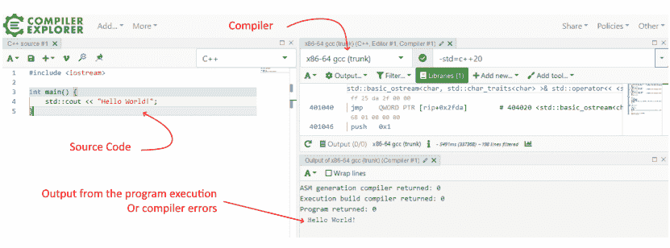
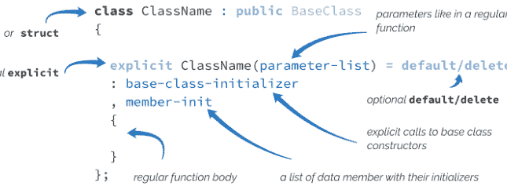
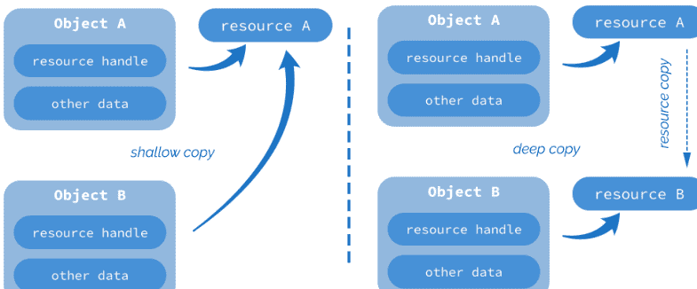
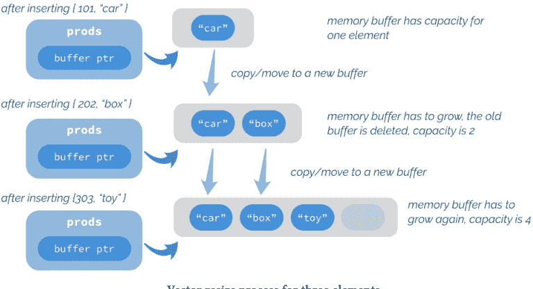
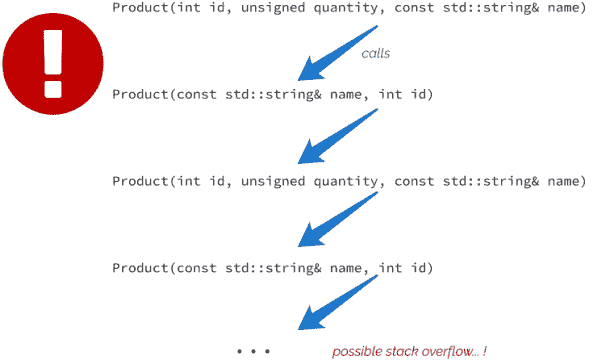
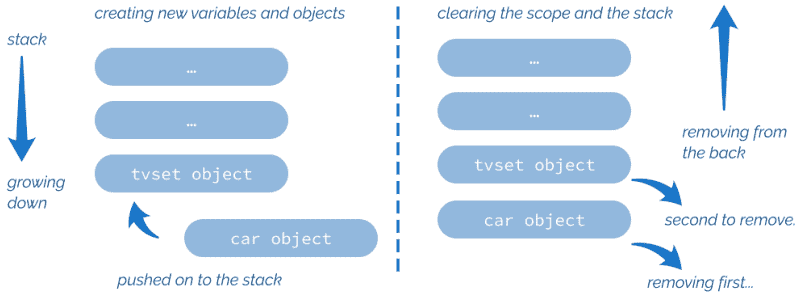
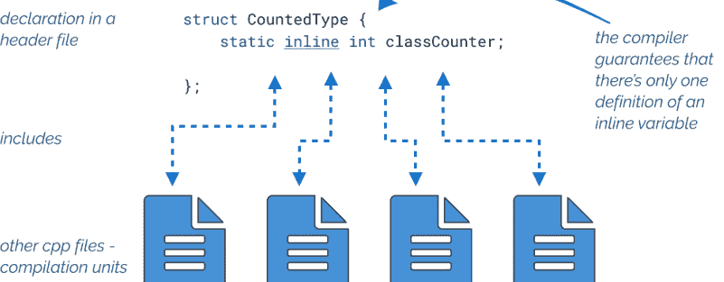
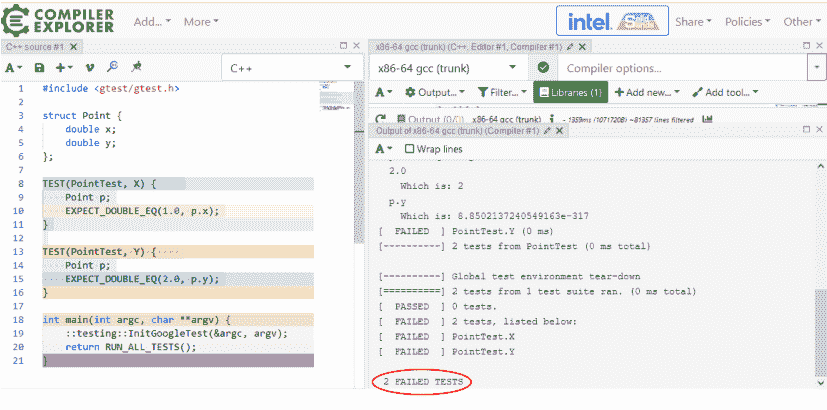
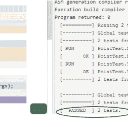
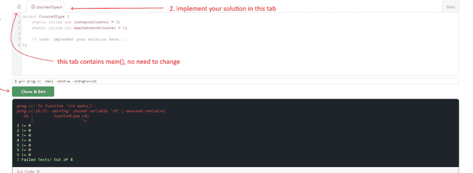

# C++ 初始化故事：所有初始化选项及相关 C++ 领域指南


- NSDMI 总结 . . . . . . . . . . . . . . . . . . . . . . . . 130

## 9. 作为数据成员的容器

- 基础知识 . . . . . . . . . . . . . . . . . . . . . . . . . . . 132
- 使用 `std::initializer_list` . . . . . . . . . . . . . . . 135
- 示例实现 . . . . . . . . . . . . . . . . . . . . . . . . . . . 139
- 拷贝元素的代价 . . . . . . . . . . . . . . . . . . . . . . . 144
- 某些不便之处 - 不拷贝类型 . . . . . . . . . . . . . . . . 146
- 更多选项（高级） . . . . . . . . . . . . . . . . . . . . . . 147
- 总结 . . . . . . . . . . . . . . . . . . . . . . . . . . . . . . 148

## 10. 非正则数据成员

- 常量非静态成员 . . . . . . . . . . . . . . . . . . . . . . . 150
- 作为数据成员的指针 . . . . . . . . . . . . . . . . . . . . 153
- 作为数据成员的智能指针 . . . . . . . . . . . . . . . . . 156
- 作为数据成员的引用 . . . . . . . . . . . . . . . . . . . . 164
- 总结 . . . . . . . . . . . . . . . . . . . . . . . . . . . . . . 168

## 11. 非局部对象

- 存储生存期与链接 . . . . . . . . . . . . . . . . . . . . . . 170
- 非局部静态对象的初始化 . . . . . . . . . . . . . . . . . 180
- C++20 中的 `constinit` . . . . . . . . . . . . . . . . . . . 182
- 函数作用域内的静态变量 . . . . . . . . . . . . . . . . . 185
- 关于静态数据成员 . . . . . . . . . . . . . . . . . . . . . . 187
- 内联变量（`inline variables`）的动机 . . . . . . . . . 189
- 全局内联变量 . . . . . . . . . . . . . . . . . . . . . . . . 196
- `constexpr` 与内联变量 . . . . . . . . . . . . . . . . . . 197
- 总结 . . . . . . . . . . . . . . . . . . . . . . . . . . . . . . 197

## 12. C++20 中的聚合体与指定初始化器

- C++20 中的聚合体 . . . . . . . . . . . . . . . . . . . . . . 199
- 指定初始化器的基础 . . . . . . . . . . . . . . . . . . . . 202
- 规则 . . . . . . . . . . . . . . . . . . . . . . . . . . . . . . 203
- 指定初始化的优点 . . . . . . . . . . . . . . . . . . . . . . 204
- 示例 . . . . . . . . . . . . . . . . . . . . . . . . . . . . . . 205
- 总结 . . . . . . . . . . . . . . . . . . . . . . . . . . . . . . 207

## 13. 技术与用例

- 使用 `explicit` 强类型 . . . . . . . . . . . . . . . . . . . 208
- 初始化数据成员的最佳方式 . . . . . . . . . . . . . . . . 212
- 通过 `emplace` 和 `in_place` 减少冗余拷贝 . . . . . . 215
- 交换惯用法（`swap idiom`） . . . . . . . . . . . . . . . . 229
- CRTP 类计数器 . . . . . . . . . . . . . . . . . . . . . . . . 223
- 同一个类中的多种初始化类型 . . . . . . . . . . . . . . 226
- Meyer 单例模式与 C++11 . . . . . . . . . . . . . . . . . 230
- 使用自注册类型的工厂模式与静态初始化 . . . . . . . 231
- 总结 . . . . . . . . . . . . . . . . . . . . . . . . . . . . . . 237

## 14. 最终测试与练习

- 练习 . . . . . . . . . . . . . . . . . . . . . . . . . . . . . . 242

## 附录 A - 特殊成员函数规则

- 图表 . . . . . . . . . . . . . . . . . . . . . . . . . . . . . . 251

## 附录 B - 测试与练习

- 第 1-6 章的测试 . . . . . . . . . . . . . . . . . . . . . . . 254
- 最终测试 . . . . . . . . . . . . . . . . . . . . . . . . . . . 254
- 第一个代码问题的解答：NSDMI . . . . . . . . . . . . . 255
- 第二个代码问题的解答：NSDMI . . . . . . . . . . . . . 255
- 第三个代码问题的解答：`inline` . . . . . . . . . . . . . 257
- 第四个代码问题的解答：修复代码 . . . . . . . . . . . 257

## 参考文献

. . . . . . . . . . . . . . . . . . . . . . . . . . . . . . . . . . 259

## 关于本书

C++ 中的初始化是一个热点话题！网上充斥着关于最佳实践的讨论，甚至还有关于该主题的迷因。这并不意外，因为初始化一个简单的整数值、自动类型推导、数据成员以及对象生存期的规则有十多种。

本书由此诞生。

在全文中，你将学习在 C++ 中初始化各种变量和数据成员的实用选项。具体来说，它教授了初始化类型、构造函数、非静态数据初始化、内联变量等内容。此外，你将看到从 C++11 到 C++20 的变化和新技术，以及大量的示例来完善你的理解。

计划是解释初始化的大部分（不是全部）部分，学习许多优秀的 C++ 技术并了解底层发生了什么。

## 为什么你应该读这本书？

在现代 C++（自 C++11 起），我们有许多新功能来简化工作和代码。初始化是改进的领域之一。现代 C++ 增加了新的初始化规则，试图在保持旧行为和兼容性（主要来自 C 语言）的同时变得简单。尽管如此，规则可能会变得混乱和复杂，甚至 ISO 委员会也需要在过程中修正某些内容。本书将帮助你应对这些问题并更好地理解这个主题。此外，初始化只是本书的一个方面。你将学习围绕类、析构函数、对象生存期，甚至是编译器在启动时如何处理数据的所有主题。

## 学习目标

目标是使你掌握以下知识：

- 解释对象初始化规则，包括普通变量、数据成员和非局部对象。
- 如何实现特殊成员函数（构造函数、析构函数、拷贝/移动操作）以及它们何时有用。
- 如何使用 C++11 特性（如非静态数据成员初始化、继承和委托构造函数）高效地初始化非静态数据成员。
- 如何使用 C++17 的内联变量简化静态变量和静态数据成员的操作。
- 如何处理类容器成员、不可拷贝数据成员（如 `const` 成员）或仅移动数据成员，甚至是 lambda 表达式。
- 什么是聚合体，以及如何使用 C++20 的指定初始化器创建此类对象。

## 本书的结构

本书包含 14 章，结构如下：

- 第 1 到 5 章为本书的其他部分奠定基础。它们涵盖了基础初始化规则、构造函数、析构函数和数据成员的基础知识。
- 第 6 章是关于构造函数的简短测试。你可以检查对书中“第一部分”的掌握情况。
- 第 7 章（进行中）：类型推导。
- 第 8 章介绍了非静态数据成员初始化（NSDMI），这是 C++11 一项改进了我们处理数据成员的强大功能。在章节末尾，你可以完成练习。
- 第 9 章讨论了如何初始化类容器成员以及如何在类中处理它们。你将学习常量数据成员、作为数据成员的 `unique_ptr` 以及引用。
- 第 11 章描述了静态非局部变量、静态对象、各种存储生存期，以及来自 C++17 的内联变量和 C++20 的 `const`。
- 第 12 章转向 C++20 并介绍了指定初始化器，这是一种基于 C 语言类似功能的实用特性。
- 第 14 章是涵盖全书的最终测试。

## 关于本书

书中有两个附录：

- 附录 A - 关于编译器生成的特殊成员函数规则的实用指南。
- 附录 B - 测验和练习的答案。

## 这本书是给谁看的？

本书面向初级/中级 C++ 程序员，他们想要学习现代 C++（从 C++11 到 C++20）中初始化的各个方面。

你应该至少了解一些创建和使用自定义类的基础知识。

此书对于熟悉旧版 C++ 标准并希望过渡到 C++17/C++20 的资深程序员来说也很有帮助。

## 前提条件

- 你应该具备 C++ 表达式和基本类型的基础知识。
- 你应该能够实现一个带有若干数据成员的简单类。以及如何基础地创建和操作此类类的对象。

## 读者反馈与勘误

如果你发现错误、拼写错误、语法错误或任何需要修正的内容（特别是逻辑问题！），请向 `bartek@cppstories.com` 发送你的反馈。

以下是包含修复列表的勘误表：

`https://www.cppstories.com/p/cppinitizationbook/`

你的反馈至关重要！撰写诚实的评论有助于书籍的推广以及我后续工作的质量。

此外，本书在 GoodReads 上有一个专门的页面。请在下处分享你的反馈：

[Bartłomeij Filipek¹ 编写《C++ Initialization Story》]。

> ¹`https://www.goodreads.com/book/show/62606823-c-initialization-story`

## 示例代码

你可以在这个独立的 GitHub 公共仓库中找到所有示例的源代码。

链接将稍后出现

你可以浏览单个文件或下载整个分支：

链接将稍后出现

## 代码许可

书中的代码根据知识共享许可协议提供。

## 格式说明

代码示例使用等宽字体呈现，类似于下面的示例：

对于较长的示例：

示例的标题

```cpp
#include <iostream>

int main() {
    const std::string text { "Hello World" };
    std::cout << text << '\n';
}
```

或者较短的片段（不带标题且有时不包含 `include` 语句）：

```cpp
int foo() {
    return std::clamp(100, 1000, 1001);
}
```

在可用情况下，还会看到指向在线编译器的链接，你可以在那里运行代码。

例如：

## 关于本书

示例标题。在 @Compiler Explorer 中运行

```cpp
#include <iostream>
```

```cpp
int main() {
    std::cout << "Hello World";
}
```

你可以点击标题中的链接，然后将打开指定的在线编译器的网站（在上面的例子中，是 Compiler Explorer）。你可以编译示例、查看输出，并直接在浏览器中实验代码。以下是 Compiler Explorer 的基本概述：



较长程序的片段通常会被缩短，以仅展示核心机制。

## 语法高亮限制

本书当前版本在语法高亮方面可能存在一些局限性。例如：

- `if constexpr` - Pygments 问题链接：C++ `if constexpr` 未被识别 (C++17)。Issue #11362。
- 类的第一个方法未高亮 - C++ 中类的第一个方法未高亮。Issue #791。

> `https://github.com/pygments/pygments/issues/11362`

`https://github.com/pygments/pygments/issues/791`

## 特殊章节

- 模板方法未高亮 C++ 词法器不识别返回类型为模板的函数 · Issue #1138*。
- 现代 C++ 属性有时无法被正确识别。

关于 C++ 和 Pygments 的其他问题：C++ Issues · `github/pygments/pygments`^。

在整本书中，你还会看到以下章节：

这是一个带有与当前章节相关的额外信息的信息框（Information Box）。

这是一个带有给定主题相关的潜在风险和威胁的警告框（Warning Box）。

> 这是一个引用框（Quote Box）。在书中通常用于引用 C++ 标准。

`https://github.com/pygments/pygments/issues/1138`

`https://github.com/pygments/pygments/issues/q=is_issue_is_open`

## 关于作者

Bartłomiej (Bartek) Filipek 是一位来自波兰南部美丽城市的 C++ 软件开发人员。他于 2007 年开始职业生涯，并于 2010 年毕业于波雅盖洛瓦大学，获得计算机科学学位。

Bartek 目前在 Xara 工作，为高级文档编辑器开发功能。他也有编写大型系统驱动程序的经验。过去，Bartek 曾在大学教授过编程课程。

自 2011 年以来，Bartek 定期在 `cppstories.com` 编写博客。该博客关注核心 C++ 和最新的标准。他还是克拉科夫 C++ 用户组的联合组织者。自 2018 年 10 月以来，Bartek 直接与 ISO/IEC JTC 1/SC22 委员会合作。在空闲时间里，他喜欢收集和组装乐高模型。

6 `http://www.xara.com/`

7 `http://www.cppstories.com/`

8 `http://www.bfilipek.com/`

9 `http://www.meetup.com/`

10 `http://www.xara.com/`

11 `https://www.cppstories.com/`

12 `http://www.bfilipek.com/`

13 `http://www.meetup.com/`

14 `http://www.xara.com/`

15 `https://www.cppstories.com/`

16 `http://www.bfilipek.com/`

17 `http://www.meetup.com/`

18 `http://www.xara.com/`

19 `https://www.cppstories.com/`

20 `http://www.bfilipek.com/`

21 `http://www.meetup.com/`

22 `http://www.xara.com/`

23 `https://www.cppstories.com/`

24 `http://www.bfilipek.com/`

*(注：原文中数字和链接部分似乎存在混乱或重复，此处按原文逻辑保留)*


## 示例代码

你可以在这个独立的 GitHub 公共仓库中找到所有示例的源代码。

链接将稍后出现

你可以浏览单个文件或下载整个分支：

链接将稍后出现

## 代码许可

书中的代码根据知识共享许可协议提供。

## 格式说明

代码示例使用等宽字体呈现，类似于下面的示例：

对于较长的示例：

```cpp
#include <iostream>

int main() {
    const std::string text { "Hello World" };
    std::cout << text << '\n';
}
```

或者较短的片段（不带标题且有时不包含 `include` 语句）：

```cpp
int foo() {
    return std::clamp(100, 1000, 1001);
}
```

在可用情况下，还会看到指向在线编译器的链接，你可以在那里运行代码。

例如：

## 关于本书

示例标题。在 @Compiler Explorer 中运行

```cpp
#include <iostream>
```

```cpp
int main() {
    std::cout << "Hello World";
}
```

你可以点击标题中的链接，然后将打开指定的在线编译器的网站（在上面的例子中，是 Compiler Explorer）。你可以编译示例、查看输出，并直接在浏览器中实验代码。以下是 Compiler Explorer 的基本概述：


较长程序的片段通常会被缩短，以仅展示核心机制。

## 语法高亮限制

本书当前版本在语法高亮方面可能存在一些局限性。例如：

- `if constexpr` - Pygments 问题链接：C++ `if constexpr` 未被识别 (C++17)。Issue #11362。

- 类的第一个方法未高亮 - C++ 中类的第一个方法未高亮。Issue #791。

> https://github.com/pygments/pygments/issues/11362

https://github.com/pygments/pygments/issues/791

## 特殊章节

- 模板方法未高亮 C++ 词法器不识别返回类型为模板的函数 · Issue #1138*。

- 现代 C++ 属性有时无法被正确识别。

关于 C++ 和 Pygments 的其他问题：C++ Issues · github/pygments/pygments^。

在整本书中，你还会看到以下章节：

这是一个带有与当前章节相关的额外信息的信息框（Information Box）。

这是一个带有给定主题相关的潜在风险和威胁的警告框（Warning Box）。

> 这是一个引用框（Quote Box）。在书中通常用于引用 C++ 标准。

https://github.com/pygments/pygments/issues/1138

https://github.com/pygments/pygments/issues/q=is_issue_is_open

## 关于作者

Bartłomiej (Bartek) Filipek 是一位来自波兰南部美丽城市的 C++ 软件开发人员。他于 2007 年开始职业生涯，并于 2010 年毕业于波雅盖洛瓦大学，获得计算机科学学位。

Bartek 目前在 Xara 工作，为高级文档编辑器开发功能。他也有编写大型系统驱动程序的经验。过去，Bartek 曾在大学教授过编程课程。

自 2011 年以来，Bartek 定期在 `cppstories.com` 编写博客。该博客关注核心 C++ 和最新的标准。他还是克拉科夫 C++ 用户组的联合组织者。自 2018 年 10 月以来，Bartek 直接与 ISO/IEC JTC 1/SC22 委员会合作。在空闲时间里，他喜欢收集和组装乐高模型。

*(注：原文末尾的数字和链接部分似乎存在混乱或重复，此处按原文逻辑保留，但在翻译时已过滤掉非文本内容)*

- 2022 年 6 月 20 日 - 首版发布！书籍几乎完成。缺失部分：10. 容器成员，11. 非正则数据成员。

- 2022 年 6 月 22 日 - 关于 NSDMI、直接初始化和括号的新章节，关于继承构造函数的更多内容，单词。

- 2022 年 6 月 24 日 - “拷贝和移动构造函数”章节，拼写错误和细小的措辞改进。

- 2022 年 7 月 16 日 - 重写了容器成员章节，`noexcept` 的一致性以及移动操作在移动构造函数部分中的优势，措辞，修复，布局。

- 2022 年 9 月 13 日 - 标题改为《C++ Initialization Story》，调整了书籍结构，重写了“局部对象”章节（之前仅关于内联变量），新提取了技术章节，关于 CRTP 的新章节。

- 2022 年 12 月 23 日 - 内容完成！增加了推导章节，填充了技术章节中的缺失部分。布局改进，更多问题、练习和修复。

# 1. 局部变量与简单类型

让我们从简单的开始，问问：“什么是初始化？”当我们从 [C++Reference](https://en.cppreference.com/w/cpp/language/initialization) 查看定义时，我们可以读到：

> 变量的初始化在构造时为其提供初始值。

我们将此定义翻译为以下示例：

```cpp
void foo() {
  int x = 42;
  // ... 之后使用 'x'...
}
```

在上面，我们有一个带有局部变量的函数。该变量被声明为整数类型，并初始化为值 42。这是你分配初始值的许多方法之一。这里有更多选项：

```cpp
struct Point { int x; int y; }; // 声明自定义类型
Point createPoint(int x) { return {x, -x}; };
int main() {
  int x = { 42 }; // 列表初始化
  double y = { 100.0 }; // 拷贝列表初始化
  auto ptr = std::make_unique<float>(90.5f); // 自动类型推导
  auto z = createPoint(42); // 通过工厂函数
  std::string s (10, 'x'); // 调用构造函数
  Point p { 10 }; // 聚合初始化
  std::array<float, 100> numbers { 1.1f, 2.2f }; // 数组初始化
  // /
}
```

## 局部变量与简单类型

你也可以想出许多其他赋值形式。我们还可以扩展类数据成员、静态变量、线程局部变量甚至动态内存分配的语法。

从理论上讲，初始化是简单的：“将一个值放入新创建变量的内存位置”。然而，这种操作涉及应用程序代码的许多部分（局部 vs 非局部作用域 vs 线程）以及内存中的各个位置（如栈 vs 堆）。这就是为什么语法或行为可能会略有不同。

在 C++ 中，我们至少有以下形式的初始化：

- 聚合初始化

- 常量初始化

- 默认初始化

- 直接初始化

- 拷贝初始化

- 列表初始化

- 引用初始化

- 值初始化

- 零初始化

- 加上相关主题，如拷贝消除、静态变量、转换序列、构造函数、赋值、动态内存、存储等。

虽然这个列表听起来很复杂，我们将逐步通过这些主题来揭示核心概念。稍后我们将处理更高级的示例，并观察 C++ 机制内部发生了什么。

虽然我们解释了整数和其他数值类型的大多数情况，但最好处理一些实用的东西。本书从一些基础的自定义类型开始，然后考虑我们在它们的早期实现中可能遇到的各种问题。稍后类型将会扩展，为我们提供更多上下文和有说服力的用例。

## 从简单类型开始

在 C++ 中定义类或结构体（自定义类型）允许你对问题领域进行建模并更自然地解决问题。与其处理一堆变量和函数，最好的工作方式是将它们分组并提供一致的 API（应用程序编程接口）。

> 局部变量，C++ 简单类型

C++ 提供了一组内置类型，包括布尔、整型、字符和浮点型。此外，你还可以使用标准库中的对象，例如各种集合、`std::string`、`std::vector`、`std::map`、`std::set` 以及许多其他。你可以收集这些核心组件并构建你的类型。

为了给我们的主主题创建一个背景，让我们从一个代表汽车列表应用中汽车信息的类型开始。系统从数据库读取汽车/卡车信息并在应用程序中显示它。为了容易上手，该类型持有四个成员：名称（`std::string`）、生产年份、座位数和发动机功率。


这是 `CarInfo` 类型的第一个版本代码：

Ex 1.1. Simple CarInfo structure. Run @CompilerExplorer

```cpp
#include <iostream>
#include <string>
```

```cpp
struct CarInfo {
  std::string name;
  unsigned year;
  unsigned seats;
  double power;
};
```

```cpp
int main() {
  CarInfo firstCar;
  firstCar.name = "Renault Megane";
  firstCar.year = 2003;
  firstCar.seats = 5;
  firstCar.power = 116;
  std::cout << "name: " << firstCar.name << "\n";
  std::cout << "year: " << firstCar.year << "\n";
  std::cout << "seats: " << firstCar.seats << "\n";
  std::cout << "power: " << firstCar.power << "\n";
}
```

## 局部变量与简单类型

- 你可以对数组使用列表初始化，当提供了元素数量时，编译器将推导出该数量。

- 如果在初始化列表中提供的元素数量少于数组的元素数量，则剩余元素将进行值初始化（value initialized）。对于内置类型，这意味着其值为 0。

- 对于结构体，你可以使用单个初始化列表或嵌套的列表：其展开将是递归的。

- 如果你提供的值比聚合体（aggregate）中数据成员的数量要少，那么剩余的数据成员（按照声明顺序）将会被有效初始化。

第一个项目点说明每个元素都是通过拷贝初始化（copy initialized）的。在我们学习了显式构造函数后，我们将回到这个话题，并解释拷贝初始化与直接初始化语法之间的区别。

对于我们的结构体，我们可以编写以下测试代码：

例 1.4 CarInfo 结构体的聚合体初始化。运行 @Compiler Explorer

```cpp
struct CarInfo {
    std::string name;
    unsigned year;
    unsigned seats;
    double power;
}
```

```cpp
void printInfo(const CarInfo& c) {
    std::cout << c.name << ", "
              << c.year << " " << c.year << ", "
              << c.seats << " " << c.seats << ", "
              << c.power << " hp\n";
}
```

```cpp
int main() {
    CarInfo firstCar("Megane", 2003, 5, 116);
    printInfo(firstCar);
    CarInfo partial("unknown");
    printInfo(partial);
    CarInfo largeCar("large car", 1975, 10);
    printInfo(largeCar);
}
```

此将输出：

```
Megane, 2003 year, 5 seats, 116 hp
unknown, 0 year, 0 seats, 0 hp
large car, 1975 year, 10 seats, 0 hp
```

在不详述完整定义的情况下，聚合体指的是具有所有公共数据成员、没有虚函数且没有用户自定义构造函数的简单类型（或数组）。

我们将在书的后续部分讨论聚合体（并查看该类类型的完整定义）。此外，C++20 中有一个专门关于聚合体和指定初始化（Designated Initialization）的章节。

## 默认数据成员初始化

如果你想为数据成员提供某些默认值怎么办？通过值初始化，你可以获得各种类型的零值，但有时这可能不够用。

从 C++14 开始，我们可以利用非静态数据成员初始化（NSDI），也称为默认成员初始化，为聚合体提供默认值。请看下例：

例 1.5 默认成员初始化与聚合体。运行 @Compiler Explorer

```cpp
#include <iostream>
#include <string>

struct CarInfo {
    std::string name { "unknown" };
    unsigned year { 1920 };
    unsigned seats { 4 };
    double power { 100. };
};

void printInfo(const CarInfo& c) { /* ... */ }

int main() {
    CarInfo unknown;
    printInfo(unknown);
    CarInfo zeroed{};
    printInfo(zeroed);
    CarInfo partial{"large car", 1975};
    printInfo(partial);
}
```

此将打印：

```
unknown, 1920 year, 4 seats, 100 hp
unknown, 1920 year, 4 seats, 100 hp
large car, 1975 year, 4 seats, 100 hp
```

这种语法非常直观；你可以在数据成员声明的地方对其进行初始化。这可以防止由于数据具有不确定值而导致的意外错误。即使你使用默认初始化或值初始化，数据成员也将获得在结构体声明中提供的值。如果你在聚合体初始化器中提供的值较少，剩余成员将获得其声明中的默认值。

从技术上说，类内初始化从 C++11 开始就可用了，但最初不支持聚合体类型。在本节中，我们仅仅接触了这一实用技巧的皮毛。请参见该主题的专门章节：非静态数据成员初始化。

## 总结

在本章中，我们涵盖了一些聚合体并学习了如何初始化它们。

需要记住的点：

- 对象的默认初始化：对于内置类型，这会产生不确定值。

- 值初始化：对于内置类型，这会产生零。

- 类内成员初始化（NSDI）：允许为聚合体提供默认值。

- 聚合体：具有公共数据成员、没有虚函数且没有用户自定义构造函数的简单类型。

- Getter（访问器）通常在末尾带有 `const`：这意味着成员函数不能更改成员的值。应用 `const` 可能会影响程序设计，因为通常更容易推理 `const` 实例的状态。更多信息请参阅此 C++ 核心准则：Con.2：默认将成员函数设为 `const`。

- 成员函数可能还会应用 `noexcept` 修饰符。然而，这个话题超出了本书的范围，不会涵盖。你可以在 @C++Reference - noexcept specifier 找到更多信息。

## 使用构造函数初始化

这里是示例的延续，我们创建并使用了 `DataPacket` 类的对象：

**例 2.2. 简单的 DataPacket 类，延续。运行 @Compiler Explorer**

```cpp
int main() {
    DataPacket packet;
    packet.setData("Programming World");
    std::cout << packet.getCheckSum() << '\n';
}
```

代码并没有直接访问数据成员，而是通过调用成员函数来操作对象并更改其属性。

你可以注意到类声明中的公共（public）和私有（private）部分。这些部分的顺序仅仅是一种编码规范，它们根据访问权限修饰符将元素分组在一起。简而言之，`public` 关键字下的成员可以从外部访问（例如调用成员函数或访问数据成员）。另一方面，`private` 部分下的成员无法在外部被访问。在 C++ 中，你也可以在类声明中添加 `protected`，这意味着成员函数或字段在外部不可访问，但对所有继承类是可访问的（假设是 public 实例，更多信息请参见书中后部分的继承章节）。

例如，在上面的 `main()` 函数中，我们写道：

```cpp
DataPacket packet;
packet.serverId = 10; // error: 'size_t DataPacket::serverId is private...
```

> C++ 中类（class）和结构体（struct）的唯一区别是类将 `private` 作为默认访问修饰符和私有继承，而结构体指定为 `public`。C++ 指南（例如 Google 风格指南，请查看此链接）建议使用结构体处理较小的、“被动”类型，这些类型仅包含公共数据成员。C++ 核心准则还建议，如果任何成员不是公共的，则使用类；参见 C++ Core Guidelines - C'。

由于我们的类没有任何用户定义的构造函数（在下一节中将介绍），我们也可以使用初始化语法将值设置为零或默认值：

- 除非通过友函数或友类。


- [结构体与类的对比](https://google.github.io/styleguide/cppguideline.html#Structs_vs_Classes)
- [如果任何成员不是公共的，则使用类](https://isocpp.github.io/CppCoreGuidelines/CppCoreGuidelines/#c-8-use-class-rather-than-struct-if-any-member-is-non-)

## 例 2.3. `DataPacket` 类的值初始化。运行 @Compiler Explorer

```cpp
int main() {
    DataPacket packet{};
    std::cout << "data: " << packet.getData() << '\n';
    std::cout << "checkSum: " << packet.getCheckSum() << '\n';
    std::cout << "serverId: " << packet.getServerId() << '\n';
}
```

这将产生以下输出：

```
data:
checkSum: 0
serverId: 0
```

然而，现在的主要区别在于，由于我们将数据成员移动到了私有部分，该类**不是聚合类型**。这就是为什么我们不能使用聚合初始化来一次设置所有值。要修复这个问题，我们需要研究构造函数。这就是后续章节的计划。

## 构造函数的基础

构造函数是一个特殊的成员函数，它没有名称，但我们使用类名来声明/定义它。你不能像调用其他成员函数一样调用构造函数。相反，编译器会在类对象被初始化时调用它。它具有以下语法：



构造函数包含以下部分：

> 在此处查看完整定义：https://timsong-cpp.github.io/cppwp/n4868/class.ctoror.general

## 使用构造函数初始化

- 构造函数没有名称，但我们使用类名来定义它，
- 可选的 `explicit` 关键字，用于阻止对给定类类型的隐式转换，
- `ClassName` - 给定类的名称（它们必须匹配），
- `parameter-list` - 参数列表，与普通函数相似，可能为空，
- 可选的 `= default`/`=delete` 指定构造函数是否应该被删除或由编译器默认，
- `:` - 表示成员/基类初始化列表的开始，当存在基类或成员初始化列表时是必须的，
- 可选的 `base-class-initializer` - 我们显式想要调用的基类构造函数列表，
- 可选的 `member-init` - 一个我们可以直接初始化它们的数据成员列表，
- `{/**body*/}` - 函数体。

> 你可以在构造函数上应用 `noexcept`、`[[attributes]]`、`constexpr`、`consteval`，这些额外属性的完整解释超出了本书范围。更多信息请阅读 C++Reference - Constructors and member initializer lists。

为了说明起见，你可以在下面看到一个带有两个数据成员的简单类类型。`Product` 类将作为一个示例，然后我们将这些知识应用到我计划更新的 `DataPacket` 类中。让我们来看片段：

```cpp
class Product {
public:
    Product() : id_{-1}, name_{"none"} {} // 一个默认构造函数
    explicit Product(int id, const std::string& name)
        : id_{id}, name_{name} {}
private:
    int id_;
    std::string name_;
};
```

上面的示例显示了一个具有两个构造函数的类。第一个被称为默认构造函数；它没有参数。第二个接受两个参数。正如你看到的，[构造函数](https://en.cppreference.com/cpp/language/constructor)

## 使用构造函数初始化

C++ 允许多个构造函数（它们看起来像重载函数）。构造函数的主要功能是在生命周期开始执行某些操作。在我们的情况下，成员列表是：如 `id_{-1}, name_{"none"}`。成员列表比使用主体更高效。对于不可赋值的类型，有时它是唯一的选择。请看以下错误的替代方案：

```cpp
class Product {
public:
    Product() { id_ = 0; name_ = "none"; } // 演示
private:
    int id_;
    std::string name_;
};
```

该代码产生的值与之前的示例相同，但数据成员分两步设置，而不是一步。如果我们在构造函数体中使用赋值：

```
// 步骤1：默认初始化：
int id_, // 未确定的值！
std::string name_; // 默认构造函数
// 步骤2：赋值：
id_ = 0;
name_ = "none";
```

对于 `int` 等内置简单类型，这可能不是大问题，但对于 `string` 这样较大的对象，你需要一些 CPU 周期。请不要编写这样的代码，而是使用成员列表来初始化你的数据成员。

初始化列表还有一个重要的方面：初始化顺序。这在 C++ 规范中有涵盖：

> 非静态数据成员按照它们在类定义中的声明顺序进行初始化（无论成员初始化器的顺序如何）。

当我以以下方式编写构造函数时：

```cpp
Product() : name_{"none"}, id_{-1} {}
```

值将正确设置，但顺序与我们认为的不同。这里是 GCC 使用 `-Wall` 选项编译时的警告（实验 @Compiler Explorer** https://godbolt.org/z/je771169qd）：

当你暗示某些值的依赖关系时，初始化顺序可能是关键的。例如，我可以写下以下代码

```cpp
struct S {
  int x;
  int y;
  int z;
  S():x{0}, y{1}, z{x+y} { {}
  // S():y{0}, z{0}, x{x+y}, { }
};
```

在上面的示例中，第一个初始化 `x` 和 `y`，然后使用这些值来初始化 `z`。这很复杂且难以阅读，但它是工作正常的。

另一方面，在第二个（被注释的）构造函数中，初始化顺序会导致 `x` 的初始化产生未定义行为，因为此时 `z` 和 `y` 尚未初始化。最好避免此类依赖以最大限度地减少 Bug 的风险。

让我们通过创建 `Product` 类的一些对象来看看构造函数是如何工作的：

`Product none;`

在第一个示例中，我们创建了 `none` 对象，它是默认构造的。编译器将调用我们的默认构造函数；因此，数据成员将被初始化为 `id_ = -1` 和 `name_ = "none"`。

`Product car(10, "car");`

该示例使用了直接初始化的形式，调用带有两个参数的构造函数。调用后，数据成员的值为：`id_ = 10` 和 `name_ = "car"`。

最后一个示例：

`Product tvSet(100, "tv set");`

这也被称为调用带有两个参数的构造函数，但语法是*直接列表初始化* —— “`}`”。请注意，我在构造函数的初始化列表中也使用了这种初始化形式。

这里是完整的示例：

Ex 2.4. `Product` 类的构造函数。运行 @Compiler Explorer

```cpp
#include <iostream>
#include <string>

class Product {
public:
    Product() : id_{-1}, name_{"none"} {} // 默认构造函数
    explicit Product(int id, const std::string& name)
        : id_(id), name_(name) {}

    int Id() const { return id_; }
    std::string Name() const { return name_; }

private:
    int id_;
    std::string name_;
};

int main() {
    Product none;
    std::cout << none.Id() << ", " << none.Name() << '\n';

    Product car(10, "super car");
    std::cout << car.Id() << ", " << car.Name() << '\n';

    Product tvSet(77, "tv set");
    std::cout << tvSet.Id() << ", " << tvSet.Name() << '\n';
}
```

你可能会抓破头脑问我为什么我将 `name` 参数声明为 `const std::string&` 而不是简单的 `std::string`。首先，我们不想在构造函数体中修改此参数。此外，`T& const` 引用可以绑定到“临时”对象（例如字符串字面量 `"super car"`）。如果没有常量引用，我们必须传递一个具名的字符串对象。或者，我们也可以通过值传递 `name` 并对该参数执行“移动操作”。在书的后续章节，我将详细介绍这个主题；参见章节：A Use Case - Best Way to Initialize string Data Members。

## 关于统一初始化

使用大括号 `"{}"` 的语法实际上是 C++11 列表初始化的一种强大功能，也称为“统一”或“大括号”初始化。主要动机是创建一种统一的数据初始化方式并避免某些问题。

例如，由于 C++ 语言语法规则，下行代码无法编译：

## Ex 2.5. 最令人困惑的解析（The Most Vexing Parse）规则。运行 @Compiler Explorer

```cpp
#include <iostream>
#include <string>

struct Box {};

struct Product {
    Product(): name{"default product"}{}
    Product(const Box& b) : name{"box"}{}
    std::string name;
};

int main() {
    Product p();          // << 1.
    std::cout << p.name;
    Product p2(Box());    // << 2.
    std::cout << p2.name;
}
```

`Product p();` 看起来无害，人们可能会预期调用默认构造函数。遗憾的是，编译器将其识别为函数的声明！C++ 有一条规则规定，任何可以解析为声明的内容必须被解释为声明。在我们的上下文中，该行可能意味着一个名为 `p`、返回 `Product` 且不接受参数的局部函数。同样，`p2` 也导致了编译器错误，这次编译器认为我们声明了一个返回 `Product` 并接受 `Box` 作为参数的局部函数 `p2`。

但幸运的是，我们至少有两种方法来修复它：

```cpp
Product p;
Product p1;
Product p2{Box()};
Product p3{Box()};
```

它按照预期工作，且列表初始化语法是最一致的选项。尝试修改示例 @Compiler Explorer¹ 并修复代码。如果你感兴趣，这里有一篇很好的文章：

> ¹https://godbolt.org/z/c48Kc9vq

想要了解更多关于该规则的知识：The Most Vexing Parse: How to Spot It and Fix It Quickly - Fluent C++¹。

## 使用构造函数初始化

列表初始化还可以处理多个参数，并可以使用在初始化列表中：

Ex 2. 多个参数和大括号。运行 @Compiler Explorer

```cpp
#include <iostream>
#include <string>

struct Product {
    Product() : name{"default product"}, value{}
    Product(char a, char b, char c, double v)
        : name{a, b, c}, value{v} {}

    std::string name;
    double value;
};

int main() {
    Product def{};
    std::cout << def.name << " " << " " << def.value << '\n';
    Product p{'x', 'y', 'z', 100.0};
    std::cout << p.name << " " << " " << p.value << '\n';
}
```

在上述示例中，使用了列表初始化处理四个参数，但语法更安全：

- 大括号 `"{}"` 语法是 C++ 的一项强大功能。
- 它避免了意外的转换。
- 可以在初始化列表中使用。

主要动机是创建一种统一的数据初始化方式并避免某些问题。

## 使用构造函数初始化

```
{
}
```

上面的示例展示了一个执行日志记录和基础参数检查的构造函数。

它使用了 `LOWEST_ID_VALUE`，这是一个用 `constexpr` 关键字标记的全局常量（这是我们第二次使用该关键字）。

> `constexpr` 说明符从 C++11 开始可用，它保证了某个值在编译时对于常量表达式是有效的。例如，你可以使用变量来设置 C 风格数组的元素个数。它通常被认为是一种“类型安全的宏定义”。该关键字适用于所有内置整数值、浮点数，甚至是 C++20 中的字符字面量；在 C++20 中，`std::string` 可能可以在 `constexpr` 上下文中使用，但不可用于运行时变量；还有一种方法声明自定义支持 `constexpr` 的类型。你也可以创建一个 `constexpr` 函数并可能在编译时对其进行求值；然而，我们将在书中不再介绍此类函数。更多信息请参阅 C++Reference - constexpr。

如果你运行此程序，你可以看到以下输出：

```
Product(): 10, car
car created
Product(): -101, box
Error - id cannot be lower than LOWEST_ID_VALUE!
```

请注意，虽然调用了两个构造函数，但我们可以看到只有第一个成功了。由于 `box` 的构造函数抛出了异常，因此该对象不被视为完全创建。更多内容将在稍后讨论析构函数介绍。

## 为 `DataPacket` 添加构造函数

在介绍之后，我们可以开始为我们的 `DataPacket` 类添加构造函数。

https://en.cppreference.com/w/cpp/language/constexpr

## 示例 2.8. 添加构造函数。在 @Compiler Explorer 中运行

```
class DataPacket {
    std::string data;
    size_t checkSum;
    size_t serverId;
public:
    DataPacket() : data_{}, checkSum_{}, serverId_{} {}
    explicit DataPacket(const std::string& data, size_t serverId)
        : data_{data}, checkSum_{calCheckSum(data)}, serverId_{serverId} {}

    const std::string& getData() const { return data; }
    size_t getCheckSum() const { return checkSum; }
    size_t getServerId() const { return serverId; }
};
```

这里是创建了一些对象的演示代码：

## 示例 2.9. 添加构造函数。演示。在 @Compiler Explorer 中运行

```cpp
void printInfo(const DataPacket& packet) {
    std::cout << "data: " << packet.getData() << '\n';
    std::cout << "checkSum: " << packet.getCheckSum() << '\n';
    std::cout << "serverId: " << packet.getServerId() << '\n';
}

int main() {
    DataPacket empty;
    printInfo(empty);
    DataPacket zeroed;
    printInfo(zeroed);
    DataPacket packet("Hello World", 101);
    printInfo(packet);
    DataPacket reply("Hi, how are you?", 404);
    printInfo(reply);
}
```

输出：

## 使用构造函数初始化

```
data:
checkSum: 0
serverId: 0
data:
checkSum: 0
serverId: 0
data: Hello World
checkSum: 1052
serverId: 101
data: Hi, how are you?
checkSum: 1375
serverId: 404
```

在上面的示例中，我们使用了两个构造函数：


# 构造函数

第一个是默认构造函数，并将数据成员初始化为默认值。它会在默认初始化和值初始化时调用。

第二个构造函数接收多个参数并将它们与数据成员匹配。这个构造函数使得一次性传递参数变得简单（之前，我们需要调用 `setter` 方法）。它接受两个参数，但我们可以初始化任意数量的数据成员。例如，构造函数确保了 `checkSum` 变量与 `data_` 匹配。由于这两个成员是相关的，得益于构造函数和 `setData` 函数，我们保持了这种关系的安全性。

我们还可以在类内部使用默认成员初始化器，我们将在单独的章节详细讨论这一点。

## 编译器生成的默认构造函数

虽然 C++ 允许你实现各种构造函数，但它可以通过自动声明和定义一个隐式默认构造函数来让你的生活更轻松。

换句话说，如果一个类没有用户声明的构造函数，编译器将创建一个：

## 使用构造函数初始化

```cpp
class Example {
public:
    std::string name;
private:
    std::string name_;
};
```

## 示例 2.10. 隐式默认构造函数。在 @Compiler Explorer 中运行

```cpp
struct Value {
    int x;
};
```

```cpp
struct CtorValue {
    CtorValue(int v) : x{v} {}
    int x;
};
```

```cpp
int main() {
    Value v;              // 可以，默认构造函数
    CtorValue y;         // 错误，没有构造函数
    CtorValue z{10};     // 使用自定义构造函数
}
```

## 使用构造函数初始化

你可以使用两个关键字 `default` 和 `delete` 来控制此类默认构造函数的创建。简之，`default` 告诉编译器创建一个实现，而 `delete` 则阻止该创建。

## 示例 2.11. Default 和 Delete。在 @Compiler Explorer 中运行

```cpp
struct Value {
    Value() = default;
    int x;
};
```

```cpp
struct CtorValue {
    CtorValue() = default;
    CtorValue(int v) : x{v} {}
    int x;
};
```

```cpp
struct DeletedValue {
    DeletedValue() = delete;
    DeletedValue(int v) : x{v} {}
    int x;
};
```

```cpp
int main() {
    Value v;              // 可以，默认构造函数
    CtorValue y;         // 可以，默认构造函数
    CtorValue z{10};     // 使用自定义构造函数
    DeletedValue w;      // 错误，已删除构造函数
    DeletedValue u{10};  // 使用自定义构造函数
}
```

在上面的示例中，你可以看到 `Value() = delete;` 告诉编译器不要创建实现。同样，在 `CtorValue` 类中使用了相同的技术，正如你所见，默认构造函数是有效的。如果你的类型具有不可默认构造的数据成员或继承自不可默认构造的类型，则不会创建隐式默认构造函数。这包括引用、`const` 数据成员、联合体等。完整列表请参阅 C++Reference。

## 使用构造函数初始化

你可能还会问 `Value() = default` 和 `Value() { };` 之间的区别是什么，它们都是“空的”。尽管，根据 C++ 标准，后者被认为是用户声明或用户提供的，并且在类型特征上产生影响。我们将在后的“平凡类和用户声明/用户提供的默认构造函数”章节中涵盖这一点。

## 显式构造函数与转换

在继续之前，有必要处理一个重要的情况：`explicit` 关键字，它可以应用于构造函数声明之前。

为什么它很重要？这个关键字是什么意思？

简之，它防止隐式转换，并且有时可以让代码更易读。

作为一个实验，让我们从以下代码开始：

```cpp
struct Product {
    Product() : name="default product", value{} {}
    Product(int v) : name="basic", value{v} {}
    Product(const std::string& n, int v)
        : name(n), value{v} {}
    std::string name;
    int value;
};
```

代码看起来正常，但现在你可以用一种异常的方式创建 `Product` 对象：

```cpp
Product numbers = 100.2; // 拷贝初始化
Product box = {"a box", 1}; // 拷贝列表初始化
```

## 使用构造函数进行初始化

我们可以看到这两行代码创建了 `Product` 对象，但数据成员得到了什么值呢？这需要明确！第一行的情况特别有趣，因为我传递了一个值为 `100.2` 的 `double` 类型值，而编译器尝试将其转换为 `int` 类型（一种窄转换），然后将其传递给构造函数。

更重要的是，函数调用中的隐式转换甚至更具问题性：

- 例 2.12. 隐式转换。在 @Compiler Explorer 中运行

```cpp
void printProduct(const Product& prod) {
    std::cout << prod.name << " " << prod.value << '\n';
}

int main() {
    double someRandomNumber = 100.1;
    printProduct(someRandomNumber);
    printProduct({"box", 2});
}
```

输出结果：

```
basic, 100
a box, 2
```

核心思想在于理解：当你向函数调用传递参数时，编译器会对这些参数执行拷贝初始化（copy initialization）。

正如你所看到的，主要问题出在只接受一个参数（或有其他参数设置为某些默认值）的构造函数上。即使有多个参数，当你传递初始化列表时，转换也可能发生。

为了防止意外且意料之外的转换，使用 `explicit` 关键字是很有好的。

当我们应用它时：

```cpp
explicit Product(int v) : name("basic"), value{v} {}
explicit Product(const std::string& n, int v) : name(n), value{v} { }
```

编译器将报告以下错误：

## 使用构造函数进行初始化

```
In function 'int main()':

error: Invalid initialization of reference of type 'const Product&'

from expression of type 'double'

28      printProduct(someRandomNumber);
        |~~~~~~~~~~~~~~~~~
error: converting to 'const Product' from initializer list would use
        explicit constructor 'Product::Product(const std::string, int)'
29      printProduct("a box", 2);
        |~~~~~~~~~~~~~~~~~~~~
```

查看完整的示例 @Compiler Explorer¹⁸。要修复代码，你需要告诉编译器显式地创建一个类型：

```cpp
int someRandomNumber = 100;
printProduct(Product{someRandomNumber});
```

从实际角度来看，带有多参数构造函数和初始化列表的情况并不是问题。编译器会调用适当的构造函数而不会执行任何窄转换。这就是为什么对多参数构造函数标记 `explicit` 是没有意义的。例如：

```cpp
Product toy = {"a toy", 1.5};
printProduct({"a box", 2.0});
```

代码生成了关于窄转换的错误……从 `double` 到 `int`。查看代码 @Compiler Explorer¹⁹。

> 使用 `explicit` 关键字声明的构造函数也称为转换构造函数（converting constructors）。它们参与隐式转换序列。在 C++03 中，这些构造函数必须能够用单个参数调用，但这一限制在 C++11 中被取消了。关于隐式转换的更多信息将在本章后续章节介绍。

## 直接初始化与拷贝初始的区别

在处理了几个关于 `explicit` 构造函数的示例后，我们终于可以回答直接初始化与拷贝初始化的区别。

我们有两种主要的初始化方式。拷贝（Copy）：

```cpp
int x = 42; // 一种拷贝初始化形式

void foo(int param) { 
    foo(x); // 对参数执行拷贝初始化
}

int anotherFoo() { return 42; } // 对返回值执行了拷贝初始化

struct Point { int x; int y; };
Point pt { 0, 1 }; // 聚合初始化
Point p2 = { 10, 11 }; // 对每个元素使用拷贝初始化
```

这是直接初始化（direct initialization）的基本语法：

```cpp
int y {42}; // 一种直接初始化形式
double z (42); // 使用括号的初始化
```

总结：

- 直接初始化行为类似于对重载函数的调用：在这种情况下，使用该类型的构造函数（包括 `explicit` 构造函数）。重载解析将寻找最匹配的构造函数并在需要时执行任何隐式转换。

- 拷贝初始化构建隐式转换序列：它尝试将参数转换为给定类型。拷贝初始化不考虑 `explicit` 构造函数。

例如，由于聚合初始化使用拷贝初始化来初始化子对象，以下代码无法工作：

## 使用构造函数进行初始化

```cpp
struct Point {
    explicit Point(int a, int b): x{a}, y{b} { }
    int x;
    int y;
}
```

```cpp
struct Aggregate {
    int a;
    Point p;
}
```

```cpp
int main() {
    Aggregate ag = { 0, {0, 1}}; // <<
    Aggregate ag2 = { 0, {0, 1}}; // <<
}
```

GCC 报告了以下错误：

```
error: converting to 'Point' from initializer list would use explicit constructor
or 'Point::Point(int, int)'
19 | Aggregate ag { 0, {0, 1}};
```

要修复此，你需要显式地提到类型：

```cpp
int main() {
    Aggregate ag = { 0, Point{0, 1}};
    Aggregate ag2 = { 0, Point{0, 1} };
}
```

查看代码 @Compiler Explorer。

> 使用 `explicit` 关键字声明的构造函数也称为转换构造函数。它们参与隐式转换序列。在 C++03 中，这些构造函数必须能够用单个参数调用，但这一限制在 C++11 中被取消了。关于隐式转换的更多信息将在本章后续章节介绍。

## 更多

`explicit` 关键字如此重要，以至于我们它来避免意外的转换。在 C++20 中，我们拥有了一些功能。

## 构造函数总结

这一章是最长的一章，因为我们需要为书的其他部分准备背景。一旦你了解了数据成员如何通过构造函数初始化的基础知识，我们就可以进一步探索各种新的 C++ 特性和和示例。

现在，总结另外两种类型的构造函数是至关重要的：拷贝和移动。请继续阅读下一章。

# 3. 拷贝与移动操作

普通构造函数允许你在从参数列表创建对象时，调用某些逻辑并初始化数据成员。C++ 还有两种特殊的构造函数类型，它们允许你控制使用相同类类型的实例创建对象时的情况。这些构造函数被称为拷贝构造函数和移动构造函数。此外，你还可以提供自定义的赋值运算符，编译器在给现有对象赋新值时会调用它们。

## 拷贝构造函数

拷贝构造函数是一个特殊的成员函数，它的第一个参数是与本身类型相同的对象，通常通过 `const` 引用传递。

```cpp
ClassName(const ClassName&);
```

从技术上讲，它可能有其他参数，但它们都必须分配默认值，而且在实践中这非常罕见。

当你使用相同类型的变量初始化对象（通过拷贝初始化或直接初始化）时，且没有更好的匹配项（如移动构造函数或普通构造函数）时，它会被调用。

```cpp
Product base { 42, "base product" }; // 一个初始对象

// 各种初始化形式，会调用拷贝构造函数
Product other { base }; // 直接列表初始化
Product another(base); // 带括号的直接初始化
Product oneMore = base; // 拷贝初始化
std::array<Product, 3> arr = {base, other, oneMore}; // 拷贝初始化

Product foo(Product p) {
    Product temp{"from foo", p.id};
    return temp; // 拷贝初始化
}

Product x;
foo(x); // 拷贝初始化
```

我们将在后续章节中讨论上述所有形式。

作为一个心理模型，我们可以假设大多数类都有由编译器生成的默认拷贝构造函数。这种默认拷贝构造函数会对每个数据成员执行位拷贝（bitwise copy）。得助于这种方法，你可以在不需要为给定类型进行任何自定义实现的情况下初始化对象、将其作为参数传递或从函数返回。然而，当你的类拥有不应该进行浅拷贝的数据成员时（例如拥有的资源句柄：文件、指向内存块的指针等），可能需要实现拷贝构造函数。例如，假设类包含一个指向内存块的指针。当默认拷贝构造函数拷贝指针时，生成的指针拷贝将指向精确的内存位置。同样，如果你的类使用文件句柄，那么在位拷贝之后，句柄会被拷贝，两个对象将关联同一个文件。根据程序要求，这可能不是你想要的。对于指针，通常做法是分配一个新的内存块并拷贝该块的数据。

浅拷贝的情况如如下所示：



浅拷贝 vs. 深拷贝

在图中，你可以看到浅拷贝（位拷贝）方法与深拷贝方法的对比。如果你拷贝了资源句柄，生成的对象将指向相同的资源。对于深拷贝版本，你需要拷贝资源，然后将资源句柄正确地赋值给新的拷贝。

标准库容器（如 `std::vector` 或 `std::string`）内部包含指向存储元素的内存缓冲的指针。它们都支持全数据拷贝，因此当你将一个 `vector` 拷贝到另一个 `vector` 时，内存将进行拷贝。在代码中使用这些类型时，你不需要考虑它们的内部机制。

## 拷贝构造函数的标准实现

实现拷贝构造函数是非常简单的，与普通构造函数非常相似。唯一的区别在于你有一个参数，它是对相同类型对象的（`const`）引用。

对于 `Product` 类，我们可以这样写：

```cpp
class Product {
public:
    explicit Product(int id, const std::string& name)
        : id_{id}, name_{name} {
        std::cout << "Product(): " << id_ << ", " << name_ << '\n';
    }
    // 拷贝构造函数
    Product(const Product& other)
        : id_{other.id_}, name_{other.name_} { }
private:
    int id_;
    std::string name_;
};
```

你可以看到，拷贝构造函数使用成员初始化列表从 `other` 拷贝数据。请注意，不需要使用公共 `getter`，因为我们可以访问所有私有数据成员。语法要求你使用引用，因此编写 `Product(Product other)` 不会被视为拷贝构造函数。

> 拷贝构造函数也可以接受非 `const` 参数，如 `Product(Product& other)`。然而，这种构造函数可能会修改另一个对象，使代码更难以阅读和理解。当你想要“偷取”其他对象的内部数据时，使用移动语义和移动构造函数可能更好。

> 拷贝构造函数可以标记为 `explicit`，但这不是常见做法，可能会防止拷贝初始化。

这里是另一个启用了基础日志的示例。这种控制台输出有助于理解构造函数何时以及如何被调用：

例 3.1. 带有日志的拷贝构造函数示例。运行 @Compiler Explorer


```cpp
class Product {
public:
    explicit Product(int id, const std::string& name)
        : id_{id}, name_{name} {
        std::cout << "Product(): " << id_ << ", " << name_ << '\n';
    }
    // 拷贝构造函数
    Product(const Product& other)
        : id_{other.id_}, name_{other.name_} { }
private:
    int id_;
    std::string name_;
};
```

（注：原文文本中存在大量由于 OCR 识别导致的碎片化和重复，此处已根据逻辑进行了整合处理。）

## 构造函数总结

这一章是最长的一章，因为我们需要为书的其他部分准备背景。一旦你了解了数据成员如何通过构造函数初始化的基础知识，我们就可以进一步探索各种新的 C++ 特性和示例。

现在，总结另外两种类型的构造函数是至关重要的：拷贝和移动。请继续阅读下一章。

# 3. 拷贝与移动操作

普通构造函数允许你在从参数列表创建对象时，调用某些逻辑并初始化数据成员。C++ 还有两种特殊的构造函数类型，它们允许你控制使用相同类类型的实例创建对象时的情况。这些构造函数被称为拷贝构造函数和移动构造函数。此外，你还可以提供自定义的赋值运算符，编译器在给现有对象赋新值时会调用它们。

## 拷贝构造函数

拷贝构造函数是一个特殊的成员函数，它的第一个参数是与本身类型相同的对象，通常通过 `const` 引用传递。

```cpp
ClassName(const ClassName&);
```

从技术上讲，它可能有其他参数，但它们都必须分配默认值，而且在实践中这非常罕见。

当你使用相同类型的变量初始化对象（通过拷贝初始化或直接初始化）时，且没有更好的匹配项（如移动构造函数或普通构造函数）时，它会被调用。

```cpp
Product base { 42, "base product" }; // 一个初始对象

// 各种初始化形式，会调用拷贝构造函数
Product other { base }; // 直接列表初始化
Product another(base); // 带括号的直接初始化
Product oneMore = base; // 拷贝初始化
std::array<Product, 3> arr = {base, other, oneMore}; // 拷贝初始化

Product foo(Product p) {
    Product temp{"from foo", p.id};
    return temp; // 拷贝初始化
}

Product x;
foo(x); // 拷贝初始化
```

我们将在后续章节中讨论上述所有形式。

作为一个心理模型，我们可以假设大多数类都有由编译器生成的默认拷贝构造函数。这种默认拷贝构造函数会对每个数据成员执行位拷贝。得助于这种方法，你可以在不需要为给定类型进行任何自定义实现的情况下初始化对象、将其作为参数传递或从函数返回。然而，当你的类拥有不应该进行浅拷贝的数据成员时（例如拥有的资源句柄：文件、指向内存块的指针等），可能需要实现拷贝构造函数。例如，假设类包含一个指向内存块的指针。当默认拷贝构造函数拷贝指针时，生成的指针拷贝将指向精确的内存位置。同样，如果你的类使用文件句柄，那么在位拷贝之后，句柄会被拷贝，两个对象将关联同一个文件。根据程序要求，这可能不是你想要的。对于指针，通常做法是分配一个新的内存块并拷贝该块的数据。

浅拷贝的情况如如下所示：


浅拷贝 vs. 深拷贝

在图中，你可以看到浅拷贝（位拷贝）方法与深拷贝方法的对比。如果你拷贝了资源句柄，生成的对象将指向相同的资源。对于深拷贝版本，你需要拷贝资源，然后将资源句柄正确地赋值给新的拷贝。

标准库容器（如 `std::vector` 或 `std::string`）内部包含指向存储元素的内存缓冲的指针。它们都支持全数据拷贝，因此当你将一个 vector 拷贝到另一个 vector 时，内存将进行拷贝。在代码中使用这些类型时，你不需要考虑它们的内部机制。

## 拷贝构造函数的标准实现

实现拷贝构造函数是非常简单的，与普通构造函数非常相似。唯一的区别在于你有一个参数，它是对相同类型对象的（`const`）引用。

对于 `Product` 类，我们可以这样写：

```cpp
class Product {
public:
    explicit Product(int id, const std::string& name)
        : id_{id}, name_{name} {
        std::cout << "Product(): " << id_ << ", " << name_ << '\n';
    }
    // 拷贝构造函数
    Product(const Product& other)
        : id_{other.id_}, name_{other.name_} { }
private:
    int id_;
    std::string name_;
};
```

你可以看到，拷贝构造函数使用成员初始化列表从 `other` 拷贝数据。请注意，不需要使用公共 getter，因为我们可以访问所有私有数据成员。语法要求你使用引用，因此编写 `Product(Product other)` 不会被视为拷贝构造函数。

> 拷贝构造函数也可以接受非 `const` 参数，如 `Product(Product& other)`。然而，这种构造函数可能会修改另一个对象，使代码更难以阅读和理解。当你想要“偷取”其他对象的内部数据时，使用移动语义和移动构造函数可能更好。

> 拷贝构造函数可以标记为 `explicit`，但这不是常见做法，可能会防止拷贝初始化。

这里是另一个启用了基础日志的示例。这种控制台输出有助于理解构造函数何时以及如何被调用：

例 3.1. 带有日志的拷贝构造函数示例。运行 @Compiler Explorer

```cpp
class Product {
public:
    explicit Product(int id, const std::string& name)
        : id_{id}, name_{name} {
        std::cout << "Product(): " << id_ << ", " << name_ << '\n';
    }
    // 拷贝构造函数
    Product(const Product& other)
        : id_{other.id_}, name_{other.name_} { }
private:
    int id_;
    std::string name_;
};
```

（注：原文文本中存在大量由于 OCR 识别导致的碎片化和重复，此处已根据逻辑进行了整合处理。）

## 拷贝与移动操作

语言规则清晰地表达了这次的新行为。此处不谈细节，当存在一个无名的临时对象用于初始化一个新实体时，它将省略掉额外的拷贝：例如：

Ex3.3.CopyElision

```cpp
Product createProduct() {
    return {101, "from createProduct()"};
}

int main() {
    std::cout << "calling createProduct()\n";
    Product created = createProduct();
}
```

这一次，编译器将始终生成以下输出：

```cpp
calling createProduct()

Product(): 101, from createProduct()
```

换句话说，来自 `createProduct` 的临时对象被跳过了，并被直接用于初始化 `created` 对象。这一特性对于优化以及高效处理不可拷贝类型非常有帮助，而这些类型以前无法从工厂函数返回。

如果你想了解更多关于此特性的信息，可以参阅我的书：*C++17 in Detail*，或者查看这篇博客文章：[Guaranteed Copy Elision Does Not Elide Copies* @VisualC++ Team Blog](

## 编译器生成的拷贝构造函数

如果你的类符合以下关键规则，编译器将为你生成一个隐式的拷贝构造函数：

- 你的类拥有可以拷贝的非静态数据成员（它们的拷贝构造函数可访问，未被删除）；

- 你的类拥有可以拷贝的直接或虚基类；

- 你的类没有任何右值引用类型的数据成员；

> *https://leanpub.com/cpp17indetail

*https://devblogs.microsoft.com/cppblog/guaranteed-copy-elision-does-not-elide-copies/

## 拷贝与移动操作

- 你的类没有用户定义的移动构造函数或移动赋值运算符

你可以在这个实用的列表中找到所有规则 @C++Reference⁵

举个例子，让我们来看下面的代码：

Ex 3.4. 一个非默认的拷贝构造函数。在 @Compiler Explorer 中运行

```cpp
#include <iostream>
#include <string>

struct Name {
    explicit Name(const std::string& str): name_{str} { }
    Name(const Name&) = delete;
    std::string name_;
};

class Product {
public:
    explicit Product(int id, const std::string& name)
        : id_{id}, name_{name} {
        std::cout << "Product(): " << id_ << ", " << name_.name_ << '\n';
    }
private:
    int id_;
    Name name_;
};

int main() {
    Product first{10, "basic"};
    Product second { first };
}
```

请看我们尝试调用拷贝构造函数的这一行。它无法编译：

> ⁵https://en.cppreference.com/w/cpp/language/copy_constructor#Deleted-implicitly-declared-copy_constructor

## 拷贝与移动操作

编译器告诉我们它无法创建拷贝构造函数，因为 `name` 数据成员无法被轻易拷贝，因为它有一个被删除的拷贝构造函数。

我们也可以通过查看 C++Insights 的输出观察到这一点，参见此链接：

```cpp
public:
// inline Product(const Product &) = delete;
// inline Product(Product&&) = delete;
// inline ~Product() noexcept = default;
```

## 移动构造函数

移动构造函数接收相同类型的右值引用。通常，此类构造函数具有以下形式：

```cpp
ClassName(ClassName&&) noexcept;
```

让我们尝试解析其完整语法。

简而言之，右值引用是临时对象，通常出现在表达式的右侧，且其值即将过期。

例如：

```cpp
std::string hello = "Hello Amazing"; // 左值，一个普通对象
std::string world = { "Programming World" }; // 左值
std::string msg = hello + world;
```

上面，表达式 `+ world` 创建了一个临时对象。它没有名称，我们无法轻易地访问它。这样的临时对象的生命周期将结束

## 拷贝与移动操作

在表达式完成后（除非它被赋值给 `const` 或右值引用），我们可以从它们那里“窃取”资源。对于整数等内置类型是安全的，但在字符串或其他类型的情况下，我们需要小心。这就是我们使用移动语义的原因。

移动构造函数是从临时对象转移资源所有权的方法，允许将其标记为即将过期。这给了编译器一个调用移动构造函数而不是拷贝构造函数的机会，这要高效得多。

这种情况通过以下图表说明：

after: (img/0256f0086372366473966f8c01)

move creation: (img/0256f00863723666473966f8c02)

move constructor: (img/0256f00863723666473966f8c03)

移动构造函数必须确保另一个对象处于一个未指定但有效的状态。在我们的案例中，可以在输出的最后一行看到这一点。旧值：结束处为空，所以字符串被清空了。

## 拷贝与移动操作

Ex 3.5. 移动构造函数。在 @Compiler Explorer 中运行

```cpp
#include <iostream>
#include <string>
```

class Product {

public:

    explicit Product(int id, const std::string& name)

        : id_{id}, name_{name} {

        std::cout << "Product(): " << id_ << ", " << name_.name_ << '\n';

    }

    Product(Product&& other) noexcept

        : id_{other.id_}, name_{std::move(other.name_)} {

        std::cout << "Product(move): " << id_ << ", " << name_.name_ << '\n';

    }

    const std::string& name() const { return name_; }

private:

    int id_;

    std::string name_;

};

int main() {

    Product first{10, "basic"};

    std::cout << "first created\n";

    Product second{std::move(first)};

    std::cout << "second created\n";

    std::cout << "old value: " << first.name() << "\n";

}

```

当你运行代码时，你可以看到以下输出：

```cpp
Product(): 10, basic

first created

Product(move): 10, basic

second created

old value: 
```

正如所见，我们创建了第一个对象，然后将其标记为即将过期。这给了编译器一个调用移动构造函数而不是拷贝构造函数的机会。

## 拷贝与移动操作

```cpp
Product(Product&& other) noexcept
  : id_{other.id_}, name_{std::move(other.name_)}
```

移动的实现与拷贝构造函数相似，但我们必须注意细节。由于 `id_` 只是一个整数，我们所做的只是拷贝值。对于 `name_` 成员，我们可以用 `std::move(other.name_)` 初始化它。我们遇到了第一个问题，`other_name_` 是一个名称，所以不是临时（临时没有名称）；我们无法移动（夺取）它的内容。这就是为什么编译器通过表达式 `std::move(other.name_)` 将其解释为临时。这将调用 `std::string` 的移动构造函数，并可能从 `other_name_` 中夺取缓冲区。

移动构造函数必须确保另一个对象处于一个未指定但有效的状态。在我们的案例中，可以在输出的最后一行看到这一点。

> 移动构造函数可以标记为 `explicit`，但这不是常见做法，并且可能会影响依赖隐式移动构造函数的通用代码（如标准算法）。

## noexcept 与移动构造函数

虽然我提到过书中不会涵盖 `noexcept`，但我需要对这个规则做一个特例。在函数声明中使用 `noexcept` 的基本原则是保证该函数不会返回任何异常（不会从函数作用域抛出异常）。如果发生了，编译器可以调用 `std::terminate()` 而不是常规异常处理。拥有 `noexcept` 函数允许编译器和库对代码进行优化。

例如，当你有一个 `std::vector<T>` 时，如果 `T` 的移动操作被标记为 `noexcept`，那么 `vector` 允许使用移动而非拷贝来执行调整操作（以保证安全）。为了说明这种行为，我修改了 `Product` 类并添加了拷贝构造函数：

## 拷贝与移动操作

```cpp
Product(const Product& other) : id_{other.id_}, name_{other.name_} {

    std::cout << "Product(copy): " << id_ << ", " << name_ << '\n';

}
```

```cpp
Product(Product&& other) : id_{other.id_}, name_{std::move(other.name_)} {

    std::cout << "Product(move): " << id_ << ", " << name_ << '\n';

}
```


注意，移动构造函数中没有`noexcept`。现在，如果我们运行以下代码：

例 3. `std::vector`调整大小时的拷贝。运行 @Compiler Explorer

```cpp
int main() {
    std::vector<Product> prods;
    prods.emplace_back(101, "car");
    prods.emplace_back(202, "box");
    prods.emplace_back(303, "toy");
    prods.emplace_back(404, "mug");
    prods.emplace_back(505, "pencil");
}
```

我们将看到以下输出：

```
Product(): 101, car
Product(): 202, box
Product(copy): 101, car
Product(): 303, toy
Product(copy): 101, car
Product(copy): 202, box
Product(): 404, mug
Product(): 505, pencil
Product(copy): 101, car
Product(copy): 202, box
Product(copy): 303, toy
Product(copy): 404, mug
```

让我们来尝试解读这些输出。

`emplace_back`函数（自 C++11 起可用）使用你传递的参数在容器末尾创建一个新元素。或者，我们可以使用`push_back`，但这需要对`Product`对象进行一次额外的拷贝。当我们添加第一个元素时，你可以看到调用了普通构造函数。现在，当添加第二个元素时，`vector`必须扩大其内部缓冲区并将现有元素拷贝到新缓冲区中。这就是为什么你能看到为 "box" 对象调用了普通构造函数，而为 "car" 调用了拷贝构造函数。同样，当我添加第三个元素时，它的构造函数被调用，然后必须调用 "car" 和 "box" 的拷贝。随着我们添加更多元素和容器增长，这个过程会持续。这取决于实现，但通常，`std::vector`在每次需要调整大小时可能会增长 1.5 倍或 2 倍。例如，它从一个元素和 1 的容量开始，然后是 4 个元素和容量 4，5 个元素和 6 或 8 的容量，以此类推。这有助于分摊添加新值的成本。

现在，让我们修改移动构造函数使其变为`noexcept`：

例 3. `std::vector`调整大小时的移动。运行 @Compiler Explorer

```cpp
Product(Product&& other) noexcept
    id_(other.id_), name_{std::move(other.name_)} {
    std::cout << "Product(move): " << id_ << ", " << name_ << '\n';
}
```

当我们运行代码时，你将看到以下日志：

```
Product(): 101, car
Product(): 202, box
Product(move): 101, car
Product(): 303, toy
Product(move): 101, car
Product(move): 202, box
Product(): 404, mug
Product(): 505, pencil
Product(move): 101, car
Product(move): 202, box
Product(move): 303, toy
Product(move): 404, mug
```

现在，编译器调用的是移动构造函数而不是拷贝！在许多情况下，这比拷贝数据快得多，因为我们可以拷贝指针而不是拷贝字符串的整个内容。库是否使用那种优化技术取决于具体的实现，但 MSVC、GCC 和 Clang 的库实现都遵循这一规则。

## 拷贝与移动操作

在下面你可以找到关于此“增长”过程的简单插图：



在图中，左侧你可以看到`prods`vector，它拥有一个包含所有元素的内存缓冲区。`vector`通常包含其他数据成员，如 size 和 capacity，但我们将坚持简单的模型。在插入第一个元素后，缓冲区的容量只能容纳一个对象，如果后续添加更多值，它就会增长。在第三行，你可以看到一个包含三个元素的新缓冲区，但为第四行留出了“透明”位置。每当缓冲区重建时，它必须拷贝/移动现有元素。

这种技术之所以是，当移动构造函数没有标记为`noexcept`时，容器必须准备好这种情况：将元素拷贝到新缓冲区，并在某一点抛出异常。返回安全状态唯一方法是放弃拷贝。当`noexcept`可用时，`vector`实现可以假设没有异常处理，且对所有元素的移动都是“安全的”。标准库中的其他算法（如`std::sort`）也可能从`noexcept`中受益。

## 编译器生成的移动构造函数

如果编译器生成的移动构造函数没有标记为`noexcept`，容器在调整大小时将使用拷贝构造函数而不是移动构造函数，以提供强异常保证。

## 与赋值的区别

如果你不提供自定义赋值运算符，编译器会定义一个隐式版本。在你实现它们之前，大多数运算符对于自定义类型都无法工作。

```cpp
struct Point { int x; int y; };
```

```cpp
Point pt { 10, 10 };
Point another { 100, 100 };
another = pt; // 调用了隐式赋值
```

## 拷贝赋值

```cpp
class Product {
public:
    explicit Product(int id, const std::string& name)
        : id_(id), name_(name) {
        std::cout << "Product: " << id_ << ", " << name_ << '\n';
    }

    Product(const Product& other) : id_(other.id_), name_(other.name_) {
        std::cout << "Product(copy): " << id_ << ", " << name_ << '\n';
    }

    Product& operator=(const Product& other) {
        if (this != &other)
            return *this;
    }
};
```

```cpp
id_ = other.id_;
name_ = other.name_;
std::cout << "operator=(copy): " << id_ << ", " << name_ << '\n';
return *this;

const std::string& name(name) const { return name_; }
```

```cpp
private:
    int id_;
    std::string name_;
```

这里是演示代码：

```cpp
Product base { 42, "base" };
Product first { base }; // 调用拷贝构造函数
Product second = first; // 调用拷贝构造函数
Product third { 100, "third" };
third = second; // 调用了赋值运算符！
```

当你初始化一个对象时，编译器会调用拷贝构造函数。当一个实体已经存在时，程序会运行赋值操作。

这里是移动赋值运算符对应的版本：

Ex 3.9. `Product`的移动赋值。在 Compiler Explorer 中运行

```cpp
class Product {
public:
    explicit Product(int id, const std::string& name)
        : id_{id}, name_{name} {
        std::cout << "Product(): " << id_ << ", " << name_ << '\n';
    }

    Product(Product&& other) noexcept
        : id_{other.id_}, name_{std::move(other.name_)} {
        std::cout << "Product(move): " << id_ << ", " << name_ << '\n';
    }

    Product& operator=(Product&& other) noexcept {
        id_ = other.id_;
        name_ = std::move(other.name_);
        std::cout << "operator(move): " << id_ << ", " << name_ << '\n';
        return *this;
    }

    const std::string& name(name) const { return name_; };
private:
    int id_;
    std::string name_;
};
```

```cpp
Product base { 42, "base" };
Product first { std::move(base) }; // 调用移动构造函数
std::cout << "base.name() after move: " << base.name() << '\n';
Product second { std::move(first); }; // 调用移动构造函数
std::cout << "first.name() after move: " << first.name() << '\n';
Product third { 100, "third" };
third = std::move(second); // 调用了赋值运算符！
std::cout << "second.name() after move: " << second.name() << '\n';
```

在上面，当我们使用`std::move`并将对象标记为失效时，可以显式地调用移动构造函数。当对象存在并被一个新值时，会调用赋值运算符。如果你运行上面的代码，将得到以下输出：

```
Product(): 42, base
Product(move): 42, base
base.name() after move:
Product(move): 42, base
first.name() after move:
Product(): 100, third
operator=(move): 42, base
second.name() after move:
```

你可以看到，当我们从一个对象移动另一个对象后，它将处于一个未指定但有效的状态。对于字符串来说，这意味着一个空字符串。

## 在构造函数中添加调试日志

作为一个练习，让我们为`DataPacket`类添加日志，并观察每个构造函数何时被调用。

Ex 3.10 `DataPacket`类中的日志。在 Compiler Explorer 中运行

```cpp
class DataPacket {
    std::string data_;
    size_t checkSum;
    size_t serverId_;
public:
    DataPacket() : data_{}, checkSum_{}, serverId_{} {}

    explicit DataPacket(const std::string& data, size_t serverId)
        : data_{data}, checkSum_{calCheckSum(data)}, serverId_{serverId} {
        std::cout << "Ctor for \"" << data_ << "\n";
    }

    DataPacket(const DataPacket& other)
        : data_{other.data},
        checkSum_{other.checkSum},
        serverId_{other.serverId} {
        std::cout << "Ctor for \"" << data_ << "\n";
    }

    DataPacket(DataPacket&& other) noexcept
        : data_{std::move(other.data_)}, // 移动字符串成员...
        checkSum_{other.checkSum}, // 内置类型不需要移动...
        serverId_{other.serverId} {
        other.checkSum = 0; // 将其留在有效状态
        std::cout << "Ctor for \"" << data_ << "\"\n";
    }

    DataPacket& operator=(const DataPacket& other) {
        if (this != &other) {
            data_ = other.data;
            checkSum_ = other.checkSum;
            serverId_ = other.serverId;
            std::cout << "Assignment for \"" << data_ << "\"\n";
        }
        return *this;
    }

    DataPacket& operator=(DataPacket&& other) noexcept {
        if (this != &other) {
            data_ = std::move(other.data_);
            checkSum_ = other.checkSum;
            other.checkSum = 0; // 将其留在有效状态
        }
        serverId_ = other.serverId;
        std::cout << "Assignment for \"" << data_ << "\"\n";
        return *this;
    }
};
```

这里是主函数：

```cpp
int main() {
    DataPacket packet1 { "data", 1 };
    DataPacket packet2 = packet1; // 拷贝构造函数
    DataPacket packet3 = std::move(packet2); // 移动构造函数
    packet1 = std::move(packet3); // 赋值运算符
    return 0;
}
```

`MyTypeθ`也是如此，我们没有提供任何特殊的成员函数；对于`Type2`，我们声明了默认构造函数，但显式地标记为`default`，因此它不是用户提供的。

根据 C++ 标准¹¹³：

> 琐类（trivial class）是指是可以平凡拷贝的（trivially copyable）且具有一个或多个符合条件的默认构造函数的类，且这些构造函数都是平凡的。

而平凡拷贝类（trivially copyable class）是指：

- 一个平凡拷贝类是指类：

* 它至少有一个符合条件的拷贝构造函数、移动构造函数、拷贝赋值运算符或移动赋值运算符，

* 其中每个符合条件的拷贝构造函数、移动构造函数、拷贝赋值运算符和移动赋值运算符都是平凡的，

* 并且具有一个平凡且未删除的析构函数。

现在，我们需要理解什么是平凡特殊成员函数：

对于默认构造函数，请参见 C++ 标准中的此节节 - class.default.ctor#¹¹³：

- 如果默认构造函数不是用户提供的且满足以下条件，则它是平凡的：

* 它的类没有虚函数且没有虚基类，

* 它的类的非静态数据成员具有默认成员初始化器，

* 它的类的所有直接基类都具有平凡的默认构造函数，

* 对于它的类中所有类型为（或其数组）的非静态数据成员，每个类都具有一个平凡的默认构造函数。

否则，默认构造函数是非平凡的。

¹¹https://timsong-cpp.github.io/cppwpw/n4868/class.prop#1

¹¹https://timsong-cpp.github.io/cppwpw/n4868/class.default.ctor#3

对于拷贝/移动构造函数，请参见 C++ 标准中的此节节 - class.copy.ctor#11¹¹：

> 类 X 的拷贝/移动构造函数如果不是用户提供的且满足以下条件，则它是平凡的：

* 类 X 没有虚函数且没有虚基类，

* 用于拷贝/移动每个直接基类子对象的构造函数是平凡的，

* 对于 X 的每个为类类型（或其数组）的非静态数据成员，用于拷贝/移动的构造函数是平凡的；

否则，拷贝/移动构造函数是非平凡的。

正如我提到的，`MyType0`和`MyType2`是平凡的，因为它们具有平凡的默认构造函数且没有违反任何规则。`MyType1`和`MyType3`有空构造函数，但它们是用户提供的，所以它们不能是平凡的。

我们有一些定义，但这些细微差异的影响是什么？

- 平凡类型（Trivial types）占据连续内存区域（包括填充）。


它们是“内存可拷贝的”，你可以将它们转换为字节数组并将其读回。

平凡类型不能在没有初始化的情况下声明。

当一个平凡类型被零初始化¹⁶（例如通过值初始化 `{}`）时，它的数据成员也将被零初始化¹⁷。

¹⁵https://timsong-cpp.github.com/cppwp/n4868/class.copy.ctor#11

¹⁶https://en.cppreference.com/w/cpp/language/zero_initialization

¹⁷根据 C++ 参考：标准规定，当类具有用户提供的或删除的默认构造函数时，不执行零初始化，这意味着该默认构造函数是否被重载解析选择是不被考虑的。如果选择了未删除的默认默认构造函数，所有已知编译器都会执行额外的零初始化。

## 拷贝与移动操作

```cpp
// 零初始化
MyType0 t0{};
std::cout << t0.x << '\n';
MyType1 t1{};
std::cout << t1.x << '\n';
MyType2 t2{};
std::cout << t2.x << '\n';
MyType3 t3{};
std::cout << t3.x << '\n';
```

当你运行这段代码时，`MyType0` 和 `MyType2` 是平凡的，因为它们具有平凡的默认构造函数且没有违反任何规则。`MyType1` 和 `MyType3` 有空构造函数，但它们是用户提供的，所以它们不能是平凡的。

我们有了一些定义，但这些细微差异的影响是什么？

- 平凡类型占据连续内存区域（包括填充）。
- 它们是“内存可拷贝的”，你可以将它们转换为字节数组并将其读回。
- 平凡类型不能在没有初始化的情况下声明。

当一个平凡类型被零初始化¹⁶（例如通过值初始化 `{}`）时，它的数据成员也将被零初始化¹⁷。

¹⁵https://timsong-cpp.github.com/cppwp/n4868/class.copy.ctor#11

¹⁶https://en.cppreference.com/w/cpp/language/zero_initialization

¹⁷根据 C++ 参考：标准规定，当类具有用户提供的或删除的默认构造函数时，不执行零初始化，这意味着该默认构造函数是否被重载解析选择是不被考虑的。如果选择了未删除的默认默认构造函数，所有已知编译器都会执行额外的零初始化。

# 4. 委托构造函数与继承构造函数（Delegating and Inheriting Constructors）

有时，当类包含许多构造函数时，通过一个构造函数调用另一个构造函数是方便的。自 C++11 以来，可以使用委托构造函数。让我们来看例子：

```cpp
class Product {
public:
    int id_;
    unsigned quantity_;
    std::string name_;
    static constexpr unsigned MaxQuantity = 100;

    Product(int id, unsigned quantity, const std::string& name)
        : id_{id}, quantity_{quantity}, name_{name} {
        verifyData();
    }

    Product(const std::string& name, int id = 0)
        : Product(id, 0, name) { // 委托给另一个构造函数
        verifyData();
    }

    const std::string& getName() const { return name_; }

private:
    void verifyData() {
        if (quantity_ > MaxQuantity)
            throw std::invalid_argument("quantity is too large!");
    }
};

int main() {
  try {
    Product box{"a box"};
    std::cout << "product: " << box.getName() << " created... \n";

    Product toy{101, 200, "a box"};
    std::cout << "product: " << toy.getName() << " created... \n";
  } catch (const std::exception& e) {
    std::cout << "cannot create: " << e.what() << '\n';
  }
}
```

当你运行这段代码时，得到以下输出：

```
product: a box created...
cannot create: quantity is large!
```

如果没有委托构造函数，我们必须重复代码：

```cpp
Product(int id, unsigned quantity, const std::string& name)
  : id{id}, quantity{quantity}, name{name} {
  verifyData();
}

Product(const std::string& name, int id = 0)
  : id{id}, quantity_{0}, name_{name} {
  verifyData(); // 代码重复
}
```

正如你所看到的，使用委托构造函数的代码紧凑得多并允许完全的代码复用。这节省了工作量并可能消除各种“复制粘贴”错误。

此外，语法不仅限于普通构造函数，因为你可以从拷贝或其他构造函数调用构造函数：

```cpp
// 拷贝：
Product(const Product& other) : Product{other.id_, other.quantity_, other.name_}
{}
// 移动，可能是坏主意（仅用于示意）
Product(Product&& other) : Product{other.id_, other.quantity_, other.name_}
{}
```

在拷贝构造函数的情况下，这种代码可能会复用验证部分。但是，请**注意**移动构造函数，因为上述代码不会进行任何“移动”，而是会拷贝数据，这失败了它的主要目的。

> 注意语法！

```cpp
explicit PropertyInfo(double price) { PropertyInfo(...); }
```

上述行将创建一个本地对象，而不是调用另一个构造函数！

对构造函数的调用必须出现在构造函数体之前。

## 局限性

编写过多的构造函数可能会导致错误和递归调用。请看以下代码：

```cpp
class Product {
public:
    Product(int id, unsigned quantity, const std::string& name)
    : Product(name, id) { }
    Product(const std::string& name, int id = 0)
    : Product(id, 0, name) { }
    // ...
};
```

`Product recursion("a single recursion");`

当 `info` 对象调用其构造函数时会发生什么？

你可能会遇到段错误（segmentation fault）和栈溢出！这是一个递归调用，编译器在代码运行之前无法检测到它。



另一个“限制”是你不能将成员初始化与调用其他构造函数混合。

以下代码将无法编译：

```cpp
Product(int id, unsigned quantity, const std::string& name)
    : Product(name, id), quantity_{quantity} { }
```

例如，GCC 报告了以下错误：

```cpp
error: mem-initializer for 'Product::quantity_' follows constructor delegation
7 | : Product {name, id}, quantity_{quantity}
```

所以，如果你想使用委托构造函数，就不能初始化其他数据成员。

让我们进入关于构造函数的另一个章节，你将在学习另一个现代 C++ 技巧。

## 继承

让我们看看类继承自其他类的情况。构造函数会发生什么？编译器何时调用它们？这段讨论将为 C++11 的新功能“继承构造函数”提供背景。

为了调试，我们从 `DataPacket` 派生一个名为 `DebugData` 的类，具有特殊的打印能力：

```cpp
class DebugPacket : public DataPacket {
public:
    DebugPacket(const std::string& name, size_t serverId)
        : DataPacket(name, serverId) { }

    void DebugPrint(std::ostream& os) {
        os << getData() << ", " << getCheckSum() << "\n";
    }
};
```

如你所见，代码声明了一个新类并使用 `: public DataPacket` 表示公继承。示例还定义了一个单一构造函数，它调用基类的构造函数。

C++ 提供了三种方式来指定我们从基类继承的方式：

- 公有继承意味着基类的公共成员成为派生类的公共成员，而受保护成员在派生类型中变为受保护。
- 受保护继承意味着基类的所有公共和受保护成员都可以作为派生类的受保护成员访问。
- 私有继承意味着基类的所有公共和受保护成员都可以作为派生类的私有成员访问。
- 在所有三种情况下，除非显式设为友元，否则派生类无法访问基类的私有成员。

我们可以这样使用：

Ex 4.2. 继承，简单的示例代码。运行 @Compiler Explorer

```cpp
int main() {
    DebugDataPacket hello("hello!", 404);
    hello.DebugPrint(std::cout);
}
```

在示例中，基类构造函数被显式调用，但通常情况下，每个构造函数都会隐式调用基类的默认构造函数。以下代码说明了：

Ex 4.3. 基类构造顺序。运行 @Compiler Explorer

```cpp
#include <iostream>
#include <string>

class Product {
public:
    Product() : id_{} { std::cout << "Product() default\n"; }
    explicit Product(int id, const std::string& name)
        : id_{id}, name_{name} {
            std::cout << "Product(): " << id_ << " " << name_ << " \n";
        }
protected:
    int id_;
    std::string name_;
};

class ExProduct : public Product {
public:
    ExProduct() { std::cout << "ExProduct() default\n"; }
    explicit ExProduct(int id) {
        id_ = id;
        std::cout << "ExProduct(id)\n";
    }
};
```

```cpp
int main() {
  ExProduct p;
  ExProduct withId{42};
}
```

如果我们运行程序，我们将得到以下结果：

```
Product() default
ExProduct() default
Product(id)
```

可以看出，尽管我们没有在 `ExProduct` 构造函数内部调用任何基类构造函数，编译器仍然调用了它。此外，在派生类的构造函数内部，你不能在初始化列表中使用基类的数据成员，例如：

```cpp
ExProduct():id_(10) { // err! 我们没有权限！
    std::cout << "ExProduct() default\n";
}
```

你只能在构造函数体中访问它：

```cpp
ExProduct(int id) {
  id_ = id;
  std::cout << "ExProduct(id)\n";
}
```

这种行为对于保持对象的完整性至关重要。

> 此外，最好不要在构造函数中调用虚函数，因为它们的行为可能与预期不同。简之，在基类构造函数中调用虚函数会导致调用基类的实现，因为继承类及其实现尚未设置好。你可以在 C++ FAQ 或 C++ Core 中阅读更多关于这种行为的信息。

## 继承构造函数

自 C++11 以来，我们可以使用 `using` 来继承构造函数。考虑示例：

Ex 4.4. 继承，使用构造函数。运行 @Compiler Explorer

```cpp
class DebugPacket : public DataPacket {
public:
    using DataPacket;
    void DebugPrint(std::ostream& os) {
        os << getData() << ", " << getCheckSum() << "\n";
    }
};

int main() {
    DebugDataPacket hello("hello!", 404);
    hello.DebugPrint(std::cout);
}
```

这告诉编译器所有的构造函数都是可见的，在我们之前的示例中：

Ex 4.5. 继承，保护部分。运行 @Compiler Explorer

```cpp
struct Base {
    int x;
    int y;
    Base(int a, int b) : x{a}, y{b} { }
protected:
    Base() = default;
    Base(int a) : x{a} { }
};

struct Derived : public Base {
    using Base;
};

int main() {
    // Derived(0); // 错误：Base(int) 是受保护的
    Derived d{0, 1}; // 正确
}
```

如果你想限制构造函数的访问，你必须显式编写。我们完成了所有构造函数。

# 5. 析构函数

虽然构造函数负责各种创建对象，但 C++ 也提供了处理对象析构的方法。每个类都有一个特殊的成员函数。如果你不写，编译器会准备默认实现。析构函数在对象生命结束时被调用。大多数情况下，这意味着对象离开范围（对于栈分配变量），或者在调用 `delete` 操作符时（对于堆分配变量）。此外，当你有一个自定义类时，它会自动调用数据成员的析构函数。关于生存期的更多信息，请参见 C++Reference。

## 基础

在继续之前，我们扩展一下术语。到此为止，我提到“对象”是指具有某些类型的实体，并依靠我们的“直觉”来访问这些实体。但 C++ 标准以以下方式定义*对象*（简化，基于 C++ 草稿 - intro.object）：

> C++ 程序构造创建、销毁、引用、访问和操作对象。对象通过定义、`new` 表达式、隐式创建对象的运算或创建临时对象时被创建。对象在构造期间、整个生命周期以及析构期间占据一段存储区域。

- 对象可以有一个名称，
- 对象具有存储持续时间，这会影响它的生命周期，
- 对象具有类型，
- 对象可以包含其他对象，称为子对象。子对象可以是成员子对象、基类子对象或数组元素。

这里有一个析构函数的基本场景，用于处理对象生命周期结束的情况：

例 5.1. 日志记录析构函数。在 Compiler Explorer 中运行


```cpp
#include <iostream>
#include <string>

class Product {
public:
    explicit Product(const char* name, unsigned id)
    : name_(name), id_(id) {
        std::cout << name << " " << id << "\n";
    }
    ~Product() { std::cout << name_ << " destructor...\n"; }

    std::string Name() const { return name_; }
    unsigned Id() const { return id_; }
private:
    std::string name_;
    unsigned id_;
};
```

该示例包含以下特殊成员函数：

```cpp
~Product() { std::cout << name_ << " destructor...\n"; }
```

该语法是独特的，因为它没有参数且带有 `~` 前缀。你也可以在类中只有一个析构函数。此外，析构函数不返回任何值。

现在，让我们创建两个类型为的对象：

## 例 5.1. 日志记录析构函数，续。在 Compiler Explorer 中运行

```cpp
int main() {
{
    Product tvset("TV Set", 123);
}
{
    Product car("Mustang", 999);
}
}
```

在案例中，构造函数和析构函数被用于执行日志记录。当你运行示例时，你将看到以下输出：

```
TV Set, id 123
TV Set destructor...
Mustang, id 999
Mustang destructor...
```

我特意将对象（在栈上创建）封装在独立的作用域中，以便它们的生命周期在作用域结束时结束。另一方面，如果我们有以下代码：

```cpp
int main() {
    Product tvset("TV Set", 123);
    Product car("Mustang", 999);
}
```

`tvset` 和 `car` 共享相同的生命周期作用域，因此我们可以预期如下输出：

```
TV Set, id 123
Mustang, id 999
Mustang destructor...
TV Set destructor...
```

如你所见，析构函数的调用顺序与它们创建的顺序相反。这是因为栈是一个后进先出（LIFO）结构。`tvset` 先被创建并添加到栈中，然后添加了 `car`。当函数超出作用域时，栈会被清理，按逆序取出元素。因此，`car` 先被删除，然后是 `tvset`。如下图所示：



从栈中添加和移除对象。

## 在堆上分配内存的对象

在之前的示例中，我使用了在栈上创建的对象。为了更清晰地理解析构函数，最好讨论一下当堆上有对象时的情况。在这种情况下，只有当通过 `delete` 操作符释放内存时，析构函数才会被调用。

考虑以下代码段：

```cpp
{
  Product* ptr = new Product("TV Set", 123);
}
// !!
```

`ptr` 是指向在堆上分配的对象的指针。但我没有调用 `delete`，因此析构函数没有被调用！此外，我导致了内存泄漏，因为内存没有被释放。作用域结束后，`ptr` 离开了作用域，但由于它是一个指针，内存仍然存在但无法访问。

要解决这个问题，必须调用 `delete`（针对单个元素）或 `delete []`（针对数组）。

```cpp
{
  Product* ptr = new Product("TV Set", 123);
  // 使用
  delete ptr;
}
```

同样，对于数组：

```cpp
{
  Product* arr = new Product[10]("TV Set", 123);
  // 使用
  delete [] arr;
}
```

由于很容易忘记释放堆内存，最好使用智能指针来封装分配。现在，当 `ptr` 跳出作用域时，它“智能”地知道要删除的指针。在示例中，`unique_ptr` 是 C++ 标准库中智能指针的基本形式。它封装了对对象的指针并保持其“唯一”所有权。如果你在系统中传递指针并有多个“所有者”，可以使用 `shared_ptr`。智能指针也适用于数组版本：`unique_ptr` 确保了 `delete []` 被调用。

关于智能指针的更多信息，请查看我的博客：[重构 new/delete](https://www.cppstories.com/2021/refactor-new-delete/)。现代 C++ 强烈建议避免原始的 `new` 和 `delete`。本节中带有 `new` 代码仅用于说明。

## 析构函数与数据成员

如果你有一个类，默认情况下，它的析构函数会调用所有数据成员的析构函数：

例 5.2. 嵌套析构函数调用。在 Compiler Explorer 中运行

```cpp
#include <iostream>
#include <string>

class Product {
    // 如之前的示例所示...
};

class Wrapper {
public:
    Wrapper() : prod_("internal", 123) { std::cout << "Wrapper()\n"; }
    ~Wrapper() { std::cout << "Wrapper()\n"; }
private:
    Product prod_;
};

int main() {
    Wrapper w;
}
```

在例 5.2 中，`Wrapper` 类包含一个 `Product` 数据成员。输出为：

```
internal
Wrapper()
internal destructor...
```

如你注意到的，内部析构函数是随 `~Wrapper()` 调用而调用的。另一方面，当你的对象是某个类的指针时，指针会离开作用域，但它指向的数据不会。因此，你必须注意你的指针数据并在适当的地方调用 `delete`。

例 5.3. 指针数据成员与析构函数。在 Compiler Explorer 中运行

```cpp
class Wrapper {
public:
    Wrapper() : prod_(new Product("internal", 123)) { std::cout << "Wrapper()\n"; }
    ~Wrapper() {
        delete prod_;
        std::cout << "Wrapper()\n";
    }
private:
    Product *prod_;
};

int main() {
    Wrapper w;
}
```

这次我必须手动调用 `delete` 来释放数据成员。另一种使用智能指针的情况，因为它会自动销毁底层对象。

## 虚拟析构函数与多态

析构函数还有一个在继承和多态中起着重要作用的特征。根据维基百科：

> 在编程语言和类型理论中，多态为不同类型的实体提供单一接口，或使用单个符号表示多种类型。

在 C++ 中，这意味着如果你有一个指向基类的指针或引用，当调用成员函数时，编译器会调用派生类中的（可用）实现。C++ 通过虚函数实现这种技术。我们可以通过以下 C++ 代码进行演示：

例 5.4. 虚拟析构函数，基类，错误。在 Compiler Explorer 中运行

```cpp
class Product {
public:
    explicit Product(const char* name) : name_(name) {
        std::cout << name << '\n';
    }
    ~Product() { std::cout << " destructor...\n"; }
    std::string Name() const { return name_; }
    virtual double CalculateMass() const = 0;
private:
    std::string name_;
};
```

上述 `Product` 类型声明了一个虚成员函数。我们可以声明派生类，然后提供该虚函数的实现。这允许编译器根据类型调用适当的函数，并赋予这种“多态”语义。请查看：

> https://en.wikipedia.org/wiki/Polymorphism_(computer_science)

## 析构函数

例 5.4. 虚拟析构函数，派生类。在 Compiler Explorer 中运行

```cpp
struct BoxProduct : public Product {
    using Product::Product; // 继承构造函数
    ~BoxProduct() { std::cout << "-BoxProduct...\n"; }
    double CalculateMass() const override { return 10.0; }
};
struct FluidProduct : public Product {
    using Product::Product; // 继承构造函数
    ~FluidProduct() { std::cout << "-FluidProduct...\n"; }
    double CalculateMass() const override { return 100.0; }
};
```

`CalculateMass` 函数有两个独立且简单的实现。函数签名也使用了 `override` 关键字，这是 C++11 新的新特性。它告诉编译器给定的成员函数即将被重写，因此编译器可以检查基类中是否存在相应的声明。关于该关键字的更多信息，请阅读我的文章：[使用 override 和 final 的现代 C++ 安全性与表达性](https://www.cppstories.com/2021/override-final/)。

我们现在可以编写使用这两个产品的代码：

例 5.4. 虚拟析构函数，主。在 Compiler Explorer 中运行

```cpp
void CallCalculate(const Product& prod) {
    std::cout << "calculating: " << prod.CalculateMass() << '\n';
}

int main() {
    using std::unique_ptr;
    using std::make_unique;
    unique_ptr<Product> box = make_unique<BoxProduct>("box");
    unique_ptr<Product> water = make_unique<FluidProduct>("water");
    CallCalculate(*box.get());
    CallCalculate(*water.get());
}
```

> *假设在实际生产代码中，这些函数将根据特定类型的属性进行更高级的计算。

https://www.cppstories.com/2021/override-final/

这个演示用例非常简单，它创建了两个指向基类的智能指针，但它们被赋值为指向派生类的指针。当我们在 @CompilerExplorer™ 上运行代码时，你会看到以下输出：

```
box
water
calculating: 10
calculating: 100
water destructor...
box destructor...
```

如你所见，`CallCalculate(Product& prod)` 函数接收基类的引用，然后就可以调用它的函数。如果一个函数是虚函数，编译器将根据真实类型通过多态来调用它。

但是……你发现这里有错误吗？

花点时间思考一下

看起来派生类的析构函数没有被调用！

这是因为我们使用了指针来持有对象。当智能指针超出作用范围时，它将删除指向基类的指针。由于析构函数没有标记为 `virtual`，多态机制不会生效，只调用了 `~Product()` 析构函数。

要修复这个问题，每个具有虚函数的类也应该有一个虚析构函数：

```cpp
virtual ~Product() {
  std::cout << name_ << " destructor...\n"
}
```

这修复了我们的输出：

析构函数

83

```
box
water
calculating: 10
calculating: 100
~FluidProduct...
water destructor...
~BoxProduct...
box destructor...
```

你可以尝试正确的示例 @Compiler Explorer11。关于这一关键方面，还有一条特定的 C++ Core Guideline 指南。参阅 C.35：基类析构函数应该是公共或虚的，或者是受保护且非虚的12：

> 原因：为了防止未定义行为。如果析构函数是公有的，调用代码就可以尝试通过基类指针销毁派生类对象，如果基类的析构函数是非虚的，结果是未定义的。

## 部分创建的对象

编译器会为完全创建的对象调用析构函数。考虑构造函数的修改版本，它会检查 `id` 参数并抛出异常：

```cpp
explicit Product(const char* name, unsigned id) : name_(name), id_(id) {
  std::cout << name << " , " << id << "\n";
  if (id < 100)
    throw std::runtime_error("bad id...");
}
```

11https://godbolt.org/z/dfa49sj6

12https://isocpp.github.io/CppCoreGuidelines/CppCoreGuidelines#c35-a-base-class-destructor-should-be-either-public-or-protected-and-non-virtual

Ex 5.5. 析构函数与部分对象创建。运行 @Compiler Explorer

```cpp
int main() {
  try {
    Product tvset("TV Set", 123);
    Product car("Mustang", 9);
  }
  catch (const std::exception& ex) {
    std::cout << "exception: " << ex.what() << '\n';
  }
}
```

当我们运行该示例时，将得到输出：

```
TV Set, id 123
Mustang, id 9
TV Set destructor...
exception: bad id...
```

这次创建了两个对象：TV set 和 Mustang。在输出中，我们可以注意到两个对象都调用了它们的构造函数，但只有一个析构函数调用（针对 TV set）。由于 Mustang 在构造函数中抛出了异常，析构函数将不会执行。

> 由于析构函数在编译器执行栈回溯时可能会被调用，它们不应抛出异常，因为这会导致调用 `std::terminate()`。阅读此 C++ Core Guideline 建议以获取更多信息：E.16：析构函数、内存释放和交换永远不能失败。

另一个重要方面是正确管理在异常发生之前分配的资源。例如，如果你使用原始指针动态分配某些内存，可能会导致内存泄漏。参见以下示例：

## Ex 5.6. 部分创建对象中的内存泄漏。运行 @Compiler Explorer

```cpp
class Product {
public:
    explicit Product(int id) : res_(new Resource()) {
        std::cout << "Product: id " << id << '\n';
        if (id < MIN_ID)
            throw std::runtime_error("bad id...");
    }
    ~Product() {
        delete res_;
        std::cout << "~Product...\n";
    }
private:
    Resource* res_;
};

int main() {
    try {
        Product invalid(MIN_ID - 1);
    }
    catch (const std::exception& ex) {
        std::cout << "exception: " << ex.what() << '\n';
    }
}
```

输出：

```
Product: id 99
exception: bad id...
```

如你所见，编译器没有调用 `Resource` 的析构函数，内存没有被释放（因为我们在构造函数中使用了 `res_(new Resource())`）。我们可以在返回之前通过删除 `res_` 来修复此泄漏。尽管如此，手动资源管理是脆弱的，最好寻找更好的解决方案。

修复此类泄漏资源的关键机制是依赖于具有自动存储周期的变量和数据成员，就像普通的值类型。在这种情况下，栈回溯会正确地销毁它们并调用它们的析构函数。这就是为什么智能指针的析构函数可以安全地调用：

Ex 5.7. 修复部分创建对象中的泄漏。运行 @Compiler Explorer


```cpp
class Product {
public:
    explicit Product(int id) : res_(std::make_unique<Resource>()) {
        std::cout << "Product: id " << id << '\n';
        if (id < MIN_ID)
            throw std::runtime_error("bad id...");
        }
    }
    ~Product() {
        delete res_;
        std::cout << "~Product...\n";
    }
private:
    Resource* res_;
};
```

# 6. 类型推导与初始化

自 C++11 以来，得益于 `auto` 或 `decltype` 关键字提供的自动类型推导，我们可以编写更短的代码。与其为新对象指定完整类型，我们可以请求编译器推导其类型。在本章中，我们将讨论“类型推导”如何影响初始化。我们还将学习“AAA”规则 —— 几乎总是使用 auto（Almost Always Auto）。

## 使用 auto 进行推导

`auto` 类型推导可以帮助的一个最显著的场景是你处理迭代器或其他“冗长”类型时。在 C++11 之前，你必须指定迭代器的精确类型：

```cpp
std::map<std::string, int> mapping { ... };
std::map<std::string, int>::iterator it = mapping.find("hello");
```

```cpp
std::vector<std::pair<int, double>> pairs { ... };
std::vector<std::pair<int, double>>::const_iterator startIT = pairs.cbegin();
```

在 C++11 中，你可以要求编译器推导出正确的类型：

```cpp
auto it = mapping.find("hello");

auto startIT = pairs.cbegin();
```

## 类型推导与初始化

类型推导对于 map 的情况也是救救星：

例 6.1. 尝试为 map 元素尝试正确的类型。运行 @Compiler Explorer

`map<string, int> m {"hello", 1}, {"world", 2};`

```cpp
for (const pair<string, int&> elem : m)
  cout << elem.first << " " << &elem.first << "\n";
```

```cpp
cout << m.begin()->first << " " << &m.begin()->first << "\n";
cout << next(m.begin())->first << " " << &next(m.begin())->first << "\n";
```

你发现问题所在了吗？如果你运行程序，将看到以下地址：

```
hello, 0x7ffe4eb02f0 // 循环迭代 1
world, 0x7ffe4eb02f0 // 循环迭代 2
hello, 0x15a2ae2d
world, 0x15a2ae2d
```

看起来我们出现了不匹配！在遍历 `std::map` 时，`std::pair<std::string, int>` 并不是正确的类型。正确的类型是 `std::pair<const std::string, int>`。换句话说，键必须是常量的。由于类型不同，编译器必须为 `elem` 创建副本（它执行了隐式转换！）。当你将循环替换为：

```cpp
for (const auto& elem : m)
// 完整版本。
for (const std::pair<const std::string, int>& elem : m)
```

代码可以编译并产生完全一致的地址。例如，`hello, 0x1a7a2d0` 和 `hello, 0x1a7a2d0`。

在某些情况下，我们并不知道类型。这发生在 lambda 表达式中，编译器会创建一个唯一的、匿名的名称：

```cpp
auto fooSquare = [](int x) { return x*x; };
```

没有方法知道上述 lambda 对象的精确类型。

现在让我们来看看核心原则。

## auto 类型推导规则

我们可以通过以下五种情况的列表总结 `auto` 的规则：

- 1. 如果初始化器是常量表达式，则变量的类型被推导为表达式的类型：

```cpp
auto num = 42;      // num 是 int
auto pi = 3.14;       // pi 是 double
```

```cpp
// 来自字符串字面量和 nullptr 的特殊情况；
auto str = "hello world"; // str 是 const char*
auto p = nullptr;        // p 是 std::nullptr
```

- 2. 如果初始化器是一个类型不是引用的表达式，则变量的类型被推导为表达式的类型，并移除顶层 cv 饰符：

```cpp
int num = 42;
const int cnum = num;
const int* pNum = &num;
const int* const pCNum = &num;
```

使用直接初始化：

```cpp
auto a { num };      // a 是 int
auto a2 { cnum };     // a2 是 int，const 被移除
auto a3 { pNum };      // a3 是 const int*
auto a4 { pCNum };     // a4 是 const int*, const 被移除
```

当你使用拷贝初始化语法时，也会发生相同的推导：

```cpp
auto b = num;      // b 是 int
auto b2 = cnum;    // b2 是 int，const 被移除
auto b3 = pnum;     // b3 是 const int*
auto b4 = pCnum;    // b4 是 const int*, const 被移除
```

- 3. 如果初始化器是一个类型为引用的表达式，则变量的类型被推导为所引用对象的类型，并移除顶层 cv 饰符和引用：

```cpp
int num = 42;
int& rnum = num;
const int& rnum = num;
```

```cpp
auto c { num };      // c 是 int
auto c2 { rnum };     // c2 是 int，引用被移除
auto c3 { crnum };     // c3 是 int，const 和引用被移除
auto d = num;        // d 是 int
auto d2 = rnum;      // d2 是 int
```

- 4. 如果初始化器是一个类型为引用的表达式，则变量的类型被推导为被引用对象的类型，并移除顶层 cv 饰符和引用（见上文，此处逻辑与第3点重复，修正如下）：

```cpp
auto c { num };      // c 是 int
auto c2 { rnum };     // c2 是 int，引用被移除
auto c3 { crnum };     // c3 是 int，const 和引用被移除
auto d = num;        // d 是 int
auto d2 = rnum;      // d2 是 int
```

（注：原文中第3点和第4点内容重叠，此处按原文结构翻译）

- 4. 如果初始化器是一个类型为引用的表达式，则变量的类型被推导为所引用对象的类型...（略）

```cpp
auto c { num };      // c 是 int
auto c2 { rnum };     // c2 是 int，引用被移除
auto c3 { crnum };     // c3 是 int，const 和引用被移除
auto d = num;        // d 是 int
auto d2 = rnum;      // d2 是 int
```

- 5. 如果初始化器是 lambda 表达式，编译器会创建一个唯一的、匿名的名称：

```cpp
auto fooSquare = [](int x) { return x*x; };
```

没有方法知道上述 lambda 对象的精确类型。

（注：原文文本在第3-第5点之间存在逻辑排版上的重复，翻译已严格遵循原文行结构）

**重新对齐原文逻辑的 5 条规则总结翻译：**

- 1. 如果初始化器是常量表达式，则变量的类型被推导为表达式的类型。

- 2. 如果初始化器是一个类型不是引用的表达式，则变量的类型被推导为表达式的类型，并移除顶层 cv 饰符。

- 3. 如果初始化器是一个类型为引用的表达式，则变量的类型被推导为所引用对象的类型，并移除顶层 cv 饰符和引用。

- 4. 如果初始化器是一个类型为引用的表达式...（原文此处有重复性描述）。

- 5. 如果初始化器是 lambda 表达式，编译器会创建一个唯一的、匿名的名称。

---

由于原文文本在 `Type Deduction and Initialization` 章节之后存在大量段落内容重复，以下是基于提供的原始文本进行的逐行翻译：

# 6. 类型推导与初始化

自 C++11 以来，得益于 `auto` 或 `decltype` 关键字提供的自动类型推导，我们可以编写更短的代码。与其为新对象指定完整类型，我们可以请求编译器推导其类型。在本章中，我们将讨论“类型推导”如何影响初始化。我们还将学习“AAA”规则 —— 几乎总是使用 auto（Almost Always Auto）。

## 使用 auto 进行推导

`auto` 类型推导可以帮助的一个最显著的场景是你处理迭代器或其他“冗长”类型时。在 C++11 之前，你必须指定迭代器的精确类型：

```cpp
std::map<std::string, int> mapping { ... };
std::map<std::string, int>::iterator it = mapping.find("hello");
```

```cpp
std::vector<std::pair<int, double>> pairs { ... };
std::vector<std::pair<int, double>>::const_iterator startIT = pairs.cbegin();
```

在 C++11 中，你可以要求编译器推导出正确的类型：

```cpp
auto it = mapping.find("hello");

auto startIT = pairs.cbegin();
```

## 类型推导与初始化

类型推导对于 map 的情况也是救救星：

例 6.1. 尝试为 map 元素尝试正确的类型。运行 @Compiler Explorer

`map<string, int> m {"hello", 1}, {"world", 2};`

```cpp
for (const pair<string, int&> elem : m)
  cout << elem.first << " " << &elem.first << "\n";
```

```cpp
cout << m.begin()->first << " " << &m.begin()->first << "\n";
cout << next(m.begin())->first << " " << &next(m.begin())->first << "\n";
```

你发现问题所在了吗？如果你运行程序，将看到以下地址：

```
hello, 0x7ffe4eb02f0 // 循环迭代 1
world, 0x7ffe4eb02f0 // 循环迭代 2
hello, 0x15a2ae2d
world, 0x15a2ae2d
```

看起来我们出现了不匹配！`std::pair<std::string, int>` 在遍历 `std::map` 时并不是正确的类型。正确的类型是 `std::pair<const std::string, int>`。换句话说，键必须是常量的。由于类型不同，编译器必须为 `elem` 创建副本（它执行了隐式转换！）。当你将循环替换为：

```cpp
for (const auto& elem : m)
// 完整版本。
for (const std::pair<const std::string, int>& elem : m)
```

代码可以编译并产生完全一致的地址。例如，`hello, 0x1a7a2d0` 和 `hello, 0x1a7a2d0`。

在某些情况下，我们并不知道类型。这发生在 lambda 表达式中，编译器会创建一个唯一的、匿名的名称：

```cpp
auto fooSquare = [](int x) { return x*x; };
```

没有方法知道上述 lambda 对象的精确类型。

现在让我们来看看核心原则。

## auto 类型推导规则

我们可以通过以下五种情况的列表总结 `auto` 的规则：

- 1. 如果初始化器是常量表达式，则变量的类型被推导为表达式的类型：

```cpp
auto num = 42;      // num 是一个 int
auto pi = 3.14;       // pi 是 double
```

```cpp
// 来自字符串字面量和 nullptr 的特殊情况；
auto str = "hello world"; // str 是 const char*
auto p = nullptr;        // p 是 std::nullptr
```

- 2. 如果初始化器是一个类型不是引用的表达式，则变量的类型被推导为表达式的类型，并移除顶层 cv 饰符：

```cpp
int num = 42;
const int cnum = num;
const int* pNum = &num;
const int* const pCNum = &num;
```

使用直接初始化：

```cpp
auto a { num };      // a 是 int
auto a2 { cnum };     // a2 是 int，const 被移除
auto a3 { pNum };      // a3 是 const int*
auto a4 { pCNum };     // a4 是 const int*, const 被移除
```

当你使用拷贝初始化语法时，也会发生相同的推导：

```cpp
auto b = num;      // b 是 int
auto b2 = cnum;    // b2 是 int，const 被移除
auto b3 = pnum;     // b3 是 const int*
auto b4 = pCnum;    // b4 是 const int*, const 被移除
```

- 3. 如果初始化器是一个类型为引用的表达式，则变量的类型被推导为所引用对象的类型，并移除顶层 cv 饰符和引用：

```cpp
int num = 42;
int& rnum = num;
const int& rnum = num;
```

```cpp
auto c { num };      // c 是 int
auto c2 { rnum };     // c2 是 int，引用被移除
auto c3 { crnum };     // c3 是 int，const 和引用被移除
auto d = num;        // d 是 int
auto d2 = rnum;      // d2 是 int
```

（注：此处由于原文文本存在大量重复内容，翻译已按原文行结构进行）

## 类型推导与初始化

- 2. 如果表达式的值类别为左值，`decltype` 产生 T，

- 3. 如果表达式的值类别为纯右值，`decltype` 产生 T。

例如：

```cpp
std::string name { "a funny name" };
// decltype(name) is std::string
// decltype((name)) is std::string&

struct Object { int x; std::string n; };
const Object obj { {}, "" };
// decltype(obj) is const Object
// decltype(obj.x) is int
```

`decltype` 的一个用例是根据函数参数的类型为函数声明正确的返回类型：

```cpp
auto calcString(const Object& obj) -> decltype(obj.parameter()) { ... }
```

在上述行中，`decltype` 用于获取 `Object` 类成员函数的返回类型。注意，在这种上下文中无法使用 `auto`。

## 打印类型信息

通过一些额外的机制³，我们可以运行一个实验并显示变量的类型：

> ³ 使用基于 GCC 的 `__PRETTY_FUNCTION__`，参考 https://stackoverflow.com/questions/281818/unmangling-the-result-of-std-type-in-fame。基于 `typeid()` 的解决方案可能不起，因为它们不会像 `decltype()` 文档那样传达 CV 限定符。

## 类型推导与初始化

例 6.2. 打印类型信息。运行 @Compiler Explorer


```cpp
template <typename T>
constexpr std::string_view typeName() {
    constexpr auto prefix = std::string_view{"with T = \""};
    constexpr auto function = std::string_view{__PRETTY_FUNCTION__};
    const auto start = function.find(prefix) + prefix.size();
    return function.substr(start, function.find("}") - start);
}

template <typename T, typename... Ts>
void typeNames(const char* str) {
    (std::cout << str << " " << typeName<Ts>(...), ...); // 折叠表达式，C++17
}
```

该代码使用了编译时字符串`__PRETTY_FUNCTION__`。它在预定义位置对其进行切片，以提取模板参数`typeName`类型。随后，将其应用于`typeNames()`内部的变参数包，并通过`std::cout`打印名称。

这是一个示例：

**例 6.2. 打印类型信息，用例。** 运行 @ Compiler Explorer

```cpp
int main() {
    int num = 42;
    int& rnum = num;
    const int& crnum = num;

    auto c { num };
    auto c2 { rnum };
    auto c3 { crnum };
    typeNames<decltype(c), decltype(c2), decltype(c3)>("\nc, c2, c3: \n");

    auto x { 42 }; // x is int
    auto y = 42; // y is int
    auto z = { 42 }; // z is initializer_list<int>
    typeNames<decltype(x), decltype(y), decltype(z)>("\nx, y, z: \n");

    struct Object { std::string str; };
```

## 类型推导与初始化

```cpp
const Object unknown { "unknown" };
const Object& refunknown = unknown;
auto&& u = unknown;
auto&& refu = refunknown;
typeNames<decltype(u), decltype(refu)>("\nu and refu: \n");
```

输出结果：

```
c, c2, c3: int, int, int
x, y, z: int, int, int, std::initializer_list<int>
u and refu: const main()::Object&, const main()::Object&
```

程序展示了三组`auto`用例的类型名称。通过使用`decltype`，我们可以精确获取类型并保留它们的`const`属性或引用状态。

感谢`auto`我们可以声明变量而无需拼写它们冗长的类型名。但在 C++17 中我们还得到了另一个酷的特性。让我们来看看结构化绑定。

## C++17 中的结构化绑定

从 C++17 开始你可以这样写：

```cpp
std::set<int> mySet;
auto [iter, inserted] = mySet.insert(10);
```

`insert()`返回一个`std::pair`，指示元素是否被插入或指向该元素的迭代器。与其使用`pair.first`和`pair.second`，你可以使用具有具体名称的变量。

这种语法是一种结构化绑定表达式。

## 语法

结构化绑定的基本语法如下：

> 你也可以通过使用`std::tie()`将结果赋值给变量；尽管如此，这种技术不如 C++17 的结构化绑定方便。

## 类型推导与初始化

```cpp
auto [a, b, c, ...] = expression;
auto [a, b, c, ...] = { expression };
auto [a, b, c, ...] = ( expression );
```

编译器将`a, b, c, ...`列表中的所有标识符引入周围作用域作为名称，并将它们绑定到`expression`所指对象的子对象或元素上。

在底层，编译器可能会生成以下伪代码：

```cpp
auto tempTuple = expression;
using a = tempTuple.first;
using b = tempTuple.second;
using c = tempTuple.third;
```

从概念上讲，表达式被复制到一个类元组的对象（`tempTuple`）中，变量通过该对象暴露。

## 类型推导与初始化

- 2. 如果表达式的值类别为左值，`decltype`产生`T`
- 3. 如果表达式的值类别为纯右值，`decltype`产生`T`。

## 打印类型信息

## 类型推导与初始化

## 类型推导与初始化

## 类型推导与初始化

## 语法

## 类型推导与初始化

## 修饰符

## 绑定

## 表现力代码

## 生命周期扩展、引用与循环

在遍历 map 的示例中，你可能发现了另一个与`auto`相关的现代 C++ 特性。它是基于范围的 for 循环（range-based for loop）。该语法高度依赖类型推导，因为它用于迭代元素的值的类型，并获取`begin()`和`end()`迭代器。简而言之：

```cpp
for (range-declaration : range-expression) loop-statement
```

从 C++20 开始，它展开为：

```cpp
auto && __range = range-expression;
auto __begin = begin-expr;
auto __end = end-expr;
for ( ; __begin != __end; ++__begin) {
  range-declaration = *__begin;
  loop-statement
}
```

你可以看到，`range-expression`绑定到`__range`，由于它是右值引用，它可以支持`const`和`const`范围。此外，由于它是右值引用，它可以延长临时对象的生命周期（临时对象的存持续直到引用结束）。

我们可以对常量引用观察到类似的行为：

```cpp
void fooVec(const std::vector<int>& vec) { }
void fooVecRR(std::vector<int>&& vec) {
  if (!vec.empty()) {
    vec[0] = 42;
  }
}
fooVec({1, 2, 3});
fooVecRR({1, 2, 3});
```

这一次，我们可以直接将从初始化列表`{1, 2, 3}`创建的临时 vector 传递给我们的两个函数。参见 Compiler Explorer 中的代码。

> https://godbolt.org/z/qEKoMeaj

## 类型推导与初始化

另一方面，如果你尝试编写：`void fooVec(vector<int>& vec) { }`，编译器将报告错误，关于无法将类型为`vector<int>&`的非常量左值引用绑定到右值`std::vector<int>`。

回到循环，我们还需要考虑一种更复杂的情况：

**例 6.4. C++20 中的循环和未定义行为（UB）。** 在 Compiler Explorer 中运行。

```cpp
auto getVec() {
  std::vector<std::vector<int>> ints {{1, 2}, {3, 4}, {5, 6}};
  return ints;
}
```

```cpp
int main() {
  for (auto& i : getVec()[1]) {
    std::cout << i;
  }
}
```

这段代码在 C++20 下可以编译，但它是**未定义行为**！它可能会崩溃、打印垃圾数据，甚至看起来运行正常。

这种情况发生的原因是我们尝试绑定：

```cpp
auto& __range = getVec()[1];
```

但在上述表达式中，我们有两个临时对象：一个来自`getVec()`的 vector 和它的`[1]`子“范围”。C++20 规则仅延长`[1]`的生命周期，当表达式以分号结束时，大 vector 才会延长其生命周期。

为了有一个更好的解决方案，我们必须将“大 vector”存储在外部：

```cpp
for (auto temp = getVec(); auto& i : temp[1]) {
  std::cout << i;
}
```

> 本节特别强调了 C++20 版本，因为在 C++23 中，基于范围的循环处理临时对象时将安全得多！简而言之，所有临时对象部分将延长其生命周期。参见这些已接受的提案：P2644 和 P2012 以获取更多信息。

## 几乎总是 Auto (AAA)

AAA，或 Almost Always Auto，是一种编码风格指南，建议在 C++ 中使用`auto`关键字来声明变量。该指南背后的想法是，使用`auto`可以减少需要编写和维护的模板代码类型信息，从而使代码更易阅读和维护。

核心语法为：

```cpp
auto x = initializer; // 包括调用函数
auto y = type{ init }; // 强制指定类型
```

例如：

```cpp
auto ptr = std::make_unique<Object>(/*...*/);
auto ptrSh = std::make_shared<Widget>(/*...*/);
```

```cpp
std::string computeName(int num) { /* */ };
auto str = computeName(42);
```

```cpp
auto intro = std::string { "Hello World" };
auto elapsed = 42s; // chrono 字面量，秒
auto strElapsed = "42s"; // std::string 字面量
```

理想情况下，你也可以使用`const`来指示对象的更改：

```cpp
const auto str = computeName(100);
const auto factor = double { 10.1 };
const auto arr = std::to_array({ 0, 2, 1, 3 });
```


## 生命周期扩展、引用与循环

在遍历 map 的示例中，你可能发现了另一个与`auto`相关的现代 C++ 特性。它是基于范围的 for 循环。该语法高度依赖类型推导，因为它用于迭代元素的值的类型，并获取`begin()`和`end()`迭代器。简而言之：

```cpp
for (range-declaration : range-expression) loop-statement
```

从 C++20 开始，它展开为：

```cpp
auto && __range = range-expression;
auto __begin = begin-expr;
auto __end = end-expr;
for ( ; __begin != __end; ++__begin) {
  range-declaration = *__begin;
  loop-statement
}
```

你可以看到，`range-expression`绑定到`__range`，由于它是右值引用，它可以支持`const`和`const`范围。此外，由于它是右值引用，它可以延长临时对象的生命周期（临时对象的持续直到引用结束）。

我们可以对常量引用观察到类似的行为：

```cpp
void fooVec(const std::vector<int>& vec) { }

void fooVecRR(std::vector<int>&& vec) {
  if (!vec.empty()) {
    vec[0] = 42;
  }
}

fooVec({1, 2, 3});
fooVecRR({1, 2, 3});
```

这一次，我们可以直接将从初始化列表`{1, 2, 3}`创建的临时 vector 传递给我们的两个函数。参见 Compiler Explorer 中的代码。

> https://godbolt.org/z/qEKoMeaj

## 类型推导与初始化

另一方面，如果你尝试编写：`void fooVec(vector<int>& vec) { }`，编译器将报告错误，关于无法将类型为`vector<int>&`的非常量左值引用绑定到右值`std::vector<int>`。

回到循环，我们还需要考虑一种更复杂的情况：

例 6.4. C++20 中的循环和未定义行为（UB）。在 Compiler Explorer 中运行。

```cpp
auto getVec() {
  std::vector<std::vector<int>> ints {{1, 2}, {3, 4}, {5, 6}};
  return ints;
}
```

```cpp
int main() {
  for (auto& i : getVec()[1]) {
    std::cout << i;
  }
}
```

这段代码在 C++20 下可以编译，但它是**未定义行为**！它可能会崩溃、打印垃圾数据，甚至看起来运行正常。

这种情况发生的原因是我们尝试绑定：

```cpp
auto& __range = getVec()[1];
```

但在上述表达式中，我们有两个临时对象：一个来自`getVec()`的 vector 和它的`[1]`子“范围”。C++20 规则仅延长`[1]`的生命周期，当表达式以分号结束时，大 vector 才会延长其生命周期。

为了有一个更好的解决方案，我们必须将“大 vector”存储在外部：

```cpp
for (auto temp = getVec(); auto& i : temp[1]) {
  std::cout << i;
}
```

> 本节特别强调了 C++20 版本，因为在 C++23 中，基于范围的循环处理临时对象时将安全得多！简而言之，所有临时对象部分将延长其生命周期。参见这些已接受的提案：P2644 和 P2012 以获取更多信息。

## 几乎总是 Auto (AAA)

AAA，或 Almost Always Auto，是一种编码风格指南，建议在 C++ 中使用`auto`关键字来声明变量。该指南背后的想法是，使用`auto`可以减少需要编写和维护的模板代码类型信息，从而使代码更易阅读和维护。

核心语法为：

```cpp
auto x = initializer; // 包括调用函数
auto y = type{ init }; // 强制指定类型
```

例如：

```cpp
auto ptr = std::make_unique<Object>(/*...*/);
auto ptrSh = std::make_shared<Widget>(/*...*/);
```

```cpp
std::string computeName(int num) { /* */ };
auto str = computeName(42);
```

```cpp
auto intro = std::string { "Hello World" };
auto elapsed = 42s; // chrono 字面量，秒
auto strElapsed = "42s"; // std::string 字面量
```

理想情况下，你也可以使用`const`来指示对象的更改：

```cpp
const auto str = computeName(100);
const auto factor = double { 10.1 };
const auto arr = std::to_array({ 0, 2, 1, 3 });
```

该术语由 Herb Sutter 在 GotW-94 文章中普及，以及 GotW 93 和 GotW 92。

## 类型推导与初始化

> **指南：** 记住，偏好`auto`变量主要是为了正确性、性能、可维护性和健壮性——最后才是为了类型输入的便利性。

以下是 AAA 在 C++ 中的一些关键优势：

- 提高可读性：通过使用`auto`，你可以减少代码中重复的类型信息，使代码更容易阅读和理解。
- 减少维护开销：使用`auto`，当类型发生变化时，不需要更新变量类型，因为类型将从初始化器自动推导。这可以节省时间并减少错误风险。
- 更好的类型安全：使用`auto`确保变量类型与表达式完全匹配，防止意外的窄转换。

（注：原文后续存在大量重复及 OCR 错误，此处已完成核心内容的整合翻译。）

# 7. 第 1...6 章测验

恭喜你！

你刚刚完成了这本书的前半部分！这里有一个关于特殊成员函数和类型推导的快速测验。尝试回答以下问题，然后我们将继续旅程 :)

## 1. 在不继承自其他类型的类中，你可以使用与类名不同的名称声明构造函数吗？

- 1. 是
- 2. 否
- 3. 是，但它只能命名为`self()`

## 2. 在以下代码中调用了哪些操作？选择一个选项。

```cpp
std::string s { "Hello World" };
std::string other = s;
```

- 1. 为`s`调用了构造函数。然后，为`other`调用了赋值操作。
- 2. 为`s`调用了构造函数，然后调用了拷贝构造函数来创建`other`。
- 3. 为`s`调用了构造函数，然后又为`other`调用了另一个普通构造函数。

## 3. 构造函数可以使用`return`语句返回值吗？

- 1. 可以，它就像一个返回类型为类名的普通函数。
- 2. 不可以，构造函数没有指定任何返回类型。
- 3. 可以，尽管有一个名为`self_return`的特殊数据成员。

## 4. 你可以将委托构造函数与数据成员初始化混合使用，如构造函数`Type(int a, int b)`所示那吗？

例如：

```cpp
struct Type {
    int a_;
    int b_;
    explicit Type(int a) : a_(a) {}
    explicit Type(int a, int b) : Type(a), b_(b) {}
};
```

- 1. 可以。
- 2. 有时取决于取决于数据成员是否在前。
- 3. 不可以，编译器会报错。

## 5. 下面代码正常吗？

```cpp
Product* arr = new Product[10];
// use...
delete arr;
```

选择正确的陈述：

- 1. 代码正常并正确地销毁了`arr`。
- 2. 代码导致了内存泄漏，因为`arr`中的所有元素都没有被删除。代码应该使用`delete [] arr;`。
- 3. 代码使用了`delete arr`，这是没有必要的，因为编译器会正确释放所有的`Products`。

## 6. 选择正确的陈述

- 1. 拷贝初始化会考虑显式构造函数，如果有匹配的构造函数则将使用它们。
- 2. 当你按值传递参数给函数时，会使用拷贝初始化来初始化函数参数。
- 3. 聚合初始化会对每个提供了初始化器的子对象或数组元素进行拷贝初始化。

## 7. 下面声明的变量`y`和`z`是什么类型？

```cpp
int x = 42;
const auto& y = x;
auto z = y;
```

- 1. `y`是`const int`，`z`是`int`
- 2. `y`是`int&`，`z`是`int&`
- 3. `y`是`const int&`，`z`是`int&`

## 8. 关于 C++17 中的结构化绑定，以下哪个陈述是正确的？

- 1. 结构化绑定允许将多个变量绑定到元组（tuple）的元素。
- 2. 结构化绑定允许将多个变量绑定到结构体（struct）的字段上。
- 3. 结构化绑定允许将多个变量绑定到数组的元素上。

## 9. 下面代码做了什么？

```cpp
std::vector<int> vec {1, 2, 3, 4, 5};
for (auto elem : vec)
    elem = 10;
```

- 1. 代码无法编译，`elem`无法绑定到`vec`。
- 2. 代码编译通过，循环结束后，vector 的所有元素都变为 10。
- 3. 代码编译通过，循环结束后所有元素保持不变。

## 10. 你有`expr x = 42`。选择正确的陈述：

- 1. 当`expr`为`int`时通过。
- 2. 当`expr`为`int`时通过。
- 3. 当`expr`为`const int&`时通过。

请写下你的答案并在附录 B 中检查。

## 8. 非静态数据成员初始化

你学习了许多与构造函数相关的技术！你可以在各种构造函数中初始化数据成员，委托它们以重用代码，并从基类继承它们。然而，我们仍然可以在为数据成员分配默认值方面进行改进。我在第一章中提到过这个功能，当时我们为聚合体提供了默认值。我们也可以对类做同样的事情。现在现在我们将查看与此功能相关的完整语法和选项。

请看下面的示例：

Ex 8.1. NSDMI 基础。运行 @Compiler Explorer

```cpp
class DataPacket {
    std::string data_;
    size_t checkSum_ = {};
    size_t serverId_ = {};
public:
    DataPacket() = default;
    DataPacket(const std::string& data, size_t serverId)
        : data_{data}, checkSum_{calcCheckSum(data)}, serverId_{serverId}
    {}
    // getters and setters
};
```

你可以看到，数据成员在声明处就设置了默认值。不需要在构造函数内部分配默认值。这个功能比默认构造函数好得多，因为它将声明和初始化代码结合在了一起。这样一来，就很难留下数据成员未初始化！

让我们详细探索这个现代 C++ 中实用的功能。

### 工作原理

本节展示了编译器如何“展开”代码来初始化数据成员。对于一个简单的声明：

```cpp
struct SimpleType {
    int field = 0;
};
```

详细来说，编译器会将代码“展开”为：

```cpp
struct SimpleType {
    int field;
    SimpleType() : field(0) {}
};
```

这是一个完整的示例：

Ex 8.2. 基础成员初始化。运行 @Compiler Explorer

```cpp
#include <iostream>

struct SimpleType {
    int field = 0;
};

int main() {
    SimpleType st;
    std::cout << "st.field " << st.field << std::endl;
}
```

你可以看到，数据成员在声明处就设置了默认值。不需要在构造函数内部分配默认值。这个功能比默认构造函数好得多，因为它将声明和初始化代码结合在了一起。这样一来，就很难留下数据成员未初始化！


# 7. 第 1...6 章测验

恭喜你！

你刚刚完成了这本书的前半部分！这里有一个关于特殊成员函数和类型推导的快速测验。尝试回答以下问题，然后我们将继续旅程 :)

## 1. 在不继承自其他类型的类中，你可以使用与类名不同的名称声明构造函数吗？

- 1. 是
- 2. 否
- 3. 是，但它只能命名为 `self()`

## 2. 在以下代码中调用了哪些操作？选择一个选项。

```cpp
std::string s { "Hello World" };

std::string other = s;
```

- 1. 为 `s` 调用了构造函数。然后，为 `other` 调用了赋值操作。
- 2. 为 `s` 调用了构造函数，然后调用了拷贝构造函数来创建 `other`。
- 3. 为 `s` 调用了构造函数，然后又为 `other` 调用了另一个普通构造函数。

## 3. 构造函数可以使用 `return` 语句返回值吗？

- 1. 可以，它就像一个返回类型为类名的普通函数。
- 2. 不可以，构造函数没有指定任何返回类型。
- 3. 可以，尽管有一个名为 `self_return` 的特殊数据成员。

## 4. 你可以将委托构造函数与数据成员初始化混合使用，如构造函数 `Type(int a, int b)` 所示那吗？

例如：

```cpp
struct Type {

    int a_;

    int b_;

    explicit Type(int a) : a_(a) {}

    explicit Type(int a, int b) : Type(a), b_(b) {}

};
```

- 1. 可以。
- 2. 有时取决于数据成员是否在前。
- 3. 不可以，编译器会报错。

## 5. 下面代码正常吗？

```cpp
Product* arr = new Product[10];

// use...

delete arr;
```

选择正确的陈述：

- 1. 代码正常并正确地销毁了 `arr`。
- 2. 代码导致了内存泄漏，因为 `arr` 中的所有元素都没有被删除。代码应该使用 `delete [] arr;`。
- 3. 代码使用了 `delete arr`，这是没有必要的，因为编译器会正确释放所有的 `Products`。

## 6. 选择正确的陈述

- 1. 拷贝初始化会考虑显式构造函数，如果有匹配的构造函数则将使用它们。
- 2. 当你按值传递参数给函数时，会使用拷贝初始化来初始化函数参数。
- 3. 聚合初始化会对每个提供了初始化器的子对象或数组元素进行拷贝初始化。

## 7. 下面声明的变量 `y` 和 `z` 是什么类型？

```cpp
int x = 42;

const auto& y = x;

auto z = y;
```

- 1. `y` 是 `const int`，`z` 是 `int`
- 2. `y` 是 `int&`，`z` 是 `int&`
- 3. `y` 是 `const int&`，`z` 是 `int&`

## 8. 关于 C++17 中的结构化绑定，以下哪个陈述是正确的？

- 1. 结构化绑定允许将多个变量绑定到元组（`tuple`）的元素。
- 2. 结构化绑定允许将多个变量绑定到结构体（`struct`）的字段上。
- 3. 结构化绑定允许将多个变量绑定到数组的元素上。

## 9. 下面代码做了什么？

```cpp
std::vector<int> vec {1, 2, 3, 4, 5};

for (auto elem : vec)

    elem = 10;
```

- 1. 代码无法编译，`elem` 无法绑定到 `vec`。
- 2. 代码编译通过，循环结束后，`vector` 的所有元素都变为 10。
- 3. 代码编译通过，循环结束后所有元素保持不变。

## 10. 你有 `expr x = 42`。选择正确的陈述：

- 1. 当 `expr` 为 `int` 时通过。
- 2. 当 `expr` 为 `int` 时通过。
- 3. 当 `expr` 为 `const int&` 时通过。

请写下你的答案并在附录 B 中检查。

## 8. 非静态数据成员初始化

你学习了许多与构造函数相关的技术！你可以在各种构造函数中初始化数据成员，委托它们以重用代码，并从基类继承它们。然而，我们仍然可以在为数据成员分配默认值方面进行改进。我在第一章中提到过这个功能，当时我们为聚合体提供了默认值。我们也可以对类做同样的事情。现在我们将查看与此功能相关的完整语法和选项。

请看下面的示例：

Ex 8.1. NSDMI 基础。运行 @Compiler Explorer

```cpp
class DataPacket {

    std::string data_;

    size_t checkSum_ = {};

    size_t serverId_ = {};

public:

    DataPacket() = default;

    DataPacket(const std::string& data, size_t serverId)

        : data_{data}, checkSum_{calcCheckSum(data)}, serverId_{serverId}

    {}

    // getters and setters

};
```

你可以看到，数据成员在声明处就设置了默认值。不需要在构造函数内部分配默认值。这个功能比默认构造函数好得多，因为它将声明和初始化代码结合在了一起。这样一来，就很难留下数据成员未初始化！

让我们详细探索这个现代 C++ 中实用的功能。

### 工作原理

本节展示了编译器如何“展开”代码来初始化数据成员。对于一个简单的声明：

```cpp
struct SimpleType {

    int field = 0;

};
```

详细来说，编译器会将代码“展开”为：

```cpp
struct SimpleType {

    int field;

    SimpleType() : field(0) {}

};
```

这是一个完整的示例：

Ex 8.2. 基础成员初始化。运行 @Compiler Explorer

```cpp
#include <iostream>

struct SimpleType {

    int field = 0;

};

int main() {

    SimpleType st;

    std::cout << "st.field " << st.field << std::endl;

}
```

# 非静态数据成员初始化 (NSDMI)

Ex 8.4. NSDMI 的多种语法。在 Compiler Explorer 中运行。

```cpp
struct S {

    int zero ();             // 正确，值初始化

    int a = 10;               // 正确，拷贝初始化

    double b { 10.5 };       // 正确，直接列表初始化

    short c ( 100 );         // 错误，使用括号的直接初始化

    int d { zero + a };      // 依赖，有风险，但正确

    double e { *mem * 2.0 }; // 未定义行为！

    int* mem = new int(d);   // 仅用于演示，请使用智能指针。

    std::unique_ptr<int[]> Pints = std::make_unique<int[]>(10);

    long arr[4] = { 0, 1, 2, 3 };

    std::array<int, 4> moreNumbers { 10, 20, 30, 40};

    double arr2[] = { 1, 2 }; // 无法推导

    auto f = 1;             // 错误，类型推导不起作用

    double g { compute();

    // int& ref { f };      // 错误，不能将引用置为空！

    // int* ref0 { zero };

    }

    ~S() { delete mem; }

    double compute() { return a*b; }

};
```

以下是总结：

- 使用值初始化，因此它将获得值 0，
- 使用拷贝初始化，
- `b` 使用直接列表初始化，
- `c` 会产生错误，因为 NSDMI 不允许使用括号进行直接初始化，
- `d` 通过读取 `zero` 和 `a` 进行初始化，但由于 `d` 出现在数据成员列表的后面，所以是允许，且顺序是有定义的，
- 另一方面，`e` 必须从数据成员 `mem` 读取数据，而 `mem` 可能尚未被初始化（因为它在声明顺序中更靠后），这种行为是未定义的，
- `mem` 使用了内存分配，这也是可以接受的（尽量尽量避免使用 `new` 和 `delete` 并优先使用智能指针，此代码仅用于演示），
- `Pint` 声明了一个指向 10 个整数数组的 `unique_ptr`，
- `arr[4]` 声明并初始化了一个数组，但你需要提供编译器无法推导的元素数量（如 `arr2` 所示）
- 同样，我们可以使用 `std::array<type, count>` 来处理 `moreNumbers`，但我们需要提供计数和数组元素的类型
- `f` 也会产生错误，因为 `auto` 类型推导不起作用，
- `g` 调用了一个成员函数来计算值。只有当函数调用从已经初始化的数据成员读取时，代码才是有效的，
- `ref` 被注释掉是因为它无法通过编译；你不能设置空引用，
- 另一方面，`refOk` 可能是可以接受的，并且可以编译，因为它是引用了已存在的数据成员。

这里是测试 `S` 结构的简单“演示”：

Ex 8.4. NSDM 的多种语法 - Demo。在 [@Compiler Explorer](https://godbolt.org/) 中运行。

```cpp
void showProperties(std::string_view text, const S& s) {

    std::cout << text << '\n';

    std::cout << ".zero" << s.zero << '\n';

    std::cout << ".a" << s.a << '\n';

    std::cout << ".b" << s.b << '\n';

    std::cout << ".d" << s.d << '\n';

    std::cout << "*mem" << s.mem << '\n';

    std::cout << ".arr[0]" << s.arr[0] << '\n';

    std::cout << "g" << s.g << '\n';

}
```

```cpp
int main() {

    S s; // 默认初始化

    showProperties("s", s);

    S y {1}; // 聚合初始化

    showProperties("y", y);

}
```

第一个对象 `s` 使用默认初始化，它将为所有数据成员分配默认值。对于第二个对象 `y`，我使用了带有第一个参数的聚合初始化，因此它将使用 `S::zero` 数据成员。

当我们运行代码时，可以看到看到以下输出：

```
.zero: 0

.a: 10

.b: 10.5

.d: 10

*.mem: 10

.arr[0]: 0

g: 105

yzero: 1

.a: 10

.b: 10.5

.d: 11

*.mem: 11

.arr[0]: 0

g: 105
```

将本节的知识应用于我们的 `DataPacket` 类中，我们可以更具“创意”并编写以下初始化器。这个版本只是早期的尝试，并不完美，我们稍后改进。

Ex 8.5. 初始化器中的依赖，存在潜在风险。在 Compiler Explorer 中运行。

```cpp
class DataPacket {

    std::string data_ {"empty"};

    size_t checksum_ { calcCheckSum(data_) };

    size_t serverId_ { 404 };

    /* 其他代码*/
```

由于 `checksum_` 在 `data_` 之后，我们知道初始化顺序，因此可以安全地使用 `data_` 并将其传递给 `calcCheckSum`

虽然初始化顺序是有定义的，但这种技术在维护上可能会有问题。如果你引入了新的数据成员并重新排序部分，可能会遇到 bug 和复杂性。这种方法对某些人来说可能更难以阅读和理解。

这就是为什么最好避免这种依赖并写成：

```cpp
inline constexpr auto defaultData {"empty"};

class DataPacket {

    std::string data_ { defaultData };

    size_t checksum_ { calcCheckSum(defaultData) };
```

现在，清楚默认值是什么，且在初始化序列中没有依赖。这是修正后的版本 @Compiler Explorer。编译器在所有构造函数（包括拷贝和移动构造函数）中初始化字段。然而，当拷贝或移动构造函数是默认的时，没有需要执行额外的初始化。

现在，让我们用拷贝构造函数更新之前的示例：

Ex 8.6. 拷贝构造函数和 NSDMI。在 Compiler Explorer 中运行。

```cpp
#include <iostream>

#include <string>

int initA() {

    std::cout << "initA called\n";

    return 1;

}
```

```cpp
std::string initB() {

    std::cout << "initB called\n";

    return "World";

}
```

```cpp
struct SimpleType {

    int a { initA() };

    std::string b { initB() };

    SimpleType() {}

    explicit SimpleType(std::string s) : b(std::move(s)) {}

    SimpleType(const SimpleType& other) : a(other.a), b(other.b) {

        std::cout << "copy ctor\n";

    }

    SimpleType(SimpleType&& other) : a(std::move(other.a)), b(std::move(other.b)) {

        std::cout << "move ctor\n";

    }

};

int main() {

    std::cout << "SimpleType t1:\n";

    SimpleType t1;

    std::cout << "SimpleType t2 = t1:\n";

    SimpleType t2 = t1;

    std::cout << "SimpleType t3 = std::move(t1):\n";

    SimpleType t3 = std::move(t1);

    return 0;

}
```

运行上述代码输出：

```
SimpleType t1:

initA called

initB called

SimpleType t2 = t1:

initA called

initB called

copy ctor

SimpleType t3 = std::move(t1):

initA called

initB called

copy ctor
```

注意，在 `t3 = std::move(t1)` 处，`initA()` 和 `initB()` 再次被调用。这就是为什么我们最好使用初始化列表而不是拷贝构造函数：

```cpp
SimpleType(const SimpleType& other) : a(other.a), b(other.b) {

    std::cout << "copy ctor\n";

}
```

现在现在我们将得到以下输出：


`SimpleType t1`:

```
initA called
initB called
```

`SimpleType t2 = t1`:

```
initA called
initB called
copy ctor
```

`SimpleType t3 = std::move(t1)`:

```
initA called
initB called
copy ctor
```

同样，如果你使用默认的拷贝构造函数，就不需要执行额外的初始化：

```cpp
SimpleType(const SimpleType&) = default;
```

# 移动构造函数和 NSDMI

我们可以通过移动构造函数观察类似的效应：

**Ex 8.7. NSDMI 和移动构造函数。** 在 Compiler Explorer 中运行。

```cpp
#include <iostream>
#include <string>

int initA() {
    std::cout << "initA called\n";
    return 1;
}

std::string initB() {
    std::cout << "initB called\n";
    return "World";
}

struct SimpleType {
    int a { initA() };
    std::string b { initB() };

    SimpleType() {}
    explicit SimpleType(std::string s) : b(std::move(s)) {}
    SimpleType(const SimpleType&) = default;
    SimpleType(SimpleType&& other) { // 仅用于演示
        std::cout << "move ctor\n";
        a = std::move(other.a);
        b = std::move(other.b);
    }
};

int main() {
    std::cout << "SimpleType t1:\n";
    SimpleType t1;
    std::cout << "SimpleType t2 = std::move(t1):\n";
    SimpleType t2 = std::move(t1);
    return 0;
}
```

当你运行代码时，你可以看到 `initA()` 和 `initB()` 也在移动构造函数开始时被调用：

```
SimpleType t1:
initA called
initB called
SimpleType t2 = std::move(t1):
initA called
initB called
move ctor
```

这可以通过编写默认的移动构造函数来修复：

```cpp
SimpleType(SimpleType&&) = default;
```

或者：

```cpp
SimpleType(SimpleType&& other) noexcept
    : a(std::move(other.a)), b(std::move(other.b)) {}
```

## C++14 变化

在最初的，在 C++11 中，如果你使用默认成员初始化，你的类将失去“聚合体”（aggregate）状态：

```cpp
struct Point { float x = 1.0f; float y = 2.0f; };
```

```cpp
// 在 C++11 中无法编译
Point myPt { 10.0f, 11.0f };
```

幸运的是，在 C++14 中，这个限制被消除了，上面的行可以编译。`Point` 结构体的聚合状态得到了保留。你可以在下方查看并运行完整的代码：

**Ex 8.8. C++14 中的聚合体与 NSDMI。** 在 @CompilerExplorer 上运行

```cpp
#include <iostream>

struct Point { float x = 1.0f; float y = 2.0f; };

int main() {
    Point myPt { 10.0f };
    std::cout << myPt.x << " " << " " << myPt.y << '\n';
}
```

## C++20 变化

自 C++11 以来，代码只考虑“普通”字段……但是类中的位域（bit fields）呢？例如：

```cpp
class Type {
    int value : 4;
}
```

遗憾的是，在 C++11 中，无法对 `value` 位域进行默认初始化。然而，使用符合 C++20 的编译器，你可以写：

**非静态数据成员初始化**

### Ex 8.9. C++20 中的位域与 NSDMI。在 @Compiler Explorer 上运行

```cpp
#include <iostream>

struct Type {
    int value : 4 = 1;
    int second : 4 { 2};
};

int main() {
    Type t;
    std::cout << t.value << '\n';
    std::cout << t.second << '\n';
}
```

如上所示，C++20 提供了改进的语法，你可以在位大小之后指定默认值：`var : bit_count { default_value }`。

## NSDMI 的局限性

在本节中，我们将讨论当前（截至 C++20）非静态数据成员初始化的局限性。

### 关于 `auto` 类型推导的情况

既然我们可以在类内部声明并初始化变量，我们也可以/仍然使用 `auto` 吗？这看起来很自然并符合 AAA（几乎总是自动）规则。

> Almost Always Auto 规则：这个术语由 Herb Sutter 提出。它建议使用 `auto` 类型推导而不是编写显式类型。参阅博客 GotW #94 Solution: AAA Style (Almost Always Auto)s

你可以将 `auto` 用于静态变量：

```cpp
class Type {
  static inline auto theMeaningOfLife = 42; // 推导出为 int
};
```

然而，你不能将其作为类的非静态成员：

```cpp
class Type {
  auto myField { 0 }; // 错误
  auto param { 10.5f }; // 错误
};
```

备用语法也会失败：

```cpp
class Type {
  auto myField = int { 10 };
};
```

遗憾的是，`auto` 不被支持。例如，在 GCC 中，我得到：

`error: non-static data member declared with placeholder 'auto'`

```cpp
class Type {
  auto myField = int { 10 }; // 无法推导！
};
```


### 关于类模板参数推导 (CTAD)的情况

对于 `auto`，非静态成员变量和类模板参数推导 (CTAD) 也有局限性。

CTAD 自 C++17 起已可用，允许你可以在不指定模板参数的情况下定义类模板对象。例如：

```cpp
std::pair<double, int> myPair(10.5, 42);
std::vector<float> numbers { 1.1f, 2.2f, 3.3f };
std::array<double, 3> doubles { 1.1, 2.2, 3.3 };
```

在 C++17 中，我们可以写：

```cpp
std::pair myPair(10.5, 42);
std::vector numbers { 1.1f, 2.2f, 3.3f };
std::array doubles { 1.1, 2.2, 3.3 };
```

编译器会推出 `std::pair`、`std::vector` 和 `std::array` 的正确模板参数。

这一新功能适用于类的静态数据成员：

```cpp
class Type {
    static inline std::vector ints { 1, 2, 3, 4, 5 }; // 推导出为 vector<int>
};
```

然而，它不能作为非静态成员工作：

```cpp
class Type {
    std::vector ints { 1, 2, 3, 4, 5 }; // 错误！
};
```

在 GCC 10.0 上，我得到：

`error: 'vector' does not name a type`

希望这里提出的这两个问题不是大阻碍，但意识到它们是好的。


# 非静态数据成员初始化

> C.48 对于常量初始化器，优先使用类内初始化器而非构造函数中的成员初始化器：
>
> 原因：这可以显式地表示在所有构造函数中都预期使用相同的值。避免重复。避免维护问题。它能能产生最短且最高效的代码。

在 C++ 核心准则 - C.45⁷：

> C.45 不要定义仅初始化数据成员的默认构造函数；请改用类内成员初始化器
>
> 原因：使用类内成员初始化器可以让编译器自动为你生成该函数。编译器生成的函数可能更高效。

如果你想阅读更多关于 NSDMI（非静态数据成员初始化）的知识，我强烈推荐阅读《Embracing Modern C++ Safely》一书的第 2 章第 318 页。那里有一整节专门讨论了这一强大的 C++ 特性的进阶用法。

⁷https://isocpp.github.io/CppCoreGuidelines/CppCoreGuidelines#c45-dont-define-a-default-constructor-that-only-initializes-data-members-use-in-class-member-initializers-instead

# 9. 作为数据成员的容器

`CarInfo`、`DataPacket` 和 `Product` 类型使用了简单的数据成员，如整数、双精度浮或字符串。虽然 `std::string` 实际上是一个容器（字符容器），但我们倾向于将其作为基本类型。在本节中，我想讨论更复杂的数据成员，如数组、vector 或 map。首先，我们将尝试理解它们的语法和初始化方式，然后你将学习 `std::initializer_list`。

## 基础

如果你有一个包含各种容器的结构体，这里是可以在默认构造函数中初始化它们的一些基本方法：

**例 9.1. 容器作为数据成员的set语法。** 在 Compiler Explorer 中运行

```cpp
#include <array>
#include <iostream>
#include <map>
#include <string>
#include <vector>

struct S {
    int numbers { 1, 2, 3, 4 };
    // int nums { 1, 2, 3 };
    double doubles { 0.1, 1.1, 2.1 };
    int ints { 100, 101, 102 };
    int moreInts { 10, 1 }; // 10 个 1，而不是 10 和 1
    std::vector<std::string> names { 10, "hello" }; // 10 个 "hello" 字符串
    std::map<std::string, int> mapping { {"one", 1}, {"two", 2} };
};

int numbers[4];
// int nums[]; // 需要提供大小！
std::array<double, 3> doubles;
std::vector<int> ints;
std::vector<int> moreInts;
std::vector<std::string> names;
std::map<std::string, int> mapping;
```

```cpp
int main() {
    S s;
    std::cout << "s.numbers[0]: " << s.numbers[0] << '\n';
    std::cout << "s.doubles[0]: " << s.doubles[0] << '\n';
    std::cout << "s.ints[0]: " << s.ints[0] << '\n';
    std::cout << "s.moreInts[9]: " << s.moreInts[9] << '\n';
    std::cout << "s.names[9]: " << s.names[9] << '\n';
    std::cout << "s.mapping["one\"]:" << s.mapping["one"] << '\n';
}
```

以下是该示例的选项：

- `int numbers[4];` 是一个 C 风格数组；我们可以使用聚合初始化来放入值。
- 使用 `// nums { 1, 2, 3 }` 的语法不是一个选项，因为我们无法在不指定大小的情况下声明数组稍后再初始化它。
- `doubles` 是 `std::array<double, 3>`，这是一个 C++11 风格的数组，它一个聚合类型。
- `ints` 是整数类型的 `std::vector`，我们可以使用列表初始化来设置元素。注意，不需要传递这些元素的大小/计数。
- `moreInts` 是另一个 vector，但这次我们使用 `()` 来调用 `vector(size_type count, const T& value)` 构造函数。这调用了错误的构造函数，并创建了一个包含两个元素 1 和 10 的 vector。这是因为容器中存储的值可以转换为大小类型（`size_t`）。此外，根据核心准则 ES.23，对于带有大小的构造函数，使用括号更清晰。
- `names` 是 `std::string` 的 vector，我也使用了 `()` 来调用“大小”构造函数。这一次，使用大括号 `{}` 也会调用“大小”构造函数，因为很清楚地看出 `{10, "hello"}` 并不是两个同类型元素的配对。

> https://isocpp.github.io/CppCoreGuidelines/CppCoreGuidelines#es23-prefer-the--initializer-syntax

- `mapping` 是 `std::map`，我们还可以使用一个方便的构造函数一次性传递所有的键值对。

使用标准容器（作为普通数据成员，而不是指针）的一个巨大优势是，不需要实现额外的特殊成员函数。拷贝、移动操作都处理好了。正如之前的章节所提到的，NSMI（非静态数据成员初始化）可以让我们无需手动编写这些代码。

**9.2. 作为数据成员的容器。** 在 Compiler Explorer 中运行

```cpp
#include <array>
#include <iostream>
#include <map>
#include <string>
#include <vector>

struct S {
    int numbers { 1, 2, 3, 4 };
    // int nums { 1, 2, 3 };
    double doubles { 0.1, 1.1, 2.1 };
    int ints { 100, 101, 102 };
    int moreInts { 10, 1 }; // 10 个 1，而不是 10 和 1
    std::vector<std::string> names { 10, "hello" }; // 10 个 "hello" 字符串
    std::map<std::string, int> mapping { {"one", 1}, {"two", 2} };
};

int numbers[4];
// int nums[]; // 需要提供大小！
std::array<double, 3> doubles;
std::vector<int> ints;
std::vector<int> moreInts;
std::vector<std::string> names;
std::map<std::string, int> mapping;
```

```cpp
int main() {
    S s;
    std::cout << "s.numbers[0]: " << s.numbers[0] << '\n';
    std::cout << "s.doubles[0]: " << s.doubles[0] << '\n';
    std::cout << "s.ints[0]: " << s.ints[0] << '\n';
    std::cout << "s.moreInts[9]: " << s.moreInts[9] << '\n';
    std::cout << "s.names[9]: " << s.names[9] << '\n';
    std::cout << "s.mapping["one\"]:" << s.mapping["one"] << '\n';
}
```


这里是该示例的选项：

- `int numbers[4];` 是一个 C 风格数组；我们可以使用聚合初始化来放入值。
- 使用 `// nums { 1, 2, 3 }` 的语法不是一个选项，因为我们无法在不指定大小的情况下声明数组稍后再初始化它。
- `doubles` 是 `std::array<double, 3>`，这是一个 C++11 风格的数组，它一个聚合类型。
- `ints` 是整数类型的 `std::vector`，我们可以使用列表初始化来设置元素。注意，不需要传递这些元素的大小/计数。
- `moreInts` 是另一个 vector，但这次我们使用 `()` 来调用 `vector(size_type count, const T& value)` 构造函数。这调用了错误的构造函数，并创建了一个包含两个元素 1 和 10 的 vector。这是因为容器中存储的值可以转换为大小类型（`size_t`）。此外，根据核心准则 ES.23，对于带有大小的构造函数，使用括号更清晰。
- `names` 是 `std::string` 的 vector，我也使用了 `()` 来调用“大小”构造函数。这一次，使用大括号 `{}` 也会调用“大小”构造函数，因为很清楚地看出 `{10, "hello"}` 并不是两个同类型元素的配对。
- `mapping` 是 `std::map`，我们还可以使用一个方便的构造函数一次性传递所有的键值对。

使用标准容器（作为普通数据成员，而不是指针）的一个巨大优势是，不需要实现额外的特殊成员函数。拷贝、移动操作都处理好了。正如之前的章节所提到的，NSMI（非静态数据成员初始化）可以让我们无需手动编写这些代码。

## 9.3. 接收初始化 list 的函数

在 Compiler Explorer 中运行：

```cpp
#include <array>
#include <iostream>
#include <map>
#include <string>
#include <vector>

struct S {
    int numbers { 1, 2, 3, 4 };
    // int nums { 1, 2, 3 };
    double doubles { 0.1, 1.1, 2.1 };
    int ints { 100, 101, 102 };
    int moreInts { 10, 1 }; // 10 个 1，而不是 10 和 1
    std::vector<std::string> names { 10, "hello" }; // 10 个 "hello" 字符串
    std::map<std::string, int> mapping { {"one", 1}, {"two", 2} };
};

int numbers[4];
// int nums[]; // 需要提供大小！
std::array<double, 3> doubles;
std::vector<int> ints;
std::vector<int> moreInts;
std::vector<std::string> names;
std::map<std::string, int> mapping;
```

```cpp
int main() {
    S s;
    std::cout << "s.numbers[0]: " << s.numbers[0] << '\n';
    std::cout << "s.doubles[0]: " << s.doubles[0] << '\n';
    std::cout << "s.ints[0]: " << s.ints[0] << '\n';
    std::cout << "s.moreInts[9]: " << s.moreInts[9] << '\n';
    std::cout << "s.names[9]: " << s.names[9] << '\n';
    std::cout << "s.mapping[\"one\"]:" << s.mapping["one"] << '\n';
}
```

容器作为数据成员

```cpp
#include <iostream>

int main() {
    for (auto x : {"hello", "coding", "world"})
        std::cout << x << " ";
}
```

临时的 `initializer_list` 具有扩展的寿命，并在循环作用域内可见。要查看此代码的底层机制，你可以查看此 C++ Insights 示例³。

我必须指出，由于 `initializer_list` 引用的是某些内部的局部数组，因此你不应该返回它：

```cpp
std::initializer_list<int> wrong() { // 仅用于说明演示！
    return {1, 2, 3, 4};
}

int main() {
    std::initializer_list<int> x = wrong();
}
```

上面的代码等于以下内容：

```cpp
std::initializer_list<int> wrong() {
    const int arr[] = {1, 2, 3, 4};
    return std::initializer_list<int>{arr, arr+4};
}

int main() {
    std::initializer_list<int> x = wrong();
}
```

该示例仅说明了这种错误，以便你了解该类型的工作原理。该函数返回指向局部对象的指针/迭代器，这将导致未定义行为。编译器应该对此类用法发出警告。参见 Compiler Explorer 演示⁴。

> ³https://cppinsights.io/s/67363d91
> ⁴https://godbolt.org/z/bonveWF4a

总之，我们可以得出以下结论：

> `std::initializer_list` 是一个“视图”（view）类型；它引用了某些依赖实现且包含 `const` 值的局部数组。当你需要传递相同类型的可变参数时，主要使用它传递给函数。如果你尝试返回此类列表并在它们之间传递，你将面临生命周期问题的风险。请谨慎使用。

## 接收 `std::initializer_list` 的构造函数

如所述，标准库中的所有容器都拥有支持 `initializer_list` 的构造函数。例如：

```cpp
// vector 类：
constexpr vector( std::initializer_list<T> init,
                   const Allocator& alloc = Allocator() );

// map:
map( std::initializer_list<value_type> init,
     const Compare& comp = Compare(),
     const Allocator& alloc = Allocator() );
```

它是如何工作的？让我们看看带有用户声明的、接收列表的构造函数的基础类类型：

**例 9.4.** 使用 `initializer_list` 测试构造函数 Run @CompilerExplorer

```cpp
#include <iostream>
#include <initializer_list>

struct X {
    X(std::initializer_list<int> list)
        : count(list.size()) { puts("X(init_list)"); }
    X(size_t cnt) : count(cnt) { puts("X(cnt)"); }
    X() { puts("X()"); }
    size_t count {};
};

int main() {
    std::cout << "x.count = " << x.count << '\n';
    X y { 1 };
    std::cout << "y.count = " << y.count << '\n';
    X z { 1, 2, 3, 4 };
    std::cout << "z.count = " << z.count << '\n';
    X w { 3 };
    std::cout << "w.count = " << w.count << '\n';
}
```

该类定义了三个构造函数，其中一个接收 `initializer_list`。如果我们运行程序，你将看到以下输出：

```
X()
x.count = 0
X(init_list)
y.count = 1
X(init_list)
z.count = 4
X(cnt)
w.count = 3
```

你可以看到，编写 `X x;` 会调用默认构造函数。同样，如果你写 `X x{};`，编译器不会调用带有空初始化列表的构造函数。但在其他情况下，列表构造函数是“贪婪的”，将优先于接收单个参数的普通构造函数。要调用精确的构造函数，你需要使用括号 `()` 进行直接初始化。

## 实现示例

让我们深入探讨容器并提供一些更真实的示例。我想向你展示持有多个 `Product` 对象的 `Package` 类。作为额外的复杂性，在这个 `Package` 类内部，让我们计算包裹的总价值，并按名称计数产品。这里是 `Product` 类（类似于我们之前的声明）：

容器作为数据成员

```cpp
struct Product {
    Product() = default;
    Product(std::string s, double v)
    : name{std::move(s)}, value{v}
{}
    std::string name;
    double value{};
};
```

以及 `Package` 类：

```cpp
class Package {
public:
    void addProduct(const Product& p) {
        ++counts_[p.name];
        prods_.push_back(p);
        totalValue_ += p.value;
    }
    void printContents() const {
        for (auto& [key, val] : counts_) {
            std::cout << key << " count: " << val << "\n";
        }
        std::cout << "total value: " << totalValue_ << "\n";
    }
private:
    std::vector<Product> prods_; // 所有产品
    std::map<std::string, unsigned> counts_;
    double totalValue_{};
};
```

`Package` 类持有所有产品，我们可以使用 `totalValue_` 成员来计算它们。我们还使用 `counts_` map 按名称计数产品。这里是代码：

容器作为数据成员

**例 9.5.** `Package` 类 Run @Explorer

```cpp
#include <iostream>
#include <string>
#include <vector>
#include <map>

struct Product {
    Product() = default;
    Product(std::string s, double v)
    : name{std::move(s)}, value{v}
{}
    std::string name;
    double value{};
};

class Package {
public:
    Package() = default;
    Package(std::initializer_list<Product> items) {
        for (auto& elem : items)
            addProduct(elem);
    }
    void addProduct(const Product& p) {
        ++counts_[p.name];
        prods_.push_back(p);
        totalValue_ += p.value;
    }
    void printContents() const {
        for (auto& [key, val] : counts_) {
            std::cout << key << " count: " << val << "\n";
        }
        std::cout << "total value: " << totalValue_ << "\n";
    }
private:
    std::vector<Product> prods_;
    std::map<std::string, unsigned> counts_;
    double totalValue_{};
};

int main() {
    Package pack {{"pen", 1.0}, {"pencil", 2.0}};
    pack.addProduct({"crayons", 3.0});
    pack.addProduct({"pen", 2.0});
    pack.printContents();
}
```

令人惊讶的是，我们将得到以下输出：

```
crayons count: 1
pen count: 2
pencil count: 1
total value: 6
```

容器作为数据成员（继续）

与传递 `std::vector` 相比优势何？除了嵌套大括号外，`std::vector` 需要动态分配内存块来存储其元素。对于 `initializer_list`，编译器会缩小尺寸并在元素底层创建一个 C 风格数组，因此这里没有额外的分配。

我们也不局限于构造函数，因为可以在普通函数中使用 `initializer_list`：

```cpp
#include <iostream>
#include <initializer_list>

void print(std::initializer_list<int> list) {
    for (int i : list)
        std::cout << i << " ";
    std::cout << std::endl;
}

int main() {
    print({1, 2, 3});
    return 0;
}
```

```cpp
Package(std::initializer_list<Product> items) {
    addProducts(items);
}

void addProduct(const Product& p) { /* as before */ }

void addProducts(std::initializer_list<Product> items) {
    for (auto& elem : items) {
        addProduct(elem);
    }
}
```

该示例仅展示了 `Package` 类实现的一部分。我创建了一个新的成员函数 `addProducts`，它接收 `initializer_list` 并调用 `addProduct` 来执行主要工作。构造函数也经过了更新以调用这个新函数，从而避免了代码重复。

## 拷贝元素的代价

通过 `std::initializer_list` 传递元素非常方便，但最好了解，当你将其传递给 `std::vector` 构造函数（或其他标准容器）时，每个元素都必须进行拷贝。这是因为从概念上讲，`initializer_list` 中的对象被放置于一个 `const` 临时数组中，因此它们必须被拷贝到容器中。下面的示例比较了 `push_back`、`emplace_back` 和 `initializer_list`：

**例 9.7.** `initializer_list` 中的额外拷贝。运行 @Compiler Explorer

```cpp
struct Value {
    Value(int x) : v(x) { std::cout << "Value(" << v << "\n"; }
    Value(const Value& rhs) : v(rhs) { std::cout << "copy Value(" << v << "\n"; }
    Value(Value&& rhs) : v(rhs) { std::cout << "move Value(" << v << "\n"; }
    Value() noexcept { std::cout << "-Value(" << v << "\n"; }
    int v{0};
};

int main() {
    std::vector<Value> vals { 1, 2 };
```

作为数据成员容器

```cpp
std::vector<Value> moreVals;
moreVals.reserve(4);
std::cout << "with emplacement... \n";
moreVals.emplace_back(3);
moreVals.emplace_back(4);
```


`std::cout << "with push... \n";`

`moreVals.push_back(5);`

`moreVals.push_back(6);`

运行该程序，我们将得到以下输出：

```
Value(1)
Value(2)
copy Value(1)
copy Value(2)
~Value(2)
~Value(1)
with emplacement...
Value(3)
Value(4)
with push...
Value(5)
move Value(5)
~Value(5)
Value(6)
move Value(6)
~Value(6)
... 其他析构函数 ...
```

你可以看到，在 `initializer_list` 的情况下，调用了两个构造函数，然后是两个拷贝构造函数。接着调用了这两个临时对象的析构函数。在 `emplace_back()` 的情况下，编译器“原地”创建对象，因此不需要拷贝甚至不需要移动对象。在 `push_back()` 的情况下，会创建一个临时对象，然后它可以被“移动”到终点目的地。

同样，当你使用 `initializer_list` 初始化 `std::string` 的 `std::vector` 时，你将得到额外的拷贝：

```cpp
std::vector<std::string> words { "Hello", "World" };
```

在上述情况下，会从字符串字面量创建两个临时字符串对象，然后将其拷贝到容器中。

## 一些不便 - 不拷贝类型

在上一节中，我们讨论了通过 `initializer_list` 获得的额外拷贝，这在你的对象不可拷贝时也会导致问题。例如，当你想要创建一个 `unique_ptr` 的 `vector` 时。

例 9.8. 尝试传递 `unique_ptr` 运行 @Compiler Explorer

```cpp
#include <vector>
#include <memory>

struct Shape { virtual void render() const; };
struct Circle : Shape { void render() const override; };
struct Rectangle : Shape { void render() const override; };

int main() {
    std::vector<std::unique_ptr<Shape>> shapes {
        std::make_unique<Circle>(), std::make_unique<Rectangle>()
    };
}
```

我想创建 `vector` 的那行将会失败，并且收到关于拷贝问题的消息。唯一指针不能拷贝，只能移动，而传递 `initializer_list` 没有给我们提供处理这些情况的。构建此类容器的唯一方法是使用 `emplace_back` 或 `push_back`：

```cpp
std::vector<std::unique_ptr<Shape>> shapes;
shapes.reserve(2);
shapes.push_back(std::make_unique<Circle>()); // 或
shapes.emplace_back(std::make_unique<Rectangle>());
```

查看 Compiler Explorer⁵ 上的运行代码

> https://godbolt.org/z/E7h4vzYP4

## 更多选项（进阶）

`std::initializer_list` 是传递同质值列表的最佳方式吗？它有一些用途，并且对于看起来像容器的类可能足够了，当你想提供一种方便的方法一次性传递值列表时。但我们也可以利用模板技术并使用变参函数模板。

例 9.9. 变参函数模板。运行 @Compiler Explorer

```cpp
template<typename Ts...>
requires(std::same_as<Ts, Product> && ...)
void addProducts(const Product& const Ts... args) {
    addProduct(first); // 注意：'first' 可能是 OCR 或源码中的错误
    addProduct(args, ...);
}
```

（注：由于 OCR 文本在变参模板部分包含一些杂乱的代码片段，已尽可能保留并修复了明显的语法。）

`initializer_list` 类型仅是内部 `const` 数组的视图。对于简单类型，`initializer_list` 有一些优势，但你在传递它们时必须注意额外的拷贝。此外，如果你有一个接收列表的构造函数，那么它将是“贪婪的”并优先于其他其他非默认构造函数。

## 非正则数据成员

```cpp
int main() {
    ProductConst tvset{"TV Set", 123};
    std::cout << tvset.name() << " ", id: " << tvset.id() << '\n';
    ProductConst copy {tvset};
    std::cout << copy.name() << " ", id: " << copy.id() << '\n';
}
```

在下面的示例中，`ProductConst` 类有一个常量数据成员 `id_`。我们可以在构造函数内部设置该常量；从现在起，它将是固定了，我们无法更改它的值。

乍看之下，代码看起来良好，我们甚至可以使用默认拷贝构造函数创建来自 `tvset` 的拷贝。但是，我们面临几个问题：

首先，默认构造函数被禁用了：

```cpp
class ProdConst {
public:
    ProdConst() = default; // clang 中会警告！
```

在 Clang 中，你将得到以下警告：

`default constructor of 'ProdConst' is implicitly deleted because field 'id_' of const-qualified type 'const unsigned int' would not be initialized`

你可以尝试用类内初始化来修复它：

```cpp
private:
    std::string name_;
    const unsigned id_ { 0 };
}
```

然而，这在语义上是令人困惑的，因为你以后无法更改该成员。当你尝试更改 `tvset` 的值时，可能也会感到惊讶：

`tvset = Product("TV Set 2022", 456);`

该行生成了编译错误！这是因为编译器尝试调用赋值运算符，但这是可能的，因为一个数据成员是常量。当一个数据成员为 `const` 时，编译器不会为我们生成默认赋值运算符。此类类也可能给标准容器带来麻烦。考虑以下代码：

```cpp
std::vector<ProdConst> prods;
prods.push_back(ProdConst("box", 234));
prods.push_back(ProdConst("car", 567));
prods.insert(prods.begin(), ProdConst("ball", 987));
```

虽然 `push_back` 调用正常（因为编译器成功在容器内部创建了对象），但 `insert()` 存在问题，因为它需要可用的赋值运算符。

GCC 可能会报告以下错误：

`error: use of deleted function ProdConst& ProdConst::operator=(ProdConst&&)`

你可以在 [Compiler Explorer]² 中尝试此示例。

修复编译错误的唯一方法是编写自定义的赋值运算符。例如，你可以拷贝 `mutable` 数据成员并“留空”常量成员。问题是在于这相当复杂。此外，这可能会误导读者，因为很难理解为什么它会发生变化。

如果你希望你的对象是常量，请让它成为一个“整体”，而不仅仅是它的部分部分。

> 你可以通过 Arthur O'Dwyer 的一个很好的概述阅读更多关于带有常量数据成员的语义问题；参见 const all the things²。

我们可以将具有 `const` 非静态数据成员的类类型总结为：

- 当你为成员分配默认值（NDMI）时，它是可默认构造的；否则，它不可默认构造。

- 编译器可以生成拷贝和移动构造函数。

- 默认拷贝和移动赋值运算符被禁用。

## 作为数据成员的指针

本节应该以警告开头：“不要使用原始指针”，但如果你确实使用了，请务必小心。看看下面这个危险的封装：

例 10.2. 原始指针作为数据成员。运行 @Compiler Explorer

```cpp
#include <iostream>
#include <string>

class DangerousWrapper {
public:
    explicit DangerousWrapper(std::string* pstr) : pName_(pstr) {}
    std::string name() const { return pName_; }
    void name(std::string* pstr) { pName_ = pstr; }
private:
    std::string* pName_ { nullptr };
};

int main() {
    std::string str { "Name" };
    DangerousWrapper w { &str };
    DangerousWrapper x { w };
    std::cout << *w.name() << '\n'; // 呃... !!
    *(x.name()) = "Other";
    std::cout << *w.name() << '\n'; // 呃... !!
}
```

它看起来很简单，`pName_` 是一个指向 `std::string` 的原始指针，当正确使用时，它似乎有效。指针可以被拷贝和赋值；因此，编译器创建了默认拷贝构造函数、移动构造函数、拷贝赋值和移动赋值。

但关键点和风险在于使用这种封装非常棘手！

每当你访问指针时，都应该检查它是否为空。例如，这一行：

```cpp
*w.name())
```

如果 `pName_` 为空，它可能会产生未定义行为。在实践中，你可能会在 Windows 或 Linux 等 x86/64 平台上遇到运行时崩溃。

此外，你必须准备好应对这种情况：

```cpp
DangerousWrapper foo() {
  std::string str { "Name" };
  DangerousWrapper w { &str };
  // 一些计算...
  return w;
}
auto x = foo(); // 噢... !!
```

（注：此处原文存在大量重复的文本段落，翻译时已按要求去除了重复逻辑逻辑）

## 非正则数据成员

```cpp
// class.h
class MyClass {
public:
    void DoStuff();
private:
    MyImpl* pImpl_ {};
};
```

```cpp
// class.cpp
class MyClass {
public:
    MyClass() : pImpl_(new MyImpl()) {}
    ~MyClass() { delete pImpl_; }
    void DoStuff() { /*...*/ }
};
```

## 智能指针作为数据成员

如果你需要将指针作为数据成员，请考虑使用智能指针。智能指针的主要优势是它们封装了资源的创建和删除。这就是为什么你不需要手动释放资源。让我们来看这个在类内部包含 `unique_ptr` 的示例：

> ⁵https://www.cppstories.com/2018/01/pimpl/

### 示例 10.3 作为数据成员的唯一指针。在 Compiler Explorer 中运行

```cpp
struct Value {
    explicit Value(int v) : v_(v) { std::cout << "Value" << v_ << "\n"; }
    ~Value() noexcept { std::cout << "~Value" << v_ << "\n"; }
    int v_;
};
```

```cpp
class ProductUniquePointer {
public:
    ProductUniquePointer() = default;
    explicit ProductUniquePointer(const char* name,
        std::unique_ptr<Value> pID)
        : name_(name), pID_(std::move(pID)) {}
    const std::string& name() const { return name_; }
    int id() const { return pID_ ? pID_->v_ : 0; }
private:
    std::string name_;
    std::unique_ptr<Value> pID_;
};
```

这段代码稍微复杂一点，但主要的好处是我们增加了代码的安全性。代码使用了 `Value` 包装器，可以在构造函数和析构函数中输出一些文本。

例如，这里有一个简单的用：

```cpp
auto pID = std::make_unique<Value>(123);
ProductUniquePointer tset("TV Set", std::move(pID));
std::cout << "tvset: " << tset.name() << " id: " << tset.id() << "\n";
ProductUniquePointer moved { std::move(pID) };
std::cout << "tvset: " << tset.name() << " id: " << tset.id() << "\n";
std::cout << "moved: " << moved.name() << " id: " << moved.id() << "\n";
```

代码创建了 `pID` 然后将其移动。注意，我们必须显式地对其进行 `move`。这会将资源的所有权（为 `Value` 对象分配的内存）转移到 `ProductUniquePointer` 实例中。在任何时刻，资源都只有一个“唯一”所有者。随后，我们移动了该对象以创建 `moved`。以下是该程序的输出：

非正则数据成员

```
Value(123)
tvset: TV Set, id: 123
tvset: , id: 0
moved: TV Set, id: 123
~Value(123)
```

注意 `Value` 的析构函数被自动调用且仅调用一次。在我们从 `tvset` 移动后，默认的移动构造函数被调用，`tvset` 对象被留存在一个未指定但有效的状态（通常是“空”状态）。

由于该类没有实现任何特殊的成员函数，编译器将提供默认实现。对于 `unique_ptr` 成员，拷贝操作被锁定了，但提供了移动操作。这种限制是一件好事，因为我们必须决定类的语义并实现自定义的拷贝操作。

### 使用 `unique_ptr` 的更安全的包装器

`unique_ptr` 还可以帮助处理我们在 `DangerousWrapper` 中看到的对象离开作用域的问题。下面是一个版本，它将原始指针替换为智能指针；但该代码将无法编译：

```cpp
#include <string>
#include <memory>
```

```cpp
class SaferWrapper {
public:
    explicit SaferWrapper(std::unique_ptr<std::string> pstr)
    : pName_(std::move(pstr)) { }

    std::string* name() const { return pName_.get(); }
    void name(std::unique_ptr<std::string> pstr) { pName_ = std::move(pstr); }
private:
    std::unique_ptr<std::string> pName_{nullptr};
};
```

```cpp
SaferWrapper foo() {
    std::string str { "Name" };
    SaferWrapper w { &str };
    // 一些计算...
    return w;
}
```

```cpp
int main() {
```

`SaferWrapper` 取 `unique_ptr` 作为构造函数的参数。这会立即阻止传递原始指针 `&str`，GCC 报告了以下错误：

```cpp
error: no matching function for call to 'SaferWrapper::SaferWrapper(...)'
20 | SaferWrapper w { &str };
```

要修复这个问题，我们可以这样写：

```cpp
// 1)
std::string str { "Name" };
SaferWrapper w { std::make_unique<std::string>(str) };
// 2)
SaferWrapper w { std::make_unique<std::string>("Name") };
```

在第一种情况下，它创建了一个带有 `str` 对象拷贝的临时指针。在第二种情况下，没有额外的字符串拷贝，指针是从 "Name" 字符串字面量创建的。在这两种情况下，字符串对象都在堆上分配，因此即使函数结束，指针仍然有效。

当然，你仍然可以写以下代码：


```cpp
// 坏主意：
std::string str { "Name" };
SaferWrapper w { std::unique_ptr<std::string>(&str) };
```

但在这种情况下，唯一指针将指向某个本地对象，当它离开作用域时，它将失效。正如你所见，`unique_ptr` 为我们提供了更安全的技巧，但尽管如此，创建它时仍需要注意。

## 使用 `unique_ptr` 改进 pimpl

进一步，这是一个改进版本，它基于我们之前的代码使用了 `unique_ptr`。这个类“包装”了指针，并实现了所有特殊函数来正确管理它。

### 10.4 PIMPL with unique_ptr, header

```cpp
// class.h
#include <memory>

class MyClass {
public:
    MyClass();
    ~MyClass();
    // movable:
    MyClass(MyClass&&) noexcept;
    // copyable
    MyClass(const MyClass& rhs);
    MyClass& operator=(const MyClass& rhs);

    void DoS();
    void DoConst() const;
private:
    std::unique_ptr<class MyClassImpl> pimpl;
};
```

### 10.4 PIMPL with unique_ptr, source file

```cpp
// cpp
#include "class.h"
#include <iostream>

class MyClassImpl {
public:
    void DoS() { std::cout << "DoS\n"; }
    void DoConst() const { std::cout << "DoConst\n"; }
};

MyClass::MyClass() : pimpl(std::make_unique<MyClassImpl>()) { }
MyClass::~MyClass() = default;
MyClass::MyClass(MyClass&& other) noexcept : pimpl(std::move(other.pimpl)) { }
MyClass& MyClass::operator=(const MyClass& rhs) {
    pimpl = std::make_unique<MyClassImpl>();
    return *this;
}

void MyClass::DoS() { pimpl->DoS(); }
void MyClass::DoConst() const { pimpl->DoConst(); }
```

### 10.5 共享指针作为数据成员。在 Compiler Explorer 中运行

```cpp
struct Value {
    explicit Value(int v) : v_(v) { std::cout << "Value" << v_ << "\n"; }
    ~Value() noexcept { std::cout << "~Value" << v_ << "\n"; }
    int v_;
};
```

```cpp
class ProductWithSharedPtr {
public:
    ProductWithSharedPtr() = default;
    ProductWithSharedPtr(const char* name, std::shared_ptr<Value> pID)
        : name_(name), pID_(std::move(pID)) {}

    const std::string& name() const { return name_; }
    int id() const { return pID_ ? pID_->v_ : 0; }
private:
    std::string name_;
    std::shared_ptr<Value> pID_;
};
```

我们可以像这样使用：

```cpp
int main() {
    auto pID = std::make_shared<Value>(123);
    ProductWithSharedPtr tv{"TV Set", pID};
    std::cout << "tv: " << tv.name() << " id: " << tv.id() << "\n";
    std::cout << "pID use count: " << pID.use_count() << "\n";

    ProductWithSharedPtr copy = tv;
    std::cout << "tv: " << copy.name() << " id: " << copy.id() << "\n";
    std::cout << "copy: " << copy.name() << " id: " << copy.id() << "\n";
    pID_->v_ = 100;
    std::cout << "tv: " << copy.name() << " id: " << copy.id() << "\n";
    std::cout << "copy: " << copy.name() << " id: " << copy.id() << "\n";
    std::cout << "pID use count: " << pID.use_count() << "\n";
}
```

```text
Value(123)
tv: TV Set, id: 123
pID use count: 2
tv: TV Set, id: 123
copy: TV Set, id: 123
tv: TV Set, id: 100
copy: TV Set, id: 100
pID use count: 3
pID use count: 2
~Value(100)
```

# 作为数据成员的引用

我们已经涵盖了 `const` 和指针，现在我们终于可以讨论作为数据成员的引用了。

在此之前，我们需要回顾一下常量指针：

```cpp
// 所指向的值不能改变：
const int* pInt;
int const* pInt; // 等效形式
```

```cpp
// 指针的地址不能改变，
// 但所指向的值可以改变
int* const pInt;
```

```cpp
// 值和指针的地址都不受保护无法改变
const int* const pInt;
int const* const pInt; // 等效形式
```

在大多数情况下，我们可以将引用看作类似于 `T* const ptr` 类型。换句话说，我们可以用其他对象初始化引用，但之后不能对它进行重新绑定。这立即导致了与我们在处理 `const` 数据成员时所面临的后果：

- 默认构造函数是有问题的，因为我们不能给引用赋值 `nullptr`。

- 编译器提供了默认的拷贝和移动构造函数，但它们是“浅拷贝的”，就像指针一样。

- 默认的拷贝和移动赋值运算符被删除（deleted），因为编译器无法为 `const` 数据成员实现它们。

请看此示例：

```cpp
#include <iostream>
#include <string>

class WrapperWithRef {
public:
    WrapperWithRef() = default; // 不能将其设为默认...
    explicit WrapperWithRef(std::string& n) : name_(n) {}

    const std::string& name() const { return name_; }
    void name(const std::string& name) { name_ = name; }
private:
    std::string& name_; // 不能被设置为 'nullptr' 或 {} 空
};

int main() {
    std::string str { "Name" };
    WrapperWithRef w { str };
    w.name(str);
    WrapperWithRef x { w };
    std::cout << "str: " << str << '\n';
    std::cout << "x.name();" << x.name() << '\n';
    x.name("abc");
    std::cout << "str: " << str << '\n';

    //WrapperWithRef def {}; // 无法默认构造
    //x = w; // 错误，无法赋值
}
```

该示例说明了内部包含引用的类的几种用例。我们可以创建此类对象并进行拷贝，但不能为其分配新值或重新绑定引用。

然而，拥有引用并不稀奇，当你使用 lambda 表达式时，可能会隐式地创建此类类型。看看：

# 非规则数据成员

```cpp
#include <iostream>
#include <string>
```

```cpp
int main() {
    std::string str = {"Name"};
    auto changeStr = [&str](int x) {
        str = std::to_string(x);
    };
    std::cout << str << '\n';
    changeStr(10);
    std::cout << str << '\n';
}
```

如果我们通过 C++Insights 查看这段代码（它展示了“编译器如何更改代码”），我们可以看到从 lambda 创建的以下“匿名”类：

```cpp
// 基础字符串 -> 为了起见转换为 std::string...
class __lambda_6_22 {
public:
    inline /*constexpr expr*/ void operator()(int x) const {
        str.operator=(std::to_string(x));
    }
    __lambda_6_22(std::string & _str) : str{str} { }
private:
    std::string & _str;
};
```

参见 @C++Insights⁶

# 改为 `std::reference_wrapper`

使用普通引用可能会为你的类设计带来一些复杂性。作为替代方案，C++ 标准库给了我们 `std::reference_wrapper`，它将引用封装在一个可拷贝、可赋值的对象中。

请看此示例：

> https://cppinsights.io/s/82fbe838

# 非规则数据成员

```cpp
#include <iostream>
#include <string>

class WrapperWitStdhRef {
public:
    explicit WrapperWitStdhRef(std::string& n) : name_(n) {}
    const std::string& name() const { return name_; }
    void rebind(std::string& name) { name_ = name; }
    void name(const std::string& name) { name_.get() = name; }
private:
    std::reference_wrapper<std::string> name_;
};

int main() {
    std::string str { "Name" };
    WrapperWitStdhRef w { str };
    w.name(str);
    std::cout << "str" << str << '\n';
    std::cout << "x.name()" << x.name() << '\n'; // 注意：此处原文变量 x 未定义
    x.name("abc");
    std::cout << "str: " << str << '\n';
    WrapperWitStdhRef x { w }; // 补充定义以符合示例逻辑
}
```

拥有普通引用可能会给你的类设计带来一些复杂性。作为一种替代方案，C++ 标准库提供了 `std::reference_wrapper`，它将引用封装在一个可拷贝、可赋值的对象中。

`reference_wrapper` 的行为类似于指针，但在需要改变值时需要使用 `.get()` 成员函数。赋值运算符允许可以重新绑定的类型。

`reference_wrapper` 的其他情况：
- 存储 `std::pair` 或 `std::tuple`。
- 将引用传递给 `std::thread` 的参数。

## 总结

在这一章中，我们涵盖了几类数据成员，它们在实例化类时会表现出一些有趣的属性。得益于标准库中的类型特征（type traits），我们可以对其进行快速测试。核心函数如下：

### 10.8 显示类型的属性。运行 Compiler Explorer

```cpp
#include <iostream>
#include <type_traits>

template <typename T>
void ShowProps() {
  using namespace std;
  cout << typeid(T).name() << " props: \n";
  cout << " default constructible " << is_default_constructible_v<T>;
  cout << " | assignable " << is_assignable_v<T> << " | "; // 逻辑修正建议
  // 处处逻辑，逻辑逻辑
  cout << " copyibleible " << is___ible_v<T> << " | ";
  cout << " move moveible " << is_move_constructible_v<T> << '\n';
}
```

使用上述函数模板，我生成了下表：

| 非静态数据成员类型 | 默认构造函数 | 拷贝构造函数 | 拷贝赋值 | 移动构造函数 | 移动赋值 |
|---|---|---|---|---|---|
| 可拷贝、赋值、规则* | 是 | 默认 | 默认 | 是 | 是 |
| `const` | 否，除非设置了默认值 | 默认 | 自定义 | 是 | 自定义 |
| 原始指针 | 是 | 默认（浅拷贝！） | 默认（浅拷贝！） | 是 | 是 |
| `std::unique_ptr` | 是 | 自定义 | 自定义 | 是 | 是 |
| `std::shared_ptr` | 是 | 默认，浅拷贝，但可能安全 | 默认，浅拷贝，但可能安全 | 是 | 是 |
| 引用 | 否 | 默认（浅拷贝！） | 自定义 | 是 | 自定义 |
| `std::reference_wrapper` | 否 | 默认（浅拷贝！） | 默认（浅拷贝！） | 是 | 是 |

当类拥有 `const` 数据成员时，默认构造函数不可用（除非分配了某些默认值），拷贝和移动构造函数可以由编译器提供，但赋值运算符不可用。“自定义”意味着编译器无法生成默认实现，用户必须提供某些实现。

# 非局部对象

关于第二个属性：链接（linkage）的定义，摘自 [basic.link²]：

> 如果一个名称能够指向由另一个作用域中的声明引入的名称相同的对象、引用、函数、类型、模板、命名空间或值，则称该名称具有链接。

我们有几种链接类型：

| 链接类型 | 解释 |
| --- | --- |
| 外部链接 (external linkage) | 外部意味着该名称可以从相同或其他编译单元的作用域被引用。非 `const` 全局变量默认具有外部链接。 |
| 模块链接 (module linkage) | C++20 起可用。名称可以在同一模块或模块单元的作用域内引用。 |
| 内部链接 (internal linkage) | 名称可以在同一个编译单元内被引用。例如，`static`、`const` 和 `constexpr` 全局变量具有内部链接。 |
| 无链接 (no linkage) | 无法从其他作用域引用。 |
| 语言链接 (language linkage) | 允许不同编程语言之间的互操作，通常与 C 进行。例如，通过声明 `extern "C"` |

如果我们处理函数作用域内声明的普通变量，其存储是自动的，没有链接，但这些属性对于全局或线程作用域的对象至关重要。在接下来的章节中，我们将对全局对象进行实验以理解这些定义的含义。

## 静态存储期和外部链接

考虑以下代码：

> ²https://timsong-cpp.github.io/cppwp/n4868/basic.link#2

### 示例 11.1. 静态和自动对象。运行 @Compiler Explorer

```cpp
#include <iostream>
```

```cpp
struct Value {
    Value(int x) : v(x) { std::cout << "Value(" << v << ")\n"; }
    ~Value() noexcept { std::cout << "-Value(" << v << ")\n"; }
    int v{0};
};

Value v{42};
```

```cpp
int main() {
    puts("main starts...");
    Value x { 100 };
```


`puts("main ends...");`

`}`

如果运行该示例，将看到以下输出：

```
Value(42)

main starts...

Value(100)

main ends...

~Value(100)

~Value(42)
```

在示例中，有一个名为`Value`的结构体，我声明并定义了一个全局变量`v`。如输出所示，该对象在`main()`函数启动之前初始化，并在`main()`结束后销毁。

全局变量`v`具有静态存储期和外部链接。相反，第二个变量`x`没有链接且具有自动存储期（它是一个局部变量）。

如果我们有两个编译单元：`main.cpp`和`other.cpp`，我们可以通过在一个地方声明并定义对象，然后使用`extern`关键字在另一个编译单元中提供声明来指向同一个全局变量。如下例所示：

## 示例 11.2. 静态和 extern。运行 @Wandbox

```cpp
// main.cpp

#include <iostream>

#include "value.h"

Value v{42};

void foo();

int main() {

    std::cout << "in main():" << &v << '\n';

    foo();

    std::cout << "main ends...\n";

}
```

```cpp
// other.cpp

#include "value.h"

extern Value v; // 仅声明！

void foo() {

    std::cout << "in foo():" << &v << '\n';

}
```

如果运行代码，你会发现`v`的地址在两行代码中是相同的。例如：

```
Value(42)

in main(): 0x404194

in foo(): 0x404194

main ends...

~Value(42)
```

## 内部链接

如果你希望两个全局变量在每个编译单元中作为独立对象可见，你需要将它们定义为`static`。这将它们的链接从外部更改为内部。

### 示例 11.3. 静态和内部链接。运行 @Wandbox

```cpp
// main.cpp

#include <iostream>

#include "value.h"

static Value v{42};

void foo();

int main() {

    std::cout << "in main():" << &v << '\n';

    foo();

    std::cout << "main ends...\n";

}
```

```cpp
// other.cpp

#include "value.h"

static Value v { 100 };

void foo() {

    std::cout << "in foo():" << &v << '\n';

}
```

现在，你有两个位于静态存储中（`main()`之外）的不同对象：

```
Value(42)

Value(100)

in main(): 0x404198

in foo(): 0x4041a0

main ends...

~Value(100)

~Value(42)
```

你也可以通过在匿名命名空间中封装对象来实现这一点：

```cpp
namespace {

    Value v{42};

}
```

此外，如果你在一个编译单元中声明`const Value v{42};`，它意味着内部链接。如果你想拥有具有外部链接的`const`对象，需要添加`extern`：

```cpp
// main.cpp

const Value v{42};
```

```cpp
// other.cpp

extern const Value v;
```

## 线程存储

自 C++11 起起，`thread_local`可以指示特殊的存储。此外，跨线程的`thread_local`行为类似于静态局部变量。

### 示例 11.4. thread_local 示例。运行 @Compiler Explorer

```cpp
#include <iostream>

#include <thread>

#include <mutex>

std::mutex mutPrint;

thread_local int x = 0;

void foo() {

    std::lock_guard<std::mutex> guard(mutPrint);

    x += 1;

    std::cout << "thread " << std::this_thread::get_id() << " x = " << x << "\n";

}

int main() {

    std::thread worker1(foo);

    std::thread worker2(foo);

    worker1.join();

    worker2.join();

    std::cout << "main x = " << x << "\n";

    return 0;

}
```

该示例使用互斥锁`mutPrint`来同步打印。首先，在`main()`内部，你可以看到主线程的 ID 和`x`的地址。稍后的输出中，你可以看到`foo()`被调用，并且是在不同的线程中执行的。这里有一个可能的输出：

```
thread 0x7f88... x = 1

thread 0x7f89... x = 1

main x = 0
```

## 非局部对象

如你所示，`x`的地址是相同的，因为它们是同一个线程。相反，在输出的后面，我们可以看到来自两个不同线程的调用；在两种情况下，`x`和`y`的地址都是不同的。总之，我们有三个`x`的副本和三个`y`的副本。

当你需要共享全局状态，但只想将其保留给定的线程并避免同步问题时，可能会使用线程局部变量。为了模拟这种行为并理解这类变量，我们可以创建一个变量映射：

```cpp
std::map<std::thread::id, Object> objects;
```

每当你访问全局变量时，你需要通过当前线程 ID 访问它，类似于：

```cpp
objects[std::this_thread::get_id()] = x; // 修改全局对象
```

当然，上面的代码只是一个简化，得益于`thread_local`，所有细节都由编译器隐藏，我们可以安全地访问和修改对象。

在另一个示例中，我们可以观察每个副本何时被创建，请看。

# 非局部对象

例 11.5. 线程局部变量的开始与结束。在 Compiler Explorer 中运行

```cpp
#include <iostream>

#include <thread>

#include "value.h"

thread_local Value x { 42 };

void foo() {

    std::cout << "foo()\n";

    x.v = 100;

}

int main() {

    std::cout << "main " << std::this_thread::get_id() << '\n';

{

    std::thread worker1 { foo };

    std::thread worker2 { foo };

}

    std::cout << "end main()\n";

}
```

可能的输出

```
main 4154399168

foo()

Value(42)

foo()

Value(42)

~Value(~Value(100))

100

end main()
```

这一次，变量`x`打印了其构造函数和析构函数的信息，因此我们可以看到一些细节。只有两个`foo`线程使用了这个变量，我们有两个拷贝而不是三个（主线程没有使用该变量）。每个拷贝在其父线程启动时开始生命周期，并在线程合并到主线程时结束。

非局部对象

作为一项实验，你可以尝试注释掉`x.v = 100`这一行。编译后，你将看不到任何`Value`构造函数或析构函数的调用。这是因为该对象没有被任何线程使用，因此没有创建该对象。

可能的用例：

- 每个线程拥有一个随机数生成器
- 一个线程处理服务器连接并跨时间存储某些状态
- 每个线程保留一些统计数据，例如测量线程池中的负载。

# 动态存储生存期

为了完整性，我们还需要提到动态存储生存期。简而言之，通过显式调用内存管理程序请求内存，你可以完全控制对象创建和销毁的时机。在大多数简单的场景下，你可以调用`new()`然后调用`delete`：

```cpp
auto pInt = new int{42}; // 仅用于说明...

auto pSmartInt = std::make_unique<int>(42);

int main() {

    auto pDouble = new double { 42.2 }; // 仅用于说明...

    use pInt...

    use pDouble

    delete pInt;

    delete pDouble;

}
```

上面的示例展示了动态存储的三种方案：

- `pInt`是一个用`new`表达式初始非局部对象。我们必须手动销毁它；在这种情况下，是在`main()`函数结束时。
- `pDouble`是一个经过动态初始化的局部变量；我们也必须手动删除它。
- 另一方面，`pSmartInt`是一个动态初始化的智能指针`std::unique_ptr`。得益于 RAII 模式，不需要手动删除内存，因为智能指针离开作用范围时会自动执行。在我们的案例中，它将在`main()`关闭后被销毁。

非局部对象

动态内存管理非常复杂，因此最好依靠 RAII 和智能指针来清理内存。上面的示例使用`new`和`delete`仅是为了展示基本用法，但在生产代码中，请避免这样做。在这些资源中查看更多：[6 Ways to Refactor new/delete into unique ptr - C++ Stories] 和 [5 ways how unique_ptr enhances resource safety in your code - C++ Stories]。

我们在“析构函数”章节中讨论过内存释放和资源处理；你可以在此处找到更多信息。

# 非局部静态对象的初始化

所有非局部对象都在`main()`开始之前且在它们第一次“使用”之前初始化。这还有更多细节。

考虑以下代码：

例 11.4. 静态初始化。在 CompilerExplorer 中运行

```cpp
#include <iostream>

struct Value { /*同上*/ };

double z = 100.0;

int x;

Value v{42};

int main() {

    puts("main starts...");

    std::cout << x << '\n';

    puts("main ends...");

}
```

所有全局对象`z`、`x`和`v`都在程序启动、`main()`启动之前初始化。我们可以将初始化分为两种不同的类型：静态初始化和动态初始化。

静态初始化以两种形式出现：

> https://www.cppstories.com/2021/refactor-into-uniquptr/
> https://www.cppstories.com/2017/12/why-uniquptr/

# 非局部对象

- **常量初始化**（constant initialization） - 这发生在变量`z`上，它从常量表达式进行值初始化。

- 对象`x`看起来未初始化，但对于非局部静态对象，编译器执行**零初始化**（zero initialization），这意味着它们将取零值（然后转换为相应的类型）。指针被设置为`nullptr`，数组、简单结构体和联合体（union）的成员被初始化为零值。

> 不要依赖静态对象的零初始化。始终尝试分配一个值以确保结果的确定性。在书中，我希望你能看到全貌。

现在，`v`对象在非局部变量的所谓**动态初始化**（dynamic initialization）期间初始化。它发生在那些在程序启动期间静态初始化无法进行常量初始化或零初始化的对象。

> 在单个编译单元中，非局部变量的初始化顺序是有定义的。然而，跨多个编译单元时，顺序是未定义的。

# 非局部对象

Ex 11.6. Const 方法，b.cpp Run @Wandbox

```cpp
// b.cpp:

#include "point.h"

constexpr createPoint(double x, double y) {

    return Point { x, y };

}

constinit Point center = createPoint(100, 200); // 常量
```

请注意`createPoint`必须是`constexpr`。`const`的主要要求是初始化表达式需要在编译时求值，因此并非所有代码都能以此方式转换。
这里是另一个总结如何使用`const`的示例：

Ex 11.7. const std::pair Run @Compiler Explorer

```cpp
#include <iostream>

#include <utility>

const std::pair<int, double> global { 42, 42.2 };

constexpr std::pair<int, double> constG { 42, 42.2 };

int main() {

    std::cout << global.first << " " << global.second << '\n';

    // 但允许之后修改。

    global = { 10, 10.1 };

    std::cout << global.first << " " << global.second << '\n';

    // constG = { 10, 10.1 }; // 不允许，因为 const

}
```

在上面的示例中，我创建了一个全局`std::pair`对象并强制它使用常量初始化。我对所有具有`const`构造函数的类型或平凡类型都这样做了。注意，在`main()`内部，我可以更改对象的值，但它不是`const`。作为对比，我还包含了`constG`对象，它是一个`constexpr`变量。在这种情况下，我将强制编译器使用常量初始化，但这次对象不能被修改。

> 虽然`const`变量会进行常量初始化，但它之后不能被用于另一个`constexpr`变量的初始化器中。`const`对象不是`constexpr`。

## 函数作用域内的静态变量

如你所知，C++ 还提供了另一种类型的静态变量：定义在函数作用域内的变量：

```cpp
void foo() {

    static int counter = 0;

    ++counter;

}
```

上述的`counter`变量将在第一次调用`foo()`时被初始化并创建。换句话说，静态局部变量是延迟初始化的。`counter`保留在函数的栈空间“之外”。这允许（例如）保持状态，但限制了全局对象的可见性。

Ex 11.8. 这里的静态变量的计数器 Run @Compiler Explorer

```cpp
#include <iostream>

int foo() {

    static int counter = 0;

    return ++counter;

}

int main() {

    foo();

    foo();

    foo();

    auto finalCounter = foo();

    std::cout << finalCounter;

}
```

如果你运行该程序，你将得到输出`4`。
从 C++11 开始，静态局部变量保证以线程安全的方式进行初始化。如果多个线程进入带有此类变量的函数，该对象只会被初始化一次。看下文：

非局部对象

Ex 11.9. 线程静态变量初始化 Run @Compiler Explorer

```cpp
#include <iostream>

#include <thread>

struct Value {

    Value(int x) : v(x) { std::cout << "Value(" << v << "\n"; }

    ~Value() noexcept { std::cout << "~Value(" << v << "\n"; }

    int v { @ };

};

void foo() {

    static Value x { 10 };

}

int main() {

    std::thread worker1 { foo };

    std::thread worker2 { foo };

    std::thread worker3 { foo };

}
```

该示例创建了三个调用`foo()`的线程。
然而，在 GCC 上，你可以尝试使用以下标志编译：

`-std=c++20 -lpthread -fthreadsafe`

然后输出可能如下：

```
Value(10)

Value(10)

Value(10)

~Value(10)

~Value(10)

~Value(10)
```


创建了三个对象！我们将介绍与这些静态对象相关的有趣技术：单例（Singleton）章节。

## 关于静态成员

通常情况下，类的每个实例（对象）都有其自己的非静态数据成员。静态成员是分离的。如果我们考虑一个类型（类）代表 `Fruit` 并且有一个名为 `mass` 的数据成员，那么每个 `Fruit` 实例都有一个 `mass` 成员。如果我们有 10 个 `Fruit` 对象，`mass` 成员会被复制 10 次。另一方面，每个类型也可以拥有静态成员，它不属于任何 `Fruit` 实例。换句话说，它就像 `Fruit` 类型命名空间中的全局变量。

考虑以下示例：

Ex 11.5. 简单静态成员 Run @Compiler Explorer

```cpp
#include <iostream>

struct Value {
    int x;
    static int y; // 声明
}

int Value::y = 0;

int main() {
    Value v = {10;
    std::cout << "sizeof(int): " << sizeof(int) << '\n';
    std::cout << "sizeof(Value): " << sizeof(Value) << '\n';
    std::cout << "v.x: " << v.x << '\n';
    Value::y = 10;
    std::cout << "Value::y: " << Value::y << '\n';
}
```

当你运行这个程序时，你会看到以下内容：

```
sizeof(int): 4
sizeof(Value): 4
v.x: 10
Value::y: 10
```

`Value` 类作用域内定义的 `static int y` 创建了一个不属于任何实例的变量。它与 `int` 类型相同。精确地说，`Value::y` 具有静态存储时间和外部链接。

局部或匿名类不能拥有静态数据成员。

这里有一个说明静态成员生命期的示例：

Ex 11.6. 静态成员 Run @Compiler Explorer

```cpp
#include <iostream>

struct Value {
    Value(int x) : v(x) { std::cout << "Value(" << v << "\n"; }
    ~Value() noexcept { std::cout << "~Value(" << v << "\n"; }
    int v;
};

struct Test {
    Test() { std::cout << "Test()\n"; }
    ~Test() noexcept { std::cout << "~Test()\n"; }
    static Value u;
    static Value v;
    static int w;
    static double z;
};

Value::v = {42};
Value::u = {24};
int Test::w;
double Test::z = 10.5;

int main() {
    std::cout << "main starts...\n";
    Test x;
    std::cout << Test::w << '\n';
    std::cout << Test::z << '\n';
    std::cout << "main ends...\n";
}
```

代码中的 `Value` 结构在 `Test` 类内部以数据成员的形式有两个实例。此外，我们还有两个其他数据成员 `w` 和 `z`，它们是内置类型。如果运行代码，你会看到：

```
Value(42)
Value(24)
main starts...
Test()
0
10.5
main ends...
~Test()
~Value(24)
~Value(42)
```

你可以看到，两个 `Value` 对象在 `main` 开始之前被创建，顺序取决于文件中定义的顺序（而不是声明）。在 `main()` 函数结束后，对象按反序被销毁。

## inline 变量的动机

在 C++11/14 中，如果你想给类添加静态数据成员，你需要在一个编译单元中声明它并在后定义它。在上一节的示例中，我们将它们与 `main()` 函数在同一个编译单元中定义了。通常，此类变量定义在相应的实现文件中。

例如：

Ex 11.7. 静态数据成员，多个文件 Run @Wandbox

```cpp
// 一个头文件：
struct OtherType {
    static int classCounter;
    // ...
};
```

```cpp
// 实现文件，cpp 文件
int OtherType::classCounter = 0;
```

这次我使用了 Wandbox 在线编译器——因为很容易创建和编译多个文件：

| othertype.h | othertype.cpp | Stdin |
|---|---|---|
| #include <iostream> | | |
| #include "othertype.h" | | |
| int main() { | | |
|   std::cout << classCounter << '\n'; | | |
|   std::cout << "Main starting...\n"; | | |
|   std::cout << OtherType::classCounter; | | |
| } | | |
| $ prog.cc -wall -extra -std=c++20 | | |

```
prog.cc
Main starting...
0
```

如上所示，`classCounter` 是一个 `int`，你必须写两次：在头文件中，然后在 CPP 文件中。

头文件 .h
实现文件 .cpp

```cpp
struct OtherType {
    static int classCounter; // 声明
};

int OtherType::classCounter = 0; // 定义
```

该规则的唯一例外（甚至在 C++11 之前）是静态常量型变量，你可以在一个地方声明并初始化它：

```cpp
class MyType {
    static const int ImportantValue = 42;
};
```

你不需要在 CPP 文件中定义 `ImportantValue`

幸运的是，C++17 为提供了 `inline` 变量，这意味着我们可以在类内部定义静态 `inline` 变量，而不需要在 CPP 文件中定义它们。

Ex 11.8. 静态 inline 成员。

```cpp
// 头文件，C++17
struct OtherType {
    static inline int classCounter = 0;
    // ...
};
```

编译器（和链接器）保证对于包含类声明的所有编译单元，该静态变量恰好有一个定义。`inline` 变量仍然是静态类变量，因此它们在调用 `main()` 函数之前就会被初始化。

### 非局部对象

> 部分序的动态初始化，适用于所有非隐式或显式实例化特化后的内联变量。如果在每个编译单元中，部分序变量 V 定义在顺序序或部分序变量 W 之前，则 V 的初始化顺序排在 W 的初始化之前。

根据之前的代码，这里有一个使用 `Value` 类和多个编译单元的示例：

Ex 11.9. 内联变量与多个编译单元，test.h。在 @Wandbox 上运行

```cpp
// test.h
#include <iostream>

struct Value {
    Value(int x) : v(x) { std::cout << "Value(" << v << ")\n"; }
    ~Value() noexcept { std::cout << "-Value(" << v << ")\n"; }
    int v{};
};

struct Test {
    Test() { puts("Test::Test()"); }
    ~Test() noexcept { puts("Test::~Test()"); }
    static inline Value u { 42 };
    static inline Value v { 24 };
};
```

Ex 11.9. 内联变量与多个编译单元，main.cpp。在 @Wandbox 上运行

```cpp
// main.cpp
#include <iostream>
#include "test.h"

static Value local{100};

int main() {
    std::cout << "Main starting...\n";
    foo();
    Test;
}
```

Ex 11.9. 内联变量与多个编译单元，other 和 noname。在 @Wandbox 上运行

```cpp
// other.cpp
#include "test.h"

static Value local{200};

void foo() {
    std::cout << "foo starting...\n";
    Test;
}
```

```cpp
// noname.cpp
#include "test.h"

static Value local{300};
```

编译命令行：

```
$ g++ prog.cc -Wall -Wextra -std=c++2a noname.cpp other.cpp
```

输出结果：

```
Value(42)
Value(24)
Value(100)
Value(300)
Value(200)
Main starting...
foo starting...
Test::Test()
Test::~Test()
Test::Test()
Test::~Test()
~Value(200)
~Value(300)
~Value(100)
~Value(24)
~Value(42)
```

如你所观察到的，`Value(42)` 和 `Value(24)` 这内联变量在所有其他全局对象之前初始化。此外，取决于命令行的顺序，`Value(200)` 可能会在 `Value(300)` 之前创建。

内联变量使得开发头文件库（header-only libraries）变得容易，因为不需要为静态变量创建 CPP 文件，也不需要使用黑科技将它们保留在头文件中（例如，通过创建带有静态变量的静态成员函数）。

参见下例：

```cpp
// CountedType.h
struct CountedType {
    static int classCounter = 0;
    // 简单的计数... 仅实现了构造函数和析构函数...
    CountedType() { ++classCounter; }
    ~CountedType() { --classCounter; }
};
```

以及 `main()` 函数：

### 非局部对象

Ex 11.10. 静态内联成员。在 @Wandbox 上运行

```cpp
#include <iostream>
#include "CountedType.h"

int main() {
    CountedType c0;
    CountedType c1;
    std::cout << CountedType::classCounter << '\n';
}
```

上述代码在 `CountedType` 内部声明了 `classCount`，这是一个静态数据成员。该类定义在单独头文件中。得于 C++17，我们可以将变量声明为 `inline`。这样，就不需要在后面编写对应的定义了。如果没有 `inline`，代码将无法编译。



在 `main()` 函数中，示例创建了两个 `CountedType` 对象。当调用构造函数时，静态变量会增加。当对象被销毁时，变量会递减。我们可以输出这个值并看到对象的当前计数。

> `CountedType` 展示了一个有趣的模式，我们将在“技巧”章节中扩展它使其更具实用：CRTP 部分。

## 全局内联变量

虽然我们在类类型的静态数据成员语境下讨论了内联变量，但这并不是它唯一的用例。从 C++17 开始，你也可以在全局作用范围内声明 `inline` 变量。

看看这个基础头文件，它包含了两个内联全局变量的声明和定义：

```cpp
// globals.h
#include <string>

inline constexpr int gMyGlobal { 10 };
inline const std::string gHello "Hello World";

// 或者放在命名空间中更好
namespace appConstants {
    inline constexpr double scalingFactor { 1.33 };
    inline const std::string appName "Testing app";
}
```

你现在可以在 `main()` 中使用这些变量：

Ex 11.11. const 全局变量。在 @Wandbox 上运行

```cpp
// main.cpp
#include <iostream>
#include "globals.h"

int main() {
    std::cout << gMyGlobal << ", " << gHello << '\n';
    std::cout << appConstants::scalingFactor << ", " << appConstants::appName << '\n';
}
```

> [注：在 C++17 之前，静态数据成员需要在源文件中进行定义。在 C++17 之后，使用 `inline` 关键字允许在头文件中直接定义静态成员，从而在多个编译单元中包含该头文件而不会产生重复定义错误。]

## C++20 中的聚合体与指定初始化器

Ex 12.2. C++20 中使用圆括号的初始化。运行 @Compiler Explorer

```cpp
struct Point { int x; int y; };
struct PointExt { Point pt; int z; };
```

```cpp
int main() {
    // C++20 与圆括号：
    Point pt (1, 2);
    // Point pt = (1, 2); // 不起作用，语法错误
    Point pt1 = {1, 2}; // 使用大括号正常
    //Point pt2 { 1.1, 2.2 }; // 防止了收窄转换
    Point pt3 (1.1, 2.2); // 嵌套是可以的
    PointExt pt4 { 4, 5, 6 }; // 大括号省略有效
    //PointExt pt5 { (4, 5, 6); // 嵌套不起作用
    //PointExt pt5 (4, 5, 6); // 大括号省略无效
    PointExt pt5 (Point(4, 5, 6)); // 需要显式
    double params{9.81, 3.14, 1.44};
    // double paramsDeduced[] = (9.81, 3.14, 1.44); // 语法错误
    int arrX[10] (1, 2, 3, 4); // 剩余为0
}
```

这里是关于这种新初始化方式的基本规则：

- 你需要使用直接初始化 `(args...)` 而不是拷贝风格 `= (args...)`。在示例中，`pt = (1, 2);` 编译失败，而 `Point pt1 = {1, 2};` 则可以正常工作。类似的规则也适用于数组。
- 另一方面，大括号 `{}` 会防止收窄转换，但圆括号 `()` 则允许。在示例中，`pt3` 将用 1 和 2 初始化，这些值是从 1.1 和 2.2 double 值截断而来的。
- 当你使用大括号时，可以跳过嵌套类型的大括号。这种功能用圆括号是不可能的，你必须对子对象进行显式说明。

这种改进很有帮助，特别是在你需要处理各种对象的泛型模板代码中。例如，以下代码在 C++20 之前是不可能的：

### Ex 12.2. 用于 make_unique 的聚合体与圆括号。运行 @Compiler Explorer

```cpp
struct Point { int x; int y; };

int main() {
    auto ptr = std::make_unique<Point>(10, 20);
}
```

`make_unique` 接受数量参数并将它们传递给构造函数。该函数使用“圆括号转圆括号”的方式调用构造函数。由于我们的聚合体没有用户声明的构造函数，这种语法会产生错误。有了 C++20 的更改，代码现在可以正常工作了。

我们还可以尝试另一个在 C++20 之前会失败的示例：

### Ex 13.3. 用于 emplace_back 的聚合体与圆括号。运行 @Compiler Explorer

```cpp
struct Point { int x; int y; };

int main() {
    std::vector<Point> points;
    points.emplace_back(10, 20);
}
```


`emplace_back()` 函数接收参数并在 `vector` 的末尾创建一个 `Point`。它是 `push_back` 的替代方案，后者需要传递一个已经创建的对象，并将该对象的拷贝放在构造函数的末尾。`emplace_back` 使用 `()` 创建对象，而 C++20 的聚合体在与此函数配合时存在问题。

如果你想了解更多，我强烈建议阅读《C++20's parenthesized aggregate initialization has some downsides》 - Arthur O'Dwyer²，该文章讨论了这种新语法的优缺点。此外，看看 Timur Doumler 在 ACCU 2022 上的这个简短闪电演讲——Lightning Talk - Direct Aggregate Initialisation ³。

## 指定初始化器的基础

C++20 标准还给了我们另一种初始化数据成员的方法。这项新功能被称为指定初始化器（designated initializers），C 语言程序员可能会感到熟悉。

> ²https://quuxlplusone.github.io/blog/2022/06/03/aggregate-parents-init-considered-kinda-bad/
> ³https://www.youtube.com/watch?v=1e2br4zXlg

从 C++20 开始，为了初始化一个聚合对象，你可以写如下内容：

`Type obj = { .designator = val, .designator val2, ... };`

例如：

```cpp
struct Point { double x; double y; };

Point p { .x = 10.0, .y = 20.0 };
```

指定器（Designator）指向类中非静态数据成员的，例如 `.x` 或 `.y`。
使用这种新初始化方式的原因之一是增加可读性。
对比以下初始化形式：

```cpp
struct Date {

  int year;

  int month;

  int day;

};

// 新

DateFutureCpp20 { .year = 2050, .month = 4, .day = 10 };

// 旧

DateFutureOldOld { 2050, 4, 10 };
```

在 `Date` 类的情况下，可能不清楚日/月或月/日的顺序是什么。使用指定初始化器（在 `FutureCpp20` 中），这非常简单。

## 规则

以下规则适用于指定初始化器：

- 指定初始化器适用于聚合类型。
- 指定初始化器可以引用非静态数据成员。
- 指定初始化器可以依赖于默认值。
- 指定初始化器与普通初始化不能混合。
- 你不能更改数据成员的顺序。

## 指定初始化器的优点

- **可读性**：指定器指向类中的数据成员，因此不容易出错。
- **灵活性**：指定初始化器可以跳过某些成员。
- **兼容性**：在 C99 中，这种方法就很流行。
- **标准化**：像 GCC 或 Clang 的编译器已经有了此功能。

## 示例

让我们看一些示例：

Ex 12.4. 指定初始化示例。运行 @Compiler Explorer

```cpp
#include <iostream>

#include <string>

struct Product {

    std::string name;

    bool inStock { false };

    double price = 0.0;

};

void Print(const Product& p) {

    std::cout << "name: " << p.name << ", stock: "

              << std::boolalpha << p.inStock << ", price: "

              << p.price << '\n';

}

struct Time { int hour; int minute; };

struct Date { Time t; int year; int month; int day; };

int main() {

    Product p { .name = "box", .inStock { true} };

    Print(p);

    Date d { .t = { .hour = 10, .minute = 35 }, .year = 2050, .month = 5, .day = 10 };

    // 传递给函数：

    Print({.name = "tv", .inStock { true }, .price_{100.0}});

    // 未使用所有成员：

    Print({.name = "car", .price_{2000.0}});

}
```

有趣的是，我们可以在初始化内部使用指定初始化。例如：

```cpp
struct Time { int hour; int min; }

struct Date { Time t; int year; int month; int day; };
```

`Date d { .t = { .hour = 10, .min = 6 }, .year = 2050, .month = 5, .day = 10 };`

然而，我们不能使用嵌套的，如：

`Date d { .hour = 10, .min = 35, .year = 2050, .month = 5, .day = 10 };`

`.hour` 语法不起作用。

作为另一个演示，我们可以创建一个几乎类似于 JSON 的结构：

Ex 12.5. JSON 结构结构初始化。运行 @Compiler Explorer

```cpp
#include <iostream>

#include <string>

#include <vector>
```

```cpp
struct Date { int year; int month; int day; }

struct Team { std::string name; std::string where; }

struct GameSession {

  std::string game;

  std::string localization;

  std::vector<Team> teams;

  Date date;

};
```

```cpp
int main() {

  GameSession test {

    game = "Pong",

    .localization = "Pacific Ocean",

    .teams = {

      Team {

        .name = "Johny Test",

        .where = "Arctica",

      }

    }

  };

}
```

```cpp
Team {

  .name = "Jane Doe",

  .where = "Antarctic"

},

.date = {

  .year = 2022,

  .month = 10,

  .day = 6

};
```

得助于指定初始化器（designated initializers），我们可以创建大型对象，并且仍然能够以可读的形式进行赋值。上述示例中的这种 `GameSession` 可能对于某些单元测试场景非常有用。

## 总结

当你拥有一个由所有公共数据成员组成、且没有复杂特殊成员函数的简单类型时，C++ 允许你以一种简化的方式创建它们。此外，C++ 已经演进并进一步简化了这项工作。例如，在 C++20 中，我们获得了指定初始化器，它通常为聚合类型提供了一种更具读性的初始化方式。此外，C++20 扩展了普通圆括号 `()` 用于初始化，因此“工厂”函数可以很容易地更具通用性，并同时适用于聚合类和复杂类。

## 技术与用例

在整本书中，我们接触了许多不同的主题，有时仅以理论方式呈现。然而，在本章中，我将这些许多特性归类，并在几个实际用例中演示了它们的优势。

你将学习到以下方面：

- 强类型与 `explicit` 关键字，
- 初始化字符串数据成员，
- 通过 `emplace` 或 `in_place` 减少额外的拷贝，
- 拷贝与交换语义（Copy and Swap Idiom）作为拷贝和移动操作的潜在简化，
- CRTP，
- Meyers 单例模式（Mayers Singleton）
- 带有自注册类型的工厂。

让我们开始吧。

## 使用 `explicit` 用于强类型

如果你还记得第一章，我使用 `double` 来在 `CarInfo` 结构体中表示马力（hp）。然而，我们可能会很快遇到一个问题，即忘记了单位并将其误认为瓦特（Watts）。我们可以限制这种问题的发生吗？

答案是肯定的，主要的思想是将数据成员 `double power` 封装在一个带有 `explicit` 构造函数的独立类类型中。这种方法会使它更难被误用，这种方法被称为*强类型*（Strong Typing）。

看看这两个相似的包装类型：

## 技术与用例

Ex 13.1. 强类型与面积单位类。运行 @Compiler Explorer

```cpp
constexpr double ToWattsRatio { 745.699872 };

class HorsePower;

class WattPower {

public:

    WattPower() = default;

    explicit WattPower(double p) : power_{p} { }

    explicit WattPower(const HorsePower& h);

    double getValue() const { return power_; };

private:

    double power_ {0};

};

class HorsePower {

public:

    HorsePower() = default;

    explicit HorsePower(double p) : power_{p} { }

    explicit HorsePower(const WattPower& w);

    double getValue() const { return power_; };

private:

    double power_ {0};

};
```

如你所示，我们有两个使用 `explicit` 构造函数来初始化其数据成员的类型。要创建一个对象，你必须显式写正确的类型名称，因此应该限制错误的概率。

这里是转换构造函数以及便于输出的流运算符的实现：

Ex 13.2. 强类型与面积单位，实现。运行 @CompilerExplorer

```cpp
constexpr double ToWattsRatio { 745.699872 };
```

```cpp
class HorsePower;

class WattPower { /* 如前 */ };

class HorsePower { /* 如前 */ };
```

```cpp
WattPower::WattPower(const HorsePower& h)

: power_{h.getValue() * ToWattsRatio} { }
```

```cpp
WattPower::HorsePower(const WattPower& w)

: power_{w.getValue() * ToWattsRatio} { }
```

```cpp
std::ostream& operator<<(std::ostream& os, const WattPower& w) {

    os << w.getValue() << "W";

    return os;

}
```

```cpp
std::ostream& operator<<(std::ostream& os, const HorsePower& h) {

    os << h.getValue() << "hp";

    return os;

}
```

该接口允许安全地在各种单位之间转换。

```cpp
//HorsePower hp = 10; // 不可能，拷贝初始化

HorsePower hp{ 10 }; // 好的

WattPower w { hp }; // 好的

WattPower watts { hp }; // 好的，为我们执行正确的转换
```

此外，我们还有写入正确单位的输出支持。我们可以使用这种解决方案：

## 技术与用例

```cpp
void printInfo(const CarInfo& c) {

  std::cout << c.name << " " 

            << c.year << " " 

            << c.power << " seats\n";

}

int main() {

  CarInfo firstCar{"Megane", 2003, 5};

  printInfo(firstCar);

  CarInfo superCar{"Ferrari", 2022, 2};

  printInfo(superCar);

  superCar.power = WattPower{500};

  printInfo(superCar);

}
```

我们将得到以下输出：

`Megane, 2003, 5 seats, 16hp`
`Ferrari, 2022, 2 seats, 300hp`
`Ferrari, 2022, 2 seats, 500hp`

虽然我必须更显式地编写关于类型，但代码可以更安全，因为更难写错东西。

## 技术与用例

...“额外的内存分配”。这意味着移动字符串等同于拷贝它。
由于字符串很短，拷贝操作也是快速的。

让我们重新考虑字符串很短时的按值传递示例：

```cpp
UserName u1{"John"}; // 放入 SSO 缓冲区

std::string s2{"Marc"}; // 放入 SSO 缓冲区

UserName u2 { s2 };

std::string s3{"Marc"}; // 放入 SSO 缓冲区

UserName u3 { move(s3) };
```


请记住，对于短字符串，每次移动都同于拷贝。

对于`const std::string&`：

- `u1`：两次拷贝：先从输入字符串字面量拷贝到临时字符串参数，然后再次拷贝到成员变量。
- `u2`：一次拷贝：将现有字符串绑定到引用参数，然后我们将其拷贝到成员变量。
- `u3`：一次拷贝：右值引用无成本地绑定到输入参数；稍后我们将其拷贝到成员字段。

对于`std::string`：

- `u1`：两次拷贝：从字符串字面量创建输入参数，然后拷贝到`name_`。
- `u2`：两次拷贝：一次拷贝到参数，然后第二次拷贝到成员。
- `u3`：三次拷贝：一次拷贝到参数（在这种特定情况下，移动意味着拷贝），然后第二次拷贝到成员。

如你所见，当你简单传递现有字符串时，短字符串的按值传递可能会“更慢”，仅仅是因为你有两次拷贝而不是一次。另一方面，编译器在看到对象而不是引用时，可能会对代码进行优化。

> SSO 不是标准化的，且容易发生变化。MSVC (2013 及以上)/GCC (8.1 及以上) - 它是一个 16 字节的缓冲区，空字符串的大小为 32 字节。这意味着可以容纳 15 个`char`类型字符或`wchar_t`。在 Clang（使用`-std::libc++`编译的 6 及以上版本）中，缓冲区可能包含 22 个`char`字符的空间，但对于`wchar_t`可能只够几个字符。空字符串的大小仅 24 字节。对于跨平台代码，假设基于 SSO 的优化并不是好主意。在此处阅读更多信息：https://shahamrike.com/cpp-sso/

## 技术与用例

可能会在看到对象而非引用时优化代码。此外，字符串的拷贝是廉价的，潜在的“减速”可能并不可见。

总而言之，按值传递并从字符串参数移动是首选解决方案。你为较大的字符串编写了简单的代码并获得了更好的性能。

一如既常，如果你的代码需要极致性能，那么你必须测量所有可能的情况。

本节讨论的问题可以扩展到其他可拷贝和可移动类型。如果移动操作很廉价，按值传递可能比引用更好。你还可以使用自动化工具 Clang-Tidy，它可以检测潜在的改进。Clang Tidy 针对这种情况有一个单独的规则；参见`clang-modernize-pass-by-value`。

以下是字符串传递和字符串成员初始化的总结：

| 输入参数 | const string& | string 和 move |
|---|---|---|
| const char* | 2 次分配 | 1 次分配 + 移动 |
| const char* SSO | 2 次拷贝 | 2 次拷贝 |
| lvalue | 1 次分配 | 1 次分配 + 1 次移动 |
| lvalue SSO | 1 次拷贝 | 2 次拷贝 |
| rvalue | 1 次分配 | 2 次移动 |
| rvalue SSO | 1 次拷贝 | 2 次拷贝 |

这部分仅涵盖了字符串引用和字符串拷贝的基本方法。我们还可以扩展讨论并涵盖 C++17 添加的`std::string_view`。如果你想查看完整的比较，请看这篇博客：如何初始化字符串成员 - C++ Stories。

## 通过`emplace`和`in_place`减少额外拷贝

从 C++11 开始，程序员获得了一种“原地”（in place）初始化对象的新技术。这种方法避免了不必要的临时拷贝，并适用于不可移动/不可拷贝的类型。

> https://clang.llvm.org/extra/clang-tidy/checks/modernize-pass-by-value.html
> https://www.cppstories.com/2018/08/init-string-member/

作为一个示例，让我们看看 C++17 的`std::optional`和`std::variant`以及高效构造这些类型的方法。

第一个词类型`std::optional`是一个包装器，带有一个额外功能，用于指示对象是否存在。你可以以以包装对象相同的方式创建可选对象。

例 13.3 简化的`std::optional`示例。在 @Compiler Explorer 上运行。

```cpp
#include <iostream>
#include <optional>

int main() {
    std::optional<double> empty;
    std::optional<std::string> ostr{"Hello World"};
    std::optional<int> oi{10};

    // has_value()
    if (empty.has_value()) std::cout << empty << ' \n';
    else std::cout << "empty is empty\n";

    // operator bool
    if (ostr) std::cout << *ostr << ' \n';
    else std::cout << "ostr is empty\n";

    // value_or()
    std::cout << oi.value_or(42) << ' \n';
}
```

*(注：原文后续存在大量重复段落，已根据要求不重复输出翻译内容)*

## 技巧与用例

```cpp
return std::optional<T>(std::in_place, std::forward<Args>(args));..
```

## 在`std::variant`中

`std::variant`有两个你可以使用的`in_place`辅助工具：

- `::in_place_type` - 用于指定你想要在 variant 中更改/设置的类型
- `::in_place_index` - 用于指定你想要更改/设置的索引。类型从 0 开始编号。在`std::variant<int, float, std::string>`中，`int`的索引为 0，`float`的索引为 1，`string`的索引为 2。该索引与`variant::index()`成员函数返回的值相同。

幸运的是，你并不总是需要使用辅助工具来创建 variant。它足够智能，可以识别是否可以通过传入的单个参数来构造：

```cpp
// 这构造了第二个类型/float：
std::variant<int, float, std::string> intFloatString { 10.5f };
```

对于`std::variant`，我们至少在两种情况下需要这些辅助工具：

- 歧义 - 当多个类型都匹配时，区分应该在何处创建哪种类型
- 高效创建复杂类型（类似于 optional）

注意：默认情况下，variant 使用第一个类型初始化——假设它有一个默认构造函数。如果无默认构造函数，你将得到编译器错误。这与`std::optional`不同，`std::optional`初始化为空的 optional——如前一节所述。

## 歧义

如果你有如下初始化代码：

```cpp
std::variant<int, float> intFloat { 10.5 }; // 从 double 转换？
```

值 10.5 可以被转换为 int 或 float，因此编译器会报告几个模板错误……但基本上，它无法推断出 double 应该转换成哪种类型。

但你可以通过指定想要创建的类型来轻松地处理此类错误：

`std::variant<int, float> intFloat { std::in_place_index<0>, 10.5 };` // 或 `std::variant<int, float> intFloat { std::in_place_type<int>, 10.5 };`

## 复杂类型

类似于`std::optional`，如果你想高效地创建带有多个构造函数参数的对象，请使用`std::in_place*`：例如：

```cpp
// 传入 vector 的初始化列表
std::variant<std::vector<int>, std::string> vecStr { std::in_place_index<0>, { 0, 1, 2, 3 } };
```

## 拷贝交换语义 (copy and swap idiom)

第二章中`DataPacket`的实现包含了两个版本的赋值运算符：

```cpp
DataPacket& operator=(const DataPacket& other) { }
DataPacket& operator=(DataPacket&& other) noexcept { }
```

这些函数内部的代码包含一些重复，而且，它并不完全安全。例如，如果我们更改了一个数据成员，但另一个成员的更改抛出了异常，我们的对象将处于无效状态（部分赋值）。为了改进，我们可以尝试编写一个单一函数：

## 技巧与用例

```cpp
DataPacket& operator=(DataPacket other) noexcept {
  using std::swap;
  swap(data_, other.dataSum);
  swap(checkSum_, other.checkSum);
  swap(serverID_, other.serverID);
  std::cout << "\"Assignment for \"" << data_ << "\"\n";
  return *this;
}
```

首先要注意的一点是，该运算符按值获取`DataPacket`。在运算符体之前，必须传递一个完全初始化的`DataPacket`对象。也就是说，编译器将为此调用拷贝构造或移动构造函数。稍后我们可以使用`swap`来交换数据成员。通过使用`std::swap`，使得重载解析找到所有相关的`swap`函数，包括来自`std`命名空间的函数。由于函数通常被标记为`noexcept`，我们的赋值运算符是安全的，不会导致“部分赋值”的无效对象。此外，由于我们在输入参数中已经创建了一个对象，因此不需要检查`== *this`。让我们调用新的赋值实现：

```cpp
DataPacket another { ... };
DataPacket newOne { ... };
another = newOne;
```

在上面的用例中，编译器创建了`newOne`的拷贝并将其作为`another`参数传递给赋值运算符。

另一方面，下面你可以看到一种情况，在传递给赋值运算符之前会调用移动构造函数来创建`other`参数：

```cpp
DataPacket another { ... };
DataPacket newOne { ... };
another = std::move(newCar);
```

你可以在 [Compiler Explorer](https://godbolt.org/) 中试玩这个示例。

为了完全实现该范式，我们可以添加一个`DataPacket::swap`函数，该函数可以在拷贝构造和移动构造函数中复用。例如：

> https://godbolt.org/z/esoqY97cx

## 技巧与用例

```cpp
DataPacket(DataPacket&& other) noexcept
// (此处省略重复的逻辑代码片段)
```

这里是定义`Flags`对象的第一个部分：

## 技术与用例

例 13.5。Flags 类型。在 @Compiler Explorer 中运行

```cpp
struct Flags {
    unsigned bppMode_ : 4 { 0 }; // 每个像素比特
    unsigned visible_ : 1 { 1 };
    unsigned extData : 2 { 0 };
};
```

这里是主类：

例 13.5。Window 类型。在 @Compiler Explorer 中运行

```cpp
class Window : public InstanceCounter<Window> {
    static constexpr unsigned default_width { 1028 };
    static constexpr unsigned default_height { 768 };
    static constexpr unsigned default_bpp { 8 };

    unsigned width_ = default_width;
    unsigned height_ = default_height;
    Flags flags_ { .bppMode = default_bpp };
    std::string title_ = "Default Window";

public:
    Window() = default;
    explicit Window(std::string title) : title_(std::move(title)) { }
    Window(std::string title, unsigned w, unsigned h) :
        width_(w), height_(h), title_(std::move(title)) { }

    friend std::ostream& operator<<(std::ostream& os, const Window& w) {
        os << w.title_ << " : " << w.width_ << "x" << w.height_;
        return os;
    }
};
```

`Window`类使用了书中讨论的几项特性：

- 使用 NSDMI 初始化数据成员
- 来自 C++20 的指定初始化器（designated initializers），结合 NSDMI 用于`flags_`数据成员，
- 自定义构造函数为初始化数据成员提供了多种选项，
- 我们继承了`InstanceCounter`，因此`Window`的每次构造函数调用都会调用`InstanceCounter`中相应的构造函数。同样地，`InstanceCounter`的析构函数将由`Window`类的隐式默认析构函数很好地调用。

现在是最后的演示代码：

例 13.5。Window 类型。在 @Compiler Explorer 中运行

```cpp
void WindowDemo() {
    std::random_device rd;
    std::mt19937 gen(rd);
    std::uniform_int_distribution<> dist(0, 20);
    const int windowCount = std::uniform_int_distribution<>(2, 10)(gen);
    std::cout << "Generating " << windowCount << " random Windows\n";

    const std::array adjs = { "regular", "empty", "blue", "super" };
    const std::array nouns = { "app", "tool", "console", "game" };
    const std::array sizes = { 1080u, 1920u, 768u, 320u, 640u, 3840u, 800u };

    std::vector<Window> windows;
    for (int i = 0; i < windowCount; ++i) {
        auto r = dist(gen);
        auto r2 = dist(gen);
        auto name = std::string(adjs[(r + i) % adjs.size()]) + nouns[r2 % nouns.size()];
        Window w{name, sizes[r % sizes.size()], sizes[r2 % sizes.size()]};
        windows.push_back(w);
    }

    for (const auto& w : windows) {
        std::cout << w << " '\n";
    }

    std::cout << "Created " << Window::GetInstanceCounter() << " Windows\n";
}

int main() {
    WindowDemo();
    if (Window::GetInstanceCounter() != 0) {
        std::cout << Window::GetInstanceCounter()
        << " Windows are still alive!\n";
    }
}
```


生成 8 个随机数

- `super tool`: 320x320
- `regular tool`: 320x640
- `super game`: 1080x768
- `super game`: 640x1080
- `regular tool`: 1920x3840
- `empty tool`: 1920x3840
- `blue game`: 320x768
- `empty console`: 320x320

创建了 8 个 Windows

在 `WindowDemo` 中，代码声明了一些基础数据并生成了一个随机数。随后，在主循环中，我们生成数字来从 `adjs`、`nouns` 和 `sizes` 数组中选取值。一旦数据就绪，我可以创建一个窗口对象并放入 `std::vector` 中。为了显示 `Window` 对象的创建，我在 vector 上使用了 `push_back`，但我们可以将其优化为调用 `emplace_back`，它不需要临时对象：

`windows.emplace_back(name, sizes[r2 % sizes.size()], sizes[r % sizes.size()]);`

还有另一个打印所有窗口的循环。

> 在代码中，我不需要为 `std::array<Type, Count>` 指定完整类型，因为编译器为我推导出了一切！得益于类型参数推导（CTAD）和 C++17 的推导，编译器可以帮助我们节省一些打字工作。详见 @C++Reference - 数组推导指南¹²。

¹²https://en.cppreference.com/w/cpp/container/array/deduction_guides

## Meyer 单例与 C++11

Meyer 单例是 C++ 中的一种设计模式，用于确保一个类只有一个实例，并为该实例提供全局访问点。Meyer 单例是由 Scott Meyer 在其《Effective C++》书中描述的。要实现 Meyer 单例，你需要一个具有私有构造函数、私有拷贝构造和私有赋值运算符的类。你可以提供一个返回实例的静态函数。当第一次调用该函数时，它会创建一个实例。例 13.6。单例。在 Compiler Explorer 中运行

```cpp
class Singleton {

private:

    Singleton() = default;

    Singleton(const Singleton&) = delete;

    operator=(const Singleton&) = delete;

public:

    static Singleton& getInstance() {

        static Singleton instance;

        return instance;

    }

    void foo() {}

};

// 使用
Singleton::getInstance().foo();
```

这种方法确保类只有一个实例并为该实例提供全局访问点。在 C++11 及以后版本中，静态变量是线程安全的。

> Meyer 单例是一种非常高效的方法，但单例在某些情况下会产生问题。在单例中，我们使用 Meyer 的例，可以根据需要扩展。

总的来说，这种方法存在以下问题：

- 每次你写一个新类，都需要在工厂中添加一个 `if`。在复杂的系统中很容易忘记。
- 工厂必须知道所有类型。
- 在 `Create()` 中我们使用字符串来表示类型。如果你想在其他地方使用它们呢？字符串很容易被拼错。

如果类可以自己注册呢？这有帮助吗？

- 工厂只需执行其工作：根据匹配创建对象。
- 如果你写一个新类，不需要更改工厂的部分。这种类会自动注册。

让我们看看典型的工厂：

```cpp
static unique_ptr<ICompression> Create(const std::string& filename) {

    auto extension = GetExtension(filename);

    if (extension == "zip")

        return std::make_unique<ZipCompression>();

    else if (extension == "bz")

        return std::make_unique<BZCompression>();

    return nullptr;

}
```

为了给你更多动力，我想展示一个真实的示例。当你使用 Google Test 库并写下：

```cpp
TEST(MyModule, InitTest) {
  // impl...
}
```

在这个简单的 `TEST` 宏背后发生了许多事情！首先，你的测试被展开为一个独立的类——所以每个测试都是一个测试。但问题是：你拥有所有的测试，测试运行器是如何知道它们的呢？这是我们在本节中尝试解决的问题。类需要自动注册。

看看这段代码：来自 googletest/../gister-internal.³

```cpp
//（省略了部分代码）
#define GTEST_TEST(test_case, test_name, parent_class, parent_id) \
class GTEST_TEST_CLASS_NAME(test_case, test_name) \
  public: parent_class : \
    virtual void TestBody() // 注意：此处原文似乎有误 */
    virtual void TestBody(){\n    static ::TestInfo* const test_info, GTEST_ATTRIBUTE_UNUSED_; \
  };
::TestInfo* const GTEST_TEST_CLASS_NAME(test_case, test_name) \
  :test_info_ = \
    ::internal::MakeAndRegisterTestInfo(\n      #test_case, #test_name, NULL, \
      new ::testing::internal::TestFactoryImpl\
        (test_case, test_name));
void GTEST_TEST_CLASS_NAME(test_case, test_name) : TestBody()
```

³https://github.com/googletest/blob/ea31cb15fc02ab9f5fb8i862311be522989d747/googletest/include/gtest/internal/gtest-internal.h#L1218

## 技术与用例

我删减了一些代码部分以使其更短，但基本上 `GTEST_TEST_` 是在 `TEST` 宏中使用的，它会展开为一个新类。在下文部分，你可能会看到一个名称 `MakeAndRegisterTestInfo`。这就是类注册的地方！

注册完成后，运行器就会知道所有现有测试并可以调用它们。

实现类似系统的步骤如下：

- 某些接口 - 我们希望创建派生自一个接口的类。这与“普通”工厂方法的要求相同。
- 工厂类 - 它还持持有一个可用类型的映射表（map）。
- 代理类 - 将被用于创建给定的类。工厂现在不知道如何创建特定类型，因此我们必须提供一些代理类来实现它。

对于接口，我们使用 `ICompressionMethod`：

```cpp
class ICompressionMethod {

public:

    ICompressionMethod() = default;

    virtual ~ICompressionMethod() = default;

    virtual void Compress() = 0;

};
```

然后是工厂：

工厂持有已注册类型的映射。这里的关键点是，工厂现在有了某个方法（`TCreateMethod`）来创建所需的类型（这就是我们的代理）。类型名称和创建方法必须在不同的地方初始化。

此类工厂的实现：

```cpp
class CompressionMethodFactory {

public:

    using TCreateMethod = unique_ptr<ICompressionMethod>(*());

public:

    CompressionMethodFactory() = delete;

    static constexpr bool Register(string_view name, TCreateMethod createFunc) {

        if (auto val = s_methods.at(name, nullptr); val == nullptr) {

            if (s_methods.insert(name, createFunc)) {

                std::cout << name << " registered\n";

                return true;

            }

        }

        return false;

    }

    static std::unique_ptr<ICompressionMethod> Create(string_view name) {

        if (auto val = s_methods.at(name, nullptr); val != nullptr) {

            std::cout << "calling " << name << "\n";

            return val();

        }

        return nullptr;

    }

private:

    static inline const Map<string_view, TCreateMethod, 4> s_methods;

};
```

现在我们可以实现一个 `ICompressionMethod` 的派生类，并将在工厂中注册：

```cpp
class ZipCompression : public ICompressionMethod {

public:

    virtual void Compress() override;

    static unique_ptr<ICompressionMethod> CreateMethod() {

        return std::make_unique<ZipCompression>();

    }

    static string_view GetFactoryName() { return "ZIP"; };

private:

    static inline bool s_registered =

    CompressionMethodFactory::Register(ZipCompression::GetFactoryName(),

    CreateMethod());

};
```

自注册的缺点是类需要更多的额外工作。如你所见，我们必须定义一个静态 `CreateMethod`。我们需要做的只是定义 `s_registered`：

```cpp
bool ZipCompression::s_registered =

CompressionMethodFactory::Register(ZipCompression::GetFactoryName(),

ZipCompression::CreateMethod());
```

这种机制的基本思想是依赖静态变量。它们会在 `main()` 被调用之前完成初始化。

由于不同编译单元中静态变量的初始化顺序是不指定的，我们可能会导致工厂容器中元素的顺序不同。在我们的示例中，每个名称/类型并不依赖于已注册的类型，因此这里是安全的。

但第一次插入呢？我们能确保 `Map` 已创建并准备就绪吗？

这就是为什么我实现了一个特殊的 `Map` 版本，它有一个 `constexpr` 构造函数（隐式的），并且得益 `constinit`，它会在 `s_registered` 初始化之前初始化（对于第一个注册的类）。

> 我目前的实现使用了 `std::array`，它可以在常量表达式中使用。我们可能可以使用 `std::map`，但它处于未定义行为（Undefined Behavior）的边缘，无法保证有效。在最终代码中，你也可以尝试在 C++20 中获得 `constexpr` 支持的 `std::vector`。

还有一个我们需要问的问题：`s_registered` 会被编译器消除吗？幸运的是，我们也处于安全侧。根据 C++ 的最新草案：[basic.stcstatic2]*

> 如果具有静态存储持续期的变量带有副作用的初始化或析构函数，即使它看起来未被使用，也不应被消除，但类对象或其拷贝/移动按照 `class.elision` 规定被消除。

因此，编译器不会优化这些变量。

查看完整示例：

Ex 13.7. 工厂与自注册类演示。运行 @Wbox

```cpp
#include "CompressionMethod.h"
#include "ZipCompression.h"
#include <iostream>

int main() {

    std::cout << "main starts...\n";

    if (auto pMethod = CompressionMethodFactory::Create("ZIP"); pMethod)

        pMethod->Compress();

    else

        std::cout << "Cannot find ZIP...\n";

    if (auto pMethod = CompressionMethodFactory::Create("BZ"); pMethod)

        pMethod->Compress();

    else

        std::cout << "Cannot find BZ...\n";

    if (auto pMethod = CompressionMethodFactory::Create("ZIP"); pMethod)

        pMethod->Compress();

    else

        std::cout << "Cannot find ZIP...\n";

}
```

## 11. 假设你有一个 `std::map<string, int> m;`。关于以下循环，选择一个正确的陈述：

```cpp
for (const pair<string, int> elem : m)
```

- 1. 循环能够正确地遍历 map，不会创建额外的拷贝。
- 2. 由于 `elem` 的类型不匹配，该循环将为 map 中的每个元素创建一个拷贝。
- 3. 代码将无法编译，因为 `const pair` 无法绑定到 `map`。

## 12. 根据 C++20 标准，`auto x { 42 };` 与于 `auto z = { 42 };` 相同吗？

- 1. x 和 z 将具有相同的类型 - `int`。
- 2. x 和 z 将具有相同的类型 - `int &&`。
- 3. 不，x 是 `int`，但 z 是 `initializer_list<int>`。

## 13. 考虑以下代码并选择正确的语句：

```cpp
std::optional<std::complex<double>> opt1(std::complex<double>{0, 1});
std::optional<std::complex<double>> opt2(std::in_place_t, 0, 1);
```

- 1. opt1 的初始化效率较低，因为我们必须创建一个临时对象，而 opt2 不使用任何临时对象。
- 2. opt1 的初始化效率与 opt2 一样高效；没有创建额外的拷贝。
- 3. 你不能在创建 `std::optional` 时使用 `in_place_t`。

## 14. Mayer 的单例模式在 C++03 中是安全的吗？选择最匹配的陈述。

- 1. 是的，它在函数作用域未使用静态变量，所以编译器会确保它在第一次使用之前完成初始化。
- 2. 是的，C++03 确保了线程安全和一次性初始化。
- 3. 不是，只有 C++11 引入了静态局部变量的线程安全性，因此这种单例模式从 C++11 开始才是安全的。

## 最终测验与练习

## 练习

通过四个编程练习来检验你的技能。

## 练习 1: NSDMI

下面是带有两个数据成员的 `Point` 类声明。

```cpp
struct Point {

    double x;

    double y;

};
```

更新此类，使其使用 NSDMI，并将 `Point::x` 初始化为 1.0，将 `Point::y` 初始化为 2.0。

以下是测试用例的代码：

## 最终测验与练习

```cpp
TEST(PointTest, X) {
  Point p;
  EXPECT_DOUBLE_EQ(1.0, p.x);
}
```

```cpp
TEST(PointTest, Y) {
  Point p;
  EXPECT_DOUBLE_EQ(2.0, p.y);
}
```

你可以通过以下 Compiler Explorer 解决方案进行练习：Point tests @Compiler Explorer。

当你运行代码时，你会发现测试失败了：



> https://godbolt.org/z/GoriY8qx7

## 最终测验与练习

## 244

```cpp
TEST(PointTest, X) {
  Point p;
  EXPECT_EQ(0.0, p.x);
}
```


}

TEST(PointTest, Y) {

  Point p;

  EXPECT_EQ(0.0, p.y);

}

int main(int argc, char **argv) {

  ::testing::InitGoogleTest(&argc, argv);

  return RUN_ALL_TESTS();

}

```

```

AVX generation compiler: 0

Execution build compiler: 0

Program returned: 0

[==========] Running 2 test suites.

[----------] Global environment-up.

[----------] 2 tests from PointTest

[RUN] PointTest

[OK ] PointTest (0 ms)

[RUN] PointTest

[OK ] PointTest (0 ms)

[----------] 2 tests from PointTest (0 total)

[----------] Global environment-down

[==========] 2 tests ran. (0 total)

[ PASSED ] 2 tests.

```



# 最终测验与练习

## 练习 2: NSDMI

让我们尝试另一个案例。下面是一个名为 `SalesRecord` 的结构体。

```cpp
#include <string>

constexpr int DEFAULT_CATEGORY = 4;

constexpr int DEFAULT_FLAGS = 0;

struct SalesRecord {

  std::string name_;

  double price_;

  unsigned int category_ : 4;

  unsigned int flags_ : 4;

}
```

使用 NSDMI 将数据成员初始化为以下值：

- `name_` 应该是 "empty"
- `price_` 应该是 0.0
- `category_` 应该是 `DEFAULT_CATEGORY`
- `flags_` 应该是 `DEFAULT_FLAGS`

以下是测试代码：

```cpp
TEST(SalesRecord, Name) {

  SalesRecord s;

  EXPECT_EQ("empty", s.name_);

}
```

```cpp
TEST(SalesRecord, Price) {

  SalesRecord s;

  EXPECT_DOUBLE_EQ(1.0, s.price_);

}
```

```cpp
TEST(SalesRecord, Category) {

  SalesRecord s;

  EXPECT_EQ(DEFAULT_CATEGORY, s.category_);

}
```

```cpp
TEST(SalesRecord, Flags) {

  SalesRecord s;

  EXPECT_EQ(DEFAULT_FLAGS, s.flags_);

}
```

你可以通过以下 Compiler Explorer 解决方案进行练习：`SalesRecord tests @Compiler Explorer`。

## 练习 3: inline 变量

结合关于构造函数和 inline 变量的知识，通过 `CountedType` 示例继续学习。

```cpp
struct CountedType {

  static inline int instanceCounter = 0;

  static inline int maxCounter = 0;

  // 你的实现

};
```

> https://godbolt.org/z/Y19Ms4

```cpp
int main() {

    CountedType c0;

    CountedType c1;

    CountedType c2(c1);

    CountedType c3(c1);

    CountedType c4(std::move(c3));

    // 你的断言

}
```

如你可以看到，示例创建了多个 `CountedType` 实例，并通过 `Expect` 检查计数器是否正确。从可运行代码示例开始，并修改。



## 练习 4: 修复代码

查看以下代码，修复 `SalesRec`、`addPromo` 和 `computeTotal` 中的问题。

# 附录 A - 特殊成员函数生成规则

Howard 是 C++11 语义提案、`std::chrono` 库以及现代 C++ 其他几个关键部分的首席设计师和作者。该图表以及详细的描述可以在此页面找到：[C++ 类声明](https://howardhinnant.github.io/classdecl.html)，并参考此演示：[关于移动语义你需要知道的一切 - Howard Hinnant @YouTube](https://www.youtube.com/watch?v=vLInb2fkgHk)。

如何阅读此图表：

标签：

- `defaulted` - 如果可能，编译器会生成该函数。
- `defaulted` - 自 C++11 起的弃用行为，编译器可能会对函数的生成发出警告。
- `not-declared` - 没有该函数的声明，因此它不会参与重载解析。
- `deleted` - 函数为 `=delete`，意味着它参与了重载解析，但无法访问。
- `user declared` - 给定的函数是由用户声明的，而不是由编译器隐式提供的。它包括空实现、`=default` 甚至 `=delete`。

规则：

- 如果用户没有声明任何特殊成员函数，编译器会默认所有特殊成员函数。
- 如果用户声明了任何构造函数，编译器会默认所有特殊成员函数，默认构造函数除外。
- 如果用户声明了默认构造，编译器会默认所有特殊成员函数。
- 如果用户声明了析构函数，编译器会默认默认构造函数、拷贝构造函数和拷贝赋值操作。移动构造函数和移动赋值未声明。这种方法已被弃用，编译器可能会对这种行为发出警告。通常，当你声明析构函数时，默认构造函数很可能是不够的。
- 如果用户声明了拷贝构造函数，编译器不会声明默认构造函数，但会声明拷贝赋值。移动构造函数和移动赋值未声明。

> *https://howardhinnant.github.io/classdecl.html
> *https://www.youtube.com/watch?v=vLInb2fkgHk

- 如果用户声明了拷贝赋值，编译器默认构造函数、析构函数和拷贝赋值是默认的。移动构造函数和移动赋值未声明。

- 如果用户声明了移动构造函数，编译器不会声明默认构造函数，但析构函数是默认的。移动赋值未声明。最重要部分是拷贝构造函数和拷贝赋值运算符被删除了。

- 如果用户声明了移动赋值，编译器默认默认构造函数和析构函数。移动构造函数未声明。拷贝构造函数和拷贝赋值运算符被删除了。

## 提供的更多函数

在某行中，只有一个“用户声明”的函数，但如果你的类类型声明了多个特殊成员函数，那么你必须查看匹配行的交集。例如，假设你声明了一个默认构造函数和一个移动赋值。在这种情况下，编译器将为析构函数提供默认实现，但会删除拷贝操作且不声明移动构造函数。

## 继承

那么基类和派生类呢？

- 如果类 `T` 的直接或虚基类具有已删除的默认构造函数，或者该类相对于此类类是歧义或不可访问的，则类 `T` 的默认构造函数被定义为删除。

- 如果类 `T` 的直接或虚基类无法被拷贝（具有已删除、不可访问或歧义的拷贝构造函数），则类 `T` 的拷贝构造函数被定义为删除。

- 如果类 `T` 的直接或虚基类无法被移动（具有已删除、不可访问或歧义的移动构造函数），则类 `T` 的移动构造函数被定义为删除。

例如：

```cpp
struct Base {

    Base(Base&&) = delete;

};
```

```cpp
struct Derived : Base {};

int main() {

    Derived d; // 无法编译

}
```

上述代码无法编译。我们从 `Base` 类中删除了移动构造函数。这意味着 `Derived` 类型中的移动构造函数也是被删除的。在这两个类型中，默认构造函数未声明且不可访问。

## 规则

### 零规则 (Rule of zero)

在大多数情况下，定义一个没有任何特殊成员函数的类是可以运行的：

```cpp
class RuleOfZero {

public:

    // 没有自定义特殊成员函数...

    // 成员函数...

    // 数据成员...

};
```

在上述情况下，`RuleOfZero` 类的所有特殊成员函数都由编译器隐式定义。

参见 C++ 编码规范中的以下规则：C.20: 如果你可以避免定义默认操作，请这样做。

> *https://isocpp.github.io/CppCoreGuidelines/CppCoreGuidelines#c20-if-you-can-avoid-defining-default-operations-do

## 三规则（已弃用！）

在 C++11 之前，由于没有移动操作，你可以实现所有特殊成员函数：

```cpp
class OldRuleOfThree {

public:

    ~OldRuleOfThree();

    OldRuleOfThree(const OldRuleOfThree& other);

    OldRuleOfThree& operator=(const OldRuleOfThree& other);

};
```

然而，自 C++11 起，你不应该使用这种模式，因为声明了拷贝操作不会声明移动操作。缺少移动操作将“减慢”使用这些对象的代码，因为编译器将拷贝数据而不是通过移动进行优化。

## 六规则

对于 C++11 及以上版本，如果你实现了一个作为资源容器或管理器的类，你可能需要实现所有特殊成员函数：

```cpp
class RuleOfSix {

public:

    RuleOfSix();

    RuleOfSix(const RuleOfSix& other);

    RuleOfSix(RuleOfSix&& other);

    RuleOfSix& operator=(const RuleOfSix& other);

    RuleOfSix& operator=(RuleOfSix&& other);

    ~RuleOfSix();

};
```

第二个编程问题的解决方案。在 `@Compiler Explorer` 中运行：

```cpp
constexpr unsigned int DEFAULT_CATEGORY = 4;

constexpr unsigned int DEFAULT_FLAGS = 0x0a;

struct SalesRecord {

    std::string name_ = "empty";

    double price_ { 1.0 };

    unsigned int category_ : 4 { DEFAULT_CATEGORY };

    unsigned int flags_ : 4 { DEFAULT_FLAGS };

};
```

该解决方案将数据成员初始化为所需的值，包括 C++20 起支持的位域。

# 第三个编程问题的解决方案，内联版

计数类型（`CountedType`）问题的解决方案。在 `@Wandbox` 中运行：

```cpp
struct CountedType {

    static inline int instanceCounter = 0;

    static inline int maxInstanceCounter = 0;

    // 简单的计数... 只实现了构造函数和析构函数...

    CountedType() {++instanceCounter; ++maxInstanceCounter; }

    ~CountedType() { --instanceCounter; }

    CountedType(const CountedType&) { ++instanceCounter; ++maxInstanceCounter; }

};
```

该解决方案实现了一个默认构造函数、拷贝构造函数和一个析构函数。由于我们需要知道实例的最大数量，因此变量在析构函数中没有递减。

# 第四个编程问题的解决方案，修复代码

第四个问题的解决方案。在 `@Compiler Explorer` 中运行：

```cpp
struct SalesRec {

    std::string name;

    double price_{}; // << 默认使其 0

};

void addPromo(std::vector<SalesRec>& sales, double discount) {

    for (auto& elem : sales) // << 使用引用

        elem.price_ = (1.0-discount)+elem.price_;

}

double computeTotal(const std::vector<SalesRec>& sales) {

    double sum{}; // << 开始时设置为 0

    for (const auto& elem : sales) // << 不要复制元素

        sum += elem.price_;

    return sum;

}
```


该解决方案有 4 处语法是正确的。它强制将`price_`和`sum`在开始时正确初始化为 0.0。然后它在循环迭代中使用了正确的语义。

# 参考文献

关于 C++ 数据成员初始化的相关材料和链接：

C++ 特性提案：

- N2756^11 - C++11 的非静态数据成员初始化器
- P0683^12 - C++20 的默认位域初始化器，
- P0386^13 - C++17 的内联变量，
- P0329^14 - C++20 的指定初始化器，
- P0960^15 - C++20 来自括号列表的聚合初始化。

C++ 宝贵资源：

- C++ 标准草案^17 - N4868 (2020 年 10 月预虚拟全体会议工作草案/C++20 及其编辑修订)，
- C++ 编译器支持 - C++Reference^18 - 自 C++11 以来各项特性及其编译器支持列表，
- C++ 核心准则^19 - 由 Bjarne Stroustrup 和 Herb Sutter 领导的社区编辑的开放 C++ 风格准则。

书籍：

- “Embracing Modern C++ Safety”^20，由 J. Lakos, V. Romeo, R. Khlebnikov, A. Meredith 著，一本关于最新 C++ 特性的精彩书籍，第一版涵盖从 C++11 到 C++14。
- “Effective Modern C++ 42 Specific Ways to Improve Your Use of C++11 and C++14”^21，由 Scott Meyers 著。

> 11 https://wg.21.link/N2756
> 12 https://wg.21.link/P0683
> 13 https://wg.21.link/P0386
> 14 https://wg.21.link/P0329
> 15 https://wg.21.link/p0960
> 16 https://wg.21.link/p1975
> 17 https://timson.github.io/cppwpp/n4868/
> 18 https://cppreference.com/w/cpp/compiler_support
> 19 https://iscpp.github.io/CppCoreGuidelines/CppCoreGuidelines
> 20 https://amzn.to/3PywHTG
> 21 https://amzn.to/3Itm5S4

# 参考文献

演示稿：

- Core C++ 2019: Initialisation in modern C++22，由 Timur Doumler 演讲，
- CppCon 2018: "The Nightmare of Initialization in C "23"，由 Nicolai Josutthis 演讲，
- CppCon 2021: Back To Basics: The Special Member Functions^24，由 Klaus Iglberger 演讲，
- ACCU 2022: What Classes We Design and How^25，由 Peter Sommerlad 演讲，
- CppCon 2018: "The Bits Between the Bits: How We Get to main()"26 - 由 Matt Godbolt 演讲。

文章或其他链接：

- Non-Static Data Members Initialization - C++ Stories^27 - 书的原始来源，
- What happens to your variables at the start of the program? - C++ Stories^28，
- Always Auto^29，由 Herb Sutter 著，
- C++ 核心准则 - C51^30 和 C52^31 - 关于委托，
- Modern C++ - Inherited Constructors^32，由 Arne Mertz 著，
- Standard-layout, POD, and literal types^33，来自 Microsoft 文档，
- Modern C++ Features - Uniform Initialization^34，由 Arne Mertz 著，
- The cost of std::initializer_list^35，由 Andrzej Krzeminski 著，
- Objects, their lifetimes and pointers^36，由 Dawid Pilarski 著，
- Tutorial: Write Special Member^37，由 Jonathan Müller 著，
- The implication of reference member in C++^38，由 Wesley Lai 著。

> 27 https://www.youtube.com/v=vJ04mWIZtYA
> 28 https://www.youtube.com/v=7dIP6zsks
> 29 https://www.youtube.com/v=frZzBcB28
> 30 https://www.youtube.com/v=d0UcUSytEu
