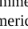
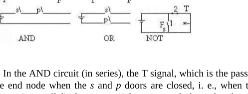
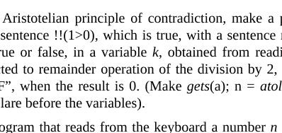
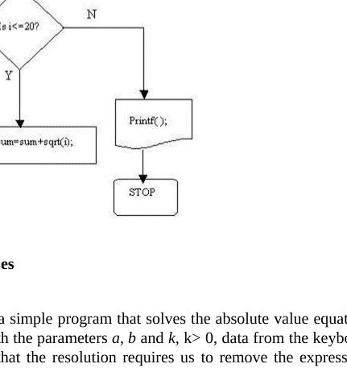
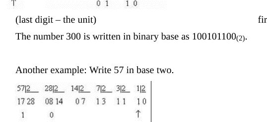
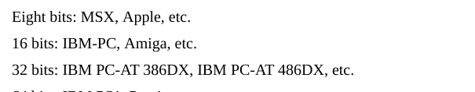

# C 语言 /* & C++ */：快速简易课程


## C语言之父——以及母亲们
- 布莱兹·帕斯卡（Blaise Pascal，1623-1662）
  计算器
- 戈特弗里德·威廉·莱布尼茨（Gottlob Wilhelm Leibniz，1646-1716）
  二进制算术
- 艾达·拜伦（Ada Byron，1815-1851）
  程序设计
- 艾伦·图灵（Alan Turing，1912-1934）
  纸计算机
- 阿隆佐·丘奇（Alonzo Church，1903-1995）
  编程语言
- 康拉德·楚泽（Konrad Zuse，1910-1995）
  二进制计算机
- 格蕾丝·穆雷·霍珀（Grace Murray Hopper，1906-1992）
  编译器
- 丹尼斯·M. 里奇（Denis M. Ritchie，1941-2011）
  C语言


## 前言

没有人能仅凭一本书就学会严肃的学问。如果在课堂上，教师采用了学生手头的那本书，并且这似乎足以学会，那么这种“足够”是因为教师扮演了第二本书的角色——一本会说话的书，实时展开讲解。

因此，如果这是读者学习编程语言的第一本书，作者并不声称无需任何其他来源就能教会你C语言。不过，既然这里介绍的内容几乎涵盖了C语言的全部资源，那么学习者只需在遇到任何疑问时查阅互联网，搜索相关主题的示例即可。手捧一本书的最大优势在于，内容按教学顺序组织得井井有条，从易到难，从常用到少见。

学习编程语言要从现有的程序入手，要么将它们作为模型，要么对它们进行修改和改编。如果读者遵循本材料的建议，不跳节，而是按照给出的顺序，最好逐字敲入这里展示的程序和小程序，并完成学习结束时的练习，也就是说，完整阅读并应用所呈现的项目，那么他将准备好创建自己的程序，并掌握内容。如果你还想把原始C语言的每个保留字都牢记于心，那将是一笔很好的收获，因为在其他语言中，这些词的数量总是更多。

输入代码时必须非常小心。对计算机而言，半个单词都不行。缺少一个逗号、把逗号换成冒号、输入了带有特殊格式的引号、缺少一条指令或语句——所有这些都会使程序失效。在故障程序的反馈中，按行号和命中顺序出现的第一条提示才是相关信息。不应在后续行的错误代码上浪费时间，因为它们受执行顺序中第一个错误的影响。例如，如果单词“main”被输入为大写，在关于该词的警告之后会出现多条错误消息，但优先的是修复这第一个失败，这样后续的消息如果仍然存在，才有意义。

在大学第一年，编程老师并不把学生视为入门级学徒，而是至少把他视为具备中等水平的人，有时甚至把他视为专家，就像音乐学院那样。就理工科和工程学院而言，很难理解这种高期望从何而来，但教训是：学生必须学会追赶要求，忘掉高中时代——那时老师布置的任务简短，而且还容忍拖延。事实是，作为练习布置的首批程序已经是篇幅可观的成果，往往一整页甚至更多。如果你正处于这种情况，你可以从这本书开始，在自己的电脑上练习。

初学者最终会学到一种新语言，用来与机器对话，也用来与其他开发者交流。在掌握一门语言的同时，人让机器服从自己的命令，舒适自如，这与接受命令的是一个有血有肉的人不同——因为你无法知道这个人在接受指派时心里在想什么。我们不应忘记的是与同行互动的自然性，而不是工业化的界面。记住这一点，我们就可以投身于编程学习，它基于C和C++语言，尽管之前已有多种语言。尽情享受吧！

## 第 0 章
## 引言 - C语言

在美国AT&T的贝尔实验室，肯·汤普森（Ken Thompson）惯于使用一种名为“B”的语言，该语言是他基于马丁·理查兹（Martin Richards）在剑桥（马萨诸塞州）开发的另一种语言——BCPL编程语言（基本组合编程语言，Basic Combined Programming Language）——创建的，BCPL源自Algol 60。在B语言的基础上，丹尼斯·M. 里奇（Dennis M. Ritchie，1941-2011）于1972年创造了一种革命性的新语言，他称之为C。随后，肯·汤普森在同一个AT&T编写UNIX操作系统时，选择使用C语言，而不是如人们所料的汇编语言。C语言的基础著作由丹尼斯·M. 里奇和布莱恩·W. 克尼汉（Brian W. Kernighan）合著，书名为《C程序设计语言》（Prentice Hall，1978年）。

### 人类语言

市场上销售的主要软件包都是用C语言编写的。这是因为在高级语言中，它的处理速度最快，源于其近乎速记式的构成，以及它与汇编语言的兼容性。我们称之为“高级语言”的语言，其代码类似人类语言，其发展的第一步于1943年在柏林迈出，由土木工程师康拉德·楚泽（Konrad Zuse）提出了“计划演算”（plankalkül）。1935年完成大学学业后，他作为福特公司德国子公司的工程师，开始着手建造历史上第一台二进制计算机，并将其命名为Z1。由于纳粹政府拒绝支持，他不得不依靠商人和朋友的资助。这台首台机器未能正常工作，于是他制造了后继机型Z2和Z3——后者完成于1941年，当时在战争压力下，政府已提供部分资金。正是为Z3，楚泽开发了plankalkül，但那台机器无法执行条件跳转（IF语句），而plankalkül并没有比后来出现的……先进多少。


*汇编语言*，尽管它代表了与阿隆佐·丘奇于 1936 年提出的纯粹形式化的 *λ演算* 系统相关的新一步。丘奇的目的是开发一种与图灵机（著名的“纸计算机”）兼容的语言。到 1943 年底，一次对柏林的空袭摧毁了那些机器，但楚泽已经开始建造 Z4。其专利记录于 1946 年落入 IBM 手中，但德国 Z4 的完成直到 1949 年才实现。

同样在 1943 年，在美国宾夕法尼亚州，约翰·冯·诺依曼及其团队基于艾伦·图灵的思想（诺依曼在普林斯顿曾担任图灵的导师），为他正在建造的计算机开发了 ENIAC 编码系统。1946 年，当机器已经投入运行后，诺依曼与理查德·克利平格一起开发了一种更实质性的语言——*Short Code*（短代码）。

1952 年，哈佛大学数学教授、中尉格蕾丝·默里·霍珀展示了她带有历史上第一个编译器的语言 *A-0*，作为对 *短代码* 的改进；后来她还创造了更高级的代码，例如 *Arith-Matic*（1954）和 *Flow-Matic*（1955）等语言，使用英语中的人类词语。1952 年，约翰·W·巴克斯的 *Speedcoding* 也出现了，作为 *Fortran*（公式翻译器）语言的前身；*Fortran* 于 1954 年构思，1957 年投入商业发布。此后，大学和工业界开发了许多高级语言。

最接近机器“理解”的语言，以数字代码编写，例如 *ARC Assembly*，被称为机器语言，并被视为低级语言。它们在处理上越快，对人类而言可读性就越差，因为它们要顾及机器的限制。

### 语言年表

- 1936：λ演算
- 1943：Plankalkul
- 1943：ENIAC 编码系统
- 1946：ENIAC 短代码
- 1947：ARC 汇编
- 1952：A-0
- 1955：Flow-Matic
- 1957：Fortran
- 1958：Algol 58、APT
- 1959：Lisp
- 1960：Algol 60、Cobol
- 1962：Snobol
- 1964：Basic、PL/I
- 1965：Algol W
- 1967：BCPL
- 1968：Algol 68、Logo
- 1969：B、APL
- 1970：Pascal
- 1971：Forth
- 1972：C、Prolog、SQL
- 1976：Modula
- 1978：Visicalc、Matlab、C Shell
- 1979：Ada
- 1980：Smalltalk
- 1981：Modula-2
- 1983：Objective-C
- 1984：dBASE III
- 1985：Clipper、Paradox
- 1987：Perl、Mathematica
- 1988：C++
- 1991：GNU E、Python、HTML、Visual Basic
- 1993：R
- 1995：Delphi、Java、PHP、Ruby、Javascript
- 1996：CSS
- 2000：C#、D
- 2001：Visual Basic .NET
- 2004：Groovy
- 2009：Go
- 2012：Julia
- 2014：Swift

### 更有利可图（就工资而言）：

| | |
|---|---|
| 1. Ruby | 6. Javascript |
| 2. Objective-C | 7. C |
| 3. Python | 8. R |
| 4. Java | 9. C# |
| 5. C++ | 10. Visual Basic .NET |

### 2016 年语言流行度（按 TIOBE 指数）

（www.tiobe.com/index.php/tiobe_index）：

| | |
|---|---|
| 1. Java | 11. Perl |
| 2. C | 12. Delphi |
| 3. C++ | 13. Visual Basic |
| 4. C# | 14. Swift |
| 5. Python | 15. Matlab |
| 6. PHP | 16. Pascal |
| 7. Visual Basic .NET | 17. Groovy |
| 8. Javascript | 18. Objective-C |
| 9. Assembly | 19. R |
| 10. Ruby | 20. PL |

备注：2015 年 1 月，流行度第一名是 C，后来它把位置让给了 Java；但 Java 和 JavaScript 语言都源自 C，后者基本上具有相同的语法。CSS、HTML 和 SQL 不是图灵完备语言（图灵完备语言是指计算能力等同于图灵机的语言，即该语言与通用图灵机可以相互模拟）。

## 第 1 章

## 编译器

高级语言分为编译型和解释型。用解释型语言编写的程序由处理器逐行读取并执行。而编译型语言编写的程序由处理器以整体方式运行，因此运行速度快得多。

在屏幕上编写并调试好的程序的第一种呈现形式称为“源程序”；如果编程代码是解释型语言，程序就以此状态执行。相反，如果我们使用的是编译型语言，就需要让源程序进入编译阶段；该阶段将其转换为目标程序，并给它分配一个通常带有 .OBJ 扩展名的名称，例如 CONTROL.OBJ。执行这一过程的程序称为编译器；编译器有不同版本，可用于 C 语言、C++、Clipper、Delphi、Visual Basic 或许多其他代码。

然而，编译阶段并不是程序开发的最后一步。带有 .OBJ 扩展名的程序称为目标程序；要成为可执行程序，它必须经过链接编辑过程，并获得 .EXE、.DLL、.COM 等扩展名。

C 语言配备的是编译器，而不是解释器，因此它是一种能够创建执行速度非常快的程序的语言。C 源程序具有 .CPP（C++ 或 C Plus Plus）扩展名，或者干脆是 .C 扩展名。

### 结构化语言

在 C 中，便于编译器工作的因素之一是：这种语言有利于编写结构化程序，即按模块设计、这些模块可以组合或相互配合的程序，从而避免使用由 goto 语句造成的流程偏离，尽管这类指令仍然是该语言的一部分。

程序开发的基本质量标准是机器运行时间的经济性和内存占用。给定一个程序的两个版本时，优先选择最能满足该标准的版本；因此，以结构化形式编写的程序会得分，除非它无谓地浪费时间和内存。

源程序输入完成后，应保存为文件格式，并因此获得一个名称；该名称应为 1 到 8 个字符，以字母或下划线（“_”）开头，后跟字母或数字。对于任何 C 编译器，其扩展名应为 .C；对于 C++ 编译器，则可以是 .CPP。

C++ 编译器提供合适的编程环境，以窗口和按钮组织，在其中可以输入、编译、链接编辑和运行程序；后三个步骤可使用键盘或仅用鼠标完成。我们可以通过标记（高亮）文本、将其传送到剪贴板——Ctrl + Ins 键——再将其粘贴到 C++ 屏幕——Shift + Ins 键——的技术，在 C++ 环境中复制程序片段；之后必须取消标记——Ctrl + KH 键。

Borland Turbo C++ 编译器的环境被称为集成开发环境（IDE），并且是名为 BIN 的目录的一部分。要进入该目录，请在 DOS 提示符下键入 cd \TurboC\BIN 并按回车键。进入该目录后，通过键入 BC 并按 Enter 即可访问该环境；这只是进入 Turbo C++ 环境的方式之一。显然，如果在启动（引导）时，AUTOEXEC.BAT 文件的“Path”中包含“C:\TurboC\BIN;”字样，那么只需在任意目录提示符下键入 BC 并按 Enter——无论是在根目录、Windows 运行处还是某个陌生目录——即可立即进入 C++ 环境。要激活任意 BC 环境窗口，只需按 F10 和方向键（¬、_、®）。对于其他品牌的 C++ 编译器，以类似方式操作，并相应调整这些命令词。顺便说一下，Microsoft 使用 Alt 激活窗口。

获取 Borland TurboC++ 3.0：http://winworldpc.com（用 7z 解压，然后使用 WinImage）

### 编译

不过，没有什么能阻止人们采用旧方式操作：在任何文字处理器中，或直接在 DOS 中，输入带 .C 扩展名的程序，并在操作系统提示符处直接进行编译和链接编辑。例如，一个名为 TEST1.C、记录在当前目录中的程序，可以通过键入 C TEST1.C、CL TEST1.C 或 TC TEST1.C 来编译，具体取决于你调用编译器时使用的是 C、CL 还是 CT，甚至是 EC、CC、BCC 或 LC 等其他名称。Borland TurboC++ 3.0 编译器使用 TCC 命令在命令行下工作。因此，如果 TEST1.C 位于 \TurboC\Progs 文件夹中，而我们当前位于 \TurboC\bin 中，只需执行 TCC \TurboC\Progs\TEST1.C，程序就会编译该文件，并在当前目录中生成文件 TEST1.EXE。现在在命令行中键入名称 TEST1，它就会开始运行。

读者也可以下载适用于 Windows 或 Linux 的 GNU 编译器 GCC（GNU 编译器集合）。使用它时，编译在命令提示符下完成。如果它安装在 Mingw 文件夹中，应通过键入 CD \Mingw\bin 进入 Bin 子目录。如果你的软件源存储在 \Mingw\Programs 文件夹中，并且例如其中记录了 Newtest.c 程序，那么要编译它，你应在其中键入

```
bin folder: gcc \mingw\programs\Newtest.c -o Newtest
```

按下 Enter 键，如果程序正确，并且带有必要的指令（它至少必须已用 `#include <stdio.h>` 开始），那么 `-o` 后面的单词 NEWTEST 会使编译器在 Bin 文件夹内创建 Newtest.exe 程序。这个在 `-o` 后输入的名称本来可以更改，因为不需要与源程序的名称匹配。它本来也可以是 IHaveHit，以生成 IHaveHit.exe 程序。

### C 程序

要用 C 语言编写程序，我们需要使用变量、语句、语言的保留字和函数。

函数可以在程序本身中用户自定义，也可以位于先前记录的文件中，还可以从标准库中调用，而标准库始终伴随 C。这个标准库毕竟是一个库的库，是语言的一种必要附属物，使用程序开头的 `#include <...>` 指令即可访问它。让我们看一个小例子：

### 示例程序 #1

```c
/* Program “Eachname.cpp” */
#include <stdio.h>

void main(void)
{
char m[80];
printf("\n Type your name: ");
gets(m); puts(m);
printf("\n Your Name is: \n %s",m);
}
```

在上面的示例程序中，保留字是 char 和 void。使用的函数是 main()、printf()、gets() 和 puts()，它们属于 stdio.h 库（该名称来自“standard input-output”）。char 和 void 这两个词是变量或函数的声明类型。void 一词在更新版本的 C 中是可选的，它现在或过去只用于占据一个不存在的类型（变量）的位置，这样程序员就不会丢掉声明变量的习惯。`printf()` 中的表达式 `%s` 表示“用变量字符串的内容替换它”。而 `% .15s` 表示只输出前十五个字符。如果写成 `% .8s`，输出将只到第八个字符。

这第一个例子是对经典迷你程序“Hello, World”稍作扩充的展示，该程序由 Ritchie 和 Kernighan 在他们 1978 年关于 C 语言的书中发表：

```c
main(){
	printf("Hello World\n"); return 0;
}
```

### 查看结果

如果你是在 C++“环境”本身中编程，那么按下 F10（或 Alt）并用方向键高亮 Run 菜单，按向下箭头打开菜单，最后选择 Run 来编译、链接编辑并运行程序之后，你必须打开 Window 菜单，按向下箭头，并在 Output 上按 Enter，才能看到 DOS 提示符屏幕。用光标可以垂直或水平滚动屏幕。活动窗口将是 Output。要重新激活该窗口，请按 Close，它会关闭当前窗口 Output。要保存程序，请单击 File 菜单上的 Save As，输入名称，最多八个字符，为其命名。按 Enter。

在 Borland IDE 中，读者只需键入 Alt + F5，就能看到输出屏幕，即 DOS 命令行。

### 练习

- 1) 编写一个程序，打印程序员的名字和姓氏，每行一个（`\n` 是输出的换行符），对每个名字使用 `printf()`，或者如果你可以并且愿意，也可以只使用一次。

- 2) 编写一个程序，从键盘接收一个短语，并将其打印三次：一次从行首开始，另一次留出一些空白（只需在 `%s` 前的格式中留空格），还有一次只输出前十二个字符。为此，请重复 `printf()`。注意：声明 `char m[80]` 表示向量 m 最多可接收一行 79 个字符。最后一个字符，即第八十个字符，是保留的空字符。

## 第 2 章

## 保留字及其他代码

在程序中选择变量时，必须避免使用语言中的任何保留字，因为这会导致错误消息并中断执行。

C 中的保留字数量非常少，因为函数不属于这一组；它们属于标准库，而不属于语言本体。在 C 中，I/O 机制（*输入/输出*）是库函数集合的一部分，这与其它语言中的情况相反。

C 语言不应成为任何学生的第一门编程语言，因为在习惯了它那种简短地书写语句的方式之后，就很难接受其他高级语言那种论述式的风格。但它是最重要的语言。因此，为了防止不从事另一种语言工作的读者形成这样的障碍，本书在方便时尝试与 Pascal 进行比较。在这一点上，应当说明：在 Pascal 中，主程序的外部模块是*过程*，而不是函数；而在 C 中，这些模块都作为函数处理，只有参数化变量的定义是规则的例外。另外，与 Pascal 相比还应注意，在 C 中界定模块的大括号 *{...}*，在 Pascal 中对应形式为 *begin ... end*。主程序在 Pascal 中只需用这两个词包起来，而在 C 中则有开头的函数 *main()*，没有它，该语言中什么也无法运行。

C 中由 ANSI（*美国国家标准学会*）定义的保留字如下，共 32 个：

| auto | double | int | struct |
|------|--------|-----|--------|
| break | else | long | switch |
| case | enum | register | typedef |
| char | extern | return | union |
| const | float | short | unsigned |
| continue | for | signed | void |
| default | goto | sizeof | volatile |
| do | if | static | while |

读者会看到，这些词中只有 13 个没有类型修饰符的作用。它们如下：break、case、continue、default、do、else、for、goto、if、return、sizeof、switch 和 while。

备注：在 Kernighan 和 Ritchie 的原始语言中，没有 ANSI 采用的 const、enum、signed、void 和 volatile 这些词。还有一个从未实现的词：entry。

### 更多字词

除了 ANSI 定义的 32 个保留字之外，Microsoft C 编译器（MSC）还使用 `_asm`、`cdecl`、`far`、`fortran`、`huge`、`near` 和 `pascal` 这些词。Turbo C 对 ANSI 的增补是：`asm`、`cdecl`、`_cs`、`_ds`、`_es`、`far`、`huge`、`interrupt`、`near`、`pascal` 和 `_ss`。

`asm` 或 `_asm` 一词用于将汇编例程引入 C 编程，这可能要求它自己的指令，例如 `#pragma inline`。该例程可以如下所示：

```
asm {
    push es
    pop es
}
```

`cdecl` 一词告诉编译器，在调用其他语言的函数时，参数的读取应按 C 的正常顺序，即从右到左，而不是按源语言的顺序。`far` 一词告诉处理器，被它修饰的指针使用 32 位而不是 16 位。修饰符 `fortran` 和 `pascal` 提醒编译器，函数参数的传递必须按这些语言使用的顺序（从左到右）进行。修饰符 `huge` 使被它修饰的指针必然使用 32 位。

### 算术运算符

按优先级递减的顺序，C 中的算术运算符如下：

| 运算符 | 作用 |
|----------|------|
| `-` | 一元（符号） |
| `+` | 一元（符号） |
| `++` | 一元（自增） |
| `--` | 一元（自减） |
| `*` | 乘法类（乘法） |
| `/` | 乘法类（除法） |
| `%` | 乘法类（除法取余） |
| `+` | 加法类（求和） |
| `-` | 加法类（减法） |

备注：幂运算将通过头文件 `math.h` 中的 `pow()` 函数获得。

### 布尔运算符

以下是 C 中的逻辑运算符，即布尔运算符：

| 运算符 | 作用 |
|----------|------|
| `!` | 一元（非） |
| `&&` | 二元（与） |
| `&#124;&#124;` | 二元（或） |

### 关系运算符及其他

| 运算符 | 作用 |
|----------|------|
| `/=` | 赋值（迭代除法） |
| `%=` | 赋值（迭代取余） |
| `+=` | 赋值（迭代加法） |
| `-=` | 赋值（迭代减法） |
| `<<=` | 赋值（迭代左移） |
| `>>=` | 赋值（迭代右移） |
| `&=` | 赋值（迭代按位与） |
| `^=` | 赋值（迭代按位异或） |
| `&#124;=` | 赋值（迭代按位或） |
| `.` | 顺序（在指令中） |

下面的程序创建并使用名为 Symb() 的函数，其作用只是打印来自 ASCII 表（American Standard Code for Information Interchange，美国信息交换标准代码）的一串图形字符：

### 示例程序 #2

```c
/* Program “Symbol.cpp” */
#include <stdio.h>

void Symb()
{
    printf("\n|©| ____ |©|* \n");
}

main()
```


这一行。`printf()` 中的字母 `'f'` 表示 `'formatted'`，因此它是一个格式化打印函数。在 `main()` 函数中，第 10 行和第 11 行调用了两个函数：`Symb()` 和 `print()`。每个调用都以分号结尾，这也是 C 和 Pascal 中所有指令的结束方式。读者请注意，声明（常量、函数或指令）不以分号结尾，注释结束处同样如此。用户自定义函数，例如 `Symb()`，通常以大写字母开头，以免与标准库函数混淆。

### 几点说明

大写字母。在 C 语言中，大写字母和小写字母是不同编码。因此，保留字如果写成大写形式，也可以用作变量，例如 `Auto`（对应保留字是 `auto`）。

错误消息。在大多数情况下，程序编译时给出的错误消息并不会真正指出问题的准确原因。随着经验积累，程序员会逐渐熟悉这些消息的含义。另一些情况下，真正的错误出现在光标所指行之前的代码中。

缩进。缩进是指程序行参差不齐地书写，有些行比另一些行缩进更多；它对机器几乎没有意义，但作为一种排版上的组织方式，目的是方便程序员自己或其他人阅读。例如，将左花括号与对应的右花括号对齐就很重要。为此，其他元素都需要适当缩进。

注意事项。除了要区分数字 0 与字母 'O'（这对刚接触计算机科学的人来说是个大问题）之外，在 C 中还要注意不要把比较相等（`= =`）与赋值（`=`）混用。符号 `=` 用于把右侧表达式的值存入左侧变量，例如 `x = 3*5;` 或 `y = cos(3.14);`。而符号 `==` 只用于条件中，且这类条件通常需要用括号括起来，这一点在之后学习 `if-else`、`while` 和 `do-while` 命令时会看到。另一个需要注意的方面与人体工程学有关，也就是鼠标的使用。一直用食指点击鼠标并不合适，食指不适合承受这种过重负担。如果你确实想始终用同一个手指点击，那就改用拇指，拇指更合适。无论如何，懂得让食指与其他手指分担工作的打字员中，并没有出现肌腱炎的病例。只用食指打字是极其不妥的。如果你没有练习过打字，可以买一个简单的练习程序（软件商店里有很多），并坚持练习几周。

### 练习

1) 编写一个程序，使用三次 `printf()` 打印出三个短句。

2) 编写一个程序，在 `main()` 中创建并使用一个名为 `Beep()` 的函数，声明为 `void Beep()`，其作用是一旦被调用就发出一声鸣响。鸣响是指在屏幕上打印编号为 7 的字符，因此你可以在函数的花括号内声明一个变量，例如 `char b = 7`，然后输出它（`% c`）。

## 第 3 章

## 声明

### `char`、`int`、`float` 及其他类型

虽然在某些语言中可以直接使用未经声明的变量，但在 C 语言中（与 Pascal 一样）这是不允许的。所有变量在使用前都必须声明类型，既可以在模块内的花括号中局部声明，也可以在模块外全局声明。

用于声明变量、函数或类型的数据类型如下：

| 类型 | 范围 | 字节数 |
|---|---|---|
| char | -128 到 +127 | 1 |
| double | 1.7E-308 到 1.7E+308 | 8 |
| float | 3.4E-38 到 3.4E+38 | 4 |
| int | -32768 到 +32767 | 2 |
| long | -2147483648 到 +2147483647 | 4 |
| long double | 1.7E-308 到 1.7E+308 | 8 |
| short | -32768 到 +32767 | 2 |
| unsigned char | 0 到 +255 | 1 |
| unsigned int | 0 到 +65535 | 2 |
| unsigned long | 0 到 +4294967295 | 4 |
| unsigned short | 0 到 +65535 | 2 |
| far | 指针 | 4 |
| *huge* | 指针 | 4 |
| *near* | 指针 | 2 |
| *void* | - | - |

表达式 `3.4E-38` 表示 3.4 乘 10 的负 38 次方，这就是著名的科学计数法。像 183000 这样的数可以写成 `1.83E+05`，因为小数点从最后一个零一直跳到第一个非零数字 1，移动了 5 位。

除了上面列出的类型之外，C 语言还包含一些类别的修饰符或称数据类型，有的很简单，有的比较复杂。它们是：

```c
enum name {int1, ..., intn}
auto type var;
register char var, or register int var;
extern type var;
static type var;
typedef type name;
const type name;
volatile type name;
struct name {type v1; type v2; ...; type vn;} vname;
union {type v1; type v2; ...; type vn} vname;
```

*enum* 类型是一个有序整数集合，其值依次为 0、1、2……在 *enum* 值 `{a, b, c, d}` 中，有 a = 0、b = 1、c = 2、d = 3；但在月份 *enum* `{January = 1, Feb, Mar, Apr}` 中，January = 1、Feb = 2，依此类推。

*auto* 类型声明一个局部变量，它只在函数被调用时有效。既然是在所讨论的函数内声明，它就已经是自动的，无需再额外说明。

*register* 类型会把变量放入处理器寄存器中，从而提高程序运行速度，但不能与指针一起使用。*extern* 变量类型在程序中供全局使用，必须声明在各模块之外。*static* 变量在程序执行期间保持其值不变。声明为 *const* 的名称在程序执行期间的任何时候都不能改变它的值。*volatile* 变量类型具有与 *const* 相反的性质。*signed* 修饰符用于 `int` 和 `char` 类型，其作用与 `unsigned` 相反；`unsigned` 用于声明无符号变量。

`typedef` 关键字用于在程序中创建新类型。在 `typedef long double Value` 中，标识符 `Value` 可以用来声明 `long double` 变量，例如 `Value x;`。

结构体 `struct` 的用法与 `enum` 类似，但它不仅能容纳整数元素，也不是按顺序列出这些元素，此外还能创建新类型。例如：

```c
struct Body{char n[80]; int age; float height;};
Body girl[20];
girl[5].age = 23;
```

这里用 `Body` 结构声明了 20 个 `girl` 变量，其中编号为 5 的 `girl` 的 `age` 被赋值为 23。

联合体 `union` 修饰符与 `struct` 有相同的语法，但它把不同类型存储在同一个内存位置上，并且同一时刻只能使用其中一个。例如：

```c
union Conj {int ; float v; unsigned char k;} trio;
```

在这个例子中，创建联合体的同时自动声明了一个名为 `trio` 的变量。我们也可以像前一段中声明 `girl` 变量那样来处理。

下面是一个示例程序，说明变量声明及其相对大小：

### 示例程序 #3

```c
/* Program “Variable.cpp” */
#include <stdio.h>
#define PI 3.1415926
int i; long k; short j; char c; unsigned int ui;
unsigned long uk; unsigned short uj; unsigned char uc;
float fl; double db; long double ld;
main()
{

i=PI*(-1E4); k=-PI*(-1E5); j=i/30000; ui=-i; uk=-k;
uj=j; uc=c; fl=PI; db=fl*(1E-103); ld=db;
printf("i=%d\t int\t %d bytes\n",i,sizeof(i));
printf("k=%d\t long\t ",k);
printf("%d bytes \n",sizeof(k));
printf("j=%d\t short\t %d bytes \n",j,sizeof(j));
printf("\nValor\ttype\tsize\n");
printf("c=%d\t char\t %d byte \n",c,sizeof(c));
printf("ui=%d\t uns int\t %d bytes \n",ui,sizeof(ui));
printf("uk=%d\t uns long ",uk);
printf("%d bytes\n",sizeof(uk));
printf("uj=%d\t uns short %d bytes\n",uj,sizeof(uj));
printf("uc=%d\t uns char %d byte\n",uc,sizeof(uc));
printf("fl=%f\t float\t %d bytes\n",fl,sizeof(fl));
printf("db=%e\t double\t %d bytes\n",db,sizeof(db));
printf("ld=%le\t long double ",ld);
printf("%d bytes\n",sizeof(ld));
}
```

练习修改：尝试删除几行 `printf()`，例如与 `long` 类型有关的三行。如果使用 Borland IDE，请将光标放在该行上，按住 Ctrl 键并按 `'y'`。第二项修改：程序使用了 `#define` 指令，它用于声明一个具有特定值的常量。这个常量通常写成大写字母。请把 `PI` 这个标识符换成其他常量，并使用不同的值。

### `printf()` 的格式化语句

在 `printf()` 和其他函数的括号内，我们会看到许多前面带有 `'%'` 或 `'\'` 的符号，它们分别表示替代字符和转义序列。下面是这些代码的表格：

| 代码 | 含义 | 代码 | 含义 |
|------|---------|------|---------|
| %c | 字符 | \f | 换页 |
| %d | 整数 | \n | 换行 |
| %e | 科学计数法 | \r | 回车 |
| %f | 浮点数 | \t | 水平制表符 |
| %g | %e 或 %f，取较短者 | \v | 垂直制表符 |
| %o | 八进制无符号 | \ | 反斜杠 |
| %s | 字符串 | \? | 问号 |
| %u | 十进制无符号 | \' | 撇号 |


|  |  |  |  |
| --- | --- | --- | --- |
| %x | 十六进制无符号 | \" | 引号 |
| %% | 百分号 | \nnn | 八进制数 |
| \a | 蜂鸣 | \xnn | 十六进制 |
| \b | 退格 | \0 | 空终止符 |

### Exercises

- 1) 编写一个程序，将一个单词或短语赋给字符串变量并打印；然后为两个非零整数变量赋值，将前者除以后者的结果放入一个“实数”变量（‘浮点数’）中，并打印此结果（作为 %f）。
- 2) 编写一个程序，将一个小于 255 的整数，例如 80，赋给一个数值变量，并依次将其在屏幕上打印为字符（%c）、整数（%d）、八进制（%o）和十六进制（%x）。如果它们出现在同一条打印指令中，则变量在闭合引号之后必须用逗号分隔。如果是 k，我们有：k, k, k, k。

## 第 4 章

## 条件执行

### if-else 语句

当 Ada Byron，洛夫莱斯女伯爵，在十九世纪发明了计算机编程，用于她朋友兼数学导师 Charles Babbage 未完成的分析机时，她甚至在那个时期就创造了将成为编程灵魂的东西，即在需要停止条件的循环上运行，这反过来又导致了今天主要以 if 语句形式使用的条件执行的需要，该语句由 Grace Murray Hopper 在一个世纪后引入。借助循环和递归的使用，Ada 意识到分析机与之前的差分机不同，可以用事先给定的编码指令解决任何问题，这些指令由 Joseph Marie Jacquard 于 1805 年创建的穿孔卡片制成，我们一直使用到 1975 年，甚至更久一点。她写了一个需要 330 张卡片的问题，如果她使用循环，就可以用三张卡片解决。关于机器的范围，她在 1843 年说，如果我们正确地将音符和时值转换为抽象代数代码，机器将能够“创作任何程度复杂或广度的精致和科学的音乐作品”，正如 Stephen Wolfram 所说。

在大多数高级语言中，简单 if 语句的出现如下：

```
if(condition)
statement 1
[else
statement 2].
```

在 Pascal 中我们有一行如下语句：if x>0 then write ('Positive!') else n := x。在 C 语言中没有 then 这个词，条件位于括号内。以下是一个迷你程序示例：

```
main(){ int n; char c; puts("nN/Y?"); c=getchar();
if(c=='S') {printf("\n True");n=1;} else n=0; printf("%d\n",n);
}
```

要运行迷你程序，必须以 #include <stdio.h> 开始。除非更明确地使用其他文件，本书的所有迷你程序都将只使用 stdio.h 头文件。

在 C 中，如前所述，赋值的等号是 "="，而在比较时，如 if 的情况，则是 "=="。在上面的例子中，语句 1 需要大括号，因为它由多条指令组成；不同的是，else 之后的语句 2 由于只包含一条语句而省略了大括号。关于 if 语句的许多错误信息都指的是使用 "=" 而不是 "=="。对于简单的等号 "="，C 允许多次赋值，这与旧语言不同。我们可以写，例如，x = y = z = 10;

### switch-case 语句

if 语句可以以嵌套形式使用，一个 if 嵌套在另一个内部，但在需要做出多个决策选项的情况下，更可取的是使用 case 语句，该语句在 C 中以 switch 关键字开始。为了防止执行包含以下选项到有效选项，我们用 break 语句结束 case 语句，这个词也可以在其他情况下使用，而不仅仅是在 switch-case 语句中，并且它的对立面是 continue 语句。

下面的程序说明了 if 和 switch 语句的使用：

### 示例程序 #4

```
/* Program "Multiple.cpp" */
#include <stdio.h>
#include <stdlib.h>

char s[80];
int k;
long n;

main()
{
    printf("\nDividing by 3. Type integer greater than zero:\n");
    gets(s);n=atol(s);k=n%3;
    if (k>=0)
    {
        switch(k)
        {
        case 0:
            printf("%d is multiple of 3.", n);break;
        case 1: printf("Remainder 1."); break;
        case 2: printf("Remainder 2."); break;
        default:
            printf("It seems an error has occurred.");
        }
    }
    else printf("Negative value.");
    return 0;
}
```

- 修改练习：程序所包含的第一个更改是改变除数上的模 n 同余运算符。既然要测试 3 的可整除性，为什么不以 4 为准呢？为此，将 k = n%3 替换为 k = n%4，并在 default 行之前添加一行，内容为：case 3: printf("Remainder 3."); break; 第二个可能的更改涉及记法，这将表明计算机完全不同情。如果 k 的内容不是 0、1 和 2 的余数，而是字母数字，例如元音 ‘a’、‘e’ 和 ‘i’，那么在每种情况下内容都写在单引号中，如后面拼写的。尝试用数字 0、1 和 2 来看看会发生什么。

请注意，数字 n 是作为字符串 s 从键盘读取的，随后由 atoi() 函数将其转换为数字内容，该函数将字母数字（ASCII）参数转换为 long 整数类型。函数 atoi() 和 atof() 分别将字母数字转换为 int 和 float。由于 C 的关键字中没有用于输入和输出数据的指令，我们必须使用库函数。

编译、链接并通过 Run 窗口运行程序后，打开 Window 选项卡并按 Output。在 Borland IDE 中，您也可以输入 User Screen。这类似于不打开 Window 选项卡，按 Alt + F5。返回时，按任意键。如果您在 Output 中，在 Window 选项卡中按 Close。

如果您使用 GNU，一切也很简单。如果源程序是用 Notepad 或其他文本编辑器编写并保存为 C:\mingw\programs 中的 Multiple.c，则打开命令提示符并进入 mingw 文件夹，只需写：gcc mingw\programs\Multiple.c -o Multiple，编译器就会生成 Multiple.exe 程序。现在只需在屏幕上写下这个词 Multiple，然后按 Enter。

在 Borland C++ 3.0 中使用命令行甚至更简单。根据您的文件夹，位于 \Borland\bin 或 \TurboC\bin，只需输入 tcc mingw\programs\Multiple.c 即可使程序在 TurboC 的 Bin 文件夹中生成可执行文件。请注意，如果我们写 tc 而不是 tcc，我们将被引导到 IDE。

### 条件运算符

除了 if-else 和 switch-case 语句之外，C 的特色是运算符 “?”，用于处理条件。其使用语法为

```
<condition> ? <expr1> : <expr2>
```

并确定如果 <condition> 为真，则事务值将为 <expr1>，如果为假则为 <expr2>。在语句中

```
x = (k>0) ? 50 : 40
```

如果 k>0，则 x 的值为 50，否则我们有 x = 40。它等价于说明 if (k>0) x = 50; else x = 40; 但结果产生更紧凑的写法。

### Exercises

- 1) 编写一个程序，接收键盘输入的数字并判断（使用 if-else）它是否大于或等于 (>=) 100 或更小，打印此信息。（设 n = atoi(s)，将字符串转换为数字，atoi() 在 stdlib.h 中。）
- 2) 创建一个程序，判断键盘输入的数字是偶数还是奇数。在第一种情况下，打印消息“It is even number.”。否则，打印：“It is odd number.”。一种算术上测试数字是否为偶数的方法是：int x = k/2; if (x/2 == k) ...; 在 x = atof(s) 之前执行，其中 s 是接收键盘输入数字的字符串。

## 第 5 章

## 流程控制 - while 和 for 语句

如果计算机编程即使有条件评估指令，执行也不能返回并多次恢复已使用的公式以赋予它们新值，那将不会很有用。想象一下简单地打印从零到一千的数字会是多么尴尬。有了允许使用迭代变量的命令，这就不是问题了。

### while 循环

打印从零到一千的数字比从婴儿手中拿糖果更容易：

```
main(){int k=0;while(k<=1000){printf("%d ",k);k+=2;}}
```

声明变量 k 为整数；并将其初始化为零，上面的迷你程序告诉处理器，只要 k 小于或等于一千，就应打印 k，然后将 2 加到打印的值上并返回到 while 这个词。指令 "k += 2;" 使用了 C 独有的 "+=" 符号，在 Pascal 中会写成 "k := k + 2,"，意思是 k 的值应被赋值为旧变量值加 2。如果您想运行上面的示例，请确保在开头添加行 #include <stdio.h>。

### do-while 循环

while 语句的另一个版本是使用 do-while 组合，在某些情况下使用起来更方便。区别在于循环末尾进行条件评估。上面的同一个迷你程序看起来会像这样：

```
main()
```


```
{int k=0;do{printf("%d ",k);k+=2;}while(k<=1000);}
```

注意在 C 中，写成“int k; k = 0;”还是“int k = 0;”都无关紧要。

### for 语句

在 C 中使用 for 语句比其他语言中的同一语句提供更强大的能力。由于 C 中该命令形式非常简短，读者应看一个 Pascal 示例，Pascal 使用它的方式与其他语言非常相似。要在 Pascal 中构造从 1 到 100 的循环，例如有：for i := 1 to 100 do begin y = ln(i); end;

在 C 语言中，该示例写作：

```
main( ) {int i; float y; for(i=1;i<=100;i++) {y=log(i);printf("\n%f",y);}}
```

上面的对数是以 e 为底的自然对数，因为在 C 中，十进制对数（常用对数）是 log10()。使用这些函数需要在程序开头写 #include <math.h>。因此，要运行上面的小程序，请使用 stdio.h 和 math.h 头文件。

for 的圆括号内有三个语句（初始化；条件；递增）。表达式 i++ 使变量 i 在每次循环迭代中增加 1。

使用 i++ 和 ++i 在求值顺序上有细微差别。在第一种情况下，变量 i 先递增再使用；在第二种情况下，它先递增，随后使用已经增加 1 的新值。

C 中的 for 语句允许一次使用多个变量。括号内的信息在必要时用逗号分隔每个元素。例如：

```
main( ) {int k,m,t,x; t=100; for(k=0,m=t; k<m; ++k,m--) {x=k*m; printf("\n%d",x);}}
```

与 Pascal 中的情况不同，在 C 语言中 for 语句允许用变量作为限制条件，如下例计算多边形的对角线数。例如：

```
main() { int d,n,m=50; for(n=m;n>2;n--) {d=n*(n-3)/2; printf("\t n=%d -> d=%d",n,d);}}
```

### 无条件跳转

一种不用于构造结构化程序的旧编程特性是 goto 语句。在程序任意位置写 goto 语句 LABEL; 会使执行控制无条件转移到由标签后跟冒号 LABEL: 起始的行。显然，goto 语句也可用于条件分支，但这不是最合适的方式。你可以有下面这样一个小程序，它为了使用旧特性，把递增 j 写成“j = j + 1;”而不是“j++”：

```
main() { int j=0;
RETAKE: if(j<11) {printf("\n%0d",j); j=j+1; goto RETAKE;}}
```

使用 if 语句后，避免在同一行写第二条指令，因为处理器可能忽略它。上面的例子就是这种情况，而 if 的作用域一直到右花括号。

下面的程序演示 while 和 for 的用法。它在屏幕上绘制长度由输入数字决定的星号条，实际上形成条形图。如果该数字为负，while 循环将条件求值为假，程序结束。这就是停止条件。

### 示例程序 #5

```
/* Program “Ofbillet.cpp” */
#include <stdio.h>
#include <stdlib.h>

char s[80]; int n,i;

main()
{
printf("\n Type number lower than 70 after seeing ‘:’");
printf("\n(For stopping type negative number.)");
```
```
printf("\n:"); n=0;
while (n>=0)
{
gets(s); n=atoi(s);
for(i=0; i<n; i++) printf("*");
printf("+");
}
}
```

练习的修改：一个简单改动是把符号“*”替换为任何其他符号，但要避免“\”和“%”，它们在格式中有特殊含义。第二个改动是在程序中已有的那一行 for 之前紧挨着插入一行 for。要腾出空间，将光标移到现有 for 行的左端，然后按 Ctrl+N。在这个循环中打印若干空格，例如八个，以在每行星号序列前加上空格。新 for 的变量可以是同一个 i（i=0; i<8; i++）。

### 练习

- 1) 编写一个程序，在 while 循环内按给定次数打印消息“ Hi!”。你可以使用计数器 i，在循环内执行 i = i + 1，在每次循环时打印该消息，直到条件中给定的上限，例如 while (i <100)。
- 2) 开发一个程序，在屏幕上逐行打印，使用短横线（“_”），直到你按下消息中先前指定的任意键，例如“stop”中的‘s’。在打印该行的 while 循环条件中，应有一个变量字符，由所按键的内容填充，例如在条件中，在判断 c != ‘s’ 之前先执行 (c = getchar()。在这种情况下，打印短横线的语句适合放在 for 内，位于 c = getchar() 之前；这将是另一个循环内的循环。

## 第 6 章

## 数组——符号“[ ]”

与 Pascal 不同，Pascal 要求把数组声明为 ‘array’ 类型的变量，而 C 语言把矩阵（数组）仅看作另一种类型的变量，例如 char；区分使用单个“字符”的字符串变量与存储一串字符的变量的，是类型声明中是否出现方括号。

声明 char k; 告诉编译器变量 k 中存储一个字符。而 char k[30]; 语句表明变量 k 存储最多 29 个字符的字符串，总是保留最后一个位置（即第 30 个位置，编号 30）给空字符。因此，k[30] 语句建立了一个有 30 个位置的一维数组，位置从 0 到 29。

我们常把一维的向量称为矩阵，因此“矩阵”一词更恰当地指二维、三维或更高维的情况。一个名为 joan 的数组——为第一维保留 20 个位置，为第二维保留 35 个位置——这样声明：

```
char joan[20][35];
```

显然，我们可以声明存储 char 之外其他不同类型值的数组。例如：

```
int m[25][15][40];
```

```
long v[12];
```

```
float a[50][20];
```

矩阵（数组）充当带索引的变量，其中每个索引表示值的位置。如果我们声明数组 int a[4]，按此顺序取值 8、7、21 和 5，其含义是：a₀ = 8、a₁ = 7、a₂ = 21 和 a₃ = 5。由于在计算机编程中索引不显式写出，带索引变量的概念就体现在矩阵（数组）中。

中学课程中教授矩阵的书中一个非常常见的练习是构造一个矩阵，其公式基于对其自身内容的运算，例如矩阵 A2x3，其中 aij = i²-j，aij 是该集合中的任意元素，i 表示行号，j 表示列号。下面的示例程序创建并打印一个用公式 aij = j*(2*i-j) 构建的 10x12 矩阵。

### 示例程序 #6

```
/* Program "Array.cpp" */
#include <stdio.h>
int i, j, a[10][12];
main()
{
for (i=1; i<=10; i++)
for (j=1; j<=12; j++) a[i][j]=j*(2*i-j);
printf("\n\nExample of two-dimensional array\n\n");
for (i=1; i<=10; i++)
{
printf("\n");
for (j=1; j<=12; j++) printf("%4d ", a[i][j]);
}
printf("\n");
}
```

练习的修改：第一个建议的改动是更改声明中的界限，例如用 15 和 11 代替 10 和 12。在这种情况下，务必也更改每个 for 语句内的界限。第二个改动：将公式 j*(2*i-j) 改为任何其他公式。存在大量可能性，例如 3*i、2*j、j-i、j*(2*i-j)、…… 第三个改动：将数组声明为 float a[10] [12];，放在 int i, j; 下面一行，并删除该行中的 a[10][12]。然后可将格式“%4d”改为“%5.1f”，并且 print(f) 的十个区域必须减少到八个。

### 数组的初始化

数组可以在声明标识符时初始化，就像其他类型一样。但是，它们应该是全局变量。只需将数组等于花括号中给出的一系列值即可。例如：


```c
int week[7]={1,2,3,4,5,6,7};
char c[5]={'a','l','i','c','e'};
int m[3][2]={{7,5},{3,9},{20,6}};
int week[]={1,2,3,4,5,6,7};
```

### 练习

- 1) 编写一个程序，创建一个包含 15 个元素的一维数组 a[i]，用通过变量 i 的公式给出的值填充，并将其打印在一行上。

- 2) 编写一个程序，读取并存储一个二维数组，内容是在某个部门提供课时的人员的名字，其中行表示农历月的周次，1 到 4，列表示一周中的工作日编号：2、3、4、5 和 6。这些人的名字必须在提示输入的消息之后从键盘输入。请记住，二维数组毕竟是一个双重录入表（Lewis Carroll 图）。要在视频中打印该表，列标题可以使用日期缩写（Mon、Tue、Wed、Thu、Fri）代替数字。注意，如果数组是 m，对它的调用是 m[i][j]，但开头的声明类似 `char m[5][7][20];`，其中 20 是人员名字的最大字符数加一，因为它是字符串数组。

## 第 7 章

## 地址指针——符号“&”



每当声明一个变量时，它会立即被分配到一个特定的内存地址，该地址可以通过数字引用访问，就像住宅通过街道上的门牌号标识一样。因此，变量有两种值：左值，即它的地址；右值，即它的内容。如果我们不向处理器给出任何提示，变量中要操作的值是它的内容值，而不是地址。要处理变量的左值，我们必须将其声明为“指针”，即地址的指示符或指针。

指针类型变量与任何其他变量的唯一区别在于，它在声明时必须前面加一个星号“*”，如 `int a, b, *pa;`。对于指示变量地址的指针，我们在该变量前加上地址符号“&”，例如：

```c
pa = &a;
```

我们可以有一个具有以下功能的迷你程序：

```c
main() { int a,b,*pa; a=15; pa=&a; b=*pa; printf("\n b=%d",b);}
```

这里我们让变量 a 接收值 15，让 pa 指向该地址，然后让变量 b 通过指针 pa 接收内容，即数字 15。

### 动态分配的思想

动态编程，或称动态内存分配，是计算中非常重要的资源，只有通过 `malloc()`、`calloc()`、`realloc()` 和 `free()` 等函数使用指针才能实现。在该系统中，内存地址会在处理阶段尽可能地被占用或动态释放。在普通的非动态编程中，变量声明（尤其是矩阵的声明）会在内存中预留足够的空间，而不管是否被有效使用；它们在程序运行期间不能重新分配给其他用途。

### 指针运算

我们不能对指针变量进行乘法或除法。但可以对它们进行大量操作。我们有：(a) 赋值为零；(b) 递增或递减；(c) 整数加减；(d) 相等测试（`==`）、交集（`&&`）和并集（`||`）；(e) 指针类型之间的转换；(f) 与元素数组的运算和比较。

### 指针类型

除了简单变量指针之外，我们还有指向数组的指针、指向结构的指针、指针的指针、指向函数的指针以及指向指针的指针。

声明为指针的数组可以像任何其他数组一样工作。这就是下面示例中的情况：

```c
main() { int i; char *m[]={"o","l","g","a"};
for(i=0;i<4;i++) printf("\n%s\n", m[i]);}
```

注意打印格式是 `%s`（字符串），而不是 `%c`（字符）。其意义在于指针 `*m` 指向一个字符串数组，编译器就是这样处理字母“o”、“l”、“g”和“a”的。因此我们可以这样声明一个指针数组：

```c
char *vector[] = {"not", "fear", "this."};
```

因此，可以执行以下示例：

```c
main(){char *ma[]={"Lily","Eve","Mary"};
int i,t=sizeof(ma)/sizeof(char*); for(i=0;i<t;i++)puts(ma[i]);}
```

字符指针与任何其他指针一样，可以在程序中分配动态内存。我们有下面这个迷你程序：

```c
main()
{char s,*ps; ps=(char*)malloc(2); s='c'; ps=&s; puts(ps);}
```

`puts()` 函数在库 `stdio.h` 中，而 `malloc()` 函数及其关联的 `calloc()`、`realloc()` 和 `free()` 在 `stdlib.h` 中。我们不必局限于上面介绍的内容。如果从三个指令 `#include <stdio.h>`、`#include <stdlib.h>` 和 `#include <string.h>` 开始，我们就可以运行下面这个单行程序，它使用字符串指针，这次会分配并释放动态内存：

```c
main() {char *ps; ps=(char*)malloc(256);
ps="PalmyraCity"; puts(ps); free(ps);}
```

指针结构需要多一点工作。我们可以编写如下程序：

### 示例程序 #7

```c
/* Program "Mystruct.cpp" */
#include <stdio.h>
#include <stdlib.h>
main()
{
typedef struct proced {
char *name[3]; char *loc[3]; } Orig;
Orig *pwho;
int i;
pwho=(Orig*)malloc(sizeof(Orig));
(*pwho).name[1]="Rachel";
(*pwho).loc[1]="Parati";
(*pwho).name[2]="Miriam";
(*pwho).loc[2]="Recife";
for(i=1;i<3;i++)
printf("%s - %s\n", (*pwho).name[i], (*pwho).loc[i]);
}
```

对练习的修改：首先，增大 proced 结构中矩阵 name 和 loc 的内容限制，以便在 for 循环之前添加其他 name 和 location 行。然后还必须增大变量 i 的限制。第二项修改是删除所有方括号及其内容，只保留第一行数据，即“Rachel”和“Parati”。在这种情况下，在 `printf()` 之前按 Enter，并删除不再需要的表达式 `for(i = 1; i<3; i++)`，以及声明 `int i;`。

- 2) 编写一个程序，读取从键盘输入的浮点数（用 `scanf()` 读取，在变量中使用符号“&”），将一个指针变量赋值为存储该数字的数值变量的地址，然后打印这些内容，先打印普通变量的内容，再打印指针的内容（在打印指令中使用星号）。如果数值变量声明为 `v` 和 `*px`，地址赋值将写为 `px = &v;`。

## 第 8 章

## 逻辑运算符

### 符号“&&”、“||”和“!”

通常，在命令的条件执行中，我们需要编写复合条件，使用连接词 AND 和 OR 以及副词 NOT，它们被称为布尔运算符，因为 George Boole 在 1848 年（《逻辑的数学分析》）将它们数学化了。在 C 语言中，正如我们所看到的，这些词分别用符号“&&”、“||”和“!”表示。还有几个其他连接词作为这三种基本关系的派生，其中主要的是蕴含（或“IMP”）、等价（或“EQU”）和异或（“XOR”）。

对于任意两个语句 s 和 p，我们可以在逻辑中证明：(a) `s IMP p` 等价于 `(NOT s) OR p`，(b) `s EQU p` 等价于 `(s IMP p) AND (p IMP s)`，以及 (c) `s XOR p` 等价于 `(s AND NOT p) OR (p AND NOT s)`。

让我们在 C 中取语句 `k == 1`、`k != 1`、`m%9 > 0`、`m%5 == 1` 和 `m%3 != 0`。你可以编写下面的迷你程序：

- i) `main(){int k=1,m=1; while((k==1)||(m%9>0)){for(m=1;m<9;m++)printf("\n Hi!");}}`
- ii) `main(){int k=1,m=1; if(((k!=1)||(m%5==1))&&((m%5!=1)||(k==1)))puts("Hi!");}`
- iii) `main(){int k=1,m=0; if(!((k==1)&&(m%3!=0))||((m%3==0)&&(!(k==1))))puts("Ok!");}`

迷你程序 i 示例了蕴含的用法：在此例中，`!(k == 1)` 等于 `(k != 1)`。示例 ii 展示了等价，而 iii 展示了异或（“XOR”）的使用，即所谓的对称差。

在循环中对每个语句求值时要多加注意，因为如果它始终为真，程序就会进入死循环，也就是说，它将没有停止条件。在这种情况下，只需按 Ctrl + Break 即可安全。


### 德摩根定律

奥古斯都·德摩根（1806-1871）是布尔的朋友、数学家。他证明了：(a) NOT (sORp) 等价于 NOTs AND NOTp；(b) NOT (sANDp) 等价于 NOTs OR NOTp。在包括 C 语言在内的编程语言中，真值 TRUE 和 FALSE 分别被理解为 1 和 0。因此，我们可以用这个示例来检验第一条定律：

```
main() {if(!((1||0)==(!1&&!0)) puts("\n It's right!");}
```

接下来，我们可以验证第二条定律：

```
main() {if(!((1&&0)==(!1||!0)) puts(" This works!");}
```

### 亚里士多德公理

形式逻辑由亚里士多德基于三条基本公理开创，他将其称为：

- A) 矛盾律（N(Ns) 等价于 s）；
- B) 排中律（s 为真或 Ns）；
- C) 同一律（s 等价于 s）。

在上述表述中，s 表示任意句子，N 表示“非”“否定”或“加以否定”（公理 A 和 C 已被其他哲学家使用，亚里士多德则提出了公理 B）。1945 年，约翰·冯·诺依曼主持建造 ENIAC 计算机时，引入了所谓的“冯·诺依曼架构”，即基于亚里士多德公理运行的处理器结构。你可以通过第一条公理来检查当前处理器是否仍采用这种架构：

```
main() {if(!(!!(1<2))==(1<2))puts("\nPrinciple 1 is valid.");}
```

对于第二条公理，我们写出如下代码：

```
main() {if((1<2)||(!(1<2)))puts("\nPrinciple 2 is valid.");}
```

对于同一律，测试如下：

```
main() {if((1<2)==(1>2))puts("\nPrinciple 3 is valid.");}
```

由于 if 的比较是在句子的真值之间进行的，因此比较相等运算符 ‘= =’ 也具有“等价于”的含义，也就是说，它比较的是等价关系。‘1<2’ 的真值为 1，而 ‘1>2’ 的真值为 0。因此，要写出一个为真的句子，应输入 ‘1’，正如上面德摩根定律示例中所做的那样。

以下程序演示布尔运算符 ‘&&’ 的用法：

### 示例程序 #8

```
/* Program "PascalTr.cpp" */

#include <stdio.h>
#include <stdlib.h>

int m[20][20]; char p[80];

int i,j,k,n;
main()
{
    printf("\n Type integer lower than 20:\n");
    gets(p); n=atoi(p);
    if (n>0 && n<16)
    {
        printf("\n\n Pascal Triangle: ");
        m[1][1]=1; m[2][1]=1; m[2][2]=1; k=4;
        printf("\n\n 1\n 1 1");
        for(i=3;i<=n+1;i++) {for(j=1;j<=i;j++){
        m[i][j]=m[i-1][j-1]+m[i-1][j];}
        for(i=3;i<=n+1;i++)
            { j=2;printf("\n 1");while(j<k && k<=n+2)
            { printf("%4d",m[i][j]); j++;
            } k++;
        }
        printf("\n\n");
    }
else if (n<=0) printf("Negative number.");
else if (n>15)
printf("n>15:It does not fit in the screen;");
}
```

练习修改：将末尾以 else 开头的两行合并为一行，使用逻辑或连接符 "|"。为此，请在 if 条件括号内输入表达式 'n<2 or n>15'（将其转换为 C 语言），然后用 printf() 函数打印消息“该数字必须为正数且小于 16”。第二处修改：在最后一个右大括号闭合 Pascal 三角形结束之前，先将光标移到该右大括号所在行的行首，然后按 Ctrl + N。要在屏幕上打印的这一行可以用‘下划线’符号（"_"）绘制，它应作为 puts() 或 printf() 的参数，并放在一个 for 循环中。也许你还没有注意到，上面第一处修改中创建的 if 是可选的，甚至可以说是不必要的。你完全可以不写 else if(...) printf(...);，而直接写 else printf()。

请注意，程序中的 Pascal 三角形构造使用了斯蒂费尔关系：上一行中相邻两数相加得到下一行中的数，例如 4 6。

### 位运算符

位运算中使用三种逻辑运算符：连接符 ‘&’（按位与）、‘|’（按位或）和 ‘^’（按位异或）。其他位运算符包括 ‘<<’（向左移位，即 left shift）、‘>>’（向右移位，即 right shift）和 ‘~’（一的补码，它是单目运算符）。这些运算符都只能用于整数或字符。

设 a = 0x03A1，b = 0x12B0，则有：a&b = 0x12a0，a|b = 0x13B1，a^b = 0x1111。‘&’ 运算符会把两个变量中不同时为 1 的位变成 0，而保留两数对应位置上同为 1 的位为 1。对于二进制数 1001 和 1110，它会得到 1000。下面是一个小示例程序：

```
main() { int m,k,p; m=0x101A; k=0x1001; p=m&k; printf("%x\n",p); }
```

运算符 "|"（按位或）会把在两个数中任一个为 1、或两者都为 1 的位变成 1。例如，在该运算符作用下，二进制数 1010 和 1100 会得到二进制数 1110。

你可以尝试这样的代码：

```c
main( ) {int m,k,h; m=0x1094; k=0x0F0C; h=m|k; printf("%x\n",h);}
```

OR 与 XOR 运算符的区别如下：在 aORb 表达式中，凡是对 a 成立或对 b 成立的条件都成立，仅此而已；而在 aXORb 中，只有对 a 成立但不对 b 成立、或对 b 成立但不对 a 成立的条件才成立。在集合论中，这对应于两个集合 A 与 B 的对称差，即 (A-B) ∪ (B-A)。在 C 语言中，可以用如下示例观察用 ‘^’ 表示的 XOR 运算符：

```c
main( ) {int m,k,n; m=0x04A2; k=0x1D0A; n=m^k; printf("%x\n",n);}
```

左移运算符（‘<<’）将给定变量中的位向左移动右侧指定的位数。例如，n=p<<4 会使 n 保存 p 的各位，但向左错开 4 位，这相当于把该数乘以 2⁴。这是一种非常快速地将十六进制数乘以 16 的幂的方法。例如：

```c
main( ) {int m,k; m=0x001A; k=m<<8; printf("%x\n",k);}
```

右移运算符（‘>>’）的用法与上面类似，只不过它显然是把位向右移动。使用示例：

```c
main( ) {int m,j; m=0xF2B0; j=m>>4; printf("%x\n",j);}
```

要对变量的所有位取反，可以使用 1 的补码运算符（‘~’）。借助这个单目运算符，所有值为 1 的位都会变成 0，所有值为 0 的位都会变成 1。因此，二进制数 1001 会变成 0110。使用示例：

```c
main( ) {int m,i; m=0x000A; i=~m; printf("%x\n",i);}
```

请注意，十六进制数（0xnnnn）的一位对应二进制数的四位，因为最大十六进制位 F 的值为 15，在二进制中写作 1111。

正如读者所知，十六进制数字为 0, 1, 2, 3, 4, 5, 6, 7, 8, 9, A, B, C, D, E 和 F。使用十六进制的优点是，它转换到处理器的二进制代码，比十进制数转换要快得多。

### 真值表

由命题演算（或按布尔的叫法，逻辑代数），我们可以得到复合句真值的表格。设句子为 s 和 p，并用 T 和 F 分别表示“真”和“假”，我们有：

s p sANDp   s p sORp   s NOTs

| s | p | sANDp | s | p | sORp | s | NOTs |
|---|---|---|---|---|---|---|---|
| T | T | T | T | T | T | T |  |
| T | F | F | T | F | T | F |  |
| F | T | F | F | T | T |  |  |
| F | F | F | F | F | F |  |  |

s p sXORp   s p sIMPp   s p sEQVp

| s | p | sXORp | s | p | sIMPp | s | p | sEQVp |
|---|---|---|---|---|---|---|---|---|
| T | T | F | T | T | T | T | T | T |
| T | F | T | T | F | F | T | F | F |
| F | T | T | F | T | T | F | T | F |
| F | F | F | F | F | T | F | F | T |

### 皮尔士逻辑门

查尔斯·桑德斯·皮尔士在十九世纪认识到，可以把布尔运算中观察到的结果重现到电路中。AND、OR 和 NOT 运算符如下：




在与（AND）电路（串联）中，当 s 和 p 两个开关都闭合，即都为 True 时，表示电流通过的 T 信号将到达末端节点。在或（OR）电路（并联）中，只有当 s 和 p 都处于断开状态，即 False 时，电流 T 才无法到达末端节点，如上图所示，这一切与之前看到的 AND 和 OR 真值表一致。在非（NOT）电路中，当我们打开开关 (1) 时，我们切断了上方的连接 (2)，灯熄灭，反之亦然。

电子学中这三个逻辑门的符号为：



### 练习

- 1) 使用亚里士多德的矛盾律，编写一个程序，在 if 中比较句子 `!!(1>0)`（其为真）与一个由单个值 0 或 1（真或假）表示的变量 k，k 通过从键盘读取一个数字并对其除以 2 取余运算得到，当结果为 1 时打印“T”，结果为 0 时打印“F”。（使用 `gets(a); n = atol(a); k = n%2;`，不要忘记事先声明变量。）
- 2) 编写一个程序，从键盘读取一个四位非零数字的数字 n，并计算其除以 9 的余数（`n = k%9;` 是“弃九法”的计算）。然后程序必须测试这个计算出的数字。如果它小于 3 或大于 6，则打印该数字并附上消息“我讨厌中间。”否则，打印该数字并附上：“美德居于中间（亚里士多德）。”

## 第 9 章

## 库函数 - 头文件

ANSI 标准库的头文件（或称库文件）如下：

| assert.h | setjmp.h |
| ctype.h | signal.h |
| errno.h | stdarg.h |
| float.h | stddef.h |
| limits.h | stdio.h |
| locale.h | string.h |
| math.h | time.h |

这些库中较小的是 signal.h——只有两个函数 `raise()` 和 `signal()`；setjmp.h——包含用于非局部跳转的函数 `longjmp()` 和 `setjmp()`；以及 assert.h——只有函数 `assert()`，用于测试断言，即验证表达式的有效性。

每个开发 C++ 编译器的公司都添加了一定数量的头文件，但它们的名称在不同品牌之间并不相同。差异更大的地方在于屏幕操作函数。例如，Turbo C++ 中的图形文件是 `graphics.h`，而 Microsoft C++ 中是 `graph.h`。不同编译器的视频函数之间很少有一致性，但在这个领域，这种现象并非 C 语言独有。在不涉及视频操作的情况下，多家公司达成了普遍共识，这主要归功于 ANSI 的标准化努力。

### 数学函数

如前所述，数学函数大多存储在名为 `math.h` 的头文件中。`stdlib.h` 头文件包含一些数学函数，例如非初等函数 `abs()` 和 `rand()`，用于求绝对值和随机数，以及函数 `div()`，它提供除法的商和余数。

ANSI C 定义的 `math.h` 文件包含以下函数：`acos(), asin(), atan(), atan2(), ceil(), cos(), cosh(), exp(), fabs(), floor(), fmod(), frexp(), ldexp(), log(), log10(), modf(), pow(), sin(), sinh(), sqrt(), tan()` 和 `tanh()`。

函数 `acos()`、`asin()` 和 `atan()` 分别提供反余弦、反正弦和反正切。函数 `atan2()` 使用两个参数 x 和 y（两条直角边）来计算反正切；`cosh()` 是双曲余弦，而 `exp()` 和 `log()` 是以 e 为底的指数和对数函数（自然底数 e = 2.718...，常用对数是 `log10()`）；`fabs()` 给出绝对值（非负值），`modf()` 提供两个值相除的余数，`floor()` 和 `ceil()` 分别提供参数中包含的最小和最大整数（在许多其他语言中 `floor()` 是 `int()`），`pow()` 用两个参数计算幂，`frexp()` 提供一个从 .5 到 1 的尾数，而 `ldexp()` 返回 `x*2^k` 的结果，参数为 x 和 k。

使用 `stdio.h` 和 `math.h`，你可以体验以下示例：

```
main() {float x,y,w,t; x=4.81; y=cos(2*log(x+1));

w=floor(y); t=pow(4,w); printf("\n%f %f %f",y,w,t);}
```

### 字母数字函数

字母数字函数（或称字符串函数）大多包含在头文件 `ctype.h` 和 `string.h` 中。

在 ANSI 标准中，`ctype.h` 文件的函数有：`isalnum(), isalpha(), iscntrl(), isdigit(), isgraph(), islower(), isprint(), ispunct(), isspace(), isupper(), isxdigit(), tolower()` 和 `toupper()`。后者（`toupper()`）将字符转换为大写（‘upper’），而 `tolower()` 转换为小写（‘lower’）。其他函数检查字符是否属于特定类型。因此 `isalnum()` 检查字符是否为字母数字，`isalpha()` 检查是否为字母表中的字母，`iscntrl()` 检查是否为控制字符，以此类推。

标准的 `string.h` 头文件包含以下函数：`memchr(), memcmp(), memcpy(), memmove(), memset(), strcat(), strchr(), strcmp(), strcoll(), strcpy(), strerror(), strlen(), strncat(), strncmp(), strncpy(), strpbrk(), strrchr(), strspn(),`

`strstr(), strtok()` 和 `strxfrm()`。让我们看一些例子。表达式 `memchr(const *s, int c, size_t m);` 中，函数在 `*s` 变量指向的内容的前 m 个字符中搜索字符 c。语句 `char *strcat(char *s, const char *p);` 将字符串 p 连接到字符串 s 的末尾。`strcmp()` 函数比较两个字母数字参数，`strcpy()` 将第一个参数的字符串复制到第二个参数中，`strncpy()` 对前 n 个字符做同样的事情，`strlen()` 提供字符串的长度。`strcoll()` 和 `strxfrm()` 函数比较不同语言的字符串。它们不在 Turbo C 或 Microsoft C 中。

下面的示例程序说明了某些字母数字函数的用法。

### 示例程序 #9A

```
/* Programa "Alphanum.cpp" */
#include <stdio.h>
#include <string.h>
#define TOTAL 80
void Invert(char s[])
{ int i, k=strlen(s);
printf("\n");
for(i=k-1; i>=0; --i) putchar(s[i]);
}
void Space(char s[])
{ int i,k=strlen(s);
printf("\n");
for(i=0;i<k;i++){putchar(s[i]); putchar(' ');}
}
main()
{ char s[TOTAL]; char m[TOTAL];
char p[]="Bed"; char q[]="time";
printf("\n Type a name:\n"); gets(s);
Invert(s); printf("\n");
Space(s); printf("\n");
printf("\n% s",p); printf("\n% s",q);
strcpy(m,p); strcat(m,q); printf("\n% s\n",m);
}
```

练习修改：第一个可能的改动是将“Bed”和“time”这两个词换成不同长度的词，例如“Page”和“ant”。第二个改动稍显艰巨：创建 `Combine()` 函数，同时执行 `Invert()` 和 `Space()` 的功能。第三个改动：将“Type a name:”改为“Type two words:”，并创建第四个函数，名为 `Merge()`，它执行程序中当前最后两行指令的操作，这两行以 `printf()` 和 `strcpy()` 开头。当然，一旦你创建了该函数，这些行应该被删除，并用对该函数的调用代替。

使用头文件 `stdio.h`、`string.h` 和 `ctype.h`，读者要创建上述建议的 `Merge()` 函数，可以基于下面的小程序，该程序将表达式“Aca pulco”赋给向量 m，并将融合后的单词“Acapulco”输出到向量 p。

```
main() { char p[80],m[]="Aca pulco"; int i,k,s=strlen(m);
    printf("\n");for(i=0;i<=s;i++)if(isspace(m[i])) k=i; strncpy(p,m,k);
    for(i=0;i<=s;i++) {p[i+k]=m[i+k+1];} printf("\n %s",p);}
```

### 其他字母数字函数

除了重要的实用函数，如 `abort(), atexit(), bsearch(), calloc(), exit(), free(), malloc(), qsort(), realloc(), system()`，以及一些数学函数（`abs(), div(), labs(), ldiv(), rand()` 和 `srand()`）之外，`stdlib.h` 头文件还包含几个将字符串转换为其他类型对象的函数。最知名的编译器包括以下函数：`atof(), atoi(), atol(), strtod(), strtol()` 和 `strtoul()`。`atof()` 函数将以字符串（ASCII）形式输入的数字转换为 float 数据类型。`atoi()` 函数将其转换为整数类型，而 `atol()` 转换为 long 类型整数。`strtod(), strtol()` 和 `strtoul()` 函数分别将字母数字字符串转换为 long 和 unsigned long 类型的值，但在最后两个函数中，它们有三个参数，第三个参数指明数字的进制。

使用 `stdio.h`、`stdlib.h` 和 `time.h`，你可以运行以下示例，该示例生成两个随机数，首先将键盘输入的数字作为种子（`srand()`），然后通过 `time()` 函数获取系统值作为种子。

```
main() { float k,r1,r2;char s[80];puts("Type number:");gets(s);
    k=atol(s);srand(k); r1=rand(); srand(time(NULL)); r2=rand();
    printf("\n%6f%6f",r1,r2);}
```


### 时间函数

默认的 time.h 头文件包含以下九个函数：asctime()、clock()、ctime()、difftime()、gmtime()、localtime()、mktime()、strftime() 和 time()。第一个函数 asctime() 提供包含日、月、时、分、秒和年的字母数字字符串（ASCII）；ctime() 产生相同的字符串，但可以在 time() 中获取时间；strftime() 产生格式化字符串；clock() 给出自程序启动以来的滴答数（每秒 18.2 次）；gmtime() 函数将时间转换为格林尼治标准时间，difftime() 给出两个时间之差。在上一条的示例中，time() 函数接受一个 NULL 常量作为参数，即指向空参数的系统指针。它们的类型声明为 time_t 或 clock_t。

下面的小程序说明了时间函数的用法。

```
main(){time_t in,fi;float i;double d;in=time(NULL);
for(i=1;i<5000000;i++){ fi=time(NULL);d=difftime(fi,in);
printf("\nTime: %0.1f seconds.",d);}
```

strftime() 函数具有以下语法：size_t strftime(char *s, size_t maxsize, const char *format, const struct tm *timeptr); 打印 s 得到包含在 *format 中请求的时间信息的字符串。函数值是 s 中的字符数。替换字符如下：

| 规格1 | 描述1 | 规格2 | 描述2 |
|---|---|---|---|
| %a | 缩写的星期几 | %p | 上午或下午 |
| %A | 星期几 | %S | 秒（0-59） |
| %b | 缩写的月份名 | %U | 一年中的周数（0-53） |
| %B | 月份名 | %W | 一年中的周数（以周一为始） |
| %c | 本地时间和日期 | %w | 日（0-6） |
| %d | 日（1-31） | %x | 日期的地方表示 |
| %H | 小时（0-23） | %X | 小时的地方表示 |
| %I | 小时（1-12） | %y | 年（0-99） |
| %j | 一年中的第几天（1-366） | %Y | 年（四位数字） |
| %m | 月（1-12） | %Z | 时区名称 |
| %M | 分（0-59） | %% | 百分号 |

### 函数参数

当函数接收要处理的值时，我们将其称为“实参”。函数内部用于接收外部值的变量称为“形参”。在程序中，函数原型内声明的变量是自动变量，即使不使用 auto 一词，因为它们只在函数被调用时起作用，在函数外不存在。

### argc 和 argv 参数

main() 函数也可以接受除 void 之外的参数。它们是特殊的 argc（“参数计数”）和 argv（“参数向量”），接收程序外部的内容。

例如，命令行中的词项可以通过这些参数传给 main() 程序，如下面的小程序所示：

```
main(int argc, char *argv[]){int i;printf("Number:%d\n",argc);
for(i=0;i<argc;i++)printf("\n%d: %s\n",i,argv[i]);}
```

如果使用环境（IDE），在“Run”选项卡的“argument”中键入的词，将在下次运行小程序时成为向量 argv[] 后续位置的内容。argc 和 argv 是变量，可以替换为其他词。

### “交换”技术

编程中使用许多代数技术，有时不得不借助可称为“准代数”的资源，比如在同一问题中给同一变量赋不同值（x = 1、x = 2、x = 3）。有些语言为解决代数与编程之间这种处理差异，采用特殊符号，表示这种相等只是值赋值，可能是临时的。因此，它们写成 x: = 1、x: = 2 等。在 C 中，程序员只需关注赋值中的等号“=”与比较中的“==”之间的区别。当程序中 x 先为 2，后为 4 时，我们实际有 x₁ = 2 和 x₂ = 4，只是省略了这些隐含下标的书写。

那么，在任何语言中，当程序员给变量 x 赋了一个给定值，又需要把它改成曾赋给变量 y 的值时，会发生什么？因为如果令 y = x，y 中先前存储的值就消失了，我们将无法把它取回并放入 x。这可用称为“交换”的技术解决。最常见的是引入第三个变量，例如 w。把 x 的值赋给 w，然后把 y 的值存入 x。接着把存储在 w 中的值（即 x 的旧值）赋给 y。

这种交换技术的经典用途是程序计算两个数的最大公因数（HCF）。计算该值时，用较大的数除以较小的数，如果结果（商）不为 1，就再次做除法，这次用除数除以余数。重复这一步，用除数除以余数，直到商为 1。最后的除数就是所求的 HCF。

在下面建立 HCF 函数的示例程序中，变量 m 和 d 最初存储 n 和 p 的数据值，需要交换二者之间的值，然后使用辅助变量 k。

### 示例程序 #9B

```c
#include <stdio.h>
long Hcf(int n, int p)
{
int m, d, k, r;
puts("Type two integers greater than zero: ");
scanf("%d",&n); scanf("%d",&p);
m=n; d=p;
if(m<d){k=m; m=d; d=k;}
r=1;
while(r>0){r=m%d; m=d; d=r;}
return m;
}
main ()
{
int n, p; printf("The HCF is %d",Hcf(n,p));}
```

交换技术的另一种方式使用一个有些令人惊讶的特性。给 x 赋两个变量之和 x + y。然后给 y 赋 x-y，此时它表示和减去 y，即 x + y - y。此时 y 具有原 x 的值。由于新的 x 存储初始和，只需减去新的 y（即旧 x），令 x = x-y。例如，若有 x = 7、y = 5，做 x = 7+5，得 x = 12；然后做 y = x-y，此时表示 12-5，于是 y = 7；现在 x = x-y，即 12-7，得到 x = 5。

### 练习

- 1) 创建一个程序，以整数 1-20 为参数，在表格中按百分之一精度（%2f）打印平方根 sqrt()、e 的幂 exp()、十进制对数 log10()、余弦 cos() 和反正切 atan() 的值。注意，要打印这些函数，只需在一个循环内放一条打印语句。格式建议为："
%2d%5.2f%12.2f%9.2f%9.2f%9.2f"；其中 %2d 用于整数参数（1-20）的值，后续格式按上述顺序对应各函数。
- 2) 编程中需要探索的一个有趣之处是：不使用不等号符号也能判断两个值中哪个更大。这可以利用绝对值函数实现。假设程序已通过随机函数生成两个数字 a 和 b，你需要知道哪个最小。下面的小程序使用 stdlib.h 和 time.h 获得这两个数。使用“time”是为了让随机值取决于程序执行的时刻，否则 rand() 的值将总是重复。

```
main() { int a,b; srand(time(NULL)); a=10*rand()/32767;
 b=10*rand()/32767; printf("\n% d %d",a,b);}
```

要判断最小值，常规代数中的公式为 m = (a+b-|a-b|)/2，转换为 C 即：m = (a+b-abs(a-b))/2。如果想得到最大值而非最小值，只需把 abs() 函数前的减号换成“+”。

留给读者的练习是构建这个程序：回顾一下，它通过随机函数管理两个数字 a 和 b，然后在不使用符号“<”的情况下判断这两个值中哪个最小，并打印该结果。

## 第 10 章

## 预处理指令

### 符号“#”

预处理器在程序被传给编译器之前对源代码进行分析和操作。这些任务包括文本字符串、合并、条件编译执行、指令信号以及将其他文件包含到源程序中。

预处理指令应在程序中占用独立行，并使处理器能够获知编译之前要完成的任务。默认指令如下：#define、#undef、#include、#if、#ifdef、#else、#elif、#ifndef、#if defined()、#endif、#error、#line 和 #pragma。

#include 指令最常用，用于指示处理器在程序中使用符号“<”和“>”之间引用的文件。示例：#include <stdlib.h>、#include “calculus.h” #include <C:\clipper\mel.h>。（符号“#”读作“cardinal”，或简称为“number”。）

另一个广泛使用的指令是 #define，其作用是为编译器定义一个词项，并在适当情况下为该词项分配字母数字内容。示例：#define CITY Paris、#define FACE、#define MAX 50。（注意既没有等号也没有分号。）

#undef 指令的作用与 #define 相反，用于警告处理器“取消定义”某个词项。在重新定义同一个词之前必须使用它。#if 和 #else 指令的作用类似于 if 和 else，但与 #ifdef、#ifndef、#endif 和 #elif 一样，处理的是指令情形，免除了条件中参数的使用，并且不接受同一行上的其他命令。#ifdef 和 #ifndef 词项分别表示“如果已定义”和“如果未定义”；#elif 来自“else if”。

表达式 #line 前面是一个整数，表示程序中下一行的行号，还可选一个程序名，该名称也会出现在上述行中。一个示例是 #line 12 “Alphanum.cpp”。

#if defined() 指令的作用与 #ifdef 相同，但允许复合语句，使用‘&&’、‘||’等。


### 专用指令

`#pragma` 选项因编译器而异，使用它可以让编译器包含依赖于实现的命令。在 Turbo C 编译器中，专用指令是 `#pragma inline` 和 `#pragma warn`；在 Microsoft C 中则是：`#pragma pack`、`#pragma loop_opt` 和 `#pragma check_stack`。

除 Turbo C 外，`#error` 指令指示预处理器在编译时发生错误的情况下发送一条消息，如下例所示：

```
#ifdef MAX
#error Undefined constant.
#endif
```

下面的程序说明了预处理器某些指令的用法：

### 示例程序 #10

```
/* Program "Directiv.cpp" */
#include <stdio.h>
#include <assert.h>
#define DEBUG
#define TOP 200

main()
{
#if TOP>100
printf("\n Beginning here.\n");
#else printf("\n Error!");
#endif
assert(TOP<201);
#ifndef DEBUGR
printf("\n Defining DEBUG is missing.");
#endif
#ifdef DEBUG
printf("\n It is Ok!\n\n");
#elif defined(TOP)
printf("\n Now more than before.\n");
#endif
puts("\n The End!\n");
}
```

-   对练习的修改：第一个 `#endif` 之后的断言 `assert(TOP<201)` 为真，这会使程序正常运行。放入一条假语句，以查看预处理器将打印的错误消息。例如，只需把 201 换成 200。第二处修改是把 `#ifdef` 改成 `#ifndef`，并把数字 201 放回语句中，这样处理不会在该行停止。将要打印的新消息应该是另一条，即原先被跳过的消息。第三处修改是把原来的 `#ifndef` 指令替换为 `#ifdef`，从而使条件为真，并看到 `printf()` 的消息被打印出来。如果你的编译器包含 `#error` 指令，就用它替换 `printf()`，以打印相同的消息。

### 练习

-   1) 编写一个程序，将常量 PI 定义为 3.14159，并将常量 AVOGADRO 定义为 6.02E+23。然后程序打印 2*PI/3 的余弦值，以及阿伏伽德罗常数的值除以 PI^23 的值，即除以 pow(PI, 23) 的值。不要忘记包含 math.h 库。
-   2) 编写一个程序，其中将常量 FEB 设置为值 28。必须有一条消息要求你输入给定年份。将除以 4 的余数赋给某个变量（如果余数为零，则该年是闰年）。将 FEB 的值赋给变量 m，“取消定义” FEB，然后将其设置为值 29。测试该年是否为闰年（即已经计算出的余数是否为零），如果是，则将 FEB 的值赋给变量 m。最后，打印消息 “Jan: 31 days, Feb: %d days”，其中 %d 在处理时由 FEB 的值替换。记住，`#define`、`#undef` 等指令应位于行首。

## 第 11 章

## 文件处理——fopen() 函数

对于磁盘或终端设备、端口和打印机中数据的输入/输出（即 I/O），C 语言有两种处理形式：由 ANSI 定义的标准输入/输出（或称高级 I/O），以及系统级输入/输出；后者已被 UNIX 操作系统采用，但未包含在 ANSI 标准中。

I/O 流称为 stdout（标准输出）、stdin（标准输入，键盘）、stderr（错误输出）、stdaux（辅助设备）和 stdprn（打印机）。

高级 I/O 也称为缓冲 I/O，因为字节流（‘stream’）在被传送到最终目的地之前会存储在缓冲区中。

用于按 I/O 标准处理文件的 stdio.h 头文件函数有：

| clearerr() | fputc() | getchar() | scanf() |
|---|---|---|---|
| fclose() | fputs() | gets() | setbuf() |
| feof() | fread() | perror() | setvbuf() |
| ferror() | freopen() | printf() | sprintf() |
| fflush() | fscanf() | putc() | sscanf() |
| fgetc() | fseek() | putchar() | tmpfile() |
| fgetpos() | fsetpos() | puts() | tmpnam() |
| fgets() | ftell() | remove() | ungetc() |
| fopen() | fwrite() | rename() | vfprintf() |
| fprintf() | getc() | rewind() | vprintf() |
|  |  |  | vsprintf() |

除了 stdio.h 头文件中的上述函数外，还有 EOF、NULL 和 SEEK_SET 等常量。

打开文件的默认函数是 fopen()。该函数应按语法 `FILE *fopen(char *name, char *mode)` 使用，其中 *name 是指向文件名的指针，*mode 告诉计算机文件是文本模式还是二进制模式，以及打开是用于读取还是写入。如果出错，该函数返回 NULL。

文件模式有以下符号：

| 符号 | 模式 | 符号 | 模式 |
|---|---|---|---|
| "r" | 读取（'read'） | "ab" | 在二进制文件中追加 |
| "w" | 写入（'write'） | "r+", "w+", "a+" | 读取并 |
| "a" | 追加（'append'） |  | 记录 |
| "rb" | 二进制读取 | "r+b", "w+b", "a+b" | 同上，二进制文件 |
| "wb" | 二进制记录 |  |  |

在某些编译器中，必须写成 “rb+”、“wb+” 和 “ab+”，而不是 “r+b”、“w+b” 和 “a+b”。

fopen() 函数的逆操作是 fclose()，它关闭任何先前打开的文件。如果文件无法关闭，它返回 EOF；如果一切正常，它返回零。它必须按语法 `fclose(FILE *stream)` 使用。

使用头文件 stdio.h 和 stdlib.h，你可以尝试下面的小程序：

```
main(){FILE *a; a=fopen("file1.xxx", "w"); if(!a) { puts("Error!"); exit(1);} else printf("Success!"); fclose(a);}
```

然后它会写入一个空文件，因为没有向其中放入任何内容。在命令行中，你可以请求目录（DIR）并确认 FILE1.XXX 在那里。下面的小程序可用于删除它。

```
main(){int k; k=remove("file1.xxx"); if(k!=0) { puts("Error!"); exit(1);} else puts("Success!");}
```

另一个具有相同布局和相同条件的上述小程序本可用于在删除 FILE1.XXX 文件之前更改其名称，只需将语句 `k=remove("file1.xxx");` 改成类似下面的内容：

k=rename("file1.xxx", "newname.xxx");

### 在文件中写入

如果 fopen() 和 fclose() 打开和关闭文件，那么哪些函数适合让我们向文件中写入和读取数据呢？这些函数是 fwrite() 和 fread()。它们应按如下方式使用：`type fwrite(void *p, size, n, FILE *stream);` 和 `type fread(void *p, size, n, FILE *stream);`，其参数依次表示缓冲区地址、该缓冲区的字节大小、该大小对象的数量以及一个 FILE 指针。

在给出演示 fwrite() 和 fread() 的示例程序之前，我们先展示字符操作函数必须如何书写。如果 c 是字符，这些函数应这样写：`int getc(FILE *stream);`、`int getchar(void);`、`int putc(const int c, FILE *stream);`、`int putchar(const int c);`、`int ungetc(int c, FILE *stream);`、`int fgetc(FILE *stream);` 和 `int fputc(int c, FILE *stream);`。

getc() 函数与 fgetc() 一样，从任意文件读取一个字符，而 getchar() 从标准输入设备（通常是键盘）读取一个字符。因此，`getchar(void)` 等同于 `getc(stdin)`。

这可以在下面的小程序中看到：

```
main() {char c; printf("\nType character:"); c=getc(stdin); printf("Tecla: %c\n",c); fflush(stdin); printf("Type Enter."); while((c=getchar())!='\n'){} }
```

fflush() 函数将输出内容记录到文件中，并清除缓冲区，释放缓冲区，即使其中可能有错误消息。

现在，取 s 为字符串，我们有函数 `char *gets (char *s);`、`int puts(const char *s);`、`char *fgets(char *s, int n, FILE *stream);` 和 `int fputs(const char *s, FILE *stream);`。

你可以尝试以下代码：

```
main() {char s[256]; puts("Type a phrase: "); gets(s); printf("\nThe phrase is: \n,%s",s);}
```

### 格式化输入

stdio.h 中包含的 scanf() 系列有三个表达式：`int fscanf(FILE *stream, const char *format);`、`int scanf(const char *format, ...);` 和 `int sscanf(const char *s, const char *format, ...);` 后一个函数将字符串转换为二进制文件。这里的省略号由 const char *format 中这些变量的序列填充。在这些函数内部，参数需要指向地址。

下面是一个示例小程序：

```
main(){char m[80]; puts("Type phrase: ");scanf(stdin, "%s",&m);
printf("\n Repeating: %s",m); fflush(stdin);}
```

scanf() 函数只将字符串内容中直到第一个空格之前的部分赋给相应变量，因此句子中的单词必须用某种下划线符号连接。短语可以是：I_have_learnt_C_language。

### 格式化输出

scanf() 系列的这些函数的逆函数是 fprintf()、printf() 和 sprintf()。它们应按以下语法使用：`int fprintf(FILE *stream, const char *format, ...);`、`int printf(const char *format, ...);` 和 `int sprintf(char *s, const char *format, ...);` 注意，除了对文件的调用（FILE *stream）之外，fprintf() 函数与 printf() 和 sprintf() 类似。

下面是一个示例小程序，其中名称 n 在 fscanf() 中前面没有 ‘&’，因为数组名已经是其第一个元素的地址。

```
main(){char n[80];int i; printf("\nType name and height in cm:\n");
fscanf(stdin,"%s% d",n,&i);
fprintf(stdout,"Name: %s\n Height: %d cm",n,i);}
```

### 错误处理函数

标准错误处理函数是 stdio.h 文件中的 clearerr()、ferror() 和 perror()，此外还有 string.h 中包含的 strerror() 函数。第一个函数按 `void clearerr(FILE *stream);` 使用，它清除错误指示符并将其重置为零，同时断开文件结束指示符。第二个函数写成 `int ferror(FILE *stream);` 形式，检查所讨论流中的错误；如果没有错误则返回零，如果检测到错误则返回非零值。错误类型由 perror() 函数标识。它的语法为 `void perror(const char *s);`，在标准错误输出设备 stderr 中显示字符串 *s，以及与 errno 对应的消息。strerror() 函数按 `char *strerror(int errnum);` 形式使用，返回与 errnum 参数给出的错误号相关联的错误消息。


下面的小程序展示了错误处理函数的操作：

```c
main() {FILE *a; a=fopen("Unexist.cpp","r"); if (!a);
perror("Ugly error!"); clearerr(stdin);}
```

在上面的行中，在 perror() 函数之后、clearerr() 之前，我们还可以添加 strerror() 函数，类似于 `char *e = strerror(errno); puts(e);`。在这种情况下，必须使用头文件 stdlib.h 和 string.h。

下面的程序说明了本章函数的使用。请注意，fwrite() 函数连续调用了两次，一次用于报告矩阵行的大小，另一次用于移动内容。fread() 函数也是如此。另请注意，该程序可以分为两个单独的程序，一个用于记录，另一个用于读取同一个二进制文件。在其中可以写入数据行，例如，五个朋友及其电话的姓名。

### 示例程序 #11

```c
/* Program "Files.cpp" */
#include <stdio.h>
main()
{
FILE *f; int i,k,total=80; char m[20][80];
printf("\nType five names:\n");
f=fopen("arq.bin","w+b"); /* Module saving */
for(i=0;i<5;i++) {
fgets(m[i],total,stdin);
k=fwrite(&total,sizeof(total),1,f);
k=fwrite(m[i],sizeof(int),total,f);
if(!k) perror("Error saving!");}
fclose(f);
printf("\n");
f=fopen("arq.bin","r+b");/* Module reading file*/
for(i=0;i<5;i++) {
k=fread(&total,sizeof(total),1,f);
k=fread(m[i],sizeof(int),total,f);
if(!k) perror("Error reading file.");}
fprintf(stdout, "%s", m[i]);
fclose(f);
}
```

对练习的修改：

- 第一个可能的更改是文件中的行数。矩阵 m 在声明中预订了 20 个位置，但只使用了 5 个（当输入第五行数据时，Enter 会处理该信息）。这个最大数据行数可以增加到 15，例如，或者如果在声明中增加限制，则可以增加到大于 20 的数。
- 第二项修改：在将 for 命令改为 while 语句时，创建一个带有代码（例如‘@’）的条件来结束输入数据行。这样行数将更具弹性。
- 第三项修改是在两次 k = fread() 方向之间引入动态内存分配指令。在这种情况下，声明一个新的矩阵，例如 char *ma，来替换 m。声明将是 char *ma = (char*)malloc(total *sizeof(int))。从那时起，包括下一个 k = fread()，所有对 m 的引用都替换为 ma，并且应在开头添加 stdlib.h 头文件。
- 第四项提议的修改更难：将两个模块转换为两个函数，例如 Writeb() 和 Readb()，其声明允许用户在 main 程序开始时选择是用 writeb() 写入（记录）文件，还是用 Readb() 读取文件。

使用 stdio.h 和 ctype.h 头文件，下面的小程序展示了如何使用键盘输入字符的选项。

```c
main(){char c;printf("\nType Y or N:");c=getchar();
if (toupper(c) == 'S') printf("\nI Agree."); else printf("\nI disagree.");}
```

要创建具有多个选项的菜单，而不仅仅是“是”或“否”，可以使用 switch-case 语句代替 if-else。

### 键盘和视频输入输出

头文件 conio.h——它仅在 MS-DOS 上工作，因此不应在 DR-DOS、UNIX 或其他操作系统中使用——涉及与控制台（屏幕/键盘）和端口的 I/O 相关的函数。

以下是 conio.h 中的库函数：

|  |  |  |  |
|---|---|---|---|
| cgets() | getche() | cputs() | inp() |
| cscanf() | ungetc() | putch() | outp() |
| getch() | cprintf() | kbhit() |  |

要使用上述函数，不必将控制台或端口作为文件打开或关闭。这些函数的作用类似于 stdio.h 文件中的对应函数；例如 getche() 的作用类似于 getchar()。

kbhit() 函数在按下键时返回非零整数，否则返回零。它用于创建程序停止装置。与端口相关的函数是 inp() 和 outp()。Turbo C 在其头文件 conio.h 中包含屏幕清除函数 clrscr()，该名称由“clear screen”构造而来。要使用它，只需直接写出，参数为空：clrscr();。Microsoft C 为此使用一个非常相似的函数：_clearscreen()。

对于任何类型的编译器，你可以编写一个 Clear.cpp 程序，通过类似以下操作，它可以成为一个 Clear() 函数：

```c
main() {int i,j; for(i=0;i<24;i++) {for(j=0;j<10;j++)printf("\t");
printf("\n");}}
```

### C++ iostream.h 头文件

Turbo C++ 有一个强大的 I/O 函数头文件，称为 iostream.h，它由早期名称 stream.h 发展而来。iostream.h 文件包含类 ios、istream_withassign、iostream_withassign、ostream、ostream_withassign 和 streambuf。其中有 74 个函数，我们可以找到 allocate、base、cout、flush、setf、hex、peek、put、read、width、write 和 ws。

当我们把类的使用引入编程工作（类是复合语句的一种，如 struct 和 union）时，C++ 的特定特性是有用的并带来优势，这在“面向对象编程”（OOP）中完成，用于带窗口的系统。如果类是类型声明，那么对象就是该类的任何元素。教授这种高级编程哲学所需的技术将需要另一本书，专门讨论该主题。

### 系统级输入和输出

UNIX 定义的非缓冲 I/O，即低级 I/O，使用 open() 函数而不是 fopen() 来打开文件。这里用于关闭文件的逆函数是 close()，对应于 ANSI 标准 fclose()。这里的文件指针 FILE * 被简单的文件名取代，函数返回的值是一个称为文件描述符的整数，用于标识正在处理的文件。函数语法是 int open(fname, mode)，其中 mode 是一个描述操作类型的整数，但由于因编译器而异，应替换为其名称，即大写字母代码。mode 的选项有：

| 选项 | 描述 |
|--------|-------------|
| O_APPEND | 指向末尾，用于追加 |
| O_CREAT | 创建新文件 |
| O_RDONLY | 以只读方式打开 |
| O_RDWR | 以读写方式打开 |
| O_TRUNC | 清空文件并打开 |
| O_WRONLY | 仅以写入方式打开 |
| O_BINARY | 以二进制模式打开 |
| O_TEXT | 以文本模式打开 |
| O_IWRITE | 允许记录 |
| O_IREAD | 允许读取 |

包含这些选项以及 open() 和 close() 函数的头文件是 fcntl.h。其中包含的其他函数有 read()、write()、tell()——它提供文件指针位置——以及 lseek()，它将指示器定位在某个位置。

需要非常注意不要将高级声明式 I/O 与这些非缓冲 I/O 混合使用，因为不能同时使用这两种处理方式。I/O 系统虽然是大多数编译器的组成部分，但已逐渐被放弃，转而采用标准 ANSI 用法。

### 练习

- 1) 编写一个程序，将开发者的姓名存储在矩阵 k 中，然后通过 fscanf() 函数将从键盘读取的姓名与此内容进行比较，如上面的“格式化输入”项。如果姓名相同，打印“Okay!”，如果姓名不匹配，打印“Nothing doing!”。最后，使用 fflush() 清空缓冲区。
- 2) 创建一个只读取二进制文件而不保存它的程序——例如示例程序 #11 中的文件 ‘file.bin’——然后将字母数字内容转换为大写字符串（通过 ctype.h 头文件的 toupper() 函数，如果你使用变量 i，则在 i 的循环内部的 j 循环中使用）。最后，将结果打印到屏幕上。

## 第 12 章：特殊算法

数学家花拉子密（Al-Khowarizmi），波斯阿拉伯裔，发展了重要的代数技术，包括最早的方程求解方法，他无意中留给了我们两个源自其名字的词：“算法”（algorithm）和“算术”（algorism）。第一个词是 algorism 与 arithmos（希腊语中表示数字的词）的融合。算法是一个建立在算术、代数或逻辑基础上的过程，能够为问题提供解决方案或执行某些计算。例子包括在小学一年级学到的求和算法，以及高中最后一年学到的 Briot-Ruffini 算法。如果算法不存在，计算机科学肯定也不会存在。

### 递归

用户定义函数与编程技术带来的便利之一是递归。递归函数是调用自身的函数。在某些情况下，时间和空间的节省是巨大的。

下面的程序使用了一个递归的小例子，它计算给定数字的阶乘。n 的阶乘公式是 n! = n(n-1)(n-2) ... 3 × 2 × 1。因此，对于给定的正整数值，阶乘就是从 1 到该数字的序列的乘积。在程序中，n 的连续递减和乘积通过递归获得。

### 示例程序 #12A

```c
/* Program "Factori.cpp" */
#include <stdio.h>
#include <stdlib.h>
float Factori(int n) {
if (n==0) return 1;
else return n*Factori(n-1);}
```


```
main()
{
int i; float k; char s[20];
printf("\nType a positive number: ");
gets(s); i=atoi(s);
k=Factori(i); printf("\n n!=%18.0f",k);
}
```

对练习的修改：第一处更改在类型上。在函数中和变量 k 中，float 声明可以改为 int。有哪些优点和缺点？读者知道，将数字声明为整数后，程序处理会快得多。问题在于最多只能计算到 7!，因为 8! 已经会产生大于 40,000 的值，超出有符号整数范围。因此，unsigned int 可能是更可取的类型。或者 long。无论哪种情况，都要确保调整 printf() 中的打印格式。提出的第二处修改是将函数从 factori() 改为 Fib()。这个 Fib() 函数返回第 n 个斐波那契数列元素。斐波那契，即比萨的莱昂纳多，是中世纪最伟大的欧洲数学家，在他发明的成果中就有以他名字命名的数列：1, 1, 2, 3, 5, 8, 13, ... 构造规则是：每一项都是前两项之和。我们有：Fib(1) = 1; Fib(2) = 1; Fib(3) = fib(2) + fib(1), ..., fib(n) = fib(n-1) + fib(n-2)。在 if 行中，条件应包含 n = 1 和 n = 2 的情况，这些情况返回 Fib(n)=1。因此，该行以 if(n==1 || n==2) ... 开头。在下一行中，将项 n*Factori(n-1) 替换为上面 Fib(n) 公式的第二项。最后一个 printf() 的参数建议为 "\n Fib (%d)=%6d", i, k `。提出的第三处修改是在‘k =’之前引入一个 for，并带一个变量 j（将其加入声明中），范围从 1 到 i，以便打印该数列直到第 i 个的所有值。调用 Fib() 时，参数显然应该是变量 j。而 printf() 的参数应该类似于 "%6d", k’。

### 快速排序

Quicksort 算法由 C. A. R. Hoare 开发，并于 1962 年发表（《Computer Journal》，第 5 段，第 10-15 页）。它是当今对数字或字母数字进行排序的最快方法，其强项在于递归。

在 C 中它看起来像这样：

### 示例程序 #12B

```
/* Program "Quicksort.cpp" */
#include <stdio.h>
#include <stdlib.h>
#include <time.h>
#define TOTAL 60

/*Quicksort Algorithm */
void Quicksort(int a[],int h,int r)
{ int i,j,x,t;
 i=h; j=r; x=a[(h+r)/2];
 do { while(a[i]<x) i++;
 while(x<a[j]) j--;
 if(i<=j) {t=a[i]; a[i]=a[j]; a[j]=t; i++; j--;} 
 } while(i<=j);
 if(h<j) Quicksort(a,h,j);
 if(i<r) Quicksort(a,i,r);
 }

main() /* Array to sort */
{ int mat[TOTAL]; int i; srand(time(NULL));
 for(i=0;i<TOTAL;i++) mat[i]=rand();
 puts("\n Original array: "); for(i=0;i<TOTAL;i++)
 printf("%8d",mat[i]);
 Quicksort(mat,0,TOTAL-1);
 puts("\n Sorted array: "); for(i=0;i<TOTAL;i++)
 printf("%8d",mat[i]);
 }
```

对练习的修改：第一个可能的更改涉及 rand() 生成到数组中的数字的位数。要得到更小的数字，可以将当前形式生成的那些数除以 1000，在第一个 for 的那一行写成 mat[i]=.001*rand();。第二处修改：将 printf() 格式中的数字 8 改为更小的位置数，找出哪个数字能保持列对齐。

### 选择排序

为了比较和文化上的丰富，下一个示例程序展示了一种更原始、更慢但更直观的排序算法。还有其他几种类似过程，但就我们这里的目的而言，了解选择排序算法就足够了。

### 示例程序 #12C

```
/* Program “Selectsort.cpp” */
#include <stdio.h>
#include <stdlib.h>
#include <time.h>
#define TOTAL 60
int mat[TOTAL];
void Selectsort() /* Selectsort Algorithm */
{
 int i,j,k;
 for(i=0;i<TOTAL;i++)
 {
  k=i;
  for(j=i+1;j<TOTAL;j++) if(mat[j]<mat[k]) {
   int h=mat[k]; mat[k]=mat[j];mat[j]=h;
  }
 }
}
main() /* Array to sort */
{
 int i; srand(time(NULL));
 for(i=0;i<TOTAL;i++) mat[i]=rand();
 puts("\n Original array:");
 for(i=0;i<TOTAL;i++) printf("%8d",mat[i]);
 puts("\n Sorted array:");
}
```

```
Selectsort();
for(i=0;i<TOTAL;i++) printf("%8d",mat[i]);
}
```

- 对练习的修改：对上一个程序（Quicksort.cpp）提出的相同修改，可以在 Selectsort.cpp 程序中尝试。

### 二分查找

在数据结构领域，人们研究许多精妙的编程技术，包括链接分配、栈和行的存储、树遍历（前序、中序和后序）以及文件中的各种搜索过程。一种基本的查找方式是按索引升序，将想要的值与文件中的值进行比较。如果数据存储在第一个索引或记录中，查找会很快；但如果它位于较高的层级，则几乎要在所有文件元素中进行查找。平均而言，对于含 n 个元素的文件，至少需要进行 n/2 次比较。

使用二分查找算法，可以以可想象的最有效方式优化比较次数：按边界索引的平均值将文件从中间对半分割；然后对左侧或右侧（比较中未被舍弃的那一侧）重复该过程（为此，文件必须是有序的）。继续此操作，就能在尽可能短的时间内找到所要查找的数据（元素）。

### 示例程序 #12D

```
/* Program “Searchby.cpp” */
#include <stdio.h>
#include <stdlib.h>
#include <time.h>
#define TOTAL 60
int mat[TOTAL];
int Binarysearch(int element) /*Algorithm binary search */
{  int esq=0, dir=TOTAL-1, i;
```

```
while(dir>=esq) {i=(esq+dir)/2;
    if (element==mat[i]) return i;
    if (element < mat[i]) dir=i-1;
    else esq=i+1;}  return -1;
}
void Quicksort(int a[], int h, int r)
/* Quicksort Algorithm */
{ int i,j,x,t; i=h;j=r;x=a[(h+r)/2];
do
{ while(a[i]<x)i++; while(x<a[j])j--;
    if(i<=j) {t=a[i];a[i]=a[j];a[j]=t;i++;j--};}
} while(i<=j);
if(h<j) Quicksort(a,h,j);
if(i<r) Quicksort(a,i,r);
}
int main()                /* Searching */
{ int i, element=0; srand(time(NULL)); /*Creating array*/
for(i=0;i<TOTAL;i++) mat[i]=rand();
puts("\n Matriz ordenada: ");  /* Sorting array */
Quicksort(mat, 0, TOTAL-1);
for(i=0;i<TOTAL;i++) printf("%8d",mat[i]);
while(element!=-1)
{ puts("\n (Type -1 to exit )"); /* Searching element */
    printf("\n What value do you want find? ");
    scanf("%d",&element); fflush(stdin);
    if(element>=0) {i=Binarysearch(element);
        if (i>=0)
printf("Pronto! mat[%d]=%d",i,mat[i]);
    else
printf("\nArray doesn’t contain the element %d",
element);}
```

```
} return 0;
}
```

对练习的修改：同样，可以实施前两个程序中提出的相同修改。

### 分而治之

将一个集合分成两半，并从那里出发得到想要的结果，这种想法并非 *二分查找* 算法所独有。它是最重要的编程技术之一——分治与征服（*分而治之*）技术的核心，这一技术移植自战场上将军们的一种著名策略。当我们将程序主体分成模块时，无论是函数还是过程，我们都在使用这一著名技术。

关于上面刚刚介绍的那些算法，需要提醒读者：默认文件 *stdlib.h* 包含 *qsort()*（快速排序）和 *bsearch()*（二分查找）函数。这些算法太重要了，不能脱离标准库。而且它们都太重要了，不能不明确地出现在本书中，以便读者您能够使用它们。

### 流程图

在打孔卡时代，人们习惯在编写程序之前绘制流程图。这是因为 *goto* 语句当时被日常使用，与后来发生的情况不同，而流程意外中断或无限循环的主要问题，可能正是对该语句的错误使用。避免使用它的做法使流程图的使用被摒弃，但您应该知道一个例子。

让我们看一个将 1 到 20 的整数的平方根相加的小程序。

```
#include <stdio.h>
#include <math.h>

main()
```


```
{ int i; float sum = 0;
 for (i = 1; i <= 20; i++) sum = sum + sqrt(i);
 printf ("\n The sum of the roots is s = %f", sum);
 }
```

该程序的流程图由下图表示。



### 练习

- 1) 编写一个简单的程序求解一次绝对值方程 |a*x + b| = k，其中参数 a、b 和 k（k > 0）从键盘输入，且 a 不为零。注意，求解需要去掉绝对值符号得到两个不带模的一次方程：i) a*x+b = -k 和 ii) a*x+b = +k。
- 2) 编写一个程序，在第一行打印一次符号 `@`，第二行打印两次，第三行打印三次，依此类推，直到对键盘提供的 n 数打印 n 次。
- 3) 创建一个程序接收摄氏温度值（C），将其转换为华氏温度（F）并打印，已知公式 C/5 = (F-32)/9。当然需要求解 F。
- 4) 编写一个程序从键盘读取两个直角边 x 和 y 的值，计算三角形的斜边 a，以及由第一条直角边（长度为 x）与斜边形成的角度的正弦和余弦（记住正弦为 y/a，余弦为 x/a），打印这三个结果。
- 5) 编写一个程序，对键盘输入的给定行数 n，每行打印整数个随机数量的符号 ‘$’（参见第 9 章的最后一个迷你程序以操作 rand() 函数）。
- 6) 编写一个程序打印质量和能量值的表格，使用质能等价方程 E = mc²。光速 c 为 3.0E+8 m/s，因此 c² 为 9.0E+16 m²/s²。程序应在表头后打印十行，第一列为质量（kg），然后为能量（焦耳 J），从键盘提供的质量值 m 开始，每次递增 1 kg，例如，若 m = 16，表格将显示 16、17、18、... 24 的计算结果。
- 7) 创建一个用于测量细菌种群增长的程序，其由指数公式 N(t)= N₀*2^(t/d) 给出。在此情况下，增长率 r = 2，双倍时间 d = 5min 已知。公式则为 N=N₀*2^(t/5)。程序要求用户从键盘提供初始细菌数 N₀ 和等待时间 t（分钟），以得到细菌数 N 的结果。
- 8) 编写一个程序计算复利投资的投资时间 t（月数），月利率为 r。用户必须通过键盘提供利率 r、本金 P 和期望金额 A。复利公式为 A = P(1+r)^t，由此求出 t，对等式两边取对数得到 log(A/P) = t*log(1+r)，因此 t = log(A/P)/log(1+r)。
- 9) 我们知道三个非共线点确定一个抛物线，或二次方程。我们也可以仅用两个具有不同纵坐标的点来确定二次方程，其中一个点为顶点。当另一个点为零纵坐标或截距 (0, c) 时则更简单。这里要求读者构建一个程序，给出二次方程 y=a*x²+b*x+c，其中截距 c 的值以及顶点坐标 xᵥ 和 yᵥ 从键盘给出，已知 xᵥ = -b/(2*a) 且 yᵥ = -(b²-4*a*c)/(4*a)。由于 c 值已给出，我们只需计算 a 和 b（只需在 xᵥ 中解出 a 并将其值代入 yᵥ 以求得 b）。
- 10) 开发一个程序计算从键盘获得的给定整数 n 以内的质数序列。质数是指恰好有两个因子，即它本身和 1 的数。注意，程序中的测试无需除以大于 n 平方根的整数，因为如果更大，则因子的另一数会更小且已在升序测试中被检验。
- 11) 创建一个程序计算通过键盘给出的两个整数 n 和 p 的最小公倍数（LCM）。这两个整数必须按升序用质数的结果除，重复用商进行操作，直到两个商都为 1。如果对于给定的质数，一个能被整除而另一个不能，则不能被整除的那个保持不变，就像它是商一样。成功除法的质数的乘积，即余数为零的那些，将为 LCM。
- 12) 在开发计算伯努利数的程序时，历史上第一个程序，Ada Byron 意识到，从下面公式中首先显示的级数中，她可以分离出 Bₙ 的值，如第二公式 II 所示，即伯努利数。这里的挑战是构建一个程序计算并打印这些数的结果，直到给定值，例如 n = 10，即数字 B₀、B₁、B₂、B₃、… B₁₀，从 B₀ = 1 开始。读者不应惊讶于 B₂ 之后的偶数下标都为零，因为那是该序列的性质。结果应以分数形式给出，这是该序列的默认值，顺便说一下，Ada 公式已经有分母 n+1。我们应回忆，m 个元素取 k 个的组合数由 C(m, k) = m! / (k!(m-k)!) 给出，因此 C(n+1, k) = (n+1)! / (k!(n+1-k)!)。你可以使用示例程序 #13A 的阶乘函数，但可能更适合使用更简单的方法，因为 m 个元素取 k 个的组合是 m-i 的乘积算子，i 从零到 k-1，除以 k-i 的乘积算子，i 从零到 k-1。Ada 说，由于机器的限制，她在 Bₙ 公式前省略了负号。有了现在的机器我们可以处理符号，将分子中的值 1 改为 -1。你还需要构建一个小的加法例程，并利用 HCF（示例程序 #9B）来简化结果中出现的分数。

(I) x/(e^x - 1) = Σ_{n≥0} Bₙ / n! xⁿ

(II) Bₙ = 1/(n+1) Σ_{k=0}^{n} (-1)^k C(n+1, k) B_k

## 附录 A

### 保留字示例

本节为 ANSI C 中的 32 个保留字提供了迷你程序。它们至少都需要以 #include <stdio.h> 开始。

#### auto

```
void Algar() {auto int i; for(i=0;i<10;i++) printf("%d",i);}
main() {Algar();}
```

#### break

```
main() {char c;int i; for(i=1;i<=1000;i++){c=getchar();
if(c=='\n') break; else printf("\a");}}
```

#### case

```
main() {char c; puts("\n Type uppercase vowel: "); c=getchar();switch(c) {case 'A':puts("Ann");break; case 'E': puts("Eve");break;case 'I': puts("Ivy");break; default: puts("O, U, Y or Error.");}}
```

#### char

```
main() {int i,j;char k[20],o[20];puts(" Type number:"); gets(k);puts("Other: ");gets(o);i=atoi(k);j=atoi(o); printf("\n%d %d",div(i,j));}
```

#### const

(注：使用 math.h)

```
main() {float x;const float pi=3.14159;x=pi/4; printf("\ncos(%f)=%f\n",x,cos(x));}
```

#### continue

```
main() {int k;while(k<10){ puts("\n Type number lower than 10 (greater to exit): "); scanf("%d",&k);printf(" Square: %d",k*k); if(k>1) continue; } }
```

#### default

```
main() {int n; puts("\n Press even digit: "); scanf("%d",&n); switch(n) {case 0: puts("Zero.");break; case 2: puts("Two."); break; default: puts("Greater than 3, or Error.");}}
```

#### do

```
main() {int k,i=1; puts(" Press odd number: "); scanf("%d",&k); do{printf(" %0d",i);i+=2;}while(i<=k);}
```

#### double

```
main() {double x; float t=1.256; x=tan(t); printf("\ntan(%f)=%f\n",t,x);}
```

#### else

```
main() {int k; srand(time(NULL)); k=rand();if(k<16383) printf("\nLower.");else printf("\nGreater.");}
```

#### enum

```
main() {enum Elem{water,fire,earth=5,air};int i;
    enum Elem subs;subs=fire;i=subs+1;
    printf("\nFire: %d, Fire+1: %d, Air: %d.",subs,i,air);}
```

#### extern

```
int Q(k){k=k*k; return k;}
main(){extern int k; int n;    puts("\nType number:");
    scanf("\n %d",&n);printf("\n Q=%d",Q(n));}
```

#### float

```
main(){float t,v;srand(time(NULL));v=rand();t=v/32767;
    printf("\nProbab=%f",t);}
```

#### for

```
main(){char c; int i,n; puts("\nType multiple of 5: ");
    scanf("%d",&n);for(i=0;i<=n;i+=5) printf(" %d",i);}
```

#### goto

```
main(){char c; puts("Type something ('e' to exit): ");
    REDO: c=getchar();putchar(c); if(c!='e') goto REDO;}
```

#### if

```
main(){if('a'<'b')        printf("\nI can compare characters by ASCII value. Ex: a<b.");}
```

#### int

```
int main() {int i; for(i=60;i>0;i--)printf(" %d",i);}
```

#### long

```
main(){long n; int i; for(i=0;i<=5000;i+=25){n=10*i;
    printf("%d ",n);}}
```

#### register

(注：使用 math.h)

```
main(){register int k; float y; for(k=0;k<41;k++) {
    y=sqrt(k); printf(" %d %1.1f",k,y);}}
```

#### return


#### long

```c
long Cube(int n){return n*n*n;}
main() {int k; puts("\nType number:"); scanf("%d",&k); printf("%d",Cube(k));}
```

#### short

```c
main() {short m; float j,k;puts("\nType two numbers:"); scanf("%f %f",&j,&k); m=fmod(j,k); printf("\nRemainder: %d",m);}
```

#### signed

```c
main() {signed int i; puts("\n"); for(i=-20;i<=20;i+=2) printf(" %d",i);}
```

#### sizeof

```c
main() {float a,e=2.71828; a=100*e; printf("\nValor: %f Bytes: %d",a,sizeof(float));}
```

#### static

```c
main() {static float t,y;puts("\nType positive number:"); scanf("%f",&y); t=cos(3.14/6); t=log10(t); printf("\nL=%f log(cos(pi/4))=%f",log10(y),t);}
```

#### struct

```c
main() {struct Cla {char mt[30];float m;}; struct Cla ja; strcpy(ja.mt,"Tue"); ja.m=5.7; printf("\nSubject: %s\nMark: %2.1f",ja.mt,ja.m);}
```

#### switch

```c
main() {char c; puts("\nMarried?(y/n): "); c=getchar(); switch(c) {case 'y': puts("Spouse.");break; case 'n': puts("Single."); break; default:puts("Error!");}}
```

#### typedef

```c
typedef enum Boole{false, true} Boole;
main() {Boole ini; ini=true; printf("\n Value=%d",ini);}
```

#### union

```c
main() {union Some {char k; int i;} asc;
puts("\nType character:\n");asc.k=getchar();asc.i=asc.k;
    printf("%6d %c Number: %6d\n", asc.k, asc.k, asc.i);}
```

#### unsigned

```c
main() {unsigned int n;n=fabs(floor(log10(.005)));
    printf("\n abs(log(x))=%d\n",n);}
```

#### void

```c
void Answer(){printf("\nDisobedient!");}
main(){char j;puts("\nType anything, except '*',");
    j=getchar();if(j!='*') printf("\nAsc %d",j); else Answer();}
```

#### volatile

```c
main(){volatile float u,x=0; puts("\n Type positive value");
    scanf("\n %f",&x);
    for(u=1;u<=x;u++) printf("\n %.1f",u/2);}
```

#### while

```c
main(){char c;puts("\nType character:");
    do{scanf("\n %c",&c);    printf("\nCode: %d\n('!' finish)\n\n",c);}
    while(c!='!');}
```

## 附录 B

### C 和 C++ 库函数列表

下面列出了标准库各头文件以及 conio.h 文件中的函数，并给出其语法、所在位置和含义。

| 函数 | 语法 | 头文件 | 含义 |
|---|---|---|---|
| abort() | void abort(void); | stdlib.h | 因错误退出 |
| abs() | int abs(int k); | stdlib.h | 绝对值 |
| acos() | double acos(double x); | math.h | 反余弦 |
| asctime() | char *asctime(const struct tm *pthora); | time.h | 时间字符串 |
| asin() | double asin(double x); | math.h | 反正弦 |
| assert() | void assert(sentence); | assert.h | 真/假测试 |
| atan() | double atan(double x); | math.h | 反正切 |
| atan2() | double atan2(double y, double x); | math.h | 用直角边求反正切 |
| atexit() | int atexit(void (*funct)(void)); | stdlib.h | 函数注册 |
| atof() | double atof(const char *s); | stdlib.h | 转换为浮点数 |
| atoi() | int atoi(const char *s); | stdlib.h | 转换为 int |
| atol() | long int atol(const char *s); | stdlib.h | 转换为 long |
| bsearch() | void *bsearch(const void *key, const void *base, size_t n, size_t size, int (*comp)(const void *, const void *)); | stdlib.h | 二分查找 |

| 函数 | 原型 | 头文件 | 描述 |
|---|---|---|---|
| calloc() | void *calloc(size_t n, size_t size); | stdlib.h | 分配内存 |
| ceil() | double ceil(double x); | math.h | 向上取整 |
| cgets() | char *cgets(char *s); | conio.h | 从键盘读取字符串 |
| clearerr() | void clearerr(FILE *flow); | stdio.h | 清除错误条件 |
| clock() | clock_t clock(void); | time.h | 处理时间 |
| cos() | double cos(double x); | math.h | 余弦 |
| cosh() | double cosh(double x); | math.h | 双曲余弦 |
| cputs() | int cputs(const char *s); | conio.h | 向屏幕输出 |
| cprintf() | int cprintf(const char *format,...); | conio.h | 屏幕格式化输出 |
| cscanf() | int cscanf(const char *format,...); | conio.h | 从键盘读取数据 |
| ctime() | char *ctime(const time_t *pthor); | time.h | 时间字符串 |
| div() | div_t div(int numer,int denom); | stdlib.h | 商和余数 |
| difftime() | double difftime(time_t hor1, time_t hor2); | time.h | 时间差 |
| exit() | void exit(int n); | stdlib.h | 因错误退出 |
| exp() | double exp(double x); | math.h | 指数 e^x |
| fabs() | double fabs(double x); | math.h | 绝对值 |
| fclose() | int fclose(FILE *flw); | stdio.h | 关闭文件 |
| feof() | int feof(FILE *flw); | stdio.h | 文件末尾测试 |
| ferror() | int ferror(FILE *flw); | stdio.h | 测试流错误 |
| fflush() | int fflush(FILE *flw); | stdio.h | 刷新文件记录并清空缓冲区 |
| fgetc() | int fgetc(FILE *flw); | stdio.h | 读取字符 |
| fgetpos() | int fgetpos(FILE *flw, fpos_t *pos); | stdio.h | 位置指示器 |
| fgets() | char *fgets(char *s, int n, FILE *flw); | stdio.h | 读取 n-1 个字符 |
| floor() | double floor(double x); | math.h | 向下取整（y = \|x\|） |
| fmod() | double fmod(double x, double n); | math.h | 模 n 同余 |
| fopen() | FILE *fopen(const char *file, const char *mode); | stdio.h | 打开文件 |
| fprintf() | int fprintf(FILE *flw, const char *format,...); | stdio.h | 文件格式化打印 |
| fputc() | int fputc(int c, FILE *flw); | stdio.h | 写入字符 |
| fputs() | int fputs(const char *s, FILE *flw); | stdio.h | 写入字符串 |
| fread() | size_t fread(void *pt, size_t tam, size_t n, FILE *flw); | stdio.h | 读取 n 个元素 |
| free() | void free(void *pt); | stdlib.h | 释放内存 |
| freopen() | FILE *freopen(const char *file, const char *mode, FILE *flw); | stdio.h | 替换流 |
| frexp() | double frexp(double x, int *n); | math.h | 尾数 m，且 m = x·2^n |
| fscanf() | int fscanf(FILE *flw, const char *format,...); | stdio.h | 格式化输入 |
| fseek() | int fseek(FILE *flw, long int desloc, int origin); | stdio.h | 定位指示器 |
| fsetpos() | int fsetpos(FILE *flw, const fpos_t *pos); | stdio.h | 定位到 pos * |
| ftell() | long int ftell(FILE *flw); | stdio.h | 从零开始定位 |
| fwrite() | size_t fwrite(const void *pt, size_t tam, size_t n, FILE *flw); | stdio.h | 写入文件 |
| getc() | int getc(FILE *flw); | stdio.h | 读取字符 |
| getch() | int getch(void); | conio.h | 读取字符 |
| getchar() | int getchar(void); | stdio.h | 读取字符 |
| getche() | int getche(void); | conio.h | 读取字符 |
| getenv() | char *getenv(const char *name); | stdlib.h | 环境信息 |
| gets() | char *gets(char *s); | stdio.h | 读取字符串 |
| gmtime() | struct tm *gmtime(const time_t *hor); | time.h | 格林尼治标准时间 |
| inp() | int inp(int n); | conio.h | 端口字节 |
| isalnum() | int isalnum(int c); | ctype.h | 字符测试（A-Z、a-z、0-9） |
| isalpha() | int isalpha(int c); | ctype.h | 测试（A-Z、a-z） |
| iscntrl() | int iscntrl(int c); | ctype.h | 测试（0-31 或 127） |
| isdigit() | int isdigit(int c); | ctype.h | 测试（0-9） |
| isgraph() | int isgraph(int c); | ctype.h | 测试（减 32） |
| islower() | int islower(int c); | ctype.h | 测试（a-z） |
| isprint() | int isprint(int c); | ctype.h | 测试（32-126） |
| ispunct() | int ispunct(int c); | ctype.h | 测试（32-47、58-63、91-96、123-126） |
| isspace() | int isspace(int c); | ctype.h | 测试（是否为空格） |
| isupper() | int isupper(int c); | ctype.h | 测试（A-Z） |
| isxdigit() | int isxdigit(int c); | ctype.h | 测试（0-9、A-F、a-f） |
| kbhit() | int kbhit(void); | conio.h | 字符测试（若有可用字符） |
| labs() | long int labs(long int n); | stdlib.h | 绝对值 |
| ldexp() | double ldexp(double m,double n); | math.h | m·2^n 的值 |
| ldiv() | ldiv_t ldiv(long int num,long int denom); | stdlib.h | 商和余数 |
| localtime() | struct tm localtime(const time_t *hour); | time.h | 本地时间 |
| log() | double log(double x); | math.h | 自然对数 |
| log10() | double log10(double x); | math.h | 对数 |
| longjmp() | void longjmp(jmp_buf env, int n); | setjmp.h | 非局部跳转 |
| malloc() | void *malloc(size_t size); | stdlib.h | 内存分配 |
| mblen() | int mblen(const char *s, size_t n); | stdlib.h | 字节数 |
| mbstowcs() | size_t mbstowcs(wchar_t *pw, const char *s, int n); | stdlib.h | 转换字节 |
| mbtowc() | int mbtowc(wchar_t *pw, const char *s, size_t n); | stdlib.h | 字节数 |
| memchr() | void *memchr(const void *s, int c, size_t n); | string.h | 定位字符 |
| memcmp() | int memcmp(const unsigned char *s1, const unsigned char *s2, size_t n); | string.h | 比较字符 |
| memcpy() | void *memcpy(void *s1, const void *s2, size_t n); | string.h | 复制字符 |
| memmove() | void *memmove(void *s1, const void *s2, size_t n); | string.h | 移动 n 个字符 |


| 函数 | 原型 | 头文件 | 描述 |
|---|---|---|---|
| memset() | void *memset(void *s, int c, size_t n); | string.h | 将 c 重复 n 次 |
| mktime() | time_t mktime(struct tm *phour); | time.h | 日历 |
| modf() | double modf(double x, double *py); | math.h | x 的小数部分 |
| outp() | int outp(int p, int b); | conio.h | 按端口输出 |
| perror() | void perror(const char *s); | stdio.h | 错误消息 |
| printf() | int printf(const char *format,...); | stdio.h | 格式化打印 |
| pow() | double pow(double x, double y); | math.h | x 的 y 次幂 |
| putc() | int putc(int c, FILE *flw); | stdio.h | 字符写入 |
| putch() | int putch(int c); | conio.h | 显示 c |
| putchar() | int putchar(int c); | stdio.h | 将 c 写入 stdout |
| puts() | int puts(const char *s); | stdio.h | 将 s 写入 stdout |
| qsort() | void qsort(void *base, size_t n, size_t size, int(*cmp)(const void *, const void *)); | stdlib.h | 快速排序 |
| raise() | int raise(int n); | signal.h | 错误条件信号 |
| rand() | int rand(void); | stdlib.h | 随机数生成器 |
| realloc() | void *realloc(void *pt, size_t size); | stdlib.h | 内存重新分配 |
| remove() | int remove(const char *file); | stdio.h | 文件删除 |
| rename() | int rename(const char *old, const char *new); | stdio.h | 文件重命名 |

| 函数 | 原型 | 头文件 | 描述 |
|---|---|---|---|
| rewind() | void rewind(FILE *flw); | stdio.h | 从开头“回绕” |
| scanf() | int scanf(const char *format,...); | stdio.h | 格式化读取 |
| setbuf() | void setbuf(FILE *flw); | stdio.h | 缓冲区设置 |
| setjmp() | int setjmp(jmp_buf env); | setjmp.h | 环境保存 |
| setvbuf() | int setvbuf(FILE *flw, *buf, int mode, size_t size); | stdio.h | 建立缓冲区 |
| signal() | void *signal(int sig, void(func)(int)); | signal.h | 信号处理 |
| sin() | double sin(double x); | math.h | 正弦 |
| sinh() | double sinh(double x); | math.h | 双曲正弦 |
| sprintf() | int sprintf(char *s, const char *format,...); | stdio.h | 格式化打印 |
| srand() | void srand(unsigned int seed); | stdlib.h | 随机初始化 |
| sqrt() | double sqrt(double x); | math.h | 平方根 |
| sscanf() | int sscanf(const char *s, const char *format,...); | stdio.h | 格式化输入 |
| strcat() | char *strcat(char *s1, const char *s2); | string.h | 字符串连接 |
| strchr() | char *strchr(const char *s, int c); | string.h | 搜索字符串 s |
| strcmp() | int strcmp(const unsigned char *s1, const unsigned char *s2); | string.h | 字符串比较 |
| strcoll() | int strcoll(const char *s1,const char *s2); | string.h | 本地字符串比较 |

| 函数 | 原型 | 头文件 | 描述 |
|---|---|---|---|
| strcpy() | char *strcpy(char *s1, const char *s2); | string.h | 复制字符串 |
| strcspn() | int strcspn(const char *s1,const char *s2); | string.h | s1 中不属于 s2 的字符数 |
| strerror() | char *strerror(int num); | string.h | 错误消息 |
| strftime() | size_t strftime(char *s, size_t size,const char *format,...); | time.h | 字符串时间 |
| strlen() | size_t strlen(const char *s); | string.h | 字符串长度 |
| strncat() | char *strncat(char *s1, const char *s2, size_t n); | string.h | 字符串连接 |
| strncmp() | int strncmp(const unsigned char *s1, const unsigned char *s2, size_t n); | string.h | 字符串比较 |
| strncpy() | char *strncpy(char *s1, const char *s2, size_t n); | string.h | 复制字符串 |
| strpbrk() | char *strpbrk(const char *s1, const char *s2); | string.h | 搜索字符串（最后） |
| strrchr() | char *strrchr(const char *s, int c); | string.h | 搜索字符 |
| strspn() | size_t strspn(const char *s, int c); | string.h | 字符计数 |
| strstr() | char *strstr(const char *s1, const char *s2); | string.h | 子串搜索 |
| strtod() | double strtod(const char *pt, char **pf); | stdlib.h | 转换为 double |
| strtok() | char *strtok(char *s1, const char *s2); | string.h | 字符串分割 |
| strtol() | long int strtol(const char *pt, char **pf, int base); | stdlib.h | 转换为 long |

| 函数 | 原型 | 头文件 | 描述 |
|---|---|---|---|
| strtoul() | unsigned long int strtoul(const char *pt, char **pf, int base); | stdlib.h | 转换为 unsigned long |
| strxfrm() | size_t strxfrm(char *s1, const char *s2, size_t n); | string.h | 字符串处理 |
| system() | int system(const char *s); | stdlib.h | 字符串传递 |
| tan() | double tan(double x); | math.h | 正切 |
| tanh() | double tanh(double x); | math.h | 双曲正切 |
| time() | time_t time(time_t *pthour); | time.h | 时间 |
| tmpfile() | FILE *tmpfile(void) | stdio.h | 打开临时文件 |
| tmpnam() | char *tmpnam(char *s); | stdio.h | 指定临时文件 |
| tolower() | int tolower(int c); | ctype.h | 转换为小写 |
| toupper() | int toupper(int c); | ctype.h | 转换为大写 |
| ungetc() | int ungetc(int c, FILE *flw); | stdio.h 或 conio.h | 字符回退 |
| va_arg() | void va_arg(lis_prm, ult_par); | stdarg.h | 指针前进 |
| va_end() | void va_end(lis_prm); | stdarg.h | va_arg() 结束 |
| va_start() | void va_start(lis_prm, prm_n); | stdarg.h | 起始单元指示 |
| vfprintf() | int vprintf(char *s, const char *format,args); | stdio.h | 格式化打印 |
| vprintf() | int vprintf(const char *format,args); | stdio.h | 格式化打印 |

| 函数 | 原型 | 头文件 | 描述 |
|---|---|---|---|
| vsprintf() | int vsprintf(char *s,const char *format, args); | stdio.h | 格式化打印 |
| wcstombs() | size_t wcstombs(char *s, const wchar_t *pw, size_t n); | stdlib.h | 字符存储 |
| wcstomb() | size_t wcstomb(char *s, wchar_t wchar); | stdlib.h | 字符存储 |

## 附录 C
### 二进制算术：位与字节

ENIAC 计算机于 1945 年在宾夕法尼亚州立大学建造，其架构已经以二进制算术为基础。这种算术只接受两个数字，零和一（因此得名），由莱布尼茨发明，他还发明了乘法机。

计算机内部的表示如下：电路 ON 对应数字 1；电路 OFF 对应数字零。

由于不存在大于 1 的其他数字，除 2 以外的所有数字都要用两个或更多数字来书写。

我们有：

1                        1                        10
+0                       +1
+1
1（表示 1）               10（表示 2）               11（表示 3）

以此类推。每当我们计算 1+1 时，结果为零并且 1“进位”，就像在十进制中计算 9+1 时一样，因为 9 是该进制的最后一位数字。

每个由二进制数字占用的位置称为一个位（bit，是“binary digit”的缩略），这个词由麻省理工学院（MIT）的克劳德·香农教授为此创造。

每八个位组成一个“字节”。

一个字节的表示：

|___|___|___|___|___|___|___|___|

用二进制数字表示：

|1|0|1|1|0|0|1|0|

转换为十进制：

10110010(2) = 1*2^7 + 0*2^6 + 1*2^5 + 1*2^4 + 0*2^3 + 0*2^2 + 1*2 + 0*2 =
= 2^7 + 2^5 + 2^4 + 2 = 178.

（这就是所谓的数的多项式表示法。若用十的幂表示，多项式表示法为 178 = 1*10² + 7*10 + 8。）

要将十进制转换为二进制，我们将该数除以二并取余数（第一次得到个位）。我们重复这个过程，将商变为被除数，直到商为零。（当然，机器会替我们完成，但忽略如此简单的过程并不合适。）

示例：将 300 写成二进制。



（最后一位——个位）第一位（余数）

数字 300 用二进制写作 100101100(2)。

另一个示例：将 57 写成二进制。



我们有：57=111001(2) 第一位

如果我们输入一个字母（字母数字字符），该字符会立即与一个数字（ASCII 码）关联，而这个数字会被转换为二进制数。在微型计算机中使用 ASCII，但旧的大型机使用的是 EBCDIC。

八位计算机是其架构允许以八位为单位处理信息的计算机。16 位计算机以 16 位为单位处理，依此类推。

- 八位：MSX、Apple 等。
- 16 位：IBM-PC、Amiga 等。
- 32 位：IBM PC-AT 386DX、IBM PC-AT 486DX 等。
- 64 位：IBM PS1、Pentium 等。

### 十六进制数字

十六进制（基数为 16）或十六进制基数在计算中广泛使用，因为空间和

节省时间，因为在其中数字用更少的符号书写，且向二进制基数的转换比十进制数字更快。

数字为：0、1、2、3、4、5、6、7、8、9、A、B、C、D、E 和 F，其中 A = 10，B = 11 等。

让我们将 1039 转换为 16 进制。

1039|16
079 64
15
64|16
0 4
4|16
4 0

F：个位

我们有：1039 = h40F。（“h”是十六进制的开头。）

今天更常见的是使用 0x40F（“0x”是 C 语言中的表示法）。

现在让我们将一个 16 进制数转换为十进制，例如数字 0xDE2。

0xDE2 =13*16²+14*16¹+2*16⁰ =13*256+14*16+2*1=3554.

（注意 D=13 且 E=14。）

### 二进制到十六进制

数字 16 是 2 的四次方，即 16 = 2⁴，因此，二进制数的四位数字对应于十六进制的一位数字。

这里有一个例子：
00010001
    1       1
我们有：00010001(2) =11(16)。（它是十进制的数字 17。）

更多例子：

- a) 01000011......01000011(2)=43(16)
- 4 2+1
- b) 11000101.......11000101(2)=C5(16)
- 8+4 4+1
- c) 10100111.......10100111(2)=A8(16)
- 8+2 4+2+1

d) 10001110......10001110(2)=8E(16)

8 8+4+2

### 十六进制到二进制

要将十六进制转换为二进制，只需记住每个十六进制数字对应四个二进制数字，然后将每个数字转换为四位。

示例：将 0xBC5 转换为二进制数。

B(16)=11  11|2  5|2  2|2  1|2  B(16)=1011(2)
  1 5  1 2  0 1  1 0

C(16)=12  12|2  6|2  3|2  1|2  C(16)=1100(2)
  0 6  0 3  1 1  1 0

5(16)=5  5|2  2|2  1|2  5(16)=0101(2)
  1 2  0 1  1 0

我们有：BC5(16)=101111000101(2)。

注：八进制也很重要，但不如二进制和十六进制重要。其处理方式与后者类似。

### 练习

#### E41. 将以下数字写成十进制：
a) 101110(2) b) 11001101(2) c) 10000100(2) d) 110(2)

#### E42. 将以下数字写成二进制：
a) 56 b) 1000 c) 450 d) 1024

#### E43. 写成十六进制：
a) 250 b) 1128 c) 256 d) 4000

#### E44. 写成多项式表示：
a) 1250 b) 323 c) 45 871 d) 510

#### E45. 写成十进制：
- a) 0xE8
- b) 0xAB5
- c) 0xAAB
- d) 0xFA

#### E46. 写成十六进制：
- a) 1110(2)
- b) 10000100(2)
- c) 10110(2)
- d) 11100011(2)

#### E47. 写成二进制：
- a) 0xC8
- b) 0xFA
- c) 0x7E
- d) 0x99
