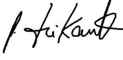
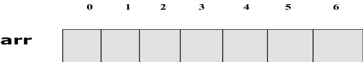
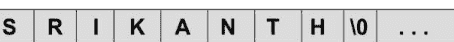
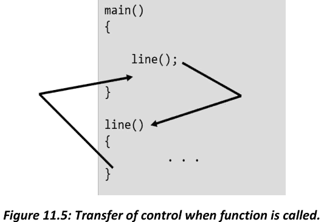
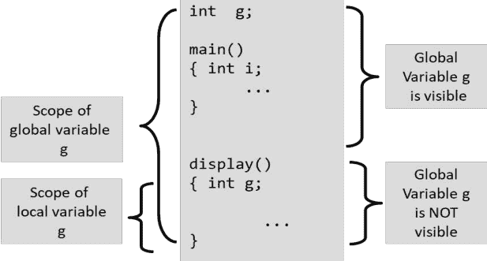
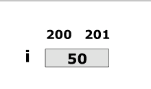
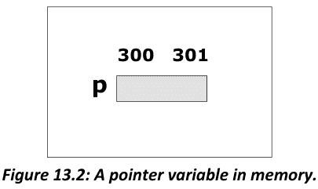
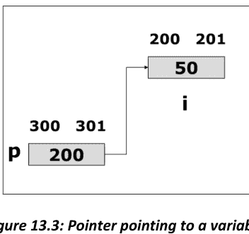
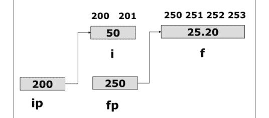
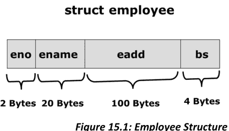

# C 语言初学者指南

## 献辞

献我的学生们。

## 致谢

写一本书需要大量的精力和时间。如果没有他人的帮助，我无法完成。

我的妻子 Padmaja 以及我的儿子 Praneeth 和 Pranav 一直支持我，并在各个方面为我帮助。

我感谢 Manogna，她在整合本书的各个部分方面提供了巨大的帮助。

我无法忘记在本书之前的版本中，由 Murali Krishna Chitrada 和 Madan Neelapu 提供的帮助。

## 关于作者

Srikanth Pragada 是 Srikanth Technologies 的经理，这是一家软件培训公司。他职业上是一名培训师。他从 1991 年教授 C 语言和 Pascal 语言开始了他的培训事业。他目前负责 C、Java、Python、数据科学、Angular、Oracle 和 MS.NET 的培训课程。

他拥有以下行业认证：

- Java 5.0 太阳认证 Java 程序员 (SCIP)
- Java EE 14 太阳认证 Web 组件开发者 (SCWCD)
- Java EE 5.0 太阳认证业务组件开发者 (SBCBD)
- Oracle 数据库 SQL 专家
- .NET Framework 4.0 Web 应用程序微软认证技术专家 (MCTS)
- Oracle PL/SQL 开发者认证关联

他的公司网站 `www.srikanthtechnologies.com` 完全由他设计和开发。他通过他的网站提供程序、项目、博客和在线考试，为学习社区做出了巨大贡献。

他喜欢阅读书籍、旅行、运动和听音乐。可以通过以下方式联系他：

邮寄地址：

Srikanth Technologies, 304,

Eswar Paradise,

Dwarkanagar Main Road,

Vizag – 530016.

网络地址：

`srikanthpragada@gmail.com`

`www.srikanthtechnologies.com`

## C语言语言入门

- 字符串的输入/输出 ................................................................89

### C语言语言入门 11

- 练习题.... 164

#### 17. 预处理器指令.... 165

#### 18. 文件处理.... 172

- 使用 `fread()` 读取二进制文件.... 185
- 总结.... 189

### C语言入门

运算符优先级和结合性 ... 217

自动类型转换规则.... 218

ANSI C 中的关键字.... 219

## 初学者 C 语言

### 简介

在我看来，C 语言是一个人应该理解的第一门语言。它教你编程，并为学习 C++、Java 和 C# 等复杂语言做好准备。学习这种语言对于在编程方面打下坚实基础非常重要。

编程是有有趣的。然而，并不是每个想成为程序员的人都能意识到这一点，因为有些人缺乏努力，有些人则缺乏方向。这本书是为那些不知道自己应该理解什么以及理解到什么程度的人准备的。我在写这本书时，始终考虑着初学者的。章节的顺序也是你更好地理解这些主题的顺序。

### 本书包含什么？

这是一本实战干货的书——没有冗长且无用的讨论。这本书将通过简单的示例、通俗语言和所需的深度来教你。一旦你消化了这本书，并觉得对书中讨论的话题感到熟悉，你就可以开始探索 C 语言的某些高级领域。如果你愿意，可以转向更广泛使用的语言，如 C++、Java、JavaScript、PHP 和 C。

我与成千上万学生的接触经验让我意识到，大多数苦苦于理解编程的学生只有两种可能的问题。首先，在这种情况下他们没有付出足够的努力，谁也无为力。其次，他们试图在不理解基础知识的情况下理解高级内容。我曾是一个在完全不理解编程的情况下就尝试理解 Java 或 C++ 的学生。

这本书是为那些正在 C 语言培训的人以及想要自学 C 语言的人编写的良好补充。通过额外的努力，后一类人使用这本书不应该发现学习 C 特别困难。

享受编程，享受你的职业。编程可以从根本上改变你的生活——永远。考虑一下吧。

在现阶段提醒你一下可能是合适的——胜利者从不放弃，放弃者永远不会胜利。

### 关于编译器和作业

本书与特定编译器是无关的。我不假设你正在使用任何特定的编译器。然而，你需要一个编译器来编译你的程序。请参考下方提供的我的网站 URL，以了解如何编译 C 语言程序。

你还可以在以下 URL 找到书中作业的答案以及关于本书的其他相关信息。

`http://www.srikanthtechnologies.com/books/cbook.aspx`

祝你好运，



### 告诉你的想法

我已尽力让这本书对你有所帮助。我非常想知道你觉得这本书怎么样。你还希望在书中看到什么，你在书中做了和没做什么。如果你有话想说并且有一点时间，请发送邮件到 `srikanthpragada@gmail.com` 或使用我网站 `www.srikanthtchnologies.com` 上的反馈链接。

### 更多资源

这里你可以使用的更多资源可以进一步加强你对 C 语言的知识。

- 查看我的网站（`srikanthtchnologies.com`）的程序部分以获取更多程序。
- 使用 GitHub 仓库 `https://github.com/srikanthpragada/c_language` 获取更多 C 语言程序。
- 在 Udemy 上参加《初学者 C 语言》和《C 语言面试题》课程。

# 1. C 语言简介

本章将为你介绍 C 编程语言。之后，你将对 C 语言、它的历史和特性有一个基本的了解。

- 什么是 C 语言？
- C 语言的历史
- C 语言的特性
- 总结

## 什么是 C 语言？

C 是一种通用编程语言。编程语言用于编写程序。程序是完成特定任务的指令集合。例如，一个程序可以找出 10 个数中的最大值，另一个程序可以在屏幕上显示文件内容等等。程序所完成的任务可以是任何内容——从非常复杂到微不足道。C 是一种中级语言，它允许程序员直接访问系统资源。

# 学者 C 语言

## 函数面向型

C 语言中的一切都是通过函数实现的。程序本身的执行从一个名为 `main` 的函数开始。整个程序被写成函数的集合。当 `main` 函数终止时，程序被认为也终止。每个 C 编译器都提供了一组函数，通过这些函数可以完成大多数操作。例如，I/O、字符串处理、图形等，这些都是通过一组内置函数完成的。

每个编译器都提供了称为内置函数或标准函数的现成函数。然而，程序员也可以在程序中创建更多函数。这些被称为用户定义函数。

## 结构化语言

结构化语言允许程序员将程序划分为模块，并提供了所有的基本控制结构，如 `if` 语句、`for` 循环、`while` 循环和 `switch` 语句。C 是结构化语言之一。

## 弱类型语言

没有严格的数据类型检查。由于数据类型是兼容的，你可以将数据从一种类型转换为另一种类型。例如，你可以将整数转换为浮点数，反之亦然。由于 C 不强制执行类型检查，因此被称为弱类型语言。

## 灵活且易错

C 不检查错误。例如，C 不检查数组边界越界。这意味着你可以声明一个拥有 10 个元素的数组，并访问它的第 11 个元素。C 允许你这样做。正如你所知，访问一个只有 10 个元素的数组的第 11 个元素将访问不属于该数组的内存。作为 C 程序员，理解这一点非常重要——除非你检查这些情况，否则可能会出现严重的逻辑错误。

C 的哲学是程序员知道自己在做什么。你可以利用 C 的灵活性来让自己让自己处于有利位置，也可能成为这种灵活性的受害者。虽然这为高级程序员提供了很大的灵活性，但初学者有时会得过头并遇到严重的逻辑错误。

## 总结

- C 是一种通用编程语言。
- 尽管它主要设计为系统编程设计，但目前被用于所有类型的编程。
- 每个 C 程序都要通过编译器翻译成目标代码。

### 练习题

- 1. ________ 可用于将高级语言程序（源代码）翻译成目标代码。
- 2. C 程序之所以紧凑，是因为 ________。
- 3. C 程序被写成 ________ 的集合。

# 2. 第一个 C 程序

在本章中，我们将编写第一个 C 程序。它还解释了如何编译和运行一个 C 程序。

- 如何编写一个简单的 C 程序？
- 如何编译和运行 C 程序？
- 使用转义序列控制输出
- 总结
- 练习题

## 如何编写一个简单的 C 程序？

编程是通过实践来学习的，而不是通过阅读相关书籍。学习一种编程语言就像学自行车。你必须去尝试。你可能会摔倒几次并受伤，但最终你会学会的。编程也是如此。你必须编写程序来学习编程。不要担心，不要害怕编程。这是一个奇妙的世界。你做得越多，就越享受——听我的。现在我们来写第一个 C 程序。以下是一个在屏幕上显示给定消息的简单 C 程序：

```
01: // 在屏幕上显示信息的程序
02: #include <stdio.h>
03: main(){
04: {
05:     printf("Welcome To C Language");
06: }
```

> 注意：不要输入行号和冒号（:），它们仅用于说明目的。

当你运行上述程序时，将显示以下输出。

| Welcome To C Language |

现在，让我们理解上述程序的每一行做了什么。

### 第 1 行

它是一个注释或备注。我们编写注释是为了让程序更具可读性。C 中的注释以 `/*`（斜杠和星号）开始，以 `*/`（星号和斜杠）组合结束。注释也可以跨行。

如果你想使用单行注释，可以使用两个斜杠（`//`）跟随注释。

```
// 这是一个单行注释
/* 这个注释跨越
多行。 */
```

### 第 2 行

这是一个预处理器命令。`#include` 命令用于将通用文件的内容复制到你的程序。在本示例中，`#include` 用于包含 `stdio.h` 头文件的内容。虽然这不是强制的，但使用 `#include` 命令包含头文件（`.h` 文件被称为头文件）更好。我们将在第 17 章详细讨论 `#include`。

### 第 3 行

每个程序都从一个名为 `main` 的函数开始。程序的执行从该函数开始并以 `main` 函数结束。所有剩余函数（标准和用户定义的）都从 `main` 函数调用。当 `main` 函数终止时，程序被认为也终止。

### 第 4 行与第 6 行

每个函数都包含一组封装在 `{}`（大括号）中的指令。在执行函数时，大括号之间的语句将被执行。由于每当你运行 C 程序时，`main` 函数都是第一个执行的函数，因此 `{}` `main` 函数之间的所有语句都将被执行。封装在 `{}` 内的一组语句也称为块。换句话说，对于每个函数，你有一个块，每当函数被调用时，该块就会执行。

第 4 行开始该块，第 6 行结束该块。

### 第 5 行

函数 `printf()` 是 C 语言中的一个标准函数。它用于显示。

# C 语言入门

| ? | 0x3f | 问号 |

|---|---|---|

| \ooo | | 1 到 3 位八进制数字 |

| \xhh | | 1 到 2 位十六进制数字 |

**表 2.1：转义字符。**

以下是几个使用转义字符的示例。

```c
printf("a Bell \a");
```

系统蜂鸣显示字符串 "Bell" 并再次响起系统蜂。

```c
printf("\n10\t20");
```

开始新行，打印 10，一个制表符（通常是 8 个空格），然后打印 20。

```c
printf("Ring system bell thrice");
printf("\x07\x07\x07");
```

打印给定的消息并响三次系统蜂。`\x07` 表示十六进制的 07，等同于十进制的 07。由于 7 是系统蜂的 ASCII 码，因此它会响起系统蜂。

好了，在本章中，你刚刚开始理解什么是 C 程序以及它的样子。C 程序的最低要求是一个名为 `main` 的函数。正如我们在后面的章节中将看到的，我们将从 `main` 函数控制整个程序。但在到达第 11 章讨论用户定义函数之前，我们不会编写 `main` 以外的函数。

## 总结

- 每一个 C 程序都包含 `main` 函数。
- C 程序的执行从 `main` 函数获得控制时开始，在 `main` 函数终止时停止。
- 函数 `printf()` 是 C 语言标准函数集中的函数。它用于在屏幕上显示值。
- 转义字符（如 `\n`）用于向字符串插入换行等控制字符。

### 练习题

- 1. ____ 开始注释，____ 结束注释。
- 2. ____ 转义序列用于生成制表符。
- 3. C 程序的执行从 ____ 函数开始。
- 4. `printf("\x41")` 的输出是 ____。
- 5. 在两个不同的行中显示你的名字和地址。
- 6. 在第一行显示你的名字，第二行显示地址。使用制表符分隔地址的每个部分。

# 3. 语言元素

在本章中，我们将理解各种语言元素，如变量、数据类型和常量。我们将理解如何声明变量和数据类型。然后我们将学习如何使用 `printf()` 显示值以及使用 `scanf()` 读取值。

- 标识符
- 变量
- 标准数据类型
- 常量
- 函数 `scanf()`
- 使用 `printf()` 打印变量值
- 总结
- 练习题

## 标识符

标识符是你赋予变量或函数的名称。标识符的形成遵循以下规则：

- 它可以包含字符 A-Z, a-z, 0-9 或下划线(_)。
- 可以包含任意数量的字符，但前 32 个字符是显著的。
- 必须以字母或下划线开头。但避免使用下划线作为第一个字母，因为系统名称是以下划线作为开头定义的。
- 关键字不能作为标识符。

以下是几个有效标识符列表。

```c
amount
num1
circle_radius
x1
```

## 变量

变量是一个可能会改变的值。每个变量都存储在内存中并作为一个名称引用。程序中使用的每个变量都必须声明。在声明变量时，你必须指定变量的数据类型和名称。

```c
main()
{
  int a;
  float f;
  ....
}
```

上面的示例声明了两个变量。变量 `a` 是 `int` 类型，`f` 是 `float` 类型。

> **注意：** 在 C 中，你只能在块的开始声明变量。

以下是用于声明变量的语法。

| data-type | 是标准数据类型或用户定义的数据类型。 |

| --- | --- |

| variable | 变量的名称。 |

| value | 变量的值。 |

## 属性

变量包含以下的属性：

| Name | 变量名称。 |

| --- | --- |

| Data type | 变量类型。 |

| Value | 变量的值。 |

| Address | 变量的地址。 |

|

| |  变量的名称。 |

| --- | --- |

| Value | 存储在内存中的值。 |

| Address | 变量的地址。 |

## 标准数据类型

以下是 C 中的数据类型列表。除了标准类型外，程序员还可以定义自己的类型。

| Data type | Size(Bytes) | Range |

| --- | --- | --- |

| char | 1 | -128 to 127 |

| unsigned char | 1 | 0 to 255 |

| short | 2 | -32768 to 32767 |

| unsigned short | 2 | 0 to 65535 |

| int | 4 | -2147483648 to 2147483647 |

| unsigned int | 4 | 0 to 4294967295 |

| long | 8 | -9223372036854775808 to 9223372036854775807 |

| unsigned long | 8 | 0 to 18446744073709551615 |

| float | 4 | 1.2E-38 to 3.4E38 |

| double | 8 | 2.3E-308 to 1.7E308 |

| long double | 16 | 3.4E-4932 to 1.1E4932 |

## 常量

常量是在执行过程中不会改变的值。以下是 C 中的不同常量类型。

### 字符常量

单引号内的字符或转义序列。

| Examples |

| --- |

| 'A', '\n', '0' |

### 整数常量

整数值。可以包含负号。

| Examples |

| --- |

| 10, -20 |

### 浮点常量

实数。它可以包含负号和小数点。

你也可以以指数计数法给出浮点常量。

| Example |

| --- |

| 1.0E2 等同于 100 |

### 字符串常量

双引号内的字符集合。

```
Example: "This is a string"
```

你可以在字符串常量中嵌入转义字符。

```
Example: "First \n Second"
```

> 注意：任何包含在双引号中的内容都是字符串，无论其实际内容是什么。例如，“101”也是一个字符串，尽管它包含数字。

## 函数 scanf()

这是一个从键盘（标准设备）读取值的标准函数。在读取值时，你必须为 scanf 指定以下内容：

- 每个值的类型
- 要读取值的个数
- 存储值的变量名称

```c
scanf("%d%d", &a, &b);
```

上面的代码扫描两个整数并将它们放入变量 `a` 和 `b` 中，这些变量被声明为 `int` 类型。

处理 `scanf` 函数时，必须在每个变量前加上 `&`。

在输入值时，用户必须使用空白字符分隔值并使用 ENTER 键结束整个输入。

空白字符可以是空格、换行或制表符。

```
10 20 30 <ENTER>
```

## 使用 printf 打印变量

转换字符（如 `%d` 和 `%f`）用于指定 `printf` 函数显示什么类型的值。下面的示例演示了这一点。


```c
01: #include <stdio.h>
02:
03: void main()
04: {
05:     int a;
06:     float b;
07:
08:     printf("Enter integer and float :");
09:     scanf("%d%f", &a, &b);      // 读取值
10:
11:     // 显示 a 和 b 的值
12:     printf("Value of a = %d and b = %f", a, b);
13: }
```

| Enter integer and float : 15 20.34 [Enter Key] |

| Value of a = 15 and b = 20.34 |

取决于你正在处理的变量类型，你必须给出转换字符。不当使用转换字符可能会导致输出错误。

# C 语言入门

以下是包含不同数据类型转换字符的表格。

| 转换字符 | 含义 |
|--- |------ |
| `%d` | 十进制值 |
| `%i` | 整数值 |
| `%o` | 八进制计数法 |
| `%x` | 十进制计数法 |
| `%l` | 长整数 |
| `%h` | 短整数 |
| `%u` | 无符号整数 |
| `%c` | 字符 |
| `%s` | 字符串 |
| `%f` | 浮点数 |
| `%lf` | 双精度浮点数 |
| `%e` | 浮点的指数计数法 |
| `%g` | 普通或指数计数，以较短者为 |

表格 3.2：转换字符

## 总结

- 标识符是我们用来引用变量和函数的名称。
- 变量的值在程序执行过程中可能会改变但常量不会。程序中使用的每个变量都必须声明为可用数据类型之一。
- 转换字符用于指示 `printf()` 和 `scanf()` 函数我们正在处理的值类型。

## 练习

- 1. ________ 是无符号整数 `int` 的转换字符。
- 2. ________ 是 `double` 的大小。
- 3. 标识符中允许的唯一特殊字符是 ________。
- 4. 'O' 是 ________ 类型常量。
- 5. 识别无效的标识符
  - a) `sales_amount`
  - b) `_Print`
  - c) `main`
  - d) `Aa`
  - e) `2count`
  - f) `Xyz_123`
- 6. 接受两个整数并显示第一个数的八进制等值和第二个数的等值。
- 7. 接受金额和折扣百分比并显示净额。
- 8. 取两个数字并按接收顺序的相反顺序显示它们。

# 4. 运算符

在本章中，我们将讨论 C 语言中提供的运算符。

- 什么是运算符？
- 算术运算符
- 关系运算符
- 逻辑运算符
- 赋值运算符
- 递增和递减运算符
- 复合运算符
- 位运算符
- `sizeof`
- 类型转换
- 总结
- 练习

## 什么是运算符？

运算符是对给定值执行特定操作的符号或单词。与运算符一起使用的值称为操作数。

C 语言拥有丰富的运算符。与其他高级语言相比，它拥有更多的运算符。

根据运算符接受多少个值（操作数），将运算符分类如下：

- 一元运算符 - 仅接受一个操作数
- 二元运算符 - 接受两个操作数
- 三元运算符 - 接受三个操作数

根据运算符执行的操作，分类如下：

- 算术运算符
- 关系运算符
- 逻辑运算符
- 递增和递减运算符
- 复合运算符
- 位运算符

## 算术运算符

这些运算符用于执行数学计算。这些运算符的操作数是数值类型。

| 运算符 | 作用 |
|--- |--- |
| `+` | 加法 |
| `-` | 减法 |
| `-` (一元) | 取反符号 |
| `*` | 乘法 |
| `/` | 除法 |
| `%` | 取模（余数） |

表格 4.1：算术运算符

注意：没有用于幂的运算符。

```
10 / 3 将是 3
10 % 3 将是 1
```

## 减号 (-) 作为一元运算符

减运算符可以作为二元运算符从另一个数字中减去数字，也可以作为一元运算符对数字取反。例如，以下语句将变量 `a` 的符号取反。这意味着如果 `a` 的值为 –100，那么 `b` 将因为符号取反变为 100。

```
b = - a;
```

## 关系运算符

这些运算符用于形成条件。条件用于 `if` 语句和 `for` 循环等控制语句。

| 运算符 | 含义 |
| --- | --- |
| `>` | 大于 |
| `<` | 小于 |
| `>=` | 大于等于 |
| `<=` | 小于等于 |
| `==` | 等于 |
| `!=` | 不等于 |

表格 4.2：关系运算符

以下是关系运算符的一些示例：

| `a > b` | 如果变量 `a` 的值大于变量 `b` 的值，则为真，否则为假。 |
| --- | --- |
| `a == b` | 检查变量 `a` 的值是否与变量 `b` 等等。 |

> 注意：我们将在下一章中使用关系运算符，到时我们将讨论控制语句。

## 数字作为条件

关于 C 语言条件的一个非常重要的点是 - 任何非零值都被视为真，零被视为假。这意味着如果你提供一个 `int` 变量作为条件，如果变量包含非零值则条件为真，否则条件为假。

C 语言的这一特性将被许多程序员利用，使条件更加紧凑。但要注意可能导致程序更容易出错且难以理解的危险。

## 逻辑运算符

当需要组合两个或多个条件时，你需要使用逻辑运算符。以下是可用的逻辑运算符。

| 运算符 | 含义 |
|---|---|
| `&&` (与) | 当两个条件都为真时为真，否则为假。 |
| `||` (或) | 当其中一个条件为真时为真，否则为假。 |
| `!` (非) | 反转条件的结果。真为假，假为真。 |

表格 4.3：逻辑运算符

这里是 `&&`（与）的真值表：

| 条件-1 | 条件-2 | 结果 |
|---|---|---|
| 真 | 真 | 真 |
| 真 | 假 | 假 |
| 假 | 真 | 真 |
| 假 | 假 | 假 |

# C 语言入门

这里是 `||`（或）的真值表：

| 条件-1 | 条件-2 | 结果 |
|---|---|---|
| 真 | 真 | 真 |
| 真 | 假 | 真 |
| 假 | 真 | 真 |
| 假 | 假 | 假 |

只要在单独的语句中与变量使用运算符，无论在变量之前还是之后使用，没有区别。然而，如果它们在表达式中与变量使用，就会产生区别。

当运算符在变量之前使用时，称为前缀（`++a`）。当运算符在变量之后使用时，称为后缀（`a++`）。

## 递增与递减运算符 (++,--)

在编程中，将变量递增或递减是非常常见的。C 提供了专门用于将变量加减1的运算符。

```
a++; // 将 a 的值加 1
--b; // 将 b 的值减 1
```

## 前缀 vs. 后缀

只要 `++` 和 `--` 运算符在单独语句中与变量使用，无论在变量之前还是之后使用，都没有区别。但是，如果它们在表达式中与变量使用，就会产生区别。

## 前缀

在前缀中，先对变量的值进行递增或递减，然后将变量的新值用于表达式。

```
// 假设 a 的值为 10
b = ++a; // a 是 11，b 也是 11
```

首先 `a` 的值加1，并将新值存储在变量 `b` 中。

## 初学者 C 语言

## 后置 (Post-fix)

在后置操作中，先使用变量的值，然后对变量的值进行加/减。

```
// 假设 a 的值为 10
b = a++; // a 为 11 但 b 仅为 10
```

首先将 `a` 的值存储在 `b` 中。然后 `a` 的值加了 1。

如果上面的表达式不清楚，你可以对表达式进行解码然后尝试理解。

因此，`b = a++;` 等同于：

```
b = a;
a = a + 1;
```

而 `b = ++a;` 等同于：

```
a = a + 1;
b = a;
```

假设 10 和 20 为 `a` 和 `b` 的值，求以下表达式的值。

```
c = ++a + b--; // c=31,a=11,b=19
c = --b - ++a; // c=8,b=19,a=11
```

## 复合运算符 (Combined Operators)

我们经常需要在变量和值之间执行某些操作，并将结果存回同一个变量中。C 语言提供了一种将操作和赋值合并为一个运算符的机制。当一个运算符和一个赋值运算符结合时，它们被称为复合运算符。

```
amount = amount - discount;
```

上面是一个从 `amount` 中减去 `discount` 的示例。该表达式可以使用复合运算符重写如下：

```
amount -= discount;
```

上面的操作效果上与之前相同，但更紧凑。复合运算符的通用语法为：

```
operator=
```

该运算符可以是任何产生结果值的运算符。

## 位运算符 (Bitwise operators)

位运算符对位进行进行操作。只有整数数据类型可以作为操作数。以下是 C 语言中可用的位运算符及其功能。

| 运算符 | 含义 |
| --- | --- |
| `&` | 位与 (AND) |
| `|` | 位或 (OR) |
| `^` | 位异异 (XOR) |
| `~` | 取反 (Ones' complement) |
| `>>` | 右移 |
| `<<` | 左移 |

表 4.4: 位运算符。

位与操作取给定操作数的两个对应的位，如果两个位都是 1，则返回 1，否则返回 0。

位或操作取给定操作数的两个对应的位，如果其中一个位是 1，则返回 1，否则返回 0。

位异或操作给定操作数的两个对应的位，如果两个位相同，则返回 0，否则返回 1。

取反操作反转位。当位为 0 时返回 1，当位为 1 时返回 0。

位移运算符根据指定的位数向左或向右移动位。

以下是关于如何使用位运算符及其作用的几个示例。

对于下方的所有示例，假设以下变量具有给定值。

```
byte a = 10;
byte b = 15;
```

这两个变量的二进制等效值如下。

| a | 0 0 0 0 | 1 0 | 1 0 |
| b | 0 0 0 0 | 1 1 | 1 1 |

`a & b;` 的结果如下：

| a | 0 0 0 0 | 1 0 | 1 0 |
| b | 0 0 0 0 | 1 1 | 1 1 |
| a & b | 0 0 0 0 | 0 0 | 0 0 |

`a | b;` 的结果如下：

| a | 0 0 0 0 | 1 0 | 1 0 |
| b | 0 0 0 0 | 1 1 | 1 1 |
| a | b | 0 0 0 0 | 1 1 | 1 1 |

`a ^ b;` 的结果如下：

| a | 0 0 0 0 | 1 0 | 1 0 |
| b | 0 0 0 0 | 1 1 | 1 1 |
| a ^ b | 0 0 0 0 | 0 0 | 0 0 |

`~a;` 的结果如下：

| a | 0 0 0 0 | 1 0 | 1 0 |
| b | 0 0 0 0 | 1 1 | 1 1 |
| ~a | 1 1 1 1 | 0 1 | 0 1 |

`a << 2;` 的结果如下：

| a | 0 0 0 0 | 1 0 | 1 0 |
| b | 0 0 0 0 | 1 1 | 1 1 |
| a << 2 | 0 0 0 0 | 1 0 | 0 0 |

`a >> 2;` 的结果如下：

| a | 0 0 0 0 | 1 0 | 1 0 |
| b | 0 0 0 0 | 1 1 | 1 1 |
| a >> 2 | 0 0 0 0 | 0 0 | 0 0 |

## 算术移与 逻辑移 (Arithmetic vs. Logical shift)

当我们向右移位时，左侧的新位将用数字的符号位或零填充。在算术移的情况下，如果数字为正数，则新元素为 1；在逻辑移的情况下，新元素始终填充为 0。机器可能会遵循逻辑移或算术移。

## sizeof 运算符

该运算符用于查找特定变量或数据类型在内存中占用的字节数。在 C 语言中，由于数据类型的大小在不同编译器之间是不固定的，因此 `sizeof` 运算符对于知道数据类型在程序中占用多少字节非常有用。

```
int n;
n = sizeof(int)
```

## 类型转换 (Typecasting)

类型转换可以显式地将一种类型的值转换为另一种类型。例如，以下代码将 long int 变量转换为 int 并存储在 int 变量中。需要注意的是，C 会自动完成此操作。尽管如此，某些情况下我们必须显式执行。

```
int a;
long int b = 100;

a = (int) b;
```

类型转换的语法为：

```
(data type) value
```

数据类型是值转换到的类型。当然，数据类型和值必须是兼容。我的意思是，值必须可以转换为指定的数据类型。假设我们需要根据总数和计数来计算平均值。总数和计数变量都声明为 int，平均值声明为 float。

```
average = total / count;
printf("%f", average);
```

然而，两个整数之间的除法始终返回 int。因此，我们需要转换表达式中的一个值以获得 float，如使用类型转换所示：

```
average = total / (float) count;
printf("%f", average);
```

## 总结 (Summary)

- C 提供的运算符比其他编程语言多。理解运算符非常重要，因为它们在编程中被常用。
- 后置和前置仅在用于表达式时才有区别，否则两者都将变量加/减 1。
- 位运算符对单个位进行操作，而不是对字节进行操作。它们通常用于高级编程。然而，对它们有一定的了解会更好。

## 练习题 (Exercises)

- 1. ____ 是逻辑与运算符。
- 2. `A += 10;` 将将 `A` 增加 ____ ____。
- 3. `a = b` 和 `a == b` 之间的区别是什么？____。
- 4. ____ 符号增加变量然后使用增加后的变量。
- 5. 一元运算符意味着 ____。
- 6. 取两个整数并显示：和、差、积、商和余数。
- 7. 取一个数字并显示其平方。
- 8. 取本金、利率、年数并显示单利。
- 9. 取 'a' 和 'b' 的值并显示 `a² + b²`。

# 5. 控制语句 (CONTROL STATEMENTS)

控制语句用于根据条件执行语句。条件是一个产生真或假的表达式。例如 `a == 10` 可能是真或假。在本章中我们将讨论 C 中可用的语句。

- `if` 语句
- 复合语句
- 多重 `if` 语句
- 嵌套 `if` 语句
- 条件表达式
- `switch` 语句
- 总结
- 练习

## if语句

这是最常用的控制语句。用于评估条件并根据结果执行语句。如果条件为，则执行 `if` 之后的语句，否则执行 `else` 之后的语句。让我们从使用 `if` 语句显示数字中较大的开始。

```
if (a > b)
    printf("%d",a);
else
    printf("%d",b);
```

在上面的 `if` 语句中，如果条件 `a > b` 为真，则执行 `if` 之后的 `printf()` 并显示 `a`。如果条件为假，则执行 `else` 之后的 `printf()` 并显示 `b`。

以下是简单语句的语法。

```
if (condition)
  statement - 1;
else
  statement - 2;
```

以下是语法中每个元素的含义。

| Condition | 产生真或假的表达式 |
| --- | --- |
| Statement-1 | 条件为真时执行。 |
| Statement-2 | 条件为假时执行。 |

`if` 语句的 `else` 部分是可选的（语法中使用方括号 [] 表示）。如果没有提供 `else`，当条件为假时不执行任何操作。

> **注意：** 在 C 语言中，非零视为真，零视为假。因此，任何求值为非零的表达式都是真的。这意味着可以给出整数表达式。

在下面的示例中，如果变量包含非零值则条件为真并显示消息，否则不执行任何操作。

```
if (a)
  printf("A is non-zero");
```

默认情况下，`if` 或 `else` 只执行一个语句。如果你想执行多个语句，则必须使用下面讨论的复合语句。

## 复合语句 (Compound Statement)

由于 `if` 语句默认允许你执行一条语句，因此需要复合语句来克服这一局限性。如果你在只允许执行一条语句的情况下必须执行多条语句，那么你就必须使用复合语句。

复合语句通过将所有要执行的语句放在的一对大括号 `{}` 中来创建。复合语句可以用任何可以使用简单语句的地方。

以下示例在两个条件任一为真时会执行两个语句。

```c
if(a > b)
{
    c = d;
    d = e;
}
else
{
    a = d;
    d = f;
}
```

## 示例程序 (Sample Program)

以下示例程序显示从用户输入的两个数中较小的一个。

```c
01: // 获取2个数字并显示最小值的程序
02: main()
03: {
04:    int a,b;
05:
06:    // 从用户处获取两个数字
07:    printf("Enter 2 numbers : ");
08:    scanf("%d%d", &a, &b);
09:    if (a < b)
10:        printf("Smallest is %d", a);
11:    else
12:        printf("Smallest is %d", b);
13: } // main 结束
```

## 多重 if 语句 (Multiple if statement)

有时，你需要根据不同的条件采取不同的行动。观察以下示例。


```c
01: // 显示数字正负号的程序
02: main()
03: {
04:     int a;
05: 
06:     printf("Enter a number : ");
07:     scanf("%d", &a);
08:     if (a < 0)
09:         printf("Negative");
10:     else
11:         if (a > 0)
12:             printf("Positive");
13:     else
14:         printf("Zero");
15: }
```

在上例中，你有三种选择（正、负和零）。这要求我们一个接一个地检查两个条件。因此，我们必须使用多条语句。首先检查 `a` 是否小于 0，如果该条件失败，你仍然还有两个选择（正和零）。因此，在采取下一步行动之前，你必须检查其中任何一种可能的情况。

如果条件 `a > 0` 为真，意味着 `a` 是正数。由于我们已经检查了 `a` 是否为负，剩下的唯一选项就是零。因此，`else` 部分显示消息“零”。

以下示例根据学生获得的成绩授予学生相应的等级。

```c
01: #include <stdio.h>
02: void main()
03: {
04:     int marks;
05: 
06:     printf("Enter marks : ");
07:     scanf("%d", &marks);
08: }
```

# 初学者 C 语言 (C Language For Beginners)

```c
09: // 根据分数显示等级
10: if (marks > 80)
11:     printf("First grade");
12: else
13:     if (marks > 60)
14:         printf("Second grade");
15:     else
16:         if (marks > 50)
17:             printf("Third grade");
18:     else
19:         printf("Fail");
20: }
```

上述代码段首先检查分数是否大于 80。如果是，它会显示消息“First grade”（一等）。否则，它检查第二个条件，如果为真，则显示“Second grade”（二等）。如果第二个条件也为假，它会检查第三个条件，如果为真，则显示消息“Third grade”（三等），如果仍然为假，则显示“Fail”（不及）。

我们我们将讨论 `switch` 语句，它是多重 `if` 语句的替代方案。

## 嵌套 if 语句 (Nested if statement)

在某些情况下，你需要将一个 `if` 语句放在另一个 `if` 语句内部。当你将一个 `if` 语句放在另一个 `if` 语句内部时，被称为嵌套 `if` 语句。这是一个简单的示例。

```c
// 检查 a 是否等于 b 和 c
if (a == b)
    if (a == c)
        printf("All three numbers are same");
```

只有当两个条件都为真时，才会执行 `printf()`。首先，C 检查第一个条件。如果第一个条件为真，它进入 `if` 语句。只有当第二个 `if` 也满足时，才会执行 `printf`。

## 初学者 C 语言 (2 C Language For Beginners)

```c
if (condition-1)
    if (condition-2)
        statement - 1;
    else
        statement - 2;
else
    statement - 3;
```

下面的表将说明哪条语句将被执行。

| Condition-1 | Condition-2 | 执行了什么？ |
|---|---|---|
| True | True | Statement-1 |
| True | False | Statement-2 |
| False | - | Statement-3 |

以下示例将让你更了解嵌套 `if` 语句。程序根据产品代码和销售额显示佣金。如果销售处理代码 1 且销售额超过 10000，则佣金为 5%，否则为 3%。当代码为 2 且销售额超过 20000 时，佣金率为 7%，否则为 4%。

```c
01: #include <stdio.h>
02: main()
03: {
04:     unsigned int samt;
05:     float comm;
06:     int code;
07:     printf("Enter code and sales amount:");
08:     scanf("%d%u", &code, &samt);
09:     if (code == 1)
10:         if (samt > 10000)
11:             comm = samt * 0.05;
12:         else
13:             comm = samt * 0.03;
14:     else if (code == 2)
15:         if (samt > 20000)
16:             comm = samt * 0.07;
17:         else
18:             comm = samt * 0.04;
19:     printf("Commission : %f", comm);
20: } // main 结束
```

## 条件运算符 (Conditional)

`if` 语句默认允许你执行一条语句，复合语句则用来克服这一局限性。如果你在只允许执行一条语句的情况下必须执行多条语句，那么你必须使用复合语句。

复合语句通过将所有要执行的语句放在的一对大括号 `{}` 中来创建。复合语句可以用任何可以使用简单语句的地方。

以下示例在两个条件任一为真时会执行两个语句。

```c
if(a > b)
{
    c = d;
    d = e;
}
else
{
    a = d;
    d = f;
}
```

## 三元运算符 (?:)

有时，你需要根据不同的条件采取不同的行动。观察以下示例。

```c
01: // 显示数字正负号的程序
02: main()
03: {
04:     int a;
05: 
06:     printf("Enter a number : ");
07:     scanf("%d", &a);
08:     printf((a < 0) ? "Negative" : (a > 0) ? "Positive" : "Zero");
09: }
```

在上例中，你有三种选择（正、负和零）。这要求我们一个接一个地检查两个条件。因此，我们必须使用多条语句。

以下示例根据学生获得的成绩授予学生相应的等级。

```c
01: #include <stdio.h>
02: void main()
03: {
04:     int marks;
05: 
06:     printf("Enter marks : ");
07:     scanf("%d", &marks);
```

## 初学者 C 语言 延续

```c
09: // 根据分数显示等级
10: if (marks > 80)
11:     printf("First grade");
12: else
13:     if (marks > 60)
14:         printf("Second grade");
15:     else
16:         if (marks > 50)
17:             printf("Third grade");
18:     else
19:         printf("Fail");
20: }
```

上述代码段首先检查分数是否大于 80。如果是，它会显示消息“First grade”。否则，它检查第二个条件，如果为真，则显示“Second grade”。如果第二个条件也为假，它会检查第三个条件，如果为真，则显示消息“Third grade”，如果仍然为假，则显示“Fail”。

我们我们将讨论 `switch` 语句，它是多重 `if` 语句的替代方案。

## 嵌套 if 语句

在某些情况下，你需要将一个 `if` 语句放在另一个 `if` 语句内部。当你将一个 `if` 语句放在另一个 `if` 语句内部时，被称为嵌套 `if` 语句。这是一个简单的示例。

```c
// 检查 a 是否等于 b 和 c
if (a == b)
    if (a == c)
        printf("All three numbers are same");
```

`printf()` 只有在两个条件都为真时才会执行。首先，C 检查第一个条件。如果第一个条件为真，它进入 `if` 语句。只有当第二个 `if` 也满足时，才会执行 `printf`。

## 初学者 C 语言 2

```c
if (condition-1)
    if (condition-2)
        statement - 1;
    else
        statement - 2;
else
    statement - 3;
```

下面的表将说明哪条语句将被执行。

| Condition-1 | Condition-2 | 执行了什么？ |
|---|---|---|
| True | True | Statement-1 |
| True | False | Statement-2 |
| False | - | Statement-3 |

以下示例将让你更了解嵌套 `if` 语句。程序根据产品代码和销售额显示佣金。如果销售处理代码 1 且销售额超过 10000，则佣金为 5%，否则为 3%。当代码为 2 且销售额超过 20000 时，佣金率为 7%，否则为 4%。

```c
01: #include <stdio.h>
02: main()
03: {
04:     unsigned int samt;
05:     float comm;
06:     int code;
07:     printf("Enter code and sales amount:");
08:     scanf("%d%u", &code, &samt);
09:     if (code == 1)
10:         if (samt > 10000)
11:             comm = samt * 0.05;
12:         else
13:             comm = samt * 0.03;
14:     else if (code == 2)
15:         if (samt > 20000)
16:             comm = samt * 0.07;
17:         else
18:             comm = samt * 0.04;
19:     printf("Commission : %f", comm);
20: } // main 结束
```

## 条件运算符 (?:)

`if` 语句默认允许你执行一条语句，复合语句则用来克服这一局限性。如果你在只允许执行一条语句的情况下必须执行多条语句，那么你必须使用复合语句。

复合语句通过将所有要执行的语句放在的一对大括号 `{}` 中来创建。复合语句可以用任何可以使用简单语句的地方。

以下示例在两个条件任一为真时会执行两个语句。

```c
if(a > b)
{
    c = d;
    d = e;
}
else
{
    a = d;
    d = f;
}
```

## 三元运算符 (?:)

有时，你需要根据不同的条件采取不同的行动。观察以下示例。

```c
01: // 显示数字正负号的程序
02: main()
03: {
04:     int a;
05: 
06:     printf("Enter a number : ");
07:     scanf("%d", &a);
08:     printf((a < 0) ? "Negative" : (a > 0) ? "Positive" : "Zero");
09: }
```

## 初学者 C 语言 延续

```c
09: // 根据分数显示等级
10: if (marks > 80)
11:     printf("First grade");
12: else
13:     if (marks > 60)
14:         printf("Second grade");
15:     else
16:         if (marks > 50)
17:             printf("Third grade");
18:     else
19:         printf("Fail");
20: }
```

## switch 语句

当需要检查的条件较多时，`if` 语句变得冗长且难以理解。更好的替代方案是 `switch` 语句。它根据结果采取不同的行动。根据产品代码查找折扣率，可以使用以下 `switch` 语句。

```c
switch(pc)
{
  case 1 : dis = 07; break;
  case 2 : dis = 08; break;
  case 3 : dis = 05; break;
  case 4 : dis = 06; break;
```

首先将 `pc` 与 1 比较。如果条件为真，则执行相应的语句。否则检查下一个 case，依此类推。如果没有任何 case 为真，则执行 `default` 后的语句。

默认情况下，`switch` 执行条件为真的语句。这意味着如果 `pc` 是 2，则从 case 2 开始的所有语句都将执行。为了防止其他 case 的代码被执行，你必须使用 `break` 语句退出整个 `switch` 语句。虽然 `break` 不是 `switch` 语句语法的一部分，但它通常在每个 case 中使用。

```c
switch (expression)
{
  case value-1 : statements;
  [case value-2 : statements] ...
  [default : statements]
}
```

至少有一个 case 是必须的，第二个 case 开始以及 default 是可选的。

## 初学者 C 语言

注意：语法中的三个点 `...` 表示前一个项目可以重复任意次数。在 `switch` 语法中，`case` 语句可以重复任意次数。

## 总结

- C 提供了许多高级语言所提供的所有条件语句。简单 `if` 语句用于采取两种可能的行动之一（或根据条件采取一种行动）。由于比较所花费的时间比计算长，因此使用正确的控制语句来减少条件的数量是重要的。熟练地使用控制语句是学习编程语言的第一块里程碑。因此，请阅读本章直到理解所有内容。

## 练习

- 1. 接受一个数字并显示它是偶数还是奇数。编写两个程序——一个使用条件运算符，另一个使用普通的 `if` 语句。
- 2. 接受科目成绩和科目代码（1 到 4），并显示学生通过还是不及格。及格根据科目代码如下：1-40、2-50、3-45、4-55。
- 3. 接受两个数字并显示这两个数字之间的关系。输出应显示以下消息之一：“两个数字相等”、“第一个数字更大”或“第二个数字更大”。
- 4. 从用户处接受三个数字并显示三个数中最大的。

# 6. 循环结构

循环是一种允许你重复执行一组语句的机制。在编程中，你经常需要重复执行某组语句。例如，如果你编写一个程序来获取 20 个学生的成绩并显示每位学生是及格还是不及格，你就必须反复获取每个学生的分数并执行所需的操作。

在本章中，我们将讨论 C 语言中可用的循环结构以及相关的语句，如 `break` 语句。

- 可用的循环结构
- while 循环
- for 循环
- do... while 循环
- break 语句
- continue 语句
- 嵌套循环
- 总结
- 练习题

## 可用的循环结构

以下是 C 语言中可用的循环结构。

- while
- for
- do ... while

所有所有的结构都用于重复执行一组语句。然而，使用哪一个取决于哪种循环结构更符合需求。

## while 循环

只要给定的条件为真，就会执行该语句。当条件为假时，循环终止，并执行循环后的下一个语句。

下面的示例说明了如何使用 while 循环。

```
01: // 打印从 1 到 10 数字的程序
02: #include <stdio.h>
03:
04: void main()
05: {
06: int n = 1;
07:
08: //只要 n 小于 11 就重复循环
09: while (n < 11)
10: {
11:     printf("%d\n", n);
12:     n++; // n 递增 1
13: } // while 循环结束
14: }
```

上面的 while 循环将在屏幕上显示从 1 到 10 的数字。

以下是 while 循环的语法。

```
while (condition)
statement;
```

条件可以是任何有效的 C 条件。只要条件为真，语句就会重复执行。一旦条件为假，循环终止，控制权转移到紧接在循环之后的语句。

语句可以是单条语句，也可以是复合语句。

下面的程序用于显示给定数字中的最大值。它会提示用户输入数字，直到用户输入 0 为止。

```
01: // 显示给定数字中最大值的程序
02: #include <stdio.h>
03:
04: void main()
05: {
06:     int num;
07:     int largen = 0;
08:
09:     printf("Enter a number [0 to stop :");
10:     scanf("%d", &num);
```


```c
    while(num != 0) // while(num) 

    {

        // 如果 num 大于之前的最大值
        if (num > largen)
            largen = num;

        // 获取下一个数字
        printf("Enter a number [0 to stop :");
        scanf("%d", &num);
    }
    // 打印最大值
    printf("Largest number is : %d", largen);
} // main 结束
```

## for 循环

这是 C 语言中另一种可循环结构。

它整合了循环的三个基本要素（初始化、条件和更新）。`for` 循环通常用于重复固定次数的语句。例如，如果你知道需要执行某操作 10 次，那么 `for` 循环是理想的。

下面是一个使用 `for` 循环显示从 1 到 10 数字的示例。

```c
// 打印从 1 到 10 数字的程序

for(n = 1; n <= 10; n++)
printf("%d\n", n);
```

这在效果上与循环是相同的。但是，由于它整合了初始化、条件和更新，与 `while` 循环相比更加直观。

这通常取决于个人选择。

这里是 `for` 循环的语法。

```c
for (initialization; condition; updation)
statement;
```

### 初始化
在循环开始前执行。

### 条件
只要条件为真，循环就会执行。

### 更新
在每次迭代后执行。

### 语句
语句可以是单条语句，也可以是复合语句。注意：语句部分是可选的。

```c
... ) 
```

### 逗号
逗号运算符用于分隔在 `for` 循环中的表达式。

```c
for (initialization; condition; updation)
```

## do... while 循环

当你需要至少执行一次语句时，可以使用 `do... while` 循环。与 `while` 循环在顶部检查条件不同，`do... while` 在底部检查条件。

```c
do {
    statements;
} while (condition);
```

下面是 `do... while` 循环的示例。

```c
do {
    // { 语句 }
} while (condition);
```

## break 语句

用于终止循环。当条件为假时，循环会终止。当你需要根据某些条件终止循环时，可以使用 `break` 语句。考虑下面的示例。

```c
while (condition)
{
...
break;
}
```

上面的 `break` 在 `n` 小于 0 时终止循环。这意味着当 `n < 0` 时。

下面的程序使用了 `for` 循环和 `break` 语句。

```c
01: // 显示 10 个数字或直到 0 的程序
02: #include <stdio.h>
03:
04: void main()
05: {
06:     int sum = 0, n, c;
07:
08:     for (c = 1; c <= 10; c++)
09:     {
10:     printf("Enter a number [0 to stop]:
11:     scanf("%d", &n);
12:     if (n == 0)
13:         break;
14:     sum += n;
15:   }
16:   printf("sum = %d", sum);
17: }
```

## continue 语句

用于从循环内部将控制转移到循环开头。它用于跳过 `continue` 语句之后的语句并进入下一次迭代。

下面的示例将让你了解它是如何工作的。该程序获取 10 个正数并显示这些数字之和。

```c
01: #include <stdio.h>
02:
03: void main()
04: {
05:   int n, sum, i;
06:
07:   sum = 0;
08:   i = 1;
09:   while ( i <= 10 )
10:  {
11:     printf("Enter a number : ");
12:     scanf("%d", &n);
13:
14:     /* 跳过剩余语句
15:        如果数字是负数 */
16:
17:     if ( n < 0 )
18:       continue;
19:
20:     i++;
21:     sum += n;
22:   }
23:   printf("Sum = %d", sum);
24: }
```

# 嵌套循环

当一个循环放在另一个循环内部时，它被称为嵌套循环。内层循环或嵌套循环会在外层循环的每次重复时执行。

以下是一个显示 1 到 5 数字阶乘的示例。这里有两个循环，第一个循环使变量 `i` 从 1 到 5 重复 5 次，第二个循环计算变量 `i` 的阶乘。

```c
01: // 显示给定数字阶乘的程序
02:
03: #include <stdio.h>
04: void main(){
05: {
06:     int i, j, n, fact;
07:     for (i = 1; i <= 5; i++) // 外层循环
08:     {
09:         printf("Enter a number: ");
10:         scanf("%d", &n);
11:         fact = 1;
12:         for (j = 1; j <= n; j++) // 内层循环
13:             fact = fact * j;
14:         printf("Factorial of %d = %d\n", n, fact);
15:     }
16: }
17: }
```

可以有多个层级的嵌套循环。外层循环启动，下一个循环在之后启动。一旦嵌套循环完成，外层循环的下一次迭代将开始。如果所有循环都多一个嵌套循环，将遵循与外层循环和第一个内层循环相同的过程。

## 总结

循环意味着重复执行一个或多个语句。`while` 循环和 `for` 循环是完全可以替代的。`while` 循环也可以使用 `do...while` 实现。`do...while` 的方式不同。最小重复次数为 1，而 `for` 循环为 0。当一个循环在另一个循环内部时，被称为嵌套循环。内层循环在外层循环每次迭代时执行。`break` 用于终止循环，`continue` 用于跳过后续语句并开始下一次。

## 练习

1. `loop` 用于至少执行一次语句。
2. `statement` 用于终止循环。
3. `for` 循环有三个部分。
4. 显示从 0 到 5 的数字。
5. 接受一个数字并显示从 1 到该数字的和。
6. 显示 0 到 200 范围内的所有偶数。
7. 从用户处获取数字，直到用户输入 0，并显示数字之和和平均值。
8. 获取 10 个数字并显示给定数字中的最大值最小值。
9. 显示 1 到 20 的表格。

示例输出：
```
1 = 1
2 = 2
...
20 = 20
```

10. 按照以下格式显示数字。

# 7. 字符处理

字符 `char` 数据类型用于存储一个字符。在本章中，我们将理解字符是如何存储在内存中的，以及与 `char` 数据类型相关的函数。

- 存储
- 字符输入输出函数
- 字符分类函数
- 转换函数
- 总结
- 练习

## 存储

你在 `char` 变量中存储单个字符。`char` 变量包含我们想要存储的字符的 ASCII 代码。ASCII 代码是一个数字，表示存储在内存中的每个字符。

尽管 C 语言存储字符的 ASCII，但它可以接受并显示字符，而不是作为数字。下面的示例将验证这一点：

```c
char ch;
ch = 'A';      // 将 A 的 ASCII 代码(65) 存入 ch
ch = 65;       // 与上述相同
printf("%c", ch); // 在屏幕上显示 A
```

字符在内部是以数值形式存储的，你也可以拥有算术字符变量。

```c
// 将 A 存入 char
ch = 'A';
ch++;      // 将 ch 增到 66，意味着字符 B
```

正如我们之前看到的，`printf()` 可以接受并显示字符，而不是数字。

```c
char ch;
ch = 'A';
ch = 65;
printf("%c", ch);
```

对于 `char` 变量，`printf()` 可以接受并显示字符。

下表显示了 ASCII 范围：

| 字符 | 范围 |
| :--- | :--- |
| A-Z | 65-90 |
| a-z | 97-122 |
| 0-9 | 48-57 |
| Space | 32 |
| Newline | 10 |

## 字符输入输出函数

`getchar()` 用于从标准输入读取字符。`putchar()` 用于将字符输出到标准输出。

## 字符分类函数

`ctype.h` 提供了一组函数来判断字符类型。

- `isalpha(c)`：判断字符是否为字母。
- `isdigit(c)`：判断字符是否为数字。
- `islower(c)`：判断字符是否为小字母。
- `isupper(c)`：判断字符是否为大字母。

示例：
```c
ch = getchar();

if (isupper(ch))
    printf("Uppercase letter");
```

## 转换函数

有两个与字符相关的转换函数 - `toupper` 和 `tolower`。

```c
int toupper(int ch)
```

如果 `ch` 是小写字母，将其转换为大写，否则返回原字符 `ch`。

```c
int tolower(int ch)
```


如果 `ch` 是大写字母，则将其转换为小写，否则返回原字符 `ch`。

你必须包含 `ctype.h` 来使用这些函数。

## 总结

- 在 C 语言中，理解字符数据类型很重要。有几个专门处理字符的 I/O 函数。
- C 提供了一系列字符分类函数，因为在 C 中检查字符的类型是非常常见的。

### 练习题

- 1. 什么是数字 2 的 ASCII 码？
- 2. 函数检查一个字符是否为不可打印字符。
- 3. `getchar()` 从哪里读取？
- 4. 函数 `get` 中的 `e` 代表什么？
- 5. 如果你尝试使用 `getch()` 读取字符，而标准输入被重定向到磁盘上的文件会发生什么？
- 6. 什么函数可以用于显示字符的 ASCII 码？
- 7. 接受 10 个字符并显示大写字母、小写字母和数字的数量。
- 8. 接受一个字符，如果是小写字母则将其转换为大写，如果是大写字母则转换为小写。
- 9. 接收字符直到用户输入 `*` 为止，并将字符转换为小写。

# 8. 数组

到目前，我们每次只处理一个值。但如果你必须记录 20 个学生的成绩怎么办？如果你必须计算 20 个学生成绩的平均分并将成绩按升序排列该怎么办？对于这类需求，你必须将所有值存储在数组中。

在本章中，我们将理解如何创建和使用数组。

- 什么是数组？
- 声明数组
- 存储
- 如何访问元素？
- 示例程序
- 初始化数组
- 搜索数组
- 排序数组
- 二分查找
- 总结
- 练习题

## 什么是数组？

数组是具有相似数据类型的值的集合，通过一个名称共同访问。

以下是数组的三个重要特征：

- 数组是值的集合
- 所有值都是相同类型
- 所有值都使用相同的名称访问

数组的每个值被称为元素。元素通过索引访问，索引是一个表示元素位置的数字。关于此点的更多内容将在本章讨论。

## 初学者 C 语言

## 声明数组

数组的声明方式与普通变量一样，但增加了数组应该包含的元素数量。

以下声明声明了一个包含 20 个元素的数组，每个元素都是 `int` 类型：

```c
int marks [20];
```

现在，`marks` 是这个 20 个整数数组的名称。如果 `int` 占用 2 字节，那么 `marks` 占用 40 字节（20*2）。

## 存储

数组的每个位置都可以包含一个值。数组的每个位置被称为元素。数组的所有元素连续地放置在内存中。如下图所示，它表示了一个包含 7 个元素的数组，元素编号从 0 到 6。



图 8.1: 内存中的数组

数组创建后，无法添加新元素或删除现有元素。换句话说，数组的大小是静态的，在不能更改。如果你想创建一个动态数组，可以使用动态内存分配来创建，对于更复杂的，可以使用链表（关于此点的更多内容将在第 21 和第 22 章中讨论）。

## 如何访问元素？

数组包含多个元素。但整个数组通过一个名称访问。因此，要访问数组元素，你必须使用索引或下标以及数组名。索引无非元素的编号。它标识了元素在数组中的位置。

在 C 语言中，数组索引从 0 开始，到元素数量-1 结束。

## 示例程序

`marks [5] = 30;` // 将值 30 存储到第 6 个元素

以下是一个简单的程序，用于理解如何从数组读取值并反序显示数组元素。

```c
/* 向数组输入值 
并反序显示元素的程序 */
#include <stdio.h>
void main() {
    int arr[10];
    int i;
    // 获取 10 个数字并存储在数组中
    for (i = 0; i < 10; i++) {
        printf("Enter a number : ");
        scanf("%d", &arr[i]);
    }
    // 反序显示
    for(i = 9; i >= 0; i--)
        printf("%d", arr[i]);
}
```

在读取值并反序显示数组元素时，`marks [5] = 30;` 会将值 30 存储到第 6 个元素。


在读取值并反序显示数组元素时，`marks[5] = 30;` 会将值 30 存储到第 6 个元素。

## 初始化数组

数组的声明方式与普通变量一样，但增加了数组应该包含的元素数量。

以下声明声明了一个包含 20 个元素的数组，每个元素都是 `int` 类型：

```c
int marks[20];
```

现在，`marks` 是这个 20 个整数数组的名称。如果 `int` 占用 2 字节，那么 `marks` 占用 40 字节（20*2）。

## 存储

数组的每个位置都可以包含一个值。数组的每个位置被称为元素。数组的所有元素连续地放置在内存中。参见下图，它表示了一个包含 7 个元素的数组，元素编号从 0 到 6。


图 8.1: 内存中的数组

数组创建后，无法添加新元素或删除现有元素。换句话说，数组的大小是静态的，在不能更改。如果你想创建一个动态数组，可以使用动态内存分配来创建，对于更复杂的，可以使用链表（关于此点的更多内容将在第 21 和第 22 章中讨论）。

## 如何访问元素？

数组包含多个元素。但整个数组通过一个名称访问。因此，要访问数组元素，你必须使用索引或下标以及数组名。索引无非元素的编号。它标识了元素在数组中的位置。

在 C 语言中，数组索引从 0 开始，到元素数量-1 结束。

## 示例程序

`marks[5] = 30;` // 将值 30 存储到第 6 个元素

以下是一个简单的程序，用于理解如何从数组读取值并反序显示数组元素。

```c
/* 向数组输入值 
并反序显示元素的程序 */
#include <stdio.h>
void main() {
    int arr[10];
    int i;
    // 获取 10 个数字并存储在数组中
    for (i = 0; i < 10; i++) {
        printf("Enter a number : ");
        scanf("%d", &arr[i]);
    }
    // 反序显示
    for(i = 9; i >= 0; i--)
        printf("%d", arr[i]);
}
```

在读取值并反序显示数组元素时，`marks[5] = 30;` 会将值 30 存储到第 6 个元素。

```c
30: if (arr[i] > arr[j])
31: {
32:     // 交换值
33:     temp = arr[i];
34:     arr[i] = arr[j];
35:     arr[j] = temp;
36:     
37: }
38: }
39: 
40: printf("\nSorted Array\n");
41: 
42: for (i = 0; i < 10; i++)
43:     printf("%5d", arr[i]);
44: 
45: }
```

输出:

| 原始数组 | 81 35 78 2 59 94 41 49 8 39 |
| 排序后的数组 | 2 8 35 39 41 59 78 81 94 |

## 二分查找

我们已经了解了如何在数组中搜索一个值。但这个过程非常耗费时间，特别是当数组很大时。因为我们必须从第一个元素开始，并与每个元素进行值进行比较。

之前的搜索算法被称为线性查找。在这种方法中，平均比较次数为：

> 数组中的元素数量 / 2

对于一个拥有 1000 个元素的数组，平均比较次数为 500 次。

因此，为了使过程更高效，使用了二分查找算法。以下是二分查找的步骤。

## 二分查找步骤

- 1. 确保数组是有排序的。除非数组是有排序的，否则它无效。
- 2. 取数组的中间元素。
- 3. 检查数字是否等于该元素。
- 4. 如果数字等于中间元素的值，则停止搜索并退出。
- 5. 如果中间元素的值大于数字，那么显然我们要找的值只会在中间元素的左侧找到。这是因为数组已经是排序状态。除非数组已经排序，否则二分查找将无法工作。
- 6. 因此，取中间元素的左侧元素作为下次搜索的右元素。如你所见，现在我们将搜索的元素数量减少到了原来大小的一半。这就是为什么这被称为二分查找（你知道二分意味着 2）。
- 7. 如果中间元素的值小于我们要搜索的数字，则取中间元素的右元素作为数组的左元素。此原因很简单（如上文所述），现在我们知道该值不存在于中间元素的左侧。
- 8. 现在回到步骤 2 并重复相同的操作，直到最左侧的元素超过最右侧的元素，在这种情况下，你可以得出数组中未找到值的结论。

这是一个使用二分查找算法搜索数组的程序。记住，该程序假设数组已经是排序好的。在尝试运行程序之前，要么对数组排序，要么按排序顺序输入值。

```c
01: // 二分查找
02: #include <stdio.h>
03: void main()
04: {
05:     int arr[10];
06:     int sn;              // 搜索数字
07:     int middle;
08:     int left = 0, right = 9;
09:
10:     // 确保数组已填充并排序
11:
12:     printf("nEnter search number :");
13:     scanf("%d", &sn);
14:
15:     while(left <= right)
16:     {
17:         // 取数组的中间元素
18:         middle = (left + right) / 2;
19:         if (arr[middle] == sn)
20:         {
21:             printf("%d found at %d", sn, middle);
22:             break;
23:         }
24:         else
25:             if (arr[middle] > sn)
26:                 right = middle - 1;
27:             else
28:                 left = middle + 1;
29:     }
30:
31:     // 检查未找到数字
32:     if (left > right)
33:         printf("Number not found");
34:
35: } // main结束
```

Srikanth Technologies

## 总结

- 数组是集合。每我们需要存储相似的值时，就使用数组。访问数组元素的位置。
- 在数组中搜索值和对数组进行排序是频繁的操作。
- 在下一节中，我们将讨论多维数组。

## 练习

- 1. 接收20个数字到数组中并显示它们的和。
- 2. 取一个10个整数的数组并向其中输入值。按降序排序。
- 3. 接收20个数字到数组中并显示它们的平均值。
- 4. 创建一个10个元素的数组并填充它。接收一个数字并在指定位置插入。
- 5. 创建一个10个元素的数组并填充它。交换前5个元素和后5个元素。

# 9. 多维数组

在数一节中，我们讨论了二维数组。现在我们将讨论多维数组。

- 什么是多维数组？
- 示例程序
- 初始化多维数组
- 超过二维
- 总结
- 练习

### 什么是多维数组？

二维数组包含多个列但只有一行。它用于表示一组值。然而，在某些情况下我们需要存储多组值。例如，我们可能需要存储5个学生的成绩，每个学生有4门学科。对于这种情况，一个包含 5 行（每个学生一行）和 4 列（每个学科一列）的数组是理想的。

多维数组具有两个或更多维数组。以下是存储学生的二维数组示例：

```c
int marks[5][4];
```

在上面的示例中，`marks` 是一个5行每行4列的数组。总共可以在数组中存储20个值。

多维数组的声明语法为：

```
数据类型 array[维度1][维度2] ...
```

访问二维数组时，你需要两个索引。第一个索引指定行，第二个索引指定该行的列。

例如，要访问 `marks` 的第3行第2列，你可以：

```c
marks[2][1] = 70;
```

| | 0 | 1 | 2 | 3 |
|---|---|---|---|---|
| 0 | | | | |
| 1 | | | | |
| 2 | | 70 | | |
| 3 | | | | |
| 4 | | | | |

### 示例 9.1: 二维数组

示例程序

以下是一个向 5x5 数组填充 1 到 25 数字然后作为矩阵打印的程序。

```c
01: #include <stdio.h>
02: void main()
03: {
04:     int arr[5][5];
05:     int r, c, n;
06: 
07:     // 用1到25数字填充数组
08:     n = 1;
09:     for ( r = 0; r < 5 ; r++ )
10:     for ( c = 0; c < 5; c++ )
11:     {
12:         arr[r][c] = n++;
13:     }
14: 
15:     // 打印数组
16:     for(r = 0; r < 5; r++)
17:     {
18:       for ( c = 0; c < 5; c++ )
19:         {
20:             printf("%5d", arr[r][c]);
21:         }
22:         printf("\n");
23:     }
24: }
```

输出:

| 1 | 2 | 3 | 4 | 5 |
| 6 | 7 | 8 | 9 | 10 |
| 11 | 12 | 13 | 14 | 15 |
| 16 | 17 | 18 | 19 | 20 |
| 21 | 22 | 23 | 24 | 25 |

以下是另一个程序，显示每个学生有多少门学科超过了50分。我们先用成绩填充数组，然后将数组与学生超过50分的学科数量作为第6列显示出来。

```c
01: #include <stdio.h>
02: void main()
03: {
04:     int marks[5][5];
05:     int r, c, n;
06: 
07:     // 用随机数填充数组
08:     srand(time(0));
09:     for (r = 0; r < 5; r++)
10:       for (c = 0; c < 5; c++)
11:         {
12:             marks[r][c] = rand()%100;
13:         }
14: 
15:     // 统计每个学生超过50分的学科数
16:     for (r = 0; r < 5; r++)
17:     {
18:       passed = 0;
19:       for (c = 0; c < 5; c++)
20:         {
21:             printf("%5d", marks[r][c]);
22:             if (marks[r][c] > 50)
23:                 passed++;
24:         }
25:         printf("%d subjects\n", passed);
26:     }
27: }
```

## 总结

- 多维数组是数组的数组。要访问每个数组，你需要为每个数组提供一个索引。因此，要访问二维数组，你需要一个行索引和一个列索引。
- 相同的概念也适用于更多维的数组。
- 你可以通过以数组形式提供值来初始化多维数组。通常使用嵌套的 for 循环来访问多维数组的所有元素。

### 练习题

- 1. 建立一个 5 * 5（5 行 5 列）的数组并向其输入值。以矩阵的形式显示该数组。
- 2. 建立一个 4 * 4 的数组。在对角线单元格放置 1，在剩余位置放置 0，并以矩阵格式显示数组。
- 3. 向一个 5 * 5 的数组中输入数字。输入一个数字。显示数组中所有大于该数字的元素。
- 4. 将随机数存储在一个 6 * 6 的数组中，并交换前 3 行与后 3 行。

# 10. 字符串处理

字符串是字符的集合。在 C 语言中，由于没有用于存储字符串的数据类型，我们必须使用字符数组来模拟字符串。在本章中，我们将学习如何在 C 语言中处理字符串。我们还将查看一些与字符串相关的标准函数。

- 如何声明字符串？
- 字符串是如何存储的？
- 字符串的输入/输出
- 将字符串视为数组
- `gets()` 和 `puts()` 函数
- 字符串库
- 字符串比较
- 总结
- 练习题

## 如何声明字符串？

字符串是字符的集合。字符数组同样是字符的集合。因此，在 C 语言中，使用字符数组来表示字符串。例如，为了存储一个可能多达 50 个字符的名字，你可以如下声明字符串：

```c
// name 可以包含最多 50 个字符 */
char name[50];
// names 是一个包含 10 个字符串的数组，每个字符串 20 个字符
char names[10][20];
```

## 字符串是如何存储的？

字符串以数组的形式存储在内存中。然而，当你声明一个 20 个字符的字符串时，它并不总是包含 20 个字符。它可能只包含 15 个字符。因此，为了识别字符串中实际字符的结束，C 在字符串的末尾存储了一个空字符（ASCII 码为 0 的字符）。

空字符写为 `'\0'`。它是 ASCII 码 0 的字符。由于没有其他字符包含 ASCII 码 0，当我们在字符串中遇到空字符时，就可以在该字符处停止读取字符。因此，C 语言中的字符串是以空字符终止的字符集合。

`name`



图 10.1：一个字符串

**注意：** 虽然你声明了一个长度为 50 个字符的字符串，但实际上你只能存储 49 个字符。这是因为一个字节用于存储空字符。

## 字符串的输入/输出

就像从键盘读取值一样，你也可以从键盘读取字符串。C 提供了转换字符 `%s` 用于输入输出字符串。

你可以使用 `scanf()` 读取字符串并使用 `printf()` 打印。

以下代码段用于读取并显示名称。

```c
char name[30];
printf("你的名字是什么?");
scanf("%s", name);
printf("你好，%s", name);
```

在使用 `scanf()` 读取字符串时，有两个重要的点需要理解。

你不能在字符串变量前加 `&`（取地址符）。这个原因在书中后面学习指针时将会显而易见。

你只能从键盘读取数据到第一个空白字符（空格或制表符）。这意味着如果我想输入名字，我只能输入 Srikanth 而不是完整的名字 Srikanth Pragada。这是因为 `scanf()` 函数在遇到空白字符时会认为输入结束。我们将在本章后面讨论此解决方法。

注意：使用 `%s` 通过 `scanf()` 读取字符串时，请不要在变量前加 `&`。

关于字符串的另一个重要点是，所有如 `scanf()` 和 `printf()` 等标准函数都会处理字符串末尾的空字符。

例如，当你使用 `scanf()` 输入字符串时，该函数会在字符串末尾自动放置空字符。同样，当你打印时，`printf()` 会一直读取直到遇到空字符。

## 将字符串视为数组

尽管 `scanf()` 和 `printf()` 将字符串视为单个值，但实际上字符串只是存储在数组中的字符集合。因此，可以将字符串视为字符集合并访问单个字符（数组的元素）。

下面的示例将演示这一点。它从键盘读取名称并垂直显示。

```c
01: //垂直打印字符串的程序
02: #include <stdio.h>
03:
04: void main()
05: {
06:     char name[30];
07:     int i;
08:     // 从键盘读取名字
09:     printf("Enter name: ");
10:     scanf("%s", name);
11: 
12:     for(i = 0; name[i] != '\0'; i++)
13:         printf("%c\n", name[i]);
14: }
```

```c
// 从键盘读取名称
for (i = 0; i < 10; i++)
    gets(names[i]);
// 对数组进行排序
for(i = 0; i < 9; i++)
{
    for(j = i + 1; j < 10; j++)
    {
        if(strcmp(names[i],names[j]) > 0) // 交换
        {
            strcpy(temp, names[i]);
            strcpy(names[i],names[j]);
            strcpy(names[j],temp);
        } // if 结束
    } // j 循环结束
} // i 循环结束
// 显示排序后的数组
for (i = 0; i < 10; i++)
    puts (names[i]);
}
```


## C 语言初学者

## 总结

- 由于 C 语言没有用于存储字符串的标准类型，因此你必须使用字符数组来存储字符集合。
- 每一个字符串都必须以空字符（ASCII 码为 0 的字符）终止。
- C 标准库提供了一系列函数用于处理输入/输出以及与其他字符串相关的操作。

### 练习题

- 1. 使用函数比较两个不区分大小写的字符串。
- 2. 字符串 `"A"` 占据了多少字节（bytes）？
- 3. 为什么 `scanf()` 不能读取包含空格的字符串？为什么？
- 4. `strcmp("ABC","ABC")` 的返回值是什么？
- 5. `printf("%s",name)` 和 `puts(name)` 之间有什么区别？
- 6. 接受一个字符串，并以相反的大小写形式显示该字符串中的每个字符。
- 7. 接受一个字符串，并只显示字符串中的大写字母。
- 8. 接受一个字符串和一个字符。显示该字符在字符串中出现的次数。
- 9. 取一个句子并显示其中的单词数。你可以假设单词间仅由一个空格分隔。尝试在没有该假设的情况下也完成。
- 10. 接受一个字符串、源字符和目标字符。将源字符的所有出现处替换为目标字符。
- 11. 接受 10 个字符串并显示这 10 个字符串中最大的。

# 11. 用户定义函数

函数是 C 程序的构建模块。在本章中，我们将理解什么是函数，以及如何创建和使用函数。理解函数是学习 C 语言中最重要的步骤之一。

- 什么是函数？
- 标准函数
- 用户定义函数
- 创建用户定义函数
- 传递参数
- 返回值
- 函数的声明与定义
- 递归
- 总结
- 练习题

## 什么是函数？

函数是执行特定任务的指令集合。每个函数都有一个名称。该名称用于用于调用（call）该函数。函数还可以接收参数（参数）。参数在调用函数时通过括号进行传递。

从理论上讲，函数也会返回一个值，但在 C 语言中你可以忽略函数的返回值。

C 是一种面向过程的语言。C 语言中的许多操作都是通过函数完成的。例如，我们使用 `printf()` 函数来显示值，使用 `scanf()` 函数从键盘读取值，使用 `strlen()` 函数获取字符串长度等。

函数分为四类：

- 不接受参数也不返回值的函数
- 不接受参数但返回一个值的函数
- 接受参数但不返回值的函数
- 接受参数并返回值的函数

以下是几种函数类型的的示例。

```c
// 传递参数并忽略返回值
printf("We are ignoring return value ");
```

```c
// 不接受参数但返回值的函数
ch = getchar();
```

```c
// 传递一个值并获取返回值
len = strlen(st);
```

如你所见，C 语言中的几乎一切都是通过函数。

函数是执行特定任务的指令集合。每个函数都有一个名称。该名称用于用于调用（call）该函数。函数还可以接收参数（参数）。参数在调用函数时通过括号进行传递。

从理论上讲，函数也会返回一个值，但在 C 语言中你可以忽略函数的返回值。

C 是一种面向过程的语言。C 语言中的许多操作都是通过函数完成的。例如，我们使用 `printf()` 函数来显示值，使用 `scanf()` 函数从键盘读取值，使用 `strlen()` 函数获取字符串长度等。

函数分为四类：

- 不接受参数也不返回值的函数
- 不接受参数但返回一个值的函数
- 接受参数但不返回值的函数
- 接受参数并返回值的函数

以下是几种函数类型的示例。

```c
// 传递参数并忽略返回值
printf("We are ignoring return value ");
```

```c
// 不接受参数但返回值的函数
ch = getchar();
```

```c
// 传递一个值并获取返回值
len = strlen(st);
```

如你所见，C 语言中的几乎一切都是通过函数。

函数可以定义为一组执行任务的指令并返回值。

## 避免代码重复

在编程中，你经常需要在程序的开头和结尾执行相同的代码。如果没有函数，你必须写两次这些代码。

如果你创建一个函数来显示数组，那么就可以在程序的开头和结尾各调用一次。

```c
main()
{
    int ar[10];
    int i;
    for (i = 0; i < 10; i++)
        printf("%d", ar[i]);
    /* 其他代码 */
    for (i = 0; i < 10; i++)
        printf("%d", ar[i]);
}
```
图 11.1：没有用户定义函数的程序。

```c
main()
{
    int ar[10];
    int i;
    printarray(ar);
    /* 其他代码 */
    printarray(ar);
}
printarray(int ar[])
{
    int i;
    for (i = 0; i < 10; i++)
        printf("%d", ar[i]);
}
```
图 11.2：带有用户定义函数的程序。

## 创建用户定义函数

用户定义函数在创建上与 `main()` 函数相同。然而，`main` 函数与用户定义函数之间存在两个区别：

- `main()` 函数的名称是标准的，而用户定义函数可以有任何名称
- 运行程序时 `main()` 函数会被调用，而用户定义函数需要被显式调用

以下是一个用户定义函数的示例。这是一个非常简单的函数，用于显示姓名和公司名称。

```
01: // main function
02: main()
03: {
04:     // call user-defined function
05:     print();
06: }
07: // // user-defined function
08:     print()
09: {
10:     printf("Srikananth Pragada\n");
11:     printf("Srikananth Technologies\n");
12: }
```

另一个画线的用户定义函数。

```
01: // Create and call user-defined function line()
02:
03: main()
04: {
05:     line(); // call function line
06:     printf("\nSanth Technologies\n");
07:     line(); // call line function again
08: }
09:
```

```
10: // User-defined function to draw a line
11: line();
12: {
13:   int l;
14: 
15:   for(l = 1; l <= 79; l++)
16:     putch('-');
17: }
```

在 `main` 函数中，我们调用了 `line` 函数。要调用函数，请使用函数名后跟括号。如果函数接受任何值（参数），则通过在括号中提供值来发送。实际上，这没什么新鲜的。从第一个 C 程序开始我们就这样做。唯一新之处在于：我们是在为函数编写代码，而不是调用预写的代码。我们将在本章后面介绍更多关于传递参数的内容。

如图 11.5 所示，当 `main` 函数调用 `line()` 函数时，控制权转移到 `line()` 函数。执行完 `line()` 函数中的代码后，控制权返回到调用该函数的下一条语句。



# C 语言入门

## 传递参数

虽然 `line` 是功能性的，但它总是执行相同的操作。我的意思是，它总是显示包含 79 个连字符的线。但如果我们想要一条只有 30 个字符的线而不是 79 个字符呢？

如果 `line` 函数能够接受长度并画出相应长度的线将更加灵活和通用。为此，需要对函数进行微调，以接收参数并使用该参数。参数或变量是传递给函数的值，以便函数执行任务时可以使用该值。根据需要，函数可以接受零个或多个参数。

以下是修改后的 `line` 函数。

```
01: // parameter len specifies size of the line
02: void line(int len)
03: {
04:     // draw a line of size len
05:     for(; len > 0; len--)
06:     putch('-');
07: }
08:
09: void main()
10: {
11:     // call line function with different lengths
12:     line(10);
13:     putch('\n');
14:     line(40);
15:     putch('\n');
16:     line(20);
17: }
```

## 输出

每当我们调用 `line` 函数时，都必须在括号中传递一个值。传递的值位于函数定义的括号内 `(int len)`。

## 实参

调用函数时传递的值。在上面的程序中，`10`、`40` 和 `20` 是传递给 `line()` 函数的值。

## 形参

用于接收实参的变量。在上面的程序中，`line()` 中的 `len` 是形式参数。

## 作为参数传递数组

当数组作为参数传递时，调用函数时只需提供数组的名称。这是一个打印数组的示例。

```
01: void printarray(int arr[]) // print an array
02: {
03:   int i;
04:
05:   for(i = 0; i < 10; i++)
06:     printf("%d", arr[i]);
07: }
08: void main()
09: {
10:  int a[];
11:
12:  // code to initialize array
13:  printarray(a);
14: }
```

## 返回值

通常在执行任务后函数会返回。返回值可以是任何类型。但函数只能返回一个值。要从函数返回返回值，必须先指定类型并在函数中使用 `return` 语句。如果没有显式提到返回类型，默认认为 `int`。下面的程序说明了这一点。

```
01: // Function to return max of two values
02: int max(int a, int b)
03: {
04:   return (a > b ? a : b);
05: }
06:
07: main()
08: {
09:   int x, y, big;
10:
11:   // x is passed to a, y is passed to b
12:   // return value is copied to big
13:
14:   big = max(x, y);
15: }
```

在上面的示例中，`max()` 函数接收两个整数并返回两者中的最大值。函数已指定要返回一个整数并使用了 `return` 语句。注意：当函数没有返回值时，始终使用 `void` 作为返回类型。

## 函数声明与定义

函数可以包含声明和定义。函数声明指定函数名、返回类型和参数类型。这通常位于程序的开头。虽然并非所有情况下强制，但声明每个函数更好。事实上，头文件 `(.h)` 包含了所有声明。

以下是函数声明语法：

| 返回类型 函数名 ( 参数 ) |

函数声明被称为原型声明。虽然大多数情况下不需要，但在满足以下条件时需要：

- 在函数定义之前调用函数
- 函数返回非整数值

以下是满足这两个条件的示例。

```
01: // Function without prototype declaration
02: // This results in compile time error
03:
04: void main()
05: {
06:     int a, b;
07:     float avg;
08:
09:     /* compiler doesn't know the return type.
10:     So, it assumes average() returns int */
11:
12:     avg = average(a,b);
13: }
14:
15: float average(int a, int b)
16: {
17:     return (a + b) / 2.0;
18: }
```

看上面的示例。这里有一个函数 `average()`，它接收两个整数并返回 `float`。但由于 C 编译器在定义之前遇到调用，它假设返回类型为整数，这是 C 默认的返回类型。当编译器到达函数定义时，它理解函数返回 `float`。由于编译器的假设（返回 `int`）与事实（返回 `float`）不匹配，它返回错误“average' 重定义类型不匹配”。

解决方法是在调用函数之前使用原型声明对其进行声明。这让编译器知道函数返回 `float` 类型而不是 `int` 类型（默认类型），从而解决问题。

```
01: // prototype declaration for average()
02:
03: float average(int, int);
04:
05: void main()
06: {
07:     int a, b;
08:     float avg;
09:
10: // Compiler knows all about average()
11:     avg = average(a, b);
12: }
13:
14: float average(int a, int b)
15: {
16:     return (a + b) / 2.0;
17: }
```

注意：先声明函数再定义它们总是更好的。

另一种方法是在调用之前定义函数以让编译器了解函数，如下所示。

```
01: float average(int a, int b)
02: {
03:     return (a + b) / 2.0;
04: }
05:
06: void main()
07: {
08:     int a, b;
09:     float avg;
10:
11: // Compiler knows average() as it was defined early
12:     avg = average(a,b);
13: }
```

## 函数定义

函数定义是给出要执行的语句的地方。当函数被调用时，这里提供的语句将会被执行。

```
return-type functionname ( parameters )
{
    statements;
    return value;
}
```

| 返回类型 | 指定函数返回的值的类型。如果函数不返回任何值，则必须为 void。 | |
| :--- | :--- | :--- |
| 参数 | 函数的形式参数。 | |
| 语句 | 函数被调用时执行的语句。 | |
| return | return 语句用于从函数返回值。 | |

## 递归

当函数调用自身时，被称为递归。递归是编写某些函数的自然方式。虽然刚开始听有点令人人生，但一旦你习惯了，它就会变得简单而自然。

以下程序使用函数 `reverse()` 倒序显示给定的数字，该函数是递归调用的。每个递归函数都应该有一种终止函数的方法。这意味着在某一点，它应该停止调用自己。否则，它将变成无尽的递归，程序将以“栈溢出”（out of stack）的错误终止。

如果你在想栈（stack）与递归有什么关系，这里就是联系。每当你调用一个函数时，关于函数、参数和局部变量的某些信息会被存放在名为栈的内存结构中。

如果你多次调用一个函数（这在编写不当的递归函数就会发生），栈可能会被填并停止程序。这就是栈溢出错误的原因。

# C 语言入门

```
01: // 倒序显示数字的程序
02: main()
03: {
04:     int n;
05: 
06:     printf("Enter a number :");
07:     scanf("%d",&n);
08:     reverse(n);
09: }
10: void reverse(int n)
11: {
12:     if ( n == 0 ) return; // 停止调用自己
13: 
14:     // 打印数字的最后一位
15:     printf("%d", n % 10);
16: 
17:     // 通过移除最后一位递归调用函数
18:     reverse(n / 10);
19: }
```


如果你觉得递归难以理解，不必恐慌。因为每个使用递归编写的函数都可以不使用递归来编写。然而，在某些情况下，编写递归版本比非递归版本更容易。

## 总结

- `函数`是执行某任务的语句集合。函数可以包含参数，也可以不包含，但它总是返回一个值。
- 函数可以是预定义的也可以是用户定义的。用户定义的函数是用户通过编写代码创建的。
- 用户定义的函数可能包含函数声明（向编译器提供关于函数的信息）和函数定义（编写函数代码的地方）。函数使用`return`语句返回值。
- 当函数调用自身时，被称为递归。

### 练习题

- 1. 函数可以返回值的数量是 ____。
- 2. 使用 ________ 语句来终止函数。
- 3. ________ 是函数的默认返回类型。
- 4. 在函数声明和函数定义中，哪一个是可选的？
- 5. 函数声明和函数定义应该以什么顺序给出？
- 6. 当函数调用自身时，它被称为 ________。
- 7. 用户定义的函数和 `main()` 之间有什么区别？
- 8. 写一个函数，接受一个数字作为参数并返回下一个奇数。
- 9. 写一个函数，接受一个字符串作为参数并仅显示给定字符串中的非空白字符。
- 10. 写一个函数，接受一个数字，如果是质数则返回 1，否则返回 0。
- 11. 写一个函数，接受一个字符串并返回字符串中包含的数字。
- 12. 写一个函数，接受一个数字并返回该数字的阶乘。使用递归。

## 12. 存储类

在本章中，我们将讨论与变量和函数相关的各种属性。可以使用存储类来改变其中一些属性。

- 变量的属性
- 作用域 `Scope`
- 可见性 `Visibility`
- 范围 `Extent`
- 存储类说明符
- 总结
- 练习题

## 变量的属性

C 语言中的变量与以下属性相关。

| 属性 | 含义 |
| --- | --- |
| 名称 | 名称用于引用变量。这是一个符号，用于访问或修改变量的值。 |
| 数据类型 | 指定变量可以存储什么类型的值。 |
| 值 | 存储在变量中的值。除非显式初始化变量，否则该值未知。 |
| 地址 | 为变量分配空间的内存位置的地址。 |
| 作用域 | 指定可以访问变量的程序区域。 |
| 可见性 | 指定变量可见的程序区域。 |
| 范围 | 指定变量在内存中分配空间持续多久。 |

## 作用域

从程序中可以访问变量的区域称为变量的作用域。变量的作用域取决于变量声明的位置。

下面的代码段将说明变量的作用域。

```
// g 的作用域从这里到程序结束

int g;

main() {

    int x;

}

void sum(){

    int y;

}
```

变量的作用域可以是**全局的**（`global`）或**局部的**（`local`）。

## 全局作用域

这意味着变量在整个程序范围内都是的。正如我们在之前的示例所示，变量 `g` 具有全局作用域。它对所有函数有效。

## 局部作用域

在块内定义的变量（如之前示例中的 `x` 和 `y`）仅对该块有效。当变量的作用域局限于块时，被称为**局部作用域**。

# C 语言入门

在块开头定义的变量具有局部作用域。事实上，C 允许不仅在函数开头创建变量，还可以在任何块开头创建变量。以下是一个如何在 `if` 块内部创建的示例。

```
main()
{ int v1; // 作用域整个函数

    if(...) {

        int v2; // v2 仅在块内可见

        ...

    }

    else {

        int v3; // v3 仅在 else 块可见

        ...

    }

}
```

你不能改变变量的作用域。它取决于声明的位置。你最多可以隐藏变量，将在下一节讨论。

> 注意：具有全局作用域的变量被称为“全局变量”，具有局部作用域的变量被称为“局部变量”。

## 可见性

通常情况下可见性和作用域是相同的。换句话说，变量在作用域内是可见的。但在某些情况下，可见性和作用域会有不同。

可见性是指变量可见的程序区域。变量永远不会在作用域之外可见。但在作用域内部它可能是不可见的。下面的代码段说明了这一点。

```
// g 的作用域从这一点到结束
int g;

main()
{
    int x;      // x 的作用域整个 main
    ...
}

sum()
{
    int g;
    // 使用局部变量 g，而不是全局变量 g
g = 20;
    ...
}
```

在此示例中，变量 `g` 具有全局作用域。但由于在函数内部声明了同名变量，它在整个 函数中变得不可见。当全局变量在函数中重新声明时，局部变量优先。换句话说，`sum` 函数中对 `g` 的所有引用将引用函数内的 `g`，而不是声明为全局的 `g`。所以，尽管 `g` 在程序范围内有效，但在 `sum` 函数中是不可见的。

因此，变量可能有作用域，但在程序的特定区域可能不具有可见性。变量永远不会超出其作用域可见，但在作用域内可能是不可见的。请看下图理解作用域和可见性的区别。



## 初学者 C 语言

## 范围 `Extent`

这指的是变量在内存中存在的时间。在块内部声明的变量具有局部范围。因为只要块在执行中，它就存在于内存中。它在块被调用时创建，在块执行完成后被移除。

请记住，变量所在的块可以是函数，也可以是复合语句，正如我们在本章之前看到的。

另一方面，在所有函数之外定义的变量具有静态范围，因为它们在整个程序执行过程中一直留在内存中。

尽管变量在内存中可用，但我们只能从程序中变量可见的区域访问它。这意味着，仅仅因为变量在内存中并不能访问它，除非它是可见的。

## 存储类限定符 `Storage Class Specifiers`

你不需要显式地为变量关联存储类。因为根据变量声明的位置，存储类会隐式地与变量关联。

但在少数情况下，你在声明变量时可能需要使用存储类限定符。

以下是变量声明的完整语法。

```
[storage-class] data-type variable = value;
```

以下是不同的存储类限定符：

- `auto`
- `static`
- `register`
- `extern`

## `auto`

这通常不使用，因为它隐式地与所有局部变量关联。

当控制进入块时，`auto` 变量会自动创建并初始化，当控制离开块时被移除。

```
auto int i = 30; // 具有局部作用域和范围的 auto 变量
```

## `static`

这用于将局部变量的局部范围提升为静态范围。

当你在声明局部变量时使用 `static` 存储类时，而不是每次控制进入块时都创建并初始化变量，变量只创建和初始化一次——当第一次遇到变量声明时。随后的所有函数调用将使用变量的当前值。

因此，具有静态范围的变量将在跨函数调用时一直留在内存中。

执行以下代码并查看输出。

```c
01: main()
02: {
03:     disp();
04:     disp();
05: }
06: disp()
07: {
08:     int v = 10;
09: 
10:     printf("Value = %d\n", v);
11:     v++;
12: }
```

输出：

| Value = 10 |
| Value = 10 |

输出的原因显而易见。每当我们进入 `disp` 函数时，它都会创建变量 `v` 并将其设置为 10。结果我们总是给 `v` 赋值为 10。虽然 `v` 在函数末尾被增加，但一旦控制离开函数，该值就会丢失，因为当你移出声明变量 `v` 的块（`disp()` 函数）时，变量 `v` 就会被移除。

但如果我们想在跨函数调用中使用 `v` 的值，就必须使用存储限定符 `static`。当我们使用 `static` 存储类时，变量的范围被提升为静态，变量在控制离开函数后仍留在内存中，结果变量的值也保留了。

查看以下程序以理解 `static` 存储限定符的影响。

```c
01: main()
02: {
03:   disp();
04:   disp();
05: }
06:
07: disp()
08: {
09:   static int v = 10;
10:
11:   printf("Value = %d \n", v);
12:   v++;
13: }
```

## 输出：

| Value = 10 |
| Value = 11 |

## `register`

通常变量被放在内存（RAM）中。但你可以通过将一些频繁使用的变量放在寄存器中来加速。寄存器是微处理器上的内存位置。微处理器上的这些内存位置用于微处理器的内部操作。然而，如果它们空闲，你可以使用它们。

以下是一个使用 `register` 存储类声明变量的示例。

```c
register int n;
```

上述代码是请求编译器为变量 `n` 分配一个寄存器而不是分配内存。如果寄存器可用，则 `n` 被存放在寄存器中，否则照常分配内存。

程序员并不知道使用 `register` 存储类的变量被分配到了哪个寄存器或内存。因此，无法对包含 `register` 存储限定符的变量使用地址操作符 `(&)`。这是因为寄存器不包含地址。

我们对 `register` 存储限定符的使用有一个限制。你不能对非整数变量使用它。可以使用此限定符的唯一数据类型是 `int` 变体。这是因为寄存器是 `int` 类型的。然而，寄存器中可以容纳什么类型的变量以及多少个变量在很大程度上取决于微处理器，C 语言本身没有任何限制。

**注意：无法对 `register` 变量使用地址操作符 `(&)`。**

此外，重要的是记住，`register` 存储限定符只是向编译器在可能的情况下分配寄存器的请求。如果编译器无法分配，它将忽略该限定符并分配内存。因此，在尊重无法使用地址操作符这一事实的情况下，使用更多的 `register` 变量也没有害。

以下是一个示例，`register` 变量确实可以提高性能，因为访问寄存器变量比访问普通变量花费的时间更短。

```c
main()
{
    register int i;
    for(i = 0; i < 10000; i++)
    ...
}
```

## `extern`

C 语言中的典型项目涉及一组程序员编写单独的程序。随后所有这些程序都被链接在一起。链接器创建了所有的 `.EXE` 文件。

当这些程序员编写单独程序时，可能需要访问在其他文件中定义的变量。这种情况通过 `extern` 限定符解决。

以下是 `a.c` 和 `b.c` 的示例。

### A.C

```c
// 外部变量 count
extern int count;
void incc()
{
    count++;
}
```

### B.C

```c
// 创建静态范围变量 count
int count;
main()
{
    ..."
```

当 `a.c` 和 `b.c` 链接时，链接器解析所有此类外部引用。

## 链接错误

链接错误是由链接器检测的。编译器只检测语法错误。这意味着，如果你输入 `print()` 而不是 `printf()`，编译器不会报错。但链接器会。

## 总结

- 每个 C 程序员都需要了解变量的作用域、可见性和范围。
 使用 使用存储类你可以更改变量的范围（从局部到静态），定义变量放置的位置（寄存器或内存），并指定变量定义在其他文件中。

## 练习

1. 在函数之外定义的变量范围是 ________。
2. 变量的 ________属性指定了它的区域。
3. ________ 限定符指定变量定义在其他文件中而不是所在文件中。
4. ________ 存储类指定局部变量跨函数调用时保留其值。
5. 如何隐藏变量？
6. 是否可以在函数中用不同的数据类型重建全局变量？________ (是/否)

# 13 指针

C 语言中最令人生敬畏的话题无疑是指针。信不信由，指针并不真的很难理解。至少在某个水平上是。当然，一旦你跨越了一些里程碑，旅就会变得艰难。在本章中，我们将看到什么是指针，我们需要指针以及如何使用指针。

- 什么是指针？
- 理解变量
- 指针变量
- 如何在 C 中使用指针？
- 指针的需求
- 引用传递
- `scanf()` 和 `&`
- 总结
- 练习

## 什么是指针？

每种语言内部都使用指针。但让 C 语言中的指针如此特别和重要的是它们的显式用法。可能没有其他语言像 C 语言这样强制程序员处理指针。

首先让我们理解什么是指针，而不去考虑为什么要使用指针。

## 理解变量

在我们尝试理解指针之前，让我们先回顾一下学过的关于变量的知识。变量包含一个名称、一个值以及存储该值的内存位置地址。

考虑以下变量声明和内存图。

```c
int i = 50;
```

以下是为变量 `i` 分配内存后的内存图。



图 13.1: 内存中的变量 i

本章中使用的所有地址都是虚拟的。它们仅用于帮助你更好地理解概念。因此，观察图 13.1，你会理解整型变量 `i` 在内存中分配了两个字节（在某些机器上也可能是四个字节）。

第一个字节位于地址 200，第二个字节位于地址 201。存储在变量中的值是 50。图片没有显示该值具体是如何存储在内存中的。事实上，在这种情况下这并不重要。

以下是图中重要的要点：

- `i` 是变量的名称
- 200 是两个字节中第一个字节的地址。第二个字节的地址是 201
- 50 是变量的值

> 注意：每个内存位置都包含一个地址。变量的地址始终是分配给变量的空间第一个字节的地址。

## 指针变量

指针变量或指针与变量相似，但变量存储数据，而指针变量存储的是内存位置的地址。

因此，指针包含变量的所有属性，但存储在指针中的内容被解释为内存位置的地址，而不是数据。

# 如何在 C 中使用指针？

现在让我们看看如何使用指针。要使用指针，首先我们必须声明指针。然后我们必须给它分配一个地址并使用它。

## 声明指针

你必须知道的第一件事是如何声明指针变量。指针变量（或指针）的声明与变量相同，但在名称前有一个 `*`。以下是一个指针变量的示例。

```c
* p; // p 是指针变量，简称为指针
```

现在如果你观察内存，它看起来就像图 13.2 所示。和普通变量一样，即使指针变量也包含内存分配。



> 注意：无论指针指向的数据类型是什么，指针在内存中始终占据相同的字节数，因为地址在内存中始终占据相同的字节数。

# 将地址存入指针

当指针包含变量的地址时，该指针被称为指向该变量。例如，在下面的代码中，指针 `p` 指向变量 `i`。

```c
int *p;
int i;
p = &i;
```

在上述赋值后，内存图像如图 13.3 所示。



当 `p` 包含 `i` 的地址时，读作 `p` 指向 i。

## 使用指针

到为止我们声明了一个指针并在其中存储了一个地址。但将变量 `i` 的地址存入指针 `p` 有什么用呢。

当指针指向一个内存位置时，我们可以使用一个称为间接操作符（`*`）的特殊运算符访问该内存的值。当指针配合间接操作符 `*` 使用时，你会得到指针指向的位置的值。

因此 `*p` 将返回 50，因为 `p` 指向内存位置 200，那里存储了值 50。

接下来的程序总结了你到为止学到的内容。

所以，我们现在知道如何声明和使用指针了。在继续之前，我们必须理解一些与指针相关的重要要点。

# 数据类型的意义

当你使用 `int i;` 声明整数时，变量占用 2 个字节。而 `float;` 会占用 4 个字节。因此，数据类型决定了给变量多少字节的内存。

但在指针的情况下，无论数据类型如何，指针始终占据相同数量的内存。那么数据类型的意义是什么？

要理解数据类型在指针声明中的意义，你需要理解当使用 `*` 时发生了什么。接下来的示例将解释使用指针时涉及的过程。

```c
int i = 50;
int *ip;
float f = 50;
float *fp;
ip = &i;
fp = &f;
printf("%d, %f", *ip, *fp);
```


图 13.4: 执行上述代码后的内存图像

在上面的示例中，`ip` 包含 `i` 的地址，即 200。当我们使用 `*ip` 来获取 `ip` 指向的位置的值时，我们得到了存储在位置 200 和 201 的值。这里是配合间接操作符（`*`）使用指针时的步骤：

- 首先取指针变量的值（示例中为 200）。
- 然后进入该地址的位置。
- 从该地址获取 `n` 个字节的值，其中 `n` 取决于指针的数据类型。在 `ip` 为 `int` 的情况下，它将从给定的地址开始两个字节。
- 但对于 `fp`，它将从四个字节中取值（示例中 200 到 203），因为 `float` 占用四个字节。

# 指针的需要

到为止我们已经看到了指针是什么以及如何使用它。但并没有真正理解我们为什么要使用指针。我使用指针只是向你展示如何声明和使用指针。所以你在本章节中做的任何事情都可以不通过指针完成。

那么我们问自己，在 C 中是否有什么东西是不使用指针就无法完成的？答案是定的。这就是指针在 C 中如此重要的原因。

要理解指针的需要，首先执行以下程序并查看结果。

```c
// 交换两个整数的程序
void swap(int, int); // 原型
main() {
    int x, y;
    printf("Enter two numbers: ");
    scanf("%d%d", &x, &y);
    // 调用 swap()
    swap(x, y);
    printf("Interchanged values are: %d, %d", x, y);
}
void swap(int a, int b) {
    int temp;
```


`temp = a;`

`a = b;`

`b = temp;`

}

上述程序的输出将：

Enter two numbers: 10 20
Interchanged values are: 10 20

在上述程序中交换没有发生。让我们先尝试理解为什么交换没有发生。

## 栈

| a | b | temp |
|---|---|---|
| 10 | 20 | |
| 10 | 20 | |

图 13.5: 函数被调用但在语句执行之前的内存图像

在上面的程序中，当 `main` 调用时声明了两个变量 `x` 和 `y`，它们被分配在栈上。当调用 `swap` 时，它再次创建了参数和 `temp` 变量在栈上。但这些变量占据独立的内存位置。参见 `swap` 函数被调用但在语句执行之前的内存图像。

当 `swap` 函数中的语句执行时，它们只改变了变量 `a` 和 `b` 的值，而不是 `x` 和 `y` 的值。这是因为 `a` 和 `b` 被分配了独立的内存位置并且接收了 `x` 和 `y` 的值，因此无法修改这些值。

| a | b | temp |
|---|---|---|
| 20 | 10 | |
| 10 | 20 | |

图 13.6: 函数 `swap()` 语句执行后的内存图像

C 默认只将变量的值传递给参数。当变量的值传递给函数参数时，这被称为值传递（pass by value）。

在值传递中，对形式参数（`swap` 中的 `a` 和 `b`）所做的修改对实际参数（`main` 中的 `x` 和 `y`）没有影响。但在本示例中这还不够，我们需要某种访问 `x` 和 `y` 的原始位置并更改值。这正是指针可以做的。

## 引用传递

要通过改变形式参数来改变实际参数的值，你必须传递实际参数的地址而不是值。

当你发送实际参数的地址时，你必须将其引入指针。这意味着形式参数必须是一个指针。

以下是之前交换两个整数程序的修改版本。

```c
// 交换两个整数的程序

void swap(int*, int*) // 原型

main() {
    int x, y;
    printf("Enter two numbers: ");
    scanf("%d%d", &x, &y);
    swap(&x, &y);
    printf("Interchanged values are: %d, %d", x, y);
}

void swap(int * a, int * b) {
    int temp;
    temp = *a;
    *a = *b;
    *b = temp;
}
```

# 图 13.7：调用引用传递的交换函数后的内存映像。

当传递变量的地址时，可以访问变量所在的位置并更改该位置的值。

除非在函数 `swap` 中使用指针，否则你无法访问 `x` 和 `y` 的内存位置并更改它们的值。

因此，若要从函数更改实际参数的值，首先需要将实际参数的地址传递给函数，然后将该地址存入指针中，接着使用该指针来访问变量所在的位置并修改其值。

在上面的示例中，参数 `a` 和 `b` 是指向这些变量的指针。它们接收了变量 `x` 和 `y` 的地址。一旦它们获得了 `x` 和 `y` 的地址，就可以通过该地址访问 `x` 和 `y` 的位置并交换值。

此外请记住，在 `main` 中调用 `swap` 函数时，你必须使用 `&` 符号传递变量的地址。

*注意：引用传递必须使用指针。*


## scanf() 和 &

我们一直在使用 `&` 通过 `scanf()` 将值读入变量。现在是时候理解为什么需要 `&` 了。还要记住，在向字符串读入值时不需要 `&`。

当我们使用 `&` 时，我们获取变量的地址并将该地址作为参数传递给 `scanf()` 函数。在使用 `scanf()` 时必须传递变量的地址，因为我们希望 `scanf()` 根据从键盘读取的值来更改变量的值。

换句话说，我们正在通过向 `scanf()` 发送变量的地址来实现引用传递。

但在使用字符串时不需要 `&`。这是因为字符串是一个数组，而数组本身就包含了地址。因此，不需要获取数组的地址。我们将在下一章详细讨论这一点。

现在你明白为什么在使用 `scanf()` 时必须使用地址操作符了。除非传递变量的地址，否则 `scanf()` 无法更改变量的值。

## 总结

- 指针在 C 语言中起着至关重要的作用。当你需要通过形式参数更改实际参数的值时，就需要指针。这意味着使用引用传递需要指针。
- 某些库函数（如 `scanf()`）会使用指针。

### 练习题

- 1. ___ 是地址操作符。
- 2. ___ 是间接操作符。
- 3. 在声明 `float * p` 时，`p` 占据多少字节？
- 4. 使用引用传递时，使用 ___ 作为形式参数。
- 5. 声明两个 int 变量，向它们读入值并显示这些变量的值和地址。使用引用传递。
- 6. 写一个函数，接收两个数并将它们都设置为两者中的较小值。使用引用传递。
- 7. 写一个函数接收三个数并返回最小值和最大值。使用引用传递。
- 8. 写一个函数接收一个数组并返回数组的最小值和最大值。使用引用传递。
- 9. 写一个函数接收一个包含 10 个整数的数组并将它们全部设置为 0。使用引用传递。

# 14. 指针 vs. 数组

在上一节中，我们了解了指针是什么以及如何使用它。在本章中，我们将学习指针与数组之间的关系。

- 指针与数组的相似之处
- 数组与引用传递
- 指针算术
- 指针与数组名之间的不同点
- 二级指针
- 指针数组
- 函数指针
- 总结
- 练习题

## 指针与数组的相似之处

指针和数组在某些方面是相似的。要理解这些相似之处，首先必须更仔细地观察数组名。因此，请观察当我们声明数组时发生了什么：

```c
int a[5];
```

这里 `a` 是数组名，它包含了五个整数。图 14.1 显示了数组的内存情况。数组名包含第一个元素的地址。数组名与第一个元素的地址是相同的。

| 100 | 102 | 104 | 106 | 108 |
|---|---|---|---|---|
| a | | | | |

```c
&a
```

由于 `a` 包含了第一个元素的地址，可以作为指针来访问数组。如下所示：

```c
x = a;
```

上述语句将数组第一个元素的值存入变量 `x`。反之也是成立的，数组名可以作为指针使用。

```c
01: int * p;
02: int a[5];
03:
04: // p 指向数组的第一个元素
05: p = a;
06:
07: // p 现在指向第二个元素 - a[1]
08: p++ ;
```

## 数组与引用传递

当你将数组传递给函数时，你传递的只是起始地址。因此，接收起始地址的函数可以访问整个数组或其部分。

下面的程序将突出这一特性：

```c
void displayarray(int * a, int l) {
    int i;
    for(i = 0; i < l; i++)
        printf("%d", a[i]);
}
int main() {
    int arr1[10];
    int arr2[20];
    // 填充数组
    displayarray(arr1,10);
    displayarray(arr2,20);
    // 只显示 arr2 的 10 个元素
    displayarray(arr2,10);
}
```

上述程序证明了当你将数组传递给函数时，你传递的只是起始地址。

## 指针算术

数组名包含了数组的起始地址。但程序是如何通过起始地址访问整个数组的呢？为了了解这一点，我们需要理解指针算术。

指针可以使用算术运算。

当指针与算术操作符配合使用时被称为指针算术。指针算术是对指针的运算。

以下是允许对指针进行的算术操作：

- 给指针加上整数
- 从指针中减去整数
- 从一个指针减去另一个指针

## 给指针加上整数

当你给指针加上整数时，指针的值（地址）会增加其所指向的数据类型的大小。参见下面的示例：

```c
01: int * p;
02: int a[5];
03:
04: // p 指向数组的第一个元素
05: p = a;
06:
07: // p 现在指向第二个元素 - a[1]
08: p++ ;
```

`p` 是指向 `int` 的指针。所以当你增加 `p` 增加 时，它会增加 `int` 所占据的字节数。如果一个浮点型指针（`float *fp`）增加 1，那么它将增加 4 字节（假设 `float` 占据 4 字节）。

# 从指针中减去整数

从指针上减 1 会使指针指向上一个元素。这意味着指针被减了该指针所指向的数据类型的大小。

以下程序使用了指针算术访问数组。

```c
01: // 使用指针访问数组的程序
02: main()
03: {
04:     int a[10];
05:     int *p, c;
06: 
07:     // 将值读入数组
08:     for (c = 0; c < 10; c++)
09:         scanf("%d", &a[c]);
10:     p = a;   // 使 p 指向 a
11:     for (c = 0; c < 10; c++)
12:     {
13:         printf("%5d", *p);
14: 
15:         // 递增 p指向下一个元素
16:         p++;
17:     }
18:     /* 现在倒序显示数组。*/
19:     --p 用于使指针指向上一个元素。
20:     只要 p 指向数组 a 中的
21:         第一个元素或之后的元素，p >= a 就为真。
22:     */
23:     for(--p; p >= a; p--)
24:         printf("%5d", *p);
25: }
```

使用指针符号访问数组比使用数组表示法更快。当你使用数组表示法如 `a[i]` 时，每次都必须将 `i` 的值加到 `a` 的地址上以获取所需的地址，然后从该地址取值。相反，当你已经在 `p` 中有了地址并每次对其递增时，除了递增指针本身，不涉及任何其他计算。因此，使用指针使访问比数组更快。

但除非使用大量的指针并访问大型数组，否则差异可能微乎其微。所以，数组表示法可能简单，而指针表示法更快且容易出错（至少在开始阶段）。

# 从另一个指针中减去指针

两个指针相减的结果将是两个指针之间的元素个数。如果有两个分别指向 1000 和 1004 的 char 指针，用第二个减去第一个将得到 4。它首先从 1004 减去 1000，然后将值 4 除以 1（char 的大小）。结果为 4。

以下程序将从一个指针中减去另一个指针。当我们处理字符串时，已经看到像 `strchr` 这样的函数返回地址。此示例使用地址获取字符在字符串中的位置。

```c
01: // 返回字符串中字符
02:     位置的函数 */
03: int getcharpos(char st, char ch)
04: {
05:     char * p;
06: 
07:     // 使用 strchr 获取字符的地址
08:     p = strchr(st, ch);
09:     /* 如果找到字符，则返回
10:     位置，否则返回 -1*/
11: 
12:     if(p == 0) // 如果指针为空
13:     return -1;
14:     else
15:     return p-st; // 返回 ch 在 st 中的位置
16: }
17: main()
18: {
19:     char * st = "Praneeth";
20:     int pos;
21: 
22:     pos = getcharpos(st, 'n');
23:     if (pos == -1)
24:         printf("Character not found");
25:     else
26:         printf("Character found at %d", pos);
27: }
```

此程序使用指针减法来获取字符串中字符的位置。见下方。

## 指针与数组名之间的差异

目前我们交替使用指针和数组名。但它们在各方面并不相同。以下是数组名和指针之间的区别：

- 第一区别数组名是常量，而指针是变量。你可以通过存储地址来更改指针的值。你不能更改存储在数组名中的地址。因为如果丢失第一个元素的地址，整个数组将无法访问。
- 第二区别指针没有初始化，而数组名被初始化为数组第一个元素的地址。

# 指向指针的指针

指向另一个指针是可能的。然后它变成指向另一个指针，进而指向一个值。见以下示例，我们使用了指向指针的指针。

```c
01: int ** pp; // 指向指针的指针
02: int *p; // 指向整数
03: int v = 20; // 整数
04: p = &v; // 使 p 指向 v
05: pp = &p; // 使 pp 指向 p
06:
07: // 现在下方将将显示 20
08: printf("Value : %d ", v );
09: printf("Value : %d ", *p );
10: printf("Value : %d ", **pp );
```


# 15. 结构体

我们经常需要存储一组值。当这组值具有相同类型时，使用数组来存储。当我们需要将一组与某个实体相关的值集合作为一个单元进行存储时，我们使用结构体。在本章中，我们将学习如何使用结构体来处理值的集合。

- 什么是结构体？
- 如何声明结构体？
- 声明结构变量
- 访问成员
- 结构体数组
- 结构体与赋值
- 结构变量的初始化
- 结构体与函数
- 返回结构体
- 结构体指针
- 嵌套结构体
- 使用嵌套结构体
- 总结
- 练习题

## 什么是结构体？

结构体是项的集合，可以具有不同的类型，通常使用一个名称引用。

结构体中的每个项被称为**成员**。

通常编程语言提供两种方式来存储值的集合——数组和结构体（或记录）。数组用于存储相同类型的值集合。当我们想要存储可能具有不同类型的值时，我们必须使用结构体。结构体就像一条记录，它包含一个成员集合（也称为字段）。

例如，如果我们 own想要存储员工的详情，我们必须创建下一节所示的结构体，图15.1显示了结构体的内存映射。

## 如何声明结构体？

你使用关键字 `struct` 按照如下方式声明结构体。

```c
struct employee
{
  int eno;
  char ename[20];
  char eadd[100];
  float bs;
};
```



员工结构体包含 `eno`、`ename`、`eadd` 和 `bs`。当你声明结构体时，你只是创建了一个数据类型——`struct employee`。结构体也称为用户定义数据类型。

声明结构体时会创建一个新的数据类型，但没有分配内存。

以下是声明结构体的语法。

```c
struct [structure-name]
{
  members declaration
} [variables];
```

## 初学者 C 语言

结构体名称也称为标签（tag）。在声明结构体时，你也可以在右括号后通过给出变量列表来声明变量。结构体的成员可以是标准数据类型，也可以是其他结构类型（稍后会详细介绍）。

```c
struct point
{
  int x, y;
} fp, sp; // fp 和 sp 是结构体变量
```

注意：在声明时，如果你声明了变量并且以后不想声明任何变量，那么可以在结构体的声明中忽略结构体名称。

## 声明结构变量

你使用 `structname` 声明结构变量。你可以在程序中任何结构体可见的地方声明结构体变量。通常结构体在程序开始和所有函数之外声明，这样它们就是全局的，供整个程序使用。

以下是结构体变量 `e1` 的声明。

```c
struct employee e1;
```

图15.1 显示了变量 `e1` 的内存图。

结构体变量占据的字节数等于结构体所有成员所需的总字节数。例如，一个 `struct employee` 类型的变量将占用 126 字节（2 + 20 + 100 + 4）。

## 访问成员

结构体是成员的集合。所有成员都通过同一个结构体变量进行访问。因此，要访问结构的每个成员，你必须使用成员运算符（`.`）。

```
structure-variable.member
```

以下是访问结构体变量成员的示例。

```c
01: struct employee e;
02:
04: strcpy(e.ename,"Pranav");
03: e.eno = 10;
```

一旦你使用成员运算符访问结构中的成员，它等同于访问变量。

下面的简单程序演示了如何使用结构体。

```c
01: struct employee
02: {
03:    int eno;
04:    char ename[20];
05:    char eadd[100];
06:    float bs;
07: };
08: main()
09: {
10:    struct employee e;
11:    int hra;
12:
13:    // 接受详情
14:    printf("Enter details: ");
15:    if (e.bs > 1500)
16:        hra = 1500;
17:    else


```c
18:        hra = 1000;

19:

20:    // 打印详情

21:    printf("Employee details\n");

22:    printf("%d %s %s %f\n", e.eno, e.ename, e.eadd, e.bs);

23: }
```

## 结构体数组

就像创建 `int`、`float` 等数据类型的数组一样，你也可以创建结构体数组。结构体数组是每个元素都是结构体的数组。你可以如下声明结构体数组：

```c
struct employee det[10];
```

现在 `det` 是包含10个元素的数组，每个元素都可以存储与员工相关的数据。要访问索引为5元素的 `eno`，你会输入：

```c
det[5].eno = 500;
```

下面的程序使用结构体数组存储10个学生的成绩，然后显示获得最高分的姓名。

```c
/* 程序用于获取10个学生的成绩
// 并显示分数最高学生的姓名 */
// 声明结构体
struct marks
{
    char sname[20];
    int marks;
};
```

```c
10: main()
11: {
12:     struct marks marks[10];
13:     int i, hmpos;
14: 
15:     for(i = 0; i < 10; i++)
16:     {
17:         // 获取数据
18:         printf("Enter name: ");
19:         gets(marks[i].sname);
20:         printf("Enter marks: ");
21:         scanf("%d",&marks[i].marks);
22:     }
23:
24:     // 寻找最高分
25:     for(i = 1; i < 10; i++)
26:         if(marks[i].marks > marks[hmpos].marks)
27:             hmpos = i;
28:     }
29:
30:     // 显示姓名
31:     printf("%s has got marks %d\n", marks[hmpos].sname, marks[hmpos].marks);
32: }
```

在上面的程序中，我们首先获取10个学生的成绩。然后我们检查当前学生（i）的成绩是否大于最高分。如果是，我们将最高分位置（`hmpos`）设置为该索引。在程序结束时，我们显示找到最高分的元素的姓名和成绩。

# C 语言初入门

当你向函数发送一个结构体时，请确保调用函数和被调用函数都具有访问该结构体的权限。如果你在程序开头声明了结构体，这就不会是一个问题。

就像向函数发送结构体变量一样，你也可以向函数发送一个结构体数组。下面的代码段说明了这一点。

```
01: // 为点声明一个结构体
02: struct point
03: {
04:   int x, y;
05: };
06:
07: main()
08: {
09:   struct point p[5];
10:
11:   display(p);
12: }
13:
14: void display(struct point p[5])
15: {
16:   // 显示所有点
17: }
```

## 返回结构体

函数也可以将结构体作为返回类型。你需要做的是将返回类型指定为结构体并返回一个结构体变量。

函数 `getpoint` 返回一个 `struct point` 类型的变量。

```
01: struct point
02: {
03:   int x, y;
04: };
05:
06: // 原型声明
07: struct point getpoint(void);
08:
```
```c
09: main()
10: {
11:   struct point p;
12:   p = getpoint();
13:   printf("%d,%d", p.x, p.y);
14: }
15: struct point getpoint()
16: {
17:   struct point t;
18: 
19:   printf("输入点坐标:\n");
20:   scanf("%d%d", &t.x, &t.y);
21:   return t;   // 返回结构体
22: }
```

## 结构体指针

指针也可以指向结构体，就像它可以指向标准数据类型一样。这个过程与我们已经过的标准数据类型类似。

`struct point * p; // 指向 struct point 的指针`

现在可以如下让 `p` 指向 `t`（一个 `struct point` 变量）：

`struct point * p;`
`struct point t = {10,20};`
`p = &t; // 让 p 指向 t`

要使用结构体指针访问结构体变量的成员，请使用箭头运算符。箭头运算符由连字符和大于号组成。

`pointer-to-struct -> member`

为了使用指向结构体的指针 `p` 来访问结构体变量 `t`（一个 `struct point` 变量）的数据，请像如下所示使用箭头运算符：

# C 语言初入门 155

```
printf("%d %d", p->x, p->y);
```

事实上，你也可以使用 `*` 运算符通过指针访问成员。以下是使用指针 `p` 访问成员 `x` 的表达式。

```
x = (*p).x;
```

记住 `*p` 周围必须加括号，因为 C 会先处理成员运算符 (`.`) 然后处理间接运算符 (`*`)，因为 `.` 的优先级高于 `*`。这意味着 C 会将 `*p.x` 视为 `*(p.x)` 而不是 `(*p).x`。

> **注意：** 在使用结构体指针时，使用箭头 (->) 运算符既方便又不容易出错。

## 嵌套结构体

结构体可以包含类型为另一个结构体的成员。当一个结构体被用于另一个结构体时，它被称为**嵌套结构体**。

让我们为 `employee` 结构体添加一个新的成员 - 入职日期 (`dj`)。变量 `dj` 由日、月、年成员组成。因此，它是另一个结构体。这里是这两个结构体的完整声明。

```
struct date
{
    int d,m,y;
}
struct employee
{
    int eno;
    char ename[20];
    float bs;
    struct date dj;
};
```

图 15.3 展示了 `struct employee` 的内存图。它包含了四个成员，其中 `dj` 再次包含了三个成员

# struct employee

| en | ename | bs | d |

|---|---|---|---|

| | | struct date | y |

图 15.3：嵌套结构体

## 使用嵌套结构体

要访问嵌套结构体的成员，首先需要访问外部结构体的成员，然后访问嵌套结构体的成员。例如，下面的示例展示了初始化和访问。

```c
struct employee e1 = {"Ken",100,{10,20,30}};
```

```c
printf("日期： %d-%d-%d", e1.dj.d, e1.dj.m, e1.dj.y);
```

## 总结

- 结构体用于存储不同类型的值的集合。结构体中的每个值被称为成员。
- 一旦声明了结构体，它就变成可用的数据类型，可以像任何数据类型一样使用。例如，你可以有一个结构体数组，向函数传递结构体并从函数返回结构体。

## 练习

- 1. 获取 10 个学生的详细信息（学号、姓名、总分）。
- 2. 编写一个获取时间（HH:MM:SS）并显示的程序。允许用户以 HH:MM:SS 格式输入时间。提示：使用 `%d:%d:%d` 配合 `scanf()`。
- 3. 编写一个函数接收结构体参数并返回给的时间。返回值也是结构体。
- 4. 假设 `p` 声明为 `struct *` 且 `x` 是结构体的成员，那么 `p.x` 和 `(*p).x` 之间有什么区别？
- 5. 结构体声明和结构体变量之间有什么区别？

# 16. UNION，枚举 和 typedef

在本章中，我们将看到一种名为 union 的结构体变体、使用枚举创建符号常量以及使用 typedef 为现有数据类型创建别名。

- Union
- Enumeration
- Typedef

## Union

Union 在声明和使用上与结构体相似，但 union 一时间只有一个成员是激活的。与结构体为所有成员分配内存不同，union 只为最大的成员分配内存。union 的所有成员共享同一块区域。这就是为什么一次只能有一个激活成员。这里是 union 的声明。

```c
union numbers
{
    int a[10];
    float b[10];
};
```


当你声明 `union numbers` 变量时，它将占用 40 字节，因为 union 中最大的成员 (`b`) 占了 40 字节。成员 `a` 和 `b` 将使用同一块区域。参见图 16.1 以理解 union 的内存分配。

由于 union 一时间只有一个成员是激活的，因此程序员有责任只使用一个。例如，如果我们在上面的示例中使用 `a`，那么就不应该使用 `b`。如果你尝试同时使用两者，虽然 C 不会停止，但它会用一个数据覆盖另一个。如果这是想要的结果，也可以，否则要注意此类常见错误。

除了内存分配外，union 和结构体之间没有区别。适用于结构体也适用于 union。

# Union 有两个用途：

- 通过对两个或多个变量使用同一区域来节省内存。
- 以不同的方式表示同一块内存。

是另一个示例，我们使用 union 通过为两个不同目的使用同一区域来减少内存占用。但需要注意的是，只有当程序需要其中之一而不是全部时，这才是可能的。

在接下来的示例中，我们在结构体中存储与玩家相关的数据。如果玩家是投手，我们将数据存储在 `bow_stat` 中，否则将数据存储在 `bat_stat` 中。`bow_stat` 和 `bat_stat` 将占据内存中的同一块区域。如果我们没有以不同方式解释同一区域的功能，我们将必须在 `struct player` 中创建多个成员 - 一个用于击者 (`struct batsman`)，一个用于投手 (`struct bowler`)，而不是包含共同数据以及与投手或击者相关数据的单个结构体 (`struct player`)。

```c
struct batsman
{
  int no_runs;
  int no_50s;
  int no_100s;
};
```

```c
struct bowler
{
    int no_wickets;
    int no_5w;
    int no_10w;
};

union stats
{
    struct batsman bat_stat;
    struct bowler bow_stat;
};

struct player
{
    char name[20];
    int ptype; // 玩家类型：1-击者，2-投手
    union stats data;
};

main()
{
    struct player p;
    
    // 获取玩家数据
    printf("输入玩家姓名： ");
    gets(p.name);
    
    // 获取玩家类型
    printf("玩家类型:(1)击者,(2)投手:");
    scanf("%d",&p.ptype);
    
    if (p.ptype == 1) // 获取击者数据
    {
        printf("输入运行数:");
        scanf("%d",&p.data.bat_stat.no_runs);
    }
}
```

```c
46: else
47: {
48:   printf("Enter number of wickets:");
49: scanf("%d", &p.data.bow_stat.no_wickets);
50: 
51: 
52: }
53: }
```

## 枚举 (Enumeration)

枚举是定义常量的一种新方法。例如，我们想创建一个名为 boolean 的新数据类型。这种数据类型只能包含两个可能的值 - TRUE 和 FALSE。你可以使用关键字 `enum` 来创建一个新的数据类型 `boolean`：

```c
enum boolean {TRUE, FALSE};
```

当你使用 `enum` 创建新数据类型时，C 会自动为给定的成员分配数字。在上面的示例中，TRUE 被赋值为 0，FALSE 被赋值为 1。

然而，如果你愿意，可以如下所示为给定的值分配特定的数字：

```c
enum weeks {SUN=1, MON=2, TUE=3, WED=4, THU=5, FRI=6, SAT=7};
```

只需为第一个名称指定值，即可达到相同的效果，其余的将按顺序分配数字。

```c
/* 第一个元素被分配 1，第二个元素为 2，第三个元素为 3，依此类推 */
```

```c
enum weeks {SUN=1,MON,TUE,WED,THU,FRI,SAT};
```

# 使用枚举 (Using enumeration)

一旦声明了枚举常量，你可以如下使用它们：

```c
01: enum weeks {SUN=1,MON=2, TUE=3, WED=4,
02:             THU=5,FRI=6,SAT=7};
03: main() {
04: {
05:     enum weeks w;
06: 
07:     w = SUN; // 给 w 分配一个数字
08:     if(w == SUN)
09:         printf("It is sunday");
10: }
```

在上面的示例中，我们创建了一个 `enum weeks` 变量。然后我们分配了 `SUN`，它是 `enum weeks` 类型支持的常量之一。接着我们将 `w` 与 `SUN` 进行了比较。

## 类型定义 (Typedef)

C 允许使用 `typedef` 关键字从现有数据类型创建新的数据类型。例如，下面的声明将创建一个名为 `number` 的新数据类型，它内部是一个 `int`。

```c
typedef int number;
```

现在，可以如下所示创建新数据类型 `number` 的变量了。

```c
number i, j;
```

以下是 `typedef` 的语法。

```c
typedef datatype alias;
```

- `datatype` 是一个现有的数据类型。它可以是另一个用户定义的数据类型，如结构体（struct）、联合体（union），或者是标准数据类型。
- `alias` 是新数据类型。它更像是现有数据类型的别名。C 在内部将 `alias` 视为它所指的数据类型。

## 初学者 C 语言 (C Language For Beginners)

下面的示例将展示如何使用 `typedef`。

```c
01: struct point
02: {
03:   int x, y;
04: };
05:
06: // POINT 是 struct point 的别名
07: typedef struct point POINT;
08:
09: main()
10: {
11:   POINT p1,p2; // 创建 POINT 类型的变量
12:
13:   p1.x = 10; // POINT 类型包含成员 x 和 y
14:
15:   printf("%d", sizeof(POINT));
16: }
```

在声明时也可以为结构体创建别名，如下所示：

```c
typedef struct point
{
  int x, y;
} POINT;
```

> 注意：当创建结构体的别名时，可以省略结构体名称（point）。另外请注意，别名通常使用大写以示区分。

## 总结 (Summary)

- 枚举允许定义常量。
- `typedef` 用于从现有类型创建新类型。
- 结构体可以在声明时创建别名。

## 练习 (Exercises)

- 结构体和联合体的区别是什么？
- 给 `enum` 类型分配值是什么？
- 什么是预处理器指令？
- 什么是 #include？
- 什么是 #define？
- 条件编译
- 总结
- 什么是预处理器？

预处理器是指在编译之前处理代码的工具。它处理以 `#` 开头的指令。

- 预处理器指令
- #include
- #define
- 宏
- 条件编译
- 总结
- 练习

## 初学者 C 语言

```c
#if constant-expression-1
语句
#elif constant-expression-2
语句 ] ...
#else
语句 ]
#endif
```

`constant-expression`（常量表达式）是任何基于常量的条件。不能使用任何变量，因为预处理器无法理解任何变量。

如果给定的常量表达式为真，则语句将被编译；否则，语句将不会传递给编译器，并被编译器忽略。

以下示例将创建一个名为 `NUMBER` 的新数据类型；其位宽为 32 位。如果 `int` 的大小为 4 字节，则 `NUMBER` 是 `int` 的别名，否则它是 `long` 类型的别名。


```c
01: #if (sizeof(int) == 4)
02: typedef int NUMBER;
03: #else
04: typedef long NUMBER;
05: #endif
06:
07: // 声明 NUMBER 类型变量 x
08: NUMBER x, y;
```

## `#ifdef` 和 `#ifndef`

这些预处理器命令用于测试标识符是否已定义。

```c
#ifdef name
语句
#endif

#ifndef name
语句
#endif
```

### `#ifdef` 检查给定的标识符是否已定义。

### `#ifndef` 检查给定的标识符是否未被定义。

以下示例如果没有定义常量 `DEBUG`，则会忽略给代码。你可以使用 `#define` 命令定义符号常量。

```c
#ifdef DEBUG
printf("Value %d",i);
#endif
```

## `#undef`

此命令用于取消定义使用 `#define` 定义的标识符。

以下示例将说明条件编译的效果。

```c
01: #define DEBUG 1
02: #ifdef DEBUG
03: // 此部分将被编译
04: #endif
05:
06: // 此部分始终会被编译
07:
08: #undef DEBUG
09:
10: #ifdef DEBUG
11: // 此部分将不会编译
12: #endif
13:
14: #ifndef DEBUG
15: // 此部分将被编译
16: #endif
```

## 总结

- 预处理器处理所有以 `#` 开头的行。两个最常用的预处理器命令是 `#define` 和 `#include`。
- 像 `#if` 这样的预处理器命令可以用于条件编译。通过它们，你可以指定程序的哪些部分需要编译，哪些部分需要忽略。

### 练习题

- 1. 使用 `#include` 在 `<>` 和 `""` 中包含文件有什么区别？
- 2. 为什么使用宏而不是函数？
- 3. 创建一个名为 `odd` 的宏，接收一个数字，如果是奇数则返回 1，偶数则返回 0。
- 4. 创建一个接收数字作为参数并返回该参数下一个偶数的宏。

# 18. 文件处理

当你想要永久存储数据时，必须使用文件。在本章中，我们将学习如何使用 C 库提供的函数将数据存储到文件中，并从文件中检索数据。

- 打开文件
- 文件 I/O 函数
- 创建文本文件
- 从文件读取
- 杂项文件函数
- 将文件转换为大写
- 标准流
- 练习题

磁盘上的数据以文件的形式存储。文件可以定义为**在磁盘上以名称存储的字节集合**。文件可以包含任何内容，即文件内容可以被解释为记录集、行集或指令集等。这取决于你解释内容的方式。

每当你想要访问文件中的数据时，都必须采取以下步骤：

- 以所需的模式打开文件
- 处理文件（读取、写入或两者兼）
- 关闭文件

## 打开文件

你使用 `fopen()` 函数打开文件。在打开文件时，应指定文件名和模式。

`Filename` 指定要打开的文件名。如果文件在当前目录中，请提供完整路径。

`Mode` 指定打开文件后将执行的操作——读取、写入或两者兼。

```c
FILE * fopen(char * filName, char * mode)
```

`Filename` 是要打开的文件名。

`Mode` 可以是以下值的任意一个：

| Mode | 含义 |
| :--- | :--- |
| r | 允许我们读取文件内容。 |
| w | 允许我们向文件写入内容。 |
| a | 允许在文件末尾添加新数据。 |
| b | 指定文件为二进制类型。 |
| t | 指定文件为文本文件。 |
| + | 允许我们从文件读取并向文件写入。 |

如果没有给出 `b` 或 `t`，则默认为文本 - `t`。

`FILE *` 当文件被成功打开时，`fopen()` 返回一个指向 `FILE` 的指针。`FILE` 是一个包含已打开文件信息的结构。如果打开失败，`fopen()` 返回 `NULL` 指针。

`FILE` 类型在 `stdio.h` 中声明。这就是为什么每当你处理文件时必须包含 `stdio.h` 的原因。

以下代码以读取模式打开 `readme.txt`。

```c
01: #include <stdio.h>
02: FILE * fp
03: fopen("readme.txt", "r");
04: if (fp == NULL)
05:     printf("无法打开文件。");
06:
07: // 关闭文件
08: fclose(fp);
```

## 文件 I/O 函数

以下函数与文件处理相关。它们都是 C 库的一部分。

`int fc` 写入字符 
`int putc(int ch, FILE *fp)` 写入字符。
`int getchar(FILE *fp)` 读取字符。
`int getc(FILE *fp)` 读取字符。
`int fgets(char *st, int len, FILE *fp)` 读取字符串。
`int fprintf(FILE *fp, char *format, ...)` 格式化写入。
`int fscanf(FILE *fp, char *format, ...)` 格式化读取。
`int feof(FILE *fp)` 到文件末尾时返回真。
`int fclose(FILE *fp)` 关闭文件。
`int fflush(FILE *fp)` 清空文件缓冲区。
`int fileno(FILE *fp)` 返回文件句柄。
`long ftell(FILE *fp)` 返回文件位置。

## 创建文本文件

以下是一个将 A 到 Z 写入 ALPHA 的示例程序。

```c
01: #include <stdio.h> // 包含 stdio.h
02: main()
03: {
04:     FILE * fp;
05:     char ch;
06:
07:     // 以写入模式打开文件
08:     fp = fopen("alpha.txt", "w");
09:     // 检查文件是否成功打开
10:     if(fp == NULL)
11:     {
12:         printf("无法创建文件。退出。");
13:         exit(1); // 以退出码 1 退出
14:     }
15: }
```

```c
16: // 写入大写字母
17: for(ch = 65; ch <= 90; ch++)
18: fputc(ch, fp); // 一次写入一个
19:
20: // 关闭文件
21: fclose(fp);
22: }
```

从文件中读取内容时，你必须检查是否到达了文件末尾。文件末尾是文件中没有任何内容的位置。也就是说，文件末尾是最后一个字节之后的位置。

以下是一个显示给定内容的程序。首先，使用 `scanf()` 从用户获取文件名。以读取模式打开文件。使用 `fgets()` 读取文件的所有字符并显示在屏幕上。当我们到达文件末尾时
- `feof()` 返回真，然后我们使用 `fclose()` 关闭文件。

```c
01: #include <stdio.h> // 包含 stdio.h
02: main()
03: {
04:     FILE * fp;
05:     char fn[20];
06:     int ch;
07:
08:     // 接收文件名
09:     printf("输入文件名:");
10:     gets(fn);
11:
12:     // 读取模式打开文件
13:     fp = fopen(fn, "r");
14:     if (fp == NULL)
15:     {
16:         printf("文件 [%s] 未找到",fn);
17:         exit(1); // 以退出码 1 退出
18:     }
19: }
```

# C 语言入门

```c
20:   // 读取内容
21:   while (!eof(fp))
22:   {
23:     ch = fgetc(fp);
24:     putchar(ch); // 在屏幕上显示字符
25:   }
26: 
27:   // 关闭文件
28:   fclose(fp);
29: }
```

以下是另一种编写 while 循环来读取所有字符的方法。

```c
while (1) {
  ch = fgetc(fp);
  if(ch == -1) // -1 表示文件结束 (EOF)
    break;
  putchar(ch);
}
```

## 杂文件函数

以下函数用于文件。它们不是用于操作文件，而是用于重命名和删除文件。

`rename (char * oldname, char * newname)`

将 `oldname` 重命名为 `newname`。

```c
// 将文件 a.c 重命名为 b.c
rename("a.c", "b.c");
```

`remove(char * filename)`

删除指定名称的文件。

```c
remove("a.bak");
```

## 将文件转换为大写

以下示例展示了如何将给定文件的内容转换为大写，并保存在原位置。

该程序执行以下步骤：
- 1. 以读模式打开源文件
- 2. 以写模式打开临时文件
- 3. 从源文件读取字符并将字符转换为大写
- 4. 将转换后的字符写入临时文件
- 5. 到达源文件末尾时，关闭两个文件
- 6. 使用 `remove` 函数从系统中删除源文件
- 7. 使用 `rename` 函数将临时文件重命名为源文件

```c
01: #include <stdio.h>
02: #include <ctype.h>
03:
04: main()
05: {
06: FILE * sfp
```

```c
21: while (!feof(sfp))
22: {
23:   ch = fgetc(sfp);
24:   fputc(toupper(ch), tfp);
25: }
26: 
27:   // 关闭文件
28:   fclose(sfp);
29:   fclose(tfp);
30:   // 删除源文件
31:   remove(fn);
32: 
33:   // 将临时文件重命名为源文件
34:   rename("tempfile.txt", fn);
35: }
```

# 标准 C 流

每个 C 程序都可以访问几个标准文件指针，它们指向标准设备。使用这些文件指针，我们可以像访问磁盘文件一样访问这些设备。

“流”（stream）术语是指与设备或文件关联的字节流或序列。一旦流与文件或设备关联（通过使用 `fopen()` 打开文件或设备），我们就可以使用 C 函数访问设备或文件。

以下是可用的标准文件指针。
- `stdin` 指标准输入设备，默认是键盘
- `stdout` 指标准输出设备，默认是屏幕
- `stderr` 指标准错误设备，默认是屏幕
- `stdprn` 指打印机或 LPT1 或 PRN 设备
- `staux` 指辅助端口 - COM1

以下程序用于将给定的文件内容打印到打印机，并带有行号。

# C 语言入门

```c
01: #include <stdio.h>
02: main()
03: {
04:     int lineno;
05:     char fn[50];
06:     char line[100];
07:     FILE * fp;
08: 
09:     // 从用户获取文件名
10:     printf("Enter filename: ");
```

`FILE` 指针 `stdprn` 指打印机。因此，当我们使用 `fprintf (stdprn, ..)` 时，我们正在向 `stdprn` 所指的设备（即打印机）打印内容。

## 总结

- 文件是存储在磁盘上的字节集合。在对文件进行任何输入或输出操作之前，必须使用 `fopen()` 打开文件。
- 当打开一个文件时，你会得到一个文件指针 (`FILE *`)。使用该文件指针，你需要在所有文件操作中引用该文件。
- C 提供了一组处理文件的函数。

### 练习题

- 1. ______ 函数用于从文件一次读取一行。
- 2. ______ 是 `fopen()` 打开失败时的返回值。
- 3. 为了读写打开文件，使用了 ______ 模式。
- 4. ______ 是函数 `fgets()` 的返回值。
- 5. `FILE` 结构体在 ______ 头文件中定义。
- 6. 接受文件名并仅显示文件中的大写字符。
- 7. 接受源文件名和目标文件名并复制存储的内容。
- 8. 接受文件名并显示行数。
- 9. 从键盘读取行直到结束并写入 TXT 文件。
- 10. 接受文件并显示其内容。

## 二进制文件与随机访问

二进制文件是用于存储任意类型数据的。

- 二进制文件
- 使用 `fwrite()` 写入二进制文件
- 使用 `fread()` 读取二进制文件
- 随机访问
- 总结
- 练习题

## 二进制文件

二进制文件是用于存储任意类型数据的。

```c
01: /* 获取信息的程序
02:    将信息存储文件中 */
03:
04: #include <stdio.h>
05: // 声明结构体
06: struct student
07: {
08:     int sno;
09:     char sname[20];
10:     int tf;
11:     // 指针 fp;
12:
13: };
14:
15: main()
16: {
17:     FILE * fp;
18:     struct student s;
19:     // 以二进制模式打开文件写入
20:     fp = fopen("student.dat", "wb");
21:
22:     // 获取学生详细信息
23:     printf("Enter student details :");
24:     scanf("%d%s%d", &s.sno, s.sname, &s.tf);
25:
26:     // 将结构体 s 的内容写入
27:     fwrite(&s, sizeof(s), 1, fp);
28:
29:     // 关闭文件
30:     fclose(fp);
31: }
```

## 使用 `fwrite()` 写入二进制文件

`fwrite()` 函数可以将内存块写入文件。该内存块中的任何内容都会写入文件中。

```c
int fwrite(void*address, int size, int noBlocks, FILE*fp);
```

| 参数 | 描述 |
| :--- | :--- |
| void * address | 要写入的块的起始地址。`fopen()` 从内存中的此地址获取字节。 |
| int size | 每个块的大小（字节）。在处理结构体时，使用 `sizeof` 运算符获取确切的写入字节数。 |
| int noblocks | 要写入的块数量。每个块的大小由 `int size` 指定。因此，写入的字节总数将是 `size * noblocks`。 |
| FILE * fp | 标识要写入数据的文件。 |

注意：`fwrite()` 返回的是写入的块数，而不是写入的字节数。

```c
01: /* 程序从 student.dat 读取记录
02:   并将它们显示在屏幕上*/
03: #include <stdio.h>
04:
05: // 声明结构体
06: struct student
07: {
08:     int sno;
09:     char sname[20];
10:     int tf;
11:     int fp;
12: };
13: main()
14: {
15:     FILE * fp;
16:     struct student s;
17:     int v;
18:
19:     // 使用以二进制读取模式打开文件
20:     fp=fopen("student.dat", "rb");
21:
22:     // 如果文件未打开，则显示错误信息
23:     if (fp == NULL)
24:     {
25:     printf("File open error");
26:         exit (1); // 终止程序
27:     }
28:
29:     while (1)
30:     {
31:         count = fread(&s, sizeof(s), 1, fp);
32:         if (count == 0) // 到达文件末尾
33:             break;
34:         printf("%5d %5d %5d\n",s.sno,s.sname,s.tf,s.fp);
35:     }
36:
37:     fclose(fp);
39: }
```

## 初学者 C 语言

## 随机访问

到目前为止，我们是顺序访问文件的。这意味着我们从第一个字节访问到最后一个字节。但也可以从特定位置访问文件。

当你从特定位置读取/写入文件时，这被称为**随机访问**（Random Access）。当你从头到尾访问文件时，这被称为**顺序访问**（Sequential Access）。

当你打开一个文件时，包含下一个读取/写入字符位置的指针会被设置为文件的开头。随着你的读取/写入，指针会更新并指向下一个字节。当指针到达文件中不再有更多字节的位置时，就到达了文件末尾（end-of-file）。

随机访问意味着将指针移动到所需位置，并读取/写入该位置的内容。

使用 `fseek()` 函数将指针移动到所需位置。

## `fseek()` 函数

将文件指针移动到指定位置，以便下一次 I/O 操作从该位置开始。

```c
int fseek(FILE * fp, long offset, int base);
```

| 参数 | 描述 |
| :--- | :--- |
| FILE * fp | 文件指针要所在的文件。 |


| `long offset` | 指针相对于基准位置移动的字节数。正值向前移动，负值向后移动。 |

| `base` | 指明移动发生的位置。可以是以下任意一个值：<br>0 - 文件开头<br>1 - 文件中的当前位置<br>2 - 文件末尾<br>除了数字，还可以使用在 `stdio.h` 中声明的符号常量 `SEEK_SET`、`SEEK_CUR`、`SEEK_END`。 |

```c
fseek(fp,100,0);
```

将指针移动到文件开始第 101 个字节。第一个字节的索引为 0。

`fseek()` 跳过前 100 个字节（0-99），并将指针放在索引为 100 的字节处。

```c
fseek(fp, -10L, 1);
```

从当前位置向后移动 10 个字节。

**注意：** 由于 `offset` 是 `long int` 类型，值必须以 `long` 形式给出。因此 `-10` 是无效的，因为它是 `int` 类型。你必须给出 `-10L` 来显式告诉 C 你提供的是一个 `long int` 而不是 `int`。

```c
// 从 STUDENT.DAT 读取第五条记录的代码
struct student * s;
FILE * fp;
// 以二进制读取模式打开文件
fp = fopen("student.dat", "rb");
// 跳过 4 条记录并移动到第 5 条记录
fseek(fp, sizeof(struct student) * 4, 0);
// 读取一条记录
fread(&s, sizeof(struct student), 1, fp);
```

## 总结

- 仅包含可打印字符的文件称为文本文件。
- 二进制文件可以包含任何内容。二进制文件通常包含内存映像、图片和二进制代码。
- 当你从头到尾访问文件时，被称为顺序访问。当你通过移动到文件的特定位置来读取/写入内容时，被称为随机访问。

## 练习

- 1. 接受一组学生的详细信息，并将详情写入 `STUDENT.DAT`。
- 2. 使用 `STUDENT.DAT` 中的数据显示所有未付全额的学生的详细信息。
- 3. 接受记录号并显示 `STUDENT.DAT` 中的该记录。
- 4. 接受记录号、已付金额并根据已付金额增加该记录中的 `fp`（已付费用）。提示：以 `r+`（读写）模式打开文件。读取记录，更改内存中的数据，并将记录写回文件。但请确保在写入修改后的记录之前，已将记录指针移回。

# 20. 命令行参数

命令行参数是在从系统提示符运行运行时传递给 C 程序的值。在本章中，我们将看到如何传递、接收和使用命令行参数。

- 什么是命令行参数？
- `argc` 和 `argv`
- 使用命令行参数
- 总结
- 练习

## C 语言初学者

```c
34:    /* 当遇到 \n 时，表示行结束。
35:       那也是该行最后一个单词的结束。
36:       行计数和单词计数加 1。 */
37:
38:    if (ch == '\n') // 行结束
39:    {
40:        nowords++;
41:        nicolines++;
42:    }
43:    } // while 循环结束
44:
45:    printf("\n 字符数 : %d", nochars);
46:    printf("\n 单词数      : %d", nowords);
47:    printf("\n 行数      : %d", nicolines);
48:    fclose(fp);
49: }
```

当你使用文件运行上述程序时，它会统计字符数、单词数（假设单词之间只有一个空格）和行数。以下是示例输出。

No. of characters : 3050

No. of words       : 345

No. of lines       : 76

## 多文件计数程序

以下是 `COUNT` 程序的下一个版本。在之前的情况下，`COUNT` 只支持一个文件。现在，它支持多个文件。这意味着你可以通过多个文件调用 `COUNT`，它会显示所有这些文件的统计信息。

例如，如果你如下所示调用 `COUNT`，它应该显示 `STORY1.TXT`、`STORY2.TXT` 和 `STORY3.TXT` 的统计信息。

```c
c:\cprog>count story1.txt story2.txt story3.txt
```

## C 语言初学者

以下是之前程序的修改版本。

```c
01: // 统计字符、单词和行的程序
02: #Include <stdio.h>
03: main(int argc, char * argv[])
04: {
05:     FILE * fp;
06:     int ch;
07:     long chars, nowords, nolines;
08:     // 检查用户是否在命令行提供了文件名
09:     if(argc < 2)
10:     {
11:         /* 显示语法以便户户理解
12:             他应该如何调用此程序 */
13:         printf("Syntax: count <filename>");
14:         exit(1);
15:     }
16: 
17:     for( i = 1; i < argc; i++)
18:     {
19:         fp = fopen(argv[1], "r");
20:         if (fp == NULL)
21:             {
22:                 printf("Could not open file : %s", argv[1]);
23:                 continue; // 忽略文件并处理下一个文件
24:             }
25:
26:         nochars = nowords = nolines = 0;
27:         while(1)
28:         {
29:             ch = fgetc(fp);
30:             if (ch == -1)
31:                 break;
32:
33:             nochars++;
34:             if (ch == 32) // 空格表示一个单词
35:                 nowords++;
36:         }
37:             /* 当遇到 \n 时，表示行结束。
38:             那也是该行最后一个单词的结束。
39:             所以增加行和单词计数。 */
40:
41:             if (ch == '\n') // 行结束
42:             {
43:                 nowords++;
44:                 nolines++;
45:             }
46:         } // While 循环结束
47:
48:         printf("\n No of characters : %d", nochars);
49:         printf("\n No. of words : %d", nowords);
50:         printf("\n No. of lines : %d", nolines);
51:         fclose(fp);
52:     } // for 循环结束
53:     }
```

## 练习

- 运行程序时，用户可以向程序传递值。这些值通过 `main` 函数的 `argc` 和 `argv` 访问。
- 在命令行上获取源文件和目标文件，并在转换为小写后将源文件内容放入目标文件中。
- 在命令行上获取文件名和目标文件，并显示带有指定编号的文件所有行。
- 在命令行上获取目标文件和源文件(s)，并将所有源文件(s)的内容放入目标文件中。

示例：

```
c:\cprog>count a.txt b.txt
```

# 21. 动态内存分配

运行时分配内存被称为动态分配。这在某些程序中是必要的。在本章中，我们将理解为什么以及如何处理动态分配。

- 什么是动态内存分配？
- 为什么需要动态分配？
- 如何进行动态分配？
- 释放内存
- 示例程序

## 总结

### 什么是动态内存分配？

在运行时分配内存被称为动态分配。这在某些程序中是必要的。在本章中，我们将理解为什么以及如何处理动态分配。

### 为什么需要动态内存分配？

在运行时分配内存被称为动态分配。这在某些程序中是必要的。在本章中，我们将理解为什么以及如何处理动态分配。

### 如何进行动态分配？

在运行时分配内存被称为动态分配。这在某些程序中是必要的。在本章中，我们将理解为什么以及如何处理动态分配。

## 释放内存

在运行时分配内存被称为动态分配。这在某些程序中是必要的。在本章中，我们将理解为什么以及如何处理动态分配。

## 示例程序

## 总结

- 什么是动态内存分配？
- 为什么需要动态分配？
- 如何进行动态分配？
- 释放内存
- 示例程序

## 练习

### 什么是动态内存分配？

在运行时分配内存被称为动态分配。这在某些程序中是必要的。在本章中，我们将理解为什么以及如何处理动态分配。

### 为什么需要动态分配？

在运行时分配内存被称为动态分配。这在某些程序中是必要的。在本章中，我们将理解为什么以及如何处理动态分配。

### 如何进行动态分配？

在运行时分配内存被称为动态分配。这在某些程序中是必要的。在本章中，我们将理解为什么以及如何处理动态分配。

## 释放内存

在运行时分配内存被称为动态分配。这在某些程序中是必要的。在本章中，我们将理解为什么以及如何处理动态分配。

## 示例程序

# C 语言入门

## 释放内存

动态分配的内存块在在使用后应该被释放。

为了释放一块内存，请使用 `free()` 函数，其语法如下：

```
free(void * block);
```

`block` 是要释放的内存块。该块必须是使用 `malloc()` 或 `calloc()` 分配的。

## 示例程序

以下程序将让你了解什么是动态内存分配。该程序用于从用户处获取值。用户首先输入他将要输入的数字个数，然后输入相应数量的数字。在获取所有数字后，它将按照接收顺序的反序显示这些数字。

```c
01: // 从用户处获取数字的程序
02: /* 使用动态内存分配，因为在编写程序时
03: 还不输入的数字数量 */
04:
05: #include <alloc.h>
06: main()
07: {
08:     int noelements
...
23: // 使用数组符号将值拷贝到内存
24:   p[i] = num;
25: }
26: // 按反序显示数字
27:   for(i = noelements - 1; i >= 0; i--)
28:     printf("%d\n", p[i]);
29:
30: // 释放内存块
31: free(p);
32: }
```

第一个程序获取用户输入的值的数量。它计算了存储数据所需的字节数。然后它分配一块内存并将其存储其中。正如我们在讨论指针时看到的，指针可以被视为数组并用数组符号使用（见第1章）。因此我们使用了 `p`（一个指向 `int` 的指针），而不是数组符号，我们也可以使用如下指针符号：

```c
*(p + i) = num;
```

此程序利用内存分配根据精确需求分配内存。如果动态内存分配机制不可，此程序将无法实现或效率低下。尽管如此仍然有问题！上面的程序可以。但它假设用户能够给出输入的精确字节数，而且你需要分配的内存必须是连续的。

总而言之，这种方法是好的但不是最好的。它有两个局限性：

- 它假设用户能够准确告诉你将要输入多少值。
- 分配的内存量必须是连续的。
- 当你知道所需的内存量时，只需声明一个适当类型的变量或适当大小的数组。然而，如果你在编写程序时不知道要存储多少数据，你就必须动态地（在运行时）分配内存。
- C 语言提供了库函数 `malloc()`、`calloc()`、`realloc()` 和 `free()` 来处理动态分配。

### 练习题

1. `malloc()` 的返回值类型是什么？
2. `calloc()` 的参数是什么？

## 链表

在上一节中，我们已经了什么是动态内存分配。现在让我们如何使用动态内存分配来创建链表。

- 什么是链表？
- 为什么要使用链表？
- 链表的创建
- 插入新节点
- 从列表中删除节点

## 什么是链表？

链表是相互连接的节点集合。列表中的每个节点由两个部分组成：

- 数据
- 下一个节点的地址

| 数据 | 下一个节点的地址 |

| :--- | :--- |

图 22.1: 链表中的节点

链表是一个节点集合，其中每个节点包含要存储的数据和逻辑上被视为下一个节点的节点地址。该集合在物理上不是有序的，相反在逻辑上是有序的。这意味着它是按逻辑顺序排列的。

## 创建链表

我们已经了解了什么是链表及其优点。现在是时候付诸实践了。让我们创建一个包含名称集合的简单链表。假设我们需要编写一个程序，从用户处获取一组名称并将它们存储在内存中。用户不知道自己将输入多少个名称，因此我们的程序能够接收用户提供的任意数量的名称。

这我们在上一章节中看到的程序不同。在上一章节中，我们假设用户可以告诉我们输入的数量。而这个程序没有任何此类假设。

在 C 中创建链表，我们需要执行以下步骤：

- 创建一个存储数据和下一个节点地址的结构体
- 创建几个指针变量，如根指针
- 从用户处获取数据并动态创建节点
- 如果它不是根节点，则将其添加到现有列表中

这里是一个创建链表的完整程序。接下来的部分将详细讨论它的每一个部分。

```c
01: // 用于创建简单链表的程序
02: #include <alloc.h>
03:
04: // 存储节点的结构体
05: struct node
06: {
07:     char name[30];
08:     struct node * next;
09: };
10:
11: // 创建几个 struct node 类型的指针变量
12: struct node * root = NULL, * prev, * current;
13: main()
14: {
15:     char input_name[30];
16: while(1) // 无限循环
17: {
18: // 一次获取一个名称
19: printf("Enter name for player[end to stop): ");
20: gets(input_name);
21: if (strcmp(input_name, "end") == 0)
22: break; // 跳出循环
23: // 分配节点
24: current = (struct node *) malloc(sizeof(struct node));
25: if (current == NULL)
26: {
27: printf("Memory allocation error");
28: exit(1);
29: }
31: // 将数据和地址放入新节点
32: strcpy(current->name, input_name);
34: // 最后一个节点的 next 必须设为 NULL
36: current->next = NULL;
38: // 如果是第一个节点，让根指针指向它
40: if(root == NULL)
41: root = current;
42: else // 让 prev 指向当前节点
43: prev -> next = current;
45: // 让当前节点成为下次迭代的上一个节点
46: prev = current;
47: } // while 循环结束
49: // 显示完整列表
50: current = root; // 从根指针开始
51: while (current != NULL)
52: {
53: printf("%s\n", current->name);
54: // 移动到下一个节点
55: current = current -> next;
56: } // while 循环结束
57: } // 程序结束
```

## 声明结构体

我们首先需要创建一个数据类型，用于表示内存中的节点。节点包含一个字符数组和一个指向 `struct node` 的指针。为了容纳这两个两种不同的值，我们必须创建一个结构体。

```c
struct node
{
  char name[30];
  struct node * next;
};
```

我们创建了一个名为 `struct node` 的结构体，它包含存储名称的成员 `name` 和存储下一个节点地址的 `next`。

由于下一个节点只是另一个 `struct node` 块，因此 `next` 是一个指向 `struct node` 的指针。

> 注意：当一个结构体包含指向相同结构另一个对象的指针时，该结构体被称为自引用结构体。

## 创建指针变量

声明结构体后，我们需要创建几个 `struct node` 类型的指针变量。这些指针变量用法如下：

```c
struct node * root = NULL, *prev, * current
```

`root` 用于指向列表的第一个节点。如果它为 `NULL`，则意味着列表为空。

`current` 指向当前分配的节点。

`prev` 指向上一个节点。它用于让上一个节点指向当前节点。当前迭代的当前节点应该是下次迭代的上一个节点。

## 从用户处获取名称

程序一次从用户处获取一个名称。如果名称等于 `end`，意味着用户想要结束输入。

```c
// 一次获取一个名称
printf("Enter name of player [end to stop]:");
gets(input_name);
```

```c
if(strcmp(input_name, "end") == 0)
   break;
```

## 创建指针变量


程序一次从用户处获取一个名称。如果名称等于 `end`，意味着用户想要结束输入。

```c
// 一次获取一个名称
printf("Enter name of player [end to stop]:");
gets(input_name);
```

```c
if(strcmp(input_name, "end") == 0)
   break;
```

## 从用户处获取名称

程序一次从用户处获取一个名称。如果名称等于 `end`，意味着用户想要结束输入。

```c
// 一次获取一个名称
printf("Enter name of player [end to stop]:");
gets(input_name);
```

```c
if(strcmp(input_name, "end") == 0)
   break;
```

## 创建指针变量

程序一次从用户处获取一个名称。如果名称等于 `end`，意味着用户想要结束输入。

```c
// 一次获取一个名称
printf("Enter name of player [end to stop]:");
gets(input_name);
```

（注：OCR 文本包含重复章节和碎片化标题；已根据提供的流程整合了逻辑结构。）

## 插入新节点

让我们写一个函数，它接收两个名称：第一个名称是要在其后插入带有第二个名称的节点标记名称。我们首先要找到具有第一个名称的节点。我们需要创建一个新节点并将其添加到具有第一个名称的节点之后。新节点包含第二个名称。

这里是 `insertnode` 函数的完整代码。该函数假设根指针是全局的且对函数可用。

```c
/* 在列表中间插入新节点的函数。*
如果成功返回 true，否则返回 false */
int insertnode(char * searchname, char * newname)
{
    struct node current, * newode;
    current = root; // 从根开始搜索
    while (current != NULL)
    {
        if(strcmp(current->name, searchname)==0)
        {
            // 创建新节点
            newode=(struct node *)malloc(sizeof(struct node));
            if (newode == NULL)
                {
                    printf("Memory allocation error. ");
                    return 0; // 函数
                }
            // 将数据拷贝到新节点
            strcpy(newode->name, newname);

            // 在当前节点之后添加新节点
            newode -> next = current -> next;
            current -> next = newode;
            return 1; // 函数
        } // if 结束
        current = current -> next;
    } // while 循环结束
    // 如果未找到 searchname 则返回 0
    return 0;
} // 函数结束
```

以下是实现插入新节点的实际语句。第一条语句用于获取找到搜索名称的节点的下一个节点的地址，并将其赋值给新节点的 `next` 指针。这使得新节点指向当前节点的下一个节点。

```
newnode->next = current->next;
current->next = newnode;
```

第二条语句更改当前节点的 `next` 指针，使其指向新节点。

**注意：** 你必须按照给定的顺序执行这两条语句。如果改变了顺序，链表将会断裂。

## 从列表中删除节点

现在让我们来了解如何从列表中删除一个节点。要删除的节点可能是以下之一：

- 第一个节点
- 末尾节点
- 中间节点

如果节点是末尾节点或中间节点，处理方式是相同的。但是，如果节点是第一个节点，除了删除该节点外，我们还需要更新 `root` 指针使其指向根节点的下一个节点。

这里有一个名为 `delete own` 的函数，用于删除包含名称的节点。这假设只删除第一个出现的节点。

此函数假设 `root` 指针是一个全局变量。

```
01: // 用于删除节点的函数
02: // 成功返回 true，否则返回 false
03: int deletenode(char * name)
04: {
05:     struct node * current, * prev;
06:
07:     current = root; // 从根开始
08: while (current != NULL)
09: {
10:   if (strcmp(current -> name, name) == 0) // 找到
11:   
12:     // 检查是否是第一个节点
13:     if (current == root)
14:       root = current -> next;
15:     else
16:       prev -> next = next;
17: 
18:   free(current); // 释放节点
19:   return 1;
20:   prev = current;
21:   current = current -> next;
22: } // while 循环结束
23: // 未找到名称返回 false
24: return 0;
25: } // 函数结束
```

要删除节点，我们需要调整指针并释放被删除的节点。

现在，我们有两个函数 - `insertnode` 和 `deletnode` 分别插入和删除节点。让我们看看如何使用它们。

以下代码在名为 "Bale" 的节点之后插入一个名为 "Di Maria" 的新节点。

```
res = insertnode("Bale", "Di Maria");
if (res)
  printf("Di Maria is successfully added");
else
  printf("Sorry! Couldn't add Di Maria");
```

以下代码删除名为 "Bale" 的节点。

```
// 从列表中删除 Bale
res = deletnode("Bale");
if(res)
  printf("Bale is deleted");
```

虽然链表的编程稍微要困难一些，但它有其自己的回报。我建议你花些时间处理链表。还有其他的变体，如循环链表和双向链表，我在这里无法涵盖。

## 总结

- 链表是一种复杂的数据结构，允许你存储一组值。值以节点的形式存储，这些节点在逻辑上是有序的。这意味着它们在物理上可能存放在内存的任何位置并以任何顺序排列，但按照所需的顺序进行访问。
- 正如本章编写的两个函数所示，也可以很容易地从链表中插入和删除节点。

## 练习

1. 编写一个程序将文件内容读入链表并反序显示内容。
   **提示：** 创建一个工作类似于栈（`stack`）而不是队列（`queue`）的列表。
2. 编写一个程序创建一个链表以获取给定文件的所有行。在创建列表时，确保列表中的节点是升序的。然后显示排序后的列表。
3. 创建一个名为 `search` 的函数，接收根节点和要搜索的名称。如果在列表中找到该名称，它必须返回节点的地址，否则返回 `NULL` 指针。

## 附录 A

### 运算符优先级和结合性

| 运算符 | 结合性 |
|---|---|
| `()` `[]` `->` | 从左到右 |
| `!` `~` `++` `-` `*` `&` `(type)` `sizeof` | 从右到左 |
| `*` `/` `%` | 从左到右 |
| `+` | 从左到右 |
| `>>` | 从左到右 |
| `<` `<=` `=` `>` | 从左到右 |
| `==` `!=` | 从左到右 |
| `&` | 从左到右 |
| `^` | 从左到右 |
| `|` | 从左到右 |
| `&&` | 从左到右 |
| `||` | 从左到右 |
| `?:` `+=` `-=` `=` `/=` `&=` `^=` `=` `<<` `>>` | 从右到左 |
| `,` | 从左到右 |

**注意：** 一元 `+`、`-` 和 `*` 的优先级高于二元形式。

## 附录 B

### 自动类型转换规则

- 首先，如果任意操作数是 `long double`，另一个被转换为 `long double`
- 否则，如果任意操作数是 `double`，另一个被转换为 `double`
- 否则，如果任意操作数是 `float`，另一个被转换为 `float`
- 否则，对两个操作数执行整数提升；然后，如果任意操作数是 `unsigned long int`，另一个被转换为 `unsigned long int`
- 否则，如果一个操作数是 `long int` 而另一个是 `unsigned int`，效果取决于 `long int` 是否能表示 `unsigned int` 的所有值；如果是，则 `unsigned int` 操作数转换为 `long int`；如果不是，两者都转换为 `unsigned long int`
- 否则，如果一个操作数是 `long int`，另一个被转换为 `long int`
- 否则，如果任意操作数是 `unsigned int`，另一个被转换为 `unsigned int`
- 否则，两个操作数的类型均为 `int`
