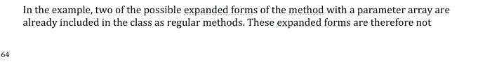

# C# 语言规范——ECMA-334，第 6 版，2022 年 6 月


## 前言

本规范取代 ECMA-334:2017。与上一版相比的更改包括以下内容的添加：

- 自动实现的属性初始值设定项
- `catch` 和 `finally` 块中的 `await`
- 异常过滤器
- 表达式体函数成员
- 集合初始值设定项中的扩展 Add 方法
- 改进的重载解析
- 可访问索引器的初始化
- 使用索引器初始化关联集合
- 插值字符串
- `nameof` 运算符
- 空条件访问运算符 `?.` 和 `?[]`
- 只读自动属性
- 自动属性的宽松规则
- `using static`

所有语法现在均使用 ANTLR 记法表示。

## 引言

本规范基于 Hewlett-Packard、Intel 和 Microsoft 提交的材料，该材料描述了一种名为 C# 的语言，该语言在 Microsoft 内部开发。该语言的主要发明者是 Anders Hejlsberg、Scott Wiltamuth 和 Peter Golde。C# 的第一个广泛分发的实现由 Microsoft 于 2000 年 7 月发布，作为其 .NET Framework 计划的一部分。

Ecma 技术委员会 39 (TC39) [后更名为 TC49] 工作组 2 (TG2) 成立于 2000 年 9 月，用于制定 C# 标准。另一个工作组 TG3 也在当时成立，用于制定一个名为通用语言基础结构 (CLI) 的库和执行环境的标准。(CLI 基于 .NET Framework 的子集。) 尽管 Microsoft 对 C# 的实现依赖于 CLI 进行库和运行时支持，但其他 C# 实现不必如此，只要它们支持获取本 C# 标准所需最低 CLI 功能的替代方法即可（参见附录 C）。

随着 C# 定义的演进，其设计中使用了以下目标：

- C# 旨在成为一种简单、现代、通用、面向对象的编程语言。
- 该语言及其实现应提供对软件工程原则的支持，例如强类型检查、数组边界检查、检测使用未初始化变量的尝试以及自动垃圾回收。软件的健壮性、持久性和程序员生产力很重要。
- 该语言旨在用于开发适合部署在分布式环境中的软件组件。
- 源代码可移植性非常重要，程序员可移植性也很重要，尤其是对于那些已经熟悉 C 和 C++ 的程序员。
- 国际化支持非常重要。
- C# 旨在适用于为托管系统和嵌入式系统编写应用程序，从使用复杂操作系统的非常大的系统到具有专用功能的非常小的系统。
- 尽管 C# 应用程序旨在在内存和处理能力需求方面经济高效，但该语言并不打算在性能和大小方面直接与 C 或汇编语言竞争。

名称 C# 的发音为“C Sharp”。

名称 C# 写成拉丁大写字母 C (U+0043) 后跟数字符号 # (U+0023)。

本 Ecma 标准由技术委员会 49 制定，并于 2022 年 6 月由大会通过。


## 1. 范围

本规范描述了形式并规定了用 C# 编程语言编写的程序的解释。它描述了

- C# 程序的表示；
- C# 语言的语法和约束；
- 解释 C# 程序的语义规则；
- C# 的符合规范实现所施加的限制和约束。

本规范未描述

- C# 程序被转换为供数据处理系统使用的方式；
- C# 应用程序被调用以供数据处理系统使用的方式；
- 输入数据被转换为供 C# 应用程序使用的方式；
- C# 应用程序产生输出数据后，输出数据被转换的方式；
- 程序及其数据的大小或复杂性超出任何特定数据处理系统或特定处理器的容量；
- 能够支持符合规范实现的数据处理系统的所有最低要求。

## 2. 规范性引用文件

下列规范性文件包含条款，通过本文档中的引用构成本规范的条款。对于有日期的引用，任何这些出版物的后续修订或版本均不适用。然而，基于本规范达成的协议的各方应鼓励调查在下面指出的规范性文件应用最新版本的可行性。对于无日期的引用，适用的为所引用规范性文件的最新版本。ISO 和 IEC 维护当前有效规范的登记册。

- ISO/IEC 23271:2012, *通用语言基础结构 (CLI)，第 IV 部分：基类库 (BCL)、扩展数值库和扩展数组库。*
- ISO 80000-2, *量和单位 — 第 2 部分：在自然科学和技术中使用的数学符号和符号。*
- ISO/IEC 2382, *信息技术 — 词汇。*
- ISO/IEC 60559:2020, *信息技术 — 微处理器系统 — 浮点运算。*
- Unicode 联盟。*Unicode 标准*，[https://www.unicode.org/standard/standard.html](https://www.unicode.org/standard/standard.html)。

- 3.10 **类库** — 可被其他程序集使用的程序集
- 3.11 **编译单元** — 输入到编译器的 Unicode 字符的有序序列
- 3.12 **诊断消息** — 属于实现输出消息的实现定义子集的消息
- 3.13 **错误，编译时** — 程序转换期间报告的错误
- 3.14 **异常** — 程序执行期间报告的异常情况
- 3.15 **实现** — 特定的软件集合（在特定翻译环境下运行并在特定控制选项下）对程序进行转换，并支持在特定执行环境中执行方法
- 3.16 **命名空间** — 将相关程序元素分组的逻辑组织系统
- 3.17 **参数** — 作为方法、实例构造函数、运算符或索引器定义的一部分而声明的变量，在进入该函数成员时获取值
- 3.18 **程序** — 一个或多个编译单元，它们被呈现给编译器并由执行环境运行或执行
- 3.19 **不安全代码** — 允许执行诸如声明和操作指针、在指针和整数类型之间进行转换以及获取变量地址等低级操作的代码
- 3.20 **警告，编译时** — 在程序转换期间报告的信息性消息，旨在识别程序元素的潜在可疑用法

## 5. 符合性

符合性对以下受众感兴趣：

- 设计、实现或维护 C# 实现的人员。
- 希望采购 C# 实现的政府或商业实体。
- 希望提供 C# 符合性测试套件的测试组织。
- 希望将代码从一个 C# 实现移植到另一个实现的程序员。
- 希望教授标准 C# 的教育工作者。
- 希望撰写关于标准 C# 的作者。

因此，符合性最为重要，本规范的大部分内容旨在规定使 C# 实现和 C# 程序成为符合规范的特征。

本规范中规定要求的文本被视为规范性文本。本规范中的所有其他文本均为资料性文本；即仅用于信息目的。除非另有说明，所有文本均为规范性文本。规范性文本进一步分为强制性和条件性类别。条件性规范性文本规定了可选功能及其要求。然而，如果提供了该功能，其语法和语义应完全如所述。

未定义行为在本规范中仅由词语‘未定义行为’表示。

严格符合的程序只能使用本规范中规定为必需的语言特性。（这意味着严格符合的程序不能使用任何条件性规范特性。）它不得产生依赖于任何未指定、未定义或实现定义行为的输出。

C# 的符合规范实现应接受任何严格符合的程序。

C# 的符合规范实现应提供并支持本规范中规范性（但非条件性规范性）部分所述的所有类型、值、对象、属性、方法以及程序语法和语义。

C# 的符合规范实现应根据 Unicode 标准解释字符。符合规范的实现应接受以 UTF-8 编码形式编码的编译单元。

C# 的符合规范实现不得成功转换包含 #error 预处理指令的源代码，除非它是条件编译跳过的组的一部分。

如果源程序违反任何语法规则，或任何否定性要求（定义为“应”或“不应”或“错误”或“警告”要求），C# 的符合规范实现应至少产生一条诊断消息，除非该要求标有“无需诊断”一词。

C# 的符合规范实现允许提供超出本规范所述的类型、值、对象、属性和方法，前提是它们不会改变任何严格符合程序的行为。符合规范的实现必须诊断使用根据本规范格式错误的扩展的程序。尽管如此，它们可以编译和执行此类程序。（具有扩展的能力意味着符合规范的实现不保留本规范中明确保留之外的任何标识符。）

C# 的符合规范实现应附带一份文件，定义所有实现定义特征和所有扩展。

C# 的符合规范实现应支持附录 C 中记录的类库。该库在本规范中通过引用包含在内。

*符合规范的程序* 是可被符合规范的实现接受的程序。（此类程序允许包含扩展或条件性规范特性。）

## 6. 词法结构

### 6.1 程序

C# 程序由一个或多个源文件组成，正式称为编译单元（§13.2）。尽管编译单元可能与文件系统中的文件一一对应，但这种对应关系不是必需的。

从概念上讲，程序的编译使用三个步骤：

- 1. 转换，将文件从特定字符集和编码方案转换为 Unicode 字符序列。
- 2. 词法分析，将 Unicode 输入字符流翻译成标记流。
- 3. 语法分析，将标记流翻译成可执行代码。

符合规范的实现应接受以 UTF-8 编码形式（由 Unicode 标准定义）编码的 Unicode 编译单元，并将其转换为 Unicode 字符序列。实现可以选择接受并转换额外的字符编码方案（如 UTF-16、UTF-32 或非 Unicode 字符映射）。

注：Unicode NULL 字符（U+0000）的处理是实现特定的。强烈建议开发人员出于可移植性和可读性的考虑，避免在源代码中使用此字符。当在字符或字符串文字中需要此字符时，可改用转义序列 \0 或 \u0000。

注：本标准超出范围定义使用非 Unicode 字符表示的文件如何转换为 Unicode 字符序列。然而，在此类转换期间，建议将其他字符集中通常的行分隔字符（或序列）翻译为由 Unicode 回车字符（U+000D）后跟 Unicode 换行字符（U+000A）组成的双字符序列。在大多数情况下，此转换不会产生可见效果；然而，它会影响逐字字符串文字标记（§6.4.5.6）的解释。此建议的目的是允许逐字字符串文字在其编译单元在支持不同非 Unicode 字符集的系统之间移动时产生相同的字符序列，特别是那些使用不同字符序列进行行分隔的系统。

### 6.2 语法

#### 6.2.1 通用

本规范使用两种语法来呈现 C# 编程语言的语法。词法语法（§6.2.3）定义了 Unicode 字符如何组合形成行终止符、空白、注释、标记和预处理指令。语法语法（§6.2.4）定义了词法语法产生的标记如何组合形成 C# 程序。

所有终结符字符应理解为范围 U+0020 到 U+007F 中的适当 Unicode 字符，而不是来自其他 Unicode 字符范围的任何外观相似的字符。


#### 6.2.2 语法表示法

词法和语法语法以 ANTLR 语法工具的扩展巴科斯-诺尔形式呈现。

虽然使用了 ANTLR 表示法，但本标准并未提供完整的适用于 ANTLR 的 C# “参考语法”；手工编写词法分析器和解析器，或使用 ANTLR 等工具编写，均超出语言规范的范围。在此前提下，本标准力求将所指定的语法与在 ANTLR 中构建词法分析器和解析器所需的语法之间的差距降到最低。

ANTLR 在其表示法中通过以下方式区分词法和语法（ANTLR 称之为 parser）语法：词法规则以大写字母开头，解析器规则以小写字母开头。

> *注意：* C# 词法语法 (§6.2.3) 和语法语法 (§6.2.4) 与 ANTLR 对词法和解析器语法的划分并不完全对应。这种细微的不匹配意味着在指定 C# 词法语法时使用了某些 ANTLR 解析器规则。*结束注释*

#### 6.2.3 词法语法

C# 的词法语法在 §6.3、§6.4 和 §6.5 中给出。词法语法的终结符是 Unicode 字符集的字符，词法语法规定字符如何组合形成标记 (§6.4)、空白 (§6.3.4)、注释 (§6.3.3) 和预处理指令 (§6.5)。

语法语法的许多终结符在词法语法中并未显式定义为标记。相反，利用了 ANTLR 的行为，即语法中的字面字符串会被提取为隐式词法标记；这使得关键字、运算符等可以在语法中以字面表示形式表示，而非标记名称。

C# 程序中的每个编译单元都必须符合词法语法 (§6.3.1) 的 *input* 产生式。

#### 6.2.4 语法语法

C# 的语法语法在随后本小节的条款、小条款和附录中给出。语法语法的终结符由词法语法显式定义的标记以及语法本身中字面字符串隐式定义的标记组成 (§6.2.3)。语法语法规定标记如何组合形成 C# 程序。

C# 程序中的每个编译单元都必须符合语法语法 (§13.2) 的 *compilation_unit* 产生式。

#### 6.2.5 语法歧义

*simple_name* (§11.7.4) 和 *member_access* (§11.7.6) 的产生式可能导致表达式语法中的歧义。

*示例：* 语句：

```
F(G<A, B>(7));
```

可以解释为对 F 的调用，带有两个参数 `G<A` 和 `B>(7)`。或者，也可以解释为对 F 的调用，带有一个参数，该参数是对泛型方法 G 的调用，具有两个类型参数和一个常规参数。

*结束示例*

如果一组标记在上下文中可以解析为以 *type_argument_list* (§8.4.2) 结尾的 *simple_name* (§11.7.4)、*member_access* (§11.7.6) 或 *pointer_member_access* (§22.6.3)，则检查紧跟在闭合 > 标记之后的标记。如果它是以下之一

```
    (   )   ]   :   ;   ,   .   ?   ==   !=
```

则 *type_argument_list* 保留为 *simple_name*、*member_access* 或 *pointer_member_access* 的一部分，并且该标记序列的任何其他可能解析将被丢弃。否则，即使该标记序列没有其他可能的解析，*type_argument_list* 也不会被视为 *simple_name*、*member_access* 或 *pointer_member_access* 的一部分。

> *注意：* 在解析 *namespace_or_type_name* (§7.8) 中的 *type_argument_list* 时不应用这些规则。*结束注释*

*示例：* 语句：

```
    F(G<A, B>(7));
```

根据此规则，将被解释为对 F 的调用，带有一个参数，该参数是对泛型方法 G 的调用，具有两个类型参数和一个常规参数。语句

```
    F(G<A, B>7);
    F(G<A, B>>7);
```

将被分别解释为对 F 的调用，带有两个参数。语句

```
    x = F<A> + y;
```

将被解释为小于运算符、大于运算符和一元加运算符，就好像语句写成 x = (F < A) > (+y) 一样，而不是作为带有 *type_argument_list* 后跟二元加运算符的 *simple_name*。在语句中

```
    x = y is C<T> && z;
```

标记 `<T>` 由于位于 is 运算符 (§11.11.1) 的右侧而被解释为带有 *type_argument_list* 的 *namespace_or_type_name*。因为 `C<T>` 解析为 *namespace_or_type_name*，而不是 *simple_name*、*member_access* 或 *pointer_member_access*，因此上述规则不适用，并且无论其后跟随的标记是什么，都被视为具有 *type_argument_list*。

*结束示例*

### 6.3 词法分析

#### 6.3.1 通用

为方便起见，词法语法定义并引用以下命名词法分析器标记：

```
    DEFAULT  : 'default' ;
    NULL     : 'null'    ;
    TRUE     : 'true'    ;
    FALSE    : 'false'   ;
    ASTERISK : '*'       ;
    SLASH    : '/'       ;
```

尽管这些是词法分析器规则，但这些名称拼写为全大写字母，以区别于普通词法分析器规则名称。

> *注意：* 这些便捷规则是对通常不为字面字符串定义的标记提供显式标记名称的做法的例外。*结束注释*

input 产生式定义了 C# 编译单元的词法结构。

```
input
  : input_section?
  ;

input_section
  : input_section_part+
  ;

input_section_part
  : input_element* New_Line
  | PP_Directive
  ;

input_element
  : Whitespace
  | Comment
  | token
  ;
```

> *注意：* 上述语法由 ANTLR 解析规则描述；它定义了 C# 编译单元的词法结构，而非词法标记。*结束注释*

C# 编译单元的词法结构由五个基本元素组成：行终止符 (§6.3.2)、空白 (§6.3.4)、注释 (§6.3.3)、标记 (§6.4) 和预处理指令 (§6.5)。在这些基本元素中，只有标记在 C# 程序的语法语法 (§6.2.4) 中才有意义。

C# 编译单元的词法处理包括将文件简化为标记序列，该序列成为语法分析的输入。行终止符、空白和注释可以用于分隔标记，预处理指令可以导致编译单元的某些部分被跳过，但除此之外，这些词法元素对 C# 程序的语法结构没有影响。

当词法语法的多个产生式匹配编译单元中的字符序列时，词法处理始终形成可能的最长词法元素。

*示例：* 字符序列 // 被处理为单行注释的开始，因为该词法元素比单个 / 标记更长。*结束示例*

一些标记由一组词法规则定义；一条主规则和一条或多条子规则。后者用 fragment 在语法中标记，表示该规则定义了另一个标记的一部分。Fragment 规则不考虑在词法规则的自上而下排序中。

> *注意：* 在 ANTLR 中，`fragment` 是一个关键字，其产生的行为与此处定义的行为相同。*结束注释*

#### 6.3.2 行终止符

行终止符将 C# 编译单元的字符划分为行。

```
New_Line
  : New_Line_Character
  | '\u000D\u000A'  // carriage return, line feed
  ;
```

为了与添加文件结束标记的源代码编辑工具兼容，并使编译单元能够被视为一系列正确终止的行，对 C# 程序中的每个编译单元按顺序应用以下转换：

- 如果编译单元的最后一个字符是 Control-Z 字符 (U+001A)，则删除该字符。
- 如果编译单元非空且编译单元的最后一个字符不是回车 (U+000D)、换行 (U+000A)、下一行字符 (U+0085)、行分隔符 (U+2028) 或段落分隔符 (U+2029)，则在编译单元末尾添加一个回车字符 (U+000D)。

> *注意：* 额外的回车允许程序以没有终止 *New_Line* 的 *PP_Directive* (§6.5) 结束。*结束注释*

#### 6.3.3 注释

支持两种形式的注释：定界注释和单行注释。

定界注释以字符 /* 开始，以字符 */ 结束。定界注释可以占据一行的一部分、单行或多行。

*示例：* 示例

```
/* Hello, world program
    This program writes "hello, world" to the console
*/
class Hello
{
    static void Main()
    {
        System.Console.WriteLine("hello, world");
    }
}
```

包含一个定界注释。

*结束示例*

单行注释以字符 // 开始并延伸到行尾。

*示例：* 示例

```
// Hello, world program
// This program writes "hello, world" to the console
//
class Hello // any name will do for this class
{
    static void Main() // this method must be named "Main"
    {
        System.Console.WriteLine("hello, world");
    }
}
```

显示了多个单行注释。

*结束示例*

```
Comment
  : Single_Line_Comment
```


| Delimited_Comment
;

fragment Single_Line_Comment
: '//' Input_Character*
;

fragment Input_Character
// anything but New_Line_Character
: ~('\u000D' | '\u000A' | '\u0085' | '\u2028' | '\u2029')
;

fragment New_Line_Character
: '\u000D' // carriage return
| '\u000A' // line feed
| '\u0085' // next line
| '\u2028' // line separator
| '\u2029' // paragraph separator
;

fragment Delimited_Comment
: '/*' Delimited_Comment_Section* ASTERISK+ '/'
;

fragment Delimited_Comment_Section
: SLASH
| ASTERISK* Not_Slash_Or_Asterisk
;

fragment Not_Slash_Or_Asterisk
: ~('/*' | '*')  // Any except SLASH or ASTERISK
;

Comments do not nest. The character sequences /* and */ have no special meaning within a single-line comment, and the character sequences // and /* have no special meaning within a delimited comment.

Comments are not processed within character and string literals.

Note: These rules must be interpreted carefully. For instance, in the example below, the delimited comment that begins before A ends between B and C(). The reason is that

```
// B * / C();
```

is not actually a single-line comment, since // has no special meaning within a delimited comment, and so */ does have its usual special meaning in that line.

Likewise, the delimited comment starting before D ends before E. The reason is that "D * / " is not actually a string literal, since it appears inside a delimited comment.

A useful consequence of /* and */ having no special meaning within a single-line comment is that a block of source code lines can be commented out by putting // at the beginning of each line. In general it does not work to put /* before those lines and */ after them, as this does not properly encapsulate delimited comments in the block, and in general may completely change the structure of such delimited comments.

Example code:

~~~
static void Main()
{
    /* A
    // B */ C();
    Console.WriteLine(/* "D */ "E");
}
~~~

*end note*

*单行注释* 和 *定界注释* 具有特定格式，可以用作 *文档注释*，如 §D 中所述。

#### 6.3.4 White space

White space is defined as any character with Unicode class Zs (which includes the space character) as well as the horizontal tab character, the vertical tab character, and the form feed character.

~~~
Whitespace
    : [\p{Zs}]  // any character with Unicode class Zs
    | '\u0009'  // horizontal tab
    | '\u000B'  // vertical tab
    | '\u000C'  // form feed
    ;
~~~

### 6.4 Tokens

#### 6.4.1 General

There are several kinds of *tokens*: identifiers, keywords, literals, operators, and punctuators. White space and comments are not tokens, though they act as separators for tokens.

~~~
token
    : identifier
    | keyword
    | Integer_Literal
    | Real_Literal
    | Character_Literal
    | String_Literal
    | operator_or_punctuator
    ;
~~~

*Note: This is an ANTLR parser rule, it does not define a lexical token but rather the collection of token kinds. end note*

#### 6.4.2 Unicode character escape sequences

A Unicode escape sequence represents a Unicode code point. Unicode escape sequences are processed in identifiers (§6.4.3), character literals (§6.4.5.5), regular string literals (§6.4.5.6), and interpolated regular string expressions (§11.7.3). A Unicode escape sequence is not processed in any other location (for example, to form an operator, punctuator, or keyword).

~~~
fragment Unicode_Escape_Sequence
    : '\\u' Hex_Digit Hex_Digit Hex_Digit Hex_Digit
    | '\\U' Hex_Digit Hex_Digit Hex_Digit Hex_Digit Hex_Digit Hex_Digit Hex_Digit
    Hex_Digit
    ;
~~~

A Unicode character escape sequence represents the single Unicode code point formed by the hexadecimal number following the "\u" or "\U" characters. Since C# uses a 16-bit encoding of Unicode code points in character and string values, a Unicode code point in the range U+10000 to U+10FFFF is represented using two Unicode surrogate code units. Unicode code points above U+FFFF are not permitted in character literals. Unicode code points above U+10FFFF are invalid and are not supported.

Multiple translations are not performed. For instance, the string literal "\u005Cu005C" is equivalent to "\u005C" rather than "\\".

> Note: The Unicode value \u005C is the character "\" . end note

Example: The example

```
class Class1
{
    static void Test(bool \u0066)
    {
        char c = '\u0066';
        if (\u0066)
        {
            System.Console.WriteLine(c.ToString());
        }
    }
}
```

shows several uses of \u0066, which is the escape sequence for the letter "f". The program is equivalent to

```
class Class1
{
    static void Test(bool f)
    {
        char c = 'f';
        if (f)
        {
            System.Console.WriteLine(c.ToString());
        }
    }
}
```

end example

#### 6.4.3 Identifiers

The rules for identifiers given in this subclause correspond exactly to those recommended by the Unicode Standard Annex 15 except that underscore is allowed as an initial character (as is traditional in the C programming language), Unicode escape sequences are permitted in identifiers, and the "@" character is allowed as a prefix to enable keywords to be used as identifiers.

identifier
: Simple_Identifier
| contextual_keyword
;

Simple_Identifier
: Available_Identifier
| Escaped_Identifier

```
fragment Available_Identifier
  : Basic_Identifier    // excluding keywords or contextual keywords, see note below
;
fragment Escaped_Identifier
  // Includes keywords and contextual keywords prefixed by '@'. See note below.
  : '@' Basic_Identifier
;
fragment Basic_Identifier
  : Identifier_Start_Character Identifier_Part_Character*
;
fragment Identifier_Start_Character
  : Letter_Character
  | Underscore_Character
;
fragment Underscore_Character
  : '_'    // underscore
  | '\\u005F' // Unicode_Escape_Sequence for underscore
;
fragment Identifier_Part_Character
  : Letter_Character
  | Decimal_Digit_Character
  | Connecting_Character
  | Combining_Character
  | Formatting_Character
;
fragment Letter_Character
  // Category Letter, all subcategories; category Number, subcategory letter.
  : [\\p{L}|\\p{Nl}]
  // Only escapes for categories L & Nl allowed. See note below.
  | Unicode_Escape_Sequence
;
fragment Combining_Character
  // Category Mark, subcategories non-spacing and spacing combining.
  : [\\p{Mn}\\p{Mc}]
  // Only escapes for categories Mn & Mc allowed. See note below.
  | Unicode_Escape_Sequence
;
fragment Decimal_Digit_Character
  // Category Number, subcategory decimal digit.
  : [\\p{Nd}]
  // Only escapes for category Nd allowed. See note below.
  | Unicode_Escape_Sequence
;
```

fragment Connecting_Character
// Category Punctuation, subcategory connector.
// [\p{Pc}]
// Only escapes for category Pc allowed. See note below.
| Unicode_Escape_Sequence
;

fragment Formatting_Character
// Category Other, subcategory format.
// [\p{Cf}]
// Only escapes for category Cf allowed, see note below.
| Unicode_Escape_Sequence
;

Note:

- For information on the Unicode character classes mentioned above, see *The Unicode Standard*.
- The fragment *Available_Identifier* requires the exclusion of keywords and contextual keywords. If the grammar in this Standard is processed with ANTLR then this exclusion is handled automatically by the semantics of ANTLR:
  - Keywords and contextual keywords occur in the grammar as literal strings.
  - ANTLR creates implicit lexical token rules are created from these literal strings.
  - ANTLR considers these implicit rules before the explicit lexical rules in the grammar.
  - Therefore fragment *Available_Identifier* will not match keywords or contextual keywords as the lexical rules for those precede it.
- Fragment *Escaped_Identifier* includes escaped keywords and contextual keywords as they are part of the longer token starting with an @ and lexical processing always forms the longest possible lexical element (§6.3.1).
- How an implementation enforces the restrictions on the allowable *Unicode_Escape_Sequence* values is an implementation issue.

end note

*Example:* Examples of valid identifiers are `identifier1`, `_identifier2`, and `@if`. end example

An identifier in a conforming program shall be in the canonical format defined by Unicode Normalization Form C, as defined by Unicode Standard Annex 15. The behavior when encountering an identifier not in Normalization Form C is implementation-defined; however, a diagnostic is not required.

The prefix "@" enables the use of keywords as identifiers, which is useful when interfacing with other programming languages. The character @ is not actually part of the identifier, so the identifier might be seen in other languages as a normal identifier, without the prefix. An identifier with an @ prefix is called a *verbatim identifier*.

*Note:* Use of the @ prefix for identifiers that are not keywords is permitted, but strongly discouraged as a matter of style. end note

*Example:* The example:

```
class @class
{
    public static void @static(bool @bool)
    {
```


```csharp
if (@bool)
{
    System.Console.WriteLine("true");
}
else
{
    System.Console.WriteLine("false");
}
}
}
class Class1
{
    static void M()
    {
        c1\u0061ss.st\u0061tic(true);
    }
}
```

定义了一个名为“class”的类，该类具有一个名为“static”的静态方法，该方法接受一个名为“bool”的参数。请注意，由于关键字中不允许使用 Unicode 转义，因此标记“c1\u0061ss”是一个标识符，并且与“@class”是同一个标识符。

*以及示例*

如果两个标识符按顺序应用以下转换后完全相同，则认为它们是同一个标识符：

- 如果使用了前缀“@”，则将其移除。
- 每个 *Unicode_Escape_Sequence* 都会转换为其对应的 Unicode 字符。
- 移除任何 *Formatting_Characters*。

包含两个连续下划线字符（U+005F）的标识符保留给实现使用；但是，如果定义了此类标识符，则不要求进行诊断。

> *注意：* 例如，实现可能会提供以两个下划线开头的扩展关键字。*注意结束*

#### 6.4.4 关键字

*关键字* 是一种类似标识符的字符序列，它是保留的，除非前面加上 @ 字符，否则不能用作标识符。

```text
keyword
       : 'abstract'  | 'as'        | 'base'       | 'bool'       | 'break'
       | 'byte'      | 'case'      | 'catch'      | 'char'       | 'checked'
       | 'class'     | 'const'     | 'continue'   | 'decimal'    | DEFAULT
       | 'delegate'  | 'do'        | 'double'     | 'else'       | 'enum'
       | 'event'     | 'explicit'  | 'extern'     | 'FALSE'      | 'finally'
       | 'fixed'     | 'float'     | 'for'        | 'foreach'    | 'goto'
       | 'if'        | 'implicit'  | 'in'         | 'int'        | 'interface'
       | 'internal'  | 'is'        | 'lock'       | 'long'       | 'namespace'
       | 'new'       | NULL        | 'object'     | 'operator'   | 'out'
       | 'override'  | 'params'    | 'private'    | 'protected'  | 'public'
       | 'readonly'  | 'ref'       | 'return'     | 'sbyte'      | 'sealed'
       | 'short'     | 'sizeof'    | 'stackalloc' | 'static'     | 'string'
| 'struct' | 'switch' | 'this' | 'throw' | TRUE
| 'try' | 'typeof' | 'uint' | 'ulong' | 'unchecked'
| 'unsafe' | 'ushort' | 'using' | 'virtual' | 'void'
| 'volatile' | 'while' |
;
```

**上下文关键字** 是一种类似标识符的字符序列，它在某些上下文中具有特殊含义，但不是保留的，并且可以在这些上下文之外以及前面加上 @ 字符时用作标识符。

```
contextual_keyword
: 'add' | 'alias' | 'ascending' | 'async' | 'await'
| 'by' | 'descending' | 'dynamic' | 'equals' | 'from'
| 'get' | 'global' | 'group' | 'into' | 'join'
| 'let' | 'nameof' | 'on' | 'orderby' | 'partial'
| 'remove' | 'select' | 'set' | 'value' | 'var'
| 'when' | 'where' | 'yield'
;
```

> *注意：* 规则 keyword 和 contextual_keyword 是解析器规则，因为它们不引入新的标记种类。所有关键字和上下文关键字都由隐式词法规则定义，因为它们在语法中以字面字符串形式出现（§6.2.3）。注意结束

在大多数情况下，上下文关键字的语法位置使其永远不会与普通标识符用法混淆。例如，在属性声明中，get 和 set 标识符具有特殊含义（§14.7.3）。在这些位置中，绝不允许使用 get 或 set 以外的标识符，因此这种用法不会与将这些词用作标识符的用法冲突。

在某些情况下，语法不足以区分上下文关键字用法与标识符。在所有此类情况下，将规定如何消除两者之间的歧义。例如，隐式类型局部变量声明（§12.6.2）中的上下文关键字 var 可能与名为 var 的已声明类型冲突，在这种情况下，已声明的名称优先于将该标识符用作上下文关键字。

另一个此类消歧示例是上下文关键字 await（§11.8.8.1），它仅在声明为 async 的方法内部被视为关键字，但可在其他地方用作标识符。

与关键字一样，上下文关键字可以通过在前面加上 @ 字符来用作普通标识符。

> *注意：* 当用作上下文关键字时，这些标识符不能包含 Unicode_Escape_Sequences。注意结束

#### 6.4.5 字面量

##### 6.4.5.1 概述

字面量（§11.7.2）是值的源代码表示形式。

```
literal
: boolean_literal
| integer_literal
| Real_literal
| Character_literal
| String_literal
| null_literal
;
```

> 注意：literal 是解析器规则，因为它对其他标记种类进行分组，并且不引入新的标记种类。注意结束

##### 6.4.5.2 布尔字面量

有两个布尔字面量值：true 和 false。

```
boolean_literal
    : TRUE
    | FALSE
    ;
```

> 注意：boolean_literal 是解析器规则，因为它对其他标记种类进行分组，并且不引入新的标记种类。注意结束

boolean_literal 的类型是 bool。

##### 6.4.5.3 整数字面量

整数字面量用于写入 int、uint、long 和 ulong 类型的值。整数字面量有两种可能的形式：十进制和十六进制。

```
Integer_Literal
    : Decimal_Integer_Literal
    | Hexadecimal_Integer_Literal
    ;

fragment Decimal_Integer_Literal
    : Decimal_Digit+ Integer_Type_Suffix?
    ;

fragment Decimal_Digit
    : '0'..'9'
    ;

fragment Integer_Type_Suffix
    : 'U' | 'u' | 'L' | 'l' | 'UL' | 'Ul' | 'uL' | 'ul' | 'LU' | 'Lu' | 'lU' | 'lu'
    ;

fragment Hexadecimal_Integer_Literal
    : ('0x' | '0X') Hex_Digit+ Integer_Type_Suffix?
    ;

fragment Hex_Digit
    : '0'..'9' | 'A'..'F' | 'a'..'f'
    ;
```

整数字面量的类型确定如下：

- 如果字面量没有后缀，则其类型为这些类型中第一个能够表示其值的类型：`int`、`uint`、`long`、`ulong`。
- 如果字面量带有 `U` 或 `u` 后缀，则其类型为这些类型中第一个能够表示其值的类型：`uint`、`ulong`。
- 如果字面量带有 `L` 或 `l` 后缀，则其类型为这些类型中第一个能够表示其值的类型：`long`、`ulong`。
- 如果字面量带有 `UL`、`Ul`、`uL`、`ul`、`LU`、`Lu`、`lU` 或 `lu` 后缀，则其类型为 `ulong`。

注意：因此，字面量 2.900m 将被解析为符号为 0、系数为 2900、标度为 3 的十进制数。注意结束

如果指定字面量的量值太大，无法在指示的类型中表示，则会发生编译时错误。

注意：特别是，Real_Literal 绝不会产生浮点无穷大。但是，非零 Real_Literal 可能会舍入为零。注意结束

类型为 float 或 double 的实数字面量的值通过使用 IEC 60559“舍入到最接近”模式确定，平局打破为“偶数”（最低有效位为零的值），并且所有数字都被视为有效。

注意：在实数字面量中，小数点后始终需要十进制数字。例如，1.3F 是实数字面量，但 1.F 不是。注意结束

##### 6.4.5.5 字符字面量

字符字面量表示单个字符，由引号中的字符组成，如 'a'。

```
Character_Literal
    : '\'' Character '\''
    ;

fragment Character
    : Single_Character
    | Simple_Escape_Sequence
    | Hexadecimal_Escape_Sequence
    | Unicode_Escape_Sequence
    ;

fragment Single_Character
    : ~['\\'\u000D\u000A\u0085\u2028\u2029]    // anything but ', \, and
New_Line_Character
    ;

fragment Simple_Escape_Sequence
    : '\\''' | '\\"' | '\\\\' | '\\0' | '\\a' | '\\b' | '\\f' | '\\n' | '\\r' |
    '\\t' | '\\v'
    ;

fragment Hexadecimal_Escape_Sequence
    : '\\x' Hex_Digit Hex_Digit? Hex_Digit? Hex_Digit?
    ;
```

注意：在 Character 中，反斜杠字符（\）后面的字符必须是以下字符之一：'、"、\、0、a、b、f、n、r、t、u、U、x、v。否则，会发生编译时错误。注意结束

注意：使用 \x Hexadecimal_Escape_Sequence 产生式可能容易出错且难以阅读，因为 \x 后面的十六进制数字数量可变。例如，在以下代码中：
string good = "\x9Good text";
string bad = "\x9Bad text";
乍看之下，两个字符串中的前导字符可能相同（U+0009，制表符）。实际上，第二个字符串以 U+9BAD 开头，因为单词“Bad”中的所有三个字母都是有效的十六进制数字。作为风格问题，建议避免使用 \x，而改用特定转义序列（本例中为 \t）或固定长度的 \u 转义序列。


*注释结束*

十六进制转义序列表示单个 Unicode UTF-16 代码单元，其值由跟随在 "\x" 之后的十六进制数构成。

如果字符字面量所表示的值大于 U+FFFF，则发生编译时错误。

字符字面量中的 Unicode 转义序列（§6.4.2）应位于 U+0000 到 U+FFFF 的范围内。

简单转义序列表示一个 Unicode 字符，如下表所述。

| 转义序列 | 字符名称 | Unicode 码位 |
| :--- | :--- | :--- |
| `\'` | 单引号 | U+0027 |
| `\"` | 双引号 | U+0022 |
| `\\` | 反斜杠 | U+005C |
| `\0` | 空字符 | U+0000 |
| `\a` | 警报 | U+0007 |
| `\b` | 退格 | U+0008 |
| `\f` | 换页 | U+000C |
| `\n` | 换行 | U+000A |
| `\r` | 回车 | U+000D |
| `\t` | 水平制表符 | U+0009 |
| `\v` | 垂直制表符 | U+000B |

*字符字面量* 的类型是 char。

##### 6.4.5.6 字符串字面量

C# 支持两种形式的字符串字面量：*常规字符串字面量* 和 *逐字字符串字面量*。常规字符串字面量由包含在双引号中的零个或多个字符组成，如 "hello"，并且可以同时包含简单转义序列（例如用于制表符的 \t）以及十六进制和 Unicode 转义序列。

逐字字符串字面量由一个 @ 字符后跟一个双引号字符、零个或多个字符以及一个结束双引号字符组成。

*示例*：一个简单的示例是 @"hello"。*示例结束*

在逐字字符串字面量中，分隔符之间的字符按原样解释，唯一例外是 *引号转义序列*，它表示一个双引号字符。特别地，简单转义序列以及十六进制和 Unicode 转义序列在逐字字符串字面量中不会被处理。逐字字符串字面量可以跨越多行。

```
String_Literal
    : Regular_String_Literal
    | Verbatim_String_Literal
    ;

fragment Regular_String_Literal
    : '"' Regular_String_Literal_Character* '"'
    ;
```

```
fragment Regular_String_Literal_Character
: Single_Regular_String_Literal_Character
| Simple_Escape_Sequence
| Hexadecimal_Escape_Sequence
| Unicode_Escape_Sequence
;

fragment Single_Regular_String_Literal_Character
: ~["\\u000D\u000A\u0085\u2028\u2029]   // anything but ", \, and
New_Line_Character
;

fragment Verbatim_String_Literal
: '@' Verbatim_String_Literal_Character* '"'
;

fragment Verbatim_String_Literal_Character
: Single_Verbatim_String_Literal_Character
| Quote_Escape_Sequence
;

fragment Single_Verbatim_String_Literal_Character
: ~["']   // anything but quotation mark (U+0022)
;

fragment Quote_Escape_Sequence
: '""'
;
```

## 示例：该示例

```
string a = "Happy birthday, Joel"; // Happy birthday, Joel
string b = @"Happy birthday, Joel"; // Happy birthday, Joel
string c = "hello \t world"; // hello world
string d = @"hello \t world"; // hello \t world
string e = "Joe said \"Hello\" to me"; // Joe said "Hello" to me
string f = @"Joe said ""Hello"" to me"; // Joe said "Hello" to me
string g = "\\\\server\\share\\file.txt"; // \\server\share\file.txt
string h = @"\\server\share\file.txt"; // \\server\share\file.txt
string i = "one\r\ntwo\r\nthree";
string j = @"one
two
three";
```

展示了各种字符串字面量。最后一个字符串字面量 j 是一个跨越多行的逐字字符串字面量。引号之间的字符（包括诸如换行字符之类的空白）按原样保留，并且每一对双引号字符都替换为一个这样的字符。

示例结束

注意：逐字字符串字面量中的任何换行都是结果字符串的一部分。如果用于构成换行的确切字符与应用程序在语义上相关，那么任何将源代码中的换行转换为不同格式（例如在 "\n" 和 "\r\n" 之间）的工具都将改变应用程序行为。开发人员在此类情况下应小心。注释结束

注意：由于十六进制转义序列可以具有可变数量的十六进制数字，字符串字面量 "\x123" 包含一个十六进制值为 123 的单个字符。要创建包含十六进制值为 12 的字符后跟字符 3 的字符串，可以改为写 "\x00123" 或 "\x12" + "3"。注释结束

String_Literal 的类型是 string。

每个字符串字面量不一定产生新的字符串实例。当两个或更多根据字符串相等运算符（§11.11.8）等价的字符串字面量出现在同一程序集中时，这些字符串字面量引用同一个字符串实例。

示例：例如，由以下代码产生的输出

```
class Test
{
    static void Main()
    {
        object a = "hello";
        object b = "hello";
        System.Console.WriteLine(a == b);
    }
}
```

为 True，因为这两个字面量引用同一个字符串实例。

示例结束

##### 6.4.5.7 空字面量

```
null_literal
    : NULL
    ;
```

注意：null_literal 是解析器规则，因为它不引入新的标记种类。注释结束

null_literal 表示 null 值。它没有类型，但可以通过空字面量转换（§10.2.7）转换为任何引用类型或可空值类型。

#### 6.4.6 运算符和标点符号

运算符和标点符号有若干种类。运算符用于表达式中，描述涉及一个或多个操作数的运算。

示例：表达式 a + b 使用 + 运算符将两个操作数 a 和 b 相加。示例结束

标点符号用于分组和分隔。

```
operator_or_punctuator
    : '{' | '}' | '[' | ']' | '(' | ')' | '.' | ',' | '::' | ';'
    | '+' | '-' | ASTERISK | SLASH | '%' | '&' | '|' | '~'
    | '=' | '<' | '>' | '?' | '??' | ':' | '++' | '--' | '&&' | '||'
    | '>=' | '==' | '!=' | '<=' | '>=' | '+=' | '-=' | '*=' | '/=' | '%='
    | '&=' | '^=' | '|'
    ;
```

```
right_shift
    : '>' '>'
    ;
```

```
right_shift_assignment
    : '>' '>='
    ;
```

注意：right_shift 和 right_shift_assignment 是解析器规则，因为它们不引入新的标记种类，而是表示两个标记的序列。operator_or_punctuator 规则仅用于描述目的，并不在语法中的其他地方使用。注释结束

right_shift 由两个标记 > 和 > 组成。类似地，right_shift_assignment 由两个标记 > 和 >= 组成。与句法语法中的其他产生式不同，在这些产生式的每一个中，两个标记之间不允许出现任何种类的字符（甚至空白）。这些产生式被特殊处理，以便能够正确处理 type_parameter_lists（§14.2.3）。

注意：在 C# 添加泛型之前，>> 和 >>= 都是单个标记。然而，泛型的语法使用 < 和 > 字符来分隔类型参数和类型实参。通常希望使用嵌套构造类型，例如 List<Dictionary<string, int>>。为了不要求程序员用空格分隔 > 和 >，这两个 operator_or_punctuator 的定义被更改了。注释结束

### 6.5 预处理指令

#### 6.5.1 总则

预处理指令提供了有条件地跳过编译单元各节、报告错误和警告条件以及描绘源代码不同区域的能力。

注意：术语“预处理指令”仅为了与 C 和 C++ 编程语言保持一致而使用。在 C# 中，没有单独的预处理步骤；预处理指令作为词法分析阶段的一部分进行处理。注释结束

```
PP_Directive
  : PP_Start PP_Kind PP_New_Line
  ;

fragment PP_Kind
  : PP_Declaration
  | PP_Conditional
  | PP_Line
  | PP_Diagnostic
  | PP_Region
  | PP_Pragma
  ;

// Only recognised at the beginning of a line
fragment PP_Start
  : { getCharPositionInLine() == 0 }? PP_Whitespace? '#' PP_Whitespace? // see note below
  ;

fragment PP_Whitespace
  : ( [p{Zs}]  // any character with Unicode class Zs
    | '\u0009' // horizontal tab
    | '\u000B' // vertical tab
    | '\u000C' // form feed
    )+
  ;
```


```csharp
#endif
}
```

生成与程序完全相同的标记序列

```csharp
class C
{
    void F() {}
    void I() {}
}
```

因此，虽然在词法上这两个程序截然不同，但在语法上它们是相同的。

*结束示例*

#### 6.5.2 条件编译符号

#if、#elif、#else 和 #endif 指令提供的条件编译功能通过预处理表达式（§6.5.3）和条件编译符号控制。

```csharp
fragment PP_Conditional_Symbol
    : Basic_Identifier // must not be equal to tokens TRUE or FALSE, see note below
    ;
```

*注意 如何实现强制执行对允许的 Basic_Identifier 值的限制是实现问题。结束注释*

如果在应用以下转换后两者相同，则认为两个条件编译符号相同，按顺序应用：

- 每个 Unicode_Escape_Sequence 转换为其对应的 Unicode 字符。
- 任何 Formatting_Characters 都被移除。

条件编译符号有两个可能的状态：已定义或未定义。在编译单元的词法处理开始时，条件编译符号未定义，除非它已被外部机制（如命令行编译器选项）显式定义。当处理 #define 指令时，该指令中命名的条件编译符号在该编译单元中变为已定义。该符号保持已定义状态，直到处理了针对同一符号的 #undef 指令，或直到到达编译单元的末尾为止。其含义是，一个编译单元中的 #define 和 #undef 指令对同一程序中的其他编译单元没有影响。

当在预处理表达式（§6.5.3）中引用时，已定义的条件编译符号具有布尔值 true，而未定义的条件编译符号具有布尔值 false。条件编译符号在预处理表达式中被引用之前无需显式声明。相反，未声明的符号 simply 未定义，因此其值为 false。

条件编译符号的命名空间与 C# 程序中的所有其他命名实体是独立且分开的。条件编译符号只能在 #define 和 #undef 指令以及预处理表达式中引用。

#### 6.5.3 预处理表达式

预处理表达式可以出现在 #if 和 #elif 指令中。运算符 !、==、!=、&& 和 || 在预处理表达式中允许使用，并且可以使用括号进行分组。

```csharp
fragment PP_Expression
    : PP_Whitespace? PP_Or_Expression PP_Whitespace?
    ;

fragment PP_Or_Expression
    : PP_And_Expression (PP_Whitespace? '||' PP_Whitespace? PP_And_Expression)*
    ;

fragment PP_And_Expression
    : PP_Equality_Expression (PP_Whitespace? '&&' PP_Whitespace?
      PP_Equality_Expression)*
    ;

fragment PP_Equality_Expression
    : PP_Unary_Expression (PP_Whitespace? ('==' | '!=') PP_Whitespace?
      PP_Unary_Expression)*
    ;

fragment PP_Unary_Expression
    : PP_Primary_Expression
    | '!' PP_Whitespace? PP_Unary_Expression
    ;

fragment PP_Primary_Expression
    : TRUE
    | FALSE
    | PP_Conditional_Symbol
    | '(' PP_Whitespace? PP_Expression PP_Whitespace? ')'
    ;
```

当在预处理表达式中引用时，已定义的条件编译符号具有布尔值 true，而未定义的条件编译符号具有布尔值 false。

预处理表达式的求值始终产生布尔值。预处理表达式的求值规则与常量表达式（§11.20）的规则相同，只是唯一可以引用的用户定义实体是条件编译符号。

#### 6.5.4 定义指令

定义指令用于定义或取消定义条件编译符号。

```csharp
fragment PP_Declaration
    : 'define' PP_Whitespace PP_Conditional_Symbol
    | 'undef' PP_Whitespace PP_Conditional_Symbol
    ;
```

处理 #define 指令会导致给定的条件编译符号从指令之后的源代码行开始变为已定义。同样，处理 #undef 指令会导致给定的条件编译符号从指令之后的源代码行开始变为未定义。

编译单元中的任何 #define 和 #undef 指令都必须出现在编译单元中的第一个标记（§6.4）之前；否则会发生编译时错误。直观地说，#define 和 #undef 指令必须先于编译单元中的任何“真实代码”。

*示例：* 示例：

```csharp
#define Enterprise
#if Professional || Enterprise
#define Advanced
#endif
namespace Megacorp.Data
{
#if Advanced
class PivotTable {...}
#endif
}
```

是有效的，因为 #define 指令先于编译单元中的第一个标记（namespace 关键字）。

结束示例

示例：以下示例导致编译时错误，因为 #define 出现在真实代码之后：

```csharp
#define A
namespace N
{
#define B
#if B
class Class1 {}
#endif
}
```

结束示例

#define 可以定义一个已经定义的条件编译符号，而无需对该符号进行 intervening #undef。

示例：下面的示例定义了条件编译符号 A，然后再次定义它。

```csharp
#define A
#define A
```

对于允许将条件编译符号作为编译选项定义的编译器，此类重新定义发生的另一种方式是同时将符号作为编译器选项和源代码中定义。

结束示例

#undef 可以“取消定义”一个未定义的条件编译符号。

示例：下面的示例定义了条件编译符号 A，然后两次取消定义它；尽管第二次 #undef 没有效果，但它仍然有效。

```csharp
#define A
#undef A
#undef A
```

结束示例

#### 6.5.5 条件编译指令

条件编译指令用于有条件地包含或排除编译单元的部分。

```csharp
fragment PP_Conditional
    : PP_If_Section
    | PP_Elif_Section
    | PP_Else_Section
    | PP_Endif
    ;

fragment PP_If_Section
    : 'if' PP_Whitespace PP_Expression
    ;

fragment PP_Elif_Section
    : 'elif' PP_Whitespace PP_Expression
    ;

fragment PP_Else_Section
    : 'else'
    ;

fragment PP_Endif
    : 'endif'
    ;
```

条件编译指令必须按顺序写成组，由 #if 指令、零个或多个 #elif 指令、零个或一个 #else 指令以及一个 #endif 指令组成。指令之间是源代码的条件部分。每个部分由紧邻其前面的指令控制。条件部分本身可以包含嵌套的条件编译指令，前提是这些指令形成完整的组。

*示例：* 以下示例说明了条件编译指令如何嵌套：

```csharp
#define Debug // Debugging on
#undef Trace // Tracing off
class PurchaseTransaction
{
    void Commit()
    {
#if Debug
        CheckConsistency();
#if Trace
        WriteToLog(this.ToString());
#endif
#endif
        CommitHelper();
    }
    ...
}
```

结束示例

最多一个包含的条件部分被选中进行正常的词法处理：

- #if 和 #elif 指令的 PP_Expressions 按顺序求值，直到有一个产生 true。如果表达式产生 true，则选择对应指令之后的 conditional 部分。
- 如果所有 PP_Expressions 都产生 false，并且存在 #else 指令，则选择 #else 指令之后的 conditional 部分。
- 否则，不选择任何 conditional 部分。

如果有选中的条件部分，则将其作为正常的 input_section 进行处理：该部分中包含的源代码必须符合词法语法；从该部分中的源代码生成标记；并且该部分中的预处理指令具有规定的效果。

任何剩余的条件部分都会被跳过，并且除了预处理指令的标记之外，不会从源代码中生成任何标记。因此，被跳过的源代码，除了预处理指令之外，可能在词法上不正确。被跳过的预处理指令在词法上必须正确，但不会被进一步处理。在正在被跳过的条件部分内，任何嵌套的条件部分（包含在嵌套的 #if...#endif 构造中）也会被跳过。

> 注意：上述语法并未涵盖条件部分在预处理指令之间可能在词法上格式错误的允许情况。因此该语法不是 ANTLR 就绪的，因为它仅支持词法正确的输入。结束注释

*示例：* 以下示例说明了条件编译指令如何嵌套：

```csharp
#define Debug // Debugging on
#undef Trace // Tracing off
class PurchaseTransaction
{
    void Commit()
    {
#if Debug
        CheckConsistency();
#if Trace
        WriteToLog(this.ToString());
#endif
#endif
        CommitHelper();
    }
    ...
}
```

除了预处理指令之外，被跳过的源代码不受词法分析的影响。例如，尽管 #else 部分中存在未终止的注释，但以下内容仍然有效：

```csharp
#define Debug // Debugging on
class PurchaseTransaction
{
    void Commit()
    {
#if Debug
        CheckConsistency();
#else  /* Do something else
#endif
    }
    ...
}
```

请注意，预处理指令即使在被跳过的源代码部分中也必须在词法上正确。

当预处理指令出现在多行输入元素内部时，不会对其进行处理。例如，该程序：

```
class Hello
{
    static void Main()
    {
        System.Console.WriteLine(@"hello,
#if Debug
world
#else
Nebraska
#endif
");
    }
}
```

结果为以下输出：

hello,
#if Debug
world
#else
Nebraska
#endif

在特殊情况下，所处理的预处理指令集可能取决于 pp_expression 的求值。示例：

```
#if X
/*
#else
/* */ class Q { }
#endif
```

无论是否定义了 X，总是产生相同的标记流（class Q { }）。如果定义了 X，由于多行注释，唯一处理的指令是 #if 和 #endif。如果未定义 X，则三条指令（#if、#else、#endif）属于指令集。

示例结束

#### 6.5.6 诊断指令

诊断指令用于显式生成错误和警告消息，这些消息的报告方式与其他编译时错误和警告相同。

```
fragment PP_Diagnostic
: 'error' PP_Message?
| 'warning' PP_Message?
;

fragment PP_Message
: PP_Whitespace Input_Character*
;
```

示例：以下示例

```
#if Debug && Retail
#error A build can't be both debug and retail
#endif
class Test {...}
```

```
fragment PP_Line_Indicator
  : Decimal_Digit+ PP_Whitespace PP_Compilation_Unit_Name
  | Decimal_Digit+
  | DEFAULT
  | 'hidden'
  ;

fragment PP_Compilation_Unit_Name
  : '"' PP_Compilation_Unit_Name_Character+ '"'
  ;

fragment PP_Compilation_Unit_Name_Character
  // Any Input_Character except "
  : ~('\u000D' | '\u000A' | '\u0085' | '\u2028' | '\u2029' | '#')
  ;
```

当不存在 #line 指令时，编译器在其输出中报告真实行号和编译单元名称。当处理包含非 default 的 Line_Indicator 的 #line 指令时，编译器将该指令之后的行视为具有给定的行号（以及编译单元名称，如果指定）。

A #line default 指令撤销所有先前 #line 指令的效果。编译器为后续行报告真实行信息，就像未处理过任何 #line 指令一样。

A #line hidden 指令对编译单元以及错误消息中报告的行号或通过使用 CallerLineNumberAttribute（§21.5.5.2）产生的行号没有影响。它旨在影响源代码级调试工具，以便在调试时，#line hidden 指令与后续 #line 指令（不是 #line hidden）之间的所有行都没有行号信息，并且在单步执行代码时完全跳过。

> 注意：虽然 Compilation_Unit_Name 可能包含看起来像转义序列的文本，但此类文本不是转义序列；在此上下文中，'\' 字符仅表示普通的反斜杠字符。注意结束

#### 6.5.9 Pragma 指令

The #pragma 预处理指令用于向编译器指定上下文信息。

注意：例如，编译器可能提供 #pragma 指令，以便

- 在编译后续代码时启用或禁用特定警告消息。
- 指定要应用于后续代码的优化。
- 指定供调试器使用的信息。

注意结束

```
fragment PP_Pragma
  : 'pragma' PP_Pragma_Text?
  ;

fragment PP_Pragma_Text
  : PP_Whitespace Input_Character*
  ;
```

*PP_Pragma_Text* 中的 *Input_Characters* 由编译器以实现定义的方式解释。`#pragma` 指令中提供的信息不得改变程序语义。`#pragma` 指令只能改变编译器行为，且该行为超出本语言规范的范围。如果编译器无法解释 *Input_Characters*，编译器可以产生警告；但是，它不得产生编译时错误。

*注意：* *PP_Pragma_Text* 可以包含任意文本；具体来说，它不必包含格式良好的标记。*注意结束*

## 7. 基本概念

### 7.1 应用程序启动

程序可以编译为*类库*，以用作其他应用程序的一部分，也可以编译为可直接启动的*应用程序*。确定这种编译模式的机制是实现特定的，并且在本规范之外。

编译为应用程序的程序应至少包含一个符合入口点条件的方法，满足以下要求：

- 它应具有名称 `Main`。
- 它应为 `static`。
- 它不应为泛型。
- 它应声明在非泛型类型中。如果声明该方法的类型是嵌套类型，则其任何封闭类型都不得为泛型。
- 它不应具有 `async` 修饰符。
- 返回类型应为 `void` 或 `int`。
- 它不应是没有实现的分部方法（§14.6.9）。
- 形参列表应为空，或者具有一个类型为 `string[]` 的值参数。

如果在一个程序中声明了多个符合入口点条件的方法，则可以使用外部机制来指定哪个方法被视为应用程序的实际入口点。程序编译为应用程序时如果没有恰好一个入口点，则是编译时错误。编译为类库的程序可以包含符合应用程序入口点条件的方法，但生成的库没有入口点。

通常，方法的声明可访问性（§7.5.2）由其声明中指定的访问修饰符（§14.3.6）确定，类似地，类型的声明可访问性由其声明中指定的访问修饰符确定。为了使给定类型的给定方法可调用，该类型和该成员都必须可访问。但是，应用程序入口点是特殊情况。具体来说，执行环境可以访问应用程序的入口点，而不管其声明的可访问性如何，也不管其封闭类型声明的可访问性如何。

当应用程序运行时，会创建一个新的*应用程序域*。应用程序的多个不同实例可以同时存在于同一台机器上，并且每个实例都有自己的应用程序域。应用程序域通过充当应用程序状态的容器来实现应用程序隔离。应用程序域充当应用程序中定义的类型及其使用的类库的容器和边界。加载到一个应用程序域中的类型与加载到另一个应用程序域中的相同类型不同，并且对象的实例不会在应用程序域之间直接共享。例如，每个应用程序域都有这些类型的静态变量的自己的副本，并且类型的静态构造函数在每个应用程序域中最多运行一次。实现可以自由地提供实现特定的策略或机制来创建和销毁应用程序域。

应用程序启动发生在执行环境调用应用程序的入口点时。如果入口点声明了参数，则在应用程序启动期间，实现应确保该参数的初始值是对字符串数组的非空引用。此数组应由对字符串的非空引用组成，这些字符串称为应用程序参数，由宿主环境在应用程序启动之前赋予实现定义的值。其目的是向应用程序提供在应用程序启动之前从宿主环境中的其他地方确定的信息。

> *注意：* 在支持命令行的系统上，应用程序参数对应于通常称为命令行参数的内容。*注意结束*

如果入口点的返回类型是 int 而不是 void，则执行环境调用方法时的返回值用于应用程序终止（§7.2）。

除上述情况外，入口点方法在所有方面都像非入口点方法一样。特别是，如果在应用程序生存期内的任何其他点调用入口点，例如通过常规方法调用，则没有对该方法的特殊处理：如果有参数，它可能具有 null 的初始值，或者引用包含 null 引用的数组的非 null 值。同样，入口点的返回值除了在执行环境调用时之外没有特殊意义。

### 7.2 应用程序终止

*应用程序终止*将控制权返回给执行环境。

如果应用程序入口点方法的返回类型是 int，则返回的值用作应用程序的*终止状态代码*。此代码的目的是允许将成功或失败传达给执行环境。

如果入口点方法的返回类型是 void，则到达终止该方法的右大括号（}），或执行没有表达式的 return 语句，将导致终止状态代码为 0。如果入口点方法因异常（§20.4）而终止，则退出代码是实现特定的。此外，实现可以提供用于指定退出代码的替代 API。

终结器（§14.13）是否作为应用程序终止的一部分运行是实现特定的。

> *注意：* .NET Framework 实现尽一切合理努力为其所有尚未被垃圾回收的对象调用终结器（§14.13），除非此类清理已被抑制（例如，通过调用库方法 GC.SuppressFinalize）。*注意结束*

### 7.3 声明

C# 程序中的声明定义程序的构成元素。C# 程序使用命名空间进行组织。这些通过命名空间声明（§13）引入，命名空间声明可以包含类型声明和嵌套命名空间声明。类型声明（§13.7）用于定义类（§14）、结构（§15）、接口（§17）、枚举（§18）和委托（§19）。类型声明中允许的成员种类取决于类型声明的形式。例如，类声明可以包含常量（§14.4）、字段（§14.5）、方法（§14.6）、属性（§14.7）、事件（§14.8）、索引器（§14.9）、运算符（§14.10）、实例构造函数（§14.11）、静态构造函数（§14.12）、终结器（§14.13）和嵌套类型（§14.3.9）的声明。

声明在其所属的*声明空间*中定义名称。在声明空间中引入具有相同名称的成员的两个或多个声明是编译时错误，以下情况除外：

- 在同一个声明空间中，允许存在两个或更多具有相同名称的命名空间声明。此类命名空间声明会聚合形成单个逻辑命名空间，并共享同一个声明空间。
- 在不同程序中但在同一个命名空间声明空间中的声明，允许共享相同的名称。
  注意：但是，如果这些声明包含在同一个应用程序中，则可能引入歧义。
  注释结束
- 在同一个声明空间中，允许存在两个或更多具有相同名称但签名不同的方法（§7.6）。
- 在同一个声明空间中，允许存在两个或更多具有相同名称但类型参数数目不同的类型声明（§7.8.2）。
- 在同一个声明空间中，具有 partial 修饰符的两个或更多类型声明可以共享相同的名称、相同的类型参数数目和相同的分类（class、struct 或 interface）。在这种情况下，这些类型声明共同构成一个类型，并聚合形成单个声明空间（§14.2.7）。
- 在同一个声明空间中，命名空间声明和类型声明可以共享相同的名称，只要该类型声明至少有一个类型参数（§7.8.2）。

如下所述，声明空间有几种不同的类型。

- 在程序的所有编译单元中，没有包含在 namespace_declaration 中的 namespace_member_declarations 是名为全局声明空间的单个组合声明空间的成员。
- 在程序的所有编译单元中，位于具有相同完全限定命名空间名称的 namespace_declarations 内的 namespace_member_declarations 是单个组合声明空间的成员。
- 每个 compilation_unit 和 namespace_body 都有一个别名声明空间。compilation_unit 或 namespace_body 的每个 extern_alias_directive 和 using_alias_directive 都向别名声明空间贡献一个成员（§13.5.2）。
- 每个非 partial 的 class、struct 或 interface 声明都会创建一个新的声明空间。每个 partial 的 class、struct 或 interface 声明都会向由同一程序中所有匹配部分共享的声明空间贡献内容（§15.2.3）。名称通过 class_member_declarations、struct_member_declarations、interface_member_declarations 或 type_parameters 引入到此声明空间。除重载的实例构造函数声明和静态构造函数声明外，class 或 struct 不能包含与 class 或 struct 同名的成员声明。class、struct 或 interface 允许声明重载的方法和索引器。此外，class 或 struct 允许声明重载的实例构造函数和运算符。例如，class、struct 或 interface 可以包含多个同名的方法声明，只要这些方法声明的签名不同（§7.6）。请注意，基类不会向 class 的声明空间贡献成员，基接口也不会向 interface 的声明空间贡献成员。因此，允许派生类或派生接口声明与继承成员同名的成员。这样的成员称为隐藏了继承成员。
- 每个 delegate 声明都会创建一个新的声明空间。名称通过形参（fixed_parameters 和 parameter_arrays）和 type_parameters 引入到此声明空间。
- 每个枚举声明都会创建一个新的声明空间。名称通过 enum_member_declarations 引入到此声明空间。
- 每个方法声明、属性声明、属性访问器声明、索引器声明、索引器访问器声明、运算符声明、实例构造函数声明和匿名函数都会创建一个称为局部变量声明空间的新声明空间。名称通过形参（fixed_parameters 和 parameter_arrays）和 type_parameters 引入到此声明空间。属性或索引器的 set 访问器将名为 value 的形参引入。函数成员或匿名函数的主体（如果有）被视为嵌套在局部变量声明空间内。如果局部变量声明空间与其嵌套的局部变量声明空间包含同名元素，则是错误的。因此，在嵌套声明空间中，不能声明与外部声明空间中的局部变量或常量同名的局部变量或常量。只要两个声明空间互不包含，它们就可以包含同名元素。
- 每个 block 或 switch_block，以及 for、foreach 和 using 语句，都会为局部变量和局部常量创建一个局部变量声明空间。名称通过 local_variable_declarations 和 local_constant_declarations 引入到此声明空间。请注意，作为函数成员或匿名函数的主体出现或位于其主体内的 block，嵌套在这些函数为其参数声明的局部变量声明空间内。因此，例如，一个方法的局部变量和参数同名是错误的。
- 每个 block 或 switch_block 都会为标签创建一个单独的声明空间。名称通过 labeled_statements 引入到此声明空间，并通过 goto_statements 引用这些名称。block 的标签声明空间包含任何嵌套的 block。因此，在嵌套 block 内，不能声明与外部 block 中的标签同名的标签。

名称声明的文本顺序通常无关紧要。特别是，对于命名空间、常量、方法、属性、事件、索引器、运算符、实例构造函数、终结器、静态构造函数和类型的声明和使用，文本顺序并不重要。声明顺序在以下方面具有重要意义：

- 字段声明的声明顺序决定了其初始化器（如果有）的执行顺序（§14.5.6.2、§14.5.6.3）。
- 局部变量必须先定义后使用（§7.7）。
- 当省略 constant_expression 值时，枚举成员声明（§18.4）的声明顺序很重要。

示例：命名空间的声明空间是“开放”的，两个具有相同完全限定名称的命名空间声明会贡献到同一个声明空间。例如

```
namespace Megacorp.Data
{
    class Customer
    {
        ...
    }
}

namespace Megacorp.Data
{
    class Order
    {
        ...
    }
}
```

上面的两个命名空间声明贡献到同一个声明空间，在本例中声明了两个类，其完全限定名分别为 `Megacorp.Data.Customer` 和 `Megacorp.Data.Order`。由于这两个声明贡献到同一个声明空间，如果每个声明中都包含一个同名类的声明，则会导致编译时错误。

*示例结束*

*注意：* 如上所述，block 的声明空间包含任何嵌套的 block。因此，在下面的示例中，F 和 G 方法会导致编译时错误，因为名称 i 在外部 block 中声明，不能在内部 block 中重新声明。但是，H 和 I 方法是有效的，因为两个 i 是在互不嵌套的 block 中声明的。

```csharp
class A
{
    void F()
    {
        int i = 0;
        if (true)
        {
            int i = 1;
        }
    }

    void G()
    {
        if (true)
        {
            int i = 0;
        }
        int i = 1;
    }

    void H()
    {
        if (true)
        {
            int i = 0;
        }
        if (true)
        {
            int i = 1;
        }
    }

    void I()
    {
        for (int i = 0; i < 10; i++)
        {
            H();
        }
    }
}
```


```
for (int i = 0; i < 10; i++)
{
    H();
}
}
```

结束注释

## 7.4 成员

### 7.4.1 概述

命名空间和类型具有成员。

> 注意：实体的成员通常可通过使用限定名来访问，该限定名以对实体的引用开头，后跟一个“.”标记，再后跟成员名称。
> 结束注释

类型的成员要么在该类型声明中声明，要么从该类型的基类继承。当一个类型从基类继承时，基类的所有成员（实例构造函数、终结器和静态构造函数除外）都成为派生类型的成员。基类成员的声明可访问性并不控制该成员是否被继承——继承扩展到任何不是实例构造函数、静态构造函数或终结器的成员。

> 注意：但是，继承的成员在派生类型中可能不可访问，例如由于其声明可访问性（§7.5.2）。结束注释

### 7.4.2 命名空间成员

没有外围命名空间的命名空间和类型是全局命名空间的成员。这直接对应于在全局声明空间中声明的名称。

在某个命名空间内声明的命名空间和类型是该命名空间的成员。这直接对应于在该命名空间的声明空间中声明的名称。

命名空间没有访问限制。不能声明私有、受保护或内部命名空间，并且命名空间名称始终可公开访问。

### 7.4.3 结构体成员

结构体的成员是在该结构体中声明的成员，以及从该结构体的直接基类 System.ValueType 和间接基类 object 继承的成员。

简单类型的成员直接对应于该简单类型所别名的结构体类型的成员（§8.3.5）。

### 7.4.4 枚举成员

枚举的成员是在该枚举中声明的常量，以及从该枚举的直接基类 System.Enum 和间接基类 System.ValueType 和 object 继承的成员。

### 7.4.5 类成员

类的成员是在该类中声明的成员，以及从基类继承的成员（类 object 除外，它没有基类）。从基类继承的成员包括基类的常量、字段、方法、属性、事件、索引器、运算符和类型，但不包括基类的实例构造函数、终结器和静态构造函数。基类成员被继承时，不考虑其可访问性。

类声明可以包含常量、字段、方法、属性、事件、索引器、运算符、实例构造函数、终结器、静态构造函数和类型的声明。

object（§8.2.3）和 string（§8.2.5）的成员直接对应于它们所别名的类类型的成员。

### 7.4.6 接口成员

接口的成员是在该接口中以及该接口的所有基接口中声明的成员。

注意：严格来说，类 object 中的成员不是任何接口的成员（§17.4）。但是，类 object 中的成员可通过任何接口类型中的成员查找来使用（§11.5）。结束注释

### 7.4.7 数组成员

数组的成员是从类 System.Array 继承的成员。

### 7.4.8 委托成员

委托从类 System.Delegate 继承成员。此外，它还包含一个名为 Invoke 的方法，该方法具有其声明中指定的相同返回类型和形参列表（§19.2）。对此方法的调用应与对同一委托实例的委托调用（§19.6）行为完全相同。

实现可以通过继承或直接在委托本身中提供附加成员。

## 7.5 成员访问

### 7.5.1 概述

成员声明允许控制成员访问。成员的可访问性由该成员的声明可访问性（§7.5.2）与直接包含该成员的类型（如果有）的可访问性共同确定。

当允许访问特定成员时，称该成员可访问。相反，当不允许访问特定成员时，称该成员不可访问。当访问所在的文本位置包含在该成员的可访问域（§7.5.3）中时，允许访问该成员。

### 7.5.2 声明可访问性

成员的声明可访问性可以是以下之一：

- 公共（Public），通过在成员声明中包含 public 修饰符来选择。public 的直观含义是“访问不受限制”。
- 受保护（Protected），通过在成员声明中包含 *protected* 修饰符来选择。*protected* 的直观含义是“访问限于包含类或从包含类派生的类型”。
- 内部（Internal），通过在成员声明中包含 *internal* 修饰符来选择。*internal* 的直观含义是“访问限于此程序集”。
- 受保护的内部（Protected internal），通过在成员声明中同时包含 *protected* 和 *internal* 修饰符来选择。*protected internal* 的直观含义是“可在此程序集内以及从包含类派生的类型中访问”。
- 私有（Private），通过在成员声明中包含 *private* 修饰符来选择。*private* 的直观含义是“访问限于包含类型”。

根据成员声明所在的上下文，仅允许某些类型的声明可访问性。此外，当成员声明不包含任何访问修饰符时，声明所在的上下文决定默认声明可访问性。

- 命名空间隐式具有 *public* 声明可访问性。命名空间声明上不允许使用访问修饰符。
- 直接在编译单元或命名空间中声明的类型（而不是在其他类型内声明）可以具有 *public* 或 *internal* 声明可访问性，并默认为 *internal* 声明可访问性。
- 类成员可以具有五种声明可访问性中的任何一种，并默认为 *private* 声明可访问性。
  *注意：* 作为类成员声明的类型可以具有五种声明可访问性中的任何一种，而作为命名空间成员声明的类型只能具有 *public* 或 *internal* 声明可访问性。 *结束注释*
- 结构体成员可以具有 *public*、*internal* 或 *private* 声明可访问性，并默认为 *private* 声明可访问性，因为结构体是隐式密封的。在结构体中引入的（即不是由该结构体继承的）结构体成员不能具有 *protected* 或 *protected internal* 声明可访问性。
  *注意：* 作为结构体成员声明的类型可以具有 *public*、*internal* 或 *private* 声明可访问性，而作为命名空间成员声明的类型只能具有 *public* 或 *internal* 声明可访问性。 *结束注释*
- 接口成员隐式具有 *public* 声明可访问性。接口成员声明上不允许使用访问修饰符。
- 枚举成员隐式具有 *public* 声明可访问性。枚举成员声明上不允许使用访问修饰符。

### 7.5.3 可访问域

成员的*可访问域*由允许访问该成员的程序文本的（可能不连续的）节组成。为了定义成员的可访问域，如果成员未在某个类型内声明，则称该成员为*顶层*成员；如果成员在另一个类型内声明，则称该成员为*嵌套*成员。此外，程序的*程序文本*定义为该程序所有编译单元中包含的所有文本，而类型的程序文本定义为该类型的*类型声明*中包含的所有文本（可能包括嵌套在该类型中的类型）。

预定义类型（如 `object`、`int` 或 `double`）的可访问域不受限制。


顶层非绑定类型 T (§8.4.4) 在程序 P 中声明的可访问性域定义如下：

- 如果 T 的声明可访问性为 public，则 T 的可访问性域为 P 的程序文本以及引用 P 的任何程序。
- 如果 T 的声明可访问性为 internal，则 T 的可访问性域为 P 的程序文本。

*注意：从这些定义可以得出，顶层非绑定类型的可访问性域始终至少为声明该类型的程序的程序文本。结束注释*

构造类型 T<A1, ..., An> 的可访问性域是未绑定泛型类型 T 的可访问性域与类型参数 A1, ..., An 的可访问性域的交集。

在程序 P 内的类型 T 中声明的嵌套成员 M 的可访问性域定义如下（注意 M 本身可能是一个类型）：

- 如果 M 的声明可访问性为 public，则 M 的可访问性域为 T 的可访问性域。
- 如果 M 的声明可访问性为 protected internal，则令 D 为 P 的程序文本与在 P 外声明的从 T 派生的任何类型的程序文本的并集。M 的可访问性域是 T 的可访问性域与 D 的交集。
- 如果 M 的声明可访问性为 protected，则令 D 为 T 的程序文本与从 T 派生的任何类型的程序文本的并集。M 的可访问性域是 T 的可访问性域与 D 的交集。
- 如果 M 的声明可访问性为 internal，则 M 的可访问性域是 T 的可访问性域与 P 的程序文本的交集。
- 如果 M 的声明可访问性为 private，则 M 的可访问性域为 T 的程序文本。

*注意：从这些定义可以得出，嵌套成员的可访问性域始终至少为声明该成员的类型的程序文本。此外，可以得出成员的可访问性域永远不会比声明该成员的类型的可访问性域更宽泛。结束注释*

*注意：在直观意义上，当访问类型或成员 M 时，会评估以下步骤以确保访问被允许：*

- 首先，如果 M 在类型内声明（而不是编译单元或命名空间），如果该类型不可访问，则会发生编译时错误。
- 然后，如果 M 为 public，则允许访问。
- 否则，如果 M 为 protected internal，则如果访问发生在 M 声明所在的程序内，或如果访问发生在从 M 声明的类派生的类内并且通过派生类类型进行（§7.5.4），则允许访问。
- 否则，如果 M 为 protected，则如果访问发生在 M 声明所在的类内，或如果访问发生在从 M 声明的类派生的类内并且通过派生类类型进行（§7.5.4），则允许访问。
- 否则，如果 M 为 internal，则如果访问发生在 M 声明所在的程序内，则允许访问。
- 否则，如果 M 为 private，则如果访问发生在 M 声明所在的类内，则允许访问。
- 否则，类型或成员不可访问，并发生编译时错误。 *结束注释*

*示例：* 在以下代码中

```
    public class A
    {
        public static int X;
        internal static int Y;
        private static int Z;
    }

    internal class B
    {
        public static int X;
        internal static int Y;
        private static int Z;

        public class C
        {
            public static int X;
            internal static int Y;
            private static int Z;
        }

        private class D
        {
            public static int X;
            internal static int Y;
            private static int Z;
        }
    }
```

这些类和成员具有以下可访问性域：

- A 和 A.X 的可访问性域是无限制的。
- A.Y、B、B.X、B.Y、B.C、B.C.X 和 B.C.Y 的可访问性域为包含程序的程序文本。
- A.Z 的可访问性域为 A 的程序文本。
- B.Z 和 B.D 的可访问性域为 B 的程序文本，包括 B.C 和 B.D 的程序文本。
- B.C.Z 的可访问性域为 B.C 的程序文本。
- B.D.X 和 B.D.Y 的可访问性域为 B 的程序文本，包括 B.C 和 B.D 的程序文本。
- B.D.Z 的可访问性域为 B.D 的程序文本。如示例所示，成员的可访问性域永远不会大于包含类型的可访问性域。例如，尽管所有 X 成员的声明可访问性均为 public，但除 A.X 外，其余的都具有受包含类型限制的可访问性域。

*结束示例*

如 §7.4 中所述，除实例构造函数、终结器和静态构造函数外，基类的所有成员都将被派生类型继承。这甚至包括基类的私有成员。然而，私有成员的可访问性域仅包括声明该成员的类型的程序文本。

*示例：* 在以下代码中

```
class A
{
    int x;
    static void F(B b)
    {
        b.x = 1;        // Ok
    }
}

class B : A
{
    static void F(B b)
    {
        b.x = 1;        // Error, x not accessible
    }
}
```

B 类从 A 类继承私有成员 x。由于该成员为私有，它只能在 A 的 class_body 内访问。因此，对 b.x 的访问在 A.F 方法中成功，但在 B.F 方法中失败。

结束示例

## 7.5.4 受保护访问

当在声明它的类的程序文本之外访问受保护的实例成员时，以及当在声明它的程序的程序文本之外访问受保护的内部实例成员时，访问必须在从声明它的类派生的类声明内进行。此外，访问必须通过该派生类类型或从其构造的类类型的实例进行。此限制防止一个派生类访问其他派生类的受保护成员，即使这些成员是从同一个基类继承的。

设 B 为声明受保护实例成员 M 的基类，设 D 为从 B 派生的类。在 D 的 class_body 内，对 M 的访问可以采用以下形式之一：

- 未限定的 type_name 或形式为 M 的 primary_expression。
- 形式为 E.M 的 primary_expression，前提是 E 的类型为 T 或从 T 派生的类，其中 T 为类 D，或从 D 构造的类类型。
- 形式为 base.M 的 primary_expression。
- 形式为 base[argument_list] 的 primary_expression。

除这些访问形式外，派生类可以在 constructor_initializer (§14.11.2) 中访问基类的受保护实例构造函数。

*示例：* 在以下代码中

```
public class A
{
    protected int x;
    static void F(A a, B b)
    {
        a.x = 1; // Ok
        b.x = 1; // Ok
    }
}

public class B : A
{
    static void F(A a, B b)
    {
        a.x = 1; // Error, must access through instance of B
        b.x = 1; // Ok
    }
}
```

在 A 内，可以通过 A 和 B 的实例访问 x，因为在任何一种情况下，访问都是通过 A 的实例或从 A 派生的类的实例进行的。然而，在 B 内，不可能通过 A 的实例访问 x，因为 A 并未从 B 派生。

*结束示例*

示例：

```
class C<T>
{
    protected T x;
}

class D<T> : C<T>
{
    static void F()
    {
        D<T> dt = new D<T>();
        D<int> di = new D<int>();
        D<string> ds = new D<string>();
        dt.x = default(T);
        di.x = 123;
        ds.x = "test";
    }
}
```

这里，对 x 的三次赋值是被允许的，因为它们都通过从泛型类型构造的类类型的实例进行。

*结束示例*

注意：在泛型类中声明的受保护成员的可访问性域（§7.5.3）包括从该泛型类构造的任何类型派生的所有类声明的程序文本。在示例中：

```
class C<T>
{
    protected static T x;
```


```
}
class D : C<string>
{
    static void Main()
    {
        C<int>.x = 5;
    }
}
```

对受保护成员 C<int>.x 在 D 中的引用是有效的，即使类 D 派生自 C<string>。 end note

### 7.5.5 可访问性约束

C# 语言中的若干构造要求类型至少与成员或其他类型一样可访问。

A type T 被认为至少与成员或类型 M 一样可访问，如果 T 的可访问性域是 M 的可访问性域的超集。换句话说，如果 T 在 M 可访问的所有上下文中都可访问，则 T 至少与 M 一样可访问。

以下可访问性约束存在：

- 类类型的直接基类应至少与类类型本身一样可访问。
- 接口类型的显式基接口应至少与接口类型本身一样可访问。
- 委托类型的返回类型和参数类型应至少与委托类型本身一样可访问。
- 常量的类型应至少与常量本身一样可访问。
- 字段的类型应至少与字段本身一样可访问。
- 方法的返回类型和参数类型应至少与方法本身一样可访问。
- 属性的类型应至少与属性本身一样可访问。
- 事件的类型应至少与事件本身一样可访问。
- 索引器的类型和参数类型应至少与索引器本身一样可访问。
- 运算符的返回类型和参数类型应至少与运算符本身一样可访问。
- 实例构造函数的参数类型应至少与实例构造函数本身一样可访问。
- 类型参数上的接口或类类型约束应至少与声明该约束的成员一样可访问。

Example: 以下代码中

```
class A {...}
public class B: A {...}
```

B 类会导致编译时错误，因为 A 并不是至少与 B 一样可访问。

end example

Example: 同样地，在以下代码中

```
class A { ... }

public class B
{
    A F() { ... }
    internal A G() { ... }
    public A H() { ... }
}
```

B 中的 H 方法会导致编译时错误，因为返回类型 A 并不是至少与该方法一样可访问。

*end example*

## 7.6 签名和重载

方法、实例构造函数、索引器和运算符由其 **签名** 刻画：

- 方法的签名由方法名、类型参数的数量以及每个形式参数的类型和参数传递模式（值、引用或输出）组成，按从左到右的顺序考虑。对于此目的，方法中出现在形式参数类型中的任何类型参数不是按其名称标识，而是按其在方法类型参数列表中的序数位置标识。方法的签名特指不包括返回类型、参数名、类型参数名、类型参数约束、`params` 或 `this` 参数修饰符，以及参数是否必需或可选。
- 实例构造函数的签名由每个形式参数的类型和参数传递模式（值、引用或输出）组成，按从左到右的顺序考虑。实例构造函数的签名特指不包括可能为最右参数指定的 `params` 修饰符。
- 索引器的签名由每个形式参数的类型组成，按从左到右的顺序考虑。索引器的签名特指不包括元素类型，也不包括可能为最右参数指定的 `params` 修饰符。
- 运算符的签名由运算符名和每个形式参数的类型组成，按从左到右的顺序考虑。运算符的签名特指不包括结果类型。
- 转换运算符的签名由源类型和目标类型组成。转换运算符的隐式或显式分类不是签名的一部分。
- 相同成员种类（方法、实例构造函数、索引器或运算符）的两个签名如果具有相同的名称、类型参数数量、参数数量和参数传递模式，并且其对应参数的类型之间存在恒等转换（§10.2.2），则被认为相同。

签名是类、结构和接口中成员 **重载** 的启用机制：

- 方法的重载允许类、结构或接口声明多个同名方法，前提是其签名在该类、结构或接口内唯一。
- 实例构造函数的重载允许类或结构声明多个实例构造函数，前提是其签名在该类或结构内唯一。
- 索引器的重载允许类、结构或接口声明多个索引器，前提是其签名在该类、结构或接口内唯一。
- 运算符的重载允许类或结构声明多个同名运算符，前提是其签名在该类或结构内唯一。

尽管 out 和 ref 参数修饰符被视为签名的一部分，但在单个类型中声明的成员不能仅因 ref 和 out 而在签名上有所不同。如果在同一类型中声明了两个成员，其签名在将两个方法中所有带 out 修饰符的参数都改为 ref 修饰符后会相同，则会发生编译时错误。对于签名字符串匹配的其他目的（例如隐藏或重写），ref 和 out 被视为签名的一部分且互不匹配。

> 注记：此限制是为了允许 C# 程序易于翻译为在通用语言基础结构（CLI）上运行，后者没有提供一种仅在 ref 和 out 上有所不同的方式来定义方法。 end note

比较签名时，类型 object 和 dynamic 不予区分。因此，在单个类型中声明的仅因用 dynamic 替换 object 而签名不同的成员是不允许的。

Example: 以下示例展示了一组重载的方法声明及其签名。

```
interface ITest
{
    void F();                         // F()
    void F(int x);                    // F(int)
    void F(ref int x);                // F(ref int)
    void F(out int x);                // F(out int) error
    void F(object o);                 // F(object)
    void F(dynamic d);                // error.
    void F(int x, int y);             // F(int, int)
    int F(string s);                  // F(string)
    int F(int x);                     // F(int) error
    void F(string[] a);               // F(string[])
    void F(params string[] a);        // F(string[]) error
    void F<S>(S s);                   // F<S>(S)
    void F<T>(T t);                   // F<T>(T) error
    void F<S,T>(S s);                 // F<S,T>(S)
    void F<T,S>(S s);                 // F<T,S>(S) ok
}
```

请注意，任何 ref 和 out 参数修饰符（§14.6.2）都是签名的一部分。因此，F(int)、F(ref int) 和 F(out int) 都是唯一的签名。然而，F(ref int) 和 F(out int) 不能在同一接口中声明，因为它们的签名仅因 ref 和 out 而不同。此外，请注意返回类型和 params 修饰符不是签名的一部分，因此无法仅基于返回类型或 params 修饰符的包含或排除来进行重载。因此，上述标识的方法 F(int) 和 F(params string[]) 的声明会导致编译时错误。

end example

## 7.7 作用域

### 7.7.1 通用

名称的作用域是程序文本中可以在不限定名称的情况下引用该名称所声明的实体的区域。作用域可以嵌套，内部作用域可能会重新声明外部作用域中名称的含义。（然而，这并不会消除 §7.3 规定的限制，即在嵌套块内无法声明与封闭块中的局部变量或局部常量同名的局部变量或局部常量。）此时，外部作用域的名称在内部作用域覆盖的程序文本区域中被视为隐藏，并且只能通过限定名称来访问外部名称。

- 由 namespace_member_declaration (§13.6) 声明的、没有封闭 namespace_declaration 的命名空间成员的作用域是整个程序文本。
- 由 namespace_declaration 内的 namespace_member_declaration 声明的命名空间成员的作用域，其完全限定名称为 N，是完全限定名称为 N 或以 N 开随后跟一个句点的每个 namespace_declaration 的 namespace_body。
- 由 extern_alias_directive (§13.4) 定义的名称的作用域扩展到其直接包含的 compilation_unit 或 namespace_body 的 using_directives、global_attributes 和 namespace_member_declarations。extern_alias_directive 不向底层声明空间贡献任何新成员。换句话说，extern_alias_directive 不是传递的，而是仅影响它出现的 compilation_unit 或 namespace_body。
- 由 using_directive (§13.5) 定义或导入的名称的作用域扩展到 using_directive 出现的 compilation_unit 或 namespace_body 的 global_attributes 和 namespace_member_declarations。using_directive 可能使零个或多个命名空间或类型名称在特定 compilation_unit 或 namespace_body 中可用，但不向底层声明空间贡献任何新成员。换句话说，using_directive 不是传递的，而是仅影响它出现的 compilation_unit 或 namespace_body。
- 由 class_declaration (§14.2) 上的 type_parameter_list 声明的类型参数的作用域是该 class_declaration 的 class_base、type_parameter_constraints_clauses 和 class_body。注记：与类的成员不同，此作用域不扩展到派生类。 end note
- 由 struct_declaration (§15.2) 上的 type_parameter_list 声明的类型参数的作用域是该 struct_declaration 的 struct_interfaces、type_parameter_constraints_clauses 和 struct_body。
- 由 interface_declaration (§17.2) 上的 type_parameter_list 声明的类型参数的作用域是该 interface_declaration 的 interface_base、type_parameter_constraints_clauses 和 interface_body。
- 由 delegate_declaration (§19.2) 上的 type_parameter_list 声明的类型参数的作用域是该 delegate_declaration 的 return_type、formal_parameter_list 和 type_parameter_constraints_clauses。
- 由 method_declaration (§14.6.1) 上的 type_parameter_list 声明的类型参数的作用域是 method_declaration。
- 由 class_member_declaration (§14.3.1) 声明的成员的作用域是声明发生的 class_body。此外，类成员的作用域扩展到包含在该成员的可访问性域 (§7.5.3) 中的那些派生类的 class_body。


- 由 struct_member_declaration（§15.3）声明的成员，其作用域是声明所在的 struct_body。
- 由 enum_member_declaration（§18.4）声明的成员，其作用域是声明所在的 enum_body。
- 在 method_declaration（§14.6）中声明的参数，其作用域是该 method_declaration 的 method_body。
- 在 indexer_declaration（§14.9）中声明的参数，其作用域是该 indexer_declaration 的 accessor_declarations。
- 在 operator_declaration（§14.10）中声明的参数，其作用域是该 operator_declaration 的 block。
- 在 constructor_declaration（§14.11）中声明的参数，其作用域是该 constructor_declaration 的 constructor_initializer 和 block。
- 在 lambda_expression（§11.16）中声明的参数，其作用域是该 lambda_expression 的 lambda_expression_body。
- 在 anonymous_method_expression（§11.16）中声明的参数，其作用域是该 anonymous_method_expression 的 block。
- 在 labeled_statement（§12.5）中声明的标签，其作用域是声明所在的 block。
- 在 local_variable_declaration（§12.6.2）中声明的局部变量，其作用域是声明所在的 block。
- 在 switch 语句（§12.8.3）的 switch_block 中声明的局部变量，其作用域是该 switch_block。
- 在 for 语句（§12.9.4）的 for_initializer 中声明的局部变量，其作用域是该 for 语句的 for_initializer、for_condition、for_iterator 和 contained statement。
- 在 local_constant_declaration（§12.6.3）中声明的局部常量，其作用域是声明所在的 block。在文本位置上引用位于其 constant_declarator 之前的局部常量是编译时错误。
- 作为 foreach_statement、using_statement、lock_statement 或 query_expression 的一部分声明的变量，其作用域由给定构造的展开确定。

在命名空间、类、结构或枚举成员的作用域内，可以在该成员声明之前的文本位置引用该成员。

示例：

```csharp
class A
{
    void F()
    {
        i = 1;
    }

    int i = 0;
}
```

这里，F 在 i 声明之前引用 i 是有效的。

*示例结束*

在局部变量的作用域内，在位于该局部变量的 local_variable_declarator 之前的文本位置引用该局部变量是编译时错误。

示例：

```csharp
class A
{
    int i = 0;

    void F()
    {
        i = 1;            // Error, use precedes declaration
        int i;
        i = 2;
    }

    void G()
    {
        int j = (j = 1);  // Valid
    }

    void H()
    {
        int a = 1, b = ++a; // Valid
    }
}
```

在上面的 F 方法中，对 i 的第一次赋值明确不引用外层作用域中声明的字段。相反，它引用局部变量，并且会导致编译时错误，因为它在文本上位于该变量声明之前。在 G 方法中，在 j 声明的初始化器中使用 j 是有效的，因为该使用不位于 local_variable_declarator 之前。在 H 方法中，后续的 local_variable_declarator 正确引用了同一 local_variable_declaration 中较早的 local_variable_declarator 所声明的局部变量。

*示例结束*

*注意：* 局部变量和局部常量的作用域规则旨在保证，在块内，表达式上下文中使用的名称含义始终相同。如果局部变量的作用域仅从其声明扩展到块的末尾，那么在上面的示例中，第一次赋值将赋给实例变量，第二次赋值将赋给局部变量；如果块中的语句之后被重新排列，这可能导致编译时错误。

块内名称的含义可能因使用该名称的上下文而异。在下面的示例中

```csharp
using System;

class A {}

class Test
{
    static void Main()
    {
        string A = "hello, world";
        string s = A; // expression context
        Type t = typeof(A); // type context
        Console.WriteLine(s); // writes "hello, world"
        Console.WriteLine(t); // writes "A"
    }
}
```

名称 A 在表达式上下文中用于引用局部变量 A，在类型上下文中用于引用类 A。*注意结束*

## 7.7.2 名称隐藏

### 7.7.2.1 概述

实体的作用域通常包含比该实体的声明空间更多的程序文本。特别是，实体的作用域可能包括一些声明，这些声明引入包含同名实体的新声明空间。此类声明会导致原始实体被隐藏。反过来，当一个实体未被隐藏时，称该实体是可见的。

当作用域通过嵌套而重叠时，以及当作用域通过继承而重叠时，会发生名称隐藏。以下子条款描述这两种隐藏的特性。

### 7.7.2.2 通过嵌套隐藏

通过嵌套发生的名称隐藏可能由以下情况引起：命名空间或类型嵌套在命名空间中，类型嵌套在类或结构中，以及参数、局部变量和局部常量声明。

示例：在以下代码中

```csharp
class A
{
    int i = 0;
    void F()
    {
        int i = 1;
    }

    void G()
    {
        i = 1;
    }
}
```

在 F 方法内，实例变量 i 被局部变量 i 隐藏，但在 G 方法内，i 仍引用实例变量。

*示例结束*

当内部作用域中的名称隐藏外部作用域中的名称时，它会隐藏该名称的所有重载出现形式。

示例：在以下代码中

```csharp
class Outer
{
    static void F(int i) {}
    static void F(string s) {}

    class Inner
    {
        static void F(long l) {}
        void G()
        {
            F(1); // Invokes Outer.Inner.F
            F("Hello"); // Error
        }
    }
}
```

调用 F(1) 会调用 Inner 中声明的 F，因为 F 的所有外层出现形式都被内部声明隐藏。出于同样的原因，调用 F("Hello") 会导致编译时错误。

*示例结束*

### 7.7.2.3 通过继承隐藏

当类或结构重新声明从基类继承的名称时，会发生通过继承的名称隐藏。这种名称隐藏采用以下形式之一：

- 在类或结构中引入的常量、字段、属性、事件或类型会隐藏所有具有相同名称的基类成员。
- 在类或结构中引入的方法会隐藏所有具有相同名称的非方法基类成员，以及所有具有相同签名（§7.6）的基类方法。
- 在类或结构中引入的索引器会隐藏所有具有相同签名（§7.6）的基类索引器。

管辖运算符声明（§14.10）的规则使得派生类不可能声明与基类中运算符具有相同签名的运算符。因此，运算符永远不会彼此隐藏。

与隐藏外层作用域中的名称相反，隐藏继承作用域中的可见名称会导致报告警告。

示例：在以下代码中

```csharp
class Base
{
    public void F() {}
}
class Derived : Base
{
    public void F() {} // Warning, hiding an inherited name
}
```

Derived 中 F 的声明会导致报告警告。隐藏继承的名称明确不是错误，因为那会妨碍基类的独立演化。例如，上述情况可能是由于较新版本的 Base 引入了该类早期版本中不存在的 F 方法而造成的。

*示例结束*

通过使用 new 修饰符，可以消除因隐藏继承名称而导致的警告：

示例：

```csharp
class Base
{
    public void F() {}
}

class Derived : Base
{
    public new void F() {}
}
```

new 修饰符表示 Derived 中的 F 是“new”，并且确实意图隐藏继承的成员。

*示例结束*

新成员的声明仅在新成员的作用域内隐藏继承成员。

示例：

```csharp
class Base
{
    public static void F() {}
}

class Derived : Base
{
    private new static void F() {} // Hides Base.F in Derived only
}

class MoreDerived : Derived
{
    static void G()
    {
        F();            // Invokes Base.F
    }
}
```

在上面的示例中，Derived 中 F 的声明隐藏了从 Base 继承的 F，但由于 Derived 中新的 F 具有私有访问权限，其作用域不会扩展到 MoreDerived。因此，MoreDerived.G 中的调用 F() 是有效的，并将调用 Base.F。

*示例结束*

## 7.8 命名空间和类型名称

### 7.8.1 概述

C# 程序中的若干上下文要求指定 namespace_name 或 type_name。

```text
namespace_name
    : namespace_or_type_name
    ;

type_name
    : namespace_or_type_name
    ;
```


```
namespace_or_type_name
  : identifier type_argument_list?
  | namespace_or_type_name '.' identifier type_argument_list?
  | qualified_alias_member
  ;
```

*namespace_name* 是引用命名空间的 *namespace_or_type_name*。

按照下文所述的解析过程，*namespace_name* 的 *namespace_or_type_name* 必须引用一个命名空间，否则将发生编译时错误。*namespace_name* 中不能包含类型实参（§8.4.2）（只有类型才能有类型实参）。

*type_name* 是引用类型的 *namespace_or_type_name*。按照下文所述的解析过程，*type_name* 的 *namespace_or_type_name* 必须引用一个类型，否则将发生编译时错误。

如果 *namespace_or_type_name* 是 *qualified_alias_member*，其含义如 §13.8.1 所述。否则，*namespace_or_type_name* 有以下四种形式之一：

- I
- I<A₁, ..., Aₓ>
- N.I
- N.I<A₁, ..., Aₓ>

其中 I 是单个标识符，N 是 *namespace_or_type_name*，<A₁, ..., Aₓ> 是可选的 *type_argument_list*。如果未指定 *type_argument_list*，则视为 x 为零。

*namespace_or_type_name* 的含义按如下方式确定：

- 如果 *namespace_or_type_name* 是 *qualified_alias_member*，其含义如 §13.8.1 所规定。
- 否则，如果 *namespace_or_type_name* 的形式为 I 或 I<A₁, ..., Aₓ>：
  - 如果 x 为零，且 *namespace_or_type_name* 出现在泛型方法声明（§14.6）中但位于其 *method-header* 的 *attributes* 之外，并且该声明包含名为 I 的类型参数（§14.2.3），则 *namespace_or_type_name* 引用该类型参数。
  - 否则，如果 *namespace_or_type_name* 出现在类型声明中，则对于每个实例类型 T（§14.3.2），从该类型声明的实例类型开始，继续到每个封闭类或结构声明（如果有）的实例类型：
    - 如果 x 为零，且 T 的声明包含名为 I 的类型参数，则 *namespace_or_type_name* 引用该类型参数。
- 否则，如果 *namespace_or_type_name* 出现在类型声明的主体中，且 T 或其任何基类型包含名为 I 且具有 x 个类型参数的嵌套可访问类型，则 *namespace_or_type_name* 引用使用给定类型实参构造的类型。如果存在多个这样的类型，则选择在派生程度更高的类型中声明的那个类型。
  *注意：在确定 *namespace_or_type_name* 的含义时，非类型成员（常量、字段、方法、属性、索引器、运算符、实例构造函数、终结器和静态构造函数）以及具有不同数量类型参数的类型成员将被忽略。结束注释*
- 否则，对于每个命名空间 N，从 *namespace_or_type_name* 所在的命名空间开始，继续到每个封闭命名空间（如果有），最后到全局命名空间，执行以下步骤，直到找到实体：
  - 如果 x 为零且 I 是 N 中某个命名空间的名称，则：
    - 如果 *namespace_or_type_name* 出现的位置被 N 的命名空间声明所包围，并且该命名空间声明包含将名称 I 关联到某个命名空间或类型的 *extern_alias_directive* 或 *using_alias_directive*，则 *namespace_or_type_name* 具有二义性，并发生编译时错误。
    - 否则，*namespace_or_type_name* 引用 N 中名为 I 的命名空间。
  - 否则，如果 N 包含名为 I 且具有 x 个类型参数的可访问类型，则：
    - 如果 x 为零，且 *namespace_or_type_name* 出现的位置被 N 的命名空间声明所包围，并且该命名空间声明包含将名称 I 关联到某个命名空间或类型的 *extern_alias_directive* 或 *using_alias_directive*，则 *namespace_or_type_name* 具有二义性，并发生编译时错误。
    - 否则，*namespace_or_type_name* 引用使用给定类型实参构造的类型。
  - 否则，如果 *namespace_or_type_name* 出现的位置被 N 的命名空间声明所包围：
    - 如果 x 为零，且该命名空间声明包含将名称 I 关联到已导入命名空间或类型的 *extern_alias_directive* 或 *using_alias_directive*，则 *namespace_or_type_name* 引用该命名空间或类型。
    - 否则，如果该命名空间声明的 *using_namespace_directives* 导入的命名空间中恰好包含一个名为 I 且具有 x 个类型参数的类型，则 *namespace_or_type_name* 引用使用给定类型实参构造的类型。
    - 否则，如果该命名空间声明的 *using_namespace_directives* 导入的命名空间中包含多个名为 I 且具有 x 个类型参数的类型，则 *namespace_or_type_name* 具有二义性，并发生错误。
    - 否则，*namespace_or_type_name* 未定义，并发生编译时错误。
  - 否则，*namespace_or_type_name* 的形式为 N.I 或 N.I<A₁, ..., Aₓ>。首先将 N 解析为 *namespace_or_type_name*。如果 N 的解析不成功，则发生编译时错误。否则，N.I 或 N.I<A₁, ..., Aₓ> 按如下方式解析：
    - 如果 x 为零且 N 引用一个命名空间，并且 N 包含名为 I 的嵌套命名空间，则 *namespace_or_type_name* 引用该嵌套命名空间。
    - 否则，如果 N 引用一个命名空间，且 N 包含名为 I 且具有 x 个类型参数的可访问类型，则 *namespace_or_type_name* 引用使用给定类型实参构造的类型。
    - 否则，如果 N 引用一个（可能是构造的）类或结构类型，且 N 或其任何基类包含名为 I 且具有 x 个类型参数的嵌套可访问类型，则 *namespace_or_type_name* 引用使用给定类型实参构造的类型。如果存在多个这样的类型，则选择在派生程度更高的类型中声明的那个类型。

注意：如果在解析 N 的基类规范过程中需要确定 N.I 的含义，则 N 的直接基类应视为 object（§14.2.4.2）。结束注释

否则，N.I 是无效的 namespace_or_type_name，并发生编译时错误。

只有在以下情况下，namespace_or_type_name 才允许引用静态类（§14.2.2.4）：

- namespace_or_type_name 是形式为 T.I 的 namespace_or_type_name 中的 T，或
- namespace_or_type_name 是形式为 typeof(T) 的 typeof 表达式（§11.7.16）中的 T

## 7.8.2 非限定名称

每个命名空间声明和类型声明都有一个按如下方式确定的非限定名称：

- 对于命名空间声明，非限定名称是声明中指定的 qualified_identifier。
- 对于没有 type_parameter_list 的类型声明，非限定名称是声明中指定的 identifier。
- 对于具有 K 个类型参数的类型声明，非限定名称是声明中指定的 identifier，后跟 K 个类型参数的 generic_dimension_specifier（§11.7.16）。

## 7.8.3 完全限定名称

每个命名空间和类型声明都有一个完全限定名称，该名称在程序中的所有其他命名空间或类型声明中唯一标识该声明。具有非限定名称 N 的命名空间或类型声明的完全限定名称按如下方式确定：

- 如果 N 是全局命名空间的成员，则其完全限定名称为 N。
- 否则，其完全限定名称为 S.N，其中 S 是声明 N 的命名空间或类型声明的完全限定名称。

换句话说，N 的完全限定名称是从全局命名空间开始，通向 N 的标识符和 generic_dimension_specifier 的完整层次路径。由于命名空间或类型的每个成员都必须具有唯一名称，因此命名空间或类型声明的完全限定名称始终是唯一的。如果同一完全限定名称引用两个不同的实体，则会产生编译时错误。特别是：

- 命名空间声明和类型声明具有相同的完全限定名称是错误的。
- 两种不同类型的声明具有相同的完全限定名称是错误的（例如，如果结构和类声明具有相同的完全限定名称）。
- 没有 partial 修饰符的类型声明与另一个类型声明具有相同的完全限定名称是错误的（§14.2.7）。

示例：下面的示例展示了几个命名空间和类型声明及其关联的完全限定名称。

```
class A {}          // A
namespace X         // X
{
    class B         // X.B
    {
        class C {}  // X.B.C
    }
}
```


```
}
namespace Y    // X.Y
{
    class D {}    // X.Y.D
}
namespace X.Y    // X.Y
{
    class E {}    // X.Y.E
    class G<T>    // X.Y.G<>
    {
        class H {}    // X.Y.G<>.H
    }
    class G<S,T>    // X.Y.G<,>
    {
        class H<U> {}    // X.Y.G<,>.H<U>
    }
}
```

*示例结束*

## 7.9 自动内存管理

C# 采用自动内存管理，这使开发人员无需手动分配和释放对象占用的内存。自动内存管理策略由垃圾回收器实现。对象的内存管理生命周期如下：

- 1. 当对象被创建时，为其分配内存，运行构造函数，并且对象被视为 *存活*。
- 2. 如果对象或其任何实例字段无法通过执行的任何可能延续访问（除运行终结器外），则对象被视为 *不再使用*，并且它成为可终结的对象。
  *注意：* C# 编译器和垃圾回收器可能会选择分析代码以确定对对象的哪些引用将来可能会被使用。例如，如果作用域内的局部变量是对对象的唯一现有引用，但该局部变量在从当前执行点开始的程序过程的任何可能延续中从未被引用，垃圾回收器可能会（但不是必须）将该对象视为不再使用。 *注意结束*
- 3. 一旦对象可供终结，在某个未指定的稍后时间，将运行该对象（如果有）的终结器（§14.13）。在正常情况下，对象的终结器仅运行一次，尽管特定于实现的 API 可能会允许覆盖此行为。
- 4. 一旦对象的终结器运行完毕，如果对象或其任何实例字段无法通过执行的任何可能延续访问，包括终结器的运行，则对象被视为不可访问，并且对象成为可收集的对象。
  *注意：* 之前可能无法访问的对象可能由于其终结器而再次变得可访问。下面提供了此示例。 *注意结束*
- 5. 最后，在对象成为可收集之后某个时间，垃圾回收器会释放与该对象关联的内存。

垃圾回收器维护有关对象使用情况的信息，并使用这些信息做出内存管理决策，例如在内存中定位新创建对象的位置、何时移动对象以及对象何时不再使用或不可访问。

与假设存在垃圾回收器的其他语言一样，C# 设计为垃圾回收器可以实现各种内存管理策略。C# 既不指定该范围内的时间限制，也不指定终结器的运行顺序。终结器是否作为应用程序终止的一部分运行是特定于实现的（§7.2）。

垃圾回收器的行为可以在一定程度上通过 System.GC 类上的静态方法进行控制。此类可用于请求执行收集、运行（或不运行）终结器等。

示例：由于垃圾回收器在决定何时收集对象和运行终结器时有很大的自由度，符合规范的实现可能会产生与以下代码所示不同的输出。该程序

```
using System;
class A
{
    ~A()
    {
        Console.WriteLine("Finalize instance of A");
    }
}

class B
{
    object Ref;
    public B(object o)
    {
        Ref = o;
    }

    ~B()
    {
        Console.WriteLine("Finalize instance of B");
    }
}

class Test
{
    static void Main()
    {
        B b = new B(new A());
        b = null;
        GC.Collect();
        GC.WaitForPendingFinalizers();
    }
}
```

创建类 A 的一个实例和类 B 的一个实例。当变量 b 被赋值为 null 时，这些对象成为垃圾收集的候选对象，因为在此之后，任何用户编写的代码都不可能访问它们。输出可能是以下两种之一

```
Finalize instance of A
Finalize instance of B
```

或

```
Finalize instance of B
Finalize instance of A
```

因为语言对对象被垃圾收集的顺序没有限制。

在微妙的情况下，“可终结”和“可收集”之间的区别可能很重要。例如，

```
using System;
class A
{
    ~A()
    {
        Console.WriteLine("Finalize instance of A");
    }

    public void F()
    {
        Console.WriteLine("A.F");
        Test.RefA = this;
    }
}

class B
{
    public A Ref;

    ~B()
    {
        Console.WriteLine("Finalize instance of B");
        Ref.F();
    }
}

class Test
{
    public static A RefA;
    public static B RefB;

    static void Main()
    {
        RefB = new B();
        RefA = new A();
        RefB.Ref = RefA;
        RefB = null;
        RefA = null;
        // A and B now eligible for finalization
        GC.Collect();
        GC.WaitForPendingFinalizers();
        // B now eligible for collection, but A is not
        if (RefA != null)
        {
            Console.WriteLine("RefA is not null");
        }
    }
}
```

在上面的程序中，如果垃圾回收器选择先运行 A 的终结器然后再运行 B 的终结器，则该程序的输出可能是：

```
Finalize instance of A
Finalize instance of B
A.F
RefA is not null
```

请注意，尽管 A 的实例未被使用并且 A 的终结器已运行，但仍有可能从另一个终结器调用 A 的方法（在本例中为 F）。此外，请注意，运行终结器可能会导致对象再次从主程序中使用。在本例中，B 的终结器的运行导致之前未被使用的 A 的实例通过活动引用 Test.RefA 变得可访问。在调用 WaitForPendingFinalizers 之后，B 的实例可供收集，但 A 的实例不可供收集，因为存在 Test.RefA 的引用。

*示例结束*

## 7.10 执行顺序

C# 程序的执行方式确保每个执行线程的副作用在关键执行点得到保留。副作用定义为对易失字段的读取或写入、对非易失变量的写入、对外部资源的写入以及异常的抛出。应保留这些副作用顺序的关键执行点是对易失字段的引用（§14.5.4）、lock 语句（§12.13）以及线程的创建和终止。执行环境可以更改 C# 程序的执行顺序，但须遵守以下约束：

- 数据依赖性在执行线程内得到保留。也就是说，每个变量的值是按所有语句在线程中按原始程序顺序执行的方式计算的。
- 初始化排序规则得到保留（§14.5.5、§14.5.6）。
- 相对于易失性读取和写入（§14.5.4），副作用的顺序得到保留。此外，如果执行环境可以推断表达式的值未被使用并且没有产生所需的副作用（包括调用方法或访问易失字段引起的任何副作用），则执行环境不必计算表达式的一部分。当程序执行被异步事件中断时（如另一个线程抛出的异常），不能保证可观察的副作用以原始程序顺序可见。

## 8. 类型

### 8.1 通用

C# 语言的类型分为两个主要类别：引用类型和值类型。值类型和引用类型都可能是泛型类型，它们接受一个或多个类型参数。类型参数可以指定值类型和引用类型。

```
type
  : reference_type
  | value_type
  | type_parameter
  | pointer_type    // unsafe code support
  ;
```

pointer_type（§22.3）仅在不安全代码（§22）中可用。

值类型与引用类型的区别在于，值类型的变量直接包含其数据，而引用类型的变量存储对其数据的引用，后者称为对象。对于引用类型，两个变量可能引用同一个对象，因此对一个变量的操作可能会影响另一个变量引用的对象。对于值类型，每个变量都有自己数据的副本，不可能对一个变量的操作影响另一个变量。

注意：当变量是 ref 或 out 参数时，它没有自己的存储，而是引用另一个变量的存储。在这种情况下，ref 或 out 变量有效地是另一个变量的别名，而不是一个不同的变量。注意结束

C# 的类型系统是统一的，使得任何类型的值都可以被视为对象。C# 中的每个类型直接或间接派生自 object 类类型，并且 object 是所有类型的最终基类。引用类型的值只需将值视为 object 类型即可被视为对象。值类型的值通过执行装箱和拆箱操作（§8.3.12）被视为对象。

为方便起见，在本规范中，一些库类型名称的书写不使用其完整名称限定。请参阅 §C.5 了解更多信息。

### 8.2 引用类型

#### 8.2.1 通用

引用类型是类类型、接口类型、数组类型、委托类型或 dynamic 类型。

```
reference_type
  : class_type
  | interface_type
  | array_type
  | delegate_type
  | 'dynamic'
  ;
```

```
class_type
```


| 类型 | 描述 |
|---|---|
| System.Array | 所有数组类型的基类。参见 §16.2.2。 |
| System.Delegate | 所有委托类型的基类。参见 §19.1。 |
| System.Exception | 所有异常类型的基类。参见 §20.3。 |

### 8.2.3 对象类型

object 类类型是所有其他类型的终极基类。C# 中的每个类型都直接或间接派生自 object 类类型。

关键字 object 只是预定义类 System.Object 的别名。

### 8.2.4 动态类型

dynamic 类型与 object 类似，可以引用任何对象。当操作应用于 dynamic 类型的表达式时，其解析会延迟到程序运行时。因此，如果操作不能合法地应用于引用对象，编译期间不会给出错误。相反，当操作解析在运行时失败时，将抛出异常。

dynamic 类型在 §8.7 中进一步描述，dynamic 绑定在 §11.3.1 中。

### 8.2.5 字符串类型

string 类型是一个密封的类类型，直接继承自 object。string 类的实例表示 Unicode 字符字符串。

string 类型的值可以写为字符串字面量 (§6.4.5.6)。

关键字 string 只是预定义类 System.String 的别名。

### 8.2.6 接口类型

接口定义了一个契约。实现接口的类或结构必须遵守其契约。接口可以继承多个基接口，类或结构可以实现多个接口。

接口类型在 §17 中描述。

### 8.2.7 数组类型

数组是一种数据结构，包含零个或多个变量，通过计算的索引访问。数组中包含的变量，也称为数组的元素，全部为同一类型，该类型称为数组的元素类型。

数组类型在 §16 中描述。

### 8.2.8 委托类型

委托是一种数据结构，引用一个或多个方法。对于实例方法，它还引用其对应的对象实例。

注意： 在 C 或 C++ 中，委托的最接近等价物是函数指针，但函数指针只能引用静态函数，而委托可以引用静态和实例方法。在后一种情况下，委托不仅存储对方法入口点的引用，还存储对要调用该方法的对象实例的引用。 注意结束

委托类型在 §19 中描述。

## 8.3 值类型

### 8.3.1 通用

值类型要么是结构类型，要么是枚举类型。C# 提供了一组预定义的结构类型，称为简单类型。简单类型通过关键字标识。

```
value_type
  : non_nullable_value_type
  | nullable_value_type
  ;

non_nullable_value_type
  : struct_type
  | enum_type
  ;

struct_type
  : type_name
  | simple_type
  ;

simple_type
  : numeric_type
  | 'bool'
  ;

numeric_type
  : integral_type
  | floating_point_type
  | 'decimal'
  ;

integral_type
  : 'sbyte'
  | 'byte'
  | 'short'
  | 'ushort'
  | 'int'
  | 'uint'
  | 'long'
  | 'ulong'
  | 'char'
  ;

floating_point_type
  : 'float'
  | 'double'
  ;

enum_type
  : type_name
  ;

nullable_value_type
  : non_nullable_value_type '?'
  ;
```

与引用类型变量不同，值类型变量只能在值类型为可空值类型时 (§8.3.11) 包含 null 值。对于每个不可空值类型，都存在一个对应的可空值类型，表示相同的取值集合加上 null 值。

向值类型变量赋值会创建被赋值值的副本。这与向引用类型变量赋值不同，后者复制引用但不复制引用所标识的对象。

### 8.3.2 System.ValueType 类型

所有值类型都隐式继承自类 System.ValueType，而后者又继承自类 object。任何类型都不能派生自值类型，因此值类型是隐式密封的 (§14.2.2.3)。

请注意，System.ValueType 本身不是 value_type。相反，它是一个 class_type，从其自动派生所有 value_type。

### 8.3.3 默认构造函数

所有值类型都隐式声明一个名为默认构造函数的公共无参数实例构造函数。默认构造函数返回一个零初始化的实例，称为该值类型的默认值：

- 对于所有 simple_types，默认值是由全零位模式产生的值：
  - 对于 sbyte、byte、short、ushort、int、uint、long 和 ulong，默认值是 0。
  - 对于 char，默认值是 '\x0000'。
  - 对于 float，默认值是 0.0f。
  - 对于 double，默认值是 0.0d。
  - 对于 decimal，默认值是 0m（即值为零且比例为 0）。
  - 对于 bool，默认值是 false。
  - 对于 enum_type E，默认值是 0，转换为类型 E。
- 对于 struct_type，默认值是通过将所有值类型字段设置为其默认值并将所有引用类型字段设置为 null 而产生的值。
- 对于 nullable_value_type，默认值是一个 HasValue 属性为 false 的实例。默认值也称为可空值类型的 null 值。尝试读取此类值的 Value 属性会导致抛出类型为 System.InvalidOperationException 的异常 (§8.3.11)。

与任何其他实例构造函数一样，值类型的默认构造函数使用 new 运算符调用。

注意： 出于效率原因，此要求并非旨在让实现实际生成构造函数调用。对于值类型，默认值表达式 (§11.7.19) 产生的结果与使用默认构造函数相同。 注意结束

*示例：* 下面的代码中，变量 i、j 和 k 都被初始化为零。

```csharp
class A
{
    void F()
    {
        int i = 0;
        int j = new int();
        int k = default(int);
    }
}
```

*示例结束*

因为每个值类型都隐式具有公共无参数实例构造函数，所以结构类型不能包含无参数构造函数的显式声明。结构类型然而允许声明带参数的实例构造函数 (§15.4.9)。

### 8.3.4 结构类型

结构类型是一种值类型，可以声明常量、字段、方法、属性、事件、索引器、运算符、实例构造函数、静态构造函数和嵌套类型。结构类型的声明在 §15 中描述。

### 8.3.5 简单类型

C# 提供了一组预定义的结构类型，称为简单类型。简单类型通过关键字标识，但这些关键字只是 System 命名空间中预定义结构类型的别名，如下表所述。

| 关键字 | 别名类型 |
|---|---|
| sbyte | System.SByte |
| byte | System.Byte |
| short | System.Int16 |
| ushort | System.UInt16 |
| int | System.Int32 |
| uint | System.UInt32 |
| long | System.Int64 |
| ulong | System.UInt64 |
| char | System.Char |
| float | System.Single |
| double | System.Double |
| bool | System.Boolean |
| decimal | System.Decimal |

因为简单类型是结构类型的别名，所以每个简单类型都有成员。

*示例：* int 具有在 System.Int32 中声明的成员以及从 System.Object 继承的成员，并且以下语句是允许的：

```csharp
int i = int.MaxValue;    // System.Int32.MaxValue constant
string s = i.ToString();    // System.Int32.ToString() instance method
string t = 123.ToString(); // System.Int32.ToString() instance method
```

*示例结束*

注意： 简单类型与其它结构类型不同之处在于它们允许某些额外操作：

- 大多数简单类型允许通过编写字面量 (§6.4.5) 创建值，尽管 C# 通常不为结构类型的字面量提供支持。示例：123 是 int 类型的字面量，'a' 是 char 类型的字面量。 示例结束
- 当表达式的操作数都是简单类型常量时，编译器可以在编译时求值该表达式。这样的表达式称为 constant_expression (§11.20)。涉及其它结构类型定义的运算符的表达式不被视为常量表达式。
- 通过 const 声明，可以声明简单类型的常量 (§14.4)。不能拥有其它结构类型的常量，但 static readonly 字段提供了类似的效果。
- 涉及简单类型的转换可以参与其它结构类型定义的转换运算符的求值，但用户定义的转换运算符永远不能参与另一个用户定义的转换运算符的求值 (§10.5.3)。

注意结束

### 8.3.6 整数类型

C# 支持九种整型：sbyte、byte、short、ushort、int、uint、long、ulong 和 char。整型的大小和取值范围如下：

- sbyte 类型表示有符号 8 位整数，取值范围为 -128 到 127（含）。
- byte 类型表示无符号 8 位整数，取值范围为 0 到 255（含）。
- short 类型表示有符号 16 位整数，取值范围为 -32768 到 32767（含）。
- ushort 类型表示无符号 16 位整数，取值范围为 0 到 65535（含）。
- int 类型表示有符号 32 位整数，取值范围为 -2147483648 到 2147483647（含）。
- uint 类型表示无符号 32 位整数，取值范围为 0 到 4294967295（含）。
- long 类型表示有符号 64 位整数，取值范围为 -9223372036854775808 到 9223372036854775807（含）。
- ulong 类型表示无符号 64 位整数，取值范围为 0 到 18446744073709551615（含）。
- char 类型表示无符号 16 位整数，取值范围为 0 到 65535（含）。char 类型的可能取值集合对应于 Unicode 字符集。注意： 尽管 char 与 ushort 的表示相同，但允许在一个类型上执行的操作不一定允许在另一个类型上执行。 注意结束

所有有符号整型都使用二进制补码格式表示。

integral_type 的一元和二元运算符始终以有符号 32 位精度、无符号 32 位精度、有符号 64 位精度或无符号 64 位精度操作，具体详见 §11.4.7。

char 类型被归类为整型，但它在两方面与其他整型不同：


- 不存在从其他类型到 `char` 类型的预定义隐式转换。特别是，尽管 `byte` 和 `ushort` 类型的取值范围完全可以用 `char` 类型表示，但从 sbyte、byte 或 ushort 到 char 的隐式转换并不存在。
- `char` 类型的常量应写为 *字符文字* 或写为 *整数文字* 并结合对 char 类型的强制转换。

  *示例：* `(char)10` 与 `'\x000A'` 相同。 *示例结束*

`checked` 和 `unchecked` 运算符和语句用于控制整数类型算术运算和转换的溢出检查 (§11.7.18)。在 `checked` 上下文中，溢出会产生编译时错误或导致抛出 `System.OverflowException`。在 `unchecked` 上下文中，溢出会被忽略，任何不适合目标类型的最高位都会被丢弃。

## 8.3.7 浮点类型

C# 支持两种浮点类型：`float` 和 `double`。`float` 和 `double` 类型使用 32 位单精度和 64 位双精度 IEC 60559 格式表示，提供以下值集合：

- 正零和负零。在大多数情况下，正零和负零作为简单的零值表现相同，但某些运算会区分两者 (§11.9.3)。
- 正无穷大和负无穷大。无穷大由诸如将非零数除以零之类的运算产生。
  
  *示例：*
  `1.0 / 0.0` 会产生正无穷大，而 `-1.0 / 0.0` 会产生负无穷大。
  *示例结束*
- *非数字* 值，通常缩写为 NaN。NaN 由无效的浮点运算产生，例如将零除以零。
- 形式为 *s × m × 2^e* 的非零值的有限集合，其中 *s* 为 1 或 -1，而 *m* 和 *e* 由特定的浮点类型决定：对于 `float`，0 < m < 2^24 且 -149 ≤ e ≤ 104，对于 `double`，0 < m < 2^53 且 -1075 ≤ e ≤ 970。非规格化浮点数被视为有效的非零值。C# 既不要求也不禁止符合规范的实现支持非规格化浮点数。

`float` 类型可以表示从大约 1.5 × 10^-45 到 3.4 × 10^38 的值，精度为 7 位数字。

`double` 类型可以表示从大约 5.0 × 10^-324 到 1.7 × 10^308 的值，精度为 15-16 位数字。

如果二元运算符的任一操作数是浮点类型，则应用标准数值提升，如 §11.4.7 所述，并且运算以 `float` 或 `double` 精度执行。

浮点运算符，包括赋值运算符，从不产生异常。相反，在异常情况下，浮点运算会产生零、无穷大或 NaN，如下所述：

- 浮点运算的结果会四舍五入到目标格式中最接近的可表示值。
- 如果浮点运算结果的幅度对于目标格式来说太小，则运算结果变为正零或负零。
- 如果浮点运算结果的幅度对于目标格式来说太大，则运算结果变为正无穷大或负无穷大。
- 如果浮点运算无效，则运算结果变为 NaN。
- 如果浮点运算的一个或两个操作数是 NaN，则运算结果变为 NaN。

浮点运算可能以高于运算结果类型的精度执行。要将浮点类型的值强制为其类型的精确精度，可以使用显式转换 (§11.8.7)。

> *示例：* 某些硬件架构支持“扩展”或“long double”浮点类型，其范围和精度高于 `double` 类型，并且隐式地使用此更高精度类型执行所有浮点运算。只有在性能上付出过高代价的情况下，这样的硬件架构才能以 *更低* 的精度执行浮点运算，而 C# 允许对所有浮点运算使用更高精度类型，而不是要求实现同时放弃性能和精度。除了提供更精确的结果外，这很少有可测量的影响。然而，在形式为 x * y / z 的表达式中，其中乘法产生的结果超出 `double` 范围，但随后的除法将临时结果带回 `double` 范围，表达式以更高范围格式求值这一事实可能导致产生有限结果而不是无穷大。 *示例结束*

## 8.3.8 Decimal 类型

`decimal` 类型是一个 128 位数据类型，适用于金融和货币计算。`decimal` 类型可以表示至少从 -7.9 × 10⁻²⁸ 到 7.9 × 10²⁸ 范围内的值，精度至少为 28 位数字。

`decimal` 类型的有限值集合形式为 (-1)^v × c × 10⁻ᵉ，其中符号 v 为 0 或 1，系数 c 满足 0 ≤ c < Cmax，且比例因子 e 满足 Emin ≤ e ≤ Emax，其中 Cmax 至少为 1 × 10²⁸，Emin ≤ 0，且 Emax ≥ 28。`decimal` 类型不一定支持带符号零、无穷大或 NaN。

`decimal` 表示为乘以十的幂的整数。对于绝对值小于 1.0m 的 `decimal`，其值精确到至少小数点后第 28 位。对于绝对值大于或等于 1.0m 的 `decimal`，其值精确到至少 28 位数字。与 `float` 和 `double` 数据类型不同，十进制小数如 0.1 可以在十进制表示中精确表示。在 `float` 和 `double` 表示中，此类数字通常具有非终止的二进制展开，使这些表示更容易出现舍入误差。

如果二元运算符的任一操作数是 `decimal` 类型，则应用标准数值提升，如 §11.4.7 所述，并且运算以 `decimal` 精度执行。

对 `decimal` 类型值进行运算的结果是计算精确结果（保留比例因子，按每个操作数定义）然后舍入以适应表示的结果。结果四舍五入到最接近的可表示值，并且当结果与两个可表示值同样接近时，舍入到最低有效数字位为偶数的那个值（这称为“银行家舍入”）。即，结果精确到至少小数点后第 28 位。请注意，舍入可能会将非零值产生为零值。

如果 `decimal` 算术运算产生的值的幅度对于 `decimal` 格式来说太大，则会抛出 `System.OverflowException`。

`decimal` 类型的精度更高，但范围可能小于浮点类型。因此，从浮点类型到 `decimal` 的转换可能会产生溢出异常，而从 `decimal` 到浮点类型的转换可能会导致精度损失或溢出异常。出于这些原因，浮点类型与 `decimal` 之间不存在隐式转换，并且如果没有显式强制转换，在同一表达式中直接混合浮点和 `decimal` 操作数时会发生编译时错误。

## 8.3.9 Bool 类型

`bool` 类型表示布尔逻辑量。`bool` 类型的可能值是 `true` 和 `false`。

`bool` 与其他值类型之间不存在标准转换。特别是，`bool` 类型是不同且独立于整数类型，`bool` 值不能用作整数值，反之亦然。

> > **注意：** 在 C 和 C++ 语言中，零的整数或浮点值，或空指针可以转换为布尔值 `false`，而非零的整数或浮点值，或非空指针可以转换为布尔值 `true`。在 C# 中，这样的转换是通过显式将整数或浮点值与零进行比较，或显式将对象引用与 `null` 进行比较来完成的。 *注释结束*

## 8.3.10 枚举类型

枚举类型是一个具有命名常量的不同类型。每个枚举类型都有一个底层类型，该底层类型应为 `byte`、`sbyte`、`short`、`ushort`、`int`、`uint`、`long` 或 `ulong`。枚举类型的取值集合与底层类型的取值集合相同。枚举类型的值不受命名常量的限制。枚举类型通过枚举声明定义 (§18.2)。

## 8.3.11 可空值类型

可空值类型可以表示其底层类型的全部值加上一个额外的 null 值。可空值类型写为 T?，其中 T 是底层类型。此语法是 `System.Nullable<T>` 的简写，两者可以互换使用。

相反，非可空值类型是除 `System.Nullable<T>` 及其简写 T?（对于任何 T）之外的任何值类型，加上任何被约束为非可空值类型的类型参数（即，任何具有值类型约束的类型参数 (§14.2.5)）。`System.Nullable<T>` 类型为 T 指定值类型约束，这意味着可空值类型的底层类型可以是任何非可空值类型。可空值类型的底层类型不能是可空值类型或引用类型。例如，`int??` 和 `string?` 是无效类型。

可空值类型 T? 的实例有两个公共只读属性：

- 类型为 `bool` 的 HasValue 属性
- 类型为 T 的 Value 属性

HasValue 为 `true` 的实例称为非空。非空实例包含已知值，Value 返回该值。

HasValue 为 `false` 的实例称为 null。null 实例具有未定义的值。尝试读取 null 实例的 Value 会导致抛出 `System.InvalidOperationException`。访问可空实例的 Value 属性的过程称为 *解包*。


除了默认构造函数之外，每个可空值类型 T? 都有一个接受单个类型为 T 参数的公共构造函数。给定类型为 T 的值 x，形式为 `new T?(x)` 的构造函数调用会创建一个非空的 T? 实例，其 Value 属性为 x。 为给定值创建可空值类型的非空实例的过程称为 *包装*。 可从 `null` 字面量到 T? (§10.2.7) 以及从 T 到 T? (§10.2.6) 进行隐式转换。可空类型 T? 不实现任何接口 (§17)。 特别是，这意味着它不实现底层类型 T 所实现的任何接口。

### 8.3.12 装箱和拆箱

装箱和拆箱的概念通过允许 *值类型* 的任何值转换为 `object` 类型以及从 `object` 类型转换回来，在 *值类型* 和 *引用类型* 之间提供了一座桥梁。装箱和拆箱使得类型系统具有统一的视图，其中任何类型的值最终都可以作为 `object` 处理。装箱在 §10.2.9 中有更详细的描述，而拆箱在 §10.3.6 中有描述。

## 8.4 构造类型

### 8.4.1 通用

一个泛型类型声明本身表示一个 *未绑定泛型类型*，它用作“蓝图”，通过应用 *类型参数* 来形成许多不同的类型。类型参数写在尖括号（< 和 >）内，紧跟在泛型类型名称之后。包含至少一个类型参数的类型称为 *构造类型*。构造类型可以在语言中类型名可以出现的大多数地方使用。未绑定泛型类型只能在 *typeof表达式* (§11.7.16) 中使用。构造类型也可以在表达式中作为简单名称 (§11.7.4) 使用，或在访问成员时使用 (§11.7.6)。当评估 *命名空间或类型名* 时，只考虑具有正确数量类型参数的泛型类型。因此，可以使用相同的标识符来标识不同的类型，只要这些类型具有不同数量的类型参数即可。这在同一程序中混合使用泛型和非泛型类时很有用。

示例：

```
namespace Widgets
{
    class Queue {...}
    class Queue<TElement> {...}
}

namespace MyApplication
{
    using Widgets;

    class X
    {
        Queue q1;    // Non-generic Widgets.Queue
        Queue<int> q2; // Generic Widgets.Queue
    }
}
```

*示例结束*

在 namespace_or_type_name 产生式中进行名称查找的详细规则在 §7.8 中描述。这些产生式的歧义解决在 §6.2.5 中描述。type_name 可能会标识一个构造类型，即使它没有直接指定类型参数。这可能发生在类型嵌套在泛型类声明中时，并且包含声明的实例类型被隐式用于名称查找 (§14.3.9.7)。

*示例：*

```
class Outer<T>
{
    public class Inner {...}
    public Inner i; // Type of i is Outer<T>.Inner
}
```

*示例结束*

非枚举构造类型不得用作 unmanaged_type (§8.8)。

### 8.4.2 类型参数

类型参数列表中的每个参数只是一个类型。

```
type_argument_list
    : '<' type_arguments '>'
    ;

type_arguments
    : type_argument (',' type_argument)*
    ;

type_argument
    : type
    ;
```

type_argument 不得是指针类型 (§22)。每个类型参数必须满足相应类型参数上的任何约束 (§14.2.5)。

### 8.4.3 开放类型和封闭类型

所有类型都可以分类为开放类型或封闭类型。开放类型是涉及类型参数的类型。更具体地说：

- 类型参数定义了一个开放类型。
- 数组类型当且仅当其元素类型是开放类型时才是开放类型。
- 构造类型当且仅当其一个或多个类型参数是开放类型时才是开放类型。构造的嵌套类型当且仅当其一个或多个类型参数或其包含类型(s)的类型参数是开放类型时才是开放类型。

封闭类型是并非开放类型的类型。

在运行时，泛型类型声明内的所有代码都在通过将类型参数应用于泛型声明而创建的封闭构造类型的上下文中执行。泛型类型中的每个类型参数都绑定到特定的运行时类型。所有语句和表达式的运行时处理始终使用封闭类型进行，而开放类型仅在编译时处理期间出现。

每个封闭构造类型都有自己的一组静态变量，这些变量不会与其他封闭构造类型共享。由于开放类型在运行时不存在，因此没有与开放类型关联的静态变量。如果两个封闭构造类型是从相同的未绑定泛型类型构造的，并且它们对应的类型参数是相同的类型，则这两个封闭构造类型是相同的类型。

### 8.4.4 绑定类型和未绑定类型

术语未绑定类型指的是非泛型类型或未绑定泛型类型。术语绑定类型指的是非泛型类型或构造类型。

未绑定类型指的是类型声明所声明的实体。未绑定泛型类型本身不是一种类型，不能用作变量、参数或返回值的类型，也不能用作基类型。未绑定泛型类型可以引用的唯一构造是 typeof 表达式 (§11.7.16)。

### 8.4.5 满足约束

每当引用构造类型或泛型方法时，所提供的类型参数都会根据泛型类型或方法上声明的类型参数约束进行检查 (§14.2.5)。对于每个 where 子句，对应于命名类型参数的类型参数 A 会根据每个约束按如下方式检查：

- 如果约束是类类型、接口类型或类型参数，则令 C 表示该约束，用提供的类型参数替换约束中出现的任何类型参数。要满足约束，类型 A 必须能够通过以下其中一种方式转换为类型 C：
  - 恒等转换 (§10.2.2)
  - 隐式引用转换 (§10.2.8)
  - 装箱转换 (§10.2.9)，前提是类型 A 是非可空值类型。
  - 从类型参数 A 到 C 的隐式引用、装箱或类型参数转换。
- 如果约束是引用类型约束（class），则类型 A 必须满足以下其中之一：
  - A 是接口类型、类类型、委托类型、数组类型或 dynamic 类型。注意：System.ValueType 和 System.Enum 是满足此约束的引用类型。 end note
  - A 是已知为引用类型的类型参数 (§8.2)。
- 如果约束是值类型约束（struct），则类型 A 必须满足以下其中之一：
  - A 是结构体类型或枚举类型，但不是可空值类型。注意：System.ValueType 和 System.Enum 是不满足此约束的引用类型。 end note
  - A 是具有值类型约束的类型参数 (§14.2.5)。
- 如果约束是构造函数约束 new()，则类型 A 不得是抽象的，并且必须具有公共无参构造函数。如果以下任一条件为真，则满足此条件：
  - A 是值类型，因为所有值类型都有公共默认构造函数 (§8.3.3)。
  - A 是具有构造函数约束的类型参数 (§14.2.5)。
  - A 是具有值类型约束的类型参数 (§14.2.5)。
  - A 是非抽象的类并且包含一个显式声明的无参数公共构造函数。
  - A 不是抽象的并且具有默认构造函数 (§14.11.5)。

如果一个或多个类型参数的约束未被给定的类型参数满足，则会发生编译时错误。

由于类型参数不会被继承，因此约束也不会被继承。

示例：在下面，D 需要为其类型参数 T 指定约束，以便 T 满足基类 B<T>  imposed 的约束。相比之下，类 E 无需指定约束，因为 List<T> 对任何 T 都实现 IEnumerable。

```
class B<T> where T: IEnumerable {...}
class D<T> : B<T> where T: IEnumerable {...}
class E<T> : B<List<T>> {...}
```

示例结束

### 8.5 类型参数

类型参数是标识值类型或引用类型的标识符，该参数在运行时绑定到该类型。

```
type_parameter
  : identifier
  ;
```

由于类型参数可以用许多不同的类型参数实例化，因此类型参数与其他类型相比具有略有不同的操作和限制。

注意：这些包括：

- 类型参数不能直接用于声明基类 (§14.2.4.2) 或接口 (§17.2.4)。
- 对类型参数的成员查找规则取决于是否对类型参数应用了约束。它们在 §11.5 中详细说明。
- 类型参数的可用转换取决于是否对类型参数应用了约束。它们在 §10.2.12 和 §10.3.8 中详细说明。
- 字面量 null 不能转换为由类型参数给出的类型，除非类型参数已知为引用类型 (§10.2.12)。然而，可以改用默认值表达式 (§11.7.19)。此外，具有由类型参数给出的类型的值可以使用 == 和 != 与 null 进行比较 (§11.11.7)，除非类型参数具有值类型约束。
- new 表达式 (§11.7.15.2) 只能与类型参数一起使用，如果类型参数受构造函数约束或值类型约束约束 (§14.2.5)。
- 类型参数不能在属性的任何位置使用。


- 类型参数不能用于成员访问（§11.7.6）或类型名称（§7.8）中以标识静态成员或嵌套类型。
- 类型参数不能用作 unmanaged_type（§8.8）。

备注结束

作为类型，类型参数纯粹是编译时构造。在运行时，每个类型参数都绑定到一个运行时类型，该类型是通过向泛型类型声明提供类型实参来指定的。因此，用类型参数声明的变量在运行时将是封闭构造类型 §8.4.3。涉及类型参数的所有语句和表达式的运行时执行，使用作为该参数的类型实参提供的类型。

## 8.6 表达式树类型

表达式树允许将 lambda 表达式表示为数据结构，而不是可执行代码。表达式树是形式为 System.Linq.Expressions.Expression<TDelegate> 的表达式树类型的值，其中 TDelegate 是任意委托类型。在本规范的剩余部分中，我们将使用简写 Expression<TDelegate> 来引用这些类型。

如果存在从 lambda 表达式到委托类型 D 的转换，则也存在到表达式树类型 Expression<TDelegate> 的转换。将 lambda 表达式转换为委托类型会生成一个委托，该委托引用该 lambda 表达式的可执行代码；而转换为表达式树类型则会创建该 lambda 表达式的表达式树表示。有关此转换的更多详细信息在 §10.7.3 中提供。

示例：以下程序将 lambda 表达式同时表示为可执行代码和表达式树。由于存在到 Func<int,int> 的转换，因此也存在到 Expression<Func<int,int>> 的转换：

```
Func<int,int> del = x => x + 1;    // Code
Expression<Func<int,int>> exp = x => x + 1; // Data
```

在这些赋值之后，委托 del 引用一个返回 x + 1 的方法，表达式树 exp 引用一个描述表达式 x => x + 1 的数据结构。

示例结束

Expression<TDelegate> 提供实例方法 Compile，该方法生成 TDelegate 类型的委托：

```
Func<int,int> del2 = exp.Compile();
```

调用此委托会导致执行由表达式树表示的代码。因此，给定上述定义，del 和 del2 是等效的，以下两个语句将具有相同的效果：

```
int i1 = del(1);
int i2 = del2(1);
```

执行此代码后，i1 和 i2 都将具有值 2。

除上述对 Compile 方法的要求外，Expression<TDelegate> 提供的 API 接口是特定于实现的。

备注：虽然为表达式树提供的 API 的细节是特定于实现的，但预期实现将：
- 使代码能够检查并响应作为 lambda 表达式转换结果而创建的表达式树的结构
- 使用户代码能够以编程方式创建表达式树

备注结束

## 8.7 dynamic 类型

dynamic 类型使用动态绑定（详见 §11.3.2），而不是所有其他类型使用的静态绑定。

除以下方面外，dynamic 被视为与 object 相同：
- 对 dynamic 类型表达式的操作可以进行动态绑定（§11.3.3）。
- 如果 dynamic 和 object 都是候选，类型推断（§11.6.3）将优先选择 dynamic 而不是 object。
- dynamic 不能用作
  - object_creation_expression（§11.7.15.2）中的类型
  - member_access（§11.7.6.1）中的 predefined_type
  - typeof 运算符的操作数
  - 特性实参
  - 约束
  - 扩展方法类型
  - struct_interfaces（§15.2.4）或 interface_type_list（§14.2.4.1）中类型实参的任何部分。

由于这种等价性，以下成立：
- 在 object 和 dynamic 之间，以及在将 dynamic 替换为 object 后相同的构造类型之间，存在隐式同一性转换。
- 与 object 之间的隐式和显式转换也适用于与 dynamic 之间的转换。
- 将 dynamic 替换为 object 后相同的签名被视为相同签名。
- dynamic 类型在运行时与 object 无法区分。
- dynamic 类型的表达式称为动态表达式。

## 8.8 非托管类型

```
unmanaged_type
  : value_type
  | pointer_type    // unsafe code support
  ;
```

unmanaged_type 是任何不是 reference_type、type_parameter 或构造类型，并且不包含类型不是 unmanaged_type 的字段的类型。换句话说，unmanaged_type 是以下之一：
- sbyte、byte、short、ushort、int、uint、long、ulong、char、float、double、decimal 或 bool。
- 任何 *enum_type*。
- 任何不是构造类型且仅包含 *unmanaged_types* 字段的用户定义 *struct_type*。
- 在不安全代码（§22.2）中，任何 *pointer_type*（§22.3）。

## 9. 变量

## 9.1 概述

变量表示存储位置。每个变量都有一个类型，该类型决定可以存储在变量中的值。C# 是一种类型安全的语言，C# 编译器保证存储在变量中的值始终具有适当的类型。变量的值可以通过赋值或使用 ++ 和 -- 运算符来更改。

在获取变量的值之前，应确保该变量被明确赋值（§9.4）。

如下文各子条款所述，变量要么是初始已赋值，要么是初始未赋值。初始已赋值的变量具有明确定义的初始值，并且始终被视为明确赋值。初始未赋值的变量没有初始值。要使初始未赋值的变量在某个位置被视为明确赋值，在通向该位置的每条可能执行路径中都应发生对该变量的赋值。

## 9.2 变量类别

### 9.2.1 概述

C# 定义了七类变量：静态变量、实例变量、数组元素、值参数、引用参数、输出参数和局部变量。以下子条款描述这些类别中的每一类。

*示例：在以下代码中*

```csharp
class A
{
    public static int x;
    int y;

    void F(int[] v, int a, ref int b, out int c)
    {
        int i = 1;
        c = a + b++;
    }
}
```

x 是静态变量，y 是实例变量，v[0] 是数组元素，a 是值参数，b 是引用参数，c 是输出参数，i 是局部变量。

*示例结束*

### 9.2.2 静态变量

使用 static 修饰符声明的字段是静态变量。静态变量在其包含类型的静态构造函数（§14.12）执行之前产生，并在关联的应用程序域终止时终止存在。静态变量的初始值是该变量类型的默认值（§9.3）。

出于明确赋值检查的目的，静态变量被视为初始已赋值。

### 9.2.3 实例变量

### 9.2.3.1 概述

未使用 static 修饰符声明的字段是实例变量。

### 9.2.3.2 类中的实例变量

类的实例变量在该类的新实例创建时产生，并在没有对该实例的引用且该实例的终结器（如果有）已执行时终止存在。

类的实例变量的初始值是该变量类型的默认值（§9.3）。

出于明确赋值检查的目的，类的实例变量被视为初始已赋值。

### 9.2.3.3 结构中的实例变量

结构的实例变量与其所属的结构变量具有完全相同的生存期。换句话说，当结构类型的变量产生或终止存在时，该结构的实例变量也如此。

结构的实例变量的初始赋值状态与包含它的结构变量相同。换句话说，当结构变量被视为初始已赋值时，其实例变量也被视为初始已赋值；当结构变量被视为初始未赋值时，其实例变量也同样未赋值。

### 9.2.4 数组元素

数组的元素在创建数组实例时产生，并在没有对该数组实例的引用时终止存在。

数组每个元素的初始值是数组元素类型的默认值（§9.3）。

出于明确赋值检查的目的，数组元素被视为初始已赋值。

### 9.2.5 值参数

未使用 ref 或 out 修饰符声明的参数是值参数。

值参数在调用该参数所属的函数成员（方法、实例构造函数、访问器或运算符）或匿名函数时产生，并使用调用中给出的实参值进行初始化。值参数通常在函数体执行完成时终止存在。但是，如果值参数被匿名函数（§11.16.6.2）捕获，则其生存期至少延长到从该匿名函数创建的委托或表达式树可进行垃圾回收为止。

出于明确赋值检查的目的，值参数被视为初始已赋值。

### 9.2.6 引用参数

使用 ref 修饰符声明的参数是引用参数。

引用参数不创建新的存储位置。相反，引用参数表示与在函数成员或匿名

函数调用。因此，引用参数的值始终与基础变量相同。

以下确定赋值规则适用于引用参数。

注意：输出参数的规则不同，在（§9.2.7）中描述。注释结束

- 变量在作为引用参数在函数成员或委托调用中传递之前，应已确定赋值（§9.4）。
- 在函数成员或匿名函数内，引用参数被视为初始已赋值。

对于结构类型，在实例方法或实例访问器（§11.2.1）或带构造函数初始值设定项的实例构造函数内，this 关键字的行为与结构类型的引用参数完全相同（§11.7.12）。

## 9.2.7 输出参数

使用 out 修饰符声明的参数是输出参数。

输出参数不创建新的存储位置。相反，输出参数表示与函数成员或委托调用中作为实参给出的变量相同的存储位置。因此，输出参数的值始终与基础变量相同。

以下确定赋值规则适用于输出参数。

注意：引用参数的规则不同，在（§9.2.6）中描述。注释结束

- 变量在作为输出参数在函数成员或委托调用中传递之前，不需要已确定赋值。
- 在函数成员或委托调用正常完成后，作为输出参数传递的每个变量在该执行路径中被视为已赋值。
- 在函数成员或匿名函数内，输出参数被视为初始未赋值。
- 函数成员或匿名函数的每个输出参数在函数成员或匿名函数正常返回之前，应已确定赋值（§9.4）。

在结构类型的实例构造函数内，this 关键字的行为与结构类型的输出参数或引用参数完全相同，具体取决于构造函数声明是否包含构造函数初始值设定项（§11.7.12）。

## 9.2.8 局部变量

局部变量由 local_variable_declaration、foreach_statement 或 try_statement 的 specific_catch_clause 声明。对于 foreach_statement，局部变量是迭代变量（§12.9.5）。对于 specific_catch_clause，局部变量是异常变量（§12.11）。由 foreach_statement 或 specific_catch_clause 声明的局部变量被视为初始已赋值。

local_variable_declaration 可以出现在块、for_statement、switch_block 或 using_statement 中。

局部变量的生存期是程序执行中保证为其保留存储的那一部分。该生存期从进入与其关联的作用域开始，至少持续到该作用域以某种方式结束执行为止。（进入封闭块、调用方法或从迭代器块产生值会暂停当前作用域的执行，但不会结束它。）如果局部变量被匿名函数（§11.16.6.2）捕获，其生存期至少延长到该委托

- 确定已赋值。这表示在到达此点的所有可能控制流上，v 已被赋值。
- 未确定赋值。对于 bool 类型表达式结束时的变量状态，未确定赋值的变量状态可能（但不一定）属于以下子状态之一：
  - 真表达式后确定已赋值。此状态表示如果布尔表达式的求值结果为 true，则 v 确定已赋值，但如果布尔表达式的求值结果为 false，则不一定已赋值。
  - 假表达式后确定已赋值。此状态表示如果布尔表达式的求值结果为 false，则 v 确定已赋值，但如果布尔表达式的求值结果为 true，则不一定已赋值。

以下规则规定如何确定变量 v 在每个位置的状态。

### 9.4.4.2 语句的一般规则

- 在函数成员主体的开头，v 未确定赋值。
- 在任何其他语句的开头，v 的确定赋值状态通过检查所有以该语句开头为目标控制流转移上 v 的确定赋值状态来确定。当且仅当 v 在所有此类控制流转移上都确定已赋值时，v 在该语句开头才确定已赋值。可能控制流转移的集合以与检查语句可达性（§12.2）相同的方式确定。
- 在块、checked、unchecked、if、while、do、for、foreach、lock、using 或 switch 语句的结束点，v 的确定赋值状态通过检查所有以该语句结束点为目标控制流转移上 v 的确定赋值状态来确定。如果 v 在所有此类控制流转移上都确定已赋值，则 v 在该语句结束点确定已赋值。否则，v 在该语句结束点未确定赋值。可能控制流转移的集合以与检查语句可达性（§12.2）相同的方式确定。

*注意：* 由于不存在到不可达语句的控制路径，v 在任何不可达语句的开头都确定已赋值。注释结束

### 9.4.4.3 块语句、checked 和 unchecked 语句

在控制转移到块中语句列表的第一条语句（或者如果语句列表为空，则转移到块的结束点）时，v 的确定赋值状态与块、checked 或 unchecked 语句之前 v 的确定赋值状态相同。

### 9.4.4.4 表达式语句

对于由表达式 expr 组成的表达式语句 stmt：

- v 在 expr 开头的确定赋值状态与在 stmt 开头相同。
- 如果 v 在 expr 结束时确定已赋值，则它在 stmt 的结束点确定已赋值；否则，它在 stmt 的结束点未确定赋值。

### 9.4.4.5 声明语句

- 如果 stmt 是不带初始值设定项的声明语句，则 v 在 stmt 结束点的确定赋值状态与在 stmt 开头相同。

- 如果 stmt 是带初始值设定项的声明语句，则 v 的确定赋值状态按如下方式确定：如同 stmt 是一个语句列表，其中每个带初始值设定项的声明对应一个赋值语句（按声明顺序）。

### 9.4.4.6 if 语句

对于形式如下的 if 语句 stmt：

```
if ( expr ) then_stmt else else_stmt
```

- v 在 expr 开头的确定赋值状态与在 stmt 开头相同。
- 如果 v 在 expr 结束时确定已赋值，则它在到 then_stmt 的控制流转移上确定已赋值，并且在到 else_stmt 或（如果没有 else 子句）到 stmt 结束点的控制流转移上确定已赋值。
- 如果 v 在 expr 结束时具有“真表达式后确定已赋值”状态，则它在到 then_stmt 的控制流转移上确定已赋值，而在到 else_stmt 或（如果没有 else 子句）到 stmt 结束点的控制流转移上未确定赋值。
- 如果 v 在 expr 结束时具有“假表达式后确定已赋值”状态，则它在到 else_stmt 的控制流转移上确定已赋值，而在到 then_stmt 的控制流转移上未确定赋值。当且仅当 v 在 then_stmt 的结束点确定已赋值时，它才在 stmt 的结束点确定已赋值。
- 否则，v 在到 then_stmt 或 else_stmt，或（如果没有 else 子句）到 stmt 结束点的控制流转移上被视为未确定赋值。

### 9.4.4.7 switch 语句

在具有控制表达式 expr 的 switch 语句 stmt 中：

- v 在 expr 开头的确定赋值状态与 v 在 stmt 开头的状态相同。
- v 在到可到达的 switch 块语句列表的控制流转移上的确定赋值状态与 v 在 expr 结束时的确定赋值状态相同。

### 9.4.4.8 while 语句

对于形式如下的 while 语句 stmt：

```
while ( expr ) while_body
```

- v 在 expr 开头的确定赋值状态与在 stmt 开头相同。
- 如果 v 在 expr 结束时确定已赋值，则它在到 while_body 和到 stmt 结束点的控制流转移上确定已赋值。
- 如果 v 在 expr 结束时具有“真表达式后确定已赋值”状态，则它在到 while_body 的控制流转移上确定已赋值，但在 stmt 的结束点未确定赋值。
- 如果 v 在 expr 结束时具有“假表达式后确定已赋值”状态，则它在到 stmt 结束点的控制流转移上确定已赋值，但在到 while_body 的控制流转移上未确定赋值。

### 9.4.4.9 do 语句

对于形式如下的 do 语句 stmt：

```
do do_body while ( expr ) ;
```


- v 在从 stmt 开始到 do_body 的控制流转移上的确定性赋值状态与在 stmt 开始时的状态相同。
- v 在 expr 开始时的确定性赋值状态与 do_body 结束点时的状态相同。
- 如果 v 在 expr 结束时确定已赋值，则在转移到 stmt 结束点的控制流上确定已赋值。
- 如果 v 在 expr 结束时处于 "definitely assigned after false expression" 状态，则在转移到 stmt 结束点的控制流上确定已赋值，但在转移到 do_body 的控制流上不确定已赋值。

### 9.4.4.10 For 语句

for 语句的确定性赋值检查对于以下形式：

```
for ( for_initializer ; for_condition ; for_iterator ) embedded_statement
```

就像语句被写成：

```
{
    «for_initializer» ;
    while ( «for_condition» )
    {
        «embedded_statement» ;
        LLoop: «for_iterator» ;
    }
}
```

以目标为 for 语句的 continue 语句被翻译为以标签 LLoop 为目标的 goto 语句。如果 for_condition 从 for 语句中省略，则确定性赋值的求值就像 for_condition 在上述展开中被替换为 true 一样进行。

### 9.4.4.11 Break、continue 和 goto 语句

由 break、continue 或 goto 语句引起的控制流转移上 v 的确定性赋值状态与该语句开始时 v 的确定性赋值状态相同。

### 9.4.4.12 Throw 语句

对于以下形式的语句 stmt

```
throw expr ;
```

v 在 expr 开始时的确定性赋值状态与 v 在 stmt 开始时的确定性赋值状态相同。

### 9.4.4.13 Return 语句

对于以下形式的语句 stmt：

```
return ;
```

- 如果 v 是输出参数，则必须在以下情况下之一确定已赋值：
  - 在 stmt 之前
  - 或在包含该 return 语句的 try-finally 或 try-catch-finally 的 finally 块结束时。

### 9.4.4.14 Try-catch 语句

对于以下形式的语句 stmt：

```
try «try_block»
catch ( ... ) «catch_block_1»
...
catch ( ... ) «catch_block_n»
```

- v 在 try_block 开始时的确定性赋值状态与 v 在 stmt 开始时的确定性赋值状态相同。
- v 在 catch_block_i（对于任意 i）开始时的确定性赋值状态与 v 在 stmt 开始时的确定性赋值状态相同。
- v 在 stmt 结束点确定已赋值当且仅当 v 在 try_block 结束点以及每个 catch_block_i（对于从 1 到 n 的每个 i）确定已赋值时。

### 9.4.4.15 Try-finally 语句

对于以下形式的 try 语句 stmt：

```
try try_block finally finally_block
```

- v 在 try_block 开始时的确定性赋值状态与 v 在 stmt 开始时的确定性赋值状态相同。
- v 在 finally_block 开始时的确定性赋值状态与 v 在 stmt 开始时的确定性赋值状态相同。
- v 在 stmt 结束点确定已赋值当且仅当以下至少一个条件为真：
  - v 在 try_block 结束点确定已赋值
  - v 在 finally_block 结束点确定已赋值

如果进行控制流转移（如 goto 语句），该转移始于 try_block 内，终于 try_block 外，则如果 v 在 finally_block 结束点确定已赋值，则 v 在该控制流转移上也被视为确定已赋值。（这不是仅当——如果 v 因其他原因在该控制流转移上确定已赋值，则仍被视为确定已赋值。）

### 9.4.4.16 Try-catch-finally 语句

以下形式的 try-catch-finally 语句的确定性赋值分析：

```
try «try_block»
catch ( ... ) «catch_block_1»
...
catch ( ... ) «catch_block_n»
finally «finally_block»
```

就像该语句是一个包含 try-catch 语句的 try-finally 语句：

```
try
{
    try «try_block»
    catch ( ... ) «catch_block_1»
    ...
    catch ( ... ) «catch_block_n»
}
finally «finally_block»
```

示例：以下示例演示了 try 语句 (§12.11) 的不同块如何影响确定性赋值。

```
class A
{
    static void F()
    {
        int i, j;
        try
        {
            goto LABEL;
            // neither i nor j definitely assigned
            i = 1;
            // i definitely assigned
        }
        catch
        {
            // neither i nor j definitely assigned
            i = 3;
            // i definitely assigned
        }
        finally
        {
            // neither i nor j definitely assigned
            j = 5;
            // j definitely assigned
        }
        // i and j definitely assigned
        LABEL:
        // j definitely assigned
    }
}
```

示例结束

### 9.4.4.17 Foreach 语句

对于以下形式的 foreach 语句 stmt：

```
foreach ( type identifier in expr ) embedded_statement
```

- v 在 expr 开始时的确定性赋值状态与 v 在 stmt 开始时的状态相同。
- v 在控制流转移到 embedded_statement 或到 stmt 结束点时的确定性赋值状态与 v 在 expr 结束时的状态相同。

### 9.4.4.18 Using 语句

对于以下形式的 using 语句 stmt：

```
using ( resource_acquisition ) embedded_statement
```

- v 在 resource_acquisition 开始时的确定性赋值状态与 v 在 stmt 开始时的状态相同。
- v 在控制流转移到 embedded_statement 时的确定性赋值状态与 v 在 resource_acquisition 结束时的状态相同。

### 9.4.4.19 Lock 语句

对于以下形式的 lock 语句 stmt：

```
lock ( expr ) embedded_statement
```

- v 在 expr 开始时的确定性赋值状态与 v 在 stmt 开始时的状态相同。
- v 在控制流转移到 embedded_statement 时的确定性赋值状态与 v 在 expr 结束时的状态相同。

### 9.4.4.20 Yield 语句

对于以下形式的 yield return 语句 stmt：

```
yield return expr ;
```

- v 在 expr 开始时的确定性赋值状态与 v 在 stmt 开始时的状态相同。
- v 在 stmt 结束时的确定性赋值状态与 v 在 expr 结束时的状态相同。

yield break 语句对确定性赋值状态没有影响。

### 9.4.4.21 常量表达式的一般规则

以下适用于任何常量表达式，并优先于以下各节中可能适用的任何规则：

对于值为 true 的常量表达式：

- 如果 v 在表达式之前确定已赋值，则 v 在表达式之后确定已赋值。
- 否则 v 在表达式之后为 "definitely assigned after false expression"。

示例：

```
int x;
if (true) {}
else
{
    Console.WriteLine(x);
}
```

示例结束

对于值为 false 的常量表达式：

- 如果 v 在表达式之前确定已赋值，则 v 在表达式之后确定已赋值。
- 否则 v 在表达式之后为 "definitely assigned after true expression"。

示例：

```
int x;
if (false)
{
    Console.WriteLine(x);
}
```

示例结束

对于所有其他常量表达式，v 在表达式之后 的确定性赋值状态与 v 在表达式之前 的确定性赋值状态相同。

### 9.4.4.22 简单表达式的一般规则

以下规则适用于这些类型的表达式：字面量 (§11.7.2)、简单名称 (§11.7.4)、成员访问表达式 (§11.7.6)、非索引基访问表达式 (§11.7.13)、typeof 表达式 (§11.7.16)、默认值表达式 (§11.7.19) 和 nameof 表达式 (§11.7.20)。

- v 在此类表达式结束时的确定性赋值状态与 v 在表达式开始时的确定性赋值状态相同。

### 9.4.4.23 包含嵌入表达式的表达式的一般规则

以下规则适用于这些类型的表达式：带括号的表达式 (§11.7.5)、元素访问表达式 (§11.7.10)、带索引的基访问表达式 (§11.7.13)、增量和减量表达式 (§11.7.14, §11.8.6)、强制转换表达式 (§11.8.7)、一元 +、-、~、* 表达式、二元 +、-、*、/、%、<<、>>、<、<=、>、>=、==、!=、is、as、&、|、^ 表达式 (§11.9, §11.10, §11.11, §11.12)、复合赋值表达式 (§11.18.3)、checked 和 unchecked 表达式 (§11.7.18)、数组和委托创建表达式 (§11.7.15) 以及 await 表达式 (§11.8.8)。

这些表达式中的每一个都有一个或多个子表达式，这些子表达式以固定的顺序无条件求值。

示例：二进制 % 运算符先求值运算符的左侧，然后求值右侧。索引操作先求值被索引的表达式，然后按从左到右的顺序求值每个索引表达式。 示例结束

对于具有按该顺序求值的子表达式 expr1、expr2、...、exprx 的表达式 expr：

- v 在 expr1 开始时的确定性赋值状态与 v 在 expr 开始时的确定性赋值状态相同。
- v 在 expr i（i 大于一）开始时的确定性赋值状态与 v 在 expr i-1 结束时的确定性赋值状态相同。
- v 在 expr 结束时的确定性赋值状态与 v 在 exprx 结束时的确定性赋值状态相同。

### 9.4.4.24 调用表达式和对象创建表达式

如果要调用的方法是没有任何实现部分方法声明的部分方法，或是调用被省略的条件方法 (§15.3.2)，则 v 在调用之后 的确定性赋值状态与 v 在调用之前 的确定性赋值状态相同。否则适用以下规则：

对于以下形式的调用表达式 expr：

```
primary_expression ( arg1, arg2, ..., argx )
```


或者形式如下的对象创建表达式 expr：

```
new type ( arg1, arg2, ..., argx )
```

- 对于调用表达式，v 在 primary_expression 之前的确定赋值状态与 v 在 expr 之前的状态相同。
- 对于调用表达式，v 在 arg_i 之前的确定赋值状态与 v 在 primary_expression 之后的状态相同。
- 对于对象创建表达式，v 在 arg_i 之前的确定赋值状态与 v 在 expr 之前的状态相同。
- 对于每个参数 arg_i，v 在 arg_i 之后的确定赋值状态由常规表达式规则确定，忽略任何 ref 或 out 修饰符。
- 对于每个参数 arg_i，对于任何大于 1 的 i，v 在 arg_i 之前的确定赋值状态与 v 在 arg_{i-1} 之后的状态相同。
- 如果变量 v 作为 out 实参（即形式为“out v”的实参）在任何参数中传递，则 v 在 expr 之后的状态为确定已赋值。否则，v 在 expr 之后的状态与 v 在 arg_x 之后的状态相同。
- 对于数组初始值设定项（§11.7.15.5）、对象初始值设定项（§11.7.15.3）、集合初始值设定项（§11.7.15.4）和匿名对象初始值设定项（§11.7.15.7），确定赋值状态由定义这些构造时所依据的展开确定。

### 9.4.4.25 简单赋值表达式

对于形式如下的表达式 expr：

```
w = expr_rhs
```

- v 在 w 之前的确定赋值状态与 v 在 expr 之前的确定赋值状态相同。
- v 在 expr_rhs 之前的确定赋值状态与 v 在 w 之后的确定赋值状态相同。
- 如果 w 是与 v 相同的变量，则 v 在 expr 之后的状态为确定已赋值。否则，如果赋值发生在结构类型的实例构造函数内，并且 w 是指定正在构造的实例上的自动实现属性 P 的属性访问，而 v 是 P 的隐藏后备字段，则 v 在 expr 之后的状态为确定已赋值。否则，v 在 expr 之后的状态与 v 在 expr_rhs 之后的状态相同。

示例：在以下代码中

```
class A
{
    static void F(int[] arr)
    {
        int x;
        arr[x = 1] = x; // ok
    }
}
```

*示例结束*

### 9.4.4.26 && 表达式

对于形式如下的表达式 expr：

*expr_first && expr_second*

- v 在 expr_first 之前的确定赋值状态与 v 在 expr 之前的确定赋值状态相同。
- v 在 expr_second 之前的确定赋值状态为确定已赋值，当且仅当 v 在 expr_first 之后的状态为确定已赋值或“真表达式后确定已赋值”。否则，它不是确定已赋值。
- v 在 expr 之后的状态由以下各项确定：
  - 如果 v 在 expr_first 之后的状态为确定已赋值，则 v 在 expr 之后的状态为确定已赋值。
  - 否则，如果 v 在 expr_second 之后的状态为确定已赋值，并且 v 在 expr_first 之后的状态为“假表达式后确定已赋值”，则 v 在 expr 之后的状态为确定已赋值。
  - 否则，如果 v 在 expr_second 之后的状态为确定已赋值或“真表达式后确定已赋值”，则 v 在 expr 之后的状态为“真表达式后确定已赋值”。
  - 否则，如果 v 在 expr_first 之后的状态为“假表达式后确定已赋值”，并且 v 在 expr_second 之后的状态为“假表达式后确定已赋值”，则 v 在 expr 之后的状态为“假表达式后确定已赋值”。
  - 否则，v 在 expr 之后的状态不是确定已赋值。

示例：在以下代码中

```
class A
{
    static void F(int x, int y)
    {
        int i;
        if (x >= 0 && (i = y) >= 0)
        {
            // i definitely assigned
        }
        else
        {
            // i not definitely assigned
        }
        // i not definitely assigned
    }
}
```

变量 i 在 if 语句的其中一个嵌入语句中被视为确定已赋值，但在另一个中则不是。在方法 F 的 if 语句中，变量 i 在第一个嵌入语句中为确定已赋值，因为表达式 (i = y) 的执行总是先于该嵌入语句的执行。相反，变量 i 在第二个嵌入语句中不是确定已赋值，因为 x >= 0 可能测试为假，导致变量 i 未被赋值。

*示例结束*

### 9.4.4.27 || 表达式

对于形式如下的表达式 *expr*：

*expr_first* || *expr_second*

- *v* 在 *expr_first* 之前的确定赋值状态与 *v* 在 *expr* 之前的确定赋值状态相同。
- *v* 在 *expr_second* 之前的确定赋值状态为确定已赋值，当且仅当 *v* 在 *expr_first* 之后的状态为确定已赋值或“假表达式后确定已赋值”。否则，它不是确定已赋值。
- *v* 在 *expr* 之后的状态由以下各项确定：
  - 如果 *v* 在 *expr_first* 之后的状态为确定已赋值，则 *v* 在 *expr* 之后的状态为确定已赋值。
  - 否则，如果 *v* 在 *expr_second* 之后的状态为确定已赋值，并且 *v* 在 *expr_first* 之后的状态为“真表达式后确定已赋值”，则 *v* 在 *expr* 之后的状态为确定已赋值。
  - 否则，如果 *v* 在 *expr_second* 之后的状态为确定已赋值或“假表达式后确定已赋值”，则 *v* 在 *expr* 之后的状态为“假表达式后确定已赋值”。
  - 否则，如果 *v* 在 *expr_first* 之后的状态为“真表达式后确定已赋值”，并且 *v* 在 *expr_second* 之后的状态为“真表达式后确定已赋值”，则 *v* 在 *expr* 之后的状态为“真表达式后确定已赋值”。
  - 否则，*v* 在 *expr* 之后的状态不是确定已赋值。

*示例：* 在以下代码中

```
class A
{
    static void G(int x, int y)
    {
        int i;
        if (x >= 0 || (i = y) >= 0)
        {
            // i not definitely assigned
        }
        else
        {
            // i definitely assigned
        }
        // i not definitely assigned
    }
}
```

变量 `i` 在 `if` 语句的其中一个嵌入语句中被视为确定已赋值，但在另一个中则不是。在方法 `G` 的 `if` 语句中，变量 `i` 在第二个嵌入语句中为确定已赋值，因为表达式 `(i = y)` 的执行总是先于该嵌入语句的执行。相反，变量 `i` 在第一个嵌入语句中不是确定已赋值，因为 `x >= 0` 可能测试为真，导致变量 `i` 未被赋值。

*示例结束*

### 9.4.4.28 ! 表达式

对于形式如下的表达式 expr：

! expr_operand

- v 在 expr_operand 之前的确定赋值状态与 v 在 expr 之前的确定赋值状态相同。
- v 在 expr 之后的状态由以下各项确定：
  - 如果 v 在 expr_operand 之后的状态为确定已赋值，则 v 在 expr 之后的状态为确定已赋值。
  - 否则，如果 v 在 expr_operand 之后的状态为“假表达式后确定已赋值”，则 v 在 expr 之后的状态为“真表达式后确定已赋值”。
  - 否则，如果 v 在 expr_operand 之后的状态为“真表达式后确定已赋值”，则 v 在 expr 之后的状态为“假表达式后确定已赋值”。
  - 否则，v 在 expr 之后的状态不是确定已赋值。

### 9.4.4.29 ?? 表达式

对于形式如下的表达式 expr：

expr_first ?? expr_second

- v 在 expr_first 之前的确定赋值状态与 v 在 expr 之前的确定赋值状态相同。
- v 在 expr_second 之前的确定赋值状态与 v 在 expr_first 之后的状态相同。
- v 在 expr 之后的状态由以下各项确定：
  - 如果 expr_first 是值为 null 的常量表达式（§11.20），则 v 在 expr 之后的状态与 v 在 expr_second 之后的状态相同。
  - 否则，v 在 expr 之后的状态与 v 在 expr_first 之后的确定赋值状态相同。

### 9.4.4.30 ?: 表达式

对于形式如下的表达式 expr：

expr_cond ? expr_true : expr_false

- v 在 expr_cond 之前的确定赋值状态与 v 在 expr 之前的状态相同。
- 如果 v 在 expr_cond 之后的状态为确定已赋值或“真表达式后确定已赋值”，则 v 在 expr_true 之前的确定赋值状态为确定已赋值。
- 如果 v 在 expr_cond 之后的状态为确定已赋值或“假表达式后确定已赋值”，则 v 在 expr_false 之前的确定赋值状态为确定已赋值。
- v 在 expr 之后的状态由以下各项确定：
  - 如果 expr_cond 是值为 true 的常量表达式（§11.20），则 v 在 expr 之后的状态与 v 在 expr_true 之后的状态相同。


-   否则，如果 expr_cond 是常量表达式 (§11.20) 且值为 false，则 expr 之后 v 的状态与 expr_false 之后 v 的状态相同。
-   否则，如果 expr_true 之后 v 的状态是已明确赋值且 expr_false 之后 v 的状态是已明确赋值，则 expr 之后 v 的状态是已明确赋值。
-   否则，expr 之后 v 的状态不是已明确赋值。

### 9.4.4.31 匿名函数

对于具有主体（块或表达式）body 的 lambda_expression 或 anonymous_method_expression expr：

-   参数的明确赋值状态与命名方法 (§9.2.6, §9.2.7) 的参数相同。
-   匿名函数主体执行前外部变量 v 的明确赋值状态与 expr 之前 v 的状态相同。也就是说，外部变量的明确赋值状态从匿名函数的上下文继承而来。
-   expr 之后外部变量 v 的明确赋值状态与 expr 之前 v 的状态相同。

示例：示例

```
delegate bool Filter(int i);
void F()
{
    int max;
    // Error, max is not definitely assigned
    Filter f = (int n) => n < max;
    max = 5;
    DoWork(f);
}
```

生成编译时错误，因为在匿名函数声明处 max 未明确赋值。

end example

示例：示例

```
delegate void D();
void F()
{
    int n;
    D d = () => { n = 1; };
    d();
    // Error, n is not definitely assigned
    Console.WriteLine(n);
}
```

也生成编译时错误，因为匿名函数中对 n 的赋值对匿名函数外部 n 的明确赋值状态没有影响。

end example

### 9.5 变量引用

variable_reference 是被归类为变量的表达式。variable_reference 表示一个存储位置，可以同时访问以获取当前值并存储新值。

```
variable_reference
    : expression
    ;
```

注意：在 C 和 C++ 中，variable_reference 被称为左值。 end note

### 9.6 变量引用的原子性

以下数据类型的读写应为原子操作：bool、char、byte、sbyte、short、ushort、uint、int、float 以及引用类型。此外，具有前述列表中底层类型的枚举类型的读写也应为原子操作。其他类型的读写，包括 long、ulong、double 和 decimal，以及用户定义的类型，不必是原子的。除了为此目的而设计的库函数外，不保证原子读写修改，例如在递增或递减的情况下。

## 10. 转换

### 10.1 通用

**转换** 会导致表达式被转换为特定类型，或被视为特定类型；在前一种情况下，转换可能涉及表示形式的更改。转换可以是 **隐式** 或 **显式**，这决定是否需要显式强制转换。

示例：例如，从类型 `int` 到类型 `long` 的转换是隐式的，因此 `int` 类型的表达式可以隐式地视为 `long` 类型。相反的转换，从类型 `long` 到类型 `int`，是显式的，因此需要显式强制转换。

```
int a = 123;
long b = a;    // implicit conversion from int to long
int c = (int) b; // explicit conversion from long to int
```

end example

一些转换由语言定义。程序也可以定义自己的转换 (§10.5)。

语言中的一些转换是从表达式到类型定义，其他的是从类型到类型。类型转换适用于所有具有该类型的表达式。

示例：

```
enum Color { Red, Blue, Green }
Color c0 = 0;    // The expression 0 converts implicitly to enum types
Color c1 = (Color)1; // other int expressions need explicit conversion
String x = null;   // Conversion from null expression (no type) to String
Func<int, int> square = x => x * x; // Conversion from lambda expression to delegate type
```

end example

### 10.2 隐式转换

### 10.2.1 通用

以下转换被归类为隐式转换：

-   标识转换
-   隐式数值转换
-   隐式枚举转换
-   隐式插值字符串转换
-   隐式引用转换
-   装箱转换
-   隐式动态转换
-   隐式类型参数转换
-   隐式常量表达式转换
-   用户定义的隐式转换
-   匿名函数转换
-   方法组转换
-   空字面量转换
-   隐式可空转换
-   提升的用户定义隐式转换

隐式转换可以在多种情况下发生，包括函数成员调用 (§11.6.6)、强制转换表达式 (§11.8.7) 和赋值 (§11.18)。

预定义的隐式转换总是成功且永远不会引发异常。

> 注意：设计良好的用户定义隐式转换也应表现出这些特性。 end note

就转换而言，类型 object 和 dynamic 被视为等价。

然而，动态转换 (§10.2.10 和 §10.3.7) 仅适用于类型为 dynamic (§8.2.4) 的表达式。

### 10.2.2 标识转换

标识转换将任何类型转换为同一类型。存在此转换的一个原因是，可以说类型 T 或类型 T 的表达式可转换为其自身。

由于 object 和 dynamic 被视为等价，因此 object 与 dynamic 之间存在标识转换，以及在将 dynamic 的所有出现替换为 object 后相同的构造类型之间存在标识转换。

在大多数情况下，标识转换在运行时没有效果。然而，由于浮点运算可能以其类型规定的更高精度执行 (§8.3.7)，其结果的赋值可能导致精度损失，而显式强制转换保证将精度降低到类型规定的精度 (§11.8.7)。

### 10.2.3 隐式数值转换

隐式数值转换为：

-   从 sbyte 到 short、int、long、float、double 或 decimal。
-   从 byte 到 short、ushort、int、uint、long、ulong、float、double 或 decimal。
-   从 short 到 int、long、float、double 或 decimal。
-   从 ushort 到 int、uint、long、ulong、float、double 或 decimal。
-   从 int 到 long、float、double 或 decimal。
-   从 uint 到 long、ulong、float、double 或 decimal。
-   从 long 到 float、double 或 decimal。
-   从 ulong 到 float、double 或 decimal。
-   从 char 到 ushort、int、uint、long、ulong、float、double 或 decimal。
-   从 float 到 double。

从 int、uint、long 或 ulong 到 float 以及从 long 或 ulong 到 double 的转换可能导致精度损失，但永远不会导致幅度损失。其他隐式数值转换永远不会丢失任何信息。

没有预定义的隐式转换到 char 类型，因此其他整数类型的值不会自动转换为 char 类型。

### 10.2.4 隐式枚举转换

隐式枚举转换允许 *constant_expression* (§11.20) 具有任意整数类型且值为零，转换为任意 *enum_type* 以及底层类型为 *enum_type* 的任意 *nullable_value_type*。在后一种情况下，转换通过转换为底层 *enum_type* 并包装结果 (§8.3.11) 来求值。

### 10.2.5 隐式插值字符串转换

隐式插值字符串转换允许 *interpolated_string_expression* (§11.7.3) 转换为 `System.IFormattable` 或 `System.FormattableString`（实现了 `System.IFormattable`）。当应用此转换时，不会从插值字符串组成字符串值。相反，会创建 `System.FormattableString` 的实例，如 §11.7.3 进一步所述。

### 10.2.6 隐式可空转换

隐式可空转换是源自隐式预定义转换的那些可空转换 (§10.6.1)。

### 10.2.7 空字面量转换

存在从 null 字面量到任何引用类型或可空值类型的隐式转换。此转换如果目标类型是引用类型则产生 null 引用，或产生给定可空值类型的 null 值 (§8.3.11)。

### 10.2.8 隐式引用转换

隐式引用转换为：

-   从任何 *reference_type* 到 object 和 dynamic。
-   从任何 *class_type* S 到任何 *class_type* T，前提是 S 从 T 派生。
-   从任何 *class_type* S 到任何 *interface_type* T，前提是 S 实现 T。
-   从任何 *interface_type* S 到任何 *interface_type* T，前提是 S 从 T 派生。
-   从元素类型为 S_I 的 *array_type* S 到元素类型为 T_I 的 *array_type* T，前提是以下所有条件为真：
  -   S 和 T 仅在元素类型上不同。换句话说，S 和 T 具有相同数量的维度。
  -   从 S_I 到 T_I 存在隐式引用转换。


-   从单维数组类型 S[] 到 System.Collections.Generic.IList<T>、System.Collections.Generic.IReadOnlyList<T> 及其基接口，前提是存在从 S 到 T 的隐式标识或引用转换。
-   从任意 array_type 到 System.Array 及其实现的接口。
-   从任意 delegate_type 到 System.Delegate 及其实现的接口。
-   从空字面量 (§6.4.5.7) 到任意引用类型。
-   从任意 reference_type 到引用类型 T，如果它具有到引用类型 T0 的隐式标识或引用转换，并且 T0 具有到 T 的标识转换。
-   从任意 reference_type 到接口或委托类型 T，如果它具有到接口或委托类型 T0 的隐式标识或引用转换，并且 T0 可方差转换 (§17.2.3.3) 为 T。
-   涉及已知为引用类型的类型参数的隐式转换。有关涉及类型参数的隐式转换的更多详细信息，请参阅 §10.2.12。

隐式引用转换是指在引用类型之间可以证明始终会成功的转换，因此在运行时不需要检查。

引用转换，无论是隐式还是显式，从不改变被转换对象的引用标识。

> Note: 换句话说，虽然引用转换可以改变引用的类型，但它永远不会改变所引用对象的类型或值。 end note

## 10.2.9 装箱转换

装箱转换允许 value_type 被隐式转换为 reference_type。存在以下装箱转换：

-   从任意 value_type 到类型 object。
-   从任意 value_type 到类型 System.ValueType。
-   从任意 enum_type 到类型 System.Enum。
-   从任意 non_nullable_value_type 到该 non_nullable_value_type 实现的任意 interface_type。
-   从任意 non_nullable_value_type 到任意 interface_type I，前提是存在从该 non_nullable_value_type 到另一个 interface_type I0 的装箱转换，并且 I0 具有到 I 的标识转换。
-   从任意 non_nullable_value_type 到任意 interface_type I，前提是存在从该 non_nullable_value_type 到另一个 interface_type I0 的装箱转换，并且 I0 可方差转换 (§17.2.3.3) 为 I。
-   从任意 nullable_value_type 到任意 reference_type，前提是存在从该 nullable_value_type 的基础类型到该 reference_type 的装箱转换。
-   从已知不是引用类型的类型参数到任意类型，前提是该转换由 §10.2.12 允许。

对 non-nullable-value-type 的装箱包括分配一个对象实例并将值复制到该实例中。

对 nullable_value_type 值的装箱如果它是空值（HasValue 为 false）则产生空引用，否则产生解包并装箱基础值的结果。

Note: 装箱的过程可以想象为每个值类型都存在一个装箱类。例如，考虑一个实现接口 I 的 struct S，以及一个名为 S_Boxing 的装箱类。

```
interface I
{
    void M();
}
```

```
struct S : I
{
    public void M() { ... }
}
```

```
sealed class S_Boxing : I
{
    S value;

    public S_Boxing(S value)
    {
        this.value = value;
    }

    public void M()
    {
        value.M();
    }
}
```

对类型为 S 的值 v 进行装箱现在包括执行表达式 new S_Boxing(v) 并将 resulting 实例作为转换的目标类型的值返回。因此，以下语句

```
S s = new S();
object box = s;
```

可以被认为类似于：

```
S s = new S();
object box = new S_Boxing(s);
```

上面描述的想象中的装箱类型实际上并不存在。相反，类型为 S 的装箱值具有运行时类型 S，并且使用值类型作为右操作数的 is 运算符进行的运行时类型检查测试左操作数是否为右操作数的装箱版本。例如，

```
int i = 123;
object box = i;
if (box is int) {
    Console.Write("Box contains an int");
}
```

将在控制台输出字符串 "Box contains an int"。

装箱转换意味着复制被装箱的值。这与 reference_type 到 type object 的转换不同，在后者中，值继续引用同一个实例，只是被视为派生程度较低的类型 object。例如，给定声明

```
struct Point
{
    public int x, y;
    public Point(int x, int y)
    {
        this.x = x;
        this.y = y;
    }
}
```

以下语句

```
Point p = new Point(10, 10);
object box = p;
p.x = 20;
Console.Write(((Point)box).x);
```

将在控制台输出值 10，因为将 p 分配给 box 时发生的隐式装箱操作会导致 p 的值被复制。如果 Point 被声明为类，则会输出值 20，因为 p 和 box 将引用同一个实例。

装箱类的类比不应被用作超过帮助理解装箱概念性工作原理的有用工具。在本规范描述的行为与通过精确这种方式实现装箱所产生的行为之间存在许多细微差异。

end note

## 10.2.10 隐式动态转换

从类型为 dynamic 的表达式到任意类型 T 存在隐式动态转换。该转换是动态绑定的 §11.3.3，这意味着将在运行时从表达式的运行时类型到 T 寻找隐式转换。如果找不到转换，则会抛出运行时异常。

此隐式转换似乎违反了 §10.2 开头中隐式转换绝不应导致异常的建议。然而，并非转换本身，而是寻找转换导致了异常。运行时异常的风险是使用动态绑定的固有特性。如果不希望转换的动态绑定，可以先将表达式转换为 object，然后再转换为所需类型。

Example: 以下说明了隐式动态转换：

```
object o = "object";
dynamic d = "dynamic";
string s1 = o;    // Fails at compile-time - no conversion exists
string s2 = d;    // Compiles and succeeds at run-time
int i = d;        // Compiles but fails at run-time - no conversion exists
```

对 s2 和 i 的赋值都采用隐式动态转换，其中操作的绑定被推迟到运行时。在运行时，将从 d 的运行时类型（string）到目标类型寻找隐式转换。找到了到 string 的转换，但未找到到 int 的转换。

end example

## 10.2.11 隐式常量表达式转换

隐式常量表达式转换允许以下转换：

-   类型为 int 的常量表达式 (§11.20) 可以转换为类型 sbyte、byte、short、ushort、uint 或 ulong，前提是常量表达式的值在目标类型的范围内。
-   类型为 long 的常量表达式可以转换为类型 ulong，前提是常量表达式的值不为负。

## 10.2.12 涉及类型参数的隐式转换

对于已知为引用类型的类型参数 T (§14.2.5)，存在以下隐式引用转换 (§10.2.8)：

-   从 T 到其有效基类 C，从 T 到 C 的任意基类，以及从 T 到 C 实现的任意接口。
-   从 T 到 T 的有效接口集中的 interface_type I，以及从 T 到 I 的任意基接口。
-   从 T 到类型参数 U，前提是 T 依赖于 U (§14.2.5)。Note: 由于 T 已知为引用类型，在 T 的作用域内，U 的运行时类型始终为引用类型，即使在编译时 U 未知为引用类型。 end note
-   从空字面量 (§6.4.5.7) 到 T。

对于未知为引用类型的类型参数 T (§14.2.5)，涉及 T 的以下转换在编译时被视为装箱转换 (§10.2.9)。在运行时，如果 T 是值类型，则转换作为装箱转换执行。在运行时，如果 T 是引用类型，则转换作为隐式引用转换或标识转换执行。

-   从 T 到其有效基类 C，从 T 到 C 的任意基类，以及从 T 到 C 实现的任意接口。Note: C 将是 System.Object、System.ValueType 或 System.Enum 类型之一（否则 T 将已知为引用类型）。 end note
-   从 T 到 T 的有效接口集中的 interface_type I，以及从 T 到 I 的任意基接口。

对于未知为引用类型的类型参数 T，存在从 T 到类型参数 U 的隐式转换，前提是 T 依赖于 U。在运行时，如果 T 是值类型且 U 是引用类型，则转换作为装箱转换执行。在运行时，如果 T 和 U 都是值类型，则 T 和 U 必然是同一类型且不执行转换。在运行时，如果 T 是引用类型，则 U 必然也是引用类型，并且转换作为隐式引用转换或标识转换执行 (§14.2.5)。

对于给定的类型参数 T，还存在以下隐式转换：

-   从 T 到引用类型 S，如果它具有到引用类型 S0 的隐式转换并且 S0 具有到 S 的标识转换。在运行时，转换的执行方式与转换到 S0 相同。
-   从 T 到接口类型 I，如果它具有到接口类型 I0 的隐式转换，并且 I0 可方差转换 (§17.2.3.3) 为 I。在运行时，如果 T 是值类型，则转换作为装箱转换执行。否则，转换作为隐式引用转换或标识转换执行。

在所有情况下，规则确保转换仅在运行时从值类型到引用类型时才作为装箱转换执行。


### 10.2.13 用户定义的隐式转换

用户定义隐式转换由可选的标准隐式转换、随后执行用户定义隐式转换运算符、再随后另一个可选的标准隐式转换组成。计算用户定义隐式转换的确切规则在 §10.5.4 中描述。

### 10.2.14 匿名函数转换和方法组转换

匿名函数和方法组本身没有类型，但它们可以隐式转换为委托类型。此外，某些 lambda 表达式可以隐式转换为表达式树类型。匿名函数转换在 §10.7 中更详细地描述，方法组转换在 §10.8 中描述。

## 10.3 显式转换

### 10.3.1 概述

下列转换归类为显式转换：

- 所有隐式转换
- 显式数值转换
- 显式枚举转换
- 显式可空转换
- 显式引用转换
- 显式接口转换
- 拆箱转换
- 显式类型参数转换
- 显式动态转换
- 用户定义显式转换

显式转换可以出现在强制转换表达式（§11.8.7）中。

显式转换的集合包括所有隐式转换。

> 注意：例如，当存在到同一类型的隐式转换时，这允许使用显式强制转换，以便强制选择特定的方法重载。注释结束。

不属于隐式转换的显式转换是无法证明总是成功的转换、已知可能丢失信息的转换，以及跨类型域且类型差异足够大而值得使用显式表示法的转换。

### 10.3.2 显式数值转换

显式数值转换是从一个数值类型到另一个数值类型的转换，且对应的隐式数值转换（§10.2.3）尚不存在：

- 从 sbyte 到 byte、ushort、uint、ulong 或 char。
- 从 byte 到 sbyte 或 char。
- 从 short 到 sbyte、byte、ushort、uint、ulong 或 char。
- 从 `ushort` 到 `sbyte`、`byte`、`short` 或 `char`。
- 从 `int` 到 `sbyte`、`byte`、`short`、`ushort`、`uint`、`ulong` 或 `char`。
- 从 `uint` 到 `sbyte`、`byte`、`short`、`ushort`、`int` 或 `char`。
- 从 `long` 到 `sbyte`、`byte`、`short`、`ushort`、`int`、`uint`、`ulong` 或 `char`。
- 从 `ulong` 到 `sbyte`、`byte`、`short`、`ushort`、`int`、`uint`、`long` 或 `char`。
- 从 `char` 到 `sbyte`、`byte` 或 `short`。
- 从 `float` 到 `sbyte`、`byte`、`short`、`ushort`、`int`、`uint`、`long`、`ulong`、`char` 或 `decimal`。
- 从 `double` 到 `sbyte`、`byte`、`short`、`ushort`、`int`、`uint`、`long`、`ulong`、`char`、`float` 或 `decimal`。
- 从 `decimal` 到 `sbyte`、`byte`、`short`、`ushort`、`int`、`uint`、`long`、`ulong`、`char`、`float` 或 `double`。

由于显式转换包括所有隐式和显式数值转换，因此始终可以使用强制转换表达式（§11.8.7）从任意 *数值类型* 转换为任何其他 *数值类型*。

显式数值转换可能丢失信息，也可能导致抛出异常。显式数值转换按如下方式处理：

- 对于从一种整型到另一种整型的转换，处理方式取决于转换发生时所处的溢出检查上下文（§11.7.18）：
  - 在 *checked* 上下文中，如果源操作数的值在目标类型的范围内，则转换成功；但如果源操作数的值在目标类型的范围外，则抛出 `System.OverflowException`。
  - 在 *unchecked* 上下文中，转换总是成功，并按如下方式继续。
    - 如果源类型大于目标类型，则通过丢弃其“多余的”最高有效位来截断源值。然后将结果视为目标类型的值。
    - 如果源类型与目标类型大小相同，则将源值视为目标类型的值。
- 对于从 `decimal` 到整型的转换，源值向零舍入到最接近的整数值，该整数值成为转换结果。如果得到的整数值超出目标类型的范围，则抛出 `System.OverflowException`。
- 对于从 `float` 或 `double` 到整型的转换，处理方式取决于转换发生时所处的溢出检查上下文（§11.7.18）：
  - 在 checked 上下文中，转换按如下方式继续：
    - 如果操作数的值为 NaN 或无穷大，则抛出 `System.OverflowException`。
    - 否则，源操作数向零舍入到最接近的整数值。如果该整数值在目标类型的范围内，则该值就是转换结果。
    - 否则，抛出 `System.OverflowException`。
  - 在 unchecked 上下文中，转换总是成功，并按如下方式继续。
    - 如果操作数的值为 NaN 或无穷大，则转换结果是目标类型的未指定值。
    - 否则，源操作数向零舍入到最接近的整数值。如果该整数值在目标类型的范围内，则该值就是转换结果。
    - 否则，转换结果是目标类型的未指定值。
- 对于从 `double` 到 `float` 的转换，`double` 值舍入到最接近的 `float` 值。如果 `double` 值太小而无法表示为 `float`，则结果变为零，符号与该值相同。如果 `double` 值的量级太大而无法表示为 `float`，则结果变为无穷大，符号与该值相同。如果 `double` 值为 NaN，则结果也是 NaN。
- 对于从 `float` 或 `double` 到 `decimal` 的转换，源值转换为十进制表示，并在需要时舍入到最接近的数字（§8.3.8）。
  - 如果源值太小而无法表示为 `decimal`，则结果变为零；如果 `decimal` 支持有符号零，则保留原始值的符号。
  - 如果源值的量级太大而无法表示为 `decimal`，或者该值为无穷大，则如果十进制表示支持无穷大，结果就是无穷大并保留原始值的符号；否则抛出 System.OverflowException。
  - 如果源值为 NaN，则如果十进制表示支持 NaN，结果就是 NaN；否则抛出 System.OverflowException。
- 对于从 `decimal` 到 `float` 或 `double` 的转换，`decimal` 值舍入到最接近的 `double` 或 `float` 值。如果源值的量级太大而无法在目标类型中表示，或者该值为无穷大，则结果为无穷大并保留原始值的符号。如果源值为 NaN，则结果为 NaN。虽然此转换可能丢失精度，但它绝不会导致抛出异常。

*注意：* `decimal` 类型不要求支持无穷大或 NaN 值，但可以支持；其范围可能小于 `float` 和 `double` 的范围，但不保证如此。对于不支持无穷大或 NaN 值且范围小于 `float` 的 `decimal` 表示，从 `decimal` 到 `float` 或 `double` 的转换结果绝不会是无穷大或 NaN。*注释结束*

### 10.3.3 显式枚举转换

显式枚举转换包括：

- 从 `sbyte`、`byte`、`short`、`ushort`、`int`、`uint`、`long`、`ulong`、`char`、`float`、`double` 或 `decimal` 到任何 `enum_type`。
- 从任何 `enum_type` 到 `sbyte`、`byte`、`short`、`ushort`、`int`、`uint`、`long`、`ulong`、`char`、`float`、`double` 或 `decimal`。
- 从任何 `enum_type` 到任何其他 `enum_type`。

两个类型之间的显式枚举转换的处理方式是：将任何参与的 `enum_type` 视为该 `enum_type` 的基础类型，然后在得到的类型之间执行隐式或显式数值转换。

*示例：* 给定一个基础类型为 `int` 的 `enum_type` E，从 E 到 `byte` 的转换按从 `int` 到 `byte` 的显式数值转换（§10.3.2）处理，而从 `byte` 到 E 的转换按从 `byte` 到 `int` 的隐式数值转换（§10.2.3）处理。*示例结束*


## 10.3.4 显式可空转换

显式可空转换是源自显式和隐式预定义转换的那些可空转换 (§10.6.1)。

## 10.3.5 显式引用转换

显式引用转换如下：

- 从 object 和 dynamic 到任何其他引用类型。
- 从任意类类型 S 到任意类类型 T，前提是 S 是 T 的基类。
- 从任意类类型 S 到任意接口类型 T，前提是 S 未密封且 S 未实现 T。
- 从任意接口类型 S 到任意类类型 T，前提是 T 未密封或 T 实现了 S。
- 从任意接口类型 S 到任意接口类型 T，前提是 S 不是从 T 派生的。
- 从具有元素类型 S1 的数组类型 S 到具有元素类型 T1 的数组类型 T，前提是以下所有条件都为真：
  - S 和 T 仅在元素类型上不同。换句话说，S 和 T 具有相同的维度数。
  - 从 S1 到 T1 存在显式引用转换。
- 从 System.Array 及其实现的接口到任意数组类型。
- 从单维数组类型 S[] 到 System.Collections.Generic.IList<T>、System.Collections.Generic.IReadOnlyList<T> 及其基接口，前提是存在从 S 到 T 的恒等转换或显式引用转换。
- 从 System.Collections.Generic.IList<S>、System.Collections.Generic.IReadOnlyList<S> 及其基接口到单维数组类型 T[]，前提是存在从 S 到 T 的恒等转换或显式引用转换。
- 从 System.Delegate 及其实现的接口到任意委托类型。
- 如果存在从 S 到引用类型 T0 的显式引用转换，并且存在从 T0 到 T 的恒等转换，则从引用类型 S 到引用类型 T。
- 如果存在从 S 到接口或委托类型 T0 的显式引用转换，并且 T0 可方差转换为 T 或 T 可方差转换为 T0 §17.2.3.3，则从引用类型 S 到接口或委托类型 T。
- 从 D<S1...Sn> 到 D<T1...Tn>，其中 D<X1...Xn> 是泛型委托类型，D<S1...Sn> 与 D<T1...Tn> 不兼容且不相同，并且对于 D 的每个类型参数 Xi，以下条件成立：
  - 如果 Xi 是不变的，则 Si 与 Ti 相同。
  - 如果 Xi 是协变的，则存在从 Si 到 Ti 的恒等转换、隐式引用转换或显式引用转换。
  - 如果 Xi 是逆变的，则 Si 和 Ti 要么相同，要么都是引用类型。
- 涉及已知为引用类型的类型参数的显式转换。有关涉及类型参数的显式转换的更多详细信息，请参阅 §10.3.8。

显式引用转换是那些在引用类型之间需要运行时检查以确保其正确性的转换。

对于显式引用转换要在运行时成功，源操作数的值应为 null，或者源操作数引用的对象的类型应为可通过隐式引用转换 (§10.2.8) 转换为目标类型的类型。如果显式引用转换失败，将抛出 System.InvalidCastException。

> 注：引用转换，无论是隐式还是显式，从不改变引用本身的值 (§8.2.1)，只改变其类型；它也不会改变被引用对象的类型或值。 end note

## 10.3.6 解箱转换

解箱转换允许引用类型被显式转换为值类型。以下解箱转换存在：

- 从类型 object 到任意值类型。
- 从类型 System.ValueType 到任意值类型。
- 从类型 System.Enum 到任意枚举类型。
- 从任意接口类型到实现该接口类型的任意非可空值类型。
- 从任意接口类型 I 到任意非可空值类型，其中存在从接口类型 I₀ 到该非可空值类型的解箱转换，并且存在从 I 到 I₀ 的恒等转换。
- 从任意接口类型 I 到任意非可空值类型，其中存在从接口类型 I₀ 到该非可空值类型的解箱转换，并且 I₀ 可方差转换为 I 或 I 可方差转换为 I₀ (§17.2.3.3)。
- 从任意引用类型到任意可空值类型，其中存在从引用类型到该可空值类型的底层非可空值类型的解箱转换。
- 从已知不是值类型的类型参数到任何允许 §10.3.8 的类型。

对非可空值类型的解箱操作首先检查对象实例是否为给定非可空值类型的装箱值，然后将值从实例中复制出来。

解箱到可空值类型如果源操作数为 null 则产生可空值类型的 null 值，否则产生将对象实例解箱到可空值类型的底层类型的包装结果。

> 注：参考 §10.2.9 中描述的想象中的装箱类，将对象 box 解箱转换为值类型 S 等同于执行表达式 ((S_Boxing)box).value。因此，语句
> 
> ```
> object box = new S();
> S s = (S)box;
> ```
> 
> 在概念上对应于
> 
> ```
> object box = new S_Boxing(new S());
> S s = ((S_Boxing)box).value;
> ```
> 
> end note

对于对给定 *非可空值类型* 的解箱转换要在运行时成功，源操作数的值应是对该 *非可空值类型* 的装箱值的引用。如果源操作数为 null 将抛出 System.NullReferenceException。如果源操作数是对不兼容对象的引用，将抛出 System.InvalidCastException。

对于对给定 *可空值类型* 的解箱转换要在运行时成功，源操作数的值应为 null 或对该 *可空值类型* 的底层 *非可空值类型* 的装箱值的引用。如果源操作数是对不兼容对象的引用，将抛出 System.InvalidCastException。

### 10.3.7 显式动态转换

从类型为 `dynamic` 的表达式到任意类型 `T` 存在显式动态转换。该转换是动态绑定的 (§11.3.3)，这意味着将在运行时从表达式的运行时类型到 `T` 寻找显式转换。如果未找到转换，将抛出运行时异常。

如果不希望转换的动态绑定，则表达式可以先转换为 `object`，然后再转换为所需类型。

*示例：假设定义了以下类：*

```
    class C
    {
        int i;

        public C(int i)
        {
            this.i = i;
        }

        public static explicit operator C(string s)
        {
            return new C(int.Parse(s));
        }
    }
```

以下说明了显式动态转换：

```
    object o = "1";
    dynamic d = "2";
    var c1 = (C)o; // Compiles, but explicit reference conversion fails
    var c2 = (C)d; // Compiles and user defined conversion succeeds
```

`o` 到 `C` 的最佳转换在编译时被确定为显式引用转换。这在运行时失败，因为 "1" 实际上不是 `C`。然而，`d` 到 `C` 的转换作为显式动态转换被推迟到运行时，在那里找到了从 `d` 的运行时类型 (`string`) 到 `C` 的用户定义转换，并且成功。

*结束示例*

### 10.3.8 涉及类型参数的显式转换

对于已知为引用类型 (§14.2.5) 的 *类型参数* `T`，存在以下显式引用转换 (§10.3.5)：

- 从 `T` 的有效基类 `C` 到 `T`，以及从 `C` 的任意基类到 `T`。
- 从任意 *接口类型* 到 `T`。
- 从 T 到任意接口类型 I，前提是 T 到 I 不已存在隐式引用转换。
- 从类型参数 U 到 T，前提是 T 依赖于 U (§14.2.5)。
  注：由于 T 已知为引用类型，在 T 的作用域内，U 的运行时类型始终为引用类型，即使在编译时 U 未知为引用类型。 end note

对于未知为引用类型 (§14.2.5) 的类型参数 T，涉及 T 的以下转换在编译时被视为解箱转换 (§10.3.6)。在运行时，如果 T 是值类型，则转换作为解箱转换执行。在运行时，如果 T 是引用类型，则转换作为显式引用转换或恒等转换执行。

- 从 T 的有效基类 C 到 T，以及从 C 的任意基类到 T。
  注：C 将是 System.Object、System.ValueType 或 System.Enum 中的一种类型（否则 T 将已知为引用类型）。 end note
- 从任意接口类型到 T。

对于未知为引用类型 (§14.2.5) 的类型参数 T，存在以下显式转换：

- 从 T 到任意接口类型 I，前提是 T 到 I 不已存在隐式转换。该转换由从 T 到 object 的隐式装箱转换 (§10.2.9) 组成，随后是从 object 到 I 的显式引用转换。在运行时，如果 T 是值类型，则转换作为装箱转换后跟显式引用转换执行。在运行时，如果 T 是引用类型，则转换作为显式引用转换执行。
- 从类型参数 U 到 T，前提是 T 依赖于 U (§14.2.5)。在运行时，如果 T 是值类型且 U 是引用类型，则转换作为解箱转换执行。在运行时，如果 T 和 U 都是值类型，则 T 和 U 必然是同一类型且不执行转换。在运行时，如果 T 是引用类型，则 U 必然也是引用类型，且转换作为显式引用转换或恒等转换执行。

在所有情况下，规则确保转换仅在运行时从引用类型到值类型时才作为解箱转换执行。

上述规则不允许从无约束的类型参数到非接口类型的直接显式转换，这可能令人惊讶。该规则的原因是为了防止混淆并使此类转换的语义清晰。

示例：考虑以下声明：

```
class X<T>
{
    public static long F(T t)
    {
        return (long)t;    // Error
    }
}
```

如果允许 t 到 long 的直接显式转换，人们可能会很容易期望 X<int>.F(7) 返回 7L。然而事实并非如此，因为标准数值转换仅在绑定时类型已知为数值时才考虑。为了使语义清晰，上述示例必须改写为：

```
class X<T>
{
```


```csharp
public static long F(T t)
{
    return (long)(object)t;    // Ok, but will only work when T is long
}
```

这段代码现在可以编译，但执行 `X<int>.F(7)` 时会在运行时抛出异常，因为装箱的 int 不能直接转换为 long。

*结束示例*

## 10.3.9 用户定义的显式转换

用户定义的显式转换由一个可选的标准显式转换组成，其后执行用户定义的隐式或显式转换运算符，再 followed by 另一个可选的标准显式转换。评估用户定义的显式转换的确切规则在 §10.5.5 中描述。

## 10.4 标准转换

### 10.4.1 一般

标准转换是那些可作为用户定义转换的一部分发生的预定义转换。

### 10.4.2 标准隐式转换

以下隐式转换被归类为标准隐式转换：

- 身份转换 (§10.2.2)
- 隐式数值转换 (§10.2.3)
- 隐式可空转换 (§10.2.6)
- 空字面量转换 (§10.2.7)
- 隐式引用转换 (§10.2.8)
- 装箱转换 (§10.2.9)
- 隐式常量表达式转换 (§10.2.11)
- 涉及类型参数的隐式转换 (§10.2.12)

标准隐式转换特意排除用户定义的隐式转换。

### 10.4.3 标准显式转换

标准显式转换包括所有标准隐式转换加上存在相反标准隐式转换的子集显式转换。

*注意：* 换句话说，如果存在从类型 A 到类型 B 的标准隐式转换，则存在从类型 A 到类型 B 的标准显式转换，以及从类型 B 到类型 A 的标准显式转换。 *结束注释*

## 10.5 用户定义的转换

### 10.5.1 一般

C# 允许通过用户定义的转换来扩充预定义的隐式和显式转换。用户定义的转换是通过在类和结构类型中声明转换运算符 (§14.10.4) 引入的。

### 10.5.2 允许的用户定义转换

C# 仅允许声明某些用户定义的转换。特别是，不可能重新定义已存在的隐式或显式转换。

对于给定的源类型 S 和目标类型 T，如果 S 或 T 是可空值类型，则令 S₀ 和 T₀ 指代其底层类型，否则 S₀ 和 T₀ 分别等于 S 和 T。只有在以下所有条件都为真时，类或结构才允许声明从源类型 S 到目标类型 T 的转换：

- S₀ 和 T₀ 是不同的类型。
- S₀ 或 T₀ 是运算符声明所在的类或结构类型。
- S₀ 和 T₀ 都不是接口类型。
- 排除用户定义的转换，从 S 到 T 或从 T 到 S 不存在转换。

适用于用户定义转换的限制在 §14.10.4 中指定。

### 10.5.3 用户定义转换的评估

用户定义转换将可能具有源类型的源表达式转换为另一种类型，称为目标类型。用户定义转换的评估集中于为源表达式和目标类型找到最具体的用户定义转换运算符。此确定分为几个步骤：

- 找到将考虑用户定义转换运算符的类和结构集合。此集合由源类型及其基类（如果源类型存在）以及目标类型及其基类组成。为此目的，假定只有类和结构可以声明用户定义运算符，非类类型没有基类。此外，如果源或目标类型是可空值类型，则使用其底层类型代替。
- 从该类型集合中，确定哪些用户定义和提升的转换运算符适用。对于转换运算符要适用，必须能够执行从源表达式到运算符操作数类型的标准转换 (§10.4)，并且必须能够执行从运算符结果类型到目标类型的标准转换。
- 从适用的用户定义运算符集合中，确定哪个运算符无歧义地是最具体的。总体而言，最具体的运算符是其操作数类型“最接近”源表达式且其结果类型“最接近”目标类型的运算符。用户定义的转换运算符优先于提升的转换运算符。建立最具体的用户定义转换运算符的确切规则在以下小节中定义。

一旦确定了最具体的用户定义转换运算符，用户定义转换的实际执行涉及最多三个步骤：

- 首先，如果需要，执行从源表达式到用户定义或提升的转换运算符操作数类型的标准转换。
- 接下来，调用用户定义或提升的转换运算符以执行转换。
- 最后，如果需要，执行从用户定义转换运算符的结果类型到目标类型的标准转换。

用户定义转换的评估永远不会涉及多于一个用户定义或提升的转换运算符。换句话说，从类型 S 到类型 T 的转换永远不会先执行从 S 到 X 的用户定义转换，然后再执行从 X 到 T 的用户定义转换。

用户定义隐式或显式转换评估的确切定义在以下小节中给出。定义使用了以下术语：

- 如果存在从类型 A 到类型 B 的标准隐式转换 (§10.4.2)，并且 A 和 B 都不是接口类型，则称 A 被 B 所包含，B 被称包含 A。
- 如果存在从表达式 E 到类型 B 的标准隐式转换 (§10.4.2)，并且 B 以及 E 的类型（如果有）都不是接口类型，则称 E 被 B 所包含，B 被称包含 E。
- 一组类型中的最包含类型是包含该集合中所有其他类型的唯一类型。如果没有单个类型包含所有其他类型，则该集合没有最包含类型。更直观地说，最包含类型是该集合中的“最大”类型——每个其他类型都可以隐式转换为该类型的类型。
- 一组类型中的最被包含类型是被该集合中所有其他类型所包含的唯一类型。如果没有单个类型被所有其他类型所包含，则该集合没有最被包含类型。更直观地说，最被包含类型是该集合中的“最小”类型——可以隐式转换为每个其他类型的类型。

### 10.5.4 用户定义的隐式转换

从表达式 E 到类型 T 的用户定义隐式转换按如下方式处理：

- 确定类型 S、S₀ 和 T₀。
  - 如果 E 有类型，则令 S 为该类型。
  - 如果 S 或 T 是可空值类型，则令 S₁ 和 T₁ 为其底层类型，否则令 S₁ 和 T₁ 分别为 S 和 T。
  - 如果 S₁ 或 T₁ 是类型参数，则令 S₀ 和 T₀ 为其有效基类，否则令 S₀ 和 T₀ 分别为 S₁ 和 T₁。
- 找到将考虑用户定义转换运算符的类型集合 D。此集合由 S₀（如果 S₀ 存在且是类或结构）、S₀ 的基类（如果 S₀ 存在且是类）以及 T₀（如果 T₀ 是类或结构）组成。只有当不存在到集合中已包含的另一类型的身份转换时，才将类型添加到集合 D。
- 找到适用的用户定义和提升的转换运算符集合 U。此集合由 D 中的类或结构声明的用户定义和提升的隐式转换运算符组成，这些运算符从包含 E 的类型转换为被 T 包含的类型。如果 U 为空，则转换未定义且会发生编译时错误。
  - 如果 S 存在并且 U 中的任何运算符从 S 转换，则 Sₓ 为 S。
  - 否则，Sₓ 为 U 中运算符的源类型组合集合中的最被包含类型。如果找不到唯一的最被包含类型，则转换不明确且会发生编译时错误。


- 查找 U 中运算符的最特定目标类型 T_x：
  - 如果 U 中任一运算符可转换为 T，则 T_x 为 T。
  - 否则，T_x 是 U 中运算符的目标类型合并集合中最宽泛的类型。如果无法找到恰好一个最宽泛类型，则转换不明确，并发生编译时错误。
- 查找最特定的转换运算符：
  - 如果 U 恰好包含一个从 S_x 转换为 T_x 的用户定义转换运算符，则这就是最特定的转换运算符。
  - 否则，如果 U 恰好包含一个从 S_x 转换为 T_x 的提升转换运算符，则这就是最特定的转换运算符。
  - 否则，转换不明确，并发生编译时错误。
- 最后，应用转换：
  - 如果 E 尚未具有类型 S_x，则执行从 E 到 S_x 的标准隐式转换。
  - 调用最特定的转换运算符，以从 S_x 转换为 T_x。
  - 如果 T_x 不是 T，则执行从 T_x 到 T 的标准隐式转换。

如果存在从类型 S 的变量到 T 的用户定义隐式转换，则存在从类型 S 到类型 T 的用户定义隐式转换。

### 10.5.5 用户定义显式转换

从表达式 E 到类型 T 的用户定义显式转换按如下方式处理：

- 确定类型 S、S0 和 T0。
  - 如果 E 具有类型，则令 S 为该类型。
  - 如果 S 或 T 是可空值类型，则令 S1 和 T1 为其基础类型；否则令 S1 和 T1 分别为 S 和 T。
  - 如果 S1 或 T1 是类型参数，则令 S0 和 T0 为其有效基类；否则令 S0 和 T0 分别为 S1 和 T1。
- 查找类型集合 D，将从中考虑用户定义转换运算符。此集合由 S0（如果 S0 存在且为类或结构）、S0 的基类（如果 S0 存在且为类）、T0（如果 T0 为类或结构）以及 T0 的基类（如果 T0 为类）组成。仅当不存在到集合中已包含的另一种类型的标识转换时，才将某类型添加到集合 D。
- 查找适用的用户定义和提升转换运算符集合 U。此集合由 D 中的类或结构声明的用户定义和提升的隐式或显式转换运算符组成，这些运算符从涵盖 E 的类型或由 S 涵盖的类型（如果 S 存在）转换为涵盖 T 或由 T 涵盖的类型。如果 U 为空，则转换未定义，并发生编译时错误。
- 查找 U 中运算符的最特定源类型 S_x：
  - 如果 S 存在且 U 中任一运算符从 S 转换，则 S_x 为 S。
  - 否则，如果 U 中任一运算符从涵盖 E 的类型转换，则 S_x 是这些运算符的源类型合并集合中最窄的类型。如果找不到最窄类型，则转换不明确，并发生编译时错误。
  - 否则，Sₓ 是 U 中运算符的源类型合并集合中最宽泛的类型。如果无法找到恰好一个最宽泛类型，则转换不明确，并发生编译时错误。
- 查找 U 中运算符的最特定目标类型 Tₓ：
  - 如果 U 中任一运算符转换为 T，则 Tₓ 为 T。
  - 否则，如果 U 中任一运算符转换为被 T 涵盖的类型，则 Tₓ 是这些运算符的目标类型合并集合中最宽泛的类型。如果无法找到恰好一个最宽泛类型，则转换不明确，并发生编译时错误。
  - 否则，Tₓ 是 U 中运算符的目标类型合并集合中最窄的类型。如果找不到最窄类型，则转换不明确，并发生编译时错误。
- 查找最特定的转换运算符：
  - 如果 U 恰好包含一个从 Sₓ 转换为 Tₓ 的用户定义转换运算符，则这就是最特定的转换运算符。
  - 否则，如果 U 恰好包含一个从 Sₓ 转换为 Tₓ 的提升转换运算符，则这就是最特定的转换运算符。
  - 否则，转换不明确，并发生编译时错误。
- 最后，应用转换：
  - 如果 E 尚未具有类型 Sₓ，则执行从 E 到 Sₓ 的标准显式转换。
  - 调用最特定的用户定义转换运算符，以从 Sₓ 转换为 Tₓ。
  - 如果 Tₓ 不是 T，则执行从 Tₓ 到 T 的标准显式转换。

如果存在从类型 S 的变量到 T 的用户定义显式转换，则存在从类型 S 到类型 T 的用户定义显式转换。

## 10.6 涉及可空类型的转换

### 10.6.1 可空转换

可空转换允许对非可空值类型操作的预定义转换也用于这些类型的可空形式。对于从非可空值类型 S 转换为非可空值类型 T 的每个预定义隐式或显式转换（§10.2.2、§10.2.3、§10.2.4、§10.2.11、§10.3.2 和 §10.3.3），存在以下可空转换：

- 从 S? 到 T? 的隐式或显式转换
- 从 S 到 T? 的隐式或显式转换
- 从 S? 到 T 的显式转换。

可空转换本身被归类为隐式或显式转换。

某些可空转换被归类为标准转换，并且可以作为用户定义转换的一部分出现。具体而言，所有隐式可空转换都被归类为标准隐式转换（§10.4.2），而那些满足 §10.4.3 要求的显式可空转换被归类为标准显式转换。

基于从 S 到 T 的基础转换来求值可空转换的过程如下：

- 如果可空转换是从 S? 到 T?：
  - 如果源值为 null（HasValue 属性为 false），则结果为类型 T? 的 null 值。
  - 否则，该转换的求值过程为：从 S? 解包到 S，然后执行从 S 到 T 的基础转换，再从 T 包装到 T?。
- 如果可空转换是从 S 到 T?，则该转换的求值过程为：先执行从 S 到 T 的基础转换，然后从 T 包装到 T?。
- 如果可空转换是从 S? 到 T，则该转换的求值过程为：先从 S? 解包到 S，然后执行从 S 到 T 的基础转换。

### 10.6.2 提升转换

给定一个从非可空值类型 S 转换为非可空值类型 T 的用户定义转换运算符，存在一个从 S? 转换为 T? 的提升转换运算符。此提升转换运算符执行以下操作：从 S? 解包到 S，接着执行从 S 到 T 的用户定义转换，然后从 T 包装到 T?；但值为 null 的 S? 会直接转换为值为 null 的 T?。提升转换运算符与其基础用户定义转换运算符具有相同的隐式或显式分类。

## 10.7 匿名函数转换

### 10.7.1 概述

anonymous_method_expression 或 lambda_expression 被归类为匿名函数（§11.16）。该表达式没有类型，但可以隐式转换为兼容的委托类型。某些 lambda 表达式还可以隐式转换为兼容的表达式树类型。

为简洁起见，本小节对任务类型 Task 和 Task<T>（§14.15.1）使用简称。

具体而言，匿名函数 F 与委托类型 D 兼容的条件是：

- 如果 F 包含 anonymous_function_signature，则 D 和 F 具有相同数量的参数。
- 如果 F 不包含 anonymous_function_signature，则 D 可以具有任意类型的零个或多个参数，只要 D 的任何参数都不具有 out 参数修饰符。
- 如果 F 具有显式类型参数列表，则 D 中的每个参数具有与 F 中相应参数相同的类型和修饰符。
- 如果 F 具有隐式类型参数列表，则 D 没有 ref 或 out 参数。
- 如果 F 的主体是表达式，并且 D 具有 void 返回类型，或者 F 是 async 且 D 具有返回类型 Task，则当 F 的每个参数被赋予 D 中相应参数的类型时，F 的主体是有效表达式（相对于 §11），可作为 statement_expression（§12.7）使用。


-   如果 F 的主体是一个块，并且 D 具有 void 返回类型，或者 F 是 async 且 D 的返回类型为 Task，则在为 F 的每个参数赋予 D 中对应参数的类型时，F 的主体是一个有效块（w.r.t §12.3），其中没有任何 return 语句指定表达式。
-   如果 F 的主体是一个表达式，并且 F 是非 async 且 D 具有非 void 返回类型 T，或者 F 是 async 且 D 的返回类型为 Task<T>，则在为 F 的每个参数赋予 D 中对应参数的类型时，F 的主体是一个有效表达式（w.r.t §11），该表达式可隐式转换为 T。
-   如果 F 的主体是一个块，并且 F 是非 async 且 D 具有非 void 返回类型 T，或者 F 是 async 且 D 的返回类型为 Task<T>，则在为 F 的每个参数赋予 D 中对应参数的类型时，F 的主体是一个有效块（w.r.t §12.3），其末端不可达，并且其中每个 return 语句指定的表达式可隐式转换为 T。

示例：以下示例说明了这些规则：

```
delegate void D(int x);
D d1 = delegate() { };                     // Ok
D d2 = delegate() { };                     // Error, signature mismatch
D d3 = delegate(long x) { };               // Error, signature mismatch
D d4 = delegate(int x) { };                // Ok
D d5 = delegate(int x) { return; };        // Ok
D d6 = delegate(int x) { return x; };      // Error, return type mismatch

delegate void E(out int x);
E e1 = delegate() { };                     // Error, E has an out parameter
E e2 = delegate(out int x) { x = 1; };     // Ok
E e3 = delegate(ref int x) { x = 1; };     // Error, signature mismatch

delegate int P(params int[] a);
P p1 = delegate() { };                     // Error, end of block reachable
P p2 = delegate { return; };               // Error, return type mismatch
P p3 = delegate { return 1; };             // Ok
P p4 = delegate { return "Hello"; };      // Error, return type mismatch
P p5 = delegate(int[] a)                   // Ok
{
    return a[0];
};
P p6 = delegate(params int[] a)            // Error, params modifier
{
    return a[0];
};
P p7 = delegate(int[] a)                   // Error, return type mismatch
{
    if (a.Length > 0) return a[0];
    return "Hello";
};

delegate object Q(params int[] a);
Q q1 = delegate(int[] a)                   // Ok
{
    if (a.Length > 0) return a[0];
    return "Hello";
};
```

示例结束

示例：以下示例使用泛型委托类型 Func<A,R>，它表示一个接受类型为 A 的参数并返回类型为 R 的值的函数：

```
delegate R Func<A,R>(A arg);
```

在以下赋值中

```
Func<int,int> f1 = x => x + 1; // Ok
Func<int,double> f2 = x => x + 1; // Ok
Func<double,int> f3 = x => x + 1; // Error
Func<int, Task<int>> f4 = async x => x + 1; // Ok
```

每个匿名函数的参数和返回类型都是从匿名函数被赋值的变量的类型中确定的。

第一个赋值成功地将匿名函数转换为委托类型 Func<int,int>，因为当 x 被赋予 int 类型时，x + 1 是一个有效表达式，可隐式转换为 int 类型。

同样，第二个赋值成功地将匿名函数转换为委托类型 Func<int,double>，因为 x + 1 的结果（类型为 int）可隐式转换为 double 类型。

然而，第三个赋值是编译时错误，因为当 x 被赋予 double 类型时，x + 1 的结果（类型为 double）不可隐式转换为 int 类型。

第四个赋值成功地将匿名 async 函数转换为委托类型 Func<int, Task<int>>，因为 x + 1 的结果（类型为 int）可隐式转换为 async lambda 的有效返回类型 int，而该 lambda 的返回类型为 Task<int>。

示例结束

lambda 表达式 F 与表达式树类型 Expression<D> 兼容的条件是 F 与委托类型 D 兼容。这不适用于匿名方法，仅适用于 lambda 表达式。

匿名函数可能会影响重载解析，并参与类型推断。有关更多详细信息，请参阅 §11.6。

## 10.7.2 匿名函数转换为委托类型的求值

将匿名函数转换为委托类型会生成一个委托实例，该实例引用匿名函数以及在求值时处于活动状态的（可能为空的）捕获外部变量集合。当委托被调用时，匿名函数的主体会被执行。主体中的代码使用委托引用的捕获外部变量集合执行。delegate_creation_expression（§11.7.15.6）可作为将匿名方法转换为委托类型的替代语法。

从匿名函数生成的委托的调用列表包含单个条目。委托的确切目标对象和目标方法未指定。特别是，委托的目标对象是 null、封闭函数成员的 this 值还是其他对象，均未指定。

将语义相同的匿名函数（具有相同的（可能为空的）捕获外部变量实例集合）转换为相同的委托类型时，允许（但不要求）返回相同的委托实例。此处语义相同是指在所有情况下，给定相同的参数，匿名函数的执行将产生相同的效果。该规则允许对如下代码进行优化。

```
delegate double Function(double x);

class Test
{
    static double[] Apply(double[] a, Function f)
    {
        double[] result = new double[a.Length];
        for (int i = 0; i < a.Length; i++)
        {
            result[i] = f(a[i]);
        }
        return result;
    }

    static void F(double[] a, double[] b)
    {
        a = Apply(a, (double x) => Math.Sin(x));
        b = Apply(b, (double y) => Math.Sin(y));
        ...
    }
}
```

由于这两个匿名函数委托具有相同的（空）捕获外部变量集合，并且由于匿名函数语义相同，因此编译器允许委托引用相同的目标方法。事实上，编译器允许从两个匿名函数表达式返回完全相同的委托实例。

## 10.7.3 lambda 表达式转换为表达式树类型的求值

将 lambda 表达式转换为表达式树类型会生成一个表达式树（§8.6）。更精确地说，lambda 表达式转换的求值会生成一个对象结构，该结构表示 lambda 表达式本身的结构。

并非每个 lambda 表达式都可以转换为表达式树类型。向兼容的委托类型的转换始终存在，但在实现特定的原因下可能在编译时失败。

注意：lambda 表达式无法转换为表达式树类型的常见原因包括：

-   它具有块主体
-   它具有 async 修饰符
-   它包含赋值运算符
-   它包含 out 或 ref 参数
-   它包含动态绑定表达式

注释结束

## 10.8 方法组转换

从方法组（§11.2）到兼容的委托类型（§19.4）存在隐式转换。如果 D 是委托类型，且 E 是被分类为方法组的表达式，则 D 与 E 兼容当且仅当 E 包含至少一个方法，该方法在其常规形式（§11.6.4.2）下适用于任何参数列表（§11.6.2），该参数列表的类型和修饰符与 D 的参数类型和修饰符匹配，如下所述。

从方法组 E 到委托类型 D 的转换的编译时应用如下所述。请注意，从 E 到 D 的隐式转换的存在并不保证转换的编译时应用能够在没有错误的情况下成功。

-   选择单个方法 M，对应于形式为 E(A) 的方法调用（§11.7.8.2），并进行以下修改：
  -   参数列表 A 是一个表达式列表，每个表达式都被分类为变量，并且具有 D 的 formal_parameter_list 中对应参数的类型和修饰符（ref 或 out）——除 dynamic 类型的参数外，对应表达式的类型为 object 而非 dynamic。
  -   考虑的候选方法仅限于在其常规形式下适用且不省略任何可选参数的方法（§11.6.4.2）。因此，如果候选方法仅在其扩展形式下适用，或者其一个或多个可选参数在 D 中没有对应参数，则会被忽略。
-   如果 §11.7.8.2 的算法产生单个最佳方法 M，且其参数数量与 D 相同，则认为转换存在。
-   即使转换存在，如果所选方法 M 与委托类型 D 不兼容（§19.4），则会发生编译时错误。
-   如果所选方法 M 是实例方法，则与 E 关联的实例表达式决定委托的目标对象。
-   如果所选方法 M 是通过实例表达式上的成员访问表示的扩展方法，则该实例表达式决定委托的目标对象。
-   转换的结果是类型为 D 的值，即引用所选方法和目标对象的委托。

*示例：* 以下演示了方法组转换：

```
delegate string D1(object o);
delegate object D2(string s);
delegate object D3();
delegate string D4(object o, params object[] a);
delegate string D5(int i);
class Test
{
    static string F(object o) {...}
    static void G()
    {
        D1 d1 = F;          // Ok
        D2 d2 = F;          // Ok
        D3 d3 = F;          // Error – not applicable
        D4 d4 = F;          // Error – not applicable in normal form
        D5 d5 = F;          // Error – applicable but not compatible
    }
}
```

对 d1 的赋值隐式地将方法组 F 转换为类型为 D1 的值。

对 d2 的赋值展示了如何创建指向具有较少派生（逆变）参数类型和更派生（协变）返回类型的方法的委托。


对 d3 的赋值说明了当方法不适用时为何不存在转换。对 d4 的赋值说明了方法必须以其正常形式适用。对 d5 的赋值说明了委托与方法的参数类型和返回类型仅允许在引用类型上不同。

*示例结束*

与所有其他隐式和显式转换一样，可使用强制转换运算符显式执行特定转换。

示例：因此，示例

```
object obj = new EventHandler(myDialog.OkClick);
```

也可以改为

```
object obj = (EventHandler)myDialog.OkClick;
```

*示例结束*

方法组转换可以引用泛型方法，方式可以是在 E 中显式指定类型实参，或者通过类型推断（§11.6.3）。如果使用类型推断，则委托的参数类型会在推断过程中用作实参类型。委托的返回类型不用于推断。无论类型实参是显式指定还是推断得到的，它们都是方法组转换过程的一部分；当调用生成的委托时，这些类型实参用于调用目标方法。

示例：

```
delegate int D(string s, int i);
delegate int E();

class X
{
    public static T F<T>(string s, T t) {...}
    public static T G<T>() {...}

    static void Main()
    {
        D d1 = F<int>;      // Ok, type argument given explicitly
        D d2 = F;           // Ok, int inferred as type argument
        E e1 = G<int>;      // Ok, type argument given explicitly
        E e2 = G;           // Error, cannot infer from return type
    }
}
```

*示例结束*

方法组可能影响重载决策，并参与类型推断。有关更多详细信息，请参见 §11.6。

方法组转换的运行时求值过程如下：

- 如果在编译时选择的方法是实例方法，或者它是作为实例方法访问的扩展方法，则委托的目标对象由与 E 关联的实例表达式确定：
  - 对实例表达式进行求值。如果此求值导致异常，则不执行后续步骤。
  - 如果实例表达式的类型为 *reference_type*，则由实例表达式计算得到的值成为目标对象。如果所选方法是实例方法且目标对象为 null，则引发 `System.NullReferenceException`，并且不执行后续步骤。
  - 如果实例表达式的类型为 *value_type*，则执行装箱操作（§10.2.9）以将该值转换为对象，并且此对象成为目标对象。
- 否则，所选方法属于静态方法调用的一部分，并且委托的目标对象为 null。
- 获取委托类型 D 的委托实例时，会带有对编译时确定的方法的引用以及对上述计算得到的目标对象的引用，如下所示：
  - 允许（但不要求）转换使用已包含这些引用的现有委托实例。
  - 如果未重用现有实例，则创建新实例（§19.5）。如果没有足够内存可用于分配新实例，则引发 `System.OutOfMemoryException`。否则，使用给定引用初始化该实例。

## 11. 表达式

### 11.1 概述

表达式是运算符和操作数的序列。本条定义了表达式的语法、操作数和运算符的求值顺序以及表达式的含义。

### 11.2 表达式分类

#### 11.2.1 概述

表达式的结果分类为下列之一：

- 值。每个值都有一个关联类型。
- 变量。每个变量都有一个关联类型，即该变量的声明类型。
- null 字面量。具有此分类的表达式可以隐式转换为引用类型或可为 null 的值类型。
- 匿名函数。具有此分类的表达式可以隐式转换为兼容的委托类型或表达式树类型。
- 属性访问。每个属性访问都有一个关联类型，即该属性的类型。此外，属性访问可以有一个关联的实例表达式。当调用实例属性访问的访问器时，对实例表达式求值的结果成为由 `this` 表示的实例（§11.7.12）。
- 索引器访问。每个索引器访问都有一个关联类型，即该索引器的元素类型。此外，索引器访问有一个关联的实例表达式和一个关联的实参列表。当调用索引器访问的访问器时，对实例表达式求值的结果成为由 `this` 表示的实例（§11.7.12），而对实参列表求值的结果成为调用的参数列表。
- 无。当表达式是对返回类型为 `void` 的方法的调用时，会出现这种情况。分类为无的表达式仅在 `statement_expression`（§12.7）的上下文中或作为 `lambda_expression`（§11.16）的主体时有效。

对于作为较大表达式的子表达式出现的表达式，在所述限制下，其结果也可以分类为下列之一：

- 命名空间。具有此分类的表达式只能作为 `member_access`（§11.7.6）的左侧出现。在任何其他上下文中，分类为命名空间的表达式会导致编译时错误。
- 类型。具有此分类的表达式只能作为 `member_access`（§11.7.6）的左侧出现。在任何其他上下文中，分类为类型的表达式会导致编译时错误。
- 方法组，即由成员查找（§11.5）得到的一组重载方法。方法组可以有一个关联的实例表达式和一个关联的类型实参列表。当调用实例方法时，对实例表达式求值的结果成为由 *this* 表示的实例（§11.7.12）。方法组允许出现在 *invocation_expression*（§11.7.8）或 *delegate_creation_expression*（§11.7.15.6）中，并且可以隐式转换为兼容的委托类型（§10.8）。在任何其他上下文中，分类为方法组的表达式会导致编译时错误。
- 事件访问。每个事件访问都有一个关联类型，即该事件的类型。此外，事件访问可以有一个关联的实例表达式。事件访问可以作为 += 和 -= 运算符（§11.18.4）的左操作数出现。在任何其他上下文中，分类为事件访问的表达式会导致编译时错误。当调用实例事件访问的访问器时，对实例表达式求值的结果成为由 *this* 表示的实例（§11.7.12）。

属性访问或索引器访问始终通过调用 *get_accessor* 或 *set_accessor* 重新分类为值。具体访问器由属性或索引器访问的上下文决定：如果该访问是赋值的目标，则调用 *set_accessor* 来赋予新值（§11.18.2）。否则，调用 *get_accessor* 来获取当前值（§11.2.2）。

*实例访问器* 是对实例的属性访问、对实例的事件访问或索引器访问。

#### 11.2.2 表达式的值

大多数涉及表达式的构造最终都要求表达式表示一个*值*。在这种情况下，如果实际表达式表示命名空间、类型、方法组或无，则会发生编译时错误。但是，如果表达式表示属性访问、索引器访问或变量，则会隐式替换为属性、索引器或变量的值：

- 变量的值就是当前存储在该变量所标识的存储位置中的值。在获取变量的值之前，该变量应被视为已明确赋值（§9.4），否则会发生编译时错误。
- 属性访问表达式的值通过调用该属性的 *get_accessor* 获得。如果该属性没有 *get_accessor*，则发生编译时错误。否则，执行函数成员调用（§11.6.6），并且调用的结果成为属性访问表达式的值。
- 索引器访问表达式的值通过调用该索引器的 *get_accessor* 获得。如果该索引器没有 *get_accessor*，则发生编译时错误。否则，使用与索引器访问表达式关联的实参列表执行函数成员调用（§11.6.6），并且调用的结果成为索引器访问表达式的值。

### 11.3 静态绑定和动态绑定

#### 11.3.1 概述

*绑定* 是基于表达式（实参、操作数、接收方）的类型或值来确定操作引用什么的过程。例如，方法调用的绑定基于接收方和实参的类型确定。运算符的绑定基于其操作数的类型确定。

在 C# 中，操作的绑定通常基于其子表达式的编译时类型在编译时确定。同样，如果表达式包含错误，该错误由编译器检测并报告。这种方法称为*静态绑定*。


### 11.3.2 绑定时间

静态绑定发生在编译时，而动态绑定发生在运行时。在以下子条款中，术语 *绑定时间* 指编译时或运行时，具体取决于绑定发生的时间。

*示例：* 以下内容说明了静态绑定和动态绑定以及绑定时间的概念：

```csharp
object o = 5;
dynamic d = 5;
Console.WriteLine(5); // static binding to Console.WriteLine(int)
Console.WriteLine(o); // static binding to Console.WriteLine(object)
Console.WriteLine(d); // dynamic binding to Console.WriteLine(int)
```

头两个调用是静态绑定的：`Console.WriteLine` 的重载是根据其参数的编译时类型来选择的。因此，绑定时间是 *编译时*。

第三个调用是动态绑定的：`Console.WriteLine` 的重载是根据其参数的运行时类型来选择的。这是因为该参数是一个动态表达式——其编译时类型为 dynamic。因此，第三个调用的绑定时间是 *运行时*。

*示例结束*

### 11.3.3 动态绑定

**本子条款为资料性内容。**

动态绑定允许 C# 程序与动态对象交互，即不遵循 C# 类型系统正常规则的对象。动态对象可以是来自具有不同类型系统的其他编程语言的对象，也可以是通过编程方式设置、为不同操作实现自身绑定语义的对象。

动态对象实现其自身语义的机制是由实现定义的。动态对象实现一个给定的接口（同样由实现定义），以向 C# 运行时发出信号，表明它们具有特殊语义。因此，只要对动态对象的操作被动态绑定，就会采用它们自身的绑定语义，而不是本规范中规定的 C# 的绑定语义。

虽然动态绑定的目的是允许与动态对象进行互操作，但 C# 允许对所有对象进行动态绑定，无论它们是否为动态对象。这样可以更平滑地集成动态对象，因为对它们进行操作的结果本身可能不是动态对象，但仍然是程序员在编译时未知的类型。此外，即使不涉及任何动态对象，动态绑定也有助于消除容易出错的基于反射的代码。

### 11.3.4 子表达式的类型

当操作是静态绑定时，子表达式（例如接收方、参数、索引或操作数）的类型始终被视为该表达式的编译时类型。

当操作是动态绑定时，子表达式的类型根据该子表达式的编译时类型以不同的方式确定：

- 编译时类型为 dynamic 的子表达式，被视为具有该表达式在运行时计算出的实际值的类型。
- 编译时类型为类型参数的子表达式，被视为具有该类型参数在运行时绑定到的类型。
- 否则，该子表达式被视为具有其编译时类型。

## 11.4 运算符

### 11.4.1 一般说明

表达式由操作数和运算符构成。表达式的运算符指示要对操作数应用哪些操作。

示例：运算符的示例包括 +、-、*、/ 和 new。操作数的示例包括字面量、字段、局部变量和表达式。示例结束

运算符有三种：

- 一元运算符。一元运算符接受一个操作数，并使用前缀表示法（如 -x）或后缀表示法（如 x++）。
- 二元运算符。二元运算符接受两个操作数，并且都使用中缀表示法（如 x + y）。
- 三元运算符。只有一个三元运算符 ?:，它接受三个操作数并使用中缀表示法（? x : y）。

表达式中运算符的求值顺序由运算符的优先级和结合性决定（§11.4.2）。

表达式中的操作数从左到右求值。

示例：在 F(i) + G(i++) * H(i) 中，先使用 i 的旧值调用方法 F，然后使用 i 的旧值调用方法 G，最后使用 i 的新值调用方法 H。这与运算符优先级无关，且两者互不影响。示例结束

某些运算符可以重载。运算符重载（§11.4.3）允许为一个或两个操作数属于用户定义的类或结构体类型的操作指定用户定义的运算符实现。

### 11.4.2 运算符优先级和结合性

当一个表达式包含多个运算符时，运算符的优先级控制各个运算符的求值顺序。

注意：例如，表达式 x + y * z 被求值为 x + (y * z)，因为 * 运算符的优先级高于二元 + 运算符。注结束

运算符的优先级由其相关联的语法产生式的定义确定。

注意：例如，加法表达式（additive_expression）由一系列由 + 或 - 运算符分隔的乘法表达式（multiplicative_expression）组成，因此 + 和 - 运算符的优先级低于 *、/ 和 % 运算符。注结束

注意：下表按优先级从高到低汇总了所有运算符：

| 子条款 | 类别 | 运算符 |
|---|---|---|
| §11.7 | 主表达式 | x.y f(x) a[x] a?[x] x++ x-- new typeof default checked unchecked delegate |
| §11.8 | 一元 | + - ! ~ ++x --x (T)x await x |
| §11.9 | 乘法 | * / % |
| §11.9 | 加法 | + - |
| §11.10 | 移位 | << >> |
| §11.11 | 关系和类型测试 | < > <= >= is as |
| §11.11 | 相等 | == != |
| §11.12 | 逻辑与 | & |
| §11.12 | 逻辑异或 | ^ |
| §11.12 | 逻辑或 | \| |
| §11.13 | 条件与 | && |
| §11.13 | 条件或 | \|\| |
| §11.14 | 空合并 | ?? |
| §11.15 | 条件 | ?: |
| §11.18 和 §11.16 | 赋值和 Lambda 表达式 | *= /= %= += -= <<= >>= &= ^= \|= => |

注结束

当一个操作数位于两个优先级相同的运算符之间时，运算符的结合性控制操作的执行顺序：

- 除了赋值运算符和空合并运算符之外，所有二元运算符都是 *左结合* 的，即操作从左到右执行。
  *示例：* x + y + z 被求值为 (x + y) + z。示例结束
- 赋值运算符、空合并运算符和条件运算符（?:）是 *右结合* 的，即操作从右到左执行。
  *示例：* x = y = z 被求值为 x = (y = z)。示例结束

可以使用括号控制优先级和结合性。

*示例：* x + y * z 先将 y 乘以 z，然后将结果加到 x；而 (x + y) * z 先将 x 和 y 相加，然后将结果乘以 z。示例结束

### 11.4.3 运算符重载

所有一元和二元运算符都有预定义实现。此外，可以通过在类和结构体中包含运算符声明（§14.10）来引入用户定义的实现。用户定义的运算符实现总是优先于预定义的运算符实现：只有当不存在适用的用户定义运算符实现时，才会考虑预定义的运算符实现，如 §11.4.4 和 §11.4.5 所述。

可重载的一元运算符如下：

```
+ - ! ~ ++ -- true false
```

> 注意：虽然 true 和 false 不在表达式中显式使用（因此未包含在 §11.4.2 的优先级表中），但它们被视为运算符，因为它们在若干表达式上下文中被调用：布尔表达式（§11.21）以及涉及条件运算符（§11.15）和条件逻辑运算符（§11.13）的表达式。注结束

可重载的二元运算符如下：

```
+ - * / % & | ^ << >> == != > < <= >=
```

只有上面列出的运算符可以重载。特别是，无法重载成员访问、方法调用或 =、&&、||、??、?:、=>、checked、unchecked、new、typeof、default、as 和 is 运算符。

当二元运算符被重载时，相应的复合赋值运算符（如果有）也会被隐式重载。

*示例：* 对运算符 * 的重载也是对运算符 *= 的重载。这将在 §11.18 中进一步说明。示例结束

赋值运算符本身（=）不能被重载。赋值始终只是将值简单地存储到变量中（§11.18.2）。

强制转换运算（如 (T)x）通过提供用户定义的转换（§10.5）来重载。

注意：用户定义的转换不会影响 is 或 as 运算符的行为。注结束

元素访问（如 a[x]）不被视为可重载的运算符。相反，用户定义的索引通过索引器（§14.9）来支持。

在表达式中，运算符使用运算符表示法引用；在声明中，运算符使用函数表示法引用。下表显示了一元和二元运算符的运算符表示法与函数表示法之间的关系。第一项中，«op» 表示任何可重载的一元前缀运算符。第二项中，«op» 表示一元后缀 ++ 和 -- 运算符。第三项中，«op» 表示任何可重载的二元运算符。


注：有关重载 ++ 和 -- 运算符的示例，请参阅 §14.10.2。 结束注

| 运算符记法 | 函数记法 |
|---|---|
| «op» x | 运算符 «op»(x) |
| x «op» | 运算符 «op»(x) |
| x «op» y | 运算符 «op»(x, y) |

用户定义的运算符声明始终要求至少一个参数为包含运算符声明的类或结构体类型。

注：因此，用户定义的运算符不可能具有与预定义运算符相同的签名。 结束注

用户定义的运算符声明不能修改运算符的语法、优先级或结合性。

示例：/ 运算符始终是二元运算符，始终具有 §11.4.2 中指定的优先级级别，并且始终是左结合的。 结束示例

注：虽然用户定义的运算符可以执行任何它喜欢的计算，但产生除直观预期之外的结果的实现强烈不被鼓励。例如，operator == 的实现应比较两个操作数的相等性并返回适当的 bool 结果。 结束注

§11.8 至 §11.18 中对各个运算符的描述指定了运算符的预定义实现以及适用于每个运算符的任何附加规则。描述使用了以下小节中可以找到的术语：一元运算符重载解析、二元运算符重载解析、数值提升和提升的运算符定义。

## 11.4.4 一元运算符重载解析

形式为 «op» x 或 x «op» 的操作，其中 «op» 是可重载的一元运算符，x 是类型为 X 的表达式，按如下方式处理：

- 使用 §11.4.6 的规则确定 x 为操作 operator «op»(x) 提供的候选用户定义运算符的集合。
- 如果候选用户定义运算符的集合不为空，则该集合成为该操作的候选运算符集合。否则，预定义的二元运算符 «op» 实现，包括其提升形式，成为该操作的候选运算符集合。给定运算符的预定义实现在运算符的描述中指定。枚举或委托类型提供的预定义运算符仅在任一操作数的绑定时类型——或如果是可空类型则为其基础类型——为枚举或委托类型时才包含在此集合中。
- 对候选运算符集合应用 §11.6.4 的重载解析规则，以相对于参数列表 (x) 选择最佳运算符，并且该运算符成为重载解析过程的结果。如果重载解析无法选择单个最佳运算符，则会发生绑定时错误。

## 11.4.5 二元运算符重载解析

形式为 x «op» y 的操作，其中 «op» 是可重载的二元运算符，x 是类型为 X 的表达式，y 是类型为 Y 的表达式，按如下方式处理：

- 确定 X 和 Y 为操作 operator «op»(x, y) 提供的候选用户定义运算符的集合。该集合由 X 提供的候选运算符的并集和 Y 提供的候选运算符的并集组成，每个集合均使用 §11.4.6 的规则确定。对于合并后的集合，候选项合并如下：
- 如果 X 和 Y 是相同类型，或者 X 和 Y 从共同基类型派生，则共享的候选运算符在合并后的集合中仅出现一次。
- 如果 X 和 Y 之间存在恒等转换，Y 提供的运算符 «op»Y 的返回类型与 X 提供的 «op»X 相同，并且 «op»Y 的操作数字符串具有到 «op»X 的相应操作数字符串的恒等转换，则集合中仅出现 «op»X。
- 如果候选用户定义运算符的集合不为空，则该集合成为该操作的候选运算符集合。否则，预定义的二元运算符 «op» 实现，包括其提升形式，成为该操作的候选运算符集合。给定运算符的预定义实现在运算符的描述中指定。对于预定义的枚举和委托运算符，仅考虑由枚举或委托类型提供的运算符，该类型是操作数之一的绑定时类型。
- 对候选运算符集合应用 §11.6.4 的重载解析规则，以相对于参数列表 (x, y) 选择最佳运算符，并且该运算符成为重载解析过程的结果。如果重载解析无法选择单个最佳运算符，则会发生绑定时错误。

## 11.4.6 候选用户定义运算符

给定类型 T 和操作 operator «op»(A)，其中 «op» 是可重载运算符，A 是参数列表，为 operator «op»(A) 确定 T 提供的候选用户定义运算符集合如下：

- 确定类型 T₀。如果 T 是可空值类型，则 T₀ 为其基础类型；否则 T₀ 等于 T。
- 对于 T₀ 中的所有 operator «op» 声明以及此类运算符的所有提升形式，如果至少有一个运算符相对于参数列表 A 可适用 (§11.6.4.2)，则候选运算符集合由 T₀ 中所有此类适用运算符组成。
- 否则，如果 T₀ 是 object，则候选运算符集合为空。
- 否则，T₀ 提供的候选运算符集合为 T₀ 的直接基类的候选运算符集合，或如果 T₀ 是类型参数，则为 T₀ 的有效基类的候选运算符集合。

## 11.4.7 数值提升

### 11.4.7.1 通用

**本小节为信息性。**

§11.4.7 及其小节是对以下内容的综合效果的总结：

- 隐式数值转换的规则 (§10.2.3)；
- 更好转换的规则 (§11.6.4.6)；以及
- 可用的算术 (§11.9)、关系 (§11.11) 和积分逻辑 (§11.12.2) 运算符。

数值提升包括自动对预定义一元和二元数值运算符的操作数执行某些隐式转换。数值提升不是一个独立的机制，而是在对预定义运算符应用重载解析的效果。数值提升具体不影响用户定义运算符的求值，尽管用户定义运算符可以实现以表现出类似的效果。

作为数值提升的示例，请考虑二元 * 运算符的预定义实现：

```
int operator *(int x, int y);
uint operator *(uint x, uint y);
long operator *(long x, long y);
ulong operator *(ulong x, ulong y);
float operator *(float x, float y);
double operator *(double x, double y);
decimal operator *(decimal x, decimal y);
```

当对该运算符集合应用重载解析规则 (§11.6.4) 时，其效果是选择操作数字符串类型存在隐式转换的第一个运算符。

> 示例：对于操作 b * s，其中 b 为 byte，s 为 short，重载解析选择 operator *(int, int) 作为最佳运算符。因此，其效果是 b 和 s 被转换为 int，并且结果的类型为 int。同样，对于操作 i * d，其中 i 为 int，d 为 double，重载解析选择 operator *(double, double) 作为最佳运算符。 结束示例

信息性文本结束。

### 11.4.7.2 一元数值提升

本小节为信息性。

一元数值提升发生在预定义 +, - 和 ~ 一元运算符的操作数上。一元数值提升简单地包括将 sbyte、byte、short、ushort 或 char 类型的操作数转换为 int 类型。此外，对于一元 – 运算符，一元数值提升将 uint 类型的操作数转换为 long。

信息性文本结束。

### 11.4.7.3 二元数值提升

本小节为信息性。

二元数值提升发生在预定义 +, -, *, /, %, &, |, ^, ==, !=, >, <, >= 和 <= 二元运算符的操作数上。二元数值提升隐式将两个操作数转换为公共类型，对于非关系运算符，该类型也成为操作的结果类型。二元数值提升包括按此处出现的顺序应用以下规则：

- 如果任一操作数为 decimal 类型，则另一操作数转换为 decimal 类型，或者如果另一操作数为 float 或 double 类型，则发生绑定时错误。
- 否则，如果任一操作数为 double 类型，则另一操作数转换为 double 类型。
- 否则，如果任一操作数为 float 类型，则另一操作数转换为 float 类型。
- 否则，如果任一操作数为 ulong 类型，则另一操作数转换为 ulong 类型，或者如果另一操作数为 sbyte、short、int 或 long 类型，则发生绑定时错误。
- 否则，如果任一操作数为 long 类型，则另一操作数转换为 long 类型。
- 否则，如果任一操作数为 uint 类型且另一操作数为 sbyte、short 或 int 类型，则两个操作数均转换为 long 类型。
- 否则，如果任一操作数为 uint 类型，则另一操作数转换为 uint 类型。


- 否则，两个操作数都将转换为 int 类型。

*注意：* 第一条规则禁止任何将 `decimal` 类型与 `double` 和 `float` 类型混合使用的运算。该规则源于 `decimal` 类型与 `double` 和 `float` 类型之间不存在隐式转换这一事实。*结束注释*

*注意：* 还要注意，当另一个操作数为有符号整型时，操作数不可能为 `ulong` 类型。原因是不存在能够同时表示 `ulong` 全部范围和有符号整型的整型。*结束注释*

在上述两种情况下，可以使用强制转换表达式将一个操作数显式转换为与另一个操作数兼容的类型。

*示例：* 在以下代码中

```
decimal AddPercent(decimal x, double percent) => x * (1.0 + percent / 100.0);
```

会发生绑定期错误，因为 `decimal` 不能与 `double` 相乘。通过显式将第二个操作数转换为 `decimal` 可以解决该错误，如下所示：

```
decimal AddPercent(decimal x, double percent) => x * (decimal)(1.0 + percent / 100.0);
```

*结束示例*

**信息性文本结束。**

### 11.4.8 提升运算符

**提升运算符**允许对不可空值类型进行运算的预定义运算符和用户定义运算符也用于这些类型的可空形式。提升运算符由满足特定要求的预定义运算符和用户定义运算符构造而成，具体要求如下所述：

- 对于一元运算符 +、++、-、--、! 和 ~，如果操作数和结果类型都是不可空值类型，则存在该运算符的提升形式。提升形式是通过在操作数和结果类型上添加一个 ? 修饰符来构造的。如果操作数为 null，提升运算符生成 null 值。否则，提升运算符解包操作数，应用基础运算符，并包装结果。
- 对于二元运算符 +、-、*、/、%、&、|、^、<< 和 >>，如果操作数和结果类型都是不可空值类型，则存在该运算符的提升形式。提升形式是通过在每个操作数和结果类型上添加一个 ? 修饰符来构造的。如果一个或两个操作数为 null，提升运算符生成 null 值（bool? 类型的 & 和 | 运算符除外，如 §11.12.5 所述）。否则，提升运算符解包操作数，应用基础运算符，并包装结果。
- 对于相等运算符 == 和 !=，如果操作数类型都是不可空值类型且结果类型为 bool，则存在该运算符的提升形式。提升形式是通过在每个操作数类型上添加一个 ? 修饰符来构造的。提升运算符将两个 null 值视为相等，将 null 值视为与任何非 null 值不相等。如果两个操作数都非 null，提升运算符解包操作数并应用基础运算符以生成 bool 结果。
- 对于关系运算符 <、>、<= 和 >=，如果操作数类型都是不可空值类型且结果类型为 bool，则存在该运算符的提升形式。提升形式是通过在每个操作数类型上添加一个 ? 修饰符来构造的。如果一个或两个操作数为 null，提升运算符生成 false 值。否则，提升运算符解包操作数并应用基础运算符以生成 bool 结果。

## 11.5 成员查找

### 11.5.1 概述

成员查找是确定名称在类型上下文中的含义的过程。成员查找可以发生在表达式中计算 simple_name (§11.7.4) 或 member_access (§11.7.6) 的过程中。如果 simple_name 或 member_access 作为 invocation_expression (§11.7.8.2) 的 primary_expression 出现，则称该成员被调用。

如果成员是方法或事件，或者是委托类型 (§19) 或 dynamic 类型 (§8.2.4) 的常量、字段或属性，则称该成员是可调用的。

成员查找不仅考虑成员的名称，还考虑成员拥有的类型参数数量以及成员是否可访问。就成员查找而言，泛型方法和嵌套泛型类型具有其各自声明中指示的类型参数数量，而所有其他成员具有零个类型参数。

在类型 T 中查找具有 K 个类型实参的名称 N 的过程如下：

- 首先，确定名为 N 的可访问成员集合：
  - 如果 T 是类型参数，则该集合是 T 的主约束或次约束 (§14.2.5) 中指定的每个类型中名为 N 的可访问成员集合的并集，再加上 object 中名为 N 的可访问成员集合。
  - 否则，该集合包含 T 中所有名为 N 的可访问 (§7.5) 成员，包括继承成员以及 object 中名为 N 的可访问成员。如果 T 是构造类型，则按照 §14.3.3 中的描述替换类型实参来获取成员集合。包含 override 修饰符的成员将从集合中排除。
- 接下来，如果 K 为零，则移除所有声明中带有类型参数的嵌套类型。如果 K 不为零，则移除所有具有不同类型参数数量的成员。当 K 为零时，具有类型参数的方法不会被移除，因为类型推断过程 (§11.6.3) 可能能够推断出类型实参。
- 接下来，如果该成员被调用，则从集合中移除所有不可调用的成员。
- 接下来，从集合中移除被其他成员隐藏的成员。对于集合中的每个成员 S.M（其中 S 是声明成员 M 的类型），应用以下规则：
  - 如果 M 是常量、字段、属性、事件或枚举成员，则从集合中移除在 S 的基类型中声明的所有成员。
  - 如果 M 是类型声明，则从集合中移除在 S 的基类型中声明的所有非类型成员，并移除在 S 的基类型中声明的、与 M 具有相同类型参数数量的所有类型声明。
  - 如果 M 是方法，则从集合中移除在 S 的基类型中声明的所有非方法成员。
- 接下来，从集合中移除被类成员隐藏的接口成员。仅当 T 是类型参数，且 T 同时具有除 object 以外的有效基类和非空的有效接口集 (§14.2.5) 时，此步骤才生效。对于集合中的每个成员 S.M（其中 S 是声明成员 M 的类型），如果 S 是除 object 以外的类声明，则应用以下规则：
  - 如果 M 是常量、字段、属性、事件、枚举成员或类型声明，则从集合中移除在接口声明中声明的所有成员。
  - 如果 M 是方法，则从集合中移除在接口声明中声明的所有非方法成员，并移除在接口声明中声明的、与 M 具有相同签名的所有方法。
- 最后，在移除隐藏成员后，确定查找结果：
  - 如果集合中只包含一个不是方法的成员，则该成员就是查找结果。
  - 否则，如果集合中只包含方法，则这组方法就是查找结果。
  - 否则，查找不明确，会发生绑定期错误。

对于类型参数和接口以外的类型中的成员查找，以及严格单一继承的接口中的成员查找（继承链中的每个接口恰好有零个或一个直接基接口），查找规则的效果只是派生成员隐藏具有相同名称或签名的基成员。此类单一继承查找永远不会不明确。多重继承接口中的成员查找可能产生的歧义在 §17.4.6 中描述。

> 注意：此阶段仅处理一种歧义。如果成员查找结果是方法组，则方法组的进一步使用可能会因歧义而失败，例如 §11.6.4.1 和 §11.6.2 中所述。结束注释

### 11.5.2 基类型

为了进行成员查找，类型 T 被认为具有以下基类型：

- 如果 T 是 object 或 dynamic，则 T 没有基类型。
- 如果 T 是 enum_type，则 T 的基类型是类类型 System.Enum、System.ValueType 和 object。
- 如果 T 是 struct_type，则 T 的基类型是类类型 System.ValueType 和 object。注意：nullable_value_type 是 struct_type (§8.3.1)。结束注释
- 如果 T 是 class_type，则 T 的基类型是 T 的基类，包括类类型 object。
- 如果 T 是 interface_type，则 T 的基类型是 T 的基接口和类类型 object。
- 如果 T 是 array_type，则 T 的基类型是类类型 System.Array 和 object。
- 如果 T 是 delegate_type，则 T 的基类型是类类型 System.Delegate 和 object。

## 11.6 函数成员

### 11.6.1 概述

函数成员是包含可执行语句的成员。函数成员始终是类型的成员，不能是命名空间的成员。C# 定义了以下类别的函数成员：

- 方法


- 属性
- 事件
- 索引器
- 用户定义运算符
- 实例构造函数
- 静态构造函数
- 终结器

除终结器和静态构造函数（它们不能被显式调用）外，函数成员中包含的语句通过函数成员调用来执行。编写函数成员调用时所用的实际语法取决于具体的函数成员类别。

函数成员调用的实参列表（§11.6.2）为该函数成员的形参提供实际值或变量引用。

泛型方法的调用可以使用类型推断来确定要传递给该方法的类型实参集。此过程在 §11.6.3 中描述。

方法、索引器、运算符和实例构造函数的调用使用重载决策来确定要调用候选函数成员集中的哪一个。此过程在 §11.6.4 中描述。

一旦在绑定时间确定了特定的函数成员（可能通过重载决策），调用该函数成员的实际运行时过程在 §11.6.6 中描述。

注意：下表总结了在涉及六类可显式调用的函数成员的构造中所发生的处理。在表中，e、x、y 和 value 表示归类为变量或值的表达式，T 表示归类为类型的表达式，F 是方法的简单名称，P 是属性的简单名称。

| 构造 | 示例 | 描述 |
|---|---|---|
| 方法调用 | F(x, y) | 应用重载决策，以选择所在类或结构中的最佳方法 F。使用实参列表 (x, y) 调用该方法。如果该方法不是静态的，则实例表达式为 this。 |
| 方法调用 | T.F(x, y) | 应用重载决策，以选择类或结构 T 中的最佳方法 F。如果该方法不是静态的，则发生绑定时间错误。使用实参列表 (x, y) 调用该方法。 |
| 方法调用 | e.F(x, y) | 应用重载决策，以选择由 e 的类型给定的类、结构或接口中的最佳方法 F。如果该方法是静态的，则发生绑定时间错误。使用实例表达式 e 和实参列表 (x, y) 调用该方法。 |
| 属性访问 | P | 将调用所在类或结构中属性 P 的 get 访问器。如果 P 是只写的，则发生编译时错误。如果 P 不是静态的，则实例表达式为 this。 |

|  | 语法 | 描述 |
|---|---|---|
|  | `P = value` | 将使用实参列表 (value) 调用所在类或结构中属性 P 的 set 访问器。如果 P 是只读的，则发生编译时错误。如果 P 不是静态的，则实例表达式为 this。 |
|  | `T.P` | 将调用类或结构 T 中属性 P 的 get 访问器。如果 P 不是静态的，或如果 P 是只写的，则发生绑定时间错误。 |
|  | `T.P = value` | 将使用实参列表 (value) 调用类或结构 T 中属性 P 的 set 访问器。如果 P 不是静态的，或如果 P 是只读的，则发生绑定时间错误。 |
|  | `e.P` | 将使用实例表达式 e 调用由 e 的类型给定的类、结构或接口中属性 P 的 get 访问器。如果 P 是静态的，或如果 P 是只写的，则发生绑定时间错误。 |
|  | `e.P = value` | 将使用实例表达式 e 和实参列表 (value) 调用由 e 的类型给定的类、结构或接口中属性 P 的 set 访问器。如果 P 是静态的，或如果 P 是只读的，则发生绑定时间错误。 |
| 事件访问 | `E += value` | 将调用所在类或结构中事件 E 的 add 访问器。如果 E 不是静态的，则实例表达式为 this。 |
|  | `E -= value` | 将调用所在类或结构中事件 E 的 remove 访问器。如果 E 不是静态的，则实例表达式为 this。 |
|  | `T.E += value` | 将调用类或结构 T 中事件 E 的 add 访问器。如果 E 不是静态的，则发生绑定时间错误。 |
|  | `T.E -= value` | 将调用类或结构 T 中事件 E 的 remove 访问器。如果 E 不是静态的，则发生绑定时间错误。 |
|  | `e.E += value` | 将使用实例表达式 e 调用由 e 的类型给定的类、结构或接口中事件 E 的 add 访问器。如果 E 是静态的，则发生绑定时间错误。 |
|  | `e.E -= value` | 将使用实例表达式 e 调用由 e 的类型给定的类、结构或接口中事件 E 的 remove 访问器。如果 E 是静态的，则发生绑定时间错误。 |
| 索引器访问 | `e[x, y]` | 应用重载决策，以选择由 e 的类型给定的类、结构或接口中的最佳索引器。使用实例表达式 e 和实参列表 (x, y) 调用该索引器的 get 访问器。如果该索引器是只写的，则发生绑定时间错误。 |
|  | `e[x, y] = value` | 应用重载决策，以选择由 e 的类型给定的类、结构或接口中的最佳索引器。使用实例表达式 e 和实参列表 (x, y, value) 调用该索引器的 set 访问器。如果该索引器是只读的，则发生绑定时间错误。 |

| 调用 | 运算符或语法 | 描述 |
|---|---|---|
| 运算符调用 | `-x` | 应用重载决策，以选择由 `x` 的类型给定的类或结构中的最佳一元运算符。使用实参列表 `(x)` 调用所选运算符。 |
| 运算符调用 | `x + y` | 应用重载决策，以选择由 `x` 和 `y` 的类型给定的类或结构中的最佳二元运算符。使用实参列表 `(x, y)` 调用所选运算符。 |
| 实例构造函数调用 | `new T(x, y)` | 应用重载决策，以选择类或结构 `T` 中的最佳实例构造函数。使用实参列表 `(x, y)` 调用该实例构造函数。 |

## 11.6.2 实参列表

### 11.6.2.1 概述

每个函数成员和委托调用都包含一个实参列表，它为该函数成员的形参提供实际值或变量引用。指定函数成员调用的实参列表的语法取决于函数成员类别：

- 对于实例构造函数、方法、索引器和委托，实参指定为 *argument_list*，如下所述。对于索引器，当调用 set 访问器时，实参列表还包含指定为赋值运算符右操作数的表达式。
  *注意：* 此附加实参不用于重载决策，仅在调用 set 访问器期间使用，并且*注意*
- 对于属性，当调用 get 访问器时，实参列表为空；当调用 set 访问器时，实参列表由指定为赋值运算符右操作数的表达式组成。
- 对于事件，实参列表由指定为 `+=` 或 `-=` 运算符右操作数的表达式组成。
- 对于用户定义运算符，实参列表由一元运算符的单个操作数或二元运算符的两个操作数组成。

属性（§14.7）、事件（§14.8）和用户定义运算符（§14.10）的实参始终作为值形参（§14.6.2.2）传递。索引器（§14.9）的实参始终作为值形参（§14.6.2.2）或参数数组（§14.6.2.5）传递。这些函数成员类别不支持引用形参和输出形参。

实例构造函数、方法、索引器或委托调用的实参指定为 *argument_list*：

```
argument_list
    : argument (',' argument)*
    ;

argument
    : argument_name? argument_value
    ;

argument_name
    : identifier ':'
    ;

argument_value
  : expression
  | 'ref' variable_reference
  | 'out' variable_reference
  ;
```

argument_list 由一个或多个实参组成，以逗号分隔。每个实参由可选的 argument_name 后跟 argument_value 组成。带有 argument_name 的实参称为命名实参，而不带 argument_name 的实参是位置实参。在 argument_list 中，位置实参出现在命名实参之后是错误的。

argument_value 可采用以下形式之一：

- 一个表达式，指示该实参作为值形参（§14.6.2.2）传递。
- 关键字 ref 后跟 variable_reference（§9.5），指示该实参作为引用形参（§14.6.2.3）传递。变量在作为引用形参传递之前必须明确赋值（§9.4）。
- 关键字 out 后跟 variable_reference（§9.5），指示该实参作为输出形参（§14.6.2.4）传递。在将变量作为输出形参传递的函数成员调用之后，该变量被视为已明确赋值（§9.4）。

该形式决定实参的参数传递模式：分别为值、引用或输出。

将 volatile 字段（§14.5.4）作为引用形参或输出形参传递会导致警告，因为被调用的方法可能不会将该字段视为 volatile。

### 11.6.2.2 对应形参

对于实参列表中的每个实参，被调用的函数成员或委托中必须有一个对应的形参。

以下使用的形参列表按如下方式确定：

- 对于类中定义的虚方法和索引器，形参列表取自从接收者的静态类型开始并搜索其基类时找到的函数成员的第一个声明或重写。
- 对于分部方法，使用定义分部方法声明的形参列表。
- 对于所有其他函数成员和委托，只有一个形参列表，也就是所使用的那个形参列表。

实参或形参的位置定义为在实参列表或形参列表中位于它之前的实参或形参的数目。

函数成员实参的对应形参按如下方式确定：

- 实例构造函数、方法、索引器和委托的 argument_list 中的实参：
  - 如果形参出现在形参列表中的同一位置，则该位置的位置实参对应该形参，除非该形参是参数数组并且函数成员以其展开形式调用。


- 对于以扩展形式调用的、带有参数数组的函数成员，位于参数列表中参数数组位置处或之后的位置实参，对应于该参数数组中的一个元素。
- 命名实参对应于参数列表中同名的参数。
- 对于索引器，调用 set 访问器时，指定为赋值运算符右操作数的表达式对应于 set 访问器声明中的隐式 value 参数。

- 对于属性，调用 get 访问器时没有实参。调用 set 访问器时，指定为赋值运算符右操作数的表达式对应于 set 访问器声明中的隐式 value 参数。
- 对于用户定义的一元运算符（包括转换），单个操作数对应于运算符声明的单个参数。
- 对于用户定义的二元运算符，左操作数对应于第一个参数，右操作数对应于运算符声明的第二个参数。

## 11.6.2.3 实参列表的运行时求值

在函数成员调用（§11.6.6）的运行时处理过程中，实参列表的表达式或变量引用按从左到右的顺序求值，如下所示：

- 对于值参数，求值实参表达式，并执行到对应参数类型的隐式转换（§10.2）。结果值成为函数成员调用中值参数的初始值。
- 对于引用参数或输出参数，求值变量引用，结果存储位置成为函数成员调用中该参数所表示的存储位置。如果作为引用参数或输出参数给出的变量引用是引用类型的数组元素，则执行运行时检查，以确保数组的元素类型与参数类型相同。如果此检查失败，则抛出 System.ArrayTypeMismatchException。

方法、索引器和实例构造函数可以将其最右侧参数声明为参数数组（§14.6.2.5）。此类函数成员按其普通形式或扩展形式调用，具体取决于哪种形式适用（§11.6.4.2）：

- 当以普通形式调用带参数数组的函数成员时，为参数数组给出的实参应是可隐式转换（§10.2）为参数数组类型的单个表达式。在此情况下，参数数组的行为完全类似于值参数。
- 当以扩展形式调用带参数数组的函数成员时，调用应指定零个或多个位置实参用于参数数组，其中每个实参都是可隐式转换（§10.2）为参数数组元素类型的表达式。在此情况下，调用会创建参数数组类型的一个实例，其长度对应于实参的数量，用给定的实参值初始化该数组实例的元素，并将新创建的数组实例用作实际实参。

实参列表中的表达式始终按文本顺序求值。

示例：因此，以下示例

```
class Test
{
    static void F(int x, int y = -1, int z = -2) =>
System.Console.WriteLine("$x = {x}, y = {y}, z = {z}");

static void Main()
{
    int i = 0;
    F(i++, i++, i++);
    F(z: i++, x: i++);
}
```
产生输出

```
x = 0, y = 1, z = 2
x = 4, y = -1, z = 3
```

示例结束

数组协变规则（§16.6）允许数组类型 A[] 的值成为数组类型 B[] 实例的引用，前提是存在从 B 到 A 的隐式引用转换。由于这些规则，当引用类型的数组元素作为引用参数或输出参数传递时，需要执行运行时检查，以确保数组的实际元素类型与参数类型相同。

示例：在以下代码中

```
class Test
{
    static void F(ref object x) {...}

    static void Main()
    {
        object[] a = new object[10];
        object[] b = new string[10];
        F(ref a[0]); // Ok
        F(ref b[1]); // ArrayTypeMismatchException
    }
}
```

对 F 的第二次调用会导致抛出 System.ArrayTypeMismatchException，因为 b 的实际元素类型是 string 而不是 object。

示例结束

当以扩展形式调用带参数数组的函数成员并且至少有一个扩展实参时，该调用的处理方式就好像在扩展实参周围插入了带数组初始值设定项的数组创建表达式（§11.7.15.5）。当参数数组没有实参时，传递空数组；所传递的引用是指向新分配的空数组还是现有空数组，未作规定。

示例：给定声明

```
void F(int x, int y, params object[] args);
```

以下对方法扩展形式的调用

```
F(10, 20, 30, 40);
F(10, 20, 1, "hello", 3.0);
```

完全对应于

```
F(10, 20, new object[] { 30, 40 });
F(10, 20, new object[] { 1, "hello", 3.0 });
```

示例结束

当从具有对应可选参数的函数成员中省略实参时，会隐式传递函数成员声明的默认实参。

> *注意：* 由于这些值始终是常量，它们的求值不会影响其余实参的求值。*注意结束*

## 11.6.3 类型推断

### 11.6.3.1 概述

当调用泛型方法而未指定类型实参时，类型推断过程会尝试为该调用推断类型实参。类型推断的存在允许使用更方便的语法调用泛型方法，并使程序员能够避免指定冗余的类型信息。

*示例：* 给定方法声明：

```
class Chooser
{
    static Random rand = new Random();

    public static T Choose<T>(T first, T second) => rand.Next(2) == 0 ? first :
second;
}
```

可以在不显式指定类型实参的情况下调用 Choose 方法：

```
int i = Chooser.Choose(5, 213); // Calls Choose<int>
string s = Chooser.Choose("apple", "banana"); // Calls Choose<string>
```

通过类型推断，类型实参 int 和 string 由方法的实参确定。

示例结束

类型推断作为方法调用（§11.7.8.2）绑定时间处理的一部分发生，并且发生在该调用的重载决策步骤之前。当在方法调用中指定特定方法组，且未在方法调用中指定类型实参时，会对方法组中的每个泛型方法应用类型推断。如果类型推断成功，则使用推断出的类型实参来确定后续重载决策的实参类型。如果重载决策选择某个泛型方法作为要调用的方法，则推断出的类型实参用作该调用的类型实参。如果对特定方法的类型推断失败，该方法不参与重载决策。类型推断失败本身不会导致绑定时间错误。然而，当重载决策随后找不到任何适用方法时，它通常会导致绑定时间错误。

如果每个提供的实参不是恰好对应于方法中的一个参数（§11.6.2.2），或者存在没有对应实参的非可选参数，则推断立即失败。否则，假定泛型方法具有以下签名：

```
T₀ M<X₁...Xᵥ>(T₁ p₁ ... Tₓ pₓ)
```

对于形式为 M(E₁ ... Eₓ) 的方法调用，类型推断的任务是为每个类型参数 X₁...Xᵥ 找到唯一的类型实参 S₁...Sᵥ，使得调用 M<S₁...Sᵥ>(E₁...Eₓ) 有效。


类型推断的过程如下所述作为一种算法。符合规范的编译器可以使用替代方法实现，前提是它在所有情况下都能达到相同的结果。

在推断过程中，每个类型参数 X_i 要么被固定为特定类型 S_i，要么未固定并关联一组边界。每个边界都是某种类型 T。最初每个类型变量 X_i 都是未固定的，且边界集合为空。

类型推断分阶段进行。每个阶段会根据前一阶段的发现尝试为更多类型变量推断类型参数。第一阶段进行一些边界的初始推断，而第二阶段将类型变量固定为特定类型并推断进一步的边界。第二阶段可能需要重复多次。

> 注：类型推断也在其他上下文中使用，包括方法组转换 (§11.6.3.14) 和查找一组表达式的最佳公共类型 (§11.6.3.15)。结束注释

## 11.6.3.2 第一阶段

对于每个方法参数 E_i：

- 如果 E_i 是匿名函数，则从 E_i 到 T_i 进行显式参数类型推断 (§11.6.3.8)
- 否则，如果 E_i 具有类型 U 且 X_i 是值参数 (§14.6.2.2)，则从 U 到 T_i 进行下界推断 (§11.6.3.10)。
- 否则，如果 E_i 具有类型 U 且 X_i 是引用 (§14.6.2.3) 或输出 (§14.6.2.4) 参数，则从 U 到 T_i 进行精确推断 (§11.6.3.9)。
- 否则，对此参数不进行推断。

## 11.6.3.3 第二阶段

第二阶段按如下方式进行：

- 所有不依赖于 (§11.6.3.6) 任何 X_e 的未固定类型变量 X_i 均被固定 (§11.6.3.12)。
- 如果不存在此类类型变量，则对所有未固定类型变量 X_i 进行固定，前提是以下所有条件均成立：
  - 至少有一个类型变量 X_e 依赖于 X_i
  - X_i 具有非空的边界集合
- 如果不存在此类类型变量且仍有未固定的类型变量，则类型推断失败。
- 否则，如果不存在进一步的未固定类型变量，则类型推断成功。
- 否则，对于所有参数类型为 T_i 的参数 E_i，其中输出类型 (§11.6.3.5) 包含未固定的类型变量 X_e 但输入类型 (§11.6.3.4) 不包含，则从 E_i 到 T_i 进行输出类型推断 (§11.6.3.7)。然后重复第二阶段。

## 11.6.3.4 输入类型

如果 E 是方法组或隐式类型匿名函数且 T 是委托类型或表达式树类型，则 T 的所有参数类型都是类型为 T 的 E 的输入类型。

## 11.6.3.5 输出类型

如果 E 是方法组或匿名函数且 T 是委托类型或表达式树类型，则 T 的返回类型是类型为 T 的 E 的输出类型。

## 11.6.3.6 依赖

未固定类型变量 X₁ 直接依赖于未固定类型变量 Xₐ，如果对于某个类型为 Tᵥ 的参数 Eᵥ，Xₐ 出现在 Eᵥ 的输入类型中且类型为 Tᵥ，并且 X₁ 出现在 Eᵥ 的输出类型中且类型为 Tᵥ。

Xₐ 依赖于 X₁，如果 Xₐ 直接依赖于 X₁，或者 X₁ 直接依赖于 Xᵥ 且 Xᵥ 依赖于 Xₐ。因此“依赖于”是“直接依赖于”的传递但非自反闭包。

## 11.6.3.7 输出类型推断

从表达式 E 到类型 T 的输出类型推断按如下方式进行：

- 如果 E 是具有推断返回类型 U (§11.6.3.13) 的匿名函数，且 T 是具有返回类型 Tₓ 的委托类型或表达式树类型，则从 U 到 Tₓ 进行下界推断 (§11.6.3.10)。
- 否则，如果 E 是方法组且 T 是具有参数类型 T₁...Tᵥ 和返回类型 Tₓ 的委托类型或表达式树类型，并且使用类型 T₁...Tᵥ 对 E 进行重载解析得到单个返回类型为 U 的方法，则从 U 到 Tₓ 进行下界推断。
- 否则，如果 E 是类型为 U 的表达式，则从 U 到 T 进行下界推断。
- 否则，不进行推断。

## 11.6.3.8 显式参数类型推断

从表达式 E 到类型 T 的显式参数类型推断按如下方式进行：

- 如果 E 是具有参数类型 U₁...Uₙ 的显式类型匿名函数，且 T 是具有参数类型 V₁...Vₙ 的委托类型或表达式树类型，则对每个 Uᵢ 从 Uᵢ 到对应的 Vᵢ 进行精确推断 (§11.6.3.9)。

## 11.6.3.9 精确推断

从类型 U 到类型 V 的精确推断按如下方式进行：

- 如果 V 是未固定的 Xᵢ 之一，则 U 被添加到 Xᵢ 的精确边界集合中。
- 否则，通过检查以下是否适用任一情况来确定集合 V₁...Vₑ 和 U₁...Uₑ：
  - V 是数组类型 V₁[...] 且 U 是相同秩的数组类型 U₁[...]
  - V 是类型 V₁? 且 U 是类型 U₁?
  - V 是构造类型 C<V₁...Vₑ> 且 U 是构造类型 C<U₁...Uₑ> 如果适用任一情况，则对每个 Uᵢ 到对应的 Vᵢ 进行精确推断。
- 否则，不进行推断。

## 11.6.3.10 下界推断

从类型 U 到类型 V 的下界推断按如下方式进行：

- 如果 V 是未固定的 Xᵢ 之一，则 U 被添加到 Xᵢ 的下界集合中。
- 否则，如果 V 是类型 V₁? 且 U 是类型 U₁?，则从 U₁ 到 V₁ 进行下界推断。
- 否则，通过检查以下是否适用任一情况来确定集合 U₁...Uₑ 和 V₁...Vₑ：
  - V 是数组类型 V₁[...] 且 U 是相同秩的数组类型 U₁[...]
  - V 是 `IEnumerable<V1>`、`ICollection<V1>`、`IReadOnlyList<V1>`、`IReadOnlyCollection<V1>` 或 `IList<V1>` 之一，且 U 是单维数组类型 U1[]
  - V 是构造的 `class`、`struct`、`interface` 或 `delegate` 类型 C<V1...Ve>，并且存在唯一的 C<U1...Ue> 类型，使得 U（或，如果 U 是类型参数，则其有效基类或其有效接口集合的任何成员）与 C<U1...Ue> 相同、继承自（直接或间接）或实现（直接或间接）C<U1...Ue>。
  - （“唯一性”限制意味着在接口 C<T>{} 类 U: C<X>, C<Y>{} 的情况下，从 U 推断到 C<T> 时不进行推断，因为 U1 可能是 X 或 Y。）如果适用任一情况，则对每个 U1 到对应的 V1 进行推断如下：
  - 如果 U1 不已知为引用类型，则进行精确推断
  - 否则，如果 U 是数组类型，则进行下界推断
  - 否则，如果 V 是 C<V1...Ve>，则推断取决于 C 的第 i 个类型参数：
    - 如果它是协变的，则进行下界推断。
    - 如果它是逆变的，则进行上界推断。
    - 如果它是不可变的，则进行精确推断。
- 否则，不进行推断。

## 11.6.3.11 上界推断

从类型 U 到类型 V 的上界推断按如下方式进行：

- 如果 V 是未固定的 X_i 之一，则 U 被添加到 X_i 的上界集合中。
- 否则，通过检查以下是否适用任一情况来确定集合 V1...Ve 和 U1...Ue：
  - U 是数组类型 U1[...] 且 V 是相同秩的数组类型 V1[...]
  - U 是 `IEnumerable< Ue>`、`ICollection< Ue>`、`IReadOnlyList< Ue>` 或 `IList< Ue>` 之一，且 V 是单维数组类型 Ve[]
  - U 是类型 U1? 且 V 是类型 V1?
  - U 是构造的 class、struct、interface 或 delegate 类型 C<U1...Ue>，且 V 是与唯一的 C<V1...Ve> 类型相同、继承自（直接或间接）或实现（直接或间接）该类型的 class、struct、interface 或 delegate 类型。
  - （“唯一性”限制意味着如果我们有接口 C<T>{} 类 V<Z>: C<X<Z>>, C<Y<Z>>{}，则从 C<U1> 推断到 V<Q> 时不进行推断。不会从 U1 推断到 X<Q> 或 Y<Q>。）如果适用任一情况，则对每个 U1 到对应的 V1 进行推断如下：
  - 如果 U1 不已知为引用类型，则进行精确推断
  - 否则，如果 V 是数组类型，则进行上界推断
  - 否则，如果 U 是 C<U1...Ue>，则推断取决于 C 的第 i 个类型参数：
    - 如果它是协变的，则进行上界推断。
    - 如果它是逆变的，则进行下界推断。
    - 如果它是不可变的，则进行精确推断。


- 否则，不进行任何推断。

### 11.6.3.12 固定

具有一组边界的未固定类型变量 Xᵢ 的固定方式如下：

- 候选类型集合 Uₑ 最初为 Xᵢ 的边界集合中的所有类型的集合。
- 然后依次检查 Xᵢ 的每个边界：对于 Xᵢ 的每个精确边界 U，从候选集合中移除所有不与 U 相同的类型 Uₑ。对于 Xᵢ 的每个下界 U，从候选集合中移除所有不存在从 U 到其的隐式转换的类型 Uₑ。对于 Xᵢ 的每个上界 U，从候选集合中移除所有不存在从其到 U 的隐式转换的类型 Uₑ。
- 如果在剩余的候选类型 Uₑ 中存在唯一的类型 V，使得所有其他候选类型都存在到 V 的隐式转换，则将 Xᵢ 固定为 V。
- 否则，类型推断失败。

### 11.6.3.13 推断返回类型

匿名函数 F 的推断返回类型在类型推断和重载解析期间使用。推断返回类型只能针对所有参数类型已知的匿名函数确定，这些参数类型要么是显式给出的，要么是通过匿名函数转换提供的，要么是在封闭的泛型方法调用上的类型推断期间推断出来的。

推断的有效返回类型确定如下：

- 如果 F 的主体是一个具有类型的表达式，则 F 的推断有效返回类型为该表达式的类型。
- 如果 F 的主体是一个块，并且块中 return 语句中的表达式集合具有最佳公共类型 T (§11.6.3.15)，则 F 的推断有效返回类型为 T。
- 否则，无法为 F 推断有效返回类型。

推断返回类型确定如下：

- 如果 F 是 async 并且 F 的主体要么是被归类为 nothing 的表达式 (§11.2)，要么是没有任何 return 语句带有表达式的块，则推断返回类型为 System.Threading.Tasks.Task。
- 如果 F 是 async 并且具有推断的有效返回类型 T，则推断返回类型为 System.Threading.Tasks.Task<T>。
- 如果 F 是非 async 并且具有推断的有效返回类型 T，则推断返回类型为 T。
- 否则，无法推断返回类型。

示例：作为涉及匿名函数的类型推断的示例，考虑在 System.Linq.Enumerable 类中声明的 Select 扩展方法：

```csharp
namespace System.Linq
{
    public static class Enumerable
    {
        public static IEnumerable<TResult> Select<TSource,TResult>(
            this IEnumerable<TSource> source,
            Func<TSource,TResult> selector)
        {
            foreach (TSource element in source)
            {
                yield return selector(element);
            }
        }
    }
}
```

假设使用 using 命名空间指令导入了 System.Linq 命名空间，并且给定一个 Name 属性类型为 string 的 Customer 类，Select 方法可用于选择客户列表的名称：

```
List<Customer> customers = GetCustomerList();
IEnumerable<string> names = customers.Select(c => c.Name);
```

Select 的扩展方法调用 (§11.7.8.3)通过将调用重写为静态方法调用来处理：

```
IEnumerable<string> names = Enumerable.Select(customers, c => c.Name);
```

由于未显式指定类型参数，因此使用类型推断来推断类型参数。首先，将 customers 参数与 source 参数关联，推断 TSource 为 Customer。然后，使用上面描述的匿名函数类型推断过程，c 被赋予 Customer 类型，并且表达式 c.Name 与 selector 参数的返回类型关联，推断 TResult 为 string。因此，该调用等价于

```
Enumerable.Select<Customer, string>(customers, (Customer c) => c.Name)
```

并且结果的类型为 IEnumerable<string>。

以下示例演示了匿名函数类型推断如何允许类型信息在泛型方法调用的参数之间“流动”。给定方法：

```
static Z F<X,Y,Z>(X value, Func<X,Y> f1, Func<Y,Z> f2)
{
    return f2(f1(value));
}
```

对以下调用的类型推断：

```
double seconds = F("1:15:30", s => TimeSpan.Parse(s), t => t.TotalSeconds);
```

进行如下：首先，将参数 "1:15:30" 与 value 参数关联，推断 X 为 string。然后，将第一个匿名函数的参数 s 赋予推断的类型 string，并且表达式 TimeSpan.Parse(s) 与 f1 的返回类型关联，推断 Y 为 System.TimeSpan。最后，将第二个匿名函数的参数 t 赋予推断的类型 System.TimeSpan，并且表达式 t.TotalSeconds 与 f2 的返回类型关联，推断 Z 为 double。因此，该调用的结果类型为 double。

示例结束

### 11.6.3.14 方法组转换的类型推断

与泛型方法的调用类似，当包含泛型方法的 方法组 M 转换为给定的委托类型 D (§10.8) 时，也应应用类型推断。给定方法

```
T_r M<X1...Xv>(T1 x1 ... T_e x_e)
```

并且方法组 M 被分配给委托类型 D，类型推断的任务是找到类型参数 S1...Sv，使得表达式：

```
M<S1...Sv>
```

与 D 兼容 (§19.2)。

与泛型方法调用的类型推断算法不同，在这种情况下，只有参数类型，没有参数表达式。特别是，没有匿名函数，因此不需要多阶段推断。

相反，所有 X_i 都被视为未固定，并且从 D 的每个参数类型 U_i 到 M 的相应参数类型 T_i 进行下界推断。如果对于任何 X_i 未找到边界，则类型推断失败。否则，所有 X_i 都被固定为相应的 S_i，即类型推断的结果。

### 11.6.3.15 查找表达式集合的最佳公共类型

在某些情况下，需要为一组表达式推断一个公共类型。特别是，隐式类型化数组的元素类型和具有块主体的匿名函数的返回类型就是这样找到的。

表达式集合 E_1 … E_v 的最佳公共类型确定如下：

- 引入一个新的未固定类型变量 X。
- 对于每个表达式 E_i，从它到 X 执行输出类型推断 (§11.6.3.7)。
- 如果可能，将 X 固定 (§11.6.3.12)，并且 resulting type 为最佳公共类型。
- 否则推断失败。
- 注：直观上，此推断等价于使用 E_i 作为参数调用方法 void M<X>(X x_1 … X x_v) 并推断 X。 注结束

## 11.6.4 重载解析

### 11.6.4.1 通用

重载解析是一种绑定时机制，用于在给定参数列表和一组候选函数成员的情况下选择要调用的最佳函数成员。重载解析在 C# 中的以下不同上下文中选择要调用的函数成员：

- 在 invocation_expression (§11.7.8) 中命名的方法的调用。
- 在 object_creation_expression (§11.7.15.2) 中命名的实例构造函数的调用。
- 通过 element_access (§11.7.10) 调用索引器访问器。
- 在表达式中引用的预定义或用户定义运算符的调用 (§11.4.4 和 §11.4.5)。

这些上下文中的每一个都以其独特的方式定义候选函数成员的集合和参数列表。例如，方法调用的候选集合不包括标记为 override (§11.5) 的方法，并且如果派生类中的任何方法适用，则基类中的方法不是候选 (§11.7.8.2)。

一旦确定了候选函数成员和参数列表，选择最佳函数成员在所有情况下都相同：

- 首先，将候选函数成员的集合减少为相对于给定参数列表适用的那些函数成员 (§11.6.4.2)。如果此缩减集合为空，则会发生编译时错误。
- 然后，从适用候选函数成员的集合中定位最佳函数成员。如果集合仅包含一个函数成员，则该函数成员为最佳函数成员。

否则，最佳函数成员是这样一个函数成员：相对于给定实参列表，它优于所有其他函数成员，前提是每个函数成员都按照 §11.6.4.3 中的规则与所有其他函数成员进行比较。如果没有恰好一个函数成员优于所有其他函数成员，则函数成员调用存在歧义，并发生绑定时间错误。

以下子条款定义了“适用函数成员”和“更好函数成员”这两个术语的准确含义。

## 11.6.4.2 适用函数成员

如果满足以下所有条件，则称函数成员相对于实参列表 A 是适用函数成员：

- A 中的每个实参对应函数成员声明中的一个参数，如 §11.6.2.2 所述；每个参数至多对应一个实参；且没有实参对应的任何参数均为可选参数。
- 对于 A 中的每个实参，实参的传递模式与对应参数的传递模式相同，并且：
  - 对于值参数或参数数组，存在从实参表达式到对应参数类型的隐式转换（§10.2）；或
  - 对于 ref 或 out 参数，实参表达式的类型与对应参数类型之间存在恒等转换。

对于包含参数数组的函数成员，如果该函数成员可通过上述规则适用，则称其以正常形式适用。如果包含参数数组的函数成员不能以其正常形式适用，则该函数成员可能改以其展开形式适用：

- 展开形式通过将函数成员声明中的参数数组替换为零个或多个参数数组元素类型的值参数来构造，使得实参列表 A 中的实参数量与参数总数匹配。如果 A 中的实参少于函数成员声明中固定参数的数量，则无法构造该函数成员的展开形式，因此不适用。
- 否则，如果对于 A 中的每个实参，实参的传递模式与对应参数的传递模式相同，并且满足以下条件之一，则展开形式适用：
  - 对于固定值参数或通过展开创建的值参数，存在从实参表达式到对应参数类型的隐式转换（§10.2）；或
  - 对于 ref 或 out 参数，实参表达式的类型与对应参数的类型相同。

## 11.6.4.3 更好函数成员

为了确定更好的函数成员，构造一个精简实参列表 A，其中仅包含实参表达式本身，并按照它们在原始实参列表中出现的顺序排列。

每个候选函数成员的参数列表按以下方式构造：

- 如果函数成员仅以展开形式适用，则使用展开形式。
- 移除没有对应实参的可选参数。
- 重新排列参数，使它们与实参列表中对应实参处于相同位置。

给定实参列表 A（包含一组实参表达式 {E1, E2, ..., Ev}）以及两个适用函数成员 M1 和 M2，其参数类型分别为 {P1, P2, ..., Pv} 和 {Q1, Q2, ..., Qv}，如果满足以下条件，则 M1 被定义为比 M2 更好的函数成员：

- 对于每个实参，从 Ev 到 Qv 的隐式转换不优于从 Ev 到 Pv 的隐式转换；并且
- 对于至少一个实参，从 Ev 到 Pv 的转换优于从 Ev 到 Qv 的转换。

如果参数类型序列 {P1, P2, ..., Pv} 和 {Q1, Q2, ..., Qv} 等价（即每个 Pi 与对应的 Qi 存在恒等转换），则按顺序应用以下决胜规则来确定更好的函数成员。

- 如果 M1 是非泛型方法而 M2 是泛型方法，则 M1 优于 M2。
- 否则，如果 M1 以其正常形式适用，而 M2 具有 params 数组且仅以其展开形式适用，则 M1 优于 M2。
- 否则，如果两个方法都具有 params 数组且仅以其展开形式适用，并且 M1 的 params 数组元素少于 M2 的 params 数组，则 M1 优于 M2。
- 否则，如果 M1 的参数类型比 M2 的参数类型更具体，则 M1 优于 M2。设 {R1, R2, ..., Rn} 和 {S1, S2, ..., Sn} 表示 M1 和 M2 的未实例化且未展开的参数类型。如果对于每个参数，Rx 不比 Sx 更不具体，并且对于至少一个参数，Rx 比 Sx 更具体，则 M1 的参数类型比 M2 的参数类型更具体：
  - 类型参数比非类型参数更不具体。
  - 递归地，如果构造类型至少有一个类型实参更具体，且没有类型实参比另一个构造类型（具有相同数量的类型实参）中的对应类型实参更不具体，则该构造类型比另一个构造类型更具体。
  - 如果数组类型的元素类型比另一个数组类型（具有相同数量的维度）的元素类型更具体，则该数组类型比另一个数组类型更具体。
- 否则，如果一个成员是非提升运算符而另一个是提升运算符，则非提升运算符更好。
- 如果没有发现任何一个函数成员更好，并且 M1 的所有参数都有对应实参，而 M2 中至少有一个可选参数需要替换为默认实参，则 M1 优于 M2。否则，没有函数成员更好。

## 11.6.4.4 来自表达式的更好转换

给定将表达式 E 转换为类型 T1 的隐式转换 C1，以及将表达式 E 转换为类型 T2 的隐式转换 C2，如果满足以下条件之一，则 C1 是比 C2 更好的转换：

- E 完全匹配 T1，且 E 不完全匹配 T2（§11.6.4.5）
- E 完全匹配 T1 和 T2 两者，或两者都不匹配，并且 T1 是比 T2 更好的转换目标（§11.6.4.6）
- E 是方法组（§11.2），T₁ 与转换 C₁ 的方法组中的单个最佳方法兼容（§19.4），而 T₂ 与转换 C₂ 的方法组中的单个最佳方法不兼容

## 11.6.4.5 完全匹配的表达式

给定表达式 E 和类型 T，如果满足以下条件之一，则 E 完全匹配 T：

- E 具有类型 S₁，并且存在从 S₁ 到 T 的恒等转换
- E 是匿名函数，T 是委托类型 D 或表达式树类型 Expression<D>，并且满足以下条件之一：
  - 在 D 的参数列表上下文中，为 E 推断出返回类型 X（§11.6.3.12），并且存在从 X 到 D 的返回类型的恒等转换
  - 或者 E 是非异步的且 D 具有返回类型 Y，或者 E 是异步的且 D 具有返回类型 Task<Y>，并且满足以下条件之一：
    - E 的主体是表达式，该表达式完全匹配 Y
    - E 的主体是块，其中每个 return 语句返回的表达式完全匹配 Y

## 11.6.4.6 更好的转换目标

给定两个类型 T₁ 和 T₂，如果满足以下条件之一，则 T₁ 是比 T₂ 更好的转换目标：

- 存在从 T₁ 到 T₂ 的隐式转换，且不存在从 T₂ 到 T₁ 的隐式转换
- T₁ 是 Task<S₁>，T₂ 是 Task<S₂>，并且 S₁ 是比 S₂ 更好的转换目标
- T₁ 是 S₁ 或 S₁?，其中 S₁ 是有符号整型；T₂ 是 S₂ 或 S₂?，其中 S₂ 是无符号整型。具体而言：
  - S₁ 是 sbyte，S₂ 是 byte、ushort、uint 或 ulong
  - S₁ 是 short，S₂ 是 ushort、uint 或 ulong
  - S₁ 是 int，S₂ 是 uint 或 ulong
  - S₁ 是 long，S₂ 是 ulong

## 11.6.4.7 泛型类中的重载

> *注意：虽然声明的签名应保持唯一（§8.6），但替换类型实参可能导致相同签名。在这种情况下，重载决策将选择原始签名（在替换类型实参之前）中最具体的签名（§11.6.4.3）（如果存在），否则报告错误。注释结束*

示例：以下示例展示了根据此规则有效和无效的重载：

```csharp
interface I1<T> { ... }
interface I2<T> { ... }

class G1<U>
{
    int F1(U u);    // Overload resolution for G<int>.F1
    int F1(int i);  // will pick non-generic
    void F2(I1<U> a); // Valid overload
    void F2(I2<U> a);
}
```


```
}
class G2<U,V>
{
    void F3(U u, V v);    // Valid, but overload resolution for
    void F3(V v, U u);    // G2<int,int>.F3 will fail
    void F4(U u, I1<V> v);    // Valid, but overload resolution for
    void F4(I1<V> v, U u);    // G2<I1<int>,int>.F4 will fail
    void F5(U u, I1<V> v2);   // Valid overload
    void F5(V v1, U u2);
    void F6(ref U u);    // valid overload
    void F6(out V v);
}
```

## 11.6.5 动态成员调用的编译时检查

即使动态绑定操作的重载解析在运行时进行，但在编译时有时可以知道将从中选择重载的函数成员列表：

- 对于委托调用 (§11.7.8.4)，该列表是具有与调用的 delegate_type 相同的参数列表的单个函数成员
- 对于对类型或静态类型不是 dynamic 的值进行的 方法调用 (§11.7.8.2)，方法组中可访问的方法集合在编译时已知。
- 对于对象创建表达式 (§11.7.15.2)，该类型中可访问的构造函数集合在编译时已知。
- 对于索引器访问 (§11.7.10.3)，接收者中可访问的索引器集合在编译时已知。

在这些情况下，对已知函数成员集合中的每个成员执行有限的编译时检查，以确定是否可以肯定在运行时永远不会被调用。对于每个函数成员 F，构造一个修改后的参数列表和参数列表：

- 首先，如果 F 是泛型方法并且提供了类型参数，则将其替换为参数列表中的类型参数。但是，如果未提供类型参数，则不进行此类替换。
- 然后，任何类型为开放的（即包含类型参数；参见 §8.4.3）参数，连同其对应的参数一起被省略。

要使 F 通过检查，以下所有条件都必须成立：

- F 的修改后参数列表在 §11.6.4.2 的意义上适用于修改后的参数列表。
- 修改后参数列表中的所有构造类型都满足其约束 (§8.4.5)。
- 如果在上述步骤中对 F 的类型参数进行了替换，则其约束条件得到满足。
- 如果 F 是静态方法，则方法组不得源自 member_access，其接收者在编译时已知为变量或值。
- 如果 F 是实例方法，则方法组不得源自 member_access，其接收者在编译时已知为类型。

如果没有候选者通过此测试，则会发生编译时错误。

## 11.6.6 函数成员调用

### 11.6.6.1 通用

本小节描述了在运行时调用特定函数成员时发生的过程。

假定绑定时过程已经确定了要调用的特定成员，可能通过对一组候选函数成员应用重载解析来确定。

为了描述调用过程，函数成员分为两类：

- 静态函数成员。这些是静态方法、静态属性访问器和用户定义运算符。静态函数成员始终是非虚的。
- 实例函数成员。这些是实例方法、实例构造函数、实例属性访问器和索引器访问器。实例函数成员要么是非虚的，要么是虚的，并且始终在特定实例上调用。实例由实例表达式计算得出，并在函数成员内部作为 `this` (§11.7.12) 可访问。对于实例构造函数，实例表达式被视为新分配的对象。

函数成员调用的运行时处理包括以下步骤，其中 M 是函数成员，如果 M 是实例成员，则 E 是实例表达式：

- 如果 M 是静态函数成员：
  - 参数列表按 §11.6.2 中所述进行求值。
  - 调用 M。
- 否则，如果 E 的类型是值类型 V，并且 M 在 V 中声明或重写：
  - 对 E 进行求值。如果此求值导致异常，则不再执行后续步骤。对于实例构造函数，此求值包括为新对象分配存储（通常来自执行栈）。在这种情况下 E 被归类为变量。
  - 如果 E 未被归类为变量，则创建 E 类型的一个临时局部变量，并将 E 的值赋给该变量。然后 E 被重新归类为对该临时局部变量的引用。临时变量在 M 内部作为 `this` 可访问，但在其他方式下不可访问。因此，只有当 E 是真正的变量时，调用者才可能观察到 M 对 `this` 所做的更改。
  - 参数列表按 §11.6.2 中所述进行求值。
  - 调用 M。E 引用的变量变为 `this` 引用的变量。
- 否则：
  - 对 E 进行求值。如果此求值导致异常，则不再执行后续步骤。
  - 参数列表按 §11.6.2 中所述进行求值。
  - 如果 E 的类型是 value_type，则执行装箱转换 (§10.2.9) 将 E 转换为 class_type，并在后续步骤中将 E 视为该 class_type。如果 value_type 是 enum_type，则 class_type 为 System.Enum；否则为 System.ValueType。
  - 检查 E 的值是否有效。如果 E 的值为 null，则抛出 System.NullReferenceException 且不再执行后续步骤。
  - 确定要调用的函数成员实现：
    - 如果 E 的绑定时类型是接口，则要调用的函数成员是由 E 引用的实例的运行时类型提供的 M 的实现。该函数成员是通过应用接口映射规则 (§17.6.5) 来确定由 E 引用的实例的运行时类型提供的 M 的实现。
    - 否则，如果 M 是虚函数成员，则要调用的函数成员是由 E 引用的实例的运行时类型提供的 M 的实现。该函数成员是通过应用确定 M 相对于 E 引用的实例的运行时类型的最派生实现 (§14.6.4) 的规则来确定的。
    - 否则，M 是非虚函数成员，要调用的函数成员就是 M 本身。
      - 调用上述步骤中确定的函数成员实现。E 引用的对象变为 `this` 引用的对象。

实例构造函数 (§11.7.15.2) 调用的结果为创建的值。任何其他函数成员调用的结果为从其主体返回的值（如果有） (§12.10.5)。

### 11.6.6.2 对装箱实例的调用

在以下情况下，可以通过该 value_type 的装箱实例调用在 value_type 中实现的一个函数成员：

- 当函数成员是对从 class_type 继承的方法的重写，并且通过该 class_type 的实例表达式调用时。
  - 注：class_type 将始终是 System.Object、System.ValueType 或 System.Enum 之一。 end note
- 当函数成员是对接口函数成员的实现，并且通过 interface_type 的实例表达式调用时。
- 当函数成员通过委托调用时。

在这些情况下，装箱实例被视为包含 value_type 的变量，并且该变量在函数成员调用内部成为 `this` 引用的变量。

注：特别是，这意味着当在装箱实例上调用函数成员时，函数成员可能修改装箱实例中包含的值。 end note

## 11.7 主表达式

### 11.7.1 通用

主表达式包括表达式的最简单形式。

```
primary_expression
  : primary_no_array_creation_expression
  | array_creation_expression
  ;
```

```
primary_no_array_creation_expression
  : literal
  | interpolated_string_expression
  | simple_name
```


```
| parenthesized_expression
| member_access
| null_conditional_member_access
| invocation_expression
| element_access
| null_conditional_element_access
| this_access
| base_access
| post_increment_expression
| post_decrement_expression
| object_creation_expression
| delegate_creation_expression
| anonymous_object_creation_expression
| typeof_expression
| sizeof_expression
| checked_expression
| unchecked_expression
| default_value_expression
| nameof_expression
| anonymous_method_expression
| pointer_member_access  // unsafe code support
| pointer_element_access  // unsafe code support
| ;
```

注意：这些语法规则并非 ANTLR 可直接使用的形式，因为它们属于一组相互左递归的规则（primary_expression、primary_no_array_creation_expression、member_access、invocation_expression、element_access、post_increment_expression、post_decrement_expression、pointer_member_access 和 pointer_element_access），ANTLR 无法处理。可以使用标准技术转换文法以消除相互左递归。由于并非所有解析策略都需要这样做（例如 LALR 解析器就不需要），并且这样做会模糊结构和描述，因此尚未进行此操作。

pointer_member_access（§22.6.3）和 pointer_element_access（§22.6.4）仅在 unsafe 代码（§22）中可用。

主表达式分为 array_creation_expressions 和 primary_no_array_creation_expressions。以这种方式处理 array_creation_expression，而不是将其与其他简单表达式形式并列列出，使文法能够禁止可能引起混淆的代码，例如

```
object o = new int[3][1];
```

否则它会被解释为

```
object o = (new int[3])[1];
```

## 11.7.2 字面量

由字面量（§6.4.5）组成的 primary_expression 归类为值。

## 11.7.3 插值字符串表达式

interpolated_string_expression 由一个 $ 字符以及紧随其后的、位于 " 字符内的文本组成。在引用的文本中，有零个或多个由 { 和 } 字符分隔的插值，每个插值包含一个表达式和可选的格式说明。

插值字符串表达式有两种形式：常规形式（interpolated_regular_string_expression）和逐字形式（interpolated_verbatim_string_expression）；它们在词法上与两种字符串字面量形式（§6.4.5.6）相似，但在语义上不同。

```
interpolated_string_expression
  : interpolated_regular_string_expression
  | interpolated_verbatim_string_expression
  ;

// interpolated regular string expressions

interpolated_regular_string_expression
  : Interpolated_Regular_String_Start Interpolated_Regular_String_Mid?
    ('{' regular_interpolation '}' Interpolated_Regular_String_Mid?)*
    Interpolated_Regular_String_End
  ;

regular_interpolation
  : expression (',' interpolation_minimum_width)? Regular_Interpolation_Format?
  ;

interpolation_minimum_width
  : constant_expression
  ;

Interpolated_Regular_String_Start
  : '$"'
  ;

// the following three lexical rules are context sensitive, see details below

Interpolated_Regular_String_Mid
  : Interpolated_Regular_String_Element+
  ;

Regular_Interpolation_Format
  : ':' Interpolated_Regular_String_Element+
  ;

Interpolated_Regular_String_End
  : '"'
  ;

fragment Interpolated_Regular_String_Element
  : Interpolated_Regular_String_Character
  | Simple_Escape_Sequence
  | Hexadecimal_Escape_Sequence
  | Unicode_Escape_Sequence
  | Open_Brace_Escape_Sequence
  | Close_Brace_Escape_Sequence
  ;

fragment Interpolated_Regular_String_Character
  // Any character except " (U+0022), \ (U+005C),
  // { (U+007B), } (U+007D), and New_Line_Character.
```
```
: ~"[\\{\\}\u000D\u000A\u0085\u2028\u2029]
;
```

// interpolated verbatim string expressions
interpolated_verbatim_string_expression
: Interpolated_Verbatim_String_Start Interpolated_Verbatim_String_Mid?
('{' verbatim_interpolation '}') Interpolated_Verbatim_String_Mid?)*
Interpolated_Verbatim_String_End
;

verbatim_interpolation
: expression (',' interpolation_minimum_width)? Verbatim_Interpolation_Format?
;

Interpolated_Verbatim_String_Start
: '$@"'
;

// the following three lexical rules are context sensitive, see details below

Interpolated_Verbatim_String_Mid
: Interpolated_Verbatim_String_Element+
;

Verbatim_Interpolation_Format
: ':' Interpolated_Verbatim_String_Element+
;

Interpolated_Verbatim_String_End
: '"'
;

fragment Interpolated_Verbatim_String_Element
: Interpolated_Verbatim_String_Character
| Quote_Escape_Sequence
| Open_Brace_Escape_Sequence
| Close_Brace_Escape_Sequence
;

fragment Interpolated_Verbatim_String_Character
: ~"[{}]"  // Any character except " (U+0022), { (U+007B) and } (U+007D)
;

// lexical fragments used by both regular and verbatim interpolated strings

fragment Open_Brace_Escape_Sequence
: '{{'
;

fragment Close_Brace_Escape_Sequence
: '}}'
;
```

上面定义的六条词法规则是上下文相关的，如下所示：

| 规则 | 上下文要求 |
|---|---|
| *Interpolated_Regular_String_Mid* | 仅在 *Interpolated_Regular_String_Start* 之后、任意后续插值之间、以及对应的 *Interpolated_Regular_String_End* 之前被识别。 |
| *Regular_Interpolation_Format* | 仅在 *regular_interpolation* 内，并且起始冒号（`:`）未嵌套在任何类型的括号（圆括号/花括号/方括号）中时被识别。 |
| *Interpolated_Regular_String_End* | 仅在 *Interpolated_Regular_String_Start* 之后被识别，并且仅当所有介于其间的 token 要么是 *Interpolated_Regular_String_Mids*，要么是可以构成 *regular_interpolations* 的 token，包括此类插值中包含的任何 *interpolated_regular_string_expressions* 的 token。 |
| *Interpolated_Verbatim_String_Mid*<br>*Verbatim_Interpolation_Format*<br>*Interpolated_Verbatim_String_End* | 这三条规则的识别遵循上述对应规则，只需将每个提到的 *常规* 文法规则替换为对应的 *逐字* 规则。 |

*注意：* 上述规则是上下文相关的，因为它们的定义与语言中其他 token 的定义重叠。*注完*

*注意：* 由于存在上下文相关的词法规则，上述文法并非 ANTLR 可直接使用的形式。与其他词法分析器生成器一样，ANTLR 支持上下文相关的词法规则，例如使用其 *词法模式*，但这是实现细节，因此不属于本标准的一部分。*注完*

*interpolated_string_expression* 归类为值。如果通过隐式插值字符串转换（§10.2.5）将其立即转换为 `System.IFormattable` 或 `System.FormattableString`，则该插值字符串表达式具有该类型。否则，它具有类型 `string`。

*注意：* *interpolated_string_expression* 可能具有的不同类型之间的差异可从 `System.String`（§C.2）和 `System.FormattableString`（§C.3）的文档中确定。*注完*

插值（包括 *regular_interpolation* 和 *verbatim_interpolation*）的含义是：根据 *Regular_Interpolation_Format* 或 *Verbatim_Interpolation_Format* 指定的格式，或者根据表达式类型的默认格式，将表达式的值格式化为字符串。然后，格式化后的字符串由 *interpolation_minimum_width*（如果有）修改，以生成最终要插入到 *interpolated_string_expression* 中的字符串。

*注意：* 类型的默认格式如何确定，在 `System.String`（§C.2）和 `System.FormattableString`（§C.3）的文档中有详细说明。标准格式的描述（对于 *Regular_Interpolation_Format* 和 *Verbatim_Interpolation_Format* 是相同的）可在 `System.IFormattable`（§C.4）的文档以及标准库中的其他类型（§C）中找到。*注完*

在 *interpolation_minimum_width* 中，*constant_expression* 应具有到 `int` 的隐式转换。设 *字段宽度* 为该 *constant_expression* 的绝对值，*对齐* 为该 *constant_expression* 值的符号（正或负）：

- 如果字段宽度的值小于或等于格式化字符串的长度，则格式化字符串不被修改。
- 否则，格式化字符串会用空白字符填充，使其长度等于字段宽度：
  - 如果对齐方式为正，则通过在前面添加填充使格式化字符串右对齐，
  - 否则通过在后面添加填充使格式化字符串左对齐。

插值字符串表达式的整体含义，包括上述对插值的格式化和填充，是通过将表达式转换为方法调用来定义的：如果表达式的类型是 System.IFormattable 或 System.FormattableString，则该方法是 System.Runtime.CompilerServices.FormattableStringFactory.Create (§C.3)，它返回类型为 System.FormattableString 的值；否则类型必须是 string，且方法为 string.Format (§C.2)，它返回类型为 string 的值。

在这两种情况下，调用的参数列表都由一个包含每个插值格式规范的格式字符串字面量，以及对应于格式规范的每个表达式的参数组成。

格式字符串字面量的构造如下，其中 N 为插值字符串表达式中的插值数量。格式字符串字面量按以下顺序组成：
- Interpolated_Regular_String_Start 或 Interpolated_Verbatim_String_Start 的字符
- Interpolated_Regular_String_Mid 或 Interpolated_Verbatim_String_Mid 的字符，如有
- 然后如果 N ≥ 1 对从 0 到 N-1 的每个数字 I：
  - 一个占位符规范：
    - 一个左大括号 ({) 字符
    - I 的十进制表示
    - 然后，如果对应的 regular_interpolation 或 verbatim_interpolation 具有 interpolation_minimum_width，则是一个逗号 (,) 后跟 constant_expression 值 的十进制表示
    - 对应 regular_interpolation 或 verbatim_interpolation 的 Regular_Interpolation_Format 或 Verbatim_Interpolation_Format 的字符，如有
    - 一个右大括号 (}) 字符
  - 紧跟对应插值之后的 Interpolated_Regular_String_Mid 或 Interpolated_Verbatim_String_Mid 的字符，如有
- 最后是 Interpolated_Regular_String_End 或 Interpolated_Verbatim_String_End 的字符。

后续参数是来自插值的表达式，如有，按顺序排列。

当插值字符串表达式包含多个插值时，这些插值中的表达式会按从左到右的文本顺序求值。

示例：

本示例使用了以下格式规范特性：
- 格式规范 X，用于将整数格式化为大写十六进制，
- 字符串值的默认格式为其本身，
- 正对齐值，在指定的最小字段宽度内右对齐，
- 负对齐值，在指定的最小字段宽度内左对齐，
- interpolation_minimum_width 的已定义常量，以及
- {{ 和 }} 分别被格式化为 { 和 }。

给定：
```
string text = 'red';
int number = 14;
const int width = -4;
```

然后：

| 插值字符串表达式 | 作为字符串的等价含义 | 值 |
|---|---|---|
| $"{text}" | string.Format('{0}', text) | 'red' |
| $"{{text}}" | string.Format('{{text}}') | '{{text}}' |
| $"{ text , 4 }" | string.Format('{0,4}', text) | '  red' |
| $"{ text , width }" | string.Format('{0,-4}', text) | 'red  ' |
| $"{number:X}" | string.Format('{0:X}', number) | 'E' |
| $"{text + '?'} {number % 3}" | string.Format('{0} {1}', text + '?', number % 3) | 'red? 2' |
| $"{text + $"[{number}]"}" | string.Format('{0}', text + string.Format('[{0}]', number)) | 'red[14]' |
| $"{(number==0?'Zero':'Non-zero')}" | string.Format('{0}', (number==0?'Zero':'Non-zero')) | 'Non-zero' |

*结束示例*

## 11.7.4 简单名称

simple_name 由一个标识符组成，可选择后跟类型参数列表：
```
simple_name
    : identifier type_argument_list?
    ;
```

simple_name 的形式要么是 I，要么是 I<A1, ..., An>，其中 I 是一个单一标识符，I<A1, ..., An> 是可选的 type_argument_list。当未指定 type_argument_list 时，将 e 视为零。simple_name 的求值和分类如下：
- 如果 e 为零且 simple_name 出现在一个块中，并且该块（或外围块）的局部变量声明空间 (§7.3) 包含名称为 I 的局部变量、参数或常量，则 simple_name 引用该局部变量、参数或常量，并被分类为变量或值。
- 如果 e 为零且 simple_name 出现在泛型方法声明中但在 method_header 的属性之外，并且该声明包含名称为 I 的类型参数，则 simple_name 引用该类型参数。
- 否则，对于每个实例类型 T (§14.3.2)，从紧邻的外围类型声明的实例类型开始，继续到每个外围类或结构体声明（如果有）的实例类型：
  - 如果 e 为零且 T 的声明包含名称为 I 的类型参数，则 simple_name 引用该类型参数。
  - 否则，如果在 T 中对 I 进行 e 个类型参数的成员查找 (§11.5) 产生匹配：
    - 如果 T 是紧邻的外围类或结构体类型的实例类型并且查找识别出一个或多个方法，则结果是一个方法组，其关联的实例表达式为 this。如果指定了类型参数列表，则在调用泛型方法时使用它 (§11.7.8.2)。
    - 否则，如果 T 是紧邻的外围类或结构体类型的实例类型，如果查找识别出一个实例成员，并且引用发生在实例构造函数、实例方法或实例访问器 (§11.2.1) 的块内，则结果与 this.I 的成员访问 (§11.7.6) 相同。这只能在 e 为零时发生。
    - 否则，结果与 T.I 或 T.I<A1, ..., Ae> 的成员访问 (§11.7.6) 相同。
  - 否则，对于每个命名空间 N，从 simple_name 出现的命名空间开始，继续到每个外围命名空间（如果有），并以全局命名空间结束，以下步骤被评估直到定位到一个实体：
    - 如果 e 为零且 I 是 N 中的命名空间的名称，则：
      - 如果 simple_name 出现的位置被 N 的命名空间声明所包含，并且命名空间声明包含将名称 I 与命名空间或类型关联的 extern_alias_directive 或 using_alias_directive，则 simple_name 是模糊的并且会发生编译时错误。
      - 否则，simple_name 引用 N 中名为 I 的命名空间。
    - 否则，如果 N 包含一个可访问的类型，其名称为 I 且有 e 个类型参数，则：
      - 如果 e 为零并且 simple_name 出现的位置被 N 的命名空间声明所包含，并且命名空间声明包含将名称 I 与命名空间或类型关联的 extern_alias_directive 或 using_alias_directive，则 simple_name 是模糊的并且会发生编译时错误。
      - 否则，namespace_or_type_name 引用使用给定类型参数构造的类型。
    - 否则，如果 simple_name 出现的位置被 N 的命名空间声明所包含：
      - 如果 e 为零并且命名空间声明包含将名称 I 与导入的命名空间或类型关联的 extern_alias_directive 或 using_alias_directive，则 simple_name 引用该命名空间或类型。
      - 否则，如果命名空间声明的 using_namespace_directives 导入的命名空间中恰好包含一个名称为 I 且有 e 个类型参数的类型，则 simple_name 引用使用给定类型参数构造的该类型。
      - 否则，如果命名空间声明的 using_namespace_directives 导入的命名空间中包含多于一个名称为 I 且有 e 个类型参数的类型，则 simple_name 是模糊的并且会发生编译时错误。
      - 注意：此整个步骤与 namespace_or_type_name (§7.8) 的处理中对应的步骤完全平行。 end note


- 否则，simple_name 未定义并且会发生编译时错误。

## 11.7.5 带圆括号的表达式

一个带圆括号的表达式由用圆括号括起来的表达式组成。

```
parenthesized_expression
  : '(' expression ')'
  ;
```

带圆括号的表达式通过求值圆括号内的表达式来求值。如果圆括号内的表达式表示一个命名空间或类型，则会发生编译时错误。否则，带圆括号的表达式的结果是所包含表达式求值的结果。

## 11.7.6 成员访问

### 11.7.6.1 一般

一个成员访问由一个主表达式、一个预定义类型或一个限定别名成员组成，其后跟一个 "." 标记，其后跟一个标识符，可选地其后跟一个类型参数列表。

```
member_access
  : primary_expression '.' identifier type_argument_list?
  | predefined_type '.' identifier type_argument_list?
  | qualified_alias_member '.' identifier type_argument_list?
  ;

predefined_type
  : 'bool'  | 'byte'  | 'char'  | 'decimal' | 'double' | 'float' | 'int' |
  'long'   | 'object' | 'sbyte' | 'short' | 'string' | 'uint'  | 'ulong' | 'ushort'
  ;
```

qualified_alias_member 产生式在 §13.8 中定义。

成员访问的形式要么是 E.I，要么是 E.I<A1, ..., Ak>，其中 E 是主表达式、预定义类型或限定别名成员，I 是一个标识符，<A1, ..., Ak> 是一个可选的类型参数列表。当未指定类型参数列表时，将 k 视为零。

主表达式类型为 dynamic 的成员访问是动态绑定的 (§11.3.3)。在这种情况下，编译器将成员访问分类为类型为 dynamic 的属性访问。然后，下面确定成员访问含义的规则在运行时应用，使用运行时类型而不是主表达式的编译时类型。如果此运行时分类导致一个方法组，则成员访问应为调用表达式的主表达式。

成员访问的求值和分类如下：

- 如果 E 是一个命名空间并且 E 包含名称为 I 的嵌套命名空间，则结果是该命名空间。
- 否则，如果 E 是一个命名空间并且 E 包含名称为 I 且具有 K 个类型参数的可访问类型，则结果是用给定的类型参数构造的该类型。
- 如果 E 被分类为类型，如果 E 不是类型参数，并且如果在 E 中对 I 进行具有 K 个类型参数的成员查找 (§11.5) 产生匹配，则 E.I 的求值和分类如下：注：当此类成员查找的结果是方法组且 K 为零时，该方法组可以包含具有类型参数的方法。这允许此类方法被考虑用于类型参数推断。结束注
- 如果 I 标识一个类型，则结果是用任何给定的类型参数构造的该类型。
- 如果 I 标识一个或多个方法，则结果是一个没有关联实例表达式的方法组。
- 如果 I 标识一个静态属性，则结果是一个没有关联实例表达式的属性访问。
- 如果 I 标识一个静态字段：
  - 如果该字段是只读的并且引用发生在声明该字段的类或结构体的静态构造函数之外，则结果是一个值，即 E 中静态字段 I 的值。
  - 否则，结果是一个变量，即 E 中的静态字段 I。
- 如果 I 标识一个静态事件：
  - 如果引用发生在声明该事件的类或结构体内部，并且该事件是在没有事件访问器声明 (§14.8.1) 的情况下声明的，则 E.I 的处理方式与 I 为静态字段完全相同。
  - 否则，结果是一个没有关联实例表达式的事件访问。
- 如果 I 标识一个常量，则结果是一个值，即该常量的值。
- 如果 I 标识一个枚举成员，则结果是一个值，即该枚举成员的值。
- 否则，E.I 是无效的成员引用，并且会发生编译时错误。
- 如果 E 是一个属性访问、索引器访问、变量或值，其类型为 T，并且在 T 中对 I 进行具有 K 个类型参数的成员查找 (§11.5) 产生匹配，则 E.I 的求值和分类如下：
  - 首先，如果 E 是属性或索引器访问，则获得属性或索引器访问的值 (§11.2.2) 并且 E 被重新分类为值。
  - 如果 I 标识一个或多个方法，则结果是一个具有 E 的关联实例表达式的方法组。
  - 如果 I 标识一个实例属性，则结果是一个具有 E 的关联实例表达式的属性访问，并且关联类型是该属性的类型。如果 T 是一个类类型，则关联类型是从以 T 开始并搜索其基类时找到的属性的第一个声明或重写中选取的。
  - 如果 T 是一个 class_type 并且 I 标识该 class_type 的一个实例字段：
    - 如果 E 的值是 null，则抛出 System.NullReferenceException。
    - 否则，如果该字段是只读的并且引用发生在声明该字段的类的实例构造函数之外，则结果是一个值，即由 E 引用的对象中字段 I 的值。
    - 否则，结果是一个变量，即由 E 引用的对象中的字段 I。
  - 如果 T 是一个 struct_type 并且 I 标识该 struct_type 的一个实例字段：
    - 如果 E 是一个值，或者如果该字段是只读的并且引用发生在声明该字段的结构体的实例构造函数之外，则结果是一个值，即由 E 给出的结构体实例中字段 I 的值。
    - 否则，结果是一个变量，即结构体实例中字段 I。
  - 如果 I 标识一个实例事件：
    - 如果引用发生在声明该事件的类或结构体内部，并且该事件是在没有事件访问器声明 (§14.8.1) 的情况下声明的，并且引用不作为 += 或 -= 运算符的左侧出现，则 E.I 的处理方式与 I 为实例字段完全相同。
    - 否则，结果是一个具有 E 的关联实例表达式的事件访问。
- 否则，会尝试将 E.I 作为扩展方法调用 (§11.7.8.3) 处理。如果失败，E.I 是无效的成员引用，并且会发生绑定时错误。

### 11.7.6.2 相同的简单名称和类型名称

在形式为 E.I 的成员访问中，如果 E 是一个单一标识符，并且如果 E 作为 simple_name (§11.7.4) 的含义是一个常量、字段、属性、局部变量或参数，其类型与 E 作为 type_name (§7.8.1) 的含义相同，则 E 的两种可能含义均被允许。E.I 的成员查找永远不会产生歧义，因为 I 在两种情况下必然是类型 E 的成员。换句话说，该规则只是允许访问 E 的静态成员和嵌套类型，而在这种情况下否则会发生编译时错误。

*示例：*

```csharp
struct Color
{
    public static readonly Color White = new Color(...);
    public static readonly Color Black = new Color(...);
    public Color Complement() {...}
}

class A
{
    public Color Color;            // Field Color of type Color

    void F()
    {
        Color = Color.Black;       // Refers to Color.Black static member
        Color = Color.Complement(); // Invokes Complement() on Color fld
    }

    static void G()
    {
        Color c = Color.White;     // Refers to Color.White static member
    }
}
```

在 A 类中，引用 Color 类型的 Color 标识符的出现被 ** 限定，而引用 Color 字段的则没有。

*结束示例*

## 11.7.7 空条件成员访问

一个 *空条件成员访问* 是 *成员访问* (§11.7.6) 的条件版本，如果结果类型是 *void*，则它是绑定时错误。对于结果类型可能为 *void* 的空条件表达式，请参阅 (§11.7.9)。

一个 *空条件成员访问* 由一个 *主表达式* 后跟两个标记 "?" 和 "." 组成，其后跟一个 *标识符*，可选地后跟一个 *类型参数列表*，其后跟零个或多个 *依赖访问*。

```
null_conditional_member_access
: primary_expression '?' '.' identifier type_argument_list? dependent_access*
;

dependent_access
: '.' identifier type_argument_list?    // member access
| '[' argument_list ']'    // element access
| '(' argument_list? ')'    // invocation
;

null_conditional_projection_initializer
: primary_expression '?' '.' identifier type_argument_list?
;
```

一个 *空条件成员访问* 表达式 E 的形式为 P ?. A。设 T 为表达式 P. A 的类型。E 的含义确定如下：

- 如果 T 是一个类型参数且已知不是引用类型或非可空值类型，则会发生编译时错误。
- 如果 T 是一个非可空值类型，则 E 的类型为 T?，并且 E 的含义与以下含义相同：

  `((object)P == null) ? (T?)null : P.A`

  只是 P 仅求值一次。
- 否则 E 的类型为 T，并且 E 的含义与以下含义相同：

  `((object)P == null) ? null : P.A`

  只是 P 仅求值一次。

*注：* 在形式为：

P ?. A₀ ?. A₁

的表达式中，如果 P 求值为 *null*，则 A₀ 或 A₁ 都不会被求值。如果一个表达式是 *空条件成员访问* 或 *空条件元素访问* §11.7.11 操作的序列，则同样如此。
*结束注*

一个 *空条件投影初始化器* 是 *空条件成员访问* 的限制，具有相同的语义。它仅作为匿名对象创建表达式 (§11.7.15.7) 中的投影初始化器出现。

## 11.7.8 调用表达式

### 11.7.8.1 一般

一个 *调用表达式* 用于调用方法。


```
invocation_expression
  : primary_expression '(' argument_list? ')'
  ;
```

如果满足以下至少一项，则*调用表达式*是动态绑定的（§11.3.3）：

- *主表达式*的编译时类型为`dynamic`。
- 可选*参数列表*中至少有一个参数的编译时类型为`dynamic`。

在这种情况下，编译器将*调用表达式*归类为类型`dynamic`的值。随后，确定*调用表达式*含义的下列规则将在运行时应用，对于编译时类型为`dynamic`的*主表达式*和参数，使用运行时类型而不是编译时类型。如果*主表达式*不具有编译时类型`dynamic`，则方法调用将按照§11.6.5中所述经历有限的编译时检查。

*调用表达式*的*主表达式*应当是一个方法组或*委托类型*的值。如果*主表达式*是方法组，则*调用表达式*是方法调用（§11.7.8.2）。如果*主表达式*是*委托类型*的值，则*调用表达式*是委托调用（§11.7.8.4）。如果*主表达式*既不是方法组也不是*委托类型*的值，则发生绑定时间错误。

可选*参数列表*（§11.6.2）为方法的参数提供值或变量引用。

对*调用表达式*求值的结果按如下方式分类：

- 如果*调用表达式*调用返回void的方法或委托，则结果为空。归类为空的表达式仅允许在*语句表达式*（§12.7）的上下文中或作为*lambda表达式*（§11.16）的主体。否则发生绑定时间错误。
- 否则，结果是一个值，其关联类型为在执行任何类型实参替换（§11.7.8.2）之后的方法或委托的返回类型。如果调用的是实例方法，并且接收方是类类型T，则关联类型从以T开始并搜索其基类时找到的方法的第一个声明或重写中选取。

## 11.7.8.2 方法调用

对于方法调用，*调用表达式*的*主表达式*应当是一个方法组。方法组标识要调用的一个方法，或标识从中选择特定方法进行调用的重载方法集。在后一种情况下，要调用的特定方法的确定基于*参数列表*中参数的类型所提供的上下文。

形式为M(A)的方法调用的绑定时间处理包括以下步骤，其中M是方法组（可能包含*类型参数列表*），A是可选*参数列表*：

- 构造该方法调用的候选方法集。对于与方法组M关联的每个方法F：
  - 如果F是非泛型方法，则当以下条件成立时F是候选方法：
    - M没有类型参数列表，并且
    - F相对于A是可适用的（§11.6.4.2）。
  - 如果F是泛型方法且M没有类型参数列表，则当以下条件成立时F是候选方法：
    - 类型推断（§11.6.3）成功，推断出该调用的类型参数列表，并且
    - 在将推断出的类型参数替换对应的方法类型参数后，F的参数列表中的所有构造类型都满足其约束（§8.4.5），并且F的参数列表相对于A是可适用的（§11.6.4.2）。
  - 如果F是泛型方法且M包含类型参数列表，则当以下条件成立时F是候选方法：
    - F的方法类型参数数量与类型参数列表中提供的数量相同，并且
    - 在将类型参数替换对应的方法类型参数后，F的参数列表中的所有构造类型都满足其约束（§8.4.5），并且F的参数列表相对于A是可适用的（§11.6.4.2）。
- 候选方法集被缩减为仅包含来自最派生类型的方法：对于集合中的每个方法C.F（其中C是声明方法F的类型），从集合中移除在C的基类型中声明的所有方法。此外，如果C是除object以外的类类型，则从集合中移除在接口类型中声明的所有方法。注意：后一条规则仅在方法组是对具有除object以外的有效基类且有效接口集非空的类型参数进行成员查找的结果时才起作用。结束注释
- 如果得到的候选方法集为空，则放弃沿以下步骤的进一步处理，并改为尝试将该调用作为扩展方法调用（§11.7.8.3）处理。如果此尝试失败，则不存在可适用的方法，并发生绑定时间错误。
- 使用§11.6.4的重载决策规则标识候选方法集中的最佳方法。如果无法标识单个最佳方法，则该方法调用有歧义，并发生绑定时间错误。执行重载决策时，在将类型实参（提供或推断的）替换对应的方法类型参数之后，再考虑泛型方法的参数。
- 对所选择的最佳方法执行**最终验证**：
  - 在方法组的上下文中验证该方法：如果最佳方法是静态方法，则方法组应当由simple_name或通过类型的member_access产生。如果最佳方法是实例方法，则方法组应当由simple_name、通过变量或值的member_access，或base_access产生。如果这两个要求都不成立，则发生绑定时间错误。
  - 如果最佳方法是泛型方法，则根据泛型方法上声明的约束（§8.4.5）检查类型实参（提供或推断的）。如果任何类型实参不满足类型参数上的对应约束，则发生绑定时间错误。

一旦通过上述步骤在绑定时间选择并验证了方法，则按照§11.6.6中描述的函数成员调用规则处理实际运行时调用。

> > 注意：上述决策规则的直观效果如下：要定位由方法调用所调用的特定方法，从方法调用所指示的类型开始，沿继承链向上查找，直到找到至少一个可适用、可访问、非重写的方法声明。然后对该类型中声明的可适用、可访问、非重写方法集执行类型推断和重载决策，并调用如此选择的方法。如果未找到方法，则改为尝试将该调用作为扩展方法调用来处理。结束注释

## 11.7.8.3 扩展方法调用

在以下形式之一的方法调用（§11.6.6.2）中

```
«expr» . «identifier» ( )
«expr» . «identifier» ( «args» )
«expr» . «identifier» < «typeargs» > ( )
«expr» . «identifier» < «typeargs» > ( «args» )
```

如果对该调用的正常处理未找到可适用的方法，则尝试将该构造作为扩展方法调用来处理。如果«expr»或任何«args»的编译时类型为dynamic，则扩展方法不适用。

目标是找到最佳type_name C，以便可以发生相应的静态方法调用：

```
C . «identifier» ( «expr» )
C . «identifier» ( «expr» , «args» )
C . «identifier» < «typeargs» > ( «expr» )
C . «identifier» < «typeargs» > ( «expr» , «args» )
```

扩展方法C₁ . Mₑ在以下情况下是合格的：

- C₁是非泛型、非嵌套类
- Mₑ的名称是identifier
- 当如上所示作为静态方法应用于参数时，Mₑ是可访问且可适用的
- 存在从expr到Mₑ第一个参数类型的隐式标识转换、引用转换或装箱转换。

对C的搜索按如下方式进行：

- 从最接近的外围命名空间声明开始，继续处理每个外围命名空间声明，直到包含编译单元，依次尝试查找扩展方法的候选集：
  - 如果给定命名空间或编译单元直接包含带有合格扩展方法Mₑ的非泛型类型声明C₁，则那些扩展方法的集合就是候选集。
  - 如果给定命名空间或编译单元中通过using namespace指令导入的命名空间直接包含带有合格扩展方法Mₑ的非泛型类型声明C₁，则那些扩展方法的集合就是候选集。
- 如果在任何外围命名空间声明或编译单元中都未找到候选集，则发生编译时错误。
- 否则，按§11.6.4所述对候选集应用重载决策。如果未找到单个最佳方法，则发生编译时错误。
- C是将最佳方法声明为扩展方法时所处的类型。

然后以C为目标，将该方法调用作为静态方法调用（§11.6.6）处理。

> 注意：与实例方法调用不同，当expr求值为空引用时不会引发异常。相反，此null值会像通过常规静态方法调用那样传递给扩展方法。如何响应此类调用由扩展方法实现决定。结束注释


前面的规则意味着，实例方法优先于扩展方法，内层命名空间声明中可用的扩展方法优先于外层命名空间声明中可用的扩展方法，并且直接在某个命名空间中声明的扩展方法优先于通过 using 命名空间指令导入到同一命名空间中的扩展方法。

## 示例：

```
public static class E
{
    public static void F(this object obj, int i) { }
    public static void F(this object obj, string s) { }
}

class A { }

class B
{
    public void F(int i) { }
}

class C
{
    public void F(object obj) { }
}

class X
{
    static void Test(A a, B b, C c)
    {
        a.F(1);        // E.F(object, int)
        a.F("hello");  // E.F(object, string)
        b.F(1);        // B.F(int)
        b.F("hello");  // E.F(object, string)
        c.F(1);        // C.F(object)
        c.F("hello");  // C.F(object)
    }
}
```

在示例中，B 的方法优先于第一个扩展方法，而 C 的方法优先于这两个扩展方法。

```
public static class C
{
    public static void F(this int i) => Console.WriteLine($"C.F({i})");
    public static void G(this int i) => Console.WriteLine($"C.G({i})");
    public static void H(this int i) => Console.WriteLine($"C.H({i})");
}

namespace N1
{
    public static class D
    {
        public static void F(this int i) => Console.WriteLine($"D.F({i})");
        public static void G(this int i) => Console.WriteLine($"D.G({i})");
    }
}

namespace N2
{
    using N1;

    public static class E
    {
        public static void F(this int i) => Console.WriteLine($"E.F({i})");
    }

    class Test
    {
        static void Main(string[] args)
        {
            1.F();
            2.G();
            3.H();
        }
    }
}
```

此示例的输出为：

E.F(1)
D.G(2)
C.H(3)

D.G 优先于 C.G，而 E.F 优先于 D.F 和 C.F 两者。

*示例结束*

## 11.7.8.4 委托调用

对于委托调用，*invocation_expression* 的 *primary_expression* 应是 *delegate_type* 的值。此外，将 *delegate_type* 视为具有与该 *delegate_type* 相同参数列表的函数成员时，*delegate_type* 应相对于 *invocation_expression* 的 *argument_list* 是适用的（§11.6.4.2）。

形式为 D(A) 的委托调用的运行时处理包括以下步骤，其中 D 是 *delegate_type* 的 *primary_expression*，A 是可选 *argument_list*：

- 计算 D。如果此计算导致异常，则不执行后续步骤。
- 计算参数列表 A。如果此计算导致异常，则不执行后续步骤。
- 检查 D 的值是否有效。如果 D 的值为 null，则抛出 System.NullReferenceException，并且不执行后续步骤。
- 否则，D 是对委托实例的引用。对委托调用列表中的每个可调用实体执行函数成员调用（§11.6.6）。对于由实例和实例方法组成的可调用实体，用于调用的实例是该可调用实体中包含的实例。

有关不带参数的多个调用列表的详细信息，请参阅 §19.6。

## 11.7.9 空条件调用表达式

null_conditional_invocation_expression 在语法上要么是 null_conditional_member_access（§11.7.7），要么是 null_conditional_element_access（§11.7.11），其中最终的 dependent_access 是调用表达式（§11.7.8）。

null_conditional_invocation_expression 出现在 statement_expression（§12.7）、anonymous_function_body（§11.16.1）或 method_body（§14.6.1）的上下文中。

与语法上等价的 null_conditional_member_access 或 null_conditional_element_access 不同，null_conditional_invocation_expression 可被归类为 nothing。

```
null_conditional_invocation_expression
  : null_conditional_member_access '(' argument_list? ')'
  | null_conditional_element_access '(' argument_list? ')'
  ;
```

null_conditional_invocation_expression 表达式 E 的形式为 P?A；其中 A 是语法上等价的 null_conditional_member_access 或 null_conditional_element_access 的剩余部分，因此 A 将以 . 或 [ 开头。令 PA 表示 P 与 A 的拼接。

当 E 作为 statement_expression 出现时，E 的含义与以下语句的含义相同：

```
if ((object)P != null) PA
```

只不过 P 仅计算一次。

当 E 作为 anonymous_function_body 或 method_body 出现时，E 的含义取决于其分类：

- 如果 E 被归类为 nothing，则其含义与以下块的含义相同：
  { if ((object)P != null) PA; }
  只不过 P 仅计算一次。
- 否则，E 的含义与以下块的含义相同：
  { return E; }
  进而，此块的含义取决于 E 在语法上等价于 null_conditional_member_access（§11.7.7）还是 null_conditional_element_access（§11.7.11）。

## 11.7.10 元素访问

### 11.7.10.1 概述

element_access 由一个 primary_no_array_creation_expression、后跟一个 "[" 标记、后跟一个 argument_list、后跟一个 "]" 标记组成。argument_list 由一个或多个用逗号分隔的参数组成。

```
element_access
  : primary_no_array_creation_expression '[' argument_list ']'
  ;
```

element_access 的 argument_list 不允许包含 ref 或 out 参数。

如果下列条件中至少有一个成立，则 element_access 是动态绑定的（§11.3.3）：

- primary_no_array_creation_expression 具有编译时类型 dynamic。
- argument_list 中至少有一个表达式具有编译时类型 dynamic，并且 primary_no_array_creation_expression 不具有数组类型。

在这种情况下，编译器将 element_access 归类为 dynamic 类型的值。随后，在运行时应用以下用于确定 element_access 含义的规则，并对那些具有编译时类型 dynamic 的 primary_no_array_creation_expression 和 argument_list 表达式使用运行时类型而不是编译时类型。如果 primary_no_array_creation_expression 不具有编译时类型 dynamic，则元素访问会经历 §11.6.5 中所述的有限编译时检查。

如果 element_access 的 primary_no_array_creation_expression 是 array_type 的值，则该 element_access 是数组访问（§11.7.10.2）。否则，primary_no_array_creation_expression 应是具有一个或多个索引器成员的类、结构或接口类型的变量或值，在这种情况下，element_access 是索引器访问（§11.7.10.3）。

### 11.7.10.2 数组访问

对于数组访问，element_access 的 primary_no_array_creation_expression 应是 array_type 的值。此外，数组访问的 argument_list 不允许包含命名参数。argument_list 中表达式的数量应与 array_type 的秩相同，并且每个表达式应具有类型 int、uint、long 或 ulong，或者应可隐式转换为这些类型中的一个或多个。

计算数组访问的结果是数组的元素类型的变量，即由 argument_list 中表达式的值所选择的数组元素。

形式为 P[A] 的数组访问的运行时处理包括以下步骤，其中 P 是 array_type 的 primary_no_array_creation_expression，A 是 argument_list：

- 计算 P。如果此计算导致异常，则不执行后续步骤。
- 按从左到右的顺序计算 argument_list 的索引表达式。在计算每个索引表达式之后，执行到以下类型之一的隐式转换（§10.2）：int、uint、long、ulong。选择此列表中存在隐式转换的第一个类型。例如，如果索引表达式的类型为 short，则执行到 int 的隐式转换，因为从 short 到 int 以及从 short 到 long 的隐式转换是可能的。如果索引表达式的计算或随后的隐式转换导致异常，则不计算后续索引表达式，并且不执行后续步骤。
- 检查 P 的值是否有效。如果 P 的值为 null，则抛出 System.NullReferenceException，并且不执行后续步骤。
- 针对 P 所引用数组实例的每个维度的实际界限，检查 argument_list 中每个表达式的值。如果一个或多个值超出范围，则抛出 System.IndexOutOfRangeException，并且不执行后续步骤。
- 计算由索引表达式给出的数组元素的位置，并且此位置成为数组访问的结果。

### 11.7.10.3 索引器访问

对于索引器访问，element_access 的 primary_no_array_creation_expression 应是类、结构或接口类型的变量或值，并且该类型应实现一个或多个相对于 element_access 的 argument_list 适用的索引器。


形式为 P[A] 的索引器访问的绑定期处理，其中 P 是类、结构或接口类型 T 的 primary_no_array_creation_expression，A 是 argument_list，由以下步骤组成：

- 构造由 T 提供的索引器集合。该集合由在 T 或 T 的基类型中声明的所有索引器组成，这些索引器不是重写声明，并且在当前上下文中可访问（§7.5）。
- 将该集合缩减为那些适用且未被其他索引器隐藏的索引器。以下规则应用于集合中的每个索引器 S.I，其中 S 是声明索引器 I 的类型：
  - 如果 I 相对于 A 不适用（§11.6.4.2），则从集合中移除 I。
  - 如果 I 相对于 A 适用（§11.6.4.2），则从集合中移除在 S 的基类型中声明的所有索引器。
  - 如果 I 相对于 A 适用（§11.6.4.2），并且 S 是除 object 以外的类类型，则从集合中移除在接口中声明的所有索引器。
- 如果得到的候选索引器集合为空，则不存在适用的索引器，并发生绑定期错误。
- 使用 §11.6.4 的重载解析规则来确定候选索引器集合中的最佳索引器。如果无法确定唯一的最佳索引器，则该索引器访问有歧义，并发生绑定期错误。
- argument_list 的索引表达式按从左到右的顺序求值。处理索引器访问的结果是一个分类为索引器访问的表达式。该索引器访问表达式引用上述步骤中确定的索引器，并具有关联的 P 的实例表达式和关联的 A 的参数列表，以及关联的类型，即该索引器的类型。如果 T 是类类型，则关联的类型从以下位置选取：从 T 开始并搜索其基类时找到的该索引器的第一个声明或重写。

根据使用上下文，索引器访问会调用该索引器的 get_accessor 或 set_accessor。如果索引器访问是赋值的目标，则调用 set_accessor 来分配新值（§11.18.2）。在所有其他情况下，调用 get_accessor 来获取当前值（§11.2.2）。

## 11.7.11 空条件元素访问

null_conditional_element_access 由 primary_no_array_creation_expression 后跟两个标记“?”和“[”，再后跟 argument_list，再后跟“]”标记，再后跟零个或多个 dependent_accesses 组成。

```
null_conditional_element_access
  : primary_no_array_creation_expression '?' '[' argument_list ']'
    dependent_access*
  ;
```

null_conditional_element_access 是 element_access（§11.7.10）的条件版本，如果结果类型为 void，则会产生绑定期错误。有关结果类型可能为 void 的空条件表达式，请参见（§11.7.9）。

null_conditional_element_access 表达式 E 的形式为 P?[A]B；其中 B 是 dependent_accesses（如果有）。设 T 为表达式 P[A]B 的类型。E 的含义确定如下：

- 如果 `T` 是未知为引用类型或不可空值类型的类型参数，则发生编译时错误。
- 如果 `T` 是不可空值类型，则 `E` 的类型为 `T?`，并且 `E` 的含义与以下表达式的含义相同：
  `((object)P == null) ? (T?)null : P[A]B`
  不同之处在于 `P` 只求值一次。
- 否则，`E` 的类型为 `T`，并且 `E` 的含义与以下表达式的含义相同：
  `((object)P == null) ? null : P[A]B`
  不同之处在于 `P` 只求值一次。

注意：在形式为：
P?[A0]?[A1]
的表达式中，如果 P 求值为 null，则 A0 和 A1 都不会求值。如果表达式是一系列 null_conditional_element_access 或 null_conditional_member_access §11.7.7 操作，也同样如此。
注释结束

## 11.7.12 this 访问

this_access 由关键字 this 组成。

```
this_access
: 'this'
;
```

this_access 只允许在实例构造函数、实例方法、实例访问器（§11.2.1）或终结器的 *块* 中使用。它具有以下含义之一：

- 当 this 在类的实例构造函数内的 primary_expression 中使用时，它被分类为值。该值的类型是出现该用法的类的实例类型（§14.3.2），并且该值是对正在构造的对象的引用。
- 当 this 在类的实例方法或实例访问器内的 primary_expression 中使用时，它被分类为值。该值的类型是出现该用法的类的实例类型（§14.3.2），并且该值是对调用该方法或访问器的对象的引用。
- 当 this 在结构的实例构造函数内的 primary_expression 中使用时，它被分类为变量。该变量的类型是出现该用法的结构的实例类型（§14.3.2），并且该变量表示正在构造的结构。
  - 如果构造函数声明没有构造函数初始化器，则 this 变量的行为与结构类型的 out 参数完全相同。特别地，这意味着该变量在实例构造函数的每个执行路径中都必须明确赋值。
  - 否则，this 变量的行为与结构类型的 ref 参数完全相同。特别地，这意味着该变量被视为初始已赋值。
- 当 this 在结构的实例方法或实例访问器内的 primary_expression 中使用时，它被分类为变量。该变量的类型是出现该用法的结构的实例类型（§14.3.2）。
- 如果该方法或访问器不是迭代器（§14.14）或异步函数（§14.15），则 `this` 变量表示为其调用了该方法或访问器的结构，并且其行为与结构类型的 `ref` 参数完全相同。
- 如果该方法或访问器是迭代器或异步函数，则 `this` 变量表示为其调用了该方法或访问器的结构的 *副本*，并且其行为与结构类型的 *值* 参数完全相同。

在除上述列出的上下文之外的上下文中，在 *primary_expression* 中使用 `this` 是编译时错误。特别地，不可能在静态方法、静态属性访问器或字段声明的 *variable_initializer* 中引用 `this`。

## 11.7.13 base 访问

*base_access* 由关键字 `base` 后跟以下之一组成：一个“.”标记和一个标识符以及可选的 *type_argument_list*，或者一个括在方括号中的 *argument_list*：

```
base_access
  : 'base' '.' identifier type_argument_list?
  | 'base' '[' argument_list ']'
  ;
```

*base_access* 用于访问被当前类或结构中同名成员隐藏的基类成员。*base_access* 只允许在实例构造函数、实例方法、实例访问器（§11.2.1）或终结器的 *块* 中使用。当 `base.I` 出现在类或结构中时，I 应表示该类或结构的基类的成员。同样，当 `base[E]` 出现在类中时，基类中应存在适用的索引器。

在绑定期，形式为 `base.I` 和 `base[E]` 的 *base_access* 表达式的求值方式与它们被写为 `((B)this).I` 和 `((B)this)[E]` 时完全相同，其中 B 是出现该构造的类或结构的基类。因此，`base.I` 和 `base[E]` 对应于 `this.I` 和 `this[E]`，不同之处在于 `this` 被视为基类的实例。

当 *base_access* 引用虚函数成员（方法、属性或索引器）时，在运行时确定要调用哪个函数成员（§11.6.6）的方式会发生变化。所调用的函数成员通过查找该函数成员相对于 B 的最派生实现（§14.6.4）来确定（而不是像非 base 访问中通常那样相对于 `this` 的运行时类型来确定）。因此，在虚函数成员的重写中，可以使用 *base_access* 来调用该函数成员的继承实现。如果 *base_access* 引用的函数成员是抽象成员，则发生绑定期错误。

> 注意：与 `this` 不同，`base` 本身不是表达式。它只是一个仅在 *base_access* 或 *constructor_initializer*（§14.11.2）上下文中使用的关键字。注释结束

## 11.7.14 后缀递增和递减运算符

```
post_increment_expression
  : primary_expression '++'
  ;

post_decrement_expression
  : primary_expression '--'
  ;
```


后缀递增或递减运算的操作数应是归类为变量、属性访问或索引器访问的表达式。该运算的结果是与操作数类型相同的值。

如果 primary_expression 的编译时类型为 dynamic，则该运算符进行动态绑定（§11.3.3），post_increment_expression 或 post_decrement_expression 的编译时类型为 dynamic，并且在运行时使用 primary_expression 的运行时类型应用以下规则。

如果后缀递增或递减运算的操作数是属性访问或索引器访问，则该属性或索引器应同时具有 get 访问器和 set 访问器。如果不是这样，则发生绑定期错误。

应用一元运算符重载决策（§11.4.4）来选择特定的运算符实现。以下类型存在预定义的 ++ 和 -- 运算符：sbyte、byte、short、ushort、int、uint、long、ulong、char、float、double、decimal 以及任何枚举类型。预定义的 ++ 运算符返回将操作数加 1 所产生的值，预定义的 -- 运算符返回将操作数减 1 所产生的值。在 checked 上下文中，如果该加法或减法的结果超出结果类型的范围，并且结果类型为整型或枚举类型，则引发 System.OverflowException。

从所选一元运算符的返回类型到 primary_expression 的类型之间应存在隐式转换，否则发生编译时错误。

形式为 x++ 或 x-- 的后缀递增或递减运算的运行时处理包括以下步骤：

- 如果 x 归类为变量：
  - 对 x 求值以产生该变量。
  - 保存 x 的值。
  - 将保存的 x 值转换为所选运算符的操作数类型，并以该值作为参数调用该运算符。
  - 将运算符返回的值转换为 x 的类型，并存储到先前对 x 求值所给定的位置中。
  - 保存的 x 值成为该运算的结果。
- 如果 x 归类为属性访问或索引器访问：
  - 对与 x 关联的实例表达式（如果 x 不是 static）和参数列表（如果 x 是索引器访问）求值，并将结果用于后续的 get 和 set 访问器调用。
  - 调用 x 的 get 访问器并保存返回的值。
  - 将保存的 x 值转换为所选运算符的操作数类型，并以该值作为参数调用该运算符。
  - 将运算符返回的值转换为 x 的类型，并以该值作为 value 参数调用 x 的 set 访问器。
  - 保存的 x 值成为该运算的结果。

++ 和 -- 运算符还支持前缀表示法（§11.8.6）。通常，x++ 或 x-- 的结果是运算前 x 的值，而 ++x 或 --x 的结果是运算后 x 的值。在任一情况下，运算后 x 本身具有相同的值。

operator ++ 或 operator -- 实现可以使用后缀表示法或前缀表示法调用。无法为这两种表示法分别提供独立的运算符实现。

## 11.7.15 new 运算符

### 11.7.15.1 概述

new 运算符用于创建类型的新实例。

new 表达式有三种形式：

- 对象创建表达式和匿名对象创建表达式用于创建类类型和值类型的新实例。
- 数组创建表达式用于创建数组类型的新实例。
- 委托创建表达式用于获取委托类型的实例。

new 运算符意味着创建类型的实例，但不一定意味着分配内存。特别地，值类型的实例除了其所在变量之外不需要额外内存，并且当使用 new 创建值类型的实例时不发生分配。

> 注意：委托创建表达式并不总是创建新实例。当该表达式以与方法组转换（§10.8）或匿名函数转换（§10.7）相同的方式处理时，这可能导致重用现有委托实例。注结束

### 11.7.15.2 对象创建表达式

object_creation_expression 用于创建 class_type 或 value_type 的新实例。

```
object_creation_expression
  : 'new' type '(' argument_list? ')' object_or_collection_initializer?
  | 'new' type object_or_collection_initializer
  ;

object_or_collection_initializer
  : object_initializer
  | collection_initializer
  ;
```

object_creation_expression 的类型应为 class_type、value_type 或 type_parameter。该类型不能是抽象或静态的 class_type。

仅当类型为 class_type 或 struct_type 时，才允许使用可选的 argument_list（§11.6.2）。

对象创建表达式可以省略构造函数参数列表和括起它的括号，前提是它包含对象初始值设定项或集合初始值设定项。省略构造函数参数列表和括起它的括号等同于指定空参数列表。

处理包含对象初始值设定项或集合初始值设定项的对象创建表达式包括：首先处理实例构造函数，然后处理由对象初始值设定项（§11.7.15.3）或集合初始值设定项（§11.7.15.4）指定的成员初始化或元素初始化。

如果可选 argument_list 中的任何参数的编译时类型为 dynamic，则 object_creation_expression 进行动态绑定（§11.3.3），并且在运行时使用 argument_list 中那些编译时类型为 dynamic 的参数的运行时类型应用以下规则。但是，对象创建会经历 §11.6.5 所述的有限编译时检查。

形式为 new T(A) 的 object_creation_expression（其中 T 为 class_type 或 value_type，A 为可选 argument_list）的绑定期处理包括以下步骤：

- 如果 T 为 value_type 且不存在 A：
  - 该 object_creation_expression 是默认构造函数调用。object_creation_expression 的结果是类型 T 的值，即 §8.3.3 中定义的 T 的默认值。
- 否则，如果 T 为 type_parameter 且不存在 A：
  - 如果没有为 T 指定值类型约束或构造函数约束（§14.2.5），则发生绑定期错误。
  - object_creation_expression 的结果是类型参数已绑定到的运行时类型的值，即调用该类型的默认构造函数的结果。该运行时类型可以是引用类型或值类型。
- 否则，如果 T 为 class_type 或 struct_type：
  - 如果 T 是抽象或静态 class_type，则发生编译时错误。
  - 使用 §11.6.4 的重载决策规则确定要调用的实例构造函数。候选实例构造函数集合由 T 中声明的所有可访问实例构造函数组成，这些构造函数相对于 A 是适用的（§11.6.4.2）。如果候选实例构造函数集合为空，或者无法标识出单个最佳实例构造函数，则发生绑定期错误。
  - object_creation_expression 的结果是类型 T 的值，即调用上述步骤中确定的实例构造函数所产生的值。
- 否则，object_creation_expression 无效，并发生绑定期错误。

即使 object_creation_expression 是动态绑定的，其编译时类型仍为 T。

形式为 new T(A) 的 object_creation_expression（其中 T 为 class_type 或 struct_type，A 为可选 argument_list）的运行时处理包括以下步骤：

- 如果 T 为 class_type：
  - 分配类 T 的新实例。如果没有足够内存可用于分配新实例，则引发 System.OutOfMemoryException，并且不执行后续步骤。
  - 新实例的所有字段都初始化为其默认值（§9.3）。
  - 根据函数成员调用的规则（§11.6.6）调用实例构造函数。对新分配实例的引用会自动传递给实例构造函数，并且可以在该构造函数内以 this 访问该实例。
- 如果 T 为 struct_type：
  - 通过分配临时局部变量来创建类型 T 的实例。由于 struct_type 的实例构造函数必须明确为所创建实例的每个字段赋值，因此不需要初始化临时变量。
  - 根据函数成员调用的规则（§11.6.6）调用实例构造函数。对新分配实例的引用会自动传递给实例构造函数，并且可以在该构造函数内以 this 访问该实例。

### 11.7.15.3 对象初始值设定项

对象初始值设定项为对象的零个或多个字段、属性或索引元素指定值。


```
object_initializer
  : '{' member_initializer_list? '}'
  | '{' member_initializer_list ',' '}'
  ;

member_initializer_list
  : member_initializer (',' member_initializer)*
  ;

member_initializer
  : initializer_target '=' initializer_value
  ;

initializer_target
  : identifier
  | '[' argument_list ']'
  ;

initializer_value
  : expression
  | object_or_collection_initializer
  ;
```

对象初始值设定项由一系列成员初始值设定项组成，这些成员初始值设定项由 { 和 } 标记括起来，并以逗号分隔。每个 member_initializer 应指定一个初始化目标。标识符应命名正在初始化的对象的一个可访问字段或属性，而用方括号括起来的 argument_list 应指定正在初始化的对象上一个可访问索引器的参数。对象初始值设定项为同一字段或属性包含多个成员初始值设定项是错误的。

注意：虽然不允许对象初始值设定项多次设置同一字段或属性，但对索引器没有此类限制。对象初始值设定项可以包含多个引用索引器的初始值设定项目标，甚至可以多次使用相同的索引器参数。注释结束

每个 initializer_target 后跟一个等号，以及一个表达式、一个对象初始值设定项或一个集合初始值设定项。对象初始值设定项内的表达式不能引用它正在初始化的新创建对象。

在等号后指定表达式的成员初始值设定项，其处理方式与对目标进行赋值（§11.18.2）相同。

在等号后指定对象初始值设定项的成员初始值设定项是嵌套对象初始值设定项，即对嵌入对象的初始化。嵌套对象初始值设定项中的赋值不会向该字段或属性赋予新值，而是被视为对该字段或属性成员的赋值。嵌套对象初始值设定项不能应用于值类型的属性，也不能应用于值类型的只读字段。

在等号后指定集合初始值设定项的成员初始值设定项是对嵌入集合的初始化。初始化器中给定的元素不会向目标字段、属性或索引器赋予新集合，而是添加到该目标引用的集合中。目标应是满足 §11.7.15.4 中规定要求的集合类型。

当初始值设定项目标引用索引器时，索引器的参数应始终恰好计算一次。因此，即使这些参数最终从未被使用（例如，由于空的嵌套初始值设定项），也会为它们的副作用而计算它们。

示例：以下类表示具有两个坐标的点：

```csharp
public class Point
{
    public int X { get; set; }
    public int Y { get; set; }
}
```

可以按如下方式创建并初始化 Point 的实例：

```csharp
Point a = new Point { X = 0, Y = 1 };
```

其效果与以下代码相同：

```csharp
Point __a = new Point();
__a.X = 0;
__a.Y = 1;
Point a = __a;
```

其中 __a 是一个在其他方面不可见且不可访问的临时变量。以下类表示由两个点创建的矩形：

```csharp
public class Rectangle
{
    public Point P1 { get; set; }
    public Point P2 { get; set; }
}
```

可以按如下方式创建并初始化 Rectangle 的实例：

```csharp
Rectangle r = new Rectangle
{
    P1 = new Point { X = 0, Y = 1 },
    P2 = new Point { X = 2, Y = 3 }
};
```

其效果与以下代码相同：

```csharp
Rectangle __r = new Rectangle();
Point __p1 = new Point();
__p1.X = 0;
__p1.Y = 1;
__r.P1 = __p1;
Point __p2 = new Point();
__p2.X = 2;
__p2.Y = 3;
__r.P2 = __p2;
Rectangle r = __r;
```

其中 __r、__p1 和 __p2 是在其他方面不可见且不可访问的临时变量。

如果 Rectangle 的构造函数分配两个嵌入的 Point 实例

```csharp
public class Rectangle
{
    public Point P1 { get; } = new Point();
    public Point P2 { get; } = new Point();
}
```

则可以使用以下构造来初始化这些嵌入的 Point 实例，而不是赋予新实例：

```csharp
Rectangle r = new Rectangle
{
    P1 = { X = 0, Y = 1 },
    P2 = { X = 2, Y = 3 }
};
```

其效果与以下代码相同：

```csharp
Rectangle __r = new Rectangle();
__r.P1.X = 0;
__r.P1.Y = 1;
__r.P2.X = 2;
__r.P2.Y = 3;
Rectangle r = __r;
```

示例结束

### 11.7.15.4 集合初始值设定项

```
collection_initializer
: '{' element_initializer_list '}'
| '{' element_initializer_list ';' '}'
;

element_initializer_list
: element_initializer (',' element_initializer)*
;

element_initializer
: non_assignment_expression
| '{' expression_list '}'
;

expression_list
: expression
| expression_list ',' expression
;
```

集合初始值设定项由一系列元素初始值设定项组成，这些元素初始值设定项由 { 和 } 标记括起来，并以逗号分隔。每个元素初始值设定项指定要添加到正在初始化的集合对象中的一个元素，并由一个表达式列表组成，该表达式列表由 { 和 } 标记括起来并以逗号分隔。单表达式元素初始值设定项可以不带大括号书写，但此时不能是赋值表达式，以避免与成员初始值设定项产生歧义。non_assignment_expression 产生式在 §11.19 中定义。

示例：以下是一个包含集合初始值设定项的对象创建表达式的示例：

```csharp
List<int> digits = new List<int> { 0, 1, 2, 3, 4, 5, 6, 7, 8, 9 };
```

示例结束

应用集合初始值设定项的集合对象应是实现 System.Collections.IEnumerable 的类型，否则会发生编译时错误。对于按顺序指定的每个元素，都会应用普通成员查找来查找名为 Add 的成员。如果成员查找的结果不是方法组，则会发生编译时错误。否则，以元素初始值设定项的表达式列表作为参数列表应用重载决策，并且集合初始值设定项会调用得到的方法。因此，对于每个元素初始值设定项，集合对象应包含一个名称为 `Add` 的适用实例方法或扩展方法。

*示例：* 以下类表示一个包含姓名和电话号码列表的联系人：

```csharp
public class Contact
{
    public string Name { get; set; }
    public List<string> PhoneNumbers { get; } = new List<string>();
}
```

可以按如下方式创建并初始化一个 List<Contact>：

```csharp
var contacts = new List<Contact>
{
    new Contact
    {
        Name = "Chris Smith",
        PhoneNumbers = { "206-555-0101", "425-882-8080" }
    },
    new Contact
    {
        Name = "Bob Harris",
        PhoneNumbers = { "650-555-0199" }
    }
};
```

其效果与以下代码相同：

```csharp
var __clist = new List<Contact>();
Contact __c1 = new Contact();
__c1.Name = "Chris Smith";
__c1.PhoneNumbers.Add("206-555-0101");
__c1.PhoneNumbers.Add("425-882-8080");
__clist.Add(__c1);
Contact __c2 = new Contact();
__c2.Name = "Bob Harris";
__c2.PhoneNumbers.Add("650-555-0199");
__clist.Add(__c2);
var contacts = __clist;
```

其中 __clist、__c1 和 __c2 是在其他方面不可见且不可访问的临时变量。

*示例结束*

### 11.7.15.5 数组创建表达式

```
array_creation_expression
    : 'new' non_array_type '[' expression_list ']' rank_specifier*
      array_initializer?
    | 'new' array_type array_initializer
    | 'new' rank_specifier array_initializer
    ;
```

第一种形式的数组创建表达式分配一个数组实例，其类型是通过从表达式列表中删除各个表达式后得到的类型。

示例：数组创建表达式 `new int[10, 20]` 生成一个类型为 `int[,]` 的数组实例，而数组创建表达式 `new int[10][,]` 生成一个类型为 `int[,][,]` 的数组实例。示例结束

表达式列表中的每个表达式都应是 `int`、`uint`、`long` 或 `ulong` 类型，或者可隐式转换为这些类型中的一种或多种。每个表达式的值确定新分配的数组实例中对应维度的长度。由于数组维度的长度应为非负值，因此表达式列表中包含值为负的常量表达式属于编译时错误。

除非在不安全上下文（§22.2）中，否则数组的布局是未指定的。

如果第一种形式的数组创建表达式包含数组初始值设定项，则表达式列表中的每个表达式都应是常量，并且表达式列表指定的秩和维度长度应与数组初始值设定项的秩和维度长度匹配。

在第二种或第三种形式的数组创建表达式中，指定的数组类型或秩说明符的秩应与数组初始值设定项的秩匹配。各个维度长度从数组初始值设定项中每个对应嵌套级别的元素数量推断出来。因此，表达式

```
new int[,] {{0, 1}, {2, 3}, {4, 5}}
```

完全对应于

```
new int[3, 2] {{0, 1}, {2, 3}, {4, 5}}
```

第三种形式的数组创建表达式称为隐式类型数组创建表达式。它与第二种形式类似，不同之处在于数组的元素类型不是显式给出的，而是确定为数组初始值设定项中表达式集合的最佳通用类型（§11.6.3.15）。对于多维数组，即 rank_specifier 包含至少一个逗号的数组，该集合包含嵌套 array_initializers 中找到的所有表达式。

数组初始值设定项在 §16.7 中进一步描述。

计算数组创建表达式的结果被归类为值，即对新分配的数组实例的引用。数组创建表达式的运行时处理包括以下步骤：

- expression_list 的维度长度表达式按从左到右的顺序计算。在计算每个表达式之后，会执行到以下类型之一的隐式转换（§10.2）：`int`、`uint`、`long`、`ulong`。选择此列表中存在隐式转换的第一种类型。如果表达式的计算或后续隐式转换导致异常，则不再计算其他表达式，也不再执行其他步骤。
- 对维度长度的计算值进行验证，如下所示：如果一个或多个值小于零，则引发 `System.OverflowException`，并且不再执行其他步骤。
- 分配具有给定维度长度的数组实例。如果没有足够的内存可用于分配新实例，则引发 `System.OutOfMemoryException`，并且不再执行其他步骤。
- 新数组实例的所有元素都初始化为其默认值（§9.3）。


- 如果数组创建表达式包含数组初始化器，则数组初始化器中的每个表达式都会被求值并赋给其对应的数组元素。求值和赋值按照数组初始化器中表达式的书写顺序执行——换句话说，元素按递增的索引顺序初始化，最右边的维度最先递增。如果某个表达式的求值或随后对其对应数组元素的赋值导致异常，则不会再初始化后续元素（因此剩余元素将具有其默认值）。

数组创建表达式允许实例化元素类型为数组类型的数组，但此类数组的元素必须手动初始化。

*示例：* 语句

```
int[][] a = new int[100][];
```

创建一个具有 100 个类型为 int[] 元素的单维数组。每个元素的初始值为 null。同一数组创建表达式无法同时实例化子数组，并且语句

```
int[][] a = new int[100][5]; // Error
```

会导致编译时错误。子数组的实例化可以改为手动执行，如下所示

```
int[][] a = new int[100][];
for (int i = 0; i < 100; i++)
{
    a[i] = new int[5];
}
```

*结束示例*

*注意：* 当数组的数组具有“矩形”形状时，即当子数组都具有相同的长度时，使用多维数组更高效。在上面的示例中，数组的数组的实例化创建了 101 个对象——一个外部数组和 100 个子数组。相比之下，

```
int[,] a = new int[100, 5];
```

仅创建一个对象，即二维数组，并在单个语句中完成分配。

*结束注释*

*示例：* 以下是对隐式类型数组创建表达式的示例：

```
var a = new[] { 1, 10, 100, 1000 };          // int[]
var b = new[] { 1.5, 2, 2.5 };               // double[]
var c = new[] { { "hello", null }, { "world", "!" } }; // string[,]
var d = new[] { 1, "one", 2, "two" };        // Error
```

最后一个表达式会导致编译时错误，因为 int 和 string 彼此都不是隐式可转换的，因此没有最佳公共类型。在这种情况下必须使用显式类型数组创建表达式，例如指定类型为 object[]。或者，可以将其中一个元素强制转换为公共基类型，这将成为推断的元素类型。

*结束示例*

隐式类型数组创建表达式可以与匿名对象初始化器 (§11.7.15.7) 结合使用，以创建匿名类型的数据结构。

*示例：*

```
var contacts = new[]
{
    new
    {
        Name = "Chris Smith",
        PhoneNumbers = new[] { "206-555-0101", "425-882-8080" }
    },
    new
    {
        Name = "Bob Harris",
        PhoneNumbers = new[] { "650-555-0199" }
    }
};
```

*结束示例*

## 11.7.15.6 委托创建表达式

A *委托创建表达式* 用于获取 *委托类型* 的实例。

```
delegate_creation_expression
    : 'new' delegate_type '(' expression ')'
    ;
```

委托创建表达式的参数应为方法组、匿名函数，或编译时类型为 *动态* 或 *委托类型* 的值。如果参数是方法组，则它标识该方法，以及对于实例方法，创建委托的对象。如果参数是匿名函数，则它直接定义委托目标的参数和方法体。如果参数是值，则它标识要创建副本的委托实例。

如果 *表达式* 的编译时类型为 *动态*，则 *委托创建表达式* 动态绑定 (§11.7.15.6)，并且以下规则使用 *表达式* 的运行时类型在运行时应用。否则，规则在编译时应用。

形式为 new D(E) 的 *委托创建表达式* 的绑定时处理，其中 D 是 *委托类型* 且 E 是 *表达式*，包括以下步骤：

- 如果 E 是方法组，则委托创建表达式的处理方式与方法组转换 (§10.8) 从 E 到 D 相同。
- 如果 E 是匿名函数，则委托创建表达式的处理方式与匿名函数转换 (§10.7) 从 E 到 D 相同。
- 如果 E 是值，则 E 必须与 D 兼容 (§19.2)，结果是对新创建的委托的引用，该委托具有单入口调用列表以调用 E。

形式为 new D(E) 的 *委托创建表达式* 的运行时处理，其中 D 是 *委托类型* 且 E 是 *表达式*，包括以下步骤：

- 如果 E 是方法组，则委托创建表达式被评估为方法组转换 (§10.8) 从 E 到 D。
- 如果 E 是匿名函数，则委托创建被评估为匿名函数转换从 E 到 D (§10.7)。
- 如果 E 是 *委托类型* 的值：
  - E 被求值。如果此求值导致异常，则不再执行后续步骤。
  - 如果 E 的值为 null，则抛出 `System.NullReferenceException` 且不再执行后续步骤。
  - 分配委托类型 D 的新实例。如果没有足够的内存分配新实例，则抛出 `System.OutOfMemoryException` 且不再执行后续步骤。
  - 新的委托实例使用单入口调用列表初始化以调用 E。

委托的调用列表在委托实例化时确定，然后在委托整个生命周期内保持不变。换句话说，一旦委托被创建，就不可能更改其目标可调用实体。

*注意：* 请记住，当两个委托组合在一起或从另一个委托中移除一个委托时，会产生一个新的委托；现有委托的内容不会被更改。 *结束注释*

无法创建引用属性、索引器、用户定义运算符、实例构造函数、终结器或静态构造函数的委托。

*示例：* 如上所述，当从方法组创建委托时，委托的形式参数列表和返回类型决定选择哪个重载方法。在示例中

```
delegate double DoubleFunc(double x);

class A
{
    DoubleFunc f = new DoubleFunc(Square);

    static float Square(float x) => x * x;
    static double Square(double x) => x * x;
}
```

A.f 字段被初始化为引用第二个 Square 方法的委托，因为该方法与 DoubleFunc 的形式参数列表和返回类型完全匹配。如果没有第二个 Square 方法，则会发生编译时错误。

*结束示例*

## 11.7.15.7 匿名对象创建表达式

匿名对象创建表达式 用于创建匿名类型的对象。

```
anonymous_object_creation_expression
: 'new' anonymous_object_initializer
;

anonymous_object_initializer
: '{' member_declarator_list? '}'
| '{' member_declarator_list ',' '}'
;

member_declarator_list
: member_declarator (',' member_declarator)*
;
```

```
member_declarator
: simple_name
| member_access
| null_conditional_projection_initializer
| base_access
| identifier '=' expression
;
```

匿名对象初始化器声明一个匿名类型并返回该类型的实例。匿名类型是直接继承自 object 的无名类类型。匿名类型的成员是从用于创建类型实例的匿名对象初始化器推断出来的一系列只读属性。具体来说，形式为

```
new { p1 = e1 , p2 = e2 , ... pn = en }
```

的匿名对象初始化器声明形式为

```
class __Anonymous1
{
    private readonly «T1» «f1»;
    private readonly «T2» «f2»;
    ...
    private readonly «Tn» «fn»;

    public __Anonymous1(«T1» «a1», «T2» «a2»,..., «Tn» «an»)
    {
        «f1» = «a1»;
        «f2» = «a2»;
        ...
        «fn» = «an»;
    }

    public «T1» «p1» { get { return «f1»; } }
    public «T2» «p2» { get { return «f2»; } }
    ...
    public «Tn» «pn» { get { return «fn»; } }
    public override bool Equals(object __o) { ... }
    public override int GetHashCode() { ... }
}
```

的匿名类型，其中每个 «Tx» 是对应表达式 «ex» 的类型。member_declarator 中使用的表达式必须具有类型。因此，member_declarator 中的表达式为 null 或匿名函数是编译时错误。表达式具有指针类型 (§22.3) 也同样是编译时错误。

匿名类型的名称及其 Equals 方法的参数由编译器自动生成，不能在程序文本中引用。

在同一程序中，指定相同名称和编译时类型的属性序列且顺序相同的两个匿名对象初始化器将生成同一匿名类型的实例。

示例： 在示例中

```
var p1 = new { Name = "Lawnmower", Price = 495.00 };
var p2 = new { Name = "Shovel", Price = 26.95 };
p1 = p2;
```


最后 一行的赋值是允许的，因为 p1 和 p2 是同一匿名类型。

*结束示例*

匿名类型上的 Equals 和 GetHashCode 方法重写了从 object 继承的方法，并以属性的 Equals 和 GetHashCode 定义，因此同一匿名类型的两个实例相等当且仅当它们的所有属性都相等。

成员声明符可以缩写为简单名称 (§11.7.4)、成员访问 (§11.7.6)、空条件投影初始化器 (§11.7.7) 或基访问 (§11.7.13)。这称为投影初始化器，是对同名属性的声明和赋值的简写。具体而言，形式为的成员声明符

```
«identifier», «expr» . «identifier» and «expr» ? . «identifier»
```

分别精确等价于以下内容：

```
«identifier» = «identifier», «identifier» = «expr» . «identifier» and «identifier» = «expr» ? . «identifier»
```

因此，在投影初始化器中，标识符同时选择值以及要将值赋给的字段或属性。直观地说，投影初始化器不仅投影值，还投影值的名称。

## 11.7.16 typeof 运算符

typeof 运算符用于获取类型的 System.Type 对象。

```
typeof_expression
: 'typeof' '(' type ')'
| 'typeof' '(' unbound_type_name ')'
| 'typeof' '(' 'void' ')'
;

unbound_type_name
: identifier generic_dimension_specifier?
| identifier '::' identifier generic_dimension_specifier?
| unbound_type_name '.' identifier generic_dimension_specifier?
;

generic_dimension_specifier
: '<' comma* '>'
;

comma
: ','
;
```

typeof_expression 的第一种形式由 typeof 关键字后跟带括号的类型组成。这种形式表达式的结果是所指示类型的 System.Type 对象。任何给定类型只有一个 System.Type 对象。这意味着对于类型 T，typeof(T) == typeof(T) 始终为 true。类型不能是 dynamic。

typeof_expression 的第二种形式由 typeof 关键字后跟带括号的 unbound_type_name 组成。

注：unbound_type_name 与 type_name (§7.8) 非常相似，只是 unbound_type_name 包含 generic_dimension_specifiers 而 type_name 包含 type_argument_lists。 *结束注释*

当 typeof_expression 的操作数是同时满足 unbound_type_name 和 type_name 文法的标记序列时，即当它既不包含 generic_dimension_specifier 也不包含 type_argument_list 时，该标记序列被视为 type_name。unbound_type_name 的含义确定如下：

- 将标记序列转换为 type_name，用具有相同逗号数且每个 type_argument 均为 keyword object 的 type_argument_list 替换每个 generic_dimension_specifier。
- 在忽略所有类型参数约束的情况下计算得到的 type_name。
- unbound_type_name 解析为与得到的构造类型关联的未绑定泛型类型 (§8.4)。

typeof_expression 的结果是所得未绑定泛型类型的 System.Type 对象。

typeof_expression 的第三种形式由 typeof 关键字后跟带括号的 void 关键字组成。这种形式表达式的结果是表示类型缺失的 System.Type 对象。typeof(void) 返回的类型对象与任何类型的类型对象都不同。

注：此特殊类型对象在允许对语言中的方法进行反射的类库中很有用，其中这些方法希望有一种方式用 System.Type 的实例表示任何方法的返回类型，包括 void 方法。 *结束注释*

typeof 运算符可用于类型参数。结果是绑定到类型参数的运行时类型的 System.Type 对象。typeof 运算符也可用于构造类型或未绑定泛型类型 (§8.4.4)。未绑定泛型类型的 System.Type 对象与实例类型的 System.Type 对象 (§14.3.2) 不同。实例类型在运行时始终是封闭的构造类型，因此其 System.Type 对象取决于正在使用的运行时类型参数。而未绑定泛型类型没有类型参数，无论运行时类型参数如何都产生相同的 System.Type 对象。

示例：示例

```
using System;
class X<T>
{
    public static void PrintTypes()
    {
        Type[] t =
        {
            typeof(int),
            typeof(System.Int32),
            typeof(string),
            typeof(double[]),
            typeof(void),
            typeof(T),
            typeof(X<T>),
            typeof(X<X<T>>),
            typeof(X<>)
        };
        for (int i = 0; i < t.Length; i++)
        {
            Console.WriteLine(t[i]);
        }
    }
}
class Test
{
    static void Main()
    {
        X<int>.PrintTypes();
    }
}
```

产生以下输出：

System.Int32
System.Int32
System.String
System.Double[]
System.Void
System.Int32
X'1[System.Int32]
X'1[X'1[System.Int32]]
X'1[T]

请注意 int 和 System.Int32 是同一类型。typeof(X<>) 的结果不依赖于类型参数，但 typeof(X<T>) 的结果会依赖。

*结束示例*

## 11.7.17 sizeof 运算符

sizeof 运算符返回给定类型变量所占用的 8 位字节数。作为 sizeof 操作数的类型应为 unmanaged_type (§8.8)。

```
sizeof_expression
    : 'sizeof' '(' unmanaged_type ')'
    ;
```

对于某些预定义类型，sizeof 运算符产生如下表所示的常量 int 值：

| 表达式 | 结果 |
|---|---|
| sizeof(sbyte) | 1 |
| sizeof(byte) | 1 |
| sizeof(short) | 2 |
| sizeof(ushort) | 2 |
| sizeof(int) | 4 |
| sizeof(uint) | 4 |
| sizeof(long) | 8 |
| sizeof(ulong) | 8 |
| sizeof(char) | 2 |
| sizeof(float) | 4 |
| sizeof(double) | 8 |
| sizeof(bool) | 1 |
| sizeof(decimal) | 16 |

对于枚举类型 T，表达式 sizeof(T) 的结果是等于其基础类型的大小的常量值，如上所示。对于所有其他操作数类型，sizeof 运算符在 §22.6.9 中指定。

## 11.7.18 checked 和 unchecked 运算符

checked 和 unchecked 运算符用于控制整数类型算术运算和转换的溢出检查上下文。

```
checked_expression
  : 'checked' '(' expression ')'
  ;

unchecked_expression
  : 'unchecked' '(' expression ')'
  ;
```

checked 运算符在 checked 上下文中计算包含的表达式，而 unchecked 运算符在 unchecked 上下文中计算包含的表达式。checked_expression 或 unchecked_expression 与带括号的表达式 (§11.7.5) 完全对应，只是包含的表达式在给定的溢出检查上下文中进行求值。

溢出检查上下文也可以通过 checked 和 unchecked 语句 (§12.12) 进行控制。

以下操作受 checked 和 unchecked 运算符和语句建立的溢出检查上下文影响：

- 预定义的 ++ 和 -- 运算符 (§11.7.14 和 §11.8.6)，当操作数为整数或枚举类型时。
- 预定义的 - 一元运算符 (§11.8.3)，当操作数为整数类型时。
- 预定义的 +, -, *, 和 / 二元运算符 (§11.9)，当两个操作数均为整数或枚举类型时。
- 从一个整数或枚举类型到另一个整数或枚举类型的显式数值转换 (§10.3.2)，或从 float 或 double 到整数或枚举类型的转换。

当上述操作之一产生无法在目标类型中表示的结果时，执行操作的上下文控制所得行为：

- 在 checked 上下文中，如果操作是常量表达式 (§11.20)，则会发生编译时错误。否则，当操作在运行时执行时，会抛出 System.OverflowException。
- 在 unchecked 上下文中，结果通过丢弃不适合目标类型的任何高位来截断。

对于未被任何 checked 或 unchecked 运算符或语句包围的非常量表达式 (§11.20)（在运行时求值的表达式），默认溢出检查上下文为 unchecked，除非外部因素（如编译器开关和执行环境配置）要求进行 checked 求值。


对于常量表达式 (§11.20)（可在编译时完全求值的表达式），默认的溢出检查上下文始终为已检查。除非常量表达式被显式置于未检查上下文中，否则在表达式编译时求值期间发生的溢出始终会导致编译时错误。

匿名函数的函数体不受匿名函数所在已检查或未检查上下文的影响。

示例：在以下代码中

```csharp
class Test
{
    static readonly int x = 1000000;
    static readonly int y = 1000000;

    static int F() => checked(x * y);    // Throws OverflowException
    static int G() => unchecked(x * y);  // Returns -727379968
    static int H() => x * y;             // Depends on default
}
```

未报告编译时错误，因为这两个表达式都无法在编译时求值。在运行时，F 方法会抛出 System.OverflowException，而 G 方法返回 -727379968（超出范围结果的低 32 位）。H 方法的行为取决于编译的默认溢出检查上下文，但它要么与 F 相同，要么与 G 相同。

示例结束

示例：在以下代码中

```csharp
class Test
{
    const int x = 1000000;
    const int y = 1000000;

    static int F() => checked(x * y);    // Compile-time error, overflow
    static int G() => unchecked(x * y);  // Returns -727379968
    static int H() => x * y;             // Compile-time error, overflow
}
```

在 F 和 H 中求值常量表达式时发生的溢出会导致报告编译时错误，因为这些表达式是在已检查上下文中求值的。在 G 中求值常量表达式时也会发生溢出，但由于求值是在未检查上下文中进行的，因此不会报告溢出。

示例结束

checked 和 unchecked 运算符仅影响在“(”和“)”标记内文本包含的那些操作的溢出检查上下文。运算符对因求值包含的表达式而被调用的函数成员没有影响。

示例：在以下代码中

```csharp
class Test
{
    static int Multiply(int x, int y) => x * y;
    static int F() => checked(Multiply(1000000, 1000000));
}
```

在 F 中使用 checked 不会影响 Multiply 中 x * y 的求值，因此 x * y 是在默认溢出检查上下文中求值的。

示例结束

在十六进制表示法中编写有符号整型常数时，未检查运算符很方便。

示例：

```csharp
class Test
{
    public const int AllBits = unchecked((int)0xFFFFFFFF);
    public const int HighBit = unchecked((int)0x80000000);
}
```

上述两个十六进制常量均为 uint 类型。因为这些常量超出了 int 范围，所以如果没有 unchecked 运算符，强制转换为 int 将会产生编译时错误。

示例结束

注：checked 和 unchecked 运算符和语句允许程序员控制某些数值计算的某些方面。然而，某些数值运算符的行为取决于其操作数的数据类型。例如，即使在显式的未检查结构中相乘两个 decimal 也始终会在溢出时导致异常。类似地，即使在显式的已检查结构中相乘两个 float 也永远不会在溢出时导致异常。此外，其他运算符不受检查模式的影响，无论是默认还是显式。 注释结束

## 11.7.19 默认值表达式

默认值表达式用于获取类型的默认值 (§9.3)。通常默认值表达式用于类型参数，因为可能不知道类型参数是值类型还是引用类型。（除非已知类型参数是引用类型 (§8.2)，否则不存在从 null 字面量 (§6.4.5.7) 到类型参数的转换。）

```
default_value_expression
    : 'default' '(' type ')'
    ;
```

如果 default_value_expression 中的类型在运行时求值为引用类型，则结果为转换为该类型的 null。如果 default_value_expression 中的类型在运行时求值为值类型，则结果为该值类型的默认值 (§8.3.3)。

如果 type 是引用类型或已知为引用类型的类型参数 (§8.2)，则 default_value_expression 是常量表达式 (§11.20)。此外，如果 type 是以下值类型之一，则 default_value_expression 也是常量表达式：sbyte、byte、short、ushort、int、uint、long、ulong、char、float、double、decimal、bool 或任何枚举类型。

## 11.7.20 Nameof 表达式

nameof_expression 用于以常量字符串的形式获取程序实体的名称。

```
nameof_expression
    : 'nameof' '(' named_entity ')'
    ;
```

```
named_entity
  : named_entity_target ('.' identifier type_argument_list?)*
  ;

named_entity_target
  : simple_name
  | 'this'
  | 'base'
  | predefined_type
  | qualified_alias_member
  ;
```

因为 nameof 不是关键字，所以 nameof_expression 在语法上始终与简单名称 nameof 的调用不明确。出于兼容性原因，如果对名称 nameof 的名称查找 (§11.7.4) 成功，则该表达式被视为 invocation_expression —— 无论该调用是否有效。否则它就是一个 nameof_expression。

在编译时，根据 §11.7.4 和 §11.7.6 中描述的规则，对 named_entity 执行简单名称和成员访问查找。然而，当 §11.7.4 和 §11.7.6 中描述的查找因在静态上下文中找到实例成员而导致错误时，nameof_expression 不会产生此类错误。

对于指定方法组的 named_entity 具有 type_argument_list 来说是编译时错误。对于 named_entity_target 具有类型 dynamic 来说是编译时错误。

nameof_expression 是类型为 string 的常量表达式，在运行时没有效果。具体而言，其 named_entity 不会被求值，并且在确定性赋值分析 (§9.4.4.22) 方面被忽略。其值是 named_entity 中在可选的最终 type_argument_list 之前的最后一个标识符，按以下方式转换：

- 前缀 "@"，如果使用，则被移除。
- 每个 unicode_escape_sequence 转换为其对应的 Unicode 字符。
- 任何 formatting_characters 都被移除。

这些是 §6.4.3 中在测试标识符相等性时应用的相同转换。

示例：以下说明了各种 nameof 表达式的结果，假设泛型类型 List<> 在 System.Collections.Generic 命名空间内声明：

```csharp
using System.Collections.Generic;

using TestAlias = System.String;

class Program
{
    static void Main()
    {
        var point = (x: 3, y: 4);

        string n1 = nameof(System);                 // "System"
        string n2 = nameof(System.Collections.Generic); // "Generic"
        string n3 = nameof(point);                  // "point"
        string n4 = nameof(point.x);                // "x"
        string n5 = nameof(Program);                // "Program"
        string n6 = nameof(System.Int32);           // "Int32"
    }
}
string n7 = nameof(TestAlias); // "TestAlias"
string n8 = nameof(List<int>); // "List"
string n9 = nameof(Program.InstanceMethod); // "InstanceMethod"
string n10 = nameof(Program.GenericMethod); // "GenericMethod"
string n11 = nameof(Program.NestedClass); // "NestedClass"

// Invalid
// string x1 = nameof(List<>); // Empty type argument list
// string x2 = nameof(List<T>); // T is not in scope
// string x3 = nameof(GenericMethod<>); // Empty type argument list
// string x4 = nameof(GenericMethod<T>); // T is not in scope
// string x5 = nameof(int); // Keywords not permitted
// string x6 = nameof(GenericMethod<Program>); // Type arguments not permitted // for method group
}
void InstanceMethod() { }
void GenericMethod<T>() {
    string n1 = nameof(List<T>); // "List"
    string n2 = nameof(T); // "T"
}
class NestedClass { }
}
```

此示例中可能令人惊讶的部分是 nameof(System.Collections.Generic) 解析为仅 "Generic" 而不是完整命名空间，以及 nameof(TestAlias) 解析为 "TestAlias" 而不是 "String"。 示例结束

## 11.7.21 匿名方法表达式

anonymous_method_expression 是定义匿名函数的两种方式之一。这些内容在 §11.16 中进一步描述。

## 11.8 一元运算符

### 11.8.1 通用

+、-、!、~、++、--、cast 和 await 运算符称为一元运算符。

```
unary_expression
: primary_expression
| '+' unary_expression
| '-' unary_expression
| '!' unary_expression
| '~' unary_expression
| pre_increment_expression
| pre_decrement_expression
| cast_expression
| await_expression
| pointer_indirection_expression    // unsafe code support
```


```
| addressof_expression
; // unsafe code support
```

指针间接寻址表达式（§22.6.2）和取地址表达式（§22.6.5）仅在非安全代码（§22）中可用。

如果一元表达式的操作数具有编译时类型 dynamic，则它被动态绑定（§11.3.3）。在这种情况下，一元表达式的编译时类型为 dynamic，并且下文描述的解析将在运行时使用操作数的运行时类型进行。

## 11.8.2 一元加运算符

对于形式为 +x 的运算，应用一元运算符重载解析（§11.4.4）来选择特定的运算符实现。操作数被转换为所选运算符的参数类型，结果的类型为该运算符的返回类型。预定义的一元加运算符为：

```
int operator +(int x);
uint operator +(uint x);
long operator +(long x);
ulong operator +(ulong x);
float operator +(float x);
double operator +(double x);
decimal operator +(decimal x);
```

对于这些运算符中的每一个，结果就是操作数的值。

上文定义的未提升的预定义一元加运算符的提升（§11.4.8）形式也是预定义的。

## 11.8.3 一元减运算符

对于形式为 -x 的运算，应用一元运算符重载解析（§11.4.4）来选择特定的运算符实现。操作数被转换为所选运算符的参数类型，结果的类型为该运算符的返回类型。预定义的一元减运算符为：

- 整数求负：

```
int operator -(int x);
long operator -(long x);
```

结果通过从零中减去 x 计算得出。如果 x 的值为操作数类型可表示的最小值（对于 int 为 -2³¹，对于 long 为 -2⁶³），则 x 的数学求负值在操作数类型中不可表示。如果在 checked 上下文中发生这种情况，则引发 System.OverflowException；如果在 unchecked 上下文中发生，则结果为操作数的值，并且不报告溢出。

- 浮点求负：

```
float operator -(float x);
double operator -(double x);
```

结果为 x 的值并反转其符号。如果 x 为 NaN，则结果也为 NaN。

十进制求负：

```
decimal operator -(decimal x);
```

结果通过从零中减去 x 计算得出。十进制求负等效于使用 System.Decimal 类型的一元减运算符。

上文定义的未提升的预定义一元减运算符的提升（§11.4.8）形式也是预定义的。

## 11.8.4 逻辑非运算符

对于形式为 !x 的运算，应用一元运算符重载解析（§11.4.4）来选择特定的运算符实现。操作数被转换为所选运算符的参数类型，结果的类型为该运算符的返回类型。仅存在一个预定义逻辑非运算符：

```
bool operator !(bool x);
```

此运算符计算操作数的逻辑非：如果操作数为 true，则结果为 false。如果操作数为 false，则结果为 true。

上文定义的未提升的预定义逻辑非运算符的提升（§11.4.8）形式也是预定义的。

## 11.8.5 按位求补运算符

对于形式为 ~x 的运算，应用一元运算符重载解析（§11.4.4）来选择特定的运算符实现。操作数被转换为所选运算符的参数类型，结果的类型为该运算符的返回类型。预定义的按位求补运算符为：

```
int operator ~(int x);
uint operator ~(uint x);
long operator ~(long x);
ulong operator ~(ulong x);
```

对于这些运算符中的每一个，运算结果为 x 的按位求补。

每个枚举类型 E 都隐式提供以下按位求补运算符：

```
E operator ~(E x);
```

计算 ~x（其中 x 是枚举类型 E 的表达式，E 的基础类型为 U）的结果与计算 (E)(~(U)x) 完全相同，不同之处在于转换为 E 的操作始终在 unchecked 上下文中执行（§11.7.18）。

上文定义的未提升的预定义按位求补运算符的提升（§11.4.8）形式也是预定义的。

## 11.8.6 前缀递增和递减运算符

```
pre_increment_expression
  : '++' unary_expression
  ;
```

```
pre_decrement_expression
    : '--' unary_expression
    ;
```

前缀递增或递减运算的操作数应为分类为变量、属性访问或索引器访问的表达式。该运算的结果是与操作数类型相同的值。

如果前缀递增或递减运算的操作数是属性或索引器访问，则该属性或索引器应同时具有 get 和 set 访问器。如果不是这种情况，则发生绑定期错误。

应用一元运算符重载解析（§11.4.4）来选择特定的运算符实现。预定义的 ++ 和 -- 运算符可用于以下类型：sbyte、byte、short、ushort、int、uint、long、ulong、char、float、double、decimal 以及任何枚举类型。预定义的 ++ 运算符返回将操作数加 1 所产生的值，预定义的 -- 运算符返回从操作数中减 1 所产生的值。在 checked 上下文中，如果此加法或减法的结果超出结果类型的范围，并且结果类型为整型或枚举类型，则引发 System.OverflowException。

从所选一元运算符的返回类型到一元表达式的类型应存在隐式转换，否则发生编译时错误。

形式为 ++x 或 --x 的前缀递增或递减运算的运行时处理包括以下步骤：

- 如果 x 被分类为变量：
  - 计算 x 以产生该变量。
  - 将 x 的值转换为所选运算符的操作数类型，并以该值作为参数调用该运算符。
  - 将运算符返回的值转换为 x 的类型。将结果值存储在计算 x 所得的位置中。
  - 并且该值成为运算的结果。
- 如果 x 被分类为属性或索引器访问：
  - 计算与 x 关联的实例表达式（如果 x 不是静态的）和参数列表（如果 x 是索引器访问），并将结果用于后续的 get 和 set 访问器调用。
  - 调用 x 的 get 访问器。
  - 将 get 访问器返回的值转换为所选运算符的操作数类型，并以该值作为参数调用该运算符。
  - 将运算符返回的值转换为 x 的类型。以该值作为 value 参数调用 x 的 set 访问器。
  - 该值也成为运算的结果。

++ 和 -- 运算符还支持后缀表示法（§11.7.14）。通常，x++ 或 x-- 的结果是运算前 x 的值，而 ++x 或 --x 的结果是运算后 x 的值。在任一情况下，运算后 x 本身都具有相同的值。

可以使用后缀或前缀表示法来调用 operator ++ 或 operator -- 实现。无法为这两种表示法分别提供不同的运算符实现。

上文定义的未提升的预定义前缀递增和递减运算符的提升（§11.4.8）形式也是预定义的。

## 11.8.7 强制转换表达式

cast_expression 用于将表达式显式转换为给定类型。

```
cast_expression
  : '(' type ')' unary_expression
  ;
```

形式为 (T)E 的 cast_expression，其中 T 是类型，E 是一元表达式，执行将 E 的值显式转换（§10.3）为类型 T。如果不存在从 E 到 T 的显式转换，则发生绑定期错误。否则，结果为显式转换产生的值。结果始终分类为值，即使 E 表示变量。

cast_expression 的语法会导致某些语法歧义。

示例：表达式 (x)-y 既可以解释为 cast_expression（将 -y 强制转换为类型 x），也可以解释为与 parenthesized_expression 组合的 additive_expression（计算值 x - y）。示例结束

为解决 cast_expression 歧义，存在以下规则：仅当以下至少一项为真时，括在括号中的一个或多个标记（§6.4）的序列才被视为 cast_expression 的开始：

- 该标记序列是类型的正确语法，但不是表达式的正确语法。
- 该标记序列是类型的正确语法，并且紧跟右括号之后的标记是标记 '~'、标记 '!'、标记 '('、标识符（§6.4.3）、字面量（§6.4.5），或除 as 和 is 之外的任何关键字（§6.4.4）。

上文的“正确语法”仅表示该标记序列应符合特定的语法产生式。它明确不考虑任何构成标识符的实际含义。

示例：如果 x 和 y 是标识符，则 x.y 是类型的正确语法，即使 x.y 实际上并不表示类型。示例结束

注意：根据消歧规则，如果 x 和 y 是标识符，则 (x)y、(x)(y) 和 (x)(-y) 是 cast_expression，但 (x)-y 不是，即使 x 标识一个类型。但是，如果 x 是标识预定义类型（如 int）的关键字，则所有四种形式都是 cast_expression（因为这样的关键字本身不可能是表达式）。注意结束

## 11.8.8 Await 表达式

### 11.8.8.1 概述

await 运算符用于暂停封闭异步函数的求值，直到操作数表示的异步操作完成。

```
await_expression
  : 'await' unary_expression
  ;
```

await_expression 仅允许在异步函数（§14.15）的主体中。在最接近的封闭异步函数内，await_expression 不得出现在以下位置：

- 嵌套的（非异步）匿名函数内部


- 在 *lock 语句*的块内
- 在将匿名函数转换为表达式树类型时（§10.7.3）
- 在不安全上下文中

*注意：* *await 表达式*不能出现在 *查询表达式*中的大多数位置，因为这些位置在语法上会被转换为使用非异步 lambda 表达式。*注意结束*

在异步函数内部，*await* 不得用作 *可用标识符*，但逐字标识符 *@await* 可以使用。因此，*await 表达式*与涉及标识符的各种表达式之间不存在句法歧义。在异步函数外部，*await* 作为普通标识符使用。

*await 表达式*的操作数称为 *任务*。它表示一个异步操作，在求值 *await 表达式*时该操作可能已经完成，也可能尚未完成。*await* 运算符的目的是暂停封闭异步函数的执行，直到所等待的任务完成，然后获取其结果。

### 11.8.8.2 可等待表达式

*await 表达式*的任务必须是 *可等待的*。如果满足以下条件之一，则表达式 *t* 是可等待的：

- *t* 的编译时类型为 *dynamic*
- *t* 具有可访问的实例方法或扩展方法 `GetAwaiter`，没有参数且没有类型参数，其返回类型为 *A*，并且 *A* 满足以下所有条件：
  - *A* 实现接口 `System.Runtime.CompilerServices.INotifyCompletion`（以下简称 `INotifyCompletion`）
  - *A* 具有可访问、可读的类型为 *bool* 的实例属性 `IsCompleted`
  - *A* 具有可访问的实例方法 `GetResult`，没有参数且没有类型参数

`GetAwaiter` 方法的用途是为任务获取 *等待器*。类型 *A* 称为该 await 表达式的 *等待器类型*。

`IsCompleted` 属性的用途是判断任务是否已经完成。如果已经完成，则无需挂起求值。

`INotifyCompletion.OnCompleted` 方法的用途是向任务注册一个“延续”（continuation）；即一个类型为 `System.Action` 的委托，它将在任务完成时被调用。

`GetResult` 方法的用途是在任务完成后获取任务的结果。该结果可能是成功完成（可能带有结果值），也可能是一个由 `GetResult` 方法抛出的异常。

### 11.8.8.3 await 表达式的分类

表达式 `await t` 的分类方式与表达式 `(t).GetAwaiter().GetResult()` 相同。因此，如果 `GetResult` 的返回类型是 `void`，则 *await 表达式*被归类为无。如果它具有非 void 返回类型 *T*，则 *await 表达式*被归类为类型 *T* 的值。

### 11.8.8.4 await 表达式的运行时求值

在运行时，表达式 `await t` 按如下方式求值：

- 通过求值表达式 `(t).GetAwaiter()` 获得 *等待器* *a*。
- 通过求值表达式 `(a).IsCompleted` 获得 *bool* *b*。
- 如果 b 为 false，则求值取决于 a 是否实现接口 System.Runtime.CompilerServices.ICriticalNotifyCompletion（以下简称 ICriticalNotifyCompletion）。此检查在绑定时进行；即，如果 a 的编译时类型为 dynamic，则在运行时进行；否则在编译时进行。设 r 表示恢复委托（§14.15）：
  - 如果 a 未实现 ICriticalNotifyCompletion，则对表达式 ((a) as INotifyCompletion).OnCompleted(r) 进行求值。
  - 如果 a 确实实现了 ICriticalNotifyCompletion，则对表达式 ((a) as ICriticalNotifyCompletion).UnsafeOnCompleted(r) 进行求值。
  - 随后求值被挂起，控制权返回给当前异步函数的调用方。
- 无论是紧接着之后（如果 b 为 true），还是在稍后调用恢复委托时（如果 b 为 false），都会对表达式 (a).GetResult() 进行求值。如果它返回值，则该值就是 await 表达式的结果；否则，结果为无。

等待器对接口方法 INotifyCompletion.OnCompleted 和 ICriticalNotifyCompletion.UnsafeOnCompleted 的实现应导致委托 r 最多被调用一次。否则，封闭异步函数的行为是未定义的。

## 11.9 算术运算符

### 11.9.1 一般

运算符 *、/、%、+ 和 - 称为算术运算符。

```
multiplicative_expression
: unary_expression
| multiplicative_expression '*' unary_expression
| multiplicative_expression '/' unary_expression
| multiplicative_expression '%' unary_expression
;

additive_expression
: multiplicative_expression
| additive_expression '+' multiplicative_expression
| additive_expression '-' multiplicative_expression
;
```

如果算术运算符的操作数具有编译时类型 dynamic，则该表达式是动态绑定的（§11.3.3）。在这种情况下，表达式的编译时类型为 dynamic，并且下面描述的解析将在运行时使用那些具有编译时类型 dynamic 的操作数的运行时类型进行。

### 11.9.2 乘法运算符

对于形式为 x * y 的运算，应用二元运算符重载解析（§11.4.5）来选择特定的运算符实现。操作数将转换为所选运算符的参数类型，结果的类型就是该运算符的返回类型。

预定义的乘法运算符如下所示。这些运算符都计算 x 和 y 的乘积。

- 整数乘法：

    ```
    int operator *(int x, int y);
    uint operator *(uint x, uint y);
    long operator *(long x, long y);
    ulong operator *(ulong x, ulong y);
    ```

  在 checked 上下文中，如果乘积超出结果类型的范围，则抛出 System.OverflowException。在 unchecked 上下文中，不报告溢出，并且超出结果类型范围的任何有效高位都会被丢弃。

- 浮点乘法：

    ```
    float operator *(float x, float y);
    double operator *(double x, double y);
    ```

  乘积按照 IEC 60559 算术规则计算。下表列出了非零有限值、零、无穷大和 NaN 的所有可能组合的结果。在表中，x 和 y 是正有限值。z 是 x * y 的结果，四舍五入到最接近的可表示值。如果结果的幅值对于目标类型来说过大，则 z 为无穷大。由于舍入，即使 x 和 y 都不为零，z 也可能为零。

|   | +y | -y | +0 | -0 | +∞ | -∞ | NaN |
|---|---|---|---|---|---|---|---|
| +x | +z | -z | +0 | -0 | +∞ | -∞ | NaN |
| -x | -z | +z | -0 | +0 | -∞ | +∞ | NaN |
| +0 | +0 | -0 | +0 | -0 | NaN | NaN | NaN |
| -0 | -0 | +0 | -0 | +0 | NaN | NaN | NaN |
| +∞ | +∞ | -∞ | NaN | NaN | +∞ | -∞ | NaN |
| -∞ | -∞ | +∞ | NaN | NaN | -∞ | +∞ | NaN |
| NaN | NaN | NaN | NaN | NaN | NaN | NaN | NaN |

  （除非另有说明，在 §11.9.2–§11.9.6 的浮点表中，使用“+”表示值为正；使用“-”表示值为负；没有符号表示该值可能为正、可能为负或没有符号（NaN）。）

- 十进制乘法：

    ```
    decimal operator *(decimal x, decimal y);
    ```

  如果结果值的幅值过大，无法以 decimal 格式表示，则抛出 System.OverflowException。由于舍入，即使两个操作数都不为零，结果也可能为零。在进行任何舍入之前，结果的小数位数是两个操作数的小数位数之和。十进制乘法等价于使用 System.Decimal 类型的乘法运算符。

上面定义的非提升预定义乘法运算符的提升形式（§11.4.8）也是预定义的。

### 11.9.3 除法运算符

对于形式为 x / y 的运算，应用二元运算符重载解析（§11.4.5）来选择特定的运算符实现。操作数将转换为所选运算符的参数类型，结果的类型就是该运算符的返回类型。

预定义的除法运算符如下所示。这些运算符都计算 x 和 y 的商。


- 整数除法：
`int operator /(int x, int y);`
`uint operator /(uint x, uint y);`
`long operator /(long x, long y);`
`ulong operator /(ulong x, ulong y);`
如果右操作数的值为零，则会抛出 `System.DivideByZeroException`。
除法将结果向零舍入。因此结果的绝对值是两个操作数商的绝对值的最大可能整数，且小于或等于该商。结果为零或正数，当两个操作数符号相同时；结果为零或负数，当两个操作数符号相反时。
如果左操作数是最小的可表示 `int` 或 `long` 值且右操作数为 -1，则会发生溢出。在检查上下文中，这会导致抛出 `System.ArithmeticException`（或其子类）。在未检查上下文中，是否抛出 `System.ArithmeticException`（或其子类）或溢出未报告且结果值为左操作数的值，由实现定义。

- 浮点除法：
`float operator /(float x, float y);`
`double operator /(double x, double y);`
商是根据 IEC 60559 算术规则计算的。下表列出了非零有限值、零、无穷大和 NaN 的所有可能组合的结果。在表中，x 和 y 为正有限值。z 是 x / y 的结果，四舍五入到最接近的可表示值。

|  | +y | -y | +0 | -0 | +∞ | -∞ | NaN |
|---|---|---|---|---|---|---|---|
| +x | +z | -z | +∞ | -∞ | +0 | -0 | NaN |
| -x | -z | +z | -∞ | +∞ | -0 | +0 | NaN |
| +0 | +0 | -0 | NaN | NaN | +0 | -0 | NaN |
| -0 | -0 | +0 | NaN | NaN | -0 | +0 | NaN |
| +∞ | +∞ | -∞ | +∞ | -∞ | NaN | NaN | NaN |
| -∞ | -∞ | +∞ | -∞ | +∞ | NaN | NaN | NaN |
| NaN | NaN | NaN | NaN | NaN | NaN | NaN | NaN |

- 十进制除法：
`decimal operator /(decimal x, decimal y);`
如果右操作数的值为零，则会抛出 `System.DivideByZeroException`。如果结果值的大小太大而无法以十进制格式表示，则会抛出 `System.OverflowException`。由于舍入，即使第一个操作数不为零，结果也可能为零。在舍入之前，结果的精度是与首选精度最接近且能保持等于精确结果的精度。首选精度是 x 的精度减去 y 的精度。
十进制除法等价于使用类型 `System.Decimal` 的除法运算符。
上面定义的未提升预定义除法运算符的提升形式（§11.4.8）也是预定义的。

## 11.9.4 余数运算符

对于形式为 x % y 的操作，将应用二进制运算符重载解析（§11.4.5）来选择特定的运算符实现。操作数将被转换为所选运算符的参数类型，结果的类型是运算符的返回类型。

下面列出了预定义的余数运算符。这些运算符都计算 x 和 y 之间除法的余数。

- 整数余数：
```
int operator %(int x, int y);
uint operator %(uint x, uint y);
long operator %(long x, long y);
ulong operator %(ulong x, ulong y);
```
x % y 的结果是 x - (x / y) * y 的值。如果 y 为零，则会抛出 System.DivideByZeroException。

如果左操作数是最小的 int 或 long 值且右操作数为 -1，则仅当 x / y 会抛出异常时，才会抛出 System.OverflowException。

- 浮点余数：
```
float operator %(float x, float y);
double operator %(double x, double y);
```
下表列出了非零有限值、零、无穷大和 NaN 的所有可能组合的结果。在表中，x 和 y 为正有限值。z 是 x % y 的结果，计算方式为 x - n * y，其中 n 是小于或等于 x / y 的最大可能整数。这种计算余数的方法与用于整数操作数的方法类似，但与 IEC 60559 定义不同（其中 n 是最接近 x / y 的整数）。

|  | +y | -y | +0 | -0 | +∞ | -∞ | NaN |
|---|---|---|---|---|---|---|---|
| +x | +z | +z | NaN | NaN | +x | +x | NaN |
| -x | -z | -z | NaN | NaN | -x | -x | NaN |
| +0 | +0 | +0 | NaN | NaN | +0 | +0 | NaN |
| -0 | -0 | -0 | NaN | NaN | -0 | -0 | NaN |
| +∞ | NaN | NaN | NaN | NaN | NaN | NaN | NaN |
| -∞ | NaN | NaN | NaN | NaN | NaN | NaN | NaN |
| NaN | NaN | NaN | NaN | NaN | NaN | NaN | NaN |

- 十进制余数：
```
decimal operator %(decimal x, decimal y);
```
如果右操作数的值为零，则会抛出 System.DivideByZeroException。是否抛出 System.ArithmeticException（或其子类）由实现定义。符合规范的实现不得在 x / y 不会抛出异常的任何情况下为 x % y 抛出异常。在舍入之前，结果的精度是两个操作数精度中的较大者，且结果的符号（如果非零）与 x 相同。

十进制余数等价于使用类型 System.Decimal 的余数运算符。

> *注意：这些规则确保对于所有类型，结果永远不会与左操作数符号相反。结束注释*

上面定义的未提升预定义余数运算符的提升形式（§11.4.8）也是预定义的。

## 11.9.5 加法运算符

对于形式为 x + y 的操作，将应用二进制运算符重载解析（§11.4.5）来选择特定的运算符实现。操作数将被转换为所选运算符的参数类型，结果的类型是运算符的返回类型。

下面列出了预定义的加法运算符。对于数值类型和枚举类型，预定义的加法运算符计算两个操作数的和。当一个或两个操作数为 string 类型时，预定义的加法运算符连接操作数的字符串表示形式。

- 整数加法：
```
int operator +(int x, int y);
uint operator +(uint x, uint y);
long operator +(long x, long y);
ulong operator +(ulong x, ulong y);
```
在检查上下文中，如果和超出结果类型的范围，则会抛出 System.OverflowException。在未检查上下文中，溢出不会被报告，超出结果类型范围的任何重要高位都被丢弃。

- 浮点加法：
```
float operator +(float x, float y);
double operator +(double x, double y);
```
和是根据 IEC 60559 算术规则计算的。下表列出了非零有限值、零、无穷大和 NaN 的所有可能组合的结果。在表中，x 和 y 为非零有限值，z 是 x + y 的结果。如果 x 和 y 具有相同大小但符号相反，则 z 为正零。如果 x + y 太大而无法在目标类型中表示，则 z 为与 x + y 具有相同符号的无穷大。

| | y | +0 | -0 | +∞ | -∞ | NaN |
|---|---|---|---|---|---|---|
| x | z | x | x | +∞ | -∞ | NaN |
| +0 | y | +0 | +0 | +∞ | -∞ | NaN |
| -0 | y | +0 | -0 | +∞ | -∞ | NaN |
| +∞ | +∞ | +∞ | +∞ | +∞ | NaN | NaN |
| -∞ | -∞ | -∞ | -∞ | NaN | -∞ | NaN |
| NaN | NaN | NaN | NaN | NaN | NaN | NaN |

- 十进制加法：
```
decimal operator +(decimal x, decimal y);
```
如果结果值的大小太大而无法以十进制格式表示，则会抛出 System.OverflowException。在舍入之前，结果的精度是两个操作数精度中的较大者。

十进制加法等价于使用类型 System.Decimal 的加法运算符。

- 枚举加法。每个枚举类型隐式提供以下预定义运算符，其中 E 是枚举类型，U 是 E 的基础类型：
  
  `E operator +(E x, U y);`
  `E operator +(U x, E y);`

在运行时，这些运算符的求值方式与 (E)((U)x + (U)y) 完全相同。

- 字符串连接：
  
  `string operator +(string x, string y);`
  `string operator +(string x, object y);`
  `string operator +(object x, string y);`

这些二进制 + 运算符的重载执行字符串连接。如果字符串连接的操作数为 null，则替换为空字符串。否则，任何非字符串操作数都通过调用从 object 类型继承的虚拟 ToString 方法转换为其字符串表示形式。如果 ToString 返回 null，则替换为空字符串。

示例：
```
using System;
class Test
{
    static void Main()
    {
        string s = null;
        Console.WriteLine("s = >" + s + "<");  // Displays s = ><

        int i = 1;
        Console.WriteLine("i = " + i);          // Displays i = 1

        float f = 1.2300E+15F;
        Console.WriteLine("f = " + f);          // Displays f = 1.23E+15

        decimal d = 2.900m;
        Console.WriteLine("d = " + d);          // Displays d = 2.900
    }
}
```
注释中显示的输出是在美式英语系统上的典型结果。精确的输出可能取决于执行环境的区域设置。字符串连接运算符本身在每种情况下的行为都相同，但执行期间隐式调用的 ToString 方法可能会受到区域设置的影响。

结束示例

字符串连接运算符的结果是一个字符串，由左操作数的字符后跟右操作数的字符组成。字符串连接运算符永远不会返回 null 值。如果没有足够的内存来分配结果字符串，则可能会抛出 System.OutOfMemoryException。

- 委托组合。每个委托类型隐式提供以下预定义运算符，其中 D 是委托类型：
  
  `D operator +(D x, D y);`
  
  如果第一个操作数为 null，则操作的结果是第二个操作数的值（即使它也是 null）。否则，如果第二个操作数为 null，则操作的结果是


第一个操作数的值。否则，该操作的结果是一个新的委托实例，其调用列表由第一个操作数的调用列表中的元素后跟第二个操作数的调用列表中的元素组成。也就是说，所得委托的调用列表是两个操作数的调用列表的串联。

注意：有关委托组合的示例，请参阅 §11.9.6 和 §19.6。由于 System.Delegate 不是委托类型，因此未为其定义运算符 +。注记结束

上面定义的非提升预定义加法运算符的提升（§11.4.8）形式也是预定义的。

## 11.9.6 减法运算符

对于形式为 x - y 的操作，将应用二元运算符重载决策（§11.4.5）来选择特定的运算符实现。操作数被转换为所选运算符的参数类型，结果的类型就是该运算符的返回类型。

预定义的减法运算符如下所列。这些运算符都是从 x 中减去 y。

- 整数减法：
  `int operator -(int x, int y);`
  `uint operator -(uint x, int y);`
  `long operator -(long x, int y);`
  `ulong operator -(ulong x, int y);`

在 checked 上下文中，如果差值超出结果类型的范围，则会引发 System.OverflowException。在 unchecked 上下文中，不报告溢出，并且丢弃结果类型范围之外的任何有效高位。

- 浮点减法：
  `float operator -(float x, float y);`
  `double operator -(double x, double y);`

差值按照 IEC 60559 算术规则计算。下表列出了非零有限值、零、无穷大和 NaN 的所有可能组合的结果。在表中，x 和 y 是非零有限值，z 是 x - y 的结果。如果 x 和 y 相等，则 z 为正零。如果 x - y 太大而无法在目标类型中表示，则 z 为与 x - y 同号的无穷大。

|  | y | +0 | -0 | +∞ | -∞ | NaN |
|---|---|---|---|---|---|---|
| x | z | x | x | -∞ | +∞ | NaN |
| +0 | -y | +0 | +0 | -∞ | +∞ | NaN |
| -0 | -y | -0 | +0 | -∞ | +∞ | NaN |
| +∞ | +∞ | +∞ | +∞ | NaN | +∞ | NaN |
| -∞ | -∞ | -∞ | -∞ | -∞ | NaN | NaN |
| NaN | NaN | NaN | NaN | NaN | NaN | NaN |

（在上表中，-y 条目表示 y 的相反数，而不是该值为负。）

- decimal 减法：
  `decimal operator -(decimal x, decimal y);`

如果结果值的大小太大，无法以 decimal 格式表示，则会引发 `System.OverflowException`。在进行任何舍入之前，结果的小数位数是这两个操作数的小数位数中较大的一个。

decimal 减法等效于使用 `System.Decimal` 类型的减法运算符。

- 枚举减法。每个枚举类型都隐式提供以下预定义运算符，其中 `E` 是枚举类型，`U` 是 `E` 的基础类型：

```
U operator -(E x, E y);
```

该运算符的计算方式与 `U((U)x - (U)y)` 完全相同。换句话说，该运算符计算 x 和 y 的序号值之差，结果的类型是枚举的基础类型。

```
E operator -(E x, U y);
```

该运算符的计算方式与 `(E)(((U)x - y))` 完全相同。换句话说，该运算符从枚举的基础类型中减去一个值，得到该枚举类型的一个值。

- 委托移除。每个委托类型都隐式提供以下预定义运算符，其中 `D` 是委托类型：

```
D operator -(D x, D y);
```

语义如下：

- 如果第一个操作数为 null，则操作结果为 null。
- 否则，如果第二个操作数为 null，则操作结果为第一个操作数的值。
- 否则，两个操作数都表示非空的调用列表（§19.2）。
  - 如果列表相等（由委托相等运算符（§11.11.9）确定），则操作结果为 null。
  - 否则，如果第二个操作数的列表是第一个操作数的列表的子列表，则操作结果是一个新的调用列表，该列表由第一个操作数的列表移除第二个操作数的条目后组成。（要确定子列表是否相等，按照委托相等运算符的方式比较相应条目。）如果第二个操作数的列表与第一个操作数列表中多个连续条目的子列表匹配，则移除最后一个匹配的连续条目子列表。
  - 否则，操作结果为左操作数的值。

在此过程中，任一操作数的列表（如果有）都不会被更改。

*示例：*

```
delegate void D(int x);

class C
{
    public static void M1(int i) { /* ... */ }
    public static void M2(int i) { /* ... */ }
}

class Test
{
```

```
static void Main()
{
    D cd1 = new D(C.M1);
    D cd2 = new D(C.M2);
    D dellist = null;

    dellist = null - cd1;                     // null
    dellist = (cd1 + cd2 + cd2 + cd1) - null; // M1 + M2 + M2 +
    dellist = (cd1 + cd2 + cd2 + cd1) - cd1;   // M1 + M2 + M2
    dellist = (cd1 + cd2 + cd2 + cd1) - (cd1 + cd2); // M2 + M1
    dellist = (cd1 + cd2 + cd2 + cd1) - (cd2 + cd2); // M1 + M1
    dellist = (cd1 + cd2 + cd2 + cd1) - (cd2 + cd1); // M1 + M2
    dellist = (cd1 + cd2 + cd2 + cd1) - (cd1 + cd1); // M1 + M2 + M2 +
    dellist = (cd1 + cd2 + cd2 + cd1) - (cd1 + cd2 + cd2 + cd1); // null
}
```

示例结束

上面定义的非提升预定义减法运算符的提升（§11.4.8）形式也是预定义的。

## 11.10 移位运算符

运算符 << 和 >> 用于执行位移位操作。

```
shift_expression
  : additive_expression
  | shift_expression '<<' additive_expression
  | shift_expression right_shift additive_expression
  ;
```

如果 shift_expression 的操作数具有编译时类型 dynamic，则该表达式是动态绑定的（§11.3.3）。在这种情况下，表达式的编译时类型为 dynamic，下面描述的解析将在运行时使用那些编译时类型为 dynamic 的操作数的运行时类型进行。

对于形式为 x << count 或 x >> count 的操作，将应用二元运算符重载决策（§11.4.5）来选择特定的运算符实现。操作数被转换为所选运算符的参数类型，结果的类型就是该运算符的返回类型。

声明重载移位运算符时，第一个操作数的类型必须始终是包含该运算符声明的类或结构，第二个操作数的类型必须始终是 int。

预定义的移位运算符如下所列。

- 左移：

```
int operator <<(int x, int count);
uint operator <<(uint x, int count);
long operator <<(long x, int count);
ulong operator <<(ulong x, int count);
```

<< 运算符将 x 按下面所述计算的位数向左移动。

丢弃 x 的结果类型范围之外的高位，其余位向左移动，低位空出的位位置设置为零。

- 右移：

```
int operator >>(int x, int count);
uint operator >>(uint x, int count);
long operator >>(long x, int count);
ulong operator >>(ulong x, int count);
```

>> 运算符将 x 按下面所述计算的位数向右移动。

当 x 为 int 或 long 类型时，丢弃 x 的低位，其余位向右移动，如果 x 为非负，则高位空出的位位置设置为零；如果 x 为负，则设置为 1。

当 x 为 uint 或 ulong 类型时，丢弃 x 的低位，其余位向右移动，高位空出的位位置设置为零。

对于预定义运算符，要移位的位数计算如下：

- 当 x 的类型为 int 或 uint 时，移位位数由 count 的低 5 位给出。换句话说，移位位数根据 count & 0x1F 计算。
- 当 x 的类型为 long 或 ulong 时，移位位数由 count 的低 6 位给出。换句话说，移位位数根据 count & 0x3F 计算。

如果所得移位位数为零，则移位运算符直接返回 x 的值。

移位运算永远不会导致溢出，并且在 checked 和 unchecked 上下文中产生相同的结果。

当 >> 运算符的左操作数是带符号整数类型时，该运算符执行算术右移，其中操作数的最高有效位（符号位）的值会传播到高位空出的位位置。当 >> 运算符的左操作数是无符号整数类型时，该运算符执行逻辑右移，其中高位空出的位位置始终设置为零。若要执行与由操作数类型推断出的操作相反的操作，可以使用显式转换。

示例：如果 x 是 int 类型的变量，则操作 unchecked ((int)((uint)x >> y)) 对 x 执行逻辑右移。示例结束

上面定义的非提升预定义移位运算符的提升（§11.4.8）形式也是预定义的。

## 11.11 关系和类型测试运算符

### 11.11.1 常规

==、!=、<、>、<=、>=、is 和 as 运算符称为关系和类型测试运算符。

```
relational_expression
  : shift_expression
  | relational_expression '<' shift_expression
  | relational_expression '>' shift_expression
  | relational_expression '<=' shift_expression
  | relational_expression '>=' shift_expression
  | relational_expression 'is' type
  | relational_expression 'as' type
  ;

equality_expression
  : relational_expression
  | equality_expression '==' relational_expression
```


```
| equality_expression '!=' relational_expression
;
```

is 运算符在 §11.11.11 中描述，as 运算符在 §11.11.12 中描述。

==、!=、<、>、<= 和 >= 运算符是 **比较运算符**。

如果比较运算符的操作数具有编译时类型 *动态*，则该表达式是动态绑定的 (§11.3.3)。在这种情况下，表达式的编译时类型为 *动态*，下面描述的解析将在运行时使用具有编译时类型 *动态* 的那些操作数的运行时类型进行。

对于形式为 x «op» y 的操作，其中 «op» 是比较运算符，将应用重载解析 (§11.4.5) 来选择特定的运算符实现。操作数将被转换为所选运算符的参数类型，结果的类型是运算符的返回类型。如果 *相等表达式* 的两个操作数都是 *null* 字面量，则不执行重载解析，并且表达式会根据运算符是 == 还是 != 求值为常数 *值* *true* 或 *false*。

预定义的比较运算符在以下小节中描述。所有预定义的比较运算符都返回类型为 bool 的结果，如下表所述。

| 操作 | 结果 |
|---|---|
| x == y | 如果 x 等于 y 则为 true，否则为 false |
| x != y | 如果 x 不等于 y 则为 true，否则为 false |
| x < y | 如果 x 小于 y 则为 true，否则为 false |
| x > y | 如果 x 大于 y 则为 true，否则为 false |
| x <= y | 如果 x 小于或等于 y 则为 true，否则为 false |
| x >= y | 如果 x 大于或等于 y 则为 true，否则为 false |

## 11.11.2 整数比较运算符

预定义的整数比较运算符如下：

```
bool operator ==(int x, int y);
bool operator ==(uint x, uint y);
bool operator ==(long x, long y);
bool operator ==(ulong x, ulong y);

bool operator !=(int x, int y);
bool operator !=(uint x, uint y);
bool operator !=(long x, long y);
bool operator !=(ulong x, ulong y);

bool operator <(int x, int y);
bool operator <(uint x, uint y);
bool operator <(long x, long y);
bool operator <(ulong x, ulong y);

bool operator >(int x, int y);
bool operator >(uint x, uint y);
bool operator >(long x, long y);
bool operator >(ulong x, ulong y);

bool operator <=(int x, int y);
bool operator <=(uint x, uint y);
bool operator <=(long x, long y);
bool operator <=(ulong x, ulong y);

bool operator >=(int x, int y);
bool operator >=(uint x, uint y);
bool operator >=(long x, long y);
bool operator >=(ulong x, ulong y);
```

这些运算符中的每一个都比较两个整数操作数的数值，并返回一个 bool 值，指示特定关系是否为 true 或 false。

上述未提升的预定义整数比较运算符的提升 (§11.4.8) 形式也是预定义的。

## 11.11.3 浮点比较运算符

预定义的浮点比较运算符如下：

```
bool operator ==(float x, float y);
bool operator ==(double x, double y);

bool operator !=(float x, float y);
bool operator !=(double x, double y);

bool operator <(float x, float y);
bool operator <(double x, double y);

bool operator >(float x, float y);
bool operator >(double x, double y);

bool operator <=(float x, float y);
bool operator <=(double x, double y);

bool operator >=(float x, float y);
bool operator >=(double x, double y);
```

运算符根据 IEC 60559 标准规则比较操作数：

如果任一操作数是 NaN，则除 != 之外的所有运算符的结果均为 false，而 != 的结果为 true。对于任意两个操作数，x != y 始终产生与 !(x == y) 相同的结果。然而，当一个或两个操作数是 NaN 时，<、>、<= 和 >= 运算符不会产生与相反运算符的逻辑否定相同的结果。

> 示例：如果 x 和 y 中任一为 NaN，则 x < y 为 false，但 !(x >= y) 为 true。结束示例

当两个操作数都不是 NaN 时，运算符根据以下顺序比较两个浮点操作数的值

```
-∞ < -max < ... < -min < -0.0 == +0.0 < +min < ... +max < +∞
```

其中 min 和 max 是在给定浮点格式中可以表示的最小和最大正有限值。该顺序的显著影响是：

- 负零和正零被视为相等。
- 负无穷被视为小于所有其他值，但等于另一个负无穷。
- 正无穷被视为大于所有其他值，但等于另一个正无穷。

上述未提升的预定义浮点比较运算符的提升 (§11.4.8) 形式也是预定义的。

## 11.11.4 十进制比较运算符

预定义的十进制比较运算符如下：

```
bool operator ==(decimal x, decimal y);
bool operator !=(decimal x, decimal y);
bool operator <(decimal x, decimal y);
bool operator >(decimal x, decimal y);
bool operator <=(decimal x, decimal y);
bool operator >=(decimal x, decimal y);
```

这些运算符中的每一个都比较两个十进制操作数的数值，并返回一个 bool 值，指示特定关系是否为 true 或 false。每个十进制比较等价于使用类型 System.Decimal 的相应关系或相等运算符。

上述未提升的预定义十进制比较运算符的提升 (§11.4.8) 形式也是预定义的。

## 11.11.5 布尔相等运算符

预定义的布尔相等运算符如下：

```
bool operator ==(bool x, bool y);
bool operator !=(bool x, bool y);
```

== 的结果为 true，如果 x 和 y 均为 true 或 x 和 y 均为 false。否则，结果为 false。

!= 的结果为 false，如果 x 和 y 均为 true 或 x 和 y 均为 false。否则，结果为 true。当操作数为 bool 类型时，!= 运算符产生与 ^ 运算符相同的结果。

上述未提升的预定义布尔相等运算符的提升 (§11.4.8) 形式也是预定义的。

## 11.11.6 枚举比较运算符

每个枚举类型隐式提供以下预定义比较运算符

```
bool operator ==(E x, E y);
bool operator !=(E x, E y);
bool operator <(E x, E y);
bool operator >(E x, E y);
bool operator <=(E x, E y);
bool operator >=(E x, E y);
```

计算 x «op» y 的结果，其中 x 和 y 是具有底层类型 U 的枚举类型 E 的表达式，且 «op» 是比较运算符之一，其结果与计算 ((U)x) «op» ((U)y) 完全相同。换句话说，枚举类型比较运算符只是比较两个操作数的底层整数值。

上述未提升的预定义枚举比较运算符的提升 (§11.4.8) 形式也是预定义的。

## 11.11.7 引用类型相等运算符

每个类类型 C 隐式提供以下预定义引用类型相等运算符：

```
bool operator ==(C x, C y);
bool operator !=(C x, C y);
```

除非为 C 另有预定义的相等运算符（例如，当 C 为 string 或 System.Delegate 时）。

运算符返回比较两个引用是否相等或不相等的结果。operator == 当且仅当 x 和 y 引用同一实例或都为 null 时返回 true，而 operator != 当且仅当使用相同操作数的 operator == 会返回 false 时返回 true。

除了常规适用性规则 (§11.6.4.2) 之外，预定义的引用类型相等运算符需要满足以下条件之一才能适用：

- 两个操作数都是已知为 reference_type 的类型的值或字面量 null。此外，从任一操作数到另一操作数类型的恒等或显式引用转换 (§10.3.5) 存在。
- 一个操作数为字面量 null，另一个操作数为类型为 T 的值，其中 T 是类型参数，且已知不是值类型，并且没有值类型约束。
  - 如果在运行时 T 是不可空值类型，则 == 的结果为 false，!= 的结果为 true。
  - 如果在运行时 T 是可空值类型，则结果根据操作数的 HasValue 属性计算，如 (§11.11.10) 中所述。
  - 如果在运行时 T 是引用类型，则如果操作数为 null 则结果为 true，否则为 false。

除非其中一个条件为真，否则会发生绑定时错误。

注意：这些规则的显著含义是：

- 使用预定义的引用类型相等运算符比较在绑定时已知不同的两个引用是绑定时错误。例如，如果操作数的绑定时类型是两个类类型，并且其中一个不派生自另一个，则两个操作数不可能引用同一对象。因此，该操作被视为绑定时错误。
- 预定义的引用类型相等运算符不允许比较值类型操作数（当类型参数与 null 进行比较时除外，这是特殊处理的）。
- 预定义的引用类型相等运算符的操作数永远不会被装箱。执行此类装箱操作毫无意义，因为对新分配的装箱实例的引用必然与所有其他引用不同。

对于形式为 x == y 或 x != y 的操作，如果存在任何适用的用户定义 operator == 或 operator !=，运算符重载解析规则 (§11.4.5) 将选择该运算符而不是预定义的引用类型相等运算符。始终可以通过显式将一个或两个操作数强制转换为 object 类型来选择预定义的引用类型相等运算符。

结束注意

示例：以下示例检查无约束类型参数类型的参数是否为 null。


```
class <T>
{
    void F(T x)
    {
        if (x == null)
        {
            throw new ArgumentNullException();
        }
        ...
    }
}
```

即使 T 可能表示非可空值类型，x == null 构造也是允许的，并且当 T 为非可空值类型时，结果被简单地定义为 false。

示例结束

对于形式为 x == y 或 x != y 的操作，如果存在任何适用的 operator == 或 operator !=，则运算符重载解析 (§11.4.5) 规则将选择该运算符，而不是预定义的引用类型相等运算符。

注意：通过将两个操作数显式转换为 object 类型，始终可以选定预定义的引用类型相等运算符。注释结束

示例：以下示例

```
using System;
class Test
{
    static void Main()
    {
        string s = "Test";
        string t = string.Copy(s);
        Console.WriteLine(s == t);
        Console.WriteLine((object)s == t);
        Console.WriteLine(s == (object)t);
        Console.WriteLine((object)s == (object)t);
    }
}
```

产生输出

True
False
False
False

变量 s 和 t 引用两个包含相同字符的不同字符串实例。第一次比较输出 True，因为当两个操作数均为 string 类型时，会选择预定义的字符串相等运算符 (§11.11.8)。其余比较均输出 False，因为当任一操作数的绑定时类型为 object 时，string 类型中的 operator == 重载不可应用。

注意上述技术对值类型没有意义。示例

```
class Test
{
    static void Main()
    {
        int i = 123;
        int j = 123;
        System.Console.WriteLine((object)i == (object)j);
    }
}
```

输出 False，因为这些转换创建了指向两个不同装箱 int 值实例的引用。

示例结束

## 11.11.8 字符串相等运算符

预定义的字符串相等运算符为：

```csharp
bool operator ==(string x, string y);
bool operator !=(string x, string y);
```

当满足以下任一条件时，两个字符串值被视为相等：

- 两个值均为 null。
- 两个值均为非空的引用到字符串实例，且长度相同且每个字符位置的字符都相同。

字符串相等运算符比较的是字符串值而不是字符串引用。当两个不同的字符串实例包含完全相同的字符序列时，字符串的值相等，但引用不同。

> 注意：如 §11.11.7 中所述，可以使用引用类型相等运算符来比较字符串引用而不是字符串值。注释结束

## 11.11.9 委托相等运算符

预定义的委托相等运算符为：

```csharp
bool operator ==(System.Delegate x, System.Delegate y);
bool operator !=(System.Delegate x, System.Delegate y);
```

两个委托实例的相等性如下判断：

- 如果任一委托实例为 null，则它们相等当且仅当两者均为 null。
- 如果委托具有不同的运行时类型，则永远不相等。
- 如果两个委托实例均具有调用列表 (§19.2)，则这些实例相等当且仅当它们的调用列表长度相同，并且一个调用列表中的每个条目与另一个调用列表中按顺序对应的条目相等（定义如下）。

以下规则规范调用列表条目的相等性：

如果运算符重载解析解析为任一委托相等运算符，并且两个操作数的绑定时类型为 §19 中描述的委托类型而不是 System.Delegate，并且绑定时操作数类型之间不存在恒等转换，则会发生绑定时错误。

> 注意：此规则防止比较由于引用不同类型的委托实例而永远无法将非空值视为相等的比较。注释结束

## 11.11.10 可空值类型与 null 字面量之间的相等运算符

== 和 != 运算符允许一个操作数为可空值类型的值，另一个为 null 字面量，即使对于该操作不存在预定义或用户定义的运算符（未提升或已提升形式）。

对于以下形式之一的操作

x == null    null == x    x != null    null != x

其中 x 是可空值类型的表达式，如果运算符重载解析 (§11.4.5) 找不到适用的运算符，则结果改为从 x 的 HasValue 属性计算。具体而言，前两种形式被转换为 !x.HasValue，后两种形式被转换为 x.HasValue。

## 11.11.11 is 运算符

is 运算符用于检查对象的运行时类型是否与给定类型兼容。该检查在运行时执行。操作 E is T 的结果，其中 E 是表达式且 T 是除 dynamic 之外的类型，是一个布尔值，表示 E 是否非空并且可以通过引用转换、装箱转换、拆箱转换、包装转换或解包转换成功转换为类型 T。

该操作按如下方式求值：

- 1. 如果 E 是匿名函数，则发生编译时错误
- 2. 如果 E 是方法组或 null 字面量，或 E 的值为 null，则结果为 false。
- 3. 否则：
- 4. 令 R 为 E 的运行时类型。
- 5. 令 D 按如下方式从 R 派生：
- 6. 如果 R 是可空值类型，则 D 为 R 的底层类型。
- 7. 否则，D 为 R。
- 8. 结果取决于 D 和 T 如下：
- 9. 如果 T 是引用类型，则结果为 true，如果：
  - D 和 T 为同一类型，
  - D 是引用类型并且存在从 D 到 T 的隐式引用转换，或
  - 或者：D 是值类型并且存在从 D 到 T 的装箱转换。或：D 是值类型并且 T 是 D 实现的接口类型。
- 10. 如果 T 是可空值类型，则结果为 true 如果 D 是 T 的底层类型。
- 11. 如果 T 是非可空值类型，则结果为 true 如果 D 和 T 为同一类型。
- 12. 否则，结果为 false。

is 运算符不考虑用户定义的转换。

注意：由于 is 运算符在运行时求值，所有类型参数已被替换，且没有开放类型 (§8.4.3) 需要考虑。注释结束

注意：is 运算符可以用编译时类型和转换来理解如下，其中 C 为 E 的编译时类型：

- 如果 e 的编译时类型与 T 相同，或从 E 的编译时类型到 T 存在隐式引用转换 (§10.2.8)、装箱转换 (§10.2.9)、包装转换 (§10.6) 或显式解包转换 (§10.6)：
  - 如果 C 为非可空值类型，则操作的结果为 true。
  - 否则，操作的结果等同于求值 E != null。
- 否则，如果从 C 到 T 存在显式引用转换 (§10.3.5) 或拆箱转换 (§10.3.6)，或 C 或 T 为开放类型 (§8.4.3)，则必须执行上述运行时检查。
- 否则，不可能将 E 通过引用、装箱、包装或解包转换到类型 T，且操作的结果为 false。编译器可基于编译时类型实现优化。

注释结束

## 11.11.12 as 运算符

as 运算符用于将值显式转换为给定的引用类型或可空值类型。与强制转换表达式 (§11.8.7) 不同，as 运算符永远不会抛出异常。相反，如果指示的转换不可行，则结果值为 null。

在形式为 E as T 的操作中，E 必须为表达式，T 必须为引用类型、已知为引用类型的类型参数，或可空值类型。此外，以下至少一项必须为真，否则会发生编译时错误：

- 存在从 E 到 T 的恒等 (§10.2.2)、隐式可空 (§10.2.6)、隐式引用 (§10.2.8)、装箱 (§10.2.9)、显式可空 (§10.3.4)、显式引用 (§10.3.5) 或包装 (§8.3.11) 转换。
- E 或 T 的类型为开放类型。
- E 为 null 字面量。

如果 E 的编译时类型不是 dynamic，则操作 E as T 产生与以下相同的结果

```
E is T ? (T)(E) : (T)null
```

只是 E 仅求值一次。编译器可以预期将 E as T 优化为最多执行一次运行时类型检查，而上述展开隐含了两次运行时类型检查。

如果 E 的编译时类型为 dynamic，与强制转换运算符不同，as 运算符不是动态绑定的 (§11.3.3)。因此此情况下的展开为：

```
E is T ? (T)(object)(E) : (T)null
```

请注意，某些转换，例如用户定义的转换，不能使用 as 运算符完成，而应使用强制转换表达式执行。

示例：在示例中


```csharp
class X
{
    public string F(object o)
    {
        return o as string; // OK, string is a reference type
    }

    public T G<T>(object o)
    where T : Attribute
    {
        return o as T; // Ok, T has a class constraint
    }

    public U H<U>(object o)
    {
        return o as U; // Error, U is unconstrained
    }
}
```

G 的类型参数 T 已知是引用类型，因为它具有类约束。然而，H 的类型参数 U 并非如此；因此，在 H 中使用 as 运算符是不允许的。

*示例结束*

## 11.12 逻辑运算符

### 11.12.1 概述

&、^ 和 | 运算符称为逻辑运算符。

```
and_expression
  : equality_expression
  | and_expression '&' equality_expression
  ;
```

```
exclusive_or_expression
  : and_expression
  | exclusive_or_expression '^' and_expression
  ;
```

```
inclusive_or_expression
  : exclusive_or_expression
  | inclusive_or_expression '|' exclusive_or_expression
  ;
```

如果逻辑运算符的操作数具有编译时类型 dynamic，则该表达式是动态绑定的（§11.3.3）。在这种情况下，表达式的编译时类型为 dynamic，下面描述的解析将在运行时使用那些具有编译时类型 dynamic 的操作数的运行时类型进行。

对于形式为 `x <op> y` 的操作，其中 `<op>` 是逻辑运算符之一，将应用重载决策（§11.4.5）来选择特定的运算符实现。操作数将转换为所选运算符的参数类型，结果的类型就是该运算符的返回类型。

预定义逻辑运算符将在以下小节中描述。

### 11.12.2 整数逻辑运算符

预定义的整数逻辑运算符如下：

```csharp
int operator &(int x, int y);
uint operator &(uint x, uint y);
long operator &(long x, long y);
ulong operator &(ulong x, ulong y);

int operator |(int x, int y);
uint operator |(uint x, uint y);
long operator |(long x, long y);
ulong operator |(ulong x, ulong y);

int operator ^(int x, int y);
uint operator ^(uint x, uint y);
long operator ^(long x, long y);
ulong operator ^(ulong x, ulong y);
```

& 运算符计算两个操作数的按位与，| 运算符计算两个操作数的按位或，^ 运算符计算两个操作数的按位异或。这些操作不会产生溢出。

上述未提升的预定义整数逻辑运算符的提升形式（§11.4.8）也是预定义的。

### 11.12.3 枚举逻辑运算符

每个枚举类型 `E` 都隐式提供以下预定义逻辑运算符：

```csharp
E operator &(E x, E y);
E operator |(E x, E y);
E operator ^(E x, E y);
```

求值 `x <op> y`（其中 x 和 y 是枚举类型 `E` 的表达式，其基础类型为 `U`，且 `<op>` 是逻辑运算符之一）的结果与求值 `(E)((U)x <op> (U)y)` 完全相同。换句话说，枚举类型逻辑运算符只是对两个操作数的基础类型执行逻辑运算。

上述未提升的预定义枚举逻辑运算符的提升形式（§11.4.8）也是预定义的。

### 11.12.4 布尔逻辑运算符

预定义的布尔逻辑运算符如下：

```csharp
bool operator &(bool x, bool y);
bool operator |(bool x, bool y);
bool operator ^(bool x, bool y);
```

如果 x 和 y 均为 `true`，则 `x & y` 的结果为 `true`；否则结果为 `false`。

如果 x 或 y 中有一个为 `true`，则 `x | y` 的结果为 `true`；否则结果为 `false`。

如果 x 为 `true` 且 y 为 `false`，或者 x 为 `false` 且 y 为 `true`，则 `x ^ y` 的结果为 `true`；否则结果为 `false`。当操作数为 `bool` 类型时，`^` 运算符计算的结果与 `!=` 运算符相同。

### 11.12.5 可空布尔 & 和 | 运算符

可空布尔类型 `bool?` 可以表示三个值：true、false 和 null。

与其他二元运算符一样，逻辑运算符 & 和 |（§11.12.4）的提升形式也是预定义的：

```csharp
bool? operator &(bool? x, bool? y);
bool? operator |(bool? x, bool? y);
```

提升的 & 和 | 运算符的语义由下表定义：

| x | y | x & y | x \| y |
|---|---|---|---|
| true | true | true | true |
| true | false | false | true |
| true | null | null | true |
| false | true | false | true |
| false | false | false | false |
| false | null | false | null |
| null | true | null | true |
| null | false | false | null |
| null | null | null | null |

注意：bool? 类型在概念上类似于 SQL 中用于布尔表达式的三值类型。上表遵循与 SQL 相同的语义，而将 §11.4.8 的规则应用于 & 和 | 运算符则不会如此。§11.4.8 的规则已经为提升的 ^ 运算符提供了类似 SQL 的语义。注释结束

## 11.13 条件逻辑运算符

### 11.13.1 概述

&& 和 || 运算符称为条件逻辑运算符。它们也称为“短路”逻辑运算符。

```
conditional_and_expression
  : inclusive_or_expression
  | conditional_and_expression '&&' inclusive_or_expression
  ;

conditional_or_expression
  : conditional_and_expression
  | conditional_or_expression '||' conditional_and_expression
  ;
```

&& 和 || 运算符是 & 和 | 运算符的条件版本：

- 操作 x && y 对应于操作 x & y，不同之处在于仅当 x 不为 false 时才计算 y。
- 操作 x || y 对应于操作 x | y，不同之处在于仅当 x 不为 true 时才计算 y。

注意：短路之所以使用“不为 true”和“不为 false”的条件，是为了让用户定义的条件运算符能够定义何时应用短路。用户定义的类型可能处于 operator true 返回 false 且 operator false 返回 false 的状态。在这种情况下，&& 和 || 都不会短路。注释结束

如果条件逻辑运算符的操作数具有编译时类型 `dynamic`，则该表达式是动态绑定的（§11.3.3）。在这种情况下，表达式的编译时类型为 `dynamic`，下面描述的解析将在运行时使用那些具有编译时类型 `dynamic` 的操作数的运行时类型进行。

形式为 x && y 或 x || y 的操作通过应用重载决策（§11.4.5）来处理，就像该操作被写成 x & y 或 x | y 一样。然后，

- 如果重载决策未能找到唯一的最佳运算符，或者重载决策选择了预定义的整数逻辑运算符或可空布尔逻辑运算符（§11.12.5）之一，则会发生绑定期错误。
- 否则，如果所选运算符是预定义的布尔逻辑运算符（§11.12.4）之一，则按 §11.13.2 中的描述处理该操作。
- 否则，所选运算符是用户定义的运算符，则按 §11.13.3 中的描述处理该操作。

不能直接重载条件逻辑运算符。但是，由于条件逻辑运算符是根据常规逻辑运算符来求值的，因此在某些限制下，常规逻辑运算符的重载也被视为条件逻辑运算符的重载。这将在 §11.13.3 中进一步说明。

### 11.13.2 布尔条件逻辑运算符

当 && 或 || 的操作数为 bool 类型，或操作数的类型未定义适用的 operator & 或 operator |，但定义了到 bool 的隐式转换时，该操作按以下方式处理：

- 操作 x && y 按 x ? y : false 求值。换句话说，首先计算 x 并将其转换为 bool 类型。然后，如果 x 为 true，则计算 y 并将其转换为 bool 类型，该值即为操作的结果；否则，操作的结果为 false。
- 操作 x || y 按 x ? true : y 求值。换句话说，首先计算 x 并将其转换为 bool 类型。然后，如果 x 为 true，则操作的结果为 true；否则，计算 y 并将其转换为 bool 类型，该值即为操作的结果。

### 11.13.3 用户定义的条件逻辑运算符

当 && 或 || 的操作数是声明了适用的用户定义 operator & 或 operator | 的类型时，以下两项必须都为 true，其中 T 是所选运算符声明所在的类型：

- 所选运算符的返回类型和每个参数的类型必须是 T。换句话说，该运算符应计算两个 T 类型操作数的逻辑与或逻辑或，并返回 T 类型的结果。
- T 必须包含 operator true 和 operator false 的声明。


如果这些要求中的任意一个未满足，则会发生绑定期错误。否则，&& 或 || 运算通过将用户定义的 operator true 或 operator false 与选定的用户定义运算符组合起来进行求值：

- 运算 x && y 按 T.false(x) ? x : T.&(x, y) 求值，其中 T.false(x) 是对在 T 中声明的 operator false 的调用，T.&(x, y) 是对选定的运算符 & 的调用。换言之，先计算 x，并对结果调用 operator false，以确定 x 是否确定为 false。然后，如果 x 确定为 false，则运算结果就是先前为 x 计算的值。否则，计算 y，并对先前为 x 计算的值和为 y 计算的值调用选定的运算符 &，以产生运算结果。
- 运算 x || y 按 T.true(x) ? x : T.|(x, y) 求值，其中 T.true(x) 是对在 T 中声明的 operator true 的调用，T.|(x, y) 是对选定的运算符 | 的调用。换言之，先计算 x，并对结果调用 operator true，以确定 x 是否确定为 true。然后，如果 x 确定为 true，则运算结果就是先前为 x 计算的值。否则，计算 y，并对先前为 x 计算的值和为 y 计算的值调用选定的运算符 |，以产生运算结果。

在这两种运算中，由 x 给出的表达式只计算一次，而由 y 给出的表达式要么不计算，要么恰好计算一次。

## 11.14 空合并运算符

?? 运算符称为空合并运算符。

```
null_coalescing_expression
  : conditional_or_expression
  | conditional_or_expression '??' null_coalescing_expression
  ;
```

在形式为 a ?? b 的空合并表达式中，如果 a 为非 null，则结果为 a；否则结果为 b。仅当 a 为 null 时才计算 b。

空合并运算符是右结合的，这意味着运算从右到左分组。

示例：形式为 a ?? b ?? c 的表达式按 a ?? (b ?? c) 求值。一般而言，形式为 E1 ?? E2 ?? ... ?? EN 的表达式返回第一个非 null 的操作数；如果所有操作数均为 null，则返回 null。示例结束

表达式 a ?? b 的类型取决于操作数上可用的隐式转换。按优先顺序，a ?? b 的类型为 A₀、A 或 B，其中 A 是 a 的类型（前提是 a 具有类型），B 是 b 的类型（前提是 b 具有类型），而 A₀ 是 A 的基础类型（如果 A 是可空值类型），否则为 A。具体而言，a ?? b 按如下方式处理：

- 如果 A 存在，且既不是可空值类型也不是引用类型，则发生编译时错误。
- 否则，如果 A 存在且 b 是动态表达式，则结果类型为 dynamic。运行时，先计算 a。如果 a 不为 null，则将 a 转换为 dynamic，并以此作为结果。否则，计算 b，并以此作为结果。
- 否则，如果 A 存在且为可空值类型，并且存在从 b 到 A₀ 的隐式转换，则结果类型为 A₀。运行时，先计算 a。如果 a 不为 null，则将 a 解包为类型 A₀，并以此作为结果。否则，计算 b 并将其转换为类型 A₀，并以此作为结果。
- 否则，如果 A 存在，并且存在从 b 到 A 的隐式转换，则结果类型为 A。运行时，先计算 a。如果 a 不为 null，则 a 成为结果。否则，计算 b 并将其转换为类型 A，并以此作为结果。
- 否则，如果 A 存在且为可空值类型，b 具有类型 B，并且存在从 A₀ 到 B 的隐式转换，则结果类型为 B。运行时，先计算 a。如果 a 不为 null，则将 a 解包为类型 A₀ 并转换为类型 B，并以此作为结果。否则，计算 b，并以此作为结果。
- 否则，如果 b 具有类型 B，并且存在从 a 到 B 的隐式转换，则结果类型为 B。运行时，先计算 a。如果 a 不为 null，则将 a 转换为类型 B，并以此作为结果。否则，计算 b，并以此作为结果。

否则，a 与 b 不兼容，并发生编译时错误。

## 11.15 条件运算符

?: 运算符称为条件运算符。它有时也称为三元运算符。

```
conditional_expression
    : null_coalescing_expression
    | null_coalescing_expression '?' expression ':' expression
    ;
```

形式为 b ? x : y 的条件表达式首先计算条件 b。然后，如果 b 为 true，则计算 x，并使其成为运算结果。否则，计算 y，并使其成为运算结果。条件表达式从不同时计算 x 和 y。

条件运算符是右结合的，这意味着运算从右到左分组。

示例：形式为 a ? b : c ? d : e 的表达式按 a ? b : (c ? d : e) 求值。示例结束

?: 运算符的第一个操作数应是可隐式转换为 bool 的表达式，或者是实现了 operator true 的类型的表达式。如果这两个要求都不满足，则发生编译时错误。

?: 运算符的第二和第三个操作数 x 和 y 控制条件表达式的类型。

- 如果 x 具有类型 X，y 具有类型 Y，则
  - 如果 X 和 Y 是同一类型，则该类型就是条件表达式的类型。
  - 否则，如果存在从 X 到 Y 的隐式转换（§10.2），但不存在从 Y 到 X 的隐式转换，则 Y 是条件表达式的类型。
  - 否则，如果存在从 X 到 Y 的隐式枚举转换（§10.2.4），则 Y 是条件表达式的类型。
  - 否则，如果存在从 Y 到 X 的隐式枚举转换（§10.2.4），则 X 是条件表达式的类型。
  - 否则，如果存在从 Y 到 X 的隐式转换（§10.2），但不存在从 X 到 Y 的隐式转换，则 X 是条件表达式的类型。
  - 否则，无法确定表达式类型，并发生编译时错误。
- 如果 x 和 y 中只有一个具有类型，并且 x 和 y 都可隐式转换为该类型，则该类型就是条件表达式的类型。
- 否则，无法确定表达式类型，并发生编译时错误。

形式为 b ? x : y 的条件表达式的运行时处理包括以下步骤：

- 首先，计算 b，并确定 b 的 bool 值：
  - 如果存在从 b 的类型到 bool 的隐式转换，则执行该隐式转换以产生 bool 值。
  - 否则，调用由 b 的类型定义的 operator true 以产生 bool 值。
- 如果上述步骤产生的 bool 值为 true，则计算 x 并将其转换为条件表达式的类型，并以此作为条件表达式的结果。
- 否则，计算 y 并将其转换为条件表达式的类型，并以此作为条件表达式的结果。

## 11.16 匿名函数表达式

### 11.16.1 概述

匿名函数是表示“内联”方法定义的表达式。匿名函数本身没有值或类型，但可以转换为兼容的委托或表达式树类型。匿名函数转换的求值取决于转换的目标类型：如果它是委托类型，则该转换求值为一个委托值，该委托值引用匿名函数所定义的方法。如果它是表达式树类型，则该转换求值为一个表达式树，该表达式树将方法的结构表示为对象结构。

> 注意：由于历史原因，匿名函数有两种语法形式，即 lambda_expressions 和 anonymous_method_expressions。对于几乎所有用途，lambda_expressions 都比 anonymous_method_expressions 更简洁且更具表现力；后者保留在语言中是为了向后兼容。

```
lambda_expression
: 'async'? anonymous_function_signature '=>' anonymous_function_body
;

anonymous_method_expression
: 'async'? 'delegate' explicit_anonymous_function_signature? block
;

anonymous_function_signature
: explicit_anonymous_function_signature
| implicit_anonymous_function_signature
;

explicit_anonymous_function_signature
: '(' explicit_anonymous_function_parameter_list? ')'
;

explicit_anonymous_function_parameter_list
: explicit_anonymous_function_parameter (','
explicit_anonymous_function_parameter)*
;

explicit_anonymous_function_parameter
```


```
: anonymous_function_parameter_modifier? type identifier
;

anonymous_function_parameter_modifier
: 'ref'
| 'out'
;

implicit_anonymous_function_signature
: '(' implicit_anonymous_function_parameter_list? ')'
| implicit_anonymous_function_parameter
;

implicit_anonymous_function_parameter_list
: implicit_anonymous_function_parameter (',' implicit_anonymous_function_parameter)*
;

implicit_anonymous_function_parameter
: identifier
;

anonymous_function_body
: null_conditional_invocation_expression
| expression
| block
;
```

当识别 *匿名函数体* 时，如果 *空条件调用表达式* 和 *表达式* 两种备选都适用，则应选择前者。

*注意：* 此处备选之间的重叠和优先级仅为描述上的便利；语法规则可以进一步细化以消除重叠。ANTLR 以及其他语法系统采用同样的便利，因此 *匿名函数体* 自动具有指定的语义。

=> 运算符的优先级与赋值（=）相同，并且是右结合的。

带有 *异步* 修饰符的匿名函数是异步函数，并遵循 §14.15 中描述的规则。

*lambda_expression* 形式的匿名函数的参数可以显式或隐式地指定类型。在显式类型的参数列表中，每个参数的类型被明确声明。在隐式类型的参数列表中，参数的类型是从匿名函数出现的上下文中推断出来的——具体来说，当匿名函数被转换为兼容的委托类型或表达式树类型时，该类型提供参数类型（§10.7）。

在具有单个隐式类型参数的 *lambda_expression* 中，参数列表中的括号可以省略。换句话说，形式为

```
( «param» ) => «expr»
```

的匿名函数可以简写为

```
«param» => «expr»
```

*anonymous_method_expression* 形式的匿名函数的参数列表是可选的。如果给出，参数必须显式指定类型。如果没有给出，匿名函数可以转换为不包含 out 参数的任意参数列表的委托。

匿名函数的 *块* 体始终可达（§12.2）。

*示例：* 以下是对匿名函数的一些示例：

```
    x => x + 1                                   // Implicitly typed, expression body
    x => { return x + 1; }                       // Implicitly typed, block body
    (int x) => x + 1                             // Explicitly typed, expression body
    (int x) => { return x + 1; }                 // Explicitly typed, block body
    (x, y) => x * y                              // Multiple parameters
    () => Console.WriteLine()                    // No parameters
    async (t1,t2) => await t1 + await t2         // Async
    delegate (int x) { return x + 1; }           // Anonymous method expression
    delegate { return 1 + 1; }                   // Parameter list omitted
```

*示例结束*

*lambda_expressions* 和 *anonymous_method_expressions* 的行为相同，除了以下几点：

- *anonymous_method_expressions* 允许完全省略参数列表，从而可转换为任意值参数列表的委托类型。
- *lambda_expressions* 允许省略参数类型并进行推断，而 *anonymous_method_expressions* 要求参数类型必须显式声明。
- *lambda_expression* 的主体可以是表达式或块，而 *anonymous_method_expression* 的主体必须是块。
- 只有 *lambda_expressions* 才具有到兼容表达式树类型的转换（§8.6）。

## 11.16.2 匿名函数签名

匿名函数的 *anonymous_function_signature* 定义了匿名函数的形参的名称以及可选的类型。匿名函数参数的作用域是 *anonymous_function_body*（§7.7）。连同参数列表（如有），匿名方法体构成一个声明空间（§7.3）。因此，匿名函数参数的名称与包含 *anonymous_method_expression* 或 *lambda_expression* 作用域的局部变量、局部常量或参数的名称相匹配是编译时错误。

如果匿名函数具有 *explicit anonymous_function_signature*，则兼容的委托类型和表达式树类型的集合限制为那些具有相同参数类型和修饰符且顺序相同的类型（§10.7）。与方法组转换（§10.8）不同，匿名函数参数类型的逆变不受支持。如果匿名函数没有 *anonymous_function_signature*，则兼容的委托类型和表达式树类型的集合限制为那些不包含 out 参数的类型。

请注意，*anonymous_function_signature* 不能包含属性或参数数组。尽管如此，*anonymous_function_signature* 仍可能与参数列表包含参数数组的委托类型兼容。

还请注意，即使兼容，转换为表达式树类型在编译时仍可能失败（§8.6）。

## 11.16.3 匿名函数体

匿名函数的体（*expression* 或 *block*）受以下规则约束：

- 如果匿名函数包含签名，则签名中指定的参数在体中可用。如果匿名函数没有签名，它可以转换为具有参数的委托类型或表达式类型（§10.7），但参数在体中无法访问。
- 除最近的外部匿名函数签名（如有）中指定的 `ref` 或 `out` 参数外，体访问 `ref` 或 `out` 参数是编译时错误。
- 当 `this` 的类型为结构体类型时，体访问 `this` 是编译时错误。无论访问是显式的（如 `this.x`）还是隐式的（如 `x`，其中 `x` 是结构体的实例成员），此规则均适用。该规则仅禁止此类访问，不影响成员查找是否得到结构体的成员。
- 体可以访问匿名函数的外部变量（§11.16.6）。访问外部变量将引用在 *lambda_expression* 或 *anonymous_method_expression* 被求值时处于活动状态的变量实例（§11.16.7）。
- 如果体的 `goto` 语句、`break` 语句或 `continue` 语句的目标位于体之外或位于包含的匿名函数的体之内，则是编译时错误。
- 体中的 `return` 语句将控制权从最近的外部匿名函数的调用返回，而不是从包含的函数成员返回。

明确未指定除通过求值和调用 *lambda_expression* 或 *anonymous_method_expression* 之外，执行匿名函数块的任何方式。特别是，编译器可以选择通过合成一个或多个命名方法或类型来实现匿名函数。此类合成元素的名称必须采用为编译器使用保留的形式（§6.4.3）。

## 11.16.4 重载解析

参数列表中的匿名函数参与类型推断和重载解析。有关确切规则，请参阅 §11.6.3 和 §11.6.4。

*示例：* 以下示例说明了匿名函数对重载解析的影响。

```
~~~csharp
class ItemList<T> : List<T>
{
    public int Sum(Func<T, int> selector)
    {
        int sum = 0;
        foreach (T item in this)
        {
            sum += selector(item);
        }
        return sum;
    }

    public double Sum(Func<T, double> selector)
    {
        double sum = 0;
        foreach (T item in this)
~~~


```csharp
{
    sum += selector(item);
}
return sum;
}
}
```

`ItemList<T>` 类有两个 `Sum` 方法。每个方法都接受一个选择器参数，该参数从列表项中提取要求和的値。提取的值可以是 `int` 或 `double`，所得和同样是 `int` 或 `double`。

例如，`Sum` 方法可用于计算订单中明细行列表的总和。

```csharp
class Detail
{
    public int UnitCount;
    public double UnitPrice;
    ...
}
```

```csharp
void ComputeSums()
{
    ItemList<Detail> orderDetails = GetOrderDetails(...);
    int totalUnits = orderDetails.Sum(d => d.UnitCount);
    double orderTotal = orderDetails.Sum(d => d.UnitPrice * d.UnitCount);
    ...
}
```

在第一次调用 `orderDetails.Sum` 时，两个 `Sum` 方法都适用，因为匿名函数 `d => d.UnitCount` 与 `Func<Detail,int>` 和 `Func<Detail,double>` 都兼容。但是，重载决策选择第一个 `Sum` 方法，因为到 `Func<Detail,int>` 的转换优于到 `Func<Detail,double>` 的转换。

在第二次调用 `orderDetails.Sum` 时，只有第二个 `Sum` 方法适用，因为匿名函数 `d => d.UnitPrice * d.UnitCount` 生成 `double` 类型的值。因此，重载决策为该调用选择第二个 `Sum` 方法。

*示例结束*

## 11.16.5 匿名函数与动态绑定

匿名函数不能作为动态绑定操作的接收方、参数或操作数。

## 11.16.6 外部变量

### 11.16.6.1 概述

任何局部变量、值参数或参数数组，只要其作用域包含 *lambda_expression* 或 *anonymous_method_expression*，就称为该匿名函数的**外部变量**。在类的实例函数成员中，this 值被视为值参数，并且是该函数成员内包含的任何匿名函数的*外部变量*。

### 11.16.6.2 捕获的外部变量

当匿名函数引用某个外部变量时，称该外部变量已被该匿名函数**捕获**。通常，局部变量的生存期仅限于与其关联的块或语句的执行期间（§9.2.8）。但是，捕获的外部变量的生存期至少会延长到由该匿名函数创建的委托或表达式树可供垃圾回收为止。

示例：在以下示例中

```
using System;

delegate int D();

class Test
{
    static D F()
    {
        int x = 0;
        D result = () => ++x;
        return result;
    }

    static void Main()
    {
        D d = F();
        Console.WriteLine(d());
        Console.WriteLine(d());
        Console.WriteLine(d());
    }
}
```

局部变量 x 被该匿名函数捕获，并且 x 的生存期至少会延长到从 F 返回的委托可供垃圾回收为止。由于每次调用该匿名函数都操作同一个 x 实例，因此该示例的输出为：

1
2
3

示例结束

当局部变量或值参数被匿名函数捕获时，该局部变量或参数不再被视为固定变量（§22.4），而是被视为可移动变量。但是，捕获的外部变量不能在 fixed 语句（§22.7）中使用，因此不能获取捕获的外部变量的地址。

> 注意：与未捕获的变量不同，捕获的局部变量可以同时暴露给多个执行线程。 注释结束

### 11.16.6.3 局部变量的实例化

当执行进入变量的作用域时，局部变量被视为已实例化。

示例：例如，当调用以下方法时，局部变量 x 会被实例化并初始化三次——循环的每次迭代一次。

```
static void F()
{
    for (int i = 0; i < 3; i++)
    {
        int x = i * 2 + 1;
        ...
    }
}
```

```
int x;
for (int i = 0; i < 3; i++)
{
    x = i * 2 + 1;
    result[i] = () => Console.WriteLine(x);
}
return result;
}
```

输出为：

5
5
5

请注意，允许（但不要求）编译器将三次实例化优化为单个委托实例（§10.7.2）。

*示例结束*

如果 for 循环声明了迭代变量，则该变量本身被视为在循环外部声明。

*示例：* 因此，如果将示例改为捕获迭代变量本身：

```
static D[] F()
{
    D[] result = new D[3];
    for (int i = 0; i < 3; i++)
    {
        result[i] = () => Console.WriteLine(i);
    }
    return result;
}
```

只会捕获迭代变量的一个实例，从而产生输出：

3
3
3

*示例结束*

匿名函数委托可以共享某些捕获的变量，而其他捕获变量则具有单独的实例。

*示例：* 例如，如果将 F 改为

```
static D[] F()
{
    D[] result = new D[3];
    int x = 0;
    for (int i = 0; i < 3; i++)
    {
        int y = 0;
        result[i] = () => Console.WriteLine($"{+x} {+y}");
    }
    return result;
}
```

这三个委托捕获同一个 *x* 实例，但捕获不同的 *y* 实例，输出为：

```
1 1
2 1
3 1
```

*示例结束*

不同的匿名函数可以捕获同一个外部变量实例。

*示例：* 在以下示例中：

```csharp
using System;

delegate void Setter(int value);
delegate int Getter();

class Test
{
    static void Main()
    {
        int x = 0;
        Setter s = (int value) => x = value;
        Getter g = () => x;
        s(5);
        Console.WriteLine(g());
        s(10);
        Console.WriteLine(g());
    }
}
```

这两个匿名函数捕获同一个局部变量 x 的实例，因此它们可以通过该变量“通信”。该示例的输出为：

```
5
10
```

*示例结束*

## 11.16.7 匿名函数表达式的求值

匿名函数 *F* 应始终转换为委托类型 *D* 或表达式树类型 *E*，可以直接转换，也可以通过执行委托创建表达式 `new D(F)` 进行转换。此转换决定匿名函数的结果，如 §10.7 所述。

## 11.16.8 实现示例

**本子条款为资料性内容。**

本子条款描述匿名函数转换基于其他 C# 构造的一种可能实现。此处描述的实现基于商业 C# 编译器所使用的相同原则，但它绝不是强制实现，也不是唯一可能的实现。它仅简要提及到表达式树的转换，因为其确切语义不在本规范范围内。

本子条款的其余部分给出几个包含具有不同特征的匿名函数的代码示例。对于每个示例，都会提供仅使用其他 C# 构造的对应代码转换。在这些示例中，假定标识符 D 表示以下委托类型：

```
public delegate void D();
```

匿名函数的最简单形式是不捕获任何外部变量的形式：

```
class Test
{
    static void F()
    {
        D d = () => Console.WriteLine("test");
    }
}
```

这可以转换为一个委托实例化，该实例化引用一个编译器生成的静态方法，匿名函数的代码置于该方法中：

```
class Test
{
    static void F()
    {
        D d = new D(__Method1);
    }

    static void __Method1()
    {
        Console.WriteLine("test");
    }
}
```

在以下示例中，匿名函数引用 this 的实例成员：

```
class Test
{
    int x;

    void F()
    {
        D d = () => Console.WriteLine(x);
    }
}
```

这可以转换为一个编译器生成的实例方法，该方法包含匿名函数的代码：

```
class Test
{
    int x;

    void F()
    {
        D d = new D(__Method1);
    }

    void __Method1()
    {
        Console.WriteLine(x);
    }
}
```


```
```
}
```
```

在此示例中，匿名函数捕获了一个局部变量：

```csharp
class Test
{
    void F()
    {
        int y = 123;
        D d = () => Console.WriteLine(y);
    }
}
```

局部变量的生命周期现在必须至少延长到匿名函数委托的生命周期。这可以通过将局部变量“提升”到编译器生成的类的字段中来实现。局部变量的实例化（§11.16.6.3）随后对应于创建编译器生成的类的实例，而访问局部变量则对应于访问编译器生成类实例中的字段。此外，匿名函数成为编译器生成类的实例方法：

```csharp
class Test
{
    void F()
    {
        __Locals1 __locals1 = new __Locals1();
        __locals1.y = 123;
        D d = new D(__locals1.__Method1);
    }

    class __Locals1
    {
        public int y;

        public void __Method1()
        {
            Console.WriteLine(y);
        }
    }
}
```

最后，下面的匿名函数捕获了 this 以及两个具有不同生命周期的局部变量：

```csharp
class Test
{
    int x;

    void F()
    {
        int y = 123;
        for (int i = 0; i < 10; i++)
        {
            int z = i * 2;
            D d = () => Console.WriteLine(x + y + z);
        }
    }
}
```

在此，为捕获了局部变量的每个块创建了一个编译器生成的类，以便不同块中的局部变量可以具有独立的生命周期。内层块的编译器生成类 __locals2 的一个实例包含局部变量 z 以及一个引用 __locals1 实例的字段。外层块的编译器生成类 __locals1 的一个实例包含局部变量 y 以及一个引用包含函数成员的 this 的字段。借助这些数据结构，可以通过 __locals2 的一个实例访问所有被捕获的外层变量，因此匿名函数的代码可以作为该类的实例方法实现。

class Test
{
    void F()
    {
        __locals1 __locals1 = new __locals1();
        __locals1.__this = this;
        __locals1.y = 123;
        for (int i = 0; i < 10; i++)
        {
            __locals2 __locals2 = new __locals2();
            __locals2.__locals1 = __locals1;
            __locals2.z = i * 2;
            D d = new D(__locals2.__Method1);
        }
    }
    class __locals1
    {
        public Test __this;
        public int y;
    }
    class __locals2
    {
        public __locals1 __locals1;
        public int z;
        public void __Method1()
        {
            Console.WriteLine(__locals1.__this.x + __locals1.y + z);
        }
    }
}
```

此处用于捕获局部变量的相同技术也可以在将匿名函数转换为表达式树时使用：可以将在表达式树中存储对编译器生成对象的引用，并且对局部变量的访问可以表示为对这些对象的字段访问。这种方法的优点在于它允许“提升”的局部变量在委托和表达式树之间共享。

信息性文本结束。

## 11.17 查询表达式

### 11.17.1 通用

*查询表达式*提供了一种语言集成的查询语法，其类似于 SQL 和 XQuery 等关系和分层查询语言。

query_expression
  : from_clause query_body
  ;

from_clause
  : 'from' type? identifier 'in' expression
  ;

query_body
  : query_body_clauses? select_or_group_clause query_continuation?
  ;

query_body_clauses
  : query_body_clause
  | query_body_clauses query_body_clause
  ;

query_body_clause
  : from_clause
  | let_clause
  | where_clause
  | join_clause
  | join_into_clause
  | orderby_clause
  ;

let_clause
  : 'let' identifier '=' expression
  ;

where_clause
  : 'where' boolean_expression
  ;

join_clause
  : 'join' type? identifier 'in' expression 'on' expression 'equals' expression
  ;

join_into_clause
  : 'join' type? identifier 'in' expression 'on' expression 'equals' expression
  'into' identifier
  ;

orderby_clause
  : 'orderby' orderings
  ;

orderings
: ordering (',' ordering)*
;
ordering
    : expression ordering_direction?
    ;
ordering_direction
    : 'ascending'
    | 'descending'
    ;
select_or_group_clause
    : select_clause
    | group_clause
    ;
select_clause
    : 'select' expression
    ;
group_clause
    : 'group' expression 'by' expression
    ;
query_continuation
    : 'into' identifier query_body
    ;

查询表达式以 from 子句开始，以 select 或 group 子句结束。初始的 from 子句后面可以跟零个或多个 from、let、where、join 或 orderby 子句。每个 from 子句都是一个生成器，引入一个范围变量，该变量遍历序列的元素。每个 let 子句引入一个范围变量，表示通过先前的范围变量计算得到的值。每个 where 子句都是一个过滤器，用于从结果中排除项目。每个 join 子句将源序列的指定键与另一个序列的键进行比较，生成匹配的对。每个 orderby 子句根据指定的条件重新排序项目。最终的 select 或 group 子句根据范围变量指定结果的形状。最后，可以使用 into 子句通过将一个查询的结果作为后续查询中的生成器来“拼接”查询。

### 11.17.2 查询表达式中的歧义

查询表达式使用了一些上下文关键字（§6.4.4）：ascending, by, descending, equals, from, group, into, join, let, on, orderby, select and where。

为了避免因这些标识符既用作关键字又用作简单名称而可能产生的歧义，这些标识符在查询表达式内的任何位置都被视为关键字，除非它们以“@”为前缀（§6.4.4），在这种情况下它们被视为标识符。为此目的，查询表达式是任何以“from identifier”开头，后跟除“；”、“=”或“，”之外的任何标记的表达式。

### 11.17.3 查询表达式转换

#### 11.17.3.1 通用

C# 语言未指定查询表达式的执行语义。相反，查询表达式被转换为遵循查询表达式模式（§11.17.4）的方法的调用。具体来说，查询表达式被转换为名为 Where、Select、SelectMany、Join、GroupJoin、OrderBy、OrderByDescending、ThenBy、ThenByDescending、GroupBy 和 Cast 的方法的调用。这些方法预计具有特定的签名和返回类型，如 §11.17.4 中所述。这些方法可以是被查询对象的实例方法，也可以是对象外部的扩展方法。这些方法实现了查询的实际执行。

从查询表达式到方法调用的转换是在进行任何类型绑定或重载解析之前发生的语法映射。在转换查询表达式之后， resulting 方法调用作为常规方法调用进行处理，这反过来可能会发现编译时错误。这些错误条件包括但不限于不存在的方法、类型错误的参数以及类型推断失败的泛型方法。

查询表达式通过反复应用以下转换进行处理，直到无法再进行进一步简化为止。转换按应用顺序列出：每个部分假设前一节中的转换已彻底执行，并且一旦耗尽，在同一查询表达式的处理中不会再次 revisiting 该部分。

如果查询表达式包含对范围变量的赋值，或将范围变量用作 ref 或 out 参数的参数，则为编译时错误。

某些转换会注入用 * 表示的透明标识符的范围变量。这些在 §11.17.3.8 中进一步描述。

#### 11.17.3.2 带有延续的 select 和 group ... by 子句

使用 y 的属性 Prop 的 group 子句的查询表达式，其查询体 Q 包含如下形式的延续：

```
from «y» in S group «y» by «y».Prop into «x» Q
```

被转换为：

```
from «x» in ( from «y» in S group «y» by «y».Prop ) Q
```

以下各节中的转换假设查询没有 into 延续。

示例：示例：

```
from c in customers
group c by c.Country into g
select new { Country = g.Key, CustCount = g.Count() }
```

被转换为：

```
from g in
    (from c in customers
     group c by c.Country)
select new { Country = g.Key, CustCount = g.Count() }
```

其最终转换是：

```
customers.
GroupBy(c => c.Country).
Select(g => new { Country = g.Key, CustCount = g.Count() })
```

示例结束

#### 11.17.3.3 显式范围变量类型

显式指定范围变量类型的 from 子句

```
from «T» «x» in «e»
```

转换为

```
from «x» in ( «e» ) . Cast < «T» > ( )
```

显式指定范围变量类型的 join 子句

```
join «T» «x» in «e» on «k1» equals «k2»
```

转换为

```
join «x» in ( «e» ) . Cast < «T» > ( ) on «k1» equals «k2»
```

以下各节中的转换假定查询没有显式的范围变量类型。

*示例：该示例*

```
from Customer c in customers
where c.City == "London"
select c
```

转换为

```
from c in (customers).Cast<Customer>()
where c.City == "London"
select c
```

其最终转换为

```
customers.
Cast<Customer>().
Where(c => c.City == "London")
```

*示例结束*

*注意：显式范围变量类型对于查询实现非泛型 `IEnumerable` 接口但不实现泛型 `IEnumerable<T>` 接口的集合很有用。在上面的示例中，如果 `customers` 的类型是 `ArrayList`，就会出现这种情况。注意结束*

### 11.17.3.4 退化查询表达式

形式如下的查询表达式

```
from «x» in «e» select «x»
```

转换为

```
( «e» ) . Select ( «x» => «x» )
```

*示例：该示例*

```
from c in customers
select c
```

转换为

```
(customers).Select(c => c)
```

*示例结束*

退化查询表达式是简单选择源中元素的查询表达式。

*注意：转换的后续阶段（§11.17.3.6 和 §11.17.3.7）会通过将其他转换步骤引入的退化查询替换为其源来移除这些退化查询。然而，确保查询表达式的结果永远不是源对象本身很重要。否则，返回这种查询的结果可能会无意中向调用方暴露私有数据（例如，元素数组）。因此，此步骤通过显式调用源上的 `Select` 来保护直接写在源代码中的退化查询。然后由 `Select` 和其他查询运算符的实现者确保这些方法永远不返回源对象本身。注意结束*

### 11.17.3.5 from、let、where、join 和 orderby 子句

包含第二个 from 子句且后跟 select 子句的查询表达式

```
from «x1» in «e1»
from «x2» in «e2»
select «v»
```

转换为

```
( «e1» ) . SelectMany( «x1» => «e2» , ( «x1» , «x2» ) => «v» )
```

示例：该示例

```
from c in customers
from o in c.Orders
select new { c.Name, o.OrderID, o.Total }
```

转换为

```
(customers).SelectMany(c => c.Orders, (c, o) => new { c.Name, o.OrderID, o.Total })
```

示例结束

包含第二个 from 子句且后跟查询体 Q 的查询表达式，其中 Q 包含非空的一组查询体子句：

```
from «x1» in «e1»
from «x2» in «e2»
Q
```

转换为

```
from * in ( «e1» ) . SelectMany( «x1» => «e2» , ( «x1» , «x2» ) => new { «x1» , «x2» } )
Q
```

示例：该示例

```
from c in customers
from o in c.Orders
orderby o.Total descending
select new { c.Name, o.OrderID, o.Total }
```

转换为

```
from * in (customers).
    SelectMany(c => c.Orders, (c, o) => new { c, o })
orderby o.Total descending
select new { c.Name, o.OrderID, o.Total }
```

其最终转换为

```
customers.
    SelectMany(c => c.Orders, (c, o) => new { c, o }).
    OrderByDescending(x => x.o.Total).
    Select(x => new { x.c.Name, x.o.OrderID, x.o.Total })
```

其中 x 是编译器生成的标识符，在其他情况下不可见且不可访问。

示例结束

let 表达式及其前面的 from 子句：

```
from «x» in «e»
let «y» = «f»
...
```

转换为

```
from * in ( «e» ) . Select ( «x» => new { «x» , «y» = «f» } )
...
```

示例：该示例

```
from o in orders
let t = o.Details.Sum(d => d.UnitPrice * d.Quantity)
where t >= 1000
select new { o.OrderID, Total = t }
```

转换为

```
from * in (orders).Select(o => new { o, t = o.Details.Sum(d => d.UnitPrice * d.Quantity) })
where t >= 1000
select new { o.OrderID, Total = t }
```

其最终转换为

```
orders
    .Select(o => new { o, t = o.Details.Sum(d => d.UnitPrice * d.Quantity) })
    .Where(x => x.t >= 1000)
    .Select(x => new { x.o.OrderID, Total = x.t })
```

其中 x 是编译器生成的标识符，在其他情况下不可见且不可访问。

示例结束

where 表达式及其前面的 from 子句：

```
from «x» in «e»
where «f»
...
```

转换为

```
from «x» in ( «e» ) . Where ( «x» => «f» )
...
```

后面紧接 select 子句的 join 子句

```
from «x1» in «e1»
join «x2» in «e2» on «k1» equals «k2»
select «v»
```

转换为

```
( «e1» ) . Join( «e2» , «x1» => «k1» , «x2» => «k2» , ( «x1» , «x2» ) => «v» )
```

示例：该示例

```
from c in customers
join o in orders on c.CustomerID equals o.CustomerID
select new { c.Name, o.OrderDate, o.Total }
```

转换为

```
(customers).Join(
    orders,
    c => c.CustomerID,
    o => o.CustomerID,
    (c, o) => new { c.Name, o.OrderDate, o.Total })
```

示例结束

后面跟着查询体子句的 join 子句：

```
from «x1» in «e1»
join «x2» in «e2» on «k1» equals «k2»
...
```

转换为

```
from * in ( «e1» ) . Join(
    «e2» , «x1» => «k1» , «x2» => «k2» , ( «x1» , «x2» ) => new { «x1» , «x2» })
...
```

后面紧接 select 子句的 join-into 子句

```
from «x1» in «e1»
join «x2» in «e2» on «k1» equals «k2» into «g»
select «v»
```

转换为

```
( «e1» ) . GroupJoin( «e2» , «x1» => «k1» , «x2» => «k2» , ( «x1» , «g» ) => «v» )
```

后面跟着查询体子句的 join-into 子句

```
from «x1» in «e1»
join «x2» in «e2» on «k1» equals «k2» into «g»
...
```

转换为

```
from * in ( «e1» ) . GroupJoin(
    «e2» , «x1» => «k1» , «x2» => «k2» , ( «x1» , «g» ) => new { «x1» , «g» })
...
```

示例：该示例

```
from c in customers
join o in orders on c.CustomerID equals o.CustomerID into co
let n = co.Count()
where n >= 10
select new { c.Name, OrderCount = n }
```

转换为

```
from * in (customers).GroupJoin(
    orders,
    c => c.CustomerID,
    o => o.CustomerID,
    (c, co) => new { c, co })
let n = co.Count()
where n >= 10
select new { c.Name, OrderCount = n }
```

其最终转换为

```
customers
    .GroupJoin(
        orders,
        c => c.CustomerID,
        o => o.CustomerID,
        (c, co) => new { c, co })
    .Select(x => new { x, n = x.co.Count() })
    .Where(y => y.n >= 10)
    .Select(y => new { y.x.c.Name, OrderCount = y.n })
```

其中 x 和 y 是编译器生成的标识符，在其他情况下不可见且不可访问。

*示例结束*

orderby 子句及其前面的 from 子句：

```
from «x» in «e»
orderby «k1», «k2», ... , «kn»
...
```

转换为

```
from «x» in ( «e» ) .
OrderBy ( «x» => «k1» ) .
ThenBy ( «x» => «k2» ) .
...
ThenBy ( «x» => «kn» )
...
```

如果排序子句指定降序方向指示符，则改为生成对 `OrderByDescending` 或 `ThenByDescending` 的调用。

*示例：该示例*

```
from o in orders
orderby o.Customer.Name, o.Total descending
select o
```

最终转换为

```
(orders)
    .OrderBy(o => o.Customer.Name)
    .ThenByDescending(o => o.Total)
```

*示例结束*

以下转换假定每个查询表达式中没有 `let`、`where`、`join` 或 `orderby` 子句，并且最多只有一个初始 `from` 子句。

### 11.17.3.6 select 子句

形式如下的查询表达式

```
from «x» in «e» select «v»
```

转换为

```
( «e» ) . Select ( «x» => «v» )
```

除非 «v» 是标识符 «x»，此时转换就简单地是

```
( «e» )
```

示例：该示例

```
from c in customers.Where(c => c.City == "London")
select c
```

简单地转换为

```
(customers).Where(c => c.City == "London")
```

示例结束

### 11.17.3.7 group 子句

group 子句

```
from «x» in «e» group «v» by «k»
```

转换为

```
( «e» ) . GroupBy ( «x» => «k» , «x» => «v» )
```

除非 «v» 是标识符 «x»，此时转换为

```
( «e» ) . GroupBy ( «x» => «k» )
```

示例：该示例

```
from c in customers
group c.Name by c.Country
```

转换为

```
(customers).GroupBy(c => c.Country, c => c.Name)
```

示例结束

### 11.17.3.8 透明标识符

某些转换会注入带有以 `*` 表示的透明标识符的范围变量。透明标识符仅作为查询表达式转换过程中的中间步骤存在。

当查询转换注入透明标识符时，后续转换步骤会将透明标识符传播到匿名函数和匿名对象初始值设定项中。在这些上下文中，透明标识符具有以下行为：

- 当透明标识符作为匿名函数中的参数出现时，关联匿名类型的成员会自动进入该匿名函数体的作用域。
- 当带有透明标识符的成员在作用域内时，该成员的成员也在作用域内。
- 当透明标识符作为匿名对象初始值设定项中的成员声明符出现时，它会引入一个带有透明标识符的成员。

在上述转换步骤中，透明标识符总是与匿名类型一起引入，目的是将多个范围变量捕获为单个对象的成员。允许 C# 实现使用不同于匿名类型的机制来将多个范围变量分组在一起。以下转换示例假定使用匿名类型，并展示透明标识符的一种可能转换方式。


示例：以下示例

```csharp
from c in customers
from o in c.Orders
orderby o.Total descending
select new { c.Name, o.Total }
```

被翻译为

```csharp
from * in (customers).SelectMany(c => c.Orders, (c,o) => new { c, o })
orderby o.Total descending
select new { c.Name, o.Total }
```

进一步翻译为

```csharp
customers
    .SelectMany(c => c.Orders, (c,o) => new { c, o })
    .OrderByDescending(* => o.Total)
    .Select(* => new { c.Name, o.Total })
```

当透明标识符被消除后，它等价于

```csharp
customers
    .SelectMany(c => c.Orders, (c,o) => new { c, o })
    .OrderByDescending(x => x.o.Total)
    .Select(x => new { x.c.Name, x.o.Total })
```

其中，x 是一个由编译器生成的标识符，除此之外它不可见且不可访问。

以下示例

```csharp
from c in customers
join o in orders on c.CustomerID equals o.CustomerID
join d in details on o.OrderID equals d.OrderID
join p in products on d.ProductID equals p.ProductID
select new { c.Name, o.OrderDate, p.ProductName }
```

被翻译为

```csharp
from * in (customers).Join(
    orders,
    c => c.CustomerID,
    o => o.CustomerID,
    (c, o) => new { c, o })
join d in details on o.OrderID equals d.OrderID
join p in products on d.ProductID equals p.ProductID
select new { c.Name, o.OrderDate, p.ProductName }
```

进一步简化为

```csharp
customers
    .Join(orders, c => c.CustomerID, o => o.CustomerID, (c, o) => new { c, o })
    .Join(details, * => o.OrderID, d => d.OrderID, (*, d) => new { *, d })
    .Join(products, * => d.ProductID, p => p.ProductID,
        (*, p) => new { c.Name, o.OrderDate, p.ProductName })
```

其最终翻译为

```csharp
customers
    .Join(orders, c => c.CustomerID, o => o.CustomerID, (c, o) => new { c, o })
    .Join(details, x => x.o.OrderID, d => d.OrderID, (x, d) => new { x, d })
    .Join(products, y => y.d.ProductID, p => p.ProductID,
    (y, p) => new { y.x.c.Name, y.x.o.OrderDate, p.ProductName })
```

其中，x 和 y 是编译器生成的标识符，除此之外它们不可见且不可访问。*示例结束*

### 11.17.4 查询表达式模式

**查询表达式模式**建立了一种方法模式，类型可以实现这些方法以支持查询表达式。

若泛型类型 `C<T>` 的公共成员方法和可公开访问的扩展方法可以被以下类定义替换，则该泛型类型支持查询表达式模式。这些成员和可访问的扩展方法被称为泛型类型 `C<T>` 的“形状”。使用泛型类型是为了说明参数类型和返回类型之间的正确关系，但该模式同样可以针对非泛型类型实现。

```csharp
delegate R Func<T1,T2,R>(T1 arg1, T2 arg2);

class C
{
    public C<T> Cast<T>();
}

class C<T> : C
{
    public C<T> Where(Func<T,bool> predicate);
    public C<U> Select<U>(Func<T,U> selector);
    public C<V> SelectMany<U,V>(Func<T,C<U>> selector, Func<T,U,V> resultSelector);
    public C<V> Join<U,K,V>(C<U> inner, Func<T,K> outerKeySelector,
        Func<U,K> innerKeySelector, Func<T,U,V> resultSelector);
    public C<V> GroupJoin<U,K,V>(C<U> inner, Func<T,K> outerKeySelector,
        Func<U,K> innerKeySelector, Func<T,U,V> resultSelector);
    public O<T> OrderBy<K>(Func<T,K> keySelector);
    public O<T> OrderByDescending<K>(Func<T,K> keySelector);
    public C<G<K,T>> GroupBy<K>(Func<T,K> keySelector);
    public C<G<K,E>> GroupBy<K,E>(Func<T,K> keySelector, Func<T,E> elementSelector);
}

class O<T> : C<T>
{
    public O<T> ThenBy<K>(Func<T,K> keySelector);
    public O<T> ThenByDescending<K>(Func<T,K> keySelector);
}

class G<K,T> : C<T>
{
    public K Key { get; }
}
```

上述方法使用了泛型委托类型 `Func<T1, R>` 和 `Func<T1, T2, R>`，但它们同样可以使用其他具有相同参数和返回类型关系的委托类型或表达式树类型。

注意：推荐的 <T> 与 O<T> 之间的关系确保 ThenBy 和 ThenByDescending 方法仅在 OrderBy 或 OrderByDescending 的结果上可用。注释结束

注意：GroupBy 结果的推荐形状是序列的序列，其中每个内部序列都有额外的 Key 属性。注释结束

注意：由于查询表达式通过语法映射转换为方法调用，类型在实现查询表达式模式中的任意方法或全部方法时具有相当大的灵活性。例如，模式中的方法可以作为实例方法或扩展方法来实现，因为两者具有相同的调用语法；方法也可以要求委托或表达式树，因为匿名函数可以转换为这两者。仅实现部分查询表达式模式的类型仅支持映射到该类型所支持方法的查询表达式转换。注释结束

注意：System.Linq 命名空间为任何实现 System.Collections.Generic.IEnumerable<T> 接口的类型提供了查询表达式模式的实现。注释结束

## 11.18 赋值运算符

### 11.18.1 概述

赋值运算符将新值赋给变量、属性、事件或索引器元素。

```
assignment
: unary_expression assignment_operator expression
;
```

```
assignment_operator
: '=' | '+=' | '-=' | '*=' | '/=' | '%=' | '&=' | '|=' | '^=' | '<<='
  | right_shift_assignment
;
```

赋值运算的左操作数必须是分类为变量、属性访问、索引器访问或事件访问的表达式。

= 运算符称为简单赋值运算符。它将右操作数的值赋给由左操作数给定的变量、属性或索引器元素。简单赋值运算符的左操作数不得是事件访问（除非如 §14.8.2 所述）。简单赋值运算符在 §11.18.2 中描述。

除 = 运算符之外的其他赋值运算符称为复合赋值运算符。这些运算符对两个操作数执行指定的操作，然后将结果值赋给由左操作数给定的变量、属性或索引器元素。复合赋值运算符在 §11.18.3 中描述。

以事件访问表达式为左操作数的 += 和 -= 运算符称为事件赋值运算符。对于左操作数为事件访问的情况，其他赋值运算符均无效。事件赋值运算符在 §11.18.4 中描述。

赋值运算符是右结合的，这意味着运算是从右向左分组的。

示例：形式为 a = b = c 的表达式按 a = (b = c) 计算。示例结束

```
oa[1] = "Hello";    // OK
oa[2] = new ArrayList();  // ArrayTypeMismatchException
```

最后一次赋值会导致抛出一个 System.ArrayTypeMismatchException，因为对 ArrayList 的引用不能存储在 string[] 的元素中。

注释结束

当在 struct_type 中声明的属性或索引器成为赋值目标时，与该属性或索引器访问关联的实例表达式必须分类为变量。如果该实例表达式分类为值，则会发生绑定时间错误。

注意：由于 §11.7.6，同样的规则也适用于字段。注释结束

示例：给定以下声明：

```csharp
struct Point
{
    int x, y;

    public Point(int x, int y)
    {
        this.x = x;
        this.y = y;
    }

    public int X
    {
        get { return x; }
        set { x = value; }
    }

    public int Y {
        get { return y; }
        set { y = value; }
    }
}

struct Rectangle
{
    Point a, b;

    public Rectangle(Point a, Point b)
    {
        this.a = a;
        this.b = b;
    }

    public Point A
    {
        get { return a; }
        set { a = value; }
    }

    public Point B
    {
        get { return b; }
```


~~~
        set { b = value; }
      }
    }
~~~

在示例中

~~~
Point p = new Point();
p.X = 100;
p.Y = 100;
Rectangle r = new Rectangle();
r.A = new Point(10, 10);
r.B = p;
~~~

对 p.X、p.Y、r.A 和 r.B 的赋值是允许的，因为 p 和 r 是变量。然而，在示例

~~~
Rectangle r = new Rectangle();
r.A.X = 10;
r.A.Y = 10;
r.B.X = 100;
r.B.Y = 100;
~~~

这些赋值全都无效，因为 r.A 和 r.B 不是变量。

*示例结束*

### 11.18.3 复合赋值

如果复合赋值的左操作数具有 E.P 或 E[E1] 形式，其中 E 的编译时类型为 dynamic，则该赋值采用动态绑定（§11.3.3）。在这种情况下，赋值表达式的编译时类型为 dynamic，下文所述解析将基于 E 的运行时类型在运行时进行。如果左操作数具有 E[E1] 形式，其中 E1 的至少一个元素的编译时类型为 dynamic，且 E 的编译时类型不是数组，则生成的索引器访问采用动态绑定，但只进行有限的编译时检查（§11.6.5）。

形如 x «op»= y 的操作按如下方式处理：像该操作写成 x «op» y 一样应用二元运算符重载决议（§11.4.5）。然后，

- 如果所选运算符的返回类型可隐式转换为 x 的类型，则该操作按 x = x «op» y 求值，但 x 只求值一次。
- 否则，如果所选运算符是预定义运算符，如果所选运算符的返回类型可显式转换为 x 的类型，并且 y 可隐式转换为 x 的类型或者该运算符是移位运算符，则该操作按 x = (T)(x «op» y) 求值，其中 T 是 x 的类型，但 x 只求值一次。
- 否则，该复合赋值无效，并发生绑定期错误。

术语“只求值一次”意味着，在对 x «op» y 求值时，x 的任何组成表达式的结果都会被临时保存，并在执行对 x 的赋值时重新使用。

*示例：在赋值 A()[B()] += C() 中，其中 A 是返回 int[] 的方法，B 和 C 是返回 int 的方法，这些方法仅按 A、B、C 的顺序调用一次。示例结束*

当复合赋值的左操作数是属性访问或索引器访问时，该属性或索引器应同时具有 get 访问器和 set 访问器。如果不是这种情况，则发生绑定期错误。

上述第二条规则允许在某些上下文中将 x «op»= y 求值为 x = (T)(x «op» y)。该规则的存在是为了当左操作数的类型为 sbyte、byte、short、ushort 或 char 时，可以将预定义运算符用作复合运算符。如 §11.4.7.3 所述，即使两个参数都属于这些类型之一，预定义运算符也会产生 int 类型的结果。因此，如果没有强制转换，就不可能将结果赋给左操作数。

对于预定义运算符，该规则的直观效果很简单：如果 x «op» y 和 x = y 都允许，则 x «op»= y 也允许。

示例：在以下代码中

```
byte b = 0;
char ch = '\0';
int i = 0;
b += 1;        // OK
b += 1000;     // Error, b = 1000 not permitted
b += i;        // Error, b = i not permitted
b += (byte)i;  // OK
ch += 1;       // Error, ch = 1 not permitted
ch += (char)1; // OK
```

每个错误的直观原因是，对应的简单赋值也会是错误的。

示例结束

注意：这也意味着复合赋值操作支持提升运算符。由于复合赋值 x «op»= y 会求值为 x = x «op» y 或 x = (T)(x «op» y)，因此求值规则隐式涵盖了提升运算符。注意结束

### 11.18.4 事件赋值

如果 += 或 -= 运算符的左操作数被归类为事件访问，则按如下方式求值该表达式：

- 如果事件访问有实例表达式，则对该实例表达式求值。
- 对 += 或 -= 运算符的右操作数求值，并在需要时通过隐式转换（§10.2）将其转换为左操作数的类型。
- 调用该事件的事件访问器，其参数列表由上一步计算出的值组成。如果运算符是 +=，则调用 add 访问器；如果运算符是 -=，则调用 remove 访问器。

事件赋值表达式不产生值。因此，事件赋值表达式仅在 statement_expression（§12.7）的上下文中有效。

## 11.19 表达式

表达式要么是 non_assignment_expression，要么是赋值。

```
expression
  : non_assignment_expression
  | assignment
  ;

non_assignment_expression
```

注意：常量表达式中不允许其他转换，包括装箱、拆箱以及非 null 值的隐式引用转换。注意结束

示例：在以下代码中

```
class C
{
    const object i = 5;        // error: boxing conversion not permitted
    const object str = "hello"; // error: implicit reference conversion
}
```

i 的初始化是错误的，因为需要装箱转换。str 的初始化是错误的，因为需要从非 null 值进行隐式引用转换。

示例结束

只要表达式满足上述要求，该表达式就在编译时求值。即使该表达式是包含非常量构造的更大表达式的子表达式，也是如此。

常量表达式的编译时求值使用与非常量表达式的运行时求值相同的规则，不同之处在于：运行时求值本会抛出异常的地方，编译时求值会导致编译时错误发生。

除非常量表达式被显式置于 unchecked 上下文中，否则在该表达式的编译时求值期间，整型算术运算和转换中发生的溢出总是导致编译时错误（§11.7.18）。

在下列上下文中需要常量表达式，语法中通过使用 constant_expression 来表示。在这些上下文中，如果表达式不能在编译时完全求值，则发生编译时错误。

- 常量声明（§14.4）
- 枚举成员声明（§18.4）
- 形参列表的默认实参（§14.6.2）
- switch 语句的 case 标签（§12.8.3）。
- goto case 语句（§12.10.4）
- 包含初始值设定项的数组创建表达式中的维度长度（§11.7.15.5）。
- 特性（§21）

隐式常量表达式转换（§10.2.11）允许将 int 类型的常量表达式转换为 sbyte、byte、short、ushort、uint 或 ulong，前提是该常量表达式的值在目标类型的范围内。

## 11.21 布尔表达式

boolean_expression 是一种产生 bool 类型结果的表达式；它可以直接产生，也可以在某些上下文中按下述规定应用 operator true 来产生：

```
boolean_expression
    : expression
    ;
```

*if 语句*（§12.8.2）、*while 语句*（§12.9.2）、*do 语句*（§12.9.3）或 *for 语句*（§12.9.4）的控制条件表达式是 *布尔表达式*。?: 运算符（§11.15）的控制条件表达式遵循与 *布尔表达式* 相同的规则，但出于运算符优先级的考虑，被归类为 *空值合并表达式*。

*布尔表达式* E 必须能够产生 `bool` 类型的值，如下所示：

- 如果 E 可隐式转换为 `bool`，则在运行时应用该隐式转换。
- 否则，使用一元运算符重载决议（§11.4.4）在 E 上查找 `operator true` 的唯一最佳实现，并在运行时应用该实现。
- 如果未找到此类运算符，则发生绑定期错误。


## 12. 语句

### 12.1 概述

C# 提供了多种语句。

注意：这些语句中的大多数对于使用 C 和 C++ 编程的开发人员来说会非常熟悉。
注释结束

```
statement
    : labeled_statement
    | declaration_statement
    | embedded_statement
    ;

embedded_statement
    : block
    | empty_statement
    | expression_statement
    | selection_statement
    | iteration_statement
    | jump_statement
    | try_statement
    | checked_statement
    | unchecked_statement
    | lock_statement
    | using_statement
    | yield_statement
    | unsafe_statement    // unsafe code support
    | fixed_statement     // unsafe code support
    ;
```

unsafe_statement（§22.2）和 fixed_statement（§22.7）仅在非安全代码（unsafe code）（§22）中可用。

embedded_statement 非终结符用于出现在其他语句内部的语句。使用 embedded_statement 而不是 statement，排除了在这些上下文中使用声明语句和带标签语句的情况。

示例：以下代码

```
void F(bool b)
{
    if (b)
        int i = 44;
}
```

会导致编译时错误，因为 if 语句要求其 if 分支使用 embedded_statement 而不是 statement。如果允许此代码，那么变量 i 将被声明，但永远无法使用。但请注意，如果为 i 的声明加上一个块，该示例就是有效的。

示例结束

### 12.2 终结点与可达性

每个语句都有一个终结点。直观地说，语句的终结点是指紧随该语句之后的位置。复合语句（包含嵌入式语句的语句）的执行规则规定了当控制到达嵌入式语句的终结点时应采取的操作。

> 示例：当控制到达块中某个语句的终结点时，控制将转移到块中的下一个语句。示例结束

如果某个语句可能被执行到，则称该语句是可达的。反之，如果某个语句不可能被执行，则称该语句是不可达的。

示例：在以下代码中

```
void F()
{
    Console.WriteLine("reachable");
    goto Label;
    Console.WriteLine("unreachable");
    Label:
    Console.WriteLine("reachable");
}
```

第二次调用 Console.WriteLine 是不可达的，因为该语句不可能被执行。

示例结束

如果除 throw_statement、块或 empty_statement 之外的语句不可达，会报告警告。语句不可达并不是一个错误。

> 注意：为了确定某个特定语句或终结点是否可达，编译器会根据每个语句的可达性规则执行流分析。流分析会考虑控制语句行为的常量表达式（§11.20）的值，但不考虑非常量表达式的可能值。换句话说，就控制流分析而言，给定类型的非常量表达式被认为可以具有该类型的任何可能值。

在以下示例中

```
void F()
{
    const int i = 1;
    if (i == 2)
        Console.WriteLine("unreachable");
}
```

if 语句的布尔表达式是一个常量表达式，因为 == 运算符的两个操作数都是常量。由于常量表达式在编译时求值，结果为 false，因此 Console.WriteLine 调用被认为是不可达的。然而，如果将 i 改为局部变量

```csharp
void F()
{
    int i = 1;
    if (i == 2)
        Console.WriteLine("reachable");
}
```

`Console.WriteLine` 调用被认为是可达的，尽管实际上它永远不会被执行。

*注释结束*

函数成员或匿名函数的 *块* 总是被认为是可达的。通过逐次评估块中每个语句的可达性规则，可以确定任何给定语句的可达性。

*示例：* 在以下代码中

```csharp
void F(int x)
{
    Console.WriteLine("start");
    if (x < 0)
        Console.WriteLine("negative");
}
```

第二个 `Console.WriteLine` 的可达性按如下方式确定：

- 第一个 `Console.WriteLine` 表达式语句是可达的，因为 F 方法的块是可达的（§12.3）。
- 第一个 `Console.WriteLine` 表达式语句的终结点是可达的，因为该语句是可达的（§12.7 和 §12.3）。
- `if` 语句是可达的，因为第一个 `Console.WriteLine` 表达式语句的终结点是可达的（§12.7 和 §12.3）。
- 第二个 `Console.WriteLine` 表达式语句是可达的，因为 `if` 语句的布尔表达式不具有常量值 false。

*示例结束*

在两种情况下，语句的终结点可达会成为编译时错误：

- 由于 `switch` 语句不允许一个 switch 节“贯穿”到下一个 switch 节，因此 switch 节的语句列表的终结点可达是编译时错误。如果出现此错误，通常表明缺少 `break` 语句。
- 对于计算值的函数成员或匿名函数，其块的终结点可达是编译时错误。如果出现此错误，通常表明缺少 `return` 语句（§12.10.5）。

### 12.3 块

#### 12.3.1 概述

*块* 允许在只能书写单个语句的上下文中书写多个语句。

```
block
    : '{' statement_list? '}'
    ;
```

块由可选的 statement_list（§12.3.2）组成，并用大括号括起来。如果省略语句列表，则称该块为空。

块可以包含声明语句（§12.6）。在块中声明的局部变量或局部常量的作用域就是该块。

块的执行方式如下：

- 如果块为空，控制将转移到块的终结点。
- 如果块不为空，控制将转移到语句列表。当控制到达语句列表的终结点时，控制将转移到块的终结点。

如果块本身是可达的，则块的语句列表是可达的。

如果块为空，或者语句列表的终结点是可达的，则块的终结点是可达的。

包含一个或多个 yield 语句（§12.15）的块称为迭代器块。迭代器块用于将函数成员实现为迭代器（§14.14）。迭代器块还受到以下额外限制：

- 在迭代器块中出现 return 语句是编译时错误（但允许 yield return 语句）。
- 迭代器块包含非安全上下文（§22.2）是编译时错误。迭代器块始终定义安全上下文，即使其声明嵌套在非安全上下文中。

#### 12.3.2 语句列表

语句列表由一个或多个按顺序书写的语句组成。语句列表出现在块（§12.3）和 switch_block（§12.8.3）中。

```
statement_list
    : statement+
    ;
```

语句列表的执行方式是将控制转移到第一个语句。当控制到达某个语句的终结点时，控制将转移到下一个语句。当控制到达最后一个语句的终结点时，控制将转移到语句列表的终结点。

如果满足以下条件中的至少一个，则语句列表中的语句是可达的：

- 该语句是第一个语句，并且语句列表本身是可达的。
- 前一个语句的终结点是可达的。
- 该语句是带标签的语句，并且该标签被一个可达的 goto 语句引用。

如果列表中最后一个语句的终结点是可达的，则语句列表的终结点是可达的。

### 12.4 空语句

empty_statement 不执行任何操作。

```
empty_statement
    : ';'
    ;
```


An empty statement is used when there are no operations to perform in a context where a statement is required.

Execution of an empty statement simply transfers control to the end point of the statement. Thus, the end point of an empty statement is reachable if the empty statement is reachable.

*示例:* An empty statement can be used when writing a `while` statement with a null body:

```csharp
bool ProcessMessage() {...}
void ProcessMessages()
{
    while (ProcessMessage())
        ;
}
```

Also, an empty statement can be used to declare a label just before the closing “}” of a block:

```csharp
void F()
{
    ...
    if (done)
    {
        goto exit;
    }
    ...
exit:
    ;
}
```

*结束示例*

## 12.5 标记语句

A *标记语句* permits a statement to be prefixed by a label. Labeled statements are permitted in blocks, but are not permitted as embedded statements.

```
labeled_statement
    : identifier ':' statement
    ;
```

A labeled statement declares a label with the name given by the *identifier*. The scope of a label is the whole block in which the label is declared, including any nested blocks. It is a compile-time error for two labels with the same name to have overlapping scopes.

A label can be referenced from `goto` statements (§12.10.4) within the scope of the label.

> *注:* This means that `goto` statements can transfer control within blocks and out of blocks, but never into blocks. *结束注*

Labels have their own declaration space and do not interfere with other identifiers.

*示例:* The example

```csharp
int F(int x)
{
    if (x >= 0)
    {
        goto x;
    }
    x = -x;
x:
    return x;
}
```

is valid and uses the name `x` as both a parameter and a label.

*结束示例*

Execution of a labeled statement corresponds exactly to execution of the statement following the label.

In addition to the reachability provided by normal flow of control, a labeled statement is reachable if the label is referenced by a reachable `goto` statement, unless the `goto` statement is inside the `try` block or a `catch` block of a `try_statement` that includes a `finally` block whose end point is unreachable, and the labeled statement is outside the `try_statement`.

## 12.6 声明语句

### 12.6.1 通用

A *declaration_statement* declares a local variable or constant. Declaration statements are permitted in blocks, but are not permitted as embedded statements.

```text
declaration_statement
    : local_variable_declaration ';'
    | local_constant_declaration ';'
    ;
```

### 12.6.2 局部变量声明

A *local_variable_declaration* declares one or more local variables.

```text
local_variable_declaration
    : local_variable_type local_variable_declarators
    ;

local_variable_type
    : type
    | 'var'
    ;

local_variable_declarators
    : local_variable_declarator
    | local_variable_declarators ',' local_variable_declarator
    ;

local_variable_declarator
    : identifier
    | identifier '=' local_variable_initializer
    ;

local_variable_initializer
    : expression
    | array_initializer
    | stackalloc_initializer   // unsafe code support
    ;
```

stackalloc_initializer (§22.9) is only available in unsafe code (§22).

The local_variable_type of a local_variable_declaration either directly specifies the type of the variables introduced by the declaration, or indicates with the identifier var that the type should be inferred based on an initializer. The type is followed by a list of local_variable_declarators, each of which introduces a new variable. A local_variable_declarator consists of an identifier that names the variable, optionally followed by an “=” token and a local_variable_initializer that gives the initial value of the variable.

In the context of a local variable declaration, the identifier var acts as a contextual keyword (§6.4.4). When the local_variable_type is specified as var and no type named var is in scope, the declaration is an implicitly typed local variable declaration, whose type is inferred from the type of the associated initializer expression. Implicitly typed local variable declarations are subject to the following restrictions:

- The local_variable_declaration cannot include multiple local_variable_declarators.
- The local_variable_declarator shall include a local_variable_initializer.
- The local_variable_initializer shall be an expression.
- The initializer expression shall have a compile-time type.
- The initializer expression cannot refer to the declared variable itself

Example: The following are incorrect implicitly typed local variable declarations:

```
var x; // Error, no initializer to infer type from
var y = {1, 2, 3}; // Error, array initializer not permitted
var z = null; // Error, null does not have a type
var u = x => x + 1; // Error, anonymous functions do not have a type
var v = v++; // Error, initializer cannot refer to v itself
```

end example

The value of a local variable is obtained in an expression using a simple_name (§11.7.4). A local variable shall be definitely assigned (§9.4) at each location where its value is obtained.

The scope of a local variable declared in a local_variable_declaration is the block in which the declaration occurs. It is an error to refer to a local variable in a textual position that precedes the local_variable_declarator of the local variable. Within the scope of a local variable, it is a compile-time error to declare another local variable or constant with the same name.

A local variable declaration that declares multiple variables is equivalent to multiple declarations of single variables with the same type. Furthermore, a variable initializer in a local variable declaration corresponds exactly to an assignment statement that is inserted immediately after the declaration.

Example: The example

```
void F()
{
    int x = 1, y, z = x * 2;
}
```

corresponds exactly to

```
void F()
{
    int x; x = 1;
    int y;
    int z; z = x * 2;
}
```

*结束示例*

In an implicitly typed local variable declaration, the type of the local variable being declared is taken to be the same as the type of the expression used to initialize the variable.

*示例:*

```csharp
var i = 5;
var s = "Hello";
var d = 1.0;
var numbers = new int[] { 1, 2, 3 };
var orders = new Dictionary<int,Order>();
```

The implicitly typed local variable declarations above are precisely equivalent to the following explicitly typed declarations:

```csharp
int i = 5;
string s = "Hello";
double d = 1.0;
int[] numbers = new int[] { 1, 2, 3 };
Dictionary<int,Order> orders = new Dictionary<int,Order>();
```

*结束示例*

### 12.6.3 局部常量声明

A *local_constant_declaration* declares one or more local constants.

```
local_constant_declaration
    : 'const' type constant_declarators
    ;

constant_declarators
    : constant_declarator (',' constant_declarator)*
    ;

constant_declarator
    : identifier '=' constant_expression
    ;
```

The *type* of a *local_constant_declaration* specifies the type of the constants introduced by the declaration. The *type* is followed by a list of *constant_declarators*, each of which introduces a new constant. A *constant_declarator* consists of an *identifier* that names the constant, followed by an “=” token, followed by a *constant_expression* (§11.20) that gives the value of the constant.

The *type* and *constant_expression* of a local constant declaration shall follow the same rules as those of a constant member declaration (§14.4).

The value of a local constant is obtained in an expression using a *simple_name* (§11.7.4).

The scope of a local constant is the block in which the declaration occurs. It is an error to refer to a local constant in a textual position that precedes the end of its *constant_declarator*. Within the scope of a local constant, it is a compile-time error to declare another local variable or constant with the same name.

A local constant declaration that declares multiple constants is equivalent to multiple declarations of single constants with the same type.


## 12.7 表达式语句

*表达式语句*会对给定表达式求值。该表达式计算得到的值（如果有）将被丢弃。

```
expression_statement
    : statement_expression ';'
    ;

statement_expression
    : null_conditional_invocation_expression
    | invocation_expression
    | object_creation_expression
    | assignment
    | post_increment_expression
    | post_decrement_expression
    | pre_increment_expression
    | pre_decrement_expression
    | await_expression
    ;
```

并非所有表达式都允许作为语句。

> *注意：* 特别是，诸如 `x + y` 和 `x == 1` 这类仅计算一个值（该值将被丢弃）的表达式，不允许作为语句。 *结束注意*

执行 *表达式语句* 时，会先对其中包含的表达式求值，然后将控制转移到该 *表达式语句* 的结束点。如果某个 *表达式语句* 可到达，则该 *表达式语句* 的结束点可到达。

## 12.8 选择语句

### 12.8.1 概述

选择语句根据某个表达式的值，从多个可能执行的语句中选择一个来执行。

```
selection_statement
    : if_statement
    | switch_statement
    ;
```

### 12.8.2 if 语句

*if* 语句根据布尔表达式的值选择一个语句来执行。

```
if_statement
    : 'if' '(' boolean_expression ')' embedded_statement
    | 'if' '(' boolean_expression ')' embedded_statement 'else' embedded_statement
    ;
```

*else* 部分与语法所允许的词法上最近的前面 *if* 相关联。

> *示例：* 因此，形式如下的 *if* 语句

```
if (x) if (y) F(); else G();
```

等价于

```text
if (x)
{
    if (y)
    {
        F();
    }
    else
    {
        G();
    }
}
```

*结束示例*

`if` 语句按如下方式执行：

- 计算 *Boolean_expression*（§11.21）。
- 如果布尔表达式的计算结果为 **true**，则控制转移到第一个嵌入语句。当控制到达该语句的 **结束点** 时（如果会到达），控制转移到该 `if` 语句的 **结束点**。
- 如果布尔表达式的计算结果为 **false**，并且存在 `else` 部分，则控制转移到第二个嵌入语句。当控制到达该语句的 **结束点** 时（如果会到达），控制转移到该 `if` 语句的 **结束点**。
- 如果布尔表达式的计算结果为 **false**，并且不存在 `else` 部分，则控制转移到该 `if` 语句的 **结束点**。

如果 `if` 语句 **可到达**，并且布尔表达式不具有常量值 **false**，则该 `if` 语句的第一个嵌入语句可到达。

`if` 语句的第二个嵌入语句（如果存在）在以下情况下是 **可到达的**：该 `if` 语句 **可到达**，并且布尔表达式不具有常量值 **true**。

如果 `if` 语句的至少一个嵌入语句的结束点可到达，则该 `if` 语句的 **结束点** 可到达。此外，如果 `if` 语句可到达，并且布尔表达式不具有常量值 **true**，则没有 `else` 部分的 `if` 语句的 **结束点** 也可到达。

### 12.8.3 switch 语句

`switch` 语句选择执行一个语句列表，该列表具有与 switch 表达式的值相对应的关联 switch 标签。

```text
switch_statement
    : 'switch' '(' expression ')' switch_block
    ;

switch_block
    : '{' switch_section* '}'
    ;

switch_section
    : switch_label+ statement_list
    ;

switch_label
    : 'case' constant_expression ':'
    | 'default' ':'
    ;
```

*switch 语句*由关键字 `switch`、一个带括号的表达式（称为 **switch 表达式**）和一个 *switch 块* 依次组成。*switch 块*由零个或多个 *switch 节* 组成，并括在大括号中。每个 *switch 节* 由一个或多个 *switch 标签* 后跟一个 *语句列表*（§12.3.2）组成。

`switch` 语句的 **主导类型** 由 switch 表达式确定。

- 如果 switch 表达式的类型是 `sbyte`、`byte`、`short`、`ushort`、`int`、`uint`、`long`、`ulong`、`char`、`bool`、`string` 或 `enum_type`，或者它是与这些类型之一对应的可空值类型，那么该类型就是该 `switch` 语句的主导类型。
- 否则，必须存在恰好一个从 switch 表达式的类型到以下可能主导类型之一的用户定义隐式转换：`sbyte`、`byte`、`short`、`ushort`、`int`、`uint`、`long`、`ulong`、`char`、`string`，或者与这些类型之一对应的可空值类型。
- 否则，发生编译时错误。

每个 `case` 标签的常量表达式应表示一个可隐式转换（§10.2）为该 `switch` 语句主导类型的值。如果同一个 `switch` 语句中的两个或更多 `case` 标签指定相同的常量值，则发生编译时错误。

一个 `switch` 语句中最多只能有一个 `default` 标签。

`switch` 语句按如下方式执行：

- 计算 `switch` 表达式，并将其转换为主导类型。
- 如果同一个 `switch` 语句中某个 `case` 标签指定的常量之一等于该 `switch` 表达式的值，则控制转移到匹配的 `case` 标签后面的语句列表。
- 如果同一个 `switch` 语句中 `case` 标签指定的常量都不等于该 `switch` 表达式的值，并且存在 `default` 标签，则控制转移到 `default` 标签后面的语句列表。
- 如果同一个 `switch` 语句中 `case` 标签指定的常量都不等于该 `switch` 表达式的值，并且不存在 `default` 标签，则控制转移到该 `switch` 语句的结束点。

如果某个 switch 节的语句列表的结束点可到达，则发生编译时错误。这称为“无贯穿”规则。

*示例：* 下例

```
switch (i)
{
    case 0:
        CaseZero();
        break;
    case 1:
        CaseOne();
        break;
    default:
        CaseOthers();
        break;
}
```

是有效的，因为没有任何 switch 节的结束点可到达。与 C 和 C++ 不同，不允许 switch 节的执行“贯穿”到下一个 switch 节，而下例

```
switch (i)
{
  case 0:
    CaseZero();
  case 1:
    CaseZeroOrOne();
  default:
    CaseAny();
}
```

会导致编译时错误。当执行完一个 switch 节后要接着执行另一个 switch 节时，应使用显式的 goto case 或 goto default 语句：

```
switch (i)
{
  case 0:
    CaseZero();
    goto case 1;
  case 1:
    CaseZeroOrOne();
    goto default;
  default:
    CaseAny();
    break;
}
```

结束示例

一个 switch 节中允许多个标签。

示例：下例

```
switch (i)
{
  case 0:
    CaseZero();
    break;
  case 1:
    CaseOne();
    break;
  case 2:
  default:
    CaseTwo();
    break;
}
```

是有效的。该示例不违反“无贯穿”规则，因为标签 case 2: 和 default: 属于同一个 switch_section。

结束示例

注意：“无贯穿”规则可防止 C 和 C++ 中因意外省略 break 语句而发生的一类常见 bug。例如，上述 switch 语句的各节可以颠倒顺序，而不会影响该语句的行为：

```csharp
switch (i)
{
    default:
        CaseAny();
        break;
    case 1:
        CaseZeroOrOne();
        goto default;
    case 0:
        CaseZero();
        goto case 1;
}
```

*结束注意*

注意：`switch` 节的语句列表通常以 `break`、`goto case` 或 `goto default` 语句结束，但任何使该语句列表的结束点不可到达的构造都是允许的。例如，由布尔表达式 `true` 控制的 `while` 语句已知永远不会到达其结束点。同样，`throw` 或 `return` 语句总是将控制转移到其他地方，并且永远不会到达其结束点。因此，下例是有效的：

```csharp
switch (i)
{
    case 0:
        while (true)
        {
            F();
        }
    case 1:
        throw new ArgumentException();
    case 2:
        return;
}
```

*结束注意*

示例：`switch` 语句的主导类型可以是 `string` 类型。例如：

```csharp
void DoCommand(string command)
{
    switch (command.ToLower())
    {
        case "run":
            DoRun();
            break;
        case "save":
            DoSave();
            break;
        case "quit":
            DoQuit();
            break;
        default:
            InvalidCommand(command);
            break;
    }
}
```

*结束示例*

*注意：* 与字符串相等运算符 (§11.11.8) 类似，`switch` 语句区分大小写，并且只有当 switch 表达式字符串与某个 case 标签常量完全匹配时，才会执行给定的 switch 部分。 *结束注释* 当 `switch` 语句的控制类型为 `string` 或可空值类型时，值 `null` 可作为 case 标签常量。

*switch 块* 的 *语句列表* 可包含声明语句 (§12.6)。在 switch 块中声明的局部变量或常量的 *作用域* 为该 switch 块。

给定 switch 部分的 *语句列表* 是 *可达* 的，如果 switch 语句是 *可达* 的，并且以下至少有一项为真：

- switch 表达式是非常量值。
- switch 表达式是常量值，并且与 switch 部分中的某个 case 标签匹配。
- switch 表达式是常量值，并且不匹配任何 case 标签，而 switch 部分包含 default 标签。
- switch 部分的某个 switch 标签被可达的 `goto case` 或 `goto default` 语句引用。

switch 语句的 *结束点* 是 *可达* 的，如果以下至少有一项为真：

- switch 语句包含一个可达的 break 语句，该语句退出 switch 语句。
- switch 语句是可达的，switch 表达式是非常量值，并且不存在 `default` 标签。
- switch 语句是可达的，switch 表达式是常量值且不匹配任何 case 标签，并且不存在 `default` 标签。

## 12.9 迭代语句

### 12.9.1 通用

迭代语句重复执行嵌入语句。

```
iteration_statement
    : while_statement
    | do_statement
    | for_statement
    | foreach_statement
    ;
```

### 12.9.2 while 语句

`while` 语句有条件地执行嵌入语句零次或多次。

```
while_statement
    : 'while' '(' boolean_expression ')' embedded_statement
    ;
```

while 语句的执行方式如下：

- *布尔表达式* (§11.21) 被求值。
- 如果布尔表达式求值为 true，则控制转移到嵌入语句。当且仅当控制到达嵌入语句的结束点时（可能来自 continue 语句的执行），控制转移到 while 语句的开头。
- 如果布尔表达式求值为 false，则控制转移到 while 语句的结束点。

在 while 语句的嵌入语句内，可使用 break 语句 (§12.10.2) 将控制转移到 while 语句的结束点（从而结束嵌入语句的迭代），并且可使用 continue 语句 (§12.10.3) 将控制转移到嵌入语句的结束点（从而执行 while 语句的另一次迭代）。

while 语句的嵌入语句是可达的，如果 while 语句是可达的，并且布尔表达式不具有常量值 false。

while 语句的结束点是可达的，如果以下至少有一项为真：

- while 语句包含一个可达的 break 语句，该语句退出 while 语句。
- while 语句是可达的，并且布尔表达式不具有常量值 true。

### 12.9.3 do 语句

do 语句有条件地执行嵌入语句一次或多次。

```
do_statement
  : 'do' embedded_statement 'while' '(' boolean_expression ')' ';'
  ;
```

do 语句的执行方式如下：

- 控制转移到嵌入语句。
- 当且仅当控制到达嵌入语句的结束点时（可能来自 continue 语句的执行），*布尔表达式* (§11.21) 被求值。如果布尔表达式求值为 true，则控制转移到 do 语句的开头。否则，控制转移到 do 语句的结束点。

在 do 语句的嵌入语句内，可使用 break 语句 (§12.10.2) 将控制转移到 do 语句的结束点（从而结束嵌入语句的迭代），并且可使用 continue 语句 (§12.10.3) 将控制转移到嵌入语句的结束点（从而执行 do 语句的另一次迭代）。

do 语句的嵌入语句是可达的，如果 do 语句是可达的。

do 语句的结束点是可达的，如果以下至少有一项为真：

- do 语句包含一个可达的 break 语句，该语句退出 do 语句。
- 嵌入语句的结束点是可达的，并且布尔表达式不具有常量值 true。

### 12.9.4 for 语句

for 语句求值一系列初始化表达式，然后在条件为真时，反复执行嵌入语句并求值一系列迭代表达式。

- for 语句是可达的，并且存在 for_condition 并且其不具有常量值 false。

for 语句的结束点是可达的，如果以下至少有一项为真：

- for 语句包含一个可达的 break 语句，该语句退出 for 语句。
- for 语句是可达的，并且存在 for_condition 并且其不具有常量值 true。

### 12.9.5 foreach 语句

foreach 语句枚举集合的元素，为集合中的每个元素执行嵌入语句。

```
foreach_statement
    : 'foreach' '(' local_variable_type identifier 'in' expression ')'
    embedded_statement
    ;
```

foreach 语句的 local_variable_type 和 identifier 声明该语句的迭代变量。如果 local_variable_type 给出的是 var 标识符，并且作用域中没有名为 var 的类型，则迭代变量被称为隐式类型迭代变量，其类型取为 foreach 语句的迭代类型，如下所述。迭代变量对应于一个只读局部变量，其作用域扩展到嵌入语句。在 foreach 语句执行期间，迭代变量表示当前正在执行的迭代的集合元素。如果嵌入语句尝试修改迭代变量（通过赋值或 ++ 和 -- 运算符）或将迭代变量作为 ref 或 out 参数传递，则会发生编译时错误。

在下文中，为简洁起见，IEnumerable、IEnumerator、IEnumerable<T> 和 IEnumerator<T> 指 System.Collections 和 System.Collections.Generic 命名空间中的对应类型。

foreach 语句的编译时处理首先确定表达式的集合类型、枚举器类型和迭代类型。此确定按如下方式进行：

- 如果表达式的类型 X 是数组类型，则存在从 X 到 IEnumerable 接口的隐式引用转换（因为 System.Array 实现此接口）。集合类型为 IEnumerable 接口，枚举器类型为 IEnumerator 接口，迭代类型为数组类型 X 的元素类型。
- 如果表达式的类型 X 是 dynamic，则存在从表达式到 IEnumerable 接口的隐式转换 (§10.2.10)。集合类型为 IEnumerable 接口，枚举器类型为 IEnumerator 接口。如果 local_variable_type 给出的是 var 标识符，则迭代类型为 dynamic，否则为 object。
- 否则，确定类型 X 是否具有适当的 GetEnumerator 方法：
  - 在类型 X 上使用标识符 GetEnumerator 且无类型参数执行成员查找。如果成员查找未产生匹配项，或产生歧义，或产生的匹配项不是方法组，则按如下所述检查可枚举接口。建议如果成员查找产生除方法组或无匹配项之外的任何内容，则发出警告。
  - 使用 resulting 方法组和空参数列表执行重载解析。如果重载解析结果为无适用方法、产生歧义，或结果为单个最佳方法但该方法为 static 或不是 public，则检查可枚举

如下文所述的接口。建议在重载解析产生的结果不是明确的公共实例方法或没有适用方法时发出警告。

-   如果 GetEnumerator 方法的返回类型 E 不是类、结构或接口类型，则产生错误，并且不执行后续步骤。
-   在 E 上使用标识符 Current 且不带类型实参执行成员查找。如果成员查找未产生匹配、结果是一个错误，或者结果不是允许读取的公共实例属性，则产生错误，并且不执行后续步骤。
-   在 E 上使用标识符 MoveNext 且不带类型实参执行成员查找。如果成员查找未产生匹配、结果是一个错误，或者结果不是方法组，则产生错误，并且不执行后续步骤。
-   在方法组上使用空实参列表执行重载解析。如果重载解析导致没有适用方法、导致二义性，或者导致单个最佳方法但该方法为静态或非公共，或者其返回类型不是 bool，则产生错误，并且不执行后续步骤。
-   集合类型为 X，枚举器类型为 E，迭代类型为 Current 属性的类型。

否则，检查可枚举接口：

-   如果在所有存在从 X 到 IEnumerable<T_i> 的隐式转换的类型 T_i 中，存在唯一类型 T，使得 T 不是 dynamic，并且对于所有其他 T_i 都存在从 IEnumerable<T> 到 IEnumerable<T_i> 的隐式转换，那么集合类型为接口 IEnumerable<T>，枚举器类型为接口 IEnumerator<T>，迭代类型为 T。
-   否则，如果存在多个这样的类型 T，则产生错误，并且不执行后续步骤。
-   否则，如果存在从 X 到 System.Collections.IEnumerable 接口的隐式转换，那么集合类型为此接口，枚举器类型为接口 System.Collections.IEnumerator，迭代类型为 object。
-   否则，产生错误，并且不执行后续步骤。

上述步骤如果成功，将明确产生集合类型 C、枚举器类型 E 和迭代类型 T。形式为

```
foreach (V v in x) «embedded_statement»
```

的 foreach 语句随后展开为：
```
{
    E e = ((C)x).GetEnumerator();
    try
    {
        while (e.MoveNext())
        {
            V v = (V)(T)e.Current;
            «embedded_statement»
        }
    }
    finally
    {
        ... // Dispose e
    }
}
```

变量 e 对表达式 x、嵌入语句或程序中的任何其他源代码均不可见也不可访问。变量 v 在嵌入语句中是只读的。如果不存在从 T（迭代类型）到 V（foreach 语句中的 local_variable_type）的显式转换（§10.3），则产生错误，并且不执行后续步骤。

*注意：如果 x 的值为 null，则在运行时引发 System.NullReferenceException。注意结束*

允许实现以不同方式实现给定的 foreach_statement；例如，出于性能原因，只要行为与上述展开一致即可。

将 v 放在 while 循环内部，对于嵌入语句中出现的任何匿名函数如何捕获它（§11.16.6.2）很重要。

*示例：*

```
int[] values = { 7, 9, 13 };
Action f = null;
foreach (var value in values)
{
    if (f == null)
    {
        f = () => Console.WriteLine("First value: " + value);
    }
}
f();
```

如果展开形式中的 v 声明在 while 循环之外，那么它将在所有迭代之间共享，并且其在 for 循环之后的值将是最终值 13，这也是调用 f 将打印的内容。相反，由于每次迭代都有自己的变量 v，第一次迭代中由 f 捕获的变量将继续保持值 7，这也是将打印的内容。（请注意，早期版本的 C# 在 while 循环之外声明 v。）

*示例结束*

finally 块的主体按以下步骤构造：

-   如果存在从 E 到 System.IDisposable 接口的隐式转换，则
    -   如果 E 是不可为 null 的值类型，则 finally 子句展开为以下语义等价形式：

```
finally
{
    ((System.IDisposable)e).Dispose();
}
```

    -   否则，finally 子句展开为以下语义等价形式：

```
finally
{
    System.IDisposable d = e as System.IDisposable;
    if (d != null)
    {
        d.Dispose();
    }
}
```

但以下情况除外：如果 E 是值类型，或者 E 是实例化为值类型的类型参数，则将 e 转换为 System.IDisposable 不得导致装箱。

-   否则，如果 E 是密封类型，则 finally 子句展开为空块：
    
    `finally {}`

-   否则，finally 子句展开为：

```
finally
{
    System.IDisposable d = e as System.IDisposable;
    if (d != null)
    {
        d.Dispose();
    }
}
```

局部变量 d 对任何用户代码均不可见也不可访问。特别是，它不会与作用域包含该 finally 块的任何其他变量冲突。

foreach 遍历数组元素的顺序如下：对于一维数组，元素按索引递增顺序遍历，从索引 0 开始，到索引 Length - 1 结束。对于多维数组，元素的遍历顺序是使最右侧维度的索引先增加，然后下一个左侧维度，依此类推直至最左侧。

示例：以下示例按元素顺序打印二维数组中的每个值：

```
using System;
class Test
{
    static void Main()
    {
        double[,] values =
        {
            {1.2, 2.3, 3.4, 4.5},
            {5.6, 6.7, 7.8, 8.9}
        };
        foreach (double elementValue in values)
        {
            Console.Write("${elementValue} ");
        }
        Console.WriteLine();
    }
}
```

产生的输出如下：

1.2 2.3 3.4 4.5 5.6 6.7 7.8 8.9

示例结束

示例：在以下示例中

```
int[] numbers = { 1, 3, 5, 7, 9 };
foreach (var n in numbers)
{
Console.WriteLine(n);
}
```

n 的类型被推断为 int，即 numbers 的迭代类型。

示例结束

## 12.10 跳转语句

### 12.10.1 概述

跳转语句无条件转移控制。

```
jump_statement
: break_statement
| continue_statement
| goto_statement
| return_statement
| throw_statement
;
```

跳转语句将控制转移到的位置称为该跳转语句的目标。

当跳转语句出现在某个块内，而该跳转语句的目标在该块外时，称该跳转语句退出该块。虽然跳转语句可以将控制转移出块，但它绝不能将控制转移入块。

由于存在中间的 try 语句，跳转语句的执行变得复杂。在不存在此类 try 语句时，跳转语句无条件地将控制从该跳转语句转移到其目标。在存在此类中间 try 语句时，执行更为复杂。如果跳转语句退出一个或多个带有关联 finally 块的 try 块，则控制最初转移到最内层 try 语句的 finally 块。当控制到达某个 finally 块的结束点时（如果会到达），控制将转移到下一个外层 try 语句的 finally 块。重复此过程，直到所有中间 try 语句的 finally 块都已执行。

示例：在以下代码中

```
using System;
class Test
{
    static void Main()
    {
        while (true)
        {
            try
            {
                try
                {
                    Console.WriteLine("Before break");
                    break;
                }
                finally
                {
                    Console.WriteLine("Innermost finally block");
                }
            }
        }
    }
}
```


```
continue_statement
  : 'continue' ';'
  ;
```

continue 语句的目标是最靠近的封闭 while、do、for 或 foreach 语句的嵌入语句的终点。如果 continue 语句未被 while、do、for 或 foreach 语句包围，则发生编译时错误。

当多个 while、do、for 或 foreach 语句相互嵌套时，continue 语句仅应用于最内层语句。若要跨多个嵌套级别转移控制，应使用 goto 语句（§12.10.4）。

continue 语句不能退出 finally 块（§12.11）。当 continue 语句出现在 finally 块内时，continue 语句的目标应位于同一 finally 块内；否则发生编译时错误。

continue 语句的执行方式如下：

-   如果 continue 语句退出一个或多个带有相关 finally 块的 try 块，则控制首先转移到最内层 try 语句的 finally 块。当控制到达 finally 块的终点时，控制转移到下一个封闭 try 语句的 finally 块。此过程重复，直到所有居间的 try 语句的 finally 块都已执行。
-   控制转移到 continue 语句的目标。

由于 continue 语句无条件地转移控制，continue 语句的终点永远不可达。

## 12.10.4 goto 语句

goto identifier 语句的目标是带有所给定标签的带标签语句。如果当前函数成员中不存在具有给定名称的标签，或者 goto 语句不在该标签的范围内，则发生编译时错误。

> 注意：此规则允许使用 goto 语句将控制转移出嵌套作用域，但不能转移进嵌套作用域。在以下示例中

```
using System;

class Test
{
    static void Main(string[] args)
    {
        string[,] table =
        {
            {"Red", "Blue", "Green"},
            {"Monday", "Wednesday", "Friday"}
        };
        foreach (string str in args)
        {
            int row, colm;
            for (row = 0; row <= 1; ++row)
            {
                for (colm = 0; colm <= 2; ++colm)
                {
                    if (str == table[row,colm])
                    {
                        goto done;
                    }
                }
                Console.WriteLine($"{str} not found");
                continue;
            done:
                Console.WriteLine($"Found {str} at [{row}][{colm}]");
            }
        }
    }
}
```

goto 语句用于将控制转移出嵌套作用域。

注释结束

goto case 语句的目标是紧邻的封闭 switch 语句（§12.8.3）中的语句列表，该 switch 语句包含带有给定常量值的 case 标签。如果 goto case 语句未被 switch 语句包围，如果 constant_expression 不能隐式转换（§10.2）为最近的封闭 switch 语句的管理类型，或者如果最近的封闭 switch 语句不包含带有给定常量值的 case 标签，则发生编译时错误。

goto default 语句的目标是紧邻的封闭 switch 语句（§12.8.3）中的语句列表，该 switch 语句包含 default 标签。如果 goto default 语句未被 switch 语句包围，或者最近的封闭 switch 语句不包含 default 标签，则发生编译时错误。

goto 语句不能退出 finally 块（§12.11）。当 goto 语句出现在 finally 块内时，goto 语句的目标应位于同一 finally 块内，否则发生编译时错误。

goto 语句的执行方式如下：

-   如果 goto 语句退出一个或多个带有相关 finally 块的 try 块，则控制首先转移到最内层 try 语句的 finally 块。当控制到达 finally 块的终点时，控制转移到下一个封闭 try 语句的 finally 块。此过程重复，直到所有居间的 try 语句的 finally 块都已执行。
-   控制转移到 goto 语句的目标。

由于 goto 语句无条件地转移控制，goto 语句的终点永远不可达。

## 12.10.5 return 语句

return 语句将控制返回到 return 语句所在函数成员的当前调用方。

```
~~~
return_statement
    : 'return' expression? ';'
    ;
~~~
```

如果函数成员是具有非 void 结果类型的方法（§14.6.11）、属性或索引器的 get 访问器，或用户定义运算符，则称该函数成员***计算一个值***。不计算值的函数成员是有效返回类型为 `void` 的方法、属性和索引器的 set 访问器、事件的 add 和 remove 访问器、实例构造函数、静态构造函数和终结器。

在函数成员中，不带表达式的 `return` 语句只能在函数成员不计算值时使用。在函数成员中，带表达式的 `return` 语句只能在函数成员计算值时使用。如果 `return` 语句包含表达式，则从表达式类型到包含函数成员的有效返回类型必须存在隐式转换（§10.2）。

`return` 语句也可以用在匿名函数表达式（§11.16）的正文中，并参与确定那些函数存在哪些转换（§10.7.1）。

`return` 语句出现在 `finally` 块（§12.11）中是编译时错误。

`return` 语句的执行方式如下：

-   如果 `return` 语句指定了表达式，则计算该表达式，并通过隐式转换将它的值转换为包含函数的有效返回类型。转换结果成为函数产生的结果值。
-   如果 `return` 语句被一个或多个带有相关 `finally` 块的 `try` 或 `catch` 块包围，则控制首先转移到最内层 `try` 语句的 `finally` 块。当控制到达 `finally` 块的终点时，控制转移到下一个封闭 `try` 语句的 `finally` 块。此过程重复，直到所有封闭 `try` 语句的 `finally` 块都已执行。
-   如果包含函数不是 `async` 函数，则控制连同结果值（如果有）一起返回到包含函数的调用方。
-   如果包含函数是 `async` 函数，则控制返回到当前调用方，并且结果值（如果有）记录在返回任务中，如（§14.15.2）所述。

由于 `return` 语句无条件地转移控制，`return` 语句的终点永远不可达。

## 12.10.6 throw 语句

`throw` 语句抛出异常。

```
~~~
throw_statement
    : 'throw' expression? ';'
    ;
~~~
```

带表达式的 `throw` 语句抛出通过计算表达式产生的异常。表达式必须可隐式转换为 `System.Exception`，并且表达式计算出的结果在抛出之前转换为 `System.Exception`。如果转换结果为 `null`，则改为抛出 `System.NullReferenceException`。

不带表达式的 `throw` 语句只能在 `catch` 块中使用，在这种情况下，该语句重新抛出当前由该 `catch` 块处理的异常。

由于 `throw` 语句无条件地转移控制，`throw` 语句的终点永远不可达。

当抛出异常时，控制转移到封闭的 `try` 语句中第一个可以处理该异常的 `catch` 子句。从抛出异常点到将控制转移到合适的异常处理程序的过程称为*异常传播*。异常的传播包括重复计算以下步骤，直到找到匹配异常的 `catch` 子句。在此描述中，*抛出点*最初是异常抛出的位置。

-   在当前函数成员中，检查每个包围抛出点的 `try` 语句。对于每个语句 *S*，从最内层的 `try` 语句开始到最外层的 `try` 语句结束，计算以下步骤：
    -   如果 *S* 的 `try` 块包围*抛出点*，并且 *S* 有一个或多个 `catch` 子句，则按出现顺序检查 `catch` 子句，以找到合适的异常处理程序。第一个指定异常类型 *T*（或运行时表示异常类型 *T* 的类型参数）且 *E* 的运行时类型派生自 *T* 的 `catch` 子句被视为匹配。如果该子句包含异常筛选器，则将异常对象分配给异常变量，并计算异常筛选器。当 `catch` 子句包含异常筛选器时，如果异常筛选器计算为 `true`，则该 `catch` 子句被视为匹配。一般 `catch`（§12.11）子句被视为匹配任何异常类型。如果找到匹配的 `catch` 子句，则通过将控制转移到该 `catch` 子句的块来完成*异常传播*。
    -   否则，如果 *S* 的 `try` 块或 `catch` 块包围*抛出点*，并且 *S* 有 `finally` 块，则将控制转移到 `finally` 块。如果 `finally` 块抛出另一个异常，则当前异常的处理终止。否则，当控制到达 `finally` 块的终点时，继续处理当前异常。
-   如果在当前函数调用中未找到异常处理程序，则函数调用终止，并发生以下情况之一：
    -   如果当前函数是 `non-async`，则对函数的调用方重复上述步骤，*抛出点*对应于调用函数成员的语句。
    -   如果当前函数是 `async` 且返回任务，则将异常记录在返回任务中，该任务进入故障或取消状态，如 §14.15.2 所述。
    -   如果当前函数是 `async` 且返回 `void`，则如 §14.15.3 所述通知当前线程的同步上下文。
-   如果异常处理终止了当前线程中的所有函数成员调用，表明该线程没有该异常的处理程序，则线程本身被终止。这种终止的影响是实现定义的。

## 12.11 `try` 语句

`try` 语句提供了一种机制，用于捕获执行块期间发生的异常。此外，`try` 语句提供了指定一个代码块的能力，该代码块在控制离开 `try` 语句时总是执行。

```
try_statement
    : 'try' block catch_clauses
```

```
| 'try' block catch_clauses* finally_clause
;

catch_clauses
: specific_catch_clause+
| specific_catch_clause* general_catch_clause
;

specific_catch_clause
: 'catch' exception_specifier exception_filter? block
| 'catch' exception_filter block
;

exception_specifier
: '(' type identifier? ')'
;

exception_filter
: 'when' '(' boolean_expression ')'
;

general_catch_clause
: 'catch' block
;

finally_clause
: 'finally' block
;
```

一个 try_statement 由关键字 try、一个 block、零个或多个 catch_clause、以及一个可选的 finally_clause 组成。必须至少有一个 catch_clause 或一个 finally_clause。

在 exception_specifier 中，type（如果它是 type_parameter，则为其有效基类）必须是 System.Exception 或派生自它的类型。

当某个 catch 子句同时指定 class_type 和 identifier 时，将声明一个具有给定名称和类型的异常变量。该异常变量对应于一个局部变量，其作用域覆盖整个 catch 块。在执行 exception_filter 和 catch 块期间，该异常变量表示当前正在处理的异常。就明确赋值检查而言，该异常变量在其整个作用域内被视为已明确赋值。

除非 catch 子句包含异常变量名，否则无法在筛选器和 catch 块中访问异常对象。

既不指定异常类型也不指定异常变量名的 catch 子句称为通用 catch 子句。一个 try 语句只能有一个通用 catch 子句，并且如果存在，它必须是最后一个 catch 子句。

注意：某些编程语言可能支持无法表示为派生自 System.Exception 的对象的异常，尽管此类异常永远不可能由 C# 代码生成。通用 catch 子句可用于捕获此类异常。因此，通用 catch 子句在语义上不同于指定 System.Exception 类型的 catch 子句，因为前者还可能捕获来自其他语言的异常。注意结束

为了定位异常的处理程序，将按词法顺序检查 catch 子句。如果某个 catch 子句指定了类型但未指定异常筛选器，则同一 try 语句中后面的 catch 子句指定与该类型相同或派生自该类型的类型，属于编译时错误。

注意：如果没有此限制，就可能编写出不可达的 catch 子句。注意结束

在 catch 块内，可以使用不带表达式的 throw 语句（§12.10.6）重新引发该 catch 块捕获的异常。对异常变量的赋值不会改变被重新引发的异常。

示例：在以下代码中

```
using System;

class Test
{
    static void F()
    {
        try
        {
            G();
        }
        catch (Exception e)
        {
            Console.WriteLine("Exception in F: " + e.Message);
            e = new Exception("F");
            throw; // re-throw
        }
    }

    static void G() => throw new Exception("G");

    static void Main()
    {
        try
        {
            F();
        }
        catch (Exception e)
        {
            Console.WriteLine("Exception in Main: " + e.Message);
        }
    }
}
```

方法 F 捕获一个异常，向控制台写入一些诊断信息，修改异常变量，并重新引发该异常。被重新引发的是原始异常，因此产生的输出为：

```
Exception in F: G
Exception in Main: G
```

如果第一个 catch 块抛出 e 而不是重新引发当前异常，则产生的输出将如下所示：

```
Exception in F: G
Exception in Main: F
```

*示例结束*

break、continue 或 goto 语句将控制转移出 finally 块，属于编译时错误。当 break、continue 或 goto 语句出现在 finally 块中时，该语句的目标必须位于同一 finally 块内，否则发生编译时错误。

return 语句出现在 finally 块中属于编译时错误。

当执行到达 try 语句时，控制转移到 try 块。如果控制到达 try 块的终点且没有异常被传播，则控制转移到 finally 块（如果存在）。如果不存在 finally 块，则控制转移到 try 语句的终点。

如果异常已被传播，则按词法顺序检查 catch 子句（如果有），以寻找该异常的第一个匹配项。对匹配 catch 子句的搜索会按照 §12.10.6 所述继续到所有封闭块。如果异常类型与任一 exception_specifier 匹配，且其 exception_filter 为 true，则该 catch 子句是一个匹配项。不带 exception_specifier 的 catch 子句匹配任何异常类型。当 exception_specifier 指定该异常类型或该异常类型的基类型时，异常类型与 exception_specifier 匹配。如果该子句包含异常筛选器，则将异常对象赋给异常变量，并计算该异常筛选器。

如果异常已被传播且找到匹配的 catch 子句，则控制转移到第一个匹配的 catch 块。如果控制到达 catch 块的终点且没有异常被传播，则控制转移到 finally 块（如果存在）。如果不存在 finally 块，则控制转移到 try 语句的终点。如果异常已从 catch 块传播出来，则控制转移到 finally 块（如果存在）。该异常传播到下一个封闭的 try 语句。

如果异常已被传播且未找到匹配的 catch 子句，则控制转移到 finally 块（如果存在）。该异常传播到下一个封闭的 try 语句。

当控制离开 try 语句时，finally 块的语句始终执行。无论控制转移是由于正常执行、执行 break、continue、goto 或 return 语句，还是由于将异常传播出 try 语句而发生，都是如此。如果控制到达 finally 块的终点且没有异常被传播，则控制转移到 try 语句的终点。

如果在执行 finally 块期间抛出异常，且未在同一 finally 块内捕获，则该异常传播到下一个封闭的 try 语句。如果另一个异常正处于传播过程中，则该异常会丢失。异常传播过程在 throw 语句的描述（§12.10.6）中进一步讨论。

示例：在以下代码中

```csharp
using System;

public class Test
{
    static void Main()
    {
        try
        {
            Method();
        }
        catch (Exception ex) when (ExceptionFilter(ex))
        {
            Console.WriteLine("Catch");
        }
    }
}
```
}
bool ExceptionFilter(Exception ex)
{
    Console.WriteLine("Filter");
    return true;
}

static void Method()
{
    try
    {
        throw new ArgumentException();
    }
    finally
    {
        Console.WriteLine("Finally");
    }
}
```

方法 Method 抛出一个异常。第一个操作是检查封闭的 catch 子句，执行任何异常筛选器。然后，在控制转移到封闭的匹配 catch 子句之前，Method 中的 finally 子句执行。结果输出为：

```
Filter
Finally
Catch
```

*示例结束*

如果 try 语句可达，则该 try 语句的 try 块可达。
如果 try 语句可达，则该 try 语句的 catch 块可达。
如果 try 语句可达，则该 try 语句的 finally 块可达。
如果以下两个条件都为真，则 try 语句的终点可达：

- try 块的终点可达，或者至少一个 catch 块的终点可达。
- 如果存在 finally 块，则 finally 块的终点可达。

## 12.12 checked 和 unchecked 语句

checked 和 unchecked 语句用于控制整型算术运算和转换的溢出检查上下文。

```
checked_statement
    : 'checked' block
    ;

unchecked_statement
    : 'unchecked' block
    ;
```

| expression
;

资源是一个实现了 System.IDisposable 接口的类或结构体，该接口包含一个名为 Dispose 的无参数方法。使用资源的代码可以调用 Dispose 来表示资源不再需要。

如果 resource_acquisition 的形式是 local_variable_declaration，则 local_variable_declaration 的类型应为 dynamic 或可隐式转换为 System.IDisposable 的类型。如果 resource_acquisition 的形式是 expression，则该表达式应可隐式转换为 System.IDisposable。

在 resource_acquisition 中声明的局部变量是只读的，并且必须包含初始化器。如果嵌入语句尝试修改这些局部变量（通过赋值或 ++ 和 -- 运算符）、获取它们的地址，或将它们作为 ref 或 out 参数传递，则会发生编译时错误。

using 语句被翻译为三个部分：获取、使用和释放。资源的使用被隐式包含在包含 finally 子句的 try 语句中。该 finally 子句会释放资源。如果获取到空资源，则不会调用 Dispose，也不会抛出异常。如果资源的类型为 dynamic，则在获取期间会通过隐式动态转换（§10.2.10）将其动态转换为 IDisposable，以确保在实际使用和释放之前转换成功。

using 语句的形式

```
using (ResourceType resource = «expression» ) «statement»
```

对应于三种可能的展开之一。当 ResourceType 是不可为空的值类型或具有值类型约束的类型参数（§14.2.5）时，展开在语义上等价于

```
{
  ResourceType resource = «expression»;
  try
  {
    «statement»;
  }
  finally
  {
    ((IDisposable)resource).Dispose();
  }
}
```

除非 resource 到 System.IDisposable 的强制转换不会导致装箱发生。

否则，当 ResourceType 为 dynamic 时，展开为

否则，展开为

```csharp
    {
        ResourceType resource = «expression»;
        try
        {
            «statement»;
        }
        finally
        {
            IDisposable d = (IDisposable)resource;
            if (d != null)
            {
                d.Dispose();
            }
        }
    }
```

在任何展开中，`resource` 变量在嵌入语句中是只读的，而 `d` 变量在嵌入语句中不可访问且对嵌入语句不可见。

实现可以以不同的方式实现给定的 `using_statement`，例如出于性能原因，只要行为与上述展开一致即可。

using 语句的形式：

```csharp
    using («expression») «statement»
```

具有相同的三种可能的展开。在这种情况下，`ResourceType` 隐式为 `expression` 的编译时类型（如果存在）。否则，接口 `IDisposable` 本身用作 `ResourceType`。`resource` 变量在嵌入语句中不可访问且对嵌入语句不可见。

当 `resource_acquisition` 采用 `local_variable_declaration` 的形式时，可以获取给定类型的多个资源。using 语句的形式

```csharp
    using (ResourceType r1 = e1, r2 = e2, ..., rN = eN) «statement»
```

精确等价于一系列嵌套的 using 语句：

```csharp
    using (ResourceType r1 = e1)
    using (ResourceType r2 = e2)
    ...
    using (ResourceType rN = eN)
    «statement»
```

示例：下面的示例创建一个名为 `log.txt` 的文件并向其中写入两行文本。然后示例打开同一个文件进行读取并将其中包含的文本行复制到控制台。

```csharp
using System;
using System.IO;

class Test
{
    static void Main()
    {
        using (TextWriter w = File.CreateText("log.txt"))
        {
            w.WriteLine("This is line one");
            w.WriteLine("This is line two");
        }
        using (TextReader r = File.OpenText("log.txt"))
        {
            string s;
            while ((s = r.ReadLine()) != null)
            {
                Console.WriteLine(s);
            }
        }
    }
}
```

由于 TextWriter 和 TextReader 类实现了 IDisposable 接口，示例可以使用 using 语句来确保在写入或读取操作后底层文件被正确关闭。

*结束示例*

## 12.15 yield 语句

yield 语句用于在迭代器块（§12.3）中向迭代器的枚举器对象（§14.14.5）或枚举器对象（§14.14.6）产生一个值，或用于发出迭代结束的信号。

```
yield_statement
  : 'yield' 'return' expression ';'
  | 'yield' 'break' ';'
```

yield 是一个上下文关键字（§6.4.4），只有在紧跟 return 或 break 关键字之前使用时才具有特殊含义。

yield 语句可以出现的位置有若干限制，如下所述。

- yield 语句（任一形式）出现在 method_body、operator_body 或 accessor_body 之外是编译时错误。
- yield 语句（任一形式）出现在匿名函数内部是编译时错误。
- yield 语句（任一形式）出现在 try 语句的 finally 子句中是编译时错误。
- yield return 语句出现在包含任何 catch_clauses 的 try 语句中的任何位置是编译时错误。

示例：以下示例显示了 yield 语句的一些有效和无效用法。

```
delegate IEnumerable<int> D();
IEnumerator<int> GetEnumerator()
{
    try
    {
        yield return 1; // Ok
        yield break;    // Ok
    }
    finally
    {
        yield return 2; // Error, yield in finally
        yield break;   // Error, yield in finally
    }
    try
    {
        yield return 3; // Error, yield return in try/catch
        yield break;   // Ok
    }
    catch
    {
        yield return 4; // Error, yield return in try/catch
        yield break;   // Ok
    }
    D d = delegate
    {
        yield return 5; // Error, yield in an anonymous function
    };

    int MyMethod()
    {
        yield return 1;   // Error, wrong return type for an iterator block
    }
}
```

*结束示例*

yield return 语句中表达式的类型到迭代器的 yield 类型（§14.14.4）必须存在隐式转换（§10.2）。

yield return 语句的执行如下：

- 语句中给出的表达式被求值，隐式转换为 yield 类型，并赋给枚举器对象的 Current 属性。
- 迭代器块的执行被挂起。如果 yield return 语句位于一个或多个 try 块内，则相关的 finally 块此时不会执行。
- 枚举器对象的 MoveNext 方法向其调用者返回 true，表示枚举器对象成功推进到下一项。

对枚举器对象的 MoveNext 方法的下一次调用将从上次挂起的位置恢复迭代器块的执行。

yield break 语句的执行如下：

- 如果 yield break 语句被一个或多个带有相关 finally 块的 try 块包围，则控制最初转移到最内层 try 语句的 finally 块。当且仅当控制到达 finally 块的终点时，控制将转移到下一个外层 try 语句的 finally 块。此过程重复进行，直到所有外层 try 语句的 finally 块都已执行。
- 控制返回到迭代器块的调用者。这或者是枚举器对象的 MoveNext 方法或者是 Dispose 方法。

由于 `yield` break 语句无条件地将控制转移到其他地方，因此 `yield` break 语句的终点永远不可达。

## 13. 命名空间

### 13.1 通用

C# 程序使用命名空间进行组织。命名空间既用作程序的“内部”组织系统，也用作“外部”组织系统——一种展示暴露给其他程序的程序元素的方式。

提供了 using 指令（§13.5）以便于使用命名空间。

### 13.2 编译单元

compilation_unit 由零个或多个 extern_alias_directives 组成，其后跟零个或多个 using_directives，其后跟零个或多个 global_attributes，其后跟零个或多个 namespace_member_declarations。compilation_unit 定义了输入的整体结构。

```
compilation_unit
  : extern_alias_directive* using_directive* global_attributes?
    namespace_member_declaration*
  ;
```

C# 程序由一个或多个编译单元组成。当编译 C# 程序时，所有编译单元一起处理。因此，编译单元可以相互依赖，甚至可能以循环方式依赖。

编译单元的 extern_alias_directives 影响该编译单元的 using_directives、global_attributes 和 namespace_member_declarations，但对其他编译单元没有影响。

编译单元的 using_directives 影响该编译单元的 global_attributes 和 namespace_member_declarations，但对其他编译单元没有影响。

编译单元的 global_attributes（§21.3）允许为目标程序集和模块指定属性。程序集和模块充当类型的物理容器。程序集可能由几个物理上分离的模块组成。

程序的每个编译单元的 namespace_member_declarations 向称为全局命名空间的单个声明空间贡献成员。

*示例：*

```
File A.cs:
  class A {}
File B.cs:
  class B {}
```

这两个编译单元贡献给单个全局命名空间，在本例中声明了两个类，其完全限定名为 A 和 B。由于这两个编译单元贡献给相同的声明空间，如果每个编译单元都包含同名成员的声明，则会出错。

*结束示例*


## 13.3 命名空间声明

*命名空间声明* 由关键字 namespace 后跟命名空间名称和主体组成，后面可选跟一个分号。

```
namespace_declaration
    : 'namespace' qualified_identifier namespace_body ';'?
    ;

qualified_identifier
    : identifier ('.' identifier)*
    ;

namespace_body
    : '{' extern_alias_directive* using_directive* namespace_member_declaration* '}'
    ;
```

*命名空间声明* 可以作为 *编译单元* 中的顶级声明出现，也可以作为另一个 *命名空间声明* 内的成员声明出现。当 *命名空间声明* 作为 *编译单元* 中的顶级声明出现时，该命名空间成为全局命名空间的成员。当 *命名空间声明* 出现在另一个 *命名空间声明* 内时，内部命名空间成为外部命名空间的成员。无论哪种情况，命名空间的名称在包含它的命名空间内都应唯一。

命名空间隐式为 public，并且命名空间的声明不能包含任何访问修饰符。

在 *命名空间主体* 内，可选的 *using 指令* 导入其他命名空间、类型和成员的名称，使它们可以直接引用，而不必通过限定名引用。可选的 *命名空间成员声明* 向命名空间的声明空间贡献成员。请注意，所有 *using 指令* 都必须出现在任何成员声明之前。

*命名空间声明* 的 *限定标识符* 可以是单个标识符，也可以是由“.”标记分隔的标识符序列。后一种形式允许程序定义嵌套命名空间，而不必在词法上嵌套多个命名空间声明。

```
Example:

namespace N1.N2
{
    class A {}
    class B {}
}

is semantically equivalent to

namespace N1
{
    namespace N2
    {
        class A {}
        class B {}
    }
}

end example
```

命名空间是开放式的，两个具有相同完全限定名（§7.8.2）的命名空间声明贡献到同一个声明空间（§7.3）。

示例：在以下代码中

```
namespace N1.N2
{
    class A {}
}

namespace N1.N2
{
    class B {}
}
```

上述两个命名空间声明贡献到同一个声明空间，在这种情况下声明了两个完全限定名分别为 N1.N2.A 和 N1.N2.B 的类。由于这两个声明贡献到同一个声明空间，如果每个声明都包含一个同名成员的声明，则本来会导致错误。

示例结束

## 13.4 extern 别名指令

extern 别名指令引入一个标识符，该标识符用作命名空间的别名。对被设置别名的命名空间的指定位于程序源代码之外，并且也适用于被设置别名的命名空间的嵌套命名空间。

```
extern_alias_directive
    : 'extern' 'alias' identifier ';'
    ;
```

extern 别名指令的作用域延伸到直接包含它的 *编译单元* 或 *命名空间主体* 的 using 指令、全局特性和命名空间成员声明。

在包含 extern 别名指令的编译单元或命名空间主体中，可以使用该 extern 别名指令引入的标识符来引用被设置别名的命名空间。如果该标识符为单词 global，则会导致编译时错误。

extern 别名指令引入的别名与 using 别名指令引入的别名非常相似。有关 extern 别名指令和 using 别名指令的更详细讨论，请参见 §13.5.2。

alias 是上下文关键字（§6.4.4），仅当它在 extern 别名指令中紧跟在 extern 关键字之后时才有特殊含义。

如果程序声明了未提供外部定义的 extern 别名，则会发生错误。

示例：以下程序声明并使用两个 extern 别名 X 和 Y，它们各自表示一个不同命名空间层次结构的根：

```
extern alias X;
extern alias Y;

class Test
{
    X::N::A a;
    X::N::B b1;
    Y::N::B b2;
    Y::N::C c;
}
```

该程序声明了 extern 别名 X 和 Y 的存在，但这些别名的实际定义位于程序外部。现在可以将同名的 N::B 类分别引用为 X::N::B 和 Y::N::B，或者使用命名空间别名限定符，引用为 X::N::B 和 Y::N::B。示例结束

## 13.5 using 指令

### 13.5.1 概述

using 指令有助于使用在其他命名空间中定义的命名空间和类型。using 指令会影响命名空间或类型名称（§7.8）和简单名称（§11.7.4）的名称解析过程，但与声明不同，using 指令不会向使用它们的编译单元或命名空间的基础声明空间贡献新成员。

```
using_directive
  : using_alias_directive
  | using_namespace_directive
  | using_static_directive
;
```

using 别名指令（§13.5.2）引入命名空间或类型的别名。

using 命名空间指令（§13.5.3）导入命名空间的类型成员。

using 静态指令（§13.5.4）导入类型的嵌套类型和静态成员。

using 指令的作用域延伸到直接包含它的编译单元或命名空间主体的命名空间成员声明。using 指令的作用域特别不包括其同级的 using 指令。因此，同级的 using 指令不会相互影响，并且它们的书写顺序无关紧要。相比之下，extern 别名指令的作用域包括在同一编译单元或命名空间主体中定义的 using 指令。

### 13.5.2 using 别名指令

using 别名指令引入一个标识符，该标识符在直接包含它的编译单元或命名空间主体中用作命名空间或类型的别名。

```
using_alias_directive
  : 'using' identifier '=' namespace_or_type_name ';'
  ;
```

在包含 using 别名指令的编译单元或命名空间主体中，在全局特性和成员声明内，可以使用该 using 别名指令引入的标识符来引用给定的命名空间或类型。

示例：

```
namespace N1.N2
{
  class A {}
}
namespace N3
{
  using A = N1.N2.A;
  class B: A {}
}
```

上例中，在 N3 命名空间的成员声明内，A 是 N1.N2.A 的别名，因此类 N3.B 派生自类 N1.N2.A。通过为 N1.N2 创建别名 R，然后引用 R.A，也可以获得相同的效果：

```
namespace N3
{
    using R = N1.N2;
    class B : R.A {}
}
```

在包含 extern 别名指令的编译单元或命名空间主体中，在 using 指令、全局特性和成员声明内，可以使用该 extern 别名指令引入的标识符来引用关联的命名空间。

```
namespace N1
{
    extern alias N2;
    class B : N2::A {}
}
```

上例中，在 N1 命名空间的成员声明内，N2 是某个命名空间的别名，该命名空间的定义位于程序源代码之外。类 N1.B 派生自类 N2.A。通过为 N2.A 创建别名 A，然后引用 A，也可以获得相同的效果：

```
namespace N1
{
    extern alias N2;
    using A = N2::A;
    class B : A {}
}
```

extern 别名指令或 using 别名指令使别名在特定编译单元或命名空间主体内可用，但它不会向基础声明空间贡献任何新成员。换言之，别名指令不是传递性的，而只影响其所在的编译单元或命名空间主体。

示例：在以下代码中

```
namespace N3
{
    extern alias R1;
    using R2 = N1.N2;
}

namespace N3
{
    class B : R1::A, R2.I {} // Error, R1 and R2 unknown
}
```

引入 R1 和 R2 的别名指令的作用域仅延伸到包含它们的命名空间主体中的成员声明，因此在第二个命名空间声明中 R1 和 R2 是未知的。但是，将别名指令放在包含这些命名空间声明的编译单元中，会使别名在这两个命名空间声明内都可用：

```
extern alias R1;

using R2 = N1.N2;

namespace N3
{
    class B : R1::A, R2.I {}
}

namespace N3
{
    class C : R1::A, R2.I {}
}
```

示例结束

编译单元或命名空间主体中的每个 extern 别名指令或 using 别名指令都会向直接包含它的编译单元或命名空间主体的别名声明空间（§7.3）贡献一个名称。别名指令的标识符应在对应的别名声明空间中唯一。该别名标识符不必在全局声明空间或对应命名空间的声明空间中唯一。

示例：

```
extern alias A;
extern alias B;

using A = N1.N2; // Error: alias A already exists

class B {} // Ok
```

名为 A 的 using 别名会导致错误，因为同一编译单元中已经存在名为 A 的别名。名为 B 的类不会与名为 B 的 extern 别名冲突，因为这些名称被添加到不同的声明空间。前者被添加到全局声明空间，后者被添加到此编译单元的别名声明空间。

当别名名称与命名空间成员的名称匹配时，对任一者的使用都必须进行适当的限定：

```
namespace N1.N2
{
    class B {}
}
```

```
namespace N3
{
    class A {}
}
```


```
extern alias E;

using R1 = E::N; // OK
using R2 = N1; // OK
using R3 = N1.N2; // OK
using R4 = R2.N2; // Error, R2 unknown
}
```

最后一个 using_alias_directive 会导致编译时错误，因为它不受前一个 using_alias_directive 的影响。第一个 using_alias_directive 不会导致错误，因为 extern 别名 E 的作用域包含该 using_alias_directive。

示例结束

using_alias_directive 可以为任何命名空间或类型创建别名，包括它所在的命名空间以及该命名空间中嵌套的任何命名空间或类型。

通过别名访问命名空间或类型，与通过其声明名称访问该命名空间或类型得到的结果完全相同。

示例：给定

```
namespace N1.N2
{
    class A {}
}

namespace N3
{
    using R1 = N1;
    using R2 = N1.N2;

    class B
    {
        N1.N2.A a; // refers to N1.N2.A
        R1.N2.A b; // refers to N1.N2.A
        R2.A c; // refers to N1.N2.A
    }
}
```

名称 N1.N2.A、R1.N2.A 和 R2.A 是等价的，并且都引用完全限定名为 N1.N2.A 的类声明。

示例结束

尽管分部类型（§14.2.7）的每个部分都声明在同一个命名空间中，但这些部分通常写在不同的命名空间声明中。因此，每个部分都可以存在不同的 extern_alias_directives 和 using_directives。当在一个部分内解释简单名称（§11.7.4）时，只考虑包含该部分的命名空间体和编译单元的 extern_alias_directives 和 using_directives。这可能导致同一标识符在不同部分中具有不同含义。

示例：

```
namespace N
{
    using List = System.Collections.ArrayList;
    partial class A
    {
        List x; // x has type System.Collections.ArrayList
    }
}
namespace N
{
    using List = Widgets.LinkedList;
    partial class A
    {
        List y; // y has type Widgets.LinkedList
    }
}
```

*示例结束*

使用别名可以命名封闭构造类型，但不能在未提供类型实参的情况下命名未绑定泛型类型声明。

*示例：*

```
namespace N1
{
    class A<T>
    {
        class B {}
    }
}
namespace N2
{
    using W = N1.A;      // Error, cannot name unbound generic type
    using X = N1.A.B;    // Error, cannot name unbound generic type
    using Y = N1.A<int>; // Ok, can name closed constructed type
    using Z<T> = N1.A<T>; // Error, using alias cannot have type parameters
}
```

*示例结束*

## 13.5.3 使用命名空间指令

using_namespace_directive 将命名空间中包含的类型导入到直接包含它的编译单元或命名空间体中，使每个类型的标识符无需限定即可使用。

```
using_namespace_directive
    : 'using' namespace_name ';'
    ;
```

在包含 using_namespace_directive 的编译单元或命名空间体的成员声明中，可以直接引用给定命名空间中包含的类型。

*示例：*

```
namespace N1.N2
{
    class A {}
}

namespace N3
{
    using N1.N2;
    class B : A {}
}
```

在上面的代码中，在 N3 命名空间的成员声明内，N1.N2 的类型成员可直接使用，因此类 N3.B 派生自类 N1.N2.A。

示例结束

using_namespace_directive 导入给定命名空间中包含的类型，但明确不会导入嵌套命名空间。

示例：在以下代码中

```
namespace N1.N2
{
    class A {}
}

namespace N3
{
    using N1;
    class B : N2.A {} // Error, N2 unknown
}
```

using_namespace_directive 导入 N1 中包含的类型，但不导入 N1 中嵌套的命名空间。因此，B 的声明中对 N2.A 的引用会导致编译时错误，因为作用域中没有名为 N2 的成员。

示例结束

与 using_alias_directive 不同，using_namespace_directive 可以导入其标识符已在包含它的编译单元或命名空间体中定义的类型。实际上，由 using_namespace_directive 导入的名称会被包含它的编译单元或命名空间体中同名成员隐藏。

示例：

```
namespace N1.N2
{
    class A {}
    class B {}
}

namespace N3
{
    using N1.N2;
    class A {}
}
```

这里，在 N3 命名空间的成员声明内，A 指的是 N3.A，而不是 N1.N2.A。

示例结束

当多个导入的命名空间引入相同类型名称时，名称可能产生歧义，因此 using_alias_directive 可用于消除引用的歧义。

示例：在以下代码中

```
namespace N1
{
    class A {}
}

namespace N2
{
    class A {}
}

namespace N3
{
    using N1;
    using N2;

    class B : A {} // Error, A is ambiguous
}
```

N1 和 N2 都包含成员 A，并且由于 N3 同时导入二者，因此在 N3 中引用 A 会导致编译时错误。在这种情况下，可以通过限定对 A 的引用来解决冲突，或者通过引入选择特定 A 的 using_alias_directive 来解决。例如：

```
namespace N3
{
    using N1;
    using N2;
    using A = N1.A;

    class B : A {} // A means N1.A
}
```

示例结束

此外，当同一编译单元或命名空间体中由 using_namespace_directives 或 using_static_directives 导入的多个命名空间或类型包含同名的类型或成员时，将该名称作为 simple_name 的引用会被视为有歧义。

示例：

```
namespace N1
{
    class A {}
}

class C
{
    public static int A;
}

namespace N2
{
    using N1;
    using static C;
    class B
    {
        void M()
        {
            A a = new A();  // Ok, A is unambiguous as a type-name
            A.Equals(2);    // Error, A is ambiguous as a simple-name
        }
    }
}
```

N1 包含类型成员 A，C 包含静态字段 A，并且由于 N2 同时导入二者，因此将 A 作为 simple_name 引用会产生歧义，并导致编译时错误。

示例结束

与 using_alias_directive 一样，using_namespace_directive 不会向编译单元或命名空间的底层声明空间贡献任何新成员，而只影响它所在的编译单元或命名空间体。

using_namespace_directive 引用的 namespace_name 的解析方式与 using_alias_directive 引用的 namespace_or_type_name 相同。因此，同一编译单元或命名空间体中的 using_namespace_directives 彼此不影响，并且可以按任意顺序书写。

## 13.5.4 使用 static 指令

using_static_directive 将类型声明中直接包含的嵌套类型和静态成员导入到直接包含它的编译单元或命名空间体中，使每个成员和类型的标识符无需限定即可使用。

```
using_static_directive
    : 'using' 'static' type_name ';'
    ;
```

在包含 using_static_directive 的编译单元或命名空间体的成员声明中，可以直接引用给定类型声明中直接包含的可访问嵌套类型和静态成员（扩展方法除外）。

示例：

```
namespace N1
{
    class A
    {
        public class B {}
        public static B M() => new B();
    }
}

namespace N2
{
    using static N1.A;

    class C
    {
        void N()
        {
            B b = M();
        }
    }
}
```

在前面的代码中，在 N2 命名空间的成员声明内，N1.A 的静态成员和嵌套类型可直接使用，因此方法 N 能够引用 N1.A 的 B 和 M 两个成员。

示例结束

using_static_directive 明确不会将扩展方法作为静态方法直接导入，而是使它们可用于扩展方法调用（§11.7.8.3）。

示例：

```
namespace N1
{
    static class A
    {
        public static void M(this string s){}
    }
}

namespace N2
{
    using static N1.A;

    class B
    {
        void N()
        {
            M("A");    // Error, M unknown
            "B".M();    // Ok, M known as extension method
            N1.A.M("C"); // Ok, fully qualified
        }
    }
}
```

using_static_directive 导入 N1.A 中包含的扩展方法 M，但仅作为扩展方法导入。因此，B.N 主体中对 M 的第一次引用会导致编译时错误，因为作用域中没有名为 M 的成员。

示例结束

using_static_directive 只导入给定类型中直接声明的成员和类型，不导入基类中声明的成员和类型。

示例：

```
namespace N1
{
    static class A
    {
        public static void M(string s){}
    }

    static class B : A
```


```
{
    public static void M2(string s){}
}
namespace N2
{
    using static N1.B;
    class C
    {
        void N()
        {
            M2("B");    // OK, calls B.M2
            M("C");     // Error. M unknown
        }
    }
}
```

using static 指令导入了 N1.B 中包含的方法 M2，但未导入 N1.A 中包含的方法 M。因此，对 C.N 方法体中 M 的引用会导致编译时错误，因为作用域中没有名为 M 的成员。开发人员必须添加第二个 using static 指令，以指定 N1.A 中的方法也应被导入。

结束示例

多个 using namespace 指令和 using static 指令之间的歧义在 §13.5.3 中讨论。

## 13.6 命名空间成员声明

一个 namespace_member_declaration 要么是 namespace_declaration (§13.3)，要么是 type_declaration (§13.7)。

```
namespace_member_declaration
    : namespace_declaration
    | type_declaration
    ;
```

编译单元或命名空间体可以包含 namespace_member_declarations，并且此类声明会向包含的编译单元或命名空间体的底层声明空间贡献新的成员。

## 13.7 类型声明

一个 type_declaration 是 class_declaration (§14.2)、struct_declaration (§15.2)、interface_declaration (§17.2)、enum_declaration (§18.2) 或 delegate_declaration (§19.2)。

```
type_declaration
    : class_declaration
    | struct_declaration
    | interface_declaration
    | enum_declaration
    | delegate_declaration
    ;
```

type_declaration 可以作为编译单元中的顶层声明出现，也可以作为命名空间、类或结构中的成员声明出现。

当类型 T 的类型声明作为编译单元中的顶层声明出现时，该类型声明的完全限定名 (§7.8.2) 与声明的非限定名 (§7.8.2) 相同。当类型 T 的类型声明出现在命名空间、类或结构声明内时，该类型声明的完全限定名 (§7.8.3) 为 S :: N，其中 S 是包含的命名空间、类或结构声明的完全限定名，N 是声明的非限定名。

在类或结构内部声明的类型称为嵌套类型 (§14.3.9)。

允许的访问修饰符以及类型声明的默认访问取决于声明发生的上下文 (§7.5.2)：

- 在编译单元或命名空间中声明的类型可以具有 public 或 internal 访问。默认值为 internal 访问。
- 在类中声明的类型可以具有 public、protected internal、protected、internal 或 private 访问。默认值为 private 访问。
- 在结构中声明的类型可以具有 public、internal 或 private 访问。默认值为 private 访问。

## 13.8 限定别名成员

### 13.8.1 通用

命名空间别名限定符 :: 使类型名称查找不受新类型和成员引入的影响成为可能。命名空间别名限定符始终出现在两个标识符之间，分别称为左手标识符和右手标识符。与常规的 . 限定符不同，:: 限定符的左手标识符仅作为 extern 或 using 别名进行查找。

qualified_alias_member 提供了对全局命名空间以及可能被其他实体隐藏的 extern 或 using 别名的显式访问。

```
qualified_alias_member
    : identifier '::' identifier type_argument_list?
    ;
```

qualified_alias_member 可用作 namespace_or_type_name (§7.8) 或用作 member_access (§11.7.6) 中的左操作数。

qualified_alias_member 由两个标识符组成，分别称为左手标识符和右手标识符，由 :: 标记分隔，并可选择跟随 type_argument_list。当左手标识符为 global 时，则在全局命名空间中搜索右手标识符。对于任何其他左手标识符，该标识符将作为 extern 或 using 别名进行查找 (§13.4 和 §13.5.2)。如果不存在此类别名或别名引用类型，则会发生编译时错误。如果别名引用命名空间，则在该命名空间中搜索右手标识符。

qualified_alias_member 有两种形式之一：

- N :: I <A1, ..., Ae>，其中 N 和 I 表示标识符，<A1, ..., Ae> 是类型参数列表。（e 始终至少为一个。）
- N :: I，其中 N 和 I 表示标识符。（在这种情况下，e 被视为零。）

使用此表示法，qualified_alias_member 的含义确定如下：

- 如果 N 是标识符 global，则在全局命名空间中搜索 I：
  - 如果全局命名空间包含名为 I 的命名空间且 e 为零，则 qualified_alias_member 引用该命名空间。
  - 否则，如果全局命名空间包含名为 I 的非泛型类型且 e 为零，则 qualified_alias_member 引用该类型。
  - 否则，如果全局命名空间包含名为 I 且具有 e 个类型参数的类型，则 qualified_alias_member 引用使用给定类型参数构造的该类型。
  - 否则，qualified_alias_member 未定义并发生编译时错误。
- 否则，从直接包含 qualified_alias_member 的命名空间声明 (§13.3)（如果有）开始，继续每个封闭的命名空间声明（如果有），并以包含 qualified_alias_member 的编译单元结束，以下步骤将被评估直到找到一个实体：
  - 如果命名空间声明或编译单元包含将 N 与类型关联的 using_alias_directive，则 qualified_alias_member 未定义并发生编译时错误。
  - 否则，如果命名空间声明或编译单元包含将 N 与命名空间关联的 extern_alias_directive 或 using_alias_directive，则：
    - 如果与 N 关联的命名空间包含名为 I 的命名空间且 e 为零，则 qualified_alias_member 引用该命名空间。
    - 否则，如果与 N 关联的命名空间包含名为 I 的非泛型类型且 e 为零，则 qualified_alias_member 引用该类型。
    - 否则，如果与 N 关联的命名空间包含名为 I 且具有 e 个类型参数的类型，则 qualified_alias_member 引用使用给定类型参数构造的该类型。
    - 否则，qualified_alias_member 未定义并发生编译时错误。
- 否则，qualified_alias_member 未定义并发生编译时错误。

示例：在代码中：

```
using S = System.Net.Sockets;

class A
{
    public static int x;
}

class C
{
    public void F(int A, object S)
    {
        // Use global::A.x instead of A.x
        global::A.x += A;
        // Use S::Socket instead of S.Socket
        S::Socket s = S as S::Socket;
    }
}
```

类 A 使用 global::A 引用，类型 System.Net.Sockets.Socket 使用 S::Socket 引用。如果改用 A.x 和 S.Socket，则会因 A 和 S 解析为参数而导致编译时错误。

*结束示例*

*注意：* 标识符 global 只有在用作 qualified_alias_member 的左手标识符时才具有特殊含义。它不是关键字，也不是别名本身；它是一个上下文关键字 (§6.4.4)。在代码中：

```
class A { }

class C
{
    global.A x; // Error: global is not defined
    global::A y; // Valid: References A in the global namespace
}
```

使用 global.A 会导致编译时错误，因为作用域中没有名为 global 的实体。如果作用域中存在名为 global 的某个实体，则 global.A 中的 global 将解析为该实体。

使用 global 作为 qualified_alias_member 的左手标识符始终会在全局命名空间中进行查找，即使存在名为 global 的 using 别名。在代码中：

```
using global = MyGlobalTypes;

class A { }

class C
{
    global.A x; // Valid: References MyGlobalTypes.A
    global::A y; // Valid: References A in the global namespace
}
```

global.A 解析为 MyGlobalTypes.A，而 global::A 解析为全局命名空间中的类 A。

*结束注释*

### 13.8.2 别名的唯一性

每个编译单元和命名空间体都有一个用于 extern 别名和 using 别名的单独声明空间。因此，虽然 extern 别名或 using 别名的名称在直接包含的编译单元或命名空间体中声明的 extern 别名和 using 别名集合内必须是唯一的，但只要别名仅与 :: 限定符一起使用，就允许别名与类型或命名空间具有相同的名称。

*示例：* 在以下内容中：

```
namespace N
{
    public class A {}
    public class B {}
}

namespace N
{
    using A = System.IO;
```


```
class X
{
    A.Stream s1; // Error, A is ambiguous
    A::Stream s2; // Ok
}
```

名称 A 在第二个命名空间体中可能有两种含义，因为类 A 和 using 别名 A 都在作用域内。因此，在限定名 A.Stream 中使用 A 会产生歧义，并导致编译时错误。但是，将 A 与 :: 限定符一起使用不会出错，因为此时 A 仅作为命名空间别名进行查找。

*示例结束*

## 14. 类

### 14.1 概述

类是一种数据结构，可以包含数据成员（常量和字段）、函数成员（方法、属性、事件、索引器、运算符、实例构造函数、终结器和静态构造函数）以及嵌套类型。类类型支持继承，这是一种机制，通过该机制，*派生类* 可以扩展并特化 *基类*。

### 14.2 类声明

#### 14.2.1 概述

一个 *类声明* 是一种 *类型声明*（§13.7），用于声明一个新类。

```
class_declaration
    : attributes? class_modifier* 'partial'? 'class' identifier type_parameter_list?
      class_base? type_parameter_constraints_clause* class_body ';'?
    ;
```

一个 *类声明* 由可选的一组 *属性*（§21）组成，后跟可选的一组 *类修饰符*（§14.2.2），后跟可选的 *partial* 修饰符（§14.2.7），后跟关键字 `class` 和一个命名该类的 *标识符*，后跟可选的 *类型参数列表*（§14.2.3），后跟可选的 *类基* 规范（§14.2.4），后跟可选的一组 *类型参数约束子句*（§14.2.5），后跟一个 *类体*（§14.2.6），并可选地后跟一个分号。

类声明不得提供 *类型参数约束子句*，除非它还提供 *类型参数列表*。

提供 *类型参数列表* 的类声明是泛型类声明。此外，任何嵌套在泛型类声明或泛型结构声明中的类本身也是泛型类声明，因为要创建构造类型（§8.4），必须为包含类型提供类型实参。

### 14.2.2 类修饰符

#### 14.2.2.1 概述

一个 *类声明* 可以选择性地包含一系列类修饰符：

```
class_modifier
    : 'new'
    | 'public'
    | 'protected'
    | 'internal'
    | 'private'
    | 'abstract'
    | 'sealed'
    | 'static'
| unsafe_modifier  // unsafe code support
;
```

*unsafe_modifier*（§22.2）仅在 unsafe 代码（§22）中可用。

同一修饰符在类声明中多次出现是编译时错误。

*new* 修饰符允许用于嵌套类。它指定该类隐藏同名的继承成员，如 §14.3.5 所述。*new* 修饰符出现在不是嵌套类声明的类声明上是编译时错误。

*public*、*protected*、*internal* 和 *private* 修饰符控制类的可访问性。根据类声明出现的上下文，其中一些修饰符可能不被允许（§7.5.2）。

当分部类型声明（§14.2.7）包含可访问性规范（通过 *public*、*protected*、*internal* 和 *private* 修饰符）时，该规范应与包含可访问性规范的所有其他部分一致。如果分部类型的任何部分都不包含可访问性规范，则为该类型赋予适当的默认可访问性（§7.5.2）。

*abstract*、*sealed* 和 *static* 修饰符将在以下子句中讨论。

#### 14.2.2.2 抽象类

*abstract* 修饰符用于指示类是不完整的，并且仅打算用作基类。*抽象类* 与 *非抽象类* 的区别如下：

- *抽象类* 不能直接实例化，对抽象类使用 *new* 运算符是编译时错误。虽然可以拥有编译时类型为抽象类的变量和值，但这些变量和值必然要么为 *null*，要么包含对派生自抽象类型的非抽象类实例的引用。
- 允许（但不要求）*抽象类* 包含抽象 *成员*。
- *抽象类* 不能被密封。

当非抽象类派生自抽象类时，该非抽象类应包含所有继承的抽象成员的实际实现，从而重写这些抽象成员。

*示例：* 在以下代码中

```
abstract class A
{
    public abstract void F();
}

abstract class B : A
{
    public void G() {}
}

class C : B
{
    public override void F()
    {
        // Actual implementation of F
    }
}
```

#### 14.2.2.4 引用静态类类型

如果满足以下条件，则允许 namespace_or_type_name（§7.8）引用静态类：

- namespace_or_type_name 是形式为 T . I 的 namespace_or_type_name 中的 T，或者
- namespace_or_type_name 是形式为 typeof(T) 的 typeof_expression（§11.7.16）中的 T。

如果满足以下条件，则允许 primary_expression（§11.7）引用静态类：

- primary_expression 是形式为 E . I 的 member_access（§11.7.6）中的 E。

在任何其他上下文中，引用静态类都是编译时错误。

> *注意：* 例如，将静态类用作基类、成员的构成类型（§14.3.7）、泛型类型实参或类型参数约束都是错误。同样，静态类不能用于数组类型、指针类型、new 表达式、强制转换表达式、is 表达式、as 表达式、sizeof 表达式或默认值表达式。 注释结束

### 14.2.3 类型参数

类型参数是一个简单标识符，表示用于创建构造类型时所提供的类型实参的占位符。相比之下，类型实参（§8.4.2）是在创建构造类型时替换类型参数的类型。

```
type_parameter_list
  : '<' type_parameters '>'
  ;

type_parameters
  : attributes? type_parameter
  | type_parameters ',' attributes? type_parameter
  ;
```

type_parameter 在 §8.5 中定义。

类声明中的每个类型参数都在该类的声明空间（§7.3）中定义一个名称。因此，它不能与该类的另一个类型参数或该类中声明的成员同名。类型参数不能与该类型本身同名。

如果两个分部泛型类型声明（在同一程序中）具有相同的完全限定名（其中包含用于表示类型参数数量的 generic_dimension_specifier（§11.7.16））（§7.8.3），则它们构成同一个未绑定泛型类型。两个这样的分部类型声明应按顺序为每个类型参数指定相同的名称。

### 14.2.4 类基规范

#### 14.2.4.1 概述

类声明可以包含 class_base 规范，它定义该类的直接基类以及该类直接实现的接口（§17）。

```
class_base
  : ':' class_type
  | ':' interface_type_list
  | ':' class_type ',' interface_type_list
  ;
```

interface_type_list

```
: interface_type (',' interface_type)*
;
```

#### 14.2.4.2 基类

当 class_type 包含在 class_base 中时，它指定正在声明的类的直接基类。如果非分部类声明没有 class_base，或者 class_base 仅列出接口类型，则假定直接基类为 object。当分部类声明包含基类规范时，该基类规范应引用与该分部类型中包含基类规范的所有其他部分相同的类型。如果分部类的任何部分都不包含基类规范，则基类为 object。类从其直接基类继承成员，如 §14.3.4 所述。

示例：在以下代码中

```
class A {}
class B : A {}
```

类 A 被称为 B 的直接基类，而 B 被称为派生自 A。由于 A 未显式指定直接基类，其直接基类隐式为 object。

示例结束

对于构造类类型（包括在泛型类型声明（§14.3.9.7）内声明的嵌套类型），如果在泛型类声明中指定了基类，则通过将基类声明中的每个 type_parameter 替换为构造类型对应的 type_argument，来获得该构造类型的基类。

示例：给定以下泛型类声明

```
class B<U,V> {...}
class G<T> : B<string,T[]> {...}
```

构造类型 G<int> 的基类将是 B<string,int[]>。

示例结束

类声明中指定的基类可以是构造类类型（§8.4）。基类本身不能是类型参数（§8.5），但它可以涉及作用域内的类型参数。

示例：

```
class Base<T> {}
class Extend : Base<int>    // Valid, non-constructed class with constructed base
class Extend<V> : V {}      // Error, type parameter used as base class
class Extend<V> : Base<V> {} // Valid, type parameter used as type argument for base
```

示例结束

类类型的直接基类型应至少与类类型本身具有相同的可访问性（§7.5.5）。例如，public 类派生自 private 或 internal 类是编译时错误。

类类型的直接基类不得为以下任何类型：System.Array、System.Delegate、System.Enum 或 System.ValueType。此外，泛型类声明不得将 System.Attribute 用作直接或间接基类（§21.2.1）。

在确定类 B 的直接基类规范 A 的含义时，暂时假定 B 的直接基类为 object，这确保基类规范的含义不能递归地依赖于自身。


```
class A
{
    class B : A {}
}
```

B 依赖于 A（因为 A 既是 B 的直接基类，也是 B 的直接封闭类），但 A 不依赖于 B（因为 B 既不是 A 的基类，也不是 A 的封闭类）。因此，该示例是有效的。

示例结束

不能从密封类派生。

示例：在以下代码中

```
sealed class A {}
class B : A {} // Error, cannot derive from a sealed class
```

类 B 是错误的，因为它试图从密封类 A 派生。

示例结束

## 14.2.4.3 接口实现

class_base 规范可以包含接口类型列表，在这种情况下，称该类实现了给定的接口类型。对于构造类类型，包括在泛型类型声明（§14.3.9.7）中声明的嵌套类型，每个已实现的接口类型都是通过将给定接口中的每个 type_parameter 替换为构造类型的相应 type_argument 而获得的。

对于在多个部分（§14.2.7）中声明的类型，其接口集合是各部分所指定接口的并集。同一个接口在每个部分中只能被命名一次，但多个部分可以命名相同的基接口。任何给定接口的每个成员都只能有一个实现。

示例：在以下情况中：

```
partial class C : IA, IB {...}
partial class C : IC {...}
partial class C : IA, IB {...}
```

类 C 的基接口集合为 IA、IB 和 IC。

示例结束

通常，每个部分提供该部分上声明的接口的实现；但是，这并不是必需的。一个部分可以为在另一个部分上声明的接口提供实现。

示例：

```
partial class X
{
    int IComparable.CompareTo(object o) {...}
}
```

```
partial class X : IComparable
{
    ...
}
```

示例结束

类声明中指定的基接口可以是构造接口类型（§8.4、§17.2）。基接口本身不能是类型参数，但它可以涉及处于作用域内的类型参数。

示例：以下代码演示了类如何实现和扩展构造类型：

```
class C<U, V> {}
interface II<V> {}
class D : C<string, int>, II<string> {}
class E<T> : C<int, T>, II<T> {}
end example
```

接口实现的进一步讨论见 §17.6。

## 14.2.5 类型参数约束

泛型类型和方法声明可以通过包含 type_parameter_constraints_clauses 来选择性地指定类型参数约束。

```
type_parameter_constraints_clauses
  : type_parameter_constraints_clause
  | type_parameter_constraints_clauses type_parameter_constraints_clause
  ;

type_parameter_constraints_clause
  : 'where' type_parameter ':' type_parameter_constraints
  ;

type_parameter_constraints
  : primary_constraint
  | secondary_constraints
  | constructor_constraint
  | primary_constraint ',' secondary_constraints
  | primary_constraint ',' constructor_constraint
  | secondary_constraints ',' constructor_constraint
  | primary_constraint ',' secondary_constraints ',' constructor_constraint
  ;

primary_constraint
  : class_type
  | 'class'
  | 'struct'
  ;

secondary_constraints
  : interface_type
  | type_parameter
  | secondary_constraints ',' interface_type
  | secondary_constraints ',' type_parameter
  ;

constructor_constraint
  : 'new' '(' ')'
  ;
```

- 该类型应为类型参数。
- 在给定的 where 子句中，一个类型不得被指定多次。

此外，类型参数的依赖关系图中不得存在循环；这里，依赖关系是由以下关系定义的传递关系：

- 如果类型参数 T 被用作类型参数 S 的约束，则 S 依赖于 T。
- 如果类型参数 S 依赖于类型参数 T，且 T 依赖于类型参数 U，则 S 依赖于 U。

根据该关系，类型参数直接或间接依赖自身属于编译时错误。

任何约束在相互依赖的类型参数之间都应保持一致。如果类型参数 S 依赖于类型参数 T，则：

- T 不得具有值类型约束。否则，T 实际上是密封的，因此 S 将被迫与 T 成为同一类型，从而消除对两个类型参数的需求。
- 如果 S 具有值类型约束，则 T 不得具有类类型约束。
- 如果 S 具有类类型约束 A，T 具有类类型约束 B，则应存在从 A 到 B 的恒等转换或隐式引用转换，或从 B 到 A 的隐式引用转换。
- 如果 S 还依赖于类型参数 U，且 U 具有类类型约束 A，T 具有类类型约束 B，则应存在从 A 到 B 的恒等转换或隐式引用转换，或从 B 到 A 的隐式引用转换。

S 具有值类型约束而 T 具有引用类型约束是有效的。这实际上将 T 限制为 System.Object、System.ValueType、System.Enum 以及任何接口类型。

如果类型参数的 where 子句包含构造函数约束（其形式为 new()），则可以使用 new 运算符创建该类型的实例（§11.7.15.2）。用于具有构造函数约束的类型参数的任何类型实参应为值类型、具有公共无参数构造函数的非抽象类，或具有值类型约束或构造函数约束的类型参数。

对于 type_parameter_constraints，如果 primary_constraint 为 struct，同时还具有 constructor_constraint，则会导致编译时错误。

示例：以下是一些约束的示例：

```
interface IPrintable
{
    void Print();
}
interface IComparable<T>
{
    int CompareTo(T value);
}
interface IKeyProvider<T>
{
    T GetKey();
}
```

```
class Printer<T> where T : IPrintable {...}
class SortedList<T> where T : IComparable<T> {...}
```

```
class Dictionary<K,V>
where K : IComparable<K>
where V : IPrintable, IKeyProvider<K>, new()
{
...
}
```

以下示例是错误的，因为它导致类型参数的依赖关系图中出现循环：

```
class Circular<S,T>
where S: T
where T: S // Error, circularity in dependency graph
{
...
}
```

以下示例说明了其他无效情况：

```
class Sealed<S,T>
where S : T
where T : struct // Error, `T` is sealed
{
...
}
```

```
class A {...}
class B {...}
```

```
class Incompat<S,T>
where S : A, T
where T : B // Error, incompatible class-type constraints
{
...
}
```

```
class StructWithClass<S,T,U>
where S : struct, T
where T : U
where U : A // Error, A incompatible with struct
{
...
}
```

*示例结束*

类型 C 的*动态擦除*是按如下方式构造的类型 Cₓ：

- 如果 C 是嵌套类型 `Outer.Inner`，则 Cₓ 是嵌套类型 `Outerₓ.Innerₓ`。
- 如果 C 是构造类型 G<A¹, ..., Aⁿ>，其类型实参为 A¹, ..., Aⁿ，则 Cₓ 是构造类型 G<A¹ₓ, ..., Aⁿₓ>。
- 如果 C 是数组类型 E[]，则 Cₓ 是数组类型 Eₓ[]。

```
class Printer<T> where T : IPrintable
{
    void PrintOne(T x) => x.Print();
}
```

IPrintable 的方法可以直接在 x 上调用，因为 T 被约束为始终实现 IPrintable。

示例结束

当分部泛型类型声明包含约束时，这些约束应与所有其他包含约束的部分一致。具体来说，每个包含约束的部分都应对同一组类型参数具有约束，并且对于每个类型参数，主要约束、次要约束和构造函数约束的集合都应等效。如果两个约束集合包含相同的成员，则它们是等效的。如果分部泛型类型的任何部分都未指定类型参数约束，则这些类型参数被视为不受约束。

示例：

```
partial class Map<K,V>
    where K : IComparable<K>
    where V : IKeyProvider<K>, new()
{
    ...
}
```

```
partial class Map<K,V>
    where V : IKeyProvider<K>, new()
    where K : IComparable<K>
{
    ...
}
```

```
partial class Map<K,V>
{
    ...
}
```

这是正确的，因为那些包含约束的部分（前两个）实际上分别针对同一组类型参数指定了相同的主要约束、次要约束和构造函数约束集合。

示例结束

## 14.2.6 类主体

类的 class_body 定义该类的成员。

```
class_body
    : '{' class_member_declaration* '}'
    ;
```

## 14.2.7 分部声明

在多个部分中定义类、结构或接口类型时，会使用 partial 修饰符。partial 修饰符是一个上下文关键字（§6.4.4），并且仅在关键字 class、struct 或 interface 之一之前立即出现时才具有特殊含义。


分部类型声明的每个部分都应包含 partial 修饰符，并且应与其他部分声明在相同的命名空间或包含类型中。partial 修饰符表示该类型声明的其他部分可能存在于别处，但并不要求这些其他部分存在；类型的唯一声明包含 partial 修饰符也是有效的。

分部类型的所有部分应一起编译，以便这些部分可在编译时合并。分部类型特别不允许扩展已编译的类型。

嵌套类型可以通过使用 partial 修饰符在多个部分中声明。通常，包含类型也使用 partial 声明，而嵌套类型的每个部分在包含类型的不同部分中声明。

示例：以下分部类由两个部分组成，这两个部分位于不同的编译单元中。第一部分由数据库映射工具自动生成，而第二部分由人工编写：

```
public partial class Customer
{
    private int id;
    private string name;
    private string address;
    private List<Order> orders;

    public Customer()
    {
        ...
    }
}
```

```
public partial class Customer
{
    public void SubmitOrder(Order orderSubmitted) => orders.Add(orderSubmitted);

    public bool HasOutstandingOrders() => orders.Count > 0;
}
```

当上述两个部分一起编译时，生成的代码行为就如同该类是作为单个单元编写的一样，如下所示：

```
public class Customer
{
    private int id;
    private string name;
    private string address;
    private List<Order> orders;

    public Customer()
    {
        ...
    }

    public void SubmitOrder(Order orderSubmitted) => orders.Add(orderSubmitted);

    public bool HasOutstandingOrders() => orders.Count > 0;
}
```

示例结束

关于在分部声明不同部分的类型或类型参数上指定的特性的处理，在 §21.3 中讨论。

## 14.3 类成员

### 14.3.1 概述

类的成员由它的 class_member_declarations 引入的成员以及从直接基类继承的成员组成。

```
class_member_declaration
: constant_declaration
| field_declaration
| method_declaration
| property_declaration
| event_declaration
| indexer_declaration
| operator_declaration
| constructor_declaration
| finalizer_declaration
| static_constructor_declaration
| type_declaration
;
```

类的成员分为以下类别：

- 常量，表示与类关联的常量值（§14.4）。
- 字段，即类的变量（§14.5）。
- 方法，实现类可执行的计算和操作（§14.6）。
- 属性，定义命名的特征以及与读取和写入这些特征关联的操作（§14.7）。
- 事件，定义可由类生成的通知（§14.8）。
- 索引器，允许以与数组相同的方式（在语法上）为类的实例编制索引（§14.9）。
- 运算符，定义可应用于类实例的表达式运算符（§14.10）。
- 实例构造函数，实现初始化类实例所需执行的操作（§14.11）
- 终结器，实现永久丢弃类实例之前要执行的操作（§14.13）。
- 静态构造函数，实现初始化类本身所需执行的操作（§14.12）。
- 类型，表示类局部的类型（§13.7）。

class_declaration 会创建新的声明空间（§7.3），而由 class_declaration 直接包含的 type_parameters 和 class_member_declarations 会将新成员引入此声明空间。以下规则适用于 class_member_declarations：

- 实例构造函数、终结器和静态构造函数应与直接包含它们的类同名。所有其他成员的名称应与直接包含它们的类的名称不同。
- 类声明的 `type_parameter_list` 中类型参数的名称应与同一 `type_parameter_list` 中所有其他类型参数的名称不同，并且应与类的名称及类所有成员的名称不同。
- 类型的名称应与同一类中声明的所有非类型成员的名称不同。如果两个或多个类型声明共享相同的完全限定名，则这些声明应具有 `partial` 修饰符（§14.2.7），并且这些声明组合起来定义单个类型。
- *注意：由于类型声明的完全限定名编码了类型参数的数量，因此只要两个不同的类型具有不同的类型参数数量，它们就可以共享相同的名称。注意结束*
- 常量、字段、属性或事件的名称应与同一类中声明的所有其他成员的名称不同。
- 方法的名称应与同一类中声明的所有其他非方法成员的名称不同。此外，方法的签名（§7.6）应与同一类中声明的所有其他方法的签名不同，并且同一类中声明的两个方法不得具有仅因 `ref` 和 `out` 而不同的签名。
- 实例构造函数的签名应与同一类中声明的所有其他实例构造函数的签名不同，并且同一类中声明的两个构造函数不得具有仅因 `ref` 和 `out` 而不同的签名。
- 索引器的签名应与同一类中声明的所有其他索引器的签名不同。
- 运算符的签名应与同一类中声明的所有其他运算符的签名不同。

类的继承成员（§14.3.4）不属于类的声明空间的一部分。

注意：因此，允许派生类声明与继承成员具有相同名称或签名的成员（这实际上会隐藏该继承成员）。注意结束

在多个部分中声明的类型（§14.2.7）的成员集合是每个部分中所声明成员的并集。类型声明的所有部分的主体共享同一声明空间（§7.3），并且每个成员（§7.7）的作用域延伸到所有部分的主体。任何成员的可访问域始终包括包含类型的所有部分；在一个部分中声明的私有成员可以从另一个部分自由访问。在类型的多个部分中声明同一成员是编译时错误，除非该成员是具有 partial 修饰符的类型。

示例：

```csharp
partial class A
{
    int x;    // Error, cannot declare x more than once

    partial class Inner  // Ok, Inner is a partial type
    {
        int y;
    }
}
```

```csharp
partial class A
{
    int x;              // Error, cannot declare x more than once

    partial class Inner // Ok, Inner is a partial type
    {
        int z;
    }
}
```

*示例结束*

字段初始化顺序在 C# 代码中可能很重要，并且如 §14.5.6.1 所定义，提供了一些保证。除此之外，类型内成员的顺序很少重要，但在与其他语言和环境交互时可能很重要。在这些情况下，在多个部分中声明的类型内的成员顺序是未定义的。

### 14.3.2 实例类型

每个类声明都有一个关联的*实例类型*。对于泛型类声明，实例类型是通过从该类型声明创建构造类型（§8.4）形成的，其中每个提供的类型实参都是对应的类型参数。由于实例类型使用类型参数，因此它只能在类型参数位于作用域内的位置使用；也就是说，在类声明内部使用。实例类型是在类声明内部编写的代码中 `this` 的类型。对于非泛型类，实例类型就是所声明的类。

*示例：*以下展示了几个类声明及其实例类型：

```csharp
class A<T>                 // instance type: A<T>
{
    class B {}             // instance type: A<T>.B
    class C<U> {}          // instance type: A<T>.C<U>
}
class D {}                 // instance type: D
```

*示例结束*

### 14.3.3 构造类型的成员

构造类型的非继承成员是通过将成员声明中的每个*类型形参*替换为构造类型的对应*类型实参*而获得的。替换过程基于类型声明的语义含义，而不是简单的文本替换。

*示例：*给定泛型类声明

```csharp
class Gen<T,U>
{
    public T[,] a;
    public void G(int i, T t, Gen<U,T> gt) {...}
    public U Prop { get {...} set {...} }
    public int H(double d) {...}
}
```

构造类型 `Gen<int[],IComparable<string>>` 具有以下成员：

```csharp
public int[,][] a;
public void G(int i, int[] t, Gen<IComparable<string>,int[]> gt) {...}
```


```
public IComparable<string> Prop { get {...} set {...} }
public int H(double d) {...}
```

成员 a 在泛型类声明 Gen 中的类型是“T 的二维数组”，因此在上述构造类型中的成员 a 的类型是“int 的一维数组的二维数组”，即 int[,][]。

*结束示例*

在实例函数成员内部，this 的类型是包含声明的实例类型 (§14.3.2)。

泛型类的所有成员都可以使用任何封闭类的类型参数，无论是直接使用还是作为构造类型的一部分。当在运行时使用某个特定的封闭构造类型 (§8.4.3) 时，每个类型参数的使用都会被替换为提供给该构造类型的类型参数。

示例：

```
class C<V>
{
    public V f1;
    public C<V> f2 = null;

    public C(V x)
    {
        this.f1 = x;
        this.f2 = this;
    }
}

class Application
{
    static void Main()
    {
        C<int> x1 = new C<int>(1);          // Prints 1
        Console.WriteLine(x1.f1);

        C<double> x2 = new C<double>(3.1415);  // Prints 3.1415
        Console.WriteLine(x2.f1);
    }
}
```

*结束示例*

## 14.3.4 继承

类继承其直接基类的成员。继承意味着类隐式包含其直接基类的所有成员，除了基类的实例构造函数、终结器和静态构造函数。继承的一些重要方面如下：

- 继承是传递的。如果 C 派生自 B，且 B 派生自 A，则 C 继承 B 中声明的成员以及 A 中声明的成员。
- 派生类扩展其直接基类。派生类可以向继承的成员添加新成员，但不能移除继承成员的定义。
- 实例构造函数、终结器和静态构造函数不会被继承，但所有其他成员都会被继承，无论其声明的可访问性如何 (§7.5)。然而，根据其声明的可访问性，继承的成员在派生类中可能无法访问。
- 派生类可以通过声明具有相同名称或签名的新成员来隐藏 (§7.7.2.3) 继承的成员。然而，隐藏继承的成员并不会移除该成员——它只是使该成员无法直接通过派生类访问。
- 类的实例包含该类及其基类中声明的所有实例字段的集合，并且存在从派生类类型到其任何基类类型的隐式转换 (§10.2.8)。因此，对某个派生类实例的引用可以被视为对其任何基类实例的引用。
- 类可以声明虚方法、属性、索引器和事件，并且派生类可以重写这些函数成员的实现。这使得类能够表现出多态行为，其中函数成员调用所执行的操作取决于调用该函数成员的实例的运行时类型。

构造类类型的继承成员是直接基类类型 (§14.2.4.2) 的成员，该类型是通过将构造类型的类型参数替换为 base_class_specification 中相应类型参数的每次出现而找到的。这些成员随后会通过为成员声明中的每个 type_parameter 替换 base_class_specification 的相应 type_argument 而进行转换。

示例：

```
class B<U>
{
    public U F(long index) {...}
}
```

```
class D<T> : B<T[]>
{
    public T G(string s) {...}
}
```

上述代码中，构造类型 D<int> 具有一个非继承成员 public int G(string s)，该成员是通过将类型参数 int 替换为类型参数 T 获得的。D<int> 还有一个来自类声明 B 的继承成员。该继承成员的确定方法是首先通过在基类规范 B<T[]> 中将 int 替换为 T 来确定 D<int> 的基类类型 B<int[]>。然后，作为 B 的类型参数，int[] 被替换为 public U F(long index) 中的 U，从而得到继承成员 public int[] F(long index)。
结束示例

## 14.3.5 new 修饰符

class_member_declaration 允许声明一个与继承成员具有相同名称或签名的成员。当这种情况发生时，派生类成员被称为隐藏基类成员。有关成员何时隐藏继承成员的确切规范，请参阅 §7.7.2.3。

如果 M 可访问，并且没有其他已继承的可访问成员 N 已经隐藏了 M，则继承成员 M 被认为可用。隐式隐藏继承成员不被视为错误，但除非派生类成员的声明包含 new 修饰符以明确表示派生成员是 intended to hide the
base member，否则会导致编译器发出警告。如果嵌套类型的部分声明 (§14.2.7) 的一个或多个部分包含 new 修饰符，则如果嵌套类型隐藏了可用的继承成员，则不会发出警告。

如果在不隐藏可用继承成员的声明中包含 new 修饰符，则会发出相应的警告。

## 14.3.6 访问修饰符

class_member_declaration 可以具有五种可能声明的可访问性 (§7.5.2) 中的任意一种：public、protected internal、protected、internal 或 private。除了 protected internal 组合外，同时指定多个访问修饰符是编译时错误。当 class_member_declaration 未包含任何访问修饰符时，默认为 private。

## 14.3.7 构成类型

用于成员声明中的类型称为该成员的构成类型。可能的构成类型包括常量、字段、属性、事件或索引器的类型，方法或运算符的返回类型，以及方法、索引器、运算符或实例构造函数的参数类型。成员的构成类型应至少与该成员本身一样可访问 (§7.5.5)。

## 14.3.8 静态和实例成员

类的成员要么是静态成员，要么是实例成员。

注：一般来说，有用的是将静态成员视为属于类，而将实例成员视为属于对象（类的实例）。结束注

当字段、方法、属性、事件、运算符或构造函数声明包含 static 修饰符时，它声明一个静态成员。此外，常量或类型声明隐式声明一个静态成员。静态成员具有以下特征：

- 当静态成员 M 在形式为 E.M 的 member_access (§11.7.6) 中被引用时，E 应表示具有成员 M 的类型。E 表示实例是编译时错误。
- 非泛型类中的静态字段标识确切的一个存储位置。无论创建了多少个非泛型类的实例，静态字段始终只有一个副本。每个不同的封闭构造类型 (§8.4.3) 都有自己的静态字段集，而与封闭构造类型的实例数量无关。
- 静态函数成员（方法、属性、事件、运算符或构造函数）不操作特定实例，并且在这样的函数成员中引用 this 是编译时错误。

当字段、方法、属性、事件、索引器、构造函数或终结器声明不包含 static 修饰符时，它声明一个实例成员。（实例成员有时称为非静态成员。）实例成员具有以下特征：

- 当实例成员 M 在形式为 E.M 的 member_access (§11.7.6) 中被引用时，E 应表示具有成员 M 的类型的实例。E 表示类型是绑定时错误。
- 类的每个实例都包含该类的所有实例字段的单独集合。
- 实例函数成员（方法、属性、索引器、实例构造函数或终结器）操作类的给定实例，并且该实例可以作为 this 访问 (§11.7.12)。

示例：以下示例说明了访问静态和实例成员的规则：

```
class Test
{
```


```
int x;
static int y;
void F()
{
    x = 1;    // Ok, same as this.x = 1
    y = 1;    // Ok, same as Test.y = 1
}

static void G()
{
    x = 1;    // Error, cannot access this.x
    y = 1;    // Ok, same as Test.y = 1
}

static void Main()
{
    Test t = new Test();
    t.x = 1;    // Ok
    t.y = 1;    // Error, cannot access static member through instance
    Test.x = 1; // Error, cannot access instance member through type
    Test.y = 1; // Ok
}
```

F 方法表明，在实例函数成员中，可以使用 simple_name (§11.7.4) 访问实例成员和静态成员。G 方法表明，在静态函数成员中，通过 simple_name 访问实例成员是编译时错误。Main 方法表明，在 member_access (§11.7.6) 中，实例成员应通过实例访问，而静态成员应通过类型访问。

*结束示例*

## 14.3.9 嵌套类型

### 14.3.9.1 通用

在类或结构中声明的类型称为嵌套类型。在编译单元或命名空间中声明的类型称为非嵌套类型。

*示例：* 如下例所示：

```
using System;

class A
{
    class B
    {
        static void F()
        {
            Console.WriteLine("A.B.F");
        }
    }
}
```

class B 是嵌套类型，因为它在 class A 内声明，而 class A 是非嵌套类型，因为它在编译单元内声明。

*结束示例*

### 14.3.9.2 完全限定名

嵌套类型声明的完全限定名 (§7.8.3) 为 S.N，其中 S 是声明类型 N 的类型声明的完全限定名，而 N 是嵌套类型声明的非限定名 (§7.8.2)（包括任何 generic_dimension_specifier (§11.7.16)）。

### 14.3.9.3 声明的可访问性

非嵌套类型可以具有 public 或 internal 声明的可访问性，默认具有 internal 声明的可访问性。嵌套类型也可以具有这些形式的可访问性，另外根据包含类型是类还是结构，还可以具有一种或多种额外的可访问性形式：

- 在类中声明的嵌套类型可以具有五种可访问性形式中的任意一种（public、protected internal、protected、internal 或 private），并且与其它类成员一样，默认的可访问性为 private。
- 在结构中声明的嵌套类型可以具有三种可访问性形式中的任意一种（public、internal 或 private），并且与其它结构成员一样，默认的可访问性为 private。

*示例：* 该示例

```
```csharp
public class List
{
    // Private data structure
    private class Node
    {
        public object Data;
        public Node Next;

        public Node(object data, Node next)
        {
            this.Data = data;
            this.Next = next;
        }
    }

    private Node first = null;
    private Node last = null;

    // Public interface
    public void AddToFront(object o) {...}
    public void AddToBack(object o) {...}
    public object RemoveFromFront() {...}
    public object RemoveFromBack() {...}
    public int Count { get {...} }
}
```
```

声明了一个私有嵌套类 Node。

*结束示例*

### 14.3.9.4 隐藏

嵌套类型可能会隐藏 (§7.7.2.2) 基成员。new 修饰符 (§14.3.5) 允许用于嵌套类型声明，以便显式表达隐藏。

示例： 该示例

```
using System;
class Base
{
    public static void M()
    {
        Console.WriteLine("Base.M");
    }
}

class Derived: Base
{
    public new class M
    {
        public static void F()
        {
            Console.WriteLine("Derived.M.F");
        }
    }
}

class Test
{
    static void Main()
    {
        Derived.M.F();
    }
}
```

显示了一个嵌套类 M，它隐藏了在 Base 中定义的方法 M。

结束示例

### 14.3.9.5 this 访问

嵌套类型与其包含类型在 this_access (§11.7.12) 方面没有特殊关系。具体来说，嵌套类型中的 this 不能用于引用包含类型的实例成员。在嵌套类型需要访问其包含类型的实例成员的情况下，可以通过将包含类型实例的 this 作为嵌套类型的构造函数参数来提供访问。

示例： 以下示例

```
using System;

class C
{
    int i = 123;
    public void F()
    {
        Nested n = new Nested(this);
        n.G();
    }

    public class Nested
{
```

```
~~~csharp
        C this_c;

        public Nested(C c)
        {
            this_c = c;
        }

        public void G()
        {
            Console.WriteLine(this_c.i);
        }
    }

    class Test
    {
        static void Main()
        {
            C c = new C();
            c.F();
        }
    }
~~~
```

显示了此技术。C 的一个实例创建 Nested 的一个实例，并将自己的 this 传递给 Nested 的构造函数，以便随后访问 C 的实例成员。

*结束示例*

### 14.3.9.6 访问包含类型的私有和受保护成员

嵌套类型可以访问其包含类型可访问的所有成员，包括具有 private 和 protected 声明的可访问性的包含类型的成员。

*示例：* 该示例

```
~~~csharp
using System;

class C
{
    private static void F() => Console.WriteLine("C.F");

    public class Nested
    {
        public static void G() => F();
    }
}

class Test
{
    static void Main() => C.Nested.G();
}
~~~
```

显示了一个包含嵌套类 Nested 的类 C。在 Nested 内部，方法 G 调用了在 C 中定义的静态方法 F，而 F 具有 private 声明的可访问性。

*结束示例*

嵌套类型也可以访问其包含类型的基类型中定义的受保护成员。

示例： 在以下代码中

```
using System;
class Base
{
    protected void F() => Console.WriteLine("Base.F");
}

class Derived: Base
{
    public class Nested
    {
        public void G()
        {
            Derived d = new Derived();
            d.F(); // ok
        }
    }
}

class Test
{
    static void Main()
    {
        Derived.Nested n = new Derived.Nested();
        n.G();
    }
}
```

嵌套类 Derived.Nested 通过 Derived 的一个实例调用，访问了在 Derived 的基类 Base 中定义的受保护方法 F。

结束示例

### 14.3.9.7 泛型类中的嵌套类型

泛型类声明可能包含嵌套类型声明。外围类的类型参数可在嵌套类型中使用。嵌套类型声明可能包含仅适用于该嵌套类型的额外类型参数。

泛型类声明中包含的每个类型声明都是隐式的泛型类型声明。在编写对泛型类型中嵌套类型的引用时，必须命名包含的构造类型，包括其类型参数。然而，从外部类内部，嵌套类型可以不加限定地使用；在构造嵌套类型时，外部类的实例类型可以被隐式使用。

示例： 以下显示了引用从 Inner 创建的构造类型的三种不同正确方法；前两种是等价的：

```
class Outer<T>
{
    class Inner<U>
    {
        public static void F(T t, U u) {...}
    }

    static void F(T t)
```

```
{
    Outer<T>.Inner<string>.F(t, "abc");    // These two statements have
    Inner<string>.F(t, "abc");            // the same effect
    Outer<int>.Inner<string>.F(3, "abc"); // This type is different
    Outer.Inner<string>.F(t, "abc");      // Error, Outer needs type arg
}
```

*结束示例*

尽管这是不良的编程风格，但嵌套类型中的类型参数可以隐藏在外部类型中声明的成员或类型参数。

*示例：*

```
class Outer<T>
{
    class Inner<T>                     // Valid, hides Outer's T
    {
        public T t;                    // Refers to Inner's T
    }
}
```

*结束示例*

## 14.3.10 保留的成员名称

### 14.3.10.1 通用

为了便于底层的 C# 运行时实现，对于每个源成员声明为属性、事件或索引器的情况，实现应根据成员声明的种类、其名称和类型 (§14.3.10.2、§14.3.10.3、§14.3.10.4) 保留两个方法签名。如果程序声明的成员签名与同一作用域中声明的成员保留的签名匹配，则为编译时错误，即使底层的运行时实现未使用这些保留。

保留的名称不引入声明，因此它们不参与成员查找。然而，声明的关联保留方法签名确实参与继承 (§14.3.4)，并且可以用 new 修饰符 (§14.3.5) 隐藏。

*注意：* 这些名称的保留服务于三个目的：

1. 允许底层实现使用普通标识符作为方法名，以便对 C# 语言特性进行 get 或 set 访问。
2. 允许其他语言使用普通标识符作为方法名，以便对 C# 语言特性进行 get 或 set 访问，从而实现互操作。
3. 通过使所有 C# 实现中的保留成员名称的细节保持一致，帮助确保一个符合规范的编译器接受的源代码会被另一个接受。

*结束注释*

析构函数的声明 (§14.13) 也会导致一个签名被保留 (§14.3.10.5)。

### 14.3.10.2 为属性保留的成员名称

对于类型为 T 的属性 P (§14.7)，以下签名被保留：

T get_P();
void set_P(T value);

两个签名都被保留，即使属性为只读或仅写。

示例：在以下代码中

```
using System;
class A
{
    public int P
    {
        get => 123;
    }
}

class B : A
{
    public new int get_P() => 456;
    public new void set_P(int value)
    {
    }
}

class Test
{
    static void Main()
    {
        B b = new B();
        A a = b;
        Console.WriteLine(a.P);
        Console.WriteLine(b.P);
        Console.WriteLine(b.get_P());
    }
}
```

类 A 定义了一个只读属性 P，从而为 get_P 和 set_P 方法保留了签名。类 B 派生自 A 并隐藏了这两个保留的签名。示例产生输出：

123
123
456

示例结束

### 14.3.10.3 为事件保留的成员名称

对于委托类型为 T 的事件 E (§14.8)，以下签名被保留：

```
void add_E(T handler);
void remove_E(T handler);
```

### 14.3.10.4 为索引器保留的成员名称

对于类型为 T 且参数列表为 L 的索引器 (§14.9)，以下签名被保留：

```
T get_Item(L);
void set_Item(L, T value);
```

两个签名都被保留，即使索引器为只读或仅写。

此外，成员名称 `Item` 被保留。

### 14.3.10.5 为终结器保留的成员名称

对于包含终结器 (§14.13) 的类，以下签名被保留：

```
void Finalize();
```

## 14.4 常量

一个 *常量* 是表示常量值的类成员：在编译时可计算的值。*常量声明* 引入一个或多个给定类型的常量。

```
constant_declaration
    : attributes? constant_modifier* 'const' type constant_declarators ';'
    ;

constant_modifier
    : 'new'
    | 'public'
    | 'protected'
    | 'internal'
    | 'private'
    ;
```

一个 *常量声明* 可以包含一组 *属性* (§21)、一个 new 修饰符 (§14.3.5) 以及四种访问修饰符 (§14.3.6) 的有效组合。属性和修饰符适用于 *常量声明* 声明的所有成员。尽管常量被视为静态成员，但 *常量声明* 既不需要也不允许 static 修饰符。在常量声明中多次出现相同的修饰符是错误。

*常量声明* 的 *类型* 指定了声明引入的成员的类型。其后跟随 *常量声明符* (§12.6.3) 的列表，每个声明符引入一个新成员。*常量声明符* 由一个命名该成员的 *标识符* 组成，其后是 “=” 标记，再后是给出该成员值的 *常量表达式* (§11.20)。

常量声明中指定的 *类型* 应当为 `byte`、`short`、`ushort`、`int`、`uint`、`long`、`ulong`、`char`、`float`、`double`、`decimal`、`bool`、`string`、一个 *枚举类型* 或一个 *引用类型*。每个 *常量表达式* 应当产生目标类型的值，或可通过 *隐式* 转换 (§10.2) 转换为目标类型的值。

*常量* 的 *类型* 应当至少与常量本身一样 *可访问* (§7.5.5)。

常量的值在表达式中通过 *简单名称* (§11.7.4) 或 *成员访问* (§11.7.6) 获取。

常量本身可以参与 *常量表达式*。因此，常量可用于任何需要 *常量表达式* 的构造。

> *注意：* 此类构造的示例包括 case 标签、goto case 语句、枚举成员声明、属性和其他常量声明。*结束注释*

> *注意：* 如 §11.20 所述，*常量表达式* 是可在编译时完全求值的表达式。由于创建除 `string` 之外的 *引用类型* 的非空值的唯一方法是
应用 new 运算符，而 new 运算符不允许出现在常量表达式中，因此除 string 之外的引用类型的常量的唯一可能值是 null。结束注释

当需要为常量值提供符号名称，但该值的类型不允许在常量声明中使用，或该值无法通过常量表达式在编译时计算时，可改用 readonly 字段 (§14.5.3)。

> 注意：const 和 readonly 的版本语义不同 (§14.5.3)。结束注释

声明多个常量的常量声明等价于多个具有相同属性、修饰符和类型的单个常量声明。

示例：

```
```csharp
class A
{
    public const double X = 1.0, Y = 2.0, Z = 3.0;
}
```
```

等价于

```
```csharp
class A
{
    public const double X = 1.0;
    public const double Y = 2.0;
    public const double Z = 3.0;
}
```
```

示例结束

常量允许在同一程序中依赖于其他常量，只要依赖关系不是循环的。编译器会自动安排以适当顺序求值常量声明。

示例：在以下代码中

```
```csharp
class A
{
    public const int X = B.Z + 1;
    public const int Y = 10;
}

class B
{
    public const int Z = A.Y + 1;
}
```
```

编译器首先求值 A.Y，然后求值 B.Z，最后求值 A.X，产生的值分别为 10、11 和 12。

示例结束

常量声明可以依赖于其他程序中的常量，但此类依赖只能单向进行。

示例：参考上面的示例，如果 A 和 B 在不同的程序中声明，则 A.X 可以依赖于 B.Z，但 B.Z 则不能同时依赖于 A.Y。示例结束

## 14.5 字段

### 14.5.1 通用

一个 *字段* 是表示与对象或类关联的变量的成员。*字段声明* 引入一个或多个给定类型的字段。

```
field_declaration
  : attributes? field_modifier* type variable_declarators ';'
  ;
```

```
field_modifier
  : 'new'
  | 'public'
  | 'protected'
  | 'internal'
  | 'private'
  | 'static'
  | 'readonly'
  | 'volatile'
  | unsafe_modifier  // unsafe code support
  ;
```

```
variable_declarators
  : variable_declarator (',' variable_declarator)*
  ;
```

```
variable_declarator
  : identifier ('=' variable_initializer)?
  ;
```

*unsafe_modifier* (§22.2) 仅在不安全代码 (§22) 中可用。

一个 *字段声明* 可以包含一组 *属性* (§21)、一个 *new* 修饰符 (§14.3.5)、四种访问修饰符 (§14.3.6) 的有效组合以及一个 *static* 修饰符 (§14.5.2)。此外，*字段声明* 可以包含 *readonly* 修饰符 (§14.5.3) 或 *volatile* 修饰符 (§14.5.4)，但不能同时包含。属性和修饰符适用于 *字段声明* 声明的所有成员。在 *字段声明* 中多次出现相同的修饰符是错误。

*字段声明* 的 *类型* 指定了声明引入的成员的类型。其后跟随 *变量声明符* 的列表，每个声明符引入一个新成员。*变量声明符* 由一个命名该成员的 *标识符* 组成，可选后跟 “=” 标记和一个给出该成员初始值的 *变量初始化器* (§14.5.6)。

字段的 *类型* 应当至少与字段本身一样可访问 (§7.5.5)。

字段的值在表达式中通过 *简单名称* (§11.7.4)、*成员访问* (§11.7.6) 或 *基访问* (§11.7.13) 获取。非只读字段的值通过 *赋值* (§11.18) 修改。非只读字段的值可通过后缀增量和减量运算符 (§11.7.14) 以及前缀增量和减量运算符 (§11.8.6) 同时获取和修改。

声明多个字段的字段声明等价于多个具有相同属性、修饰符和类型的单个字段声明。

*示例：*

```
class A
{
    public static int X = 1, Y, Z = 100;
}
```

等价于

```
class A
{
    public static int X = 1;
    public static int Y;
    public static int Z = 100;
}
```

*示例结束*

### 14.5.2 静态字段和实例字段

当字段声明包含 static 修饰符时，声明引入的字段为静态字段。当没有 static 修饰符时，声明引入的字段为实例字段。静态字段和实例字段是 C# 支持的多种变量 (§9) 中的两种，有时分别称为静态变量和实例变量。

如 §14.3.8 所述，类的每个实例都包含该类的实例字段的完整集合，而对于每个非泛型类或封闭构造类型，无论该类或封闭构造类型的实例数量如何，都只有一个静态字段集合。

### 14.5.3 只读字段

### 14.5.3.1 通用

当字段声明包含 readonly 修饰符时，声明引入的字段为只读字段。对只读字段的直接赋值只能作为该声明的一部分，或在同一类中的实例构造函数或静态构造函数中进行。（只读字段可在这些上下文中被多次赋值。）具体而言，对只读字段的直接赋值仅允许在以下上下文中进行：

- 在引入该字段的 *变量声明符* 中（通过在声明中包含 *变量初始化器*）。
- 对于实例字段，在包含字段声明的类的实例构造函数中；对于静态字段，在包含字段声明的类的静态构造函数中。这些也是唯一允许将只读字段作为 out 或 ref 参数传递的上下文。

在任何其他上下文中尝试为只读字段赋值或将其作为 out 或 ref 参数传递都是编译时错误。

### 14.5.3.2 使用静态只读字段作为常量

静态只读字段在需要为常量值提供符号名称，但该值的类型不允许在 const 声明中使用，或该值无法在编译时计算时很有用。

示例：在以下代码中

```
public class Color
{
    public static readonly Color Black = new Color(0, 0, 0);
    public static readonly Color White = new Color(255, 255, 255);
}
```


```
public static readonly Color Red = new Color(255, 0, 0);
public static readonly Color Green = new Color(0, 255, 0);
public static readonly Color Blue = new Color(0, 0, 255);

private byte red, green, blue;

public Color(byte r, byte g, byte b)
{
    red = r;
    green = g;
    blue = b;
}
```

Black、White、Red、Green 和 Blue 成员不能声明为 const 成员，因为它们的值无法在编译时计算。不过，改为将它们声明为 static readonly 具有大致相同的效果。

*示例结束*

## 14.5.3.3 常量和 static readonly 字段的版本控制

常量和只读字段具有不同的二进制版本控制语义。当表达式引用常量时，常量的值在编译时获取；但当表达式引用只读字段时，字段的值直到运行时才获取。

*示例：* 考虑一个由两个独立程序组成的应用程序：

```
namespace Program1
{
    public class Utils
    {
        public static readonly int X = 1;
    }
}

and

using System;

namespace Program2
{
    class Test
    {
        static void Main()
        {
            Console.WriteLine(Program1.Utils.X);
        }
    }
}
```

Program1 和 Program2 命名空间表示两个分别编译的程序。由于 Program1.Utils.X 被声明为 static readonly 字段，Console.WriteLine 语句输出的值在编译时未知，而是在运行时获取。因此，如果 X 的值被更改并重新编译 Program1，那么即使未重新编译 Program2，Console.WriteLine 语句也会输出新值。然而，如果 X 是常量，那么 X 的值会在编译 Program2 时获取，并且在重新编译 Program2 之前不受 Program1 更改的影响。

*示例结束*

## 14.5.4 volatile 字段

当 *字段声明* 包含 *volatile* 修饰符时，该声明引入的字段就是 *volatile 字段*。对于非 volatile 字段，重排指令的优化技术可能在多线程程序中导致意外且不可预测的结果，这些程序访问字段时没有使用同步，例如由 *lock 语句*（§12.13）提供的同步。这些优化可由编译器、运行时系统或硬件执行。对于 volatile 字段，此类重排优化受到限制：

- 对 volatile 字段的读取称为 *volatile 读取*。volatile 读取具有“获取语义”；也就是说，它保证发生在指令 *序列* 中位于其后的任何内存引用之前。
- 对 volatile 字段的写入称为 *volatile 写入*。volatile 写入具有“释放语义”；也就是说，它保证发生在指令序列中位于写入指令之前的任何内存 *引用* 之后。

这些限制确保所有线程都将按照其他线程执行 volatile 写入的顺序观察到这些写入。符合规范的实现不需要提供从所有执行线程来看的 volatile *写入* 的单一全序。volatile *字段* 的类型应为下列之一：

- 一个 *引用类型*。
- 一个已知为引用类型的 *类型参数*（§14.2.5）。
- 类型 *byte*、*sbyte*、*short*、*ushort*、*int*、*uint*、*char*、*float*、*bool*、*System.IntPtr* 或 *System.UIntPtr*。
- 一个 *枚举类型*，其 *枚举基类型* 为 *byte*、*sbyte*、*short*、*ushort*、*int* 或 *uint*。

示例：以下示例

```
using System;
using System.Threading;

class Test
{
    public static int result;
    public static volatile bool finished;

    static void Thread2()
    {
        result = 143;
        finished = true;
    }

    static void Main()
    {
        finished = false;

        // Run Thread2() in a new thread
        new Thread(new ThreadStart(Thread2)).Start();

        // Wait for Thread2() to signal that it has a result by setting finished to
        true.
        for (;;)
        {
            if (finished)
            {
                Console.WriteLine($"result = {result}");
                return;
            }
        }
    }
}
```

生成输出：

result = 143

在此示例中，方法 Main 启动一个新线程来运行方法 Thread2。此方法将值存储到名为 result 的非 volatile 字段中，然后将 true 存储到 volatile 字段 finished 中。主线程等待字段 finished 被设置为 true，然后读取字段 result。由于 finished 已声明为 volatile，主线程应从字段 result 读取值 143。如果字段 finished 未声明为 volatile，那么对 result 的存储在存储到 finished 之后才对主线程可见是允许的，因此主线程可能从字段 result 读取值 0。将 finished 声明为 volatile 字段可防止任何此类不一致。

*示例结束*

## 14.5.5 字段初始化

字段（无论是静态字段还是实例字段）的初始值都是该字段类型的默认值（§9.3）。在此默认初始化发生之前，不可能观察到字段的值，因此字段永远不会处于“未初始化”状态。

示例：以下示例

```
using System;

class Test
{
    static bool b;
    int i;

    static void Main()
    {
        Test t = new Test();
        Console.WriteLine($"b = {b}, i = {t.i}");
    }
}
```

生成输出

b = False, i = 0

因为 b 和 i 都被自动初始化为默认值。

*示例结束*

## 14.5.6 变量初始值设定项

### 14.5.6.1 概述

字段声明可以包含 *变量初始值设定项*。对于静态字段，变量初始值设定项对应于在类初始化期间执行的赋值语句。对于实例字段，变量初始值设定项对应于在创建类实例时执行的赋值语句。

*示例：* 以下示例

```
using System;

class Test
{
    static double x = Math.Sqrt(2.0);
    int i = 100;
    string s = "Hello";

    static void Main()
    {
        Test a = new Test();
        Console.WriteLine($"x = {x}, i = {a.i}, s = {a.s}");
    }
}
```

生成输出

x = 1.4142135623731, i = 100, s = Hello

因为对 x 的赋值在静态字段初始值设定项执行时发生，而对 i 和 s 的赋值在实例字段初始值设定项执行时发生。

*示例结束*

§14.5.5 中描述的默认值初始化会针对所有字段发生，包括具有变量初始值设定项的字段。因此，当类初始化时，该类中的所有静态字段首先初始化为其默认值，然后按文本顺序执行静态字段初始值设定项。同样，当创建类的实例时，该实例中的所有实例字段首先初始化为其默认值，然后按文本顺序执行实例字段初始值设定项。当同一类型的多个分部类型声明中存在字段声明时，各部分之间的顺序未指定。但是，在每个部分内，字段初始值设定项按顺序执行。

具有变量初始值设定项的静态字段可能会被观察到处于其默认值状态。

*示例：* 不过，从风格上来说，强烈不建议这样做。以下示例

```
using System;

class Test
{
    static int a = b + 1;
    static int b = a + 1;

    static void Main()
    {
        Console.WriteLine($"a = {a}, b = {b}");
    }
}
```

展示了此行为。尽管 a 和 b 的定义是循环的，该程序仍然有效。它生成输出

a = 1, b = 2

因为静态字段 a 和 b 在其初始值设定项执行之前被初始化为 0（int 的默认值）。当 a 的初始值设定项运行时，b 的值为零，因此 a 被初始化为 1。当 b 的初始值设定项运行时，a 的值已经是 1，因此 b 被初始化为 2。

*示例结束*

### 14.5.6.2 静态字段初始化

类的静态字段变量初始值设定项对应于一系列赋值，这些赋值按照它们在类声明中出现的文本顺序执行（§14.5.6.1）。在分部类中，“文本顺序”的含义由 §14.5.6.1 规定。如果类中存在静态构造函数（§14.12），则静态字段初始值设定项的执行紧接在执行该静态构造函数之前发生。否则，静态字段初始值设定项在该类的静态字段首次使用之前的某个依赖于实现的时间执行。

*示例：以下示例*

```csharp
using System;

class Test
{
    static void Main()
    {
        Console.WriteLine($"{B.Y} {A.X}");
    }

    public static int F(string s)
    {
        Console.WriteLine(s);
        return 1;
    }
}

class A
{
    public static int X = Test.F("Init A");
}

class B
{
    public static int Y = Test.F("Init B");
}
```

可能产生以下输出之一：

```
Init A
Init B
1 1
```

或者产生以下输出：


Init B
Init A
1 1

因为 X 的初始化器和 Y 的初始化器的执行可能以任意顺序发生；它们仅被约束为在这些字段的引用之前发生。但是，在以下示例中：

```csharp
using System;

class Test
{
    static void Main()
    {
        Console.WriteLine($"{B.Y} {A.X}");
    }

    public static int F(string s)
    {
        Console.WriteLine(s);
        return 1;
    }
}

class A
{
    static A() {}
    public static int X = Test.F("Init A");
}

class B
{
    static B() {}
    public static int Y = Test.F("Init B");
}
```

输出应为：

Init B
Init A
1 1

因为有关静态构造函数何时执行的规则（如 §14.12 所定义）规定，B 的静态构造函数（以及因此 B 的静态字段初始化器）应在 A 的静态构造函数和字段初始化器之前运行。

*示例结束*

### 14.5.6.3 实例字段初始化

类的实例字段变量初始化器对应于一个赋值序列，该序列在进入该类的任一实例构造函数（§14.11.3）时立即执行。在分部类中，“文本顺序”的含义由 §14.5.6.1 指定。变量初始化器按照它们在类声明（§14.5.6.1）中出现的文本顺序执行。类实例创建和初始化过程在 §14.11 中进一步描述。

实例字段的变量初始化器不能引用正在创建的实例。因此，在变量初始化器中引用 this 是编译时错误，正如变量初始化器通过简单名称引用任何实例成员是编译时错误一样。

示例：在以下代码中

```
class A
{
    int x = 1;
    int y = x + 1;    // Error, reference to instance member of this
}
```

y 的变量初始化器导致编译时错误，因为它引用了正在创建的实例的成员。

示例结束

## 14.6 方法

### 14.6.1 概述

方法是实现可由对象或类执行的计算或操作的成员。方法使用方法声明来声明：

```
method_declaration
  : method_header method_body
  ;

method_header
  : attributes? method_modifier* 'partial'? return_type member_name
type_parameter_list?
  '(' formal_parameter_list? ')' type_parameter_constraints_clause*
  ;

method_modifier
  : 'new'
  | 'public'
  | 'protected'
  | 'internal'
  | 'private'
  | 'static'
  | 'virtual'
  | 'sealed'
  | 'override'
  | 'abstract'
  | 'extern'
  | 'async'
  | unsafe_modifier  // unsafe code support
  ;

return_type
  : type
  | 'void'
  ;

member_name
  : identifier
  | interface_type '.' identifier
  ;
```

```
method_body
: block
| '=>' null_conditional_invocation_expression ';'
| '=>' expression ';'
| ';'
;
```

语法说明：

- *不安全修饰符*（§22.2）仅在 unsafe 代码（§22）中可用。
- 当识别 *方法体* 时，如果 *空条件调用表达式* 和 *表达式* 两个备选项都适用，则应选择前者。

> *注意：* 此处各备选项的重叠及优先级仅出于描述方便；语法规则可以进一步细化以消除重叠。ANTLR 和其他语法系统采用同样的便利方式，因此 *方法体* 会自动具有指定的语义。

一个 *方法声明* 可以包含一组 *特性*（§21），以及四个访问修饰符（§14.3.6）与 *new*（§14.3.5）、*static*（§14.6.3）、*virtual*（§14.6.4）、*override*（§14.6.5）、*sealed*（§14.6.6）、*abstract*（§14.6.7）、*extern*（§14.6.8）和 *async*（§14.15）修饰符的有效组合。

如果以下所有条件都成立，则声明具有有效的修饰符组合：

- 声明包含有效的访问修饰符组合（§14.3.6）。
- 声明不多次包含同一修饰符。
- 声明至多包含以下修饰符之一：*static*、*virtual* 和 *override*。
- 声明至多包含以下修饰符之一：*new* 和 *override*。
- 如果声明包含 *abstract* 修饰符，则声明不包含以下任何修饰符：*static*、*virtual*、*sealed* 或 *extern*。
- 如果声明包含 *private* 修饰符，则声明不包含以下任何修饰符：*virtual*、*override* 或 *abstract*。
- 如果声明包含 *sealed* 修饰符，则声明还包含 *override* 修饰符。
- 如果声明包含 *partial* 修饰符，则它不包含以下任何修饰符：*new*、*public*、*protected*、*internal*、*private*、*virtual*、*sealed*、*override*、*abstract* 或 *extern*。

方法声明的 *返回类型* 指定该方法计算并返回的值的类型。如果方法不返回值，则 *返回类型* 为 *void*。如果声明包含 *partial* 修饰符，则返回类型应为 *void*（§14.6.9）。如果声明包含 *async* 修饰符，则返回类型应为 *void* 或 *task* 类型（§14.15.1）。

泛型方法是声明中包含 *类型参数列表* 的方法。这指定方法的类型参数。可选的 *类型参数约束子句* 指定类型参数的约束。除非 *方法声明* 同时具有 *类型参数列表*，否则它不得具有 *类型参数约束子句*。显式接口成员实现的 *方法声明* 不得具有任何 *类型参数约束子句*。显式接口成员实现的泛型 *方法声明* 继承接口方法上的约束中的任何约束。

类似地，带有 override 修饰符的方法声明不得具有任何类型参数约束子句，并且该方法类型参数的约束继承自被重写的虚方法。成员名称指定方法的名称。除非方法是显式接口成员实现（§17.6.2），否则成员名称只是一个标识符。对于显式接口成员实现，成员名称由接口类型后跟一个“.”和一个标识符组成。在这种情况下，声明除（可能）extern 或 async 外不得包含任何修饰符。

可选的形式参数列表指定方法的参数（§14.6.2）。

方法的返回类型以及形式参数列表中引用的每个类型，其可访问性至少应与方法本身相同（§7.5.5）。

方法体可以是分号、块体或表达式体。块体由一个块组成，该块指定调用方法时要执行的语句。表达式体由 => 组成，后跟空条件调用表达式或表达式，再跟一个分号，表示调用方法时要执行的单个表达式。

对于抽象方法和 extern 方法，方法体仅由分号组成。对于分部方法，方法体可以由分号、块体或表达式体组成。对于所有其他方法，方法体是块体或表达式体。

如果方法体由分号组成，则声明不得包含 async 修饰符。

方法的名称、类型参数数目和形式参数列表定义方法的签名（§7.6）。具体而言，方法的签名由其名称、类型参数数目，以及形式参数的数量、参数模式修饰符（§14.6.2.1）和类型组成。返回类型不是方法签名的一部分，形式参数的名称、类型参数的名称或约束也不是。当形式参数类型引用方法的类型参数时，使用类型参数的序号位置（而不是类型参数的名称）进行类型等价判断。

方法的名称应与同一类中声明的所有其他非方法成员的名称不同。此外，方法的签名应与同一类中声明的所有其他方法的签名不同，并且同一类中声明的两个方法不得具有仅通过 ref 和 out 不同的签名。

方法的类型参数在整个方法声明范围内有效，并可在该范围内的返回类型、方法体和类型参数约束子句中用于构成类型，但不能在特性中使用。

所有形式参数和类型参数都应具有不同的名称。

### 14.6.2 方法参数

### 14.6.2.1 概述

方法的参数（如果有）由方法的形式参数列表声明。

```
formal_parameter_list
: fixed_parameters
| fixed_parameters ',' parameter_array
| parameter_array
;

fixed_parameters
: fixed_parameter (',' fixed_parameter)*
```


```
; fixed_parameter
: attributes? parameter_modifier? type identifier default_argument?
;

default_argument
: '=' expression
;

parameter_modifier
: parameter_mode_modifier
| 'this'
;

parameter_mode_modifier
: 'ref'
| 'out'
;

parameter_array
: attributes? 'params' array_type identifier
;
```

形式参数列表由一个或多个用逗号分隔的参数组成，其中只有最后一个可以是 parameter_array。

一个 fixed_parameter 由一组可选的属性 (§21)；一个可选的 ref、out 或 this 修饰符；一个类型；一个标识符；以及一个可选的 default_argument 组成。每个 fixed_parameter 声明一个给定类型且具有给定名称的参数。this 修饰符将方法指定为扩展方法，并且仅允许出现在非泛型、非嵌套静态类中静态方法的第一个参数上。扩展方法在 §14.6.10 中进一步描述。带有 default_argument 的 fixed_parameter 称为可选参数，而不带 default_argument 的 fixed_parameter 称为必需参数。在 formal_parameter_list 中，必需参数不得出现在可选参数之后。

带有 ref、out 或 this 修饰符的参数不能具有 default_argument。default_argument 中的表达式应为以下之一：

- a constant_expression
- an expression of the form new S() where S is a value type
- an expression of the form default(S) where S is a value type

该表达式应能通过恒等转换或可空转换隐式转换为参数的类型。

如果可选参数出现在实现的部分方法声明 (§14.6.9)、显式接口成员实现 (§17.6.2)、单参数索引器声明 (§14.9) 或运算符声明 (§14.10.1) 中，编译器应发出警告，因为这些成员永远不可能以允许省略参数的方式被调用。

一个 parameter_array 由一组可选的属性 (§21)、一个 params 修饰符、一个 array_type 和一个标识符组成。参数数组声明一个具有给定名称的给定数组类型单个参数。parameter_array 的 array_type 必须是一个单维数组类型 (§16.2)。在方法调用中，参数数组允许指定给定数组类型的一个参数，也允许指定零个或多个数组元素类型的参数。参数数组在 §14.6.2.5 中进一步描述。

parameter_array 可以出现在可选参数之后，但不能有默认值——对 parameter_array 省略参数将导致创建一个空数组。

示例：以下说明了不同种类的参数：

```csharp
public void M(
    ref int i,
    decimal d,
    bool b = false,
    bool? n = false,
    string s = "Hello",
    object o = null,
    T t = default(T),
    params int[] a
) { }
```

在 M 的 formal_parameter_list 中，i 是一个必需的 ref 参数，d 是一个必需的值参数，b、s、o 和 t 是可选的值参数，a 是一个参数数组。

示例结束

方法声明为参数和类型参数创建单独的声明空间 (§7.3)。名称由方法的类型参数列表和形式参数列表引入到此声明空间中。方法的体（如果有）被视为嵌套在此声明空间内。方法声明空间的两个成员具有相同名称是错误。方法声明空间和嵌套声明空间的局部变量声明空间包含具有相同名称的元素是错误。

方法调用 (§11.7.8.2) 创建特定于该调用的形式参数和方法的局部变量的副本，并且调用的参数列表将值或变量引用分配给新创建的形式参数。在方法的块内，形式参数可以通过其标识符在 simple_name 表达式 (§11.7.4) 中引用。

形式参数有四种：

- Value parameters, which are declared without any modifiers.
- Reference parameters, which are declared with the ref modifier.
- Output parameters, which are declared with the out modifier.
- Parameter arrays, which are declared with the params modifier.

注：如 §7.6 中所述，ref 和 out 修饰符是方法签名的一部分，但 params 修饰符不是。

## 14.6.2.2 值参数

未声明任何修饰符的参数是值参数。值参数对应于一个局部变量，其初始值来自方法调用中提供的相应参数。

当形式参数是值参数时，方法调用中的相应参数应为可隐式转换为形式参数类型 (§10.2) 的表达式。

方法允许为值参数分配新值。此类赋值仅影响值参数表示的局部存储位置——它们对方法调用中给出的实际参数没有任何影响。

## 14.6.2.3 引用参数

声明为 ref 修饰符的参数是引用参数。与值参数不同，引用参数不会创建新的存储位置。相反，引用参数表示与方法调用中作为参数给出的变量相同的存储位置。

当形式参数是引用参数时，方法调用中的相应参数应由关键字 ref 后跟与形式参数类型相同的 variable_reference (§9.5) 组成。变量在作为引用参数传递之前必须被明确赋值。

在方法内部，引用参数始终被视为已明确赋值。

声明为迭代器 (§14.14) 的方法不得具有引用参数。

示例：示例

```csharp
using System;

class Test
{
    static void Swap(ref int x, ref int y)
    {
        int temp = x;
        x = y;
        y = temp;
    }

    static void Main()
    {
        int i = 1, j = 2;
        Swap(ref i, ref j);
        Console.WriteLine($"i = {i}, j = {j}");
    }
}
```

产生输出

i = 2, j = 1

对于 Main 中 Swap 的调用，x 表示 i，y 表示 j。因此，该调用的效果是交换 i 和 j 的值。

示例结束

在接受引用参数的方法中，可能有多个名称表示相同的存储位置。

示例：在以下代码中

```csharp
class A
{
    string s;
    void F(ref string a, ref string b)
    {
        s = "One";
        a = "Two";
        b = "Three";
    }

    void G()
    {
        F(ref s, ref s);
    }
}
```

F 在 G 中的调用为 a 和 b 都传递了 s 的引用。因此，对于该调用，名称 s、a 和 b 都引用相同的存储位置，并且三个赋值都修改实例字段 s。

示例结束

## 14.6.2.4 输出参数

声明为 out 修饰符的参数是输出参数。与引用参数类似，输出参数不会创建新的存储位置。相反，输出参数表示与方法调用中作为参数给出的变量相同的存储位置。

当形式参数是输出参数时，方法调用中的相应参数应由关键字 out 后跟与形式参数类型相同的变量引用 (§9.5) 组成。变量在作为输出参数传递之前不必被明确赋值，但在变量作为输出参数传递的调用之后，该变量被视为已明确赋值。

在方法内部，就像局部变量一样，输出参数最初被视为未赋值，并且在使用其值之前必须被明确赋值。

方法的每个输出参数在方法返回之前必须被明确赋值。

声明为部分方法 (§14.6.9) 或迭代器 (§14.14) 的方法不得具有输出参数。

输出参数通常用于产生多个返回值的方法。

示例：

```csharp
using System;
class Test
{
    static void SplitPath(string path, out string dir, out string name)
    {
        int i = path.Length;
        while (i > 0)
        {
            char ch = path[i - 1];
            if (ch == '\\' || ch == '/' || ch == ':')
            {
                break;
            }
            i--;
        }
        dir = path.Substring(0, i);
        name = path.Substring(i);
    }
    static void Main()
```


## 论文标题

这是论文摘要部分，描述了研究的主要内容和结论。摘要通常简明扼要地概括全文。

关键词: 文档提取; 图像识别; JSON

### 引言

引言部分介绍了研究背景、目的和意义。

- 列表项 1
- 列表项 2
- 列表项 3

| 列1 | 列2 | 列3 |
| --- | --- | --- |
| A1 | B1 | C1 |
| A2 | B2 | C2 |
| A3 | B3 | C3 |

### 结论

总结部分给出研究的结论和未来展望。

> 这是一段引用文字。



在执行重载解析时会被考虑，因此第一次和第三次方法调用从而选择常规方法。当一个类声明了一个带参数数组的方法时，同时包含一些展开形式作为常规方法并不罕见。通过这样做，可以避免在调用带参数数组的方法的展开形式时发生的数组实例分配。

*示例结束*

数组是引用类型，因此为参数数组传递的值可以为 null。

示例：示例：

```
using System;

class Test
{
    void F(params string[] array) => Console.WriteLine(array == null);

    static void Main()
    {
        F(null);
        F((string) null);
    }
}
```

输出如下：

True
False

第二次调用产生 False，因为它等价于 F(new string[] { null })，并传递一个包含单个 null 引用的数组。

*示例结束*

当参数数组的类型为 object[] 时，方法常规形式与单个 object 参数的展开形式之间会产生潜在的歧义。产生歧义的原因是 object[] 本身可以隐式转换为 object 类型。然而，这种歧义并不会造成问题，因为如果需要，可以通过插入强制转换来解决。

示例：示例

```
using System;

class Test
{
    static void F(params object[] args)
    {
        foreach (object o in args)
        {
            Console.Write(o.GetType().FullName);
            Console.Write(" ");
        }
        Console.WriteLine();
    }

    static void Main()
    {
object[] a = {1, "Hello", 123.456};
object o = a;
F(a);
F((object)a);
F(o);
F(((object[])o));
}
```

输出如下

```
System.Int32 System.String System.Double
System.Object[]
System.Object[]
System.Int32 System.String System.Double
```

在 F 的第一次和最后一次调用中，F 的常规形式适用，因为参数类型到参数类型的隐式转换存在（两者均为 object[] 类型）。因此，重载解析选择 F 的常规形式，并且参数作为常规值参数传递。在第二次和第三次调用中，F 的常规形式不适用，因为参数类型到参数类型的隐式转换不存在（object 类型无法隐式转换为 object[] 类型）。然而，F 的展开形式适用，因此被重载解析选中。结果是，调用时创建了一个包含一个元素的 object[]，并且数组的单个元素被初始化为给定的参数值（它本身是对 object[] 的引用）。

*示例结束*

## 14.6.3 静态方法和实例方法

当方法声明包含 static 修饰符时，该方法被称为静态方法。当没有 static 修饰符时，该方法被称为实例方法。

静态方法不操作特定实例，并且在静态方法中引用 this 会导致编译时错误。

实例方法操作类的给定实例，并且该实例可以作为 this（§11.7.12）访问。

静态成员和实例成员之间的差异在 §14.3.8 中进一步讨论。

## 14.6.4 虚拟方法

- 在绑定时，对 C、N 和 A 应用重载解析，以从 C 中声明并继承的方法集中选择特定的方法 M。这在 §11.7.8.2 中描述。
- 然后在运行时：
  - 如果 M 是非虚拟方法，则调用 M。
  - 否则，M 是虚拟方法，并且相对于 R 的 M 的最派生实现被调用。

对于在类中声明或继承的每个虚拟方法，相对于该类都存在该方法的 **最派生实现**。相对于类 R 的虚拟方法 M 的 **最派生实现** 如下确定：

- 如果 R 包含 M 的引入虚拟声明，则这是相对于 R 的 M 的最派生实现。
- 否则，如果 R 包含 M 的重写，则这是相对于 R 的 M 的最派生实现。
- 否则，相对于 R 的 M 的最派生实现与相对于 R 的直接基类的 M 的最派生实现相同。

*示例：* 下面的示例说明了虚拟方法与非虚拟方法之间的差异：

```csharp
using System;

class A
{
    public void F() => Console.WriteLine("A.F");
    public virtual void G() => Console.WriteLine("A.G");
}

class B : A
{
    public new void F() => Console.WriteLine("B.F");
    public override void G() => Console.WriteLine("B.G");
}

class Test
{
    static void Main()
    {
        B b = new B();
        A a = b;
        a.F();
        b.F();
        a.G();
        b.G();
    }
}
```

在示例中，A 引入了一个非虚拟方法 F 和一个虚拟方法 G。类 B 引入了一个新的非虚拟方法 F，从而隐藏了继承的 F，并且还重写了继承的方法 G。示例产生的输出为：

- A.F
- B.F
- B.G
- B.G

请注意，语句 a.G() 调用的是 B.G，而不是 A.G。这是因为实例的运行时类型（即 B），而不是实例的编译时类型（即 A），决定了要调用的实际方法实现。

示例结束

因为方法允许隐藏继承的方法，所以一个类可能包含多个具有相同签名的虚拟方法。这不会产生歧义问题，因为除最派生方法之外的所有方法都被隐藏。

示例：在下面的代码中

```
using System;

class A
{
    public virtual void F() => Console.WriteLine("A.F");
}

class B : A
{
    public override void F() => Console.WriteLine("B.F");
}

class C : B
{
    public new virtual void F() => Console.WriteLine("C.F");
}

class D : C
{
    public override void F() => Console.WriteLine("D.F");
}

class Test
{
    static void Main()
    {
        D d = new D();
        A a = d;
        B b = d;
        C c = d;
        a.F();
        b.F();
        c.F();
        d.F();
    }
}
```

C 和 D 类包含两个具有相同签名的虚拟方法：一个由 A 引入，一个由 C 引入。C 引入的方法隐藏了从 A 继承的方法。因此，

D 中的重写声明重写了 C 引入的方法，并且 D 不可能重写 A 引入的方法。示例产生的输出为：

B.F
B.F
D.F
D.F

请注意，可以通过通过方法未被隐藏的较少派生类型访问 D 的实例来调用隐藏的虚拟方法。

示例结束

## 14.6.5 重写方法

当实例方法声明包含 override 修饰符时，该方法被称为重写方法。重写方法重写具有相同签名的继承虚拟方法。虚拟方法声明引入了新方法，而重写方法声明通过提供该方法的新实现来特化已存在的继承虚拟方法。

被重写声明重写的方法称为被重写的基方法。对于在类 C 中声明的重写方法 M，被重写的基方法是通过检查 C 的每个基类来确定的，从 C 的直接基类开始，继续每个后续直接基类，直到在给定的基类类型中至少定位到一个在类型参数替换后具有与 M 相同签名的可访问方法为止。为了定位被重写的基方法，如果方法是 public、protected、protected internal，或者是 internal 且在与 C 相同的程序中声明，则认为该方法是可访问的。

除非以下所有条件都为重写声明为真，否则会发生编译时错误：

- 可以按照上述描述定位被重写的基方法。
- 只有一个这样的被重写的基方法。此限制仅在基类类型为构造类型时才有效，其中类型参数的替换使两个方法的签名相同。
- 被重写的基方法是一个虚拟、抽象或重写方法。换句话说，被重写的基方法不能是静态或非虚拟的。
- 被重写的基方法不是密封方法。
- 被重写基方法的返回类型与重写方法之间存在恒等转换。
- 重写声明和被重写的基方法具有相同的声明可访问性。换句话说，重写声明不能更改虚拟方法的可访问性。然而，如果被重写的基方法是 protected internal 并且在与包含重写声明的程序集不同的程序集中声明，则重写声明的声明可访问性应为 protected。
- 重写声明不指定任何 type_parameter_constraints_clauses。相反，约束从被重写的基方法继承。被重写方法中的类型参数约束可能被继承约束中的类型参数替换。这可能导致在显式指定时无效的约束，例如值类型或密封类型。

示例：下面演示了泛型类的重写规则的工作方式：

```
abstract class <T>
{
    public virtual T F() {...}
    public virtual C<T> G() {...}
    public virtual void H(C<T> x) {...}
}

class D : C<string>
{
    public override string F() {...}    // Ok
    public override C<string> G() {...}    // Ok
    public override void H(C<T> x) {...}    // Error, should be C<string>
}

class E<T,U> : C<U>
{
    public override U F() {...}    // Ok
    public override C<U> G() {...}    // Ok
    public override void H(C<T> x) {...}    // Error, should be C<U>
}
```

*示例结束*

重写声明可以使用基类访问（base_access，§11.7.13）访问被重写的基方法。

*示例：* 在以下代码中

```
class A
{
    int x;

    public virtual void PrintFields() => Console.WriteLine($"x = {x}");
}

class B : A
{
    int y;

    public override void PrintFields()
    {
        base.PrintFields();
        Console.WriteLine($"y = {y}");
    }
}
```

B 中的 base.PrintFields() 调用会调用 A 中声明的 PrintFields 方法。基类访问会禁用虚调用机制，并简单地将基方法视为非虚方法。如果 B 中的调用写成 ((A)this).PrintFields()，它将递归调用 B 中声明的 PrintFields 方法，而不是 A 中声明的那个，因为 PrintFields 是虚方法，并且 ((A)this) 的运行时类型是 B。

*示例结束*

只有包含 override 修饰符，一个方法才能重写另一个方法。在所有其他情况下，与继承方法具有相同签名的方法只是隐藏该继承方法。

*示例：* 在以下代码中

```
class A
{
    public virtual void F() {}
}

class B : A
{
    public virtual void F() {} // Warning, hiding inherited F()
}
```

B 中的 F 方法不包含 override 修饰符，因此不会重写 A 中的 F 方法。相反，B 中的 F 方法隐藏了 A 中的方法，并且由于该声明不包含 new 修饰符而报告警告。

*示例结束*

*示例：* 在以下代码中

```
class A
{
    public virtual void F() {}
}

class B : A
{
    private new void F() {} // Hides A.F within body of B
}

class C : B
{
    public override void F() {} // Ok, overrides A.F
}
```

B 中的 F 方法隐藏了从 A 继承的虚 F 方法。由于 B 中新的 F 具有私有访问权限，其作用域仅包括 B 的类体，而不扩展到 C。因此，C 中的 F 声明允许重写从 A 继承的 F。

*示例结束*

## 14.6.6 密封方法

当实例方法声明包含 sealed 修饰符时，该方法称为密封方法。密封方法重写具有相同签名的继承虚方法。密封方法还应标记为 override 修饰符。使用 sealed 修饰符可阻止派生类进一步重写该方法。

*示例：* 示例

```
using System;

class A
{
    public virtual void F() => Console.WriteLine("A.F");
    public virtual void G() => Console.WriteLine("A.G");
}

class B : A
{
public sealed override void F() => Console.WriteLine("B.F");
public override void G() => Console.WriteLine("B.G");
}
class C : B
{
    public override void G() => Console.WriteLine("C.G");
}
```

类 B 提供了两个重写方法：一个带有 sealed 修饰符的 F 方法，以及一个不带该修饰符的 G 方法。B 使用 sealed 修饰符阻止了 C 进一步重写 F。

*示例结束*

## 14.6.7 抽象方法

当实例方法声明包含 abstract 修饰符时，该方法称为抽象方法。尽管抽象方法隐式也是虚方法，但它不能带有 virtual 修饰符。

抽象方法声明引入一个新的虚方法，但不提供该方法的实现。相反，非抽象派生类必须通过重写该方法来提供自己的实现。由于抽象方法不提供实际实现，抽象方法的方法体（method_body）仅由一个分号组成。

抽象方法声明只允许在抽象类中（§14.2.2.2）。

示例：在以下代码中

```
public abstract class Shape
{
    public abstract void Paint(Graphics g, Rectangle r);
}

public class Ellipse : Shape
{
    public override void Paint(Graphics g, Rectangle r) => g.DrawEllipse(r);
}

public class Box : Shape
{
    public override void Paint(Graphics g, Rectangle r) => g.DrawRect(r);
}
```

Shape 类定义了可绘制自身的几何形状对象的抽象概念。Paint 方法是抽象的，因为没有有意义的默认实现。Ellipse 和 Box 类是具体的 Shape 实现。由于这些类是非抽象的，因此它们必须重写 Paint 方法并提供实际实现。

*示例结束*

基类访问（base_access，§11.7.13）引用抽象方法属于编译时错误。

示例：在以下代码中

```
abstract class A
{
    public abstract void F();
}
```

```
class B : A
{
    // Error, base.F is abstract
    public override void F() => base.F();
}
```

由于 base.F() 调用引用了抽象方法，因此会报告编译时错误。

示例结束

允许抽象方法声明重写虚方法。这允许抽象类强制派生类重新实现该方法，并使该方法的原始实现不可用。

示例：在以下代码中

```
using System;
class A
{
    public virtual void F() => Console.WriteLine("A.F");
}
abstract class B: A
{
    public abstract override void F();
}
class C : B
{
    public override void F() => Console.WriteLine("C.F");
}
```

类 A 声明了一个虚方法，类 B 用抽象方法重写此方法，类 C 重写该抽象方法以提供自己的实现。

示例结束

## 14.6.8 外部方法

当方法声明包含 extern 修饰符时，该方法称为外部方法。外部方法在外部实现，通常使用 C# 以外的语言。由于外部方法声明不提供实际实现，外部方法的方法体（method_body）仅由一个分号组成。外部方法不得为泛型。

实现与外部方法链接的机制由实现定义。

*示例：* 以下示例演示了 extern 修饰符和 DllImport 特性的使用：

```
using System.Text;
using System.Security.Permissions;
using System.Runtime.InteropServices;

class Path
{
    [DllImport("kernel32", SetLastError=true)]
static extern bool CreateDirectory(string name, SecurityAttribute sa);

[DllImport("kernel32", SetLastError=true)]
static extern bool RemoveDirectory(string name);

[DllImport("kernel32", SetLastError=true)]
static extern int GetCurrentDirectory(int bufSize, StringBuilder buf);

[DllImport("kernel32", SetLastError=true)]
static extern bool SetCurrentDirectory(string name);
}
```

示例结束

## 14.6.9 分部方法

当方法声明包含 partial 修饰符时，该方法称为分部方法。分部方法只能声明为分部类型（§14.2.7）的成员，并受到若干限制。

分部方法可以在类型声明的一个部分中定义，并在另一个部分中实现。实现是可选的；如果没有任何部分实现该分部方法，则从各部分组合而成的类型声明中移除该分部方法声明及其所有调用。

分部方法不得定义访问修饰符；它们隐式为私有。其返回类型应为 void，并且其参数不得带有 out 修饰符。只有在方法声明中紧邻 void 关键字之前出现时，标识符 partial 才被识别为上下文关键字（§6.4.4）。分部方法不能显式实现接口方法。

分部方法声明有两种：如果方法声明的主体是分号，则该声明称为定义分部方法声明。如果主体以块的形式给出，则该声明称为实现分部方法声明。在类型声明的各个部分中，对于给定签名，只能有一个定义分部方法声明，并且对于给定签名，只能有一个实现分部方法声明。如果给出了实现分部方法声明，则必须存在相应的定义分部方法声明，并且这些声明应按下述规定匹配：

- 这些声明应具有相同的修饰符（尽管不一定按相同顺序）、方法名、类型参数数量和参数数量。
- 声明中的对应参数应具有相同的修饰符（尽管不一定按相同顺序）和相同的类型（忽略类型参数名称的差异）。
- 声明中的对应类型参数应具有相同的约束（忽略类型参数名称的差异）。

实现分部方法声明可以与相应的定义分部方法声明出现在同一部分中。

只有定义分部方法参与重载决策。因此，无论是否给出实现声明，调用表达式都可能解析为对该分部方法的调用。由于分部方法始终返回 void，此类调用表达式将始终是表达式语句。此外，由于分部方法是隐式私有的，此类语句将始终出现在声明该分部方法的类型声明的某个部分内。

注意：匹配的定义分部方法声明和实现分部方法声明的定义不要求参数名称匹配。当……时，这可能会产生令人惊讶但定义明确的行为

使用了命名实参（§11.6.2.1）。例如，给定 *M* 的定义分部方法声明：

```csharp
partial class P
{
    static partial void M(int x);
}
```

然后，在另一个文件中的实现分部方法声明和调用：

```csharp
partial class P
{
    static void Caller() => M(y: 0);
    static partial void M(int y) {}
}
```

这是**无效的**，因为该调用使用的是实现分部方法声明中的实参名称，而不是定义分部方法声明中的实参名称。

*注释结束*

如果分部类型声明的任何部分都不包含给定分部方法的实现声明，则调用该方法的任何表达式语句都会直接从合并类型声明中移除。因此，该调用表达式（包括任何子表达式）在运行时没有效果。该分部方法本身也会被移除，并且不会成为合并类型声明的成员。

如果给定分部方法存在实现声明，则保留对该分部方法的调用。该分部方法会生成一个与实现分部方法声明类似的方法声明，但有以下不同：

- 不包含 `partial` 修饰符。
- 生成的方法声明中的特性是定义分部方法声明和实现分部方法声明中的特性按未指定顺序组合而成的。重复项不会移除。
- 生成的方法声明中参数上的特性是定义分部方法声明和实现分部方法声明中对应参数的特性按未指定顺序组合而成的。重复项不会移除。

如果为分部方法 *M* 提供了定义声明但没有提供实现声明，则以下限制适用：

- 从 *M* 创建委托是编译时错误（§11.7.15.6）。
- 在转换为表达式树类型的匿名函数内部引用 *M* 是编译时错误（§8.6）。
- 作为 *M* 调用的一部分出现的表达式不会影响明确赋值状态（§9.4），这可能会导致编译时错误。
- *M* 不能作为应用程序的入口点（§7.1）。

分部方法有助于允许类型声明的一部分自定义另一部分的行为，例如，由工具生成的部分。考虑以下分部类声明：

```csharp
partial class Customer
{
    string name;

    public string Name
    {
        get => name;
        set
        {
            OnNameChanging(value);
            name = value;
            OnNameChanged();
        }
    }

    partial void OnNameChanging(string newName);
    partial void OnNameChanged();
}
```

如果此类在没有任何其他部分的情况下编译，则定义分部方法声明及其调用将被移除，并且生成的合并类声明将等效于以下内容：

```
class Customer
{
    string name;

    public string Name
    {
        get => name;
        set => name = value;
    }
}
```

但是，假设提供了另一部分，它提供了这些分部方法的实现声明：

```
partial class Customer
{
    partial void OnNameChanging(string newName) =>
        Console.WriteLine($"Changing {name} to {newName}");

    partial void OnNameChanged() =>
        Console.WriteLine($"Changed to {name}");
}
```

那么生成的合并类声明将等效于以下内容：

```
class Customer
{
    string name;

    public string Name
    {
        get => name;
        set
        {
            OnNameChanging(value);
            name = value;
            OnNameChanged();
        }
    }

    void OnNameChanging(string newName) =>
        Console.WriteLine($"Changing {name} to {newName}");

    void OnNameChanged() =>
        Console.WriteLine($"Changed to {name}");
}
```

## 14.6.10 扩展方法

当方法的第一个参数包含 this 修饰符时，该方法称为扩展方法。扩展方法只能声明在非泛型、非嵌套的静态类中。扩展方法的第一个参数除 this 外不能有任何修饰符，并且参数类型不能是指针类型。

*示例：* 以下是一个声明了两个扩展方法的静态类的示例：

```
public static class Extensions
{
    public static int ToInt32(this string s) => Int32.Parse(s);

    public static T[] Slice<T>(this T[] source, int index, int count)
    {
        if (index < 0 || count < 0 || source.Length - index < count)
        {
            throw new ArgumentException();
        }
        T[] result = new T[count];
        Array.Copy(source, index, result, 0, count);
        return result;
    }
}
```

示例结束

扩展方法是常规静态方法。此外，当包含它的静态类在作用域内时，可以使用实例方法调用语法（§11.7.8.3）调用扩展方法，并将接收者表达式作为第一个参数。

*示例：* 以下程序使用上面声明的扩展方法：

```
static class Program
{
    static void Main()
    {
        string[] strings = { "1", "22", "333", "4444" };
        foreach (string s in strings.Slice(1, 2))
        {
            Console.WriteLine(s.ToInt32());
        }
    }
}
```

Slice 方法可在 string[] 上使用，ToInt32 方法可在 string 上使用，因为它们已声明为扩展方法。该程序的含义与以下使用普通静态方法调用的程序相同：

```
static class Program
{
    static void Main()
    {
        string[] strings = { "1", "22", "333", "4444" };
        foreach (string s in Extensions.Slice(strings, 1, 2))
        {
            Console.WriteLine(Extensions.ToInt32(s));
        }
    }
}
```

*示例结束*

## 14.6.11 方法体

方法声明的 *方法体* 由块体、表达式体或分号组成。

抽象方法和外部方法声明不提供方法实现，因此它们的方法体仅由分号组成。对于任何其他方法，方法体是一个块（§12.3），其中包含调用该方法时要执行的语句。

方法的 *有效返回类型* 在返回类型为 void 时，或者方法为 async 且返回类型为 System.Threading.Tasks.Task 时，为 void。否则，非 async 方法的有效返回类型是其返回类型，而返回类型为 System.Threading.Tasks.Task<T> 的 async 方法的有效返回类型为 T。

当方法的有效返回类型为 void 且该方法具有块体时，块中的 return 语句（§12.10.5）不得指定表达式。如果 void 方法的块正常完成（即控制流离开方法体末尾），该方法只是返回到其调用方。

当方法的有效返回类型为 void 且该方法具有表达式体时，表达式 E 应为语句表达式（statement_expression），并且该体完全等效于形式为 { E; } 的语句体。

当方法的有效返回类型不是 void 且该方法具有块体时，该方法体中的每个 return 语句都应指定一个可隐式转换为有效返回类型的表达式。值返回方法的方法体终结点不应可达。换言之，在具有块体的值返回方法中，控制流不允许离开方法体末尾。

当方法的有效返回类型不是 void 且该方法具有表达式体 E 时，该表达式应可隐式转换为有效返回类型，并且该体完全等效于形式为 { return E; } 的块体。

*示例：* 在以下代码中

```
class A
{
    public int F() {} // Error, return value required

    public int G()
    {
        return 1;
    }
}
```


```
property_body
: '{' accessor_declarations '}' property_initializer?
| '=>' expression ';'
;
```

```
property_initializer
: '=' variable_initializer ';'
;
```

unsafe_modifier（§22.2）仅在 unsafe 代码（§22）中可用。

property_declaration 可以包含一组特性（§21）以及四个访问修饰符（§14.3.6）与 new（§14.3.5）、static（§14.7.2）、virtual（§14.6.4、§14.7.6）、override（§14.6.5、§14.7.6）、sealed（§14.6.6）、abstract（§14.6.7、§14.7.6）和 extern（§14.6.8）修饰符的有效组合。

就修饰符的有效组合而言，属性声明遵循与方法声明（§14.6）相同的规则。

属性声明的类型指定该声明所引入属性的类型，而 member_name（§14.6.1）指定属性的名称。除非该属性是显式接口成员实现，否则 member_name 就是一个标识符。对于显式接口成员实现（§17.6.2），member_name 由一个 interface_type、后跟一个“.”和一个标识符组成。

属性的类型应至少与属性本身具有相同的可访问性（§7.5.5）。

property_body 可以由访问器体或表达式体组成。在访问器体中，accessor_declarations（应包含在“{”和“}”标记中）声明属性的访问器（§14.7.3）。访问器指定与读取和写入该属性关联的可执行语句。

由 => 后跟表达式 E 和一个分号组成的表达式体，完全等价于语句体 { get { return E; } }，因此只能用于指定只读属性，其中 get 访问器的结果由单个表达式给出。

只能为自动实现的属性（§14.7.4）提供 property_initializer，它使此类属性的基础字段用表达式给定的值进行初始化。

尽管访问属性的语法与访问字段的语法相同，但属性不被归类为变量。因此，不能将属性作为 ref 或 out 实参传递。

当属性声明包含 extern 修饰符时，该属性称为外部属性。由于外部属性声明不提供实际实现，其每个 accessor_declarations 都由一个分号组成。

## 14.7.2 静态属性和实例属性

当属性声明包含 static 修饰符时，该属性称为静态属性。当不存在 static 修饰符时，该属性称为实例属性。

静态属性不与特定实例关联，在静态属性的访问器中引用 this 会导致编译时错误。

实例属性与类的给定实例关联，并且可以在该属性的访问器中通过 this（§11.7.12）访问该实例。

静态成员和实例成员之间的差异在 §14.3.8 中进一步讨论。

## 14.7.3 访问器

属性的 accessor_declarations 指定与读取和写入该属性关联的可执行语句。

```
accessor_declarations
  : get_accessor_declaration set_accessor_declaration?
  | set_accessor_declaration get_accessor_declaration?
  ;

get_accessor_declaration
  : attributes? accessor_modifier? 'get' accessor_body
  ;

set_accessor_declaration
  : attributes? accessor_modifier? 'set' accessor_body
  ;

accessor_modifier
  : 'protected'
  | 'internal'
  | 'private'
  | 'protected' 'internal'
  | 'internal' 'protected'
  ;

accessor_body
  : block
  | ';'
  ;
```

访问器声明由一个 get_accessor_declaration、一个 set_accessor_declaration 或二者组成。每个访问器声明由可选特性、可选 accessor_modifier、标记 get 或 set，以及后跟的 accessor_body 组成。

accessor_modifier 的使用受以下限制约束：

- accessor_modifier 不得在接口或显式接口成员实现中使用。
- 对于没有 override 修饰符的属性或索引器，仅当该属性或索引器同时具有 get 和 set 访问器时，才允许使用 accessor_modifier，并且只允许在其中一访问器上使用。
- 对于包含 override 修饰符的属性或索引器，访问器应匹配被重写访问器的 accessor_modifier（如果有）。
- accessor_modifier 声明的可访问性应严格比属性或索引器本身声明的可访问性更具限制性。具体而言：
  - 如果属性或索引器的声明可访问性为 public，则 accessor_modifier 可以是 protected internal、internal、protected 或 private。
  - 如果属性或索引器的声明可访问性为 protected internal，则 accessor_modifier 可以是 internal、protected 或 private。

```
    }
    }
    Repaint();
    }
}

public override void Paint(Graphics g, Rectangle r)
{
    // Painting code goes here
}
```

Button 控件声明一个公共的 Caption 属性。Caption 属性的 get 访问器返回存储在私有 caption 字段中的字符串。set 访问器检查新值是否与当前值不同，如果不同，则存储新值并重绘控件。属性通常遵循上面所示的模式：get 访问器只返回存储在私有字段中的值，而 set 访问器修改该私有字段，然后执行完全更新对象状态所需的任何附加操作。给定上面的 Button 类，以下是对 Caption 属性的使用示例：

```
Button okButton = new Button();
okButton.Caption = "OK"; // Invokes set accessor
string s = okButton.Caption; // Invokes get accessor
```

这里，通过向属性赋值来调用 set 访问器，而通过在表达式中引用属性来调用 get 访问器。

*示例结束*

属性的 get 和 set 访问器不是不同的成员，并且无法单独声明属性的访问器。

示例：下面的示例

```
class A
{
    private string name;

    // Error, duplicate member name
    public string Name
    {
        get => name;
    }

    // Error, duplicate member name
    public string Name
    {
        set => name = value;
    }
}
```

并未声明单个读写属性。相反，它声明了两个同名属性，一个只读，一个只写。由于同一个类中声明的两个成员不能具有相同名称，该示例会导致编译时错误发生。

*示例结束*

当派生类声明与继承属性同名的属性时，派生属性在读取和写入两方面都会隐藏继承属性。

示例：在以下代码中

```
class A
{
    public int P
    {
        set {...}
    }
}

class B : A
{
    public new int P
    {
        get {...}
    }
}
```

B 中的 P 属性在读取和写入两方面都会隐藏 A 中的 P 属性。因此，在以下语句中

```
B b = new B();
b.P = 1;    // Error, B.P is read-only
((A)b).P = 1;  // Ok, reference to A.P
```

对 b.P 的赋值会导致报告编译时错误，因为 B 中的只读 P 属性隐藏了 A 中的只写 P 属性。但请注意，可以使用强制转换来访问被隐藏的 P 属性。

示例结束

与公共字段不同，属性在对象的内部状态与其公共接口之间提供分离。

示例：考虑以下代码，它使用 Point 结构表示位置：

```
class Label
{
    private int x, y;
    private string caption;

    public Label(int x, int y, string caption)
    {
        this.x = x;
        this.y = y;
        this.caption = caption;
    }

    public int X => x;
    public int Y => y;
    public Point Location => new Point(x, y);
    public string Caption => caption;
}
```

这里，Label 类使用两个 int 字段 x 和 y 来存储其位置。该位置通过 X 和 Y 属性以及 Point 类型的 Location 属性公开。如果在 Label 的未来版本中，在内部将位置存储为 Point 变得更方便，则可以在不影响类公共接口的情况下进行更改：

```
private static TextWriter error;

public static TextReader In
{
    get
    {
        if (reader == null)
        {
            reader = new StreamReader(Console.OpenStandardInput());
        }
        return reader;
    }
}

public static TextWriter Out
{
    get
    {
        if (writer == null)
        {
            writer = new StreamWriter(Console.OpenStandardOutput());
        }
        return writer;
    }
}

public static TextWriter Error
{
    get
    {
        if (error == null)
        {
            error = new StreamWriter(Console.OpenStandardError());
        }
        return error;
    }
}
...
}
```

Console 类包含三个属性：In、Out 和 Error，它们分别表示标准输入、标准输出和标准错误设备。通过将这些成员作为属性公开，Console 类可以将其初始化延迟到实际使用时。例如，在首次引用 Out 属性时，如 Console.Out.WriteLine("hello, world");

就会为输出设备创建底层的 TextWriter。但是，如果应用程序未引用 In 和 Error 属性，则不会为这些设备创建任何对象。

*示例结束*

## 14.7.4 自动实现的属性

自动实现的属性（简称自动属性）是一种非抽象、非 extern 的属性，其访问器主体仅由分号组成。自动属性应具有 get 访问器，并且可以选择性地具有 set 访问器。

当将属性指定为自动实现的属性时，会自动为该属性提供一个隐藏的支持字段，并且访问器实现为从该支持字段读取以及向该支持字段写入。该隐藏的支持字段不可访问，只能通过自动实现的属性访问器读取和写入，即使在包含类型内部也是如此。如果自动属性没有 set 访问器，则支持字段被视为只读（§14.5.3）。与只读字段一样，只读自动属性也可以在外围类的构造函数体中进行赋值。这种赋值会直接赋给该属性的只读支持字段。

自动属性可以选择性地具有 property_initializer，它会作为 variable_initializer（§16.7）直接应用于支持字段。

示例：

```
~~~csharp
public class Point
{
    public int X { get; set; } // Automatically implemented
    public int Y { get; set; } // Automatically implemented
}
~~~
```

等效于以下声明：

```
~~~csharp
public class Point
{
    private int x;
    private int y;

    public int X { get { return x; } set { x = value; } }
    public int Y { get { return y; } set { y = value; } }
}
~~~
```

示例结束

示例：在以下代码中

```
~~~csharp
public class ReadOnlyPoint
{
    public int X { get; }
    public int Y { get; }

    public ReadOnlyPoint(int x, int y)
    {
        X = x;
        Y = y;
    }
}
~~~
```

等效于以下声明：

```
~~~csharp
public class ReadOnlyPoint
{
    private readonly int __x;
    private readonly int __y;
    public int X { get { return __x; } }
```

```
public int Y { get { return __y; } }
public ReadOnlyPoint(int x, int y)
{
    __x = x;
    __y = y;
}
```

对只读字段的赋值是有效的，因为这些赋值发生在构造函数内。

*示例结束*

## 14.7.5 可访问性

如果访问器具有 accessor_modifier，则使用该 accessor_modifier 的声明可访问性来确定访问器的可访问域（§7.5.3）。如果访问器没有 accessor_modifier，则根据属性或索引器的声明可访问性来确定访问器的可访问域。

accessor_modifier 的存在绝不会影响成员查找（§11.5）或重载决策（§11.6.4）。属性或索引器上的修饰符始终决定绑定到哪个属性或索引器，而与访问的上下文无关。

一旦选定了特定的属性或索引器，就会使用所涉及的特定访问器的可访问域来确定该用法是否有效：

- 如果该用法是作为值（§11.2.2），则 get 访问器必须存在且可访问。
- 如果该用法是作为简单赋值的目标（§11.18.2），则 set 访问器必须存在且可访问。
- 如果该用法是作为复合赋值的目标（§11.18.3），或作为 ++ 或 -- 运算符的目标（§11.7.14、§11.8.6），则 get 访问器和 set 访问器都必须存在且可访问。

*示例：* 在下面的示例中，属性 A.Text 被属性 B.Text 隐藏，即使在仅调用 set 访问器的上下文中也是如此。相比之下，属性 B.Count 对类 M 不可访问，因此改用可访问的属性 A.Count。

```
class A
{
    public string Text
    {
        get => "hello";
        set { }
    }

    public int Count
    {
        get => 5;
        set { }
    }
}

class B : A
```

```
private string text = "goodbye";
private int count = 0;

public new string Text
{
    get => text;
    protected set => text = value;
}

protected new int Count
{
    get => count;
    set => count = value;
}
}

class M
{
    static void Main()
    {
        B b = new B();
        b.Count = 12;    // Calls A.Count set accessor
        int i = b.Count; // Calls A.Count get accessor
        b.Text = "howdy";    // Error, B.Text set accessor not accessible
        string s = b.Text;   // Calls B.Text get accessor
    }
}
```

*示例结束*

用于实现接口的访问器不得具有 accessor_modifier。如果仅使用一个访问器实现接口，则另一个访问器可以用 accessor_modifier 声明：

示例：

```
public interface I
{
    string Prop { get; }
}

public class C : I
{
    public string Prop
    {
        get => "April";    // Must not have a modifier here
        internal set {...}  // Ok, because I.Prop has no set accessor
    }
}
```

*示例结束*

## 14.7.6 虚拟、密封、重写和抽象访问器

虚拟属性声明指定该属性的访问器是虚拟的。virtual 修饰符应用于属性的所有非私有访问器。当虚拟属性的访问器具有 private accessor_modifier 时，该私有访问器隐式地不是虚拟的。

`abstract` 属性声明指定该属性的访问器是虚拟的，但不提供访问器的实际实现。相反，非抽象派生类必须通过重写该属性来为访问器提供自己的实现。由于抽象属性声明的访问器不提供实际实现，其*访问器主体*仅由分号组成。抽象属性不得具有 `private` 访问器。

同时包含 `abstract` 和 `override` 修饰符的属性声明指定该属性是抽象的，并且重写基属性。此类属性的访问器也是抽象的。抽象属性声明只允许在抽象类中（§14.2.2.2）。继承的虚拟属性的访问器可以在派生类中通过包含指定 `override` 指令的属性声明来重写。这称为*重写属性声明*。重写属性声明不声明新属性。相反，它只是特化现有虚拟属性的访问器的实现。

`override` 声明与被重写的基属性必须具有相同的声明可访问性。换言之，`override` 声明不得更改基属性的可访问性。但是，如果被重写的基属性是 protected internal，并且它声明在与包含该重写声明的程序集不同的程序集中，则该重写声明的声明可访问性应为 protected。如果继承的属性只有一个访问器（即，如果继承的属性是只读的或只写的），则重写属性应仅包含该访问器。如果继承的属性包含两个访问器（即，如果继承的属性是可读写的），则重写属性可以包含单个访问器或两个访问器。重写属性的类型与继承的属性之间应存在恒等转换。

重写属性声明可以包含 `sealed` 修饰符。使用此修饰符可防止派生类进一步重写该属性。密封属性的访问器也是密封的。

除了声明和调用语法上的差异外，`virtual`、`sealed`、`override` 和 `abstract` 访问器的行为与 `virtual`、`sealed`、`override` 和 `abstract` 方法完全相同。具体而言，§14.6.4、§14.6.5、§14.6.6 和 §14.6.7 中描述的规则适用于访问器，就像它们是相应形式的方法一样：

- `get` 访问器对应于一个无参数方法，其返回值为属性类型，并具有与包含属性相同的修饰符。
- `set` 访问器对应于一个方法，其具有一个属性类型的值参数、void 返回类型，以及与包含属性相同的修饰符。

*示例：* 在以下代码中

```
~~~csharp
abstract class A
{
    int y;

    public virtual int X
    {
        get => 0;
    }

    public virtual int Y
    {
        get => y;
        set => y = value;
    }
}
~~~
```


```
public abstract int Z { get; set; }
}
```

X 是虚拟只读属性，Y 是虚拟读写属性，Z 是抽象读写属性。由于 Z 是抽象的，包含它的类 A 也必须声明为抽象。

下面展示了一个从 A 派生的类：

```
class B : A
{
    int z;

    public override int X
    {
        get => base.X + 1;
    }

    public override int Y
    {
        set => base.Y = value < 0 ? 0: value;
    }

    public override int Z
    {
        get => z;
        set => z = value;
    }
}
```

这里，X、Y 和 Z 的声明是重写属性声明。每个属性声明都完全匹配相应继承属性的可访问性修饰符、类型和名称。X 的 get 访问器和 Y 的 set 访问器使用 base 关键字访问继承的访问器。Z 的声明重写了两个抽象访问器——因此，B 中没有未实现的抽象函数成员，B 可以被允许为非抽象类。

*示例结束*

当属性声明为 override 时，任何被重写的访问器都应可被重写代码访问。此外，属性或索引器本身以及访问器的声明可访问性，都应与被重写成员和访问器的可访问性匹配。

*示例：*

```
public class B
{
    public virtual int P
    {
        get {...}
        protected set {...}
    }
}

public class D: B
{
    public override int P
    {
        get {...}        // Must not have a modifier here
        protected set {...} // Must specify protected here
    }
}
```

*示例结束*

## 14.8 事件

### 14.8.1 概述

*事件*是一种成员，它使对象或类能够提供通知。客户端可以通过提供*事件处理程序*来为*事件*附加可执行代码。

事件使用 *event_declarations* 声明：

```
event_declaration
: attributes? event_modifier* 'event' type variable_declarators ';'
| attributes? event_modifier* 'event' type member_name '{
event_accessor_declarations '}'
;
```

```
event_modifier
: 'new'
| 'public'
| 'protected'
| 'internal'
| 'private'
| 'static'
| 'virtual'
| 'sealed'
| 'override'
| 'abstract'
| 'extern'
| unsafe_modifier  // unsafe code support
;
```

```
event_accessor_declarations
: add_accessor_declaration remove_accessor_declaration
| remove_accessor_declaration add_accessor_declaration
;
```

```
add_accessor_declaration
: attributes? 'add' block
;
```

```
remove_accessor_declaration
: attributes? 'remove' block
;
```

*unsafe_modifier（§22.2）仅在不安全代码（§22）中可用。*

一个 *event_declaration* 可以包含一组 *特性*（§21），以及四个访问修饰符（§14.3.6）、*new*（§14.3.5）、*static*（§14.6.3、§14.8.4）、*virtual*（§14.6.4、§14.8.5）、*override*（§14.6.5、§14.8.5）、*sealed*（§14.6.6）、*abstract*（§14.6.7、§14.8.5）和 *extern*（§14.6.8）修饰符的有效组合。

事件声明在修饰符的有效组合方面，应遵循与方法声明（§14.6）相同的规则。

事件声明的类型应为 delegate_type（§8.2.8），并且该 delegate_type 的可访问性应至少与事件本身相同（§7.5.5）。

事件声明可以包含 event_accessor_declarations。然而，如果它不包含，则对于非 extern、非抽象事件，编译器应自动提供它们（§14.8.2）；对于 extern 事件，访问器由外部提供。

省略 event_accessor_declarations 的事件声明定义一个或多个事件——每个 variable_declarator 对应一个事件。特性和修饰符适用于此类 event_declaration 声明的所有成员。

event_declaration 同时包含 abstract 修饰符和 event_accessor_declarations 是编译时错误。

当事件声明包含 extern 修饰符时，该事件称为外部事件。由于外部事件声明不提供实际实现，因此它同时包含 extern 修饰符和 event_accessor_declarations 是错误的。

带有 abstract 或 external 修饰符的事件声明的 variable_declarator 包含 variable_initializer 是编译时错误。

事件可以用作 += 和 -= 运算符的左操作数。这些运算符分别用于将事件处理程序附加到事件，或从事件移除事件处理程序，而事件的访问修饰符控制允许此类操作的上下文。

在声明该事件的类型之外的代码，对事件允许的唯一操作是 += 和 -=。因此，虽然此类代码可以添加和移除事件的处理程序，但它不能直接获取或修改底层的事件处理程序列表。

在形如 x += y 或 x -= y 的操作中，当 x 是事件时，该操作的结果类型为 void（§11.18.4）（而不是像在非事件类型上定义的其他 += 和 -= 运算符那样，具有 x 的类型并带有赋值后 x 的值）。这防止外部代码间接检查事件的底层委托。

示例：以下示例展示了如何将事件处理程序附加到 Button 类的实例：

```csharp
public delegate void EventHandler(object sender, EventArgs e);

public class Button : Control
{
    public event EventHandler Click;
}

public class LoginDialog : Form
{
    Button okButton;
    Button cancelButton;

    public LoginDialog()
    {
        okButton = new Button(...);
        okButton.Click += new EventHandler(OkButtonClick);
        cancelButton = new Button(...);
        cancelButton.Click += new EventHandler(CancelButtonClick);
    }
    void OkButtonClick(object sender, EventArgs e)
    {
        // Handle okButton.Click event
    }
    void CancelButtonClick(object sender, EventArgs e)
    {
        // Handle cancelButton.Click event
    }
}
```

这里，LoginDialog 实例构造函数创建两个 Button 实例，并将事件处理程序附加到 Click 事件。

示例结束

### 14.8.2 类似字段的事件

在包含事件声明的类或结构的程序文本中，某些事件可以像字段一样使用。要以这种方式使用，事件不应为 abstract 或 extern，并且不应显式包含 event_accessor_declarations。此类事件可以在任何允许字段的上下文中使用。该字段包含一个委托（§19），它引用已添加到该事件的事件处理程序列表。如果尚未添加任何事件处理程序，则该字段包含 null。

示例：在以下代码中

```
public delegate void EventHandler(object sender, EventArgs e);

public class Button : Control
{
    public event EventHandler Click;

    protected void OnClick(EventArgs e)
    {
        EventHandler handler = Click;
        if (handler != null)
        {
            handler(this, e);
        }
    }

    public void Reset() => Click = null;
}
```

在 Button 类中，Click 被用作字段。如示例所示，该字段可以被检查、修改，并用于委托调用表达式。Button 类中的 OnClick 方法“引发”Click 事件。引发事件的概念完全等价于调用该事件所表示的委托——因此，没有用于引发事件的特殊语言构造。请注意，在委托调用之前会进行检查，以确保委托非 null，并且该检查是在本地副本上进行的，以确保线程安全。

在 Button 类的声明之外，Click 成员只能用于 += 和 -= 运算符的左侧，如下所示：

```
b.Click += new EventHandler(...);
```

这将一个委托追加到 Click 事件的调用列表中，而

```
b.Click -= new EventHandler(...);
```

这将从 Click 事件的调用列表中移除一个委托。

*示例结束*

编译类似字段的事件时，编译器会自动创建用于保存委托的存储，并为该事件创建访问器，以向委托字段添加或移除事件处理程序。添加和移除操作是线程安全的，并且可以（但不必）在持有锁的情况下执行：对于实例事件，该锁位于包含对象中（§9.4.4.19）；对于静态事件，该锁位于类型对象中（§11.7.15.7）。

*注意：* 因此，如下形式的实例事件声明：

```
class X
{
    public event D Ev;
}
```

应编译为等价于以下内容：

```
class X
{
    private D __Ev; // field to hold the delegate
    public event D Ev
    {
        add
        {
            /* Add the delegate in a thread safe way */
        }
        remove
        {
            /* Remove the delegate in a thread safe way */
        }
    }
}
```

在类 X 内，位于 += 和 -= 运算符左侧的对 Ev 的引用会导致调用 add 和 remove 访问器。对 Ev 的所有其他引用则编译为引用隐藏字段 __Ev（§11.7.6）。名称“__Ev”是任意的；该隐藏字段可以具有任何名称，或者根本没有名称。

*注意结束*

### 14.8.3 事件访问器

*注意：* 事件声明通常省略 event_accessor_declarations，如上面的 Button 示例所示。例如，如果每个事件一个字段的存储开销不可接受，则可能会包含它们。在这种情况下，类可以包含 event_accessor_declarations，并使用私有机制来存储事件处理程序列表。*注意结束*

事件的 event_accessor_declarations 指定与添加和移除事件处理程序关联的可执行语句。


访问器声明由 *add_accessor_declaration* 和 *remove_accessor_declaration* 组成。每个访问器声明由标记 add 或 remove 后跟一个 *块* 组成。与 *add_accessor_declaration* 关联的块指定添加事件处理程序时要执行的语句，而与 *remove_accessor_declaration* 关联的 *块* 指定移除事件处理程序时要执行的语句。

每个 *add_accessor_declaration* 和 *remove_accessor_declaration* 对应于一个方法，该方法具有一个事件类型的 value 参数，以及 void 返回类型。事件访问器的隐式参数名为 value。在事件赋值中使用事件时，将使用相应的事件访问器。具体而言，如果赋值运算符为 +=，则使用 add 访问器；如果赋值运算符为 -=，则使用 remove 访问器。无论哪种情况，赋值运算符的右操作数都用作事件访问器的参数。*add_accessor_declaration* 或 *remove_accessor_declaration* 的块应符合 §14.6.9 中所述的 void 方法规则。特别地，此类块中的 return 语句不允许指定表达式。

由于事件访问器隐式具有名为 value 的参数，因此在事件访问器中声明的局部变量或常量使用该名称属于编译时错误。

*示例：* 在以下代码中

```csharp
class Control: Component
{
    // Unique keys for events
    static readonly object mouseDownEventKey = new object();
    static readonly object mouseUpEventKey = new object();

    // Return event handler associated with key
    protected Delegate GetEventHandler(object key) {...}

    // Add event handler associated with key
    protected void AddEventHandler(object key, Delegate handler) {...}

    // Remove event handler associated with key
    protected void RemoveEventHandler(object key, Delegate handler) {...}

    // MouseDown event
    public event MouseEventHandler MouseDown
    {
        add    { AddEventHandler(mouseDownEventKey, value); }
        remove { RemoveEventHandler(mouseDownEventKey, value); }
    }

    // MouseUp event
    public event MouseEventHandler MouseUp
    {
        add    { AddEventHandler(mouseUpEventKey, value); }
        remove { RemoveEventHandler(mouseUpEventKey, value); }
    }

    // Invoke the MouseUp event
    protected void OnMouseUp(MouseEventArgs args)
    {
        MouseEventHandler handler;
        handler = (MouseEventHandler)GetEventHandler(mouseUpEventKey);
        if (handler != null)
        {
            handler(this, args);
        }
    }
}
```

Control 类为事件实现了一种内部存储机制。AddEventHandler 方法将委托值与键关联，GetEventHandler 方法返回当前与键关联的委托，RemoveEventHandler 方法将委托作为指定事件的事件处理程序移除。据推测，底层存储机制的设计使得将 null 委托值与键关联没有开销，因此未处理的事件不消耗存储空间。

示例结束

## 14.8.4 静态事件和实例事件

当事件声明包含 static 修饰符时，该事件称为静态事件。当不存在 static 修饰符时，该事件称为实例事件。

静态事件不与特定实例关联，在静态事件的访问器中引用 this 属于编译时错误。

实例事件与类的给定实例关联，并且在该事件的访问器中可以通过 this（§11.7.12）访问此实例。

静态成员和实例成员之间的差异在 §14.3.8 中进一步讨论。

## 14.8.5 虚拟、密封、重写和抽象访问器

虚拟事件声明指定该事件的访问器是虚拟的。virtual 修饰符适用于事件的两个访问器。

抽象事件声明指定该事件的访问器是虚拟的，但不提供访问器的实际实现。相反，非抽象派生类必须通过重写事件来为访问器提供自己的实现。由于抽象事件声明的访问器不提供实际实现，因此它不得提供 event_accessor_declarations。

同时包含 abstract 和 override 修饰符的事件声明指定该事件是抽象的，并重写基事件。此类事件的访问器也是抽象的。

抽象事件声明只允许在抽象类中声明（§14.2.2.2）。

继承的虚拟事件的访问器可以在派生类中通过包含指定 override 修饰符的事件声明来重写。这称为重写事件声明。重写事件声明不声明新事件。相反，它只是特化现有虚拟事件的访问器实现。

重写事件声明应指定与被重写事件完全相同的可访问性修饰符和名称，重写事件与被重写事件的类型之间应存在恒等转换，并且声明中应同时指定 add 和 remove 访问器。

重写事件声明可以包含 sealed 修饰符。使用此修饰符可防止派生类进一步重写该事件。密封事件的访问器也是密封的。

重写事件声明包含 new 修饰符属于编译时错误。

除了声明和调用语法不同之外，虚拟、密封、重写和抽象访问器的行为与虚拟、密封、重写和抽象方法完全相同。具体而言，§14.6.4、§14.6.5、§14.6.6 和 §14.6.7 中描述的规则适用，如同访问器是相应形式的方法一样。每个访问器对应于一个方法，该方法具有一个事件类型的 value 参数、void 返回类型，以及与包含事件相同的修饰符。

## 14.9 索引器

索引器是一种成员，它使对象能够以与数组相同的方式进行索引。索引器使用 indexer_declarations 声明：

```
indexer_declaration
  : attributes? indexer_modifier* indexer_declarator indexer_body
  ;

indexer_modifier
  : 'new'
  | 'public'
  | 'protected'
  | 'internal'
  | 'private'
  | 'virtual'
  | 'sealed'
  | 'override'
  | 'abstract'
  | 'extern'
  | unsafe_modifier  // unsafe code support
  ;

indexer_declarator
  : type 'this' '[' formal_parameter_list ']'
  | type interface_type '.' 'this' '[' formal_parameter_list ']'
  ;

indexer_body
  : '{' accessor_declarations '}'
  | '=>' expression ';'
  ;
```

unsafe_modifier（§22.2）仅在 unsafe 代码（§22）中可用。

indexer_declaration 可以包含一组属性（§21），以及四个访问修饰符（§14.3.6）、new（§14.3.5）、virtual（§14.6.4）、override（§14.6.5）、sealed（§14.6.6）、abstract（§14.6.7）和 extern（§14.6.8）修饰符的有效组合。

索引器声明在修饰符的有效组合方面遵循与方法声明（§14.6）相同的规则，唯一例外是索引器声明中不允许使用 static 修饰符。

virtual、override 和 abstract 修饰符互斥，但有一种情况例外。abstract 和 override 修饰符可以一起使用，以便抽象索引器可以重写虚拟索引器。

注意：由于索引器设计用于类似数组元素的上下文，因此为数组定义的术语“元素类型”也用于索引器。注释结束

除非索引器是显式接口成员实现，否则类型后面跟关键字 this。对于显式接口成员实现，类型后面跟 interface_type、一个“.”和关键字 this。与其他成员不同，索引器没有用户定义的名称。

formal_parameter_list 指定索引器的参数。索引器的形参列表对应于方法（§14.6.2）的形参列表，但至少应指定一个参数，并且不允许使用 this、ref 和 out 参数修饰符。

索引器的类型以及 formal_parameter_list 中引用的每个类型，其可访问性应至少与索引器本身相同（§7.5.5）。

indexer_body 可以由访问器体（§14.7.1）或表达式体（§14.6.1）组成。在访问器体中，accessor_declarations 应括在“{”和“}”标记中，声明索引器的访问器（§14.7.3）。访问器指定与读取和写入索引器元素关联的可执行语句。

根据是否存在 get 和 set 访问器，索引器分类如下：

- 同时包含 get 访问器和 set 访问器的索引器称为读写索引器。
- 只有 get 访问器的索引器称为只读索引器。只读索引器作为赋值目标属于编译时错误。
- 只有 set 访问器的索引器称为只写索引器。除了作为赋值目标之外，在表达式中引用只写索引器属于编译时错误。

由“=>”后跟表达式 E 和分号组成的表达式体完全等价于块体 { get { return E; } }，因此只能用于指定只读索引器，其中 get 访问器的结果由单个表达式给出。

尽管访问索引器元素的语法与访问数组元素的语法相同，但索引器元素不被归类为变量。因此，不能将索引器元素作为 ref 或 out 参数传递。

索引器的 formal_parameter_list 定义索引器的签名（§7.6）。具体而言，索引器的签名由其形参的数量和类型组成。元素类型和形参名称不是索引器签名的一部分。

索引器的签名应与同一类中声明的所有其他索引器的签名不同。

索引器和属性在概念上非常相似，但以下方面有所不同：

- 属性由其名称标识，而索引器由其签名标识。
- 属性通过 simple_name（§11.7.4）或 member_access（§11.7.6）访问，而索引器元素通过 element_access（§11.7.10.3）访问。
- 属性可以是静态成员，而索引器始终是实例成员。
- 属性的 get 访问器对应于无参数的方法，而索引器的 get 访问器对应于与索引器具有相同形参列表的方法。
- 属性的 set 访问器对应于具有一个名为 value 的参数的方法，而索引器的 set 访问器对应于与索引器具有相同形参列表并外加一个名为 value 的附加参数的方法。
- 索引器访问器声明与索引器参数同名的局部变量或局部常量属于编译时错误。


- 在重写属性声明中，继承的属性通过语法 `base.P` 访问，其中 `P` 是属性名。在重写索引器声明中，继承的索引器通过语法 `base[E]` 访问，其中 `E` 是以逗号分隔的表达式列表。
- 不存在“自动实现的索引器”这一概念。具有分号访问器的非抽象、非外部索引器是错误的。

除这些差异外，§14.7.3 和 §14.7.4 中定义的所有规则同样适用于索引器访问器以及属性访问器。

当索引器声明包含 `extern` 修饰符时，该索引器称为外部索引器。由于外部索引器声明不提供实际实现，其每个 accessor_declaration 都由一个分号组成。

示例：下面的示例声明了一个 `BitArray` 类，它实现了一个用于访问位数组中各个位的索引器。

```csharp
using System;
class BitArray
{
    int[] bits;
    int length;

    public BitArray(int length)
    {
        if (length < 0)
        {
            throw new ArgumentException();
        }
        bits = new int[((length - 1) >> 5) + 1];
        this.length = length;
    }

    public int Length => length;

    public bool this[int index]
    {
        get
        {
            if (index < 0 || index >= length)
            {
                throw new IndexOutOfRangeException();
            }
            return (bits[index >> 5] & 1 << index) != 0;
        }
        set
        {
            if (index < 0 || index >= length)
            {
                throw new IndexOutOfRangeException();
            }
            if (value)
            {
                bits[index >> 5] |= 1 << index;
            }
            else
            {
                bits[index >> 5] &= ~(1 << index);
            }
        }
    }
}
```

`BitArray` 类的实例比相应的 `bool[]` 消耗的内存少得多（因为前者的每个值只占一位，而不是后者的一个字节），但它允许与 `bool[]` 相同的操作。

下面的 `CountPrimes` 类使用 `BitArray` 和经典的“筛法”算法来计算 2 到给定最大值之间的素数个数：

```csharp
class CountPrimes
{
    static int Count(int max)
    {
        BitArray flags = new BitArray(max + 1);
        int count = 0;
        for (int i = 2; i <= max; i++)
        {
            if (!flags[i])
            {
                for (int j = i * 2; j <= max; j += i)
                {
                    flags[j] = true;
                }
                count++;
            }
        }
        return count;
    }

    static void Main(string[] args)
    {
        int max = int.Parse(args[0]);
        int count = Count(max);
        Console.WriteLine($"Found {count} primes between 2 and {max}");
    }
}
```

注意，访问 `BitArray` 元素的语法与访问 `bool[]` 的语法完全相同。

*示例结束*

示例：下面的示例展示了一个 26×10 的网格类，它具有带两个参数的索引器。第一个参数必须是 A–Z 范围内的大写或小写字母，第二个参数必须是 0–9 范围内的整数。

```csharp
using System;
class Grid
{
    const int NumRows = 26;
    const int NumCols = 10;
    int[,] cells = new int[NumRows, NumCols];

    public int this[char row, int col]
    {
        get
        {
            row = Char.ToUpper(row);
            if (row < 'A' || row > 'Z')
            {
                throw new ArgumentOutOfRangeException("row");
            }
            if (col < 0 || col >= NumCols)
            {
                throw new ArgumentOutOfRangeException("col");
            }
            return cells[row - 'A', col];
        }
        set
        {
            row = Char.ToUpper(row);
            if (row < 'A' || row > 'Z')
            {
                throw new ArgumentOutOfRangeException("row");
            }
            if (col < 0 || col >= NumCols)
            {
                throw new ArgumentOutOfRangeException("col");
            }
            cells[row - 'A', col] = value;
        }
    }
}
```

*示例结束*

## 14.10 运算符

### 14.10.1 概述

*运算符* 是一种成员，它定义可应用于该类实例的表达式运算符的含义。运算符使用 *operator_declarations* 声明：

```ebnf
operator_declaration
    : attributes? operator_modifier+ operator_declarator operator_body
    ;

operator_modifier
    : 'public'
    | 'static'
    | 'extern'
    | unsafe_modifier   // unsafe code support
    ;

operator_declarator
    : unary_operator_declarator
    | binary_operator_declarator
    | conversion_operator_declarator
    ;

unary_operator_declarator
    : type 'operator' overloadable_unary_operator '(' fixed_parameter ')'
    ;

overloadable_unary_operator
    : '+' | '-' | '!' | '~' | '++' | '--' | 'true' | 'false'
    ;

binary_operator_declarator
    : type 'operator' overloadable_binary_operator '(' fixed_parameter ','
      fixed_parameter ')'
    ;

overloadable_binary_operator
    : '+' | '-' | '*' | '/' | '%' | '&' | '|' | '^' | '<<'
    | right_shift | '==' | '!=' | '>' | '<' | '>=' | '<='
    ;

conversion_operator_declarator
    : 'implicit' 'operator' type '(' fixed_parameter ')'
    | 'explicit' 'operator' type '(' fixed_parameter ')'
    ;

operator_body
    : block
    | '=>' expression ';'
    | ';'
    ;
```

`unsafe_modifier`（§22.2）仅在 unsafe 代码（§22）中可用。

可重载运算符分为三类：一元运算符（§14.10.2）、二元运算符（§14.10.3）和转换运算符（§14.10.4）。

`operator_body` 要么是分号，要么是块体（§14.6.1），要么是表达式体（§14.6.1）。块体由一个块组成，该块指定调用运算符时要执行的语句。该块应符合 §14.6.11 中所述的值返回方法的规则。表达式体由 `=>` 后跟一个表达式和一个分号组成，表示调用运算符时要执行的单个表达式。

对于 extern 运算符，`operator_body` 仅由分号组成。对于所有其他运算符，`operator_body` 要么是块体，要么是表达式体。

以下规则适用于所有运算符声明：

- 运算符声明应同时包含 `public` 和 `static` 修饰符。
- 运算符的参数不得带有修饰符。
- 运算符的签名（§14.10.2、§14.10.3、§14.10.4）应不同于同一类中声明的所有其他运算符的签名。
- 运算符声明中引用的所有类型的可访问性应至少与运算符本身相同（§7.5.5）。
- 同一修饰符在运算符声明中多次出现是错误的。

每个运算符类别都施加附加限制，如下面的子条款所述。

与其他成员一样，基类中声明的运算符由派生类继承。由于运算符声明始终要求声明该运算符的类或结构参与运算符的签名，因此派生类中声明的运算符不可能隐藏基类中声明的运算符。因此，运算符声明中永远不需要、也永远不允许使用 `new` 修饰符。

有关一元运算符和二元运算符的附加信息，请参见 §11.4。

有关转换运算符的附加信息，请参见 §10.5。

## 14.10.2 一元运算符

以下规则适用于一元运算符声明，其中 `T` 表示包含该运算符声明的类或结构的实例类型：

- 一元 `+`、`-`、`!` 或 `~` 运算符应接受一个类型为 `T` 或 `T?` 的参数，并且可以返回任意类型。
- 一元 `++` 或 `--` 运算符应接受一个类型为 `T` 或 `T?` 的参数，并应返回该同一类型或从该类型派生的类型。
- 一元 `true` 或 `false` 运算符应接受一个类型为 `T` 或 `T?` 的参数，并应返回 `bool` 类型。

一元运算符的签名由运算符标记（`+`、`-`、`!`、`~`、`++`、`--`、`true` 或 `false`）和单个形参的类型组成。返回类型不是一元运算符签名的一部分，形参名称也不是。

`true` 和 `false` 一元运算符要求成对声明。如果类声明了其中一个运算符而未同时声明另一个，则会发生编译时错误。`true` 和 `false` 运算符在 §11.21 中进一步描述。

示例：下面的示例展示了整数向量类的 `operator++` 的实现及后续用法。

```csharp
public class IntVector
{
    public IntVector(int length) { ... }
    public int Length { ... }    // Read-only property
    public int this[int index] { ... }  // Read-write indexer

    public static IntVector operator++(IntVector iv)
    {
        IntVector temp = new IntVector(iv.Length);
        for (int i = 0; i < iv.Length; i++)
        {
            temp[i] = iv[i] + 1;
        }
        return temp;
    }
}
```


```csharp
class Test
{
    static void Main()
    {
        IntVector iv1 = new IntVector(4); // Vector of 4 x 0
        IntVector iv2;
        iv2 = iv1++;                         // iv2 contains 4 x 0, iv1 contains 4 x 1
        iv2 = ++iv1;                         // iv2 contains 4 x 2, iv1 contains 4 x 2
    }
}
```

请注意，运算符方法如何返回将操作数加 1 后产生的值，就像后缀递增和递减运算符（§11.7.14）以及前缀递增和递减运算符（§11.8.6）一样。与 C++ 不同，此方法不应直接修改其操作数的值，因为这会违反后缀递增运算符的标准语义（§11.7.14）。

*示例结束*

## 14.10.3 二元运算符

以下规则适用于二元运算符声明，其中 T 表示包含该运算符声明的类或结构的实例类型：

- 二元非移位运算符应接受两个参数，其中至少一个参数的类型应为 T 或 T?，并且可以返回任何类型。
- 二元 << 或 >> 运算符（§11.10）应接受两个参数，其中第一个参数的类型应为 T 或 T?，第二个参数的类型应为 int 或 int?，并且可以返回任何类型。二元运算符的签名由运算符标记（+, -, *, /, %, &, |, ^, !, <<, >>, ==, !=, >, <, >=, <=）和两个形参的类型组成。返回类型和形参名称不属于二元运算符签名的一部分。

某些二元运算符要求成对声明。对于一对运算符中任一运算符的每个声明，都必须有该对中另一个运算符的匹配声明。如果两个运算符声明的返回类型与对应参数类型之间存在恒等转换，则这两个声明匹配。以下运算符要求成对声明：

- 运算符 == 和运算符 !=
- 运算符 > 和运算符 <
- 运算符 >= 和运算符 <=

## 14.10.4 转换运算符

转换运算符声明引入*用户定义转换*（§10.5），它扩充了预定义的隐式和显式转换。

包含 `implicit` 关键字的转换运算符声明引入用户定义的隐式转换。隐式转换可以出现在多种情形中，包括函数成员调用、强制转换表达式和赋值。§10.2 对此作了进一步说明。

包含 `explicit` 关键字的转换运算符声明引入用户定义的显式转换。显式转换可以出现在强制转换表达式中，§10.3 对此作了进一步说明。

转换运算符从源类型转换为目标类型，源类型由转换运算符的参数类型指示，目标类型由转换运算符的返回类型指示。

对于给定的源类型 S 和目标类型 T，如果 S 或 T 是可空值类型，则令 S₀ 和 T₀ 指代其基础类型；否则，S₀ 和 T₀ 分别等于 S 和 T。仅当以下所有条件均为真时，类或结构才允许声明从源类型 S 到目标类型 T 的转换：

- S₀ 和 T₀ 是不同的类型。
- S₀ 或 T₀ 是包含该运算符声明的类或结构的实例类型。
- S₀ 和 T₀ 都不是接口类型。
- 排除用户定义转换后，不存在从 S 到 T 或从 T 到 S 的转换。

为这些规则之目的，与 S 或 T 关联的任何类型参数均被视为与其他类型没有继承关系的唯一类型，并且忽略对这些类型参数的任何约束。

*示例：在以下代码中：*

```
class C<T> {...}

class D<T> : C<T>
{
    public static implicit operator C<int>(D<T> value) {...}    // Ok
    public static implicit operator C<string>(D<T> value) {...} // Ok
    public static implicit operator C<T>(D<T> value) {...}      // Error
}
```

前两个运算符声明是允许的，因为 T 与 int、string 分别被视为没有关系的唯一类型。然而，第三个运算符是错误的，因为 C<T> 是 D<T> 的基类。

*示例结束*

由第二条规则可知，转换运算符应转换为声明该运算符的类或结构类型，或从该类型转换。

*示例：类或结构类型 C 可以定义从 C 到 int 以及从 int 到 C 的转换，但不能定义从 int 到 bool 的转换。示例结束*

无法直接重新定义预定义转换。因此，转换运算符不允许从 object 转换或转换为 object，因为 object 与所有其他类型之间已经存在隐式和显式转换。同样，转换的源类型和目标类型都不能是对方的基类型，因为此时转换已经存在。但是，可以在泛型类型上声明运算符，这些运算符针对特定类型实参指定已经作为预定义转换存在的转换。

*示例：*

```
struct Convertible<T>
{
    public static implicit operator Convertible<T>(T value) {...}
    public static explicit operator T(Convertible<T> value) {...}
}
```

当类型 object 指定为 T 的类型实参时，第二个运算符声明了一个已经存在的转换（存在从任何类型到 object 类型的隐式转换，因此也存在显式转换）。

*示例结束*

如果两个类型之间存在预定义转换，则忽略这些类型之间的任何用户定义转换。具体而言：

- 如果存在从类型 S 到类型 T 的预定义隐式转换（§10.2），则忽略从 S 到 T 的所有用户定义转换（隐式或显式）。
- 如果存在从类型 S 到类型 T 的预定义显式转换（§10.3），则忽略从 S 到 T 的任何用户定义显式转换。此外：
  - 如果 S 或 T 是接口类型，则忽略从 S 到 T 的用户定义隐式转换。
  - 否则，仍考虑从 S 到 T 的用户定义隐式转换。

对于除 object 之外的所有类型，上述 Convertible<T> 类型声明的运算符不与预定义转换冲突。

示例：

```
void F(int i, Convertible<int> n)
{
    i = n;                     // Error
    i = (int)n;                // User-defined explicit conversion
    n = i;                     // User-defined implicit conversion
    n = (Convertible<int>)i;   // User-defined implicit conversion
}
```

然而，对于类型 object，预定义转换在除一种情况外的所有情况下隐藏用户定义转换：

```
void F(object o, Convertible<object> n)
{
    o = n;                     // Pre-defined boxing conversion
    o = (object)n;             // Pre-defined boxing conversion
    n = o;                     // User-defined implicit conversion
    n = (Convertible<object>)o; // Pre-defined unboxing conversion
}
```

示例结束

不允许用户定义转换从接口类型转换或转换为接口类型。特别是，此限制确保在转换为接口类型时不发生用户定义变换，并且仅当被转换的对象实际实现指定的接口类型时，转换为接口类型才会成功。

转换运算符的签名由源类型和目标类型组成。（这是返回类型参与签名的唯一成员形式。）转换运算符的隐式或显式分类不属于该运算符的签名。因此，类或结构不能声明具有相同源类型和目标类型的隐式转换运算符和显式转换运算符。

> 注意：一般而言，用户定义的隐式转换应设计为从不引发异常，也从不丢失信息。如果用户定义转换可能引发异常（例如，因为源参数超出范围）或丢失信息（例如丢弃高位），则该转换应定义为显式转换。结束注意

示例：在以下代码中

```
using System;
public struct Digit
{
```


```
byte value;

public Digit(byte value)
{
    if (value < 0 || value > 9)
    {
        throw new ArgumentException();
    }
    this.value = value;
}

public static implicit operator byte(Digit d) => d.value;
public static explicit operator Digit(byte b) => new Digit(b);
}
```

从 Digit 到 byte 的转换是隐式的，因为它从不引发异常或丢失信息；而从 byte 到 Digit 的转换是显式的，因为 Digit 只能表示 byte 可能值的一个子集。

*示例结束*

## 14.11 实例构造函数

### 14.11.1 概述

*实例构造函数*是实现初始化类实例所需操作的成员。实例构造函数使用*构造函数声明*来声明：

```
constructor_declaration
: attributes? constructor_modifier* constructor_declarator constructor_body
;

constructor_modifier
: 'public'
| 'protected'
| 'internal'
| 'private'
| 'extern'
| unsafe_modifier  // unsafe code support
;

constructor_declarator
: identifier '(' formal_parameter_list? ')' constructor_initializer?
;

constructor_initializer
: ':' 'base' '(' argument_list? ')'
| ':' 'this' '(' argument_list? ')'
;

constructor_body
: block
| ';'
;
```

*unsafe_modifier（§22.2）仅在 unsafe 代码（§22）中可用。*

一个*构造函数声明*可以包含一组*特性*（§21）、四个访问修饰符（§14.3.6）的有效组合以及一个 *extern*（§14.6.8）修饰符。不允许构造函数声明多次包含同一个修饰符。

*构造函数声明符*的*标识符*应命名声明该实例构造函数的类。如果指定了任何其他名称，则会发生编译时错误。

实例构造函数的可选*形参列表*遵循与方法（§14.6）的*形参列表*相同的规则。由于参数的 *this* 修饰符仅适用于扩展方法（§14.6.10），构造函数*形参列表*中的任何参数都不得包含 *this* 修饰符。形参列表定义实例构造函数的签名（§7.6），并控制重载决策（§11.6.4）在调用中选择特定*实例*构造函数的过程。

*实例*构造函数的*形参列表*中引用的每个类型至少应和构造函数本身一样可访问（§7.5.5）。

可选的*构造函数初始值设定项*指定在执行此实例构造函数的*构造函数体*中给出的语句之前要调用的另一个实例构造函数。§14.11.2 将进一步描述。

当构造函数声明包含 *extern* 修饰符时，该构造函数称为*外部构造函数*。由于外部构造函数声明不提供实际实现，其*构造函数体*由分号组成。对于所有其他构造函数，*构造函数体*由一个*块*组成，该块指定用于初始化类的新实例的语句。这完全对应于返回类型为 *void* 的实例方法的*块*（§14.6.11）。

实例构造函数不会被继承。因此，类除了其实际声明的实例构造函数外没有其他实例构造函数，例外情况是：如果类不包含任何实例构造函数声明，则会自动提供默认实例构造函数（§14.11.5）。

实例构造函数由*对象创建表达式*（§11.7.15.2）调用，并通过*构造函数初始值设定项*调用。

### 14.11.2 构造函数初始值设定项

所有实例构造函数（类 *object* 的实例构造函数除外）都在*构造函数体*之前隐式包含对另一个实例构造函数的调用。要隐式调用的构造函数由*构造函数初始值设定项*确定：

- 形式为 *base(argument_list)* 的*实例*构造函数初始值设定项（其中 *argument_list* 可选）会导致调用直接基类中的实例构造函数。该构造函数使用 *argument_list* 和 §11.6.4 的重载决策规则来选择。候选实例构造函数集合由直接基类的所有可访问实例构造函数组成。如果此集合为空，或者无法识别单个最佳实例构造函数，则会发生编译时错误。
- 形式为 *this(argument_list)* 的实例构造函数初始值设定项（其中 *argument_list* 可选）会调用同一类中的另一个实例构造函数。该构造函数使用 *argument_list* 和 §11.6.4 的重载决策规则来选择。候选实例构造函数集合由该类自身声明的所有实例构造函数组成。如果得到的适用实例构造函数集合为空，或者无法识别单个最佳实例构造函数，则会发生编译时错误。如果实例构造函数声明通过一个或多个构造函数初始值设定项组成的链调用自身，则会发生编译时错误。

如果实例构造函数没有构造函数初始值设定项，则会隐式提供形式为 base() 的构造函数初始值设定项。

注意：因此，形式为
C(...) {...}
的实例构造函数声明完全等效于
C(...) : base() {...}
注意结束

实例构造函数声明的形参列表所给出的参数作用域包括该声明的构造函数初始值设定项。因此，允许构造函数初始值设定项访问构造函数的参数。

示例：

```
class A
{
    public A(int x, int y) {}
}

class B: A
{
    public B(int x, int y) : base(x + y, x - y) {}
}
```

示例结束

实例构造函数初始值设定项不能访问正在创建的实例。因此，在构造函数初始值设定项的实参表达式中引用 this 是编译时错误，就像实参表达式通过简单名称引用任何实例成员是编译时错误一样。

### 14.11.3 实例变量初始值设定项

当实例构造函数没有构造函数初始值设定项，或者具有形式为 base(...) 的构造函数初始值设定项时，该构造函数会隐式执行其类中声明的实例字段的变量初始值设定项所指定的初始化。这对应于一系列赋值，这些赋值在进入构造函数后立即执行，并在隐式调用直接基类构造函数之前执行。变量初始值设定项按它们在类声明中出现的文本顺序执行（§14.5.6）。

### 14.11.4 构造函数执行

变量初始值设定项被转换为赋值语句，并且这些赋值语句在调用基类实例构造函数之前执行。此顺序确保所有实例字段在执行为访问该实例的任何语句之前，由其变量初始值设定项初始化。

示例：给定以下代码：

```
using System;
class A
{
    public A()
    {
        PrintFields();
    }
    public virtual void PrintFields() {}
}
class B: A
{
    int x = 1;
    int y;

    public B()
    {
        y = -1;
    }

    public override void PrintFields() =>
        Console.WriteLine($"x = {x}, y = {y}");
}
```

当使用 new B() 创建 B 的实例时，会产生以下输出：

x = 1, y = 0

x 的值为 1，因为变量初始值设定项在调用基类实例构造函数之前执行。然而，y 的值为 0（int 的默认值），因为对 y 的赋值直到基类构造函数返回后才执行。将实例变量初始值设定项和构造函数初始值设定项视为自动插入到构造函数体之前的语句是很有用的。示例

```
using System;
using System.Collections;

class A
{
    int x = 1, y = -1, count;

    public A()
    {
        count = 0;
    }

    public A(int n)
    {
        count = n;
    }
}

class B : A
{
    double sqrt2 = Math.Sqrt(2.0);
    ArrayList items = new ArrayList(100);
    int max;

    public B(): this(100)
    {
        items.Add("default");
    }
}
```


```
| unsafe_modifier 'static' 'extern'?
| unsafe_modifier 'extern' 'static'
;

static_constructor_body
: block
| ';'
;
```

unsafe_modifier (§22.2) 仅在不安全代码 (§22) 中可用。

static_constructor_declaration 可能包含一组属性 (§21) 和一个 extern 修饰符 (§14.6.8)。

static_constructor_declaration 的标识符必须命名声明静态构造函数的类。如果指定了其他名称，则会发生编译时错误。

当静态构造函数声明包含 extern 修饰符时，该静态构造函数被称为外部静态构造函数。因为外部静态构造函数声明不提供实际实现，所以其 static_constructor_body 由分号组成。对于所有其他静态构造函数声明，static_constructor_body 由一个 block 组成，该 block 指定为初始化类而执行的语句。这与返回类型为 void 的静态方法的方法体 method_body (§14.6.11) 完全对应。

静态构造函数不可继承，也不能直接调用。

封闭类的静态构造函数在给定的应用程序域中最多执行一次。静态构造函数的执行由应用程序域内首先发生的以下事件触发：

- 类的实例被创建。
- 类的任何静态成员被引用。

如果某个类包含执行开始的 Main 方法 (§7.1)，则该类的静态构造函数在调用 Main 方法之前执行。

为了初始化一个新的封闭类类型，首先为该特定封闭类型创建一个新的静态字段 (§14.5.2) 集合。每个静态字段都初始化为其默认值 (§14.5.5)。接下来，为这些静态字段执行静态字段初始值设定项 (§14.5.6.2)。最后，执行静态构造函数。

示例：以下示例

```
using System;

class Test
{
    static void Main()
    {
        A.F();
        B.F();
    }
}

class A
{
    static A()
    {
        Console.WriteLine("Init A");
    }
public static void F()
{
    Console.WriteLine("A.F");
}
}
class B
{
    static B()
    {
        Console.WriteLine("Init B");
    }

    public static void F()
    {
        Console.WriteLine("B.F");
    }
}
```

必须产生以下输出：

Init A
A.F
Init B
B.F

因为 A 的静态构造函数的执行由对 A.F 的调用触发，而 B 的静态构造函数的执行由对 B.F 的调用触发。

结束示例

可以构造循环依赖，使得具有变量初始值设定项的静态字段在其默认值状态下被观察到。

*示例：以下示例*

```
using System;
class A
{
    public static int X;

    static A()
    {
        X = B.Y + 1;
    }
}

class B
{
    public static int Y = A.X + 1;

    static B() {}

    static void Main()
    {
        Console.WriteLine($"X = {A.X}, Y = {B.Y}");
    }
}
```

产生以下输出

X = 1, Y = 2

要执行 Main 方法，系统首先在类 B 的静态构造函数之前运行 B.Y 的初始值设定项。Y 的初始值设定项导致 A 的静态构造函数运行，因为引用了 A.X 的值。A 的静态构造函数随后继续计算 X 的值，在此过程中获取 Y 的默认值，即零。因此 A.X 被初始化为 1。运行 A 的静态字段初始值设定项和静态构造函数的过程随后完成，返回到计算 Y 的初始值的计算，其结果变为 2。

结束示例

因为静态构造函数对每个封闭构造的类类型最多执行一次，所以它是一个方便的位置，用于强制执行类型参数的运行时检查，而这些检查无法通过约束 (§14.2.5) 在编译时检查。

示例：以下类型使用静态构造函数强制类型参数为枚举：

```
```csharp
class Gen<T> where T : struct
{
    static Gen()
    {
        if (!typeof(T).IsEnum)
        {
            throw new ArgumentException("T must be an enum");
        }
    }
}
```
```

结束示例

## 14.13 终结器

注：在本标准的早期版本中，现在称为“finalizer”的内容被称为“destructor”。经验表明，“destructor”一词引起了混淆，并且经常导致不正确的期望，尤其是在了解 C++ 的程序员中。在 C++ 中，析构函数以确定性的方式被调用，而在 C# 中，终结器则不是。要获得 C# 的确定性行为，应使用 Dispose。结束注

finalizer 是实现完成类实例所需操作的一个成员。finalizer 使用 finalizer_declaration 声明：

```
```
finalizer_declaration
  : attributes? '~' identifier '(' ')' finalizer_body
  | attributes? 'extern' unsafe_modifier? '~' identifier '(' ')' finalizer_body
  | attributes? unsafe_modifier 'extern'? '~' identifier '(' ')' finalizer_body
  ;

finalizer_body
  : block
  | ';'
  ;
```
```

*unsafe_modifier (§22.2) 仅在不安全代码 (§22) 中可用。*

*finalizer_declaration 可能包含一组属性 (§21)。*

*finalizer_declaration* 的标识符必须命名声明 *finalizer* 的类。如果指定了其他名称，则会发生编译时错误。

当 *finalizer* 声明包含 *extern* 修饰符时，finalizer 被称为 *external finalizer*。因为外部 finalizer 声明不提供实际实现，所以其 *finalizer_body* 由分号组成。对于所有其他 finalizer，*finalizer_body* 由一个 *block* 组成，该 block 指定为完成类实例而执行的语句。*finalizer_body* 与返回类型为 *void* 的实例方法的方法体 *method_body* (§14.6.11) 完全对应。

Finalizers 不可继承。因此，一个类没有除其自身可能声明的 finalizer 之外的其他 finalizer。

> *注：* 由于 finalizer 必须没有参数，因此它不能被重载，所以一个类最多只能有一个 *finalizer*。 *结束注*

Finalizers 会自动调用，不能显式调用。当不再可能有任何代码使用该实例时，实例变得有资格进行终结。实例的 finalizer 的执行可能在实例变得有资格进行终结之后任何时间发生 (§7.9)。当实例被终结时，该实例继承链中的 finalizer 会按从最派生到最不派生的顺序调用。finalizer 可能在任何线程上执行。有关何时以及如何执行 finalizer 的规则的进一步讨论，请参阅 §7.9。

*示例：* 以下示例的输出

```
using System;
class A
{
    ~A()
    {
        Console.WriteLine("A's finalizer");
    }
}

class B : A
{
    ~B()
    {
        Console.WriteLine("B's finalizer");
    }
}

class Test
{
    static void Main()
    {
        B b = new B();
        b = null;
        GC.Collect();
        GC.WaitForPendingFinalizers();
    }
}
```

是

B's finalizer
A's finalizer

因为继承链中的终结器按从最派生到最不派生的顺序调用。

结束示例

Finalizers 通过重写 System.Object 上的虚方法 Finalize 来实现。C# 程序不允许重写此方法或直接调用它（或其重写）。

示例：例如，程序

```
class A
{
    override protected void Finalize() {} // Error
    public void F()
    {
        this.Finalize();          // Error
    }
}
```

包含两个错误。

结束示例

编译器表现得好像此方法及其重写根本不存在一样。

示例：因此，此程序：

```
class A
{
    void Finalize() {}  // Permitted
}
```

有效，并且所示的方法隐藏了 System.Object 的 Finalize 方法。

结束示例

有关从 finalizer 抛出异常时的行为的讨论，请参阅 §20.4。

## 14.14 迭代器

### 14.14.1 通用

使用迭代器块 (§12.3) 实现的函数成员 (§11.6) 称为迭代器。

只要相应函数成员的返回类型是枚举器接口 (§14.14.2) 之一或可枚举接口 (§14.14.3) 之一，就可以使用迭代器块作为函数成员的主体。它可以作为 method_body、operator_body 或 accessor_body 出现，而事件、实例构造函数、静态构造函数和 finalizer 不能实现为迭代器。

当函数成员使用迭代器块实现时，函数成员的形式参数列表指定任何 ref 或 out 参数是编译时错误。

### 14.14.2 枚举器接口

枚举器接口是非泛型接口 System.Collections.IEnumerator 以及泛型接口 System.Collections.Generic.IEnumerator<T> 的所有实例化。为了方便起见

为简洁起见，在本小节及其姊妹小节中，这些接口分别称为 IEnumerator 和 IEnumerator<T>。

## 14.14.3 Enumerable interfaces

可枚举接口是非泛型接口 System.Collections.IEnumerable 以及泛型接口 System.Collections.Generic.IEnumerable<T> 的所有实例化。为简洁起见，在本小节及其姊妹小节中，这些接口分别称为 IEnumerable 和 IEnumerable<T>。

## 14.14.4 Yield type

迭代器产生一系列值，所有值类型相同。此类型称为迭代器的 yield 类型。

- 返回 IEnumerator 或 IEnumerable 的迭代器的 yield 类型是 object。
- 返回 IEnumerator<T> 或 IEnumerable<T> 的迭代器的 yield 类型是 T。

## 14.14.5 Enumerator objects

### 14.14.5.1 General

当使用迭代器块实现返回枚举器接口类型的函数成员时，调用该函数成员不会立即执行迭代器块中的代码。相反，会创建一个枚举器对象并返回。该对象封装了迭代器块中指定的代码，并且迭代器块中的代码执行发生在调用枚举器对象的 MoveNext 方法时。枚举器对象具有以下特征：

- 它实现 IEnumerator 和 IEnumerator<T>，其中 T 是迭代器的 yield 类型。
- 它实现 System.IDisposable。
- 它使用传递给函数成员的参数值（如果有）和实例值的副本进行初始化。
- 它有四个可能的状态，before、running、suspended 和 after，并且初始处于 before 状态。

枚举器对象通常是编译器生成的枚举器类的实例，该类封装了迭代器块中的代码并实现枚举器接口，但也可能有其他实现方法。如果枚举器类由编译器生成，则该类将直接或间接嵌套在包含函数成员的类中，它将具有私有访问性，并且其名称保留供编译器使用（§6.4.3）。

枚举器对象可能实现比上述更多的接口。

以下小节描述了枚举器对象提供的 IEnumerator 和 IEnumerator<T> 接口实现中 MoveNext、Current 和 Dispose 成员的必需行为。枚举器对象不支持 IEnumerator.Reset 方法。调用此方法会导致抛出 System.NotSupportedException。

### 14.14.5.2 The MoveNext method

枚举器对象的 MoveNext 方法封装了迭代器块的代码。调用 MoveNext 方法会执行迭代器块中的代码并相应地设置枚举器对象的 Current 属性。MoveNext 执行的确切操作取决于调用 MoveNext 时枚举器对象的状态：

- 如果枚举器对象的状态为 **before**，调用 MoveNext：
  - 将状态更改为 **running**。
  - 将迭代器块的参数（包括 `this`）初始化为枚举器对象初始化时保存的参数值和实例值。
  - 从开头执行迭代器块，直到执行被中断（如下所述）。
- 如果枚举器对象的状态为 **running**，调用 MoveNext 的结果是不确定的。
- 如果枚举器对象的状态为 **suspended**，调用 MoveNext：
  - 将状态更改为 **running**。
  - 将所有局部变量和参数（包括 `this`）的值恢复为上次暂停迭代器块执行时保存的值。
  - *Note:* 这些变量引用的任何对象的内容可能自上次调用 MoveNext 以来已发生变化。 end note
  - 从导致执行暂停的 yield return 语句之后立即恢复迭代器块的执行，并继续执行直到执行被中断（如下所述）。
- 如果枚举器对象的状态为 **after**，调用 MoveNext 返回 false。

当 MoveNext 执行迭代器块时，执行可能以四种方式被中断：通过 yield return 语句，通过 yield break 语句，通过遇到迭代器块的末尾，以及通过异常被抛出并从迭代器块传播出去。

- 当遇到 yield return 语句时（§9.4.4.20）：
  - 语句中给出的表达式被求值，隐式转换为 yield 类型，并赋给枚举器对象的 Current 属性。
  - 迭代器体的执行被挂起。所有局部变量和参数（包括 `this`）的值被保存，yield return 语句的位置也被保存。如果 yield return 语句位于一个或多个 try 块内，则相关联的 finally 块此时不会执行。
  - 枚举器对象的状态更改为 **suspended**。
  - MoveNext 方法向其调用者返回 true，表示迭代成功推进到下一个值。
- 当遇到 yield break 语句时（§9.4.4.20）：
  - 如果 yield break 语句位于一个或多个 try 块内，则相关联的 finally 块将被执行。
  - 枚举器对象的状态更改为 **after**。
  - MoveNext 方法向其调用者返回 false，表示迭代已完成。
- 当遇到迭代器体的末尾时：
  - 枚举器对象的状态更改为 **after**。
  - MoveNext 方法向其调用者返回 false，表示迭代已完成。
- 当异常被抛出并从迭代器块传播出去时：
  - 异常传播将已执行迭代器体中的适当 finally 块。
  - 枚举器对象的状态更改为 after。
  - 异常传播继续到 MoveNext 方法的调用者。

### 14.14.5.3 The Current property

枚举器对象的 Current 属性受迭代器块中 yield return 语句的影响。

当枚举器对象处于 suspended 状态时，Current 的值是上一次调用 MoveNext 时设置的值。当枚举器对象处于 before、running 或 after 状态时，访问 Current 的结果是不确定的。

对于 yield 类型不是 object 的迭代器，通过枚举器对象的 IEnumerable 实现访问 Current 的结果对应于通过枚举器对象的 IEnumerator<T> 实现访问 Current 并将结果强制转换为 object。

### 14.14.5.4 The Dispose method

Dispose 方法用于通过将枚举器对象带到 after 状态来清理迭代。

- 如果枚举器对象的状态为 before，调用 Dispose 会将状态更改为 after。
- 如果枚举器对象的状态为 running，调用 Dispose 的结果是不确定的。
- 如果枚举器对象的状态为 suspended，调用 Dispose：
  - 将状态更改为 running。
  - 执行任何 finally 块，就好像最后执行的 yield return 语句是 yield break 语句一样。如果这导致异常被抛出并从迭代器体传播出去，则枚举器对象的状态设置为 after，并且异常传播到 Dispose 方法的调用者。
  - 将状态更改为 after。
- 如果枚举器对象的状态为 after，调用 Dispose 没有任何效果。

## 14.14.6 Enumerable objects

### 14.14.6.1 General

当使用迭代器块实现返回可枚举接口类型的函数成员时，调用该函数成员不会立即执行迭代器块中的代码。相反，会创建一个可枚举对象并返回。可枚举对象的 GetEnumerator 方法返回一个封装了迭代器块中指定代码的枚举器对象，并且迭代器块中的代码执行发生在调用枚举器对象的 MoveNext 方法时。可枚举对象具有以下特征：

- 它实现 IEnumerable 和 IEnumerable<T>，其中 T 是迭代器的 yield 类型。
- 它使用传递给函数成员的参数值（如果有）和实例值的副本进行初始化。


可枚举对象通常是编译器生成的可枚举类的实例，该类封装了迭代器块中的代码并实现了可枚举接口，但也可能采用其他实现方法。如果可枚举类由编译器生成，则该类将在包含该函数成员的类中直接或间接嵌套，其访问性为私有，并且其名称为编译器保留的名称 (§6.4.3)。

可枚举对象可能实现比上述指定的更多接口。

> 注：例如，可枚举对象也可能实现 IEnumerable 和 IEnumerable<T>，使其既可作为可枚举对象也可作为枚举器。通常，此类实现会在首次调用 GetEnumerator 时返回其自身的实例（以节省分配）。随后的 GetEnumerator 调用（如有）将返回一个新的类实例，通常是同一类的实例，以便对不同枚举器实例的调用互不影响。即使之前的枚举器已经枚举到序列末尾，它也不能返回同一实例，因为对已耗尽的枚举器的所有后续调用都必须抛出异常。结束注

### 14.14.6.2 GetEnumerator 方法

可枚举对象提供了 IEnumerable 和 IEnumerable<T> 接口的 GetEnumerator 方法的实现。

这两个 GetEnumerator 方法共享一个共同的实现，该实现获取并返回一个可用的枚举器对象。

枚举器对象使用在可枚举对象初始化时保存的参数值和实例值进行初始化，但除此之外，枚举器对象的功能如 §14.14.5所述。

## 14.15 异步函数

### 14.15.1 通用

带有 async 修饰符的方法 (§14.6) 或匿名函数 (§11.16) 称为异步函数。通常，术语 async 用于描述任何具有 async 修饰符的函数。

异步函数的形参列表指定任何 ref 或 out 参数是编译时错误。

异步方法的返回类型应为 void 或任务类型。任务类型为 System.Threading.Tasks.Task 以及由 System.Threading.Tasks.Task<T> 构造的类型。为简洁起见，在本条款中这些类型分别简称为 Task 和 Task<T>。返回任务类型的异步方法称为任务返回的。

任务类型的确切定义由实现决定，但从语言的角度来看，任务类型处于 incomplete、succeeded 或 faulted 三种状态之一。faulted 任务记录相关异常。succeeded 的 Task<T> 记录类型为 T 的结果。任务类型是可等待的，因此任务可以是 await 表达式 (§11.8.8) 的操作数。

### 14.15.2 任务返回异步函数的求值

调用 *任务*-返回的 *异步* 函数会生成返回的任务类型的一个实例。这称为该 *异步* 函数的 *返回任务*。任务初始处于 *未完成* 状态。

然后 *异步* 函数体被求值，直到其被挂起（通过到达 *await* 表达式）或终止为止，此时控制权连同返回任务一起返回给调用方。

当 *异步* 函数体终止时，返回任务会移出 *未完成* 状态：

- 如果函数体因到达 *return* 语句或函数体结束而终止，则任何结果值都会记录在返回任务中，该任务被置于 *已成功* 状态。
- 如果函数体因未捕获的异常 (§12.10.6) 而终止，则异常会被记录在返回任务中，该任务被置于 *已出错* 状态。

### 14.15.3 void 返回异步函数的求值

如果 *异步* 函数的返回类型为 *void*，则求值与上述情况不同，具体如下：由于没有返回任务，函数改为向当前线程的 *同步上下文* 通信完成情况和异常。*同步上下文* 的确切定义取决于实现，但它是“当前线程正在运行的位置”的表示。当 *void*-返回的 *异步* 函数的求值开始、成功完成或导致未捕获异常被抛出时，会通知 *同步上下文*。

这使得上下文能够跟踪在其下运行的 *void*-返回的 *异步* 函数的数量，并决定如何传播来自这些函数的异常。

## 15. 结构体

### 15.1 通用

结构体与类相似，因为它们表示可包含数据成员和函数成员的数据结构。然而，与类不同，结构体是值类型且不需要堆分配。结构体类型变量直接包含结构体的数据，而类类型变量包含对数据的引用，后者称为对象。

> 注：结构体对于具有值语义的小型数据结构特别有用。复数、坐标系中的点或字典中的键值对都是结构体的良好示例。这些数据结构的关键在于它们的数据成员很少，不需要使用继承或引用语义，而是可以方便地使用值语义实现，其中赋值复制值而不是引用。结束注

如 §8.3.5所述，C# 提供的简单类型，如 int、double 和 bool，实际上都是结构体类型。

### 15.2 结构体声明

### 15.2.1 通用

struct_declaration 是声明新结构体的 type_declaration (§13.7)：

```
struct_declaration
    : attributes? struct_modifier* 'partial'? 'struct' identifier
type_parameter_list?
    struct_interfaces? type_parameter_constraints_clause* struct_body ';'?
    ;
```

struct_declaration 由一组可选的属性 (§21) 组成，其后是可选的一组 struct_modifiers (§15.2.2)，其后是可选的 partial 修饰符 (§14.2.7)，其后是关键字 struct 和标识结构体名称的标识符，其后是可选的 type_parameter_list 规范 (§14.2.3)，其后是可选的 struct_interfaces 规范 (§15.2.4)，其后是可选的 type_parameter_constraints-clauses 规范 (§14.2.5)，其后是 struct_body (§15.2.5)，可选地后跟分号。

结构体声明不得提供 type_parameter_constraints_clauses，除非它同时提供 type_parameter_list。

提供 type_parameter_list 的结构体声明是泛型结构体声明。此外，嵌套在泛型类声明或泛型结构体声明内部的任何结构体本身都是泛型结构体声明，因为必须提供包含类型的类型参数以创建构造类型 (§8.4)。

### 15.2.2 结构体修饰符

struct_declaration 可选择性地包含一系列 struct_modifiers：

```
struct_modifier
: 'new'
| 'public'
| 'protected'
| 'internal'
| 'private'
| unsafe_modifier  // unsafe code support
;
```

unsafe_modifier (§22.2) 仅在不安全代码 (§22) 中可用。

在结构体声明中同一修饰符出现多次是编译时错误。

结构体声明的修饰符与类声明 (§14.2.2) 的修饰符具有相同的含义。

### 15.2.3 Partial 修饰符

partial 修饰符表示此 struct_declaration 是部分类型声明。封闭命名空间或类型声明内具有相同名称的多个 partial 结构体声明组合形成一个结构体声明，遵循 §14.2.7 指定的规则。

### 15.2.4 结构体接口

结构体声明可能包含 struct_interfaces 规范，在这种情况下，结构体被认为直接实现了给定的接口类型。对于构造的结构体类型，包括在泛型类型声明 (§14.3.9.7) 内部声明的嵌套类型，每个已实现的接口类型是通过为给定接口中的每个 type_parameter 替换构造类型的相应 type_argument 获得的。

```
struct_interfaces
: ':' interface_type_list
;
```

对 partial 结构体声明 (§14.2.7) 的多个部分上的接口的处理在 §14.2.4.3 中进一步讨论。

接口实现在 §17.6 中进一步讨论。

### 15.2.5 结构体体

结构体的 struct_body 定义了结构体的成员。

```
struct_body
: '{' struct_member_declaration* '}'
;
```

### 15.3 结构体成员

结构体的成员由其 struct_member_declarations 引入的成员以及从类型 System.ValueType 继承的成员组成。

```
struct_member_declaration
: constant_declaration
| field_declaration
| method_declaration
| property_declaration
| event_declaration
| indexer_declaration
```


```
| operator_declaration
| constructor_declaration
| static_constructor_declaration
| type_declaration
| fixed_size_buffer_declaration  // unsafe code support
;
```

fixed_size_buffer_declaration（§22.8.2）仅在非安全代码（§22）中可用。

注意：除 finalizer_declaration 外，所有 class_member_declarations 也都是 struct_member_declarations。注记结束

除 §15.4 中注明的差异外，§14.3 至 §14.12 中关于类成员的描述同样适用于结构体成员。

## 15.4 类和结构体的区别

### 15.4.1 概述

结构体与类在以下几个重要方面有所不同：

- 结构体是值类型（§15.4.2）。
- 所有结构体类型都隐式继承自 System.ValueType 类（§15.4.3）。
- 对结构体类型变量的赋值会创建所赋值的一个副本（§15.4.4）。
- 结构体的默认值是将所有字段设置为其默认值后产生的值（§15.4.5）。
- 装箱和拆箱操作用于在结构体类型与某些引用类型之间进行转换（§15.4.6）。
- this 在结构体成员中的含义有所不同（§15.4.7）。
- 结构体的实例字段声明不允许包含变量初始化器（§15.4.8）。
- 结构体不允许声明无参数实例构造函数（§15.4.9）。
- 结构体不允许声明终结器。

### 15.4.2 值语义

结构体是值类型（§8.3），因此具有值语义。另一方面，类是引用类型（§8.2），具有引用语义。

结构体类型的变量直接包含结构体的数据，而类类型的变量包含对含有数据的对象的引用。当结构体 B 包含一个类型为 A 的实例字段，且 A 是结构体类型时，如果 A 依赖于 B 或由 B 构造的类型，则会发生编译时错误。如果结构体 X 包含一个类型为 Y 的实例字段，则称 X 直接依赖于 Y。根据这一定义，一个结构体所依赖的完整结构体集合就是“直接依赖”关系的传递闭包。

示例：

```
struct Node
{
    int data;
    Node next; // error, Node directly depends on itself
}
```

上述代码是错误的，因为 Node 包含了一个自身类型的实例字段。另一个示例：

```
struct A { B b; }
struct B { C c; }
struct C { A a; }
```

该示例也是错误的，因为类型 A、B 和 C 彼此相互依赖。

示例结束

对于类，两个变量可以引用同一个对象，因此对一个变量的操作可能会影响另一个变量所引用的对象。对于结构体，每个变量都拥有各自的数据副本（ref 和 out 参数变量除外），因此对一个变量的操作不可能影响另一个变量。此外，除非显式地为可空类型（§8.3.11），否则结构体类型的值不可能为 null。

> 注意：如果结构体包含引用类型的字段，则所引用对象的内容可能会被其他操作更改。但是，字段本身的值，即它引用的对象，不能通过对另一个结构体值的修改来改变。注记结束

示例：给定以下声明

```
struct Point
{
  public int x, y;
  public Point(int x, int y)
  {
    this.x = x;
    this.y = y;
  }
}
```

代码片段

```
Point a = new Point(10, 10);
Point b = a;
a.x = 100;
System.Console.WriteLine(b.x);
```

输出值为 10。将 a 赋值给 b 会创建该值的一个副本，因此 b 不受 a.x 赋值的影响。如果 Point 改为声明为类，输出将是 100，因为 a 和 b 将引用同一个对象。

示例结束

### 15.4.3 继承

所有结构体类型都隐式继承自 System.ValueType 类，而该类又继承自 object 类。结构体声明可以指定一个已实现接口的列表，但结构体声明不能指定基类。

结构体类型永远不会是抽象的，并且总是隐式密封的。因此，结构体声明中不允许使用 abstract 和 sealed 修饰符。

由于结构体不支持继承，结构体成员的声明可访问性不能是 protected 或 protected internal。

结构体中的函数成员不能是 abstract 或 virtual，并且 override 修饰符仅允许用于重写从 System.ValueType 继承的方法。

### 15.4.4 赋值

对结构体类型变量的赋值会创建所赋值的一个副本。这与对类类型变量的赋值不同，后者复制的是引用，而不是该引用所标识的对象。

与赋值类似，当结构体作为值参数传递或作为函数成员的返回结果返回时，都会创建结构体的副本。结构体可以通过 ref 或 out 参数按引用传递给函数成员。

当结构体的属性或索引器是赋值目标时，与该属性或索引器访问关联的实例表达式必须分类为变量。如果该实例表达式被分类为值，则会发生编译时错误。§11.18.2 对此有更详细的说明。

### 15.4.5 默认值

如 §9.3 所述，有几种变量在创建时会自动初始化为其默认值。对于类类型和其他引用类型的变量，该默认值为 null。然而，由于结构体是不能为 null 的值类型，因此结构体的默认值是将所有值类型字段设置为其默认值并将所有引用类型字段设置为 null 所产生的值。

示例：参考上面声明的 Point 结构体，以下示例

```
```csharp
Point[] a = new Point[100];
```
```

将数组中的每个 Point 初始化为将 x 和 y 字段设置为零所产生的值。

示例结束

结构体的默认值与结构体的默认构造函数返回的值一致（§8.3.3）。与类不同，结构体不允许声明无参数实例构造函数。相反，每个结构体都隐式具有一个无参数实例构造函数，该构造函数始终返回将所有字段设置为其默认值所产生的值。

注意：结构体在设计时应将默认初始化状态视为有效状态。在以下示例中

```
using System;
struct KeyValuePair
{
    string key;
    string value;

    public KeyValuePair(string key, string value)
    {
        if (key == null || value == null)
        {
            throw new ArgumentException();
        }

        this.key = key;
        this.value = value;
    }
}
```

用户定义的实例构造函数仅在显式调用时防止 null 值。在 KeyValuePair 变量进行默认值初始化的情况下，key 和 value 字段将为 null，结构体应准备好处理这种状态。

注记结束

### 15.4.6 装箱和拆箱

类类型的值可以在编译时将引用视为另一个类型，从而转换为 object 类型或该类实现的接口类型。同样，object 类型的值或接口类型的值也可以在不改动引用的情况下转换回类类型（当然，这种情况下需要进行运行时类型检查）。

由于结构体不是引用类型，因此这些操作对结构体类型的实现方式有所不同。当结构体类型的值转换为某些引用类型（如 §10.2.9 所定义）时，会执行装箱操作。同样，当某些引用类型的值（如 §10.3.6 所定义）转换回结构体类型时，会执行拆箱操作。与类类型的同类操作的一个关键区别在于，装箱和拆箱会将结构体的值复制到装箱实例中或从装箱实例中复制出来。

> 注意：因此，在执行装箱或拆箱操作后，对拆箱后的结构体所做的更改不会反映到已装箱的结构体上。注记结束

有关装箱和拆箱的更多详细信息，请参见 §10.2.9 和 §10.3.6。

### 15.4.7 this 的含义

结构体中 this 的含义与类中 this 的含义不同，如 §11.7.12 所述。当结构体类型重写从 System.ValueType 继承的虚方法（例如 Equals、GetHashCode 或 ToString）时，通过结构体类型的实例调用该虚方法不会导致装箱。即使结构体用作类型参数，并且通过类型参数类型的实例进行调用，也是如此。

示例：

```
using System;
struct Counter
{
    int value;
    public override string ToString()
    {
        value++;
        return value.ToString();
    }
}

class Program
{
    static void Test<T>() where T : new()
    {
        T x = new T();
        Console.WriteLine(x.ToString());
        Console.WriteLine(x.ToString());
        Console.WriteLine(x.ToString());
    }
}
```


```
static void Main() => Test<Counter>();
}
```

程序的输出为：

1
2
3

尽管 ToString 产生副作用是一种不良风格，但该示例表明，对 x.ToString() 的三次调用均未发生装箱。

示例结束

类似地，当在约束的类型参数上访问成员时，如果该成员在值类型内实现，则永远不会隐式发生装箱。例如，假设接口 ICounter 包含一个可用于修改值的方法 Increment。如果 ICounter 用作约束，则 Increment 方法的实现会使用对调用 Increment 的变量的引用来调用，从不使用装箱的副本。

示例：

```csharp
using System;

interface ICounter
{
    void Increment();
}

struct Counter : ICounter
{
    int value;

    public override string ToString() => value.ToString();

    void ICounter.Increment() => value++;
}

class Program
{
    static void Test<T>() where T : ICounter, new()
    {
        T x = new T();
        Console.WriteLine(x);
        x.Increment();          // Modify x
        Console.WriteLine(x);
        ((ICounter)x).Increment();  // Modify boxed copy of x
        Console.WriteLine(x);
    }

    static void Main() => Test<Counter>();
}
```

对 Increment 的第一次调用修改变量 x 中的值。这与对 Increment 的第二次调用不等价，后者修改的是 x 的装箱副本中的值。因此，程序的输出为：

- 调用了结构体类型的显式声明的构造函数。

*Note:* 结构体类型默认值 (§15.4.5) 的创建不会触发静态构造函数。（例如，数组元素的初始值。） *注释结束*

## 15.4.11 自动实现的属性

自动实现的属性 (§14.7.4) 使用隐藏的后备字段，这些字段只能由属性访问器访问。

*Note:* 此访问限制意味着包含自动实现属性的结构体的构造函数通常需要在本不需要时提供显式的构造函数初始化器，以满足在调用任何函数成员或构造函数返回之前所有字段都必须被明确赋值的要求。 *注释结束*

## 16. 数组

### 16.1 通用

数组是一种数据结构，其中包含若干通过计算的索引访问的变量。数组中包含的变量，也称为数组的元素，全部为同一类型，该类型称为数组的元素类型。

数组具有一个秩，该秩决定了与每个数组元素关联的索引数。数组的秩也称为数组的维数。秩为一的数组称为单维数组。秩大于一的数组称为多维数组。特定大小的多维数组通常被称为二维数组、三维数组，等等。数组的每个维度都有一个关联的长度，该长度是一个大于或等于零的整数。维度的长度不是数组类型的一部分，而是当在运行时创建数组类型的实例时确定的。维度的长度决定了该维度索引的有效范围：对于长度为 N 的维度，索引的范围可以从 0 到 N − 1 包含。数组中的元素总数是数组中每个维度长度的乘积。如果数组的一个或多个维度的长度为零，则该数组称为空数组。

数组的元素类型本身也可以是数组类型 (§16.2.1)。这种数组的数组与多维数组不同，可用于表示“锯齿数组”。

示例：

```
int[][] pascals =
{
    new int[] {1},
    new int[] {1, 1},
    new int[] {1, 2, 1},
    new int[] {1, 3, 3, 1}
};
```

示例结束

每个数组类型都是引用类型 (§8.2)。数组的元素类型可以是任何类型，包括值类型和数组类型。

### 16.2 数组类型

### 16.2.1 通用

数组类型的语法生成在 §8.2.1 中给出。

数组类型写成非数组类型后跟一个或多个 rank_specifiers。

非数组类型是本身不是数组类型的任何类型。

数组类型的秩由数组类型中最左边的 rank_specifier 给出：一个 rank_specifier 表示该数组的秩为 1 加上 rank_specifier 中“,” 标记的数量。

数组类型的元素类型是通过删除最左边的 rank_specifier 所得到的类型：

- 形式为 T[R] 的数组类型是秩为 R 且元素类型为非数组类型 T 的数组。
- 形式为 T[R][R1]...[Rx] 的数组类型是秩为 R 且元素类型为 T[R1]...[Rx] 的数组。

实际上，rank_specifiers 按从左到右的顺序读取，然后是最终的非数组元素类型。

示例：T[][,][,] 中的类型是 int 的二维数组的三维数组的一维数组。 示例结束

在运行时，数组类型的值可以为 null 或对该数组类型的实例的引用。

> Note: 按照 §16.6 的规则，该值也可能是对协变数组类型的引用。 end note

### 16.2.2 System.Array 类型

类型 System.Array 是所有数组类型的抽象基类型。任何数组类型到 System.Array 以及 System.Array 实现的任何接口类型的隐式引用转换 (§10.2.8) 存在。从 System.Array 以及 System.Array 实现的任何接口类型到任何数组类型的显式引用转换 (§10.3.5) 存在。System.Array 本身不是 array_type。相反，它是一个 class_type，所有 array_types 均由此派生。

在运行时，类型为 System.Array 的值可以为 null 或对任何数组类型的实例的引用。

### 16.2.3 数组与泛型集合接口

单维数组 T[] 实现接口 System.Collections.Generic.IList<T>（简称为 IList<T>）及其基接口。因此，从 T[] 到 IList<T> 及其基接口存在隐式转换。此外，如果从 S 到 T 存在隐式引用转换，则 S[] 实现 IList<T>，并且从 S[] 到 IList<T> 及其基接口存在隐式引用转换 (§10.2.8)。如果从 S 到 T 存在显式引用转换，则从 S[] 到 IList<T> 及其基接口存在显式引用转换 (§10.3.5)。

类似地，单维数组 T[] 也实现接口 System.Collections.Generic.IReadOnlyList<T>（简称为 IReadOnlyList<T>）及其基接口。因此，从 T[] 到 IReadOnlyList<T> 及其基接口存在隐式转换。此外，如果从 S 到 T 存在隐式引用转换，则 S[] 实现 IReadOnlyList<T>，并且从 S[] 到 IReadOnlyList<T> 及其基接口存在隐式引用转换 (§10.2.8)。如果从 S 到 T 存在显式引用转换，则从 S[] 到 IReadOnlyList<T> 及其基接口存在显式引用转换 (§10.3.5)。

示例：例如：

```
using System.Collections.Generic;

class Test
{
    static void Main()
    {
        string[] sa = new string[5];
        object[] oa1 = new object[5];
        object[] oa2 = sa;

        IList<string> lst1 = sa;  // Ok
    }
}
```

```
IList<string> lst2 = oa1; // Error, cast needed
IList<string> lst3 = sa; // Ok
IList<object> lst4 = oa1; // Ok

IList<string> lst5 = (IList<string>)oa1; // Exception
IList<string> lst6 = (IList<string>)oa2; // Ok

IReadOnlyList<string> lst7 = sa; // Ok
IReadOnlyList<string> lst8 = oa1; // Error, cast needed

IReadOnlyList<object> lst9 = sa; // Ok
IReadOnlyList<object> lst10 = oa1; // Ok
IReadOnlyList<string> lst11 = (IReadOnlyList<string>)oa1; // Exception
IReadOnlyList<string> lst12 = (IReadOnlyList<string>)oa2; // Ok
}
```

赋值 lst2 = oa1 会生成编译时错误，因为从 object[] 到 IList<string> 的转换是显式转换，而不是隐式转换。强制转换 (IList<string>)oa1 将在运行时引发异常，因为 oa1 引用的是 object[] 而不是 string[]。然而强制转换 (IList<string>)oa2 不会引发异常，因为 oa2 引用的是 string[]。

示例结束

每当从 S[] 到 IList<T> 存在隐式或显式引用转换时，从 IList<> 及其基接口到 S[] 也存在显式引用转换 (§10.3.5)。

当数组类型 S[] 实现 IList<T> 时，实现的接口中的某些成员可能会抛出异常。接口实现的确切行为超出了本规范的范围。

### 16.3 数组创建

数组实例由数组创建表达式 (§11.7.15.5) 或包含数组初始化器 (§16.7) 的字段或局部变量声明创建。数组实例也可以作为涉及参数数组的参数列表求值的一部分隐式创建 (§14.6.2.5)。

创建数组实例时，每个维度的秩和长度都会确定，并且在实例整个生命周期内保持不变。换句话说，不可能更改现有数组实例的秩，也不可能调整其维度的大小。

数组实例始终为数组类型。System.Array 类型是抽象类型，不能实例化。

由数组创建表达式创建的数组的元素始终初始化为其默认值 (§9.3)。

### 16.4 数组元素访问

数组元素使用 element_access 表达式 (§11.7.10.2) 访问，其形式为 A[I1, I2, ..., Ix]，其中 A 是数组类型的表达式，每个 Ix 是类型为 int、uint、long、ulong 的表达式，或可以隐式转换为其中一种或多种类型的表达式。数组元素访问的结果是一个变量，即由索引选择的数组元素。


数组的元素可以使用 foreach 语句（§12.9.5）来枚举。

### 16.5 数组成员

每个数组类型都继承 System.Array 类型声明的成员。

### 16.6 数组协变

对于任意两个引用类型 A 和 B，如果存在从 A 到 B 的隐式引用转换（§10.2.8）或显式引用转换（§10.3.5），那么也存在从数组类型 A[R] 到数组类型 B[R] 的相同引用转换，其中 R 是任意给定的秩说明符（但对两个数组类型相同）。这种关系称为数组协变。具体而言，数组协变意味着，如果存在从 B 到 A 的隐式引用转换，则数组类型 A[R] 的值实际上可能是对数组类型 B[R] 实例的引用。

由于数组协变，对引用类型数组元素的赋值包含运行时检查，以确保赋给数组元素的值实际上是允许的类型（§11.18.2）。

*示例：*

```
class Test
{
    static void Fill(object[] array, int index, int count, object value)
    {
        for (int i = index; i < index + count; i++)
        {
            array[i] = value;
        }
    }

    static void Main()
    {
        string[] strings = new string[100];
        Fill(strings, 0, 100, "Undefined");
        Fill(strings, 0, 10, null);
        Fill(strings, 90, 10, 0);
    }
}
```

Fill 方法中对 array[i] 的赋值隐式包含运行时检查，该检查确保 value 要么是 null 引用，要么是对一种对象的引用，该对象的类型与 array 的实际元素类型兼容。在 Main 中，前两次 Fill 调用成功，但第三次调用在执行对 array[i] 的第一次赋值时导致抛出 System.ArrayTypeMismatchException。发生此异常是因为装箱的 int 不能存储在 string 数组中。

*示例结束*

数组协变具体不扩展到值类型数组。例如，不存在允许将 int[] 视为 object[] 的转换。

### 16.7 数组初始值设定项

数组初始值设定项可以在字段声明（§14.5）、局部变量声明（§12.6.2）和数组创建表达式（§11.7.15.5）中指定：

```
array_initializer
  : '{' variable_initializer_list? '}'
  | '{' variable_initializer_list ',' '}'
  ;

variable_initializer_list
  : variable_initializer (',' variable_initializer)*
  ;

variable_initializer
  : expression
  | array_initializer
  ;
```

数组初始值设定项由一系列变量初始值设定项组成，这些变量初始值设定项由“{”和“}”标记包围，并由“,”标记分隔。每个变量初始值设定项是一个表达式，或者对于多维数组而言，是一个嵌套的数组初始值设定项。

使用数组初始值设定项的上下文确定正在初始化的数组的类型。在数组创建表达式中，数组类型紧接在初始值设定项之前，或者从数组初始值设定项中的表达式推断。在字段或变量声明中，数组类型是所声明的字段或变量的类型。当在字段或变量声明中使用数组初始值设定项时，

```
int[] a = {0, 2, 4, 6, 8};
```

它只是等效数组创建表达式的简写：

```
int[] a = new int[] {0, 2, 4, 6, 8};
```

对于一维数组，数组初始值设定项应包含一系列表达式，每个表达式都具有到该数组元素类型的隐式转换（§10.2）。这些表达式按递增顺序初始化数组元素，从索引零处的元素开始。数组初始值设定项中表达式的数量确定正在创建的数组实例的长度。

*示例：* 上面的数组初始值设定项创建一个长度为 5 的 int[] 实例，然后用以下值初始化该实例：

```
a[0] = 0; a[1] = 2; a[2] = 4; a[3] = 6; a[4] = 8;
```

*示例结束*

对于多维数组，数组初始值设定项的嵌套层数应与数组的维数相同。最外层嵌套级别对应最左侧维度，最内层嵌套级别对应最右侧维度。数组每个维度的长度由数组初始值设定项中对应嵌套级别的元素数量确定。对于每个嵌套的数组初始值设定项，其元素数量应与同一级别的其他数组初始值设定项相同。

*示例：* 下面的示例：

```
int[,] b = {{0, 1}, {2, 3}, {4, 5}, {6, 7}, {8, 9}};
```

创建一个二维数组，其最左侧维度的长度为五，最右侧维度的长度为二：

```
int[,] b = new int[5, 2];
```

然后用以下值初始化该数组实例：

```
b[0, 0] = 0; b[0, 1] = 1;
b[1, 0] = 2; b[1, 1] = 3;
b[2, 0] = 4; b[2, 1] = 5;
b[3, 0] = 6; b[3, 1] = 7;
b[4, 0] = 8; b[4, 1] = 9;
```

示例结束

如果除最右侧维度之外的某个维度被指定为长度零，则后续维度也被假定为长度零。

示例：

```
int[,] c = {};
```

创建一个二维数组，其最左侧维度和最右侧维度的长度均为零：

```
int[,] c = new int[0, 0];
```

示例结束

当数组创建表达式同时包含显式维度长度和数组初始值设定项时，这些长度应为常量表达式，并且每个嵌套级别的元素数量应与对应的维度长度匹配。

示例：下面是一些示例：

```
int i = 3;
int[] x = new int[3] {0, 1, 2}; // OK
int[] y = new int[i] {0, 1, 2}; // Error, i not a constant
int[] z = new int[3] {0, 1, 2, 3}; // Error, length/initializer mismatch
```

这里，y 的初始值设定项导致编译时错误，因为维度长度表达式不是常量；z 的初始值设定项导致编译时错误，因为长度与初始值设定项中的元素数量不一致。

示例结束

注意：C# 允许在 array_initializer 末尾使用尾随逗号。此语法为在此类列表中添加或删除成员提供了灵活性，并简化了此类列表的机器生成。注意结束

## 17. 接口

### 17.1 概述

接口定义协定。实现接口的类或结构体应遵守其协定。接口可以继承多个基接口，类或结构体可以实现多个接口。

接口可以包含方法、属性、事件和索引器。接口本身不为其声明的成员提供实现。接口仅指定实现该接口的类或结构体应提供的成员。

### 17.2 接口声明

### 17.2.1 概述

interface_declaration 是一种 type_declaration（§13.7），用于声明新的接口类型。

```
interface_declaration
: attributes? interface_modifier* 'partial'? 'interface'
identifier variant_type_parameter_list? interface_base?
type_parameter_constraints_clause* interface_body ';'?
;
```

interface_declaration 由可选的一组特性（§21）、可选的一组 interface_modifiers（§17.2.2）、可选的 partial 修饰符（§14.2.7）、关键字 interface 和命名该接口的标识符、可选的 variant_type_parameter_list 规范（§17.2.3）、可选的 interface_base 规范（§17.2.4）、可选的 type_parameter_constraints_clauses 规范（§14.2.5）、interface_body（§17.3）以及可选的分号组成。

接口声明不得提供 type_parameter_constraints_clauses，除非它同时提供 type_parameter_list。

提供 type_parameter_list 的接口声明是泛型接口声明。此外，嵌套在泛型类声明或泛型结构体声明中的任何接口本身也是泛型接口声明，因为创建构造类型（§8.4）时应提供包含类型的类型实参。

### 17.2.2 接口修饰符

interface_declaration 可以选择性地包含一系列接口修饰符：

```
interface_modifier
: 'new'
| 'public'
| 'protected'
| 'internal'
| 'private'
| unsafe_modifier // unsafe code support
;
```


*unsafe_modifier*（§22.2）仅在不安全代码（§22）中可用。

同一修饰符在接口声明中出现多次是编译时错误。

*new* 修饰符仅允许在类中定义的接口上使用。它指定该接口隐藏同名的继承成员，如 §14.4.3.5 所述。

*public*、*protected*、*internal* 和 *private* 修饰符控制接口的可访问性。根据接口声明出现的上下文，可能只允许其中一些修饰符（§7.5.2）。当部分类型声明（§14.2.7）包含可访问性规范（通过 *public*、*protected*、*internal* 和 *private* 修饰符）时，适用 §14.2.2 中的规则。

## 17.2.3 变体类型参数列表

### 17.2.3.1 概述

变体类型参数列表只能出现在接口和委托类型上。与普通 *type_parameter_lists* 的区别在于每个类型参数上可选的 *variance_annotation*。

```
variant_type_parameter_list
  : '<' variant_type_parameters '>'
  ;

variant_type_parameters
  : attributes? variance_annotation? type_parameter
  | variant_type_parameters ',' attributes? variance_annotation? type_parameter
  ;

variance_annotation
  : 'in'
  | 'out'
  ;
```

如果变体注解是 *out*，则称该类型参数为*协变*。如果变体注解是 *in*，则称该类型参数为*逆变*。如果没有变体注解，则称该类型参数为*不变*。

*示例：* 在以下代码中：

```
interface C<out X, in Y, Z>
{
    X M(Y y);
    Z P { get; set; }
}
```

X 是协变，Y 是逆变，Z 是不变。

*示例结束*

如果一个泛型接口在多部分中声明（§14.2.3），则每个部分声明应为每个类型参数指定相同的变体。

### 17.2.3.2 变体安全性

类型参数列表中变体注解的出现限制了类型声明中类型可出现的位置。

如果满足以下条件之一，则类型 T 是*输出不安全*的：

- T 是*逆变*类型参数
- T 是元素类型为输出不安全的数组类型
- T 是由泛型类型 S<X₁, ... Xₑ> 构造的接口或委托类型 S<A₁, ... Aₑ>，其中至少一个 Aᵢ 满足以下条件之一：
  - Xᵢ 是协变或不变，且 Aᵢ 是输出不安全。
  - Xᵢ 是逆变或不变，且 Aᵢ 是输入不安全。

如果满足以下条件之一，则类型 T 是**输入不安全**的：

- T 是协变类型参数
- T 是元素类型为输入不安全的数组类型
- T 是由泛型类型 S<X₁, ... Xₑ> 构造的接口或委托类型 S<A₁, ... Aₑ>，其中至少一个 Aᵢ 满足以下条件之一：
  - Xᵢ 是协变或不变，且 Aᵢ 是输入不安全。
  - Xᵢ 是逆变或不变，且 Aᵢ 是输出不安全。

直观地说，输出不安全类型禁止出现在输出位置，输入不安全类型禁止出现在输入位置。

如果类型不是输出不安全的，则它是**输出安全**的；如果类型不是输入不安全的，则它是**输入安全**的。

### 17.2.3.3 变体转换

变体注解的目的是为接口和委托类型提供更宽松（但仍类型安全）的转换。为此，隐式转换（§10.2）和显式转换（§10.3）的定义使用了变体可转换性的概念，其定义如下：

如果 T 是用变体类型参数 T<X₁, ..., Xᵥ> 声明的接口或委托类型，并且对于每个变体类型参数 Xᵢ 满足以下条件之一，则类型 T<A₁, ..., Aᵥ> 可变体转换为类型 T<B₁, ..., Bᵥ>：

- Xᵢ 是协变，且存在从 Aᵢ 到 Bᵢ 的隐式引用转换或标识转换
- Xᵢ 是逆变，且存在从 Bᵢ 到 Aᵢ 的隐式引用转换或标识转换
- Xᵢ 是不变，且存在从 Aᵢ 到 Bᵢ 的标识转换

## 17.2.4 基接口

接口可以从零个或多个接口类型继承，这些接口类型称为该接口的显式基接口。当接口有一个或多个显式基接口时，在该接口的声明中，接口标识符后跟一个冒号和一个以逗号分隔的基接口类型列表。

```
interface_base
  : ':' interface_type_list
  ;
```

显式基接口可以是构造的接口类型（§8.4、§17.2）。基接口本身不能是类型参数，但它可以涉及作用域内的类型参数。

对于构造的接口类型，显式基接口通过采用泛型类型声明上的显式基接口声明，并将基接口声明中的每个 type_parameter 替换为构造类型的对应 type_argument 来形成。

接口的显式基接口应至少与接口本身具有相同的可访问性（§7.5.5）。

> 注：例如，在公共接口的 interface_base 中指定私有或内部接口是编译时错误。注结束

接口直接或间接从自身继承是编译时错误。

接口的基接口是显式基接口及其基接口。换句话说，基接口集合是显式基接口、它们的显式基接口等的完整传递闭包。接口继承其基接口的所有成员。

示例：在以下代码中

```
interface IControl
{
    void Paint();
}

interface ITextBox : IControl
{
    void SetText(string text);
}

interface IListBox : IControl
{
    void SetItems(string[] items);
}

interface IComboBox: ITextBox, IListBox {}
```

IComboBox 的基接口是 IControl、ITextBox 和 IListBox。换句话说，上面的 IComboBox 接口继承 SetText 和 SetItems 成员以及 Paint。

示例结束

从构造的泛型类型继承的成员在类型替换后继承。也就是说，成员中的任何组成类型都将基类声明的类型参数替换为 class_base 规范中使用的对应类型实参。

示例：在以下代码中

```
interface IBase<T>
{
    T[] Combine(T a, T b);
}

interface IDerived : IBase<string[,]>
{
    // Inherited: string[,][,] Combine(string[,] a, string[,] b);
}
```

在类型参数 T 替换为 string[,] 后，接口 IDerived 继承 Combine 方法。

示例结束

实现接口的类或结构也隐式实现该接口的所有基接口。

部分接口声明（§14.2.7）多个部分上的接口处理在 §14.2.4.3 中进一步讨论。

接口的每个基接口都应是输出安全的（§17.2.3.2）。

## 17.3 接口体

接口的 interface_body 定义接口的成员。

```
interface_body
  : '{' interface_member_declaration* '}'
  ;
```

## 17.4 接口成员

### 17.4.1 概述

接口的成员是从基接口继承的成员和接口自身声明的成员。

```
interface_member_declaration
  : interface_method_declaration
  | interface_property_declaration
  | interface_event_declaration
  | interface_indexer_declaration
  ;
```

接口声明声明零个或多个成员。接口的成员应是方法、属性、事件或索引器。接口不能包含常量、字段、运算符、实例构造函数、终结器或类型，接口也不能包含任何类型的静态成员。

所有接口成员隐式具有公共访问权限。接口成员声明包含任何修饰符都是编译时错误。

interface_declaration 创建新的声明空间（§7.3），interface_declaration 直接包含的类型参数和 interface_member_declarations 将新成员引入此声明空间。以下规则适用于 interface_member_declarations：

- 接口声明的 type_parameter_list 中类型参数的名称应与同一 type_parameter_list 中所有其他类型参数的名称不同，并且应与接口所有成员的名称不同。
- 方法的名称应与同一接口中声明的所有属性和事件的名称不同。此外，方法的签名（§7.6）应与同一接口中声明的所有其他方法的签名不同，并且同一接口中声明的两个方法不得具有仅 ref 和 out 不同的签名。
- 属性或事件的名称应与同一接口中声明的所有其他成员的名称不同。
- 索引器的签名应与同一接口中所有其他索引器的签名不同。

接口的继承成员明确不属于接口的声明空间。因此，允许接口声明与继承成员具有相同名称或签名的成员。发生这种情况时，称派生接口成员隐藏基接口成员。


隐藏继承成员不被视为错误，但它确实会导致编译器发出警告。为了抑制该警告，派生接口成员的声明应包含一个 new 修饰符，以指示该派生成员旨在隐藏基成员。本主题在 §7.7.2.3 中进一步讨论。

如果声明中包含 new 修饰符但并未隐藏继承成员，则会发出相应警告。通过移除该 new 修饰符可抑制此警告。

> 注意：严格来说，类 object 的成员并不是任何接口的成员（§17.4）。但是，类 object 的成员可通过任何接口类型中的成员查找来使用（§11.5）。注释结束

在多个部分（§14.2.7）中声明的接口的成员集合，是每个部分中声明的成员的并集。接口声明的所有部分的主体共享同一声明空间（§7.3），并且每个成员（§7.7）的作用域延伸到所有部分的主体。

## 17.4.2 接口方法

接口方法使用 interface_method_declarations 声明：

```
interface_method_declaration
: attributes? 'new'? return_type identifier type_parameter_list?
'(' formal_parameter_list? ')' type_parameter_constraints_clause* ';'
;
```

接口方法声明的 attributes、return_type、identifier 和 formal_parameter_list 与类中方法声明（§14.6）的这些部分含义相同。不允许接口方法声明指定方法体，因此该声明总是以分号结束。除非 interface_method_declaration 同时具有 type_parameter_list，否则不得具有 type_parameter_constraints_clauses。

接口方法的所有形式参数类型都应是输入安全的（§17.2.3.2），并且返回类型应是 void 或输出安全的。此外，任何输出或引用形式参数类型也应是输出安全的。

> 注意：由于常见的实现限制，输出参数要求为输入安全。注释结束

此外，对方法的任何类型参数而言，每个类类型约束、接口类型约束和类型参数约束都应是输入安全的。

此外，对方法的任何类型参数而言，每个类类型约束、接口类型约束和类型参数约束都应是输入安全的。

这些规则确保接口的任何协变或逆变用法保持类型安全。

示例：

```
interface I<out T>
{
    void M<U>() where U : T;
}
```

是不符合格式的，因为将 T 用作 U 的类型参数约束不是输入安全的。

如果这一限制不存在，就可能通过以下方式违反类型安全：

```
class B {}
class D : B {}
class E : B {}
class C : I<D>
{
    public void M<U>() {...}
}
```

```
...
I<B> b = new C();
b.M<E>();
```

这实际上是对 C.M<E> 的调用。但该调用要求 E 派生自 D，因此这里会违反类型安全。

*示例结束*

## 17.4.3 接口属性

接口属性使用 *接口属性声明* 来声明：

```
interface_property_declaration
    : attributes? 'new'? type identifier '{' interface_accessors '}'
    ;

interface_accessors
    : attributes? 'get' ';'
    | attributes? 'set' ';'
    | attributes? 'get' ';' attributes? 'set' ';'
    | attributes? 'set' ';' attributes? 'get' ';'
    ;
```

接口属性声明的 *特性*、*类型* 和 *标识符* 与类中属性声明（§14.7）中对应部分的含义相同。

接口属性声明的访问器对应于类属性声明的访问器（§14.7.3），不同之处在于访问器主体应始终为一个分号。因此，访问器仅指示该属性是读写、只读还是只写。

如果存在 get 访问器，则接口属性的类型应是输出安全的；如果存在 set 访问器，则应是输入安全的。

## 17.4.4 接口事件

接口事件使用 *接口事件声明* 来声明：

```
interface_event_declaration
    : attributes? 'new'? 'event' type identifier ';'
    ;
```

接口事件声明的 *特性*、*类型* 和 *标识符* 与类中事件声明（§14.8）中对应部分的含义相同。

接口事件的类型应是输入安全的。

## 17.4.5 接口索引器

接口索引器使用 *接口索引器声明* 来声明：

```
interface_indexer_declaration:
    attributes? 'new'? type 'this' '[' formal_parameter_list ']' '{'
```

前两个语句会导致编译时错误，因为 IListCounter 中 Count 的成员查找（§11.5）存在歧义。如示例所示，通过将 x 强制转换为适当的基接口类型可解决该歧义。此类强制转换没有运行时开销——它们仅仅是在编译时将该实例视为派生程度较低的类型。

示例结束

示例：在以下代码中

```
interface IInteger
{
    void Add(int i);
}

interface IDouble
{
    void Add(double d);
}

interface INumber : IInteger, IDouble {}

class C
{
    void Test(INumber n)
    {
        n.Add(1);        // Invokes IInteger.Add
        n.Add(1.0);      // Only IDouble.Add is applicable
        ((IInteger)n).Add(1); // Only IInteger.Add is a candidate
        ((IDouble)n).Add(1);  // Only IDouble.Add is a candidate
    }
}
```

调用 n.Add(1) 通过应用 §11.6.4 的重载解析规则选择 IInteger.Add。类似地，调用 n.Add(1.0) 选择 IDouble.Add。当插入显式强制转换时，只有一个候选方法，因此没有歧义。

示例结束

示例：在以下代码中

```
interface IBase
{
    void F(int i);
}

interface ILeft : IBase
{
    new void F(int i);
}

interface IRight : IBase
{
    void G();
}

interface IDerived : ILeft, IRight {}
```

```
class A
{
    void Test(IDerived d)
    {
        d.F(1); // Invokes ILeft.F
        ((IBase)d).F(1); // Invokes IBase.F
        ((ILeft)d).F(1); // Invokes ILeft.F
        ((IRight)d).F(1); // Invokes IBase.F
    }
}
```

IBase.F 成员被 ILeft.F 成员隐藏。因此，调用 d.F(1) 选择 ILeft.F，即使 IBase.F 在经由 IRight 的访问路径中似乎未被隐藏。

多继承接口中隐藏的直观规则很简单：如果某个成员在任何访问路径中被隐藏，那么它在所有访问路径中都被隐藏。由于从 IDerived 到 ILeft 再到 IBase 的访问路径隐藏了 IBase.F，该成员在从 IDerived 到 IRight 再到 IBase 的访问路径中也被隐藏。

*示例结束*

## 17.5 限定接口成员名

接口成员有时通过其限定接口成员名来引用。接口成员的限定名由声明该成员的接口的名称、后跟一个点、再后跟该成员的名称组成。成员的限定名引用声明该成员的接口。

*示例：给定以下声明*

```
interface IControl
{
    void Paint();
}
interface ITextBox : IControl
{
    void SetText(string text);
}
```

Paint 的限定名是 IControl.Paint，SetText 的限定名是 ITextBox.SetText。在上面的示例中，不能将 Paint 引用为 ITextBox.Paint。

*示例结束*

当接口是命名空间的一部分时，限定接口成员名可以包含命名空间名。

*示例：*

```
namespace System
{
    public interface ICloneable
    {
        object Clone();
    }
}
```

在 System 命名空间内，ICloneable.Clone 和 System.ICloneable.Clone 都是 Clone 方法的限定接口成员名。

示例结束

## 17.6 接口实现

### 17.6.1 概述

接口可以由类和结构体实现。为了指示某个类或结构体直接实现某个接口，该接口包含在该类或结构体的基类列表中。

示例：

```
interface ICloneable
{
    object Clone();
}
interface IComparable
{
    int CompareTo(object other);
}
class ListEntry : ICloneable, IComparable
{
    public object Clone() {...}
    public int CompareTo(object other) {...}
}
```

示例结束

直接实现接口的类或结构体也隐式实现该接口的所有基接口。即使该类或结构体未在基类列表中显式列出所有基接口，也是如此。

示例：

```
interface IControl
{
    void Paint();
}
interface ITextBox : IControl
{
    void SetText(string text);
}
class TextBox : ITextBox
{
    public void Paint() {...}
    public void SetText(string text) {...}
}
```

这里，类 TextBox 同时实现 IControl 和 ITextBox。

示例结束


当类 C 直接实现一个接口时，从 C 派生的所有类也隐式地实现了该接口。

在类声明中指定的基接口可以是构造的接口类型 (§8.4, §17.2)。

示例：以下代码说明了类如何实现构造的接口类型：

```
class C<U, V> {}
interface II<U> {}
class D : I<string, int>, II<string> {}
class E<T> : I<int, T>, II<T> {}
```

示例结束

泛型类声明的基接口必须满足 §17.6.3 中描述的唯一性规则。

## 17.6.2 显式接口成员实现

为了实现接口，类或结构可以声明显式接口成员实现。显式接口成员实现是对引用限定接口成员名的 方法、属性、事件 或 索引器 声明。

示例：

```
interface IList<T>
{
    T[] GetElements();
}

interface IDictionary<K, V>
{
    V this[K key];
    void Add(K key, V value);
}

class List<T> : IList<T>, IDictionary<int, T>
{
    T[] IList<T>.GetElements() {...}
    T IDictionary<int, T>.this[int index] {...}
    void IDictionary<int, T>.Add(int index, T value) {...}
}
```

这里 IDictionary<int,T>.this 和 IDictionary<int,T>.Add 是显式接口成员实现。

示例结束

示例：在某些情况下，接口成员的名称可能不适合实现类，在这种情况下，接口成员可以使用显式接口成员实现来实现。例如，实现文件抽象的类很可能会实现一个 Close 成员函数，其作用是释放文件资源，并使用显式接口成员实现来实现 IDisposable 接口的 Dispose 方法：

```
interface IDisposable
{
    void Dispose();
}

class MyFile : IDisposable
{
    void IDisposable.Dispose() => Close();
    public void Close()
    {
        // Do what's necessary to close the file
        System.GC.SuppressFinalize(this);
    }
}
```

*示例结束*

不可能通过其限定接口成员名在方法调用、属性访问、事件访问或索引器访问中访问显式接口成员实现。显式接口成员实现只能通过接口实例访问，在这种情况下仅通过其成员名引用。

如果显式接口成员实现包含除 extern 或 async 之外的任何修饰符 (§14.6)，则为编译时错误。

如果显式接口方法实现包含类型参数约束子句，则为编译时错误。泛型显式接口方法实现的约束继承自接口方法。

注意：显式接口成员实现与其他成员具有不同的可访问性特征。因为显式接口成员实现永远无法通过方法调用或属性访问中的限定接口成员名访问，所以在某种意义上它们是私有的。然而，由于它们可以通过接口访问，所以在某种意义上它们也与它们所声明的接口一样公开。显式接口成员实现主要有两个目的：

- 因为显式接口成员实现无法通过类或结构实例访问，所以它们允许接口实现被排除在类或结构的公共接口之外。这在类或结构实现对该类或结构的消费者而言不感兴趣的内部接口时特别有用。
- 显式接口成员实现允许消除具有相同签名的接口成员的歧义。如果没有显式接口成员实现，类或结构就不可能对具有相同签名和返回类型的接口成员具有不同的实现，也就不可能对具有相同签名但返回类型不同的接口成员有任何实现。

*注释结束*

对于显式接口成员实现而言，要使其有效，类或结构必须在其基类列表中命名一个包含成员的接口，该成员的限定接口成员名、类型、类型参数数量和参数类型必须与显式接口成员实现完全匹配。如果接口函数成员具有参数数组，则相关联的显式接口成员实现的相应参数允许但不是必须具有 params 修饰符。如果接口函数成员没有参数数组，则相关联的显式接口成员实现不得具有参数数组。

示例：因此，在以下类中

```
class Shape : ICloneable
{
object ICloneable.Clone() {...}
int IComparable.CompareTo(object other) {...} // invalid
}
```

IComparable.CompareTo 的声明导致编译时错误，因为 IComparable 未列在 Shape 的基类列表中，也不是 ICloneable 的基接口。同样，在以下声明中

```
class Shape : ICloneable
{
    object ICloneable.Clone() {...}
}
```

```
class Ellipse : Shape
{
    object ICloneable.Clone() {...} // invalid
}
```

Ellipse 中 ICloneable.Clone 的声明导致编译时错误，因为 ICloneable 未明确列在 Ellipse 的基类列表中。

示例结束

显式接口成员实现的限定接口成员名必须引用成员被声明的接口。

示例：因此，在以下声明中

```
interface IControl
{
    void Paint();
}
```

```
interface ITextBox : IControl
{
    void SetText(string text);
}
```

```
class TextBox : ITextBox
{
    void IControl.Paint() {...}
    void ITextBox.SetText(string text) {...}
}
```

Paint 的显式接口成员实现必须写成 IControl.Paint，而不是 ITextBox.Paint。

示例结束

## 17.6.3 已实现接口的唯一性

泛型类型声明所实现的接口对于所有可能的构造类型必须保持唯一。如果没有此规则，对于某些构造类型将无法确定要调用的正确方法。

示例：假设允许泛型类声明写成如下形式：

```
interface I<T>
{
void F();
}
class X<U,V> : I<U>, I<V> // Error: I<U> and I<V> conflict
{
    void I<U>.F() {...}
    void I<V>.F() {...}
}
```

如果允许这样做，则在以下情况下将无法确定要执行哪个代码：
`I<int> x = new X<int, int>();`
`x.F();`
*示例结束*

为了确定泛型类型声明的接口列表是否有效，执行以下步骤：

- 设 L 为在泛型类、结构或接口声明 C 中直接指定的接口列表。
- 将 L 中已存在接口的任何基接口添加到 L。
- 从 L 中删除任何重复项。
- 如果从 C 创建的任何可能构造类型在将类型参数代入 L 之后会导致 L 中的两个接口相同，则 C 的声明无效。确定所有可能的构造类型时不考虑约束声明。

*注意：* 在上面的类声明 X 中，接口列表 L 由 I<U> 和 I<V> 组成。该声明无效，因为 U 和 V 为同一类型的任何构造类型都会导致这两个接口成为相同的类型。 *注释结束*

在不同的继承级别指定的接口可以统一：

```
interface I<T>
{
    void F();
}
class Base<U> : I<U>
{
    void I<U>.F() {...}
}
class Derived<U, V> : Base<U>, I<V> // Ok
{
    void I<V>.F() {...}
}
```

此代码有效，即使 Derived<U,V> 同时实现了 I<U> 和 I<V>。代码
`I<int> x = new Derived<int, int>();`
`x.F();`
调用 Derived 中的方法，因为 Derived<int,int> 有效地重新实现了 I<int> (§17.6.7)。


### 17.6.4 泛型方法的实现

当泛型方法隐式实现接口方法时，每个方法类型参数给出的约束在两个声明中应当是等价的（在将任何接口类型参数替换为适当的实参类型之后），其中方法类型参数按从左到右的序数位置标识。

*示例：* 如下代码所示：

```csharp
interface I<X, Y, Z>
{
    void F<T>(T t) where T : X;
    void G<T>(T t) where T : Y;
    void H<T>(T t) where T : Z;
}

class C : I<object, C, string>
{
    public void F<T>(T t) {...}             // Ok
    public void G<T>(T t) where T : C {...} // Ok
    public void H<T>(T t) where T : string {...} // Error
}
```

方法 C.F<T> 隐式实现 I<object,C,string>.F<T>。在这种情况下，C.F<T> 不需要（也不允许）指定约束 T: object，因为 object 是所有类型参数的隐式约束。方法 C.G<T> 隐式实现 I<object,C,string>.G<T>，因为在将接口类型参数替换为相应的实参类型后，约束与接口中的约束相匹配。方法 C.H<T> 的约束是一个错误，因为密封类型（本例中为 string）不能用作约束。省略该约束也将是一个错误，因为隐式接口方法实现的约束必须匹配。因此，不可能隐式实现 I<object,C,string>.H<T>。该接口成员只能使用显式接口成员实现来实现：

```csharp
class C : I<object, C, string>
{
    ...
    public void H<U>(U u) where U : class {...}

    void I<object, C, string>.H<T>(T t)
    {
        string s = t; // Ok
        H<T>(t);
    }
}
```

在这种情况下，显式接口成员实现调用了一个具有严格更弱约束的公共方法。t 到 s 的赋值是有效的，因为 T 继承了 T: string 的约束，即使该约束在源代码中未表达。 *结束示例*

*注意：* 当泛型方法显式实现接口方法时，实现方法上不允许有约束（§14.7.1, §17.6.2）。 *结束注意*

### 17.6.5 接口映射

类或结构必须为列在该类或结构基类列表中的接口的所有成员提供实现。在实现类或结构中定位接口成员实现的过程称为 *接口映射*。

类或结构 C 的接口映射为 C 的基类列表中指定的每个接口的每个成员定位一个实现。特定接口成员 I.M 的实现，其中 I 是声明成员 M 的接口，是通过检查每个类或结构 S 确定的，从 C 开始并对 C 的每个后续基类重复，直到找到匹配项：

- 如果 S 包含与 I 和 M 匹配的显式接口成员实现的声明，则该成员是 I.M 的实现。
- 否则，如果 S 包含与 M 匹配的非静态公共成员的声明，则该成员是 I.M 的实现。如果匹配的成员多于一个，则未指定哪个成员是 I.M 的实现。这种情况只能发生在 S 为构造类型时，其中两个成员在泛型类型中声明的签名不同，但类型实参使它们的签名相同。

如果无法为 C 的基类列表中指定的所有接口的所有成员定位实现，则会发生编译时错误。接口的成员包括从基接口继承的那些成员。

构造接口类型的成员被认为已将任何类型参数替换为 §14.3.3 中指定的相应类型实参。

*示例：* 例如，给定泛型接口声明：

```csharp
interface I<T>
{
    T F(int x, T[] y);
    T this[int y] { get; }
}
```

构造的接口 I<string[]> 具有以下成员：

```csharp
string[] F(int x, string[][] y);
string[] this[int y] { get; }
```

*结束示例*

出于接口映射的目的，类或结构成员 A 与接口成员 B 匹配的条件是：

- A 和 B 都是方法，并且 A 和 B 的名称、类型和形式参数列表相同。
- A 和 B 都是属性，并且 A 和 B 的名称和类型相同，并且 A 具有与 B 相同的访问器（如果 A 不是显式接口成员实现，则允许 A 具有额外的访问器）。
- A 和 B 都是事件，并且 A 和 B 的名称和类型相同。
- A 和 B 都是索引器，并且 A 和 B 的类型和形式参数列表相同，并且 A 具有与 B 相同的访问器（如果 A 不是显式接口成员实现，则允许 A 具有额外的访问器）。

接口映射算法的显著含义是：

- 在确定实现接口成员的类或结构成员时，显式接口成员实现优先于同一类或结构中的其他成员。
- 非公共成员和静态成员均不参与接口映射。

*示例：* 在以下代码中

```csharp
interface ICloneable
{
    object Clone();
}

class C : ICloneable
{
    object ICloneable.Clone() {...}
    public object Clone() {...}
}
```

C 的 ICloneable.Clone 成员成为 ICloneable 中 Clone 的实现，因为显式接口成员实现优先于其他成员。

*结束示例*

如果类或结构实现两个或多个包含名称、类型和参数类型相同的成员的接口，则可以将这些接口成员中的每个都映射到单个类或结构成员上。

*示例：*

```csharp
interface IControl
{
    void Paint();
}

interface IForm
{
    void Paint();
}

class Page : IControl, IForm
{
    public void Paint() {...}
}
```

这里，IControl 和 IForm 的 Paint 方法都映射到 Page 中的 Paint 方法。当然，也可以为这两种方法分别提供显式的接口成员实现。

*结束示例*

如果类或结构实现包含隐藏成员的接口，则可能需要通过显式接口成员实现来实现某些成员。

*示例：*

```csharp
interface IBase
{
    int P { get; }
}

interface IDerived : IBase
{
    new int P();
}
```

该接口的实现至少需要一个显式接口成员实现，并将采用以下形式之一

```csharp
class C : IDerived
{
    int IBase.P { get; }
    int IDerived.P() {...}
}
```

```csharp
class C : IDerived
{
    public int P { get; }
    int IDerived.P() {...}
}
```

```csharp
class C : IDerived
{
    int IBase.P { get; }
    public int P() {...}
}
```

*结束示例*

当一个类实现多个具有相同基接口的接口时，基接口只能有一个实现。

示例： 在以下代码中

```csharp
interface IControl
{
    void Paint();
}

interface ITextBox : IControl
{
    void SetText(string text);
}

interface IListBox : IControl
{
    void SetItems(string[] items);
}

class ComboBox : IControl, ITextBox, IListBox
{
    void IControl.Paint() {...}
    void ITextBox.SetText(string text) {...}
    void IListBox.SetItems(string[] items) {...}
}
```

不可能为基类列表中命名的 IControl、由 ITextBox 继承的 IControl 以及由 IListBox 继承的 IControl 分别提供实现。事实上，这些接口没有单独身份的概念。相反，ITextBox 和 IListBox 的实现共享同一个 IControl 实现，并且 ComboBox 只是被认为实现了三个接口，IControl、ITextBox 和 IListBox。

*结束示例*

基类的成员参与接口映射。

示例： 在以下代码中

```csharp
interface Interface1
{
    void F();
}

class Class1
{
    public void F() {}
    public void G() {}
}

class Class2 : Class1, Interface1
{
    public new void G() {}
}
```

Class1 中的方法 F 用于 Class2 对 Interface1 的实现。

*结束示例*

### 17.6.6 接口实现继承

类继承其基类提供的所有接口实现。

在不显式重新实现接口的情况下，派生类不能以任何方式更改其从基类继承的接口映射。

示例： 在以下声明中

```csharp
interface IControl
{
    void Paint();
}

class Control : IControl
{
    public void Paint() {...}
}

class TextBox : Control
{
    public new void Paint() {...}
}
```

TextBox 中的 Paint 方法隐藏了 Control 中的 Paint 方法，但它不会更改 Control.Paint 到 IControl.Paint 的映射，并且通过类实例和接口实例对 Paint 的调用将具有以下效果

```csharp
Control c = new Control();
TextBox t = new TextBox();
IControl ic = c;
IControl it = t;
c.Paint(); // invokes Control.Paint();
```

```
t.Paint(); // invokes TextBox.Paint();
ic.Paint(); // invokes Control.Paint();
it.Paint(); // invokes Control.Paint();
```

*示例结束*

然而，当接口方法映射到类中的虚方法时，派生类有可能重写该虚方法并更改接口的实现。

*示例：* 将上面的声明改写为

```
interface IControl
{
    void Paint();
}

class Control : IControl
{
    public virtual void Paint() {...}
}

class TextBox : Control
{
    public override void Paint() {...}
}
```

此时将观察到以下效果

```
Control c = new Control();
TextBox t = new TextBox();
IControl ic = c;
IControl it = t;
c.Paint(); // invokes Control.Paint();
t.Paint(); // invokes TextBox.Paint();
ic.Paint(); // invokes Control.Paint();
it.Paint(); // invokes TextBox.Paint();
```

*示例结束*

由于显式接口成员实现不能声明为虚方法，因此不能重写显式接口成员实现。但是，显式接口成员实现完全可以调用另一个方法，而该另一个方法可以声明为虚方法，以允许派生类重写它。

*示例：*

```
interface IControl
{
    void Paint();
}

class Control : IControl
{
    void IControl.Paint() { PaintControl(); }
    protected virtual void PaintControl() {...}
}

class TextBox : Control
{
    protected override void PaintControl() {...}
}
```

这里，派生自 Control 的类可以通过重写 PaintControl 方法来特化 IControl.Paint 的实现。

*示例结束*

## 17.6.7 接口重新实现

继承接口实现的类可以通过将接口包含在基类列表中来**重新实现**该接口。

接口的重新实现遵循与接口的初始实现完全相同的接口映射规则。因此，继承的接口映射对为接口的重新实现建立的接口映射没有任何影响。

*示例：* 在以下声明中

```
interface IControl
{
    void Paint();
}

class Control : IControl
{
    void IControl.Paint() {...}
}

class MyControl : Control, IControl
{
    public void Paint() {}
}
```

Control 将 IControl.Paint 映射到 Control.IControl.Paint 这一事实不会影响 MyControl 中的重新实现，后者将 IControl.Paint 映射到 MyControl.Paint。

*示例结束*

继承的公共成员声明和继承的显式接口成员声明会参与重新实现的接口的接口映射过程。

*示例：*

```
interface IMethods
{
    void F();
    void G();
    void H();
    void I();
}

class Base : IMethods
{
    void IMethods.F() {}
    void IMethods.G() {}
    public void H() {}
    public void I() {}
}

class Derived : Base, IMethods
{
    public void F() {}
    void IMethods.H() {}
}
```

这里，Derived 中 IMethods 的实现将接口方法映射到 Derived.F、Base.IMethods.G、Derived.IMethods.H 和 Base.I。

示例结束

当类实现接口时，它也会隐式实现该接口的所有基接口。同样，接口的重新实现也隐式是该接口所有基接口的重新实现。

示例：

```
interface IBase
{
    void F();
}

interface IDerived : IBase
{
    void G();
}

class C : IDerived
{
    void IBase.F() {...}
    void IDerived.G() {...}
}

class D : C, IDerived
{
    public void F() {...}
    public void G() {...}
}
```

这里，IDerived 的重新实现也重新实现了 IBase，将 IBase.F 映射到 D.F。

示例结束

## 17.6.8 抽象类和接口

与非抽象类一样，抽象类应提供该类的基类列表中列出的接口的所有成员的实现。但是，允许抽象类将接口方法映射到抽象方法。

示例：

```
interface IMethods
{
    void F();
    void G();
}

abstract class C : IMethods
{
    public abstract void F();
    public abstract void G();
}
```

这里，IMethods 的实现将 F 和 G 映射到抽象方法，这些抽象方法应在派生自 C 的非抽象类中重写。

示例结束

显式接口成员实现不能是抽象的，但当然允许显式接口成员实现调用抽象方法。

示例：

```
interface IMethods
{
    void F();
    void G();
}

abstract class C: IMethods
{
    void IMethods.F() { FF(); }
    void IMethods.G() { GG(); }
    protected abstract void FF();
    protected abstract void GG();
}
```

这里，派生自 C 的非抽象类将被要求重写 FF 和 GG，从而提供 IMethods 的实际实现。

示例结束

## 18. 枚举

## 18.1 概述

枚举类型是一种不同的值类型（§8.3），它声明一组命名常量。

示例：以下示例

```
enum Color
{
    Red,
    Green,
    Blue
}
```

声明一个名为 Color 的枚举类型，其成员为 Red、Green 和 Blue。

示例结束

## 18.2 枚举声明

枚举声明用于声明新的枚举类型。枚举声明以关键字 enum 开始，并定义枚举的名称、可访问性、基础类型和成员。

```
enum_declaration
  : attributes? enum_modifier* 'enum' identifier enum_base? enum_body ';'?
  ;

enum_base
  : ':' integral_type
  | ':' integral_type_name
  ;

integral_type_name
  : type_name // Shall resolve to an integral type other than char
  ;

enum_body
  : '{' enum_member_declarations? '}'
  | '{' enum_member_declarations ',' '}'
  ;
```

每个枚举类型都有一个对应的整型，称为该枚举类型的基础类型。该基础类型应能够表示枚举中定义的所有枚举器值。如果存在 enum_base，则它显式声明基础类型。基础类型应是除 char 之外的整型之一（§8.3.6）。基础类型可以通过 integral_type（§8.3.5）或 integral_type_name 指定。integral_type_name 的解析方式与 type_name（§7.8.1）相同，包括考虑任何 using 指令（§13.5）。

*注意：char 类型不能用作基础类型，无论是通过关键字还是通过 integral_type_name。注意结束*

未显式声明基础类型的枚举声明，其基础类型为 int。

*示例：以下示例*

```
enum Color: long
{
    Red,
    Green,
    Blue
}
```

声明了一个基础类型为 long 的枚举。

*示例结束*

*注意：开发者可能选择使用 long 作为基础类型，如示例所示，以便能够使用处于 long 范围内但不在 int 范围内的值，或为将来保留此选项。注意结束*

*注意：C# 允许在 enum_body 中出现尾随逗号，就像允许在 array_initializer（§16.7）中出现尾随逗号一样。注意结束*

枚举声明不能包含类型参数列表，但嵌套在泛型类声明或泛型结构声明中的任何枚举都是泛型枚举声明，因为创建构造类型（§8.4）时应提供包含类型的类型实参。

## 18.3 枚举修饰符

enum_declaration 可以选择包含一系列 enum 修饰符：

```
enum_modifier
: 'new'
| 'public'
| 'protected'
| 'internal'
| 'private'
;
```

同一修饰符在枚举声明中出现多次是编译时错误。枚举声明的修饰符与类声明（§14.2.2）的修饰符含义相同。但是，枚举声明中不允许 abstract、sealed 和 static 修饰符。枚举不能是抽象的，也不允许派生。

## 18.4 枚举成员

枚举类型声明的体定义零个或多个枚举成员，这些成员是枚举类型的命名常量。任何两个枚举成员都不能具有相同名称。

```
enum_member_declarations
: enum_member_declaration (',' enum_member_declaration)*
;

enum_member_declaration
: attributes? identifier ('=' constant_expression)?
;
```


每个枚举成员都有一个关联的常量值。此值的类型是包含枚举的底层类型。每个枚举成员的常量值应在其枚举的底层类型的范围内。

示例：示例

```
enum Color: uint
{
    Red = -1,
    Green = -2,
    Blue = -3
}
```

导致编译时错误，因为常量值 -1、-2 和 -3 不在底层整数类型 uint 的范围内。

结束示例

多个枚举成员可以共享相同的关联值。

示例：示例

```
enum Color
{
    Red,
    Green,
    Blue,
    Max = Blue
}
```

显示了一个枚举，其中两个枚举成员——Blue 和 Max——具有相同的关联值。

结束示例

枚举成员的关联值是隐式或显式赋值的。如果枚举成员的声明具有 constant_expression 初始化器，则该常量表达式的值隐式转换为枚举的底层类型后，即为该枚举成员的关联值。如果枚举成员的声明没有初始化器，则其关联值按如下方式隐式设置：

- 如果枚举成员是枚举类型中声明的第一个枚举成员，则其关联值为零。
- 否则，枚举成员的关联值是通过将文本上前一个枚举成员的关联值增加一获得。此增加后的值应在其底层类型可表示的值范围内，否则会发生编译时错误。

示例：示例

```
using System;
enum Color
{
    Red,
    Green = 10,
    Blue
}

class Test
{
    static void Main()
    {
        Console.WriteLine(StringFromColor(Color.Red));
        Console.WriteLine(StringFromColor(Color.Green));
        Console.WriteLine(StringFromColor(Color.Blue));
    }

    static string StringFromColor(Color c)
    {
        switch (c)
        {
            case Color.Red:
                return $"Red = {(int) c}";
            case Color.Green:
                return $"Green = {(int) c}";
            case Color.Blue:
                return $"Blue = {(int) c}";
            default:
                return "Invalid color";
        }
    }
}
```

打印出枚举成员名称及其关联值。输出为：

Red = 0
Green = 10
Blue = 11

出于以下原因：

- 枚举成员 Red 自动被赋值为零（因为它没有初始化器并且是第一个枚举成员）；
- 枚举成员 Green 被显式赋值为 10；
- 而枚举成员 Blue 自动被赋值为其文本上前一个成员的值加一。

*结束示例*

枚举成员的关联值不得直接或间接使用其自身关联枚举成员的值。除了此循环限制外，枚举成员初始化器可以自由引用其他枚举成员初始化器，而不考虑其文本位置。在枚举成员初始化器内，其他枚举成员的值始终被视为具有其底层类型的类型，因此在引用其他枚举成员时不需要强制转换。

*示例：* 示例

```
enum Circular
{
    A = B,
    B
}
```

导致编译时错误，因为 A 和 B 的声明是循环的。A 显式依赖于 B，而 B 隐式依赖于 A。

*结束示例*

枚举成员的命名和作用域与类中的字段完全类似。枚举成员的作用域是其包含枚举类型的体。在该作用域内，枚举成员可以通过其简单名称引用。从所有其他代码中，枚举成员的名称应使用其枚举类型的名称限定。枚举成员没有声明的可访问性——如果其包含的枚举类型可访问，则枚举成员可访问。

### 18.5 System.Enum 类型

类型 `System.Enum` 是所有枚举类型的抽象基类（这与枚举类型的底层类型不同且有区别），并且从 `System.Enum` 继承的成员在任何枚举类型中都可用。存在从任何枚举类型到 `System.Enum` 的装箱转换 (§10.2.9)，并且存在从 `System.Enum` 到任何枚举类型的拆箱转换 (§10.3.6)。

请注意，`System.Enum` 本身不是 enum_type。相反，它是一个 class_type，所有 enum_types 都派生自它。类型 `System.Enum` 继承自类型 `System.ValueType` (§8.3.2)，后者又继承自类型 object。在运行时，`System.Enum` 类型的值可以为 null 或对任何枚举类型的装箱值的引用。

### 18.6 枚举值和操作

每个枚举类型定义一个不同的类型；在枚举类型与整数类型之间，或在两个枚举类型之间进行转换时需要显式的枚举转换 (§10.3.3)。枚举类型的取值集合与底层类型的取值集合相同，并且不受命名常量的限制。枚举的底层类型的任何值都可以强制转换为枚举类型，并且是该枚举类型的有效且不同的值。

枚举成员具有其包含枚举类型的类型（在其他枚举成员初始化器内除外：参见 §18.4）。在枚举类型 E 中声明且关联值为 v 的枚举成员的值为 (E) v。

可以对枚举类型的值使用以下运算符：

- `==, !=, <, >, <=, >=` (§11.11.6)
- binary + (§11.9.5)
- binary - (§11.9.6)
- `^, &, |` (§11.12.3)
- `~` (§11.8.5)
- `++, --` (§11.7.14 and §11.8.6)
- `sizeof` (§22.6.9)

每个枚举类型自动派生自类 `System.Enum`（后者又派生自 `System.ValueType` 和 object）。因此，可以在枚举类型的值上使用该类的继承方法 and 属性。

## 19. 委托

### 19.1 通用

委托声明定义了一个派生自类 System.Delegate 的类。委托实例封装了一个调用列表，即一个或多个方法列表，每个方法称为可调用实体。对于实例方法，可调用实体由一个实例及其上的方法组成。对于静态方法，可调用实体仅由一个方法组成。用适当的参数集调用委托实例会导致委托的每个可调用实体都用给定的参数集被调用。

> 注：委托实例的一个有趣且有用的属性是它不知道也不关心它封装的方法的类；唯一重要的是这些方法与委托的类型兼容 (§19.4)。这使得委托非常适合“匿名”调用。 结束注记

### 19.2 委托声明

delegate_declaration 是声明新委托类型的 type_declaration (§13.7)。

```
delegate_declaration
  : attributes? delegate_modifier* 'delegate' return_type identifier
    variant_type_parameter_list? '(' formal_parameter_list? ')'
    type_parameter_constraints_clause* ';'
;

delegate_modifier
  :
  | 'new'
  | 'public'
  | 'protected'
  | 'internal'
  | 'private'
  | unsafe_modifier  // unsafe code support
;
```

unsafe_modifier 在 §22.2 中定义。

在委托声明中出现相同的修饰符多次是编译时错误。

委托声明不得提供任何 type_parameter_constraints_clauses，除非它同时提供 variant_type_parameter_list。

提供 variant_type_parameter_list 的委托声明是泛型委托声明。此外，嵌套在泛型类声明或泛型结构体声明内部的任何委托本身就是泛型委托声明，因为必须提供包含类型的类型参数以创建构造类型 (§8.4)。

new 修饰符仅允许在另一个类型内声明的委托上，在这种情况下它指定该委托隐藏同名继承成员，如 §14.3.5 中所述。

public、protected、internal 和 private 修饰符控制委托类型的可访问性。根据委托声明出现的上下文，其中一些修饰符可能不被允许 (§7.5.2)。

委托的类型名称是 identifier。

可选的 formal_parameter_list 指定委托的参数，return_type 表示委托的返回类型。

可选的 variant_type_parameter_list (§17.2.3) 指定委托本身的类型参数。

委托类型的返回类型应为 void 或 output-safe (§17.2.3.2)。

委托类型的所有形式参数类型应为 input-safe (§17.2.3.2)。此外，任何输出或引用参数类型也应为 output-safe。

> 注：由于常见的实现限制，输出参数要求为 input-safe。
> 结束注记

此外，委托的任何类型参数上的每个类类型约束、接口类型约束和类型参数约束都应为 input-safe。

C# 中的委托类型按名称等价，而不是按结构等价。

示例：

```
delegate int D1(int i, double d);
delegate int D2(int c, double d);
```

委托类型 D1 和 D2 是两种不同的类型，因此即使它们的签名相同，也不可互换。

与其他泛型类型声明类似，应给出类型参数以创建构造的委托类型。通过为委托声明中的每个类型参数替换构造的委托类型的相应类型参数，来创建构造的委托类型的参数类型和返回类型。

声明委托类型的唯一方式是通过 delegate_declaration。每个委托类型都是派生自 System.Delegate 的引用类型。每个委托类型所需的成员在 §19.3 中详细说明。委托类型隐式密封，因此不允许从委托类型派生任何类型。也不允许声明派生自 System.Delegate 的非委托类类型。System.Delegate 本身不是委托类型；它是一个类类型，所有委托类型都派生自它。

### 19.3 委托成员

每个委托类型都继承自 Delegate 类的成员，如 §14.3.4 中所述。此外，每个委托类型必须提供一个非泛型的 Invoke 方法，其参数列表与委托声明中的 formal_parameter_list 匹配，其返回类型与委托声明中的 return_type 匹配。Invoke 方法的可访问性应至少与包含的委托类型一样。调用委托类型上的 Invoke 方法在语义上等同于使用委托调用语法 (§19.6)。

实现可以在委托类型中定义额外的成员。


除了实例化之外，任何可以应用于类或类实例的操作，也同样可以分别应用于委托类或委托实例。特别是，可以通过通常的成员访问语法访问`System.Delegate`类型的成员。

## 19.4 委托兼容性

如果满足以下所有条件，则方法或委托类型 M 与委托类型 D 兼容：

- D 和 M 具有相同数量的参数，并且 D 中的每个参数与 M 中对应参数具有相同的 `ref` 或 `out` 修饰符。
- 对于每个值参数（没有 `ref` 或 `out` 修饰符的参数），存在从 D 中的参数类型到 M 中对应参数类型的恒等转换（§10.2.2）或隐式引用转换（§10.2.8）。
- 对于每个 `ref` 或 `out` 参数，D 中的参数类型与 M 中的参数类型相同。
- 存在从 M 的返回类型到 D 的返回类型的恒等转换或隐式引用转换。

这种兼容性的定义允许返回类型中的协变和参数类型中的逆变。

示例：

```csharp
delegate int D1(int i, double d);
delegate int D2(int c, double d);
delegate object D3(string s);

class A
{
    public static int M1(int a, double b) {...}
}

class B
{
    public static int M1(int f, double g) {...}
    public static void M2(int k, double l) {...}
    public static int M3(int g) {...}
    public static void M4(int g) {...}
    public static object M5(string s) {...}
    public static int[] M6(object o) {...}
}
```

方法 `A.M1` 和 `B.M1` 与委托类型 `D1` 和 `D2` 兼容，因为它们具有相同的返回类型和参数列表。方法 `B.M2`、`B.M3` 和 `B.M4` 与委托类型 `D1` 和 `D2` 不兼容，因为它们具有不同的返回类型或参数列表。方法 `B.M5` 和 `B.M6` 都与委托类型 `D3` 兼容。

示例结束

示例：

```csharp
delegate bool Predicate<T>(T value);

class X
{
    static bool F(int i) {...}
    static bool G(string s) {...}
}
```

方法 `X.F` 与委托类型 `Predicate<int>` 兼容，方法 `X.G` 与委托类型 `Predicate<string>` 兼容。

示例结束

注意：委托兼容性的直观含义是，如果每次委托调用都可以替换为方法调用而不会违反类型安全（将可选参数和参数数组视为显式参数），则该方法与委托类型兼容。例如，在以下代码中：

```csharp
delegate void Action<T>(T arg);

class Test
{
    static void Print(object value) => Console.WriteLine(value);

    static void Main()
    {
        Action<string> log = Print;
        log("text");
    }
}
```

`Print` 方法与 `Action<string>` 委托类型兼容，因为对 `Action<string>` 委托的任何调用也都是对 `Print` 方法的有效调用。

例如，如果上述 `Print` 方法的签名改为 `Print(object value, bool prependTimestamp = false)`，则根据本条款的规则，`Print` 方法将不再与 `Action<string>` 兼容。

注意结束

## 19.5 委托实例化

委托实例由委托创建表达式（§11.7.15.6）、转换为委托类型、委托组合或委托移除来创建。新创建的委托实例随后引用以下一项或多项：

- 委托创建表达式中引用的静态方法，或者
- 委托创建表达式中引用的目标对象（不能为 null）和实例方法，或者
- 另一个委托（§11.7.15.6）。

```csharp
class Test
{
    static void Main()
    {
        D cd1 = new D(C.M1); // 静态方法
        C t = new C();
        D cd2 = new D(t.M2); // 实例方法
        D cd3 = new D(cd2); // 另一个委托
    }
}
```

*示例结束*

委托实例封装的方法集合称为调用列表。当委托实例从单个方法创建时，它封装该方法，并且其调用列表仅包含一个条目。但是，当两个非空委托实例组合时，它们的调用列表将按左操作数后右操作数的顺序连接起来，形成一个新的调用列表，其中包含两个或更多条目。

当从单个委托创建新委托时，结果调用列表只有一个条目，即源委托（§11.7.15.6）。

使用二元 `+`（§11.9.5）和 `+=` 运算符（§11.18.3）组合委托。可以使用二元 `-`（§11.9.6）和 `-=` 运算符（§11.18.3）将委托从委托组合中移除。可以比较委托的相等性（§11.11.9）。

*示例：* 以下示例演示了多个委托的实例化及其相应的调用列表：

```csharp
delegate void D(int x);

class C
{
    public static void M1(int i) {...}
    public static void M2(int i) {...}
}

class Test
{
    static void Main()
    {
        D cd1 = new D(C.M1); // M1 - 调用列表中的一个条目
        D cd2 = new D(C.M2); // M2 - 一个条目
        D cd3 = cd1 + cd2;   // M1 + M2 - 两个条目
        D cd4 = cd3 + cd1;   // M1 + M2 + M1 - 三个条目
        D cd5 = cd4 + cd3;   // M1 + M2 + M1 + M1 + M2 - 五个条目
        D td3 = new D(cd3);  // [M1 + M2] - 调用列表中的 ONE 个条目，
                             // 该条目本身是一个包含两个方法的列表。
        D td4 = td3 + cd1;   // [M1 + M2] + M1 - 两个条目
        D cd6 = cd4 - cd2;   // M1 + M1 - 调用列表中的两个条目
        D td6 = td4 - cd2;   // [M1 + M2] + M1 - 调用列表中的两个条目，
                             // 但仍然调用三个方法，M2 未被移除。
    }
}
```

当 `cd1` 和 `cd2` 被实例化时，它们各自封装一个方法。当 `cd3` 被实例化时，它的调用列表有两个方法，按顺序为 M1 和 M2。`cd4` 的调用列表按顺序包含 M1、M2 和 M1。对于 `cd5`，调用列表按顺序包含 M1、M2、M1、M1 和 M2。

当使用委托创建表达式从另一个委托创建委托时，结果的调用列表结构与原始委托不同，但会导致以相同顺序调用相同的方法。当 `td3` 从 `cd3` 创建时，其调用列表只有一个成员，但该成员是方法 M1 和 M2 的列表，并且这些方法由 `td3` 以与 `cd3` 调用它们相同的顺序调用。类似地，当 `td4` 被实例化时，其调用列表只有两个条目，但它按顺序调用三个方法 M1、M2 和 M1，就像 `cd4` 那样。

调用列表的结构会影响委托减法。委托 `cd6` 是通过从 `cd4`（调用 M1、M2 和 M1）中减去 `cd2`（调用 M2）创建的，它调用 M1 和 M1。但是，委托 `td6` 是通过从 `td4`（调用 M1、M2 和 M1）中减去 `cd2`（调用 M2）创建的，它仍然按顺序调用 M1、M2 和 M1，因为 M2 不是列表中的单个条目，而是嵌套列表的成员。有关组合（以及移除）委托的更多示例，请参见 §19.6。

示例结束

一旦实例化，委托实例总是引用相同的调用列表。

注意：请记住，当两个委托组合或一个委托从另一个委托中移除时，会产生一个带有自己调用列表的新委托；被组合或移除的委托的调用列表保持不变。注意结束

## 19.6 委托调用

C# 提供了用于调用委托的特殊语法。当调用列表包含一个条目的非空委托实例被调用时，它会使用给定的相同参数调用该方法，并返回与被引用方法相同的值。（有关委托调用的详细信息，请参阅 §11.7.8.4。）如果在调用此类委托期间发生异常，并且该异常在调用的方法内未被捕获，则异常捕获子句的搜索将在调用该委托的方法中继续，就好像该方法直接调用了该委托引用的方法一样。

调用列表包含多个条目的委托实例的调用，通过按顺序同步调用调用列表中的每个方法来进行。以这种方式调用的每个方法都传递与委托实例相同的参数集。如果此类委托调用包含引用参数（§14.6.2.3），则每次方法调用都将使用对同一变量的引用；调用列表中一个方法对该变量所做的更改将对调用列表中后续的方法可见。如果委托调用包含输出参数或返回值，则其最终值将来自列表中最后一个委托的调用。如果在处理此类委托调用期间发生异常，并且该异常在调用的方法内未被捕获，则异常捕获子句的搜索将在调用该委托的方法中继续，并且调用列表中任何更靠后的方法都不会被调用。

尝试调用值为 `null` 的委托实例将导致 `System.NullReferenceException` 类型的异常。

示例：以下示例演示如何实例化、组合、移除和调用委托：


```
using System;

delegate void D(int x);

class C
{
    public static void M1(int i) => Console.WriteLine("C.M1: " + i);

    public static void M2(int i) => Console.WriteLine("C.M2: " + i);

    public void M3(int i) => Console.WriteLine("C.M3: " + i);
}

class Test
{
    static void Main()
    {
        D cd1 = new D(C.M1);
        cd1(-1);                // call M1
        D cd2 = new D(C.M2);
        cd2(-2);                // call M2
        D cd3 = cd1 + cd2;
        cd3(10);                // call M1 then M2
        cd3 += cd1;
        cd3(20);                // call M1, M2, then M1
        C c = new C();
        D cd4 = new D(c.M3);
        cd3 += cd4;
        cd3(30);                // call M1, M2, M1, then M3
        cd3 -= cd1;             // remove last M1
        cd3(40);                // call M1, M2, then M3
        cd3 -= cd4;
        cd3(50);                // call M1 then M2
        cd3 -= cd2;
        cd3(60);                // call M1
        cd3 -= cd2;             // impossible removal is benign
        cd3(60);                // call M1
        cd3 -= cd1;             // invocation list is empty so cd3 is null
        // cd3(70);            // System.NullReferenceException thrown
        cd3 -= cd1;             // impossible removal is benign
    }
}
```

如语句 cd3 += cd1; 所示，委托可以多次出现在调用列表中。在这种情况下，它每出现一次就简单地被调用一次。在这样一份调用列表中，当移除该委托时，实际移除的是调用列表中最后一次出现的该委托。

在最后一条语句 cd3 -= cd1; 执行之前，委托 cd3 引用一个空调用列表。尝试从空列表中移除委托（或从非空列表中移除不存在的委托）不是错误。

产生的输出为：

C.M1: -1
C.M2: -2
C.M1: 10
C.M2: 10
C.M1: 20
C.M2: 20
C.M1: 20
C.M1: 30
C.M2: 30
C.M1: 30
C.M3: 30
C.M1: 40
C.M2: 40
C.M3: 40
C.M1: 50
C.M2: 50
C.M1: 60
C.M1: 60

*示例结束*

## 20. 异常

### 20.1 概述

C# 中的异常提供了一种结构化、统一且类型安全的方式来处理系统级和应用程序级错误条件。

### 20.2 异常的原因

异常可以通过两种不同的方式引发。

- `throw` 语句（§12.10.6）立即且无条件地引发异常。控制永远不会到达紧跟在 `throw` 之后的语句。
- 在 C# 语句和表达式的处理过程中出现的某些异常条件，在操作无法正常完成的情况下，会在某些情形中导致异常。有关以这种方式可能发生的各种异常的列表，请参见 §20.5。*示例：* 如果分母为零，整数除法运算（§11.9.3）会引发 `System.DivideByZeroException`。*示例结束*

### 20.3 System.Exception 类

`System.Exception` 类是所有异常的基类型。此类具有所有异常共有的几个显著属性：

- `Message` 是 `string` 类型的只读属性，包含异常原因的人类可读描述。
- `InnerException` 是 `Exception` 类型的只读属性。如果其值不为 `null`，则它引用导致当前异常的异常。（也就是说，当前异常是在处理 `InnerException` 的 catch 块中引发的。）否则，其值为 `null`，表示此异常不是由另一个异常导致的。以这种方式链接在一起的异常对象的数量可以是任意的。

这些属性的值可以在对 `System.Exception` 的实例构造函数的调用中指定。

### 20.4 异常的处理方式

异常由 `try` 语句（§12.11）处理。

一旦找到匹配的 catch 子句，系统就准备将控制转移到该 catch 子句的第一条语句。在 catch 子句开始执行之前，系统首先按顺序执行与捕获该异常的 try 语句相比嵌套更深的 try 语句所关联的任何 finally 子句。

如果未找到匹配的 catch 子句：

- 如果对匹配 catch 子句的搜索到达静态构造函数（§14.12）或静态字段初始值设定项，则在触发调用该静态构造函数的位置引发 System.TypeInitializationException。System.TypeInitializationException 的内部异常包含最初引发的异常。
- 否则，如果在终结器执行期间发生异常，且该异常未被捕获，则行为未指定。
- 否则，如果对匹配 catch 子句的搜索到达最初启动该线程的代码，则终止该线程的执行。这种终止的影响由实现定义。

### 20.5 常见异常类

以下异常由某些 C# 操作引发。

| 异常类型 | 描述 |
|---|---|
| System.ArithmeticException | 算术运算期间发生的异常的基类，例如 System.DivideByZeroException 和 System.OverflowException。 |
| System.ArrayTypeMismatchException | 当向数组存储失败，因为所存储元素的类型与数组类型不兼容时引发。 |
| System.DivideByZeroException | 当尝试将整数值除以零时引发。 |
| System.IndexOutOfRangeException | 当尝试通过小于零或超出数组边界的索引访问数组时引发。 |
| System.InvalidCastException | 当在运行时从基类型或接口到派生类型的显式转换失败时引发。 |
| System.NullReferenceException | 当以需要引用对象的方式使用 null 引用时引发。 |
| System.OutOfMemoryException | 当尝试（通过 new）分配内存失败时引发。 |
| System.OverflowException | 当 checked 上下文中的算术运算溢出时引发。 |
| System.StackOverflowException | 当因挂起调用过多而耗尽执行堆栈时引发；通常表示递归非常深或无界递归。 |
| System.TypeInitializationException | 当静态构造函数或静态字段初始值设定项引发异常，且不存在捕获该异常的 catch 子句时引发。 |

## 21. 特性

### 21.1 概述

C# 语言的许多部分使程序员能够指定关于程序中定义的实体的声明性信息。例如，类中方法的可访问性通过使用方法修饰符 public、protected、internal 和 private 修饰该方法来指定。

C# 使程序员能够发明称为特性的新声明性信息种类。然后，程序员可以将特性附加到各种程序实体，并在运行时环境中检索特性信息。

> 注意：例如，某个框架可能定义 HelpAttribute 特性，可将其放置在某些程序元素（如类和方法）上，以提供从这些程序元素到其文档的映射。注释结束

特性通过声明特性类（§21.2）来定义，特性类可以具有位置参数和命名参数（§21.2.3）。特性使用特性规范（§21.3）附加到 C# 程序中的实体，并可在运行时作为特性实例（§21.4）检索。

### 21.2 特性类

#### 21.2.1 概述

从抽象类 System.Attribute 派生（无论直接还是间接）的类都是特性类。特性类的声明定义了一种可放置在程序实体上的新特性。按照约定，特性类以 Attribute 后缀命名。特性的使用可以包含或省略此后缀。

泛型类声明不得将 System.Attribute 用作直接或间接基类。

示例：
```csharp
using System;

public class B : Attribute {}
public class C<> : B {} // Error – generic cannot be an attribute
```
示例结束

#### 21.2.2 特性用法

特性 AttributeUsage（§21.5.2）用于描述特性类可以如何使用。

AttributeUsage 具有一个位置参数（§21.2.3），使特性类能够指定可在哪些种类的程序实体上使用它。

示例：以下示例
```csharp
using System;

[AttributeUsage(AttributeTargets.Class | AttributeTargets.Interface)]
```


```
public class SimpleAttribute : Attribute
{
    ...
}
```

定义了一个名为 SimpleAttribute 的属性类，只能放置在类声明和接口声明上。示例

```
[Simple] class Class1 {...}
[Simple] interface Interface1 {...}
```

显示了 Simple 属性的几种用法。尽管此属性定义时的名称为 SimpleAttribute，但在该属性使用时可以省略 Attribute 后缀，从而得到简短名称 Simple。因此，上面的示例在语义上等价于以下内容

```
[SimpleAttribute] class Class1 {...}
[SimpleAttribute] interface Interface1 {...}
```

示例结束

AttributeUsage 有一个命名参数 (§21.2.3)，称为 AllowMultiple，用于指示该属性是否可以对给定实体指定多次。如果属性类的 AllowMultiple 为 true，则该属性类为多用属性类，可以对一个实体指定多次。如果属性类的 AllowMultiple 为 false 或未指定，则该属性类为单用属性类，最多只能对一个实体指定一次。

示例：示例

```
using System;
[AttributeUsage(AttributeTargets.Class, AllowMultiple = true)]
public class AuthorAttribute : Attribute
{
    private string name;
    public AuthorAttribute(string name)
    {
        this.name = name;
    }
    public string Name
    {
        get { return name; }
    }
}
```

定义了一个名为 AuthorAttribute 的多用属性类。示例

```
[Author("Brian Kernighan"), Author("Dennis Ritchie")]
class Class1
{
    ...
}
```

显示了一个包含 Author 属性两次使用的类声明。

示例结束

AttributeUsage 还有另一个命名参数 (§21.2.3)，称为 Inherited，用于指示当该属性指定在基类上时，是否也会被派生自该基类的类继承。如果属性类的 Inherited 为 true，则该属性会被继承。如果属性类的 Inherited 为 false，则该属性不会被继承。如果未指定，其默认值是 true。

一个未附加 AttributeUsage 属性的属性类 X，如

```
using System;

class X : Attribute { ... }
```

等价于以下内容：

```
using System;
[AttributeUsage(
    AttributeTargets.All,
    AllowMultiple = false,
    Inherited = true)
]
class X : Attribute { ... }
```

## 21.2.3 位置参数和命名参数

属性类可以具有位置参数和命名参数。属性类的每个公共实例构造函数都为该属性类定义了一个有效的位置参数序列。属性类的每个非静态公共读写字段和属性都为该属性类定义一个命名参数。对于属性要定义命名参数，该属性必须同时具有公共 get 访问器和公共 set 访问器。

示例：示例

```
using System;
[AttributeUsage(AttributeTargets.Class)]
public class HelpAttribute : Attribute
{
    public HelpAttribute(string url) // url is a positional parameter
    {
        ...
    }

    // Topic is a named parameter
    public string Topic
    {
        get;
        set;
    }

    public string Url { get; }
}
```

定义了一个名为 HelpAttribute 的属性类，它有一个位置参数 url 和一个命名参数 Topic。尽管 Url 属性是非静态且公共的，但它不定义命名参数，因为它不是可读写的。

该属性类可能按如下方式使用：

```
[Help("http://www.mycompany.com/.../Class1.htm")]
class Class1
{
}
```

```
[Help("http://www.mycompany.com/.../Misc.htm", Topic ="Class2")]
class Class2
{
}
```

示例结束

## 21.2.4 属性参数类型

属性类的位置参数和命名参数的类型限于属性参数类型，具体为：

- 以下类型之一：`bool`、`byte`、`char`、`double`、`float`、`int`、`long`、`sbyte`、`short`、`string`、`uint`、`ulong`、`ushort`。
- 类型 `object`。
- 类型 `System.Type`。
- 枚举类型。
- 上述类型的单维数组。
- 构造函数参数或公共字段如果不具有这些类型之一，则不得在属性规范中用作位置或命名参数。

## 21.3 属性规范

属性规范是将先前定义的属性应用于程序实体的操作。属性是为程序实体指定的附加声明性信息。属性可以在全局作用域指定（用于指定包含的程序集或模块的属性）以及用于类型声明 (§13.7)、类成员声明 (§14.3)、接口成员声明 (§17.4)、结构成员声明 (§15.3)、枚举成员声明 (§18.2)、访问器声明 (§14.7.3)、事件访问器声明 (§14.8)、形式参数列表的元素 (§14.6.2) 和类型参数列表的元素 (§14.2.3)。

属性在属性节中指定。属性节由一对方括号组成，其周围环绕着一个或多个属性的以逗号分隔的列表。在此类列表中指定属性的顺序，以及附加到同一程序实体的节的排列顺序，均不重要。例如，属性规范 [A][B]、[B][A]、[A, B] 和 [B, A] 是等价的。

```
global_attributes
    : global_attribute_section+
    ;

global_attribute_section
    : '[' global_attribute_target_specifier attribute_list ']'
    | '[' global_attribute_target_specifier attribute_list ',' ']'
    ;

global_attribute_target_specifier
    : global_attribute_target ':'
    ;

global_attribute_target
    : identifier
    ;
```

```
attributes
    : attribute_section+
    ;

attribute_section
    : '[' attribute_target_specifier? attribute_list ']'
    | '[' attribute_target_specifier? attribute_list ',' ']'
    ;

attribute_target_specifier
    : attribute_target ':'
    ;

attribute_target
    : identifier
    | keyword
    ;

attribute_list
    : attribute (',' attribute)*
    ;

attribute
    : attribute_name attribute_arguments?
    ;

attribute_name
    : type_name
    ;

attribute_arguments
    : '(' positional_argument_list? ')'
    | '(' positional_argument_list ',' named_argument_list ')'
    | '(' named_argument_list ')'
    ;

positional_argument_list
    : positional_argument (',' positional_argument)*
    ;

positional_argument
    : argument_name? attribute_argument_expression
    ;

named_argument_list
    : named_argument (',' named_argument)*
    ;

named_argument
    : identifier '=' attribute_argument_expression
    ;

attribute_argument_expression
: expression
;
```

对于产生式 global_attribute_target，以及下文中的内容，identifier 必须具有拼写等于 assembly 或 module，其中相等性定义在 §6.4.3 中。对于产生式 attribute_target，以及下文中的内容，identifier 必须具有拼写不等于 assembly 或 module，使用上述相同的相等性定义。

一个属性由一个 attribute_name 和一个可选的位置参数和命名参数列表组成。位置参数（如果有）位于命名参数之前。位置参数由一个 attribute_argument_expression 组成；命名参数由一个名称、后跟等号、后跟一个 attribute_argument_expression 组成，其组合受与简单赋值相同的规则约束。命名参数的顺序不重要。

> 注：为方便起见，global_attribute_section 和 attribute_section 中允许使用尾随逗号，就像在数组初始化器 (§16.7) 中允许的那样。

attribute_name 标识一个属性类。

当属性放置在全局级别时，需要 global_attribute_target_specifier。当 global_attribute_target 等于时：

- assembly — 目标是包含的程序集
- module — 目标是包含的模块

不允许 global_attribute_target 的其他值。

标准化的 attribute_target 名称为 event、field、method、param、property、return、type 和 typevar。这些目标名称只能在以下上下文中使用：

- event — 一个事件。
- field — 一个字段。字段式事件（即没有访问器的事件）也可以具有此目标的属性。
- method — 构造函数、终结器、方法、运算符、属性 get 和 set 访问器、索引器 get 和 set 访问器，以及事件 add 和 remove 访问器。字段式事件（即没有访问器的事件）也可以具有此目标的属性。
- param — 属性 set 访问器、索引器 set 访问器、事件 add 和 remove 访问器，以及构造函数、方法、运算符中的参数。
- property — 一个属性和一个索引器。
- return — 委托、方法、运算符、属性 get 访问器和索引器 get 访问器。
- type — 委托、类、结构、枚举和接口。
- typevar — 一个类型参数。

某些上下文允许对一个属性指定多个目标。程序可以通过包含 attribute_target_specifier 来显式指定目标。如果没有 attribute_target_specifier，则会应用默认值，但 attribute_target_specifier 可用于确认或覆盖默认值。上下文的解析如下：

- 对于委托声明上的属性，默认目标是委托。否则当 attribute_target 等于时：
  - type — 目标是委托


- `return` — 目标是返回值
- 对于方法声明上的特性，默认目标是该方法。否则，当 *attribute_target* 等于：
  - `method` — 目标是该方法
  - `return` — 目标是返回值
- 对于运算符声明上的特性，默认目标是该运算符。否则，当 *attribute_target* 等于：
  - `method` — 目标是该运算符
  - `return` — 目标是返回值
- 对于属性或索引器声明的 get 访问器声明上的特性，默认目标是关联方法。否则，当 *attribute_target* 等于：
  - `method` — 目标是关联方法
  - `return` — 目标是返回值
- 对于属性或索引器声明的 set 访问器上指定的特性，默认目标是关联方法。否则，当 *attribute_target* 等于：
  - `method` — 目标是关联方法
  - `param` — 目标是唯一的隐式参数
- 对于省略 *event_accessor_declarations* 的事件声明上指定的特性，默认目标是该 *event* 声明。否则，当 *attribute_target* 等于：
  - `event` — 目标是事件声明
  - `field` — 目标是字段
  - `method` — 目标是方法
- 对于不省略 *event_accessor_declarations* 的事件声明，默认目标是 *method*。
  - `method` — 目标是关联方法
  - `param` — 目标是唯一参数

在所有其他上下文中，允许包含 *attribute_target_specifier*，但并非必需。

示例：类声明可以包含或省略说明符 *type*：

```
[type: Author("Brian Kernighan")]
class Class1 {}

[Author("Dennis Ritchie")]
class Class2 {}
```

*示例结束。*

实现可以接受其他 *attribute_targets*，其用途由实现定义。不识别此类 *attribute_target* 的实现应发出警告，并忽略包含它的 *attribute_section*。

按照约定，特性类的命名带有 Attribute 后缀。attribute_name 可以包含或省略该后缀。具体而言，attribute_name 的解析如下：

- 如果 attribute_name 最右侧的标识符是逐字标识符（§6.4.3），则 attribute_name 按 type_name（§7.8）解析。如果结果不是派生自 System.Attribute 的类型，则发生编译时错误。
- 否则，
  - attribute_name 按 type_name（§7.8）解析，但会抑制任何错误。如果此解析成功且得到派生自 System.Attribute 的类型，则该类型是本步骤的结果。
  - 将字符 Attribute 追加到 attribute_name 中最右侧的标识符，并将得到的标记字符串按 type_name（§7.8）解析，但会抑制任何错误。如果此解析成功且得到派生自 System.Attribute 的类型，则该类型是本步骤的结果。

如果上述两个步骤中恰好有一个得到派生自 System.Attribute 的类型，则该类型是 attribute_name 的结果。否则发生编译时错误。

示例：如果同时找到带此后缀和不带此后缀的特性类，则存在二义性，并导致编译时错误。如果 attribute_name 的拼写使其最右侧标识符是逐字标识符（§6.4.3），则只匹配不带后缀的特性，从而可以解决此类二义性。示例

```
using System;
[AttributeUsage(AttributeTargets.All)]
public class Example : Attribute
{
}

[AttributeUsage(AttributeTargets.All)]
public class ExampleAttribute : Attribute
{
}

[Example]      // Error: ambiguity
class Class1 {}

[ExampleAttribute]  // Refers to ExampleAttribute
class Class2 {}

[@Example]      // Refers to Example
class Class3 {}

[@ExampleAttribute]  // Refers to ExampleAttribute
class Class4 {}
```

展示了两个名为 Example 和 ExampleAttribute 的特性类。特性 [Example] 有二义性，因为它可能引用 Example 或 ExampleAttribute。使用逐字标识符可以在这种罕见情况下指定确切意图。特性 [ExampleAttribute] 没有二义性（尽管如果存在名为 ExampleAttributeAttribute 的特性类，它就会有二义性！）。如果移除类 Example 的声明，那么两个特性都引用名为 ExampleAttribute 的特性类，如下所示：

```
using System;

[AttributeUsage(AttributeTargets.All)]
public class ExampleAttribute : Attribute
{}

[Example]    // Refers to ExampleAttribute
class Class1 {}

[ExampleAttribute]  // Refers to ExampleAttribute
class Class2 {}

[@Example]    // Error: no attribute named "Example"
class Class3 {}
```
*示例结束*

在同一实体上多次使用单次使用特性类会导致编译时错误。

*示例：* 示例

```csharp
using System;

[AttributeUsage(AttributeTargets.Class)]
public class HelpStringAttribute : Attribute
{
    public HelpStringAttribute(string value)
    {
        Value = value;
    }

    public string Value { get; }
}
[HelpString("Description of Class1")]
[HelpString("Another description of Class1")]
public class Class1 {}
```

导致编译时错误，因为它试图在 Class1 的声明上多次使用 HelpString，而 HelpString 是单次使用特性类。

如果以下所有陈述均为真，则表达式 E 是 attribute_argument_expression：

- E 的类型是特性参数类型（§21.2.4）。
- 在编译时，E 的值可以解析为以下之一：
  - 常量值。
  - 使用 typeof_expression（§11.7.16）获得的 System.Type 对象，该表达式指定非泛型类型、封闭构造类型（§8.4.3）或未绑定泛型类型（§8.4.4），但不能是开放泛型类型（§8.4.3）。
  - attribute_argument_expressions 的一维数组。

*示例：*

```csharp
using System;
[AttributeUsage(AttributeTargets.Class | AttributeTargets.Field)]
public class TestAttribute : Attribute
{
    public int P1 { get; set; }
    public Type P2 { get; set; }
    public object P3 { get; set; }
}
[Test(P1 = 1234, P3 = new int[]{1, 3, 5}, P2 = typeof(float))]
class MyClass {}
class <T> {
[Test(P2 = typeof(T))] // Error – T not a closed type.
int x1;
[Test(P2 = typeof(<T>))] // Error – C<T> not a closed type.
int x2;
[Test(P2 = typeof(<int>))] // Ok
int x3;
[Test(P2 = typeof(<>))] // Ok
int x4;
}
```
*示例结束*

在多部分中声明的类型的特性，通过以未指定顺序组合其每个部分的特性来确定。如果将同一特性放在多个部分上，则等效于在该类型上多次指定该特性。

示例：以下两个部分：

```
[Attr1, Attr2("hello")]
partial class A {}
[Attr3, Attr2("goodbye")]
partial class A {}
```

等效于以下单个声明：

```
[Attr1, Attr2("hello"), Attr3, Attr2("goodbye")]
class A {}
```

类型参数上的特性以相同方式组合。

## 21.4 特性实例

### 21.4.1 概述

特性实例是在运行时表示特性的实例。特性由特性类、位置参数和命名参数定义。特性实例是特性类的实例，该实例使用位置参数和命名参数初始化。

检索特性实例涉及编译时和运行时处理，如下列子条款所述。

### 21.4.2 特性的编译

对带有特性类 T、*positional_argument_list* P、*named_argument_list* N 并指定在程序实体 E 上的 *attribute* 进行编译时，通过以下步骤将其编译到程序集 A 中：

- 遵循编译形式为 `new T(P)` 的 *object_creation_expression* 的编译时处理步骤。这些步骤要么导致编译时错误，要么确定 T 上可在运行时调用的实例构造函数 C。
- 如果 C 不具有公共可访问性，则发生编译时错误。
- 对于 N 中的每个 *named_argument* Arg：
  - 令 Name 为 *named_argument* Arg 的 *identifier*。
  - Name 应标识 T 上的非静态可读写公共字段或属性。如果 T 没有此类字段或属性，则发生编译时错误。
- 如果 *positional_argument_list* P 中的任何值或 *named_argument_list* N 中的某个值的类型为 `System.String`，且该值不是 Unicode 标准所定义的格式良好值，则编译后的值是否等于检索到的运行时值（§21.4.3）由实现定义。
  *注意：例如，包含高代理项 UTF-16 代码单元且其后未紧跟低代理项代码单元的字符串不是格式良好的。注释结束*
- 将以下信息（用于特性的运行时实例化）存储在编译器因编译包含该特性的程序而输出的程序集中：特性类 T、T 上的实例构造函数 C、*positional_argument_list* P、*named_argument_list* N 以及关联的程序实体 E，并且这些值在编译时完全解析。

### 21.4.3 特性实例的运行时检索

由 T、C、P 和 N 表示并与 E 关联的特性实例，可以在运行时使用以下步骤从程序集 A 中检索：

- 遵循执行形式为 `new T(P)` 的 *object_creation_expression* 的运行时处理步骤，使用实例构造函数 C 和在编译时确定的值。这些步骤要么导致异常，要么生成 T 的实例 O。
- 按顺序对于 N 中的每个 *named_argument* Arg：
  - 令 Name 为 *named_argument* Arg 的 *identifier*。如果 Name 未标识 O 上的非静态公共可读写字段或属性，则抛出异常。
  - 令 Value 为对 Arg 的 *attribute_argument_expression* 求值的结果。
  - 如果 Name 标识 O 上的字段，则将此字段设置为 Value。
  - 否则，Name 标识 O 上的属性。将此属性设置为 Value。
  - 结果是 O，即特性类 T 的实例，已使用 *positional_argument_list* P 和 *named_argument_list* N 初始化。

*注意：在 A 中存储 T、C、P、N（并将其与 E 关联）的格式，以及指定 E 并从 A 中检索 T、C、P、N 的机制（并因此说明如何在运行时获得特性实例），超出了本标准的范围。注释结束*

*示例：* 在 CLI 的实现中，可以通过以下程序检索在编译 §21.2.3 中示例程序所创建的程序集中的 `Help` 特性实例：

```csharp
using System;
using System.Reflection;

public sealed class InterrogateHelpUrls
{
    public static void Main(string[] args)
    {
        Type helpType = typeof(HelpAttribute);
        string assemblyName = args[0];
        foreach (Type t in Assembly.Load(assemblyName).GetTypes())
        {
            Console.WriteLine($"Type : {t}");
            HelpAttribute[] helpers =
                (HelpAttribute[])t.GetCustomAttributes(helpType, false);
            for (int at = 0; at != helpers.Length; at++)
            {
                Console.WriteLine($"\tUrl : {helpers[at].Url}");
            }
        }
    }
}
```
示例结束

## 21.5 保留特性

### 21.5.1 概述

少量特性会以某种方式影响语言。这些特性包括：

-   System.AttributeUsageAttribute（§21.5.2），用于描述特性类可被使用的方式。
-   System.Diagnostics.ConditionalAttribute（§21.5.3）是一个可多重使用的特性类，用于定义条件方法和条件特性类。此特性通过测试条件编译符号来指示条件。
-   System.ObsoleteAttribute（§21.5.4），用于将成员标记为过时。
-   System.Runtime.CompilerServices.CallerLineNumberAttribute（§21.5.5.2）、System.Runtime.CompilerServices.CallerFilePathAttribute（§21.5.5.3）和 System.Runtime.CompilerServices.CallerMemberNameAttribute（§21.5.5.4），用于向可选参数提供有关调用上下文的信息。

执行环境可提供影响 C# 程序执行的其他特定于实现的特性。

### 21.5.2 AttributeUsage 特性

AttributeUsage 特性用于描述特性类可被使用的方式。

使用 AttributeUsage 特性修饰的类应直接或间接派生自 System.Attribute。否则，会发生编译时错误。

*注意：*有关使用此特性的示例，请参见 §21.2.2。*注释结束*

```csharp
public static void M()
{
    Console.WriteLine("Executed Class1.M");
}
}
class Class2
{
    public static void Test()
    {
        Class1.M();
    }
}
```

将 Class1.M 声明为条件方法。Class2 的 Test 方法调用此方法。由于定义了条件编译符号 DEBUG，如果调用 Class2.Test，它将调用 M。如果未定义符号 DEBUG，则 Class2.Test 不会调用 Class1.M。

*示例结束*

重要的是要理解，对条件方法的调用是包含还是排除，由调用点处的条件编译符号控制。

示例：在以下代码中

```
// File `class1.cs`:
using System.Diagnostics;

class Class1
{
    [Conditional("DEBUG")]
    public static void F()
    {
        Console.WriteLine("Executed Class1.F");
    }
}

// File `class2.cs`:
#define DEBUG
class Class2
{
    public static void G()
    {
        Class1.F(); // F is called
    }
}

// File `class3.cs`:
#undef DEBUG
class Class3
{
    public static void H()
    {
        Class1.F(); // F is not called
    }
}
```

Class2 和 Class3 类各自包含对条件方法 Class1.F 的调用，而该方法是否条件化取决于是否定义了 DEBUG。由于此符号在 Class2 的上下文中已定义，但在 Class3 中未定义，因此包含 Class2 中对 F 的调用，而省略 Class3 中对 F 的调用。

示例结束

在继承链中使用条件方法可能会令人困惑。通过 base 以 base.M 形式对条件方法进行的调用，遵循普通条件方法调用规则。

示例：在以下代码中

```csharp
// File `class1.cs`
using System;
using System.Diagnostics;

class Class1
{
    [Conditional("DEBUG")]
    public virtual void M() => Console.WriteLine("Class1.M executed");
}

// File `class2.cs`
using System;
class Class2 : Class1
{
    public override void M()
    {
        Console.WriteLine("Class2.M executed");
        base.M(); // base.M is not called!
    }
}

// File `class3.cs`
#define DEBUG
using System;

class Class3
{
    public static void Test()
    {
        Class2 c = new Class2();
        c.M(); // M is called
    }
}
```

Class2 包含对其基类中定义的 M 的调用。此调用被省略，因为基方法以符号 DEBUG 的存在为条件，而该符号未定义。因此，该方法仅向控制台写入 "Class2.M executed"。明智地使用 pp_declarations 可以消除此类问题。

示例结束

### 21.5.3.3 条件特性类

使用一个或多个 Conditional 特性修饰的特性类（§21.2）是条件特性类。因此，条件特性类与其 Conditional 特性中声明的条件编译符号相关联。

```csharp
[Obsolete("This class is obsolete; use class B instead")]
class A
{
    public void F() {}
}

class B
{
    public void F() {}
}

class Test
{
    static void Main()
    {
        A a = new A(); // Warning
        a.F();
    }
}
```

类 A 使用 Obsolete 特性修饰。在 Main 中每次使用 A 都会导致一条警告，其中包含指定的消息 "This class is obsolete; use class B instead"。

*示例结束*

### 21.5.5 调用方信息特性

### 21.5.5.1 概述

对于日志记录和报告等目的，函数成员有时获取有关调用代码的某些编译时信息会很有用。调用方信息特性提供了一种以透明方式传递此类信息的方法。

当可选参数使用某个调用方信息特性进行标注时，在调用中省略相应实参并不一定会导致替换为默认参数值。相反，如果有关调用上下文的指定信息可用，则该信息将作为实参值传递。

*示例：*

```csharp
using System.Runtime.CompilerServices

...

public void Log(
    [CallerLineNumber] int line = -1,
    [CallerFilePath] string path = null,
    [CallerMemberName] string name = null
)
{
    Console.WriteLine((line < 0) ? "No line" : "Line " + line);
    Console.WriteLine((path == null) ? "No file path" : path);
    Console.WriteLine((name == null) ? "No member name" : name);
}
```

不带实参调用 Log() 将打印该调用的行号和文件路径，以及发生该调用的成员名称。

### 21.5.5.4 CallerMemberName 特性

当存在从 string 到参数类型的标准隐式转换（§10.4.2）时，System.Runtime.CompilerServices.CallerMemberNameAttribute 允许用于可选参数。

如果来自函数成员体内的位置，或来自源代码中应用于该函数成员本身或其返回类型、参数或类型参数的特性内的函数调用省略了带有 CallerMemberNameAttribute 的可选参数，则使用表示该成员名称的字符串字面量作为调用的实参，而不是默认参数值。

对于在泛型方法内发生的调用，仅使用方法名本身，而不包含类型参数列表。

对于在显式接口成员实现内发生的调用，仅使用方法名本身，而不包含前面的接口限定。

对于在属性或事件访问器内发生的调用，所使用的成员名是属性或事件本身的名称。

对于在索引器访问器内发生的调用，所使用的成员名是索引器成员上由 IndexerNameAttribute（§21.6）提供的名称（如果存在），否则为默认名称 Item。

对于在字段或事件初始化器内发生的调用，所使用的成员名是正在初始化的字段或事件的名称。

对于在实例构造函数、静态构造函数、终结器和运算符的声明内发生的调用，所使用的成员名取决于实现。

## 21.6 互操作特性

为了实现与其他语言的互操作，可以使用索引属性来实现索引器。如果索引器没有 IndexerName 特性，则默认使用名称 Item。IndexerName 特性使开发者能够重写此默认值并指定不同的名称。

示例：默认情况下，索引器的名称为 Item。可以按如下方式重写：

```csharp
[System.Runtime.CompilerServices.IndexerName("TheItem")]
public int this[int index]
{
    // get and set accessors
}
```

现在，索引器的名称为 TheItem。

示例结束


## 22. 不安全代码

### 22.1 通用

不支持不安全代码的实现必须诊断本条款中定义的任何语法规则的使用。

**本条款的其余部分，包括其所有子条款，均属条件性规范。**

> *注意:* 核心 C# 语言，如前述条款所定义，与 C 和 C++ 在其省略指针作为数据类型方面有显著不同。相反，C# 提供了引用以及创建由垃圾回收器管理的对象的能力。这种设计，加上其他特性，使得 C# 比 C 或 C++ 安全得多。在核心 C# 语言中，根本不可能存在未初始化的变量、“悬空”指针，或索引超出其边界的数组表达式。整类常规困扰 C 和 C++ 程序的错误因此被消除。
> 
> 尽管 C 或 C++ 中的几乎每种指针类型构造在 C# 中都有引用类型对应物，然而，确实存在需要访问指针类型的情况。例如，在没有指针访问的情况下，与底层操作系统接口、访问内存映射设备或实现时间关键算法可能不可行或不切实际。为解决此需求，C# 提供了编写 *不安全代码* 的能力。
> 
> 在不安全代码中，可以声明和操作指针、执行指针与整数类型之间的转换、获取变量的地址，等等。从某种意义上说，编写不安全代码就像在 C# 程序中编写 C 代码一样。
> 
> 不安全代码实际上从开发人员和用户的角度来看是一个“安全”特性。不安全代码必须用修饰符 `unsafe` 明确标记，这样开发人员不可能意外使用不安全特性，并且执行引擎工作以确保不安全代码不能在不受信任的环境中执行。
> 
> *结束注释*

### 22.2 不安全上下文

C# 的不安全特性仅在不安全上下文中可用。不安全上下文是通过在类型或成员的声明中包含 `unsafe` 修饰符，或使用 *unsafe_statement* 来引入的：

- 类、结构体、接口或委托的声明可以包含 `unsafe` 修饰符，在这种情况下，该类型声明的整个文本范围（包括类、结构体或接口的主体）被视为不安全上下文。
  *注意:* 如果 *type_declaration* 是 partial，则只有该部分是不安全上下文。 *结束注释*
- 字段、方法、属性、事件、索引器、运算符、实例构造函数、终结器或静态构造函数的声明可以包含 `unsafe` 修饰符，在这种情况下，该成员声明的整个文本范围被视为不安全上下文。
- *unsafe_statement* 允许在 *block* 内使用不安全上下文。相关 *block* 的整个文本范围被视为不安全上下文。

相关语法扩展如下所示，并在后续子条款中给出。

```
unsafe_modifier
    : 'unsafe'
    ;

unsafe_statement
    : 'unsafe' block
    ;
```

*示例:* 以下代码中

```
public unsafe struct Node
{
    public int Value;
    public Node* Left;
    public Node* Right;
}
```

`unsafe` 修饰符在结构体声明中指定会导致结构体声明的整个文本范围变为不安全上下文。因此，可以将 Left 和 Right 字段声明为指针类型。上面的示例也可以写成

```
public struct Node
{
    public int Value;
    public unsafe Node* Left;
    public unsafe Node* Right;
}
```

这里，字段声明中的 `unsafe` 修饰符导致这些声明被视为不安全上下文。

*结束示例*

除建立不安全上下文从而允许使用指针类型外，`unsafe` 修饰符对类型或成员没有影响。

*示例:* 以下代码中

```
public class A
{
    public unsafe virtual void F()
    {
        char* p;
        ...
    }
}

public class B : A
{
    public override void F()
    {
        base.F();
        ...
    }
}
```

`A` 中 `F` 方法上的 `unsafe` 修饰符只是使 `F` 的文本范围变为可使用语言不安全特性的不安全上下文。在 `B` 中对 `F` 的重写中，无需重新指定 `unsafe` 修饰符——除非当然 `B` 中的 `F` 方法本身需要访问不安全特性。

当指针类型是方法签名的一部分时，情况略有不同

```
~~~csharp
public unsafe class A
{
    public virtual void F(char* p) {...}
}

public class B: A
{
    public unsafe override void F(char* p) {...}
}
~~~
```

这里，因为 `F` 的签名包含指针类型，它只能在不安全上下文中编写。然而，不安全上下文可以通过使整个类不安全（如 `A` 中的情况）或在方法声明中包含 `unsafe` 修饰符（如 `B` 中的情况）来引入。

*结束示例*

当 `unsafe` 修饰符用于 partial 类型声明 (§14.2.7) 时，只有该特定部分被视为不安全上下文。

### 22.3 指针类型

在不安全上下文中，类型 (§8.1) 可以是 *pointer_type*，也可以是 *value_type*、*reference_type* 或 *type_parameter*。在不安全上下文中 *pointer_type* 也可以是数组 (§16) 的元素类型。*pointer_type* 也可以在不安全上下文之外用于 `typeof` 表达式 (§11.7.16)（因为这种用法不是不安全的）。

*pointer_type* 写为 *unmanaged_type* (§8.8) 或关键字 `void`，后跟 `*` 标记：

```
~~~text
pointer_type
    : value_type ( '*' )+
    | 'void' ( '*' )+
    ;
~~~
```

指针类型中 `*` 之前的类型称为指针类型的 ***引用类型***。它表示指针类型的值所指向的变量的类型。

*pointer_type* 只能在不安全上下文 (§22.2) 中用于 *array_type*。*non_array_type* 是本身不是 *array_type* 的任何类型。

与引用（引用类型的值）不同，指针不由垃圾回收器跟踪——垃圾回收器对指针及其指向的数据一无所知。因此，指针不允许指向引用或包含引用的结构体，并且指针的 referent type 必须是 *unmanaged_type*。

混合指针和引用的直观规则是，引用的 referent（对象）允许包含指针，但指针的 referent 不允许包含引用。

*示例:* 下表给出了一些指针类型的示例：

| 示例 | 描述 |
| --- | --- |
| byte* | 指向 byte 的指针 |
| char* | 指向 char 的指针 |
| int** | 指向 int 的指针的指针 |
| int*[] | int 指针的单维数组 |
| void* | 指向未知类型的指针 |

*结束示例*

对于给定的实现，所有指针类型必须具有相同的大小和表示形式。

*注意*: 与 C 和 C++ 不同，当在同一声明中声明多个指针时，在 C# 中 * 仅与底层类型一起编写，而不是作为每个指针名称上的前缀标点。例如：

```
```csharp
int* pi, pj; // NOT as int *pi, *pj;
```
```

*结束注释*

类型为 `T*` 的指针的值表示类型为 `T` 的变量的地址。指针间接运算符 `*` (§22.6.2) 可用于访问此变量。

*示例*: 给定类型为 `int*` 的变量 `P`，表达式 `*P` 表示在 `P` 中包含的地址处找到的 `int` 变量。 *结束示例*

像对象引用一样，指针可以为 `null`。对 `null` 值指针应用间接运算符会导致实现定义的行为 (§22.6.2)。值为 `null` 的指针由全零位表示。

`void*` 类型表示指向未知类型的指针。因为 referent 类型未知，所以不能对 `void*` 类型的指针应用间接运算符，也不能对该指针执行任何算术运算。然而，`void*` 类型的指针可以强制转换为任何其他指针类型（反之亦然），并与其它指针类型的值进行比较 (§22.6.8)。

指针类型是类型的一个独立类别。与引用类型和值类型不同，指针类型不继承自 `object`，并且指针类型与 `object` 之间不存在转换。特别是，装箱和拆箱 (§8.3.12) 不支持指针。然而，不同指针类型之间以及指针类型与整数类型之间允许转换。这在 §22.5 中描述。

`pointer_type` 不能用作类型参数 (§8.4)，并且类型推断 (§11.6.3) 在会推断类型参数为指针类型的泛型方法调用上失败。

`pointer_type` 不能用作动态绑定操作 (§11.3.3) 的子表达式的类型。

`pointer_type` 可用作易失字段 (§14.5.4) 的类型。

*注意*: 尽管指针可以作为 `ref` 或 `out` 参数传递，但这样做可能导致未定义行为，因为指针可能被设置为指向在被调用方法返回时不再存在的局部变量，或其曾经指向的固定对象不再固定。例如：

```
```csharp
using System;

class Test
{
    static int value = 20;
```


-   二元 + 和 - 运算符可用于执行指针算术（§22.6.7）。
-   ==、!=、<、>、<= 和 >= 运算符可用于比较指针（§22.6.8）。
-   stackalloc 运算符可用于从调用栈分配内存（§22.9）。
-   fixed 语句可用于暂时固定一个变量以便获取其地址（§22.7）。

## 22.4 固定变量和可移动变量

地址运算符（§22.6.5）和 fixed 语句（§22.7）将变量分为两类：固定变量和可移动变量。

固定变量驻留在不受垃圾回收器操作影响的存储位置。（固定变量的示例包括局部变量、值参数以及通过解引用指针创建的变量。）另一方面，可移动变量驻留在可能被垃圾回收器重新定位或释放的存储位置。（可移动变量的示例包括对象中的字段和数组的元素。）

& 运算符（§22.6.5）允许在无限制的情况下获取固定变量的地址。然而，由于可移动变量可能被垃圾回收器重新定位或释放，可移动变量的地址只能使用 fixed 语句（§22.7）获取，并且该地址仅在该 fixed 语句的持续时间内有效。

严格来说，固定变量是以下之一：

-   由 simple_name（§11.7.4）产生的变量，该名称引用局部变量、值参数或参数数组，除非该变量被匿名函数捕获（§11.16.6.2）。
-   由 member_access（§11.7.6）产生的变量，其形式为 V.I，其中 V 是 struct_type 的固定变量。
-   由 pointer_indirection_expression（§22.6.2）产生的变量，其形式为 *P，或由 pointer_member_access（§22.6.3）产生的变量，其形式为 P->I，或由 pointer_element_access（§22.6.4）产生的变量，其形式为 P[E]。

所有其他变量均被归类为可移动变量。

静态字段被归类为可移动变量。此外，ref 或 out 参数被归类为可移动变量，即使为该参数提供的参数是固定变量。最后，通过解引用指针产生的变量始终被归类为固定变量。

## 22.5 指针转换

### 22.5.1 通用

在 unsafe 上下文中，可用的隐式转换（§10.2）集合扩展为包括以下隐式指针转换：

-   从任意 pointer_type 到类型 void*。
-   从 null 字面量（§6.4.5.7）到任意 pointer_type。

此外，在 unsafe 上下文中，可用的显式转换（§10.3）集合扩展为包括以下显式指针转换：

-   从任意 *pointer_type* 到任意其他 *pointer_type*。
-   从 sbyte、byte、short、ushort、int、uint、long 或 ulong 到任意 *pointer_type*。
-   从任意 *pointer_type* 到 sbyte、byte、short、ushort、int、uint、long 或 ulong。

最后，在 unsafe 上下文中，标准隐式转换（§10.4.2）集合包括以下指针转换：

-   从任意 *pointer_type* 到类型 void*。
-   从 null 字面量到任意 *pointer_type*。

两个指针类型之间的转换永远不会改变实际的指针值。换句话说，从一种指针类型到另一种指针类型的转换对指针给出的底层地址没有影响。当一种指针类型转换为另一种时，如果 resulting 指针对于被指向的类型没有正确对齐，则如果对结果进行解引用，其行为是未定义的。一般来说，“正确对齐”的概念是传递的：如果指向类型 A 的指针对于指向类型 B 的指针是正确对齐的，而后者又是对于指向类型 C 的指针正确对齐的，那么指向类型 A 的指针对于指向类型 C 的指针就是正确对齐的。

*示例*：考虑以下情况，其中具有一种类型的变量通过指向不同类型的指针进行访问：

```
```csharp
char c = 'A';
char* pc = &c;
void* pv = pc;
int* pi = (int*)pv;
int i = *pi; // undefined
*pi = 123456; // undefined
```
```

*结束示例*

当指针类型转换为指向 byte 的指针时，结果指向变量的最低地址字节。对结果的连续递增，直到变量的大小，会产生指向该变量剩余字节的指针。

*示例*：以下方法以十六进制值显示 double 中的每个字节：

```
```csharp
using System;
class Test
{
    static void Main()
    {
        double d = 123.456e23;
        unsafe
        {
            byte* pb = (byte*)&d;
            for (int i = 0; i < sizeof(double); ++i)
            {
                Console.Write($"{*pb++:X2} ");
            }
            Console.WriteLine();
        }
    }
}
```
```

当然，产生的输出取决于字节序。

*结束示例*

指针和整数之间的映射是实现定义的。

注意：然而，在具有线性地址空间的 32 位和 64 位 CPU 架构上，指针与整数类型之间的转换通常表现得与 uint 或 ulong 值分别与这些整数类型之间的转换完全相同。 end note

### 22.5.2 指针数组

在 unsafe 上下文中，可以使用 array_creation_expression（§11.7.15.5）构造指针数组。仅允许对指针数组应用适用于其他数组类型的某些转换：

-   从任意 array_type 到 System.Array 及其实现的接口的隐式引用转换（§10.2.6）也适用于指针数组。然而，通过 System.Array 或其实现的接口访问数组元素可能在运行时导致异常，因为指针类型不能转换为 object。
-   从单维数组类型 S[] 到 System.Collections.Generic.IList<T> 及其泛型基接口的隐式和显式引用转换（§10.2.6、§10.3.4）永远不适用于指针数组。
-   从 System.Array 及其实现的接口到任意 array_type 的显式引用转换（§10.3.4）适用于指针数组。
-   从 System.Collections.Generic.IList<S> 及其基接口到单维数组类型 T[] 的显式引用转换（§10.3.4）永远不适用于指针数组，因为指针类型不能用作类型参数，并且指针类型到非指针类型的转换不存在。

这些限制意味着 §9.4.4.17 中描述的对数组的 foreach 语句的展开不能应用于指针数组。相反，形式为 的 foreach 语句

```
foreach (V v in x) embedded_statement
```

其中 x 的类型是形式为 T[, ,..., ] 的数组类型，n 是维度数减 1，且 T 或 V 是指针类型，按如下方式使用嵌套 for 循环展开：

```
{
    T[, ,..., ] a = x;
    for (int i0 = a.GetLowerBound(0); i0 <= a.GetUpperBound(0); i0++)
    {
        for (int i1 = a.GetLowerBound(1); i1 <= a.GetUpperBound(1); i1++)
        {
            ...
            for (int in = a.GetLowerBound(n); in <= a.GetUpperBound(n); in++)
            {
                V v = (V)a[i0,i1,...,in];
                *embedded_statement*
            }
        }
    }
}
```

变量 a、i0、i1、... in 对 x、embedded_statement 或程序的任何其他源代码不可见或不可访问。变量 v 在 embedded statement 中是只读的。如果不存在从 T（元素类型）到 V 的显式转换（§22.5），则会产生错误且不再进行后续步骤。如果 x 的值为 null，则在运行时抛出 System.NullReferenceException。

```
using System;

struct Point
{
    public int x;
    public int y;
    public override string ToString() => $"{x},{y}";
}

class Test
{
    static void Main()
    {
        Point point;
        unsafe
        {
            Point* p = &point;
            p->x = 10;
            p->y = 20;
            Console.WriteLine(p->ToString());
        }
    }
}
```

-> 运算符用于通过指针访问结构体字段并调用结构体的方法。因为操作 P->I 精确等价于 (*P).I，Main 方法同样可以写成：

```
class Test
{
    static void Main()
    {
        Point point;
        unsafe
        {
            Point* p = &point;
            (*p).x = 10;
            (*p).y = 20;
            Console.WriteLine((*p).ToString());
        }
    }
}
```

*结束示例*

### 22.6.4 指针元素访问

pointer_element_access 由 primary_no_array_creation_expression 后跟用 "[" 和 "]" 括起来的表达式组成。

```
pointer_element_access
    : primary_no_array_creation_expression '[' expression ']'
    ;
```

在形式为 P[E] 的指针元素访问中，P 应当是除 void* 之外的指针类型的表达式，且 E 应当是可以隐式转换为 int、uint、long 或 ulong 的表达式。


形式为 P[E] 的指针元素访问被精确求值为 *(P + E)。有关指针间接运算符 (*) 的描述，请参阅 §22.6.2。有关指针加法运算符 (+) 的描述，请参阅 §22.6.7。

Example: 如下代码中

```
class Test
{
    static void Main()
    {
        unsafe
        {
            char* p = stackalloc char[256];
            for (int i = 0; i < 256; i++) p[i] = (char)i;
        }
    }
}
```

指针元素访问用于在 for 循环中初始化字符缓冲区。由于操作 P[E] 与 *(P + E) 精确等价，该示例同样可以写成：

```
class Test
{
    static void Main()
    {
        unsafe
        {
            char* p = stackalloc char[256];
            for (int i = 0; i < 256; i++)
            {
                *(p + i) = (char)i;
            }
        }
    }
}
```

*结束示例*

指针元素访问运算符不检查越界错误，访问越界元素时的行为是未定义的。

> 注：这与 C 和 C++ 相同。结束注记

### 22.6.5 取地址运算符

addressof_expression 由一个与号 (&) 后跟一个 unary_expression 组成。

```
addressof_expression
    : '&' unary_expression
    ;
```

给定类型为 T 且被归类为固定变量 (§22.4) 的表达式 E，构造 &E 计算由 E 给出的变量的地址。结果的类型为 T*，并被归类为值。如果 E 未被归类为变量，如果 E 被归类为只读局部变量，或如果 E 表示可移动变量，则会发生编译时错误。在最后一种情况下，可以使用 fixed 语句 (§22.7) 在获取其地址之前暂时“固定”该变量。

*注：如 §11.7.6 所述，在定义只读字段的结构或类的实例构造函数或静态构造函数之外，该字段被视为值，而不是变量。因此，其地址无法获取。同样，常量的地址也无法获取。*

& 运算符不要求其参数被明确赋值，但在 & 操作之后，运算符所应用的变量在该操作发生的执行路径中被视为已明确赋值。确保在此情况下变量确实得到正确初始化是程序员的责任。

*示例：* 如下代码中

```
using System;

class Test
{
    static void Main()
    {
        int i;
        unsafe
        {
            int* p = &i;
            *p = 123;
        }
        Console.WriteLine(i);
    }
}
```

i 在用于初始化 p 的 &i 操作之后被视为已明确赋值。对 *p 的赋值实际上初始化了 i，但包含此初始化是程序员的责任，如果删除该赋值也不会发生编译时错误。

*结束示例*

*注：& 运算符的明确赋值规则的存在是为了避免局部变量的冗余初始化。例如，许多外部 API 接受指向由 API 填充的结构的指针。对此类 API 的调用通常传递局部结构体变量的地址，而没有该规则，则需要对结构体变量进行冗余初始化。结束注记*

*注：当局部变量、值参数或参数数组被匿名函数 (§11.7.21) 捕获时，该局部变量、参数或参数数组不再被视为固定变量 (§22.7)，而是被视为可移动变量。因此，任何不安全代码获取已被匿名函数捕获的局部变量、值参数或参数数组的地址都是错误。结束注记*

### 22.6.6 指针递增和递减

在不安全上下文中，++ 和 -- 运算符 (§11.7.14 和 §11.8.6) 可以应用于除 void* 之外的所有类型的指针变量。因此，对于每个指针类型 T*，以下运算符被隐式定义：

```
T* operator ++(T* x);
T* operator --(T* x);
```

这些运算符分别产生与 x+1 和 x-1 相同的结果 (§22.6.7)。换句话说，对于类型为 T* 的指针变量，++ 运算符将 sizeof(T) 加到变量中包含的地址上，而 -- 运算符将 sizeof(T) 从变量中包含的地址中减去。

如果指针递增或递减操作溢出指针类型的域，结果是实现定义的，但不会产生异常。

### 22.6.7 指针算术

在不安全上下文中，+ 运算符 (§11.9.5) 和 – 运算符 (§11.9.6) 可以应用于除 void* 之外的所有指针类型的值。因此，对于每个指针类型 T*，以下运算符被隐式定义：

```
T* operator +(T* x, int y);
T* operator +(T* x, uint y);
T* operator +(T* x, long y);
T* operator +(T* x, ulong y);
T* operator +(int x, T* y);
T* operator +(uint x, T* y);
T* operator +(long x, T* y);
T* operator +(ulong x, T* y);
T* operator -(T* x, int y);
T* operator -(T* x, uint y);
T* operator -(T* x, long y);
T* operator -(T* x, ulong y);
long operator -(T* x, T* y);
```

给定指针类型 T* 的表达式 P 和类型为 int、uint、long 或 ulong 的表达式 N，表达式 P + N 和 N + P 计算的类型为 T* 的指针值，该值是通过将 N * sizeof(T) 加到由 P 给出的地址得到。同样，表达式 P – N 计算的类型为 T* 的指针值，该值是通过从由 P 给出的地址减去 N * sizeof(T) 得到。

给定两个指针类型 T* 的表达式 P 和 Q，表达式 P – Q 计算由 P 和 Q 给出的地址之间的差值，然后将该差值除以 sizeof(T)。结果的类型始终为 long。实际上，P – Q 计算为 ((long)(P) - (long)(Q)) / sizeof(T)。

示例：

```
using System;
class Test
{
    static void Main()
    {
        unsafe
        {
            int* values = stackalloc int[20];
            int* p = &values[1];
            int* q = &values[15];
            Console.WriteLine($"p - q = {p - q}");
            Console.WriteLine($"q - p = {q - p}");
        }
    }
}
```

其产生的输出为：

p - q = -14
q - p = 14

结束示例

如果指针算术操作溢出指针类型的域，结果会以实现定义的方式被截断，但不会产生异常。

### 22.6.8 指针比较

在不安全上下文中，==、!=、<、<= 和 >= 运算符 (§11.11) 可以应用于所有指针类型的值。指针比较运算符为：

```
bool operator ==(void* x, void* y);
bool operator !=(void* x, void* y);
bool operator <(void* x, void* y);
bool operator >(void* x, void* y);
bool operator <=(void* x, void* y);
bool operator >=(void* x, void* y);
```

由于存在从任何指针类型到 void* 类型的隐式转换，任何指针类型的操作数都可以使用这些运算符进行比较。比较运算符将两个操作数给出的地址作为无符号整数进行比较。

### 22.6.9 sizeof 运算符

对于某些预定义类型 (§11.7.17)，sizeof 运算符产生一个常量 int 值。对于所有其他类型，sizeof 运算符的结果是实现定义的，并被归类为值，而不是常量。

成员被打包到结构体中的顺序是不指定的。

出于对齐目的，结构体开头、结构体内部和结构体末尾可能存在未命名的填充。用于填充的位的内容是不确定的。

当应用于具有结构体类型的操作数时，结果是该类型变量中的总字节数，包括任何填充。

## 22.7 fixed 语句

在不安全上下文中，embedded_statement (§12.1) 产生式允许一个额外的构造，即 fixed 语句，用于“固定”一个可移动变量，使其地址在语句持续期间保持不变。

```
fixed_statement
    : 'fixed' '(' pointer_type fixed_pointer_declarators ')' embedded_statement
    ;

fixed_pointer_declarators
    : fixed_pointer_declarator (',' fixed_pointer_declarator)*
    ;

fixed_pointer_declarator
    : identifier '=' fixed_pointer_initializer
    ;

fixed_pointer_initializer
    : '&' variable_reference
    | expression
    ;
```

每个 fixed_pointer_declarator 声明给定 pointer_type 的局部变量，并使用相应的 fixed_pointer_initializer 计算的地址初始化该局部变量。在 fixed 语句中声明的局部变量可以在其右侧出现的任何 fixed_pointer_initializers 中访问

变量的声明，以及在 fixed 语句的 embedded_statement 中。由 fixed 语句声明的局部变量被视为只读。如果嵌入语句试图修改此局部变量（通过赋值或 ++ 和 -- 运算符）或将其作为 ref 或 out 参数传递，则发生编译时错误。

在 fixed_pointer_initializer 中使用捕获的局部变量（§11.16.6.2）、值参数或参数数组是错误的。fixed_pointer_initializer 可以是以下之一：

- 标记“&”后跟对非托管类型 T 的可移动变量（§22.4）的 variable_reference（§9.4.4），前提是类型 T\* 可隐式转换为 fixed 语句中给定的指针类型。在这种情况下，初始值设定项计算给定变量的地址，并保证该变量在 fixed 语句的持续时间内保持在固定地址。
- 一个 array_type 表达式，其元素为非托管类型 T，前提是类型 T\* 可隐式转换为 fixed 语句中给定的指针类型。在这种情况下，初始值设定项计算数组中第一个元素的地址，并保证整个数组在 fixed 语句的持续时间内保持在固定地址。如果数组表达式为 null，或数组包含零个元素，则初始值设定项计算出的地址等于零。
- 一个 string 类型的表达式，前提是类型 char\* 可隐式转换为 fixed 语句中给定的指针类型。在这种情况下，初始值设定项计算字符串中第一个字符的地址，并保证整个字符串在 fixed 语句的持续时间内保持在固定地址。如果字符串表达式为 null，则 fixed 语句的行为由实现定义。
- 一个 simple_name 或 member_access，它引用可移动变量的固定大小缓冲区成员，前提是该固定大小缓冲区成员的类型可隐式转换为 fixed 语句中给定的指针类型。在这种情况下，初始值设定项计算指向该固定大小缓冲区（§22.8.3）第一个元素的指针，并保证该固定大小缓冲区在 fixed 语句的持续时间内保持在固定地址。

对于 fixed_pointer_initializer 计算出的每个地址，fixed 语句确保该地址所引用的变量在 fixed 语句的持续时间内不会被垃圾回收器重定位或处置。

*示例：如果 fixed_pointer_initializer 计算出的地址引用对象的字段或数组实例的元素，则 fixed 语句保证包含该字段或元素的封闭对象实例在语句的生存期内不会被重定位或处置。示例结束*

程序员有责任确保由 fixed 语句创建的指针不会在这些语句执行结束后继续存在。

*示例：当由 fixed 语句创建的指针传递给外部 API 时，程序员有责任确保这些 API 不保留对这些指针的任何记忆。示例结束*

固定对象可能导致堆碎片化（因为它们无法移动）。因此，只有在绝对必要时才应固定对象，并且只应固定尽可能短的时间。

*示例：该示例*

```
    class Test
    {
        static int x;
        int y;
```

示例：

```
class Test
{
    static string name = "xx";
    unsafe static void F(char* p)
    {
        for (int i = 0; p[i] != '\0'; ++i)
            Console.WriteLine(p[i]);
    }
    static void Main()
    {
        unsafe
        {
            fixed (char* p = name) F(p);
            fixed (char* p = "xx") F(p);
        }
    }
}
```

示例结束

通过固定指针修改托管类型的对象可能导致未定义行为。

> 注意：例如，由于字符串是不可变的，程序员有责任确保指向固定字符串的指针所引用的字符不被修改。注释结束

> 注意：当调用期望“C 风格”字符串的外部 API 时，字符串的自动 null 终止特别方便。但请注意，字符串实例允许包含 null 字符。如果存在此类 null 字符，则当该字符串被当作以 null 结尾的 char* 处理时，它将显得被截断。注释结束

## 22.8 固定大小缓冲区

### 22.8.1 概述

固定大小缓冲区用于将“C 风格”的内联数组声明为结构的成员，并且主要用于与非托管 API 进行交互。

### 22.8.2 固定大小缓冲区声明

固定大小缓冲区是一种成员，它表示用于存储给定类型的变量的固定长度缓冲区的存储。固定大小缓冲区声明引入一个或多个具有给定元素类型的固定大小缓冲区。

> 注意：与数组类似，固定大小缓冲区可以被认为包含元素。因此，为数组定义的元素类型这一术语也用于固定大小缓冲区。注释结束

固定大小缓冲区仅允许在结构声明中使用，并且只能出现在不安全上下文（§22.2）中。

```
fixed_size_buffer_declaration
    : attributes? fixed_size_buffer_modifier* 'fixed' buffer_element_type
      fixed_size_buffer_declarator+ ';'
    ;

fixed_size_buffer_modifier
    : 'new'
    | 'public'
    | 'protected'
    | 'internal'
    | 'private'
    | 'unsafe'
    ;

    buffer_element_type
      : type
      ;

    fixed_size_buffer_declarator
      : identifier '[' constant_expression ']'
      ;
```

固定大小缓冲区声明可以包含一组特性（§21）、一个 new 修饰符（§14.3.5）、四个访问修饰符的有效组合（§14.3.6）以及一个 unsafe 修饰符（§22.2）。特性和修饰符应用于该固定大小缓冲区声明所声明的所有成员。同一修饰符在固定大小缓冲区声明中多次出现是错误的。

固定大小缓冲区声明不允许包含 static 修饰符。

固定大小缓冲区声明的缓冲区元素类型指定该声明所引入的一个或多个缓冲区的元素类型。缓冲区元素类型应为预定义类型 sbyte、byte、short、ushort、int、uint、long、ulong、char、float、double 或 bool 之一。

缓冲区元素类型后跟固定大小缓冲区声明符列表，其中每个声明符引入一个新成员。固定大小缓冲区声明符由命名该成员的标识符后跟一个括在 [ 和 ] 标记中的常量表达式组成。该常量表达式表示由该固定大小缓冲区声明符引入的成员中的元素数量。该常量表达式的类型应可隐式转换为 int 类型，并且其值应为非零正整数。

固定大小缓冲区的元素应在内存中按顺序布局。

一个声明多个固定大小缓冲区的固定大小缓冲区声明，等价于多个具有相同特性和元素类型的单个固定大小缓冲区声明。

*示例：*

```
    unsafe struct A
    {
        public fixed int x[5], y[10], z[100];
    }
```

等价于

```
    unsafe struct A
    {
        public fixed int x[5];
        public fixed int y[10];
        public fixed int z[100];
    }
```

*示例结束*

### 22.8.3 表达式中的固定大小缓冲区

固定大小缓冲区成员的成员查找（§11.5）与字段的成员查找完全相同。

可以使用 simple_name（§11.6.3）或 member_access（§11.6.5）在表达式中引用固定大小缓冲区。

当固定大小缓冲区成员作为简单名称引用时，其效果与形式为 this.I 的成员访问相同，其中 I 是固定大小缓冲区成员。

在形式为 E.I 的成员访问中，如果 E 是结构类型，并且在该结构类型中对 I 的成员查找标识出一个固定大小成员，则按如下方式计算和分类 E.I：

- 如果表达式 E.I 未出现在不安全上下文中，则发生编译时错误。
- 如果 E 被分类为值，则发生编译时错误。
- 否则，如果 E 是可移动变量（§22.4）且表达式 E.I 不是 fixed_pointer_initializer（§22.7），则发生编译时错误。
- 否则，E 引用一个固定变量，表达式的结果是指向 E 中固定大小缓冲区成员 I 的第一个元素的指针。结果的类型为 S*，其中 S 是 I 的元素类型，并被分类为值。

可以使用从第一个元素开始的指针操作来访问固定大小缓冲区的后续元素。与数组访问不同，访问固定大小缓冲区的元素是不安全操作，并且不进行范围检查。

示例：以下声明并使用一个带有固定大小缓冲区成员的结构。

```
unsafe struct Font
{
    public int size;
    public fixed char name[32];
}

class Test
{
    unsafe static void PutString(string s, char* buffer, int bufSize)
    {
        int len = s.Length;
        if (len > bufSize)
        {
            len = bufSize;
        }
        for (int i = 0; i < len; i++)
        {
            buffer[i] = s[i];
        }
        for (int i = len; i < bufSize; i++)
        {
            buffer[i] = (char)0;
        }
    }

    unsafe static void Main()
    {
        Font f;
        f.size = 10;
        PutString("Times New Roman", f.name, 32);
    }
}
```


## 22.8.4 确定性赋值检查

固定大小缓冲区不受确定性赋值检查 (§9.4) 约束，且固定大小缓冲区成员在对结构体类型变量进行确定性赋值检查时会被忽略。

当固定大小缓冲区成员的最外层包含的结构体变量是静态变量、类实例的实例变量或数组元素时，固定大小缓冲区的元素会被自动初始化为其默认值 (§9.3)。在所有其他情况下，固定大小缓冲区的初始内容是未定义的。

## 22.9 栈分配

在不安全上下文中，局部变量声明 (§12.6.2) 可以包含栈分配初始化器，该初始化器从调用栈分配内存。

```
stackalloc_initializer
; 'stackalloc' unmanaged_type '[' expression ']'
;
```

unmanaged_type (§8.8) 表示将存储在新分配位置中的项目的类型，而表达式表示这些项目的数量。两者合在一起指定所需的分配大小。由于栈分配的大小不能为负，因此将项目数量指定为求值为负值的 constant_expression 会导致编译时错误。

形式为 stackalloc T[E] 的栈分配初始化器要求 T 为非托管类型 (§22.3)，且 E 为可隐式转换为 int 类型的表达式。该构造从调用栈分配 E * sizeof(T) 字节并返回指向新分配块的指针，其类型为 T*。如果 E 为负值，则行为未定义。如果 E 为零，则不进行分配，且返回的指针由实现定义。如果没有足够的内存来分配给定大小的块，则会抛出 System.StackOverflowException。

新分配内存的内容是未定义的。

栈分配初始化器不允许在 catch 或 finally 块 (§12.11) 中使用。

> 注：使用 stackalloc 分配的内存无法显式释放。结束注

在函数成员执行期间创建的所有栈分配内存块在该函数成员返回时都会自动丢弃。

> 注：这对应于 alloca 函数，这是在 C 和 C++ 实现中常见的扩展。结束注

示例：在以下代码中

```
using System;

class Test
{
    static string IntToString(int value)
    {
        if (value == int.MinValue)
        {

return "-2147483648";
}
int n = value >= 0 ? value : -value;
unsafe
{
    char* buffer = stackalloc char[16];
    char* p = buffer + 16;
    do
    {
        *--p = (char)(n % 10 + '0');
        n /= 10;
    } while (n != 0);
    if (value < 0)
    {
        *--p = '-';
    }
    return new string(p, 0, (int)(buffer + 16 - p));
}

static void Main()
{
    Console.WriteLine(IntToString(12345));
    Console.WriteLine(IntToString(-999));
}
}
```

在 IntToString 方法中使用了 stackalloc 初始化器在栈上分配一个 16 个字符的缓冲区。缓冲区在方法返回时自动丢弃。

示例结束

除 stackalloc 运算符外，C# 未提供用于管理非垃圾回收内存的预定义结构。此类服务通常由支持类库提供或直接从底层操作系统导入。

**条件性规范文本结束。**

## A. 语法

本条款为参考性内容。

### A.1 总则

本附录包含规范中出现的语法生成式，包括用于不安全代码的可选生成式。生成式在此出现的顺序与它们在规范中出现的顺序相同。

### A.2 词法语法

```
// Source: $6.3.1 General
DEFAULT  : 'default' ;
NULL     : 'null' ;
TRUE     : 'true' ;
FALSE    : 'false' ;
ASTERISK : '*' ;
SLASH    : '/' ;

// Source: $6.3.1 General
input
    : input_section?
    ;

input_section
    : input_section_part+
    ;

input_section_part
    : input_element* New_Line
    | PP_Directive
    ;

input_element
    : Whitespace
    | Comment
    | token
    ;

// Source: $6.3.2 Line terminators
New_Line
    : New_Line Character
    | '\u000D\u000A'  // carriage return, line feed
    ;

// Source: $6.3.3 Comments
Comment
    : Single_Line_Comment
    | Delimited_Comment
;
fragment Single_Line_Comment
    : '//' Input_Character*
    ;

fragment Input_Character
    // anything but New_Line_Character
    : ~( '\u000D' | '\u000A' | '\u0085' | '\u2028' | '\u2029')
    ;

fragment New_Line_Character
    : '\u000D'  // carriage return
    | '\u000A'  // line feed
    | '\u0085'  // next line
    | '\u2028'  // line separator
    | '\u2029'  // paragraph separator
    ;

fragment Delimited_Comment
    : '/*' Delimited_Comment_Section* ASTERISK+ '*/'
    ;

fragment Delimited_Comment_Section
    : SLASH
    | ASTERISK* Not_Slash_Or_Asterisk
    ;

fragment Not_Slash_Or_Asterisk
    : ~('/' | '*')    // Any except SLASH or ASTERISK
    ;

// Source: §6.3.4 White space
Whitespace
    : [\p{Zs}]   // any character with Unicode class Zs
    | '\u0009'   // horizontal tab
    | '\u000B'   // vertical tab
    | '\u000C'   // form feed
    ;

// Source: §6.4.1 General
token
    : identifier
    | keyword
    | Integer_Literal
    | Real_Literal
    | Character_Literal
    | String_Literal
    | operator_or_punctuator
    ;

// Source: §6.4.2 Unicode character escape sequences
fragment Unicode_Escape_Sequence
    : '\\u' Hex_Digit Hex_Digit Hex_Digit Hex_Digit
    | '\\U' Hex_Digit Hex_Digit Hex_Digit Hex_Digit Hex_Digit Hex_Digit Hex_Digit Hex_Digit
```

Hex_Digit
;

// Source: §6.4.3 Identifiers
identifier
  : Simple_Identifier
  | contextual_keyword
  ;

Simple_Identifier
  : Available_Identifier
  | Escaped_Identifier
  ;

fragment Available_Identifier
  : Basic_Identifier    // excluding keywords or contextual keywords, see note below
  ;

fragment Escaped_Identifier
  // Includes keywords and contextual keywords prefixed by '@'. See note below.
  : '@' Basic_Identifier
  ;

fragment Basic_Identifier
  : Identifier_Start_Character Identifier_Part_Character*
  ;

fragment Identifier_Start_Character
  : Letter_Character
  | Underscore_Character
  ;

fragment Underscore_Character
  : '_' // underscore
  | '\u005F' // Unicode_Escape_Sequence for underscore
  ;

fragment Identifier_Part_Character
  : Letter_Character
  | Decimal_Digit_Character
  | Connecting_Character
  | Combining_Character
  | Formatting_Character
  ;

fragment Letter_Character
  // Category Letter, all subcategories; category Number, subcategory letter.
  : [\p{L}\p{Nl}]
  // Only escapes for categories L & Nl allowed. See note below.
  | Unicode_Escape_Sequence
  ;

fragment Combining_Character
  // Category Mark, subcategories non-spacing and spacing combining.
    : [\p{Mn}\p{Mc}]
// Only escapes for categories Mn & Mc allowed. See note below.
    | Unicode_Escape_Sequence
    ;

fragment Decimal_Digit_Character
    // Category Number, subcategory decimal digit.
    : [\p{Nd}]
    // Only escapes for category Nd allowed. See note below.
    | Unicode_Escape_Sequence
    ;

fragment Connecting_Character
    // Category Punctuation, subcategory connector.
    : [\p{Pc}]
    // Only escapes for category Pc allowed. See note below.
    | Unicode_Escape_Sequence
    ;

fragment Formatting_Character
    // Category Other, subcategory format.
    : [\p{Cf}]
    // Only escapes for category Cf allowed, see note below.
    | Unicode_Escape_Sequence
    ;

// Source: §6.4.4 Keywords
keyword
    : 'abstract'      | 'as'           | 'base'          | 'bool'          | 'break'
    | 'byte'          | 'case'         | 'catch'         | 'char'          | 'checked'
    | 'class'         | 'const'        | 'continue'      | 'decimal'       | DEFAULT
    | 'delegate'      | 'do'           | 'double'        | 'else'          | 'enum'
    | 'event'         | 'explicit'     | 'extern'        | FALSE           | 'finally'
    | 'fixed'         | 'float'        | 'for'           | 'foreach'       | 'goto'
    | 'if'            | 'implicit'     | 'in'            | 'int'           | 'interface'
    | 'internal'      | 'is'           | 'lock'          | 'long'          | 'namespace'
    | 'new'           | NULL           | 'object'        | 'operator'      | 'out'
    | 'override'      | 'params'       | 'private'       | 'protected'     | 'public'
    | 'readonly'      | 'ref'          | 'return'        | 'sbyte'         | 'sealed'
    | 'short'         | 'sizeof'       | 'stackalloc'    | 'static'        | 'string'
    | 'struct'        | 'switch'       | 'this'          | 'throw'         | TRUE
    | 'try'           | 'typeof'       | 'uint'          | 'ulong'         | 'unchecked'
    | 'unsafe'        | 'ushort'       | 'using'         | 'virtual'       | 'void'
    | 'volatile'      | 'while'
    ;

// Source: §6.4.4 Keywords
contextual_keyword
    : 'add'           | 'alias'        | 'ascending'     | 'async'         | 'await'
    | 'by'            | 'descending'   | 'dynamic'       | 'equals'        | 'from'
    | 'get'           | 'global'       | 'group'         | 'into'          | 'join'
    | 'let'           | 'nameof'       | 'on'            | 'orderby'       | 'partial'
    | 'remove'        | 'select'       | 'set'           | 'value'         | 'var'
    | 'when'          | 'where'        | 'yield'
    ;


// Source: $6.4.5.1 通用
literal
  : boolean_literal
  | Integer_Literal
  | Real_Literal
  | Character_Literal
  | String_Literal
  | null_literal
  ;

// Source: $6.4.5.2 布尔字面量
boolean_literal
  : TRUE
  | FALSE
  ;

// Source: $6.4.5.3 整数字面量
Integer_Literal
  : Decimal_Integer_Literal
  | Hexadecimal_Integer_Literal
  ;

fragment Decimal_Integer_Literal
  : Decimal_Digit+ Integer_Type_Suffix?
  ;

fragment Decimal_Digit
  : '0'..'9'
  ;

fragment Integer_Type_Suffix
  : 'U' | 'u' | 'L' | 'l' | 'UL' | 'Ul' | 'uL' | 'ul' | 'LU' | 'Lu' | 'lU' | 'lu'
  ;

fragment Hexadecimal_Integer_Literal
  : ('0x' | '0X') Hex_Digit+ Integer_Type_Suffix?
  ;

fragment Hex_Digit
  : '0'..'9' | 'A'..'F' | 'a'..'f'
  ;

// Source: $6.4.5.4 实数字面量
Real_Literal
  : Decimal_Digit+ '.' Decimal_Digit+ Exponent_Part? Real_Type_Suffix?
  | '.' Decimal_Digit+ Exponent_Part? Real_Type_Suffix?
  | Decimal_Digit+ Exponent_Part Real_Type_Suffix?
  | Decimal_Digit+ Real_Type_Suffix
  ;

fragment Exponent_Part
  : ('e' | 'E') Sign? Decimal_Digit+
  ;

fragment Sign
  : '+' | '-'
  ;

fragment Real_Type_Suffix
  : 'F' | 'f' | 'D' | 'd' | 'M' | 'm'
  ;

// Source: §6.4.5.5 字符字面量
Character_Literal
  : '\'' Character '\''
  ;

fragment Character
  : Single_Character
  | Simple_Escape_Sequence
  | Hexadecimal_Escape_Sequence
  | Unicode_Escape_Sequence
  ;

fragment Single_Character
  : -['\'\u000D\u000A\u0005\u2028\u2029]    // 除了 ', \, 和 New_Line_Character 之外的任何内容
  ;

fragment Simple_Escape_Sequence
  : '\\'' | '\"' | '\\' | '\0' | '\a' | '\b' | '\f' | '\n' | '\r' | '\t' | '\v'
  ;

fragment Hexadecimal_Escape_Sequence
  : '\x' Hex_Digit Hex_Digit? Hex_Digit? Hex_Digit?
  ;

// Source: §6.4.5.6 字符串字面量
String_Literal
  : Regular_String_Literal
  | Verbatim_String_Literal
  ;

fragment Regular_String_Literal
  : '"' Regular_String_Literal_Character* '"'
  ;

fragment Regular_String_Literal_Character
  : Single_Regular_String_Literal_Character
  | Simple_Escape_Sequence
  | Hexadecimal_Escape_Sequence
  | Unicode_Escape_Sequence
  ;

fragment Single_Regular_String_Literal_Character
  : -['"\u000D\u000A\u0005\u2028\u2029]    // 除了 ", \, 和 New_Line_Character 之外的任何内容
  ;

fragment Verbatim_String_Literal
    : @" Verbatim_String_Literal_Character* "
    ;

fragment Verbatim_String_Literal_Character
    : Single_Verbatim_String_Literal_Character
    | Quote_Escape_Sequence
    ;

fragment Single_Verbatim_String_Literal_Character
    : ~[""]   // 除了引号 (U+0022) 之外的任何内容
    ;

fragment Quote_Escape_Sequence
    : '""'
    ;

// Source: $6.4.5.7 空字面量
null_literal
    : NULL
    ;

// Source: $6.4.6 运算符和标点符号
operator_or_punctuator
    : '{' | '}' | '[' | ']' | '(' | ')' | '.' | ',' | ':' | ';' | '?' | '~'
    | '+' | '-' | ASTERISK | SLASH | '%' | '&' | '|' | '^' | '!' | '~'
    | '=' | '<' | '>' | '?' | '??' | '::' | '++' | '--' | '&&' | '||' | '~?'
    | '=>' | '==' | '!=' | '<=' | '>=' | '+=' | '-=' | '*=' | '/=' | '%='
    | '&=' | '|=' | '^=' | '<<' | '<<=' | '=>'
    ;

right_shift
    : '>' '>'
    ;

right_shift_assignment
    : '>>='
    ;

// Source: $6.5.1 通用
PP_Directive
    : PP_Start PP_Kind PP_New_Line
    ;

fragment PP_Kind
    : PP_Declaration
    | PP_Conditional
    | PP_Line
    | PP_Diagnostic
    | PP_Region
    | PP_Pragma
    ;

// 仅在行首识别
fragment PP_Start
: { getCharPositionInLine() == 0 }? PP_Whitespace? '#' PP_Whitespace? // 请参阅下文注释
;

fragment PP_Whitespace
: [ \p{Zs} ] // 具有 Unicode 类别 Zs 的任何字符
| '\\u0009' // 水平制表符
| '\\u000C' // 换页符
)+
;

fragment PP_New_Line
: PP_Whitespace? Single_Line_Comment? New_Line
;

// Source: $6.5.2 条件编译符号
fragment PP_Conditional_Symbol
: Basic_Identifier // 必须不等于标记 TRUE 或 FALSE，请参阅下文注释
;

// Source: $6.5.3 预处理表达式
fragment PP_Expression
: PP_Whitespace? PP_Or_Expression PP_Whitespace?
;

fragment PP_Or_Expression
: PP_And_Expression (PP_Whitespace? '||' PP_Whitespace? PP_And_Expression)*
;

fragment PP_And_Expression
: PP_Equality_Expression (PP_Whitespace? '&&' PP_Whitespace?
PP_Equality_Expression)*
;

fragment PP_Equality_Expression
: PP_Unary_Expression (PP_Whitespace? ('==' | '!=') PP_Whitespace?
PP_Unary_Expression)*
;

fragment PP_Unary_Expression
: PP_Primary_Expression
| '!' PP_Whitespace? PP_Unary_Expression
;

fragment PP_Primary_Expression
: TRUE
| FALSE
| PP_Conditional_Symbol
| '(' PP_Whitespace? PP_Expression PP_Whitespace? ')'
;

// Source: $6.5.4 定义指令
fragment PP_Declaration
: 'define' PP_Whitespace PP_Conditional_Symbol
| 'undef' PP_Whitespace PP_Conditional_Symbol
;

// Source: $6.5.5 条件编译指令
fragment PP_Conditional
  : PP_If_Section
  | PP_Elif_Section
  | PP_Else_Section
  | PP_Endif
  ;

fragment PP_If_Section
  : 'if' PP_Whitespace PP_Expression
  ;

fragment PP_Elif_Section
  : 'elif' PP_Whitespace PP_Expression
  ;

fragment PP_Else_Section
  : 'else'
  ;

fragment PP_Endif
  : 'endif'
  ;

// Source: $6.5.6 诊断指令
fragment PP_Diagnostic
  : 'error' PP_Message?
  | 'warning' PP_Message?
  ;

fragment PP_Message
  : PP_Whitespace Input_Character*
  ;

// Source: $6.5.7 区域指令
fragment PP_Region
  : PP_Start_Region
  | PP_End_Region
  ;

fragment PP_Start_Region
  : 'region' PP_Message?
  ;

fragment PP_End_Region
  : 'endregion' PP_Message?
  ;

// Source: $6.5.8 行指令
fragment PP_Line
  : 'line' PP_Whitespace PP_Line_Indicator
;

fragment PP_Line_Indicator
    : Decimal_Digit+ PP_Whitespace PP_Compilation_Unit_Name
    | Decimal_Digit+
    | DEFAULT
    | 'hidden'
    ;

fragment PP_Compilation_Unit_Name
    : '"' PP_Compilation_Unit_Name_Character+ '"'
    ;

fragment PP_Compilation_Unit_Name_Character
    // 除了 " 之外的任何 Input_Character
    : ~('\u000D' | '\u000A' | '\u0085' | '\u2028' | '\u2029' | '#')
    ;

// Source: §6.5.9 pragma 指令
fragment PP_Pragma
    : 'pragma' PP_Pragma_Text?
    ;

fragment PP_Pragma_Text
    : PP_Whitespace Input_Character*
    ;

## A.3 语法

// Source: §7.8.1 通用
namespace_name
    : namespace_or_type_name
    ;

type_name
    : namespace_or_type_name
    ;

namespace_or_type_name
    : identifier type_argument_list?
    | namespace_or_type_name '.' identifier type_argument_list?
    | qualified_alias_member
    ;

// Source: §8.1 通用
type
    : reference_type
    | value_type
    | type_parameter
    | pointer_type     // 不安全代码支持
    ;

// Source: §8.2.1 通用
reference_type
    : class_type
    | interface_type
    | array_type
    | delegate_type
    | 'dynamic'
    ;

class_type
    : type_name
    | 'object'
    | 'string'
    ;

interface_type
    : type_name
    ;

array_type
    : non_array_type rank_specifier+
    ;

non_array_type
    : value_type
    | class_type
    | interface_type
    | delegate_type
    | 'dynamic'
    | type_parameter
    | pointer_type      // 不安全代码支持
    ;

rank_specifier
    : '[' ','* ']'
    ;

delegate_type
    : type_name
    ;

// Source: §8.3.1 通用
value_type
    : non_nullable_value_type
    | nullable_value_type
    ;

non_nullable_value_type
    : struct_type
    | enum_type
    ;

struct_type
    : type_name
    | simple_type
    ;

simple_type
  : numeric_type
  | 'bool'
  ;

numeric_type
  : integral_type
  | floating_point_type
  | 'decimal'
  ;

integral_type
  : 'sbyte'
  | 'byte'
  | 'short'
  | 'ushort'
  | 'int'
  | 'uint'
  | 'long'
  | 'ulong'
  | 'char'
  ;

floating_point_type
  : 'float'
  | 'double'
  ;

enum_type
  : type_name
  ;

nullable_value_type
  : non_nullable_value_type '?'
  ;

// Source: §8.4.2 类型参数
type_argument_list
  : '<' type_arguments '>'
  ;

type_arguments
  : type_argument (',' type_argument)*
  ;

type_argument
  : type
  ;

// Source: §8.5 类型参数
type_parameter
  : identifier
  ;

// Source: §8.8 非托管类型


unmanaged_type
    : value_type
    | pointer_type      // 不安全代码支持
    ;

// 来源：§9.5 变量引用
variable_reference
    : expression
    ;

// 来源：§11.6.2.1 概述
argument_list
    : argument (',' argument)*
    ;

argument
    : argument_name? argument_value
    ;

argument_name
    : identifier ':'
    ;

argument_value
    : expression
    | 'ref' variable_reference
    | 'out' variable_reference
    ;

// 来源：§11.7.1 概述
primary_expression
    : primary_no_array_creation_expression
    | array_creation_expression
    ;

primary_no_array_creation_expression
    : literal
    | interpolated_string_expression
    | simple_name
    | parenthesized_expression
    | member_access
    | null_conditional_member_access
    | invocation_expression
    | element_access
    | null_conditional_element_access
    | this_access
    | base_access
    | post_increment_expression
    | post_decrement_expression
    | object_creation_expression
    | delegate_creation_expression
    | anonymous_object_creation_expression
    | typeof_expression
    | sizeof_expression
    | checked_expression
    | unchecked_expression
    | default_value_expression
    | nameof_expression
    | anonymous_method_expression
    | pointer_member_access      // 不安全代码支持
    | pointer_element_access    // 不安全代码支持
    ;

// 来源：§11.7.3 内插字符串表达式
interpolated_string_expression
  : interpolated_regular_string_expression
  | interpolated_verbatim_string_expression
  ;

// 内插常规字符串表达式

interpolated_regular_string_expression
  : Interpolated_Regular_String_Start Interpolated_Regular_String_Mid?
    ('{' regular_interpolation '}' Interpolated_Regular_String_Mid?)*
    Interpolated_Regular_String_End
  ;

regular_interpolation
  : expression (',' interpolation_minimum_width)? Regular_Interpolation_Format?
  ;

interpolation_minimum_width
  : constant_expression
  ;

Interpolated_Regular_String_Start
  : '$"'
  ;

// 以下三条词法规则是上下文相关的，详见下文

Interpolated_Regular_String_Mid
  : Interpolated_Regular_String_Element+
  ;

Regular_Interpolation_Format
  : ':' Interpolated_Regular_String_Element+
  ;

Interpolated_Regular_String_End
  : '"'
  ;

fragment Interpolated_Regular_String_Element
  : Interpolated_Regular_String_Character
  | Simple_Escape_Sequence
  | Hexadecimal_Escape_Sequence
  | Unicode_Escape_Sequence
  | Open_Brace_Escape_Sequence
  | Close_Brace_Escape_Sequence
  ;

fragment Interpolated_Regular_String_Character
    // 除 " (U+0022)、\\ (U+005C)、
    // { (U+007B)、} (U+007D) 和 New_Line_Character 之外的任意字符。
    : ~["\\{}\u000D\u000A\u0085\u2028\u2029]
    ;

// 内插逐字字符串表达式

interpolated_verbatim_string_expression
    : Interpolated_Verbatim_String_Start Interpolated_Verbatim_String_Mid?
      ('{' verbatim_interpolation '}' Interpolated_Verbatim_String_Mid?)*
      Interpolated_Verbatim_String_End
    ;

verbatim_interpolation
    : expression (',' interpolation_minimum_width)? Verbatim_Interpolation_Format?
    ;

Interpolated_Verbatim_String_Start
    : '$@"'
    ;

// 以下三条词法规则是上下文相关的，详见下文

Interpolated_Verbatim_String_Mid
    : Interpolated_Verbatim_String_Element+
    ;

Verbatim_Interpolation_Format
    : ':' Interpolated_Verbatim_String_Element+
    ;

Interpolated_Verbatim_String_End
    : '"'
    ;

fragment Interpolated_Verbatim_String_Element
    : Interpolated_Verbatim_String_Character
    | Quote_Escape_Sequence
    | Open_Brace_Escape_Sequence
    | Close_Brace_Escape_Sequence
    ;

fragment Interpolated_Verbatim_String_Character
    : ~["{}]    // 除 " (U+0022)、{ (U+007B) 和 } (U+007D) 之外的任意字符
    ;

// 常规内插字符串和逐字内插字符串共用的词法片段

fragment Open_Brace_Escape_Sequence
    : '{{'
    ;

fragment Close_Brace_Escape_Sequence
    : '}}'
    ;

// 来源：§11.7.4 简单名称
simple_name
    : identifier type_argument_list?
    ;

// 来源：§11.7.5 括号表达式
parenthesized_expression
    : '(' expression ')'
    ;

// 来源：§11.7.6.1 概述
member_access
    : primary_expression '.' identifier type_argument_list?
    | predefined_type '.' identifier type_argument_list?
    | qualified_alias_member '.' identifier type_argument_list?
    ;

predefined_type
    : 'bool' | 'byte' | 'char' | 'decimal' | 'double' | 'float' | 'int' | 
'long'
    | 'object' | 'sbyte' | 'short' | 'string' | 'uint' | 'ulong' | 'ushort'
    ;

// 来源：§11.7.7 null 条件成员访问
null_conditional_member_access
    : primary_expression '?' '.' identifier type_argument_list? dependent_access*
    ;

dependent_access
    : '.' identifier type_argument_list?      // 成员访问
    | '[' argument_list ']'                   // 元素访问
    | '(' argument_list? ')'                  // 调用
    ;

null_conditional_projection_initializer
    : primary_expression '?' '.' identifier type_argument_list?
    ;

// 来源：§11.7.8.1 概述
invocation_expression
    : primary_expression '(' argument_list? ')'
    ;

// 来源：§11.7.9 null 条件调用表达式
null_conditional_invocation_expression
    : null_conditional_member_access '(' argument_list? ')'
    | null_conditional_element_access '(' argument_list? ')'
    ;

// 来源：§11.7.10.1 概述
element_access
    : primary_no_array_creation_expression '[' argument_list ']'
    ;

// 来源：§11.7.11 null 条件元素访问
null_conditional_element_access
  : primary_no_array_creation_expression '?' '[' argument_list ']' dependent_access*
  ;

// 来源：§11.7.12 this 访问
this_access
  : 'this'
  ;

// 来源：§11.7.13 base 访问
base_access
  : 'base' '.' identifier type_argument_list?
  | 'base' '[' argument_list ']'
  ;

// 来源：§11.7.14 后缀递增和递减运算符
post_increment_expression
  : primary_expression '++'
  ;

post_decrement_expression
  : primary_expression '--'
  ;

// 来源：§11.7.15.2 对象创建表达式
object_creation_expression
  : 'new' type '(' argument_list? ')' object_or_collection_initializer?
  | 'new' type object_or_collection_initializer
  ;

object_or_collection_initializer
  : object_initializer
  | collection_initializer
  ;

// 来源：§11.7.15.3 对象初始值设定项
object_initializer
  : '{' member_initializer_list? '}'
  | '{' member_initializer_list ',' '}'
  ;

member_initializer_list
  : member_initializer (',' member_initializer)*
  ;

member_initializer
  : initializer_target '=' initializer_value
  ;

initializer_target
  : identifier
  | '[' argument_list ']'
  ;

initializer_value
  : expression
  | object_or_collection_initializer
  ;

// 来源：§11.7.15.4 集合初始值设定项
collection_initializer
  : '{' element_initializer_list '}'
  | '{' element_initializer_list ',' '}'
  ;

element_initializer_list
  : element_initializer (',' element_initializer)*
  ;

element_initializer
  : non_assignment_expression
  | '{' expression_list '}'
  ;

expression_list
  : expression
  | expression_list ',' expression
  ;

// 来源：§11.7.15.5 数组创建表达式
array_creation_expression
  : 'new' non_array_type '[' expression_list ']' rank_specifier*
    array_initializer?
  | 'new' array_type array_initializer
  | 'new' rank_specifier array_initializer
  ;

// 来源：§11.7.15.6 委托创建表达式
delegate_creation_expression
  : 'new' delegate_type '(' expression ')'
  ;

// 来源：§11.7.15.7 匿名对象创建表达式
anonymous_object_creation_expression
  : 'new' anonymous_object_initializer
  ;

anonymous_object_initializer
  : '{' member_declarator_list? '}'
  | '{' member_declarator_list ',' '}'
  ;

member_declarator_list
  : member_declarator (',' member_declarator)*
  ;


member_declarator
  : simple_name
  | member_access
  | null_conditional_projection_initializer
  | base_access
  | identifier '=' expression
  ;

## §11.7.16 typeof 运算符
typeof_expression
  : 'typeof' '(' type ')'
  | 'typeof' '(' unbound_type_name ')'
  | 'typeof' '(' 'void' ')'
  ;

unbound_type_name
  : identifier generic_dimension_specifier?
  | identifier '::' identifier generic_dimension_specifier?
  | unbound_type_name '.' identifier generic_dimension_specifier?
  ;

generic_dimension_specifier
  : '<' comma* '>'
  ;

comma
  : ','
  ;

## §11.7.17 sizeof 运算符
sizeof_expression
  : 'sizeof' '(' unmanaged_type ')'
  ;

## §11.7.18 checked 和 unchecked 运算符
checked_expression
  : 'checked' '(' expression ')'
  ;

unchecked_expression
  : 'unchecked' '(' expression ')'
  ;

## §11.7.19 默认值表达式
default_value_expression
  : 'default' '(' type ')'
  ;

## §11.7.20 nameof 表达式
nameof_expression
  : 'nameof' '(' named_entity ')'
  ;

named_entity
  : named_entity_target ('.' identifier type_argument_list)?*
  ;

named_entity_target
  : simple_name
  | 'this'
  | 'base'
  | predefined_type
  | qualified_alias_member
  ;

## §11.8.1 概述
unary_expression
  : primary_expression
  | '+' unary_expression
  | '-' unary_expression
  | '!' unary_expression
  | '~' unary_expression
  | pre_increment_expression
  | pre_decrement_expression
  | cast_expression
  | await_expression
  | pointer_indirection_expression    // unsafe code support
  | addressof_expression              // unsafe code support
  ;

## §11.8.6 前缀递增和递减运算符
pre_increment_expression
  : '++' unary_expression
  ;

pre_decrement_expression
  : '--' unary_expression
  ;

## §11.8.7 强制转换表达式
cast_expression
  : '(' type ')' unary_expression
  ;

## §11.8.8.1 概述
await_expression
  : 'await' unary_expression
  ;

## §11.9.1 概述
multiplicative_expression
  : unary_expression
  | multiplicative_expression '*' unary_expression
  | multiplicative_expression '/' unary_expression
  | multiplicative_expression '%' unary_expression
  ;

additive_expression
  : multiplicative_expression
  | additive_expression '+' multiplicative_expression
  | additive_expression '-' multiplicative_expression
  ;

## §11.10 移位运算符
shift_expression
: additive_expression
| shift_expression '<<' additive_expression
| shift_expression right_shift additive_expression
;

## §11.11.1 概述
relational_expression
: shift_expression
| relational_expression '<' shift_expression
| relational_expression '>' shift_expression
| relational_expression '<=' shift_expression
| relational_expression '>=' shift_expression
| relational_expression 'is' type
| relational_expression 'as' type
;

equality_expression
: relational_expression
| equality_expression '=' relational_expression
| equality_expression '!=' relational_expression
;

## §11.12.1 概述
and_expression
: equality_expression
| and_expression '&' equality_expression
;

exclusive_or_expression
: and_expression
| exclusive_or_expression '^' and_expression
;

inclusive_or_expression
: exclusive_or_expression
| inclusive_or_expression '|' exclusive_or_expression
;

## §11.13.1 概述
conditional_and_expression
: inclusive_or_expression
| conditional_and_expression '&&' inclusive_or_expression
;

conditional_or_expression
: conditional_and_expression
| conditional_or_expression '||' conditional_and_expression
;

## §11.14 null 合并运算符
null_coalescing_expression
  : conditional_or_expression
  | conditional_or_expression '??' null_coalescing_expression
  ;

## §11.15 条件运算符
conditional_expression
  : null_coalescing_expression
  | null_coalescing_expression '?' expression ':' expression
  ;

## §11.16.1 概述
lambda_expression
  : 'async'? anonymous_function_signature '=>' anonymous_function_body
  ;

anonymous_method_expression
  : 'async'? 'delegate' explicit_anonymous_function_signature? block
  ;

anonymous_function_signature
  : explicit_anonymous_function_signature
  | implicit_anonymous_function_signature
  ;

explicit_anonymous_function_signature
  : '(' explicit_anonymous_function_parameter_list? ')'
  ;

explicit_anonymous_function_parameter_list
  : explicit_anonymous_function_parameter (','
explicit_anonymous_function_parameter)*
  ;

explicit_anonymous_function_parameter
  : anonymous_function_parameter_modifier? type identifier
  ;

anonymous_function_parameter_modifier
  : 'ref'
  | 'out'
  ;

implicit_anonymous_function_signature
  : '(' implicit_anonymous_function_parameter_list? ')'
  | implicit_anonymous_function_parameter
  ;

implicit_anonymous_function_parameter_list
  : implicit_anonymous_function_parameter (','
implicit_anonymous_function_parameter)*
  ;

implicit_anonymous_function_parameter
    : identifier
    ;

anonymous_function_body
    : null_conditional_invocation_expression
    | expression
    | block
    ;

## §11.17.1 概述
query_expression
    : from_clause query_body
    ;

from_clause
    : 'from' type? identifier 'in' expression
    ;

query_body
    : query_body_clauses? select_or_group_clause query_continuation?
    ;

query_body_clauses
    : query_body_clause
    | query_body_clauses query_body_clause
    ;

query_body_clause
    : from_clause
    | let_clause
    | where_clause
    | join_clause
    | join_into_clause
    | orderby_clause
    ;

let_clause
    : 'let' identifier '=' expression
    ;

where_clause
    : 'where' boolean_expression
    ;

join_clause
    : 'join' type? identifier 'in' expression 'on' expression 'equals' expression
    ;

join_into_clause
    : 'join' type? identifier 'in' expression 'on' expression 'equals' expression
      'into' identifier
    ;

orderby_clause
    : 'orderby' orderings
    ;

orderings
    : ordering (',' ordering)*
    ;

ordering
    : expression ordering_direction?
    ;

ordering_direction
    : 'ascending'
    | 'descending'
    ;

select_or_group_clause
    : select_clause
    | group_clause
    ;

select_clause
    : 'select' expression
    ;

group_clause
    : 'group' expression 'by' expression
    ;

query_continuation
    : 'into' identifier query_body
    ;

## §11.18.1 概述
assignment
    : unary_expression assignment_operator expression
    ;

assignment_operator
    : '=' | '+=' | '-=' | '*=' | '/=' | '%=' | '&=' | '|=' | '^=' | '<<='
    | right_shift_assignment
    ;

## §11.19 表达式
expression
    : non_assignment_expression
    | assignment
    ;

non_assignment_expression
    : conditional_expression
    | lambda_expression
    | query_expression
    ;

## §11.20 常量表达式
constant_expression
  : expression
  ;

## §11.21 布尔表达式
boolean_expression
  : expression
  ;

## §12.1 概述
statement
  : labeled_statement
  | declaration_statement
  | embedded_statement
  ;

embedded_statement
  : block
  | empty_statement
  | expression_statement
  | selection_statement
  | iteration_statement
  | jump_statement
  | try_statement
  | checked_statement
  | unchecked_statement
  | lock_statement
  | using_statement
  | yield_statement
  | unsafe_statement    // unsafe code support
  | fixed_statement     // unsafe code support
  ;

## §12.3.1 概述
block
  : '{' statement_list? '}'
  ;

## §12.3.2 语句列表
statement_list
  : statement+
  ;

## §12.4 空语句
empty_statement
  : ';'
  ;

## §12.5 带标签的语句
labeled_statement
  : identifier ':' statement
  ;

## §12.6.1 概述
declaration_statement
  : local_variable_declaration ';'
  | local_constant_declaration ';'
  ;

## §12.6.2 局部变量声明
local_variable_declaration
  : local_variable_type local_variable_declarators
  ;

local_variable_type
  : type
  | 'var'
  ;

local_variable_declarators
  : local_variable_declarator
  | local_variable_declarators ',' local_variable_declarator
  ;

local_variable_declarator
  : identifier
  | identifier '=' local_variable_initializer
  ;

local_variable_initializer
  : expression
  | array_initializer
  | stackalloc_initializer    // unsafe code support
  ;

## §12.6.3 局部常量声明
local_constant_declaration
  : 'const' type constant_declarators
  ;

constant_declarators
  : constant_declarator (',' constant_declarator)*
  ;

constant_declarator
  : identifier '=' constant_expression
  ;

## §12.7 表达式语句
expression_statement
  : statement_expression ';'
  ;

statement_expression
  : null_conditional_invocation_expression
  | invocation_expression
  | object_creation_expression
  | assignment
  | post_increment_expression


| post_decrement_expression
| pre_increment_expression
| pre_decrement_expression
| await_expression
;

## 来源: §12.8.1 通用
selection_statement
  : if_statement
  | switch_statement
;

## 来源: §12.8.2 if 语句
if_statement
  : 'if' '(' boolean_expression ')' embedded_statement
  | 'if' '(' boolean_expression ')' embedded_statement 'else' embedded_statement
;

## 来源: §12.8.3 switch 语句
switch_statement
  : 'switch' '(' expression ')' switch_block
;

switch_block
  : '{' switch_section* '}'
;

switch_section
  : switch_label+ statement_list
;

switch_label
  : 'case' constant_expression ':'
  | 'default' ':'
;

## 来源: §12.9.1 通用
iteration_statement
  : while_statement
  | do_statement
  | for_statement
  | foreach_statement
;

## 来源: §12.9.2 while 语句
while_statement
  : 'while' '(' boolean_expression ')' embedded_statement
;

## 来源: §12.9.3 do 语句
do_statement
  : 'do' embedded_statement 'while' '(' boolean_expression ')' ';'
;

## 来源: §12.9.4 for 语句
for_statement
: 'for' '(' for_initializer? ';' for_condition? ';' for_iterator? ')'
embedded_statement
;

for_initializer
: local_variable_declaration
| statement_expression_list
;

for_condition
: boolean_expression
;

for_iterator
: statement_expression_list
;

statement_expression_list
: statement_expression (',' statement_expression)*
;

## 来源: §12.9.5 foreach 语句
foreach_statement
: 'foreach' '(' local_variable_type identifier 'in' expression ')'
embedded_statement
;

## 来源: §12.10.1 通用
jump_statement
: break_statement
| continue_statement
| goto_statement
| return_statement
| throw_statement
;

## 来源: §12.10.2 break 语句
break_statement
: 'break' ';'
;

## 来源: §12.10.3 continue 语句
continue_statement
: 'continue' ';'
;

## 来源: §12.10.4 goto 语句
goto_statement
: 'goto' identifier ';'
| 'goto' 'case' constant_expression ';'
| 'goto' 'default' ';'
;

## 来源: §12.10.5 return 语句
return_statement
  : 'return' expression? ';'
  ;

## 来源: §12.10.6 throw 语句
throw_statement
  : 'throw' expression? ';'
  ;

## 来源: §12.11 try 语句
try_statement
  : 'try' block catch_clauses
  | 'try' block catch_clauses* finally_clause
  ;

catch_clauses
  : specific_catch_clause+
  | specific_catch_clause* general_catch_clause
  ;

specific_catch_clause
  : 'catch' exception_specifier exception_filter? block
  | 'catch' exception_filter block
  ;

exception_specifier
  : '(' type identifier? ')'
  ;

exception_filter
  : 'when' '(' boolean_expression ')'
  ;

general_catch_clause
  : 'catch' block
  ;

finally_clause
  : 'finally' block
  ;

## 来源: §12.12 已检查和未检查语句
checked_statement
  : 'checked' block
  ;

unchecked_statement
  : 'unchecked' block
  ;

## 来源: §12.13 lock 语句
lock_statement
  : 'lock' '(' expression ')' embedded_statement
  ;

## 来源: §12.14 using 语句
using_statement
    : 'using' '(' resource_acquisition ')' embedded_statement
    ;
resource_acquisition
    : local_variable_declaration
    | expression
    ;

## 来源: §12.15 yield 语句
yield_statement
    : 'yield' 'return' expression ';'
    | 'yield' 'break' ';'
    ;

## 来源: §13.2 编译单元
compilation_unit
    : extern_alias_directive* using_directive* global_attributes?
      namespace_member_declaration*
    ;

## 来源: §13.3 命名空间声明
namespace_declaration
    : 'namespace' qualified_identifier namespace_body ';'?
    ;
qualified_identifier
    : identifier ('.' identifier)*
    ;
namespace_body
    : '{' extern_alias_directive* using_directive* namespace_member_declaration*
    '}'
    ;

## 来源: §13.4 extern 别名指令
extern_alias_directive
    : 'extern' 'alias' identifier ';'
    ;

## 来源: §13.5.1 通用
using_directive
    : using_alias_directive
    | using_namespace_directive
    | using_static_directive
    ;

## 来源: §13.5.2 using 别名指令
using_alias_directive
    : 'using' identifier '=' namespace_or_type_name ';'
    ;

## 来源: §13.5.3 using 命名空间指令
using_namespace_directive
: 'using' namespace_name ';'
;

## 来源: §13.5.4 using static 指令
using_static_directive
: 'using' 'static' type_name ';'
;

## 来源: §13.6 命名空间成员声明
namespace_member_declaration
: namespace_declaration
| type_declaration
;

## 来源: §13.7 类型声明
type_declaration
: class_declaration
| struct_declaration
| interface_declaration
| enum_declaration
| delegate_declaration
;

## 来源: §13.8.1 通用
qualified_alias_member
: identifier '::' identifier type_argument_list?
;

## 来源: §14.2.1 通用
class_declaration
: attributes? class_modifier* 'partial'? 'class' identifier type_parameter_list?
class_base? type_parameter_constraints_clause* class_body ';'?
;

## 来源: §14.2.2.1 通用
class_modifier
: 'new'
| 'public'
| 'internal'
| 'private'
| 'abstract'
| 'sealed'
| 'static'
| unsafe_modifier  // unsafe code support
;

## 来源: §14.2.3 类型参数
type_parameter_list
: '<' type_parameters '>'
;

type_parameters
: attributes? type_parameter
| type_parameters ',' attributes? type_parameter
;

## 来源: §14.2.4.1 通用
class_base
  : ':' class_type
  | ':' interface_type_list
  | ':' class_type ',' interface_type_list
;

interface_type_list
  : interface_type (',' interface_type)*
;

## 来源: §14.2.5 类型参数约束
type_parameter_constraints_clauses
  : type_parameter_constraints_clause
  | type_parameter_constraints_clauses type_parameter_constraints_clause
;

type_parameter_constraints_clause
  : 'where' type_parameter ':' type_parameter_constraints
;

type_parameter_constraints
  : primary_constraint
  | secondary_constraints
  | constructor_constraint
  | primary_constraint ',' secondary_constraints
  | primary_constraint ',' constructor_constraint
  | secondary_constraints ',' constructor_constraint
  | primary_constraint ',' secondary_constraints ',' constructor_constraint
;

primary_constraint
  : class_type
  | 'class'
  | 'struct'
;

secondary_constraints
  : interface_type
  | type_parameter
  | secondary_constraints ',' interface_type
  | secondary_constraints ',' type_parameter
;

constructor_constraint
  : 'new' '(' ')'
;

## 来源: §14.2.6 类体
class_body
  : '{' class_member_declaration* '}'
;

## 来源: §14.3.1 通用
class_member_declaration
    : constant_declaration
    | field_declaration
    | method_declaration
    | property_declaration
    | event_declaration
    | indexer_declaration
    | operator_declaration
    | constructor_declaration
    | finalizer_declaration
    | static_constructor_declaration
    | type_declaration
    ;

## 来源: §14.4 常量
constant_declaration
    : attributes? constant_modifier* 'const' type constant_declarators ';'
    ;

constant_modifier
    : 'new'
    | 'public'
    | 'protected'
    | 'internal'
    | 'private'
    ;

## 来源: §14.5.1 通用
field_declaration
    : attributes? field_modifier* type variable_declarators ';'
    ;

field_modifier
    : 'new'
    | 'public'
    | 'protected'
    | 'internal'
    | 'private'
    | 'static'
    | 'readonly'
    | 'volatile'
    | unsafe_modifier    // unsafe code support
    ;

variable_declarators
    : variable_declarator (',' variable_declarator)*
    ;

variable_declarator
    : identifier ('=' variable_initializer)?
    ;

## 来源: §14.6.1 通用
method_declaration
: method_header method_body
;

method_header
: attributes? method_modifier* 'partial'? return_type member_name
type_parameter_list?
'(' formal_parameter_list? ')' type_parameter_constraints_clause*
;

method_modifier
: 'new'
| 'public'
| 'protected'
| 'internal'
| 'private'
| 'static'
| 'virtual'
| 'sealed'
| 'override'
| 'abstract'
| 'extern'
| 'async'
| unsafe_modifier  // unsafe code support
;

return_type
: type
| 'void'
;

member_name
: identifier
| interface_type '.' identifier
;

method_body
: block
| '=>' null_conditional_invocation_expression ';'
| '=>' expression ';'
| ';'
;

## 来源: §14.6.2.1 通用
formal_parameter_list
: fixed_parameters
| fixed_parameters ',' parameter_array
| parameter_array
;

fixed_parameters
: fixed_parameter (',' fixed_parameter)*
;

fixed_parameter
: attributes? parameter_modifier? type identifier default_argument?


```text
default_argument
    : '=' expression
    ;

parameter_modifier
    : parameter_mode_modifier
    | 'this'
    ;

parameter_mode_modifier
    : 'ref'
    | 'out'
    ;

parameter_array
    : attributes? 'params' array_type identifier
    ;

// Source: §14.7.1 General
property_declaration
    : attributes? property_modifier* type member_name property_body
    ;

property_modifier
    : 'new'
    | 'public'
    | 'protected'
    | 'internal'
    | 'private'
    | 'static'
    | 'virtual'
    | 'sealed'
    | 'override'
    | 'abstract'
    | 'extern'
    | unsafe_modifier  // unsafe code support
    ;

property_body
    : '{' accessor_declarations '}' property_initializer?
    | '=>' expression ';'
    ;

property_initializer
    : '=' variable_initializer ';'
    ;

// Source: §14.7.3 Accessors
accessor_declarations
    : get_accessor_declaration set_accessor_declaration?
    | set_accessor_declaration get_accessor_declaration?
    ;

get_accessor_declaration
    : attributes? accessor_modifier? 'get' accessor_body
    ;

set_accessor_declaration
    : attributes? accessor_modifier? 'set' accessor_body
    ;

accessor_modifier
    : 'protected'
    | 'internal'
    | 'private'
    | 'protected' 'internal'
    | 'internal' 'protected'
    ;

accessor_body
    : block
    | ';'
    ;

// Source: §14.8.1 General
event_declaration
    : attributes? event_modifier* 'event' type variable_declarators ';'
    | attributes? event_modifier* 'event' type member_name '{' event_accessor_declarations '}'
    ;

event_modifier
    : 'new'
    | 'public'
    | 'protected'
    | 'internal'
    | 'private'
    | 'static'
    | 'virtual'
    | 'sealed'
    | 'override'
    | 'abstract'
    | 'extern'
    | unsafe_modifier   // unsafe code support
    ;

event_accessor_declarations
    : add_accessor_declaration remove_accessor_declaration
    | remove_accessor_declaration add_accessor_declaration
    ;

add_accessor_declaration
    : attributes? 'add' block
    ;

remove_accessor_declaration
    : attributes? 'remove' block
    ;

// Source: §14.9 Indexers
indexer_declaration
    : attributes? indexer_modifier* indexer_declarator indexer_body
    ;

indexer_modifier
    : 'new'
    | 'public'
    | 'protected'
    | 'internal'
    | 'private'
    | 'virtual'
    | 'sealed'
    | 'override'
    | 'abstract'
    | 'extern'
    | unsafe_modifier   // unsafe code support
    ;

indexer_declarator
    : type 'this' '[' formal_parameter_list ']'
    | type interface_type '.' 'this' '[' formal_parameter_list ']'
    ;

indexer_body
    : '{' accessor_declarations '}'
    | '=>' expression ';'
    ;

// Source: §14.10.1 General
operator_declaration
    : attributes? operator_modifier+ operator_declarator operator_body
    ;

operator_modifier
    : 'public'
    | 'static'
    | 'extern'
    | unsafe_modifier   // unsafe code support
    ;

operator_declarator
    : unary_operator_declarator
    | binary_operator_declarator
    | conversion_operator_declarator
    ;

unary_operator_declarator
    : type 'operator' overloadable_unary_operator '(' fixed_parameter ')'
    ;

overloadable_unary_operator
    : '+' | '-' | '!' | '~' | '++' | '--' | 'true' | 'false'
    ;

binary_operator_declarator
    : type 'operator' overloadable_binary_operator '(' fixed_parameter ','
      fixed_parameter ')'
    ;

overloadable_binary_operator
    : '+' | '-' | '*' | '/' | '%' | '&' | '|' | '^' | '<<'
    | right_shift | '==' | '!=' | '>' | '<' | '>=' | '<='
    ;

conversion_operator_declarator
    : 'implicit' 'operator' type '(' fixed_parameter ')'
    | 'explicit' 'operator' type '(' fixed_parameter ')'
    ;

operator_body
    : block
    | '=>' expression ';'
    | ';'
    ;

// Source: §14.11.1 General
constructor_declaration
    : attributes? constructor_modifier* constructor_declarator constructor_body
    ;

constructor_modifier
    : 'public'
    | 'protected'
    | 'internal'
    | 'private'
    | 'extern'
    | unsafe_modifier   // unsafe code support
    ;

constructor_declarator
    : identifier '(' formal_parameter_list? ')' constructor_initializer?
    ;

constructor_initializer
    : ':' 'base' '(' argument_list? ')'
    | ':' 'this' '(' argument_list? ')'
    ;

constructor_body
    : block
    | ';'
    ;

// Source: §14.12 Static constructors
static_constructor_declaration
    : attributes? static_constructor_modifiers identifier '(' ')' static_constructor_body
    ;

static_constructor_modifiers
    : 'static'
    | 'static' 'extern' unsafe_modifier?
    | 'static' unsafe_modifier 'extern'?
    | 'extern' 'static' unsafe_modifier?
    | 'extern' unsafe_modifier 'static'?
    | unsafe_modifier 'static' 'extern'?
    | unsafe_modifier 'extern' 'static'
    ;

static_constructor_body
    : block
    | ';'
    ;

// Source: §14.13 Finalizers
finalizer_declaration
    : attributes? '~' identifier '(' ')' finalizer_body
    | attributes? 'extern' unsafe_modifier? '~' identifier '(' ')' finalizer_body
    | attributes? unsafe_modifier 'extern'? '~' identifier '(' ')' finalizer_body
    ;

finalizer_body
    : block
    | ';'
    ;

// Source: §15.2.1 General
struct_declaration
    : attributes? struct_modifier* 'partial'? 'struct' identifier
      type_parameter_list?
      struct_interfaces? type_parameter_constraints_clause* struct_body ';'?
    ;

// Source: §15.2.2 Struct modifiers
struct_modifier
    : 'new'
    | 'public'
    | 'protected'
    | 'internal'
    | 'private'
    | unsafe_modifier  // unsafe code support
    ;

// Source: §15.2.4 Struct interfaces
struct_interfaces
    : ':' interface_type_list
    ;

// Source: §15.2.5 Struct body
struct_body
    : '{' struct_member_declaration* '}'
    ;

// Source: §15.3 Struct members
struct_member_declaration
    : constant_declaration
    | field_declaration
    | method_declaration
    | property_declaration
    | event_declaration
    | indexer_declaration
    | operator_declaration
    | constructor_declaration
    | static_constructor_declaration
    | type_declaration
    | fixed_size_buffer_declaration    // unsafe code support
    ;

// Source: §16.7 Array initializers
array_initializer
    : '{' variable_initializer_list? '}'
    | '{' variable_initializer_list ',' '}'
    ;

variable_initializer_list
    : variable_initializer (',' variable_initializer)*
    ;

variable_initializer
    : expression
    | array_initializer
    ;

// Source: §17.2.1 General
interface_declaration
    : attributes? interface_modifier* 'partial'? 'interface'
      identifier variant_type_parameter_list? interface_base?
      type_parameter_constraints_clause* interface_body ';'?
    ;

// Source: §17.2.2 Interface modifiers
interface_modifier
    : 'new'
    | 'public'
    | 'protected'
    | 'internal'
    | 'private'
    | unsafe_modifier    // unsafe code support
    ;

// Source: §17.2.3.1 General
variant_type_parameter_list
    : '<' variant_type_parameters '>'
    ;

// Source: §17.2.3.1 General
variant_type_parameters

interface_accessors '}'
    ;

// Source: §18.2 Enum declarations
enum_declaration
    : attributes? enum_modifier* 'enum' identifier enum_base? enum_body ';'?
    ;

enum_base
    : ':' integral_type
    | ':' integral_type_name
    ;

integral_type_name
    : type_name // Shall resolve to an integral type other than char
    ;

enum_body
    : '{' enum_member_declarations? '}'
    | '{' enum_member_declarations ',' '}'
    ;

// Source: §18.3 Enum modifiers
enum_modifier
    : 'new'
    | 'public'
    | 'protected'
    | 'internal'
    | 'private'
    ;

// Source: §18.4 Enum members
enum_member_declarations
    : enum_member_declaration (',' enum_member_declaration)*
    ;

// Source: §18.4 Enum members
enum_member_declaration
    : attributes? identifier ('=' constant_expression)?
    ;

// Source: §19.2 Delegate declarations
delegate_declaration
    : attributes? delegate_modifier* 'delegate' return_type identifier
      variant_type_parameter_list? '(' formal_parameter_list? ')'
      type_parameter_constraints_clause* ';'
    ;

delegate_modifier
    : 'new'
    | 'public'
    | 'protected'
    | 'internal'
    | 'private'
    | unsafe_modifier    // unsafe code support
    ;
```


;
// Source: §21.3 Attribute specification
global_attributes
  : global_attribute_section+
  ;

global_attribute_section
  : '[' global_attribute_target_specifier attribute_list ']'
  | '[' global_attribute_target_specifier attribute_list ',' ']'
  ;

global_attribute_target_specifier
  : global_attribute_target ':'
  ;

global_attribute_target
  : identifier
  ;

attributes
  : attribute_section+
  ;

attribute_section
  : '[' attribute_target_specifier? attribute_list ']'
  | '[' attribute_target_specifier? attribute_list ',' ']'
  ;

attribute_target_specifier
  : attribute_target ':'
  ;

attribute_target
  : identifier
  | keyword
  ;

attribute_list
  : attribute (',' attribute)*
  ;

attribute
  : attribute_name attribute_arguments?
  ;

attribute_name
  : type_name
  ;

attribute_arguments
  : '(' positional_argument_list? ')'
  | '(' positional_argument_list ',' named_argument_list ')'
  | '(' named_argument_list ')'
  ;

~~~
positional_argument_list
    : positional_argument (',' positional_argument)*
    ;

positional_argument
    : argument_name? attribute_argument_expression
    ;

named_argument_list
    : named_argument (','  named_argument)*
    ;

named_argument
    : identifier '=' attribute_argument_expression
    ;

attribute_argument_expression
    : expression
    ;
~~~

## A.4 不安全代码的语法扩展

~~~
// Source: §22.2 Unsafe contexts
unsafe_modifier
    : 'unsafe'
    ;

unsafe_statement
    : 'unsafe' block
    ;

// Source: §22.3 Pointer types
pointer_type
    : value_type ('*')+
    | 'void' ('*')+
    ;

// Source: §22.6.2 Pointer indirection
pointer_indirection_expression
    : '*' unary_expression
    ;

// Source: §22.6.3 Pointer member access
pointer_member_access
    : primary_expression '->' identifier type_argument_list?
    ;

// Source: §22.6.4 Pointer element access
pointer_element_access
    : primary_no_array_creation_expression '[' expression ']'
    ;

// Source: §22.6.5 The address-of operator
addressof_expression
    : '&' unary_expression
    ;

// Source: §22.7 The fixed statement
fixed_statement
    : 'fixed' '(' pointer_type fixed_pointer_declarators ')' embedded_statement
    ;

fixed_pointer_declarators
    : fixed_pointer_declarator (','  fixed_pointer_declarator)*
    ;

fixed_pointer_declarator
    : identifier '=' fixed_pointer_initializer
    ;

fixed_pointer_initializer
    : '&' variable_reference
    | expression
    ;

// Source: §22.8.2 Fixed-size buffer declarations
fixed_size_buffer_declaration
    : attributes? fixed_size_buffer_modifier* 'fixed' buffer_element_type
      fixed_size_buffer_declarator+ ';'
    ;

fixed_size_buffer_modifier
    : 'new'
    | 'public'
    | 'protected'
    | 'internal'
    | 'private'
    | 'unsafe'
    ;

buffer_element_type
    : type
    ;

fixed_size_buffer_declarator
    : identifier '[' constant_expression ']'
    ;

// Source: §22.9 Stack allocation
stackalloc_initializer
    : stackalloc unmanaged_type '[' expression ']'
    ;
~~~

**资料性文本结束。**

## B. 可移植性问题

本条款为资料性内容。

### B.1 概述

本附录汇集了本规范中出现的有关可移植性的一些信息。

### B.2 未定义行为

在下列情况下，行为未定义：

- 1. 当等待器对接口方法 `INotifyCompletion.OnCompleted` 和 `ICriticalNotifyCompletion.UnsafeOnCompleted` 的实现未使恢复委托至多被调用一次时，所在异步函数的行为（§11.8.8.4）。
- 2. 将指针作为 `ref` 或 `out` 参数传递（§22.3）。
- 3. 当解引用将一种指针类型转换为另一种指针类型的结果，且结果指针未针对指向类型正确对齐时（§22.5.1）。
- 4. 当一元 `*` 运算符应用于包含无效值的指针时（§22.6.2）。
- 5. 当对指针进行下标操作以访问越界元素时（§22.6.4）。
- 6. 通过固定指针修改托管类型的对象（§22.7）。
- 7. 由 `stackalloc` 新分配的内存的内容（§22.9）。
- 8. 尝试使用 `stackalloc` 分配负数个项（§22.9）。

### B.3 实现定义行为

符合规范的实现必须记录其在本子条款所列各领域中的行为选择。以下为实现定义行为：

- 1. 遇到不在规范化形式 C 中的标识符时的行为（§6.4.3）。
- 2. 对 `#pragma` 指令的 `pp_pragma-text` 中的 `input_characters` 的解释（§6.5.9）。
- 3. 主机环境在应用程序启动前传递给 `Main` 的任何应用程序参数的值（§7.1）。
- 4. 当匿名函数转换为表达式树时，表达式树的精确结构以及创建它的确切过程（§10.7.3）。
- 5. 在 `unchecked` 上下文中，当整数除法的左操作数为最大负的 `int` 或 `long` 值且右操作数为 -1 时，是抛出 `System.ArithmeticException`（或其子类），还是溢出未报告且结果取左操作数的值（§11.9.3）。
- 6. 执行 decimal 余数运算时，何时抛出 `System.ArithmeticException`（或其子类）（§11.9.4）。
- 7. 当线程没有异常处理程序且线程本身被终止时，线程终止的影响（§12.10.6）。
- 8. 当为异常找不到匹配的 `catch` 子句并到达最初启动该线程的代码时，线程终止的影响（§20.4）。
- 9. 指针与整数之间的映射（§22.5.1）。
- 10. 对 `null` 指针应用一元 * 运算符的效果（§22.6.2）。
- 11. 指针算术运算超出指针类型域时的行为（§22.6.6、§22.6.7）。
- 12. `sizeof` 运算符用于非预定义值类型时的结果（§22.6.9）。
- 13. 如果数组表达式为 `null` 或数组包含零个元素，`fixed` 语句的行为（§22.7）。
- 14. 如果字符串表达式为 `null`，`fixed` 语句的行为（§22.7）。
- 15. 进行大小为零的堆栈分配时返回的值（§22.9）。

### B.4 未指定行为

- 1. 一旦对象符合终结条件，其终结器（如果有）运行的时间（§7.9）。
- 2. 在 `unchecked` 上下文中，将超出范围的 `float` 或 `double` 值转换为整型时，结果的值（§10.3.2）。
- 3. 由 `anonymous_method_expression` 生成的委托所包含的确切目标对象和目标方法（§10.7.2）。
- 4. 数组的布局，但在不安全上下文中除外（§11.7.15.5）。
- 5. 除了通过计算并调用 `lambda_expression` 或 `anonymous_method-expression` 之外，是否存在任何其他方法来执行匿名函数的 `block`（§11.16.3）。
- 6. 静态字段初始化的确切时间（§14.5.6.2）。
- 7. 当 `enumerator` 对象正在运行时，调用 `MoveNext` 的结果（§14.14.5.2）。
- 8. 当枚举器对象处于 before、running 或 after 状态时，访问 `Current` 的结果（§14.14.5.3）。
- 9. 当 `enumerator` 对象处于 running 状态时，调用 `Dispose` 的结果（§14.14.5.4）。
- 10. 以多个部分声明的类型的属性，是通过按未指定顺序组合其每个部分的属性来确定的（§21.3）。
- 11. `members` 打包到结构体中的顺序（§22.6.9）。
- 12. 在 `finalizer` 执行期间发生异常，且该执行未被捕获（§20.4）。
- 13. 如果有多个成员匹配，哪个成员是 I.M. 的实现（§17.6.5）。

### B.5 其他问题

- 1. 浮点表达式求值的精确结果可能因实现而异，因为实现被允许使用比所需更大的范围和/或精度来求值此类表达式（§8.3.7）。
- 2. CLI 保留某些签名以与其他编程语言兼容（§14.3.9.7）。

**资料性文本结束。**


## C. 标准库

### C.1 概述

符合规范的C#实现应提供一组具有特定语义的最小类型集。这些类型及其成员在此按命名空间和类型的字母顺序列出。有关这些类型及其成员的正式定义，请参阅ISO/IEC 23271:2012《公共语言基础结构（CLI）》第IV部分、基础类库（BCL）、扩展数值库和扩展数组库，这些内容已通过引用并入本规范。

此文本为资料性内容。

标准库旨在成为符合规范的C#实现所需的最小类型和成员集。因此，它仅包含C#语言规范明确要求的那些成员。

预期符合规范的C#实现将提供更为广泛的库，以便编写有用的程序。例如，符合规范的实现可以通过以下方式扩展此库：

- 添加命名空间。
- 添加类型。
- 向非接口类型添加成员。
- 添加中间基类或接口。
- 使结构体和类类型实现其他接口。
- 向现有类型和成员添加特性（ConditionalAttribute除外）。

资料性文本结束。

### C.2 ISO/IEC 23271中定义的标准库类型

```csharp
namespace System
{
    public delegate void Action();

    public class ArgumentException : SystemException
    {
        public ArgumentException();
        public ArgumentException(string message);
        public ArgumentException(string message, Exception innerException);
    }

    public class ArithmeticException : Exception
    {
        public ArithmeticException();
        public ArithmeticException(string message);
        public ArithmeticException(string message, Exception innerException);
    }
}
public abstract class Array : IList, ICollection, IEnumerable
{
    public int Length { get; }
    public int Rank { get; }
    public int GetLength(int dimension);
}

public class ArrayTypeMismatchException : Exception
{
    public ArrayTypeMismatchException();
    public ArrayTypeMismatchException(string message);
    public ArrayTypeMismatchException(string message, Exception innerException);
}

[AttributeUsageAttribute(AttributeTargets.All, Inherited = true, AllowMultiple = false)]
public abstract class Attribute
{
    protected Attribute();
}

public enum AttributeTargets
{
    Assembly = 0x1,
    Module = 0x2,
    Class = 0x4,
    Struct = 0x8,
    Enum = 0x10,
    Constructor = 0x20,
    Method = 0x40,
    Property = 0x80,
    Field = 0x100,
    Event = 0x200,
    Interface = 0x400,
    Parameter = 0x800,
    Delegate = 0x1000,
    ReturnValue = 0x2000,
    GenericParameter = 0x4000,
    All = 0x7FFF
}

[AttributeUsageAttribute(AttributeTargets.Class, Inherited = true)]
public sealed class AttributeUsageAttribute : Attribute
{
    public AttributeUsageAttribute(AttributeTargets validOn);
    public bool AllowMultiple { get; set; }
    public bool Inherited { get; set; }
    public AttributeTargets ValidOn { get; }
}

public struct Boolean { }
public struct Byte { }
public struct Char { }
public struct Decimal { }
public abstract class Delegate { }

public class DivideByZeroException : ArithmeticException
{
    public DivideByZeroException();
    public DivideByZeroException(string message);
    public DivideByZeroException(string message, Exception innerException);
}

public struct Double { }

public abstract class Enum : ValueType
{
    protected Enum();
}

public class Exception
{
    public Exception();
    public Exception(string message);
    public Exception(string message, Exception innerException);
    public sealed Exception InnerException { get; }
    public virtual string Message { get; }
}

public class GC { }

public interface IDisposable
{
    void Dispose();
}

public interface IFormattable { }

public sealed class IndexOutOfRangeException : Exception
{
    public IndexOutOfRangeException();
    public IndexOutOfRangeException(string message);
    public IndexOutOfRangeException(string message, Exception innerException);
}

public struct Int16 { }
public struct Int32 { }
public struct Int64 { }
public struct IntPtr { }

public class InvalidCastException : Exception
{
    public InvalidCastException();
    public InvalidCastException(string message);
    public InvalidCastException(string message, Exception innerException);
}

public class InvalidOperationException : Exception
{
    public InvalidOperationException();
    public InvalidOperationException(string message);
    public InvalidOperationException(string message, Exception innerException);
}

public class NotSupportedException : Exception
{
    public NotSupportedException();
    public NotSupportedException(string message);
    public NotSupportedException(string message, Exception innerException);
}

public struct Nullable<T>
{
    public bool HasValue { get; }
    public T Value { get; }
}

public class NullReferenceException : Exception
{
    public NullReferenceException();
    public NullReferenceException(string message);
    public NullReferenceException(string message, Exception innerException);
}

public class Object
{
    public Object();
    ~Object();
    public virtual bool Equals(object obj);
    public virtual int GetHashCode();
    public Type GetType();
    public virtual string ToString();
}

[AttributeUsageAttribute(AttributeTargets.Class | AttributeTargets.Struct | AttributeTargets.Enum | AttributeTargets.Interface | AttributeTargets.Constructor | AttributeTargets.Method | AttributeTargets.Property | AttributeTargets.Field | AttributeTargets.Event | AttributeTargets.Delegate, Inherited = false)]
public sealed class ObsoleteAttribute : Attribute
{
    public ObsoleteAttribute();
    public ObsoleteAttribute(string message);
    public ObsoleteAttribute(string message, bool error);
    public bool IsError { get; }
    public string Message { get; }
}

public class OutOfMemoryException : Exception
{
    public OutOfMemoryException();
    public OutOfMemoryException(string message);
    public OutOfMemoryException(string message, Exception innerException);
}

public class OverflowException : ArithmeticException
{
    public OverflowException();
    public OverflowException(string message);
    public OverflowException(string message, Exception innerException);
}

public struct SByte { }
public struct Single { }

public sealed class StackOverflowException : Exception
{
    public StackOverflowException();
    public StackOverflowException(string message);
    public StackOverflowException(string message, Exception innerException);
}

public sealed class String : IEnumerable<Char>, IEnumerable
{
    public int Length { get; }
    public char this [int index] { get; }
    public static string Format(string format, params object[] args);
}

public abstract class Type : MemberInfo { }

public sealed class TypeInitializationException : Exception
{
    public TypeInitializationException(string fullTypeName, Exception innerException);
}

public struct UInt16 { }
public struct UInt32 { }
public struct UInt64 { }
public struct UIntPtr { }

public abstract class ValueType
{
    protected ValueType();
}

namespace System.Collections
{
    public interface ICollection : IEnumerable
    {
        int Count { get; }
        bool IsSynchronized { get; }
        object SyncRoot { get; }
        void CopyTo(Array array, int index);
    }
}

public interface IEnumerable
{
    IEnumerator GetEnumerator();
}

public interface IEnumerator
{
    object Current { get; }
    bool MoveNext();
    void Reset();
}

public interface IList : ICollection, IEnumerable
{
    bool IsFixedSize { get; }
    bool IsReadOnly { get; }
    object this [int index] { get; set; }
    int Add(object value);
    void Clear();
    bool Contains(object value);
    int IndexOf(object value);
    void Insert(int index, object value);
    void Remove(object value);
    void RemoveAt(int index);
}

namespace System.Collections.Generic
{
    public interface ICollection<T> : IEnumerable<T>
    {
        int Count { get; }
        bool IsReadOnly { get; }
        void Add(T item);
        void Clear();
        bool Contains(T item);
        void CopyTo(T[] array, int arrayIndex);
        bool Remove(T item);
    }

    public interface IEnumerable<T> : IEnumerable
    {
        IEnumerator<T> GetEnumerator();
    }

    public interface IEnumerator<T> : IDisposable, IEnumerator
    {
        T Current { get; }
    }

    public interface IList<T> : ICollection<T>
    {
        T this [int index] { get; set; }
        int IndexOf(T item);
    }
}

```


```
void Insert(int index, T item);
void RemoveAt(int index);
}
public interface IReadOnlyCollection<out T> : IEnumerable<T>
{
    int Count { get; }
}
public interface IReadOnlyList<out T> : IReadOnlyCollection<T>
{
    T this[int index] { get; }
}
namespace System.Diagnostics
{
    [AttributeUsageAttribute(AttributeTargets.Method | AttributeTargets.Class,
        AllowMultiple = true)]
    public sealed class ConditionalAttribute : Attribute
    {
        public ConditionalAttribute(string conditionString);
        public string ConditionString { get; }
    }
}
namespace System.Reflection
{
    public abstract class MemberInfo
    {
        protected MemberInfo();
    }
}
namespace System.Runtime.CompilerServices
{
    public sealed class IndexerNameAttribute : Attribute
    {
        public IndexerNameAttribute(String indexerName);
    }
}
namespace System.Threading
{
    public static class Monitor
    {
        public static void Enter(object obj);
        public static void Exit(object obj);
    }
}
```

## C.3 未在 ISO/IEC 23271 中定义的标准库类型

以下类型（包括所列成员）必须在符合标准的库中定义。（这些类型可能在 ISO/IEC 23271 的未来版本中定义。）预计这些类型将提供比所列更多的成员。

符合标准的实现可以提供 Task.GetAwaiter() 和 Task<T>.GetAwaiter() 作为扩展方法。

```csharp
namespace System
{
    public class FormattableString : IFormattable { }
}

namespace System.Linq.Expressions
{
    public sealed class Expression<TDelegate>
    {
        public TDelegate Compile();
    }
}

namespace System.Runtime.CompilerServices
{
    [AttributeUsage(AttributeTargets.Parameter, Inherited = false)]
    public sealed class CallerFilePathAttribute : Attribute
    {
        public CallerFilePathAttribute() { }
    }

    [AttributeUsage(AttributeTargets.Parameter, Inherited = false)]
    public sealed class CallerLineNumberAttribute : Attribute
    {
        public CallerLineNumberAttribute() { }
    }

    [AttributeUsage(AttributeTargets.Parameter, Inherited = false)]
    public sealed class CallerMemberNameAttribute : Attribute
    {
        public CallerMemberNameAttribute() { }
    }

    public static class FormattableStringFactory
    {
        public static FormattableString Create(string format, params object[] arguments);
    }

    public interface ICriticalNotifyCompletion : INotifyCompletion
    {
        void UnsafeOnCompleted(Action continuation);
    }

    public interface INotifyCompletion
    {
        void OnCompleted(Action continuation);
    }
}
```

```
}
public struct TaskAwaiter : ICriticalNotifyCompletion, INotifyCompletion
{
    public bool IsCompleted { get; }
    public void GetResult();
}
public struct TaskAwaiter<T> : ICriticalNotifyCompletion, INotifyCompletion
{
    public bool IsCompleted { get; }
    public T GetResult();
}
namespace System.Threading.Tasks
{
    public class Task
    {
        public System.Runtime.CompilerServices.TaskAwaiter GetAwaiter();
    }
    public class Task<TResult> : Task
    {
        public new System.Runtime.CompilerServices.TaskAwaiter<T> GetAwaiter();
    }
}
```

## C.4 格式规范

格式的含义，如在插值字符串表达式（§11.7.3）中使用，已在 ISO/IEC 23271:2012 中定义。为方便起见，以下文本摘自 System.IFormattable 的描述。

本文本为参考信息。

格式是一个字符串，用来描述对象转换为字符串时的外观。可以采用标准格式或自定义格式。标准格式的形式为 Axx，其中 A 是一个字母字符，称为格式说明符，xx 是一个介于零到 99 之间的整数，称为精度说明符。格式说明符控制应用于作为字符串表示的值的格式化类型。精度说明符控制字符串中的有效数字或小数位数（如果适用）。

注：有关标准格式说明符的列表，请参阅下表。注意，给定数据类型，例如 System.Int32，可能不支持一个或多个标准格式说明符。注结束

注：当格式包含因文化而异的符号时，例如 'C' 和 'c' 格式包含的货币符号，则格式化对象提供在字符串表示中使用的实际字符。方法可能包含一个参数来传递提供格式化对象的 System.IFormatProvider 对象，或者方法可能使用默认格式化对象，其中包含当前文化的符号定义。当前文化通常默认使用系统范围内使用的同一组符号。在基类库中，系统提供的数值类型的格式化对象是 System.Globalization.NumberFormatInfo 实例。对于 System.DateTime 实例，则使用 System.Globalization.DateTimeFormatInfo。注结束

下表描述了在基类库中与数值数据类型一起使用的标准格式说明符以及关联的格式化对象成员。

| 格式说明符 | 描述 |
|---|---|
| C<br>c | **货币格式：** 用于包含货币值的字符串。System.Globalization.NumberFormatInfo.CurrencySymbol、System.Globalization.NumberFormatInfo.CurrencyGroupSizes、System.Globalization.NumberFormatInfo.CurrencyGroupSeparator 和 System.Globalization.NumberFormatInfo.CurrencyDecimalSeparator 成员分别提供货币符号、数字分组的大小和分隔符以及小数分隔符。System.Globalization.NumberFormatInfo.CurrencyNegativePattern 和 System.Globalization.NumberFormatInfo.CurrencyPositivePattern 决定用于表示负值和正值的符号。例如，负值可以加上负号前缀，或用括号括起来。如果省略精度说明符，则 System.Globalization.NumberFormatInfo.CurrencyDecimalDigits 决定字符串中的小数位数。必要时结果会四舍五入到最接近的可表示值。 |
| D<br>d | **十进制格式：**（此格式仅在与整数数据类型一起指定时有效。）用于包含整数值的字符串。负数前面加上由 System.Globalization.NumberFormatInfo.NegativeSign 属性指定的负号符号。精度说明符决定字符串中出现的最小位数。如果指定的精度要求比值包含的位数更多，则字符串会用零左填充。如果精度说明符指定的位数少于值中的位数，则忽略精度说明符。 |
| E<br>e | **科学（工程）格式：** 用于以下形式之一的字符串：[-]m.ddddddE+xxx [-]m.ddddddE-xxx [-]m.ddddde+xxx [-]m.ddddde-xxx 负号符号（'-'）仅在值为负时出现，并由 System.Globalization.NumberFormatInfo.NegativeSign 属性提供。恰好一个非零十进制数字（m）在小数分隔符（'.'）之前，该分隔符由 System.Globalization.NumberFormatInfo.NumberDecimalSeparator 属性提供。精度说明符决定字符串中的小数位数（dddddd）。如果省略精度说明符，则字符串中包含六位小数。指数（+/-xxx）由正号或负号符号后跟至少三位数字（xxx）组成。必要时指数会用零左填充。格式说明符的字母大小写（'E' 或 'e'）决定字符串中指数前缀使用的字母大小写（E 或 e）。必要时结果会四舍五入到最接近的可表示值。正号符号由 System.Globalization.NumberFormatInfo.PositiveSign 属性提供。 |
| F<br>f | **定点格式：** 用于以下形式的字符串：

`[-]m.dd...d`

至少一个非零十进制数字（*m*）在小数分隔符（'.'）之前，该分隔符由 System.Globalization.NumberFormatInfo.NumberDecimalSeparator 属性提供。

负号符号（'-'）仅在值为负时位于 *m* 之前。此符号由 System.Globalization.NumberFormatInfo.NegativeSign 属性提供。

精度说明符决定字符串中的小数位数（*dd...d*）。如果省略精度说明符，则 System.Globalization.NumberFormatInfo.NumberDecimalDigits 决定字符串中的小数位数。必要时结果会四舍五入到最接近的可表示值。 |
| G<br>g | **通用格式：** 字符串以定点格式（'F' 或 'f'）或科学格式（'E' 或 'e'）格式化。

对于整数类型：

如果 *exponent* < 精度说明符，则使用定点格式格式化值，其中 *exponent* 是值在科学格式中的指数。对于所有其他值，使用科学格式。

如果省略精度说明符，则使用等于显示数据类型最大值所需字段宽度的默认精度，这会导致值以定点格式格式化。整数类型的默认精度如下：

`System.Int16, System.UInt16 : 5`
`System.Int32, System.UInt32 : 10`
`System.Int64, System.UInt64 : 19`

对于 Single、Decimal 和 Double 类型：

如果 *exponent* ≥ -4 且 *exponent* < 精度说明符，则使用定点格式格式化值，其中 *exponent* 是值在科学格式中的指数。对于所有其他值，使用科学格式。必要时结果会四舍五入到最接近的可表示值。

如果省略精度说明符，则使用以下默认精度：

`System.Single : 7`
`System.Double : 15`
`System.Decimal : 29` |


| 格式说明符 | 描述 |
|---|---|
|  | 对于所有类型：<br>- 结果中出现的数字位数（不包括指数）不会超过精度说明符的值；必要时会对值进行舍入。<br>- 只要可能，就会删除小数点和小数点后的尾随零。<br>- 格式说明符的大小写（'G' 或 'g'）决定科学格式指数前使用 'E' 还是 'e'。 |
| N<br>n | **数字格式：** 用于以下形式的字符串：<br>`[-]d,ddd,ddd.dd...d`<br>负值的表示由 System.Globalization.NumberFormatInfo.NumberNegativePattern 属性决定。如果模式包含负数符号（'-'），则该符号由 System.Globalization.NumberFormatInfo.NegativeSign 属性提供。<br>至少有一个非零十进制数字（d）在小数分隔符（'.'）之前，该分隔符由 System.Globalization.NumberFormatInfo.NumberDecimalSeparator 属性提供。十进制点与值中最显著数字之间的数字使用 System.Globalization.NumberFormatInfo.NumberGroupSizes 属性指定的组大小进行分组。组分隔符（','）插入在每个数字组之间，并由 System.Globalization.NumberFormatInfo.NumberGroupSeparator 属性提供。<br>精度说明符决定小数位数（dd...d）。如果省略精度说明符，则 System.Globalization.NumberFormatInfo.NumberDecimalDigits 决定字符串中的小数位数。必要时，结果会舍入到最接近的可表示值。 |
| P<br>p | **百分比格式：** 用于包含百分比的字符串。System.Globalization.NumberFormatInfo 的 System.Globalization.NumberFormatInfo.PercentSymbol、System.Globalization.NumberFormatInfo.PercentGroupSizes、System.Globalization.NumberFormatInfo.PercentGroupSeparator 和 System.Globalization.NumberFormatInfo.PercentDecimalSeparator 成员分别提供百分号、数字分组的大小和分隔符以及小数分隔符。<br>System.Globalization.NumberFormatInfo.PercentNegativePattern 和 System.Globalization.NumberFormatInfo.PercentPositivePattern 决定用于表示负值和正值的符号。例如，负值可以加上减号前缀，或用括号括起来。<br>如果未指定精度，则结果中的小数位数由 System.Globalization.NumberFormatInfo.PercentDecimalDigits 决定。必要时，结果会舍入到最接近的可表示值。<br>结果乘以 100（.99 变为 99%）。 |
| R<br>r | **往返格式：**（此格式仅在与 System.Double 或 System.Single 指定时有效。）用于确保浮点值的字符串表示的精度足以使解析该字符串与原始值相比不会丢失精度。如果数据类型（System.Single 为 7，System.Double 为 15）的最大精度会导致精度丢失，则精度会增加两位小数。如果在此格式说明符中提供了精度说明符，则会被忽略。此格式在其他方面与定点格式相同。 |
| X<br>x | **十六进制格式：**（此格式仅在与整数数据类型指定时有效。）用于以 16 进制表示数字的字符串。精度决定字符串中的最小数字位数。如果精度指定的位数多于数字包含的位数，则数字会用零左填充。格式说明符的大小写（'X' 或 'x'）决定十六进制表示中使用大写还是小写字母。 |

如果数值是 `System.Single` 或 `System.Double` 且值为 `NaN`、`PositiveInfinity` 或 `NegativeInfinity`，则格式说明符将被忽略，并返回以下之一：<br>
`System.Globalization.NumberFormatInfo.NaNSymbol`,<br>
`System.Globalization.NumberFormatInfo.PositiveInfinitySymbol`, 或<br>
`System.Globalization.NumberFormatInfo.NegativeInfinitySymbol`

自定义格式是指定为格式且不采用上述描述的标准格式字符串（Axx）形式的任何字符串。以下表格描述了用于构建自定义格式的字符。

| 格式说明符 | 描述 |
|---|---|
| 0 (zero) | **零占位符：** 如果要格式化的值在自定义格式中出现 '0' 的位置有数字，则该数字会被复制到输出字符串；否则在输出字符串的该位置存储零。十进制分隔符之前最左边的 '0' 的位置和十进制分隔符之后最右边的 '0' 的位置决定输出字符串中始终存在的数字范围。<br><br>十进制分隔符之后 Zero 和/或 Digit 占位符的数量决定十进制分隔符后出现的数字位数。必要时会对值进行舍入。 |
| # | **数字占位符：** 如果要格式化的值在自定义格式中出现 '#' 的位置有数字，则该数字会被复制到输出字符串；否则，在该位置不存储任何内容。请注意，如果该数字不是有效数字，则此说明符永远不会存储 '0' 字符，即使 '0' 是字符串中唯一的数字也是如此。（如果它是有效数字，则会在输出字符串中显示 '0' 字符。）<br><br>十进制分隔符之后 Zero 和/或 Digit 占位符的数量决定十进制分隔符后出现的数字位数。必要时会对值进行舍入。 |
| . (period) | **小数分隔符：** 格式字符串中最左边的 '.' 字符决定格式化值中小数分隔符的位置；任何额外的 '.' 字符都会被忽略。System.Globalization.NumberFormatInfo.NumberDecimalSeparator 属性决定用作小数分隔符的符号。 |
| , (comma) | **分组分隔符和数字缩放：** ',' 字符有两个用途。首先，如果自定义格式在两个 Zero 或 Digit 占位符（0 或 #）之间并且在小数分隔符的左侧（如果存在）包含此字符，则输出将在小数分隔符左侧的数字组之间插入分组分隔符。System.Globalization.NumberFormatInfo.NumberGroupSeparator 和 System.Globalization.NumberFormatInfo.NumberGroupSizes 属性分别决定用作分组分隔符的符号和每组中的数字位数。<br><br>如果格式字符串在小数分隔符的左侧立即包含一个或多个 ',' 字符，则数字将被缩放。缩放因子由小数分隔符左侧立即出现的分组分隔符字符的数量决定。如果有 x 个字符，则在格式化之前将值除以 1000^x。例如，格式字符串 '0,,' 将值除以一百万。请注意，使用 ',' 字符表示缩放不会在输出字符串中插入分组分隔符。因此，要将数字按 1 百万缩放并插入分组分隔符，请使用类似 '#,#0,,' 的自定义格式。 |
| % (percent) | **百分比占位符：** 自定义格式中出现 '%' 字符会导致数字在格式化之前乘以 100。百分号会插入到输出字符串中格式字符串中出现 '%' 的位置。System.Globalization.NumberFormatInfo.PercentSymbol 属性决定百分号。 |
| E0<br>E+0<br>E-0<br>e0<br>e+0<br>e-0 | **工程格式：** 如果自定义格式中存在 'E'、'E+'、'E-'、'e'、'e+' 或 'e-' 中的任何字符串，并且紧跟至少一个 '0' 字符，则值将使用科学记数法格式化。指数前缀（E 或 e）后跟随的 '0' 字符的数量决定指数中的最小数字位数。'E+' 和 'e+' 格式表示正负号始终位于指数之前。'E'、'E-'、'e' 或 'e-' 格式表示负号位于负指数之前；正指数前没有符号。正号由 System.Globalization.NumberFormatInfo.PositiveSign 属性提供。负号由 System.Globalization.NumberFormatInfo.NegativeSign 属性提供。 |
| \\ (backslash) | **转义字符：** 在某些语言中，例如 C#，反斜杠字符会导致自定义格式中的下一个字符被解释为转义序列。它被使用 |

| 格式说明符 | 描述 |
|---|---|
| \ | 使用 C 语言格式序列，例如 '\n'（换行）。在某些语言中，当转义字符本身作为字面量使用时，要求在其前面再加一个转义字符。否则，编译器会将该字符解释为转义序列。并非所有编程语言都要求支持此转义字符。 |
| 'ABC' "ABC" | **字面量字符串：** 用单引号或双引号括起来的字符会按字面复制到输出字符串中，不影响格式。 |
| ;（分号） | **节分隔符：** ';' 字符用于在格式字符串中分隔正数、负数和零的节。（下面将详细介绍此功能。） |
| 其他 | **所有其他字符：** 所有其他字符都会按字面量存储到输出字符串中其出现的位置。 |

注意，对于定点格式字符串（不包含 'E0'、'E+0'、'E-0'、'e0'、'e+0' 或 'e-0' 的字符串），数字会舍入到小数点分隔符右侧的零占位符或数字占位符数量所指定的小数位数。如果自定义格式不包含小数点分隔符，则数字舍入到最接近的整数。如果数字的位数多于小数点分隔符左侧的零占位符或数字占位符的数量，则多余的数字会紧挨着第一个零占位符或数字占位符之前复制到输出字符串中。

自定义格式最多可包含三个节，节之间由节分隔符字符分隔，用于为正数、负数和零值指定不同的格式。各节的解释如下：

- **一个节：** 自定义格式适用于所有值（正数、负数和零）。负值包含负号。
- **两个节：** 第一节适用于正值和零，第二节适用于负值。如果要格式化的值为负，但按第二节中的格式舍入后变为零，则生成的零按第一节格式化。负值不包含负号，以便完全控制负值的表示形式。例如，可以使用类似于 '######.####;(######.####)' 的自定义格式，用括号表示负数。
- **三个节：** 第一节适用于正值，第二节适用于负值，第三节适用于零。第二节可以为空（分号之间不出现任何内容），在这种情况下，第一节适用于所有非零值，且负值包含负号。如果要格式化的数字非零，但按第一节或第二节中的格式舍入后变为零，则生成的零按第三节格式化。

System.Enum 和 System.DateTime 类型也支持使用格式说明符来格式化值的字符串表示形式。特定格式说明符的含义取决于要格式化的数据类型（数值、日期/时间、枚举）。有关每种类型支持的格式说明符的完整列表，请参阅 System.Enum 和 System.Globalization.DateTimeFormatInfo。

## C.5 库类型缩写

本规范引用了以下库类型。这些类型的完整名称（包括全局命名空间限定符）列于下方。在本规范中，这些类型以完全限定名、省略全局命名空间限定符的名称、或省略命名空间的简单非限定类型名出现。例如，本规范中使用的类型 `ICollection<T>` 始终表示类型 `global::System.Collections.Generic.ICollection<T>`。

- global::System.Action
- global::System.ArgumentException
- global::System.ArithmeticException
- global::System.Array
- global::System.ArrayTypeMismatchException
- global::System.Attribute
- global::System.AttributeTargets
- global::System.AttributeUsageAttribute
- global::System.Boolean
- global::System.Byte
- global::System.Char
- global::System.Collections.Generic.ICollection<T>
- global::System.Collections.Generic.IEnumerable<T>
- global::System.Collections.Generic.IEnumerator<T>
- global::System.Collections.Generic.IList<T>
- global::System.Collections.Generic.IReadOnlyCollection<out T>
- global::System.Collections.Generic.IReadOnlyList<out T>
- global::System.Collections.ICollection
- global::System.Collections.IEnumerable
- global::System.Collections.IList
- global::System.Collections.IEnumerator
- global::System.Decimal
- global::System.Delegate
- global::System.Diagnostics.ConditionalAttribute
- global::System.DivideByZeroException
- global::System.Double
- global::System.Enum
- global::System.Exception
- global::System.GC
- global::System.ICollection
- global::System.IDisposable
- global::System.IEnumerable
- global::System.IEnumerable<out T>
- global::System.IList
- global::System.IndexOutOfRangeException
- global::System.Int16
- global::System.Int32
- global::System.Int64
- global::System.IntPtr
- global::System.InvalidCastException
- global::System.InvalidOperationException
- global::System.Linq.Expressions.Expression<TDelegate>
- global::System.MemberInfo
- global::System.NotSupportedException
- global::System.Nullable<T>
- global::System.NullReferenceException
- global::System.Object
- global::System.ObsoleteAttribute
- global::System.OutOfMemoryException
- global::System.OverflowException
- global::System.Runtime.CompilerServices.CallerFileAttribute
- global::System.Runtime.CompilerServices.CallerLineNumberAttribute
- global::System.Runtime.CompilerServices.CallerMemberNameAttribute
- global::System.Runtime.CompilerServices.ICriticalNotifyCompletion
- global::System.Runtime.CompilerServices.IndexerNameAttribute
- global::System.Runtime.CompilerServices.INotifyCompletion
- global::System.Runtime.CompilerServices.TaskAwaiter
- global::System.Runtime.CompilerServices.TaskAwaiter<T>
- global::System.SByte
- global::System.Single
- global::System.StackOverflowException
- global::System.String
- global::System.SystemException
- global::System.Threading.Monitor
- global::System.Threading.Tasks.Task
- global::System.Threading.Tasks.Task<TResult>
- global::System.Type
- global::System.TypeInitializationException
- global::System.UInt16
- global::System.UInt32
- global::System.UInt64
- global::System.UIntPtr
- global::System.ValueType

资料性文本结束。

## D. 文档注释

**本附录为资料性内容。**

### D.1 概述

C# 为程序员提供了一种机制，使其可以使用包含 XML 文本的注释语法来记录代码。在源代码文件中，具有特定形式的注释可用于指示工具根据这些注释及其前面的源代码元素生成 XML。使用此类语法的注释称为**文档注释**。它们必须紧邻用户定义类型（如类、委托或接口）或成员（如字段、事件、属性或方法）之前。XML 生成工具称为**文档生成器**。（该生成器可以是 C# 编译器本身，但不必是。）文档生成器生成的输出称为**文档文件**。文档文件用作**文档查看器**的输入：文档查看器是一种旨在以某种可视方式显示类型信息及其关联文档的工具。

符合规范的 C# 编译器不要求检查文档注释的语法；此类注释只是普通注释。但是，允许符合规范的编译器进行此类检查。

本规范建议在文档注释中使用一组标准标记，但不要求使用这些标记；如果需要，也可以使用其他标记，只要遵循格式良好的 XML 规则即可。对于面向 CLI 的 C# 实现，它还提供了有关文档生成器和文档文件格式的信息。未提供有关文档查看器的信息。

### D.2 简介

具有特定形式的注释可用于指示工具根据这些注释及其前面的源代码元素生成 XML。此类注释是以三个斜杠（///）开头的*单行注释*（§6.3.3），或是以一个斜杠和两个星号（/**）开头的*分隔注释*（§6.3.3）。它们必须紧邻其所注释的用户定义类型或成员之前。特性节（§21.3）被视为声明的一部分，因此文档注释必须位于应用于类型或成员的特性之前。

为便于说明，下面以两条语法规则展示文档注释的格式：*Single_Line_Doc_Comment* 和 *Delimited_Doc_Comment*。但是，这些规则*并非* C# 语法的一部分，而是分别表示 *Single_Line_Comment* 和 *Delimited_Comment* 词法规则的特定格式。

```
Syntax:
Single_Line_Doc_Comment
  : '///' Input_Character*
  ;

Delimited_Doc_Comment
```

```
```
: '/*' Delimited_Comment_Section* ASTERISK+ '/*'
;
```
```

在 *单行文档注释* 中，如果在与当前 *单行文档注释* 相邻的每个 *单行文档注释* 上，`///` 字符之后存在一个 *空白* 字符，则该 *空白* 字符不包含在 XML 输出中。

在 *分隔文档注释* 中，如果第二行的第一个非 *空白* 字符是 *星号*，并且可选的 *空白* 字符和一个 *星号* 字符的相同模式在 *分隔文档注释* 内的每一行的开头重复出现，则重复模式的字符不包含在 XML 输出中。该模式可以在 *星号* 字符之后以及之前包含 *空白* 字符。

### 示例

```
```csharp
/// <summary>
/// Class <c>Point</c> models a point in a two-dimensional plane.
/// </summary>
public class Point
{
    /// <summary>
    /// Method <c>Draw</c> renders the point.
    /// </summary>
    void Draw() {...}
}
```
```

文档注释中的文本必须根据 XML 的规则良好形成。([http://www.w3.org/TR/REC-xml](http://www.w3.org/TR/REC-xml))。如果 XML 格式错误，将生成警告，并且文档文件将包含一条注释，说明已遇到错误。

虽然开发人员可以自由创建自己的标签集，但在 §D.3 中定义了一组推荐标签。某些推荐标签具有特殊含义：

- The `<param>` tag is used to describe parameters. If such a tag is used, the documentation generator must verify that the specified parameter exists and that all parameters are described in documentation comments. If such verification fails, the documentation generator issues a warning.
- The `cref` attribute can be attached to any tag to provide a reference to a code element. The documentation generator must verify that this code element exists. If the verification fails, the documentation generator issues a warning. When looking for a name described in a `cref` attribute, the documentation generator must respect namespace visibility according to using statements appearing within the source code. For code elements that are generic, the normal generic syntax (e.g., `"List<T>"`) cannot be used because it produces invalid XML. Braces can be used instead of brackets (e.g., `"List{T}"`), or the XML escape syntax can be used (e.g., `"List&lt;T&gt;"`).
- The `<summary>` tag is intended to be used by a documentation viewer to display additional information about a type or member.
- The `<include>` tag includes information from an external XML file.

请注意，文档文件并未提供有关类型和成员的完整信息（例如，它不包含任何类型信息）。要获取有关类型或成员的此类信息，必须将文档文件与对类型或成员的反射结合使用。

## D.3 推荐标签

### D.3.1 通用

文档生成器必须接受并处理根据 XML 规则有效的任何标签。
以下标签在用户文档中提供常用功能。（当然，其他标签也是可能的。）

| Tag | Reference | Purpose |
|---|---|---|
| `<c>` | §D.3.2 | 将文本设置为类似代码的字体 |
| `<code>` | §D.3.3 | 设置一行或多行源代码或程序输出 |
| `<example>` | §D.3.4 | 表示一个示例 |
| `<exception>` | §D.3.5 | 标识方法可能抛出的异常 |
| `<list>` | §D.3.6 | 创建列表或表格 |
| `<include>` | §D.3.6 | 从外部文件包含 XML |
| `<para>` | §D.3.8 | 允许向文本添加结构 |
| `<param>` | §D.3.9 | 描述方法或构造函数的参数 |
| `<paramref>` | §D.3.10 | 标识某个词是参数名 |
| `<permission>` | §D.3.11 | 记录成员的安全可访问性 |
| `<remarks>` | §D.3.12 | 描述有关类型的附加信息 |
| `<returns>` | §D.3.13 | 描述方法的返回值 |
| `<see>` | §D.3.14 | 指定链接 |
| `<seealso>` | §D.3.15 | 生成“另请参阅”条目 |
| `<summary>` | §D.3.16 | 描述类型或类型的成员 |
| `<typeparam>` | §D.3.17 | 描述泛型类型或方法的类型参数 |
| `<typeparamref>` | §D.3.18 | 标识某个词是类型参数名 |
| `<value>` | §D.3.17 | 描述属性 |

### D.3.2 <c>

该标签提供了一种机制来指示描述中的文本片段应设置为特殊字体，例如用于代码块的字体。对于实际代码的行，请使用 <code> (§D.3.3)。

语法：

```
<c>text</c>
```

### 示例

```
/// <summary>
/// Class <c>Point</c> models a point in a two-dimensional plane.
/// </summary>
public class Point
{
    // ...
}
```

### D.3.3 <code>

该标签用于将一行或多行源代码或程序输出设置为某种特殊字体。对于叙述中的小型代码片段，请使用 <c> (§D.3.2)。

语法：

```
<code>source code or program output</code>
```

### 示例

```
// <summary>
// This method changes the point's location by the given x- and y-offsets.
// <example>
// For example:
// <code>
// Point p = new Point(3,5);
// p.Translate(-1,3);
// </code>
// results in <c>p</c>'s having the value (2,8).
// </example>
// </summary>
public void Translate(int dx, int dy)
{
    X += dx;
    Y += dy;
}
```

### D.3.4 <example>

该标签允许在注释中包含示例代码，以指定方法或其他库成员可能如何使用。通常，这也将涉及使用 <code> (§D.3.3) 标签。

语法：

```
<example>description</example>
```

### 示例

请参阅 <code> (§D.3.3) 以获取示例。

### D.3.5 <exception>

该标签提供了一种记录方法可能抛出的异常的方法。

语法：

```
<exception cref="member">description</exception>
```

其中

- cref="member" 是成员的名称。文档生成器检查给定成员是否存在，并将 member 翻译为文档文件中的规范元素名称。
- description 是描述引发异常的情况的描述。

### 示例

```
public class DataBaseOperations
{
    // <exception cref="MasterFileFormatCorruptException">
```
```
/// Thrown when the master file is corrupted.
/// </exception>
/// <exception cref="MasterFileLockedOpenException">
/// Thrown when the master file is already open.
/// </exception>
public static void ReadRecord(int flag)
{
    if (flag == 1)
    {
        throw new MasterFileFormatCorruptException();
    }
    else if (flag == 2)
    {
        throw new MasterFileLockedOpenException();
    }
    // ...
}
```

### D.3.6 <include>

该标签允许包含来自源代码文件外部的 XML 文档的信息。外部文件必须是格式良好的 XML 文档，并且会将 XPath 表达式应用于该文档以指定要包含的 XML。随后 <include> 标签将被外部文档中选定的 XML 替换。

语法：

```
<include file="filename" path="xpath" />
```

其中

- file="filename" 是外部 XML 文件的文件名。文件名是相对于包含 include 标签的文件解释的。
- path="xpath" 是选择外部 XML 文件中部分 XML 的 XPath 表达式。

### 示例

如果源代码包含如下声明：

```
/// <include file="docs.xml" path='extradoc/class[@name="IntList"]/*' />
public class IntList { ... }
```

并且外部文件 "docs.xml" 具有以下内容：

```
<?xml version="1.0"?>
<extradoc>
    <class name="IntList">
        <summary>
            Contains a list of integers.
        </summary>
    </class>
    <class name="StringList">
        <summary>
            Contains a list of strings.
        </summary>
    </class>
</extradoc>
```

那么输出的文档与源代码包含以下内容时相同：

```
/// <summary>
/// Contains a list of integers.
/// </summary>
public class IntList { ... }
```

### D.3.7 <list>

该标签用于创建项目列表或表格。它可以包含 <listheader> 块来定义表格或定义列表的标题行。（在定义表格时，只需提供标题中的 term 条目。）

列表中的每个项目都用 <item> 块指定。在创建定义列表时，必须同时指定 term 和 description。但是，对于表格、项目符号列表或编号列表，只需指定 description。

### 语法

```
<list type="bullet" | "number" | "table">
  <listheader>
    <term>term</term>
    <description>description</description>
  </listheader>
  <item>
    <term>term</term>
    <description>description</description>
  </item>
  ...
  <item>
    <term>term</term>
    <description>description</description>
  </item>
</list>
```

其中

- term 是要定义的术语，其定义在 description 中。
- description 是项目符号或编号列表中的一个项目，或术语的定义。

### 示例

```
public class MyClass
{
    /// <summary>Here is an example of a bulleted list:
    /// <list type="bullet">
    /// <item>
    /// <description>Item 1.</description>
    /// </item>
    /// <item>
    /// <description>Item 2.</description>
    /// </item>
    /// </list>
    /// </summary>
    public static void Main()
    {
        // ...
    }
```


## D.3.8 <para>

此标签用于其他标签内部，例如 <summary>（§D.3.16）或 <returns>（§D.3.13），并允许向文本中添加结构。

**语法：**

```
<para>content</para>
```

其中

- *content* 是段落的文本。

**示例：**

```
```
/// <summary>This is the entry point of the Point class testing program.
/// <para>
/// This program tests each method and operator, and
/// is intended to be run after any non-trivial maintenance has
/// been performed on the Point class.
/// </para>
/// </summary>
public static void Main()
{
    // ...
}
```
```

## D.3.9 <param>

此标签用于描述方法、构造函数或索引器的参数。

**语法：**

```
<param name="name">description</param>
```

其中

- *name* 是参数的名称。
- *description* 是参数的描述。

**示例：**

```
```
/// <summary>
/// This method changes the point's location to
/// the given coordinates.
/// </summary>
/// <param name="xPosition">the new x-coordinate.</param>
/// <param name="yPosition">the new y-coordinate.</param>
public void Move(int xPosition, int yPosition)
{
    X = xPosition;
    Y = yPosition;
}
```
```

## D.3.10 `<paramref>`

此标签用于指示某个单词是参数。可以处理文档文件，以某种独特方式格式化此参数。

**语法：**

```
```
<paramref name="name"/>
```
```

其中

- *name* 是参数的名称。

**示例：**

```csharp
/// <summary>This constructor initializes the new Point to
/// (<paramref name="xPosition"/>,<paramref name="yPosition"/>).
/// </summary>
/// <param name="xPosition">the new Point's x-coordinate.</param>
/// <param name="yPosition">the new Point's y-coordinate.</param>
public Point(int xPosition, int yPosition)
{
    X = xPosition;
    Y = yPosition;
}
```

## D.3.11 `<permission>`

此标签允许记录成员的安全可访问性。

**语法：**

```
```
<permission cref="member">description</permission>
```
```

其中

- *member* 是成员的名称。文档生成器检查给定代码元素是否存在，并将 *member* 转换为文档文件中的规范元素名称。
- *description* 是对成员访问权限的描述。

**示例：**

```csharp
/// <permission cref="System.Security.PermissionSet">
/// Everyone can access this method.
/// </permission>
public static void Test()
{
    // ...
}
```

## D.3.12 `<remarks>`

此标签用于指定关于类型的额外信息。使用 `<summary>`（§D.3.16）描述类型本身以及类型的成员。

**语法：**

```
```
<remarks>description</remarks>
```
```

其中

- *description* 是备注的文本。

**示例：**

```
// <summary>
// Class <c>Point</c> models a point in a two-dimensional plane.
// </summary>
// <remarks>
// Uses polar coordinates
// </remarks>
public class Point
{
    // ...
}
```

## D.3.13 <returns>

此标签用于描述方法的返回值。

**语法：**

```
<returns>description</returns>
```

其中

- *description* 是返回值的描述。

**示例：**

```
// <summary>
// Report a point's location as a string.
// </summary>
// <returns>
// A string representing a point's location, in the form (x,y),
// without any leading, trailing, or embedded whitespace.
// </returns>
public override string ToString() => $"({X},{Y})";
```

## D.3.14 <see>

此标签允许在文本中指定链接。使用 <seealso>（§D.3.15）指示要出现在“另请参阅”子句中的文本。

**语法：**

```
<see cref="member" href="url" langword="keyword" />
```

其中

- *member* 是成员的名称。文档生成器检查给定代码元素是否存在，并将 *member* 更改为生成的文档文件中的元素名称。
- *url* 是外部源的引用。
- *langword* 是要以某种方式突出显示的单词。

**示例：**

```
// <summary>
// This method changes the point's location to
// the given coordinates. <see cref="Translate"/>
/// </summary>
public void Move(int xPosition, int yPosition)
{
    X = xPosition;
    Y = yPosition;
}
/// <summary>This method changes the point's location by
/// the given x- and y-offsets. <see cref="Move"/>
/// </summary>
public void Translate(int dx, int dy)
{
    X += dx;
    Y += dy;
}
```

## D.3.15 <seealso>

此标签允许为“另请参阅”子句生成条目。使用 <see>（§D.3.14）指定文本中的链接。

**语法：**

```
<seealso cref="member" href="url" />
```

其中

- *member* 是成员的名称。文档生成器检查给定代码元素是否存在，并将 *member* 更改为生成的文档文件中的元素名称。
- *url* 是外部源的引用。

**示例：**

```
/// <summary>
/// This method determines whether two Points have the same location.
/// </summary>
/// <seealso cref="operator==" />
/// <seealso cref="operator!=" />
public override bool Equals(object o)
{
    // ...
}
```

## D.3.16 <summary>

此标签可用于描述类型或类型的成员。使用 <remarks>（§D.3.12）描述类型本身。

**语法：**

```
<summary>description</summary>
```

其中

- *description* 是类型或成员的摘要。

**示例：**

```
/// <summary>This constructor initializes the new Point to (0,0).</summary>
public Point() : this(0, 0)
```

## D.3.17 <typeparam>

此标签用于描述泛型类型或方法的类型参数。

**语法：**

```
<typeparam name="name">description</typeparam>
```

其中

- *name* 是类型参数的名称。
- *description* 是类型参数的描述。

**示例：**

```
/// <summary>A generic list class.</summary>
/// <typeparam name="T">The type stored by the list.</typeparam>
public class MyList<T>
{
    ...
}
```

## D.3.18 <typeparamref>

此标签用于指示某个单词是类型参数。可以处理文档文件，以某种独特方式格式化此类型参数。

**语法：**

```
<typeparamref name="name"/>
```

其中

- *name* 是类型参数的名称。

**示例：**

```
/// <summary>
/// This method fetches data and returns a list of <typeparamref name="T" />.
/// </summary>
/// <param name="string">query to execute</param>
public List<T> FetchData<T>(string query)
{
    ...
}
```

## D.3.19 <value>

此标签允许描述属性。

**语法：**

```
<value>property description</value>
```

```
// <value>Property <c>x</c> represents the point's x-coordinate.</value>
public int X
{
    get { return x; }
    set { x = value; }
}
```

## D.4 处理文档文件

### D.4.1 概述

以下信息面向以 CLI 为目标的 C# 实现。

文档生成器会为源代码中带有文档注释的每个元素生成一个 ID 字符串。此 ID 字符串唯一标识一个源元素。文档查看器可以使用 ID 字符串来标识文档所对应的项。

文档文件不是源代码的层次结构表示；相反，它是一个平面列表，其中每个元素都有一个生成的 ID 字符串。

### D.4.2 ID 字符串格式

文档生成器在生成 ID 字符串时遵循以下规则：

- 字符串中不放置空白。
- 字符串的第一部分通过一个单字符后跟一个冒号来标识所记录成员的种类。定义了以下成员种类：

| 字符 | 描述 |
|---|---|
| E | 事件 |
| F | 字段 |
| M | 方法（包括构造函数、终结器和运算符） |
| N | 命名空间 |
| P | 属性（包括索引器） |
| T | 类型（如类、委托、枚举、接口和结构） |
| ! | 错误字符串；字符串的其余部分提供有关错误的信息。例如，文档生成器为无法解析的链接生成错误信息。 |

- 字符串的第二部分是元素的完全限定名称，从命名空间的根开始。元素名称、其封闭类型和命名空间用句点分隔。如果项本身的名称包含句点，则将其替换为 #（U+0023）字符。（假定没有元素的名称中包含此字符。）
- 对于带参数的方法和属性，后面是参数列表，括在括号中。对于不带参数的项，省略括号。参数用逗号分隔。每个参数的编码与 CLI 签名相同，如下所示：
  - 参数由其文档名称表示，该名称基于其完全限定名称，并按如下方式修改：

- 表示泛型类型的参数在其后附加一个“,”字符，后跟类型参数的数量
- 具有 out 或 ref 修饰符的参数在其类型名称后有一个 @。按值传递或通过 params 传递的参数没有特殊标记。
- 数组参数表示为 [ lowerbound : size , ... , lowerbound : size ]，其中逗号的数量为秩减一，且每个维度的下界和大小（如果已知）以十进制表示。如果未指定下界或大小，则省略它。如果某个维度的下界和大小均被省略，则“:”也将被省略。不规则数组每个层级用一个“[]”表示。
- 具有除 void 之外的指针类型的参数使用在其类型名称后跟一个 * 表示。void 指针使用类型名为 System.Void 表示。
- 引用在类型上定义的类型参数的参数使用“~”字符后跟类型参数的从零开始的索引进行编码。
- 使用在方法中定义的类型参数的参数使用双反引号“``”代替用于类型的“~”。
- 引用已构造泛型类型的参数使用泛型类型，后跟“{”，后跟逗号分隔的类型参数列表，后跟“}”进行编码。

## D.4.3 ID 字符串示例

以下示例分别展示 C# 代码片段，以及从每个可具有文档注释的源元素生成的 ID 字符串：

类型使用其完全限定名称表示，并附加泛型信息：

```csharp
enum Color { Red, Blue, Green }

namespace Acme
{
    interface IProcess { ... }
    struct ValueType { ... }
    class Widget : IProcess
    {
        public class NestedClass { ... }
        public interface IMenuItem { ... }
        public delegate void Del(int i);
        public enum Direction { North, South, East, West }
    }
    class MyList<T>
    {
        class Helper<U,V> { ... }
    }
}
```

```
"T:Color"
"T:Acme.IProcess"
"T:Acme.ValueType"
"T:Acme.Widget"
"T:Acme.Widget.NestedClass"
"T:Acme.Widget.IMenuItem"
"T:Acme.Widget.Del"
"T:Acme.Widget.Direction"
"T:Acme.MyList`1"
"T:Acme.MyList`1.Helper`2"
```

字段由其完全限定名称表示。

```csharp
namespace Acme
{
    struct ValueType
    {
        private int total;
    }

    class Widget : IProcess
    {
        public class NestedClass
        {
            private int value;
        }

        private string message;
        private static Color defaultColor;
        private const double PI = 3.14159;
        protected readonly double monthlyAverage;
        private long[] array1;
        private Widget[], array2;
        private unsafe int *pCount;
        private unsafe float **ppValues;
    }
}
```

```
"F:Acme.ValueType.total"
"F:Acme.Widget.NestedClass.value"
"F:Acme.Widget.message"
"F:Acme.Widget.defaultColor"
"F:Acme.Widget.PI"
"F:Acme.Widget.monthlyAverage"
"F:Acme.Widget.array1"
"F:Acme.Widget.array2"
"F:Acme.Widget.pCount"
"F:Acme.Widget.ppValues"
```

### 构造函数

```csharp
namespace Acme
{
    class Widget : IProcess
    {
        static Widget() { ... }
        public Widget() { ... }
        public Widget(string s) { ... }
    }
}
```

```
"M:Acme.Widget.#ctor"
"M:Acme.Widget.#ctor"
"M:Acme.Widget.#ctor(System.String)"
```

### 析构函数

```csharp
namespace Acme
{
    class Widget : IProcess
    {
        ~Widget() { ... }
    }
}
```

```
"M:Acme.Widget.Finalize"
```

### 方法

```csharp
namespace Acme
{
    struct ValueType
    {
        public void M(int i) { ... }
    }

    class Widget : IProcess
    {
        public class NestedClass
        {
            public void M(int i) { ... }
        }

        public static void M0() { ... }
        public void M1(char c, out float f, ref ValueType v) { ... }
        public void M2(short[] x1, int[,] x2, long[][] x3) { ... }
        public void M3(long[][] x3, Widget[, ,] x4) { ... }
        public unsafe void M4(char *pc, Color **pf) { ... }
        public unsafe void M5(void *pv, double *[,] pd) { ... }
        public void M6(int i, params object[] args) { ... }
    }

    class MyList<T>
    {
        public void Test(T t) { ... }
    }

    class UseList
    {
        public void Process(MyList<int> list) { ... }
        public MyList<T> GetValues<T>(T value) { ... }
    }
}
```

```
"M:Acme.ValueType.M(System.Int32)"
"M:Acme.Widget.NestedClass.M(System.Int32)"
"M:Acme.Widget.M0"
"M:Acme.Widget.M1(System.Char,System.Single@,Acme.ValueType@)"
"M:Acme.Widget.M2(System.Int16[],System.Int32[0:,0:],System.Int64[][])"
"M:Acme.Widget.M3(System.Int64[],[],Acme.Widget[0:,0:,0:][[]])"
"M:Acme.Widget.M4(System.Char*,Color**)"
"M:Acme.Widget.M5(System.Void*,System.Double*[0:,0:][[]])"
"M:Acme.Widget.M6(System.Int32,System.Object[])"
"M:Acme.MyList`1.Test( )"
"M:Acme.UseList.Process(Acme.MyList{System.Int32})"
"M:Acme.UseList.GetValues`1( )"
```

### 属性和索引器

```csharp
namespace Acme
{
    class Widget : IProcess
    {
        public int Width { get { ... } set { ... } }
        public int this[int i] { get { ... } set { ... } }
        public int this[string s, int i] { get { ... } set { ... } }
    }
}
```

```
"P:Acme.Widget.Width"
"P:Acme.Widget.Item(System.Int32)"
"P:Acme.Widget.Item(System.String,System.Int32)"
```

### 事件

```csharp
namespace Acme
{
    class Widget : IProcess
    {
        public event Del AnEvent;
    }
}
```

```
"E:Acme.Widget.AnEvent"
```

### 一元运算符

```csharp
namespace Acme
{
    class Widget : IProcess
    {
        public static Widget operator+(Widget x) { ... }
    }
}
```

```
"M:Acme.Widget.op_UnaryPlus(Acme.Widget)"
```

使用的一元运算符函数名称的完整集合如下：op_UnaryPlus, op_UnaryNegation, op_LogicalNot, op_OnesComplement, op_Increment, op_Decrement, op_True, and op_False.

### 二元运算符

```csharp
namespace Acme
{
    class Widget : IProcess
    {
        public static Widget operator+(Widget x1, Widget x2) { ... }
    }
}
```

```
"M:Acme.Widget.op_Addition(Acme.Widget,Acme.Widget)"
```

使用的二元运算符函数名称的完整集合如下：op_Addition, op_Subtraction, op_Multiply, op_Division, op_Modulus, op_BitwiseAnd, op_BitwiseOr, op_ExclusiveOr, op_LeftShift, op_RightShift, op_Equality, op_Inequality, op_LessThan, op_LessThanOrEqual, op_GreaterThan, and op_GreaterThanOrEqual.

转换运算符在其后带有“~”，后跟返回类型。

```csharp
namespace Acme
{
    class Widget : IProcess
    {
        public static explicit operator int(Widget x) { ... }
        public static implicit operator long(Widget x) { ... }
    }
}
```

```
"M:Acme.Widget.op_Explicit(Acme.Widget)~System.Int32"
"M:Acme.Widget.op_Implicit(Acme.Widget)~System.Int64"
```

## D.5 一个示例

### D.5.1 C# 源代码

以下示例展示了 Point 类的源代码：

```csharp
namespace Graphics
{
    /// <summary>
    /// Class <c>Point</c> models a point in a two-dimensional plane.
    /// </summary>
    public class Point
    {
        /// <summary>
        /// Instance variable <c>x</c> represents the point's x-coordinate.
        /// </summary>
        private int x;

        /// <summary>
        /// Instance variable <c>y</c> represents the point's y-coordinate.
        /// </summary>
        private int y;

        /// <value>
        /// Property <c>X</c> represents the point's x-coordinate.
        /// </value>
        public int X
        {
            get { return x; }
            set { x = value; }
        }
    }
}
```

```csharp
/// <value>
/// Property <c>Y</c> represents the point's y-coordinate.
/// </value>
public int Y
{
    get { return y; }
    set { y = value; }
}

/// <summary>
/// This constructor initializes the new Point to (0,0).
/// </summary>
public Point() : this(0, 0) {}

/// <summary>
/// This constructor initializes the new Point to
/// (<paramref name="xPosition"/>,<paramref name="yPosition"/>).
/// </summary>
/// <param><c>xPosition</c> is the new Point's x-coordinate.</param>
/// <param><c>yPosition</c> is the new Point's y-coordinate.</param>
public Point(int xPosition, int yPosition)
{
    X = xPosition;
    Y = yPosition;
}

/// <summary>
/// This method changes the point's location to
/// the given coordinates. <see cref="Translate"/>
/// </summary>
/// <param><c>xPosition</c> is the new x-coordinate.</param>
/// <param><c>yPosition</c> is the new y-coordinate.</param>
public void Move(int xPosition, int yPosition)
{
    X = xPosition;
    Y = yPosition;
}

/// <summary>
/// This method changes the point's location by
/// the given x- and y-offsets.
/// <example>For example:
/// <code>
/// Point p = new Point(3, 5);
/// p.Translate(-1, 3);
/// </code>
/// results in <c>p</c>'s having the value (2, 8).
/// </example>
/// </summary>
/// <param><c>dx</c> is the relative x-offset.</param>
/// <param><c>dy</c> is the relative y-offset.</param>
public void Translate(int dx, int dy)
{


~~~csharp
        X += dx;
        Y += dy;
    }

    /// <summary>
    /// This method determines whether two Points have the same location.
    /// </summary>
    /// <param>
    /// <c>o</c> is the object to be compared to the current object.
    /// </param>
    /// <returns>
    /// True if the Points have the same location and they have
    /// the exact same type; otherwise, false.
    /// </returns>
    /// <seealso cref="operator=="/>
    /// <seealso cref="operator!="/>
    public override bool Equals(object o)
    {
        if (o == null)
        {
            return false;
        }
        if (this == o)
        {
            return true;
        }
        if (GetType() == o.GetType())
        {
            Point p = (Point)o;
            return (X == p.X) && (Y == p.Y);
        }
        return false;
    }

    /// <summary>Report a point's location as a string.</summary>
    /// <returns>
    /// A string representing a point's location, in the form (x,y),
    /// without any leading, trailing, or embedded whitespace.
    /// </returns>
    public override string ToString() => $"({X},{Y})";

    /// <summary>
    /// This operator determines whether two Points have the same location.
    /// </summary>
    /// <param><c>p1</c> is the first Point to be compared.</param>
    /// <param><c>p2</c> is the second Point to be compared.</param>
    /// <returns>
    /// True if the Points have the same location and they have
    /// the exact same type; otherwise, false.
    /// </returns>
    /// <seealso cref="Equals"/>
    /// <seealso cref="operator!="/>
    public static bool operator==(Point p1, Point p2)
    {
        if ((object)p1 == null || (object)p2 == null)
{
    return false;
}
if (p1.GetType() == p2.GetType())
{
    return (p1.X == p2.X) && (p1.Y == p2.Y);
}
return false;
}

/// <summary>
/// This operator determines whether two Points have the same location.
/// </summary>
/// <param><c>p1</c> is the first Point to be compared.</param>
/// <param><c>p2</c> is the second Point to be compared.</param>
/// <returns>
/// True if the Points do not have the same location and the
/// exact same type; otherwise, false.
/// </returns>
/// <seealso cref="Equals"/>
/// <seealso cref="operator=="/>
public static bool operator!=(Point p1, Point p2) => !(p1 == p2);
}
~~~
## D.5.2 结果 XML

以下是当给定上述 Point 类的源代码时，由某个文档生成器产生的输出：

```
<?xml version="1.0"?>
<doc>
    <assembly>
        <name>Point</name>
    </assembly>
    <members>
        <member name="T:Graphics.Point">
            <summary>Class <c>Point</c> models a point in a two-dimensional plane.</summary>
        </member>
        <member name="F:Graphics.Point.x">
            <summary>
                Instance variable <c>x</c> represents the point's x-coordinate.
            </summary>
        </member>
        <member name="F:Graphics.Point.y">
            <summary>
                Instance variable <c>y</c> represents the point's y-coordinate.
            </summary>
        </member>
        <member name="M:Graphics.Point.#ctor">
            <summary>This constructor initializes the new Point to (0, 0).</summary>
        </member>
        <member name="M:Graphics.Point.#ctor(System.Int32,System.Int32)">
<summary>
    This constructor initializes the new Point to
    (<paramref name="xPosition"/>,<paramref name="yPosition"/>).
</summary>
<param><c>xPosition</c> is the new Point's x-coordinate.</param>
<param><c>yPosition</c> is the new Point's y-coordinate.</param>
</member>
<member name="M:Graphics.Point.Move(System.Int32,System.Int32)">
    <summary>
        This method changes the point's location to
        the given coordinates.
        <see cref="M:Graphics.Point.Translate(System.Int32,System.Int32)"/>
    </summary>
    <param><c>xPosition</c> is the new x-coordinate.</param>
    <param><c>yPosition</c> is the new y-coordinate.</param>
</member>
<member name="M:Graphics.Point.Translate(System.Int32,System.Int32)">
    <summary>
        This method changes the point's location by
        the given x- and y-offsets.
        <example>For example:
        <code>
        Point p = new Point(3,5);
        p.Translate(-1,3);
        </code>
        results in <c>p</c>'s having the value (2,8).
        </example>
        <see cref="M:Graphics.Point.Move(System.Int32,System.Int32)"/>
    </summary>
    <param><c>dx</c> is the relative x-offset.</param>
    <param><c>dy</c> is the relative y-offset.</param>
</member>
<member name="M:Graphics.Point.Equals(System.Object)">
    <summary>
        This method determines whether two Points have the same location.
    </summary>
    <param>
        <c>obj</c> is the object to be compared to the current object.
    </param>
    <returns>
        True if the Points have the same location and they have
        the exact same type; otherwise, false.
    </returns>
    <seealso
        cref="M:Graphics.Point.op_Equality(Graphics.Point,Graphics.Point)"/>
    <seealso
        cref="M:Graphics.Point.op_Inequality(Graphics.Point,Graphics.Point)"/>
</member>
<member name="M:Graphics.Point.ToString">
    <summary>
        Report a point's location as a string.
    </summary>
    <returns>
A string representing a point's location, in the form (x,y),
without any leading, trailing, or embedded whitespace.
</returns>
</member>
<member name="M:Graphics.Point.op_Equality(Graphics.Point,Graphics.Point)">
<summary>
    This operator determines whether two Points have the same location.
</summary>
<param><c>p1</c> is the first Point to be compared.</param>
<param><c>p2</c> is the second Point to be compared.</param>
<returns>
    True if the Points have the same location and they have
    the exact same type; otherwise, false.
</returns>
<seealso cref="M:Graphics.Point.Equals(System.Object)"/>
<seealso
cref="M:Graphics.Point.op_Inequality(Graphics.Point,Graphics.Point)"/>
</member>
<member
name="M:Graphics.Point.op_Inequality(Graphics.Point,Graphics.Point)">
<summary>
    This operator determines whether two Points have the same location.
</summary>
<param><c>p1</c> is the first Point to be compared.</param>
<param><c>p2</c> is the second Point to be compared.</param>
<returns>
    True if the Points do not have the same location and the
exact same type; otherwise, false.
</returns>
<seealso cref="M:Graphics.Point.Equals(System.Object)"/>
<seealso
cref="M:Graphics.Point.op_Equality(Graphics.Point,Graphics.Point)"/>
</member>
<member name="M:Graphics.Point.Main">
<summary>
    This is the entry point of the Point class testing program.
<para>
    This program tests each method and operator, and
    is intended to be run after any non-trivial maintenance has
    been performed on the Point class.
</para>
</summary>
</member>
<member name="P:Graphics.Point.X">
<value>
    Property <c>X</c> represents the point's x-coordinate.
</value>
</member>
<member name="P:Graphics.Point.Y">
<value>
    Property <c>Y</c> represents the point's y-coordinate.
</value>
</member>
</members>
</doc>
```

## 参考性文本结束。

## E. 参考文献

**本附录为参考性内容。**

ANSI X3.274-1996, *编程语言 REXX.* (本文档有助于理解浮点十进制算术规则。)

ISO/IEC 9075-1, *信息技术 — 数据库语言 — SQL — 第1部分：框架* (*SQL/Framework*)

ISO/IEC 9899, *编程语言 — C.*

ISO/IEC 14882 *编程语言 — C++.*

ISO 80000-1, *量和单位 — 第1部分：总则.* (本文档定义了“银行家舍入”。)

**参考性文本结束。**
