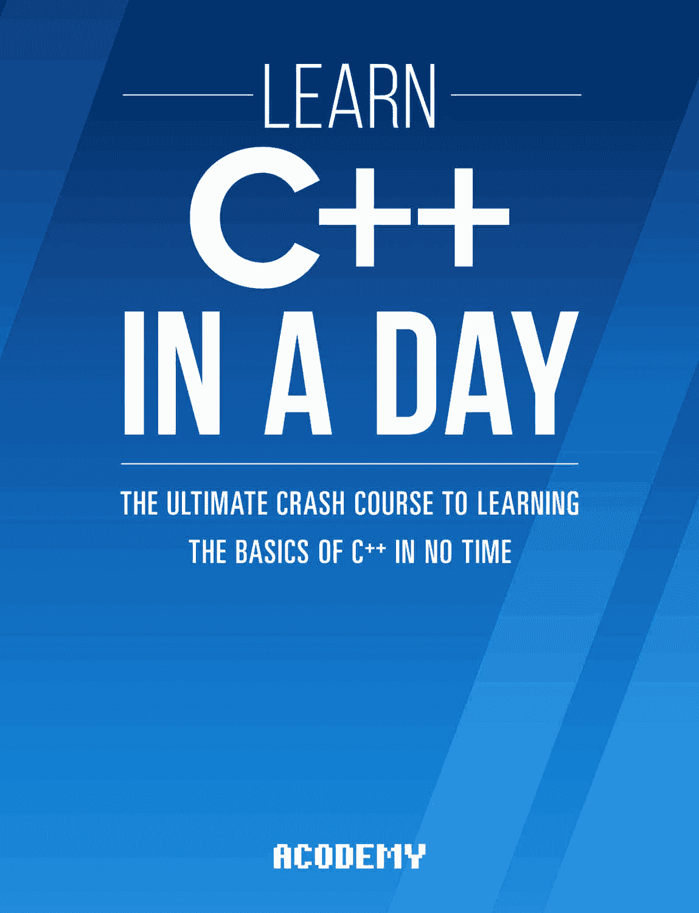

# C++：一天学会 C++！快速掌握 C++ 基础的终极速课程（C++、C++ 课程、C++ 开发、C++ 书籍、初学者 C++）



## 免责声明

本书提供的信息旨在为所讨论的主题提供有用信息。作者的书籍仅旨在为读者特定主题的基础知识，对于学生是否能够吸收和应用所有提供的信息不做任何保证。尽管作者将尽力分享其见解，但学习是一项任务，每个人都需要不同的时间来充分吸收新主题。本书及作者任何书籍都不保证读者能在特定时间内学会特定主题。

# 第 1 章：绪论

**目标：** 对 C++ 语言进行简要介绍、历史并理解。

C++ 广为人知是一种每个程序员应该掌握的低级高级语言。C 和 C++ 之间的一个主要区别是对象面向编程（OOP）。C++ 的 OOP 特性可能让它变得更难理解和学习。本电子书旨在帮助新程序员学习这种语言，包括 OOP 方法论和结构的帮助。

## C++ 简史

C++ 语言首次出现于 20 世纪 80 年代。它由一位丹麦计算机科学家比雅尼·斯特鲁普（Bjarne Stroustrup）创建。该语言最初的名字是"带有类的 C（C with Classes）"，后来改为 C++。C++ 最初的主要目的是在旧的 C 语言中添加 OOP。

随着时间的推移，C++ 演变并标准化了。C++ 被作为一种低级语言创建的，这意味着它的工作更接近二进制级编程。事实上，这种语言最初的设计是为了仅运行在二进制或汇编语言之上。语言越接近实际机器语言，它在处理内存处理和存储等低级机器操作时就越快、越灵活。

## C++ 有什么用途？

开发者仍然使用一种超过 30 年历史语言的单一根本原因是性能。记住，接近二进制计算机语言的语言总是比 `Java`、`C#` 或 `VB` 等开销庞大的语言快。后三种语言仍然有它们的用处，但 C++ 主要用于其他语言无法完全覆盖开发领域的编程。

作为一个新开发者，世界是你的舞台，你可以使用任何你喜欢的语言。然而，在某些行业中，你无法使用 C++以外的任何语言。C++ 语言深根于 IT 和软件开发的多个领域。

**游戏**可能是你需要了解 C++ 的顶级 IT 领域。C++ 用于创建游戏引擎。其他语言太臃肿且浪费资源。由于游戏引擎关注渲染的速度和质量，C++ 是游戏设计中用于低级编程的语言。它通常在游戏设计中与其他语言一起编码，因此有助于开发者在进入游戏编程时理解多种语言。

**设备驱动程序**几乎全都是用 C++ 完成的。C 用于嵌入式系统，但用于将硬件集成到桌面级、服务器和移动设备等大型系统中的驱动程序都是用 C++ 编写的。设备驱动程序是允许硬件组件与操作系统工作的软件程序。设备驱动程序特定于操作系统，但 C++ 可以在任何平台运行。驱动程序编写者使用 C++ 是为了它的速度和平台无关集成。一旦编译，程序就针对操作系统，但你可以使用 C++ 为 Linux、Windows 和 Apple 系统编写代码。

**图像和视频处理软件**使用 C++。它再次是因为速度优势而被使用。渲染图像或视频可能需要几天时间。

## 为什么要用 C++？

大多数新程序员对 C++ 和 C 之间的区别感到困惑。他们不知道什么时候该使用 C++ 语言而不是 C，或者说何时使用任何语言。C++ 的主要区别在于它使用了对象面向编程。这并没有让 C 语言变得低劣，它只是让 C++ 能够访问库和编码可能性。在对象面向编程中，你可以使用构造函数和析构函数。构造函数实例化类，析构函数从内存中移除它。

## 在 C++ 中编码需要什么

C++ 是一种编译型语言，这意味着在完成编码过程之前你需要一个编译器。你可以在普通的文本文件中输入代码，但不建议这样做，而且即使你写了没有任何错误的完美代码，仍然需要一个编译器。记住，编译型语言依赖于编译它的操作系统。

你还需要一个 IDE（集成开发环境）。IDE 是你编写代码的地方。它为你提供彩色编码的文本界面，帮助你编写更好的代码。颜色编码文本让你能够快速识别数据类型、注释、类和其他常见的代码结构。换句话之，它让代码更易读。大多数编译器都带有 IDE，因此在安装 IDE 之前请检查一下。

一旦你确定了想要使用的编译器和 IDE，你需要在你的系统上安装它。该 IDE 应该带有一个 `EXE` 或 `MSI` 软件包，让你能够自动安装软件，而无需使用任何命令行。如果你使用的是基于 Linux 的系统，你可能需要一些额外的配置。

安装软件后，打开编译器感受一下它的工作原理。你将直接在 C++ IDE 中工作，因此要熟悉一下颜色编码。例如，注释通常以绿色文本显示。数据类型设置为蓝色。类也标记为蓝色。字符串则是红色或蓝色。标准变量（包括你的函数名）是黑色的。

在 IDE 的底部，你会看到构建日志（build log）和调试器（debugger）。这两个窗口是你编程成功最重要的两个窗口。构建日志会你在 C++ 编译器在创建可执行文件（编译程序）时是否发生了任何错误。调试器用于你单步执行代码并识别代码的哪个部分导致了错误。

某些 IDE 有"待办事项"（to do）列表。待办列表是一组在注释中设置了 `TODO` 的代码块。这告诉程序员他需要对代码进行更多处理，他还没有完成。

如果 IDE 开发者足够友好，当你第一次运行程序时，会从一个临时的 Hello World 程序开始。这个程序可以被编译并在控制台中显示，这样你就可以看到编译器和语言的工作方式。还要注意，C++ 代码文件以 `.cpp` 文件扩展名结尾。当你从硬盘上搜索程序所需的代码文件时，这一点非常重要。

## 你将在这本电子书中学到什么

我们的目标是让你适应成为一名 C++ 新程序员。C++ 是一门庞大的语言，但通过一些练习，你可以掌握基础概念并成为高级程序员。我们为你提供工具 set，你可以使用它来处理更复杂的程序。

在第一节中，我们将向你介绍 C++ 的基础。在开始实际编码之前，你需要了解基础结构和编程概念。

接下来，我们将向你介绍变量数据类型以及调用某些变量时可以做的事情。变量用于任何编程语言，所以一旦你学会了一门语言，就能轻松学习其他任何语言。

接下来，我们将学习运算符以及如何在你的 C++ 程序中进行算术运算。然后我们进入高级数据类型，以及你可以如何从一种数据类型转换为另一种数据类型。我们还向你引入了 `string` 类，它与原始字符串或字符数据类型不同。

然后我们进入循环和条件编程结构。这些在任何编程语言中都非常流行。循环和条件语句控制程序的执行方式。

稍微复杂一点，我们接着进入数组。数组稍微复杂一些，但它们在任何语言中都是必要的。即使是像 `C` 这样的底层语言也会频繁使用数组。

C++ 中最难的部分之一是面向对象编程。C++ 中最难的部分之一是面向对象编程。C++ 中最难的部分之一是面向对象编程。

# 第二章：C++ 基础

目标：本章将简要概述你必须掌握的 C++ 基础。在学习任何语言之前，了解一些 C++ 是重要的。一旦你理解了 C++ 基础，就可以将这些概念应用到其他语言中。继承对你来说将简单得多。

## 程序结构与注释

理解基础最好的方法是查看基础程序。让我们来看一个输出"Hello World"的简单程序。

```cpp
// 我的第一个第一个 C++ 程序
#include <iostream>

int main()
{
    std::cout << "Hello World!";
    return 0;
}
```

注意，我们的每行代码都有特定的格式。注释是第一行代码。双斜杠（`//`）字符告诉编译器你想包含注释。处理器会完全忽略注释，因此你可以在这一部分编写任何你想写的内容。你也可以在 C++ 中使用多行注释。这里有一个使用相同代码的示例。

```cpp
/* 我
可以用
C++ 编写代码 */
#include <iostream>

int main()
{
    std::cout << "Hello World!";
    return 0;
}
```

当编译器创建你的程序时，斜杠和星号之间的任何内容都会被忽略。当你在 IDE 中输入注释时，它们通常会被编码为绿色。当你只有一行注释时，标准做法是使用 `//` 注释指示符。当你有多行注释时，使用 `/* */` 注释结构。

接下来你会看到 `include` 语句。这是包含其他库的方法。C++ 代码文件需要一种与其他文件集成的方法。你的程序不会是一个长页。它们将是分开的不同的页面。你可以在程序中有组织成数百个文件的类和函数。集成它们的方法是将它们作为库包含。在这个示例中，包含的库是 `iostream`。括号表示它是 C++ 内部库。自定义代码的库用引号包含，并且你会看到头文件的 `.h` 文件扩展名。

下一个语句启动了主函数。`main` 函数是执行开始的中心点。将 `main` 函数想象成像正门那样的起始点即可。当你访问一栋建筑时，你并不知道该去哪里，也不知道你的目标办公室在哪里。为了弄清楚这个问题，你穿过正门，查看目录索引，然后前往你的办公室。C++ 语言和编译后的程序也是如此的。

C++ 会在你的代码中搜索 `main` 函数。从这个函数开始，你分支到代码的不同部分，并指示编译器如何执行这些代码。如果没有 `main` 函数，编译器将不知道从何开始。因此，你总会在 C++ 程序中看到一个 `main` 函数。

你会注意到在 `main` 函数名之前有一个 `int` 语句（类型）。`main` 函数总是返回一个整数。当 `main` 函数返回 `0` 时，意味着执行过程中没有发现任何错误。返回任何其他数字都表示发生了错误，因此你的程序由于错误非正常停止。

在 `main` 函数的括号内是你程序的主代码。在这个示例中，我们只有一行代码。我们向默认显示器显示"Hello World"。在大多数系统中，默认显示器是显示器。`<<` 字符表示你想将输出发送到显示器。

括号始终用于组织程序的代码。它们被用于循环和条件语句。正如你从之前的代码看到的，它们也被用于函数。

当你编译上面的代码时，你会在屏幕上看到"Hello World"。这就是创建你的第一个 C++ 程序所需的全部。

## 函数与返回值

我们将在第 8 章更深入地研究函数，但在编写代码之前，你必须了解函数的基础知识。

让我们回到 Hello World 示例。

```cpp
// 我的我的第一个 C++ 程序

#include <iostream>

int main()
{
  std::cout << "Hello World!";
  return 0;
}
```

我们在上一节中解释了这个小程序，但这次我们将重点关注函数部分。

函数总是以一个要返回的数据类型开始。你也可以不返回任何数据。不返回任何值的函数被称为 `void` 数据类型。`void` 函数类似于子程序。它们执行某个操作，有时还会向用户显示信息，但不会向调用语句发送返回值。

在数据类型声明之后，会给函数赋予一个名称。只要它不是 C++ 的保留关键字，可以是任何名称。左括号和右括号表示向函数发送参数的区域。你也可以向函数发送零参数。正如我们示例中的 `main` 函数一样，该函数没有设置参数，所以它只是一对空括号，里面没有包含内容。

函数内部的所有语句都包含在左括号和右括号之间。如果你漏掉了它们，编译器将不知道一个函数从哪里开始，另一个函数何时结束。当你将括号与循环和条件语句时，这可能会变得困难。确保你格式化了代码，以便于发现缺失的括号。注意我们对语句进行了缩进，因此右括号与结束的左括号对齐。这种格式化在编码行业中是标准，因为这使得你的代码更易读。

函数的最后部分始终是 `return` 语句。只有当函数指示需要返回值时，你才需要 `return`。在这个函数中，我们指示函数返回一个整数。因此，`return` 语句返回 `0`。由于 `0` 表示程序正常执行，这告诉编译器程序执行时没有错误。

当你使用 C++ 时，会有几个变量。

## 变量

变量是存储值的容器，无论它是数字、字符还是其他数据类型。

让我们看看一个简单的变量。

```cpp
int mynumber = 5;
```

在这个示例中，我们创建了一个名为 `mynumber` 的变量。注意到变量声明的第一部分是 `int`。变量的格式总是数据类型，然后是变量名。分号始终位于变量声明之后。

```
datatype variable;
```

分号是告诉编译器语句何时结束的。你可以将代码放在多行中，只要你使用分号指示语句的结束。我们在 `int` 语句后面添加了换行。

```cpp
int 
mynumber = 5;
```

由于编译器知道该变量是一个整数，因此它知道需要分配多少空间。在这个示例中，我们使用等号运算符告诉编译器将数字五存储在变量 `mynumber` 中。同样，我们用分号结束语句。

你将使用的主要运算符是算术运算符。让我们来看一个数学运算符。

```cpp
int mynumber;
int mynumber = 5+5;
```

在这一语句中，我们使用了加号运算符，即加法。C++ 包含了所有的数学运算符，包括加法、减法、乘法、除法和取模。取模返回除法语句的数。

你也可以对变量使用数学运算符并存储在第二个变量中。让我们来看例子。

```cpp
int mynumber;
int mynewnumber;
mynumber = 5;
mynewnumber = mynumber + 5;
```

在上面的代码中，我们创建了两个变量。然后我们将原始的 `mynumber` 变量赋值为值 `5`。接着我们想在该数字上加上 `5`，但不想覆盖现有的变量值。我们使用第二个变量来保存加法计算的结果。当你想要创建一个临时变量来包含原始值，同时对新的数学过程进行计算时，这将非常有益。临时变量包含原始值，而计算结果包含另一个变量中。然后你可以对原始变量和新变量进行比较。

本章介绍了 C++ 中一些非常基础的功能，但理解这些功能至关重要。你从非常简单的程序到非常复杂的程序都会用到这些概念。学习这些概念的棒之处在于，它们可以应用于其他语言，这让新编程者的学习体验获益双倍。

## 实验习题

1. 每个 C++ 程序都包含的作为代码执行入口的函数名是什么？

   a. `main`

   b. `enter`

   c. `begin`

   d. `out`

   解释：`main` 函数是所有 C 和 C++ 程序的起点。你的程序必须包含一个 `main` 函数才能执行。

2. C++ 程序中任何一个 `main` 函数的返回类型是什么？

   a. `string`

   b. `character`

   c. `integer`

   d. `decimal`

   解释：`main` 函数返回一个整数值。如果程序无问题地运行，将向调用进程返回类型为 `0`，这表示没有发生错误。

3. 变量声明语句的开头总是是什么？

   a. 值

   b. 变量名

   c. 分号

   d. 数据类型

   解释：数据类型告诉操作系统包含的是什么种类型的值，以便进行正确的内存分配。

4. 使用什么运算符给变量赋值？

   a. `=`

   b. `+`

   c. `==`

   d. `–`

   解释：等号用于将语句右侧的值赋值给左侧的变量名。`==` 也是一个有效的运算符，但它是一个比较运算符，这会导致标准的赋值语句在执行期间失败。

# 第 3 章：变量与数据类型

**目标**：本章将涵盖我们在上一章中强调的变量和数据类型。我们将对这些 C++ 结构进行更深入、更详细的介绍。

在之前的章节中，关于变量和数据类型我们只接触了表面。要开始学习 C++ 编程，你需要更多信息。变量是程序的基础，因此在开始编程之前，你应该对它们有深入的理解。数据类型定义了这些变量，因此在编码过程中你需要结合学习这些概念，因为它们是紧密相分的。

## 内存地址

在我们开始创建变量之前（注：此处原文逻辑略有跳跃，按原意翻译）：由于编译器知道该变量是一个整数，因此它知道需要分配多少空间。在这个示例中，我们使用等号运算符告诉编译器将数字五存储在变量 `mynumber` 中。同样，我们用分号结束语句。

你将使用的主要运算符是算术运算符。让我们来看一个数学运算符。

```cpp
int mynumber;
int mynumber = 5+5;
```

在这一语句中，我们使用了加号运算符，即加法。C++ 包含了所有的数学运算符，包括加法、减法、乘法、除法和取模。取模返回除法语句的数。

你也可以对变量使用数学运算符并存储在第二个变量中。让我们来看例子。

```cpp
int mynumber;
int mynewnumber;
mynumber = 5;
mynewnumber = mynumber + 5;
```

在上面的代码中，我们创建了两个变量。然后我们将原始的 `mynumber` 变量赋值为值 `5`。接着我们想在该数字上加上 `5`，但不想覆盖现有的变量值。我们使用第二个变量来保存加法计算的结果。当你想要创建一个临时变量来包含原始值，同时对新的数学过程进行计算时，这将非常有益。临时变量包含原始值，而计算结果包含另一个变量中。然后你可以对原始变量和新变量进行比较。

本章介绍了 C++ 中一些非常基础的功能，但理解这些功能至关重要。你从非常简单的程序到非常复杂的程序都会用到这些概念。学习这些概念的棒之处在于，它们可以应用于其他语言，这让新编程者的学习体验获益双倍。

## 实验习题

1. 每个 C++ 程序都包含的作为代码执行入口的函数名是什么？

   a. `main`

   b. `enter`

   c. `begin`

   d. `out`

   解释：`main` 函数是所有 C 和 C++ 程序的起点。你的程序必须包含一个 `main` 函数才能执行。

2. C++ 程序中任何一个 `main` 函数的返回类型是什么？

   a. `string`

   b. `character`

   c. `integer`

   d. `decimal`

   解释：`main` 函数返回一个整数值。如果程序无问题地运行，将向调用进程返回类型为 `0`，这表示没有发生错误。

3. 变量声明语句的开头总是是什么？

   a. 值

   b. 变量名

   c. 分号

   d. 数据类型

   解释：数据类型告诉操作系统包含的是什么种类型的值，以便进行正确的内存分配。

4. 使用什么运算符给变量赋值？

   a. `=`

   b. `+`

   c. `==`

   d. `–`


解释：等号用于将语句右侧的值赋值给左侧的变量名。`==` 也是一个有效的运算符，但它是一个比较运算符，这会导致标准的赋值语句在执行期间失败。

# 第 3 章：变量与数据类型

**目标**：本章将涵盖我们在上一章中强调的变量和数据类型。我们将对这些 C++ 结构进行更深入、更详细的介绍。

在之前的章节中，关于变量和数据类型我们只接触了表面。要开始学习 C++ 编程，你需要更多信息。变量是程序的基础，因此在开始编程之前，你应该对它们有深入的理解。数据类型定义了这些变量，因此在编码过程中你需要结合学习这些概念，因为它们是紧密相关的。

## 内存地址

在我们开始创建变量之前（注：此处原文逻辑略有跳跃，按原意翻译）：由于编译器知道该变量是一个整数，因此它知道需要分配多少空间。在这个示例中，我们使用等号运算符告诉编译器将数字五存储在变量 `mynumber` 中。同样，我们用分号结束语句。

你将使用的主要运算符是算术运算符。让我们来看一个数学运算符。

```cpp
int mynumber;
int mynumber = 5+5;
```

在这一语句中，我们使用了加号运算符，即加法。C++ 包含了所有的数学运算符，包括加法、减法、乘法、除法和取模。取模返回除法语句的数。

你也可以对变量使用数学运算符并存储在第二个变量中。让我们来看例子。

```cpp
int mynumber;
int mynewnumber;
mynumber = 5;
mynewnumber = mynumber + 5;
```

在上面的代码中，我们创建了两个变量。然后我们将原始的 `mynumber` 变量赋值为值 `5`。接着我们想在该数字上加上 `5`，但不想覆盖现有的变量值。我们使用第二个变量来保存加法计算的结果。当你想要创建一个临时变量来包含原始值，同时对新的数学过程进行计算时，这将非常有益。临时变量包含原始值，而计算结果包含在另一个变量中。然后你可以对原始变量和新变量进行比较。

本章介绍了 C++ 中一些非常基础的功能，但理解这些功能至关重要。你从非常简单的程序到非常复杂的程序都会用到这些概念。学习这些概念的棒之处在于，它们可以应用于其他语言，这让新编程者的学习体验获益双倍。

## 实验习题

1. 每个 C++ 程序都包含的作为代码执行入口的函数名是什么？

   a. `main`

   b. `enter`

   c. `begin`

   d. `out`

   解释：`main` 函数是所有 C 和 C++ 程序的起点。你的程序必须包含一个 `main` 函数才能执行。

2. C++ 程序中任何一个 `main` 函数的返回类型是什么？

   a. `string`

   b. `character`

   c. `integer`

   d. `decimal`

   解释：`main` 函数返回一个整数值。如果程序无问题地运行，将向调用进程返回类型为 `0`，这表示没有发生错误。

3. 变量声明语句的开头总是是什么？

   a. 值

   b. 变量名

   c. 分号

   d. 数据类型

   解释：数据类型告诉操作系统包含的是什么种类型的值，以便进行正确的内存分配。

4. 使用什么运算符给变量赋值？

   a. `=`

   b. `+`

   c. `==`

   d. `–`

   解释：等号用于将语句右侧的值赋值给左侧的变量名。`==` 也是一个有效的运算符，但它是一个比较运算符，这会导致标准的赋值语句在执行期间失败。

## 内存地址

由于编译器知道该变量是一个整数，因此它知道需要分配多少空间。在这个示例中，我们使用等号运算符告诉编译器将数字五存储在变量 `mynumber` 中。同样，我们用分号结束语句。

你将使用的主要运算符是算术运算符。让我们来看一个数学运算符。

```cpp
int mynumber;
int mynumber = 5+5;
```

在这一语句中，我们使用了加号运算符，即加法。C++ 包含了所有的数学运算符，包括加法、减法、乘法、除法和取模。取模返回除法语句的数。

你也可以对变量使用数学运算符并存储在第二个变量中。让我们来看例子。

```cpp
int mynumber;
int mynewnumber;
mynumber = 5;
mynewnumber = mynumber + 5;
```

在上面的代码中，我们创建了两个变量。然后我们将原始的 `mynumber` 变量赋值为值 `5`。接着我们想在该数字上加上 `5`，但不想覆盖现有的变量值。我们使用第二个变量来保存加法计算的结果。当你想要创建一个临时变量来包含原始值，同时对新的数学过程进行计算时，这将非常有益。临时变量包含原始值，而计算结果包含在另一个变量中。然后你可以对原始变量和新变量进行比较。

本章介绍了 C++ 中一些非常基础的功能，但理解这些功能至关重要。你从非常简单的程序到非常复杂的程序都会用到这些概念。学习这些概念的棒之处在于，它们可以应用于其他语言，这让新编程者的学习体验获益双倍。

关于变量赋值有一点需要注意：你不能创建一个与另一个变量同名的新变量。我们假设我们想要重新分配原始变量的数据类型，但如果我们将此添加到原始的整数赋值代码中，编译器将会报错。例如，以下代码就会报错。

```cpp
float mynumber = 5.5, anothernumber = 10.5;
int mynumber = 5, anothernumber = 10;
```

换句话说，作用域内（我们稍后会定义作用域）的所有变量必须有不同的名称。

## 字符与字符串

我们继续使用数字和整数作为示例，因为数值是最容易理解的变量和值。然而，你的编程体验中很大一部分将用在使用和操作字符串变量上。字符串变量是程序中的“单词”。它们会提示用户并允许用户存储字符串作为值，例如他们的姓名和地址。

由于 C++ 源自 C，第一个需要注意的重要点是，一个单词或字符串是一个字符数组。`C` 没有字符串库，因此你必须通过字符数组工作。`C++` 拥有字符串库，因此你可以像在其他语言中一样处理字符串。

让我们先看看 `char` 数据类型，这样你就能理解字符以及它们是如何存储的。字符在存储时实际上会被整数，因此你使用其数值或字符值来定义一个字符。可用的字符数值范围从 32 到 127。你可能需要在 Google 上搜索查找表，以找到与字符匹配的数值。

让我们来看看初始化字符的两种方式。

```cpp
char ch1(97);
char ch2('a');
```

这两个字符都用相同的值初始化。第一个字符变量 `ch1` 以其原始数值格式进行初始化。第二个变量 `ch2` 使用你想要使用的字符进行初始化。在这个示例中，使用了字符‘a’。字符‘a’ 对应的数值是 97。

即使你用数值初始化字符，输出也会显示其关联的字符值。让我们来看一些示例代码。

```cpp
#include <iostream>

int main()
{
    char ch(97);
    std::cout << ch;
    return 0;
}
```

在上面的代码中，尽管初始化变量被设置为 97，但输出显示的是字符‘a’。大多数程序员不知道与字符匹配的数值，因此他们使用字符初始化方法。然而，你可能在某一点需要知道对应的字符和数字。处理这种映射的最佳方法是在 Google 上搜索该信息的打印。

使用上述方法，你需要创建一个字符数组来创建一个字符串。与 `C` 不同，`C++` 变得简单得多。我们没有创建数组，而是让字符串库为我们完成。我们在 `include` 语句中添加字符串库。

```cpp
#include <string>
#include <iostream>

int main()
{
    std::string myName("John");
    std::cout << "My name is: " << myName;
    return 0;
}
```

字符串的初始化与字符相似。区别是将数据类型设置为 `string`。你还会注意到代码顶部添加了字符串库。你需要这个库来以此种方式使用字符串。另一个区别是，你在定义字符时使用的是双引号而不是单引号（tick mark）。这在大多数语言中都是标准做法。双引号表示字符串，而单引号表示字符定义。

字符串变量被命名为 `myName` 并初始化为“John”。字符串库在后台将此值转换为字符数组，因此你不需要处理任何循环和内存分配。

最后，使用我们在第一章中看到的 `cout` 函数将字符串打印出来。

你也可以将数值定义为字符串。这并不常见，但偶尔会发生。例如，用户输入首先作为字符串发送，然后在你的程序中转换为整数。让我们来看一个示例。

```cpp
#include <string>
#include <iostream>

int main()
{
    std::string myNumber("45");
    std::cout << "My name is: " << myNumber;
    return 0;
}
```

除了变量名和值之外，这个程序没有太大变化。该值是一个数字，但它被放在引号中，所以计算机将其视为字符串。

当你想要以字符串形式从用户获取输入时会发生什么？C++ 有 `cin` 函数，它与 `cout` 相反。`cin` 函数从用户获取输入。`cin` 的问题在于它获取字符串直到遇到第一个空白字符（如空格）。当遇到这个字符时，它会停止输入。你可以使用 `cin` 输入单个字符，但我们使用 `getline` 获取包含空格的完整短语。

让我们来看一个示例。

```cpp
#include <string>
#include <iostream>

int main()
{
    std::cout << "Enter your full name: ";
    std::string fullname;
    std::getline(std::cin, fullname);
    std::cout << "Your name is " << fullname;
    return 0;
}
```

`const` 关键字用于告诉编译器你想创建一个常量。你仍然需要为常量指定一个数据类型，我们决定给它分配浮点小数数据类型 `float`。

这条语句中有趣的地方在于，我们为变量取了一个全大写字母的名称。`C++` 是一种大小写敏感的语言，因此变量 `myfactor`、`MYFACTOR` 和 `myFactor` 在 `C++` 中都是不同的变量。你永远不会创建三个名称相同但大小写不同的变量，但在编写代码时，你应该意识到它们是不同的变量。我们在这一条语句中使用全大写字母，是因为该变量是一个常量。编译器并没有强制要求，但这是编码标准的要求。你在职业生涯中必须遵循的大多数编码标准都要求将常量设置为全大写字母。

在为变量命名后，我们在括号中设置它的值。请记住，常量的值是不会改变的，因此无论它位于你代码的哪个位置，该常量的值都是这个值。事实上，如果你尝试更改该值，编译器将向你报告错误。例如，以下代码将导致编译错误。

```
const float MYFACTOR { 1.1 };

MYFACTOR = 10.0;
```

上述代码会报错。当你创建一个常量时，务要确定你需要的是静态变量还是动态变量。大多数程序都有几个常量，但通常你应该创建一个动态变量。例如，如果你有一个 API 的网站 URL，你会将其设置为常量。如果你需要根据用户输入检索 URL，你将创建一个动态变量。

我们在这一章中涵盖了几个概念。变量和数据类型是 `C++` 程序的基石，虽然它们是更容易理解的概念，但理解它们重要性与理解更复杂的概念一样。

### 实验题

1. 当你想在 `C++` 中定义一个小数值时，使用什么数据类型来声明变量？

   a. `decimal`

   b. `integer`

   c. `float`

   d. `point`

   解释：`float` 变量类型允许你为小数分配内存并在变量中存储小数。

2. 当你定义一个为 `true` 的布尔值时，存储在内存中的实际值是什么？

   a. `0`

   b. `1`

   c. `true`

   d. `yes`

   解释：布尔值会被转换为 1 或 0。`true` 值等于 1，`false` 值等于 0。

3. 在 `C++` 中你应该使用什么函数从用户处获取字符串输入？

   a. `getline`

   b. `get`

   c. `cin`

   d. `input`

   解释：应该使用 `getline` 函数从用户处获取输入。`cin` 函数也可以用，但它会在遇到空白字符时停止。为了确保获取了用户的所有输入，请务必使用 `getline` 函数。

4. 字符串库在 `C++` 中对字符串输入进行什么处理？

   a. 将其存储在一段连续的内存区域

   b. 将每个字符转换为单独的字符

   c. 将字符串转换为字符数组

   d. 在存储之前对每个字符进行转义

   解释：在 `C` 和 `C++` 中，字符串值实际上是字符数组。`C++` 拥有一个字符串库，可以为你处理字符数组的操作。

# 第 4 章：运算符

**目标**：本章涵盖了在几乎任何 `C++` 程序中看到的算术运算符和比较运算符。

我们对运算符进行了简要概述，但本章将详细介绍运算符。即使是最小的 `C++` 程序也会使用运算符。你需要理解它们的工作原理、它们的优先级（以便正确计算值），以及任何比较操作及其结果。我们将涵盖最常见的运算符，以及一些不常用的运算符。

## 基础算术

在几乎任何 `C++` 程序中，你都需要进行某种算术运算。即使你的程序完全不需要算术，你也需要使用算术来循环语句、查找数组中的索引并跟踪记录。算术在任何程序中都与许多知识一样重要。

让我们来看简单的程序。

```
int num1 = 5;
int num2 = 6;
int num3 = num1 * num2;
```


我们在大多数示例中使用加法和减法，所以这次我们决定增加一些乘法。在上面的代码中，我们创建了名为`num1`和`num2`的两个变量并给它们赋值。然后我们创建了第三个变量名为`num3`，并将`num1`和`num2`的积赋值给`num3`。这是运算符及其如何与变量工作的非常基本的示例。当然，你可以使用创建值的静态数字并存储在变量中。以下代码的结果与上面相同。

```
int num3 = 5 * 6;
```

上述代码只执行了一次计算，但像任何计算一样，你必须知道操作的优先级。`C++`遵循与任何普通数学计算相同的优先级。你还有其他运算符的优先级。由于运算符非常多，大多数`C++`开发者在定义长算法和计算之前必须查阅优先级顺序。你可以在 Google 上搜索这些优先级运算符并保存一份列表以备后之用。

学习`C++`的另一个伟大原因是，其他语言也遵循优先级法则。如果你在`C++`中学会了它们，那么在你决定学习任何其他语言时，都应该熟悉它们。

让我们来看一个带有不同运算符的计算。

```
int num1 = 8 + 3 * 1;
```

如果你记得数学规则，你应该知道这个问题的解法。乘法的优先级高于加法，所以先执行乘法。计算结果将是 11。

让我们来看另一个例子。

```
int num1 = 8 * 3 + 1;
```

现在你知道了优先级顺序，就可以正确识别结果。8 和 3 会先相乘，然后进行加法。计算结果是 25。

你还可以对加减法进行快捷操作。`C++`拥有递增和递减运算符作为这些快捷。让我们来看一个示例。

```
int num1 = 1;
int num2 = num1++;
```

这两个初始化的都包含整数值。第一个值设置为 1。`num2`初始化为`num1`的递增值。递增等同于“给变量加 1”。在这种情况下，值为 1，所以递增后的值是 2。

你可以以相同的方法减少数字，只是使用减运算符。让我们来看一个示例。

```
int num1 = 1;
int num2 = num1--;
```

上述代码执行相同的计算过程，只是值减少了 1。换句话说，从变量`num1`中减去 1，并将结果保存在变量`num2`中。计算结果是`num2`的值为 0。

另一个很有用但不同的运算符是模运算（取模运算）。当你处理偶数时，你会用到模运算。模运算返回除法运算的余数。例如，如果你用 5 除以 2，模运算返回 1。它是循环数字并判断数字是奇是偶的方便工具。如果一个数字除以 2 没有余数，那么它就是偶数。如果除以 2 有余数，你就知道它是奇数。

让我们来看一个示例。

```
int num1 = 1;
int num2 = 3;
float num3 = num1 % 2;
float num4 = num2 % 2;
```

我们向这段代码添加了几个行。前两个变量设置为存储静态值，即一和三。第三个变量`num3`用于识别`num1`是否为偶数。由于 1 除以 2 等于 .5，我们知道它不是偶数。注意，我们通过将此变量定义为浮点值来考虑了小数的情况。

下一条语句评估数字`3`。我们知道数字 3 不是偶数，因此取模语句返回`1`。如果我们使用一个偶数，返回值将是`0`，这将向我们的程序信号我们找到了偶数。

对于更高级的计算，你可能需要调用函数。例如，`C++`中没有直接用于指数的字符。`C++`了一个名为`pow`的函数来处理指数。让我们来看一个示例。

```cpp
pow(base, exp);
```

这是`pow`模板。`base`是数字参数`base`，而`exp`参数是你想要对基取的幂——换句话说，它代表指数。

让我们来看一个真实的示例。

```cpp
int basenum = 4;

int result = pow(basenum, 2);
```

在这个示例中，我们首先创建了一个名为`basenum`的变量。该变量包含值`4`。然后我们使用`pow`函数计算`basenum`变量的`2`次方。计算结果为`16`。这使得指数的使用比不支持指数的其他语言要简单得多。

在创建任何复杂函数之前，请查阅`C++`库，以确保编译器是否已经为你提供了解决方案。大多数基础数学计算都有相应的库供你使用。

## 比较运算符

我们刚刚回顾了`C++`中可用的大部分基础数学运算符。了解比较运算符同样重要，它们构成了大多数程序的大部分。在大多数程序中，你将需要使用比较运算符。这些运算符也被称为关系运算符。

有几个比较运算符。以下是列表：

- 大于：`>`

- 小于：`<`

- 大于等于：`>=`

- 小于等于：`<=`

- 等于：`==`

- 不等于：`!=`

我们将详细介绍这些运算符，帮助你理解如何使用它们。

你可以像解决数学题一样来看待这些运算符。让我们先看看大于和小于语句。

```cpp
int num1 = 1;

int num2 = 2;

if (num1 > num2)
{
    cout << “Greater than”;
}

if (num1 < num2)
{
    cout << “Less than”;
}
```

我们还没有处理过条件，但只需知道`if`语句与比较运算符紧密结合。第一个`if`语句比较变量`num1`和`num2`。第一个条件检查`num1`是否大于`num2`。由于结果为`false`，程序跳过`if`语句，并将执行移动到下一个`if`语句。

下一个`if`语句比较`num1`是否小于`num2`。这个语句与第一个不同，结果为`true`。由于结果为`true`，执行的下一步被设置为`if`语句内部的语句。在这个示例中，“Less than”短语显示给用户看。

注意，如果数字相等，这两个`if`语句都不会执行。当你需要知道一个数字是大于、小于还是等于某个值时，这就是问题。让我们使用上面相同的示例，但更改`num1`和`num2`变量的值。

```cpp
int num1 = 1;

int num2 = 1;

if (num1 >= num2)
{
    cout << “Greater than”;
}

if (num1 <= num2)
{
    cout << “Less than”;
}
```

现在我们的变量都等于`1`。它们既不大于也不小于对方，但我们更改了`if`语句代码。由于逻辑发生了变化，代码执行也发生了巨大变化。第一个`if`语句评估为`true`，“Greater than”短语显示给用户。

在下一个`if`语句中，再次评估为`true`。由于这个`if`语句同样评估为`true`，值“Less than”显示给用户。

到目前为止，这看起来足够简单！但当我们只想在值相等（而不是大于、小于或等于）时执行语句时，该如何避免执行`if`语句呢？`C++`语言包含一个相等运算符。我们简要提过它，因为它与相等赋值运算符相似。让我们使用之前相同的代码来看一个示例。

```cpp
int num1 = 1;

int num2 = 1;

if (num1 == num2)
{
    cout << “Greater than”;
}

if (num1 <= num2)
{
    cout << “Less than”;
}
```

### 解释

`!=`运算符用于判断两个值是否不等。如果此比较运算符被用在`if`语句中且结果为真，则执行该`if`语句。

### 4. 你使用哪种`C++`函数来执行指数函数？

a. `exp`

b. `base`

c. `pow`

d. `multiply`

解释：`pow`函数接收一个基数和一个指数值，并执行幂乘法计算。

# 第 5 章：高级数据类型

目标：本章涵盖了更高级的数据类型。我们已经学习了基础知识，但本章将为你概述作用域、枚举和结构体。

在之前的章节中我们介绍了一些变量类型，但`C++`为开发者提供了其他几种更复杂的数据类型，以便于更容易编程。你甚至可以创建自己的数据类型。当你创建`classes`（类）时，这些类就变成了你的自定义数据类型。标准数据类型被称为`primitive`（原生）。整数、浮点小数和字符都是原生数据类型。我们将探索更复杂的数据类型并理解它们如何与`C++`关联。

## 枚举量

枚举量是创建自定义数据类型的一个示例。`enum`数据类型创建了一个包含其自身数值常值的列表。该常量被称为`enumerator`（枚举量）。当你有一组常量值并需要用符号变量来表示时，就会使用这些数据类型。让我们来看一些示例代码以更好地理解枚举量。

```cpp
enum Color
{
  BLUE,
  BLACK,
  RED
};
```

你可以说`Color`数据类型已经被枚举了。注意，枚举有起始和结束括号，就像我们在之前的章节中看到的`if`语句和函数一样。

这些数据类型的使用方法与你创建`class`（类）或`function`（函数）相同。如果你还记得之前的章节，我们设置一个函数是首先定义它的数据类型，然后为函数定义一个名称，接着括号内的所有代码都被视为函数的一部分。

枚举数据类型也是如此。在例例中，我们设置了`enum`数据类型并定义了名称。在这个例子中，我们决定需要一个颜色列表。注意，枚举值不应该是动态的。例如，你不会有一组`Color`值，然后将列表改为鸟类。你不会决定动态地向枚举量添加新颜色。你总是知道你需要的值列表，因为枚举量充当了数据类型的常量。

通过这个枚举量，我们有了一个颜色列表。我们只需要三种颜色。除了最后一个颜色外，每个颜色都用逗号隔开。如果你不小心在最后一个颜色后面添加了逗号，编译器将返回错误。

你可能注意到我们将颜色名称设置为了全大写字母。在任何编程语言中，常量都用全大写字母设置。这不是编译器要求的，它是编码标准的一部分。我们在第 3 章中介绍了常量及其命名方案。

我们的`Color`数据类型与标准常量并不完全相同，但括号内的枚举值是静态的。

你可能会问自己这些常量代表什么。它们的值是多少？`C++`语言会给这些常量分配一个值。它们按照出现的顺序被赋值。让我们来看带有注释的`Color`枚举值。

```cpp
enum Color
{
  BLUE, // 值为 0
  BLACK, // 值为 1
  RED // 值为 2
};
```

我们为枚举数据类型添加了一些注释。记住编译器会忽略注释，所以你可以随所欲地对代码进行注释。

枚举值总是从 0 开始赋值。每个变量都获得其自己的递增值。这意味着`blue`的值为 0，下一个变量`black`获得值 1，然后下一个变量获得值 2。当你在代码中调用这些变量时，这些是它们在执行期间所拥的值。

关于这些数据类型的另一个重要方面是，一旦你为枚举量提供了一个变量名列表，你就不能在代码的其他任何部分使用这些名称。这些变量名是全局定义的，这意味着它们可以在代码的任何部分访问。让我们来看一个例子。

```cpp
enum Color
{
  BLUE, // 值为 0
  BLACK, // 值为 1
  RED // 值为 2
};

enum MoreColors
{
  BLUE, // 值为 0
  GREEN, // 值为 1
  ORANGE // 值为 2
};
```

上述代码会导致编译器错误，因为你已经在原始的`Color`枚举中使用过`BLUE`变量名。

现在你已经定义了`Color`数据类型，可以在代码中使用它。让我们看看你将如何定义一个变量并获取它的值。

```cpp
enum Color
{
  BLUE, // 值为 0
  BLACK, // 值为 1
  RED // 值为 2
};

Color paint = BLUE;

std::cout << paint;
```

在示例代码中，我们有数据类型的定义，然后决定在某些代码中使用它。因为`Color`现在是一个数据类型，我们用它来定义变量。我们决定创建一个数据类型为`Color`的变量`paint`。然后我们给变量赋值一个来自颜色列表的常量值。因为`BLUE`常量值为 0，下一条语句将打印值 0。

由于枚举变量具有常量值列表，你也可以使用它们来初始化整数变量。例如，以下代码是有效的：

```cpp
int paintcolor = BLUE;
```

编译器将`BLUE`常量转换为整数并赋值给`paintcolor`变量。

结构体与枚举相似但在代码架构上大不同。结构体提供了一种表示对象的方法，而无需定义冗长的变量。

例如，假设你有一个获取员工列表的程序。每个员工都有你需要检索的姓和名。你还需要获取出生期的年、月、日。你可以单独创建这些变量，也可以使用结构体来更好地定义和表示你的信息。

假设你需要为两个员工记录信息。你的变量看起来如下：

```cpp
std::string firstname1;
std::string firstname2;
std::string lastname1;
std::string lastname2;
std::string birthyear1;
std::string birthyear2;
```

你可以看到，这种变量定义完全没有效率。结构体允许你为员工创建一个类或对象，然后你可以为类属性分配代表每个员工的值。

让我们来看创建员工结构体所需的代码。

```cpp
struct Employee
{
  int id;
  std::string firstname;
  std::string lastname;
  int birthyear;
};
```

上面的代码定义了`Employee`结构体，然后使用该结构体定义了名为`john`和`jane`的变量。与枚举一样，结构体也是它们的数据类型。`Employee`数据类型用于创建`jane`和`john`这两个变量。

定义结构体后，现在让我们来看如何为它们赋值。以下代码为`jane`和`john`分配了值。

```cpp
struct Employee
{
    int id;
    std::string firstname;
    std::string lastname;
    int birthyear;
};

Employee john;
john.firstname = “John”;
john.lastname = “Smith”;
john.birthyear = 2000;

Employee jane;
jane.firstname = “John”;
jane.lastname = “Smith”;
jane.birthyear = 2000;
```

这比我们之前使用的变量更有组织，也更容易阅读。我们仍然定义了两个员工，但更容易阅读和理解了。如果你将`Employee`变量命名为`john`，你就知道你把第一个名字存储在哪里了。

结构体让你更容易记住变量以及它们存储的数据。当后续程序员必须维护你的代码时，它也让代码更易读和理解。你还可以使用`cout`函数在填充结构体时显示信息。让我们通过一个使用输出显示员工名字的示例来完成结构体程序。

```cpp
struct Employee
{
    int id;
    std::string firstname;
    std::string lastname;
    int birthyear;
};

Employee john;
john.firstname = “John”;
john.lastname = “Smith”;
john.birthyear = 2000;

Employee jane;
jane.firstname = “John”;
jane.lastname = “Smith”;
jane.birthyear = 2000;

cout << jane.firstname;
```

在这个示例中，我们只是打印了 Jane 的名字，当然是“Jane”。如果你使用那些笨拙的变量名，你需要向上滚动代码，并回想哪个变量包含了哪个员工的信息。这段代码让你简单地调用`jane`的数据，并且知道你正在获取`jane`的信息。

枚举器和结构体是复杂得的数据类型，但当你开始构建健壮的应用时，它们非常有用。你需要保持代码的整洁和易读。如果不这样做，管理将非常困难。你可能有其他程序员与你的代码一起，他们将无法轻松理解你的意图。当代码越难以阅读时，未来任何添加导致 bug 的概率就越高。

你可以使用结构体和枚举器创建新的数据类型，这些数据类型随后可以被加载到代码的其他区域。这些数据类型在大型应用程序的包含文件和类设计中常用。

### 实验题

1. **枚举变量中第一个常量的值是多少？**

   a. 0

   b. 1

   c. 2

   d. null

   **解释：** 枚举变量数据类型中的第一个变量值总是 0。

2. **当你看到一个全大写的变量名时，你可以对该变量假设什么？**

   a. 它是一个全局变量

   b. 它是一个常量

   c. 它是一个局部变量

   d. 它包含一个整数

   **解释：** 编码标准要求开发者使用全大写字母创建常量变量。虽然这不能保证，但如果变量在代码中是全大写形式，假设它是常量是标准做法。

3. **假设你有一个名为 Employee 的结构体。你定义了一个名为 john 的 Employee 变量。该结构体在结构中定义了一个 firstname 属性。编写代码为 john 的 firstname 属性赋值为“John”。**

```cpp
Employee john;
john.firstname = “John”;
```

**解释：** 结构体创建了自定义数据类型。第一行代码使用`Employee`数据类型定义了`john`变量。一旦定义了变量，就可以为结构体的属性赋值。在这个示例中，结构体有一个接收字符串输入的`firstname`属性。

# 第 6 章：循环与条件语句

**目标：** 循环和条件语句控制代码执行的流程。本章将详细解释循环和条件语句。


循环和条件语句被归类为一个称为“逻辑控制”的编程概念。这两种语句都是用于评估变量并响应真或假的逻辑语句。当语句的结果为真响应时，会执行特定的语句。反之，如果语句结果为假值，语句将被跳过，或者给编译器提供一组替代指令。循环和条件语句在任何 C++ 程序中都很常见，因此对于任何新开发者来说，理解这些过程至关重要。

## if 语句

C++ 的`if`语句属于条件语句类别。它是你在创建程序时会用到的主要条件语句。`switch`语句是一种替代方案，但`if`条件语句在编码标准中更流行。`if`语句可以评估一个或多个变量，你甚至可以在语句中使用复合比较。

我们在第 4 章中非常简要地涵盖了`if`语句，现在我们将更详细地解释它们。

首先，让我们标准的`if`语句模板。

```cpp
if (condition)
{
  // 当条件为真时执行的语句
}
```

如果你还记得第 4 章的内容，当括号内的条件返回真时，括号内的语句将被执行。我们在第 4 章中没有展示的是，当结果为假时，你可以设置替代语句。让我们来看一下 if-else 语句。

```cpp
if (condition)
{
  // 当条件为真时执行的语句
}
else
{
  // 当条件为假时执行的语句
}
```

现在，让我们来看一个运行中的`if`语句。

```cpp
int num1 = 5;
int num2 = 6;
int result = num1 + num2;

if (result > 4)
{
  cout << “Result is greater than 4.”;
}
else
{
  cout << “Result is less than 4.”;
}
```

上面的`if`语句非常简单。如果`num1`和`num2`相加的结果大于 4，则显示“Result is greater than 4”。如果不是，则显示替代的“Result is less than 4”。由于对`result`变量与 4 的比较为真，所以执行第一个语句。

上面的`if`语句是简单的。如果`num1`和`num2`相加的结果大于 4，那么显示短语“Result is greater than 4”。如果不是，则显示替代的“Result is less than 4”。由于对`result`变量与 4 的比较为真，第一个语句被执行。替代的`else`语句仅在条件为假时执行。

你可能会发现这段代码有一个问题。如果结果等于 4 会怎样？条件结果为假响应，因此执行`else`语句。问题是，结果变成了“Result is less than 4”，这是不准确的。

我们可以改变`if`语句以执行复合比较。C++ 并不像我们在之前的示例中那样仅限于一次比较。你可以进行多次比较并使用逻辑操作来确定输出。让我们来看一个示例。

```cpp
int num1 = 5;
int num2 = 6;
int result = num1 + num2;

if (result > 4 )
{
  cout << “Result is greater than 4.”;
}
else if (result == 4) // 原文为 result == 4，但根据逻辑应补充
{
  cout << “Result is equal to 4.”;
}
```

现在我们的`if`语句考虑了相等的情况。如果`result`等于四，控制将被送到`if`结构的`else if`部分。你可以继续堆叠这些`if`和`else`语句，以涵盖代码中的每种逻辑可能性。

`if`语句可能会变得复杂且难以阅读。如果你有太多堆叠的`if`和`else`语句，编码标准要求你创建一个函数。我们将在第 8 章中介绍函数，但请记住，当存在太多逻辑可能性时，会使用函数。过多的`if`语句可能会导致逻辑 bug。

## switch 语句

`switch`语句是`if`语句的替代方案。`switch`语句具有相似的控制流，不同之处它不像`if`语句那样进行各种比较。正如我们在上一节中提到的，你可以使用多个嵌套的`if-else`语句。然而，当连续出现太多此类语句时，代码会变得难以阅读和调试。除了构建函数外，另一种方案是使用`switch`语句，它更整洁且易于阅读。

假设我们有一个使用上一章中创建的结构定义的颜色列表。如果你还记得，我们创建了一个名为`color`的结构。这里是再次对应的代码：

```cpp
enum Color
{
  BLUE,
  BLACK,
  RED
};
```

假设我们有一个需要评估的变量。你可以编写 3 或 4 个`if-else`语句，也可以使用`switch`语句。由于`switch`语句更容易阅读，因此在需要进行多次比较时，通常优先使用它。

我们先来看下如果使用`if`语句代码会是什么样的。

```cpp
Color color = BLUE;

if (color == BLUE)
{
  cout << “Color is blue.”;
}
else if (color == BLACK)
{
  cout << “Color is black.”;
}
else if (color == RED)
{
  cout << “Color is red.”;
}
else
{
  cout << “Don’t know the color.”;
}
```

上面的代码可以工作，但它比下面的`switch`语句难读得多。

```cpp
Color color = BLUE;
switch (color)
{
    case BLUE:
      std::cout << "Blue";
      break;
    case BLACK:
      std::cout << "Black";
      break;
    case RED:
      std::cout << "Red";
      break;
    default:
      std::cout << "Unknown";
      break;
}
```

如你所见，这段代码整洁得多，并且与之前的`if`语句实现了相同的结果。`default`语句类似于`else`语句。如果没有找到任何颜色，`default`语句将运行并显示“Unknown”。

`switch`语句的执行方式与`if`语句略有不同。`if`语句执行比较，而`switch`语句只执行相等比较。`switch`语句确定你要比较的变量。在这个例子中，我们想要检查`color`变量。

一旦确定了用于比较的变量，执行流将进入第一个`case`语句。第一个`case`语句判断`color`变量是否等于蓝色。在这个例子中，结果为真。如果不为，则执行下一个`case`语句。每个`case`语句按照代码编写的顺序执行。只有在没有找到任何颜色时，才会执行`default`语句。

当`case`语句为真时，`case`语句内部的语句将执行。在这个例子中，我们只需显示找到的颜色。`break`语句在执行流中非常重要。`break`语句告诉`switch`命令停止执行。如果你没有为每个`case`添加`break`语句，下一个`case`语句将会执行。`break`语句用于停止比较，否则执行将持续直到遇到`default`语句。

`switch`语句的执行方式与`if`语句略有不同。`if`语句执行比较，而`switch`语句只执行相等比较。`switch`语句确定你要比较的变量。在这个例子中，我们想要检查`color`变量。

一旦确定了用于比较的变量，执行流将进入第一个`case`语句。第一个`case`语句判断`color`变量是否等于蓝色。在这个例子中，结果为真。如果不为，则执行下一个`case`语句。每个`case`语句按照代码编写的顺序执行。只有在没有找到任何颜色时，才会执行`default`语句。

这种循环的优势在于你不需要记住自增语句。如果你没有包含增语句，编译器会向你报错。

这些循环和条件语句贯穿于任何程序。你需要牢固地掌握它们才能正确地调试代码。它们在代码中很常见，但也可能是导致 bug 的罪魁祸首。代码中仅仅一个微小的逻辑错误就可能导致程序出现巨大的 bug。因此，良好地设计代码并使用最高效的结构非常，这样如果你需要更改代码，它可以易于阅读。

### 实验题

1. 当你定义一个永远停止执行的 while 循环时，创建的是什么类型的循环？

a. do while

b. for while

c. 死循环

d. 双重循环

**解释**：死循环会消耗计算机内存并最终导致你的程序崩溃。

2. 在 switch 语句中，你必须包含哪种语句以确保在 case 匹配后停止执行？

a. goto

b. break

c. default

d. switch

**解释**：`break`语句停止`switch`语句内部的执行，因此每个 case 评估都不会运行。

3. 哪种循环总是至少执行一次其语句？

a. do while

b. while

c. for

d. switch

**解释**：`do while`循环先执行其语句，然后评估条件。这意味着语句至少运行一次。

4. 哪种类型的循环创建死循环的概率较小，因为自增表达式被嵌入在循环结构中？

a. do while

b. while

c. for

d. switch

**解释**：`for`循环是逻辑执行流的首选循环，因为它在其结构中嵌入了自增表达式和条件。

# 第 7 章：数组与指针

目标：本章将涵盖数组及其索引，以及将值和变量链接到内存位置的指针。

数组和指针是稍微高级一点的概念。数组是每个程序的一部分，因为你只需要 1 个变量就可以包含多个值。你可以在一个变量中包含 1 个或 1000 个值。指针是学生最难理解的概念之一，因为你指向的是特定的内存区域而不是实际的值。我们将在本章中涵盖这两个概念，以便你对它们有全面的理解。

## 构建数组

有时你需要计算或评估几条记录。我们曾使用结构体作为员工记录的示例，其中我们要在两个记录中填充相同类型的数据。但如果你有 100 份员工记录需要处理怎么办？你可以使用数组，它会将每个值存储在单独的容器中。这些容器被称为索引（indexes）。

索引是数组中的一个位置。当你编写程序时，你会对这些索引进行递增和遍历。索引的一个重要部分是理解它们从哪里开始。索引始终从 0 开始。

首先，让我们来看初始化数组的代码。

```cpp
int numbers[2];
```

初始化一个数组只需要这些，但有些概念是你应该知道的。`int`数据类型告诉编译器你想在数组中包含整数值。设置在数组上的数据类型定义了你可以在变量中存储的数据类型。在例示例中，我们想要存储整数值。

该语句的下一部分是数组名。我们给该数组命名为`numbers`。括号中的数字 2 定义了你可以在数组中存储的值的数量。在这个示例中，我们将可能值的数量设置为 2。需要注意的一个重要问题是，你存储的不是从 1 到 2 的数字。括号中的 2 是你可以存储的值的数量，但数组索引从 0 开始。这意味着数组的索引是 0 和 1。记住，索引容器从 0 开始，最后一个索引容器是括号中的数字减去 1。在此例中，它是 2-1 或 1。

创建数组后，你现在可以为其填充值了。你使用索引数字给数组赋值。让我们来看一些代码。

```cpp
int numbers[2];
numbers[0] = 1;
numbers[1] = 3;
```

在上面的代码中，我们已经为两个索引都填充了值。你不需要在创建数组后立即向其填充值。大多数程序使用`for`循环为数组填充值。例如，假设你想使用`for`循环和我们在上一章中处理过的`count`变量来填充`numbers`数组。

如果你想使用循环来填充数组，这里有一个如何操作的示例。

```cpp
int numbers[2];
for (int count = 0; count < 2; count++)
{
    numbers [count] = count;
}
```

在上面的代码中，我们首先定义数组。我们再次设置数组包含 2 个值。然后我们使用了上一章中处理过的`count`变量。将其初始化为 0 并开始循环。注意我们在数组值赋值中使用了`count`。在第一次迭代中，`count`等于 0。这意味着第一次迭代填充了索引为 0 的数组容器。然后，`count`增加 1，接着填充索引为 1 的索引容器——当你开始处理大型数据集时，这是一个重要的概念。我们可以在不改变代码和创建大量代码行的情况下将这些值更改为 100。这是在处理大量数据时使用`for`循环的优势。

数组和`for`循环也用于显示信息。就像上面的循环赋值值一样，我们也可以循环数组显示信息。让我们来看一个示例。

```cpp
int numbers[2];
numbers[0] = 1;
numbers[1] = 3;
for (int count = 0; count < 2; count++)
{
    cout << numbers [count] ;
}
```

在这个示例中，我们为数组填充了值。我们使用`for`循环给数组赋值，但这次我们只是显示信息。注意在第二次迭代中，`count`等于 1，显示的值是 3，因为 3 位于索引 1 中。

数组并不限于包含原始值。我们向你展示了如何处理简单的整数，但你也可以使用数组包含整个结构体。在结构体章节中，我们讨论了在需要创建多个变量时创建结构体。通过结构体，你可以更有效地组织数据。我们使用了一个员工结构体的示例。

假设你需要存储 100 份员工结构体。数组可以用于存储 100 份员工记录。让我们再次查看我们的员工结构体。

```cpp
struct Employee
{
    int id;
    std::string firstname;
    std::string lastname;
    int birthyear;
};
```

现在要在数组中存储多个员工结构体。如果你记得，结构体创建了你的数据类型。这意味着我们可以使用`Employee`数据类型定义数组变量。看以下代码。

```cpp
struct Employee
{
    int id;
    std::string firstname;
    std::string lastname;
    int birthyear;
};

Employee employees[2];
```

在上面的代码中，我们定义了结构体，然后创建了一个类型为`Employee`的数组。数组的名字是`employees`，我们告诉编译器为两个`Employee`结构体分配内存。

现在填充一个结构体并将其分配第一个索引容器。

```cpp
struct Employee
{
    int id;
    std::string firstname;
    std::string lastname;
    int birthyear;
};

Employee employees[2];

Employee emp1;
emp1.id = 1;
emp1.firstname = “John”;
emp1.lastname = “Smith”;
emp1.birthyear = 2000;

employees[0] = emp1;
```

正如你所见，你就像在之前的章节中那样填充结构。然后你将该结构赋值给数组。你可能想知道如何从数组中的结构中获取值。你可以检索整个结构，也可以使用数组索引和你想检索的属性来单独检索值。让我们来看一个示例。

```cpp
struct Employee
{
    int id;
    std::string firstname;
    std::string lastname;
    int birthyear;
};

Employee employees[2];
Employee emp1;
emp1.id = 1;
emp1.firstname = "John";
emp1.lastname = "Smith";
emp1.birthyear = 2000;
employees[0] = emp1;
cout << employees[0].firstname;
```

我们在程序中又添加了一行代码。我们显示了位于索引 0 的结构中的`firstname`属性。这是获取信息的基本方法，但你可以使用这种方法遍历几十条员工记录并将其显示给用户。当你需要在一个过程中支持多条记录和变量值时，数组是处理执行的经典方式。

## 指针

指针是一个困难得多的的概念。指针是指向特定地址空间的变量。如果你还记得第 2 章，我们讨论了内存如何为你的程序及其变量预留。当编译器在你的代码中定义变量时，它会向操作系统请求内存空间。操作系统分配内存并允许程序在每个地址空间中存储数据。

指针指向为变量分配的地址空间。然后你可以打印地址空间的值，或者该地址空间包含的值。让我们来看一个示例。

```cpp
int mynumber = 5;
int *ptr = &mynumber;
```

尽管这只有两行代码，但这些语句中有很多需要理解的内容。第一条语句是我们已经见过的变量赋值。第二行代码定义了一个指针。

你知道指针是通过变量名前的星号来定义的。我们仍然使用`int`变量数据类型，它告诉编译器存储在内存中的值是一个整数。指针数据类型必须与它们指向的值匹配。

当你定义一个指针值时，你赋值的不是普通变量的那种典型值。由于指针包含内存地址空间，你必须指向变量的地址空间。当你在变量前面放置取地址符（`&`）时，你告诉编译器你想获取内存地址。在上面的代码中，我们将`mynumber`的内存地址空间赋值给指针变量`*ptr`。

这是一个可以帮助你理解的可视化表示。

```
0012FFF7C                 <--- 这是指针的值
------------------
5                         <----- 这是 mynumber 的值
```

`0012FFF7C`值是内存地址。这个内存地址包含值`5`的值。只要你拥有指针的地址值，你就可以一直获取变量的值。


让我们打印一些值来查看代码的结果。

```cpp
int mynumber = 5;
int *ptr = &mynumber;
cout << mynumber; //打印 5
cout <<*ptr; //打印 5
cout << ptr; //打印 0012FFF7C
cout << &mynumber; //打印 0012FFF7C
```

正如从注释中看到的，每个指针和变量值要么指向`mynumber`变量的值，要么指向地址空间。你通常不在输出中使用地址空间，但在计算低层过程时，你将使用指针和内存地址信息。

指针需要注意的一个问题是，它们必须初始化为有效变量。如果你不将指针初始化为变量的内存地址，可能会导致程序崩溃。此的原因在于操作系统处理程序和内存管理的方式。当你运行程序时，操作系统会为你的程序留出特定的内存空间。程序是沙箱化的，这意味着它们被隔访问与其他程序的内存地址。这是一种防止数据在程序之间泄漏的安全措施。它还可以防止当你的程序崩溃时其他程序也崩溃。沙箱化是一种较新的操作系统技术，但它是软件设计中的标准。

让我们来看一些示例代码。你可以在自己的编程环境中运行这段代码，但它可能会崩溃。它不会损坏计算机，但只需知道它可能会崩溃即可。

```cpp
#include <iostream>

int main()
{
    int *ptr;
    std::cout << *ptr;
    return 0;
}
```

函数在每个 C++ 程序中无处不在。如果你还记得前几章的内容，我们包含了`main`函数来演示一个完整的程序。该函数是 C++ 程序的入口点。该函数随后会调用其他函数，直到程序结束或被用户关闭。你的 C++ 程序将包含几十个函数来构成一个程序。本章将向你展示如何创建一个函数、传递参数、重载这些函数，我们甚至还会解释栈和堆的概念。

## 创建函数

我们已经对函数进行了简要的概述，但让我们再次回顾一下。在开始 C++ 编程课程时，最适合回顾的函数是`main`函数，因为它是每个 C++ 程序的一部分。

```cpp
#include <iostream>

int main()
{
    cout << “Hello World”;
    return 0;
}
```

上述代码是 C++ 中最简单的程序之一。Hello World 程序是新开发者的标准程序，帮助他们理解编程概念。让我们逐行分析这个程序。

我们之前见过的`include`语句。该语句包含外部库。在这个示例中，我们导入了`iostream`库，它是`cout`函数所必需的。

接下来是定义函数。`int`语句告诉编译器在函数执行完毕后返回一个整数值。C++ 程序中的所有`main`函数都返回一个整数值。这个整数用于标识在程序执行期间是否抛出了任何错误。当返回`0`时，它告诉编译器程序运行成功。

`main`函数不接受任何参数，但我们将在下一节中介绍函数和参数。

括号内的所有语句都是函数的执行代码。函数将继续执行，直到遇到`return`语句。请记住，带有数据类型的函数必须返回一个值，因此在这个`main`函数中你必须返回一个整数。如果你尝试返回一个字符串，编译器将给你一个错误。

你也可以使用`void`数据类型。让我们来看一个带有`void`数据类型定义的函数。

```cpp
#include <iostream>

void calculate()
{
    int int1 = 5;
    int int2 = 5;
    cout << int1 + int2;
}
```

注意在这个`calculate`函数中，`void`被用作数据类型。这告诉编译器没有返回任何值。正如你所看到的，函数中没有`return`语句。你仍然可以使用`return`语句如果你想提前结束函数。例如，如果一个值满足某个特定条件，你可以使用`return`语句。

让我们来看带有`return`的`void`语句。

```cpp
#include <iostream>

void calculate()
{
    int int1 = 5;
    int int2 = 5;
    if (int1 == 5)
    {
        return;
    }
    cout << int1 + int2;
}
```

注意在这个`return`语句中，没有指示任何值。因为函数被设置为`void`，任何返回值都会在你的代码中产生错误，编译器将无法编译它。在示例示例代码中，如果变量`int1`为`5`，则函数将提前终止。由于`int1`实际上是`5`，此函数不会向用户显示任何内容。这并不是一个逻辑性的函数，但它为你提供了一个很好的例子，展示了你如何终止函数并将执行权返回给调用函数。

## 在函数定义中使用参数

如果你还记得第 6 章的内容，我们提到过，当你有太多的`if-else`语句时，使用函数进行决策会更好。当一个函数不接受任何参数时，它并没有太多的逻辑。这类函数用于你不需要任何逻辑且只想重复使用相同代码来计算值的情况。然而，使用函数更常见的方法是在函数中设置参数，并强制调用语句传递参数，这些参数随后被用于计算逻辑。

以下是带参数的函数模板：

```cpp
datatype functionname(param1, param2, …
{
    // 要执行的语句
}
```

正如你所看到的，这种格式与我们在上一节中使用的`main`函数相似。唯一的区别在于我们添加了参数。你可以在函数中拥有任意数量的参数，但记住，你设置的参数数量必须被调用函数使用。如果你有太多参数，最好将你的函数拆分成几个函数，或者考虑重新设计你的代码以提高效率。

模板帮助我们学习函数的设置方式，但当我们尝试学习编写真实程序时，它并没有什么帮助。让我们来看一个带有真实逻辑的实际函数。

```cpp
#include <iostream>

int calculate (int x, int y)
int calculate(int x, int y)
{
    int result = x * y;
    return result;
}
```

为了简单，我们删除了`main`函数。在这些语句中有几个需要考虑的概念。

首先，你会注意到看起来像我们定义了两次函数，但实际上并没有。C++ 甚至 C 使用了一个名为“原型”（prototyping）的概念。你需要在 C++ 编程文件的开头添加原型语句。原型只是函数的一个副本，不包含执行语句。它看起来似乎没用，但你需要它给编译器。

接下来的语句是实际函数。该函数名为`calculate`，它接受两个整数作为参数。该函数的参数名为`x`和`y`，但调用语句不需要相同的函数名。`x`和`y`变量随后用于相乘两个语句并返回结果。这是一个简单的函数，但它有用途。让我们加回`main`函数并让它调用`calculate`函数。

```cpp
#include <iostream>

int calculate (int x, int y)

int main()
{
    int result = calculate (5, 5);
    cout << result;
    return 0;
}

int calculate(int x, int y)
{
    int result = x * y;
    return result;
}
```

现在我们有一个完整的程序，包含一个调用函数和一个返回的结果。`main`函数带有两个整数参数调用`calculate`函数。我们向`calculate`函数传递了两个`5`值。`calculate`函数乘以两个值并向调用语句返回`25`。`25`值存储在调用语句的`result`中。现在我们有了结果，将其值打印到屏幕上。

上面的程序是使用函数的方法，也是大多数程序的设计方式。大型应用程序拥有数百个相互调用的函数来创建一个完整的 C++ 程序。

## 变量作用域

当你处理函数时，变量作用域是一个问题。变量作用域定义了你在哪里获取变量的值，以及当你尝试使用它时编译器是否可以识别。

作用域有两种类型：全局和局部。大多数变量是局部的，但常量通常是全局的。

局部变量仅在函数内部可用。让我们回到上一节创建的程序。

```cpp
#include <iostream>

int calculate (int x, int y)

int main()
{
    int result = calculate (5, 5);
    cout << result;
    return 0;
}

int calculate(int x, int y)
{
    int result = x * y;
    return result;
}
```

`calculate`函数中的`x`和`y`变量是局部变量。如果你尝试在`main`函数中使用它们，编译器会给出一个错误。当函数被调用时，`x`和`y`变量会自动创建，并用你从调用语句传递的值进行初始化。在这种情况下，初始化的值都是`5`。一旦函数将结果传回调用语句，这些变量就会在内存中自动销毁。它们将不再可用，这就是为什么如果你尝试从代码的任何部分获取这些变量时，编译器会报错。

全局函数并没有得那么频繁，因为与局部变量相比，它们被认为效率较低，但你仍然需要在代码的部分使用它们。全局变量在程序的任何地方都是可用的。让我们为我们的 C++ 计算程序添加一个全局常量变量。

```cpp
#include <iostream>

int calculate (int x, int y);

const int MAININT = 4;

int main()

{
    int result = calculate (5, 5);
    cout << result + MAININT;
    return 0;
}

int calculate(int x, int y)
{
    int result = x * y;
    return result;
}
```

记住，常量通常用全大写字母创建。这样做是为了帮助程序员在阅读代码时快速识别常量。正如你所看到的，当你阅读代码时，你知道`MAININT`是一个常量。它从代码其他变量中脱颖而出。

另外注意，你可以在代码的任何地方使用`MAININT`变量。它是全局可用的，直到程序关闭时才会被销毁。由于全局变量始终可用，它们占用的内存比局部变量多，这也是它们在不需要时不被首选的原因之一。

## 函数重载

我们创建了`calculate`函数，但它只接收整数。如果你想乘以小数值怎么办？如果你尝试向`calculate`函数发送一个小数，编译器会给出一个错误，你的程序将会崩溃。为了解决这个问题，你可以创建两个同名的函数。这个过程被称为重载。重载使用了与另一个函数相同的名称，但返回类型或变量不同。函数的返回类型和/或接受的参数数量之间必须存在差异。如果你不具备这些差异之一，程序在调用它时就不知道使用哪个函数，编译器会给出一个错误。

让我们回到`calculate`函数，但现在我们将添加一个允许你计算小数值的重载函数。

```cpp
#include <iostream

int calculate (int x, int y);

float calculate(float x, float y);

const int MAININT = 4;

int main()
{
    int result = calculate (5, 5);
    cout << result + MAININT;
    return 0;
}

int calculate(int x, int y)
{
    int result = x * y;
    return result;
}

float calculate(float x, float y)
{
    int result = x * y;
    return result;
}
```

当你添加一个函数时，不要忘记添加它的原型。我们添加了原型以及以及一个新的`calculate`函数。注意，`calculate`函数具有相同的名称，但它具有不同的数据类型和参数列表。参数被设置为浮点小数，因为我们想让程序也能计算小数而不仅仅是整数。

你可能会问程序是如何知道要调用哪个函数的。由于我们有不同的数据类型和调用参数，编译器会根据你调用函数的方式自动知道要调用哪个函数。让我们在程序中使用这两个函数。

```cpp
#include <iostream

int calculate (int x, int y);

float calculate(float x, float y);

const int MAININT = 4;

int main()
{
    int result = calculate (5, 5);
    float fresult = calculate (7.5, 7.5);
    cout << result + fresult;
    return 0;
}

int calculate(int x, int y)
{
    int result = x * y;
    return result;
}

float calculate(float x, float y)
{
    int result = x * y;
    return result;
}
```

（注：由于原文后部分存在大量重复的段落，译文已按要求仅翻译核心逻辑并去重。）

上述代码适用于算术加法函数，但你也可以将此概念应用于任何操作符。如果你还记得第 8 章的内容，函数可以具有相同的名称并在你的代码中仍然有效。名称保持不变，但参数和数据类型是不同的。这使得该函数与其他同名的函数区分开来。我们将向你展示如何重载你在 C++ 中常见的不同运算符。

这些概念中的一些使用了类（classes），但你现在可以忽略类。我们将在下一章中介绍类。

## 重载算术运算符

在上面的部分中，我们向你展示了`plus`运算符的示例。我们提到`plus`运算符实际上是一个名为`operator+()`的函数。该函数接收两个值并将它们相加。然而，你也可以向`plus`运算符发送两个小数，并产生相同类型的结果——两个值相加并返回结果。那么，如果`plus`运算符执行了你想要的操作，你还会用它做什么呢？

也许你有自己的数据类型，并想在结构内部添加一个值。在大多数情况下，你会在自己的数据类型（特别是类）中重载运算符。类是程序中独立的小组件，因此它们也是它们自己的数据类型对象。如果你尝试将两个自定义数据类型相加，`plus`将失效。编译器将不知道对`plus`号做什么，因此你将收到来自程序的错误。

C++ 程序拥有自己的需要执行算术函数的自定义类型是 common 常见的。让我们使用之前章节中的`Employee`数据类型吧。

```cpp
struct Employee
{
    int id;
    std::string firstname;
    std::string lastname;
    int birthyear;
};
```

要重载算术函数，你需要使用`friend`（友元）函数。`friend`函数接收原始函数并使用它将你的运算符重载为自定义类型的函数。在这种情况下，你想在特定结构中添加值。在查看类之前很难解释这些重载，因此我们将创建一个小类。只需知道我们将在下一章中解释类，这样你可以参考下一章中类的展示方式与它们工作方式的对比。

```cpp
class Employee
{
private:
    int m_employeeId;
public:
    Employee(int id) { m_employeeId = id; }
    friend Cents operator+(const Employee &c1, const Employee &c2);
    int GetId() { return m_employeeId; }
};

Employee operator+(const Employee &c1, const Employee &c2)
{
    return Employee (c1.m_employeeId + c2.m_employeeId);
}
```

当你还没有见过类时，上面的代码信息量很大。类是它们自己的对象。这是一个`Employee`类对象。我们决定使用这个类对象就像我们之前创建的`Employee`结构数据类型一样。

来看看这个类的作用。首先，我们创建了一个包含员工`Id`变量的类。我们想在类中将员工 ID 相加。我们创建一个重载函数，允许你向类传递两个成员`Id`变量。由于这些变量有自己的`Employee`数据类型，我们需要重载加法运算符。我们不能直接将两个`Employee`数据类型相加。

重载运算符的关键在于`friend`函数。`friend`函数从原始加法函数接收某些参数，然后修改函数以匹配我们的自定义重载事件。我们需要一个与我们的`Employee`数据类型工作的函数，因此我们为`friend`函数传递了所传参数的地址空间。

创建类后，我们现在可以调用类并加上两个值。让我们来看看完整的代码。


```cpp
class Employee
{
private:
    int m_employeeId;
public:
    Employee(int id) { m_employeeId = id; }
    friend Cents operator+(const Employee &c1, const Employee &c2);
    int GetId() { return m_employeeId; }
};

Employee operator+(const Employee &c1, const Employee &c2)
{
    return Employee (c1.m_employeeId + c2.m_employeeId);
}

int main()
{
    Employee Emp1(6);
    Employee Emp2(8);
    Employee total = Emp1 + Emp2;
    std::cout << "I have " << total. GetId() << " total Ids." << std::endl;
    return 0;
}
```

正如你所看到的，我们仍然使用加运算符，但我们是在员工数据类型变量上操作。由于我们直接将值传递给类构造函数（我们将在下一章学习构造函数），然后我们可以在重载的加法函数中加上这两个值。

我们添加了`main`函数来执行你语句的实际加法。`main`函数的其余部分与我们之前看到的相似。

我们可以对减法运算符做同样的事。让我们来看看重载减号。

```cpp
class Employee
{
private:
    int m_employeeId;
public:
    Employee(int id) { m_employeeId = id; }
    friend Cents operator+(const Employee &c1, const Employee &c2);
    friend Cents operator+(const Employee &c1, const Employee &c2);
    friend Cents operator-(const Employee &c1, const Employee &c2);
```

# 第 10 章：使用 C++ 进行面向对象编程

目标：本章将向你介绍面向对象编程（OOP）。OOP 是编写可重用代码的基础，并且可以用于其他语言。

面向对象编程（OOP）是 C++区别于其前身 C 语言的。C 适用于低层编程，但 OOP 对于大型应用程序来说是必要的。我们在上一章中已经简单接触了 OOP，但在本章中我们将更多地关注这个主题。

## OOP 设计简述

## 重载比较运算符

如你所见，这段代码与重载算术函数的代码没有太大区别。我们只需要分配正确的重载函数名即可。在这种情况下，我们想要重载比较运算符，因此我们使用了`operator==`和`operator!=`函数。你会再次看到`friend`函数修饰符。在重载运算符时，这个修饰符是必要的。

代码其余部分比较我们发送到类函数的两个值，并返回`true`或`false`。请记住，重载函数返回的结果或输出变量与原始函数相同。

## 重载自增和自减运算符

你可能记得在之前的章节中，自增和自减运算符会在值的基础上加 1 或减 1。当你需要对变量加或减 1 时，这两个运算符对于简写操作非常有用。我们已经看过了其他运算符的重载，所以这对你来说应该变得容易。让我们来看代码。

```cpp
class Employee
{
private:
    int m_emp;
public:
    emp (int emp1=0)
    {
        m_emp = emp1;
    }
    Employee & operator++();
    Employee & operator--();
    int GetDigit() const { return m_emp; }
};

Employee & Employee::operator++()
{
    if (m_emp == 9)
        m_emp = 0;
    else
        ++m_emp;
    return *this;
}

Employee & Employee::operator--()
{
    if (m_emp == 0)
        m_emp = 9;
    else
        --m_emp;
    return *this;
}
```

这个类及其函数要复杂得多，因为我们必须考虑同时自减和自增数字。注意，这次不需要`friend`函数。我们可以在不使用`friend`函数的情况下创建运算符重载，因为我们不需要考虑任何值类型。我们只需要对传递给重载函数的任何值加或减 1 即可。让我们看看带有`main`函数调用重载函数的完整代码。

```cpp
class Employee
{
private:
    int m_emp;
public:
    emp (int emp1=0)
    {
        m_emp = emp1;
    }
    Employee & operator++();
    Employee & operator--();
    int GetDigit() const { return m_emp; }
};

Employee & Employee::operator++()
{
    if (m_emp == 9)
        m_emp = 0;
    else
        ++m_emp;
    return *this;
}

Employee & Employee::operator--()
{
    if (m_emp == 0)
        m_emp = 9;
    else
        --m_emp;
    return *this;
}

int main()
{
    Employee Emp1(6);
    Employee Emp2(8);
    Employee total = Emp1++;
    std::cout << "I have " << total << " total ids." << std::endl;
    return 0;
}
```

与其它重载函数一样，我们再次使用`main`函数调用类成员函数来使用重载方法。我们不需要`friend`类型，因为我们只需要将一个数值加 1 或减 1。

运算符重载是某些程序中的常见概念，但它们并不处常见。你仍然应该理解这些概念，并学习如何创建你自己的重载运算符。本章帮助你理解了基本概念，以便你可以将它们应用到你自己的程序中。一旦你理解了重载，就可以理解 C++ 和面向对象编程的重要部分。

### 实验题

1. 当你在程序中使用数学运算符时，计算实际上发生了什么？

   a. 这种操作实际上是一个函数操作

   b. 该函数从计算机内存中移除

   c. 使用外部库进行计算

   d. 计算方式有所不同

   *解释：* 运算符在 C++ 中看起来像是简单的数学运算，但 C++ 中的运算符实际上是函数。

2. 当你想在 C++ 中重载运算符时，必须使用的函数运算符是什么？

   a. parent

   b. friend

   c. private

   d. public

   *解释：* 在 C++ 中重载算术和比较运算符时，需要`friend`运算符。

3. 当你将变量传递给重载函数时，你是如何传递的？

   a. 使用指针变量运算符

   b. 使用变量的值

   c. 传递整个自定义类对象

   d. 使用值的内存地址

   *解释：* 传递内存地址是向自定义类函数传递值并重载标准运算符工作方式的方法。

接下来是属性（Properties）。属性是类的名词，因此它们描述了类的特征。例如，方向盘是黑色的、圆形的，并且中心有一个安全气囊。这些都是描述类的属性，你使用它们来构建类设计。后备箱的尺寸、它是空还是满以及它的颜色也是类的属性。如你所见，你可以为每个类获取你所需的详细信息。

一旦你将所有的组件类组合在一起，你就有了一辆完整的汽车。在这个类比中，汽车代表程序。你的类可以用于构建其他程序，这是编写模块化代码另一个优点。例如，你可以为另一辆汽车使用同一个方向盘类，因为所有汽车的方向盘通常是相同的。

这是对类和面向对象编程（OOP）的简要概述。现在我们将查看一些代码和更多的架构示例。

## 类 (Classes)

我们已经看到了一些类的示例，但还没有详细介绍。类和结构体非常相似，但类为你提供了更多创建完整组件的能力，而不是局限于属性。

让我们使用之前章节中创建的`Employee`结构体并用它创建一个类。原始的`Employee`结构体如下：

```cpp
struct Employee
{
    int id;
    std::string firstname;
    std::string lastname;
    int birthyear;
};
```

现在让我们将这个结构体转换为类。

```cpp
class Employee
{
public:
    int id;
    std::string firstname;
    std::string lastname;
    int birthyear;
};
```

如你所见，类和结构体之间没有太大区别。主要的区别在于我们指定了正在创建一个类，然后看到了`public`修饰符。`public`修饰符表示你想让该类对程序的其他部分公开。你也可以将类设为`private`（私有），这样没有其他类可以调用它。在大多数情况下，你的类将保持为公有。

## 构造函数和析构函数 (Constructors and Destructors)

构造函数和析构函数也是类的重要部分。构造函数允许你实例化一个类。你还需要将类设为公开，以便从程序的其他部分实例化它，但构造函数是实例化过程的第二部分。

实例化让你在程序中创建类对象。没有构造函数，你就无法动态创建类对象。让我们使用`Employee`类为我们的类创建一个构造函数。

```cpp
class Employee
{
public:
    Employee() { }
    int id;
    std::string firstname;
    std::string lastname;
    int birthyear;
};
```

我们添加了`Employee`构造函数。这个函数的名称始终与类相同。你可以像重载其他函数一样重载构造函数。重载的构造函数接受不同类型的参数以与其他构造函数区分开来。让我们添加一个重载的构造函数来看看它是什么样。

```cpp
class Employee
{
private:
    int m_id;
public:
    Employee() { }
    Employee(int id)
    {
        m_id = id;
    }
    int id;
    std::string firstname;
    std::string lastname;
    int birthyear;
};
```

我们添加了一个接受名为`id`参数的类构造函数。你还会注意到我们添加了一个`private`区域。这个`private`区域不能被外部类调用。即使类本身是公开的，实例化的类也看不到私有成员。我们创建了一个名为`m_id`的私有员工 ID 成员变量。这用于包含员工的 ID。私有成员通常是你不希望实例化的类对象编辑的值。由于员工 ID 不会改变，你将员工的 ID 发送到重载构造函数，然后将其存储在私有成员`m_id`变量中。这些变量也被称为属性。你在定义的类中看到的变量都称为属性——有些是动态的，有些是私有且静态的。

我们的类还缺少一个析构函数。析构函数的作用与构造函数相反。当你想要销毁类时调用析构函数。换句话说，你想从内存中移除它。析构函数在技术上不是手动调用的。它函数会在程序关闭或函数超出作用域时调用。析构函数对于从内存中移除不需要的代码非常重要。

首先，让我们为`Employee`类添加析构函数。

```cpp
class Employee
{
private:
    int m_id;
public:
    Employee() { }
    Employee(int id)
    {
        m_id = id;
    }
    int id;
    std::string firstname;
    std::string lastname;
    int birthyear;
    ~Employee()
    {
        m_id = 0;
    }
};
```

注意析构函数的结构与构造函数不同。析构函数始终以波号 (`~`) 字符开头。析构函数没有任何参数。你只需要使用析构函数清理任何你想从内存中移除的变量。在这个例中，我们将`id`设置为 0。

让我们先为类添加一个成员函数，然后看看调用析构函数时会发生什么。成员函数是类的一部分，因此它们执行的操作应该始终与它们所属的类匹配。例如，你不会将控制产品的类放在`Employee`类中。例如，员工会在白天打卡计时。我们可以在`Employee`类中使用一个名为`ClockTime`的成员函数。

静态变量也是类对象中的一种选项。静态成员变量的工作方式与普通变量略有不同。静态成员变量的作用类似于全局变量。如果你还记得之前的章节，我们讨论过全局变量与局部变量。在上一节中，所有的类变量都是局部成员变量，除非你显式地调用它们或在成员函数中返回它们，否则无法在类外部访问它们。

通过静态成员变量和函数，即使在代码中的其他类对象中也可以调用其值。换句话说，无论你使用哪个对象，静态成员变量的值都保持不变。让我们来看示例代码，并将我们的变量改为静态。

```cpp
class Employee
{
private:
    int m_id;
public:
    Employee() { }
    Employee(int id)
    {
        id = id;
    }
  static int id;
    std::string firstname;
    std::string lastname;
    int birthyear;
    void ClockTime()
    {
        // clocktime code goes here
    }
    ~Employee()
    {
        m_id = 0;
    }
};

int main()
{
    Employee emp1 ( 2 );
    Employee emp2 ( );
    std::cout << "The employee time clocked is  : " << emp2.id << std::endl;
    return 0;
} // The destructor is called here!
```

在上面的代码中，我们更改了传递给`Employee`构造函数的`Id`赋值。它现在指向一个公共的静态整数变量，因此我们可以在类外部调用它。注意，我们为`emp2`调用了没有参数的第二个构造函数。这意味着没有为员工的 ID 设置任何值。然而，当我们打印语句时，调用了`emp2.id`属性。尽管我们从未为第二个`Employee`类对象设置`Id`，但输出结果仍将是 2。

当你需要一个变量在多个类对象中作为全局变量作用时（正如我们在这个示例中使用的那样），静态属性非常有用。

本章重点讨论了类的基础知识。你需要尽可能地进行练习，以理解它们如何工作，以及在设计应用程序时你可以用它们做什么。你应该尽力理解类，因为它们是大多数大型应用程序的一部分，特别是当使用 C++ 语言编写时。

### 实验题

1. 当你想让类变量变为全局时，使用什么修饰符？

   a. global

   b. const

   c. private

   d. static

   **解释：** `static`修饰符将局部类变量转换为全局可访问变量，无论从哪个类中调用它。

2. 当你想允许代码实例化该类时，你需要添加什么？

   a. destructor

   b. constructor

   c. member function

   d. private members

   **解释：** `constructor`（构造函数）允许类被实例化，并且可以通过重载默认构造函数来为类对象设置默认值。

3. 你想为`Employee`类写一个析构函数。写出析构函数的正确语法。

`~Employee() { }`

**解释：** 析构函数的名称始终与类名相同。它总是带有波浪号前缀，并且永远不接受参数。

4. 如果你想允许外部类实例化一个类，除了包含构造函数外，你还需要对类进行什么？

   a. 将其设置为 private

   b. 将其设置为 public

   c. 将变量设为 static

   d. 包含 destructor

   **解释：** 私有类不能被实例化，但公共类可以从程序中的任何其他类实例化。

# 第 11 章：继承

**目标：** 本章教授程序员如何从父类继承类，以便在程序中定义可重用的代码。

我们在上一节中讨论了类，并重点创建了一个描述我们员工数据库的类。我们使用汽车来类比类的设计方式。我们遗漏了类设计的一个部分——类继承。继承允许你从父类派生信息并在子类中使用它。本章将讨论继承的工作原理，以及你如何通过从主父类对象继承对象来设计功能完全的 C++ 程序。

## 继承概述

在进入继承的代码之前，理解基础知识是非常重要的。继承允许你从父类派生类。想象你想创建一个名为`Animal`的程序。你随后需要描述几种动物及其功能。

动物具有所有物种共有的基本特征。眼睛、鼻子和皮肤在所有动物身上都可以找到。这些特征的属性可能会变化，但你知道所有动物都有这三个特征。动物类可以作为你所有动物的父类。


现在，你知道猫和狗也是动物。猫有眼睛、鼻子和皮肤。狗也有皮肤、鼻子和眼睛。因此，这两个类可以从主动物类派生它们的特征。

你还可以拥有子类中的子类。例如，通过你的狗类，你可能拥有描述不同品种狗的子类。它们都是狗，所以狗仍然保持为父类。

## 基础继承

让我们回到`Employee`类。我们想创建一个父类。让我们来看`Employee`类。

```cpp
class Employee
{
private:
    int m_id;
public:
    Employee() { }
    Employee(int id)
    {
        id = id;
    }
    int id;
    void ClockTime()
    {
        // clocktime code goes here
    }
    ~Employee()
    {
        m_id = 0;
    }
};
```

现在我们需要创建一个`Person`类。它可以非常简单，只包含一些属性。让我们创建`Person`类。

```cpp
#include <string>
class Person
{
public:
    std::string firstname;
    std::string lastname;
    int birthyear;
    std::string GetFirstName() { return firstname; }
    int GetBirthYear() { return birthyear; }
    std::string GetLastName() { return lastname; }
    Person(std::string strName = "", int nAge = 0, bool bMale = false)
    {
    }
};
```

你会注意到我们在上一节相同的特征。我们有一个名为`Person`的公共类。该类有三个成员变量，即人的姓、名和出生年份。我们添加了三个成员函数来获取姓名和出生年份。然后，我们为人的实例化添加了构造函数。

现在，我们希望`Employee`类派生自`Person`类。让我们看看可以对`Employee`类做什么，以从`Person`类派生成员。

```cpp
class Employee : public Person
{
private:
    int m_id;
public:
    Employee() { }
    Employee(int id)
    {
        m_id = id;
    }
    int id;
    void ClockTime()
    {
        // clocktime code goes here
    }
    ~Employee()
    {
        m_id = 0;
    }
};
```

如果你查看代码，你会发现代码中只有一个微小的变化。在类名末尾增加了`: public Person`。冒号字符告诉 C++ 你想从冒号后面指定的父类进行派生或继承。当你从父类派生时，该父类的属性和方法对子类是可用的。

现在让我们把代码整合起来，一起查看整个父类和子类对象。

```cpp
#include <string>

class Person
{
public:
    std::string firstname;
    std::string lastname;
    int birthyear;
    std::string GetFirstName() { return firstname; }
    int GetBirthYeah() { return birthyear; }
    std::string GetLastName() { return lastname; }
    Person(std::string strName = "", int nAge = 0, bool bIsMale = false)
    {
    }
};

class Employee : public Person
{
private:
    int m_id;
public:
    Employee() { }
    Employee(int id)
    {
        m_id = id;
    }
    int id;
    void ClockTime()
    {
        // clocktime code goes here
    }
    ~Employee()
    {
        m_id = 0;
    }
};
```

我们现在有了一个功能完整的类和子类结构。有了这个新的类结构，我们可以对新代码进行测试了。我们需要编写一些与新子类及其父类一起的代码。记住，所有父类的方法和属性对子类来说都是可用的。这意味着我们不需要在`Employee`类中重新创建姓和姓的属性。我们已经在父类`Person`类中拥有了这两个属性。我们可以直接从`Employee`类中调用名和姓的成员变量和函数。让我们来看一个例子。

```cpp
#include <string>

class Person
{
public:
    std::string firstname;
    std::string lastname;
    int birthyear;
    std::string GetFirstName() { return firstname; }
    int GetBirthYeah() { return birthyear; }
    std::string GetLastName() { return lastname; }
    Person(std::string strName = "", int nAge = 0, bool bIsMale = false)
    {
    }
};

class Employee : public Person
{
private:
    int m_id;
public:
    Employee() { }
    Employee(int id)
    {
        m_id = id;
    }
    int id;
    void ClockTime()
    {
        // clocktime code goes here
    }
    ~Employee()
    {
        m_id = 0;
    }
};

int main()
{
    Employee emp;
    emp.firstname = "John";
    std::cout << emp.GetFirstName() << std::endl;
    return 0;
}
```

我们添加了`main`函数来调用我们的`Person`和`Employee`类。首先，我们实例化`Employee`类并将其赋值给变量`emp`。该变量会自动获得`Employee`类的属性和方法，并且由于我们使用了继承派生了该类，它也获得了`Person`类。

接下来，我们给员工分配了一个名字。虽然我们没有在`Employee`类中定义名字，但由于类是继承的，我们仍然可以调用`firstname`属性。

在将名字赋值给员工的`firstname`属性之后，我们随后使用`cout`函数将名字打印到屏幕上。注意，这个函数并不是`Employee`类的一部分。它也是父类`Person`类的一部分。由于我们派生了它，我们可以在不实例化`Person`类的情况下同时使用该属性和方法。

### 控制派生属性和方法

有时，你可能不想让某些属性或方法派自父类。你可以使用修饰符改变这些特性的派生方式。我们将涵盖三个修饰符是`public`（我们已经讨论过的）、`private`和`protected`关键字。

假设我们有一个`Person`类，并且我们希望设置所有派生自该类的`Employees`以避免更改关键信息。例如，我们知道所有人都有眼睛，所以我们希望无论派生类的值如何，都始终保持这个值。换句话说，我们想要“锁定”`Person`类中的某些属性。

让我们改变其中的两个属性。我们将其中一个更改为`protected`，另一个更改为`private`，并看看这将如何改变类的派生和运行方式。让我们再次查看这两个类。

```cpp
#include <string>
class Person
{
public:
    std::string firstname;
private:
    std::string lastname;
protected:
    int birthyear;
    std::string GetFirstName() { return firstname; }
    int GetBirthYeah() { return birthyear; }
    std::string GetLastName() { return lastname; }
    Person(std::string strName = "", int nAge = 0, bool bIsMale = false)
    {
    }
};

class Employee : public Person
{
private:
    int m_id;
public:
    Employee() { }
    Employee(int id)
    {
        m_id = id;
    }
    int id;
    void ClockTime()
    {
        // clocktime code goes here
    }
    ~Employee()
    {
        m_id = 0;
    }
};
```

我们现在向`Parent`类添加了`private`和`protected`修饰符。我们对`lastname`使用了`private`，对`birthyear`使用了`protected`。我们保留`firstname`为`public`，以演示所有修饰符是如何工作的。

为了演示所有修饰符如何工作，让我们再次看到它是如何改变类的派生和运行的。

```cpp
#include <string>
class Person
{
public:
    std::string firstname;
private:
    std::string lastname;
protected:
    int birthyear;
    std::string GetFirstName() { return firstname; }
    int GetBirthYeah() { return birthyear; }
    std::string GetLastName() { return lastname; }
    Person(std::string strName = "", int nAge = 0, bool bIsMale = false)
    {
    }
};

class Employee : public Person
{
private:
    int m_id;
public:
    Employee() { }
    Employee(int id)
    {
        m_id = id;
    }
    int id;
    void ClockTime()
    {
        // clocktime code goes here
    }
    ~Employee()
    {
        m_id = 0;
    }
};
```

我们现在向`Parent`类添加了`private`和`protected`修饰符。我们对`lastname`使用了`private`，对`birthyear`使用了`protected`。我们保留`firstname`为`public`，以演示所有修饰符如何工作。

让我们使用这些代码，看看当你尝试在使用修饰符访问属性时会发生什么。

```cpp
#include <string>
class Person
{
public:
    std::string firstname;
private:
    std::string lastname;
protected:
    int birthyear;
    std::string GetFirstName() { return firstname; }
    int GetBirthYeah() { return birthyear; }
    std::string GetLastName() { return lastname; }
    Person(std::string strName = "", int nAge = 0, bool bIsMale = false)
    {
    }
};

class Employee : public Person
{
private:
    int m_id;
public:
    Employee() { }
    Employee(int id)
    {
        m_id = id;
    }
    int id;
    void ClockTime()
    {
        // clocktime code goes here
    }
    ~Employee()
    {
        m_id = 0;
    }
};

int main()
{
    Employee emp;
    emp.firstname = "John";
    emp.lastname = "Smith";
    emp.birthyear = 2000;
    std::cout << emp.GetFirstName() << std::endl;
    return 0;
}
```

现在我们向父类中添加了`private`和`protected`修饰符。我们对`lastname`使用了`private`，对`birthyear`使用了`protected`。我们保留`firstname`为`public`，以演示所有修饰符如何工作。

让我们使用这些代码，看看当你尝试在使用修饰符访问属性时会发生什么。

（注：由于原文在后部分存在大量重复的代码块和逻辑描述，已根据“不要重复输出原文”的原则，在翻译侧重于逻辑的转换并保持了代码的连贯性。）

我们对`lastname`使用了`private`，对`birthyear`使用了`protected`。我们保留`firstname`为`public`，以演示所有修饰符如何工作。

让我们使用这些代码，看看当你尝试在使用修饰符访问属性时会发生什么。

```cpp
#include <string>
class Person
{
public:
    std::string firstname;
private:
    std::string lastname;
protected:
    int birthyear;
    std::string GetFirstName() { return firstname; }
    int GetBirthYeah() { return birthyear; }
    std::string GetLastName() { return lastname; }
    Person(std::string strName = "", int nAge = 0, bool bIsMale = false)
    {
    }
};

class Employee : public Person
{
private:
    int m_id;
public:
    Employee() { }
    Employee(int id)
    {
        m_id = id;
    }
    int id;
    void ClockTime()
    {
        // clocktime code goes here
    }
    ~Employee()
    {
        m_id = 0;
    }
};

int main()
{
    Employee emp;
    emp.firstname = "John";
    emp.lastname = "Smith";
    emp.birthyear = 2000;
    std::cout << emp.GetFirstName() << std::endl;
    return 0;
}
```

我们使用了相同的基础代码，但这次我们为属性添加了变量赋值。以下是代码执行的情况：

第一个`firstname`属性执行成功。`firstname`属性被设置为`public`，这允许任何类派生它。

第二个属性——`lastname`被设置为`private`。`private`成员无法被派生类访问。它们是“私有的”。基类可以访问这些成员，这意味着`Person`类的任何实例化都可以更改`lastname`，但我们的`Employee`类无法更改该属性。

接下来，我们有`protected`成员，即`birthyear`属性。由于我们可以通过继承派生保护成员，这种赋值也是有效的。总结一下，第一个和第三个变量是派生的，并且可以被派生类访问，但私有成员不可。因此，对`lastname`的第二次赋值将失败，你的程序将报错。

### 3. 当你从父类派生一个子类并想要使用父类属性时，你该怎么做？

a. 实例化类并使用来自派生子类的属性

b. 也实例化父类

c. 调用父类构造函数

d. 添加一个新函数来调用父类

**解释：**派生的子类可以使用父类属性，就好像这些属性是自己类的一部分一样。

# 结论


这本书之所以找到你，是因为你拥有巨大的潜力。

你可能很容易认为并觉得自己受到了局限，但事实是，你远超自己所假设的模样。我们也曾经历过那里。我们也曾处于过这样的境地：当放弃或安于现状似乎是最佳选择时。幸运的是，作为激情栖息之的心告诉了我们事实并非如此。

我们的团队是在 2014 年成立的。我们的指南针是这样的——编写能够传播编程知识和教育的书籍。目标是触及全球尽可能的人。让他们学习编程，并在此过程中找到解决方案、执行数学计算、展示图形和图像、处理和存储数据等等。我们实现这一梦想的整个旅程，对我们每个人的生活都起到了关键作用。我们相信，共同的梦想会变成现实。

我们希望你成为这段旅程、这段美好现实的一部分。我们希望让学习编程对你来说变得简单而有趣。此外，我们希望让你开眼看到一个真相：编程可以是你生活中更美好事物的起点。

编程可能有这种刻板印象，认为它太极客、压力太大。我们想告诉你，现在我们很享受这种生活：冲浪-编程-阅读-写作-吃饭。这有多么神奇？如果你喜欢这种生活，我们向你保证，没有什么是不可能的；像我们一样，你也可以让编程成为跳板，释放你解决问题的潜力，实现方案最大化并享受你真正拥有的生活。

这本书之所以找到你，是因为你正处于一切奇事物的边缘！

感谢阅读！

你可能感兴趣：“[C：一天学会 C 语言！- 快速掌握 C 基础的终极速成课程](http://www.amazon.com/Ultimate-Course-Learning-Development-Beginners-ebook/dp/B016YYJDYE/ref=sr_1_4?s=digital-text&ie=UTF8&qid=1447517914&sr=1-4&keywords=c&pebp=1447517912028&perid=1EXJDKJPSWH7EZY2QNZY)”


[这里是我们的书库：http://amzn.to/1HPABQI](http://www.amazon.com/Acodemy/e/B00TQ910KU/ref=sr_tc_2_0?qid=1434474148&sr=1-2-ent)

祝你成功，

Acodemy.
