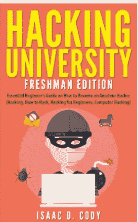
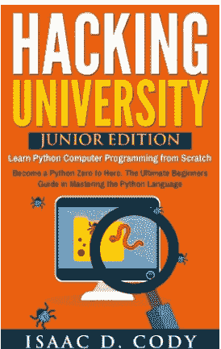
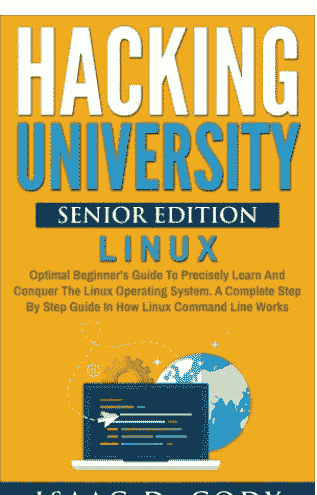
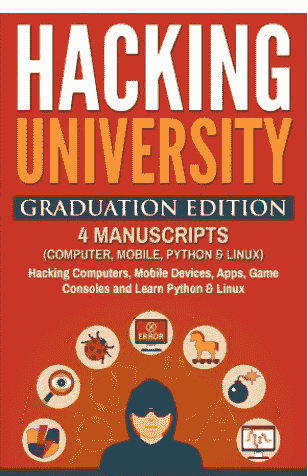

# C++：像高手一样学习 C++。编程与征服 C++ 的初学者指南。从新手到专家快速学习并掌握 C++ 指南（黑客自由与数据驱动）（第 10 卷）

## 第1章：基础背景、历史与C++的成果

在开始学习如何使用C++之前，你必须了解它是什么，以及它是如何产生的。原因很简单。要真正了解某件事，你必须尽可能了解有关该主题的一切，尤其是在涉及计算机编程这样技术性很强的内容时。

C++是计算机和互联网历史中非常重要的一部分。它简直交织在我们今天所熟知的技术世界的历史之中。此外，如果没有C++，智能手机上的应用和其他功能就不会存在。

学习C++时，你会惊叹于一种编程语言竟能在我们的日常生活中产生如此大的影响。几乎每一台曾制造出来的计算机，都可以归因于某个可追溯到C++语言的特定方面。学习这门语言的好处之一是能够轻松学习其他语言。掌握C++的能力会增进你对其他编程语言的了解，这也是许多人将其视为计算机编程“教父”的原因。此外，许多大公司仍然需要以C++编写的程序，因为他们依赖这种编程语言来运行其核心计算机系统。所以，当情况变得艰难时，只要知道从长远来看它会让你受益，因此要坚持下去，进入编程思维模式！

### C++的历史

本贾尼·斯特劳斯特卢普当时正在撰写博士论文，他决定使用一种名为Simula的编程语言。这种语言是计算机时代最早的编程语言之一。然而，它非常慢，而且充满缺陷。

斯特劳斯特卢普想出了“带类的C”（C with Classes）这一构想。这是一种比Simula快得多的编程语言。“带类的C”后来成为Cfront，它加快了创建语言的过程。然而，随着C++的出现，Cfront被抛在了后面，因为C++将编译器加入语言中，使其比当时任何其他编程语言都更容易、更快速地使用。

自那以后，出现了带注释的参考指南和对该语言的更新，使其更好、更快，甚至更易于使用。《C++达人迷》是这门语言的一本流行指南。

C++是当今最流行的语言之一。这门语言对许多行业来说都是最好的选择，因此与其花大量时间创造一种新语言，不如将C++改编成许多不同的变体，因为它本质上具有多功能性。

### C++究竟是什么

C++不是普通的编程语言，它是面向对象的。面向对象编程，简称OOP，是一种围绕对象而非动作展开的编程方式。它就像一次性看整幅图景，而不是看每一块拼图。

这门编程语言在设计时考虑了灵活性和速度，因为当时的其他语言太慢，而且只能做一件事，所以每次你想创造新东西时，都需要一种新语言。

你可以将这门语言用于许多用途，尽管如今已有大量语言存在，这些用途在今天仍然非常流行。

- 预打包脚本：这些是脚本爱好者和新黑客用来练习编程技巧的东西。由于如今很多人都想走捷径，已经准备好的脚本正是大多数黑客所寻找的，因此这些包需要改进，而他们正是使用C++来改进。

- 电子游戏：面对现实吧，几乎每个人一生中某个时候都会玩电子游戏。无论是成长过程中，还是有了孩子之后，你都会被吸入电子游戏的世界，永远无法逃脱。那些游戏在某种程度上都可以归功于使用C++语言。如果你热衷于制作游戏，并通过图形为世界带来欢乐，那么学习C++语言绝对是个好主意。

- 网页：很多网页都是用C++制作的。原因在于这种语言非常容易操控，能快速、轻松地制作出具有大量交互功能的网站。你经常访问的一些用C++创建的网站包括亚马逊和eBay。如果你喜欢设计网页，就应该学习C++以提高效率，甚至可能在这个领域找到一份不错的工作。

- 手机应用：如今似乎每个人都有智能手机，这意味着应用琳琅满目。市面上的应用有成千上万，而且每天都有更多应用被制作出来。有些应用免费，有些应用收费，但其中很大一部分是用C++制作的。这是因为这种语言的可扩展性非常强，可以用于简单游戏和更复杂的购物应用。

C++还有许多其他较小的用途，例如VoIP通话。那就是用C++创建的。事实是，你会一次又一次地被告知C++是一门正在消亡的语言，而实际上那只是Java人士用来吓唬人的伎俩


人们热衷于更换编程语言，以确保C++是一门垂死的语言。

### 为什么使用它

C++之所以被使用，不仅因为它的灵活性和速度，还因为它包含大量组件，相当容易学习，而且如果你掌握了C++，就可以轻松掌握其他语言。原因在于，当你首先学习比其他任何内容都更复杂一点的东西时，较容易的内容就会迎刃而解；然而，如果你习惯了容易学习的科目，那么你就会发现更难的内容学起来很吃力，因为你不习惯在所学科目上投入那么多努力。

如果你想学习一种可以在计算机技术领域内用于不同类型功能的语言，那么这门语言正适合你。你几乎可以用它做任何事情，而一旦你学得足够多，你甚至可能找到方法操纵这门语言，去做它通常无法做到的事情。

在计算机编程领域，C++是一种非常重要的语言。虽然它的布局方式有很多变量，但它非常易读，也非常容易编写。这使它成为业内最受欢迎的编程语言之一，因为没有人想要费力地阅读代码。没有人愿意因为找不到出错的位置，而把所有时间都花在检查自己明知正确的代码上。

### 就业前景

是的，市面上仍有很多工作岗位依赖C++来运作。你可以做许多不同的事情，而所有这些都会影响社群中的其他人。视频游戏设计和网页设计是目前最突出的两件事。你还可以成为一名白帽或蓝帽黑客。

但根据payscale.com（搜索软件工程师）的数据，拥有C++软件工程师背景的人根据经验可以赚取57,000到120,000美元。中位数约为80,363美元。拥有C++编程语言技能的人的其他头衔包括计算机程序员、电气工程师和应用程序开发员。

然而，要想成为最好的自己，你应该始终掌握两到三种编程语言，以便具备市场竞争力。虽然这些语言不会包含在本书中，但不要把自己局限于单一语言。相反，就像人类语言一样，拓宽你的视野，涉猎几种语言，但要保留一门作为你的主要语言。

鉴于其多功能性，C++应该是你依赖的主要语言。也许你可以使用Java或Linux作为其他语言，但C++是最好的主要语言，而你只想要最好的作为主语言。

C++是一种静态编写的低级语言，这意味着它是一种简洁、可扩展的语言。

C++是C语言的全功能超集，支持面向对象编程。这意味着它支持OOP的所有支柱，如封装、数据隐藏、继承和多态。

要了解更多关于面向对象编程的知识，你可以在网上快速搜索，了解更多信息。最好对它有一些基本了解，但这对你掌握C++来说并不是至关重要的，所以本书不会过多涉及，只会在行文中偶尔提及，并穿插一些零碎的信息。

### C++的三个重要组成部分

标准C++由三个非常重要的概念组成。

- **核心语言：** 它由语言的所有变量、数据类型、字面量和其他重要方面组成，构成进入下一级的构建块。
- **C++标准库：** 它允许你操作文件以及语言内部的其他工作，并让它们听命于你。
- **STL：** 即标准模板库，它为你提供操作数据结构、变量和其他类似内容的函数。

### 为什么C++被认为是世上最好的语言？

嗯，除了被广泛提及的灵活性、速度和简洁性之外，它是一种已经跨越三十多年、至今仍被广泛使用的语言。在生活的任何领域中，没有多少产品能这么说。产品和公司来来去去，但只有真正的完美留存。嗯，谚语是这么说的。老实说，C++自那时起经历了许多更新，但核心流程仍然相同。它问世时，遥遥领先于它的时代，而今天，由于不断更新使其保持领先，它仍然是一项相当先进的技术。

还有很多观点与为什么C++被认为是最好的有关。虽然有很多人说C++已经过时，但更多的人保证它仍然是最好的语言，并且是他们的备用语言。这是他们最了解的语言，也是他们心中最亲近的语言。原因各不相同，但90%的程序员默认使用C++这一事实表明，它是当今最好的编程语言。

C++是少数完全遵循ANSI标准的语言之一，这就是为什么你玩过的一些最好的游戏仍然是用C++编写的。因为它们的编译器被设置为确保所有命令都能无错误地编写和执行。它还可以用于许多不同类型的平台，无论你拥有Microsoft、Unix、Mac、Windows还是Alpha设备，都可以使用C++。这是很棒的，因为许多程序员必须在许多不同的平台上工作，而通用性使其易于移植。只需将你的代码放到U盘上，然后上传到需要的地方即可。

### 使用C++语言的好处

使用C++语言时，你可以享受到很多好处。其中一些好处包括：

- **庞大的库：** 由于C++已经存在很长时间，它的库相当庞大。你可以使用这些库，从中挑选脚本中需要的代码，节省时间，甚至学习一些新东西。如果你愿意，也可以创建一些自己的代码，但对于初学编程的人来说，这个库非常有用，可以让你比以前更轻松地编写代码。
- **与其他语言协同工作：** C++非常适合与一些其他编程语言一起使用。这使得你可以更轻松地真正开展你想要的项目，因为你可以从不同的编码语言中加入你喜欢的部分，并将它们组合在一起，创造出真正惊人的成果。
- **适用于许多项目：** 大多数其他编程语言只专注于一两个小项目。例如，使用JavaScript意味着你只能处理网站。但使用C++，你可以用它来帮助完成许多不同的项目。无论你是想开发网站、创建新程序，还是做其他编程相关的事情，你都能借助C++来完成。
- **快速可靠：** 如果你过去使用过其他一些流行的编码语言，你会发现有时它们并不那么可靠。信息可能会遗漏，或者它们不会按你期望的方式开始工作。如果你想要一个第一次就能正常工作且可靠的东西，那么选择C++是一个好主意。
- **功能强大：** 那些喜欢从事编程并希望在自己所做的工作中拥有强大功能的人会发现，C++是他们应该选择的正确选项。在现有的编程语言中，C++拥有一些最强大的功能。

这些只是你使用C++编程语言时可以享受的一部分好处。它可能看起来比Python等其他语言更难用一些，但它拥有你需要的强大功能，并且能与其他编程语言很好地配合。稍加练习，你就能掌握这门语言的所有基础知识，并真正享受这门编程语言能为你带来的乐趣。


## 第2章：开始吧

让我们开始吧！我们可以从很多地方入手，但先来谈谈环境。虽然你并不真的需要搭建自己的环境，因为网上有很多现成的环境。环境是你所选择的编译器，它接收你的代码并为你完成所有功能。在过去，你必须打开命令提示符并创建一个可用的环境，但那样的日子已经一去不复返了。当年，一个简单的错误就可能对他们的计算机造成严重损坏。现在，你可以练习一些有风险的命令，而不会对你的设备造成任何风险。

互联网上有很多示例可以尝试和使用。要试用它们，最简单的去处是 http://www.compileonline.com。选择底部的“学习C++”选项，它就会带你到达需要去的地方。

这里有一个示例可以尝试。输出应该是“Try This”这两个词。

```cpp
#include <iostream>

using namespace std;

int main ()
{
    cout << "Try This";
    return 0;
}
```

现在，你可以选择将这些代码直接输入编译器，也可以编写多个代码并保存到计算机上，随时访问，这样就不必每次想摆弄它们时都重新输入。你可以使用几种不同类型的文本编辑器。不过，其中一些编辑器是特定于设备类型的。这意味着它们只能在你创建代码的那种设备类型上运行。

你可以使用的文本编辑器有 OS 编辑命令、Brief、EMACS、epsilon、Windows 记事本、vim 或 vi。不过，只有 vim 和 vi 可以跨平台使用。确保将文件保存为 .c 或 .cpp 扩展名。

在考虑转向编译器之前，你应该先在文本编辑器中起草程序的初稿。这是因为一旦进入编译器，你的程序就更容易出错，而且不易发现。然而，如果你在文本编辑器中把程序布局得整洁明了，那么在编译器中进行操作就不会有任何问题。

### C++ 编译器

市面上有很多不同的编译器，其中不少都相当昂贵。这些编译器是为那些已经掌握了低级编译器的精英程序员准备的。初学者只需要一个基本的编译器，而这些大多数都是免费的。然而，就像任何免费的东西一样，你必须小心你所得到的东西。市面上糟糕的廉价编译器比好的要多，所以，在免费的表象之下，我建议你为初始页面之外的其他功能付费。这些额外功能通常也非常便宜，所以你不需要为此倾家荡产。

最流行的编译器之一是 GNU C/C++ 编译器。它最常用于 UNIX 和 Linux 系统。要查看你是否已经安装了该编译器，请在 UNIX/Linux 应用程序中打开命令行并输入以下内容：

```bash
$ g++ -v
```

如果编译器已安装，你应该会在屏幕上看到以下信息：

```text
Using built-in specs.
Target: i386-redhat-linux
Configured with: ../configure --prefix=/usr ......
Thread model: posix
gcc version 4.1.2 20080704 (Red Hat 4.1.2-46)
```

如果屏幕上没有出现这条信息，说明编译器未安装在计算机上，或者你安装不正确，你需要重新操作，确保正确安装。

在本书中，我们将介绍如何在 Windows 平台上安装。如果你使用不同的平台，则应访问 http://gcc.gnu.org/install/ 并阅读如何将其下载到你的平台上的说明。

要在 Windows 计算机上安装此编译器，你首先需要安装 MinGW。这个软件能让编译器与你的计算机兼容，拥有这个软件非常重要，否则你甚至根本无法下载编译器。

要安装此软件，你可以访问该软件的主页 www.mingw.org，让它带你到需要去的地方。安装该软件后，你至少应该安装 gcc core、gcc-g++、MinGW runtime 和 binutils，当然，如果你愿意，也可以安装更多。安装完成后，你就可以在 Windows 的命令行中运行所有 GNU 工具了。

现在你已经万事俱备，可以运行了，接下来就可以开始进一步学习如何运行这些程序本身。

### 基本语法

C++ 不仅可以定义为程序，还可以定义为一组通过调用其他方法进行集体通信的对象。在使用 C++ 时，你首先应该知道以下四件事的含义。

- **类（Class）** - 这是一个模板或蓝图，规定了对象及其支持类型，并描述对象的行为。这意味着对象会根据其行为以及动作/支持被归类到符合该对象描述的类中。
- **对象（Object）** - 对象具有行为和状态。例如，你看到一只狗，它就有状态。这些状态可以分为颜色、品种、名字、品种标准（AKC/AKA/APC 注册机构）。“狗”也表现出某些行为。它们摇尾巴、吠叫、喘气、吃干狗粮，还会在院子外面上厕所。这些特性使狗成为一个*独特的对象*。这些对象被归类到一个个组中，你猜到了，那就是类。
- **方法（Method）** - 这是行为的另一种说法。你可以在类中根据需要设置任意多或少的方法。所有数据的操作、动作的执行以及所有逻辑的编写都在这里进行。方法尤其重要，因为如果没有方法，你的程序就不知道该如何处理你给它的变量。它只会像一块废铁一样呆在那里，什么也不做。
- **实例变量（Instance Variables）** - 这些变量指的是每一个具体的对象。每个对象都用一组独特的变量进行分类，这些变量就像对象的指纹。这些变量是通过对象创建时出现的值赋给对象的。

既然你已经知道了编程的四个主要定义，让我们来看一段代码，你可以用它打印出：**“Try This”**。与上面的示例不同，这段代码会稍微深入解释你想要做什么，以及每个函数的原因。

```cpp
#include <iostream>

using namespace std;

// main() [this is when the program will begin to execute.]

int main()
{
    cout << "Try This"; // [Prints Try This]

    return 0;
}
```

这个函数允许你打印任何你想要的内容，不仅仅是“Try This”这两个词。

现在，让我们分解一下上面程序的各个方面。你需要考虑这种语言的几个不同方面。每个方面对于让它运行起来都很重要，如果你没有完全执行它们，程序就无法运行。

- **头文件（Headers）** - C++ 中有多种头文件，所有头文件都是必要的，或者至少对你的编程操作非常有用。不过，对于大多数功能，你都会看到上面提到的 `<iostream>` 头文件。使用头文件时，请确保正确地将它括起来，并在前面加上 `#include`，以提示程序使用该头文件。
- **命名空间（Namespace）** - 命名空间是 C++ 中比较新的特性，直到 2011 年的更新才出现。除了指定使用哪个命名空间之外，它们没有太多作用。虽然它们不是必需的，但它们可以避免你在程序功能上产生很多困惑。它们只是作为一种更有条理地组织函数的方式。
- **主函数（Main）** - 这是主函数开始的地方。使用 `// main()` 这一行会指示程序开始执行主函数，并开始输出过程。设置主函数命令至关重要，否则你的程序将不知道它应该运行什么，也不知道应该在什么时候运行。这会被视为程序中的单行注释，并告诉程序主函数即将开始。
- **int main()** - 这是函数执行正式开始的地方。如果你没有包含这一部分，整个进程将停止，因为你没有引入变量，而没有变量，程序就会迷失方向。


**Cout** - 这会指示程序在屏幕上显示你想要的消息。如果不写 cout，你的程序可能会失败，也可能不会。问题在于你无法知道自己是否成功，所以如果想确保一切顺利运行，就一定要加上 cout。

**Return** - 这会将值返回为零，并终止函数。它指示程序结束进程，并回到开头。

### 现在来编译并执行你的第一个正式 C++ 程序。

首先你必须知道如何*保存*文件。打开你选定的文本编辑器，输入上面看到的代码。完成之后，点击“另存为”，并选择一个容易找到的文件位置。为了便于组织管理，最好始终为所有程序准备一个单独的文件夹。将文件保存为 hello.cpp，保存完成后，你应该先打开命令提示符，然后前往文件保存所在的目录。

要让文件在编译器中打开，首先输入‘g++ hello.cpp’。然后按回车键，代码就会被正确打开。只要没有错误，提示符就会生成一个 a.out 可执行文件。要运行程序，请输入‘./a.out’，看看编译器如何工作。你在计算机上从这一过程应在编译器中获得的信息包括：

```bash
$ g++ hello.cpp
$ ./a.out
```

### 试试这个

确保你以正确的方式输入所有变量，并记住，这些东西区分大小写。如果你没有以正确的方式输入函数，你会发现事情往往会出错。编码这件事要求你必须精确。这种注重细节的个人特质适用于所有编程语言！不过，只要愿意用心，任何人都能做到。

基本函数命令并不是你唯一需要使用的。在构建程序时，还有其他重要的东西，因为它们也会指示程序执行特定操作。其中一些是代码块和分号。

提到分号时，你可能会想到句子中的停顿；然而，在 C++ 程序中，分号是完全的停止符。分号表示语句的终止。这意味着每个单独的语句都必须用分号来标示。下面是三个不同的语句。

```
x=y;
y=y+1;
add(x,y);
```

这些语句中的每一个不仅由换行分隔，还由分号分隔。你也可以这样写。

```
x=y; y=y+1; add(x,y);
```

仅仅因为分号，其中每一个都会被识别为单独的语句。这么简单的东西竟能产生如此大的影响，实在有点令人惊叹。

|   |   |   |
|---|---|---|
| asm |  |  |
| Break | Bool | Auto |
| Char | Catch | Case |
| Const_cast | Const | Class |
| Delete | Default | Continue |
| Dynamic_cast | Double | Do |
| Explicit | Enum | Else |
| False | Extern | Export |
| Friend | For | Float |
| Inline | If | Goto |
| Mutable | Long | Int |
| Protected | Private | Namespace |
| Reinterpret_cast | Register | Public |
| Signed | Short | Return |
| Static_cast | Static | Sizeof |
| Template | Switch | Struct |
| True | Throw | This |
| Typeid | Typedef | Try |
| Unsigned | Union | Typename |
| Void | Virtual | Using |
| While | Wchar_t | Volatile |

在标识符方面，其他一切都可以自由使用。把标识符想象成用户名和密码。可以随意组合，但要确保它们能正常发挥作用。

### 三字符组（Trigraphs）

三字符组是由三个字符组成的序列，却只表示一个字符。你会注意到它们，因为它们开头是两个问号。一个字符就能起作用时却要用三个字符，似乎有点多余，但这样做是为了避免你因字符含义而让程序混淆，因为许多字符看起来很相似。

下面是一些常用的三字符组，举例说明我们的意思。

```
??=   #
??/   \
??'   ^
??(   [
??)   ]
??!   |
??<   {
??>   }
??-   ~
```

并非所有编译器都支持三字符组，因为它们容易让人困惑，大多数人都尽量避开它们；不过，人们发现，当你记住三字符组后，在函数中按错符号而出错的概率就会降低。

### 空白字符

接下来讲空白字符。这是程序中的空行。有时它们包含注释，这些被称为空行。编译器会完全忽略它们。空白字符包括空格、换行、制表符、字符和注释。它只是用来让你的程序看起来更有条理、更易读。

在变量/标识符和语句之间，至少应有一行空白。

### 小测验

你以为可以轻轻松松读完这本书，而不用测试自己有没有认真看吗？也不许作弊！能偷看答案并不意味着你应该偷看。你应该像参加普通测验一样对待它，才能真正检验自己的知识，从而判断是否需要回头重读一些内容。这是一次简短的测验，所以你会没事的。

- 1. 什么是空白字符？
- 2. 填空 ___ <<x=y+1;>>
- 3. 什么是三字符组？
- 4. 谁发明了 C with Classes 语言？
- 5. 大多数函数中使用的头文件是什么？

### 答案

- 1. 编译器忽略的空白或注释
- 2. cout << x=y+1;
- 3. 表示单个字符的三个字符序列
- 4. Bjarne Stroustrup
- 5. `<iostream>`

恭喜，如果你五题全对，就可以继续学习下一节了！不过，如果你错了一题以上，可能就应该回去重读这一节。如果你准备好了，那就前往第3章。

## 第3章：进一步深入程序注释、数据类型、行和字符

既然我们已经介绍了 C++ 的最基础知识，现在该深入一些围绕程序的更深入主题了。虽然这些内容更深入，但它们仍然是所有初学者都必须学习的重要概念。

### 程序注释

所以，有时你会想在代码中写一些注释。这些注释很重要，因为它们让你能在代码中留下一点信息，这样以后阅读代码的人就能清楚地了解你的代码究竟是如何运行的，也能获得关于你在代码中想要实现什么的“指引”。此外，在代码行中留下注释，是提醒自己代码可能在哪里出错的好方法。通过在代码中添加注释，你更有可能知道自己在哪里成功、在哪里出错。

这些注释可以随你喜欢，简单或复杂都行。如果只需一两个词就能帮助其他使用者，有些人就只写一两个词；但有时你需要多写几行，以确保一切都能顺利运行，并让其他人理解代码内部发生了什么。

在这种语言中，你只需要使用 `//` 符号来表明你正在写注释。注释可以随你喜欢写多长，只要确保注释结束后换到下一行，这样程序就知道它应该重新开始读取代码了。

最终输出将是“that's great”，不会有其他内容。编译器会忽略注释，这样你就可以让其他程序员了解代码的用途，或者你需要对代码做什么。

不过，如果你想就某段代码寻求帮助，就应该使用多行注释，这样你就能轻松地从复杂代码中获得最好的帮助。多行注释由这些符号 `/* */` 包围。这样打出来，它几乎看起来像一个表情符号。例如

`/* I need help making the puppet dance */` 是一条注释。不过，那仍然是单行注释。更好的例子是

```
/* I need help making the puppet dance
*All he does at this point is sway from side to side */
```

那将是一条多行注释。如你所见，当你开始新的一行时，应该在开头加上星号，以向程序表明你仍在写注释，并且下一行确实是空白。编译时，它会忽略注释，只显示你想显示的内容。

虽然你可以混用注释样式，但最好暂时将它们分开使用，直到你完全掌握所有内容。

### 数据类型

使用任何语言编写程序时，你都必须使用不同的变量。这些变量不过是保留的内存值，用于在编译器内存的某个空间中存储位置。上面的保留关键字列表在这里也很有用。虽然关键字很多，但有七个基本关键字

定义数据类型。

| 类型 | 关键字 |
|---|---|
| 宽字符 | `wchar_t` |
| 无值 | `void` |
| 双精度浮点数 | `double` |
| 浮点数 | `float` |
| 整数 | `int` |
| 字符 | `char` |
| 布尔值 | `bool` |

你可以使用的大多数数据类型都可以用以下修饰符之一来修改，以提供帮助：

- long
- short
- unsigned
- signed

### 变量类型（续）……

在编程语言中使用变量时，你提供了一些存储空间，使程序更容易操作。你使用的所有变量都会关联到不同的类型，而这些类型将决定变量内存的布局和大小。它还会设定你能够存储在该内存空间中的值范围。

变量命名与标识符命名类似。你只能用字母或下划线来命名，并且字母区分大小写。但在此之后，你可以随意使用任何数字、字母和字符。

再次说明，下面更详细地列出你可以使用的基本变量：

- wchar_t：这是宽字符类型。
- void：这表示没有类型。
- double：这是具有双精度的浮点值。
- float：这是具有单精度的浮点数。
- int：这是整数。
- char：这通常只占一个字节，是一种整数类型。
- bool：这用于处理真或假的值。

你还可以定义其他类型的变量。这些变量包括指针、数组、引用、枚举、数据结构和类。

### 创建新行

现在你已经了解了数据类型和修饰符，以及如何在程序中添加注释，接下来该学习如何创建新行了。这是许多新程序员都会遇到的问题。他们在输入中把程序排得整整齐齐，但输出仍然挤在一起，非常凌乱。这是因为他们没有正确地创建新行。记住，空白会被忽略，所以你不能只是跳过一个空行，就指望程序里也会跳过一行。你必须向编译器表明你想开始新的一行。这非常重要，因为当你运行程序时，你希望它顺利运行。你不会想看到像这样的输出。

试试这个 我今天吃了披萨，还做了数学。6=(7-1) 这就是我今天学到的。

你可能更希望看到这样。

试试这个  
今天我吃了披萨，还做了数学  
6=(7-1)  
这就是我今天学到的

为了做出这种区分，你必须使用正确的函数，因为编程正是依赖于使用正确的函数。

要创建换行，你必须使用函数 endl;；它会表明你想要换行，而且如果你不想添加空白，甚至可以不加，不过建议加上，因为这会让你的程序更便于人阅读。

例如，这样：

```cpp
{
    cout << "Try This" << endl;
    cout << "Today I ate Pizza and did Math" << endl;
    cout << "6=(7-1)" << endl;
    cout << "That is what I learned today" << endl;
    return 0;
}
```

看起来比这样好多了：

```cpp
{
    cout << "Try This" << endl; cout << "Today I ate Pizza and did Math" << endl; cout << "6=(7-1)" << endl; cout << "That is what I learned today" << endl;
    return 0;
}
```

你能看出这会让阅读代码的人多么困惑吗？你希望你的代码文件易于阅读，这样如果别人需要修复某些东西，就能轻松找到错误所在。如果所有内容都乱七八糟地挤在一起，那他们也无法轻易找到任何东西，不是吗？

你也可以使用 \n 来表示换行。它与 endl; 相同，但输入起来快得多。你可以任选一种方法，但选定后就要坚持使用。

### C++ 基础知识的重要性

我知道你在想什么：为什么刚开始学就必须知道所有这些琐碎信息？原因是，如果你现在不学，你就不会觉得自己将来会需要它们；而当你阅读别人写的程序时，你就会纳闷那些额外字符是什么意思，以及为什么有那么多空白。养成处理这些简单却有些繁琐的任务的习惯，对于掌握更复杂的编程方法至关重要。就像掌握任何一门语言一样，你必须掌握基础知识，才能掌握专家级概念。

### 变量定义

变量定义会指示编译器要创建变量、存储多少内容以及存储在何处。它指定数据类型，并列出该类型的一个或多个变量。例如

```cpp
type variable_list;
```

你必须使用上面列出的有效数据类型。它们可以包含一个或多个标识符名称，只要用逗号分隔即可，例如

```cpp
int j, k, l;
char c, ch;
float f, salary;
```

下面是设置。你应该有一句话、一道数学题，然后使用上述整数给出这道数学题的答案。所有变量都可以由你自己编造，想设成什么就设成什么。

```cpp
#include <header>

using namespace std;

int main ()
{
    int _ = ;
    int _ = ;
    int _ = _ + _;

    cout << "" << endl;
    cout << "" << endl;
    cout << "int_" << endl;

    return 0;
}
```

只需输入你的数字，并确保数字相加正确。完成之后，重新运行代码，而不要依赖复制粘贴那些不含整数的代码。这样，你将对变量以及 C++ 中基本整数运算的使用有基本理解。

## 第 4 章：数组、循环和条件

信不信由你，你已经学到了很多。基础知识其实并不难，现在只需再学习一些内容，并把一个概念接一个概念地组合起来，确保你成为更优秀的 C++ 程序员。我们继续吧。

### 数组

数组是 C++ 中的一种数据结构，能够存储类型基本相同且大小固定的元素。基本上就是一组相同类型的变量。与其使用单个变量，不如声明一个变量数组，例如数字。为此，你使用 0 到 99 这些编号，并通过数组索引访问每一个元素。

数组将是连续的内存位置。最低地址始终对应第一个元素，最高地址则对应最后一个元素。

### 初始化数组

你可以逐个初始化数组，也可以使用单条语句初始化。例如

```cpp
double balance[5] = {1000.0, 2.0, 3.4, 17.0, 50.0};
```

方括号中的数字不能超过你使用的元素数量。这意味着，当数组大小只指定为五个元素时，你不能有六组数字。但是，如果你不指定大小，就会创建一个大小刚好合适的数组。你会这样写：

```cpp
double balance[] = {1000.0, 2.0, 3.4, 17.0, 50.0};
```

这会创建与前一个示例完全相同的数组，只是你没有指定数组大小，因此系统为你创建了它。相当巧妙。

现在你已经知道如何编写数组，接下来该把它放入实际程序中了。这个程序比之前的程序稍微高级一些，并且有更多元素。你可以在 www.compileonline.com 上查找这些元素。你会被引导到许多教程，甚至还有可下载的 PDF 文件。

下面是你的程序分配数组的公式。

```cpp
#include <iostream>
using namespace std;

#include <iomanip>
```

一遍又一遍地执行它。这些语句会一个接一个地执行。循环语句会让你更容易按所需次数执行这些语句。

循环有四种类型。这些循环处理不同的需求。

### while 循环

while 循环会在满足某个条件时持续重复循环。每次重新开始循环周期时，它都会测试这个条件，直到条件不再为真为止。

写成这样

```cpp
while (condition)
{
    statement(s);
}
```

### for 循环

这种循环会反复执行一个语句序列，同时简化管理循环变量的代码。


写法如下

```cpp
for (init; condition; increment)
{
    statement(s);
}
```

### Do...while 循环

Do...while 循环与 while 语句类似，但它是在到达语句末尾时测试条件，而不是在开始时测试。

写法如下

```cpp
do
{
    statement(s);
} while (condition);
```

### 嵌套循环

嵌套循环是指在一个循环内部再放置一个循环，从而形成循环套循环的连续结构。这种写法过一段时间后可能会让人感到困惑。

写法如下

```cpp
while (condition)
{
    while (condition)
    {
        statement(s)
    }
    statement(s) // you can put more statements
}
```

### 为什么这很重要

最终你会希望拓展自己的知识面。我强烈建议你进一步巩固 C++ 基础知识，以确保掌握并更好地理解更困难的任务。

尽管这些内容对某些人来说可能太高级，对另一些人来说又太简单，但多做一些练习和教程来丰富你的编程技能总是有益的。你可以在 www.compileonline.com 上找到教程。这个工具的重要性再怎么强调都不为过。你必须亲自去看看，了解它到底有多实用。那里也有其他语言的教程，不仅仅是 C++；不妨随意尝试，看看自己喜欢什么。

## 第5章：在 C++ 中使用运算符

无论你计划使用哪种编程语言，学会使用运算符都很重要。它们可以帮助你告诉程序你想做什么，并让你处理自己的代码轻松得多。在你的程序中，可以使用四种主要类型的运算符，它们各自会以不同方式告诉程序如何运行。在 C++ 语言中，你可以使用的一些运算符包括：

- 逻辑运算符
- 算术运算符
- 赋值运算符
- 关系运算符

我们来看看其中一些运算符如何工作，以及在使用 C++ 语言编写代码时，如何让它们发挥良好作用。

### 逻辑运算符

本指南中我们要使用的第一类运算符是逻辑运算符。它们可以帮助你比较输入系统中的某些部分。你可以使用的一些逻辑运算符包括：

- (||)：这被称为逻辑或。使用这个运算符时，如果你的一个操作数不为零，条件就会为真。
- (&&)：这个被称为逻辑与。如果你有两个操作数且它们都不为零，条件就为真。
- (!)：这是逻辑非。你可以用它来反转操作数的状态。因此，如果条件最终为假，这个符号会使其变为真。

### 算术运算符

你可以使用的另一类运算符是算术运算符。这些基本上和在学校里做数学一样。你会告诉程序对你提供的信息进行加法、减法和其他运算。你可以使用的一些算术运算符包括：

- (+)：这是加法运算符，会将你选择的两个操作数相加。
- (-)：这是减法运算符。它会取右侧操作数，并从左侧操作数中减去它。
- (*)：这个运算符使得在 C++ 语言中可以进行乘法运算。
- (/)：这个运算符帮助你在 C++ 中进行除法运算。
- (++)：这是自增运算符。它会把你的操作数的值增加一。
- (--)：这是自减运算符。它会把操作数的值减少一。

### 赋值运算符

赋值运算符可以让你更轻松地为变量指定名称，并有助于在你编写的代码的不同部分中进行搜索、保存等操作。你在 C++ 中可能会使用的一些赋值运算符包括：

- (=)：这个运算符是简单赋值运算符。它会将右侧操作数的值赋给左侧操作数。
- (+=)：这个称为加且赋值运算符。它会将两个操作数的值相加，然后将它们的和赋给左侧操作数。
- (*=)：这是乘且赋值运算符。它会将两个操作数相乘，然后把结果赋给左侧操作数。
- (-=)：这个运算符会从左侧操作数中减去右侧操作数的值，然后将差值赋给左侧操作数。
- (/=)：这是除且赋值运算符。它会用左侧的值除以右侧的值，然后将这个结果赋给左侧。

还有一些其他赋值运算符可用，但它们更高级，因此我们只保留这些基础运算符，以帮助保持条理！

### 关系运算符

在使用 C++ 语言时，关系运算符非常有用。你可以使用的一些运算符包括：

- (==)：这个运算符会检查你的两个操作数是否相等。如果它们相等，条件将为真。
- (>)：这个运算符会检查操作数的值。如果左侧操作数大于右侧操作数，条件将为真。
- (<)：这个运算符基本上与上面的运算符相反。如果你发现左侧操作数的值小于右侧操作数，条件将为真。
- (!=)：这个运算符会检查你的两个操作数是否相等，如果值不相等，条件就为真。
- (<=)：这个运算符会检查左侧操作数是否小于或等于右侧操作数。如果满足这个条件，条件就为真。
- (>=)：这个运算符会检查左侧操作数的值是否大于或等于右侧操作数。如果为真，条件就为真。

## 第6章：帮助 C++ 做出决策

有时你需要让程序为你做出决策。你可以根据用户输入计算机的信息，以及你决定条件为真所需满足的内容，设置程序以某种方式行动。在这个系统中，决策功能稍微高级一些，但你会发现它很容易学习，并且会为你打开许多可以在 C++ 系统中运用的思路。我们来看看你可以做哪些事情来帮助系统自行做出决策。

### switch 语句

我们要在这个系统中处理的第一种决策是 switch 语句。这些语句很好用，因为它们允许你将变量的相等性与一组值（或情况）进行比较。你试图检查的变量将与每个情况进行比较。你可以使用的一个很好的语法示例如下：

```cpp
switch(expression) {
    case constant-expression:
        statement(s);
        break; // optional
    case constant-expression:
        statement(s);
        break; // optional
        // you can add in as many of these case statements as you would like
    default: // Optional
        statement(s);
}
```

在使用这些语句时，有几条规则需要牢记。首先，switch 语句的表达式应为整型或枚举类类型。此外，它也可以属于具有转换函数的类。在 C++ 中，你添加到语法中的 case 语句数量没有限制，因此你可以按需要让它们长或短。只需记住，每个 case 语句中都需要有一个冒号和一个值。

一旦变量找到与它相等的值，它就会继续运行，直到遇到 break 语句。系统找到 break 语句后，switch 就会停止。然后控制流会继续传递。你不需要为这些 case 都放入 break 语句。如果你最终没有 break 语句，控制流就会继续传递下去。

### if 语句

你在程序中能做的最基本的事情之一就是创建 if 语句。这些语句基于系统中的真/假概念。如果系统根据你设置的条件判断输入为真，那么程序就会运行你要求它运行的内容。例如，你设置让系统询问 2 + 2 的答案是什么。如果用户输入答案为 4，你可以让一条消息显示“回答正确！干得好！”

任何时候，只要用户输入的内容根据你设置的条件最终为真，你选择的语句就会显示出来。另一方面，如果用户输入了错误答案，会发生什么。如果他们

如果对上面的问题把答案填成5，那它不会正确，系统会判定这个答案是错误的。

由于 if 语句相当基础，你会发现，如果用户输入错误答案，它并没有做好准备。在这个阶段，如果用户为上面的示例输入除4以外的任何数字，屏幕只会变成空白，什么也不会发生。下一类语句会讲得更深入，并展示如何根据用户输入系统的内容来获得答案。

### if else 语句

现在，正如我们上面稍微讨论过的，使用 if 语句时可能会出现一些限制。如果用户输入错误答案，屏幕只会变成空白，这在系统中可能会很麻烦。此外，有时用户需要输入各种答案，例如当他们输入自己的年龄，而你想把这些年龄区分开时。他们的年龄不一定错误，但如果你只想要21岁以上的人，你就要确保在这个过程中能正确显示某个答案。

为了处理 if else 语句，一个可用的良好语法包括：

```cpp
if(boolean_expression)
{
    // statement(s) will execute if the boolean expression is true
}
else
{
    // statement(s) will execute if the boolean expression is false
}
```

你可以按自己的意愿在语句中加入任意多个这样的结构。因此，如果你想做一个把人们分成五个不同年龄组的程序，你可以根据语法中更多的“else”来设置。这会让你更容易加入其他一些选择。

所以让我们保持简单。假设系统中有 2 + 2。如果用户猜答案是4，你可以在第一部分把它设为真语句，然后屏幕上会显示“答对了！干得好！”这条消息。但如果用户输入答案5（或除4以外的任何其他答案），你可以让屏幕上显示“抱歉，这不是正确答案”这样的消息。

这在你处理代码中想做的事情时给了你很大的自由。你将能够在这个过程中加入一些不同的东西，并且可以真正扩展你正在编写的代码。

在处理这些内容时，你还可以记住另一点：你可以把一些 if 语句和一些 if else 语句相互嵌套。对初学者来说，这可能会变得有点复杂，但经过一些练习，你会发现它会给整个过程增加很大的能力，并能让你更容易地在这个编程语言中实现你想要做的一些事情。

使用 if 语句和 if else 语句可以让你的编程体验好得多。它允许系统根据用户输入系统的内容做出决定，而不必有人在旁边亲自操作。一定要尝试几种不同类型的语句，看看它们在你的代码中、以及在你想要做的事情中会如何发挥作用。

## 第7章：常量和各类字面量

这门语言很复杂，尽管你上面学到的内容足以运行一些简单函数，但这门语言还有太多部分，如果不在这里加入更深入的知识来帮助你过渡到下一步，那简直是一种罪过。

如果你想成功掌握这门语言，就要准备好花很长时间努力钻研。虽然它对初学者来说是一门好语言，因为它有多个难度层次，但你也必须努力才能进入下一层次。你越尝试学习，附加的效果就越难。

编程本身是一个漫长而艰难的过程，但它绝对值得，因为有很多职业都需要 C++ 知识。从游戏设计到机器人工作等等。只要涉及技术，很可能就涉及 C++。

所以，这里还有一些你可以学习的步骤，以及一些你需要知道、以便开始掌握这门语言的更重要的函数。

### 常量和字面量

常量和字面量是学习 C++ 的重要部分。它们涉及数据类型以及这些数据类型中的变量。它们是常量，不能被更改。

当你选择用小数点来表示这些字面量时，需要确保至少加入小数点，不过加入指数也很好。当你用指数形式表示时，应该包括小数部分、整数部分或两者都包括。你使用的带符号指数也应该以 E 或 e 开头。

你在编写代码时可以使用的一些浮点字面量包括：

```cpp
.e55        // these are illegal because they are missing the fraction or the integer
210f        // these are illegal because they don't have the exponent or the decimal
510E        // these are illegal because they have an incomplete exponent
314159E-5L  // these are legal
3.14159     // these are legal
```

### 布尔字面量

接下来我们可以讨论的字面量类型是布尔字面量。在 C++ 代码中，你可以使用两种类型。基本上，布尔值会显示为 true 或 false。如果你设定的条件为真，布尔表达式的结果就是 true。另一方面，如果你设定的条件没有得到满足，你最终会得到一个为 false 的条件。当答案是布尔值时，所有答案都会以 true 或 false 的形式出现。

### 字符字面量

当你在代码中看到字符字面量时，你会注意到它们用单引号括起来。它们可以很简单，比如用 'x' 来告诉命令，也可以长得多。这些是你能够加入代码中的基础内容，可以让事情处理起来容易得多。

### 字符串字面量

你还可以使用的另一种字面量是字符串字面量。这些字面量会用双引号括起来。字符串将包含类似字符字面量中的字符，包括通用字符、转义序列和普通字符等选项。你可以通过多种方式使用字符串字面量，包括把一行拆成两行，以及把内容分开以便更容易阅读。你可以使用的字符串示例包括：

```cpp
"hello, Mother"
"hello, \
Mother"
"hello, " "M" "other"
```

学习如何在 C++ 编程语言中使用其中一些不同部分，会对你使用这门计算机语言的能力产生很大影响。玩一玩并尝试使用它们，你会发现比以往更容易得到你想要的结果！

## 结论

再次感谢你购买这本书。我希望它既有信息量，又令人愉快。请把这本书当作指南，不仅用于获取知识，也用于获得灵感。C++ 看起来像是一门令人生畏的语言，但你越是有规律地练习它，日复一日、月复一月、年复一年，你就会像对待生活中的其他事情一样，完全掌握这门编程语言。我请你不要因为出现问题而烦恼和焦虑，因为这种情况会发生很多次。外面有无数资源正等着你去阅读或发现，而尽你所能地学习、改进并把你的 C++ 编程技能提升到下一层次，对你最有利。

## 附赠：黑客历史与概述

许多人都听说过 C++ 这个名字，但并没有真正在意它。如果你不太懂技术，你可能会以为它指的是得到一个中等偏下的字母等级，但事实并非如此。

信不信由你，C++ 是一门黑客语言，虽然它不是唯一的黑客语言，但它是比较重要的语言之一，因为它用途广泛，而且易于使用。要最深入地了解 C++，你必须更多地了解它产生的原因，而那就是黑客行为。

### 黑客行为

黑客行为并不是一个新概念。只要有某种技术存在，就会有人想办法入侵它们。黑客行为是对从一个地方发送到另一个地方的技术数据流进行操纵和/或中断。这是通过脚本来完成的。虽然你可以在网上获得预先打包好的脚本，但许多人更喜欢自己编写脚本的传统方式，因为这让他们在利用信息时拥有更大的灵活性。已经打包设置好的脚本灵活性有限，而且相当显眼。真正想要实施黑客行为的黑客，其目标是保持隐蔽。如果你被抓到，除非你有权限这样做，否则你可能会陷入大麻烦。

### 黑客史

黑客行为正式始于20世纪70年代，当时青少年被禁止使用电话

电话线路，因为他们试图免费打电话，并想出了办法。电话黑客行为是当时最重大的事情，并持续了一百多年。过去打电话很贵，尤其是在电话线路刚出现的时候，所以人们自然会想方设法省钱，而通常这也会让他们惹上麻烦。一个名叫约翰·德雷珀的人就是如此。他因发现只需向听筒吹一个音调，就能促使系统在没有接线员的情况下拨出长途电话，从而打长途电话而被捕。之后你可以输入号码，想聊多久就聊多久。很天才，但违法。

不过，他引发了一场革命。一群青少年联合起来，创建了一条入侵系统的电话线路，帮助人们免费打电话。此事像野火一样蔓延后，史蒂夫·乔布斯决定推出一款可以推向市场的产品，它能入侵电话线路，帮助人们自行免费打电话。

真正大规模的计算机黑客行为实际上直到20世纪80年代才开始。然而，一旦开始，它就迅速蔓延，很多人认为，看看自己究竟能做些什么、如何操纵这些计算机，是个绝妙的主意。

### 黑客行为的类型

黑客行为有几种不同类型。虽然媒体把所有黑客都描绘成坏人，但事实并非如此。这也不是非黑即白的。虽然谈到黑客时，这两类是最常被提及的群体，但介于两者之间的类别非常多，只讨论最知名的两类并没有好处。

然而，所有子类别都归属于两大主要类别之间：道德黑客行为和不道德黑客行为。

道德黑客行为是仅用于正当目的的黑客行为。很多人拥有完全权限入侵系统，并找出软件或硬件的所有漏洞。

道德黑客负责你手机、应用、平板电脑或计算机中的所有漏洞修复。这些人受公司雇佣，找出系统的问题，并找到最佳修复方法。这些黑客是黑客社区中不可或缺的一部分。

如果没有黑客，我们就不会有万维网、URL 或 HTML。如果在道德黑客行为的边界内进行，黑客行为就是重要的一环。

然而，不道德黑客行为不属于现行法律允许的黑客行为范畴。它是出于恶意目的的黑客行为。入侵银行大型机、窃取他人信用卡和账户信息并用来清空账户的人，其行为被称为不道德黑客行为。

不道德黑客行为是真正黑客的克星。正是这些人让好人背上了坏名声。

接下来介绍各种不同类型黑客的术语。

-   白帽黑客：这些是完全遵守道德的黑客。他们所做的一切都是为了正当目的。他们遍历系统，仔细排查任何漏洞，并构建超强防火墙以保障系统安全。他们开发反恶意软件。
-   黑帽黑客行为：这是你必须远离的黑客行为类型。能力越大，责任越大。重大的责任就是不要成为黑帽黑客行为诱惑的猎物。这类黑客行为会给你带来很多麻烦，而且不道德。入侵政府文件甚至他人隐私可能很诱人，但会导致严厉的惩戒。
-   灰帽黑客行为：这些黑客有时出于正当理由做坏事。例如“匿名者”（Anonymous）。他们可能会入侵敏感信息文件的防火墙，但这样做是为了揭露防火墙背后的腐败。这些黑客常被当作罪犯对待，但实际上，取决于你的视角，他们也可以被视为英雄。
-   红帽黑客：这些是黑客世界的赏金猎人。他们利用自己的黑客技能寻找非法黑客，例如黑帽黑客，或正在做不该做的坏事的灰帽黑客。然后他们将其移交给联邦探员，以便非法黑客被逮捕。这些黑客还有几个其他称呼，但不太恰当，所以我们略去不提。
-   蓝帽黑客：这些是黑客世界的蓝领工人。他们坐在小隔间里，整天不停地从事黑客工作，为微软或其他大公司寻找漏洞。他们按时打卡上下班，从事一份恰好涉及黑客行为的朝九晚五工作。

这些是黑客的主要分类。还有精英黑客，他们毕生致力于成为世界上见过的最优秀的黑客；以及绿帽黑客，他们并不真正在乎黑客行为，只是图个乐。黑客行为可以是非常有用的工具，如果你以正确的方式去做，甚至能成为一种职业。

现在需要注意的是，所有这些黑客的工作方式都会不同，但他们会使用同类代码来从其他计算机获取想要的信息。黑帽黑客会专注于进入系统并获取他们需要的信息以取得成功，而白帽黑客则会努力阻止这些黑客进入系统。尽管他们工作方式不同，但会使用相同的工具，并看看最终谁能胜出。

话虽如此，你需要小心使用自己的黑客能力。如果你利用它们进入不允许你进入的系统或网络，就可能惹上很多麻烦。虽然有些人发现这些漏洞后会立即告知公司，但如果你本不该在系统上却进入了系统，这仍然是一个法律问题。你招惹的公司可能会提起诉讼，所以最好始终只在自己的网络内工作并保障其安全，而不是试图进入不属于你的网络。

另一方面，如果你热爱在计算机世界工作，并且希望一直做这类事情，那么成为一名白帽黑客可能是个好主意。许多公司会保存客户的私人和个人信息，无论是医院信息、信用卡信息还是其他信息。他们始终警惕可能试图进入系统并窃取这些信息的黑帽黑客，而优秀的白帽黑客总能找到帮助这些公司所需的工作。

## 相关书名

### 黑客大学：新生版 成为业余黑客的必备初学者指南



### 黑客大学：大二版。将你的黑客技能提升到下一水平的必备指南。入侵移动设备、平板电脑、游戏主机和应用


### 黑客大学：大三版。从零开始学习 Python 计算机编程。从 Python 小白到高手。掌握 Python 语言的终极初学者指南



### 黑客大学。大四版 Linux。精准学习并征服 Linux 操作系统的最佳初学者指南。Linux 命令行工作原理的完整分步指南



### 黑客大学：毕业版。4 部手稿（计算机、移动设备、Python 与 Linux）。入侵计算机、移动设备、应用、游戏主机，并学习 Python 与 Linux



### 数据分析：实用数据分析与统计指南，助你转型和发展任何企业；为初学者利用数据分析、数据科学和预测分析的力量


## 关于作者

艾萨克·D·科迪（Isaac D. Cody）是一位来自纽约市、自豪、精明且恪守道德的黑客。目前，艾萨克在纽约市中心一家中型信息技术公司工作。他立志成为美国政府的安全黑客，但也热衷于向他人讲授技术的未来。艾萨克坚信，未来无论是安全保障，还是公司和未来职业的成功，都将高度依赖计算机“极客”。闲暇时，他喜欢分析和审视篮球比赛的一切。
