# C++ 移动语义完整指南：第一版

## 前言

随 C++11 引入的移动语义，已成为现代 C++ 编程的一个标志性特征。然而，它也在许多方面使语言变得复杂。即使经过数年的支持，经验丰富的程序员仍要费力应对移动语义的所有细节，风格指南对于即便是平凡类的编程仍推荐不同的处理后果，而我们仍在 C++ 标准委员会中讨论语义细节。

每当我讲授迄今为止我所学到的 C++ 移动语义知识时，我都会说：“总得有人写一本关于这一切的书。”而通常的回答是：“是啊，请写吧。”于是，我终于写了。

和以往写关于 C++ 的书一样，我惊讶于需要讲授的方面、需要澄清的情形以及需要描述的后果之多。确实到了写一本全面介绍移动语义的书的时候了，涵盖从 C++11 到 C++20 的所有 C++ 版本。我学到了很多，我相信你也会如此。

### 一项实验

本书在两个方面是一项实验：

- 我正在写一本深入的书，涵盖一项复杂的核心语言特性，但没有核心语言专家作为合著者直接提供帮助。不过，我可以提问，而且我确实会问。
- 我正在 Leanpub 上自行出版本书，并按需印刷。也就是说，本书是逐步写成的，一旦出现值得发布新版本的显著改进，我就会发布新版本。

好处在于：

- 你能从一位经验丰富的应用程序员的角度来看待这些语言特性——这个人能感受到某项特性可能带来的痛苦，并会提出相关问题，从而能够激发并解释该设计及其对实际编程的后果。
- 在我仍在写作的过程中，你就能从我在移动语义方面的经验中受益。
- 本书和所有读者都能从你的早期反馈中受益。

这意味着你也是这项实验的一部分。所以请帮帮我：对缺陷、错误、解释得不好的特性或遗漏之处给出反馈，以便我们都能从这些改进中受益。

### 本书版本

由于本书是增量编写的，以下是主要更新的历史记录（最新在前）：

- **2020-10-27**：若干修正（见勘误）
- **2020-09-18**：使用带模板参数的 lambda（自 C++20 起）
- **2020-09-15**：修复万能引用完全特化中的一个错误
- **2020-09-12**：用于数据成员的 `std::move()`
- **2020-09-10**：修复延迟完美返回
- **2020-09-09**：完成校对，最终修正将进入印刷
- **2020-09-06**：用于抽象基类的辅助特性 `is_nothrow_moveable`
- **2020-09-06**：函数（的引用）的值类别
- **2020-09-05**：关于 `auto&&` 的澄清，包括在 C++20 函数中使用它
- **2020-08-29**：对象对自身的移动赋值
- **2020-08-28**：`std::pair<>`、`std::optional<>`、线程等的移动语义
- **2020-08-28**：独占指针、IOStreams 及其他仅可移动类型
- **2020-08-26**：关于万能引用的若干澄清
- **2020-08-25**：调用成员函数时使用 `std::move()`
- **2020-08-20**：关于仅可移动类型的新章节
- **2020-08-19**：noexcept 细节讨论
- **2020-08-18**：关于移动算法和迭代器的新章节
- **2020-08-10**：共享指针移动语义的描述
- **2020-08-10**：重用被移动对象的原因，以及对对象自移动赋值的澄清
- **2020-08-09**：建议不要用 `const` 按值返回
- **2020-07-27**：字符串和容器的移动语义
- **2020-07-24**：关于使用引用限定符的一般性说明
- **2020-07-23**：万能引用类型推导细节及完美转发引用折叠的描述
- **2020-07-07**：lambda 完美返回的描述
- **2020-06-21**：关于完美返回的新章节（附完美转发的小修正）
- **2020-06-12**：改进关于“无效”状态的章节
- **2020-06-08**：关于使用 noexcept 的新章节
- **2020-06-06**：改进关于无效状态的章节
- **2020-05-03**：修复类层次结构中的移动语义
- **2020-04-29**：评审后修复类的移动语义和无效状态
- **2020-04-25**：修复代码排版以及非 PDF 版本中缺失的图表
- **2020-04-22**：关于被移动后状态的新章节
- **2020-04-13**：讨论何时无法避免使用 `std::move()`
- **2020-02-01**：讨论自动生成的移动操作何时失效
- **2020-01-19**：带万能引用的构造函数
- **2020-01-04**：本书的初始出版版本

## 致谢

首先，我要感谢你，也就是 C++ 社区，因为你们使本书成为可能。移动语义所有特性令人惊叹的设计、有用的反馈以及你们的好奇心，是一门成功语言演进的基础。特别感谢你们告诉并向我解释的所有问题，以及你们给出的反馈。

我特别想感谢所有审阅本书草稿或相应幻灯片并提供宝贵反馈和澄清的人。这些审阅显著提高了本书的质量，再次证明好东西需要许多“聪明人”的投入。因此，迄今为止（这份名单还在增长），衷心感谢 Javier Estrada、Howard Hinnant、Klaus Iglberger、Daniel Krügler、Marc Mutz、Aleksandr Solovet (axelovet)、Peter Sommerlad 和 Tony Van Eerd。

此外，我要感谢 C++ 社区和 C++ 标准委员会中的每一个人。除了添加新语言和库特性所涉及的所有工作之外，这些专家还花了许多许多小时向我解释和讨论他们的工作，而且他们是以耐心和热情这样做的。

特别感谢 LaTeX 社区提供了出色的文本系统，并感谢 Frank Mittelbach 解决我的 \LaTeX 问题（几乎总是我的错）。

最后，非常感谢我的校对员 Tracey Duffy，她出色地完成了一项工作：把我的“德语英语”转换成地道的英语。

本页有意留白。

## 关于本书

本书讲授 C++ 移动语义。它从基本原理开始，激发并解释移动语义的所有特性和边界情况，以便作为程序员的你能够正确理解和使用移动语义。本书对刚刚开始学习移动语义的人很有价值，对已经在使用它的人则是必不可少的。

和我的书一贯的风格一样，重点在于新特性在实践中的应用，本书将演示这些特性如何影响日常编程，以及你如何在项目中从中受益。这既适用于应用程序员，也适用于提供通用框架和基础库的程序员。

### 阅读本书前应了解的内容

为了从本书中获得最大收益，你应当已经熟悉 C++。你应当熟悉类和引用的一般概念，并且应当能够使用 C++ 标准库中的 IOStreams 和容器等组件编写 C++ 程序。你还应当熟悉“现代 C++”的基本特性，例如 auto 或基于范围的 for 循环。

不过，你不必是专家。我的目标是让内容对普通 C++ 程序员来说易于理解，即使他们不一定了解最新特性的所有细节。我会讨论基本特性，并在需要时回顾更微妙的问题。

这确保本书既能让专家也能让中级程序员读懂。

### 本书整体结构

本书涵盖截至 C++20 的 C++ 移动语义的*所有*方面。这既适用于语言特性也适用于库特性，也既适用于影响日常应用程序编程的特性，也适用于（基础）库的复杂实现所需的特性。不过，更一般的情况和示例通常先出现。

不同章节按组编排，因此从教学角度讲，你应当从头到尾阅读本书。也就是说，后面的章节通常依赖前面章节介绍的特性。不过，交叉引用也有助于处理后续的特定主题，指出它们在哪里引用了前面介绍的特性和方面。


因此，本书包含以下部分：

- 第一部分介绍移动语义的基本特性（尤其是针对非泛型代码）。
- 第二部分介绍泛型代码（尤其是模板和泛型 lambda 中使用）的移动语义特性。
- 第三部分介绍移动语义在 C++ 标准库中的使用（同时给出一个在实践中如何使用移动语义的良好示例）。

## 如何阅读本书

不要被本书的页数吓到。和 C++ 一贯的情况一样，当你深入细节（例如实现模板）时，事情可能会变得相当复杂。若只想获得基本理解，本书的前三分之一（第一部分，尤其是第 1 章到第 5 章）就足够了。

根据我的经验，学习新知识的最佳方式是看示例。因此，你会在本书中看到大量示例。有些只是几行代码，用来说明一个抽象概念；另一些则是完整程序，给出材料的具体应用。后一类示例会由一段 C++ 注释引出，该注释描述包含程序代码的文件。你可以在本书网站 http://www.cppmove.com 上找到这些文件。

## 我的实现方式

请注意以下关于我编写代码和注释方式的提示。

### 初始化

我通常使用现代形式的初始化（在 C++11 中引入，称为*统一初始化*），并用花括号：

```cpp
int i{42};
std::string s{"hello"};
```

这种初始化形式称为*花括号初始化*，具有以下优点：

- 它可用于基础类型、类类型、聚合体、枚举类型和 `auto`。
- 它可用于以多个值初始化容器。
- 它可以检测窄化错误（例如用浮点值初始化 `int`）。
- 它不会与函数声明或调用混淆。

如果花括号为空，则会调用（子）对象的默认构造函数，并保证基础数据类型初始化为 `0/false/nullptr`。

## 错误术语

我经常谈论编程错误。如果没有特别提示，术语*错误*或如下注释

```cpp
...    // ERROR
```

表示编译期错误。相应代码不应编译通过（在使用符合标准的编译器时）。

如果我使用术语*运行时错误*，则程序可能编译通过，但行为不正确或导致未定义行为（因此，它可能做预期的事，也可能不做）。

## 代码简化

我尽量用有帮助的示例解释所有特性。然而，为了聚焦要讲授的关键方面，我可能会经常省略本应属于代码的其他细节。

- 大多数时候，我使用省略号（“...”）表示缺失的其他代码。注意，我在这里不使用代码字体。如果你看到代码字体的省略号，那么这三个点必须是代码中的一种语言特性（例如用于“typename . . .”）。
- 在头文件中，我通常会省略预处理守卫。所有头文件都应有类似下面的内容：

```cpp
#ifndef MYFILE_HPP
#define MYFILE_HPP
...
#endif // MYFILE_HPP
```

因此，请当心，并在项目中使用这些头文件时修正代码。

## C++ 标准

C++ 有由不同 C++ 标准定义的多个版本。

最初的 C++ 标准于 1998 年发布，随后在 2003 年由一份*技术勘误*修订，该勘误对最初标准做了少量更正和澄清。这个“旧 C++ 标准”被称为 C++98 或 C++03。

“现代 C++”的世界始于 C++11，并通过 C++14 和 C++17 得到扩展。国际 C++ 标准委员会现在的目标是每三年发布一个新标准。显然，这给大规模新增内容留下的时间更少，但它能更快地把变化带给更广泛的编程社区。因此，开发较大的特性需要时间，并可能跨越多个标准。

下一个“更加现代的 C++”已经在地平线上，即 C++20 引入的内容。同样，若干编程方式可能会改变。不过，一如既往，编译器需要一些时间才能提供最新语言特性。在撰写本书时，C++17 通常是主要编译器支持的最新版本。

幸运的是，移动语义的基本原则都是在 C++11 和 C++14 中引入的。因此，本书中的代码示例通常应能在所有主要编译器的近期版本上编译。如果讨论 C++17 或 C++20 引入的特殊特性，我会明确说明。

## 示例代码与附加信息

你可以访问所有示例程序，并从本书网站找到关于本书的更多信息，其网址如下：

```
http://www.cppmove.com
```

## 反馈

欢迎建设性意见——无论负面还是正面。我非常努力地为你呈现一本我希望你会认为优秀的书。然而，在某个时刻，我必须停止写作、审阅和调整，以“发布新修订版”。因此，你可能会发现错误、不一致之处、可以改进的表述，或者完全缺失的主题。你的反馈让我有机会修正这些问题，通过本书网站告知所有读者相关变化，并改进任何后续修订或版本。

联系我的最佳方式是通过电子邮件。你可以在本书网站上找到电子邮件地址：

```
http://www.cppmove.com
```

如果你使用电子书，可能希望确保手头有本书的最新版本（请记住，它是增量编写和发布的）。在提交报告之前，你还应查看本书网站上的当前已知勘误。无论如何，在提供反馈时请注明此版本的出版日期。当前出版日期是 **2020-12-19**（你也可以在封面之后的第 ii 页找到它）。

非常感谢。

## 第一部分

### 移动语义的基本特性

本书这一部分介绍移动语义的基本特性，这些特性并非泛型编程（即模板）所特有。它们对应用程序员日常编程尤其有帮助，因此每一位使用现代 C++ 的 C++ 程序员都应该了解它们。

泛型编程中的移动语义特性将在第二部分介绍。

此页故意留白

## 第 1 章

## 移动语义的力量

本章通过一个简短代码示例展示移动语义的基本原理和优势。

### 1.1 移动语义的动机

为了理解移动语义的基本原理，让我们看一小段代码的执行过程：首先不使用移动语义（即用只支持 C++03 的旧 C++ 编译器编译），然后使用移动语义（用支持 C++11 或更高版本的现代 C++ 编译器编译）。

#### 1.1.1 C++03 示例（移动语义之前）

假设我们有如下程序：

```cpp
// basics/motiv03.cpp
#include <string>
#include <vector>

std::vector<std::string> createAndInsert()
{
    std::vector<std::string> coll;  // create vector of strings
    coll.reserve(3);                // reserve memory for 3 elements
    std::string s = "data";         // create string object

    coll.push_back(s);              // insert string object
    coll.push_back(s+s);            // insert temporary string
    coll.push_back(s);              // insert string

    return coll;                    // return vector of strings
}

int main()
{
    std::vector<std::string> v;        // create empty vector of strings
    ...
    v = createAndInsert();             // assign returned vector of strings
    ...
}
```

让我们看看用**不**支持移动语义的 C++ 编译器编译该程序时，程序的各个步骤（同时检查栈和堆）。

- 首先，在 `main()` 中，我们创建空 vector `v`：

    ```cpp
    std::vector<std::string> v;
    ```

    它作为对象放在栈上，元素数量为 0，且没有为元素分配内存。

- 然后，我们调用

    ```cpp
    v = createAndInsert();
    ```

    这里我们在栈上创建另一个空 vector `coll`，并在堆上为三个元素预留内存：

    ```cpp
    std::vector<std::string> coll;
    coll.reserve(3);
    ```

    分配的内存未初始化，因为元素数量仍为 0。

- 然后，我们创建一个初始化为 "data" 的 string：

    ```cpp
    std::string s = "data";
    ```

    string 类似于元素类型为 `char` 的 vector。本质上，我们在栈上创建一个对象，其中有一个表示字符数的成员（值为 4），以及一个指向字符内存的指针。

在这条语句之后，程序处于以下状态：栈上有三个对象：`v`、`coll` 和 `s`。其中两个对象 `coll` 和 `s` 已在堆上分配了内存。


```cpp
std::vector<std::string> createAndInsert()
{
    std::vector<std::string> coll;
    coll.reserve(3);
    std::string s = "data";

    coll.push_back(s);

    coll.push_back(s+s);

    coll.push_back(s);

    return coll;
}

std::vector<std::string> v;
v = createAndInsert();
```

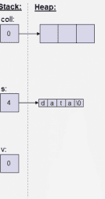

- 下一步是将字符串插入 vector `coll` 的命令：

```cpp
coll.push_back(s);
```

C++ 标准库中的所有容器都具有值语义，这意味着它们会创建传入值的副本。因此，我们得到 vector 中的第一个元素，它是传入值/对象 `s` 的完整（深）拷贝：

```cpp
std::vector<std::string> createAndInsert()
{
    std::vector<std::string> coll;
    coll.reserve(3);
    std::string s = "data";

    coll.push_back(s);

    coll.push_back(s+s);

    coll.push_back(s);

    return coll;
}

std::vector<std::string> v;
...
v = createAndInsert();
```

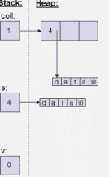

到目前为止，这个程序中没有什么需要优化的。当前状态是我们有两个 vector，`v` 和 `coll`，以及两个字符串，`s` 和它的副本，即 `coll` 中的第一个元素。它们都应该是各自独立的对象，拥有自己用于存储值的内存，因为修改其中一个不应影响任何其他对象。

- 现在让我们看下一条语句，它创建一个新的临时字符串并再次将其插入 vector：

```cpp
coll.push_back(s+s);
```

这条语句分三步执行：

1. 我们创建临时字符串 `s+s`：

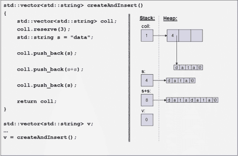

2. 我们将这个临时字符串插入 vector `coll`。和往常一样，容器会创建传入值的副本，这意味着我们会创建该临时字符串的深拷贝，包括为其值分配内存：

```cpp
std::vector<std::string> createAndInsert()
{
    std::vector<std::string> coll;
    coll.reserve(3);
    std::string s = "data";

    coll.push_back(s);

    coll.push_back(s+s);

    coll.push_back(s);

    return coll;
}
std::vector<std::string> v;
...
v = createAndInsert();
```

**内存示意图：** 展示插入期间 `coll`、`s`、`s+s` 和 `v` 的栈和堆布局。

3. 在该语句结束时，临时字符串 `s+s` 被销毁，因为我们不再需要它：

```cpp
std::vector<std::string> createAndInsert()
{
    std::vector<std::string> coll;
    coll.reserve(3);
    std::string s = "data";

    coll.push_back(s);

    coll.push_back(s+s);

    coll.push_back(s);

    return coll;
}
std::vector<std::string> v;
...
v = createAndInsert();
```

**内存示意图：** 临时对象 `s+s` 在该语句之后被划掉并销毁。

这里，我们第一次遇到生成的代码性能不佳的情况：我们创建临时字符串的副本，并紧接着销毁副本的来源，这意味着我们不必要地分配并释放了本可以直接从源移动到副本的内存。

- 在下一条语句中，我们再次将 `s` 插入 `coll`：

```cpp
coll.push_back(s);
```

同样，coll 会复制：

```cpp
std::vector<std::string> createAndInsert()
{
    std::vector<std::string> coll;
    coll.reserve(3);
    std::string s = "data";

    coll.push_back(s);

    coll.push_back(s+s);

    coll.push_back(s);

    return coll;
}

std::vector<std::string> v;
...
v = createAndInsert();
```

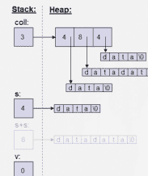

这也是可以改进的地方：因为不再需要 `s` 的值，某些优化可以改为使用 `s` 的内存作为 vector 中新元素的内存。

- 在 `createAndInsert()` 的末尾，我们来到 return 语句：

```cpp
return coll;
}
```

这里，程序的行为变得稍微复杂一些。我们按值返回（返回类型不是引用），这应该是 return 语句中的值 `coll` 的副本。创建 `coll` 的副本意味着我们必须创建整个 vector 及其所有元素的深拷贝。因此，我们必须为 vector 中的元素数组分配堆内存，并为每个 string 用来保存其值的内存分配堆内存。这里，我们将不得不分配内存 4 次。

然而，由于同时 `coll` 会因为离开其声明所在的作用域而被销毁，编译器被允许执行*命名返回值优化*（NRVO）。这意味着编译器可以生成代码，使得 `coll` 直接被用作返回值。

即使这会改变程序的功能行为，也允许这种优化。如果我们在 vector 或 string 的拷贝构造函数中有一条打印语句，我们会看到程序不再有该打印语句的输出。这意味着这种优化改变了程序的功能行为。然而，这没问题，因为即使这种优化有副作用，我们也在 C++ 标准中明确允许它。没有人应该期望这里执行了拷贝，同样也没有人应该期望这里没有执行拷贝。是否执行命名返回值优化完全取决于编译器。

假设我们获得了命名返回值优化。在这种情况下，在 return 语句结束时，`coll` 现在成为返回值，并且 `s` 的析构函数被调用，释放其声明时分配的内存：

```cpp
std::vector<std::string> createAndInsert()
{
    std::vector<std::string> coll;
    coll.reserve(3);
    std::string s = "data";

    coll.push_back(s);

    coll.push_back(s+s);

    coll.push_back(s);

    return coll;
}

std::vector<std::string> v;
...
v = createAndInsert();
```

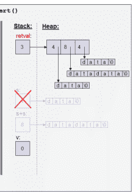

- 最后，我们来到将返回值赋值给 `v` 的步骤：

```cpp
v = createAndInsert();
```

这里，我们确实遇到了可以改进的行为：通常的赋值运算符的目标是让 `v` 获得与被赋值的源值相同的值。一般来说，任何被赋值的值都不应被修改，并且应独立于该值被赋值到的对象。因此，赋值运算符会创建整个返回值的深拷贝：

```cpp
std::vector<std::string> createAndInsert()
{
    std::vector<std::string> coll;
    coll.reserve(3);
    std::string s = "data";

    coll.push_back(s);

    coll.push_back(s+s);

    coll.push_back(s);

    return coll;
}

std::vector<std::string> v;
...
v = createAndInsert();
```

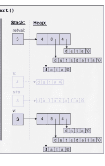

然而，紧接着，我们不再需要临时返回值，并销毁它：

```cpp
std::vector<std::string> createAndInsert()
{
    std::vector<std::string> coll;
    coll.reserve(3);
    std::string s = "data";

    coll.push_back(s);

    coll.push_back(s+s);

    coll.push_back(s);

    return coll;
}

std::vector<std::string> v;
...
v = createAndInsert();
```

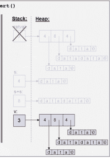

同样，我们创建临时对象的副本，并紧接着销毁副本的来源，这意味着我们再次不必要地分配并释放内存。这次涉及四次分配：一次用于 vector，每个字符串元素各一次。

对于 `main()` 中赋值后该程序的状态，我们分配内存十次并释放六次。不必要的内存分配由以下原因造成：

- 将临时对象插入容器
- 将不再需要其值的对象插入容器
- 赋值一个包含其所有元素的临时 vector

我们或多或少可以避免这些性能损失。特别是，代替最后的赋值，我们可以执行以下操作：

- 将 vector 作为输出参数传入：

```cpp
createAndInsert(v);   // let the function fill vector v
```

- 使用 `swap()`：

```cpp
createAndInsert().swap(v);
```

然而，生成的代码看起来更丑（除非你能在复杂代码中看到某种美感），而且在插入临时对象时并没有真正的变通方法。

自 C++11 起，我们还有另一种选择：在支持移动语义的情况下编译并运行程序。


#### 1.1.2 自 C++11 起的示例（使用移动语义）

现在让我们用支持移动语义的现代 C++ 编译器（C++11 或更高版本）重新编译该程序：

```cpp
#include <string>
#include <vector>

std::vector<std::string> createAndInsert()
{
    std::vector<std::string> coll;  // create vector of strings
    coll.reserve(3);                // reserve memory for 3 elements
    std::string s = "data";         // create string object

    coll.push_back(s);              // insert string object
    coll.push_back(s+s);            // insert temporary string
    coll.push_back(std::move(s));   // insert string (we no longer need the value of s)

    return coll;                    // return vector of strings
}

int main()
{
    std::vector<std::string> v;     // create empty vector of strings
    ...
    v = createAndInsert();          // assign returned vector of strings
    ...
}
```

不过，有一处小改动：当把最后一个元素插入 `coll` 时，我们添加了一个 `std::move()` 调用。等讲到这条语句时，我们会讨论这一改动。其余内容与之前相同。

再一次，我们通过检查栈和堆来看看程序的各个步骤。

- 首先，在 `main()` 中，我们创建空 vector `v`，它被放在栈上，包含 0 个元素：

```cpp
std::vector<std::string> v;
```

- 然后，我们调用

```cpp
v = createAndInsert();
```

其中我们在栈上创建另一个空 vector `coll`，并在堆上为三个元素保留未初始化的内存：

```cpp
std::vector<std::string> coll;
coll.reserve(3);
```

- 然后，我们创建用 `"data"` 初始化的 string `s`，并再次将其插入 `coll`：

```cpp
std::string s = "data";
coll.push_back(s);
```

到目前为止，没有什么可优化的，我们得到与 C++03 相同的状态：

```cpp
std::vector<std::string> createAndInsert()
{
    std::vector<std::string> coll;
    coll.reserve(3);
    std::string s = "data";

    coll.push_back(s);

    coll.push_back(s+s);

    coll.push_back(std::move(s));

    return coll;
}

std::vector<std::string> v;
...
v = createAndInsert();
```

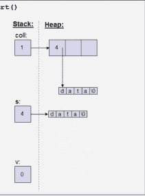

我们有两个 vector：v 和 coll，以及两个 string：s 和它的副本，后者是 coll 中的第一个元素。它们都应该是各自独立的对象，各自拥有存储值的独立内存，因为修改其中一个不应影响其他任何对象。

- 情况从这里开始发生变化。首先，让我们看看创建新临时 string 并将其插入 vector 的那条语句：

```cpp
coll.push_back(s+s);
```

同样，这条语句分三步执行：

- 1. 我们创建临时 string s+s：

```cpp
std::vector<std::string> createAndInsert()
{
    std::vector<std::string> coll;
    coll.reserve(3);
    std::string s = "data";

    coll.push_back(s);

    coll.push_back(s+s);

    coll.push_back(std::move(s));

    return coll;
}

std::vector<std::string> v;
...
v = createAndInsert();
```

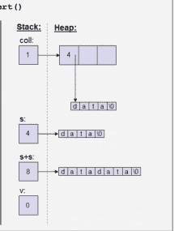

- 2. 我们将这个临时 string 插入 vector `coll`。不过，现在这里发生了不同的事情：我们窃取 `s+s` 中用于存储值的内存，并将其移动给 `coll` 的新元素。

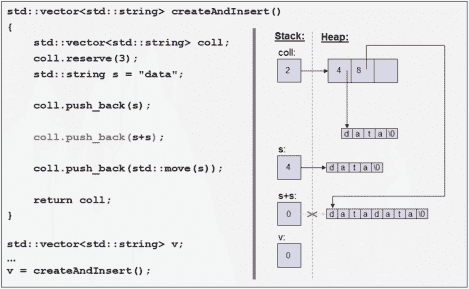

这是可行的，因为自 C++11 起，我们可以为获取不再需要的值实现特殊行为。编译器可以发出这一信号，因为它知道在执行 `push_back()` 调用之后，临时对象 `s+s` 马上就会被销毁。因此，我们调用为调用者不再需要该值的情况提供的另一个 `push_back()` 实现。正如我们所看到的，效果是在不再需要该值时复制 string 的优化实现：我们不再创建单独的深拷贝，而是同时复制大小和指向内存的指针。然而，仅靠这种浅拷贝还不够；我们还修改临时对象 `s+s`，将大小设为 0，并将 `nullptr` 赋为新值。本质上，`s+s` 被修改为获得空 string 的状态。重要的一点是，它不再拥有自己的内存。这一点很重要，因为这条语句还有第三步。

- 3. 在语句结束时，临时 string `s+s` 被销毁，因为我们不再需要它。然而，由于这个临时 string 不再是初始内存的所有者，析构函数不会释放这块内存。

```cpp
std::vector<std::string> createAndInsert()
{
    std::vector<std::string> coll;
    coll.reserve(3);
    std::string s = "data";

    coll.push_back(s);

    coll.push_back(s+s);

    coll.push_back(std::move(s));

    return coll;
}

std::vector<std::string> v;
v = createAndInsert();
```

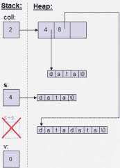

本质上，我们优化了复制过程，将 s+s 的值所占用内存的所有权移动到 vector 中的副本。

这一切都是通过使用能够发出对象即将消亡信号的编译器自动完成的，这样我们就可以使用新的实现来复制 string 值，并从源对象窃取该值。这并不是技术意义上的移动；这是一种语义移动，通过从源 string 到其副本技术性地移动值的内存来实现。

- 下一条语句是我们为 C++11 版本修改过的语句。我们再次将 s 插入 coll，但这条语句已经改变，因为我们对要插入的 string 调用了 `std::move()`：

```cpp
coll.push_back(std::move(s));
```

如果没有 std::move()，就会发生与第一次调用 push_back() 相同的情况：vector 会创建所传入 string s 的深拷贝。然而，在这次调用中，我们用 std::move() 标记了 s，这在语义上意味着“我这里不再需要这个值了”。因此，我们再次调用 push_back() 的另一个实现，也就是传入临时对象 s+s 时所用的那个实现。第三个元素通过将值的内存所有权从 s 的值移动到其副本来窃取该值：

```cpp
std::vector<std::string> createAndInsert()
{
    std::vector<std::string> coll;
    coll.reserve(3);
    std::string s = "data";

    coll.push_back(s);

    coll.push_back(s+s);

    coll.push_back(std::move(s));

    return coll;
}

std::vector<std::string> v;

v = createAndInsert();
```

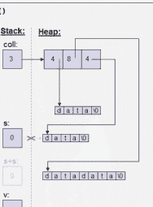

请注意以下两点关于移动语义的非常重要的理解要点：

- `std::move(s)` 只是在此上下文中*标记* `s` 为可移动。它并不移动任何东西。它只是表示：“*我这里不再需要这个值了。*”它允许调用的实现利用这一标记，在复制值时执行某些优化，例如窃取内存。值是否真的被移动，调用者并不知道。

- 然而，窃取值的优化必须确保源对象仍处于有效状态。被移动后的对象既没有被部分销毁，也没有被完全销毁。C++ 标准库对其类型是这样规定的：在对用 `std::move()` 标记的对象调用某个操作之后，该对象处于*有效但未指定状态*。

  也就是说，在调用

  ```cpp
  coll.push_back(std::move(s));
  ```

  之后，可以保证 `s` 仍然是有效的 string。只要对任何值未知的 string 有效，你可以对它做任何操作。这就像使用一个 string 参数，而你不知道传入的是什么值。

  注意，也不保证该 string 保留旧值或为空。它具有什么值由（库）函数的实现者决定。一般来说，实现者可以对用 `std::move()` 标记的对象做任何他们想做的事，只要让对象保持有效状态即可。这一保证有充分的理由，稍后将讨论。

- 再次，在 `createAndInsert()` 末尾，我们来到 return 语句：

  ```cpp
  return coll;
  }
  ```

  是否生成带有*具名返回值优化*的代码仍由编译器决定，这意味着 `coll` 直接成为返回值。然而，如果未使用此优化，return 语句仍然开销很小，因为我们又一次遇到从源对象创建对象的情况，而该源对象

即将销毁。也就是说，如果没有使用具名返回值优化，就会使用移动语义，这意味着返回值会从 coll 中窃取值。最坏情况下，我们必须将 size、capacity 以及指向内存的指针这些成员（总共通常为 12 或 24 字节）从源对象拷贝到返回值中，并在源对象中为这些成员赋予新值。

假设我们启用了具名返回值优化。在这种情况下，在 return 语句结束时，coll 现在成为返回值，并且会调用 s 的析构函数；由于 s 已被移动到 coll 的第三个元素中，它不再需要释放任何内存：

```cpp
std::vector<std::string> createAndInsert()
{
    std::vector<std::string> coll;
    coll.reserve(3);
    std::string s = "data";

    coll.push_back(s);

    coll.push_back(s+s);

    coll.push_back(std::move(s));

    return coll;
}

std::vector<std::string> v;
...
v = createAndInsert();
```

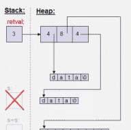

- 那么，最后我们来看将返回值赋值给 v 的过程：

  ```cpp
  v = createAndInsert();
  ```

同样，我们现在可以受益于移动语义，因为遇到了已经见过的情况：我们必须从一个即将销毁的临时返回值中拷贝（这里是赋值）一个值。

现在，移动语义允许我们为 vector 的赋值运算符提供一种不同的实现，它只是从源 vector 中窃取值：

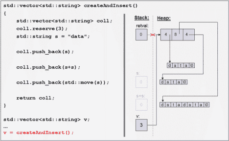

同样，临时对象不会被（部分）销毁。它进入有效状态，但我们不知道它的值。

然而，就在赋值之后，语句结束时会销毁这个（已被修改的）临时返回值：

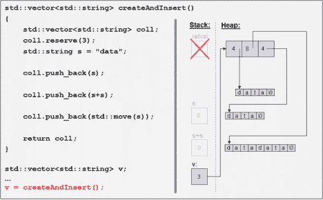

最终，我们处于与使用移动语义之前相同的状态，但有一些重要的变化：我们节省了六次内存分配和释放。所有不必要的内存分配都不再发生：

- 将临时对象插入集合时的分配
- 当我们使用 `std::move()` 表示不再需要该值时，将具名对象插入集合时的分配
- 将包含其所有元素的临时 vector 赋值时的分配

在第二种情况下，优化是在我们的帮助下完成的。通过添加 `std::move()`，我们表明不再需要 `s` 的值。所有其他优化之所以发生，是因为编译器知道某个对象即将销毁，这意味着它可以调用使用移动语义的优化实现。这意味着返回一个字符串 vector 并将其赋值给现有 vector 不再是性能问题。我们可以像使用整型一样简单地使用字符串 vector，并获得好得多的性能。在实践中，用移动语义重新编译代码可以将速度提高 10% 到 40%（取决于现有代码有多朴素）。

### 1.2 实现移动语义

让我们用前面的例子来看看移动语义在何处以及如何实现。在实现移动语义之前，`class std::vector<>` 只有一个 `push_back()` 实现（这里简化了 vector 的声明）：

```cpp
template<typename T>
class vector {
  public:
    ...
    // insert a copy of elem:
    void push_back (const T& elem);
    ...
};
```

只有一种方式将参数传递给 `push_back()`，即将其绑定到 const 引用。`push_back()` 的实现方式是：vector 创建所传参数的内部副本，而不修改它。

自 C++11 起，我们有了 `push_back()` 的第二个重载：

```cpp
template<typename T>
class vector {
  public:
    ...
    // insert a copy of elem:
    void push_back (const T& elem);

    // insert elem when the value of elem is no longer needed:
    void push_back (T&& elem);
    ...
};
```

第二个 `push_back()` 使用了为移动语义引入的新语法。我们用两个 `&&` 且不带 `const` 来声明参数。这样的参数称为*右值引用*。^3 只有一个 `&` 的“普通引用”现在称为*左值引用*。也就是说，在两种调用中，我们都通过引用传递要插入的值。然而，区别如下：

- 使用 `push_back(const T&)` 时，我们承诺不修改所传的值。
  - 当调用者仍然需要所传值时，会调用此函数。
- 使用 `push_back(T&&)` 时，实现可以修改所传参数（因此它不是 `const`）以“窃取”该值。语义仍然是新元素接收所传参数的值，但我们可以使用将该值移动进 vector 的优化实现。
  - 当调用者不再需要所传值时，会调用此函数。实现必须确保所传参数仍处于有效状态。然而，其值可能已改变。因此，调用此函数后，只要调用者不对其值作任何假设，就仍然可以使用所传参数。

然而，vector 并不知道*如何*拷贝或移动元素。在确保 vector 为新元素留有足够内存后，vector 会将工作委托给元素类型。在这个例子中，元素是 string。那么，让我们看看拷贝或移动所传 string 时会发生什么。

#### 1.2.1 使用拷贝构造函数

传统拷贝语义的 `push_back(const T&)` 会调用 string 类的拷贝构造函数，从而在 vector 中初始化新元素。让我们看看这是如何实现的。一个非常朴素的 string 类实现的拷贝构造函数如下所示：^4

```cpp
class string {
  private:
    int len;                // current number of characters
    char* data;             // dynamic array of characters

  public:
    // copy constructor: create a full copy of s:
    string (const string& s)
      : len{s.len} {            // copy number of characters
        if (len > 0) {          // if not empty
            data = new char[len+1];    // - allocate new memory
            memcpy(data, s.data, len+1);  // - and copy the characters
        }
    }
    ...
};
```

假设我们为一个值为 `"data"` 的 string 调用这个拷贝构造函数：

```cpp
std::string a = "data";
std::string b = a;        // create b as a copy of a
```

在如下初始化 string a 之后：

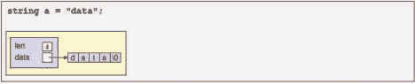

上面的拷贝构造函数会拷贝表示字符数的成员 len，但会为 data 指针分配新内存来存放值，并将所有字符从源 a（作为 s 传入）拷贝到新 string：

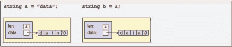

#### 1.2.2 使用移动构造函数

新移动语义的 `push_back(T&&)` 会调用相应的新构造函数，即*移动构造函数*。这个构造函数从现有 string 创建新 string，而现有 string 的值不再需要。与移动语义的通常做法一样，该构造函数声明时以非 const 右值引用（&&）作为参数：

```cpp
class string {
private:
    int len;                         // current number of characters
    char* data;                      // dynamic array of characters

public:
    ...
    // move constructor: initialize the new string from s (stealing the value):
    string (string&& s)
        : len{s.len}, data{s.data} {  // copy number of characters and pointer to memory
        s.data = nullptr;             // release the memory for the source string
        s.len = 0;                    // and adjust number of characters accordingly
    }
    ...
};
```

给定上面拷贝构造函数中的情形：

3 之所以称为*右值引用*，将在后面关于值类别的章节中讨论。

4 `std::string` 类的实现更复杂，因为其内部内存管理使用了优化和分配器（定义内存分配方式的辅助对象）。


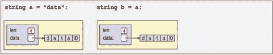

我们可以如下调用字符串的这个构造函数：

```cpp
std::string c = std::move(b);  // init c with the value of b (no longer needing its value here)
```

移动构造函数首先复制成员 len 和 data，这意味着新字符串获得了 b（作为 s 传入）的值的所有权。

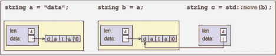

然而，这还不够，因为 b 的析构函数会释放内存。因此，我们还需要修改源字符串，使其失去对内存的所有权，并进入一个表示空字符串的一致状态：

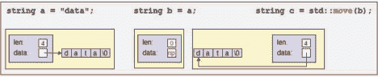

结果是，c 现在拥有 b 先前的值，而 b 是空字符串。再次注意，唯一的保证是 b 随后处于有效但未指定的状态。取决于 C++ 库中移动构造函数的实现方式，它可能不是空的（但通常是空的，因为这是这里最简单且最好的性能改进方式）。

### 1.3 复制作为后备方案

我们看到了，通过使用临时对象或用 `std::move()` 标记对象，我们可以启用移动语义。提供特殊实现（通过接受非常量右值引用）的函数可以通过从源“窃取”值来优化值的复制。然而，如果某个函数没有针对移动语义的优化版本，那么通常的复制将作为后备方案使用。

例如，假设像 vector 这样的容器类缺少 push_back() 的第二个重载：

```cpp
template<typename T>
class MyVector {
  public:
    ...
    void push_back (const T& elem);   // insert a copy of elem
    ...             // no other push_back() declared
};
```

我们仍然可以传递临时对象或使用 std::move() 标记的对象：

```cpp
MyVector<std::string> coll;
std::string s{"data"};
...
coll.push_back(std::move(s));   // OK, uses copy semantics
```

规则是：对于临时对象或使用 `std::move()` 标记的对象，如果存在将参数声明为右值引用的函数，则会优先选择该函数。但是，如果不存在这样的函数，则使用通常的复制语义。这样，我们确保调用者不必知道是否存在优化。优化可能不存在的原因有：

- 函数/类是在支持移动语义之前实现的，或者在实现时没有考虑移动语义支持
- 没有可优化的内容（一个只有数值成员的类就是这样的例子）

对于泛型代码，重要的是，如果我们不再需要某个对象的值，我们始终可以用 std::move() 标记该对象。即使没有移动语义支持，相应的代码也能编译。

出于同样的原因，你甚至可以用 std::move() 标记基本数据类型的对象，例如 int（或指针）。仍然会使用通常的值语义来复制值（地址）：

```cpp
std::vector<int> coll;
int x[42];
...
coll.push_back(std::move(x));   // OK, but copies x (std::move() has no effect)
```

### 1.4 const 对象的移动语义

最后，请注意，用 const 声明的对象不能被移动，因为任何优化实现都要求传入的参数可以被修改。如果不允许修改，我们就无法窃取值。

使用 push_back() 的通常重载：

```cpp
template<typename T>
class vector {
  public:
    ...
    // insert a copy of elem:
    void push_back (const T& elem);

    // insert elem when the value of elem is no longer needed:
    void push_back (T&& elem);
    ...
};
```

对于 const 对象，唯一有效的调用函数是带有 const& 参数的 `push_back()` 的第一个重载：

```cpp
std::vector<std::string> coll;
const std::string s{"data"};
...
coll.push_back(std::move(s));  // OK, calls push_back(const std::string&)
```

这意味着对 const 对象使用 `std::move()` 本质上没有效果。

原则上，我们可以通过声明一个接受 const 右值引用的函数来为这种情况提供特殊重载。然而，这在语义上没有意义。同样，const 左值引用重载作为处理这种情况的后备方案。

#### 1.4.1 const 返回值

const 禁用移动语义这一事实也对返回类型的声明产生了影响。const 返回值不能被移动。

因此，自 C++11 起，使用 const 按值返回不再是一种好风格（过去一些风格指南曾推荐这样做）。例如：

```cpp
const std::string getValue();
```

```cpp
std::vector<std::string> coll;
...
coll.push_back(getValue());  // copies (because the return value is const)
```

按值返回时，不要将整个返回值声明为 const。仅使用 const 声明返回类型的某些部分（例如返回的对象、引用或指针）：

```cpp
const std::string   getValue();  // BAD: disables move semantics for return values
const std::string&  getRef();     // OK
const std::string*  getPtr();     // OK
```

### 1.5 总结

- 移动语义允许我们在不再需要对象值时优化对象的复制。它可以隐式使用（用于未命名的临时对象或局部返回值），也可以显式使用（使用 `std::move()`）。
- `std::move()` 表示*此处不再需要此值*。它将对象标记为可移动。用 `std::move()` 标记的对象不会被（部分）销毁（析构函数仍然会被调用）。
- 通过使用非常量右值引用（如 `std::string&&`）声明函数，你定义了一个接口，调用者在语义上声明其不再需要传入的值。函数的实现者可以利用此信息，通过“窃取”值或对传入参数进行任何其他修改来优化其任务。通常，实现者还必须确保传入参数在调用后处于有效状态。
- C++ 标准库中被移动过的对象仍然是有效对象，但您不再知道它们的值。
- 复制语义作为移动语义的后备方案（如果支持复制语义）。如果没有接受右值引用的实现，则使用任何接受普通 const 左值引用（如 `const std::string&`）的实现。即使对象被显式标记为 `std::move()`，也会使用此后备方案。
- 对 const 对象调用 `std::move()` 通常没有效果。
- 如果你按值返回（而不是按引用返回），不要将整个返回值声明为 const。

## 第 2 章

## 移动语义的核心特性

在第一个动机示例之后，本章讨论移动语义的基本特性。

### 2.1 右值引用

为了支持移动语义，我们引入了一种新的引用类型：右值引用。让我们讨论一下它们是什么以及如何使用它们。

#### 2.1.1 右值引用详解

右值引用用两个与号声明。就像普通引用（用一个与号声明，现在称为左值引用）一样，右值引用引用一个必须作为初始值传入的现有对象。然而，根据其语义，右值引用只能引用没有名称的临时对象或标记为 `std::move()` 的对象：

```cpp
std::string returnStringByValue();        // forward declaration
...
std::string s{"hello"};
...
std::string&& r1{s};                       // ERROR
std::string&& r2{std::move(s)};            // OK
std::string&& r3{returnStringByValue()};   // OK, extends lifetime of return value
```

右值引用这个名称源于这样一个事实：这些对象通常只能引用*rvalue*，而*rvalue*是用于没有名称的临时对象和标记为 `std::move()` 的对象的一种*值类别*。

与从返回值成功初始化引用的通常情况一样，引用会延长返回值的生命周期，直到引用的生命周期结束（普通的 const 左值引用已经具有这种行为）。

用于初始化引用的语法无关紧要。你可以使用等号、花括号或圆括号：

```cpp
std::string s{"hello"};
...
std::string&& r1 = std::move(s);          // OK, rvalue reference to s
std::string&& r2{std::move(s)};            // OK, rvalue reference to s
std::string&& r3(std::move(s));            // OK, rvalue reference to s
```

所有这些引用都具有相同的语义：“我们可以窃取/修改所引用的对象，前提是该对象的状态仍保持有效状态。”从技术上讲，编译器不会检查这些语义，因此我们可以像处理该类型的任何非 const 对象一样修改任何右值引用。我们也可以决定不修改该值。也就是说，如果你有一个指向对象的右值引用，该对象可能会收到不同的值（该值可能是也可能不是默认构造对象的值），也可能保持其值不变。

正如我们所看到的，移动语义允许我们利用一个不再需要其值的源对象的值来进行优化。如果编译器自动检测到某个值来自一个生命周期即将结束的对象，它们会自动切换到移动语义。以下情况就是如此：

- 我们传递一个临时对象的值，该对象在语句结束后会自动销毁。
- 我们传递一个用 `std::move()` 标记的非 const 对象。

#### 2.1.2 右值引用作为参数

当我们将参数声明为右值引用时，它的行为与语义与上面介绍的完全一致：

- 该参数只能绑定到没有名称的临时对象，或用 `std::move()` 标记的对象。
- 根据右值引用的语义：
    - 调用者声明其不再关心该值。因此，你可以修改该参数所引用的对象。
    - 但是，调用者可能仍然关心使用该对象。因此，任何修改都应使被引用的对象保持有效状态。

例如：

```cpp
void foo(std::string&& rv);  // takes only objects where we no longer need the value
...
std::string s{"hello"};
...
foo(s);                       // ERROR
foo(std::move(s));            // OK, value of s might change
foo(returnStringByValue());   // OK
```

你可以在用 `std::move()` 传递一个具名对象之后继续使用它，但通常不应该这样做。推荐的编程风格是，在 `std::move()` 之后不再使用该对象：

```cpp
void foo(std::string&& rv);  // takes only objects where we no longer need the value
...
std::string s{"hello"};
...
foo(std::move(s));            // OK, value of s might change
```

```cpp
std::cout << s << '\n';        // OOPS, you don't know which value is printed
foo(std::move(s));             // OOPS, you don't know which value is passed
s = "hello again";             // OK, but rarely done
foo(std::move(s));             // OK, value of s might change
```

对于标记为“OOPS”的两行，只要你不对 `s` 的当前值做任何假设，调用在技术上就是没问题的。因此，打印出该值是没问题的，尽管通常不太有用。

### 2.2 std::move()

如果你有一个对象，其生命周期在使用它时并不会结束，你可以用 `std::move()` 标记它，以表示“我在这里不再需要这个值了”。`std::move()` 并不移动；它只在使用该表达式的上下文中设置一个临时标记：

```cpp
void foo1(const std::string& lr);   // binds to the passed object without modifying it
void foo1(std::string&& rv);        // binds to the passed object and might steal/modify the value
...
std::string s{"hello"};
...
foo1(s);                            // calls the first foo1(), s keeps its value
foo1(std::move(s));                 // calls the second foo1(), s might lose its value
```

用 `std::move()` 标记的对象仍然可以传递给接受普通 const 左值引用的函数：

```cpp
void foo2(const std::string& lr);   // binds to the passed object without modifying it
...
std::string s{"hello"};
...
foo2(s);                            // calls foo2(), s keeps its value
foo2(std::move(s));                 // also calls foo2(), s keeps its value
```

请注意，用 `std::move()` 标记的对象不能传递给非 const 左值引用：

```cpp
void foo3(std::string&);            // modifies the passed argument
...
std::string s{"hello"};
...
foo3(s);                            // OK, calls foo3()
foo3(std::move(s));                 // ERROR: no matching foo3() declared
```

请注意，用 `std::move()` 标记一个即将销毁的对象没有意义。事实上，这甚至可能对优化产生反效果。

#### 2.2.1 std::move() 的头文件

`std::move()` 在 C++ 标准库中定义为函数。因此，要使用它，必须包含定义它的头文件 `<utility>`：

```cpp
#include <utility>   // for std::move()
```

使用 `std::move()` 的程序通常即使不包含这个头文件也能编译，因为实际上几乎所有头文件都包含了 `<utility>`。但是，标准头文件并不要求包含 `utility`。因此，在使用 `std::move()` 时，你应显式包含 `<utility>`，以使程序具有可移植性。

#### 2.2.2 `std::move()` 的实现

`std::move()` 不过是一个到右值引用的 `static_cast`。你可以像下面这样手动调用 `static_cast` 来达到相同的效果：

```cpp
foo(static_cast<decltype(obj)&&>(obj));    // same effect as foo(std::move(obj))
```

因此，我们也可以写成：

```cpp
foo(static_cast<std::string&&>(s));        // same effect as foo(std::move(s))
```

请注意，这里的 `static_cast` 不只是改变对象的类型。它还使对象能够被传递给右值引用（请记住，通常不允许将具名对象传递给右值引用）。我们将在关于值类别的章节中详细讨论这一点。

### 2.3 被移动后的对象

在 `std::move()` 之后，被移动后的对象不会被（部分）销毁。它们仍然是有效对象，至少会调用其析构函数。但是，它们也应在具有一致状态且所有操作都按预期工作的意义上保持有效。你唯一不知道的是它们的值。这就像使用一个该类型的参数，而你不知道传递的是哪个值。

#### 2.3.1 有效但未指定状态

C++ 标准库保证被移动后的对象处于*有效但未指定状态*。

考虑以下代码：

```cpp
std::string s;
...
coll.push_back(std::move(s));
```

在用 `std::move()` 传递 `s` 之后，你可以询问字符数量、打印出该值，甚至赋一个新值。但是，如果不先检查字符数量，你就不能打印第一个字符或任何其他字符：

```cpp
foo(std::move(s));                 // keeps s in a valid but unclear state

std::cout << s << '\n';              // OK (don’t know which value is written)
std::cout << s.size() << '\n';      // OK (writes current number of characters)
std::cout << s[0] << '\n';          // ERROR (potentially undefined behavior)
std::cout << s.front() << '\n';     // ERROR (potentially undefined behavior)
s = "new value";                    // OK
```

尽管你不知道该值，但字符串处于一致状态。例如，`s.size()` 会返回字符数量，因此你可以遍历所有有效索引：

```cpp
foo(std::move(s));              // keeps s in a valid but unclear state
```

```cpp
for (int i = 0; i < s.size(); ++i) {
    std::cout << s[i];             // OK
}
```

对于用户定义类型，你也应确保被移动后的对象处于有效状态，这有时需要声明或实现移动操作。*移出后状态*一章将详细讨论这一点。

#### 2.3.2 重用被移动后的对象

你可能想知道为什么被移动后的对象仍然是有效对象，而不是被（部分）销毁。原因是移动语义有一些有用的应用，在这些应用中，再次使用被移动后的对象是有意义的。

例如，考虑从流中逐行读取字符串并将其移入 vector 的代码：

```cpp
std::vector<std::string> allRows;
std::string row;
while (std::getline(mStream, row)) {  // read next line into row
    allRows.push_back(std::move(row));  // and move it to somewhere
}
```

每次我们将一行读入 row 后，都用 `std::move()` 将 row 的值移入所有行的 vector 中。然后，`std::getline()` 再次使用被移动后的对象 row 来读取下一行到其中。

作为第二个例子，考虑一个交换两个值的泛型函数：

```cpp
template<typename T>
void swap(T& a, T& b)
{
    T tmp{std::move(a)};
    a = std::move(b);      // assign new value to moved-from a
    b = std::move(tmp);    // assign new value to moved-from b
}
```

在这里，我们将 `a` 的值移入一个临时对象，以便随后能够移动赋值 `b` 的值。被移动后的对象 `b` 随后接收 `tmp` 的值，也就是 `a` 原先的值。

像这样的代码用于排序算法等场景中，我们会移动不同元素的值来使它们按序排列。在那里，给被移动后的对象赋新值的情况会不断发生。该算法甚至可能对被移动后的对象使用排序准则。

一般来说，被移动后的对象应是有效对象，可以被销毁（析构函数不应失败）、可以重用来获取其他值，并且在不知道其值的情况下支持其类型对象所支持的所有其他操作。*移出后状态*一章将详细讨论这一点。


#### 2.3.3 对象对自身的移动赋值

被移动后的对象处于有效但未指定状态的规则，通常也适用于直接或间接自移动之后的对象。

例如，在执行以下语句后，对象 x 通常是有效的，但其值未知：

```cpp
x = std::move(x);    // afterwards x is valid but has an unclear value
```

同样，C++标准库对其对象保证了这一点。[^1] 用户定义类型通常也应提供这一保证，但有时你必须实现一些内容来修正默认生成的被移动后状态。

### 2.4 通过不同引用进行重载

引入右值引用之后，我们现在有三种主要的按引用调用方式：

- `void foo(const std::string& arg)` 将实参作为 const 左值引用接收。
    
    这意味着你对传入的实参只有读访问权限。注意，如果类型匹配，你可以将一切内容传给这样声明的函数：
    - 可修改的具名对象
    - const 具名对象
    - 没有名称的临时对象
    - 用 `std::move()` 标记的对象
    
    语义含义是，我们给予 `foo()` 对传入实参的读访问权限。该参数就是我们所说的*输入*参数。

- `void foo(std::string& arg)` 将实参作为非 const 左值引用接收。
    
    这意味着你对传入的实参有写访问权限。注意，即使类型匹配，你也不能再将一切内容传给这样声明的函数。你只能传入：
    - 可修改的具名对象
    
    对于所有其他实参，调用无法编译。
    
    语义含义是，我们给予 `foo()` 对传入实参的读/写访问权限。该参数就是我们所说的*输出*或*输入/输出*参数。

- `void foo(std::string&& arg)` 将实参作为非 const 右值引用接收。
    
    这也意味着你对传入的实参有写访问权限。然而，你同样对可以传入的内容有限制。你只能传入：
    - 没有名称的临时对象
    - 用 `std::move()` 标记的非 const 对象
    
    语义含义是，我们给予 `foo()` 对传入实参的写访问权限，以夺取其值。它是一个*输入参数*，附加约束是调用方不再需要该值。
    
    注意，右值引用绑定到的实参与非 const 左值引用不同。因此，我们不得不引入一种新语法，而不能仅将移动语义实现为修改传入实参的函数的另一种方式。

#### 2.4.1 `const` 右值引用

从技术上讲，还有第四种按引用调用方式：

- `void foo(const std::string&& arg)` 将实参作为 const 右值引用接收。
    
    这也意味着你对传入的实参有读访问权限。这里的限制将是，你只能传入：
    - 没有名称的临时对象
    - 用 `std::move()` 标记的 const 或非 const 对象
    
    然而，这种情况没有有用的语义含义。作为右值引用，允许夺取值，但由于是 const，我们禁止对传入实参进行任何修改。这本身就是矛盾。

尽管如此，创建具有此行为的对象相当容易：只需用 `std::move()` 标记一个 const 对象：

```cpp
const std::string s{"data"};
...
foo(std::move(s));        // would call a function declared as const rvalue reference
```

当声明一个函数以 const 返回值时，这可能间接发生：

```cpp
const std::string getValue();
...
foo(getValue());          // would call a function declared as const rvalue reference
```

从语义上讲，这种情况通常由函数的 const 左值引用重载来覆盖，以提供读访问。针对这种情况的具体实现是可能的，但通常没有意义（C++标准库类 `std::optional<>` 使用了 const 右值引用）。

### 2.5 按值传递

如果你声明一个函数按值接收实参，移动语义也可能（自动）被使用。例如：

```cpp
void foo(std::string str);  // takes the object by value
...
std::string s{"hello"};
...
foo(s);                      // calls foo(), str becomes a copy of s
foo(std::move(s));           // calls foo(), s is moved to str
foo(returnStringByValue());  // calls foo(), return value is moved to str
```

如果调用方表示它不再需要传入实参的值（通过使用 `std::move()` 或传入没有名称的临时对象），则参数 `str` 会用从传入实参移动而来的值初始化。

这意味着，借助移动语义，如果传入的是临时对象，或者传入的实参用 `std::move()` 标记，按值调用可能会突然变得廉价。注意，就像按值返回局部对象一样，这种移动可以被优化掉。然而，如果没有被优化掉，现在可以保证该调用是廉价的（如果移动语义本身廉价）。

注意以下区别：

```cpp
void fooByVal(std::string str);        // takes the object by value
void fooByRRef(std::string&& str);     // takes the object by rvalue reference
...
std::string s1{"hello"}, s2{"hello"};
...
fooByVal(std::move(s1));               // s1 is moved
fooByRRef(std::move(s2));              // s2 might be moved
```

这里，我们比较两个函数：一个按值接收字符串，另一个将字符串作为右值引用接收。在两种情况下，我们都用 `std::move()` 传入一个字符串。

- 按值接收字符串的函数将使用移动语义，因为会用传入实参的值创建一个新字符串。
- 将字符串作为右值引用接收的函数**可能**使用移动语义。传入实参不会创建新字符串。传入实参的值是否被夺取/修改取决于函数的实现。

因此：

- 声明为支持移动语义的函数**可能不会**使用移动语义。
- 声明为按值接收实参的函数**会**使用移动语义。

再次注意，移动语义的效果并不保证会发生任何优化，也不保证任何优化的效果是什么。我们只知道，传入的对象随后处于有效但未指定的状态。

### 2.6 总结

- 右值引用用 `&&` 声明，且不带 `const`。
- 它们可以由没有名称的临时对象或用 `std::move()` 标记的非 const 对象初始化。
- 右值引用延长了按值返回的对象的生命周期。
- `std::move()` 是对相应右值引用类型的 `static_cast`。这允许我们将具名对象传给右值引用。
- 用 `std::move()` 标记的对象也可以传给按 `const` 左值引用接收实参、但不按非 const 左值引用接收实参的函数。
- 用 `std::move()` 标记的对象也可以传给按值接收实参的函数。在这种情况下，会使用移动语义初始化参数，这可以使按值调用相当廉价。
- `const` 右值引用是可能的，但针对它们实现通常没有意义。
- 被移动后的对象应处于*有效但未指定*的状态。C++标准库对其类型保证了这一点。只要不对其值作任何假设，你仍然可以（重新）使用它们。

本页有意留空

## 第 3 章：类中的移动语义

本章展示类如何从移动语义中受益。它演示普通类如何自动从移动语义中受益，以及如何在类中显式实现移动操作。

### 3.1 普通类中的移动语义

假设你有一个相当简单的类，其成员类型中移动语义可能带来差异：

`basics/customer.hpp`

```cpp
#include <string>
#include <vector>
#include <iostream>
#include <cassert>

class Customer {
private:
    std::string name;       // name of the customer
    std::vector<int> values; // some values of the customer
public:
    Customer(const std::string& n)
      : name{n} {
        assert(!name.empty());
    }

    std::string getName() const {
        return name;
    }

    void addValue(int val) {
```

[^1]: 被移动后的库对象的保证已通过*库工作组问题*2839得到澄清（参见 http://wg21.link/lwg2839）。


```cpp
values.push_back(val);
}

friend std::ostream& operator<<(std::ostream& strm, const Customer& cust) {
    strm << '[' << cust.name << ": ";
    for (int val : cust.values) {
        strm << val << ' ';
    }
    strm << ']';
    return strm;
}
}
```

这个类有两个（可能）昂贵的成员：一个用于名称的 string，以及一个用于整数值的 vector：

```cpp
class Customer {
private:
    std::string name;              // name of the customer
    std::vector<int> values;       // some values of the customer
    ...
};
```

这两个成员的复制代价都很高

- 要复制名称，我们必须为字符串的字符分配内存（除非名称很短，并且字符串是使用 *小字符串优化*（SSO）实现的）。
- 要复制值，我们必须为 vector 的元素分配内存。

如果我们有一个 string 的 vector 或另一种相当昂贵的元素类型，代价甚至会更高。例如，对 string 的 vector 进行深拷贝时，既要为元素的动态数组分配内存，也要为每个元素所需的内存分配内存。

好消息是，这样的类通常**会自动支持移动语义**。自 C++11 起，编译器通常会生成一个*移动构造函数*和一个*移动赋值运算符*（类似于自动生成拷贝构造函数和拷贝赋值运算符）。

这会产生以下效果：

- 按值返回一个局部 Customer 将使用移动语义（如果没有被优化掉）。
- 按值传递一个未命名的 Customer 将使用移动语义（如果没有被优化掉）。
- 按值传递一个临时 Customer（例如由另一个函数返回的）将使用移动语义（如果没有被优化掉）。
- 按值传递一个用 `std::move()` 标记的 Customer 对象将使用移动语义（如果没有被优化掉）。

例如：

*basics/customer1.cpp*

```cpp
#include "customer.hpp"
#include <iostream>
#include <random>
#include <utility>  //for std::move()

int main()
{
    // create a customer with some initial values:
    Customer c{"Wolfgang Amadeus Mozart"};
    for (int val : {0, 8, 15}) {
        c.addValue(val);
    }
    std::cout << "c: " << c << '\n';    // print value of initialized c

    // insert the customer twice into a collection of customers:
    std::vector<Customer> customers;
    customers.push_back(c);               // copy into the vector
    customers.push_back(std::move(c));    // move into the vector
    std::cout << "c: " << c << '\n';     // print value of moved-from c

    // print all customers in the collection:
    std::cout << "customers:\n";
    for (const Customer& cust : customers) {
        std::cout << "  " << cust << '\n';
    }
}
```

这里我们创建并初始化一个 Customer 对象 c（为了避免 SSO，我们使用一个相当长的名称）。在 c 初始化之后，第一次输出如下：

```
c: [Wolfgang Amadeus Mozart: 0 8 15 ]
```

然后，我们将这个 customer 两次插入一个 vector 中：一次拷贝它，一次移动它：

```
customers.push_back(c);                 // copy into the vector
customers.push_back(std::move(c));      // move into the vector
```

之后，c 的值的下一次输出通常如下：

```
c: [ ]
```

在第二次调用 push_back() 时，名称和值都被移动到了 vector 的第二个元素中。然而，不要忘记，被移动后的对象处于*有效但未指定状态*。因此，第二次输出可能具有任意值和名称：

- 它可能仍然具有相同的值：
  
  `c: [Wolfgang Amadeus Mozart: 0 8 15 ]`
- 它可能具有完全不同的值：
  
  `c: [value was moved away: 0 ]`

然而，由于提供移动语义是为了优化性能，而赋予不同的值未必能提高性能，因此实现通常会让 string 和 vector 都变为空。

无论如何，我们可以看到，类 `Customer` 自动启用了移动语义。出于同样的原因，现在可以保证以下代码的代价很低：

```cpp
Customer createCustomer()
{
    Customer c{...};
    ...
    return c;  // uses move semantics if not optimized away
}

std::vector<Customer> customers;
...
customers.push_back(createCustomer());  // uses move semantics
```

完整示例见 `basics/customer2.cpp`。

重要的一点是，自 C++11 起，如果类使用了能够从中受益的成员，那么这些类会自动从移动语义中受益。这些类具有：

- **移动构造函数**：当我们从一个不再需要其值的源创建新对象时，它会移动成员：
  
  ```cpp
  Customer c1{...}
  ...
  Customer c2{std::move(c1)};  // move members of c1 to members of c2
  ```
- **移动赋值运算符**：当我们从一个不再需要其值的源赋值时，它会移动成员：
  
  ```cpp
  Customer c1{...}, c2{...};
  ...
  c2 = std::move(c1);          // move assign members of c1 to members of c2
  ```

请注意，这样的类可以通过显式实现以下改进，进一步从移动语义中受益：

- 在初始化成员时使用移动语义
- 使用移动语义使 getter 既安全又快速

#### 3.1.1 类中何时会自动启用移动语义？

正如刚才所介绍的，编译器可能会自动生成特殊的移动成员函数（移动构造函数和移动赋值运算符）。然而，存在一些约束。约束在于，编译器必须假定所生成的操作会做正确的事情。正确的事情是，我们优化正常的拷贝行为：不再复制成员，而是移动它们，因为源值不再需要了。

如果类改变了拷贝或赋值的通常行为，那么在优化这些操作时，它们可能也必须做一些不同的事情。因此，当以下特殊成员函数中至少有一个是用户声明的时，移动操作的自动生成会被禁用：

- 拷贝构造函数
- 拷贝赋值运算符
- 另一个移动操作
- 析构函数

注意，我写的是“用户声明的”。任何形式的显式声明拷贝构造函数、拷贝赋值运算符或析构函数，都会禁用移动语义。例如，如果我们实现一个什么都不做的析构函数，就已经禁用了移动语义：

```cpp
class Customer {
    ...
    ~Customer() {  // automatic move semantics is disabled
    }
};
```

甚至下面的声明就足以禁用移动语义：

```cpp
class Customer {
    ...
    ~Customer() = default;  // automatic move semantics is disabled
};
```

显式要求具有默认行为的析构函数也是用户声明的，因此会禁用移动语义。像往常一样，在这种情况下会回退使用拷贝语义。

**因此：如果没有特定需要，就不要实现或声明析构函数**（令人惊讶的是，很多程序员并不遵循这条规则）。

这也意味着，默认情况下，多态基类会禁用移动语义：

```cpp
class Base {
    ...
    virtual ~Base() {  // automatic move semantics is disabled
    }
};
```

请注意，这意味着移动语义仅对在此基类内部声明的成员被禁用。对于派生类的成员，移动语义仍会自动生成（如果派生类没有显式声明特殊成员函数）。*类层次结构中的移动语义*对此进行了详细讨论。

#### 3.1.2 生成的移动操作何时会出错

请注意，即使生成的拷贝操作工作正常，生成的移动操作也可能引入问题。特别地，在以下情况下你必须小心：

- 成员对值有限制
  - 成员的值有约束
  - 成员的值相互依赖
- 使用了具有引用语义的成员（指针、智能指针等）
- 对象没有默认构造状态


可能出现的问题是，被移动后的对象可能不再有效：不变量可能被破坏，甚至对象的析构函数可能失败。例如，本章中 Customer 类的对象可能突然具有空名称，即使我们已有断言来避免这种情况。关于被移动后状态的章节将详细讨论这一点。

### 3.2 实现特殊的拷贝/移动成员函数

你可以自己实现特殊的移动成员函数。做法与实现拷贝构造函数和赋值运算符大致相同。唯一的区别是，参数被声明为非 const 右值引用，并且在实现内部，你必须指定在哪里用更好的方式优化通常的拷贝。

让我们看一个同时实现了特殊拷贝和特殊移动成员函数的类，用于打印出对象何时被拷贝以及何时被移动：

`basics/customerimpl.hpp`

```cpp
#include <string>
#include <vector>
#include <iostream>
#include <cassert>

class Customer {
private:
  std::string name;           // name of the customer
  std::vector<int> values;    // some values of the customer
public:
  Customer(const std::string& n)
    : name{n} {
      assert(!name.empty());
  }

  std::string getName() const {
    return name;
  }

  void addValue(int val) {
    values.push_back(val);
  }

  friend std::ostream& operator<< (std::ostream& strm, const Customer& cust) {
    strm << '[' << cust.name << ": ";
    for (int val : cust.values) {
      strm << val << ' ';
    }
    strm << ']';
    return strm;
  }

  // copy constructor (copy all members):
  Customer(const Customer& cust)
      : name{cust.name}, values{cust.values} {
          std::cout << "COPY " << cust.name << '\n';
  }

  // move constructor (move all members):
  Customer(Customer&& cust)                         // noexcept declaration missing
      : name{std::move(cust.name)}, values{std::move(cust.values)} {
          std::cout << "MOVE " << name << '\n';
  }

  // copy assignment (assign all members):
  Customer& operator= (const Customer& cust) {
      std::cout << "COPYASSIGN " << cust.name << '\n';
      name = cust.name;
      values = cust.values;
      return *this;
  }

  // move assignment (move all members):
  Customer& operator= (Customer&& cust) {  // noexcept declaration missing
      std::cout << "MOVEASSIGN " << cust.name << '\n';
      name = std::move(cust.name);
      values = std::move(cust.values);
      return *this;
  }
};
```

让我们详细查看所有特殊拷贝/移动成员函数的实现。

请注意，当手动实现移动构造函数和移动赋值运算符时，它们通常都应带有 `noexcept` 声明，这将在关于移动语义和 `noexcept` 的章节中讨论。

#### 3.2.1 拷贝构造函数

拷贝构造函数实现如下：

```cpp
class Customer {
private:
    std::string name;        // name of the customer
    std::vector<int> values; // some values of the customer
public:
    ...
    // copy constructor (copy all members):
    Customer(const Customer& cust)
      : name{cust.name}, values{cust.values} {
          std::cout << "COPY " << cust.name << '\n';
    }
    ...
};
```

自动生成的拷贝构造函数只是拷贝所有成员。在我们的实现中，我们只添加了一条语句，打印某个特定客户被拷贝。

#### 3.2.2 移动构造函数

移动构造函数实现如下：

```cpp
class Customer {
  private:
    std::string name;        // name of the customer
    std::vector<int> values; // some values of the customer
  public:
    ...
    // move constructor (move all members):
    Customer(Customer&& cust)                     // noexcept declaration missing
      : name{std::move(cust.name)}, values{std::move(cust.values)} {
          std::cout << "MOVE " << name << '\n';
    }
    ...
};
```

同样，这也是默认生成的移动构造函数会做的事情，只是额外增加了打印语句。

与拷贝构造函数的关键区别在于，将参数声明为非 const 右值引用，然后移动成员。

这里要注意非常重要的一点：**移动语义不会传递。** 当我们用 cust 的成员初始化成员时，必须用 `std::move()` 标记它们。否则，我们只会拷贝它们（移动构造函数将具有拷贝构造函数的性能）。

你可能想知道为什么移动语义不会传递。我们不是将参数 cust 声明为只接受具有移动语义的对象吗？然而，请注意这里的语义：当**调用者**不再需要该值时，才会调用此函数。在移动构造函数内部，我们现在要处理这个值，并且必须决定在哪里以及需要它多久。特别是，我们可能需要多次使用该值，而不能在第一次使用时就丢失它。

¹ 你也可以使用 `std::move(cust).name`，这将在后面讨论。

因此，移动语义不会传递这一事实是一种特性，而不是缺陷。如果我们要传递移动语义，就无法两次使用一个以移动语义传递的对象。例如：

```cpp
void insertTwice(std::vector<std::string>& coll, std::string& str)
{
    coll.push_back(str);               // copy str into coll
    coll.push_back(std::move(str));    // move str into coll
}
```

如果 str 的所有使用都隐式具有移动语义，那么 str 的值会在第一次调用 push_back() 时被移走。

这里要学到的重要一课是：将参数声明为右值引用，限制了我们能传递给该函数的内容，但它的行为就像该类型的任何其他非 const 对象一样。我们仍然必须指定何时以及在哪里不再需要该值。更多细节请参阅正式讨论 *当右值变成左值*。

还有一点：拷贝构造函数的打印语句会打印传入客户的名字：

```cpp
Customer(const Customer& cust)
  : name(cust.name), values(cust.values) {
    std::cout << "COPY " << cust.name << '\n';  // cust.name still there
}
```

移动构造函数不能使用 cust.name，因为在构造函数初始化时，该值可能已经被移走。我们必须改用新对象的成员：

```cpp
Customer(Customer&& cust)
  : name(std::move(cust.name)), values(std::move(cust.values)) {
    std::cout << "MOVE " << name << '\n';  // have to use name (cust.name moved away)
}
```

请注意，你应该始终使用（条件性的）noexcept 说明符来实现移动构造函数，以提高存放 Customer 的 vector 重新分配时的性能。

#### 3.2.3 拷贝赋值运算符

拷贝赋值运算符实现如下：

```cpp
class Customer {
  private:
    std::string name;        // name of the customer
    std::vector<int> values; // some values of the customer
  public:
    ...
    // copy assignment (assign all members):
    Customer& operator= (const Customer& cust) {
        std::cout << "COPYASSIGN " << cust.name << '\n';
        name = cust.name;
        values = cust.values;
        return *this;
    }
    ...
};
```

与自动生成的拷贝赋值运算符一样，我们只是赋值所有成员。唯一的区别是开头处的打印语句。

在实现赋值运算符时，你可以（也许应该）检查对象对自身的赋值。然而，请注意，生成的默认赋值运算符并不会这样做，并且在讨论移动赋值运算符的自赋值时请参阅相关注释。

你可能还希望用引用限定符声明赋值运算符。

#### 3.2.4 移动赋值运算符

移动赋值运算符实现如下：

```cpp
class Customer {
  private:
    std::string name;             // name of the customer
    std::vector<int> values;      // some values of the customer
  public:
    ...
    // move assignment (steal all members):
    Customer& operator=(Customer&& cust) {  // noexcept declaration missing
      std::cout << "MOVEASSIGN " << cust.name << '\n';
      name = std::move(cust.name);
      values = std::move(cust.values);
      return *this;
    }
};
```

同样，我们必须将移动赋值运算符声明为一个接受非 const 右值引用的函数。然后在函数体中，我们必须实现如何利用可以从源对象窃取值这一事实来改进通常的拷贝。

在本例中，我们做的是自动生成的移动赋值运算符会做的事情：在函数体中对成员进行移动赋值，而不是拷贝赋值。此外，我们添加了打印语句。最后，我们返回该对象以供进一步使用。

请注意，你通常应使用 noexcept 说明符来实现移动赋值运算符。

你可能还希望用引用限定符声明移动赋值运算符。


##### 处理对象对自身的移动赋值

你可能想知道，在实现移动赋值运算符时，是否应该检查对象对自身的赋值。例如，自移动可能会像下面这样发生：

```cpp
Customer c{"GNU's Not Unix"};
c = std::move(c);        // move assigns c to itself
```

这看起来很容易避免，但我们可能会使用引用和指针，而在这种情况下，两个对象是否相同并不一定那么明显。请考虑以下代码，它仍是一个相当简单的例子：

```cpp
std::vector<Customer> coll;
coll.emplace_back("GNU's Not Unix");  // coll has 1 element
coll[0] = std::move(coll.back());     // move assigns the only element to itself
```

按照目前的写法，当对象被移动到自身时，C++ 标准库中的所有类型都会处于有效但未指定的状态。这意味着默认情况下，你可能会丢失成员的值；如果你的类型不能正确处理具有任意值的成员，甚至可能遇到更严重的问题。事实上，在以下情况下，结果状态可能会成为问题：

- 被移动后成员的某些值会出问题
- 成员的值相互依赖

防止自赋值的传统/朴素方法是检查两个操作数是否相同（具有相同地址）。在实现移动赋值运算符时，你也可以这样做：

```cpp
Customer& operator=(Customer&& cust) {  // noexcept declaration missing
    std::cout << "MOVEASSIGN " << cust.name << '\n';
    if (this != &cust) {                 // move assignment to myself?
        name = std::move(cust.name);
        values = std::move(cust.values);
    }
    return *this;
}
```

这样的检查成本相当低，并且好处是对象在自移动赋值时能保持其值。然而请注意，在递归数据结构中，如果你将子对象（移动）赋值给父对象，也可能出现问题。如果在赋值新值之前先删除父对象（它拥有子对象）的旧值，那么你随后赋值的可能是一个已删除的对象。在这种情况下，对象并不相同，这意味着比较它们的地址无济于事。

此外，请考虑风格指南中的以下内容：

- Scott Meyers 在其著作 *Effective C++* 中指出，当资源管理由辅助类正确封装时，自赋值通常不是问题（但当时我们还没有移动语义）。此外，他指出，否则你还必须确保该运算符是异常安全的。
- 《C++ Core Guidelines》将这个问题归类为“百万分之一”的问题，在实践中似乎并不相关。[2]

[2] 参见 http://isocpp.github.io/CppCoreGuidelines/CppCoreGuidelines#Rc-move-self。

#### 3.2.5 使用特殊的拷贝/移动成员函数

让我们用一个小的程序测试 `Customer` 类：

`basics/customerimpl.cpp`

```cpp
#include "customerimpl.hpp"
#include <iostream>
#include <string>
#include <vector>
#include <algorithm>

int main()
{
    std::vector<Customer> coll;
    for (int i=0; i<12; ++i) {
        coll.push_back(Customer("TestCustomer " + std::to_string(i-5)));
    }

    std::cout << "----- sort()\n";
    std::sort(coll.begin(), coll.end(),
              [] (const Customer& c1, const Customer& c2) {
                  return c1.getName() < c2.getName();
              });
}
```

##### 初始化

第一部分是用 12 个客户初始化 vector：

```cpp
std::vector<Customer> coll;
for (int i=0; i<12; ++i) {
    coll.push_back(Customer("TestCustomer " + std::to_string(i-5)));
}
```

该初始化可能产生以下输出：

```
MOVE TestCustomer -5
MOVE TestCustomer -4
COPY TestCustomer -5
MOVE TestCustomer -3
COPY TestCustomer -5
COPY TestCustomer -4
MOVE TestCustomer -2
MOVE TestCustomer -1
COPY TestCustomer -5
COPY TestCustomer -4
COPY TestCustomer -3
COPY TestCustomer -2
MOVE TestCustomer 0
MOVE TestCustomer 1
MOVE TestCustomer 2
MOVE TestCustomer 3
COPY TestCustomer -5
COPY TestCustomer -4
COPY TestCustomer -3
COPY TestCustomer -2
COPY TestCustomer -1
COPY TestCustomer 0
COPY TestCustomer 1
COPY TestCustomer 2
MOVE TestCustomer 4
MOVE TestCustomer 5
MOVE TestCustomer 6
```

每次插入一个新对象时，都会创建一个临时对象并将其移动进 vector。因此，对于每个元素，我们都会看到一次 MOVE。

此外，我们还有若干标记为 COPY 的拷贝。这些拷贝是由于 vector 会不时重新分配其内部内存（容量），以便足以容纳所有元素。在这种情况下，vector 会从可容纳 1 个元素的内存增长到可容纳 2 个、4 个、8 个，最终 16 个元素的内存。因此，我们必须先拷贝 vector 中已有的 1 个元素，然后拷贝 2 个、4 个，再拷贝 8 个元素。在循环之前调用 `coll.reserve(20)` 可以避免这些拷贝。然而，你可能想知道为什么这里没有使用移动。这与缺少 `noexcept` 声明有关，我们将在关于移动语义和 `noexcept` 的章节中讨论。

请注意，vector 增长其容量的确切策略取决于具体实现。因此，当不同实现以不同方式增长时（例如每次增长 50%），输出可能会有所不同。

##### 排序

接下来，我们按名称对所有元素排序：

```cpp
std::sort(coll.begin(), coll.end(),
          [] (const Customer& c1, const Customer& c2) {
              return c1.getName() < c2.getName();
          });
```

该排序可能产生以下输出：

```
MOVE TestCustomer -4
MOVEASSIGN TestCustomer -5
MOVEASSIGN TestCustomer -4
MOVEASSIGN TestCustomer -3
MOVEASSIGN TestCustomer -5
MOVEASSIGN TestCustomer -4
MOVEASSIGN TestCustomer -3
MOVE TestCustomer -2
MOVEASSIGN TestCustomer -5
MOVEASSIGN TestCustomer -4
MOVEASSIGN TestCustomer -3
MOVEASSIGN TestCustomer -2
MOVE TestCustomer -1
MOVEASSIGN TestCustomer -5
MOVEASSIGN TestCustomer -4
MOVEASSIGN TestCustomer -3
MOVEASSIGN TestCustomer -2
MOVEASSIGN TestCustomer -1
MOVE TestCustomer 0
MOVEASSIGN TestCustomer 0
MOVE TestCustomer 1
MOVEASSIGN TestCustomer 1
MOVE TestCustomer 2
MOVEASSIGN TestCustomer 2
MOVE TestCustomer 3
MOVEASSIGN TestCustomer 3
MOVE TestCustomer 4
MOVEASSIGN TestCustomer 4
MOVE TestCustomer 5
MOVEASSIGN TestCustomer 5
MOVE TestCustomer 6
MOVEASSIGN TestCustomer 6
```

如你所见，整个排序过程只是在移动元素；有时是为了创建新的临时对象（MOVE），有时是为了将值赋给不同位置（MOVEASSIGN）。

同样，输出取决于 `sort()` 的确切实现，而这是具体实现相关的。

##### 我们节省的拷贝次数

这个程序的输出再次展示了移动语义的好处。在支持移动语义之前，我们在插入和排序元素时只会进行拷贝。然而，即使在这个只有 12 个元素容器的小程序中，移动语义也将 44 次昂贵的元素拷贝转换成了廉价的移动。对于 10,000 个客户，我们将节省超过 150,000 次拷贝。并且请注意，每次拷贝一个 Customer 都意味着最多 2 次内存分配，以及之后相应的释放。

再次注意：

- `std::sort()` 的实现取决于具体实现，这意味着节省的拷贝次数可能略有不同。
- 唯一执行的拷贝是由 vector 为元素内存重新分配所引起的。它们也应该变成移动，这将在关于移动语义和 `noexcept` 的章节中讨论。

### 3.3 特殊成员函数的规则

让我们讨论特殊成员函数，特别是准确说明特殊的拷贝和移动成员函数在何时以及如何生成。


#### 3.3.1 特殊成员函数

让我们先简要了解一下术语*特殊成员函数*，因为它的用法有所不同。C++ 标准将以下六个操作定义为*特殊成员函数*：

- 默认构造函数
- 拷贝构造函数
- 拷贝赋值运算符
- 移动构造函数（自 C++11 起）
- 移动赋值运算符（自 C++11 起）
- 析构函数

然而，在许多情况下，例如在*五法则*中，我们只讨论其中五个操作，因为默认构造函数与其他五个（或在 C++11 之前是三个）操作略有不同。其他五个操作通常不会被声明，并且具有更复杂的依赖关系。因此，请确保你始终了解特殊成员函数的含义（到目前为止，我一直尽量避免使用这个术语）。

图 3.1 概述了特殊成员函数何时会自动生成，这取决于声明了哪些（其他）构造函数和特殊成员函数。³

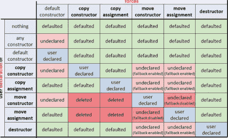

*图 3.1. 特殊成员函数自动生成的规则*

³ 本表经 Howard Hinnant 友好许可后采用。

你可以从这张表中看到几条基本规则：

- 仅当没有其他构造函数被用户声明时，默认构造函数才会被自动声明。
- 特殊的拷贝成员函数和析构函数会禁用移动支持。特殊移动成员函数的自动生成会被禁用（除非同时声明了移动操作）。然而，移动对象的请求通常仍然有效，因为拷贝成员函数会作为回退被使用（除非特殊移动成员函数被显式删除）。
- 特殊的移动成员函数会禁用普通的拷贝和赋值。拷贝操作和其他移动特殊成员函数会被删除，这样你就只能移动（赋值）而不能拷贝（赋值）一个对象（除非也声明了其他操作）。

让我们来看一些细节。

#### 3.3.2 默认情况下，我们拥有拷贝和移动

如前所述，默认情况下，一个类会生成拷贝和移动特殊成员函数。假设有如下 Person 类的声明：

```cpp
class Person {
    ...
public:
    ...
    // NO copy constructor/assignment declared

    // NO move constructor/assignment declared

    // NO destructor declared
};
```

在这种情况下，Person 对象既可以拷贝也可以移动：

```cpp
std::vector<Person> coll;

Person p{"Tina", "Fox"};
coll.push_back(p);              // OK, copies p
coll.push_back(std::move(p));   // OK, moves p
```

#### 3.3.3 声明拷贝会禁用移动（启用回退）

当声明一个拷贝特殊成员函数（或析构函数）时，移动特殊成员函数的自动生成会被禁用：假设有如下 Person 类的声明：

```cpp
class Person {
    ...
public:
    ...

    // copy constructor/assignment declared:
    Person(const Person&) = default;
    Person& operator=(const Person&) = default;

    // NO move constructor/assignment declared
};
```

由于回退机制生效，拷贝和移动`Person`对象都能编译通过，但移动操作是以拷贝方式执行的：

```cpp
std::vector<Person> coll;

Person p{"Tina", "Fox"};
coll.push_back(p);                 // OK, copies p
coll.push_back(std::move(p));      // OK, copies p
```

因此，使用`= default`声明一个特殊成员函数与完全不声明并不相同。拷贝构造函数和拷贝赋值运算符是用户声明的，这会禁用移动构造和移动赋值，从而使移动回退为拷贝。已声明的析构函数也有同样的效果。

你可能想知道为什么声明析构函数会禁用移动语义。关于被移动后的状态的章节讨论了一个具体示例，展示了一个带有析构函数的类如何导致生成的移动语义无法正常工作。

#### 3.3.4 声明移动会禁用拷贝

如果你有用户声明的移动语义，那么拷贝语义就被禁用了。拷贝特殊成员函数会被删除。

换句话说，如果显式声明了移动构造函数或移动赋值运算符（无论是实现、使用`= default`生成，还是使用`= delete`禁用），那么拷贝构造函数和拷贝赋值运算符就会被声明为`= delete`，从而对它们的调用被禁用。假设有如下`Person`类的声明：

```cpp
class Person {
    ...
public:
    ...
    // NO copy constructor declared

    // move constructor/assignment declared:
    Person(Person&&) = default;
    Person& operator=(Person&&) = default;
};
```

在这种情况下，我们拥有一个仅移动类型。`Person`对象可以被移动，但不能被拷贝：

```cpp
std::vector<Person> coll;

Person p{"Tina", "Fox"};
coll.push_back(p);                 // ERROR: copying disabled
coll.push_back(std::move(p));      // OK, moves p

coll.push_back(Person{"Ben", "Cook"});  // OK, moves temporary person into coll
```

同样，使用`= default`声明一个特殊成员函数与完全不声明并不相同。不过，这次调用的后果更为严重：尝试拷贝一个对象将不再能编译通过。

一个支持移动操作但不支持拷贝操作的类是有意义的。你可以使用这种*仅移动*类型来传递资源的所有权或句柄，而无需共享或拷贝它们。在 C++ 标准库中有一些仅移动类型（例如 I/O 流类、线程类和`std::unique_ptr<>`）。详细信息请参阅关于仅移动类型的章节。

#### 3.3.5 删除移动操作没有意义

出于同样的原因，如果你将移动构造函数声明为删除，那么你就不能移动（你已经禁用了该操作；任何回退都不会被使用），也不能拷贝（因为声明移动构造函数会禁用拷贝操作）：

```cpp
class Person {
  public:
    ...
    // NO copy constructor declared

    // move constructor/assignment declared as deleted:
    Person(Person&&) = delete;
    Person& operator=(Person&&) = delete;
    ...
};
```

```cpp
Person p{"Tina", "Fox"};
coll.push_back(p);           // ERROR: copying disabled
coll.push_back(std::move(p)); // ERROR: moving disabled
```

通过将拷贝特殊成员函数声明为删除，你可以获得相同的效果，而且这对其他程序员来说可能更不容易造成困惑。

删除移动操作而启用拷贝操作确实毫无意义：

```cpp
class Person {
  public:
    ...
    // copy constructor explicitly declared:
    Person(const Person& p) = default;
    Person& operator=(const Person&) = default;

    // move constructor/assignment declared as deleted:
    Person(Person&&) = delete;
    Person& operator=(Person&&) = delete;
    ...
};
```

```cpp
Person p{"Tina", "Fox"};
coll.push_back(p);           // OK: copying enabled
coll.push_back(std::move(p)); // ERROR: moving disabled
```

在这种情况下，`= delete`会禁用回退机制（因此这也与完全不声明不同）。编译器会找到该声明并将此调用报告为错误。

一个支持拷贝但在调用移动时却失败的类型毫无意义。对于这种类的用户来说，拷贝有时能工作，有时不能。作为一条准则：永远不要对特殊的移动成员函数使用`= delete`。⁴ 如果你想同时禁用拷贝和移动，删除拷贝特殊成员函数就足够了。

#### 3.3.6 在启用拷贝语义的情况下禁用移动语义

基于我们刚才的讨论，我们现在知道了在拷贝仍有意义时如何禁用移动语义。将特殊移动成员函数声明为删除通常不是正确的做法，因为这会禁用回退机制。

在提供拷贝语义的同时禁用移动语义的正确方法是声明其他特殊成员函数之一（拷贝构造函数、赋值运算符或析构函数）。我建议你为拷贝构造函数和赋值运算符使用 `= default`（声明其中一个就足够了，但可能会引起不必要的困惑）：

```cpp
class Customer {
    ...
public:
    ...
    Customer(const Customer&) = default;            // disable move semantics
    Customer& operator=(const Customer&) = default; // disable move semantics
};
```

因为找不到生成的特殊移动成员函数，所以一个匿名的临时 Customer 对象，甚至一个用`std::move()`标记的 Customer 对象，现在都会被拷贝：

```cpp
std::vector<Customer> customers;
...
customers.push_back(createCustomer());           // OK, falls back to copying
customers.push_back(std::move(customers[0]));     // OK, falls back to copying
```

然而，通常最好实现特殊的移动成员函数，以修复默认生成的移动操作可能存在的任何问题。关于被移动后的状态的章节将讨论实际中的示例。

请注意，仅声明特殊的拷贝成员函数就会破坏常见的“五法则”，我们稍后将详细讨论这一点。你必须声明特殊的拷贝成员函数，但不能同时声明特殊的移动成员函数（无论是删除还是默认声明都不行，实现它们则会使类变得不必要地复杂）。因此，如果你只是为了禁用移动语义而显式声明一个拷贝特殊成员函数，请加上一个醒目的注释，以确保该声明既不会被移除，也不会因添加特殊移动成员函数的声明而被扩展。


#### 3.3.7 成员移动语义被禁用时的移动

注意，如果某个类型的移动语义不可用或已被删除，这不会影响包含该类型成员的类的移动语义生成。生成的默认移动构造函数和赋值运算符会逐成员决定是复制还是移动。如果无法移动（即使移动操作已被删除），则会生成复制（如果可能）。

例如，假设有以下类：

```cpp
class Customer {
    ...
public:
    ...
    Customer(const Customer&) = default;          // copying calls enabled
    Customer& operator=(const Customer&) = default; // copying calls enabled
    Customer(Customer&&) = delete;                // moving calls disabled
    Customer& operator=(Customer&&) = delete;     // moving calls disabled
};
```

如果另一个类将其用作成员：

```cpp
class Invoice {
    std::string id;
    Customer cust;
public:
    ...  // no special member functions
};
```

生成的移动构造函数将移动 id 字符串，但复制 customer 成员 cust：

```cpp
Invoice i;
Invoice i1{std::move(i)};   // OK, moves id, copies cust
```

#### 3.3.8 生成的特殊成员函数的精确规则

现在我们可以总结特殊成员函数的新规则（何时生成以及它们如何行为）。

例如，假设我们有如下派生类：

```cpp
class MyClass : public Base
{
private:
    MyType value;
    ...
};
```

这里缺少的一项是 noexcept 规范，我们将在关于 noexcept 的章节稍后介绍。不过，这里会提及相应的保证。

##### 复制构造函数

当以下所有条件均满足时，复制构造函数会自动生成：

- 没有用户声明的移动构造函数
- 没有用户声明的移动赋值运算符

如果生成（隐式生成或使用 =default），复制构造函数具有以下行为：

```cpp
MyClass(const MyClass& obj) noexcept-specifier
  : Base(obj), value(obj.value) {
}
```

生成的复制构造函数首先将源对象传递给基类中最匹配的复制构造函数（记住，复制构造函数始终按自顶向下的方式调用）。它优先选择声明相同的复制构造函数（通常声明为 const&），但如果该构造函数不可用，则可能调用次优匹配的构造函数（例如复制构造函数模板）。之后，它复制其类的所有成员（同样使用最佳匹配）。

如果所有复制操作（所有基类的复制构造函数和所有成员的复制构造函数）都提供此保证，则生成的复制构造函数被声明为 noexcept。

##### 移动构造函数

当以下所有条件均满足时，移动构造函数会自动生成：

- 没有用户声明的复制构造函数
- 没有用户声明的复制赋值运算符
- 没有用户声明的移动赋值运算符
- 没有用户声明的析构函数

如果生成（隐式生成或使用 =default），移动构造函数具有以下行为：

```cpp
MyClass(MyClass&& obj) noexcept-specifier
  : Base(std::move(obj)), value(std::move(obj.value)) {
}
```

生成的移动构造函数首先将用 std::move() 标记的源对象（以传递其移动语义）传递给基类中最匹配的移动构造函数。最匹配的移动构造函数通常是声明相同（用 && 声明）的那个。但是，如果它不可用，则可能调用次优匹配的构造函数（例如移动构造函数模板甚至复制构造函数）。之后，它移动其类的所有成员（同样使用最佳匹配）。

如果所有被调用的移动/复制操作（所有基类的复制或移动构造函数以及所有成员的复制或移动构造函数）都提供此保证，则生成的移动构造函数被声明为 noexcept。

##### 复制赋值运算符

当以下所有条件均满足时，复制赋值运算符会自动生成：⁷

- 没有用户声明的移动构造函数
- 没有用户声明的移动赋值运算符

如果生成（隐式生成或使用 =default），复制赋值运算符大致具有以下行为：⁸

```cpp
MyClass& operator= (const MyClass& obj) noexcept-specifier {
    Base::operator=(obj);       // - perform assignments for base class members
    value = obj.value;           // - assign new members
    return *this;
}
```

生成的复制赋值运算符首先为传入的源对象调用基类中最匹配的赋值运算符（记住，与复制构造函数不同，赋值运算符不是按自顶向下的方式调用；它们在实现中调用基类的赋值运算符）。之后，它赋值其类的所有成员（同样使用最佳匹配）。

注意，生成的赋值运算符不检查对象对自身的赋值。如果这一点至关重要，你必须自己实现该运算符。

此外，即使所有赋值操作（基类成员的赋值和新成员的赋值）都提供此保证，生成的复制赋值运算符也不会被声明为 noexcept。

##### 移动赋值运算符

当以下所有条件均满足时，移动赋值运算符会自动生成：

- 没有用户声明的复制构造函数
- 没有用户声明的移动构造函数
- 没有用户声明的复制赋值运算符
- 没有用户声明的析构函数

如果生成（隐式生成或使用 =default），移动赋值运算符大致具有以下行为：

```cpp
MyClass& operator= (MyClass&& obj) noexcept-specifier {
    Base::operator=(std::move(obj));   // - perform move assignments for base class members
    value = std::move(obj.value);       // - move assign new members
    return *this;
}
```

生成的移动赋值运算符首先为传入的源对象调用基类中最匹配的移动赋值运算符，该对象用 std::move() 标记以传递其移动语义。之后，它移动赋值其类的所有成员（同样使用最佳匹配）。

##### 其他特殊成员函数

你可能想知道为什么在对象用 `std::move()` 标记后，我们仍然使用源对象 `obj` 的成员：

```cpp
Base::operator=(std::move(obj));  // 为基类成员执行移动赋值
```

然而，在这种情况下，我们将对象标记为基类的特定上下文，而基类无法看到此类中引入的新成员。因此，派生成员具有有效但未指定的状态，但我们仍然可以使用新成员的值。

生成的赋值运算符也不检查对象对自身的赋值。在其默认行为中，该运算符会将每个成员赋值给自身，这通常意味着成员会收到有效但未指定的值。如果这一点至关重要，你必须自己实现该运算符。

此外，生成的移动赋值运算符被声明为 `noexcept`，如果所有赋值操作（对基类成员的赋值和对新成员的赋值）都给出此保证。

其他特殊成员函数在移动语义中不发挥重要作用：

- **析构函数** 在移动语义方面没有特殊之处，除了它们的声明禁用了移动操作的自动生成。
- **默认构造函数**（“非特殊”的特殊成员函数）如果未声明其他构造函数，仍会自动生成。也就是说，移动构造函数的声明禁用了默认构造函数的生成。

然而，请注意，这些特殊成员函数在谈论 *从...移动* 的状态时确实发挥作用。默认构造函数的状态通常是从...移动的对象和从...移动的对象应可析构的“自然”状态。

### 3.4 五法则或三法则

特殊成员函数是否以及哪些被自动生成，取决于所描述规则的几种组合。许多程序员并不了解所有这些规则。因此，即使在 C++11 之前，通常的准则是为 *所有* 特殊成员函数（复制、赋值和析构）提供要么都不提供。

- 在 C++11 之前，此准则被称为 ***三法则***：该准则是要么声明所有三个（复制构造函数、赋值运算符和析构函数），要么一个都不声明。
- 从 C++11 起，规则变成了 ***五法则***，通常表述为：⁹ 准则是要么声明所有五个（复制构造函数、移动构造函数、复制赋值运算符、移动赋值运算符和析构函数），要么一个都不声明。

这里，*声明* 意味着：

- 要么实现（`{...}`）
- 要么声明为 defaulted（`=default`）
- 要么声明为 deleted（`=delete`）

⁹ 例如，参见 http://github.com/isocpp/CppCoreGuidelines/blob/master/CppCoreGuidelines.md#Rc-five。

也就是说，当这些特殊成员函数中的某一个被实现、被默认或被删除时，你应当实现、默认或删除其他四个特殊成员函数。

但是，你应当谨慎对待这条规则。我建议你更多将其视为一条指导原则：当其中某一个特殊成员函数被用户声明时，要**仔细思考**这五个特殊成员函数。

正如我们所看到的，若只想启用复制语义，你应当对复制特殊成员函数使用 `=default`，而不声明移动特殊成员函数（删除并默认移动特殊成员函数不会起作用，实现它们会让类不必要地复杂）。尤其当生成的移动语义会产生无效状态时，推荐此选项，正如我们在关于无效的移后状态的章节中所讨论的。

在应用这条五法则时，也发现有时程序员会用它来为新移动操作添加声明，却不理解这意味着什么。程序员只是因为复制操作已经实现，并且想遵循五法则，就用 `=default` 声明移动操作。

因此，我通常讲授**五法则或三法则**：

- 如果你声明了复制构造函数、移动构造函数、复制赋值运算符、移动赋值运算符或析构函数，请**非常仔细地思考**如何处理其他特殊成员函数。
- 如果你不理解移动语义，那么当你声明复制构造函数、复制赋值运算符和析构函数中的某一个时，只需考虑这三者。如果拿不准，就通过用 `=default` 声明复制特殊成员函数来禁用移动语义。

### 3.5 总结

- 移动语义不会传递。
- 对于每个类，移动构造函数和移动赋值运算符都会自动生成（除非无法这样做）。
- 用户声明复制构造函数、复制赋值运算符或析构函数会禁用类中对移动语义的自动支持。这不会影响派生类中的支持。
- 用户声明移动构造函数或移动赋值运算符会禁用类中对复制语义的自动支持。你会得到仅可移动类型（除非这些特殊成员函数被删除）。
- 绝不要对特殊移动成员函数使用 `=delete`。
- 如果没有特定需要，不要声明析构函数。对于从多态基类派生的类，通常没有这种需要。


## 第 4 章：如何从移动语义中获益

大多数情况下，程序员会自动从移动语义中获益。然而，即便是普通应用程序开发者，在稍微改变编程方式时，也能从移动语义中获得更多好处。

本章讨论如何在普通应用程序代码、类和类层次结构中，超越特殊移动成员函数的自动生成，从移动语义中获益。本章还介绍了相应新的指导原则。

请注意，即使在引入移动语义几年后，这些建议在社区中仍未广为人知。事实上，我写这本书的原因之一就是让它们成为现代C++编程的先进技术。

### 4.1 避免使用具名对象

正如我们所见，移动语义允许我们利用不再需要该值的源对象的值进行优化。如果编译器自动检测到某个值来自一个生命周期即将结束的对象，它们会自动切换为移动语义。这发生在以下情况：

-   我们传递一个临时对象，该对象将在语句结束后自动销毁。
-   我们按值返回一个局部对象。

此外，我们可以通过使用`std::move()`标记对象来强制移动语义。

因为让编译器自动完成工作更容易，移动语义带来的第一个后果是以下建议：**避免使用具名对象。**

与其写：

```
MyType x{42, "hello"};
foo(x);    // x之后不再使用
```

不如这样编程：

```
foo(MyType{42,"hello"});
```

以自动启用移动语义。

当然，避免使用具名对象的建议可能与源代码可读性和可维护性等其他重要风格指南相冲突。与其编写复杂的语句，不如使用多个语句。在这种情况下，如果你不再需要某个对象（并且知道复制该对象可能会花费大量时间），应使用`std::move()`：

```cpp
foo(std::move(x));
```

#### 4.1.1 当无法避免使用名称时

有些情况下，你无法避免使用`std::move()`，因为必须给对象命名。最明显的典型例子有：

-   你必须多次使用一个对象。例如，你可能在函数或循环中获取一个值以处理它两次：

    ```cpp
    std::string str{getData()};
    ...
    coll1.push_back(str);              // 复制（仍需要str的值）
    coll2.push_back(std::move(str));    // 移动（不再需要str的值）
    ```

    同样适用于将值插入同一集合两次，或调用两个不同的函数将值存储在某处。

-   你必须处理一个参数。最常见的例子是以下循环：

    ```cpp
    // 从myStream中逐行读取并存储到coll中
    std::string line;
    while (std::getline(myStream, line)) {
        coll.push_back(std::move(line));   // 移动（不再需要line的值）
    }
    ```

### 4.2 避免不必要的`std::move()`

正如我们所看到的，按值返回局部对象时，如果支持移动语义，会自动使用移动语义。然而，为了安全起见，程序员可能会尝试用显式的`std::move()`来强制：

```cpp
std::string foo()
{
    std::string s;
    ...
    return std::move(s);   // 不好：不要这样做
}
```

记住，`std::move()`只是强制转换为右值引用。因此，`std::move(s)`是一个产生类型`std::string&&`的表达式。然而，这不再匹配返回类型，因此禁用了*返回值优化*，而通常该优化允许返回的对象被用作返回值。对于未实现移动语义的类型，这甚至可能迫使返回值被复制，而不是直接将返回对象用作返回值。

因此，如果你按值返回局部对象，不要使用`std::move()`：

```cpp
std::string foo()
{
    std::string s;
    ...
    return s;         // 最佳性能（返回值优化或移动）
}
```

当你已经有一个临时对象时，使用`std::move()`至少是多余的。对于按值返回对象的`createString()`函数，你应该直接使用返回值：

```cpp
std::string s{createString()};        // 可以
```

而不是再次用`std::move()`标记：

```cpp
std::string s{std::move(createString())};    // 不好：不要这样做
```

编译器可能会（有选项）警告任何适得其反或不必要的`std::move()`使用。例如，gcc有选项`-Wpessimizing-move`（通过`-Wall`启用）和`-Wredundant-move`（通过`-Wextra`启用）。

但是，在某些应用中，在返回语句中使用`std::move()`可能是适当的。一个例子是移出成员的值。另一个例子是以移动语义返回参数。

### 4.3 使用移动语义初始化成员

一个令人惊讶的后果是，即使在包含受益于移动语义的成员类型（如字符串成员或容器）的平凡类中，你也可以从移动语义中获益。

让我们通过一个简单的例子来看一下。

#### 4.3.1 经典方式初始化成员

考虑一个具有两个字符串成员的类，我们可以在构造函数中初始化它们。这样的类通常这样实现：

`basics/initclassic.hpp`

```cpp
#include <string>

class Person {
private:
    std::string first;  // 名
    std::string last;   // 姓
public:
    Person(const std::string& f, const std::string& l)
      : first{f}, last{l} {
    }
    ...
};
```

现在让我们看看当我们用两个字符串字面量初始化这个类的对象时会发生什么：

```
Person p{"Ben", "Cook"};
```

编译器发现提供的构造函数可以执行初始化。然而，参数的类型不匹配。因此，编译器生成代码，首先创建两个临时的`std::string`，它们由两个字符串字面量的值初始化，并将参数`f`和`l`绑定到它们：

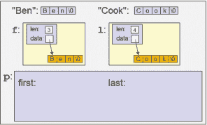

一般来说（如果*短字符串优化（SSO）*不可用或字符串太长），这意味着生成代码为每个`std::string`的值分配内存。

然而，创建的临时字符串并不直接用作成员`first`或`last`。相反，它们用于初始化这些成员。不幸的是，由于两个原因，这里没有使用移动语义：

-   参数`f`和`l`是具名对象，其存在时间比成员的初始化更长（你仍然可以在构造函数体内使用它们）。
-   参数被声明为`const`，即使我们使用`std::move()`也会禁用移动语义。

结果，字符串的复制构造函数在每个成员初始化时被调用，再次为值分配内存：

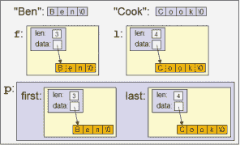

在构造函数结束时，临时字符串被销毁：

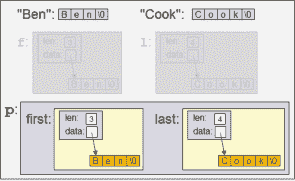

这意味着我们有四次内存分配，尽管只需要两次。使用移动语义，我们可以做得更好。

##### 使用非 const 左值引用？

你可能想知道为什么我们不能在这里简单地使用非const左值引用：

```
class Person {
    …
    Person(std::string& f, std::string& l)
      : first{std::move(f)}, last{std::move(l)} {
    }
    …
};
```

然而，传递const的`std::string`和临时对象（例如，通过类型转换创建）将无法编译：

```
Person p{"Ben", "Cook"};  // 错误：不能将非const左值引用绑定到临时对象
```

一般来说，非const左值引用不能绑定到临时对象。因此，这个构造函数不能将`f`和`l`绑定到从传入的字符串字面量创建的临时字符串。

#### 4.3.2 通过按值传递的移动参数初始化成员

有了移动语义，现在对于构造函数来说，有一种简单的替代方式来初始化成员：构造函数将每个参数按值传递，并将其移动到成员中：

`basics/initmove.hpp`

```cpp
#include <string>

class Person {
private:
```


```cpp
std::string first;  // first name
std::string last;   // last name
public:
  Person(std::string f, std::string l)
    : first{std::move(f)}, last{std::move(l)} {
  }
  ...
};
```

这个单一构造函数接受所有可能的参数，并确保每个参数只进行一次分配。

例如，如果我们传入两个字符串字面量：

`Person p{"Ben", "Cook"};`

我们首先用它们初始化参数 f 和 l：

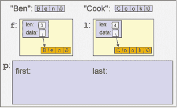

通过使用 `std::move()`，我们将参数的值移动到成员中。首先，成员 `first` 从 `f` 窃取值：

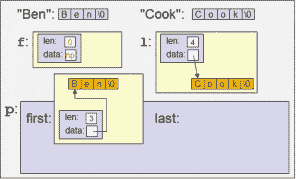

然后，成员 last 从 l 窃取值：

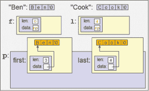

同样，在构造函数结束时，临时字符串会被销毁。这一次耗时更少，因为字符串的析构函数不再需要释放已分配的内存：

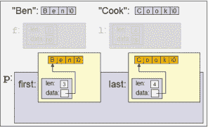

如果我们传入 `std::strings`，这种初始化成员的方式也同样适用：

- 如果我们传入两个现有字符串且没有用 `std::move()` 标记它们，我们会将名称复制到参数，再将它们移动到成员：

    ```cpp
    std::string name1{"Jane"}, name2{"White"};
    ...
    Person p{name1, name2};        // OK, copy names into parameters and move them to the members
    ```

- 如果我们传入两个不再需要其值的字符串，则完全不需要任何分配：

    ```cpp
    std::string firstname{"Jane"};
    ...
    Person p{std::move(firstname),        // OK, move names via parameters to members
             getLastnameAsString()};
    ```

在这种情况下，我们会移动字符串两次：一次用于初始化参数 f 和 l，另一次用于将 f 和 l 的值移动到成员。

只要移动的代价很低，采用这种仅有一个构造函数的实现，任何初始化都是可行且低代价的。

#### 4.3.3 通过右值引用初始化成员

使用多个构造函数，还有更多方式可以初始化 `Person` 的成员。

##### 使用右值引用

为了支持移动语义，我们已经了解到，可以将参数声明为非 const 右值引用。这允许参数从传入的临时对象或标记了 `std::move()` 的对象中窃取值。

假设我们如下声明构造函数：

```cpp
class Person {
  ...
  Person(std::string&& f, std::string&& l)
    : first{std::move(f)}, last{std::move(l)} {
  }
  ...
};
```

这种初始化对于传入的字符串字面量也同样有效：

```cpp
Person p{"Ben", "Cook"};
```

同样，因为构造函数需要字符串，我们会创建两个临时字符串，并让 `f` 和 `l` 绑定到它们：

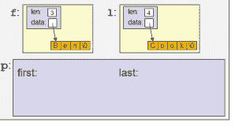

并且因为我们拥有非 const 引用，所以可以修改它们。在这种情况下，我们用 `std::move()` 标记它们，以便成员的初始化可以窃取值。

首先，成员 `first` 从 `f` 窃取值：

##### 为右值和左值引用重载

接受右值引用的函数在传入临时对象时工作正常（这里我们传入由字符串字面量创建的临时 std::strings），但它们也有限制：我们不能传入之后仍需要其值的具名对象。因此，如果我们只有接受右值引用的构造函数，就不能传入现有字符串：

```cpp
class Person {
  ...
  Person(std::string&& f, std::string&& l)
    : first{std::move(f)}, last{std::move(l)} {
  }
  ...
};

Person p1{"Ben", "Cook"};  // OK

std::string name1{"Jane"}, name2{"White"};
...
Person p2{name1, name2};   // ERROR: can't pass a named object to an rvalue reference
```

对于 p2 的情况，我们需要一个传统构造函数，它使用 const 左值引用来声明。然而，我们也可能传入一个字符串字面量和一个现有字符串。因此，对于所有可能的组合，总共需要四个构造函数：

```cpp
class Person {
  ...
  Person(const std::string& f, const std::string& l)
    : first{f}, last{l} {
  }
  Person(const std::string& f, std::string&& l)
    : first{f}, last{std::move(l)} {
  }
  Person(std::string&& f, const std::string& l)
    : first{std::move(f)}, last{l} {
  }
  Person(std::string&& f, std::string&& l)
    : first{std::move(f)}, last{std::move(l)} {
  }
  ...
};
```

这样一来，我们可以以任意组合传入字符串字面量和现有字符串，并且每个成员始终只进行一次分配。

##### 甚至为字符串字面量重载

为了进一步提高性能，我们甚至可以为以普通指针形式接收字符串字面量提供特定实现。这样，我们甚至可以避免一些移动操作。然而，实现所有构造函数会变得有点繁琐：

`basics/initiall.hpp`

```cpp
#include <string>

class Person {
 private:
  std::string first;  // first name
  std::string last;   // last name
 public:
  Person(const std::string& f, const std::string& l)
    : first{f}, last{l} {
  }
  Person(const std::string& f, std::string&& l)
    : first{f}, last{std::move(l)} {
  }
  Person(std::string&& f, const std::string& l)
    : first{std::move(f)}, last{l} {
  }
  Person(std::string&& f, std::string&& l)
    : first{std::move(f)}, last{std::move(l)} {
  }
  Person(const char* f, const char* l)
    : first{f}, last{l} {
  }
  Person(const char* f, const std::string& l)
    : first{f}, last{l} {
  }
  Person(const char* f, std::string&& l)
    : first{f}, last{std::move(l)} {
  }
  Person(const std::string& f, const char* l)
    : first{f}, last{l} {
  }
  Person(std::string&& f, const char* l)
    : first{std::move(f)}, last{l} {
  }
  ...
};
```

这种解决方案的好处是减少了移动次数。如果我们传入字符串字面量，就直接用传入的指针初始化成员，而不是创建一个 `std::string` 再将其值移动到成员。

#### 4.3.4 比较不同方法

随着初始化成员的新方法不断出现，显而易见的问题是：我们应该在什么时候使用哪种技术？还有：我们应该教授哪种技术？

一般来说，除非有充分理由，否则不应放弃使用 `const&` 的简单方法。这个理由通常是性能。因此，让我们测量用三类实参初始化 Person 需要多长时间：传入字符串字面量、传入现有字符串，以及传入用 `std::move()` 标记的字符串。

```cpp
std::string fname = "a first name";
std::string lname = "a last name";

// measure how long this takes:
Person p1{"a firstname", "a lastname"};
Person p2{fname, lname};
Person p3{std::move(fname), std::move(lname)};
```

然而，为了避免短字符串优化（SSO）——那意味着字符串完全不分配任何内存——我们应该使用长度可观的字符串。因此，下面是一个用于测量不同方法的完整函数：

*basics/initmeasure.hpp*

```cpp
#include <chrono>

// measure num initializations of whatever is currently defined as Person:
std::chrono::nanoseconds measure(int num)
{
    std::chrono::nanoseconds totalDur{0};
    for (int i = 0; i < num; ++i) {
        std::string fname = "a firstname a bit too long for SSO";
        std::string lname = "a lastname a bit too long for SSO";

        // measure how long it takes to create 3 Persons in different ways:
        auto t0 = std::chrono::steady_clock::now();
        Person p1{"a firstname too long for SSO", "a lastname too long for SSO"};
        Person p2{fname, lname};
        Person p3{std::move(fname), std::move(lname)};
        auto t1 = std::chrono::steady_clock::now();
        totalDur += t1 - t0;
    }
    return totalDur;
}
```


函数`measure()`返回执行上述三种初始化、处理较长字符串并迭代 num 次所需的时长。

现在，我们将上文中类 Person 的不同定义与测量函数结合起来，编写带有`main()`函数的程序，在其中调用测量函数并打印测得的时长。例如：

```cpp
basics/initclassperson.cpp

#include "initclass.hpp"
#include "initmeasure.hpp"
#include <iostream>
#include <cstdlib>   // for std::atoi

int main(int argc, const char** argv)
{
    int num = 1000;   // num iterations to measure
    if (argc > 1) {
        num = std::atoi(argv[1]);
    }

    // a few iterations to avoid measuring initial behavior:
    measure(5);

    // measure (in integral nano- and floating-point milliseconds):
    std::chrono::nanoseconds nsDur{measure(num)};
    std::chrono::duration<double, std::milli> msDur{nsDur};

    // print result:
    std::cout << num << " iterations take:  "
              << msDur.count() << "ms\n";
    std::cout << "3 inits take on average:  "
              << nsDur.count() / num << "ns\n";
}
```

另外两个程序`basics/initlvalueperf.cpp`和`basics/initmoveperf.cpp`只是在其他类 Person 声明中使用了不同的头文件。

在开启显著优化的情况下，使用三种不同编译器在三个不同平台上运行这段代码，结果如下：

- 通常，使用传统左值引用（`const &`）进行初始化所需的时间，明显长于其他初始化方式。我见过最高达两倍的差距。
- 实现全部九个构造函数与只实现按值接收参数并移动的构造函数，二者之间没有太大差异。有时一种方式稍快，有时另一种稍快；很多时候则没有明显差异。

如果利用 *小字符串优化（SSO）*，使用很短的字符串，就完全不会分配内存（此时移动语义也不会带来明显帮助），那么各项数据会非常接近。尽管如此，使用传统的接收 const 左值引用的构造函数仍然略有不足。不过，这肯定要求开启良好的优化。

除了尝试不同的测试程序外，你还可以使用`basics/initperf.cpp`这个整合程序，在你偏好的平台上执行所有这些不同的测量。

不过，你可能会有非常昂贵且无法从移动语义中获益的成员（例如包含 10000 个 double 值的数组）：

```cpp
class Person {
private:
    std::string name;
    std::array<double, 10000> values;   // move can't optimize here
public:
    ...
};
```

在这种情况下，采用按值接收 10000 个 double 值并移动的方式会产生问题。我们必须对参数进行两次复制，耗时几乎会增加一倍。完整的测量示例程序见 basics/initbigperf.cpp。

#### 4.3.5 成员初始化总结

总的来说，对于那些能够从移动语义中显著获益的成员（字符串、容器，或包含这类成员的类/数组），应在以下两种方案中选择一种来使用移动语义：

- 将参数从按左值引用传递改为按值传递，并将其移动到成员中
- 为移动语义重载构造函数

第一种方案只需一个构造函数，因此代码更易于维护。不过，这会导致执行不必要的移动操作。因此，如果移动操作可能耗时较长，最好使用多个重载版本。

例如，如果类包含一个字符串和一个值向量，通常按值传递并移动是合适的做法：

```cpp
class Person {
private:
    std::string name;
    std::vector<std::string> values;
public:
    Person(std::string n, std::vector<std::string> v)
        : name{std::move(n)}, values{std::move(v)} {
    }
    ...
};
```

但是，如果类中有一个 std::array 成员，则最好使用重载，因为即使数组成员被移动，移动 std::array 仍然需要耗费大量时间。

```cpp
class Person {
private:
  std::string name;
  std::array<std::string, 1000> values;
public:
  Person(std::string n, const std::array<std::string, 1000>& v)
    : name{std::move(n)}, values{v} {
  }
  Person(std::string n, std::array<std::string, 1000>&& v)
    : name{std::move(n)}, values{std::move(v)} {
  }
  …
};
```

#### 4.3.6 现在是否应该始终按值传递并移动？

上面的讨论引出了一个问题：现在我们是否应该始终按值接收参数，并将其移动到内部值或成员中？答案是**不应该**。

这里讨论的是一种特殊情况：我们*创建并初始化*一个新值。在这种情况下，这种策略很有效。如果我们已经有一个值，并要对其进行更新或修改，那么采用这种方式就会适得其反。

一个简单的例子是 setter。请看类`Person`的以下实现：

```cpp
class Person {
private:
  std::string first;  // 名
  std::string last;   // 姓
public:
  Person(std::string f, std::string l)
    : first{std::move(f)}, last{std::move(l)} {
  }
  …
  void setFirstname(std::string s) {             // 按值接收
    first = std::move(s);                        // 并移动
  }
  …
};
```

假设我们这样使用该类：

```cpp
Person p{"Ben", "Cook"};
std::string name1{"Ann"};
std::string name2{"Constantin Alexander"};

p.setFirstname(name1);
p.setFirstname(name2);
p.setFirstname(name1);
p.setFirstname(name2);
```

每次设置新的名时，都会创建一个新的临时参数 s，并为其分配内存，然后将其移动到成员的值中。因此，我们会进行四次内存分配（假设没有使用 SSO）。

现在考虑以传统方式实现 setter，即接收 const 左值引用：

```cpp
class Person {
private:
    std::string first;   // 名
    std::string last;    // 姓
public:
    Person(std::string f, std::string l)
      : first{std::move(f)}, last{std::move(l)} {
    }
    ...
    void setFirstname(const std::string& s) {    // 按引用接收
        first = s;                               // 并赋值
    }
    ...
};
```

将 s 绑定到传入的参数不会创建新的字符串。此外，只有在新字符串的长度超过当前为该值分配的内存容量时，赋值运算符才会分配新的内存。这意味着，由于我们已经有一个值，按值接收参数并移动的方式可能适得其反。

你可能会想，是否应该重载 setter，以便在新字符串的长度超过现有长度时，能够利用移动语义：

```cpp
class Person {
private:
    std::string first;   // 名
    std::string last;    // 姓
public:
    Person(std::string f, std::string l)
      : first{std::move(f)}, last{std::move(l)} {
    }
    ...
    void setFirstname(const std::string& s) {    // 按左值引用接收
        first = s;                               // 并赋值
    }
    void setFirstname(std::string&& s) {         // 按右值引用接收
        first = std::move(s);                    // 并进行移动赋值
    }
    ...
};
```

然而，即使这种做法也可能适得其反，因为移动赋值可能会缩小 first 的容量：

```cpp
Person p{"Ben", "Cook"};

p.setFirstname("Constantin Alexander");    // 会分配足够的内存
p.setFirstname("Ann");                     // 会缩小容量
p.setFirstname("Constantin Alexander");    // 又必须重新分配
```

即使采用移动语义，为已有值设置新值的最佳做法仍然是按 const 左值引用接收新值，并在赋值时不使用 std::move()。

只有在需要将传入的值存储为一个新值时（也就是说，无论如何都需要为它分配新内存），按值接收参数并将其移动到目标位置才有用。修改已有值时，这种策略可能适得其反。

不过，初始化成员并非“按值接收并移动”的唯一应用场景。向容器中添加新值的（成员）函数也是一种应用：

```cpp
class Person {
private:
    std::string name;
    std::vector<std::string> values;
public:
    Person(std::string n, std::vector<std::string> v)
      : name{std::move(n)}, values{std::move(v)} {
    }
    // 创建新元素时，最好按值传递并移动：
    void addValue(std::string s)       // 按值接收
    {
        values.push_back(std::move(s));        // 并将其移动到容器中
    }
    ...
};
```

### 4.4 类层次结构中的移动语义

正如我们所见，声明任何复制构造函数、复制赋值运算符或析构函数，都会禁用移动语义的自动支持。多态基类也适用这一点。不过，还有一些其他方面需要考虑。

#### 4.4.1 实现多态基类

多态基类通常会引入虚成员函数，以便你可以针对派生类的所有对象调用这些函数。例如：

```cpp
class GeoObj {
public:
    virtual void draw() const = 0;      // 纯虚函数（定义 API）
    ...
    virtual ~GeoObj() = default;        // 让 delete 调用正确的析构函数
```


```cpp
    ...
    // other special member functions due to the problem of slicing
};
```

在这个基类中，移动语义被禁用，这意味着如果我们移动一个几何对象，基类中*此处*声明的成员不会自动获得移动语义支持。如果我们在多态基类中有一个受保护的拷贝构造函数和一个被删除的赋值运算符，这也同样适用；在多态基类中，通常应当这样声明，以避免切片问题。

只要基类不引入成员，不支持移动语义就没有影响。然而，如果这个基类中有一个开销很大的成员，你就已经禁用了它的移动支持。例如：

```cpp
class GeoObj {
protected:
    std::string name;                    // name of the geometric object
public:
    ...
    virtual void draw() const = 0;       // pure virtual function (introducing the API)
    ...
    virtual ~GeoObj() = default;         // disables move semantics for name
    ...  // other special member functions due to the problem of slicing
};
```

要再次启用移动语义，你可以显式地将移动操作声明为默认。然而，正如我们刚刚了解到的，这会禁用拷贝特殊成员函数。因此，如果你想要这些函数，就必须显式提供它们。

##### 处理切片问题

然而，存在切片问题。考虑以下代码，它使用基类 `GeoObj` 的引用来引用派生类 *Circle* 的对象：

```cpp
    Circle c1{...}, c2{...};

    GeoObj& geoRef{c1};
    geoRef = c2;            // OOPS: uses GeoObj::operator=() and assigns no Circle members
```

由于我们调用的是 `GeoObj` 的赋值运算符，而该运算符不是虚函数，编译器会调用 `GeoObj::operator=()`，它不会处理任何派生类的任何成员。即使把赋值运算符声明为 `virtual` 也无济于事，因为派生类的运算符不会覆盖基类的赋值运算符（第二个操作数的参数类型不同）。

为避免此问题，应在多态类层次结构中禁用赋值运算符。此外，如果类不是抽象类，还应避免使用公有拷贝构造函数，以禁用向基类的隐式类型转换。因此，带有移动语义（以及成员）的多态基类应如下声明：

```cpp
class GeoObj {
protected:
    std::string name;                    // name of the geometric object
    GeoObj(std::string n)
      : name(std::move(n)) {
    }
public:
    virtual void draw() const = 0;    // pure virtual function (introducing the API)
    ...
    virtual ~GeoObj() = default;      // would disable move semantics for name
protected:
    // enable copy and move semantics (callable only for derived classes):
    GeoObj(const GeoObj&) = default;
    GeoObj(GeoObj&&) = default;
    // disable assignment operator (due to the problem of slicing):
    GeoObj& operator=(GeoObj&&) = delete;
    GeoObj& operator=(const GeoObj&) = delete;
};
```

完整头文件见 *poly/geoobj.hpp*。

#### 4.4.2 实现多态派生类

多态派生类可能如下所示（完整头文件见 *poly/polygon.hpp*）：¹

```cpp
class Polygon : public GeoObj {
  protected:
    std::vector<Coord> points;
  public:
    Polygon(std::string s, std::initializer_list<Coord> = {});  // constructor
    virtual void draw() const override;    // implementation of draw()
};
```

¹ 如果成员函数用 `override` 声明，则不必再写 `virtual`。不过，我倾向于再次写上它，以便更好地对齐，并遵循这样一条规则：要么所有成员函数都是虚函数，要么都不是。

通常，在多态派生类中无需声明任何特殊成员函数。尤其是不需要再次声明虚析构函数（除非你必须实现它）。再次声明析构函数（无论它是否为虚函数）都会禁用对派生类成员（此处是针对 vector 类型的 points 成员）移动语义的自动支持：

```cpp
class Polygon : public GeoObj {
  protected:
    std::vector<Coord> points;
  public:
    Polygon(std::string s, std::initializer_list<Coord> = {});  // constructor
    ...
    virtual ~Polygon() = default;  // OOPS: don't do that because it disables move semantics
};
```

然而，如果不声明析构函数，移动语义对 Polygon 的两个成员 name 和 points 都有效。考虑以下程序：

*poly/polygon.cpp*

```cpp
#include "geoobj.hpp"
#include "polygon.hpp"

int main()
{
    Polygon p0{"Poly1", {Coord{1,1}, Coord{1,9}, Coord{9,9}, Coord{9,1}}};
    Polygon p1{p0};             // copy
    Polygon p2{std::move(p0)};   // move

    p0.draw();
    p1.draw();
    p2.draw();
}
```

该程序有如下输出：

```text
polygon '' over
polygon 'Poly1' over (1,1) (1,9) (9,9) (9,1)
polygon 'Poly1' over (1,1) (1,9) (9,9) (9,1)
```

对于 name 和 points 这两个成员，值都从 p0 移动到了 p2。
请注意，如果你必须在 Polygon 类中实现移动构造函数，则需要特别小心，以提供正确的 noexcept 条件。

### 4.5 总结

- 避免使用具名对象。
- 避免不必要的 `std::move()`。尤其是在返回局部对象时不要使用它。
- 如果从参数初始化成员的移动操作开销很小，那么这样的构造函数应按值接收参数并将其移动到成员中。
- 如果从参数初始化成员的移动操作耗时显著，那么这样的构造函数应为移动语义进行重载，以获得最佳性能。
- 一般来说，从参数创建并初始化新值且移动操作开销很小时，应按值接收参数并移动。但是，不要为了更新/修改现有值而按值接收并移动。
- 不要在派生类中声明虚析构函数（除非你必须实现它）。

## 第 5 章

## 基于引用限定符的重载

本章讨论针对不同引用限定符重载成员函数。正如我们将看到的，这将回答社区中一个常见问题：取值函数应按值返回还是按常量引用返回。

### 5.1 取值函数的返回类型

在为拷贝开销很大的成员实现取值函数时，在 C++11 之前我们有以下选择：

- 按值返回
- 按左值引用返回

让我们简要讨论这些选择。

#### 5.1.1 按值返回

按值返回的取值函数如下所示（请记住：不要使用 const 按值返回，否则会禁用移动语义）：

```cpp
class Person
{
  private:
    std::string name;
  public:
    ...
    std::string getName() const {
      return name;
    }
};
```

这段代码是安全的，但每次请求 name 时，我们都可能拷贝 name。

例如，仅仅检查是否有一个名字为空的人，就会产生显著开销：

```cpp
std::vector<Person> coll;
...
for (const auto& person : coll) {
    if (person.getName().empty()) {    // OOPS: copies the name
        std::cout << "found empty name\n";
    }
}
```

如果将这种方法与返回引用的方法进行比较，你会发现按值返回 string 的版本有 2 到 100 倍的性能开销（前提是名字长度足够显著，以至于 SSO 不起作用）。如果访问的成员是一幅图像或包含数千个元素的集合，情况可能更糟。在这种情况下，取值函数通常按（const）引用返回来提高性能。

#### 5.1.2 按引用返回

按引用返回的取值函数如下所示：

```cpp
class Person
{
private:
    std::string name;
public:
    ...
    const std::string& getName() const {
        return name;
    }
};
```

这更快，但有些不太安全，因为调用者必须确保返回的引用所引用的对象存活得足够久。事实上，存在一种生命周期风险：你使用取值函数返回值的时间可能长于你调用取值函数的对象。

掉入这个陷阱的一种方式是像下面这样使用基于范围的 for 循环：

```cpp
for (char c : returnPersonByValue().getName()) {  // OOPS: undefined behavior
    if (c == ' ') {
        ...
    }
}
```

注意，循环头部右侧有一个函数返回临时对象，而我们的取值函数引用的正是这个临时对象。然而，基于范围的 for 循环的定义使得上述代码等价于以下代码：

```cpp
reference range = returnPersonByValue().getName();
// OOPS: returned temporary object destroyed here
for (auto pos = range.begin(), end = range.end(); pos != end; ++pos) {
```


```cpp
char c = *pos;
if (c == ' ') {
    ...
}
```

在我们开始迭代之前，我们初始化一个引用¹，因为我们必须两次使用传入的 range（一次调用它的 `begin()`，一次调用它的 `end()`），并且希望避免创建 range 的副本（这可能开销很大，甚至不可行）。一般来说，引用会延长其所指对象的生命周期。然而，在这种情况下，range 并不指向 `returnPersonByValue();` 返回的 `Person`；range 指向 `getName()` 的返回值，而该返回值是对某个返回的 `Person` 的*引用*。因此，range 延长的是该引用的生命周期，而不是该引用所指临时对象的生命周期。所以，随着第一条语句结束，返回的临时对象被销毁，而当我们迭代 name 的字符时，使用的却是对已销毁对象 name 的引用。

往好处想，我们在这里得到核心转储，从而能看到某处出了严重问题。往坏处想，一旦我们发布软件，就会遇到致命的未定义行为。

如果 getter 按值返回 name，这样的代码就不会有问题。在那种情况下，range 会延长 name 副本的生命周期，这样我们就能在 range 生命周期结束之前一直使用 name。

#### 5.1.3 使用移动语义解决困境

借助移动语义，我们现在有办法解决这个困境。如果按引用返回是安全的，我们就可以按引用返回；如果可能遇到生命周期问题，我们就按值返回。

编程实现方式如下：

```cpp
class Person
{
private:
    std::string name;
public:
    ...
    std::string getName() && {    // when we no longer need the value
        return std::move(name);   // we steal and return by value
    }

    const std::string& getName() const& {    // in all other cases
        return name;                         // we give access to the member
    }
};
```

我们以与为 `&&` 和 `const&` 参数重载函数相同的方式，用不同的引用限定符重载 getter：

- 带 && 限定符的版本用于我们不再需要其值的对象（即将消亡的对象，或已用 `std::move()` 标记的对象）。
- 带 `const&` 限定符的版本用于所有其他情况。它总是适用，但只是在我们无法采用 `&&` 版本时的回退方案。因此，当对象不是即将消亡或未用 `std::move()` 标记时，就使用这个函数。

现在我们同时拥有良好的性能和安全性：

```cpp
Person p{"Ben"};
std::cout << p.getName();                         // 1) fast (returns reference)
std::cout << returnPersonByValue().getName();     // 2) fast (uses move())

std::vector<Person> coll;
...
for (const auto& person : coll) {
    if (person.getName().empty()) {                // 3) fast (returns reference)
        std::cout << "found empty name\n";
    }
}

for (char c : returnPersonByValue().getName()) {  // 4) safe and fast (uses move())
    if (c == ' ') {
        ...
    }
}
```

语句 1) 和 3) 使用针对 `const&` 的版本，因为我们有一个 name 未用 `std::move()` 标记的对象。语句 2) 和 4) 使用针对 `&&` 的版本，因为我们是对临时对象调用 `getName()`。由于临时对象即将消亡，getter 可以将成员 name 移动出来作为返回值，这意味着我们不必为返回值分配新内存；我们从成员那里“窃取”该值。

你可能记得，return 语句不应使用 `std::move()` 来移出那些无论如何都会消亡的局部对象。然而，在这种情况下，我们返回的不是局部对象；我们返回的是一个成员，其生命周期不会随着成员函数的结束而结束。

##### 用 std::move() 调用成员函数

请注意，这一特性意味着，即使在调用成员函数时，也值得使用 `std::move()`。例如：

```cpp
void foo()
{
    Person p{...};
    ...
    coll.push_back(p.getName());                 // calls getName() const&
    ...
    coll.push_back(std::move(p).getName());      // calls getName() && (OK, p no longer used)
}
```

在调用 `getName()` 时使用 `std::move()` 将提升该程序的性能。返回值不再是只能复制的、指向 `const std::string` 的引用，而是以非 `const string` 形式返回的、已移动的 `p` 的 name，这样 `push_back()` 就能使用移动语义将其移入 `coll`。

像往常一样，在这次调用之后，`p` 处于*有效但未指定状态*。

关于该特性在 C++ 标准库中的使用示例，请参见 `std::optional<>` 类。

### 5.2 按限定符重载

自 C++98 起，我们可以重载成员函数来实现 const 版本和非 const 版本。例如：

```cpp
class C {
  public:
    ...
    void foo();       // foo() for non-const objects
    void foo() const; // foo() for const objects
};
```

括号后的限定符允许我们限定那个未作为参数传入的对象：即我们为其调用该成员函数的对象。

现在，借助移动语义，由于有了不同的引用限定符，我们有了新的按限定符重载函数的方式。考虑以下程序：

*basics/refqual.cpp*

```cpp
#include <iostream>

class C {
  public:
    void foo() const& {
      std::cout << "foo() const&\n";
    }
    void foo() && {
      std::cout << "foo() &&\n";
    }
    void foo() & {
      std::cout << "foo() &\n";
    }
    void foo() const&& {
      std::cout << "foo() const&&\n";
    }
};
```

```cpp
int main()
{
    C x;
    x.foo();             // calls foo() &
    C{}.foo();           // calls foo() &&
    std::move(x).foo();  // calls foo() &&

    const C cx;
    cx.foo();            // calls foo() const&
    std::move(cx).foo(); // calls foo() const&&
}
```

该程序演示了所有可能的引用限定符以及它们何时被调用。通常，我们只会有其中两三个重载，例如使用 `&&` 和 `const&`（对于 getter 还会使用 `&`）。

另请注意，不允许同时按引用限定符和非引用限定符进行重载：

```cpp
class C {
public:
    void foo() &&;
    void foo() const;    // ERROR: can't overload by both reference and value qualifiers
};
```

### 5.3 何时使用引用限定符

引用限定符允许我们在为特定值类别的对象调用函数时，以不同方式实现函数。其目标是：当我们为不再需要其值的对象调用成员函数时，提供不同的实现。

尽管我们确实拥有这一特性，但它并没有得到应有的充分利用。特别是，我们可以（也应该）用它来确保修改对象的操作不会被调用到即将消亡的临时对象上。²

#### 5.3.1 赋值运算符的引用限定符

更好地使用引用限定符的一个例子是修改赋值运算符的实现。正如 https://wg21.link/n2819 中所提议的，凡是可以这样做的地方，最好都用引用限定符声明赋值运算符。³

² 感谢 Peter Sommerlad 指出这一点。

³ 该论文是在讨论了甚至改变所生成赋值运算符的行为、使其带有引用限定符之后形成的。参见 https://wg21.link/cwg733。

例如，string 的赋值运算符声明如下：

```cpp
namespace std {
  template<typename charT, ...>
  class basic_string {
    public:
      ...
      constexpr basic_string& operator=(const basic_string& str);
      constexpr basic_string& operator=(basic_string&& str) noexcept(...);
      constexpr basic_string& operator=(const charT* s);
      ...
  };
}
```

这会导致意外地给临时 string 赋新值：

```cpp
std::string getString();

getString() = "hello";  // OK
foo(getString() = "");  // passes string instead of bool
```

考虑改为用引用限定符声明赋值运算符：

```cpp
namespace std {
  template<typename charT, ...>
  class basic_string {
    public:
      ...
      constexpr basic_string& operator=(const basic_string& str) &;
      constexpr basic_string& operator=(basic_string&& str) & noexcept(...);
      constexpr basic_string& operator=(const charT* s) &;
      ...
  };
}
```

像这样的代码将不再能编译：

```cpp
std::string getString();

getString() = "hello";  // ERROR
foo(getString() = "");  // ERROR
```

请注意，特别是对于可用作布尔值的类型，这将有助于发现如下 bug：

```cpp
std::optional<int> getValue();

if (getValue() = 0) {  // OOPS: compiles although = is used instead of ==
  ...
}
```


本质上，我们为临时对象恢复了基本类型所具有的一项属性：它们是右值，这意味着它们不能位于赋值运算的左侧。

请注意，截至目前，所有旨在相应修复 C++ 标准的提案都被拒绝了。主要原因是对向后兼容性的担忧。不过，在实现自己的类时，可以按照以下方式采用这一改进：

```cpp
class MyType {
public:
    ...
    // disable assigning value to temporary objects:
    MyType& operator=(const MyType& str) & = default;
    MyType& operator=(MyType&& str) & = default;

    // because this disables the copy/move constructor, also:
    MyType(const MyType&) = default;
    MyType(MyType&&) = default;
    ...
};
```

一般来说，对于每个可能修改对象的成员函数，都应该这样做。

#### 5.3.2 其他成员函数的引用限定符

正如 getter 的示例所展示的那样，当返回对象的引用时，也可以并且应该使用引用限定符。这样，我们就能降低访问已销毁临时对象成员的风险。

同样，当前标准字符串的声明可以作为示例：

```cpp
namespace std {
    template<typename charT, ...>
    class basic_string {
    public:
        ...
        constexpr const charT& operator[](size_type pos) const;
        constexpr charT&       operator[](size_type pos);
        constexpr const charT& at(size_type n) const;
        constexpr charT&       at(size_type n);

        constexpr const charT& front() const;
        constexpr charT&       front();
        constexpr const charT& back() const;
        constexpr charT&       back();
        ...
    };
}
```

相比之下，下面这些重载会更好：

```cpp
namespace std {
  template<typename charT, ...>
  class basic_string {
  public:
    ...
    constexpr const charT& operator[](size_type pos) const&;
    constexpr charT&       operator[](size_type pos) &;
    constexpr charT        operator[](size_type pos) &&;
    constexpr const charT& at(size_type n) const&;
    constexpr charT&       at(size_type n) &;
    constexpr charT        at(size_type n) &&;

    constexpr const charT& front() const&;
    constexpr charT&       front() &;
    constexpr charT        front() &&;
    constexpr const charT& back() const&;
    constexpr charT&       back() &;
    constexpr charT        back() &&;
    ...
  };
}
```

同样，由于向后兼容性问题，在 C++ 标准中进行相应修改可能会带来麻烦。不过，你可以并且应该为自己的类型提供这些重载。在这种情况下，不要忘记：右值引用对应的实现应该将开销较大的成员移出。

### 5.4 总结

- 可以根据不同的引用限定符对成员函数进行重载。
- 对于开销较大的成员，使用带引用限定符的 getter 重载，使其既安全又快速。
- 即使是在调用成员函数时，使用 `std::move()` 标记对象也可能是有意义的。
- 在赋值运算符中使用引用限定符。

## 第 6 章：移动后状态

尽管自动生成或以简单方式实现的移动语义通常能够正常工作，但我们至少应该了解这样一种可能性：移动操作会将对象置于一种 C++ 标准库不支持的状态，或者破坏该类型的不变量。

本章将根据 C++ 标准库关于移动后对象处于“有效但未指明状态”的保证，阐明“无效”状态的定义。

### 6.1 移动后对象的必要状态与保证状态

移动操作完成后，源对象既没有被部分销毁，也没有被完全销毁。析构函数尚未被调用，并且会在源对象的生命周期结束时调用。因此，析构函数至少必须能够顺利运行。

不过，C++ 标准库对其移动后类型提供了更多保证。移动后对象处于“有效但未指明状态”。这意味着，你可以像使用该类型的任何对象一样使用移动后对象，只是你不知道它的值是什么。这类似于使用该类型的非常量引用参数，而完全不知道所传入对象的值。既然我们知道可以对移动后对象进行的操作不只是销毁它们，那么，例如，我们就可以使用移动语义来实现排序和修改算法。

为了更详细地了解如何处理移动后对象，最好区分与它们相关的两个方面：[^1]

- 使用移动后对象时，需要满足哪些**要求**，才能安全地将它们与 C++ 标准库一起使用？
- 对于自己类型的移动后对象，应该提供哪些**保证**，以便这些类型的用户知道如何以具有明确定义行为的方式使用它们？

通常，你提供的保证至少应该满足 C++ 标准库的要求，但也可以提供更多保证。

[^1]: 感谢 Sean Parent 指出了这一点。

#### 6.1.1 移动后对象的必要状态

C++ 标准库对移动后对象的要求并没有什么特殊之处。也就是说，对于任何函数，它针对传入类型和对象所提出的要求，同样适用于传入该函数或在内部使用的任何移动后对象。

基本上，你始终必须能够销毁移动后对象。此外，在许多函数中，你还必须能够为移动后对象赋予新值。

例如，考虑如何交换两个对象 `a` 和 `b` 的值（这可能是排序操作的一部分）。交换通常按如下方式实现（见图 6.1）：

- 将 `a` 移动到新的临时对象 `tmp` 中（此时 `a` 变为移动后对象）。
- 将 `b` 移动赋值给移动后的对象 `a`（此时 `b` 变为移动后对象）。
- 将 `tmp` 移动赋值给移动后的对象 `b`（此时 `tmp` 变为移动后对象）。
- 销毁移动后的对象 `tmp`。

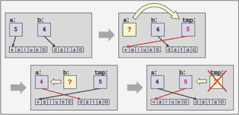

*图 6.1。swap 函数中的移动后对象*

请注意，我们也可能通过将同一个对象传递给两个参数来执行自交换。在这种情况下，我们甚至可能将处于移动后状态的对象赋值给自身。这应该能够正常工作（前提是移动后对象仍然可以具有任意值）。

因此，对于移动后对象，我们具有通常适用于所有对象的相同基本要求：

- 必须能够销毁移动后对象。
- 必须能够为移动后对象赋予新值。
- 应该能够将移动后对象复制、移动或赋值给另一个对象。

移动后对象还应该能够满足特定操作的其他要求。例如，要对对象进行排序，我们必须支持对所有对象调用 `operator<` 或排序准则。这同样适用于移动后对象。你可能会认为，在自己的排序算法中，应该知道哪个对象被移动过，从而避免比较它，但 C++ 标准库并不要求这样做。顺便说，这也意味着你可以传递移动后对象来对其进行排序。只要它们支持所有必需的操作，一切就没有问题。

请注意，C++ 标准库的定义所要求的内容，比 Alexander Stepanov 和 Paul McJones 在 *Elements of Programming* 中称为*部分构造*的状态更多。²

对于在 C++ 标准库中使用的所有对象和类型，你应该**确保移动后对象也支持所调用函数的所有要求。**

#### 6.1.2 移动后对象的保证状态

移动后对象的保证定义了使用它们时哪些代码具有明确定义的行为。通常，类的设计者决定提供哪些保证。不过，由于我们总是在对象生命周期结束时销毁对象，因此对于移动后状态，你始终必须提供的最低保证是：调用析构函数具有明确定义的行为。

通常还会提供更多保证。对于 C++ 标准库的要求而言，支持复制、为同类型对象赋值等基本操作通常就足够了。不过，用户通常还希望能够通过其他方式为对象赋予新值。因此，一个有用的额外保证是：可以通过任意形式为移动后对象“赋予”新值。

考虑为标准字符串 `s` 赋予新值的不同方式：

```cpp
s = "hello";           // assign "hello"
s.assign(s2);          // assign the state of s2
s.clear();             // assign the empty state
std::cin >> s;         // assign the next word from standard input
std::getline(myfile, s); // assign the next line from a file
```

例如，下面的循环是从流中逐行读取内容并存入向量的一种常见方式：

```cpp
std::string row;
while (std::getline(myStream, row)) {
    coll.push_back(std::move(row));   // move the line into the vector
}
```

再例如，在处理容器的泛型代码中，可以实现以下语句：

```cpp
foo(std::move(obj));    // pass obj to foo()
obj.clear();            // ensure the object is empty afterwards
```

类似的代码对于释放 `unique_ptr` 所管理对象的内存也很有用：

```cpp
draw(std::move(up));    // the unique pointer might or might not give up ownership
up.reset();             // ensure we give up ownership and release any resource
```

通过声称移动后对象处于*有效但未指明状态*，C++ 标准保证，对于库中的相关类型，只要某个操作通常适用于所有可能的状态，该操作就是具有明确定义行为的。

例如，根据 C++ 标准，以下行为是有定义的：

```cpp
std::stack<int> stk;
...
foo(std::move(stk));    // stk gets unspecified state
stk.push(42);
```


```cpp
...
int i = stk.top();           // do something else without using stk
assert(i == 42);             // should never fail
```

虽然我们在用 `std::move()` 将其传给 `foo()` 之后并不知道 `stk` 的值，但只要只用它来保存我们的值 42，直到我们再次需要它，我们就可以把它当作一个有效的栈来使用。

当然，你所提供的保证能走多远取决于你自己，但要确保你类型的用户知晓这些保证。通常，他们期望你的类型提供与 C++ 库相同的保证，这样你就可以像使用该类型的任何其他对象一样使用一个移后源对象，而无需知道它的值。

#### 6.1.3 被破坏的不变量

C++ 标准库对所有移后源对象处于“有效但未指定状态”的含义定义如下：

> 对象的值未被指定，但对象的不变量必须得到满足，且对对象的操作按其类型的规定行为运行。

不变量是适用于所有可创建对象的保证。有了这一保证，你可以假设移后源对象所处的状态意味着其不变量未被破坏。你可以像使用非 const 引用参数一样使用该对象，而无需知道传入的参数：你可以调用任何没有约束或前置条件的操作，并且该调用的效果/结果与该类型任何其他对象的规定一致。

例如，对于一个移后源字符串，我们可以执行所有没有前置条件的操作：

- 查询其大小
- 将其打印出来
- 遍历字符
- 转换为 C 字符串
- 赋予新值
- 追加一个字符

此外，所有这些函数仍具有通常规定的语义：

- 返回的大小可用于安全地调用下标运算符。
- 返回的大小与遍历字符时的字符数一致。
- 打印出的字符与遍历时的字符序列一致。
- 追加字符会将该字符放到值的末尾（无需知道其前方是否有其他字符以及是哪些字符）。

程序员可以利用这些保证（参见上面的 std::stack<> 示例）。

然而，有时你必须明确确保预期的不变量不被破坏。默认的特殊移动成员函数可能无法正常工作。我们将在下面的小节中讨论示例。

#### 6.1.4 受限的不变量

对于移后源状态，*不*给出 C++ 标准库的完整保证也可能是有用处的。也就是说，你可以有意限制移后源对象可能执行的操作。例如，当一个对象的有效状态总是需要内存等资源时，仅具有部分受支持的状态或许更好，以使移动操作更廉价。

在 C++ 标准库中就有这样的情形：某些实现对基于节点的容器的所有状态都始终需要内存（所以即使是默认构造函数也必须分配内存）。对于这些容器，限制我们对移后源对象所能执行的操作，可能比保证移后源对象始终处于“有效”状态更好。然而，我们决定提供完整保证。

理想情况下，不支持所有操作的移后源状态应当是可检测的。对象应知道这一状态，并提供一个成员函数来检查该状态。移后源对象也可以拒绝执行该状态下不支持的操作。然而，相应的检查在一般情况下可能会损失性能。

在 C++ 标准库中，有些类型提供了 API 来检查对象是否处于移后源状态。例如，`std::future` 有一个成员函数 `valid()`，对于移后源对象会返回 `false`。但是，用于检查移后源状态的接口各不相同。

很多时候，移后源状态就是默认构造状态，这意味着移后源状态无论如何都属于不变量的一部分。无论如何，请确保你类型的用户清楚什么是定义明确的，什么不是。

### 6.2 可析构与可赋值

让我们讨论如何确保移后源对象满足支持赋值和销毁的基本要求。

#### 6.2.1 可赋值且可析构的移后源对象

在大多数类中，生成的特殊移动成员函数会将移后源对象置于赋值运算符和析构函数都能正常工作的状态。然而，只要每个移后源成员都是可赋值且可析构的，那么对移后源对象整体进行的赋值和销毁都应该正常工作：

- 赋值操作会从相应的源成员赋值，从而覆盖该成员未指定的状态。
- 析构函数会销毁该成员（该成员处于未指定的状态）。

因为对于这些成员，我们通常可以而且应当期望它们在被移动后处于有效但未指定状态，所以生成的移动操作通常就能正常工作并创建正确的状态。

例如，考虑以下类：

```cpp
class Customer {
private:
    std::string name;
    std::vector<int> values;
    ...
};
```

当某个 customer 的值被移走时，name 和 values 都保证处于有效状态，因此它们的析构函数（由 Customer 的析构函数调用）能正常工作：

```cpp
void foo()
{
    Customer c{"Michael Spencer"};
    ...
    process(std::move(c));
    // both name and values have valid but unspecified states
    ...
} // destructor of c will clean up name and values (whatever their state is)
```

此外，给 c 赋予新值也能正常工作，因为我们会同时赋值 name 和 values。

#### 6.2.2 不可析构的移后源对象

然而，在少数情况下可能会出现问题。在这些情况下，我们通常实现了赋值运算符或析构函数，其作用不仅仅是赋值或销毁成员。<sup>3</sup>

考虑下面这个类，我们使用固定大小的数组来存放数量可变的线程对象，并在析构函数中显式调用 join() 以等待它们结束：

*basics/tasks.hpp*

```cpp
#include <array>
#include <thread>

class Tasks {
private:
    std::array<std::thread, 10> threads; // array of threads for up to 10 tasks
    int numThreads{0};                  // current number of threads/tasks
public:
    Tasks() = default;

    // pass a new thread:
    template <typename T>
    void start(T op) {
        threads[numThreads] = std::thread(std::move(op));
        ++numThreads;
    }
    ...

    // at the end wait for all started threads:
    ~Tasks() {
        for (int i = 0; i < numThreads; ++i) {
            threads[i].join();
        }
    }
};
```

<sup>3</sup> 这里我们看到了一个原因，即为什么在实现了析构函数时，移动语义默认会被禁用。

到目前为止，该类还不支持移动语义，因为它有用户声明的析构函数。你也不能复制 Tasks 对象，因为复制 `std::thread` 是被禁用的。不过，你可以启动多个任务并等待它们结束：

*basics/tasks.cpp*

```cpp
#include "tasks.hpp"
#include <iostream>
#include <chrono>

int main()
{
    Tasks ts;
    ts.start([]{
        std::this_thread::sleep_for(std::chrono::seconds(2));
        std::cout << "\nt1 done" << std::endl;
    });
    ts.start([]{
        std::cout << "\nt2 done" << std::endl;
    });
}
```

现在考虑通过生成移动操作的默认实现来启用移动语义（参见 `basics/tasksbug.cpp`）：

```cpp
class Tasks {
private:
    std::array<std::thread, 10> threads; // array of threads for up to 10 tasks
    int numThreads{0};                  // current number of threads/tasks
public:
    ...
    // OOPS: enable default move semantics:
    Tasks(Tasks&&) = default;
    Tasks& operator=(Tasks&&) = default;

    // at the end wait for all started threads:
    ~Tasks() {
        for (int i = 0; i < numThreads; ++i) {
            threads[i].join();
        }
    }
};
```


在这种情况下，你会陷入麻烦，因为默认生成的移动操作可能会创建无效的 Tasks 状态。考虑以下示例：

`basics/tasksbug.cpp`

```cpp
#include "tasksbug.hpp"
#include <iostream>
#include <chrono>
#include <exception>

int main()
{
    try {
        Tasks ts;
        ts.start([]{
            std::this_thread::sleep_for(std::chrono::seconds{2});
            std::cout << "\nt1 done" << std::endl;
        });
        ts.start([]{
            std::cout << "\nt2 done" << std::endl;
        });

        // OOPS: move tasks:
        Tasks other{std::move(ts)};
    }
    catch (const std::exception& e) {
        std::cerr << "EXCEPTION: " << e.what() << std::endl;
    }
}
```

一开始，我们通过将两个任务传递给 Tasks 对象 ts 来启动它们。因此，在 ts 中，threads 数组有两个条目，且 numThreads 为 2。不幸的是，容器的移动操作会移动元素，因此在 std::move() 之后，ts 不再包含任何表示正在运行线程的线程对象。因此，numThreads 只是被复制了，这意味着我们创建了一个不一致/无效的状态。析构函数最终会遍历前两个元素并调用 join()，这会抛出异常（这在析构函数中是致命错误）。

一般问题在于，两个成员共同定义了一个有效状态，而默认生成的移动语义会造成不一致，以至于连析构函数都会失败。你无法总是避免这个问题，因为当对象被销毁时，你可能总是必须显式地对对象所含元素的某个子集做一些处理。在所有这些情况下，默认生成的移动操作可能无法正常工作，你应当禁用或修复它们。

一种修复方式可能是：

-   修复析构函数以处理被移动后的状态（例如，在这种情况下，我们可以只在 thread 对象 `joinable()` 时才调用 `join()`）
-   自己实现移动操作

考虑一个用于纸牌游戏卡牌的类。⁴ 假设每个对象都是一张有效卡牌，例如红桃八或方块 K。还假设无论出于何种原因，值是一个字符串，并且该类的不变式是每个对象都具有表示有效卡牌的状态。这意味着我们可能没有默认构造函数，并且初始化构造函数会断言该值是有效的。例如：

```cpp
class Card {
private:
    std::string value;              // rank + "-of-" + suit
public:
    Card(const std::string& v)
      : value{v} {
        assertValidCard(value);     // ensure the value is always valid
    }

    std::string getValue() const {
        return value;
    }
};
```

在这个类中，生成的特殊移动成员函数会创建一个无效状态，破坏“值始终是点数后跟 "-of-" 再后跟花色”的类不变式（例如 "queen-of-hearts"）。

只要我们不使用 std::move() 或其他移动操作，这就不是问题（该类型的析构函数对被移动后的字符串工作正常），但当我们调用 std::move() 时，就可能陷入麻烦。赋一个新值工作正常：

```cpp
std::vector<Card> deck;                  // initialize deck
...
Card c{std::move(deck[0])};              // deck[0] has its valid state
deck[0] = Card{"ace-of-hearts"};          // deck[0] is valid again
```

然而，打印被移动后卡牌的值可能会失败：

```cpp
std::vector<Card> deck;                  // initialize deck
...
Card c{std::move(deck[0])};              // deck[0] has invalid state
print(deck[0]);                          // passing an object with broken invariant
```

如果 print 函数假定不变式没有被破坏，我们可能会得到核心转储：

```cpp
void print(const Card& c) {
    std::string val{c.getValue()};
    auto pos = val.find("-of-");              // find position of substring (no check)
    std::cout << val.substr(0, pos) << ' '
              << val.substr(pos+4) << '\n';  // OOPS: possible core dump
}
```

⁴ 感谢 Tony Van Eerd 提供此示例。

这段代码可能在运行时失败，因为对于被移动后的卡牌，不再保证值中包含 "-of-"。在这种情况下，`find()` 会用 `std::string::npos` 初始化 `pos`，当 `pos+4` 被用作 `substr()` 的第一个参数时，会抛出 `std::out_of_range` 类型的异常。

完整示例参见 *basics/card.hpp* 和 *basics/card.cpp*。

修复这个类的选项如下：

-   禁用移动语义：

    ```cpp
    class Card {
        ...
        Card(const Card&) = default;              // disable move semantics
        Card& operator=(const Card&) = default;   // disable move semantics
    };
    ```

    然而，这会使移动操作（例如由 `std::sort()` 调用）开销更大。

-   完全禁用复制和移动：

    ```cpp
    class Card {
        ...
        Card(const Card&) = delete;              // disable copy/move semantics
        Card& operator=(const Card&) = delete;   // disable copy/move semantics
    };
    ```

    然而，此后你就不能再洗牌或排序卡牌了。

-   修复有问题的特殊移动成员函数。

    然而，什么才是有效的修复（总是赋一个诸如 "ace-of-clubs" 的“默认值”可以吗）？并且你如何确保带有默认值的对象在不分配内存的情况下表现良好？

-   在内部允许新状态，但禁止调用 `getValue()` 或其他成员函数。

    你可以记录这一点（“对于被移动后的对象，只允许为其赋新值。所有其他成员函数都有前提条件：对象不处于被移动后的状态。”），甚至可以在成员函数内部检查这一点，并触发断言或抛出异常。

-   通过引入 `Card` 可能没有值的新状态来扩展不变式。

    这意味着你必须实现移动特殊成员函数，因为必须确保对于被移动后的对象，成员 value 处于此状态。

    通常，被移动后的状态等同于默认构造状态。因此，这也是提供默认构造函数的机会。理想情况下，你还可以提供一个成员函数来检查此状态。

    进行此更改后，该类的用户必须考虑到字符串的值可能为空，并相应地更新其代码。例如：

    ```cpp
    void print(const Card& c) {
        std::string val{c.getValue()};
        auto pos = val.find("-of-");                 // find position of substring
        if (pos != std::string::npos) {              // check whether it exists
            std::cout << val.substr(0, pos) << ' '
                      << val.substr(pos+4) << '\n';
        }
        else {
            std::cout << "no value\n";
        }
    }
    ```

或者，`getValue()` 可以返回 `std::optional<std::string>`（自 C++17 起可用）。似乎没有明显完美的解决方案。你必须思考这些方案对程序更大范围的不变式分别意味着什么（例如，只有一个梅花 A，或者所有卡牌都是有效卡牌等），并决定使用哪一种。

注意，这个类在 C++11 之前工作正常，那时不支持移动语义（这可能意味着第一个选项是最好的）。因此，C++11 可能为类引入一些在该类实现时不可能存在的状态。这是罕见情况，但它确实意味着移动语义的引入可能会破坏现有代码。

参见 class final 或另一个类的示例，其中我们在内部标记被移动后的状态以单独处理它，并在“移除”算法使元素处于被移动后状态之后使该状态可见。

#### 6.3.2 由于移动一致的值成员而破坏不变式

移动操作破坏不变式的第二个原因与这样的对象有关：其中两个成员必须保持一致，但可能被移动特殊成员函数破坏。正如线程数组示例中所见，这甚至可能造成破坏析构函数的不一致。然而，更常见的情况是析构函数工作正常，但被移动后的状态破坏了不变式。

考虑一个类，其中我们有一个值的两种不同表示：一个整数表示和一个字符串表示：

*basics/integrating.hpp*

```cpp
#include <iostream>
#include <string>

class IntString
{
  private:
    int val;          // value
    std::string sval; // cached string representation of the value
  public:
    IntString(int i = 0)
      : val{i}, sval{std::to_string(i)} {
    }
    void setValue(int i) {
      val = i;
      sval = std::to_string(i);
    }
    ...
    void dump() const {
      std::cout << "[ " << val << " / " << sval << "]\n";
```

```cpp
}
};
```

在这个类中，我们通常确保成员 val 和成员 sval 只是同一个值的两种不同表示。这意味着，在这个类的实现和使用中，我们通常期望其状态的 int 表示和 string 表示是一致的。然而，如果我们在这里调用移动操作，我们将保留值 val，但 sval 将不再保证具有 val 的字符串表示。

考虑以下程序：

*basics/intstring.cpp*

```cpp
#include "intstring.hpp"
#include <iostream>

int main()
{
    IntString is1{42};
    IntString is2;
    std::cout << "is1 and is2 before move:\n";
    is1.dump();
    is2.dump();

    is2 = std::move(is1);

    std::cout << "is1 and is2 after move:\n";
    is1.dump();
    is2.dump();
}
```

该程序通常具有以下输出（不要忘记，被移动后的 string 变为空是典型情况，但并非保证）：

```text
is1 and is2 before move:
  [42/'42']
  [0/'0']
is1 and is2 after move:
  [42/'']
  [42/'42']
```

也就是说，自动生成的移动操作破坏了我们“两个成员始终彼此匹配”的不变量。

这个问题有多大？嗯，至少这是一个可能的陷阱。同样，你可能会争辩说，在移动之后我们不应再使用该值（直到我们再次设置该值）。然而，程序员可能会期望一种类似于 C++ 标准库对象所采用的策略，即对象处于有效但未指定的状态。

事实是，有了相应的 getter 函数后，这个类不再保证作为 int 的值和作为 string 的值彼此匹配，而这在这里很可能是一个类不变量（无论是以隐式还是显式方式声明的）。你可能认为最坏的后果是，该值（现在未指定）会根据你使用它的方式而看起来不同，但使用它并没有问题，因为它仍然是一个有效的 int 或 string。

然而，依赖这一不变量的代码可能会被破坏。那样的代码可能会假设字符串表示至少包含一个数字。例如，如果它查找第一个或最后一个数字，你肯定能找到。对于被移动后的 string（通常为空），情况就不再如此。因此，没有再次检查字符串值中是否有任何字符的代码，可能会遇到意外的未定义行为。

同样，如何处理这个问题由类的设计者决定。然而，如果你遵循 C++ 标准库的规则，就应该让被移动后的对象保持在有效状态，这可能意味着你要引入一个精确表示“我没有任何值”的状态。

一般来说，当一个对象的状态包含以某种方式相互依赖的成员时，你必须显式确保被移动后的状态处于有效状态。可能破坏这一点的示例如下：

-   我们对同一个值有不同表示，但其中一些表示已被移走。
-   像计数器这样的成员与某个成员中的元素数量相对应。
-   一个布尔值声称某个字符串值已经过验证，但被验证的值已被移走。
-   所有元素的平均值缓存值仍然存在，但值（位于容器成员中）已被移走。

再次注意，这个类在 C++11 之前工作正常，当时不支持移动语义。当切换到 C++11 或更高版本并使用被移动后的对象时，不变量就会被破坏。

#### 6.3.3 因被移动的类指针成员而破坏不变量

移动操作破坏不变量的第三个原因，涉及那些成员具有类指针语义（例如（智能）指针）的对象。

考虑以下示例：类对象使用 `std::shared_ptr<>` 来共享一个整数值：

```cpp
class SharedInt {
private:
    std::shared_ptr<int> sp;
public:
    explicit SharedInt(int val)
        : sp{std::make_shared<int>(val)} {
    }

    std::string asString() const {
        return std::to_string(*sp);    // OOPS: assume there is always an int value
    }
};
```

这个类的对象会接收一个初始整数值，该值可以与这些对象的副本共享。只要新对象仅通过复制创建，一切就都没有问题：

```cpp
SharedInt si1{42};
SharedInt si2{si1};                    // si1 and si2 share the value 42

std::cout << si1.asString() << '\n';  // OK
```

由于只进行复制，SharedInt 的成员 sp 始终为其值分配了内存（要么来自 std::make_shared<>，要么来自复制一个已分配内存的现有共享指针）。

然而，一旦我们使用移动语义，如果仍然使用被移动后的对象，就会遇到未定义行为：

```cpp
SharedInt si1{42};
SharedInt si2{std::move(si1)};          // OOPS: moves away the allocated memory in si1

std::cout << si1.asString() << '\n';  // undefined behavior (probably core dump)
```

问题在于，在类内部，我们没有正确处理该值可能已被移走这一事实；这种情况之所以可能发生，是因为默认生成的移动操作会调用 shared pointer 的移动操作，从而将所有权从原对象移走。这意味着 SharedInt 的被移动后状态会使成员 sp 进入不再拥有对象的情况，而其成员函数 asString() 没有正确处理这种情况。

你可能会争辩说，对一个处于被移动后状态的对象调用 asString() 没有意义，因为你使用的是未指定值；但至少标准库对其类型保证，被移动后的类型处于有效状态，因此你可以调用所有没有约束的操作。在用户定义类型中不提供同样的保证，可能会让该类型的使用者感到意外。

从健壮编程（避免意外、陷阱和未定义行为）的角度来看，我通常建议遵循 C++ 标准库的规则。也就是说：移动操作不应使对象进入破坏不变量的状态。

在这种情况下，我们必须执行以下操作之一：

-   通过正确处理所有可能的被移动后状态，修复类中所有被破坏的操作
-   禁用移动语义，以便复制对象时没有优化
-   显式实现移动操作
-   调整并记录类或特定操作的不变量（约束/前置条件）（例如“对被移动后的对象调用 asString() 是未定义行为”）

由于分配内存开销很大，在这种情况下，最好的修复方法可能是正确处理整数值的所有权可能被移走这一事实。那样会产生一种默认构造函数会具有的状态，我们可以通过这一修改引入该状态。

以下小节将演示这一点以及其他代码修复。

##### 修复损坏的成员函数

第一个选项是修复所有被破坏的操作，这本质上意味着我们扩展类的不变量（所有对象的可能状态），以便所有操作都能处理被移动后的状态。我们仍然必须做出设计决策。例如，当对被移动后的对象（或者更一般地说，共享指针不拥有整数值的对象）调用 `asString()` 时，我们可以：

-   仍然返回一个回退值：

```cpp
class SharedInt {
    ...
    std::string asString() const {
        return sp ? std::to_string(*sp) : "";
    }
    ...
};
```

-   抛出异常：

```cpp
class SharedInt {
    ...
    std::string asString() const {
        if (!sp) throw;
        return std::to_string(*sp);
    }
    ...
};
```

-   在调试模式下强制触发运行时错误：

```cpp
class SharedInt {
    ...
    std::string asString() const {
        assert(sp);
        return std::to_string(*sp);
    }
    ...
};
```

##### 禁用移动语义

第二个选项是禁用移动语义，以便只能使用复制语义。我们之前描述了如何禁用移动语义。你必须由用户声明另一个特殊成员函数。通常，你会对复制特殊成员函数使用 `=default`：

```cpp
class SharedInt {
    ...
    SharedInt(const SharedInt&) = default;          // disable move semantics
    SharedInt& operator=(const SharedInt&) = default; // disable move semantics
    ...
};
```

##### 实现移动语义

第三种选择是实现移动操作，使它们不破坏类的不变量。为此，我们必须决定被移动后对象应处于什么状态。为了支持 `asString()` 在不检查值是否存在的情况下调用 `operator*`，我们将不得不始终提供一个值。例如，我们可以有一个静态的移出后值，将其赋给值被移走的对象。⁶

`basics/sharedint.hpp`

```cpp
#include <memory>
#include <string>

class SharedInt {
  private:
    std::shared_ptr<int> sp;
    // special “value” for moved-from objects:
    inline static std::shared_ptr<int> movedFromValue{std::make_shared<int>(0)};

  public:
    explicit SharedInt(int val)
      : sp{std::make_shared<int>(val)} {
    }

    std::string asString() const {
      return std::to_string(*sp);    // OOPS: unconditional deref
    }

    // fix moving special member functions:
    SharedInt (SharedInt&& si)
      : sp{std::move(si.sp)} {
        si.sp = movedFromValue;
    }
    SharedInt& operator= (SharedInt&& si) noexcept {
      if (this != &si) {
        sp = std::move(si.sp);
        si.sp = movedFromValue;
      }
      return *this;
    }

    // enable copying (deleted with user-declared move operations):
    SharedInt (const SharedInt&) = default;
    SharedInt& operator= (const SharedInt&) = default;
};
```

⁶ 注意，内联静态成员仅从 C++17 起才受支持。在 C++17 之前，你必须在单独的 CPP 文件中定义该成员，以遵守*单一定义规则*（ODR）。

注意，我们必须用 = default 声明拷贝特殊成员函数，因为当我们有用户声明的特殊移动成员函数时，这些拷贝特殊成员函数会被删除。

### 6.4 总结

- 对于每个类，明确被移动后对象的状态。你必须确保它们至少可析构（在不实现特殊成员函数时通常如此）。然而，你类的用户可能期望/要求更多。
- C++ 标准库函数的要求也适用于被移动后的对象。
- 生成的特殊移动成员函数可能使被移动后的对象进入破坏类不变量的状态。尤其可能发生在以下情况：
  - 类没有具有确定值的默认构造函数（因此没有自然的被移动后状态）
  - 成员的值有限制（例如断言）
  - 成员的值相互依赖
  - 使用了具有类似指针语义的成员（指针、智能指针等）
- 如果被移动后的状态破坏了不变量或使操作失效，你应使用以下选项之一来修复：
  - 禁用移动语义
  - 修复移动语义的实现
  - 在类内部处理被破坏的不变量，并对外隐藏它们
  - 通过记录被移动后对象的约束和前置条件来放宽类的不变量

## 第 7 章：移动语义与 noexcept

当 C++11 的移动语义接近完成时，我们发现了一个问题：vector 的重新分配无法使用移动语义。因此，引入了新关键字 noexcept。

本章解释该问题，以及这对 C++ 代码中 noexcept 的使用意味着什么。

### 7.1 带与不带 noexcept 的移动构造函数

让我们通过一个小例子来引入这个话题，以引出 noexcept 关键字的动机。

#### 7.1.1 不带 noexcept 的移动构造函数

考虑下面的类，它引入了一个带有 string 成员的类型，并实现了拷贝构造函数和移动构造函数，以便让这些构造函数的调用可见：

```cpp
#include <string>
#include <iostream>

class Person {
  private:
    std::string name;
  public:
    Person(const char* n)
      : name{n} {
    }

    std::string getName() const {
      return name;
    }

    // print out when we copy or move:
    Person(const Person& p)
      : name{p.name} {
        std::cout << "COPY " << name << '\n';
    }
    Person(Person&& p)
      : name{std::move(p.name)} {
        std::cout << "MOVE " << name << '\n';
    }
...
};
```

现在让我们创建并初始化一个 Person 的 vector，并在稍后插入一个已存在的 Person：

*basics/person.cpp*

```cpp
#include "person.hpp"
#include <iostream>
#include <vector>

int main()
{
    std::vector<Person> coll{"Wolfgang Amadeus Mozart",
                             "Johann Sebastian Bach",
                             "Ludwig van Beethoven"};
    std::cout << "capacity: " << coll.capacity() << '\n';
    coll.push_back("Pjotr Iljitsch Tschaikowski");
}
```

程序的输出如下：

```text
COPY Wolfgang Amadeus Mozart
COPY Johann Sebastian Bach
COPY Ludwig van Beethoven
capacity: 3
MOVE Pjotr Iljitsch Tschaikowski
COPY Wolfgang Amadeus Mozart
COPY Johann Sebastian Bach
COPY Ludwig van Beethoven
```

我们首先将初始值拷贝到 vector 中（因为容器的 `std::initializer_list<>` 构造函数按值接收传入的参数）。因此，vector 通常会为三个元素分配内存（在图中，我用缩写表示字符串值）：

用于将 vector 恢复到其先前状态的内存（C++ 标准库假定并要求析构函数不抛出异常；否则它就无法回滚）。

重新分配正是移动语义的理想场景，因为我们把元素从一个位置移动到另一个位置。因此，自 C++11 起，我们希望在这里使用移动语义。然而，这样一来我们就麻烦了：如果在重新分配期间抛出异常，我们可能无法回滚。新内存中的元素已经窃取了旧内存中元素的值。因此，仅仅销毁新元素还不够；我们必须将它们移回去。但我们怎么知道将它们移回去不会失败呢？

你可能会认为移动构造函数永远不应抛出异常。对于字符串来说这也许是对的（因为我们只是移动整数值和指针），但由于我们要求被移动后的对象处于有效状态，而这个状态可能需要内存，这意味着如果内存耗尽，移动就可能抛出异常（例如，Visual C++ 的基于节点的容器就是这样实现的）。

我们也不能放弃这一保证，因为程序可能已经利用这一特性来避免为 vector 创建备份，而丢失这些数据可能成为（安全性）关键问题。而不再支持 `push_back()` 对于 C++11 的接受度来说将是一场噩梦。

最终决定是：仅当元素类型的移动构造函数保证不抛出异常时，才在重新分配时使用移动语义。

#### 7.1.2 带 noexcept 的移动构造函数

因此，当我们保证类 `Person` 的移动构造函数永不抛出异常时，我们的小示例程序的行为会发生变化：

`basics/personmove.hpp`

```cpp
#include <string>
#include <iostream>

class Person {
  private:
    std::string name;
  public:
    Person(const char* n)
      : name{n} {
    }

    std::string getName() const {
      return name;
    }

    // print out when we copy or move:
    Person(const Person& p)
      : name{p.name} {
        std::cout << "COPY " << name << '\n';
    }
    Person(Person&& p) noexcept  // guarantee not to throw
        : name{std::move(p.name)} {
        std::cout << "MOVE " << name << '\n';
    }
...
};
```

如果我们现在像之前一样使用 Person 对象：

`basics/personmove.cpp`

```cpp
#include "personmove.hpp"
#include <iostream>
#include <vector>

int main()
{
    std::vector<Person> coll{"Wolfgang Amadeus Mozart",
                             "Johann Sebastian Bach",
                             "Ludwig van Beethoven"};
    std::cout << "capacity: " << coll.capacity() << '\n';
    coll.push_back("Pjotr Iljitsch Tschaikowski");
}
```

我们会得到以下输出：

```text
COPY Wolfgang Amadeus Mozart
COPY Johann Sebastian Bach
COPY Ludwig van Beethoven
capacity: 3
MOVE Pjotr Iljitsch Tschaikowski
MOVE Wolfgang Amadeus Mozart
MOVE Johann Sebastian Bach
MOVE Ludwig van Beethoven
```

同样，我们首先将初始值拷贝到 vector 中

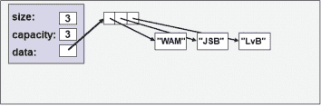

然而，正如输出的最后三行所示，vector 现在使用移动构造函数将其元素移动到新重新分配的内存中：

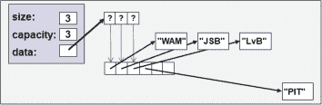

这意味着最终 vector 只需释放旧内存并更新其成员：

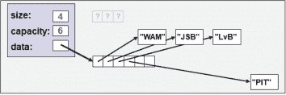

##### 有条件的 noexcept 声明

然而，用 `noexcept` 标记移动构造函数可以吗？嗯，我们移动名字（一个 `std::string`），并向标准输出流写入一些内容。如果在那里抛出异常，就违反了不抛出的保证。在这种情况下，程序在运行时会调用 `std::terminate()`，它通常调用 `std::abort()` 来表明程序异常结束（并且常常生成核心转储）。

因此，如果字符串成员和输出操作都不抛出，我们就应给出不抛出的保证。引入关键字 `noexcept` 是因为你可以用它来指定有条件的不抛出保证。它看起来如下（完整示例见 *basics/personcond.hpp*）：

```cpp
class Person {
 private:
   std::string name;
 public:
   ...
   Person(Person&& p)
      noexcept(std::is_nothrow_move_constructible_v<std::string>
                  && noexcept(std::cout << name))
      : name{std::move(p.name)} {
         std::cout << "MOVE " << name << '\n';
      }
   ...
}
```

借助 `noexcept(...)`，我们保证：如果括号内的编译期表达式为 true，则不抛出。在这种情况下，要给出保证，我们需要满足两件事：

- 使用 `std::is_nothrow_move_constructible_v<std::string>`（在 C++20 之前，必须使用 `std::is_nothrow_move_constructible<std::string>::value`），我们使用标准类型特征（类型函数）来告诉我们 `std::string` 的移动构造函数是否保证不抛出。
- 使用 `noexcept(std::cout << name)`，我们询问对名字调用输出表达式是否保证不抛出。这里，我们把 `noexcept` 用作运算符，它告诉我们执行传入表达式所需的所有对应操作是否保证不抛出。

可以想象，有了这个声明，重新分配将再次使用拷贝构造函数。字符串的移动构造函数确实保证不抛出，但输出运算符不保证。然而，移动构造函数通常不输出任何内容；因此，一般来说，当成员不抛出时，我们可以为整个移动构造函数给出不抛出的保证。

好消息是，如果你不自己实现移动构造函数，编译器会为你检测 `noexcept` 保证。对于所有成员在移动构造函数中都保证不抛出的类，生成的或默认的移动构造函数将整体给出该保证。

考虑以下声明：

*basics/persondefault.hpp*

```cpp
#include <string>
#include <iostream>

class Person {
  private:
    std::string name;
  public:
    Person(const char* n)
      : name{n} {
    }

    std::string getName() const {
      return name;
    }

    // print out when we copy:
    Person(const Person& p)
      : name(p.name) {
        std::cout << "COPY " << name << '\n';
    }
    // force default generated move constructor:
    Person(Person&& p) = default;
    ...
};
```

在这种情况下，我们声明应生成默认移动构造函数：

```cpp
class Person {
    ...
    // force default generated move constructor:
    Person(Person&& p) = default;
    ...
};
```

这意味着我们只在拷贝时打印。当使用生成的移动构造函数时，我们只会看到没有执行拷贝。

现在让我们用通常的程序在最后打印一些 Person 对象：

```cpp
#include "persondefault.hpp"
#include <iostream>
#include <vector>

int main()
{
    std::vector<Person> coll{"Wolfgang Amadeus Mozart",
                             "Johann Sebastian Bach",
                             "Ludwig van Beethoven"};
    std::cout << "capacity: " << coll.capacity() << '\n';
    coll.push_back("Pjotr Iljitsch Tschaikowski");

    std::cout << "name of coll[0]: " << coll[0].getName() << '\n';
}
```

我们得到以下输出：

```text
COPY Wolfgang Amadeus Mozart
COPY Johann Sebastian Bach
COPY Ludwig van Beethoven
capacity: 3
name of coll[0]: Wolfgang Amadeus Mozart
```

我们只看到初始化列表中元素的拷贝。对于其他所有情况，包括重新分配，都使用默认移动构造函数。正如我们所看到的，在重新分配后的内存中，第一个人的名字是正确的。

如果我们完全不指定任何成员函数，行为也相同。这意味着：

- 如果你**实现**了移动构造函数，就应声明它是否以及何时保证不抛出。
- 如果你没有实现移动构造函数，则完全不需要指定任何内容。

如果类的性能或该类对象的重新分配对你很重要，你可能还想在编译期再次检查你的类的移动构造函数是否保证不抛出：

```cpp
static_assert(std::is_nothrow_move_constructible_v<Person>);
```

或者对于 C++17 及之前版本：

```cpp
static_assert(std::is_nothrow_move_constructible<Person>::value, "");
```

#### 7.1.3 noexcept 值得吗？

你可能想知道，用或多或少复杂的 `noexcept` 表达式声明移动构造函数是否值得。Howard Hinnant 用一个简单的程序演示了效果（为本书稍作改编）：

```cpp
// basics/movenoexcept.cpp

#include <iostream>
#include <string>
#include <vector>
#include <chrono>

// string wrapper with move constructor:
struct Str
{
    std::string val;

    // ensure each string has 100 characters:
    Str()
      : val(100, 'a') {   // don't use braces here
    }

    // enable copying:
    Str(const Str&) = default;

    // enable moving (with and without noexcept):
    Str (Str&& s) NOEXCEPT
      : val(std::move(s.val)) {
    }
};

int main()
{
    // create vector of 1 Million wrapped strings:
    std::vector<Str> coll;
    coll.resize(1000000);

    // measure time to reallocate memory for all elements:
    auto t0 = std::chrono::steady_clock::now();
    coll.reserve(coll.capacity() + 1);
    auto t1 = std::chrono::steady_clock::now();

    std::chrono::duration<double, std::milli> dt{t1 - t0};
    std::cout << dt.count() << "ms\n";
}
```

我们提供了一个类，它包装一个长度可观的字符串（以避免*小字符串优化*）。注意，我们必须用圆括号初始化该值，因为花括号会把 100 解释为值为 100 的初始字符。

在类中，我们用 `NOEXCEPT` 标记移动构造函数，预处理器可以将其替换为空或 `noexcept`（例如，用 `-DNOEXCEPT=noexcept` 编译）。然后我们测量在 vector 中重新分配 100 万个这种对象需要多长时间。

在几乎所有平台上，用 `noexcept` 声明移动构造函数会使重新分配快最多 10 倍（确保启用了显著的优化级别）。也就是说，一次重新分配（通常由插入新元素强制触发）可能耗时约 20 毫秒而不是 200 毫秒。这意味着我们无法使用该 vector 的时间少了 180 毫秒。这可能带来巨大的好处。²

### 7.2 noexcept 声明的细节

如前所述，引入 `noexcept` 是为了允许指定有条件的不抛出保证。一般来说，在编译期知道函数不会抛出可以改进代码和优化，因为你不必处理因抛出异常而可能需要的清理。请注意，如果违反了 `noexcept` 保证，程序会调用 `std::terminate()`，它通常调用 `std::abort()` 来导致“异常程序终止”（例如，核心转储）。

#### 7.2.1 用 noexcept 声明函数的规则

在声明 `noexcept` 条件时，有几条规则适用：

- `noexcept` 条件必须是产生一个可转换为 `bool` 的值的编译期表达式。
- 不能重载仅 `noexcept` 条件不同的函数。
- 在类层次结构中，`noexcept` 条件是所指定接口的一部分。用不 `noexcept` 的函数覆盖基类中 `noexcept` 的函数是错误的（但反过来则不是）。

例如：

```cpp
class Base {
public:
  ...
  virtual void foo(int) noexcept;
  virtual void foo(int);       // ERROR: overload on different noexcept clause only
  virtual void bar(int);
};

class Derived : public Base {
public:
  ...
```

² 请注意，Visual C++ 2015 中有一个 bug，这意味着在重新分配时总是使用 `move`，我们看不到差异。此 bug 已在 Visual C++ 2017 中修复（如果移动构造函数不保证不抛出，这可能会减慢重新分配）。


#### 7.2.2 noexcept 与特殊成员函数

特殊成员函数可能会自动生成 noexcept 条件。

##### 复制和移动特殊成员函数的 noexcept

按规则，当特殊成员函数被生成但未实现时，会生成 noexcept 条件。³ 在这种情况下，如果所有基类和非静态成员对应的操作保证不抛出异常，那么这些操作也保证不抛出异常。

例如：

`basics/specialnoexcept.cpp`

```cpp
#include <iostream>
#include <type_traits>

class B
{
    std::string s;
};

int main()
{
    std::cout << std::boolalpha;
    std::cout << std::is_nothrow_default_constructible<B>::value << '\n';
    std::cout << std::is_nothrow_copy_constructible<B>::value << '\n';
    std::cout << std::is_nothrow_move_constructible<B>::value << '\n';
    std::cout << std::is_nothrow_copy_assignable<B>::value << '\n';
    std::cout << std::is_nothrow_move_assignable<B>::value << '\n';
}
```

程序的输出如下：

```text
true
false
true
false
true
```

生成的复制构造函数和复制赋值运算符可能会抛出异常，因为复制 `std::string` 可能会抛出异常。然而，生成的默认构造函数、移动构造函数和移动赋值运算符保证不抛出异常，因为 `std::string` 类的默认构造函数、移动构造函数和移动赋值运算符也保证不抛出异常。⁴

³ 这也适用于默认构造函数、默认化的 `operator<` 或 `operator==` 等“伪”特殊成员函数（自 C++20 起可用），甚至适用于所有继承的构造函数。

⁴ 对于字符串的移动赋值运算符，只有在字符串使用相同或可互换的分配器时，noexcept 保证才成立。

注意，即使这些特殊成员函数是用 `=default` 用户声明的，也会生成 noexcept 条件。因此，如果我们按如下方式声明类 B，也会得到相同的效果：

```cpp
class B
{
    std::string s;
public:
    B(const B&) = default;                     // 自动生成 noexcept 条件
    B(B&&) = default;                          // 自动生成 noexcept 条件
    B& operator= (const B&) = default;         // 自动生成 noexcept 条件
    B& operator= (B&&) = default;              // 自动生成 noexcept 条件
};
```

当你有一个默认化的特殊成员函数时，你可以显式指定一个与生成条件不同的 noexcept 保证。例如：

```cpp
class C
{
    ...
public:
    C(const C&) noexcept = default;          // 保证不抛出异常（自 C++20 起可行）
    C(C&&) noexcept(false) = default;        // 指定可能抛出异常（自 C++20 起可行）
    ...
};
```

在 C++20 之前，如果生成的 noexcept 条件与指定的条件相矛盾，定义的函数会被删除。

##### 析构函数的 noexcept

按规则，析构函数默认总是保证不抛出异常。这适用于生成的析构函数和实现的析构函数。

例如：

```cpp
class B
{
    std::string s;
public:
    ...
    ~B() {                                // 自动总是声明为 ~B() noexcept
    }
};
```

使用 noexcept(false)，你可以声明它们不提供此保证，但这通常毫无意义，因为 C++ 标准库的若干保证基于析构函数从不抛出异常这一事实。

### 7.3 类层次结构中的 `noexcept` 声明

我们看到，尤其是当我们需要实现移动构造函数时，应该用 `noexcept` 保证来声明它。一般来说，遵循 C++ 标准的规则，当所有基类和所有成员类型在移动赋值时不抛出异常，我们应该声明它不抛出异常。

通用模式如下：

```cpp
class Base {

};

class Drv : public Base {
  MemType member;

  ...
  // 移动构造函数：
  Drv(Drv&&) noexcept(std::is_nothrow_move_constructible_v<Base> &&
                      std::is_nothrow_move_constructible_v<MemType>);

};
```

这里，如果基类 `Base` 和成员类型 `MemType` 保证不抛出异常，类 `Drv` 的移动构造函数就保证不抛出异常。

移动赋值运算符可能使用相同的模式，但请注意，在多态类型中，移动赋值运算符无论如何都应该被删除，这意味着通常不需要在派生类中实现它们。

#### 7.3.1 检查抽象基类中的 `noexcept` 移动构造函数

注意，类型特征 `std::is_nothrow_move_constructible<>` 并不总是如预期那样工作。对于抽象基类，它总是返回 false，因为它还检查你是否可以用移动构造函数创建该类型的对象，而抽象类型不可能做到这一点。

因此，使用标准类型特征无法表述一个在所有情况下都有效的声明：“如果抽象基类保证不抛出异常，则我保证不抛出异常”。通常，你可能需要知道基类移动构造函数是否可能抛出异常。

为了使你能够检查一个类的移动构造函数是否保证不抛出异常，你可以实现以下辅助类型特征（这里为 C++20 实现）。⁵ 但是，请注意，你必须为每个纯虚函数提供实现：

`poly/isnothrowmovable.hpp`

```cpp
// type trait to check whether a base class guarantees not to throw
// in the move constructor (even if the constructor is not callable)
#ifndef IS_NOTHROW_MOVABLE_HPP
#define IS_NOTHROW_MOVABLE_HPP

#include <type_traits>

template<typename Base>
struct Wrapper : Base {
  using Base::Base;
  // implement all possibly wrapped pure virtual functions:
  void print() const {}
  ...
};

template<typename T>
static constexpr inline bool is_nothrow_movable_v
  = std::is_nothrow_move_constructible_v<Wrapper<T>>;

#endif //IS_NOTHROW_MOVABLE_HPP
```

⁵ 感谢 Daniel Krügler 提供此解决方案。

现在，你甚至可以检查抽象基类的移动构造函数是否是 noexcept。以下程序演示了标准类型特征与用户自定义类型特征的不同行为：

`poly/isnothrowmovable.cpp`

```cpp
#include "isnothrowmovable.hpp"
#include <iostream>

class Base {
  std::string id;
  ...
public:
  virtual void print() const = 0;  // 纯虚函数（强制抽象基类）
  ...
  virtual ~Base() = default;
protected:
  // 受保护的复制和移动语义（也强制抽象基类）：
  Base(const Base&) = default;
  Base(Base&&) = default;
  // 禁用赋值运算符（因为切片问题）：
  Base& operator= (Base&&) = delete;
  Base& operator= (const Base&) = delete;
};

int main()
{
  std::cout << std::boolalpha;
  std::cout << "std::is_nothrow_move_constructible_v<Base>: "
            << std::is_nothrow_move_constructible_v<Base> << '\n';
  std::cout << "is_nothrow_movable_v<Base>:              "
            << is_nothrow_movable_v<Base> << '\n';
}
```


程序输出如下：

```
std::is_nothrow_move_constructible<Base>: false
is_nothrow_movable<Base>:                  true
```

因此，如果你必须在从抽象基类派生的类中实现移动构造函数，可以使用这样的辅助类型特征来声明移动构造函数，如下所示：

```cpp
class Drv : public Base {
    MemType member;
    ...
    // move constructor:
    Drv(Drv&&) noexcept(is_nothrow_move_v<Base> &&
                        is_nothrow_move_v<MemType>);
};
```

为了不必实现所有纯虚函数，C++ 标准中缺少一个编译器支持的类型特征。

### 7.4 何时何地使用 noexcept

如我们所见，noexcept 是在 C++11 中引入的，以应对在 vector 中重新分配元素时无法使用移动语义的问题。

原则上，你现在可以用（条件）noexcept 标记每个函数。这不仅在 vector 重新分配等情况下有帮助（注意，移动构造函数随后可能会调用其他也需要 noexcept 保证的函数），还有助于编译器优化代码，因为无需生成处理异常的代码。那么问题来了：在你的代码中应该把 noexcept 放在哪里？

对于 C++11 标准库，我们当时匆忙决定将 noexcept 放在哪里（重新分配问题很晚才被发现，而 noexcept 的最终语义恰好在发布 C++11 的那一周才得以澄清）。因此，我们遵循了 http://wg21.link/n3279 中提出的一个相当保守的方法，它对你的代码也可以作为有用的指导准则。大致来说，该准则如下：

-   每个库工作组认为不会抛出异常且具有“宽泛契约”（即不因前置条件而规定未定义行为）的库函数，都应无条件地标记为 noexcept。
-   如果库的 swap 函数、移动构造函数或移动赋值运算符是“条件宽泛”的（即可以通过应用 noexcept 运算符证明其不会抛出异常），那么它应该被标记为条件 noexcept。其他任何函数都不应使用条件 noexcept 规范。
-   库的析构函数不应抛出异常。它应使用隐式提供的（不抛异常）异常规范。
-   为与 C 代码兼容而设计的库函数可以标记为无条件 noexcept。

下面的例子说明了第一项的含义：

-   对于容器和字符串，成员函数 empty() 和 clear() 被标记为 noexcept，因为不存在让它们可能抛出异常的有用实现方式。
-   vector 和字符串的下标运算符*不*用 `noexcept` 标记，即使正确使用时它能保证不抛出异常。然而，当传入无效索引时，我们会遇到未定义行为，实现可以做任何想做的事情。通过不用 `noexcept` 声明它们，这些实现在这种情况下可以抛出异常。

第二项是你在实现移动语义时应遵循的准则。我们建议，仅在实现移动构造函数、移动赋值运算符或 `swap()` 函数时使用条件 `noexcept` 声明。对于所有其他函数，通常不值得花精力去考虑该函数可能抛出异常所依赖的诸多实现细节。

通过 http://wg21.link/p0884，我们补充规定，包装类型也应具有条件 `noexcept` 声明：

-   如果库类型具有包装语义，以透明地提供与底层类型相同的行为，那么默认构造函数、拷贝构造函数和拷贝赋值运算符应被标记为条件 `noexcept`，以便底层异常规范仍然成立。

最后，注意根据规则，任何析构函数总是被隐式声明为 `noexcept`。

这给你代码带来的影响如下：

-   你应该使用（条件）`noexcept` 来实现移动构造函数、移动赋值运算符和 `swap()` 函数。
-   对于所有其他函数，仅当你确定它们不会抛出异常时，才用无条件 `noexcept` 标记。
-   析构函数不需要 `noexcept` 规范。

### 7.5 小结

-   使用 `noexcept`，你可以声明一个（条件）不抛异常的保证。
-   如果你实现移动构造函数、移动赋值运算符或 `swap()`，请用（条件）`noexcept` 表达式声明。
-   对于其他函数，如果它们从不抛异常，你可能只想用无条件 `noexcept` 标记它们。
-   析构函数总是被声明为 `noexcept`（即使已实现）。

本页有意留白

## 第 8 章：值类别

本章介绍移动语义的正式术语和规则。我们正式引入左值（lvalue）、右值（rvalue）、纯右值（prvalue）和将亡值（xvalue）等值类别，并讨论它们在对象引用绑定中的作用。这使我们还能讨论移动语义不会自动传递这一规则的细节，以及 decltype 在用于表达式时的一个非常微妙的行为。

本章是本书中最复杂的章节。你可能会看到一些巧妙且让一些人难以置信的事实和特性。以后当你再次阅读关于值类别、对象引用绑定和 decltype 的内容时，不妨再回到本章。

### 8.1 值类别

要编译一个表达式或语句，不仅涉及的类型是否匹配很重要。例如，当赋值左侧使用 int 字面量时，你不能将一个 int 赋值给 int：

```cpp
int i = 42;
```

```cpp
i = 77;      // OK
77 = i;      // ERROR
```

因此，C++ 程序中的每个表达式都有一个*值类别*。除了类型之外，值类别对于决定可以对表达式执行什么操作至关重要。

然而，值类别在 C++ 中随着时间而演变。

#### 8.1.1 值类别简史

历史上（源自 Kernighan & Ritchie C，即 *K&R C*），我们只有*左值*和*右值*这两种值类别。这两个术语来自赋值中被允许出现的位置：

-   *左值*可以出现在赋值的*左侧*
-   *右值*只能出现在赋值的*右侧*

根据这个定义，当你使用 int 对象/变量时，你使用的是左值；但当你使用 int 字面量时，你使用的是右值：

```cpp
int x;                 // x is an lvalue when used in an expression

x = 42;                // OK, because x is an lvalue and the type matches
42 = x;                // ERROR: 42 is an rvalue and can be only on the right-hand side of an assignment
```

然而，这些类别不仅对赋值很重要。它们通常用于指定一个表达式是否可以使用以及在何处使用。例如：

```cpp
int x;                 // x is an lvalue when used in an expression

int* p1 = &x;          // OK: & is fine for lvalues (object has a specified location)
int* p2 = &42;         // ERROR: & is not allowed for rvalues (object has no specified location)
```

然而，在 ANSI C 中情况变得更加复杂，因为一个声明为 `const int` 的 `x` 不能出现在赋值的左侧，但仍然可以在其他几个只有左值才能使用的地方使用：

```cpp
const int c = 42;      // Is c an lvalue or rvalue?

c = 42;                // now an ERROR (so that c should no longer be an lvalue)
const int* p1 = &c;    // still OK (so that c should still be an lvalue)
```

C 中的决定是，声明为 `const int` 的 `c` 仍然是一个*左值*，因为左值的大多数操作仍然可以对特定类型的 `const` 对象调用。唯一不能再做的事情是让 `const` 对象出现在赋值的左侧。

因此，在 ANSI-C 中，*l* 的含义变成了*定位值*。*左值*现在是程序中具有指定位置的对象（因此你可以获取其地址，例如）。同样，*右值*现在可以被视为仅是一个*可读值*。

C++98 采用了这些值类别的定义。然而，随着移动语义的引入，出现了一个问题：用 `std::move()` 标记的对象应该属于哪种值类别？因为用 `std::move()` 标记的类对象应遵循以下规则：

```cpp
std::string s;
...
std::move(s) = "hello";  // OK (behaves like an lvalue)
auto ps = &std::move(s); // ERROR (behaves like an rvalue)
```

但是请注意，基本数据类型（FDTs）的行为如下：

```cpp
int i;
...
std::move(i) = 42;       // ERROR
auto p1 = &std::move(i); // ERROR
```

除了基本数据类型之外，用 `std::move()` 标记的对象仍然应该像左值一样允许你修改其值。另一方面，它还受到限制，例如你不能获取其地址。

因此，引入了一种新的值类别（“xvalue”，即将亡值）来为那些被显式标记为“此处不再需要该值”的对象规定规则（主要是用 `std::move()` 标记的对象）。然而，以前值的大多数规则也适用于 `xvalues`。因此，原来的主值类别 `rvalue` 变成了一个复合值类别，现在同时表示新的主值类别 `prvalue`（纯右值，代表以前所有右值）和 `xvalue`。提出这些更改的论文请参见 http://wg21.link/n3055。


#### 8.1.2 C++11 以来的值类别

自 C++11 起，值类别如图 8.1 所述。

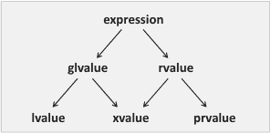

*图 8.1. C++11 以来的值类别*

我们有以下主要类别：

- **左值**（“定位值”）
- **纯右值**（“纯可读值”）
- **将亡值**（“eXpiring value”）

复合类别包括：

- **泛左值**（“广义左值”），作为“左值或将亡值”的统称
- **右值**，作为“将亡值或纯右值”的统称

##### 基本表达式的值类别

*左值*的例子包括：

- 仅由一个变量、函数或数据成员的名称构成的表达式（右值的普通值成员除外）
- 仅由一个字符串字面量构成的表达式（例如 `"hello"`）
- 函数的返回值，如果它被声明为返回左值引用（返回类型 *Type&*）
- 任何对函数的引用，即使使用 `std::move()` 标记（见下文）
- 内置一元 `*` 运算符的结果（即解引用原始指针所得的结果）

*纯右值*的例子包括：

- 由非字符串字面量的内置字面量构成的表达式（例如 `42`、`true` 或 `nullptr`）
- 函数的返回值，如果它被声明为按值返回（返回类型 *Type*）
- 内置一元 `&` 运算符的结果（即对表达式取地址所得的结果）
- lambda 表达式

*将亡值*的例子包括：

- 使用 `std::move()` 标记对象的结果
- 转换为对象类型（而非函数类型）的右值引用的类型转换
- 函数的返回值，如果它被声明为返回右值引用（返回类型 *Type&&*）
- 右值的非静态值成员（见下文）

例如：

```cpp
class X {
};

X v;
const X c;

f(v);            // passes a modifiable lvalue
f(c);            // passes a non-modifiable lvalue
f(X());          // passes a prvalue (old syntax of creating a temporary)
f(X{});          // passes a prvalue (new syntax of creating a temporary)
f(std::move(v)); // passes an xvalue
```

粗略地说，作为经验法则：

- 所有用作表达式的名称都是*左值*。
- 所有用作表达式的字符串字面量都是*左值*。
- 所有非字符串字面量（`4.2`、`true` 或 `nullptr`）都是*纯右值*。
- 所有没有名称的临时对象（尤其是按值返回的对象）都是*纯右值*。
- 所有使用 `std::move()` 标记的对象及其值成员都是*将亡值*。

值得强调的是，严格来说，泛左值、纯右值和将亡值是表达式的术语，而*不是*值的术语（这意味着这些术语属于用词不当）。例如，变量本身不是左值；只有表示该变量的表达式才是左值：

```cpp
int x = 3;        // here, x is a variable, not an lvalue
int y = x;        // here, x is an lvalue
```

在第一条语句中，3 是一个纯右值，用于初始化变量（不是左值）x。在第二条语句中，x 是一个左值（对其求值会指定一个包含值 3 的对象）。左值 x 被当作右值使用，正是它初始化了变量 y。

#### 8.1.3 C++17 以来的值类别

C++17 具有相同的值类别，但澄清了值类别的语义含义，如图 8.2 所述。

现在解释值类别的关键方法是，一般来说，我们有两类主要表达式：

- **泛左值**：表示长生命周期对象或函数的*位置*的表达式
- **纯右值**：表示用于*初始化*的短生命周期值的表达式

于是，将亡值被视为一种特殊位置，表示一个（长生命周期的）对象，其资源/值不再需要。

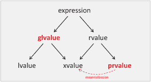

*图 8.2. C++17 以来的值类别*

##### 按值传递纯右值

借助这一变化，我们现在可以将纯右值作为未命名的初始值按值传递，即使没有定义有效的拷贝构造函数和有效的移动构造函数：

```cpp
class C {
public:
  C(...);
  C(const C&) = delete;  // this class is neither copyable ...
  C(C&&) = delete;       // ... nor movable
};

C createC() {
  return C{...};         // Always creates a conceptual temporary prior to C++17.
                         // In C++17, no temporary object is created at this point.
}

void takeC(C val) {
  ...
}

auto n = createC();      // OK since C++17 (error prior to C++17)

takeC(createC());        // OK since C++17 (error prior to C++17)
```

在 C++17 之前，如果没有拷贝或移动支持，就无法传递纯右值，例如 `createC()` 创建并初始化后的返回值。然而，自 C++17 起，只要不需要具有位置的对象，我们就可以按值传递纯右值。

##### 物化

C++17 随后引入了一个新术语，称为（未命名临时对象的）*物化*，用于表示纯右值成为临时对象的那一刻。因此，*临时对象物化转换*是一种（通常是隐式的）纯右值到将亡值的转换。

每当在需要泛左值（左值或将亡值）的地方使用纯右值时，就会创建一个临时对象并用该纯右值初始化它（请记住，纯右值主要是“初始化值”），并且该纯右值会被一个指定该临时对象的将亡值替换。因此，在上面的例子中，严格来说，我们有：

```cpp
void f(const X& p);  // accepts an expression of any value category but expects a glvalue

f(X{});              // creates a temporary prvalue and passes it materialized as an xvalue
```

因为此示例中的 `f()` 有一个引用参数，所以它期望一个泛左值实参。然而，表达式 `X{}` 是一个纯右值。因此，“临时对象物化”规则开始起作用，表达式 `X{}` 被“转换”为一个将亡值，该将亡值指定一个用默认构造函数初始化的临时对象。

请注意，物化并不意味着我们创建了一个新的/不同的对象。左值引用 `p` 仍然同时绑定到将亡值和纯右值，尽管后者现在总是涉及转换为将亡值。

### 8.2 值类别的特殊规则

对于函数和成员的值类别，我们有一些特殊规则，它们会影响移动语义。

#### 8.2.1 函数的值类别

C++ 标准中的一条特殊规则指出，所有对函数的引用表达式都是左值。¹ 例如：

```cpp
void f(int) {
}

void(&fref1)(int) = f;   // fref1 is an lvalue
void(&&fref2)(int) = f;  // fref2 is also an lvalue

auto& ar = std::move(f); // OK: ar is lvalue of type void(&)(int)
```

与对象类型不同，我们可以将非 const 左值引用绑定到使用 `std::move()` 标记的函数，因为使用 `std::move()` 标记的函数仍然是左值。

#### 8.2.2 数据成员的值类别

如果你使用对象的数据成员（例如，使用 `std::pair<>` 的成员 `first` 和 `second` 时），则适用特殊规则。

一般来说，数据成员的值类别如下：

- 左值的数据成员是左值。
- 右值的引用数据成员和静态数据成员是左值。
- 右值的普通数据成员是将亡值。

¹ 感谢 Daniel Krügler 指出这一点。

这条规则反映的是，引用成员或静态成员并不是对象真正的一部分。如果你不再需要某个对象的值，这也适用于该对象的普通数据成员。然而，引用其他地方或静态的成员的值可能仍会被其他对象使用。

例如：

```cpp
std::pair<std::string, std::string&> foo();  // note: member second is reference
```

```cpp
std::vector<std::string> coll;
...
coll.push_back(foo().first);   // moves because first is an xvalue here
coll.push_back(foo().second);  // copies because second is an lvalue here
```

这里你需要 `std::move()` 来移动成员 `second`：

```cpp
coll.push_back(std::move(foo().second));  // moves
```

如果你有一个左值（一个有名称的对象），有两种方式用 `std::move()` 标记成员：

- `std::move(obj).member`
- `std::move(obj.member)`

因为 `std::move()` 的意思是“我在这里不再需要这个值”，所以看起来如果你不再需要对象的值，就应该标记 `obj`；如果你不再需要成员的值，就应该标记 `member`。然而，情况要稍微复杂一些。

##### 用于普通数据成员的 std::move()

如果成员既不是静态成员也不是引用成员，按照规则，`std::move()` 总是将成员转换为将亡值，以便可以使用移动语义。

假设我们声明了以下内容：

```cpp
std::vector<std::string> coll;
std::pair<std::string, std::string> sp;
```

以下代码先将成员 `first`、然后将成员 `second` 移动到 `coll` 中：

```cpp
sp = ...;
coll.push_back(std::move(sp.first));   // move string first into coll
coll.push_back(std::move(sp.second));  // move string second into coll
```

然而，以下代码具有相同的效果：

```cpp
sp = ...;
coll.push_back(std::move(sp).first);   // move string first into coll
coll.push_back(std::move(sp).second);  // move string second into coll
```

在用 `std::move()` 标记 `obj` 之后仍然使用它，这看起来有点奇怪，但在这种情况下，我们知道对象的哪一部分可能被移动，因此仍然可以使用另一部分。因此，例如当我必须实现移动构造函数时，我更倾向于用 `std::move()` 标记成员。


##### 用于引用或静态成员的 std::move()

如果成员是引用或静态成员，则适用不同规则。² 右值的引用成员或静态成员仍然是左值。同样，这条规则反映出此类成员的值实际上并不属于对象的一部分。说“我不再需要这个对象的值”不应意味着“我不再需要（某个成员的）不属于该对象一部分的值。”

因此，如果存在引用或静态成员，使用 `std::move()` 的方式会有所不同：

- 对*对象*使用 `std::move()` 没有效果：

  ```cpp
  struct S {
      static std::string statString;  // static member
      std::string& refString;         // reference member
  };

  S obj;
  ...
  coll.push_back(std::move(obj).statString);  // copies statString
  coll.push_back(std::move(obj).refString);   // copies refString
  ```

- 对*成员*使用 `std::move()` 会产生通常的效果：

  ```cpp
  struct S {
      static std::string statString;
      std::string& refString;
  };
  S obj;
  ...
  coll.push_back(std::move(obj).statString);  // moves statString
  coll.push_back(std::move(obj).refString);   // moves refString
  ```

这种移动是否有用则是另一个问题。窃取静态成员或被引用成员的值意味着你会修改所用对象之外的值。这可能是有意义的，但也可能令人意外且危险。通常，类型 S 最好保护对这些成员的访问。

在泛型代码中，你可能不知道成员是静态成员还是引用。因此，使用 `std::move()` 标记对象的方法危险性更低，尽管看起来有些奇怪：

```cpp
coll.push_back(std::move(obj).mem1);  // move value, copy reference/static
coll.push_back(std::move(obj).mem2);  // move value, copy reference/static
```

同样，我们稍后介绍的 `std::forward<>()` 可用于完美转发对象的成员。完整示例见 *basics/members.cpp*。

² 感谢 Andrey Upadyshev 指出这一点。

### 8.3 绑定引用时值类别的影响

值类别在我们把引用绑定到对象时起着重要作用。例如，在 C++98/C++03 中，它们规定可以把右值（没有名称的临时对象，或用 `std::move()` 标记的对象）赋值或传递给 const 值引用，但不能传递给非 const 值引用：

```cpp
std::string createString();        // forward declaration

const std::string& r1{createString()};    // OK

std::string& r2{createString()};           // ERROR
```

编译器在此处打印的典型错误消息是“无法将非 const 左值引用绑定到右值。”

在调用下面的 `foo2()` 时也会得到此错误消息：

```cpp
void foo1(const std::string&);       // forward declaration
void foo2(std::string&);              // forward declaration

foo1(std::string{"hello"});          // OK
foo2(std::string{"hello"});          // ERROR
```

#### 8.3.1 右值引用的重载解析

让我们看看将对象传递给引用时的确切规则。

假设有一个类 X 的非 const 变量 `v` 和一个 const 变量 `c`：

```cpp
class X {
    ...
};

X v{...};
const X c{...};
```

绑定引用的规则表列出了当我们提供函数 `f()` 的所有引用重载时，将引用绑定到所传实参的正式规则：

```cpp
void f(const X&);    // read-only access
void f(X&);          // OUT parameter (usually long-living object)
void f(X&&);         // can steal value (object usually about to die)
void f(const X&&);   // no clear semantic meaning
```

这些数字列出了重载解析的优先级，以便你看出在提供多个重载时调用哪个函数。数字越小，优先级越高（优先级 1 表示最先尝试）。

注意，只能把右值（纯右值，例如没有名称的临时对象）或亡值（用 `std::move()` 标记的对象）传递给右值引用。右值引用之名即由此而来。

通常可以忽略表格的最后一列，因为 const 右值引用在语义上意义不大，也就是说我们得到以下规则：

| 调用 | `f(X&)` | `f(const X&)` | `f(X&&)` | `f(const X&&)` |
|---|---:|---:|---:|---:|
| `f(v)` | 1 | 2 | 无 | 无 |
| `f(c)` | 无 | 1 | 无 | 无 |
| `f(X{})` | 无 | 3 | 1 | 2 |
| `f(move(v))` | 无 | 3 | 1 | 2 |
| `f(move(c))` | 无 | 2 | 无 | 1 |

*表 8.1. 绑定引用的规则*

- 非 const 左值引用只接受非 const 值。
- 右值引用只接受非 const 右值。
- const 左值引用可以接受一切，并在未提供其他重载时充当回退机制。

下面从表格中间摘录的内容是移动语义回退机制的规则：

| 调用 | `f(const X&)` | `f(X&&)` |
|---|---:|---:|
| `f(X{})` | 3 | 1 |
| `f(move(v))` | 3 | 1 |

如果我们把右值（临时对象或用 `std::move()` 标记的对象）传递给函数，而没有针对移动语义的特定实现（通过接受右值引用来声明），则使用通常的复制语义，以 const& 接受实参。

请注意，稍后介绍通用引用/转发引用时，我们会扩展此表。

在那里我们还会了解到，有时可以把左值传递给右值引用（当使用模板参数时）。请注意，并非每个带 && 的声明都遵循相同规则。这里的规则适用于我们用 && 声明了一个*类型*（或类型别名）的情况。

#### 8.3.2 按引用和按值重载

我们可以同时按引用参数和按值参数声明函数。例如：

```cpp
void f(X);         // call-by-value
void f(const X&);  // call-by-reference
void f(X&&);
void f(const X&&);
```

原则上，声明所有这些重载是允许的。然而，按值调用和按引用调用之间没有特定优先级。如果你有一个按值接受实参的函数声明（它可以接受任何值类别的任何实参），那么任何匹配的按引用接受该实参的声明都会造成歧义。

因此，通常应只按值或只按引用接受实参（引用重载数量可按你认为有用的来定），而绝不要两者兼用。

### 8.4 左值何时变为右值

正如我们所学，当函数声明了具体类型的右值引用参数时，只能把这些参数绑定到右值。例如：

```cpp
void rvFunc(std::string&&);      // forward declaration

std::string s{...};
rvFunc(s);                         // ERROR: passing an lvalue to an rvalue reference
rvFunc(std::move(s));             // OK, passing an rvalue
```

然而请注意，有时传递左值看起来可以工作。例如：

```cpp
void rvFunc(std::string&&);      // forward declaration

rvFunc("hello");                 // OK, although "hello" is an lvalue
```

请记住，字符串字面量在作为表达式使用时是左值。因此，把它们传递给右值引用无法编译。然而，这里涉及一个隐藏操作，因为实参的类型（包含六个字符的数组）与参数类型不匹配。我们有一个由 string 构造函数执行的隐式类型转换，它创建一个没有名称的临时对象。

因此，我们实际调用的是以下内容：

```cpp
void rvFunc(std::string&&);      // forward declaration

rvFunc(std::string{"hello"});    // OK, "hello" converted to a string is a prvalue
```

### 8.5 右值何时变为左值

现在让我们看看一个把参数声明为右值引用的函数实现：

```cpp
void rvFunc(std::string&& str) {
    ...
}
```

正如我们所学，只能传递右值：

```cpp
std::string s{...};
rvFunc(s);                         // ERROR: passing an lvalue to an rvalue reference
rvFunc(std::move(s));             // OK, passing an rvalue
rvFunc(std::string{"hello"});     // OK, passing a prvalue
```

然而，当我们在函数内部使用参数 `str` 时，处理的是一个有名称的对象。这意味着我们把 `str` 当作左值使用。我们只能做左值允许做的事情。

这意味着我们不能直接递归调用自己的函数：

```cpp
void rvFunc(std::string&& str) {
    rvFunc(str);                  // ERROR: passing an lvalue to an rvalue reference
}
```


我们必须再次用 `std::move()` 标记 `str`：

```cpp
void rvFunc(std::string&& str) {
    rvFunc(std::move(str));      // OK, passing an xvalue
}
```

这就是我们前面讨论过的 **移动语义不会传递** 这一规则的正式规范。再次注意，这是特性，不是缺陷。如果让移动语义继续传递，我们就无法两次使用以移动语义传入的对象，因为第一次使用它时它就会失去值。或者，我们需要一种在此处临时禁用移动语义的特性。

如果将右值引用参数绑定到右值（纯右值或将亡值），该对象会被当作左值使用，我们必须再次将其转换为右值，才能传递给右值引用。

现在，请记住 `std::move()` 不过是对右值引用的 `static_cast`。也就是说，我们在递归调用中编写的代码只是以下内容：

```cpp
void rvFunc(std::string&& str) {
    rvFunc(static_cast<std::string&&>(str));  // OK, passing an xvalue
}
```

我们将对象 `str` 转换为其自身类型。到目前为止，这看起来是无操作。然而，通过转换，我们还做了另一件事：改变值类别。按规则，转换为右值引用后，左值会变成将亡值，从而允许我们将该对象传递给右值引用。

这并不新鲜：甚至在 C++11 之前，声明为左值引用的参数在使用时就遵循左值的规则。关键在于，声明中的引用规定了可以传递给函数的内容。对于函数内部的行为，引用是无关紧要的。

感到困惑？这就是我们在 C++ 标准中定义移动语义和值类别规则的方式。接受它本来的样子。幸运的是，编译器知道这些规则。

如果这里只让你记住一件事，那就是移动语义不会传递。如果你以移动语义传递对象，就必须再次用 `std::move()` 标记它，才能将其语义转发给另一个函数。

### 8.6 使用 `decltype` 检查值类别

与移动语义一起，C++11 引入了新关键字 `decltype`。该关键字的主要目标是获取已声明对象的确切类型。不过，它也可用于确定表达式的值类别。

#### 8.6.1 使用 `decltype` 检查名称的类型

在接受右值引用参数的函数中，我们可以使用 `decltype` 查询并使用参数的确切类型。只需将参数名传给 `decltype`。例如：

```cpp
void rvFunc(std::string&& str)
{
    std::cout << std::is_same<decltype(str), std::string>::value;   // false
    std::cout << std::is_same<decltype(str), std::string&>::value;  // false
    std::cout << std::is_same<decltype(str), std::string&&>::value; // true
    std::cout << std::is_reference<decltype(str)>::value;                    // true
    std::cout << std::is_lvalue_reference<decltype(str)>::value;            // false
    std::cout << std::is_rvalue_reference<decltype(str)>::value;            // true
}
```

表达式 `decltype(str)` 始终产生 `str` 的类型，即 `std::string&&`。在表达式中任何需要该类型的地方，我们都可以使用它。类型特征（如 `std::is_same<>` 这样的类型函数）帮助我们处理这些类型。

例如，要声明一个类型为传入参数类型且不是引用的新对象，我们可以这样声明：

```cpp
void rvFunc(std::string&& str)
{
    std::remove_reference<decltype(str)>::type tmp;
    ...
}
```

在该函数中，`tmp` 的类型是 `std::string`（我们也可以显式声明它，但如果把它做成用于类型 `T` 对象的泛型函数，这段代码仍然可行）。

#### 8.6.2 使用 `decltype` 检查值类别

到目前为止，我们只将名称传给 `decltype` 来询问其类型。然而，你也可以将表达式（不只是名称）传给 `decltype`。在这种情况下，`decltype` 还会根据以下约定产生值类别：

- 对于**纯右值**，它只产生其值类型：*类型*
- 对于**左值**，它产生其类型作为左值引用：*类型&*
- 对于**将亡值**，它产生其类型作为右值引用：*类型&&*

例如：

```cpp
void rvFunc(std::string&& str)
{
    decltype(str + str)   // yields std::string because str + str is a prvalue
    decltype(str[0])       // yields char& because the operator yields an lvalue
    ...
}
```

这意味着，如果你只是传入一个放在括号中的名称，而它已经是一个表达式，不再只是名称，那么 `decltype` 会产生其类型和值类别。其行为如下：

```cpp
void rvFunc(std::string&& str)
{
    std::cout << std::is_same<decltype((str)), std::string>::value;      // false
    std::cout << std::is_same<decltype((str)), std::string&>::value;     // true
    std::cout << std::is_same<decltype((str)), std::string&&>::value;    // false

    std::cout << std::is_reference<decltype((str))>::value;              // true
    std::cout << std::is_lvalue_reference<decltype((str))>::value;       // true
    std::cout << std::is_rvalue_reference<decltype((str))>::value;       // false
}
```

请将其与该函数之前不使用额外括号的实现进行比较。在这里，`(str)` 的 `decltype` 产生 `std::string&`，因为 `str` 是类型为 `std::string` 的左值。

对于 `decltype` 来说，在传入名称外加上额外括号会产生差异；这一点在我们后面讨论 `decltype(auto)` 时也会产生重要影响。

##### 在代码中检查值类别

一般来说，你现在可以像下面这样在代码中检查特定的值类别：

- `!std::is_reference_v<decltype((expr))>` 检查 `expr` 是否为**纯右值**。
- `std::is_lvalue_reference_v<decltype((expr))>` 检查 `expr` 是否为**左值**。
- `std::is_rvalue_reference_v<decltype((expr))>` 检查 `expr` 是否为**右值**。
- `!std::is_lvalue_reference_v<decltype((expr))>` 检查 `expr` 是否为**右值**。

再次注意这里使用的额外括号，以确保即使只把名称作为 `expr` 传入，我们使用的也是 `decltype` 的值类别检查形式。

在 C++20 之前，必须省略后缀 `_v`，改为追加 `::value`。

### 8.7 总结

- C++ 程序中的任何表达式都恰好属于以下基本值类别之一：
  - **左值**（大致来说，用于具名对象或字符串字面量）
  - **纯右值**（大致来说，用于未命名的临时对象）
  - **将亡值**（大致来说，用于用 `std::move()` 标记的对象）
- C++ 中的调用或操作是否有效，同时取决于类型和值类别。
- 类型的右值引用只能绑定到右值（纯右值或将亡值）。
- 隐式操作可能改变传入实参的值类别。
- 将右值传递给右值引用会把它绑定为**左值**。
- 移动语义不会传递。
- 函数以及对函数的引用始终是**左值**。
- 对于**右值**（临时对象或用 `std::move()` 标记的对象），普通值成员具有移动语义，但引用成员或静态成员没有。
- `decltype` 既可以检查传入名称的声明类型，也可以检查传入表达式的类型和值类别。

## 第二部分：泛型代码中的移动语义

本书这一部分介绍 C++ 为泛型编程（即模板）提供的移动语义特性。

本页有意留白。

## 第 9 章：完美转发

本章介绍泛型代码中的移动语义。特别地，我们讨论*万能引用*（也称为*转发引用*）以及（完美）转发。接下来的章节将讨论万能引用和完美转发的棘手细节，以及如何在泛型代码中处理可能具有也可能不具有移动语义的返回值。

### 9.1 完美转发的动机

我们已经了解到，移动语义不会自动传递。这会对泛型代码产生影响。

#### 9.1.1 完美转发实参所需的条件

要将以移动语义传入的对象转发给函数，它不仅必须绑定到右值引用；你还必须再次使用 `std::move()`，才能将其移动语义转发给另一个函数。

例如，请记住按引用重载函数的主要情形下的重载解析规则：

```cpp
class X {
    ...
};

// forward declarations:
void foo(const X&);        // for constant values (read-only access)
void foo(X&);             // for variable values (out parameters)
void foo(X&&);            // for values that are no longer used (move semantics)
```

调用这些函数时，我们有以下规则：

```cpp
X v;
const X c;
foo(v);                 // calls foo(X&)
```


```cpp
foo(c);                       // calls foo(const X&)
foo(X{});                     // calls foo(X&&)
foo(std::move(v));            // calls foo(X&&)
foo(std::move(c));            // calls foo(const X&)
```

现在假设我们想通过辅助函数 `callFoo()` 间接地用相同的实参调用 `foo()`。这个辅助函数也需要这三个重载：

```cpp
void callFoo(const X& arg) {  // arg binds to all const objects
  foo(arg);                   // calls foo(const X&)
}
void callFoo(X& arg) {        // arg binds to lvalues
  foo(arg);                   // calls foo(X&)
}
void callFoo(X&& arg) {       // arg binds to rvalues
  foo(std::move(arg));        // needs std::move() to call foo(X&&)
}
```

在所有情况下，`arg` 都作为左值使用（因为它是一个有名字的对象）。第一个版本将其作为 `const` 对象转发，而另外两种情况实现了转发非 `const` 实参的两种不同方式：

- 声明为左值引用的实参（绑定到不具有移动语义的对象）按原样传递。
- 声明为右值引用的实参（绑定到具有移动语义的对象）通过 `std::move()` 传递。

这使我们能够完美地转发移动语义：对于任何以移动语义传递的实参，我们保留移动语义；但当我们得到不具有移动语义的实参时，我们不会添加移动语义。

只有采用这种实现，使用 `callFoo()` 调用 `foo()` 才是透明的：

```cpp
X v;
const X c;
callFoo(v);                   // calls foo(X&)
callFoo(c);                   // calls foo(const X&)
callFoo(X{});                 // calls foo(X&&)
callFoo(std::move(v));        // calls foo(X&&)
callFoo(std::move(c));        // calls foo(const X&)
```

请记住，传递给右值引用的右值在使用时会变成左值，这意味着我们需要 `std::move()` 才能再次将其作为右值传递。然而，我们不能在所有地方都使用 `std::move()`。对于其他重载，在传入左值时使用 `std::move()` 会调用 `foo()` 的右值引用重载。

对于泛型代码中的*完美转发*，我们总是需要为每个参数提供所有这些重载。为了支持所有组合，这意味着对于 2 个泛型实参需要 9 个重载，对于 3 个泛型实参需要 27 个重载。

因此，C++11 引入了一种特殊方式，可以在没有任何重载的情况下*完美转发*给定实参，同时仍然保留类型和值类别。

##### 完美转发 const 右值引用

尽管 const 右值引用没有语义含义，但如果我们想保留用 `std::move()` 标记的常量对象的精确类型和值类别，甚至还需要第四个重载：

```cpp
void callFoo(const X&& arg) { // arg binds to const rvalues
  foo(std::move(arg));      // needs std::move() to call foo(const X&&)
}
```

否则，我们会调用 `foo(const X&)`。这通常没问题，但可能存在这样的情况：我们希望保留已传递 const 右值引用这一信息（例如，出于某种原因提供了 `foo(const X&&)` 重载时）。

这样一来，除非语言提供用于完美转发的特殊特性，否则泛型代码对于两个或三个参数甚至需要 16 个和 64 个重载。

### 9.2 实现完美转发

为了避免针对具有不同值类别的参数重载函数，C++ 引入了一种用于*完美转发*的特殊机制。你需要三样东西：

1. 将调用参数作为纯右值引用（用 `&&` 声明，但不带 `const` 或 `volatile`）。
2. 参数的类型必须是函数的模板参数。
3. 当将参数转发给另一个函数时，使用名为 `std::forward<>()` 的辅助函数，它声明在 `<utility>` 中。

你必须按如下方式实现一个完美转发实参的函数：

```cpp
template<typename T>
void callFoo(T&& arg) {
  foo(std::forward<T>(arg)); // equivalent to foo(std::move(arg)) for passed rvalues
}
```

`std::forward<>()` 实际上是一个有条件的 `std::move()`，因此我们得到与上面 `callFoo()` 的三个（或四个）重载相同的行为：

- 如果向 `arg` 传递右值，其效果与调用 `foo(std::move(arg))` 相同
- 如果向 `arg` 传递左值，其效果与调用 `foo(arg)` 相同

以同样的方式，我们可以完美转发两个实参：

```cpp
template<typename T1, typename T2>
void callFoo(T1&& arg1, T2&& arg2) {
  foo(std::forward<T1>(arg1), std::forward<T2>(arg2));
}
```

我们还可以将 `std::forward<>()` 应用于可变数量参数的每个实参，以完美转发它们全部：

```cpp
template<typename... Ts>
void callFoo(Ts&&... args) {
  foo(std::forward<Ts>(args)...);
}
```

注意，我们不是对所有实参调用一次 `forward<>()`；而是分别对每个实参调用它。因此，我们必须将省略号（`...`）放在 `forward()` 表达式的末尾之后，而不是直接放在 `args` 之后。

然而，这里究竟发生了什么相当棘手，需要仔细解释。

#### 9.2.1 万能（或转发）引用

首先，请注意我们将 `arg` 声明为右值引用参数：

```cpp
template<typename T>
void callFoo(T&& arg);   // arg is universal/forwarding reference
```

这可能会让人以为适用右值引用的通常规则。然而，事实并非如此。**函数模板参数**的**右值引用**（未用 `const` 或 `volatile` 限定）不遵循普通右值引用的规则。它是另一回事。

##### 两个术语：万能引用与转发引用

这样的引用称为*万能引用*。不幸的是，它还有另一个主要用在 C++ 标准中的术语：*转发引用*。这两个术语之间没有区别，只是这里存在历史遗留的混乱：有两个已确立的术语表示同一件事。

这两个术语都描述了万能引用/转发引用的基本方面：

- 它们可以通用地绑定到所有类型（const 和非 const）以及所有值类别的对象。
- 它们通常用于转发实参；但请注意，这并不是唯一用途（这也是我更偏好*万能引用*这一术语的原因之一）。

##### 万能引用可绑定到所有值类别

万能引用的重要特性是它们可以绑定到任何值类别的对象和表达式：

```cpp
template<typename T>
void callFoo(T&& arg);   // arg is a universal/forwarding reference
```

```cpp
X v;
const X c;
callFoo(v);              // OK
callFoo(c);              // OK
callFoo(X{});            // OK
callFoo(std::move(v));   // OK
callFoo(std::move(c));   // OK
```

此外，它们会保留所绑定对象的 const 性和值类别（无论我们拥有的是右值还是左值）：

```cpp
template<typename T>
void callFoo(T&& arg);   // arg is a universal/forwarding reference
```

```cpp
X v;
const X c;
callFoo(v);                  // OK, arg is X&
callFoo(c);                  // OK, arg is const X&
callFoo(X{});                // OK, arg is X&&
callFoo(std::move(v));       // OK, arg is X&&
callFoo(std::move(c));       // OK, arg is const X&&
```

根据规则，类型 `T&&`（即 `arg` 的类型）是

- 如果我们引用左值，则为左值引用
- 如果我们引用右值，则为右值引用

注意，用 const（或 volatile）限定的泛型右值引用**不是**万能引用。你只能传递右值：

```cpp
template<typename T>
void callFoo(const T&& arg);   // arg is not a universal/forwarding reference
```

```cpp
const X c;
callFoo(c);                  // ERROR: c is not an rvalue
callFoo(std::move(c));       // OK, arg is const X&&
```

还要注意，我还没有讨论 `T` 的类型。稍后我会解释在万能引用中 `T` 被推导为什么类型。

稍后，我们将讨论使用 lambda 的相应示例。

#### 9.2.2 `std::forward<>()`

在 `callFoo()` 内部，当我们按如下方式使用万能引用时：

```cpp
template<typename T>
void callFoo(T&& arg) {
    foo(std::forward<T>(arg));   // becomes foo(std::move(arg)) for passed rvalues
}
```

与 `std::move()` 一样，`std::forward<T>()` 也定义为头文件 `<utility>` 中的函数模板。

表达式 `std::forward<T>(arg)` 本质上按如下方式实现：

- 如果向函数传递类型为 `T` 的右值，则该表达式等价于 `std::move(arg)`。
- 如果向函数传递类型为 `T` 的左值，则该表达式等价于 `arg`。

也就是说，`std::forward<T>()` 仅对传递的右值而言才是 `std::move()`。

*就像 `std::move()` 一样，`std::forward<T>()` 的语义含义是：我在这里不再需要这个值了，额外的好处是我们保留了所传入的万能引用所绑定对象的类型（包括 const 性）和值类别。你可能会争辩说，你只是有条件地声明不再需要该值，但由于你不知道 `std::forward<T>()` 是否会变成 `std::move()`，因此假设该对象之后仍保留其值将是错误的。所以再次强调，你应该假设的只是：使用 `std::forward<T>()` 之后，对象通常是有效的，但你不知道它的值。*


##### 使用 std::forward<>() 调用成员函数

注意，在调用成员函数时，你甚至可以对万能引用使用 `std::forward<>()`。请记住，成员函数可能使用引用限定符为移动语义提供特定的重载。在这种情况下，如果之后不再需要该对象的值，就可以使用 `std::forward<>()` 来调用该成员函数。

例如，假设我们重载了 getter，以提高返回临时 person 对象名称时的性能：

```cpp
class Person
{
private:
    std::string name;
public:
    ...
    void print() const {
        std::cout << "print()\n";
    }

    std::string getName() && {    // when we no longer need the value
        return std::move(name);   // we steal and return by value
    }
    const std::string& getName() const& {    // in all other cases
        return name;                         // we give access to the member
    }
};
```

在接收万能引用的函数中，我们可能因此受益于如下使用 `std::forward<>()`：

```cpp
template<typename T>
void foo(T&& x)
{
    x.print();                          // OK, no need to forward the passed value category

    x.getName();                        // calls getName() const&
    std::forward<T>(x).getName();       // calls getName() && for rvalues (OK, no longer need x)
}
```

使用 `std::forward<>()` 之后，x 处于有效但未指定的状态。每当你使用 `std::forward<>()` 时，请确保不再使用该对象（的值）。

#### 9.2.3 完美转发的效果

结合声明万能引用的行为与使用 `std::forward<>()`，我们得到以下行为：

```cpp
void foo(const X&);        // for constant values (read-only access)
void foo(X&);              // for variable values (out parameters)
void foo(X&&);             // for values that are no longer used (move semantics)

template<typename T>
void callFoo(T&& arg) {          // arg is a universal/forwarding reference
    foo(std::forward<T>(arg));   // becomes foo(std::move(arg)) for passed rvalues
}

X v;
const X c;

callFoo(v);              // OK, expands to foo(arg), so it calls foo(X&)
callFoo(c);              // OK, expands to foo(arg), so it calls foo(const X&)
callFoo(X{});            // OK, expands to foo(std::move(arg)), so it calls foo(X&&)
callFoo(std::move(v));   // OK, expands to foo(std::move(arg)), so it calls foo(X&&)
callFoo(std::move(c));   // OK, expands to foo(std::move(arg)), so it calls foo(const X&)
```

无论我们向 `callFoo()` 传递什么，它都会成为左值（因为参数 arg 是一个有名称的对象）。然而，arg 的类型取决于我们传入的内容：

- 如果传入左值，arg 就是左值引用（传入非 const 的 `X` 时为 `X&`，传入 `const X` 时为 `const X&`）。
- 如果传入右值（未命名的临时对象或标记了 `std::move()` 的对象），arg 就是右值引用（`X&&` 或 `const X&&`）。

通过使用 `std::forward<>()`，当且仅当持有右值引用（即 arg 绑定到右值）时，我们才用 `std::move()` 转发该参数。

### 9.3 右值引用与万能引用

不幸的是，万能引用/转发引用使用与普通右值引用相同的语法（形式上，它们是特殊的右值引用）。这是麻烦和混淆的一个严重来源。如果你看到带有两个 & 符号的声明，就必须仔细检查使用的是真实类型名还是函数模板参数的名称。

换句话说，以下两者之间存在显著差异：

```cpp
void foo(Coll&& arg)      // arg is an ordinary rvalue reference of type Coll
```

以及

```cpp
template<typename Coll>
void foo(Coll&& arg)       // arg is a universal/forwarding reference of any type
```

让我们详细讨论这些差异。

#### 9.3.1 实际类型的右值引用

如果我们有一个普通右值引用，其名称不是所调用函数的模板参数（或者该引用用 const 或 volatile 声明），那么我们只能将这些引用绑定到右值。此外，我们知道传入的参数不是 const：

```cpp
using Coll = std::vector<std::string>;

void foo(Coll&& arg)        // arg is an ordinary rvalue reference
{
    Coll coll;              // coll can’t be const
    ...
    bar(std::move(arg));    // perfectly forward to bar() (no need to use std::forward<> here)
}
```

```cpp
Coll v;
const Coll c;

foo(v);                     // ERROR: can’t bind rvalue reference to lvalue
foo(c);                     // ERROR: can’t bind rvalue reference to lvalue
foo(Coll{});                // OK, arg binds to a non-const rvalue
foo(std::move(v));          // OK, arg binds to a non-const rvalue
foo(std::move(c));          // ERROR: can’t bind non-const rvalue reference to const rvalue
```

在 `foo()` 内部：

- 我们知道 arg 的类型 `Coll` 永远不是 const。
- 使用 `std::forward<>()` 没有意义。只有当我们不再需要该值并想将其转发给另一个函数时，使用 `std::move()` 才有意义（这里可以使用 `std::forward<>()`，因为对值引用调用它时，它等价于 `std::move()`）。

#### 9.3.2 函数模板参数的右值引用

如果我们有一个指向函数模板参数的非 const/volatile 右值引用，就可以传入所有值类别的对象。传入的参数可能是 const，也可能不是 const：

```cpp
template<typename Coll>
void foo(Coll&& arg)        // arg is a universal forwarding reference
{
    Coll coll;              // coll may be const
    ...
    bar(std::forward<Coll>(arg));  // perfectly forward to bar() (don’t use std::move() here)
}
```

```cpp
std::vector<std::string> v;
const std::vector<std::string> c;

foo(v);                         // OK, arg binds to a non-const lvalue
foo(c);                         // OK, arg binds to a const lvalue
foo(Coll{});                    // OK, arg binds to a non-const prvalue
foo(std::move(v));              // OK, arg binds to a non-const xvalue
foo(std::move(c));              // OK, arg binds to a const xvalue
```

在 `foo()` 内部：

- 现在 arg 的类型可能是 const，也可能不是 const。
- 在这种情况下，使用 `std::move()` 通常没有意义。只有当我们不再需要该值并想将其转发给另一个函数时，使用 `std::forward<>()` 才有意义（使用 `std::move()` 是可能的，但会以移动语义将所有实参传给 `foo()`，从而把非 const 左值 `v` 作为 xvalue 传递）。

### 9.4 万能引用的重载解析

我们已经讨论了将对象绑定到普通引用时的正式规则。现在，在引入万能引用之后，我们必须扩展这些规则。
同样，假设有一个类 X，一个它的非 const 变量 v，以及一个它的 const 变量 c：

```cpp
class X {
  ...
};

X v;
const X c{...};
```

表“绑定所有引用的规则”列出了当我们提供函数 `f()` 的所有可能重载时，将各种引用绑定到传入实参的正式规则：

```cpp
void f(const X&);    // read-only access
void f(X&);          // OUT parameter (usually long-living object)
void f(X&&);         // can steal value (object usually about to die)
void f(const X&&);   // contradicting semantic meaning
template<typename T>
void f(T&&);         // to use perfect forwarding
```

| 调用 | f(X&) | f(const X&) | f(X&&) | f(const X&&) | template<typename T> f(T&&) |
|---|---:|---:|---:|---:|---:|
| f(v) | 1 | 3 | 无 | 无 | 2 |
| f(c) | 无 | 1 | 无 | 无 | 2 |
| f(X{}) | 无 | 4 | 1 | 3 | 2 |
| f(move(v)) | 无 | 4 | 1 | 3 | 2 |
| f(move(c)) | 无 | 3 | 无 | 1 | 2 |

表 9.1. 绑定所有引用的规则

同样，这些数字列出了重载解析的优先级（数字越小优先级越高），以便你可以看出在提供多个重载时会调用哪个函数。

请注意，万能引用始终是次优选项。完美匹配总是更好，但需要转换类型（例如使其成为 const，或将右值转换为左值）的匹配，不如直接为精确类型实例化函数模板。

#### 9.4.1 修复万能引用的重载解析

万能引用在重载解析中比类型转换绑定得更好，这一事实有一个非常糟糕的副作用：如果你有一个接受单个万能引用的构造函数，那么它比以下情况匹配得更好：

- 传入非 const 对象时的拷贝构造函数
- 传入 const 对象时的移动构造函数

因此，在实现只有一个万能引用参数的构造函数时，你应该非常小心。

考虑以下程序：

*generic/universalconstructor.cpp*

```cpp
#include <iostream>

class X {
 public:
  X() = default;

  X(const X&) {
    std::cout << "copy constructor\n";
  }
  X(X&&) {
    std::cout << "move constructor\n";
  }

  template<typename T>
  X(T&&) {
    std::cout << "universal constructor\n";
  }
};

int main()
{
  X xv;
  const X xc;

  X xcc{xc};             // OK: calls copy constructor
  X xvc{xv};             // OOPS: calls universal constructor
  X xvm{std::move(xv)};  // OK: calls move constructor
  X xcm{std::move(xc)};  // OOPS: calls universal constructor
}
```


## 第 10 章

## 完美转发的棘手细节

在上一章总体介绍了（完美）转发和万能/转发引用之后，本章讨论完美转发和万能/转发引用的一些棘手细节，例如：

-   非转发用途的万能引用
-   究竟何时我们拥有万能引用
-   万能引用的类型推导

接下来的章节将讨论在泛型代码中如何处理可能具有也可能不具有移动语义的返回值。

### 10.1 作为非转发引用的万能引用

万能引用（也称为转发引用）有一些应用与转发无关，因为能够绑定到所有对象、同时仍然知道值类别和/或对象是否为 const，还可能带来其他好处。

本章讨论一些初步示例。在介绍第二种万能引用 auto&& 之后，我们接着讨论将万能引用用作非转发引用的其他实际示例。

#### 10.1.1 万能引用与 const

根据引用绑定的正式规则，万能引用是唯一一种既能将引用绑定到任意值类别的对象、又能保留该对象是否为 const 的方式。另一种能绑定到所有对象的引用 const& 会丢失传入实参是否为 const 的信息。

##### 转发 const 性

这意味着，如果我们希望避免重载，但又想对 `const` 和非 const 实参采用不同行为并支持所有值类别，就必须使用万能引用。

考虑以下示例：

`generic/universalconst.cpp`

```cpp
#include <iostream>
#include <string>

void iterate(std::string::iterator beg, std::string::iterator end)
{
    std::cout << "do some non-const stuff with the passed range\n";
}

void iterate(std::string::const_iterator beg, std::string::const_iterator end)
{
    std::cout << "do some const stuff with the passed range\n";
}

template<typename T>
void process(T&& coll)
{
    iterate(coll.begin(), coll.end());
}

int main()
{
    std::string v{"v"};
    const std::string c{"c"};

    process(v);                   // coll binds to a non-const lvalue, iterators passed
    process(c);                   // coll binds to a const lvalue, const_iterators passed
    process(std::string{"u"});   // coll binds to a non-const prvalue, iterators passed
    process(std::move(v));        // coll binds to a non-const xvalue, iterators passed
    process(std::move(c));        // coll binds to a const xvalue, const_iterators passed
}
```

该程序有如下输出：

```text
do some non-const stuff with the passed range
do some const stuff with the passed range
do some non-const stuff with the passed range
do some non-const stuff with the passed range
do some const stuff with the passed range
```

在该程序中，我们将 process() 的参数声明为指向集合（容器、字符串等）的万能引用。按照万能引用的通常用法，我们可以传入所有可能值类别的字符串。

在 process() 内部，我们仍然可以根据实参是否为 const 采取不同行为。在这个例子中，我们对传入的集合调用 begin() 和 end()，将它们作为半开区间传给一个遍历所有元素的函数：

```cpp
template<typename T>
void process(T&& coll)
{
    iterate(coll.begin(), coll.end());
}
```

不过，我们调用了函数 iterate() 的不同实现：一个用于迭代器（能够修改元素），一个用于 const_iterator（不能修改元素）。由于万能引用保留了传入对象是否为 const 的信息，我们会调用与传入集合的 const 性相匹配的 iterate()。

注意，我们在 process() 内部并未使用（完美）转发。我们只是想以通用方式引用 const 和非 const 对象。我们甚至可能在遍历完所有元素之后还使用 coll。

你可能会说，在遍历元素时我们应该知道是否会修改它们。然而，假设这个泛型函数还允许我们传入对每个元素调用的操作。该操作可能读取或修改元素，因此 const 正确性很重要。

注意，在这里使用 std::forward<>() 至少是有问题的：

```cpp
template<typename T>
void process(T&& coll)
{
    iterate(std::forward<T>(coll).begin(), std::forward<T>(coll).end());  // ???
}
```

在两个不同位置声称同一对象不再需要，会带来麻烦，因为这两个位置都可能将此解释为从该对象窃取值的理由。因此，最后窃取的位置可能无法使用正确的值。绝不要对同一对象使用两次 std::move() 或 std::forward<>()（除非该对象在第二次使用前已重新初始化）。

在这里只使用一次 std::forward<>() 也会带来麻烦，因为函数调用的实参没有保证的求值顺序：

```cpp
template<typename T>
void process(T&& coll)
{
    iterate(coll.begin(), std::forward<T>(coll).end());  // ???
}
```

在这个特定示例中，使用一次或两次 std::forward<>() 也许能工作，因为 begin() 和 end() 不会从传入对象窃取/修改值。然而，一般而言，除非你确切知道这个信息如何被使用，否则这是错误的。

#### 10.1.2 万能引用详解

上一个示例表明，将实参声明为万能引用的用途不止是将其完美转发给另一个函数。让我们进一步分析其机制。

考虑以下声明：

```cpp
template<typename T>
void foo(T&& arg) {
    ...
}
```

当我们声明 arg 时，我们得到一个能够通用地绑定到所有类型和值类别的引用。对于非 const 对象 v 和 const 对象 c，类型 T 和 arg 的类型推导如下：

|  | T | arg |
|---|---|---|
| `foo(v)` | `Type&` | `Type&` |
| `foo(c)` | `const Type&` | `const Type&` |
| `foo(Type&&)` | `Type` | `Type&&` |
| `foo(move(v))` | `Type` | `Type&&` |
| `foo(move(c))` | `const Type` | `const Type&&` |

这意味着关于传入实参的信息被拆分如下：

-   `arg` 仍然知道值及其值，包括它是否为 const。如果传入的是左值，它就是左值引用；如果传入的是右值，它就是右值引用。`arg` 也知道传入的是左值还是右值。
-   `T` 知道类型，并拥有关于传入实参值类别的一些信息（传入的是左值还是右值）。根据特定的模板类型推导规则，如果传入的是左值，`T` 是左值引用；否则，`T` 不是引用。

调用 `std::forward<T>(arg)` 会再次将全部信息汇集起来，恢复 const 性和值类别，以便将传入实参及其当前值完美转发。然而，如果你不需要传入实参的值类别来进行完美转发，就不需要 `std::forward<>`。

##### 依赖 const 性的代码

如果你只需要知道传入实参是否为 const，可以同时使用 arg 和 T。例如：

```cpp
template<typename T>
void foo(T&& arg)
{
    if constexpr(std::is_const_v<std::remove_reference_t<T>>) {
        ...    // passed argument is const
    }
    else {
        ...    // passed argument is not const
    }
}
```

这里，我们使用 if constexpr（C++17 引入的编译期 if）根据传入实参是否为 const 执行不同操作。

注意，在检查 `T` 的 const 性之前，使用 `std::remove_reference<>` 去除 `T` 的引用很重要。对 const 类型的引用整体上并不被视为 const：

```cpp
std::is_const_v<int>                                // false
std::is_const_v<const int>                           // true
std::is_const_v<const int&>                          // false
std::is_const_v<std::remove_reference_t<const int&>> // true
```

如果你还不知道：

-   `std::remove_reference_t<T>`（自 C++14 起可用）是 `typename std::remove_reference<T>::type` 的简写
-   `std::is_const_v<T>`（自 C++17 起可用）是 `std::is_const<T>::value` 的简写

##### 依赖值类别的代码

通过使用 T，我们可以获取/检查关于传入值类别的信息（至少可以知道传入的是左值还是右值）。例如：

```cpp
template<typename T>
void foo(T&& arg)
{
    if constexpr(std::is_lvalue_reference_t<T>) {
        ...    // passed argument is lvalue (has no move semantics)
    }
    else {
        ...    // passed argument is rvalue (has move semantics)
    }
}
```

有时这样的检查是必要的（例如，根据传入的是左值还是右值，以不同方式处理子对象）。

#### 10.1.3 特定类型的万能引用

普通右值引用和万能引用共享相同语法这一事实造成了多个问题。不仅是不容易判断我们拥有的是哪一种引用；还存在无法声明特定类型的万能引用的问题。

例如，考虑一个声明为接受万能引用的函数：

```cpp
template<typename T>
void processString(T&& arg);
```

根据这个声明，arg 可以具有任意类型。只要实参支持模板中的所有操作，该函数就可以被调用。

这通常是件好事，但如果出于某种原因，我们想将该函数限制为只接受字符串（包括 const 和非 const，且不丢失这一信息），则无法轻易做到。


类似地，我们可以约束泛型代码，使通用引用只绑定到右值。然而，如果我们有一种专门用于通用引用的特定语法，这一切就都不必要了。例如：

```cpp
void processString(std::string&&& arg);  // assume &&& declares a universal reference
```

然而，我们并没有这种特定语法，而且现在已有代码同时包含 && 的两种应用。

### 10.2 通用引用还是普通右值引用？

我们对普通右值引用和通用/转发引用使用相同的语法，这给判断一个对象是普通右值引用还是通用引用带来了一些有趣的边角情况。

#### 10.2.1 泛型类型成员的右值引用

对模板参数的成员类型的右值引用*不是*通用引用。例如：

```cpp
template<typename T>
void foo(typename T::value_type&& arg);  // not a universal reference
```

下面是一个完整示例：

*generic/universalmem.cpp*

```cpp
#include <iostream>
#include <string>
#include <vector>

template<typename T>
void insert(T& coll, typename T::value_type&& arg)
{
    coll.push_back(arg);
}

int main()
{
    std::vector<std::string> coll;
    …
    insert(coll, std::string{"prvalue"});  // OK
    …
    std::string str{"lvalue"};
    insert(coll, str);             // ERROR: T::value_type&& is not a universal reference
    insert(coll, std::move(str));  // OK
    …
}
```

#### 10.2.2 类模板中参数的右值引用

对类模板的模板参数的右值引用*不是*通用引用。

例如：

```cpp
template<typename T>
class C {
    T&& member;          // member is not a universal reference
    ...
    void foo(T&& arg);   // arg is not a universal reference
};
```

下面是一个完整示例：

*generic/universalclass.cpp*

```cpp
#include <iostream>
#include <string>
#include <vector>

template<typename T>
class Coll {
private:
  std::vector<T> values;
public:
  Coll() = default;

  // function in class template:
  void insert(T&& val) {
    values.push_back(val);
  }
};

int main()
{
  Coll<std::string> coll;
  ...
  coll.insert(std::string{"prvalue"});  // OK
  std::string str{"lvalue"};
  coll.insert(str);              // ERROR: T&& of Coll<T> is not a universal reference
  coll.insert(std::move(str));   // OK
  ...
}
```

一般来说，类模板中的函数并不遵循函数模板的规则。它就是我们所说的*类模板函数*（temploid），即当我们实例化该类时，遵循普通函数规则的泛型代码。

#### 10.2.3 完全特化中参数的右值引用

对函数模板的完全特化的参数的右值引用*不是*通用引用。例如：

```cpp
template<typename T>            // primary template
void foo(T&& arg);              // - arg is a universal reference
...
template<>                      // full specialization (for rvalues only)
void foo(std::string&& arg);    // - arg is not a universal reference
```

对于 std::string 类型的左值，仍然会调用主模板。要为 std::string 的所有情况特化主模板，你必须提供第二个完全特化：

```cpp
template<>                      // full specialization (for lvalues)
void foo(std::string& arg);
```

下面是一个完整示例：

*generic/universalspec.cpp*

```cpp
#include <iostream>
#include <string>
#include <vector>

// primary template taking a universal reference:
template<typename Coll, typename T>
void insert(Coll& coll, T&& arg)
{
    std::cout << "primary template for type T called\n";
    coll.push_back(arg);
}

// full specialization for rvalues of type std::string:
template<>
void insert(std::vector<std::string>& coll, std::string&& arg)
{
    std::cout << "full specialization for type std::string&& called\n";
    coll.push_back(arg);
}

// full specialization for lvalues of type std::string:
template<>
void insert(std::vector<std::string>& coll, const std::string& arg)
{
    std::cout << "full specialization for type const std::string& called\n";
    coll.push_back(arg);
}

int main()
{
    std::vector<std::string> coll;
    ...
    insert(coll, std::string{"prvalue"});   // calls full specialization for rvalues
    std::string str{"lvalue"};
    insert(coll, str);                       // calls full specialization for lvalues
    insert(coll, std::move(str));            // calls full specialization for rvalues
    ...
}
```

注意，你必须在类定义之外声明/定义成员函数模板的完全特化：

```cpp
template<typename T>
class Cont {
    ...
    // primary template:
    template<typename U>
    void insert(U&& v) {    // universal reference
        coll.push_back(std::forward<U>(v));
    }
};
...

// full specializations for Cont<T>::insert<>():
// - have to be outside the class
// - need specializations for rvalues and lvalues

template<>
    template<>
void Cont<std::string>::insert<>(std::string&& v)
{
    coll.push_back(std::move(v));
}

template<>
    template<>
void Cont<std::string>::insert<>(const std::string& v)
{
    coll.push_back(v);
}
```

### 10.3 标准如何规定完美转发

为了最终理解完美转发的所有规则，让我们看看这些规则在 C++ 标准中是如何正式规定的。

再次考虑你有以下声明：

```cpp
template<typename T>
void f(T&& arg)              // arg is universal forwarding reference
{
    g(std::forward<T>(arg));  // perfectly forward (move() only for passed rvalues)
}
```

通常，T 就具有传入实参的类型：

```cpp
MyType v;

f(MyType{});                // T is deduced as MyType, so arg is declared as MyType&&
f(std::move(v));            // T is deduced as MyType, so arg is declared as MyType&&
```

然而，对于通用引用，有一条特殊规则：如果传入的是左值（参见 C++ 标准中的 [temp.deduct.call] 节）：

如果参数类型是对未带 cv 限定的模板参数的右值引用，且实参是左值，则在类型推导中用“对 T 的左值引用”替代 T。

这意味着在这种情况下：

- 如果参数 arg 的类型用 && 声明，且没有用 const 或 volatile 声明
- 并且传入的是左值
- 那么 T 会被推导为 T&。

在我们的示例中，这意味着：

```cpp
template<typename T>
void f(T&& arg);             // arg is a universal forwarding reference

MyType v;
const MyType c;

f(v);                       // T is deduced as MyType&
f(c);                       // T is deduced as const MyType&
```

然而，我们把 arg 声明为 T&&。那么，如果 T 改为 T&，这意味着什么？这里，C++ 的*引用折叠*规则（参见 C++ 标准中的 [dcl.ref] 节）给出了答案：

- `T& &` 变为 `T&`
- `T& &&` 变为 `T&`
- `T&& &` 变为 `T&&`
- `T&& &&` 变为 `T&&`

1. 自 C++17 起，C++ 标准在此定义中使用术语*转发引用*。

这意味着：

```cpp
MyType v;
const MyType c;

f(v);    // T is deduced as MyType& and arg has this type
f(c);    // T is deduced as const MyType& and arg has this type
```

现在考虑 std::forward<> 与 std::move() 的定义有何不同：

- `std::move()` 总是把任意类型转换为右值引用：

  `static_cast<remove_reference_t<T>&&>(t)`

  它会移除所有引用并转换为对应的右值引用类型（移除所有 & 并添加 &&）。

- `std::forward<>` 只给传入的类型参数增加右值引用性：

  `static_cast<T&&>(t)`

这里，引用折叠规则再次适用：

- 如果类型 T 是左值引用，那么 T&& 仍然是左值引用（&& 不起作用）。因此，我们把 arg 转换为左值引用，这意味着 arg 没有移动语义。
- 然而，如果 T 是右值引用（或者根本不是引用），那么 T&& 仍然（是）右值引用。因此，我们把 arg 转换为右值引用，从而将值类别改为将亡值（xvalue），这就是 std::move() 的效果。

因此，总体而言，我们得到：

```cpp
template<typename T>
void f(T&& arg)              // arg is a universal/forwarding reference
{
    g(std::forward<T>(arg));  // perfectly forward (move() only for passed rvalues)
}
```

```cpp
MyType v;
const MyType c;

f(v);             // T and arg are MyType&, forward() has no effect in this case
f(c);             // T and arg are const MyType&, forward() has no effect in this case
f(MyType{});      // T is MyType, arg is MyType&&, forward() is equivalent to move()
f(std::move(v));  // T is MyType, arg is MyType&&, forward() is equivalent to move()
```

注意，字符串字面量是左值，因此我们按如下方式推导它们的 T 和 arg：

```cpp
f("hi");              // lvalue passed, so T and arg have type const char (&)[3]
f(std::move("hi"));   // rvalue passed, so T is deduced as const char [3]
                       //              and arg has type const char (&&)[3]
```


还要记住，对函数的引用始终是左值。因此，如果我们将对函数的引用传递给万能引用，T 总是被推导为左值引用：

```cpp
void func(int) {
}

f(func);                 // lvalue passed to f(), so T and arg have type void(&)(int)
f(std::move(func));      // lvalue passed to f(), so T and arg have type void(&)(int)
```

#### 10.3.1  显式指定万能引用的类型

当声明万能/转发引用时，你也可以显式指定模板参数的类型，而不是依靠推导。但是，请记住，你的参数被声明为 `T&&`。因此，你会得到以下行为：

```cpp
template<typename T>
void f(T&& arg)                  // arg is universal/forwarding reference
{
    g(std::forward<T>(arg));     // perfectly forward (move() only for passed rvalues)
}

f<std::string>(...);            // arg is a raw rvalue reference binding to rvalues only
f<std::string&>(...);           // arg is an lvalue reference binding to non-const lvalues only
f<const std::string&>(...);     // arg is a const lvalue reference binding to everything
f<std::string&&>(...);          // arg is a raw rvalue reference binding to rvalues only
```

因此，通过显式指定类型，万能引用将不再作为万能引用发挥作用。作为调用者，你可以指定自己获得的引用类型。

因此，若要传递左值，且你仍然需要该值，请确保将模板参数指定为左值引用。否则，代码将无法编译：

```cpp
template<typename T>
void f(T&& arg)                  // arg is universal/forwarding reference
{
    g(std::forward<T>(arg));     // perfectly forward (move() only for passed rvalues)
}

std::string s;
...
f<std::string>(s);              // ERROR: cannot bind rvalue reference to lvalue
f<std::string&>(s);             // OK, does not move and forward s
f<std::string>(std::move(s));   // OK, does move and forward s
f<std::string&&>(std::move(s)); // OK, does move and forward s
```

最后两次调用是等价的。

如果你使用 C++20 的 `auto&&` 特性来声明普通函数，这些规则同样适用：

```cpp
void f(auto&& arg) {
    g(std::forward<decltype(arg)>(arg));
}
```

#### 10.3.2  与万能引用冲突的模板参数推导

用于推导万能引用模板参数的特殊规则（在传递左值时将类型推导为左值引用）可能会让看起来正确的代码产生意外错误。

当类似下面的代码无法编译时，程序员通常会感到惊讶：

```cpp
template<typename T>
void insert(std::vector<T>& vec, T&& elem)
{
    vec.push_back(std::forward<T>(elem));
}

std::vector<std::string> coll;
std::string s;
...
insert(coll, s);    // ERROR: no matching function call
```

问题在于，两个参数都可以用于推导模板参数 `T`，但推导出的类型并不相同：

- 使用参数 `coll` 时，`T` 被推导为 `std::string`。
- 然而，根据万能引用的特殊规则，参数 `elem` 强制将 `T` 推导为 `std::string&`。

因此，编译器会报出歧义错误。

有两种方法可以解决这个问题：

- 你可以使用类型萃取 `std::remove_reference<>`：

    ```cpp
    template<typename T>
    void insert(std::vector<std::remove_reference_t<T>>& vec, T&& elem)
    {
        vec.push_back(std::forward<T>(elem));
    }

    std::vector<std::string> coll;
    std::string s;
    ...
    insert(coll, s);    // OK, with T deduced as std::string& vec now binds to coll
    ```

- 你可以改用两个模板参数：

    ```cpp
    template<typename T1, typename T2>
    void insert(std::vector<T1>& vec, T2&& elem)
    {
        vec.push_back(std::forward<T2>(elem));
    }
    ```

    或者直接：

    ```cpp
    template<typename Col1, typename T>
    void insert(Col1& col1, T&& elem)
    {
        col1.push_back(std::forward<T>(elem));
    }
    ```

#### 10.3.3  泛型类型的纯右值引用

利用万能引用模板参数推导的特殊规则（传递左值时推导为左值引用），我们可以将泛型引用参数约束为仅绑定到右值：

```cpp
template<typename T>
requires (!std::is_lvalue_reference_v<T>)  // bind to rvalues only
void callFoo(T&& arg) {
    foo(std::forward<T>(arg));
}
```

在 C++20 之前，必须再次使用类型萃取 `std::enable_if<>`：

```cpp
template<typename T,
         typename
             = typename std::enable_if<!std::is_lvalue_reference<T>::value
                                        >::type>
void callFoo(T&& arg) {
    foo(std::forward<T>(arg));
}
```

### 10.4 完美转发的棘手细节

每当出现像移动语义这样新颖而复杂的事物时，人们就会犯错。犯错是人之常情，而在很长一段时间内，我们无法真正避免犯错，因为我们无法事先预知移动语义未来的所有应用和扩展。在 C++ 标准中，我们也曾就完美转发和万能引用做过一些（至少事后看来是）错误的决定。

#### 10.4.2  为什么 `&&` 同时用于普通右值和万能引用？

万能/转发引用与普通右值引用使用相同的语法，这是麻烦和混淆的重要来源。那么，为什么我们没有为万能引用引入专用语法呢？

例如，一种替代提案可能是（并且有时被讨论为可能的修复方案）：

- 使用**两个**与号表示普通右值引用：

    ```cpp
    void foo(Coll&& arg);              // arg is an ordinary rvalue reference
    ```

- 使用**三个**与号表示万能引用：

    ```cpp
    template<typename Coll>
    void foo(Coll&&& arg);             // arg is universal/forwarding reference
    ```

然而，这三个与号可能看起来太过荒谬（每当我展示这个选项时，人们都会发笑）。遗憾的是，使用三个与号本来是更好的选择，因为它会让代码更直观。

如前所述，当把万能引用约束到具体类型时，我们只需声明

```cpp
void processString(std::string&& arg);  // assume &&& declares a universal reference
```

而不是

```cpp
template<typename T>
requires std::is_convertible_v<T, std::string>
void processString(T&& arg);
```

甚至：

```cpp
template<typename T,
         typename =
           typename std::enable_if<std::is_convertible<T, std::string>::value
                                  >::type>
void processString(T&& arg);
```

这里有一个重要的教训值得汲取：一个滑稽但清晰的语法，好过一个酷炫却令人困惑的混乱。

### 10.5  小结

- 你可以使用万能引用绑定到所有 const 和非 const 对象，而不会丢失对象的 const 属性信息。
- 即使不使用 `std::forward<>()`，你也可以利用万能引用结合移动语义对传入参数进行特殊处理。
- 若要获得特定类型的万能引用，你需要概念/约束（自 C++20 起）或一些模板技巧（直到 C++17）。
- 只有函数模板参数的右值引用才是万能引用。类模板参数、模板参数的成员以及完全特化中的右值引用都是普通右值引用，只能绑定到右值。
- 当你显式指定万能引用的类型时，它们将不再作为万能引用发挥作用。此时，请使用 `Type&` 以便能够传递左值。
- C++ 标准委员会引入了*转发引用*作为*万能引用*的“更好”术语。遗憾的是，*转发引用*这个术语将万能引用的用途限制在一个常见的特定用例上，并对同一事物产生了两个术语，造成了不必要的混淆。因此，请使用*万能/转发引用*以避免更多混淆。


## 第 11 章：使用 `auto&&` 实现完美传递

在讨论了泛型代码中移动语义的常见情形——完美转发一个参数之后，我们现在必须讨论如何完美地处理返回值。在本章中，我们讨论如何将返回值完美地转发到其他地方。为此，我们引入 `auto&&` 作为声明*通用引用*（同样也称为*转发引用*）的另一种方式。不过，我们也会讨论 `auto&&` 的一些与转发值无关的应用。

下一章将讨论如何完美地返回值。

### 11.1 默认的完美传递

```cpp
// pass return value of compute() to process():
process(compute());  // OK, uses perfect forwarding of returned value
```

在非泛型代码中，你知道涉及的类型。然而，在泛型代码中，你希望确保 `compute()` 的返回值被完美地传递给 `process()`。

好消息是：如果你直接将一个返回值传递给另一个函数，该值会被完美传递，并保持其类型和值类别。你不必担心移动语义；如果支持，它会自动使用。

#### 11.1.1 默认完美传递详解

下面是一个完整的示例：

```cpp
generic/perfectpassing.cpp
#include <iostream>
#include <string>

void process(const std::string& str) {
    std::cout << "process(const std::string&)\n";
}
void process(std::string&) {
    std::cout << "process(std::string&)\n";
}
void process(std::string&&) {
    std::cout << "process(std::string&&)\n";
}

const std::string& computeConstLRef(const std::string& str) {
    return str;
}
std::string& computeLRef(std::string& str) {
    return str;
}
std::string&& computeRRef(std::string&& str) {
    return std::move(str);
}
std::string computeValue(const std::string& str) {
    return str;
}

int main()
{
    process(computeConstLRef("tmp"));          // calls process(const std::string&)

    std::string str{"value"};
    process(computeLRef(str));                 // calls process(std::string&)

    process(computeRRef("tmp"));              // calls process(std::string&&)
    process(computeRRef(std::move(str)));      // calls process(std::string&&)

    process(computeValue("tmp"));             // calls process(std::string&&)
}
```

- 如果 `compute()` 返回一个常量左值引用：

```cpp
const std::string& computeConstLRef(const std::string& str) {
    return str;
}
```

返回值的值类别是左值，这意味着返回值会被完美转发，并最佳匹配到常量左值引用：

```cpp
process(computeConstLRef("tmp"));        // calls process(const std::string&)
```

- 如果 `compute()` 返回一个非常量左值引用：

```cpp
std::string& computeLRef(std::string& str) {
    return str;
}
```

返回值的值类别是左值，这意味着返回值会被完美转发，并最佳匹配到非常量左值引用：

```cpp
std::string str{"value"};
process(computeLRef(str));                 // calls process(std::string&)
```

- 如果 `compute()` 返回一个右值引用：

```cpp
std::string&& computeRRef(std::string&& str) {
    return std::move(str);
}
```

返回值的值类别是将亡值，这意味着返回值会被完美转发，并最佳匹配到右值引用，从而允许 `process()` 窃取其值：

```cpp
process(computeRRef("tmp"));                 // calls process(std::string&&)
process(computeRRef(std::move(str)));         // calls process(std::string&&)
```

- 如果 `compute()` 按值返回一个新的临时对象：

```cpp
std::string computeValue(const std::string& str) {
    return str;
}
```

返回值的值类别是纯右值，这意味着返回值会被完美转发，并最佳匹配到右值引用，从而也允许 `process()` 窃取其值：

```cpp
process(computeValue("tmp"));                 // calls process(std::string&&)
```

请注意，通过返回一个常量值：

```cpp
const std::string computeConstValue(const std::string& str) {
    return str;
}
```

或一个常量右值引用：

```cpp
const std::string&& computeConstRRef(std::string&& str) {
    return std::move(str);
}
```

你再次禁用了移动语义：

```cpp
process(computeConstValue("tmp"));             // calls process(const std::string&)
process(computeConstRRef("tmp"));              // calls process(const std::string&)
```

如果我们有 `const&&` 的声明，那么会采用该重载。

因此：不要用 const 标记按值返回的值，也不要用 const 标记返回的非常量右值引用。

### 11.2 使用 auto&& 的通用引用

然而，在泛型代码中，你如何编程实现*稍后*传递一个返回值，同时仍保持其类型和值类别？

答案是，你同样需要一个通用/转发引用，不过它不是声明为参数。为此，引入了 `auto&&`。

与其写成：

```cpp
// pass return value of compute() to process():
process(compute(t));  // OK, uses perfect forwarding of returned value
```

你也可以实现如下：

```cpp
// pass return value of compute() to process() with some delay:
auto&& ret = compute(t);                  // initialize a universal reference with the return value
...
process(std::forward<decltype(ret)>(ret));  // OK, uses perfect forwarding of returned value
```

或者，在使用花括号初始化时：

```cpp
// pass return value of compute() to process() with some delay:
auto&& ret{compute(t)};                   // initialize a universal reference with the return value
...
process(std::forward<decltype(ret)>(ret));  // OK, uses perfect forwarding of returned value
```

有关包含所有情况的完整示例，请参见 `generic/perfectautoretf.cpp`。

#### 11.2.1 `auto&&` 的类型推导

如果你用 `auto&&` 声明某个东西，你也是在声明一个*通用引用*。你定义了一个绑定到所有值类别的引用，并且该引用的类型会保留其初始值的类型和值类别。

如果你声明

```cpp
auto&& ref{...};             // ref is a universal/forwarding reference
```

那么 `ref` 的类型会按照与**通用引用作为函数模板参数**时相同的类型推导规则进行推导：

```cpp
template<typename T>
void callFoo(T&& ref);  // ref is a universal/forwarding reference
```

按照规则，`ref` 的类型（即类型 `auto&&` 或 `T&&`）是

- 如果我们引用的是左值，则为左值引用
- 如果我们引用的是右值，则为右值引用

例如：

```cpp
// forward declarations:
std::string retByValue();
std::string& retByRef();
std::string&& retByRref();
const std::string& retByConstRef();
const std::string&& retByConstRref();

// deduced auto&& types:
std::string s;

auto&& r1{s};                    // std::string&
auto&& r2{std::move(s)};        // std::string&&

auto&& r3{retByValue()};        // std::string&&
auto&& r4{retByRef()};          // std::string&
auto&& r5{retByRref()};         // std::string&&
auto&& r6{retByConstRef()};     // const std::string&
auto&& r7{retByConstRref()};    // const std::string&&
```

每当我们使用右值（纯右值或将亡值）来初始化用 `auto&&` 声明的引用时，我们声明的就是右值引用。例如，当我们将该引用绑定到用 `std::move()` 标记的对象，或绑定到返回的普通值或右值引用时，就是这种情况。

然而，当我们使用左值来初始化用 `auto&&` 声明的引用时，我们声明的就是左值引用。例如，当我们将该引用绑定到有名称的对象，或绑定到返回左值引用的函数的返回值时，就是这种情况。

因为字符串字面量是左值（类型为字符数组），所以当我们将通用引用绑定到字符串字面量时，也会得到左值引用：

```cpp
auto&& r8{"hello"};             // const char (&)[6]
```

因为函数引用始终是左值，所以当我们将通用引用绑定到函数时，也会得到左值引用：

```cpp
std::string foo(int);            // forward declaration

auto&& r9{foo};                  // lvalue of type std::string (&)(int)
```

#### 11.2.2 完美转发 auto&& 引用

就像我们可以完美转发作为函数模板参数传递给通用引用的值一样：

```cpp
template<typename T>
void callFoo(T&& ref) {
    foo(std::forward<T>(ref));    // becomes foo(std::move(ref)) for passed rvalues
}
```

我们也可以完美转发用 `auto&&` 声明的通用引用：

```cpp
auto&& ref{...};

foo(std::forward<decltype(ref)>(ref));  // becomes foo(std::move(ref)) for rvalues
```

请记住，表达式 `std::forward<decltype(ref)>(ref)` 本质上实现如下：

- 如果传入的类型 `decltype(ref)` 是左值引用（当 `ref` 用返回的左值引用初始化时就是这种情况），该表达式会将 `ref` 转换为左值引用，这意味着 `ref` 会在没有移动语义的情况下被传递。


```cpp
}
```

我们将 `range` 声明为通用引用的原因是，我们希望能够将其绑定到*每一个*范围上，以便可以使用它两次（一次用于请求其开始，一次用于请求其结束），而无需创建副本，也不会丢失该范围是否为 const 的信息。

该循环应适用于以下情况：

- 一个非常量值：

```cpp
std::vector<int> coll;
...
for (int& i : coll) {
    i *= 2;
}
```

- 一个 const 值：

```cpp
const std::vector<int> coll{0, 8, 15};
...
for (int i : coll) {
    ...
}
```

- 一个纯右值：

```cpp
for (int i : std::vector<int>{0, 8, 15}) {
    ...
}
```

请注意，对于所有这些情况，没有其他方式来声明 range：

- 使用 `auto`，我们会创建范围的副本（这会耗时，并禁止修改元素）。
- 使用 `auto&`，我们会禁止使用临时纯右值初始化范围。
- 使用 `const auto&&`，我们会失去所遍历范围的任何非常量性。

然而，请注意，按当前规定的方式，基于范围的 for 循环存在一个重大问题。如下代码：

```cpp
std::vector<std::string> createStrings();

...

for (char c : createStrings().at(0)) {    // fatal runtime error
    ...
}
```

会变成：

```cpp
std::vector<std::string> createStrings();
...
auto&& range = createStrings().at(0);    // OOPS: universal reference to reference
auto pos = range.begin();                // return value of createStrings() destroyed here
auto end = range.end();
for (; pos != end; ++pos) {
    char c = *pos;
}
...
```

所有有效引用都会延长其所绑定值的生命周期。这也适用于右值引用。然而，我们绑定的不是 `createStrings()` 的返回值（那样会正常工作）；我们绑定的是 `at()` 返回的、对 `createStrings()` 返回类型的引用。这意味着我们延长的是该引用的生命周期，而不是 `createStrings()` 返回值的生命周期。因此，该循环遍历的是已经被销毁的字符串。

### 11.3 使用基于范围的 for 循环

即使在*调用*基于范围的 for 循环时，通用引用也可能有意义。

要在遍历元素时修改它们，必须使用非常量引用。考虑一个函数模板，它将传入的值赋给传入集合的所有元素：

```cpp
template<typename Coll, typename T>
void assign(Coll& coll, const T& value) {
    for (auto& elem : coll) {
        elem = value;
    }
}
```

看起来它通常适用于所有容器和元素类型（在支持赋值的情况下）：

```cpp
std::vector<int> coll1{0, 8, 15};
...
assign(coll1, 42);   // OK

std::vector<std::string> coll2{"hello", "world"};
...
assign(coll2, "ok"); // OK
```

然而，有一种情况它会突然无法工作：

```cpp
std::vector<bool> collB{false, true, false};
...
assign(collB, true); // ERROR: cannot bind non-const lvalue reference to an rvalue
```

发生了什么？让我们看看基于范围的 for 循环在这里展开成的代码：

```cpp
std::vector<bool> coll{false, true, false};
...
{
    auto&& range = coll;                  // OK: universal reference to reference
    auto pos = range.begin();             // OK
    auto end = range.end();               // OK
    for ( ; pos != end; ++pos ) {         // OK
        auto& elem = *pos;                // ERROR: cannot bind non-const lvalue reference to an rvalue
        elem = elem + elem;
    }
}
```

问题在于，`std::vector<bool>` 中的元素不是 bool 类型的对象；它们是单个位。其实现方式是，对于 `std::vector<bool>`，对元素的引用类型*不是*对元素类型的引用。类 `std::vector<bool>` 的实现是主模板 `std::vector<T>` 实现的部分特化，其中对元素的引用是代理类的对象，你可以像使用引用一样使用它：

```cpp
namespace std {
    template<...>
      class vector<bool, ...> {
      public:
        ...
        class reference {
          ...
        };
        ...
      };
}
```

当解引用迭代器时，会返回这个类 `std::vector<bool>::reference` 的一个值。因此，在基于范围的 for 循环的展开中，语句

```cpp
auto& elem = *pos;
```

试图将一个非常量左值引用绑定到临时对象（纯右值），这是不允许的。然而，这个问题有一个解决方案：在调用基于范围的 `for` 循环时改用通用引用：

```cpp
template<typename Coll, typename T>
void assign(Coll& coll, const T& value) {
    for (auto&& elem : coll) {  // note: universal reference support proxy element types
        elem = value;
    }
}
```

由于通用引用可以绑定到任何值类别的任何对象（甚至是纯右值），因此将这段泛型代码用于 `vector<bool>` 现在可以编译：

```cpp
std::vector<bool> collB{false, true, false};
...
assign(collB, true);  // OK (universal reference used to bind to an element)
```

因此，我们找到了使用非转发通用引用的另一个原因：它们可以绑定到未实现为引用的引用类型。或者更一般地说：它们允许我们绑定到作为代理类型提供的非常量对象，以便操作对象。

### 11.4 Lambda 中的完美转发

如果你想完美转发泛型 lambda 的参数，你也必须使用通用引用和 `std::forward<>`。不过，你只需使用 `auto&&` 来声明通用引用。

考虑我们已经在函数模板中见过的示例：

```cpp
auto callFoo = [](auto&& arg) {        // arg is a universal/forwarding reference
    foo(std::forward<decltype(arg)>(arg));  // perfectly forward arg
};
```

```cpp
std::string s{"BLM"};
callFoo(s);                 // OK, arg is std::string&
callFoo(std::move(s));     // OK, arg is std::string&&
```

请注意，从 C++20 起，可以通过使用模板参数声明 lambda 来避免使用 decltype(arg)。

以下泛型 lambda 使用这一点来完美转发可变数量的参数：

```cpp
[](auto&&... args) {
    ...
    foo(std::forward<decltype(args)>(args)...);
};
```

请记住，lambda 只是定义函数对象（即定义了 operator() 以允许将其用作函数的对象）的一种简便方式。上面的定义会展开为一个编译器定义的类（闭包类型），其中通用引用被定义为模板参数：

```cpp
class NameDefinedByCompiler {
    ...
public:
    template<typename... Args>
    auto operator() (Args&&... args) const {
        ...
        foo(std::forward<decltype(args)>(args)...);
    }
};
```

再次注意，使用 const（或 volatile）限定的泛型右值引用不是通用引用。这也适用于 lambda。如果参数使用 const auto&& 声明，则只能传递右值：

```cpp
auto callFoo = [](const auto&& arg) {  // arg is not a universal reference
    ...
};
```

```cpp
const std::string cs{"BLM"};
callFoo(cs);                 // ERROR: cs is not an rvalue
callFoo(std::move(cs));     // OK, arg is const std::string&&
```

在这个 lambda 内部，使用 std::move() 就足以完美转发传入的参数。

本页有意留空

## 第 12 章：使用 `decltype(auto)` 完美返回

在讨论了完美转发参数以及完美传递返回值之后，我们现在必须讨论完美返回值。本章介绍新的占位符类型 `decltype(auto)`。我们还将看到一些令人惊讶的后果，例如强烈建议不要在 return 语句中使用不必要的括号。

### 12.1 完美返回

在泛型代码中，我们经常计算一个值，然后将其返回给调用者。问题是，我们如何完美地返回该值，同时仍保留它原本的类型和值类别？换句话说：我们应该如何声明以下函数的返回类型：

```cpp
template<typename T>
??? callFoo(T&& arg)
{
    return foo(std::forward<T>(arg));
}
```

在这个函数中，我们使用完美转发的参数 `arg` 调用一个名为 `foo()` 的函数。我们不知道 `foo()` 针对此类型返回什么；它可能是一个临时值（纯右值）、一个左值引用或一个右值引用。返回类型可能是 const，也可能不是 const。

那么，我们如何将 `foo()` 的返回值完美地返回给 `callFoo()` 的调用者？有几种方案行不通：

- 返回类型 `auto` 会移除 `foo()` 返回类型中的引用。例如，如果我们提供对容器元素的访问（将 `foo()` 视为 vector 的 `at()` 成员函数或下标运算符），`callFoo()` 将不再提供对该元素的访问。此外，我们可能会创建不必要的副本（如果没有被优化掉）。


- 任何为引用（`auto&`、`const auto&` 和 `auto&&`）的返回类型，如果 `foo()` 按值返回临时对象，都将返回对局部对象的引用。幸运的是，编译器在检测到此类错误时可以发出警告。

也就是说，我们需要一种方式来表示：

- 如果我们获得/拥有一个值，则按值返回
- 如果我们获得/拥有一个引用，则按引用返回

但仍保留我们所返回内容的类型和值类别。

C++14 为此引入了一种新的占位符类型：`decltype(auto)`。

```cpp
template<typename T>
decltype(auto) callFoo(T&& arg)        // since C++14
{
    return foo(std::forward<T>(arg));
}
```

使用此声明，如果 foo() 按值返回，则 callFoo() 按值返回；如果 foo() 按引用返回，则 callFoo() 按引用返回。在所有情况下，类型和值类别都得以保留。

### 12.2 decltype(auto)

就像另一个占位符类型 auto 一样，decltype(auto) 是一种占位符类型，让编译器在初始化时推导类型。然而，在这种情况下，类型是根据 decltype 的规则推导的：

- 如果你用普通*名称*初始化它，或返回一个普通*名称*，返回类型就是具有该名称的对象的类型。
- 如果你用*表达式*初始化它，或返回一个*表达式*，返回类型就是被求值表达式的类型和值类别，具体编码如下：
  - 对于 **纯右值**，它只产生其值类型：*类型*
  - 对于 **左值**，它产生其类型作为左值引用：*类型&*
  - 对于 **将亡值**，它产生其类型作为右值引用：*类型&&*

例如：

```cpp
std::string s = "hello";
std::string& r = s;
```

```cpp
// initialized with name:
decltype(auto) da1 = s;          // std::string
decltype(auto) da2(s);           // same
decltype(auto) da3{s};           // same
decltype(auto) da4 = r;          // std::string&
```

```cpp
// initialized with expression:
decltype(auto) da5 = std::move(s);  // std::string&&
decltype(auto) da6 = +s;             // std::string
decltype(auto) da7 = s[0];           // char&
decltype(auto) da8 = (s);            // std::string&
```

对于这些表达式，根据规则，类型推导如下：

- 因为 `std::move(s)` 是 *将亡值*，所以 `da5` 是右值引用。
- 因为字符串的 `operator+` 按值返回一个新的临时字符串（因此它是 *纯右值*），所以 `da6` 是普通值类型。
- 因为 `s[0]` 返回对第一个字符的左值引用，所以它是 *左值*，并强制 `da7` 也成为左值引用。
- 因为 `(s)` 是 *左值*，所以 `da8` 是左值引用。是的，括号在这里有影响。

与始终是引用的 `auto&&` 不同，`decltype(auto)` 有时只是一个值（如果用值类型对象的名称或纯右值表达式初始化）。

注意 `decltype(auto)` 不能有额外的限定符：

```cpp
decltype(auto) da5{s};       // OK
const decltype(auto)& da1{s};   // ERROR
decltype(auto)* da2{s};          // ERROR
```

#### 12.2.1 返回类型 `decltype(auto)`

当使用 `decltype(auto)` 作为返回类型时，我们按如下方式使用 `decltype` 的规则：

- 如果表达式返回/产生一个普通值，那么值类别是 *纯右值*，并且 `decltype(auto)` 推导出值类型。
- 如果表达式返回/产生一个左值引用，那么值类别是 *左值*，并且 `decltype(auto)` 推导出左值引用。
- 如果表达式返回/产生一个右值引用，那么值类别是 *将亡值*，并且 `decltype(auto)` 推导出右值引用。

这正是完美返回所需要的：对于普通值，我们推导出值；对于引用，我们推导出相同类型和值类别的引用。

作为一个更通用的例子，考虑框架中的一个辅助函数，它（经过一些初始化或日志记录后）透明地调用一个函数，就像我们直接调用它一样：

*generic/call.hpp*

```cpp
#include <utility>  // for forward<>()

template <typename Func, typename... Args>
decltype(auto) call(Func f, Args&&... args)
{
    ...
    return f(std::forward<Args>(args)...);
}
```

该函数将 `args` 声明为可变数量的 *万能引用*（也称为 *转发引用*）。借助 `std::forward<>()`，它将这些给定参数完美转发给作为第一个参数传入的函数 `f`。因为我们使用 `decltype(auto)` 作为返回类型，所以我们将 `f()` 的返回值完美返回给 `call()` 的调用者。因此，我们既可以调用按值返回的函数，也可以调用按引用返回的函数。例如：

*generic/call.cpp*

```cpp
#include "call.hpp"
#include <iostream>
#include <string>

std::string nextString()
{
    return "Let's dance";
}

std::ostream& print(std::ostream& strm, const std::string& val)
{
    return strm << "value: " << val;
}

std::string&& returnArg(std::string&& arg)
{
    return std::move(arg);
}

int main()
{
    auto s = call(nextString);                 // call() returns temporary object

    auto&& ref = call(returnArg, std::move(s)); // call() returns rvalue reference to s
    std::cout << "s:  " << s << '\n';
    std::cout << "ref: " << ref << '\n';

    auto str = std::move(ref);                 // move value from s and ref to str
    std::cout << "s:   " << s << '\n';
    std::cout << "ref: " << ref << '\n';
    std::cout << "str: " << str << '\n';

    call(print, std::cout, str) << '\n';       // call() returns reference to std::cout
}
```

当调用

```cpp
auto s = call(nextString);
```

时，函数 `call()` 调用函数 `nextString()` 且不带任何参数，并完美返回其返回值来初始化 `s`。

当调用

```cpp
auto&& ref = call(returnArg, std::move(s));
```

时，函数 `call()` 调用函数 `returnArg()`，并将 `s` 用 `std::move()` 标记后传入。`returnArg()` 将传入的参数作为右值引用返回，然后 `call()` 将其完美返回给调用者以初始化 `ref`。`str` 仍然拥有其值，而 `ref` 引用它：

```text
s:    Let's dance
ref:  Let's dance
```

通过

```cpp
auto str = std::move(ref);
```

我们将 `s` 和 `ref` 的值都移动到 `str`，这意味着我们得到以下情况：

```text
s:
ref:
str: Let's dance
```

当调用

```cpp
call(print, std::cout, ref) << '\n';
```

时，函数 `call()` 调用函数 `print()`，并将 `std::cout` 和 `ref` 作为完美转发的参数传入。`print()` 将传入的流作为左值引用返回，然后该引用被完美返回给 `call()` 的调用者。

#### 12.2.2 延迟完美返回

为了完美返回之前计算的值，我们必须用 `decltype(auto)` 声明一个局部对象，并且当且仅当它是右值引用时，用 `std::move()` 返回它。例如：¹

```cpp
template<typename Func, typename... Args>
decltype(auto) call(Func f, Args&&... args)
{
    decltype(auto) ret{f(std::forward<Args>(args)...)};
    ...
    if constexpr (std::is_rvalue_reference_v<decltype(ret)>) {
        return std::move(ret);  // move xvalue returned by f() to the caller
    }
    else {
        return ret;             // return the plain value or the lvalue reference
    }
}
```

在这个函数中，`ret` 的类型正是 `f()` 的完美推导类型。通过使用 `if constexpr`（自 C++17 起可用的编译期 if），我们使用 `decltype(auto)` 和 `decltype` 两种方式来推导类型，如下所示：

- 如果 `ret` 被声明为右值引用，`decltype(auto)` 使用表达式 `std::move(ret)`（它是一个将亡值）来推导出右值引用。因此，我们将 `f()` 返回的值移动到该函数的调用者。
- 如果 `ret` 被声明为普通值或左值引用，`decltype(auto)` 使用名称 `ret` 的类型，然后将其用作值类型或左值引用类型。

其他解决方案并不总是有效：

- 以下方法即使在 C++20 之前也能做正确的事情，但存在性能问题：

```cpp
decltype(auto) call(...)
{
    decltype(auto) ret{f(...)};
    ...
    return static_cast<decltype(ret)>(ret);  // perfect return but unnecessary copy
}
```

我们始终使用 `static_cast<>` 这一事实可能会禁用移动语义和复制消除。对于普通值，这就像在返回语句中有一个不必要的 `std::move()`。

- 简单地返回 `ret` 并不总是有效：

```cpp
decltype(auto) call(...)
{
    decltype(auto) ret{f(...)};
    ...
    return ret;                         // may be an ERROR
}
```

`call()` 的返回类型将是正确的。然而，如果 `f()` 返回右值引用，我们就不能返回左值 `ret`，因为非 const 右值引用不能绑定到左值。

- 使用 `auto&&` 声明 `ret` 不会有效，因为那样你总是会按引用返回：

```cpp
decltype(auto) call(...)
{
    auto&& ret{f(...)};
    ...
    return ret;  // fatal runtime error: returns a reference to a local object
}
```

使用 `decltype(auto)` 时，**绝对不要**在返回的名称周围添加额外的括号：

```cpp
decltype(auto) call(...)
{
    decltype(auto) ret{f(...)};

    if constexpr (std::is_rvalue_reference_v<decltype(ret)>) {
        return std::move(ret);  // move value returned by f() to the caller
    }
}
```


```cpp
else {
    return (ret);    // FATAL RUNTIME ERROR: always returns an lvalue reference
}
```

在这种情况下，返回类型 `decltype(auto)` 会切换到*表达式*的规则，并且总是推导出左值引用，因为 `ret` 是一个左值（一个具有名称的对象）。

如果你习惯于在返回语句中给名称和表达式加上括号，请停止这样做。这从来都不是必要的，而现在在使用 `decltype(auto)` 时，它甚至可能是一个错误。

#### 12.2.3 使用 Lambda 进行完美转发和完美返回

如果 lambda 应当完美返回，就必须更改其返回类型。例如这样的声明：

```cpp
[] (auto f, auto&&... args) {
    ...
}
```

表示：

```cpp
[] (auto f, auto&&... args) -> auto {
    ...
}
```

这意味着，默认情况下，lambda 总是按值返回。

通过显式地将 lambda 的返回类型声明为 `decltype(auto)`，我们启用了完美返回：

```cpp
[] (auto f, auto&&... args) -> decltype(auto) {
    ...
    return f(std::forward<decltype(args)>(args)...);
};
```

对于延迟完美返回，我们需要与之前介绍的相同的技巧：如果返回右值引用，就必须使用 `std::move()`：

```cpp
[] (auto f, auto&&... args) -> decltype(auto) {
    decltype(auto) ret = f(std::forward<decltype(args)>(args)...);
    if constexpr (std::is_rvalue_reference_v<decltype(ret)>) {
        return std::move(ret);    // move value returned by f() to the caller
    }
    else {
        return ret;               // return the value or the lvalue reference
    }
};
```

再次强调，不要给返回的名称加上额外的括号，因为这样 `decltype(auto)` 总是会推导出左值引用：

```cpp
[] (auto f, auto&&... args) -> decltype(auto) {
  ...
  decltype(auto) ret = f(std::forward<decltype(args)>(args)...);
  ...
  if constexpr (std::is_rvalue_reference_v<decltype(ret)>) {
    return std::move(ret);  // move value returned by f() to the caller
  }
  else {
    return (ret);  // FATAL RUNTIME ERROR: always returns an lvalue reference
  }
};
```

### 12.3 总结

- `decltype(auto)` 是一种占位类型，用于从值推导值类型，并从引用推导引用类型。
- 在泛型函数中使用 `decltype(auto)` 来完美返回一个值。
- 在返回语句中，绝不要将返回值/表达式整体加上括号。

## 第三部分

### C++ 标准库中的移动语义

在介绍移动语义的所有特性之后，本书的这一部分将描述这些特性在 C++ 标准库中的若干应用。

这让你对移动语义在实践中的使用有一个很好的概览。

## 第 13 章

## 仅可移动类型

移动语义的一个主要应用是*仅可移动*类型。这类类型中的对象表示一个值或“拥有”某个资源，而复制该资源没有任何意义。不过，仍然应当能够传递该值或所有权（例如，将其作为参数传递、返回它，或将其存储在容器中）。

C++ 标准库中仅可移动类型的例子有：

- IOStreams
- 线程
- 独占指针

在所有这些例子中，对象都表示一种资源（已打开的流、正在运行的线程或已分配的对象）。对象“拥有”该资源，意思是对象的析构函数将释放该资源（关闭流、结束线程或等待线程结束、释放已分配的对象）。

你可以传递所有权，但不支持复制资源。复制可能出于语义原因没有意义（已打开文件的副本是什么？正在运行线程的副本是什么？），也可能出于技术原因没有意义（如果同一资源有两个所有者，我们就必须同步访问或处理潜在后果）。

因此，仅可移动类型简化了唯一资源的管理。类型系统被用来禁用复制，但我们仍然可以传递这些资源。任何时候，资源都只存储/管理在一个位置。不过，我们仍然可以用指针或引用来引用这些资源。

### 13.1 声明和使用仅可移动类型

仅可移动类型和对象在声明或使用时有一些共同点。

#### 13.1.1 声明仅可移动类型

仅可移动类型禁用了复制。通常，复制构造函数和复制赋值运算符被删除，而移动构造函数和移动赋值运算符被默认化或实现。

例如：

```cpp
class MoveOnly {
public:
  // constructors:
  MoveOnly();

  ...
  // copying disabled:
  MoveOnly(const MoveOnly&) = delete;
  MoveOnly& operator= (const MoveOnly&) = delete;
  // moving enabled:
  MoveOnly(MoveOnly&&) noexcept;
  MoveOnly& operator= (MoveOnly&&) noexcept;
};
```

按照规则，只声明移动特殊成员函数就足够了（因为声明特殊移动成员会将复制成员标记为删除）。不过，用 `= delete` 显式标记复制特殊成员函数可以使意图更清晰。

#### 13.1.2 使用仅可移动类型

使用上面的声明，你可以创建和移动对象，但不能复制对象。例如：

```cpp
std::vector<MoveOnly> coll;
...
coll.push_back(MoveOnly{});    // OK, creates a temporary object, which is moved into coll
...
MoveOnly mo;
coll.push_back(mo);            // ERROR: can't copy mo into coll
coll.push_back(std::move(mo)); // OK, moves mo into coll
```

要将仅可移动元素的值移出容器，只需对元素的引用使用 `std::move()`。例如：

```cpp
mo = std::move(coll[0]);       // move assign first element (still there with moved-from state)
```

但是请记住，在此调用之后，该元素仍然留在容器中，处于被移动后的状态。

也可以在循环中移出所有元素：

```cpp
for (auto& elem : coll) {      // note: non-const reference
  coll2.push_back(std::move(elem)); // move element to coll2
}
```

再次说明：这些元素仍然留在容器中，处于被移动后的状态。

对于仅可移动类型，一些通常有效的操作无法进行：

- 不能使用 `std::initializer_lists`，因为它们通常按值传递，而这要求复制元素。

```cpp
std::vector<MoveOnly> coll{ MoveOnly{}, ... };  // ERROR
```

- 只能通过引用遍历容器中的所有仅可移动元素：

```cpp
std::vector<MoveOnly> coll;
...
for (const auto& elem : coll) {  // OK
    ...
}
...
for (auto elem : coll) {        // ERROR: can’t copy move-only elements
    ...
}
```

完整的程序以及本节中的所有示例语句见 `lib/moveonly.cpp`。

#### 13.1.3 将仅可移动对象作为参数传递

只要使用移动语义，就可以按值传递和返回仅可移动对象：

```cpp
void sink(MoveOnly arg);          // sink() takes ownership of the passed argument

sink(MoveOnly{});
MoveOnly mo;
sink(mo);                          // ERROR: can’t copy mo to arg
sink(std::move(mo));               // OK, moves mo to arg because passed by value
```

从语义上说，你在这里将关联资源的所有权传递给了函数。不过请注意，只有在参数按值接收时才是这种情况。

`sink()` 函数也可以声明为按（右值或万能）引用接收仅可移动对象。在这种情况下，你仍然必须用 `std::move()` 传递一个左值。然而，此时你并不知道 `sink()` 是否接管了所传资源的所有权。

```cpp
void sink(MoveOnly&& arg);         // sink() might take ownership of the passed argument

MoveOnly mo;
sink(mo);                          // ERROR: can’t pass lvalue mo to arg
sink(std::move(mo));               // OK, might move mo to something inside sink()
```

Scott Meyers 和 Herb Sutter（C++ 社区的两位领军作者）曾就仅可移动类型的接收函数应如何声明进行过讨论。Herb 的立场是按值接收参数，而 Scott 的立场是按右值引用接收。

据我所知，他们后来一致认为，按右值引用接收参数会更好。然而，真正的答案是，对于你的代码而言，这并不重要。`std::move()` 的通常规则在这里也应适用：如果你用 `std::move()` 传递一个仅可移动对象，你可能会也可能不会失去它的值。如果放弃所有权对你很重要（因为你希望确保文件被关闭，


线程已停止，或相关资源已被释放），请确保在调用之后立即用相应的语句进行确认。例如：

```cpp
MoveOnly mo;

foo(std::move(mo));                 // might move ownership
// ensure mo’s resource is no longer acquired/owned/open/running:
mo.close();                          // or mo.reset() or mo.release() or so
```

仅移动对象通常具有此类函数，但名称不同（例如，在C++标准库中，对于流称为close()，对于线程称为join()，对于unique指针称为reset()）。这些函数通常使对象进入默认构造状态。

#### 13.1.4 按值返回仅移动对象

您还可以实现按值返回（新的）仅移动对象的源函数，这意味着将所有权传递给函数的调用者。

如果以这种方式返回局部对象，则会自动使用移动语义：

```cpp
MoveOnly source()
{
    MoveOnly mo;
    ...
    return mo;                 // moves mo to the caller
}

MoveOnly m{source()};   // takes ownership of the associated value/resource
```

只有在处理非局部数据时，才可能需要在返回语句中使用std::move()（例如，在成员函数中移出成员的值时）。

#### 13.1.5 仅移动对象的被移动状态

仅移动对象的被移动状态通常是它们不再拥有其资源。这是一个已定义的状态，类型的用户应该能够再次确认。然而，有时移动操作只是交换内部数据，因此移动赋值会将另一个资源赋给被移动对象（例如，流类就是这样做的）。

C++标准库使用不同的方式和名称来检查不再拥有资源的“被移动”状态。例如，正向检查（（仍然）有资源吗？）可能如下所示：

-   `if(s.is_open())` 用于文件流 `s`
-   `if(up)` 用于 unique 指针 `up`
-   `if(t.joinable())` 用于线程 `t`
-   `if(f.valid())` 用于 `std::future` `f`

### 13.2 小结

-   仅移动类型允许我们在不复制的情况下移动“拥有的”资源。复制特殊成员函数已被删除。
-   不能在`std::initializer_list`中使用仅移动类型。
-   不能按值遍历仅移动类型的集合。
-   如果将仅移动对象传递给接收函数，并且希望确保已失去所有权（文件已关闭、内存已释放等），请之后立即显式释放资源。

## 第 14 章：移动算法和迭代器

C++标准库特别支持在迭代元素时移动元素。为此，C++11引入了特殊算法和特殊迭代器（*移动迭代器*）。本章讨论如何使用它们。

### 14.1 移动算法

C++标准库提供了一些移动元素的算法。这些算法有：

-   `std::move()`，将元素移动到另一个范围或同一范围内向后移动（不要将此算法与标记不再需要其值的对象的`std::move()`混淆）
    指定目标范围的起始位置，元素从源范围的开头移动到末尾。
-   `std::move_backward()`，将元素移动到另一个范围或同一范围内向前移动
    指定目标范围的末尾，元素从源范围的末尾移动到开头。

这些算法是使用移动语义的`std::copy()`和`std::copy_backward()`算法的对应版本。是的，我们有另一个`std::move()`的重载，它接受多个参数（三个迭代器，以及自C++17起可选并行执行策略）。

这些算法的效果是，在迭代元素时，对目标范围执行移动赋值，对每个元素调用`std::move(elem)`。

请看以下示例：

*lib/movealgo.cpp*

```cpp
#include <iostream>
#include <string>
#include <vector>
#include <list>
#include <algorithm>

template<typename T>
void print(const std::string name, const T& coll)
{
    std::cout << name << " (" << coll.size() << " elems): ";
    for (const auto& elem : coll) {
        std::cout << "'" << elem << "'";
    }
    std::cout << "\n";
}

int main(int argc, char** argv)
{
    std::list<std::string> coll1 { "love", "is", "all", "you", "need" };
    std::vector<std::string> coll2;

    // ensure coll2 has enough elements to overwrite their values:
    coll2.resize(coll1.size());

    // print out size and values:
    print("coll1", coll1);
    print("coll2", coll2);

    // move assign the values from coll1 to coll2
    // - not changing any size
    std::move(coll1.begin(), coll1.end(),       // source range
              coll2.begin());                   // destination range

    // print out size and values:
    print("coll1", coll1);
    print("coll2", coll2);

    // move assign the first three values inside coll2 to the end
    // - not changing any size
    std::move_backward(coll2.begin(), coll2.begin()+3,  // source range
                       coll2.end());                    // destination range

    // print out size and values:
    print("coll1", coll1);
    print("coll2", coll2);
}
```

调用`std::move()`算法时，我们将所有值从源容器移动赋值到目标容器：

```cpp
// move assign the values from coll1 to coll2
// - not changing any size
std::move(coll1.begin(), coll1.end(),        // source range
          coll2.begin());                    // destination range
```

与通常的覆盖算法一样，目标容器必须已经有足够的元素被覆盖（否则会发生未定义行为）。元素数量不会改变（源范围或目标范围都不会）。但是，源范围内的元素会进入被移动状态。因此，在此调用之后，我们不知道源范围内字符串的值，除非我们为被移动对象（例如仅移动类型）指定了行为。

在示例中调用`std::move_backward()`算法时，我们将前三个元素移动赋值到同一集合的末尾：

```cpp
// move assigning the first three values inside coll2 to the end
// - not changing any size
std::move_backward(coll2.begin(), coll2.begin()+3,  // source range
                   coll2.end());                   // destination range
```

同样，值被移走的元素会进入被移动状态，除非有另一个值被移动到这里。因此，我们不再知道前两个元素的值（第三个元素的值已被第一个元素的移动赋值覆盖）。在此调用之后，我们只知道coll2的最后三个元素是"love"、"is"和"all"。

因此，整个程序的输出类似于这样（?表示我们不知道值）：

```text
coll1 (5 elems):  'love' 'is' 'all' 'you' 'need'
coll2 (5 elems):  '', '', '', '', ''
coll1 (5 elems):  '?', '?', '?', '?', '?'
coll2 (5 elems):  'love' 'is' 'all' 'you' 'need'
coll1 (5 elems):  '?', '?', '?', '?', '?'
coll2 (5 elems):  '?', '?', 'love' 'is' 'all'
```

被移动的字符串通常为空，但这并不保证。实际上，我甚至在一个平台上发现了这样的输出：

```text
coll1 (5 elems):  'love' 'is' 'all' 'you' 'need'
coll2 (5 elems):  '', '', '', '', ''
coll1 (5 elems):  '', '', '', '', ''
coll2 (5 elems):  'love' 'is' 'all' 'you' 'need'
coll1 (5 elems):  '', '', '', '', ''
coll2 (5 elems):  'need' 'you' 'love' 'is' 'all'
```

像往常一样：使用被移动元素时要小心。

### 14.2 移除算法

根据设计，C++算法使用迭代器来处理容器和范围的元素。然而，就像操作数组的指针一样，迭代器只能读写值；它们不能插入或移除元素。因此，“移除”算法实际上并不会移除元素；它们只是将所有未被移除的元素的值移动到被处理范围的前部，并返回新的末尾。


例如，假设你有如下整数序列：

1 2 3 4 5 4 3 2 1

调用算法 `std::remove()` 并传入值 2，以移除所有值为 2 的元素，序列会被修改为：

1 3 4 5 4 3 1 2 1

所有值不为 2 的元素都会被移到前面，而新的末尾（即“最后一个”元素之后的位置）返回的是值为 2 的元素的位置。

如果可能的话，这些算法会移动元素。也就是说，它们会把值被移走的元素留在 moved-from 状态。在这个例子中，如果元素是字符串，最后一个 2 将不会被触碰，但最后一个 1 会在 2 之前被向前移动，因此最后一个元素会处于 moved-from 状态。

因此，这些算法也可能让元素处于 moved-from 状态。实际上，以下算法会创建 moved-from 状态：

- `std::remove()` 和 `std::remove_if()`
- `std::unique()`

让我们看一个完整的例子。考虑一个类，我们可以从中看出某个元素是否处于 moved-from 状态：

*lib/email.hpp*

```cpp
#include <iostream>
#include <cassert>
#include <string>

// class for email addresses
// - asserts that each email address has a @
// - except when in a moved-from state
class Email {
private:
    std::string value;        // email address
    bool movedFrom{false};    // special moved-from state
public:
    Email(const std::string& val)
      : value{val} {
        assert(value.find('@') != std::string::npos);
    }

    Email(const char* val)    // enable implicit conversions for string literals
      : Email{std::string{val}} {
    }

    std::string getValue() const {
        assert(!movedFrom);   // or throw
        return value;
    }

    // implement move operations to signal a moved-from state:
    Email(Email&& e) noexcept
        : value{std::move(e.value)}, movedFrom{e.movedFrom} {
        e.movedFrom = true;
    }
    Email& operator=(Email&& e) noexcept {
        value = std::move(e.value);
        movedFrom = e.movedFrom;
        e.movedFrom = true;
        return *this;
    }
    // enable copying:
    Email(const Email&) = default;
    Email& operator=(const Email&) = default;

    // print out the current state (even if it is a moved-from state):
    friend std::ostream& operator<<(std::ostream& strm, const Email& e) {
        return strm << (e.movedFrom ? "MOVED-FROM" : e.value);
    }
};
```

通过实现移动构造函数和移动赋值运算符，我们设置了一个成员 `movedFrom`，并在输出运算符中对它进行求值。

现在，让我们把这个类的一些元素放入一个 `vector` 中，并使用算法 `std::remove_if()` 移除一些元素。在这里，我们移除所有以“.de”结尾的电子邮件地址：

*lib/removeif.cpp*

```cpp
#include "email.hpp"
#include <iostream>
#include <string>
#include <vector>
#include <algorithm>

int main()
{
    std::vector<Email> coll{ "tom@domain.de", "jill@company.com",
                             "sarah@domain.de", "hana@company.com" };

    // remove all email addresses ending with ".de":
    auto newEnd = std::remove_if(coll.begin(), coll.end(),
                                 [](const Email& e) {
                                     auto val = e.getValue();
                                     return val.size() > 2 &&
                                            val.substr(val.size()-3) == ".de";
                                 });

    // print elements up to the new end:
    std::cout << "remaining elements:\n";
    for (auto pos = coll.begin(); pos != newEnd; ++pos) {
        std::cout << "  " << *pos << "\n";
    }

    // print all elements in the container:
    std::cout << "all elements:\n";
    for (const auto& elem : coll) {
        std::cout << "  " << elem << "\n";
    }
}
```

程序的输出如下：

```text
remaining elements:
  "jill@company.com"
  "hana@company.com"
all elements:
  "jill@company.com"
  "hana@company.com"
  "sarah@domain.de"
  "MOVED-FROM"
```

在“移除”以“.de”结尾的元素之后，新的末尾是第二个元素之后的位置。然而，在容器中，你仍然有第三个元素，它完全没有被移动，以及第四个元素，它处于新的 moved-from 状态，因为它被移动赋值给了第二个元素（第二个元素之前又被移动到了第一个元素）。

在使用这些 moved-from 对象时请务必小心，正如关于 moved-from 状态的章节所讨论的那样。

### 14.3 移动迭代器

通过使用*移动迭代器*（也是在 C++11 中引入的），你甚至可以在其他算法中，以及一般在任何接受输入范围的地方（例如在构造函数中）使用移动语义。

然而，使用这些迭代器时务必小心。在遍历容器或范围的元素时，每次访问元素都会使用 `std::move()`。这可能明显更快，但会让元素处于有效但未指定的状态。你不应该重复使用同一个元素。

#### 14.3.1 算法中的移动迭代器

在算法中使用移动迭代器通常只有在算法保证每个元素只使用一次时才有意义。因此，算法应当：

- 要求源使用*输入迭代器*类别，目标使用*输出迭代器*类别
- 或者保证每个元素只使用一次（例如，`std::for_each()` 算法就是这样规定的）

对于带有可调用对象的算法，在允许指定具体功能时，元素会通过 `std::move()` 传递给可调用对象。在可调用对象内部，你可以决定如何处理它们：

- 按值接收参数，从而总是移动/窃取值或资源
- 按值/万能引用接收参数，以决定移动/窃取哪个值或资源

例如：

`lib/foreachmove.cpp`

```cpp
#include <iostream>
#include <string>
#include <vector>
#include <algorithm>

template<typename T>
void print(const std::string& name, const T& coll)
{
    std::cout << name << " (" << coll.size() << " elems): ";
    for (const auto& elem : coll) {
        std::cout << "\"" << elem << "\" ";
    }
    std::cout << "\n";
}

void process(std::string s) // gets moved value from rvalues
{
    std::cout << "- process(" << s << ")\n";
    ...
}

int main()
{
    std::vector<std::string> coll{"don't", "vote", "for", "liars"};
    print("coll", coll);

    // move away only the elements processed:
    std::for_each(std::make_move_iterator(coll.begin()),
                  std::make_move_iterator(coll.end()),
                  [] (auto&& elem) {
                      if (elem.size() != 4) {
                          process(std::move(elem));
                      }
                  });

    print("coll", coll);
}
```

在这个程序中，我们将所有大小为 4 的元素移动到辅助函数 `process()`：

```cpp
// move away only the elements processed:
std::for_each(std::make_move_iterator(coll.begin()),
              std::make_move_iterator(coll.end()),
              [] (auto&& elem) {
                  if (elem.size() != 4) {
                      process(std::move(elem));
                  }
              });
```

为此，我们通过万能引用来接收这些被移动迭代器用 `std::move()` 标记的元素，并将其通过 `std::move()` 传递给 `process()`。由于 `process()` 按值接收参数，该值基本上就被移走了。

因此，所有大小不为 4 的元素都会变成容器 `coll` 中的 moved-from 对象。所以，该程序的输出如下（? 表示我们不知道具体的值）：

```text
coll (4 elems):  "don't" "vote" "for" "liars"
- process(don't)
- process(for)
- process(liars)
coll (4 elems):  "?" "vote" "?" "?"
```

通常，最后一行如下：

```text
coll (4 elems):  "" "vote" "" ""
```

如你所见，这里使用了辅助函数 `std::make_move_iterator()`，这样在声明迭代器时就无需指定元素类型了。自 C++17 起，*类模板实参推导（CTAD）* 允许直接声明 `std::move_iterator` 类型，而无需指定元素类型：

```cpp
std::for_each(std::move_iterator{coll.begin()},
              std::move_iterator{coll.end()},
              [] (auto&& elem) {
                  if (elem.size() != 4) {
                      process(std::move(elem));
                  }
              });
```


#### 14.3.2 构造函数和成员函数中的移动迭代器

你还可以在算法只需读取一次元素的地方使用移动迭代器。一个有用的场景可能是将源容器中的元素移动到另一个容器（相同类型或不同类型）。例如：

*lib/moveitor.cpp*

```cpp
#include <iostream>
#include <string>
#include <list>
#include <vector>

template<typename T>
void print(const std::string& name, const T& coll)
{
    std::cout << name << " (" << coll.size() << " elems): ";
    for (const auto& elem : coll) {
        std::cout << " \"" << elem << "\"";
    }
    std::cout << "\n";
}

int main()
{
    std::list<std::string> src{"don't", "vote", "for", "liars"};

    // move all elements from the list to the vector:
    std::vector<std::string> vec{std::make_move_iterator(src.begin()),
                                 std::make_move_iterator(src.end())};

    print("src", src);
    print("vec", vec);
}
```

程序有以下输出（? 表示我们不知道其值）：

```text
src (4 elems): "?" "?" "?" "?"
vec (4 elems): "don't" "vote" "for" "liars"
```

再次注意，源容器中的元素数量没有改变。我们将所有元素移动到了初始化后的新容器中。因此，之后源范围中的元素处于被移动后的状态，我们不知道它们的值。

### 14.4 小结

- C++ 标准库提供了用于移动多个元素的特殊算法，称为 `std::move()`（与用于将单个对象标记为可移动的 `std::move()` 同名）和 `std::move_backward()`。它们会使元素处于被移动后的状态。
- 移除算法可能会使元素处于被移动后的状态。
- 移动迭代器允许我们在遍历元素时使用移动语义。你可以在算法或其他地方（例如使用范围来初始化/设置值的构造函数）使用这些迭代器。但是，请确保这些迭代器对每个元素只使用一次。

## 第 15 章：C++ 标准库类型中的移动语义

本章讨论移动语义在 C++ 标准库中最重要或最显著的应用。

这可能有助于你更好地理解字符串和容器等基本类型，并让你对移动语义的棘手用法有所了解。

### 15.1 字符串的移动语义

字符串是可能需要分配内存来保存其值的对象。因此，你可以从对它们使用移动语义中获益。

本书中已经有好几个关于字符串如何支持移动语义的示例：

- 将字符串移动到 vector 中
- 为字符串实现移动构造函数
- 初始化字符串成员
- 在循环中读取字符串并在 move() 之后使用它们

在本节中，我们将更详细地介绍移动语义对 string 的影响。

#### 15.1.1 字符串赋值与容量

字符串的容量（当前可用于保存值的内存）通常不会缩小。只有移动操作、swap() 或 shrink_to_fit() 可能会缩小容量。

考虑以下示例：

*lib/stringmoveassign.cpp*

```cpp
#include <iostream>
#include <string>

int main()
{
    std::string s0;
    std::string s1{"short"};
    std::string s2{"a string with an extraordinarily long value"};
    std::cout << " s0 capa: " << s0.capacity() << " ('" << s0 << ")\n";
    std::cout << " s1 capa: " << s1.capacity() << " ('" << s1 << ")\n";
    std::cout << " s2 capa: " << s2.capacity() << " ('" << s2 << ")\n";

    std::string s3{std::move(s1)};
    std::string s4{std::move(s2)};
    std::cout << " s1 capa: " << s1.capacity() << " ('" << s1 << ")\n";
    std::cout << " s2 capa: " << s2.capacity() << " ('" << s2 << ")\n";
    std::cout << " s3 capa: " << s3.capacity() << " ('" << s3 << ")\n";
    std::cout << " s4 capa: " << s4.capacity() << " ('" << s4 << ")\n";

    std::string s5{"quite a reasonable value"};
    std::cout << " s4 capa: " << s4.capacity() << " ('" << s4 << ")\n";
    std::cout << " s5 capa: " << s5.capacity() << " ('" << s5 << ")\n";

    s4 = std::move(s5);
    std::cout << " s4 capa: " << s4.capacity() << " ('" << s4 << ")\n";
    std::cout << " s5 capa: " << s5.capacity() << " ('" << s5 << ")\n";
}
```

在这个程序中，你首先可以看到，由于*小字符串优化（SSO）*，通常空字符串也有一定字符的容量，这种优化通常会在字符串自身中为值预留 15 或 22 字节。超过 SSO 的大小后，字符串会在堆上分配内存，其大小至少足以存储该值。因此，在以下代码之后

```cpp
std::string s0{};
std::string s1{"short"};
std::string s2{"a string with an extraordinarily long value"};
```

我们可能会得到类似以下输出之一：

- 平台 A：
  - `s0 capa: 15 ('')`
  - `s1 capa: 15 ('short')`
  - `s2 capa: 43 ('a string with an extraordinarily long value')`

- 平台 B：
  - `s0 capa: 22 ('')`
  - `s1 capa: 22 ('short')`
  - `s2 capa: 47 ('a string with an extraordinarily long value')`

### 15.2 容器的移动语义

容器通常是必须分配内存来保存其元素的对象。因此，你可以从对它们使用移动语义中获益。然而，有一个例外：`std::array<>` 不在堆上分配内存，这意味着对 `std::array<>` 适用特殊规则。

本书中已经有好几个关于容器如何支持移动语义的示例。在引出移动语义的初始示例中，我们看到了以下对移动语义的支持：

- 通过重载 `push_back()`，C++ 标准支持插入新元素时的移动语义。
- 通过提供移动构造函数和移动赋值运算符，容器使复制临时对象（例如返回值）变得廉价。

这是典型情况。所有容器在执行以下操作时都支持移动语义：

- 复制容器
- 赋值容器
- 向容器中插入元素

然而，还有更多内容要说。

#### 15.2.1 容器整体的基本移动支持

所有容器都定义了移动构造函数和移动赋值运算符，以支持对未命名临时对象和用 `std::move()` 标记的对象的移动语义。

例如，类 `std::list<>` 的声明如下：

```cpp
template<typename T, typename Allocator = allocator<T>>
class list {
public:
    ...
    list(const list&);                         // copy constructor
    list(list&&);                              // move constructor
    list& operator=(const list&);              // copy assignment
    list& operator=(list&&) noexcept(...);     // move assignment
    ...
};
```

这使得按值返回/传递容器以及赋值返回值变得廉价。例如：

```cpp
std::list<std::string> createAndInsert()
{
    std::list<std::string> coll;
    ...
    return coll;          // move constructor if not optimized away
}

std::list<std::string> v;
...
v = createAndInsert();  // move assignment
```

但是，请注意，对于除 std::array<> 之外的所有容器，其移动构造函数和移动赋值运算符还有额外要求和保证。这些要求和保证本质上意味着，被移动后的容器通常是空的。

##### 移动构造函数的容器保证

对于移动构造函数：

```cpp
ContainerType cont1{...};
ContainerType cont2{std::move(cont1)};   // move the container
```

C++ 标准规定了常数复杂度。这意味着移动的持续时间不依赖于元素数量。

有了这一保证，实现者别无选择，只能将元素的整个内存从源对象 cont1 “窃取”到目标对象 cont2，使源对象 cont1 处于初始/空状态。

你可能会争辩说，移动构造函数也可以在源对象中创建一个新值，但这没有多大意义，因为它只会使操作更慢。

对于 vector，在被移动后的对象中提供值甚至是被间接禁止的，因为 std::vector<> 的移动构造函数保证不抛出异常：

```cpp
template<typename T, typename Allocator = allocator<T>>
class vector {
public:
  ...
  vector(const vector&);        // copy constructor
  vector(vector&&) noexcept;    // move constructor
  ...
};
```

总之，实际上，对于在移动构造函数中用作源的容器，在使用后我们有以下保证：

- 对于 vector，本质上要求被移动后的容器为空。
- 对于其他容器（std::array<> 除外），并不严格要求为空，但通常实现其他状态没有意义。

##### 移动赋值运算符的容器保证

对于移动赋值运算符：

```cpp
ContainerType cont1{...}, cont2{...};
cont2 = std::move(cont1);          // move assign the container
```

C++ 标准保证该操作要么覆盖、要么销毁目标对象 cont2 的每个元素。这保证目标容器 cont2 的元素在进入时拥有的所有资源都会被释放。因此，实现移动赋值只有两种方式：

- 销毁旧元素，并将源的全部内容移动到目标（即，将指向内存的指针从源移动到目标）。


```cpp
// insert a copy of elem:
void push_back(const T& elem);

// insert elem when the value of elem is no longer needed:
void push_back(T&& elem);
};
...
```

对于右值，`push_back()` 函数使用 `std::move()` 转发传入的元素，因此调用元素类型的移动构造函数而不是复制构造函数。

同样地，所有容器都有相应的重载。例如：

```cpp
template<typename Key, typename T, typename Compare = less<Key>,
         typename Allocator = allocator<pair<const Key, T>>>
class map {
  public:
    ...
    pair<iterator, bool> insert(const value_type& x);
    pair<iterator, bool> insert(value_type&& x);
    ...
};
```

#### 15.2.2 Emplace 函数

自 C++11 起，容器也提供了 emplace 函数（例如 vector 的 `emplace_back()`）。你可以不传递元素类型（或可转换为元素类型的类型）的单个参数，而是传递多个参数，直接在容器中初始化一个新元素。这样你就节省了一次复制或移动。

请注意，即便如此，容器仍然可以通过为构造函数的初始参数支持移动语义而受益于移动语义。

像 `emplace_back()` 这样的函数使用完美转发来避免创建所传递参数的副本。例如，对于 `std::vector<>`，`emplace_back()` 成员函数定义如下：

```cpp
template<typename T, typename Allocator = allocator<T>>
class vector {
  public:
    ...
    // insert a new element with perfectly forwarded arguments:
    template<typename... Args>
    constexpr T& emplace_back(Args&&... args) {
      ...
      // call the constructor with the perfectly forwarded arguments:
      place_element_in_memory(T(std::forward<Args>(args)...));
      ...
    }
    ...
};
```

在内部，vector 使用完美转发的参数初始化新元素。

#### 15.2.3 `std::array<>` 的移动语义

`std::array<>` 是唯一不在堆上分配内存的容器。实际上，它是作为一个带有数组成员（array member）的模板化 C 数据结构实现的：

```cpp
template<typename T, size_t N>
struct array {
  T elems[N];
  ...
};
```

因此，我们无法通过移动指向内部内存的指针来实现移动操作。

因此，`std::array<>` 有几个不同的保证：

- 移动构造函数具有线性复杂度，因为它必须逐元素移动。
- 移动赋值运算符可能总是抛出异常，因为它必须逐元素移动赋值。

因此，原则上，复制或移动数值数组之间没有区别：

```cpp
std::array<double, 1000> arr;
...
auto arr2{arr};                 // copies all double elements/values
auto arr3{std::move(arr)};       // still copies all double elements/values
```

对于所有其他容器，后者只会将内部指针移动到新对象，因此是一个便宜得多的操作。

然而，如果移动元素比复制元素更便宜，那么移动数组仍然比复制更好。例如：

```cpp
std::array<std::string, 1000> arr;
...
auto arr2{arr};                 // copies string by string
auto arr3{std::move(arr)};       // moves string by string
```

如果字符串在堆上分配内存（即，如果使用小字符串优化（SSO），它们有显著的大小），那么移动字符串数组通常会快得多。

你可以通过程序 `lib/contmove.cpp` 看到这一点，该程序检查复制和移动不同元素类型（double、小字符串和大字符串）的数组和 vector 之间的差异。请注意，在你的平台上，复制和移动 double 或小字符串数组之间可能仍然存在微小的性能差异，因为生成的是具有不同优化的略有不同的代码。

### 15.3 词汇类型的移动语义

C++ 标准库提供了一些词汇类型，用于以值语义处理一个或多个值（对象自主地、作为一个整体持有并复制其值）。

原则上，它们都提供移动语义。然而，其中一些需要特别讨论和说明。

#### 15.3.1 Pair 的移动语义

`std::pair<>` 是体现移动语义的好处及其可能引入的复杂性的一个很好的例子。原则上，我们只有一个带有两个成员的通用数据结构（定义在命名空间 `std` 中）：

```cpp
template<typename T1, typename T2>
struct pair {
    T1 first;
    T2 second;
    ...
};
```

然而，为了支持移动语义（以及其他一些棘手的边缘情况，例如引用成员），我们有以下声明。我展示的是 C++14 版本，我把它做得更易读一些：

```cpp
template<typename T1, typename T2>
struct pair {
    // types of each member:
    using first_type = T1;       // same as: typedef T1 first_type
    using second_type = T2;
    // the members:
    T1 first;
    T2 second;

    // constructors:
    constexpr pair();
    constexpr pair(const T1& x, const T2& y);
    template<typename U, typename V> constexpr pair(U&& x, V&& y);
    pair(const pair&) = default;
    pair(pair&&) = default;
    template<typename U, typename V> constexpr pair(const pair<U, V>& p);
    template<typename U, typename V> pair& operator=(const pair<U, V>& p);
    template<typename... Args1, typename... Args2>
      pair(piecewise_construct_t, tuple<Args1...> first_args,
           tuple<Args2...> second_args);

    // assignments:
    pair& operator=(const pair& p);
    pair& operator=(pair&& p) noexcept(...);
    template<typename U, typename V> pair& operator=(const pair<U, V>& p);
    template<typename U, typename V> pair& operator=(pair<U, V>&& p);

    // other:
    void swap(pair& p) noexcept(...);
};
```

如你所见，该类支持移动语义。我们有一个默认化的移动构造函数和一个实现的移动赋值运算符（它有一个相应的 `noexcept` 条件，如果两个成员类型都保证不抛出异常，则不会抛出）：

```cpp
template<typename T1, typename T2>
struct pair {
    ...
    pair(pair&&) = default;
    ...
    pair& operator=(pair&& p) noexcept(...);
};
```

因此，以下代码：

```cpp
std::pair<std::string, std::string> p1{"some value", "some other value"};
auto p2{p1};
auto p3{std::move(p1)};

std::cout << "p1: " << p1.first << '/' << p1.second << '\n';
std::cout << "p2: " << p2.first << '/' << p2.second << '\n';
std::cout << "p3: " << p3.first << '/' << p3.second << '\n';
```

具有以下输出：

```
p1: /
p2: some value/some other value
p3: some value/some other value
```

然而，`std::pair<>` 类型还通过处理通用/转发引用来支持完美转发：

```cpp
template<typename T1, typename T2>
struct pair {
    ...
    template<typename U, typename V> constexpr pair(U&& x, V&& y);
    ...
};
```

因此，我们可以在初始化 pair 时使用移动语义。例如：

```cpp
int val = 42;
std::string s1{"value of s1"};
std::pair<std::string, std::string> p4{std::to_string(val), std::move(s1)};

std::cout << "s1: " << s1 << '\n';
std::cout << "p4: " << p4.first << '/' << p4.second << '\n';
```

具有以下输出：

```
s1:
p4: 42/value of s1
```

相应的成员模板以你对通用/转发引用所期望的方式实现：

```cpp
template<typename U, typename V>
constexpr pair::pair(U&& x, V&& y)
    : first(std::forward<U>(x)), second(std::forward<V>(y)) {
}
```

请注意，通用/转发引用还意味着，只要提供了相应的类型转换，我们就可以创建和赋值不同类型的 pair。例如：

```cpp
std::pair<const char*, std::string> p5{"answer", "is 42"};
auto p6{std::move(p5)};

std::cout << "p5: " << p5.first << '/' << p5.second << '\n';
std::cout << "p6: " << p6.first << '/' << p6.second << '\n';
```

具有以下输出：

```
p5: answer/is 42
p6: answer/is 42
```

在初始化 `p6` 时，我们将 `p5` 的第一个成员（声明为 `const char*`）转换为 `std::string`，同时在用 `p5` 的第二个成员初始化 `p6` 的第二个成员时使用移动语义。

最后，请注意 `std::pair<>` 支持具有引用类型的成员。在这种情况下，对这些成员使用 `std::move()` 时适用特殊规则。完整示例请参见 `basics/members.cpp`。

##### `std::make_pair()`

`std::pair<>` 附带一个便捷函数模板 `std::make_pair<>`，用于创建 pair 而无需指定成员的类型：

```cpp
auto p{std::make_pair(42, "hello")};  // creates std::pair<int, const char*>
```

`std::make_pair<>` 是一个很好的例子，说明了在使用右值和通用/转发引用的移动语义时，你还需要考虑的一件事。它的声明在 C++ 标准的不同版本中发生了变化：

- 在第一个 C++ 标准 C++98 中，`make_pair<>` 在命名空间 `std` 中使用按引用调用声明，以避免不必要的复制：

```cpp
template<typename T1, typename T2>
pair<T1, T2> make_pair(const T1& a, const T2& b)
{
    return pair<T1, T2>(a, b);
}
```

然而，这几乎立即在使用字符串字面量或原始数组的 pair 时造成了严重问题。例如，当 `"hello"` 作为第二个参数传入时，相应的类型


参数 `b` 变成了指向 const 字符数组的引用（`const char (&)[6]`）。因此，类型 `char [6]` 被推导为类型 `T2`，并用作第二个成员的类型。然而，不能用数组来初始化数组成员，因为你无法复制数组。

在这种情况下，应使用**衰减后**的类型作为返回类型，也就是按值传递参数时得到的类型（对于字符串字面量是 `const char*`）。

- 因此，在 C++03 中，函数定义被改为按值传递：

```cpp
template<typename T1, typename T2>
pair<T1,T2> make_pair (T1 a, T2 b)
{
    return pair<T1,T2>(a,b);
}
```

> 正如你可以在问题解决的原理说明中读到的那样，*“这似乎是三个建议中对标准改动最小的一种，而且任何效率方面的顾虑都远不及该解决方案带来的优势。”*

- 到了 C++11，`make_pair()` 必须支持移动语义，这意味着参数必须成为通用/转发引用。我们再次遇到了问题：对于引用，参数类型不会衰减。因此，定义修改如下：

```cpp
template<typename T1, typename T2>
constexpr pair<typename decay<T1>::type, typename decay<T2>::type>
make_pair (T1&& a, T2&& b)
{
    return pair<typename decay<T1>::type,
                typename decay<T2>::type>(forward<T1>(a),
                                          forward<T2>(b));
}
```

从 C++14 开始，可以写成如下形式：

```cpp
template<typename T1, typename T2>
constexpr pair<decay_t<T1>, decay_t<T2>>
make_pair (T1&& a, T2&& b)
{
    return pair<decay_t<T1>, decay_t<T2>>(forward<T1>(a), forward<T2>(b));
}
```

自 C++11 起，真正的实现甚至更加复杂：为了支持 `std::ref()` 和 `std::cref()`，该函数还会解包 `std::reference_wrapper<>` 的实例。

C++ 标准库在许多地方以类似的方式完美转发传入的参数，并且常与使用 `std::decay<>` 相结合。

#### 15.3.2 `std::optional<>` 的移动语义

`std::optional<>` 是自 C++17 起可用的值类型，它通过“*没有值*”这一状态扩展了*所含类型*的可能值。这样就无需将类型的某个特定值标记为具有这种语义（例如指针的值 0）。

可选对象也支持移动语义。如果你整体移动该对象，状态会被复制，而所含对象（如果有的话）会被移动。结果，被移动过的对象仍然具有相同的状态，但任何值都会变为未指定。

不过，你也可以将值移入或移出所含对象。例如：

```cpp
std::optional<std::string> os;
std::string s = "a very very long string";
os = std::move(s);          // OK，移动
std::string s2 = *os;       // OK，复制
std::string s3 = std::move(*os);  // OK，移动
```

注意，在最后一次调用之后，`os` 仍然含有一个字符串值，但和通常的被移动对象一样，该值是未指定的。因此，只要你不对该值做任何假设，就可以使用它。你甚至可以在此处赋一个新的字符串值。

还要注意，某些重载确保了临时 optional 对象会被移动。考虑一个返回 optional 字符串的函数：

```cpp
std::optional<std::string> func();
```

在这种情况下，以下移动值的操作是有明确定义的：

```cpp
std::string s4 = func().value();  // OK，移动
std::string s5 = *func();         // OK，移动
```

这种行为是通过使用引用限定符为相应的成员函数提供右值重载来实现的：

```cpp
namespace std {
  template<typename T>
  class optional {
    ...
    constexpr T& operator*() &;
    constexpr const T& operator*() const&;
    constexpr T&& operator*() &&;
    constexpr const T&& operator*() const&&;

    constexpr T& value() &;
    constexpr const T& value() const&;
    constexpr T&& value() &&;
    constexpr const T&& value() const&&;
  };
}
```

通过使用引用限定符，当为右值（临时对象或用 `std::move()` 标记的对象）调用操作时，该类可以返回被移动的值：

```cpp
std::vector<std::string> coll;
std::optional<std::string> optStr;
...
coll.push_back(std::move(optStr).value());  // OK，将成员移入 coll
```

注意，`std::optional<>` 是 C++ 标准库中少数使用 const 右值引用的地方。原因在于 `std::optional<>` 是一种包装类型，它希望确保即使 const 对象被 `std::move()` 标记，并且所含类型为 const 右值引用提供了特殊行为，相关操作也能做正确的事。

### 15.4 智能指针的移动语义

原始指针无法从移动语义中获益（它们的地址值总是被复制），而智能指针则可以从移动语义中获益。

- 共享指针（`std::shared_ptr<>`）支持移动语义，这很有用，因为移动一个共享指针比复制一个要便宜得多。
- 独占指针（`std::unique_ptr<>`）甚至只支持移动语义，因为复制独占指针是不可能的。

#### 15.4.1 `std::shared_ptr<>` 的移动语义

共享指针具有共享所有权的概念。多个共享指针可以“拥有”同一个对象，当最后一个所有者被销毁（或被赋新值）时，会调用所拥有对象的“删除器”。

例如：

```cpp
{
  std::shared_ptr<int> sp1;                    // 初始化不拥有任何东西的共享指针
  {
    auto sp2{std::make_shared<int>(42)};       // 初始化拥有新 int 的共享指针
    ...
    sp1 = sp2;                                 // sp1 和 sp2 现在共享所有权
    ...
    *sp2 = 77;                                  // 通过 sp2 修改值
    ...
  }                                            // sp2 被销毁，sp1 是唯一所有者
  std::cout << *sp1 << '\n';                    // 通过 sp1 使用修改后的值
}                                              // 最后一个所有者被销毁，因此调用 delete
```

在这个例子中，赋值运算符复制了 int 的所有权，这意味着之后两个共享指针都拥有该对象。然而，注意复制所有权是一项相当昂贵的操作。这是因为需要一个计数器来跟踪所有者的数量：

- 每次复制共享指针时，所有者计数器都会递增
- 每次销毁共享指针或赋予新值时，所有者计数器都会递减

此外，修改计数器的值也很昂贵，因为这种修改是原子操作，以避免多个线程处理拥有同一对象的共享指针时出现问题。

```cpp
std::unique_ptr<std::string> source()
{
    static long id{};

    // 用 new 创建字符串并让 ptr 拥有它：
    auto ptr = std::make_unique<std::string>("obj" + std::to_string(++id));
    ...
    return ptr;          // 将所有权转移给调用者
}

int main()
{
    std::unique_ptr<std::string> p;
    for (int i = 0; i < 10; ++i) {
        p = source();     // p 获得返回对象的所有权
                          // （之前 source() 返回的对象被删除）
        std::cout << *p << '\n';
        ...
    }
} // p 所拥有的最后一个对象被删除
```

与通常的被移动类型一样，要将所有权传递给接收方（sink）函数，你只能使用 `std::move()` 来传递：

```cpp
std::vector<std::unique_ptr<std::string>> coll;
std::unique_ptr<std::string> up;
...
coll.push_back(up);                 // 错误：禁止复制
coll.push_back(std::move(up));      // OK，将所有权移入 coll 的新元素中
```

如果你将独占指针传递给一个按引用接收参数的潜在接收方函数，你无法知道所有权是否被移动。所有权是否被移动取决于函数的实现。在这种情况下，你可以使用 operator bool() 来再次检查状态：

```cpp
std::unique_ptr<std::string> up;
...
sink(std::move(up));  // 可能将所有权移交给 sink()
if (up) {              // 它仍然拥有所有权吗？
    ...
}
```

或者，你可以确保所有权已经消失（资源被释放）：

```cpp
std::unique_ptr<std::string> up;
...
sink(std::move(up));  // 可能将所有权移交给 sink()
up.reset();            // 确保所有权消失（资源被删除）
```


### 15.5 IOStreams 的移动语义

IOStreams 随 C++98 引入，作为可从中读取或向其写入的内容（标准 I/O、文件，甚至字符串）的一种抽象。早期的一项设计决策是这些对象不可复制（复制一个表示已打开文件的对象意味着什么——是为同一文件拥有两个句柄，还是复制该文件？又如何同步访问？）。

然而，自 C++11 起，移动语义允许我们到处移动 IOStream 对象并使用临时流。

#### 15.5.1 移动 IOStream 对象

考虑以下示例：

`lib/outfile.cpp`

```cpp
#include <iostream>
#include <fstream>
#include <string>

std::ofstream openToWrite(const std::string& name)
{
    std::ofstream file(name);                    // open a file to write to
    if (!file) {
        std::cerr << "can't open file '" << name << "'\n";
        std::exit(EXIT_FAILURE);
    }
    return file;                                 // return ownership (open file)
}

void storeData(std::ofstream fstrm)              // takes ownership of file (but this might change)
{
    fstrm << 42 << '\n';
}                                                 // closes the file

int main()
{
    auto outFile{openToWrite("iostream.tmp")};   // open file
    storeData(std::move(outFile));                 // store data

    // better ensure that the file is closed:
    if (outFile.is_open()) {
        outFile.close();
    }
}
```

这里，函数 `openToWrite()` 打开并返回一个输出文件流：

```cpp
std::ofstream openToWrite(const std::string& name)
{
    std::ofstream file(name);                 // open a file to write to
    ...
    return file;                               // return ownership (open file)
}
```

我们使用返回值初始化 `outFile`，并将其传递给 `storeData()`：

```cpp
auto outFile{openToWrite("iostream.tmp")};   // open file
storeData(std::move(outFile));                // store data
```

因为 `storeData()` 按值接收参数，所以它取得了已打开文件的所有权。因此，在 `storeData()` 结束时，文件会被关闭：

```cpp
void storeData(std::ofstream fstrm)   // takes ownership of file (but this might change)
{
    ...
}                                      // closes the file
```

然而，`storeData()` 也可能按引用接收参数，这意味着它不一定取得所有权。在这种情况下，你可能希望之后再次检查传入参数 `outFile` 的状态：

```cpp
// better ensure that the file is closed:
if (outFile.is_open()) {
    outFile.close();
}
```

调用 `outFile.close()` 通常就足够了，但如果文件流已经关闭，这样做会设置文件流的 `failbit`。

#### 15.5.2 使用临时 IOStreams

自 C++11 起，IOStreams 库还提供了接收右值引用的函数重载，这允许我们接收临时对象。例如：

```cpp
std::string s = "hello, world";
std::ofstream("fstream1.tmp") << s << '\n';             // OK since C++11
```

你甚至可以用这种方式将字符串字面量写入流（这在 C++11 之前也能编译，但会使用 `operator<<(const void*)` 写入字符串字面量的地址）：

```cpp
std::ofstream("fstream1.tmp") << "hello, world\n";    // correct since C++11
                                                        // (I wrote address before)
```

同样，你可以使用临时字符串流解析给定的字符串：

```cpp
std::string name, firstname, lastname;
...
name = "Tina Turner";
std::istringstream{name} >> firstname >> lastname;       // OK since C++11
```

最后，你可以使用 `std::getline()` 从临时流中解析第一行：

```cpp
std::string multiLineString, firstLine;
...
std::getline(std::stringstream{multiLineString},    // read from temporary string stream
             firstLine);
```

### 15.6 多线程的移动语义

C++ 标准库有几个特殊类型，它们表示正在运行的线程，或用于同步这些线程。其中一些类型既不能复制也不能移动（例如原子类型或条件变量）。然而，其中一些是仅可移动类型。让我们从移动语义的角度看看它们的一些细节。

#### 15.6.1 `std::thread<>` 和 `std::jthread<>`

表示正在运行的线程的对象（`std::thread`，或自 C++20 起的 `std::jthread`）可以四处传递，但不能复制。这允许我们将它们放入容器中。

考虑以下示例：

```cpp
#include <iostream>
#include <thread>
#include <vector>

void doThis(const std::string& arg) {
    std::cout << "doThis(): " << arg << '\n';
}
void doThat(const std::string& arg) {
    std::cout << "doThat(): " << arg << '\n';
}

int main()
{
    std::vector<std::thread> threads;    // better std::jthread since C++20

    // start a couple of threads:
    std::string someArg{"Black Lives Matter"};
    threads.push_back(std::thread(doThis, someArg));
    threads.push_back(std::thread{doThat, std::move(someArg)});
    ...

    // wait for all threads to end:
    for (auto& t : threads) {
        t.join();
    }
}
```

⁵ `std::jthread` 通过成为 RAII 类型（在析构函数被调用前不再需要为线程调用 `join()` 或 `detach()`）并支持一种用于通知线程取消的协作机制，修复了类 `std::thread` 的一些缺陷。始终最好使用 `std::jthread` 而不是 `std::thread`。

这里，我们启动两个线程，并将它们放入一个包含所有正在运行线程的集合中：

```cpp
std::vector<std::thread> threads;    // better std::jthread since C++20

std::string someArg{"black lives matter"};
threads.push_back(std::thread{doThis, someArg});
threads.push_back(std::thread{doThat, std::move(someArg)});
```

我们通过声明一个 std::thread 类型的对象（或自 C++20 起更好的 std::jthread）来启动线程，并将临时对象移动进 threads 中。在可调用对象（函数、lambda、函数对象）的参数之后，我们可以传递额外的参数，这些参数会在线程启动时传给该可调用对象。默认情况下，线程类的构造函数会复制这些参数。使用 std::move() 时，我们在这里切换到移动语义。因此，doThis() 得到传入字符串 someArg 的副本，而 doThat() 得到该字符串的移动后的值。

最后，我们等待所有线程结束（当使用 std::thread 时，这对于避免核心转储是必要的）：

```cpp
// wait for all threads to end:
for (auto& t : threads) {
    t.join();
}
```

#### 15.6.2 future、promise 和 packaged task

对于用于同步两个线程之间（返回）值交换的一些辅助类型，也使用仅可移动类型（future、promise 和 packaged task 都是仅可移动的）。

考虑以下示例：

```cpp
lib/future.cpp

#include <iostream>
#include <string>
#include <vector>
#include <thread>
#include <future>

void getValue(std::promise<std::string> p)
{
    try {
        std::string ret{"vote"};
        ...
        // store result:
        p.set_value_at_thread_exit(std::move(ret));
    }
    catch(...) {
        // store exception:
        p.set_exception_at_thread_exit(std::current_exception());
    }
}

int main()
{
    std::vector<std::future<std::string>> results;

    // create promise and future to deal with outcome of the thread started:
    std::promise<std::string> p;
    std::future<std::string> f{p.get_future()};
    results.push_back(std::move(f));

    // start thread and move the promise to it:
    std::thread t{getValue, std::move(p)};
    t.detach();  // would not be necessary for std::jthread
    ...

    // wait for all threads to end:
    for (auto& fut : results) {
        std::cout << fut.get() << '\n';
    }
}
```

这里，在 `main()` 中，我们首先创建一个 promise，以便能够将结果（值或异常）发送给可读取它的关联 future：

```cpp
std::promise<std::string> p;
std::future<std::string> f{p.get_future()};
```

该 future 被移动到一个存放 future 句柄的集合中：

```cpp
results.push_back(std::move(f));
```

我们也可以将 `p.get_future()` 的结果直接传递给 `push_back()`：

```cpp
results.push_back(p.get_future());
```

promise 被移动到已启动的线程中：

```cpp
std::thread t{getValue, std::move(p)};
```


线程将其作为传入的可调用对象 `getValue()` 的实参，而 `getValue()` 按值接收传入的 promise：

```
void getValue(std::promise<std::string> p)
{
    ...
}
```

这样，`getValue()` 获得 promise 的所有权，并在线程结束时销毁这个通信机制的来源。

`getValue()` 也可以按引用接收 promise，因为启动的线程会持有 promise 的移动后值，直到该线程结束。

### 15.7 总结

我们从本章讨论的类型中学到了许多单独的经验，但这里让我总结一下将移动语义用于 C++ 标准库类型时一些更通用的方面。

- 被移动后的标准字符串通常为空，但这并不保证。
- 被移动后的标准容器（`std::array<>` 除外）如果未使用特殊分配器，通常为空。对于 vector，这是（间接）保证的；对于其他容器，间接保证所有元素都已被移走或销毁，插入新成员没有意义。
- 移动赋值可能改变 string 和 vector 的容量。
- 为了在向万能引用/转发引用传值时支持退化（通常需要为不同长度的字符串字面量推导出相同类型），请使用类型特征 `std::decay<>`。
- 泛型包装类型应使用引用折叠来重载访问被包装对象的成员函数。这甚至可能意味着为 const 右值引用使用重载。
- 避免复制 shared pointer（例如，按值传递它们）。
- 使用 `std::jthread`（自 C++20 起可用）而不是 `std::thread`。

## H

### 头文件

通过 `#include` 指令成为翻译单元一部分的文件。此类文件通常包含被多个翻译单元引用的变量和函数的*声明*，以及类型、内联函数、模板、常量和宏的*定义*。它们通常带有 `.hpp`、`.h`、`.H`、`.hh` 或 `.hxx` 之类的后缀。它们也称为*包含文件*。另见 *CPP 文件* 和 *翻译单元*。

## I

### 包含文件

*参见头文件。*

### 不完整类型

已声明但未定义的类、结构体或无作用域枚举类型，未知大小的数组，`void`（可选带 `const` 和/或 `volatile`），或元素类型不完整的数组。

## L

### 左值

一类表达式，它们为所存储的值产生一个位置，且不假定该值可移动（即不是 *xvalue* 的 *glvalue*）。典型示例是表示具名对象、字符串字面量和函数（的引用）的表达式。关于*值类别*的章节描述了细节。

## N

### 具名返回值优化（NRVO）

一种特性，允许我们优化掉从 return 语句中的具名对象创建返回值的过程。如果函数中已有一个按值返回的局部对象，编译器可以直接将该对象用作返回值，而不必复制或移动它。

注意，*具名返回值优化*不同于*返回值优化（RVO）*，后者是对返回 return 语句中即时创建的对象进行优化。具名返回值优化在所有 C++ 版本中都是可选的。如果编译器不生成相应代码，则使用移动语义创建返回值。

## P

### 纯右值

一类执行初始化的表达式。纯右值可以认为表示纯数学值（如 1 或 true）以及临时对象（尤其是按值返回的值）。C++11 之前的任何 *rvalue* 在 C++11 中都是 *prvalue*。关于*值类别*的章节描述了细节。

## R

### 返回值优化（RVO）

一种特性，允许我们优化掉从 return 语句中创建的临时对象创建返回值的过程。当我们在 return 语句中即时创建返回值并按值返回它时，编译器可以直接将该临时对象用作返回值，而不必复制或移动它。

注意，*返回值优化*不同于*具名返回值优化（NRVO）*，后者是对返回具名局部对象进行优化。*返回值优化*在 C++17 之前是可选的，但自 C++17 起是强制性的（具名返回值优化仍然是可选的）。

### 右值

一类不是 *lvalue* 的表达式。右值可以是 *prvalue*（例如没有名称的临时对象）或 *xvalue*（例如用 `std::move()` 标记的左值）。C++11 之前称为 *rvalue* 的东西，自 C++11 起称为 *prvalue*。关于*值类别*的章节描述了细节。

## S

### 小字符串/短字符串优化（SSO）

一种通过始终为一定数量的字符保留内存来节省为短字符串分配内存的方法。标准库实现中的典型值是始终保留 16 或 24 字节内存，这样字符串可以拥有 15 或 23 个字符（加上 1 字节的空终止符）而无需分配内存。这会使所有 string 对象更大，但通常能节省大量运行时间，因为实践中字符串常常短于 16 或 24 个字符，而在堆上分配内存是相当昂贵的操作。

## T

### 翻译单元

一个 *CPP* 文件，加上它使用 `#include` 指令包含的所有头文件和标准库头文件，再减去被 `#if` 等条件编译指令排除的程序文本。为简单起见，也可以把它看作预处理一个 *CPP* 文件的结果。参见 *CPP 文件* 和 *头文件*。

## U

### 万能引用

形式为 T&& 的右值引用的两个术语之一，其中 T 是可推导的模板参数。适用不同于普通右值引用的特殊规则（参见*完美转发*）。该术语由 Scott Meyers 创造，作为*左值引用*和*右值引用*的通用术语。因为“universal”嘛，太通用了，C++17 标准引入了术语*转发引用*来代替。

## V

### 值类别

表达式的分类。传统值类别 *lvalues* 和 *rvalues* 继承自 C。C++11 引入了替代类别：*glvalues*（广义左值），其求值标识存储对象；以及 *prvalues*（纯右值），其求值初始化对象。其他类别将 *glvalues* 细分为 *lvalues*（可定位左值）和 *xvalues*（将亡值）。此外，自 C++11 起，*rvalues* 作为 *xvalues* 和 *prvalues* 的通用类别（在 C++11 之前，rvalues 就是自 C++11 起的 *prvalues*）。关于*值类别*的章节描述了细节。

### 可变参数模板

带有表示任意数量类型或值的模板参数的模板。

## X

### 将亡值

一类表达式，它们为所存储的对象产生一个位置，且可以假定该对象不再需要。典型示例是用 `std::move()` 标记的 *lvalue*。关于*值类别*的章节描述了细节。

## 索引

- & — 30
  - const — 30
- && — 30
  - const — 31
- … — xvii

### A

- 关于本书 — xv
- 抽象基类 — 75
  - 检查 noexcept 移动构造函数 — 120
- 算法
  - move() — 199
  - move_backward() — 199
  - remove() — 201
  - unique() — 201
  - 使用 move_iterator — 205, 207
  - 替代语法
    - 用于万能引用 — 169
- array<>
  - 移动语义 — 216
- assert()
  - 无效的移动后状态 — 97
- 赋值
  - 移动到自身 — 30
  - 自移动 — 45
- 赋值运算符
  - 与移动语义 — 38
  - 复制赋值 — 56
  - 实现复制 — 43
  - 实现移动 — 44
  - 移动赋值 — 56
  - 带引用限定符 — 84
- auto&
  - 用于函数 — 130
- auto&& — 173
  - 用于函数 — 175
  - 在基于范围的 for 循环中 — 176
  - 字符串字面量 — 175
  - 类型推导 — 174

### B

- 绑定引用 — 133
- 花括号初始化 — xvi

### C

- C++03 — 3
- C++11 — 11
- C++14 — 11
- C++98 — 3
- 按引用调用 — 30
  - 退化 — 219
- 按值调用 — 31
  - 与按引用调用对比 — 195
- 类
  - 损坏的移动 — 39
  - 一致的成员 — 100
  - 无效 — 94
  - 禁用移动语义的成员 — 54


- 移出后的成员 97
- 移出后状态 89
- 移动语义 35
- 指针成员 102
- 引用成员 102
- 类层次结构 75
  - 以及 noexcept 120
  - 检查以下项的 noexcept 移动构造函数
    - 基类 120
- 引用的折叠规则 163
- 编译器选项 61
- 一致成员 100
- const
  - 以及 std::move() 22
  - 检查万能引用 156
  - 返回值 13
  - 右值引用 31, 221
  - 万能引用 153
- const& 30
- const&& 31
- 构造函数
  - 拷贝 55
  - 实现拷贝 41
  - 实现移动 42
  - 成员初始化 61
  - 移动 55
  - 使用万能引用 150
- 容器
  - emplace 函数 215
  - 插入 214
  - 移动赋值保证 213
  - 移动构造函数保证 213
  - 仅可移动元素 194
  - 移动语义 212
- 作为回退的拷贝 21
- 拷贝赋值
  - 以及 noexcept 118
  - 已删除 194
  - 实现 43
- 拷贝赋值运算符 56
  - 以及移动语义 38
  - 生成的 56
- 拷贝构造函数 55
  - 以及移动语义 38
  - 以及 noexcept 118
  - 已删除 194
  - 用于字符串 19
  - 生成的 55
  - 实现 41
  - 不是最佳匹配 150
- .cpp 文件 231
- 花括号 xvi
- cv 未限定 163

### D

- 数据成员
  - 以及 std::move() 131
  - 值类别
- decay<>
  - 用于引用 219
- decltype 136
  - 检查值类别 137
- decltype(auto) 184
  - 延迟返回 187
  - lambda 189
- 推导
  - 模板参数 163, 166
  - 类型 auto& 174
- =default 39
  - 移动构造函数 51
- 默认构造函数 57
- 延迟的完美返回 187
  - 在 lambda 中 189
- =delete
  - 移动构造函数 52
- 析构函数 57
  - 以及移动语义 38, 93
  - 以及 noexcept 119
- 禁用
  - 移动语义 53, 104
  - 万能引用 151

### E

- 省略号 xvii
- 给作者的电子邮件 xviii
- emplace_back() 214
  - 实现 215
- emplace 函数 215
  - 用于万能引用 158
- enable_if<> 151

- ERROR xvii

- 异常
  - noexcept 107
  - 强保证 109

- 显式指定
  - 万能引用 165

- 表达式
  - 检查值类别 137
  - decltype 137

### F

- 回退拷贝 21
- for 循环
  - 以及引用 80
  - 万能引用 176
- forward<>() 145
  - 调用成员函数 146
  - 头文件 145
  - 与 move() 对比 164
- 转发
  - 细节 153
  - 完美 141
- 转发引用 141, 231，参见万能引用
  - 替代语法 169
  - auto&& 173
  - 检查 const 性 156
  - 检查值类别 157
  - const 144
  - 显式指定 165
  - 在构造函数中 150
  - 不转发 153, 176
  - 特定类型 157
  - 重载解析 149
  - 右值引用参数 144
  - 仅用于右值 167
  - 类型推导 163
  - 与万能引用对比 168
- fstream 225
  - 临时 226
- 完全特化 231
- 函数
  - 作为万能引用 165
- auto&& 130
- auto&& 175
  - 值类别 130
- 函数模板
  - 完全特化 161
- future 228

### G

- gcc
  - 关于 move() 的警告 61
- getline() 29, 60
  - 临时流 226
- getter 79
- 术语表 231
- glvalue 127, 231
- 移出后对象的保证 89
- 保护 xvii

### H

- 头文件 232
  - 用于 std::forward<>() 145
  - 用于 std::move() 27
  - 保护 xvii
- Herb Sutter
  - 关于仅可移动类型 195
- 类层次结构 75

### I

- if constexpr
  - 检查 const 性 156
  - 检查值类别 157
- ifstream 225
  - 临时 226
- 隐式转换 135
- 包含文件 232
- 不完整类型 232
- 继承
  - 以及 noexcept 116
- 初始化 xvi
- 初始化成员 61
- initializer_list<>
  - 仅可移动类型 194
- insert() 214
- 插入函数 214
- 无效状态 94, 97
- 不变式 92
- IOStreams
  - 移动语义 225
- is_nothrow_moveable<> 120
- is_nothrow_move_constructible<> 112, 120
- istream 225
  - 临时 226
- 迭代器
  - move_iterator 204

### J

- jthread 97, 227

### L

- lambda
  - decltype(auto) 189
  - 延迟的完美返回 189
  - 完美转发 151, 180
  - 完美返回 189
  - 返回类型 189
  - 模板参数 151
- lvalue 125, 232
  - 检查 138

### M

- make_move_iterator() 204
- make_pair() 219
- 物化 129
- 成员
  - 以及 std::move() 130
  - 用于移出后状态 202
  - 初始化 61
  - 无效的移出后状态 97
  - 指针 102
  - 引用 102
  - 值类别 130
  - 禁用移动语义的 54
- 成员函数
  - 使用 std::forward<> 调用 146
  - 使用 std::move() 调用 82
  - 带引用限定符 86
- 成员类型
  - 引用 159, 160
- Meyers
  - 关于仅可移动类型 195
- 动机 3
- move() 27
  - 以及 const 22
  - 作为 static_cast 28
  - 调用成员函数 82
  - 改变值类别 135
  - 编译器警告 61
  - 用于函数 130
  - 用于成员 130
  - 头文件 27
  - 无法避免 60
  - 在 return 语句中 81
  - 移出后的对象 28
  - 复用对象 29
  - 自移动 45
  - 到自身 30
  - 有效但未指定状态 28, 92
  - 与 forward<> 对比 164
  - 禁用移动语义时 54
- move() 算法 199
  - 移动赋值
    - 以及 noexcept 118
    - 损坏 39
    - 容器保证 213
    - 生成的 56
    - 实现 44
    - 运算符 56
    - 自移动 45
    - 到自身 30
- move_backward() 算法 199
- 移动构造函数 55
  - 以及 noexcept 118
  - 损坏 39
  - 容器保证 213
  - =default 51
  - =delete 52
  - 用于字符串 20
  - 生成的 55
  - 实现 42
  - noexcept 107, 110
  - 不是最佳匹配 150
- 移出后的成员 97
- 移出后的对象 28
  - 保证 89
  - 无效 89
  - 要求 89
  - 复用 29
- 移出后状态 89
  - 成员 202
  - 仅可移动类型 196
- 移动迭代器 204
- 仅可移动
  - 移出后状态 196
    - 线程 227
  - 仅可移动类型 193
    - 声明 194
    - 在容器中 194
      - `initializer_list<>` 194
  - 仅可移动类型
    - sink 函数 195
- 移动语义
  - 以及析构函数 93
  - 以及 emplace_back() 214, 215
  - 禁用 53, 104
  - 用于容器 212
  - 用于 getter 79
  - 用于 IOStreams 225
  - 用于智能指针 222
  - 用于 `std::array<>` 216
  - 用于 `std::shared_ptr<>` 222
  - 用于 `std::unique_ptr<>` 223
  - 用于字符串 209
  - 初始化 70
  - 初始化性能 70

### N

- 名称
  - 以及 decltype 136
- 具名对象 59
- 具名返回值优化（NRVO） 232
- noexcept 107
  - 以及继承 116
  - 以及特殊成员函数 117
  - 检查基类的移动构造函数 120
  - 移动构造函数 110
  - 用法 122
  - 违反 112
- NRVO 232

### O

- `ofstream` 225
  - 临时 226
- optional<> 221
- `ostream` 225
  - 临时 226
- 重载
  - 按引用和按值 134
  - 基于引用限定符 79
  - 引用 30
- 重载解析
  - 使用右值引用 133
  - 使用万能引用 149

### P

- packaged task 228
- pair<> 217
  - make_pair() 219
- 参数
  - 按值 31
  - 完美转发 141
  - 右值引用 26
- 部分形成 90
- 按引用传递 30
  - 值类别 133
- 按值传递 31
  - 与按引用传递对比 73, 195
- 传递
  - 完美 171
  - 通过移动语义传递 42
  - 完美转发 141
    - auto& 175
    - 细节 153
    - emplace_back() 215
    - lambda 151, 180
    - std::pair<> 218
    - 可变参数模板 143


### R

- 完美转发 171
- 完美返回 183
  - 延迟 187
  - lambda 表达式 189
- 性能
  - 移动语义初始化的性能 70
- 指针
  - 作为成员 102
  - 移动语义 222
- 多态类 75
- 预处理器守卫错误 xvii
- promise 228
- 代理类型 179
- 纯右值 27, 232
  - 检查 138
- push_back() 18, 214

### S

- Scott Meyers
  - 关于仅移动类型 195
- 自移动 30, 45
- shared_ptr<>
  - 作为成员 102
  - 无效的已移动状态 102
- 移动语义 222
- 接收函数
  - 用于仅移动类型 195
- 切片 76
- 小/短字符串优化 210
- 小/短字符串优化 (SSO) 233
- 智能指针
  - 作为成员 102
  - 移动语义 222
- 排序算法 29
- 特殊成员函数 48, 49
- 特定类型
  - 通用引用 157
- SSO 210, 233
- 状态
  - 无效 89, 97
  - 不变量 92
  - 部分形成 90
- static_assert() 114
- static_cast<>
  - 改变值类别 136
  - std::move() 28
- 静态成员
  - 与 std::move() 132
  - 值类别 132
- std::forward<>() 145，参见 forward<>()
- std::move() 27，参见 move()
  - 与 const
    - 作为 static_cast 28
    - 调用成员函数 82
    - 改变值类别 135
    - 编译器警告 61
    - 对数据成员 131, 132
    - 对函数 130
    - 对成员 130
    - 对引用成员 132
    - 对静态成员 132
    - 头文件 27
    - 不可避免 60
    - 重用对象 29
  - 不必要的 60
- 流
  - 临时对象 226
- 字符串
  - 复制构造函数 19
  - 移动构造函数 20
  - 移动语义 209
- 字符串字面量
  - 作为通用引用 164
  - auto&& 175
- 字符串流
  - 临时对象 226
- 强异常安全保证 109
- Sutter
  - 关于仅移动类型 195
- swap() 29, 90
  - noexcept 122
- 语法
  - 用于通用引用 169

### T

- 模板
  - 显式指定与通用引用 165
- 模板参数
  - 用于 lambda 151
- 模板参数推导
  - 用于通用引用 166
- temploid 160
- 临时对象
  - 流 226
- 术语 231
- 线程 94, 227
- 翻译单元 233
- 两次处理一个值 60
- 类型
  - 通用引用 157
- 类型推导
  - auto&& 类型 174
- 类型特征
  - std::decay<> 219
  - 后缀 _t 157
  - 后缀 _v 157

### U

- 统一初始化 — xvi
- unique() 算法 — 201
- unique_ptr<>
  - 移动语义 — 223
- 通用引用 — 141, 233
  - 替代语法 — 169
  - 与成员类型 — 159, 160
  - auto&& — 173
  - 检查常量性 — 156
  - 检查值类别 — 157
  - const — 144, 153
  - 显式指定 — 165
  - 用于仅移动类型 — 195
  - 在构造函数中 — 150
  - 在完全特化中 — 161
  - 在基于范围的 for 循环中 — 176
  - 不进行转发 — 153, 176
  - 特定类型 — 157
  - 重载决议 — 149
  - 右值引用参数 — 144
  - 模板参数推导 — 166
  - 对函数引用 — 165
  - 仅限右值 — 167
  - 对字符串字面量 — 164
  - 类型推导 — 163
  - 对比转发引用 — 168
- 不必要的 std::move() — 60
- 移动语义的使用 — 59

### V

- 有效但未指定的状态 — 28, 89, 92
- 值类别 — 125, 234
  - 使用 static_cast<> 改变 — 136
  - 使用 std::move() 改变 — 135
  - 检查 — 137, 138
  - 检查通用引用 — 157
  - decltype — 137
  - 历史 — 125
  - 隐式转换 — 135
  - 成员 — 130
  - 函数引用 — 130
  - 右值引用 — 135
- 可变参数模板 — 234
  - 完美转发 — 143
- vector
  - 移动赋值保证 — 213
  - 移动构造保证 — 213
  - 仅移动元素 — 194
  - push_back() — 18
  - 重新分配与 noexcept — 107
- 虚函数 — 75
- 词汇类型 — 216

### W

- 宽契约 — 122

### X

- 将亡值 — 127, 234
  - 检查 — 138

