# C++ 移动语义 - 完整指南


本书由 Nicolai M. Josuttis 使用 LaTeX 文档处理系统排版。

本书在 http://leanpub.com/cppmove 出售。

这是一本 Leanpub 书籍。Leanpub 通过精益出版流程赋能作者和出版商。精益出版是指使用轻量级工具和多次迭代来发布进行中的电子书，以获取读者反馈，不断调整方向直到书籍内容恰当，并在完成后建立影响力。


## 第二部分：泛型代码中的移动语义 139

- 8.4 当左值变为右值时 ................................................... 135
- 8.5 当右值变为左值时 ................................................... 135
- 8.6 使用 `decltype` 检查值类别 ........................................ 136
- 8.6.1 使用 `decltype` 检查名称的类型 ................................... 136
- 8.6.2 使用 `decltype` 检查值类别 ...................................... 137
- 8.7 小结 ............................................................... 138

- 9 完美转发 141
- 9.1 完美转发的动机 ...................................................... 141
- 9.1.1 完美转发参数所需的条件 ......................................... 141
- 9.2 实现完美转发 ....................................................... 143
- 9.2.1 通用（或转发）引用 ............................................... 144
- 9.2.2 `std::forward<>()` ....................................................... 145
- 9.2.3 完美转发的效果 ................................................... 146
- 9.3 右值引用与通用引用 ................................................. 147
- 9.3.1 实际类型的右值引用 ............................................. 148
- 9.3.2 函数模板参数的右值引用 ......................................... 148
- 9.4 带通用引用的重载决议 ............................................... 149
- 9.4.1 修复带通用引用的重载决议 ...................................... 150
- 9.5 Lambda 中的完美转发 ................................................ 151
- 9.6 小结 ............................................................... 152

- 10 完美转发的棘手细节 153
- 10.1 作为非转发引用的通用引用 ......................................... 153
- 10.1.1 通用引用与 `const` ........................................... 153
- 10.1.2 通用引用详解 ................................................... 156
- 10.1.3 特定类型的通用引用 ........................................... 157
- 10.2 通用引用还是普通右值引用？ ......................................... 159
- 10.2.1 泛型类型成员的右值引用 ........................................ 159
- 10.2.2 类模板中参数的右值引用 ........................................ 161
- 10.2.3 全特化中参数的右值引用 ........................................ 162
- 10.3 标准如何规定完美转发 ............................................... 164
- 10.3.1 通用引用类型的显式指定 ......................................... 166

## 11 使用 `auto&&` 完美传递

10.3.2 通用引用与冲突的模板参数推导 . . . . . . . . . . . . . . . . . . . . 167
10.3.3 泛型类型的纯右值引用 . . . . . . . . . . . . . . . . . . . . . . . . . 168
10.4 完美转发的棘手细节 . . . . . . . . . . . . . . . . . . . . . . . . . . . 169
10.4.1 “通用”引用与“转发”引用 . . . . . . . . . . . . . . . . . . . . . . . . 169
10.4.2 为什么 `&&` 同时用于普通右值和通用引用？ . . . . . . . . . . . . . . . 170
10.5 小结 . . . . . . . . . . . . . . . . . . . . . . . . . . . . . . . . . . . . . 171

11.1 默认完美传递 . . . . . . . . . . . . . . . . . . . . . . . . . . . . . . 173
11.1.1 默认完美传递详解 . . . . . . . . . . . . . . . . . . . . . . . . . . . 173
11.2 使用 `auto&&` 的通用引用 . . . . . . . . . . . . . . . . . . . . . . . . 175
11.2.1 `auto&&` 的类型推导 . . . . . . . . . . . . . . . . . . . . . . . . . . . 176
11.2.2 完美转发一个 `auto&&` 引用 . . . . . . . . . . . . . . . . . . . . . . . 177
11.3 `auto&&` 作为非转发引用 . . . . . . . . . . . . . . . . . . . . . . . . . 178
11.3.1 通用引用与基于范围的 `for` 循环 . . . . . . . . . . . . . . . . . . . . 178
11.4 Lambda 中的完美转发 . . . . . . . . . . . . . . . . . . . . . . . . . . . 182
11.5 在 C++20 函数声明中使用 `auto&&` . . . . . . . . . . . . . . . . . . . . 183
11.6 小结 . . . . . . . . . . . . . . . . . . . . . . . . . . . . . . . . . . . . . 183

## 12 使用 `decltype(auto)` 完美返回

12.1 完美返回 . . . . . . . . . . . . . . . . . . . . . . . . . . . . . . . . . 185
12.2 `decltype(auto)` . . . . . . . . . . . . . . . . . . . . . . . . . . . . . . 186
12.2.1 返回类型 `decltype(auto)` . . . . . . . . . . . . . . . . . . . . . . . . . 187
12.2.2 延迟的完美返回 . . . . . . . . . . . . . . . . . . . . . . . . . . . . . 189
12.2.3 Lambda 中的完美转发与返回 . . . . . . . . . . . . . . . . . . . . . . 191
12.3 小结 . . . . . . . . . . . . . . . . . . . . . . . . . . . . . . . . . . . . . 192

# 第三部分：C++ 标准库中的移动语义

## 13 仅移动类型

13.1 声明和使用仅移动类型 . . . . . . . . . . . . . . . . . . . . . . . . . . 195
13.1.5 被移动的仅移动对象的状态 ................................ 198
13.2 小结 ............................................................... 199

- 14 移动算法和迭代器 201
- 14.1 移动算法 ......................................................... 201
- 14.2 移除算法 .......................................................... 203
- 14.3 移动迭代器 ....................................................... 206
- 14.3.1 算法中的移动迭代器 ......................................... 207
- 14.3.2 构造函数和成员函数中的移动迭代器 ........................... 209
- 14.4 小结 ............................................................... 210

- 15 C++ 标准库类型中的移动语义 211
- 15.1 字符串的移动语义 ................................................. 211
- 15.1.1 字符串赋值与容量 ............................................ 211
- 15.2 容器的移动语义 ................................................... 214
- 15.2.1 容器整体移动的基本支持 .................................... 214
- 15.2.2 插入和 `emplace` 函数 ......................................... 216
- 15.2.3 `std::array<>` 的移动语义 ...................................... 218
- 15.3 词汇类型的移动语义 ............................................... 218
- 15.3.1 `pair` 的移动语义 ............................................. 219
- 15.3.2 `std::optional<>` 的移动语义 ................................... 223
- 15.4 智能指针的移动语义 .............................................. 224
- 15.4.1 `std::shared_ptr<>` 的移动语义 ................................. 224
- 15.4.2 `std::unique_ptr<>` 的移动语义 ................................. 225
- 15.5 I/O 流中的移动语义 ................................................ 227
- 15.5.1 移动 I/O 流对象 ............................................... 227
- 15.5.2 使用临时 I/O 流 ................................................ 228
- 15.6 多线程中的移动语义 .............................................. 229
- 15.6.1 `std::thread<>` 和 `std::jthread<>` ................................ 229
- 15.6.2 future、promise 和 packaged tasks .............................. 230
- 15.7 小结 ............................................................... 232

- 术语表 233
- 索引 237

## 前言

移动语义是随 C++11 引入的，已成为现代 C++ 编程的标志性特征。然而，它也在很多方面让这门语言变得更加复杂。即便经过了多年的支持，经验丰富的程序员仍然在处理移动语义的各种细节时感到吃力，风格指南甚至对简单类编写提出了不同建议，而且我们仍在 C++ 标准委员会中讨论相关的语义细节。

每当我讲授目前所知的 C++ 移动语义时，我总会说：“该有人写一本关于所有这些内容的书了，”而通常的回答是：“是的，请写吧！”所以，我终于写了。

一如往常地写一本关于 C++ 的书时，我惊讶于需要讲解的方面如此之多，需要澄清的情况如此之众，需要描述的结果如此之繁。确实是时候写一本涵盖移动语义方方面面、覆盖从 C++11 到 C++20 所有 C++ 版本的书了。我学到了很多，相信你也会如此。

### 一次实验

这本书在两个方面都算是一次实验：

- 我正在撰写一本深入探讨复杂核心语言特性的书，而并没有核心语言专家作为合著者直接参与。不过，我可以提问，而且我也确实在提问。
- 我自行在 Leanpub 上出版此书，并按需印刷。也就是说，这本书是一步步写成的，只要有重大改进、值得发布新版本，我就会发布新版。

好处是：

- 你从一个经验丰富的应用程序程序员的角度来看待这些语言特性——一个能感受到特性可能带来的痛点，并会提出相关问题，以便能够激发并解释设计及其对实际编程影响的人。
- 在我写作期间，你可以从我对移动语义的经验中受益。
- 这本书的所有读者都能从你的早期反馈中受益。

这同时也意味着你也是这次实验的一部分。所以请帮我：提供关于缺陷、错误、讲解不到位之处或遗漏的反馈，这样我们都能从这些改进中受益。


## 本书版本

由于本书是逐步编写的，以下是主要更新历史（最新的优先）：

- **2020-10-27**：若干修复（见勘误表）
- **2020-09-18**：在模板参数中使用 lambda（自 C++20 起）
- **2020-09-15**：修复通用引用完全特化的一个 bug
- **2020-09-12**：为数据成员使用 `std::move()`
- **2020-09-10**：修复延迟完美返回
- **2020-09-09**：校对完成，最终修复后付印
- **2020-09-06**：用于抽象基类的辅助 trait `is_nothrow_movable`
- **2020-09-06**：函数（引用）的值类别
- **2020-09-05**：关于 `auto&&` 的澄清，包括在 C++20 函数中的使用
- **2020-08-29**：对象自身的移动赋值
- **2020-08-28**：`std::pair<>`、`std::optional<>`、线程等的移动语义
- **2020-08-28**：unique 指针、IOStreams 及其他仅可移动类型
- **2020-08-26**：关于通用引用的几点澄清
- **2020-08-25**：调用成员函数时使用 `std::move()`
- **2020-08-20**：关于仅可移动类型的新章节
- **2020-08-19**：`noexcept` 细节的讨论
- **2020-08-18**：关于移动算法和迭代器的新章节
- **2020-08-10**：共享指针移动语义的描述
- **2020-08-10**：复用已移出对象的动机，以及对象自身移动赋值的澄清
- **2020-08-09**：建议不要使用 `const` 按值返回
- **2020-07-27**：字符串和容器的移动语义
- **2020-07-24**：关于使用引用限定符的一般说明
- **2020-07-23**：通用引用类型推导和引用折叠（用于完美转发）的细节描述
- **2020-07-07**：lambda 完美返回的描述
- **2020-06-21**：关于完美返回的新章节（附带完美转发的小修复）
- **2020-06-12**：关于“无效”状态章节的改进
- **2020-06-08**：关于使用 `noexcept` 的新章节
- **2020-06-06**：关于无效状态章节的改进
- **2020-05-03**：修复 *类层次结构中的移动语义*
- **2020-04-29**：评审后修复类的移动语义和无效状态
- **2020-04-25**：修复非 PDF 版本中的代码布局和缺失图表
- **2020-04-22**：关于已移出状态的新章节
- **2020-04-13**：讨论何时无法避免使用 `std::move()`
- **2020-02-01**：讨论自动生成的移动操作何时失效
- **2020-01-19**：带有通用引用的构造函数
- **2020-01-04**：本书的初始发布版本

## 致谢

首先，我要感谢你们，C++ 社区，是你们让这本书成为可能。移动语义所有特性的惊人设计、有益的反馈和好奇心是这门成功语言演进的基础。特别感谢你们告诉并解释给我的所有问题，以及你们给出的反馈。

我特别感谢每一位审阅本书草稿或相应幻灯片并提供宝贵反馈和澄清的人。这些审阅显著提升了本书的质量，再次证明好事需要众多“智者”的参与。因此，到目前为止（这个名单还在增加），非常感谢 Javier Estrada、Howard Hinnant、Klaus Iglberger、Daniel Krügler、Marc Mutz、Aleksandr Solovev (alexelut)、Peter Sommerlad 和 Tony Van Eerd。

此外，我还要感谢 C++ 社区和 C++ 标准委员会的每一个人。除了添加新语言和库特性所涉及的所有工作外，这些专家还花费了大量时间向我解释和讨论他们的工作，而且他们做得耐心而热情。

特别感谢 LaTeX 社区提供了一个出色的文本系统，并感谢 Frank Mittelbach 解决了我的 LaTeX 问题（这几乎总是我的错）。

最后，非常感谢我的校对者 Tracey Duffy，她做了大量工作，将我的“德式英语”转换成了地道的英语。

因此，本书包含以下部分：

- **第一部分**涵盖移动语义的基本特性（特别是非泛型代码）。
- **第二部分**涵盖移动语义在泛型代码中的特性（特别是在模板和泛型 lambda 中使用）。
- **第三部分**涵盖移动语义在 C++ 标准库中的使用（也给出了实践中如何使用移动语义的好例子）。

## 如何阅读本书

不要被本书的页数吓到。和以往一样，C++ 在深入研究细节（例如实现模板）时可能会变得相当复杂。要获得基本理解，本书的前三分之一（第一部分，尤其是第 1 至 5 章）就足够了。

根据我的经验，学习新东西的最好方法是看例子。因此，你会在本书中找到大量示例。有些只是几行代码，说明一个抽象概念，而另一些则是完整的程序，提供了材料的具体应用。后一类示例将通过一条 C++ 注释引入，该注释描述了包含程序代码的文件。你可以在本书网站 http://www.cppmove.com 上找到这些文件。

## 我的实现方式

请注意以下关于我编写代码和注释方式的提示。

##### 初始化

我通常使用现代形式的初始化（在 C++11 中作为*统一初始化*引入）并使用花括号：

```
int i{42};
std::string s{"hello"};
```

这种初始化形式称为*花括号初始化*，具有以下优点：

- 可用于基本类型、类类型、聚合类型、枚举类型和 auto
- 可用于使用多个值初始化容器
- 能检测窄化错误（例如，用浮点值初始化 int）
- 不会与函数声明或调用混淆

如果花括号为空，则会调用（子）对象的默认构造函数，并保证基本数据类型被初始化为 0/false/nullptr。

## 错误术语

我经常谈论编程错误。如果没有特别提示，术语 error 或类似

... // ERROR

的注释意味着编译时错误。相应的代码应该无法编译（在符合标准的编译器下）。

如果我使用术语 runtime error，程序可能会编译，但行为不正确或导致未定义行为（因此，它可能符合预期，也可能不符合）。

## 代码简化

我尽量用有用的示例来解释所有特性。然而，为了专注于要教授的关键方面，我可能会经常跳过本应属于代码的其他细节。

- 大多数时候，我使用省略号（“...”）来表示缺失的附加代码。注意，我在这里不使用代码字体。如果你看到代码字体的省略号，那么代码必须将这三个点作为语言特性（例如用于“typename ... ”）。
- 在头文件中，我通常跳过预处理器保护。所有头文件都应该有如下内容：

```
#ifdef MYFILE_HPP
#define MYFILE_HPP
...
#endif // MYFILE_HPP
```

因此，在你的项目中使用这些头文件时，请注意并修正代码。

## C++ 标准

C++ 有不同版本，由不同的 C++ 标准定义。

最初的 C++ 标准于 1998 年发布，随后在 2003 年通过技术勘误进行了修订，该勘误对原始标准进行了少量修正和澄清。这个“旧 C++ 标准”被称为 C++98 或 C++03。

“现代 C++”的世界始于 C++11，并通过 C++14 和 C++17 得到了扩展。国际 C++ 标准委员会现在的目标是每三年发布一个新标准。显然，这给大规模添加留下的时间更少，但能更快地将变化带给更广泛的编程社区。因此，较大特性的开发需要时间，并可能跨越多个标准。

下一个“更加现代的 C++”已经近在眼前，即随 C++20 引入的新标准。同样，若干编程方式可能会改变。然而，像往常一样，编译器需要一些时间来提供最新的语言特性。在撰写本书时，C++17 通常是各大编译器支持的最新版本。

幸运的是，移动语义的基本原则都是在 C++11 和 C++14 中引入的。因此，本书中的代码示例通常应该能在所有主要编译器的最新版本上编译。如果讨论了 C++17 或 C++20 引入的特殊特性，我会明确说明。


## 示例代码和附加信息

你可以通过其网站访问所有示例程序并了解有关本书的更多信息，该网站的 URL 如下：
http://www.cppmove.com

## 反馈

我欢迎你的建设性意见——无论是负面还是正面。我已竭尽全力为你带来我希望你会认为是一本优秀的书。然而，在某个时间点，我不得不停止写作、审阅和微调以“发布新修订版”。因此，你可能会发现错误、不一致、可以改进的呈现方式，或完全缺失的主题。你的反馈给了我一个机会来修复这些问题，通过本书的网站通知所有读者变更情况，并改进后续的修订版或版本。

联系我的最佳方式是通过电子邮件。你可以在本书的网站上找到电子邮件地址：
http://www.cppmove.com

如果你使用电子书，你可能希望确保拥有本书的最新版本（请记住它是以增量方式编写和发布的）。你还应该在提交报告前查看本书的网站以了解当前已知的勘误表。在任何情况下，请在提供反馈时参考此版本的出版日期。当前出版日期为 2022-04-19（你也可以在第 ii 页找到它，即封面之后的页面）。

非常感谢。

# 第一部分

# 移动语义的基础特性

本书的这一部分介绍了移动语义的基础特性，这些特性不特定于通用编程（即模板）。它们对应用程序程序员在日常编程中特别有帮助，因此每个使用现代 C++ 的 C++ 程序员都应该了解它们。
移动语义在通用编程方面的特性将在第二部分中介绍。

此页 intentionally left blank

## 第 1 章

## 移动语义的力量

本章使用简短的代码示例演示移动语义的基本原理和优势。

### 1.1 移动语义的动机

为了理解移动语义的基本原理，让我们先看看一段小代码的执行情况，首先不使用移动语义（即使用仅支持 C++03 的旧 C++ 编译器编译），然后使用移动语义（使用支持 C++11 或更高版本的现代 C++ 编译器编译）。

#### 1.1.1 使用 C++03 的示例（移动语义之前）

假设我们有以下程序：

```
```cpp
#include <string>
#include <vector>

std::vector<std::string> createAndInsert()
{
    std::vector<std::string> coll;  // create vector of strings
    coll.reserve(3);                // reserve memory for 3 elements
    std::string s = "data";         // create string object

    coll.push_back(s);              // insert string object
    coll.push_back(s+s);            // insert temporary string
    coll.push_back(s);              // insert string

    return coll;                    // return vector of strings
}
```
```

- 下一步是将字符串插入到向量 coll 中的命令：
  coll.push_back(s);

C++ 标准库中的所有容器都具有值语义，这意味着它们会创建传递给它们的值的副本。因此，我们在向量中得到了第一个元素，它是传递的值/对象 s 的完整（深）副本：

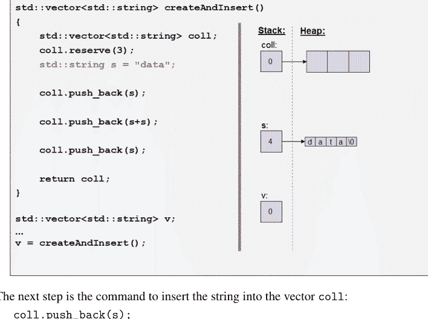

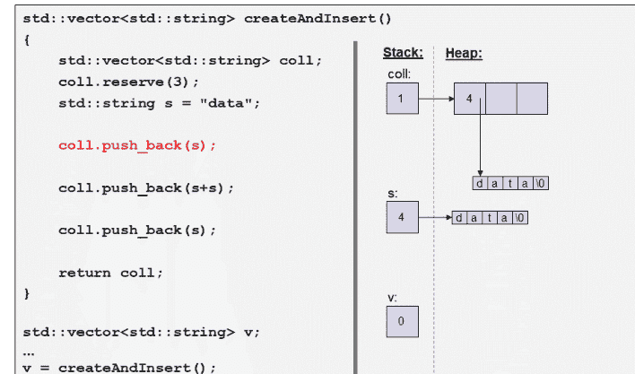

- • 现在让我们看看下一个语句，它创建一个新的临时字符串并再次将其插入到向量中：
  coll.push_back(s+s);

此语句分为三个步骤执行：

- 1. 我们创建临时字符串 s+s：

```
std::vector<std::string> createAndInsert()
{
	std::vector<std::string> coll;
	coll.reserve(3);
	std::string s = "data";
	coll.push_back(s);
	coll.push_back(s+s);
	coll.push_back(s);
	return coll;
}

std::vector<std::string> v;
...

v = createAndInsert();
```

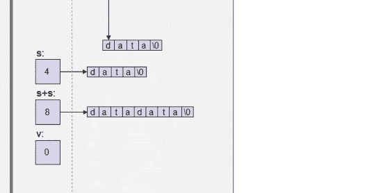

2. 我们将此临时字符串插入到向量 coll 中。正如始终一样，容器会创建传递值的副本，这意味着我们创建了临时字符串的深拷贝，包括为其值分配内存：


### 1.1 移动语义的动机

```
std::vector<std::string> createAndInsert()
{
    std::vector<std::string> coll;
    coll.reserve(3);
    std::string s = "data";

    coll.push_back(s);

    coll.push_back(s+s);

    coll.push_back(s);

    return coll;
}

std::vector<std::string> v;
...
v = createAndInsert();
```

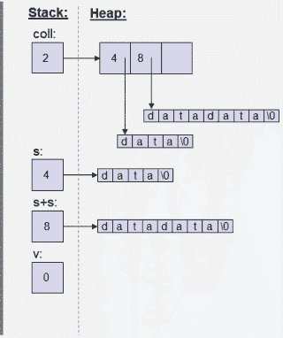

- 3. 在语句结束时，临时字符串 s+s 被销毁，因为我们不再需要它：

```
std::vector<std::string> createAndInsert()
{
    std::vector<std::string> coll;
    coll.reserve(3);
    std::string s = "data";

    coll.push_back(s);

    coll.push_back(s+s);

    coll.push_back(s);

    return coll;
}

std::vector<std::string> v;
...
v = createAndInsert();
```

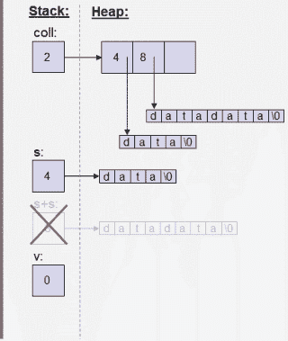

在这里，我们遇到了第一个生成性能不佳的代码的时刻：我们复制了一个临时字符串，并在其后立即销毁了副本的源，这意味着我们不必要地分配并释放了本可以从源移动到副本的内存。

- • 接下来，使用下一个语句，我们再次将 s 插入到 coll 中：

```
coll.push_back(s);
```

再次，coll 复制 s：

```
```cpp
std::vector<std::string> createAndInsert()
{
    std::vector<std::string> coll;
    coll.reserve(3);
    std::string s = "data";

    coll.push_back(s);

    coll.push_back(s+s);

    coll.push_back(s);

    return coll;
}

std::vector<std::string> v;
...
v = createAndInsert();
```
```

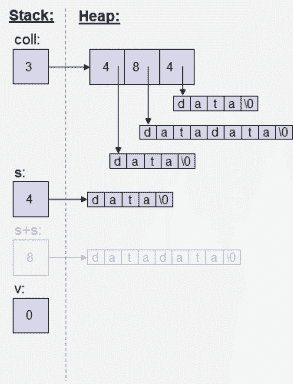

这也是需要改进的地方：因为 s 的值不再需要，某种优化可以使用 s 的内存作为向量中新元素的内存。

- - 在 `createAndInsert()` 结束时，我们来到 return 语句：
  
  ```cpp
  return coll;
  } 
  ```

这里，程序的行为变得有点复杂。我们按值返回（返回类型不是引用），这应该是 return 语句中值 coll 的副本。复制 coll 意味着我们必须创建整个向量及其所有元素的深拷贝。因此，我们必须为向量中元素的数组分配堆内存，并为每个字符串为其值分配的堆内存分配内存。在这里，我们必须分配内存 4 次。

然而，由于同时 coll 被销毁，因为我们离开了它声明的作用域，编译器允许执行命名返回值优化（NRVO）。这意味着编译器可以生成代码，使 coll 仅用作返回值。

即使这会改变程序的功能行为，此优化也是允许的。如果我们在 vector 或 string 的拷贝构造函数中有打印语句，我们会看到程序不再有来自打印语句的输出。这意味着此优化会改变程序的功能行为。然而，这是可以的，因为我们明确允许 C++ 标准中即使有副作用也进行此优化。没有人应该期望这里会进行拷贝，就像没有人应该期望不会进行拷贝一样。它完全取决于编译器是否执行命名返回值优化。

让我们假设我们有命名返回值优化。在这种情况下，在 return 语句结束时，coll 现在成为返回值，并且 s 的析构函数被调用，从而释放其声明时分配的内存：


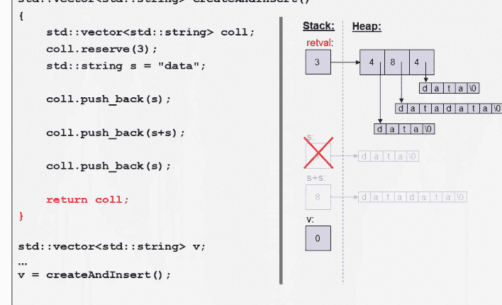

+   - 最后，我们回到了将返回值赋值给 v：
+     v = createAndInsert();

在这里，我们确实获得了可以改进的行为：通常的赋值运算符的目标是让 v 获得与所赋源值相同的值。一般来说，任何被赋的值都不应被修改，并且应与被赋值的对象无关。因此，赋值运算符会对整个返回值进行深拷贝：

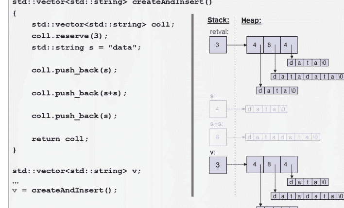

然而，在这之后，我们不再需要这个临时返回值，于是将其销毁：

```
std::vector<std::string> createAndInsert()
{
    std::vector<std::string> coll;
    coll.reserve(3);
    std::string s = "data";

    coll.push_back(s);

    coll.push_back(s+s);

    coll.push_back(s);

    return coll;
}

std::vector<std::string> v;
...
v = createAndInsert();
```

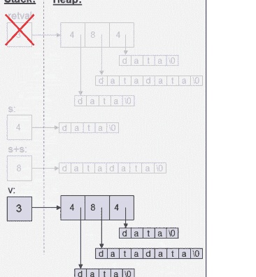

再次，我们创建了一个临时对象的副本，并在紧接着销毁副本的源对象，这意味着我们又进行了一次不必要的内存分配和释放。这次共涉及四次分配：一次是 vector，另外三次分别是三个字符串元素。

对于 main() 中赋值之后程序的状态，我们总共分配了十次内存，并释放了六次。不必要的内存分配是由以下原因引起的：

+   - 将临时对象插入集合中
+   - 将一个不再需要其值的对象插入集合中
+   - 将一个包含全部元素的临时 vector 进行赋值

我们可以在一定程度上避免这些性能损失。特别是，对于最后一次赋值，我们可以这样做：

+   - 将 vector 作为输出参数传递：
+     createAndInsert(v); // let the function fill vector v
+   - 使用 swap()：
+     createAndInsert().swap(v);

然而，这样得到的代码看起来更丑（除非你觉得复杂代码中也有美感），而且在插入临时对象时其实没有真正的变通方法。

自 C++11 起，我们有另一个选择：在支持移动语义的情况下编译并运行程序。

#### 1.1.2 自 C++11 起的示例（使用移动语义）

现在，让我们使用支持移动语义的现代 C++ 编译器（C++11 或更高版本）重新编译该程序：

basics/motiv11.cpp

```
#include <string>
#include <vector>

std::vector<std::string> createAndInsert()
{
    std::vector<std::string> coll;    // create vector of strings
    coll.reserve(3);                  // reserve memory for 3 elements
    std::string s = "data";          // create string object

    coll.push_back(s);                // insert string object
    coll.push_back(s+s);              // insert temporary string
    coll.push_back(std::move(s));     // insert string (we no longer need the value of s)

    return coll;                      // return vector of strings
}

int main()
{
    std::vector<std::string> v;       // create empty vector of strings
    ...
    v = createAndInsert();            // assign returned vector of strings
    ...
}
```

不过这里有一个小小的改动：在将最后一个元素插入 coll 时，我们添加了一次 std::move() 调用。我们稍后会在讲到这条语句时讨论这个改动。其他一切与之前相同。

再次，让我们通过检查栈和堆来查看程序的各个步骤。

+   - 首先，在 main() 中，我们创建空 vector v，它被放置在栈上，包含 0 个元素：
+     std::vector<std::string> v;
+   - 然后，我们调用
+     v = createAndInsert();
+     其中我们在栈上创建另一个空 vector coll，并在堆上为三个元素预留未初始化的内存：
+     std::vector<std::string> coll;
+     coll.reserve(3);
+   - 然后，我们创建以 "data" 初始化的字符串 s，再次将其插入 coll 中：
+     std::string s = "data";
+     coll.push_back(s);

到目前为止，没有什么需要优化的，我们得到与 C++03 相同的状态：

```
```cpp
std::vector<std::string> createAndInsert()
{
    std::vector<std::string> coll;
    coll.reserve(3);
    std::string s = "data";
    coll.push_back(s);
    coll.push_back(s+s);
    coll.push_back(std::move(s));
    return coll;
}
```
```

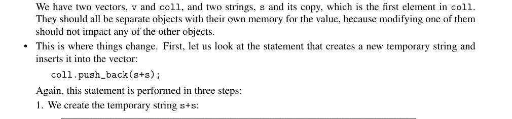

我们有两个 vector（v 和 coll）以及两个字符串（s 和它的副本，也就是 coll 的第一个元素）。它们都应该是各自独立的对象，拥有各自独立的值内存，因为修改其中一个不会影响其他任何对象。

+   • 这就是情况开始发生变化的地方。首先，我们来看创建新的临时字符串并将其插入 vector 的语句：

```
coll.push_back(s+s);
```

同样，这条语句分为三个步骤执行：

+   1. 我们创建临时字符串 s+s：


```
```cpp
std::vector<std::string> v;
...
v = createAndInsert();
```
```

2. 我们将这个临时字符串插入 vector coll。然而，现在发生了一些不同的事情：我们从 s+s 中“窃取”其值的存储内存，并将其移动到 coll 的新元素中。

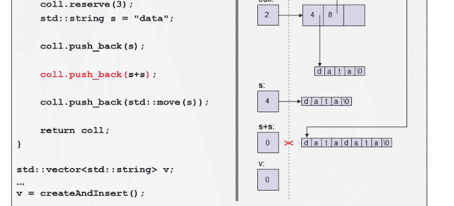

这样做之所以可行，是因为自 C++11 起，我们可以为获取一个不再需要的值实现特殊行为。编译器可以为此发出信号，因为它知道在执行 push_back() 调用后，临时对象 s+s 会立即被销毁。因此，我们调用了一个为调用者不再需要该值的情况而提供的不同的 push_back() 实现。正如我们所见，其效果是一种针对不再需要该值的字符串拷贝的优化实现：我们不是创建一个单独的深拷贝，而是同时拷贝大小和指向内存的指针。然而，仅做这种浅拷贝还不够；我们还要修改临时对象 s+s，将其大小设置为 0，并将 nullptr 作为新值赋给它。本质上，s+s 被修改成了空字符串的状态。关键点在于它不再拥有其内存。这一点很重要，因为这条语句还有第三步。

3. 在语句末尾，临时字符串 s+s 被销毁，因为我们不再需要它。但是，由于临时字符串不再是初始内存的所有者，析构函数不会释放这块内存。

```
std::vector<std::string> createAndInsert()
{
    std::vector<std::string> coll;
    coll.reserve(3);
    std::string s = "data";

    coll.push_back(s);

    coll.push_back(s+s);

    coll.push_back(std::move(s));

    return coll;
}

std::vector<std::string> v;
...
v = createAndInsert();
```

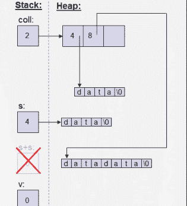

本质上，我们优化了拷贝过程，使 s+s 的值内存的所有权转移到了它在 vector 中的副本上。

这一切都是通过使用能够发出对象即将销毁信号的编译器自动完成的，这样我们就可以使用新的实现来拷贝字符串值，从源对象中窃取该值。这不是技术上的“移动”；而是一种语义上的移动，通过从源字符串到其副本在技术上转移值内存来实现。

+   - 下一条语句是我们为 C++11 版本修改过的语句。我们再次将 s 插入 coll，但这句语句通过为插入的字符串 s 调用 std::move() 而发生了变化：
+     coll.push_back(std::move(s));

如果没有 std::move()，那么发生的将与第一次调用 push_back() 时相同：vector 会对传入的字符串 s 进行深拷贝。然而，在这次调用中，我们用 std::move() 标记了 s，这在语义上意味着“我在这里不再需要这个值”。因此，我们再次调用了另一个 push_back() 实现，也就是之前传递临时对象 s+s 时所用的那个实现。第三个元素通过将值内存的所有权从 s 移动到其副本而“窃取”了值：

### 1.1 移动语义的动机

```
```cpp
std::vector<std::string> createAndInsert()
{
    std::vector<std::string> coll;
    coll.reserve(3);
    std::string s = "data";
    coll.push_back(s);
    coll.push_back(s+s);
    coll.push_back(std::move(s));
    return coll;
}

std::vector<std::string> v;
...
v = createAndInsert();
```
```

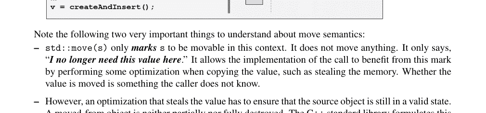

关于移动语义，需要理解以下两点非常重要的事情：

+   - std::move(s) 只是将 s 标记为在此上下文中可移动。它并不会移动任何东西。它只是表示：“我在这里不再需要这个值。”它允许调用的实现利用这个标记，在拷贝值时执行某些优化，例如“窃取”内存。是否真的发生了移动，调用者并不知道。
+   - 然而，一种“窃取”值的优化必须确保源对象仍然处于有效状态。被移动（moved-from）的对象既没有被部分销毁，也没有被完全销毁。C++ 标准库对其类型是这样规定的：对标记为 std::move() 的对象执行操作后，该对象处于有效但未指定（valid but unspecified）的状态。

也就是说，在调用 coll.push_back(std::move(s)); 之后，保证 s 仍然是一个有效的字符串。只要对任何你不知道其值的字符串来说是合法的，你就可以对它做任何你想做的事。这就像使用一个你不知道其值的字符串参数一样。

注意，也不保证字符串要么保留其旧值，要么为空。它最终的值取决于（库）函数的实现者。一般来说，实现者可以对标记为 std::move() 的对象做任何他们想做的事，只要让对象保持有效状态即可。这个保证有着充分的理由，我们将在后面讨论。

• 再次，在 createAndInsert() 的末尾，我们遇到了返回语句：

return coll;

是否生成带有命名返回值优化（named return value optimization）的代码，仍然由编译器决定，如果使用该优化，就意味着 coll 直接成为返回值。然而，即使没有使用这个优化，返回语句仍然是廉价的，因为我们同样面临着从有效但未指定状态的源对象创建对象的情况。


即将死亡。也就是说，如果没有使用命名返回值优化，则会使用移动语义，这意味着返回值会从 `coll` 中窃取值。最坏情况下，我们需要将 size、capacity 和指向内存的指针（总共通常为 12 或 24 字节）等成员从源复制到返回值，并在源中为这些成员赋新值。

假设我们使用了命名返回值优化。在这种情况下，在 return 语句结束时，`coll` 现在成为返回值，并且 `s` 的析构函数被调用，它不再需要释放任何内存，因为内存已被移动到 `coll` 的第三个元素中：

```cpp
std::vector<std::string> createAndInsert()
{
    std::vector<std::string> coll;
    coll.reserve(3);
    std::string s = "data";

    coll.push_back(s);

    coll.push_back(s+s);

    coll.push_back(std::move(s));

    return coll;
}

std::vector<std::string> v;
...
v = createAndInsert();
```

- 那么，最后，我们来到将返回值赋给 `v` 的操作：

```cpp
v = createAndInsert();
```

同样，我们现在可以从移动语义中受益，因为我们遇到了一个已经见过的情况：我们需要从一个即将死亡的临时返回值中复制（这里是赋值）一个值。

现在，移动语义允许我们为 vector 的赋值运算符提供不同的实现，该实现只是从源 vector 中窃取值：

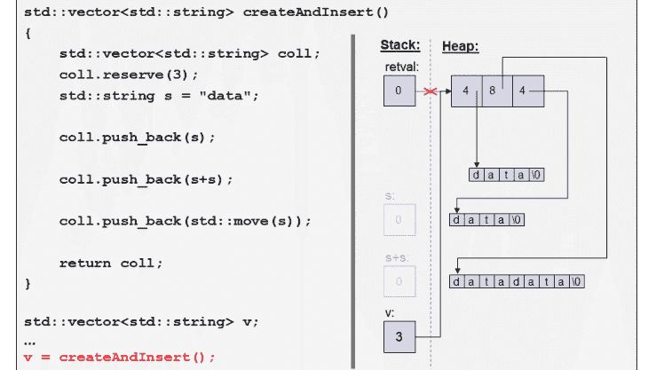

同样，临时对象不会被（部分）销毁。它进入有效状态，但我们不知道其值。

然而，在赋值之后，语句结束时（修改过的）临时返回值将被销毁：

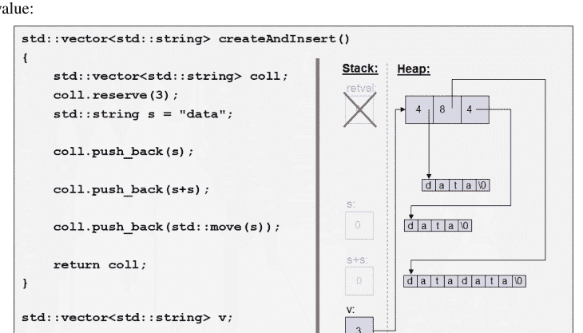

最后，我们处于使用移动语义之前相同的状态，但有一点发生了显著变化：我们节省了六次内存分配和释放。所有不必要的内存分配都不再发生：

- 为向集合中插入临时对象而进行的分配
- 为向集合中插入命名对象而进行的分配，当我们使用 std::move() 来表示不再需要该值时
- 为给包含其所有元素的临时 vector 赋值而进行的分配

在第二种情况下，优化是在我们的帮助下完成的。通过添加 std::move()，我们必须说明在那里不再需要 s 的值。所有其他优化之所以发生，是因为编译器知道某个对象即将死亡，因此它可以调用使用移动语义的优化实现。

这意味着返回字符串的 vector 并将其赋给现有 vector 不再是性能问题。我们可以像使用整型类型一样天真地使用字符串的 vector，并获得更好的性能。实践中，使用移动语义重新编译代码可以使速度提高 10% 到 40%（取决于现有代码的“天真”程度）。

### 1.2 实现移动语义

让我们使用之前的示例来看看移动语义在何处以及如何实现。

在实现移动语义之前，类 std::vector<> 只有一个 push_back() 的实现（这里 vector 的声明被简化了）：

```
template<typename T>
class vector {
public:
    ...
    // insert a copy of elem:
    void push_back (const T& elem);
    ...
};
```

传递参数绑定到 const 引用以调用 push_back() 只有一种方式。push_back() 的实现方式是 vector 在不修改它的情况下为传递的参数创建内部副本。

自 C++11 以来，我们有了 push_back() 的第二个重载：

```
template<typename T>
class vector {
public:
    ...
    // insert a copy of elem:
    void push_back (const T& elem);

    // insert elem when the value of elem is no longer needed:
    void push_back (T&& elem);
    ...
};
```

第二个 push_back() 使用为移动语义引入的新语法。我们用两个 & 且不带 const 声明参数。这种参数称为右值引用。³ 只有一个 & 的“普通引用”现在称为左值引用。也就是说，在两次调用中我们都通过引用传递要插入的值。然而，区别如下：

- 使用 push_back(const T&)，我们承诺不修改传递的值。
  当调用者仍然需要传递的值时调用此函数。
- 使用 push_back(T&&)，实现可以修改传递的参数（因此它不是 const）以“窃取”值。语义意义仍然是新元素接收传递参数的值，但我们可以使用优化的实现将值移动到 vector 中。
  当调用者不再需要传递的值时调用此函数。实现必须确保传递的参数仍处于有效状态。然而，其值可能会改变。因此，调用之后，调用者仍然可以使用传递的参数，只要调用者不对其值做出任何假设。

然而，vector 不知道如何复制或移动一个元素。在确保 vector 有足够内存容纳新元素之后，vector 会将工作委托给元素的类型。

在这种情况下，元素是字符串。所以，让我们看看如果我们复制或移动传递的字符串会发生什么。

#### 1.2.1 使用拷贝构造函数

push_back(const T&) 对于传统的拷贝语义调用字符串类的拷贝构造函数，该构造函数在 vector 中初始化新元素。让我们看看这是如何实现的。非常天真的 string 类实现的拷贝构造函数看起来像这样：⁴

```
class string {
  private:
    int len;                // current number of characters
    char* data;             // dynamic array of characters

  public:
    // copy constructor: create a full copy of s:
    string (const string& s)
      : len{s.len} {          // copy number of characters
      if (len > 0) {         // if not empty
        data = new char[len+1];   // - allocate new memory
        memcpy(data, s.data, len+1); // - and copy the characters
      }
    }
    ...
};
```

假设我们为具有值 "data" 的字符串调用此拷贝构造函数：

```
std::string a = "data";
std::string b = a;    // create b as a copy of a
```

在如下初始化字符串 a 之后：

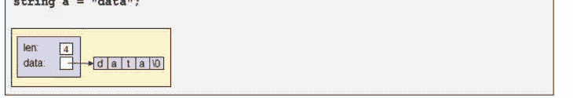

上面的拷贝构造函数将复制字符数量的成员 len，但为 data 指针分配新内存以存储值，并将字符从源 a（作为 s 传递）复制到新字符串：

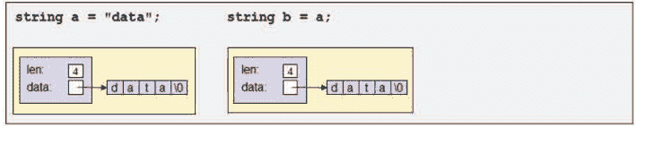

#### 1.2.2 使用移动构造函数

push_back(T&&) 对于新的移动语义调用相应的新构造函数，即移动构造函数。这是从现有字符串创建新字符串的构造函数，其中值不再需要。与移动语义一样，构造函数使用非 const 右值引用（&&）作为其参数声明：

```
class string {
    private:
        int len;                    // current number of characters
        char* data;                 // dynamic array of characters

    public:
        ...
        // move constructor: initialize the new string from s (stealing the value):
        string (string&& s)
            : len{s.len}, data{s.data} {  // copy number of characters and pointer to memory
            s.data = nullptr;           // release the memory for the source value
            s.len = 0;                  // and adjust number of characters accordingly
        }
        ...
};
```

假设拷贝构造函数上面的情况：

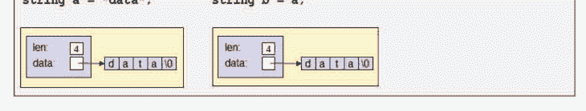

我们可以按如下方式为字符串调用此构造函数：

```
std::string c = std::move(b); // init c with the value of b (no longer needing its value here)
```

移动构造函数首先复制 len 和 data 两个成员，这意味着新字符串获得了 b（作为 s 传递）的值的所有权。

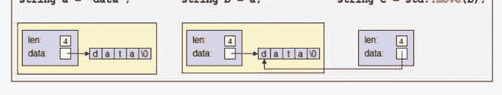

然而，这还不够，因为 b 的析构函数会释放内存。因此，我们还修改源字符串以使其失去对内存的所有权，并将其带入表示空字符串的一致状态：

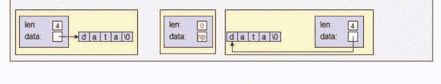

其效果是 c 现在具有 b 的前值，而 b 是空字符串。再次注意，唯一保证是 b 随后处于有效但未指定的状态。根据 C++ 库中移动构造函数的实现方式，它可能不是空的（但通常是空的，因为这是提高性能的最简单和最好的方法）。

### 1.3 拷贝作为后备

我们看到，通过使用临时对象或用 std::move() 标记对象，我们可以启用移动语义。提供特殊实现（通过接受非 const 右值引用）的函数可以通过“窃取”源的值来优化值的复制。然而，如果没有为移动语义提供函数的优化版本，则使用通常的复制作为后备。

例如，假设一个容器类如 vector 缺少 push_back() 的第二个重载：

```
template<typename T>
```


```
class MyVector {
    public:
        ...
        void push_back (const T& elem);  // insert a copy of elem
        ...    // no other push_back() declared
};
```

我们仍然可以传递临时对象或使用 std::move() 标记的对象：

```
MyVector<std::string> coll;
std::string s{"data"};
...
coll.push_back(std::move(s));    // OK, uses copy semantics
```

规则是，对于临时对象或使用 std::move() 标记的对象，如果有可用，声明参数为右值引用的函数会被优先选择。然而，如果不存在这样的函数，则使用通常的拷贝语义。这样可以确保调用者不必知道是否存在优化。优化可能不存在的原因是：

- 函数/类是在支持移动语义之前实现的，或没有考虑到移动语义支持
- 没有可优化的内容（仅包含数值成员的类就是一个例子）

对于通用代码而言，重要的是我们始终可以在不再需要其值时使用 std::move() 标记一个对象。相应的代码即使没有移动语义支持也能编译。

出于同样的原因，你甚至可以对 int（或指针）等基本数据类型对象使用 std::move() 标记。仍然会使用通常的值语义拷贝值（地址）：

```
std::vector<int> coll;
int x{42};
...
coll.push_back(std::move(x));    // OK, but copies x (std::move() has no effect)
```

### 1.4 Move Semantics for const Objects

最后请注意，用 const 声明的对象无法被移动，因为任何优化实现都需要传入的参数可以被修改。如果我们不被允许修改它，就无法窃取其值。

使用通常的 push_back() 重载：

```
template<typename T>
class vector {
public:
    ...
    // insert a copy of elem:
    void push_back (const T& elem);

    // insert elem when the value of elem is no longer needed:
    void push_back (T&& elem);
    ...
```

};
对于 const 对象，唯一有效的可调用函数是带有 const& 参数的第一个 push_back() 重载：

```
std::vector<std::string> coll;
const std::string s{"data"};
...
coll.push_back(std::move(s));  // OK, calls push_back(const std::string&)
```

这意味着对 const 对象的 std::move() 本质上没有效果。

原则上，我们可以通过声明一个接受 const 右值引用的函数来为此情况提供特殊重载。然而，这在语义上没有意义。再次，const 左值引用重载作为回退来处理这种情况。

#### 1.4.1 const Return Values

const 禁用移动语义这一事实也对声明返回类型有影响。const 返回值无法被移动。

因此，自 C++11 起，按值返回时再将返回值为 const 已不再是好的风格（过去某些风格指南曾推荐）。例如：

```
const std::string getValue();

std::vector<std::string> coll;
...
coll.push_back(getValue());  // copies (because the return value is const)
```

按值返回时，不要将整个返回值声明为 const。仅对返回类型的部分使用 const（例如返回的引用或指针所指的对象）：

```
const std::string getValue();  // BAD: disables move semantics for return values
const std::string& getRef();    // OK
const std::string* getPtr();    // OK
```

### 1.5 Summary

- 移动语义允许我们在不再需要值时优化对象的拷贝。它可以隐式使用（对于无名临时对象或局部返回值）或显式使用（使用 std::move()）。
- std::move() 表示我在这里不再需要这个值。它将对象标记为可移动。用 std::move() 标记的对象不会被（部分）销毁（析构函数仍会被调用）。
- 通过声明函数使用非 const 右值引用（如 std::string&&），你定义了一个接口，其中调用者在语义上声称它不再需要传入的值。函数的实现者可以利用此信息通过“窃取”值或对传入参数进行其他修改来优化其任务。通常，实现者还必须确保调用后传入参数处于有效状态。
- C++ 标准库中被移动后的对象仍然是有效对象，但你不再知道其值。
- 拷贝语义作为移动语义的回退（如果支持拷贝语义）。如果没有接受右值引用的实现，则使用接受普通 const 左值引用（如 const std::string&）的任何实现。即使对象被显式标记为 std::move()，也会使用此回退。
- 对 const 对象调用 std::move() 通常没有效果。
- 如果你按值返回（不是按引用返回），不要将整个返回值声明为 const。

## Chapter 2

## Core Features of Move Semantics

在第一个动机示例之后，本章讨论移动语义的基本特性。

### 2.1 Rvalue References

为了支持移动语义，我们引入了一种新的引用类型：右值引用。让我们讨论它们是什么以及如何使用它们。

#### 2.1.1 Rvalue References in Detail

右值引用用两个与号声明。就像用一个与号声明的普通引用，现在称为左值引用一样，右值引用也引用一个已存在的对象，该对象必须作为初始值传递。然而，根据其语义，右值引用只能引用一个没有名称的临时对象或使用 std::move() 标记的对象：

```
std::string returnStringByValue();      // forward declaration
...
std::string s{"hello"};
...
std::string&& r1{s};                    // ERROR
std::string&& r2{std::move(s)};         // OK
std::string&& r3{returnStringByValue()}; // OK, extends lifetime of return value
```

名称右值引用来源于这些对象通常只能引用右值这一事实，右值是临时对象且没有名称以及使用 std::move() 标记的对象的取值类别。

与从返回值成功初始化引用的情况一样，引用会延长返回值的生命周期，直到引用的生命周期结束（普通 const 左值引用已有此行为）。

用于初始化引用的语法无关紧要。你可以使用等号、大括号或圆括号：

```
std::string s{"hello"};
...
std::string&& r1 = std::move(s);        // OK, rvalue reference to s
std::string&& r2{std::move(s)};        // OK, rvalue reference to s
std::string&& r3(std::move(s));        // OK, rvalue reference to s
```

所有这些引用都具有“我们可以窃取/修改我们引用的对象，前提是对象的状态保持有效状态”的语义。技术上，这些语义不会被编译器检查，因此我们可以像处理任何非 const 类型对象一样修改右值引用。我们也可能决定不修改值。也就是说，如果你有一个对象 的右值引用，该对象可能会接收不同的值（可能是也可能不是默认构造对象的默认值），也可能保持其值。

正如我们所见，移动语义允许我们优化使用不再需要值的源的值。如果编译器自动检测到某个值是从生命周期结束的对象中使用的，它们将自动切换到移动语义。这种情况发生在：

- 我们传递一个临时对象的值，该临时对象将在语句结束后自动销毁。
- 我们传递一个使用 std::move() 标记的非 const 对象。

#### 2.1.2 Rvalue References as Parameters

当我们声明参数为右值引用时，它具有完全相同的行为和语义，如上所述：

- 参数只能绑定到没有名称的临时对象或使用 std::move() 标记的对象。
- 根据右值引用的语义：
  - 调用者声称它不再关心该值。因此，你可以修改参数引用的对象。
  - 然而，调用者可能仍有兴趣使用该对象。因此，任何修改都应保持引用对象处于有效状态。

例如：

```
void foo(std::string&& rv);  // takes only objects where we no longer need the value
...
std::string s{"hello"};
...
foo(s);                     // ERROR
foo(std::move(s));          // OK, value of s might change
foo(returnStringByValue()); // OK
```

你可以在使用 std::move() 传递后继续使用命名对象，但通常不应该这样做。推荐的编程风格是在 std::move() 之后不再使用对象：

```
void foo(std::string&& rv);  // takes only objects where we no longer need the value
...
std::string s{"hello"};
...
foo(std::move(s));          // OK, value of s might change
```


### 2.2 std::move()

```cpp
std::cout << s << '\n'; // OOPS, you don’t know which value is printed
foo(std::move(s)); // OOPS, you don’t know which value is passed
s = "hello again"; // OK, but rarely done
foo(std::move(s)); // OK, value of s might change
```

对于标记有“OOPS”的两行代码，只要你不对 `s` 的当前值作任何假设，这些调用在技术上就是合法的。因此，打印该值是没问题的，尽管通常没什么用。

如果你有一个对象，其生命周期在使用时并未结束，你可以用 `std::move()` 标记它，以表达“我不再需要这个值了”。`std::move()` 并不会真正移动；它只是在表达式所处的上下文中设置一个临时标记：

```cpp
void foo1(const std::string& lr); // binds to the passed object without modifying it
void foo1(std::string&& rv); // binds to the passed object and might steal/modify the value
...
std::string s{"hello"};
...
foo1(s); // calls the first foo1(), s keeps its value
foo1(std::move(s)); // calls the second foo1(), s might lose its value
```

用 `std::move()` 标记的对象仍然可以传递给接受普通 const 左值引用的函数：

```cpp
void foo2(const std::string& lr); // binds to the passed object without modifying it
...
std::string s{"hello"};
...
foo2(s); // calls foo2(), s keeps its value
foo2(std::move(s)); // also calls foo2(), s keeps its value
```

注意，用 `std::move()` 标记的对象不能传递给非 const 左值引用：

```cpp
void foo3(std::string&); // modifies the passed argument
...
std::string s{"hello"};
...
foo3(s); // OK, calls foo3()
foo3(std::move(s)); // ERROR: no matching foo3() declared
```

注意，对即将消亡的对象使用 `std::move()` 是没有意义的。事实上，这可能甚至对优化产生反效果。

`std::move()` 在 C++ 标准库中被定义为一个函数。因此，要使用它，你必须包含定义它的头文件 `<utility>`：

```cpp
#include <utility> // for std::move()
```

使用 `std::move()` 的程序通常无需包含该头文件也能编译，因为实际上几乎所有头文件都包含了 `<utility>`。然而，任何标准头文件都并非必须包含 utility。因此，在使用 `std::move()` 时，你应该显式包含 `<utility>` 以保证程序的可移植性。

#### 2.2.2 std::move() 的实现

`std::move()` 只不过是对右值引用的 `static_cast`。你可以通过手动调用 `static_cast` 来达到相同的效果，如下所示：

```
foo(static_cast<decltype(obj)&&>(obj));  // same effect as foo(std::move(obj))
```

因此，我们也可以这样写：

```
std::string s;
...
foo(static_cast<std::string&&>(s));      // same effect as foo(std::move(s))
```

注意，这里的 `static_cast` 所做的不仅仅是改变对象的类型。它还使该对象可以传递给右值引用（请记住，通常不允许将具名对象传递给右值引用）。我们将在关于值类别的章节中详细讨论这一点。

### 2.3 被移动后的对象

在执行 `std::move()` 之后，被移动后的对象不会被（部分）销毁。它们仍然是有效的对象，至少析构函数会被调用。然而，它们还应该在某种意义上保持有效，即具有一致的状态，并且所有操作都能按预期工作。你唯一不知道的是它们的值。这就像使用一个类型的参数，但你不知道传入的是什么值。

#### 2.3.1 有效但未指定的状态

C++ 标准库保证，被移动后的对象处于有效但未指定（valid but unspecified）的状态。

考虑以下代码：

```
std::string s;
...
coll.push_back(std::move(s));
```

在用 `std::move()` 传递 `s` 之后，你可以查询字符数量、打印出值，甚至赋一个新值。但是，你不能在不先检查字符数量的情况下打印第一个字符或任何其他字符：

```
foo(std::move(s));                     // keeps s in a valid but unclear state

std::cout << s << '\n';               // OK (don't know which value is written)
std::cout << s.size() << '\n';        // OK (writes current number of characters)
std::cout << s[0] << '\n';            // ERROR (potentially undefined behavior)
std::cout << s.front() << '\n';       // ERROR (potentially undefined behavior)
s = "new value";                     // OK
```

虽然你不知道值，但字符串处于一致的状态。例如，`s.size()` 会返回字符数量，这样你就可以遍历所有有效的索引：

```
foo(std::move(s));                 // keeps s in a valid but unclear state
```

```
for (int i = 0; i < s.size(); ++i) {
    std::cout << s[i];               // OK
}
```

对于用户自定义类型，你也应该确保被移动后的对象处于有效状态，这有时需要声明或实现移动操作。“被移动后的状态”一章将详细讨论这一点。

#### 2.3.2 复用被移动后的对象

你可能想知道为什么被移动后的对象仍然是有效对象，而不会被（部分）销毁。原因是移动语义有一些有用的应用场景，在这些场景中重新使用被移动后的对象是有意义的。

例如，考虑从流中逐行读取字符串并将它们移动到 vector 中的代码：

```
std::vector<std::string> allRows;
std::string row;
while (std::getline(myStream, row)) {  // read next line into row
    allRows.push_back(std::move(row));   // and move it to somewhere
}
```

每次我们读取一行到 `row` 后，用 `std::move()` 将 `row` 的值移动到 `allRows` 的 vector 中。然后，`std::getline()` 再次使用被移动后的对象 `row` 来读取下一行。

作为第二个例子，考虑一个交换两个值的泛型函数：

```
template<typename T>
void swap(T& a, T& b)
{
    T tmp{std::move(a)};
    a = std::move(b);      // assign new value to moved-from a
    b = std::move(tmp);    // assign new value to moved-from b
}
```

这里，我们将 `a` 的值移动到一个临时对象中，以便之后能够将 `b` 的值移动赋值给它。然后，被移动后的对象 `b` 接收 `tmp` 的值，即 `a` 原来的值。

这样的代码例如用于排序算法中，我们移动不同元素的值以将它们按排序顺序排列。在那里，向被移动后的对象赋新值一直在发生。算法甚至可能对这样的被移动对象使用排序准则。

一般来说，被移动后的对象应该是有效的对象，可以被销毁（析构函数不应失败）、可以重新用于获取其他值，并且能够在不需知道值的情况下支持其类型所支持的所有其他操作。“被移动后的状态”一章将详细讨论这一点。

其语义含义是，我们授予 `foo()` 对传入参数的写权限以窃取其值。这是一个 in（输入）参数，并额外要求调用者不再需要该值。

注意，右值引用绑定到与非 const 左值引用不同的参数。因此，我们必须引入一种新语法，而不能仅仅将移动语义实现为修改传入参数的函数的另一种方式。

#### 2.4.1 const 右值引用

从技术上讲，还有第四种按引用传递的方式：

- `void foo(const std::string&& arg)`
  将参数作为 const 右值引用接收。

这也意味着你可以对传入的参数进行读访问。在这种情况下，限制是你只能传递：

- 没有名称的临时对象
- 用 `std::move()` 标记的 const 或非 const 对象

然而，这种情况没有有用的语义含义。作为右值引用，允许窃取值，但因为是 const，我们禁止修改传入的参数。这本身就是矛盾的。

尽管如此，创建具有这种行为的对象很容易：只需用 `std::move()` 标记一个 const 对象：

```
const std::string s{"data"};
...
foo(std::move(s));    // would call a function declared as const rvalue reference
```

当声明一个返回 const 值的函数时，这种情况可能会间接发生：

```
const std::string getValue();
...
foo(getValue());    // would call a function declared as const rvalue reference
```

在语义上，这种情况通常由函数的 const 左值引用重载覆盖以提供读访问。对这种情况进行具体实现是可能的，但通常没有意义（C++ 标准库类 `std::optional<>` 使用了 const 右值引用）。

### 2.5 按值传递

如果你声明一个函数按值接收参数，移动语义也可能（自动地）被使用。

例如：

```
void foo(std::string str);  // takes the object by value
...
std::string s{"hello"};
...
foo(s);                // calls foo(), str becomes a copy of s
foo(std::move(s));     // calls foo(), s is moved to str
```


### 2.6 小结

-   使用 `std::move()` 标记的对象也可以按值传递给函数。在这种情况下，移动语义被用来初始化参数，这使得按值传递变得相当廉价。
-   const 右值引用是可能的，但针对它们实现通常没有意义。
-   被移动（moved-from）的对象应处于有效但未指定的状态。C++ 标准库对其类型保证了这一点。只要你不对其值做任何假设，你仍然可以（重新）使用它们。

```cpp
values.push_back(val);
}

friend std::ostream& operator<<(std::ostream& strm, const Customer& cust) {
    strm << '[' << cust.name << ": ";
    for (int val : cust.values) {
        strm << val << ' ';
    }
    strm << ']';
    return strm;
}
};
```

这个类有两个（可能）昂贵的成员：一个用于存储姓名的字符串和一个用于存储整数值的 vector：

```cpp
class Customer {
private:
    std::string name;          // name of the customer
    std::vector<int> values;   // some values of the customer
    ...
};
```

复制这两个成员都很昂贵。

-   复制姓名时，我们必须为字符串的字符分配内存（除非姓名很短，并且字符串是通过 *小字符串优化（SSO）* 实现的）。
-   复制这些值时，我们必须为 vector 的元素分配内存。

如果我们有一个 string 的 vector 或其他相当昂贵的元素类型，代价会更高。例如，vector 的 *深拷贝* 必须同时为元素的动态数组和每个元素所需的内存分配内存。

好消息是，**移动语义通常会自动得到支持**。自 C++11 起，编译器通常会自动生成 *移动构造函数* 和 *移动赋值运算符*（类似于自动生成复制构造函数和复制赋值运算符）。

这具有以下效果：

-   按值返回局部 Customer 将使用移动语义（如果未被优化掉）。
-   按值传递未命名的 Customer 将使用移动语义（如果未被优化掉）。
-   按值传递临时 Customer（例如，由另一个函数返回的临时对象）将使用移动语义（如果未被优化掉）。
-   按值传递用 `std::move()` 标记的 Customer 对象将使用移动语义（如果未被优化掉）。

例如：

*basics/customer1.cpp*

```cpp
#include "customer.hpp"
#include <iostream>
#include <random>
```

```cpp
#include <utility>  // for std::move()

int main()
{
    // create a customer with some initial values:
    Customer c{"Wolfgang Amadeus Mozart"};
    for (int val : {0, 8, 15}) {
        c.addValue(val);
    }
    std::cout << "c: " << c << '\n';      // print value of initialized c

    // insert the customer twice into a collection of customers:
    std::vector<Customer> customers;
    customers.push_back(c);                // copy into the vector
    customers.push_back(std::move(c));     // move into the vector
    std::cout << "c: " << c << '\n';      // print value of moved-from c

    // print all customers in the collection:
    std::cout << "customers:\n";
    for (const Customer& cust : customers) {
        std::cout << "  " << cust << '\n';
    }
}
```

这里我们创建并初始化一个客户 c（为了避免 SSO，我们使用了一个相当长的名字）。初始化 c 后，第一个输出如下：

```
c: [Wolfgang Amadeus Mozart: 0 8 15 ]
```

然后我们把这个客户插入 vector 两次：复制一次，移动一次：

```
customers.push_back(c);                // copy into the vector
customers.push_back(std::move(c));     // move into the vector
```

之后，c 值的下一个输出通常如下：

```
c: [ : ]
```

通过第二次调用 push_back()，姓名和值都被移动到了 vector 的第二个元素中。然而，不要忘记，被移动（moved-from）的对象处于有效但未指定的状态。因此，第二个输出可能具有任何姓名和值：

-   它可能仍然具有相同的值：
  
  c: [Wolfgang Amadeus Mozart: 0 8 15 ]

-   它可能有一个完全不同的值：
  
  c: [value was moved away: 0 ]

然而，因为移动语义是为了优化性能而提供的，而赋一个不同的值不一定能提高性能，所以实现通常会让字符串和 vector 都为空。

无论如何，我们可以看到，Customer 类自动启用了移动语义。出于同样的原因，现在可以保证以下代码是廉价的：

```
{
Customer createCustomer()
{
Customer c{...};
...
return c; // uses move semantics if not optimized away
}

std::vector<Customer> customers;
...
customers.push_back(createCustomer()); // uses move semantics
}
```

完整示例参见 basics/customer2.cpp。

重要的信息是，自 C++11 起，如果类的成员本身受益于移动语义，那么类会自动受益于移动语义。这些类拥有：

-   • 一个移动构造函数，当我们从一个不再需要其值的源对象创建新对象时，它会移动成员：
  
  Customer c1{...}
  ...
  Customer c2{std::move(c1)}; // move members of c1 to members of c2

-   • 一个移动赋值运算符，当我们从一个不再需要其值的源对象赋值时，它会移动赋值成员。
  
  Customer c1{...}, c2{...};
  ...
  c2 = std::move(c1); // move assign members of c1 to members of c2

注意，通过显式实现以下改进，这样的类可以进一步受益于移动语义：

-   • 初始化成员时使用移动语义
-   • 使用移动语义使 getter 既安全又快速

#### 3.1.1 何时在类中自动启用移动语义？

正如刚才介绍的，编译器可能会自动生成特殊的移动成员函数（移动构造函数和移动赋值运算符）。然而，这存在一些约束。约束在于，编译器必须假设生成的操作是正确的。正确的行为是优化普通的复制行为：不是复制成员，而是移动它们，因为源值不再需要。

如果类改变了复制或赋值的通常行为，那么在优化这些操作时，它们可能也需要做一些不同的事情。因此，当以下特殊成员函数中至少有一个是用户声明的，移动操作的自动生成就会被禁用：

-   复制构造函数
-   复制赋值运算符
-   另一个移动操作
-   析构函数

注意，我说的是“用户声明的”。任何形式的显式声明复制构造函数、复制赋值运算符或析构函数都会禁用移动语义。例如，如果我们实现一个什么都不做的析构函数，就禁用移动语义：

```
class Customer {
    ...
    ~Customer() {  // automatic move semantics is disabled
    }
};
```

即使是以下声明也足以禁用移动语义：

```
class Customer {
    ...
    ~Customer() = default;  // automatic move semantics is disabled
};
```

显式请求其默认行为的析构函数是用户声明的，因此会禁用移动语义。在这种情况下，通常会使用复制语义作为回退。

因此：如果没有特定需求，不要实现或声明析构函数（这条规则令人惊讶的是许多程序员都没有遵守）。

这也意味着，默认情况下，多态基类禁用了移动语义：

```
class Base {
    ...
    virtual ~Base() {  // automatic move semantics is disabled
    }
};
```

注意，这意味着移动语义仅对于在该基类内部声明的成员被禁用。对于派生类的成员，移动语义仍然会自动生成（如果派生类没有显式声明特殊成员函数）。《类层次结构中的移动语义》一节将详细讨论这一点。

#### 3.1.2 当生成的移动操作失效时

注意，生成的移动操作可能会引入问题，即使生成的复制操作工作正常。特别是在以下情况下你必须小心：

-   成员对值有约束
    -   成员的值有限制
    -   成员的值相互依赖
-   使用具有引用语义的成员（指针、智能指针等）
-   对象没有默认构造状态


### 3.2 实现特殊的拷贝/移动成员函数

你可以自己实现特殊的移动成员函数。实现方式与拷贝构造函数和赋值运算符大致相同。唯一的区别是参数被声明为非const右值引用，并且在实现内部，你必须指定在何处用更好的方法优化通常的拷贝。

让我们看一个同时实现了特殊拷贝和特殊移动成员函数的类，当对象被拷贝和移动时打印信息：

```cpp
#include <string>
#include <vector>
#include <iostream>
#include <cassert>

class Customer {
private:
    std::string name; // name of the customer
    std::vector<int> values; // some values of the customer
public:
    Customer(const std::string& n)
      : name{n} {
        assert(!name.empty());
    }

    std::string getName() const {
        return name;
    }

    void addValue(int val) {
        values.push_back(val);
    }

    friend std::ostream& operator<<(std::ostream& strm, const Customer& cust) {
        strm << '[' << cust.name << ": ";
        for (int val : cust.values) {
            strm << val << ' ';
        }
        strm << ']';
        return strm;
    }

    // copy constructor (copy all members):
    Customer(const Customer& cust)
      : name{cust.name}, values{cust.values} {
        std::cout << "COPY " << cust.name << '\n';
    }

    // move constructor (move all members):
    Customer(Customer&& cust)                     // noexcept declaration missing
      : name{std::move(cust.name)}, values{std::move(cust.values)} {
        std::cout << "MOVE " << name << '\n';
    }

    // copy assignment (assign all members):
    Customer& operator= (const Customer& cust) {
        std::cout << "COPYASSIGN " << cust.name << '\n';
        name = cust.name;
        values = cust.values;
        return *this;
    }

    // move assignment (move all members):
    Customer& operator= (Customer&& cust) { // noexcept declaration missing
        std::cout << "MOVEASSIGN " << cust.name << '\n';
        name = std::move(cust.name);
        values = std::move(cust.values);
        return *this;
    }
};
```

让我们详细看看所有特殊拷贝/移动成员函数的实现。

请注意，手动实现移动构造函数和移动赋值运算符时，通常应该加上 noexcept 声明，这将在关于移动语义和 noexcept 的章节中讨论。

#### 3.2.1 拷贝构造函数

```cpp
class Customer {
private:
    std::string name;      // name of the customer
    std::vector<int> values;  // some values of the customer
public:
    ...
    // copy constructor (copy all members):
    Customer(const Customer& cust)
        : name{cust.name}, values{cust.values} {
        std::cout << "COPY " << cust.name << '\n';
    }
    ...
};
```

自动生成的拷贝构造函数只是拷贝所有成员。在我们的实现中，我们只添加了一条打印特定客户被拷贝的语句。

#### 3.2.2 移动构造函数

```cpp
class Customer {
private:
    std::string name;        // name of the customer
    std::vector<int> values;  // some values of the customer
public:
    ...
    // move constructor (move all members):
    Customer(Customer&& cust)                     // noexcept declaration missing
        : name{std::move(cust.name)}, values{std::move(cust.values)} {
        std::cout << "MOVE " << name << '\n';
    }
    ...
};
```

同样，这也是默认生成的移动构造函数会做的事情，只是增加了一条打印语句。

与拷贝构造函数的关键区别在于将参数声明为非const右值引用，然后移动成员。

这里非常重要的一点是：移动语义不会被传递。当我们用 cust 的成员初始化成员时，必须用 std::move() 标记它们。¹ 否则，我们只会拷贝它们（移动构造函数将具有拷贝构造函数的性能）。

¹ 你也可以使用 std::move(cust).name，这将在后面讨论。

因此，移动语义不被传递是一个特性，而不是bug。如果我们将移动语义传递下去，我们就无法两次使用一个被以移动语义传递的对象。

例如：

```cpp
void insertTwice(std::vector<std::string>& coll, std::string&& str)
{
    coll.push_back(str);        // copy str into coll
    coll.push_back(std::move(str)); // move str into coll
}
```

如果所有对 str 的使用都隐式具有移动语义，那么第一次调用 push_back() 时 str 的值就会被移动走。

这里要学到的重要教训是：声明为右值引用的参数限制了我们能向函数传递什么，但它的行为就像该类型的任何其他非const对象一样。我们再次需要指定在何时何处不再需要该值。详见正式的讨论“当右值变为左值时”。

还有一个补充说明：虽然拷贝构造函数的打印语句打印的是传入客户的名字：

```cpp
Customer(const Customer& cust)
: name{cust.name}, values{cust.values} {
    std::cout << "COPY " << cust.name << '\n';  // cust.name still there
}
```

移动构造函数不能使用 cust.name，因为在构造函数初始化过程中，该值可能已经被移走。我们必须改用新对象的成员：

```cpp
Customer(Customer&& cust)
: name{std::move(cust.name)}, values{std::move(cust.values)} {
    std::cout << "MOVE " << name << '\n';  // have to use name (cust.name moved away)
}
```

请注意，你通常应该为移动构造函数添加（条件性的）noexcept 规范，以提高 vector<Customer> 重新分配时的性能。

#### 3.2.3 拷贝赋值运算符

```cpp
class Customer {
private:
    std::string name;          // name of the customer
    std::vector<int> values;   // some values of the customer
public:
    ...
    // copy assignment (assign all members):
    Customer& operator= (const Customer& cust) {
        std::cout << "COPYASSIGN " << cust.name << '\n';
        name = cust.name;
        values = cust.values;
        return *this;
    }
    ...
};
```

与自动生成的拷贝赋值运算符一样，我们简单地赋值所有成员。唯一的区别是开头的打印语句。

在实现赋值运算符时，你可以（也许应该）检查对象对自身的赋值。但是，请注意，默认生成的赋值运算符不会做这种检查，而且在讨论移动赋值运算符的自赋值时，请参阅相关评论。

你可能还想用引用限定符声明赋值运算符。

#### 3.2.4 移动赋值运算符

```cpp
class Customer {
private:
    std::string name;        // name of the customer
    std::vector<int> values;  // some values of the customer
public:
    ...
    // move assignment (steal all members):
    Customer& operator= (Customer&& cust) {  // noexcept declaration missing
        std::cout << "MOVEASSIGN " << cust.name << '\n';
        name = std::move(cust.name);
        values = std::move(cust.values);
        return *this;
    }
};
```

同样，我们必须将移动赋值运算符声明为一个采用非const右值引用的函数。然后在函数体中，我们必须实现如何通过受益于可以从源对象窃取值来改进通常的拷贝。

在这种情况下，我们做的是自动生成的移动赋值运算符会做的事情：在函数体中移动赋值成员，而不是拷贝赋值。此外，我们添加了打印语句。最后，我们返回对象以供进一步使用。

请注意，通常应该用 noexcept 规范实现移动赋值运算符。

你可能还想用引用限定符声明移动赋值运算符。


##### 处理对象自身的移动赋值

你可能会想知道在实现移动赋值运算符时是否应该检查对象自身赋值的情況。例如，自移动可能如下发生：

```
Customer c{"GNU's Not Unix"};
 c = std::move(c);                     // move assigns c to itself
```

这看起来很容易避免，但我们可能会使用引用和指针，在这种情况下，并不一定很明显两个对象是同一个。考虑以下代码作为一个仍然相当简单的例子：

```
std::vector<Customer> coll;
 coll.emplace_back("GNU's Not Unix");   // coll has 1 element
 coll[0] = std::move(coll.back());       // move assigns the only element to itself
```

按原样编写，C++标准库中的所有类型在对象被移动到自身时都会收到一个有效但未指定的状态。这意味着默认情况下，你可能会丢失成员的值，而且如果你的类型不能很好地处理具有任意值的成员，你甚至可能遇到更严重的问题。事实上，结果状态在以下情况下可能是个问题：

- 移动后成员的某些值是个问题
- 成员的值相互依赖

保护免受自赋值的传统/天真的方法是检查两个操作数是否相同（具有相同的地址）。你也可以在实现移动赋值运算符时这样做：

```
Customer& operator= (Customer&& cust) {  // noexcept declaration missing
    std::cout << "MOVEASSIGN " << cust.name << '\n';
    if (this != &cust) {                  // move assignment to myself?
        name = std::move(cust.name);
        values = std::move(cust.values);
    }
    return *this;
}
```

进行这样的检查成本很低，并且在自移动赋值时对象会保留其值的优点。然而，请注意，在递归数据结构中，如果你将子对象（移动）赋给父对象，也可能成为一个问题。如果我们在分配新值之前先删除父对象（拥有子对象）的旧值，那么你可能会分配一个已删除的对象。在这种情况下，对象并不相同，这意味着比较它们的地址没有帮助。

此外，考虑以下来自风格指南的内容：

- 在他的书《Effective C++》中，Scott Meyers 说当资源管理通过辅助类正确封装时，自赋值通常不是问题（但当时我们还没有移动语义）。此外，他指出否则你还必须确保运算符是异常安全的。
- C++核心准则将此问题归类为“百万分之一的问题”，似乎在实践中并不相关。²

看起来在大多数情况下，你可以忽略自移动赋值，这通常意味着在你的类型中，你给出的保证与 C++ 标准库相同：在将对象移动赋值给自身之后，对象处于有效但未指定的状态。

2 See http://isocpp.github.io/CppCoreGuidelines/CppCoreGuidelines#Rc-move-self.

#### 3.2.5 使用特殊的拷贝/移动成员函数

让我们用一个小程序来测试类 Customer：

basics/customerimpl.cpp

```
#include "customerimpl.hpp"
#include <iostream>
#include <string>
#include <vector>
#include <algorithm>

int main()
{
    std::vector<Customer> coll;
    for (int i=0; i<12; ++i) {
        coll.push_back(Customer{"TestCustomer " + std::to_string(i-5)});
    }

    std::cout << "--- sort():\n";
    std::sort(coll.begin(), coll.end(),
              [] (const Customer& c1, const Customer& c2) {
                  return c1.getName() < c2.getName();
              });
}
```

##### 初始化

第一部分是用 12 个客户初始化向量：

```
std::vector<Customer> coll;
for (int i=0; i<12; ++i) {
    coll.push_back(Customer{"TestCustomer " + std::to_string(i-5)});
}
```

此初始化可能具有以下输出：

```
MOVE TestCustomer -5
MOVE TestCustomer -4
COPY TestCustomer -5
MOVE TestCustomer -3
COPY TestCustomer -5
COPY TestCustomer -4
MOVE TestCustomer -2
MOVE TestCustomer -1
COPY TestCustomer -5
COPY TestCustomer -4
COPY TestCustomer -3
COPY TestCustomer -2
MOVE TestCustomer 0
MOVE TestCustomer 1
MOVE TestCustomer 2
MOVE TestCustomer 3
COPY TestCustomer -5
COPY TestCustomer -4
COPY TestCustomer -3
COPY TestCustomer -2
COPY TestCustomer -1
COPY TestCustomer 0
COPY TestCustomer 1
COPY TestCustomer 2
MOVE TestCustomer 4
MOVE TestCustomer 5
MOVE TestCustomer 6
```

每次插入新对象时，都会创建一个临时对象并移动到向量中。因此，对于每个元素，我们都有一个 MOVE。

此外，我们有几个标记为 COPY 的拷贝。这些拷贝是由向量不时重新分配其内部内存（容量）以使其足够容纳所有元素引起的。在这种情况下，向量从容纳 1 个元素增长到容纳 2、4、8，最后 16 个元素。因此，我们必须先复制向量中已有的 1 个，然后是 2 个，然后是 4 个，然后是 8 个元素。在循环之前调用 coll.reserve(20) 将避免这些拷贝。然而，你可能会想知道为什么这里没有使用移动。这与缺少 noexcept 声明有关，我们将在关于移动语义和 noexcept 的章节中讨论。

请注意，向量增长其容量的确切策略是实现特定的。因此，当实现以不同方式增长（例如每次增长 50%）时，输出可能会有所不同。

##### 排序

接下来，我们按名称对所有元素进行排序：

```
std::sort(coll.begin(), coll.end(),
    [] (const Customer& c1, const Customer& c2) {
        return c1.getName() < c2.getName();
    });
```

此排序可能具有以下输出：

```
MOVE TestCustomer -4
MOVEASSIGN TestCustomer -5
MOVEASSIGN TestCustomer -4
MOVE TestCustomer -3
MOVEASSIGN TestCustomer -5
MOVEASSIGN TestCustomer -4
MOVEASSIGN TestCustomer -3
MOVE TestCustomer -2
MOVEASSIGN TestCustomer -5
MOVEASSIGN TestCustomer -4
MOVEASSIGN TestCustomer -3
MOVEASSIGN TestCustomer -2
MOVE TestCustomer -1
MOVEASSIGN TestCustomer -5
MOVEASSIGN TestCustomer -4
MOVEASSIGN TestCustomer -3
MOVEASSIGN TestCustomer -2
MOVEASSIGN TestCustomer -1
MOVE TestCustomer 0
MOVEASSIGN TestCustomer 0
MOVE TestCustomer 1
MOVEASSIGN TestCustomer 1
MOVE TestCustomer 2
MOVEASSIGN TestCustomer 2
MOVE TestCustomer 3
MOVEASSIGN TestCustomer 3
MOVE TestCustomer 4
MOVEASSIGN TestCustomer 4
MOVE TestCustomer 5
MOVEASSIGN TestCustomer 5
MOVE TestCustomer 6
MOVEASSIGN TestCustomer 6
```

正如你所见，整个排序只是将元素移动到周围；有时为了创建一个新的临时对象（MOVE），有时为了将值赋给不同位置（MOVEASSIGN）。

同样，输出取决于 sort() 的确切实现，这是实现特定的。

##### 我们节省的拷贝数量

此程序的输出再次证明了移动语义的好处。在支持移动语义之前，我们在插入和排序元素时只会有拷贝。然而，即使在这个只有 12 个元素容器的很小的程序中，移动语义也将 44 次昂贵的元素的拷贝转换为廉价的移动。对于 10,000 个客户，我们将节省超过 150,000 次拷贝。而且请注意，每个 Customer 的拷贝意味着多达 2 次内存分配以及后来的相应释放。

再次注意：

- std::sort() 的实现是实现特定的，这意味着节省的拷贝数量可能会略有不同。
- 唯一执行的拷贝是由向量为元素内存重新分配引起的。它们也应该成为移动，这将在关于移动语义和 noexcept 的章节中讨论。

### 3.3 特殊成员函数的规则

让我们谈谈特殊成员函数，特别是精确地说明特殊拷贝和移动成员函数何时以及如何生成。


#### 3.3.1 特殊成员函数

让我们先简要看一下“*特殊成员函数*”这个术语，因为它在不同语境中有不同用法。C++ 标准将以下六种操作定义为*特殊成员函数*：

- 默认构造函数
- 拷贝构造函数
- 拷贝赋值运算符
- 移动构造函数（自 C++11 起）
- 移动赋值运算符（自 C++11 起）
- 析构函数

然而，在许多情况下，例如在*五法则*中，我们只讨论其中五个操作，因为默认构造函数与另外五个（或 C++11 之前的三个）操作略有不同。另外五个操作通常不会被声明，并且具有更复杂的依赖关系。因此，请确保你始终清楚*特殊成员函数*的确切含义（我目前一直在尽量避免使用这个术语）。

图 3.1 概述了特殊成员函数在哪些情况下会根据哪些（其他）构造函数和特殊成员函数被声明而自动生成：

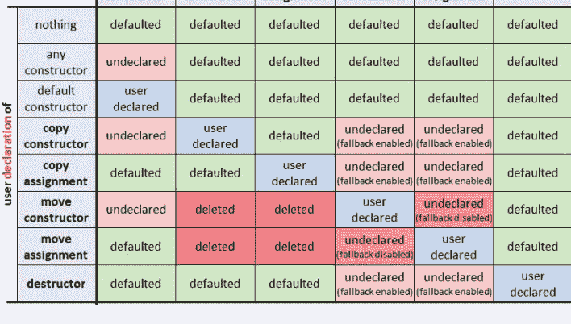

你可以从这张表中看到一些基本规则：

- 仅当没有用户声明的其他构造函数时，默认构造函数才会被自动声明。
- 特殊的拷贝成员函数和析构函数会禁用移动支持。特殊移动成员函数的自动生成被禁用（除非也声明了移动操作）。然而，

  3 此表经 Howard Hinnant 许可采用。

  移动对象的请求通常仍然有效，因为拷贝成员函数会作为回退（除非特殊移动成员函数被显式删除）。

- 特殊的移动成员函数会禁用普通的拷贝和赋值。拷贝和其他移动特殊成员函数会被删除，因此你只能移动（赋值）而不能拷贝（赋值）一个对象（除非也声明了其他操作）。

让我们来看一些细节。

#### 3.3.2 默认情况下，我们拥有拷贝和移动

如前所述，默认情况下，类会为拷贝和移动特殊成员函数两者生成。

假设有如下 Person 类的声明：

```
class Person {
  ...
  public:
    ...
    // NO copy constructor/assignment declared

    // NO move constructor/assignment declared

    // NO destructor declared
};
```

在这种情况下，Person 既可以被拷贝也可以被移动：

```
std::vector<Person> coll;
```

```
Person p{"Tina", "Fox"};
coll.push_back(p);                // OK, copies p
coll.push_back(std::move(p));    // OK, moves p
```

#### 3.3.3 声明拷贝会禁用移动（回退可用）

当声明一个拷贝特殊成员函数（或析构函数）时，移动特殊成员函数的自动生成就会被禁用：

假设有如下 Person 类的声明：

```
class Person {
  ...
  public:
    ...
    // copy constructor/assignment declared:
    Person(const Person&) = default;
    Person& operator=(const Person&) = default;

    // NO move constructor/assignment declared
};
```

### 3.3 特殊成员函数的规则

由于回退机制有效，拷贝和移动 Person 都可以编译，但移动是以拷贝的方式执行的：

```
std::vector<Person> coll;

Person p{"Tina", "Fox"};
coll.push_back(p); // OK, copies p
coll.push_back(std::move(p)); // OK, copies p
```

因此，使用 `=default` 声明一个特殊成员函数与完全不声明它并不相同。拷贝构造函数和拷贝赋值是用户声明的，这会禁用移动构造和移动赋值，从而使移动回退到拷贝。声明的析构函数也具有相同的效果。

你可能会疑惑，为什么声明的析构函数会禁用移动语义。关于被移动后状态的章节中讨论了一个具体示例，该类的析构函数会导致生成的移动语义无法正常工作。

#### 3.3.4 声明移动会禁用拷贝

如果你用户声明了移动语义，你就禁用了拷贝语义。拷贝特殊成员函数会被删除。

换句话说，如果显式声明了移动构造函数或移动赋值运算符（实现、使用 `=default` 生成，或使用 `=delete` 禁用），你就通过将它们声明为 `=delete` 来禁用了拷贝构造函数和拷贝赋值运算符的调用。

```
class Person {
 ...
public:
 ...
// NO copy constructor declared

// move constructor/assignment declared:
Person(Person&&) = default;
Person& operator=(Person&&) = default;
};
```

在这种情况下，我们拥有一个仅移动类型。Person 可以被移动但不能被拷贝：

```
std::vector<Person> coll;

Person p{"Tina", "Fox"};
coll.push_back(p); // ERROR: copying disabled
coll.push_back(std::move(p)); // OK, moves p

coll.push_back(Person{"Ben", "Cook"}); // OK, moves temporary person into coll
```

同样，使用 `=default` 声明一个特殊成员函数与完全不声明它并不相同。不过，这一次对调用者的后果更为严重：尝试拷贝对象将无法通过编译。

一个类支持移动操作但不支持拷贝操作是有意义的。你可以使用这种仅移动类型来传递资源的所有权或句柄，而不共享或拷贝它们。在 C++ 标准库中有一些仅移动类型（例如，I/O 流类、线程类和 `std::unique_ptr<>`）。详见关于仅移动类型的章节。

#### 3.3.5 删除移动没有意义

出于同样的原因，如果你将移动构造函数声明为已删除，你既不能移动（你已禁用此操作；不会使用任何回退）也不能拷贝（因为声明的移动构造函数会禁用拷贝操作）：

```
class Person {
  public:
    ...
    // NO copy constructor declared
    
    // move constructor/assignment declared as deleted:
    Person(Person&&) = delete;
    Person& operator=(Person&&) = delete;
    ...
};

Person p{"Tina", "Fox"};
coll.push_back(p);                // ERROR: copying disabled
coll.push_back(std::move(p));     // ERROR: moving disabled
```

通过将拷贝特殊成员函数声明为已删除可以获得相同的效果，而且这大概不会让其他程序员感到困惑。

删除移动操作并启用拷贝操作确实没有意义：

```
class Person {
  public:
    ...
    // copy constructor explicitly declared:
    Person(const Person& p) = default;
    Person& operator=(const Person&) = default;
    
    // move constructor/assignment declared as deleted:
    Person(Person&&) = delete;
    Person& operator=(Person&&) = delete;
    ...
};

Person p{"Tina", "Fox"};
coll.push_back(p);                // OK: copying enabled
coll.push_back(std::move(p));     // ERROR: moving disabled
```

### 拷贝构造函数

当以下所有条件都满足时，拷贝构造函数会自动生成：⁵

- 没有用户声明的移动构造函数
- 没有用户声明的移动赋值运算符

如果生成（隐式或使用 `=default`），拷贝构造函数具有以下行为：⁶

```
MyClass(const MyClass& obj) noexcept-specifier
  : Base(obj), value(obj.value) {
}
```

生成的拷贝构造函数首先将源对象传递给基类的最佳匹配拷贝构造函数。（请记住，拷贝构造函数总是按自顶向下的顺序调用。）它优先选择具有相同声明的拷贝构造函数（通常声明为 `const&`），但如果该函数不可用，它可能会调用下一个最佳匹配的构造函数（例如，拷贝构造函数模板）。之后，它拷贝该类的所有成员（同样使用最佳匹配）。

如果所有拷贝操作（所有基类的拷贝构造函数和所有成员的拷贝构造函数）都提供 noexcept 保证，则生成的拷贝构造函数会被声明为 noexcept。

### 移动构造函数

当以下所有条件都满足时，移动构造函数会自动生成：

- 没有用户声明的拷贝构造函数
- 没有用户声明的拷贝赋值运算符
- 没有用户声明的移动赋值运算符
- 没有用户声明的析构函数

如果生成（隐式或使用 `=default`），移动构造函数具有以下行为：

```
MyClass(MyClass&& obj) noexcept-specifier
  : Base(std::move(obj)), value(std::move(obj.value)) {
}
```

生成的移动构造函数首先将源对象（用 `std::move()` 标记以传递其移动语义）传递给基类的最佳匹配移动构造函数。最佳匹配的移动构造函数通常是具有相同声明（用 `&&` 声明）的那个。但是，如果该函数不可用，它可能会调用下一个最佳匹配的构造函数（例如，移动构造函数模板，甚至拷贝构造函数）。之后，它移动该类的所有成员（同样使用最佳匹配）。

你可能会疑惑，为什么在基类中执行移动之后，这里仍然使用 `obj.value`。原因是基类只能看到它自己的成员。因此，类 `MyClass` 知道其成员 `value` 仍然保留着它的值，并且可以执行移动。

如果所有被调用的移动/拷贝操作（所有基类的拷贝或移动构造函数，以及所有成员的拷贝或移动构造函数）都提供 noexcept 保证，则生成的移动构造函数会被声明为 noexcept。


## 拷贝赋值运算符

拷贝赋值运算符在满足以下所有条件时会自动生成：

- 未用户声明移动构造函数
- 未用户声明移动赋值运算符

如果生成（隐式或使用 `=default`），拷贝赋值运算符大致具有以下行为：

```
MyClass& operator = (const MyClass& obj) noexcept-specifier {
    Base::operator=(obj);     //- perform assignments for base class members
    value = obj.value;         //- assign new members
    return *this;
}
```

生成的拷贝赋值运算符首先调用基类（基类）的最佳匹配赋值运算符来处理传入的源对象（请记住，与拷贝构造函数不同，赋值运算符不是按自上而下方式调用的；它们在实现中调用基类赋值运算符）。之后它为其类的所有成员进行赋值（再次使用最佳匹配）。

请注意，生成的赋值运算符不会检查对象自身赋值的情形。如果这很关键，你必须自行实现该运算符。

此外，如果所有赋值操作（基类成员的赋值以及新成员的赋值）都提供此保证，则生成的拷贝赋值运算符将被声明为 noexcept。

## 移动赋值运算符

移动赋值运算符在满足以下所有条件时会自动生成：

- 未用户声明拷贝构造函数
- 未用户声明移动构造函数
- 未用户声明拷贝赋值运算符
- 未用户声明析构函数

如果生成（隐式或使用 `=default`），移动赋值运算符大致具有以下行为：

```
MyClass& operator = (MyClass&& obj) noexcept-specifier {
    Base::operator=(std::move(obj));  //- perform move assignments for base class members
    value = std::move(obj.value);      //- move assign new members
    return *this;
}
```

生成的移动赋值运算符首先调用基类（基类）的最佳匹配移动赋值运算符来处理传入的源对象，使用 `std::move()` 标记以传递其移动语义。之后它对该类的所有成员进行移动赋值（再次使用最佳匹配）。

你可能会想知道为什么在对象被标记为 `std::move()` 之后我们仍然使用源对象 obj 的成员：

```
Base::operator=(std::move(obj)); // - perform move assignments for base class members
```

然而，在这种情况下，我们将对象标记为基类的特定上下文，而基类无法看到在此类中引入的成员。因此，派生成员具有有效但未指定的状态，但我们仍然可以使用新成员的值。

生成的赋值运算符同样不会检查对象自身赋值的情形。因此，在其默认行为下，运算符会将每个成员移动赋值给自身，这通常意味着成员接收到有效但未指定的值。如果这很关键，你必须自行实现该运算符。

此外，如果所有调用的赋值操作（基类成员的赋值以及新成员的赋值）都提供此保证，则生成的移动赋值运算符将被声明为 noexcept。

## 其他特殊成员函数

其他特殊成员函数对于移动语义而言并不那么重要：

- **析构函数** 在移动语义方面没有什么特别之处，除了其声明会禁用移动操作的自动生成。
- **默认构造函数**（“不太特殊的”特殊成员函数）如果未声明其他构造函数，仍会自动生成。也就是说，声明移动构造函数会禁用默认构造函数的生成。

然而，请注意，这些特殊成员函数在讨论被移动后的状态时起作用。默认构造函数的状态通常是被移动后对象的“自然”状态，并且被移动后的对象始终应该是可析构的。

### 3.4 五规则或三规则

是否以及哪些特殊成员函数会被自动生成取决于前面描述的几条规则的组合。许多程序员并不了解所有这些规则。因此，即使在 C++11 之前，通常的指导原则也是提供复制、赋值和销毁的全部特殊成员函数或一个都不提供。

- 在 C++11 之前，该指导原则被称为 **三规则**：指导原则是，要么声明全部三个（拷贝构造函数、赋值运算符和析构函数），要么一个都不声明。
- 自 C++11 以来，该规则已成为 **五规则**，通常表述为：指导原则是要么声明全部五个（拷贝构造函数、移动构造函数、拷贝赋值运算符、移动赋值运算符和析构函数），要么一个都不声明。

这里的声明意味着：

- 要么实现（{...}）
- 要么声明为默认（=default）
- 要么声明为删除（=delete）

也就是说，当其中一个特殊成员函数被实现或默认或删除时，你应该实现或默认或删除另外四个特殊成员函数。

然而，你应该谨慎对待此规则。我建议你将其更多地视为一种指导原则，即在其中一个被用户声明时，*仔细思考*这五个特殊成员函数。

正如我们所见，如果只想启用拷贝语义，你应该 `=default` 拷贝特殊成员函数，而不声明特殊的移动成员函数（删除和默认特殊的移动成员函数不起作用，实现它们会使类不必要地复杂）。如果生成的移动语义会创建无效状态，如我们在关于无效的被移动后状态部分所讨论的那样，特别推荐这种选择。

在应用此五规则时，还发现有时程序员会使用它来添加新移动操作的声明，而不理解这意味着什么。程序员只是因为拷贝操作被实现而想要遵循五规则，所以用 `=default` 声明移动操作。

因此，我通常教授的是 *五规则或三规则*：

- 如果你声明拷贝构造函数、移动构造函数、拷贝赋值运算符、移动赋值运算符或析构函数，*要非常仔细地思考*如何处理其他特殊成员函数。
- 如果你不理解移动语义，仅在你声明其中一个时，思考拷贝构造函数、拷贝赋值运算符和析构函数。如果有疑问，通过使用 `=default` 声明拷贝特殊成员函数来禁用移动语义。

### 3.5 总结

- 移动语义不会被传递。
- 对于每个类，移动构造函数和移动赋值运算符都会自动生成（除非无法这样做）。
- 用户声明拷贝构造函数、拷贝赋值运算符或析构函数会禁用类中移动语义的自动支持。这不会影响派生类中的支持。
- 用户声明移动构造函数或移动赋值运算符会禁用类中拷贝语义的自动支持。你会得到仅移动类型（除非这些特殊的移动成员函数被删除）。
- 切勿 `=delete` 特殊的移动成员函数。
- 如果没有特定需要，不要声明析构函数。派生自多态基类的类中没有普遍需要。

## 第 4 章

## 如何从移动语义中获益

大多数时候，程序员会自动从移动语义中获益。然而，即使作为普通的应用程序程序员，你也可以在编程方式略有不同时从移动语义中获益更多。

本章讨论如何在普通应用程序代码、类和类层次结构中从移动语义中获益，超出特殊移动成员函数的自动生成范围。本章还介绍了相应的新指导原则。

请注意，即使在引入移动语义几年后，这些建议在社区中也并不广为人知。事实上，我写这本书的原因之一就是要使它们成为现代 C++ 编程的最新技术。

### 4.1 避免使用有名字的对象

正如我们所见，移动语义允许我们在源不再需要该值时优化使用该值。如果编译器自动检测到某个值是从生命周期即将结束的对象中使用的，它们会自动切换到移动语义。这种情况发生在：

- 我们传递一个临时对象，该对象会在语句结束后自动销毁。
- 我们按值返回一个局部对象。

此外，我们可以通过使用 `std::move()` 标记对象来强制移动语义。

因为让编译器做工作更容易，移动语义的第一个推论是以下建议：**避免使用有名字的对象。**

不要写

```
MyType x{42, "hello"};
foo(x);      // x not used afterwards
```

最好写成：

```
foo(MyType{42, "hello"});
```

以自动启用移动语义。


当然，避免使用名称的对象这一建议可能会与诸如源代码的可读性和可维护性等其他重要的风格指南相冲突。与其使用复杂的语句，不如使用多个语句更好。在这种情况下，如果你不再需要一个对象（并且知道复制该对象可能需要花费大量时间），你应该使用 std::move()：

```
foo(std::move(x));
```

#### 4.1.1 当无法避免使用名称时

存在一些情况，你无法避免使用 std::move()，因为你必须给对象命名。最明显的典型例子是：

- 你必须多次使用一个对象。例如，你可能在函数或循环中获取一个值以便处理两次：

```
std::string str{getData()};
...
col1.push_back(str);              // copy (still need the value of str)
col2.push_back(std::move(str));    // move (no longer need the value of str)
```

当在同一个集合中插入两次值或调用两个不同的函数将值存储在某处时也适用相同的情况。

- 你必须处理一个参数。这是最常见的例子如下所示的循环：

```
// read and store line by line from myStream in coll
std::string line;
while (std::getline(myStream, line)) {
  coll.push_back(std::move(line));  // move (no longer need the value of line)
}
```

### 4.2 避免不必要的 std::move()

正如我们所见，返回局部对象的值会自动使用移动语义（如果受支持）。然而，为了安全起见，程序员可能会尝试通过显式的 std::move() 来强制执行此操作：

```
std::string foo()
{
  std::string s;
  ...
  return std::move(s);  // BAD: don't do this
}
```

请记住，std::move() 只是一个静态转换为右值引用。因此，std::move(s) 是一个表达式，其结果类型为 std::string&&。然而，这不再匹配返回类型，因此禁用了返回值优化，这通常允许将返回的对象用作返回值。对于未实现移动语义的类型，这甚至可能强制复制返回值，而不是直接使用返回对象作为返回值。

因此，如果你按值返回局部对象，不要使用 std::move()：

```
std::string foo()
{
    std::string s;
    ...
    return s;        // best performance (return value optimization or move)
}
```

当你已经拥有一个临时对象时使用 std::move() 至少是冗余的。对于返回对象按值的函数 createString()，你应该直接使用返回值：

```
std::string s{createString()};            // OK
```

而不是再次用 std::move() 标记它：

```
std::string s{std::move(createString())};    // BAD: don't do this
```

编译器可能会（有选项）警告任何适得其反或不必要的 std::move() 使用。例如，gcc 有选项 -Wpessimizing-move（随 -Wall 启用）和 -Wredundant-move（随 -Wextra 启用）。

不过，也有应用场景，在返回语句中使用 std::move() 可能是合适的。一个例子是移动成员的值。另一个例子是以移动语义返回参数。

### 4.3 使用移动语义初始化成员

一个令人惊讶的后果是，即使在具有受益于移动语义的成员类型的平凡类中（例如字符串成员或容器），你也可以从移动语义中受益。

让我们用一个简单的例子来看一下。

#### 4.3.1 以经典方式初始化成员

考虑一个具有两个字符串成员的类，我们可以在构造函数中初始化它们。这样的类通常会这样实现：

basics/initclassic.hpp

```
#include <string>

class Person {
private:
    std::string first;  // first name
    std::string last;   // last name
public:
    Person(const std::string& f, const std::string& l)
      : first{f}, last{l} {
    }
    ...
};
```

## 第 4 章：如何从移动语义中受益

现在让我们看看当我们用两个字符串字面量初始化此类对象时会发生什么：

```
Person p{"Ben", "Cook"};
```

编译器发现提供的构造函数可以执行初始化。然而，参数的类型不匹配。因此，编译器生成代码首先创建两个临时的 std::string，它们由两个字符串字面量的值初始化，并将参数 f 和 l 绑定到它们：

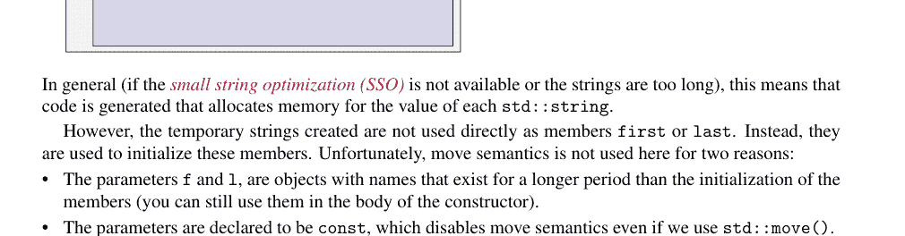

通常（如果没有小字符串优化（SSO）或字符串太长），这意味着会生成代码为每个 std::string 的值分配内存。

然而，创建的临时字符串并未直接用作成员 first 或 last。相反，它们用于初始化这些成员。不幸的是，这里由于两个原因没有使用移动语义：

- 参数 f 和 l 是具有名称的对象，其存在时间比成员初始化的时间更长（你仍然可以在构造函数的体中使用它们）。
- 参数被声明为 const，这即使我们使用 std::move() 也会禁用移动语义。

因此，在每个成员初始化时都会调用字符串的拷贝构造函数，再次为值分配内存：


在构造函数结束时，临时字符串被销毁：

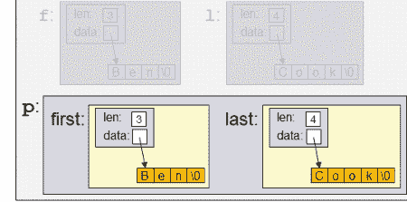

这意味着我们有四次内存分配，而实际上只需要两次。使用移动语义我们可以做得更好。

### 使用非常量左值引用？

你可能会想知道为什么我们不能简单地在这里使用非常量左值引用：

```
class Person {
    ...
    Person(std::string& f, std::string& l)
      : first{std::move(f)}, last{std::move(l)} {
    }
    ...
};
```

然而，传递 const std::string 和临时对象（例如，由类型转换创建）将无法编译：

```
Person p{"Ben", "Cook"};  // ERROR: cannot bind a non-const lvalue reference to a temporary
```

通常，非常量左值引用不会绑定到临时对象。因此，此构造函数无法将 f 和 l 绑定到从传递的字符串字面量创建的临时字符串。

#### 4.3.2 通过按值传递的已移动参数初始化成员

有了移动语义，构造函数初始化成员现在有一种简单替代方法：构造函数按值接收每个参数并将其移动到成员中：

basics/initmove.hpp

```
#include <string>

class Person {
private:
```

```
std::string first;  // first name
std::string last;   // last name
public:
Person(std::string f, std::string l)
  : first{std::move(f)}, last{std::move(l)} {
}
...
};
```

这个单一构造函数接受所有可能的参数，并确保每个参数只有一个分配。

例如，如果我们传递两个字符串字面量：

```
Person p{"Ben", "Cook"};
```

我们首先用它们初始化参数 f 和 l：

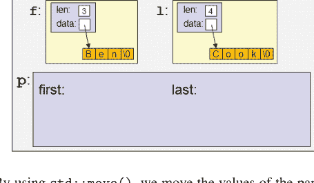

通过使用 std::move()，我们将参数的值移动到成员。首先，成员 first 从 f 偷取值：

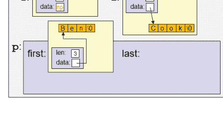

然后，成员 `last` 从 `l` 偷取值：

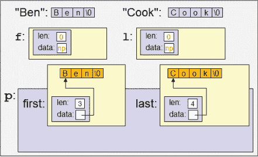

同样，在构造函数结束时，临时字符串被销毁。这次花费的时间更少，因为字符串的析构函数不再需要释放已分配的内存：

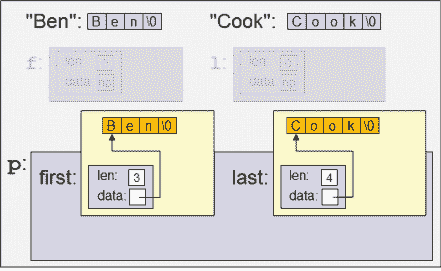

这种初始化成员的方式在我们传递 `std::strings` 时也同样适用：

- 如果我们传递两个现有字符串且未用 `std::move()` 标记，我们将名称复制到参数并将它们移动到成员：

  ```cpp
  std::string name1{"Jane"}, name2{"White"};
  ...
  Person p{name1, name2};    // OK, copy names into parameters and move them to the members
  ```

- 如果我们传递两个不再需要其值的字符串，我们根本不需要任何分配：

  ```cpp
  std::string firstname{"Jane"};
  ...
  Person p{std::move(firstname),    // OK, move names via parameters to members
           getLastnameAsString()};
  ```

在这种情况下，我们将传递的字符串移动两次：一次用于初始化参数 `f` 和 `l`，一次用于将 `f` 和 `l` 的值移动到成员。

只要移动操作成本低廉，使用这种仅一个构造函数的实现，任何初始化都是可能的并且成本低廉。


### 4.3.3 通过右值引用初始化成员

使用多个构造函数初始化 Person 的成员还有更多方法。

#### 使用右值引用

为了支持移动语义，我们已经了解到可以声明参数为非 const 右值引用。这允许参数从传递的临时对象或用 std::move() 标记的对象中窃取值。

考虑我们按如下方式声明构造函数：

```
class Person {
...
    Person(std::string&& f, std::string&& l)
    : first{std::move(f)}, last{std::move(l)} {
    }
...
};
```

此初始化也适用于我们传递的字符串字面量：

```
Person p{"Ben", "Cook"};
```

同样，因为构造函数需要字符串，我们会创建两个临时字符串，f 和 l 绑定到它们：

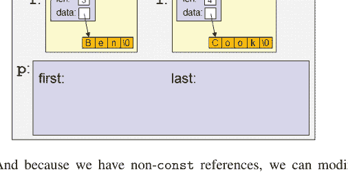

并且因为我们有非 const 引用，我们可以修改它们。在这种情况下，我们用 std::move() 标记它们，以便成员的初始化可以窃取值。

首先，成员 first 从 f 窃取值：

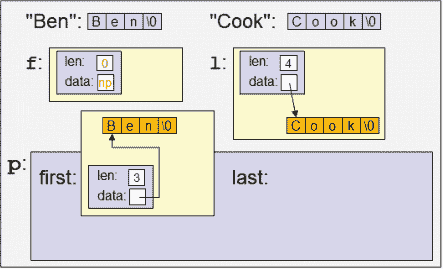

然后，成员 `last` 从 `l` 窃取值：


同样，在构造函数结束时，临时字符串被销毁，无需释放分配的内存：

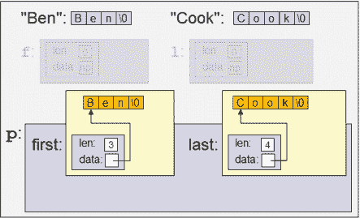

然而，这个构造函数并非在所有情况下都适用。

#### 为右值引用和左值引用重载

虽然接受右值引用的函数在我们传递临时对象时工作正常（这里，我们传递由字符串字面量创建的临时 std::string），但它们也有限制：我们不能传递之后仍需要值的命名对象。因此，如果我们只有一个接受右值引用的构造函数，就不能传递已存在的字符串：

```
class Person {
    ...
    Person(std::string&& f, std::string&& l)
      : first{std::move(f)}, last{std::move(l)} {
    }
    ...
};
```

```
Person p1{"Ben", "Cook"};  // OK
```

```
std::string name1{"Jane"}, name2{"White"};
...
Person p2{name1, name2};  // ERROR: can't pass a named object to an rvalue reference
```

对于 p2 的情况，我们需要一个传统的构造函数，它用 const 左值引用声明。然而，我们也可能传递一个字符串字面量和一个已存在的字符串。因此，总共，我们需要四个构造函数来覆盖所有可能的组合：

```
class Person {
    ...
    Person(const std::string& f, const std::string& l)
      : first{f}, last{l} {
    }
    Person(const std::string& f, std::string&& l)
      : first{f}, last{std::move(l)} {
    }
    Person(std::string&& f, const std::string& l)
      : first{std::move(f)}, last{l} {
    }
    Person(std::string&& f, std::string&& l)
      : first{std::move(f)}, last{std::move(l)} {
    }
    ...
};
```

这样，我们可以以任何组合传递字符串字面量和已存在的字符串，并且每个成员始终只有一次分配。

#### 甚至为字符串字面量重载

为了进一步提高性能，我们甚至可以有专门接受字符串字面量作为普通指针的实现。这样，我们可以避免一些移动操作。然而，实现所有构造函数变得有点繁琐：

```cpp
#include <string>

class Person {
private:
    std::string first;  // first name
    std::string last;   // last name
public:
    Person(const std::string& f, const std::string& l)
      : first{f}, last{l} {
    }
    Person(const std::string& f, std::string&& l)
      : first{f}, last{std::move(l)} {
    }
    Person(std::string&& f, const std::string& l)
      : first{std::move(f)}, last{l} {
    }
    Person(std::string&& f, std::string&& l)
      : first{std::move(f)}, last{std::move(l)} {
    }
    Person(const char* f, const char* l)
      : first{f}, last{l} {
    }
    Person(const char* f, const std::string& l)
      : first{f}, last{l} {
    }
    Person(const char* f, std::string&& l)
      : first{f}, last{std::move(l)} {
    }
    Person(const std::string& f, const char* l)
      : first{f}, last{l} {
    }
    Person(std::string&& f, const char* l)
      : first{std::move(f)}, last{l} {
    }
    ...
};
```

此解决方案的好处是减少了移动次数。如果我们传递一个字符串字面量，我们直接用传递的指针初始化成员，而不是创建一个 std::string 并将其值移动到成员中。

### 4.3.4 比较不同的方法

随着成员初始化新方法的引入，显而易见的问题是，我们在何时使用哪种技术？以及：我们应该教授哪种技术？

通常，不使用 const& 的简单方法应该有一个充分的理由。这个理由通常是性能。因此，让我们测量用三种类型的参数初始化 Person 需要多长时间：传递字符串字面量、传递已存在的字符串，以及传递用 std::move() 标记的字符串：

```
std::string fname = "a first name";
std::string lname = "a last name";

// measure how long this takes:
Person p1{"a firstname", "a lastname"};
Person p2(fname, lname);
Person p3(std::move(fname), std::move(lname));
```

然而，为了避免小字符串优化（SSO），这意味着字符串根本不会分配任何内存，我们应该使用长度可观的字符串。所以，这里有一个完整的函数来测量不同的方法：

basics/initmeasure.hpp

```
#include <chrono>

// measure num initializations of whatever is currently defined as Person:
std::chrono::nanoseconds measure(int num)
{
    std::chrono::nanoseconds totalDur{0};
    for (int i = 0; i < num; ++i) {
        std::string fname = "a firstname a bit too long for SSO";
        std::string lname = "a lastname a bit too long for SSO";

        // measure how long it takes to create 3 Persons in different ways:
        auto t0 = std::chrono::steady_clock::now();
            Person p1{"a firstname too long for SSO", "a lastname too long for SSO"};
            Person p2(fname, lname);
            Person p3(std::move(fname), std::move(lname));
        auto t1 = std::chrono::steady_clock::now();
        totalDur += t1 - t0;
    }
    return totalDur;
}
```

函数 measure() 返回执行上述三种初始化 num 次迭代的持续时间，使用长度可观的字符串。

现在我们将上面 Person 类的不同定义与测量函数结合起来，形成带有 main() 函数的程序，这些程序调用测量并打印 resulting 持续时间。例如：

```
basics/initclassicperf.cpp
#include "initclassic.hpp"
#include "initmeasure.hpp"
#include <iostream>
#include <cstdlib>  // for std::atoi()

int main(int argc, const char** argv)
{
    int num = 1000;  // num iterations to measure
    if (argc > 1) {
        num = std::atoi(argv[1]);
    }

    // a few iterations to avoid measuring initial behavior:
    measure(5);

    // measure (in integral nano- and floating-point milliseconds):
    std::chrono::nanoseconds nsDur{measure(num)};
    std::chrono::duration<double, std::milli> msDur{nsDur};

    // print result:
    std::cout << num << " iterations take: "
              << msDur.count() << "ms\n";
    std::cout << "3 inits take on average: "
              << nsDur.count() / num << "ns\n";
}
```

另外两个程序，basics/initallperf.cpp 和 basics/initmoveperf.cpp，只是为 Person 类的其他声明使用不同的头文件。

在三个不同平台上使用三个不同编译器并启用显著优化运行此代码的效果如下：

- 通常，使用经典左值引用（const &）的初始化比其他初始化花费的时间明显更长。我见过高达 2 倍的差异。
- 在实现全部九个构造函数和仅使用按值传递参数并移动的构造函数之间没有太大区别。有时一种方法稍快，有时另一种更快；通常没有显著差异。

如果我们受益于小字符串优化（SSO），使用相当短的字符串，这意味着我们根本不分配任何内存（并且移动语义不应有显著帮助），数字相当


很接近。不过，你仍然可以用接受 const 左值引用的传统构造函数测出一个轻微的缺点。不过，这肯定要求启用良好的优化。

除了尝试各种不同的测试程序之外，你还可以使用 basics/initperf.cpp 作为组合程序，在你喜欢的平台上执行所有这些不同的测量。

然而，你可能会有一些非常昂贵的成员，无法从移动语义中获益（例如包含 10000 个 double 值的数组）：

```
class Person {
  private:
    std::string name;
    std::array<double, 10000> values;  // move can’t optimize here
  public:
    ...
};
```

在这种情况下，按值接收 10000 个 double 作为初始参数并移动的做法就会产生问题。我们必须复制该参数两次，这几乎需要两倍的时间。完整的测量示例程序见 basics/initbigperf.cpp。

#### 4.3.5 成员初始化小结

总之，要初始化那些移动语义能造成显著差异的成员（字符串、容器，或包含此类成员的类/数组），你应该采用以下移动语义方案之一：

- 将参数从按左值引用接收改为按值接收，并将其移动到成员中
- 为移动语义重载构造函数

第一种方案只要求我们有一个构造函数，因此代码更易于维护。不过，这确实会导致多余的移动操作。因此，如果移动操作可能很耗时，最好使用多个重载。

例如，如果我们的类有一个字符串和一个值 vector，按值接收并移动通常是正确的做法：

```
class Person {
  private:
    std::string name;
    std::vector<std::string> values;
  public:
    Person(std::string n, std::vector<std::string> v)
      : name{std::move(n)}, values{std::move(v)} {
    }
    ...
};
```

然而，如果我们有 std::array 成员，最好进行重载，因为即使成员会被移动，移动 std::array 仍然需要相当多的时间：

```
class Person {
private:
    std::string name;
    std::array<std::string, 1000> values;
public:
    Person(std::string n, const std::array<std::string, 1000>& v)
        : name{std::move(n)}, values{v} {
    }
    Person(std::string n, std::array<std::string, 1000>&& v)
        : name{std::move(n)}, values{std::move(v)} {
    }
    ...
};
```

#### 4.3.6 我们现在是否应该总是按值传递并移动？

上面的讨论引出了一个问题：我们现在是否应该总是按值接收参数，然后将它们移动以设置内部值或成员？答案是否定的。

这里讨论的特殊情况是我们创建并初始化一个新值。在这种情况下，这种策略是值得的。如果我们已经有一个值需要更新或修改，使用这种方法会适得其反。

一个简单的例子是 setter。考虑以下 Person 类的实现：

```
class Person {
private:
    std::string first;  // first name
    std::string last;   // last name
public:
    Person(std::string f, std::string l)
        : first{std::move(f)}, last{std::move(l)} {
    }
    ...
    void setFirstname(std::string s) {      // take by value
        first = std::move(s);               // and move
    }
    ...
};
```

假设我们按如下方式使用这个类：

```
Person p{"Ben", "Cook"};
std::string name1{"Ann"};
std::string name2{"Constantin Alexander"};

p.setFirstname(name1);
p.setFirstname(name2);
p.setFirstname(name1);
p.setFirstname(name2);
```

每次设置新的 firstname 时，我们都会创建一个新的临时参数 s，它会分配自己的内存，然后被移动到成员的值中。因此，我们有四次分配（前提是我们没有 SSO，即短字符串优化）。

现在考虑我们以传统方式实现 setter，接受 const 左值引用：

```
class Person {
private:
    std::string first;  // first name
    std::string last;   // last name
public:
    Person(std::string f, std::string l)
    : first{std::move(f)}, last{std::move(l)} {
    }
    ...
    void setFirstname(const std::string& s) {  // take by reference
        first = s;                           // and assign
    }
    ...
};
```

将 s 绑定到传入的参数不会创建新字符串。此外，赋值运算符只会在新长度超过当前为该值分配的内存量时才分配新内存。这意味着，由于我们已经拥有一个值，按值接收参数并移动的方法可能会适得其反。

你可能想知道是否应该重载 setter，以便在新长度超过现有长度时从移动语义中获益：

```
class Person {
private:
    std::string first;  // first name
    std::string last;   // last name
public:
    Person(std::string f, std::string l)
    : first{std::move(f)}, last{std::move(l)} {
    }
    ...
    void setFirstname(const std::string& s) {  // take by lvalue reference
        first = s;                           // and assign
    }
    void setFirstname(std::string&& s) {       // take by rvalue reference
        first = std::move(s);                // and move assign
    }
    ...
};
```

然而，即使这种方法也可能适得其反，因为移动赋值可能会缩小 first 的容量：

```
Person p{"Ben", "Cook"};

p.setFirstname("Constantin Alexander");  // would allocate enough memory
p.setFirstname("Ann");                  // would reduce capacity
p.setFirstname("Constantin Alexander");  // would have to allocate again
```

即使使用移动语义，设置已有值的最佳方法仍然是通过 const 左值引用接收新值，并在不使用 std::move() 的情况下进行赋值。

按值接收参数并将其移动到需要新值的地方，只有在我们把传入的值作为新值存储到某处时才有用（因为此时反正都需要为它分配新内存）。在修改已有值时，这种策略可能会适得其反。

然而，初始化成员并不是“按值接收并移动”的唯一应用。（成员）函数向容器中添加新值是另一个应用：

```
class Person {
private:
    std::string name;
    std::vector<std::string> values;
public:
    Person(std::string n, std::vector<std::string> v)
        : name{std::move(n)}, values{std::move(v)} {
    }
    ...
    // better pass by value and move to create a new element:
    void addValue(std::string s) {        // take by value
        values.push_back(std::move(s));    // and move into the collection
    }
    ...
};
```

### 4.4 类层次结构中的移动语义

正如我们所看到的，任何拷贝构造函数、拷贝赋值或析构函数的声明都会禁用移动语义的自动支持。这也适用于多态基类。不过，还有一些额外的方面需要考虑。

#### 4.4.1 实现多态基类

多态基类通常会引入你可以对所有派生类对象调用的虚成员函数。例如：

```
class GeoObj {
public:
    virtual void draw() const = 0;    // pure virtual function (introducing the API)
    ...
virtual ~GeoObj() = default;        // let delete call the right destructor
...    // other special member functions due to the problem of slicing
};
```

在这个基类中，移动语义被禁用，这意味着如果我们移动一个几何对象，基类中在此声明的成员不会自动获得移动语义的支持。即使我们有受保护的拷贝构造函数和被删除的赋值运算符，情况也是如此；为了避免切片问题，多态基类中通常应该有这样两个函数。

只要基类没有引入成员，不支持移动语义就没有影响。然而，如果这个基类中有昂贵的成员，你就禁用了对它的移动支持。例如：

```
class GeoObj {
protected:
    std::string name;                // name of the geometric object
public:
    ...
    virtual void draw() const = 0;   // pure virtual function (introducing the API)
    ...
    virtual ~GeoObj() = default;     // disables move semantics for name
    ...    // other special member functions due to the problem of slicing
};
```

要重新启用移动语义，你可以显式地将移动操作声明为 defaulted。然而，正如我们刚才了解到的，这会禁用拷贝特殊成员函数。因此，如果你希望保留这些函数，就必须显式提供它们。

##### 处理切片问题

然而，还存在切片问题。考虑以下代码，它使用基类 GeoObj 的引用来引用派生类 Circle 的对象：

```
Circle c1{...}, c2{...};

GeoObj& geoRef{c1};
geoRef = c2;    // OOPS: uses GeoObj::operator=() and assigns no Circle members
```

因为我们调用的是 GeoObj 的赋值运算符，而该运算符不是虚函数，所以编译器会调用 GeoObj::operator=()，它不会处理任何派生类的成员。即使将赋值运算符声明为 virtual 也无济于事，因为派生类的运算符并不会覆盖基类的赋值运算符（第二个操作数的参数类型不同）。

为了避免这个问题，你应该在多态类层次结构中禁用赋值运算符。此外，如果类不是抽象类，你还应该避免提供公共拷贝构造函数，以禁用对基类的隐式类型转换。因此，带有移动语义（和成员）的多态基类应该声明如下：

```
class GeoObj {
protected:
    std::string name;                // name of the geometric object
```


## 第4章：如何从移动语义中获益

```cpp
GeoObj(std::string n)
  : name{std::move(n)} {
}
public:
  virtual void draw() const = 0;      // 纯虚函数（引入API）
  ...
  virtual ~GeoObj() = default;        // 会为name禁用移动语义
protected:
  // 启用复制和移动语义（仅可被派生类调用）：
  GeoObj(const GeoObj&) = default;
  GeoObj(GeoObj&&) = default;
  // 禁用赋值运算符（由于切片问题）：
  GeoObj& operator= (GeoObj&&) = delete;
  GeoObj& operator= (const GeoObj&) = delete;
};
```

完整的头文件见 *poly/geoobj.hpp*。

#### 4.4.2 实现多态派生类

一个多态派生类可能如下所示（完整头文件见 *poly/polygon.hpp*）：[^1]

```cpp
class Polygon : public GeoObj {
  protected:
    std::vector<Coord> points;
  public:
    Polygon(std::string s, std::initializer_list<Coord> = {});  // 构造函数
    virtual void draw() const override;    // draw()的实现
};
```

通常，在多态派生类中无需声明任何特殊成员函数。特别是，无需再次声明虚析构函数（除非必须实现它）。再次声明析构函数（无论是否为虚）都会禁用派生类成员的移动语义的自动支持（此处为vector成员points）：

```cpp
class Polygon : public GeoObj {
  protected:
    std::vector<Coord> points;
  public:
    Polygon(std::string s, std::initializer_list<Coord> = {});  // 构造函数
    ...
    virtual ~Polygon() = default;  // 糟糕：不要这样做，因为它禁用了移动语义
};
```

然而，如果不声明析构函数，移动语义对Polygon的两个成员name和points都有效。考虑以下程序：

```cpp
#include "geoobj.hpp"
#include "polygon.hpp"

int main()
{
    Polygon p0{"Poly1", {Coord{1,1}, Coord{1,9}, Coord{9,9}, Coord{9,1}}};
    Polygon p1{p0}; // 复制
    Polygon p2{std::move(p0)}; // 移动

    p0.draw();
    p1.draw();
    p2.draw();
}
```

该程序输出如下：

```
polygon '' over
polygon 'Poly1' over (1,1) (1,9) (9,9) (9,1)
polygon 'Poly1' over (1,1) (1,9) (9,9) (9,1)
```

对于两个成员name和points，其值都已从p0移动到p2。

注意，如果必须在Polygon类中实现移动构造函数，则需要特别小心以提供正确的noexcept条件。

### 4.5 小结

- 避免使用具名对象。
- 避免不必要的std::move()。特别是返回局部对象时不要使用它。
- 对于从参数初始化成员、且移动操作代价低廉的构造函数，应按值接收参数并将其移动到成员。
- 对于从参数初始化成员、且移动操作耗时显著的构造函数，应针对移动语义进行重载以获得最佳性能。
- 一般而言，从参数创建并初始化新值，如果移动操作廉价，应按值接收参数并移动。但是，不要按值接收并移动来更新/修改现有值。
- 不要在派生类中声明虚析构函数（除非必须实现它）。

## 第5章：基于引用限定符的重载

本章讨论为不同的引用限定符重载成员函数。我们将看到，这将回答社区中关于getter应按值返回还是按常量引用返回的常见问题。

### 5.1 getter的返回类型

在C++11之前，当实现复制成本高昂的成员的getter时，我们有以下替代方案：

- 按值返回
- 按常量引用返回

让我们简要讨论这些替代方案。

#### 5.1.1 按值返回

按值返回的getter如下所示（记住：不要使用const按值返回，否则会禁用移动语义）：

```cpp
class Person
{
private:
    std::string name;
public:
    ...
    std::string getName() const {
        return name;
    }
};
```

这段代码是安全的，但每次我们请求name时都可能复制该name。

例如，仅仅检查是否有一个名字为空的人就会产生显著的开销：

```cpp
std::vector<Person> coll;
...
for (const auto& person : coll) {
    if (person.getName().empty()) {    // 糟糕：复制了name
        std::cout << "found empty name\n";
    }
}
```

如果将这种方法与返回引用的方法进行比较，你会发现按值返回字符串的版本存在2到100倍的性能开销（假设名字具有足够长的长度，以至于SSO不起作用）。访问一个成员，如果它是图像或包含数千个元素的集合，情况可能会更糟。在这种情况下，getter通常按（常量）引用返回以提高性能。

#### 5.1.2 按引用返回

按引用返回的getter如下所示：

```cpp
class Person
{
    private:
        std::string name;
    public:
        ...
        const std::string& getName() const {
            return name;
        }
};
```

这更快，但有些不安全，因为调用者必须确保返回的引用所指向的对象存活足够长的时间。事实上，存在生命周期风险，你使用getter返回值的时长可能超过你调用getter的对象的生命周期。

陷入这个陷阱的一种方式是使用基于范围的for循环，如下所示：

```cpp
for (char c : returnPersonByValue().getName()) {  // 糟糕：未定义行为
    if (c == ' ') {
        ...
    }
}
```

注意，在循环头部的右侧，有一个函数返回临时对象，我们通过getter引用该临时对象。但是，基于范围的for循环被定义为上述代码等价于以下代码：

```cpp
reference range = returnPersonByValue().getName();
// 糟糕：返回的临时对象在这里被销毁
for (auto pos = range.begin(), end = range.end(); pos != end; ++pos) {
    char c = *pos;
    if (c == ' ') {
        ...
    }
}
```

在我们开始迭代之前，我们初始化一个引用，因为我们必须使用传入的range两次（一次调用begin()，一次调用end()），并且希望避免复制range（这可能代价高昂甚至不可能）。一般来说，引用会延长其所引用的对象的生命周期。然而，在这种情况下，range并不引用returnPersonByValue()返回的Person；range引用的是getName()的返回值，这是对返回的Person成员的引用。因此，range延长了引用的生命周期，但并没有延长引用所指向的临时对象的生命周期。因此，在第一条语句结束时，返回的临时对象被销毁，当我们迭代name的字符时，我们使用的是已销毁对象的name的引用。

最好的情况是，我们在这里得到核心转储，这样我们就能看到发生了严重的错误。最坏的情况是，一旦我们发布软件，就会遭遇致命的未定义行为。

如果getter按值返回name，这样的代码就不会有问题。在这种情况下，range会延长name副本的生命周期，这样我们就可以在range的生命周期内使用该name。

#### 5.1.3 使用移动语义解决困境

有了移动语义，我们现在有了解决困境的方法。当安全时我们可以按引用返回，而当可能遇到生命周期问题时我们按值返回。

编程方式如下：

```cpp
class Person
{
private:
    std::string name;
public:
    std::string getName() && {  // 当我们不再需要该值时
        return std::move(name);  // 我们窃取并按值返回
    }
    const std::string& getName() const& {  // 在所有其他情况下
        return name;            // 我们提供对成员访问
    }
};
```

我们用不同的引用限定符重载getter，就像对`&&`和`const&`参数重载函数一样：

- 当对象的值不再需要时（即将销毁或已用`std::move()`标记的对象），使用带有`&&`限定符的版本。

[^1]: 如果成员函数声明了*override*，则不需要*virtual*。但是，我更喜欢保留它以便更好地对齐，并遵循所有成员函数都应为*virtual*或都不为*virtual*的规则。


当调用 `getName()` 时使用 `std::move()` 会提升该程序的性能。其返回值不再是只能复制的 `const std::string` 引用，而是将 p 的 name 移动后，以非 const 字符串形式返回，这样 `push_back()` 就可以利用移动语义将它移入 coll。

像往常一样，在这次调用之后，p 处于有效但未指定的状态。

关于这个特性在 C++ 标准库中使用的一个例子，参见 `std::optional<>` 类。

### 5.2 基于限定符的重载

自 C++98 起，我们就可以重载成员函数来实现 const 版本和非 const 版本。例如：

```
class C {
public:
    void foo(); // foo() for non-const objects
    void foo() const; // foo() for const objects
};
```

括号之后的限定符允许我们限定唯一没有作为参数传入的对象：也就是我们为其调用该成员函数的那个对象。

现在，借助移动语义，我们有了通过限定符重载函数的新方式，因为我们可以使用不同的引用限定符。考虑下面的程序：

```
#include <iostream>

class C {
public:
    void foo() const& {
        std::cout << "foo() const&\n";
    }
    void foo() && {
        std::cout << "foo() &&\n";
    }
    void foo() & {
        std::cout << "foo() &\n";
    }
    void foo() const&& {
        std::cout << "foo() const&&\n";
    }
};
```

```cpp
int main()
{
    C x;
    x.foo(); // calls foo() &
    C{}.foo(); // calls foo() &&
    std::move(x).foo(); // calls foo() &&
    
    const C cx;
    cx.foo(); // calls foo() const&
    std::move(cx).foo(); // calls foo() const&&
}
```

该程序演示了所有可能的引用限定符，以及它们各自在什么情况下被调用。通常，我们只有两到三个这样的重载，例如为 getter 使用 `&&`、`const&` 和 `&`。

另外请注意，不允许同时按照引用限定符和非引用限定符进行重载：

```cpp
class C {
public:
    void foo() &&;
    void foo() const; // ERROR: can't overload by both reference and value qualifiers
};
```

### 5.3 何时使用引用限定符

引用限定符允许我们在针对特定值类别的对象调用函数时，以不同的方式实现该函数。目标是在我们为一个不再需要其值的对象调用成员函数时，提供不同的实现。

虽然我们确实拥有这个特性，但它的使用并未达到应有的程度。特别是，我们能够（也应该）用它来确保修改对象的操作不会针对即将消亡的临时对象被调用。

#### 5.3.1 赋值运算符的引用限定符

更好地使用引用限定符的一个例子，就是修改赋值运算符的实现。正如 http://wg21.link/n2819 所提议的，在任何可行的地方，用引用限定符声明赋值运算符可能更好。

> 2 感谢 Peter Sommerlad 指出这一点。

> 3 该论文是在讨论是否要改变已生成赋值运算符的行为、使其带有引用限定符之后形成的。参见 http://wg21.link/cwg733。

本质上，我们让临时对象重新拥有了它们在基本类型上就有的属性：它们是右值，意味着它们不能出现在赋值运算符的左侧。

请注意，所有这些旨在相应修正 C++ 标准的提案迄今都被否决了。主要原因是对向后兼容性的担忧。不过，在实现你自己的类时，你可以这样使用这一改进：

```
class MyType {
public:
...
// disable assigning value to temporary objects:
MyType& operator=(const MyType& str) & =default;
MyType& operator=(MyType&& str) & =default;

// because this disables the copy/move constructor, also:
MyType(const MyType&) =default;
MyType(MyType&&) =default;
...
};
```

一般来说，对于每个可能修改对象的成员函数，你都应该这样做。

#### 5.3.2 其他成员函数的引用限定符

正如 getter 的例子所展示的，在返回对象引用时，也可以并且应该使用引用限定符。这样，我们就能降低访问已销毁临时对象成员的风险。

同样，标准字符串当前的声明可以作为一个例子：

```
namespace std {
template<typename charT, ...>
class basic_string {
public:
...
constexpr const charT& operator[](size_type pos) const;
constexpr charT& operator[](size_type pos);
constexpr const charT& at(size_type n) const;
constexpr charT& at(size_type n);

constexpr const charT& front() const;
constexpr charT& front();
constexpr const charT& back() const;
constexpr charT& back();
...
};
}
```

相反，下面这些重载会更好：

```
namespace std {
template<typename charT, ...>
class basic_string {
public:
...
constexpr const charT& operator[](size_type pos) const&;
constexpr charT& operator[](size_type pos) &;
constexpr charT operator[](size_type pos) &&;
constexpr const charT& at(size_type n) const&;
constexpr charT& at(size_type n) &;
constexpr charT at(size_type n) &&;

constexpr const charT& front() const&;
constexpr charT& front() &;
constexpr charT front() &&;
constexpr const charT& back() const&;
constexpr charT& back() &;
constexpr charT back() &&;
...
};
}
```

同样，C++ 标准中相应的改动可能会因为向后兼容性而成为问题。然而，你可以也应该为你的类型提供这些重载。在这种情况下，不要忘记右值引用的实现应该移出开销较大的成员。

### 5.4 小结

- 你可以基于不同的引用限定符重载成员函数。
- 对开销大的成员使用引用限定符重载 getter，使其既安全又快速。
- 即使是在调用成员函数时，用 `std::move()` 标记对象也是有意义的。
- 在赋值运算符中使用引用限定符。

本页有意留空。

#### 6.1.1 被移动对象的状态要求

C++ 标准库对被移动对象的要求并不特殊。也就是说，对于任何函数，它为传入类型和对象所制定的要求，同样适用于任何被传入或在内部使用的被移动对象。

基本上，你始终必须能够销毁一个被移动对象。此外，在许多函数中，你必须能够向被移动对象赋予一个新值。

例如，考虑我们如何交换两个对象 a 和 b 的值（这可能是排序操作的一部分）。交换通常按如下方式实现（见图 6.1）：

- 将 a 移动到一个新的临时对象 tmp（这样 a 成为一个被移动对象）。
- 将 b 移动赋值给被移动对象 a（这样 b 成为一个被移动对象）。
- 将 tmp 移动赋值给被移动对象 b（这样 tmp 成为一个被移动对象）。
- 销毁被移动对象 tmp。

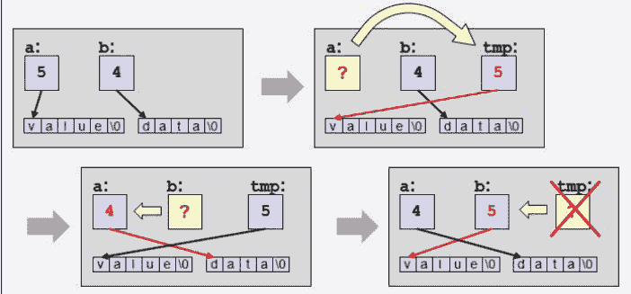

图 6.1. swap 函数中的被移动对象

请注意，我们也可能将同一个对象同时传给两个参数，从而导致自我交换。在这种情况下，我们甚至可能将一个处于被移动状态的对象赋值给它自身。所有这些都应该能正常工作（前提是被移动对象仍然可以具有任意值）。

因此，被移动对象也满足通常适用于所有对象的基本要求：

- 我们必须能够销毁被移动对象。
- 我们必须能够向被移动对象赋予新值。
- 我们应该能够复制、移动或将被移动对象赋值给其他对象。

被移动对象还应该能够满足特定操作所提出的额外要求。例如，要对对象进行排序，我们必须支持对所有对象调用 `operator<` 或排序准则。这也适用于被移动对象。你可能会争辩说，在排序算法中应该知道哪个对象被移动了，以便避免比较它，但 C++ 标准库并不要求这样做。顺便提一下，这也意味着你可以传入被移动对象来对它们进行排序。只要它们支持所有必需的操作，一切就都没问题。


请注意，C++ 标准库的定义所要求的，不仅仅是亚历山大·斯特帕诺夫（Alexander Stepanov）和保罗·麦克琼斯（Paul McJones）在《编程原本》中所称的 *部分成形* 状态。²

对于你在 C++ 标准库中使用的所有对象和类型，你应该**确保被移动对象也满足所调用函数的所有要求**。

#### 6.1.2 被移动对象的保证状态

针对被移动对象的保证，定义了在你使用它们时哪些代码是定义良好的。通常，类的设计者决定给出哪些保证。然而，由于我们总是在对象生命周期结束时销毁对象，所以对于被移动状态，你始终必须给出的最低保证是：调用析构函数是定义良好的。

通常，会给出更多保证。就 C++ 标准库的要求而言，支持复制、赋值同类型对象等基本操作往往就已足够。然而，用户通常期望你还能处理为对象赋予新值的所有其他方式。因此，一个有用的额外保证是：你可以使用任何形式为被移动对象“赋予”新值。

思考一下你可以为标准字符串 s 赋予新值的各种不同方式：

```cpp
s = "hello";              // assign "hello"
s.assign(s2);              // assign the state of s2
s.clear();                 // assign the empty state
std::cin >> s;             // assign the next word from standard input
std::getline(myfile, s);   // assign the next line from a file
```

例如，下面的循环是一种常见的逐行从流中读取到 vector 的方式：

```cpp
std::string row;
while (std::getline(myStream, row)) {
    coll.push_back(std::move(row));   // move the line into the vector
}
```

再举一个例子，你可以在处理容器的泛型代码中实现下列语句：

```cpp
foo(std::move(obj));      // pass obj to foo()
obj.clear();              // ensure the object is empty afterwards
```

类似的代码可能有助于释放某个 unique_ptr 使用的对象所占用的内存：

```cpp
draw(std::move(up));      // the unique pointer might or might not give up ownership
up.reset();               // ensure we give up ownership and release any resource
```

```cpp
int i = stk.top();
assert(i == 42);
// should never fail
```

尽管我们不知道将 stk 通过 std::move() 传递给 foo() 之后它的值是什么，但只要它只用于保存我们的值 42、直到我们再次需要它，我们就可以把它当作一个有效的栈来使用。

当然，你给出的保证能走多远由你自己决定，但请确保你的类型的用户了解这些保证。通常，他们期望你的类型提供与 C++ 标准库相同的保证，这样你就可以像使用该类型的任何其他对象一样使用被移动对象，而无需知道它的值。

#### 6.1.3 被破坏的不变量

C++ 标准库对所有被移动对象处于“有效但未指定状态”的含义定义如下：

> 对象的值未被指定，但对象的不变量得到满足，且对象上的操作行为符合其类型的规定。

不变量是适用于所有可创建对象的保证。有了这一保证，你可以假设被移动对象处于不变量未被破坏的状态。你可以像使用非 const 引用参数一样使用该对象，而无须知道传入参数的任何信息：你可以调用任何没有约束或前置条件的操作，并且该调用的效果/结果与该类型任何其他对象的规定一致。

例如，对于被移动的 string，我们可以执行所有没有前置条件的操作：

- 查询它的大小
- 打印它
- 遍历其中的字符
- 将其转换为 C 风格字符串
- 赋予新值
- 追加一个字符

此外，所有这些函数仍具有通常规定的语义：

- 返回的大小可用于安全地调用下标运算符。
- 返回的大小与遍历时字符的数量一致。
- 打印出的字符与遍历时的字符序列一致。
- 追加一个字符会将该字符放在值的末尾（无需知道前面是否有其他字符以及是哪些字符）。

程序员可以利用这些保证（参见上面的 std::stack<> 示例）。

然而，有时你必须明确地确保预期的不变量不被破坏。默认的特殊移动成员函数可能无法正常工作。我们将在以下小节中讨论示例。

##### 受限不变量

不给被移动状态提供 C++ 标准库的完整保证也可能是有用的。也就是说，你可能有意识限制被移动对象可以执行的操作。例如，当对象的有效状态总是需要内存等资源时，仅提供一个部分支持的状态可能更有利于降低移动操作的代价。

在 C++ 标准库中就有这样一个例子：某些实现总是需要内存来维持节点型容器的所有状态（因此甚至默认构造函数也必须分配内存）。对于这些容器，限制我们能够对被移动对象做什么，可能比保证被移动对象始终处于“有效”状态更好。然而，我们决定给出完整的保证。

理想情况下，不支持所有操作的被移动状态应该是可检测的。对象应当知道这种状态，并提供一个成员函数来检查这种状态。被移动对象也可能拒绝执行此状态下不支持的操作。然而，相应的检查在一般情况下可能会造成性能开销。

在 C++ 标准库中，有些类型提供了 API 来检查对象是否处于被移动状态。例如，`std::future` 有一个成员函数 `valid()`，对于被移动对象，它会返回 `false`。但是，用于检查被移动状态的接口各不相同。

很多时候，被移动状态就是默认构造状态，这意味着被移动状态无论如何都是不变量的一部分。无论如何，请确保你的类型的用户知道哪些是定义良好的，哪些不是。

### 6.2 可析构与可赋值

让我们讨论如何确保被移动对象满足支持赋值和销毁的基本要求。

#### 6.2.1 可赋值且可析构的被移动对象

在大多数类中，生成的特殊移动成员函数都会将被移动对象带入一个赋值运算符和析构函数都能正常工作的状态。然而，只要每个被移动成员都是可赋值且可析构的，那么整个被移动对象的赋值和销毁就都应能正常工作：

- 赋值操作会从对应的源成员赋入状态，从而覆盖该成员的未指定状态。
- 析构函数会销毁该成员（该成员具有未指定状态）。

因为我们通常可以而且应当预期，被移动对象的成员处于有效但未指定的状态，所以生成的移动操作通常就能正常工作并创建正确的状态。

例如，考虑下面的类：

```cpp
class Customer {
private:
    std::string name;
    std::vector<int> values;
    ...
};
```

到目前为止，该类不支持移动语义，因为我们有一个用户声明的析构函数。你也不能复制 `Tasks` 对象，因为复制 `std::threads` 是被禁止的。不过，你可以启动多个任务并等待它们结束：

basics/tasks.cpp

```cpp
#include "tasks.hpp"
#include <iostream>
#include <chrono>

int main()
{
    Tasks ts;
    ts.start([]{
            std::this_thread::sleep_for(std::chrono::seconds{2});
            std::cout << "\nt1 done" << std::endl;
        });
    ts.start([]{
            std::cout << "\nt2 done" << std::endl;
        });
}
```

现在考虑通过生成移动操作的默认实现来启用移动语义（参见 `basics/taskshbug.cpp`）：

basics/taskshbug.cpp

```cpp
class Tasks {
private:
    std::array<std::thread,10> threads;  // array of threads for up to 10 tasks
    int numThreads{0};                   // current number of threads/tasks
public:
    // OOPS: enable default move semantics:
    Tasks(Tasks&&) = default;
    Tasks& operator=(Tasks&&) = default;

    // at the end wait for all started threads:
    ~Tasks() {
        for (int i = 0; i < numThreads; ++i) {
            threads[i].join();
        }
    }
};
```

在这种情况下，你会陷入麻烦，因为默认生成的移动操作可能会创建无效的 Tasks 状态。考虑以下示例：

```
```cpp
#include "tasksbug.hpp"
#include <iostream>
#include <chrono>
#include <exception>

int main()
{
	try {
		Tasks ts;
		ts.start([]{
			std::this_thread::sleep_for(std::chrono::seconds{2});
			std::cout << "\nt1 done" << std::endl;
		});
		ts.start([]{
			std::cout << "\nt2 done" << std::endl;
		});
		// OOPS: move tasks:
		Tasks other{std::move(ts)};
	}
	catch (const std::exception& e) {
		std::cerr << "EXCEPTION: " << e.what() << std::endl;
	}
}
```
```

一开始，我们通过向 Tasks 对象 ts 传递两个任务来启动它们。因此，在 ts 中，threads 数组有两个条目，numThreads 为 2。不幸的是，容器的移动操作会移动元素，因此在 `std::move()` 之后，ts 不再包含任何表示正在运行的线程的线程对象。因此，numThreads 只是被复制，这意味着我们创造了一个不一致/无效的状态。析构函数最终将遍历前两个元素并调用 `join()`，这会抛出异常（在析构函数中这是一个致命错误）。

一般的问题在于，两个成员共同定义了一个有效状态，而默认生成的移动语义造成了不一致，甚至导致析构函数失败。你不能总是避免这个问题，因为当对象被销毁时，你可能总是需要显式地对对象包含的元素子集做某些处理。在所有这些情况下，默认生成的移动操作可能行不通，你应该禁用或修复它们。

一种修复方法可能是：
- 修复析构函数以处理被移出（moved-from）状态（例如，在这种情况下，我们只能在线程对象可 `join()` 时调用 `join()`）
- 自行实现移动操作

### 6.3 处理被破坏的不变量

不幸的是，被移出的对象破坏“有效但未指定状态”保证，比破坏可析构的要求容易得多。我们可能会意外地将对象带入到破坏其不变量的状态。

幸运的是，只有在显式请求移动语义时这才是一个问题，因为临时对象无论如何都会立即被销毁。然而，显式的移动请求不仅限于通过用 `std::move()` 标记对象来发起。你也可以通过以下方式创建被移出的对象：

- 对一个对象使用 `std::move()`
- 移动算法（`std::move()` 和 `std::move_backward()`）
- 通过将“未移除”元素移动到前面来“移除”元素的算法（例如 `std::remove()`、`std::remove_if()`、`std::unique()`）
- 移动迭代器

原则上，如果类的（生成）移动操作破坏了不变量，你有以下选择：

- 修复移动操作，将被移出的对象带入一个不会破坏不变量的状态。
- 禁用移动语义。
- 放宽不变量，使所有可能的被移出状态也视为有效状态。特别是，这可能意味着使用这些对象的成员函数和函数必须以不同的方式实现，以处理新的可能状态。
- 记录文档并提供成员函数来检查“不变量被破坏”的状态，以便该类型的用户在对象被标记为 `std::move()` 之后不再使用该类型的对象（或只使用有限的一组操作）。

让我们看一些不变量被破坏的例子，并讨论如何修复它们。

#### 6.3.1 移动值成员导致的不变量破坏

移动操作破坏不变量的第一个原因与这样的对象有关：某成员被移出后的状态本身就是一个问题，因为该状态虽然有效，但不应发生。

- 禁用移动语义（这正是此处不声明特殊移动成员函数时的行为）

根据零规则（Rule of Zero），你应该将容易出错资源管理封装到一个辅助类型中，这样应用程序程序员就无需实现任何特殊的成员函数。在这种情况下，你可以使用一个辅助类（模板），它同时提供这两个成员（`std::array` 和实际使用的元素数量的成员）以及正确的移动操作实现。

整个问题也是 `std::thread` 类设计失误的副作用。该类型没有遵循 RAII 原则。对于所有拥有正在运行线程的 `std::thread`，你必须在其析构函数被调用之前调用 `join()`（或 `detach()`）；否则线程的析构函数会抛出异常。自 C++20 起，你可以并且应该改用 `std::jthread` 类，如果对象仍然表示一个正在运行的线程，它会自动调用 `join()`。

这段代码在运行时可能会失败，因为对于被移出的 Card，不再保证 value 包含 “-of-”。在这种情况下，`find()` 会用 `std::string::npos` 初始化 pos，当 `pos+4` 被用作 `substr()` 的第一个参数时，会抛出 `std::out_of_range` 类型的异常。

完整的示例见 basics/card.hpp 和 basics/card.cpp。

修复这个类的选择如下：

- 禁用移动语义：

```
class Card {
    ...
    Card(const Card&) = default;        // disable move semantics
    Card& operator=(const Card&) = default;  // disable move semantics
};
```

- 完全禁用复制和移动：

```
class Card {
    ...
    Card(const Card&) = delete;        // disable copy/move semantics
    Card& operator=(const Card&) = delete;  // disable copy/move semantics
};
```

- 修复这些损坏的特殊移动成员函数。

  然而，什么才是有效的修复（总是赋一个“默认值”如“ace-of-clubs”是否可行）？你又如何确保带有默认值的对象在不分配内存的情况下性能良好？

- 在内部允许新状态，但禁止调用 `getValue()` 或其他成员函数。

  你可以对此加以文档说明（“对于被移出的对象，只允许赋一个新值。所有其他成员函数都以对象不处于被移出状态为前提条件。”），甚至可以在成员函数内部进行检查并触发断言或异常。

- 通过引入一个新的状态来扩展不变量，即 Card 可能没有值。

  这意味着你必须实现移动特殊成员函数，因为必须确保被移出对象的成员 value 处于这个状态。

  通常，被移出状态等同于默认构造状态。因此，这也是提供默认构造函数的机会。理想情况下，你还可以提供一个成员函数来检查这个状态。

  有了这个改变，该类的用户必须考虑到字符串 value 可能为空，并相应更新他们的代码。例如：

```
void print(const Card& c) {
    std::string val{c.getValue()};
    auto pos = val.find("-of-");        // find position of substring
    if (pos != std::string::npos) {     // check whether it exists
        std::cout << val.substr(0, pos) << ' '
            << val.substr(pos+4) << '\n';
    }
}
```

```
```cpp
else {
    std::cout << "no value\n";
}
```
```

或者，`getValue()` 可以返回一个 `std::optional<std::string>`（自 C++17 起可用）。

似乎没有显而易见的完美解决方案。你必须思考每一种修复方式对你程序更大的不变量意味着什么（例如，只有一张 ace-of-clubs，或者所有牌都是有效的牌，等等），然后决定使用哪一种。

请注意，这个类在 C++11 之前运行良好，那时不支持移动语义（这可能意味着第一个选项是最好的）。因此，C++11 可能会为类引入在实现该类时不可能出现的状态。这是一种罕见的情况，但它确实意味着移动语义的引入可能会破坏现有代码。

参见 Email 类，它是另一个例子：我们在内部标记被移出状态以便单独处理，并在“移除”算法将元素留在被移出状态之后，使该状态可见。

#### 6.3.2 移动一致值成员导致的不变量破坏

移动操作破坏不变量的第二个原因与这样的对象有关：其中两个成员必须保持一致，但移动特殊成员函数可能会破坏这种一致性。正如在线程数组的示例中所见，这甚至可能造成破坏析构函数的不一致。然而，更常见的情况是析构函数工作正常，但被移出状态破坏了一个不变量。

考虑一个类，其中我们有两种不同的值表示：一个整数值和一个字符串值：

```cpp
#include <iostream>
#include <string>

class IntString
{
private:
    int val; // value
    std::string sval; // cached string representation of the value
public:
    IntString(int i = 0)
    : val{i}, sval{std::to_string(i)} {
    }
    void setValue(int i) {
        val = i;
        sval = std::to_string(i);
    }
    ...
    void dump() const {
        std::cout << "[" << val << "/" << sval << "]\n";
    }
}
```


### 6.3 处理破坏的类不变量

```
}
};
```

在这个类中，我们通常确保成员 val 和成员 sval 只是同一个值的两种不同表示。这意味着在该类的实现和使用中，我们通常期望其状态的 int 表示和字符串表示是一致的。然而，如果我们在这里调用一个移动操作，我们会保留值 val，但 sval 不再保证具有 val 的字符串表示。

考虑以下程序：

```cpp
#include "intstring.hpp"
#include <iostream>

int main()
{
	IntString is1{42};
	IntString is2;
	std::cout << "is1 and is2 before move:\n";
	is1.dump();
	is2.dump();
	is2 = std::move(is1);
	std::cout << "is1 and is2 after move:\n";
	is1.dump();
	is2.dump();
}
```

该程序通常有以下输出（不要忘记，被移动的 string 变为空是典型情况但并非保证）：

```
is1 and is2 before move:
[4/2'42']
[0/'0']
is1 and is2 after move:
[4/2' ']
[4/2'42']
```

也就是说，自动生成的移动操作破坏了我们“两个成员始终相互匹配”的不变量。

这个问题有多大？好吧，至少这是一个可能的陷阱。再次，你可能会争辩说在移动之后我们不应该再使用该值（直到我们再次设置值）。然而，程序员可能会期望像 C++ 标准库对象那样的策略，该策略规定对象处于有效但未指定的状态。

事实是，有了相应的 getter，该类不再保证值作为 int 和 string 匹配，这很可能是一个类不变量（隐式或显式声明）。你可能会认为最坏的后果是值（现在未指定）根据使用方式看起来不同，但使用它没有问题，因为它仍然是一个有效的 int 或 string。

然而，依赖此不变量的代码可能会被破坏。该代码可能假设字符串表示至少有一个数字。例如，如果它搜索第一个或最后一个数字，你肯定会找到一个。对于一个被移动的 string，它通常为空，这不再成立。因此，未双重检查字符串值中是否有任何字符的代码，可能会遇到意外的未定义行为。

再次，如何处理这个问题取决于类的设计者。然而，如果你遵循 C++ 标准库的规则，你应该使被移动的对象保持有效状态，这可能意味着你引入一个表示“我没有任何值”的可能状态。

一般来说，当对象的状态具有以某种方式相互依赖的成员时，你必须明确确保被移动的状态处于有效状态。可能被破坏的例子有：

- 我们对同一个值有不同的表示，但其中一些被移动走了。
- 一个成员例如计数器与成员中的元素数量相对应。
- 一个布尔值声称一个字符串值已被验证，但被验证的值被移动走了。
- 用于所有元素的平均值的缓存值仍然存在，但值（位于容器成员中）被移动走了。

再次注意，在 C++11 之前，该类工作正常，当时不支持移动语义。不变量在切换到 C++11 或更高版本并且使用被移动的对象时被破坏。

#### 6.3.3 由于被移动的指针类成员导致不变量被破坏

移动操作破坏不变量的第三个原因与具有指针类语义的成员的对象有关，例如（智能）指针。

考虑以下使用 std::shared_ptr<> 共享整数值的类的示例：

```
class SharedInt {
    private:
        std::shared_ptr<int> sp;
    public:
        explicit SharedInt(int val)
            : sp{std::make_shared<int>(val)} {
        }

        std::string asString() const {
            return std::to_string(*sp);    // OOPS: assume there is always an int value
        }
};
```

该类的对象接收一个初始整数值，可以与该对象的副本共享。只要新对象仅被复制，一切都很好：

```
SharedInt si1{42};
SharedInt si2{si1};            // si1 and si2 share the value 42

std::cout << si1.asString() << '\n';  // OK
```

仅被复制时，SharedInt 成员 sp 总是有为其值分配的内存（来自 std::make_shared<>() 或来自复制具有已分配内存的现有共享指针）。

然而，一旦我们使用移动语义，如果我们仍然使用被移动的对象，就会遇到未定义行为：

```
SharedInt si1{42};
SharedInt si3{std::move(si1)};      // OOPS: moves away the allocated memory in si1

std::cout << si1.asString() << '\n';  // undefined behavior (probably core dump)
```

问题在于类内部，我们没有正确处理值可能被移动走的事实，这可能发生，因为默认生成的移动操作会调用共享指针的移动操作，从而将所有权从原始对象移走。这意味着 SharedInt 的被移动状态使成员 sp 处于不再拥有对象的状态，而其成员函数 asString() 并未正确处理这种情况。

你可能会争辩说对具有被移动状态的对象调用 asString() 没有意义，因为你正在使用未指定的值，但至少标准库对其类型保证被移动的类型处于有效状态，以便你可以调用所有没有约束的操作。在用户定义的类型中不提供相同的保证可能会让类型使用者感到惊讶。

从健壮编程的角度来看（避免惊喜、陷阱和未定义行为），我通常建议你遵循 C++ 标准库的规则。也就是说：移动操作不应使对象进入破坏不变量的状态。

在这种情况下，我们必须做以下之一：

- 通过也正确处理所有可能的被移动状态来修复类的所有损坏操作
- 禁用移动语义，以便在复制对象时没有优化
- 显式实现移动操作
- 调整并记录类的不变量（约束/前置条件）或特定操作（例如“对被移动对象调用 asString() 是未定义行为”）

由于分配内存代价昂贵，在这种情况下最好的修复方法可能是正确处理整数值的所有权可能被移动走的事实。这将创建一个与默认构造函数相同的状态，我们可以通过此更改引入。

以下小节演示了此修复和其他代码修复。

## 修复损坏的成员函数

第一个选项，修复所有损坏的操作，本质上意味着我们扩展类的不变量（所有对象的可能状态），以便所有操作都能处理被移动状态。我们仍然必须做出设计决策。例如，当对被移动对象调用 asString() 时（或更一般地，对共享指针不拥有整数值的对象），我们可以：

- 仍然返回一个后备值：

```
class SharedInt {
    ...
    std::string asString() const {
        return sp ? std::to_string(*sp) : "";
    }
    ...
};
```

- 抛出异常：

```
class SharedInt {
    ...
    std::string asString() const {
        if (!sp) throw ...
        return std::to_string(*sp);
    }
    ...
};
```

- 在调试模式下强制运行时错误：

```
class SharedInt {
    ...
    std::string asString() const {
        assert(sp);
        return std::to_string(*sp);
    }
    ...
};
```

## 禁用移动语义

第二个选项是禁用移动语义，以便只能使用复制语义。我们之前描述了如何禁用移动语义。你必须 user-declare 另一个特殊成员函数。通常，你 =default 复制特殊成员函数：

```
class SharedInt {
    ...
    SharedInt(const SharedInt&) = default;      // disable move semantics
    SharedInt& operator=(const SharedInt&) = default;  // disable move semantics
    ...
};
```


### 实现移动语义

第三种选择是实现移动操作，使其不破坏类的不变量。

为此，我们必须决定被移动后的对象应该处于什么状态。为了支持 asString() 无需检查值是否存在即可调用 operator*，我们始终需要提供一个值。例如，我们可以有一个静态的“被移动后的值”，并将其赋给那些值被移走的对象：

```cpp
#include <memory>
#include <string>

class SharedInt {
private:
    std::shared_ptr<int> sp;
    // special "value" for moved-from objects:
    inline static std::shared_ptr<int> movedFromValue{std::make_shared<int>(0)};
public:
    explicit SharedInt(int val)
        : sp{std::make_shared<int>(val)} {}
    std::string asString() const {
        return std::to_string(*sp); // OOPS: unconditional deref
    }

    // fix moving special member functions:
    SharedInt (SharedInt&& si)
        : sp{std::move(si.sp)} {
        si.sp = movedFromValue;
    }
    SharedInt& operator= (SharedInt&& si) noexcept {
        if (this != &si) {
            sp = std::move(si.sp);
            si.sp = movedFromValue;
        }
        return *this;
    }

    // enable copying (deleted with user-declared move operations):
    SharedInt (const SharedInt&) = default;
    SharedInt& operator= (const SharedInt&) = default;
};
```

注意，我们必须 =default 复制特殊成员函数，因为当我们声明了用户自定义的移动特殊成员函数时，它们会被删除。

### 6.4  小结

-   对于每个类，明确被移动后的对象的状态。你必须确保它们至少是可析构的（这通常在不实现特殊成员函数的情况下也能满足）。然而，你的类的使用者可能会期望或要求更多。
-   C++ 标准库函数的要求同样适用于被移动后的对象。
-   生成的移动特殊成员函数可能会使被移动后的对象进入一种违反类不变量的状态。这尤其可能发生在以下情况：
  -   类没有带确定值的默认构造函数（因此没有天然的“被移动后”状态）
  -   成员的值受到限制（如断言）
  -   成员的值相互依赖
  -   使用了具有指针语义的成员（普通指针、智能指针等）
-   如果“被移动后”状态破坏了不变量或使操作无效，你应该使用以下选项之一来修复：
  -   禁用移动语义
  -   修复移动语义的实现
  -   在类内部处理被破坏的不变量，并对外部隐藏它们
  -   通过记录被移动后的对象的约束和前置条件，放宽类的不变量

## 第7章

## 移动语义与 noexcept

当移动语义在 C++11 中即将完成时，我们发现了一个问题：vector 的重分配无法使用移动语义。因此，引入了新的关键字 noexcept。

本章将解释这个问题以及它对 C++ 代码中使用 noexcept 意味着什么。

让我们通过一个小例子来引入这个话题，以说明 noexcept 关键字的作用。

考虑下面的类，它定义了一个带有 string 成员的类型，并实现了复制构造函数和移动构造函数，以便让这些构造函数的调用可见：

```cpp
#include <string>
#include <iostream>

class Person {
private:
    std::string name;
public:
    Person(const char* n)
        : name{n} {
    }

    std::string getName() const {
        return name;
    }

    // print out when we copy or move:
    Person(const Person& p)
        : name{p.name} {
        std::cout << "COPY " << name << '\n';
    }
    Person(Person&& p)
        : name{std::move(p.name)} {
        std::cout << "MOVE " << name << '\n';
    }
    ...
};
```

现在让我们创建并初始化一个 Person 的 vector，然后当存在一个 Person 时再插入它：

basics/person.cpp

```cpp
#include "person.hpp"
#include <iostream>
#include <vector>

int main()
{
  std::vector<Person> coll{"Wolfgang Amadeus Mozart",
                            "Johann Sebastian Bach",
                            "Ludwig van Beethoven"};
  std::cout << "capacity: " << coll.capacity() << '\n';
  coll.push_back("Pjotr Iljitsch Tschaikowski");
}
```

程序的输出如下：

```text
COPY Wolfgang Amadeus Mozart
COPY Johann Sebastian Bach
COPY Ludwig van Beethoven
capacity: 3
MOVE Pjotr Iljitsch Tschaikowski
COPY Wolfgang Amadeus Mozart
COPY Johann Sebastian Bach
COPY Ludwig van Beethoven
```

我们首先将初始值复制到 vector 中（因为容器的 std::initializer_list<> 构造函数按值接受传入的参数）。因此，vector 通常会为三个元素分配内存（在图中，我使用了字符串值的简写）：

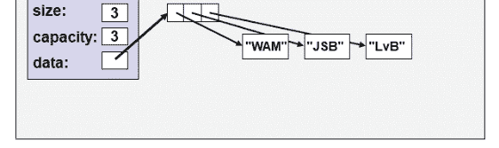

这里重要的是接下来发生的事情：我们使用 push_back() 插入第四个元素，这会产生以下后果：

-   因为 vector 内部需要更多内存，它会分配新内存（比如说，能容纳六个元素），移入第四个字符串（我们创建一个临时 Person，并通过 push_back() 将其移入 vector），但也会将已有元素复制到新内存：

  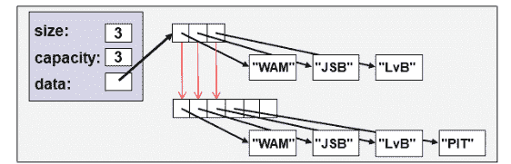

-   在此操作结束时，vector 会销毁旧元素，释放旧内存，并更新其成员：

  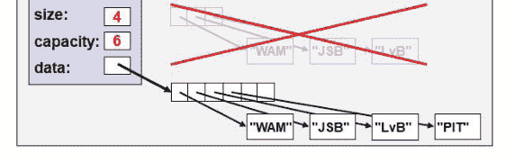

问题是，为什么 vector 不使用移动构造函数将元素从旧内存移动到新内存？

### 强异常安全保证

vector 重分配不使用移动语义的原因是我们为 push_back() 提供的强异常处理保证：当 vector 重分配过程中抛出异常时，C++ 标准库保证将 vector 回滚到其先前的状态。也就是说，push_back() 提供了一种类似事务的保证：要么成功，要么没有影响。

C++ 标准在 C++98 和 C++03 中能够提供这一保证，因为那时 C++ 只能复制元素。如果在复制元素过程中出现问题，源对象仍然可用。处理异常的内部代码只需销毁到目前为止已创建的副本，并释放新内存，从而将 vector 恢复到先前的状态（C++ 标准库假设并要求析构函数不会抛出异常；否则，它将无法回滚）。

重分配是移动语义的绝佳位置，因为我们从一处将元素移动到另一处。因此，从 C++11 开始，我们希望在此使用移动语义。然而，这样做就会遇到麻烦：如果在重分配过程中抛出异常，我们可能无法回滚。新内存中的元素已经“偷走”了旧内存中元素的值。因此，只销毁新元素是不够的；我们必须将它们移回去。但我们怎么知道移回去不会失败呢？

你可能会说移动构造函数不应该抛出异常。对于 string 来说这可能是正确的（因为我们只是移动整数值和指针），但由于我们要求被移动后的对象处于有效状态，这个状态可能需要内存，这意味着如果我们内存不足，移动就可能会抛出异常（例如，Visual C++ 的基于节点的容器就是这样实现的）。

我们也不能放弃这一保证，因为程序可能已经利用这一特性来避免创建 vector 的备份，而丢失数据可能至关重要（安全问题）。而不再支持 push_back() 对 C++11 的接受来说将是一场噩梦。

最终的决定是：只有当元素类型的移动构造函数保证不抛出异常时，才在重分配时使用移动语义。

#### 7.1.2 带 noexcept 的移动构造函数

因此，当我们保证 Person 类的移动构造函数永不抛出异常时，我们的小示例程序的行为会发生变化：

```cpp
#include <string>
#include <iostream>

class Person {
private:
    std::string name;
public:
    Person(const char* n)
    : name{n} {
    }

    std::string getName() const {
        return name;
    }

    // print out when we copy or move:
    Person(const Person& p)
    : name{p.name} {
        std::cout << "COPY " << name << '\n';
    }
```


```
Person(Person&& p) noexcept  // 保证不会抛出异常
: name{std::move(p.name)} {
    std::cout << "MOVE " << name << '\n';
}
...
```

如果我们现在像之前一样使用 `Person`：

basics/personmove.cpp

```
#include "personmove.hpp"
#include <iostream>
#include <vector>

int main()
{
    std::vector<Person> coll{"Wolfgang Amadeus Mozart",
                             "Johann Sebastian Bach",
                             "Ludwig van Beethoven"};
    std::cout << "capacity: " << coll.capacity() << '\n';
    coll.push_back("Pjotr Iljitsch Tschaikowski");
}
```

我们会得到以下输出：

```
COPY Wolfgang Amadeus Mozart
COPY Johann Sebastian Bach
COPY Ludwig van Beethoven
capacity: 3
MOVE Pjotr Iljitsch Tschaikowski
MOVE Wolfgang Amadeus Mozart
MOVE Johann Sebastian Bach
MOVE Ludwig van Beethoven
```

同样，我们首先将初始值复制到 vector 中：

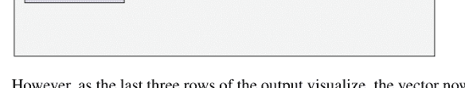

然而，正如输出的最后三行所示，vector 现在使用移动构造函数将其元素移动到新重新分配的内存中：

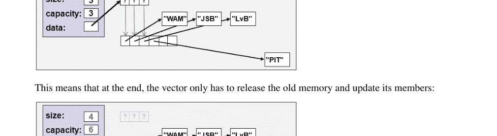

这意味着到最后，vector 只需释放旧内存并更新其成员：

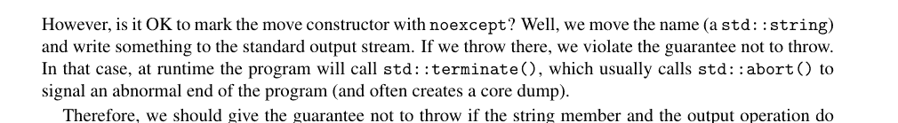

## 第7章：移动语义与 `noexcept`

### 条件式 `noexcept` 声明

然而，用 `noexcept` 标记移动构造函数是否合适？我们移动了 name（一个 `std::string`），并向标准输出流写了一些内容。如果在那里抛出异常，我们就违反了不抛异常的保证。在这种情况下，程序运行时会调用 `std::terminate()`，它通常会调用 `std::abort()` 来表示程序异常结束（并且常常会创建核心转储文件）。

```
```cpp
class Person {
private:
    std::string name;
public:
    ...
    Person(Person&& p)
    noexcept(std::is_nothrow_move_constructible_v<std::string>)
    & noexcept(std::cout << name)
    : name{std::move(p.name)} {
        std::cout << "MOVE " << name << '\n';
    }
    ...
};
```
```

使用 `noexcept(...)`，如果括号内的编译期表达式为真，我们就保证不会抛出异常。在这种情况下，我们需要两个条件才能给出该保证：

### 7.1 带与不带 `noexcept` 的移动构造函数

- 使用 `std::is_nothrow_move_constructible_v<std::string>`（在 C++20 之前，必须使用 `std::is_nothrow_move_constructible<std::string>::value`），这是一个标准类型特征（类型函数），用于告诉我们 `std::string` 的移动构造函数是否保证不抛异常。
- 使用 `noexcept(std::cout << name)`，我们询问对 name 的输出表达式的调用是否保证不抛出异常。这里，我们将 `noexcept` 用作一个运算符，用来告知我们执行所给表达式所需的所有相应操作是否保证不抛异常。

正如你可能猜到的，用这种声明，重新分配时会再次使用拷贝构造函数。字符串的移动构造函数确实保证不抛异常，但输出运算符不保证。然而，移动构造函数通常不会输出任何内容；因此，通常当成员不抛异常时，我们可以为整个移动构造函数提供不抛异常的保证。

好消息是，如果你自己不实现移动构造函数，编译器会为你检测 `noexcept` 保证。对于所有成员在移动构造函数中都保证不抛异常的类，生成或默认化的移动构造函数将作为一个整体提供该保证。

考虑以下声明：

```
basics/persondefault.hpp

#include <string>
#include <iostream>

class Person {
private:
    std::string name;
public:
    Person(const char* n)
        : name{n} {
    }

    std::string getName() const {
        return name;
    }

    // 当我们拷贝时打印出来：
    Person(const Person& p)
        : name{p.name} {
            std::cout << "COPY " << name << '\n';
    }
    // 强制生成默认的移动构造函数：
    Person(Person&& p) = default;

};
```

在这种情况下，我们声明应生成默认的移动构造函数：

```
class Person {
    ...

    // 强制生成默认的移动构造函数：
```

```
Person(Person&& p) = default;
...
};
```

这意味着我们只在拷贝时打印。当使用生成的移动构造函数时，我们只看到我们没有执行拷贝。

现在让我们使用我们通常的程序，在最后打印出一些 `Person` 对象：

```
basics/persondefault.cpp

#include "persondefault.hpp"
#include <iostream>
#include <vector>

int main()
{
    std::vector<Person> coll{"Wolfgang Amadeus Mozart",
                             "Johann Sebastian Bach",
                             "Ludwig van Beethoven"};
    std::cout << "capacity: " << coll.capacity() << '\n';
    coll.push_back("Pjotr Iljitsch Tschaikowski");

    std::cout << "name of coll[0]: " << coll[0].getName() << '\n';
}
```

我们得到以下输出：

```
COPY Wolfgang Amadeus Mozart
COPY Johann Sebastian Bach
COPY Ludwig van Beethoven
capacity: 3
name of coll[0]: Wolfgang Amadeus Mozart
```

我们只看到初始化列表中的元素发生了拷贝。对于其他所有情况，包括重新分配，都使用了默认移动构造函数。正如我们所见，第一个人的名字在重新分配后的内存中是正确的。

如果我们完全不指定任何成员函数，行为也是一样的。这意味着：

- 如果你*实现*了移动构造函数，你应该声明它是否以及何时保证不抛异常。
- 如果你不必实现移动构造函数，那么你完全不需要指定任何东西。

如果你关心某个类的性能，或该类的对象在重新分配时的性能，你可能还想在编译期再次确认你的类的移动构造函数保证不抛异常：¹

```
static_assert(std::is_nothrow_move_constructible_v<Person>);
```

或者直到 C++17：

> ¹ 对于抽象基类，你必须使用不同的类型特征。

```
static_assert(std::is_nothrow_move_constructible<Person>::value, "");
```

#### 7.1.3 `noexcept` 值得吗？

你可能想知道，用或繁或简的 `noexcept` 表达式声明移动构造函数是否值得。Howard Hinnant 用一个简单的程序演示了其效果（为本书稍作调整）：

basics/movenoexcept.cpp

```
#include <iostream>
#include <string>
#include <vector>
#include <chrono>

// 带有移动构造函数的字符串包装器：
struct Str
{
    std::string val;

    // 确保每个字符串有 100 个字符：
    Str()
        : val(100, 'a') {  // 这里不要使用花括号
    }

    // 启用拷贝：
    Str(const Str&) = default;

    // 启用移动（带或不带 noexcept）：
    Str (Str&& s) NOEXCEPT
        : val{std::move(s.val)} {
    }
};

int main()
{
    // 创建一个包含 100 万个包装字符串的 vector：
    std::vector<Str> coll;
    coll.resize(1000000);

    // 测量为所有元素重新分配内存所需的时间：
    auto t0 = std::chrono::steady_clock::now();
    coll.reserve(coll.capacity() + 1);
    auto t1 = std::chrono::steady_clock::now();
```

```
std::chrono::duration<double, std::milli> d{t1 - t0};
std::cout << d.count() << "ms\n";
}
```

我们提供了一个包装了一个较长字符串的类（以避免短字符串优化）。注意，我们必须用括号初始化该值，因为用花括号会将 100 解释为值 100 的初始字符。

在类中，我们用 `NOEXCEPT` 标记移动构造函数，预处理器可以将其替换为空或 `noexcept`（例如，用 `-DNOEXCEPT=noexcept` 编译）。然后我们测量在 vector 中重新分配 100 万个这类对象所需的时间。

在几乎所有平台上，用 `noexcept` 声明移动构造函数会使重新分配速度提高多达 10 倍（务必开启一定程度的优化）。也就是说，一次重新分配（通常由插入新元素触发）可能从约 200 毫秒降至约 20 毫秒。这意味着减少了 180 毫秒无法使用 vector 的时间。这可能是一个巨大的好处。²

### 7.2 `noexcept` 声明的细节

如前所述，引入 `noexcept` 是为了允许指定不抛异常的条件性保证。总的来说，在编译期知道一个函数不会抛出异常，可以改进代码和优化，因为你无需处理因抛出异常而可能需要的清理工作。注意，如果违反了 `noexcept` 保证，程序会调用 `std::terminate()`，它通常会调用 `std::abort()` 以导致“程序异常终止”（例如，产生核心转储）。

#### 7.2.1 用 `noexcept` 声明函数的规则

声明 `noexcept` 条件时适用一些规则：

- `noexcept` 条件必须是一个编译期表达式，其值可转换为 `bool`。
- 你不能重载仅 `noexcept` 条件不同的函数。
- 在类层次结构中，`noexcept` 条件是所指定接口的一部分。在派生类中用不 `noexcept` 的函数覆盖基类中 `noexcept` 的函数是错误的（但反过来则可以）。

例如：

```
class Base {
public:
...
virtual void foo(int) noexcept;
virtual void foo(int);    // 错误：仅 noexcept 子句不同的重载
virtual void bar(int);

```

² 注意，Visual C++ 2015 中有一个 bug，导致重新分配时总是使用移动操作，我们看不到差异。这个 bug 在 Visual C++ 2017 中已修复（如果移动构造函数不保证不抛异常，这可能会减慢重新分配速度）。


## noexcept 用于复制和移动特殊成员函数

按规则，当特殊成员函数被生成但未实现时，会生成一个 noexcept 条件。³ 在这种情况下，如果对所有基类和非静态成员调用的相应操作保证不抛出，则这些操作保证不抛出。

例如：

basics/specialnoexcept.cpp

```
#include <iostream>
#include <type_traits>

class B
{
    std::string s;
};

int main()
{
    std::cout << std::boolalpha;
    std::cout << std::is_nothrow_default_constructible<B>::value << '\n';
    std::cout << std::is_nothrow_copy_constructible<B>::value << '\n';
    std::cout << std::is_nothrow_move_constructible<B>::value << '\n';
    std::cout << std::is_nothrow_copy_assignable<B>::value << '\n';
    std::cout << std::is_nothrow_move_assignable<B>::value << '\n';
}
```

程序的输出如下：

```
true
false
true
false
true
```

生成的拷贝构造函数和拷贝赋值运算符可能会抛出，因为拷贝一个 std::string 可能会抛出。然而，生成的默认构造函数、移动构造函数和移动赋值运算符保证不抛出，因为类 std::string 的默认构造函数、移动构造函数和移动赋值运算符保证不抛出。⁴

请注意，即使这些特殊成员函数以 =default 用户声明，noexcept 条件也会被生成。因此，如果我们按如下方式声明类 B，我们会得到相同的效果：

```cpp
class B
{
	std::string s;
public:
	B(const B&) = default; // noexcept 条件自动生成
	B(B&&) = default; // noexcept 条件自动生成
	B& operator= (const B&) = default; // noexcept 条件自动生成
	B& operator= (B&&) = default;
};
```

### 7.2 noexcept 声明的细节

当你有一个默认的特殊成员函数时，你可以显式指定一个与生成的不同的 noexcept 保证。例如：

```cpp
class C
{
	...
public:
	C(const C&) noexcept = default; // 保证不抛出（自 C++20 起有效）
	C(C&&) noexcept(false) = default; // 指定可能抛出（自 C++20 起有效）
	...
};
```

在 C++20 之前，如果生成的和指定的 noexcept 条件矛盾，则定义的函数会被删除。

### noexcept 用于析构函数

按规则，析构函数默认总是保证不抛出。这适用于生成的和实现的析构函数。

```cpp
class B
{
	std::string s;
public:
	~B() {
		// 自动始终声明为 ~B() noexcept
		...
	}
};
```

使用 noexcept(false)，你可以声明它们不具有此保证，但这通常没有任何意义，因为 C++ 标准库的若干保证基于析构函数永不抛出的事实。

### 7.3 类层次结构中的 noexcept 声明

我们看到，尤其是在我们必须实现移动构造函数时，我们应该用 noexcept 保证来声明它。一般来说，遵循 C++ 标准的规则，我们应该在所有基类和所有成员类型在移动构造时都不抛出时，声明它不抛出。

一般模式如下：

```cpp
class Base {
    ...
};

class Drv : public Base {
    MemType member;
    ...
    // 移动构造函数:
    Drv(Drv&&) noexcept(std::is_nothrow_move_constructible_v<Base> &&
                        std::is_nothrow_move_constructible_v<MemType>);
};
```

这里，类 Drv 的移动构造函数保证不抛出，如果基类 Base 和成员类型 MemType 给出此保证。

移动赋值运算符可能会使用相同的模式，但请注意，移动赋值运算符在多态类型中通常应该被删除，这意味着在派生类中通常不需要实现它们。

#### 7.3.1 检查抽象基类中的 noexcept 移动构造函数

请注意，类型特征 `std::is_nothrow_move_constructible<>` 并非总是按预期工作。对于抽象基类，它总是产生 `false`，因为它还检查是否可以用移动构造函数创建该类型对象，而对于抽象类型这是不可能的。

因此，使用标准类型特征无法在所有情况下表述“如果抽象基类保证不抛出，我保证不抛出”的声明。通常，你只需（必须）知道基类移动构造函数是否可能抛出。

为了能够检查一个类的移动构造函数是否保证不抛出，你可以实现以下辅助类型特征（这里为 C++20 实现）。然而，请注意，你必须为每个纯虚函数提供实现：

`poly/isnothrowmovable.hpp`

```cpp
// 类型特征，用于检查基类是否在移动构造函数中保证不抛出（即使构造函数不可调用）
#ifndef IS_NOTHROW_MOVABLE_HPP
#define IS_NOTHROW_MOVABLE_HPP

#include <type_traits>
```

程序有如下输出：

```
std::is_nothrow_move_constructible<Base>: false
is_nothrow_movable<Base>:                true
```

因此，如果你必须在派生自抽象基类的类中实现移动构造函数，你可以使用这样的辅助类型特征来声明移动构造函数如下：

```cpp
class Drv : public Base {
    MemType member;
    ...
    // 移动构造函数:
    Drv(Drv&&) noexcept(is_nothrow_movable_v<Base> &&
                        is_nothrow_movable_v<MemType>);
};
```

为了避免需要实现所有纯虚函数，C++ 标准中缺少一个编译器支持的类型特征。

### 7.4 何时以及在何处使用 noexcept

如所见，noexcept 在 C++11 中引入，是对我们无法在 vector 重新分配元素时使用移动语义的问题的回应。

原则上，你现在可以用（条件）noexcept 标记每个函数。这不仅可能有助于像 vector 重新分配这样的情况（请注意，移动构造函数可能调用其他函数，我们在那里也需要 noexcept 保证），但我们也可能帮助编译器优化代码，因为不需要生成处理异常的代码。那么问题是，在你的代码中何处放置 noexcept？

对于 C++11 标准库，我们急于决定在何处放置 noexcept（重新分配问题被非常晚才发现，并且 noexcept 的最终语义含义在我们发布 C++11 的那一周才明确）。因此，我们遵循了 http://wg21.link/n3279 中提出的一个相当保守的方法，这也可以作为你代码的有用指导。大致来说，指导原则是：

- 每个库工作组同意不能抛出并且具有“宽契约”的库函数（即，不因前置条件而指定未定义行为）都应标记为无条件 noexcept。
- 如果库的 swap 函数、移动构造函数或移动赋值运算符是“条件宽的”（即，可以通过应用 noexcept 运算符证明不抛出），则应将其标记为条件 noexcept。没有任何其他函数应使用条件 noexcept 规范。
- 没有库析构函数应该抛出。它应使用隐式提供的（不抛出）异常规范。
- 为与 C 代码兼容而设计的库函数可以标记为无条件 noexcept。

以下示例演示了第一项的含义：

- 对于容器和字符串，成员函数 empty() 和 clear() 被标记为 noexcept，因为没有有用的方法可以以可能抛出的方式实现它们。
- 向量和字符串的索引运算符*未*标记为 `noexcept`，即使在正确使用时它保证不抛出。然而，当传递无效索引时，我们有未定义行为，实现可以随意处理。通过不将其声明为 `noexcept`，这些实现可以在这种情况下抛出。

第二项是你在实现移动语义时应遵循的指导原则。我们建议你仅在实现移动构造函数、移动赋值运算符或 `swap()` 函数时使用条件 `noexcept` 声明。对于所有其他函数，通常不值得花费精力思考详细条件，并且你可能会泄露太多实现细节。

使用 http://wg21.link/p0884，我们还增加了包装类型也应具有条件 `noexcept` 声明：

- 如果库类型具有包装语义以透明地提供与底层类型相同的行为，则默认构造函数、拷贝构造函数和拷贝赋值运算符应标记为条件 `noexcept`，以使底层异常规范仍然成立。

最后，请注意，按规则，*任何析构函数始终隐式声明为 noexcept。*

对你代码的后果如下：

- 你应该用（条件）`noexcept` 实现移动构造函数、移动赋值运算符和 `swap()` 函数。
- 对于所有其他函数，仅在你知道它们不能抛出时才用无条件 `noexcept` 标记它们。
- 析构函数不需要 `noexcept` 规范。

### 7.5 总结

- 使用 `noexcept`，你可以声明（条件）不抛出的保证。
- 如果你实现移动构造函数、移动赋值运算符或 `swap()`，请用（条件）`noexcept` 表达式声明它。
- 对于其他函数，你可能只想在它们从不抛出时用无条件 `noexcept` 标记它们。
- 析构函数始终声明为 `noexcept`（即使被实现）。


This page is intentionally left blank

## Chapter 8

## Value Categories

本章介绍了移动语义的正式术语和规则。我们正式引入了诸如 lvalue、rvalue、prvalue 和 xvalue 等值类别，并讨论了它们在将引用绑定到对象时的作用。这使我们能够讨论移动语义不会自动传递的规则的细节，以及 decltype 在对表达式调用时非常微妙的行为。

本书中最复杂的一章就是本章。你可能会看到一些棘手且对某些人难以置信的事实和特性。以后每当你阅读关于值类别、将引用绑定到对象以及 decltype 的内容时，都可以回来重读本章。

### 8.1 Value Categories

要编译一个表达式或语句，不仅涉及类型的匹配是否合适。例如，你不能将一个 int 赋给一个 int，当赋值运算符的左手边使用的是一个 int 字面量时：

```
int i = 42;

i = 77;     // OK
77 = i;     // ERROR
```

因此，C++ 程序中的每个表达式都有一个值类别。除了类型之外，值类别对于判断可以用表达式做什么至关重要。

然而，值类别在 C++ 中随着时间的推移而发生了变化。

#### 8.1.1 History of Value Categories

历史上（取自 Kernighan&Ritchie C，*K&R C*），我们只有值类别 *lvalue* 和 *rvalue*。这些术语来自赋值中允许的操作：

- 一个 *lvalue* 可以出现在赋值的 *左手* 边
- 一个 *rvalue* 只能出现在赋值的 *右手* 边

根据这个定义，当你使用一个 int 对象/变量时你使用的是一个 lvalue，但当你使用一个 int 字面量时你使用的是一个 rvalue：

```
int x;          // x is an lvalue when used in an expression

x = 42;         // OK, because x is an lvalue and the type matches
42 = x;         // ERROR: 42 is an rvalue and can be only on the right-hand side of an assignment
```

然而，这些类别不仅对赋值很重要。它们通常用于指定表达式是否以及在何处可以使用。例如：

```
int x;          // x is an lvalue when used in an expression

int* p1 = &x;   // OK: & is fine for lvalues (object has a specified location)
int* p2 = &42;  // ERROR: & is not allowed for rvalues (object has no specified location)
```

然而，随着 ANSI-C 的出现，事情变得更加复杂，因为声明为 const int 的 x 不能站在赋值的左手边，但仍然可以在只能使用 lvalue 的许多其他地方使用：

```
const int c = 42;    // Is c an lvalue or rvalue?

c = 42;              // now an ERROR (so that c should no longer be an lvalue)
const int* p1 = &c;  // still OK (so that c should still be an lvalue)
```

C 中的决定是，声明为 const int 的 c 仍然是一个 lvalue，因为大多数 lvalue 的操作仍然可以对特定类型的 const 对象调用。唯一不能再做的事情是让一个 const 对象出现在赋值的左手边。

因此，在 ANSI-C 中，l 的含义被改为 locator value。lvalue 现在是一个在程序中具有指定位置的对象（因此例如你可以取其地址）。同样，rvalue 现在可以被视为只是可读的值。

C++98 采用了这些值类别的定义。然而，随着移动语义的引入，问题出现了：用 std::move() 标记的对象应该具有哪种值类别，因为用 std::move() 标记的类对象的行为应遵循以下规则：

```
std::string s;
...
std::move(s) = "hello";   // OK (behaves like an lvalue)
auto ps = &std::move(s);   // ERROR (behaves like an rvalue)
```

然而，注意基本数据类型（FDTs）的行为如下：

```
int i;
...
std::move(i) = 42;        // ERROR
auto pi = &std::move(i);  // ERROR
```

除了基本数据类型之外，用 std::move() 标记的对象仍应像 lvalue 一样行为，允许你修改其值。另一方面，也有诸如你不应能够取其地址之类的限制。

因此引入了一个新的类别 xvalue（“eXpiring value”）来指定显式标记为我不再需要此处的价值的对象（主要是用 std::move() 标记的对象）的规则。然而，前 rvalue 的大部分规则也适用于 xvalue。因此，前主要值类别 rvalue 变为一个复合值类别，现在同时表示两个新的主要值类别 prvalue（对于以前是 rvalue 的所有内容）和 xvalue。参见 http://wg21.link/n3055 中提出这些更改的论文。

#### 8.1.2 Value Categories Since C++11

自 C++11 以来，值类别如 Figure 8.1 所描述。

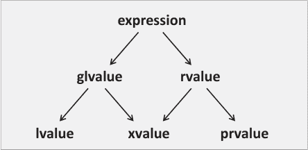

*Figure 8.1. Value categories since C++11*

我们有以下主要类别：

- **lvalue**（“locator value”）
- **prvalue**（“pure readable value”）
- **xvalue**（“eXpiring value”）

复合类别为：

- **glvalue**（“generalized lvalue”）作为“lvalue 或 xvalue”的通用术语
- **rvalue** 作为“xvalue 或 prvalue”的通用术语

##### Value Categories of Basic Expressions

**lvalues** 的例子有：

- 仅为变量、函数或数据成员名称的表达式（除 rvalue 的普通值成员外）
- 仅为字符串字面量的表达式（例如，"hello"）
- 如果函数声明为返回 lvalue 引用，则该函数的返回值（返回类型 *Type&*）
- 对函数的任何引用，即使标记了 `std::move()`（见下文）
- 内置一元 `*` 运算符的结果（即解引用原始指针得到的内容）

**prvalues** 的例子有：

- 由非字符串字面量的内置字面量组成的表达式（例如，42、true 或 nullptr）
- 如果函数声明为按值返回，则该函数的返回类型（返回类型 *Type*）
- 内置一元 `&` 运算符的结果（即取表达式地址得到的内容）
- 一个 lambda 表达式

**xvalues** 的例子有：

- 用 `std::move()` 标记对象的结果
- 对对象类型（非函数类型）的 rvalue 引用进行转换
- 如果函数声明为返回 rvalue 引用，则该函数的返回值（返回类型 *Type&&*）
- rvalue 的非静态值成员（见下文）

例如：

```
class X {
};

X v;
const X c;
```

```
f(v);      // passes a modifiable lvalue
f(c);      // passes a non-modifiable lvalue
f(X());    // passes a prvalue (old syntax of creating a temporary)
f(X{});    // passes a prvalue (new syntax of creating a temporary)
f(std::move(v));  // passes an xvalue
```

粗略地说，作为经验法则：

- 所有用作表达式的名称都是 lvalues。
- 所有用作表达式的字符串字面量都是 lvalues。
- 所有非字符串字面量（42、true 或 nullptr）都是 prvalues。
- 所有没有名称的临时对象（尤其是按值返回的对象）都是 prvalues。
- 所有用 std::move() 标记的对象及其值成员都是 xvalues。

值得强调的是，严格来说，glvalues、prvalues 和 xvalues 是表达式的术语，而不是值的术语（这意味着这些术语是误称）。例如，变量本身不是 lvalue；只有表示该变量的表达式才是 lvalue：

```
int x = 3;      // here, x is a variable, not an lvalue
int y = x;      // here, x is an lvalue
```

在第一个语句中，3 是一个 prvalue，用于初始化变量（而不是 lvalue）x。在第二个语句中，x 是一个 lvalue（其求值指定包含值 3 的对象）。lvalue x 被用作 rvalue，这就是初始化变量 y 的方式。

#### 8.1.3 Value Categories Since C++17

C++17 具有相同的价值类别，但澄清了值类别的语义含义，如 Figure 8.2 所描述。

解释值类别的关键方法现在是，一般来说，我们有两种主要类型的表达式：

- glvalues：用于长寿命对象或函数的定位的表达式
- prvalues：用于初始化的短寿命值的表达式

xvalue 然后被视为一个特殊的位置，表示其资源/值不再需要的（长寿命）对象。


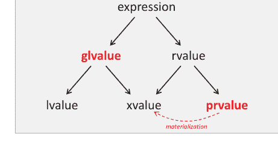

图 8.2. 自 C++17 起的值类别

## 按值传递 Prvalue

有了这一变化，我们现在即使未定义有效的拷贝构造函数和移动构造函数，也可以用未命名的初始值按值传递 prvalue：

```
class C {
public:
  C(...);
  C(const C&) = delete;    // this class is neither copyable ...
  C(C&&) = delete;         // ... nor movable
};

C createC() {
  return C{...};           // Always creates a conceptual temporary prior to C++17.
                           // In C++17, no temporary object is created at this point.
}

void takeC(C val) {
  ...
}

auto n = createC();   // OK since C++17 (error prior to C++17)

takeC(createC());     // OK since C++17 (error prior to C++17)
```

在 C++17 之前，传递 prvalue 例如 `createC()` 创建并初始化的返回值而不提供拷贝或移动支持是不可能的。然而，自 C++17 起，只要我们不需要具有位置的对象，就可以按值传递 prvalue。

## 物化

C++17 然后引入了一个新的术语，称为物化（未命名临时对象），即 prvalue 变成临时对象的时刻。因此，临时物化转换是一种（通常是隐式的）prvalue 到 xvalue 的转换。

此规则反映了引用或静态成员实际上并不是对象的一部分。如果你不再需要对象的值，这也适用于对象的普通数据成员。然而，引用到其他地方或为静态的成员的值可能仍会被其他对象使用。

例如：

```
std::pair<std::string, std::string&> foo(); // note: member second is reference

std::vector<std::string> coll;
...
coll.push_back(foo().first); // moves because first is an xvalue here
coll.push_back(foo().second); // copies because second is an lvalue here
```

你需要在这里使用 `std::move()` 来移动成员 second：

```
coll.push_back(std::move(foo().second)); // moves
```

如果你有一个左值（具有名称的对象），你有两种选择来用 `std::move()` 标记成员：

- std::move(obj).member
- std::move(obj.member)

因为 `std::move()` 的意思是“我不再需要这里的值”，看起来你应该在不再需要对象的值时标记 obj，并在不再需要成员的值时标记 member。然而，情况稍微复杂一些。

### 用于普通数据成员的 std::move()

如果成员既不是静态也不是引用，按规则，`std::move()` 总是将成员转换为 xvalue，以便可以使用移动语义。

假设我们声明了以下内容：

```
std::vector<std::string> coll;
std::pair<std::string, std::string> sp;
```

以下代码先将成员 first 然后是成员 second 移动到 coll 中：

```
sp = ...;
coll.push_back(std::move(sp.first)); // move string first into coll
coll.push_back(std::move(sp.second)); // move string second into coll
```

然而，以下代码具有相同的效果：

```
sp = ...;
coll.push_back(std::move(sp).first); // move string first into coll
coll.push_back(std::move(sp).second); // move string second into coll
```

看起来有点奇怪我们在用 `std::move()` 标记它之后仍然使用 obj，但在这种情况下我们知道对象的哪一部分可能被移动，因此仍然可以使用不同的部分。因此，我更喜欢在例如实现移动构造函数时用 `std::move()` 标记成员。

### 用于引用或静态成员的 std::move()

如果成员是引用或静态，则适用不同的规则。² 右值的引用或静态成员仍然是左值。同样，此规则反映了此类成员的值实际上并不是对象的一部分。说“我不再需要对象的值”不应意味着“我不再需要（成员）的值，该值不是对象的一部分”。

因此，如果你有引用或静态成员，使用 `std::move()` 的方式会产生差异：

- 对 **对象** 使用 `std::move()` 没有效果：

```
struct S {
    static std::string statString;  // static member
    std::string& refString;         // reference member
};

S obj;
...
coll.push_back(std::move(obj).statString);  // copies statString
coll.push_back(std::move(obj).refString);   // copies refString
```

- 对 **成员** 使用 `std::move()` 有通常的效果：

```
struct S {
    static std::string statString;
    std::string& refString;
};
S obj;
...
coll.push_back(std::move(obj.statString));  // moves statString
coll.push_back(std::move(obj.refString));   // moves refString
```

这样的移动是否有用是另一个问题。窃取静态成员或引用成员的值意味着你修改了对象之外的值。这可能有意义，但也可能令人惊讶且危险。通常，类型 S 应该更好地保护对这些成员的访问。

在通用代码中，你可能不知道成员是静态还是引用。因此，使用标记对象的方式 `std::move()` 较少危险，即使它看起来很奇怪：

```
coll.push_back(std::move(obj).mem1);   // move value, copy reference/static
coll.push_back(std::move(obj).mem2);   // move value, copy reference/static
```

同样，我们稍后介绍的 `std::forward<>()` 可用于完美转发对象的成员。参见 _basics/members.cpp_ 获取完整示例。

### 8.3 绑定引用时值类别的影响

值类别在我们将引用绑定到对象时起着重要作用。例如，在 C++98/C++03 中，它们定义了你可以将右值（没有名称的临时对象或用 `std::move()` 标记的对象）分配或传递给 const 左值引用，但不能传递给非 const 左值引用：

```
std::string createString(); // forward declaration

const std::string& r1{createString()}; // OK

std::string& r2{createString()}; // ERROR
```

这里编译器打印的典型错误消息是“无法将非 const 左值引用绑定到右值。”

你在使用这里的 `foo2()` 调用时也会得到此错误消息：

```
void foo1(const std::string&); // forward declaration
void foo2(std::string&); // forward declaration

foo1(std::string{"hello"}); // OK
foo2(std::string{"hello"}); // ERROR
```

#### 8.3.1 使用右值引用的重载决议

让我们看看传递对象给引用时的确切规则。

假设我们有一个非 const 变量 v 和一个 const 变量 c，它们属于类 X：

```
class X {
  ...
};

X v{...};
const X c{...};
```

| 签名 | 描述 | 优先级 |
|-----------|-------------|----------|
| `void f(const X&)` | 只读访问 | 1 |
| `void f(X&)` | OUT 参数（通常是长寿命对象） | 2 |
| `void f(X&&)` | 可以窃取值（对象通常即将死亡） | 3 |
| `void f(const X&&)` | 没有明确的语义含义 | 4 |

数字列出了重载决议的优先级，以便你可以看到当提供多个重载时调用哪个函数。数字越小，优先级越高（优先级 1 表示首先尝试）。

请注意，你只能将右值（prvalue，例如没有名称的临时对象）或 xvalue（用 `std::move()` 标记的对象）传递给右值引用。这就是它们名称的由来。

你通常可以忽略表格的最后一列，因为 const 右值引用在语义上没有多大意义，这意味着我们得到以下规则：

#### 表 8.1 绑定引用的规则

| 调用 | f(X&) | f(const X&) | f(X&&) | f(const X&&) |
|------|-------|-------------|--------|---------------|
| f(v) | 1 | 2 | no | no |
| f(c) | no | 1 | no | no |
| f(X{}) | no | 3 | 1 | 2 |
| f(move(v)) | no | 3 | 1 | 2 |
| f(move(c)) | no | 2 | no | 1 |

- 非 const 左值引用只接受非 const 左值。
- 右值引用只接受非 const 右值。
- const 左值引用可以接受任何东西，并在其他重载未提供时作为后备机制。

以下从表格中间提取的部分是移动语义后备机制的规则：

| 调用 | f(const X&) | f(X&&) |
|------|-------------|--------|
| f(X{}) | 3 | 1 |
| f(move(v)) | 3 | 1 |

如果我们将右值（临时对象或用 `std::move()` 标记的对象）传递给函数，并且没有为移动语义提供特定的实现（通过采用右值引用声明），则 `f()` 内部使用通常的拷贝语义，通过 const& 接受参数。

请注意，我们将在后面介绍通用/转发引用时扩展此表。在那里我们还了解到，有时你可以将左值传递给右值引用（当使用模板参数时）。请注意，并非每个声明为 && 的函数声明都遵循相同的规则。这里的规则适用于我们使用 && 声明的类型（或类型别名）。

我们可以同时通过引用和值参数声明函数：例如：

```
void f(X); // call-by-value
void f(const X&); // call-by-reference
void f(X&);
void f(X&&);
void f(const X&&);
```

原则上，声明所有这些重载是允许的。然而，按值调用和按引用调用之间没有特定的优先级。如果你有一个函数声明为按值接受参数（可以接受任何值类别的参数），任何匹配的按引用接受参数的声明都会产生歧义。

因此，你通常应该只按值或按引用接受参数（根据需要提供尽可能多的引用重载），但不要同时两者都使用。


### 8.4 左值何时变为右值

正如我们已经学到的，当函数声明了一个具体类型的右值引用参数时，你只能将这些参数绑定到右值。例如：

```
void rvFunc(std::string&&);    // forward declaration

std::string s{...};
rvFunc(s);                     // ERROR: passing an lvalue to an rvalue reference
rvFunc(std::move(s));          // OK, passing an xvalue
```

然而，请注意，有时传递左值似乎也能正常工作。例如：

```
void rvFunc(std::string&&);    // forward declaration

rvFunc("hello");              // OK, although "hello" is an lvalue
```

请记住，字符串字面量在作为表达式使用时是左值。因此，将它们传递给右值引用无法编译。然而，这里涉及一个隐藏的操作，因为实参的类型（六个常量字符组成的数组）与形参的类型不匹配。我们有一个由字符串构造函数执行的隐式类型转换，它会创建一个没有名字的临时对象。

因此，我们真正调用的是以下形式：

```
void rvFunc(std::string&&);    // forward declaration

rvFunc(std::string{"hello"});  // OK, "hello" converted to a string is a prvalue
```

### 8.5 右值何时变为左值

现在我们来看一个将形参声明为右值引用的函数的实现：

```
void rvFunc(std::string&& str) {
    ...
}
```

正如我们已经学到的，我们只能传递右值：

```
std::string s{...};
rvFunc(s);                     // ERROR: passing an lvalue to an rvalue reference
rvFunc(std::move(s));          // OK, passing an xvalue
rvFunc(std::string{"hello"}); // OK, passing a prvalue
```

然而，当我们在函数内部使用参数 str 时，我们处理的是一个有名字的对象。这意味着我们将 str 用作左值。我们只能做那些允许对左值做的事情。

这意味着我们不能直接递归调用我们自己的函数：

```
void rvFunc(std::string&& str) {
    rvFunc(str);                // ERROR: passing an lvalue to an rvalue reference
}
```

```
std::cout << std::is_reference<decltype(str)>::value;      // true
std::cout << std::is_lvalue_reference<decltype(str)>::value;  // false
std::cout << std::is_rvalue_reference<decltype(str)>::value;  // true
}
```

表达式 `decltype(str)` 始终产生 str 的类型，即 `std::string&&`。我们可以在表达式中任何需要此类型的地方使用它。类型萃取（type traits，例如 `std::is_same<>` 这样的类型函数）帮助我们处理这些类型。

例如，要声明一个传递参数类型的新对象，且该对象不是引用，我们可以这样声明：

```
void rvFunc(std::string&& str)
{
    std::remove_reference<decltype(str)>::type tmp;
    ...
}
```

在这个函数中，tmp 的类型是 `std::string`（我们也可以显式声明该类型，但如果我们将此函数做成针对类型 T 的对象的泛型函数，代码仍然可以正常工作）。

#### 8.6.2 使用 decltype 检查值类别

到目前为止，我们只向 decltype 传递名字以查询其类型。然而，你也可以向 decltype 传递表达式（不仅仅是名字）。在这种情况下，decltype 还会根据以下约定给出值类别：

- 对于纯右值，它只给出其值的类型：type
- 对于左值，它给出其类型作为左值引用：type&
- 对于将亡值，它给出其类型作为右值引用：type&&

例如：

```
void rvFunc(std::string&& str)
{
    decltype(str + str)    // yields std::string because s+s is a prvalue
    decltype(str[0])       // yields char& because the index operator yields an lvalue
    ...
}
```

这意味着，如果你只是传递一个放在括号内的名字，那么它是一个表达式而不再只是一个名字，decltype 会给出它的类型和值类别。行为如下：

```
void rvFunc(std::string&& str)
{
    std::cout << std::is_same<decltype((str)), std::string>::value;      // false
    std::cout << std::is_same<decltype((str)), std::string&>::value;     // true
    std::cout << std::is_same<decltype((str)), std::string&&>::value;    // false

    std::cout << std::is_reference<decltype((str))>::value;              // true
    std::cout << std::is_lvalue_reference<decltype((str))>::value;       // true
    std::cout << std::is_rvalue_reference<decltype((str))>::value;       // false
}
```

将此与此前不使用额外括号的这个函数实现进行比较。这里，`decltype` 对 `(str)` 求值得到 `std::string&`，因为 `str` 是类型为 `std::string` 的左值。

对于 `decltype` 来说，在传递的名字周围加上额外的括号会产生不同的结果，这一事实在我们稍后讨论 `decltype(auto)` 时也会产生重要影响。

## 在代码内检查值类别

一般来说，现在你可以在代码中按如下方式检查特定的值类别：

- `!std::is_lvalue_reference_v<decltype((expr))>`  
  检查 *expr* 是否为 **纯右值**。
- `std::is_lvalue_reference_v<decltype((expr))>`  
  检查 *expr* 是否为 **左值**。
- `std::is_rvalue_reference_v<decltype((expr))>`  
  检查 *expr* 是否为 **将亡值**。
- `!std::is_lvalue_reference_v<decltype((expr))>`  
  检查 *expr* 是否为 **右值**。

再次注意这里使用的额外括号，以确保即使我们只传递一个名字作为 *expr*，也能使用 `decltype` 的值类别检查形式。

在 C++20 之前，你必须去掉 `_v` 后缀，改为追加 `::value`。

### 8.7 小结

- C++ 程序中的任何表达式恰好属于以下主要值类别之一：
  - **左值**（大致对应有名字的对象或字符串字面量）
  - **纯右值**（大致对应未命名的临时对象）
  - **将亡值**（大致对应使用 `std::move()` 标记的对象）
- C++ 中一次调用或操作是否有效取决于类型和值类别两者。
- 类型的右值引用只能绑定到右值（纯右值或将亡值）。
- 隐式操作可能会改变所传实参的值类别。
- 将右值传递给右值引用时，它被绑定为一个左值。
- 移动语义不会被传递。
- 函数和函数引用始终是左值。
- 对于右值（临时对象或使用 `std::move()` 标记的对象），普通值成员具有移动语义，但引用或静态成员则没有。
- `decltype` 既可以检查所传名字的声明类型，也可以检查所传表达式的类型和值类别。

## 第 9 章

## 完美转发

本章介绍泛型代码中的移动语义。特别是，我们将讨论*通用引用*（也称为*转发引用*）以及（完美）转发。

接下来的章节将讨论通用引用和完美转发中的棘手细节，以及如何处理泛型代码中可能具有也可能不具有移动语义的返回值。

### 9.1 完美转发的动机

我们已经了解到，移动语义不会自动传递。这会对泛型代码产生影响。

#### 9.1.1 完美转发实参需要什么

要将以移动语义传递给某个函数的对象转发出去，它不仅必须绑定到右值引用；你还必须再次使用 `std::move()` 才能将其移动语义转发给另一个函数。

例如，请记住按引用重载的函数的主要情况下的重载解析规则：

```
class X {
    ...
};

// forward declarations:
void foo(const X&);          // for constant values (read-only access)
void foo(X&);                // for variable values (out parameters)
void foo(X&&);               // for values that are no longer used (move semantics)
```

在调用这些函数时，我们有以下规则：

```
X v;
const X c;
foo(v);                    // calls foo(X&)
```


```
foo(c);                // calls foo(const X&)
foo(X{});              // calls foo(X&&)
foo(std::move(v));     // calls foo(X&&)
foo(std::move(c));     // calls foo(const X&)
```

现在假设我们想通过一个辅助函数 `callFoo()` 间接为相同的参数调用 `foo()`。该辅助函数也需要三个重载：

```
void callFoo(const X& arg) { // arg binds to all const objects
    foo(arg);               // calls foo(const X&)
}
void callFoo(X& arg) {      // arg binds to lvalues
    foo(arg);               // calls foo(X&)
}
void callFoo(X&& arg) {     // arg binds to rvalues
    foo(std::move(arg));    // needs std::move() to call foo(X&&)
}
```

在所有情况下，`arg` 都作为左值使用（是一个有名称的对象）。第一个版本将其作为 const 对象转发，但另外两个情况实现了转发非 const 参数的两种不同方式：

- 声明为左值引用（绑定到没有移动语义的对象）的参数只是原样传递。
- 声明为右值引用（绑定到具有移动语义的对象）的参数会使用 `std::move()` 传递。

这使我们能够完美地转发移动语义：对于以移动语义传递的任何参数，我们保留移动语义；但对于没有移动语义的参数，我们不会添加移动语义。

只有通过这种实现，使用 `callFoo()` 调用 `foo()` 才是透明的：

```
X v;
const X c;
callFoo(v);             // calls foo(X&)
callFoo(c);             // calls foo(const X&)
callFoo(X{});           // calls foo(X&&)
callFoo(std::move(v));  // calls foo(X&&)
callFoo(std::move(c));  // calls foo(const X&)
```

记住，传递给右值引用的右值在使用时变成左值，这意味着我们需要 `std::move()` 再次将其作为右值传递。然而，我们不能在所有地方都使用 `std::move()`。对于其他重载，使用 `std::move()` 会在传递左值时调用 `foo()` 的右值引用重载。

在通用代码中实现完美转发时，我们将始终需要为每个参数提供所有这些重载。为了支持所有组合，这意味着对于 2 个通用参数需要 9 个重载，对于 3 个通用参数需要 27 个重载。

因此，C++11 引入了一种特殊的完美转发方式，无需任何重载即可转发给定参数，同时仍保留类型和值类别。

## 完美转发 const 右值引用

尽管 const 右值引用对我们没有语义意义，如果我们想保留用 `std::move()` 标记的常量对象的确切类型和值类别，我们甚至需要第四个重载：

```
void callFoo(const X&& arg) { // arg binds to const rvalues
    foo(std::move(arg));      // needs std::move() to call foo(const X&&)
}
```

否则，我们将调用 `foo(const X&)`。这通常是可以的，但在某些情况下我们可能希望保留传递了 const 右值引用的知识（例如，当出于某种原因提供了 `foo(const X&&)` 重载时）。

有了它，通用代码将需要 16 个和 64 个重载用于两个或三个参数，除非语言提供完美转发的特殊功能。

### 9.2 实现完美转发

为了避免为具有不同值类别的参数重载函数，C++ 引入了一种用于 *完美转发* 的特殊机制。你需要三件事：

1. 将调用参数作为纯右值引用接收（声明为 `&&` 但不带 `const` 或 `volatile`）。
2. 参数的类型必须是函数的模板参数。
3. 转发参数到另一个函数时，使用声明在 `<utility>` 中的辅助函数 `std::forward<>()`。

你需要实现一个完美转发参数的函数，如下所示：

```
template<typename T>
void callFoo(T&& arg) {
    foo(std::forward<T>(arg));  // equivalent to foo(std::move(arg)) for passed rvalues
}
```

`std::forward<>` 本质上是一个条件 `std::move()`，因此我们得到的行为与上面 `callFoo()` 的三个（或四个）重载相同：

- 如果我们将一个右值传递给 `arg`，其效果等同于调用 `foo(std::move(arg))`
- 如果我们将一个左值传递给 `arg`，其效果等同于调用 `foo(arg)`

以同样的方式，我们可以完美转发两个参数：

```
template<typename T1, typename T2>
void callFoo(T1&& arg1, T2&& arg2) {
    foo(std::forward<T1>(arg1), std::forward<T2>(arg2));
}
```

我们也可以将 `std::forward<>` 应用于可变数量参数的每个参数，以完美转发它们全部：

```
template<typename... Ts>
void callFoo(Ts&&... args) {
    foo(std::forward<Ts>(args)...);
}
```

请注意，我们不会对所有参数一次性调用 `std::forward<>()`；我们对每个参数单独调用。因此，我们必须将省略号（“...”）放在 `forward()` 表达式的末尾，而不是直接放在 args 后面。

然而，这里发生的事情相当棘手，需要仔细解释。

#### 9.2.1 通用（或转发）引用

首先，注意我们将 `arg` 声明为右值引用参数：

```
template<typename T>
void callFoo(T&& arg);  // arg is universal/forwarding reference
```

这可能会让人觉得通常的右值引用规则适用。然而，情况并非如此。函数模板参数的未限定 const 或 volatile 的右值引用并不遵循普通右值引用的规则。它是另一回事。

##### 两个术语：通用和转发引用

这种引用被称为通用引用。不幸的是，它还有另一个术语，主要在 C++ 标准中使用：转发引用。这两个术语之间没有区别，只是我们在这里有一个历史混乱，两个已建立的术语含义相同。

这两个术语都描述了通用/转发引用的基本方面：

- 它们可以通用地绑定到所有类型（const 和非 const）的对象和值类别。
- 它们通常用于转发参数；但请注意，这不是唯一的用途（我更喜欢通用引用这个术语的一个原因）。

##### 通用引用绑定到所有值类别

通用引用的重要特性是它们可以绑定到任何值类别的对象和表达式：

```
template<typename T>
void callFoo(T&& arg);     // arg is a universal/forwarding reference
```

```
X v;
const X c;
callFoo(v);                // OK
callFoo(c);                // OK
callFoo(X{});              // OK
callFoo(std::move(v));     // OK
callFoo(std::move(c));     // OK
```

此外，它们保留所绑定对象的 const 性和值类别（我们是否有右值或左值）：

```
template<typename T>
void callFoo(T&& arg);     // arg is a universal/forwarding reference

X v;
const X c;
callFoo(v);                         // OK, arg is X&
callFoo(c);                         // OK, arg is const X&
callFoo(X{});                       // OK, arg is X&&
callFoo(std::move(v));              // OK, arg is X&&
callFoo(std::move(c));              // OK, arg is const X&&
```

按规则，`arg` 的类型 `T&&` 是

- 如果我们引用一个左值，则为左值引用
- 如果我们引用一个右值，则为右值引用

请注意，被 `const`（或 `volatile`）限定的通用右值引用**不是**通用引用。你只能传递右值：

```
template<typename T>
void callFoo(const T&& arg);  // arg is not a universal/forwarding reference

const X c;
callFoo(c);                    // ERROR: c is not an rvalue
callFoo(std::move(c));         // OK, arg is const X&&
```

请注意，我还没有谈论 `T` 的类型。我稍后会解释使用通用引用时推导出的 `T` 的类型是什么。

稍后，我们将讨论使用 lambda 的相应示例。

#### 9.2.2 `std::forward<>`

在 `callFoo()` 内部，我们随后按如下方式使用通用引用：

```
template<typename T>
void callFoo(T&& arg) {
  foo(std::forward<T>(arg));  // becomes foo(std::move(arg)) for passed rvalues
}
```

与 `std::move()` 一样，`std::forward<>()` 也定义为头文件 `<utility>` 中的函数模板。
表达式 `std::forward<T>(arg)` 本质上实现如下：

- 如果将 `T` 类型的右值传递给函数，则该表达式等价于 `std::move(arg)`。
- 如果将 `T` 类型的左值传递给函数，则该表达式等价于 `arg`。

也就是说，`std::forward<>()` 仅对传递的右值是 `std::move()`。

与 `std::move()` 一样，`std::forward<>()` 的语义含义是 *我不再需要这个值在这里*，额外的好处是我们保留了传递的通用引用所绑定对象的类型（包括 const 性和值类别）。你可以认为你只是有条件地说你不再需要该值，但因为你不知道 `std::forward<>()` 是否会变成 `std::move()`，所以假设对象之后仍有其值是错误的。所以再次强调，你唯一应该假设的是，使用 `std::forward<>()` 之后对象通常是有效的，但你不知道其值。


## std::forward<>() for Calling Member Functions

注意你甚至可以在调用成员函数时对通用引用使用 std::forward<>()。记住成员函数可能针对移动语义使用引用限定符有特定的重载。在这种情况下，如果你之后不再需要对象的值，可以使用 std::forward<>() 来调用成员函数。

例如，假设我们重载了 getter 以在返回临时 person 的名字时提高性能：

```cpp
class Person
{
private:
    std::string name;
public:
    ...
    void print() const {
        std::cout << "print()\n";
    }

    std::string getName() && {  // when we no longer need the value
        return std::move(name);  // we steal and return by value
    }
    const std::string& getName() const& {  // in all other cases
        return name;            // we give access to the member
    }
};
```

在接受通用引用的函数中，我们就可以如下使用 std::forward<>() 来获益：

```cpp
template<typename T>
void foo(T&& x)
{
    x.print();                      // OK, no need to forward the passed value category

    x.getName();                    // calls getName() const&
    std::forward<T>(x).getName();   // calls getName() && for rvalues (OK, no longer need x)
}
```

使用 std::forward<>() 后，x 处于有效但未指定的状态。每当你使用 std::forward<>() 时，请确保你不再使用该对象的值。

#### 9.2.3 The Effect of Perfect Forwarding

结合声明通用引用和使用 std::forward<>() 的行为，我们得到以下行为：

```cpp
void foo(const X&);    // for constant values (read-only access)
void foo(X&);          // for variable values (out parameters)
void foo(X&&);         // for values that are no longer used (move semantics)
```

```cpp
template<typename T>
void callFoo(T&& arg) {      // arg is a universal/forwarding reference
    foo(std::forward<T>(arg));  // becomes foo(std::move(arg)) for passed rvalues
}
```

```cpp
X v;
const X c;
```

```cpp
callFoo(v);               // OK, expands to foo(arg), so it calls foo(X&)
callFoo(c);               // OK, expands to foo(arg), so it calls foo(const X&)
callFoo(X{});             // OK, expands to foo(std::move(arg)), so it calls foo(X&&)
callFoo(std::move(v));    // OK, expands to foo(std::move(arg)), so it calls foo(X&&)
callFoo(std::move(c));    // OK, expands to foo(std::move(arg)), so it calls foo(const X&)
```

我们传递给 callFoo() 的任何内容都变成左值（因为参数 arg 是一个有名字的对象）。然而，arg 的类型取决于我们传递的内容：

- 如果我们传递一个左值，arg 是一个左值引用（X&，当我们传递一个非 const X 时，或 const X&，当我们传递一个 const X 时）。
- 如果我们传递一个右值（一个无名临时对象或用 std::move() 标记的对象），arg 是一个右值引用（X&& 或 const X&&）。

通过使用 std::forward<>()，我们仅当拥有右值引用时才使用 std::move() 转发参数（即 arg 绑定到一个右值）。

### 9.3 Rvalue References versus Universal References

不幸的是，通用/转发引用使用与普通右值引用相同的语法（形式上，它们是特殊的右值引用）。这是一个严重的麻烦和混淆来源。¹ 如果你看到一个声明中有两个与号，你必须仔细检查是否使用了真正的类型名或函数模板参数名。

换句话说，

```cpp
void foo(Coll&& arg)      // arg is an ordinary rvalue reference of type Coll
```

和

```cpp
template<typename Coll>
void foo(Coll&& arg)      // arg is a universal/forwarding reference of any type
```

之间存在显著差异。

让我们详细讨论差异。

#### 9.3.1 Rvalue References of Actual Types

如果我们有一个普通右值引用指向的不是被调用函数的模板参数的名称（或引用是用 const 或 volatile 声明的），我们只能将这些引用绑定到右值。此外，我们知道传递的参数不是 const：

```cpp
using Coll = std::vector<std::string>;

void foo(Coll&& arg)        // arg is an ordinary rvalue reference
{
    Coll coll;              // coll can't be const
    ...
    bar(std::move(arg));     // perfectly forward to bar() (no need to use std::forward<> here)
}

Coll v;
const Coll c;

foo(v);                     // ERROR: can't bind rvalue reference to lvalue
foo(c);                     // ERROR: can't bind rvalue reference to lvalue
foo(Coll{});                // OK, arg binds to a non-const prvalue
foo(std::move(v));          // OK, arg binds to a non-const xvalue
foo(std::move(c));          // ERROR: can't bind non-const rvalue reference to const xvalue
```

在 foo() 内部：

- 我们知道 arg 的类型 Coll 从来不是 const。
- 使用 std::forward<>() 没有意义。只有在我们不再需要值并想将其转发给另一个函数时才有意义使用 std::move()（在这里使用 std::forward<>() 是可能的，因为它对右值引用调用时等价于 std::move()）。

#### 9.3.2 Rvalue References of Function Template Parameters

如果我们有一个非 const/volatile 的指向函数模板参数的右值引用，我们可以传递所有值类别的对象。传递的参数可能是 const 也可能不是：

```cpp
template<typename Coll>
void foo(Coll&& arg)                    // arg is a universal/forwarding reference
{
    Coll coll;                          // coll may be const
    ...
    bar(std::forward<Coll>(arg));        // perfectly forward to bar() (don't use std::move() here)
}

std::vector<std::string> v;
const std::vector<std::string> c;

foo(v);                                 // OK, arg binds to a non-const lvalue
foo(c);                                 // OK, arg binds to a const lvalue

foo(Coll{});
// OK, arg binds to a non-const prvalue
foo(std::move(v));
// OK, arg binds to a non-const xvalue
foo(std::move(c));
// OK, arg binds to a const xvalue
```

- arg 的类型现在可能是 const 也可能不是。
- 在这种情况下，通常没有意义使用 std::move()。只有在我们不再需要值并想将其转发给另一个函数时才有意义使用 std::forward<>()（使用 std::move() 是可能的，但会将所有参数都以移动语义传递给 foo()，将非 const 左值 v 作为 xvalue 传递）。

### 9.4 Overload Resolution with Universal References

我们已经讨论了将对象绑定到普通引用的正式规则。现在，在引入通用引用后，我们必须扩展这些规则。

```cpp
class X {
...
};
X v;
const X c{...};
```

Table Rules for binding all references 列出了如果我们为函数 f() 提供所有可能的重载时，将所有种类引用绑定到传递参数的正式规则：

```cpp
void f(const X&); // read-only access
void f(X&); // OUT parameter (usually long-living object)
void f(X&&); // can steal value (object usually about to die)
void f(const X&&); // contradicting semantic meaning
template<typename T>
void f(T&&); // to use perfect forwarding
```

| Call | f(X\&) | f(const X\&) | f(X\&\&) | f(const X\&\&) | f(T\&\&) |
|------|---------|---------------|-----------|-----------------|-----------|
| f(v) | 1 | 3 | no | no | 2 |
| f(c) | no | 1 | no | no | 2 |
| f(X{}) | no | 4 | 1 | 3 | 2 |
| f(move(v)) | no | 4 | 1 | 3 | 2 |
| f(move(c)) | no | 3 | no | 1 | 2 |

Table 9.1. Rules for binding all references

再次，数字列出了重载解析的优先级（数字越小优先级越高），以便你可以看到当提供多个重载时调用了哪个函数。

注意通用引用始终是第二好的选择。完全匹配总是更好，但需要进行类型转换（例如使其变为 const 或将右值转换为左值）是比仅仅为精确类型实例化函数模板更差的匹配。

#### 9.4.1 Fixing Overload Resolution with Universal References

通用引用比类型转换绑定得更好的事实有一个非常糟糕的副作用：如果你的构造函数接受单个通用引用，这比

- 传递非 const 对象时的拷贝构造函数
- 传递 const 对象时的移动构造函数

匹配得更好。

因此，当你实现一个只有一个通用引用参数的构造函数时，你应该非常小心。

考虑以下程序：

*generic/universalconstructor.cpp*

```cpp
#include <iostream>

class X {
public:
    X() = default;

    X(const X&) {
        std::cout << "copy constructor\n";
    }
    X(X&&) {
        std::cout << "move constructor\n";
    }

    template<typename T>
    X(T&&) {
        std::cout << "universal constructor\n";
    }
};

int main()
{
    X xv;
    const X xc;

    X xcc{xc};            // OK: calls copy constructor
    X xvc{xv};            // OOPS: calls universal constructor
    X xvm{std::move(xv)}; // OK: calls move constructor
    X xcm{std::move(xc)}; // OOPS: calls universal constructor
}
```


如注释中所述，程序有以下输出：

```text
copy constructor
universal constructor
move constructor
universal constructor
```

因此，最好避免实现通用构造函数，其第一个参数声明为通用引用，并且可以对任意类型的单个参数调用。

另一种选择是以这样的方式约束构造函数，即如果传递的参数是（可转换为）类类型，则禁用它。其效果是必须改用拷贝或移动构造函数。自 C++20 起，这如下所示：

```cpp
class X {
public:
...
template<typename T>
requires (!std::is_same_v<std::remove_cvref_t<T>, X>)
X(T&&) {
    std::cout << "universal constructor\n";
}
};
```

在 C++20 之前，你需要类似这样的代码：

```cpp
class X {
public:
...
template<typename T,
    typename = typename std::enable_if<!std::is_same<typename std::decay<T>::type, X>::value>::type>
X(T&&) {
    std::cout << "universal constructor\n";
}
};
```

### 9.5 Lambdas 中的完美转发

如果你想完美转发 lambda 的参数，你也必须使用通用引用和 `std::forward<>()`。不过，在这种情况下，你通常会用 `auto&&` 声明通用引用，如 `auto&&` 章节中所解释的那样。

不过，自 C++20 起，你也可以在 lambda 中使用模板参数：

```cpp
auto callFoo = []<typename T>(T&& arg) {  // OK, universal reference since C++20
    foo(std::forward<T>(arg));    // perfectly forward arg
};
```

### 9.6 总结

- 带有两个与号的声明（`name&&`）可以是两种不同的东西：
  - 如果 `name` 不是函数模板参数，则它是普通的右值引用，仅绑定到右值。
  - 如果 `name` 是函数模板参数，则它是 *通用引用*，可绑定到所有值类别。
- *通用引用*（在 C++ 标准中称为 *转发引用*）是可以普遍引用任何类型和值类别的所有对象的引用。其类型为
  - 左值引用（`type&`），如果它绑定到左值
  - 右值引用（`type&&`），如果它绑定到右值
- 要完美转发传递的参数，请将参数声明为函数的模板参数的通用引用，并使用 `std::forward<>()`。
- `std::forward<>()` 是一个条件 `std::move()`。如果其参数绑定到右值，则展开为 `std::move()`。
- 在调用成员函数时，对对象使用 `std::forward<>()` 标记也可能有意义。
- 通用引用是所有重载解析中的第二好选择。
- 避免为一个通用引用实现通用构造函数（或为特定类型约束它们）。

## 转发常量性

这意味着如果我们想避免重载但希望对 const 和非 const 参数有不同的行为并支持所有值类别，我们必须使用通用引用。

考虑以下示例：

```cpp
// generic/universalconst.cpp
#include <iostream>
#include <string>

void iterate(std::string::iterator beg, std::string::iterator end)
{
    std::cout << "do some non-const stuff with the passed range\n";
}

void iterate(std::string::const_iterator beg, std::string::const_iterator end)
{
    std::cout << "do some const stuff with the passed range\n";
}

template<typename T>
void process(T&& coll)
{
    iterate(coll.begin(), coll.end());
}

int main()
{
    std::string v{"v"};
    const std::string c{"c"};

    process(v);                  // coll binds to a non-const lvalue, iterators passed
    process(c);                  // coll binds to a const lvalue, const_iterators passed
    process(std::string{"r"});  // coll binds to a non-const prvalue, iterators passed
    process(std::move(v));       // coll binds to a non-const xvalue, iterators passed
    process(std::move(c));       // coll binds to a const xvalue, const_iterators passed
}
```

程序有以下输出：

```text
do some non-const stuff with the passed range
do some const stuff with the passed range
do some non-const stuff with the passed range
do some non-const stuff with the passed range
do some const stuff with the passed range
```

在程序中，我们用通用引用声明 `process()` 的参数以引用集合（容器、字符串等）。与通用引用一样，我们可以传递所有可能值类别的字符串。

在 `process()` 内部，我们仍然可以根据参数是否为 const 有不同的行为。在这种情况下，我们为传递的集合调用 `begin()` 和 `end()`，以将其作为半开范围传递给遍历所有元素的函数：

```cpp
template<typename T>
void process(T&& coll)
{
    iterate(coll.begin(), coll.end());
}
```

然而，我们调用了函数 `iterate()` 的不同实现：一个用于迭代器（能够修改元素），一个用于 `const_iterator`（不能修改元素）。因为通用引用保留了是否传递了 const 对象的<|message|>，我们调用与传递集合的常量性匹配的 `iterate()`。

请注意，我们在 `process()` 内部没有使用（完美）转发。我们只是想普遍引用 const 和非 const 对象。我们甚至可以在遍历所有元素后继续使用 `coll`。

你可能会争辩说，在遍历元素时我们应该知道是否会修改元素。然而，假设这个通用函数还允许我们传递对每个元素调用的操作。它可能会读取或修改元素，而对于这一点，常量正确性很重要。

请注意，在这里使用 `std::forward<>()` 至少是值得怀疑的：

```cpp
template<typename T>
void process(T&& coll)
{
    iterate(std::forward<T>(coll).begin(), std::forward<T>(coll).end());  // ???
}
```

在两个不同的位置声称同一个对象不再需要是麻烦的根源，因为两个位置都可能将其解释为从对象中窃取值的理由。因此，最后窃取的位置可能不会使用正确的值。你永远不应该对同一个对象（除非对象在第二次使用前被重新初始化）两次使用 `std::move()` 或 `std::forward<>()`。

在这里只使用一次 `std::forward<>()` 也是麻烦的根源，因为我们对函数调用参数的求值顺序没有保证：

```cpp
template<typename T>
void process(T&& coll)
{
    iterate(coll.begin(), std::forward<T>(coll).end());  // ???
}
```

在这个特定示例中，使用一次或两次 `std::forward<>()` 可能有效，因为 `begin()` 和 `end()` 不会从传递的对象中窃取/修改值。然而，通常情况下，除非你确切知道如何使用此信息，否则这是错误。

请注意，在检查其常量性之前，使用 `std::remove_reference<>` 删除 `T` 的引用性很重要。对 const 类型的引用整体上不被视为 const：

```cpp
std::is_const_v<int>                     //false
std::is_const_v<const int>               //true
std::is_const_v<const int&>              //false
std::is_const_v<std::remove_reference_t<const int&>>  //true
```

如果您还不知道：

- `std::remove_reference_t<T>`（自 C++14 起可用）是 `typename std::remove_reference<T>::type` 的简写
- `std::is_const_v<T>`（自 C++17 起可用）是 `std::is_const<T>::value` 的简写。

### 取决于值类别的代码

通过使用 `T`，我们可以获取/检查传递的值类别的信息（至少是否传递了左值或右值）。例如：

```cpp
template<typename T>
void foo(T&& arg)
{
    if constexpr(std::is_lvalue_reference_v<T>) {
        ...    // passed argument is lvalue (has no move semantics)
    }
    else {
        ...    // passed argument is rvalue (has move semantics)
    }
}
```

有时这样的检查是必要的（例如，根据传递的是左值还是右值以不同方式处理子对象）。

#### 10.1.3 特定类型的通用引用

普通右值引用和通用引用共享相同的语法，这造成了多个问题。不仅很难弄清楚我们有什么；还有一个问题是你不能声明特定类型的通用引用。

例如，考虑一个声明为接受通用引用的函数：

```cpp
template<typename T>
void processString(T&& arg);
```

根据此声明，`arg` 可以有任何类型。该函数可以为支持模板中所有操作的任何参数调用。

这通常是一件好事，但如果出于某种原因，我们想将此函数约束为仅接受字符串（const 和非 const 均可且不丢失此信息），我们就不能轻易做到这一点。


### 10.2 通用或普通右值引用？

自 C++20 起，使用 concepts 和关键字 requires 约束通用引用到特定类型是可能的。然而，你需要决定是否以及支持哪种类型的类型转换：

- 当类型必须匹配时（不允许隐式转换）：

```
template<typename T>
requires std::same_as<std::remove_cvref_t<T>, std::string>
void processString(T&&) {
  ...
}
```

- 当应允许隐式转换时：

```
template<typename T>
requires std::convertible_to<T, std::string>
void processString(T&&) {
  ...
}
```

- 当甚至应允许显式转换时：

```
template<typename T>
requires std::constructible_from<std::string, T>
void processString(T&&) {
  ...
}
```

通常，std::convertible_to 是你想要的，因为它符合函数调用的通常规则。

注意 std::convertible_to 和 std::constructible_from 对于转换的源类型和目标类型的顺序是相反的。

参见 generic/universaltype.cpp 以获取包含所有情况的完整示例。

在 C++20 之前，你需要 enable_if<> 类型特征代替 requires，并且类型特征的 _v 和 _t 后缀的快捷方式可能未被支持。例如，以下代码自 C++11 起支持所有可隐式转换为 std::string 的类型：

```
template<typename T,
typename = typename std::enable_if<
std::is_convertible<T, std::string>::value
>::type>
void processString(T&& args);
```

要在 C++11 中限制为类型 std::string，我们需要：

```
template<typename T,
typename = typename std::enable_if<
std::is_same<typename std::decay<T>::type, std::string>::value
>::type>
void processString(T&& arg);
```

这里，类型特征 std::decay<> 用于从类型 T 中移除引用性和 const 性（类型特征 std::remove_cvref<> 仅在 C++20 起提供）。

以类似的方式，我们可以约束通用代码以使通用引用仅绑定到右值。然而，如果我们有通用引用的特定语法，就没有必要了。例如：

```
void processString(std::string&& arg); // 假设 && 声明一个通用引用
```

我们没有这种特定语法，而且现在我们已有代码同时使用 && 的两种应用。

我们对普通右值引用和通用/转发引用使用相同语法这一事实，为判断一个对象是普通右值引用还是通用引用引入了一些有趣的边界情况。

模板参数的成员类型的右值引用不是通用引用。

```
template<typename T>
void foo(typename T::value_type&& arg); // 不是通用引用
```

这里是一个完整示例：

```
#include <iostream>
#include <string>
#include <vector>

template<typename T>
void insert(T coll, typename T::value_type&& arg)
{
	coll.push_back(arg);
}

int main()
{
	std::vector<std::string> coll;
	...
	insert(coll, std::string{"prvalue"}); // OK
	...
	std::string str{"lvalue"};
	insert(coll, str); // ERROR: ::value_type&& 不是通用引用
	insert(coll, std::move(str)); // OK
	...
}
```

#### 10.2.2 类模板中参数的右值引用

类模板的模板参数的右值引用 *不是* 通用引用。

例如：

```
template<typename T>
class C {
    T&& member;        // member 不是通用引用
    ...
    void foo(T&& arg);  // arg 不是通用引用
};
```

这里是一个完整示例：

*generic/universalclass.cpp*

```
#include <iostream>
#include <string>
#include <vector>

template<typename T>
class Coll {
private:
    std::vector<T> values;
public:
    Coll() = default;

    // 类模板中的函数：
    void insert(T&& val) {
        values.push_back(std::move(val));
    }
};

int main()
{
    Coll<std::string> coll;
    ...
    coll.insert(std::string{"prvalue"});  // OK
    std::string str{"lvalue"};
    coll.insert(str);                      // ERROR: Coll<T> 的 T&& 不是通用引用
    coll.insert(std::move(str));           // OK
    ...
}
```

一般来说，类模板中的函数不遵循函数模板的规则。它是我们所说的 *temploid*，在实例化类时遵循普通函数的规则的通用代码。

#### 10.2.3 完全特化中参数的右值引用

函数模板的完全特化参数的右值引用 *不是* 通用引用。例如：

```
template<typename T>          // 主模板
void foo(T&& arg);           // - arg 是通用引用
...
template<>                   // 完全特化（仅限右值）
void foo(std::string&& arg); // - arg 不是通用引用
```

对于 std::string 的左值，仍然会调用主模板。要为 std::string 的主模板的所有情况提供特化，你必须提供所有可能的完全特化（包括 const 右值的版本）：

```
template<>                   // const 左值的完全特化
void foo(const std::string& arg); // - arg 不是通用引用

template<>                   // 非 const 左值的完全特化
void foo(std::string& arg);    // - arg 不是通用引用

template<>                   // 非 const 右值的完全特化
void foo(std::string&& arg);   // - arg 不是通用引用

template<>                   // const 右值的完全特化
void foo(const std::string&& arg); // - arg 不是通用引用
```

如果你遗漏其中任何一个完全特化，主模板可能会被调用（例如，如果 const 右值的版本缺失，传递一个用 std::move() 标记的 const 字符串时，主模板将被调用）。

这里是一个完整示例：

*generic/universalspec.cpp*

```
#include <iostream>
#include <string>
#include <vector>

// 接受通用引用的主模板：
template<typename Coll, typename T>
void insert(Coll& coll, T&& arg)
{
    std::cout << "primary template for universal reference of type T\n";
    coll.push_back(arg);
}

// std::string const 左值的完全特化：
template<>
void insert(std::vector<std::string>& coll, const std::string& arg)
{
    std::cout << "full specialization for type const std::string&\n";
    coll.push_back(arg);
}

// std::string 非 const 左值的完全特化：
template<>
void insert(std::vector<std::string>& coll, std::string& arg)
{
    std::cout << "full specialization for type std::string&\n";
    coll.push_back(arg);
}

// std::string 非 const 右值的完全特化：
template<>
void insert(std::vector<std::string>& coll, std::string&& arg)
{
    std::cout << "full specialization for type std::string&&\n";
    coll.push_back(arg);
}

// std::string const 右值的完全特化：
template<>
void insert(std::vector<std::string>& coll, const std::string&& arg)
{
    std::cout << "full specialization for type const std::string&&\n";
    coll.push_back(arg);
}

int main()
{
    std::vector<std::string> coll;
    ...
    insert(coll, std::string{"prvalue"});  // 调用右值的完全特化
    std::string str{"lvalue"};
    insert(coll, str);                     // 调用左值的完全特化
    insert(coll, std::move(str));          // 调用右值的完全特化

    const std::string cstr{"const lvalue"};
    insert(coll, cstr);                    // 调用 const 左值的完全特化
    insert(coll, std::move(cstr));         // 调用 const 右值的完全特化
}
```

注意你必须在类定义之外声明/定义成员函数模板的完全特化：

```
template<typename T>
class Cont {
    ...
    // 主模板：
    template<typename U>
    void insert(U&& v) {  // 通用引用
        coll.push_back(std::forward<U>(v));
    }
    ...
};
```

// Cont<T>::insert<>() 的完全特化：
// - 必须在类之外
// - 需要为右值和左值提供特化

```
template<>
template<>
void Cont<std::string>::insert<>(std::string&& v)
{
    coll.push_back(std::move(v));
}
```

```
template<>
template<>
void Cont<std::string>::insert<>(const std::string& v)
{
    coll.push_back(v);
}
```

### 10.3 标准如何规定完美转发

为了最终理解完美转发的所有规则，让我们看看这些规则在 C++ 标准中是如何正式指定的。

再次考虑你有以下声明：

```
template<typename T>
void f(T&& arg)          // arg 是通用/转发引用
{
    g(std::forward<T>(arg));  // 完美转发（仅对传递的右值执行 move()）
}
```

通常，T 只是传递参数的类型：

```
MyType v;
```


```
f(MyType{}); // T is deduced as MyType, so arg is declared as MyType&&
f(std::move(v)); // T is deduced as MyType, so arg is declared as MyType&&
```

然而，对于通用引用，有一条特殊规则：如果传入的是左值（参见 C++ 标准的 [temp.deduct.call] 一节）：¹

如果参数类型是对无 cv 限定模板参数的右值引用，并且实参是左值，那么在类型推导中会使用“T 的左值引用”代替 T。

这意味着在这种情况下：

- 如果参数 arg 的类型是用 && 声明的，并且没有用 const 或 volatile 声明
- 并且传入一个左值
- 那么 T 就会被推导为 T& 而不是 T。

在我们的例子中，这意味着：

```
template<typename T>
void f(T&& arg); // arg is a universal/forwarding reference

MyType v;
const MyType c;
```

```
f(v); // T is deduced as MyType&
f(c); // T is deduced as const MyType&
```

然而，我们将 arg 声明为 T&&。那么，如果 T 变成了 T&，这又意味着什么？这里，C++ 的引用折叠规则（参见 C++ 标准的 [dcl.ref] 一节）给出了答案：

- Type&& 变为 Type&
- Type& && 变为 Type&
- Type&& & 变为 Type&
- Type&& && 变为 Type&&

这意味着：

```
MyType v;
const MyType c;

f(v); // T is deduced as MyType& and arg has this type
f(c); // T is deduced as const MyType& and arg has this type
```

现在，与 std::move() 对比，来看看 std::forward<>() 是如何定义的：

- std::move() 总是将任意类型转换为右值引用：
  static_cast<remove_reference_t<T>&&>(t)
  它移除任何引用性，并转换为相应的右值引用类型（移除任何 & 并添加 &&）。

- std::forward<>() 只向传入的类型参数添加右值引用性：
  `static_cast<T&&>(t)`

这里，引用折叠规则再次适用：

- 如果类型 T 是左值引用，那么 T&& 仍然是左值引用（& & 不产生效果）。因此，我们将 arg 转换为左值引用，这意味着 arg 没有移动语义。
- 然而，如果 T 是右值引用（或者根本不是引用），那么 T&&（仍然）是右值引用。因此，我们将 arg 转换为右值引用，从而将值类别改为 xvalue，这正是 std::move() 的效果。

因此，总的来说，我们得到：

```
template<typename T>
void f(T&& arg)    // arg is a universal/forwarding reference
{
    g(std::forward<T>(arg));  // perfectly forward (move() only for passed rvalues)
}
```

```
MyType v;
const MyType c;

f(v);            // T and arg are MyType&, forward() has no effect in this case
f(c);            // T and arg are const MyType&, forward() has no effect in this case
f(MyType{});     // T is MyType, arg is MyType&&, forward() is equivalent to move()
f(std::move(v)); // T is MyType, arg is MyType&&, forward() is equivalent to move()
```

注意，字符串字面量是左值，因此我们按如下方式推导 T 和 arg：

```
f("hi");          // lvalue passed, so T and arg have type const char(&) [3]
f(std::move("hi")); // xvalue passed, so T is deduced as const char [3]
                     // and arg has type const char(&&) [3]
```

还要记住，函数引用永远是左值。因此，如果我们将函数引用传递给通用引用，T 总是被推导为左值引用：

```
void func(int) {
}
```

```
f(func);          // lvalue passed to f(), so T and arg have type void(&) (int)
f(std::move(func)); // lvalue passed to f(), so T and arg have type void(&) (int)
```

#### 10.3.1 通用引用的类型显式指定

当声明通用/转发引用时，你也可以显式指定模板参数的类型，而不是推导它。不过要记住，你的参数声明为 T&&。因此，你会得到以下行为：

```
template<typename T>
void f(T&& arg)    // arg is universal/forwarding reference
{
```

```
g(std::forward<T>(arg));  // perfectly forward (move() only for passed rvalues)
}
```

```
f<std::string>(...);        // arg is a raw rvalue reference binding to rvalues only
f<std::string&>(...);       // arg is an lvalue reference binding to non-const lvalues only
f<const std::string&>(...); // arg is a const lvalue reference binding to everything
f<std::string&&>(...);      // arg is a raw rvalue reference binding to rvalues only
```

因此，通过显式指定，通用引用不再作为通用引用起作用。作为调用者，你指定你得到的具体引用类型。

因此，要在仍然需要值的情况下传递左值，请确保将模板参数指定为左值引用。否则，代码将无法编译：

```
template<typename T>
void f(T&& arg)                 // arg is universal/forwarding reference
{
    g(std::forward<T>(arg));    // perfectly forward (move() only for passed rvalues)
}
```

```
std::string s;
...
f<std::string>(s);              // ERROR: cannot bind rvalue reference to lvalue
f<std::string&>(s);             // OK, does not move and forward s
f<std::string>(std::move(s));   // OK, does move and forward s
f<std::string&&>(std::move(s)); // OK, does move and forward s
```

最后两个调用是等价的。

如果你使用 C++20 特性用 auto&& 声明普通函数，这些规则同样适用：

```
void f(auto&& arg) {
    g(std::forward<decltype(arg)>(arg));
}
```

#### 10.3.2 通用引用的模板参数推导冲突

通用引用模板参数推导的特殊规则（在传入左值时推导为左值引用）可能会导致看起来正确的代码出现意外错误。

当类似下面的代码无法编译时，程序员通常会感到惊讶：

```
template<typename T>
void insert(std::vector<T>& vec, T&& elem)
{
    vec.push_back(std::forward<T>(elem));
}
```

```
std::vector<std::string> coll;
std::string s;
...
```

```cpp
insert(coll, s);  // ERROR: no matching function call
```

问题在于，两个参数都可以用来推导模板参数 T，但推导出的类型并不相同：

- 使用参数 `coll` 时，T 被推导为 `std::string`。
- 然而，根据通用引用的特殊规则，参数 `elem` 强制将 T 推导为 `std::string&`。

因此，编译器会产生歧义错误。

有两种方法可以解决这个问题：

- 你可以使用类型萃取 `std::remove_reference<>`：
  
  ```cpp
  template<typename T>
  void insert(std::vector<std::remove_reference_t<T>>& vec, T&& elem)
  {
      vec.push_back(std::forward<T>(elem));
  }

  std::vector<std::string> coll;
  std::string s;
  ...
  insert(coll, s);  // OK, with T deduced as std::string& vec now binds to coll
  ```
  
- 你可以改用两个模板参数：
  
  ```cpp
  template<typename T1, typename T2>
  void insert(std::vector<T1>& vec, T2&& elem)
  {
      vec.push_back(std::forward<T2>(elem));
  }
  ```
  
  或者直接使用：
  
  ```cpp
  template<typename Coll, typename T>
  void insert(Coll&& coll, T&& elem)
  {
      coll.push_back(std::forward<T>(elem));
  }
  ```

#### 10.3.3 泛型类型的纯右值引用

利用**通用引用的模板参数推导特殊规则**（在传入左值时推导为左值引用），我们可以将泛型引用参数约束为仅绑定右值：

```cpp
template<typename T>
requires (!std::is_lvalue_reference_v<T>)  // bind to rvalues only
```

² 感谢 Herb Sutter 提出这个话题。

问题是，为什么 C++ 标准委员会不直接采用 C++ 社区中已经确立的术语呢？嗯，理由是这个词令人困惑，但 C++ 标准中还有更令人困惑的术语，而现在同一个事物有两个术语，这无疑会更糟糕。³

无论如何，C++ 标准委员会决定刻意采用一个不同的术语。毫无疑问，*通用引用* 已经足够好（C++ 标准中有远比这糟糕的术语）；然而，对于 C++ 标准委员会中的足够多的人来说，不采用这个术语并使用另一个或更好的术语更为重要。

我仍然倾向于使用*通用引用*（书籍至少应该保持一致；标准通常只使用对专家来说也未必易懂的术语）。然而，为了澄清，我经常（不得不）使用*通用/转发引用*来处理这个混乱局面。

对你来说，这意味着无论何时听到*转发引用*，你都必须将其翻译为*通用引用*（反之亦然）。如果有疑问，请使用*通用/转发引用*。

#### 10.4.2 为什么 && 同时用于普通右值和通用引用？

通用/转发引用与普通右值引用使用相同的语法，这是造成麻烦和混乱的一大根源。那么，为什么我们不引入一种专门用于通用引用的语法呢？

例如，另一种提议可能是（并且有时被讨论为一种可能的修复方案）：

- 对普通右值引用使用*两个* & 符号：
  ```
  void foo(Coll&& arg)    // arg is an ordinary rvalue reference
  ```

- 对通用引用使用*三个* & 符号：
  ```
  template<typename Coll>
  void foo(Coll&&& arg)    // arg is universal/forwarding reference
  ```

然而，三个 & 符号看起来可能太荒谬了（每当我展示这个选项时，人们都会笑）。不幸的是，使用三个 & 符号本来会更好，因为它会让代码更直观。

如前所述，当将通用引用约束为具体类型时，我们只需声明：

```
void processString(std::string&&& arg);  // assume &&& declares a universal reference
```

而不是：

```
template<typename T>
requires std::is_convertible_v<T, std::string>
void processString(T&& arg);
```

甚至：

```
template<typename T,
    typename =
```

> ³ 关于提出不同术语还有一个传闻：C++ 标准委员会中的一些人可能不喜欢*通用引用*这个术语，因为它来自 Scott Meyers，这位先生写了很多关于 C++ 标准化成果的文章，却没有加入委员会把事情做得更好。毕竟，即使是 C++ 标准委员会中的人，也终究不过是凡人。


```cpp
typename std::enable_if<std::is_convertible<T, std::string>::value>::type
void processString(T&& args);
```

这里有一个重要的教训值得汲取：宁可选择看似古怪但清晰的语法，也不要选择炫酷却混乱难懂的语法。

### 10.5 小结

- 你可以使用万能引用绑定所有 const 和非 const 对象，而不会丢失对象的常量性信息。
- 即使不使用 std::forward<>()，你也可以使用万能引用结合移动语义对传递的参数进行特殊处理。
- 要获得特定类型的万能引用，你需要概念/约束（自 C++20 起）或一些模板技巧（C++17 及之前）。
- 只有函数模板参数的右值引用才是万能引用。类模板参数的右值引用、模板参数成员的右值引用以及完全特化中的右值引用都是普通右值引用，只能绑定到右值。
- 当显式指定万能引用的类型时，它们就不再充当万能引用了。此时请使用 Type& 以便能够传递左值。
- C++ 标准委员会引入了转发引用（forwarding reference）作为万能引用的“更好”术语。不幸的是，转发引用这一术语将万能引用的用途限制在一个常见的特定用例上，并因同一事物拥有两个术语而造成了不必要的混淆。因此，请使用万能/转发引用来避免更多的混淆。

本页有意留为空白

## 第 11 章：使用 auto&& 完美传递

在讨论了泛型代码中移动语义的常见情况（即完美转发参数）之后，我们现在需要讨论如何完美地处理返回值。在本章中，我们讨论如何将返回值完美地转发到其他地方。为此，我们引入 `auto&&` 作为声明*万能引用*（也被称为*转发引用*）的另一种方式。此外，我们还会讨论 `auto&&` 与转发值无关的应用。

下一章将讨论如何完美地返回值。

### 11.1 默认完美传递

我们经常需要将返回值传递给另一个函数：

```cpp
// pass return value of compute() to process():
process(compute(t));  // OK, uses perfect forwarding of returned value
```

在非泛型代码中，你了解所涉及的类型。但在泛型代码中，你需要确保 `compute()` 的返回值被完美地传递给 `process()`。

好消息是：如果你直接将返回值传递给另一个函数，该值会被完美传递，同时保留其类型和值类别。你无需担心移动语义；如果支持，它将自动被使用。

#### 11.1.1 默认完美传递详解

下面是一个完整的示例：

```cpp
#include <iostream>
#include <string>

void process(const std::string& t) {
    std::cout << "process(const std::string&)\n";
}
void process(std::string&) {
    std::cout << "process(std::string&)\n";
}
void process(std::string&&) {
    std::cout << "process(std::string&&)\n";
}
const std::string& computeConstLRef(const std::string& str) {
    return str;
}
std::string& computeLRef(std::string& str) {
    return str;
}
std::string& computeRRef(std::string&& str) {
    return std::move(str);
}
std::string computeValue(const std::string& str) {
    return str;
}
int main() {
    process(computeConstLRef("tmp")); // calls process(const std::string&)
    std::string str{"lvalue"};
    process(computeLRef(str)); // calls process(std::string&)
    process(computeRRef("tmp")); // calls process(std::string&&)
    process(computeRRef(std::move(str))); // calls process(std::string&&)
    process(computeValue("tmp")); // calls process(std::string&&)
}
```

- 如果 compute() 返回一个 const 左值引用：

```cpp
const std::string& computeConstLRef(const std::string& str) {
    return str;
}
```

返回值的值类别是左值，这意味着返回值会以与 const 左值引用最佳匹配的方式被完美转发：

```cpp
process(computeConstLRef("tmp")); // calls process(const std::string&)
```

- 如果 compute() 返回一个非 const 左值引用：

```cpp
std::string& computeLRef(std::string& str) {
    return str;
}
```

返回值的值类别是左值，这意味着返回值会以与非 const 左值引用最佳匹配的方式被完美转发：

```cpp
std::string str{"lvalue"};
process(computeLRef(str));                // calls process(std::string&)
```

- 如果 compute() 返回一个右值引用：

```cpp
std::string&& computeRRef(std::string&& str) {
    return std::move(str);
}
```

返回值的值类别是将亡值（xvalue），这意味着返回值会以与右值引用最佳匹配的方式被完美转发，从而允许 process() 窃取其值：

```cpp
process(computeRRef("tmp"));                // calls process(std::string&&)
process(computeRRef(std::move(str)));          // calls process(std::string&&)
```

- 如果 compute() 按值返回一个新的临时对象：

```cpp
std::string computeValue(const std::string& str) {
    return str;
}
```

返回值的值类别是纯右值（prvalue），这意味着返回值会以与右值引用最佳匹配的方式被完美转发，从而允许 process() 同样窃取其值：

```cpp
process(computeValue("tmp"));                // calls process(std::string&&)
```

注意，如果返回 const 值：

```cpp
const std::string computeConstValue(const std::string& str) {
    return str;
}
```

或 const 右值引用：

```cpp
const std::string&& computeConstRRef(std::string&& str) {
    return std::move(str);
}
```

你将再次禁用移动语义：

```cpp
process(computeConstValue("tmp"));          // calls process(const std::string&)
process(computeConstRRef("tmp"));             // calls process(const std::string&)
```

如果我们为 const&& 提供一个声明，那么该重载会被选用。

因此：不要用 const 标记按值返回的值，也不要用 const 标记返回的非 const 右值引用。

### 11.2 使用 auto&& 的万能引用

然而，在泛型代码中，你如何编写代码以便稍后传递返回值，同时仍然保持其类型和值类别？

答案是，你仍然需要一个万能/转发引用，但它并不是作为参数声明的。为此，引入了 `auto&&`。

除了以下写法：

```cpp
// pass return value of compute() to process():
process(compute(t));  // OK, uses perfect forwarding of returned value
```

你还可以实现以下写法：

```cpp
// pass return value of compute() to process() with some delay:
auto&& ret = compute(t);                // initialize a universal reference with the return value
...
process(std::forward<decltype(ret)>(ret));  // OK, uses perfect forwarding of returned value
```

或者，使用花括号初始化时：

```cpp
// pass return value of compute() to process() with some delay:
auto&& ret{compute(t)};                // initialize a universal reference with the return value
...
process(std::forward<decltype(ret)>(ret));  // OK, uses perfect forwarding of returned value
```

完整的示例请参见 generic/perfectautoref.cpp。

#### 11.2.1 auto&& 的类型推导

如果你用 `auto&&` 声明某个对象，你也是在声明一个万能引用。你定义了一个能绑定到所有值类别的引用，且该引用的类型会保留其初始化值的类型和值类别。

如果你声明

```cpp
auto&& ref{...};        // ref is a universal/forwarding reference
```

ref 的类型按照与函数模板参数中的万能引用相同的类型推导规则进行推导：

```cpp
template<typename T>
void callFoo(T&& ref);  // ref is a universal/forwarding reference
```

根据规则，ref 的类型（即 `auto&&` 或 `T&&`）是

- 如果指向左值，则为左值引用
- 如果指向右值，则为右值引用

例如：

```cpp
// forward declarations:
std::string retByValue();
std::string& retByRef();
std::string&& retByRefRef();
const std::string& retByConstRef();
const std::string&& retByConstRefRef();

// deduced auto&& types:
std::string s;

auto&& r1{s};        // std::string&
auto&& r2{std::move(s)};    // std::string&&
```


#### 11.2.2 完美转发 `auto&&` 引用

```cpp
auto&& r3{retByValue()};      // std::string&&
auto&& r4{retByRef()};         // std::string&
auto&& r5{retByRefRef()};      // std::string&&
auto&& r6{retByConstRef()};    // const std::string&
auto&& r7{retByConstRefRef()}; // const std::string&&
```

每当我们使用右值（prvalue 或 xvalue）初始化用 `auto&&` 声明的引用时，我们声明的就是一个右值引用。例如，当我们将引用绑定到用 `std::move()` 标记的对象，或绑定到返回的纯右值或右值引用时，就是这种情况。

然而，当我们使用左值初始化用 `auto&&` 声明的引用时，我们声明的是一个左值引用。例如，当我们将引用绑定到具有名称的对象，或绑定到返回左值引用的函数的返回值时，就是这种情况。

由于字符串字面量是左值（类型为字符数组），当我们将万能引用绑定到字符串字面量时，得到的也是左值引用：

```cpp
auto&& r8{"hello"};           // const char(&)[6]
```

因为对函数的引用永远是左值，所以当我们将万能引用绑定到函数时，得到的也是左值引用：

```cpp
std::string foo(int);          // 前置声明
```

```cpp
auto&& r9{foo};                // 类型为 std::string(&)(int) 的左值
```

同样，我们可以完美转发作为函数模板参数传入万能引用的值：

```cpp
template<typename T>
void callFoo(T&& ref) {
    foo(std::forward<T>(ref));    // 若传入右值，则变为 foo(std::move(ref))
}
```

我们也可以完美转发用 `auto&&` 声明的万能引用：

```cpp
auto&& ref{...};

foo(std::forward<decltype(ref)>(ref));  // 若为右值，则变为 foo(std::move(ref))
```

请记住，表达式 `std::forward<decltype(ref)>(ref)` 本质上按如下方式实现：

- 如果传入的类型 `decltype(ref)` 是左值引用（当 `ref` 是用返回的左值引用初始化时），该表达式将 `ref` 转换为左值引用，这意味着 `ref` 在传递时不使用移动语义。
- 如果传入的类型 `decltype(ref)` 是右值引用（当 `ref` 是用返回的纯右值或右值引用初始化时），该表达式将 `ref` 转换为右值引用，也就是 `std::move(ref)` 的效果。

因此，如果我们用函数的返回值初始化万能引用：

```cpp
auto&& ret{compute(t)};    // 用返回值初始化万能引用
```

表达式

```cpp
process(std::forward<decltype(ret)>(ret));    // 完美转发返回值
```

当且仅当 `compute()` 返回右值（如临时对象或右值引用）时，展开为

```cpp
process(std::move(ret));
```

### 11.3 将 `auto&&` 用作非转发引用

再次注意，万能引用是唯一一种既能让我们将引用绑定到任意类型、任意值类别的对象，同时又能保留其值类别和是否为 const 的信息的方式。这也适用于用 `auto&&` 声明的万能引用。

#### 11.3.1 万能引用与基于范围的 for 循环

使用基于范围的 for 循环时，用 `auto&&` 声明的非转发万能引用扮演着重要角色。

##### 基于范围的 for 循环的规范

在 C++ 标准中，基于范围的 for 循环被指定为使用普通 for 循环遍历范围内元素的简写形式。

如下调用：

```cpp
std::vector<std::string> coll;
...
for (const auto& s : coll) {
...
}
```

等价于：

```cpp
std::vector<std::string> coll;
...
auto&& range = coll;        // 初始化一个万能引用
auto pos = range.begin();    // 这里使用给定范围 coll
auto end = range.end();      // 这里也使用
for ( ; pos != end; ++pos ) {
    const auto& s = *pos;
    ...
}
```

我们将 `range` 声明为万能引用的原因是，我们希望它能绑定到任何范围，以便可以两次使用它（一次询问其开头，一次询问其结尾），而不会创建副本，也不会丢失该范围是否为 const 的信息。

该循环应适用于：

- 非 const 左值：

  ```cpp
  std::vector<int> coll;
  ...
  for (int i : coll) {
   i *= 2;
  }
  ```

- const 左值：

  ```cpp
  const std::vector<int> coll{0, 8, 15};
  ...
  for (int i : coll) {
  ...
  }
  ```

- 纯右值：

  ```cpp
  for (int i : std::vector<int>{0, 8, 15}) {
  ...
  }
  ```

请注意，对于所有这些情况，没有其他方式来声明 `range`：

- 使用 `auto` 会创建范围的副本（既耗时又禁止修改元素）。
- 使用 `auto&` 会禁止用临时纯右值初始化范围。
- 使用 `const auto&` 会丢失所遍历范围的非 const 性质。

然而，请注意，当前规范的基于范围的 for 循环存在一个严重问题。

```cpp
std::vector<std::string> createStrings();
...
for (char c : createStrings().at(0)) { // 致命的运行时错误
...
}
```

变成：

```cpp
std::vector<std::string> createStrings();
...
auto&& range = createStrings().at(0); // 糟糕：万能引用绑定到引用
auto pos = range.begin(); // createStrings() 的返回值在此处被销毁
auto end = range.end();
for ( ; pos != end; ++pos ) {
 char c = *pos;
...
}
```

所有有效的引用都会延长其所绑定值的生命周期。这也适用于右值引用。然而，我们绑定的并不是 `createStrings()` 的返回值（那样没问题）；我们绑定的是 `at()` 返回的、对 `createStrings()` 返回类型的引用。这意味着我们延长的是引用的生命周期，而不是 `createStrings()` 返回值的生命周期。因此，循环遍历的是已经被销毁的字符串。

##### 使用基于范围的 for 循环

即使在调用基于范围的 for 循环时，万能引用也可能有意义。

要在遍历元素的同时修改元素，必须使用非 const 引用。考虑一个函数模板，它将传入的值赋给传入集合的所有元素：

```cpp
template<typename Coll, typename T>
void assign(Coll& coll, const T& value) {
    for (auto& elem : coll) {
        elem = value;
    }
}
```

看起来它通常适用于所有容器和元素类型（只要支持赋值）：

```cpp
std::vector<int> coll1{0, 8, 15};
...
assign(coll1, 42);    // 正确
```

```cpp
std::vector<std::string> coll2{"hello", "world"};
...
assign(coll2, "ok");    // 正确
```

然而，有一种情况会突然失效：

```cpp
std::vector<bool> collB{false, true, false};
...
assign(collB, true);    // 错误：无法将非 const 左值引用绑定到右值
```

发生了什么？让我们看看基于范围的 for 循环在这里展开后的代码：

```cpp
std::vector<bool> coll{false, true, false};
...
{
    auto&& range = coll;            // 正确：万能引用绑定到引用
    auto pos = range.begin();       // 正确
    auto end = range.end();         // 正确
    for ( ; pos != end; ++pos ) {   // 正确
        auto& elem = *pos;          // 错误：无法将非 const 左值引用绑定到右值
        elem = value;
    }
}
```

问题在于 `std::vector<bool>` 中的元素不是 `bool` 类型的对象；它们是单个比特。其实现方式是，对于 `std::vector<bool>`，元素的引用类型不是元素类型的引用。`std::vector<bool>` 类的实现是主模板 `std::vector<T>` 实现的一个部分特化，其中对元素的引用是代理类的对象，你可以像使用引用一样使用它：

```cpp
namespace std {
  template<...>
  class vector<bool, ...> {
  public:
    ...
    class reference {
      ...
    };
    ...
  };
}
```

解引用迭代器时，返回的是 `std::vector<bool>::reference` 类的值。因此，在基于范围的 for 循环的展开代码中，语句

```cpp
auto& elem = *pos;
```

试图将一个非 const 左值引用绑定到一个临时对象（纯右值），这是不允许的。

不过，这个问题有一个解决方案：在调用基于范围的 for 循环时改用万能引用：

```cpp
template<typename Coll, typename T>
void assign(Coll& coll, const T& value) {
  for (auto&& elem : coll) {  // 注意：万能引用支持代理元素类型
    elem = value;
  }
}
```

因为万能引用可以绑定到任意值类别的任意对象（甚至纯右值），所以这段泛型代码现在可以与 `vector<bool>` 一起编译：

```cpp
std::vector<bool> collB{false, true, false};
...
assign(collB, true);  // 正确（使用万能引用绑定到元素）
```

因此，我们又找到了一个使用非转发万能引用的理由：它们可以绑定到未实现为引用的引用类型。或者更一般地说：它们允许我们绑定到以代理类型形式提供的非 const 对象，以便操纵对象。


### 11.4 Lambda 中的完美转发

如果你想完美转发泛型 lambda 的参数，同样必须使用万能引用和 std::forward<>()。不过，你只需使用 auto&& 来声明万能引用。

```cpp
auto callFoo = [](auto&& arg) {
    foo(std::forward<decltype(arg)>(arg)); // perfectly forward arg
};
```

```cpp
std::string s{"BLM"};
callFoo(s); // OK, arg is std::string&
callFoo(std::move(s)); // OK, arg is std::string&&
```

请注意，自 C++20 起，你可以通过使用模板参数声明 lambda 来避免使用 decltype(arg)。

```cpp
[] (auto&&... args) {
    ...
    foo(std::forward<decltype(args)>(args)...);
};
```

请记住，lambda 只是定义函数对象（即定义了 operator() 以允许将其作为函数使用的对象）的一种简便方式。上面的定义会展开为一个编译器定义的类（闭包类型），其中万能引用被定义为模板参数：

```cpp
class NameDefinedByCompiler {
    ...
public:
    template<typename... Args>
    auto operator() (Args&&... args) const {
        ...
        foo(std::forward<decltype(args)>(args)...);
    }
};
```

再次注意，用 const（或 volatile）限定的泛型右值引用并不是万能引用。这一点同样适用于 lambda。如果参数声明为 const auto&&，那么你只能传递右值：

```cpp
auto callFoo = [](const auto&& arg) { // arg is not a universal reference
    ...
};
```

```cpp
const std::string cs{"BLM"};
callFoo(cs); // ERROR: cs is not an rvalue
callFoo(std::move(cs)); // OK, arg is const std::string&
```

在这个 lambda 内部，只需要使用 std::move() 即可完美转发所传入的参数。

### 11.5 在 C++20 函数声明中使用 auto&&

自 C++20 起，你也可以用 auto&& 声明普通函数，其处理方式相同：它声明了一个带万能引用的函数模板。

下面的定义：

```cpp
void callFoo(auto&& val) {
    foo(std::forward<decltype(val)>(val));
}
```

等价于下面这样：

```cpp
template<typename T>
void callFoo(T&& val) {
    foo(std::forward<decltype(val)>(val));
}
```

这意味着你也可以在此处显式指定参数的类型。不过，与普通函数模板一样，你必须为模板参数指定一个与所传入参数的值类别相匹配的类型：

```cpp
std::string s;
...
callFoo<std::string>(s);                // ERROR: cannot bind rvalue reference to lvalue
callFoo<std::string&>(s);               // OK, does not move and forward s
callFoo<std::string>(std::move(s));     // OK, does move and forward s
callFoo<std::string&&>(std::move(s));   // OK, does move and forward s
```

### 11.6 小结

- 不要用 const 按值返回（否则会禁用返回值的移动语义）。
- 不要用 const 标记返回的非 const 右值引用。
- auto&& 可用于声明不是参数的万能引用。与任何万能引用一样，它可以引用任意类型和值类别的所有对象，其类型为
    - 若绑定到左值，则为左值引用（Type&）
    - 若绑定到右值，则为右值引用（Type&&）
- 使用 std::forward<decltype(ref)>(ref) 完美转发用 auto&& 声明的万能引用 ref。
- 你可以使用万能引用来引用 const 和非 const 对象，并且可以多次使用它们，而不会丢失关于其 const 限定性的信息。
- 你可以使用万能引用绑定到代理类型的引用。
- 考虑在遍历集合元素以修改它们的泛型代码中使用 auto&&。这样，代码对于代理类型的引用也能正常工作。
- 在声明 lambda（或自 C++20 起的函数）参数时使用 auto&&，是声明函数模板中万能引用参数的一种简写方式。

此页有意留空

## 第 12 章 使用 decltype(auto) 完美返回

在讨论了完美转发参数和完美传递返回值之后，现在我们必须讨论如何完美地返回值。本章将介绍新的占位类型 decltype(auto)。我们还会看到一些令人惊讶的结论，例如强烈建议不要在返回语句中使用不必要的括号。

### 12.1 完美返回

在泛型代码中，我们经常计算一个值，然后将其返回给调用者。问题是：如何完美地返回该值，同时仍然保持它所具有的类型和值类别？换句话说：我们应该如何声明下面这个函数的返回类型：

```cpp
template<typename T>
??? callFoo(T&& arg)
{
    return foo(std::forward<T>(arg));
}
```

在这个函数中，我们使用完美转发的参数 arg 调用名为 foo() 的函数。我们不知道 foo() 对该类型会返回什么；它可能是一个临时值（纯右值）、一个左值引用，或一个右值引用。返回类型可能是 const 的，也可能不是 const 的。

那么，我们如何将 foo() 的返回值完美地返回给 callFoo() 的调用者呢？有几个选项不可行：

- 返回类型 auto 会移除 foo() 返回类型的引用性。例如，如果我们访问容器的元素（把 foo() 视为 vector 的 at() 成员函数或下标运算符），callFoo() 将不再能够访问该元素。此外，我们可能还会产生一次不必要的拷贝（如果没有被优化掉的话）。

任何引用返回类型（auto&、const auto& 和 auto&&）在 foo() 按值返回临时对象时，都会返回对局部对象的引用。幸运的是，编译器在检测到此类错误时会发出警告。

也就是说，我们需要一种方式来表达：

- 如果我们得到/拥有的是值，就按值返回
- 如果我们得到/拥有的是引用，就按引用返回

同时仍然保留我们返回内容的类型和值类别。

C++14 为此引入了一种新的占位类型：decltype(auto)。

```cpp
template<typename T>
decltype(auto) callFoo(T&& arg)    // since C++14
{
    return foo(std::forward<T>(arg));
}
```

使用这个声明，如果 foo() 按值返回，callFoo() 就按值返回；如果 foo() 按引用返回，callFoo() 就按引用返回。在所有情况下，类型和值类别都会得以保留。

### 12.2 decltype(auto)

与其他占位类型 auto 一样，decltype(auto) 是一种占位类型，它让编译器在初始化时推导出类型。不过，在这种情况下，类型是根据 decltype 的规则推导的：

- 如果用它初始化或让它返回一个普通名称，返回类型就是该名称所对应的对象的类型。
- 如果用它初始化或让它返回一个表达式，返回类型就是该表达式求值后的类型和值类别，编码如下：
    - 对于纯右值（prvalue），它只会得到其值类型：type
    - 对于左值（lvalue），它会得到其类型作为左值引用：type&
    - 对于将亡值（xvalue），它会得到其类型作为右值引用：type&&

例如：

```cpp
std::string s = "hello";
std::string& r = s;
```

```cpp
// initialized with name:
decltype(auto) da1 = s;    // std::string
decltype(auto) da2(s);     // same
decltype(auto) da3{s};     // same
decltype(auto) da4 = r;    // std::string&

// initialized with expression:
decltype(auto) da5 = std::move(s);  // std::string&&
decltype(auto) da6 = s+s;           // std::string
decltype(auto) da7 = s[0];          // char&
decltype(auto) da8 = (s);           // std::string&
```

对于这些表达式，按规则推导出的类型如下：

- 因为 std::move(s) 是将亡值，所以 da5 是右值引用。
- 因为字符串的 operator+ 按值返回一个新的临时字符串（因此它是纯右值），所以 da6 是普通值类型。
- 因为 s[0] 返回对第一个字符的左值引用，所以它是左值，并使得 da7 也必须是左值引用。
- 因为 (s) 是左值，所以 da8 是左值引用。没错，这里的括号会带来差异。

与始终是引用的 auto&& 不同，decltype(auto) 有时只是一个值（如果用某个值类型对象的名称初始化，或用纯右值表达式初始化）。

请注意，decltype(auto) 不能有其他限定符：

```cpp
decltype(auto) da{s};          // OK
const decltype(auto)& da1{s};    // ERROR
decltype(auto)* da2{&s};         // ERROR
```

#### 12.2.1 返回类型 decltype(auto)

当使用 decltype(auto) 作为返回类型时，我们按照以下方式使用 decltype 的规则：

- 如果表达式返回/产生一个普通值，那么其值类别为纯右值，decltype(auto) 会推导出值类型。
- 如果表达式返回/产生一个左值引用，那么其值类别为左值，decltype(auto) 会推导出左值引用。
- 如果表达式返回/产生一个右值引用，那么其值类别为将亡值，decltype(auto) 会推导出右值引用。

这正是我们实现完美返回所需要的：对于普通值，我们推导出值；对于引用，我们推导出相同类型和值类别的引用。

作为更一般的例子，考虑一个框架的辅助函数，它在（进行一些初始化或日志记录后）透明地调用一个函数，就像我们直接调用它一样：

```cpp
generic/call.hpp

#include <utility>  // for forward<>()

template <typename Func, typename... Args>
decltype(auto) call (Func f, Args&&... args)
{
    ...
    return f(std::forward<Args>(args)...);
}
```

该函数将 args 声明为可变数量的万能引用（也称为转发引用）。借助 std::forward<>()，它将这些给定的参数完美转发给作为第一个参数传入的函数 f。因为我们使用 decltype(auto) 作为返回类型，所以我们可以完美返回 f() 的返回值。


to the caller of call(). Therefore, we can call both functions that return by value and functions that return by reference. For example:

```
```cpp
#include "call.hpp"
#include <iostream>
#include <string>

std::string nextString()
{
	return "Let's dance";
}

std::ostream& print(std::ostream& strm, const std::string& val)
{
	return strm << "value: " << val;
}

std::string&& returnArg(std::string&& arg)
{
	return std::move(arg);
}

int main()
{
	auto s = call(nextString()); // call() returns temporary object
	auto& ref = call(returnArg, std::move(s)); // call() returns rvalue reference to s
	std::cout << "s: " << s << '\n';
	std::cout << "ref: " << ref << '\n';
	auto str = std::move(ref);
	std::cout << "s: " << s << '\n';
	std::cout << "ref: " << ref << '\n';
	std::cout << "str: " << str << '\n';
	call(print, std::cout, str) << '\n'; // call() returns reference to std::cout
}
```
```

When calling auto s = call(nextString);

the function call() calls the function nextString() without any arguments and returns its return value perfectly to initialize s.

When calling

```
auto&& ref = call(returnArg, std::move(s));
```

the function call() calls the function returnArg() with s marked with std::move(). returnArg() returns back the passed argument as an rvalue reference, which then call() perfectly returns to the caller to initialize ref. str still has its value and ref refers to it:

```
s:  Let’s dance
ref: Let’s dance
```

With

```
auto str = std::move(ref);
```

we move the value of both s and ref to str, which means we get the following situation:

```
s:
ref:
str: Let’s dance
```

When calling

```
call(print, std::cout, ref) << '\n';
```

the function call() calls the function print() with std::cout and ref as perfectly forwarded arguments. print() returns the passed stream back as an lvalue reference, which is then returned perfectly to the caller of call().

#### 12.2.2 Deferred Perfect Returning

To perfectly return a value that was computed earlier, we have to declare a local object with decltype(auto) and return it with std::move() if and only if it is an rvalue reference. For example:

```
template<typename Func, typename... Args>
decltype(auto) call(Func f, Args&&... args)
{
    decltype(auto) ret{f(std::forward<Args>(args)...)};
    ...
    if constexpr (std::is_rvalue_reference_v<decltype(ret)>) {
        return std::move(ret);  // move xvalue returned by f() to the caller
    }
    else {
        return ret;            // return the plain value or the lvalue reference
    }
}
```

1 Thanks to Matthias Kretz for providing this solution.

In this function, the type of ret is just the perfectly deduced type of f(). By using if constexpr (a compile-time if available since C++17), we use the two ways of decltype(auto) and decltype to deduce a type as follows:

- If ret is declared as an rvalue reference, decltype(auto) uses the expression std::move(ret), which is an xvalue, to deduce an rvalue reference. So we move the value returned by f() to the caller of this function.
- If ret is declared as a plain value or lvalue reference, decltype(auto) uses the type of the name ret, which is then also a value type or an lvalue reference type.

Other solutions do not always work:

- The following would do the right thing even before C++20, but we have a performance issue:

```
decltype(auto) call(...)
{
    decltype(auto) ret{f(...) };
    ...
    return static_cast<decltype(ret)>(ret);  // perfect return but unnecessary copy
}
```

The fact that we always use a static_cast<> might disable move semantics and copy elision. For plain values, it is like having an unnecessary std::move() in the return statement.

- Simply returning ret would not always work:

```
decltype(auto) call(...)
{
    decltype(auto) ret{f(...) };
    ...
    return ret;                  // may be an ERROR
}
```

The return type of call() would be correct. However, if f() returns an rvalue reference, we cannot return the lvalue ret because a non-const rvalue reference does not bind to an lvalue.

- Using auto&& to declare ret would not work because you would then always return by reference:

```
decltype(auto) call(...)
{
    auto&& ret{f(...) };
    ...
    return ret;  // fatal runtime error: returns a reference to a local object
}
```

Do never put additional parentheses around a returned name when using decltype(auto):

```
decltype(auto) call(...)
{
    decltype(auto) ret{f(...) };
    ...
    if constexpr (std::is_rvalue_reference_v<decltype(ret)>) {
        return std::move(ret);  // move value returned by f() to the caller
    }
}
```

```
else {
    return (ret);  // FATAL RUNTIME ERROR: always returns an lvalue reference
}
```

In this case, the return type decltype(auto) switches to the rules of expressions and always deduces an lvalue reference because ret is an lvalue (an object with a name),

If you are used to putting parentheses around names and expressions in return statements, stop doing that. It was never necessary, but now it might even be an error when using decltype(auto).

#### 12.2.3 Perfect Forwarding and Returning with Lambdas

If a lambda should return perfectly, you have to change its return type. A declaration such as:

```
[] (auto f, auto&&... args) {
    ...
}
```

stands for:

```
[] (auto f, auto&&... args) -> auto {
    ...
}
```

This means that by default, lambdas always return by value.

By explicitly declaring the lambda with the return type decltype(auto), we enable perfect returning:

```
[] (auto f, auto&&... args) -> decltype(auto) {
    ...
    return f(std::forward<decltype(args)>(args)...);
};
```

For deferred perfect returning, we need the same trick as introduced before: we have to use std::move() if we return an rvalue reference:

```
[] (auto f, auto&&... args) -> decltype(auto) {
    decltype(auto) ret = f(std::forward<decltype(args)>(args)...);
    ...
    if constexpr (std::is_rvalue_reference_v<decltype(ret)>) {
        return std::move(ret);  // move value returned by f() to the caller
    }
    else {
        return ret;            // return the value or the lvalue reference
    }
};
```

Again, do not put additional parentheses around a returned name because then decltype(auto) always deduces an lvalue reference:

```
[](auto f, auto&&... args) -> decltype(auto) {
    ...
    decltype(auto) ret = f(std::forward<decltype(args)>(args)...);
    ...
    if constexpr (std::is_rvalue_reference_v<decltype(ret)>) {
        return std::move(ret);  // move value returned by f() to the caller
    }
    else {
        return (ret);  // FATAL RUNTIME ERROR: always returns an lvalue reference
    }
};
```

### 12.3 Summary

- `decltype(auto)` is a placeholder type for deducing a value type from a value and a reference type from a reference.
- Use `decltype(auto)` to perfectly return a value in a generic function.
- In a return statement, never put parentheses around the return value/expression as a whole.

# Part III

# Move Semantics in the C++ Standard Library

After introducing all features of move semantics, this part of the book describes several applications of these features in the C++ standard library.
This gives you a good overview of the use of move semantics in practice.

This page is intentionally left blank

## Chapter 13

## Move-Only Types

One major application of move semantics is move-only types. These are types where objects represent a value or “own” a resource for which copying does not make any sense. However, it should still be possible to pass the value or the ownership around (e.g., passing it as an argument, returning it, or storing it in a container).

Examples of move-only types in the C++ standard library are:

- IOStreams
- Threads
- Unique pointers

In all these examples, an object represents a resource (an opened stream, a running thread, or an allocated object). The object “owns” the resource in the sense that the destructor of the object will release the resource (close the stream, end or wait for the end of the thread, release the allocated object).

You can pass the ownership around but copying of the resource is not supported. Copying might not make sense for semantic reasons (what is a copy of an opened file, what is a copy of a running thread?) or for technical reasons (if we have two owners of the same resource, we have to synchronize the access or deal with potential consequences).

Thus, move-only types simplify the management of unique resources. The type system is used to disable copying but we can still pass these resources around. There is always only one location at a time where the resource is stored/managed. However, we can still refer to these resources with pointers or references.

### 13.1 Declaring and Using Move-Only Types

Move-only types and objects have some common aspects when declared or used.


#### 13.1.1 声明仅可移动类型

仅可移动类型的复制被禁用。通常，拷贝构造函数和拷贝赋值运算符被删除，而移动构造函数和移动赋值运算符被默认或实现：

例如：

```
class MoveOnly {
public:
    // constructors:
    MoveOnly();
    ...
    // copying disabled:
    MoveOnly(const MoveOnly&) = delete;
    MoveOnly& operator= (const MoveOnly&) = delete;
    // moving enabled:
    MoveOnly(MoveOnly&&) noexcept;
    MoveOnly& operator= (MoveOnly&&) noexcept;
};
```

按规则，声明移动特殊成员函数就足够了，因为声明特殊移动成员会将拷贝成员标记为已删除。然而，显式地使用 =delete 标记拷贝特殊成员函数会使意图更清晰。

#### 13.1.2 使用仅可移动类型

使用上面的声明，你可以创建和移动对象，但不能复制。例如：

```
std::vector<MoveOnly> coll;
...
coll.push_back(MoveOnly{});      // OK，创建一个临时对象，并将其移动到 coll 中
...
MoveOnly mo;
coll.push_back(mo);              // ERROR：不能将 mo 复制到 coll 中
coll.push_back(std::move(mo));   // OK，将 mo 移动到 coll 中
```

要将仅可移动元素的<|message|>值从容器中移出，只需对元素的引用使用 std::move()。例如：

```
mo = std::move(coll[0]);        // 移动赋值第一个元素（仍在容器中，处于已移出状态）
```

然而，请记住，在此调用之后，该元素仍在容器中处于已移出状态。

在循环中也可以移出所有元素：

```
for (auto& elem : coll) {        // 注意：非 const 引用
    coll2.push_back(std::move(elem));  // 将元素移动到 coll2
}
```

再次强调：元素仍在容器中处于已移出状态。

对于仅可移动类型，一些通常有效操作是不可能的：

+   你不能使用 std::initializer_lists，因为它们通常按值传递，这需要复制元素：

```
std::vector<MoveOnly> coll{ MoveOnly{}, ... };  // ERROR
```

+   你只能通过引用迭代容器中所有的仅可移动元素：

```
std::vector<MoveOnly> coll;
...
for (const auto& elem : coll) { // OK
    ...
}
...
for (auto elem : coll) {        // ERROR：不能复制仅可移动元素
    ...
}
```

参见 lib/moveonly.cpp 获取包含本节所有示例语句的完整程序。

#### 13.1.3 将仅可移动对象作为参数传递

只要使用移动语义，你就可以按值传递和返回仅可移动对象：

```
void sink(MoveOnly arg);        // sink() 接管传递参数的所有权
```

```
sink(MoveOnly{});              // OK，将临时对象移动到 arg
MoveOnly mo;
sink(mo);                       // ERROR：不能将 mo 复制到 arg
sink(std::move(mo));            // OK，因为按值传递，将 mo 移动到 arg
```

语义上，你将关联资源的拥有权传递给函数。然而，请注意，这仅在参数按值获取时才成立。

sink() 函数也可以声明为按（右值或通用）引用获取仅可移动对象。在这种情况下，你仍然必须使用 std::move() 传递左值。然而，你在这里并不知道 sink() 是否会接管传递资源的拥有权。

```
void sink(MoveOnly&& arg);      // sink() 可能接管传递参数的所有权
```

```
MoveOnly mo;
sink(mo);                       // ERROR：不能将左值 mo 传递给 arg
sink(std::move(mo));            // OK，可能在 sink() 内部将 mo 移动到某处
```

Scott Meyers 和 Herb Sutter（C++ 社区两位领先的作者）之间曾就仅可移动类型的 sink 函数应如何声明进行过讨论。Herb 的立场是按值获取参数，Scott 的立场是按右值引用获取。

据我所知，他们后来同意最好按右值引用获取参数。然而，真正的答案是，对于你的代码，这并不重要。std::move() 的通常规则也应在此适用：如果使用 std::move() 传递仅可移动对象，你可能会或可能不会丢失其值。如果对你来说放弃拥有权很重要（因为你希望确保文件已关闭，

### 13.2 总结

+   - 仅可移动类型允许我们在不能复制它们的情况下移动“拥有”的资源。拷贝特殊成员函数被删除。
+   - 你不能在 std::initializer_lists 中使用仅可移动类型。
+   - 你不能按值迭代仅可移动类型的集合。
+   - 如果你将仅可移动对象传递给 sink 函数并希望确保你已失去拥有权（文件已关闭，内存已释放等），请在之后显式直接释放资源。

## 第 14 章

## 移动算法和迭代器

C++ 标准库对在迭代时移动元素有特殊支持。为此，在 C++11 中引入了特殊的算法和特殊的迭代器（移动迭代器）。本章讨论如何使用它们。

### 14.1 移动算法

C++ 标准库提供了一些移动元素的算法。这些算法是：

+   - std::move()，它将元素移动到另一个范围或在同一范围中向后移动（不要将此算法与用于标记你不再需要其值的 std::move() 混淆）。
+     你指定目标范围的开头，元素将从源范围的开头移动到末尾。
+   - std::move_backward()，它将元素移动到另一个范围或在同一范围中向前移动。
+     你指定目标范围的末尾，元素将从源范围的末尾移动到开头。

这些算法是使用移动语义的 std::copy() 和 std::copy_backward() 算法的对应物。是的，我们还有一个 std::move() 的重载，接受多个参数（三个迭代器，以及从 C++17 开始的可选并行执行策略）。

这些算法的效果是对目标范围进行移动赋值，在迭代时对每个元素调用 std::move(elem)。

考虑以下示例：

lib/movealgo.cpp

```
#include <iostream>
#include <string>
#include <vector>
#include <list>
#include <algorithm>

template<typename T>
```

```
void print(const std::string& name, const T& coll)
{
    std::cout << name << " (" << coll.size() << " elems): ";
    for (const auto& elem : coll) {
        std::cout << " '" << elem << "'";
    }
    std::cout << "\n";
}

int main(int argc, char** argv)
{
    std::list<std::string> coll1 { "love", "is", "all", "you", "need" };
    std::vector<std::string> coll2;

    // ensure coll2 has enough elements to overwrite their values:
    coll2.resize(coll1.size());

    // print out size and values:
    print("coll1", coll1);
    print("coll2", coll2);

    // move assign the values from coll1 to coll2
    // - not changing any size
    std::move(coll1.begin(), coll1.end(),
              coll2.begin());                // source range
                                         // destination range

    // print out size and values:
    print("coll1", coll1);
    print("coll2", coll2);

    // move assign the first three values inside coll2 to the end
    // - not changing any size
    std::move_backward(coll2.begin(), coll2.begin()+3,  // source range
                       coll2.end());                    // destination range

    // print out size and values:
    print("coll1", coll1);
    print("coll2", coll2);
}
```

调用 std::move() 算法时，我们将所有值从源容器移动赋值到目标容器：

// move assign the values from coll1 to coll2
// - not changing any size

```
std::move(coll1.begin(), coll1.end(),
            coll2.begin());
// source range
// destination range
```

对于覆盖算法，目标容器必须已经有足够的元素被覆盖（否则你会有未定义行为）。元素数量不会改变（源范围和目标范围都不会）。然而，源范围的元素会获得已移出状态。因此，在此调用之后，我们不知道源范围中字符串的值（除非我们为已移出对象指定了行为，例如对于仅可移动类型）。

在示例中调用 std::move_backward() 算法时，我们随后将前三个元素移动赋值到同一集合的末尾：

// move assign the first three values inside coll2 to the end
// - not changing any size
```
std::move_backward(coll2.begin(), coll2.begin()+3,  // source range
                   coll2.end());                     // destination range
```

同样，值被移走的元素会获得已移出状态，除非另一个值被移入那里。作为结果，我们不再知道前两个元素的值（第三个元素的值被第一个元素的移动赋值的值覆盖）。在此调用之后，我们所知道的是 coll2 的最后三个元素是 "love"、"is" 和 "all"。

因此，整个程序的输出可能如下所示（? 表示我们不知道值）：

```
coll1 (5 elems):  'love' 'is' 'all' 'you' 'need'
coll2 (5 elems):  '' '' '' '' ''
coll1 (5 elems):  '?' '?' '?' '?' '?'
coll2 (5 elems):  'love' 'is' 'all' 'you' 'need'
coll1 (5 elems):  '?' '?' '?' '?' '?'
coll2 (5 elems):  '?' '?' 'love' 'is' 'all'
```

已移出的字符串通常为空，但这不能保证。在实践中，我甚至在一个平台上发现了以下输出：

```
coll1 (5 elems):  'love' 'is' 'all' 'you' 'need'
coll2 (5 elems):  '' '' '' '' ''
coll1 (5 elems):  '' '' '' '' ''
coll2 (5 elems):  'love' 'is' 'all' 'you' 'need'
coll1 (5 elems):  '' '' '' '' ''
coll2 (5 elems):  'need' 'you' 'love' 'is' 'all'
```

通常：使用已移出的元素时要小心。

### 14.2 删除算法

按设计，C++ 算法使用迭代器来处理容器和范围的元素。然而，像操作数组的指针一样，迭代器只能读取和写入值；它们不能插入或删除元素。因此，“删除”算法实际上并不删除元素；它们只是将所有未被删除元素的<|message|>值移动到处理范围的前部并返回新的末尾。


例如，假设你有一个包含以下整数值的序列：

1 2 3 4 5 4 3 2 1

调用算法 `std::remove()` 并传入值 2 来移除所有值为 2 的元素，会将序列修改为：

1 3 4 5 4 3 1 2 1

所有不等于 2 的元素都会被移动到前面，而新的末尾（即“最后一个”元素之后的位置）返回的是元素 2 的位置。

如果可能，这些算法会进行移动。也就是说，它们将值被移走的元素留在 moved-from 状态。在本例中，如果元素是字符串，最后一个 2 不会被触碰，但最后一个 1 会被移动到 2 之前，从而使最后一个元素处于 moved-from 状态。

因此，这些算法也可能使元素处于 moved-from 状态。实际上，以下算法会产生 moved-from 状态：

- `std::remove()` 和 `std::remove_if()`
- `std::unique()`

让我们看一个完整的示例。考虑一个这样的类，我们可以查看一个元素是否处于 moved-from 状态：

lib/email.hpp

```
#include <iostream>
#include <cassert>
#include <string>

// class for email addresses
// - asserts that each email address has a @
// - except when in a moved-from state
class Email {
private:
    std::string value;        // email address
    bool movedFrom{false};    // special moved-from state
public:
    Email(const std::string& val)
    : value{val} {
        assert(value.find('@') != std::string::npos);
    }
    Email(const char* val)    // enable implicit conversions for string literals
    : Email{std::string(val)} {
    }

    std::string getValue() const {
        assert(!movedFrom);  // or throw
        return value;
    }
}
```

```cpp
// implement move operations to signal a moved-from state:
Email(Email&& e) noexcept {
    value{std::move(e.value)}, movedFrom{e.movedFrom} {
        e.movedFrom = true;
    }
}
Email& operator=(Email&& e) noexcept {
    value = std::move(e.value);
    movedFrom = e.movedFrom;
    e.movedFrom = true;
    return *this;
}
// enable copying:
Email(const Email&) = default;
Email& operator=(const Email&) = default;
// print out the current state (even if it is a moved-from state):
friend std::ostream& operator<<(std::ostream& strm, const Email& e) {
    return strm << (e.movedFrom ? "MOVED-FROM" : e.value);
};
```

通过实现移动构造函数和移动赋值运算符，我们设置了一个成员 `movedFrom`，并在输出运算符中对其求值。

现在，让我们将此类的一些元素放入 vector 中，并使用算法 `std::remove_if()` 移除一些元素。在本例中，我们移除所有以 ".de" 结尾的电子邮件地址：

```cpp
#include "email.hpp"
#include <iostream>
#include <string>
#include <vector>
#include <algorithm>

int main()
{
    std::vector<Email> coll{ "tom@domain.de", "jill@company.com",
        "sarah@domain.de", "hana@company.com" };
    // remove all email addresses ending with ".de":
    auto newEnd = std::remove_if(coll.begin(), coll.end(),
        [] (const Email& e) {
            auto&& val = e.getValue();
            return val.size() > 2 &&
                val.substr(val.size()-3) == ".de";
        });
    // ...
```

```
val.substr(val.size()-3) == ".de";
});

// print elements up to the new end:
std::cout << "remaining elements:\n";
for (auto pos = coll.begin(); pos != newEnd; ++pos) {
    std::cout << "  " << *pos << "\n";
}

// print all elements in the container:
std::cout << "all elements:\n";
for (const auto& elem : coll) {
    std::cout << "  " << elem << "\n";
}
}
```

程序输出如下：

remaining elements:
    "jill@company.com"
    "hana@company.com"
all elements:
    "jill@company.com"
    "hana@company.com"
    "sarah@domain.de"
    "MOVED-FROM"

在“移除”以 ".de" 结尾的元素后，新的末尾是第二个元素之后的位置。然而，容器中仍然有第三个元素，它完全未被移动，还有第四个元素，它处于新的 moved-from 状态，因为它的内容被移动赋值给了第二个元素（而第二个元素之前又被移动到了第一个元素）。

使用这些 moved-from 对象时要小心，正如关于 moved-from 状态的章节所讨论的。

### 14.3 移动迭代器

通过使用移动迭代器（同样在 C++11 中引入），你可以在其他算法中使用移动语义，甚至通常在所有接受输入范围的地方（例如构造函数中）使用移动语义。

但是，使用这些迭代器时要小心。在遍历容器或范围的元素时，每次访问元素都会使用 `std::move()`。这可能会明显更快，但会使元素处于有效但未指定的状态。你不应该两次使用同一个元素。

#### 14.3.1 算法中的移动迭代器

在算法中使用移动迭代器通常只有在算法保证只使用每个元素一次时才有意义。因此，算法应满足以下条件：

- 要求源的输入迭代器类别和目标的输出迭代器类别
- 或者保证每个元素只使用一次（例如，`std::for_each()` 算法就有这样的保证）

对于带可调用对象的算法，通过允许指定详细的功能，元素会以 `std::move()` 方式传递给可调用对象。在可调用对象内部，你可以决定如何处理它们：

- 按值接受参数，以始终移动/窃取值或资源
- 按右值/通用引用接受参数，以决定移动/窃取哪个值或资源

例如：

lib/foreachmove.cpp

```
#include <iostream>
#include <string>
#include <vector>
#include <algorithm>

template<typename T>
void print(const std::string& name, const T& coll)
{
    std::cout << name << " (" << coll.size() << " elems): ";
    for (const auto& elem : coll) {
        std::cout << " \"" << elem << "\"";
    }
    std::cout << "\n";
}

void process(std::string s)  // gets moved value from rvalues
{
    std::cout << "- process(" << s << ")\n";
    ...
}

int main()
{
    std::vector<std::string> coll{"don't", "vote", "for", "liars"};
    print("coll", coll);

    // move away only the elements processed:
    std::for_each(std::make_move_iterator(coll.begin()),
                  std::make_move_iterator(coll.end()),
                  [] (auto&& elem) {
                      if (elem.size() != 4) {
```

```
process(std::move(elem));
}
});

print("coll", coll);
}
```

在这个程序中，我们将所有大小为 4 的元素移动到辅助函数 `process()`：

```
// move away only the elements processed:
std::for_each(std::make_move_iterator(coll.begin()),
    std::make_move_iterator(coll.end()),
    [] (auto&& elem) {
        if (elem.size() != 4) {
            process(std::move(elem));
        }
    });
```

为此，我们通过通用引用获取由移动迭代器标记为 `std::move()` 的元素，并将其通过 `std::move()` 传递给 `process()`。因为 `process()` 按值接受参数，所以值基本上被移走了。

因此，所有大小不为 4 的元素在容器 `coll` 中都变成了 moved-from 对象。程序的输出如下（? 表示我们不知道值）：

```
coll (4 elems): "don't" "vote" "for" "liars"
- process(don't)
- process(for)
- process(liars)
coll (4 elems): "?" "vote" "?" "?"
```

通常，最后一行如下：

```
coll (4 elems): "" "vote" "" ""
```

如你所见，这里使用了辅助函数 `std::make_move_iterator()`，这样在声明迭代器时就不需要指定元素类型。从 C++17 开始，类模板实参推导（CTAD）允许直接声明 `std::move_iterator` 类型，而无需指定元素类型：

```
std::for_each(std::move_iterator{coll.begin()},
    std::move_iterator{coll.end()},
    [] (auto&& elem) {
        if (elem.size() != 4) {
            process(std::move(elem));
        }
    });
```


#### 14.3.2 构造函数和成员函数中的移动迭代器

你也可以在任何只读取一次元素的算法中使用移动迭代器。一个有用的场景可能是将源容器的元素移动到另一个容器（相同或不同类型）。例如：

```cpp
#include <iostream>
#include <string>
#include <list>
#include <vector>

template <typename T>
void print(const std::string& name, const T& coll)
{
    std::cout << name << " (" << coll.size() << " elems): ";
    for (const auto& elem : coll) {
        std::cout << "\"" << elem << "\" ";
    }
    std::cout << "\n";
}

int main()
{
    std::list<std::string> src{"don't", "vote", "for", "liars"};
    // move all elements from the list to the vector:
    std::vector<std::string> vec{std::make_move_iterator(src.begin()),
        std::make_move_iterator(src.end())};
    print("src", src);
    print("vec", vec);
}
```

该程序的输出如下：( ? 表示我们不知道该值)：

```
src (4 elems): "?" "?" "?" "?"
vec (4 elems): "don't" "vote" "for" "liars"
```

请注意，源容器中的元素数量没有改变。我们将所有元素移动到了初始化的新容器中。因此，源范围中的元素在之后处于已移动-from 状态，我们不知道它们的值。

### 14.4 总结

- C++ 标准库提供了特殊的算法来移动多个元素，称为 `std::move()`（与标记单个对象可移动的 `std::move()` 名称相同）和 `std::move_backward()`。它们会使元素处于已移动-from 状态。
- 删除算法可能会使元素处于已移动-from 状态。
- 移动迭代器允许我们在迭代元素时使用移动语义。你可以在算法或其他使用范围来初始化/设置值的地方使用这些迭代器，例如构造函数。但是，确保迭代器只使用每个元素一次。

## 第 15 章

## C++ 标准库类型中的移动语义

本章讨论了 C++ 标准库中移动语义最重要的或最显著的应用。

这可以帮助你更好地理解字符串和容器等基本类型，并让你对移动语义的棘手用法有所了解。

### 15.1 字符串的移动语义

字符串是可能为其值分配内存的对象。因此，你可以从为它们使用移动语义中受益。

我们已经在书中多次看到字符串如何支持移动语义的例子：

- 将字符串移动到 vector 中
- 为字符串实现移动构造函数
- 初始化字符串成员
- 在循环中读取字符串并在 move() 之后使用它们

在本节中，我们将更详细地介绍移动语义对字符串的影响。

#### 15.1.1 字符串赋值和容量

字符串的容量（当前为值可用的内存）通常不会缩小。只有移动操作、`swap()` 或 `shrink_to_fit()` 可能会缩小容量。

考虑以下示例：

`lib/stringmoveassign.cpp`

```cpp
#include <iostream>
#include <string>

int main()
{
    std::string s0;
    std::string s1{"short"};
    std::string s2{"a string with an extraordinarily long value"};
    std::cout << "- s0 capa: " << s0.capacity() << " ('" << s0 << "')\n";
    std::cout << "  s1 capa: " << s1.capacity() << " ('" << s1 << "')\n";
    std::cout << "  s2 capa: " << s2.capacity() << " ('" << s2 << "')\n";

    std::string s3{std::move(s1)};
    std::string s4{std::move(s2)};
    std::cout << "- s1 capa: " << s1.capacity() << " ('" << s1 << "')\n";
    std::cout << "  s2 capa: " << s2.capacity() << " ('" << s2 << "')\n";
    std::cout << "  s3 capa: " << s3.capacity() << " ('" << s3 << "')\n";
    std::cout << "  s4 capa: " << s4.capacity() << " ('" << s4 << "')\n";

    std::string s5{"quite a reasonable value"};
    std::cout << "- s4 capa: " << s4.capacity() << " ('" << s4 << "')\n";
    std::cout << "  s5 capa: " << s5.capacity() << " ('" << s5 << "')\n";

    s4 = std::move(s5);
    std::cout << "- s4 capa: " << s4.capacity() << " ('" << s4 << "')\n";
    std::cout << "  s5 capa: " << s5.capacity() << " ('" << s5 << "')\n";
}
```

在此程序中，你首先可以看到通常即使是空字符串也由于小字符串优化（SSO）而具有一些字符的容量，该优化通常为字符串本身保留 15 或 22 字节的值。超出 SSO 大小后，字符串会在堆上分配内存，其大小至少足以存储值。因此，在执行

```cpp
std::string s0;
std::string s1{"short"};
std::string s2{"a string with an extraordinarily long value"};
```

之后，我们可能会得到以下输出之一：

| 平台 | `s0` | `s1` | `s2` |
|----------|------|------|------|
| A | `capa: 15 ('')` | `capa: 15 ('short')` | `capa: 43 ('a string with an extraordinarily long value')` |
| B | `capa: 22 ('')` | `capa: 22 ('short')` | `capa: 47 ('a string with an extraordinarily long value')` |

这里，两个平台似乎都支持 SSO（最多 15 或 22 个字符），第二个平台在只需要 43 个字符的内存时分配了 47 个字符的内存。

在所有平台上，已移动-from 的字符串通常为空。这即使在值未存储在外部分配的内存中（因此我们必须复制所有字符）时也适用。在执行：

```cpp
std::string s3{std::move(s1)};
std::string s4{std::move(s2)};
```

之后，我们通常会得到类似以下的结果：

| 变量 | 平台 A | 平台 B |
|----------|------------|------------|
| `s1` | `capa: 15 ('')` | `capa: 22 ('')` |
| `s2` | `capa: 15 ('')` | `capa: 22 ('')` |
| `s3` | `capa: 15 ('short')` | `capa: 22 ('short')` |
| `s4` | `capa: 43 ('a string with an extraordinarily long value')` | `capa: 47 ('a string with an extraordinarily long value')` |

然而，请注意，没有保证 `s1` 会变为空。如同通常情况，C++ 标准库只保证已移动-from 的字符串处于有效但未指定的状态，这意味着 `s1` 仍可能具有值 `"short"` 或甚至任何其他值。

移动赋值不同的字符串值可能会缩小容量。示例程序的最后两个步骤本质上执行了：

```cpp
std::string s4{"a string with an extraordinarily long value"};
std::string s5{"quite a reasonable value"};
s4 = std::move(s5);
```

在实践中你可以找到以下输出：

| 平台行为 | 状态 | `s4` | `s5` |
|---|---|---|---|
| 交换内存 | 移动前 | `capa: 43 ('a string with an extraordinarily long value')` | `capa: 24 ('quite a reasonable value')` |
| 交换内存 | 移动后 | `capa: 24 ('quite a reasonable value')` | `capa: 43 ('')` |
| 移动内存（在释放旧内存之后） | 移动前 | `capa: 47 ('a string with an extraordinarily long value')` | `capa: 31 ('quite a reasonable value')` |
| 移动内存（在释放旧内存之后） | 移动后 | `capa: 31 ('quite a reasonable value')` | `capa: 22 ('')` |

正如你所见，`s4` 的容量通常会缩小，有时缩小到源的容量，有时缩小到空字符串的最小容量。然而，两者都不是有保证的。

### 15.2 容器的移动语义

容器通常是必须分配内存来保存其元素的对象。因此，你可以从为它们使用移动语义中受益。但是有一个例外：`std::array<>` 不会在堆上分配内存，这意味着对于 `std::array<>` 特殊规则适用。

我们已经在书中多次看到容器如何支持移动语义的例子。在最初激发移动语义的示例中，我们看到了以下对移动语义的支持：

- 通过重载 `push_back()`，C++ 标准支持为插入新元素使用移动语义。
- 通过提供移动构造函数和移动赋值运算符，容器使复制临时对象（例如返回值）变得廉价。

这是典型的。所有容器在执行以下操作时都支持移动语义：

- 复制容器
- 赋值容器
- 向容器中插入元素

然而，还有更多内容。

#### 15.2.1 容器整体的基础移动支持

所有容器都定义了移动构造函数和移动赋值运算符，以支持对未命名临时对象和用 `std::move()` 标记的对象的移动语义。

例如，类 `std::list<>` 声明如下：

```cpp
template<typename T, typename Allocator = allocator<T>>
class list {
public:
    ...
    list(const list&);                // copy constructor
    list(list&&);                     // move constructor
    list& operator=(const list&);     // copy assignment
    list& operator=(list&&) noexcept(...);  // move assignment
    ...
};
```

这使得按值返回/传递容器以及为返回值赋值变得廉价。例如：

```cpp
std::list<std::string> createAndInsert()
{
    std::list<std::string> coll;
    ...
    return coll;    // move constructor if not optimized away
}

std::list<std::string> v;
...
v = createAndInsert();  // move assignment
```


然而，请注意，对于除 `std::array<>` 之外的所有容器的移动构造函数和移动赋值运算符，我们还有额外的要求和保证。这些要求和保证本质上意味着被移动的容器通常是空的。

##### 容器移动构造函数的保证

对于移动构造函数：

```
ContainerType cont1{...};
ContainerType cont2{std::move(cont1)};    // move the container
```

C++ 标准规定其复杂度为常数。这意味着移动的持续时间不取决于元素的数量。

有了这一保证，实现者别无选择，只能将元素内存整体从源对象 `cont1` 偷取到目标对象 `cont2`，使源对象 `cont1` 处于初始/空状态。

你可能会争辩说移动构造函数也可以在源对象中创建新值，但这并没有多大意义，因为它只会使操作变慢。

对于向量来说，在被移动的对象中提供值甚至是间接被禁止的，因为 `std::vector<>` 的移动构造函数保证永不抛出：

```
template<typename T, typename Allocator = allocator<T>>
class vector {
public:
    ...
    vector(const vector&);                 // copy constructor
    vector(vector&&) noexcept;             // move constructor
    ...
};
```

总之，在使用容器作为移动构造函数的源之后，我们对容器有以下保证：

- 对于向量，基本上要求被移动的容器为空。
- 对于其他容器（除 `std::array<>` 外），为空并非严格要求，但实现其他内容通常没有意义。

##### 容器移动赋值运算符的保证

对于移动赋值运算符：

```
ContainerType cont1{...}, cont2{...};
cont2 = std::move(cont1);                 // move assign the container
```

C++ 标准保证此操作会重写或销毁目标对象 `cont2` 的每个元素。这保证了目标容器 `cont2` 在进入时所拥有的所有资源都被释放。因此，实现移动赋值只有两种方式：

- 销毁旧元素并将源的整个内容移动到目标（即，将内存指针从源移动到目标）。
- 逐元素从源 `cont1` 移动到目标 `cont2`，并销毁目标中未被覆盖的剩余元素。

这两种方式都需要线性复杂度，因此被指定。然而，根据此定义，交换源和目标的内容是不允许的。

然而，自 C++17 起，只要内存可互换，所有容器都保证不抛出。¹ 例如：

```
template<typename T, typename Allocator = allocator<T>>
class list {
public:
    ...
    list& operator=(list&&)
        noexcept(allocator_traits<Allocator>::is_always_equal::value);
    ...
};
```

赋值运算符的此 noexcept 保证排除了将移动赋值实现为逐元素移动的第二种选择。这是因为通常移动操作可能会抛出。只有销毁旧元素的实现才不会抛出。² 因此，当内存可互换时，我们必须使用第一种选项来实现移动赋值运算符。

总之，在使用容器作为移动赋值的源之后，我们对容器有以下保证：

- 如果内存可互换（尤其在使用默认标准分配器的情况下），则基本上要求被移动的容器为空。这适用于除 `std::array<>` 之外的所有容器。
- 否则，被移动的容器处于有效但未指定的状态。

然而，请注意，自移动赋值之后，容器始终具有未指定但有效状态。

#### 15.2.2 插入和就地构造函数

所有容器都支持将新元素移动到容器中。

##### 插入函数

例如，向量通过对 `push_back()` 的两种不同实现来支持移动语义：

```
template<typename T, typename Allocator = allocator<T>>
class vector {
public:
    ...
    // insert a copy of elem:
    void push_back (const T& elem);

    // insert elem when the value of elem is no longer needed:
    void push_back (T&& elem);
    ...
};
```

rvalue 的 `push_back()` 函数使用 `std::move()` 转发传递的元素，以便调用元素类型的移动构造函数而不是拷贝构造函数。

同样，所有容器都有相应的重载。例如：

```
template<typename Key, typename T, typename Compare = less<Key>,
    typename Allocator = allocator<pair<const Key, T>>>
class map {
public:
    ...
    pair<iterator, bool> insert(const value_type& x);
    pair<iterator, bool> insert(value_type&& x);
    ...
};
```

##### 就地构造函数

自 C++11 起，容器还提供就地构造函数（如向量的 `emplace_back()`）。与其传递单个元素类型（或可转换为元素类型）的参数，你可以传递多个参数直接在容器中初始化新元素。这样可以节省一次拷贝或移动。

请注意，即使如此，容器也可以通过支持构造函数初始参数的移动语义而从移动语义中受益。

诸如 `emplace_back()` 之类的函数使用完美转发来避免创建传递参数的拷贝。例如，对于 `std::vector<>`，`emplace_back()` 成员函数定义如下：

```
template<typename T, typename Allocator = allocator<T>>
class vector {
public:
    ...
    // insert a new element with perfectly forwarded arguments:
    template<typename... Args>
    constexpr T& emplace_back(Args&&... args) {
        ...
        // call the constructor with the perfectly forwarded arguments:
        place_element_in_memory(T(std::forward<Args>(args)...));
        ...
    }
    ...
};
```

内部地，向量使用完美转发的参数初始化新元素。

#### 15.2.3 `std::array<>` 的移动语义

`std::array<>` 是唯一不堆上分配内存的容器。事实上，它被实现为具有数组成员的模板化 C 数据结构：

```
template<typename T, size_t N>
struct array {
    T elems[N];
    ...
};
```

因此，我们无法以移动内部内存指针的方式实现移动操作。作为结果，`std::array<>` 有一些不同的保证：

- 移动构造函数具有线性复杂度，因为它必须逐元素移动。
- 移动赋值运算符可能总是抛出，因为它必须逐元素移动赋值。

因此，原则上，复制或移动数值数组之间没有区别：

```
std::array<double, 1000> arr;
...
auto arr2{arr};                // copies all double elements/values
auto arr3{std::move(arr)};     // still copies all double elements/values
```

对于所有其他容器，后者只会将内部指针移动到新对象，因此将是显著更便宜的操作。

然而，如果移动元素比复制它们便宜，移动数组仍然比复制更好。例如：

```
std::array<std::string, 1000> arr;
...
auto arr2{arr};                // copies string by string
auto arr3{std::move(arr)};     // moves string by string
```

如果字符串分配堆内存（即，如果使用小字符串优化 SSO，则它们具有显著大小），移动字符串数组通常会显著更快。

你可以在程序 `lib/contmove.cpp` 中看到这一点，该程序检查复制和移动不同元素类型（`double`、小字符串和大字符串）的数组和向量的差异。请注意，在你的平台上，复制或移动 double 数组或小字符串之间仍可能存在微小性能差异，因为生成了略有不同且优化不同的代码。

### 15.3 词汇类型的移动语义

C++ 标准库为处理一个或多个值的值语义提供了一些词汇类型（对象自主地整体保存和复制其值）。

原则上，它们都提供移动语义。然而，其中一些需要特别讨论和说明。


#### 15.3.1 配对（Pairs）的移动语义

`std::pair<>` 既体现了移动语义的好处，也体现了它可能引入的复杂性，是一个很好的例子。原则上，我们只有一个包含两个成员（定义在命名空间 `std` 中）的通用数据结构：

```
template<typename T1, typename T2>
struct pair {
    T1 first;
    T2 second;
    ...
};
```

然而，为了支持移动语义（以及其他一些棘手的边界情况，例如引用成员），我们有如下声明（这里我展示的是 C++14 版本，并做了一些可读性改进）：

```
template<typename T1, typename T2>
struct pair {
    // types of each member:
    using first_type = T1;    // same as: typedef T1 first_type
    using second_type = T2;
    // the members:
    T1 first;
    T2 second;

    // constructors:
    constexpr pair();
    constexpr pair(const T1& x, const T2& y);
    template<typename U, typename V> constexpr pair(U&& x, V&& y);
    pair(const pair&) = default;
    pair(pair&&) = default;
    template<typename U, typename V> constexpr pair(const pair<U, V>& p);
    template<typename U, typename V> constexpr pair(pair<U, V>&& p);
    template<typename... Args1, typename... Args2>
        pair(piecewise_construct_t, tuple<Args1...> first_args,
                                  tuple<Args2...> second_args);

    // assignments:
    pair& operator=(const pair& p);
    pair& operator=(pair&& p) noexcept(...);
    template<typename U, typename V> pair& operator=(const pair<U, V>& p);
    template<typename U, typename V> pair& operator=(pair<U, V>&& p);

    // other:
    void swap(pair& p) noexcept(...);
};
```

正如你所见，这个类支持移动语义。我们有一个默认化的移动构造函数和一个已实现的移动赋值运算符（带有相应的 noexcept 条件，如果两个成员类型都保证不抛出异常，则不抛出）：

```
template<typename T1, typename T2>
struct pair {
    ...
    pair(pair&&) = default;
    ...
    pair& operator=(pair&& p) noexcept(...);
    ...
};
```

因此，下面的代码：

```
std::pair<std::string, std::string> p1{"some value", "some other value"};
auto p2{p1};
auto p3{std::move(p1)};

std::cout << "p1: " << p1.first << '/' << p1.second << '\n';
std::cout << "p2: " << p2.first << '/' << p2.second << '\n';
std::cout << "p3: " << p3.first << '/' << p3.second << '\n';
```

输出如下：

```
p1: /
p2: some value/some other value
p3: some value/some other value
```

然而，`std::pair<>` 类型还通过处理通用/转发引用来支持完美转发：

```
template<typename T1, typename T2>
struct pair {
    ...
    template<typename U, typename V> constexpr pair(U&& x, V&& y);
    ...
};
```

因此，我们在初始化 pair 时可以使用移动语义。例如：

```
int val = 42;
std::string s1{"value of s1"};
std::pair<std::string, std::string> p4{std::to_string(val), std::move(s1)};

std::cout << "s1: " << s1 << '\n';
std::cout << "p4: " << p4.first << '/' << p4.second << '\n';
```

输出如下：

s1:
p4: 42/value of s1

相应的成员模板按你对通用/转发引用的预期实现如下：

```
template<typename U, typename V>
constexpr pair::pair(U&& x, V&& y)
: first(std::forward<U>(x)), second(std::forward<V>(y)) {
}
```

请注意，通用/转发引用还意味着，只要定义了相应的类型转换，我们就可以创建和赋值不同类型的 pair。例如：

```
std::pair<const char*, std::string> p5{"path", "tmp/sub"};
std::pair<std::string, std::filesystem::path> p6{std::move(p5)};
```

```
std::cout << "p5: " << p5.first << '/' << p5.second << '\n';
std::cout << "p6: " << p6.first << '/' << p6.second << '\n';
```

输出如下：

p5: path/
p6: path/"tmp/sub"

在初始化 p6 时，我们将 p5 的第一个成员（声明为 `const char*`）转换为 `std::string`，同时使用移动语义将 p5 的第二个成员转换为文件系统路径。

最后，请注意 `std::pair<>` 支持具有引用类型的成员。在这种情况下，对这些成员使用 `std::move()` 时需要应用特殊规则。完整的示例请参见 `basics/members.cpp`。

##### std::make_pair()

`std::pair<>` 附带了一个便捷函数模板 `std::make_pair<>()`，用于创建 pair 而无需指定成员的类型：

```
auto p{std::make_pair(42, "hello")}; // creates std::pair<int, const char*>
```

`std::make_pair<>()` 是一个很好的例子，用来演示在使用右值和通用/转发引用时，你还需要考虑的一件事。它的声明在 C++ 标准的不同版本中发生了变化：

-   在第一个 C++ 标准 C++98 中，`make_pair<>()` 在命名空间 `std` 内使用按引用传递声明，以避免不必要的拷贝：

```
template<typename T1, typename T2>
pair<T1,T2> make_pair (const T1& a, const T2& b)
{
    return pair<T1,T2>(a,b);
}
```

然而，这在使用字符串字面量或原始数组的 pair 时，几乎立刻引发了严重问题。例如，当“hello”作为第二个参数传递时，相应参数 `b` 的类型变成了对 const 字符数组的引用（`const char(&)[6]`）。因此，`char[6]` 被推断为 `T2`，并被用作第二个成员的类型。然而，用数组初始化数组成员是不可能的，因为你无法拷贝数组。

在这种情况下，应该使用退化后的类型（decayed type）作为成员类型，也就是按值传递参数时得到的类型（字符串字面量为 `const char*`）。

-   因此，在 C++03 中，函数定义改为使用按值传递：

```
template<typename T1, typename T2>
pair<T1,T2> make_pair (T1 a, T2 b)
{
    return pair<T1,T2>(a,b);
}
```

正如你在该问题解决方案的理由中所读到的，“这似乎是对标准的一个远小于其他两个建议的改动，而且任何效率方面的担忧都被该方案的优势所抵消。”

-   在 C++11 中，`make_pair()` 必须支持移动语义，这意味着参数必须变成通用/转发引用。我们再次遇到这样的问题：对于引用，参数类型不会退化。因此，定义修改如下：

```
template<typename T1, typename T2>
constexpr pair<typename decay<T1>::type, typename decay<T2>::type>
make_pair (T1&& a, T2&& b)
{
    return pair<typename decay<T1>::type,
                typename decay<T2>::type>(forward<T1>(a),
                                        forward<T2>(b));
}
```

自 C++14 起，可以写成如下形式：

```
template<typename T1, typename T2>
constexpr pair<decay_t<T1>, decay_t<T2>>
make_pair (T1&& a, T2&& b)
{
    return pair<decay_t<T1>, decay_t<T2>>(forward<T1>(a), forward<T2>(b));
}
```

实际的实现自 C++11 起甚至更加复杂：为了支持 `std::ref()` 和 `std::cref()`，该函数还会解开 `std::reference_wrapper<>` 的实例。

C++ 标准库在许多地方以类似方式完美转发传入的参数，并且经常与 `std::decay<>` 结合使用。

```
std::vector<std::string> coll;
std::optional<std::string> optStr;
...
coll.push_back(std::move(optStr).value());  // OK, moves from member into coll
```

请注意，类 `std::optional<>` 是 C++ 标准库中少数使用 const 右值引用的地方之一。原因在于 `std::optional<>` 是一种包装类型，它希望确保即使 const 对象被 `std::move()` 标记，并且所含类型为 const 右值引用提供了特殊行为时，操作也能正确执行。

### 15.4 智能指针的移动语义

尽管原始指针不能从移动语义中获益（它们的地址值总是被拷贝），智能指针却可以从移动语义中获益。

-   共享指针（`std::shared_ptr<>`）支持移动语义，这很有帮助，因为移动一个共享指针比拷贝一个要便宜得多。
-   独占指针（`std::unique_ptr<>`）甚至只支持移动语义，因为拷贝一个独占指针是不可能的。

#### 15.4.1 std::shared_ptr<> 的移动语义

共享指针具有共享所有权的概念。多个共享指针可以“拥有”同一个对象，当最后一个所有者被销毁（或获得新值）时，会调用所拥有对象的“删除器”（deleter）。

例如：

```
{
    std::shared_ptr<int> sp1;                     // init shared pointer that does not own anything
    {
        auto sp2{std::make_shared<int>(42)};       // init shared pointer that owns new int
        ...
        sp1 = sp2;                                 // sp1 and sp2 now share ownership
        ...
        *sp2 = 77;                                 // modify value via sp2
        ...
    }                                             // sp2 destroyed, sp1 is the only owner
    std::cout << *sp1 << '\n';                    // use modified value via sp1
}                                               // last owner destroyed so that delete is called
```

在这个例子中，赋值运算符拷贝了对 int 的所有权，这意味着之后两个共享指针都拥有这个对象。然而，请注意，拷贝所有权是一项相当昂贵的操作。这是因为需要一个计数器来跟踪所有者的数量：

-   每次我们拷贝一个共享指针，所有者计数器就会递增
-   每次我们销毁一个共享指针或赋予新值时，所有者计数器就会递减

此外，修改计数器的值也是昂贵的，因为该修改是原子操作，以避免多个线程处理拥有同一对象的共享指针时出现问题。


因此，通过引用迭代共享指针集合的集合要便宜得多：

```
std::vector<std::shared_ptr<...>> coll;
...
for (auto sp : coll) {      // expensive
    ...
}
...
for (const auto& sp : coll) { // cheap
    ...
}
```

关于移动语义，因此最好移动共享指针而不是复制它们。例如，不要这样实现：

```
std::shared_ptr<int> lastPtr;                 // init shared pointer that does not own anything
while (...) {
    auto ptr{std::make_shared<int>(getValue())};  // init shared pointer that owns new int
    ...
    lastPtr = ptr;                               // expensive (note: ptr no longer used)
}                                              // ptr destroyed, lastPtr is the only owner
```

最好这样实现：

```
std::shared_ptr<int> lastPtr;                 // init shared pointer that does not own anything
while (...) {
    auto ptr{std::make_shared<int>(getValue())};  // init shared pointer that owns new int
    ...
    lastPtr = std::move(ptr);                    // cheap
}                                              // ptr destroyed, lastPtr is the only owner
```

因此，具有共享指针成员的对象在对象被移动时将失去对这些成员指向的资源的拥有权。这对性能有好处，但可能会创建无效的已移动-from状态。因此，你应该仔细检查具有 std::shared_ptr<> 类型成员的已移动-from对象的状态。

#### 15.4.2 Move Semantics for std::unique_ptr<>

类模板 std::unique_ptr<> 实现了独占拥有的概念。类型系统确保在任何时候只能有一个对象的所有者。诀窍是使用类型系统来禁用复制唯一指针的任何尝试。因为此检查是在编译时完成的，所以这种方法在运行时不会引入任何显著的性能开销。

你可以在源函数中创建一个唯一的指针并将其返回给调用者：

lib/uniqueptr1.cpp

```
#include <iostream>
#include <string>
#include <memory>
```

```
std::unique_ptr<std::string> source()
{
    static long id{0};

    // create string with new and let ptr own it:
    auto ptr = std::make_unique<std::string>("obj" + std::to_string(++id));
    ...
    return ptr;        // transfer ownership to caller
}

int main()
{
    std::unique_ptr<std::string> p;
    for (int i = 0; i < 10; ++i) {
        p = source();    // p gets ownership of the returned object
                         // (previously returned object of source() is deleted)
        std::cout << *p << '\n';
        ...
    }
} // last-owned object of p is deleted
```

与已移动-from类型的通常做法一样，要将所有权传递给接收函数，你只能使用 std::move() 传递它：

```
std::vector<std::unique_ptr<std::string>> coll;
std::unique_ptr<std::string> up;
...
coll.push_back(up);            // ERROR: copying disabled
coll.push_back(std::move(up)); // OK, moves ownership into new element of coll
```

如果你将唯一指针传递给可能接收函数的潜在接收函数，该函数按引用接收参数，你就不知道所有权是否已被移动。是否移动所有权取决于函数的实现。在这种情况下，你可以使用 operator bool() 再次检查状态：

```
std::unique_ptr<std::string> up;
...
sink(std::move(up)); // might move ownership to sink()
if (up) {            // does it still have the ownership?
    ...
}
```

或者，你可以确保所有权已消失（资源已释放）：

```
std::unique_ptr<std::string> up;
...
sink(std::move(up)); // might move ownership to sink()
up.reset();          // ensure ownership is gone (resource deleted)
```

### 15.5 Move Semantics for IOStreams

IOStreams 在 C++98 中引入，作为可从中读取或写入的东西的抽象（标准 I/O、文件，甚至字符串）。早期的设计决策是不可能复制这些对象（复制表示打开文件的对象意味着什么，有两个句柄指向同一个文件或复制文件，以及如何同步访问？）。

然而，自 C++11 以来，移动语义允许我们移动 IOStream 对象并使用临时流。

#### 15.5.1 Moving IOStream Objects

考虑以下示例：

lib/outfile.cpp

```
#include <iostream>
#include <fstream>
#include <stream>

std::ofstream openToWrite(const std::string& name)
{
    std::ofstream file(name);            // open a file to write to
    if (!file) {
        std::cerr << "can't open file '" << name << "'\n";
        std::exit(EXIT_FAILURE);
    }
    return file;                         // return ownership (open file)
}

void storeData(std::ofstream fstrm)      // takes ownership of file (but this might change)
{
    fstrm << 42 << '\n';
}                                        // closes the file

int main()
{
    auto outFile{openToWrite("iostream.tmp")};  // open file
    storeData(std::move(outFile));               // store data

    // better ensure that the file is closed:
    if (outFile.is_open()) {
        outFile.close();
    }
}
```

这里，函数 openToWrite() 打开并返回一个输出文件流：

```
std::ofstream openToWrite(const std::string& name)
{
    std::ofstream file(name);        // open a file to write to
    ...
    return file;                     // return ownership (open file)
}
```

我们使用返回值来初始化 outFile 并将其传递给 storeData()：

```
auto outFile{openToWrite("iostream.tmp")};  // open file
storeData(std::move(outFile));               // store data
```

因为 storeData() 按值接收参数，所以它接收打开文件的所有权。因此，在 storeData() 结束时，文件将被关闭：

```
void storeData(std::ofstream fstrm)  // takes ownership of file (but this might change)
{
    ...
}                                         // closes the file
```

然而，storeData() 也可能按引用接收参数，这意味着它不一定接收所有权。在这种情况下，你可能希望之后再次检查传递的参数 outFile 的状态：

```
// better ensure that the file is closed:
if (!outFile.is_closed()) {
    outFile.close();
}
```

调用 outFile.close() 通常足够，但如果文件已被关闭，则会设置文件流的 failbit。

#### 15.5.2 Using Temporary IOStreams

自 C++11 以来，IOStreams 库还提供了用于接收右值引用的函数重载，这使我们能够接收临时对象。例如：

```
std::string s = "hello, world";
std::ofstream("fstream1.tmp") << s << '\n';          // OK since C++11
```

你甚至可以以这种方式将字符串文字写入流（这在 C++11 之前就可以编译，但使用 operator<<(const void*) 写入字符串文字的地址）：

```
std::ofstream("fstream1.tmp") << "hello, world\n";   // correct since C++11
                                                       // (wrote address before)
```

以同样的方式，你可以使用临时字符串流解析给定的字符串：

```
std::string name, firstname, lastname;
...
name = "Tina Turner";
std::istringstream{name} >> firstname >> lastname;    // OK since C++11
```

```
threads.push_back(std::thread{doThat, std::move(someArg)});
...

// wait for all threads to end:
for (auto& t : threads) {
    t.join();
}
```

这里，我们启动两个线程并将它们放入所有正在运行的线程的集合中：

```
std::vector<std::thread> threads;    // better std::jthread since C++20

std::string someArg{"black lives matter"};
threads.push_back(std::thread{doThis, someArg});
threads.push_back(std::thread{doThat, std::move(someArg)});
```

我们通过声明 std::thread 类型（或更好，自 C++20 起为 std::jthread）的对象并将临时对象移动到 threads 中来启动线程。在可调用对象（函数、lambda、函数对象）的参数后面，我们可以传递额外的参数，这些参数在线程启动时传递给可调用对象。默认情况下，线程类的构造函数会复制这些参数。使用 std::move()，我们在这里切换到移动语义。因此，doThis() 接收传递字符串 someArg 的副本，而 doThat() 接收字符串的移动值。

最后，我们等待所有线程结束（使用 std::thread 时避免核心转储是必要的）：

```
// wait for all threads to end:
for (auto& t : threads) {
    t.join();
}
```

#### 15.6.2 Futures, Promises, and Packaged Tasks

对于在两个线程之间同步交换（返回）值的一些辅助类型，也使用了仅可移动类型（futures、promises 和 packaged tasks 都是仅可移动的）。

考虑以下示例：

lib/future.cpp

```
#include <iostream>
#include <string>
#include <vector>
#include <thread>
#include <future>

void getValue(std::promise<std::string> p)
{
```


```cpp
try {
    std::string ret{"vote"};
    ...
    // store result:
    p.set_value_at_thread_exit(std::move(ret));
}
catch(...) {
    // store exception:
    p.set_exception_at_thread_exit(std::current_exception());
}

int main()
{
    std::vector<std::future<std::string>> results;

    // create promise and future to deal with outcome of the thread started:
    std::promise<std::string> p;
    std::future<std::string> f{p.get_future()};
    results.push_back(std::move(f));

    // start thread and move the promise to it:
    std::thread t{getValue, move(p)};
    t.detach();  // would not be necessary for std::jthread
    ...

    // wait for all threads to end:
    for (auto& fut : results) {
        std::cout << fut.get() << '\n';
    }
}
```

这里，在 main() 中，我们首先创建一个 promise，以便能够将结果（值或异常）发送给关联的 future，后者可以读取它：

```
std::promise<std::string> p;
std::future<std::string> f{p.get_future()};
```

future 被移动到 future 处理器的集合中：

```
results.push_back(std::move(f));
```

我们也可以直接将 p.get_future() 的结果传递给 push_back()：

```
results.push_back(p.get_future());
```

promise 被移动到启动的线程中：

```
std::thread t{getValue, move(p)};
```

线程将其作为传递的可调用对象 `getValue()` 的参数，后者按值接收传递的 promise：

```
void getValue(std::promise<std::string> p)
{
    ...
}
```

这样，`getValue()` 接收到 promise 的所有权，并在线程结束时销毁此通信机制的来源。

`getValue()` 也可以通过引用接收 promise，因为启动的线程在结束前会持有 promise 的移动后值。

### 15.7 Summary

我们已从本章讨论的类型中学到了很多单独的经验，但让我在这里总结一下使用 C++ 标准库类型的移动语义的几个更一般的方面。

- 被移动的 std 字符串通常为空，但这并非保证。
- 被移动的标准容器（`std::array<>` 除外）在未使用特殊分配器的情况下通常为空。对于 vector，这（间接）是保证的；对于其他容器，间接保证所有元素都被移动或销毁，并且插入新成员将毫无意义。
- 移动赋值可能会改变字符串和向量的容量。
- 为了支持在向通用/转发引用传递值时进行衰减（通常需要在长度不同的字符串字面量之间推导出相同类型），请使用类型特征 `std::decay<>`。
- 通用包装类型应使用引用限定符来重载访问包装对象的成员函数。这甚至可能意味着为 const 右值引用提供重载。
- 避免共享指针的复制（例如，通过按值传递它们）。
- 使用 `std::jthread`（自 C++20 起可用）而不是 `std::thread`。

## Glossary

本词汇表提供了本书中使用的最重要的非平凡技术术语的简短定义。

### C

### CPP file

包含变量和非内联函数的 *定义* 的文件。程序的大部分可执行代码（与声明性代码相对）通常放在 CPP 文件中。它们被称为 *CPP* 文件，因为它们通常具有 .cpp 后缀。然而，出于历史原因，后缀也可能是 .C、.c、.cc 或 .cxx。另见 *header file* 和 *translation unit.*

### F

### forwarding reference

rvalue 引用 T&& 的两种术语之一，其中 T 是可推导的模板参数。适用与普通 rvalue 引用不同的特殊规则（参见 *perfect forwarding*）。该术语由 C++17 引入，用以取代 *universal reference*，因为此类引用的主要用途是转发对象。然而请注意，它并不会自动转发。也就是说，该术语描述的不是它 *是什么*，而是它通常用于做什么。

### full specialization

不再依赖任何模板参数的 (*primary*) 模板的替代定义。

### G

### glvalue

产生存储值位置的表达式类别（广义可定位值）。glvalue 可以是 *lvalue* 或 *xvalue*。关于 *value categories* 的章节描述了细节。

### H

### header file

通过 #include 指令成为翻译单元一部分的文件。此类文件通常包含被多个翻译单元引用的变量和函数的 *声明*，以及类型、内联函数、模板、常量和宏的 *定义*。它们通常具有 .hpp、.h、.H、.hh 或 .hxx 等后缀。它们也称为 *include files*。另见 *CPP file* 和 *translation unit.*

### I

### include file

参见 *header file*。

### incomplete type

已声明但未定义的类型、未知大小的数组、void（可选带 const 和/或 volatile）、或不完整元素类型的数组。

### L

### lvalue

产生存储值位置且不被假定可移动的表达式类别（即不是 xvalue 的 glvalues）。典型示例是表示命名对象、字符串字面量以及（对）函数的表达式。关于 value categories 的章节描述了细节。

### N

### named return value optimization (NRVO)

允许我们在 return 语句中优化掉从命名对象创建返回值的功能。如果我们已经有一个本地对象并按值返回它，编译器可以直接使用该对象作为返回值，而无需复制或移动它。

请注意，*named return value optimization* 与 *return value optimization (RVO)* 不同，后者是对在 return 语句中临时创建的对象进行优化的优化。命名返回值优化在所有版本的 C++ 中都是可选的。如果编译器未生成相应代码，则使用移动语义来创建返回值。

### P

### prvalue

执行初始化的表达式类别。prvalues 可以被假定为指定纯数学值，例如 1 或 true 以及临时值（尤其是按值返回的值）。C++11 之前称为 rvalue 的任何内容在 C++11 中都是 prvalue。关于 value categories 的章节描述了细节。

### R

### return value optimization (RVO)

允许我们在 return 语句中优化掉从临时对象创建返回值的功能。当我们在 return 语句中即时创建返回值并按值返回时，编译器可以直接使用临时对象作为返回值，而无需复制或移动它。

请注意，返回值优化与命名返回值优化 (NRVO) 不同，后者是对返回命名本地对象的优化。返回值优化在 C++17 之前是可选的，但自 C++17 起是强制性的（命名返回值优化仍然是可选的）。

### rvalue

不是 lvalue 的表达式类别。rvalue 可以是 prvalue（例如无名的临时对象）或 xvalue（例如用 std::move() 标记的 lvalue）。C++11 之前称为 rvalue 的内容自 C++11 起称为 prvalue。关于 value categories 的章节描述了细节。

### S

### small/short string optimization (SSO)

通过始终为一定数量的字符预留内存来节省为短字符串分配内存的方法。标准库实现中的典型值是始终预留 16 或 24 字节的内存，以便字符串可以在不分配内存的情况下具有 15 或 23 个字符（加上 1 字节的空终止符）。这使得所有字符串对象变大，但通常可以节省大量运行时间，因为在实践中，字符串通常短于 16 或 24 个字符，而在堆上分配内存是一项相当昂贵的操作。

### T

### translation unit

使用 #include 指令包含的所有头文件和标准库头文件的 CPP 文件，去除了由 #if 等条件编译指令排除的程序文本。为简单起见，它也可以被视为对 CPP 文件进行预处理的結果。参见 CPP file 和 header file。

### U

### universal reference

rvalue 引用 T&& 的两种术语之一，其中 T 是可推导的模板参数。适用与普通 rvalue 引用不同的特殊规则（参见 perfect forwarding）。该术语由 Scott Meyers 提出，作为 lvalue 引用和 rvalue 引用的通用术语。由于“universal”过于通用，C++17 标准引入了 forwarding reference 这一术语来代替。


### V

#### 值类别

表达式的一种分类。传统的值类别*左值*和*右值*继承自C语言。C++11引入了其他类别：*泛左值*（广义左值），其求值标识存储对象；以及*纯右值*（纯右值），其求值初始化对象。另外的类别将*泛左值*细分为*左值*（可定位的值）和*将亡值*（即将消亡的值）。此外，自C++11起，*右值*作为*将亡值*和*纯右值*两者的通用类别（在C++11之前，*右值*相当于C++11之后的*纯右值*）。关于*值类别*的章节详述了这些内容。

#### 可变参数模板

一个模板，其模板参数表示任意数量的类型或值。

### X

#### 将亡值

表达式的一类，产生一个可假定不再需要的存储对象的位置。典型示例是用`std::move()`标记的*左值*。关于*值类别*的章节详述了这些内容。

## 索引

- & 30
  - const 30
- && 30
  - const 31
- ... xvii

### A

- 关于本书 xv
- 抽象基类 75
  - 检查noexcept移动构造函数 120
- 算法
  - move() 201
  - move_backward() 201
  - remove() 203
  - unique() 203
  - 与move_iterator一起使用 207, 209
- 替代语法
  - 用于通用引用 170
- array<>
  - 移动语义 218
- assert()
  - 无效的移后状态 97
- 赋值
  - 移动到自身 30
  - 自移动 45
- 赋值运算符
  - 与移动语义 38
  - 拷贝赋值 56
  - 实现拷贝 43
  - 实现移动 44
  - 移动赋值 56
  - 带引用限定符 84
- auto&
  - 用于函数 130
- auto&&
  - 用于函数 177
  - 在范围for循环中 178
  - 字符串字面量 177
  - 类型推导 176

### B

- 绑定引用 133
- 花括号初始化 xvi

### C

- C++03 3
- C++11 11
- C++14 11
- C++98 3
- 按引用调用 30
  - 退化 221
- 按值调用 31
  - 与按引用调用对比 197
- 类
  - 有缺陷的移动 39
  - 一致的成员 100
  - 无效 94
  - 禁用移动语义的成员 54
  - 移后成员 97
  - 移后状态 89
  - 移动语义 35
  - 指针成员 102
  - 引用成员 102
- 类层次结构 75
  - 与noexcept 120
  - 检查基类的noexcept移动构造函数 120
- 引用折叠规则 165
- 编译器选项 61
- 一致的成员 100
- const
  - 与std::move() 22
  - 检查通用引用 156
  - 返回值 23
  - 右值引用 31, 162, 223
  - 通用引用 153
- const& 30
- const&& 31
- 构造函数
  - 拷贝 55
  - 实现拷贝 41
  - 实现移动 42
  - 成员初始化 61
  - 移动 55
    - 用于通用引用 150
- 容器
  - emplace系列函数 217
  - 插入 216
  - 移动赋值保证 215
  - 移动构造函数保证 215
  - 只可移动元素 196
  - 移动语义 214
- 拷贝作为后备 21
- 拷贝赋值
  - 与noexcept 118
  - 被删除 196
  - 实现 43
- 拷贝赋值运算符 56
  - 与移动语义 38
  - 生成的 56
- 拷贝构造函数 55
  - 与移动语义 38
  - 与noexcept 118
  - 被删除 196
  - 用于字符串 19
  - 生成的 55
  - 实现 41
  - 不是最佳匹配 150
- CPP文件 233
- 花括号 xvi
- 无cv限定 165

### D

- 数据成员
  - 与std::move() 131
  - 值类别 131
- decay<>
  - 用于引用 221
- decltype 136
  - 检查值类别 137
- decltype(auto) 186
  - 延迟返回 189
  - Lambda 191
- 推导
  - 模板参数推导 164, 167
  - auto&&的类型推导 176
- =default 39
  - 移动构造函数 51
- 默认构造函数 57
- 延迟完美返回 189
  - 在lambda中 191
- =delete
  - 移动构造函数 52
  - 析构函数 57
    - 与移动语义 38, 93
    - 与noexcept 119
- 禁用
  - 移动语义 53, 104
  - 通用引用 151

### E

- 省略号 xvii
- 致作者的电子邮件 xviii
- emplace_back() 216
  - 实现 217
- emplace系列函数 217
- enable_if<> 151
  - 用于通用引用 158

### F

- 后备拷贝 21
- for循环
  - 与引用 80
  - 通用引用 178
- forward<>()
  - 调用成员函数 146
  - 头文件 145
  - 与move()对比 165
- 转发
  - 细节 153
  - 完美 141
- 转发引用 141, 233，参见通用引用
  - 替代语法 170
  - auto&& 175
  - 检查常量性 156
  - 检查值类别 157
  - const 144
  - 显式指定 166
  - 在构造函数中 150
  - 不转发 153, 178
  - 特定类型的 157
  - 重载决议 149
  - 右值引用参数 144
  - 仅限右值 168
  - 类型推导 164
  - 与通用引用比较 169
- fstream 227
  - 临时对象 228
- 完全特化 233
- 函数
  - 作为通用引用 166
  - auto& 130
  - auto&& 177
    - 值类别 130
- 函数模板
  - 完全特化 162
- future 230

### G

- gcc
  - 关于move()的警告 61
- getline() 29, 60
  - 临时流 228
- 获取器 79
- 术语表 233
- 泛左值 127, 233
- 移后对象的保证 89
- 保护符 xvii

### H

- 头文件 234
  - 用于std::forward<>() 145
  - 用于std::move() 27
  - 保护符 xvii
- Herb Sutter
  - 论只可移动类型 197
- 类的层次结构 75

### I

- if constexpr
  - 检查常量性 156
  - 检查值类别 157
- ifstream 227
  - 临时对象 228
- 隐式转换 135
- 包含文件 234
- 不完整类型 234
- 继承
  - 与noexcept 116
- 初始化 xvi
- 初始化成员 61
- initializer_list<>
  - 只可移动类型 196
- insert() 216

### M

- 不是最佳匹配 150
- 移后成员 97
- 移后对象 28
  - 保证 89
  - 无效 89
  - 要求 89
  - 重用 29
- 移后状态 89
- 成员 204
- 只可移动类型 198
- 移动迭代器 206
- 只可移动
  - 移后状态 198
  - 线程 229
- 只可移动类型 195
  - 声明 196
  - 在容器中 196
  - initializer_list<> 196
- 只可移动类型
  - 接收函数 197
- 移动语义
  - 与析构函数 93
  - 与emplace_back() 216, 217
  - 禁用 53, 104
  - 用于容器 214
  - 用于获取器 79
  - 用于IOStreams 227
  - 用于智能指针 224
  - 用于std::array<> 218
  - 用于std::shared_ptr<> 224
  - 用于std::unique_ptr<> 225
  - 用于字符串 211
  - 初始化 70
  - 初始化性能 70

### N

- 名称
  - 与decltype 136
- 具名对象 59
- 命名返回值优化 (NRVO) 234
- noexcept 107
  - 与继承 116
  - 与特殊成员函数 117
  - 检查基类的移动构造函数 120
  - 移动构造函数 110
  - 用法 122
  - 违反 112
- NRVO 234

### O

- ofstream 227
  - 临时对象 228
- optional<> 223
- ostream 227
  - 临时对象 228
- 重载
  - 按引用和按值 134
  - 基于引用限定符 79
  - 引用 30
- 重载决议
  - 使用右值引用 133
  - 使用通用引用 149

### P

- 打包任务 230
- pair<> 219
  - make_pair() 221
- 参数
  - 按值 31
  - 完美转发 141
  - 右值引用 26
- 部分形成 90
- 按引用传递 30
  - 值类别 133
- 按值传递 31
  - 与按引用传递对比 73, 197
- 传递
  - 完美 173
  - 通过移动语义传递 42
- 完美转发 141
  - auto&& 177
  - 细节 153
  - emplace_back() 217
  - Lambda 151, 182
  - std::pair<> 220
  - 可变参数模板 143
- 完美传递 173
- 完美返回 185
  - 延迟 189
  - Lambda 191
- 性能
  - 使用移动语义初始化的性能 70
- 指针
  - 作为成员 102
  - 移动语义 224
- 多态类 75
- 预处理器保护符错误 xvii
- promise 230
- 代理类型 180
- 纯右值 127, 234
  - 检查 138
- push_back() 18, 216

### R

- 范围for循环
  - 与引用 80
  - 通用引用 178
- 重新分配
  - noexcept 107
- 递归调用
  - 使用右值引用 135
- 引用
  - 与值类别 133
  - 作为成员 102
  - 绑定 133
  - 退化 221
  - 转发 144
  - 重载 30
  - 重载决议 133, 149
  - 代理类型 180
  - 右值引用 25
  - 通用 144
- 引用折叠规则 165
- 引用成员
  - 与std::move() 132
  - 值类别 132
- 引用限定符 79
  - 用于赋值运算符 84
  - 用于成员函数 86
- 函数引用
  - 作为通用引用 166
  - auto& 130
  - auto&& 177
    - 值类别 130
- remove()算法 203
- 移后对象的要求 89
- requires 151
- 决议
  - 使用右值引用 133
  - 使用通用引用 149
- 返回
  - 按引用返回 80
  - 按值返回 79
  - const 23
  - 重载 81
- 完美返回 185
- 返回值优化 (RVO) 235
- 重用移后对象 29
- 五法则 57
- 五法则或三法则 58
- 三法则 57
- 零法则 97
- 运行时错误 xvii
- 右值 125, 235
  - 检查 138
  - 传递给泛型代码 168
- 右值引用 25
  - 与成员类型 159, 161
  - 作为参数 26
  - const 31, 162, 223
  - 退化 221
  - 用于成员初始化 66
  - 用于只可移动类型 197
  - 泛型 144
  - 在完全特化中 162
  - 名称 133
  - 重载决议 133
  - 递归调用 135
  - 术语 133
  - 值类别 135
- RVO 235

### S

- Scott Meyers


## 索引 T

+   仅限移动类型 197
+   自我移动 30,45
+   shared_ptr<> 作为成员 102
+   无效的已移动状态 102
+   移动语义 224
+   仅限移动类型的接收函数 197
+   切片 76
+   小/短字符串优化 212
+   小/短字符串优化 (SSO) 235
+   智能指针作为成员 102
+   移动语义 224
+   排序算法 29
+   特定成员函数 48,49
+   特定类型的通用引用 157
+   SSO 212,235
+   状态无效 89,97
+   不变量 92
+   部分形成 90
+   static_assert() 改变值类别 136
+   static_cast<> 改变值类别 136
+   std::move() 28
+   静态成员和 std::move() 132
+   值类别 132
+   std::forward<>() 145, 参见 forward<>() 和 const 22
+   std::move() 27, 参见 move() 和 const 22
+   作为 static_cast 28
+   调用成员函数 82
+   改变值类别 135
+   对于数据成员 131,132
+   对于函数 130
+   对于成员 130
+   对于引用成员 132
+   对于静态成员 132
+   头文件 27
+   不可能避免重用对象 29
+   不必要 60
+   流临时对象 228
+   字符串拷贝构造函数 19
+   移动构造函数 20
+   移动语义 211
+   字符串字面量作为通用引用 166
+   auto&& 177
+   字符串流临时对象 228
+   强异常安全保证 109
+   Sutter 关于仅限移动类型 197
+   swap() 29,90
+   noexcept 122
+   通用引用的语法 170
+   模板显式特化和通用引用 166
+   lambda 的模板参数 151
+   通用引用的模板参数推导 167
+   模板形 161
+   临时流 228
+   术语 233
+   线程 94,229
+   翻译单元 235
+   两次处理一个值 60
+   类型通用引用 157
+   类型 auto&& 的类型推导 176
+   类型特征 std::decay<> 221
+   后缀 _t 157
+   后缀 _v 157

统一初始化 xvi
unique() 算法 203
unique_ptr<> 
    移动语义 225
通用引用 141, 235
    替代语法 170
    和成员类型 159, 161
    auto&& 175
    检查 const 性 156
    检查值类别 157
    const 144, 153
    显式指定 166
    对于仅限移动类型 197
    在构造函数中 150
    在完全特化中 162
    在基于范围的 for 循环中 178
    非转发 153, 178
    特定类型的 157
    重载解析 149
    右值引用参数 144
    模板参数推导 167
    到函数引用 166
    仅到右值 168
    到字符串字面量 166
    类型推导 164
    与转发引用对比 169
不必要的 std::move() 60
使用移动语义 59

V

有效但未指定状态 28, 89, 92
值类别 125, 236
    使用 static_cast<> 改变 136
    使用 std::move() 改变 135
    检查 137, 138
    通用引用的检查 157
    decltype 137
    历史 125
    隐式转换 135
    成员的值类别 130
    函数引用的值类别 130
    右值引用 135
可变参数模板 236
    完美转发 143
vector
    移动赋值的保证 215
    移动构造的保证 215
    仅限移动的元素 196
    push_back() 18
    重新分配和 noexcept 107
虚函数 75
词汇类型 218

W

宽契约 122

X

xvalue 127, 236
    检查 138

