# C++ Windows Sockets 网络编程


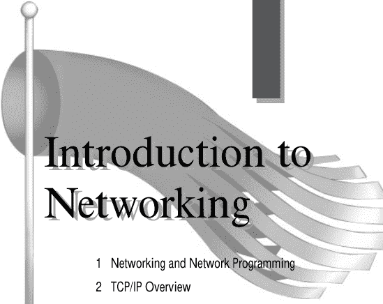

# 1

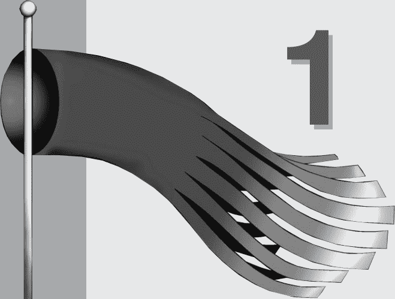

# 网络与网络编程

本书旨在向你介绍如何使用 Windows Sockets（WinSock）应用程序编程接口（API），为 Microsoft Windows 和 Windows NT 操作系统创建支持网络的应用程序。为此，书中将研究几个利用 WinSock 基本功能的实用示例。

Windows for Workgroups 和 Windows NT 等网络操作系统提供基本的文件和打印机共享服务。这种最基本级别的功能是“开箱即用”的。支持网络的应用程序是指利用一组相互连接的计算机所提供功能的程序。支持网络的程序包括在网络中的计算机之间传输数据的定制应用程序，以及实现电子邮件和远程数据库访问等功能的主流应用程序。WinSock API 是一个函数库，程序员可以利用它来构建这些支持网络的应用程序。WinSock 起源于 Berkeley 套接字，该套接字最初由 UNIX 的 Berkeley Software Distribution 引入。WinSock 使用 TCP/IP（传输控制协议/网际协议）协议套件，该协议套件规定了网络通信的正式行为规则，用于管理所有运行这一特定计算机网络协议的计算机之间的网络通信。

在开始研究网络编程之前，先来了解一下计算机网络的基本知识。网络可以宽泛地定义为两个或更多计算机的集合，这些计算机之间存在某种通信路径。网络大致可以分为局域网（LAN）或广域网（WAN）。使用*LAN*和*WAN*这两个术语有些容易产生误解，因为具体使用哪个术语取决于你所描述的特定网络安装环境。一般来说，LAN 覆盖的地理区域比 WAN 小得多。LAN 可能连接一栋办公楼内的计算机，而 WAN 则可能连接分布在全国各地的计算机。随着网络硬件和软件的发展，许多相距甚远的 LAN 现在可以连接起来，形成规模更大的同质 WAN。被称为*网桥*和*路由器*的设备可以实现这种不同 LAN 之间的连接。计算机网络并不是新事物，但直到大约 20 世纪 80 年代末，计算机网络才在个人计算机领域得到普及；当时，计算机公司开始为桌面 PC 提供经济实惠且可靠的网络功能。那时，PC 网络的主要目标是为文件提供集中存储库，并允许多个用户共享打印机。直到相对较近的时期，企业才真正认识到 PC 网络的全部潜力。

## 网络的目标

在过去几年中，PC 网络的目标不断扩展——从简单的文件和打印机共享，扩展到访问传真机、调制解调器以及企业范围的电子邮件系统。在此期间，网络的基本目标始终是共享资源，并提供通信媒介。

### 资源共享

在本节讨论中，网络资源是指网络上可供网络用户使用的设备或功能。连接网络资源的计算机称为服务器。通过网络访问这些资源的其他计算机称为客户端。如今，典型的 PC 网络用户已经把共享文件和打印机访问视为理所当然。不过，现在还可以向用户提供其他资源，其中包括传真机、调制解调器、计算服务器和数据库服务器。

#### 文件

PC 网络的传统用途一直是、并且可能始终会是充当文件存储库。例如，将文件存储在同事可以访问的公共位置，可以大幅提高工作效率。Microsoft 和其他厂商提供了多种实现这一功能的产品。Windows for Workgroups 就是其中一种产品。它被归类为对等网络，这意味着网络中没有专用的中央文件服务器。相反，网络中的任何计算机都可以与其他计算机共享文件；网络中的任何计算机都可以充当客户端、服务器，或同时充当两者。Windows NT 和 Windows NT Advanced Server 在这一理念的基础上进一步扩展，提供了更强大的文件共享功能和更完善的文件系统安全性。

图 1.1 显示了两台标记为 Computer A 和 Computer B 的计算机。两台计算机都可以访问 File and Print Server 上的文件，这些文件存储在服务器计算机中。为了说明中央文件服务器模型与对等模型之间的区别，请考虑以下场景：Computer A 的硬盘上有一个文件，希望让 Computer B 使用。在中央文件服务器模型中，Computer A 必须连接到 File and Print Server，将文件放到服务器的硬盘上，然后通知 Computer B 文件已经可用。随后，Computer B 连接到 File and Print Server，并访问由 Computer A 放置在那里​​的文件。在对等网络中，Computer A 只需授予 Computer B 权限，使其能够访问 Computer A 硬盘上的文件。

**图 1.1。**  
*文件和打印机资源共享。*

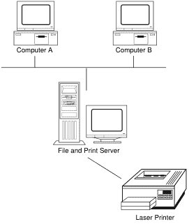

至少，带有文件服务器的计算机网络，无论采用集中式模型还是对等模型，都可以避免使用臭名昭著的“运动鞋网络”：用户先将所需文件复制到软盘上，然后拿着软盘走到指定接收者那里，从而在计算机用户之间传输文件。

#### 打印机

PC 网络的另一个常见用途是让所有网络用户都能使用打印机。这样显然可以减少昂贵打印机的数量，以及这些设备的维护和管理成本，从而大幅节约费用。Windows for Workgroups 和 Windows NT 都提供打印机共享功能。如图 1.1 所示，标记为 Computer A 和 Computer B 的两台计算机，以及 File and Print Server 计算机，都可以访问连接到 File and Print Server 的激光打印机。当坐在 Computer A 前的用户打印文档时，文档会被发送到 File and Print Server，并在那里打印。如果 Computer B 的用户试图打印文档，而 Computer A 的文档仍在打印，那么 Computer B 的文档会存储在 File and Print Server 上的临时位置。这个过程称为打印机假脱机。当属于 Computer A 用户的第一个打印作业完成后，属于 Computer B 用户的下一个作业就会开始打印。

基于 Windows NT 的网络完全支持对联网打印机进行远程管理。Windows NT 网络的管理员可以监控远程打印机的状态（例如查看是否缺纸），还可以操作等待打印的作业队列。例如，他可以暂停一名用户在 1:00 发送的打印作业，让另一名用户在 1:05 提交的打印作业优先打印。管理员还可以控制其他打印机选项，例如打印机每天哪些时段可用、网络中的哪些用户可以访问打印机，以及哪些用户的打印作业优先级高于其他用户。

#### 传真机

如今连接到计算机网络的传真“机器”，实际上只是能够与其他传真“调制解调器”和更传统的独立传真机通信的专用调制解调器。联网传真调制解调器具有多项优点。大多数最终需要通过传真发送的文档，都是使用计算机上的文字处理程序创建的，先通过传统激光打印机或点阵打印机打印出来，然后再送入传统传真机。联网传真调制解调器省去了最后两个耗时步骤，因为文字处理程序可以直接向传真设备“打印”。对于文字处理程序来说，大多数传真调制解调器看起来就像另一台打印机。当用户选择传真调制解调器作为要打印到的“打印机”时，系统会要求用户填写传真封面，其中包括收件人姓名和收件人传真机的电话号码。传真调制解调器还可以轻松地将传真发送给电话号码不同的多个收件人。

Microsoft at Work 传真软件是 Microsoft at Work 架构的一个组件（稍后将对此进行讨论）。该软件允许运行 Windows 的联网计算机共享连接到其中一台联网计算机上的传真调制解调器。

#### 调制解调器

与传真调制解调器不同，标准调制解调器现在也被用作 PC 网络上的共享设备。过去，经常需要进行调制解调器通信的用户必须拥有自己的个人调制解调器。但这种调制解调器往往大部分时间都没有得到充分利用。通过将多个调制解调器组成网络可访问的调制解调器池，更多用户可以使用调制解调器进行通信，而无需承担购买个人调制解调器的费用。当用户需要访问调制解调器时，可以从调制解调器池中申请一个，然后就像该调制解调器专属于自己一样使用它。使用完调制解调器资源后，这些资源会被释放，并提供给下一个提出请求的用户。图 1.2 显示了四台计算机和一个包含两台调制解调器的调制解调器池。Modem Pool Server 是负责管理调制解调器池的计算机。Computer A、B 和 C 都可以访问这些调制解调器。当 Computer A 请求使用调制解调器时，服务器会将该调制解调器从可用列表中移除。当 Computer B 请求调制解调器时，服务器会将第二台调制解调器分配给 Computer B。如果此时 Computer C 请求调制解调器，请求就会进入队列。一旦 Computer A 或 B 释放其“借用”的资源，Computer C 就可以使用被释放的调制解调器。


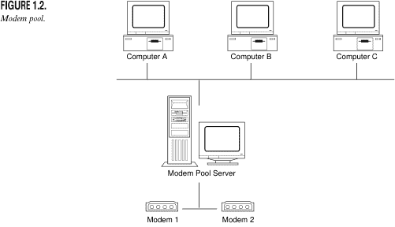

调制解调器访问也可以反向工作。远程用户可以拨入计算机网络。一旦登录到网络，远程用户就拥有与物理连接到网络的计算机用户相同的网络资源访问权限。Microsoft 的远程访问服务（RAS）为 Windows for Workgroups 和 Windows NT 提供了此功能。

## 计算服务器

某些 PC 网络上还可以连接另一种共享资源，即计算服务器。这种设备通常是一台非常强大的计算机，专门用于执行专门任务。例如，计算服务器可以针对卓越的浮点计算性能进行调优。计算服务器不一定适合作为通用计算机使用，因此用户从工作站或台式 PC 访问此资源。计算服务器的工作结果可以使用远程图形用户界面显示在本地台式 PC 上。该图形界面基于麻省理工学院开发的 X Window System。

利用计算服务器的另一种方式是在桌面应用程序中使用远程过程调用（RPC）。使用 RPC 时，桌面计算机上的应用程序调用恰好在远程计算服务器上执行的函数。函数完成后，结果返回桌面计算机，就像函数调用在本地发生一样。图 1.3 展示了一种可能的场景：一台强大的大型机计算服务器同时满足 X Window 工作站和使用 RPC 的 PC 的需求。

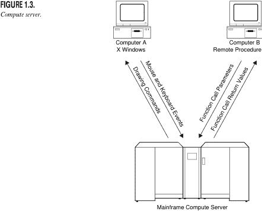

## 数据库服务器

联网的数据库服务器与计算服务器类似，但在当今商业环境中更为常见。借助这一网络资源，台式 PC 可以查询和修改向整个企业开放的数据库。图 1.4A 展示了一种可能的配置。坐在客户端计算机前的用户向数据库服务器发送查询。数据库服务器接收查询参数并处理请求。当数据库服务器完成必要的处理后，会向客户端计算机返回响应。这种配置称为客户端/服务器架构。客户端/服务器编程模型将在本章后面解释。

包括 Microsoft、Oracle 和 Sybase 在内的多家供应商提供面向高端客户端/服务器市场的数据库服务器。许多公司，如 Borland、Gupta、Microsoft、PowerSoft 和 Oracle，提供构建客户端/服务器解决方案客户端部分所需的工具。

当多个人需要访问相同信息时，客户端/服务器数据库尤其有用。这种架构之所以理想，是因为它允许不同地点（甚至可能位于地球两端）的人共享和修改共同的信息。客户端/服务器数据库架构不仅便于定位分散在不同地点的用户，还允许数据库位置自由安排。在这种场景下，如图 1.4B 所示，数据库可以维护在最有意义的位置。例如，在订单录入系统中，可能合理的做法是：由计费部门在一个数据库中维护客户记录，而由零件部门在另一个数据库服务器上存储的不同数据库中维护库存记录。在订单录入时，订单录入员可以访问这两个数据库并获取最新信息。

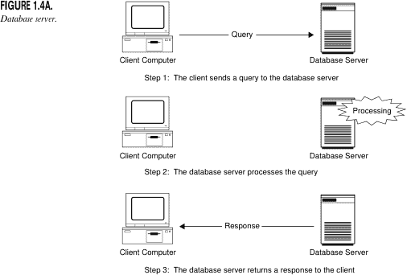

## 通信媒介

计算机网络还有一个互补且某种程度上重叠的目标，即充当通信媒介。从基本意义上说，如果不存在这种通信媒介，也就不会有前面所述共享任何网络资源的能力。不过，在此语境下，通信媒介使网络用户能够更好地相互沟通。为促进这种人与人之间的通信，人们构建了许多联网软件工具，其中包括电子邮件系统、工作组日程安排程序和电子表单处理系统。

**图 1.4B.** *部门数据库服务器。*

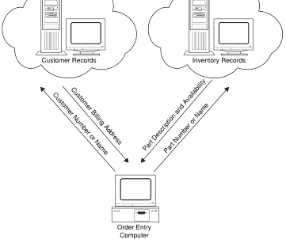

### 电子邮件

电子邮件（称为 *e-mail*）在运行 UNIX 操作系统衍生版等大型计算机系统的领域已被广泛接受。PC 网络现在也具备电子邮件功能。电子邮件不仅可以在 PC 网络用户之间共享，还可以路由到基于高端工作站或多用户计算机的其他网络上的用户。这一能力意味着，商业环境中的所有计算机用户都可以相互使用电子通信，同时仍能使用最佳的计算机和操作系统组合来履行其主要工作职责。

现代电子邮件系统已进一步扩展，因此可以发送嵌入或附加的对象。这些对象可以简单如附加文本信息，也可以多样如可在计算机上播放的视频演示或财务电子表格。当收件人阅读电子邮件时，附件即可立即使用。

Windows for Workgroups 和 Windows NT 捆绑了电子邮件支持。

### 电子表单

借助电子表单，组织可以轻松交换结构化信息。电子表单相当于现代版的纸质印刷表单。表单的一个简单例子是秘书可能会填写的流行“外出留言”（While You Were Out）消息。通过将电子表单与电子邮件系统结合，你的消息会以格式美观、标准化的电子邮件形式出现，而不是散落在办公桌上的纸片。电子表单的另一种用途可能是销售人员在现场用笔记本电脑录入客户订单。随后，电子表单要么使用调制解调器立即传输到主机，要么在营业日结束时以批处理模式传输当天所有订单。

### 工作组日程安排

工作组日程安排帮助同事管理时间并更有效地相互沟通。网络日程安排程序使网络计算机用户能够查看和修改彼此的日程计划。这一能力使安排小组会议、进行个人预约以及向有空闲的人员分配任务变得更加容易。Microsoft 的 Windows for Workgroups 和 Windows NT 包含一个具有此能力的日程安排程序。

### 聊天

聊天实用程序可以取代电话通话，用于简单的一对一或一对多通信。在基于 UNIX 的操作系统下，聊天实用程序称为 talk。在 Windows 和 Windows NT 环境中，聊天实用程序称为 Chat，通过运行 WINCHAT.EXE 程序来执行。使用这两个程序，你都可以连接至少一个其他网络用户，然后来回键入消息。

### 万维网与 Mosaic

在更全球化的层面上，万维网（WWW）正日益普及。WWW 始于 CERN，即欧洲粒子物理实验室。其最初目的是促进粒子物理学家之间的交流。WWW 是一个分布式系统，用户可以通过它访问各种类型的文档，从简单的文本文件到以 GIF 或 JPEG 格式存储的图形图像。数据中可能包含指向其他相关数据的链接。通过遍历这些链接，可以找到关于特定主题的信息。这种全球范围的连接之所以成为可能，是因为 Internet，它是由估计 200 万个分布在世界各地的互连计算机系统组成的集合。

要遍历这个通常被称为 Web 的网络，用户需要复杂的 Web 客户端或浏览器。浏览器的职责包括遍历链接、检索各种类型的数据，并为这些数据提供查看器。现有最好的 Web 浏览器之一是 Mosaic，它由美国国家超级计算应用中心开发。图 1.5 显示了用于 Windows 的 Mosaic 连接到 Microsoft 为支持其产品而提供的一台计算机。将鼠标光标指向文件夹并单击鼠标按钮，会使 Mosaic 用新选定文件夹的信息重绘屏幕。当用户看到想要的数据文件时，再单击鼠标即可将文件检索到用户机器上；如果有合适的查看器可用，文件会显示出来，否则会保存到磁盘以供稍后查看。

Web 甚至正在企业内部找到用武之地。存储在 Web 站点上的数据本质上是跨平台的。这意味着公司可以只制作一次文档（可能包含多媒体类型的扩展），并让该文档可供 Windows、Macintosh 或 UNIX 计算机的用户查看。所需要的只是每个平台上的一个 Web 浏览器。

**图 1.5.** *Mosaic。*

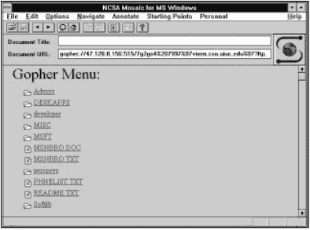


## 即将推出

未来将带来更多联网选项。其中一个令人振奋的发展领域是无线通信。无线通信通常与个人数字助理（PDA）的概念联系在一起，它将使用户能够从地球上的任何地方访问企业网络。想象一下，坐在海滩上也能查看电子邮件。

另一个值得关注的领域，尤其是对 Microsoft 而言，是让网络资源更容易共享和使用。为实现这一目标，Microsoft 于 1993 年启动了 Microsoft at Work 计划。前文讨论过的 Microsoft at Work 组件之一是 Microsoft at Work 传真软件，网络用户可以借助它直接通过桌面计算机发送传真和计算机文件。很快，我们还将看到其他支持 Microsoft at Work 的设备，例如电话和复印机。这些设备将配备触摸屏，并采用简化的 Windows 界面，同时也可作为网络资源使用。例如，使用支持“At Work”的复印机时，网络用户可以直接从自己喜爱的文字处理程序发送打印任务，并按要求打印、整理和装订所需数量的副本。

随着网络日益复杂、可处理的网络流量不断增加，视频会议将变得更加可行。视频会议通常需要使用支持多媒体的计算机，并配备摄像头和麦克风。在这种配置下，两个或更多用户可以彼此看见、听见，也可以像使用过时的 Chat 类型实用程序那样来回发送文字消息。将视频会议与联网的“白板”实用程序相结合后，网络用户便能在白板上查看和操作计算机生成的视觉数据；即使同事身处不同办公室、不同州，甚至不同国家，也能共同协作。不过，要实现这一点，可能还需要一段时间，毕竟目前还没有那么大的网络带宽。

## 网络拓扑

前面的章节介绍了计算机网络的功能。那么，文件、打印、传真和计算资源是如何连接起来，从而让典型的台式计算机能够访问它们的呢？网络拓扑指的是联网计算机和网络资源的连接方式。最常用的三种拓扑是总线型、环型和星型。请注意，下面的网络拓扑图展示的是相应拓扑的逻辑视图，不一定与网络中的物理（电气）连接方式相符。

### 总线网络

如图 1.6 所示，总线网络拓扑将每台计算机连接到一条电缆上。电缆的两端各有一个终端电阻，也称为终端器。电信号沿着电缆在两台终端器之间来回传送，并经过各台计算机。总线将消息从网络的一端传送到另一端。消息经过每台计算机时，该计算机会检查消息中的目标地址。如果消息中的地址与计算机自身的地址相符，该计算机就会接收消息；如果地址不符，总线便会将消息传送给下一台计算机，依此类推。

总线拓扑是被动式的，这意味着计算机只监听网络上发送的数据，而不负责将数据从一台计算机传送到另一台。如果一台计算机发生故障，不会影响整个局域网。另一方面，如果电缆断裂，整个电缆段（即两台终端器之间的长度）都会失去连接，因此在电缆修复之前，整个网段都无法正常工作。

连接到总线网络的每台计算机都可以在自己“想要”时传输数据。这意味着两台计算机可能会尝试同时传输数据，这种情况称为冲突。发送计算机的网络硬件会检测到冲突。一旦检测到冲突，引发冲突的数据包就会重新传输。

总线网络的局限在于，数据传输速度会受到网络中计算机数量的影响。网络中添加的计算机越多，发生冲突的可能性就越大。冲突越多，重新传输就越频繁，整体网络性能也会随之下降。

以太网是许多局域网中常见的一种总线网络。它也是目前最受欢迎的局域网架构。

| 注释 |
|---|
| 以太网由施乐公司于 1972 年开发，是对夏威夷大学一项研究的后续成果。以太网于 1975 年首次投入商业应用，当时其传输速率为 2.94 Mbps，可通过一条 1 千米长的电缆连接多达 100 台计算机。施乐以太网很快受到欢迎；随后，施乐与英特尔公司和数字设备公司合作，将以太网的传输速率提升到了 10 Mbps。如今，100 Mbps 以太网正日益普及。 |


以太网可以使用不同类型的电缆布线，每种电缆都有各自的优缺点。以太网拓扑有三种常见规格：10BASE2 使用细同轴电缆（Thinnet），信号传输距离最长约为 607 英尺；10BASE5 使用粗缆（Thicknet），信号传输距离约为 1,640 英尺；10BASE-T 使用非屏蔽双绞线，计算机与其所连接的集线器之间的传输距离约为 328 英尺。

**图 1.6。**  
*总线网络。*

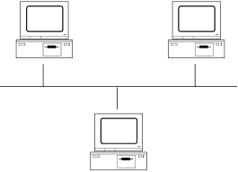

### 环形网络

图 1.7 展示了环形网络。在环形网络中，数据包（通常称为令牌）会沿着环路不断从一台计算机传送到下一台。要发送数据，网络中的计算机必须等待循环传送的令牌经过。令牌到达时，计算机会检查它是否为空。如果令牌为空，想要发送数据的计算机就会将数据添加到令牌包中，并为该数据包指定目标地址。令牌经过目标计算机时，该计算机会查看地址；由于消息发给了自己，它便会提取数据，并将令牌包中的数据替换为送达确认消息。随后，令牌继续沿环路传送，最终返回发送计算机。发送计算机会检查令牌包，确认其中包含自己发送的数据还是确认消息。如果没有找到确认消息，发送方就知道数据未能送达，这可能是因为目标计算机没有运行。随后，发送方会清除令牌包，并将其沿环路继续传送，让后续计算机也有机会使用网络的通信资源。令牌传递方案与总线拓扑不同：在总线拓扑中，任何计算机都可以随时发送数据，因此协议必须检测冲突。环形网络不会发生此类冲突。

**注释**

最早的令牌环网络设计被认为出自 E. E. Newhall，他于 1969 年提出了该设计。IBM 于 1982 年 3 月首次公开支持令牌环拓扑，并于 1984 年推出了首款令牌环网络产品。

IBM 令牌环网络的数据传输速率为 4 或 16 Mbps，具体取决于实际实现方式。为了使计算机彼此通信，所有网卡都必须采用相同的配置，以便在网络上以 4 或 16 Mbps 的速率通信。联网计算机通过屏蔽双绞线和/或非屏蔽双绞线连接到一个布线集中器，这种集中器称为介质访问单元（Media Access Unit，MAU，读音与 cow 押韵）。每个 MAU 最多可支持 72 台使用非屏蔽线缆的计算机，或 260 台使用屏蔽线缆的计算机。每个环路最多可连接 33 个 MAU，因此网络中的计算机理论上最多可达 8,580 台。

**图 1.7。**

*环形网络。*


### 星形网络

如图 1.8 所示，在星形网络中，两台计算机之间传输数据时，数据必须经过位于中心的计算机，即集线器。集线器提供公共连接，使所有计算机能够彼此通信。要扩展星形网络，可以将多个集线器连接起来。星形网络的主要问题是，如果位于中心的集线器无法运行，整个网络就会无法使用。星形网络的一个优点是，除了位于中心的集线器外，没有其他计算机能够中断网络流量。


应用程序通过网络应用程序编程接口（如WinSock）进行通信。如果所开发的应用程序有特殊要求，如容错或保证响应时间，应用程序程序员就需要关注这些细枝末节。程序员可能还需要关心底层网络硬件。前面提到过，以太网是总线型网络的一个例子。有些网络可能并不像图1.6看起来那么简单。随着多个局域网互连，以及广域网链路（如卫星提供的链路）的加入，网络拓扑结构成为网络应用程序程序员需要考虑的问题。例如，你不能假设数据能在100毫秒内到达目的地。最好的建议是让你的网络程序尽可能可配置、健壮，尤其是在超时值方面。

### 图1.9 网络互联

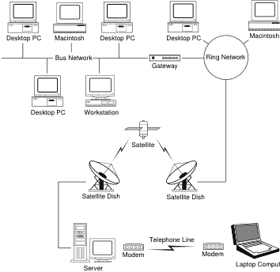

以图1.9为例，这是一种需要灵活网络应用的网络配置。如果服务器充当数据库服务器，它必须为总线网络、环形网络和电话线上的客户端计算机提供服务。例如，总线网络上Macintosh的访问时间与使用9600波特调制解调器拨号上网的笔记本电脑的访问时间是不同的。

应用程序程序员应让服务器在与其服务的许多其他计算机通信时意识到性能上的差异。那些其他计算机也必须了解它们与服务器的连接方式。在笔记本电脑上运行的客户端软件可能对数据库访问有5秒的超时时间，而总线网络上Macintosh可能需要10秒的超时时间，以弥补卫星链路引入的延迟。在网络应用开发周期早期关注此类细节，可能会避免以后许多麻烦。

## 网络编程模型

上一节讨论了计算机和其他资源如何连接到网络。但现在我们已经有了可以相互通信并共享公共资源的联网计算机，我们该怎么做呢？我们需要能够利用网络的软件。本节开始讨论网络编程。网络编程可以认为有两个主要语境：客户端/服务器和分布式。

### 客户端/服务器计算

在客户端/服务器计算模型中，应用程序被分成两部分：一个前端客户端，向用户展示信息并收集用户信息；一个后端服务器，存储、检索和操作数据，并通常处理客户端的大多数计算任务。在这种模型中，服务器通常是比客户端更强大的计算机，往往是小型机或大型机，并充当许多客户端计算机的中央数据存储，使系统易于管理。客户端/服务器架构结合了独立PC机和小型机、大型机的优点，从而提高了工作组的生产率。客户端/服务器架构充分利用了高端服务器硬件，并减少了客户端PC的负载。而负载的减少反过来又提供了卓越的性能，并最大限度地减少了网络流量。图1.4A展示了客户端访问数据库服务器的客户端/服务器交互示例。

服务器是在联网计算机上运行并能提供服务的任何程序。服务器通过网络接收请求，执行必要的处理来服务该请求，并将结果返回给请求者。客户端是向服务器发送请求并等待响应的程序。

要使客户端和服务器通信并协调工作，需要进程间通信（IPC）设施。本书的主题WinSock可以用来满足这一需求。第15章“实用客户端/服务器数据库应用”介绍了一个示例，将演示客户端和服务器的数据库实现。

一个服务器程序可以同时处理多个客户端请求。因此，实现服务器往往比实现客户端更困难。为了提供同时支持多个客户端请求的能力，服务器通常由两部分组成：一个接受请求的单个主控程序，以及一个或多个实际处理并响应各个请求的从属程序。

客户端/服务器架构与典型大型机安装所推广的经典集中式架构形成对比。在集中式环境中，“客户端”不过是在作简单数据输入/显示设备的哑终端。终端上完成的工作极少。用户通常在发送字段数据到中央计算机之前填写表单字段。所有处理和屏幕格式化都在中央计算机上完成，哑终端只是显示预先格式化好的数据。在客户端/服务器环境中，客户端有更强的智能，并且在向用户最终呈现在视觉展示方面有更多的自由。数据不是预先格式化为与查看方式相匹配，而是以“原始”格式发送回客户端，由运行在客户端计算机上的应用程序“决定”如何显示这些数据。因此，用户看到的“前端”可以定制，而“后端”保持不变。

### 分布式计算

分布式架构可以有两种不同的理解方式：预收集和并行处理。

*预收集*是指网络计算机上的后台进程在信息被请求之前并发地收集和传播信息的行为。例如，一个请求本地网络上其他每台计算机状态的程序。在客户端/服务器环境中，客户端程序将不得不向网络上的每台计算机发送请求并等待响应。这个过程可能非常耗时。在分布式实现中，本地网络上的每台计算机都会有一个持续在后台运行的进程，并定期向其他每台计算机报告状态信息。当运行程序请求本地网络上其他每台计算机的状态信息时，响应会立即返回，因为信息已经在每个本地计算机中被预先收集了。当然，如果所请求的信息对时间敏感，这种解决方案就效果不佳，因为更新延迟会使响应过时。缩短联网计算机发送更新之间的间隔同样效果不佳，因为这有可能使网络的数据处理能力饱和。

当大多数人想到并行处理时，他们想到的是拥有多个处理单元的计算机。在分布式系统环境中，*并行计算*意味着利用网络上多台计算机来执行特定任务。假设你是一名软件开发人员，想在深夜进行大型项目构建，而此时几乎没有其他程序员在工作。利用每个程序员的工作站或台式PC中那些空闲的处理能力，岂不是很好？如果有一个专为分布式环境设计的构建工具，你的构建可以并行执行——某些模块在某个计算机上编译，而其他模块在其他计算机上编译。项目构建可以在大大缩短的时间内完成。这假设参与构建的源代码位于网络的某个位置，并且所有其他计算机都能像你自己的计算机一样容易访问它。如果源代码位于你的本地计算机上，将源代码通过网络传输到其他计算机的开销可能会超过同时构建多个模块带来的好处。

## 小结

本章讨论了计算机网络和网络编程的基础知识。大多数计算机网络的主要目的是允许共享文件、打印机、调制解调器和传真机等资源，并促进使用联网计算机的人员之间的通信。网络拓扑指的是联网计算机和网络资源相互连接的方式，最流行的拓扑是总线型、环形和星形。为了利用网络的连接性，需要使用网络感知的应用程序软件。客户端/服务器和分布式模型是编写网络软件时遵循的两种流行方法。为了编写这种网络软件，程序员使用网络应用程序编程接口（API）。本书重点介绍的这样一种网络API就是WinSock。接下来的两章将讨论TCP/IP、WinSock的基础以及WinSock本身。


计算机网络协议是管理网络通信的正式行为规则。传输控制协议（TCP）和互联网协议（IP）只是互联网协议族所包含的数据通信协议中的两种。这个协议族通常被称为 TCP/IP，因为 TCP 和 IP 是该集合中最重要的两种协议。TCP/IP 包含一套标准，规定了联网计算机如何进行通信以及数据如何在互联的计算机之间路由。

TCP/IP 为应用程序员提供两种主要服务：无连接数据包传送和可靠的数据流传输入。本章稍后将详细讨论这些内容。TCP/IP 具有几个显著特点，使其广受欢迎，包括：

- 网络拓扑无关性。TCP/IP 可用于总线型、环型和星型网络，既适用于局域网，也适用于广域网。
- 物理网络硬件无关性。TCP/IP 可以利用以太网、令牌环或任意多种物理硬件变体。
- 开放协议标准。TCP/IP 协议族的标准是免费提供的，可在任何计算机硬件平台或操作系统上独立实现。TCP/IP 的广泛接受性，以及它可用于从超级计算机到台式个人电脑等各种平台这一事实，使其成为整合不同硬件和软件的理想协议集。
- 通用寻址方案。TCP/IP 网络上的每台计算机都有一个唯一标识它的地址，因此任何支持 TCP/IP 的设备都能与网络上的其他设备通信。在 TCP/IP 网络上发送的每个数据包都有一个报头，其中包含目标计算机的地址和源计算机的地址。
- 强大的客户端-服务器框架。TCP/IP 是运行在局域网和广域网中的强大而稳健的客户端-服务器应用程序的框架。
- 应用协议标准。TCP/IP 不仅为程序员提供了一种在自定义应用程序之间通过网络移动数据的方法，还为许多应用层协议提供了基础，这些协议实现了电子邮件和文件传输等常见功能。

Windows Sockets 库的当前版本基于 TCP/IP 构建，尽管 WinSock 本身并无任何内在因素阻碍其使用其他协议栈。事实上，下一版本的 WinSock 正在开发中，它将支持 Novell 的 IPX/SPX、Apple 的 AppleTalk 以及其他流行的网络协议。

> **注意**
>
> 术语*协议栈*已经多次提到。它指的是包括 TCP/IP 在内的某些网络通信协议的组成方式——这些协议由多个逻辑软件层构成，每一层都与其正上方和正下方的层进行通信。在这个栈的顶端是应用层，也就是你作为应用程序员所提供的那一层。栈的底部通常被认为是与网络硬件（即以太网或令牌环）通信的那一层。下一节“ISO OSI 协议栈”将给出协议栈更完整的定义。

# TCP/IP 历史

TCP/IP 协议族的历史可以追溯到最早期的广域网之一，该网络由来自不同制造商、运行不同操作系统的计算机组成。

## ARPANET

这个实验性网络被称为 ARPANET，其开发由美国国防部高级研究计划局（DARPA）于 1969 年资助，目标是创建一个能在不同厂商的计算机之间提供稳健数据通信的网络。在 ARPANET 之前，大多数计算机网络都是同构的，由来自同一硬件制造商、运行相同操作系统的计算机组成。

ARPANET 的受欢迎程度日益显现。1975 年，它从一个实验性网络转变为一个完全投入运行的网络，用于连接站点研究人员之间的日常通信。但网络协议的研究仍在继续，并最终产生了互联网协议族。1983 年，TCP/IP 协议被采纳为军用标准，所有连接到 ARPANET 的计算机都被要求采用新协议。随后 ARPANET 被分成两个网络：MILNET，用于非机密军事通信；以及新的、规模小得多的 ARPANET，用于进一步的研究。MILNET 和 ARPANET 合在一起被称为互联网。

## 伯克利软件发行版

DARPA 还希望通过接入大学计算站点来扩大互联网。当时，大多数大学计算机科学系都在运行一种 UNIX 操作系统版本，该版本由加州大学伯克利分校开发。这个 UNIX 实现被称为伯克利软件发行版（Berkeley Software Distribution），即 BSD UNIX。DARPA 资助 Bolt Beranek and Newman 公司为 UNIX 实现 TCP/IP，并资助伯克利将协议纳入其软件发行版。这项资助，加上许多大学计算机科学系正在增加需要互联的计算资源这一事实，几乎保证了 TCP/IP 拥有广泛的受众。

BSD UNIX 的程序员并没有简单地照搬 Bolt Beranek and Newman 提供的 TCP/IP。他们为应用程序开发者增加了一个抽象层，称为套接字（sockets）。WinSock 正是基于套接字，它使应用程序员能够轻松编写网络代码。BSD 程序员还在其 UNIX 中添加了几个实用程序，这些程序建立在独立计算环境中已有的命令之上。例如，引入了新的远程复制命令 `rcp`。该命令将名为 `cp` 的标准复制命令扩展到网络中。诸如此类具有网络感知能力的实用程序，以及它们所带来的强大功能，帮助 BSD UNIX 及其 TCP/IP 获得了广泛接受。

随着 BSD UNIX 在大学中的普及，互联互联网的规模不断增长。BSD 纳入这些协议后，TCP/IP 很快得到了更广泛的接受，导致互联网的增长率达到了天文数字，至今仍未达到顶峰。1983 年，互联网只连接了少数计算站点。如今，互联网连接了遍布全球的 200 万台计算机和 4000 万人。


> **注意**
>
> *互联网*（internet）一词的使用有时会令人困惑，因为它被随意用来表示许多不同的东西。TCP/IP 是互联网协议族的另一个名称。TCP/IP 和 Internet 协议可以互换使用。最初，如果说某个计算站点有一个互联网（internet），意思是该站点有两台或更多联网计算机，它们之间使用互联网协议。现在，*internet*（注意小写*i*）一词用于指代任何由物理上分离但共享相同通信协议（不一定是 TCP/IP）的网络组成的集合，这些网络在逻辑上表现为一个单一网络。*Internet*（注意大写*I*）一词用于指代全球范围内运行 TCP/IP 协议的互联计算机网络集合。

## 征求意见稿（RFC）

没有任何一家公司或团体“拥有”TCP/IP。这些协议可以自由分发，任何人均可将其纳入自己的操作系统或计算机网络。你可能会想，TCP/IP 是如何扩展的，前面提到的应用协议又是如何开发的。答案就在互联网征求意见稿（RFC）中。

RFC 提供了一种非正式的建立新 TCP/IP 协议标准的方法。RFC 通常以互联网草案的形式开始。在互联网社区有机会评论草案之后，它才成为 RFC。RFC 按顺序编号，因此后来的 RFC 编号高于早期创建的 RFC。有些 RFC 取代了早期的 RFC，但新的 RFC 总会注明这一点。

RFC 的编号由 SRI International 的一个名为网络信息中心（Network Information Center，简称 NIC，发音为“nick”）的组织分配。NIC 由国防通信局（DCA）资助，该机构管理着军方的计算机网络基础设施。NIC 不仅负责 RFC 的编号，还负责 TCP/IP 协议的存储和分发、互联网地址的分配，以及联网计算机名称的注册。

RFC 的一个例子是 RFC 742，它定义了 finger 协议。finger 协议通常由用户使用 finger 程序访问。finger 允许用户查找特定联网计算机上某个特定用户的信息，或特定联网计算机上所有用户的信息。finger 协议描述了用户运行的 finger 客户端程序与持续运行在被“finger”的计算机上的 finger 服务器之间必须进行的通信。你将在后面的章节中为 Windows 构建一个 finger 客户端程序。

## ISO OSI 参考模型

一个名为国际标准化组织（ISO）的团体引入了开放系统互连（OSI）参考模型，这是一种分层网络架构，其目标是实现计算机网络协议的国际标准化。OSI 模型被称为开放系统架构，因为它连接的是对其他系统开放通信的计算机系统。所连接的计算机系统不必来自同一制造商，也不必运行相同的操作系统。TCP/IP 和 OSI 模型在这方面有相似之处。


程序将被压缩，应用程序“负责”压缩和解压缩。实际上，传输层被吸收到应用程序中，而不是像在 OSI 模型中那样作为一个单独的实体存在。不过，为了方便讨论，你仍然可以把传输功能看作一个逻辑层。

### 传输层

传输层提供端到端的数据传送。OSI 模型的会话层和传输层对应于 TCP/IP 体系结构中的这一层。OSI 的会话连接概念可与 TCP/IP 的套接字机制相比。TCP/IP 套接字是通信的一个端点，由一台计算机的地址和该计算机上的一个特定端口组成。OSI 的传输层在 TCP/IP 的 TCP 中有对应物。TCP 提供可靠的数据传送，并保证数据包按发送顺序到达，不重复，也没有数据损坏。

### 网际层

网际层定义数据报并处理数据报的路由。数据报是由 IP 协议操作的数据包。数据报包含源地址、目的地址和数据，以及其他控制字段。该层的功能相当于 OSI 的网络层和数据链路层的功能。IP（即 TCP/IP 中右侧的 IP）类似于网络层。它负责对上层隐藏底层网络，还处理数据报的寻址和传送。数据链路层通常不在 TCP/IP 体系结构中表示，但可以使用 IP 来支持这一功能。

### 物理层

TCP/IP 不试图定义底层网络的物理连接。相反，它利用诸如电气电子工程师协会（IEEE）等组织提供的现有标准，这些标准定义了数据通信中使用的 RS232、以太网和其他电子接口。

数据包在 TCP/IP 网络中各层之间的移动如图 2.3 所示。当发送一个数据包时，它传到传输层，在那里添加传输层首部。接着网际层添加其首部。最后，物理层附加其首部。当接收到一个数据包时，过程相反，最终使应用程序接收到所需的数据。

**图 2.3.** 数据通过 TCP/IP 各层的移动。

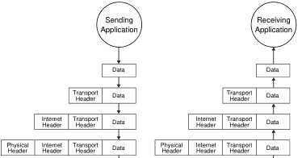

## TCP/IP 寻址方案

前面描述的 TCP/IP 的一个显著特征是其通用寻址方案，即 TCP/IP 网络上的每台计算机都有一个唯一标识它的地址。这种通用寻址方案甚至扩展到全球互联网，连接着超过两百万台计算机，这些计算机连接到数千个独立网络。

IP 负责在 TCP/IP 联网计算机之间传送数据报。为了使这种传送成为可能，每台计算机都有一个由 32 位数字组成的唯一 IP 地址。IP 地址包含足够的信息来唯一标识一个网络以及该网络上的特定计算机。

### 网络类别

由于一台计算机的 IP 地址必须不仅唯一标识该计算机，还要唯一标识该计算机所连接的网络，因此 IP 地址被划分为网络标识符（net id）部分和主机标识符（host id）部分。这两个标识符之间的划分并非对所有 IP 地址都相同。地址的类别决定了 IP 地址中有多少位保留用于网络标识，以及多少位保留用于主机标识。IP 地址有五个类别，其中只有前三个与大多数用户相关。A、B 和 C 类用于一般用途；D 和 E 类保留用于特殊目的和未来使用。图 2.4 显示了 IP 地址的格式。

**图 2.4.** IP 地址格式。

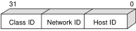

就应用程序员而言，A、B 或 C 类地址之间不存在可察觉的差异。具有 A 类地址的计算机可以与具有 C 类地址的计算机通信，就像 A 类计算机可以与另一台具有 A 类地址的计算机通信一样。表 2.1 显示了不同类别可存在的最大网络数和主机数。

**表 2.1. IP 地址类别分配。**

| 网络类别 | 网络数 | 每个网络的主机数 |
|---|---:|---:|
| A | 126 | 16,777,214 |
| B | 16,382 | 65,534 |
| C | 2,097,150 | 254 |

并非所有网络标识符或主机标识符都可供使用。有些地址保留用于特殊用途。如果将表 2.1 与以下类别描述进行比较，你会看到并非所有位组合都包含在表 2.1 的计数中。

#### A 类

A 类 IP 地址由最高位为零来标识。接下来的最高 7 位标识网络。剩余的 24 位标识主机。


#### B 类

B 类 IP 地址由最高位为 1、次高位为 0 来标识。接下来的最高 14 位标识网络。剩余的 16 位标识主机。


#### C 类

C 类 IP 地址由最高位序列 110 来标识。接下来的最高 21 位标识网络。剩余的 8 位标识主机。

**图 2.7.**  
*C 类 IP 地址格式。*

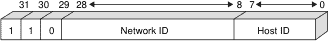

## 点分十进制表示法

如果 IP 地址的格式听起来令人困惑，不用担心。IP 地址通常用点分十进制表示法表示。IP 地址的点分表示法由 4 个 0 到 255 范围内的十进制值组成，这些值用句点或点（.）分隔。每个值表示 IP 地址的 8 位。这 4 个值合起来就是 IP 地址的 32 位。

我将用我计算机的 IP 地址作为例子。其点分十进制格式的地址是 166.78.4.139。图 2.8 显示了该 IP 地址的二进制解释。第 31 位是 1，因此这表明该计算机属于 B 类或 C 类网络。第 30 位是 0，表明该计算机确实属于 B 类网络。前面关于网络类别的讨论说，B 类地址允许 14 位用于网络 ID 部分，16 位用于主机 ID 部分。分隔网络部分和主机部分的界线位于第 15 位和第 16 位之间。你可以将其理解为该计算机位于网络 166.78 上，并且是主机 4.139。

**图 2.8.**  
*IP 地址解码。*

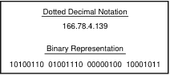


**注意**

> 如果记住计算机的点分十进制表示法仍然听起来太令人困惑，请继续读下去：TCP/IP 的实现者意识到人类需要一种简单的方法来访问这些信息，因此他们设计了一种方法，用容易记住的文本名称来象征 IP 地址。名称到 IP 地址的转换由多种方法支持，其中最简单的是纯 ASCII 文件，该文件的每一行左侧是点分十进制表示法的 IP 地址，右侧是文本名称。这个文件通常命名为 `hosts`，被称为*主机文件*。

主机文件的实现对于计算机相对较少的小型网络来说很好，但随着网络增长到数千台主机（如互联网或任何大型企业网络），这种文件的管理会变得笨拙或不可能。在这种环境中，会使用*名称服务器*。*名称服务器*是一台提供名称到 IP 地址解析的计算机。当将某个名称转换为 IP 地址的请求到达名称服务器时，它会进行数据库查找，看是否有此信息。如果没有，请求会被传递给权威服务器。*权威服务器*维护着由负责 IP 地址分配的组提供的官方数据。

## 子网划分

子网划分是一种在本地修改网络位和主机位使用方式的方法。通过移动分隔主机 ID 部分和网络 ID 部分的界线，可以在减少每个网络上的最大主机数的同时创建更多网络。子网掩码用于定义新的分界线。它用点分十进制表示法表示，方式与 IP 地址非常相似。设置为 1 的位表示网络部分；其余设置为 0 的位表示主机部分。

前面我确定我计算机的 IP 地址位于网络 166.78 上，主机 ID 为 4.139。严格来说这是正确的。但事实证明，我所在站点的网络管理员决定使用 255.255.255.0 的网络掩码，将地址空间逻辑划分为更多网络。从逻辑视图来看，我的网络 ID 是 166.78.4，主机 ID 是 139。另一种说法是，我的计算机是子网 166.78.4.0 上的主机 139。注意低序字节是 0。在我的完整 IP 地址和子网掩码之间执行逻辑 AND 运算，得到子网 166.78.4.0。剩下的部分——139——就是主机部分。

**提示**

> 子网掩码不必按 8 位边界均匀划分。例如，假设我的子网掩码是 255.255.255.128。在这个子网掩码和 166.78.4.139 之间执行逻辑 AND 运算，得到 166.78.4.128，剩余部分为 11。因此我的计算机将是子网 166.78.4.128 上的主机 11。


## NIC 与 Internet IP 地址

现在你应该明白，IP 地址空间是一种有限资源。你还了解到，任何连接到全球 Internet 的计算机都必须拥有唯一的 IP 地址。网络信息中心（NIC）是负责分配 IP 地址和域名的机构。要获得正式的 IP 地址并使主机名得到正式认可，你必须向 NIC 注册。根据你的需求，NIC 很可能会为你分配 B 类或 C 类网络标识符。A 类网络空间非常稀少——请记住，可能的 A 类网络只有 126 个——而且几乎已经耗尽。

注册时，你还需要选择一个域名。域名被组织成一种层次结构，根级域位于最顶层。美国的顶级域包括

-   COM 用于商业组织
-   EDU 用于教育组织
-   GOV 用于政府组织
-   MIL 用于军事组织
-   NET 用于网络支持组织
-   ORG 用于不属于任何其他类别的组织

其他顶级域通常保留给国家代码。例如，英国属于顶级域 UK，澳大利亚属于顶级域 AU。

我的个人计算机的 IP 地址为 166.78.4.139，其完全限定名称为 GOOBER.PING.COM。它是 PING.COM 域的成员，而 PING.COM 域又是顶级域 COM 的成员。图 2.9 显示了到目前为止提到的域的层次表示。

**图 2.9.** *域层次结构。*

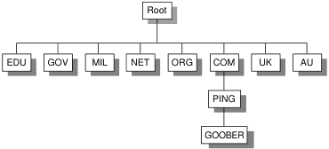

## 路由

路由是以尽可能高效的方式将数据包从一台计算机发送到另一台计算机的方法。路由过程由以下几个部分组成：

-   确定源计算机与目标计算机之间有哪些可用路径
-   在源计算机与目标计算机之间选择“最佳”路径，其中“最佳”的含义可能因目标不同而不同
-   使用这些路径到达其他计算机
-   调整数据报格式，以适应底层物理网络技术

在 TCP/IP 网络中，路由由 IP 层执行。IP 层使用目标计算机 IP 地址的网络 ID 以及子网掩码来做出路由决策。

### 默认网关

在互连计算机网络或互联网中，需要某种方法将数据交付给位于另一个相连网络上的计算机。通过指定默认网关，发送方计算机的 IP 层“知道”应将目标不在本地网络上的数据转发到哪里。图 2.10 展示了一个简单的网络布局。当 166.78.4.139 向 166.78.4.10 发送数据时，IP 层会取子网掩码（在此例中为 255.255.255.0），并对源 IP 地址和目标 IP 地址执行逻辑 AND 运算。在此例中，两个地址的结果均为 166.78.4.0，这告诉 IP 层两台计算机位于同一子网。数据被直接发送到 166.78.4.10。当 166.78.4.139 向 166.78.1.5 发送数据时，IP 层再次使用子网掩码，得到源地址结果为 166.78.4.0，目标地址结果为 166.78.1.0。这些数字不匹配，向 IP 层表明这些计算机位于不同子网。发送方计算机不能直接发送到 166.78.1.5。数据必须先发送到默认网关，默认网关是一台拥有两个 IP 地址并位于两个不同子网上的计算机。数据首先被发送到 166.78.4.2，然后被转发到 166.78.1.5。

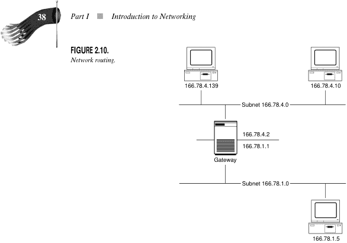

### 多个默认网关

也可以有多个默认网关。在这种配置下，子网不依赖单个网关通往相连网络。相反，数据可以使用多条路径离开源子网。IP 层使用子网掩码、网关的 IP 地址以及目标计算机的 IP 地址来决定从发送方到接收方的最有效路由。

## 网际层

网际层如图 2.2 所示。它定义数据报并处理这些数据报的路由。IP 是 TCP/IP 协议族中最重要的协议，因为所有其他 TCP/IP 协议都要使用它，并且所有数据都必须流经它。IP 也被视为 Internet 的构建基础。

尽管应用程序员通常看不到这一层，但简要概述一下是有益的。

### IP

IP 是一种无连接协议，这意味着在传输数据之前不会建立端到端关联。这与面向连接的协议形成对比，后者在传输数据之前会在主机之间交换控制信息以建立连接。IP 也不保证可靠的数据交付。数据包可能乱序到达目的地、重复到达，或者根本不到达。IP 依赖其他层（例如 TCP 传输协议）来提供可靠性功能。

IP 的基本构建块是数据报。每个数据报（即数据包）都有一个源地址和一个目标地址。数据的路由在数据报级别完成。当数据报从一个网络路由到另一个网络时，可能有必要将数据包拆分成更小的片段。这个过程称为分片，它也是 IP 层的职责。在某些互连网络中需要分片，因为构成网络的许多硬件组件具有不同的最大数据包大小。IP 还必须在接收端重新组装数据包，以便目标主机收到的数据包与发送时相同。

### 地址解析协议

遗憾的是，网络硬件（也就是你插入计算机的以太网卡）并不理解 IP 地址。地址解析协议（ARP）用于将逻辑 IP 地址和主机名——人们喜欢使用的名称——映射为底层网络硬件所要求的物理地址。该协议通过向本地网络广播一条消息来工作，实际上是在说：“IP 地址为 xx.xx.xx.xx 的计算机在吗？”如果具有指定 IP 地址的计算机正在监听，它会向源计算机返回一条包含其物理硬件地址的消息。任何其他收到该广播请求消息的计算机都会忽略它。该协议仅在本地网络上工作，因为物理网络地址的格式取决于网络中使用的硬件。例如，如果使用的是以太网，对 ARP 请求的响应将是一个 48 位数字，它唯一标识现存的每一台以太网设备。

### Internet 控制报文协议

Internet 控制报文协议（ICMP）是另一种底层协议，应用程序员很少使用它。它使用 IP 数据报发送消息，以执行流控、错误报告、路由操纵以及 TCP/IP 的其他信息功能。

应用程序员肯定会使用 ping 实用程序，它是使用 ICMP 的最常见程序之一。Ping 使用 ICMP 的回显功能来测试联网主机的响应。通过获得 ping 的响应，你可以确信两台计算机之间的网络路由已经就绪，并且远程计算机确实正在运行。


> **注意**
>
> 你将在后续章节中开发一个 ping 版本。那个版本的 ping 将使用来自传输层的应用级协议，而不是网际层的 ICMP。

## 传输层

IP 负责将数据报从一台计算机传送到另一台计算机。传输层负责将该数据交付给目标计算机上相应的程序或进程。传输层最重要的两个协议是用户数据报协议（UDP）和传输控制协议（TCP）。UDP 提供无连接的数据报交付；TCP 提供可靠的面向流的交付服务，并具有端到端错误检测与纠正功能。

为了便于将数据交付给主机上相应的程序，使用了端口的概念。端口是一个 16 位数字，表示程序内的一个通信端点。IP 地址与端口的组合共同唯一标识进入某个进程的网络连接。加州大学伯克利分校开发的套接字范式使 IP 地址和端口的使用更加直观。


> **注意**
>
> 应用程序员负责确保两个或更多进程不会使用同一个端口。

应用程序员在大多数网络程序中使用 UDP 和 TCP。


### 用户数据报协议

用户数据报协议（UDP）允许以最小的开销在网络上传输数据。UDP 开销低是因为它只提供不可靠的数据交付。协议中没有方法来验证数据是否完全按发送时的样子到达目的地。数据可能丢失、重复或乱序到达。

不过，这些限制并不会让 UDP 变得毫无用处。UDP 传输开销低——因为无需建立连接——并且缺乏可靠性，这使得 UDP 非常高效。当应用程序员将错误情况处理放入应用程序中时，就可以使用 UDP。例如，假设你有一个简单的客户端-服务器关系，客户端向服务器发送一小段数据，并期望在两秒内收到一小段数据形式的响应。如果客户端在两秒内没有收到响应，它可以假定数据没有成功到达服务器，因此可以重传请求。如果客户端确实收到了来自服务器的响应，这可以作为数据确实到达目的地的确认。

图 2.11 显示了 UDP 消息的格式。该消息包含 16 位的源端口和目的端口。

**图 2.11。**  
*UDP 消息格式。*

|  |  |
| --- | --- |
| 源端口 | 目的端口 |
| 长度 | 校验和 |
| 数据... |  |

### 传输控制协议

传输控制协议（TCP）验证数据按顺序交付且没有损坏。与此功能相关的是在生成和维护连接方面的额外开销。

TCP 提供可靠的、面向连接的字节流传输。TCP 的可靠性来自在每个传输的数据包中包含校验和。接收时，会生成校验和并将其与数据包头部中包含的校验和进行比较。如果校验和不匹配，接收方会将这一情况告知发送方，数据会自动重发。应用程序员不必关心此功能，因为较低层会屏蔽它。TCP 被认为是面向连接的，因为通信的两个端点在数据传输开始之前会交换握手对话。此握手向发送方保证接收方处于活动状态并准备好接受数据。

**图 2.12。**  
*TCP 消息格式。*

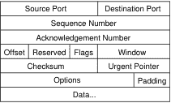

图 2.12 显示了 TCP 消息的格式。该消息像 UDP 消息一样包含 16 位的源端口和目的端口。但该消息还包括序列字段以及数据校验和字段。消息中的这些额外条目用于支持 TCP 的可靠数据传输。

### 知名端口

UDP 和 TCP 使用 IP 地址和端口号来唯一标识 TCP/IP 联网计算机上的特定进程。但你的应用程序不应随便使用任何端口。有些端口被称为保留端口，因为它们被赋予了特殊含义。一些 RFC 描述了大多数 TCP/IP 联网计算机运行的应用程序级服务。这些可通过网络访问的服务在知名端口上“监听”，因此客户端程序只需知道远程主机的 IP 地址。例如，考虑 finger 程序。它以主机名或主机 IP 地址作为参数。finger 程序连接到为主机上的 finger 服务保留的知名端口。如果你编写一个在知名端口上等待连接的程序，你可能会遇到试图连接到你的服务的客户端程序，而这些客户端程序原本期望后端运行另一个程序。

## 小结

本章讨论了 TCP/IP 网络的主要组件。TCP/IP 协议独立于它们所驻留的底层网络硬件。TCP/IP 网络上的每台计算机都必须具有唯一的 IP 地址，以通用方式公开该计算机的标识。TCP/IP 特别适合用于需要连接多个不同网络的互联网络环境。网关允许 IP 数据在两个或多个互连网络之间传输。应用程序员将最多地使用 TCP/IP 的传输层接口 UDP 和 TCP。套接字范式用于帮助应用程序员进行网络编码。下一章讨论 WinSock 对套接字的使用以及支持 Microsoft Windows 体系结构所需的扩展。

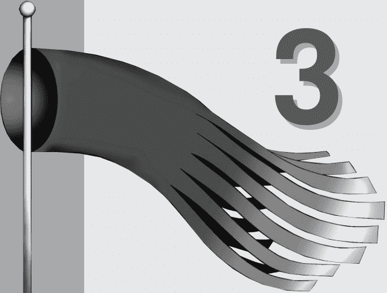

# 3 WinSock 概述

Windows Sockets 应用程序编程接口（WinSock API）是一个函数库，它实现了由 UNIX 的伯克利软件发行版推广的套接字接口。WinSock 通过添加 Windows 特定的扩展来增强伯克利套接字实现，以支持 Windows 操作系统的消息驱动特性。

WinSock 1.1 版绑定到 TCP/IP 协议套件。尽管预计未来版本的 WinSock 将支持 Novell 的 IPX/SPX、Apple 的 AppleTalk 以及其他流行的网络协议，但本书重点介绍 TCP/IP 协议栈的套接字接口。

WinSock 规范允许 TCP/IP 协议栈供应商为其协议栈提供一致的接口，以便应用程序开发者可以按照 WinSock 规范编写应用程序，并让该应用程序在任何供应商的 WinSock 兼容 TCP/IP 协议栈上运行。这与 WinSock 标准之前的日子形成对比，当时软件开发者必须将他们的应用程序与特定于每个 TCP/IP 供应商实现的库链接。这限制了大多数应用程序可运行的协议栈数量，因为维护一个使用多种不同伯克利套接字实现的应用程序很困难。WinSock 消除了这一障碍。应用程序员针对 WinSock API 编写代码，并将他们的应用程序与 WINSOCK.LIB 导入库（对于 Win32 则是 WSOCK32.LIB）链接。然后，应用程序可以安装到具有来自任意数量供应商的 WinSock TCP/IP 协议栈的计算机上，并动态链接到供应商提供的 WINSOCK.DLL（或 WSOCK32.DLL）。图 3.1 是 Windows NT 上 32 位程序中 WSOCK32.DLL 交互的框图。尽管实际的 WINSOCK.DLL 特定于每个 TCP/IP 协议栈供应商，但进入该动态链接库的接口保持一致，因此任何与 WinSock 导入库链接的程序都应能工作。


> **注意**
>
> 我说*应能*工作，是因为并非所有 TCP/IP 供应商的协议栈都以完全相同的方式运行。有些只是有缺陷，另一些则对 WinSock 或 TCP/IP 协议标准有不同的解释。在某些情况下，WinSock 规范本身也有歧义。

如第 2 章所述，套接字只是通信的一个端点。TCP/IP 套接字由 IP 地址和端口组成。有些端口保留给知名服务，另一些则供你的应用程序使用。套接字可以设置为提供可靠的、面向连接的流服务，或不可靠的、无连接的数据报服务。

**图 3.1。**  
*WinSock 分层。*

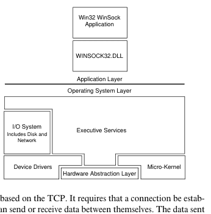

可靠的流套接字基于 TCP。它要求在两个进程之间发送或接收数据之前建立连接。相连进程之间发送的数据只是一个字节流。数据流中没有记录分隔符。例如，如果发送进程发送 100 字节，接收进程可能以单个 100 字节块或两个各 50 字节块的形式接收该数据。如果你的应用程序依赖于发送记录，你必须在数据流中提供应用程序级头部；TCP 不会在接收端为你保留数据包大小。

面向连接的流服务非常适合客户端-服务器体系结构。在典型的客户端-服务器交互中，服务器创建一个套接字，给套接字命名，并等待客户端连接到该套接字。客户端创建一个套接字并连接到服务器上已命名的套接字。当服务器检测到与已命名套接字的连接时，它会创建一个新套接字，并使用该新套接字与客户端通信。服务器的已命名套接字继续等待其他客户端的连接。这个简单客户端-服务器交互的图示见图 3.2。

不可靠的、无连接的数据报套接字基于用户数据报协议。它不要求在两个进程相互发送数据和接收数据之前建立连接。任意两个进程之间发送的数据包含在单个数据包中。发送方发送该数据包，接收方接收


某些 Berkeley 函数在 WinSock 中有不同的名称。例如，在 UNIX 中，使用 `close()` 系统调用来关闭套接字连接。在 WinSock 中，该函数称为 `closesocket()`。原因见下一项。

WinSock 套接字句柄可能不是 UNIX 风格的文件描述符。在 UNIX 环境中，套接字句柄的操作方式与其他任何文件句柄（即实际的磁盘文件）大致相同。在大多数 WinSock 实现中，除了 Windows NT 的 Win32 环境可能例外，套接字句柄不能像通用文件描述符那样操作。

WinSock 中新增了几个函数，以支持 Windows 的消息驱动架构。这些内容将在下一节讨论。

## WinSock 对 Berkeley 套接字的扩展

WinSock 对 Berkeley 套接字有几项扩展。其中大多数扩展源于 Microsoft Windows 的消息驱动架构。有些扩展也是为了支持 16 位 Windows 操作环境的非抢占特性所必需的。Windows NT 以及 Windows 3.11 之后的 32 位后续操作系统消除了非抢占限制，但出于后文讨论的原因，这些附加的 WinSock 函数仍然有用。

## Windows 消息驱动架构

虽然本书并非面向 Windows 编程初学者，但本节简要概述 Windows 架构。如果你熟悉 Windows 消息驱动架构，可以直接跳到题为“WinSock 异步函数”的一节。

每个 Windows 程序的核心都是一个消息循环和一个或多个窗口过程。消息循环从程序的消息队列中检索消息，并将它们分派给相应的窗口过程执行。Windows 被视为消息驱动或事件驱动系统，因为除非有消息或事件触发，否则程序的任何部分都不会运行。消息由用户操作（例如在键盘上输入或移动鼠标）以及操作系统内部活动生成。

Windows 程序的两个主要组成部分是消息循环和窗口。如前所述，消息循环检索消息，并调用适合该窗口的窗口过程。从消息队列中检索到的消息包含一个句柄，指向该消息应路由到的窗口。要调用的窗口过程取决于目标窗口的窗口类。有些窗口类由应用程序员声明，另一些预定义窗口类由 Windows 操作系统提供。这些预定义窗口类称为控件。下面列出其中几个预定义控件：

| 控件 | 描述 |
|---|---|
| EDIT | 用于查看和编辑文本 |
| LISTBOX | 用于显示一个列表，用户可从中选择一个或多个项 |
| STATIC | 用于显示静态文本，通常用作其他控件的标签 |

为了更好地解释 Windows 的消息驱动特性，你可以查看下面这个人为设计的示例应用程序，它有一个可调整大小的主窗口、一个编辑控件，以及编辑控件左侧的一个静态文本标签。程序的显示如图 3.3 所示。

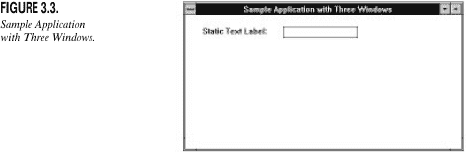

可调整大小的主窗口具有用户定义的窗口类。主窗口最重要的属性（即样式）如下：

| 样式 | 描述 |
|---|---|
| WS_CAPTION | 为窗口提供标题栏 |
| WS_MINIMIZEBOX | 在标题栏右上角添加最小化按钮，使窗口可最小化为图标 |
| WS_MAXIMIZEBOX | 在标题栏右上角添加最大化按钮，使窗口可最大化以填满整个屏幕 |
| WS_SYSMENU | 在标题栏左上角添加系统菜单 |
| WS_THICKFRAME | 使窗口具有调整大小的能力 |

静态文本标签是该应用程序的另一个窗口。对于刚接触 Windows 的程序员来说，静态文本标签也是一个窗口，这似乎很奇怪。用户认为是简单屏幕元素的许多东西，例如按钮、列表框和编辑框，实际上只是专用窗口。这个静态文本标签称为子窗口，因为它锚定在主窗口上；主窗口是静态文本标签的父窗口。该窗口具有预定义窗口类 STATIC，其功能有限。静态控件可以响应告诉它更改文本或将文本内容返回给调用方的消息。注意，我说的是“响应消息”。静态控件的行为与其他任何窗口一样，它在收到消息之前一直处于休眠状态。当有消息发往静态控件时，系统会调用静态控件的窗口过程，并传入指定应采取何种操作的参数。其中一种消息可能是 WM_SETTEXT，它告诉控件更改其屏幕上显示的文本。

应用程序的最后一个窗口是编辑框。它具有预定义窗口类 EDIT。编辑控件指定一个矩形子窗口，用户可以在其中通过键盘输入文本。用户可以通过单击该控件，或按 Tab 键移到该控件，来选择该控件并赋予其键盘焦点。当控件显示闪烁的插入符时，用户就可以输入文本。可以使用鼠标移动光标、选择要替换的字符，或为插入字符定位光标。可以使用 Backspace 键删除字符。从这段摘自 Windows 软件开发工具包文档的 EDIT 控件描述中可以看出，这类窗口能识别的消息比静态控件多得多。

既然你已经了解了构成这个示例应用程序的三个窗口，现在来看一下程序启动并运行后的流程。程序的核心是它的消息循环。常用的消息循环如下所示：

```c
while (GetMessage(&msg, NULL, 0, 0))
{
    TranslateMessage(&msg);
    DispatchMessage(&msg);
}
```

这段代码从应用程序的消息队列中检索消息，并通过调用目标窗口的窗口过程将消息分派给目标窗口。如果用户将鼠标光标移到编辑框上并按下鼠标左键，编辑控件就会获得输入焦点。当 WM_SETFOCUS 消息分派给编辑控件时，编辑控件就知道自己获得了焦点。此时，编辑控件会显示闪烁的插入符，以指示下一次按键的显示位置。图 3.4 显示了后续 WM_CHAR 事件的消息流。当用户在键盘上输入一个键时，会生成一条 WM_CHAR 消息。该消息的限定符之一是实际按下的键。编辑控件收到此通知，并在框中绘制新输入的字符。如果用户随后将鼠标光标移到编辑框外，但仍位于主应用程序窗口内，编辑框将收到一条 WM_KILLFOCUS 消息，告诉它移除闪烁的插入符，然后主窗口会收到一条 WM_SETFOCUS 消息。

**图 3.4。**

*消息流。*

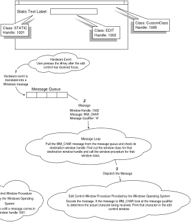

16 位 Windows 环境采用协作式多任务。这意味着正在运行的应用程序必须相互协作，以便多个任务或程序可以同时运行。它们通过持续运行前面描述的消息循环来实现这一点。如果某个应用程序调用 `GetMessage()` 函数，而没有消息等待该应用程序处理，Windows 就会切换任务，允许另一个程序运行。新运行的程序会运行其消息循环，直到没有更多消息要处理，然后该过程会在计算机上运行的所有程序中继续。在这种环境中，单个程序很容易阻止所有其他程序运行。例如，如果前面示例中的编辑框处理 `WM_CHAR` 消息需要 10 秒，那么计算机上的其他任务至少 10 秒内都不会运行。不仅其他任务不会运行，而且如果用户快速连续输入多个键，每次按键都要等 10 秒才能反映到屏幕上。在非抢占式多任务的 Windows 环境中，必须迅速处理消息并返回消息循环。如果程序不遵守这一规则，整个计算机系统的性能都会受到影响。


Windows NT 是一种抢占式多任务操作系统。这意味着操作系统本身决定新任务何时运行。它并不依赖应用程序检查消息来实现任务切换。如前所述，如果一个应用程序花了 10 秒处理一条 `WM_CHAR` 消息，那么在 10 秒结束之前，其他应用程序仍然可以运行。该特定应用程序的性能会很差，但不会降低当时计算机上运行的其他程序的性能。通常认为，程序对用户命令响应缓慢是一种不良做法。如果用户必须等待 10 秒才能让字符出现在屏幕上，他们不会高兴。如果响应消息执行的操作需要很长时间运行，程序的用户界面应保持对用户的响应。这就是为什么即使在 Windows NT 的抢占式环境中，应用程序也最好经常检查其消息队列。

## WinSock 异步函数

WinSock 最初是为非抢占式 Windows 架构设计的。因此，传统的 Berkeley 套接字添加了几个扩展。

### 阻塞与非阻塞

许多 Berkeley 套接字函数的执行时间是不确定的。当函数表现出这种行为时，就称其为阻塞；调用该函数会阻塞调用程序的进一步执行。在最初开发套接字的 Berkeley UNIX 环境中，这并不构成严重问题，因为 UNIX 操作系统会直接抢占阻塞程序并开始运行另一个程序。Windows（不同于 Windows NT）无法抢占任务，因此所有其他程序都会被挂起，直到阻塞调用返回。WinSock 的设计者知道这带来了严重问题，因此他们在阻塞函数中添加了特殊代码，以强制检查其他应用程序的消息循环。但这仍然不是最有效的技术。

Berkeley 套接字对于某些操作已经有阻塞与非阻塞的概念。例如，用于向远程主机发送数据的 `send()` 函数可能不会立即返回，因此程序员可以选择创建采用阻塞发送或非阻塞发送的套接字。如果套接字以阻塞模式创建，则直到数据送达后才会返回。如果以非阻塞模式创建，则对 `send()` 函数的调用会立即返回，程序必须调用另一个名为 `select()` 的函数来确定发送的状态。Windows 和 Windows NT 可以使用 `select()` 方法的非阻塞调用，但在 Windows 程序中最好的做法是使用专门的 Windows 异步函数。

这些特殊的 Windows 异步函数以 WSAAsync 前缀开头。这些函数被添加到 WinSock 中，是为了让 Berkeley 套接字更好地适应 Windows 的消息驱动模式。使用异步函数的最常见事件是数据的发送和接收。发送数据可能不会立即完成，而接收数据几乎肯定会导致程序等待，除非它接收的是持续不断的字节流。通过创建用于非阻塞发送和接收的套接字，并使用 WSAAsyncSelect() 函数调用，应用程序会收到事件通知消息，告知它何时可以发送数据，或数据何时到达并需要读取。与此同时，当没有数据通信发生时，程序的其余部分仍能完全响应用户的操作。WSAAsyncSelect() 函数及其在非阻塞套接字上发送和接收数据的用法将从第 7 章“套接字函数”开始讨论。

WinSock 甚至将 Berkeley 的非阻塞支持扩展到那些仍可能导致 Berkeley UNIX 程序阻塞的函数。第 2 章“TCP/IP 概述”中介绍了名称服务器的概念。名称服务器的工作是接受计算机名称的纯文本表示作为输入，并返回该计算机的 IP 地址。名称服务器通常是一台联网计算机，与你开发的运行 WinSock 程序的计算机不同。名称服务器的服务要求消息通过网络从使用 WinSock 程序的计算机发送到运行名称服务器的计算机。这种网络通信可能耗时不可预知。WinSock 通过扩展利用名称服务器服务的函数来弥补这一点。这些函数属于一个称为数据库函数或 getXbyY 函数的函数类别。之所以用 GetXbyY 来指代这些数据库函数，是因为函数名的形式是 get X by Y，换句话说：“给定 Y，对应的 X 是什么？”在名称服务器的例子中，使用的函数称为 gethostbyname()；给定计算机名称，它的主机信息是什么？在 Berkeley UNIX 中，getXbyY 函数可能会阻塞。WinSock 添加了 getXbyY 函数的异步版本，称为 WSAAsyncGetXbyY。例如，gethostbyname() 函数由非阻塞的 WinSock 函数 `WSAAsyncGetHostByName()` 作为补充。调用 WSAAsyncGetXbyY 函数会立即返回一个标识句柄。当函数执行的实际工作完成后，会向应用程序发送一条消息，通知带有指定句柄的函数已完成。数据库函数（包括阻塞形式和异步形式）将在第 6 章“转换和数据库函数”中讨论。

WinSock 异步函数主要是为了非抢占式 Windows 环境的利益而添加的。你可能会质疑它们在真正抢占式多任务的 Windows NT 环境中的价值。`WSAAsync` 函数即使在 Windows NT 中也有重要用途。它们使你的应用程序能够保持对用户的响应。如果你的程序迫使用户等待某个长时间事件完成，用户是不会喜欢使用它的。大多数用户期望有一种方法来取消耗时较长的操作。例如，假设你有一个程序，它以计算机的纯文本名称作为输入。用户输入名称，然后按下标有“查找”的按钮，这将导致调用 `gethostbyname()` 函数。使用 `gethostbyname()` 会使程序在请求完成前挂起一段不可预知的时间。在 Windows NT 下，其他程序仍会运行，但在 Windows 下，所有程序的性能都会下降。可以修改此程序，使其使用 `WSAAsyncGetHostByName()` 而不是 `gethostbyname()`。用户一按下“查找”按钮，就会调用 `WSAAsyncGetHostByName()` 函数并返回一个标识句柄。如果用户希望取消搜索，可以按下“取消”按钮，这将使用该标识句柄终止请求。用户将保持完全控制，而不是受程序摆布。

## 小结

本章讨论了 WinSock 与由 BSD UNIX 推广的原始 Berkeley 套接字接口的比较。WinSock 包含了 Berkeley 的大部分功能，并带有许多扩展，以支持 Windows 的事件驱动特性。其中一些扩展的使用是正确执行程序所必需的；其他扩展的使用则是可选但可取的，因为它们提供了对用户请求响应迅速的用户界面。后续章节将全面探讨使用 WinSock 扩展函数的好处。下一章将讨论 Microsoft Visual C++ 开发环境。

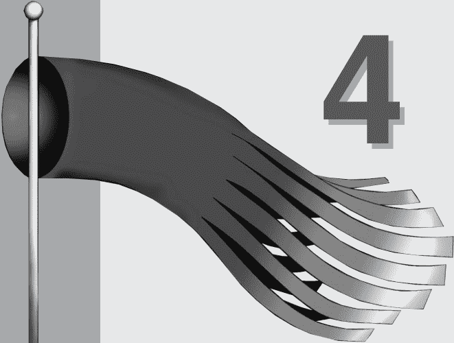

# 4 Visual C++

Microsoft 的 Visual C++ 产品极大地简化了 Windows 程序的开发。应用程序开发人员不再需要为了让最基本的窗口显示出来，而在每个项目开始时都编写同样的一百行必填代码。Microsoft 基础类库（MFC）封装了大部分繁琐工作，让程序员可以专注于真正的问题，而不是底层的管道工作。本书中的示例均使用 MFC 和 Visual C++。

## Visual C++ 组件

Visual C++ 套装包含多个彼此紧密集成并与 Microsoft 基础类库紧密集成的工具。这些工具的组合使您可以轻松创建应用程序启动所需的框架。

### Visual Workbench

Visual Workbench 是你花费时间最多的程序。它包含一个彩色编码的文本编辑器，可以在你的 C 和 C++ 源代码中突出显示关键字。Visual Workbench 还包含一个构建管理器，用于管理可在 Visual Workbench 内部或命令行中使用的 makefile。此构建管理器用于向项目添加新的源文件、更改编译器和链接器选项，并自动生成源代码依赖关系。Visual Workbench 还包括一个源代码级调试器。借助 Visual Workbench 中内置的帮助功能，调试以及一般的编码工作都变得更加简单。将插入符放在 Windows、C 或 C++ 关键字上，然后按 F1 键，就会显示有关该主题的帮助。图 4.1 显示了 Visual Workbench 在 TEST 项目上运行，并打开了两个用于编辑的源代码窗口。

### AppWizard

AppWizard 是 Visual Workbench 的一个组件。它通过提示你选择多个选项，然后创建该应用程序所需的骨架源代码，从而自动完成创建极简 Windows 程序的任务。AppWizard 创建的骨架程序支持窗口管理、基本菜单结构和基本菜单命令。所提供的一些选项决定了应用程序将具有：

- 多文档界面或单文档界面。MDI 应用程序在主应用程序窗口内可以有一个或多个子窗口。Visual Workbench 就是 MDI 应用程序的一个示例，因为它允许你在任何时候打开多个源代码窗口。


- 初始工具栏。工具栏是位于应用程序菜单下方的一排位图按钮。
- 打印和打印预览。
- 上下文相关帮助。

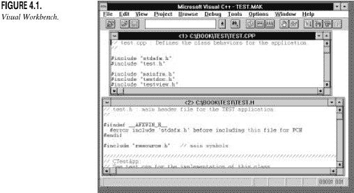

图 4.2 显示了 AppWizard 的选项对话框。AppWizard 的输出包括多个 C++ 源文件和头文件、项目 makefile 以及资源文件。下面列出了一个名为 TEST 的 AppWizard 生成项目中的文件。TEST 项目使用单文档界面。

- TEST.MAK — 与 Visual Workbench 和命令行工具 NMAKE 兼容的项目文件。
- TEST.H — 应用程序的主包含文件；包含其他项目专用的包含文件，并声明 CTestApp 应用程序类。
- TEST.CPP — 应用程序的主源文件。包含应用程序类 CTestApp。
- TEST.RC — 程序使用的所有资源的列表。其中包括存储在 RES 子目录中的图标、位图和光标。该文件可以直接使用 App Studio 编辑。
- RES\TEST.ICO — 用作应用程序图标的图标文件。该图标由主资源文件 TEST.RC 包含。

| 文件 | 描述 |
|---|---|
| RES\TEST.RC2 | 包含未由 App Studio 编辑的资源。最初包含一个 VERSIONINFO 资源，你可以根据应用程序的需要对其进行自定义。 |
| TEST.DEF | 包含必须提供给 Microsoft Windows、以便应用程序能够运行的信息。定义应用程序名称和描述、初始本地堆大小等参数。 |
| TEST.CLW | 包含 ClassWizard 用于编辑现有类或添加新类的信息。 |
| MAINFRM.H 和 MAINFRM.CPP | 包含框架类 CMainFrame。该类派生自 CFrameWnd，用于控制所有 SDI 框架及其功能。 |
| TESTDOC.H 和 TESTDOC.CPP | 包含 CTestDoc 文档类。 |
| TESTVIEW.H 和 TESTVIEW.CPP | 包含 CTestView 视图类。 |
| STDAFX.H 和 STDAFX.CPP | 用于生成预编译头文件，从而显著提高制作和编译速度。 |
| RESOURCE.H | 定义资源 ID。App Studio 会读取并更新此文件。 |

**图 4.2。**  
*AppWizard 选项。*

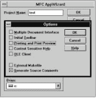

### App Studio

App Studio 用于创建和编辑 Windows 资源。借助它，你可以操作菜单、对话框、位图、图标、光标、字符串表中的字符串以及键盘加速键等资源。App Studio 会自动为所创建的资源生成唯一的资源 ID。默认情况下，这些 ID 存储在 RESOURCE.H 文件中。图 4.3 显示了 App Studio 正在编辑之前列出的 TEST 项目中的资源文件。

**图 4.3。**  
*App Studio。*

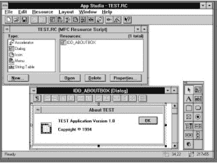

### ClassWizard

ClassWizard 也许是 Visual C++ 开发环境中功能最强大的组件。借助它，你可以从多个标准 MFC 基类对象派生类，并向这些类添加成员函数和变量。ClassWizard 用于将 Windows 消息以及用户定义的消息映射到特定的成员函数。只需单击几下鼠标，就可以将特定消息关联到某个函数名。ClassWizard 会在该类的头文件中创建该函数的函数原型，并在 C++ 文件中创建一个存根函数，供你添加代码。

ClassWizard 的一个常见用途，是将从 CDialog 派生的类与使用 App Studio 创建的对话框资源关联起来。首先使用 App Studio 设计对话框资源，然后启动 ClassWizard。如果直接从 App Studio 启动 ClassWizard，且正在编辑的对话框资源尚未关联任何类，ClassWizard 会自动提示你为新的对话框类输入类名。创建基本类后，你可以将成员函数链接到对话框的按钮和控件。你还可以将变量与对话框的控件关联起来。例如，如果对话框包含一个用于输入数值的编辑控件，就可以将一个整数变量链接到该控件。该整数变量会成为对话框类对象的成员变量。当应用程序需要获取输入到该编辑控件中的值时，只需引用这个整数成员变量即可。

**图 4.4。**  
*ClassWizard。*

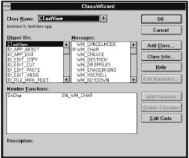

### Class Browser

Class Browser 集成在 Visual Workbench 中。你可以使用它查看类的层次关系。你可以选择一个类，并查看从该类派生的所有类，或者查看该类所派生自的类。图 4.5 显示了 TEST 应用程序中 CTestApp 对象的基类关系图。浏览器显示 CTestApp 派生自 CWinApp。单击 CTestApp 后，Class Browser 视图的另一部分会显示该对象的具体信息。右上部分显示 CTestApp 特有的成员函数。双击其中一个名称，会将你带到 Visual Workbench 编辑器中 CTestApp 源文件的相应位置。右下部分显示实现 CTestApp 对象的源文件。

**图 4.5。**  
*Class Browser。*

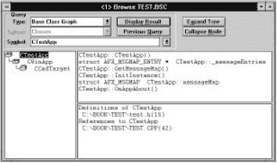

## MFC 程序中的消息映射

你还记得第 3 章中的讨论：Windows 是一种事件驱动操作系统，它依赖将消息传递给适当的目标窗口来执行程序。Visual C++ 使基于消息的代码编写变得几乎不费吹灰之力。借助 ClassWizard，你可以定义一个从标准 MFC 对象列表中派生的对象。这些基类对象就是等待接收消息的窗口。ClassWizard 可以轻松地将消息映射到负责响应这些消息并执行所需操作的函数。根据适用的基类创建派生类后，ClassWizard 会创建响应消息触发所需的成员函数。成员函数会在类声明中创建，而该成员函数的存根代码则会插入类的实现文件中。你的类可以派生自的基类已经包含许多成员函数，这些函数可以由你的专用代码重写。其中一个成员函数会响应 WM_CHAR 消息，该消息用于通知窗口用户按下了键盘上的某个键。图 4.4 显示了将 WM_CHAR 消息映射到 OnChar 的 ClassWizard。ClassWizard 为 TEST 应用程序在类声明中创建的代码如下：

```cpp
class CTestView : public CView
{

...

//{{AFX_MSG(CTestView)
    afx_msg void OnChar(UINT nChar, UINT nRepCnt, UINT nFlags);
    //}}AFX_MSG
    DECLARE_MESSAGE_MAP()
};
```

注意，ClassWizard 添加的代码位于注释行 `//{{AFX_MSG(CTestView)` 和 `//}}AFX_MSG` 之间。实现文件中的相应代码如下：

```cpp
...
```

```cpp
BEGIN_MESSAGE_MAP(CTestView, CView)
    //{{AFX_MSG_MAP(CTestView)
    ON_WM_CHAR()
    //}}AFX_MSG_MAP
END_MESSAGE_MAP()

...
```

```cpp
void CTestView::OnChar(UINT nChar, UINT nRepCnt, UINT nFlags)
{
    // TODO: Add your message handler code here and/or call default
    CView::OnChar(nChar, nRepCnt, nFlags);
}
…
```

当发往 CTestView 窗口的 WM_CHAR 消息到达时，系统会检查消息映射，以确定应如何路由该消息。由于消息映射中包含 ON_WM_CHAR，MFC 知道应用程序已经设置了消息处理程序。WM_CHAR 消息在 CTestView 的基类 CView 中已经有一个默认处理程序。MFC 知道 WM_CHAR 映射到 OnChar 成员函数。在后面的章节中，你将看到如何添加应用程序专用的用户定义消息处理程序。由于 MFC 不知道这些消息处理程序，因此你必须在消息映射中指定负责处理该消息的成员函数名称。

## 构建 WinSock 应用程序的支持文件

要编译使用 WinSock API 的应用程序，需要 WinSock 头文件 WINSOCK.H，其中包含所有函数原型和结构定义。链接应用程序时，需要使用 WINSOCK.LIB 或 WSOCK32.LIB，具体取决于目标平台是 16 位 Windows 还是 32 位 Windows。Visual C++ 1.1 for Windows NT 中包含 WINSOCK.H 和 WSOCK32.LIB。WINSOCK.H 和 WINSOCK.LIB 可从 TCP/IP 协议栈提供商处获得。

为确保 16 位和 32 位程序之间的源代码兼容性，标准的 16 位 Windows 包含文件 VER.H 必须命名为 WINVER.H，因为在 32 位环境中它就是这样命名的。如果你使用的是 16 位编译器，建议进入编译器的 include 目录，并将 VER.H 复制为 WINVER.H。

第 8 章“示例应用程序”详细讨论了如何构建 WinSock 应用程序。

## 总结

Visual C++ 集成开发环境极大地简化了 Windows 程序的开发。各种高度集成的工具使创建使用 MFC 库的应用程序变得十分容易。本书后面开发的 WinSock 类库将广泛利用 MFC 的功能。这些类的开发将展现 Visual C++ 的强大功能和灵活性。


# 5 启动和关闭函数

`WSAStartup()` 函数的第二个参数是指向 `WSADATA` 数据结构的指针。调用初始化函数后，该结构包含详细说明 WinSock 实现的信息。`WSADATA` 结构具有以下格式：

```
typedef struct WSADATA {
    WORD             wVersion;
    WORD             wHighVersion;
    char             szDescription[WSADESCRIPTION_LEN+1];
    char             szSystemStatus[WSASYS_STATUS_LEN+1];
    unsigned short   iMaxSockets;
    unsigned short   iMaxUdpDg;
    char FAR *       lpVendorInfo;
} WSADATA;
```

为了验证符合 WinSock 的协议栈是否满足应用程序的版本要求，应用程序应在 `WSAStartup()` 函数返回后检查 *wVersion* 中的值。例如，如果你的应用程序要求 WinSock 2.0 版，则将 *wVersion* 的高字节与 0 比较，低字节与 2 比较。如果其中任一比较失败，应用程序应向程序用户显示一条消息，解释失败原因。以下代码片段展示了一个典型实现：

```
WORD wVersionRequested = MAKEWORD(1, 1); // WinSock 1.1 requested
WSADATA wsaData;                       // WinSock details
int nErrorStatus;                      // error status

nErrorStatus = WSAStartup(wVersionRequested, &wsaData);
if (nErrorStatus != 0)
{
    // display an error message explaining that WinSock
    // initialization has failed and return

    return;
}

// check the WinSock version information

if ( (LOBYTE(wsaData.wVersion) != LOBYTE(wVersionRequested)) ||
     (HIBYTE(wsaData.wVersion) != HIBYTE(wVersionRequested)) )
{
    // display an error message explaining that the WinSock
    // implementation doesn’t meet the version requirements
    // of the application

    WSACleanup();       // terminate WinSock use
    return;
}
```

这段代码（或类似代码）放置在程序执行路径的早期。通常，它出现在使用 Windows SDK 构建的程序的 `WinMain()` 中，或 MFC 程序的 `CWinApp::InitInstance()` 中。

## 获取供应商信息和 TCP/IP 协议栈能力

`WSAStartup()` 的另一个能力是向调用应用程序提供有关底层 TCP/IP 协议栈的信息。我们已经检查了 `WSADATA` 结构的 `wVersion` 和 `wHighVersion` 变量。其余变量按如下方式提供正在使用的 WinSock 实现的详细信息：

- `szDescription` 是指向以 null 结尾的 ASCII 字符串的指针，该字符串描述 WinSock 实现。此字符串最长可达 256 个字符，通常包含对 WinSock 供应商的引用，无论是 Microsoft、Wollongong、Net Manage、FTP 还是其他供应商。
- `szSystemStatus` 是指向以 null 结尾的 ASCII 字符串的指针，其中包含相关状态或配置信息。
- `iMaxSockets` 是单个进程可能打开的最大套接字数量。应用程序可将此数字粗略估计 WinSock DLL 是否可供应用程序使用。这并不保证应用程序能够分配此数量的套接字。
- `iMaxUdpDg` 是 WinSock 实现可发送或接收的最大 UDP 数据报的大小（以字节为单位）。如果此数字设置为 0（零），则没有隐含的大小限制。
- `lpVendorInfo` 是指向供应商特定数据结构的指针。由于此数据是供应商特定的，因此如果程序使用此数据，就会失去其协议栈独立性。

## WSACleanup

`WSACleanup()` 函数用于终止应用程序对 WinSock 的使用。每次调用 `WSAStartup()` 都必须有匹配的 `WSACleanup()` 调用。`WSACleanup()` 通常在你的应用程序消息循环终止后调用。在 MFC 应用程序中，`CWinApp` 类的 `ExitInstance()` 成员函数提供了一个方便的位置来调用 `WSACleanup()`。原型如下：

```
int PASCAL FAR WSACleanup(void);
```

## WSAGetLastError

`WSAGetLastError()` 函数并不只处理启动或关闭过程，但需要尽早说明。其函数原型如下：

```c
int PASCAL FAR WSAGetLastError(void);
```

`WSAGetLastError()` 返回最近发生的 WinSock 错误。在 MS-DOS 或 UNIX 编程环境中，你可能习惯于检查 `errno` 变量，这是一个应用程序特定的全局变量，在所有程序中可用。由于 WinSock 并不是操作系统真正的一部分，而是后来附加的，因此无法使用 `errno`。一旦 WinSock API 调用失败，就应调用 `WSAGetLastError()` 以获取错误的详细信息。

例如，如果调用 `WSAStartup()` 时传入的 `wVersionRequested` 早于 WinSock DLL 支持的任何 WinSock API，`WSAStartup()` 会返回错误指示。在 `WSAStartup()` 调用失败后立即调用 `WSAGetLastError()` 会显示发生了 `WSAVERNOTSUPPORTED`。`WSAStartup()` 可能生成的其他错误值包括：如果网络子系统故障，则为 `WSASYSNOTREADY`；如果传入了无效参数，则为 `WSAEINVAL`。

`WSACleanup()` 可能的错误值包括：如果 `WSAStartup()` 未成功调用，则为 `WSANOTINITIALIZED`；如果网络子系统故障，则为 `WSAENETDOWN`；如果当前有阻塞的 WinSock 操作正在进行，则为 `WSAEINPROGRESS`。

## 小结

本章仅讨论了编写 WinSock 应用程序的开端。第 8 章“示例应用程序”介绍了一个程序，它在调用 `WSAStartup()` 时使用 `WSADATA` 结构，向应用程序用户展示一些有用信息。接下来的几章将继续介绍大多数应用程序常用的必备 WinSock 函数。

# 6 转换和数据库函数


WinSock 提供了一组通常称为数据库函数的过程。这些数据库函数的职责是将人们使用的主机名和服务名转换为计算机可用的格式。互联网络中的计算机还要求它们之间传输的某些数据采用通用格式。WinSock 提供了几个转换例程来满足这一要求。


> **注意**
> 
> 本章包含几个小型代码示例。这些并不是可独立运行的完整程序，而是用来帮助阐明示例中所用函数的文字说明。请研究这些示例，以便在自己的程序中使用它们，但现在不必担心实际的程序实现问题。后面的章节将从这些代码片段中提取内容，以生成完整的程序。

## 转换例程和网络字节顺序

在某些情况下，调用 WinSock 函数时，参数需要以特定格式存储。使用 WinSock 的互联网络应允许不同的计算机系统进行通信。这些不同的互联主机可能基于计算机所用的 CPU 而具有不同的硬件架构。它们存储内部数值的方式可能彼此不同。CPU 在内部存储数字的方式称为其字节顺序。为便于处理不同 CPU 中使用的不同字节顺序，WinSock 提供了一组转换函数。这些转换函数的任务是将主机字节顺序的数字转换为使用网络字节顺序方案的数字。网络字节顺序是所有 TCP/IP 连接的计算机在传输某些数据时必须遵循的标准。实际上，网络字节顺序序列是所有互联计算机的最小公分母。

有四个主要的字节顺序转换例程。它们处理无符号短整数和无符号长整数的双向转换。

### 无符号短整数转换

`htons()` 和 `ntohs()` 函数分别将无符号短整数从主机字节顺序转换为网络字节顺序，以及从网络字节顺序转换为主机字节顺序。原型如下：

```
u_short PASCAL FAR htons(u_short hostshort);
u_short PASCAL FAR ntohs(u_short netshort);
```


> 在没有先调用 htons() 转换例程的情况下连接到端口 427，它实际上是在尝试连接到十六进制端口 AB01，即十进制 43777。因此，客户端永远无法连接到在 Macintosh 上运行的服务器进程，或者至少不是预期的服务器进程。

要求其参数采用网络字节序的函数，会在每个函数说明的文字中注明。

## 转换 IP 地址

WinSock 提供了另一组转换函数，用于在点分十进制 IP 地址的 ASCII 表示与其他 WinSock 函数所需的内部 32 位、字节序数字之间进行转换。

### 将 IP 地址字符串转换为二进制

`inet_addr()` 将点分十进制 IP 地址字符串转换为适合用作 Internet 地址的数字。其函数原型如下：

```c
unsigned long PASCAL FAR inet_addr(const char FAR * cp);
```

`cp` 是指向以点分十进制表示法表示 IP 地址的字符串的指针。`inet_addr()` 函数返回给定 Internet 地址的二进制表示。该值已经是网络字节序，因此无需调用 `htonl()`。如果 `cp` 字符串不包含有效 IP 地址，`inet_addr()` 返回 INADDR_NONE。此类错误的一个可能原因是 IP 地址的某个组成部分大于 255。请记住，点分十进制 IP 地址的四个组成部分分别表示无符号长整型的四个字节之一，因此任何组成部分的值大于 255 都是非法的，因为一个字节的值必须介于 0 到 255（含）之间。

以下代码片段展示了对 `inet_addr()` 的典型调用。当然，实际程序不会硬编码 IP 地址；你很可能允许用户在配置应用程序时指定 IP 地址。

```c
u_long ulIPAddress = inet_addr("166.78.16.148");
```

此代码片段执行后，`ulIPAddress` 的值将是十六进制 A64E1094。`inet_addr()` 只是取 IP 地址的每个组成部分，并将其以二进制形式存储为四字节 IP 地址中的一个字节。不过，你不需要指定 IP 地址的全部四个部分。`inet_addr()` 可以接受以下任意一种点分十进制表示法的 IP 地址：a.b.c.d、a.b.c、a.b 或 a。a.b.c.d 值是前面代码示例中所示的典型 IP 地址。如果省略某个数量，最后一个已定义的数量将被简单地扩展以填充剩余字节，凑足总共四个字节。例如，如果传递给 `inet_addr()` 的字符串是“166.78.16”，采用 a.b.c 格式，则返回的无符号长整型为十六进制 A64E0010。

### 将二进制 IP 地址转换为字符串

`inet_ntoa()` 执行与 `inet_addr()` 相反的工作。其函数原型如下：

```c
char FAR * PASCAL FAR inet_ntoa(struct in_addr in);
```

`in` 是包含 Internet 主机地址的结构。你会看到有些 WinSock 函数将 IP 地址作为无符号长整型处理，另一些则作为 `in_addr` 结构处理。为弥补这一差异，需要进行一些字节复制。以下示例代码展示了这一点。成功时，`inet_ntoa()` 函数返回指向点分十进制 IP 地址字符串的指针。出错时，返回 `NULL`。NULL 值表示作为参数传入的 IP 地址无效。

以下是一段有点刻意构造的代码：

```c
// first get an unsigned long with a valid IP address
u_long ulIPAddress = inet_addr("166.78.16.148");

// copy the four bytes of the IP address into an in_addr structure
IN_ADDR in;
memcpy(&in, &ulIPAddress, 4);

// convert the IP address back into a string
char lpszIPAddress[16];
lstrcpy(lpszIPAddress, inet_ntoa(in));
```

我说前面的示例是刻意构造的，是因为二进制 IP 地址的获取方式。二进制 IP 地址 `ulIPAddress` 是通过使用 `inet_addr()` 转换 IP 地址字符串而获得的。在实际程序中，你希望对其使用 `inet_ntoa()` 的 IP 地址很可能来自另一个 WinSock 调用的结果，而不是用户输入或硬编码的；这部分代码仅用于演示目的。一旦有了这个无符号长整型，就需要将其存储在 `in_addr` 结构中，以供 `inet_ntoa()` 使用，因此使用了 `memcpy()`。接下来，调用转换函数。`inet_ntoa()` 返回的字符串指针只是临时的。在下一次调用 WinSock 函数后，它可能无效，因此最好将其复制到应用程序中的变量中。分配 16 字节缓冲区，因为这是有效的四字节 IP 地址可能达到的最长长度（即“255.255.255.255”加上终止 NULL 字符）。

## 我的名字是什么？

有些应用程序需要知道其运行所在计算机的名称。`gethostname()` 函数提供此功能。它被添加到 WinSock 1.1 规范中。该函数的原型如下：

```c
int PASCAL FAR gethostname(char FAR * name, int namelen);
```

`name` 是指向字符数组的远指针，该数组将接受以 null 结尾的主机名，`namelen` 是该字符数组的大小。`gethostname()` 函数成功时返回 0（零），失败时返回 SOCKET_ERROR。返回值为 SOCKET_ERROR 时，可以调用 `WSAGetLastError()` 确定具体问题。可能的错误值包括：如果缓冲区太小无法容纳主机名，则为 WSAEFAULT；如果 `WSAStartup()` 未成功调用，则为 WSANOTINITIALISED；如果网络子系统故障，则为 WSAENETDOWN；如果当前正在进行阻塞式 WinSock 操作，则为 WSAEINPROGRESS。

以下代码片段展示了对 `gethostname()` 的典型调用：

```c
#define HOST_NAME_LEN (50)
char lpszHostName[HOST_NAME_LEN];    // will accept the host name
char lpszMessage[100];               // informational message

if (gethostname(lpszHostName, HOST_NAME_LEN) == 0)
    wsprintf(lpszMessage, "This computer's name is %s", lpszHostName);
else
    wsprintf(lpszMessage, "gethostname() generated error %d",
        WSAGetLastError());

MessageBox(NULL, lpszMessage, "Info", MB_OK);
```


> **注意**
>
> `gethostname()` 填充的名称可能是简单名称，也可能是完全限定域名。例如，我的计算机可能被识别为 goober 或 goober.ping.com。返回哪种格式由实现 WinSock 的人决定。关于 `name` 变量唯一保证的是，它可以被 `gethostbyname()` 函数解析，该函数将在后面讨论。

## 主机名解析

人类使用文本表示来指代程序连接的主机。计算机要求主机地址是一个 32 位整数，并以标准化方式存储，如上一节关于网络字节序所述。在你的程序能够连接到另一台计算机之前，该计算机的 IP 地址必须采用 32 位格式。为弥补这一差异，程序可以使用 `gethostbyname()` 或 `inet_addr()` 函数。如果你知道简单名称或完全限定域名，则使用 `gethostbyname()`。如果你知道 IP 地址，则使用 `inet_addr()`。

> **提示**
>
> 大多数带有配置以选择程序通信主机的程序，都允许用户输入主机名或 IP 地址。程序应首先用用户输入调用 `inet_addr()`。如果此函数成功返回，转换工作就完成了；否则，应假设用户输入的是主机名，并调用 `gethostbyname()`。

## 查找主机的 IP 地址

`gethostbyname()` 的主要职责是接收主机名并返回其 IP 地址。该函数及其名为 `WSAAsyncGetHostByName()` 的异步对应函数，可能会在程序运行所在计算机本地的主机文件上执行简单的表查找，也可能通过网络向名称服务器发送请求。图 6.1 和 6.2 展示了主机名解析的不同方式。应用程序员实际上并不知道使用哪种方法来解析主机名，而且这通常并不重要，但有一个注意事项，将在关于 `WSAAsyncGetHostByName()` 的章节中描述。该函数的原型如下：

```c
struct hostent FAR * PASCAL FAR gethostbyname(const char FAR * name);
```

`name` 是指向以 null 结尾的字符数组的远指针，该数组包含你希望获取主机信息的计算机名称。返回的 `hostent` 结构具有以下格式：

```c
struct hostent {
    char FAR * h_name;         // official name of host
    char FAR * FAR * h_aliases; // alias list
    short h_addrtype;           // host address type
    short h_length;             // length of address
    char FAR * FAR * h_addr_list; // list of addresses
#define h_addr h_addr_list[0]   // address, for backward compatibility
};
```

成功时，`gethostbyname()` 函数返回指向 `hostent` 结构的指针；失败时，该函数返回 NULL。返回值为 NULL 时，可以调用 `WSAGetLastError()` 确定具体问题。可能的错误值包括：如果 `WSAStartup()` 未成功调用，则为 WSANOTINITIALISED；如果网络子系统故障，则为 WSAENETDOWN；如果无法解析主机名，则为 WSAHOST_NOT_FOUND；如果失败原因可能是临时的，例如名称服务器宕机，则为 WSATRY_AGAIN；如果发生不可恢复错误，则为 WSANO_RECOVERY；如果主机名有效但找不到合适的数据，则为 WSANO_DATA；如果当前正在进行阻塞式 WinSock 操作，则为 WSAEINPROGRESS；或者如果阻塞调用被 `WSACancelBlockingCall()` 取消，则为 WSAEINTR。


**图 6.1。**
*WinSock 使用本地文件查找。*

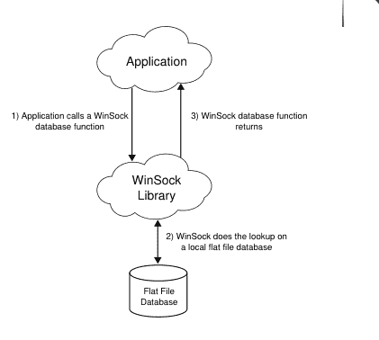

使用目前介绍过的几个函数，你既可以显示网络互联中任意主机的 IP 地址，也可以查明本机的名称和 IP 地址。以下示例代码片段正是这样做的：

```c
#define HOST_NAME_LEN (50)
char lpszHostName[HOST_NAME_LEN];       // 将用于存放主机名
char lpszMessage[100];                  // 提示信息
char lpszIP[16];                        // IP 地址字符串
PHOSTENT phostent;                      // 指向主机条目结构的指针
IN_ADDR in;                             // Internet 地址结构

// 查找运行此程序的计算机名称
if (gethostname(lpszHostName, HOST_NAME_LEN) != 0)
    wsprintf(lpszMessage, "gethostname() generated error %d",
        WSAGetLastError());
else
{
    // 获取此计算机的主机条目结构
    if ((phostent = gethostbyname(lpszHostName)) == NULL)
        wsprintf(lpszMessage, "gethostbyname() generated error %d",
            WSAGetLastError());
    else
    {
        // 将四字节 IP 地址复制到 Internet 地址结构中
        memcpy(&in, phostent->h_addr, 4);

        // 格式化结果，将 IP 地址转换为字符串
        wsprintf(lpszMessage, "Host %s has IP address ", phostent->h_name);
        wsprintf(lpszIP, "%s", inet_ntoa(in));
    }
}
lstrcat(lpszMessage, lpszIP);
}
}

MessageBox(NULL, lpszMessage, "Info", MB_OK);
```

**图 6.2。**
*WinSock 使用联网的数据库服务器。*

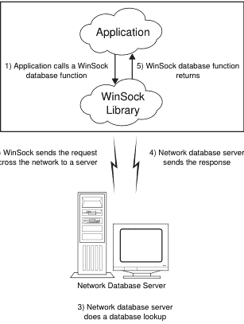

假设运行此程序的计算机名为“saturn”。调用 `gethostname()` 会将“saturn”设为主机名，并将该字符串复制到 `lpszHostName` 中。再假设这台计算机使用主机文件解析名称，而不是使用联网的名称服务器。该主机文件中的一行可能如下所示：

```
166.78.16.200        saturn
```

`gethostbyname()` 会在主机文件中查找“saturn”，找到它所在的行，并提取与之关联的 IP 地址。随后，它会将所有这些信息放入 `hostent` 主机条目结构中。最终，程序会生成格式化消息，说明“saturn”的 IP 地址为“166.78.16.200”。

### 注意

请注意，在这个示例中，仍然需要将 IP 地址复制到 `in_addr` 结构中，但这次源数据不是 `inet_ntoa()` 示例中的无符号长整数，而是 `hostent` 主机条目结构。`hostent` 结构的 `h_addr` 成员变量是一个指针，指向四字节 IP 地址的第一个字节；该地址已经以网络字节序存储。

## 异步查找主机的 IP 地址

在介绍 `gethostname()` 时，我提到过使用它有一个注意事项。在 `getXbyY` 函数中（其中之一就是 `gethostbyname()`），检索到的数据可能来自本地主机，也可能通过网络请求从某种服务器获取。一旦涉及网络通信，就必须考虑响应时间，以及网络请求进行期间应用程序对用户操作的响应能力。

`WSAAsyncGetHostByName()` 是 `gethostbyname()` 的异步版本。它被添加到 WinSock 中，用来配合 Berkeley 套接字函数，适应 Microsoft Windows 的消息传递体系结构。之所以称此函数为异步函数，是因为调用它不会暂停调用应用程序的执行，而是允许应用程序继续运行，直到 `WSAAsyncGetHostByName()` 发出的请求完成。调用 `gethostbyname()` 或任何其他 `getXbyY` 函数时，无法保证函数何时会返回结果。如果函数触发了网络操作，响应时间便无法确定。在请求尚未完成时，程序会停止运行；用户无法移动或关闭窗口，甚至无法取消操作。不仅如此，在 Windows 3.1 的非抢占式环境中，其他应用程序也会受到影响；整个系统似乎会暂时（甚至长时间）停滞。使用 `WSAAsyncGetHostByName()` 可以让应用程序响应用户输入，也不会对计算机上运行的其他应用程序造成不利影响。请求完成后，Windows 会向应用程序中的某个窗口发送一条消息。在请求仍未完成期间（例如，联网的域名服务器正在查找数据库并准备通过网络发回搜索结果时），调用应用程序以及计算机上其他应用程序的消息循环都会继续运行，因此所有程序都能响应用户操作。

> **注意**
>
> 实际上，如果你确定程序运行的环境使用本地主机文件解析主机名，就不必承担使用 `getXbyY` 函数异步版本所需的额外开销；阻塞函数完全够用，因为你知道它们会立即返回，不会导致任何正在运行的应用程序出现响应问题。

`WSAAsyncGetHostByName()` 的函数原型如下：

```c
HANDLE PASCAL FAR WSAAsyncGetHostByName(HWND hWnd, u_int wMsg,
    const char FAR * name, char FAR * buf, int buflen);
```

`hWnd` 是窗口句柄；`WSAAsyncGetHostByName()` 完成异步操作后，会向该窗口发送一条消息。`wMsg` 是异步操作完成后发送给 `hWnd` 的消息。`wMsg` 通常是用户定义的消息（即 `WM_USER + 1`）。`name` 是指向字符串的指针，该字符串包含要查询信息的主机名（例如 `"goober"` 或 `"goober.ping.com"`）。`buf` 是指向一块内存区域的指针；主机名查找成功后，该区域将包含目标主机的 `hostent` 结构。请注意，此缓冲区必须比 `hostent` 结构本身更大，因为 WinSock 还要用额外空间存储相关信息。WinSock 提供了一个名为 `MAXGETHOSTSTRUCT` 的已定义值，可将其用作缓冲区大小。此大小可以确保分配了足够的空间。`buflen` 是 `buf` 缓冲区的大小。为安全起见，它应设为 `MAXGETHOSTSTRUCT`。

如果成功启动异步操作，`WSAAsyncGetHostByName()` 的返回值就是异步任务的句柄。如果初始化失败，该函数会返回 0（零），此时应调用 `WSAGetLastError()` 来查明错误原因。可能的错误值包括：如果未成功调用 `WSAStartup()`，则为 `WSANOTINITIALIZED`；如果网络子系统发生故障，则为 `WSAENETDOWN`；如果由于特定 WinSock 实现内部的资源冲突，函数当前无法排入调度，则为 `WSAEWOULDBLOCK`；如果当前正在进行阻塞式 WinSock 操作，则为 `WSAEINPROGRESS`。请注意，该函数的返回值并不能告诉你请求的信息是否已成功检索；它只能说明函数是否已正常启动。

前面的示例代码用于显示运行程序的计算机名称和 IP 地址，现在可以改写为使用以下异步调用：

```c
// 全局变量
#define WM_USER_GETHOSTBYNAME (WM_USER + 1)
#define HOST_NAME_LEN (50)
```

```cpp
break;

default:
    break;
}
}
```

请注意，在 `WM_USER_GETHOSTBYNAME` 消息处理程序中，首先执行的是对 `WSAGETASYNCERROR()` 的调用。这是一个宏，用于确定 `WSAAsyncGetHostByName()` 请求是否成功。返回值为 0（零）表示一切正常。其他可能的值是 WINSOCK.H 中定义的各种错误代码。如果 `WSAGETASYNCERROR()` 返回错误 `WSAENOBUFS`，说明传递给 `WSAAsyncGetHostByName()` 的缓冲区太小。为确保安全，请使用至少有 `MAXGETHOSTSTRUCT` 字节的缓冲区。另外请注意，在 `WM_USER_GETHOSTBYNAME` 消息处理程序中，`wParam` 是当前返回操作的异步任务句柄。这意味着你可以对多个同时进行的异步请求使用同一个 `WM_USER` 消息。之后检查 `wParam`，即可确定当时返回的是哪项具体操作。

### 使用 Visual C++ 实现

本书介绍的是如何在 Microsoft Visual C++ 和 Microsoft 基础类库中使用 WinSock。前面的示例采用了“老式”的 SDK 风格，用来介绍第一个异步函数。本书其余示例主要基于 Visual C++ 和 MFC。使用 MFC 时，前面的示例代码可以按如下方式实现。

首先是类声明。本例中有一个名为 CMyWindow 的类，它派生自基类 CFrameWnd。CFrameWnd 是 MFC 提供的一个类。这个简单的类并未展示完整的类声明，只列出了重现前面 SDK 示例所需的部分：

```cpp
class CMyWindow : public CFrameWnd
{

...

    // 成员变量
#define HOST_NAME_LEN (50)
    char m_lpszHostName[HOST_NAME_LEN];      // 将用于存放主机名
    char m_lpszMessage[100];                 // 提示信息
    char m_lpszIP[16];                       // IP 地址字符串
    PHOSTENT m_phostent;                     // 指向主机条目结构的指针
    char m_lpszHostEntryBuffer[MAXGETHOSTSTRUCT]; // 主机条目结构
    IN_ADDR m_in;                            // Internet 地址结构
    HANDLE m_hGetHostByName;                 // 异步请求的句柄

    // 消息映射中的成员函数
    //{{AFX_MSG(CMyWindow)
    afx_msg void OnDoAsyncGetHostByName();
```


```cpp
afx_msg LONG OnAsyncGetHostByName(WPARAM wParam, LPARAM lParam);
//}}AFX_MSG
DECLARE_MESSAGE_MAP()
};
```

你会注意到，SDK 示例中所有全局变量现在都被封装到使用它们的类中。这只是 C++ 面向对象语言的优点之一。还要注意，这些变量（即类成员变量）前面带有 `m_` 前缀。以这种方式标记成员变量有助于你在类的实现中更容易地识别它们。类声明的下一部分包含窗口消息映射中函数的原型。MFC 使用消息映射自动将消息路由到其指定的窗口。它取代了传统 SDK 窗口过程中的 switch-case 结构。

`CMyWindow` 类的实现从该窗口的消息映射开始，如下所示：

```cpp
#define WM_USER_ASYNCGETHOSTBYNAME (WM_USER + 1)

BEGIN_MESSAGE_MAP(CMyWindow, CFrameWnd)
//{{AFX_MSG_MAP(CMyWindow)
    ON_COMMAND(ID_TEST_ASYNCGETHOSTBYNAME, OnDoAsyncGetHostByName)
    ON_MESSAGE(WM_USER_ASYNCGETHOSTBYNAME, OnAsyncGetHostByName)
//}}AFX_MSG_MAP
END_MESSAGE_MAP()
```

消息映射中的第一个条目用于一个将启动搜索的菜单项。`ON_COMMAND` 宏自动解析 SDK 程序中使用的 `WM_COMMAND` 消息。它将相应的菜单 ID（此处为 `ID_TEST_ASYNCGETHOSTBYNAME`）匹配起来，并将其与 `OnDoAsyncGetHostByName()` 成员函数关联。当用户在菜单资源中选择标识符为 `ID_TEST_ASYNCGETHOSTBYNAME` 的菜单项时，就会调用 `OnDoAsyncGetHostByName()` 函数。该函数的实现如下：

```cpp
void CMyWindow::OnDoAsyncGetHostByName()
{
    // find the name of the machine this program is running on
    if (gethostname(m_lpszHostName, HOST_NAME_LEN) != 0)
    {
        wsprintf(m_lpszMessage, "gethostname() generated error %d",
            WSAGetLastError());
        MessageBox(m_lpszMessage, "Info");
    }
    else
    {
        // get the host entry structure for this machine
        if ((m_hGetHostByName = WSAAsyncGetHostByName(m_hWnd,
            WM_USER_ASYNCGETHOSTBYNAME, m_lpszHostName,
            m_lpszHostEntryBuf, MAXGETHOSTSTRUCT)) == 0)
        {
            wsprintf(m_lpszMessage, "WSAAsyncGetHostByName() generated error %d",
                WSAGetLastError());
            MessageBox(m_lpszMessage, "Info");
        }
    }
}
```

消息映射中的第二个条目用于一条用户定义消息，该消息表示异步函数已完成。`ON_MESSAGE` 宏自动解析 SDK 程序中使用的 `WM_USER` 消息。它将特定的用户定义消息（此处为 `WM_USER_ASYNCGETHOSTBYNAME`）匹配起来，并将其与 `OnAsyncGetHostByName()` 成员函数关联。当 WinSock 在异步调用完成时生成 `WM_USER_ASYNCGETHOSTBYNAME` 消息时，就会执行 `OnAsyncGetHostByName()` 函数。该函数的实现如下：

```cpp
LONG CMyWindow::OnAsyncGetHostByName(WPARAM wParam, LPARAM lParam)
{
    // check for an error
    if (WSAGETASYNCERROR(lParam) != 0)
        MessageBox("WSAAsyncGetHostByName() had an error", "Info");
    else
    {
        // assign a hostent host entry pointer to the buffer
        m_phostent = (PHOSTENT)m_lpszHostEntryBuf;

        // copy the four byte IP address into an Internet address structure
        memcpy(&m_in, m_phostent->h_addr, 4);

        // format the results, converting the IP address into a string
        wsprintf(m_lpszMessage, "Host %s has IP address ", m_phostent->h_name);
        wsprintf(m_lpszIP, "%s", inet_ntoa(m_in));
        lstrcat(m_lpszMessage, m_lpszIP);
        MessageBox(m_lpszMessage, "Info");
    }

    return 0L;
}
```

注意，`OnDoAsyncGetHostByName()` 和 `OnAsyncGetHostByName()` 的实现几乎与该示例的 SDK 版本相同。


> **注意**
> 
> 关于消息映射和 Visual C++ ClassWizard：ClassWizard 将消息标识符（例如菜单项）与类成员函数关联。它会自动在类的实现文件中插入一个骨架函数。这很方便，因为 ClassWizard“知道”函数原型的正确格式。本书中的程序是使用 Visual C++ 1.5 和 Visual C++ 1.1 32 位版开发的。这些 Visual C++ 版本中的 ClassWizard 不支持为用户定义消息自动生成消息映射条目。这意味着对于你创建的任何 `WM_USER` 消息，都必须手动将 `ON_MESSAGE` 宏插入消息映射，在类定义中创建函数原型，并从零开始创建成员函数。

### 取消未完成的异步请求

异步数据库函数（例如 `WSAAsyncGetHostByName()`）返回的句柄可用于终止数据库查找。`WSACancelAsyncRequest()` 函数执行此任务。其原型如下：

```c
int PASCAL FAR WSACancelAsyncRequest(HANDLE hAsyncTaskHandle);
```

`hAsyncTaskHandle` 是你希望中止的异步任务的句柄。成功时，该函数返回 0（零）。失败时，它返回 `SOCKET_ERROR`，并且可以调用 `WSAGetLastError()`。可能的错误包括：如果 `WSAStartup()` 未成功调用，则为 `WSANOTINITIALISED`；如果网络子系统出现故障，则为 `WSAENETDOWN`；如果当前有阻塞式 WinSock 操作正在进行，则为 `WSAEINPROGRESS`；如果指定的异步任务句柄无效，则为 `WSAEINVAL`；或者如果要取消的异步例程已经完成，则为 `WSAEALREADY`。如果原始操作已经完成且结果消息已被处理，或者原始操作已经完成但结果消息仍在应用程序的消息队列中等待，则可能产生 `WSAEALREADY`。

通过在应用程序中使用 `WSACancelAsyncRequest()`，你可以让用户对程序拥有更大的控制权。如果用户执行的操作生成了异步数据库调用，并且该操作需要极其漫长的时间才能完成（例如涉及联网名称服务器时可能如此），那么让用户重新控制程序而不是任其摆布，是很好的做法。

## IP 地址解析

IP 地址解析与主机名解析相反。在主机名解析中，使用 `gethostbyname()` 或 `WSAAsyncGetHostByName()` 时，目标是在已知主机名的情况下获取 IP 地址。IP 地址解析的目标是在你只知道 IP 地址时获取主机名及其他主机信息。`gethostbyaddr()` 和 `WSAAsyncGetHostByAddr()` 函数用于实现这一目标。如果你尚未阅读，请阅读并充分理解 `gethostbyname()` 和 `WSAAsyncGetHostByName()` 函数；其余函数的使用方式与这两个函数类似，因此下面对这些函数的说明已从简。

## 在已知 IP 地址时查找主机名

`gethostbyaddr()` 的主要职责是接收主机的 IP 地址并返回其名称。该函数及其名为 `WSAAsyncGetHostByAddr()` 的异步对应函数，可能会在程序所运行计算机的本地主机文件上执行简单的表查找，也可能通过网络将请求发送到名称服务器。该函数的原型如下：

```c
struct hostent FAR * PASCAL FAR gethostbyaddr(const char FAR * addr,
    int len, int type);
```

`addr` 是指向你要获取其主机信息的计算机 IP 地址的指针，该地址采用网络字节序。`len` 是 `addr` 所指向地址的长度。在 WinSock 1.1 中，长度始终为 4，因为该版本的规范仅支持 Internet 风格寻址。出于同样的原因，`type` 必须始终为 `PF_INET`。

`gethostbyaddr()` 函数成功时返回指向 `hostent` 主机项结构的指针，失败时返回 `NULL`。当返回值为 `NULL` 时，可以调用 `WSAGetLastError()` 来确定问题的具体信息。可能的错误值包括：如果 `WSAStartup()` 未成功调用，则为 `WSANOTINITIALISED`；如果网络子系统出现故障，则为 `WSAENETDOWN`；如果无法解析主机名，则为 `WSAHOST_NOT_FOUND`；如果失败原因可能是临时的（例如名称服务器宕机），则为 `WSATRY_AGAIN`；如果发生了不可恢复的错误，则为 `WSANO_RECOVERY`；如果 IP 地址有效但找不到合适的数据，则为 `WSAEINVAL`；如果当前有阻塞式 WinSock 操作正在进行，则为 `WSAEINPROGRESS`；或者如果阻塞调用被 `WSACancelBlockingCall()` 取消，则为 `WSAEINTR`。

以下示例代码片段将查找具有指定 IP 地址的主机名：

```c
u_long ulIPAddress = inet_addr("166.78.16.201");    // binary IP address
char lpszMessage[100];                              // informational message
char lpszIP[16];                                    // IP address string
PHOSTENT phostent;                                  // pointer to host entry structure
IN_ADDR in;                                         // Internet address structure

// get the host entry structure for the specified IP address
if ((phostent = gethostbyaddr((char *)&ulIPAddress, 4, PF_INET)) == NULL)
    wsprintf(lpszMessage, "gethostbyaddr() generated error %d",
        WSAGetLastError());
else
{
    // copy the four byte IP address into an Internet address structure
    memcpy(&in, phostent->h_addr, 4);

    // format the results, converting the IP address into a string
    wsprintf(lpszMessage, "Host %s has IP address ", phostent->h_name);
    wsprintf(lpszIP, "%s", inet_ntoa(in));
    lstrcat(lpszMessage, lpszIP);
}
MessageBox(NULL, lpszMessage, "info", MB_OK);
```


假设 IP 地址为 166.78.16.201 的计算机名为“jupiter”。再假设这台计算机使用主机文件进行名称解析，而不是使用联网的名称服务器。该主机文件中可能有一行如下所示：

```text
166.78.16.201        jupiter
```

`gethostbyaddr()`会在主机文件中查找指定的 IP 地址，找到包含该地址的行，并提取与之关联的主机名。随后，它会将所有这些信息放入`hostent`主机条目结构中。最终得到的格式化消息会说明“jupiter”的 IP 地址是“166.78.16.201”。

> **注意**
>
> 在调用`gethostbyaddr()`时，必须将 IP 地址`ulIPAddress`强制转换为字符指针。`ulIPAddress`是一个无符号长整型（大小为四字节），其中包含按网络字节序排列的二进制 IP 地址。`gethostbyaddr()`需要指向该四字节数据首字节的指针，因此要获取变量的地址，并将其强制转换为字符指针。


## 知道 IP 地址时异步查找主机名

`WSAAsyncGetHostByAddr()`函数是`gethostbyaddr()`的异步版本。其函数原型如下：

```c
HANDLE PASCAL FAR WSAAsyncGetHostByAddr(HWND hWnd, u_int wMsg,
const char FAR * addr, int len, int type, char FAR * buf, int buflen);
```

`hWnd`是窗口句柄；当`WSAAsyncGetHostByAddr()`完成异步操作时，会向该窗口发送一条消息。`wMsg`是用户定义的消息；异步操作完成时，该消息会发送到`hWnd`。`addr`是指向计算机 IP 地址的指针，该地址采用网络字节序；你希望获取这台计算机的主机信息。`len`是`addr`所指向地址的长度；对于 Internet 地址，该值始终为 4（四）。`type`必须始终为`PF_INET`，因为 WinSock 1.1 只支持 Internet 风格的寻址。`buf`是指向一块内存区域的指针；地址查找成功完成后，其中将包含目标主机的`hostent`结构。该缓冲区必须足够大，以存储`hostent`结构及其引用的其他数据，因此至少应有`MAXGETHOSTSTRUCT`字节。`buflen`是缓冲区的大小。为确保安全，应将其设为`MAXGETHOSTSTRUCT`。

如果异步操作成功启动，`WSAAsyncGetHostByAddr()`的返回值就是该异步任务的句柄。若初始化失败，该函数返回 0（零），此时应调用`WSAGetLastError()`以查明错误原因。可能的错误值包括：

- 如果未成功调用`WSAStartup()`，则为`WSANOTINITIALIZED`
- 如果网络子系统发生故障，则为`WSAENETDOWN`
- 如果由于特定 WinSock 实现内部发生资源冲突，函数当前无法安排执行，则为`WSAEWOULDBLOCK`
- 如果当前正在进行阻塞式 WinSock 操作，则为`WSAEINPROGRESS`

请注意，该函数的返回值并不能说明请求的信息是否已成功检索；它只能说明函数是否已正确启动。

该函数的用法与`WSAAsyncGetHostByName()`非常相似。若使用 MFC 实现方法，按照`gethostbyaddr()`示例的方式复现示例，类声明可如下所示：

```cpp
class CMyWindow : public CFrameWnd
{

...

    // member variables
    u_long m_ulIPAddress;                 // binary IP address
    char m_lpszMessage[100];              // informational message
    char m_lpszIP[16];                    // IP address string
    PHOSTENT m_phostent;                  // pointer to host entry structure
    IN_ADDR m_in;                          // Internet address structure
    HANDLE m_hGetHostByAddr;              // handle of asynchronous request
    char m_lpszHostEntryBuf[MAXGETHOSTSTRUCT]; // host entry structure

    // member functions in the message map
    //{{AFX_MSG(CMyWindow)
    afx_msg void OnDoAsyncGetHostByAddr();
    afx_msg LONG OnAsyncGetHostByAddr(WPARAM wParam, LPARAM lParam);
    //}}AFX_MSG
    DECLARE_MESSAGE_MAP()
};
```

请注意，这些变量现在是类的成员变量。`CMyWindow`类的实现从窗口的消息映射开始：

```cpp
#define WM_USER_ASYNCGETHOSTBYADDR (WM_USER + 2)

BEGIN_MESSAGE_MAP(CMyWindow, CFrameWnd)
    //{{AFX_MSG_MAP(CMyWindow)
    ON_COMMAND(ID_TEST_ASYNCGETHOSTBYADDR, OnDoAsyncGetHostByAddr)
    ON_MESSAGE(WM_USER_ASYNCGETHOSTBYADDR, OnAsyncGetHostByAddr)
    //}}AFX_MSG_MAP
END_MESSAGE_MAP()
```

消息映射中的第一项对应一个用于启动查找的菜单项。该函数的实现如下：

```cpp
void CMyWindow::OnDoAsyncGetHostByAddr()
{
    // get a binary IP address
    m_ulIPAddress = inet_addr("166.78.16.201");

    // get the host entry structure
    if ((m_hGetHostByAddr = WSAAsyncGetHostByAddr(m_hWnd,
        WM_USER_ASYNCGETHOSTBYADDR, (char *)&m_ulIPAddress, 4,
        PF_INET, m_lpszHostEntryBuf, MAXGETHOSTSTRUCT)) == 0)
    {
        wsprintf(m_lpszMessage, "WSAAsyncGetHostByAddr() generated error %d",
            WSAGetLastError());
        MessageBox(m_lpszMessage, "Info");
    }
}
```

在此示例中，IP 地址是硬编码的；在实际程序中，这类值应允许用户配置。消息映射中的第二项对应用户定义的消息，该消息表示异步函数已经完成。当 WinSock 在异步调用完成时生成`WM_USER_ASYNCGETHOSTBYADDR`消息，便会执行`OnAsyncGetHostByAddr()`函数。该函数的实现如下：

```cpp
LONG CMyWindow::OnAsyncGetHostByAddr(WPARAM wParam, LPARAM lParam)
{
    // check for an error
    if (WSAGETASYNCERROR(lParam) != 0)
        MessageBox("WSAAsyncGetHostByAddr() had an error", "Info");
    else
    {
        // assign a hostent host entry pointer to the buffer
        m_phostent = (PHOSTENT)m_lpszHostEntryBuf;

        // copy the four-byte IP address into an Internet address structure
        memcpy(&m_in, m_phostent->h_addr, 4);

        // format the results, converting the IP address into a string
        wsprintf(m_lpszMessage, "Host %s has IP address ", m_phostent->h_name);
        wsprintf(m_lpszIP, "%s", inet_ntoa(m_in));
        lstrcat(m_lpszMessage, m_lpszIP);
        MessageBox(m_lpszMessage, "Info");
    }

    return 0L;
}
```

请注意，`OnAsyncGetHostByAddr()`成员函数与`OnAsyncGetHostByName()`类似，唯一的区别是错误消息中的文本不同。这些函数相同，是因为它们处理的都是`hostent`主机条目结构。

> **警告**
>
> 别忘了在异步调用的消息处理函数中使用`WSAGETASYNCERROR()`宏检查错误。


## 服务名称解析

到目前为止，你已经了解了如何获取二进制 IP 地址，无论该地址是从主机名解析得到，还是直接来自主机的 IP 地址。不过，在客户端与服务器应用程序建立网络连接时，主机的 IP 地址只解决了一半的问题；另一半由端口号决定。当一台计算机运行服务器应用程序时，就可以说它在提供一项服务。每项服务都由一个众所周知的端口号唯一标识。服务器程序会在众所周知的端口上“监听”连接，而客户端程序则会连接到该端口。端口号必须唯一，以便区分主机可能提供的多个服务器程序；端口号还必须是众所周知的，这样应用程序才能按名称请求它们。图 6.3 展示了一台提供两项服务的主机：端口号 37 通过 UDP 提供时间服务器服务，端口号 79 通过 TCP 提供 finger 服务器服务。请注意，客户端用于建立连接的端口以问号表示。客户端创建出站套接字时无需指定端口；TCP/IP 协议栈可以在运行时为套接字分配一个唯一的端口。

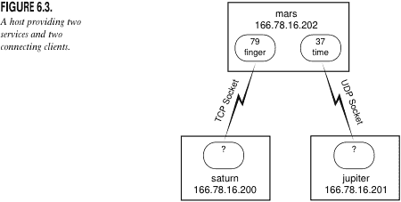

`getservbyname()`和`WSAAsyncGetServByName()`函数用于在已知服务名称时检索端口号。在程序中使用服务名称而非端口号，可以让程序用户决定为程序所提供的服务指定哪个端口。用户通常很看重这种控制权。随着用户计算机所提供的服务类型或服务使用方式随时间发生变化，用户可以灵活地按照自己的需要轻松配置计算机。


## 服务文件

服务名到端口的转换通常由一个称为服务文件的平面文件数据库提供支持。一个常见服务文件的部分列表如下所示：

```text
# This file contains port numbers for well-known services
# as defined by RFC 1060 (Assigned Numbers).
#
# Format:
# <service name>  <port number>/<protocol>  [aliases...]   [#<comment>]

time            37/tcp    timserver
time            37/udp    timserver
finger          79/tcp
```

以井号（#）开头的行是注释。请注意其中对 RFC 1060 的引用。这份 Internet 征求意见稿概述了一些标准知名端口。这确保没有人创建使用已建立端口号的服务。创建自己的自定义服务器时，需要在 1024 到 5000 之间（不含两端）分配一个端口号。1024 及以下的端口保留给通用知名端口。通常，当有人发明新服务并通过 RFC 分发其规范时，这些端口会被分配给新服务。

头部注释之后是列出的服务。最左侧列包含服务名。下一列包含端口号和传输层协议，二者由正斜杠（/）分隔。其余列包含该服务的别名。在前面的示例中，time 服务被识别为 “time” 或 “timserver”。finger 服务没有别名。传输层协议字段指定用户数据报协议或传输控制协议。这是与指定服务通信时必须使用的套接字类型（数据报或流）。请注意，time 服务在 UDP 和 TCP 连接上都响应端口 37。端口号/协议对在每个传输协议内提供与服务的一一对应关系：也就是说，一个服务可能响应 UDP 端口 100，而另一个完全不同的服务可能响应 TCP 端口 100。特定服务也可能响应一个 UDP 端口和一个完全不同的 TCP 端口。

> **提示**
> 
> 对于你开发的自定义应用程序，通常只需通过端口号引用服务号即可。这样就不必为自定义服务在服务表中创建条目。为灵活性起见，请让服务器和客户端应用程序所使用的端口号可配置。允许服务器在可配置端口上监听连接，并确保客户端连接的端口也可配置。这将确保能轻松解决多个不同服务器硬编码使用同一端口号的问题。如果你的服务器程序必须与另一个编写为使用硬编码端口号的服务器运行在同一台计算机上，你可以更改服务器和客户端配置以使用未使用的端口。在此信息硬编码的情况下，更改需要重新编译应用程序。


## 查找服务的端口号

`getservbyname()` 函数获取与特定服务名和协议相对应的服务信息。其函数原型如下：

```c
struct servent FAR * PASCAL FAR getservbyname(const char FAR * name,
        const char FAR * proto);
```

name 是指向字符串的指针，该字符串包含你要搜索的服务。服务名要么是正式服务名，要么是别名。proto 是指向字符串的指针，该字符串包含要使用的传输协议；其值为 “udp”、“tcp” 或 NULL。若 proto 为 NULL，则匹配服务表中第一个具有指定名称的服务，而不考虑协议。返回的 servent 结构具有以下格式：

```c
struct servent {
    char FAR * s_name;        // official service name
    char FAR * FAR * s_aliases; // alias list
    short s_port;              // port #
    char FAR * s_proto;        // protocol to use
};
```

关于传输协议的说明：协议名区分大小写。“TCP” 与 “tcp” 不同。请确保使用与服务文件中列出的完全一致的格式。

`getservbyname()` 函数成功时返回指向 servent 结构的指针，失败时返回 NULL。当返回值为 NULL 时，可以调用 `WSAGetLastError()` 来确定问题的具体细节。可能的错误值包括：如果未成功调用 WSAStartup()，则为 WSANOTINITIALISED；如果网络子系统故障，则为 WSAENETDOWN；如果发生不可恢复错误，则为 WSANO_RECOVERY；如果服务名有效但找不到合适数据，则为 WSANO_DATA；如果当前有阻塞式 WinSock 操作正在进行，则为 WSAEINPROGRESS；如果阻塞调用被 WSACancelBlockingCall() 取消，则为 WSAEINTR。

以下代码片段在 UDP 传输连接上查找 time 服务：

```c
PSERVENT pservent;        // pointer to service entry structure
char lpszMessage[100];    // informational message
char lpszPort[6];         // port number string

// get the service entry structure for the time service using UDP
if ((pservent = getservbyname("time", "udp")) == NULL)
    wsprintf(lpszMessage, "getservbyname() generated error %d",
        WSAGetLastError());
else
{
    // format the results
    wsprintf(lpszMessage, "Service %s using protocol %s has port ",
        pservent->s_name, pservent->s_proto);
    wsprintf(lpszPort, "%d", ntohs(pservent->s_port));
    lstrcat(lpszMessage, lpszPort);
}

MessageBox(NULL, lpszMessage, "Info", MB_OK);
```

最终结果是格式化消息，说明使用 “udp” 协议的 “time” 服务具有端口 37。请注意，端口号 `pservent->s_port` 必须从网络字节序转换为主机字节序。

如果重写示例以不指定传输协议，结果将不同：

```c
PSERVENT pservent;           // pointer to service entry structure
char lpszMessage[100];       // informational message
char lpszPort[6];            // port number string

// get the service entry structure for the time service
if ((pservent = getservbyname("time", NULL)) == NULL)
    wsprintf(lpszMessage, "getservbyname() generated error %d",
        WSAGetLastError());
else
{
    // format the results
    wsprintf(lpszMessage, "Service %s using protocol %s has port ",
        pservent->s_name, pservent->s_proto);
    wsprintf(lpszPort, "%d", ntohs(pservent->s_port));
    lstrcat(lpszMessage, lpszPort);
}

MessageBox(NULL, lpszMessage, "Info", MB_OK);
```

此示例的最终结果是格式化消息，说明使用 “tcp” 协议的 “time” 服务具有端口 37。给出 TCP 结果是因为该条目在服务文件中首先出现。

## 异步查找服务的端口号

`WSAAsyncGetServByName()` 是 `getservbyname()` 的异步对应函数。其函数原型如下：

```c
HANDLE PASCAL FAR WSAAsyncGetServByName(HWND hWnd, u_int wMsg,
    const char FAR * name, const char FAR * proto,
    char FAR * buf, u_int buflen);
```

hWnd 是窗口句柄，当 `WSAAsyncGetServByName()` 完成其异步操作时，将向该窗口发送消息。wMsg 是用户定义消息，当异步操作完成时，该消息将被投递到 hWnd。name 是指向服务名的指针，你希望获取有关该服务的信息。proto 是指向协议名的指针；其值为 “tcp”、“udp” 或 NULL。如果 proto 为 NULL，则返回第一个匹配的服务。buf 是指向内存区域的指针，在服务查找成功完成后，该内存区域将包含所需服务的 servent 结构。此缓冲区必须足够大，以存储 servent 结构以及其他被引用的数据；因此，其长度至少应为 MAXGETHOSTSTRUCT 字节。buflen 是 buf 缓冲区的大小。为安全起见，它应为 MAXGETHOSTSTRUCT。

如果异步操作成功启动，`WSAAsyncGetServByName()` 的返回值是异步任务的句柄。如果初始化失败，该函数返回 0（零），并且应调用 `WSAGetLastError()` 以查明错误原因。可能的错误值包括：如果未成功调用 WSAStartup()，则为 WSANOTINITIALISED；如果网络子系统故障，则为 WSAENETDOWN；如果由于特定 WinSock 实现内的资源冲突而无法在此时调度该函数，则为 WSAEWOULDBLOCK；或者如果当前有阻塞式 WinSock 操作正在进行，则为 WSAEINPROGRESS。该函数的返回值并不告知你请求的信息是否已成功检索；它只告知你该函数是否已正确启动。

此函数的用法与本章前面讨论的异步函数非常相似。使用 MFC 实现方法来复现 getservbyname() 示例中给出的示例，其类声明将如下所示：

```cpp
class CMyWindow : public CFrameWnd
{

    ...

    // member variables
    PSERVENT m_pServent;             // pointer to service entry structure
    char m_lpszMessage[100];         // informational message
    char m_lpszPort[8];              // port number string
    HANDLE m_hGetServByName;         // handle of asynchronous request
    char m_lpszServEntryBuf[MAXGETHOSTSTRUCT]; // service entry structure

    // member functions in the message map
    //{{AFX_MSG(CMyWindow)
    afx_msg void OnDoAsyncGetServByName();
    afx_msg LONG OnAsyncGetServByName(WPARAM wParam, LPARAM lParam);
    //}}AFX_MSG
    DECLARE_MESSAGE_MAP()
};
```

请注意，这些变量现在是类的成员变量。CMyWindow 类的实现从窗口的消息映射开始：

```cpp
#define WM_USER_ASYNCGETSERVBYNAME (WM_USER + 3)
```


## 当已知端口号时查找服务名

getservbyport() 函数获取与特定端口和协议对应的服务信息。其函数原型如下：

```c
struct servent FAR * PASCAL FAR getservbyport(int port,
    const char FAR * proto);
```

port 是服务端口，采用网络字节顺序。proto 是指向协议名的指针；其值为 "tcp"、"udp" 或 NULL。如果 proto 为 NULL，则返回第一个匹配的服务。getservbyport() 函数成功时返回指向 servent 结构的指针，失败时返回 NULL。当返回值为 NULL 时，可以调用 WSAGetLastError() 确定问题的具体细节。可能的错误值包括：如果 WSAStartup() 未成功调用，则为 WSANOTINITIALIZED；如果网络子系统故障，则为 WSAENETDOWN；如果发生不可恢复的错误，则为 WSANO_RECOVERY；如果端口号有效但找不到合适的数据，则为 WSANO_DATA；如果阻塞式 WinSock 操作当前正在进行，则为 WSAEINPROGRESS；或者如果阻塞调用被 WSACancelBlockingCall() 取消，则为 WSAEINTR。

以下代码片段在 UDP 传输连接上搜索与端口 37 对应的服务：

```c
PSERVENT pservent;             // pointer to service entry structure
char lpszMessage[100];         // informational message
char lpszPort[6];              // port number string

// get the service entry structure for the port 37 service using UDP
if ((pservent = getservbyport(htons(37), "udp")) == NULL)
    wsprintf(lpszMessage, "getservbyport() generated error %d",
        WSAGetLastError());
else
{
    // format the results
    wsprintf(lpszMessage, "Service %s using protocol %s has port ",
        pservent->s_name, pservent->s_proto);
    wsprintf(lpszPort, "%d", ntohs(pservent->s_port));
    lstrcat(lpszMessage, lpszPort);
}

MessageBox(NULL, lpszMessage, "Info", MB_OK);
```

请注意，在将端口号传递给 getservbyport() 之前，已将其转换为网络字节顺序。最终结果是格式化消息，说明使用“udp”传输协议的端口 37 对应“time”服务。请注意本示例与为 getservbyname() 提供的示例之间的相似性。

### 当已知端口号时异步查找服务名

WSAAsyncGetServByPort() 是 getservbyport() 的异步对应函数。其函数原型如下：

```c
HANDLE PASCAL FAR WSAAsyncGetServByPort(HWND hWnd, u_int wMsg,
    int port, const char FAR * proto, char FAR * buf, int buflen);
```

hWnd 是窗口句柄，当 WSAAsyncGetServByPort() 完成异步操作时，将向该窗口发送消息。wMsg 是用户定义消息，异步操作完成时将投递到 hWnd。port 是您想获取信息的服务的服务端口，采用网络字节顺序。proto 是指向协议名的指针；其值为 "tcp"、"udp" 或 NULL。如果 proto 为 NULL，则返回第一个匹配的服务。buf 是指向内存区域的指针，服务查找成功完成后，该区域将包含所需服务的 servent 结构。此缓冲区必须足够大，以存储 servent 结构以及其他被引用的数据；因此，它至少应有 MAXGETHOSTSTRUCT 字节长。buflen 是 buf 缓冲区的大小。为安全起见，它应为 MAXGETHOSTSTRUCT。

如果异步操作成功启动，WSAAsyncGetServByPort() 的返回值是异步任务的句柄。如果初始化失败，该函数返回 0（零），并且应调用 WSAGetLastError() 查找错误原因。可能的错误值包括：如果 WSAStartup() 未成功调用，则为 WSANOTINITIALIZED；如果网络子系统故障，则为 WSAENETDOWN；如果由于特定 WinSock 实现内的资源冲突，此时无法调度该函数，则为 WSAEWOULDBLOCK；或者如果阻塞式 WinSock 操作当前正在进行，则为 WSAEINPROGRESS。该函数的返回值并不告诉您所请求的信息是否成功检索；它只告诉您函数是否已正确启动。

此函数的用法与到目前为止讨论的其他异步函数非常相似。使用 MFC 实现方法来复现 getservbyport() 示例中给出的示例，其类声明如下：

```cpp
class CMyWindow : public CFrameWnd
{
    ...
    // member variables
    PSERVENT m_pservent;            // pointer to service entry structure
    char m_lpszMessage[100];        // informational message
    char m_lpszPort[6];             // port number string
    HANDLE m_hGetServByPort;        // handle of asynchronous request
    char m_lpszServEntryBuf[MAXGETHOSTSTRUCT]; // service entry structure

    // member functions in the message map
    //{{AFX_MSG(CMyWindow)
    afx_msg void OnDoAsyncGetServByPort();
    afx_msg LONG OnAsyncGetServByPort(WPARAM wParam, LPARAM lParam);
    //}}AFX_MSG
    DECLARE_MESSAGE_MAP()
};
```

请注意，这些变量现在是类的成员变量。CMyWindow 类的实现从窗口的消息映射开始：

```cpp
#define WM_USER_ASYNCGETSERVBYPORT (WM_USER + 4)
```

```cpp
BEGIN_MESSAGE_MAP(CMyWindow, CFrameWnd)
    //{{AFX_MSG_MAP(CMyWindow)
    ON_COMMAND(ID_TEST_ASYNCGETSERVBYPORT, OnDoAsyncGetServByPort)
    ON_MESSAGE(WM_USER_ASYNCGETSERVBYPORT, OnAsyncGetServByPort)
    //}}AFX_MSG_MAP
END_MESSAGE_MAP()
```

消息映射中的第一个条目用于将启动搜索的菜单项。该函数的实现如下：

```cpp
void CMyWindow::OnDoAsyncGetServByPort()
{
    // get the service entry structure for the port 37 service using UDP
    if ((m_hGetServByPort = WSAAsyncGetServByPort(m_hWnd,
        WM_USER_ASYNCGETSERVBYPORT, htons(37), "udp",
        m_lpszServEntryBuf, MAXGETHOSTSTRUCT)) == 0)
    {
        wsprintf(m_lpszMessage, "WSAAsyncGetServByPort() generated error %d",
            WSAGetLastError());
        MessageBox(m_lpszMessage, "Info");
    }
}
```

消息映射中的第二个条目用于用户定义消息，该消息指示异步函数已完成。当 WinSock 在异步调用完成时生成 WM_USER_ASYNCGETSERVBYPORT 消息时，将执行 OnAsyncGetServByPort() 函数。该函数的实现如下：

```cpp
LONG CMyWindow::OnAsyncGetServByPort(WPARAM wParam, LPARAM lParam)
{
    // check for an error
    if (WSAGETASYNCERROR(lParam) != 0)
        MessageBox("WSAAsyncGetServByPort() had an error", "Info");
    else
    {
        // assign a servent service entry pointer to the buffer
        m_pservent = (PSERVENT)m_lpszServEntryBuf;

        // format the results
        wsprintf(m_lpszMessage, "Service %s using protocol %s has port ",
            m_pservent->s_name, m_pservent->s_proto);
        wsprintf(m_lpszPort, "%d", ntohs(m_pservent->s_port));
        lstrcat(m_lpszMessage, m_lpszPort);
        MessageBox(m_lpszMessage, "Info");
    }

    return 0L;
}
```

## 总结

本章考察了 WinSock 提供的许多转换和数据库函数。还有更多此类函数，但这里介绍的是最常用的。第 8 章“示例应用程序”包含一个完整应用程序，使用其中几个函数。

下一章讨论创建套接字、通过套接字连接以及通过套接字来回发送数据所需的函数。掌握这些知识后，您就可以编写功能完整的 WinSock 应用程序了。


# 7
# 套接字函数

前两章展示了如何初始化 WinSock 库以及如何解析主机名和服务。本章讨论使真正有用的网络应用程序所需的其余 WinSock 函数。这些函数包括：`socket()` 用于创建通信端点，`bind()` 用于为端点命名，`listen()` 用于侦听传入连接，`accept()` 用于接受连接，`send()` 和 `sendto()` 用于发送数据，以及 `recv()` 和 `recvfrom()` 用于接收数据。

图 7.1 显示了使用 TCP 的客户端和服务器的 WinSock 函数调用流程。图 7.2 显示了类似的 WinSock 函数调用流程，但这次是使用 UDP 的客户端和服务器。

**图 7.1.** *使用 TCP 的客户端/服务器 WinSock 函数流程。*

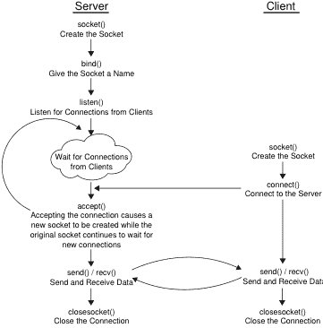


**图 7.2.**  
*使用 UDP 的客户端/服务器 WinSock 函数流程。*

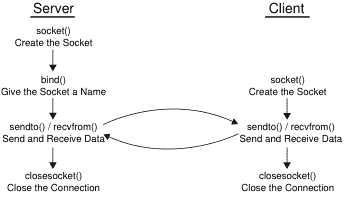

## 创建通信端点

`socket()` 函数创建一个称为*套接字*的通信端点。其函数原型如下：

```
SOCKET PASCAL FAR socket(int af, int type, int protocol);
```

`af` 指定此套接字使用的地址族。WinSock 1.1 仅支持 `AF_INET`，即 Internet 地址族格式。`type` 是套接字的类型说明。对于大多数应用程序，该值为 `SOCK_STREAM`（用于面向连接的字节流）或 `SOCK_DGRAM`（用于无连接数据报服务）。`protocol` 是要使用的特定协议，通常设置为 0（零），让 `socket()` 使用默认值。之所以可以将协议设为默认值，是因为地址族（`af`）和套接字类型（`type`）的组合已经唯一描述了套接字的协议。如果地址族是 `AF_INET`，套接字类型是 `SOCK_DGRAM`，则协议必须是 UDP。同样，如果地址族是 `AF_INET`，套接字类型是 `SOCK_STREAM`，则协议必须是 TCP。

成功时，`socket()` 返回一个套接字描述符。失败时，返回 `INVALID_SOCKET`，并且应调用 `WSAGetLastError()` 来查明错误原因。可能的错误值包括：如果 `WSAStartup()` 未被成功调用，则为 `WSANOTINITIALIZED`；如果网络子系统出现故障，则为 `WSAENETDOWN`；如果 `af` 指定的地址族不受支持，则为 `WSAEAFNOSUPPORT`；如果当前有阻塞式 WinSock 操作正在进行，则为 `WSAEINPROGRESS`；如果没有更多可用的套接字描述符，则为 `WSAEMFILE`；如果无法创建缓冲区空间，则为 `WSAENOBUFS`；如果 `protocol` 指定的协议不受支持，则为 `WSAEPROTONOSUPPORT`；如果协议对于此套接字来说是错误的类型，则为 `WSAEPROTOTYPE`；或者如果 `type` 指定的套接字类型在 `af` 指定的地址族中不受支持，则为 `WSAESOCKTNOSUPPORT`。

### 注意

`WSAGetLastError()` 返回的上述若干错误消息涉及不受支持的地址族、套接字类型或协议。这些参数之间具有若干相互依赖关系，如果未正确安排，就可能导致错误。例如，具有 `AF_INET` 地址族、`SOCK_STREAM` 类型和 UDP 协议的套接字是不可能的，因为 UDP 协议无法支持字节流。本书使用两种基本套接字。二者都具有 `AF_INET` 地址族说明符。一个套接字的类型为 `SOCK_STREAM`，另一个的类型为 `SOCK_DGRAM`。协议保留为 0（零），以便让 `socket()` 函数使用默认值。它通过检查地址族和套接字类型来确定该默认值。`AF_INET` 和 `SOCK_STREAM` 默认使用 TCP。`AF_INET` 和 `SOCK_DGRAM` 默认使用 UDP。

### 调用 *socket()* 的示例

以下代码示例展示了一次调用 `socket()` 函数来创建流式套接字的操作：

```c
SOCKET s;                         // socket descriptor
char lpszMessage[100];            // informational message

s = socket(AF_INET, SOCK_STREAM, 0);

if (s == INVALID_SOCKET)
    wsprintf(lpszMessage, "socket() generated error %d",
       WSAGetLastError());
else
    lstrcpy(lpszMessage, "socket() succeeded");

MessageBox(NULL, lpszMessage, "Info", MB_OK);
```

请注意，协议字段被设置为 0（零），以允许 `socket()` 使用根据地址族和套接字类型组合生成的默认值。

### 流与数据报

一般来说，套接字分为流式或数据报类型，在调用 `socket()` 时，其类型说明符分别对应 `SOCK_STREAM` 或 `SOCK_DGRAM`。你必须选择哪种类型更适合你的应用程序。

流式套接字支持面向连接的、可靠的字节流。数据保证按发送顺序到达，且不会重复。流式套接字将数据流视为连续的、双向的字节流，且没有记录边界。

## 服务器如何接受来自客户端的连接

在服务器中，流式套接字会绑定到一个众所周知的名称。然后服务器应用程序在该套接字上侦听连接。当客户端连接到服务器时，服务器接受这个新连接。此时，数据传输开始。

### 为套接字命名

创建套接字只不过是从可用描述符列表中为你的应用程序分配一个套接字描述符。为了使其可用，需要为套接字命名。`bind()` 函数完成此操作。其原型如下：

```
int PASCAL FAR bind(SOCKET s, const struct sockaddr FAR *addr, int namelen);
```

`s` 是 `socket()` 返回的套接字描述符。`addr` 是指向要分配给套接字的地址（或名称）的指针。`namelen` 是 `addr` 所指向结构的长度。

成功时，`bind()` 返回 0（零）。失败时，返回 `SOCKET_ERROR`，并且应调用 `WSAGetLastError()` 来查明错误原因。可能的错误值包括：如果 `WSAStartup()` 未被成功调用，则为 `WSANOTINITIALIZED`；如果网络子系统出现故障，则为 `WSAENETDOWN`；如果 `addr` 指定的地址已在使用中，则为 `WSAEADDRINUSE`；如果 `namelen` 太小，则为 `WSAEFAULT`；如果当前有阻塞式 WinSock 调用正在进行，则为 `WSAEINPROGRESS`；如果 `addr` 指向的结构中指定的地址族不受此协议支持，则为 `WSAEAFNOSUPPORT`；如果套接字已经绑定到一个地址，则为 `WSAEINVAL`；如果无法创建缓冲区空间，则为 `WSAENOBUFS`；或者如果套接字描述符 s 无效，则为 `WSAENOTSOCK`。

`sockaddr` 结构定义如下：

```
struct sockaddr
{
    u_short sa_family;    // address family
    char    sa_data[14];  // up to 14 bytes of direct address
};
```

`sa_data` 的格式取决于地址族。在 WinSock 1.1 中，仅支持 Internet 寻址格式。因此，提供了 `sockaddr_in` 结构。调用 `bind()` 时，应使用它而不是 `sockaddr`。`sockaddr_in` 结构的格式如下：

```
struct sockaddr_in
{
    short   sin_family;       // address family
    u_short sin_port;         // service port
    struct  in_addr sin_addr; // Internet address
    char    sin_zero[8];      // filler
};
```

对于 WinSock 1.1，sin_family 必须是 AF_INET；该值与调用 `socket()` 时的 af 参数相匹配。sin_port 是端口号，采用网络字节序，表示服务器应用程序提供服务的端口。sin_addr 是一个 in_addr 结构，包含服务器将用于侦听连接的 IP 地址，采用网络字节序。in_addr 结构用于提供三种查看 IP 地址的方式：作为四个字节、作为两个 short，或作为一个 long。in_addr 的格式如下：

```c
struct in_addr
{
    union
    {
        struct { u_char s_b1, s_b2, s_b3, s_b4; } S_un_b;
        struct { u_short s_w1, s_w2; } S_un_w;
        u_long S_addr;
    } S_un;
};

#define s_addr   S_un.S_addr       // can be used for most tcp & ip code
#define s_host   S_un.S_un_b.s_b2  // host on ip
#define s_net    S_un.S_un_b.s_b1  // network
#define s_imp    S_un.S_un_w.s_w2  // imp
#define s_impno  S_un.S_un_b.s_b4  // imp #
#define s_lh     S_un.S_un_b.s_b3  // logical host
```

注意 s_addr 的定义。这将是访问 IP 地址最常见的方式，即将其作为网络字节序的无符号 long，因为数据库和转换例程也以类似方式操作 IP 地址。`sockaddr_in` 结构的剩余字段 `sin_zero` 用作填充，以缓冲为地址分配的其余八个字节（2 字节端口 + 4 字节 IP 地址 + 8 字节填充 = 共 14 字节）。

以下是使用 `bind()` 的示例：

```c
SOCKET s;                         // socket descriptor
char lpszMessage[100];            // informational message
SOCKADDR_IN addr;                 // Internet address

// create a stream socket
s = socket(AF_INET, SOCK_STREAM, 0);
if (s != INVALID_SOCKET)
{
    // fill out the socket's address information
    addr.sin_family = AF_INET;
    addr.sin_port = htons(1050);
    addr.sin_addr.s_addr = htonl(INADDR_ANY);

    // bind the socket to its address
    if (bind(s, (LPSOCKADDR)&addr, sizeof(addr)) == SOCKET_ERROR)
    {
        wsprintf(lpszMessage, "bind() generated error %d",
            WSAGetLastError());
        MessageBox(NULL, lpszMessage, "Info", MB_OK);
    }
    else
    {
        ...
    }
}
```


注意将 `addr.sin_port` 赋值为 `htons(1050)`。这说明该服务器应用程序在端口 1050 上监听连接。你也可以使用 `getservbyname()` 或 `WSAAsyncGetServByName()` 函数来分配端口号，如以下示例所示：

```
LPSERVENT pservent;                  // pointer to service entry structure
pservent = getservbyname("daytime", "tcp");
if (pservent != NULL)
    addr.sin_port = pservent->s_port; // already in network byte order
```

示例中的下一行是为 `addr.sin_addr.s_addr` 赋值，即设置实际的 IP 地址。在此示例中，IP 地址被设置为 `htonl(INADDR_ANY)`。这说明该服务器会监听主机所连接的任意网络上的连接。

**图 7.3。**

*位于两个网络上的服务器计算机。*

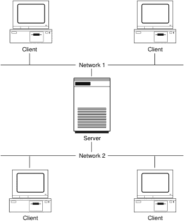

在大多数服务器应用程序中，绑定到套接字的名称都将其 IP 地址设置为 `INADDR_ANY`。这会告诉 WinSock，你愿意接受来自主机所连接的任意网络的请求。只有当运行服务器应用程序的主机被分配了多个 IP 地址时，这才会成为一个问题。例如，如果主机安装了两块以太网卡，如图 7.3 所示，就可能出现这种情况。一块以太网卡被分配了一个 IP 地址（例如 166.78.16.200），另一块以太网卡则使用不同的 IP 地址（例如 166.78.16.201）。在这种情况下，你可能希望设置限制，使客户端只能通过其中一个 IP 地址连接，而不能通过两个地址连接。在这种情况下，可以执行类似以下的操作：

```c
addr.sin_addr.s_addr = inet_addr("166.78.16.200");
```

关于这个代码示例，最后需要注意的是对 `bind()` 本身的调用。由于 `addr` 是一个 `sockaddr_in` 结构（`SOCKADDR_IN`），因此必须将 `addr` 参数的地址强制转换为指向 `sockaddr` 结构（`LPSOCKADDR`）的长指针。

## 监听连接

现在你已经可以为套接字命名，接下来就可以通过监听客户端应用程序对该套接字发起的连接来真正使用它。`listen()` 函数负责执行此操作。其原型如下：

```c
int PASCAL FAR listen(SOCKET s, int backlog);
```

`s` 是用于监听连接的套接字描述符。`backlog` 是在服务器应用程序处理连接之前，可以排队等待的挂起连接数量。`backlog` 必须介于 1 和 5 之间（包括 1 和 5）。

成功时，`listen()` 返回 0（零）。失败时，返回 `SOCKET_ERROR`，此时应调用 `WSAGetLastError()` 来查明错误原因。可能的错误值包括：如果未成功调用 `WSAStartup()`，则为 `WSANOTINITIALISED`；如果网络子系统发生故障，则为 `WSAENETDOWN`；如果 `addr` 指定的地址已在使用，则为 `WSAEADDRINUSE`；如果当前有阻塞式 WinSock 调用正在进行，则为 `WSAEINPROGRESS`；如果尚未使用 `bind()` 将套接字绑定到地址，或者套接字已经连接，则为 `WSAEINVAL`；如果套接字已经连接，则为 `WSAEISCONN`；如果没有更多空闲文件描述符，则为 `WSAEMFILE`；如果无法创建缓冲区空间，则为 `WSAENOBUFS`；如果套接字描述符 `s` 无效，则为 `WSAENOTSOCK`；或者如果套接字 `s` 不支持 `listen()` 操作，则为 `WSAEOPNOTSUPP`（如果套接字 `s` 的类型为 `SOCK_DGRAM`，就可能发生这种情况）。

> **注意**
>
> `backlog` 通过防止 WinSock 层分配大量资源来充当安全网。假设你的服务器应用程序速度非常慢，每五秒只能处理一次客户端连接。同时假设套接字的 `backlog` 为 3。如果四个客户端在五秒内尝试连接服务器套接字，那么第四个客户端的连接尝试将在客户端一侧产生 `WSAECONNREFUSED` 错误。


下面的代码片段展示了 `listen()` 函数的用法：

```c
SOCKET s;                       // socket descriptor
char lpszMessage[100];          // informational message
SOCKADDR_IN addr;               // Internet address

// create a stream socket
s = socket(AF_INET, SOCK_STREAM, 0);
if (s != INVALID_SOCKET)
{
    // fill out the socket's address information
    addr.sin_family = AF_INET;
    addr.sin_port = htons(1050);
    addr.sin_addr.s_addr = htonl(INADDR_ANY);

    // bind the socket to its address
    if (bind(s, (LPSOCKADDR)&addr, sizeof(addr)) != SOCKET_ERROR)
    {
        // listen for connections (queueing up to three)
        if (listen(s, 3) == SOCKET_ERROR)
        {
            wsprintf(lpszMessage, "listen() generated error %d",
                WSAGetLastError());
            MessageBox(lpszMessage, 'Info');
        }
        else
            ...
    }
}
```

## 接受连接

现在，你已经有了一个已命名并正在监听连接的套接字。服务器接下来要做的就是接受来自客户端的连接。`accept()` 函数负责执行此操作。其原型如下：

```c
SOCKET PASCAL FAR accept(SOCKET s, struct sockaddr FAR *addr,
  int FAR *addrlen);
```

`s` 是用于接受连接请求的套接字描述符。`addr` 是指向 `sockaddr` 结构的指针，该结构将接收发起连接的客户端的地址。你可以为此参数传入 `NULL`，也可以传入指向 `sockaddr_in` 结构的指针，就像 `bind()` 示例中那样。`addrlen` 是一个指针，用于接收 `addr` 中地址结构的实际长度。如果 `addr` 为 NULL，则 `addrlen` 也可以为 NULL；否则，`addrlen` 所指向的值最初应包含 `addr` 所指向结构的长度。以下示例对此进行了更清晰的说明。

成功时，`accept()` 返回一个套接字描述符。这个返回的套接字描述符用于与客户端通信；调用 `accept()` 时传入的原始套接字 `s` 仍可用于接受其他连接。失败时，返回 `INVALID_SOCKET`，此时应调用 `WSAGetLastError()` 来查明错误原因。可能的错误值包括：如果未成功调用 `WSAStartup()`，则为 `WSANOTINITIALIZED`；

```
MessageBox(lpszMessage, "Info");

...

    }
}
}
```

在此示例中，调用 `accept()` 函数时传入了一个指向 `sockaddr_in` 结构的指针，以及一个指向包含 `sockaddr_in` 结构长度的整数的指针。当 `accept()` 函数成功返回时，`sockaddr_in` 结构中会包含发起连接的客户端的地址信息。如前所述，你可以为这两个参数传入 NULL，这样接受连接的服务器应用程序将不会获得任何客户端信息。另一种获取连接客户端详细信息的方法是使用 `getpeername()` 函数。其原型如下：

```
int PASCAL FAR getpeername(SOCKET s,
    struct sockaddr FAR * name, int FAR * namelen);
```

它的参数与 `accept()` 的参数相同，只是套接字 `s` 是由 `accept()` 返回的套接字描述符，而不是用于监听连接的套接字描述符。另一个区别是，该函数原型使用 `name` 和 `namelen`，而不是分别使用 `addr` 和 `addrlen`。在某些 WinSock 函数中，术语“名称”和“地址”的使用并不一致，这是一个问题。

成功时，`getpeername()` 返回 0（零）。出错时，返回 `SOCKET_ERROR`，此时应调用 `WSAGetLastError()` 来查明错误原因。可能的错误值包括：如果未成功调用 `WSAStartup()`，则为 `WSAENOTINITIALIZED`；如果网络子系统发生故障，则为 `WSAENETDOWN`；如果 `namelen` 太小，则为 `WSAEFAULT`；如果当前有阻塞式 WinSock 调用正在进行，则为 `WSAEINPROGRESS`；如果套接字描述符 `s` 无效，则为 `WSAENOTSOCK`；或者如果套接字尚未连接到客户端，则为 `WSAENOTCONN`。

要使用此函数，可以执行类似以下的操作：

```c
...
// accept a connection
clientS = accept(s, NULL, NULL);
if (clientS == INVALID_SOCKET)
{
    wsprintf(lpszMessage, "accept() generated error %d",
        WSAGetLastError());
    MessageBox(lpszMessage, "Info");
}
else
{
    if (getpeername(clientS,
        (LPSOCKADDR)&clientAddr, &clientAddrLen) == SOCKET_ERROR)
    {
        wsprintf(lpszMessage, "getpeername() generated error %d",
            WSAGetLastError());
        MessageBox(lpszMessage, "Info");
    }
}
```


```c
}
else
{
    // copy the four byte IP address into an IP address structure
    memcpy(&ClientAddr, &ClientAddr.sin_addr.s_addr, 4);

    // print an informational message
    wsprintf(lpzMessage,
        "client IP address is %s, port is %d",
        inet_ntoa(ClientAddr), ntohs(ClientAddr.sin_port));
    MessageBox(lpzMessage, "Info");

    ...
}
}
...
```

## 如果没有客户端尝试连接怎么办？

在前面的例子中，没有提到当服务器执行`accept()`函数时，如果没有客户端尝试连接到服务器，代码段的结果会是什么。在这种情况下，服务器应用程序会阻塞，等待客户端连接。这与之前章节讨论的`getXbyY`函数类似。正如使用`WSAAsyncGetXByY`函数可以解决`getXbyY`问题一样，`accept()`问题也有解决办法。解决方案在于使用非阻塞套接字。默认情况下，使用`socket()`创建的套接字处于阻塞模式。有两种方法可以将套接字置于非阻塞模式。

### 采用 Berkeley 方式

Berkeley 方式使用非阻塞套接字涉及两个函数：`ioctl()`和`select()`。`ioctl()`是 UNIX 中对文件描述符或套接字执行输入/输出控制的函数。因为 WinSock 套接字描述符可能不是真正的操作系统文件描述符，所以不能使用`ioctl()`，而是提供了`ioctlsocket()`。`select()`用于确定一个或多个套接字的状态。

使用`ioctlsocket()`将套接字转换为非阻塞模式的代码如下：

```c
// put socket s into nonblocking mode
u_long ulCmdArg = 1;    // 1 for nonblocking, 0 for blocking
ioctlsocket(s, FIONBIO, &ulCmdArg);
```

一旦套接字处于非阻塞模式，调用通常阻塞的函数时，如果函数无法立即完成，则简单地返回`WSAEWOULDBLOCK`，如下例所示。

```c
SOCKET clientS;
clientS = accept(s, NULL, NULL);
if (clientS == INVALID_SOCKET)
{
    int nError = WSAGetLastError();

    // if there is no client waiting to connect to this server,
    // nError will be WSAEWOULDBLOCK
}
```

你的服务器应用程序可以简单地定期调用`accept()`直到调用成功，或者可以使用`select()`调用来查询套接字的状态。`select()`函数检查一个或多个套接字的可读性、可写性和异常状态。即使是最顽固的 UNIX 或 Berkeley 套接字支持者也可能会同意，`select()`的使用相当不直观。例如，如果`select()`告诉你一个套接字可读，这可能意味着该套接字已准备好连接到客户端，也可能意味着客户端发送了一些数据可供读取。要在 Windows 程序中使用`select()`，就需要定期调用它，比如通过定时器或者每次经过应用程序的消息循环时调用。无论如何，它的使用都不太适合 Windows 的消息驱动架构。幸运的是，WinSock 提供了一种更“Windows 原生”的方法来执行非阻塞套接字操作。

### 采用 Windows 方式

WinSock 提供了一个名为`WSAAsyncSelect()`的函数来解决阻塞套接字函数调用的问题。它比使用`ioctlsocket()`和`select()`更自然地解决了这个问题。它的工作方式是通过发送 Windows 消息来通知窗口套接字事件。其原型如下：

```c
int PASCAL FAR WSAAsyncSelect(SOCKET s, HWND hWnd,
    u_int wMsg, long lEvent);
```

`s`是需要事件通知的套接字描述符。`hWnd`是当套接字上发生事件时应接收消息的窗口句柄。`wMsg`是当套接字`s`上发生套接字事件时`hWnd`要接收的消息。它通常是一个用户定义的消息（`WM_USER + n`）。`lEvent`是一个位掩码，指定应用程序感兴趣的事件。

`WSAAsyncSelect()`成功时返回0（零），失败时返回`SOCKET_ERROR`。失败时应调用`WSAGetLastError()`。可能的错误值包括：如果`WSAStartup()`未成功调用，则为`WSANOTINITIALIZED`；如果网络子系统出现故障，则为`WSAENETDOWN`；如果当前正在进行阻塞 WinSock 调用，则为`WSAEINPROGRESS`；或者如果某个参数无效，则为`WSAEINVAL`。

> **提示**
>
> 调用`WSAAsyncSelect()`会自动将套接字置于非阻塞状态。无需先使用`ioctlsocket()`来执行此操作。

`WSAAsyncSelect()`能够监视多个套接字事件。表7.1列出了这些事件，它们在函数原型中由`lEvent`表示。

**表7.1.** `WSAAsyncSelect()`事件。

| 事件 | 含义 |
|---|---|
| `FD_READ` | 套接字准备好读取 |
| `FD_WRITE` | 套接字准备好写入 |
| `FD_OOB` | 套接字上有带外数据可读取 |
| `FD_ACCEPT` | 套接字准备好接受新的传入连接 |
| `FD_CONNECT` | 套接字上的连接已完成 |
| `FD_CLOSE` | 套接字上的连接已关闭 |

`lEvent`参数是通过对你感兴趣的事件进行逻辑或（OR）运算来构造的。例如，当有到套接字`s`的传入连接，或者套接字`s`有数据可读时，以下代码将向`hWnd`指定的窗口句柄发送一条`WM_USER + 1`消息：

```c
long lEvent = FD_ACCEPT | FD_READ;
WSAAsyncSelect(s, hWnd, WM_USER + 1, lEvent);
```

> **提示**
>
> 对某个套接字发出`WSAAsyncSelect()`会取消先前对该套接字的任何`WSAAsyncSelect()`调用。你不能像这样分开调用：

```c
WSAAsyncSelect(s, hWnd, WM_USER + 1, FD_ACCEPT);

WSAAsyncSelect(s, hWnd, WM_USER + 1, FD_READ);
```

上述代码将忽略`FD_ACCEPT`事件；只有`FD_READ`事件会作为消息`WM_USER + 1`被发送。

你也不能使用对`WSAAsyncSelect()`的单独调用来为特定套接字的不同事件分配不同的消息。例如，以下代码是错误的：


```cpp
WSAAsyncSelect(s, hWnd, WM_USER + 1, FD_ACCEPT);

WSAAsyncSelect(s, hWnd, WM_USER + 2, FD_READ);
```

`FD_ACCEPT`事件永远不会生成`WM_USER + 1`。只有`FD_READ`会生成消息（`WM_USER + 2`）。

要取消所有事件通知，请将`wMsg`和`lEvent`设置为0（零）来调用`WSAAsyncSelect()`，如下所示：

```cpp
WSAAsyncSelect(s, hWnd, 0, 0L);
```

你可以看到有六个事件你可以表达兴趣。本节讨论的是服务器如何接受来自客户端的连接，因此这是我要重点介绍的`WSAAsyncSelect()`方面。请注意，本章的其他部分使用`WSAAsyncSelect()`来监视数据的发送和接收以及其他事件。`WSAAsyncSelect()`的基本用法对于所有事件都是相同的，所以我将在此完整描述一个合适的消息处理程序。

每当一个监听套接字有客户端希望建立连接时，就会生成`FD_ACCEPT`事件。下面是一个在 Visual C++ MFC 程序中调用`WSAAsyncSelect()`的示例。

```cpp
BOOL CServerWindow::StartListening()
{
    // m_s is the socket descriptor which is a member
    // variable of the CServerWindow class

    // m_s has already been created and bound to a name

    // listen for connections
    if (listen(m_s, 3) == SOCKET_ERROR)
        return FALSE;

    // get asynchronous event notification of accept
    // to this object's window (m_hWnd)
    if (WSAAsyncSelect(m_s, m_hWnd, WM_USER + 1, FD_ACCEPT) == SOCKET_ERROR)
        return FALSE;

    return TRUE;
}
```

你还需要在`CServerWindow`中有一个成员函数来处理当套接字`m_s`请求客户端连接时生成的`WM_USER + 1`消息：

```cpp
BEGIN_MESSAGE_MAP(CServerWindow, CFrameWnd)
//{{AFX_MSG_MAP(CServerWindow)
    ...
    ON_MESSAGE(WM_USER + 1, OnAsyncSelect)
    ...
```


```cpp
//}}AFX_MSG_MAP
END_MESSAGE_MAP()

LONG CServerWindow::OnAsyncSelect(WPARAM wParam, LPARAM lParam)
{
    // wParam is the socket descriptor
    // lParam is a status or error indicator

    // check for an error
    if (WSAGETSELECTERROR(lParam) != 0)
        return 0;

    // what event are we being notified of?
    if (WSAGETSELECTEVENT(lParam) == FD_ACCEPT)
    {
        // m_clientS is defined as SOCKET in the CServerWindow class declaration
        m_clientS = accept(m_s, NULL, NULL);
        if (m_clientS == INVALID_SOCKET)
        {
            int nError = WSAGetLastError();
            if (nError == WSAEWOULDBLOCK)
            {
                // There really isn't a client ready to connect.
                // This error should never occur for the FD_ACCEPT event
                // so it should be treated just like this event
                // notification function hadn't been called.
                ;
            }
            else
                // some other error
                ;
        }
    }
}
```

注意对`WSAGETSELECTERROR`的调用。这是WINSOCK.H中提供的宏，用于确定异步事件中是否存在错误。成功时它返回0（零），失败时返回错误值。对于`FD_ACCEPT`事件通知消息，错误可能是`WSAENETDOWN`，表示网络子系统已宕机。

还要注意，调用`WSAGETSELECTEVENT`宏是为了确定触发此消息处理程序的事件，尽管`CServerWindow::OnAsyncSelect()`函数被调用的唯一方式是`FD_ACCEPT`事件发生。在后面的示例程序中会用到这个宏，类的成员函数将在其中处理特定套接字的多个WinSock事件。

如果由于某种原因，`CServerWindow::OnAsyncSelect()`函数在`FD_ACCEPT`事件下被调用，但没有客户端尝试连接此服务器应用程序，`accept()`将返回`INVALID_SOCKET`。调用`WSAGetLastError()`将返回`WSAEWOULDBLOCK`，这告诉你该函数是为非阻塞模式设置的，如果不是，它将阻塞。

## 客户端如何连接到服务器

### 为套接字赋予默认名称

在调用`socket()`之后，可以使用`bind()`函数为套接字赋予名称。这一步可能是必要的，因为调用`socket()`只是保留一个套接字描述符。通过使用`bind()`为套接字命名，你为套接字提供了一个端口，它通过该端口与服务器通信。

下面展示了使用`bind()`为客户端套接字赋予默认名称的示例：

```c
SOCKET s;                    // socket descriptor
char lpszMessage[100];       // informational message
SOCKADDR_IN addr;            // Internet address

// create a stream socket
s = socket(AF_INET, SOCK_STREAM, 0);
if (s != INVALID_SOCKET)
{
    // fill out the socket's address information
    addr.sin_family = AF_INET;
    addr.sin_port = 0;       // let WinSock assign a port
    addr.sin_addr.s_addr = htonl(INADDR_ANY);

    // bind the socket to its address
    if (bind(s, (LPSOCKADDR)&addr, sizeof(addr)) == SOCKET_ERROR)
    {
        wsprintf(lpszMessage, "bind() generated error %d",
            WSAGetLastError());
        MessageBox(NULL, lpszMessage, "Info", MB_OK);
    }
    else
        ...
}
```

请注意，`addr.sin_port`被赋值为0（零）。这允许WinSock分配它认为合适的任何未使用端口。这与服务器套接字形成对比，服务器套接字需要在特定端口上监听连接。客户端使用哪个端口其实并不重要。但如果你确实想知道某个套接字被分配了哪个端口，可以使用`getsockname()`函数。其函数原型如下：

```c
int PASCAL FAR getsockname(SOCKET s,
  struct sockaddr FAR *name, int FAR * namelen);
```

它的用法与`getpeername()`非常相似。下面列出了一个调用`getsockname()`的示例：

```c
SOCKET s;                         // socket descriptor
char lpszMessage[100];             // informational message
SOCKADDR_IN addr;                  // Internet address used by bind()
SOCKADDR_IN nAddrAssigned;         // Internet address assigned by bind()
int nAddrAssignedLen = sizeof(nAddrAssigned);

// create a stream socket
s = socket(AF_INET, SOCK_STREAM, 0);
if (s != INVALID_SOCKET)
{
    // fill out the socket's address information

    addr.sin_family = AF_INET;
    addr.sin_port = 0;              // let WinSock assign a port
    addr.sin_addr.s_addr = htonl(INADDR_ANY);

    // bind the socket to its address
    if (bind(s, (LPSOCKADDR)&addr, sizeof(addr)) != SOCKET_ERROR)
    {
        // find out what port was assigned by WinSock
        if (getsockname(s, (LPSOCKADDR)&nAddrAssigned, &nAddrAssignedLen) == 0)
        // now nAddrAssigned.sin_port contains the port number
        // that WinSock assigned to this client
        ...
    }
}
```

在此示例中，与服务器示例一样，套接字的IP地址设置为`INADDR_ANY`。这意味着套接字可以使用计算机拥有的任何网络接口。在大多数情况下，这种用法都没问题。如果运行客户端应用程序的计算机通过多个网络接口连接到多个网络，则可能需要指定特定地址。图7.4展示了一种可能的情况。图7.4中的客户端计算机有两个IP地址；假设它们是166.12.34.101和166.12.34.102。如果你希望客户端仅通过一个网络接口进行通信，可以执行以下操作，而不是使用`INADDR_ANY`：

```c
addr.sin_addr.s_addr = inet_addr("166.12.34.101");
```

### 连接到服务器

客户端使用`connect()`函数连接到服务器。其原型如下：

```c
int PASCAL FAR connect(SOCKET s,
const struct sockaddr FAR *name, int namelen);
```

图7.4 位于两个网络上的客户端计算机。

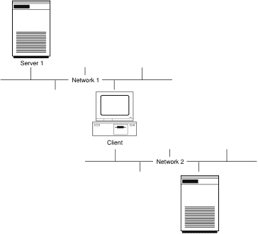

s是用于连接的套接字。name是要连接的服务器的地址。对于WinSock 1.1，它始终是一个`sockaddr_in` Internet地址结构。`namelen`是name参数的长度。

成功时，`connect()`返回0（零）。失败时，它返回`SOCKET_ERROR`，应调用`WSAGetLastError()`来查明错误原因。可能的错误值包括：`WSANOTINITIALISED`，如果WinSock尚未通过调用`WSAStartup()`成功初始化；`WSAENETDOWN`，如果网络子系统出现故障；`WSAEADDRINUSE`，如果地址已被占用；`WSAEINTR`，如果阻塞调用被`WSACancelBlockingCall()`取消；`WSAEINPROGRESS`，如果正在进行阻塞的WinSock调用；`WSAEADDRNOTAVAIL`，如果`addr`指定的地址不可用；`WSAEAFNOSUPPORT`，如果指定系列中的地址无法与此套接字一起使用；`WSAECONNREFUSED`，如果服务器强行拒绝了连接尝试；`WSAEDESTADDRREQ`，如果未指定`name`；`WSAEFAULT`，如果`namelen`无效；`WSAEINVAL`，如果套接字`s`未绑定到地址；`WSAEISCONN`，如果套接字`s`已连接；`WSAEMFILE`，如果没有空闲的文件描述符；`WSAENETUNREACH`，如果当前无法从此主机访问网络；`WSAENOBUFS`，如果没有可用的缓冲区空间；`WSAENOTSOCK`，如果套接字`s`不是有效的套接字描述符；`WSAETIMEDOUT`，如果连接尝试超时；或者`WSAEWOULDBLOCK`，如果套接字`s`被标记为非阻塞且此连接无法立即完成。

```cpp
// make the connection
if (connect(m_s, (LPSOCKADDR)&m_addrServer, sizeof(m_addrServer)) ==
    SOCKET_ERROR)
{
    int nError = WSAGetLastError();
    if (nError == WSAEWOULDBLOCK)
    {
        // this is ok...just wait for async notice
    }
    else
    {
        // some other error
    }
}
}
```

你还需要在`CClientWindow`中提供一个成员函数来处理客户端连接完成时生成的`WM_USER + 1`消息：

```cpp
BEGIN_MESSAGE_MAP(CClientWindow, CFrameWnd)
    //{{AFX_MSG_MAP(CClientWindow)
    ...
    ON_MESSAGE(WM_USER + 1, OnAsyncSelect)
    ...
    //}}AFX_MSG_MAP
END_MESSAGE_MAP()
```

```cpp
LONG CClientWindow::OnAsyncSelect(WPARAM wParam, LPARAM lParam)
{
    // wParam is the socket descriptor
    // lParam is a status or error indicator

    // check for an error
    if (WSAGETSELECTERROR(lParam) != 0)
        return 0L;

    // what event are we being notified of?
    if (WSAGETSELECTEVENT(lParam) == FD_CONNECT)
    {
        // you now know that the m_s socket is connected to the server
    }
}
```

此消息处理程序遵循与`CServerWindow::OnAsyncSelect()`函数相同的格式。首先，使用`WSAGETSELECTERROR`宏检查错误。接下来，使用`WSAGETSELECTEVENT`确定是哪个事件导致调用此消息。`FD_CONNECT`事件告诉我们客户端套接字已连接到服务器。

### 在流套接字上发送和接收数据

你现在已经看到了服务器如何接受连接以及客户端如何建立连接。一旦客户端和服务器套接字连接起来，就可以发送和接收数据了。


> 不幸的是，对于带外实现存在两种相互冲突的解释。Internet RFC 793 引入了带外数据的概念，RFC 1122 则给出了主机要求。问题之所以出现，是因为伯克利对带外数据处理的实现并不遵循 RFC 1122。大多数 TCP/IP 协议栈提供商都会记录其实现，以便你了解他们使用的是哪一种：BSD 还是 RFC 1122。由于这种观点分歧，最好在应用程序中不要使用带外数据。当然，如果你的应用程序必须与现有的客户端或服务器（可能运行在 UNIX 计算机上）互操作，那你就别无选择。

下面演示一次典型的 `send()` 调用：

```c
SOCKET s;             // socket to communicate over
char pszBuf[100];     // buffer to send
int nBufLen;          // number of bytes in buffer to send
int nBytesSent;       // bytes sent
int nError;           // error status

// create, bind, and connect socket s ...

lstrcpy(pszBuf, "Hello, World!");
nBufLen = lstrlen(pszBuf);

nBytesSent = send(s, pszBuf, nBufLen, 0);
if (nBytesSent == SOCKET_ERROR)
{
    nError = WSAGetLastError();
}
else
{
    // nBytesSent is the number of bytes successfully sent
}
```

`send()` 函数与 `accept()`、`connect()` 和 `getXbyY` 函数一样存在阻塞问题。如果由于某种原因无法发送任何数据——例如，接收套接字已缓存了太多传入数据——`send()` 会阻塞，等待接收方读取这些已缓存的数据。当 `send()` 阻塞时，用户会失去对应用程序的控制。为防止这个问题，可使用 `WSAAsyncSelect()` 函数将套接字置于非阻塞发送模式。此场景中关注的事件是 `FD_WRITE`。当套接字首次通过 `connect()` 连接或通过 `accept()` 接受时，会投递一个 `FD_WRITE` 消息；此后，当 `send()` 因 `WSAEWOULDBLOCK` 失败并且缓冲区空间变得可用时，也会投递该消息。因此，应用程序可以假定：从第一条 `FD_WRITE` 消息开始，发送就是可能的，直到某次发送返回 `WSAEWOULDBLOCK` 为止。发生此类失败后，应用程序将通过一条新的 `FD_WRITE` 消息收到再次可以发送的通知。

```c
{
    // ...
    return 0L;
}

// what event are we being notified of?
switch (WSAGETSELECTEVENT(lParam))
{
    case FD_CONNECT:
        // client made a connection

        // allocate some buffer space and fill
        // it with useful data to send
        nBufLen = 5000;
        pszBuf = (char *)malloc(nBufLen);
        if (pszBuf == NULL)
            nBufLen = 0;
        else
        {
            // this temporary pointer will be used
            // to move through the buffer
            pszBufTmp = pszBuf;

            // fill the buffer with some useful data to send ...
        }
        break; // case FD_CONNECT

    case FD_WRITE:
        // client can send data now

        // is there any data to send?
        if (nBufLen > 0)
        {
            // send as many bytes as possible
            do
            {
                // send data in 100 byte chunks
                if (nBufLen < 100)
                    nBytesSent = send(m_s, pszBufTmp, nBufLen, 0);
                else
                    nBytesSent = send(m_s, pszBufTmp, 100, 0);

                if (nBytesSent == SOCKET_ERROR)
                {
                    nError = WSAGetLastError();
                    if (nError == WSAEWOULDBLOCK)
                        // ok, we'll get another FD_WRITE eventually
                    else
                        // a real error ...
                }
            }
            else
            {
                // advance the pointer and decrement the byte count
                pszBufTmp += nBytesSent;
                nBufLen -= nBytesSent;

                if (nBufLen == 0)
                {
                    free(pszBuf);
                }
            }
        } while ((nBytesSent != SOCKET_ERROR) && (nBufLen > 0));
        break; // case FD_WRITE

} // switch

return 0L;
}
```

请注意，异步选择消息处理程序 CClientWindow::OnAsyncSelect() 会处理多个 WinSock 事件，因此使用了 switch 语句。客户端的连接一旦成功，就会发送 FD_CONNECT 消息，告诉你套接字已连接。紧接着会发送 FD_WRITE 消息，告诉你套接字可写。在此示例中，CClientWindow::DoConnect() 中只调用了一次 WSAAsyncSelect()。这一次调用同时注册了对 FD_CONNECT 和 FD_WRITE 事件的关注。你也可以使用两次单独的调用。第一次调用在 DoConnect() 成员函数中，可以只注册对 FD_CONNECT 的关注。然后，在 OnAsyncSelect() 成员函数处理 FD_CONNECT 时，你可以调用 WSAAsyncSelect() 只表达对 FD_WRITE 事件的关注。两种方法的结果相同。

在此示例中，响应 FD_CONNECT 事件时会分配一个缓冲区，并填入要发送的数据。FD_WRITE 处理程序以 100 字节为单位发送数据，直到整个缓冲区被传输完毕。我在这个示例中使用了 100 字节的缓冲区，以便你能看到 do-while 循环的实际运行。只要还有字节要发送且没有错误，这个循环就会执行。如果遇到 WSAEWOULDBLOCK 错误，这不会造成问题，因为只要网络子系统能够处理，FD_WRITE 处理程序就会再次被调用。由于使用了静态变量，当 FD_WRITE 处理程序再次被调用时，会从上次中断的地方继续发送缓冲区剩余部分。

## 接收数据

发送只是战斗的一半。本节介绍使用 `recv()` 函数接收数据。其原型如下：

```c
int PASCAL FAR recv(SOCKET s, char FAR * buf, int len, int flags);
```

s 是已连接、用于接收数据的套接字。buf 是指向将接收数据的缓冲区的指针。len 是 buf 的大小。flags 指定调用 recv() 的方式。flags 可以是以下任意值的逻辑或组合：0（零）表示没有特殊的接收选项，MSG_PEEK 表示将数据复制到 buf 但不从内部 WinSock 队列中移除，MSG_OOB 表示处理带外数据。成功时，recv() 返回接收到的字节数。该值范围可以从 0（零）到 len。

返回值为 0（零）表示连接已关闭。失败时，会返回 SOCKET_ERROR，并由 WSAGetLastError() 指明具体错误：如果 WinSock 未通过 WSAStartup() 初始化，则为 WSANOTINITIALIZED；如果网络子系统发生故障，则为 WSAENOTDOWN；如果阻塞调用被 WSAcancelBlockingCall() 取消，则为 WSAEINTR；如果阻塞调用正在进行，则为 WSAEINPROGRESS；如果套接字 s 未连接，则为 WSAENOTCONN；如果套接字 s 不是有效的套接字描述符，则为 WSAENOTSOCK；如果 flags 指定了 MSG_OOB，但套接字 s 不是流式套接字，则为 WSAENOTSUP；如果套接字 s 已关闭，则为 WSAESHUTDOWN；如果套接字 s 被标记为非阻塞且 recv() 会阻塞，则为 WSAEWOULDBLOCK；如果套接字 s 是数据报套接字且数据报对于 buf 来说太大，则为 WSAEMSGSIZE；如果套接字 s 尚未绑定，则为 WSAEINVAL；如果虚电路因超时或其他故障而中止，则为 WSAECONNABORTED；如果虚电路被远程端重置，则为 WSAECONNRESET。

下面演示一次典型的 recv() 调用：

```c
SOCKET s;                 // socket to communicate over
#define BUFSIZE (100)      // receive buffer size
char pszBuf[BUFSIZE];      // buffer to receive data
int nBytesRecv;            // number of bytes received
int nError;                // error status

// create, bind, and connect socket s ...

nBytesRecv = recv(s, pszBuf, BUFSIZE, 0);
if (nBytesRecv == SOCKET_ERROR)
{
    nError = WSAGetLastError();
}
else
{
    // nBytesRecv is the number of bytes successfully received
}
```

`recv()` 函数与 `accept()`、`connect()`、`getXbyY` 和 `send()` 函数一样存在阻塞问题。如果没有等待接收的数据，`recv()` 会阻塞，等待发送方发送一些数据。当 `recv()` 阻塞时，用户会失去对应用程序的控制。为防止这个问题，可使用 `WSAAsyncSelect()` 函数将套接字置于非阻塞接收模式。此场景中关注的事件是 `FD_READ`。当套接字有数据可供读取时，会投递一个 `FD_READ` 消息。

`FD_READ` 的工作方式与 `FD_WRITE` 不同。对于 `FD_WRITE`，当套接字首次连接时，你会收到一个 `FD_WRITE`。然后你必须发送数据，直到 `send()` 导致 `WSAEWOULDBLOCK` 错误。在产生 `WSAEWOULDBLOCK` 的条件被清除之前，你不会收到另一个 `FD_WRITE` 消息。对于 `FD_READ`，当数据首次到达时，你会收到第一个 `FD_READ`。如果你随后执行 `recv()`，并且仍有更多数据等待接收，你将收到另一个 `FD_READ` 事件通知。例如，假设 TCP/IP 层在某个套接字上收到 100 字节数据，并且 WinSock 投递了一个 `FD_READ`

将消息发送到相应窗口。如果应用程序调用 recv() 时缓冲区大小仅为 50，那么前 50 个字节会返回到缓冲区中，WinSock 会再投递一条 FD_READ 消息，让应用程序知道还有数据等待读取。

一个 Visual C++ MFC 示例可以让这一点更容易理解。下面是一个用于与服务器建立连接的函数。请注意，此示例从客户端视角来看待此问题，但服务器使用相同的技术。以下代码与 connect() 示例类似。

```cpp
BOOL CClientWindow::DoConnect()
{
    // m_s is the socket descriptor which is a member
    // variable of the CClientWindow class

    // m_s has already been created and bound to a default name

    // m_addrServer is the address of the server and has
    // already been assigned

    // get asynchronous event notification of connect
    if (WSAAsyncSelect(m_s, m_hWnd, WM_USER + 1, FD_CONNECT) ==
        SOCKET_ERROR)
    {
        // error ...
    }

    // make the connection
    if (connect(m_s, (LPSOCKADDR)&m_addrServer, sizeof(m_addrServer)) ==
        SOCKET_ERROR)
    {
        int nError = WSAGetLastError();
        if (nError != WSAEWOULDBLOCK)
        {
            // a real error ...
        }
    }
}
```

还需要在 CClientWindow 中提供一个成员函数，用于处理客户端连接完成时以及套接字可读时生成的 WM_USER + 1 消息：

```cpp
BEGIN_MESSAGE_MAP(CClientWindow, CFrameWnd)
    //{{AFX_MSG_MAP(CClientWindow)
    ...
    ON_MESSAGE(WM_USER + 1, OnAsyncSelect)
    ...
    //}}AFX_MSG_MAP
END_MESSAGE_MAP()

LONG CMainFrame::OnAsyncSelect(WPARAM wParam, LPARAM lParam)
{
#define BUFSIZE (100)
    char pszBuf[BUFSIZE];            // receive buffer
    int nError;                      // error status
    int nBytesRecv;                  // bytes received

    // check for an error
    if (WSAGetSelectError(lParam) != 0)
    {
        // ...
        return 0L;
    }

    // what event are we being notified of?
    switch (WSAGetSelectEvent(lParam))
    {
        case FD_CONNECT:
            // client made a connection

            // get notices of readability
            if (WSAAsyncSelect(m_s, m_hWnd, WM_USER + 1, FD_READ) ==
                SOCKET_ERROR)
            {
                // error ...
            }

            break; // case FD_CONNECT

        case FD_READ:
            // client can receive data now

            nBytesRecv = recv(m_s, pszBuf, BUFSIZE, 0);
            if (nBytesRecv == SOCKET_ERROR)
            {
                nError = WSAGetLastError();
                if (nError == WSAEWOULDBLOCK)
                    // this should never happen but handle it anyway
                    // so it is differentiated from a real error
                else
                    // a real error ...
            }
            else
            {
                // got some data ...
            }

            break; // case FD_READ

    } // switch

    return 0L;
}
```

请注意，异步选择消息处理函数 `CClientWindow::OnAsyncSelect()` 会处理多个 WinSock 事件，因此使用了 switch 语句。客户端 connect 一旦成功，就会发送 FD_CONNECT 消息，告诉我们套接字已连接。此示例使用了两次单独的 `WSAAsyncSelect()` 调用。第一次调用在 `DoConnect()` 成员函数中，只是注册对 FD_CONNECT 的兴趣。然后，在 `OnAsyncSelect()` 成员函数处理 FD_CONNECT 时，再次调用 `WSAAsyncSelect()`，这次只表达对 FD_READ 事件的兴趣。

带外数据的接收方式与常规内联数据类似，除非套接字被配置为以内联方式接收带外数据。当套接字按这种方式配置时，带外数据的紧急性就失去了作用。假设套接字不是以内联方式接收带外数据，那么与前面代码的唯一区别如下。注册对 FD_READ 事件兴趣的那一行扩展为：

```cpp
if (WSAAsyncSelect(m_s, m_hWnd, WM_USER + 1, FD_READ | FD_OOB) ==
    SOCKET_ERROR)
{
    // error ...
}
```

还需要在 CMainFrame::OnAsyncSelect() 函数中提供一个 FD_OOB 处理程序。除了对 recv() 的调用如下所示外，它与 FD_READ 事件处理程序完全相同：

```cpp
nBytesRecv = recv(m_s, pszBuf, BUFSIZE, MSG_OOB);
```

## 面向数据报的客户端/服务器通信

使用套接字类型 SOCK_DGRAM 的面向数据报的客户端/服务器通信，比上一节描述的面向流的通信更简单。服务器不需要侦听并接受来自客户端的连接，客户端也不需要连接到服务器。相反，每一份数据都被单独寻址。

### 服务器如何为通信做准备

在流环境中，服务器必须创建套接字、将套接字绑定到一个众所周知的名称、在套接字上侦听连接，并在套接字上接受连接。在数据报环境中，服务器只需创建套接字并将套接字绑定到一个众所周知的名称。

创建套接字与流式对应操作完全相同，只是指定的是 SOCK_DGRAM 而不是 SOCK_STREAM：

```cpp
SOCKET s;
s = socket(AF_INET, SOCK_DGRAM, 0);
```

服务器为通信做准备的最后一步是将套接字绑定到一个众所周知的名称。此过程与流式套接字的过程相同：

```cpp
SOCKADDR_IN addr;
int nError;

addr.sin_family = AF_INET;
addr.sin_port = htons(2050);
addr.sin_addr.s_addr = htonl(INADDR_ANY);

if (bind(s, (LPSOCKADDR)&addr, sizeof(addr)) == SOCKET_ERROR)
{
    nError = WSAGetLastError();
    // ...
}
```

在此代码片段中，服务器准备在端口 2050 上接收来自主机可用的任何网络接口的数据。

### 客户端如何为通信做准备

在流环境中，客户端必须创建套接字、填写服务器的 Internet 地址结构，并连接到服务器。在数据报环境中，客户端只需创建套接字。之后，每次通信都使用一个 Internet 地址结构。

### 发送数据报数据

要发送数据报，请使用 sendto() 函数。其原型如下：

```cpp
int PASCAL FAR sendto(SOCKET s, const char FAR * buf, int len, int flags,
    const struct sockaddr FAR *to, int tolen);
```

s 是用于发送的套接字，buf 是指向要发送数据的指针，len 是 buf 缓冲区的长度。flags 指定调用 sendto() 的方式。flags 可以是以下各项按逻辑或组合而成的任意值：0（零）表示没有特殊发送选项；MSG_DONTROUTE 表示数据不应受路由影响；MSG_OOB 表示发送带外数据。to 是指向预期接收方 Internet 地址的指针。对于 WinSock 1.1，to 必须是 sockaddr_in 结构。tolen 是 to 参数的长度。

成功时，sendto() 返回发送的字节数。失败时，返回 SOCKET_ERROR，并且应调用 WSAGetLastError()。可能的错误值如下：如果 WinSock 未使用 WSAStartup() 初始化，则为 WSANOTINITIALIZED；如果网络子系统发生故障，则为 WSAENETDOWN；如果地址是广播地址但未设置相应标志，则为 WSAEACCES；如果阻塞调用被 WSACancelBlockingCall() 取消，则为 WSAEINTR；如果阻塞调用正在进行，则为 WSAEINPROGRESS；如果 buf 或 to 不在用户地址空间的有效部分，或者 to 太小而无法容纳 sockaddr 结构，则为 WSAEFAULT；如果需要重置连接，则为 WSAENETRESET；如果存在内部 WinSock 缓冲区死锁，则为 WSAENOBUFS；如果套接字未连接（仅适用于 SOCK_STREAM），则为 WSAENOTCONN；如果套接字不是有效的套接字描述符，则为 WSAENOTSOCK；如果 flags 指定了 MSG_OOB 但套接字不是流式套接字，则为 WSAEOPNOTSUPP；如果套接字已关闭，则为 WSAESHUTDOWN；如果套接字被标记为非阻塞且 sendto() 将阻塞，则为 WSAEWOULDBLOCK；如果套接字是数据报套接字且 buf 缓冲区大于特定 WinSock 实现支持的最大值，则为 WSAEMSGSIZE；如果虚拟电路因超时或其他故障而中止，则为 WSAECONNABORTED；如果虚拟电路被远程端重置，则为 WSAECONNRESET。

端；如果指定给它的地址无法从本地机器获得，则返回 WSAEADDRNOTAVAIL；如果指定地址族中的地址不能与此套接字一起使用，则返回 WSAEAFNOSUPPORT；如果需要目标地址，则返回 WSAEDESTADDRREQ；或者如果此时无法从此主机访问网络，则返回 WSAENETUNREACH。

> **警告**
>
> 如果尝试发送过大的数据报，将导致 WSAEMSGSIZE 错误。此最大值取决于 WinSock 供应商。要查明你的特定 WinSock 实现的最大大小，请检查传递给 WSAStartup() 的 WSADATA 结构中的 iMaxUdpDg 变量。

以下是使用 sendto() 函数的示例：

```c
SOCKET s;
SOCKADDR_IN addr;
#define BUFSIZE 100
char pszBuf[BUFSIZE];
int nBufLen;
int nBytesSent;
int nError;

s = socket(AF_INET, SOCK_DGRAM, 0);
if (s == INVALID_SOCKET)
{
    nError = WSAGetLastError();
    // ...
}
else
{
    // fill out the address of the recipient
    addr.sin_family = AF_INET;
    addr.sin_port = htons(2050);
    addr.sin_addr.s_addr = inet_addr("166.78.16.150");

    // assign some data to send
    lstrcpy(pszBuf, "Hello, world!");
    nBufLen = lstrlen(pszBuf);

    // send the datagram
    nBytesSent = sendto(s, pszBuf, nBufLen, 0, (LPSOCKADDR)&addr, sizeof(addr));
    if (nBytesSent == SOCKET_ERROR)
    {
        nError = WSAGetLastError();
        // ...
    }
    else
    {
        // data was sent
    }

    closesocket(s);
}
```

如果套接字是数据报套接字且数据太大而无法放入 buf（数据被截断），则返回 WSAEMSGSIZE；如果虚拟电路因超时或其他故障而中止，则返回 WSAECONNABORTED；或者如果虚拟电路被远程端重置，则返回 WSAECONNRESET。

以下是在数据报服务器应用程序中使用 recvfrom() 函数的示例：

```c
char pszMessage[100];     // informational message
SOCKET s;                  // socket to receive data on
SOCKADDR_IN addr;          // address of the socket
#define BUFSIZE (100)      // receive buffer size
char pszBuf[BUFSIZE];     // receive buffer
int nBytesRecv;           // number of bytes received
int nError;               // error code
SOCKADDR_IN addrFrom;     // address of sender
int nAddrFromLen = sizeof(addrFrom); // length of sender structure
IN_ADDR inFrom;           // IP address of sender

s = socket(AF_INET, SOCK_DGRAM, 0);
if (s == INVALID_SOCKET)
{
    nError = WSAGetLastError();
    // ...
}
else
{
    // fill out the name the server will read data from
    addr.sin_family = AF_INET;
    addr.sin_port = htons(2050);
    addr.sin_addr.s_addr = htonl(INADDR_ANY);

    // bind the name to the socket
    if (bind(s, (LPSOCKADDR)&addr, sizeof(addr)) == SOCKET_ERROR)
    {
        nError = WSAGetLastError();
        // ...
    }
    else
    {
        nBytesRecv = recvfrom(s, pszBuf, 100, 0,
            (LPSOCKADDR)&addrFrom, &nAddrFromLen);
        if (nBytesRecv == SOCKET_ERROR)
        {
            nError = WSAGetLastError();
            // ...
        }
        else
        {
            // got some data ...

            // copy the four byte IP address into an IP address structure
            memcpy(&inFrom, &addrFrom.sin_addr.s_addr, 4);

            // print an informational message
            wsprintf(pszMessage,
                "server received %d bytes from %s, port is %d",
                nBytesRecv, inet_ntoa(inFrom), ntohs(addrFrom.sin_port));

            MessageBox(pszMessage, "Datagram Server Info");
        }
    }

    closesocket(s);
}
```

请注意，在此示例中提供了可选的 `from` 参数。这使接收方能够将数据发送回发送方。下一章的数据报示例程序演示了这一点。

与 `sendto()` 函数一样，`recvfrom()` 函数可能会阻塞。使用 `WSAAsyncSelect()` 和 `FD_READ` 事件来解决此问题。实现方式与流示例类似。

## 关闭套接字

前面的章节解释了网络应用程序如何创建套接字并通过它们通信。最后要做的是关闭套接字。`closesocket()` 函数的原型如下：

```c
int PASCAL FAR closesocket(SOCKET s);
```

s 是要关闭的套接字。成功时，它返回 0（零）。失败时，返回 `SOCKET_ERROR`，并且 `WSAGetLastError()` 会揭示以下内容：如果 WinSock 未使用 `WSAStartup()` 初始化，则返回 `WSANOTINITIALIZED`；如果网络子系统发生故障，则返回 `WSAENETDOWN`；如果阻塞调用被 `WSACancelBlockingCall()` 取消，则返回 `WSAEINTR`；如果阻塞调用正在进行，则返回 `WSAEINPROGRESS`；如果套接字 s 不是有效的套接字描述符，则返回 `WSAENOTSOCK`；或者如果套接字 s 被标记为非阻塞且 `closesocket()` 将阻塞，则返回 `WSAEWOULDBLOCK`。

有几个变量决定套接字的关闭特性。这些特性由使用 `setsockopt()` 设置的套接字 linger 选项决定（参见表 7.2）。

**表 7.2. `closesocket()` 上的 Linger 行为。**

| 选项 | 间隔 | 关闭类型 | 是否等待关闭？ |
|---|---|---|---|
| `SO_LINGER` | 零 | 硬关闭 | 否 |
| `SO_LINGER` | 非零 | 优雅关闭 | 是 |
| `SO_DONTLINGER` | 不关心 | 优雅关闭 | 否 |

如果 `SO_LINGER` 设置为零超时间隔，则 `closesocket()` 不会被阻塞，即使排队的数据尚未发送或确认。这称为硬关闭，因为套接字会立即关闭，任何未发送的数据都会丢失。电路远程端的任何 `recv()` 调用都可能失败并返回 `WSAECONNRESET`。

如果 `SO_LINGER` 设置为非零超时间隔，则 `closesocket()` 调用会阻塞，直到剩余数据已发送或超时到期。这称为优雅断开。请注意，如果套接字设置为非阻塞，并且 `SO_LINGER` 设置为非零超时，则对 `closesocket()` 的调用将失败并返回 `WSAEWOULDBLOCK` 错误。

如果在流套接字上设置了 `SO_DONTLINGER`，则 `closesocket()` 调用将立即返回。但是，任何排队等待传输的数据都会在底层套接字关闭之前尽可能发送。这也称为优雅断开。请注意，在这种情况下，WinSock 实现可能会在任意时间段内不释放套接字和其他资源，这可能影响期望使用所有可用套接字的应用程序。

要设置套接字的 linger 选项，请使用 `setsockopt()`。以下三个代码段演示了表 7.2 中的三个条目。

```c
// Option      Interval   Type of Close  Wait for Close?
// SO_LINGER   Zero       Hard           No
LINGER ling;
ling.l_onoff = 1;   // linger on
ling.l_linger = 0;  // timeout in seconds
setsockopt(s, SOL_SOCKET, SO_LINGER, (LPSTR)&ling, sizeof(ling));

// Option      Interval   Type of Close  Wait for Close?
// SO_LINGER   Non-zero   Graceful       Yes
LINGER ling;
ling.l_onoff = 1;   // linger on
ling.l_linger = 5;  // timeout in seconds
setsockopt(s, SOL_SOCKET, SO_LINGER, (LPSTR)&ling, sizeof(ling));

// Option         Interval   Type of Close  Wait for Close?
// SO_DONTLINGER  Don't care Graceful       No
LINGER ling;
ling.l_onoff = 0;   // linger off
ling.l_linger = 0;  // timeout in seconds
setsockopt(s, SOL_SOCKET, SO_LINGER, (LPSTR)&ling, sizeof(ling));
```

如果应用程序想知道套接字何时已关闭，请使用 `WSAAsyncSelect()` 并指定 `FD_CLOSE` 事件。如果 `WSAGETSELECTERROR` 对 `FD_CLOSE` 事件返回 `0`（零），则表示套接字已优雅关闭。错误值 `WSAECONNRESET` 表示套接字被异常断开。


# 示例应用程序

本章介绍四个示例程序，它们使用前三章中描述的 WinSock 函数。第一个示例初始化 WinSock，并提供一个对话框，供你查看程序所运行的 WinSock 实现的具体信息。第二个示例应用程序让你访问 WinSock 数据库函数，包括其阻塞和非阻塞操作模式。第三个和第四个示例各由两个程序组成：一个发送数据报或流数据的客户端，以及一个接收这些数据并将其发送回客户端的服务器。

## 维护 16 位和 32 位项目

借助 Microsoft Foundation Class 库，为 16 位可执行文件和 32 位可执行文件维护相同的源代码非常容易。遗憾的是，为这些不同的可执行版本维护 Visual C++ 项目并不那么容易。16 位 Visual C++ 1.5 和 32 位 Visual C++ 1.1 的项目文件（makefile）不兼容；你必须维护两个独立的项目文件。

最简单的方法是使用你最喜欢的 Visual C++ 产品（16 位或 32 位）创建一个项目，然后为另一个环境创建 makefile。例如，假设一个名为 PROJ 的项目最初使用 16 位编译器开发。Visual C++ 16 位项目文件称为 PROJ.MAK。在程序开发进展足够后，将 PROJ.MAK 文件重命名为 PROJ.M16，并删除项目目录中的所有临时文件（例如 *.OBJ 和 *.RES）。接下来，启动 32 位 Visual C++，并从“项目”菜单中选择“新建…”。添加构建项目所需的所有源文件，以及它需要链接的任何库。也将这个新项目命名为 PROJ。使用此项目文件构建 32 位版本。当你希望切换回 16 位环境时，将 PROJ.MAK 重命名为 PROJ.M32，然后将 PROJ.M16 复制为 PROJ.MAK。

如果你想知道为什么不直接使用不同的项目名称，例如 PROJ16.MAK 和 PROJ32.MAK，答案在于 Visual C++ 及其相关工具，例如 App Studio 和 ClassWizard。这些工具在确定其他文件名称时会使用项目文件的名称。这使得难以有效使用 App Studio 和 ClassWizard。这一限制也使得难以像 `\\PROJ16BIT\PROJ.MAK` 和 `\\PROJ32BIT\PROJ.MAK` 那样为项目使用单独的目录。

为了简化在 16 位和 32 位项目文件之间切换的过程，使用了几个批处理文件。清单 8.1 中所示的批处理文件用于选择要使用哪个项目文件。请注意，只有在准备好在新编译器下构建项目时才应使用此批处理文件，因为运行该脚本会删除所有目标文件和其他临时文件。


### 清单 8.1. USE.BAT 批处理文件。

```bat
@ECHO OFF
REM Replace PROJ with the actual project name

IF "%1"=="16" GOTO USE
IF "%1"=="32" GOTO USE

ECHO Directions for use: USE 16 or USE 32
GOTO END

:USE
IF NOT EXIST PROJ.%1 GOTO NOFILE
DEL *.APS
DEL *.BSC
DEL *.CLW
DEL *.EXE
DEL *.OBJ
DEL *.PCH
DEL *.PDB
DEL *.RES
DEL *.SBR
DEL *.VCW
DEL *.WSP
COPY PROJ.%1 PROJ.MAK
GOTO END

:NOFILE
ECHO %1-bit project file does not exist
GOTO END

:END
```

清单 8.2 中显示的批处理文件是一个脚本，用于将项目文件保存为相应的 16 位或 32 位 makefile。使用此批处理文件时要小心，因为您可能会不小心用 32 位版本覆盖 16 位 makefile，反之亦然。例如，不要运行 32 位 Visual C++、退出 Visual C++，然后运行 SAVE 16。这会导致您丢失 16 位项目文件。

### 清单 8.2. SAVE.BAT 批处理文件。

```bat
@ECHO OFF
REM Replace PROJ with the actual project name

IF "%1"=="16" GOTO USE
IF "%1"=="32" GOTO USE

ECHO Directions for use: SAVE 16 or SAVE 32
GOTO END

:USE
```

## WinSock TCP/IP 协议栈信息

此程序 WSINFO 允许您查看计算机正在运行的 WinSock TCP/IP 协议栈的详细信息。它使用以下 WinSock 函数：`WSAStartup()`、`WSACleanup()` 和 `WSAGetLastError()`。此程序是使用 Visual C++ 的 AppWizard 功能生成的，该功能会创建一个骨架应用程序，供您在此基础上构建。本书并非面向初学 Visual C++ 的程序员，因此只逐步讲解第一个示例程序。

生成此程序的第一步是使用 AppWizard 生成一个骨架应用程序。此应用程序使用单文档界面，而不是多文档界面。不需要任何特殊功能，例如工具栏、打印和打印预览、上下文相关帮助或对象链接和嵌入。与大多数应用程序相比，此应用程序非常简单。使用 WSINFO 作为项目名称。

在 AppWizard 完成其神奇工作后，编辑 WSINFO.H。此文件包含应用程序类 `CWSinfoApp` 的类声明。将以下可公开访问的成员变量添加到该类中：

```cpp
WSADATA m_wsaData;       // WinSock information
BOOL   m_bWinSockOK;     // TRUE if WinSock startup succeeded
int    m_nWinSockError;  // WinSock error code
```

`m_wsaData` 包含 `WSAStartup()` 返回的 WinSock 信息。如果 WinSock 启动成功，`m_bWinSockOK` 为 TRUE；否则为 FALSE。如果 WinSock 启动失败，`m_nWinSockError` 包含错误代码。WSINFO.H 文件也是包含 WINSOCK.H 头文件的好地方，因为 WINSOCK.H 会被包含在项目的其他源文件中。将 `ExitInstance()` 函数添加到该类中。此函数在应用程序退出时被调用，这为我们关闭 WinSock 提供了一个好机会。

此时，`CWSinfoApp` 类如下所示：

```cpp
class CWSinfoApp : public CWinApp
{
public:
    WSADATA m_wsaData;       // WinSock information
    BOOL   m_bWinSockOK;     // TRUE if WinSock startup succeeded
    int    m_nWinSockError;  // WinSock error code

public:
    CWSinfoApp();

    // Overrides
    virtual BOOL InitInstance();
    virtual int ExitInstance();

// Implementation

//{{AFX_MSG(CWSinfoApp)
    afx_msg void OnAppAbout();
//}}AFX_MSG
    DECLARE_MESSAGE_MAP()
};
```

编辑 WSINFO.CPP 文件，以修改 `CWSinfoApp` 类的 `InitInstance()` 和 `ExitInstance()` 成员函数。在 `InitInstance()` 中，会调用 `WSAStartup()`。完成对 `InitInstance()` 的修改后，它如下所示：

```cpp
BOOL CWSinfoApp::InitInstance()
{
    // WinSock startup
    // If WSAStartup() is successful, we still
    // need to check the version numbers.

    WORD wVersionRequired = MAKEWORD(1, 1);  // WinSock 1.1 required
    m_bWinSockOK = FALSE;                    // not OK
    m_nWinSockError = 0;                     // no WinSock error
    if (WSAStartup(wVersionRequired, &m_wsaData) == 0)
    {
        if (wVersionRequired == m_wsaData.wVersion)
            m_bWinSockOK = TRUE;
        else
            WSACleanup();
    }
    else
        m_nWinSockError = WSAGetLastError();

    // Standard initialization
    // If you are not using these features and wish to reduce the size
    // of your final executable, you should remove from the following
    // the specific initialization routines you do not need.

    SetDialogBkColor();          // set dialog background color to gray
    LoadStdProfileSettings();    // Load standard INI file options (including MRU)

    // Register the application's document templates.  Document templates
    // serve as the connection between documents, frame windows and views.

    AddDocTemplate(new CSingleDocTemplate(IDR_MAINFRAME,
                RUNTIME_CLASS(CWSinfoDoc),
                RUNTIME_CLASS(CMainFrame),    // main SDI frame window
                RUNTIME_CLASS(CWSinfoView)));

    // create a new (empty) document
    OnFileNew();

    if (m_lpCmdLine[0] != '\0')
    {
        // TODO: add command line processing here
    }

    return TRUE;
}
```

在 `ExitInstance()` 中，会调用 `WSACleanup()`。完成对 `ExitInstance()` 的修改后，它如下所示：

```cpp
int CWSinfoApp::ExitInstance()
{
    // WinSock cleanup
    // If WinSock was started successfully, it must be shutdown.

    if (m_bWinSockOK)
        WSACleanup();

    // call the base class' member function

    return CWinApp::ExitInstance();
}
```

请注意，调用了基类的 `ExitInstance()` 函数，以允许对此事件进行默认处理。

现在使用 App Studio 创建对话框资源。此对话框用于显示应用程序类中定义的 WSADATA 结构所包含的信息。将对话框的标题设为“WinSock 信息”，ID 设为 IDD_DIALOG_WINSOCK_INFO。默认情况下，App Studio 会在对话框中包含“确定”和“取消”按钮；请移除“取消”按钮，因为此对话框仅用于提供信息，其返回值会被直接忽略。要显示存储在 WSADATA 结构中的数据，我们需要几个字段。此示例使用 EDIT 控件来显示这些信息。每个 EDIT 控件前面都有一个 STATIC 文本控件，用作标签。创建五个垂直对齐的 EDIT 控件，名称如下：IDC_EDIT_VERSION、IDC_EDIT_DESCRIPTION、IDC_EDIT_STATUS、IDC_EDIT_MAXIMUM_SOCKETS 和 IDC_EDIT_MAXIMUM_DATAGRAM_SIZE。

在 App Studio 中，选中“WinSock 信息”对话框，运行 ClassWizard 创建与此对话框资源关联的类。将类命名为 CWinSockInfoDlg，基类为 CDialog。将 ClassWizard 为此类创建的源文件名称更改为 INFODLG.CPP 和 INFODLG.H。

创建类后，使用 ClassWizard 创建一个函数来处理对话框初始化阶段。选中 CWinSockInfoDlg 类名后，在 ClassWizard 的 Object IDs 列表中选择 CWinSockInfoDlg。执行此操作后，ClassWizard 窗口的 Messages 部分会填满大量内容。这些是可能发送给 CWinSockInfoDlg 类的 Windows 消息。向下滚动到 WM_INITDIALOG 消息，然后单击 Add Function 按钮。ClassWizard 会自动生成一个名为 OnInitDialog() 的存根函数。

退出 App Studio 并编辑 INFODLG.CPP 文件。添加代码，使用存储在 WSADATA 结构中的信息填充对话框的字段。WSADATA 结构是 CWSinfoApp 类的公共成员变量，因此您可以通过获取指向应用程序对象的指针，从 CWinSockInfoDlg 类访问它。AfxGetApp() 函数用于此目的。完成后，OnInitDialog() 函数应如下所示：

```cpp
BOOL CWinSockInfoDlg::OnInitDialog()
{
    CDialog::OnInitDialog();

    // initialize the fields of the dialog box

    CWSinfoApp *pApp = (CWSinfoApp *)AfxGetApp();  // pointer to app
    LPWSADATA pWsaData = &(pApp->m_wsaData);       // pointer to app's WinSock info
    char pszMsg[100];                              // buffer to use for formatting

    wsprintf(pszMsg, "%d.%d",
        (int)(HIBYTE(pWsaData->wVersion)), (int)(LOBYTE(pWsaData->wVersion)));
    SetDlgItemText(IDC_EDIT_VERSION, pszMsg);
    SetDlgItemText(IDC_EDIT_DESCRIPTION, pWsaData->szDescription);
    SetDlgItemText(IDC_EDIT_STATUS, pWsaData->szSystemStatus);
    wsprintf(pszMsg, "%d", pWsaData->iMaxSockets);
    SetDlgItemText(IDC_EDIT_MAXIMUM_SOCKETS, pszMsg);
    wsprintf(pszMsg, "%u", pWsaData->iMaxUdpDg);
    SetDlgItemText(IDC_EDIT_MAXIMUM_DATAGRAM_SIZE, pszMsg);

    return TRUE;  // return TRUE unless you set the focus to a control
}
```

现在您已有足够的代码来启动 WinSock 并填充信息对话框。唯一缺少的是启动该对话框的方法。启动 App Studio 并编辑菜单资源。在 Help 选择项下添加一个菜单项，标题为“WinSock 信息”，ID 为 ID_WINSOCK_INFO。运行 ClassWizard 为 ID_WINSOCK_INFO 消息生成函数。为类名选择 CWSinfoApp，然后滚动浏览对象 ID，直到找到 ID_WINSOCK_INFO。在消息部分，选择 COMMAND，然后单击 Add Function 按钮。使用 OnWinsockInfo 作为函数名来处理此菜单项被选中的事件。OnWinsockInfo 成员函数的代码如下所示：

```cpp
void CWSinfoApp::OnWinsockInfo()
{
    // If WinSock startup was successful, display an informational
    // dialog box; otherwise, display an error message

    if (m_bWinSockOK)
    {
        CWinSockInfoDlg dlg;
        dlg.DoModal();
    }
    else
    {
        char pszError[100];
        if (m_nWinSockError)
            wsprintf(pszError, "WinSock startup failed with error %d",
                m_nWinSockError);
        else
```


```cpp
lstrcpy(pszError, "WinSock does not meet version requirements");
}
AfxMessageBox(pszError);
}
```

在编译和运行程序之前，唯一剩下要做的是更改链接器选项，以便为 16 位或 32 位版本分别链接 WINSOCK.LIB 或 WSOCK32.LIB。

图 8.1 显示即将选择 WinSock 信息菜单项。图 8.2 显示在 Windows NT 上使用 Microsoft 提供的 WinSock TCP/IP 协议栈运行的结果。

**图 8.1.**

*即将从“帮助”菜单中选择“WinSock 信息”。*

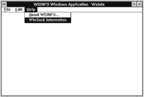

**图 8.2.**

*Windows NT TCP/IP 协议栈的 WinSock 信息。*

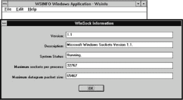

您可能希望在开发的应用程序中使用 CWinSockInfoDlg 类。它作为调试辅助工具可能非常有用。

## WinSock 数据库测试应用程序

此程序 DBTST 允许您对主机和服务执行 WinSock 数据库查找。它使用以下 WinSock 函数：`WSAStartup()`、`WSACleanup()`、`WSAGetLastError()`、`WSACancelAsyncRequest()`、`WSAAsyncGetHostByName()`、`WSAAsyncGetHostByAddr()`、`gethostbyname()`、`gethostbyaddr()`、`WSAAsyncGetServByName()`、`WSAAsyncGetServByPort()`、`getservbyname()`、`getservbyport()` 以及 `ntohs()`。此程序是从零开始创建的，没有借助 AppWizard。使用的是 Visual C++ 项目文件。

与让 AppWizard 完成繁琐工作相反，从零开始创建程序时必须采取额外步骤。从零开始创建程序的好处是，您不必处理可能不需要的功能，例如文档和视图。这种方法更接近旧的 SDK 做法，但仍然受益于 Microsoft Foundation Classes。

首先要查看的源文件是 STDAFX.H 和 STDAFX.CPP。这些文件支持预编译头功能。通过在每个实现文件（即 *.CPP）中包含 STDAFX.H，就不必在每个文件中包含必需的 Windows 和 MFC 头文件。STDAFX.H 和 STDAFX.CPP 分别如清单 8.3 和 8.4 所示。您必须配置编译器的预编译头编译选项才能使用此功能。

### 清单 8.3. DBTST 的 STDAFX.H。

```cpp
#include <afxwin.h>
#include <winsock.h>
```

### 清单 8.4. DBTST 的 STDAFX.CPP。

```cpp
#include "stdafx.h"
```

接下来关注的这些文件实现应用程序对象 `CTheApp`。`CTheApp` 派生自 MFC 类 `CWinApp`。类声明位于 DBTST.H 中，如清单 8.5 所示。该类在 DBTST.CPP 中实现，如清单 8.6 所示。请注意，这里的 WinSock 启动不如 WSINFO 示例中那样健壮；例如，出错时不会显示任何错误消息。相反，如果无法初始化 WinSock，应用程序会直接退出。

### 清单 8.5. DBTST 的 DBTST.H。

```cpp
#ifndef __DBTST_H__
#define __DBTST_H__

#include "resource.h"

///////////////////////////////////////////////////////////////
// CTheApp class declaration
//
class CTheApp : public CWinApp
{
private:
    WSADATA m_WsaData;  // WinSock data structure

public:
    BOOL InitInstance();
    int ExitInstance();
};

#endif // __DBTST_H
```

### 清单 8.6. DBTST 的 DBTST.CPP。

```cpp
///////////////////////////////////////////////////////////////
// CTheApp implementation file
//

#include "stdafx.h"
#include "dbtst.h"
#include "mainwindow.h"

///////////////////////////////////////////////////////////////
// Creating a CTheApp object starts the application running
//
CTheApp NEAR TheApp;

///////////////////////////////////////////////////////////////
// CTheApp::InitInstance
//
// When the CTheApp object is created, this member function is
// automatically called. WinSock is initiated here. The main window
// of the application is created and shown here.
//
BOOL CTheApp::InitInstance()
{
    if (WSAStartup(MAKEWORD(1, 1), &m_WsaData) != 0)
        return FALSE;

    m_pMainWnd = new CMainWindow();
    m_pMainWnd->ShowWindow(m_nCmdShow);
    m_pMainWnd->UpdateWindow();

    return TRUE;
}

///////////////////////////////////////////////////////////////
// CTheApp::ExitInstance
//
// When the application is closed, shutdown WinSock.
//
int CTheApp::ExitInstance()
{
    WSACleanup();

    return CWinApp::ExitInstance();
}
```

此应用程序可以查找主机或服务信息。为支持这一点，使用了两个对话框。主机对话框在 CHostDlg 类中实现。该类是使用 App Studio 和 ClassWizard 创建的。类声明文件（HOST.H）如清单 8.7 所示。清单 8.8 显示了类实现文件（HOST.CPP）。CHostDlg 有一个公共成员变量，即名为 m_strHost 的 CString 对象。此变量包含用户在对话框的单个 EDIT 控件中输入的字符串。该对话框有三个按钮：异步、阻塞和取消。如果用户按下“异步”按钮，则向调用方返回 IDC_BUTTON_ASYNC，表示用户希望异步执行数据库查找。同样，按下“阻塞”按钮时返回 IDC_BUTTON_BLOCKING。按下“取消”会中止查找。

### 清单 8.7. DBTST 的 HOST.H。

```cpp
///////////////////////////////////////////////////////////////
// CHostDlg dialog
//
class CHostDlg : public CDialog
{
// Construction
public:
    CHostDlg(CWnd* pParent = NULL);  // standard constructor

// Dialog Data
    //{{AFX_DATA(CHostDlg)
    enum { IDD = IDD_HOST };
    CString m_strHost;
    //}}AFX_DATA

// Implementation
protected:
    virtual void DoDataExchange(CDataExchange* pDX);  // DDX/DDV support

// Generated message map functions
    //{{AFX_MSG(CHostDlg)
    afx_msg void OnClickedButtonAsync();
    afx_msg void OnClickedButtonBlocking();
    //}}AFX_MSG
    DECLARE_MESSAGE_MAP()
};
```

### 清单 8.8. DBTST 的 HOST.CPP。

```cpp
// host.cpp : implementation file
//

#include "stdafx.h"
#include "dbtst.h"
#include "host.h"

#ifdef _DEBUG
#undef THIS_FILE
static char BASED_CODE THIS_FILE[] = __FILE__;
#endif

/////////////////////////////////////////////////////////////////////////////
// CHostDlg dialog

CHostDlg::CHostDlg(CWnd* pParent /*=NULL*/)
    : CDialog(CHostDlg::IDD, pParent)
{
    //{{AFX_DATA_INIT(CHostDlg)
    m_strHost = "";
    //}}AFX_DATA_INIT
}

void CHostDlg::DoDataExchange(CDataExchange* pDX)
{
    CDialog::DoDataExchange(pDX);
    //{{AFX_DATA_MAP(CHostDlg)
    DDX_Text(pDX, IDC_EDIT_HOST, m_strHost);
    //}}AFX_DATA_MAP
}

BEGIN_MESSAGE_MAP(CHostDlg, CDialog)
    //{{AFX_MSG_MAP(CHostDlg)
    ON_BN_CLICKED(IDC_BUTTON_ASYNC, OnClickedButtonAsync)
    ON_BN_CLICKED(IDC_BUTTON_BLOCKING, OnClickedButtonBlocking)
    //}}AFX_MSG_MAP
END_MESSAGE_MAP()

/////////////////////////////////////////////////////////////////////////////
// CHostDlg message handlers

void CHostDlg::OnClickedButtonAsync()
{
    UpdateData(TRUE);
    EndDialog(IDC_BUTTON_ASYNC);
}

void CHostDlg::OnClickedButtonBlocking()
{
    UpdateData(TRUE);
    EndDialog(IDC_BUTTON_BLOCKING);
}
```

用于提示要查找哪个服务的对话框实现为 CServiceDlg 类。此对话框的源代码位于 SERVICE.H 和 SERVICE.CPP 文件中，分别如清单 8.9 和 8.10 所示。该代码遵循与 CHostDlg 类相似的格式，不同之处在于服务对话框中有两个数据输入字段：服务和协议。

### 清单 8.9. DBTST 的 SERVICE.H。

```cpp
///////////////////////////////////////////////////////////////
// CServiceDlg dialog
///////////////////////////////////////////////////////////////
class CServiceDlg : public CDialog
{
// Construction
public:
    CServiceDlg(CWnd* pParent = NULL);   // standard constructor

// Dialog Data
    //{{AFX_DATA(CServiceDlg)
    enum { IDD = IDD_SERVICE };
    CString m_stringService;
    CString m_stringProtocol;
    //}}AFX_DATA

// Implementation
protected:
    virtual void DoDataExchange(CDataExchange* pDX);   // DDX/DDV support

    // Generated message map functions
    //{{AFX_MSG(CServiceDlg)
    afx_msg void OnClickedButtonAsync();
    afx_msg void OnClickedButtonBlocking();
    //}}AFX_MSG
    DECLARE_MESSAGE_MAP()
};
```


### 清单 8.10. 用于 DBTST 的 SERVICE.CPP。

```cpp
// service.cpp : implementation file
//

#include "stdafx.h"
#include "dbtst.h"
#include "serviceDlg.h"

#ifdef _DEBUG
#undef THIS_FILE
static char BASED_CODE THIS_FILE[] = __FILE__;
#endif

//////////////////////////////////////////////////////////////////////
// CServiceDlg

CServiceDlg::CServiceDlg(CWnd* pParent /*=NULL*/)
    : CDialog(CServiceDlg::IDD, pParent)
{
    //{{AFX_DATA_INIT(CServiceDlg)
    m_stringService = "";
    m_stringProtocol = "";
    //}}AFX_DATA_INIT
}

void CServiceDlg::DoDataExchange(CDataExchange* pDX)
{
    CDialog::DoDataExchange(pDX);
    //{{AFX_DATA_MAP(CServiceDlg)
    DDX_Text(pDX, IDC_EDIT_SERVICE, m_stringService);
    DDX_Text(pDX, IDC_EDIT_PROTOCOL, m_stringProtocol);
    //}}AFX_DATA_MAP
}

BEGIN_MESSAGE_MAP(CServiceDlg, CDialog)
    //{{AFX_MSG_MAP(CServiceDlg)
    ON_BN_CLICKED(IDC_BUTTON_ASYNC, OnClickedButtonAsync)
    ON_BN_CLICKED(IDC_BUTTON_BLOCKING, OnClickedButtonBlocking)
    //}}AFX_MSG_MAP
END_MESSAGE_MAP()

//////////////////////////////////////////////////////////////////////
// CServiceDlg message handlers

void CServiceDlg::OnClickedButtonAsync()
{
    UpdateData(TRUE);
    EndDialog(IDC_BUTTON_ASYNC);
}

void CServiceDlg::OnClickedButtonBlocking()
{
    UpdateData(TRUE);
    EndDialog(IDC_BUTTON_BLOCKING);
}
```

在这个示例程序中，完成大部分工作的类是 CMainWindow，它派生自 MFC 类 CFrameWnd。正是这个类实际创建窗口、提供菜单，并调用 WinSock 数据库函数。其头文件如清单 8.11 所示。若干私有成员变量用于支持数据库查找。

### 清单 8.11. 用于 DBTST 的 MAINWND.H。

```cpp
#ifndef __MAINWND_H_
#define __MAINWND_H_

#define USER_INPUT_BUF_LEN    (100)

//////////////////////////////////////////////////////////////////////
// CMainWindow class declaration
//
class CMainWindow : public CFrameWnd
{
private:
    // variables to support host lookup
    HANDLE m_hAsyncHost;                        // async request handle
    char m_achHostEnt[MAXGETHOSTSTRUCT];        // hostent buffer for async call
    char m_lpszHost[USER_INPUT_BUF_LEN];        // host name or IP address
    PHOSTENT m_pHostEnt;                        // pointer to host entry structure
    IN_ADDR m_in;                               // Internet address structure
    u_long m_ulIPAddress;                       // Internet address

    // variables to support service lookup
    HANDLE m_hAsyncService;                     // async request handle
    char m_achServEnt[MAXGETHOSTSTRUCT];        // servent buffer for async call
    char m_lpszService[USER_INPUT_BUF_LEN];     // service name or port number
    char m_lpszProtocol[USER_INPUT_BUF_LEN];    // transport protocol
    PSERVENT m_pServEnt;                        // pointer to service entry structure
    short m_nPort;                              // port number

public:
    CMainWindow();

    //{{AFX_MSG(CMainWindow)
    afx_msg void OnHost();
    afx_msg LONG OnAsyncHost(WPARAM wParam, LPARAM lParam);
    afx_msg void OnCancelHost();
    afx_msg void OnService();
    afx_msg LONG OnAsyncService(WPARAM wParam, LPARAM lParam);
    afx_msg void OnCancelService();
    //}}AFX_MSG
    DECLARE_MESSAGE_MAP()
};

//////////////////////////////////////////////////////////////////////
// User defined messages used in CMainWindow's message map
//
#define WM_USER_ASYNC_HOST_LOOKUP       (WM_USER + 1)
#define WM_USER_ASYNC_SERVICE_LOOKUP    (WM_USER + 2)

#endif // __MAINWND_H_
```

### 清单 8.12. 续

```cpp
//
// Create the window with the appropriate style, size, menu, etc.
//
CMainWindow::CMainWindow()
{
    LoadAccelTable("MainAccelTable");

    Create(NULL, "WinSock Database Test Application",
        WS_OVERLAPPEDWINDOW, rectDefault, NULL, "MainMenu");

    // initialize the asynchronous request handles so we
    // know if there is any outstanding request
    m_hAsyncHost = m_hAsyncService = 0;
}

////////////////////////////////////////////////////////////////
// CMainWindow::OnHost
//
// Called when the Test | Host Lookup menu item is selected.
//
void CMainWindow::OnHost()
{
    char lpszMessage[100];    // informational message

    // prompt the user for host information
    CHostDlg dlg;
    int nStatus = dlg.DoModal();
    if (nStatus != IDCANCEL)
    {
        // copy the host information the user entered into a member variable
        if (dlg.m_strHost.GetLength() < USER_INPUT_BUF_LEN)
            lstrcpy(m_lpszHost, dlg.m_strHost);
        else
        {
            MessageBox("Host name or IP address was too long", "Host Lookup");
            return;
        }

        // see if the user entered a dotted-decimal IP address
        m_ulIPAddress = inet_addr(m_lpszHost);

        if (nStatus == IDC_BUTTON_ASYNC)
        {
            // do an asynchronous host lookup

            if (m_hAsyncHost != 0)
                MessageBox("Asynchronous host lookup already in progress", "Host Lookup");
            else
            {
                if (m_ulIPAddress == INADDR_NONE)
                    m_hAsyncHost = WSAAsyncGetHostByName(m_hWnd, WM_USER_ASYNC_HOST_LOOKUP,
                        m_lpszHost, m_achHostEnt, MAXGETHOSTSTRUCT);
                else
                    m_hAsyncHost = WSAAsyncGetHostByAddr(m_hWnd, WM_USER_ASYNC_HOST_LOOKUP,
                        (char *)&m_ulIPAddress, 4, PF_INET, m_achHostEnt, MAXGETHOSTSTRUCT);

                if (m_hAsyncHost == 0)
                {
                    wsprintf(lpszMessage, "Host lookup failed (WinSock error %d)",
                        WSAGetLastError());

                    MessageBox(lpszMessage, "Host Lookup");
                }
            }
        }
        else
        {
            // do a blocking host lookup

            if (m_ulIPAddress == INADDR_NONE)
                m_pHostEnt = gethostbyname(m_lpszHost);
            else
                m_pHostEnt = gethostbyaddr((char *)&m_ulIPAddress, 4, PF_INET);

            if (m_pHostEnt == NULL)
                wsprintf(lpszMessage, "Host lookup failed (WinSock error %d)",
                    WSAGetLastError());
            else
            {
                // copy the four byte IP address into an Internet address structure
                memcpy(&m_in, m_pHostEnt->h_addr, 4);

                // format the results, converting the IP address into a string
                wsprintf(lpszMessage, "Host %s has IP address %s",
                    m_pHostEnt->h_name, inet_ntoa(m_in));
            }

            MessageBox(lpszMessage, "Host Lookup");
        }
    }
}

/////////////////////////////////////////////////////////////////////////////
// CMainWindow::OnAsyncHost
//
// Called when the asynchronous lookup is done.
//
LONG CMainWindow::OnAsyncHost(WPARAM wParam, LPARAM lParam)
{
    char lpszMessage[100];  // informational message

    // check for an error
    if (WSAGETASYNCERROR(lParam) != 0)
        wsprintf(lpszMessage,
            "Host lookup failed (WinSock error %d)",
            WSAGETASYNCERROR(lParam));
    else
    {
        // assign a hostent host entry pointer to the buffer
        m_pHostEnt = (PHOSTENT)m_achHostEnt;

        // copy the four byte IP address into an Internet address structure
        memcpy(&m_in, m_pHostEnt->h_addr, 4);

        // format the results, converting the IP address into a string
        wsprintf(lpszMessage, "Host %s has IP address %s",
            m_pHostEnt->h_name, inet_ntoa(m_in));
    }

    m_hAsyncHost = 0;
    MessageBox(lpszMessage, "Host Lookup");

    return 0L;
}

///////////////////////////////////////////////////////////////
// CMainWindow::OnCancelHost
//
// Called when the Test | Cancel Host Lookup menu item is selected.
//
void CMainWindow::OnCancelHost()
{
    char lpszMessage[100];   // informational message

    // see if there is an outstanding asynchronous request
    if (m_hAsyncHost == 0)
        lstrcpy(lpszMessage, "No asynchronous host lookup in progress");
    else
    {
        // cancel the asynchronous request

        if (WSACancelAsyncRequest(m_hAsyncHost) != 0)
            wsprintf(lpszMessage, "Cancel asynchronous host lookup failed (WinSock error %d)",
                WSAGetLastError());
        else
            lstrcpy(lpszMessage, "Asynchronous host lookup canceled");

        m_hAsyncHost = 0;
    }

    MessageBox(lpszMessage, "Host Lookup");
}

///////////////////////////////////////////////////////////////
// CMainWindow::OnService
//
// Called when the Test | Service Lookup menu item is selected.
//
void CMainWindow::OnService()
{
    char lpszMessage[100];   // informational message

    // prompt the user for service information
    CServiceDlg dlg;
    int nStatus = dlg.DoModal();
    if (nStatus == IDCANCEL)
        return;
```


### 清单 8.12. 续

```cpp
    // copy the service name or port number if its format is legal
    int nServiceLen = dlg.m_stringService.GetLength();
    if ((nServiceLen > USER_INPUT_BUF_LEN) || (nServiceLen == 0))
    {
        MessageBox("Service name or port number is either too long or unspecified",
            "Service Lookup");
        return;
    }
    lstrcpy(m_lpszService, dlg.m_stringService);

    // see if the user entered a port number
    m_nPort = atoi(m_lpszService);
    m_nPort = htons(m_nPort);

    // copy the transport protocol
    static char *lpszProtocol;
    int nProtocolLen = dlg.m_stringProtocol.GetLength();
    if (nProtocolLen > USER_INPUT_BUF_LEN)
    {
        MessageBox("Protocol name is too long", "Service Lookup");
        return;
    }
    if (nProtocolLen > 0)
    {
        lstrcpy(m_lpszProtocol, dlg.m_stringProtocol);
        lpszProtocol = m_lpszProtocol;
    }
    else
        lpszProtocol = NULL;    // protocol wasn't specified, so NULL gets passed

    if (nStatus == IDC_BUTTON_ASYNC)
    {
        // do an asynchronous service lookup

        if (m_hAsyncService != 0)
            MessageBox("Asynchronous service lookup already in progress", "Service Lookup");
        else
        {
            if (m_nPort == 0)
                m_hAsyncService = WSAAsyncGetServByName(m_hWnd, WM_USER_ASYNC_SERVICE_LOOKUP,
                    m_lpszService, lpszProtocol, m_achServEnt, MAXGETHOSTSTRUCT);
            else
                m_hAsyncService = WSAAsyncGetServByPort(m_hWnd, WM_USER_ASYNC_SERVICE_LOOKUP,
                    m_nPort, lpszProtocol, m_achServEnt, MAXGETHOSTSTRUCT);

            if (m_hAsyncService == 0)
            {
                wsprintf(lpszMessage, "Service lookup failed (WinSock error %d)",
                    WSAGetLastError());

                MessageBox(lpszMessage, "Service Lookup");
            }
        }
    }
    else
    {
        // do a blocking service lookup
        if (m_nPort == 0)
            m_pServEnt = getservbyname(m_lpszService, lpszProtocol);
        else
            m_pServEnt = getservbyport(m_nPort, lpszProtocol);

        if (m_pServEnt == NULL)
            wsprintf(lpszMessage, "Service lookup failed (WinSock error %d)",
                WSAGetLastError());
        else
        {
            // format the results, converting the port to host byte order
            wsprintf(lpszMessage, "%s service using protocol %s has port %d",
                m_pServEnt->s_name, m_pServEnt->s_proto, ntohs(m_pServEnt->s_port));
        }
        MessageBox(lpszMessage, "Service Lookup");
    }
}

///////////////////////////////////////////////////////////////////
// CMainWindow::OnAsyncService
//
// Called when the asynchronous lookup is done.
LONG CMainWindow::OnAsyncService(WPARAM wParam, LPARAM lParam)
{
    char lpszMessage[100];   // informational message

    // check for an error
    if (WSAGETASYNCERROR(lParam) != 0)
        wsprintf(lpszMessage,
            "Service lookup failed (WinSock error %d)",
            WSAGETASYNCERROR(lParam));
    else
    {
        // assign a servent host entry pointer to the buffer
        m_pServEnt = (PSERVENT)m_achServEnt;

        // format the results, converting the port to host byte order
        wsprintf(lpszMessage, "%s service using protocol %s has port %d",
            m_pServEnt->s_name, m_pServEnt->s_proto, ntohs(m_pServEnt->s_port));
    }

    m_hAsyncService = 0;
    MessageBox(lpszMessage, "Service Lookup");

    return 0L;
}

///////////////////////////////////////////////////////////////////
// CMainWindow::OnCancelService
//
// Called when the Test | Cancel Service Lookup menu item is selected.
void CMainWindow::OnCancelService()
{
    char lpszMessage[100];   // informational message

    // see if there is an outstanding asynchronous request
    if (m_hAsyncService == 0)
        lstrcpy(lpszMessage, "No asynchronous service lookup in progress");
    else
    {
        // cancel the asynchronous request

        if (WSACancelAsyncRequest(m_hAsyncService) != 0)
            wsprintf(lpszMessage, "Cancel asynchronous service lookup failed (WinSock error %d)",
                WSAGetLastError());
        else
            lstrcpy(lpszMessage, "Asynchronous service lookup canceled");

        m_hAsyncService = 0;
    }

    MessageBox(lpszMessage, "Service Lookup");
}
```

DBTST 的一个示例执行过程如图 8.3 至图 8.7 所示。图 8.3 显示了 DBTST 应用程序的菜单。图 8.4 显示输入主机信息，图 8.5 显示主机查找的结果。图 8.6 显示输入服务信息，图 8.7 显示服务查找的结果。你可能想把这个应用程序放在手边，因为当你需要快速获知主机的 IP 地址时，它会非常方便。

**图 8.3.**
*DBTST 菜单项。*

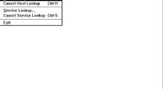

**图 8.4.**
*输入主机查找信息。*

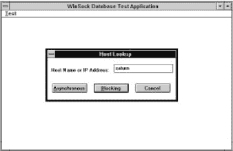

**图 8.5.**
*主机查找结果。*

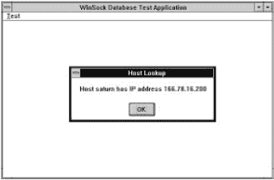

**图 8.6.**
*输入服务查找信息。*

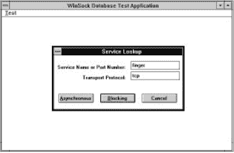

**图 8.7.**
*服务查找结果。*

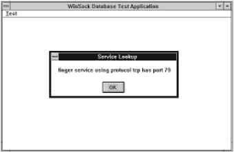

## 数据报回显客户端与服务器

这些程序 DESERV 和 DECLIENT 演示了非阻塞数据报套接字的使用。它们使用以下 WinSock 函数：`WSAStartup()`、`WSACleanup()`、`WSAGetLastError()`、`socket()`、`closesocket()`、`bind()`、`WSAAsyncSelect()`、`sendto()`、`recvfrom()`、`getsockname()`、`ntohs()` 和 `inet_ntoa()`。DESERV 服务器应用程序接收数据并将其发送回客户端。DECLIENT 客户端应用程序向服务器发送数据并接收回显的回复。

### 数据报回显服务器 DESERV

这些程序使用 Visual C++ 的 AppWizard 功能生成。WINSOCK.H 头文件包含在 STDAFX.H 预编译头文件中，如清单 8.13 所示。项目的源模块会包含 STDAFX.H，因此 WinSock 函数和结构始终可用。

**清单 8.13. 用于 DESERV 的 STDAFX.H。**

```cpp
// stdafx.h : include file for standard system include files,
//  or project specific include files that are used frequently, but
//  are changed infrequently
//

#include <afxwin.h>      // MFC core and standard components
#include <afxext.h>      // MFC extensions
#include <winsock.h>     // Windows Sockets
```

与 WSINFO 示例一样，DESERV 使用应用程序对象分别在 `CDeservApp::InitInstance()` 和 `CDeservApp::ExitInstance()` 中启动和停止 WinSock。

DESERV 使用单文档界面进行窗口管理。AppWizard 创建了一个派生自 MFC 类 `CView` 的默认视图类，但应用程序并未使用这个类。相反，它使用了一个派生自 `CFormView` 的对象。使用 `CFormView` 意味着首先使用 App Studio 创建对话框资源。创建了一个对话框，其中包含一个静态文本标签和一个用于显示状态消息的列表框。一般来说，会创建对话框资源，并使用 ClassWizard 创建派生自 `CDialog` 的类。由于你希望这个对话框资源成为程序的主界面，因此使用 ClassWizard 创建派生自 `CFormView` 的类。但首先，必须正确设置对话框资源的标志。具体来说，样式为 child，边框为 none，visible 标志未勾选，Caption 留空。图 8.8 显示了用作 DESERV 主窗口的对话框资源的对话框属性中的样式部分。

**图 8.8.**
*DESERV 主窗口对话框资源的样式属性。*


对应用程序对象 `CDeservApp` 进行了修改，使其使用这个视图，而不是 AppWizard 生成的默认视图。`CDeservApp::InitInstance()` 的默认实现中有一个对 `AddDocTemplate()` 的调用，如下所示：

```cpp
AddDocTemplate(new CSingleDocTemplate(IDR_MAINFRAME,
    RUNTIME_CLASS(CDeservDoc),
    RUNTIME_CLASS(CMainFrame),       // main SDI frame window
    RUNTIME_CLASS(CDeservView)));
```

它需要如下所示：

```cpp
AddDocTemplate(new CSingleDocTemplate(IDR_MAINFRAME,
    RUNTIME_CLASS(CDeservDoc),
    RUNTIME_CLASS(CMainFrame),       // main SDI frame window
    RUNTIME_CLASS(CMainView)));
```

派生自 `CFormView` 的对象名为 `CMainView`，其头文件如清单 8.14 所示。注意成员变量 `m_s` 和 `m_addr`，以及函数 `OnAsyncSelect()`。`OnAsyncSelect()` 是手动添加到类中的，因为 ClassWizard 不支持用户自定义消息。


#### 清单 8.14. DESERV 的 MAINVIEW.H

```cpp
// mainview.h : header file
//

/////////////////////////////////////////////////////////////////////
// CMainView form view

#ifndef __AFXEXT_H__
#include <afxext.h>
#endif

class CMainView : public CFormView
{
    DECLARE_DYNCREATE(CMainView)

public:
    SOCKET m_s;             // socket to receive from
    SOCKADDR_IN m_addr;     // address of socket

protected:
    CMainView();            // protected constructor used by dynamic creation

// Form Data
public:
    //{{AFX_DATA(CMainView)
    enum { IDD = IDD_DIALOG_MAIN };
    // NOTE: the ClassWizard will add data members here
    //}}AFX_DATA

// Attributes
public:

// Operations
public:

// Implementation
protected:
    virtual ~CMainView();
    virtual void DoDataExchange(CDataExchange* pDX);  // DDX/DDV support
    virtual void OnInitialUpdate();
// Generated message map functions
//{{AFX_MSG(CMainView)
    afx_msg LONG OnAsyncSelect(WPARAM wParam, LPARAM lParam);
//}}AFX_MSG
    DECLARE_MESSAGE_MAP()
};

/////////////////////////////////////////////////////////////////////

#define WM_USER_ASYNC_SELECT (WM_USER + 1)
```

CMainView 对象的实现在清单 8.15 中展示。该对象承担 DESERV 应用程序的大部分工作。CMainView::OnInitialUpdate() 会在对象创建后不久被调用。该函数负责创建套接字、将其绑定到一个名称（端口由 WinSock 分配），并等待数据到达。当数据已准备好接收或数据可以发送时，由于用户定义消息 WM_USER_ASYNC_SELECT 的消息映射，CMainView::OnAsyncSelect() 成员函数会被调用。

#### 清单 8.15. DESERV 的 MAINVIEW.CPP

```cpp
// mainview.cpp : implementation file
//

#include "stdafx.h"
#include "deserv.h"
#include "mainview.h"

#ifdef _DEBUG
#undef THIS_FILE
static char BASED_CODE THIS_FILE[] = __FILE__;
#endif

/////////////////////////////////////////////////////////////////////////////
// CMainView

IMPLEMENT_DYNCREATE(CMainView, CFormView)

CMainView::CMainView()
	: CFormView(CMainView::IDD)
{
	m_s = INVALID_SOCKET; // initialize socket to invalid handle

	//{{AFX_DATA_INIT(CMainView)
		// NOTE: the ClassWizard will add member initialization here
	//}}AFX_DATA_INIT
}

CMainView::~CMainView()
{
	// if the socket was opened successfully, close it

	if (m_s != INVALID_SOCKET)
	{
		closesocket(m_s);
		m_s = INVALID_SOCKET;
	}
}

void CMainView::DoDataExchange(CDataExchange* pDX)
{
	CFormView::DoDataExchange(pDX);
	//{{AFX_DATA_MAP(CMainView)
		// NOTE: the ClassWizard will add DDX and DDV calls here
	//}}AFX_DATA_MAP
}

void CMainView::OnInitialUpdate()
{
    char pszMessage[100];  // informational message

    // get pointer to list box used for status messages

    CListBox *plb = (CListBox *)GetDlgItem(IDC_LIST_STATUS);

    // create the socket and prepare it
    // for receiving data

    plb->InsertString(0, "Initializing...");

    m_s = socket(AF_INET, SOCK_DGRAM, 0);
    if (m_s == INVALID_SOCKET)
        plb->InsertString(0, "Datagram echo server could not create socket");
    else
    {
        // bind the socket, allowing WinSock to assign the service port

        m_addr.sin_family = AF_INET;            // Internet address family
        m_addr.sin_port = 0;                    // let WinSock assign a port
        m_addr.sin_addr.s_addr = htonl(INADDR_ANY); // any network interface

        if (bind(m_s, (LPSOCKADDR)&m_addr, sizeof(m_addr)) == SOCKET_ERROR)
            plb->InsertString(0, "Datagram echo server could not bind socket");
        else
        {
            // find out the port number WinSock assigned

            SOCKADDR_IN addr;
            int nAddrLen = sizeof(addr);

            if (getsockname(m_s, (LPSOCKADDR)&addr, &nAddrLen) == SOCKET_ERROR)
                plb->InsertString(0, "Datagram echo server could not get socket's port");
            else
            {
                wsprintf(pszMessage, "Datagram echo server using port %d",
                         ntohs(addr.sin_port));
                plb->InsertString(0, pszMessage);

                // do the asynchronous select to wait for data

                if (WSAAsyncSelect(m_s, m_hWnd, WM_USER_ASYNC_SELECT,
                                   FD_READ | FD_WRITE) == SOCKET_ERROR)
                    plb->InsertString(0, "Datagram echo server could not do async select");
            }
        }
    }
}

BEGIN_MESSAGE_MAP(CMainView, CFormView)
    //{{AFX_MSG_MAP(CMainView)
    ON_MESSAGE(WM_USER_ASYNC_SELECT, OnAsyncSelect)
    //}}AFX_MSG_MAP
```

#### 清单 8.15. 续

```cpp
END_MESSAGE_MAP()

/////////////////////////////////////////////////////////////////////////////
// CMainView message handlers

/////////////////////////////////////////////////////////////////////////////
// CMainView::OnAsyncSelect()

// Receives data from a client and echoes the data back to the sending client.
// While there is data yet to be sent back to the sending client, the server
// will not receive any more data. (a single data buffer is used for
// incoming and outgoing data)

LONG CMainView::OnAsyncSelect(WPARAM wParam, LPARAM lParam)
{
    char pszMessage[100];           // informational message
    static char pBuf[10];           // send/recv buffer
    int nBytesRecv;                 // number of bytes received
    int nBytesSent;                 // number of bytes sent
    static int nBytesToSend = 0;    // number of bytes to send
    int nError;                     // WinSock error
    static SOCKADDR_IN addrFrom;    // address of client
    static int nAddrFromLen = sizeof(addrFrom); // length of client address struct
    static IN_ADDR inFrom;          // IP address of client

    // get pointer to list box used for status messages
    CListBox *plb = (CListBox *)GetDlgItem(IDC_LIST_STATUS);

    // check for an error
    if (WSAGETSELECTERROR(lParam) != 0)
    {
        wsprintf(pszMessage, "Datagram echo server async select got error %d",
            WSAGETSELECTERROR(lParam));
        plb->InsertString(0, pszMessage);
        return 0L;
    }

    // what event are we being notified of?
    switch (WSAGETSELECTEVENT(lParam))
    {
    case FD_WRITE:
        // echo the data back to the client

        plb->InsertString(0, "FD_WRITE");

        // are there bytes to send?
        if (nBytesToSend != 0)
        {
            // send the data
            nBytesSent = sendto(m_s, pBuf, nBytesToSend, 0,
                (LPSOCKADDR)&addrFrom, nAddrFromLen);

            // check for send error
            if (nBytesSent == SOCKET_ERROR)
            {
                // if the error is just that the send would block,
```

#### 清单 8.15. 续

```cpp
pBuf[nBytesToSend] = '\0';
wsprintf(pszMessage, "Data received (%s) from %s, %d",
         pBuf, inet_ntoa(inFrom), ntohs(addrFrom.sin_port));
plb->InsertString(0, pszMessage);

// just in case the FD_WRITE was called but it didn't have
// any data to send at that time (it has data to send now)
PostMessage(WM_USER_ASYNC_SELECT, m_s, WSAMAKESELECTREPLY(FD_WRITE, 0));
}
break;

default:
    break;
}

return 0L;
}
```

### 数据报回显客户端 DECLIENT

数据报回显客户端 DECLIENT 遵循与 DESERV 相同的基本框架。它也使用 CFormView 对象作为其主界面。主要区别在于 CMainView 对象的实现。

CMainView 对象的头文件在清单 8.16 中展示。其实现见清单 8.17。该对象承担 DECLIENT 应用程序的大部分工作。CMainView::OnInitialUpdate() 会在对象创建后不久被调用。该函数负责创建套接字、等待发送和接收数据，并设置一个用于发送数据的定时器。当数据已准备好接收或数据可以发送时，由于用户定义消息 WM_USER_ASYNC_SELECT 的消息映射，CMainView::OnAsyncSelect() 成员函数会被调用。CMainView::OnTimer() 函数每五秒被调用一次，以格式化要发送到回显服务器的字符串。

#### 清单 8.16. DECLIENT 的 MAINVIEW.H

```cpp
// mainview.h : header file
//

///////////////////////////////////////////////////////////////
// CMainView form view

#ifndef __AFXEXT_H__
#include <afxext.h>
#endif
```


```cpp
class CMainView : public CFormView
{
    DECLARE_DYNCREATE(CMainView)

public:
    SOCKET m_s;                 // socket
    SOCKADDR_IN m_addr;         // address to send to
    IN_ADDR m_in;               // IP address of address to send to
    int m_nBytesToSend;         // number of bytes to send
    char m_pBuf[101];           // buffer to send

protected:
    CMainView();                // protected constructor used by dynamic creation

    // Form Data
public:
    //{{AFX_DATA(CMainView)
    enum { IDD = IDD_DIALOG_MAIN };
    // NOTE: the ClassWizard will add data members here
    //}}AFX_DATA

    // Attributes
public:

    // Operations
public:

    // Implementation
protected:
    virtual ~CMainView();
    virtual void DoDataExchange(CDataExchange* pDX); // DDX/DDV support
    virtual void OnInitialUpdate();
    //{{AFX_MSG(CMainView)
    afx_msg LONG OnAsyncSelect(WPARAM wParam, LPARAM lParam);
    afx_msg void OnTimer(UINT nIDEvent);
    //}}AFX_MSG
    DECLARE_MESSAGE_MAP()

    /////////////////////////////////////////////////////////////////

#define WM_USER_ASYNC_SELECT (WM_USER + 1)
```

#### 清单 8.17. DECLIENT 的 MAINVIEW.CPP

```cpp
// mainview.cpp : implementation file
//
#include "stdafx.h"
#include "dclient.h"
#include "mainview.h"
#include "servdlg.h"

#ifdef _DEBUG
#undef THIS_FILE
static char BASED_CODE THIS_FILE[] = __FILE__;
#endif

/////////////////////////////////////////////////////////////////////
// CMainView

IMPLEMENT_DYNCREATE(CMainView, CFormView)

CMainView::CMainView()
    : CFormView(CMainView::IDD)
{
    m_s = INVALID_SOCKET;    // initialize socket to invalid handle

    //{{AFX_DATA_INIT(CMainView)
        // NOTE: the ClassWizard will add member initialization here
    //}}AFX_DATA_INIT
}

CMainView::~CMainView()
{
    // if the socket was opened successfully, close it

    if (m_s != INVALID_SOCKET)
    {
        closesocket(m_s);
        m_s = INVALID_SOCKET;
    }
}

void CMainView::DoDataExchange(CDataExchange* pDX)
{
    CFormView::DoDataExchange(pDX);
    //{{AFX_DATA_MAP(CMainView)
        // NOTE: the ClassWizard will add DDX and DDV calls here
    //}}AFX_DATA_MAP
}

BEGIN_MESSAGE_MAP(CMainView, CFormView)
    //{{AFX_MSG_MAP(CMainView)
    ON_MESSAGE(WM_USER_ASYNC_SELECT, OnAsyncSelect)
    ON_WM_TIMER()
    //}}AFX_MSG_MAP
END_MESSAGE_MAP()

/////////////////////////////////////////////////////////////////////
// CMainView message handlers

void CMainView::OnInitialUpdate()
{
    // get pointer to list box used for status messages
    CListBox *plb = (CListBox *)GetDlgItem(IDC_LIST_STATUS);

    // prompt for server information (IP and port)
    CServerDlg dlg;
    if (dlg.DoModal() == IDCANCEL)
        return;

    plb->InsertString(0, "Initializing...");

    // create the socket
    m_s = socket(AF_INET, SOCK_DGRAM, 0);
    if (m_s == INVALID_SOCKET)
        plb->InsertString(0, "Datagram echo client could not create socket");
    else
    {
        // fill out the server's address
        m_addr.sin_family = AF_INET;
        m_addr.sin_port = htons(atoi(dlg.m_stringPort));
        m_addr.sin_addr.s_addr = inet_addr(dlg.m_stringIP);

        // save sending client's IP address
        memcpy(&m_in, &m_addr.sin_addr.s_addr, 4);

        // do the asynchronous select to wait for data
        if (WSAAsyncSelect(m_s, m_hWnd, WM_USER_ASYNC_SELECT,
            FD_READ | FD_WRITE) == SOCKET_ERROR)
            plb->InsertString(0, "Datagram echo client could not do async select");
        else
            SetTimer(1, 5000, NULL);
    }
}

/////////////////////////////////////////////////////////////////
// CMainView::OnAsyncSelect
//
LONG CMainView::OnAsyncSelect(WPARAM wParam, LPARAM lParam)
{
    char pszMessage[100];       // informational message
    static char pBuf[101];      // send/recv buffer
    int nBytesRecv;             // number of bytes received
    int nBytesSent;             // number of bytes sent
    int nError;                 // WinSock error

    // get pointer to list box used for status messages
    CListBox *plb = (CListBox *)GetDlgItem(IDC_LIST_STATUS);

    // check for an error
    if (WSAGETSELECTERROR(lParam) != 0)
    {
        wsprintf(pszMessage, "Datagram echo client async select got error %d",
            WSAGETSELECTERROR(lParam));
        plb->InsertString(0, pszMessage);
        return 0L;
    }

    // what event are we being notified of?
    switch (WSAGETSELECTEVENT(lParam))
    {
    case FD_WRITE:
        plb->InsertString(0, "FD_WRITE");

        // is there any data to send?
        if (m_nBytesToSend != 0)
        {
            // send the data
            nBytesSent = sendto(m_s, m_pBuf, m_nBytesToSend, 0,
                (LPSOCKADDR)&m_addr, sizeof(m_addr));

            // check for send error
            if (nBytesSent == SOCKET_ERROR)
            {
                // if the error is just that the send would block,
                // don't do anything...we'll get another FD_WRITE soon
                nError = WSAGetLastError();
                if (nError != WSAEWOULDBLOCK)
                {
                    wsprintf(pszMessage, "Error %d sending data to %s, %d",
                        nError, inet_ntoa(m_in), ntohs(m_addr.sin_port));
                    plb->InsertString(0, pszMessage);

                    m_nBytesToSend = 0;
                }
            }
            else
            {
                wsprintf(pszMessage, "Data sent (%s) to %s, %d",
                    m_pBuf, inet_ntoa(m_in), ntohs(m_addr.sin_port));
                plb->InsertString(0, pszMessage);

                m_nBytesToSend = 0;
            }
        }
        break;

    case FD_READ:
        plb->InsertString(0, "FD_READ");

        // receive data
        nBytesRecv = recvfrom(m_s, pBuf, 100, 0, NULL, NULL);

        // check for receive error
        if (nBytesRecv == SOCKET_ERROR)
        {
            // if the error is just that the receive would block,
            // don't do anything...we'll get another FD_READ soon
            nError = WSAGetLastError();
            if (nError != WSAEWOULDBLOCK)
            {
                wsprintf(pszMessage, "Error %d receiving data", nError);
                plb->InsertString(0, pszMessage);
            }
        }
        else
        {
            pBuf[nBytesRecv] = '\0';
            wsprintf(pszMessage, "Data received (%s) from %s, %d",
                pBuf, inet_ntoa(m_in), ntohs(m_addr.sin_port));
            plb->InsertString(0, pszMessage);
        }
        break;

    default:
        break;
    }

    return 0L;
}

///////////////////////////////////////////////////////////////////////
// CMainView::OnTimer()
//
// Timer to generate a string to send. Won't send
// unless the previous string is completely sent.
//
void CMainView::OnTimer(UINT nIDEvent)
{
    static int nSendCount = 1;    //

    if (m_nBytesToSend == 0)
    {
        wsprintf(m_pBuf, "Hello %d", nSendCount);
        ++nSendCount;
        m_nBytesToSend = lstrlen(m_pBuf);
        PostMessage(WM_USER_ASYNC_SELECT, m_s, WSAMAKESELECTREPLY(FD_WRITE, 0));
    }

    CFormView::OnTimer(nIDEvent);
}
```

## 运行数据报回显服务器和客户端

运行数据报回显服务器和客户端的示例事件序列如下：

- 运行 DESERV。它会显示正在等待数据到达的端口。

- 在同一台或另一台计算机上运行 DCLIENT。它会提示输入 DESERV 所使用的 IP 地址和端口。

- 五秒后，DCLIENT 中的计时器触发，导致调用 `CMainView::OnTimer()`。此时还没有字节等待发送，因此会填充输出缓冲区，并伪造一条 WinSock `FD_WRITE` 消息来触发数据发送。这样做是因为真正的 `FD_WRITE` 可能已经错过，或者它发生时还没有数据可发送。

- 在 DCLIENT 中调用 `CMainView::OnAsyncSelect()`，并传入一个 `FD_WRITE` 事件。由于有字节需要发送，因此尝试将其传输到数据报回显服务器。如果尝试成功并且字节已写入，则待发送字节数会重置为 0（零）。如果发送时发生错误，但错误仅仅是发送操作会阻塞，则保留待发送字节数，因为最终会收到真正的 `FD_WRITE` 事件。

- 假设 DCLIENT 发送了一个缓冲区，DESERV 中会调用 `CMainView::OnAsyncSelect()`，并传入一个 `FD_READ` 通知。如果数据读取成功，则记录字节数，记录数据发送方，并生成一条伪造的 `FD_WRITE` 消息，以强制将刚刚接收到的数据发送回数据发送方（DCLIENT）。

- 在 DESERV 中调用 `CMainView::OnAsyncSelect()`，并传入一个 `FD_WRITE` 事件。由于有字节需要发送，因此尝试将其传输到数据报回显客户端。如果尝试成功并且字节已写入，则待发送字节数会重置为 0（零）。如果发送时发生错误，但错误仅仅是发送操作会阻塞，则保留待发送字节数，因为最终会收到真正的 `FD_WRITE` 事件。

- 假设 DESERV 发送了一个缓冲区，DCLIENT 中会调用 `CMainView::OnAsyncSelect()`，并传入一个 `FD_READ` 通知，随后客户端读取回显的数据。

- DCLIENT 中的另一个计时器到期，整个过程重复。

图 8.9 展示了在同一台计算机上运行的 DESERV 和 DCLIENT，该计算机的 IP 地址为 166.78.16.150。服务器和客户端分别被分配了 1059 和 1060 端口。请注意，每个应用程序完成初始化后，都会收到一条 `FD_WRITE` 通知。WinSock 只是告诉应用程序套接字当前处于可写状态。除非有字节需要发送，否则应用程序会忽略该消息。

### 图 8.9

在同一台计算机上运行的 DESERV 和 DCLIENT。

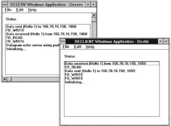


## 流式回显客户端与服务器

这些程序 SESERV 和 SECLIENT 演示了非阻塞流式套接字的使用。它们使用以下 WinSock 函数：WSAStartup()、WSACleanup()、WSAGetLastError()、socket()、closesocket()、bind()、connect()、accept()、WSAAsyncSelect()、send()、recv()、getsockname()、ntohs() 和 inet_ntoa()。SESERV 服务器应用程序接受来自客户端的连接，接收数据，并将数据发送回客户端。SECLIENT 应用程序连接到服务器，向服务器发送数据，并接收回显的回复。

### 流式回显服务器 SESERV

这些程序是使用 Visual C++ 的 AppWizard 功能生成的。实现与 DESERV 类似，主要区别在于 CMainView 对象。CMainView 的头文件如清单 8.18 所示。清单 8.19 展示了 CMainView 对象的实现。在 CMainView 对象创建后不久调用 CMainView::OnInitialUpdate() 时，它会创建一个套接字，将其绑定到一个名称，并等待连接请求。当请求连接、数据已准备好接收或数据可以发送时，由于用户定义消息 WM_USER_ASYNC_SELECT 的消息映射，CMainView::OnAsyncSelect() 成员函数会被调用。由于 CMainView 类中只有一个 m_sClient 变量，这个流式套接字服务器应用程序一次只与一个客户端通信。一旦 m_sClient 连接成功，所有其他连接请求都会被忽略，直到发起连接的客户端关闭该连接。

#### 清单 8.18. SESERV 的 MAINVIEW.H。

```cpp
// mainview.h : header file
//

/////////////////////////////////////////////////////////////////////////////
// CMainView form view

#ifndef __AFXEXT_H_
#include <afxext.h>
#endif

class CMainView : public CFormView
{
    DECLARE_DYNCREATE(CMainView)

public:
    SOCKET m_s;          // socket to listen for connections on
    SOCKADDR_IN m_addr;  // address of socket to listen on
    SOCKET m_sClient;    // socket to client

protected:
    CMainView();        // protected constructor used by dynamic creation

// Form Data
public:
    //{{AFX_DATA(CMainView)
    enum { IDD = IDD_DIALOG_MAIN };
        // NOTE: the ClassWizard will add data members here
    //}}AFX_DATA

// Attributes
public:

// Operations
public:

// Implementation
protected:
    virtual ~CMainView();
    virtual void DoDataExchange(CDataExchange* pDX);    // DDX/DDV support
    virtual void OnInitialUpdate();
    // Generated message map functions
    //{{AFX_MSG(CMainView)
    afx_msg LONG OnAsyncSelect(WPARAM wParam, LPARAM lParam);
    //}}AFX_MSG
    DECLARE_MESSAGE_MAP()
};

/////////////////////////////////////////////////////////////////////////////

#define WM_USER_ASYNC_SELECT (WM_USER + 1)
```

#### 清单 8.19. SESERV 的 MAINVIEW.CPP。

```cpp
// mainview.cpp : implementation file
//

#include "stdafx.h"
#include "seserv.h"
#include "mainview.h"

#ifdef _DEBUG
#undef THIS_FILE
static char BASED_CODE THIS_FILE[] = __FILE__;
#endif

/////////////////////////////////////////////////////////////////////////////
// CMainView

IMPLEMENT_DYNCREATE(CMainView, CFormView)

CMainView::CMainView()
: CFormView(CMainView::IDD)
{
    m_s = m_sClient = INVALID_SOCKET;  // initialize socket to invalid handle

    //{{AFX_DATA_INIT(CMainView)
    // NOTE: the ClassWizard will add member initialization here
    //}}AFX_DATA_INIT
}

CMainView::~CMainView()
{
    // if the socket was opened successfully, close it

    if (m_s != INVALID_SOCKET)
    {
        closesocket(m_s);
        m_s = INVALID_SOCKET;
    }
    if (m_sClient != INVALID_SOCKET)
    {
        closesocket(m_sClient);
        m_sClient = INVALID_SOCKET;
    }
}

void CMainView::DoDataExchange(CDataExchange* pDX)
{
    CFormView::DoDataExchange(pDX);
    //{{AFX_DATA_MAP(CMainView)
    // NOTE: the ClassWizard will add DDX and DDV calls here
    //}}AFX_DATA_MAP
}

void CMainView::OnInitialUpdate()
{
    char pszMessage[100];  // informational message

    // get pointer to list box used for status messages

    CListBox *plb = (CListBox *)GetDlgItem(IDC_LIST_STATUS);

    // create the socket and prepare it
    // for receiving data

    plb->InsertString(0, "Initializing...");

    m_s = socket(AF_INET, SOCK_STREAM, 0);
    if (m_s == INVALID_SOCKET)
        plb->InsertString(0, "Stream echo server could not create socket");
    else
    {
        // bind the socket, allowing WinSock to assign the service port

        m_addr.sin_family = AF_INET;                // Internet address family
        m_addr.sin_port = 0;                        // let WinSock assign a port
        m_addr.sin_addr.s_addr = htonl(INADDR_ANY);  // any network interface

        if (bind(m_s, (LPSOCKADDR)&m_addr, sizeof(m_addr)) == SOCKET_ERROR)
            plb->InsertString(0, "Stream echo server could not bind socket");
        else
        {
            // find out the port number WinSock assigned

            SOCKADDR_IN addr;
            int nAddrLen = sizeof(addr);

            if (getsockname(m_s, (LPSOCKADDR)&addr, &nAddrLen) == SOCKET_ERROR)
                plb->InsertString(0, "Stream echo server could not get socket port");
            else
            {
                wsprintf(pszMessage, "Stream echo server using port %d",
                    ntohs(addr.sin_port));
                plb->InsertString(0, pszMessage);

                // do the asynchronous select to wait for a connection

                if (WSAAsyncSelect(m_s, m_hWnd, WM_USER_ASYNC_SELECT, FD_ACCEPT) ==
                    SOCKET_ERROR)
                    plb->InsertString(0, "Stream echo server could not do async select");
                else
                {
                    // listen for connections

                    if (listen(m_s, 3) == SOCKET_ERROR)
                        plb->InsertString(0, "Stream echo server could not listen");
                }
            }
        }
    }
}

BEGIN_MESSAGE_MAP(CMainView, CFormView)
//{{AFX_MSG_MAP(CMainView)
    ON_MESSAGE(WM_USER_ASYNC_SELECT, OnAsyncSelect)
//}}AFX_MSG_MAP
END_MESSAGE_MAP()

/////////////////////////////////////////////////////////////////////
// CMainView message handlers

/////////////////////////////////////////////////////////////////////
// CMainView::OnAsyncSelect()
//
// Receives data from a client and echoes the data back to the sending client.
// While there is data yet to be sent back to the sending client, the server
// will not receive any more data. (A single data buffer is used for
// incoming and outgoing data)
//
LONG CMainView::OnAsyncSelect(WPARAM wParam, LPARAM lParam)
{
    char pszMessage[100];       // informational message
    static char pBuf[101];      // send/recv buffer

    int nBytesRecv;              // number of bytes received
    int nBytesSent;              // number of bytes sent
    static int nTotalBytesToSend; // total number of bytes to send
    static int nBytesToSend = 0; // number of bytes to send
    int nError;                  // WinSock error
    static SOCKADDR_IN addrFrom; // address of client
    static int nAddrFromLen = sizeof(addrFrom); // length of client address struct
    static IN_ADDR inFrom;       // IP address of client

    // get pointer to list box used for status messages
    CListBox *plb = (CListBox*)GetDlgItem(IDC_LIST_STATUS);

    // check for an error
    if (WSAGETSELECTERROR(lParam) != 0)
    {
        wsprintf(pszMessage, "Stream echo server async select got error %d",
            WSAGETSELECTERROR(lParam));
        plb->InsertString(0, pszMessage);
        return 0L;
    }

    // what event are we being notified of?
    switch (WSAGETSELECTEVENT(lParam))
    {
        case FD_ACCEPT:
            // if we don't have a connection yet, accept the new connection

            if (m_sClient == INVALID_SOCKET)
            {
                m_sClient = accept(m_s, (LPSOCKADDR)&addrFrom, &nAddrFromLen);
                if (m_sClient == INVALID_SOCKET)
                {
                    nError = WSAGetLastError();
                    if (nError != WSAEWOULDBLOCK)
                    {
                        wsprintf(pszMessage, "Error %d accepting connection",
                            nError);
                        plb->InsertString(0, pszMessage);
                    }
                }
                else
                {
                    // copy the four byte IP address into an IP address structure
                    memcpy(&inFrom, &addrFrom.sin_addr, 4);

                    wsprintf(pszMessage, "Connection accepted from %s, %d",
                        inet_ntoa(inFrom), ntohs(addrFrom.sin_port));
                    plb->InsertString(0, pszMessage);
                }

                WSAAsyncSelect(m_sClient, m_hWnd, WM_USER_ASYNC_SELECT,
                    FD_READ | FD_WRITE | FD_CLOSE);
            }
            else
                plb->InsertString(0, "Busy: refused connection");
            break;
```


#### 清单 8.19. 续

```cpp
case FD_CLOSE:
    // close the client socket

    closesocket(m_sClient);
    m_sClient = INVALID_SOCKET;
    plb->InsertString(0, "Client closed connection");
    break;

case FD_WRITE:
    // echo the data back to the client

    plb->InsertString(0, "FD_WRITE");

    // are there bytes to send?
    if (nBytesToSend != 0)
    {
        // send the data
        nBytesSent = send(m_sClient, &pBuf[nTotalBytesToSend - nBytesToSend],
            nBytesToSend, 0);

        // check for send error
        if (nBytesSent == SOCKET_ERROR)
        {
            // if the error is just that the send would block,
            // don't do anything...we'll get another FD_WRITE soon
            nError = WSAGetLastError();
            if (nError != WSAEWOULDBLOCK)
            {
                wsprintf(pszMessage, "Error %d sending data to %s, %d",
                    nError, inet_ntoa(inFrom), ntohs(addrFrom.sin_port));
                plb->InsertString(0, pszMessage);

                nBytesToSend = nTotalBytesToSend = 0;
            }
        }
        else
        {
            wsprintf(pszMessage, "Data sent (%s) to %s, %d",
                pBuf, inet_ntoa(inFrom), ntohs(addrFrom.sin_port));
            plb->InsertString(0, pszMessage);

            nBytesToSend = nBytesToSend - nBytesSent;

            if (nBytesToSend == 0)
                nTotalBytesToSend = 0;
            else
                // there are more bytes to send so we'll trigger
                // the FD_WRITE event again
                PostMessage(WM_USER_ASYNC_SELECT, m_sClient,
                    WSAMAKESELECTREPLY(FD_WRITE, 0));
        }
    }

    // just in case the FD_READ was called but it didn't read
    // because the buffer still contained data to send
    if (nBytesToSend == 0)
    {
        PostMessage(WM_USER_ASYNC_SELECT, m_sClient,
            WSAMAKESELECTREPLY(FD_READ, 0));
    }
    break;

case FD_READ:
    // receive data back from a client
    plb->InsertString(0, "FD_READ");

    // if there are still bytes waiting to be sent back (echoed)
    // to the client, don't do anything here (the FD_WRITE handler will
    // generate FD_READ when it is through with sending)
    if (nBytesToSend == 0)
    {
        // receive data
        nBytesRecv = recv(m_sClient, pBuf, 100, 0);

        // check for receive error
        if (nBytesRecv == SOCKET_ERROR)
        {
            // if the error is just that the receive would block,
            // don't do anything...we'll get another FD_READ soon
            nError = WSAGetLastError();
            if (nError != WSAEWOULDBLOCK)
            {
                wsprintf(pszMessage, "Error %d receiving data", nError);
                plb->InsertString(0, pszMessage);
            }
        }
        else
        {
            nBytesToSend = nTotalBytesToSend = nBytesRecv;

            pBuf[nBytesToSend] = '\0';
            wsprintf(pszMessage, "Data received (%s) from %s, %d",
                pBuf, inet_ntoa(inFrom), ntohs(addrFrom.sin_port));
            plb->InsertString(0, pszMessage);

            // just in case the FD_WRITE was called but it didn't have
            // any data to send at that time (it has data to send now)
            PostMessage(WM_USER_ASYNC_SELECT, m_sClient,
                WSAMAKESELECTREPLY(FD_WRITE, 0));
        }
    }
    break;

default:
    break;
}

return 0L;
}
```

### 流式回显客户端 SECLIENT

流式回显客户端 SECLIENT 遵循与 DECLIENT 相同的基本框架。主要区别在于 CMainView 对象的实现。CMainView 对象的头文件如清单 8.20 所示，其实现如清单 8.21 所示。该对象承担 SECLIENT 应用程序的大部分工作。对象创建后不久会调用 CMainView::OnInitialUpdate()。该函数负责创建套接字、连接到服务器、等待发送和接收数据，以及设置一个用于发送数据的定时器。当与服务器的连接建立、有数据可供接收或可以发送数据时，由于用户定义消息 WM_USER_ASYNC_SELECT 的消息映射，CMainView::OnAsyncSelect() 成员函数会被调用。每五秒会调用一次 CMainView::OnTimer() 函数，以格式化要发送到回显服务器的字符串。

#### 清单 8.20. SECLIENT 的 MAINVIEW.H

```cpp
// mainview.h : header file
//
/////////////////////////////////////////////////////////////////////////////
// CMainView form view

#ifndef __AFXEXT_H_
#include <afxext.h>
#endif

class CMainView : public CFormView
{
    DECLARE_DYNCREATE(CMainView)

public:
    SOCKET m_s;                  // socket
    SOCKADDR_IN m_addr;          // address of server
    IN_ADDR m_in;                // IP address of server
    int m_nBytesToSend;          // bytes left to send in the buffer
    int m_nTotalBytesToSend;     // total bytes in the buffer
    char m_pBuf[61];             // buffer to send

protected:
    CMainView();                 // protected constructor used by dynamic creation

// Form Data
public:
    //{{AFX_DATA(CMainView)
    enum { IDD = IDD_DIALOG_MAIN };
    // NOTE: the ClassWizard will add data members here
    //}}AFX_DATA

// Attributes
public:

// Operations
public:

// Implementation
protected:
    virtual ~CMainView();
    virtual void DoDataExchange(CDataExchange* pDX);  // DDX/DDV support
    virtual void OnInitialUpdate();
    // Generated message map functions
    //{{AFX_MSG(CMainView)
    afx_msg LONG OnAsyncSelect(WPARAM wParam, LPARAM lParam);
    afx_msg void OnTimer(UINT nIDEvent);
    //}}AFX_MSG
    DECLARE_MESSAGE_MAP()
};

///////////////////////////////////////////////////////////////////////

#define WM_USER_ASYNC_SELECT (WM_USER + 1)
```

#### 清单 8.21. SECLIENT 的 MAINVIEW.CPP

```cpp
// mainview.cpp : implementation file
//

#include "stdafx.h"
#include "seclient.h"
#include "mainview.h"
#include "servdlg.h"

#ifdef _DEBUG
#undef THIS_FILE
static char BASED_CODE THIS_FILE[] = __FILE__;
#endif

///////////////////////////////////////////////////////////////////////
// CMainView

IMPLEMENT_DYNCREATE(CMainView, CFormView)

CMainView::CMainView()
    : CFormView(CMainView::IDD)
{
    m_s = INVALID_SOCKET;  // initialize socket to invalid handle

    //{{AFX_DATA_INIT(CMainView)
    // NOTE: the ClassWizard will add member initialization here
    //}}AFX_DATA_INIT
}

CMainView::~CMainView()
{
    // if the socket was opened successfully, close it
    if (m_s != INVALID_SOCKET)
    {
        closesocket(m_s);
        m_s = INVALID_SOCKET;
    }
}

void CMainView::DoDataExchange(CDataExchange* pDX)
{
    CFormView::DoDataExchange(pDX);
    //{{AFX_DATA_MAP(CMainView)
    // NOTE: the ClassWizard will add DDX and DDV calls here
    //}}AFX_DATA_MAP
}

BEGIN_MESSAGE_MAP(CMainView, CFormView)
    //{{AFX_MSG_MAP(CMainView)
    ON_MESSAGE(WM_USER_ASYNC_SELECT, OnAsyncSelect)
    ON_WM_TIMER()
    //}}AFX_MSG_MAP
END_MESSAGE_MAP()

////////////////////////////////////////////////////////////
// CMainView message handlers

void CMainView::OnInitialUpdate()
{
    // get pointer to list box used for status messages
    CListBox *plb = (CListBox *)GetDlgItem(IDC_LIST_STATUS);

    // prompt for server information (IP and port)
    CServerDlg dlg;
    if (dlg.DoModal() == ID_CANCEL)
        return;

    plb->InsertString(0, "Initializing...");

    // create the socket
    m_s = socket(AF_INET, SOCK_STREAM, 0);
    if (m_s == INVALID_SOCKET)
        plb->InsertString(0, "Stream echo client could not create socket");
    else
    {
        // fill out the server's address
        m_addr.sin_family = AF_INET;
        m_addr.sin_port = htons(atoi(dlg.m_stringPort));
        m_addr.sin_addr.s_addr = inet_addr(dlg.m_stringIP);

        // save the client's IP address
        memcpy(&m_in, &m_addr.sin_addr.s_addr, 4);

        // do the asynchronous select to wait for data
        if (WSAAsyncSelect(m_s, m_hWnd, WM_USER_ASYNC_SELECT, FD_CONNECT) ==
            SOCKET_ERROR)
            plb->InsertString(0, "Stream echo client could not do async select");
```


#### 代码清单 8.21. 续

```cpp
else
{
    // try to make the connection
    // if it doesn't succeed it may still be ok as long
    // as the error was that the connection would block
    if (connect(m_s, (LPSOCKADDR)&m_addr, sizeof(m_addr)) == SOCKET_ERROR)
    {
        int nError = WSAGetLastError();
        if (nError != WSAEWOULDBLOCK)
            plb->InsertString(0, "Stream echo client could not connect");
        SetTimer(1, 5000, NULL);
    }
}

///////////////////////////////////////////////////////////////
// CMainView::OnAsyncSelect()
//
LONG CMainView::OnAsyncSelect(WPARAM wParam, LPARAM lParam)
{
    char pszMessage[100];        // informational message
    static char pBuf[101];       // send/recv buffer
    int nBytesRecv;              // number of bytes received
    int nBytesSent;              // number of bytes sent
    int nError;                  // WinSock error

    // get pointer to list box used for status messages
    CListBox *plb = (CListBox *)GetDlgItem(IDC_LIST_STATUS);

    // check for an error
    if (WSAGETSELECTERROR(lParam) != 0)
    {
        wsprintf(pszMessage, "Datagram echo client async select got error %d",
                 WSAGETSELECTERROR(lParam));
        plb->InsertString(0, pszMessage);
        return 0L;
    }

    // what event are we being notified of?
    switch (WSAGETSELECTEVENT(lParam))
    {
        case FD_CONNECT:
            // the connection has been completed

            plb->InsertString(0, "Stream echo client connected");

            if (WSAAsyncSelect(m_s, m_hWnd, WM_USER_ASYNC_SELECT,
                FD_READ | FD_WRITE | FD_CLOSE) == SOCKET_ERROR)
                plb->InsertString(0, "Stream echo client could not do async select");
            break;

        case FD_CLOSE:
            // close the socket

            closesocket(m_s);
            m_s = INVALID_SOCKET;
            plb->InsertString(0, "Server closed connection");
            break;

        case FD_WRITE:
            plb->InsertString(0, "FD_WRITE");

            // is there any data to send?
            if (m_nBytesToSend != 0)
            {
                // send the data
                nBytesSent = send(m_s, &m_pBuf[m_nTotalBytesToSend - m_nBytesToSend],
                    m_nBytesToSend, 0);

                // check for send error
                if (nBytesSent == SOCKET_ERROR)
                {
                    // if the error is just that the send would block,
                    // I don't do anything...we'll get another FD_WRITE soon
                    nError = WSAGetLastError();
                    if (nError != WSAEWOULDBLOCK)
                    {
                        wsprintf(pszMessage, "Error %d sending data to %s, %d",
                            nError, inet_ntoa(m_in), ntohs(m_addr.sin_port));
                        plb->InsertString(0, pszMessage);

                        m_nBytesToSend = m_nTotalBytesToSend = 0;
                    }
                }
                else
                {
                    wsprintf(pszMessage, "Data sent (%s) to %s, %d",
                        m_pBuf, inet_ntoa(m_in), ntohs(m_addr.sin_port));
                    plb->InsertString(0, pszMessage);

                    m_nBytesToSend = m_nBytesToSend - nBytesSent;
                    if (m_nBytesToSend == 0)
                        m_nTotalBytesToSend = 0;
                    else
                        // there are more bytes to send so we'll trigger
                        // the FD_WRITE event again
                        PostMessage(WM_USER_ASYNC_SELECT, m_s,
                            WSAMAKESELECTREPLY(FD_WRITE, 0));
                }
            }
            break;

        case FD_READ:
            plb->InsertString(0, "FD_READ");

            // receive data
            nBytesRecv = recv(m_s, pBuf, 100, 0);

            // check for receive error
            if (nBytesRecv == SOCKET_ERROR)
            {
```

### 2.2.1 单线图

单线图（SLD）是电力系统或其一部分的简化图形表示。它使用单线和标准符号来表示三相（有时为单相）电力系统。单线图是电力工程中最常用的电气图类型。

下图展示了一个简单电力系统的典型单线图。它包括发电机、变压器、母线、断路器以及通过输电线路连接的负载。

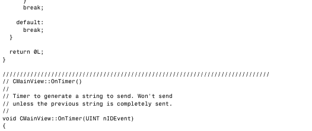

在单线图中，每个设备都用标准符号表示。例如，发电机用带十字的圆圈表示，变压器用两个圆圈或一对绕组表示，断路器用开关符号表示。各组件通过一条单线连接，这条单线代表系统的所有三相。

单线图广泛用于电力系统研究，例如潮流分析、短路分析和保护配合。它们提供了一种清晰简洁的方式来理解电力系统的整体结构和运行方式。

- **组件：** 发电机、变压器、母线、断路器、负载
- **连接：** 输电线路、电缆
- **符号：** 每个组件的标准化图形符号

连接成功。SECLIENT 的 `CMainView::OnAsyncSelect()` 会因 `FD_CONNECT` 事件被调用。
SESERV 的 `CMainView::OnAsyncSelect()` 会因 `FD_ACCEPT` 事件被调用；如果 `m_sClient` 套接字尚未连接，则会建立连接。

五秒后，SECLIENT 中的定时器会触发，导致 `CMainView::OnTimer()` 被调用。此时还没有待发送的字节，因此会填充发送缓冲区，并伪造一个 WinSock `FD_WRITE` 消息来触发数据发送。必须这样做，因为真正的 `FD_WRITE` 可能已被错过，或者它可能在还没有任何数据可发送时就已经发生。

SECLIENT 中的 `CMainView::OnAsyncSelect()` 会因 `FD_WRITE` 事件被调用。此时有字节要发送，因此会尝试将它们传输到流式回显服务器。如果尝试成功，则待发送的字节数会减少。如果发送时出错，但错误仅仅是发送操作会阻塞，则待发送字节数会保留，因为最终会收到真正的 `FD_WRITE`。如果无法在一次 `send()` 调用中传输所有待发送字节（鉴于示例中的数据大小，这种情况不太可能），则会继续生成 `FD_WRITE` 事件，并减少字节计数，直到最终变为 0（零）。

假设 SECLIENT 发送了一个缓冲区，SESERV 中的 `CMainView::OnAsyncSelect()` 会因 `FD_READ` 通知被调用。SESERV 只有一个用于接收和发送数据的缓冲区，因此如果还有任何字节需要回显给客户端，就会忽略 `FD_READ`。如果数据读取成功，则会记录字节计数，并生成一个伪造的 `FD_WRITE` 消息，以强制将刚接收到的数据发送回发起方（SECLIENT）。

SESERV 中的 `CMainView::OnAsyncSelect()` 会因 `FD_WRITE` 事件被调用。此时有字节要发送，因此会尝试将它们传输到流式回显客户端。如果尝试成功且写入了字节，则待发送字节数会按成功写入的字节数减少。如果发送时出错，但错误仅仅是发送操作会阻塞，则待发送字节数会保留，因为最终会收到真正的 `FD_WRITE`。在整个缓冲区被回显之前，可能会生成多个 `FD_WRITE` 事件（不过鉴于本例中的缓冲区很小，这种情况极不可能发生）。

假设 SESERV 发送了一个缓冲区，SECLIENT 中的 `CMainView::OnAsyncSelect()` 会因 `FD_READ` 通知被调用，客户端会读取回显的数据。SECLIENT 中的另一个定时器会触发，然后重复该过程。

图 8.10 显示了在同一台计算机上运行的 SESERV 和 SECLIENT，该计算机的 IP 地址为 166.78.16.150。服务器和客户端分别被分配了端口 1067 和 1068。请注意，与基于数据报的示例相比，这里多了与连接有关的状态消息。

**图 8.10.**  
*SESERV 和*  
*SECLIENT 运行*  
*在同一台计算机上。*

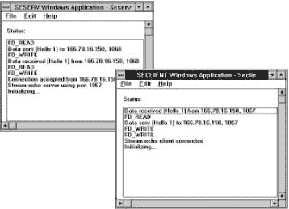

## 小结

本章演示了在完整应用程序中使用许多重要 WinSock 函数的方法。演示的函数包括初始化 WinSock、提供有关计算机上 WinSock TCP/IP 协议栈的详细信息、执行数据库查询，以及通过流式套接字和数据报套接字传输数据。

可以对这里说明的程序进行若干增强，使其更加健壮。你可能想自行探索的一项修改是：让 DECLIENT 和 SECLIENT 应用程序能够输入主机名，而不仅仅是 IP 地址。可以为此尝试使用 WSAAsyncGetHostByName()，但不要忘记先调用 `inet_addr()`，以防用户确实输入了 IP 地址。

第 9 章至第 13 章介绍若干 C++ 类，这些类封装了 WinSock 功能，使编写网络应用程序变得更加容易。


# WinSock 类库

- 9. 设计目标
- 10. CWinSock
- 11. CDatagramSocket
- 12. CStreamSocket
- 13. 整合所有内容


## 设计目标

上一章考察了几个使用 WinSock 函数的示例程序。你可能会注意到，这些应用程序中“充斥着”WinSock 专用的函数调用。尽管这种编程风格在几年前可能被认为是令人满意的，但如今的面向对象概念和语言允许应用程序更好地隔离显式功能，例如网络功能。

本书的其余部分介绍一个用于构建网络应用程序的框架，以及几个使用该框架的示例应用程序。该框架由一组 C++ 类构建而成。

### 目标

生成用于管理 WinSock 网络通信的类库，其目标与面向对象编程的目标相似，包括简化、泛化和封装。在设计类库时，你不应想着如何将所有 WinSock 函数都纳入一个类中；而应从应用程序的角度来看待它，并问：“应用程序需要做什么？”

从前面的示例程序可以看出，网络应用程序执行的功能相对较少。不过，不要把功能与函数调用混为一谈。最常用的 WinSock 功能如下：

- 启动和停止 WinSock。
- 将人们喜欢使用的名称解析为计算机可用的格式。
- 创建通信端点，并可选地为其分配名称。
- 销毁端点。
- 监听并接受对端点的连接。
- 连接到端点。
- 向端点发送数据以及从端点接收数据。

本质上，这就是 WinSock 提供给应用程序的全部功能。当然，细节决定成败。类库的目标是对应用程序隐藏这些细节。这使得应用程序可以与网络部分分开开发和调试。网络部分，即 WinSock 类库，会被开发和调试，直到完全可用。然后，应用程序就可以把类库当作一个简单的黑盒来使用；向黑盒输入特定内容，再从其中得到特定输出。

根据功能列表判断，良好的类划分可能包含三个类：

- 启动、停止 WinSock 并获取其信息
- 数据报套接字（发送到和接收自）
- 流式套接字（监听、接受、连接、发送和接收）

### 封装

类库封装了有效使用 WinSock 所需的许多细节。查看前面的示例，可以看到需要使用多个变量，其中许多变量只使用一次随后就被丢弃。类库封装这些变量，并且只向应用程序公开那些必不可少的变量。

### 简化

类库的另一个目标是简化应用程序对网络功能的访问。这种简化的一部分通过将变量和函数封装在类中来实现，另一部分则来自只公开应用程序绝对必需的内容。类库隐藏了执行某些功能的复杂细节。例如，考察发送流数据这一非常常见的 WinSock 功能。在之前的示例中，应用程序必须知道何时能够发送更多数据。它还必须在每次成功但仅部分发送之后，跟踪缓冲区中还剩多少数据需要发送。通过使用类库，应用程序只需对一块数据执行发送操作，而对象会跟踪何时可以发送数据以及还剩多少数据需要发送。然后，对象可以在发送完成时通知应用程序；但在此期间，应用程序已经摆脱了发送数据的细节。

### 泛化

设计类库要求功能必须通用化。这些类可能成为将来某些派生类的基类。它们必须足够通用，以免妨碍其作为基类使用；但同时也必须具有足够的功能，以便能够立即使用。

### 折中

为了保持类的通用性，需要做出一些折中。在考虑这些折中是什么时，你必须回顾描述应用程序所利用的 WinSock 功能的列表。

作为可以做出的折中的一个示例，请看一个示例服务器应用程序。上一章介绍的两个服务器 DESERV 和 SESERV 没有指定它们运行在哪个端口上。相反，它们让 WinSock 动态分配一个端口。在这种情况下，匹配的客户端程序需要知道这个端口号，才能与服务器通信。更常见的情况是，分配给服务的端口是硬编码的，或者被输入到主机上的 services 文件中，从而允许通过名称解析端口号。考虑到这一点，可以做出一个折中：强制服务器套接字指定端口号或服务名；从而避免让 WinSock 决定端口号。这种折中简化了服务器和客户端，因而也简化了类库本身。

### 实现细节

整个 WinSock 类库由几个类组成，实现在 CWINSOCK.CPP 文件中，而 CWINSOCK.H 包含类声明。只需将此源文件添加到每个需要 WinSock 功能的项目中。这与创建动态链接库再将其链接到应用程序的做法相反。如果要从 WinSock 类创建 DLL，则必须使用 Microsoft Foundation Class 扩展 DLL，因为某些 WinSock 类派生自 MFC 类。创建此类 DLL 超出了本书的范围，但有关如何创建它的文档可从 Microsoft 资源（如 Developer Network CD）获得。

WinSock 类库的实际代码遵循 Microsoft Foundation Class 库中使用的约定。所有类名都以大写字母 C 开头，如下所示：

```cpp
class CWinSock
```

所有类成员变量都以 m_ 前缀开头。匈牙利命名法附加在 m_ 前缀之后、实际变量名之前。例如，一个包含缓冲区长度的整数可能如下所示：

```cpp
int m_nBufLen;
```

这种命名约定应能确保在应用程序中快速、轻松地识别和理解 WinSock 类引用。

## 小结

本章介绍 WinSock 类库的概念，包括其要求和可能的限制。第 10 章至第 13 章描述组成 WinSock 类库的几个类。然后，第 14 章至第 16 章将在功能完整的程序中使用这些类。


# 10 CWinSock

本章讨论 `CWinSock` 类。

该类负责初始化 WinSock 子系统、关闭 WinSock，以及获取 WinSock TCP/IP 协议栈信息。

类声明如下：

```cpp
///////////////////////////////////////////////////////////////
// CWinSock
//
class CWinSock
{
private:
    WORD m_wVersionRequired;   // WinSock version required by application
    int m_nLastError;          // last WinSock error
    WSADATA m_wsData;          // WinSock information

public:
    CWinSock(WORD wVersionRequired = MAKEWORD(1, 1));
    int Startup();
    int Shutdown();
    void Information(LPWSADATA pWSAData);
    int LastError() { return m_nLastError; }
};
```

该类包含三个私有成员变量，在类实现之外无法访问。

## CWinSock 构造函数

CWinSock 对象的构造函数仅初始化两个成员变量。`m_wVersionRequired` 变量是应用程序所需的 WinSock 版本。它由应用程序传入构造函数。如果未提供此参数，则默认为版本 1.1。该类的构造函数如下所示：

```cpp
///////////////////////////////////////////////////////////////
// CWinSock constructor
//
// Constructs the CWinSock object. Initializes member variables
//
CWinSock::CWinSock(WORD wVersionRequired/*= MAKEWORD(1, 1)*/)
{
    // initialize member variables
    m_wVersionRequired = wVersionRequired;
    m_nLastError = 0;
}
```

## CWinSock::Startup()

`Startup()` 成员函数实际上初始化 WinSock 子系统。必须在调用任何其他 WinSock 数据操作函数之前调用它。如果发生错误


在初始化期间发生时，该函数返回 `CWINSOCK_WINSOCK_ERROR` 错误码，且 `m_nLastError` 成员变量包含实际的 WinSock 错误。其实现如下所示：

```
///////////////////////////////////////////////////////////////
// CWinSock::Startup()
//
// Start the WinSock sub-system.
//
int CWinSock::Startup()
{
    int nStatus = CWINSOCK_NOERROR;

    m_nLastError = WSAStartup(m_wVersionRequired, &m_wsaData);

    if (m_nLastError != 0)
        nStatus = CWINSOCK_WINSOCK_ERROR;

    return nStatus;
}
```

## CWinSock::Shutdown()

`Shutdown()` 成员函数清理 WinSock 子系统。如果在关闭期间发生错误，该函数返回 `CWINSOCK_WINSOCK_ERROR` 错误码，且 `m_nLastError` 成员变量包含实际的 WinSock 错误。其实现如下所示：

```
///////////////////////////////////////////////////////////////
// CWinSock::Shutdown()
//
// Shutdown the WinSock sub-system.
//
int CWinSock::Shutdown()
{
    int nStatus = CWINSOCK_NOERROR;

    if (WSACleanup() != 0)
    {
        m_nLastError = WSAGetLastError();
        nStatus = CWINSOCK_WINSOCK_ERROR;
    }

    return nStatus;
}
```

## CWinSock::Information()

`Information()` 成员函数将 WinSock TCP/IP 协议栈信息结构复制到调用应用程序传入的 WSADATA 结构中。这使应用程序能够访问一些有用的数据，例如供应商信息字符串，而无需担心应用程序错误地修改 m_wsaData 成员变量。其实现如下所示：

```
///////////////////////////////////////////////////////////////
// CWinSock::Information()
//
// Copy the WinSock information structure.
void CWinSock::Information(LPWSADATA pwsaData)
{
    memcpy(pwsaData, &m_wsaData, sizeof(WSADATA));
}
```

## CWinSock::LastError()

LastError() 成员函数实现为内联函数。它仅返回 m_nLastError 值，该值包含 CWinSock 对象生成的最后一个 WinSock 错误消息。

## 小结

本章介绍最简单的 WinSock 类，但也是任何希望使用 WinSock 进行数据处理的应用程序中都必须出现的类。下一章介绍一个处理数据报套接字通信的类。

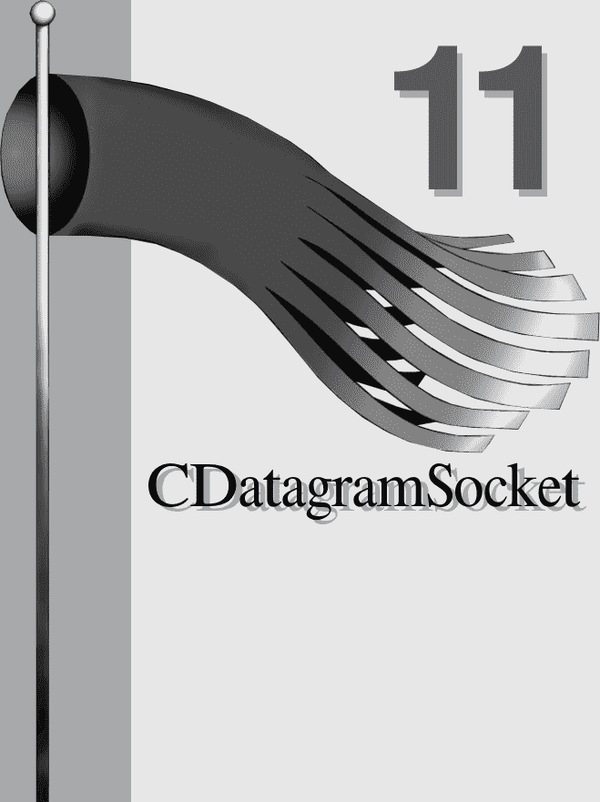

## CDatagramSocket

本章讨论 `CDatagramSocket` 类。此类简化应用程序与数据报套接字的交互。此类负责创建数据报套接字、可选地将套接字绑定到名称、发送和接收数据，以及销毁套接字。

类声明如下：

```
///////////////////////////////////////////////////////////////
// CDatagramSocket
///////////////////////////////////////////////////////////////
class CDatagramSocket : public CWnd
{
private:
    CWnd *m_pParentWnd;      // window to receive event notification
    UINT m_uMsg;             // message to send to m_pParentWnd on event
    SOCKET m_s;              // socket handle
    SOCKADDR_IN m_sinLocal; // name bound to socket m_s
    int m_nLastError;        // last WinSock error
    BOOL m_bServer;          // TRUE if socket m_s is bound to a name
    CPtrList m_listWrite;    // data waiting to be sent
    CPtrList m_listRead;     // data read

public:
    CDatagramSocket(CWnd *pParentWnd, UINT uMsg);
    virtual ~CDatagramSocket();
    int CreateSocket(int nLocalPort);
    int CreateSocket(LPSTR pszLocalService = NULL);
    int DestroySocket();
    int Write(int nLen, LPVOID pData, LPSTR pszRemoteName, int nRemotePort);
    int Write(int nLen, LPVOID pData, LPSTR pszRemoteName, LPSTR pszRemoteService);
    int Write(int nLen, LPVOID pData, LPSOCKADDR_IN psinRemote);
    LPVOID Read(LPINT pnLen, LPSOCKADDR_IN psinRemote = NULL);
    int LastError() { return m_nLastError; }

private:
    void InitVars(BOOL bInitLastError = TRUE);
    LONG HandleWnd(WPARAM wParam, LPARAM lParam);
    LONG HandleWrite(WPARAM wParam, LPARAM lParam);

    // message map functions
protected:
    //{{AFX_MSG(CDatagramSocket)
    //}}AFX_MSG
    LONG OnWinSockEvent(WPARAM wParam, LPARAM lParam);
    DECLARE_MESSAGE_MAP()
};
```

该类包含若干私有成员变量，这些变量在类实现之外不可访问。特别值得注意的是 `m_listWrite` 和 `m_listRead` 成员变量。这些 `CPtrList` 对象维护指向传入和传出数据的指针。这些列表维护的数据具有以下结构：

```
// structure used for datagram socket read/write queue
typedef struct tagDATAGRAMDATA
{
    LPVOID      pData;
    int         nLen;
    SOCKADDR_IN sin;
} DATAGRAMDATA, FAR * LPDATAGRAMDATA;
```

### CDatagramSocket 构造函数

CDatagramSocket 对象的构造函数初始化该类的成员变量。m_pParentWnd 变量是创建此数据报套接字对象的窗口对象。该参数是必需的，因为 CDatagramSocket 对象使用 Windows 消息传递将某些状态信息传回该对象的用户。类似地，m_uMsg 变量是当数据报套接字需要将某些信息通知应用程序时，m_pParentWnd 接收的实际 Windows 消息。该类的构造函数如下所示：

```
////////////////////////////////////////////////////////////
// CDatagramSocket constructor
//
// Constructs the CDatagramSocket object. Initializes member variables
//
CDatagramSocket::CDatagramSocket(CWnd *pParentWnd, UINT uMsg)
{
    // initialize member variables
    m_pParentWnd = pParentWnd;
    ASSERT(m_pParentWnd != NULL);
    m_uMsg = uMsg;
    ASSERT(m_uMsg != 0);
    InitVars();
}
```

### CDatagramSocket::InitVars()

InitVars() 成员函数初始化若干私有成员变量。其实现如下所示：

```
////////////////////////////////////////////////////////////
// CDatagramSocket::InitVars()
//
// Initialize class member variables.
//
void CDatagramSocket::InitVars(BOOL bInitLastError/* = TRUE */)
{
    if (bInitLastError)
        m_nLastError = 0;

    m_s = INVALID_SOCKET;
    memset(&m_sinLocal, 0, sizeof(m_sinLocal));
    m_bServer = FALSE;
}
```

### CDatagramSocket::CreateSocket()

`CreateSocket()` 成员函数创建一个隐藏窗口，用于 WinSock 消息（即 `FD_READ` 和 `FD_WRITE`）。此函数还创建数据报套接字，并可选地将套接字绑定到名称。`CreateSocket()` 成员函数有两个实现。一个实现接受一个整数参数，表示应以主机字节序绑定到套接字的端口号。`CreateSocket()` 的另一个版本接受一个字符串，其中包含要绑定到套接字的数字端口号或服务名，或者 `NULL`。如果指定了 `NULL`，或者调用该函数时完全不传参数，则套接字不会绑定到名称。一般来说，仅对服务器类型套接字指定该参数。

接受整数端口号的 `CreateSocket()` 版本只是将整数转换为字符串，并调用另一个版本的 `CreateSocket()`。其实现如下所示：

```
////////////////////////////////////////////////////////////
// CDatagramSocket::CreateSocket()
//
// Create a hidden window that will receive asynchronous messages
// from WinSock.  Also creates a socket and optionally binds it to
// a name if the socket is a server socket.
//
// This version of the CreateSocket() function takes a
// port number, in host order, as input.  A port number
// should only be specified if the socket is to be bound
// to a certain port.  If you don't care which port is
// assigned to the socket, just call CreateSocket() without
// any parameter, causing CreateSocket(NULL) to be called.
//
int CDatagramSocket::CreateSocket(int nLocalPort)
{
    // if this version of the function is being called,
    // a valid port number must be specified
    if (nLocalPort <= 0)
        return CWINSOCK_PROGRAMMING_ERROR;

    // convert the port number into a string and
    // call the version of CreateSocket() which
    // accepts a string
    char pszLocalService[18];
    _itoa(nLocalPort, pszLocalService, 10);
    return CreateSocket(pszLocalService);
}
```

接受字符串端口号或服务名的 `CreateSocket()` 版本在后面的代码中实现。如果数据报套接字不需要绑定到特定端口号或服务名，只需不传参数调用此函数。C++ 默认参数特性将向该函数传递 `NULL`，从而让 `CreateSocket()` 不绑定套接字。


```cpp
/////////////////////////////////////////////////////////////
// CDatagramSocket::CreateSocket()
//
// Create a hidden window that will receive asynchronous messages
// from WinSock. Also creates a socket and optionally binds it to
// a name if the socket is a server socket.
//
// This version of the CreateSocket() function takes a
// string containing a service name or port number.
// A parameter should only be specified if the socket is to be
// bound to a certain port. If you don't care which port is
// assigned to the socket, just call CreateSocket() without
// any parameter, causing CreateSocket(NULL) to be called.
//
int CDatagramSocket::CreateSocket(LPSTR pszLocalService /*= NULL*/)
{
    int nStatus = CWINSOCK_NOERROR;

    while (1)
    {
        // Make sure the socket isn't already created.
        // If the socket handle is valid, return from this
        // function right away so the existing parameters of
        // the object are not tampered with.
        if (m_s != INVALID_SOCKET)
            return CWINSOCK_PROGRAMMING_ERROR;

        InitVars();

        // create the hidden window
        RECT rect;
        rect.left = 0;
        rect.top = 0;
        rect.right = 100;
        rect.bottom = 100;
        if (Create(NULL, NULL, WS_OVERLAPPEDWINDOW, rect, m_pParentWnd, 0) == 0)
        {
            nStatus = CWINSOCK_WINDOWS_ERROR;
            break;
        }

        // create the socket
        m_s = socket(PF_INET, SOCK_DGRAM, 0);
        if (m_s == INVALID_SOCKET)
        {
            m_nLastError = WSAGetLastError();
            nStatus = CWINSOCK_WINDOWS_ERROR;
            DestroyWindow();
            break;
        }

        // If pszLocalService is not NULL, this is a server socket
        // that will accept data on the specified port.
        if (pszLocalService != NULL)
        {
            // this socket is bound to a port number
            // so set the server flag
            m_bServer = TRUE;

// assign the address family
m_sinLocal.sin_family = AF_INET;

// assign the service port (may have to do a database lookup
// if a service port number was not specified)
m_sinLocal.sin_port = htons(atoi(pszLocalService));
if (m_sinLocal.sin_port == 0)
{
    LPSERVENT pSent = getservbyname(pszLocalService, "udp");
    if (pSent == NULL)
    {
        m_nLastError = WSASocketError();
        nStatus = CWINSOCK_ERROR;
        closesocket(m_s);
        DestroyWindow();
        break;
    }
    m_sinLocal.sin_port = pSent->s_port;
}

// assign the IP address
m_sinLocal.sin_addr.s_addr = htonl(INADDR_ANY);

// bind the server socket to the name containing the port
if (bind(m_s, (LPSOCKADDR)&m_sinLocal, sizeof(m_sinLocal)) == SOCKET_ERROR)
{
    m_nLastError = WSASocketError();
    nStatus = CWINSOCK_ERROR;
    closesocket(m_s);
    DestroyWindow();
    break;
}

// start asynchronous event notification
long lEvent = FD_READ | FD_WRITE;
if (WSAAsyncSelect(m_s, m_hWnd, WINSOCK_EVENT_NOTIFICATION, lEvent) ==
SOCKET_ERROR)
{
    m_nLastError = WSASocketError();
    nStatus = CWINSOCK_ERROR;
    closesocket(m_s);
    DestroyWindow();
    break;
}

break;
}

// if anything failed in this function, set the
// socket variable appropriately
if (nStatus != CWINSOCK_ERROR)
    InitVars(FALSE);

return nStatus;
}
```

### CDatagramSocket::Write()

`Write()` 成员函数将数据写入指定的目标主机和端口。不过，数据不会立即从套接字发送出去。相反，数据、其长度以及数据的目标地址会被添加到写队列中。直到数据报套接字从 WinSock 子系统收到 `FD_WRITE` 消息，通知现在可以发送时，数据才会被发送。

由于数据不会立即发送，数据指针指定的数据在拥有该数据报套接字的窗口收到 `m_uMsg` 消息（其中 `wParam` 设置为 `CWINSOCK_DONE_WRITING` 或 `WINSOCK_ERROR_WRITING`）之前，不得释放或重用。当应用程序窗口收到此消息时，`lParam` 是指向已发送数据的指针。此时，该指针指定的数据可以释放或重用。如果 `Write()` 函数立即失败（表现为函数返回除 `CWINSOCK_NOERROR` 之外的值），则数据指针可以释放或重用（对于此数据指针，永远不会收到 `m_uMsg` 写消息）。

`Write()` 成员函数有三种实现。这三个函数都有用于指定要发送的字节数以及指向数据的指针的参数。其余函数参数因调用 `Write()` 的方式而异。`Write()` 成功时返回 `CWINSOCK_NOERROR`。

其中一种实现接收一个包含目标点分十进制 IP 地址或目标主机名的字符串，以及一个表示端口号（主机字节序）的整数参数。这个版本的 `Write()` 只是将整数转换为字符串，并调用另一个版本的函数，该版本旨在接收包含端口号或服务名的字符串。

```cpp
///////////////////////////////////////////////////////////////////////
// CDatagramSocket::Write()
//
// Write data to the socket specified by the name and port.
//
// This version of the Write() function takes an integer
// representing the length of the data to send, a pointer
// to the data to send, a pointer to a string representing
// the host name to send the data to, and an integer
// representing the port number to send to.
//
// The data pointed to by pData must remain valid until either
// the Write() function returns with an error, or the
// write's completion is notified by the m_uMsg being sent
// to the window that owns this datagram object with wParam set
// to CWINSOCK_DONE_WRITING or CWINSOCK_ERROR_WRITING.
//
int CDatagramSocket::Write(int nLen, LPVOID pData,
    LPSTR pszRemoteName, int nRemotePort)
}
sinRemote.sin_port = pSent->s_port;
}

// assign the IP address (may have to do a database lookup
// if a dotted decimal IP address was not specified)
sinRemote.sin_addr.s_addr = inet_addr(pszRemoteName);
if (sinRemote.sin_addr.s_addr == INADDR_NONE)
{
    pHost = gethostbyname(pszRemoteName);
    if (pHost == NULL)
    {
        m_nLastError = WSAGetLastError();
        nStatus = CWINSOCK_WINDOWS_ERROR;
        break;
    }
    sinRemote.sin_addr.s_addr = *(u_long *)pHost->h_addr;
}

// call the version of Write() that takes an
// Internet address structure
return Write(nLen, pData, &sinRemote);
}

return nStatus;
}
```

`Write()` 的第三种实现接收一个指向表示数据目标的 Internet 地址结构的指针。这个函数负责将数据添加到写队列的实际工作。在数据、其长度和目标地址被添加到写队列后，会向数据报对象投递一条消息，以触发数据发送。通常，只要可以安全地从套接字发送数据，WinSock 子系统就会发送此消息。但是，当来自 WinSock 子系统的最后一条消息到达时，写队列中可能没有任何等待发送的数据。伪造 WinSock `FD_WRITE` 事件会使套接字检查写队列，并发送第一个等待发送的数据。

```cpp
///////////////////////////////////////////////////////////////////////
// CDatagramSocket::Write()
//
// Write data to the socket specified by the Internet address.
//
// This version of the Write() function takes an integer
// representing the length of the data to send, a pointer
// to the data to send, and a pointer to an Internet address
// structure to send the data to.
//
// The data pointed to by pData must remain valid until either
// the Write() function returns with an error, or the
// write's completion is notified by the m_uMsg being sent
// to the window that owns this datagram object with wParam set
// to CWINSOCK_DONE_WRITING or CWINSOCK_ERROR_WRITING.
//
int CDatagramSocket::Write(int nLen, LPVOID pData,
    LPSOCKADDR_IN psinRemote)
```


```cpp
{
    int nStatus = CWINSOCK_NOERROR;

    while (1)
    {
        // dynamically allocate a structure to hold the
        // data pointer, the data's length, and the destination address
        LPDATAGRAM pDatagramData = new DATAGRAM;
        if (pDatagramData == NULL)
        {
            nStatus = CWINSOCK_WINDOWS_ERROR;
            break;
        }
        pDatagramData->pData = pData;
        pDatagramData->nLen = nLen;
        memcpy(&(pDatagramData->sin), psinRemote, sizeof(SOCKADDR_IN));

        // add the data to the list
        TRY
        {
            m_listWrite.AddTail(pDatagramData);
        }
        CATCH (CMemoryException, e)
        {
            nStatus = CWINSOCK_WINDOWS_ERROR;
            break;
        }
        END_CATCH

        // trigger the FD_WRITE handler to try to send
        PostMessage(CWINSOCK_EVENT_NOTIFICATION, m_s, WSAMAKESELECTREPLY(FD_WRITE, 0));
        break;
    }

    return nStatus;
}
```

### CDatagramSocket::Read()

Read() 成员函数检索发送到套接字的数据。当拥有数据报套接字的窗口收到 m_uMsg 消息且 wParam 设置为 CWINSOCK_DONE_READING 时，应用程序可以调用 Read()。当应用程序窗口收到此消息时，lParam 是可执行的 Read() 函数调用次数（即 lParam 是当前存储在读取队列中的数据报包数量）。Read() 函数接受一个指向整数的指针（pLen），以及一个可选的指向 SOCKADDR_IN 结构的指针（psinRemote）。Read() 成功完成后，返回指向数据的指针，pLen 所指向的整数包含所返回数据报中的字节数。如果为 psinRemote 参数提供了指针，则返回数据发送方的地址。出错时，返回 NULL。

```cpp
////////////////////////////////////////////////////////////
// CDatagramSocket::Read()
//
// Read data that has been received by the socket.
//
// This function takes a pointer to an integer that will be filled
// with the length of the data read and an optional pointer
// to an Internet address structure that will be filled with
// the address of the sender of the data.
//
// A pointer to the data is returned on success. The application
// using this object must free this pointer. NULL is returned on failure.
LPVOID CDatagramSocket::Read(LPINT pnLen, LPSOCKADDR_IN psinRemote/* = NULL*/)
{
    LPVOID pData = NULL;

    // check to see if there is data to retrieve
    if (!m_listRead.IsEmpty())
    {
        // remove the stream data from the list
        LPDATAGRAMDATA pDatagramData = (LPDATAGRAMDATA)m_listRead.RemoveHead();
        pData = pDatagramData->pData;
        *pnLen = pDatagramData->nLen;
        if (psinRemote != NULL)
            memcpy(psinRemote, &(pDatagramData->sin), sizeof(SOCKADDR_IN));
        delete pDatagramData;
    }

    return pData;
}
```

### CDatagramSocket::OnWinSockEvent()

OnWinSockEvent() 成员函数处理 WinSock 子系统发送的异步事件通知消息。关注的 WinSock 事件是 FD_READ 和 FD_WRITE。对这些事件的关注通过在 CreateSocket() 成员函数中调用 WSAAsyncSelect() 来注册。使用 Microsoft Foundation Class 消息映射设施将 CWINSOCK_EVENT_NOTIFICATION 消息映射到 OnWinSockEvent() 函数。消息映射如下所示：

```cpp
// message map
BEGIN_MESSAGE_MAP(CDatagramSocket, CWnd)
//{{AFX_MSG_MAP(CDatagramSocket)
//}}AFX_MSG_MAP
ON_MESSAGE(CWINSOCK_EVENT_NOTIFICATION, OnWinSockEvent)
END_MESSAGE_MAP()
```

OnWinSockEvent() 的代码如下。它只检查错误，如果没有错误，则调用相应的消息处理程序。

```cpp
/////////////////////////////////////////////////////////////////////
// CDatagramSocket::OnWinSockEvent()
//
// Called when there is an asynchronous event on the socket.
//
LONG CDatagramSocket::OnWinSockEvent(WPARAM wParam, LPARAM lParam)
{
    // check for an error
    if (WSAGETSELECTERROR(lParam) != 0)
        return 0L;

    // what event are we being notified of?
    switch (WSAGETSELECTEVENT(lParam))
    {
        case FD_READ:
            return HandleRead(wParam, lParam);
            break;
        case FD_WRITE:
            return HandleWrite(wParam, lParam);
            break;
        default:
            // this should never happen
            ASSERT(0);
            break;
    }

    return 0L;
}
```

### CDatagramSocket::HandleRead()

HandleRead() 成员函数处理 WinSock 子系统发送的异步 FD_READ 事件通知消息。当 WinSock 认为从套接字读取将成功时，会调用此函数。此函数的第一部分为数据报数据结构分配内存。然后尝试调用 recvfrom()。如果接收成功，数据会被添加到读取队列。如果一切正常，m_uMsg 消息会被发送到拥有此数据报套接字对象的应用程序窗口，其中 wParam 设置为 CWINSOCK_DONE_READING，lParam 设置为等待读取的数据报数量。当应用程序收到此消息时，应调用 Read() 成员函数。如果接收数据报时出错，wParam 设置为 CWINSOCK_ERROR_READING。

```cpp
///////////////////////////////////////////////////////////////
// CDatagramSocket::HandleRead()
//
// Called when there is an asynchronous read event on the socket.
//
// If the read was successful, the data, its length, and the address
// of the sender of the data, are stored in the read queue. Upon
// a successful read, the application window using this object is
// then notified with the m_uMsg message (wParam set to
// CWINSOCK_DONE_READING; lParam set to the number of data chunks
// in the read queue). At this point, the application should call
// Read(). If the read fails for some reason, the m_uMsg is sent
// with wParam set to CWINSOCK_ERROR_READING.

LONG CDatagramSocket::HandleRead(WPARAM wParam, LPARAM lParam)
{
while (1)
{
    // allocate memory for incoming data
    LPVOID pData = malloc(READ_BUF_LEN);
    LPDATAGRAMDATUM pDatagramData = new DATAGRAMDATUM;
    if ((pData == NULL) || (pDatagramData == NULL))
    {
        // free anything that was allocated
        if (pData != NULL)
            free(pData);
        pData = NULL;
        if (pDatagramData != NULL)
            delete pDatagramData;
        pDatagramData = NULL;

        // tell the parent that a possible data read failed
        m_pParentWnd->PostMessage(m_uMsg, CWINSOCK_ERROR_READING);

        // fake the event to try again
        PostMessage(CWINSOCK_EVENT_NOTIFICATION, m_s,
            WSAMAKESELECTREPLY(FD_READ, 0));

        break;
    }

    // receive data
    int nAddrLen = sizeof(SOCKADDR_IN);
    int nBytesRead = recvfrom(m_s, (LPSTR)pData, READ_BUF_LEN, 0,
        (LPSOCKADDR)&m_sin, &nAddrLen);
    if (nBytesRead == SOCKET_ERROR)
    {
        // free memory for incoming data
        free(pData);
        pData = NULL;
        delete pDatagramData;
        pDatagramData = NULL;

        // if the error is just that the read would block,
        // don't do anything; we'll get another FD_READ soon
        m_nLastError = WSAGetLastError();
        if (m_nLastError == WSAEWOULDBLOCK)
            m_nLastError = 0;
        else
            // tell the parent that a data read failed
            m_pParentWnd->PostMessage(m_uMsg, CWINSOCK_ERROR_READING);

        break;
    }

    // add the data to the list
    pDatagramData->pData = pData;
    pDatagramData->nLen = nBytesRead;
    TRY
    {
        m_listRead.AddTail(pDatagramData);
    }
    CATCH (CMemoryException, e)
    {
        // what should we do?
        // free the data
        free(pData);
        pData = NULL;
        delete pDatagramData;
        pDatagramData = NULL;

        // tell the parent that a data read failed
        m_pParentWnd->PostMessage(m_uMsg, CWINSOCK_ERROR_READING);
        break;
    }
    END_CATCH
}
}
```


```cpp
{
    free(pData);
    pData = NULL;
    delete pDatagramData;
    pDatagramData = NULL;
    // tell the parent that a data read failed
    m_pParentWnd->PostMessage(m_uMsg, CWINSOCK_ERROR_READING);
    break;
}
END_CATCH

// tell the parent that data has been read
m_pParentWnd->PostMessage(m_uMsg, CWINSOCK_DONE_READING,
    (LPARAM)m_listRead.GetCount());

break;
}

return 0L;
}
```

### CDatagramSocket::HandleWrite()

HandleWrite() 成员函数处理由 WinSock 子系统发送的异步 FD_WRITE 事件通知消息。当 WinSock 认为向套接字写入数据将成功时，就会调用此函数。该函数的开头部分会检查写队列中是否有数据等待发送。该队列由应用程序调用 Write() 成员函数来添加数据。如果写队列中有数据，则尝试执行 sendto()。如果 sendto() 会被阻塞，则保留数据，以便稍后再次尝试发送。如果 sendto() 因 WSAEWOULDBLOCK 以外的错误而失败，则从写队列中移除该数据，并向应用程序窗口发送 m_uMsg 消息，其中 wParam 设置为 CWINSOCK_ERROR_WRITING，lParam 为未能成功发送的数据的指针。如果 sendto() 成功，则 wParam 为 CWINSOCK_DONE_WRITING，lParam 为数据指针。当应用程序收到此消息通知时，可以安全地释放或重用 lParam 中返回的指针所指向的存储空间。

```cpp
//////////////////////////////////////////////////////////////////////
// CDatagramSocket::HandleWrite()
//
// Called when there is an asynchronous write event on the socket.
//
// If there is data in the write queue waiting to be sent,
// a WinSock send is attempted. If the send is successful,
// a m_uMsg message is sent to the application window with
// wParam set to CWINSOCK_DONE_WRITING and lParam set to the
// address of the data that was sent. On send failure,
// wParam is set to CWINSOCK_ERROR_WRITING and lParam set to
// the address of the data which couldn't be sent. In either
// case, the application may free the pointer pointing to
// the data or reuse that data buffer.
```

```cpp
//
LONG CDatagramSocket::HandleWrite(WPARAM wParam, LPARAM lParam)
{
    while (1)
    {
        // check to see if there is any data to send
        if (m_listWrite.IsEmpty())
            break;

        // get pointers to data, data length, and destination address
        LPDATAGRAMDATAGRAMA pDatagramData = (LPDATAGRAMDATAGRAMA)m_listWrite.GetHead();
        LPVOID pData = pDatagramData->pData;
        int nLen = pDatagramData->nLen;
        SOCKADDR_IN sin;
        memcpy(&sin, &(pDatagramData->sin), sizeof(SOCKADDR_IN));

        // send the data
        BOOL bRemove = FALSE;       // remove data from queue?
        int nBytesSent = sendto(m_s, (LPCSTR)pData, nLen, 0,
            (LPSOCKADDR)&sin, sizeof(SOCKADDR_IN));
        if (nBytesSent == SOCKET_ERROR)
        {
            // if the error is just that the send would block,
            // don't do anything; we'll get another FD_WRITE soon
            m_nLastError = WSAGetLastError();
            if (m_nLastError == WSAEWOULDBLOCK)
                m_nLastError = 0;
            else
            {
                bRemove = TRUE;
                m_pParentWnd->PostMessage(m_uMsg, CWINSOCK_ERROR_WRITING,
                    (LPARAM)pData);
            }
        }
        else
        {
            // if data was sent, we must still check to see
            // if all the bytes were sent
            bRemove = TRUE;
            if (nBytesSent == nLen)
                m_pParentWnd->PostMessage(m_uMsg, CWINSOCK_DONE_WRITING,
                    (LPARAM)pData);
            else
                m_pParentWnd->PostMessage(m_uMsg, CWINSOCK_ERROR_WRITING,
                    (LPARAM)pData);
        }

        // if the data was sent or there was a real
        // error, remove the data from the queue
        if (bRemove)
        {
            delete pDatagramData;
            m_listWrite.RemoveHead();
        }

        // if there is more data to send, trigger this FD_WRITE handler
        if (!m_listWrite.IsEmpty())
            PostMessage(CWINSOCK_EVENT_NOTIFICATION, m_s,
                WSAMAKESELECTREPLY(FD_WRITE, 0));

        break;
    }

    return 0L;
}
```

### CDatagramSocket::DestroySocket()

DestroySocket() 成员函数会移除读队列或写队列中排队的任何数据，关闭套接字，并销毁用于 WinSock 消息的隐藏窗口。其实现如下：

```cpp
///////////////////////////////////////////////////////////////
// CDatagramSocket::DestroySocket()
//
// Close the socket, remove any queued data,
// and destroy the hidden window.
//
int CDatagramSocket::DestroySocket()
{
    int nStatus = CWINSOCK_NOERROR;

    // make sure the socket is valid
    if (m_s == INVALID_SOCKET)
        nStatus = CWINSOCK_PROGRAMMING_ERROR;
    else
    {
        // remove any data in the write queue
        while (!m_listWrite.IsEmpty())
        {
            LPDATAGRAMDATAGRAMA pDatagramData = (LPDATAGRAMDATAGRAMA)m_listWrite.RemoveHead();
            LPVOID pData = pDatagramData->pData;
            delete pDatagramData;

            m_pParentWnd->PostMessage(m_uMsg, CWINSOCK_ERROR_WRITING,
                (LPARAM)pData);
        }

        // remove any data in the read queue
        while (!m_listRead.IsEmpty())
        {
            LPDATAGRAMDATAGRAMA pDatagramData = (LPDATAGRAMDATAGRAMA)m_listRead.RemoveHead();
            free(pDatagramData->pData);
            delete pDatagramData;
        }

        // close the socket and initialize variables
        closesocket(m_s);
        InitVars();

        // destroy the hidden window
        DestroyWindow();
    }

    return nStatus;
}
```

### CDatagramSocket::LastError()

`LastError()` 成员函数以内联函数的方式实现。它只是返回 `m_nLastError` 值，其中包含 `CDatagramSocket` 对象生成的最后一条 WinSock 错误消息。每当 `CDatagramSocket` 成员函数返回 `CWINSOCK_WINSOCK_ERROR` 时，都应调用此函数。

# 应用程序职责

该对象的目标是使用数据报套接字实现网络应用程序的快速开发。`CDatagramSocket` 对象的公共接口由以下函数组成：`CreateSocket()`、`DestroySocket()`、`Read()`、`Write()` 和 `LastError()`。

应用程序必须为该数据报对象提供一定级别的支持。应用程序必须提供一个消息处理程序来接收从该对象发送的消息。此外，数据报对象的构造函数需要一个指向应用程序窗口对象的指针和一条消息。调用数据报对象构造函数的示例代码如下：

```cpp
pdg = new CDatagramSocket(this, WM_USER + 1);
```

必须在消息映射中添加一个条目，将 `WM_USER + 1` 消息关联到应用程序成员函数。

```cpp
BEGIN_MESSAGE_MAP(CMainFrame, CFrameWnd)
  //{{AFX_MSG_MAP(CMainFrame)
  //}}AFX_MSG_MAP
  ON_MESSAGE(WM_USER + 1, OnWinSockEvent)
END_MESSAGE_MAP()
```

处理 `WM_USER + 1` 消息的函数（本例中为 `OnWinSockEvent`）必须为四个不同的 `wParam` 值提供处理程序。在下面的代码片段中，`m_pdg` 是 `CMainFrame` 类的成员变量，指向一个 `CDatagramSocket` 对象。以下代码可作为您的数据报套接字对象消息处理程序的模板：

```cpp
LONG CMainFrame::OnWinSockEvent(WPARAM wParam, LPARAM lParam)
{
    LPVOID pDataWritten;
    LPVOID pDataRead;
    int nLen;
    SOCKADDR_IN sin;

    switch (wParam)
    {
        case CWINSOCK_DONE_WRITING:
            // lParam = pointer to data that was sent
            pDataWritten = (LPVOID)lParam;
            // the data storage space pointed to by pDataWritten
            // may now be freed or reused
            break;
        case CWINSOCK_ERROR_WRITING:
            // lParam = pointer to data that generated error sending
            pDataWritten = (LPVOID)lParam;
            // the data storage space pointed to by pDataWritten
            // may now be freed or reused
            break;
        case CWINSOCK_DONE_READING:
            // lParam == # data chunks in queue
            pDataRead = m_pdg->Read(n, &sin);
            // the data storage space pointed to by pDataRead
            // may be freed after your processing is complete
            break;
        case CWINSOCK_ERROR_READING:
            break;
        default:
            break;
    }

    return 0L;
}
```

分配数据报套接字对象并不会使该套接字可用于通信。必须首先调用 CreateSocket() 成员函数。如果该套接字充当服务器，则必须绑定到特定的端口或服务名称。为此，可通过以下方式之一调用该函数：

```cpp
int nPort;
char pszServiceName[100];
int nStatus;

...assign port or service name...

nStatus = m_pdg->CreateSocket(nPort);
nStatus = m_pdg->CreateSocket(pszServiceName);
```

如果此套接字不是服务器，只需调用 CreateSocket()，例如：

```cpp
nStatus = m_pdg->CreateSocket();
```

要发送数据，应用程序必须提供要发送的字节数、指向数据的指针以及目标说明符。数据必须保持分配状态，直到前面讨论的消息处理程序收到一条 wParam 设置为 CWINSOCK_DONE_WRITING 或 CWINSOCK_ERROR_WRITING 的消息。在这种情况下，lParam 是指针


最初传递给 `Write()`。如果 `Write()` 返回错误值，数据也可能被释放。目标说明符有几种选项。以下代码展示了调用 `Write()` 的多种方式：

```cpp
int nLen;
LPVOID pData;
char pszHostName[100];
char pszHostIP[100];
int nPort;
char pszServiceName[100];
SOCKADDR_IN sin;
int nStatus;

... allocate data buffer and assign destination specifiers...

nStatus = m_pdg->Write(nLen, pData, pszHostName, nPort);
nStatus = m_pdg->Write(nLen, pData, pszHostIP, nPort);
nStatus = m_pdg->Write(nLen, pData, pszHostName, pszServiceName);
nStatus = m_pdg->Write(nLen, pData, pszHostIP, pszServiceName);
nStatus = m_pdg->Write(nLen, pData, &sin);
```

你还可以选择数据缓冲区的分配方式。你可以分配一个缓冲区并持续重复使用。当写通知消息到达且 `wParam` 设置为 `CWINSOCK_DONE_WRITING` 或 `CWINSOCK_ERROR_WRITING` 时，你就知道可以安全地重用该缓冲区了。另一种选择是每次要发送时都分配一个新缓冲区。在这种情况下，只需在 `CWINSOCK_DONE_WRITING` 或 `CWINSOCK_ERROR_WRITING` 消息到达时释放每个缓冲区即可。

要接收数据，应用程序必须提供一个指向整数的指针，以获取读取的字节数。还可以选择提供一个指向 `SOCKADDR_IN` 结构的指针，以获取数据报发送方的地址。`Read()` 函数返回指向数据的指针，出错时返回 NULL。当消息处理程序被激活且 `wParam` 设置为 `CWINSOCK_DONE_READING` 时，应调用 `Read()`。以下是调用 `Read()` 的两种方式：

```cpp
LPVOID pDataRead;
int nLen;
SOCKADDR_IN sin;

pDataRead = m_pdg->Read(&nLen);
pDataRead = m_pdg->Read(&nLen, &sin);
```

释放 `Read()` 返回的指针是应用程序的责任。

要结束数据报套接字对象的使用，请调用 `DestroySocket()`，如下所示：

```cpp
int nStatus;
nStatus = m_pdg->DestroySocket();
```

## 总结

本章介绍了一个用于操作数据报套接字的类。该对象的目标是支持使用数据报通信快速开发网络应用程序。下一章将介绍一个处理流式套接字通信的类。第 14 章和第 15 章将在完整程序中使用 `cDatagramSocket` 对象。


# 12 CStreamSocket

本章讨论 `CStreamSocket` 类。该类简化了应用程序与流式套接字的交互。该类负责以下工作：创建流式套接字；可选地将套接字绑定到名称；侦听客户端连接请求并接受客户端连接；发送和接收数据；以及销毁套接字。

类声明如下：

```cpp
///////////////////////////////////////////////////////////////
// CStreamSocket
//
class CStreamSocket : public CWnd
{
private:
    CWnd *m_pParentWnd;       // window to receive event notification
    UINT m_uMsg;              // message to send to m_pParentWnd on event
    SOCKET m_s;               // socket handle
    SOCKADDR_IN m_sinLocal;   // name bound to socket m_s
    SOCKADDR_IN m_sinRemote;  // name on other side of m_s
    int m_nLastError;         // last WinSock error
    BOOL m_bServer;           // TRUE if socket m_s is bound to a name
    CPtrList m_listWrite;     // data waiting to be sent
    CPtrList m_listRead;      // data read

public:
    CStreamSocket(CWnd *pParentWnd, UINT uMsg);
    virtual ~CStreamSocket();
    int CreateSocket(int nLocalPort);
    int CreateSocket(LPCTSTR pszLocalService = NULL);
    int DestroySocket();
    int Connect(LPCTSTR pszRemoteName, int nRemotePort);
    int Connect(LPCTSTR pszRemoteName, LPCTSTR pszRemoteService);
    int Connect(LPSOCKADDR_IN psinRemote);
    int Accept(CStreamSocket *pStreamSocket);
    int Write(int nLen, LPVOID pData);
    LPVOID Read(LPINT pnLen);
    int GetPeerName(LPSOCKADDR_IN psinRemote);
    int LastError() { return m_nLastError; }

private:
    void InitVars(BOOL bInitLastError = TRUE);
    LONG HandleRead(WPARAM wParam, LPARAM lParam);
    LONG HandleWrite(WPARAM wParam, LPARAM lParam);

    // message map functions
protected:
    //{{AFX_MSG(CStreamSocket)
    //}}AFX_MSG
    LONG OnWinSockEvent(WPARAM wParam, LPARAM lParam);
    DECLARE_MESSAGE_MAP()
};
```

该类包含几个私有成员变量，这些变量在类实现之外不可访问。特别值得关注的是 `m_listWrite` 和 `m_listRead` 成员变量。这些派生自 `CObject` 的对象维护指向传入和传出数据的指针。这些列表所维护的数据具有以下结构：

```cpp
// structure used for stream socket read/write queue
typedef struct tagSTREAMDATA
{
    LPVOID pData;
    int    nLen;
} STREAMDATA, FAR * LPSTREAMDATA;
```

## CStreamSocket 构造函数

CStreamSocket 对象的构造函数初始化类的成员变量。m_pParentWnd 变量是创建此流式套接字对象的窗口对象。此参数是必需的，因为 CStreamSocket 对象使用 Windows 消息将某些状态信息传回给该对象的用户。类似地，m_uMsg 变量是当流式套接字需要通知应用程序某些信息时，m_pParentWnd 接收到的实际 Windows 消息。该类的构造函数如下所示：

```cpp
///////////////////////////////////////////////////////////////
// CStreamSocket constructor()
//
// Constructs the CStreamSocket object. Initializes member variables
//
CStreamSocket::CStreamSocket(CWnd *pParentWnd, UINT uMsg)
{
    m_pParentWnd = pParentWnd;
    ASSERT(m_pParentWnd != NULL);
    m_uMsg = uMsg;
    ASSERT(m_uMsg != 0);
    InitVars();
}
```

## CStreamSocket::InitVars()

`InitVars()` 成员函数初始化几个私有成员变量。其实现如下所示：

```cpp
///////////////////////////////////////////////////////////////
// CStreamSocket::InitVars()
//
// Initialize class member variables.
//
void CStreamSocket::InitVars(BOOL bInitLastError /* TRUE */)
{
    if (bInitLastError)
        m_nLastError = 0;

    m_s = INVALID_SOCKET;
    memset(&m_sinLocal, 0, sizeof(SOCKADDR_IN));
    memset(&m_sinRemote, 0, sizeof(SOCKADDR_IN));
    m_bServer = FALSE;
}
```

## CStreamSocket::CreateSocket()

CreateSocket() 成员函数创建一个隐藏窗口，用于接收 WinSock 消息（即 FD_READ、FD_WRITE、FD_ACCEPT、FD_CONNECT 和 FD_CLOSE）。该函数还会创建一个流式套接字，并可选地将套接字绑定到名称。CreateSocket() 成员函数有两种实现。一种实现接受一个整数参数，表示应以主机字节序绑定到套接字的端口号。另一种 CreateSocket() 版本接受一个字符串，其中包含要绑定到套接字的数字端口号或服务名称，或者为 NULL。如果指定 NULL，或者调用该函数时完全不提供参数，则套接字不会绑定到名称。此参数仅对服务器类型套接字指定。

接受整数端口号的 CreateSocket() 版本只是将整数转换为字符串，并调用另一个版本的 CreateSocket()。其实现如下所示：

```cpp
////////////////////////////////////////////////////////////
// CStreamSocket::CreateSocket()
//
// Create a hidden window that will receive asynchronous messages
// from WinSock.  Also creates a socket and optionally binds it to
// a name if the socket is a server socket.
//
// This version of the CreateSocket() function takes a
// port number, in host order, as input.  A port number
// should only be specified if the socket is to be bound
// to a certain port.  If you don't care which port is
// assigned to the socket, just call CreateSocket() without
// any parameter, causing CreateSocket(NULL) to be called.

int CStreamSocket::CreateSocket(int nLocalPort)
{
    // if this version of the function is being called,
    // a valid port number must be specified
    if (nLocalPort <= 0)
        return WSAEINVAL;

    // convert the port number into a string and
    // call the version of CreateSocket() which
    // accepts a string
    char pszLocalService[18];
    _itoa(nLocalPort, pszLocalService, 10);
    return CreateSocket(pszLocalService);
}
```


接受字符串端口号或服务名的 `CreateSocket()` 版本在下面的代码中实现。如果流套接字不需要绑定到特定端口号或服务名，只需不传参数调用此函数。C++ 默认参数特性会将 NULL 传递给该函数，从而使 `CreateSocket()` 不绑定套接字。

```cpp
///////////////////////////////////////////////////////////////
// CStreamSocket::CreateSocket()
//
// Create a hidden window that will receive asynchronous messages
// from WinSock. Also creates a socket and optionally binds it to
// a name if the socket is a server socket.
//
// This version of the CreateSocket() function takes a
// string containing a service name or port number.
// A parameter should only be specified if the socket is to be
// bound to a certain port. If you don't care which port is
// assigned to the socket, just call CreateSocket() without
// any parameter, causing CreateSocket(NULL) to be called.
//
int CStreamSocket::CreateSocket(LPSTR pszLocalService/*= NULL*/)
{
    int nStatus = C_WINSOCK_NOERROR;

    while (1)
    {
        // Make sure the socket isn't already created.
        // If the socket handle is valid, return from this
        // function right away so the existing parameters of
        // the object are not tampered with.
        if (m_s != INVALID_SOCKET)
            return C_WINSOCK_PROGRAMMING_ERROR;

        InitVars();

        // create the hidden window
        RECT rect;
        rect.left = 0;
        rect.top = 0;
        rect.right = 100;
        rect.bottom = 100;
        if (Create(NULL, NULL, WS_OVERLAPPEDWINDOW, rect, m_pParentWnd, 0) == 0)
        {
            nStatus = C_WINSOCK_WINDOWS_ERROR;
            break;
        }

        // create the socket
        m_s = socket(PF_INET, SOCK_STREAM, 0);
        if (m_s == INVALID_SOCKET)
        {
            m_nLastError = WSAGetLastError();
            nStatus = C_WINSOCK_WINSOCK_ERROR;
            DestroyWindow();
            break;
        }

        // If pszLocalService is not NULL, this is a server socket
        // that will accept data on the specified port.
        if (pszLocalService != NULL)
        {
            // this socket is bound to a port number
            // so set the server flag
            m_bServer = TRUE;

            // assign the address family
            m_sinLocal.sin_family = AF_INET;

            // assign the service port (may have to do a database lookup
            // if a service port number was not specified)
            m_sinLocal.sin_port = htons(atoi(pszLocalService));
            if (m_sinLocal.sin_port == 0)
            {
                LPSERVENT pServ = getservbyname(pszLocalService, "tcp");
                if (pServ == NULL)
                {
                    m_nLastError = WSAGetLastError();
                    nStatus = C_WINSOCK_WINSOCK_ERROR;
                    closesocket(m_s);
                    DestroyWindow();
                    break;
                }
                m_sinLocal.sin_port = pServ->s_port;
            }

            // assign the IP address
            m_sinLocal.sin_addr.s_addr = htonl(INADDR_ANY);

            // bind the server socket to the name containing the port
            if (bind(m_s, (LPSOCKADDR)&m_sinLocal, sizeof(SOCKADDR_IN)) == SOCKET_ERROR)
            {
                m_nLastError = WSAGetLastError();
                nStatus = C_WINSOCK_WINSOCK_ERROR;
                closesocket(m_s);
                DestroyWindow();
                break;
            }
        }

        // start asynchronous event notification
        long lEvent;
        if (m_bServer)
            lEvent = FD_READ | FD_WRITE | FD_ACCEPT | FD_CLOSE;
        else
            lEvent = FD_READ | FD_WRITE | FD_CONNECT | FD_CLOSE;
        if (WSAAsyncSelect(m_s, m_hWnd, WINSOCK_EVENT_NOTIFICATION, lEvent) ==
            SOCKET_ERROR)
        {
            m_nLastError = WSAGetLastError();
            nStatus = C_WINSOCK_WINSOCK_ERROR;
            closesocket(m_s);
            DestroySocket();
            break;
        }

        // if this is a server, listen for client connections
        if (m_bServer)
        {
            if (listen(m_s, 3) == SOCKET_ERROR)
            {
                m_nLastError = WSAGetLastError();
                nStatus = C_WINSOCK_WINSOCK_ERROR;
                closesocket(m_s);
                DestroySocket();
                break;
            }
        }

        break;
    }

    // if anything failed in this function, set the
    // socket variables appropriately
    if (nStatus != C_WINSOCK_NOERROR)
        InitVars(FALSE);

    return nStatus;
}
```

## CStreamSocket::Connect()

`Connect()` 成员函数由客户端套接字用于连接到服务器。`Connect()` 有三种实现，以不同方式指定服务器地址。

其中一种实现接收一个字符串（包含目标的点分十进制 IP 地址或目标主机名）以及一个整数参数（表示主机字节序的端口号）。这个版本的 `Connect()` 只是将整数转换为字符串，并调用另一个设计用于接受包含端口号或服务名的字符串的函数版本。

```cpp
///////////////////////////////////////////////////////////////
// CStreamSocket::Connect()
//
// Connect the client socket to a server specified by the name and port.
//
// This version of the Connect() function takes a pointer to a
// string representing the host name to send the data to and
// an integer representing the port number to connect to.
int CStreamSocket::Connect(LPSTR pszRemoteName, int nRemotePort)
{
    // convert the port number into a string and
    // call the version of Connect() which accepts
    // a string service name or number
    char pszRemoteService[18];
    _itoa(nRemotePort, pszRemoteService, 10);
    return Connect(pszRemoteName, pszRemoteService);
}
```

`Connect()` 的第二种实现接收一个字符串（包含目标的点分十进制 IP 地址或目标主机名）以及一个字符串（包含端口号或服务名）。这个版本的 `Connect()` 将这两个字符串转换为 `SOCKADDR_IN` Internet 地址结构，并调用 `Connect()` 函数的另一个版本。

```cpp
///////////////////////////////////////////////////////////////
// CStreamSocket::Connect()
//
// Connect the client socket to a server specified by the name and
// service name or port number
//
// This version of the Connect() function takes a pointer to a
// string representing the host name to send the data to and
// an integer representing the service name or port number to
// connect to.
//
int CStreamSocket::Connect(LPSTR pszRemoteName, LPSTR pszRemoteService)
{
    int nStatus = C_WINSOCK_NOERROR;    // error status
    LPHOSTENT pHent;                   // pointer to host entry structure
    LPSERVENT pServ;                   // pointer to service entry structure
    SOCKADDR_IN sinRemote;             // Internet address of destination

    while (1)
    {
        // assign the address family
        sinRemote.sin_family = AF_INET;

        // assign the service port (may have to do a database lookup
        // if a service port number was not specified)
        sinRemote.sin_port = htons(atoi(pszRemoteService));
        if (sinRemote.sin_port == 0)
        {
            pServ = getservbyname(pszRemoteService, "tcp");
            if (pServ == NULL)
            {
                m_nLastError = WSAGetLastError();
                nStatus = C_WINSOCK_WINSOCK_ERROR;
                break;
            }
            sinRemote.sin_port = pServ->s_port;
        }

        // assign the IP address (may have to do a database lookup
        // if a dotted decimal IP address was not specified)
        sinRemote.sin_addr.s_addr = inet_addr(pszRemoteName);
        if (sinRemote.sin_addr.s_addr == INADDR_NONE)
        {
            pHent = gethostbyname(pszRemoteName);
            if (pHent == NULL)
            {
                m_nLastError = WSAGetLastError();
                nStatus = C_WINSOCK_WINSOCK_ERROR;
                break;
            }
            sinRemote.sin_addr.s_addr = *(u_long *)pHent->h_addr;
        }

        // call the version of Connect() that takes an
        // Internet address structure
        return Connect(&sinRemote);
    }

    return nStatus;
}
```

`Connect()` 的第三种实现接收一个指向表示服务器的 Internet 地址结构的指针。这个函数完成连接到服务器的实际工作。当异步连接操作成功时，会向 `CStreamSocket` 对象的父窗口发送一条 `CWINSOCK_YOU_ARE_CONNECTED` 消息。

```cpp
/////////////////////////////////////////////////////////////
// CStreamSocket::Connect()
//
// Connect the client socket to a server specified by the
// Internet address.
//
// This version of the Connect() function takes a pointer
// to an Internet address structure to connect to.
//
int CStreamSocket::Connect(LPSOCKADDR_IN psinRemote)
{
    int nStatus = C_WINSOCK_NOERROR;

    while (1)
    {
        // only clients should call connect
        if (m_bServer)
        {
            nStatus = C_WINSOCK_PROGRAMMING_ERROR;
            break;
        }

        // copy the Internet address of the remote server to connect to
        memcpy(&m_sinRemote, psinRemote, sizeof(SOCKADDR_IN));

        // attempt the asynchronous connect
        if (connect(m_s, (LPSOCKADDR)&m_sinRemote, sizeof(SOCKADDR_IN)) ==
            SOCKET_ERROR)
        {
            m_nLastError = WSAGetLastError();
            if (m_nLastError == WSAEWOULDBLOCK)
                m_nLastError = 0;
            else
                nStatus = C_WINSOCK_WINSOCK_ERROR;
            break;
        }

        break;
    }

    return nStatus;
}
```


```cpp
{
    nStatus = CWINSOCK_WINDOWS_ERROR;
    break;
}

// 接受客户端连接
pStreamSocket->m_s = accept(m_s, NULL, NULL);
if (pStreamSocket->m_s == INVALID_SOCKET)
{
    m_nLastError = WSAGetLastError();
    nStatus = CWINSOCK_WINDOWS_ERROR;
    pStreamSocket->DestroyWindow();
    break;
}

// 启动异步事件通知
long lEvent;
lEvent = FD_READ | FD_WRITE | FD_CONNECT | FD_CLOSE;
if (WSAAsyncSelect(pStreamSocket->m_s, pStreamSocket->m_hWnd,
    CWINSOCK_EVENT_NOTIFICATION, lEvent) == SOCKET_ERROR)
{
    m_nLastError = WSAGetLastError();
    nStatus = CWINSOCK_SOCKET_ERROR;
    closesocket(pStreamSocket->m_s);
    pStreamSocket->DestroySocket();
    break;
}

break;
}

// 如果此函数中发生任何错误，请相应地设置
// 套接字变量
if (nStatus == CWINSOCK_ERROR)
    pStreamSocket->InitVars(FALSE);
else if (nStatus == CWINSOCK_NOERROR)
    // 如果成功接受连接，则通知父窗口
    pStreamSocket->m_pParentWnd->PostMessage(m_uMsg,
        CWINSOCK_YOU_ARE_CONNECTED);

return nStatus;
}
```

## CStreamSocket::GetPeerName()

GetPeerName() 成员函数用于查找已连接流式套接字另一端的 Internet 地址。对于可能希望记录使用其服务的客户端名称的服务器来说，这是一个很有用的函数。

```cpp
////////////////////////////////////////////////////////////
// CStreamSocket::GetPeerName()
//
// 将套接字连接另一端的 Internet 地址
// 复制到提供的指针所指向的位置。
//
// 可供服务器在调用 Accept() 后使用。
int CStreamSocket::GetPeerName(LPSOCKADDR_IN psinRemote)
{
    int nStatus = CWINSOCK_NOERROR;
    int nLen = sizeof(SOCKADDR_IN);

    // 确保监听套接字不会调用此函数
    if (m_bServer)
        nStatus = CWINSOCK_PROGRAMMING_ERROR;
    else if (getpeername(m_s, (LPSOCKADDR)psinRemote, &nLen) == SOCKET_ERROR)
    {
        m_nLastError = WSAGetLastError();
        nStatus = CWINSOCK_WINSOCK_ERROR;
    }

    return (nStatus);
}
```

## CStreamSocket::Write()

`Write()` 成员函数会向已连接的套接字写入数据。不过，数据不会立即通过套接字发送出去，而是会被添加到写入队列中。直到流式套接字收到 WinSock 子系统发送的 FD_WRITE 消息，通知它现在可以发送数据时，数据才会被发送。

由于数据不会立即发送，因此在拥有流式套接字的窗口收到 `m_uMsg` 消息之前，不得释放或重复使用数据指针所指定的数据。该消息的 `wParam` 被设置为 `CWINSOCK_DONE_WRITING` 或 `CWINSOCK_ERROR_WRITING`。应用程序窗口收到此消息时，`lParam` 是指向已发送数据的指针。此时，可以释放或重复使用该指针所指定的数据。如果 `Write()` 函数立即失败（即函数返回值不是 `CWINSOCK_NOERROR`），则可以释放或重复使用数据指针所指向的数据（对于该数据指针，不会收到 `m_uMsg` 写入消息）。

`Write()` 接收用于指定要发送的字节数以及数据指针的参数。将数据及其长度添加到写入队列后，会向流对象发送一条消息，以触发数据发送。通常，当可以安全地通过套接字发送数据时，WinSock 子系统会发送此消息。但在收到 WinSock 子系统的上一条消息时，写入队列中可能没有任何等待发送的数据。模拟 WinSock `FD_WRITE` 事件会使套接字检查写入队列，并发送排在队列首位的待发送数据。

```cpp
////////////////////////////////////////////////////////////
// CStreamSocket::Write()
//
// 将数据写入套接字。
//
// 此函数接收一个整数，表示要发送的数据长度，
// 以及一个指向待发送数据的指针。
//
// pData 所指向的数据必须保持有效，直到 Write()
// 函数返回错误，或者通过向拥有此流对象的窗口发送
// m_uMsg 消息（其 wParam 被设置为
// CWINSOCK_DONE_WRITING 或 CWINSOCK_ERROR_WRITING）
// 通知写入操作完成。
int CStreamSocket::Write(int nLen, LPVOID pData)
{
    int nStatus = CWINSOCK_NOERROR;

    while (1)
    {
        // 动态分配一个结构，用于存储
        // 数据指针及数据长度
        LPSTREAMDATA pStreamData = new STREAMDATA;
        if (pStreamData == NULL)
        {
            nStatus = CWINSOCK_WINDOWS_ERROR;
            break;
        }
        pStreamData->pData = pData;
        pStreamData->nLen = nLen;

        // 将数据添加到列表中
        TRY
        {
            m_listWrite.AddTail(pStreamData);
        }
        CATCH (CMemoryException, e)
        {
            delete pStreamData;
            nStatus = CWINSOCK_WINDOWS_ERROR;
            break;
        }
        END_CATCH

        // 触发 FD_WRITE 处理程序以尝试发送数据
        PostMessage(CWINSOCK_EVENT_NOTIFICATION, m_s, WSAMAKESELECTREPLY(FD_WRITE, 0));
        break;
    }

    return nStatus;
}
```

## CStreamSocket::Read()

Read() 成员函数用于获取发送到套接字的数据。拥有套接字的窗口收到 `m_uMsg` 消息，且其 `wParam` 被设置为 `CWINSOCK_DONE_READING` 时，应用程序可以调用 Read()。应用程序窗口收到此消息时，`lParam` 表示可以执行 Read() 函数调用的次数（也就是说，`lParam` 是当前存储在读取队列中的数据缓冲区数量）。Read() 函数接收一个指向整数的指针（pnLen）。Read() 成功执行后，会返回一个指向数据的指针，`pnLen` 所指向的整数则包含返回的数据缓冲区中的字节数。发生错误时，返回 `NULL`。

```cpp
///////////////////////////////////////////////////////////////
// CStreamSocket::Read()
//
// 读取套接字已接收的数据。
//
// 此函数接收一个指向整数的指针，用于写入
// 所读取数据的长度。
//
// 成功时返回指向数据的指针。使用此对象的应用程序
// 必须释放此指针。失败时返回 NULL。
LPVOID CStreamSocket::Read(LPINT pnLen)
{
    LPVOID pData = NULL;

    // 检查是否有数据可供读取
    if (!m_listRead.IsEmpty())
    {
        // 从列表中移除流数据
        LPSTREAMDATA pStreamData = (LPSTREAMDATA)m_listRead.RemoveHead();
        pData = pStreamData->pData;
        *pnLen = pStreamData->nLen;
        delete pStreamData;
    }

    return pData;
}
```

## CStreamSocket::OnWinSockEvent()

`OnWinSockEvent()` 成员函数用于处理 WinSock 子系统发送的异步事件通知消息。关注的 WinSock 事件包括 `FD_READ`、`FD_WRITE` 和 `FD_CLOSE`。如果套接字是服务器，还会关注 `FD_ACCEPT` 事件；对于客户端，额外关注的事件是 `FD_CONNECT`。这些事件通过 `CreateSocket()` 成员函数中的 `WSAAsyncSelect()` 调用进行注册。Microsoft 基础类的消息映射机制用于将 `CWINSOCK_EVENT_NOTIFICATION` 消息映射到 `OnWinSockEvent()` 函数。消息映射如下所示：

```cpp
// 消息映射
BEGIN_MESSAGE_MAP(CStreamSocket, CWnd)
    //{{AFX_MSG_MAP(CStreamSocket)
    //}}AFX_MSG_MAP
    ON_MESSAGE(CWINSOCK_EVENT_NOTIFICATION, OnWinSockEvent)
END_MESSAGE_MAP()
```

OnWinSockEvent() 会检查是否发生错误；如果没有错误，则执行相应的消息处理程序。对于 FD_ACCEPT、FD_CONNECT 和 FD_CLOSE 事件，消息会直接转发给流对象的父窗口。在通过发送 CWINSOCK_LOST_CONNECTION 消息将 FD_CLOSE 消息转发给应用程序之前，会先检查套接字上是否还有其他数据到达。只有在所有排队数据都已接收并处理完毕后，才会向应用程序发送 CWINSOCK_LOST_CONNECTION 消息。

```cpp
///////////////////////////////////////////////////////////////
// CStreamSocket::OnWinSockEvent()
//
// 套接字发生异步事件时调用。
//
LONG CStreamSocket::OnWinSockEvent(WPARAM wParam, LPARAM lParam)
{
    // 检查是否发生错误
    if (WSAGETSELECTERROR(lParam) != 0)
        return 0L;

    // 通知的是哪个事件？
    switch (WSAGETSELECTEVENT(lParam))
    {
        case FD_READ:
            return HandleRead(wParam, lParam);
            break;
        case FD_WRITE:
            return HandleWrite(wParam, lParam);
            break;
        case FD_ACCEPT:
            // 告知父窗口有客户端要连接到
            // 服务器套接字
            m_pParentWnd->PostMessage(m_uMsg, CWINSOCK_READY_TO_ACCEPT_CONNECTION);
            break;
        case FD_CONNECT:
            // 告知父窗口套接字已连接
            m_pParentWnd->PostMessage(m_uMsg, CWINSOCK_YOU_ARE_CONNECTED);
            break;
        case FD_CLOSE:
            // 检查套接字上是否还有排队的数据
            // （在所有数据读取完毕并发送通知之前，
            // 不要告知应用程序套接字已关闭）
            if (HandleRead(wParam, lParam))
            {
                // 模拟关闭事件，以便再次尝试
                PostMessage(CWINSOCK_EVENT_NOTIFICATION, wParam, lParam);
                break;
            }

            // 告知父窗口套接字已关闭
            m_pParentWnd->PostMessage(m_uMsg, CWINSOCK_LOST_CONNECTION);
            break;
        default:
            // 这种情况不应该发生
            ASSERT(0);
            break;
    }

    return 0L;
}
```


## CStreamSocket::HandleRead()

HandleRead() 成员函数处理 WinSock 子系统发送的异步 FD_READ 事件通知消息。当 WinSock 认为从套接字读取将成功时，会调用此函数。该函数的第一部分为数据和数据长度分配内存。随后尝试调用 recv()。如果接收成功，数据会被添加到读取队列。如果一切正常，m_uMsg 消息会被投递到拥有此流套接字对象的应用程序窗口，其中 wParam 设置为 CWIN_SOCK_DONE_READING，lParam 设置为等待读取的数据缓冲区数量。当应用程序收到此消息时，应调用 Read() 成员函数。如果接收数据时出错，wParam 设置为 CWIN_SOCK_ERROR_READING。如果接收到数据并向应用程序发送了 CWIN_SOCK_DONE_READING 消息，HandleRead() 返回 1，否则返回 0。OnWinSockEvent() 的 FD_CLOSE 处理程序使用这种区分来了解套接字上接收到的所有数据何时被完全处理。

```cpp
////////////////////////////////////////////////////////////
// CStreamSocket::HandleRead()
//
// Called when there is an asynchronous read event on the socket.
//
// If the read was successful, the data and its length are stored
// in the read queue.  Upon a successful read, the application
// window using this object is then notified with the m_uMsg message
// (wParam set to CWIN_SOCK_DONE_READING; lParam set to the number of
// data chunks in the read queue).  At this point, the application
// should call Read().  If the read fails for some reason, the m_uMsg
// is sent with wParam set to CWIN_SOCK_ERROR_READING.
//
LONG CStreamSocket::HandleRead(WPARAM wParam, LPARAM lParam)
{
    while (1)
    {
        // allocate memory for incoming data
        LPVOID pData = malloc(READ_BUF_LEN);
        LPSTREAMDATA pStreamData = new STREAMDATA;
        if ((pData == NULL) || (pStreamData == NULL))
        {
            // free anything that was allocated
            if (pData != NULL)
                free(pData);
            pData = NULL;
            if (pStreamData != NULL)
                delete pStreamData;
            pStreamData = NULL;

            // tell the parent that a possible data read failed
            m_pParentWnd->PostMessage(m_uMsg, CWIN_SOCK_ERROR_READING);

            // fake the event to try again
            PostMessage(CWIN_SOCK_EVENT_NOTIFICATION, m_s,
                WSAMAKESELECTREPLY(FD_READ, 0));
m_pParentWnd->PostMessage(m_uMsg, CWIN_SOCK_DONE_READING,
    (LPARAM)m_listRead.GetCount());

// 1 is returned if there is data so CStreamSocket::OnWinSockEvent()'s
// FD_CLOSE handler will know when the socket can really be closed
return 1L;

break;
}

return 0L;
}
```

## CStreamSocket::HandleWrite()

HandleWrite() 成员函数处理 WinSock 子系统发送的异步 FD_WRITE 事件通知消息。当 WinSock 认为向套接字写入将成功时，会调用此函数。此套接字的第一部分检查写入队列中是否有任何等待发送的数据。应用程序通过调用 Write() 成员函数向此队列添加数据。如果写入队列中有数据，则尝试 send()。如果 send() 会阻塞，则保留数据，以便稍后再次尝试发送。如果 send() 失败且错误不是 WSAEWOULDBLOCK，则从写入队列中移除数据，并向应用程序窗口发送 m_uMsg 消息，其中 wParam 设置为 CWIN_SOCK_ERROR_WRITING，lParam 设置为指向发送失败数据的指针。如果 send() 成功但没有发送所有字节，则保留指向缓冲区的指针，直到下次执行 HandleWrite()。当整个缓冲区成功发送后，wParam 设置为 CWIN_SOCK_DONE_WRITING，lParam 为数据指针。当应用程序收到此消息通知时，可以安全地释放或重用 lParam 中返回的指针所指向的存储空间。

```cpp
////////////////////////////////////////////////////////////////
// CStreamSocket::HandleWrite()
//
// Called when there is an asynchronous write event on the socket.
//
// If there is data in the write queue waiting to be sent,
// a WinSock send is attempted. If the send is successful,
// a m_uMsg message is sent to the application window with
// wParam set to CWIN_SOCK_DONE_WRITING and lParam set to the
// address of the data that was sent. On send failure,
// wParam is set to CWIN_SOCK_ERROR_WRITING and lParam set to
// the address of the data which couldn't be sent. In either
// case, the application may free the pointer pointing to
// the data. In no case should the buffer be considered to
// be empty: the entire amount of data to not be sent in one call to send().
// In this case, an attempt is made to send the remaining portion
// of that block of data the next time HandleWrite() is invoked.
//
//
LONG CStreamSocket::HandleWrite(WPARAM wParam, LPARAM lParam)
{
    LPSTREAMDATA pStreamData;             // pointer to stream data structure
    LPVOID pData;                          // pointer to buffer to send
    int nLen;                              // total length of buffer to send
    static LPVOID pDataRemaining = NULL;   // pointer into buffer to send
    static int nLenRemaining = 0;          // number of bytes left to send

    while (1)
    {
        // check to see if there is any data to send
        if (m_listWrite.IsEmpty())
            break;

        // if we are not in the middle of another buffer send,
        // get data and data length from the write queue
        pStreamData = (LPSTREAMDATA)m_listWrite.GetHead(); // not RemoveHead()
        pData = pStreamData->pData;
        nLen = pStreamData->nLen;
        if (pDataRemaining == NULL)
        {
            pDataRemaining = pData;
            nLenRemaining = nLen;
        }

        // send the data
        BOOL bRemove = FALSE;      // remove data from queue?
        int nBytesSent = send(m_s, (LPCSTR)pDataRemaining, nLenRemaining, 0);
        if (nBytesSent == SOCKET_ERROR)
        {
            // if the error is just that the send would block,
            // don't do anything; we'll get another FD_WRITE soon
            m_nLastError = WSAGetLastError();
            if (m_nLastError == WSAEWOULDBLOCK)
                m_nLastError = 0;
            else
            {
                bRemove = TRUE;
                m_pParentWnd->PostMessage(m_uMsg, WSA...);
            }
        }
        else
        {
            // if data was sent, we must still check to see
            // if all the bytes were sent
            if (nBytesSent == nLenRemaining)
            {
                bRemove = TRUE;
                m_pParentWnd->PostMessage(m_uMsg, C...);
            }
            else
            {
                // the complete buffer was not sent so adjust
                // the values accordingly
                pDataRemaining = (LPVOID)((LPCSTR)pDataRemaining + nBytesSent);
                nLenRemaining = nLenRemaining - nBytesSent;
            }
        }
    }
}
```

```cpp
// remove any data in the read queue
while (!m_listRead.IsEmpty())
{
    LPSTREAMDATA pStreamData = (LPSTREAMDATA)m_listRead.RemoveHead();
    free(pStreamData->pData);
    delete pStreamData;
}

// close the socket and initialize variables
closesocket(m_s);
InitVars();

// destroy the hidden window
DestroyWindow();
}

return nStatus;
}
```

## CStreamSocket::LastError()

LastError() 成员函数实现为内联函数。它只返回 m_nLastError 值，该值包含 CStreamSocket 对象生成的最后一条 WinSock 错误消息。每当 CStreamSocket 成员函数返回 WINSOCK_ERROR 时，应调用此函数。

## 应用程序职责

此对象的目标是能够使用流套接字快速开发网络应用程序。CStreamSocket 对象的公共接口由以下函数组成：CreateSocket()、DestroySocket()、Read()、Write()、Connect()、Accept()、GetPeerName() 和 LastError()。

应用程序必须为流对象提供一定程度的支持。应用程序必须提供消息处理程序来接收对象发送的消息。此外，流对象的构造函数需要一个指向应用程序窗口对象的指针和一个消息。对流对象构造函数的示例调用如下所示：

```cpp
ps = new CStreamSocket(this, WM_USER + 1);
```

必须在消息映射中创建一项，以将 WM_USER + 1 消息关联到应用程序成员函数。

```cpp
BEGIN_MESSAGE_MAP(CMainFrame, CFrameWnd)
    //{{AFX_MSG_MAP(CMainFrame)
    //}}AFX_MSG_MAP
    ON_MESSAGE(WM_USER + 1, OnWinSockEvent)
END_MESSAGE_MAP()
```


作为服务器，它必须绑定到特定的端口或服务名。为此，可以通过以下方式之一调用该函数：

```c
int nPort;
char pszServiceName[100];
int nStatus;
```

```c
...assign port or service name...
```

```c
nStatus = m_ps->CreateSocket(nPort);
nStatus = m_ps->CreateSocket(pszServiceName);
```

如果这个套接字不是服务器，只需调用 `CreateSocket()`，如下所示：

```c
nStatus = m_ps->CreateSocket();
```

客户端必须先连接到服务器，然后才能发送或接收数据。连接是通过指定主机说明符来建立的。调用 `Connect()` 有以下五种方式：

```c
char pszHostName[100];
char pszHostIP[100];
int nPort;
char pszServiceName[100];
SOCKADDR_IN sin;
int nStatus;
```

```c
... assign destination specifiers ...
```

```c
nStatus = m_ps->Connect(pszHostName, nPort);
nStatus = m_ps->Connect(pszHostIP, nPort);
nStatus = m_ps->Connect(pszHostName, pszServiceName);
nStatus = m_ps->Connect(pszHostIP, pszServiceName);
nStatus = m_ps->Connect(&sin);
```

服务器必须先接受来自客户端的连接，然后才能进行数据传输。接受连接时，会使用一个新的 `CStreamSocket` 对象。`Accept()` 成员函数是响应来自服务器流套接字的 `CWINSOCK_READY_TO_ACCEPT_CONNECTION` 消息而调用的：

```c
CStreamSocket *psClient; // will communicate with the client
int nStatus;
```

```c
psClient = new CStreamSocket(this, WM_USER + 2);
```

```c
// m_ps is the server socket
nStatus = m_ps->Accept(psClient);
```

如果服务器希望知道已接受连接另一侧的客户端的 Internet 地址，可以使用 `GetPeerName()`。该函数从传给 `Accept()` 调用的套接字中调用，如下所示：

```c
SOCKADDR_IN sin; // address of client on other side of socket
int nStatus;
```

```c
nStatus = psClient->GetPeerName(&sin);
```

要发送数据，应用程序必须提供要发送的字节数以及指向数据的指针。在之前讨论的消息处理程序收到 `wParam` 被设置为 `CWINSOCK_DONE_WRITING` 或 `CWINSOCK_ERROR_WRITING` 的消息之前，数据必须保持已分配状态。在这种情况下，`lParam` 就是最初传给 `Write()` 的指针。如果 `Write()` 返回错误值，也可以释放该数据。以下代码展示了如何调用 `Write()`：

```c
int nLen;
LPVOID pData;
int nStatus;

... allocate data buffer ...

nStatus = m_ps->Write(nLen, pData);
```

数据缓冲区的分配方式有多种选择。你可以分配一个缓冲区并不断复用它。当写通知消息到达且 `wParam` 被设置为 `CWINSOCK_DONE_WRITING` 或 `CWINSOCK_ERROR_WRITING` 时，你就知道可以安全地复用该缓冲区。另一种选择是，每次要发送数据时都分配一个新缓冲区。在这种情况下，只需在 `CWINSOCK_DONE_WRITING` 或 `CWINSOCK_ERROR_WRITING` 消息到达时释放每个缓冲区。

要接收数据，应用程序必须提供一个指向整数的指针，以获取已读取的字节数。`Read()` 函数返回指向数据的指针，出错时返回 `NULL`。当消息处理程序被激活且 `wParam` 被设置为 `CWINSOCK_DONE_READING` 时，应调用 `Read()`。以下是调用 `Read()` 的两种方式：

```c
LPVOID pDataRead;
int nLen;

pDataRead = m_ps->Read(&nLen);
```

应用程序负责释放 `Read()` 返回的指针。

要结束流套接字对象的使用，请调用 `DestroySocket()`，如下所示：

```c
int nStatus;
nStatus = m_ps->DestroySocket();
```

## 小结

本章介绍了一个用于操作流套接字的类。该对象的目标是能够使用流通信快速开发网络应用程序。下一章将收尾这个类库。第 14 章到第 16 章将在功能完整的程序中使用 `CStreamSocket` 对象。

# 13 整合所有内容

本章讨论 WinSock 类库的最后几部分，包括一个用于显示 WinSock 错误消息的函数。

## CWinSockErrorBox()

到目前为止缺少的一项功能是：显示带有实际 WinSock 错误文本描述的错误消息的函数。`CWinSockErrorBox()` 函数正是做这件事的。

`CWinSockErrorBox()` 的第一个参数是一个整数，表示由 `WSAGetLastError()` 返回的 WinSock 错误。第二个参数是一个可选指针，指向包含你希望呈现给用户的附加信息的字符串。

该函数的原型如下：

```c
void CWinSockErrorBox(int nError, LPSTR pszMessage = NULL);
```

`CWinSockErrorBox()` 函数的实现如下：

```c
///////////////////////////////////////////////////////////////////////
// CWinSockErrorBox
//
void CWinSockErrorBox(int nError, LPSTR pszMessage/*= NULL*/)
{
#define ERROR_BUF_LEN (1000)
  char pszError[ERROR_BUF_LEN];

  wsprintf(pszError, "WinSock error %d: ", nError);

  switch (nError)
  {
    case WSAEINTR:
      lstrcat(pszError, "Interrupted system call");
      break;
    case WSAEBADF:
      lstrcat(pszError, "Bad file number");
      break;
    case WSAEACCES:
      lstrcat(pszError, "Permission denied");
      break;
    case WSAEFAULT:
      lstrcat(pszError, "Bad address");
      break;
    case WSAEINVAL:
      lstrcat(pszError, "Invalid argument");
      break;
    case WSAEMFILE:
      lstrcat(pszError, "Too many open files");
      break;
    case WSAEWOULDBLOCK:
      lstrcat(pszError, "Operation would block");
      break;
    case WSAEINPROGRESS:
      lstrcat(pszError, "Operation now in progress");
      break;
    case WSAEALREADY:
      lstrcat(pszError, "Operation already in progress");
      break;
    case WSAENOTSOCK:
      lstrcat(pszError, "Socket operation on non-socket");
      break;
    case WSAEDESTADDRREQ:
      lstrcat(pszError, "Destination address required");
      break;
    case WSAEMSGSIZE:
      lstrcat(pszError, "Message too long");
      break;
    case WSAEPROTOTYPE:
      lstrcat(pszError, "Protocol wrong type for socket");
      break;
    case WSAENOPROTOOPT:
      lstrcat(pszError, "Protocol not available");
      break;
    case WSAEPROTONOSUPPORT:
      lstrcat(pszError, "Protocol not supported");
      break;
    case WSAESOCKTNOSUPPORT:
      lstrcat(pszError, "Socket type not supported");
      break;
    case WSAEOPNOTSUPP:
      lstrcat(pszError, "Operation not supported on socket");
      break;
    case WSAEPFNOSUPPORT:
      lstrcat(pszError, "Protocol family not supported");
      break;
    case WSAEAFNOSUPPORT:
      lstrcat(pszError, "Address family not supported by protocol family");
      break;
    case WSAEADDRINUSE:
      lstrcat(pszError, "Address already in use");
      break;
    case WSAEADDRNOTAVAIL:
      lstrcat(pszError, "Can't assign requested address");
      break;
    case WSAENETDOWN:
      lstrcat(pszError, "Network is down");
      break;
    case WSAENETUNREACH:
      lstrcat(pszError, "Network is unreachable");
      break;
    case WSAENETRESET:
      lstrcat(pszError, "Network dropped connection on reset");
      break;
    case WSAECONNABORTED:
      lstrcat(pszError, "Software caused connection abort");
      break;
    case WSAECONNRESET:
      lstrcat(pszError, "Connection reset by peer");
      break;
    case WSAENOBUFS:
      lstrcat(pszError, "No buffer space available");
      break;
    case WSAISCONN:
      lstrcat(pszError, "Socket is already connected");
      break;
    case WSAENOTCONN:
      lstrcat(pszError, "Socket is not connected");
      break;
    case WSAESHUTDOWN:
      lstrcat(pszError, "Can't send after socket shutdown");
      break;
    case WSAETOOMANYREFS:
      lstrcat(pszError, "Too many references: can't splice");
      break;
    case WSAETIMEDOUT:
      lstrcat(pszError, "Connection timed out");
      break;
    case WSAECONNREFUSED:
      lstrcat(pszError, "Connection refused");
      break;
    case WSAELOOP:
      lstrcat(pszError, "Too many levels of symbolic links");
      break;
    case WSAENAMETOOLONG:
      lstrcat(pszError, "File name too long");
      break;
    case WSAEHOSTDOWN:
      lstrcat(pszError, "Host is down");
      break;
    case WSAEHOSTUNREACH:
      lstrcat(pszError, "No route to host");
      break;
    case WSAENOTEMPTY:
      lstrcat(pszError, "Directory not empty");
      break;
    case WSAEPROCLIM:
      lstrcat(pszError, "Too many processes");
      break;
    case WSAEUSERS:
      lstrcat(pszError, "Too many users");
      break;
    case WSAEDQUOT:
      lstrcat(pszError, "Disc quota exceeded");
      break;
    case WSAESTALE:
      lstrcat(pszError, "Stale NFS file handle");
      break;
    case WSAEREMOTE:
      lstrcat(pszError, "Too many levels of remote in path");
      break;
    case WSAEDISCON:
      lstrcat(pszError, "Disconnect");
      break;
    case WSASYSNOTREADY:
      lstrcat(pszError, "Network sub-system is unusable");
      break;
    case WSAVERNOTSUPPORTED:
      lstrcat(pszError, "WinSock DLL cannot support this application");
```


```c
break;
case WSANOTINITIALISED:
    lstrcat(pszError, "WinSock 未初始化");
    break;
case WSAHOST_NOT_FOUND:
    lstrcat(pszError, "未找到主机");
    break;
case WSATRY_AGAIN:
    lstrcat(pszError, "未找到权威主机");
    break;
case WSANO_RECOVERY:
    lstrcat(pszError, "不可恢复的错误");
    break;
case WSANO_DATA:
    lstrcat(pszError, "名称有效，但没有所请求类型的数据记录");
    break;
default:
    lstrcpy(pszError, "不是 WinSock 错误");
    break;
}

lstrcat(pszError, "\n");

int n = lstrlen(pszError);
if (pszMessage != NULL)
    n += lstrlen(pszMessage);
if ((pszMessage != NULL) && (n < ERROR_BUF_LEN))
    lstrcat(pszError, pszMessage);

AfxMessageBox(pszError);
```

如果 WinSock 错误为 WSANOTINITIALISED，以下代码的运行结果如图 13.1 所示：

```c
if (...WinSock function fails...)
    CWinSockErrorBox(WSAGetLastError());
```

像下面的示例这样为 CWinSockErrorBox() 提供第二个参数，运行结果如图 13.2 所示：

```c
if (...WinSock function fails...)
    CWinSockErrorBox(WSAGetLastError(),
      "Contact your software distributor for technical support");
```

**图 13.1。**  
*CWinSockErrorBox()。*

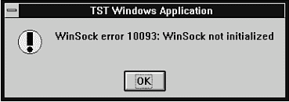

**图 13.2。**  
*CWinSockErrorBox()*  
*带有第二个参数。*

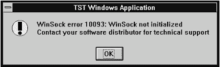

### 实现细节

大型 switch 语句中复制到 pszError 的错误消息字符串会占用应用程序中大量的 DGROUP 空间。如果遇到有关 DGROUP 空间的编译器错误，可以考虑将这些错误消息字符串移入项目资源文件的字符串表中。然后可以使用 `LoadString()` 函数检索相应文本。

如第 9 章“设计目标”所述，三个类（`CWinSock`、`CDatagramSocket` 和 `CStreamSocket`）以及 `CWinSockErrorBox()` 函数都在 WINSOCK.CPP 文件中实现。类和函数原型则包含在 WINSOCK.H 文件中。只需将 WINSOCK.CPP 源文件添加到每个需要 WinSock 功能的项目中即可。

## 总结

本章结束了 WinSock 类库的介绍。本书接下来的章节将介绍若干示例程序，这些程序使用了第 9 章至第 13 章开发的类库。

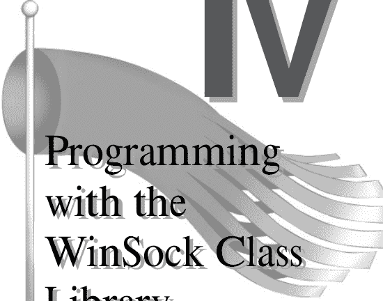

## 使用 WinSock 类库进行编程

- 14. 使用类库的示例应用程序
- 15. 实用客户端/服务器数据库应用程序
- 16. 异构 UNIX 环境中的 Finger 应用程序


# 14 示例应用程序

本章将介绍对第 8 章“示例应用程序”中所述两个示例的重新实现。这次使用的是前几章开发的 WinSock 类库，而非原始 WinSock API。这两个示例各由两个程序组成：一个客户端，用于发送数据报或流数据；一个服务器，用于接收数据并将其发回客户端。

## 数据报回显客户端和服务器

这些程序 CDESRV 和 CDECLNT 展示了 `CDatagramSocket` 对象的用法。CDESRV 服务器应用程序接收数据并将其发回客户端。CDECLNT 客户端应用程序向服务器发送数据，并接收回显的响应。这些程序使用 Visual C++ 的 AppWizard 功能生成。

### 数据报回显服务器 CDESRV

与第 8 章介绍的 DESERV 程序一样，此示例使用一个派生自 `CFormView` 的对象 `CMainView` 作为主要用户界面。`CMainView` 头文件见清单 14.1。成员变量 `m_pWinSock` 用于控制此程序中 WinSock 子系统的启动和关闭。成员变量 `m_pDatagram` 是一个指向数据报套接字对象的指针，该对象负责接收客户端的数据。成员函数 `OnDatagram()` 接收数据报套接字对象的状态信息，并由用户自定义消息 `WM_USER_DATAGRAM` 触发。

#### 清单 14.1. CDESRV 的 MAINVIEW.H。

```cpp
// mainview.h : header file
//

//////////////////////////////////////////////////////////////////////
// CMainView form view

#ifndef __AFXEXT_H__
#include <afxtempl.h>
#endif

#include "winsock.h"  // Windows Sockets classes

class CMainView : public CFormView
{
    DECLARE_DYNCREATE(CMainView)

private:
    CWinSock * m_pWinSock;          // WinSock sub-system startup/.shutdown
    CDatagramSocket * m_pDatagram; // Datagram socket to receive from

protected:
    CMainView();        // protected constructor used by dynamic creation

// Form Data
public:
    //{{AFX_DATA(CMainView)
    enum { IDD = IDD_DIALOG_MAIN };
    // NOTE: the ClassWizard will add data members here
    //}}AFX_DATA

// Attributes
public:

// Operations
public:

// Implementation
protected:
    virtual ~CMainView();
    virtual void DoDataExchange(CDataExchange* pDX);    // DDX/DDV support
    virtual void OnInitialUpdate();
    // Generated message map functions
    //{{AFX_MSG(CMainView)
    afx_msg LONG OnDatagram(WPARAM wParam, LPARAM lParam);
    //}}AFX_MSG
    DECLARE_MESSAGE_MAP()
};

//////////////////////////////////////////////////////////////////////

#define WM_USER_DATAGRAM  (WM_USER + 1)
```

`CMainView` 对象的实现见清单 14.2。该对象负责执行 CDESRV 应用程序的大部分工作。对象创建后不久就会调用 OnInitialUpdate()。此函数负责启动 WinSock 子系统，并创建一个服务器数据报套接字，使其等待端口 2000 上的数据到达。当套接字上有数据可供接收时，会触发成员函数 OnDatagram()，此时 wParam 被设为 CWINSOCK_DONE_READING。程序会读取数据，并尝试将数据写回客户端以进行回显。写入完成后，会再次调用 OnDatagram()，此时 wParam 被设为 CWINSOCK_DONE_WRITING。此时，数据指针会被释放。关闭服务器应用程序时，会调用 CMainView 的析构函数，销毁数据报套接字对象并关闭 WinSock 子系统。

#### 清单 14.2. CDESRV 的 MAINVIEW.CPP。

```cpp
// mainview.cpp : Implementation file
//

#include "stdafx.h"
#include "cdsrv.h"
#include "mainview.h"

#ifdef _DEBUG
#undef THIS_FILE
static char BASED_CODE THIS_FILE[] = __FILE__;
#endif

/////////////////////////////////////////////////////////////////////////////
// CMainView

IMPLEMENT_DYNCREATE(CMainView, CFormView)

CMainView::CMainView()
    : CFormView(CMainView::IDD)
{
    //{{AFX_DATA_INIT(CMainView)
    // NOTE: the ClassWizard will add member initialization here
    //}}AFX_DATA_INIT

    // initialize class variables

    m_pWinSock = NULL;
    m_pDatagram = NULL;
}

CMainView::~CMainView()
{
    // free the datagram and WinSock objects

    if (m_pDatagram)
    {
        m_pDatagram->DestroySocket();
        delete m_pDatagram;
        m_pDatagram = NULL;
    }

    if (m_pWinSock)
    {
        m_pWinSock->Shutdown();
        delete m_pWinSock;
        m_pWinSock = NULL;
    }
}

void CMainView::DoDataExchange(CDataExchange* pDX)
{
    CFormView::DoDataExchange(pDX);
    //{{AFX_DATA_MAP(CMainView)
    // NOTE: the ClassWizard will add DDX and DDV calls here
    //}}AFX_DATA_MAP
}

void CMainView::OnInitialUpdate()
{
    // get pointer to list box used for status messages

    CListBox *plb = (CListBox *)GetDlgItem(IDC_LIST_STATUS);

    // initialize the WinSock object
    m_pWinSock = new CWinSock;
    if (m_pWinSock->Startup() != WINSOCK_ERROR)
        plb->InsertString(0, "WinSock initialized");
    else
    {
        plb->InsertString(0, "WinSock initialization failed");
        delete m_pWinSock;
        m_pWinSock = NULL;
        return;
    }

    // initialize the datagram socket object
    m_pDatagram = new CDatagramSocket(this, WM_USER_DATAGRAM);
    if (m_pDatagram->CreateSocket(2000) != WINSOCK_ERROR)
        plb->InsertString(0, "Datagram created (port 2000)");
    else
    {
        plb->InsertString(0, "Datagram creation failed");
        delete m_pDatagram;
        m_pDatagram = NULL;
    }
}

BEGIN_MESSAGE_MAP(CMainView, CFormView)
//{{AFX_MSG_MAP(CMainView)
    ON_MESSAGE(WM_USER_DATAGRAM, OnDatagram)
//}}AFX_MSG_MAP
END_MESSAGE_MAP()

/////////////////////////////////////////////////////////////////////
// CMainView message handlers

/////////////////////////////////////////////////////////////////////
// CMainView::OnDatagram()
//
// Receives messages from the datagram object.
//
LONG CMainView::OnDatagram(WPARAM wParam, LPARAM lParam)
{
    LPVOID pDataWritten;  // pointer to data that is completely written
    LPVOID pDataRead;     // pointer to data just read
    int nLen;              // length
    SOCKADDR_IN sin;       // Internet address of data's sender
    IN_ADDR in;            // IP address of data's sender
    char pszMessage[1000]; // informational message

    // get pointer to list box used for status messages
    CListBox *pLb = (CListBox *)GetDlgItem(IDC_LIST_STATUS);

    switch (wParam)
    {
        case CWINSOCK_DONE_WRITING:
            // lParam = pointer to data that was sent
            pDataWritten = (LPVOID)lParam;
            wsprintf(pszMessage, "Data sent (%s)", pDataWritten);
```


#### 清单 14.2（续）

```cpp
plb->InsertString(0, pszMessage);
free(pDataWritten);
break;

case CWINSOCK_ERROR_WRITING:
    // lParam = pointer to data that generated error sending
    pDataWritten = (LPVOID)lParam;
    wsprintf(pszMessage, "Error sending data (%s)", pDataWritten);
    plb->InsertString(0, pszMessage);
    free(pDataWritten);
    break;

case CWINSOCK_DONE_READING:
    // lParam = # data chunks in queue
    pDataRead = m_pDatagram->Read(&nLen, &sin);
    // display informational message (data must be NULL terminated)
    memcpy(&in, &sin.sin_addr.s_addr, 4);
    wsprintf(pszMessage, "Data received (%s) from %s, %d",
        pDataRead, inet_ntoa(in), ntohs(sin.sin_port));
    plb->InsertString(0, pszMessage);

    // echo the data back to the sender
    if (m_pDatagram->Write(nLen, pDataRead, &sin) != CWINSOCK_NOERROR)
    {
        wsprintf(pszMessage, "Error sending data (%s)", pDataRead);
        plb->InsertString(0, pszMessage);
        free(pDataRead);
    }

    break;

case CWINSOCK_ERROR_READING:
    break;

default:
    break;
}

return 0L;
}
```

### 数据报回显客户端 CDECLNT

数据报回显客户端 CDECLNT 是第 8 章中所述 DECLIENT 程序的重新实现。它使用一个从 CFormView 派生的对象作为其主界面。CMainView 对象的头文件如清单 14.3 所示，其实现如清单 14.4 所示。该对象完成了 CDECLNT 应用程序的大部分工作。在创建该对象后会很快调用 OnInitialUpdate()。此函数负责启动 WinSock 子系统、创建客户端数据报套接字、提示输入 CDESRV 数据报回显服务器的主机名或 IP 地址，并设置一个用于数据写入的五秒间隔计时器。当计时器到期时，会调用 OnTimer()。如果没有正在等待发送的数据（由发送缓冲区 m_pszBuf 的第一个字节包含 NULL 来表示），则会格式化一个发送数据流，并调用数据报套接字对象的 Write() 成员函数，将数据发送到指定服务器的 2000 端口。写入完成后，会调用 OnDatagram()，其 wParam 参数设置为 CWINSOCK_DONE_WRITING。m_pszBuf 的第一个字节会被设置为 NULL，以表示缓冲区可用。这种缓冲区使用方式与动态分配和释放内存的方法形成对比。CMainView 对象持续等待先前发送的数据被回显。当数据到达数据报套接字时，会触发 OnDatagram()，其 wParam 参数设置为 CWINSOCK_DONE_READING。读取数据后，读取缓冲区即被释放。当客户端应用程序关闭时，会调用 CMainView 的析构函数，销毁数据报套接字对象并关闭 WinSock 子系统。

#### 清单 14.3：CDECLNT 的 MAINVIEW.H

```cpp
    // mainview.h : header file
    //

    /////////////////////////////////////////////////////////////////////////////
    // CMainView form view

    #ifndef __AFXEXT_H_
    #include <afxext.h>
    #endif

    #include "cwinsock.h"    // Windows Sockets classes

    class CMainView : public CFormView
    {
        DECLARE_DYNCREATE(CMainView)

    private:
        CWinSock * m_pWinSock;          // WinSock sub-system startup/.shutdown
        CDatagramSocket * m_pDatagram;  // Datagram socket to receive from
        char m_pszBuf[100];             // buffer to send
        char m_pszServer[100];          // host name or IP address of datagram server

    protected:
        CMainView();                    // protected constructor used by dynamic creation

    // Form Data
    public:
        //{{AFX_DATA(CMainView)
        enum { IDD = IDD_DIALOG_MAIN };
        // NOTE: the ClassWizard will add data members here
        //}}AFX_DATA

    // Attributes
public:

// Operations
public:

// Implementation
protected:
    virtual ~CMainView();
    virtual void DoDataExchange(CDataExchange* pDX);  // DDX/DDV support
    virtual void OnInitialUpdate();
    // Generated message map functions
    //{{AFX_MSG(CMainView)
    afx_msg LONG OnDatagram(WPARAM wParam, LPARAM lParam);
    afx_msg void OnTimer(UINT nIDEvent);
    //}}AFX_MSG
    DECLARE_MESSAGE_MAP()
};

///////////////////////////////////////////////////////////////

#define WM_USER_DATAGRAM (WM_USER + 1)
```

#### 清单 14.4：CDECLNT 的 MAINVIEW.CPP

```cpp
// mainview.cpp : implementation file
//

#include "stdafx.h"
#include "cdeclnt.h"
#include "mainview.h"
#include "servdlg.h"

#ifdef _DEBUG
#undef THIS_FILE
static char BASED_CODE THIS_FILE[] = __FILE__;
#endif

///////////////////////////////////////////////////////////////
// CMainView

IMPLEMENT_DYNCREATE(CMainView, CFormView)

CMainView::CMainView()
    : CFormView(CMainView::IDD)
{
    //{{AFX_DATA_INIT(CMainView)
    // NOTE: the ClassWizard will add member initialization here
    //}}AFX_DATA_INIT

    // initialize class variables

    m_pWinSock = NULL;
    m_pDatagram = NULL;
    (*m_pszBuf) = '\0';
}

CMainView::~CMainView()
{
    // free the datagram and WinSock objects

    if (m_pDatagram)
    {
        m_pDatagram->DestroySocket();
        delete m_pDatagram;
        m_pDatagram = NULL;
    }

    if (m_pWinSock)
    {
        m_pWinSock->Shutdown();
        delete m_pWinSock;
        m_pWinSock = NULL;
    }
}

void CMainView::DoDataExchange(CDataExchange* pDX)
{
    CFormView::DoDataExchange(pDX);
    //{{AFX_DATA_MAP(CMainView)
    // NOTE: the ClassWizard will add DDX and DDV calls here
    //}}AFX_DATA_MAP
}

void CMainView::OnInitialUpdate()
{
    // start the timer used to trigger the socket writes

    SetTimer(1, 5000, NULL);    // 5 second timer

    // get pointer to list box used for status messages

    CListBox *plb = (CListBox *)GetDlgItem(IDC_LIST_STATUS);

    // initialize the WinSock object

    m_pWinSock = new CWinSock;
    if (m_pWinSock->Startup() == CWINSOCK_NOERROR)
        plb->InsertString(0, "WinSock initialized");
    else
    {
        plb->InsertString(0, "WinSock initialization failed");
        delete m_pWinSock;
        m_pWinSock = NULL;
        return;
    }

    // prompt for server information
    // (host name or IP address of datagram server)

    while (1)
    {
        CServerDlg dlg;
        dlg.DoModal();
        if (dlg.m_stringServer.GetLength() < sizeof(m_pszServer))
        {
            lstrcpy(m_pszServer, dlg.m_stringServer);
            break;
        }
        else
            AfxMessageBox("Host name or IP address too long");
    }

    // initialize the datagram socket object

    m_pDatagram = new CDatagramSocket(this, WM_USER_DATAGRAM);
    if (m_pDatagram->CreateSocket() == CWINSOCK_NOERROR)
        plb->InsertString(0, "Datagram created");
    else
    {
        plb->InsertString(0, "Datagram creation failed");
        delete m_pDatagram;
        m_pDatagram = NULL;
    }
}

BEGIN_MESSAGE_MAP(CMainView, CFormView)
    //{{AFX_MSG_MAP(CMainView)
    ON_MESSAGE(WM_USER_DATAGRAM, OnDatagram)
    ON_WM_TIMER()
    //}}AFX_MSG_MAP
END_MESSAGE_MAP()

/////////////////////////////////////////////////////////////////////////////
// CMainView message handlers

/////////////////////////////////////////////////////////////////////////////
// CMainView::OnDatagram()
//
// Receives messages from the datagram object.
//
LONG CMainView::OnDatagram(WPARAM wParam, LPARAM lParam)
{
    LPVOID pDataWritten; // pointer to data that is completely written
    LPVOID pDataRead;    // pointer to data just read
    int nLen;            // length
    SOCKADDR_IN sin;     // Internet address of data's sender
    IN_ADDR in;          // IP address of data's sender
    char pszMessage[1000]; // informational message

    // get pointer to list box used for status messages
    CListBox *plb = (CListBox *)GetDlgItem(IDC_LIST_STATUS);

    switch (wParam)
    {
    case CWINSOCK_DONE_WRITING:
        // lParam = pointer to data that was sent
        pDataWritten = (LPVOID)lParam;
        wsprintf(pszMessage, "Data sent (%s)", pDataWritten);
        plb->InsertString(0, pszMessage);
        (*m_pszBuf) = '\0';   // same as (*pDataWritten) = '\0';
        break;

    case CWINSOCK_ERROR_WRITING:
        // lParam = pointer to data that generated error sending
        pDataWritten = (LPVOID)lParam;
        wsprintf(pszMessage, "Error sending data (%s)", pDataWritten);
        plb->InsertString(0, pszMessage);
        (*m_pszBuf) = '\0';   // same as (*pDataWritten) = '\0';
        break;

    case CWINSOCK_DONE_READING:
        // lParam = # data chunks in queue
        pDataRead = m_pDatagram->Read(&nLen, &sin);
        // display informational message (data must be NULL terminated)
        memcpy(&in, &sin.sin_addr.s_addr, 4);
        wsprintf(pszMessage, "Data received (%s) from %s, %d",
            pDataRead, inet_ntoa(in), ntohs(sin.sin_port));
        plb->InsertString(0, pszMessage);
        free(pDataRead);
        break;

    case CWINSOCK_ERROR_READING:
        break;

    default:
        break;
    }

    return 0L;
}

void CMainView::OnTimer(UINT nIDEvent)
{
    static int nSendCount = 1;  // used to generate unique message
    char pszMessage[1000];      // informational message

    // make sure we are not sending out of a bad datagram socket
    if (m_pDatagram == NULL)
        return;

    // get pointer to List box used for status messages
    CListBox *plb = (CListBox *)GetDlgItem(IDC_LIST_STATUS);

    // send the buffer unless the previous send hasn't completed yet
    if ((*m_pszBuf) == '\0')
    {
        wsprintf(m_pszBuf, "Hello %d", nSendCount);
        ++nSendCount;
        // be sure to send terminating NULL character
        if (m_pDatagram->Write(strlen(m_pszBuf) + 1, m_pszBuf,
            m_pszServer, 2000) != CWINSOCK_NOERROR)
        {
            (*m_pszBuf) = '\0';
```


#### 列表 14.4（续）

```cpp
    wsprintf(pszMessage, "Error sending data (%s)", m_pszBuf);
    plb->InsertString(0, pszMessage);
  }
}

CFormView::OnTimer(nIDEvent);
}
```

## 运行数据报回显服务器和客户端

以下是运行数据报回显客户端和服务器时发生的事件示例：

- 1. 运行 CDESRV。
- 2. 在同一台或另一台计算机上运行 CDECLNT。程序会提示输入 CDESRV 的主机名或 IP 地址。
- 3. 五秒后，CDECLNT 中的计时器触发，导致调用 `CMainView::OnTimer()`。此时发送缓冲区未被使用，因此会将数据填入发送缓冲区，并使用 `m_pDatagram` 的 `Write()` 成员函数写入数据。
- 4. 在 CDECLNT 中调用 `CMainView::OnDatagram()`，并收到 `CWINSOCK_DONE_WRITING` 通知。随后将发送缓冲区标记为未使用，以便在下一次 `CMainView::OnTimer()` 触发时使用。
- 5. 在 CDESRV 中调用 `CMainView::OnDatagram()`，并收到 `CWINSOCK_DONE_READING` 通知。程序读取数据，并立即将其回显给客户端。
- 6. 在 CDESRV 中调用 `CMainView::OnDatagram()`，并收到 `CWINSOCK_DONE_WRITING` 通知。随后释放数据。
- 7. 在 CDECLNT 中调用 `CMainView::OnDatagram()`，并收到 `CWINSOCK_DONE_READING` 通知。程序读取回显的数据，然后释放数据。
- 8. CDECLNT 中的另一个计时器触发，随后重复上述过程。

## 流式回显客户端和服务器

这些程序 CSESRV 和 CSECLNT 展示了 `CStreamSocket` 对象的用法。CSESRV 服务器应用程序接收数据并将其发送回客户端。CSECLNT 客户端应用程序向服务器发送数据，并接收回显的回复。

### 流式回显服务器 CSESRV

与第 8 章所述的 SESERV 程序一样，此示例使用一个名为 CMainView、派生自 CFormView 的对象作为主要用户界面。成员变量 m_pWinSock 控制此程序中 WinSock 子系统的启动和关闭。成员变量 m_pStreamSrv 是一个指向流式套接字对象的指针，该对象等待客户端连接。成员变量 m_pStream 是实际负责从客户端接收数据并向客户端发送数据的流式套接字。OnStreamSrv() 成员函数接收服务器流式套接字对象的状态信息。每当客户端请求连接服务器时，都会触发用户自定义消息 WM_USER_STREAMSRV，从而调用该函数。OnStream() 成员函数接收实际与客户端通信的流式套接字对象的状态信息。每当建立或断开客户端连接，以及有数据可供读取或数据写入完成时，都会触发用户自定义消息 WM_USER_STREAM，从而调用该函数。

#### 列表 14.5：CSESRV 的 MAINVIEW.H

```cpp
// mainview.h : header file
//
//////////////////////////////////////////////////////////////////////
// CMainView form view

#ifndef __AFXEXT_H__
#include <afxext.h>
#endif

#include "winsock.h"    // Windows Sockets classes

class CMainView : public CFormView
{
    DECLARE_DYNCREATE(CMainView)

private:
    CWinSock * m_pWinSock;          // WinSock sub-system startup/shutdown
    CStreamSocket * m_pStreamSrv;   // Stream socket to wait for connections on
    CStreamSocket * m_pStream;      // Stream socket to receive from

protected:
    CMainView();       // protected constructor used by dynamic creation

// Form Data
public:
    //{{AFX_DATA(CMainView)
    enum { IDD = IDD_DIALOG_MAIN };
    // NOTE: the ClassWizard will add data members here
    //}}AFX_DATA

// Attributes

public:

// Operations
public:

// Implementation
protected:
  virtual ~CMainView();
  virtual void DoDataExchange(CDataExchange* pDX);  // DDX/DDV support
  virtual void OnInitialUpdate();
  // Generated message map functions
  //{{AFX_MSG(CMainView)
  afx_msg LONG OnStreamSrv(WPARAM wParam, LPARAM lParam);
  afx_msg LONG OnStream(WPARAM wParam, LPARAM lParam);
  //}}AFX_MSG
  DECLARE_MESSAGE_MAP()
};

/////////////////////////////////////////////////////////////////////

#define WM_USER_STREAMSRV (WM_USER + 1)
#define WM_USER_STREAM    (WM_USER + 2)
```

`CMainView` 对象的实现如列表 14.6 所示。该对象负责完成 CSESRV 应用程序的大部分工作。对象创建后不久就会调用 `OnInitialUpdate()`。此函数负责启动 WinSock 子系统，并创建一个服务器流式套接字，使其在端口 2000 上等待连接请求到达。客户端请求连接时，会触发 `OnStreamSrv()` 成员函数，此时 `wParam` 被设为 `CWINSOCK_READY_TO_ACCEPT_CONNECTION`。随后使用 `m_pStream` 对象接受客户端的连接请求。连接建立后，会调用 `OnStream()`，此时 `wParam` 被设为 `CWINSOCK_YOU_ARE_CONNECTED`。客户端数据到达时，会调用 `OnStream()`，此时 `wParam` 被设为 `CWINSOCK_DONE_READING`。程序读取数据，并尝试将数据写回客户端以完成回显。写入完成后，会调用 `OnStream()`，此时 `wParam` 被设为 `CWINSOCK_DONE_WRITING`。此时会释放数据指针。关闭服务器应用程序时，会调用 `CMainView` 的析构函数，销毁两个流式套接字对象并关闭 WinSock 子系统。

#### 列表 14.6：CSESRV 的 MAINVIEW.CPP

```cpp
// mainview.cpp : implementation file
//

#include "stdafx.h"
#include "csesrv.h"
#include "mainview.h"

#ifdef _DEBUG
#undef THIS_FILE
static char BASED_CODE THIS_FILE[] = __FILE__;
#endif

///////////////////////////////////////////////////////////////
// CMainView

IMPLEMENT_DYNCREATE(CMainView, CFormView)

CMainView::CMainView()
    : CFormView(CMainView::IDD)
{
    //{{AFX_DATA_INIT(CMainView)
    // NOTE: the ClassWizard will add member initialization here
    //}}AFX_DATA_INIT

    // initialization class variables

    m_pWinSock = NULL;
    m_pStreamSrv = NULL;
    m_pStream = NULL;
}

CMainView::~CMainView()
{
    // free the stream and WinSock objects

    if (m_pStreamSrv)
    {
        m_pStreamSrv->DestroySocket();
        delete m_pStreamSrv;
        m_pStreamSrv = NULL;
    }

    if (m_pStream)
    {
        m_pStream->DestroySocket();
        delete m_pStream;
        m_pStream = NULL;
    }

    if (m_pWinSock)
    {
        m_pWinSock->Shutdown();
        delete m_pWinSock;
        m_pWinSock = NULL;
    }
}

void CMainView::DoDataExchange(CDataExchange* pDX)
{
    CFormView::DoDataExchange(pDX);
    //{{AFX_DATA_MAP(CMainView)
    // NOTE: the ClassWizard will add DDX and DDV calls here
    //}}AFX_DATA_MAP
}

case CWINSOCK_READY_TO_ACCEPT_CONNECTION:
    // make sure the server is not already servicing a client
    if (m_pStream != NULL)
    {
        plb->InsertString(0, "Already servicing a client");
        break;
    }

    // accept the client connection
    int nStatus;
    m_pStream = new CStreamSocket(this, WM_USER_STREAM);
    nStatus = m_pStreamSrv->Accept(m_pStream);
    if (nStatus != CWINSOCK_NOERROR)
    {
        delete m_pStream;
        m_pStream = NULL;
        plb->InsertString(0, "Error accepting client connection");
        break;
    }
    else
        plb->InsertString(0, "Accepted client connection");

    break;

default:
    break;
}

return 0L;
}

////////////////////////////////////////////////////////////
// CMainView::OnStream()
////////////////////////////////////////////////////////////
// Receives messages from the connected stream object.
//
LONG CMainView::OnStream(WPARAM wParam, LPARAM lParam)
{
    LPVOID pDataWritten;    // pointer to data that is completely written
    LPVOID pDataRead;       // pointer to data just read
    int nLen;               // length
    char szMessage[1000];   // information message
    SOCKADDR_IN sin;        // Internet address of client
    IN_ADDR in;             // IP address of client
    int nStatus;            // error status

    // get pointer to list box used for status messages
    CListBox *plb = (CListBox *)GetDlgItem(IDC_LIST_STATUS);

    switch (wParam)
    {
        case CWINSOCK_DONE_WRITING:
            // lParam = pointer to data that was sent
            pDataWritten = (LPVOID)lParam;
            wsprintf(szMessage, "Data sent (%s)", pDataWritten);
            plb->InsertString(0, szMessage);
            free(pDataWritten);
            break;
    }
}
```


#### 列表 14.6（续）

```cpp
case CWINSOCK_ERROR_WRITING:
    // lParam = 指向发送时产生错误的数据的指针
    pDataWritten = (LPVOID)lParam;
    wsprintf(pszMessage, "Error sending data (%s)", pDataWritten);
    pIb->InsertString(0, pszMessage);
    free(pDataWritten);
    break;

case CWINSOCK_DONE_READING:
    // lParam = 队列中的数据块数量
    pDataRead = m_pStream->Read(&len);
    wsprintf(pszMessage, "Data received (%s)", pDataRead);
    pIb->InsertString(0, pszMessage);

    // 将数据回显给发送方
    if (m_pStream->Write(nLen, pDataRead) != CWINSOCK_NOERROR)
    {
        wsprintf(pszMessage, "Error sending data (%s)", pDataRead);
        pIb->InsertString(0, pszMessage);
        free(pDataRead);
    }

    break;

case CWINSOCK_ERROR_READING:
    break;

case CWINSOCK_YOU_ARE_CONNECTED:
    // 输出客户端信息
    nStatus = m_pStream->GetPeerName(&sin);
    if (nStatus == CWINSOCK_NOERROR)
    {
        memcpy(&sin, &sin.sin_addr.s_addr, 4);
        wsprintf(pszMessage, "Connected to client %s, %d",
            inet_ntoa(sin), ntohs(sin.sin_port));
        pIb->InsertString(0, pszMessage);
    }
    else
        pIb->InsertString(0, "Error getting client name");
    break;

case CWINSOCK_LOST_CONNECTION:
    // 客户端关闭了连接
    m_pStream->DestroySocket();
    delete m_pStream;
    m_pStream = NULL;
    pIb->InsertString(0, "Client closed connection");
    break;

default:
    break;
}

return 0L;
```

### 流式回显客户端 CSECLNT

流式回显客户端 CSECLNT 是对第 8 章介绍的 SECLIENT 程序的重新实现。它使用一个派生自 CFormView 的对象作为主界面。CMainView 对象的头文件见列表 14.7，其实现见列表 14.8。该对象承担了 CSECLNT 应用程序的大部分工作。对象创建后不久便会调用 OnInitialUpdate()。此函数负责启动 WinSock 子系统、创建客户端流套接字、提示输入主机名或 IP 地址以连接到 CSESRV 流式回显服务器，并设置一个 5 秒间隔的计时器，用于触发数据写入。当服务器在端口 2000 上接受客户端的连接请求时，将调用 OnStream()，此时 wParam 设置为 CWINSocket_YOU_ARE_CONNECTED。5 秒计时器触发时，将调用 OnTimer()。如果没有等待发送的数据（即传出缓冲区 m_pszBuf 的第一个字节为 NULL），程序就会格式化一个传出数据流，并调用流套接字对象的 Write() 成员函数，将数据发送到指定服务器。写入完成后，将调用 OnStream()，此时 wParam 设置为 CWINSocket_DONE_WRITING。m_pszBuf 的第一个字节会被设为 NULL，以指示缓冲区可用。CMainView 对象会持续等待先前发送的数据回显。当数据到达流套接字时，将触发 OnStream()，此时 wParam 设置为 CWINSocket_DONE_READING。随后读取数据，并释放读取缓冲区。关闭客户端应用程序时，将调用 CMainView 的析构函数，销毁流套接字对象并关闭 WinSock 子系统。

#### 列表 14.7 CSECLNT 的 MAINVIEW.H

```cpp
// MAINVIEW.H: 头文件
//

///////////////////////////////////////////////////////////////////////
// CMainView 表单视图

#ifndef __AFXEXT_H__
#include <afxext.h>
#endif

#include "winsock.h"    // Windows 套接字类

class CMainView : public CFormView
{
    DECLARE_DYNCREATE(CMainView)

private:
    CWinSock * m_pWinSock;          // WinSock 子系统的启动/关闭
    CStreamSocket * m_pStream;      // 用于接收数据的流套接字
    char m_pszBuf[100];             // 待发送缓冲区
    char m_pszServer[100];          // 流服务器的主机名或 IP 地址

protected:
    CMainView();        // 用于动态创建的受保护构造函数

// 表单数据
public:
    //{{AFX_DATA(CMainView)
    enum { IDD = IDD_DIALOG_MAIN };
    // NOTE: the ClassWizard will add data members here
    //}}AFX_DATA

// 属性
public:

// 操作
public:

// 实现
protected:
    virtual ~CMainView();
    virtual void DoDataExchange(CDataExchange* pDX);  // DDX/DDV 支持
    virtual void OnInitialUpdate();
    // 生成的消息映射函数
    //{{AFX_MSG(CMainView)
    afx_msg LONG OnStream(WPARAM wParam, LPARAM lParam);
    afx_msg void OnTimer(UINT nIDEvent);
    //}}AFX_MSG
    DECLARE_MESSAGE_MAP()
};

////////////////////////////////////////////////////////////

#define WM_USER_STREAM (WM_USER + 1)
```

#### 列表 14.8 CSECLNT 的 MAINVIEW.CPP

```cpp
// mainview.cpp : 实现文件
//

#include "stdafx.h"
#include "csclnt.h"
#include "mainview.h"
#include "servdlg.h"

#ifdef _DEBUG
#undef THIS_FILE
static char BASED_CODE THIS_FILE[] = __FILE__;
#endif

////////////////////////////////////////////////////////////
// CMainView

IMPLEMENT_DYNCREATE(CMainView, CFormView)

CMainView::CMainView()
    : CFormView(CMainView::IDD)
{
    //{{AFX_DATA_INIT(CMainView)
    // NOTE: the ClassWizard will add member initialization here
    //}}AFX_DATA_INIT

    // 初始化类变量

    m_pWinSock = NULL;
    m_pStream = NULL;
    (*m_pszBuf) = '\0';
}

CMainView::~CMainView()
{
    // 释放流套接字和 WinSock 对象

    if (m_pStream)
    {
        m_pStream->DestroySocket();
        delete m_pStream;
        m_pStream = NULL;
    }

    if (m_pWinSock)
    {
        m_pWinSock->Shutdown();
        delete m_pWinSock;
        m_pWinSock = NULL;
    }
}

void CMainView::DoDataExchange(CDataExchange* pDX)
{
    CFormView::DoDataExchange(pDX);
    //{{AFX_DATA_MAP(CMainView)
    // NOTE: the ClassWizard will add DDX and DDV calls here
    //}}AFX_DATA_MAP
}

void CMainView::OnInitialUpdate()
{
    // 启动用于触发套接字写入的计时器

    SetTimer(1, 5000, NULL);    // 5 秒计时器

    // 获取用于显示状态消息的列表框指针

    CListBox *plb = (CListBox *)GetDlgItem(IDC_LIST_STATUS);

    // 初始化 WinSock 对象

    m_pWinSock = new CWinSock;
    if (m_pWinSock->Startup() == WINSOCK_NOERROR)
        plb->InsertString(0, "WinSock initialized");
    else
    {
        plb->InsertString(0, "WinSock initialization failed");
        delete m_pWinSock;
        m_pWinSock = NULL;
        return;
    }

    // 提示输入服务器信息
    //（流服务器的主机名或 IP 地址）

    while (1)
    {
        CServerDlg dlg;
        dlg.DoModal();
        if (dlg.m_stringServer.GetLength() < sizeof(m_pszServer))
        {
            lstrcpy(m_pszServer, dlg.m_stringServer);
            break;
        }
        else
            AfxMessageBox("Host name or IP address too long");
    }

    // 初始化流套接字对象

    m_pStream = new CStreamSocket(this, WM_USER_STREAM);
    if (m_pStream->CreateSocket() == CWIN_SOCK_NOERROR)
        plb->InsertString(0, "Stream created");
    else
    {
        plb->InsertString(0, "Stream creation failed");
        delete m_pStream;
        m_pStream = NULL;
    }

    // 将客户端连接到服务器
    if (m_pStream->Connect(m_pszServer, 2000) == CWINSOCK_NOERROR)
        plb->InsertString(0, "Stream connect attempt made");
    else
    {
        plb->InsertString(0, "Stream connect attempt failed");
        delete m_pStream;
        m_pStream = NULL;
    }

    BEGIN_MESSAGE_MAP(CMainView, CFormView)
        //{{AFX_MSG_MAP(CMainView)
        ON_MESSAGE(WM_USER_STREAM, OnStream)
        ON_WM_TIMER()
        //}}AFX_MSG_MAP
    END_MESSAGE_MAP()

    ////////////////////////////////////////////////////////////////
    // CMainView 消息处理程序

    ////////////////////////////////////////////////////////////////

    // CMainView::OnStream()
    //
    // 接收来自流对象的消息。
    //
    LONG CMainView::OnStream(WPARAM wParam, LPARAM lParam)
    {
        LPVOID pDataWritten;    // 指向已完全写入的数据的指针
        LPVOID pDataRead;       // 指向刚读取的数据的指针
        int nLen;               // 长度
        char pszMessage[1000];  // 信息消息

        // 获取用于显示状态消息的列表框指针
        CListBox *pLb = (CListBox *)GetDlgItem(IDC_LIST_STATUS);

        switch (wParam)
        {
            case CWINSOCK_DONE_WRITING:
                // lParam = 指向已发送数据的指针
                pDataWritten = (LPVOID)lParam;
                wsprintf(pszMessage, "Data sent (%s)", pDataWritten);
                pLb->InsertString(0, pszMessage);
                (*m_pszBuf) = '\0';  // 等同于 (*pDataWritten) = '\0';
                break;

            case CWINSOCK_ERROR_WRITING:
                // lParam = 指向发送时产生错误的数据的指针
                pDataWritten = (LPVOID)lParam;
                wsprintf(pszMessage, "Error sending data (%s)", pDataWritten);
                pLb->InsertString(0, pszMessage);
                (*m_pszBuf) = '\0';  // 等同于 (*pDataWritten) = '\0';
                break;

            case CWINSOCK_DONE_READING:
                // lParam = 队列中的数据块数量
                pDataRead = m_pStream->Read(&nLen);
                wsprintf(pszMessage, "Data received (%s)", pDataRead);
                pLb->InsertString(0, pszMessage);
                free(pDataRead);
                break;

            case CWINSOCK_ERROR_READING:
                break;

            case CWINSOCK_YOU_ARE_CONNECTED:
                pLb->InsertString(0, "Connected to server");
                break;

            case CWINSOCK_LOST_CONNECTION:
                // 服务器关闭了连接
                m_pStream->DestroySocket();
                delete m_pStream;
                m_pStream = NULL;
                pLb->InsertString(0, "Server closed connection");
                break;

            default:
                break;
        }
    }
```


#### 代码清单 14.8（续）

```cpp
    return 0L;
}

void CMainView::OnTimer(UINT nIDEvent)
{
    static int nSendCount = 1;  // used to generate unique message
    char pszMessage[1000];      // informational message

    // make sure we are not sending out of a bad stream socket
    if (m_pStream == NULL)
        return;

    // get pointer to list box used for status messages
    CListBox *plb = (CListBox *)GetDlgItem(IDC_LIST_STATUS);

    // send the buffer unless the previous send hasn't completed yet
    if ((*m_pszBuf) == '\0')
    {
        wsprintf(m_pszBuf, "Hello %d", nSendCount);
        ++nSendCount;
        // be sure to send terminating NULL character
        if (m_pStream->Write(lstrlen(m_pszBuf) + 1, m_pszBuf) != WINSOCK_NOERROR)
        {
            (*m_pszBuf) = '\0';
            wsprintf(pszMessage, "Error sending data (%s)", m_pszBuf);
            plb->InsertString(0, pszMessage);
        }
    }

    CFormView::OnTimer(nIDEvent);
}
```

## 运行流式回显服务器和客户端

以下是运行流式回显客户端和服务器时发生的事件序列示例：

1. 运行 CSESRV。
2. 在同一台或另一台计算机上运行 CSECLNT。它会提示输入 CSESRV 正在使用的主机名或 IP 地址。随后尝试连接服务器。
3. 调用 CSESRV 的 `CMainView::OnStreamSrv()`，并传入 `WINSOCK_READY_TO_ACCEPT_CONNECTION` 事件；如果 `m_pStream` 套接字尚未连接到客户端，则尝试建立连接。
4. 当服务器的连接接受成功时，会调用 `OnStream()`，并将 `wParam` 设置为 `WINSOCK_YOU_ARE_CONNECTED`。
5. CSECLNT 的 `CMainView::OnStream()` 也会在收到 `WINSOCK_YOU_ARE_CONNECTED` 事件时被调用。
6. 五秒后，CSECLNT 中的定时器将触发，导致 `CMainView::OnTimer()` 被调用。此时还没有等待发送的字节，因此填充发送缓冲区并写入已连接的服务器。
7. CSECLNT 中的 `CMainView::OnStream()` 会因 `CWINSOCK_DONE_WRITING` 通知而被调用。随后，发送缓冲区被标记为未使用，以便在下一次触发 `CMainView::OnTimer()` 时使用。
8. CSESRV 中的 `CMainView::OnStream()` 会因 `CWINSOCK_DONE_READING` 通知而被调用。数据被读取并立即回显给客户端。
9. CSESRV 中的 `CMainView::OnStream()` 会因 `CWINSOCK_DONE_WRITING` 通知而被调用。随后数据被释放。
10. CSECLNT 中的 `CMainView::OnStream()` 会因 `CWINSOCK_DONE_READING` 通知而被调用。回显数据被读取，然后被释放。
11. CSECLNT 中另一个定时器触发，过程重复。

如果先关闭 CSECLNT，则 CSESRV 中的 `CMainView::OnStream()` 会因 `CWINSOCK_LOST_CONNECTION` 通知而被调用。如果先关闭 CSESRV，则 CSECLNT 中的 `CMainView::OnStream()` 会因 `CWINSOCK_LOST_CONNECTION` 通知而被调用。

## 小结

本章演示了 `CWinSock`、`CDatagramSocket` 和 `CStreamSocket` 对象的使用。这些对象旨在让套接字编程对您来说更容易。

希望将这些示例程序与第 8 章中的示例程序进行比较，能够证明第 9 章所述的 WinSock 类库设计目标已经达到。比较还揭示了 `CDatagramSocket` 和 `CStreamSocket` 对象的一个限制。这些对象无法让 WinSock 子系统为服务器套接字分配未使用的端口。相反，必须通过端口号或服务名来指定端口，在本例中为端口号 2000。

下一章将在示例客户端/服务器数据库环境中使用 WinSock 类库对象。


# 15 实用的客户端/服务器数据库应用程序

本章介绍一个实用的客户端/服务器数据库应用程序，它使用前面各章介绍的 WinSock 类库。该应用程序集由一个客户端应用程序和一个服务器应用程序组成。客户端向服务器发送数据库请求，服务器以肯定或否定确认进行响应。

客户端（INICLNT）和服务器（INISRV）使用 CDatagramSocket 和 CStreamSocket 对象。在前面的章节中，服务器示例一次只能处理一个客户端连接。这个服务器更贴近实际，因为它可以同时服务多个客户端。服务器实现为多文档界面应用程序，其中每个窗口代表一个客户端连接。客户端是一个简单的单文档界面应用程序。流套接字连接用于在客户端和服务器之间传输数据库命令和响应。数据报套接字用于从服务器向客户端发送心跳消息。心跳是在客户端和服务器之间发送的一块数据，用于让双方知道对方仍处于活动状态并且能够通信。该心跳使客户端程序能够显示客户端/服务器链路状态的可视化指示。

本例中的“数据库”使用 Windows 内置的 INI 文件机制。INI 文件用于维护应用程序的配置信息。下面显示了一个 INI 文件示例：

```ini
[boot]
386grabber=ajvga.3gr
oemfonts.fon=vgaoem.fon

[keyboard]
subtype=
type=4
```

[boot] 称为节（section）。386grabber 是项或键（entry or key）的一个示例。ajvga.3gr 是它的值。GetPrivateProfileString() 和 WritePrivateProfileString() SDK 函数分别用于读取和写入 INI 文件的字符串值。

## 客户端 INICLNT

客户端应用程序 INICLNT 使用一个派生自 CFormView 的对象作为其主界面。CMainView 对象的头文件如本节后面的代码清单 15.1 所示。其实现如本节后面的代码清单 15.2 所示。该对象承担了 INICLNT 应用程序的大部分工作。对象创建后不久会调用 OnInitialUpdate()。该函数负责启动 WinSock 子系统、创建客户端流套接字、创建用于心跳的服务器数据报套接字、提示输入 INISRV 服务器的主机名或 IP 地址，以及设置用于心跳的定时器间隔。当服务器接受客户端的连接请求时，会调用 `OnStream()`，并将 `wParam` 设置为 `CWINSOCK_YOU_ARE_CONNECTED`。

### 命令标识符

用户在相应字段中输入读取或写入参数，然后选择“读取”或“写入”按钮，分别触发 `OnClickedButtonRead()` 或 `OnClickedButtonWrite()`。这些函数格式化数据库命令并调用 `FillAndSendDBCmd()`，后者为数据库命令分配唯一标识符并将其发送到服务器。数据库命令具有以下结构：

```cpp
typedef struct tagDBCOMMAND
{
    int nID;                   // database command identifier
    int nCommand;               // database command
    char szFile[DBBUFSIZE];    // INI file
    char szSection[DBBUFSIZE]; // section of INI file
    char szEntry[DBBUFSIZE];   // entry within section of INI file
    char szValue[DBBUFSIZE];   // value of entry within section of INI file
} DBCOMMAND, FAR * LPDBCOMMAND;
```

使用 `ClassWizard` 限制可输入到 `CMainView` 数据输入字段中的字节数。该限制设置为 40，以匹配前述 `DBCOMMAND` 定义中使用的 `DBBUFSIZE` 值。

客户端可能的命令是 `DB_READ` 和 `DB_WRITE`。之所以分配唯一标识符，是因为可能存在多个未完成的数据库请求；客户端和服务器完全异步运行。该标识符可用于将命令与其异步响应关联起来。命令成功发送后，会调用 `OnStream()`，并将 `wParam` 设置为 `CWINSOCK_DONE_WRITING`。当服务器处理完数据库命令后，会向客户端发送响应，从而触发 `OnStream()`，并将 `wParam` 设置为 `CWINSOCK_DONE_READING`。`HandleRead()` 函数处理服务器发送的数据库响应。

### 心跳链路状态指示器

此应用程序有一个定时器，用于跟踪缺失的心跳消息。`OnDatagram()` 函数负责处理从已连接服务器发送的心跳的接收。如果漏掉一条心跳消息，交通灯式状态指示器会变为黄灯。漏掉两条或更多心跳会导致灯变红。如果心跳均被成功接收，灯保持绿色。这为服务器状态提供了可视化提示。

当调用 `CMainView` 的析构函数时，流套接字和数据报套接字会被销毁，WinSock 子系统会被关闭。


### 清单 15.1 用于 INICLNT 的 MAINVIEW.H

```cpp
// mainview.h : header file
//

/////////////////////////////////////////////////////////////////////////////
// CMainView form view

#ifndef __AFXEXT_H__
#include <afxext.h>
#endif

#include "cwinsock.h"    // Windows Sockets classes
#include "db.h"

class CMainView : public CFormView
{
    DECLARE_DYNCREATE(CMainView)

private:
    CWinSock * m_pWinSock;          // WinSock sub-system startup/shutdown
    CStreamSocket * m_pStream;      // Stream socket to receive from
    CDatagramSocket * m_pDatagram;  // Datagram socket to receive heartbeat
    char m_szServer[100];           // host name or IP address of stream server
    int m_nHeartbeat;               // heartbeat count
    HICON m_hRed, m_hYellow, m_hGreen;  // link status icons

    void HandleRead();
    void FillAndSendDBCmd(LPDBCOMMAND pdb, LPCSTR szFile,
        LPCSTR szSection, LPCSTR szEntry, LPCSTR szValue = NULL);

protected:
    CMainView();     // protected constructor used by dynamic creation

    // Form Data
public:
    //{{AFX_DATA(CMainView)
    enum { IDD = IDD_DIALOG_MAIN };
    CString m_stringFile;
    CString m_stringSection;
    CString m_stringValue;
    CString m_stringEntry;
    //}}AFX_DATA

    // Attributes
public:

    // Operations
public:

    // Implementation
protected:
    virtual ~CMainView();
    virtual void DoDataExchange(CDataExchange* pDX);  // DDX/DDV support
    virtual void OnInitialUpdate();
    // Generated message map functions
    //{{AFX_MSG(CMainView)
    afx_msg LONG OnStream(WPARAM wParam, LPARAM lParam);
    afx_msg LONG OnDatagram(WPARAM wParam, LPARAM lParam);
    afx_msg void OnTimer(UINT nIDEvent);
    afx_msg void OnClickedButtonRead();
    afx_msg void OnClickedButtonWrite();
    //}}AFX_MSG
    DECLARE_MESSAGE_MAP()
};

//////////////////////////////////////////////////////////////

#define WM_USER_STREAM    (WM_USER + 1)
#define WM_USER_DATAGRAM  (WM_USER + 2)
```

### 清单 15.2 用于 INICLNT 的 MAINVIEW.CPP

```cpp
// mainview.cpp : implementation file
//

#include "stdafx.h"
#include "inclnt.h"
#include "mainview.h"
#include "servdlg.h"
#include "db.h"
#include "common.h"

#ifdef _DEBUG
#undef THIS_FILE
static char BASED_CODE THIS_FILE[] = __FILE__;
#endif

//////////////////////////////////////////////////////////////
// CMainView

IMPLEMENT_DYNCREATE(CMainView, CFormView)

CMainView::CMainView()
    : CFormView(CMainView::IDD)
{
    //{{AFX_DATA_INIT(CMainView)
    m_stringFile = "";
    m_stringSection = "";
    m_stringValue = "";
    m_stringEntry = "";
    //}}AFX_DATA_INIT

    // initialize class variables

    m_pWinSock = NULL;
    m_pStream = NULL;
    m_pDatagram = NULL;
    m_nHeartbeat = 0;

    // load link status icons
    m_hRed = AfxGetApp()->LoadIcon(IDI_ICON_RED);
    m_hYellow = AfxGetApp()->LoadIcon(IDI_ICON_YELLOW);
    m_hGreen = AfxGetApp()->LoadIcon(IDI_ICON_GREEN);
}

CMainView::~CMainView()
{
    // free the stream and WinSock objects

    if (m_pStream)
    {
        m_pStream->DestroySocket();
        delete m_pStream;
        m_pStream = NULL;
    }

    if (m_pDatagram)
    {
        m_pDatagram->DestroySocket();
        delete m_pDatagram;
        m_pDatagram = NULL;
    }

    if (m_pWinSock)
    {
        m_pWinSock->Shutdown();
        delete m_pWinSock;
        m_pWinSock = NULL;
    }
}

void CMainView::DoDataExchange(CDataExchange* pDX)
{
    CFormView::DoDataExchange(pDX);
    //{{AFX_DATA_MAP(CMainView)
    DDX_Text(pDX, IDC_EDIT_FILE, m_stringFile);
    DDX_MaxChars(pDX, m_stringFile, 40);
    DDX_Text(pDX, IDC_EDIT_SECTION, m_stringSection);
    DDX_MaxChars(pDX, m_stringSection, 40);
    DDX_Text(pDX, IDC_EDIT_VALUE, m_stringValue);
    DDX_MaxChars(pDX, m_stringValue, 40);
    DDX_Text(pDX, IDC_EDIT_ENTRY, m_stringEntry);
    DDX_MaxChars(pDX, m_stringEntry, 40);
    //}}AFX_DATA_MAP
}

void CMainView::OnInitialUpdate()
{
    // start the timer used to keep track of heartbeats

    SetTimer(1, HEARTBEAT_DELAY, NULL);

    // get pointer to list box used for status messages

    CListBox *pLb = (CListBox *)GetDlgItem(IDC_LIST_STATUS);

    // initialize the WinSock object

    m_pWinSock = new CWinSock;
    if (m_pWinSock->Startup() == CWINSOCK_NOERROR)
        pLb->InsertString(0, "WinSock initialized");
    else
    {
        pLb->InsertString(0, "WinSock initialization failed");
        delete m_pWinSock;
        m_pWinSock = NULL;
        return;
    }

    // prompt for server information
    // (host name or IP address of stream server)

    while (1)
    {
        CServerDlg dlg;
        dlg.DoModal();
        if (dlg.m_stringServer.GetLength() < sizeof(m_szServer))
        {
            lstrcpy(m_szServer, dlg.m_stringServer);
            break;
        }
        else
            AfxMessageBox("Host name or IP address too long");
    }

    // initialize the stream socket object

    m_pStream = new CStreamSocket(this, WM_USER_STREAM);
    if (m_pStream->CreateSocket() == CWINSOCK_NOERROR)
        pLb->InsertString(0, "Stream created");
    else
    {
        pLb->InsertString(0, "Stream creation failed");
        delete m_pStream;
        m_pStream = NULL;
        return;
    }

    // initialize the datagram socket object for the heartbeat

    m_pDatagram = new CDatagramSocket(this, WM_USER_DATAGRAM);
    if (m_pDatagram->CreateSocket(DATAGRAM_PORT) == CWINSOCK_NOERROR)
        pLb->InsertString(0, "Heartbeat datagram created");
    else
    {
        pLb->InsertString(0, "Error creating heartbeat datagram");
        delete m_pDatagram;
        m_pDatagram = NULL;

        m_pStream->DestroySocket();
        delete m_pStream;
        m_pStream = NULL;

        return;
    }

    // connect the client to the server
    if (m_pStream->Connect(m_szServer, STREAM_PORT) == CWINSOCK_NOERROR)
        pLb->InsertString(0, "Stream connect attempt made");
    else
    {
        pLb->InsertString(0, "Stream connect attempt failed");
        m_pStream->DestroySocket();
        delete m_pStream;
        m_pStream = NULL;

        m_pDatagram->DestroySocket();
        delete m_pDatagram;
        m_pDatagram = NULL;
    }
}

BEGIN_MESSAGE_MAP(CMainView, CFormView)
//{{AFX_MSG_MAP(CMainView)
ON_MESSAGE(WM_USER_STREAM, OnStream)
ON_MESSAGE(WM_USER_DATAGRAM, OnDatagram)
ON_WM_TIMER()
ON_BN_CLICKED(IDC_BUTTON_READ, OnClickedButtonRead)
ON_BN_CLICKED(IDC_BUTTON_WRITE, OnClickedButtonWrite)
//}}AFX_MSG_MAP
END_MESSAGE_MAP()

/////////////////////////////////////////////////////////////
// CMainView message handlers

/////////////////////////////////////////////////////////////
// CMainView::OnStream()
//
// Receives messages from the stream object.
//
LONG CMainView::OnStream(WPARAM wParam, LPARAM lParam)
{
    LPVOID pDataWritten; // pointer to data that is completely written
    char pszMessage[1000]; // informational message

    // get pointer to list box used for status messages
    CListBox *pLb = (CListBox *)GetDlgItem(IDC_LIST_STATUS);

    switch (wParam)
    {
        case CWINSOCK_DONE_WRITING:
            // lParam = pointer to data that was sent
            pDataWritten = (LPVOID)lParam;
            wsprintf(pszMessage, "Data sent (ID %d)",
                ((LPDBCOMMAND)pDataWritten)->nID);
            pLb->InsertString(0, pszMessage);
            free(pDataWritten);
            break;

        case CWINSOCK_ERROR_WRITING:
            // lParam = pointer to data that generated error sending
            pDataWritten = (LPVOID)lParam;
            wsprintf(pszMessage, "Error sending data (ID %d)",
                ((LPDBCOMMAND)pDataWritten)->nID);
            pLb->InsertString(0, pszMessage);
            free(pDataWritten);
            break;

        case CWINSOCK_DONE_READING:
            // lParam = # data chunks in queue
            HandleRead();
            break;

        case CWINSOCK_ERROR_READING:
            break;

        case CWINSOCK_YOU_ARE_CONNECTED:
            pLb->InsertString(0, "Connected to server");
            break;

        case CWINSOCK_LOST_CONNECTION:
            // server closed the connection
            m_pStream->DestroySocket();
            delete m_pStream;
            m_pStream = NULL;
            m_pDatagram->DestroySocket();
            delete m_pDatagram;
            m_pDatagram = NULL;
            pLb->InsertString(0, "Server closed connection");
            break;

        default:
            break;
    }

    return 0L;
}

//**********************************************************************
// CMainView::HandleRead()
//
// Receives data from the connected stream object.
//
void CMainView::HandleRead()
{
    char pszMessage[1000]; // informational message
    LPVOID pDataRead;       // pointer to data read
    int nLen;               // length
    DBCOMMAND dbcmd;        // database command structure

    // get pointer to list box used for status messages
    CListBox *pLb = (CListBox *)GetDlgItem(IDC_LIST_STATUS);

    // read the data
    pDataRead = m_pStream->Read(&nLen);
    pLb->InsertString(0, "Received response from server");

    // verify that the data represented an entire
    // database command structure
```


### 清单 15.2（续）

```cpp
if (nLen != sizeof(dbcmd))
{
    plb->InsertString(0, "This client cannot handle partial blocks");
    free(pDataRead);
    return;
}

// copy the data to a database command structure
memcpy(&dbcmd, pDataRead, sizeof(dbcmd));
free(pDataRead);

// display database command results
if (dbcmd.nCommand == DB_OK)
    wsprintf(pszMessage, "OK (ID %d, '%s')", dbcmd.nID, dbcmd.szValue);
else if (dbcmd.nCommand == DB_ERROR)
    wsprintf(pszMessage, "Error (ID %d, '%s')", dbcmd.nID, dbcmd.szValue);
else
    lstrcpy(pszMessage, "Invalid database response");
plb->InsertString(0, pszMessage);
}

//////////////////////////////////////////////////////////////
// CMainView::OnClickedButtonRead()
//////////////////////////////////////////////////////////////
void CMainView::OnClickedButtonRead()
{
    // get pointer to list box used for status messages
    CListBox *plb = (CListBox *)GetDlgItem(IDC_LIST_STATUS);

    // allocate memory for database command structure
    LPDBCOMMAND pdb = (LPDBCOMMAND)malloc(sizeof(DBCOMMAND));
    if (pdb == NULL)
        plb->InsertString(0, "Cannot allocate memory for command");
    else
    {
        memset(pdb, 0, sizeof(DBCOMMAND));
        UpdateData(TRUE);
        FillAndSendDBCmd(pdb, m_stringFile, m_stringSection, m_stringEntry);
    }
}

//////////////////////////////////////////////////////////////
// CMainView::OnClickedButtonWrite()
//////////////////////////////////////////////////////////////
void CMainView::OnClickedButtonWrite()
{
    // get pointer to list box used for status messages
    CListBox *plb = (CListBox *)GetDlgItem(IDC_LIST_STATUS);

    // allocate memory for database command structure
    LPDBCOMMAND pdb = (LPDBCOMMAND)malloc(sizeof(DBCOMMAND));
    if (pdb == NULL)
        plb->InsertString(0, "Cannot allocate memory for command");
    else
    {
        memset(pdb, 0, sizeof(DBCOMMAND));
        UpdateData(TRUE);
        FillAndSendDBCmd(pdb, m_stringFile, m_stringSection, m_stringEntry,
            m_stringValue);
    }
}

///////////////////////////////////////////////////////////////////////
// CMainView::FillAndSendDBCmd()
//
void CMainView::FillAndSendDBCmd(LPDBCOMMAND pdb, LPCSTR szFile,
    LPCSTR szSection, LPCSTR szEntry, LPCSTR szValue/* = NULL*/)
{
    char pszMessage[1000];    // informational message
    static int nID = 1;       // database command identifier

    // get pointer to list box used for status messages
    CListBox *plb = (CListBox *)GetDlgItem(IDC_LIST_STATUS);

    // fill out command parameters
    pdb->nID = nID;

    lstrcpy(pdb->szFile, szFile);
    lstrcpy(pdb->szSection, szSection);
    lstrcpy(pdb->szEntry, szEntry);

    if (szValue == NULL)
        pdb->nCommand = DB_READ;
    else
    {
        pdb->nCommand = DB_WRITE;
        lstrcpy(pdb->szValue, szValue);
    }

    // send the command to the server
    if (m_pStream->Write(sizeof(DBCOMMAND), pdb) == CWINSOCK_ERROR)
    {
        wsprintf(pszMessage, "Error sending data (ID %d)", pdb->nID);
        plb->InsertString(0, pszMessage);
        free(pdb);
    }
    else
        ++nID;
}

///////////////////////////////////////////////////////////////////////
// CMainView::OnDatagram()
//
// Receives messages from the heartbeat datagram object.
LONG CMainView::OnDatagram(WPARAM wParam, LPARAM lParam)
{
    LPVOID pDataWritten;    // pointer to data that is completely written
    LPVOID pDataRead;       // pointer to data just read
    int nLen;               // length
    char pszMessage[1000];  // informational message

    // get pointer to list box used for status messages
    CListBox *plb = (CListBox *)GetDlgItem(IDC_LIST_STATUS);

    switch (wParam)
    {
        case CWINSOCK_DONE_WRITING:
            // lParam = pointer to data that was sent
            // should never happen but make sure the memory is freed just in case
            pDataWritten = (LPVOID)lParam;
            free(pDataWritten);
            break;

        case CWINSOCK_ERROR_WRITING:
            // lParam = pointer to data that generated error sending
            // should never happen but make sure the memory is freed just in case
            pDataWritten = (LPVOID)lParam;
            free(pDataWritten);
            break;

        case CWINSOCK_DONE_READING:
            // lParam = # data chunks in queue
            pDataRead = m_pDataGram->Read(&nLen);
            lstrcpy(pszMessage, "Heartbeat received");
            plb->InsertString(0, pszMessage);
            free(pDataRead);
            m_nHeartbeat = 0;
            ((CStatic *)GetDlgItem(IDC_ICON_STATUS))->SetIcon(m_hGreen);
            break;

        case CWINSOCK_ERROR_READING:
            break;

        default:
            break;
    }

    return 0L;
}

///////////////////////////////////////////////////////////////////////
// CMainView::OnTimer()
//
// Receives timer messages
//
void CMainView::OnTimer(UINT nIDEvent)
{
    ++m_nHeartbeat;

    if (m_nHeartbeat > 1)
        ((CStatic *)GetDlgItem(IDC_ICON_STATUS))->SetIcon(m_hYellow);

    if (m_nHeartbeat > 2)
        ((CStatic *)GetDlgItem(IDC_ICON_STATUS))->SetIcon(m_hRed);

    CFormView::OnTimer(nIDEvent);
}
```

## INISRV 服务器

INISRV 程序使用多文档界面。该程序有两个派生自 `CFormView` 对象的视图。清单 15.3 和 15.4 中所示的 `CMainView` 显示服务器套接字的状态信息，该套接字等待来自客户端的连接请求。清单 15.5 和 15.6 中所示的 `CServerView` 显示已连接套接字的状态信息，该套接字处理客户端发送的数据库命令。

`CMainView` 的 `m_pWinSock` 成员变量控制该程序中 WinSock 子系统的启动和停止。`pStreamSrv` 是一个全局变量，指向等待客户端连接的服务器流套接字对象。

每当客户端请求连接时，用户定义的 `WM_USER_STREAMSRV` 消息就会触发 `CMainView::OnStreamSrv()` 成员函数，该函数接收服务器流套接字对象的状态信息。

`CMainView` 对象的实现如清单 15.4 所示。该对象负责执行 INISRV 应用程序的初始化工作。对象创建后不久就会调用 `CMainView` 的 `OnInitialUpdate()`。此函数负责启动 WinSock 子系统，并创建一个等待客户端连接请求到达的服务器流套接字。

### 多个视图

当客户端请求连接时，`OnStreamSrv()` 成员函数会被触发，同时将 `wParam` 设置为 `CWinSock::READY_TO_ACCEPT_CONNECTION`。随后会启动一个 `CServerView` 类型的新视图来接受客户端连接。通过两个文档模板来支持这一新视图，如清单 15.3 和 15.4 所示。其中一个模板使用 `CMainView`，另一个使用 `CServerView`。

#### 清单 15.3. INISRV 的 MAINVIEW.H。

```cpp
// mainview.h : header file
//
//////////////////////////////////////////////////////////////////////
// CMainView form view

#ifndef _AFXEXT_H_
#include <afxext.h>
#endif

#include "cswinsock.h"   // Windows Sockets classes

class CMainView : public CFormView
{
DECLARE_DYNAMIC(CMainView)

private:
    CWinSock * m_pWinSock;          // WinSock sub-system startup/shutdown

protected:
    CMainView();        // protected constructor used by dynamic creation

// Form Data
public:
//{{AFX_DATA(CMainView)
    enum { IDD = IDD_DIALOG_MAIN };
// NOTE: the ClassWizard will add data members here
//}}AFX_DATA

// Attributes
public:

// Operations
public:

// Implementation
protected:
    virtual ~CMainView();
    virtual void DoDataExchange(CDataExchange* pDX);  // DDX/DDV support
    virtual void OnInitialUpdate();
    // Generated message map functions
    //{{AFX_MSG(CMainView)
    afx_msg LONG OnStreamSrv(WPARAM wParam, LPARAM lParam);
    //}}AFX_MSG
    DECLARE_MESSAGE_MAP()
};

//////////////////////////////////////////////////////////////

#define WM_USER_STREAMSRV (WM_USER + 1)
```

#### 清单 15.4. INISRV 的 MAINVIEW.CPP。

```cpp
// mainview.cpp : implementation file
//

#include "stdafx.h"
#include "inisrv.h"
#include "mainfrm.h"
#include "mainview.h"
#include "global.h"
#include "common.h"

#ifdef _DEBUG
#undef THIS_FILE
static char BASED_CODE THIS_FILE[] = __FILE__;
#endif
```


```cpp
////////////////////////////////////////////////////////////////
// CMainView

IMPLEMENT_DYNCREATE(CMainView, CFormView)

CMainView::CMainView()
    : CFormView(CMainView::IDD)
{
    //{{AFX_DATA_INIT(CMainView)
    // NOTE: the ClassWizard will add member initialization here
    //}}AFX_DATA_INIT

    // initialize class variables

    m_pWinSock = NULL;
    g_pStreamSrv = NULL;
}

CMainView::~CMainView()
{
    // free the stream and WinSock objects

    if (g_pStreamSrv)
    {
        g_pStreamSrv->DestroySocket();
        delete g_pStreamSrv;
        g_pStreamSrv = NULL;
    }

    if (m_pWinSock)
    {
        m_pWinSock->Shutdown();
        delete m_pWinSock;
        m_pWinSock = NULL;
    }
}

void CMainView::DoDataExchange(CDataExchange* pDX)
{
    CFormView::DoDataExchange(pDX);
    //{{AFX_DATA_MAP(CMainView)
    // NOTE: the ClassWizard will add DDX and DDV calls here
    //}}AFX_DATA_MAP
}

void CMainView::OnInitialUpdate()
{
    // get pointer to list box used for status messages

    CListBox* plb = (CListBox *)GetDlgItem(IDC_LIST_STATUS);

    // initialize the WinSock object

    m_pWinSock = new CWinSock;
    if (m_pWinSock->Startup() == CWinSock::WINSOCK_NOERROR)
        plb->InsertString(0, "WinSock initialized");
    else
    {
        plb->InsertString(0, "WinSock initialization failed");
        delete m_pWinSock;
        m_pWinSock = NULL;
        return;
    }

    // initialize the stream socket object

    g_pStreamSrv = new CStreamSocket(this, WM_USER_STREAMSRV);
    if (g_pStreamSrv->CreateSocket(STREAM_PORT) == CWINSOCK_NOERROR)
        plb->InsertString(0, "Stream server created");
    else
    {
        plb->InsertString(0, "Stream server creation failed");
        delete g_pStreamSrv;
        g_pStreamSrv = NULL;
    }
}

BEGIN_MESSAGE_MAP(CMainView, CFormView)
    //{{AFX_MSG_MAP(CMainView)
    ON_MESSAGE(WM_USER_STREAMSRV, OnStreamSrv)
    //}}AFX_MSG_MAP
END_MESSAGE_MAP()

////////////////////////////////////////////////////////////////////////
// CMainView message handlers
////////////////////////////////////////////////////////////////////////
// CMainView::OnStreamSrv()
//
// Receives messages from the stream server object.
//
LONG CMainView::OnStreamSrv(WPARAM wParam, LPARAM lParam)
{
    // temporary code
    CMDIChildWnd *pActiveChild;

    // get pointer to list box used for status messages
    CListBox *plb = (CListBox *)GetDlgItem(IDC_LIST_STATUS);

    switch (wParam)
    {
    case CWINSOCK_READY_TO_ACCEPT_CONNECTION:
        plb->InsertString(0, "Client requesting connection");

        // accept the client connection by creating
        // a CServerView window
        pActiveChild =
            ((CMainFrame *)AfxGetApp()->m_pMainWnd)->MDIGetActive();
        CDocument *pDocument;
        if (pActiveChild != NULL)
        {
            if ((pDocument = pActiveChild->GetActiveDocument()) != NULL)
            {
                CDocTemplate *pTemplate =
                    ((CInsertApp *)AfxGetApp())->m_pServerTemplate;
                ASSERT_VALID(pTemplate);
                CFrameWnd *pFrame =
                    pTemplate->CreateNewFrame(pDocument, pActiveChild);
                if (pFrame == NULL)
                {
                    plb->InsertString(0, "Failed to create window to handle client");
                }
                else
                {
                    pTemplate->InitialUpdateFrame(pFrame, pDocument);
                }
            }
        }
        break;

    default:
        break;
    }

    return 0L;
}
```

CServerView 对象负责与客户端的实际通信。其 m_pStream 成员变量是实际从客户端接收数据并向客户端发送数据的流套接字。

CServerView 的 OnStream() 成员函数接收用于与客户端进行实际通信的流套接字对象的状态信息。每当建立或丢失客户端连接时，以及当有数据可读或数据写入完成时，它由 WM_USER_STREAM 用户定义消息触发。

然后使用 m_pStream 对象接受客户端连接请求。连接建立后，OnStream() 会被调用，并将 wParam 设置为 WINSOCK_YOU_ARE_CONNECTED。当来自客户端的数据到达时，OnStream() 会被调用，并将 wParam 设置为 WINSOCK_DONE_READING。读取并执行数据库命令。生成响应并发送回客户端。写入完成后，OnStream() 会被调用，并将 wParam 设置为 WINSOCK_DONE_WRITING，让服务器知道数据发送已完成。

CServerView 还有一个数据报套接字，它与由 OnTimer() 处理的定时器结合，负责周期性地向客户端发送心跳消息。请注意 CServerView 的 OnTimer() 函数中的 HEARTBEAT_TEST #ifdef。通过定义此变量，可以轻松测试客户端的红绿灯功能。客户端连接到服务器 10 秒后，再到 20 秒后，客户端状态应从绿色变为黄色，再变为红色，然后恢复为绿色。

#### 清单 15.5. 用于 INISRV 的 SRVIEW.H。

```cpp
// srvview.h : header file
//

///////////////////////////////////////////////////////////////////////
// CServerView form view

#ifndef __AFXEXT_H__
#include <afxext.h>
#endif

#include "winsock.h"    // Windows Sockets classes

class CServerView : public CFormView
{
    DECLARE_DYNCREATE(CServerView)

private:
    CStreamSocket * m_pStream;      // Stream socket which communicates with client
    CDatagramSocket * m_pDatagram;  // Datagram socket which sends heartbeats to client
    SOCKADDR_IN m_sinClient;        // Client's address
    char m_pszHeartbeat[20];        // Heartbeat message sent to client
    void HandleRead();

protected:
    CServerView();      // protected constructor used by dynamic creation

    // Form Data
public:
    //{{AFX_DATA(CServerView)
    enum { IDD = IDD_DIALOG_SERVER };
    // NOTE: the ClassWizard will add data members here
    //}}AFX_DATA

    // Attributes
public:

    // Operations
public:

    // Implementation
protected:
    virtual ~CServerView();
    virtual void DoDataExchange(CDataExchange* pDX);    // DDX/DDV support
    virtual void OnInitialUpdate();
    // Generated message map functions
    //{{AFX_MSG(CServerView)
    afx_msg LONG OnStream(WPARAM wParam, LPARAM lParam);
    afx_msg LONG OnDatagram(WPARAM wParam, LPARAM lParam);
    afx_msg void OnTimer(UINT nIDEvent);
    //}}AFX_MSG
    DECLARE_MESSAGE_MAP()
};

///////////////////////////////////////////////////////////////////////

#define WM_USER_STREAM    (WM_USER + 1)
#define WM_USER_DATAGRAM  (WM_USER + 2)
```

#### 清单 15.6. 用于 INISRV 的 SRVVIEW.CPP。

```cpp
// srvview.cpp : implementation file
//

#include "stdafx.h"
#include <string.h>
#include "insrv.h"
#include "srvview.h"
#include "global.h"
#include "db.h"
#include "common.h"

#ifdef _DEBUG
#undef THIS_FILE
static char BASED_CODE THIS_FILE[] = __FILE__;
#endif

///////////////////////////////////////////////////////////////
// CServerView

IMPLEMENT_DYNCREATE(CServerView, CFormView)

CServerView::CServerView()
    : CFormView(CServerView::IDD)
{
    //{{AFX_DATA_INIT(CServerView)
    // NOTE: the ClassWizard will add member initialization here
    //}}AFX_DATA_INIT

    m_pStream = NULL;
    m_pDatagram = NULL;
    (*m_pszHeartbeat) = '\0';
}

CServerView::~CServerView()
{
    // free the Stream and WinSock objects

    if (m_pStream)
    {
        m_pStream->DestroySocket();
        delete m_pStream;
        m_pStream = NULL;
    }

    if (m_pDatagram)
    {
        m_pDatagram->DestroySocket();
        delete m_pDatagram;
        m_pDatagram = NULL;
    }
}

void CServerView::DoDataExchange(CDataExchange* pDX)
{
    CFormView::DoDataExchange(pDX);
    //{{AFX_DATA_MAP(CServerView)
    // NOTE: the ClassWizard will add DDX and DDV calls here
    //}}AFX_DATA_MAP
}

void CServerView::OnInitialUpdate()
{
    // start the timer used to trigger the heartbeat writes

    SetTimer(1, HEARTBEAT_DELAY, NULL);

    // get pointer to list box used for status messages

    CListBox *plb = (CListBox *)GetDlgItem(IDC_LIST_STATUS);

    // accept the client connection
    int nStatus;
    m_pStream = new CStreamSocket(this, WM_USER_STREAM);
    nStatus = g_pStreamSrv->Accept(m_pStream);
    if (nStatus != CWINSOCK_NOERROR)
    {
        plb->InsertString(0, "Error accepting client connection");
        delete m_pStream;
        m_pStream = NULL;
        return;
    }

    plb->InsertString(0, "Accepted client connection");

    // get address of client and convert it to be used for sending heartbeat
    if (m_pStream->GetPeerName(&m_sinClient) != CWINSOCK_NOERROR)
    {
        plb->InsertString(0, "Cannot get name of client");
        m_pStream->DestroySocket();
        delete m_pStream;
        m_pStream = NULL;
        return;
    }
    m_sinClient.sin_port = htons(DATAGRAM_PORT);

    // create the heartbeat datagram
    m_pDatagram = new CDatagramSocket(this, WM_USER_DATAGRAM);
    nStatus = m_pDatagram->CreateSocket();
    if (nStatus != CWINSOCK_NOERROR)
    {
        delete m_pDatagram;
        m_pDatagram = NULL;
        plb->InsertString(0, "Error creating heartbeat datagram");
```


#### 清单 15.6（续）

```cpp
    HandleRead();
    break;

case CWINSOCK_ERROR_READING:
    break;

case CWINSOCK_YOU_ARE_CONNECTED:
    // print out client information
    nStatus = m_pStream->GetPeerName(&sin);
    if (nStatus == CWINSOCK_ERROR)
    {
        memcpy(&in, &sin.sin_addr.s_addr, 4);
        wsprintf(szMessage, "Connected to client %s, %d",
            inet_ntoa(in), ntohs(sin.sin_port));
        plb->InsertString(0, szMessage);
    }
    else
        plb->InsertString(0, "Error getting client name");
    break;

case CWINSOCK_LOST_CONNECTION:
    // client closed the connection
    m_pStream->DestroySocket();
    delete m_pStream;
    m_pStream = NULL;
    m_pDatagram->DestroySocket();
    delete m_pDatagram;
    m_pDatagram = NULL;
    plb->InsertString(0, "Client closed connection");
    break;

default:
    break;
}

return 0L;
}

///////////////////////////////////////////////////////////////
// CServerView::HandleRead()
//
// Receives data from the connected stream object.
//
void CServerView::HandleRead()
{
    char pszMessage[1000]; // informational message
    LPVOID pDataRead;       // pointer to data read
    int nLen;               // length
    DBCOMMAND dbcmd;        // database command structure

    // get pointer to list box used for status messages
    CListBox *plb = (CListBox *)GetDlgItem(IDC_LIST_STATUS);

    // read the data
    pDataRead = m_pStream->Read(nLen);
    plb->InsertString(0, "Received command from client");

// verify that the data represented an entire
// database command structure
if (nLen != sizeof(DBCOMMAND))
{
    plb->InsertString(0, "This server cannot handle partial blocks");
    free(pDataRead);
    return;
}

// copy the data to a database command structure
memcpy(&dbcmd, pDataRead, sizeof(DBCOMMAND));
free(pDataRead);

// verify database command
if ((dbcmd.nCommand != DB_READ) && (dbcmd.nCommand != DB_WRITE))
{
    plb->InsertString(0, "Invalid database command");
    return;
}

// perform the database request and format a response
LPDBCOMMAND pdbcmd = (LPDBCOMMAND)malloc(sizeof(DBCOMMAND));
if (pdbcmd == NULL)
{
    plb->InsertString(0, "Cannot allocate memory for response");
    return;
}
memcpy(pdbcmd, &dbcmd, sizeof(DBCOMMAND));
pdbcmd->nCommand = DB_OK;
if (dbcmd.nCommand == DB_READ)
    ::GetPrivateProfileString(dbcmd.szSection, dbcmd.szEntry, "NOT FOUND",
        pdbcmd->szValue, DBBUFSIZE, dbcmd.szFile);
else
    ::WritePrivateProfileString(dbcmd.szSection, dbcmd.szEntry,
        dbcmd.szValue, dbcmd.szFile);

// send the response to the client
if (m_pStream->Write(sizeof(DBCOMMAND), pdbcmd) != CWINSOCK_NOERROR)
{
    wsprintf(szMessage, "Error sending data (ID %d)", pdbcmd->nID);
    plb->InsertString(0, szMessage);
    free(pdbcmd);
}
}

//////////////////////////////////////////////////////////////////////
// CServerView::OnDatagram()
//
// Receives messages from the datagram object.
//
LONG CServerView::OnDatagram(WPARAM wParam, LPARAM lParam)
{
    LPVOID pDataWritten;   // pointer to data that is completely written
    LPVOID pDataRead;      // pointer to data just read
    int nLen;              // length
    char pszMessage[1000]; // informational message

// make sure we are not sending out of a bad datagram socket
if (m_pDatagram == NULL)
    return;

// get pointer to list box used for status messages
CListBox *plb = (CListBox *)GetDlgItem(IDC_LIST_STATUS);

// send the buffer unless the previous send hasn't completed yet
if ((*m_pszHeartbeat) == '\0')
{
    lstrcpy(m_pszHeartbeat, HEARTBEAT_STRING);
    // be sure to send terminating NULL character
    if (m_pDatagram->Write(lstrlen(m_pszHeartbeat) + 1, m_pszHeartbeat,
        &m_sinClient) != CWINSOCK_NOERROR)
    {
        (*m_pszHeartbeat) = '\0';
        wsprintf(pszMessage, "Error sending heartbeat");
        plb->InsertString(0, pszMessage);
    }
}

CFormView::OnTimer(nIDEvent);
}
```

图 15.1 和图 15.2 展示了客户端和服务器的运行情况。

**图 15.1。**  
*客户端 INICLNT。*

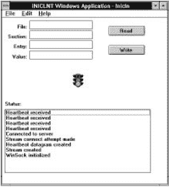

## 总结

本章演示了 `CWinSock`、`CDatagramSocket` 和 `CStreamSocket` 对象的使用方法。同时还展示了如何借助 WinSock 类库轻松构建一个能够同时处理多个客户端的服务器。

**图 15.2。**  
*服务器 INISRV。*

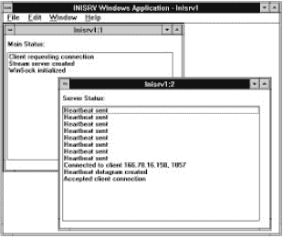

不过，客户端和服务器程序仍有很大的改进空间。其中一项重要的增强功能可能是处理未在一个连续数据块中到达的数据库命令和响应。目前，客户端和服务器无法处理这种情况。不过幸运的是，要传输的数据块相对较小，因此在负载较轻的网络中几乎不会发生碎片化。要实现这项增强功能，需要修改流套接字对象的 CWINSOCK_DONE_READING 处理程序，将收到的字节缓冲起来，直到接收到一个完整的 DBCOMMAND 结构。

下一章将在异构 UNIX 环境中的 finger 应用程序中使用 WinSock 类库对象。


# 16 异构 UNIX 环境中的 Finger 应用程序

## Finger 客户端设计

Finger 客户端应用程序 FINGER 使用由 CFormView 派生的经典对象作为其主界面。CMainView 对象的头文件如清单 16.1 所示，其实现如清单 16.2 所示（这两个清单将在本节后面给出）。该对象负责完成 FINGER 应用程序的大部分工作。

对象创建后不久就会调用 OnInitialUpdate()。该函数首先强制输出所使用的列表框采用等宽字体。这样可以确保为 ASCII 终端设置格式的任何数据都能正确显示。接下来，该函数启动 WinSock 子系统，然后初始化用于接收用户名的数据输入字段。

当 Finger 客户端的操作员选择标有 Finger 的按钮时，将调用 OnClickedButtonFinger()。首先检查主机名和用户名字段，确保其中包含有效数据。如果用户名有效，则对 Finger 请求字符串进行格式化。如果用户名输入的是通配符星号（*），请求字符串就只包含一个回车符，后跟一个换行符。否则，请求字符串就是用户名后跟回车符和换行符。接下来创建一个流套接字，并异步连接到所选主机的 79 端口。最后，禁用 Finger 按钮，以便通过视觉反馈告知用户程序正处于忙碌状态。

连接成功后，将调用 OnStream()，并将 wParam 设置为 CWINSOCK_YOU_ARE_CONNECTED。作为对此事件的响应，将发送在 OnClickedButtonFinger() 函数中格式化的 Finger 请求。发送 Finger 请求后，将调用 OnStream()，并将 wParam 设置为 CWINSOCK_DONE_WRITING。对此事件的响应是清空用于输出的列表框，使其准备接收 Finger 请求的响应。

数据到达后，将调用 OnStream()，并将 wParam 设置为 CWINSOCK_DONE_READING。CWINSOCK_DONE_READING 处理程序调用 DisplayData()，先缓冲由回车符标识的完整文本行，然后再将该行添加到输出列表框中。之所以需要缓冲，是因为数据可能分成多个片段接收，有些行可能只接收了一部分。

Finger 服务器完成 Finger 请求的响应发送后，会关闭流连接的另一端，从而导致调用 OnStream()，并将 wParam 设置为 CWINSOCK_LOST_CONNECTION。这会使客户端销毁流套接字。Finger 按钮将被重新启用，表示可以再次使用相同或不同的主机/用户名组合。

### 清单 16.1. FINGER 的 MAINVIEW.H。

```cpp
// mainview.h : header file
//
```


### 清单 16.1. 续

```cpp
////////////////////////////////////////////////////////////
// CMainView form view

#ifndef __AFXEXT_H__
#include <afxext.h>
#endif

#include "cwinsock.h"    // Windows Sockets classes

class CMainView : public CFormView
{
    DECLARE_DYNCREATE(CMainView)

private:
    void DisplayData(LPCSTR pDataRead, int nLen);
    CWinSock * m_pWinSock;    // WinSock sub-system startup/shutdown
    CStreamSocket * m_pStream;    // Stream socket
#define MAXUSERLEN (100)
    char m_szUser[MAXUSERLEN+1];    // user name to query finger with
#define MAXBUFLEN (200)
    char m_szBuf[MAXBUFLEN+1];    // one line of finger output

protected:
    CMainView();        // protected constructor used by dynamic creation

    // Form Data
public:
    //{{AFX_DATA(CMainView)
    enum { IDD = IDD_DIALOG_MAIN };
    CString m_stringHost;
    CString m_stringUser;
    //}}AFX_DATA

    // Attributes
public:

    // Operations
public:

    // Implementation
protected:
    virtual ~CMainView();
    virtual void DoDataExchange(CDataExchange* pDX);    // DDX/DDV support
    virtual void OnInitialUpdate();
    // Generated message map functions
    //{{AFX_MSG(CMainView)
    afx_msg LONG OnStream(WPARAM wParam, LPARAM lParam);
    afx_msg void OnClickedButtonFinger();
    //}}AFX_MSG
    DECLARE_MESSAGE_MAP()
};

////////////////////////////////////////////////////////////

#define WM_USER_STREAM (WM_USER + 1)
```

### 清单 16.2. 续

```cpp
LONG CMainView::OnStream(WPARAM wParam, LPARAM lParam)
{
    LPCSTR pDataRead;       // pointer to data just read
    LPCSTR pOrigDataRead;   // pointer to data just read
    int nLen;               // length

    // get pointer to list box used for status messages

    CListBox *plb = (CListBox *)GetDlgItem(IDC_LIST_OUTPUT);

    // check for invalid stream socket object
    if (m_pStream == NULL)
    {
        plb->AddString("Invalid stream socket object");
        return 0L;
    }

    switch (wParam)
    {
        case CWINSOCK_DONE_WRITING:
            // lParam = pointer to data that was sent

            // lParam points to the static variable m_szUser
            // so it should not be freed

            // clear the list box
            while (plb->GetCount() > 0)
                plb->DeleteString(0);
            break;

        case CWINSOCK_ERROR_WRITING:
            // lParam = pointer to data that generated error sending

            // lParam points to the static variable m_szUser
            // so it should not be freed

            AfxMessageBox("Error sending finger request");
            break;

        case CWINSOCK_DONE_READING:
            // lParam = data chunks in queue
            pDataRead = pOrigDataRead = (LPCSTR)m_pStream->Read(&nLen);
            if (pDataRead != NULL)
            {
                DisplayData(pDataRead, nLen);
                free((LPVOID)pOrigDataRead);
            }
            break;

        case CWINSOCK_ERROR_READING:
            break;

        case CWINSOCK_YOU_ARE_CONNECTED:
            if (m_pStream->Write(lstrlen(m_szUser), m_szUser) !=
                CWINSOCK_NOERROR)
            {
                AfxMessageBox("Error sending finger request");
                m_pStream->DestroySocket();
            }
            delete m_pStream;
            m_pStream = NULL;
            GetDlgItem(IDC_BUTTON_FINGER)->EnableWindow(TRUE);
            break;

        case CWINSOCK_LOST_CONNECTION:
            // server closed the connection
            m_pStream->DestroySocket();
            delete m_pStream;
            m_pStream = NULL;
            GetDlgItem(IDC_BUTTON_FINGER)->EnableWindow(TRUE);
            break;

        default:
            break;
    }

    return 0L;
}

//////////////////////////////////////////////////////////////
// CMainView::OnClickedButtonFinger()
//
// Called when the Finger button is pressed.
// Creates a socket, and connects to a finger server, and send the request.
//
void CMainView::OnClickedButtonFinger()
{
    // initialize the buffer used to display the results
    m_szBuf[0] = '\0';

    // make sure the user entered something for the host

    UpdateData(TRUE);

    if (m_stringHost.GetLength() == 0)
    {
        AfxMessageBox("You must enter a host name or IP address");
        return;
    }

#define MAXHOSTLEN (100)
    char szHost[MAXHOSTLEN];
    if (m_stringHost.GetLength() >= MAXHOSTLEN)
    {
        AfxMessageBox("Host name or IP address is too long");
        return;
    }
    lstrcpy(szHost, m_stringHost);

    // make sure the user entered something for the user

    if (m_stringUser.GetLength() == 0)
    {
        AfxMessageBox("You must enter a user name or *");
        return;
    }

    if (m_stringUser.GetLength() >= MAXUSERLEN)
    {
        AfxMessageBox("User name is too long");
        return;
    }

    // format the finger request

    if (m_stringUser.Compare("*") == 0)
        lstrcpy(m_szUser, "\r\n");
    else
    {
        lstrcpy(m_szUser, m_stringUser);
        lstrcat(m_szUser, "\r\n");
    }

    // initialize the stream socket object

    m_pStream = new CStreamSocket(this, WM_USER_STREAM);
    if (m_pStream->CreateSocket() != CWINSOCK_ERROR)
    {
        AfxMessageBox("Stream creation failed");
        delete m_pStream;
        m_pStream = NULL;
        return;
    }

    // connect the client to the finger server on port 79
    // (the finger server usually listens on TCP port 79 but we
    // could replace the hard-coded 79 with the "finger" string
    // to do a service lookup)

    if (m_pStream->Connect(szHost, 79) != CWINSOCK_ERROR)
    {
        AfxMessageBox("Stream connect attempt failed");
        delete m_pStream;
        m_pStream = NULL;
        return;
    }

    GetDlgItem(IDC_BUTTON_FINGER)->EnableWindow(FALSE);
}

///////////////////////////////////////////////////////////////
// CMainView::DisplayData()
//
void CMainView::DisplayData(LPCSTR pDataRead, int nLen)
{
    char szBuf[2];       // buffer for a one byte string

    // get pointer to list box used for status messages
    CListBox* plb = (CListBox *)GetDlgItem(IDC_LIST_OUTPUT);

    while (nLen > 0)
    {
        // ignore linefeed
        if (*pDataRead != '\r')
        {
            // don't add carriage return to string
            if (*pDataRead != '\n')
            {
                szBuf[0] = *pDataRead;
                szBuf[1] = '\0';
                lstrcat(m_szBuf, szBuf);
            }
            if ((lstrlen(m_szBuf) >= MAXBUFLEN) || (*pDataRead == '\n'))
            {
                // check to see if the buffer has data in it
                if (m_szBuf[0] != '\0')
                {
                    plb->AddString(m_szBuf);
                    m_szBuf[0] = '\0';
                }
                // check to see if we should insert a blank line
                else if (*pDataRead == '\n')
                    plb->AddString(" ");
            }
        }
        --nLen;
        ++pDataRead;
    }
}
```

## 运行 Finger 客户端

图16.1展示了Finger客户端运行时的情形。用户只需输入运行Finger服务器（或守护进程）的计算机的主机名或IP地址。如果用户希望获取主机上所有用户的信息，则将用户字段保留为星号（*）；否则，输入特定用户的名称。只需按下Finger按钮即可开始请求。

**图16.1.**  
*Finger客户端。*


## 小结

本章给出了使用第III部分开发的WinSock类库的最后一个示例。它展示了将Windows程序与运行相同或不同操作系统的计算机对接是多么容易。借助业界公认的协议，有些程序变得相当简单。


# WINSOCK.H

## 文件清单

```c
/* WINSOCK.H—definitions to be used with the WINSOCK.DLL
 *
 * This header file corresponds to version 1.1 of the Windows Sockets specification.
 *
 * This file includes parts which are Copyright (c) 1982-1986 Regents
 * of the University of California. All rights reserved. The
 * Berkeley Software License Agreement specifies the terms and
 * conditions for redistribution.
 *
 * Change log:
 *
 * Fri Apr 23 16:31:01 1993  Mark Towfiq (towfiq@Microdyne.COM)
 *   New version from David Treadwell which adds extern "C" around
 *   __WSAFDIsSet() and removes 'const' from buf param of
 *   WSAAsyncGetHostByAddr(). Added change log.
 *
 * Sat May 15 10:55:00 1993 David Treadwell (davidtr@microsoft.com)
 *   Fix the IN_CLASSC macro to account for class-D multicasts.
 *   Add AF_INX == AF_NS.
 */

#ifndef _WINSOCKAPI_
#define _WINSOCKAPI_

/*
 * Pull in WINDOWS.H if necessary
 */
#ifndef _INC_WINDOWS
#include <windows.h>
#endif /* _INC_WINDOWS */

/*
 * Basic system type definitions, taken from the BSD file sys/types.h.
 */
typedef unsigned char   u_char;
typedef unsigned short  u_short;
typedef unsigned int    u_int;
typedef unsigned long   u_long;

/*
 * The new type to be used in all
 * instances which refer to sockets.
 */
typedef u_int           SOCKET;

/*
 * Select uses arrays of SOCKETs.  These macros manipulate such
 * arrays.  FD_SETSIZE may be defined by the user before including
 * this file, but the default here should be >= 64.
 *
 * CAVEAT IMPLEMENTOR and USER: THESE MACROS AND TYPES MUST BE
 * INCLUDED IN WINSOCK.H EXACTLY AS SHOWN HERE.
 */
#ifndef FD_SETSIZE
#define FD_SETSIZE      64
#endif /* FD_SETSIZE */
```

```c
typedef struct fd_set {
        u_int   fd_count;       /* how many are SET? */
        SOCKET  fd_array[FD_SETSIZE]; /* an array of SOCKETS */
} fd_set;

#ifdef __cplusplus
extern "C" {
#endif

extern int PASCAL FAR __WSAFDIsSet(SOCKET, fd_set FAR *);

#ifdef __cplusplus
}
#endif

#define FD_CLR(fd, set) do { \
        u_int __i; \
        for (__i = 0; __i < ((fd_set FAR *)(set))->fd_count ; __i++) { \
                if (((fd_set FAR *)(set))->fd_array[__i] == fd) { \
                        while (__i < ((fd_set FAR *)(set))->fd_count-1) { \
                                ((fd_set FAR *)(set))->fd_array[__i] = \
                                        ((fd_set FAR *)(set))->fd_array[__i+1]; \
                                __i++; \
                        } \
                        ((fd_set FAR *)(set))->fd_count--; \
                        break; \
                } \
        } \
} while(0)

#define FD_SET(fd, set) do { \
        if (((fd_set FAR *)(set))->fd_count < FD_SETSIZE) \
                ((fd_set FAR *)(set))->fd_array[((fd_set FAR *)(set))->fd_count++]=fd; \
} while(0)

#define FD_ZERO(set) (((fd_set FAR *)(set))->fd_count=0)

#define FD_ISSET(fd, set) __WSAFDIsSet((SOCKET)(fd), (fd_set FAR *)(set))

/*
 * Structure used in select() call, taken from the BSD file sys/time.h.
 */
struct timeval {
        long    tv_sec;         /* seconds */
        long    tv_usec;        /* and microseconds */
};

/*
 * Operations on timevals.
 *
 * NB: timercmp does not work for >= or <=.
 */
#define timerisset(tvp)         ((tvp)->tv_sec || (tvp)->tv_usec)
#define timercmp(tvp, uvp, cmp) \
        (((tvp)->tv_sec cmp (uvp)->tv_sec) || \
        ((tvp)->tv_sec == (uvp)->tv_sec && \
        (tvp)->tv_usec cmp (uvp)->tv_usec))

#define timerclear(tvp)        (tvp)->tv_sec = (tvp)->tv_usec = 0

/*
 * Commands for ioctl(socket), taken from the BSD file fcntl.h.
 *
 * Ioctl's have the command encoded in the lower word,
 * and the size of any in or out parameters in the upper
 * word.  The high 2 bits of the upper word are used
 * to encode the in/out status of the parameter; for now
 * we restrict parameters to at most 128 bytes.
 */
#define IOCPARM_MASK     0x7f          /* parameters must be < 128 bytes */
#define IOC_VOID         0x20000000    /* no parameters */
#define IOC_OUT          0x40000000    /* copy out parameters */
#define IOC_IN           0x80000000    /* copy in parameters */
#define IOC_INOUT        (IOC_IN|IOC_OUT)
                                      /* 0x20000000 distinguishes new &
                                         old ioctl's */
#define _IO(x,y)         (IOC_VOID|((x)<<8)|(y))

#define _IOR(x,y,t)      (IOC_OUT|(((long)sizeof(t)&IOCPARM_MASK)<<16)|((x)<<8)|(y))

#define _IOW(x,y,t)      (IOC_IN|(((long)sizeof(t)&IOCPARM_MASK)<<16)|((x)<<8)|(y))

#define FIONREAD         _IOR('f', 127, u_long) /* get # bytes to read */
#define FIONBIO          _IOW('f', 126, u_long) /* set/clear non-blocking i/o */
#define FIOASYNC         _IOW('f', 125, u_long) /* set/clear async i/o */

/* Socket I/O Controls */
#define SIOCSHIWAT   _IOW('s',  0, u_long)  /* set high watermark */
#define SIOCGHIWAT   _IOR('s',  1, u_long)  /* get high watermark */
#define SIOCSLOWAT   _IOW('s',  2, u_long)  /* set low watermark */
#define SIOCGLOWAT   _IOR('s',  3, u_long)  /* get low watermark */
#define SIOCATMARK   _IOR('s',  7, u_long)  /* at oob mark? */

/*
 * Structures returned by network data base library, taken from the
 * BSD file netdb.h.  All addresses are supplied in host order, and
 * returned in network order (suitable for use in system calls).
 */
struct  hostent {
        char    FAR * h_name;          /* official name of host */
        char    FAR * FAR * h_aliases; /* alias list */
        short   h_addrtype;            /* host address type */
        short   h_length;              /* length of address */
        char    FAR * FAR * h_addr_list; /* list of addresses */
#define h_addr  h_addr_list[0]         /* address, for backward compat */
};

/*
 * It is assumed here that a network number
 * fits in 32 bits.
 */
struct  netent {
        char    FAR * n_name;          /* official name of net */
        char    FAR * FAR * n_aliases; /* alias list */
#define IPPORT_FINGER       79
#define IPPORT_TTYLINK       87
#define IPPORT_SUPDUP        95

/*
 * UNIX TCP sockets
 */
#define IPPORT_EXECSERVER    512
#define IPPORT_LOGINSERVER   513
#define IPPORT_CMDSERVER     514
#define IPPORT_EFSSERVER     520

/*
 * UNIX UDP sockets
 */
#define IPPORT_BIFFUDP       512
#define IPPORT_WHOSERVER     513
#define IPPORT_ROUTESERVER   520                 /* 520+1 also used */

/*
 * Ports < IPPORT_RESERVED are reserved for
 * privileged processes (e.g. root).
 */
#define IPPORT_RESERVED      1024

/*
 * Link numbers
 */
#define IMPLINK_IP           155
#define IMPLINK_LOWEXPER     156
#define IMPLINK_HIGHEXPER    158

/*
 * Internet address (old style... should be updated)
 */
struct in_addr {
        union {
                struct { u_char s_b1,s_b2,s_b3,s_b4; } S_un_b;
                struct { u_short s_w1,s_w2; } S_un_w;
                u_long S_addr;
        } S_un;
#define s_addr   S_un.S_addr
#define s_host   S_un.S_un_b.s_b2          /* can be used for most tcp & ip code */
#define s_net    S_un.S_un_b.s_b1          /* host on imp */
#define s_imp    S_un.S_un_w.s_w2          /* network */
#define s_impno  S_un.S_un_b.s_b4          /* imp */
#define s_lh     S_un.S_un_b.s_b3          /* logical host */
};

/*
 * Definitions of bits in internet address integers.
 * On subnets, the decomposition of addresses to host and net parts
 * is done according to subnet mask, not the masks here.
 */
#define IN_CLASSA(i)             (((long)(i) & 0x80000000) == 0)
#define IN_CLASSA_NET             0xff000000
#define IN_CLASSA_NSHIFT          24
#define IN_CLASSA_HOST            0x00ffffff
#define IN_CLASSA_MAX             128

#define IN_CLASSB(i)             (((long)(i) & 0xc0000000) == 0x80000000)
#define IN_CLASSB_NET             0xffff0000
#define IN_CLASSB_NSHIFT          16
#define IN_CLASSB_HOST            0x0000ffff
#define IN_CLASSB_MAX             65536

#define IN_CLASSC(i)             (((long)(i) & 0xe0000000) == 0xc0000000)
#define IN_CLASSC_NET             0xffffff00
#define IN_CLASSC_NSHIFT          8
#define IN_CLASSC_HOST            0x000000ff

#define INADDR_ANY                (u_long)0x00000000
#define INADDR_LOOPBACK           0x7f000001
#define INADDR_BROADCAST          (u_long)0xffffffff
#define INADDR_NONE               0xffffffff

/*
 * Socket address, internet style.
 */
struct sockaddr_in {
        short   sin_family;
        u_short sin_port;
        struct  in_addr sin_addr;
        char    sin_zero[8];
};

#define WSADESCRIPTION_LEN        256
#define WSASYS_STATUS_LEN         128

typedef struct WSADATA {
        WORD                    wVersion;
        WORD                    wHighVersion;
        char                    szDescription[WSADESCRIPTION_LEN+1];
        char                    szSystemStatus[WSASYS_STATUS_LEN+1];
        unsigned short          iMaxSockets;
        unsigned short          iMaxUdpDg;
        char FAR *               lpVendorInfo;
} WSADATA;

typedef WSADATA FAR *LPWSADATA;

/*
 * Options for use with [gs]etsockopt at the IP level.
 */
#define IP_OPTIONS       1              /* set/get IP per-packet options */

#define SO_DISCOUNTLEN   0x7007

/*
 * TCP options.
 */
#define TCP_NODELAY      0x0001

/*
 * Address families.
 */
#define AF_UNSPEC        0               /* unspecified */
#define AF_UNIX          1               /* local to host (pipes, portals) */
#define AF_INET          2               /* internet: UDP, TCP, etc. */
#define AF_IMPLINK       3               /* arpanet imp addresses */
#define AF_PUP           4               /* pup protocols: e.g. BSP */
#define AF_CHAOS         5               /* mit CHAOS protocols */
#define AF_IPX           6               /* IPX and SPX */
#define AF_NS            6               /* XEROX NS protocols */
#define AF_ISO           7               /* ISO protocols */
#define AF_OSI           AF_ISO          /* OSI is ISO */
#define AF_ECMA          8               /* European computer manufacturers */
#define AF_DATAKIT       9               /* datakit protocols */
#define AF_CCITT         10              /* CCITT protocols, X.25 etc */
#define AF_SNA           11              /* IBM SNA */
#define AF_DECnet        12              /* DECnet */
#define AF_DLI           13              /* Direct data link interface */
#define AF_LAT           14              /* LAT */
#define AF_HYLINK        15              /* NSC Hyperchannel */
#define AF_APPLETALK     16              /* AppleTalk */
#define AF_NETBIOS       17              /* NetBios-style addresses */

#define AF_MAX           18

/*
 * Structure used by kernel to store most
 * addresses.
 */
struct sockaddr {
        u_short sa_family;               /* address family */
        char    sa_data[14];             /* up to 14 bytes of direct address */
};

/*
 * Structure used by kernel to pass protocol
 * information in raw sockets.
 */
struct sockproto {
        u_short sp_family;               /* address family */
        u_short sp_protocol;             /* protocol */
};

/*
 * Protocol families, same as address families for now.
 */
#define PF_UNSPEC        AF_UNSPEC
#define PF_UNIX          AF_UNIX
#define PF_INET          AF_INET
#define PF_IMPLINK       AF_IMPLINK
```


```c
#define PF_PUP        AF_PUP
#define PF_CHAOS      AF_CHAOS
#define PF_NS         AF_NS
#define PF_IPX        AF_IPX
#define PF_ISO        AF_ISO
#define PF_OSI        AF_OSI
#define PF_ECMA       AF_ECMA
#define PF_DATAKIT    AF_DATAKIT
#define PF_CCITT      AF_CCITT
#define PF_SNA        AF_SNA
#define PF_DECnet     AF_DECnet
#define PF_DLI        AF_DLI
#define PF_LAT        AF_LAT
#define PF_HYLINK     AF_HYLINK
#define PF_APPLETALK  AF_APPLETALK

#define PF_MAX        AF_MAX

/*
 * 用于操作 linger 选项的结构体。
 */
struct linger {
    u_short l_onoff;                 /* 选项开/关 */
    u_short l_linger;                /* 逗留时间 */
};

/*
 * 用于将 (get/set)sockopt() 应用于套接字本身的级别号。
 */
#define SOL_SOCKET    0xffff         /* 套接字级别的选项 */

/*
 * 可由 listen 指定的最大队列长度。
 */
#define SOMAXCONN     5

#define MSG_OOB       0x1            /* 处理带外数据 */
#define MSG_PEEK      0x2            /* 查看传入消息 */
#define MSG_DONTROUTE 0x4            /* 不使用路由表发送 */

#define MSG_MAXIOVLEN 16

#define MSG_PARTIAL   0x8000         /* 消息传输的部分发送或接收 */

/*
 * 根据 rfc883 定义常量，供 gethostbyxxx() 调用使用。
 */
#define MAXGETHOSTSTRUCT         1024

/*
 * 定义与 WSAAsyncSelect() 调用一起使用的标志。
 */
#define FD_READ       0x01
#define FD_WRITE      0x02
#define FD_OOB        0x04
#define FD_ACCEPT     0x08
#define FD_CONNECT    0x10
#define FD_CLOSE          0x20

/*
 * 所有 Windows Sockets 错误常量均相对“常规”错误常量偏移 WSABASEERR。
 */
#define WSABASEERR        10000
/*
 * 常规 Microsoft C 错误常量的 Windows Sockets 定义
 */
#define WSAEINTR          (WSABASEERR+4)
#define WSAEBADF          (WSABASEERR+9)
#define WSAEACCES         (WSABASEERR+13)
#define WSAEFAULT         (WSABASEERR+14)
#define WSAEINVAL         (WSABASEERR+22)
#define WSAEMFILE         (WSABASEERR+24)

/*
 * 常规 Berkeley 错误常量的 Windows Sockets 定义
 */
#define WSAEWOULDBLOCK    (WSABASEERR+35)
#define WSAEINPROGRESS    (WSABASEERR+36)
#define WSAEALREADY       (WSABASEERR+37)
#define WSAENOTSOCK       (WSABASEERR+38)
#define WSAEDESTADDRREQ   (WSABASEERR+39)
#define WSAEMSGSIZE       (WSABASEERR+40)
#define WSAEPROTOTYPE     (WSABASEERR+41)
#define WSAENOPROTOOPT    (WSABASEERR+42)
#define WSAEPROTONOSUPPORT (WSABASEERR+43)
#define WSAESOCKTNOSUPPORT (WSABASEERR+44)
#define WSAEOPNOTSUPP     (WSABASEERR+45)
#define WSAEPFNOSUPPORT   (WSABASEERR+46)
#define WSAEAFNOSUPPORT   (WSABASEERR+47)
#define WSAEADDRINUSE     (WSABASEERR+48)
#define WSAEADDRNOTAVAIL  (WSABASEERR+49)
#define WSAENETDOWN       (WSABASEERR+50)
#define WSAENETUNREACH    (WSABASEERR+51)
#define WSAENETRESET      (WSABASEERR+52)
#define WSAECONNABORTED   (WSABASEERR+53)
#define WSAECONNRESET     (WSABASEERR+54)
#define WSAENOBUFS        (WSABASEERR+55)
#define WSAEISCONN        (WSABASEERR+56)
#define WSAENOTCONN       (WSABASEERR+57)
#define WSAESHUTDOWN      (WSABASEERR+58)
#define WSAETOOMANYREFS   (WSABASEERR+59)
#define WSAETIMEDOUT      (WSABASEERR+60)
#define WSAECONNREFUSED   (WSABASEERR+61)
#define WSAELOOP          (WSABASEERR+62)
#define WSAENAMETOOLONG   (WSABASEERR+63)
#define WSAEHOSTDOWN      (WSABASEERR+64)
#define WSAEHOSTUNREACH   (WSABASEERR+65)
#define WSAENOTEMPTY      (WSABASEERR+66)
#define WSAEPROCLIM       (WSABASEERR+67)
#define WSAEUSERS         (WSABASEERR+68)
#define WSAEDQUOT         (WSABASEERR+69)
#define WSAESTALE         (WSABASEERR+70)
#define WSAEREMOTE        (WSABASEERR+71)
#define WSAEDISCON                  (WSABASEERR+101)

/*
 * 扩展的 Windows Sockets 错误常量定义
 */
#define WSASYSNOTREADY              (WSABASEERR+91)
#define WSAVERNOTSUPPORTED           (WSABASEERR+92)
#define WSANOTINITIALISED            (WSABASEERR+93)

/*
 * gethostbyname() 和 gethostbyaddr() 的错误返回码（使用解析程序时）。
 * 请注意，这些错误通过 WSAGetLastError() 获取，因此必须遵循
 * 避免与特定实现或语言运行时系统的错误号冲突的规则。
 * 为此，这些代码以 WSABASEERR+100 为基数。
 * 另请注意，[WSA]NO_ADDRESS 仅为兼容性目的而定义。
 */
#define h_errno                     WSAGetLastError()

/* 权威应答：主机未找到 */
#define WSAHOST_NOT_FOUND           (WSABASEERR+1001)
#define HOST_NOT_FOUND              WSAHOST_NOT_FOUND

/* 非权威应答：主机未找到，或服务器故障（SERVERFAIL） */
#define WSATRY_AGAIN                (WSABASEERR+1002)
#define TRY_AGAIN                   WSATRY_AGAIN

/* 不可恢复的错误：FORMERR、REFUSED、NOTIMP */
#define WSANO_RECOVERY              (WSABASEERR+1003)
#define NO_RECOVERY                 WSANO_RECOVERY

/* 名称有效，但没有所请求类型的数据记录 */
#define WSANO_DATA                  (WSABASEERR+1004)
#define NO_DATA                     WSANO_DATA

/* 没有地址，请查找 MX 记录 */
#define WSANO_ADDRESS               WSANO_DATA
#define NO_ADDRESS                  WSANO_ADDRESS

/*
 * 将 Windows Sockets 错误重新定义为常规 Berkeley 错误常量。
 * 这些定义在 Windows NT 中已被注释掉，以避免与 errno.h 冲突。
 * 请改用 WSA 常量。
 */
#if 0
#define EWOULDBLOCK                 WSAEWOULDBLOCK
#define EINPROGRESS                 WSAEINPROGRESS
#define EALREADY                    WSAEALREADY
#define ENOTSOCK                    WSAENOTSOCK
#define EDESTADDRREQ                WSAEDESTADDRREQ
#define EMSGSIZE                    WSAEMSGSIZE
#define EPROTOTYPE                  WSAEPROTOTYPE
#define ENOPROTOOPT                 WSAENOPROTOOPT
#define EPROTONOSUPPORT             WSAEPROTONOSUPPORT
#define ESOCKTNOSUPPORT             WSAESOCKTNOSUPPORT
#define EOPNOTSUPP          WSAEOPNOTSUPP
#define EPFNOSUPPORT        WSAEPFNOSUPPORT
#define EAFNOSUPPORT        WSAEAFNOSUPPORT
#define EADDRINUSE          WSAEADDRINUSE
#define EADDRNOTAVAIL       WSAEADDRNOTAVAIL
#define ENETDOWN            WSAENETDOWN
#define ENETUNREACH         WSAENETUNREACH
#define ENETRESET           WSAENETRESET
#define ECONNABORTED        WSAECONNABORTED
#define ECONNRESET          WSAECONNRESET
#define ENOBUFS             WSAENOBUFS
#define EISCONN             WSAEISCONN
#define ENOTCONN            WSAENOTCONN
#define ESHUTDOWN           WSAESHUTDOWN
#define ETOOMANYREFS        WSAETOOMANYREFS
#define ETIMEDOUT           WSAETIMEDOUT
#define ECONNREFUSED        WSAECONNREFUSED
#define ELOOP               WSAELOOP
#define ENAMETOOLONG        WSAENAMETOOLONG
#define EHOSTDOWN           WSAEHOSTDOWN
#define EHOSTUNREACH        WSAEHOSTUNREACH
#define ENOTEMPTY           WSAENOTEMPTY
#define EPROCLIM            WSAEPROCLIM
#define EUSERS              WSAEUSERS
#define EDQUOT              WSAEDQUOT
#define ESTALE              WSAESTALE
#define EREMOTE             WSAEREMOTE
#endif

/* 套接字函数原型 */

#ifdef __cplusplus
extern "C" {
#endif

SOCKET PASCAL FAR accept (SOCKET s, struct sockaddr FAR *addr,
                          int FAR *addrlen);

int PASCAL FAR bind (SOCKET s, const struct sockaddr FAR *addr, int namelen);

int PASCAL FAR closesocket (SOCKET s);

int PASCAL FAR connect (SOCKET s, const struct sockaddr FAR *name, int namelen);

int PASCAL FAR ioctlsocket (SOCKET s, long cmd, u_long FAR *argp);

int PASCAL FAR getpeername (SOCKET s, struct sockaddr FAR *name,
                            int FAR * namelen);

int PASCAL FAR getsockname (SOCKET s, struct sockaddr FAR *name,
                            int FAR * namelen);

int PASCAL FAR getsockopt (SOCKET s, int level, int optname,
                           char FAR * optval, int FAR *optlen);

u_long PASCAL FAR htonl (u_long hostlong);

u_short PASCAL FAR htons (u_short hostshort);
```


```c
unsigned long PASCAL FAR inet_addr (const char FAR * cp);

char FAR * PASCAL FAR inet_ntoa (struct in_addr in);

int PASCAL FAR listen (SOCKET s, int backlog);

u_long PASCAL FAR ntohl (u_long netlong);

u_short PASCAL FAR ntohs (u_short netshort);

int PASCAL FAR recv (SOCKET s, char FAR * buf, int len, int flags);

int PASCAL FAR recvfrom (SOCKET s, char FAR * buf, int len, int flags,
                         struct sockaddr FAR *from, int FAR * fromlen);

int PASCAL FAR select (int nfds, fd_set FAR *readfds, fd_set FAR *writefds,
                       fd_set FAR *exceptfds, const struct timeval FAR *timeout);

int PASCAL FAR send (SOCKET s, const char FAR * buf, int len, int flags);

int PASCAL FAR sendto (SOCKET s, const char FAR * buf, int len, int flags,
                       const struct sockaddr FAR *to, int tolen);

int PASCAL FAR setsockopt (SOCKET s, int level, int optname,
                           const char FAR * optval, int optlen);

int PASCAL FAR shutdown (SOCKET s, int how);

SOCKET PASCAL FAR socket (int af, int type, int protocol);

/* Database function prototypes */

struct hostent FAR * PASCAL FAR gethostbyaddr(const char FAR * addr,
                                              int len, int type);

struct hostent FAR * PASCAL FAR gethostbyname(const char FAR * name);

int PASCAL FAR gethostname (char FAR * name, int namelen);

struct servent FAR * PASCAL FAR getservbyport(int port, const char FAR * proto);

struct servent FAR * PASCAL FAR getservbyname(const char FAR * name,
                                              const char FAR * proto);

struct protoent FAR * PASCAL FAR getprotobynumber(int proto);

struct protoent FAR * PASCAL FAR getprotobyname(const char FAR * name);

/* Microsoft Windows Extension function prototypes */

int PASCAL FAR WSAStartup(WORD wVersionRequired, LPWSADATA lpWSAData);

int PASCAL FAR WSACleanup(void);

void PASCAL FAR WSASetLastError(int iError);

int PASCAL FAR WSAGetLastError(void);

BOOL PASCAL FAR WSAIsBlocking(void);

int PASCAL FAR WSAUnhookBlockingHook(void);

FARPROC PASCAL FAR WSASetBlockingHook(FARPROC lpBlockFunc);

int PASCAL FAR WSACancelBlockingCall(void);

HANDLE PASCAL FAR WSAAsyncGetServByName(HWND hWnd, u_int wMsg,
                                        const char FAR * name,
                                        const char FAR * proto,
                                        char FAR * buf, int buflen);

HANDLE PASCAL FAR WSAAsyncGetServByPort(HWND hWnd, u_int wMsg, int port,
                                        const char FAR * proto, char FAR * buf,
                                        int buflen);

HANDLE PASCAL FAR WSAAsyncGetProtoByName(HWND hWnd, u_int wMsg,
                                         const char FAR * name, char FAR * buf,
                                         int buflen);

HANDLE PASCAL FAR WSAAsyncGetProtoByNumber(HWND hWnd, u_int wMsg,
                                           int number, char FAR * buf,
                                           int buflen);

HANDLE PASCAL FAR WSAAsyncGetHostByName(HWND hWnd, u_int wMsg,
                                        const char FAR * name, char FAR * buf,
                                        int buflen);

HANDLE PASCAL FAR WSAAsyncGetHostByAddr(HWND hWnd, u_int wMsg,
                                        const char FAR * addr, int len, int type,
                                        char FAR * buf, int buflen);

int PASCAL FAR WSACancelAsyncRequest(HANDLE hAsyncTaskHandle);

int PASCAL FAR WSAAsyncSelect(SOCKET s, HWND hWnd, u_int wMsg,
                              long lEvent);

int PASCAL FAR WSARecvEx (SOCKET s, char FAR * buf, int len, int *flags);

#ifdef __cplusplus
}
#endif

/* Microsoft Windows Extended data types */
typedef struct sockaddr SOCKADDR;
typedef struct sockaddr *PSOCKADDR;
typedef struct sockaddr FAR *LPSOCKADDR;

typedef struct sockaddr_in SOCKADDR_IN;
typedef struct sockaddr_in *PSOCKADDR_IN;
typedef struct sockaddr_in FAR *LPSOCKADDR_IN;

typedef struct linger LINGER;
typedef struct linger *PLINGER;
typedef struct linger FAR *LPLINGER;

typedef struct in_addr IN_ADDR;
typedef struct in_addr *PIN_ADDR;
typedef struct in_addr FAR *LPIN_ADDR;

typedef struct fd_set FD_SET;
typedef struct fd_set *PFD_SET;
typedef struct fd_set FAR *LPFD_SET;

typedef struct hostent HOSTENT;
typedef struct hostent *PHOSTENT;
typedef struct hostent FAR *LPHOSTENT;

typedef struct servent SERVENT;
typedef struct servent *PSERVENT;
typedef struct servent FAR *LPSERVENT;

typedef struct protoent PROTOENT;
typedef struct protoent *PPROTOENT;
typedef struct protoent FAR *LPPROTOENT;

typedef struct timeval TIMEVAL;
typedef struct timeval *PTIMEVAL;
typedef struct timeval FAR *LPTIMEVAL;

/*
 * Windows message parameter composition and decomposition
 * macros.
 *
 * WSAMAKEASYNCREPLY is intended for use by the Windows Sockets implementation
 * when constructing the response to WSAAsyncGetXByY() routine.
 */
#define WSAMAKEASYNCREPLY(buflen,error)        MAKELONG(buflen,error)
/*
 * WSAMAKESELECTREPLY is intended for use by the Windows Sockets implementation
 * when constructing the response to WSAAsyncSelect().
 */
#define WSAMAKESELECTREPLY(event,error)        MAKELONG(event,error)
/*
 * WSAGETASYNCBUFLEN is intended for use by the Windows Sockets application
 * to extract the buffer length from the lParam in the response
 * to WSAAsyncGetXByY().
 */
#define WSAGETASYNCBUFLEN(lParam)              LOWORD(lParam)
/*
 * WSAGETASYNCERROR is intended for use by the Windows Sockets application
 * to extract the error code from the lParam in the response
 * to WSAAsyncGetXByY().
 */
#define WSAGETASYNCERROR(lParam)               HIWORD(lParam)
/*
 * WSAGETSELECTEVENT is intended for use by the Windows Sockets application
 * to extract the event code from the lParam in the response
 * to WSAAsyncSelect().
 */
#define WSAGETSELECTEVENT(lParam)              LOWORD(lParam)
/*
 * WSAGETSELECTERROR is intended for use by the Windows Sockets application
 * to extract the error code from the lParam in the response
 * to a WSAAsyncSelect().
 */
#define WSAGETSELECTERROR(lParam)              HIWORD(lParam)

#endif  /* _WINSOCKAPI_ */
```
