# 专业人士的 C# 笔记：700 多页专业提示与技巧

### 第 120.11 节：在返回 Enumerable 的方法中返回另一个 Enumerable 613

## 第 121 章：任务并行库 (TPL) 数据流构造 614
### 第 121.1 节：ActionBlock<T> 614
### 第 121.2 节：BroadcastBlock<T> 614
### 第 121.3 节：BufferBlock<T> 615
### 第 121.4 节：JoinBlock<T1, T2, ...> 616
### 第 121.5 节：WriteOnceBlock<T> 617
### 第 121.6 节：BatchedJoinBlock<T1, T2, ...> 618
### 第 121.7 节：TransformBlock<TInput, TOutput> 619
### 第 121.8 节：TransformManyBlock<TInput, TOutput> 619
### 第 121.9 节：BatchBlock<T> 620

## 第 122 章：函数式编程 622
### 第 122.1 节：Func 和 Action 622
### 第 122.2 节：高阶函数 622
### 第 122.3 节：避免空引用 622
### 第 122.4 节：不可变性 624
### 第 122.5 节：不可变集合 625

## 第 123 章：Func 委托 626
### 第 123.1 节：无参数 626
### 第 123.2 节：带多个变量 626
### 第 123.3 节：Lambda 与匿名方法 627
### 第 123.4 节：协变与逆变类型参数 627

## 第 124 章：具有多个返回值的函数 629
### 第 124.1 节："匿名对象" + "dynamic 关键字" 解决方案 629
### 第 124.2 节：元组解决方案 629
### 第 124.3 节：ref 和 out 参数 629

## 第 125 章：二进制序列化 631
### 第 125.1 节：使用特性控制序列化行为 631
### 第 125.2 节：序列化绑定器 631
### 第 125.3 节：向后兼容性中的一些陷阱 633
### 第 125.4 节：使对象可序列化 635
### 第 125.5 节：序列化代理（实现 ISerializationSurrogate）636
### 第 125.6 节：通过实现 ISerializable 添加更多控制 638

## 第 126 章：ICloneable 640
### 第 126.1 节：在类中实现 ICloneable 640
### 第 126.2 节：在结构中实现 ICloneable 640

## 第 127 章：IComparable 642
### 第 127.1 节：对版本排序 642

## 第 128 章：访问数据库 644
### 第 128.1 节：连接字符串 644
### 第 128.2 节：Entity Framework 连接 644
### 第 128.3 节：ADO.NET 连接 645

## 第 129 章：在 C# 中使用 SQLite 648
### 第 129.1 节：在 C# 中使用 SQLite 创建简单 CRUD 648
### 第 129.2 节：执行查询 651

## 第 130 章：缓存 653
### 第 130.1 节：MemoryCache 653

### 第 153.1 节：简单代码求值 741

## 第 154 章：运行时编译 742
### 第 154.1 节：RoslynScript 742
### 第 154.2 节：CSharpCodeProvider 742

## 第 155 章：互操作性 743
### 第 155.1 节：从非托管 C++ DLL 导入函数 743
### 第 155.2 节：调用约定 743
### 第 155.3 节：C++ 名称修饰 744
### 第 155.4 节：非托管 DLL 的动态加载与卸载 744
### 第 155.5 节：使用 Marshal 读取结构 745
### 第 155.6 节：处理 Win32 错误 746
### 第 155.7 节：固定对象 747
### 第 155.8 节：为 COM 公开类的简单代码 748

## 第 156 章：.NET 编译器平台 (Roslyn) 750
### 第 156.1 节：语义模型 750
### 第 156.2 节：语法树 750
### 第 156.3 节：从 MSBuild 项目创建工作区 751

## 第 157 章：ILGenerator 752
### 第 157.1 节：创建包含 UnixTimestamp 辅助方法的 DynamicAssembly 752
### 第 157.2 节：创建方法重写 753

## 第 158 章：T4 代码生成 755
### 第 158.1 节：运行时代码生成 755

## 第 159 章：在 Windows 窗体应用程序中创建自己的 MessageBox 756
### 第 159.1 节：如何在另一个 Windows 窗体应用程序中使用自己创建的 MessageBox 控件 756
### 第 159.2 节：创建自己的 MessageBox 控件 756

## 第 160 章：包含字体资源 759
### 第 160.1 节：从资源实例化 'FontFamily' 759
### 第 160.2 节：集成方法 759
### 第 160.3 节：与 'Button' 一起使用 759

## 第 161 章：导入 Google 联系人 761
### 第 161.1 节：要求 761
### 第 161.2 节：控制器中的源代码 761
### 第 161.3 节：视图中的源代码 764

## 第 162 章：.NET 中的垃圾回收器 765
### 第 162.1 节：弱引用 765
### 第 162.2 节：大对象堆压缩 766

## 第 163 章：Microsoft.Exchange.WebServices 767
### 第 163.1 节：检索指定用户的 Out of Office 设置 767
### 第 163.2 节：更新特定用户的 Out of Office 设置 767

## 第 164 章：Windows Communication Foundation 769
### 第 164.1 节：入门示例 769

- 认证 771
- 你可能还喜欢 785


## 第 1 章：开始使用 C# 语言

| 版本 | 发布日期 |
|---------|--------------|
| 1.0     | 2002-01-01   |
| 1.2     | 2003-04-01   |
| 2.0     | 2005-09-01   |
| 3.0     | 2007-08-01   |
| 4.0     | 2010-04-01   |
| 5.0     | 2013-06-01   |
| 6.0     | 2015-07-01   |
| 7.0     | 2017-03-07   |

### 第 1.1 节：在 Visual Studio 中创建新的控制台应用程序

1. 打开 Visual Studio
2. 在工具栏中，转到 文件 -> 新建项目
3. 选择 控制台应用程序 项目类型
4. 在解决方案资源管理器中打开 Program.cs 文件
5. 将以下代码添加到 Main()：

```csharp
public class Program
{
    public static void Main()
    {
        // Prints a message to the console.
        System.Console.WriteLine("Hello, World!");

        /* Wait for the user to press a key. This is a common
        way to prevent the console window from terminating
        and disappearing before the programmer can see the contents
        of the window, when the application is run via Start from within VS. */
        System.Console.ReadKey();
    }
}
```

6. 在工具栏中，单击 调试 -> 开始调试 或按 F5 或 ctrl + F5（不使用调试器运行）来运行程序。

ideone 上的实时演示

#### 解释

- **class** Program 是一个类声明。类 Program 包含程序使用的数据和方法定义。类通常包含多个方法。方法定义类的行为。然而，Program 类只有一个方法：Main。
- **static void Main()** 定义 Main 方法，它是所有 C# 程序的入口点。Main 方法说明类在执行时做什么。每个类只允许有一个 Main 方法。
- **System.Console.WriteLine("Hello, world!");** 方法将给定数据（在此示例中为 Hello, world!）作为输出打印到控制台窗口。
- System.Console.ReadKey() 确保程序在显示消息后不会立即关闭。它通过等待用户按下键盘上的键来实现这一点。用户按下任意键将终止程序。程序在 main() 方法中的最后一行代码执行完毕后终止。

#### 使用命令行

通过命令行编译时可以使用 MSBuild 或 csc.exe（C# 编译器），两者都是 Microsoft Build Tools 包的一部分。

要编译此示例，请在 HelloWorld.cs 所在的同一目录中运行以下命令：

```
%WINDIR%\Microsoft.NET\Framework64\v4.0.30319\csc.exe HelloWorld.cs
```

也可能在同一个应用程序中存在两个 main 方法。在这种情况下，您必须告诉编译器执行哪个 main 方法，可以在控制台中输入以下命令。（假设类 ClassA 在同一 HelloWorld.cs 文件的 HelloWorld 命名空间中也具有 main 方法）

```
%WINDIR%\Microsoft.NET\Framework64\v4.0.30319\csc.exe HelloWorld.cs /main:HelloWorld.ClassA
```

其中 HelloWorld 是命名空间

*注意：这是 .NET Framework v4.0 通常所在的路径。请根据您的 .NET 版本更改路径。此外，如果您使用的是 32 位 .NET Framework，则目录可能是 framework 而不是 framework64。从 Windows 命令提示符，您可以通过运行以下命令列出所有 csc.exe Framework 路径（第一个用于 32 位 Framework）：*

```
dir %WINDIR%\Microsoft.NET\Framework\csc.exe /s /b
dir %WINDIR%\Microsoft.NET\Framework64\csc.exe /s /b
```

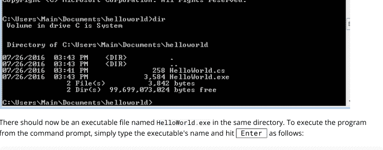

现在同一目录中应该有一个名为 HelloWorld.exe 的可执行文件。要从命令提示符执行程序，只需输入可执行文件的名称并按 Enter 键，如下所示：

```
HelloWorld.exe
```

这将产生：

```
Hello, world!
```

```
C:\Users\Main\Documents\helloworld>HelloWorld
Hello, world!
```

您也可以双击可执行文件并启动一个新的控制台窗口，显示消息 "Hello, world!"


### 第 1.2 节：在 Visual Studio 中创建新的控制台应用程序项目并在调试模式下运行

1. **下载并安装 Visual Studio。** Visual Studio 可以从 VisualStudio.com 下载。建议使用 Community 版本，首先因为它是免费的，其次因为它包含所有通用功能并且可以进一步扩展。
2. **打开 Visual Studio。**
3. **欢迎。** 转到 文件 → 新建 → 项目。

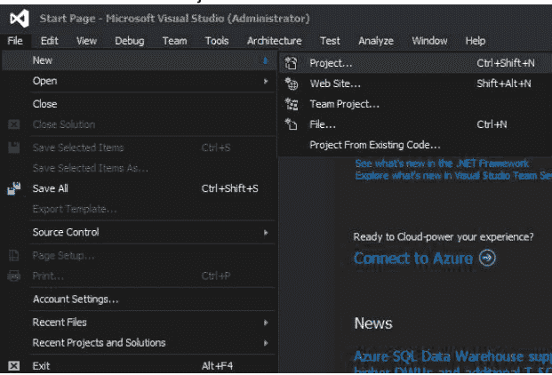

4. 单击 模板 → Visual C# → 控制台应用程序

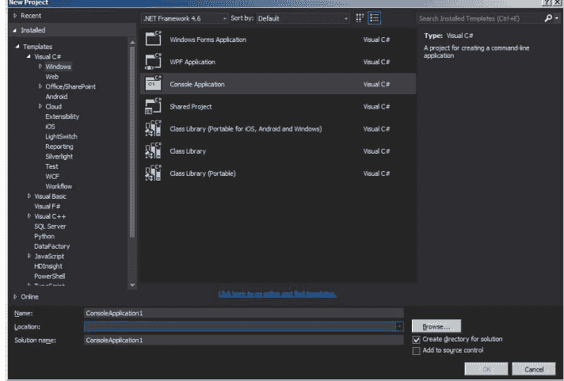

5. 选择控制台应用程序后，输入项目的名称，选择保存位置并按 OK。无需担心解决方案名称。

6. 项目已创建。新建的项目将类似于：

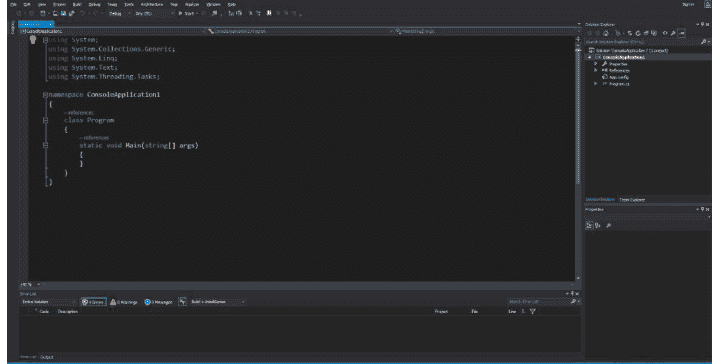

*始终为项目使用描述性名称，以便可以轻松区分其他项目。建议在项目或类名中不要使用空格。*

7. **编写代码。** 现在您可以更新 Program.cs 以向用户显示 "Hello world!"。

```csharp
using System;

namespace ConsoleApplication1
{
    public class Program
    {
        public static void Main(string[] args)
        {
        }
    }
}
```

将以下两行添加到 Program.cs 中的 `public static void Main(string[] args)` 对象中：（确保它在花括号内）

```csharp
Console.WriteLine("Hello world!");
Console.Read();
```

**为什么** `Console.Read()`？第一行将文本 "Hello world!" 打印到控制台，第二行等待输入单个字符；实际上，这会导致程序暂停执行，以便您在调试时可以看到输出。如果没有 `Console.Read();`，当您开始调试应用程序时，它只会将 "Hello world!" 打印到控制台然后立即关闭。您的代码窗口现在应如下所示：

```csharp
using System;

namespace ConsoleApplication1
{
    public class Program
    {
        public static void Main(string[] args)
        {
            Console.WriteLine("Hello world!");
            Console.Read();
        }
    }
}
```

8. **调试您的程序。** 按窗口顶部附近工具栏上的开始按钮


或按键盘上的 `F5` 运行应用程序。如果按钮不存在，您可以从顶部菜单运行程序：**调试** -> **开始调试**。程序将编译然后打开一个控制台窗口。它应类似于以下屏幕截图：

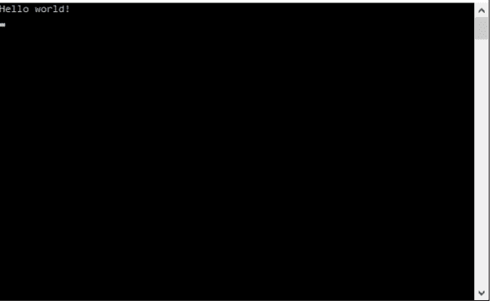

9. 停止程序。要关闭程序，只需按键盘上的任意键即可。我们添加的 Console.Read() 就是为此目的。另一种关闭程序的方法是转到开始按钮所在的菜单，然后单击停止按钮。

### 第 1.3 节：使用 .NET Core 创建新程序

首先通过您选择的平台的安装说明安装 .NET Core SDK：

- Windows
- OSX
- Linux
- Docker

安装完成后，打开命令提示符或终端窗口。

1. 使用 `mkdir hello_world` 创建一个新目录，并使用 `cd hello_world` 进入新创建的目录。
2. 使用 `dotnet new console` 创建一个新的控制台应用程序。

   这将生成两个文件：

   - hello_world.csproj
   - Program.cs

   ```xml
   <Project Sdk="Microsoft.NET.Sdk">
     <PropertyGroup>
       <OutputType>Exe</OutputType>
       <TargetFramework>netcoreapp1.1</TargetFramework>
     </PropertyGroup>
   </Project>
   ```

   ```csharp
   using System;

   namespace hello_world
   {
       class Program
       {
           static void Main(string[] args)
           {
               Console.WriteLine("Hello World!");
           }
       }
   }
   ```

3. 使用 dotnet restore 恢复所需的包。
4. 可选使用 dotnet build 构建应用程序以进行 Debug，或使用 dotnet build -c Release 进行 Release。dotnet run 也会运行编译器并抛出构建错误（如果有）。
5. 使用 dotnet run 运行应用程序以进行 Debug，或使用 dotnet run .\bin\Release\netcoreapp1.1\hello_world.dll 进行 Release。

#### 命令提示符输出

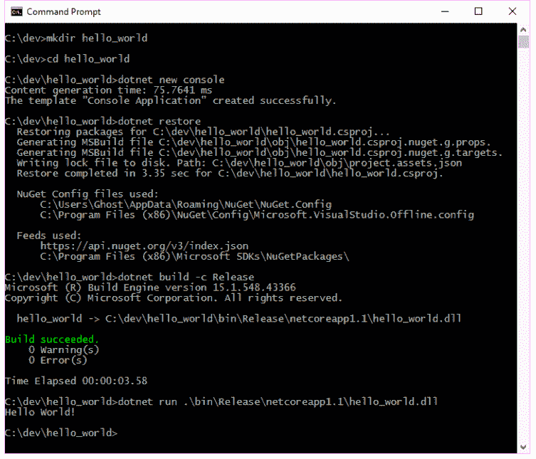


### 第 1.4 节：使用 Mono 创建新程序

首先通过其安装部分中描述的您选择的平台的安装说明来安装 Mono。

Mono 可用于 Mac OS X、Windows 和 Linux。

安装完成后，创建一个文本文件，将其命名为 HelloWorld.cs 并将以下内容复制到其中：

```csharp
public class Program
{
    public static void Main()
    {
        System.Console.WriteLine("Hello, world!");
        System.Console.WriteLine("Press any key to exit...");
        System.Console.Read();
    }
}
```

如果您使用的是 Windows，请运行随 Mono 安装一起提供的 Mono 命令提示符，以确保必要的环境变量已设置。如果在 Mac 或 Linux 上，请打开一个新的终端。

要编译新创建的文件，请在包含 HelloWorld.cs 的目录中运行以下命令：

```
mcs -out:HelloWorld.exe HelloWorld.cs
```

生成的 HelloWorld.exe 然后可以用以下命令执行：

```
mono HelloWorld.exe
```

它将产生以下输出：

```
Hello, world!
Press any key to exit..
```

### 第 1.5 节：使用 LinqPad 创建新查询

LinqPad 是一个很棒的工具，可让您学习和测试 .Net 语言（C#、F# 和 VB.Net）的功能。

- 1. 安装 LinqPad
- 2. 创建新的查询（Ctrl + N）

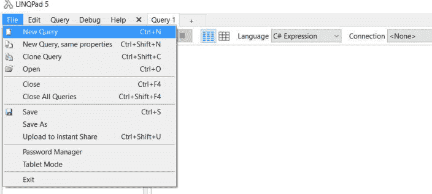

- 3. 在语言下，选择“C# 语句”

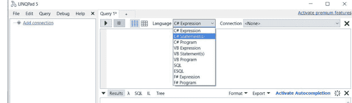

- 4. 输入以下代码并点击运行（F5）

```csharp
string hw = "Hello World";

hw.Dump(); //or Console.WriteLine(hw);
```

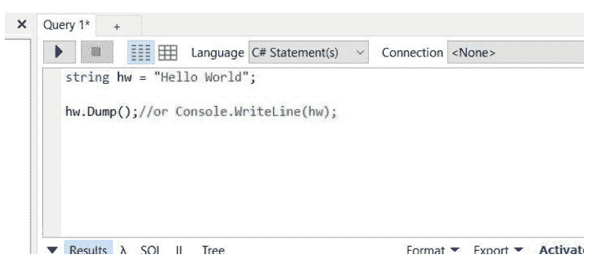

- 5. 您应该在结果屏幕中看到打印出“Hello World”。

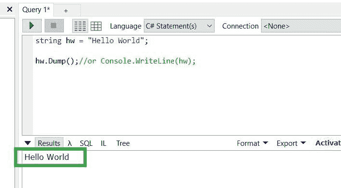

- 6. 现在您已经创建了第一个 .Net 程序，请通过 LinqPad 中的“Samples”浏览器查看其中包含的示例。里面有许多很棒的示例，将向您展示 .Net 语言的许多不同功能。

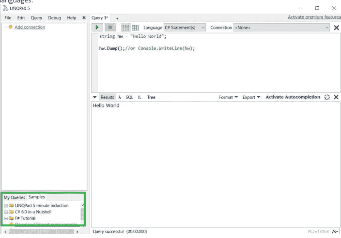

### 注释：

- 1. 如果您点击“IL”，您可以检查您的 .net 代码生成的 IL 代码。这是一个很棒的学习工具。

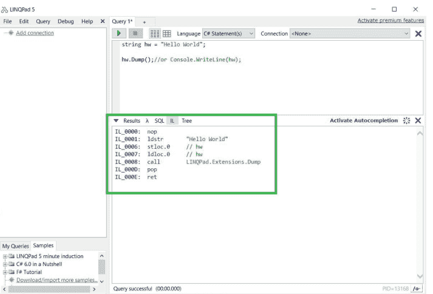

- 2. 使用 LINQ to SQL 或 Linq to Entities 时，您可以检查正在生成的 SQL，这也是学习 LINQ 的另一种好方法。

### 第 1.6 节：使用 Xamarin Studio 创建新项目

- 1. 下载并安装 Xamarin Studio Community。
- 2. 打开 Xamarin Studio。
- 3. 点击 **File** → **New** → **Solution**。

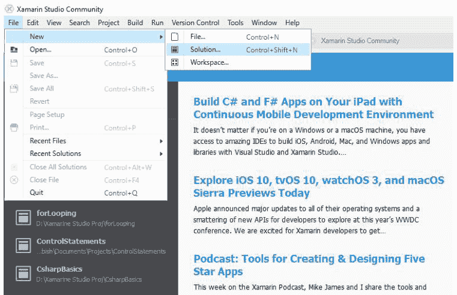

- 4. 点击 .NET → Console Project 并选择 C#。
- 5. 点击 Next 继续。

**为您的新项目选择模板**

- 多平台
  - 应用
  - 库
  - 测试
- 安卓
  - 应用
  - 库
  - 测试
- 其他
  - .NET
  - ASP.NET
  - 杂项

- 控制台项目
- 空项目
- Gtk# 2.0 项目
- 库
- NUnit 库项目

**控制台项目**

创建新的 C# 控制台项目。


- 6. 输入项目名称并浏览... 选择保存位置，然后点击 Create。

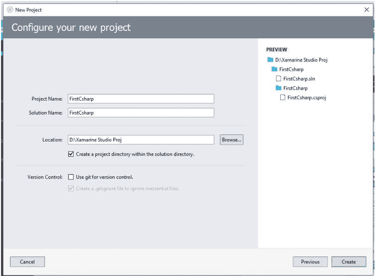

- 7. 新创建的项目看起来类似如下：

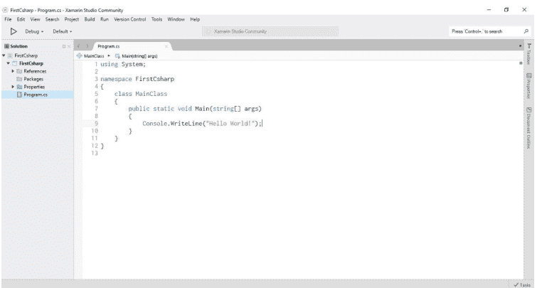

- 8. 这是文本编辑器中的代码：

```csharp
using System;

namespace FirstCsharp
{
    public class MainClass
    {
        public static void Main(string[] args)
        {
            Console.WriteLine("Hello World!");
            Console.ReadLine();
        }
    }
}
```

- 9. 要运行代码，请按 F5 或点击下图所示的 Play 按钮：

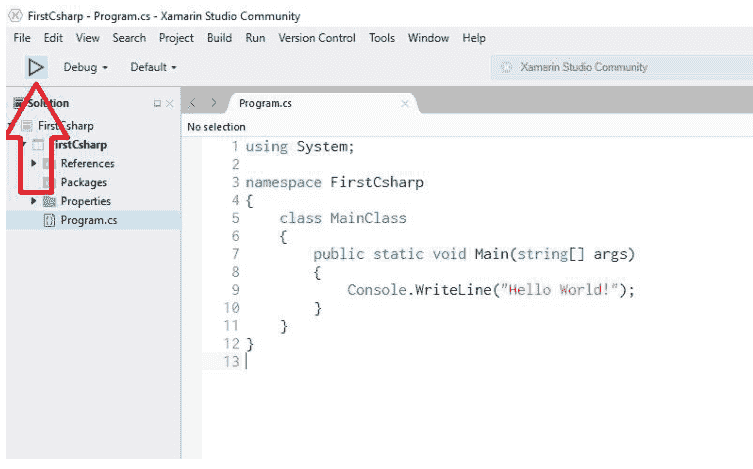

- 10. 以下是输出：

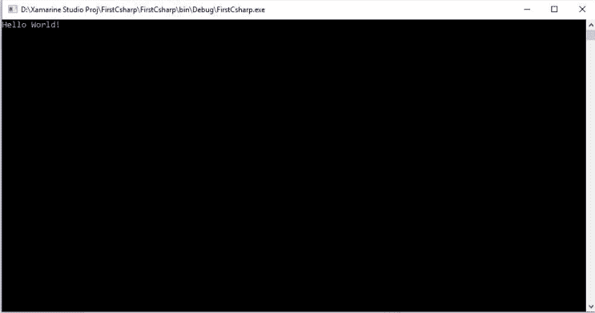

## 第 2 章：字面量

### 第 2.1 节：uint 字面量

`uint` 字面量是通过使用后缀 U 或 u 定义的，或使用在 `uint` 范围内的整数值：

```csharp
uint u1 = 5U;
```

### 第 2.2 节：int 字面量

`int` 字面量只需使用在 `int` 范围内的整数值即可定义：

```csharp
int i = 5;
```

### 第 2.3 节：sbyte 字面量

`sbyte` 类型没有字面量后缀。整数字面量会隐式从 `int` 转换而来：

```csharp
sbyte sb = 127;
```

### 第 2.4 节：decimal 字面量

`decimal` 字面量是通过在实数上使用后缀 M 或 m 定义的：

```csharp
decimal m = 30.5M;
```

### 第 2.5 节：double 字面量

`double` 字面量是通过使用后缀 D 或 d 定义的，或使用实数：

```csharp
double d = 30.5D;
```

### 第 2.6 节：float 字面量

`float` 字面量是通过使用后缀 F 或 f 定义的，或使用实数：

```csharp
float f = 30.5F;
```

### 第 2.7 节：long 字面量

`long` 字面量是通过使用后缀 L 或 l 定义的，或使用在 `long` 范围内的整数值：

```csharp
long l = 5L;
```

### 第 2.8 节：ulong 字面量

`ulong` 字面量是通过使用后缀 UL、ul、Ul、uL、LU、lu、Lu 或 lU 定义的，或使用在 `ulong` 范围内的整数值：

```csharp
ulong ul = 5UL;
```

### 第 2.9 节：string 字面量

string 字面量是通过用双引号 " 包裹值来定义的：

```csharp
string s = "hello, this is a string literal";
```

字符串字面量可能包含转义序列。参见 String Escape Sequences

此外，C# 支持逐字字符串字面量（参见 Verbatim Strings）。它们是通过用双引号 " 包裹值并在其前面加上 @ 来定义的。逐字字符串字面量中忽略转义序列，并且包含所有空白字符：

```csharp
string s = @"The path is:
C:\Windows\System32";
//The backslashes and newline are included in the string
```

### 第 2.10 节：char 字面量

char 字面量是通过用单引号 ' 包裹值来定义的：

```csharp
char c = 'h';
```

字符字面量可能包含转义序列。参见 String Escape Sequences

字符字面量必须恰好为一个字符长（在所有转义序列求值后）。空字符字面量无效。默认字符（由 default(char) 或 new char() 返回）是 '\0'，即 NULL 字符（不要与 null 字面量和 null 引用混淆）。

### 第 2.11 节：byte 字面量

byte 类型没有字面量后缀。整数字面量会隐式从 int 转换而来：

```csharp
byte b = 127;
```

### 第 2.12 节：short 字面量

short 类型没有字面量。整数字面量会隐式从 int 转换而来：

```csharp
short s = 127;
```

### 第 2.13 节：ushort 字面量

ushort 类型没有字面量后缀。整数字面量会隐式从 int 转换而来：

```csharp
ushort us = 127;
```

### 第 2.14 节：bool 字面量

bool 字面量要么是 true 要么是 false；

```csharp
bool b = true;
```

Version ≥ 7.0

`is` 运算符的重载是在 C# 7.0 的模式匹配机制中引入的。详情请参见 Pattern Matching

给定如下定义的 Cartesian 类型

```csharp
public class Cartesian
{
    public int X { get; }
    public int Y { get; }
}
```

例如，可为 Polar 坐标定义可重载的 `is` 运算符

```csharp
public static class Polar
{
    public static bool operator is(Cartesian c, out double R, out double Theta)
    {
        R = Math.Sqrt(c.X*c.X + c.Y*c.Y);
        Theta = Math.Atan2(c.Y, c.X);
        return c.X != 0 || c.Y != 0;
    }
}
```

它可以像这样使用

```csharp
var c = Cartesian(3, 4);
if (c is Polar(var R, *))
{
    Console.WriteLine(R);
}
```

（该示例取自 Roslyn Pattern Matching 文档）

### 第 3.2 节：重载相等运算符

仅重载相等运算符是不够的。在不同情况下，以下所有内容都可能被调用：

- 1. object.Equals 和 object.GetHashCode
- 2. IEquatable<T>.Equals（可选，允许避免装箱）
- 3. operator == 和 operator !=（可选，允许使用运算符）

重写 Equals 时，还必须重写 GetHashCode。在实现 Equals 时，有许多特殊情况：比较不同类型的对象、比较自身等。

当未重写时，Equals 方法和 == 运算符对类和结构体的行为不同。对于类，仅比较引用，而对于结构体，属性值会通过反射进行比较，这可能会对性能产生负面影响。除非被重写，否则 == 不能用于比较结构体。

通常相等操作必须遵守以下规则：

- 不得抛出异常。
- 自反性：A 总等于 A（在某些系统中 NULL 值可能不成立）。
- 传递性：如果 A 等于 B，且 B 等于 C，则 A 等于 C。
- 如果 A 等于 B，则 A 和 B 具有相等的哈希码。


- 继承树独立性：如果 B 和 C 是继承自 Class1 的 Class2 的实例：Class1.Equals(A,B) 必须始终返回与调用 Class2.Equals(A,B) 相同的值。

```csharp
class Student : IEquatable<Student>
{
    public string Name { get; set; } = "";

    public bool Equals(Student other)
    {
        if (ReferenceEquals(other, null)) return false;
        if (ReferenceEquals(other, this)) return true;
        return string.Equals(Name, other.Name);
    }

    public override bool Equals(object obj)
    {
        if (ReferenceEquals(null, obj)) return false;
        if (ReferenceEquals(this, obj)) return true;

        return Equals(obj as Student);
    }

    public override int GetHashCode()
    {
        return Name?.GetHashCode() ?? 0;
    }

    public static bool operator ==(Student left, Student right)
    {
        return Equals(left, right);
    }

    public static bool operator !=(Student left, Student right)
    {
        return !Equals(left, right);
    }
}
```

### 第 3.3 节：关系运算符

### 等于

检查所提供的操作数（参数）是否相等

```
"a" == "b"    // Returns false.
"a" == "a"    // Returns true.
1 == 0          // Returns false.
1 == 1          // Returns true.
false == true   // Returns false.
false == false  // Returns true.
```

与 Java 不同，等值比较运算符可原生处理字符串。

等值比较运算符可在存在从一个类型到另一个类型的隐式转换时用于不同类型的操作数。如果不存在合适的隐式转换，你可以调用显式转换或使用方法将其转换为兼容的类型。

```
1 == 1.0          // Returns true because there is an implicit cast from int to double.
new Object() == 1.0  // Will not compile.
```

### 大于等于

检查第一个操作数是否大于或等于第二个操作数。

```csharp
7 >= 8   //Returns false.
0 >= 0   //Returns true.
```

### 小于等于

检查第一个操作数是否小于或等于第二个操作数。

```csharp
2 <= 4   //Returns true.
1 <= -3   //Returns false.
1 <= 1   //Returns true.
```

### 第 3.4 节：隐式转换和显式转换运算符

C# 允许用户定义的类型通过使用 `explicit` 和 `implicit` 关键字来控制赋值和转换。方法的签名形式如下：

```csharp
public static <implicit/explicit> operator <ResultingType>(<SourceType> myType)
```

该方法不能接受更多参数，也不能是实例方法。然而，它可以访问定义它的类型中的任何私有成员。

隐式和显式转换的示例：

```csharp
public class BinaryImage
{
    private bool[] _pixels;

    public static implicit operator ColorImage(BinaryImage im)
    {
        return new ColorImage(im);
    }

    public static explicit operator bool[](BinaryImage im)
    {
        return im._pixels;
    }
}
```

允许以下转换语法：

```csharp
var binaryImage = new BinaryImage();
ColorImage colorImage = binaryImage; // implicit cast, note the lack of type
bool[] pixels = (bool[])binaryImage; // explicit cast, defining the type
```

转换运算符可以双向工作，从你的类型到你的类型以及反之亦然：

```csharp
public class BinaryImage
{
    public static explicit operator ColorImage(BinaryImage im)
    {
        return new ColorImage(im);
    }
}
```

```csharp
public static explicit operator BinaryImage(ColorImage cm)
{
    return new BinaryImage(cm);
}
}
```

最后，as 关键字，它可用于类型层次结构中的转换，在此情况下是 **无效** 的。即使定义了 `explicit` 或 `implicit` 转换，你也不能执行：

`ColorImage cm = myBinaryImage as ColorImage;`

它会生成编译错误。

### 第 3.5 节：短路运算符

*根据定义，短路布尔运算符只有在第一个操作数无法确定表达式的整体结果时才会计算第二个操作数。*

这意味着，如果你使用 `&&` 运算符作为 `firstCondition && secondCondition`，它只会在 `firstCondition` 为 true 时才计算 `secondCondition`，当然整体结果只有在 `firstOperand` 和 `secondOperand` 都被计算为 true 时才为 true。这在许多场景中很有用，例如想象你想要检查列表是否包含超过三个元素，但你也必须检查列表是否已初始化以避免 `NullReferenceException`。你可以按如下方式实现：

```csharp
bool hasMoreThanThreeElements = mList != null && mList.Count > 3;
```

只有在满足 `mList != null` 时才会检查 `mList.Count > 3`。

### 逻辑与

`&&` 是标准布尔与 (`&`) 运算符的短路对应项。

```csharp
var x = true;
var y = false;

x && x // Returns true.
x && y // Returns false (y is evaluated).
y && x // Returns false (x is not evaluated).
y && y // Returns false (right y is not evaluated).
```

### 逻辑或

`||` 是标准布尔或 (`|`) 运算符的短路对应项。

```csharp
var x = true;
var y = false;

x || x // Returns true (right x is not evaluated).
x || y // Returns true (y is evaluated).
y || x // Returns true (x and y are evaluated).
y || y // Returns false (y and y are evaluated).
```

### 示例用法

```csharp
if(object != null && object.Property)
// object.Property is never accessed if object is null, because of the short circuit.
```

```
Action1();
else
    Action2();
```

### 第 3.6 节：? : 三元运算符

根据布尔表达式的值返回两个值之一。

语法：

```
condition ? expression_if_true : expression_if_false;
```

示例：

```
string name = "Frank";
Console.WriteLine(name == "Frank" ? "The name is Frank" : "The name is not Frank");
```

三元运算符是右结合的，这允许使用复合三元表达式。这是通过在父三元方程的 true 或 false 位置添加额外的三元方程来实现的。应注意确保可读性，但在某些情况下这可以是有用的简写。

在此示例中，复合三元操作评估 clamp 函数，如果当前值在范围内则返回当前值，如果低于范围则返回最小值，如果高于范围则返回最大值。

```
light.intensity = Clamp(light.intensity, minLight, maxLight);
```

```csharp
public static float Clamp(float val, float min, float max)
{
    return (val < min) ? min : (val > max) ? max : val;
}
```

三元运算符也可以嵌套，例如：

```
a ? b ? "a is true, b is true" : "a is true, b is false" : "a is false"
// This is evaluated from left to right and can be more easily seen with parenthesis:
a ? (b ? x : y) : z
// Where the result is x if a && b, y if a && !b, and z if !a
```

编写复合三元语句时，通常使用括号或缩进来提高可读性。

expression_if_true 和 expression_if_false 的类型必须相同，或者必须存在从一个到另一个的隐式转换。

```
condition ? 3 : "Not three"; // Doesn't compile because 'int' and 'string' lack an implicit conversion.
condition ? 3.ToString() : "Not three"; // OK because both possible outputs are strings.
condition ? 3 : 3.5; // OK because there is an implicit conversion from 'int' to 'double'. The ternary operator will return a 'double'.
condition ? 3.5 : 3; // OK because there is an implicit conversion from 'int' to 'double'. The ternary operator will return a 'double'.
```

类型和转换要求也适用于你自己的类。

```csharp
public class Car
{}

public class SportsCar : Car
{}

public class SUV : Car
{}

condition ? new SportsCar() : new Car(); // OK because there is an implicit conversion from
`SportsCar` to `Car`. The ternary operator will return a reference of type `Car`.

condition ? new Car() : new SportsCar(); // OK because there is an implicit conversion from
`SportsCar` to `Car`. The ternary operator will return a reference of type `Car`

condition ? new SportsCar() : new SUV(); // Doesn't compile because there is no implicit conversion
from SportsCar to SUV or SUV to SportsCar. The compiler is not smart enough to realize that
both of them have an implicit conversion to Car.

condition ? new SportsCar() as Car : new SUV() as Car; // OK because both expressions evaluate to a
reference of type `Car`. The ternary operator will return a reference of type `Car`.
```

### 第 3.7 节：? （空条件运算符）

版本 ≥ 6.0

在 C# 6.0 中引入，空条件运算符 ?. 如果其左侧表达式计算结果为 null，则会立即返回 null，而不是抛出 NullReferenceException。如果其左侧表达式计算结果为非 null 值，则它就像普通的 . 运算符一样处理。请注意，由于它可能返回 null，其返回类型始终为可空类型。这意味着对于结构体或原始类型，它会被包装为 Nullable<T>。

```
var bar = Foo.GetBar()?.Value; // will return null if GetBar() returns null
var baz = Foo.GetBar()?.IntegerValue; // baz will be of type Nullable<int>, i.e. int?
```

在触发事件时很有用。通常你必须将事件调用包装在检查 null 的 if 语句中，然后再引发事件，这会引入竞态条件的可能性。使用空条件运算符可以按如下方式修复：

```
event EventHandler<string> RaiseMe;
RaiseMe?.Invoke("Event raised");
```

### 第 3.8 节：“异或”运算符

“异或”（简称 XOR）的运算符是：^

该运算符在且仅有一个提供的布尔值为 true 时返回 true。

```
true ^ false    // Returns true
false ^ true    // Returns true
false ^ false   // Returns false
true ^ true     // Returns false
```


### 第 3.9 节：默认运算符
### 值类型（其中 T : struct）
内置的原始数据类型，例如 `char`、`int` 和 `float`，以及使用 `struct` 或 `enum` 声明的用户定义类型。它们的默认值是 `new T()` ：
```
default(int)        // 0
default(DateTime)   // 0001-01-01 12:00:00 AM
default(char)       // '\0' This is the "null character", not a zero or a line break.
default(Guid)       // 00000000-0000-0000-0000-000000000000
default(MyStruct)   // new MyStruct()

// Note: default of an enum is 0, and not the first *key* in that enum
// so it could potentially fail the Enum.IsDefined test
default(MyEnum)     // (MyEnum)0
```
### 引用类型（其中 T : class）
任何 `class`、`interface`、数组或委托类型。它们的默认值是 `null` ：
```
default(object)     // null
default(string)     // null
default(MyClass)    // null
default(IDisposable)// null
default(dynamic)    // null
```
### 第 3.10 节：赋值运算符 '='
赋值运算符 = 将左操作数的值设置为右操作数的值，并返回该值：
```
int a = 3;   // assigns value 3 to variable a
int b = a = 5; // first assigns value 5 to variable a, then does the same for variable b
Console.WriteLine(a = 3 + 4); // prints 7
```
### 第 3.11 节：sizeof
返回一个 `int`，表示类型*的字节大小。
```
sizeof(bool)    // Returns 1.
sizeof(byte)    // Returns 1.
sizeof(sbyte)   // Returns 1.
sizeof(char)    // Returns 2.
sizeof(short)   // Returns 2.
sizeof(ushort)  // Returns 2.
sizeof(int)     // Returns 4.
sizeof(uint)    // Returns 4.
sizeof(float)   // Returns 4.
sizeof(long)    // Returns 8.
sizeof(ulong)   // Returns 8.
sizeof(double)  // Returns 8.
sizeof(decimal) // Returns 16.
```
*仅在安全上下文中支持某些原始类型。

在不安全上下文中，`sizeof` 可用于返回其他原始类型和结构体的大小。
```csharp
public struct CustomType
{
    public int value;
}

static void Main()
{
    unsafe
    {
        Console.WriteLine(sizeof(CustomType)); // outputs: 4
    }
}
```
### 第 3.12 节：?? 空合并运算符
Null-Coalescing 运算符 `??` 在不为 null 时返回左侧。如果为 null，则返回右侧。
```csharp
object foo = null;
object bar = new object();

var c = foo ?? bar;
//c will be bar since foo was null
```
`??` 运算符可以链式使用，从而可以移除 if 检查。
```csharp
//config will be the first non-null returned.
var config = RetrieveConfigOnMachine() ??
             RetrieveConfigFromService() ??
             new DefaultConfiguration();
```
### 第 3.13 节：位移运算符
移位运算符允许程序员通过将整数的所有位向左或向右移动来调整整数。下面的图表显示了将值向左移动一位的影响。
### 左移
```csharp
uint value = 15;                  // 00001111

uint doubled = value << 1;        // Result = 00011110 = 30
uint shiftFour = value << 4;      // Result = 11110000 = 240
```
### 右移
```csharp
uint value = 240;                 // 11110000

uint halved = value >> 1;         // Result = 01111000 = 120
uint shiftFour = value >> 4;      // Result = 00001111 = 15
```
### 第 3.14 节：=> Lambda 运算符
版本 ≥ 3.0

=> 运算符的优先级与赋值运算符 = 相同，并且是右结合的。

它用于声明 lambda 表达式，并且在 LINQ 查询中也被广泛使用：
```
string[] words = { "cherry", "apple", "blueberry" };

int shortestWordLength = words.Min((string w) => w.Length); //5
```
在 LINQ 扩展或查询中使用时，对象的类型通常可以省略，因为编译器会推断它：
```
int shortestWordLength = words.Min(w => w.Length); //also compiles with the same result
```
lambda 运算符的一般形式如下：
```
(input parameters) => expression
```
lambda 表达式的参数在 => 运算符之前指定，而要执行的实际表达式/语句/块位于运算符的右侧：
// expression
(int x, string s) => s.Length > x

// expression
(int x, int y) => x + y

// statement
(string x) => Console.WriteLine(x)

// block
(string x) => {
    x += " says Hello!";
    Console.WriteLine(x);
}
```
此运算符可用于轻松定义委托，而无需编写显式方法：
```
delegate void TestDelegate(string s);

TestDelegate myDelegate = s => Console.WriteLine(s + " World");

myDelegate("Hello");
```
而不是
```
void MyMethod(string s)
{
    Console.WriteLine(s + " World");
}

delegate void TestDelegate(string s);

TestDelegate myDelegate = MyMethod;

myDelegate("Hello");
```
### 第 3.15 节：类成员运算符：空条件成员访问
```csharp
var zipcode = myEmployee?.Address?.ZipCode;
//returns null if the left operand is null.
//the above is the equivalent of:
var zipcode = (string)null;
if (myEmployee != null && myEmployee.Address != null)
    zipcode = myEmployee.Address.ZipCode;
```
### 第 3.16 节：类成员运算符：空条件索引
```csharp
var letters = null;
char? letter = letters?[1];
Console.WriteLine("Second Letter is {0}",letter);
//in the above example  rather than throwing an error because letters is null
//letter is assigned the value null
```
### 第 3.17 节：后缀和前缀自增与自减
后缀自增 X++ 将使 x 增加 1
```csharp
var x = 42;
x++;
Console.WriteLine(x); // 43
```
后缀自减
X--
将减去一
```csharp
var x = 42;
x--;
Console.WriteLine(x); // 41
```
++x 称为前缀自增，它先递增 x 的值然后返回 x，而 x++ 先返回 x 的值然后递增
```csharp
var x = 42;
Console.WriteLine(++x); // 43
System.out.println(x); // 43
```
而
```csharp
var x = 42;
Console.WriteLine(x++); // 42
System.out.println(x); // 43
```
两者通常在 for 循环中使用
```csharp
for(int i = 0; i < 10; i++)
{
}
```
### 第 3.18 节：typeof
获取类型的 System.Type 对象。
```
System.Type type = typeof(Point)    //System.Drawing.Point
System.Type type = typeof(IDisposable)    //System.IDisposable
System.Type type = typeof(Colors)    //System.Drawing.Color
System.Type type = typeof(List<>)    //System.Collections.Generic.List`1[T]
```
要获取运行时类型，请使用 GetType 方法获取当前实例的 System.Type。

typeof 运算符以类型名作为参数，该参数在编译时指定。
```
public class Animal {}
public class Dog : Animal {}

var animal = new Dog();

Assert.IsTrue(animal.GetType() == typeof(Animal)); // fail, animal is typeof(Dog)
Assert.IsTrue(animal.GetType() == typeof(Dog)); // pass, animal is typeof(Dog)
Assert.IsTrue(animal is Animal); // pass, animal implements Animal
```
### 第 3.19 节：带赋值的二元运算符
C# 有多个运算符可以与 = 符号组合，以计算运算符的结果然后将结果赋给原始变量。

示例：
```
x += y
```
等同于
```
x = x + y
```
赋值运算符：
- +=
- -=
- *=
- /=
- %=
- &=
- |=
- ^=
- <<=
- >>=
### 第 3.20 节：nameof 运算符
返回表示变量、类型或成员的非限定名称的字符串。
```
int counter = 10;
nameof(counter); // Returns "counter"
Client client = new Client();
```
```
nameof(client.Address.PostalCode); // Returns "PostalCode"
```
`nameof` 运算符在 C# 6.0 中引入。它在编译时求值，返回的字符串值由编译器内联插入，因此可以在大多数可以使用常量字符串的地方使用（例如 `switch` 语句中的 `case` 标签、特性等...）。它在引发和记录异常、特性、MVC Action 链接等情况下很有用...
### 第 3.21 节：类成员运算符：成员访问
```
var now = DateTime.UtcNow;
//accesses member of a class.  In this case the UtcNow property.
```
### 第 3.22 节：类成员运算符：函数调用
```
var age = GetAge(dateOfBirth);
//the above calls the function GetAge passing parameter dateOfBirth.
```
### 第 3.23 节：类成员运算符：聚合对象索引
```
var letters = "letters".ToCharArray();
char letter = letters[1];
Console.WriteLine("Second Letter is {0}",letter);
//in the above example we take the second character from the array
//by calling letters[1]
//NB: Array Indexing starts at 0; i.e. the first letter would be given by letters[0].
```


## 第 4 章：条件语句

### 第 4.1 节：If-Else 语句

编程通常需要在代码中进行决策或分支，以应对代码在不同输入或条件下运行的方式。在 C# 编程语言（以及大多数编程语言）中，在程序中创建分支最简单且有时最有用的方式是通过 If-Else 语句。

假设我们有一个方法（又名函数），它接受一个 int 参数，表示最高为 100 的分数，并且该方法会打印出一条消息，说明我们是否通过。

```
static void PrintPassOrFail(int score)
{
    if (score >= 50) // If score is greater or equal to 50
    {
        Console.WriteLine("Pass!");
    }
    else // If score is not greater or equal to 50
    {
        Console.WriteLine("Fail!");
    }
}
```

查看此方法时，您可能会注意到 If 语句中这一行代码 (score >= 50)。这可以看作是一个布尔条件，如果条件被评估为等于 true，则 if { } 之间的代码将被运行。

例如，如果此方法像这样调用：PrintPassOrFail(60);，方法的输出将是 Console 打印 Pass！，因为参数值 60 大于或等于 50。

然而，如果方法像这样调用：PrintPassOrFail(38);，方法的输出将打印 Fail！。这是因为值 38 不大于或等于 50，因此 else { } 之间的代码会被运行，而不是 If 语句。

在此示例中，我们说 score 应该最高为 100，但这完全没有被考虑。为了解决 score 不超过 100 或可能低于 0 的情况，请参阅 If-Else If-Else 语句示例。

### 第 4.2 节：If 语句条件是标准布尔表达式和值

以下语句

```
if (conditionA && conditionB && conditionC) //...
```

```
if (conditionA == true && conditionB == false && conditionC == true) // ...
```

这可以重写为

```
if (conditionA && !conditionB && conditionC)
```

### 第 4.3 节：If-Else If-Else 语句

在 If-Else 语句示例的基础上，现在是介绍 Else If 语句的时候了。Else If 语句直接跟在 If-Else If-Else 结构中的 If 语句之后，但本质上与 If 语句具有相似的语法。它用于为代码添加比简单 If-Else 语句更多的分支。

在 If-Else 语句的示例中，示例规定 score 最高为 100；然而从未对此进行任何检查。为了解决这个问题，让我们修改 If-Else 语句中的方法，使其如下所示：

```
static void PrintPassOrFail(int score)
{
    if (score > 100) // If score is greater than 100
    {
        Console.WriteLine("Error: score is greater than 100!");
    }
    else if (score < 0) // Else If score is less than 0
    {
        Console.WriteLine("Error: score is less than 0!");
    }
    else if (score >= 50) // Else if score is greater or equal to 50
    {
        Console.WriteLine("Pass!");
    }
    else // If none above, then score must be between 0 and 49
    {
        Console.WriteLine("Fail!");
    }
}
```

所有这些语句将按顺序从上到下运行，直到满足某个条件为止。在此方法的更新版本中，我们添加了两个新分支，以适应 score 超出范围的情况。

例如，如果我们现在在代码中像这样调用方法 PrintPassOrFail(118);，输出将是 Console 打印 Error: score is greater than 100!；如果我们像这样调用方法 PrintPassOrFail(-28);，输出将显示 Error: score is less than 0!。

## 第 5 章：相等运算符

### 第 5.1 节：C# 中的相等种类和相等运算符

在 C# 中，有两种不同的相等性：引用相等性和值相等性。值相等性是相等性的常用含义：它意味着两个对象包含相同的值。例如，两个值为 2 的整数具有值相等性。引用相等性意味着没有两个对象可供比较。相反，有两个对象引用，两者都引用同一个对象。

```
object a = new object();
object b = a;
System.Object.ReferenceEquals(a, b);  //returns true
```

对于预定义的值类型，相等运算符 (==) 如果其操作数的值相等则返回 true，否则返回 false。对于 string 以外的引用类型，== 如果其两个操作数引用同一个对象则返回 true。对于 string 类型，== 比较字符串的值。

```
// Numeric equality: True
Console.WriteLine((2 + 2) == 4);

// Reference equality: different objects,
// same boxed value: False.
object s = 1;
object t = 1;
Console.WriteLine(s == t);

// Define some strings:
string a = "hello";
string b = String.Copy(a);
string c = "hello";

// Compare string values of a constant and an instance: True
Console.WriteLine(a == b);

// Compare string references;
// a is a constant but b is an instance: False.
Console.WriteLine((object)a == (object)b);

// Compare string references, both constants
// have the same value, so string interning
// points to same reference: True.
Console.WriteLine((object)a == (object)c);
```

## 第 6 章：Equals 和 GetHashCode

### 第 6.1 节：编写良好的 GetHashCode 重写

GetHashCode 对 Dictionary<> 和 HashTable 具有重大的性能影响。

### 良好的 GetHashCode 方法

- 应具有均匀分布
  - 每个整数对于随机实例返回的概率应大致相等
  - 如果您的方法对每个实例都返回相同的整数（例如常量 '999'），性能会很差
- 应快速
  - 这些不是加密哈希，其中缓慢是特性
  - 您的哈希函数越慢，字典就越慢
- 必须在 Equals 评估为 true 的两个实例上返回相同的 HashCode
  - 如果它们不相同（例如因为 GetHashCode 返回随机数），项目可能无法在 List、Dictionary 或类似结构中找到。

实现 GetHashCode 的一个好方法是使用一个质数作为起始值，并将该类型字段的哈希码乘以其他质数后加到该值上：

```
public override int GetHashCode()
{
    unchecked // Overflow is fine, just wrap
    {
        int hash = 3049; // Start value (prime number).
        // Suitable nullity checks etc, of course :)
        hash = hash * 5099 + field1.GetHashCode();
        hash = hash * 883 + field2.GetHashCode();
        hash = hash * 9719 + field3.GetHashCode();
        return hash;
    }
}
```

只有在 Equals 方法中使用的字段才应用于哈希函数。

如果您需要在 Dictionary/HashTables 中以不同方式处理同一类型，可以使用 IEqualityComparer。

### 第 6.2 节：默认 Equals 行为

Equals 在 Object 类本身中声明。

```
public virtual bool Equals(Object obj);
```

默认情况下，Equals 具有以下行为：

- 如果实例是引用类型，则 Equals 仅在引用相同时返回 true。
- 如果实例是值类型，则 Equals 仅在类型和值相同时返回 true。
- string 是一个特殊情况。它表现得像值类型。

```csharp
namespace ConsoleApplication
{
    public class Program
    {
        public static void Main(string[] args)
        {
            //areFooClassEqual: False
            Foo fooClass1 = new Foo("42");
            Foo fooClass2 = new Foo("42");
            bool areFooClassEqual = fooClass1.Equals(fooClass2);
            Console.WriteLine("fooClass1 and fooClass2 are equal: {0}", areFooClassEqual);
            //False

            //areFooIntEqual: True
            int fooInt1 = 42;
            int fooInt2 = 42;
            bool areFooIntEqual = fooInt1.Equals(fooInt2);
            Console.WriteLine("fooInt1 and fooInt2 are equal: {0}", areFooIntEqual);

            //areFooStringEqual: True
            string fooString1 = "42";
            string fooString2 = "42";
            bool areFooStringEqual = fooString1.Equals(fooString2);
            Console.WriteLine("fooString1 and fooString2 are equal: {0}", areFooStringEqual);
        }
    }

    public class Foo
    {
        public string Bar { get; }
        public Foo(string bar)
        {
            Bar = bar;
        }
    }
}
```

### 第 6.3 节：在自定义类型上重写 Equals 和 GetHashCode

对于像这样的 Person 类：

```csharp
public class Person
{
    public string Name { get; set; }
    public int Age { get; set; }
    public string Clothes { get; set; }
}

var person1 = new Person { Name = "Jon", Age = 20, Clothes = "some clothes" };
var person2 = new Person { Name = "Jon", Age = 20, Clothes = "some other clothes" };

bool result = person1.Equals(person2); //false because it's reference Equals
```

但定义 Equals 和 GetHashCode 如下：

```csharp
public class Person
{
    public string Name { get; set; }
}
```

```csharp
public int Age { get; set; }
public string Clothes { get; set; }

public override bool Equals(object obj)
{
    var person = obj as Person;
    if(person == null) return false;
    return Name == person.Name && Age == person.Age; //the clothes are not important when comparing two persons
}

public override int GetHashCode()
{
    return Name.GetHashCode() + Age;
}
}
```

```csharp
var person1 = new Person { Name = "Jon", Age = 20, Clothes = "some clothes" };
var person2 = new Person { Name = "Jon", Age = 20, Clothes = "some other clothes" };

bool result = person1.Equals(person2); // result is true
```

另外，使用 LINQ 对 persons 执行不同查询时，会同时检查 Equals 和 GetHashCode：

```csharp
var persons = new List<Person>
{
    new Person{ Name = "Jon", Age = 20, Clothes = "some clothes"},
    new Person{ Name = "Dave", Age = 20, Clothes = "some other clothes"},
    new Person{ Name = "Jon", Age = 20, Clothes = ""}
};

var distinctPersons = persons.Distinct().ToList();//distinctPersons has Count = 2
```

### 第 6.4 节：IEqualityComparer 中的 Equals 和 GetHashCode

对于给定的类型 Person：

```csharp
public class Person
{
    public string Name { get; set; }
    public int Age { get; set; }
    public string Clothes { get; set; }
}
```

```csharp
List<Person> persons = new List<Person>
{
    new Person{ Name = "Jon", Age = 20, Clothes = "some clothes"},
    new Person{ Name = "Dave", Age = 20, Clothes = "some other clothes"},
    new Person{ Name = "Jon", Age = 20, Clothes = ""}
};

var distinctPersons = persons.Distinct().ToList();// distinctPersons has Count = 3
```

但将 Equals 和 GetHashCode 定义到 IEqualityComparer 中：

```csharp
public class PersonComparator : IEqualityComparer<Person>
{
    public bool Equals(Person x, Person y)
    {
        return x.Name == y.Name && x.Age == y.Age; //the clothes are not important when comparing two persons
    }
    public int GetHashCode(Person obj) { return obj.Name.GetHashCode() * obj.Age; }
}
var distinctPersons = persons.Distinct(new PersonComparator()).ToList();// distinctPersons has Count = 2
```

请注意，对于此查询，只有当 Equals 返回 true 且 GetHashCode 为两个对象返回相同的哈希代码时，两个对象才会被视为相等。

## 第 7 章：Null 合并运算符

| 参数 | 详情 |
|---|---|
| possibleNullObject | 要测试是否为 null 的值。如果非 null，则返回此值。必须为可空类型。 |
| defaultValue | 如果 possibleNullObject 为 null，则返回的值。必须与 possibleNullObject 类型相同。 |

### 第 7.1 节：基本用法

使用 null 合并运算符（??）可以在左操作数为 null 时为可空类型指定默认值。

```csharp
string testString = null;
Console.WriteLine("The specified string is - " + (testString ?? "not provided"));
```

在 .NET Fiddle 上查看实时演示

这在逻辑上等价于：

```csharp
string testString = null;
if (testString == null)
{
    Console.WriteLine("The specified string is - not provided");
}
else
{
    Console.WriteLine("The specified string is - " + testString);
}
```

或使用三元运算符（?）：

```csharp
string testString = null;
Console.WriteLine("The specified string is - " + (testString == null ? "not provided" : testString));
```

### 第 7.2 节：Null 穿透与链式调用

左操作数必须可为 null，而右操作数可为 null 或不可为 null。结果将相应地确定类型。

### 不可为 null

```csharp
int? a = null;
int b = 3;
var output = a ?? b;
var type = output.GetType();

Console.WriteLine($"Output Type :{type}");
Console.WriteLine($"Output value :{output}");
```

输出：

类型：System.Int32

值：3

查看演示

### 可为 null

```csharp
int? a = null;
int? b = null;
var output = a ?? b;
```

输出将为 int? 类型，并等于 b，或为 null。

### 多重合并

合并也可以链式进行：

```csharp
int? a = null;
int? b = null;
int c = 3;
var output = a ?? b ?? c;

var type = output.GetType();
Console.WriteLine($"Type :{(type)}");
Console.WriteLine($"value :{output}");
```

输出：
类型：System.Int32
值：3

查看演示

### Null 条件链式调用

null 合并运算符可以与 null 传播运算符配合使用，以更安全地访问对象的属性。

```csharp
object o = null;
var output = o?.ToString() ?? "Default Value";
```

### 第 7.3 节：带方法调用的 null 合并运算符

不使用 null 合并运算符：

```csharp
string name = GetName();
if (name == null)
    name = "Unknown!";
```

使用 null 合并运算符：

```csharp
string name = GetName() ?? "Unknown!";
```

### 第 7.4 节：使用现有对象或创建新对象

此特性真正有帮助的一种常见使用场景是：当你在集合中查找某个对象，并且如果该对象尚不存在则需要创建一个新对象时。

```csharp
IEnumerable<MyClass> myList = GetMyList();
var item = myList.SingleOrDefault(x => x.Id == 2) ?? new MyClass { Id = 2 };
```

### 第 7.5 节：使用 null 合并运算符延迟初始化属性

```csharp
private List<FooBar> _fooBars;
public List<FooBar> FooBars
{
    get { return _fooBars ?? (_fooBars = new List<FooBar>()); }
}
```

第一次访问属性 .FooBars 时，_fooBars 变量将求值为 null，因此会继续执行赋值语句，完成赋值并求值为最终结果。

### 线程安全性

这不是实现延迟属性的线程安全方式。若需要线程安全的延迟初始化，请使用 .NET Framework 内置的 Lazy<T> 类。

### 使用表达式主体的 C# 6 语法糖

请注意，从 C# 6 起，可以使用属性的表达式主体来简化此语法：

```csharp
private List<FooBar> _fooBars;
public List<FooBar> FooBars => _fooBars ?? (_fooBars = new List<FooBar>());
```

之后对该属性的访问将返回存储在 _fooBars 变量中的值。

### MVVM 模式中的示例

在 MVVM 模式中实现命令时经常会用到这种做法。命令不再随视图模型的构造而立即初始化，而是使用如下模式进行延迟初始化：

```csharp
private ICommand _actionCommand = null;
public ICommand ActionCommand =>
    _actionCommand ?? (_actionCommand = new DelegateCommand( DoAction ));
```

## 第 8 章：Null 条件运算符

### 第 8.1 节：Null 条件运算符

?. 运算符是一种语法糖，用于避免冗长的 null 检查。它也被称为安全导航运算符。

以下示例中使用的类：

```csharp
public class Person
{
    public int Age { get; set; }
    public string Name { get; set; }
    public Person Spouse { get; set; }
}
```

如果某个对象可能为 null（例如返回引用类型的函数），则必须先检查该对象是否为 null，以防止可能出现的 NullReferenceException。不使用 null 条件运算符时，代码如下所示：

```csharp
Person person = GetPerson();

int? age = null;
if (person != null)
    age = person.Age;
```

使用 null 条件运算符的同一示例：

```csharp
Person person = GetPerson();

var age = person?.Age;    // 'age' will be of type 'int?', even if 'person' is not null
```

### 运算符的链式调用

null 条件运算符可以组合用于对象的成员和子成员。

```csharp
// Will be null if either 'person' or 'person.Spouse' are null
int? spouseAge = person?.Spouse?.Age;
```

### 与 null 合并运算符结合使用

null 条件运算符可以与 null 合并运算符结合使用，以提供默认值：

```csharp
// spouseDisplayName will be "N/A" if person, Spouse, or Name is null
var spouseDisplayName = person?.Spouse?.Name ?? "N/A";
```

### 第 8.2 节：Null 条件索引

与 ?. 运算符类似，null 条件索引运算符在索引可能为 null 的集合时会检查 null 值。

```csharp
string item = collection?[index];
```

是以下代码的语法糖

```csharp
string item = null;
```


```csharp
if(collection != null)
{
    item = collection[index];
}
```

### 第 8.3 节：避免 NullReferenceException

```csharp
var person = new Person
{
    Address = null,
};
var city = person.Address.City; //throws a NullReferenceException
var nullableCity = person.Address?.City; //returns the value of null
```

此效果可以链接在一起：

```csharp
var person = new Person
{
    Address = new Address
    {
        State = new State
        {
            Country = null
        }
    }
};
// this will always return a value of at least "null" to be stored instead
// of throwing a NullReferenceException
var countryName = person?.Address?.State?.Country?.Name;
```

### 第 8.4 节：空条件运算符可与扩展方法一起使用

扩展方法可以在空引用上工作，但你仍然可以使用 ?. 进行空值检查。

```csharp
public class Person
{
    public string Name { get; set; }
}
```

```csharp
public static class PersonExtensions
{
    public static int GetNameLength(this Person person)
    {
        return person == null ? -1 : person.Name.Length;
    }
}
```

通常，该方法会在空引用上触发，并返回 -1：

```csharp
Person person = null;
int nameLength = person.GetNameLength(); // returns -1
```

使用 ?. 该方法不会在空引用上触发，且类型为 int？：

```csharp
Person person = null;
int? nameLength = person?.GetNameLength(); // nameLength is null.
```

这种行为实际上是 ?. 运算符的工作方式所期望的：它会避免对空实例进行实例方法调用，以避免 NullReferenceException。然而，相同的逻辑也适用于扩展方法，尽管方法的声明方式不同。

有关第一个示例中为何调用扩展方法的更多信息，请参阅 Extension methods - null checking 文档。

## 第 9 章：nameof 运算符

nameof 运算符允许你以字符串形式获取变量、类型或成员的名称，而无需将其硬编码为字面量。

该操作在编译时求值，这意味着你可以使用 IDE 的重命名功能重命名引用的标识符，名称字符串也会随之更新。

### 第 9.1 节：基本用法：打印变量名

nameof 运算符允许你以字符串形式获取变量、类型或成员的名称，而无需将其硬编码为字面量。该操作在编译时求值，这意味着你可以使用 IDE 的重命名功能重命名引用的标识符，名称字符串也会随之更新。

```csharp
var myString = "String Contents";
Console.WriteLine(nameof(myString));
```

会输出

myString

因为变量的名称是 "myString"。重构变量名会改变该字符串。

如果在引用类型上调用，nameof 运算符返回当前引用的名称，而不是底层对象的名称或类型名称。例如：

```csharp
string greeting = "Hello!";
Object mailMessageBody = greeting;

Console.WriteLine(nameof(greeting)); // Returns "greeting"
Console.WriteLine(nameof(mailMessageBody)); // Returns "mailMessageBody", NOT "greeting"!
```

### 第 9.2 节：引发 PropertyChanged 事件

### 代码片段

```csharp
public class Person : INotifyPropertyChanged
{
    private string _address;

    public event PropertyChangedEventHandler PropertyChanged;

    private void OnPropertyChanged(string propertyName)
    {
        PropertyChanged?.Invoke(this, new PropertyChangedEventArgs(propertyName));
    }

    public string Address
    {
        get { return _address; }
        set
        {
            if (_address == value)
            {
                return;
            }

            _address = value;
            OnPropertyChanged(nameof(Address));
        }
    }
}
...
var person = new Person();
person.PropertyChanged += (s,e) => Console.WriteLine(e.PropertyName);
person.Address = "123 Fake Street";
```

### 控制台输出

Address

### 第 9.3 节：参数检查和保护子句

优先使用

```csharp
public class Order
{
    public OrderLine AddOrderLine(OrderLine orderLine)
    {
        if (orderLine == null) throw new ArgumentNullException(nameof(orderLine));
        ...
    }
}
```

而不是

```csharp
public class Order
{
    public OrderLine AddOrderLine(OrderLine orderLine)
    {
        if (orderLine == null) throw new ArgumentNullException("orderLine");
        ...
    }
}
```

使用 nameof 功能使重构方法参数变得更容易。

### 第 9.4 节：强类型 MVC 动作链接

而不是通常的弱类型：

```csharp
@Html.ActionLink("Log in", "UserController", "LogIn")
```

你现在可以使动作链接强类型化：

```csharp
@Html.ActionLink("Log in", @typeof(UserController), @nameof(UserController.LogIn))
```

现在，如果你想重构代码并将 UserController.LogIn 方法重命名为 UserController.SignIn，你无需担心搜索所有字符串出现的位置。编译器会完成这项工作。

### 第 9.5 节：处理 PropertyChanged 事件

### 代码片段

```csharp
public class BugReport : INotifyPropertyChanged
{
    public string Title { ... }
    public BugStatus Status { ... }
}

...

private void BugReport_PropertyChanged(object sender, PropertyChangedEventArgs e)
{
    var bugReport = (BugReport)sender;

    switch (e.PropertyName)
    {
        case nameof(bugReport.Title):
            Console.WriteLine("{0} changed to {1}", e.PropertyName, bugReport.Title);
            break;

        case nameof(bugReport.Status):
            Console.WriteLine("{0} changed to {1}", e.PropertyName, bugReport.Status);
            break;
    }
}
...

var report = new BugReport();
report.PropertyChanged += BugReport_PropertyChanged;

report.Title = "Everything is on fire and broken";
report.Status = BugStatus.ShowStopper;
```

### 控制台输出

> Title changed to Everything is on fire and broken
> 
> Status changed to ShowStopper

### 第 9.6 节：应用于泛型类型参数

### 代码片段

```csharp
public class SomeClass<TItem>
{
    public void PrintTypeName()
    {
        Console.WriteLine(nameof(TItem));
    }
}
```

```csharp
var myClass = new SomeClass<int>();
myClass.PrintTypeName();

Console.WriteLine(nameof(SomeClass<int>));
```

### 控制台输出

TItem
SomeClass

### 第 9.7 节：打印参数名

### 代码片段

```csharp
public void DoSomething(int paramValue)
{
    Console.WriteLine(nameof(paramValue));
}

...

int myValue = 10;
DoSomething(myValue);
```

### 控制台输出

paramValue

### 第 9.8 节：应用于限定标识符

### 代码片段

```csharp
Console.WriteLine(nameof(CompanyNamespace.MyNamespace));
Console.WriteLine(nameof(MyClass));
Console.WriteLine(nameof(MyClass.MyNestedClass));
Console.WriteLine(nameof(MyNamespace.MyClass.MyNestedClass.MyStaticProperty));
```

### 控制台输出

MyNamespace
MyClass
MyNestedClass
MyStaticProperty

## 第 10 章：逐字字符串

### 第 10.1 节：插值逐字字符串

逐字字符串可以与 C#6 中找到的新字符串插值功能结合使用。

```csharp
Console.WriteLine($@"Testing \n 1 2 {5 - 2}
New line");
```

**输出：**

Testing \n 1 2 3
New line

在 .NET Fiddle 上实时演示

正如逐字字符串所期望的，反斜杠被忽略为转义字符。正如插值字符串所期望的，花括号内的任何表达式在插入到该位置的字符串之前都会被求值。

### 第 10.2 节：转义双引号

逐字字符串中的双引号可以通过使用 2 个连续的双引号 "" 来转义，以在结果字符串中表示一个双引号 "。

```csharp
var str = @"""I don't think so,"" he said.";
Console.WriteLine(str);
```

**输出：**

"I don't think so," he said.

在 .NET Fiddle 上实时演示

### 第 10.3 节：逐字字符串指示编译器不使用字符转义

在普通字符串中，反斜杠字符是转义字符，它指示编译器查看下一个字符以确定字符串中的实际字符。（字符转义的完整列表）

在逐字字符串中，没有字符转义（除了 "" 会被转换为 "）。要使用逐字字符串，只需在起始引号前加上 @ 即可。

这个逐字字符串

```csharp
var filename = @"c:\temp\newfile.txt"
```

**输出：**


> > c:\temp\newfile.txt

与使用普通（非逐字）字符串相反：

```csharp
var filename = "c:\temp\newfile.txt";
```

将输出：

```
c:      emp
ewfile.txt
```

使用字符转义。（\t 被替换为制表符，\n 被替换为换行符。）

.NET Fiddle 上的实时演示

### 第 10.4 节：多行字符串

```csharp
var multiLine = @"This is a

multiline paragraph";
```

**输出：**

> > This is a
> >
> > multiline paragraph

.NET Fiddle 上的实时演示

包含双引号的多行字符串也可以像单行一样进行转义，因为它们是逐字字符串。

```csharp
var multilineWithDoubleQuotes = @"I went to a city named

                ""San Diego""

                during summer vacation.";
```

.NET Fiddle 上的实时演示

*请注意，这里第 2 行和第 3 行开头的空格/制表符实际上存在于变量的值中；请查看此问题以获取可能的解决方案。*

## 第 11 章：常见字符串操作

### 第 11.1 节：格式化字符串

使用 String.Format() 方法用指定对象的字符串表示形式替换字符串中的一个或多个项：

```csharp
String.Format("Hello {0} Foo {1}", "World", "Bar") //Hello World Foo Bar
```

### 第 11.2 节：正确反转字符串

大多数情况下，人们需要反转字符串时，大致是这样做的：

```csharp
char[] a = s.ToCharArray();
System.Array.Reverse(a);
string r = new string(a);
```

然而，这些人没有意识到，这实际上是错误的。

我并不是说因为缺少 NULL 检查。

它实际上是错误的，因为一个字形/字素簇可以由多个码点（即字符）组成。

要了解原因，我们首先必须意识到“字符”一词的实际含义。

参考：

> 字符是一个多义词，可以有多种含义。
> 
> 码点是信息的原子单位。文本是码点的序列。每个码点都是一个数字，由 Unicode 标准赋予其含义。
> 
> 字素是由一个或多个码点组成的序列，以单个图形单元显示，读者将其识别为书写系统中的单个元素。例如，a 和 ä 都是字素，但它们可能由多个码点组成（例如，ä 可能是两个码点，一个是基础字符 a，另一个是分音符；但也有一个表示该字素的替代、旧的单个码点）。某些码点永远不属于任何字素（例如零宽不连字或方向覆盖）。
> 
> 字形通常存储在字体（字形集合）中，用于表示字素或其部分。字体可以将多个字形组合成单一表示，例如，如果上面的 ä 是一个单个码点，字体可能会选择将其渲染为两个单独的、空间上重叠的字形。对于 OTF，字体的 GSUB 和 GPOS 表包含使此功能工作的替换和定位信息。字体也可能包含同一字素的多个替代字形。

因此在 C# 中，字符实际上是一个码点。

这意味着，如果你只是将像 Les Misérables 这样的有效字符串

```csharp
string s = "Les Mise\u0301rables";
```

作为字符序列反转，你将得到：

> > selbaresiM seL

正如你所见，重音在 R 字符上，而不是 e 字符上。

尽管 string.reverse.reverse 如果两次都反转字符数组会得到原始字符串，但这种反转绝对不是原始字符串的反转。

你只需要反转每个字素簇。

因此，如果正确完成，你可以这样反转字符串：

```csharp
private static System.Collections.Generic.List<string> GraphemeClusters(string s)
{
    System.Collections.Generic.List<string> ls = new System.Collections.Generic.List<string>();

    System.Globalization.TextElementEnumerator enumerator =
System.Globalization.StringInfo.GetTextElementEnumerator(s);
    while (enumerator.MoveNext())
    {
        ls.Add((string)enumerator.Current);
    }

    return ls;
}

// this
private static string ReverseGraphemeClusters(string s)
{
    if(string.IsNullOrEmpty(s) || s.Length <= 1)
        return s;

    System.Collections.Generic.List<string> ls = GraphemeClusters(s);
    ls.Reverse();

    return string.Join("", ls.ToArray());
}

public static void TestMe()
{
    string s = "Les Mise\u0301rables";
    // s = "noe\u0308l";
    string r = ReverseGraphemeClusters(s);

    // This would be wrong:
    // char[] a = s.ToCharArray();
    // System.Array.Reverse(a);
    // string r = new string(a);

    System.Console.WriteLine(r);
}
```

而且 - 哦，太好了 - 你会意识到，如果你像这样正确地做，它也适用于亚洲/南亚/东亚语言（以及法语/瑞典语/挪威语等）...

### 第 11.3 节：将字符串填充到固定长度

```csharp
string s = "Foo";
string paddedLeft = s.PadLeft(5);        // paddedLeft = "  Foo" (pads with spaces by default)
string paddedRight = s.PadRight(6, '+'); // paddedRight = "Foo+++"
```

```csharp
string noPadded = s.PadLeft(2); ........ // noPadded = "Foo" (original string is never shortened)
```

### 第 11.4 节：从字符串右侧获取 x 个字符

Visual Basic 有 Left、Right 和 Mid 函数，可从字符串的左侧、右侧和中间返回字符。这些方法在 C# 中不存在，但可以用 Substring() 实现。它们可以像以下示例一样实现为扩展方法：

```csharp
public static class StringExtensions
{
    /// <summary>
    /// VB Left function
    /// </summary>
    /// <param name="stringparam"></param>
    /// <param name="numchars"></param>
    /// <returns>Left-most numchars characters</returns>
    public static string Left( this string stringparam, int numchars )
    {
        // Handle possible Null or numeric stringparam being passed
        stringparam += string.Empty;

        // Handle possible negative numchars being passed
        numchars = Math.Abs( numchars );

        // Validate numchars parameter
        if (numchars > stringparam.Length)
            numchars = stringparam.Length;

        return stringparam.Substring( 0, numchars );
    }

    /// <summary>
    /// VB Right function
    /// </summary>
    /// <param name="stringparam"></param>
    /// <param name="numchars"></param>
    /// <returns>Right-most numchars characters</returns>
    public static string Right( this string stringparam, int numchars )
    {
        // Handle possible Null or numeric stringparam being passed
        stringparam += string.Empty;

        // Handle possible negative numchars being passed
        numchars = Math.Abs( numchars );

        // Validate numchars parameter
        if (numchars > stringparam.Length)
            numchars = stringparam.Length;

        return stringparam.Substring( stringparam.Length - numchars );
    }

    /// <summary>
    /// VB Mid function - to end of string
    /// </summary>
    /// <param name="stringparam"></param>
    /// <param name="startIndex">VB-Style startindex, 1st char startindex = 1</param>
    /// <returns>Balance of string beginning at startindex character</returns>
    public static string Mid( this string stringparam, int startindex )
    {
        // Handle possible Null or numeric stringparam being passed
        stringparam += string.Empty;

        // Handle possible negative startindex being passed
        startindex = Math.Abs( startindex );

        // Validate numchars parameter
        if (startindex > stringparam.Length)
            startindex = stringparam.Length;

        // C# strings are zero-based, convert passed startindex
        return stringparam.Substring( startindex - 1 );
    }

    /// <summary>
    /// VB Mid function - for number of characters
    /// </summary>
    /// <param name="stringparam"></param>
    /// <param name="startindex">VB-Style startindex, 1st char startindex = 1</param>
    /// <param name="numchars">number of characters to return</param>
    /// <returns>Balance of string beginning at startindex character</returns>
    public static string Mid( this string stringparam, int startindex, int numchars)
    {
        // Handle possible Null or numeric stringparam being passed
        stringparam += string.Empty;

        // Handle possible negative startindex being passed
        startindex = Math.Abs( startindex );

        // Handle possible negative numchars being passed
        numchars = Math.Abs( numchars );

        // Validate numchars parameter
        if (startindex > stringparam.Length)
            startindex = stringparam.Length;

        // C# strings are zero-based, convert passed startindex
        return stringparam.Substring( startindex - 1, numchars );
    }
}
```

此扩展方法可按如下方式使用：

```csharp
string myLongString = "Hello World!";
string myShortString = myLongString.Right(6);    // "World!"
string myLeftString = myLongString.Left(5);      // "Hello"
string myMidString1 = myLongString.Left(4);      // "lo World"
string myMidString2 = myLongString.Left(2,3);    // "ell"
```

### 第 11.5 节：使用 String.IsNullOrEmpty() 和 String.IsNullOrWhiteSpace() 检查空字符串

```csharp
string nullString = null;
string emptyString = "";
string whitespaceString = "   ";
string tabString = "\t";
string newlineString = "\n";
string nonEmptyString = "abc123";
```


```
bool result;

result = String.IsNullOrEmpty(nullString); // true
result = String.IsNullOrEmpty(emptyString); // true
result = String.IsNullOrEmpty(whitespaceString); // false
result = String.IsNullOrEmpty(tabString); // false
result = String.IsNullOrEmpty(newlineString); // false
result = String.IsNullOrEmpty(nonEmptyString); // false

result = String.IsNullOrWhiteSpace(nullString); // true
result = String.IsNullOrWhiteSpace(emptyString); // true
result = String.IsNullOrWhiteSpace(tabString); // true
result = String.IsNullOrWhiteSpace(newlineString); // true
result = String.IsNullOrWhiteSpace(whitespaceString); // true
result = String.IsNullOrWhiteSpace(nonEmptyString); // false
```

## 第 11.6 节：去除字符串开头和/或结尾的不需要字符

### String.Trim()
```
string x = "  Hello World!  ";
string y = x.Trim(); // "Hello World!"

string q = "(Hi!)*";
string r = q.Trim( '(', '*', '{' ); // "Hi!"
```

### String.TrimStart() and String.TrimEnd()
```
string q = "(Hi)*";
string r = q.TrimStart( '{' ); // "(Hi*"
string s = q.TrimEnd( '*' ); // "{(Hi"
```

## 第 11.7 节：将十进制数字转换为二进制、八进制和十六进制格式

- 1. 要将十进制数字转换为二进制格式，使用基数 2
- 2. 要将十进制数字转换为八进制格式，使用基数 8
- 3. 要将十进制数字转换为十六进制格式，使用基数 16

```
Int32 Number = 15;
Console.WriteLine(Convert.ToString(Number, 2)); //OUTPUT : 1111
```

```
int Number = 15;
Console.WriteLine(Convert.ToString(Number, 8)); //OUTPUT : 17
```

```
var Number = 15;
Console.WriteLine(Convert.ToString(Number, 16)); //OUTPUT : f
```

## 第 11.8 节：从数组构造字符串

String.Join 方法可以帮助我们从字符或字符串的数组/列表构造字符串。此方法接受两个参数。第一个是分隔符或分隔符，可帮助您分隔数组中的每个元素。第二个参数是数组本身。

### String from char array:
```csharp
string delimiter=", ";
char[] charArray = new[] { 'a', 'b', 'c' };
string inputString = String.Join(delimiter, charArray);
```

输出：a, b, c 如果我们将分隔符更改为 '' 则输出将变为 abc。

### String from List of char:
```csharp
string delimiter = "|";
List<char> charList = new List<char>() { 'a', 'b', 'c' };
string inputString = String.Join(delimiter, charList);
```

输出：a|b|c

### String from List of Strings:
```csharp
string delimiter = " ";
List<string> stringList = new List<string>() { "Ram", "is", "a","boy" };
string inputString = String.Join(delimiter, stringList);
```

输出：Ram is a boy

### String from array of strings:
```csharp
string delimiter = "_";
string[] stringArray = new [] { "Ram", "is", "a","boy" };
string inputString = String.Join(delimiter, stringArray);
```

输出：Ram_is_a_boy

## 第 11.9 节：使用 ToString 进行格式化

通常我们使用 String.Format 方法进行格式化目的，ToString 通常用于将其他类型转换为字符串。我们可以在转换进行时指定格式与 ToString 方法一起使用，因此可以避免额外的格式化。让我解释一下它是如何与不同类型一起工作的；

```
string dateOnlyString = currentDate.ToString("dd-MM-yyyy"); // "21-07-2016"
string dateWithMonthInWords = currentDate.ToString("dd-MMMM-yyyy HH:mm:ss"); // "21-July-2016 19:23:15"
```

## 第 11.10 节：按另一个字符串拆分字符串

```
string str = "this-is--a--complete-sentence";
string[] tokens = str.Split(new[] { "--" }, StringSplitOptions.None);
```

结果：

[ "this", "is", "a", "complete", "sentence" ]

## 第 11.11 节：按特定字符拆分字符串

```
string helloWorld = "hello world, how is it going?";
string[] parts1 = helloWorld.Split(',');
//parts1: ["hello world", " how is it going?"]
string[] parts2 = helloWorld.Split(' ');
//parts2: ["hello", "world,", "how", "is", "it", "going?"]
```

## 第 11.12 节：获取给定字符串的子字符串

```
string helloWorld = "Hello World!";
string world = helloWorld.Substring(6); //world = "World!"
string hello = helloWorld.Substring(0,5); // hello = "Hello"
```

Substring 返回从给定索引开始的字符串，或介于两个索引之间的字符串（两者都包含）。

## 第 11.13 节：确定字符串是否以给定序列开头

```
string HelloWorld = "Hello World";
HelloWorld.StartsWith("Hello"); // true
HelloWorld.StartsWith("Foo"); // false
```

### 在字符串中查找字符串

使用 System.String.Contains 你可以找出特定字符串是否存在于一个字符串中。该方法返回布尔值，如果字符串存在则为 true，否则为 false。

```
string s = "Hello World";
bool stringExists = s.Contains("ello"); //stringExists =true as the string contains the substring
```

## 第 11.14 节：获取特定索引处的字符并枚举字符串

你可以使用 Substring 方法从字符串的任意位置获取任意数量的字符。然而，如果你只想要单个字符，你可以使用字符串索引器在任意给定索引处获取单个字符，就像你对数组所做的那样：

```
string s = "hello";
char c = s[1]; //Returns 'e'
```

请注意，返回类型是 char，而不像 Substring 方法返回 string 类型。

你也可以使用索引器遍历字符串的字符：

```
string s = "hello";
foreach (char c in s)
    Console.WriteLine(c);
/*********** This will print each character on a new line:
h
e
l
l
o
***********/
```

## 第 11.15 节：将字符串数组连接成一个新字符串

```
var parts = new[] { "Foo", "Bar", "Fizz", "Buzz"};
var joined = string.Join(", ", parts);

//joined = "Foo, Bar, Fizz, Buzz"
```

## 第 11.16 节：在字符串中替换字符串

使用 System.String.Replace 方法，你可以用另一个字符串替换字符串的一部分。

```
string s = "Hello World";
s = s.Replace("World", "Universe"); // s = "Hello Universe"
```

搜索字符串的所有出现都会被替换。

此方法还可用于使用 String.Empty 字段删除字符串的一部分：

```
string s = "Hello World";
s = s.Replace("ell", String.Empty); // s = "Ho World"
```

## 第 11.17 节：更改字符串中字符的大小写

System.String 类支持多种方法在字符串中进行大小写字符转换。

- System.String.ToLowerInvariant 用于返回转换为小写的 String 对象。
- System.String.ToUpperInvariant 用于返回转换为大写的 String 对象。

注意：使用这些方法的 invariant 版本的原因是为了防止产生意外的特定文化字母。这里详细解释了这一点。

示例：

```
string s = "My String";
```

```
s = s.ToLowerInvariant(); // "my string"
s = s.ToUpperInvariant(); // "MY STRING"
```

请注意，你可以通过相应地使用 String.ToLower(CultureInfo) 和 String.ToUpper(CultureInfo) 方法在转换大小写时指定特定的 Culture。

## 第 11.18 节：将字符串数组连接成单个字符串

System.String.Join 方法允许使用指定的分隔符在每个元素之间连接字符串数组中的所有元素：

```
string[] words = {"One", "Two", "Three", "Four"};
string singleString = String.Join(",", words); // singleString = "One,Two,Three,Four"
```

## 第 11.19 节：字符串连接

字符串连接可以通过使用 System.String.Concat 方法完成，或（更简单）使用 + 运算符完成：

```
string first = "Hello ";
string second = "World";

string concat = first + second; // concat = "Hello World"
concat = String.Concat(first, second); // concat = "Hello World"
```

在 C# 6 中可以按如下方式完成：

```
string concat = $"{first},{second}";
```

## 第 12 章：String.Format

| 参数 | 详情 |
|---|---|
| format | 一个复合格式字符串，定义 args 应如何组合成字符串。 |
| args | 要组合成字符串的对象序列。由于它使用 params 参数，你可以使用逗号分隔的参数列表或实际的对象数组。 |
| provider | 格式化对象为字符串的方式集合。典型值包括 CultureInfo.InvariantCulture 和 CultureInfo.CurrentCulture。 |

Format 方法是 System.String 类中的一组重载，用于创建将对象组合成特定字符串表示的字符串。此信息可应用于 String.Format、各种 WriteLine 方法以及 .NET 框架中的其他方法。

### 第 12.1 节：自 C# 6.0 起

Version ≥ 6.0

自 C# 6.0 起，可以使用字符串插值代替 String.Format。

```
string name = "John";
string lastname = "Doe";
Console.WriteLine($"Hello {name} {lastname}!");
```

> Hello John Doe!

有关此的更多示例，请参阅主题 C# 6.0 功能：字符串插值。

### 第 12.2 节：String.Format 在框架中“嵌入”的位置

有几个地方可以间接使用 String.Format：诀窍是查找具有签名 string format, params object[] args 的重载，例如：

### 第 12.3 节：创建自定义格式提供程序


```
{
    return null;
}

if (format == "Reverse")
{
    return String.Join("", arg.ToString().Reverse());
}

    return arg.ToString();
}

public object GetFormat(Type formatType)
{
    return formatType==typeof(ICustomFormatter) ? this:null;
}
}
```

用法:

```
String.Format(new CustomFormat(), "-> {0:Reverse} <-", "Hello World");
```

输出:

```
-> dlroW olleH <-
```

## 第 12.4 节：日期格式化

```
DateTime date = new DateTime(2016, 07, 06, 18, 30, 14);
// Format: year, month, day hours, minutes, seconds

Console.Write(String.Format("{0:dd}",date));

//Format by Culture info
String.Format(new System.Globalization.CultureInfo("mn-MN"),"{0:dddd}",date);
Version ≥ 6.0
Console.Write($"{date:ddd}");
```

输出:

06
Лхаава
06

| 说明符 | 含义 | 示例 | 结果 |
|---|---|---|---|
| d | 日期 | {0:d} | 7/6/2016 |
| dd | 天，零填充 | {0:dd} | 06 |
| ddd | 短星期名称 | {0:ddd} | Wed |
| dddd | 完整星期名称 | {0:dddd} | Wednesday |
| D | 长日期 | {0:D} | Wednesday, July 6, 2016 |
| f | 完整日期和时间，短格式 | {0:f} | Wednesday, July 6, 2016 6:30 PM |
| ff | 秒小数部分，2 位数字 | {0:ff} | 20 |
| fff | 秒小数部分，3 位数字 | {0:fff} | 201 |
| ffff | 秒小数部分，4 位数字 | {0:ffff} | 2016 |
| F | 完整日期和时间，长格式 | {0:F} | Wednesday, July 6, 2016 6:30:14 PM |

| 说明符 | 描述 | 格式 | 示例 |
|---|---|---|---|
| g | 默认日期和时间 | {0:g} | 7/6/2016 6:30 PM |
| gg | 纪元 | {0:gg} | A.D |
| hh | 小时（2 位数字，12 小时制） | {0:hh} | 06 |
| HH | 小时（2 位数字，24 小时制） | {0:HH} | 18 |
| M | 月份和日期 | {0:M} | July 6 |
| mm | 分钟，零填充 | {0:mm} | 30 |
| MM | 月份，零填充 | {0:MM} | 07 |
| MMM | 3字母月份名称 | {0:MMM} | Jul |
| MMMM | 完整月份名称 | {0:MMMM} | July |
| ss | 秒 | {0:ss} | 14 |
| r | RFC1123 日期 | {0:r} | Wed, 06 Jul 2016 18:30:14 GMT |
| s | 可排序日期字符串 | {0:s} | 2016-07-06T18:30:14 |
| t | 短时间 | {0:t} | 6:30 PM |
| T | 长时间 | {0:T} | 6:30:14 PM |
| tt | 上午/下午 | {0:tt} | PM |
| u | 通用可排序本地时间 | {0:u} | 2016-07-06 18:30:14Z |
| U | 通用格林尼治标准时间 | {0:U} | Wednesday, July 6, 2016 9:30:14 AM |
| Y | 月份和年份 | {0:Y} | July 2016 |
| yy | 2 位年份 | {0:yy} | 16 |
| yyyy | 4 位年份 | {0:yyyy} | 2016 |
| zz | 2 位时区偏移 | {0:zz} | +09 |
| zzz | 完整时区偏移 | {0:zzz} | +09:00 |

## 第 12.5 节：货币格式化

"c"（或货币）格式说明符将数字转换为表示货币金额的字符串。

```
string.Format("{0:c}", 112.236677) // $112.23 - defaults to system
```

### 精度

默认值为 2。使用 c1、c2、c3 等来控制精度。

```
string.Format("{0:C1}", 112.236677) // $112.2
string.Format("{0:C3}", 112.236677) // $112.237
string.Format("{0:C4}", 112.236677) // $112.2367
string.Format("{0:C9}", 112.236677) // $112.236677000
```

### 货币符号

- 1. 传递 CultureInfo 实例以使用自定义文化符号。
- 2. 使用任意字符串作为货币符号。使用 NumberFormatInfo 来自定义货币符号。

```
string.Format(new CultureInfo("en-US"), "{0:c}", 112.236677); // $112.24
string.Format(new CultureInfo("de-DE"), "{0:c}", 112.236677); // 112,24 €
string.Format(new CultureInfo("hi-IN"), "{0:c}", 112.236677); // ₹ 112.24
```

```
NumberFormatInfo nfi = new CultureInfo("en-US", false).NumberFormat;
nfi = (NumberFormatInfo) nfi.Clone();
nfi.CurrencySymbol = "?";
```

```
string.Format(nfi, "{0:C}", 112.236677); // $112.24
nfi.CurrencySymbol = "%&";
string.Format(nfi, "{0:C}", 112.236677); // %&$112.24
```

### 货币符号位置

使用 CurrencyPositivePattern 用于正值，使用 CurrencyNegativePattern 用于负值。

```
NumberFormatInfo nfi = new CultureInfo( "en-US", false ).NumberFormat;
nfi.CurrencyPositivePattern = 0;
string.Format(nfi, "{0:C}", 112.236677); // $112.24 - default
nfi.CurrencyPositivePattern = 1;
string.Format(nfi, "{0:C}", 112.236677); // 112.24$
nfi.CurrencyPositivePattern = 2;
string.Format(nfi, "{0:C}", 112.236677); // $ 112.24
nfi.CurrencyPositivePattern = 3;
string.Format(nfi, "{0:C}", 112.236677); // 112.24 $
```

负值模式的使用与正值模式相同。更多用例请参考原始链接。

### 自定义小数分隔符

```
NumberFormatInfo nfi = new CultureInfo( "en-US", false ).NumberFormat;
nfi.CurrencyPositivePattern = 0;
nfi.CurrencyDecimalSeparator = " . .";
string.Format(nfi, "{0:C}", 112.236677); // $112 .24
```

## 第 12.6 节：使用自定义数字格式

NumberFormatInfo 可用于格式化整数和浮点数。

```
// invariantResult is "1,234,567.89"
var invariantResult = string.Format(CultureInfo.InvariantCulture, "{0:#,###.##}", 1234567.89);

// NumberFormatInfo is one of classes that implement IFormatProvider
var customProvider = new NumberFormatInfo
{
    NumberDecimalSeparator = "_NS_"; // will be used instead of ','
    NumberGroupSeparator = "_GS_"; // will be used instead of '.'
};

// customResult is "1_GS_234_GS_567_NS_89"
var customResult = string.Format(customProvider, "{0:#,###.##}", 1234567.89);
```

## 第 12.7 节：左/右对齐，用空格填充

花括号中的第二个值决定了替换字符串的长度。通过将第二个值调整为正数或负数，可以更改字符串的对齐方式。

```
string.Format("LEFT: string: ->{0,-5}<- int: ->{1,-5}<-", "abc", 123);
string.Format("RIGHT: string: ->{0,5}<- int: ->{1,5}<-", "abc", 123);
```

输出:

```
LEFT: string: ->abc <- int: ->123 <-
RIGHT: string: -> abc<- int: -> 123<-
```

## 第 12.8 节：数字格式

```csharp
// Integral types as hex
string.Format("Hexadecimal: byte2: {0:x2}; byte4: {0:X4}; char: {1:x2}", 123, (int)'A');

// Integers with thousand separators
string.Format("Integer, thousand sep.: {0:#,#}; fixed length: >{0,10:#,#}<", 1234567);

// Integer with leading zeroes
string.Format("Integer, leading zeroes: {0:00}; ", 1);

// Decimals
string.Format("Decimal, fixed precision: {0:0.000}; as percents: {0:0.00%}", 0.12);
```

输出:

```
Hexadecimal: byte2: 7b; byte4: 007B; char: 41
Integer, thousand sep.: 1,234,567; fixed length: > 1,234,567<
Integer, leading zeroes: 01;
Decimal, fixed precision: 0.120; as percents: 12.00%
```

## 第 12.9 节：ToString()

ToString() 方法存在于所有引用对象类型上。这是因为所有引用类型都派生自 Object，而 Object 上有 ToString() 方法。对象基类上的 ToString() 方法返回类型名称。下面的片段将向控制台打印出 "User"。

```csharp
public class User
{
    public string Name { get; set; }
    public int Id { get; set; }
}
...

var user = new User {Name = "User1", Id = 5};
Console.WriteLine(user.ToString());
```

然而，User 类也可以重写 ToString() 以更改其返回的字符串。下面的代码片段将向控制台打印出 "Id: 5, Name: User1"。

```csharp
public class User
{
    public string Name { get; set; }
    public int Id { get; set; }
    public override string ToString()
    {
        return string.Format("Id: {0}, Name: {1}", Id, Name);
    }
}
...

var user = new User {Name = "User1", Id = 5};
Console.WriteLine(user.ToString());
```

## 第 12.10 节：在 String.Format() 表达式中转义花括号

```
string outsidetext = "I am outside of bracket";
string.Format("{{I am in brackets!}} {0}", outsidetext);

//Outputs "{I am in brackets!} I am outside of bracket"
```

## 第 12.11 节：与 ToString() 的关系

虽然 String.Format() 方法在将数据格式化为字符串时确实很有用，但在处理单个对象时（如下面所示）通常可能有点过度。

```
String.Format("{0:C}", money); // yields "$42.00"
```

更简单的方法可能是直接使用 C# 中所有对象都可用的 ToString() 方法。它支持所有相同的标准和自定义格式字符串，但不需要必要的参数映射，因为只有一个参数：

```
money.ToString("C"); // yields "$42.00"
```

## 注意事项与格式化限制

虽然在某些情况下这种方法可能更简单，但 ToString() 方法在添加左填充或右填充方面存在限制，就像你在 String.Format() 方法中可能做的那样：

```
String.Format("{0,10:C}", money); // yields "     $42.00"
```

为了使用 ToString() 方法实现相同的行为，你需要分别使用 PadLeft() 或 PadRight() 等其他方法：

```
money.ToString("C").PadLeft(10); // yields "     $42.00"
```


## 第13章：字符串连接

### 第13.1节：+ 运算符

```csharp
string s1 = "string1";
string s2 = "string2";

string s3 = s1 + s2; // "string1string2"
```

### 第13.2节：使用 System.Text.StringBuilder 连接字符串

使用 `StringBuilder` 连接字符串与使用 + 进行简单的字符串连接相比可以提供性能优势。这是因为内存分配方式的不同。Strings are reallocated with each concatenation, StringBuilder allocate memory in blocks only reallocating when the current block is exhausted. This can make a huge difference when doing a lot of small concatenations.

```csharp
StringBuilder sb = new StringBuilder();
for (int i = 1; i <= 5; i++)
{
    sb.Append(i);
    sb.Append(" ");
}
Console.WriteLine(sb.ToString()); // "1 2 3 4 5 "
```

对 `Append()` 的调用可以串联，因为它返回对 `StringBuilder` 的引用：

```csharp
StringBuilder sb = new StringBuilder();
sb.Append("some string ")
  .Append("another string");
```

### 第13.3节：使用 String.Join 连接字符串数组元素

`String.Join` 方法可用于连接字符串数组中的多个元素。

```csharp
string[] value = {"apple", "orange", "grape", "pear"};
string separator = ", ";

string result = String.Join(separator, value, 1, 2);
Console.WriteLine(result);
```

> 生成以下输出："orange, grape"

此示例使用 `String.Join(String, String[], Int32, Int32)` 重载，它在分隔符和值之上指定起始索引和计数。

如果您不想使用 startIndex 和 count 重载，可以连接所有给定的字符串。像这样：

```csharp
string[] value = {"apple", "orange", "grape", "pear"};
string separator = ", ";
string result = String.Join(separator, value);
Console.WriteLine(result);
```

将产生：

> apple, orange, grape, pear

### 第13.4节：使用 $ 连接两个字符串

$ 提供了一种简便且简洁的方法来连接多个字符串。

```csharp
var str1 = "text1";
var str2 = " ";
var str3 = "text3";
string result2 = $"{str1}{str2}{str3}"; //"text1 text3"
```

## 第14章：字符串操作

### 第14.1节：在字符串中替换字符串

使用 System.String.Replace 方法，您可以将字符串的一部分替换为另一个字符串。

```csharp
string s = "Hello World";
s = s.Replace("World", "Universe"); // s = "Hello Universe"
```

搜索字符串的所有出现位置都会被替换：

```csharp
string s = "Hello World";
s = s.Replace("l", "L"); // s = "Hello WorlD"
```

String.Replace 还可通过指定空字符串作为替换值来删除字符串的一部分：

```csharp
string s = "Hello World";
s = s.Replace("ell", String.Empty); // s = "Ho World"
```

### 第14.2节：在字符串中查找字符串

使用 System.String.Contains 可以判断特定字符串是否存在于字符串中。该方法返回布尔值，如果字符串存在则为 true，否则为 false。

```csharp
string s = "Hello World";
bool stringExists = s.Contains("ello"); //stringExists =true as the string contains the substring
```

使用 System.String.IndexOf 方法，可以定位子字符串在现有字符串中的起始位置。

请注意返回的位置是基于零的，如果未找到子字符串，则返回 -1。

```csharp
string s = "Hello World";
int location = s.IndexOf("ello"); // location = 1
```

要从字符串末尾查找第一个位置，请使用 System.String.LastIndexOf 方法：

```csharp
string s = "Hello World";
int location = s.LastIndexOf("l"); // location = 9
```

### 第14.3节：从字符串中删除（修剪）空白

System.String.Trim 方法可用于从字符串中删除所有前导和尾随空白字符：

```csharp
string s = "      String with spaces at both ends      ";
s = s.Trim(); // s = "String with spaces at both ends"
```

此外：

- 仅从字符串开头删除空白，请使用：System.String.TrimStart
- 仅从字符串末尾删除空白，请使用：System.String.TrimEnd

### 子字符串以提取字符串的一部分。

System.String.Substring 方法可用于提取字符串的一部分。

```csharp
string s = "A portion of word that is retained";
s = s.Substring(26); //s="retained"
s1 = s.Substring(0,5); //s="A por"
```

### 第14.4节：使用分隔符拆分字符串

使用 System.String.Split 方法返回一个字符串数组，其中包含基于指定分隔符拆分的原始字符串的子字符串：

```csharp
string sentence = "One Two Three Four";
string[] stringArray = sentence.Split(' ');

foreach (string word in stringArray)
{
    Console.WriteLine(word);
}
```

输出：

- One
- Two
- Three
- Four

### 第14.5节：将字符串数组连接成单个字符串

System.String.Join 方法允许使用指定的分隔符在每个元素之间连接字符串数组中的所有元素：

```csharp
string[] words = {"One", "Two", "Three", "Four"};
string singleString = String.Join(",", words); // singleString = "One,Two,Three,Four"
```

### 第14.6节：字符串连接

字符串连接可以通过使用 System.String.Concat 方法或（更简单）使用 + 运算符来完成：

```csharp
string first = "Hello ";
string second = "World";

string concat = first + second; // concat = "Hello World"
concat = String.Concat(first, second); // concat = "Hello World"
```

### 第14.7节：更改字符串中字符的大小写

System.String 类支持多种方法，可在字符串中在大写和小写字符之间转换。

- System.String.ToLowerInvariant 用于返回转换为小写的 String 对象。
- System.String.ToUpperInvariant 用于返回转换为大写的 String 对象。

**注意：** 使用这些方法的 *invariant* 版本的原因是为了防止产生意外的特定于文化的字母。这在 [此处详细说明](#)。

示例：

```csharp
string s = "My String";
s = s.ToLowerInvariant(); // "my string"
s = s.ToUpperInvariant(); // "MY STRING"
```

请注意，您可以通过相应地使用 [String.ToLower(CultureInfo)](#) 和 [String.ToUpper(CultureInfo)](#) 方法在转换大小写时指定特定的 **Culture**。

## 第15章：字符串插值

### 第15.1节：在字符串中格式化日期

```csharp
var date = new DateTime(2015, 11, 11);
var str = $"It's {date:MMMM d, yyyy}, make a wish!";
System.Console.WriteLine(str);
```

您还可以使用 DateTime.ToString 方法来格式化 DateTime 对象。这将产生与上面代码相同的输出。

```csharp
var date = new DateTime(2015, 11, 11);
var str = date.ToString("MMMM d, yyyy");
str = "It's " + str + ", make a wish!";
Console.WriteLine(str);
```

### 输出：

It's November 11, 2015, make a wish!

在 .NET Fiddle 上实时演示

使用 DateTime.ToString 的实时演示

> 注意：MM 代表月份，mm 代表分钟。使用时务必非常小心，因为错误可能会引入难以发现的 bug。

### 第15.2节：填充输出

字符串可以格式化为接受填充参数，该参数将指定插入字符串将使用的字符位置数：

```
${value, padding}
```

生命、宇宙以及一切的答案是 42。

在 .NET Fiddle 上实时演示

### 右填充

右填充使用负填充值，会在当前值的末尾添加空格。

```csharp
var number = 42;
var str = $"The answer to life, the universe and everything is {number, -5}.";
//str is "The answer to life, the universe and everything is 42   .";
//                                      ^^^^^
System.Console.WriteLine(str);
```

### 输出：

The answer to life, the universe and everything is 42   .

在 .NET Fiddle 上实时演示

### 使用格式说明符填充

您也可以将现有的格式说明符与填充结合使用。

```csharp
var number = 42;
var str = $"The answer to life, the universe and everything is {number, 5:f1}";
//str is "The answer to life, the universe and everything is 42.1 ";
//                                      ^^^^^
```

在 .NET Fiddle 上实时演示

### 第15.3节：表达式

完整的表达式也可以在插值字符串中使用。

```csharp
var StrWithMathExpression = $"1 + 2 = {1 + 2}"; // -> "1 + 2 = 3"

string world = "world";
var StrWithFunctionCall = $"Hello, {world.ToUpper()}!"; // -> "Hello, WORLD!"
```

在 .NET Fiddle 上实时演示

### 第15.4节：在字符串中格式化数字

您可以使用冒号和标准数字格式语法来控制数字的格式。

```csharp
var decimalValue = 120.5;

var asCurrency = $"It costs {decimalValue:C}";
// String value is "It costs $120.50" (depending on your local currency settings)

var withThreeDecimalPlaces = $"Exactly {decimalValue:F3}";
// String value is "Exactly 120.500"

var integerValue = 57;
```

```csharp
var prefixedIfNecessary = $"{integerValue:D5}";
// String value is "00057"
```

在 .NET Fiddle 上进行实时演示

## 第 15.5 节：简单用法

```csharp
var name = "World";
var str = $"Hello, {name}!";
//str now contains: "Hello, World!";
```

### 背后原理

内部这个

```
$"Hello, {name}!"
```

将被编译为类似这样：

```csharp
string.Format("Hello, {0}!", name);
```

## 第 16 章：字符串转义序列

### 第 16.1 节：在字符串字面量中转义特殊符号

### 反斜杠

```csharp
// The filename will be c:\myfile.txt in both cases
string filename = "c:\\myfile.txt";
string filename = @"c:\myfile.txt";
```

第二个示例使用逐字字符串字面量，它不会将反斜杠视为转义字符。

### 引号

```csharp
string text = "\"Hello World!\", said the quick brown fox.";
string verbatimText = @"""Hello World!"", said the quick brown fox.";
```

两个变量都将包含相同的文本。

> "Hello World!", said the quick brown fox.

### 换行

逐字字符串字面量可以包含换行：

```csharp
string text = "Hello\r\nWorld!";
string verbatimText = @"Hello
World!";
```

两个变量都将包含相同的文本。

### 第 16.2 节：Unicode 字符转义序列

```csharp
string sqrt = "\\u221A"; // √
string emoji = "\\U0001F601"; // ?
string text = "\\u0022Hello World\\u0022"; // "Hello World"
string variableWidth = "\\x22Hello World\\x22"; // "Hello World"
```

### 第 16.3 节：在字符字面量中转义特殊符号

### 单引号

```csharp
char apostrophe = '\'';
```

### 反斜杠

```csharp
char oneBackslash = '\\';
```

### 第 16.4 节：在标识符中使用转义序列

转义序列并不仅限于字符串和字符字面量。

假设你需要重写第三方方法：

```csharp
protected abstract IEnumerable<Texte> ObtenirŒuvres();
```

并且假设字符 Œ 在你用于 C# 源文件的字符编码中不可用。你很幸运，允许在代码中的标识符中使用 \u#### 或 \U######## 类型的转义。所以合法地写：

```csharp
protected override IEnumerable<Texte> Obtenir\u0152uvres()
{
    // ...
}
```

并且 C# 编译器会知道 Œ 和 \u0152 是同一个字符。

（然而，切换到 UTF-8 或类似可以处理所有字符的编码可能是一个好主意。）

### 第 16.5 节：无法识别的转义序列会产生编译时错误

以下示例无法编译：

```csharp
string s = "\c";
char c = '\c';
```

相反，它们会在编译时产生错误 Unrecognized escape sequence。

## 第 17 章：StringBuilder

### 第 17.1 节：StringBuilder 是什么以及何时使用它

StringBuilder 代表一系列字符，与普通字符串不同，它们是可变的。经常需要修改我们已经创建的字符串，但标准字符串对象是不可变的。这意味着每次修改字符串时，都需要创建一个新的字符串对象，复制到其中，然后重新赋值。

```csharp
string myString = "Apples";
myString += " are my favorite fruit";
```

在上面的示例中，myString 最初仅具有值 "Apples"。然而，当我们连接 " are my favorite fruit" 时，字符串类在内部需要做的事情包括：

- 创建一个字符数组，其长度等于 myString 和我们正在追加的新字符串的长度。
- 将 myString 的所有字符复制到新数组的开头，并将新字符串复制到数组的末尾。
- 在内存中创建一个新的字符串对象并将其重新赋给 myString。

对于单次连接，这相对微不足道。然而，如果需要在循环中执行多次追加操作怎么办？

```csharp
string myString = "";
for (int i = 0; i < 10000; i++)
    myString += " "; // puts 10,000 spaces into our string
```

由于重复的复制和对象创建，这会显著降低我们程序的性能。我们可以通过改用 StringBuilder 来避免这种情况。

```csharp
StringBuilder myStringBuilder = new StringBuilder();
for (int i = 0; i < 10000; i++)
    myStringBuilder.Append(' ');
```

现在运行相同的循环时，程序的性能和执行速度将明显快于使用普通字符串。要将 StringBuilder 变回普通字符串，我们只需调用 StringBuilder 的 ToString() 方法即可。

然而，这并不是 StringBuilder 拥有的唯一优化。为了进一步优化函数，我们可以利用其他有助于提高性能的属性。

```csharp
StringBuilder sb = new StringBuilder(10000); // initializes the capacity to 10000
```

如果我们事先知道 StringBuilder 需要多长，我们可以提前指定其大小，这将防止它需要调整内部字符数组的大小。

```csharp
sb.Append('k', 2000);
```

尽管使用 StringBuilder 进行追加比字符串快得多，如果你只需要多次添加单个字符，它甚至可以运行得更快。

一旦你完成字符串的构建，你可以使用 StringBuilder 上的 ToString() 方法将其转换为基本字符串。这通常是必要的，因为 StringBuilder 类不继承自 string。

例如，这里是如何使用 StringBuilder 创建字符串：

```csharp
string RepeatCharacterTimes(char character, int times)
{
    StringBuilder builder = new StringBuilder("");
    for (int counter = 0; counter < times; counter++)
    {
        //Append one instance of the character to the StringBuilder.
        builder.Append(character);
    }
    //Convert the result to string and return it.
    return builder.ToString();
}
```

总之，当需要对字符串进行大量修改且考虑性能时，应使用 StringBuilder 代替 string。

### 第 17.2 节：使用 StringBuilder 从大量记录创建字符串

```csharp
public string GetCustomerNamesCsv()
{
    List<CustomerData> customerDataRecords = GetCustomerData(); // Returns a large number of records, say, 10000+
    StringBuilder customerNamesCsv = new StringBuilder();
    foreach (CustomerData record in customerDataRecords)
    {
        customerNamesCsv
            .Append(record.LastName)
            .Append(',')
            .Append(record.FirstName)
            .Append(Environment.NewLine);
    }
    return customerNamesCsv.ToString();
}
```

## 第 18 章：正则表达式解析

| 名称 | 详情 |
|---|---|
| 模式 | 用于查找的字符串模式。有关更多信息：msdn |
| 正则表达式选项 [可选] | 这里的常见选项是 Singleline 和 Multiline。它们会改变像点号 (.) 这样的模式元素的行为，该点号在 Multiline 模式下不会覆盖换行符 (\n)，但在 SingleLine 模式下会。默认行为：msdn |
| 超时 [可选] | 当模式变得更复杂时，查找可能需要更多时间。这是在查找中传递的超时时间，就像网络编程中已知的一样。 |

### 第 18.1 节：单个匹配

```csharp
using System.Text.RegularExpressions;

string pattern = ":(.*?) :";
string lookup = "--:text in here:--";

// Instantiate your regex object and pass a pattern to it
Regex rgxLookup = new Regex(pattern, RegexOptions.Singleline, TimeSpan.FromSeconds(1));
// Get the match from your regex-object
Match mLookup = rgxLookup.Match(lookup);

// The group-index 0 always covers the full pattern.
// Matches inside parentheses will be accessed through the index 1 and above.
string found = mLookup.Groups[1].Value;
```

结果：

```
found = "text in here"
```

### 第 18.2 节：多个匹配

```csharp
using System.Text.RegularExpressions;

List<string> found = new List<string>();
string pattern = ":(.*?) :";
string lookup = "--:text in here:--another one:--third one:---!123:fourth:";

// Instantiate your regex object and pass a pattern to it
Regex rgxLookup = new Regex(pattern, RegexOptions.Singleline, TimeSpan.FromSeconds(1));
MatchCollection mLookup = rgxLookup.Matches(lookup);

foreach (Match match in mLookup)
{
    found.Add(match.Groups[1].Value);
}
```

结果：

```
found = new List<string>() { "text in here", "another one", "third one", "fourth" }
```


## 第19章：DateTime 方法

### 19.1节：DateTime 格式化

#### 标准 DateTime 格式化

DateTimeFormatInfo 指定了一组用于简单日期和时间格式化的说明符。每个说明符对应于特定的 DateTimeFormatInfo 格式模式。

```
//Create datetime
DateTime dt = new DateTime(2016,08,01,18,50,23,230);

var t = String.Format("{0:t}", dt); // "6:50 PM"                              ShortTime
var d = String.Format("{0:d}", dt); // "8/1/2016"                             ShortDate
var T = String.Format("{0:T}", dt); // "6:50:23 PM"                          LongTime
var D = String.Format("{0:D}", dt); // "Monday, August 1, 2016"              LongDate
var f = String.Format("{0:f}", dt); // "Monday, August 1, 2016 6:50 PM"      LongDate+ShortTime
var F = String.Format("{0:F}", dt); // "Monday, August 1, 2016 6:50:23 PM"   FullDateTime
var g = String.Format("{0:g}", dt); // "8/1/2016 6:50 PM"                    ShortDate+ShortTime
var G = String.Format("{0:G}", dt); // "8/1/2016 6:50:23 PM"                 ShortDate+LongTime
var m = String.Format("{0:m}", dt); // "August 1"                            MonthDay
var y = String.Format("{0:y}", dt); // "August 2016"                         YearMonth
var r = String.Format("{0:r}", dt); // "Mon, 01 Aug 2016 18:50:23 GMT"      RFC1123
var s = String.Format("{0:s}", dt); // "2016-08-01T18:50:23"                 SortableDateTime
var u = String.Format("{0:u}", dt); // "2016-08-01 18:50:23Z" UniversalSortableDateTime
```

#### 自定义 DateTime 格式化

有以下自定义格式说明符：

- y（年）
- M（月）
- d（日）
- h（12 小时制小时）
- H（24 小时制小时）
- m（分钟）
- s（秒）
- f（秒的小数部分）
- F（秒的小数部分，移除尾随零）
- t（下午或上午）
- z（时区）

```
var year =        String.Format("{0:y yy yyy yyyy}", dt); // "16 16 2016 2016"  year
var month =       String.Format("{0:M MM MMM MMMM}", dt); // "8 08 Aug August"  month
var day =         String.Format("{0:d dd ddd dddd}", dt); // "1 01 Mon Monday"  day
var hour =        String.Format("{0:h hh H HH}", dt);     // "6 06 18 18"      hour 12/24
var minute =      String.Format("{0:m mm}", dt);          // "50 50"           minute
var second =      String.Format("{0:s ss}", dt);          // "23 23"           second
var fraction =    String.Format("{0:f ff fff ffff}", dt); // "2 23 230 2300"   sec.fraction
var fraction2 =   String.Format("{0:F FF FFF FFFF}", dt); // "2 23 230 2300"   without zeroes
var period =      String.Format("{0:t tt}", dt);          // "P PM"            A.M. or P.M.
var zone =        String.Format("{0:z zz zzz}", dt);      // "+0 +00 +00:00"   time zone
```

还可以使用日期分隔符 /（斜杠）和时间分隔符 :（冒号）。

代码示例

更多信息请参阅 MSDN。

### 19.2节：DateTime.AddDays(Double)

向 DateTime 对象添加天数。

```
DateTime today = DateTime.Now;
DateTime answer = today.AddDays(36);
Console.WriteLine("Today: {0:dddd}", today);
Console.WriteLine("36 days from today: {0:dddd}", answer);
```

也可以通过传入负值来减去天数：

```
DateTime today = DateTime.Now;
DateTime answer = today.AddDays(-3);
Console.WriteLine("Today: {0:dddd}", today);
Console.WriteLine("-3 days from today: {0:dddd}", answer);
```

### 19.3节：DateTime.AddHours(Double)

```
double[] hours = { .08333, .16667, .25, .33333, .5, .66667, 1, 2,
    29, 30, 31, 90, 365};
DateTime dateValue = new DateTime(2009, 3, 1, 12, 0, 0);
foreach (double hour in hours)
    Console.WriteLine("{0} + {1} hour(s) = {2}", dateValue, hour,
        dateValue.AddHours(hour));
```

### 19.4节：DateTime.Parse(String)

// Converts the string representation of a date and time to its DateTime equivalent
var dateTime = DateTime.Parse("14:23 22 Jul 2016");
Console.WriteLine(dateTime.ToString());

### 19.5节：DateTime.TryParse(String, DateTime)

// Converts the specified string representation of a date and time to its DateTime equivalent and
returns a value that indicates whether the conversion succeeded
string[] dateTimeStrings = new []{
    "14:23 22 Jul 2016",
    "99:23 2x Jul 2016",
    "22/7/2016 14:23:00"
};
foreach(var dateTimeString in dateTimeStrings){
    DateTime dateTime;
    bool wasParsed = DateTime.TryParse(dateTimeString, out dateTime);
    string result = dateTimeString +
        (wasParsed
? $"was parsed to {dateTime}"
: "can't be parsed to DateTime");
Console.WriteLine(result);
}

### 19.6节：DateTime.AddMilliseconds(Double)

```
string dateFormat = "MM/dd/yyyy hh:mm:ss.fffffff";
DateTime date1 = new DateTime(2010, 9, 8, 16, 0, 0);
Console.WriteLine("Original date: {0} ({1:N0} ticks)\n",
    date1.ToString(dateFormat), date1.Ticks);

DateTime date2 = date1.AddMilliseconds(1);
Console.WriteLine("Second date: {0} ({1:N0} ticks)",
    date2.ToString(dateFormat), date2.Ticks);
Console.WriteLine("Difference between dates: {0} ({1:N0} ticks)\n",
    date2 - date1, date2.Ticks - date1.Ticks);

DateTime date3 = date1.AddMilliseconds(1.5);
Console.WriteLine("Third date: {0} ({1:N0} ticks)",
    date3.ToString(dateFormat), date3.Ticks);
Console.WriteLine("Difference between dates: {0} ({1:N0} ticks)",
    date3 - date1, date3.Ticks - date1.Ticks);
```

### 19.7节：DateTime.Compare(DateTime t1, DateTime t2 )

```
DateTime date1 = new DateTime(2009, 8, 1, 0, 0, 0);
DateTime date2 = new DateTime(2009, 8, 1, 12, 0, 0);
int result = DateTime.Compare(date1, date2);
string relationship;

if (result < 0)
    relationship = "is earlier than";
else if (result == 0)
    relationship = "is the same time as";
else
    relationship = "is later than";

Console.WriteLine("{0} {1} {2}", date1, relationship, date2);
```

### 19.8节：DateTime.DaysInMonth(Int32, Int32)

```
const int July = 7;
const int Feb = 2;

int daysInJuly = System.DateTime.DaysInMonth(2001, July);
Console.WriteLine(daysInJuly);

// daysInFeb gets 28 because the year 1998 was not a leap year.
int daysInFeb = System.DateTime.DaysInMonth(1998, Feb);
Console.WriteLine(daysInFeb);

// daysInFebLeap gets 29 because the year 1996 was a leap year.
int daysInFebLeap = System.DateTime.DaysInMonth(1996, Feb);
Console.WriteLine(daysInFebLeap);
```

### 19.9节：DateTime.AddYears(Int32)

向 DateTime 对象添加年份：

```
DateTime baseDate = new DateTime(2000, 2, 29);
Console.WriteLine("Base Date: {0:d}\n", baseDate);

// Show dates of previous fifteen years.
for (int ctr = -1; ctr >= -15; ctr--)
{
    Console.WriteLine("{0,2} year(s) ago: {1:d}",
        Math.Abs(ctr), baseDate.AddYears(ctr));
}

Console.WriteLine();

// Show dates of next fifteen years.
for (int ctr = 1; ctr <= 15; ctr++)
{
    Console.WriteLine("{0,2} year(s) from now: {1:d}",
        ctr, baseDate.AddYears(ctr));
}
```

### 19.10节：处理 DateTime 时的纯函数警告

Wikipedia 目前将纯函数定义如下：

- 1. 给定相同的参数值时，函数总是求值得到相同的结果值。函数结果值不能依赖于程序执行过程中或程序不同执行之间可能变化的任何隐藏信息或状态，也不能依赖于来自 I/O 设备的任何外部输入。
- 2. 对结果的求值不会引起任何语义上可观察的副作用或输出，例如可变对象的突变或向 I/O 设备输出。

作为开发者，你需要了解纯方法，并且你会在许多领域经常遇到它们。我见过的一个让许多初级开发者吃亏的例子是使用 DateTime 类方法。其中很多方法都是纯方法，如果你没有意识到这一点，可能会感到意外。例如：

```
DateTime sample = new DateTime(2016, 12, 25);
sample.AddDays(1);
Console.WriteLine(sample.ToShortDateString());
```

以上面的示例来说，可能期望打印到控制台的结果是“26/12/2016”，但实际上最终得到的还是同一个日期。这是因为 AddDays 是纯方法，不会影响原始日期。要获得预期输出，你需要将 AddDays 调用修改为以下形式：

```
sample = sample.AddDays(1);
```

### 19.11节：DateTime.TryParseExact(String, String, IFormatProvider, DateTimeStyles, DateTime)

使用指定的格式、区域性特定的格式信息和样式，将日期和时间的指定字符串表示形式转换为其等效的 DateTime。字符串表示形式的格式必须与指定格式完全匹配。该方法返回一个值，指示转换是否成功。

例如

```
CultureInfo enUS = new CultureInfo("en-US");
```

string dateString;
System.DateTime dateValue;

### 不使用样式标志解析日期

```
dateString = " 5/01/2009 8:30 AM";
if (DateTime.TryParseExact(dateString, "g", enUS, DateTimeStyles.None, out dateValue))
{
    Console.WriteLine("Converted '{0}' to {1} ({2}).", dateString, dateValue, dateValue.Kind);
}
else
{
    Console.WriteLine("'{0}' is not in an acceptable format.", dateString);
}

// Allow a leading space in the date string.
if(DateTime.TryParseExact(dateString, "g", enUS, DateTimeStyles.AllowLeadingWhite, out dateValue))
{
    Console.WriteLine("Converted '{0}' to {1} ({2}).", dateString, dateValue, dateValue.Kind);
}
else
{
    Console.WriteLine("'{0}' is not in an acceptable format.", dateString);
}
```

### 使用 M 和 MM 的自定义格式

```
dateString = "5/01/2009 09:00";
if(DateTime.TryParseExact(dateString, "M/dd/yyyy hh:mm", enUS, DateTimeStyles.None, out dateValue))
{
    Console.WriteLine("Converted '{0}' to {1} ({2}).", dateString, dateValue, dateValue.Kind);
}
else
{
    Console.WriteLine("'{0}' is not in an acceptable format.", dateString);
}

// Allow a leading space in the date string.
if(DateTime.TryParseExact(dateString, "MM/dd/yyyy hh:mm", enUS, DateTimeStyles.None, out dateValue))
{
    Console.WriteLine("Converted '{0}' to {1} ({2}).", dateString, dateValue, dateValue.Kind);
}
else
{
    Console.WriteLine("'{0}' is not in an acceptable format.", dateString);
}
```

### 解析包含时区信息的字符串

```
dateString = "05/01/2009 01:30:42 PM -05:00";
if (DateTime.TryParseExact(dateString, "MM/dd/yyyy hh:mm:ss tt zzz", enUS, DateTimeStyles.None, out dateValue))
{
    Console.WriteLine("Converted '{0}' to {1} ({2}).", dateString, dateValue, dateValue.Kind);
}
else
{
    Console.WriteLine("'{0}' is not in an acceptable format.", dateString);
}
```

```
// Allow a leading space in the date string.
if (DateTime.TryParseExact(dateString, "MM/dd/yyyy hh:mm:ss tt zzz", enUS,
DateTimeStyles.AdjustToUniversal, out dateValue))
{
    Console.WriteLine("Converted '{0}' to {1} ({2}).", dateString, dateValue, dateValue.Kind);
}
else
{
    Console.WriteLine("'{0}' is not in an acceptable format.", dateString);
}
```

解析表示 UTC 的字符串

```
dateString = "2008-06-11T16:11:20.0904778Z";
if(DateTime.TryParseExact(dateString, "o", CultureInfo.InvariantCulture, DateTimeStyles.None, out dateValue))
{
    Console.WriteLine("Converted '{0}' to {1} ({2}).", dateString, dateValue, dateValue.Kind);
}
else
{
    Console.WriteLine("'{0}' is not in an acceptable format.", dateString);
}

if (DateTime.TryParseExact(dateString, "o", CultureInfo.InvariantCulture,
DateTimeStyles.RoundtripKind, out dateValue))
{
    Console.WriteLine("Converted '{0}' to {1} ({2}).", dateString, dateValue, dateValue.Kind);
}
else
{
    Console.WriteLine("'{0}' is not in an acceptable format.", dateString);
}
```

输出

' 5/01/2009 8:30 AM' is not in an acceptable format.
Converted ' 5/01/2009 8:30 AM' to 5/1/2009 8:30:00 AM (Unspecified).
Converted '5/01/2009 09:00' to 5/1/2009 9:00:00 AM (Unspecified).
'5/01/2009 09:00' is not in an acceptable format.
Converted '05/01/2009 01:30:42 PM -05:00' to 5/1/2009 11:30:42 AM (Local).
Converted '05/01/2009 01:30:42 PM -05:00' to 5/1/2009 6:30:42 PM (Utc).
Converted '2008-06-11T16:11:20.0904778Z' to 6/11/2008 9:11:20 AM (Local).
Converted '2008-06-11T16:11:20.0904778Z' to 6/11/2008 4:11:20 PM (Utc).

## 第 19.12 节：DateTime.Add(TimeSpan)

// Calculate what day of the week is 36 days from this instant.
System.DateTime today = System.DateTime.Now;
System.TimeSpan duration = new System.TimeSpan(36, 0, 0, 0);
System.DateTime answer = today.Add(duration);
System.Console.WriteLine("{0:dddd}", answer);

## 第 19.13 节：使用区域性信息的 Parse 和 TryParse

你可能希望在从不同文化（语言）解析 DateTime 时使用它，以下示例解析荷兰语日期。

```
DateTime dateResult;
var dutchDateString = "31 oktober 1999 04:20";
var dutchCulture = CultureInfo.CreateSpecificCulture("nl-NL");
DateTime.TryParse(dutchDateString, dutchCulture, styles, out dateResult);
// output {31/10/1999 04:20:00}
```

Parse 示例：

```
DateTime.Parse(dutchDateString, dutchCulture)
// output {31/10/1999 04:20:00}
```

## 第 19.14 节：在 for 循环中使用 DateTime 作为初始化器

```
// This iterates through a range between two DateTimes
// with the given iterator (any of the Add methods)

DateTime start = new DateTime(2016, 01, 01);
DateTime until = new DateTime(2016, 02, 01);

// NOTICE: As the add methods return a new DateTime you have
// to overwrite dt in the iterator like dt = dt.Add()
for (DateTime dt = start; dt < until; dt = dt.AddDays(1))
{
    Console.WriteLine("Added {0} days. Resulting DateTime: {1}",
        (dt - start).Days, dt.ToString());
}
```

对 TimeSpan 的迭代方式相同。

## 第 19.15 节：

DateTime.ParseExact(String, String, FormatProvider)

将指定的日期和时间字符串表示形式转换为其 DateTime 等价形式，使用指定的格式和特定于文化的格式信息。字符串表示形式的格式必须与指定的格式完全匹配。

### 将特定格式字符串转换为等效的 DateTime

假设我们有一个特定于文化的 DateTime 字符串 08-07-2016 11:30:12 PM，格式为 MM-dd-yyyy hh:mm:ss tt 格式，我们希望将其转换为等效的 DateTime 对象

```
string str = "08-07-2016 11:30:12 PM";
DateTime date = DateTime.ParseExact(str, "MM-dd-yyyy hh:mm:ss tt", CultureInfo.CurrentCulture);
```

### 在没有特定文化格式的情况下将日期时间字符串转换为等效的 DateTime 对象

假设我们有一个格式为 dd-MM-yy hh:mm:ss tt 的 DateTime 字符串，我们希望将其转换为等效的 DateTime 对象，而不使用任何特定的文化信息

```
string str = "17-06-16 11:30:12 PM";
DateTime date = DateTime.ParseExact(str, "dd-MM-yy hh:mm:ss tt", CultureInfo.InvariantCulture);
```

### 在没有特定文化格式的情况下使用不同格式将日期时间字符串转换为等效的 DateTime 对象

假设我们有一个日期字符串，例如 '23-12-2016' 或 '12/23/2016'，我们希望将其转换为等效的 DateTime 对象，而不使用任何特定的文化信息

```
```csharp
string date = '23-12-2016' or date = '12/23/2016';
string[] formats = new string[] {"dd-MM-yyyy","MM/dd/yyyy"}; // even can add more possible
formats.
DateTime date = DateTime.ParseExact(date, formats,
CultureInfo.InvariantCulture,DateTimeStyles.None);
```
```

**注意：需要添加 System.Globalization 以使用 CultureInfo 类**

## 第 19.16 节：DateTime ToString、ToShortDateString、ToLongDateString 和格式化的 ToString

```
```csharp
using System;

public class Program
{
    public static void Main()
    {
        var date = new DateTime(2016,12,31);

        Console.WriteLine(date.ToString());        //Outputs: 12/31/2016 12:00:00 AM
        Console.WriteLine(date.ToShortDateString()); //Outputs: 12/31/2016
        Console.WriteLine(date.ToLongDateString()); //Outputs: Saturday, December 31, 2016
        Console.WriteLine(date.ToString("dd/MM/yyyy"));    //Outputs: 31/12/2016
    }
}
```
```

## 第 19.17 节：当前日期

要获取当前日期，请使用 DateTime.Today 属性。它返回一个包含今天日期的 DateTime 对象。当它随后被转换为 .ToString() 时，默认情况下会使用您系统的本地设置进行转换。

例如：

```
```csharp
Console.WriteLine(DateTime.Today);
```
```

它以您本地的格式将今天的日期写入控制台。

## 第 20 章：数组

### 第 20.1 节：声明数组

可以使用方括号 ({}) 初始化语法声明数组并用默认值填充。例如，创建包含 10 个整数的数组：

```
int[] arr = new int[10];
```

C# 中的索引从零开始。上面数组的索引将为 0-9。例如：

```
int[] arr = new int[3] {7,9,4};
Console.WriteLine(arr[0]); //outputs 7
Console.WriteLine(arr[1]); //outputs 9
```

这意味着系统从 0 开始计数元素索引。此外，对数组元素的访问是恒定时间完成的。这意味着访问数组的第一个元素的时间成本与访问第二个元素、第三个元素等相同。

您也可以在不实例化数组的情况下声明对数组的裸引用。

```
int[] arr = null; // OK, declares a null reference to an array.
int first = arr[0]; // Throws System.NullReferenceException because there is no actual array.
```

数组也可以使用集合初始化语法创建并用自定义值初始化：

```
int[] arr = new int[] { 24, 2, 13, 47, 45 };
```

在声明数组变量时可以省略 new int[] 部分。这不是一个自包含的表达式，因此将其作为不同调用的一部分使用是无效的（为此，请使用带 new 的版本）；

```
int[] arr = { 24, 2, 13, 47, 45 }; // OK
int[] arr1;
arr1 = { 24, 2, 13, 47, 45 }; // Won't compile
```

### 隐式类型化数组

作为替代，结合 var 关键字，可以省略特定类型，以便推断数组的类型：

```
// same as int[]
var arr = new [] { 1, 2, 3 };
// same as string[]
var arr = new [] { "one", "two", "three" };
// same as double[]
var arr = new [] { 1.0, 2.0, 3.0 };
```

### 第 20.2 节：初始化填充有重复非默认值 的数组

正如我们所知，我们可以声明一个具有默认值的数组：

```
int[] arr = new int[10];
```


这将创建一个包含 10 个整数的数组，数组的每个元素的值都为 0（类型 `int` 的默认值）。

创建非默认值初始化的数组时，我们可以使用 `System.Linq` 命名空间中的 `Enumerable.Repeat`：

- 1. 创建一个填充了 **"true"** 的大小为 10 的 `bool` 数组

```csharp
bool[] booleanArray = Enumerable.Repeat(true, 10).ToArray();
```

- 2. 创建一个填充了 **"100"** 的大小为 5 的 `int` 数组

```csharp
int[] intArray = Enumerable.Repeat(100, 5).ToArray();
```

- 3. 创建一个填充了 **"C#"** 的大小为 5 的 `string` 数组

```csharp
string[] strArray = Enumerable.Repeat("C#", 5).ToArray();
```

## Section 20.3: 复制数组

使用静态 `Array.Copy()` 方法复制部分数组，源和目标均从索引 0 开始：

```csharp
var sourceArray = new int[] { 11, 12, 3, 5, 2, 9, 28, 17 };
var destinationArray = new int[3];
Array.Copy(sourceArray, destinationArray, 3);

// destinationArray will have 11,12 and 3
```

使用 `CopyTo()` 实例方法复制整个数组，源从索引 0 开始，目标从指定索引开始：

```csharp
var sourceArray = new int[] { 11, 12, 7 };
var destinationArray = new int[6];
sourceArray.CopyTo(destinationArray, 2);

// destinationArray will have 0, 0, 11, 12, 7 and 0
```

`Clone` 用于创建数组对象的副本。

```csharp
var sourceArray = new int[] { 11, 12, 7 };
var destinationArray = (int[])sourceArray.Clone();

//destinationArray will be created and will have 11,12,7.
```

`CopyTo` 和 `Clone` 都执行浅拷贝，这意味着内容包含对原始数组中元素相同对象的引用。

## Section 20.4: 比较数组相等性

LINQ 提供了用于检查两个 `IEnumerables` 相等的内置函数，该函数可用于数组。

`SequenceEqual` 函数如果数组长度相同且对应索引的值相等则返回 `true`，否则返回 `false`。

```csharp
int[] arr1 = { 3, 5, 7 };
int[] arr2 = { 3, 5, 7 };
bool result = arr1.SequenceEqual(arr2);
Console.WriteLine("Arrays equal? {0}", result);
```

这将打印：

```
Arrays equal? True
```

## Section 20.5: 多维数组

数组可以有多个维度。以下示例创建了一个十行十列的二维数组：

```csharp
int[,] arr = new int[10, 10];
```

三维数组：

```csharp
int[,,] arr = new int[10, 10, 10];
```

你也可以在声明时初始化数组：

```csharp
int[,] arr = new int[4, 2] { {1, 1}, {2, 2}, {3, 3}, {4, 4} };
// Access a member of the multi-dimensional array:
Console.Out.WriteLine(arr[3, 1]); // 4
```

## Section 20.6: 获取和设置数组值

```csharp
int[] arr = new int[] { 0, 10, 20, 30 };
// Get
Console.WriteLine(arr[2]); // 20
// Set
arr[2] = 100;
// Get the updated value
Console.WriteLine(arr[2]); // 100
```

## Section 20.7: 遍历数组

使用指针的不安全访问 https://msdn.microsoft.com/en-ca/library/y31yhkeb.aspx

```csharp
unsafe
{
    int length = arr.Length;
    fixed (int* p = arr)
    {
        int* pInt = p;
        while (length-- > 0)
        {
            Console.WriteLine(pInt);
            pInt++; // move pointer to next element
        }
    }
}
```

输出：

1
6
3
3
9

## Section 20.8: 创建顺序数字数组

LINQ 提供了一种方法，可以轻松创建填充顺序数字的集合。例如，你可以声明一个包含 1 到 100 之间整数的数组。

`Enumerable.Range` 方法允许我们从指定的起始位置和元素数量创建整数序列。

该方法接受两个参数：起始值和要生成的元素数量。

```csharp
Enumerable.Range(int start, int count)
```

*请注意 count 不能为负。*

用法：

```csharp
int[] sequence = Enumerable.Range(1, 100).ToArray();
```

这将生成一个包含 1 到 100 的数字的数组（[1, 2, 3, ..., 98, 99, 100]）。

由于 `Range` 方法返回 `IEnumerable<int>`，我们可以在其上使用其他 LINQ 方法：

```csharp
int[] squares = Enumerable.Range(2, 10).Select(x => x * x).ToArray();
```

这将生成一个包含从 4 开始的 10 个整数平方的数组：[4, 9, 16, ..., 100, 121]。

## Section 20.9: 锯齿数组

锯齿数组是包含数组（或其他集合）而不是基本类型的数组。它就像一个数组的数组——每个数组元素包含另一个数组。

它们与多维数组类似，但略有不同——多维数组的行数和列数是固定的，而锯齿数组的每一行可以有不同的列数。

### 声明锯齿数组

例如，声明一个有 8 列的锯齿数组：

```csharp
int[][] a = new int[8][];
```

第二个 [] 未初始化数字。要初始化子数组，需要单独进行：

```csharp
for (int i = 0; i < a.Length; i++)
{
    a[i] = new int[10];
}
```

### 获取/设置值

现在，获取其中一个子数组很容易。让我们打印 a 的第 3 列的所有数字：

```csharp
for (int i = 0; i < a[2].Length; i++)
{
    Console.WriteLine(a[2][i]);
}
```

获取特定值：

```csharp
a[<row_number>][<column_number>]
```

设置特定值：

```csharp
a[<row_number>][<column_number>] = <value>
```

**记住：** 始终建议使用锯齿数组（数组的数组）而不是多维数组（矩阵）。使用起来更快更安全。

### 方括号顺序说明

考虑一个由一维 int 数组组成的五维数组的三维数组。这在 C# 中写为：

```csharp
int[,][,,...,][] arr = new int[8, 10, 12][...,][];
```

在 CLR 类型系统中，方括号的排序约定是反向的，因此对于上面的 arr 实例，我们有：

```csharp
arr.GetType().ToString() == "System.Int32[][,,][,,]"
```

同样地：

```csharp
typeof(int[,][,,...,][]).ToString() == "System.Int32[][,,][,,]"
```

## Section 20.10: 数组协变

```csharp
string[] strings = new[] { "foo", "bar" };
object[] objects = strings; // implicit conversion from string[] to object[]
```

此转换不是类型安全的。以下代码将引发运行时异常：

```csharp
string[] strings = new[] { "Foo" };
object[] objects = strings;

objects[0] = new object(); // runtime exception, object is not string
string str = strings[0];    // would have been bad if above assignment had succeeded
```

## Section 20.11: 数组作为 IEnumerable<> 实例

所有数组都实现非泛型 `IList` 接口（因此也实现非泛型 `ICollection` 和 `IEnumerable` 基接口）。

更重要的是，一维数组为其包含的数据类型实现泛型 `IList<>` 和 `IReadOnlyList<>` 接口（以及它们的基接口）。这意味着它们可以被视为泛型可枚举类型并传递给各种方法，而无需先转换为非数组形式。

```csharp
int[] arr1 = { 3, 5, 7 };
IEnumerable<int> enumerableIntegers = arr1; //Allowed because arrays implement IEnumerable<T>
List<int> listOfIntegers = new List<int>();
listOfIntegers.AddRange(arr1); //You can pass in a reference to an array to populate a List.
```

运行此代码后，列表 `listOfIntegers` 将包含一个包含值 3、5 和 7 的 `List<int>`。

`IEnumerable<>` 支持意味着数组可以使用 LINQ 进行查询，例如 `arr1.Select(i => 10 * i)`。

## Section 20.12: 检查一个数组是否包含另一个数组

```csharp
public static class ArrayHelpers
{
    public static bool Contains<T>(this T[] array, T[] candidate)
    {
        if (IsEmptyLocate(array, candidate))
            return false;

        if (candidate.Length > array.Length)
            return false;

        for (int a = 0; a <= array.Length - candidate.Length; a++)
        {
            if (array[a].Equals(candidate[0]))
            {
                int i = 0;
                for (; i < candidate.Length; i++)
                {
                    if (false == array[a + i].Equals(candidate[i]))
                        break;
                }
                if (i == candidate.Length)
                    return true;
            }
        }
        return false;
    }
}
```


```
return false;
}

static bool IsEmptyLocate<T>(T[] array, T[] candidate)
{
    return array == null
        || candidate == null
        || array.Length == 0
        || candidate.Length == 0
        || candidate.Length > array.Length;
}
}
```

/// 示例

```
byte[] EndOfStream = Encoding.ASCII.GetBytes("---3141592---");
byte[] FakeReceivedFromStream = Encoding.ASCII.GetBytes("Hello, world!!!---3141592---");
if (FakeReceivedFromStream.Contains(EndOfStream))
{
    Console.WriteLine("Message received");
}
```

## 第21章：数组循环旋转的O(n)算法

在我的编程学习过程中，遇到过一些简单但有趣的练习问题。其中一个问题就是按某个值旋转数组（或其他集合）。这里我将与大家分享一个简单的公式来实现它。

### 21.1节：按给定偏移量旋转数组的泛型方法示例

我想指出，当偏移值为负数时我们向左旋转，当偏移值为正数时我们向右旋转。

```
public static void Main()
{
    int[] array = { 1, 2, 3, 4, 5, 6, 7, 8, 9, 10 };
    int shiftCount = 1;
    Rotate(ref array, shiftCount);
    Console.WriteLine(string.Join(", ", array));
    // 输出：[10, 1, 2, 3, 4, 5, 6, 7, 8, 9]

    array = new []{ 1, 2, 3, 4, 5, 6, 7, 8, 9, 10 };
    shiftCount = 15;
    Rotate(ref array, shiftCount);
    Console.WriteLine(string.Join(", ", array));
    // 输出：[6, 7, 8, 9, 10, 1, 2, 3, 4, 5]

    array = new[] { 1, 2, 3, 4, 5, 6, 7, 8, 9, 10 };
    shiftCount = -1;
    Rotate(ref array, shiftCount);
    Console.WriteLine(string.Join(", ", array));
    // 输出：[2, 3, 4, 5, 6, 7, 8, 9, 10, 1]

    array = new[] { 1, 2, 3, 4, 5, 6, 7, 8, 9, 10 };
    shiftCount = -35;
    Rotate(ref array, shiftCount);
    Console.WriteLine(string.Join(", ", array));
    // 输出：[6, 7, 8, 9, 10, 1, 2, 3, 4, 5]
}

private static void Rotate<T>(ref T[] array, int shiftCount)
{
    T[] backupArray= new T[array.Length];

    for (int index = 0; index < array.Length; index++)
    {
        backupArray[(index + array.Length + shiftCount % array.Length) % array.Length] =
        array[index];
    }

    array = backupArray;
}
```

这段代码中重要的是我们用来计算旋转后新索引值的公式。

(index + array.Length + shiftCount % array.Length) % array.Length

这里有更多相关信息：

**（shiftCount % array.Length）->** 我们将偏移值归一化到数组长度范围内（因为对于长度为10的数组，移动1和移动11是相同的，-1和-11也是一样）。

**array.Length + (shiftCount % array.Length) ->** 这是为了处理左旋转，确保我们不会进入负索引，而是将其旋转到数组末尾。如果没有它，对于长度为10的数组，索引0且旋转-1时，我们会得到负数（-1），而无法得到真实的旋转索引值9。（10 + (-1 % 10) = 9）

**index + array.Length + (shiftCount % array.Length) ->** 这里没什么可说的，我们将旋转应用到索引上以得到新索引。（0 + 10 + (-1 % 10) = 9）

**index + array.Length + (shiftCount % array.Length) % array.Length ->** 第二次归一化确保新索引值不会超出数组范围，而是将值旋转到数组开头。这是针对右旋转的，因为在长度为10的数组中，如果没有它，对于索引9且旋转1时，我们会进入索引10，这超出了数组范围，而无法得到真实的旋转索引值0。（(9 + 10 + (1 % 10)) % 10 = 0）

## 第22章：枚举

枚举可以继承自以下任何类型：byte、sbyte、short、ushort、int、uint、long、ulong。默认类型是int，可以通过在枚举定义中指定类型来更改：

```
~~~csharp
public enum Weekday : byte { Monday = 1, Tuesday = 2, Wednesday = 3, Thursday = 4, Friday = 5 }
~~~
```

这在P/Invoke调用原生代码、映射数据源以及类似情况下非常有用。通常应使用默认的int，因为大多数开发人员期望枚举是int类型。

### 22.1节：枚举基础

来自MSDN：

> > 枚举类型（也称为枚举）提供了一种高效的方式来定义一组命名的**整型常量**，这些常量可以**赋值给变量**。

本质上，枚举是一种只允许一组有限选项的类型，每个选项对应一个数字。默认情况下，这些数字按声明顺序递增，从零开始。例如，可以为星期几声明一个枚举：

```
~~~csharp
public enum Day
{
    Monday,
    Tuesday,
    Wednesday,
    Thursday,
    Friday,
    Saturday,
    Sunday
}
~~~
```

这个枚举可以这样使用：

```
~~~csharp
// 定义与特定日期对应的变量
Day myFavoriteDay = Day.Friday;
Day myLeastFavoriteDay = Day.Monday;

// 获取与myFavoriteDay对应的int值
// Friday是数字4
int myFavoriteDayIndex = (int)myFavoriteDay;

// 获取表示数字5的Day
Day dayFive = (Day)5;
~~~
```

默认情况下，枚举中每个元素的底层类型是int，但也可以使用byte、sbyte、short、ushort、uint、long和ulong。如果使用int以外的类型，必须在枚举名称后面用冒号指定类型：

```
~~~csharp
public enum Day : byte
{
    // 与之前相同
}
~~~
```

现在名称后面的数字是byte而不是整数。可以通过以下方式获取枚举的底层类型：

```
Enum.GetUnderlyingType(typeof(Days));
```

输出：

```
System.Byte
```

演示：.NET fiddle

### 22.2节：将枚举用作标志

可以将FlagsAttribute应用于枚举，从而改变ToString()的行为以匹配枚举的性质：

```
[Flags]
enum MyEnum
{
    //None = 0，可以使用但不能在按位运算中组合
    FlagA = 1,
    FlagB = 2,
    FlagC = 4,
    FlagD = 8
    //必须使用2的幂或2的幂的组合
    //才能让按位运算正常工作
}

var twoFlags = MyEnum.FlagA | MyEnum.FlagB;

// 这将枚举变量中的所有标志："FlagA, FlagB"。
Console.WriteLine(twoFlags);
```

由于FlagsAttribute依赖于枚举常量为2的幂（或它们的组合），而枚举值本质上仍是数值，因此受到底层数值类型大小的限制。可用的最大数值类型是UInt64，它允许指定64个不同的（非组合的）标志枚举常量。enum关键字默认为底层类型int，即Int32。编译器允许声明超过32位的值，这些值会无警告地回绕，导致两个或多个枚举成员具有相同的值。因此，如果一个枚举旨在容纳超过32个标志的位集，则需要显式指定更大的类型：

```
public enum BigEnum : ulong
{
    BigValue = 1 << 63
}
```

虽然标志通常只是单个位，但可以将它们组合成命名的“集合”以便于使用。

```
[Flags]
enum FlagsEnum
{
    None = 0,
    Option1 = 1,
    Option2 = 2,
    Option3 = 4,
    Default = Option1 | Option3,
    All = Option1 | Option2 | Option3,
}
```

为了避免拼写出2的幂的十进制值，也可以使用左移运算符（<<）来声明相同的枚举：

```
```csharp
[Flags]
enum FlagsEnum
{
    None = 0,
    Option1 = 1 << 0,
    Option2 = 1 << 1,
    Option3 = 1 << 2,

    Default = Option1 | Option3,
    All = Option1 | Option2 | Option3,
}
```
```

从C# 7.0开始，也可以使用二进制字面量。

若要检查枚举变量是否设置了某个标志，可以使用HasFlag方法。假设我们有：

```
```csharp
[Flags]
enum MyEnum
{
    One = 1,
    Two = 2,
    Three = 4
}
```
```

以及一个值：

```
```csharp
var value = MyEnum.One | MyEnum.Two;
```
```

使用HasFlag，我们可以检查是否设置了任何一个标志：

```
```csharp
if(value.HasFlag(MyEnum.One))
    Console.WriteLine("Enum has One");

if(value.HasFlag(MyEnum.Two))
    Console.WriteLine("Enum has Two");

if(value.HasFlag(MyEnum.Three))
    Console.WriteLine("Enum has Three");
```
```

我们还可以遍历枚举的所有值来获取所有已设置的标志：

```
```csharp
var type = typeof(MyEnum);
var names = Enum.GetNames(type);

foreach (var name in names)
{
    var item = (MyEnum)Enum.Parse(type, name);

    if (value.HasFlag(item))
        Console.WriteLine("Enum has " + name);
}
```
```


或者

```csharp
foreach(MyEnum flagToCheck in Enum.GetValues(typeof(MyEnum)))
{
    if(value.HasFlag(flagToCheck))
    {
        Console.WriteLine("Enum has " + flagToCheck);
    }
}
```

所有三个示例都将输出：

```
Enum has One
Enum has Two
```

### 第22.3节：使用 << 表示法处理标志

左移运算符（<<）可用于标志枚举声明中，以确保每个标志在二进制表示中恰好只有一个 1，正如标志所应当的那样。这也有助于提高包含大量标志的大型枚举的可读性。

```
[Flags]
public enum MyEnum
{
    None = 0,
    Flag1 = 1 << 0,
    Flag2 = 1 << 1,
    Flag3 = 1 << 2,
    Flag4 = 1 << 3,
    Flag5 = 1 << 4,
    ...
    Flag31 = 1 << 30
}
```

现在很明显，MyEnum 仅包含正确的标志，而不包含像 Flag38 = 1073741822（或二进制 1111111111111111111111111110）这样的杂乱值，这是不合适的。

### 第22.4节：使用位逻辑测试标志风格的枚举值

标志风格的枚举值需要使用位逻辑进行测试，因为它可能无法匹配任何单个值。

```
[Flags]
enum FlagsEnum
{
    Option1 = 1,
    Option2 = 2,
    Option3 = 4,
    Option2And3 = Option2 | Option3,
    Default = Option1 | Option3,
}
```

Default 值实际上是另外两个值通过按位 OR 合并而成的组合。因此，要测试某个标志是否存在，我们需要使用按位 AND。

```
var value = FlagsEnum.Default;
```

```
bool isOption2And3Set = (value & FlagsEnum.Option2And3) == FlagsEnum.Option2And3;

Assert.True(isOption2And3Set);
```

### 第22.5节：向带标志的枚举添加值或从中移除值

以下代码用于向带标志的枚举实例添加值或从中移除值：

```
[Flags]
public enum MyEnum
{
    Flag1 = 1 << 0,
    Flag2 = 1 << 1,
    Flag3 = 1 << 2
}

var value = MyEnum.Flag1;

// set additional value
value |= MyEnum.Flag2; //value is now Flag1, Flag2
value |= MyEnum.Flag3; //value is now Flag1, Flag2, Flag3

// remove flag
value &= ~MyEnum.Flag2; //value is now Flag1, Flag3
```

### 第22.6节：枚举与字符串之间的相互转换

```
public enum DayOfWeek
{
    Sunday,
    Monday,
    Tuesday,
    Wednesday,
    Thursday,
    Friday,
    Saturday
}
```

```
// Enum to string
string thursday = DayOfWeek.Thursday.ToString(); // "Thursday"

string seventhDay = Enum.GetName(typeof(DayOfWeek), 6); // "Saturday"

string monday = Enum.GetName(typeof(DayOfWeek), DayOfWeek.Monday); // "Monday"

// String to enum (.NET 4.0+ only - see below for alternative syntax for earlier .NET versions)
DayOfWeek tuesday;
Enum.TryParse("Tuesday", out tuesday); // DayOfWeek.Tuesday

DayOfWeek sunday;
bool matchFound1 = Enum.TryParse("SUNDAY", out sunday); // Returns false (case-sensitive match)

DayOfWeek wednesday;
bool matchFound2 = Enum.TryParse("WEDNESDAY", true, out wednesday); // Returns true;
DayOfWeek.Wednesday (case-insensitive match)

// String to enum (all .NET versions)
```

```
DayOfWeek friday = (DayOfWeek)Enum.Parse(typeof(DayOfWeek), "Friday"); // DayOfWeek.Friday

DayOfWeek caturday = (DayOfWeek)Enum.Parse(typeof(DayOfWeek), "Caturday"); // Throws ArgumentException

// All names of an enum type as strings
string[] weekdays = Enum.GetNames(typeof(DayOfWeek));
```

### 第22.7节：枚举可能包含意外值

由于枚举可以与其基础整型相互转换，因此其值可能会超出枚举类型定义中给定的值范围。尽管下面的 DaysOfWeek 枚举类型只定义了 7 个值，但它仍然可以保存任意 int 值。

```csharp
public enum DaysOfWeek
{
    Monday = 1,
    Tuesday = 2,
    Wednesday = 3,
    Thursday = 4,
    Friday = 5,
    Saturday = 6,
    Sunday = 7
}
```

```csharp
DaysOfWeek d = (DaysOfWeek)31;
Console.WriteLine(d); // prints 31

DaysOfWeek s = DaysOfWeek.Sunday;
s++; // No error
```

目前还没有办法定义一种不具有此行为的枚举。但是，可以使用 Enum.IsDefined 方法检测未定义的枚举值。例如，

```csharp
DaysOfWeek d = (DaysOfWeek)31;
Console.WriteLine(Enum.IsDefined(typeof(DaysOfWeek),d)); // prints False
```

### 第22.8节：枚举的默认值为零

枚举的默认值为零。如果枚举未定义值为零的项，其默认值仍为零。

```csharp
public class Program
{
    enum EnumExample
    {
        one = 1,
        two = 2
    }

    public void Main()
    {
        var e = default(EnumExample);

        if (e == EnumExample.one)
            Console.WriteLine("defaults to one");
        else
            Console.WriteLine("Unknown");
    }
}
```

示例：https://dotnetfiddle.net/I5Rwie

### 第22.9节：向枚举值添加附加描述信息

在某些情况下，你可能希望向枚举值添加附加描述，例如当枚举值本身不如你想显示给用户的文本那样易读时。这种情况下，可以使用 System.ComponentModel.DescriptionAttribute 类。

例如：

```
public enum PossibleResults
{
    [Description("Success")]
    OK = 1,
    [Description("File not found")]
    FileNotFound = 2,
    [Description("Access denied")]
    AccessDenied = 3
}
```

现在，如果你希望返回特定枚举值的描述，可以这样做：

```
public static string GetDescriptionAttribute(PossibleResults result)
{
    return ((DescriptionAttribute)Attribute.GetCustomAttribute((result.GetType().GetField(result.ToString())), typeof(DescriptionAttribute))).Description;
}

static void Main(string[] args)
{
    PossibleResults result = PossibleResults.FileNotFound;
    Console.WriteLine(result); // Prints "FileNotFound"
    Console.WriteLine(GetDescriptionAttribute(result)); // Prints "File not found"
}
```

这也可以很容易地转换为适用于所有枚举的扩展方法：

```
static class EnumExtensions
{
    public static string GetDescription(this Enum enumValue)
    {
        return ((DescriptionAttribute)Attribute.GetCustomAttribute((enumValue.GetType().GetField(enumValue.ToString())), typeof(DescriptionAttribute))).Description;
    }
}
```

然后可以这样轻松使用：Console.WriteLine(result.GetDescription());

### 第22.10节：获取枚举的所有成员值

```csharp
enum MyEnum
{
    One,
    Two,
    Three
}

foreach(MyEnum e in Enum.GetValues(typeof(MyEnum)))
    Console.WriteLine(e);
```

这将输出：

```
One
Two
Three
```

### 第22.11节：使用枚举进行位操作

当枚举表示一组标志而非单个值时，应使用 FlagsAttribute。分配给每个枚举值的数值有助于使用位运算符操作枚举。

**示例 1：使用 [Flags]**

```csharp
[Flags]
enum Colors
{
    Red=1,
    Blue=2,
    Green=4,
    Yellow=8
}

var color = Colors.Red | Colors.Blue;
Console.WriteLine(color.ToString());
```

输出 Red,Blue

**示例 2：不使用 [Flags]**

```csharp
enum Colors
{
    Red=1,
    Blue=2,
    Green=4,
    Yellow=8
}
var color = Colors.Red | Colors.Blue;
Console.WriteLine(color.ToString());
```

输出 3

## 第23章：元组

### 第23.1节：访问元组元素

要访问元组元素，请使用 Item1-Item8 属性。只有索引号小于或等于元组大小的属性才可用（即不能在 Tuple<T1, T2> 中访问 Item3 属性）。

```
var tuple = new Tuple<string, int, bool, MyClass>("foo", 123, true, new MyClass());
var item1 = tuple.Item1; // "foo"
var item2 = tuple.Item2; // 123
var item3 = tuple.Item3; // true
var item4 = tuple.Item4; // new MyClass()
```

### 第23.2节：创建元组

元组使用泛型类型 Tuple<T1>-Tuple<T1, T2, T3, T4, T5, T6, T7, T8> 创建。每种类型都表示包含 1 到 8 个元素的元组。元素可以是不同类型。

```
// tuple with 4 elements
var tuple = new Tuple<string, int, bool, MyClass>("foo", 123, true, new MyClass());
```

元组也可以使用静态 Tuple.Create 方法创建。在这种情况下，元素类型由 C# 编译器推断。

```
// tuple with 4 elements
var tuple = Tuple.Create("foo", 123, true, new MyClass());
```

版本 >= 7.0

自 C# 7.0 起，可以使用 ValueTuple 轻松创建元组。

```
var tuple = ("foo", 123, true, new MyClass());
```

可以为元素命名以方便分解。

```
(int number, bool flag, MyClass instance) tuple = (123, true, new MyClass());
```

### 第23.3节：比较和排序元组

元组可以根据其元素进行比较。例如，元素类型为 Tuple 的可枚举集合可以根据指定元素上定义的比较运算符进行排序：

```
List<Tuple<int, string>> list = new List<Tuple<int, string>>();
list.Add(new Tuple<int, string>(2, "foo"));
list.Add(new Tuple<int, string>(1, "bar"));
list.Add(new Tuple<int, string>(3, "qux"));

list.Sort((a, b) => a.Item2.CompareTo(b.Item2)); //sort based on the string element

foreach (var element in list) {
    Console.WriteLine(element);
}

// Output:
```


// (1, bar)
// (2, foo)
// (3, qux)

或者要反转排序，请使用：

```
list.Sort((a, b) => b.Item2.CompareTo(a.Item2));
```

### 第23.4节：从方法返回多个值

元组可用于从方法返回多个值，而无需使用 out 参数。在以下示例中，AddMultiply 用于返回两个值（和、积）。

```
void Write()
{
    var result = AddMultiply(25, 28);
    Console.WriteLine(result.Item1);
    Console.WriteLine(result.Item2);
}

Tuple<int, int> AddMultiply(int a, int b)
{
    return new Tuple<int, int>(a + b, a * b);
}
```

输出：

53
700

现在 C# 7.0 提供了一种使用值元组从方法返回多个值的替代方式。有关 ValueTuple 结构的更多信息。

## 第24章：Guid

GUID（或 UUID）是“Globally Unique Identifier”（或“Universally Unique Identifier”）的缩写。它是一个 128 位整数，用于标识资源。

### 第24.1节：获取 Guid 的字符串表示形式

可以通过使用内置的 ToString 方法获取 Guid 的字符串表示形式

```
string myGuidString = myGuid.ToString();
```

根据你的需要，你还可以通过在 ToString 调用中添加格式类型参数来格式化 Guid。

```
var guid = new Guid("7febf16f-651b-43b0-a5e3-0da8da49e90d");

// None "7febf16f651b43b0a5e30da8da49e90d"
Console.WriteLine(guid.ToString("N"));

// Hyphens "7febf16f-651b-43b0-a5e3-0da8da49e90d"
Console.WriteLine(guid.ToString("D"));

// Braces "{7febf16f-651b-43b0-a5e3-0da8da49e90d}"
Console.WriteLine(guid.ToString("B"));

// Parentheses "(7febf16f-651b-43b0-a5e3-0da8da49e90d)"
Console.WriteLine(guid.ToString("P"));

// Hex "{0x7febf16f, 0x651b, 0x43b0, {0xa5, 0x3, 0x0d, 0xa8, 0xda, 0x49, 0xe9, 0x0d}}"
Console.WriteLine(guid.ToString("X"));
```

### 第24.2节：创建 Guid

以下是创建 Guid 实例最常见的方式：

- 创建空 Guid（00000000-0000-0000-0000-000000000000）：
- 创建新的（伪随机）Guid：
- 创建具有特定值的 Guid：

```
Guid g = Guid.Empty;
Guid g2 = new Guid();

Guid g = Guid.NewGuid();

Guid g = new Guid("0b214de7-8958-4956-8eed-28f9ba2c47c6");
Guid g2 = new Guid("0b214de7-8958-4956-8eed-28f9ba2c47c6");
Guid g3 = Guid.Parse("0b214de7-8958-4956-8eed-28f9ba2c47c6");
```

### 第24.3节：声明可空 GUID

与其他值类型一样，GUID 也有可空类型，可以接受 null 值。

声明：

```
Guid? myGuidVar = null;
```

这在从数据库检索数据时特别有用，因为表中的值可能为 NULL。

## 第25章：BigInteger

### 第25.1节：计算前 1,000 位斐波那契数

包含 `using System.Numerics` 并向项目添加对 `System.Numerics` 的引用。

```csharp
using System;
using System.Numerics;

namespace Euler_25
{
    class Program
    {
        static void Main(string[] args)
        {
            BigInteger l1 = 1;
            BigInteger l2 = 1;
            BigInteger current = l1 + l2;
            while (current.ToString().Length < 1000)
            {
                l2 = l1;
                l1 = current;
                current = l1 + l2;
            }
            Console.WriteLine(current);
        }
    }
}
```

这个简单的算法会遍历斐波那契数，直到达到长度至少为 1000 个十进制位的数，然后将其打印出来。这个值甚至远大于 `ulong` 所能容纳的值。

理论上，`BigInteger` 类的唯一限制是你的应用程序可以消耗的 RAM 量。

注意：`BigInteger` 仅在 .NET 4.0 及更高版本中可用。

## 第26章：集合初始值设定项

### 第26.1节：集合初始值设定项

使用值初始化集合类型：

```
var stringList = new List<string>
{
    "foo",
    "bar",
};
```

集合初始值设定项是 Add() 调用的语法糖。上面的代码等效于：

```
var temp = new List<string>();
temp.Add("foo");
temp.Add("bar");
var stringList = temp;
```

请注意，初始化使用临时变量原子地完成，以避免竞态条件。

对于其 Add() 方法提供多个参数的类型，请将逗号分隔的参数括在花括号中：

```
var numberDictionary = new Dictionary<int, string>
{
    { 1, "One" },
    { 2, "Two" },
};
```

这等效于：

```
var temp = new Dictionary<int, string>();
temp.Add(1, "One");
temp.Add(2, "Two");
var numberDictionary = temp;
```

### 第26.2节：C# 6 索引初始值设定项

从 C# 6 开始，带有索引器的集合可以通过在方括号中指定要赋值的索引、后跟等号、再后跟要赋的值来进行初始化。

### 字典初始化

使用 Dictionary 的此语法示例：

```
var dict = new Dictionary<string, int>
{
    ["key1"] = 1,
    ["key2"] = 50
};
```

这等效于：

```
var dict = new Dictionary<string, int>();
```

```csharp
"baz",
    123.45d,
};
}
}
class MyCollection : IEnumerable
{
    private IList list = new ArrayList();

    public void Add(string item)
    {
        list.Add(item);
    }

    public void Add(string item, int count)
    {
        for(int i=0;i< count;i++) {
            list.Add(item);
        }
    }

    public IEnumerator GetEnumerator()
    {
        return list.GetEnumerator();
    }
}
static class MyCollectionExtensions
{
    public static void Add(this MyCollection @this, double value) =>
        @this.Add(value.ToString());
}
```

### 第26.4节：在对象初始值设定项内使用集合初始值设定项

```csharp
public class Tag
{
    public IList<string> Synonyms { get; set; }
}
```

Synonyms 是集合类型的属性。当使用对象初始值设定项语法创建 Tag 对象时，Synonyms 也可以使用集合初始值设定项语法进行初始化：

```csharp
Tag t = new Tag
{
    Synonyms = new List<string> { "c#", "c-sharp" }
};
```

集合属性可以是只读的，并且仍然支持集合初始值设定项语法。考虑这个修改后的示例（Synonyms 属性现在具有私有 setter）：

```csharp
public class Tag
{
    public Tag()
    {
        Synonyms = new List<string>();
    }
}
```

```
public IList<string> Synonyms { get; private set; }
}
```

可以像这样创建新的 Tag 对象：

```
Tag t = new Tag
{
    Synonyms = { "c#", "c-sharp" }
};
```

这可行是因为集合初始值设定项只是对 Add() 调用的语法糖。这里没有创建新列表，编译器只是在现有对象上生成对 Add() 的调用。

### 第26.5节：使用参数数组的集合初始值设定项

可以混合使用普通参数和参数数组：

```
public class LotteryTicket : IEnumerable{
    public int[] LuckyNumbers;
    public string UserName;

    public void Add(string userName, params int[] luckyNumbers){
        UserName = userName;
        LuckyNumbers = luckyNumbers;
    }
}
```

现在可以使用此语法：

```
var Tickets = new List<LotteryTicket>{
    {"Mr Cool", 35663, 35732, 12312, 75685},
    {"Bruce", 26874, 66677, 24546, 36483, 46768, 24632, 24527},
    {"John Cena", 25446, 83356, 65536, 23783, 24567, 89337}
};
```

## 第27章：C# 集合概述

### 第27.1节：HashSet<T>

这是一个包含唯一项的集合，查找复杂度为 O(1)。

```csharp
HashSet<int> validStoryPointValues = new HashSet<int>() { 1, 2, 3, 5, 8, 13, 21 };
bool containsEight = validStoryPointValues.Contains(8); // O(1)
```

作为对比，在 List 上执行 Contains 的性能较差：

```csharp
List<int> validStoryPointValues = new List<int>() { 1, 2, 3, 5, 8, 13, 21 };
bool containsEight = validStoryPointValues.Contains(8); // O(n)
```

HashSet.Contains 使用哈希表，因此无论集合中有多少项，查找都非常快。

### 第27.2节：Dictionary<TKey, TValue>

Dictionary<TKey, TValue> 是一个映射。对于给定的键，字典中只能有一个值。

```csharp
using System.Collections.Generic;

var people = new Dictionary<string, int>
{
    { "John", 30 }, {"Mary", 35}, {"Jack", 40}
};

// Reading data
Console.WriteLine(people["John"]); // 30
Console.WriteLine(people["George"]); // throws KeyNotFoundException

int age;
if (people.TryGetValue("Mary", out age))
{
    Console.WriteLine(age); // 35
}

// Adding and changing data
people["John"] = 40;    // Overwriting values this way is ok
people.Add("John", 40); // Throws ArgumentException since "John" already exists

// Iterating through contents
foreach(KeyValuePair<string, int> person in people)
{
    Console.WriteLine("Name={0}, Age={1}", person.Key, person.Value);
}

foreach(string name in people.Keys)
{
    Console.WriteLine("Name={0}", name);
}

foreach(int age in people.Values)
{
    Console.WriteLine("Age={0}", age);
}
```


## 使用集合初始化时出现重复键

```
var people = new Dictionary<string, int>
{
    {"John", 30}, {"Mary", 35}, {"Jack", 40}, {"Jack", 40}
}; // throws ArgumentException since "Jack" already exists
```

## 第 27.3 节：SortedSet<T>

```
// create an empty set
var mySet = new SortedSet<int>();

// add something
// note that we add 2 before we add 1
mySet.Add(2);
mySet.Add(1);

// enumerate through the set
foreach(var item in mySet)
{
    Console.WriteLine(item);
}

// output:
// 1
// 2
```

## 第 27.4 节：T[]（T 的数组）

```
// create an array with 2 elements
var myArray = new [] { "one", "two" };

// enumerate through the array
foreach(var item in myArray)
{
    Console.WriteLine(item);
}

// output:
// one
// two

// exchange the element on the first position
// note that all collections start with the index 0
myArray[0] = "something else";

// enumerate through the array again
foreach(var item in myArray)
{
    Console.WriteLine(item);
}

// output:
// something else
// two
```

## 第 27.5 节：List<T>

List<T> 是给定类型的列表。项目可以按索引添加、插入、移除和寻址。

```
using System.Collections.Generic;

var list = new List<int>() { 1, 2, 3, 4, 5 };
list.Add(6);
Console.WriteLine(list.Count); // 6
list.RemoveAt(3);
Console.WriteLine(list.Count); // 5
Console.WriteLine(list[3]); // 5
```

可以将 List<T> 视为可调整大小的数组。按顺序枚举集合很快，通过索引访问单个元素也很快。要基于其值的某些方面或其他键访问元素，Dictionary<T> 将提供更快的查找。

## 第 27.6 节：Stack<T>

```
// Initialize a stack object of integers
var stack = new Stack<int>();

// add some data
stack.Push(3);
stack.Push(5);
stack.Push(8);

// elements are stored with "first in, last out" order.
// stack from top to bottom is: 8, 5, 3

// We can use peek to see the top element of the stack.
Console.WriteLine(stack.Peek()); // prints 8

// Pop removes the top element of the stack and returns it.
Console.WriteLine(stack.Pop()); // prints 8
Console.WriteLine(stack.Pop()); // prints 5
Console.WriteLine(stack.Pop()); // prints 3
```

## 第 27.7 节：LinkedList<T>

```
// initialize a LinkedList of integers
LinkedList list = new LinkedList<int>();

// add some numbers to our list.
list.AddLast(3);
list.AddLast(5);
list.AddLast(8);

// the list currently is 3, 5, 8

list.AddFirst(2);
// the list now is 2, 3, 5, 8

list.RemoveFirst();
// the list is now 3, 5, 8

list.RemoveLast();
// the list is now 3, 5
```

请注意 LinkedList<T> 表示双向链表。因此，它只是一个节点集合，每个节点包含类型为 T 的元素。每个节点都链接到前一个节点和后一个节点。

## 第 27.8 节：Queue

```
// Initialize a new queue of integers
var queue = new Queue<int>();

// Add some data
queue.Enqueue(6);
queue.Enqueue(4);
queue.Enqueue(9);

// Elements in a queue are stored in "first in, first out" order.
// The queue from first to last is: 6, 4, 9

// View the next element in the queue, without removing it.
Console.WriteLine(queue.Peek()); // prints 6

// Removes the first element in the queue, and returns it.
Console.WriteLine(queue.Dequeue()); // prints 6
Console.WriteLine(queue.Dequeue()); // prints 4
Console.WriteLine(queue.Dequeue()); // prints 9
```

> 线程安全提示！在多线程环境中使用 ConcurrentQueue。

## 第 28 章：循环

## 第 28.1 节：For 循环

For 循环非常适合重复执行特定次数的操作。它类似于 While 循环，但递增包含在条件中。

For 循环的设置方式如下：

```csharp
for (Initialization; Condition; Increment)
{
    // Code
}
```

- Initialization - 创建一个只能在循环中使用的新局部变量。
- Condition - 只有在条件为真时循环才会运行。
- Increment - 每次循环运行时变量如何变化。

示例：

```csharp
for (int i = 0; i < 5; i++)
{
    Console.WriteLine(i);
}
```

输出：

- 0
- 1
- 2
- 3
- 4

你也可以在 For 循环中省略空格，但必须保留所有分号才能正常工作。

```csharp
int input = Console.ReadLine();

for ( ; input < 10; input += 2)
{
    Console.WriteLine(input);
}
```

3 的输出：

- 3
- 5
- 7
- 9
- 11

## 第 28.2 节：Do - While 循环

它类似于 while 循环，只是它在循环体末尾测试条件。Do - While 循环无论条件是否为真都会执行一次循环。

```
int[] numbers = new int[] { 6, 7, 8, 10 };

// Sum values from the array until we get a total that's greater than 10,
// or until we run out of values.
int sum = 0;
int i = 0;
do
{
    sum += numbers[i];
    i++;
} while (sum <= 10 && i < numbers.Length);

System.Console.WriteLine(sum); // 13
```

## 第 28.3 节：Foreach 循环

foreach 将遍历实现 IEnumerable 的任何类的对象（请注意 IEnumerable<T> 继承自它）。此类对象包括一些内置对象，但不限于：List<T>、T[]（任何类型的数组）、Dictionary<TKey, TValue>，以及 IQueryable 和 ICollection 等接口。

## 语法

```
foreach(ItemType itemVariable in enumerableObject)
    statement;
```

## 备注

- 类型 ItemType 不需要与项目的精确类型匹配，它只需要可以从项目的类型赋值即可
- 除了 ItemType，还可以替代使用 var，它将通过检查 IEnumerable 实现的泛型参数从 enumerableObject 推断项目的类型
- 语句可以是块、单个语句，甚至是空语句（;）
- 如果 enumerableObject 未实现 IEnumerable，代码将无法编译
- 在每次迭代期间，当前项目都会被强制转换为 ItemType（即使未指定但通过 var 由编译器推断），如果项目无法转换，将抛出 InvalidCastException。

考虑以下示例：

```
var list = new List<string>();
list.Add("Ion");
list.Add("Andrei");
foreach(var name in list)
{
    Console.WriteLine("Hello " + name);
}
```

等价于：

```
var list = new List<string>();
list.Add("Ion");
list.Add("Andrei");
```

```
IEnumerator enumerator;
try
{
    enumerator = list.GetEnumerator();
    while(enumerator.MoveNext())
    {
        string name = (string)enumerator.Current;
        Console.WriteLine("Hello " + name);
    }
}
finally
{
    if (enumerator != null)
        enumerator.Dispose();
}
```

## 第 28.4 节：循环样式

## While

最简单的循环类型。唯一的缺点是没有内在线索知道你在循环中的位置。

```
// loop while the condition satisfies
while(condition)
{
    // do something
}
```

## Do

类似于 while，但条件在循环末尾而不是开头进行评估。这导致循环至少执行一次。

```
do
{
    // do something
} while(condition) // loop while the condition satisfies
```

## For

另一种简单的循环样式。在循环时索引 i 会递增，你可以使用它。它通常用于处理数组。

```
for ( int i = 0; i < array.Count; i++ )
{
    var currentItem = array[i];
    // do something with "currentItem"
}
```

## Foreach

遍历 IEnumerable 对象的现代化方式。好处是你不必考虑项目的索引或列表的项目数量。

```
foreach ( var item in someList )
{
    // do something with "item"
}
```

## Foreach 方法

虽然其他样式用于选择或更新集合中的元素，但此样式通常用于立即为集合中的所有元素调用方法。

```
list.ForEach(item => item.DoSomething());
// or
list.ForEach(item => DoSomething(item));
// or using a method group
list.ForEach(Console.WriteLine);
// using an array
Array.ForEach(myArray, Console.WriteLine);
```

需要注意的是，此方法仅在 List<T> 实例上可用，以及作为 Array 上的静态方法——它不是 Linq 的一部分。

## Linq 并行 Foreach

就像 Linq Foreach 一样，只是它以并行方式完成工作。也就是说，集合中的所有项目将同时同时运行给定的操作。

```
collection.AsParallel().ForAll(item => item.DoSomething());
/// or
collection.AsParallel().ForAll(item => DoSomething(item));
```

## 第 28.5 节：嵌套循环

```
// Print the multiplication table up to 5s
for (int i = 1; i <= 5; i++)
{
    for (int j = 1; j <= 5; j++)
    {
        int product = i * j;
        Console.WriteLine("{0} times {1} is {2}", i, j, product);
    }
}
```

## 第 28.6 节：continue

除了 break 之外，还有 continue 关键字。与完全中断循环不同，它只是跳过当前迭代。如果不希望在特定值设置时执行某些代码，这可能会很有用。

这是一个简单示例：

```
for (int i = 1; i <= 10; i++)
{
    if (i < 9)
        continue;
    Console.WriteLine(i);
```

```
}
```

将得到：

```
9
10
```

注意：Continue 在 while 或 do-while 循环中通常最有用。对于具有明确退出条件的 for 循环，可能受益不大。

### 第 28.7 节：While 循环

```
int n = 0;
while (n < 5)
{
    Console.WriteLine(n);
    n++;
}
```

输出：

- 0
- 1
- 2
- 3
- 4

IEnumerator 可以使用 while 循环进行迭代：

// Call a custom method that takes a count, and returns an IEnumerator for a list
// of strings with the names of the largest city metro areas.
IEnumerator<string> largestMetroAreas = GetLargestMetroAreas(4);

while (largestMetroAreas.MoveNext())
{
    Console.WriteLine(largestMetroAreas.Current);
}
```

示例输出：

- Tokyo/Yokohama
- New York Metro
- Sao Paulo
- Seoul/Incheon

### 第 28.8 节：break

有时需要在循环中间检查循环条件。前者可以说比后者更优雅：

```
for (;;)
{
    // precondition code that can change the value of should_end_loop expression
    if (should_end_loop)
        break;
    // do something
}
```

替代方案：

```
bool endLoop = false;
for ( ; !endLoop; )
{
    // precondition code that can set endLoop flag
    if (!endLoop)
    {
        // do something
    }
}
```

注意：在嵌套循环和/或 switch 中必须使用不仅仅是简单的 break。

## 第 29 章：迭代器

### 第 29.1 节：使用 Yield 创建迭代器

迭代器产生枚举器。在 C# 中，枚举器是通过定义包含 `yield` 语句的方法、属性或索引器来产生的。

大多数方法会通过普通的 `return` 语句将控制权返回给调用者，这会释放该方法本地的所有状态。相比之下，使用 `yield` 语句的方法允许它们在保留返回这些值之间本地状态的同时，根据请求向调用者返回多个值。这些返回值构成一个序列。迭代器中使用了两种类型的 `yield` 语句：

- `yield return`，它将控制权返回给调用者但保留状态。当控制权传回时，被调用方将从该行继续执行。
- `yield break`，其功能类似于普通的 `return` 语句——这表示序列的结束。普通的 `return` 语句本身在迭代器块中是非法的。

以下示例演示了一个可用于生成斐波那契数列的迭代器方法：

```
~~~csharp
IEnumerable<int> Fibonacci(int count)
{
    int prev = 1;
    int curr = 1;

    for (int i = 0; i < count; i++)
    {
        yield return prev;
        int temp = prev + curr;
        prev = curr;
        curr = temp;
    }
}
~~~
```

然后此迭代器可用于生成斐波那契数列的枚举器，供调用方法使用。下面的代码演示了如何枚举斐波那契数列中的前十项：

```
~~~csharp
void Main()
{
    foreach (int term in Fibonacci(10))
    {
        Console.WriteLine(term);
    }
}
~~~
```

**输出**

```
~~~text
1
1
2
3
5
8
13
21
~~~
```

### 第 29.2 节：简单数值迭代器示例

迭代器的常见用例是对一组数字执行某些操作。下面的示例演示了如何将数字数组中的每个元素单独打印到控制台。

这是因为数组实现了 IEnumerable 接口，允许客户端使用 GetEnumerator() 方法为数组获取迭代器。此方法返回一个枚举器，它是数组中每个数字上的只读、仅向前游标。

```
```csharp
int[] numbers = { 1, 2, 3, 4, 5 };

IEnumerator iterator = numbers.GetEnumerator();

while (iterator.MoveNext())
{
    Console.WriteLine(iterator.Current);
}
```
```

输出

```
```
1
2
3
4
5
```
```

也可以使用 foreach 语句实现相同的结果：

```
```csharp
foreach (int number in numbers)
{
    Console.WriteLine(number);
}
```
```

## 第 30 章：IEnumerable

IEnumerable 是所有可枚举的非泛型集合（如 ArrayList）的基接口。

IEnumerable<T> 是所有泛型枚举器（如 List<>）的基接口。

IEnumerable 是一个接口，实现 GetEnumerator 方法。GetEnumerator 方法返回一个 IEnumerable，它提供像 foreach 一样的遍历集合的选项。

### 第 30.1 节：带自定义枚举器的 IEnumerable

实现 IEnumerable 接口允许类像 BCL 集合一样被枚举。这需要扩展跟踪枚举状态的 Enumerator 类。

除迭代标准集合外，示例包括：

- 基于函数而非对象集合使用数字范围
- 在集合上实现不同的迭代算法，如在图集合上的 DFS 或 BFS

```
public static void Main(string[] args) {
    foreach (var coffee in new CoffeeCollection()) {
        Console.WriteLine(coffee);
    }
}

public class CoffeeCollection : IEnumerable {
    private CoffeeEnumerator enumerator;

    public CoffeeCollection() {
        enumerator = new CoffeeEnumerator();
    }

    public IEnumerator GetEnumerator() {
        return enumerator;
    }
}

public class CoffeeEnumerator : IEnumerator {
    string[] beverages = new string[3] { "espresso", "macchiato", "latte" };
    int currentIndex = -1;

    public object Current {
        get {
            return beverages[currentIndex];
        }
    }

    public bool MoveNext() {
        currentIndex++;
        if (currentIndex < beverages.Length) {
            return true;
        }
        return false;
    }

    public void Reset() {
        currentIndex = 0;
    }
}
```

```
}
}
```

### 第 30.2 节：IEnumerable<int>

在最基本的形式中，实现 IEnumerable 的对象表示一系列对象。相关对象可以使用 C# 的 foreach 关键字进行迭代。

在下面的示例中，对象 sequenceOfNumbers 实现了 IEnumerable。它表示一系列整数。

foreach 循环依次遍历每个元素。

```
int AddNumbers(IEnumerable<int> sequenceOfNumbers) {
    int returnValue = 0;
    foreach(int i in sequenceOfNumbers) {
        returnValue += i;
    }
    return returnValue;
}
```

## 第 31 章：值类型与引用类型

### 第 31.1 节：使用 ref 关键字按引用传递

来自文档：

> 在 C# 中，参数可以按值或按引用传递给参数。按引用传递使函数成员、方法、属性、索引器、运算符和构造函数能够更改参数的值，并使该更改在调用环境中保持不变。要按引用传递参数，请使用 ref 或 out 关键字。

ref 与 out 的区别在于 out 意味着传递的参数必须在函数结束前被赋值。相比之下，使用 ref 传递的参数可以被更改或保持不变。

```
using System;

class Program
{
    static void Main(string[] args)
    {
        int a = 20;
        Console.WriteLine("Inside Main - Before Callee: a = {0}", a);
        Callee(a);
        Console.WriteLine("Inside Main - After Callee: a = {0}", a);

        Console.WriteLine("Inside Main - Before CalleeRef: a = {0}", a);
        CalleeRef(ref a);
        Console.WriteLine("Inside Main - After CalleeRef: a = {0}", a);

        Console.WriteLine("Inside Main - Before CalleeOut: a = {0}", a);
        CalleeOut(out a);
        Console.WriteLine("Inside Main - After CalleeOut: a = {0}", a);

        Console.ReadLine();
    }

    static void Callee(int a)
    {
        a = 5;
        Console.WriteLine("Inside Callee a : {0}", a);
    }

    static void CalleeRef(ref int a)
    {
        a = 6;
        Console.WriteLine("Inside CalleeRef a : {0}", a);
    }

    static void CalleeOut(out int a)
    {
        a = 7;
        Console.WriteLine("Inside CalleeOut a : {0}", a);
    }
}
```

输出：

在 Main 内部 - 在 Callee 之前：a = 20
在 Callee 内部 a : 5
在 Main 内部 - 在 Callee 之后：a = 20
在 Main 内部 - 在 CalleeRef 之前：a = 20
在 CalleeRef 内部 a : 6
在 Main 内部 - 在 CalleeRef 之后：a = 6
在 Main 内部 - 在 CalleeOut 之前：a = 6
在 CalleeOut 内部 a : 7
在 Main 内部 - 在 CalleeOut 之后：a = 7

## Section 31.2: 在其他地方更改值

```
public static void Main(string[] args)
{
    var studentList = new List<Student>();
    studentList.Add(new Student("Scott", "Nuke"));
    studentList.Add(new Student("Vincent", "King"));
    studentList.Add(new Student("Craig", "Brett"));

    // make a separate list to print out later
    var printingList = studentList; // this is a new list object, but holding the same student objects inside it

    // oops, we've noticed typos in the names, so we fix those
    studentList[0].LastName = "Duke";
    studentList[1].LastName = "Kong";
    studentList[2].LastName = "Brett";

    // okay, we now print the list
    PrintPrintingList(printingList);
}
```

```
private static void PrintPrintingList(List<Student> students)
{
    foreach (Student student in students)
    {
        Console.WriteLine(string.Format("{0} {1}", student.FirstName, student.LastName));
    }
}
```

你会注意到，即使 printingList 列表是在拼写错误后对学生姓名进行更正之前创建的，PrintPrintingList 方法仍然会打印出更正后的姓名：

Scott Duke
Vincent Kong
Craig Brett

这是因为两个列表都保存了对同一学生的引用列表。因此，更改底层学生对象会传播到任一列表的使用中。

学生类看起来会像这样。

```
public class Student
{
    public string FirstName { get; set; }
    public string LastName { get; set; }

    public Student(string firstName, string lastName)
    {
        this.FirstName = firstName;
        this.LastName = lastName;
    }
}
```

## Section 31.3: ref 与 out 参数

### 代码

```
class Program
{
    static void Main(string[] args)
    {
        int a = 20;
        Console.WriteLine("Inside Main - Before Callee: a = {0}", a);
        Callee(a);
        Console.WriteLine("Inside Main - After Callee: a = {0}", a);
        Console.WriteLine();

        Console.WriteLine("Inside Main - Before CalleeRef: a = {0}", a);
        CalleeRef(ref a);
        Console.WriteLine("Inside Main - After CalleeRef: a = {0}", a);
        Console.WriteLine();

        Console.WriteLine("Inside Main - Before CalleeOut: a = {0}", a);
        CalleeOut(out a);
        Console.WriteLine("Inside Main - After CalleeOut: a = {0}", a);
        Console.ReadLine();
    }

    static void Callee(int a)
    {
        a += 5;
        Console.WriteLine("Inside Callee a : {0}", a);
    }

    static void CalleeRef(ref int a)
    {
        a += 10;
        Console.WriteLine("Inside CalleeRef a : {0}", a);
    }

    static void CalleeOut(out int a)
    {
        // can't use a+=15 since for this method 'a' is not initialized only declared in the method declaration
        a = 25; //has to be initialized
        Console.WriteLine("Inside CalleeOut a : {0}", a);
    }
}
```

### 输出

```
Inside Main - Before Callee: a = 20
Inside Callee a : 25
Inside Main - After Callee: a = 20

Inside Main - Before CalleeRef: a = 20
Inside CalleeRef a : 30
Inside Main - After CalleeRef: a = 30
```

在 Main 内部 - 在 CalleeOut 之前：a = 30
在 CalleeOut 内部 a : 25
在 Main 内部 - 在 CalleeOut 之后：a = 25

## Section 31.4: 赋值

```
var a = new List<int>();
var b = a;
a.Add(5);
Console.WriteLine(a.Count); // prints 1
Console.WriteLine(b.Count); // prints 1 as well
```

将值赋给 List<int> 的变量不会创建 List<int> 的副本。相反，它会复制对 List<int> 的引用。我们称这种类型的类型为引用类型。

## Section 31.5: 方法参数 ref 和 out 的区别

传递值类型引用的两种可能方式是：ref 和 out。区别在于，使用 ref 传递时，值必须已初始化，而使用 out 传递时则不必。 使用 out 可确保方法调用后变量具有值：

```
public void ByRef(ref int value)
{
    Console.WriteLine(nameof(ByRef) + value);
    value += 4;
    Console.WriteLine(nameof(ByRef) + value);
}
```

```
public void ByOut(out int value)
{
    value += 4; // CS0269: Use of unassigned out parameter `value'
    Console.WriteLine(nameof(ByOut) + value); // CS0269: Use of unassigned out parameter `value'

    value = 4;
    Console.WriteLine(nameof(ByOut) + value);
}
```

```
public void TestOut()
{
    int outValue1;
    ByOut(out outValue1); // prints 4

    int outValue2 = 10;  // does not make any sense for out
    ByOut(out outValue2); // prints 4
}
```

```
public void TestRef()
{
    int refValue1;
    ByRef(ref refValue1); // S0165  Use of unassigned local variable 'refValue'

    int refValue2 = 0;
    ByRef(ref refValue2); // prints 0 and 4

    int refValue3 = 10;
    ByRef(ref refValue3); // prints 10 and 14
}
```

关键在于，使用 out 时，参数必须在离开方法前进行初始化，因此以下方法可以使用 ref 但不能使用 out：

```csharp
public void EmptyRef(bool condition, ref int value)
{
    if (condition)
    {
        value += 10;
    }
}

public void EmptyOut(bool condition, out int value)
{
    if (condition)
    {
        value = 10;
    }
} // CS0177: The out parameter 'value' must be assigned before control leaves the current method
```

这是因为如果条件不成立，value 将保持未赋值状态。

## Section 31.6: 按引用传递

如果你希望“方法中的值类型与引用类型”示例能正常工作，请在方法签名中为你想要按引用传递的参数使用 ref 关键字，并在调用方法时也使用它。

```csharp
public static void Main(string[] args)
{
    ...
    DoubleNumber(ref number); // calling code
    Console.WriteLine(number); // outputs 8
    ...
}
```

```csharp
public void DoubleNumber(ref int number)
{
    number += number;
}
```

做出这些更改后，数字将按预期更新，这意味着 number 的控制台输出将为 8。

## Chapter 32: 内置类型

### Section 32.1: 装箱值类型的转换

装箱的值类型只能解箱为其原始类型，即使两种类型之间的转换是有效的，例如：

```
object boxedInt = (int)1; // int boxed in an object
long unboxedInt1 = (long)boxedInt; // invalid cast
```

这可以通过先解箱为原始类型来避免，例如：

```
long unboxedInt2 = (long)(int)boxedInt; // valid
```

### Section 32.2: 与装箱值类型的比较

如果值类型被赋给 object 类型的变量，它们将被装箱——值存储在 System.Object 的实例中。这在使用 == 比较值时可能导致意外的后果，例如：

```
object left = (int)1; // int in an object box
object right = (int)1; // int in an object box
var comparison1 = left == right; // false
```

这可以通过使用重载的 Equals 方法来避免，它会给出预期的结果。

```
var comparison2 = left.Equals(right); // true
```

另外，也可以通过解箱 left 和 right 变量，使 int 值进行比较来实现同样的效果：

```
var comparison3 = (int)left == (int)right; // true
```

### Section 32.3: 不可变引用类型 - string

```
// assign string from a string literal
string s = "hello";

// assign string from an array of characters
char[] chars = new char[] { 'h', 'e', 'l', 'l', 'o' };
string s = new string(chars, 0, chars.Length);

// assign string from a char pointer, derived from a string
string s;
unsafe
{
    fixed (char* charPointer = "hello")
    {
        s = new string(charPointer);
    }
}
```

### Section 32.4: 值类型 - char

```
// single character s
char c = 's';

// character s: casted from integer value
char c = (char)115;

// unicode character: single character s
char c = '\u0073';

// unicode character: smiley face
char c = '\u263a';
```

### Section 32.5: 值类型 - short、int、long（有符号 16 位、32 位、64 位整数）

```
// assigning a signed short to its minimum value
short s = -32768;

// assigning a signed short to its maximum value
short s = 32767;

// assigning a signed int to its minimum value
int i = -2147483648;

// assigning a signed int to its maximum value
int i = 2147483647;

// assigning a signed long to its minimum value (note the long postfix)
long l = -9223372036854775808L;

// assigning a signed long to its maximum value (note the long postfix)
long l = 9223372036854775807L;
```

这些类型也可以设为可空，这意味着除了常规值之外，还可以赋值为 null。如果可空类型的变量未初始化，它将为 null 而不是 0。可空类型通过在类型后添加问号（?）来标记。

```
int a; //This is now 0.
int? b; //This is now null.
```

### Section 32.6: 值类型 - ushort、uint、ulong（无符号 16 位、32 位、64 位整数）

```
// assigning an unsigned short to its minimum value
ushort s = 0;

// assigning an unsigned short to its maximum value
ushort s = 65535;

// assigning an unsigned int to its minimum value
uint i = 0;

// assigning an unsigned int to its maximum value
uint i = 4294967295;
```


## 第33章：内置类型的别名

### 33.1节：内置类型表

下表列出了内置 C# 类型的关键字，这些关键字是 System 命名空间中预定义类型的别名。

| C# 类型 | .NET Framework 类型 |
|---|---|
| bool | System.Boolean |
| byte | System.Byte |
| sbyte | System.SByte |
| char | System.Char |
| decimal | System.Decimal |
| double | System.Double |
| float | System.Single |
| int | System.Int32 |
| uint | System.UInt32 |
| long | System.Int64 |
| ulong | System.UInt64 |
| object | System.Object |
| short | System.Int16 |
| ushort | System.UInt16 |
| string | System.String |

C# 类型关键字及其别名可以互换。例如，可以使用以下任一声明来声明一个整数变量：

```csharp
int number = 123;
System.Int32 number = 123;
```

## 第34章：匿名类型

### 34.1节：匿名类型与动态类型

匿名类型允许创建对象，而无需事先显式定义其类型，同时保持静态类型检查。

```csharp
var anon = new { Value = 1 };
Console.WriteLine(anon.Id); // compile time error
```

相反，dynamic 具有动态类型检查，宁可选择运行时错误，而不是编译时错误。

```csharp
dynamic val = "foo";
Console.WriteLine(val.Id); // compiles, but throws runtime error
```

### 34.2节：创建匿名类型

由于匿名类型没有名称，因此这些类型的变量必须隐式类型化（var）。

```csharp
var anon = new { Foo = 1, Bar = 2 };
// anon.Foo == 1
// anon.Bar == 2
```

如果未指定成员名称，则成员名称将设置为用于初始化对象的属性/变量的名称。

```csharp
int foo = 1;
int bar = 2;
var anon2 = new { foo, bar };
// anon2.foo == 1
// anon2.bar == 2
```

请注意，仅当匿名类型声明中的表达式是简单的属性访问时，才能省略名称；对于方法调用或更复杂的表达式，必须指定属性名称。

```csharp
string foo = "some string";
var anon3 = new { foo.Length };
// anon3.Length == 11
var anon4 = new { foo.Length <= 10 ? "short string" : "long string" };
// compiler error - Invalid anonymous type member declarator.
var anon5 = new { Description = foo.Length <= 10 ? "short string" : "long string" };
// OK
```

### 34.3节：匿名类型相等性

匿名类型的相等性由 Equals 实例方法确定。如果两个对象具有相同的类型，并且每个属性都具有相等的值（通过 Prop.Equals(b.Prop) 比较），则这两个对象相等。

```csharp
var anon = new { Foo = 1, Bar = 2 };
var anon2 = new { Foo = 1, Bar = 2 };
var anon3 = new { Foo = 5, Bar = 10 };
var anon4 = new { Foo = 5, Bar = 10 };
var anon4 = new { Bar = 2, Foo = 1 };
// anon.Equals(anon2) == true
// anon.Equals(anon3) == false
```
```
// anon.Equals(anon4) == false (anon and anon4 have different types, see below)
```

当且仅当两个匿名类型的属性具有相同的名称和类型，并且以相同的顺序出现时，才认为这两个匿名类型相同。

```csharp
var anon = new { Foo = 1, Bar = 2 };
var anon2 = new { Foo = 7, Bar = 1 };
var anon3 = new { Bar = 1, Foo = 3 };
var anon4 = new { Fa = 1, Bar = 2 };
// anon and anon2 have the same type
// anon and anon3 have different types (Bar and Foo appear in different orders)
// anon and anon4 have different types (property names are different)
```

### 34.4节：使用匿名类型的泛型方法

泛型方法允许通过类型推断来使用匿名类型。

```csharp
void Log<T>(T obj) {
    // ...
}
Log(new { Value = 10 });
```

这意味着 LINQ 表达式可以与匿名类型一起使用：

```csharp
var products = new[] {
    new { Amount = 10, Id = 0 },
    new { Amount = 20, Id = 1 },
    new { Amount = 15, Id = 2 }
};
var idsByAmount = products.OrderBy(x => x.Amount).Select(x => x.Id);
// idsByAmount: 0, 2, 1
```

### 34.5节：使用匿名类型实例化泛型类型

使用泛型构造函数将要求匿名类型具有名称，而这是不可能的。另一种方式是使用泛型方法来允许类型推断发生。

```csharp
var anon = new { Foo = 1, Bar = 2 };
var anon2 = new { Foo = 5, Bar = 10 };
List<T> CreateList<T>(params T[] items) {
    return new List<T>(items);
}
var list1 = CreateList(anon, anon2);
```

对于 List<T>，可以通过 ToList LINQ 方法将隐式类型化数组转换为 List<T>：

```csharp
var list2 = new[] {anon, anon2}.ToList();
```

### 34.6节：隐式类型化数组

可以使用隐式类型化创建匿名类型数组。

```csharp
var arr = new[] {
    new { Id = 0 },
new { Id = 1 }
};
```

## 第35章：动态类型

### 35.1节：创建带属性的动态对象

```csharp
using System;
using System.Dynamic;

dynamic info = new ExpandoObject();
info.Id = 123;
info.Another = 456;

Console.WriteLine(info.Another);
// 456

Console.WriteLine(info.DoesntExist);
// Throws RuntimeBinderException
```

### 35.2节：创建动态变量

```csharp
dynamic foo = 123;
Console.WriteLine(foo + 234);
// 357
Console.WriteLine(foo.ToUpper())
// RuntimeBinderException, since int doesn't have a ToUpper method

foo = "123";
Console.WriteLine(foo + 234);
// 123234
Console.WriteLine(foo.ToUpper());
// NOW A STRING
```

### 35.3节：返回 dynamic

```csharp
using System;

public static void Main()
{
    var value = GetValue();
    Console.WriteLine(value);
    // dynamics are useful!
}

private static dynamic GetValue()
{
    return "dynamics are useful!";
}
```

### 35.4节：处理编译时未知的特定类型

以下代码产生等效结果：

```csharp
class IfElseExample
{
    public string DebugToString(object a)
    {
        if (a is StringBuilder)
{
    return DebugToStringInternal(a as StringBuilder);
}
else if (a is List<string>)
{
    return DebugToStringInternal(a as List<string>);
}
else
{
    return a.ToString();
}
}

private string DebugToStringInternal(object a)
{
    // Fall Back
    return a.ToString();
}

private string DebugToStringInternal(StringBuilder sb)
{
    return $"StringBuilder - Capacity: {sb.Capacity}, MaxCapacity: {sb.MaxCapacity}, Value: {sb.ToString()}";
}

private string DebugToStringInternal(List<string> list)
{
    return $"List<string> - Count: {list.Count}, Value: {Environment.NewLine + "\t" + string.Join(Environment.NewLine + "\t", list.ToArray())}";
}

class DynamicExample
{
    public string DebugToString(object a)
    {
        return DebugToStringInternal((dynamic)a);
    }

    private string DebugToStringInternal(object a)
    {
        // Fall Back
        return a.ToString();
    }

    private string DebugToStringInternal(StringBuilder sb)
    {
        return $"StringBuilder - Capacity: {sb.Capacity}, MaxCapacity: {sb.MaxCapacity}, Value: {sb.ToString()}";
    }

    private string DebugToStringInternal(List<string> list)
    {
        return $"List<string> - Count: {list.Count}, Value: {Environment.NewLine + "\t" + string.Join(Environment.NewLine + "\t", list.ToArray())}";
    }
}
```

dynamic 的优势在于，添加要处理的新类型只需添加该新类型的 DebugToStringInternal 重载。同时也不再需要手动将其强制转换为该类型。

## 第36章：类型转换

### 36.1节：显式类型转换

```csharp
using System;
namespace TypeConversionApplication
{
    class ExplicitConversion
    {
        static void Main(string[] args)
        {
            double d = 5673.74;
            int i;

            // cast double to int
            i = (int)d;
            Console.WriteLine(i);
            Console.ReadKey();
        }
    }
}
```

### 36.2节：MSDN 隐式运算符示例

```csharp
class Digit
{
    public Digit(double d) { val = d; }
    public double val;

    // User-defined conversion from Digit to double
    public static implicit operator double(Digit d)
    {
        Console.WriteLine("Digit to double implicit conversion called");
        return d.val;
    }
    // User-defined conversion from double to Digit
    public static implicit operator Digit(double d)
    {
        Console.WriteLine("double to Digit implicit conversion called");
        return new Digit(d);
    }
}

class Program
{
    static void Main(string[] args)
    {
        Digit dig = new Digit(7);
        //This call invokes the implicit "double" operator
        double num = dig;
        //This call invokes the implicit "Digit" operator
        Digit dig2 = 12;
        Console.WriteLine("num = {0} dig2 = {1}", num, dig2.val);
        Console.ReadLine();
    }
}
```

输出：


> Digit to double 隐式转换被调用
> double to Digit 隐式转换被调用
> num = 7 dig2 = 12

在 .NET Fiddle 上进行实时演示

## 第 37 章：强制转换

### 第 37.1 节：在不进行强制转换的情况下检查兼容性

如果你需要知道某个值的类型是否扩展或实现了给定类型，但又不想实际将其强制转换为该类型，可以使用 `is` 运算符。

```
if(value is int)
{
    Console.WriteLine(value + " is an int");
}
```

### 第 37.2 节：将对象强制转换为基类型

给出以下定义：

```
public interface IMyInterface1
{
    string GetName();
}

public interface IMyInterface2
{
    string GetName();
}

public class MyClass : IMyInterface1, IMyInterface2
{
    string IMyInterface1.GetName()
    {
        return "IMyInterface1";
    }

    string IMyInterface2.GetName()
    {
        return "IMyInterface2";
    }
}
```

将对象强制转换为基类型的示例：

```
MyClass obj = new MyClass();

IMyInterface1 myClass1 = (IMyInterface1)obj;
IMyInterface2 myClass2 = (IMyInterface2)obj;

Console.WriteLine("I am : {0}", myClass1.GetName());
Console.WriteLine("I am : {0}", myClass2.GetName());

// Outputs :
// I am : IMyInterface1
// I am : IMyInterface2
```

### 第 37.3 节：转换运算符

在 C# 中，类型可以定义自定义转换运算符，这些运算符允许使用显式或隐式强制转换在类型之间相互转换值。例如，考虑一个旨在表示 JavaScript 表达式的类：

```
public class JsExpression
{
    private readonly string expression;
    public JsExpression(string rawExpression)
    {
        this.expression = rawExpression;
    }
    public override string ToString()
    {
        return this.expression;
    }
    public JsExpression IsEqualTo(JsExpression other)
    {
        return new JsExpression("(" + this + " == " + other + ")");
    }
}
```

如果我们想要创建一个表示两个 JavaScript 值比较的 JsExpression，可以这样做：

```
JsExpression intExpression = new JsExpression("-1");
JsExpression doubleExpression = new JsExpression("-1.0");
Console.WriteLine(intExpression.IsEqualTo(doubleExpression)); // (-1 == -1.0)
```

但我们可以为 JsExpression 添加一些显式转换运算符，以便在使用显式强制转换时允许简单转换。

```
public static explicit operator JsExpression(int value)
{
    return new JsExpression(value.ToString());
}
public static explicit operator JsExpression(double value)
{
    return new JsExpression(value.ToString());
}

// Usage:
JsExpression intExpression = (JsExpression)(-1);
JsExpression doubleExpression = (JsExpression)(-1.0);
Console.WriteLine(intExpression.IsEqualTo(doubleExpression)); // (-1 == -1.0)
```

或者，我们可以将这些运算符改为隐式，以使语法更简单。

```
public static implicit operator JsExpression(int value)
{
    return new JsExpression(value.ToString());
}
public static implicit operator JsExpression(double value)
{
    return new JsExpression(value.ToString());
}

// Usage:
JsExpression intExpression = -1;
Console.WriteLine(intExpression.IsEqualTo(-1.0)); // (-1 == -1.0)
```

### 第 37.4 节：LINQ 强制转换操作

假设你有如下类型：

```
interface IThing { }
class Thing : IThing { }
```

LINQ 允许你通过 Enumerable.Cast<>() 和 Enumerable.OfType<>() 扩展方法创建投影，从而更改 IEnumerable<> 的编译时泛型类型。

```
IEnumerable<IThing> things = new IThing[] { new Thing() }
IEnumerable<Thing> things2 = things.Cast<Thing>();
IEnumerable<Thing> things3 = things.OfType<Thing>();
```

当 things2 被求值时，Cast<>() 方法会尝试将 things 中的所有值强制转换为 Things。如果它遇到无法强制转换的值，将会抛出 InvalidCastException。

当 things3 被求值时，OfType<>() 方法会做同样的事情，只是如果它遇到无法强制转换的值，它将简单地省略该值而不是抛出异常。

由于这些方法的泛型类型，它们无法调用转换运算符或执行数值转换。

```
double[] doubles = new[]{1,2,3}.Cast<double>().ToArray(); // Throws InvalidCastException
```

你可以在 .Select() 内部执行强制转换作为变通方法：

```
double[] doubles = new[]{1,2,3}.Select(i => (double)i).ToArray();
```

### 第 37.5 节：显式强制转换

如果你知道某个值是特定类型，可以显式地将其强制转换为该类型，以便在需要该类型的上下文中使用它。

```
object value = -1;
int number = (int) value;
Console.WriteLine(Math.Abs(number));
```

如果我们尝试直接将 value 传递给 Math.Abs()，我们会得到编译时异常，因为 Math.Abs() 没有接受 object 作为参数的重载。

如果 value 无法强制转换为 int，则此示例中的第二行将抛出 InvalidCastException

### 第 37.6 节：安全显式强制转换（`as` 运算符）

如果你不确定某个值是否是你认为的类型，可以使用 as 运算符安全地强制转换它。如果该值不是该类型，结果值将为 null。

```
object value = "-1";
int? number = value as int?;
if(number != null)
{
    Console.WriteLine(Math.Abs(number.Value));
}
```

请注意，`null` 值没有类型，因此 `as` 关键字在强制转换任何 `null` 值时将安全地产生 `null`。

### 第 37.7 节：隐式强制转换

如果编译器知道某个值始终可以转换为该类型，则该值将自动强制转换为适当的类型。

```
~~~csharp
int number = -1;
object value = number;
Console.WriteLine(value);
~~~
```

在此示例中，我们不需要使用典型的显式强制转换语法，因为编译器知道所有 `int` 都可以强制转换为 `object`。事实上，我们可以避免创建变量，并直接将 `-1` 传递给期望 `object` 的 `Console.WriteLine()` 的参数。

```
~~~csharp
Console.WriteLine( -1 );
~~~
```

### 第 37.8 节：显式数值转换

显式强制转换运算符可用于执行数值类型的转换，即使它们彼此之间不扩展或实现。

```
~~~csharp
double value = -1.1;
int number = (int) value;
~~~
```

请注意，在目标类型的精度低于原始类型的情况下，精度会丢失。例如，上述示例中作为 `double` 值的 `-1.1` 成为整数值 `-1`。

此外，数值转换依赖于编译时类型，因此如果数值类型已被“装箱”到对象中，则它们将无法工作。

```
~~~csharp
object value = -1.1;
int number = (int) value; // throws InvalidCastException
~~~
```

## 第 38 章：可空类型

### 第 38.1 节：初始化可空类型

对于空值：

```
Nullable<int> i = null;
```

或者：

```
int? i = null;
```

或者：

```
var i = (int?)null;
```

对于非空值：

```
Nullable<int> i = 0;
```

或者：

```
int? i = 0;
```

### 第 38.2 节：检查可空类型是否有值

```
int? i = null;
if (i != null)
{
    Console.WriteLine("i is not null");
}
else
{
    Console.WriteLine("i is null");
}
```

这与以下相同：

```
if (i.HasValue)
{
    Console.WriteLine("i is not null");
}
else
{
    Console.WriteLine("i is null");
}
```

### 第 38.3 节：获取可空类型的值

给定以下可空 int

```
int? i = 10;
```

如果需要默认值，可以使用空合并运算符、GetValueOrDefault 方法或在赋值前检查可空 int 是否有值来分配一个值。

```
```csharp
int j = i ?? 0;
int j = i.GetValueOrDefault(0);
int j = i.HasValue ? i.Value : 0;
```
```

以下用法始终不安全。如果 i 在运行时为 null，将抛出 System.InvalidOperationException。在设计时，如果未设置值，你会收到 'i' 局部变量未赋值的错误。

```
```csharp
int j = i.Value;
```
```

### 第 38.4 节：从可空类型获取默认值

.GetValueOrDefault() 方法即使 .HasValue 属性为 false 也会返回一个值（与 Value 属性不同，后者会抛出异常）。

```
```csharp
class Program
{
    static void Main()
    {
        int? nullableExample = null;
        int result = nullableExample.GetValueOrDefault();
        Console.WriteLine(result); // will output the default value for int - 0
        int secondResult = nullableExample.GetValueOrDefault(1);
        Console.WriteLine(secondResult) // will output our specified default - 1
        int thirdResult = nullableExample ?? 1;
        Console.WriteLine(thirdResult) // same as the GetValueOrDefault but a bit shorter
    }
}
```
```

输出：

```
```
0
1
1
```
```

### 第 38.5 节：可空类型的默认值为空

```
```csharp
public class NullableTypesExample
{
    static int? _testValue;

    public static void Main()
    {
        if(_testValue == null)
            Console.WriteLine("null");
        else
            Console.WriteLine(_testValue.ToString());
    }
}
```
```

输出：

```
```
null
```
```


## 第 38.6 节：有效使用底层 Nullable<T> 参数

任意可空类型都是泛型类型。并且任意可空类型都是值类型。

有一些技巧可以让你在创建与反射/代码生成相关的代码时，有效地使用 Nullable.GetUnderlyingType 方法的结果：

```csharp
public static class TypesHelper {
    public static bool IsNullable(this Type type) {
        Type underlyingType;
        return IsNullable(type, out underlyingType);
    }
    public static bool IsNullable(this Type type, out Type underlyingType) {
        underlyingType = Nullable.GetUnderlyingType(type);
        return underlyingType != null;
    }
    public static Type GetNullable(Type type) {
        Type underlyingType;
        return IsNullable(type, out underlyingType) ? type : NullableTypesCache.Get(type);
    }
    public static bool IsExactOrNullable(this Type type, Func<Type, bool> predicate) {
        Type underlyingType;
        if(IsNullable(type, out underlyingType))
            return IsExactOrNullable(underlyingType, predicate);
        return predicate(type);
    }
    public static bool IsExactOrNullable<T>(this Type type)
        where T : struct {
        return IsExactOrNullable(type, t => Equals(t, typeof(T)));
    }
}
```

用法：

```csharp
Type type = typeof(int).GetNullable();
Console.WriteLine(type.ToString());

if(type.IsNullable())
    Console.WriteLine("Type is nullable.");
Type underlyingType;
if(type.IsNullable(out underlyingType))
    Console.WriteLine("The underlying type is " + underlyingType.Name + ".");
if(type.IsExactOrNullable<int>())
    Console.WriteLine("Type is either exact or nullable Int32.");
if(!type.IsExactOrNullable(t => t.IsEnum))
    Console.WriteLine("Type is neither exact nor nullable enum.");
```

输出：

```
System.Nullable`1[System.Int32]
Type is nullable.
The underlying type is Int32.
Type is either exact or nullable Int32.
Type is neither exact nor nullable enum.
```

PS. NullableTypesCache 定义如下：

## 第 39 章：构造函数和终结器

构造函数是类中的方法，在创建该类的实例时被调用。它们的主要职责是使新对象处于有用且一致的状态。

析构函数/终结器是类中的方法，在该类的实例被销毁时被调用。在 C# 中它们很少被显式编写/使用。

### 第 39.1 节：静态构造函数

静态构造函数在类型的任何成员首次初始化、静态类成员被调用或静态方法被调用时被调用。静态构造函数是线程安全的。静态构造函数通常用于：

- 初始化静态状态，即在同一类的不同实例之间共享的状态。
- 创建单例

示例：

```csharp
class Animal
{
    // * A static constructor is executed only once,
    //   when a class is first accessed.
    // * A static constructor cannot have any access modifiers
    // * A static constructor cannot have any parameters
    static Animal()
    {
        Console.WriteLine("Animal initialized");
    }

    // Instance constructor, this is executed every time the class is created
    public Animal()
    {
        Console.WriteLine("Animal created");
    }

    public static void Yawn()
    {
        Console.WriteLine("Yawn!");
    }
}

var turtle = new Animal();
var giraffe = new Animal();
```

输出：

```
Animal initialized
Animal created
Animal created
```

查看演示

如果第一次调用的是静态方法，则静态构造函数会在不调用实例构造函数的情况下被调用。这是可以的，因为静态方法无论如何都无法访问实例状态。

```csharp
Animal.Yawn();
```

这将输出：

> Animal initialized
> Yawn!

另请参阅 静态构造函数中的异常 和 泛型静态构造函数。

单例示例：

```csharp
public class SessionManager
{
    public static SessionManager Instance;
    static SessionManager()
    {
        Instance = new SessionManager();
    }
}
```

### 第 39.2 节：单例构造函数模式

```csharp
public class SingletonClass
{
    public static SingletonClass Instance { get; } = new SingletonClass();
    private SingletonClass()
    {
        // Put custom constructor code here
    }
}
```

由于构造函数是私有的，使用代码无法创建 SingletonClass 的新实例。访问 SingletonClass 的唯一实例的唯一方法是通过使用静态属性 SingletonClass.Instance。

Instance 属性由 C# 编译器生成的静态构造函数赋值。.NET 运行时保证静态构造函数最多运行一次，并且在 Instance 第一次被读取之前运行。因此，所有同步和初始化问题都由运行时处理。

请注意，如果静态构造函数失败，则 Singleton 类在 AppDomain 的生命周期内将永久无法使用。

此外，静态构造函数不保证在 Instance 第一次访问时运行。相反，它将在那之前某个时间点运行。这使得初始化发生的时间是非确定性的。在实际情况下，JIT 通常在引用 Instance 的方法编译期间（而非执行期间）调用静态构造函数。这是性能优化。

请参阅 单例实现 页面，了解实现单例模式的其他方法。

### 第 39.3 节：默认构造函数

当类型未定义构造函数时：

```csharp
public class Animal
{
}
```

则编译器会生成等效于以下内容的默认构造函数：

```csharp
public class Animal
{
    public Animal() {}
}
```

为类型定义任何构造函数都会抑制默认构造函数的生成。如果类型定义如下：

```csharp
public class Animal
{
    public Animal(string name) {}
}
```

则 Animal 只能通过调用声明的构造函数来创建。

```csharp
// This is valid
var myAnimal = new Animal("Fluffy");
// This fails to compile
var unnamedAnimal = new Animal();
```

对于第二个示例，编译器将显示错误消息：

> 'Animal' 不包含采用 0 个参数的构造函数

如果您希望一个类同时具有无参数构造函数和带参数的构造函数，您可以通过显式实现这两个构造函数来实现。

```csharp
public class Animal
{
    public Animal() {} //Equivalent to a default constructor.
    public Animal(string name) {}
}
```

如果类继承自没有无参数构造函数的另一个类，编译器将无法生成默认构造函数。例如，如果我们有一个 Creature 类：

```csharp
public class Creature
{
    public Creature(Genus genus) {}
}
```

则 Animal 定义为 class Animal : Creature {} 将无法编译。

### 第 39.4 节：强制调用静态构造函数

虽然静态构造函数总是在类型的首次使用之前被调用，但有时能够强制调用它们是有用的，而 RuntimeHelpers 类为此提供了帮助程序：

```csharp
using System.Runtime.CompilerServices;
// ...
RuntimeHelpers.RunClassConstructor(typeof(Foo).TypeHandle);
```

**说明：** 所有静态初始化（例如字段初始化器）都将运行，而不仅仅是构造函数本身。

**潜在用途：** 在 UI 应用程序的启动画面期间强制初始化，或确保静态构造函数在单元测试中不会失败。

### 第 39.5 节：从另一个构造函数调用构造函数

```csharp
public class Animal
{
    public string Name { get; set; }

    public Animal() : this("Dog")
    {
    }

    public Animal(string name)
    {
        Name = name;
    }
}
```

```csharp
var dog = new Animal();    // dog.Name will be set to "Dog" by default.
var cat = new Animal("Cat"); // cat.Name is "Cat", the empty constructor is not called.
```

### 第 39.6 节：调用基类构造函数

基类构造函数在派生类构造函数执行之前被调用。例如，如果 Mammal 扩展 Animal，则在创建 Mammal 实例时，Animal 构造函数中包含的代码会先被调用。

如果派生类未显式指定应调用基类的哪个构造函数，编译器会假定为无参数构造函数。

```csharp
public class Animal
{
    public Animal() { Console.WriteLine("An unknown animal gets born."); }
    public Animal(string name) { Console.WriteLine(name + " gets born"); }
}

public class Mammal : Animal
{
    public Mammal(string name)
    {
        Console.WriteLine(name + " is a mammal.");
    }
}
```

在这种情况下，通过调用 new Mammal("George the Cat") 实例化 Mammal 将打印

> 未知动物诞生了。
> George the Cat 是哺乳动物。


查看演示

调用基类的另一个构造函数的方式是，在构造函数签名与其主体之间放置 : base(args)：

```csharp
public class Mammal : Animal
{
    public Mammal(string name) : base(name)
    {
        Console.WriteLine(name + " is a mammal.");
    }
}
```

调用 new Mammal("George the Cat") 现在将输出：

> George the Cat 出生了。
> George the Cat 是哺乳动物。

查看演示

### 第 39.7 节：派生类的终结器

当对象图被终结时，顺序与构造顺序相反。例如，如下代码所示，超类型先于基类型被终结：

```csharp
class TheBaseClass
{
    ~TheBaseClass()
    {
        Console.WriteLine("Base class finalized!");
    }
}

class TheDerivedClass : TheBaseClass
{
    ~TheDerivedClass()
    {
        Console.WriteLine("Derived class finalized!");
    }
}

//Don't assign to a variable
//to make the object unreachable
new TheDerivedClass();

//Just to make the example work;
//this is otherwise NOT recommended!
GC.Collect();

//Derived class finalized!
//Base class finalized!
```

### 第 39.8 节：静态构造函数中的异常

如果静态构造函数抛出异常，则永远不会重试。在该 AppDomain 的生存期内，该类型不可用。对该类型的任何进一步使用都将引发一个包装了原始异常的 TypeInitializationException。

```csharp
public class Animal
{
    static Animal()
    {
        Console.WriteLine("Static ctor");
        throw new Exception();
    }

    public static void Yawn() {}
}
try
{
    Animal.Yawn();
}
catch (Exception e)
{
    Console.WriteLine(e.ToString());
}
try
{
    Animal.Yawn();
}
catch (Exception e)
{
    Console.WriteLine(e.ToString());
}
```

这将输出：

> 静态构造函数
> 
> System.TypeInitializationException: “Animal”的类型初始值设定项引发了异常。 --->
> System.Exception: 引发了“System.Exception”类型的异常。

[...]

> System.TypeInitializationException: “Animal”的类型初始值设定项引发了异常。 --->
> System.Exception: 引发了“System.Exception”类型的异常。

由此可以看到，实际的构造函数只执行了一次，而异常被重复使用。

### 第 39.9 节：构造函数与属性初始化

属性值的赋值应在类构造函数之前还是之后执行？

```csharp
public class TestClass
{
    public int TestProperty { get; set; } = 2;

    public TestClass()
    {
        if (TestProperty == 1)
        {
            Console.WriteLine("Shall this be executed?");
        }
        if (TestProperty == 2)
        {
            Console.WriteLine("Or shall this be executed");
        }
    }
}
var testInstance = new TestClass() { TestProperty = 1 };
```

在上面的示例中，TestProperty 的值在类构造函数中应为 1，还是在类构造函数之后为 1？

像这样在实例创建时分配属性值：

```csharp
var testInstance = new TestClass() { TestProperty = 1 };
```

将在构造函数运行之后执行。然而，在 C# 6.0 中像这样在类的属性中初始化属性值：

```csharp
public class TestClass
{
    public int TestProperty { get; set; } = 2;

    public TestClass()
    {
    }
}
```

将在构造函数运行之前完成。

将上述两个概念合并到一个示例中：

```csharp
public class TestClass
{
    public int TestProperty { get; set; } = 2;

    public TestClass()
    {
        if (TestProperty == 1)
        {
            Console.WriteLine("Shall this be executed?");
        }

        if (TestProperty == 2)
        {
            Console.WriteLine("Or shall this be executed");
        }
    }
}

static void Main(string[] args)
{
    var testInstance = new TestClass() { TestProperty = 1 };
    Console.WriteLine(testInstance.TestProperty); //resulting in 1
}
```

最终结果：

```
"Or shall this be executed"
"1"
```

解释：

TestProperty 的值将首先被赋值为 2，然后运行 TestClass 构造函数，从而打印出

```
"Or shall this be executed"
```

然后，由于 new TestClass() { TestProperty = 1 }，TestProperty 将被赋值为 1，使得 Console.WriteLine(testInstance.TestProperty) 打印的 TestProperty 最终值为

```
"1"
```

### 第 39.10 节：泛型静态构造函数

如果声明静态构造函数的类型是泛型，则对于每一种唯一的泛型参数组合，静态构造函数都会被调用一次。

```csharp
class Animal<T>
{
    static Animal()
    {
        Console.WriteLine(typeof(T).FullName);
    }
    public static void Yawn() { }
}
Animal<Object>.Yawn();
Animal<String>.Yawn();
```

这将输出：

System.Object
System.String

另请参阅：泛型类型的静态构造函数如何工作？

### 第 39.11 节：在构造函数中调用虚方法

与 C++ 不同，在 C# 中可以从类构造函数调用虚方法（好吧，在 C++ 中也可以，但其行为起初令人惊讶）。例如：

```csharp
abstract class Base
{
    protected Base()
    {
        _obj = CreateAnother();
    }

    protected virtual AnotherBase CreateAnother()
    {
        return new AnotherBase();
    }

    private readonly AnotherBase _obj;
}

sealed class Derived : Base
{
    public Derived() { }

    protected override AnotherBase CreateAnother()
    {
        return new AnotherDerived();
    }
}

var test = new Derived();
// test._obj is AnotherDerived
```

如果你有 C++ 背景，这会令人惊讶：基类构造函数已经能看到派生类的虚方法表！

**注意：** 派生类可能尚未完全初始化（其构造函数将在基类构造函数之后执行），并且此技术很危险（对此还有一个 StyleCop 警告）。通常这被视为不良做法。

## 第 40 章：访问修饰符

### 第 40.1 节：访问修饰符示意图

以下是维恩图中的所有访问修饰符，按限制性从强到可访问性从高排列：

| 访问修饰符 | 示意图 |
|---|---|
| private | 维恩图，Derived 和 Same Assembly 圆圈重叠，Me 位于重叠区域，private 区域高亮显示 |
| internal | 维恩图，Derived 和 Same Assembly 圆圈重叠，Me 位于重叠区域，Same Assembly 区域高亮显示 |
| protected | 维恩图，Derived 和 Same Assembly 圆圈重叠，Me 位于重叠区域，Derived 区域高亮显示 |
| protected internal | 维恩图，Derived 和 Same Assembly 圆圈重叠，Me 位于重叠区域，Derived 和 Same Assembly 区域高亮显示 |

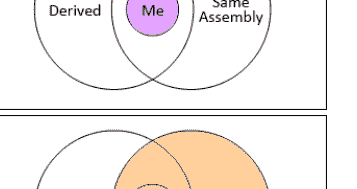

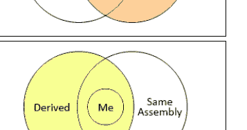

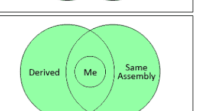


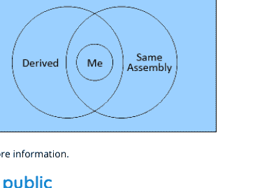

你可以在下面找到更多信息。

### 第 40.2 节：public

public 关键字使类（包括嵌套类）、属性、方法或字段可供每个使用者访问：

```csharp
public class Foo
{
    public string SomeProperty { get; set; }

    public class Baz
    {
        public int Value { get; set; }
    }
}

public class Bar
{
    public Bar()
    {
        var myInstance = new Foo();
        var someValue = foo.SomeProperty;
        var myNestedInstance = new Foo.Baz();
        var otherValue = myNestedInstance.Value;
    }
}
```

### 第 40.3 节：private

private 关键字将属性、方法、字段和嵌套类标记为仅在类内部使用：

```csharp
public class Foo
{
    private string someProperty { get; set; }

    private class Baz
    {
        public string Value { get; set; }
    }

    public void Do()
    {
        var baz = new Baz { Value = 42 };
    }
}
```

```csharp
public class Bar
{
    public Bar()
    {
        var myInstance = new Foo();

        // Compile Error - not accessible due to private modifier
        var someValue = foo.someProperty;
        // Compile Error - not accessible due to private modifier
        var baz = new Foo.Baz();
    }
}
```

### 第 40.4 节：protected internal

`protected internal` 关键字将字段、方法、属性和嵌套类标记为可在同一程序集内或另一程序集中的派生类中使用。

> > 程序集 1

```csharp
public class Foo
{
    public string MyPublicProperty { get; set; }
    protected internal string MyProtectedInternalProperty { get; set; }

    protected internal class MyProtectedInternalNestedClass
    {
        private string blah;
        public int N { get; set; }
    }
}

public class Bar
{
    void MyMethod1()
    {
        Foo foo = new Foo();
        var myPublicProperty = foo.MyPublicProperty;
        var myProtectedInternalProperty = foo.MyProtectedInternalProperty;
        var myProtectedInternalNestedInstance =
            new Foo.MyProtectedInternalNestedClass();
    }
}
```

> > 程序集 2

```csharp
public class Baz : Foo
{
    void MyMethod1()
    {
        var myPublicProperty = MyPublicProperty;
        var myProtectedInternalProperty = MyProtectedInternalProperty;
        var thing = new MyProtectedInternalNestedClass();
    }

    void MyMethod2()
```

{
    Foo foo = new Foo();
    var myPublicProperty = foo.MyPublicProperty;

    // Compile Error
    var myProtectedInternalProperty = foo.MyProtectedInternalProperty;
    // Compile Error
    var myProtectedInternalNestedInstance =
        new Foo.MyProtectedInternalNestedClass();
}
}

public class Qux
{
    void MyMethod1()
    {
        Baz baz = new Baz();
        var myPublicProperty = baz.MyPublicProperty;

        // Compile Error
        var myProtectedInternalProperty = baz.MyProtectedInternalProperty;
        // Compile Error
        var myProtectedInternalNestedInstance =
            new Baz.MyProtectedInternalNestedClass();
    }

    void MyMethod2()
    {
        Foo foo = new Foo();
        var myPublicProperty = foo.MyPublicProperty;

        //Compile Error
        var myProtectedInternalProperty = foo.MyProtectedInternalProperty;
        // Compile Error
        var myProtectedInternalNestedInstance =
            new Foo.MyProtectedInternalNestedClass();
    }
}

## 第 40.5 节：internal

internal 关键字使类（包括嵌套类）、属性、方法或字段对同一程序集中的每个使用者都可用：

```csharp
internal class Foo
{
    internal string SomeProperty {get; set;}
}

internal class Bar
{
    var myInstance = new Foo();
    internal string SomeField = foo.SomeProperty;

    internal class Baz
    {
        private string blah;
        public int N { get; set; }
    }
}
```

这可以通过向 AssemblyInfo.cs 文件中添加代码来破坏，以允许测试程序集访问代码：

```csharp
using System.Runtime.CompilerServices;

[assembly:InternalsVisibleTo("MyTests")]
```

## 第 40.6 节：protected

protected 关键字将字段、方法、属性和嵌套类标记为仅在同一类及其派生类内部使用：

```csharp
public class Foo
{
    protected void SomeFooMethod()
    {
        //do something
    }

    protected class Thing
    {
        private string blah;
        public int N { get; set; }
    }
}

public class Bar : Foo
{
    private void someBarMethod()
    {
        SomeFooMethod(); // inside derived class
        var thing = new Thing(); // can use nested class
    }
}

public class Baz
{
    private void someBazMethod()
    {
        var foo = new Foo();
        foo.SomeFooMethod(); //not accessible due to protected modifier
    }
}
```

## 第 41 章：接口

### 第 41.1 节：实现接口

接口用于强制在实现它的任何类中都存在方法。接口使用关键字 `interface` 定义，类可以通过在类名后添加 `: InterfaceName` 来‘实现’它。类可以通过用逗号分隔每个接口来实现多个接口。：InterfaceName, ISecondInterface

```csharp
public interface INoiseMaker
{
    string MakeNoise();
}

public class Cat : INoiseMaker
{
    public string MakeNoise()
    {
        return "Nyan";
    }
}

public class Dog : INoiseMaker
{
    public string MakeNoise()
    {
        return "Woof";
    }
}
```

由于它们实现了 INoiseMaker，猫和狗都必须包含 `string MakeNoise()` 方法，否则将无法编译。

### 第 41.2 节：显式接口实现

当你实现多个定义了通用方法的接口，但根据调用方法的接口不同需要不同的实现时，就需要显式接口实现（请注意，如果多个接口共享同一方法并且可以使用通用实现，则不需要显式实现）。

```csharp
interface IChauffeur
{
    string Drive();
}

interface IGolfPlayer
{
    string Drive();
}

class GolfingChauffeur : IChauffeur, IGolfPlayer
{
    public string Drive()
    {
        return "Vroom!";
    }
}
```

```csharp
string IGolfPlayer.Drive()
{
    return "Took a swing...";
}
}

GolfingChauffeur obj = new GolfingChauffeur();
IChauffeur chauffeur = obj;
IGolfPlayer golfer = obj;

Console.WriteLine(obj.Drive()); // Vroom!
Console.WriteLine(chauffeur.Drive()); // Vroom!
Console.WriteLine(golfer.Drive()); // Took a swing...
```

该实现除了通过使用接口之外，不能从其他任何地方调用：

```csharp
public class Golfer : IGolfPlayer
{
    string IGolfPlayer.Drive()
    {
        return "Swinging hard...";
    }
    public void Swing()
    {
        Drive(); // Compiler error: No such method
    }
}
```

因此，将显式实现的接口的复杂实现代码放在单独的私有方法中可能是有利的。

显式接口实现当然只能用于该接口实际存在的方法：

```csharp
public class ProGolfer : IGolfPlayer
{
    string IGolfPlayer.Swear() // Error
    {
        return "The ball is in the pit";
    }
}
```

同样，在类上未声明该接口的情况下使用显式接口实现也会导致错误。

**提示：**

显式实现接口也可以用于避免死代码。当方法不再需要并从接口中删除时，编译器会抱怨每个仍然存在的实现。

**注意：**

程序员期望无论类型的上下文如何，契约都保持相同，并且显式实现在调用时不应表现出不同的行为。因此，与上面的示例不同，IGolfPlayer.Drive 和 Drive 在可能的情况下应做相同的事情。

### 第 41.3 节：接口基础

接口的功能被称为“契约”。这意味着它声明属性和方法，但不实现它们。

因此与类不同，接口：

- 不能被实例化
- 不能有任何功能
- 只能包含方法 *（属性和事件在内部是方法）
- 继承接口称为“实现”
- 你可以从 1 个类继承，但可以“实现”多个接口

```csharp
public interface ICanDoThis{
    void TheThingICanDo();
    int SomeValueProperty { get; set; }
}
```

需要注意的是：

- “I”前缀是用于接口的命名约定。
- 函数体被分号“;”替换
- 属性也允许，因为在内部它们也是方法

```csharp
public class MyClass : ICanDoThis {
    public void TheThingICanDo(){
        // do the thing
    }

    public int SomeValueProperty { get; set; }
    public int SomeValueNotImplemtingAnything { get; set; }
}
```

```csharp
ICanDoThis obj = new MyClass();

// ok
obj.TheThingICanDo();

// ok
obj.SomeValueProperty = 5;

// Error, this member doesn't exist in the interface
obj.SomeValueNotImplemtingAnything = 5;

// in order to access the property in the class you must "down cast" it
((MyClass)obj).SomeValueNotImplemtingAnything = 5; // ok
```

当你使用 WinForms 或 WPF 等 UI 框架时，这尤其有用，因为创建用户控件时必须从基类继承，并且你会失去对不同控件类型进行抽象的能力。示例？即将到来：

```csharp
public class MyTextBlock : TextBlock {
    public void SetText(string str){
        this.Text = str;
    }
}
```

```csharp
}
public class MyButton : Button {
    public void SetText(string str){
        this.Content = str;
    }
}
```

提出的问题是两者都包含某种“文本”概念，但属性名称不同。而且你不能创建抽象基类，因为它们对两个不同的类有强制继承。接口可以缓解这个问题

```csharp
public interface ITextControl{
    void SetText(string str);
}

public class MyTextBlock : TextBlock, ITextControl {
    public void SetText(string str){
        this.Text = str;
    }
}

public class MyButton : Button, ITextControl {
    public void SetText(string str){
        this.Content = str;
    }

    public int Clicks { get; set; }
}
```

现在 MyButton 和 MyTextBlock 可以互换使用。

```csharp
var controls = new List<ITextControl>{
    new MyTextBlock(),
    new MyButton()
};

foreach(var ctrl in controls){
    ctrl.SetText("This text will be applied to both controls despite them being different");

    // Compiler Error, no such member in interface
    ctrl.Clicks = 0;

    // Runtime Error because 1 class is in fact not a button which makes this cast invalid
    ((MyButton)ctrl).Clicks = 0;

    /* the solution is to check the type first.
    This is usually considered bad practice since
    it's a symptom of poor abstraction */
    var button = ctrl as MyButton;
    if(button != null) {
        button.Clicks = 0; // no errors
    }
}
```


### 第 41.4 节：IComparable<T> 作为实现接口的示例

接口在实践中看到之前可能显得抽象。IComparable 和 IComparable<T> 是接口对我们有帮助的很好的例子。

假设在一个在线商店的程序中，我们有各种可以购买的商品。每件商品都有名称、ID 号码和价格。

```
public class Item {
    public string name; // though public variables are generally bad practice,
    public int idNumber; // to keep this example simple we will use them instead
    public decimal price; // of a property.

    // body omitted for brevity
}
```

我们将商品存储在 List<Item> 中，并且在程序的某个地方，我们希望按 ID 号码从小到大对列表进行排序。不是自己编写排序算法，我们可以使用 List<T> 已有的 Sort() 方法。然而，按我们 Item 类现在的样子，List<T> 没有办法理解如何对列表排序。这里就是 IComparable 接口发挥作用的地方。

为了正确实现 CompareTo 方法，CompareTo 应在参数“小于”当前值时返回正数，相等时返回零，参数“大于”当前值时返回负数。

```
Item apple = new Item();
apple.idNumber = 15;
Item banana = new Item();
banana.idNumber = 4;
Item cow = new Item();
cow.idNumber = 15;
Item diamond = new Item();
diamond.idNumber = 18;

Console.WriteLine(apple.CompareTo(banana)); // 11
Console.WriteLine(apple.CompareTo(cow)); // 0
Console.WriteLine(apple.CompareTo(diamond)); // -3
```

以下是示例 Item 对接口的实现：

```
public class Item : IComparable<Item> {
    private string name;
    private int idNumber;
    private decimal price;

    public int CompareTo(Item otherItem) {
        return (this.idNumber - otherItem.idNumber);
    }

    // rest of code omitted for brevity
}
```

在表面上，我们 item 中的 CompareTo 方法只是返回它们 ID 号码的差值，但上面在实践中做了什么？

现在，当我们对 List<Item> 对象调用 Sort() 时，List 会自动在需要确定对象放置顺序时调用 Item 的 CompareTo 方法。此外，除了 List<T> 之外，任何需要比较两个对象能力的其他对象都将与 Item 配合工作，因为我们已定义了两个不同 Item 之间可以相互比较的能力。

### 第 41.5 节：实现多个接口

```csharp
public interface IAnimal
{
    string Name { get; set; }
}

public interface INoiseMaker
{
    string MakeNoise();
}

public class Cat : IAnimal, INoiseMaker
{
    public Cat()
    {
        Name = "Cat";
    }

    public string Name { get; set; }

    public string MakeNoise()
    {
        return "Nyan";
    }
}
```

### 第 41.6 节：为什么我们使用接口

接口是接口使用者与实现它的类之间契约的定义。可以将接口看作是一种声明，即对象可以执行某些功能。

假设我们定义一个接口 IShape 来表示不同类型的形状，我们期望一个形状具有面积，因此我们将定义一个方法来强制接口实现返回它们的面积：

```csharp
public interface IShape
{
    double ComputeArea();
}
```

假设我们有以下两种形状：一个 Rectangle 和一个 Circle

```csharp
public class Rectangle : IShape
{
    private double length;
    private double width;

    public Rectangle(double length, double width)
    {
        this.length = length;
        this.width = width;
    }

    public double ComputeArea()
    {
        return length * width;
    }
}

public class Circle : IShape
{
    private double radius;

    public Circle(double radius)
    {
        this.radius = radius;
    }

    public double ComputeArea()
    {
        return Math.Pow(radius, 2.0) * Math.PI;
    }
}
```

它们各自对面积有自己的定义，但它们都是形状。因此在我们的程序中将它们视为 IShape 是合乎逻辑的：

```
private static void Main(string[] args)
{
    var shapes = new List<IShape>() { new Rectangle(5, 10), new Circle(5) };
    ComputeArea(shapes);
    Console.ReadKey();
}

private static void ComputeArea(IEnumerable<IShape> shapes)
{
    foreach (shape in shapes)
    {
        Console.WriteLine("Area: {0:N}", shape.ComputeArea());
    }
}

// Output:
// Area : 50.00
// Area : 78.54
```

### 第 41.7 节：“隐藏”成员与显式实现

当接口用你根本不在乎的太多成员污染你的类时，你难道不讨厌吗？好吧，我有一个解决方案！显式实现

```
public interface IMessageService {
    void OnMessageRecieve();
    void SendMessage();
    string Result { get; set; }
    int Encoding { get; set; }
    // yadda yadda
}
```

通常你会像这样实现类。

```
public class MyObjectWithMessages : IMessageService {
    public void OnMessageRecieve(){
    }

    public void SendMessage(){
    }

    public string Result { get; set; }
    public int Encoding { get; set; }
}
```

每个成员都是公开的。

```
var obj = new MyObjectWithMessages();

// why would i want to call this function?
obj.OnMessageRecieve();
```

回答：我不想。所以它也不应该被声明为 public，但简单地将成员声明为 private 会导致编译器抛出错误

解决方案是使用显式实现：

```
public class MyObjectWithMessages : IMessageService{
    void IMessageService.OnMessageRecieve() {
    }

    void IMessageService.SendMessage() {
    }

    string IMessageService.Result { get; set; }
    int IMessageService.Encoding { get; set; }
}
```

所以现在你已按要求实现了成员，并且它们不会以 public 的形式暴露任何成员。

```
var obj = new MyObjectWithMessages();

/* error member does not exist on type MyObjectWithMessages.
 * We've successfully made it "private" */
obj.OnMessageRecieve();
```

如果你真的仍然想访问该成员，即使它是显式实现的，你所要做的就是将对象强制转换为接口即可。

```
((IMessageService)obj).OnMessageRecieve();
```

## 第 42 章：静态类

### 第 42.1 节：静态类

当指代类时，“static”关键字有三个作用：

- 1. 你不能创建静态类的实例（这甚至移除了默认构造函数）
- 2. 类中的所有属性和方法也必须是静态的。
- 3. 静态类是密封类，意味着它不能被继承。

```
public static class Foo
{
    //Notice there is no constructor as this cannot be an instance
    public static int Counter { get; set; }
    public static int GetCount()
    {
        return Counter;
    }
}

public class Program
{
    static void Main(string[] args)
    {
        Foo.Counter++;
        Console.WriteLine(Foo.GetCount()); //this will print 1

        //var foo1 = new Foo();
        //this line would break the code as the Foo class does not have a constructor
    }
}
```

### 第 42.2 节：静态类生命周期

静态类在成员访问时延迟初始化，并在应用程序域的持续时间内存在。

```
void Main()
{
    Console.WriteLine("Static classes are lazily initialized");
    Console.WriteLine("The static constructor is only invoked when the class is first accessed");
    Foo.SayHi();

    Console.WriteLine("Reflecting on a type won't trigger its static .ctor");
    var barType = typeof(Bar);

    Console.WriteLine("However, you can manually trigger it with System.Runtime.CompilerServices.RuntimeHelpers");
    RuntimeHelpers.RunClassConstructor(barType.TypeHandle);
}

// Define other methods and classes here
public static class Foo
{
    static Foo()
    {
        Console.WriteLine("static Foo.ctor");
    }
    public static void SayHi()
    {
        Console.WriteLine("Foo: Hi");
    }
}
public static class Bar
{
    static Bar()
    {
        Console.WriteLine("static Bar.ctor");
    }
}
```

### 第 42.3 节：static 关键字

static 关键字意味着两件事：

- 1. 该值不会因对象而异，而是作为一个整体在类上变化
- 2. 静态属性和方法不需要实例。

```csharp
public class Foo
{
    public Foo(){
        Counter++;
        NonStaticCounter++;
    }

    public static int Counter { get; set; }
    public int NonStaticCounter { get; set; }
}

public class Program
{
    static void Main(string[] args)
    {
        //Create an instance
        var foo1 = new Foo();
        Console.WriteLine(foo1.NonStaticCounter); //this will print "1"

        //Notice this next call doesn't access the instance but calls by the class name.
        Console.WriteLine(Foo.Counter); //this will also print "1"

        //Create a second instance
        var foo2 = new Foo();

        Console.WriteLine(foo2.NonStaticCounter); //this will print "1"

        Console.WriteLine(Foo.Counter); //this will now print "2"
        //The static property incremented on both instances and can persist for the whole class
    }
}
```


## 第43章：单例实现

### 第43.1节：静态初始化单例

```
public class Singleton
{
    private readonly static Singleton instance = new Singleton();
    private Singleton() { }
    public static Singleton Instance => instance;
}
```

此实现是线程安全的，因为在这种情况下实例对象是在静态构造函数中初始化的。CLR 已经确保所有静态构造函数都是线程安全执行的。

修改实例不是线程安全操作，因此 readonly 属性保证初始化后不可变。

### 第43.2节：延迟、线程安全的单例（使用 Lazy<T>）

.NET 4.0 中的 Lazy 类型保证线程安全的对象初始化，因此该类型可用于创建单例。

```
public class LazySingleton
{
    private static readonly Lazy<LazySingleton> _instance =
        new Lazy<LazySingleton>(() => new LazySingleton());

    public static LazySingleton Instance
    {
        get { return _instance.Value; }
    }

    private LazySingleton() { }
}
```

使用 Lazy<T> 将确保对象仅在调用代码中的某处使用时才实例化。

简单的用法如下：

```
using System;

public class Program
{
    public static void Main()
    {
        var instance = LazySingleton.Instance;
    }
}
```

在 .NET Fiddle 上的实时演示

### 第43.3节：延迟、线程安全的单例（使用双重检查锁定）

这种线程安全的单例版本在 .NET 的早期版本中是必要的，当时静态初始化不保证线程安全。在框架的更现代版本中，静态初始化的单例是

```
// Explicit static constructor to tell C# compiler
// not to mark type as beforefieldinit
static Nested()
{
}

internal static readonly Singleton instance = new Singleton();
}
```

这受到了 [Jon Skeet 的博客文章](.) 的启发。

由于 Nested 类是嵌套的且为私有，访问 Singleton 类的其他成员（例如公共只读属性）不会触发单例实例的实例化。

## 第44章：依赖注入

### 第44.1节：使用 Unity 进行 C# 和 ASP.NET 依赖注入

首先为什么我们应该在代码中使用依赖注入？我们希望将程序中的其他组件与其它类解耦。例如我们有一个 AnimalController 类，其代码如下：

```
```csharp
public class AnimalController
{
    private SantaAndHisReindeer _SantaAndHisReindeer = new SantaAndHisReindeer();

    public AnimalController(){
        Console.WriteLine("");
    }
}
```
```

我们查看这段代码，认为一切正常，但现在我们的 AnimalController 依赖于对象 _SantaAndHisReindeer。我的 Controller 自动变得难以测试，我的代码的重用性将非常困难。

这里非常好的解释了为什么我们应该使用依赖注入和接口。

如果我们希望 Unity 处理 DI，实现的途径非常简单 :) 使用 NuGet（包管理器）我们可以轻松地将 Unity 导入到我们的代码中。

> 在 Visual Studio 工具 -> NuGet 包管理器 -> 管理解决方案的程序包 -> 在搜索输入框中输入 unity -> 选择我们的项目 -> 点击安装

现在将创建两个带有良好注释的文件。

> 在 App_Data 文件夹中 UnityConfig.cs 和 UnityMvcActivator.cs

> UnityConfig - 在 RegisterTypes 方法中，我们可以看到将在构造函数中注入的类型。

```
```csharp
namespace Vegan.WebUI.App_Start
{
    public class UnityConfig
    {
        #region Unity Container
        private static Lazy<IUnityContainer> container = new Lazy<IUnityContainer>(() =>
        {
            var container = new UnityContainer();
            RegisterTypes(container);
            return container;
        });

        /// <summary>
        /// Gets the configured Unity container.
        /// </summary>
        public static IUnityContainer GetConfiguredContainer()
        {
            return container.Value;
        }
    }
}
```
```

```
}
#endregion

// <summary>Registers the type mappings with the Unity container.</summary>
// <param name="container">The unity container to configure.</param>
// <remarks>There is no need to register concrete types such as controllers or API controllers
(unless you want to
// change the defaults), as Unity allows resolving a concrete type even if it was not previously
registered.</remarks>
public static void RegisterTypes(IUnityContainer container)
{
    // NOTE: To load from web.config uncomment the line below. Make sure to add a
    Microsoft.Practices.Unity.Configuration to the using statements.
    // container.LoadConfiguration();

    // TODO: Register your types here
    // container.RegisterType<IProductRepository, ProductRepository>();

    container.RegisterType<ISanta, SantaAndHisReindeer>();
}
}
```

UnityMvcActivator -> 也有很好的注释说明该类将 Unity 与 ASP.NET MVC 集成

```
using System.Linq;
using System.Web.Mvc;
using Microsoft.Practices.Unity.Mvc;

[assembly: WebActivatorEx.PreApplicationStartMethod(typeof(Vegan.WebUi.App_Start.UnityWebActivator), "Start")]
[assembly: WebActivatorEx.ApplicationShutdownMethod(typeof(Vegan.WebUi.App_Start.UnityWebActivator), "Shutdown")]

namespace Vegan.WebUi.App_Start
{
    // <summary>Provides the bootstrapping for integrating Unity with ASP.NET MVC.</summary>
    public static class UnityWebActivator
    {
        // <summary>Integrates Unity when the application starts.</summary>
        public static void Start()
        {
            var container = UnityConfig.GetConfiguredContainer();

            FilterProviders.Providers.Remove(FilterProviders.Providers.OfType<FilterAttributeFilterProvider>().First());
            FilterProviders.Providers.Add(new UnityFilterAttributeFilterProvider(container));

            DependencyResolver.SetResolver(new UnityDependencyResolver(container));

            // TODO: Uncomment if you want to use PerRequestLifetimeManager
            //
            Microsoft.Web.Infrastructure.DynamicModuleHelper.DynamicModuleUtility.RegisterModule(typeof(UnityPerRequestHttpModule));
        }
    }
```

```
// <summary>Disposes the Unity container when the application is shut down.</summary>
public static void Shutdown()
{
    var container = UnityConfig.GetConfiguredContainer();
    container.Dispose();
}
}
}
```

现在我们可以将我们的 Controller 与类 SantaAndHisReindeer 解耦 :)

```
public class AnimalController
{
    private readonly SantaAndHisReindeer _SantaAndHisReindeer;
    
    public AnimalController(SantaAndHisReindeer SantaAndHisReindeer){
        
        _SantaAndHisReindeer = SantaAndHisReindeer;
    }
}
```

> 在运行应用程序之前，我们必须做最后一件事。

在 Global.asax.cs 中我们必须添加新行：UnityWebActivator.Start()，它将启动、配置 Unity 并注册我们的类型。

```
using System;
using System.Collections.Generic;
using System.Linq;
using System.Web;
using System.Web.Mvc;
using System.Web.Optimization;
using System.Web.Routing;
using Vegan.WebUi.App_Start;

namespace Vegan.WebUi
{
    public class MvcApplication : System.Web.HttpApplication
    {
        protected void Application_Start()
        {
            AreaRegistration.RegisterAllAreas();
            FilterConfig.RegisterGlobalFilters(GlobalFilters.Filters);
            RouteConfig.RegisterRoutes(RouteTable.Routes);
            BundleConfig.RegisterBundles(BundleTable.Bundles);
            UnityWebActivator.Start();
        }
    }
}
```

### 第44.2节：使用 MEF 进行依赖注入

```
public interface ILogger
{
    void Log(string message);
}

[Export(typeof(ILogger))]
```

```
[ExportMetadata("Name", "Console")]
public class ConsoleLogger:ILogger
{
    public void Log(string message)
    {
        Console.WriteLine(message);
    }
}

[Export(typeof(ILogger))]
[ExportMetadata("Name", "File")]
public class FileLogger:ILogger
{
    public void Log(string message)
    {
        //Write the message to file
    }
}

public class User
{
    private readonly ILogger logger;
    public User(ILogger logger)
    {
        this.logger = logger;
    }
    public void LogUser(string message)
    {
        logger.Log(message);
    }
}

public interface ILoggerMetaData
{
    string Name { get; }
}

internal class Program
{
    private CompositionContainer _container;

    [ImportMany]
    private IEnumerable<Lazy<ILogger, ILoggerMetaData>> _loggers;

    private static void Main()
    {
        ComposeLoggers();
        Lazy<ILogger, ILoggerMetaData> loggerNameAndLoggerMapping = _loggers.First((n) =>
        ((n.Metadata.Name.ToUpper() =="Console")));
        ILogger logger = loggerNameAndLoggerMapping.Value
        var user = new User(logger);
        user.LogUser("user name");
    }

    private void ComposeLoggers()
    {
        //An aggregate catalog that combines multiple catalogs
        var catalog = new AggregateCatalog();
        string loggersDllDirectory =Path.Combine(Utilities.GetApplicationDirectory(), "Loggers");
        if (!Directory.Exists(loggersDllDirectory ))
        {
            Directory.CreateDirectory(loggersDllDirectory );
        }
```

//Adds all the parts found in the same assembly as the PluginManager class
catalog.Catalogs.Add(new AssemblyCatalog(typeof(Program).Assembly));
catalog.Catalogs.Add(new DirectoryCatalog(loggersDllDirectory));

//Create the CompositionContainer with the parts in the catalog
_container = new CompositionContainer(catalog);

//Fill the imports of this object
try
{
    this._container.ComposeParts(this);
}
catch (CompositionException compositionException)
{
    throw new CompositionException(compositionException.Message);
}
}

## 第45章：部分类和方法

部分类为我们提供了一个选项，可将类拆分为多个部分并分布在多个源文件中。所有部分在编译时会被合并为一个单一类。所有部分都应包含关键字 partial，应具有相同的可访问性。所有部分都应存在于同一程序集中，以便在编译时包含。

### 第45.1节：部分类

部分类提供了一种将类声明拆分（通常拆分为单独的文件）的能力。使用部分类可以解决的一个常见问题是允许用户修改自动生成的代码，而不必担心如果代码被重新生成，其更改会被覆盖。此外，多名开发人员可以同时处理同一个类或方法。

```csharp
using System;

namespace PartialClassAndMethods
{
    public partial class PartialClass
    {
        public void ExampleMethod() {
            Console.WriteLine("Method call from the first declaration.");
        }
    }

    public partial class PartialClass
    {
        public void AnotherExampleMethod()
        {
            Console.WriteLine("Method call from the second declaration.");
        }
    }

    class Program
    {
        static void Main(string[] args)
        {
            PartialClass partial = new PartialClass();
            partial.ExampleMethod(); // outputs "Method call from the first declaration."
            partial.AnotherExampleMethod(); // outputs "Method call from the second declaration."
        }
    }
}
```

### 第45.2节：继承自基类的部分类

当继承自任何基类时，只需要一个部分类指定基类即可。

```csharp
// PartialClass1.cs
public partial class PartialClass : BaseClass {}
// PartialClass2.cs
public partial class PartialClass {}
```

你可以在多个部分类中指定相同的基类。某些 IDE 工具会将其标记为冗余，但它仍然可以正确编译。

```csharp
// PartialClass1.cs
public partial class PartialClass : BaseClass {}
```

```
// PartialClass2.cs
public partial class PartialClass : BaseClass {} // base class here is redundant
```

你不能在多个部分类中指定不同的基类，这会导致编译器错误。

```
// PartialClass1.cs
public partial class PartialClass : BaseClass {} // compiler error
// PartialClass2.cs
public partial class PartialClass : OtherBaseClass {} // compiler error
```

### 第45.3节：部分方法

部分方法由一个部分类声明中的定义（常见场景为自动生成的）以及另一个部分类声明中的实现组成。

```csharp
using System;

namespace PartialClassAndMethods
{
    public partial class PartialClass // Auto-generated
    {
        partial void PartialMethod();
    }

    public partial class PartialClass // Human-written
    {
        public void PartialMethod()
        {
            Console.WriteLine("Partial method called.");
        }
    }

    class Program
    {
        static void Main(string[] args)
        {
            PartialClass partial = new PartialClass();
            partial.PartialMethod(); // outputs "Partial method called."
        }
    }
}
```

## 第46章：对象初始化器

### 第46.1节：简单用法

对象初始化器在你需要创建对象并立即设置几个属性，但现有构造函数不足时非常方便。假设你有一个类

```csharp
public class Book
{
    public string Title { get; set; }
    public string Author { get; set; }

    // the rest of class definition
}
```

使用初始化器初始化类的新实例：

```csharp
Book theBook = new Book { Title = "Don Quixote", Author = "Miguel de Cervantes" };
```

这等价于

```csharp
Book theBook = new Book();
theBook.Title = "Don Quixote";
theBook.Author = "Miguel de Cervantes";
```

### 第46.2节：与非默认构造函数一起使用

你可以在必要时将对象初始化器与构造函数结合以初始化类型。例如，假设有一个如下定义的类：

```csharp
public class Book {
    public string Title { get; set; }
    public string Author { get; set; }

    public Book(int id) {
        //do things
    }

    // the rest of class definition
}
```
var someBook = new Book(16) { Title = "Don Quixote", Author = "Miguel de Cervantes" }

这将首先使用 Book(int) 构造函数实例化一个 Book，然后在初始化器中设置每个属性。这等价于：

```csharp
var someBook = new Book(16);
someBook.Title = "Don Quixote";
someBook.Author = "Miguel de Cervantes";
```

### 第46.3节：与匿名类型一起使用

对象初始化器是初始化匿名类型的唯一方式，而匿名类型是由编译器生成的类型。

```csharp
var album = new { Band = "Beatles", Title = "Abbey Road" };
```

因此，对象初始化器在 LINQ select 查询中被广泛使用，因为它们提供了一种便捷的方式来指定你对查询对象的哪些部分感兴趣。

```csharp
var albumTitles = from a in albums
    select new
    {
        Title = a.Title,
        Artist = a.Band
    };
```

## 第47章：方法

### 第47.1节：调用方法

调用静态方法：

// Single argument
System.Console.WriteLine("Hello World");

// Multiple arguments
string name = "User";
System.Console.WriteLine("Hello, {0}!", name);

调用静态方法并存储其返回值：

```
string input = System.Console.ReadLine();
```

调用实例方法：

```
int x = 42;
// The instance method called here is Int32.ToString()
string xAsString = x.ToString();
```

调用泛型方法

```
// Assuming a method 'T[] CreateArray<T>(int size)'
DateTime[] dates = CreateArray<DateTime>(8);
```

### 第47.2节：匿名方法

匿名方法提供了一种将代码块作为委托参数传递的技术。它们是有方法体但没有名称的方法。

```csharp
delegate int IntOp(int lhs, int rhs);

class Program
{
    static void Main(string[] args)
    {
        // C# 2.0 definition
        IntOp add = delegate(int lhs, int rhs)
        {
            return lhs + rhs;
        };

        // C# 3.0 definition
        IntOp mul = (lhs, rhs) =>
        {
            return lhs * rhs;
        };

        // C# 3.0 definition - shorthand
        IntOp sub = (lhs, rhs) => lhs - rhs;

        // Calling each method
        Console.WriteLine("2 + 3 = " + add(2, 3));
        Console.WriteLine("2 * 3 = " + mul(2, 3));
    }
}
```

```
Console.WriteLine("2 - 3 = " + sub(2, 3));
}
```

### 第47.3节：声明方法

每个方法都有一个唯一的签名，由访问修饰符（public、private、...）、可选的修饰符（abstract）、名称以及如果需要的方法参数组成。注意，返回类型不是签名的一部分。方法原型如下所示：

```
AccessModifier OptionalModifier ReturnType MethodName(InputParameters)
{
    //Method body
}
```

AccessModifier 可以是 public、protected、private 或默认的 internal。

OptionalModifier 可以是 static、abstract、virtual、override、new 或 sealed。

ReturnType 可以是 void 表示无返回，也可以是基本类型如 int 到复杂类的任意类型。

方法可能有或没有输入参数。要为方法设置参数，你应该像声明普通变量一样声明每个参数（如 int a），对于多个参数，你应该用逗号分隔它们（如 int a, int b）。

参数可以有默认值。为此，你应该为参数设置一个值（如 int a = 0）。如果参数有默认值，则设置输入值是可选的。

以下方法示例返回两个整数的和：

```
private int Sum(int a, int b)
{
    return a + b;
}
```

### 第47.4节：参数和参数

方法可以声明任意数量的参数（在此示例中，i、s 和 o 是参数）：

```
static void DoSomething(int i, string s, object o) {
    Console.WriteLine(String.Format("i={0}, s={1}, o={2}", i, s, o));
}
```

参数可用于将值传递给方法，以便方法可以处理它们。这可以是各种工作，例如打印值、修改参数引用的对象，或存储值。

当你调用方法时，你需要为每个参数传递一个实际值。此时，你实际传递给方法调用的值称为参数（Arguments）：

```
DoSomething(x, "hello", new object());
```

### 第47.5节：返回类型

方法可以返回 nothing（void），或指定类型的值：

警告：由于其工作原理，默认值在某些情况下可能存在问题。如果更改方法参数的默认值且未重新编译该方法的所有调用方，这些调用方仍将使用编译时存在的默认值，可能导致不一致。

## 第 47.7 节：方法重载

### 定义

当声明多个具有相同名称但参数不同的 方法 时，称为方法重载。方法重载通常表示在目的上相同的函数，但编写时接受不同数据类型作为其参数。

### 影响因素

- 参数数量
- 参数类型
- 返回类型

考虑一个名为 Area 的方法，它将执行计算功能，接受各种参数并返回结果。

### 示例

```csharp
public string Area(int value1)
{
    return String.Format("Area of Square is {0}", value1 * value1);
}
```

该方法将接受一个参数并返回一个字符串，如果我们使用整数（例如 5）调用该方法，输出将为 "Area of Square is 25"。

```csharp
public double Area(double value1, double value2)
{
    return value1 * value2;
}
```

类似地，如果我们向此方法传递两个 double 值，输出将是这两个值的乘积，类型为 double。这可用于乘法以及查找矩形的面积

```csharp
public double Area(double value1)
{
    return 3.14 * Math.Pow(value1,2);
}
```

这可专门用于查找圆的面积，它将接受一个 double 值（半径）并返回另一个 double 值作为其面积。

这些方法中的每一个都可以正常调用而不会冲突——编译器将检查每次方法调用的参数以确定需要使用哪个版本的 Area。

```csharp
string squareArea = Area(2);
double rectangleArea = Area(32.0, 17.5);
double circleArea = Area(5.0); // all of these are valid and will compile.
```

**请注意，返回类型单独无法区分两个方法。例如，如果我们有两个 Area 的定义，它们具有相同的参数，如下所示：**

```csharp
public string Area(double width, double height) { ... }
public double Area(double width, double height) { ... }
// This will NOT compile.
```

如果我们需要让类使用返回不同值的相同方法名称，我们可以通过实现接口并显式定义其用法来消除歧义问题。

```csharp
public interface IAreaCalculatorString {
    public string Area(double width, double height);
}

public class AreaCalculator : IAreaCalculatorString {
    public string IAreaCalculatorString.Area(double width, double height) { ... }
    // Note that the method call now explicitly says it will be used when called through
    // the IAreaCalculatorString interface, allowing us to resolve the ambiguity.
    public double Area(double width, double height) { ... }
}
```

## 第 47.8 节：访问权限

```csharp
// static: is callable on a class even when no instance of the class has been created
public static void MyMethod()

// virtual: can be called or overridden in an inherited class
public virtual void MyMethod()

// internal: access is limited within the current assembly
internal void MyMethod()

//private: access is limited only within the same class
private void MyMethod()

//public: access right from every class / assembly
public void MyMethod()

//protected: access is limited to the containing class or types derived from it
protected void MyMethod()

//protected internal: access is limited to the current assembly or types derived from the containing class.
protected internal void MyMethod()
```

## 第 48 章：扩展方法

| 参数 | 详情 |
|---|---|
| this | 扩展方法的第一个参数始终应以 `this` 关键字开头，后跟用于引用要扩展的对象的“当前”实例的标识符 |

### 第 48.1 节：扩展方法 - 概述

扩展方法在 C# 3.0 中引入。扩展方法在不创建新的派生类型、重新编译或以其他方式修改原始类型的情况下扩展并为现有类型添加行为。*当您无法修改要增强的类型源时，它们尤其有帮助。* 扩展方法可以为系统类型、第三方定义的类型以及您自己定义的类型创建。扩展方法可以像原始类型的成员方法一样被调用。这允许使用 **方法链** 来实现 **流畅接口**。

扩展方法是通过向与被扩展的原始类型不同的 `static class` 添加 `static method` 来创建的。保存扩展方法的静态类通常仅为保存扩展方法而创建。

扩展方法采用一个特殊的第一个参数来指定被扩展的原始类型。此第一个参数用关键字 `this` 装饰（这在 C# 中构成了 `this` 的一种特殊且不同的用法——应将其理解为不同于允许引用当前对象实例成员的 `this` 的用法）。

在下面的示例中，被扩展的原始类型是类 `string`。`string` 已通过方法 `Shorten()` 进行了扩展，该方法提供了缩短的额外功能。静态类 `StringExtensions` 已被创建以保存扩展方法。扩展方法 `Shorten()` 通过特别标记的第一个参数表明它是 `string` 的扩展。为了表明 `Shorten()` 方法扩展了 `string`，第一个参数被标记为 `this`。因此，第一个参数的完整签名是 `this string text`，其中 `string` 是被扩展的原始类型，text 是所选的参数名称。

```csharp
static class StringExtensions
{
    public static string Shorten(this string text, int length)
    {
        return text.Substring(0, length);
    }
}

class Program
{
    static void Main()
    {
        // This calls method String.ToUpper()
        var myString = "Hello World!".ToUpper();

        // This calls the extension method StringExtensions.Shorten()
        var newString = myString.Shorten(5);

        // It is worth noting that the above call is purely syntactic sugar
        // and the assignment below is functionally equivalent
        var newString2 = StringExtensions.Shorten(myString, 5);
    }
}
```

.NET Fiddle 上的实时演示

作为扩展方法的第一个参数传递的对象（附带 `this` 关键字）是调用扩展方法的实例。

例如，当执行以下代码时：

```csharp
"some string".Shorten(5);
```

参数的值如下：

```
text: "some string"
length: 5
```

*请注意，扩展方法只有在与定义在同一命名空间中、使用扩展方法的代码显式导入命名空间，或扩展类没有命名空间时才可用。.NET 框架指南建议将扩展类放在自己的命名空间中。然而，这可能导致发现问题。*

这不会导致扩展方法与所使用的库之间出现冲突，除非可能冲突的命名空间被显式引入。例如 LINQ 扩展：

```csharp
using System.Linq; // Allows use of extension methods from the System.Linq namespace

class Program
{
    static void Main()
    {
        var ints = new int[] {1, 2, 3, 4};

        // Call Where() extension method from the System.Linq namespace
        var even = ints.Where(x => x % 2 == 0);
    }
}
```

.NET Fiddle 上的实时演示

自 C# 6.0 起，还可以将 `using static` 指令放在包含扩展方法的 `class` 上。例如，`using static System.Linq.Enumerable;`。这使得该特定类中的扩展方法可用，而不会将同一命名空间中的其他类型引入作用域。

当具有相同签名的类方法可用时，编译器会优先于扩展方法调用。例如：

```csharp
class Test
{
    public void Hello()
    {
        Console.WriteLine("From Test");
    }
}
```

```csharp
static class TestExtensions
{
    public static void Hello(this Test test)
    {
        Console.WriteLine("From extension method");
    }
}
```


```
class Program
{
    static void Main()
    {
        Test t = new Test();
        t.Hello(); // Prints "From Test"
    }
}
```

在 .NET Fiddle 上查看实时演示

请注意，如果有两个具有相同签名的扩展函数，且其中一个位于同一命名空间中，则将优先选择该函数。另一方面，如果两者都通过 using 访问，则会导致编译时错误，并显示以下消息：

> 以下方法或属性之间的调用不明确

请注意，通过 originalTypeInstance.ExtensionMethod() 调用扩展方法所带来的语法便利是一种可选便利。该方法也可以按传统方式调用，此时特殊的第一个参数用作该方法的参数。

即，以下两种方式都可行：

```
//Calling as though method belongs to string--it seamlessly extends string
String s = "Hello World";
s.Shorten(5);
//Calling as a traditional static method with two parameters
StringExtensions.Shorten(s, 5);
```

## 第 48.2 节：空值检查

扩展方法是静态方法，其行为类似于实例方法。然而，与在空引用上调用实例方法时发生的情况不同，当使用空引用调用扩展方法时，它不会抛出 NullReferenceException。这在某些场景下非常有用。

例如，考虑以下静态类：

```
public static class StringExtensions
{
    public static string EmptyIfNull(this string text)
    {
        return text ?? String.Empty;
    }

    public static string NullIfEmpty(this string text)
    {
        return String.Empty == text ? null : text;
    }
}
```

```
string nullString = null;
string emptyString = nullString.EmptyIfNull();// will return ""
string anotherNullString = emptyString.NullIfEmpty(); // will return null
```

在 .NET Fiddle 上查看实时演示

## 第 48.3 节：显式使用扩展方法

扩展方法也可以像普通静态类方法一样使用。这种调用扩展方法的方式更冗长，但在某些情况下是必要的。

```
static class StringExtensions
{
    public static string Shorten(this string text, int length)
    {
        return text.Substring(0, length);
    }
}
```

用法：

```
var newString = StringExtensions.Shorten("Hello World", 5);
```

### 何时将扩展方法作为静态方法调用

仍然存在需要将扩展方法作为静态方法使用的场景：

- 解决与成员方法的冲突。当库的新版本引入了具有相同签名的新的成员方法时，就可能发生这种情况。在这种情况下，编译器将优先选择该成员方法。
- 解决与另一个具有相同签名的扩展方法的冲突。当两个库包含相似的扩展方法，并且两个扩展方法所在类的命名空间都在同一文件中使用时，就可能发生这种情况。
- 将扩展方法作为方法组传递给委托参数。
- 通过反射执行自己的绑定。
- 在 Visual Studio 的即时窗口中调用扩展方法。

### 使用 static 指令

如果使用 using static 指令将静态类的静态成员引入全局作用域，则会跳过扩展方法。示例：

```
using static OurNamespace.StringExtensions; // refers to class in previous example

// OK: extension method syntax still works.
"Hello World".Shorten(5);
// OK: static method syntax still works.
OurNamespace.StringExtensions.Shorten("Hello World", 5);
// Compile time error: extension methods can't be called as static without specifying class.
Shorten("Hello World", 5);
```

如果从 Shorten 方法的第一个参数中移除 this 修饰符，最后一行将可以编译。

## 第 48.4 节：泛型扩展方法

与其他方法一样，扩展方法可以使用泛型。例如：

```
static class Extensions
{
    public static bool HasMoreThanThreeElements<T>(this IEnumerable<T> enumerable)
    {
        return enumerable.Take(4).Count() > 3;
    }
}
```

## 第 48.5 节：扩展方法只能看到被扩展类的 public（或 internal）成员

```csharp
public class SomeClass
{
    public void DoStuff()
    {
    }

    protected void DoMagic()
    {
    }
}

public static class SomeClassExtensions
{
    public static void DoStuffWrapper(this SomeClass someInstance)
    {
        someInstance.DoStuff(); // ok
    }

    public static void DoMagicWrapper(this SomeClass someInstance)
    {
        someInstance.DoMagic(); // compilation error
    }
}
```

扩展方法只是语法糖，实际上并不是它们所扩展的类的成员。这意味着它们不能破坏封装——它们只能访问 public（或者在同一程序集中实现时，internal）字段、属性和方法。

## 第 48.6 节：用于链式调用的扩展方法

当扩展方法返回的值与其 this 参数具有相同类型时，它可用于将一个或多个具有兼容签名的方法调用“链接”起来。这对于密封类型和/或基元类型很有用，并且如果方法名读起来像自然的人类语言，还允许创建所谓的“流畅”API。

```csharp
void Main()
{
    int result = 5.Increment().Decrement().Increment();
    // result is now 6
}

public static class IntExtensions
{
    public static int Increment(this int number) {
        return ++number;
    }

    public static int Decrement(this int number) {
        return --number;
    }
}
```

或者像这样：

```csharp
void Main()
{
    int[] ints = new[] { 1, 2, 3, 4, 5, 6 };
    int[] a = ints.WhereEven();
    // a is { 2, 4, 6 };
    int[] b = ints.WhereEven().WhereGreaterThan(2);
    // b is { 4, 6 };
}

public static class IntArrayExtensions
{
    public static int[] WhereEven(this int[] array)
    {
        //Enumerable.* extension methods use a fluent approach
        return array.Where(i => (i%2) == 0).ToArray();
    }

    public static int[] WhereGreaterThan(this int[] array, int value)
    {
        return array.Where(i => i > value).ToArray();
    }
}
```

## 第 48.7 节：用于枚举的扩展方法

扩展方法可用于向枚举添加功能。

一种常见用途是实现转换方法。

```csharp
public enum YesNo
{
    Yes,
    No,
}

public static class EnumExtensions
{
    public static bool ToBool(this YesNo yn)
    {
        return yn == YesNo.Yes;
    }
    public static YesNo ToYesNo(this bool yn)
    {
        return yn ? YesNo.Yes : YesNo.No;
    }
}
```

现在你可以快速将枚举值转换为其他类型。在本例中是 bool。

```csharp
bool yesNoBool = YesNo.Yes.ToBool(); // yesNoBool == true
YesNo yesNoEnum = false.ToYesNo();  // yesNoEnum == YesNo.No
```

或者，扩展方法可用于添加类似属性的方法。

```csharp
public enum Element
{
    Hydrogen,
    Helium,
    Lithium,
    Beryllium,
    Boron,
    Carbon,
    Nitrogen,
    Oxygen
    //Etc
}

public static class ElementExtensions
{
    public static double AtomicMass(this Element element)
    {
        switch(element)
        {
            case Element.Hydrogen: return 1.00794;
            case Element.Helium: return 4.002602;
            case Element.Lithium: return 6.941;
            case Element.Beryllium: return 9.012182;
            case Element.Boron: return 10.811;
            case Element.Carbon: return 12.0107;
            case Element.Nitrogen: return 14.0067;
            case Element.Oxygen: return 15.9994;
            //Etc
        }

        return double.NaN;
    }
}

var massWater = 2*Element.Hydrogen.AtomicMass() + Element.Oxygen.AtomicMass();
```

## 第 48.8 节：扩展方法基于静态类型进行分派

匹配参数时使用的是静态（编译时）类型，而不是动态（运行时类型）。

```csharp
public class Base
{
    public virtual string GetName()
    {
        return "Base";
    }
}

public class Derived : Base
{
    public override string GetName()
    {
        return "Derived";
    }
}

public static class Extensions
{
    public static string GetNameByExtension(this Base item)
    {
        return "Base";
    }

    public static string GetNameByExtension(this Derived item)
    {
        return "Base";
    }
}
```


```csharp
{
    return "Derived";
}
}
public static class Program
{
    public static void Main()
    {
        Derived derived = new Derived();
        Base @base = derived;

        // Use the instance method "GetName"
        Console.WriteLine(derived.GetName()); // Prints "Derived"
        Console.WriteLine(@base.GetName()); // Prints "Derived"

        // Use the static extension method "GetNameByExtension"
        Console.WriteLine(derived.GetNameByExtension()); // Prints "Derived"
        Console.WriteLine(@base.GetNameByExtension()); // Prints "Base"
    }
}
```

.NET Fiddle 上的实时演示

此外，基于静态类型的调度不允许在动态对象上调用扩展方法：

```csharp
public class Person
{
    public string Name { get; set; }
}

public static class ExtensionPerson
{
    public static string GetPersonName(this Person person)
    {
        return person.Name;
    }
}

dynamic person = new Person { Name = "Jon" };
var name = person.GetPersonName(); // RuntimeBinderException is thrown
```

## 第 48.9 节：接口上的扩展方法

扩展方法的一个有用特性是，你可以为接口创建通用方法。通常接口不能有共享实现，但借助扩展方法就可以。

```csharp
public interface IVehicle
{
    int MilesDriven { get; set; }
}

public static class Extensions
{
    public static int FeetDriven(this IVehicle vehicle)
    {
        return vehicle.MilesDriven * 5280;
    }
}
```

在此示例中，FeetDriven 方法可用于任何 IVehicle。此方法中的逻辑适用于所有 IVehicle，因此可以这样做，从而不必在 IVehicle 定义中包含 FeetDriven，否则所有子类都要以相同方式实现它。

## 第 48.10 节：扩展方法与接口结合使用

将扩展方法与接口结合使用非常方便，因为实现可以存储在类外部，而要为类添加某些功能，只需让类实现该接口即可。

```csharp
public interface IInterface
{
    string Do()
}

public static class ExtensionMethods{
    public static string DoWith(this IInterface obj){
        //does something with IInterface instance
    }
}

public class Classy : IInterface
{
    // this is a wrapper method; you could also call DoWith() on a Classy instance directly,
    // provided you import the namespace containing the extension method
    public string Do(){
        return this.DoWith();
    }
}
```

使用方式如下：

```csharp
var classy = new Classy();
classy.Do(); // will call the extension
classy.DoWith(); // Classy implements IInterface so it can also be called this way
```

## 第 48.11 节：动态代码不支持扩展方法

```csharp
static class Program
{
    static void Main()
    {
        dynamic dynamicObject = new ExpandoObject();

        string awesomeString = "Awesome";

        // Prints True
        Console.WriteLine(awesomeString.IsThisAwesome());

        dynamicObject.StringValue = awesomeString;

        // Prints True
        Console.WriteLine(StringExtensions.IsThisAwesome(dynamicObject.StringValue));

        // No compile time error or warning, but on runtime throws RuntimeBinderException
        Console.WriteLine(dynamicObject.StringValue.IsThisAwesome());
    }
}
```

```csharp
static class StringExtensions
{
    public static bool IsThisAwesome(this string value)
    {
        return value.Equals("Awesome");
    }
}
```

［从动态代码调用扩展方法］不能工作的原因是，在常规的非动态代码中，扩展方法的工作方式是：对编译器已知的所有类进行完整搜索，以找到具有匹配扩展方法的静态类。搜索顺序取决于命名空间的嵌套结构以及每个命名空间中可用的 using 指令。

这意味着，为了让动态扩展方法调用正确解析，DLR 必须以某种方式在运行时知道源代码中所有的命名空间嵌套和 using 指令。我们手头没有一种机制能将所有这些信息编码到调用点中。我们考虑过发明这样一种机制，但认为成本太高、进度风险太大，不值得这样做。

来源

## 第 48.12 节：扩展方法与接口结合可实现 DRY 代码和类似 mixin 的功能

扩展方法使你能够简化接口定义：只在接口本身包含核心必需的功能，并允许将便捷方法和重载定义为扩展方法。

方法较少的接口更容易在新类中实现。将重载保留为扩展方法，而不是直接包含在接口中，可以避免将样板代码复制到每个实现中，从而帮助保持代码 DRY。这实际上类似于 C# 不支持的 mixin 模式。

System.Linq.Enumerable 为 IEnumerable<T> 提供的扩展就是一个很好的例子。IEnumerable<T> 只要求实现类实现两个方法：泛型和非泛型 GetEnumerator()。但 System.Linq.Enumerable 以扩展方法的形式提供了无数有用的工具，使 IEnumerable<T> 的使用既简洁又清晰。

下面是一个非常简单的接口，其便捷重载以扩展方法的形式提供。

```csharp
public interface ITimeFormatter
{
    string Format(TimeSpan span);
}

public static class TimeFormatter
{
    // Provide an overload to *all* implementers of ITimeFormatter.
    public static string Format(
        this ITimeFormatter formatter,
        int millisecondsSpan)
        => formatter.Format(TimeSpan.FromMilliseconds(millisecondsSpan));
}

// Implementations only need to provide one method. Very easy to
// write additional implementations.
```

```csharp
public class SecondsTimeFormatter : ITimeFormatter
{
    public string Format(TimeSpan span)
    {
        return $"{(int)span.TotalSeconds}s";
    }
}
class Program
{
    static void Main(string[] args)
    {
        var formatter = new SecondsTimeFormatter();
        // Callers get two method overloads!
        Console.WriteLine($"4500ms is roughly {formatter.Format(4500)}");
        var span = TimeSpan.FromSeconds(5);
        Console.WriteLine($"{span} is formatted as {formatter.Format(span)}");
    }
}
```

## 第 48.13 节：IList<T> 扩展方法示例：比较两个列表

可以使用以下扩展方法来比较两个相同类型的 IList<T> 实例的内容。

默认情况下，比较项时既考虑项在列表中的顺序，也考虑项本身；向 isOrdered 参数传递 false 将只比较项本身，而不考虑它们的顺序。

要使此方法正常工作，泛型类型 (T) 必须重写 Equals 和 GetHashCode 两个方法。

### 用法：

```csharp
List<string> list1 = new List<string> {"a1", "a2", null, "a3"};
List<string> list2 = new List<string> {"a1", "a2", "a3", null};

list1.Compare(list2);//this gives false
list1.Compare(list2, false);//this gives true. they are equal when the order is disregarded
```

### 方法：

```csharp
public static bool Compare<T>(this IList<T> list1, IList<T> list2, bool isOrdered = true)
{
    if (list1 == null && list2 == null)
        return true;
    if (list1 == null || list2 == null || list1.Count != list2.Count)
        return false;

    if (isOrdered)
    {
        for (int i = 0; i < list2.Count; i++)
        {
            var l1 = list1[i];
            var l2 = list2[i];
            if (
                (l1 == null && l2 != null) ||
                (l1 != null && l2 == null) ||
                (!l1.Equals(l2))
            )
            {
                return false;
            }
        }
        return true;
    }
    else
    {
        List<T> list2Copy = new List<T>(list2);
        //Can be done with Dictionary without O(n^2)
        for (int i = 0; i < list1.Count; i++)
        {
            if (!list2Copy.Remove(list1[i]))
                return false;
        }
        return true;
    }
}
```

## 第 48.14 节：扩展方法作为强类型包装器

扩展方法可用于为类似字典的对象编写强类型包装器。例如缓存、HttpContext.Items 等等……

```csharp
public static class CacheExtensions
{
    public static void SetUserInfo(this Cache cache, UserInfo data) =>
        cache["UserInfo"] = data;

    public static UserInfo GetUserInfo(this Cache cache) =>
        cache["UserInfo"] as UserInfo;
}
```

这种方法消除了在整个代码库中使用字符串字面量作为键的需要，也消除了在读取操作期间强制转换为所需类型的需要。总体而言，它提供了一种更安全、强类型的方式来与字典这类松散类型的对象交互。

## 第 48.15 节：使用扩展方法创建优雅的映射器类

我们可以使用扩展方法创建更好的映射器类。假设我有一些如下所示的 DTO 类：

```csharp
public class UserDTO
{
    public AddressDTO Address { get; set; }
}

public class AddressDTO
{
    public string Name { get; set; }
}
```

并且我需要映射到相应的视图模型类：

```csharp
public class UserViewModel
{
    public AddressViewModel Address { get; set; }
}
```


public class AddressViewModel
{
    public string Name { get; set; }
}

然后我可以像下面这样创建我的映射器类：

```
public static class ViewModelMapper
{
    public static UserViewModel ToViewModel(this UserDTO user)
    {
        return user == null ?
            null :
            new UserViewModel()
            {
                Address = user.Address.ToViewModel()
                // Job = user.Job.ToViewModel(),
                // Contact = user.Contact.ToViewModel() .. and so on
            };
    }

    public static AddressViewModel ToViewModel(this AddressDTO userAddr)
    {
        return userAddr == null ?
            null :
            new AddressViewModel()
            {
                Name = userAddr.Name
            };
    }
}
```

最后，我可以像下面这样调用我的映射器：

```
UserDTO userDTOObj = new UserDTO() {
    Address = new AddressDTO() {
        Name = "Address of the user"
    }
};

UserViewModel user = userDTOObj.ToViewModel(); // My DTO mapped to Viewmodel
```

这里的美妙之处在于，所有映射方法都有一个共同的名称（ToViewModel），我们可以用多种方式重用它。

### 第 48.16 节：使用扩展方法构建新的集合类型（例如 DictList）

你可以创建扩展方法来提高嵌套集合（如以 List<T> 为值的 Dictionary）的可用性。

考虑以下扩展方法：

```
public static class DictListExtensions
{
    public static void Add<TKey, TValue, TCollection>(this Dictionary<TKey, TCollection> dict, TKey key, TValue value)
        where TCollection : ICollection<TValue>, new()
    {
        TCollection list;
        if (!dict.TryGetValue(key, out list))
        {
            list = new TCollection();
            dict.Add(key, list);
        }

        list.Add(value);
    }

    public static bool Remove<TKey, TValue, TCollection>(this Dictionary<TKey, TCollection> dict,
        TKey key, TValue value)
        where TCollection : ICollection<TValue>
    {
        TCollection list;
        if (!(dict.TryGetValue(key, out list)))
        {
            return false;
        }

        var ret = list.Remove(value);
        if (list.Count == 0)
        {
            dict.Remove(key);
        }

        return ret;
    }
}
```

你可以按如下方式使用这些扩展方法：

```
var dictList = new Dictionary<string, List<int>>();

dictList.Add("example", 5);
dictList.Add("example", 10);
dictList.Add("example", 15);

Console.WriteLine(String.Join(", ", dictList["example"])); // 5, 10, 15

dictList.Remove("example", 5);
dictList.Remove("example", 10);

Console.WriteLine(String.Join(", ", dictList["example"])); // 15

dictList.Remove("example", 15);

Console.WriteLine(dictList.ContainsKey("example")); // False
```

查看演示

### 第 48.17 节：用于处理特殊情况的扩展方法

扩展方法可用于“隐藏”那些不优雅的业务规则的处理，否则这些规则将需要用 if/then 语句把调用函数弄得杂乱无章。这与使用扩展方法处理 null 类似且相仿。例如：

```
public static class CakeExtensions
{
    public static Cake EnsureTrueCake(this Cake cake)
    {
        //If the cake is a lie, substitute a cake from grandma, whose cakes aren't as tasty but are
        known never to be lies. If the cake isn't a lie, don't do anything and return it.
        return CakeVerificationService.IsCakeLie(cake) ? GrandmasKitchen.Get1950sCake() : cake;
    }
}

Cake myCake = Bakery.GetNextCake().EnsureTrueCake();
myMouth.Eat(myCake);//Eat the cake, confident that it is not a lie.
```

### 第 48.18 节：结合静态方法和回调使用扩展方法

考虑将扩展方法用作包装其他代码的函数，这里有一个很好的例子，它同时使用静态方法和扩展方法来包装 try-catch 构造。让你的代码无懈可击……

```csharp
using System;
using System.Diagnostics;

namespace Samples
{
    /// <summary>
    /// Wraps a try catch statement as a static helper which uses
    /// Extension methods for the exception
    /// </summary>
    public static class Bullet
    {
        /// <summary>
        /// Wrapper for Try Catch Statement
        /// </summary>
        /// <param name="code">Call back for code</param>
        /// <param name="error">Already handled and logged exception</param>
        public static void Proof(Action code, Action<Exception> error)
        {
            try
            {
                code();
            }
            catch (Exception iox)
            {
                //extension method used here
                iox.Log("BP2200-ERR-Unexpected Error");
                //callback, exception already handled and logged
                error(iox);
            }
        }

        /// <summary>
        /// Example of a logging method helper, this is the extension method
        /// </summary>
        /// <param name="error">The Exception to log</param>
        /// <param name="messageID">A unique error ID header</param>
        public static void Log(this Exception error, string messageID)
        {
            Trace.WriteLine(messageID);
            Trace.WriteLine(error.Message);
            Trace.WriteLine(error.StackTrace);
            Trace.WriteLine("");
        }
    }

    /// <summary>
    /// Shows how to use both the wrapper and extension methods.
    /// </summary>
    public class UseBulletProofing
    {
        public UseBulletProofing()
        {
            var ok = false;
            var result = DoSomething();
            if (!result.Contains("ERR"))
            {
                ok = true;
                DoSomethingElse();
            }
        }

        /// <summary>
        /// How to use Bullet Proofing in your code.
        /// </summary>
        /// <returns>A string</returns>
        public string DoSomething()
        {
            string result = string.Empty;
            //Note that the Bullet.Proof method forces this construct.
            Bullet.Proof(() =>
            {
                //this is the code callback
                result = "DST5900-INF-No Exceptions in this code";
            }, error =>
            {
                //error is the already logged and handled exception
                //determine the base result
                result = "DTS6200-ERR-An exception happened look at console log";
                if (error.Message.Contains("SomeMarker"))
                {
                    //filter the result for Something within the exception message
                    result = "DST6500-ERR-Some marker was found in the exception";
                }
            });
            return result;
        }

        /// <summary>
        /// Next step in workflow
        /// </summary>
        public void DoSomethingElse()
        {
            //Only called if no exception was thrown before
        }
    }
}
```

## 第 49 章：命名参数

### 第 49.1 节：参数顺序不是必需的

你可以按任意顺序放置命名参数。

示例方法：

```
public static string Sample(string left, string right)
{
    return string.Join("-",left,right);
}
```

调用示例：

```
Console.WriteLine (Sample(left:"A",right:"B"));
Console.WriteLine (Sample(right:"A",left:"B"));
```

结果：

A-B
B-A

### 第 49.2 节：命名参数和可选参数

你可以将命名参数与可选参数结合使用。

让我们看看这个方法：

```
public sealed class SmsUtil
{
    public static bool SendMessage(string from, string to, string message, int retryCount = 5,
object attachment = null)
    {
        // Some code
    }
}
```

当你想要在不设置 retryCount 参数的情况下调用此方法时：

```
var result = SmsUtil.SendMessage(
    from        : "Cihan",
    to          : "Yakar",
    message     : "Hello there!",
    attachment  : new object());
```

### 第 49.3 节：命名参数可以让你的代码更清晰

考虑这个简单的类：

```
class SmsUtil
{
    public bool SendMessage(string from, string to, string message, int retryCount, object attachment)
    {
        // Some code
    }
}
```

在 C# 3.0 之前，代码是这样的：

```
var result = SmsUtil.SendMessage("Mehr an", "Maryam", "Hello there!", 12, null);
```

使用命名参数可以让这个方法调用更加清晰：

```
var result = SmsUtil.SendMessage(
    from: "Mehr an",
    to: "Maryam",
    message: "Hello there!",
    retryCount: 12,
    attachment: null);
```


## 第 50 章：命名参数和可选参数
### 第 50.1 节：可选参数
下面是我们带有可选参数的函数定义。

```csharp
private static double FindAreaWithOptional(int length, int width=56)
{
    try
    {
        return (length * width);
    }
    catch (Exception)
    {
        throw new NotImplementedException();
    }
}
```

这里我们将 width 的值设为可选并赋值为 56。如果注意，IntelliSense 本身会显示可选参数，如下图所示。

```
area=FindAreaWithOptional(
double Program.FindAreaWithOptional(int length, [int width = 56])
```

```csharp
Console.WriteLine("Area with Optional Argument : ");
area = FindAreaWithOptional(120);
Console.WriteLine(area);
Console.Read();
```

请注意，编译时不会出现任何错误，并且输出如下。

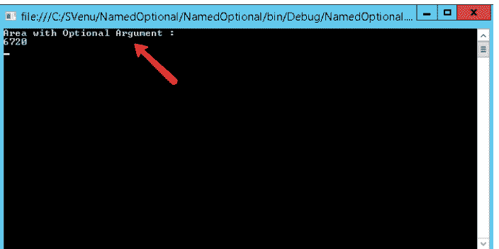

### 使用 Optional 属性。
另一种实现可选参数的方法是使用 [Optional] 关键字。如果未为可选参数传递值，则该参数将被分配该数据类型的默认值。Optional 关键字位于 "Runtime.InteropServices" 命名空间中。

```csharp
using System.Runtime.InteropServices;
private static double FindAreaWithOptional(int length, [Optional]int width)
{
    try
    {
        return (length * width);
    }
    catch (Exception)
    {
        throw new NotImplementedException();
    }
}
```

area = FindAreaWithOptional(120);  //area=0

当我们调用函数时，得到 0，因为第二个参数未传递，int 的默认值是 0，因此乘积为 0。

### 第 50.2 节：命名参数
下面是我们对函数的调用。

```
FindArea(120, 56);
```

在此，我们的第一个参数是 length（即 120），第二个参数是 width（即 56）。我们通过该函数计算面积。以下是函数定义。

```
private static double FindArea(int length, int width)
{
    try
    {
        return (length* width);
    }
    catch (Exception)
    {
        throw new NotImplementedException();
    }
}
```

所以在第一次函数调用中，我们只是按其位置传递参数。对吗？

```
double area;
Console.WriteLine("Area with positioned argument is: ");
area = FindArea(120, 56);
Console.WriteLine(area);
Console.Read();
```

如果运行此代码，您将得到如下输出。

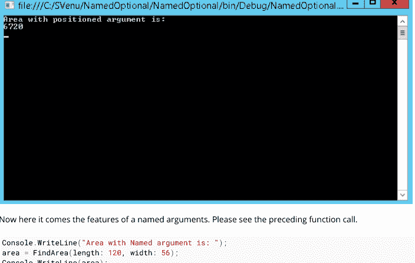

现在命名参数的功能出现了。请参阅前面的函数调用。

```
Console.WriteLine("Area with Named argument is: ");
area = FindArea(length: 120, width: 56);
Console.WriteLine(area);
Console.Read();
```

这里我们在方法调用中给出命名参数。

```
area = FindArea(length: 120, width: 56);
```

现在如果运行此程序，您将得到相同的结果。如果使用命名参数，我们可以在方法调用中反过来给出名称。

```
Console.WriteLine("Area with Named argument vice versa is: ");
area = FindArea(width: 120, length: 56);
Console.WriteLine(area);
Console.Read();
```

命名参数的一个重要用途是，当您在程序中使用它时，它会提高代码的可读性。它简单地说明了您的参数的含义，或者它是什么？

您也可以给出位置参数。这意味着位置参数和命名参数的组合。

```
Console.WriteLine("Area with Named argument Positional Argument : ");
area = FindArea(120, width: 56);
Console.WriteLine(area);
Console.Read();
```

在上面的示例中，我们将 120 传递为 length，并将 56 作为参数 width 的命名参数传递。

也有一些限制。我们现在将讨论命名参数的限制。

### 使用命名参数的限制
命名参数规范必须在所有固定参数指定后出现。

如果您在固定参数之前使用命名参数，您将得到如下编译时错误。

```
area = FindArea(length:120, 5);
}
private static double FindArea(
{
try
{
```

> struct System.Int32
> 表示 32 位有符号整数。
> 
> 错误：
> 命名参数规范必须在所有固定参数指定后出现

命名参数规范必须在所有固定参数指定后出现

## 第 51 章：数据注解
### 第 51.1 节：数据注解基础
数据注解是向类或类的成员添加更多上下文信息的一种方式。注解主要有三类：

- 验证属性：为数据添加验证条件
- 显示属性：指定数据应如何向用户显示
- 模型属性：添加有关使用方式和与其他类的关系的信息

### 用法
以下是使用两个 ValidationAttribute 和一个 DisplayAttribute 的示例：

```
class Kid
{
    [Range(0, 18)] // The age cannot be over 18 and cannot be negative
    public int Age { get; set; }
    [StringLength(MaximumLength = 50, MinimumLength = 3)] // The name cannot be under 3 chars or more than 50 chars
    public string Name { get; set; }
    [DataType(DataType.Date)] // The birthday will be displayed as a date only (without the time)
    public DateTime Birthday { get; set; }
}
```

数据注解主要用于 ASP.NET 等框架中。例如，在 ASP.NET MVC 中，当模型被控制器方法接收时，可以使用 ModelState.IsValid() 来判断接收到的模型是否符合其所有的 ValidationAttribute。DisplayAttribute 也用于 ASP.NET MVC 中，以确定如何在网页上显示值。

### 第 51.2 节：创建自定义验证属性
自定义验证属性可以通过从 ValidationAttribute 基类派生，然后根据需要重写虚方法来创建。

```
[AttributeUsage(AttributeTargets.Property, AllowMultiple = false, Inherited = false)]
public class NotABananaAttribute : ValidationAttribute
{
    public override bool IsValid(object value)
    {
        var inputValue = value as string;
        var isValid = true;

        if (!string.IsNullOrEmpty(inputValue))
        {
            isValid = inputValue.ToUpperInvariant() != "BANANA";
        }

        return isValid;
    }
}
```

该属性可以这样使用：

```
public class Model
```
```csharp
{
    [NotABanana(ErrorMessage = "Bananas are not allowed.")]
    public string FavoriteFruit { get; set; }
}
```

### 第 51.3 节：手动执行验证属性
大多数情况下，验证属性在框架（如 ASP.NET）内部使用。这些框架负责执行验证属性。但如果您想手动执行验证属性怎么办？只需使用 Validator 类（无需反射）。

### 验证上下文
任何验证都需要一个上下文来提供有关正在验证内容的某些信息。这可能包括各种信息，例如要验证的对象、某些属性、要在错误消息中显示的名称等。

```csharp
ValidationContext vc = new ValidationContext(objectToValidate); // The simplest form of validation context. It contains only a reference to the object being validated.
```

创建上下文后，有多种验证方式。

### 验证对象及其所有属性
```csharp
ICollection<ValidationResult> results = new List<ValidationResult>(); // Will contain the results of the validation
bool isValid = Validator.TryValidateObject(objectToValidate, vc, results, true); // Validates the object and its properties using the previously created context.
// The variable isValid will be true if everything is valid
// The results variable contains the results of the validation
```

### 验证对象的属性
```csharp
ICollection<ValidationResult> results = new List<ValidationResult>(); // Will contain the results of the validation
bool isValid = Validator.TryValidateProperty(objectToValidate.PropertyToValidate, vc, results, true); // Validates the property using the previously created context.
// The variable isValid will be true if everything is valid
// The results variable contains the results of the validation
```

### 以及更多
要了解有关手动验证的更多信息，请参阅：

- [ValidationContext 类文档](#)
- [Validator 类文档](#)

### 第 51.4 节：验证属性
验证属性用于以声明方式在类或类成员上强制执行各种验证规则。所有验证属性都派生自 ValidationAttribute 基类。

### 示例：RequiredAttribute
通过 ValidationAttribute.Validate 方法验证时，如果 Name 属性为 null 或仅包含空白，则此属性将返回错误。


```csharp
public class ContactModel
{
    [Required(ErrorMessage = "Please provide a name.")]
    public string Name { get; set; }
}
```

## 示例：StringLengthAttribute

StringLengthAttribute 验证字符串长度是否小于最大长度。它可以可选地指定最小长度。两个值都包含在内。

```csharp
public class ContactModel
{
    [StringLength(20, MinimumLength = 5, ErrorMessage = "A name must be between five and twenty characters.")]
    public string Name { get; set; }
}
```

## 示例：RangeAttribute

RangeAttribute 为数值字段提供最大值和最小值。

```csharp
public class Model
{
    [Range(0.01, 100.00,ErrorMessage = "Price must be between 0.01 and 100.00")]
    public decimal Price { get; set; }
}
```

## 示例：CustomValidationAttribute

CustomValidationAttribute 类允许在验证时调用自定义静态方法。自定义方法必须是 static ValidationResult [MethodName] (object input)。

```csharp
public class Model
{
    [CustomValidation(typeof(MyCustomValidation), "IsNotAnApple")]
    public string FavoriteFruit { get; set; }
}
```

方法声明：

```csharp
public static class MyCustomValidation
{
    public static ValidationResult IsNotAnApple(object input)
    {
        var result = ValidationResult.Success;

        if (input?.ToString()?.ToUpperInvariant() == "APPLE")
        {
            result = new ValidationResult("Apples are not allowed.");
        }

        return result;
    }
}
```

## 第 51.5 节：EditableAttribute（数据建模属性）

EditableAttribute 设置用户是否应能够更改类属性的值。

```csharp
public class Employee
{
    [Editable(false)]
    public string FirstName { get; set; }
}
```

## XAML 应用中的简单使用示例

```
<Window x:Class="WpfApplication.MainWindow"
    xmlns="http://schemas.microsoft.com/winfx/2006/xaml/presentation"
    xmlns:x="http://schemas.microsoft.com/winfx/2006/xaml"
    xmlns:wpfApplication="clr-namespace:WpfApplication"
    Height="70" Width="360" Title="Display name example">
    <Window.Resources>
        <wpfApplication:EditableConverter x:Key="EditableConverter"/>
    </Window.Resources>
    <StackPanel Margin="5">
        <!-- TextBox Text (FirstName property value) -->
        <!-- TextBox Is Enabled (Editable attribute) -->
        <TextBox Text="{Binding Employee.FirstName, Mode=TwoWay,
UpdateSourceTrigger=PropertyChanged}"
IsEnabled="{Binding Employee, Converter={StaticResource EditableConverter},
ConverterParameter=FirstName}"/>
    </StackPanel>
</Window>
```

```csharp
namespace WpfApplication
{
    /// <summary>
    /// Interaction logic for MainWindow.xaml
    /// </summary>
    public partial class MainWindow : Window
    {
        private Employee _employee = new Employee() { FirstName = "This is not editable"};
        public MainWindow()
        {
            InitializeComponent();
            DataContext = this;
        }
        public Employee Employee
        {
            get { return _employee; }
            set { _employee = value; }
        }
    }
}
```

```csharp
namespace WpfApplication
{
    public class EditableConverter : IValueConverter
```

```csharp
{
    public object Convert(object value, Type targetType, object parameter, CultureInfo culture)
    {
        // return editable attribute's value for given instance property,
        // defaults to true if not found
        var attribute = value.GetType()
            .GetProperty(parameter.ToString())
            .GetCustomAttributes(false)
            .OfType<EditableAttribute>()
            .FirstOrDefault();

        return attribute != null ? attribute.AllowEdit : true;
    }

    public object ConvertBack(object value, Type targetType, object parameter, CultureInfo culture)
    {
        throw new NotImplementedException();
    }
}
```

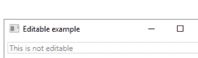

## 第 52 章：关键字

关键字是预定义的、保留的标识符，对编译器具有特殊含义。它们不能在程序中用作标识符，除非加上 @ 前缀。例如 @if 是一个合法的标识符，但不是关键字 if。

### 第 52.1 节：as

as 关键字是一个类似于强制转换的操作符。如果强制转换不可行，使用 as 会产生 null 而不是导致 InvalidCastException。

expression as type 等价于 expression is type ? (type)expression : (type)null，但需要注意 as 在引用转换、可空转换和装箱转换上无效。不支持用户定义的转换；必须改用常规强制转换。

对于上面的展开，编译器会生成代码，使得 expression 只会被评估一次并使用单一的动态类型检查（不像上面的示例中的两次）。

as 在期望参数以支持多种类型时可能很有用。具体来说，它为用户提供了多种选择——而不是在强制转换前用 is 检查每种可能性，或直接强制转换并捕获异常。最佳实践是在强制转换/检查会导致仅一次拆箱惩罚的对象时使用 'as'。先用 is 检查然后再强制转换会导致两次拆箱惩罚。

如果期望参数是特定类型的实例，则优先使用常规强制转换，因为其目的对读者来说更清晰。

因为对 as 的调用可能产生 null，所以务必检查结果以避免 NullReferenceException。

### 示例用法

```csharp
object something = "Hello";
Console.WriteLine(something as string);     //Hello
Console.WriteLine(something as Nullable<int>); //null
Console.WriteLine(something as int?);       //null

//This does NOT compile:
//destination type must be a reference type (or a nullable value type)
Console.WriteLine(something as int);
```

Live Demo on .NET Fiddle

不使用 as 的等效示例：

```csharp
Console.WriteLine(something is string ? (string)something : (string)null);
```

这在自定义类中重写 Equals 函数时很有用。

```csharp
class MyCustomClass
{
    public override bool Equals(object obj)
    {
        MyCustomClass customObject = obj as MyCustomClass;

        // if it is null it may be really null
        // or it may be of a different type
    }
}
```

```csharp
if (Object.ReferenceEquals(null, customObject))
{
    // If it is null then it is not equal to this instance.
    return false;
}

// Other equality controls specific to class
}
```

### 第 52.2 节：goto

goto 可用于跳转到代码中由标签指定的特定行。

**goto 用作：**

**标签：**

```csharp
void InfiniteHello()
{
    sayHello:
    Console.WriteLine("Hello!");
    goto sayHello;
}
```

[Live Demo on .NET Fiddle]

**Case 语句：**

```csharp
enum Permissions { Read, Write };

switch (GetRequestedPermission())
{
    case Permissions.Read:
        GrantReadAccess();
        break;

    case Permissions.Write:
        GrantWriteAccess();
        goto case Permissions.Read; //People with write access also get read
}
```

[Live Demo on .NET Fiddle]

这在 switch 语句中执行多种行为时特别有用，因为 C# 不支持 [fall-through case blocks]。

### 异常重试

```csharp
var exCount = 0;
retry:
try
{
    //Do work
}
catch (IOException)
{
    exCount++;
    if (exCount < 3)
    {
        Thread.Sleep(100);
```

```csharp
{
    x = 5;

    // the compiler no longer optimizes this statement
    var y = x + 10;

    /* the value of x and y will always be the correct values */
    Debug.WriteLine("x = " + x + ", y = " + y);
}
```

现在，编译器会查找字段 x 的读取使用情况，并确保始终检索字段的当前值。这确保了即使多个线程同时读取和写入此字段，也始终检索 x 的当前值。

volatile 只能用于类或结构中的字段。以下是不合法的：

```csharp
public void MyMethod() { volatile int x; }
```

volatile 只能应用于以下类型的字段：

- 引用类型或已知为引用类型的泛型类型参数
- 原始类型，例如 sbyte、byte、short、ushort、int、uint、char、float 和 bool
- 基于 byte、sbyte、short、ushort、int 或 uint 的枚举类型
- IntPtr 和 UIntPtr

### 备注：

- volatile 修饰符通常用于在不使用 lock 语句序列化访问的情况下由多个线程访问的字段。
- volatile 关键字可以应用于引用类型的字段
- volatile 关键字不会使在 32 位平台上对 64 位基元的操作变得原子化。在这些平台上，仍必须使用 Interlocked.Read 和 Interlocked.Exchange 来实现安全的多线程访问。

### 第 52.4 节：checked, unchecked

checked 和 unchecked 关键字定义操作如何处理数学溢出。在 checked 和 unchecked 关键字的上下文中，“溢出”是指整数算术运算结果的值的绝对值大于目标数据类型所能表示的范围。

当在 checked 块内发生溢出（或编译器设置为全局使用 checked 算术时），会抛出异常以警告不期望的行为。与此同时，在 unchecked 块中，溢出是静默的：不会抛出异常，值只会简单地绕回到相反的边界。这可能导致难以发现的微妙错误。

由于大多数算术运算都是在不会溢出的值上进行的，大多数情况下无需显式将块定义为 checked。在对可能导致溢出的无界输入进行算术运算时需要谨慎，例如在递归函数中进行算术运算或在接收用户输入时。

*checked 和 unchecked 都不影响浮点算术运算。*

当块或表达式声明为 unchecked 时，其内部的任何算术运算都允许溢出而不导致错误。一个期望这种行为的例子是校验和的计算，其中

在计算过程中，值允许“环绕”发生：

```
byte Checksum(byte[] data) {
    byte result = 0;
    for (int i = 0; i < data.Length; i++) {
        result = unchecked(result + data[i]); // unchecked expression
    }
    return result;
}
```

unchecked 最常见的用途之一是实现 object.GetHashCode() 的自定义重写，这是一种校验和。你可以在这个问题（System.Object.GetHashCode 的最佳重写算法是什么？）的答案中看到该关键字的用法。

当块或表达式被声明为 checked 时，任何导致溢出的算术运算都会引发 OverflowException。

```
int SafeSum(int x, int y) {
    checked { // checked block
        return x + y;
    }
}
```

checked 和 unchecked 都可以采用块形式和表达式形式。

checked 和 unchecked 块不会影响所调用的方法，只会影响当前方法中直接调用的运算符。例如，Enum.ToObject()、Convert.ToInt32() 和用户自定义运算符不受自定义 checked/unchecked 上下文的影响。

注意：默认的溢出行为（checked 与 unchecked）可以在项目属性中或通过 /checked[+/-] 命令行开关进行更改。通常，调试版本默认使用 checked 操作，而发布版本默认使用 unchecked 操作。只有在默认方式不适用并且需要显式行为来确保正确性时，才应使用 checked 和 unchecked 关键字。

## 第 52.5 节：virtual、override、new

### virtual 和 override

virtual 关键字允许方法、属性、索引器或事件被派生类重写并呈现多态行为。（在 C# 中，成员默认是非 virtual 的。）

```
public class BaseClass
{
    public virtual void Foo()
    {
        Console.WriteLine("Foo from BaseClass");
    }
}
```

```
Console.WriteLine("Foo from DerivedClass");
}
}
```

virtual 成员的多态行为意味着，在调用时，实际执行的成员是在运行时而非编译时确定的。将执行特定对象所属的最派生类中的重写成员。

简而言之，对象在编译时可以声明为 BaseClass 类型，但如果在运行时它是 DerivedClass 的实例，那么将执行被重写的成员：

```
BaseClass obj1 = new BaseClass();
obj1.Foo(); //Outputs "Foo from BaseClass"

obj1 = new DerivedClass();
obj1.Foo(); //Outputs "Foo from DerivedClass"
```

重写方法不是强制的：

```
public class SecondDerivedClass: DerivedClass {}

var obj1 = new SecondDerivedClass();
obj1.Foo(); //Outputs "Foo from DerivedClass"
```

### new

由于只有定义为 virtual 的成员才可以被重写并具有多态性，因此派生类重新定义非 virtual 成员可能会导致意外结果。

```
public class BaseClass
{
    public void Foo()
    {
        Console.WriteLine("Foo from BaseClass");
    }
}

public class DerivedClass: BaseClass
{
    public void Foo()
    {
        Console.WriteLine("Foo from DerivedClass");
    }
}

BaseClass obj1 = new BaseClass();
obj1.Foo(); //Outputs "Foo from BaseClass"

obj1 = new DerivedClass();
obj1.Foo(); //Outputs "Foo from BaseClass" too!
```

发生这种情况时，所执行的成员始终在编译时根据对象的类型确定。

- 如果对象声明为 BaseClass 类型（即使运行时是派生类），则执行 BaseClass 的方法。
- 如果对象声明为 DerivedClass 类型，则执行 DerivedClass 的方法。

这通常是意外情况（当一个相同成员先添加到派生类型，之后又添加到基类型时），在这种情况下，编译器会生成警告 CS0108。

如果这是有意为之，则使用 new 关键字来抑制编译器警告（并告知其他开发人员你的意图！）。行为保持不变，new 关键字只是抑制了编译器警告。

```
public class BaseClass
{
    public void Foo()
    {
        Console.WriteLine("Foo from BaseClass");
    }
}

public class DerivedClass : BaseClass
{
    public new void Foo()
    {
        Console.WriteLine("Foo from DerivedClass");
    }
}
```

BaseClass obj1 = new BaseClass();
obj1.Foo(); //Outputs "Foo from BaseClass"

obj1 = new DerivedClass();
obj1.Foo(); //Outputs "Foo from BaseClass" too!

### 使用 override 并不是可选的

与 C++ 不同，override 关键字的使用不是可选的：

```
public class A
{
    public virtual void Foo()
    {
    }
}

public class B : A
{
    public void Foo() // Generates CS0108
    {
    }
}
```

上面的示例同样会导致警告 CS0108，因为 B.Foo() 不会自动重写 A.Foo()。当意图是重写基类并实现多态行为时，请添加 override；当需要非多态行为并根据静态类型解析调用时，请添加 new。后者应谨慎使用，因为它可能造成严重混乱。

下面的代码甚至会导致错误：

```
public class A
{
    public void Foo()
    {
    }
}

public class B : A
{
    public override void Foo() // Error: Nothing to override
    {
    }
}
```

### 派生类可以引入多态

下面的代码是完全有效的（尽管很少见）：

```
public class A
{
    public void Foo()
    {
        Console.WriteLine("A");
    }
}

public class B : A
{
    public new virtual void Foo()
    {
        Console.WriteLine("B");
    }
}
```

现在，所有具有 B（及其派生类）静态引用的对象都使用多态来解析 Foo()，而 A 的引用使用 A.Foo()。

```
A a = new A();
a.Foo(); // Prints "A";
a = new B();
a.Foo(); // Prints "A";
B b = new B();
b.Foo(); // Prints "B";
```

### virtual 方法不能是 private

C# 编译器严格禁止无意义的构造。标记为 virtual 的方法不能是 private。因为 private 方法无法从派生类型中看到，因此它也不能被重写。以下代码无法编译：

```
public class A
{
    private virtual void Foo() // Error: virtual methods cannot be private
    {
    }
}
```

## 第 52.6 节：stackalloc

stackalloc 关键字在栈上创建一块内存区域，并返回指向该内存起始位置的指针。栈上分配的内存在其创建所在的作用域退出时自动释放。

//Allocate 1024 bytes. This returns a pointer to the first byte.
byte* ptr = stackalloc byte[1024];

//Assign some values...
ptr[0] = 109;
ptr[1] = 13;
ptr[2] = 232;
...

*在不安全上下文中使用。*

与 C# 中的所有指针一样，读取和赋值没有边界检查。读取超出所分配内存边界的内容将产生不可预测的结果——它可能访问内存中的任意位置，也可能导致访问冲突异常。

//Allocate 1 byte
byte* ptr = stackalloc byte[1];

//Unpredictable results...
ptr[10] = 1;
ptr[-1] = 2;

栈上分配的内存在其创建所在的作用域退出时自动释放。这意味着你不应返回使用 stackalloc 创建的内存，也不应在该作用域生命周期之外存储它。

unsafe IntPtr Leak() {
    //Allocate some memory on the stack
    var ptr = stackalloc byte[1024];

    //Return a pointer to that memory (this exits the scope of "Leak")
    return new IntPtr(ptr);
}

unsafe void Bad() {
    //ptr is now an invalid pointer, using it in any way will have
    //unpredictable results. This is exactly the same as accessing beyond
    //the bounds of the pointer.
    var ptr = Leak();
}

stackalloc 只能在声明和初始化变量时使用。以下是无效的：

byte* ptr;
...
ptr = stackalloc byte[1024];

### 备注：

stackalloc 仅应用于性能优化（无论是计算还是互操作）。这是因为：

- 不需要垃圾回收器，因为内存是在栈上而非堆上分配的——变量一超出作用域，内存即被释放。
- 在栈上分配内存比在堆上更快。
- 由于数据的局部性，增加了 CPU 缓存命中的机会。

## 第 52.7 节：break

在循环（for、foreach、do、while）中，break 语句会中止最内层循环的执行，并返回到循环之后的代码。它还可以与 yield 一起使用，用来指定迭代器已到达末尾。

```
for (var i = 0; i < 10; i++)
{
```


```
if (i == 5)
{
    break;
}
Console.WriteLine("This will appear only 5 times, as the break will stop the loop.");
}
```

在 .NET Fiddle 上实时演示

```
foreach (var stuff in stuffCollection)
{
    if (stuff.SomeStringProp == null)
        break;
    // If stuff.SomeStringProp for any "stuff" is null, the loop is aborted.
    Console.WriteLine(stuff.SomeStringProp);
}
```

break 语句也用于 switch-case 构造中，以跳出 case 或 default 分段。

```
switch(a)
{
    case 5:
        Console.WriteLine("a was 5!");
        break;

    default:
        Console.WriteLine("a was something else!");
        break;
}
```

在 switch 语句中，'break' 关键字需要在每个 case 语句的末尾使用。这与某些允许 'falling through' 到系列中下一个 case 语句的语言相反。解决此问题的方法包括使用 'goto' 语句或按顺序堆叠 'case' 语句。

以下代码将输出数字 0、1、2、...、9，最后一条行将不会被执行。yield break 表示函数的结束（而不仅仅是循环的结束）。

```
public static IEnumerable<int> GetNumbers()
{
    int i = 0;
    while (true) {
        if (i < 10) {
            yield return i++;
        } else {
            yield break;
        }
    }
    Console.WriteLine("This line will not be executed");
}
```

在 .NET Fiddle 上实时演示

请注意，与某些其他语言不同，在 C# 中没有办法标记特定的 break。这意味着在嵌套循环的情况下，只有最内层的循环会被停止：

```
foreach (var outerItem in outerList)
{
    foreach (var innerItem in innerList)
    {
        if (innerItem.ShouldBreakForWhateverReason)
            // This will only break out of the inner loop, the outer will continue:
            break;
    }
}
```

如果你想在此处跳出外层循环，可以使用以下几种不同的策略，例如：

- 使用 goto 语句跳出整个循环结构。
- 一个特定的标志变量（以下示例中的 shouldBreak），可在外层循环每次迭代结束时检查。
- 重构代码以在最内层循环体中使用 return 语句，或完全避免整个嵌套循环结构。

```
bool shouldBreak = false;
while (someCondition)
{
    while (otherCondition)
    {
        if (conditionToBreak)
        {
            // Either transfer control flow to the label below...
            goto endAllLooping;

            // OR use a flag, which can be checked in the outer loop:
            shouldBreak = true;
        }
    }

    if (shouldBreak)
    {
        break; // Break out of outer loop if flag was set to true
    }
}
```

```
endAllLooping: // label from where control flow will continue
```

## 第 52.8 节：const

const 用于表示在程序生命周期内永远不会改变的值。它的值从编译时开始就是常量，而与 readonly 关键字不同，后者的值从运行时开始就是常量。

例如，由于光速永远不会改变，我们可以将它存储在常量中。

```
const double c = 299792458; // Speed of light

double CalculateEnergy(double mass)
{
    return mass * c * c;
}
```

这本质上与 return mass * 299792458 * 299792458 相同，因为编译器会直接用其常量值替换 c。

因此，一旦声明，c 就不能被更改。以下代码将产生编译时错误：

```
const double c = 299792458; // Speed of light
```

```
c = 500; // compile-time error
```

常量可以加上与方法相同的访问修饰符作为前缀：

```csharp
private const double c = 299792458;
public const double c = 299792458;
internal const double c = 299792458;
```

const 成员本质上是静态的。但是显式使用 static 是不允许的。

你也可以定义方法本地常量：

```csharp
double CalculateEnergy(double mass)
{
    const c = 299792458;
    return mass * c * c;
}
```

这些常量不能加上 private 或 public 关键字作为前缀，因为它们隐式地是定义它们的方法的本地常量。

并非所有类型都可以在 const 声明中使用。允许的值类型是预定义的类型 sbyte、byte、short、ushort、int、uint、long、ulong、char、float、double、decimal、bool，以及所有枚举类型。尝试使用其他值类型（如 TimeSpan 或 Guid）声明 const 成员将在编译时失败。

对于特殊的预定义引用类型 string，可以使用任何值声明常量。对于所有其他引用类型，可以声明常量，但必须始终具有值 null。

由于 const 值在编译时已知，因此它们允许作为 switch 语句中的 case 标签，作为可选参数的标准参数，作为属性规范的参数，等等。

如果 const 值在不同程序集之间使用，则需要谨慎处理版本控制。例如，如果程序集 A 定义了 public const int MaxRetries = 3; 并且程序集 B 使用该常量，那么如果程序集 A 中的 MaxRetries 值后来更改为 5（然后重新编译），该更改在程序集 B 中将不会生效，除非程序集 B 也重新编译（引用 A 的新版本）。

因此，如果一个值可能在程序的未来版本中更改，并且该值需要公开可见，请不要声明该值为 const，除非你知道只要有任何更改，所有依赖程序集都将被重新编译。替代方案是使用 static readonly 而不是 const，后者在运行时解析。

## 第 52.9 节：async, await

await 关键字作为 C# 5.0 版本的一部分添加，该版本从 Visual Studio 2012 起受支持。它利用了任务并行库（TPL），使多线程变得相对容易。async 和 await 关键字成对使用在同一个函数中，如下所示。await 关键字用于暂停当前异步方法的执行，直到被等待的异步任务完成和/或其结果返回为止。为了使用 await 关键字，使用它的必须标记为 async 关键字。

使用 async 与 void 强烈不建议。更多信息请查看这里。

示例：

```csharp
public async Task DoSomethingAsync()
{
Console.WriteLine("Starting a useless process...");
Stopwatch stopwatch = Stopwatch.StartNew();
int delay = await UselessProcessAsync(1000);
stopwatch.Stop();
Console.WriteLine("A useless process took {0} milliseconds to execute.",
stopwatch.ElapsedMilliseconds);
}
public async Task<int> UselessProcessAsync(int x)
{
    await Task.Delay(x);
    return x;
}
```

输出：

```
"Starting a useless process..."

**... 1 second delay...**

"A useless process took 1000 milliseconds to execute."
```

如果 Task 或 Task<T> 返回的方法只返回单个异步操作，则可以省略 async 和 await 关键字对。

*与其这样：*

```
public async Task PrintAndDelayAsync(string message, int delay)
{
    Debug.WriteLine(message);
    await Task.Delay(x);
}
```

*更倾向于这样做：*

```
public Task PrintAndDelayAsync(string message, int delay)
{
    Debug.WriteLine(message);
    return Task.Delay(x);
}
```

版本 = 5.0

在 C# 5.0 中，await 不能在 catch 和 finally 中使用。

版本 ≥ 6.0

在 C# 6.0 中，await 可以在 catch 和 finally 中使用。

## 第 52.10 节：for

语法：for (initializer; condition; iterator)

- for 循环通常在迭代次数已知时使用。
- initializer 部分中的语句只运行一次，在进入循环之前。
- condition 部分包含一个布尔表达式，该表达式在每次循环迭代结束时进行评估，以确定循环是否应该退出或再次运行。
- iterator 部分定义了在循环体每次迭代后会发生什么。

此示例展示了如何使用 for 迭代字符串的字符：

```csharp
string str = "Hello";
for (int i = 0; i < str.Length; i++)
{
    Console.WriteLine(str[i]);
}
```

输出：

H
e
l
l
o

[在 .NET Fiddle 上实时演示]

定义 for 语句的所有表达式都是可选的；例如，以下语句用于创建无限循环：

```csharp
for( ; ; )
{
    // Your code here
}
```

initializer 部分可以包含多个变量，只要它们是同一类型即可。condition 部分可以由任何可以求值为 bool 的表达式组成。而 iterator 部分可以执行用逗号分隔的多个操作：

```csharp
string hello = "hello";
for (int i = 0, j = 1, k = 9; i < 3 && k > 0; i++, hello += i) {
    Console.WriteLine(hello);
}
```

输出：

hello
hello1
hello12

[在 .NET Fiddle 上实时演示]

## 第 52.11 节：abstract

用 abstract 关键字标记的类不能被实例化。

如果一个类包含抽象成员或继承了未实现的抽象成员，则必须标记为 abstract。一个类即使没有涉及任何抽象成员也可以被标记为 abstract。


当实现的一部分需要由另一个组件指定时，抽象类通常用作基类。

```
abstract class Animal
{
    string Name { get; set; }
    public abstract void MakeSound();
}

public class Cat : Animal
{
    public override void MakeSound()
    {
        Console.WriteLine("Meow meow");
    }
}

public class Dog : Animal
{
    public override void MakeSound()
    {
        Console.WriteLine("Bark bark");
    }
}

Animal cat = new Cat();     // Allowed due to Cat deriving from Animal
cat.MakeSound();            // will print out "Meow meow"

Animal dog = new Dog();     // Allowed due to Dog deriving from Animal
dog.MakeSound();            // will print out "Bark bark"

Animal animal = new Animal(); // Not allowed due to being an abstract class
```

用关键字 abstract 标记的方法、属性或事件表示该成员的实现预期由子类提供。如上所述，抽象成员只能出现在抽象类中。

```
abstract class Animal
{
    public abstract string Name { get; set; }
}

public class Cat : Animal
{
    public override string Name { get; set; }
}

public class Dog : Animal
{
    public override string Name { get; set; }
}
```

## 第 52.12 节：fixed

fixed 语句将内存固定在某个位置。内存中的对象通常会移动，这使得垃圾回收成为可能。但是，当我们使用指向内存地址的非安全指针时，该内存不能被移动。

- 我们使用 fixed 语句来确保垃圾回收器不会重新定位字符串数据。

```
public T GetResourceOrDefault<T>(string resourceName)
{
    if (ResourceExists(resourceName))
    {
        return (T)GetResource(resourceName);
    }
    else
    {
        return default(T);
    }
}
```

## 第 52.14 节：sealed

当应用于类时，sealed 修饰符会阻止其他类从它继承。

```
class A { }
sealed class B : A { }
class C : B { } //error : Cannot derive from the sealed class
```

当应用于虚方法（或虚属性）时，sealed 修饰符会阻止此方法（属性）在派生类中被重写。

```
public class A
{
    public sealed override string ToString() // Virtual method inherited from class Object
    {
        return "Do not override me!";
    }
}

public class B : A
{
    public override string ToString() // Compile time error
    {
        return "An attempt to override";
    }
}
```

## 第 52.15 节：is

检查对象是否与给定类型兼容，即对象是否为 BaseInterface 类型的实例，或是否为从 BaseInterface 派生的类型：

```
interface BaseInterface {}
class BaseClass : BaseInterface {}
class DerivedClass : BaseClass {}

var d = new DerivedClass();
Console.WriteLine(d is DerivedClass); // True
Console.WriteLine(d is BaseClass);    // True
Console.WriteLine(d is BaseInterface); // True
Console.WriteLine(d is object);       // True
Console.WriteLine(d is string);       // False

var b = new BaseClass();
Console.WriteLine(b is DerivedClass); // False
Console.WriteLine(b is BaseClass);    // True
```

```
~~~csharp
Console.WriteLine(b is BaseInterface);  // True
Console.WriteLine(b is object);         // True
Console.WriteLine(b is string);         // False
~~~
```

如果强制转换的目的是使用该对象，最佳做法是使用 as 关键字

```
~~~csharp
interface BaseInterface {}
class BaseClass : BaseInterface {}
class DerivedClass : BaseClass {}

var d = new DerivedClass();
Console.WriteLine(d is DerivedClass);   // True - valid use of 'is'
Console.WriteLine(d is BaseClass);      // True - valid use of 'is'

if(d is BaseClass){
    var castedD = (BaseClass)d;
    castedD.Method(); // valid, but not best practice
}

var asD = d as BaseClass;

if(asD!=null){
    asD.Method(); //preferred method since you incur only one unboxing penalty
}
~~~
```

但是，从 C# 7 开始，模式匹配功能扩展了 is 运算符，使其可以在检查类型的同时声明一个新变量。使用 C# 7 的相同代码部分如下：

```
~~~csharp
Version ≥ 7.0
if(d is BaseClass asD ){
    asD.Method();
}
~~~
```

## 第 52.16 节：this

**this** 关键字引用类（对象）的当前实例。这样，就可以区分两个同名变量：一个在类级别（字段），另一个是方法的参数（或局部变量）。

```
~~~csharp
public class MyClass {
    int a;

    void set_a(int a)
    {
        //this.a refers to the variable defined outside of the method,
        //while a refers to the passed parameter.
        this.a = a;
    }
}
~~~
```

该关键字的其他用法包括链接非静态构造函数重载：

```
~~~csharp
public MyClass(int arg) : this(arg, null)
{
}
~~~
```

以及编写索引器：

```
~~~csharp
public string this[int idx1, string idx2]
~~~
```

```
```csharp
{
    get { /* ... */ }
    set { /* ... */ }
}
```
```

以及声明扩展方法：

```
```csharp
public static int Count<TItem>(this IEnumerable<TItem> source)
{
    // ...
}
```
```

如果与局部变量或参数没有冲突，是否使用 **this** 只是风格问题，因此在这种情况下，**this**.MemberOfType 和 MemberOfType 是等价的。另请参阅 **base** 关键字。

请注意，如果要在当前实例上调用扩展方法，则必须使用 **this**。例如，如果你位于实现 IEnumerable<> 的类的非静态方法中，并且想要调用前面的扩展方法 Count，则必须使用：

```
```csharp
this.Count() // works like StaticClassForExtensionMethod.Count(this)
```
```

并且在那里不能省略 **this**。

### 第 52.17 节：readonly

`readonly` 关键字是字段修饰符。当字段声明包含 `readonly` 修饰符时，对该字段的赋值只能作为声明的一部分或在同一类的构造函数中进行。

`readonly` 关键字与 `const` 关键字不同。`const` 字段只能在字段声明时初始化。`readonly` 字段既可以在声明时初始化，也可以在构造函数中初始化。因此，`readonly` 字段可以根据所使用的构造函数而具有不同的值。

`readonly` 关键字常用于注入依赖项。

```
```csharp
class Person
{
    readonly string _name;
    readonly string _surname = "Surname";

    Person(string name)
    {
        _name = name;
    }
    void ChangeName()
    {
        _name = "another name"; // Compile error
        _surname = "another surname"; // Compile error
    }
}
```
```

> 注意：将字段声明为 *readonly* 并不意味着 *不可变*。如果该字段是 *引用类型*，那么对象的**内容**可以更改。*Readonly* 通常用于防止对象被**覆盖**，并仅在该对象的**实例化**期间赋值。

注意：在构造函数内部，readonly 字段可以重新赋值

```
```csharp
public class Car
{
    public double Speed {get; set;}
}
//In code
private readonly Car car = new Car();
private void SomeMethod()
{
    car.Speed = 100;
}
```
```

## 第 52.18 节：typeof

返回对象的 Type，而无需实例化它。

```
```csharp
Type type = typeof(string);
Console.WriteLine(type.FullName); //System.String
Console.WriteLine("Hello".GetType() == type); //True
Console.WriteLine("Hello".GetType() == typeof(string)); //True
```
```

## 第 52.19 节：foreach

foreach 用于遍历数组的元素或实现 IEnumerable 的集合中的项。

```
```csharp
var lines = new string[] {
    "Hello world!",
    "How are you doing today?",
    "Goodbye"
};

foreach (string line in lines)
{
    Console.WriteLine(line);
}
```
```

这将输出

"Hello world!"
"How are you doing today?"
"Goodbye"

.NET Fiddle 上的实时演示

你可以随时使用 break 关键字退出 foreach 循环，或使用 continue 关键字继续下一次迭代。

```
```csharp
var numbers = new int[] {1, 2, 3, 4, 5, 6};
foreach (var number in numbers)
{
```


```csharp
{
    // Skip if 2
    if (number == 2)
        continue;

    // Stop iteration if 5
    if (number == 5)
        break;

    Console.Write(number + ", ");
}

// Prints: 1, 3, 4,
```

[在 .NET Fiddle 上实时演示](https://dotnetfiddle.net/)

请注意，迭代顺序*仅*对某些集合（如数组和 List）有保证，但对许多其他集合**不**保证。

† 虽然 `IEnumerable` 通常用于表示可枚举集合，但 `foreach` 只要求集合公开 `object GetEnumerator()` 方法，该方法应返回一个公开 `bool MoveNext()` 方法和 `object Current { get; }` 属性的对象。

## 第 52.20 节：dynamic

`dynamic` 关键字用于动态类型对象。声明为 `dynamic` 的对象会放弃编译时静态检查，改为在运行时求值。

```csharp
using System;
using System.Dynamic;

dynamic info = new ExpandoObject();
info.Id = 123;
info.Another = 456;

Console.WriteLine(info.Another);
// 456

Console.WriteLine(info.DoesntExist);
// Throws RuntimeBinderException
```

以下示例将 `dynamic` 与 Newtonsoft 的 Json.NET 库结合使用，以便轻松读取反序列化 JSON 文件中的数据。

```csharp
try
{
    string json = @"{ 'x' : 10, y : ""ho"" }";
    dynamic deserializedJson = JsonConvert.DeserializeObject(json);
    int x = deserializedJson.x;
    string y = deserializedJson.y;
    // int z = deserializedJson.z; // throws RuntimeBinderException
}
catch (RuntimeBinderException e)
{
    // This exception is thrown when a property
    // that wasn't assigned to a dynamic variable is used
}
```

返回）。例如：

```csharp
try
{
    connection.Open();
    return connection.Get(query);
}
finally
{
    connection.Close();
}
```

语句 `connection.Close()` 将在 `connection.Get(query)` 的结果返回之前执行。

## 第 52.22 节：void

保留字 `void` 是 `System.Void` 类型的别名，有两种用途：

- 1. 声明一个没有返回值的方法：

```csharp
public void DoSomething()
{
    // Do some work, don't return any value to the caller.
}
```

返回类型为 `void` 的方法仍然可以在其主体中包含 `return` 关键字。当你想退出方法执行并将流程返回给调用方时，这很有用：

```csharp
public void DoSomething()
{
    // Do some work...

    if (condition)
        return;

    // Do some more work if the condition evaluated to false.
}
```

- 2. 在 unsafe 上下文中声明指向未知类型的指针。

在 unsafe 上下文中，类型可以是指针类型、值类型或引用类型。指针类型声明通常为 `type* identifier`，其中类型是已知类型——即 `int* myInt`，但也可以为 `void* identifier`，其中类型未知。

请注意，声明 `void` 指针类型[被 Microsoft 劝阻](#)。

## 第 52.23 节：namespace

`namespace` 关键字是一种组织构造，可帮助我们理解代码库的布局方式。C# 中的命名空间是虚拟空间，而不是物理文件夹。

```csharp
namespace StackOverflow
{
    namespace Documentation
    {
        namespace CSharp.Keywords
        {
```

```csharp
public class Program
{
    public static void Main()
    {
        Console.WriteLine(typeof(Program).Namespace);
        //StackOverflow.Documentation.CSharp.Keywords
    }
}
```

C# 中的命名空间也可以使用链式语法编写。以下内容与上面等效：

```csharp
namespace StackOverflow.Documentation.CSharp.Keywords
{
    public class Program
    {
        public static void Main()
        {
            Console.WriteLine(typeof(Program).Namespace);
            //StackOverflow.Documentation.CSharp.Keywords
        }
    }
}
```

## 第 52.24 节：ref、out

`ref` 和 `out` 关键字会使参数按引用传递，而不是按值传递。对于值类型，这意味着被调用方可以更改变量的值。

```csharp
int x = 5;
ChangeX(ref x);
// The value of x could be different now
```

对于引用类型，变量中的实例不仅可以被修改（就像没有 `ref` 时那样），还可以被完全替换：

```csharp
Address a = new Address();
ChangeFieldInAddress(a);
// a will be the same instance as before, even if it is modified
CreateANewInstance(ref a);
// a could be an entirely new instance now
```

`out` 和 `ref` 关键字的主要区别在于，`ref` 要求变量由调用方初始化，而 `out` 将该责任交给被调用方。

要使用 `out` 参数，方法定义和调用方法都必须显式使用 `out` 关键字。

```csharp
int number = 1;
Console.WriteLine("Before AddByRef: " + number); // number = 1
AddOneByRef(ref number);
Console.WriteLine("After AddByRef: " + number); // number = 2
SetByOut(out number);
Console.WriteLine("After SetByOut: " + number); // number = 34

void AddOneByRef(ref int value)
{
    value++;
}
void SetByOut(out int value)
{
    value = 34;
}
```

在 .NET Fiddle 上实时演示

以下代码无法编译，因为 out 参数必须在方法返回之前赋值（如果改用 ref 则可以编译）：

```csharp
void PrintByOut(out int value)
{
    Console.WriteLine("Hello!");
}
```

### 将 out 关键字用作泛型修饰符

在定义泛型接口和委托时，out 关键字也可以用于泛型类型参数。在这种情况下，out 关键字指定类型参数是协变的。

> 协变使你能够使用比泛型参数指定的类型派生程度更高的类型。这允许实现变体接口的类进行隐式转换，以及委托类型的隐式转换。引用类型支持协变和逆变，但值类型不支持。 - MSDN

```
//if we have an interface like this
interface ICovariant<out R> { }

//and two variables like
ICovariant<Object> iobj = new Sample<Object>();
ICovariant<String> istr = new Sample<String>();
// then the following statement is valid
// without the out keyword this would have thrown error
iobj = istr; // implicit conversion occurs here
```

## 第 52.25 节：base

base 关键字用于访问基类的成员。它通常用于调用虚方法的基类实现，或指定应调用哪个基类构造函数。

### 选择构造函数

```csharp
public class Child : SomeBaseClass {
    public Child() : base("some string for the base class")
    {
    }
}
public class SomeBaseClass {
    public SomeBaseClass()
    {
        // new Child() will not call this constructor, as it does not have a parameter
    }
    public SomeBaseClass(string message)
    {
        // new Child() will use this base constructor because of the specified parameter in Child's constructor
        Console.WriteLine(message);
    }
}
```

### 调用虚方法的基类实现

```csharp
public override void SomeVirtualMethod() {
    // Do something, then call base implementation
    base.SomeVirtualMethod();
}
```

可以从任何方法使用 base 关键字调用基类实现。这会将方法调用直接绑定到基类实现，这意味着即使新的子类重写虚方法，仍会调用基类实现，因此需要谨慎使用。

```csharp
public class Parent
{
    public virtual int VirtualMethod()
    {
        return 1;
    }
}

public class Child : Parent
{
    public override int VirtualMethod() {
        return 11;
    }

    public int NormalMethod()
    {
        return base.VirtualMethod();
    }

    public void CallMethods()
    {
        Assert.AreEqual(11, VirtualMethod());

        Assert.AreEqual(1, NormalMethod());
        Assert.AreEqual(1, base.VirtualMethod());
    }
}

public class GrandChild : Child
{
    public override int VirtualMethod()
    {
        return 21;
    }

    public void CallAgain()
    {
        Assert.AreEqual(21, VirtualMethod());
        Assert.AreEqual(11, base.VirtualMethod());
    }
}
```

// Notice that the call to NormalMethod below still returns the value
// from the extreme base class even though the method has been overridden
// in the child class.
Assert.AreEqual(1, NormalMethod());
}

## 第 52.26 节：float、double、decimal

### float

float 是 .NET 数据类型 System.Single 的别名。它允许存储 IEEE 754 单精度浮点数。此数据类型存在于 mscorlib.dll 中，每当你创建它们时，每个 C# 项目都会隐式引用它。

近似范围：-3.4 × 10^38 to 3.4 × 10^38

小数精度：6-9 位有效数字

语法：

```
float f = 0.1259;
var f1 = 0.7895f; // f is literal suffix to represent float values
```

> 应当注意，float 类型通常会导致显著的舍入误差。在精度要求重要的应用程序中，应考虑其他数据类型。

### double

double 是 .NET 数据类型 System.Double 的别名。它表示双精度 64 位浮点数。此数据类型存在于 mscorlib.dll 中，任何 C# 项目中都会隐式引用它。

范围：±5.0 × 10^-324 to ±1.7 × 10^308

小数精度：15-16 位有效数字

语法：

```
double distance = 200.34; // a double value
double salary = 245; // an integer implicitly type-casted to double value
var marks = 123.764D; // D is literal suffix to represent double values
```

### decimal

decimal 是 .NET 数据类型 System.Decimal 的别名。它是一个关键字，表示 128 位数据类型。与浮点类型相比，decimal 类型具有更高的精度和更小的范围，这使其适用于金融和货币计算。此数据类型存在于 mscorlib.dll 中，任何 C# 项目中都会隐式引用它。

范围：-7.9 × 10^28 to 7.9 × 10^28

小数精度：28-29 位有效数字

### 语法：

```
decimal payable = 152.25m; // a decimal value
var marks = 754.24m; // m is literal suffix to represent decimal values
```

## 第 52.27 节：operator

大多数内置运算符（包括转换运算符）可以通过使用 operator 关键字以及 public 和 static 修饰符来重载。

运算符有三种形式：unary 运算符、binary 运算符和转换运算符。

Unary 和 binary 运算符至少需要一个与包含类型相同类型的参数，并且有些需要互补的匹配运算符。

转换运算符必须在封闭类型之间进行转换或从封闭类型转换。

```
public struct Vector32
{
    public Vector32(int x, int y)
    {
        X = x;
        Y = y;
    }

    public int X { get; }
    public int Y { get; }

    public static bool operator ==(Vector32 left, Vector32 right)
        => left.X == right.X && left.Y == right.Y;

    public static bool operator !=(Vector32 left, Vector32 right)
        => !(left == right);

    public static Vector32 operator +(Vector32 left, Vector32 right)
        => new Vector32(left.X + right.X, left.Y + right.Y);

    public static Vector32 operator +(Vector32 left, int right)
        => new Vector32(left.X + right, left.Y + right);

    public static Vector32 operator +(int left, Vector32 right)
        => right + left;

    public static Vector32 operator -(Vector32 left, Vector32 right)
        => new Vector32(left.X - right.X, left.Y - right.Y);

    public static Vector32 operator -(Vector32 left, int right)
        => new Vector32(left.X - right, left.Y - right);

    public static Vector32 operator -(int left, Vector32 right)
        => right - left;

    public static implicit operator Vector64(Vector32 vector)
        => new Vector64(vector.X, vector.Y);

    public override string ToString() => $"$({X}, {Y})";
}
```

```
public struct Vector64
{
    public Vector64(long x, long y)
    {
        X = x;
        Y = y;
    }

    public long X { get; }
    public long Y { get; }

    public override string ToString() => $"{({X}, {Y})}";
}
```

### 示例

```
var vector1 = new Vector32(15, 39);
var vector2 = new Vector32(87, 64);
```

Console.WriteLine(vector1 == vector2); // false
Console.WriteLine(vector1 != vector2); // true
Console.WriteLine(vector1 + vector2); // {102, 103}
Console.WriteLine(vector1 - vector2); // {-72, -25}

## 第 52.28 节：char

char 是存储在变量中的单个字母。它是内置值类型，占据两个字节的内存空间。它表示在 mscorlib.dll 中找到的 System.Char 数据类型，每当你创建它们时，每个 C# 项目都会隐式引用它。

有多种方法可以做到这一点。

- 1. char c = 'c';
- 2. char c = '\u0063'; // Unicode
- 3. char c = '\x0063'; // Hex
- 4. char c = (char)99; // Integral

char 可以隐式转换为 ushort、int、uint、long、ulong、float、double 或 decimal，并且它将返回该 char 的整数值。

```
ushort u = c;
```

返回 99 等。

然而，其他类型到 char 没有隐式转换。相反，你必须强制转换它们。

```
ushort u = 99;
char c = (char)u;
```

## 第 52.29 节：params

params 允许方法参数接收可变数量的参数，即该参数允许零个、一个或多个参数。

```csharp
static int AddAll(params int[] numbers)
{
    int total = 0;
    foreach (int number in numbers)
    {
        total += number;
    }

    return total;
}
```

此方法现在可以用典型的 `int` 参数列表或 int 数组调用。

```csharp
AddAll(5, 10, 15, 20);                  // 50
AddAll(new int[] { 5, 10, 15, 20 });    // 50
```

`params` 最多只能出现一次，如果使用，它必须是参数列表中的 **last** 项，即使后续类型的数组不同。

在使用 `params` 关键字重载函数时要小心。C# 优先匹配更具体的重载，然后才尝试使用带有 `params` 的重载。例如，如果你有两个方法：

```csharp
static double Add(params double[] numbers)
{
    Console.WriteLine("Add with array of doubles");
    double total = 0.0;
    foreach (double number in numbers)
    {
        total += number;
    }

    return total;
}

static int Add(int a, int b)
{
    Console.WriteLine("Add with 2 ints");
    return a + b;
}
```

那么特定的 2 参数重载将在尝试 `params` 重载之前优先。

```csharp
Add(2, 3);      //prints "Add with 2 ints"
Add(2, 3.0);    //prints "Add with array of doubles" (doubles are not ints)
Add(2, 3, 4);   //prints "Add with array of doubles" (no 3 argument overload)
```

## 第 52.30 节：while

`while` 运算符会迭代代码块，直到条件查询等于 false 或代码被 `goto`、`return`、`break` 或 `throw` 语句中断。

`while` 关键字的语法：

> while( condition ) { code block; }

示例：

```csharp
int i = 0;
while (i++ < 5)
{
    Console.WriteLine("While is on loop number {0}.", i);
}
```

输出：

> "While is on loop number 1."
> "While is on loop number 2."
> "While is on loop number 3."
> "While is on loop number 4."
> "While is on loop number 5."

[在 .NET Fiddle 上进行实时演示](.)

一个 while 循环是 **Entry Controlled**，因为条件是在封闭代码块执行 **before** 检查。这意味着如果条件为 false，while 循环不会执行其语句。

```csharp
bool a = false;

while (a == true)
{
    Console.WriteLine("This will never be printed.");
}
```

给 `while` 条件而不使其在某一点变为 false 将导致无限或 endless 循环。在可能的情况下，应避免这种情况，然而，在某些特殊情况下你可能需要它。

你可以按如下方式创建这样的循环：

```csharp
while (true)
{
//...
}
```

请注意，C# 编译器会将如下循环转换为

```csharp
while (true)
{
// ...
}
```

或

```csharp
for(;;)
{
// ...
}
```

转换为

```csharp
{
:label
```

// ...
    goto label1;
}

请注意 while 循环的条件可以是任意的，无论多么复杂，只要它求值（或返回）为布尔值（bool）即可。它也可以包含返回布尔值（此类函数求值结果与 `a==x` 这样的表达式相同类型）的函数。例如，

```
while (AgriculturalService.MoreCornToPick(myFarm.GetAddress()))
{
    myFarm.PickCorn();
}
```

## 第 52.31 节：null

引用类型的变量可以保存对实例的有效引用或空引用。空引用是引用类型变量以及可空值类型的默认值。

null 是表示空引用的关键字。

作为表达式，它可用于将空引用赋给上述类型的变量：

```
object a = null;
string b = null;
int? c = null;
List<int> d = null;
```

非可空值类型不能被赋值为空引用。以下所有赋值都是无效的：

```
int a = null;
float b = null;
decimal c = null;
```

空引用不应与各种类型的有效实例混淆，例如：

- 空列表 (new List<int>())
- 空字符串 ("")
- 数字零 (0, 0f, 0m)
- 空字符 ( '\0' )

有时，有意义检查某个对象是否为空或空/默认值对象。可以使用 System.String.IsNullOrEmpty(String) 方法进行检查，或自行实现等效方法。

```
private void GreetUser(string userName)
{
    if (String.IsNullOrEmpty(userName))
    {
        //The method that called us either sent in an empty string, or they sent us a null reference.
        //Either way, we need to report the problem.
        throw new InvalidOperationException("userName may not be null or empty.");
    }
    else
    {
        //userName is acceptable.
        Console.WriteLine("Hello, " + userName + "!");
    }
}
```

## 第 52.32 节：continue

立即将控制权传递给封闭循环结构（for、foreach、do、while）的下一次迭代：

```csharp
for (var i = 0; i < 10; i++)
{
    if (i < 5)
    {
        continue;
    }
    Console.WriteLine(i);
}
```

输出：

5
6
7
8
9

在 .NET Fiddle 上实时演示

```csharp
var stuff = new [] {"a", "b", null, "c", "d"};
foreach (var s in stuff)
{
    if (s == null)
    {
        continue;
    }
    Console.WriteLine(s);
}
```

输出：

a
b
c
d

在 .NET Fiddle 上实时演示

## 第 52.33 节：string

string 是 .NET 数据类型 System.String 的别名，允许存储文本（字符序列）。

记法：

```csharp
string a = "Hello";
var b = "world";
```

```csharp
var f = new string(new []{ 'h', 'i', '!' }); // hi!
```

字符串中的每个字符都使用 UTF-16 编码，这意味着每个字符至少需要 2 字节的存储空间。

## 第 52.34 节：return

> > MSDN: return 语句终止其所在方法的执行并将控制权返回给调用方法。它还可以返回一个可选值。如果方法为 void 类型，则可以省略 return 语句。

```csharp
public int Sum(int valueA, int valueB)
{
    return valueA + valueB;
}
```

```csharp
public void Terminate(bool terminateEarly)
{
    if (terminateEarly) return; // method returns to caller if true was passed in
    else Console.WriteLine("Not early"); // prints only if terminateEarly was false
}
```

## 第 52.35 节：unsafe

unsafe 关键字可用于类型或方法声明，或声明内联块。

该关键字的目的是为所讨论的块启用 C# 的不安全子集。不安全子集包括指针、栈分配、C 风格数组等特性。

不安全代码不可验证，因此其使用不被推荐。编译不安全代码需要向 C# 编译器传递一个开关。此外，CLR 要求运行的程序集具有完全信任。

尽管存在这些限制，不安全代码在使某些操作更高效（例如数组索引）或更简单（例如与某些非托管库的互操作）方面仍有合理用途。

作为一个非常简单的示例

```csharp
// compile with /unsafe
class UnsafeTest
{
    unsafe static void SquarePtrParam(int* p)
    {
        *p *= *p; // the '*' dereferences the pointer.
        //Since we passed in "the address of i", this becomes "i *= i"
    }

    unsafe static void Main()
    {
        int i = 5;
        // Unsafe method: uses address-of operator (&):
        SquarePtrParam(&i); // "&i" means "the address of i". The behavior is similar to "ref i"
        Console.WriteLine(i); // Output: 25
    }
}
```

在使用指针时，我们可以直接更改内存位置的值，而不必按名称寻址。请注意，这通常需要使用 fixed 关键字，以防止垃圾回收器移动对象时可能发生的内存损坏（否则，您可能会收到错误 CS0212）。由于已被“固定”的变量无法写入，我们通常还必须有一个第二个指针，其初始指向与第一个相同的位置。

```csharp
void Main()
{
    int[] intArray = new int[] { 1, 2, 3, 4, 5, 6, 7, 8, 9, 10 };

    UnsafeSquareArray(intArray);
    foreach(int i in intArray)
        Console.WriteLine(i);
}

unsafe static void UnsafeSquareArray(int[] pArr)
{
    int len = pArr.Length;

    //in C or C++, we could say
    // int* a = &(pArr[0])
    // however, C# requires you to "fix" the variable first
    fixed(int* fixedPointer = &(pArr[0]))
    {
        //Declare a new int pointer because "fixedPointer" cannot be written to.
        // "p" points to the same address space, but we can modify it
        int* p = fixedPointer;

        for (int i = 0; i < len; i++)
        {
            *p *= *p; //square the value, just like we did in SquarePtrParam, above
            p++;      //move the pointer to the next memory space.
                      // NOTE that the pointer will move 4 bytes since "p" is an
                      // int pointer and an int takes 4 bytes

            //the above 2 lines could be written as one, like this:
            // "*p *= *p++;"
        }
    }
}
```

输出：

1
4
9
16
25
36
49
64
81
100

unsafe 还允许使用 stackalloc，它会在栈上分配内存，类似于 C 运行时库中的 _alloca。我们可以按如下方式修改上述示例以使用 stackalloc：

```csharp
unsafe void Main()
{
    const int len=10;
    int* seedArray = stackalloc int[len];

    //We can no longer use the initializer “{ 1, 2, 3, 4, 5, 6, 7, 8, 9, 10}” as before.
    // We have at least 2 options to populate the array. The end result of either
    // option will be the same (doing both will also be the same here).

    //FIRST OPTION:
    int* p = seedArray; // we don't want to lose where the array starts, so we
                        // create a shadow copy of the pointer
    for(int i=1; i<=len; i++)
        *p++ = i;
    //end of first option

    //SECOND OPTION:
    for(int i=0; i<len; i++)
        seedArray[i] = i+1;
    //end of second option

    UnsafeSquareArray(seedArray, len);
    for(int i=0; i< len; i++)
        Console.WriteLine(seedArray[i]);
}
```

```csharp
//Now that we are dealing directly in pointers, we don't need to mess around with
// “fixed”, which dramatically simplifies the code
unsafe static void UnsafeSquareArray(int* p, int len)
{
    for (int i = 0; i < len; i++)
        *p *= *p++;
}
```

（输出与上面相同）

## 第 52.36 节：switch

`switch` 语句是一种控制语句，从候选列表中选择要执行的 switch 部分。switch 语句包含一个或多个 switch 部分。每个 switch 部分包含一个或多个 `case` 标签，后跟一个或多个语句。如果没有 case 标签包含匹配的值，控制权将转移到 `default` 部分（如果存在）。严格来说，C# 不支持 case 穿透。然而，如果一个或多个 `case` 标签为空，执行将跟随包含代码的下一个 `case` 块的代码。这允许将多个 `case` 标签分组以使用相同的实现。在以下示例中，如果 month 等于 12，则 `case 2` 中的代码将被执行，因为 case 标签 12、1 和 2 被分组。如果 `case` 块不为空，则在下一个 `case` 标签之前必须存在 `break`，否则编译器会报错。

```csharp
int month = DateTime.Now.Month; // this is expected to be 1-12 for Jan-Dec

switch (month)
{
    case 12:
    case 1:
    case 2:
        Console.WriteLine("Winter");
        break;
    case 3:
    case 4:
    case 5:
        Console.WriteLine("Spring");
        break;
}
```


```csharp
case 6:
case 7:
case 8:
    Console.WriteLine("Summer");
    break;
case 9:
case 10:
case 11:
    Console.WriteLine("Autumn");
    break;
default:
    Console.WriteLine("Incorrect month index");
    break;
}
```

case 只能由在编译时已知的数值标记（例如，1、"str"、Enum.A），因此变量不是有效的 case 标签，但 const 或 Enum 值是可以的（以及任何字面值）。

## 第 52.37 节：var

这是一个隐式类型的局部变量，其类型强如用户已声明类型一样。与其他变量声明不同，编译器根据赋给它的值来确定该变量的类型。

```csharp
var i = 10; // implicitly typed, the compiler must determine what type of variable this is
int i = 10; // explicitly typed, the type of variable is explicitly stated to the compiler

// Note that these both represent the same type of variable (int) with the same value (10).
```

与其它类型的变量不同，使用此关键字定义的变量在声明时需要进行初始化。这是因为 var 关键字表示一个隐式类型的变量。

```csharp
var i;
i = 10;

// This code will not run as it is not initialized upon declaration.
```

var 关键字也可以用于即时创建新的数据类型。这些新的数据类型被称为匿名类型。它们非常有用，因为它们允许用户在无需显式声明任何对象类型的情况下定义一组属性。

*普通匿名类型*

```csharp
var a = new { number = 1, text = "hi" };
```

*返回匿名类型的 LINQ 查询*

```csharp
public class Dog
{
    public string Name { get; set; }
    public int Age { get; set; }
}

public class DogWithBreed
{
    public Dog Dog { get; set; }
    public string BreedName { get; set; }
}
```

```csharp
private void Method1() { throw new Exception("message for exception with when"); }
private void Method2() { throw new Exception("message for general exception"); }

CatchException(Method1);
CatchException(Method2);
```

## 第 52.39 节：lock

`lock` 为代码块提供线程安全，使其在同一进程中只能由一个线程访问。示例：

```csharp
private static object _lockObj = new object();
static void Main(string[] args)
{
    Task.Run(() => TaskWork());
    Task.Run(() => TaskWork());
    Task.Run(() => TaskWork());

    Console.ReadKey();
}

private static void TaskWork()
{
    lock(_lockObj)
    {
        Console.WriteLine("Entered");

        Task.Delay(3000);
        Console.WriteLine("Done Delaying");

        // Access shared resources safely

        Console.WriteLine("Leaving");
    }
}

Output:

Entered
Done Delaying
Leaving
Entered
Done Delaying
Leaving
Entered
Done Delaying
Leaving
```

### 用例：

当你有一个代码块，如果同时被多个线程执行可能会产生副作用时。`lock` 关键字连同 **共享同步对象**（示例中的 `_objLock`）可用于防止这种情况。

请注意，`_objLock` 不能为 `null`，并且执行代码的多个线程必须使用同一个对象实例（要么将其设为 `static` 字段，要么对两个线程使用同一个类实例）

从编译器角度来看，`lock` 关键字是语法糖，被替换为 `Monitor.Enter(_lockObj);` 和 Monitor.Exit(_lockObj); 。因此，如果你用这两个方法包围代码块来替换 lock，你会得到相同的结果。你可以在 Syntactic sugar in C# - lock example 中看到实际代码

## 第 52.40 节：uint

一个 **无符号整数**，或 **uint**，是一种只能保存正整数的数值数据类型。正如其名称所示，它表示一个无符号 32 位整数。**uint** 关键字本身是通用类型系统类型 System.UInt32 的别名。此数据类型存在于 mscorlib.dll 中，该库在创建时会被每个 C# 项目隐式引用。它占用四个字节的内存空间。

无符号整数可以保存从 0 到 4,294,967,295 的任意值。

*如何以及如何不声明无符号整数的示例*

~~~
uint i = 425697; // Valid expression, explicitly stated to compiler
var i1 = 789247U; // Valid expression, suffix allows compiler to determine datatype
uint x = 3.0; // Error, there is no implicit conversion
~~~

**请注意：** 根据 Microsoft 的建议，尽可能使用 **int** 数据类型，因为 **uint** 数据类型不是 CLS 兼容的。

## 第 52.41 节：if, if...else, if... else if

if 语句用于控制程序的流程。if 语句根据布尔表达式的值来确定要运行哪个语句。

对于单个语句，花括号 {} 是可选的但推荐使用。

~~~
int a = 4;
if (a % 2 == 0)
{
    Console.WriteLine("a contains an even number");
}
// output: "a contains an even number"
~~~

if 语句也可以有一个 else 子句，当条件求值为 false 时会执行：

~~~
int a = 5;
if (a % 2 == 0)
{
    Console.WriteLine("a contains an even number");
}
else
{
    Console.WriteLine("a contains an odd number");
}
// output: "a contains an odd number"
~~~

if...else if 结构允许你指定多个条件：

~~~
int a = 9;
if (a % 2 == 0)
{
    Console.WriteLine("a contains an even number");
}
else if (a % 3 == 0)
~~~

```csharp
{
    A a = new A();
    A b = new A();
    A c = new A();

    Console.WriteLine(A.count); // 3
}
```

count 等于 A 类实例的总数。

static 修饰符也可以用于为类声明静态构造函数，以初始化静态数据或运行只需调用一次的代码。静态构造函数在类首次被引用之前调用。

```csharp
class A
{
    static public DateTime InitializationTime;

    // Static constructor
    static A()
    {
        InitializationTime = DateTime.Now;
        // Guaranteed to only run once
        Console.WriteLine(InitializationTime.ToString());
    }
}
```

一个 `static class` 用 `static` 关键字标记，可以作为一组方法的有益容器，这些方法作用于参数，但不一定需要绑定到实例。由于类的 `static` 性质，它不能被实例化，但可以包含一个 `static` 构造函数。`static class` 的一些特性包括：

- 不能被继承
- 不能继承自 `Object` 之外的任何东西
- 可以包含静态构造函数但不能包含实例构造函数
- 只能包含静态成员
- 是密封的

编译器也很友好，如果类中存在任何实例成员，它会通知开发者。一个例子是用于在美国和加拿大度量之间转换的静态类：

```csharp
static class ConversionHelper {
    private static double oneGallonPerLitreRate = 0.264172;

    public static double litreToGallonConversion(int litres) {
        return litres * oneGallonPerLitreRate;
    }
}
```

当类被声明为 static 时：

```csharp
public static class Functions
{
    public static int Double(int value)
    {
        return value + value;
    }
}
```

```
}
```

类内的所有函数、属性或成员也需要声明为 static。不能创建该类的实例。本质上，静态类允许你创建逻辑上分组在一起的函数集合。

自 C#6 起，`static` 也可以与 `using` 一起使用以导入静态成员和方法。然后它们可以在不使用类名的情况下使用。

### 旧方法，不使用 static：

```csharp
using System;

public class ConsoleApplication
{
    public static void Main()
    {
        Console.WriteLine("Hello World!"); //WriteLine is method belonging to static class Console
    }
}
```

### 使用 static 的示例

```csharp
using static System.Console;

public class ConsoleApplication
{
    public static void Main()
    {
        WriteLine("Hello World!"); //WriteLine is method belonging to static class Console
    }
}
```

### 缺点

虽然静态类可以非常有用，但它们也有自己的注意事项：

- 一旦静态类被调用，该类就会被加载到内存中，并且在容纳该静态类的 AppDomain 被卸载之前无法通过垃圾回收器回收。
- 静态类不能实现接口。

## 第 52.43 节：internal

The `internal` 关键字是类型和类型成员的访问修饰符。内部类型或成员只能在同一程序集中的文件内访问

*用法：*

```csharp
public class BaseClass
{
    // Only accessible within the same assembly
    internal static int x = 0;
}
```

不同访问修饰符之间的区别在此处进行了说明


## 访问修饰符

### public

> 类型或成员可以被同一程序集或引用它的另一程序集中的任何其他代码访问。

### private

> 类型或成员只能被同一类或结构体中的代码访问。

### protected

> 类型或成员只能被同一类或结构体中的代码访问，或者被派生类中的代码访问。

### internal

> 类型或成员可以被同一程序集中的任何代码访问，但不能被另一程序集中的代码访问。

### protected internal

> 类型或成员可以被同一程序集中的任何代码访问，或者被另一程序集中的任何派生类访问。

当**未设置访问修饰符**时，将使用默认的访问修饰符。因此，即使没有显式设置，也总是存在某种形式的访问修饰符。

## 第 52.44 节：using

`using` 关键字有两种使用方式：`using statement` 和 `using directive`：

- 1. **using 语句：**
  
  `using` 关键字确保实现了 `IDisposable` 接口的对象在使用后被正确释放。关于 using 语句有单独的专题讨论。
  
- 2. **using 指令**
  
  `using` 指令有三种用法，参见 MSDN 的 using 指令页面。关于 using 指令有单独的专题讨论。

## 第 52.45 节：where

`where` 在 C# 中有两种用途：泛型参数中的类型约束，以及过滤 LINQ 查询。

在泛型类中，让我们考虑

```csharp
public class Cup<T>
{
    // ...
}
```

T 称为类型参数。类定义可以对提供给 T 的实际类型施加约束。

可以应用的约束类型如下：

- 值类型
- 引用类型
- 默认构造函数
- 继承和实现

### 值类型

在这种情况下，只能提供结构体（这包括诸如 int、boolean 等“原始”数据类型）。

```csharp
public class Cup<T> where T : struct
{
    // ...
}
```

### 引用类型

在这种情况下，只能提供类类型。

```csharp
public class Cup<T> where T : class
{
    // ...
}
```

### 混合值/引用类型

有时希望将类型参数限制为数据库中可用的类型，这些类型通常映射为值类型和字符串。由于必须满足所有类型约束，不能指定 `where T : struct` 或 `string`（这不是有效语法）。一种变通方法是将类型参数限制为 `IConvertible`，其内置类型包括“... Boolean、SByte、Byte、Int16、UInt16、Int32、UInt32、Int64、UInt64、Single、Double、Decimal、DateTime、Char 和 String。”其他对象也可能实现 IConvertible，尽管在实践中很少见。

```csharp
public class Cup<T> where T : IConvertible
{
    // ...
}
```

### 默认构造函数

只允许包含默认构造函数的类型。这包括值类型和包含默认（无参数）构造函数的类。

```csharp
public class Cup<T> where T : new
{
    // ...
}
```

### 继承和实现

只能提供继承自某个基类或实现某个接口的类型。

```csharp
public class Cup<T> where T : Beverage
{
    // ...
}
```

```csharp
public class Cup<T> where T : IBeer
{
    // ...
}
```

约束甚至可以引用另一个类型参数：

```csharp
public class Cup<T, U> where U : T
{
    // ...
}
```

可以为类型参数指定多个约束：

```csharp
public class Cup<T> where T : class, new()
{
    // ...
}
```

前面的示例展示了类定义上的泛型约束，但约束可以用于任何提供类型参数的地方：类、结构体、接口、方法等。

where 也可以用作 LINQ 子句。在这种情况下，它类似于 SQL 中的 WHERE：

```csharp
int[] nums = { 5, 2, 1, 3, 9, 8, 6, 7, 2, 0 };

var query =
    from num in nums
    where num < 5
    select num;

foreach (var n in query)
{
    Console.Write(n + " ");
}
// prints 2 1 3 2 0
```

## 第 52.46 节：int

int 是 System.Int32 的别名，是一种有符号 32 位整数数据类型。该数据类型位于 mscorlib.dll 中，创建每个 C# 项目时都会隐式引用该程序集。

范围：-2,147,483,648 到 2,147,483,647

```csharp
int int1 = -10007;
```

```csharp
var int2 = 2132012521;
```

## 第 52.47 节：ulong

用于无符号 64 位整数的关键字。它表示位于 mscorlib.dll 中的 System.UInt64 数据类型，创建每个 C# 项目时都会隐式引用该程序集。

范围：0 到 18,446,744,073,709,551,615

```csharp
ulong veryLargeInt = 18446744073709551615;
var anotherVeryLargeInt = 15446744063609451315UL;
```

## 第 52.48 节：true, false

`true` 和 `false` 关键字有两种用途：

- 1. 作为布尔字面量值

```csharp
var myTrueBool = true;
var myFalseBool = false;
```

- 2. 作为可重载运算符

```csharp
public static bool operator true(MyClass x)
{
    return x.value >= 0;
}

public static bool operator false(MyClass x)
{
    return x.value < 0;
}
```

在 C# 2.0 之前，引入可空类型之前，重载 `false` 运算符非常有用。
重载了 `true` 运算符的类型，也必须重载 `false` 运算符。

## 第 52.49 节：struct

`struct` 类型是一种值类型，通常用于封装小型的相关变量组，例如矩形的坐标或库存中某项的特征。

> [类](...)是引用类型，结构体是值类型。

```csharp
using static System.Console;

namespace ConsoleApplication1
{
    struct Point
    {
        public int X;
        public int Y;

        public override string ToString()
        {
            return $"X = {X}, Y = {Y}";
        }
    }
}
```

```
}
    public void Display(string name)
    {
        WriteLine(name + ": " + ToString());
    }
}

class Program
{
    static void Main()
    {
        var point1 = new Point {X = 10, Y = 20};
        // it's not a reference but value type
        var point2 = point1;
        point2.X = 777;
        point2.Y = 888;
        point1.Display(nameof(point1)); // point1: X = 10, Y = 20
        point2.Display(nameof(point2)); // point2: X = 777, Y = 888

        ReadKey();
    }
}
```

结构体还可以包含构造函数、常量、字段、方法、属性、索引器、运算符、事件和嵌套类型，但如果需要多个此类成员，则应考虑将类型改为类。

**一些**来自微软关于何时使用结构体和何时使用类的建议：

*考虑*：如果类型的实例较小且通常生命周期短，或常嵌入在其他对象中，则定义结构体而不是类。

*避免*：除非类型具有以下所有特征，否则不要定义结构体：

- 它在逻辑上表示单个值，类似于原始类型（如 int、double 等）。
- 它的实例大小小于 16 字节。
- 它是不可变的。
- 它不会被频繁装箱。

## 第 52.50 节：extern

extern 关键字用于声明在外部实现的方法。它可以与 DllImport 特性结合使用，通过 Interop 服务调用非托管代码。在这种情况下，它需要与 static 修饰符一起使用。

例如：

```csharp
using System.Runtime.InteropServices;
public class MyClass
{
    [DllImport("User32.dll")]
    private static extern int SetForegroundWindow(IntPtr point);
public void ActivateProcessWindow(Process p)
{
    SetForegroundWindow(p.MainWindowHandle);
}
}
```

这使用了从 User32.dll 库导入的 SetForegroundWindow 方法。

这也可以用于定义外部程序集别名，让我们从单个程序集中引用同一组件的不同版本。

要引用两个具有相同完全限定类型名称的程序集，必须在命令提示符下指定别名，如下所示：

/r:GridV1=grid.dll
/r:GridV2=grid20.dll

这将创建外部别名 GridV1 和 GridV2。要从程序中使用这些别名，请通过 extern 关键字引用它们。例如：

```
extern alias GridV1;
extern alias GridV2;
```

## 第 52.51 节：bool

用于存储布尔值 true 和 false 的关键字。bool 是 System.Boolean 的别名。

bool 的默认值是 false。

```csharp
bool b; // default value is false
b = true; // true
b = ((5 + 2) == 6); // false
```

要使 bool 允许空值，必须将其初始化为 bool?。

bool? 的默认值是 null。

```csharp
bool? a // default value is null
```

## 第 52.52 节：interface

接口包含方法、属性和事件的签名。派生类定义成员，因为接口只包含成员的声明。

接口使用 interface 关键字声明。

```csharp
interface IProduct
{
    decimal Price { get; }
}
class Product : IProduct
{
    const decimal vat = 0.2M;
    public Product(decimal price)
```


```
~~~csharp
{
    _price = price;
}

private decimal _price;
public decimal Price { get { return _price * (1 + vat); } }
}
~~~
```

## 第 52.53 节：委托

委托是表示对方法的引用的类型。它们用于将方法作为参数传递给其他方法。

委托可以保存静态方法、实例方法、匿名方法或 lambda 表达式。

```
~~~csharp
class DelegateExample
{
    public void Run()
    {
        //using class method
        InvokeDelegate( WriteToConsole );

        //using anonymous method
        DelegateInvoker di = delegate ( string input )
        {
            Console.WriteLine( string.Format( "di: {0} ", input ) );
            return true;
        };
        InvokeDelegate( di );

        //using lambda expression
        InvokeDelegate( input => false );
    }

    public delegate bool DelegateInvoker( string input );

    public void InvokeDelegate(DelegateInvoker func)
    {
        var ret = func( "hello world" );
        Console.WriteLine( string.Format( " > delegate returned {0}", ret ) );
    }

    public bool WriteToConsole( string input )
    {
        Console.WriteLine( string.Format( "WriteToConsole: '{0}'", input ) );
        return true;
    }
}
~~~
```

将方法分配给委托时需要注意，方法必须具有相同的返回类型以及参数。这与“普通”方法重载不同，在普通方法重载中，只有参数定义了方法的签名。

事件是基于委托构建的。

## 第 52.54 节：unchecked

`unchecked` 关键字可防止编译器检查溢出/下溢。

例如：

```
const int ConstantMax = int.MaxValue;
unchecked
{
    int i1 = 2147483647 + 10;
}
int i1 = unchecked(ConstantMax + 10);
```

如果没有 unchecked 关键字，这两个加法运算都无法编译。

### 这在什么时候有用？

这很有用，因为它可能有助于加快肯定不会溢出的计算的速度，因为溢出检查需要时间，或者当溢出/下溢是期望的行为时（例如，在生成哈希码时）。

## 第 52.55 节：ushort

用于存储 16 位正整数的数值类型。ushort 是 System.UInt16 的别名，占 2 字节内存。

有效范围是 0 到 65535。

```
ushort a = 50; // 50
ushort b = 65536; // Error, cannot be converted
ushort c = unchecked((ushort)65536); // Overflows (wraps around to 0)
```

## 第 52.56 节：sizeof

用于获取非托管类型的字节大小

```
int byteSize = sizeof(byte); // 1
int sbyteSize = sizeof(sbyte); // 1
int shortSize = sizeof(short); // 2
int ushortSize = sizeof(ushort); // 2
int intSize = sizeof(int); // 4
int uintSize = sizeof(uint); // 4
int longSize = sizeof(long); // 8
int ulongSize = sizeof(ulong); // 8
int charSize = sizeof(char); // 2(Unicode)
int floatSize = sizeof(float); // 4
int doubleSize = sizeof(double); // 8
int decimalSize = sizeof(decimal); // 16
int boolSize = sizeof(bool); // 1
```

## 第 52.57 节：in

in 关键字有三种用法：

- a) 作为 foreach 语句语法的一部分或作为 LINQ 查询语法的一部分

```
foreach (var member in sequence)
{
    // ...
}
```

- b) 在泛型接口和泛型委托类型的上下文中，表示所讨论的类型参数的 *contravariance*：

```csharp
public interface IComparer<in T>
{
    // ...
}
```

- c) 在 LINQ 查询的上下文中，指正在被查询的集合

```csharp
var query = from x in source select new { x.Name, x.ID, };
```

## 第 52.58 节：implicit

`implicit` 关键字用于重载转换运算符。例如，您可以声明一个 `Fraction` 类，该类在需要时应自动转换为 `double`，并且可以从 `int` 自动转换：

```csharp
class Fraction(int numerator, int denominator)
{
    public int Numerator { get; } = numerator;
    public int Denominator { get; } = denominator;
    // ...
    public static implicit operator double(Fraction f)
    {
        return f.Numerator / (double) f.Denominator;
    }
    public static implicit operator Fraction(int i)
    {
        return new Fraction(i, 1);
    }
}
```

## 第 52.59 节：do

`do` 运算符会重复执行一段代码块，直到条件查询等于 false。do-while 循环也可以通过 `goto`、`return`、`break` 或 `throw` 语句中断。

`do` 关键字的语法是：

> `do { code block; } while( condition );`

示例：

```csharp
int i = 0;

do
{
    Console.WriteLine("Do is on loop number {0}.", i);
} while (i++ < 5);
```

输出：

> "Do is on loop number 1."
> "Do is on loop number 2."
> "Do is on loop number 3."
> "Do is on loop number 4."
> "Do is on loop number 5."

与 while 循环不同，do-while 循环是出口控制的。这意味着 do-while 循环即使条件第一次判断失败，也至少会执行一次其语句。

```
bool a = false;
do
{
    Console.WriteLine("This will be printed once, even if a is false.");
} while (a == true);
```

## 第 52.60 节：long

long 关键字用于表示有符号 64 位整数。它是存在于 mscorlib.dll 中的 System.Int64 数据类型的别名，每当您创建 C# 项目时，每个项目都会隐式引用它。

任何 long 变量都可以显式和隐式声明：

```
long long1 = 9223372036854775806; // explicit declaration, long keyword used
var long2 = -9223372036854775806L; // implicit declaration, 'L' suffix used
```

long 变量可以保存从 −9,223,372,036,854,775,808 到 9,223,372,036,854,775,807 的任何值，并且在变量必须保存超出其他变量（如 int 变量）范围的值的情况下很有用。

## 第 52.61 节：enum

enum 关键字告诉编译器此类继承自抽象类 Enum，而无需程序员显式继承。Enum 是 ValueType 的后代，ValueType 用于与一组不同的命名常量一起使用。

```
public enum DaysOfWeek
{
    Monday,
    Tuesday,
}
```

您可以选择为每个（或其中一些）指定特定值：

```
public enum NotableYear
{
    EndOfWWI = 1918,
    EndOfWWII = 1945,
}
```

在此示例中我省略了 0 的值，这通常是不良做法。枚举始终会有一个通过显式转换产生的默认值（YourEnumType）0，其中 YourEnumType 是您声明的枚举类型。如果未定义 0 的值，枚举在初始化时将没有定义的值。

enum 的默认基础类型是 int，您可以将基础类型更改为任何整型，包括 byte、sbyte、short、ushort、int、uint、long 和 ulong。下面是一个基础类型为 byte 的枚举：

```csharp
enum Days : byte
{
    Sunday = 0,
    Monday,
    Tuesday,
    Wednesday,
    Thursday,
    Friday,
    Saturday
};
```

还请注意，您可以通过强制转换简单地在基础类型之间进行转换：

```csharp
int value = (int)NotableYear.EndOfWWI;
```

因此，在公开库函数时，最好始终检查枚举是否有效：

```csharp
void PrintNotes(NotableYear year)
{
    if (!Enum.IsDefined(typeof(NotableYear), year))
        throw new InvalidEnumArgumentException("year", (int)year, typeof(NotableYear));
    // ...
}
```

## 第 52.62 节：partial

partial 关键字可在类、结构或接口的类型定义期间使用，以允许将类型定义拆分为多个文件。这对于在自动生成的代码中合并新功能很有用。

### File1.cs

```csharp
namespace A
{
    public partial class Test
    {
        public string Var1 {get;set;}
    }
}
```

### File2.cs

```csharp
namespace A
{
    public partial class Test
    {
        public string Var2 {get;set;}
    }
}
```

注意：一个类可以拆分为任意数量的文件。但是，所有声明必须在同一命名空间和同一程序集中。

方法也可以使用 partial 关键字声明为 partial。在这种情况下，一个文件只包含方法定义，另一个文件包含实现。


> > 分部方法的签名定义在分部类型的一个部分中，而其实现定义在类型的另一个部分中。分部方法使类设计者能够提供方法挂钩，类似于事件处理程序，开发者可以决定是否实现它们。如果开发者未提供实现，编译器会在编译时移除该签名。分部方法适用以下条件：
> >
> > - 分部类型两个部分中的签名必须匹配。
> > - 方法必须返回 `void`。
> > - 不允许使用访问修饰符。分部方法隐式为私有。
> >
> > —— MSDN

**File1.cs**

```csharp
namespace A
{
    public partial class Test
    {
        public string Var1 {get;set;}
        public partial void Method1(string str);
    }
}
```

**File2.cs**

```csharp
namespace A
{
    public partial class Test
    {
        public string Var2 {get;set;}
        public partial void Method1(string str)
        {
            Console.WriteLine(str);
        }
    }
}
```

**注意：** 包含分部方法的类型也必须声明为 `partial`。

## 第 52.63 节：event

事件允许开发者实现通知模式。

**简单示例**

```csharp
public class Server
{
    // 定义事件
    public event EventHandler DataChangeEvent;

    void RaiseEvent()
    {
        var ev = DataChangeEvent;
        if(ev != null)
        {
            ev(this, EventArgs.Empty);
        }
    }
}
```

```csharp
public class Client
{
    public void Client(Server server)
    {
        // 客户端订阅服务器的 DataChangeEvent
        server.DataChangeEvent += server_DataChanged;
    }

    private void server_DataChanged(object sender, EventArgs args)
    {
        // 当服务器触发 DataChangeEvent 时收到通知
    }
}
```

MSDN 参考

## 第 52.64 节：sbyte

一种用于存储 8 位有符号整数的数值类型。`sbyte` 是 `System.SByte` 的别名，占用 1 字节内存。其无符号对应类型为 `byte`。

有效范围是 -127 到 127（剩余的一位用于存储符号）。

```
sbyte a = 127; // 127
sbyte b = -127; // -127
sbyte c = 200; // 错误，无法转换
sbyte d = unchecked((sbyte)129); // -127（溢出）
```

## 第 54 章：递归

### 第 54.1 节：用通俗语言解释递归

递归可以定义为：

> 一个方法调用自身，直到满足特定条件。

一个优秀且简单的递归示例是获取给定数字阶乘的方法：

```csharp
public int Factorial(int number)
{
    return number == 0 ? 1 : number * Factorial(number - 1);
}
```

在这个方法中，我们可以看到方法接受一个参数 `number`。

逐步说明：

以上面的示例为例，执行 `Factorial(4)`

- 1. `number`（4）是否等于 0？
- 2. 不是？返回 `4 * Factorial(number-1)`（即 3）
- 3. 因为方法再次被调用，它现在使用 `Factorial(3)` 作为新参数重复第一步。
- 4. 这一过程持续到执行 `Factorial(1)` 且 `number`（1）== 1，返回 1。
- 5. 总体而言，计算“累积”为 4 * 3 * 2 * 1，最终返回 24。

理解递归的关键在于，方法会调用自身的一个新实例。返回后，调用实例的后续执行继续。

### 第 54.2 节：斐波那契数列

你可以使用递归计算斐波那契数列中的某个数。

根据数学理论 F(n) = F(n-2) + F(n-1)，对于任何 i > 0，

```csharp
// 返回第 i 个斐波那契数
public int fib(int i) {
    if(i <= 2) {
        // 递归函数的基本情形。
        // i 为 1 或 2，其对应的斐波那契数列数字均为 1。
        return 1;
    }
    // 递归情形。返回前两个斐波那契数之和。
    // 这之所以有效，是因为斐波那契数列的定义规定
    // 相邻两个元素之和等于下一个元素。
    return fib(i - 2) + fib(i - 1);
}

fib(10); // 返回 55
```

### 第 54.3 节：幂运算

计算给定数字的幂也可以递归完成。给定底数 n 和指数 e，我们需要确保通过减小指数 e 将问题拆分为多个块。

理论示例：

- - 2² = 2x2
- - 2³ = 2x2x2 或，2³ = 2² x 2
- 我们递归算法的秘密就在其中（参见下面的代码）。这是将问题分解为更小、更易于解决的块。
- - **注意**
- - 当底数为 0 时，我们必须注意返回 0，因为 0³ = 0 x 0 x 0
- - 当指数为 0 时，我们必须注意始终返回 1，因为这是一条数学规则。

代码示例：

```csharp
public int CalcPowerOf(int b, int e) {
    if (b == 0) { return 0; } // 底数为 0 时，无论如何结果都是 0
    if (e == 0) { return 1; } // 数学规则，指数为 0 始终返回 1
    return b * CalcPowerOf(b, e - 1); // 实际的递归逻辑，我们将问题拆分，例如：2³
    // = 2 * 2² 等等……
}
```

用于验证逻辑的 xUnit 测试：
虽然不是必须的，但编写测试来验证逻辑总是好的。我在这里使用 xUnit 框架编写这些测试。

```csharp
[Theory]
[MemberData(nameof(PowerOfTestData))]
public void PowerOfTest(int @base, int exponent, int expected) {
    Assert.Equal(expected, CalcPowerOf(@base, exponent));
}

public static IEnumerable<object[]> PowerOfTestData() {
    yield return new object[] { 0, 0, 0 };
    yield return new object[] { 0, 1, 0 };
    yield return new object[] { 2, 0, 1 };
    yield return new object[] { 2, 1, 2 };
    yield return new object[] { 2, 2, 4 };
    yield return new object[] { 5, 2, 25 };
    yield return new object[] { 5, 3, 125 };
    yield return new object[] { 5, 4, 625 };
}
```

### 第 54.4 节：递归描述对象结构

递归是指方法调用自身。它通常会一直调用，直到满足特定条件，然后正常退出方法，返回到调用该方法的位置。如果不是这样，可能会因递归调用次数过多而引发堆栈溢出异常。

```csharp
/// <summary>
/// 创建一个代码可以递归描述的对象结构
/// </summary>
public class Root
{
public string Name { get; set; }
public ChildOne Child { get; set; }
}
public class ChildOne
{
    public string ChildOneName { get; set; }
    public ChildTwo Child { get; set; }
}
public class ChildTwo
{
    public string ChildTwoName { get; set; }
}
/// <summary>
/// 带有递归函数 DescribeTypeOfObject 的控制台应用程序
/// </summary>
public class Program
{
    static void Main(string[] args)
    {
        // 点 A，我们使用类型 'Root' 调用该函数
        DescribeTypeOfObject(typeof(Root));
        Console.WriteLine("按任意键退出");
        Console.ReadKey();
    }

    static void DescribeTypeOfObject(Type type)
    {
        // 获取该类型的所有属性
        Console.WriteLine($"正在描述类型 {type.Name}");
        PropertyInfo[] propertyInfos = type.GetProperties();
        foreach (PropertyInfo pi in propertyInfos)
        {
            Console.WriteLine($"具有属性 {pi.Name}，类型为 {pi.PropertyType.Name}");
            // 是自定义类类型？也对其进行描述
            if (pi.PropertyType.IsClass && !pi.PropertyType.FullName.StartsWith("System."))
            {
                // 点 B，我们使用此属性所属的类型调用该函数
                DescribeTypeOfObject(pi.PropertyType);
            }
        }
        // 所有属性处理完毕
        // 我们返回到被调用的位置
        // 第一次调用为点 A
        // 所有自定义类类型的属性为点 B
    }
}
```

### 第 54.5 节：使用递归获取目录树

递归的用途之一是遍历层次化数据结构，例如文件系统目录树，而无需知道树有多少层或每层有多少对象。在本示例中，你将看到如何对目录树使用递归来查找指定目录的所有子目录，并将整棵树打印到控制台。

```csharp
internal class Program
{
    internal const int RootLevel = 0;
    internal const char Tab = '\t';

    internal static void Main()
```


```csharp
{
    Console.WriteLine("Enter the path of the root directory:");
    var rootDirectorypath = Console.ReadLine();

    Console.WriteLine(
        $"Getting directory tree of '{rootDirectorypath}'");

    PrintDirectoryTree(rootDirectorypath);
    Console.WriteLine("Press 'Enter' to quit...");
    Console.ReadLine();
}

internal static void PrintDirectoryTree(string rootDirectoryPath)
{
    try
    {
        if (!Directory.Exists(rootDirectoryPath))
        {
            throw new DirectoryNotFoundException(
                $"Directory '{rootDirectoryPath}' not found.");
        }

        var rootDirectory = new DirectoryInfo(rootDirectoryPath);
        PrintDirectoryTree(rootDirectory, RootLevel);
    }
    catch (DirectoryNotFoundException e)
    {
        Console.WriteLine(e.Message);
    }
}

private static void PrintDirectoryTree(
    DirectoryInfo directory, int currentLevel)
{
    var indentation = string.Empty;
    for (var i = RootLevel; i < currentLevel; i++)
    {
        indentation += Tab;
    }

    Console.WriteLine($"{indentation}--{directory.Name}");
    var nextLevel = currentLevel + 1;
    try
    {
        foreach (var subDirectory in directory.GetDirectories())
        {
            PrintDirectoryTree(subDirectory, nextLevel);
        }
    }
    catch (UnauthorizedAccessException e)
    {
        Console.WriteLine($"{indentation}--{e.Message}");
    }
}
```

这段代码比完成此任务所需的最低限度代码稍复杂一些，因为它包含异常检查，以处理获取目录时可能出现的任何问题。下面你会看到将代码分解成更小片段并逐一解释的内容。

### Main：

主方法从用户处接收一个字符串输入，该字符串将用作根目录的路径。然后，它调用 PrintDirectoryTree 方法，并将此字符串作为参数。

### PrintDirectoryTree(string)：

这是处理实际目录树打印的两个方法中的第一个。此方法接收一个表示根目录路径的字符串作为参数。它会检查该路径是否为实际目录；如果不是，则抛出 DirectoryNotFoundException，随后在 catch 块中处理。如果路径是真实目录，则从该路径创建 DirectoryInfo 对象 rootDirectory，并使用 rootDirectory 对象和 RootLevel（一个值为零的整数常量）调用第二个 PrintDirectoryTree 方法。

### PrintDirectoryTree(DirectoryInfo, int)：

第二个方法承担了大部分工作。它接收 DirectoryInfo 和整数作为参数。DirectoryInfo 是当前目录，整数是当前目录相对于根目录的深度。为便于阅读，输出会根据当前目录的深度级别逐级缩进，因此输出看起来像这样：

```
-Root
  -Child 1
  -Child 2
    -Grandchild 2.1
  -Child 3
```

打印当前目录后，会检索其子目录，然后对每个子目录调用此方法，并将深度级别值设为比当前值大 1。这部分就是递归：方法调用自身。程序将以这种方式运行，直到访问完树中的每个目录。当到达一个没有子目录的目录时，方法会自动返回。

此方法还会捕获 UnauthorizedAccessException；如果当前目录的任何子目录受系统保护，就会抛出该异常。为保持一致，错误消息会按当前缩进级别打印。

下面的方法为此问题提供了一种更基本的方法：

```csharp
internal static void PrintDirectoryTree(string directoryName)
{
    try
    {
        if (!Directory.Exists(directoryName)) return;
        Console.WriteLine(directoryName);
        foreach (var d in Directory.GetDirectories(directoryName))
        {
            PrintDirectoryTree(d);
        }
    }
    catch (Exception e)
    {
        Console.WriteLine(e.Message);
    }
}
```

它不包含第一种方法中的特定错误检查或输出格式，但有效实现了相同的功能。由于它只使用字符串而不是 DirectoryInfo，因此无法访问其他目录属性（如权限）。

## 第 54.6 节：阶乘计算

数字的阶乘（用 ! 表示，例如 9!）是该数字与比它小 1 的数字的阶乘相乘。因此，例如，9! = 9 x 8! = 9 x 8 x 7! = 9 x 8 x 7 x 6 x 5 x 4 x 3 x 2 x 1。

因此在代码中，使用递归可写成：

```csharp
long Factorial(long x)
{
    if (x < 1)
    {
        throw new OutOfRangeException("Factorial can only be used with positive numbers.");
    }

    if (x == 1)
    {
        return 1;
    } else {
        return x * Factorial(x - 1);
    }
}
```

## 第 55 章：命名约定

本主题概述编写 C# 语言时使用的一些基本命名约定。与所有约定一样，它们不由编译器强制执行，但可确保开发者之间的可读性。

有关全面的 .NET 框架设计指南，请参阅 docs.microsoft.com/dotnet/standard/design-guidelines。

### 第 55.1 节：大小写约定

以下术语描述标识符大小写的不同方式。

### Pascal 命名法

标识符的第一个字母以及每个后续连接单词的第一个字母都大写。对于三个或更多字符的标识符，可以使用 Pascal 命名法。例如：BackColor

### Camel 命名法

标识符的第一个字母小写，每个后续连接单词的第一个字母大写。例如：backColor

### 全大写

标识符中的所有字母都大写。例如：IO

### 规则

当标识符由多个单词组成时，不要在单词之间使用分隔符，例如下划线（"_"）或连字符（"-"）。而应使用大小写形式来表示每个单词的开头。

下表总结了标识符的大小写规则，并提供了不同类型标识符的示例：

| 标识符 | 大小写 | 示例 |
|---|---|---|
| 局部变量 | Camel | carName |
| 类 | Pascal | AppDomain |
| 枚举类型 | Pascal | ErrorLevel |
| 枚举值 | Pascal | FatalError |
| 事件 | Pascal | ValueChanged |
| 异常类 | Pascal | WebException |
| 只读静态字段 | Pascal | RedValue |
| 接口 | Pascal | IDisposable |
| 方法 | Pascal | ToString |
| 命名空间 | Pascal | System.Drawing |
| 参数 | Camel | typeName |
| 属性 | Pascal | BackColor |

更多信息可在 MSDN 上找到。

### 第 55.2 节：枚举

### 大多数枚举使用单数名称

```csharp
public enum Volume
{
    Low,
    Medium,
    High
}
```

### 位字段枚举类型使用复数名称

```csharp
[Flags]
public enum MyColors
{
    Yellow = 1,
    Green = 2,
    Red = 4,
    Blue = 8
}
```

注意：始终为位字段枚举类型添加 FlagsAttribute。

### 不要添加 'enum' 作为后缀

```csharp
public enum VolumeEnum // Incorrect
```

### 不要在每一项中使用枚举名称

```csharp
public enum Color
{
    ColorBlue, // Remove Color, unnecessary
    ColorGreen,
}
```

### 第 55.3 节：接口

接口应使用名词或名词短语，或描述行为的形容词来命名。例如，IComponent 使用描述性名词，ICustomAttributeProvider 使用名词短语，IPersistable 使用形容词。

接口名称应以字母 I 为前缀，以表明该类型是接口，并且应使用 Pascal 命名法。

以下是命名正确的接口：

```csharp
public interface IServiceProvider
public interface IFormattable
```

### 第 55.4 节：异常

### 添加 'exception' 作为后缀

自定义异常名称应以“-Exception”作为后缀。

以下是命名正确的异常：

```csharp
public class MyCustomException : Exception
public class FooException : Exception
```

### 第 55.5 节：私有字段

私有字段有两种常见约定：camelCase 和 _camelCaseWithLeadingUnderscore。

### 驼峰式大小写

```csharp
public class Rational
{
    private readonly int numerator;
    private readonly int denominator;

    public Rational(int numerator, int denominator)
    {
        // "this" keyword is required to refer to the class-scope field
        this.numerator = numerator;
        this.denominator = denominator;
    }
}
```

### 带下划线的驼峰式大小写

```csharp
public class Rational
{
    private readonly int _numerator;
    private readonly int _denominator;

    public Rational(int numerator, int denominator)
    {
        // Names are unique, so "this" keyword is not required
        _numerator = numerator;
        _denominator = denominator;
    }
}
```

### 第 55.6 节：命名空间

命名空间的一般格式为：

```
<Company>.(<Product>|<Technology>)[.<Feature>][.<Subnamespace>].
```

示例包括：

```
Fabrikam.Math
Litware.Security
```

在命名空间名称前加上公司名称，可以防止不同公司的命名空间具有相同名称。


## 第56章：XML 文档注释

### 56.1 节：简单方法注释

文档注释直接放在它们所描述的方法或类的上方。它们以三个正斜杠 /// 开头，并允许通过 XML 存储元信息。

```csharp
/// <summary>
/// Bar method description
/// </summary>
public void Bar()
{
}
```

标记内的信息可供 Visual Studio 和其他工具使用，以提供 IntelliSense 等服务：

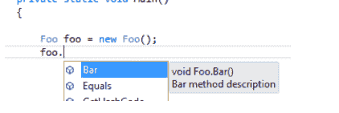

另请参阅 Microsoft 的常用文档标记列表。

### 56.2 节：从文档注释生成 XML

要从代码中的文档注释生成 XML 文档文件，请在使用 csc.exe C# 编译器时使用 /doc 选项。

在 Visual Studio 2013/2015 中，在“项目”->“属性”->“生成”->“输出”中，勾选“XML 文档文件”复选框：

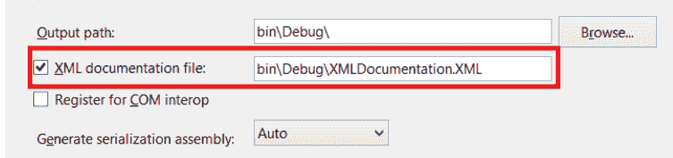

生成项目时，编译器将生成一个 XML 文件，其名称与项目名称相对应（例如 XMLDocumentation.dll -> XMLDocumentation.xml）。

在另一个项目中使用该程序集时，请确保 XML 文件与所引用的 DLL 位于同一目录中。

此示例：

```csharp
/// <summary>
/// Data class description
/// </summary>
public class DataClass
{
    /// <summary>
    /// Name property description
    /// </summary>
    public string Name { get; set; }
}

/// <summary>
/// Foo function
/// </summary>
public class Foo
{
    /// <summary>
    /// This method returning some data
    /// </summary>
    /// <param name="id">Id parameter</param>
    /// <param name="time">Time parameter</param>
    /// <returns>Data will be returned</returns>
    public DataClass GetData(int id, DateTime time)
    {
        return new DataClass();
    }
}
```

生成时会产生以下 XML：

```xml
<?xml version="1.0"?>
<doc>
    <assembly>
        <name>XMLDocumentation</name>
    </assembly>
    <members>
        <member name="T:XMLDocumentation.DataClass">
            <summary>
            Data class description
            </summary>
        </member>
        <member name="P:XMLDocumentation.DataClass.Name">
            <summary>
            Name property description
            </summary>
        </member>
        <member name="T:XMLDocumentation.Foo">
            <summary>
            Foo function
            </summary>
        </member>
        <member name="M:XMLDocumentation.Foo.GetData(System.Int32,System.DateTime)">
            <summary>
            This method returning some data
            </summary>
            <param name="id">Id parameter</param>
            <param name="time">Time parameter</param>
            <returns>Data will be returned</returns>
        </member>
```


### 56.5 节：在文档中引用另一个类

`<see>` 标记可用于链接到另一个类。它包含 cref 成员，该成员应包含要引用的类的名称。编写此标记时，Visual Studio 将提供 IntelliSense，并且在重命名所引用的类时也会处理此类引用。

```csharp
/// <summary>
/// You might also want to check out <see cref="SomeOtherClass"/>.
/// </summary>
public class SomeClass
{
}
```

在 Visual Studio 的 IntelliSense 弹出窗口中，此类引用也会在文本中着色显示。

要引用泛型类，请使用类似以下内容：

```csharp
/// <summary>
/// An enhanced version of <see cref="List(T)"/>.
/// </summary>
public class SomeGenericClass<T>
{
}
```

## 第57章：注释和区域

### 57.1 节：注释

在项目中使用注释是一种留下设计选择说明的便捷方式，并且应旨在使您（或其他人）在维护或添加代码时更轻松。

有两种向代码添加注释的方式。

### 单行注释

放在 // 之后的任何文本都将被视为注释。

```csharp
public class Program
{
    // This is the entry point of my program.
    public static void Main()
    {
        // Prints a message to the console. - This is a comment!
        System.Console.WriteLine("Hello, World!");

        // System.Console.WriteLine("Hello, World again!"); // You can even comment out code.
        System.Console.ReadLine();
    }
}
```

### 多行注释或分隔注释

位于 /* 和 */ 之间的任何文本都将被视为注释。

```csharp
public class Program
{
    public static void Main()
    {
        /*
            This is a multi line comment
            it will be ignored by the compiler.
        */
        System.Console.WriteLine("Hello, World!");

        // It's also possible to make an inline comment with /* */
        // although it's rarely used in practice
        System.Console.WriteLine(/* Inline comment */ "Hello, World!");

        System.Console.ReadLine();
    }
}
```

### 57.2 节：区域

区域是可折叠的代码块，有助于提高代码的可读性和组织性。

注意：StyleCop 的规则 SA1124 DoNotUseRegions 不鼓励使用区域。它们通常是代码组织不良的标志，因为 C# 包含分部类和其他功能，使区域变得过时。

您可以按以下方式使用区域：

```csharp
class Program
{
    #region Application entry point
    static void Main(string[] args)
    {
        PrintHelloWorld();
        System.Console.ReadLine();
    }
    #endregion

    #region My method
    private static void PrintHelloWorld()
    {
        System.Console.WriteLine("Hello, World!");
    }
    #endregion
}
```

在 IDE 中查看上述代码时，您将能够使用 + 和 - 符号折叠和展开代码。

### 展开

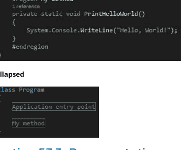

### 折叠

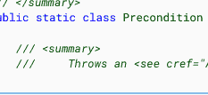

### 57.3 节：文档注释

XML 文档注释可用于提供易于被工具处理的 API 文档：

```csharp
/// <summary>
/// A helper class for validating method arguments.
/// </summary>
public static class Precondition
{
    /// <summary>
    ///     Throws an <see cref="ArgumentOutOfRangeException"/> with the parameter
```

## 使用与维护

## 技术规格

读完本文档，您将能够了解设备的基本使用方法。

规格、参数、技术尺寸。

3

5

2

8

准备

开箱

充电

开机

基本操作

功能与设置

相机

连接性

故障排除

技术数据

安全信息

商标信息

4

6

7

9

10

11

12

14

16

说明

参数

## 第58章：继承

### 58.1 节：继承。构造函数的调用顺序

假设我们有一个类 Animal，它有一个子类 Dog

```csharp
class Animal
{
    public Animal()
    {
        Console.WriteLine("In Animal's constructor");
    }
}

class Dog : Animal
{
    public Dog()
    {
        Console.WriteLine("In Dog's constructor");
    }
}
```

默认情况下，每个类都隐式继承 Object 类。

这与上面的代码相同。

```csharp
class Animal : Object
{
    public Animal()
    {
        Console.WriteLine("In Animal's constructor");
    }
}
```

创建 Dog 类的实例时，如果未显式调用父类中的另一个构造函数，则将调用基类的默认构造函数（无参数）。在我们的例子中，首先调用 Object 的构造函数，然后调用 Animal 的构造函数，最后调用 Dog 的构造函数。

```csharp
public class Program
{
    public static void Main()
    {
        Dog dog = new Dog();
    }
}
```

输出将是

> 在 Animal 的构造函数中
> 在 Dog 的构造函数中

查看演示

**显式调用父类的构造函数。**

在上述示例中，我们的 Dog 类构造函数调用了 Animal 类的默认构造函数。如果需要，您可以指定应调用哪个构造函数：可以调用父类中定义的任何构造函数。

假设我们有这两个类。

```csharp
class Animal
{
    protected string name;

    public Animal()
    {
        Console.WriteLine("Animal's default constructor");
    }

    public Animal(string name)
    {
        this.name = name;
        Console.WriteLine("Animal's constructor with 1 parameter");
        Console.WriteLine(this.name);
    }
}

class Dog : Animal
{
    public Dog() : base()
    {
        Console.WriteLine("Dog's default constructor");
    }

    public Dog(string name) : base(name)
    {
        Console.WriteLine("Dog's constructor with 1 parameter");
        Console.WriteLine(this.name);
    }
}
```

### 这里发生了什么？

每个类中都有 2 个构造函数。

### base 是什么意思？

base 是对父类的引用。在我们的例子中，当我们像这样创建 Dog 类的实例时

```csharp
Dog dog = new Dog();
```

运行时首先调用 Dog()，即无参数构造函数。但它的函数体不会立即执行。在构造函数的括号之后，我们有一个这样的调用：base()，这意味着当我们调用默认的 Dog 构造函数时，它会转而调用父类的默认构造函数。父类构造函数运行后，它将返回，然后最终运行 Dog() 构造函数体。

因此输出将如下所示：

> Animal 的默认构造函数
> Dog 的默认构造函数


查看演示

## 现在，如果我们用参数调用 Dog 的构造函数会怎样？

```
Dog dog = new Dog("Rex");
```

你知道父类中非私有的成员会被子类继承，这意味着 Dog 也会拥有 name 字段。

在这个例子中，我们向构造函数传递了一个参数。它反过来将该参数传递给父类的带参数构造函数，由父类构造函数初始化 name 字段。

输出将是

```
Animal's constructor with 1 parameter
Rex
Dog's constructor with 1 parameter
Rex
```

## 总结：

每个对象的创建都从基类开始。在继承中，层次结构中的类被链接在一起。由于所有类都派生自 Object，因此创建任何对象时调用的第一个构造函数是 Object 类构造函数；然后调用链中的下一个构造函数，只有在所有这些构造函数都被调用之后，对象才被创建

## base 关键字

- base 关键字用于在派生类内部访问基类的成员：
- 调用基类上已被另一个方法重写的方法。指定在创建派生类实例时应调用哪个基类构造函数。

## 第 58.2 节：从基类继承

为了避免重复代码，在一个通用类中定义公共方法和属性作为基类：

```
public class Animal
{
    public string Name { get; set; }
    // Methods and attributes common to all animals
    public void Eat(Object dinner)
    {
        // ...
    }
    public void Stare()
    {
        // ...
    }
    public void Roll()
    {
        // ...
    }
}
```

既然已经有了一个表示一般 Animal 的类，你就可以定义一个描述特定动物特性的类：

```
public class Cat : Animal
{
    public Cat()
    {
        Name = "Cat";
    }
    // Methods for scratching furniture and ignoring owner
    public void Scratch(Object furniture)
    {
        // ...
    }
}
```

Cat 类不仅可以访问其定义中显式描述的方法，还可以访问一般 Animal 基类中定义的所有方法。任何 Animal（无论它是不是 Cat）都可以 Eat、Stare 或 Roll。但是，除非它也是 Cat，否则 Animal 不能 Scratch。然后你可以定义描述其他动物的其他类。（例如 Gopher 有一个破坏花园的方法，而 Sloth 完全没有额外方法。）

## 第 58.3 节：从类继承并实现接口

```
public class Animal
{
    public string Name { get; set; }
}

public interface INoiseMaker
{
    string MakeNoise();
}

//Note that in C#, the base class name must come before the interface names
public class Cat : Animal, INoiseMaker
{
    public Cat()
    {
        Name = "Cat";
    }

    public string MakeNoise()
    {
        return "Nyan";
    }
}
```

## 第 58.4 节：从类继承并实现多个接口

```
public class LivingBeing
{
    string Name { get; set; }
}

public interface IAnimal
{
    bool HasHair { get; set; }
}
```

```
public interface INoiseMaker
{
    string MakeNoise();
}

//Note that in C#, the base class name must come before the interface names
public class Cat : LivingBeing, IAnimal, INoiseMaker
{
    public Cat()
    {
        Name = "Cat";
        HasHair = true;
    }

    public bool HasHair { get; set; }

    public string Name { get; set; }

    public string MakeNoise()
    {
        return "Nyan";
    }
}
```

## 第 58.5 节：子类中的构造函数

当你创建基类的子类时，可以在子类构造函数的参数之后使用 : base 来构造基类。

```
class Instrument
{
    string type;
    bool clean;

    public Instrument (string type, bool clean)
    {
        this.type = type;
        this.clean = clean;
    }
}

class Trumpet : Instrument
{
    bool oiled;

    public Trumpet(string type, bool clean, bool oiled) : base(type, clean)
    {
        this.oiled = oiled;
    }
}
```

## 第 58.6 节：继承反模式

### 不恰当的继承

假设有 2 个类：Foo 类和 Bar 类。Foo 有两个功能 Do1 和 Do2。Bar 需要使用 Foo 中的 Do1，但它不需要 Do2，或者需要一个等同于 Do2 但做完全不同事情的功能。

坏方式：将 Foo 上的 Do2() 设为 virtual，然后在 Bar 中重写它，或者干脆在 Bar 中为 Do2() 抛出 Exception

```csharp
public class Bar : Foo
{
    public override void Do2()
    {
        //Does something completely different that you would expect Foo to do
        //or simply throws new Exception
    }
}
```

### 好方式

从 Foo 中取出 Do1() 并放入新类 Baz，然后让 Foo 和 Bar 都继承 Baz，并分别实现 Do2()

```csharp
public class Baz
{
    public void Do1()
    {
        // magic
    }
}

public class Foo : Baz
{
    public void Do2()
    {
        // foo way
    }
}

public class Bar : Baz
{
    public void Do2()
    {
        // bar way or not have Do2 at all
    }
}
```

现在说明为什么第一个示例不好而第二个示例好：当第 2 位开发者必须修改 Foo 时，他很可能会破坏 Bar 的实现，因为 Bar 现在与 Foo 不可分割。而采用后一个示例时，Foo 和 Bar 的共性已被移到 Baz，它们互不影响（本来就不应该互相影响）。

## 第 58.7 节：扩展抽象基类

与可描述为实现契约的接口不同，抽象类充当扩展契约。

抽象类不能被实例化，必须被扩展，然后生成的类（或派生类）才能被实例化。

抽象类用于提供通用实现

```csharp
public abstract class Car
{
    public void HonkHorn() {
        // Implementation of horn being honked
    }
}
```

```
public class Mustang : Car
{
    // Simply by extending the abstract class Car, the Mustang can HonkHorn()
    // If Car were an interface, the HonkHorn method would need to be included
    // in every class that implemented it.
}
```

上面的示例展示了任何扩展 Car 的类都将获得带有实现的 HonkHorn 方法。这意味着任何创建新 Car 的开发者都不需要担心它如何鸣喇叭。

## 第 58.8 节：测试和导航继承关系

```
interface BaseInterface {}
class BaseClass : BaseInterface {}

interface DerivedInterface {}
class DerivedClass : BaseClass, DerivedInterface {}

var baseInterfaceType = typeof(BaseInterface);
var derivedInterfaceType = typeof(DerivedInterface);
var baseType = typeof(BaseClass);
var derivedType = typeof(DerivedClass);

var baseInstance = new BaseClass();
var derivedInstance = new DerivedClass();

Console.WriteLine(derivedInstance is DerivedClass); //True
Console.WriteLine(derivedInstance is DerivedInterface); //True
Console.WriteLine(derivedInstance is BaseClass); //True
Console.WriteLine(derivedInstance is BaseInterface); //True
Console.WriteLine(derivedInstance is object); //True

Console.WriteLine(derivedType.BaseType.Name); //BaseClass
Console.WriteLine(baseType.BaseType.Name); //Object
Console.WriteLine(typeof(object).BaseType); //null

Console.WriteLine(baseType.IsInstanceOfType(derivedInstance)); //True
Console.WriteLine(derivedType.IsInstanceOfType(baseInstance)); //False

Console.WriteLine(
    string.Join(",",
        derivedType.GetInterfaces().Select(t => t.Name).ToArray()));
//BaseInterface,DerivedInterface

Console.WriteLine(baseInterfaceType.IsAssignableFrom(derivedType)); //True
Console.WriteLine(derivedInterfaceType.IsAssignableFrom(derivedType)); //True
Console.WriteLine(derivedInterfaceType.IsAssignableFrom(baseType)); //False
```

## 第 58.9 节：继承方法

方法有几种继承方式

```
public abstract class Car
{
    public void HonkHorn() {
        // Implementation of horn being honked
    }
}
```

// virtual methods CAN be overridden in derived classes
public virtual void ChangeGear() {
    // Implementation of gears being changed
}

// abstract methods MUST be overridden in derived classes
public abstract void Accelerate();
}

public class Mustang : Car
{
    // Before any code is added to the Mustang class, it already contains
    // Implementations of HonkHorn and ChangeGear.

    // In order to compile, it must be given an implementation of Accelerate,
    // this is done using the override keyword
    public override void Accelerate() {
        // Implementation of Mustang accelerating
    }

    // If the Mustang changes gears differently to the implementation in Car
    // this can be overridden using the same override keyword as above
    public override void ChangeGear() {
        // Implementation of Mustang changing gears
    }
}

### 第 58.10 节：具有递归类型规范的基类

递归类型说明符的泛型基类的一次性定义。每个节点有一个父节点和多个子节点。

```
/// <summary>
/// Generic base class for a tree structure
/// </summary>
/// <typeparam name="T">The node type of the tree</typeparam>
public abstract class Tree<T> where T : Tree<T>
{
    /// <summary>
    /// Constructor sets the parent node and adds this node to the parent's child nodes
    /// </summary>
    /// <param name="parent">The parent node or null if a root</param>
    protected Tree(T parent)
    {
        this.Parent=parent;
        this.Children=new List<T>();
        if(parent!=null)
        {
            parent.Children.Add(this as T);
        }
    }

    public T Parent { get; private set; }
    public List<T> Children { get; private set; }
    public bool IsRoot { get { return Parent==null; } }
    public bool IsLeaf { get { return Children.Count==0; } }
    /// <summary>
    /// Returns the number of hops to the root object
    /// </summary>
    public int Level { get { return IsRoot ? 0 : Parent.Level+1; } }
}
```

```
var parent_pos = Parent.GlobalPosition;
    return new PointF(parent_pos.X+LocalPosition.X, parent_pos.Y+LocalPosition.Y);
}
}
public float TotalDistance
{
    get
    {
        float dist = (float)Math.Sqrt(LocalPosition.X*LocalPosition.X+LocalPosition.Y*LocalPosition.Y);
        return IsRoot ? dist : Parent.TotalDistance+dist;
    }
}
public RelativeCoordinate Add(PointF local_position)
{
    return new RelativeCoordinate(this, local_position);
}
public RelativeCoordinate Add(float x, float y)
{
    return Add(new PointF(x, y));
}
}
```

用作如下

```
// Define the following coordinate system hierarchy
//
// o--> [A1] ---> [B1] ----> [C1]
//                |
//                +--> [B2] ---> [C2]
//                          |
//                          +--> [C3]

var A1 = RelativeCoordinate.Start;
var B1 = A1.Add(100, 20);
var B2 = A1.Add(160, 16);

var C1 = B1.Add(120, -40);
var C2 = B2.Add(80, -20);
var C3 = B2.Add(60, -30);

double dist1 = C1.TotalDistance;
```

## 第 59 章：泛型

| 参数 | 描述 |
|---|---|
| T, V | 泛型声明的类型占位符 |

### 第 59.1 节：隐式类型推断（方法）

在向泛型方法传递形式参数时，相关的泛型类型参数通常可以隐式推断。如果所有泛型类型都可以推断，则在语法中指定它们是可选的。

考虑以下泛型方法。它有一个形式参数和一个泛型类型参数。它们之间存在非常明显的关系——传递给泛型类型参数的参数类型必须与传递给形式参数的参数的编译时类型相同。

```
void M<T>(T obj)
{
}
```

这两个调用是等价的：

```
M<object>(new object());
M(new object());
```

这两个调用也是等价的：

```
M<string>("");
M("");
```

这三个调用也是如此：

```
M<object>("");
M((object) "");
M("" as object);
```

请注意，如果至少有一个类型参数无法推断，则必须全部指定。

考虑以下泛型方法。第一个泛型类型参数与形式参数的类型相同。但第二个泛型类型参数没有这种关系。因此，编译器在对该方法的任何调用中都无法推断出第二个泛型类型参数。

```
void X<T1, T2>(T1 obj)
{
}
```

这不再起作用：

```
X("");
```

这也不起作用，因为编译器不确定我们是在指定第一个还是第二个泛型参数（两者作为 object 都是有效的）：

```
X<object>("");
```

我们必须同时写出两者，如下所示：

```
X<string, object>("*");
```

### 第 59.2 节：类型推断（类）

开发者可能会被构造函数类型推断不起作用这一事实所困扰：

```
class Tuple<T1,T2>
{
    public Tuple(T1 value1, T2 value2)
    {
    }
}
```

```
var x = new Tuple(2, "two");    // This WON'T work...
var y = new Tuple<int, string>(2, "two"); // even though the explicit form will.
```

第一种在不显式指定类型参数的情况下创建实例的方式将导致编译时错误，错误信息为：

> 使用泛型类型 'Tuple<T1, T2>' 需要 2 个类型参数

一个常见的解决方法是在静态类中添加一个辅助方法：

```
static class Tuple
{
    public static Tuple<T1, T2> Create<T1, T2>(T1 value1, T2 value2)
    {
        return new Tuple<T1, T2>(value1, value2);
    }
}
```

```
var x = Tuple.Create(2, "two"); // This WILL work...
```

### 第 59.3 节：使用接口作为约束类型的泛型方法

这是一个关于如何在 Animal 类的 Eat 方法中使用泛型类型 TFood 的示例

```
public interface IFood
{
    void EatenBy(Animal animal);
}

public class Grass : IFood
{
    public void EatenBy(Animal animal)
    {
        Console.WriteLine("Grass was eaten by: {0}", animal.Name);
    }
}

public class Animal
{
    public string Name { get; set; }
}
```

```
public void Eat<TFood>(TFood food)
    where TFood : IFood
{
    food.EatenBy(this);
}
}

public class Carnivore : Animal
{
    public Carnivore()
    {
        Name = "Carnivore";
    }
}

public class Herbivore : Animal, IFood
{
    public Herbivore()
    {
        Name = "Herbivore";
    }

    public void EatenBy(Animal animal)
    {
        Console.WriteLine("Herbivore was eaten by: {0}", animal.Name);
    }
}
```

你可以这样调用 Eat 方法：

```
var grass = new Grass();
var sheep = new Herbivore();
var lion = new Carnivore();

sheep.Eat(grass);
//Output: Grass was eaten by: Herbivore

lion.Eat(sheep);
//Output: Herbivore was eaten by: Carnivore
```

在这种情况下，如果你尝试调用：

```
sheep.Eat(lion);
```

这是不可能的，因为对象 lion 没有实现接口 IFood。尝试进行上述调用将生成编译器错误："类型 'Carnivore' 不能用作泛型类型或方法 'Animal.Eat(TFood)' 中的类型参数 'TFood'。不存在从 'Carnivore' 到 'IFood' 的隐式引用转换。"

### 第 59.4 节：类型约束（new 关键字）

通过使用 `new()` 约束，可以强制类型参数定义一个空（默认）构造函数。

```
class Foo
{
    public Foo () { }
}

class Bar
{
public Bar (string s) { ... }
}
class Factory<T>
    where T : new()
{
    public T Create()
    {
        return new T();
    }
}
```

```
Foo f = new Factory<Foo>().Create(); // Valid.
Bar b = new Factory<Bar>().Create(); // Invalid, Bar does not define a default/empty constructor.
```

第二次调用 Create() 将在编译时报错，错误信息如下：

> > 'Bar' 必须是非抽象类型，并且具有公共无参数构造函数，才能将其用作泛型类型或方法 'Factory' 中的参数 'T'

不存在带参数构造函数的约束，仅支持无参数构造函数。

### 第 59.5 节：类型约束（类和接口）

类型约束能够强制类型参数实现某个特定的接口或类。

```
interface IType;
interface IAnotherType;

// T must be a subtype of IType
interface IGeneric<T>
    where T : IType
{
}

// T must be a subtype of IType
class Generic<T>
    where T : IType
{
}

class NonGeneric
{
    // T must be a subtype of IType
    public void DoSomething<T>(T arg)
        where T : IType
    {
    }
}

// Valid definitions and expressions:
class Type : IType { }
class Sub : IGeneric<Type> { }
class Sub : Generic<Type> { }
new NonGeneric().DoSomething(new Type());

// Invalid definitions and expressions:
class AnotherType : IAnotherType { }
```

class Sub : IGeneric<AnotherType> { }
class Sub : Generic<AnotherType> { }
new NonGeneric().DoSomething(new AnotherType());

多个约束的语法：

```
class Generic<T, T1>
    where T : IType
    where T1 : Base, new()
{
}
```

类型约束的工作方式与继承相同：可以为泛型类型指定多个接口作为约束，但只能指定一个类：

```
class A { /* ... */ }
class B { /* ... */ }

interface I1 { }
interface I2 { }

class Generic<T>
    where T : A, I1, I2
{
}

class Generic2<T>
    where T : A, B //Compilation error
{
}
```

另一条规则是，必须先将类作为第一个约束添加，然后添加接口：

```
class Generic<T>
    where T : A, I1
{
}

class Generic2<T>
    where T : I1, A //Compilation error
{
}
```

对于特定的泛型实例化，所有声明的约束必须同时满足才能工作。无法指定两组或多组备选约束。

## 第59.6节：检查泛型值的相等性

如果泛型类或方法的逻辑需要检查具有泛型类型的值是否相等，请使用 EqualityComparer<TTYPE>.Default 属性：

```
public void Foo<TBar>(TBar arg1, TBar arg2)
{
    var comparer = EqualityComparer<TBar>.Default;
    if (comparer.Equals(arg1, arg2))
    {
        ...
    }
}
```

```csharp
interface IWidget
{
    int Weight { get; }
}

interface IFactory<out TWidget>
    where TWidget : IWidget
{
    TWidget Create();
}

class Toy : IWidget
{
    public int Weight { get; set; }
    public Taste Taste { get; set; }
}

class ToyFactory : IFactory<Toy>
{
    public const int StandardWeight = 100;
    public const Taste StandardTaste = Taste.Sweet;

    public Toy Create() { return new Toy { Weight = StandardWeight, Taste = StandardTaste }; }
}

[TestFixture]
public class GivenAToyFactory
{
    [Test]
    public static void WhenUsingToyFactoryToMakeWidgets()
    {
        var toyFactory = new ToyFactory();

        ///// Without out keyword, note the verbose explicit cast:
        // IFactory<IWidget> rustBeltFactory = (IFactory<IWidget>)toyFactory;

        // covariance: concrete being assigned to abstract (shiny and new)
        IFactory<IWidget> widgetFactory = toyFactory;
        IWidget anotherToy = widgetFactory.Create();
        Assert.That(anotherToy.Weight, Is.EqualTo(ToyFactory.StandardWeight)); // abstract
        Assert.That(((Toy)anotherToy).Taste, Is.EqualTo(ToyFactory.StandardTaste)); // concrete
    }
}
```

## 第59.9节：逆变

什么时候 `IComparer<T>` 是另一个 `IComparer<T1>` 的子类型？当 T1 是 T 的子类型时。`IComparer` 在其 T 参数上是*逆变*的，这意味着 `IComparer` 的子类型关系与 T 的*方向相反*。

```csharp
class Animal { /* ... */ }
class Dog : Animal { /* ... */ }

IComparer<Animal> animalComparer = /* ... */;
IComparer<Dog> dogComparer = animalComparer; // IComparer<Animal> is a subtype of IComparer<Dog>
// animalComparer = dogComparer; // Compilation error - IComparer<Dog> is not a subtype of IComparer<Animal>
```

具有给定类型参数的逆变泛型类型的实例，可以隐式转换为具有更派生类型参数的同一泛型类型。

这种关系成立是因为 `IComparer` 消费 `Ts` 但不产生它们。可以比较任意两个 `Animals` 的对象可用于比较两个 `Dogs`。

逆变类型参数使用 `in` 关键字声明，因为该参数只能用作*输入*。

```csharp
interface IComparer<in T> { /* ... */ }
```

声明为逆变的类型参数不能作为输出出现。

```csharp
interface Bad<in T>
{
    T GetT(); // type error
}
```

## 第59.10节：不变性

`IList<T>` 永远不是另一个 `IList<T1>` 的子类型。*IList* 在其类型参数上是*不变的*。

```csharp
class Animal { /* ... */ }
class Dog : Animal { /* ... */ }

IList<Dog> dogs = new List<Dog>();
IList<Animal> animals = dogs;  // type error
```

列表不存在子类型关系，因为你可以将值放入列表*并且*从列表中取出值。

如果 `IList` 是协变的，你就能将*错误子类型*的项添加到给定列表中。

```csharp
IList<Animal> animals = new List<Dog>();  // supposing this were allowed...
animals.Add(new Giraffe());  // ... then this would also be allowed, which is bad!
```

如果 `IList` 是逆变的，你就能从给定列表中提取*错误子类型*的值。

```csharp
IList<Dog> dogs = new List<Animal> { new Dog(), new Giraffe() };  // if this were allowed...
Dog dog = dogs[1];  // ... then this would be allowed, which is bad!
```

不变类型参数通过同时省略 *in* 和 *out* 关键字来声明。

```csharp
interface IList<T> { /* ... */ }
```

## 第59.11节：变体接口

接口可以具有变体类型参数。

```csharp
interface IEnumerable<out T>
{
    // ...
}
interface IComparer<in T>
{
    // ...
}
```

但类和结构不可以

```
class BadClass<in T1, out T2> // not allowed
{
}

struct BadStruct<in T1, out T2> // not allowed
{
}
```

泛型方法声明也不可以

```
class MyClass
{
    public T Bad<out T, in T1>(T1 t1) // not allowed
    {
        // ...
    }
}
```

下面的示例展示了同一接口上的多个变体声明

```
interface IFoo<in T1, out T2, T3>
// T1 : Contravariant type
// T2 : Covariant type
// T3 : Invariant type
{
    // ...
}
```

```
IFoo<Animal, Dog, int> foo1 = /* ... */;
IFoo<Dog, Animal, int> foo2 = foo1;
// IFoo<Animal, Dog, int> is a subtype of IFoo<Dog, Animal, int>
```

## 第59.12节：变体委托

委托可以具有变体类型参数。

```
delegate void Action<in T>(T t);    // T is an input
delegate T Func<out T>();    // T is an output
delegate T2 Func<in T1, out T2>();    // T1 is an input, T2 is an output
```

这遵循里氏替换原则，该原则（除其他事项外）指出，如果满足以下条件，则方法 D 可被视为比方法 B 更派生：

- D 的返回类型与 B 相同或比 B 更派生
- D 的对应参数类型与 B 相同或比 B 更一般

因此，以下赋值都是类型安全的：

```
Func<object, string> original = SomeMethod;
Func<object, object> d1 = original;
Func<string, string> d2 = original;
Func<string, object> d3 = original;
```

## 第59.13节：作为参数和返回值的变体类型

如果协变类型作为输出出现，则包含该类型的类型是协变的。产生 Ts 的生产者就像产生 Ts。

```
interface IReturnCovariant<out T>
{
    IEnumerable<T> GetTs();
}
```

如果逆变类型作为输出出现，则包含该类型的类型是逆变的。产生 Ts 的消费者就像消费 Ts。

```
interface IReturnContravariant<in T>
{
    IComparer<T> GetTComparer();
}
```

如果协变类型作为输入出现，则包含该类型的类型是逆变的。消费 Ts 的生产者就像消费 Ts。

```
interface IAcceptCovariant<in T>
{
    void ProcessTs(IEnumerable<T> ts);
}
```

如果逆变类型作为输入出现，则包含该类型的类型是协变的。消费 Ts 的消费者就像产生 Ts。

```
interface IAcceptContravariant<out T>
{
    void CompareTs(IComparer<T> tComparer);
}
```

## 第59.14节：类型参数（接口）

声明：

```
interface IMyGenericInterface<T1, T2, T3, ...> { ... }
```

用法（在继承中）：

```
class ClassA<T1, T2, T3> : IMyGenericInterface<T1, T2, T3> { ... }
class ClassB<T1, T2> : IMyGenericInterface<T1, T2, int> { ... }
class ClassC<T1> : IMyGenericInterface<T1, char, int> { ... }
class ClassD : IMyGenericInterface<bool, char, int> { ... }
```

用法（作为参数类型）：

```
void SomeMethod(IMyGenericInterface<int, char, bool> arg) { ... }
```


## Section 59.15: 类型约束（类和结构体）

可以通过使用相应的约束 class 或 struct 来指定类型参数是否应为引用类型或值类型。如果使用这些约束，则必须在所有其他约束（例如父类型或 new()）之前定义它们。

```
// TRef must be a reference type, the use of Int32, Single, etc. is invalid.
// Interfaces are valid, as they are reference types
class AcceptsRefType<TRef>
    where TRef : class
{
    // TStruct must be a value type.
    public void AcceptStruct<TStruct>()
        where TStruct : struct
    {
    }

    // If multiple constraints are used along with class/struct
    // then the class or struct constraint MUST be specified first
    public void Foo<TComparableClass>()
        where TComparableClass : class, IComparable
    {
    }
}
```

## Section 59.16: 显式类型参数

在某些情况下，必须显式指定泛型方法的类型参数。在下面的两种情况下，编译器都无法从指定的方法参数推断出所有类型参数。

一种情况是当没有参数时：

```
public void SomeMethod<T, V>()
{
    // No code for simplicity
}

SomeMethod(); // doesn't compile
SomeMethod<int, bool>(); // compiles
```

第二种情况是当一个（或多个）类型参数不是方法参数的一部分时：

```
public K SomeMethod<K, V>(V input)
{
    return default(K);
}

int num1 = SomeMethod(3); // doesn't compile
int num2 = SomeMethod<int>("3"); // doesn't compile
int num3 = SomeMethod<int, string>("3"); // compiles.
```

## Section 59.17: 类型参数（类）

声明：

```
class MyGenericClass<T1, T2, T3, ...>
{
    // Do something with the type parameters.
}
```

初始化：

```
var x = new MyGenericClass<int, char, bool>();
```

用法（作为参数的类型）：

```
void AnotherMethod(MyGenericClass<float, byte, char> arg) { ... }
```

## Section 59.18: 类型参数（方法）

声明：

```
void MyGenericMethod<T1, T2, T3>(T1 a, T2 b, T3 c)
{
    // Do something with the type parameters.
}
```

调用：

无需为泛型方法提供类型参数，因为编译器可以隐式推断类型。

```
int x =10;
int y =20;
string z = "test";
MyGenericMethod(x,y,z);
```

然而，如果存在歧义，泛型方法需要使用类型参数调用，如下所示

```
MyGenericMethod<int, int, string>(x,y,z);
```

## Section 59.19: 泛型类型转换

```
/// <summary>
/// Converts a data type to another data type.
/// </summary>
public static class Cast
{
    /// <summary>
    /// Converts input to Type of default value or given as typeparam T
    /// </summary>
    /// <typeparam name="T">typeparam is the type in which value will be returned, it could be any type eg. int, string, bool, decimal etc.</typeparam>
    /// <param name="input">Input that need to be converted to specified type</param>
    /// <param name="defaultValue">defaultValue will be returned in case of value is null or any exception occures</param>
    /// <returns>Input is converted in Type of default value or given as typeparam T and returned</returns>
    public static T To<T>(object input, T defaultValue)
    {
        var result = defaultValue;
        try
        {
            if (input == null || input == DBNull.Value) return result;
            if (typeof (T).IsEnum)
{
    result = (T) Enum.ToObject(typeof(T), To(input, Convert.ToInt32(defaultValue)));
}
else
{
    result = (T) Convert.ChangeType(input, typeof(T));
}
}
catch (Exception ex)
{
    Tracer.Current.LogException(ex);
}

    return result;
}

    /// <summary>
    /// Converts input to Type of typeparam T
    /// </summary>
    /// <typeparam name="T">typeparam is the type in which value will be returned, it could be any type eg. int, string, bool, decimal etc.</typeparam>
    /// <param name="input">Input that need to be converted to specified type</param>
    /// <returns>Input is converted in Type of default value or given as typeparam T and returned</returns>
    public static T To<T>(object input)
    {
        return To(input, default(T));
    }
}
```

用法：

```
std.Name = Cast.To<string>(drConnection["Name"]);
std.Age = Cast.To<int>(drConnection["Age"]);
std.IsPassed = Cast.To<bool>(drConnection["IsPassed"]);

// Casting type using default value
//Following both ways are correct
// Way 1 (In following style input is converted into type of default value)
std.Name = Cast.To(drConnection["Name"], "");
std.Marks = Cast.To(drConnection["Marks"], 0);
// Way 2
std.Name = Cast.To<string>(drConnection["Name"], "");
std.Marks = Cast.To<int>(drConnection["Marks"], 0);
```

## Section 59.20: 使用泛型类型转换的配置读取器

```
/// <summary>
/// Read configuration values from app.config and convert to specified types
/// </summary>
public static class ConfigurationReader
{
    /// <summary>
    /// Get value from AppSettings by key, convert to Type of default value or typeparam T and return
    /// </summary>
    /// <typeparam name="T">typeparam is the type in which value will be returned, it could be any type eg. int, string, bool, decimal etc.</typeparam>
    /// <param name="strKey">key to find value from AppSettings</param>
    /// <param name="defaultValue">defaultValue will be returned in case of value is null or any exception occures</param>
    /// <returns>AppSettings value against key is returned in Type of default value or given as typeparam T</returns>
    public static T GetConfigKeyValue<T>(string strKey, T defaultValue)
    {
        var result = defaultValue;
        try
        {
            if (ConfigurationManager.AppSettings[strKey] != null)
                result = (T)Convert.ChangeType(ConfigurationManager.AppSettings[strKey],
typeof(T));
        }
        catch (Exception ex)
        {
            Tracer.Current.LogException(ex);
        }

        return result;
    }
    /// <summary>
    /// Get value from AppSettings by key, convert to Type of default value or typeparam T and return
    /// </summary>
    /// <typeparam name="T">typeparam is the type in which value will be returned, it could be any type eg. int, string, bool, decimal etc.</typeparam>
    /// <param name="strKey">key to find value from AppSettings</param>
    /// <returns>AppSettings value against key is returned in Type given as typeparam T</returns>
    public static T GetConfigKeyValue<T>(string strKey)
    {
        return GetConfigKeyValue(strKey, default(T));
    }
}
```

用法：

```
var timeOut = ConfigurationReader.GetConfigKeyValue("RequestTimeout", 2000);
var url = ConfigurationReader.GetConfigKeyValue("URL", "www.someurl.com");
var enabled = ConfigurationReader.GetConfigKeyValue("IsEnabled", false);
```

## Chapter 60: 使用语句

提供了一种方便的语法，确保 IDisposable 对象的正确使用。

## Section 60.1: 使用语句基础

using 是语法糖，允许你在不需要显式的 try-finally 块的情况下保证资源被清理。这意味着你的代码会更干净，并且不会泄漏非托管资源。

标准 Dispose 清理模式，适用于实现 IDisposable 接口的对象（FileStream 的基类 Stream 在 .NET 中实现了该接口）：

```
int Foo()
{
    var filename = "file.txt";
    FileStream disposable = null;
    try
    {
        disposable = File.Open(filename, FileMode.Open);
        return disposable.ReadByte();
    }
    finally
    {
        // finally blocks are always run
        if (disposable != null) disposable.Dispose();
    }
}
```

using 通过隐藏显式的 try-finally 来简化你的语法：

```
int Foo()
{
    var filename = "file.txt";

    using (var disposable = File.Open(filename, FileMode.Open))
    {
        return disposable.ReadByte();
    }
    // disposable.Dispose is called even if we return earlier
}
```

就像 finally 块无论出现错误或返回都会始终执行一样，using 也总会调用 Dispose()，即使在出现错误的情况下：

```
int Foo()
{
    var filename = "file.txt";

    using (var disposable = File.Open(filename, FileMode.Open))
    {
        throw new InvalidOperationException();
    }
    // disposable.Dispose is called even if we throw an exception earlier
}
```


注意：由于无论代码流程如何，Dispose 保证都会被调用，因此在实现 IDisposable 时，最好确保 Dispose 永远不会抛出异常。否则，实际异常会被新异常覆盖，导致调试噩梦。

## 从 using 块返回

```
using ( var disposable = new DisposableItem() )
{
    return disposable.SomeProperty;
}
```

由于 using 块会转换为 try...finally 语义，return 语句按预期工作——返回值在 finally 块执行以及对象被释放之前得出。求值顺序如下：

- 1. 计算 try 主体
- 2. 计算并缓存返回值
- 3. 执行 finally 块
- 4. 返回缓存的返回值

然而，你不能返回 disposable 变量本身，因为它将包含无效的、已释放的引用——参见相关示例。

## 第 60.2 节：陷阱：返回你正在释放的资源

以下做法是个坏主意，因为它会在返回 db 变量之前将其释放。

```
public IDBContext GetDBContext()
{
    using (var db = new DBContext())
    {
        return db;
    }
}
```

这也可能导致更微妙的错误：

```
public IEnumerable<Person> GetPeople(int age)
{
    using (var db = new DBContext())
    {
        return db.Persons.Where(p => p.Age == age);
    }
}
```

这看起来没问题，但问题是 LINQ 表达式求值是惰性的，可能只有在底层 DBContext 已被释放后才会执行。

简而言之，表达式不会在离开 using 之前被求值。这个问题的一个可行解决方案（仍然使用 using）是调用一个会枚举结果的方法，使表达式立即求值，例如 ToList()、ToArray() 等。如果你使用的是最新版本的 Entity Framework，你可以使用对应的异步方法，如 ToListAsync() 或 ToArrayAsync()。

下面是实际示例：

```csharp
public IEnumerable<Person> GetPeople(int age)
{
    using (var db = new DBContext())
    {
        return db.Persons.Where(p => p.Age == age).ToList();
    }
}
```

不过，需要注意的是，通过调用 ToList() 或 ToArray()，表达式会被立即求值，这意味着所有指定年龄的人都会被加载到内存中，即使你不对它们进行迭代。

## 第 60.3 节：多个 using 语句共用一个块

可以使用多个嵌套的 using 语句，而无需增加多层嵌套大括号。例如：

```csharp
using (var input = File.OpenRead("input.txt"))
{
    using (var output = File.OpenWrite("output.txt"))
    {
        input.CopyTo(output);
    } // output is disposed here
} // input is disposed here
```

另一种写法是：

```csharp
using (var input = File.OpenRead("input.txt"))
using (var output = File.OpenWrite("output.txt"))
{
    input.CopyTo(output);
} // output and then input are disposed here
```

这与第一个示例完全等价。

注意：嵌套的 using 语句可能会触发 Microsoft 代码分析规则 CS2002（见此答案以了解详情）并生成警告。如链接答案所述，嵌套 using 语句通常是安全的。

当 using 语句中的类型相同时，你可以用逗号分隔它们，并且只指定一次类型（尽管这并不常见）：

```csharp
using (FileStream file = File.Open("MyFile.txt"), file2 = File.Open("MyFile2.txt"))
{
}
```

当类型具有共享层次结构时，也可以使用这种方式：

```csharp
using (Stream file = File.Open("MyFile.txt"), data = new MemoryStream())
{
}
```

在上面的示例中不能使用 var 关键字，否则会发生编译错误。当声明的变量类型来自不同的层次结构时，逗号分隔的声明也无法使用。

## 第 60.4 节：陷阱：Dispose 方法中的异常掩盖了 using 块中的其他错误

考虑以下代码块。

```
try
{
    using (var disposable = new MyDisposable())
    {
        throw new Exception("Couldn't perform operation.");
    }
}
catch (Exception ex)
{
    Console.WriteLine(ex.Message);
}

class MyDisposable : IDisposable
{
    public void Dispose()
    {
        throw new Exception("Couldn't dispose successfully.");
    }
}
```

你可能期望在控制台看到 “Couldn't perform operation” 被打印，但实际上你会看到 “Couldn't dispose successfully.”，因为即使在抛出第一个异常之后，Dispose 方法仍然会被调用。

值得注意这一微妙之处，因为它可能掩盖了阻止对象被释放的真正错误，使调试更加困难。

## 第 60.5 节：using 语句是空安全的

你不需要检查 IDisposable 对象是否为 null。using 不会抛出异常，也不会调用 Dispose()：

```
DisposableObject TryOpenFile()
{
    return null;
}

// disposable is null here, but this does not throw an exception
using (var disposable = TryOpenFile())
{
    // this will throw a NullReferenceException because disposable is null
    disposable.DoSomething();

    if(disposable != null)
    {
        // here we are safe because disposable has been checked for null
        disposable.DoSomething();
    }
}
```

## 第 60.6 节：使用 Dispose 语法定义自定义作用域

在某些用例中，你可以使用 using 语法来帮助定义自定义作用域。例如，你可以定义以下类来在特定区域性中执行代码。

```
public class CultureContext : IDisposable
{
    private readonly CultureInfo originalCulture;

    public CultureContext(string culture)
    {
        originalCulture = CultureInfo.CurrentCulture;
        Thread.CurrentThread.CurrentCulture = new CultureInfo(culture);
    }

    public void Dispose()
    {
        Thread.CurrentThread.CurrentCulture = originalCulture;
    }
}
```

然后你可以使用这个类来定义在特定区域性中执行的代码块。

```
Thread.CurrentThread.CurrentCulture = new CultureInfo("en-US");

using (new CultureContext("nl-NL"))
{
    // Code in this block uses the "nl-NL" culture
    Console.WriteLine(new DateTime(2016, 12, 25)); // Output: 25-12-2016 00:00:00
}

using (new CultureContext("es-ES"))
{
    // Code in this block uses the "es-ES" culture
    Console.WriteLine(new DateTime(2016, 12, 25)); // Output: 25/12/2016 0:00:00
}

// Reverted back to the original culture
Console.WriteLine(new DateTime(2016, 12, 25)); // Output: 12/25/2016 12:00:00 AM
```

注意：由于我们不使用创建的 CultureContext 实例，我们不为它分配变量。

ASP.NET MVC 中的 BeginForm 辅助方法使用了这一技术。

## 第 60.7 节：using 语句与数据库连接

using 关键字确保语句中定义的资源仅存在于语句自身的范围内。语句中定义的任何资源都必须实现 IDisposable 接口。

在处理任何实现 IDisposable 接口的连接时，这一点极其重要，因为它可以确保连接不仅被正确关闭，而且在 using 语句超出作用域后，其资源也会被释放。

## 常见的 IDisposable 数据类

以下许多类都是实现 IDisposable 接口的数据相关类，非常适合用于 using 语句：

- SqlConnection、SqlCommand、SqlDataReader 等。
- OleDbConnection、OleDbCommand、OleDbDataReader 等。
- MySqlConnection、MySqlCommand、MySqlDataReader 等。
- DbContext

## 第 60.8 节：在约束上下文中执行代码

如果你有希望在特定（约束）上下文下执行的代码（例程），可以使用依赖注入。

以下示例展示了在打开的 SSL 连接下执行的约束。第一部分将位于你的库或框架中，不会暴露给客户端代码。

```
public static class SSLContext
{
    // define the delegate to inject
    public delegate void TunnelRoutine(BinaryReader sslReader, BinaryWriter sslWriter);

    // this allows the routine to be executed under SSL
    public static void ClientTunnel(TcpClient tcpClient, TunnelRoutine routine)
    {
        using (SslStream sslStream = new SslStream(tcpClient.GetStream(), true, _validate))
        {
            sslStream.AuthenticateAsClient(HOSTNAME, null, SslProtocols.Tls, false);

            if (!sslStream.IsAuthenticated)
            {
                throw new SecurityException("SSL tunnel not authenticated");
            }

            if (!sslStream.IsEncrypted)
            {
                throw new SecurityException("SSL tunnel not encrypted");
            }

            using (BinaryReader sslReader = new BinaryReader(sslStream))
            using (BinaryWriter sslWriter = new BinaryWriter(sslStream))
            {
                routine(sslReader, sslWriter);
            }
        }
    }
}
```

现在，客户端代码希望在 SSL 下执行某些操作，但又不愿处理所有 SSL 细节。你现在可以在 SSL 隧道内做任何你想做的事情，例如交换对称密钥：

```
public void ExchangeSymmetricKey(BinaryReader sslReader, BinaryWriter sslWriter)
{
    byte[] bytes = new byte[8];
    (new RNGCryptoServiceProvider()).GetNonZeroBytes(bytes);
    sslWriter.Write(BitConverter.ToInt64(bytes, 0));
}
```

你可以按如下方式执行此例程：

```
SSLContext.ClientTunnel(tcpClient, this.ExchangeSymmetricKey);
```

要做到这一点，你需要 using() 子句，因为这是（除了 try...finally 块之外）唯一能保证客户端代码（ExchangeSymmetricKey）不会在未正确释放可释放资源的情况下退出的方式。如果没有 using() 子句，你将永远无法知道某个例程是否会破坏上下文对释放这些资源的约束。


## 第61章：using 指令

### 61.1节：关联别名以解决冲突

如果你使用了多个可能包含同名类的命名空间（例如 System.Random 和 UnityEngine.Random），可以使用别名来指定 Random 来自其中一个，而不必在调用中使用完整的命名空间。

例如：

```
using UnityEngine;
using System;

Random rnd = new Random();
```

这会导致编译器不确定将新变量解析为哪个 Random。相反，你可以这样做：

```
using UnityEngine;
using System;
using Random = System.Random;

Random rnd = new Random();
```

这并不妨碍你使用完全限定的命名空间来调用另一个类，如下所示：

```
using UnityEngine;
using System;
using Random = System.Random;

Random rnd = new Random();
int unityRandom = UnityEngine.Random.Range(0,100);
```

rnd 将是一个 System.Random 变量，unityRandom 将是一个 UnityEngine.Random 变量。

### 61.2节：使用别名指令

你可以使用 using 来为命名空间或类型设置别名。更多细节可以在这里找到。

语法：

```
using <identifier> = <namespace-or-type-name>;
```

示例：

```
using NewType = Dictionary<string, Dictionary<string,int>>;
NewType multiDictionary = new NewType();
//Use instances as you are using the original one
multiDictionary.Add("test", new Dictionary<string,int>());
```

### 61.3节：访问类的静态成员

版本 >= 6.0

允许你导入特定类型，并使用该类型的静态成员，而无需用类型名称限定它们。下面是一个使用静态方法的示例：

```csharp
using static System.Console;

// ...
string GetName()
{
    WriteLine("Enter your name.");
    return ReadLine();
}
```

下面是一个使用静态属性和方法的示例：

```csharp
using static System.Math;

namespace Geometry
{
    public class Circle
    {
        public double Radius { get; set; };
        public double Area => PI * Pow(Radius, 2);
    }
}
```

### 61.4节：基本用法

```csharp
using System;
using BasicStuff = System;
using Sayer = System.Console;
using static System.Console; //From C# 6

class Program
{
    public static void Main()
    {
        System.Console.WriteLine("Ignoring usings and specifying full type name");
        Console.WriteLine("Thanks to the 'using System' directive");
        BasicStuff.Console.WriteLine("Namespace aliasing");
        Sayer.WriteLine("Type aliasing");
        WriteLine("Thanks to the 'using static' directive (from C# 6)");
    }
}
```

### 61.5节：引用命名空间

```csharp
using System.Text;
//allows you to access classes within this namespace such as StringBuilder
//without prefixing them with the namespace. i.e:

//...
var sb = new StringBuilder();
//instead of
var sb = new System.Text.StringBuilder();
```

### 61.6节：将别名与命名空间关联

```csharp
using st = System.Text;
//allows you to access classes within this namespace such as StringBuilder
```

```csharp
//prefixing them with only the defined alias and not the full namespace. i.e:

//...
var sb = new st.StringBuilder();
//instead of
var sb = new System.Text.StringBuilder();
```

## 第62章：IDisposable 接口

### 62.1节：在仅包含托管资源的类中

托管资源是运行时垃圾回收器能够感知并控制的资源。BCL 中有许多可用的类，例如 SqlConnection，它是非托管资源的包装类。这些类已经实现了 IDisposable 接口——由你的代码在使用完毕后负责清理它们。

如果你的类只包含托管资源，则没有必要实现终结器。

```
public class ObjectWithManagedResourcesOnly : IDisposable
{
    private SqlConnection sqlConnection = new SqlConnection();

    public void Dispose()
    {
        sqlConnection.Dispose();
    }
}
```

### 62.2节：在包含托管和非托管资源的类中

重要的是让终结过程忽略托管资源。终结器在另一个线程上运行——当终结器运行时，托管对象可能已经不存在了。实现一个受保护的 Dispose(bool) 方法是常见做法，以确保托管资源的 Dispose 方法不会从终结器中被调用。

```
public class ManagedAndUnmanagedObject : IDisposable
{
    private SqlConnection sqlConnection = new SqlConnection();
    private UnmanagedHandle unmanagedHandle = Win32.SomeUnmanagedResource();
    private bool disposed;

    public void Dispose()
    {
        Dispose(true); // client called dispose
        GC.SuppressFinalize(this); // tell the GC to not execute the Finalizer
    }

    protected virtual void Dispose(bool disposeManaged)
    {
        if (!disposed)
        {
            if (disposeManaged)
            {
                if (sqlConnection != null)
                {
                    sqlConnection.Dispose();
                }
            }

            unmanagedHandle.Release();

            disposed = true;
        }
    }
}
```

```
{
    // do foo stuff
}
finally
{
    if (foo != null)
        ((IDisposable)foo).Dispose();
}
}
```

### 62.5节：在包含托管资源的继承类中

你可能会创建一个实现 IDisposable 的类，然后从中派生也包含托管资源的类，这种情况相当常见。建议用 virtual 关键字标记 Dispose 方法，以便客户端能够清理它们可能拥有的任何资源。

```csharp
public class Parent : IDisposable
{
    private ManagedResource parentManagedResource = new ManagedResource();

    public virtual void Dispose()
    {
        if (parentManagedResource != null)
        {
            parentManagedResource.Dispose();
        }
    }
}

public class Child : Parent
{
    private ManagedResource childManagedResource = new ManagedResource();

    public override void Dispose()
    {
        if (childManagedResource != null)
        {
            childManagedResource.Dispose();
        }
        //clean up the parent's resources
        base.Dispose();
    }
}
```

## 第63章：反射

反射是一种 C# 语言机制，用于在运行时访问动态对象属性。通常，反射用于获取有关动态对象类型和对象属性值的信息。例如，在 REST 应用程序中，反射可用于遍历序列化的响应对象。

备注：根据微软（MS）指南，性能关键的代码应避免使用反射。参见 https://msdn.microsoft.com/en-us/library/ff647790.aspx

### 63.1节：获取类型的成员

```
using System;
using System.Reflection;
using System.Linq;

public class Program
{
    public static void Main()
    {
        var members = typeof(object)
            .GetMembers(BindingFlags.Public |
                        BindingFlags.Static |
                        BindingFlags.Instance);

        foreach (var member in members)
        {
            bool inherited = member.DeclaringType.Equals(typeof(object).Name );
            Console.WriteLine($"{member.Name} is a {member.MemberType}, " +
                $"it has {(inherited ? "":"not")} been inherited.");
        }
    }
}
```

输出（关于输出顺序的说明见下文）：

GetType 是一个方法，它没有被继承。GetHashCode 是一个方法，它没有被继承。ToString 是一个方法，它没有被继承。Equals 是一个方法，它没有被继承。Equals 是一个方法，它没有被继承。ReferenceEquals 是一个方法，它没有被继承。.ctor 是一个构造函数，它没有被继承。

我们也可以在不传递任何 BindingFlags 的情况下使用 GetMembers()。这将返回该特定类型的所有公共成员。

需要注意的一点是，GetMembers 不会按任何特定顺序返回成员，因此永远不要依赖 GetMembers 返回给你的顺序。

查看演示

### 63.2节：获取方法并调用它

#### 获取实例方法并调用它

```
using System;

public class Program
{
    public static void Main()
    {


```csharp
{
    var theString = "hello";
    var method = theString
        .GetType()
        .GetMethod("Substring",
            new[] { typeof(int), typeof(int)}); //The types of the method arguments
    var result = method.Invoke(theString, new object[] { 0, 4});
    Console.WriteLine(result);
}
```

输出：

hell

查看演示

## 获取静态方法并调用它

另一方面，如果方法是静态的，则无需实例即可调用它。

```csharp
var method = typeof(Math).GetMethod("Exp");
var result = method.Invoke(null, new object[] {2});//Pass null as the first argument (no need for an instance)
Console.WriteLine(result); //You'll get e^2
```

输出：

7.38905609893065

查看演示

## 第 63.3 节：创建 Type 的实例

最简单的方法是使用 Activator 类。

然而，尽管 Activator 的性能在 .NET 3.5 之后得到了改进，由于性能相对较低，有时使用 Activator.CreateInstance() 并不是一个好选择：Test 1、Test 2、Test 3...

### 使用 Activator 类

```csharp
Type type = typeof(BigInteger);
object result = Activator.CreateInstance(type); //Requires parameterless constructor.
Console.WriteLine(result); //Output: 0
result = Activator.CreateInstance(type, 123); //Requires a constructor which can receive an 'int' compatible argument.
Console.WriteLine(result); //Output: 123
```

如果有多个参数，可以将对象数组传递给 Activator.CreateInstance。

```csharp
// With a constructor such as MyClass(int, int, string)
Activator.CreateInstance(typeof(MyClass), new object[] { 1, 2, "Hello World" });
```

```csharp
Type type = typeof(someObject);
var instance = Activator.CreateInstance(type);
```

### 对于泛型类型

MakeGenericType 方法通过应用类型参数，将开放泛型类型（如 List<>）转换为具体类型（如 List<string>）。

```csharp
// generic List with no parameters
Type openType = typeof(List<>);

// To create a List<string>
Type[] tArgs = { typeof(string) };
Type target = openType.MakeGenericType(tArgs);

// Create an instance - Activator.CreateInstance will call the default constructor.
// This is equivalent to calling new List<string>().
List<string> result = (List<string>)Activator.CreateInstance(target);
```

List<> 语法不允许在 typeof 表达式之外使用。

### 不使用 Activator 类

#### 使用 new 关键字（适用于无参数构造函数）

```csharp
T GetInstance<T>() where T : new()
{
    T instance = new T();
    return instance;
}
```

#### 使用 Invoke 方法

```csharp
// Get the instance of the desired constructor (here it takes a string as a parameter).
ConstructorInfo c = typeof(T).GetConstructor(new[] { typeof(string) });
// Don't forget to check if such constructor exists
if (c == null)
    throw new InvalidOperationException(string.Format("A constructor for type '{0}' was not found.", typeof(T)));
T instance = (T)c.Invoke(new object[] { "test" });
```

#### 使用表达式树

表达式树以树状数据结构表示代码，其中每个节点都是一个表达式。MSDN 解释道：

> 表达式是一系列一个或多个操作数和零个或多个运算符的组合，可以求值为单个值、对象、方法或命名空间。表达式可以由字面值、方法调用、运算符及其操作数或简单名称组成。简单名称可以是变量、类型成员、方法参数、命名空间或类型的名称。

```csharp
public class GenericFactory<TKey, TType>
{
    private readonly Dictionary<TKey, Func<object[], TType>> _registeredTypes; // dictionary, that holds constructor functions.
    private object _locker = new object(); // object for locking dictionary, to guarantee thread safety

    public GenericFactory()
    {
        _registeredTypes = new Dictionary<TKey, Func<object[], TType>>();
    }

    /// <summary>
    /// Find and register suitable constructor for type
    /// </summary>
    /// <typeparam name="TType"></typeparam>
    /// <param name="key">Key for this constructor</param>
    /// <param name="parameters">Parameters</param>
    public void Register(TKey key, params Type[] parameters)
    {
        ConstructorInfo ci = typeof(TType).GetConstructor(BindingFlags.Public |
        BindingFlags.Instance, null, CallingConventions.HasThis, parameters, new ParameterModifier[] { });
        // Get the instance of ctor.
        if (ci == null)
            throw new InvalidOperationException(string.Format("Constructor for type '{0}' was not found.", typeof(TType)));

        Func<object[], TType> ctor;

        lock (_locker)
        {
            if (!_registeredTypes.TryGetValue(key, out ctor)) // check if such ctor already been registered
            {
                var pExp = Expression.Parameter(typeof(object[]), "arguments"); // create parameter Expression
                var ctorParams = ci.GetParameters(); // get parameter info from constructor

                var argExpressions = new Expression[ctorParams.Length]; // array that will contains parameter expressions
                for (var i = 0; i < parameters.Length; i++)
                {
                    var indexedAccess = Expression.ArrayIndex(pExp, Expression.Constant(i));
                    if (!parameters[i].IsClass && !parameters[i].IsInterface) // check if parameter is a value type
                    {
                        var localVariable = Expression.Variable(parameters[i], "localVariable"); // if so - we should create local variable that will store parameter value

                        var block = Expression.Block(new[] { localVariable },
                            Expression.IfThenElse(Expression.Equal(indexedAccess, Expression.Constant(null)),
                                Expression.Default(parameters[i]),
                                Expression.Assign(localVariable, Expression.Convert(indexedAccess, parameters[i]))
                            ),
                            localVariable
                        );

                        argExpressions[i] = block;
                    }
                    else
                        argExpressions[i] = Expression.Convert(indexedAccess, parameters[i]);
                }

                var newExpr = Expression.New(ci, argExpressions); // create expression that represents call to specified ctor with the specified arguments.
                _registeredTypes.Add(key, Expression.Lambda(newExpr, new[] { pExp }).Compile() as Func<object[], TType>); // compile expression to create delegate, and add function to dictionary
            }
        }
    }
    
    /// <summary>
    /// Returns instance of registered type by key.
    /// </summary>
    /// <typeparam name="TType"></typeparam>
    /// <param name="key"></param>
    /// <param name="args"></param>
    /// <returns></returns>
    public TType Create(TKey key, params object[] args)
    {
        Func<object[], TType> foo;
        if (_registeredTypes.TryGetValue(key, out foo))
        {
            return (TType)foo(args);
        }
        
        throw new ArgumentException("No type registered for this key.");
    }
}
```

可按如下方式使用：

```csharp
public class TestClass
{
    public TestClass(string parameter)
    {
        Console.Write(parameter);
    }
}
```

```csharp
public void TestMethod()
{
    var factory = new GenericFactory<string, TestClass>();
    factory.Register("key", typeof(string));
    TestClass newInstance = factory.Create("key", "testParameter");
}
```

### 使用 FormatterServices.GetUninitializedObject

```csharp
T instance = (T)FormatterServices.GetUninitializedObject(typeof(T));
```

使用 FormatterServices.GetUninitializedObject 时，构造函数和字段初始化器将不会被调用。它旨在用于序列化程序和远程处理引擎。

## 第 63.4 节：通过反射获取方法或属性的强类型委托

当性能是关注点时，通过反射调用方法（即通过 MethodInfo.Invoke 方法）并不是理想的选择。然而，使用相对容易获得性能更好的强类型委托

Delegate.CreateDelegate 函数。使用反射的性能开销仅在创建委托的过程中产生。一旦委托创建完成，调用它的性能开销几乎可以忽略不计：

```csharp
// Get a MethodInfo for the Math.Max(int, int) method...
var maxMethod = typeof(Math).GetMethod("Max", new Type[] { typeof(int), typeof(int) });
// Now get a strongly-typed delegate for Math.Max(int, int)...
var stronglyTypedDelegate = (Func<int, int, int>)Delegate.CreateDelegate(typeof(Func<int, int, int>), null, maxMethod);
// Invoke the Math.Max(int, int) method using the strongly-typed delegate...
Console.WriteLine("Max of 3 and 5 is: {0}", stronglyTypedDelegate(3, 5));
```

该技术同样可以扩展到属性。如果我们有一个名为 MyClass 的类，其中包含一个名为 MyIntProperty 的 int 属性，那么获取强类型 getter 的代码如下（以下示例假定 'target' 是 MyClass 的一个有效实例）：

```csharp
// Get a MethodInfo for the MyClass.MyIntProperty getter...
var theProperty = typeof(MyClass).GetProperty("MyIntProperty");
var theGetter = theProperty.GetGetMethod();
// Now get a strongly-typed delegate for MyIntProperty that can be executed against any MyClass instance...
var stronglyTypedGetter = (Func<MyClass, int>)Delegate.CreateDelegate(typeof(Func<MyClass, int>), theGetter);
// Invoke the MyIntProperty getter against MyClass instance 'target'...
Console.WriteLine("target.MyIntProperty is: {0}", stronglyTypedGetter(target));
```

...对于 setter 也同样适用：

```csharp
// Get a MethodInfo for the MyClass.MyIntProperty setter...
var theProperty = typeof(MyClass).GetProperty("MyIntProperty");
var theSetter = theProperty.GetSetMethod();
// Now get a strongly-typed delegate for MyIntProperty that can be executed against any MyClass instance...
var stronglyTypedSetter = (Action<MyClass, int>)Delegate.CreateDelegate(typeof(Action<MyClass, int>), theSetter);
// Set MyIntProperty to 5...
stronglyTypedSetter(target, 5);
```

## 第63.5节：获取泛型方法并调用它

假设你有一个包含泛型方法的类，需要通过反射调用其函数。

```csharp
public class Sample
{
    public void GenericMethod<T>()
    {
        // ...
    }

    public static void StaticMethod<T>()
    {
        //...
    }
}
```

假设我们要以字符串类型调用 GenericMethod。

```csharp
Sample sample = new Sample();//or you can get an instance via reflection
```

```csharp
MethodInfo method = typeof(Sample).GetMethod("GenericMethod");
MethodInfo generic = method.MakeGenericMethod(typeof(string));
generic.Invoke(sample, null);//Since there are no arguments, we are passing null
```

对于静态方法，不需要实例。因此第一个参数也传递 null。

```csharp
MethodInfo method = typeof(Sample).GetMethod("StaticMethod");
MethodInfo generic = method.MakeGenericMethod(typeof(string));
generic.Invoke(null, null);
```

## 第63.6节：获取 System.Type

对于某个类型的实例：

```csharp
var theString = "hello";
var theType = theString.GetType();
```

直接从类型本身获取：

```csharp
var theType = typeof(string);
```

## 第63.7节：获取和设置属性

基本用法：

```csharp
PropertyInfo prop = myInstance.GetType().GetProperty("myProperty");
// get the value myInstance.myProperty
object value = prop.GetValue(myInstance);

int newValue = 1;
// set the value myInstance.myProperty to newValue
prop.SetValue(myInstance, newValue);
```

通过其后备字段可以设置只读的自动实现属性（在 .NET Framework 中，后备字段的名称为 "k__BackingField"）：

```csharp
// get backing field info
FieldInfo fieldInfo = myInstance.GetType()
    .GetField("<myProperty>k__BackingField", BindingFlags.Instance | BindingFlags.NonPublic);

int newValue = 1;
// set the value of myInstance.myProperty backing field to newValue
fieldInfo.SetValue(myInstance, newValue);
```

## 第63.8节：创建泛型类型的实例并调用其方法

```csharp
var baseType = typeof(List<>);
var genericType = baseType.MakeGenericType(typeof(String));
var instance = Activator.CreateInstance(genericType);
var method = genericType.GetMethod("GetHashCode");
var result = method.Invoke(instance, new object[] { });
```

## 第63.9节：自定义特性

### 查找带有自定义特性 MyAttribute 的属性

```csharp
var props = t.GetProperties(BindingFlags.NonPublic | BindingFlags.Public |
    BindingFlags.Instance).Where(
    prop => Attribute.IsDefined(prop, typeof(MyAttribute)));
```

### 查找给定属性上的所有自定义特性

```csharp
var attributes = typeof(t).GetProperty("Name").GetCustomAttributes(false);
```

### 枚举所有带有自定义特性 MyAttribute 的类

```csharp
static IEnumerable<Type> GetTypesWithAttribute(Assembly assembly) {
    foreach (Type type in assembly.GetTypes()) {
        if (type.GetCustomAttributes(typeof(MyAttribute), true).Length > 0) {
            yield return type;
        }
    }
}
```

### 在运行时读取自定义特性的值

```csharp
public static class AttributeExtensions
{
    /// <summary>
    /// Returns the value of a member attribute for any member in a class.
    /// (a member is a Field, Property, Method, etc...)
    /// <remarks>
    /// If there is more than one member of the same name in the class, it will return the first
    one (this applies to overloaded methods)
    /// </remarks>
    /// <example>
    /// Read System.ComponentModel Description Attribute from method 'MyMethodName' in class
    'MyClass':
    ///     var Attribute = typeof(MyClass).GetAttribute("MyMethodName", (DescriptionAttribute d)
    => d.Description);
    /// </example>
    /// <param name="type">The class that contains the member as a type</param>
    /// <param name="MemberName">Name of the member in the class</param>
    /// <param name="valueSelector">Attribute type and property to get (will return first
    instance if there are multiple attributes of the same type)</param>
    /// <param name="inherit">true to search this member's inheritance chain to find the
    attributes; otherwise, false. This parameter is ignored for properties and events</param>
    /// </summary>
    public static TValue GetAttribute<TAttribute, TValue>(this Type type, string MemberName,
    Func<TAttribute, TValue> valueSelector, bool inherit = false) where TAttribute : Attribute
    {
        var att =
        type.GetMember(MemberName).FirstOrDefault().GetCustomAttributes(typeof(TAttribute),
        inherit).FirstOrDefault() as TAttribute;
        if (att != null)
        {
            return valueSelector(att);
        }
        return default(TValue);
    }
}
```

### 用法

```
//Read System.ComponentModel Description Attribute from method 'MyMethodName' in class 'MyClass'
var Attribute = typeof(MyClass).GetAttribute("MyMethodName", (DescriptionAttribute d) =>
d.Description);
```

## 第63.10节：实例化实现接口的类（例如插件激活）

如果你希望应用程序支持插件系统，例如从 plugins 文件夹中的程序集加载插件：

```csharp
interface IPlugin
{
    string PluginDescription { get; }
    void DoWork();
}
```

这个类将位于一个单独的 dll 中

```csharp
class HelloPlugin : IPlugin
{
    public string PluginDescription => "A plugin that says Hello";
    public void DoWork()
    {
        Console.WriteLine("Hello");
    }
}
```

应用程序的插件加载器会查找 dll 文件，获取这些程序集中实现 IPlugin 的所有类型，并创建它们的实例。

```csharp
public IEnumerable<IPlugin> InstantiatePlugins(string directory)
{
    var pluginAssemblyNames = Directory.GetFiles(directory, "*.addin.dll").Select(name => new FileInfo(name).FullName).ToArray();
    //load the assemblies into the current AppDomain, so we can instantiate the types later
    foreach (var fileName in pluginAssemblyNames)
        AppDomain.CurrentDomain.Load(File.ReadAllBytes(fileName));
    var assemblies = pluginAssemblyNames.Select(System.Reflection.Assembly.LoadFile);
    var typesInAssembly = assemblies.SelectMany(asm => asm.GetTypes());
    var pluginTypes = typesInAssembly.Where(type => typeof(IPlugin).IsAssignableFrom(type));
    return pluginTypes.Select(Activator.CreateInstance).Cast<IPlugin>();
}
```

## 第63.11节：按名称和命名空间获取 Type

为此，你需要引用包含该类型的程序集。如果你知道另一个类型与目标类型位于同一程序集，可以这样做：

```csharp
typeof(KnownType).Assembly.GetType(typeName);
```

- 其中 typeName 是你要查找的类型名称（包括命名空间），KnownType 是你已知位于同一程序集中的类型。


效率较低但更通用的是如下所示：

```
Type t = null;
foreach (Assembly ass in AppDomain.CurrentDomain.GetAssemblies())
{
    if (ass.FullName.StartsWith("System."))
        continue;
    t = ass.GetType(typeName);
    if (t != null)
        break;
}
```

注意排除扫描 System 命名空间程序集的检查以加快搜索速度。如果您的类型实际上可能是 CLR 类型，您将不得不删除这两行。

如果恰好拥有包含程序集的完全限定程序集类型名称，您可以简单地通过以下方式获取它：

```
Type.GetType(fullyQualifiedName);
```

### 第 63.12 节：确定泛型类型实例的泛型参数

如果您有一个泛型类型的实例，但由于某种原因不知道具体的类型，您可能想要确定用于创建此实例的泛型参数。

假设有人像这样创建了 List<T> 的实例并将其传递给方法：

```
var myList = new List<int>();
ShowGenericArguments(myList);
```

其中 ShowGenericArguments 的签名如下：

```
public void ShowGenericArguments(object o)
```

因此在编译时您无法得知用于创建 o 的泛型参数是什么。反射提供了许多用于检查泛型类型的方法。首先，我们可以确定 o 的类型是否根本是泛型类型：

```
public void ShowGenericArguments(object o)
{
    if (o == null) return;

    Type t = o.GetType();
    if (!t.IsGenericType) return;
    ...
```

Type.IsGenericType 如果类型是泛型类型则返回 true，否则返回 false。

但这不是我们想要了解的全部。List<> 本身也是一个泛型类型。但我们只想检查特定构造泛型类型的实例。构造泛型类型例如一个 List<int>，它为其所有泛型参数具有特定的类型参数。

Type 类提供了另外两个属性 IsConstructedGenericType 和 IsGenericTypeDefinition，用于区分这些构造泛型类型和泛型类型定义：

```
typeof(List<>).IsGenericType // true
typeof(List<>).IsGenericTypeDefinition // true
```

```
typeof(List<>).IsConstructedGenericType// false

typeof(List<int>).IsGenericType // true
typeof(List<int>).IsGenericTypeDefinition // false
typeof(List<int>).IsConstructedGenericType// true
```

要枚举实例的泛型参数，我们可以使用 `GetGenericArguments()` 方法，该方法返回包含泛型类型参数的 Type 数组：

```
public void ShowGenericArguments(object o)
{
    if (o == null) return;
    Type t = o.GetType();
    if (!t.IsConstructedGenericType) return;

    foreach(Type genericTypeArgument in t.GetGenericArguments())
        Console.WriteLine(genericTypeArgument.Name);
}
```

因此上面的调用（ShowGenericArguments(myList)）产生的输出如下：

```
Int32
```

### 第 63.13 节：遍历类的所有属性

```
Type type = obj.GetType();
//To restrict return properties. If all properties are required don't provide flag.
BindingFlags flags = BindingFlags.Public | BindingFlags.Instance;
PropertyInfo[] properties = type.GetProperties(flags);

foreach (PropertyInfo property in properties)
{
    Console.WriteLine("Name: " + property.Name + ", Value: " + property.GetValue(obj, null));
}
```

## 第 64 章：IQueryable 接口

### 第 64.1 节：将 LINQ 查询转换为 SQL 查询

IQueryable 和 IQueryable<T> 接口允许开发人员将 LINQ 查询（一种‘语言集成’查询）转换为特定数据源，例如关系数据库。以下是一个用 C# 编写的 LINQ 查询：

```
var query = from book in books
    where book.Author == "Stephen King"
    select book;
```

如果变量 books 的类型实现了 IQueryable<Book>，则上面的查询会以表达式树的<|message|>... 形式传递给提供程序（设置在 IQueryable.Provider 属性上），表达式树是一种反映代码结构的数据结构。

提供程序可以在运行时检查表达式树以确定：
- Book 类的 Author 属性存在一个谓词；
- 使用的比较方法是‘等于’（==）；
- 它应该等于的值是 "Stephen King"。

有了这些信息，提供程序可以在运行时将 C# 查询转换为 SQL 查询，并将该查询传递给关系数据库以仅获取匹配谓词的书籍：

```
SELECT *
FROM Books
WHERE Author = 'Stephen King'
```

当查询变量被迭代时（IQueryable 实现 IEnumerable），提供程序会被调用。

（此示例中使用的提供程序需要一些额外的元数据来知道要查询哪个表以及如何将 C# 类的属性与表的列匹配，但此类元数据超出了 IQueryable 接口的范围。）

## 第 65 章：Linq to Objects

LINQ to Objects 指的是使用 LINQ 查询对任何 IEnumerable 集合进行查询。

### 第 65.1 节：在 C# 中使用 LINQ to Objects

### Linq 中的简单 SELECT 查询

```
static void Main(string[] args)
{
    string[] cars = { "VW Golf",
                      "Opel Astra",
                      "Audi A4",
                      "Ford Focus",
                      "Seat Leon",
                      "VW Passat",
                      "VW Polo",
                      "Mercedes C-Class" };

    var list = from car in cars
               select car;

    StringBuilder sb = new StringBuilder();

    foreach (string entry in list)
    {
        sb.Append(entry + "\n");
    }

    Console.WriteLine(sb.ToString());
    Console.ReadLine();
}
```

在上面的示例中，字符串数组（cars）被用作使用 LINQ 查询的对象集合。在 LINQ 查询中，from 子句首先出现以引入数据源（cars）和范围变量（car）。当查询执行时，范围变量将作为对 cars 中每个连续元素的引用。由于编译器可以推断 car 的类型，因此您无需显式指定

编译并执行上述代码后，产生的输出如下：

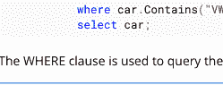

### 带 WHERE 子句的 SELECT

```
var list = from car in cars
           where car.Contains("VW")
           select car;
```

WHERE 子句用于查询字符串数组（cars）以查找并返回满足 WHERE 子句的数组子集。

编译并执行上述代码后，产生的输出如下：

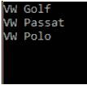

### 生成有序列表

```
var list = from car in cars
           orderby car ascending
           select car;
```

有时对返回的数据进行排序很有用。orderby 子句会使元素根据正在排序的类型默认比较器进行排序。

编译并执行上述代码后，产生的输出如下：


### 使用自定义类型

在此示例中，创建了一个类型化列表，对其进行填充，然后进行查询

```
public class Car
{
    public String Name { get; private set; }
    public int UnitsSold { get; private set; }

    public Car(string name, int unitsSold)
    {
        Name = name;
        UnitsSold = unitsSold;
    }
}

class Program
{
    static void Main(string[] args)
    {
        var car1 = new Car("VW Golf", 270952);
        var car2 = new Car("Opel Astra", 56079);
        var car3 = new Car("Audi A4", 52493);
        var car4 = new Car("Ford Focus", 51677);
        var car5 = new Car("Seat Leon", 42125);
        var car6 = new Car("VW Passat", 97586);
        var car7 = new Car("VW Polo", 69867);
        var car8 = new Car("Mercedes C-Class", 67549);

        var cars = new List<Car> {
            car1, car2, car3, car4, car5, car6, car7, car8 };
        var list = from car in cars
            select car.Name;

        foreach (var entry in list)
        {
            Console.WriteLine(entry);
        }
        Console.ReadLine();
    }
}
```

编译并执行上述代码后，产生的输出如下：

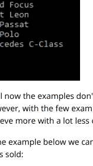

到目前为止，这些示例似乎并不令人惊叹，因为人们只需遍历数组即可基本实现相同的功能。

然而，通过下面的几个示例，您可以看到如何使用 LINQ to Objects 创建更复杂的查询，并用更少的代码实现更多功能。

在下面的示例中，我们可以选择售出超过 60000 台的汽车并按售出数量排序：

```
var list = from car in cars
    where car.UnitsSold > 60000
    orderby car.UnitsSold descending
    select car;

StringBuilder sb = new StringBuilder();

foreach (var entry in list)
{
    sb.AppendLine($"{entry.Name} - {entry.UnitsSold}");
}
Console.WriteLine(sb.ToString());
```

编译并执行上述代码后，产生的输出如下：

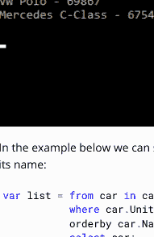

在下面的示例中，我们可以选择售出奇数单位的汽车，并按其名称按字母顺序排序：

```
var list = from car in cars
    where car.UnitsSold % 2 != 0
    orderby car.Name ascending
    select car;
```

编译并执行上述代码后，会产生以下结果：


## 第 66 章：LINQ 查询

LINQ 是 Language INtegrated Query 的缩写。它是一个概念，通过提供一个一致的模型来处理各种类型的数据源和格式，从而集成查询语言；你可以使用相同的编码模式来查询和转换 XML 文档、SQL 数据库、ADO.NET 数据集、.NET 集合以及任何其他可用的 LINQ 提供程序支持的格式中的数据。

### 第 66.1 节：方法链

许多 LINQ 函数既操作 IEnumerable<TSource>，也返回 IEnumerable<TResult>。

类型参数 TSource 和 TResult 可能引用相同的类型，也可能不引用，具体取决于所讨论的方法以及传递给它的任何函数。

其中一些示例为

```
public static IEnumerable<TResult> Select<TSource, TResult>(
    this IEnumerable<TSource> source,
    Func<TSource, TResult> selector
)

public static IEnumerable<TSource> Where<TSource>(
    this IEnumerable<TSource> source,
    Func<TSource, int, bool> predicate
)

public static IOrderedEnumerable<TSource> OrderBy<TSource, TKey>(
    this IEnumerable<TSource> source,
    Func<TSource, TKey> keySelector
)
```

虽然某些方法链可能需要在继续之前处理整个集合，但 LINQ 通过使用 yield return 利用了延迟执行，在幕后创建 Enumerable 和 Enumerator。LINQ 中的链式过程本质上是为原始集合构建一个可枚举对象（迭代器）——该可枚举对象会延迟——直到通过枚举可枚举对象而实现具体化。

这使得这些函数可以流畅地链接，其中一个函数可以直接作用于另一个函数的结果。这种代码风格可用于在一个语句中执行许多基于序列的操作。

例如，可以将 SELECT、Where 和 OrderBy 结合起来，在单个语句中转换、过滤和排序序列。

```
var someNumbers = new[] { 4, 3, 2, 1 };

var processed = someNumbers
    .Select(n => n * 2)  // Multiply each number by 2
    .Where(n => n != 6)  // Keep all the results, except for 6
    .OrderBy(n => n);    // Sort in ascending order
```

输出：

- 2
- 4
- 8

在 .NET Fiddle 上的实时演示

任何既扩展又返回通用 IEnumerable<T> 类型的函数都可以用作单个语句中的链式子句。这种流畅编程风格功能强大，在创建自己的扩展方法时应予以考虑。

### 第 66.2 节：First、FirstOrDefault、Last、LastOrDefault、Single 和 SingleOrDefault

所有六个方法都返回序列类型的单个值，可以带谓词或不带谓词调用。

根据匹配谓词的元素数量，或如果未提供谓词，则根据源序列中的元素数量，它们的行为如下：

### First()

- 返回序列的第一个元素，或匹配提供的谓词的第一个元素。
- 如果序列不包含任何元素，则会抛出 InvalidOperationException，消息为："Sequence contains no elements"。
- 如果序列不包含匹配提供的谓词的任何元素，则会抛出 InvalidOperationException，消息为 "Sequence contains no matching element"。

### 示例

```
// Returns "a":
new[] { "a" }.First();

// Returns "a":
new[] { "a", "b" }.First();

// Returns "b":
new[] { "a", "b" }.First(x => x.Equals("b"));

// Returns "ba":
new[] { "ba", "be" }.First(x => x.Contains("b"));

// Throws InvalidOperationException:
new[] { "ca", "ce" }.First(x => x.Contains("b"));

// Throws InvalidOperationException:
new string[0].First();
```

在 .NET Fiddle 上的实时演示

### FirstOrDefault()

- 返回序列的第一个元素，或匹配提供的谓词的第一个元素。
- 如果序列不包含任何元素，或不包含匹配提供的谓词的元素，则返回序列类型的默认值，使用 default(T)。

### 示例

```
// Returns "a":
new[] { "a" }.FirstOrDefault();

// Returns "a":
new[] { "a", "b" }.FirstOrDefault();
```

```csharp
// Returns "b":
new[] { "a", "b" }.FirstOrDefault(x => x.Equals("b"));

// Returns "ba":
new[] { "ba", "be" }.FirstOrDefault(x => x.Contains("b"));

// Returns null:
new[] { "ca", "ce" }.FirstOrDefault(x => x.Contains("b"));

// Returns null:
new string[0].FirstOrDefault();
```

在 .NET Fiddle 上的实时演示

### Last()

- 返回序列的最后一个元素，或匹配提供的谓词的最后一个元素。
- 如果序列不包含任何元素，则会抛出 InvalidOperationException，消息为 "Sequence contains no elements."。
- 如果序列不包含匹配提供的谓词的任何元素，则会抛出 InvalidOperationException，消息为 "Sequence contains no matching element"。

### 示例

```csharp
// Returns "a":
new[] { "a" }.Last();

// Returns "b":
new[] { "a", "b" }.Last();

// Returns "a":
new[] { "a", "b" }.Last(x => x.Equals("a"));

// Returns "be":
new[] { "ba", "be" }.Last(x => x.Contains("b"));

// Throws InvalidOperationException:
new[] { "ca", "ce" }.Last(x => x.Contains("b"));

// Throws InvalidOperationException:
new string[0].Last();
```

### LastOrDefault()

- 返回序列的最后一个元素，或匹配提供的谓词的最后一个元素。
- 如果序列不包含任何元素，或不包含匹配提供的谓词的元素，则返回序列类型的默认值，使用 default(T)。

### 示例

```csharp
// Returns "a":
new[] { "a" }.LastOrDefault();

// Returns "b":
new[] { "a", "b" }.LastOrDefault();

// Returns "a":
new[] { "a", "b" }.LastOrDefault(x => x.Equals("a"));

// Returns "be":
new[] { "ba", "be" }.LastOrDefault(x => x.Contains("b"));
// Returns null:
new[] { "ca", "ce" }.LastOrDefault(x => x.Contains("b"));
// Returns null:
new string[] {}.LastOrDefault();
```

### Single()

- 如果序列包含恰好一个元素，或恰好一个匹配提供的谓词的元素，则返回该元素。
- 如果序列不包含任何元素，或不包含匹配提供的谓词的元素，则会抛出 InvalidOperationException，消息为 "Sequence contains no elements"。
- 如果序列包含多于一个元素，或匹配提供的谓词的元素多于一个，则会抛出 InvalidOperationException，消息为 "Sequence contains more than one element"。
- **Note:** 为了评估序列是否包含恰好一个元素，最多需要枚举两个元素。

### 示例

```
// Returns "a":
new[] { "a" }.Single();

// Throws InvalidOperationException because sequence contains more than one element:
new[] { "a", "b" }.Single();

// Returns "b":
new[] { "a", "b" }.Single(x => x.Equals("b"));

// Throws InvalidOperationException:
new[] { "a", "b" }.Single(x => x.Equals("c"));

// Throws InvalidOperationException:
new string[] {}.Single();

// Throws InvalidOperationException because sequence contains more than one element:
new[] { "a", "a" }.Single();
```

### SingleOrDefault()

- 如果序列包含恰好一个元素，或恰好一个匹配提供的谓词的元素，则返回该元素。
- 如果序列不包含任何元素，或不包含匹配提供的谓词的元素，则返回 default(T)。
- 如果序列包含多于一个元素，或匹配提供的谓词的元素多于一个，则会抛出 InvalidOperationException，消息为 "Sequence contains more than one element"。
- 如果序列不包含匹配提供的谓词的任何元素，则返回序列类型的默认值，使用 default(T)。
- **Note:** 为了评估序列是否包含恰好一个元素，最多需要枚举两个元素。

### 示例

```
// Returns "a":
new[] { "a" }.SingleOrDefault();


```csharp
// returns "a"
new[] { "a", "b" }.SingleOrDefault(x => x == "a");

// Returns null:
new[] { "a", "b" }.SingleOrDefault(x => x == "c");

// Throws InvalidOperationException:
new[] { "a", "a" }.SingleOrDefault(x => x == "a");

// Throws InvalidOperationException:
new[] { "a", "b" }.SingleOrDefault();

// Returns null:
new string[0].SingleOrDefault();
```

## 建议
- 虽然你可以使用 FirstOrDefault、LastOrDefault 或 SingleOrDefault 来检查序列是否包含任何项，但 Any 或 Count 更可靠。这是因为这三种方法之一返回的 default(T) 值并不能证明序列为空，因为序列中第一个/最后一个/单个元素的 值也同样可能是 default(T)
- 根据代码的目的选择最合适的 方法。例如，仅当你必须确保集合中与谓词匹配的项只有一个时才使用 Single；否则使用 First；因为如果序列有多个匹配元素，Single 会抛出异常。这当然也适用于 "*OrDefault" 对应方法。
- 关于效率：虽然通常适当确保查询返回的只有一个项（Single）或一个或零个（SingleOrDefault）项，但这两种方法都需要更多，并且通常需要检查整个集合以确保查询没有第二个匹配项。这与例如 First 方法的行为不同，后者在找到第一个匹配项后即可满足。

## 第 66.3 节：Except
Except 方法返回包含在第一个集合中但不包含在第二个集合中的项的集合。默认的 IEqualityComparer 用于比较两个集合中的项。有一个重载接受 IEqualityComparer 作为参数。

### 示例：
```csharp
int[] first = { 1, 2, 3, 4 };
int[] second = { 0, 2, 3, 5 };

IEnumerable<int> inFirstButNotInSecond = first.Except(second);
// inFirstButNotInSecond = { 1, 4 }
```

### 输出：
1
4

在 .NET Fiddle 上进行实时演示

在这种情况下，.Except(second) 排除了包含在数组 second 中的元素，即 2 和 3（0 和 5 不包含在第一个数组中，因此被跳过）。

请注意 Except 隐含 Distinct（即它会移除重复元素）。例如：
```csharp
int[] third = { 1, 1, 1, 2, 3, 4 };
IEnumerable<int> inThirdButNotInSecond = third.Except(second);
// inThirdButNotInSecond = { 1, 4 }
```

### 输出：
1
4

在 .NET Fiddle 上进行实时演示

在这种情况下，元素 1 和 4 仅返回一次。

实现 IEquatable 或为函数提供一个 IEqualityComparer 将允许使用不同的方法来比较元素。请注意，GetHashCode 方法也应被重写，以便对于根据 IEquatable 实现而相同的对象返回相同的哈希码。

### 使用 IEquatable 的示例：
```csharp
class Holiday : IEquatable<Holiday>
{
    public string Name { get; set; }

    public bool Equals(Holiday other)
    {
        return Name == other.Name;
    }

    // GetHashCode must return true whenever Equals returns true.
    public override int GetHashCode()
    {
        //Get hash code for the Name field if it is not null.
        return Name?.GetHashCode() ?? 0;
    }
}

public class Program
{
    public static void Main()
    {
        List<Holiday> holidayDifference = new List<Holiday>();

        List<Holiday> remoteHolidays = new List<Holiday>
        {
            new Holiday { Name = "Xmas" },
            new Holiday { Name = "Hanukkah" },
            new Holiday { Name = "Ramadan" }
        };

        List<Holiday> localHolidays = new List<Holiday>
        {
            new Holiday { Name = "Xmas" },
            new Holiday { Name = "Ramadan" }
        };

        holidayDifference = remoteHolidays
            .Except(localHolidays)
            .ToList();

        holidayDifference.ForEach(x => Console.WriteLine(x.Name));
    }
}
```

输出：

Hanukkah

在 .NET Fiddle 上进行实时演示

## 第 66.4 节：SelectMany
SelectMany LINQ 方法将 IEnumerable<IEnumerable<T>> '展平' 为 IEnumerable<T>。源 IEnumerable 中包含的 IEnumerable 实例中的所有 T 元素将被合并为单个 IEnumerable。

```csharp
var words = new [] { "a,b,c", "d,e", "f" };
var splitAndCombine = words.SelectMany(x => x.Split(','));
// returns { "a", "b", "c", "d", "e", "f" }
```

如果你使用一个将输入元素转换为序列的选择器函数，结果将是这些序列的元素逐个返回。

请注意，与 SELECT() 不同，输出中的元素数量不需要与输入中的相同。

### 更实际的示例
```csharp
class School
{
    public Student[] Students { get; set; }
}

class Student
{
    public string Name { get; set; }
}

var schools = new [] {
    new School(){ Students = new [] { new Student { Name="Bob"}, new Student { Name="Jack"} }},
    new School(){ Students = new [] { new Student { Name="Jim"}, new Student { Name="John"} }}
};

var allStudents = schools.SelectMany(s=> s.Students);

foreach(var student in allStudents)
{
    Console.WriteLine(student.Name);
}
```

### 输出：
Bob
Jack
Jim
John

在 .NET Fiddle 上进行实时演示

## 第 66.5 节：Any
Any 用于检查集合中的 **任意** 元素是否匹配某个条件或不。

*另请参阅：All、Any 和 FirstOrDefault：最佳实践*

### 1. 空参数
**Any：** 如果集合有任何元素则返回 `true`，如果集合为空则返回 `false`：
```csharp
var numbers = new List<int>();
bool result = numbers.Any(); // false

var numbers = new List<int>(){ 1, 2, 3, 4, 5 };
bool result = numbers.Any(); //true
```

### 2. Lambda 表达式作为参数
**Any：** 如果集合有一个或多个元素满足 lambda 表达式中的条件，则返回 `true`：
```csharp
var arrayOfStrings = new string[] { "a", "b", "c" };
arrayOfStrings.Any(item => item == "a");    // true
arrayOfStrings.Any(item => item == "d");    // false
```

### 3. 空集合
**Any：** 如果集合为空且提供了 lambda 表达式，则返回 `false`：
```csharp
var numbers = new List<int>();
bool result = numbers.Any(i => i >= 0); // false
```

**注意：** Any 在找到匹配条件的元素后会立即停止遍历集合。这意味着集合不一定会被完全枚举；它只会被枚举到足以找到第一个匹配条件的项为止。

在 .NET Fiddle 上进行实时演示

## 第 66.6 节：JOINS
Join 用于通过公共键组合保存数据的不同列表或表。

与 SQL 类似，LINQ 中支持以下类型的 Join：
**Inner、Left、Right、Cross** 和 **Full Outer** Join。

以下两个列表用于下面的示例中：
```csharp
var first = new List<string>() { "a", "b", "c" }; // Left data
var second = new List<string>() { "a", "c", "d" }; // Right data
```

### （Inner）Join
```csharp
var result = from f in first
    join s in second on f equals s
    select new { f, s };

var result = first.Join(second,
    f => f,
    s => s,
    (f, s) => new { f, s });

// Result: {"a","a"}
//         {"c","c"}
```

### Left outer join
```csharp
var leftOuterJoin = from f in first
    join s in second on f equals s into temp
    from t in temp.DefaultIfEmpty()
    select new { First = f, Second = t };

// Or can also do:
var leftOuterJoin = from f in first
    from s in second.Where(x => x == f).DefaultIfEmpty()
    select new { First = f, Second = s };

// Result: {"a","a"}
//         {"b", null}
//         {"c","c"}

// Left outer join method syntax
var leftOuterJoinFluentSyntax = first.GroupJoin(second,
    f => f,
    s => s,
    (f, s) => new { First = f, Second = s })
    .SelectMany(temp => temp.Second.DefaultIfEmpty(),
    (f, s) => new { First = f.First, Second = s });
```

### Right Outer Join
```csharp
var rightOuterJoin = from s in second
    join f in first on s equals f into temp
    from t in temp.DefaultIfEmpty()
    select new {First=t,Second=s};

// Result: {"a","a"}
//         {"c","c"}
//         {null,"d"}
```

### Cross Join
```csharp
var CrossJoin = from f in first
    from s in second
    select new { f, s };

// Result: {"a","a"}
//         {"a","c"}
//         {"a","d"}
//         {"b","a"}
//         {"b","c"}
//         {"b","d"}
```

// {"c", "a"}
// {"c", "c"}
// {"c", "d"}

## 完全外部联接

```
var fullOuterJoin = leftOuterJoin.Union(rightOuterJoin);
```

```
// Result: {"a", "a"}
// {"b", null}
// {"c", "c"}
// {null, "d"}
```

## 实际示例

上面的示例使用了简单的数据结构，以便你可以专注于从技术上理解不同的 LINQ 联接，但在现实世界中，你会拥有包含需要联接的列的表。

在以下示例中，只使用了一个类 Region，而在现实中，你会联接两个或更多持有相同键的不同表（在此示例中，first 和 second 通过公共键 ID 联接）。

示例：考虑以下数据结构：

```
public class Region
{
    public Int32 ID;
    public string RegionDescription;

    public Region(Int32 pRegionID, string pRegionDescription=null)
    {
        ID = pRegionID; RegionDescription = pRegionDescription;
    }
}
```

现在准备数据（即用数据填充）：

```
// Left data
var first = new List<Region>()
    { new Region(1), new Region(3), new Region(4) };
// Right data
var second = new List<Region>()
    {
        new Region(1, "Eastern"), new Region(2, "Western"),
        new Region(3, "Northern"), new Region(4, "Southern")
    };
```

你可以看到，在此示例中 first 不包含任何区域描述，因此你希望从 second 联接它们。那么内联联接将如下所示：

```
// do the inner join
var result = from f in first
    join s in second on f.ID equals s.ID
    select new { f.ID, s.RegionDescription };
```

```
// Result: {1, 'Eastern'}
// {3, 'Northern'}
// {4, 'Southern'}
```

此结果即时创建了匿名对象，这没问题，但我们已经创建了一个合适的类——因此可以指定它：与其使用 SELECT NEW { f.ID, s.RegionDescription };，我们可以写成 SELECT NEW Region(f.ID, s.RegionDescription);，这将返回相同的数据，但会创建 Region 类型的对象——从而与其他对象保持兼容。

.NET Fiddle 上的在线演示

## 第 66.7 节：Skip 和 Take

Skip 方法返回一个集合，该集合从源集合开头排除指定数量的项。排除的项数由参数指定。如果集合中的项数少于参数指定的数量，则返回空集合。

Take 方法返回一个集合，该集合包含源集合开头指定数量的元素。包含的项数由参数指定。如果集合中的项数少于参数指定的数量，则返回的集合将包含与源集合相同的元素。

```
var values = new [] { 5, 4, 3, 2, 1 };

var skipTwo = values.Skip(2); // { 3, 2, 1 }
var takeThree = values.Take(3); // { 5, 4, 3 }
var skipOneTakeTwo = values.Skip(1).Take(2); // { 4, 3 }
var takeZero = values.Take(0); // An IEnumerable<int> with 0 items
```

.NET Fiddle 上的在线演示

Skip 和 Take 通常一起用于对结果进行分页，例如：

```
IEnumerable<T> GetPage<T>(IEnumerable<T> collection, int pageNumber, int resultsPerPage) {
    int startIndex = (pageNumber - 1) * resultsPerPage;
    return collection.Skip(startIndex).Take(resultsPerPage);
}
```

> 警告：LINQ to Entities 仅支持对已排序查询使用 Skip。如果尝试在未排序的情况下使用 Skip，将收到 NotSupportedException，消息为“The method 'Skip' is only supported for sorted input in LINQ to Entities. The method 'OrderBy' must be called before the method 'Skip'.”

## 第 66.8 节：在 LINQ 查询中定义变量（let 关键字）

为了在 LINQ 表达式中定义变量，可以使用 let 关键字。这通常用于存储中间子查询的结果，例如：

```
int[] numbers = { 0, 1, 2, 3, 4, 5, 6, 7, 8, 9 };

var aboveAverages = from number in numbers
    let average = numbers.Average()
    let nSquared = Math.Pow(number,2)
    where nSquared > average
    select number;
```

Console.WriteLine("The average of the numbers is {0}.", numbers.Average());

```csharp
foreach (int n in aboveAverages)
{
    Console.WriteLine("Query result includes number {0} with square of {1}.", n, Math.Pow(n,2));
}
```

**输出：**

> > 数字的平均值为 4.5。
> > 查询结果包含数字 3，其平方为 9。
> > 查询结果包含数字 4，其平方为 16。
> > 查询结果包含数字 5，其平方为 25。
> > 查询结果包含数字 6，其平方为 36。
> > 查询结果包含数字 7，其平方为 49。
> > 查询结果包含数字 8，其平方为 64。
> > 查询结果包含数字 9，其平方为 81。

[查看演示](#)

## 第 66.9 节：Zip

Zip 扩展方法作用于两个集合。它基于位置将两个序列中的每个元素配对。借助 Func 实例，我们使用 Zip 成对处理两个 C# 集合中的元素。如果序列大小不同，较大序列中多出的元素将被忽略。

以《C# in a Nutshell》一书中的示例为例，

```csharp
int[] numbers = { 3, 5, 7 };
string[] words = { "three", "five", "seven", "ignored" };
IEnumerable<string> zip = numbers.Zip(words, (n, w) => n + "=" + w);
```

**输出：**

> > 3=three
> > 5=five
> > 7=seven

[查看演示](#)

## 第 66.10 节：Range 和 Repeat

Enumerable 上的 Range 和 Repeat 静态方法可用于生成简单序列。

### Range

Enumerable.Range() 在给定起始值和计数的情况下生成一个整数序列。

```csharp
// Generate a collection containing the numbers 1-100 ([1, 2, 3, ..., 98, 99, 100])
var range = Enumerable.Range(1,100);
```

[.NET Fiddle 在线演示](#)

### Repeat

Enumerable.Repeat() 在给定元素和所需重复次数的情况下生成一个重复元素序列。

// Generate a collection containing "a", three times ({"a","a","a"})
var repeatedValues = Enumerable.Repeat("a", 3);

.NET Fiddle 在线演示

## 第 66.11 节：基础

LINQ 对查询集合（或数组）非常有用。

例如，给定以下示例数据：

```
var classroom = new Classroom
{
    new Student { Name = "Alice", Grade = 97, HasSnack = true },
    new Student { Name = "Bob", Grade = 82, HasSnack = false },
    new Student { Name = "Jimmy", Grade = 71, HasSnack = true },
    new Student { Name = "Greg", Grade = 90, HasSnack = false },
    new Student { Name = "Joe", Grade = 59, HasSnack = false }
}
```

我们可以使用 LINQ 语法对这些数据进行“查询”。例如，要检索今天有零食的所有学生：

```
var studentsWithSnacks = from s in classroom.Students
                          where s.HasSnack
                          select s;
```

或者，要检索成绩为 90 或以上的学生，并且只返回他们的姓名，而不是完整的 Student 对象：

```
var topStudentNames = from s in classroom.Students
                       where s.Grade >= 90
                       select s.Name;
```

LINQ 功能由两种语法组成，它们执行相同的功能，性能几乎相同，但写法差别很大。上面示例中的语法称为查询语法。然而，下面的示例演示方法语法。将返回与上面示例相同的数据，但查询的写法不同。

```
var topStudentNames = classroom.Students
    .Where(s => s.Grade >= 90)
    .Select(s => s.Name);
```

## 第 66.12 节：All

All 用于检查集合的所有元素是否都匹配某个条件。

*另请参阅：Any*

- 1. 空参数

- **All：** 不允许与空参数一起使用。

- 2. 以 Lambda 表达式作为参数

All：如果集合的所有元素都满足该 Lambda 表达式，则返回 true，否则返回 false：

```
var numbers = new List<int>() { 1, 2, 3, 4, 5 };
bool result = numbers.All(i => i < 10); // true
bool result = numbers.All(i => i >= 3); // false
```

### 3. 空集合

All：如果集合为空且提供了 Lambda 表达式，则返回 true：

```
var numbers = new List<int>();
bool result = numbers.All(i => i >= 0); // true
```

注意：All 在找到第一个不满足条件的元素后会立即停止迭代集合。这意味着集合不一定会被完整枚举；只会枚举到足以找到第一个不满足条件的项为止。

## 第 66.13 节：Aggregate

Aggregate 对序列应用累加器函数。

```
int[] intlist = { 1, 2, 3, 4, 5, 6, 7, 8, 9, 10 };
int sum = intlist.Aggregate((prevSum, current) => prevSum + current);
// sum = 55
```

- 第一步中 prevSum = 1
- 第二步中 prevSum = 第一步的 prevSum + 2
- 第 i 步中 prevSum = 第 (i-1) 步的 prevSum + 数组的第 i 个元素

```
string[] stringList = { "Hello", "World", "!" };
string joinedString = stringList.Aggregate((prev, current) => prev + " " + current);
// joinedString = "Hello World !"
```

Aggregate 的第二个重载还接收一个 seed 参数，它是初始累加器值。这可用于在集合上计算多个条件，而不必多次迭代该集合。

```
List<int> items = new List<int> { 1, 2, 3, 4, 5, 6, 7, 8, 9, 10, 11, 12 };
```

对于 items 集合，我们想要计算

- 1. 总数 .Count
- 2. 偶数的数量
- 3. 收集每个第四项

使用 Aggregate 可以这样完成：

```
var result = items.Aggregate(new { Total = 0, Even = 0, FourthItems = new List<int>() },
    (accumulative,item) =>
    new {
        Total = accumulative.Total + 1,
        Even = accumulative.Even + (item % 2 == 0 ? 1 : 0),
        FourthItems = (accumulative.Total + 1)%4 == 0 ?
            new List<int>(accumulative.FourthItems) { item } :
            accumulative.FourthItems
    });
// Result:
```


// Total = 12
// Even = 6
// FourthItems = [4, 8, 12]

注意，使用匿名类型作为种子时，由于属性为只读，每个项目都必须实例化一个新对象。使用自定义类时，可以直接分配信息且不需要新建（仅在提供初始种子参数时

## 第 66.14 节：Distinct

返回 IEnumerable 中的唯一值。唯一性是通过默认相等比较器确定的。

```
int[] array = { 1, 2, 3, 4, 2, 5, 3, 1, 2 };

var distinct = array.Distinct();
// distinct = { 1, 2, 3, 4, 5 }
```

要比较自定义数据类型，我们需要实现 IEquatable<T> 接口并为该类型提供 GetHashCode 和 Equals 方法。或者可以重写相等比较器：

```
class SSNEqualityComparer : IEqualityComparer<Person> {
    public bool Equals(Person a, Person b) => a.SSN == b.SSN;
    public int GetHashCode(Person p) => p.SSN;
}

List<Person> people;

distinct = people.Distinct(new SSNEqualityComparer());
```

## 第 66.15 节：SelectMany：展平序列的序列

```
var sequenceOfSequences = new [] { new [] { 1, 2, 3 }, new [] { 4, 5 }, new [] { 6 } };
var sequence = sequenceOfSequences.SelectMany(x => x);
// returns { 1, 2, 3, 4, 5, 6 }
```

如果你有一个序列的序列，或者正在创建序列的序列，但希望结果作为一个长序列，则使用 SelectMany()。

在 LINQ 查询语法中：

```
var sequence = from subSequence in sequenceOfSequences
               from item in subSequence
               select item;
```

如果你有一个集合的集合，并且希望能够同时处理来自父集合和子集合的数据，使用 SelectMany 也同样可以实现。

让我们定义简单的类

```
public class BlogPost
{
    public int Id { get; set; }
    public string Content { get; set; }
    public List<Comment> Comments { get; set; }
}
```

```
public class Comment
{
    public int Id { get; set; }
    public string Content { get; set; }
}
```

假设我们有以下集合。

```
List<BlogPost> posts = new List<BlogPost>()
{
    new BlogPost()
    {
        Id = 1,
        Comments = new List<Comment>()
        {
            new Comment()
            {
                Id = 1,
                Content = "It's really great!",
            },
            new Comment()
            {
                Id = 2,
                Content = "Cool post!"
            }
        },
    },
    new BlogPost()
    {
        Id = 2,
        Comments = new List<Comment>()
        {
            new Comment()
            {
                Id = 3,
                Content = "I don't think you're right",
            },
            new Comment()
            {
                Id = 4,
                Content = "This post is a complete nonsense"
            }
        }
    }
};
```

现在我们想要选择评论的 Content 以及与该评论关联的 BlogPost 的 Id。为此，我们可以使用适当的 SelectMany 重载。

```
var commentsWithIds = posts.SelectMany(p => p.Comments, (post, comment) => new { PostId = post.Id, CommentContent = comment.Content });
```

我们的 commentsWithIds 看起来像这样

```
{
    PostId = 1,
    CommentContent = "It's really great!"
},
{
    PostId = 1,
    CommentContent = "Cool post!"
},
{
    PostId = 2,
    CommentContent = "I don't think you're right"
},
{
    PostId = 2,
    CommentContent = "This post is a complete nonsense"
}
```

## 第 66.16 节：GroupBy

GroupBy 是将 IEnumerable<T> 集合中的项目排序到不同组中的一种简便方法。

### 简单示例

在这个第一个示例中，我们最终得到两个组，奇数项和偶数项。

```
List<int> ilist = new List<int>() { 1, 2, 3, 4, 5, 6, 7, 8, 9 };
var grouped = ilist.GroupBy(x => x % 2 == 0);

//Groups ilist into odd [13579] and even[2468] items

foreach(var group in grouped)
{
    foreach (int item in group)
    {
        Console.Write(item); // 135792468 (first odd then even)
    }
}
```

### 更复杂的示例

让我们以按年龄对人员列表进行分组为例。首先，我们将创建一个 Person 对象，它有两个属性，Name 和 Age。

```
public class Person
{
    public int Age {get; set;}
    public string Name {get; set;}
}
```

然后我们创建包含各种姓名和年龄的示例人员列表。

```
List<Person> people = new List<Person>();
people.Add(new Person{Age = 20, Name = "Mouse"});
people.Add(new Person{Age = 30, Name = "Neo"});
people.Add(new Person{Age = 40, Name = "Morpheus"});
people.Add(new Person{Age = 30, Name = "Trinity"});
people.Add(new Person{Age = 40, Name = "Dozer"});
people.Add(new Person{Age = 40, Name = "Smith"});
```

然后我们创建一个 LINQ 查询，按年龄对人员列表进行分组。

```
var query = people.GroupBy(x => x.Age);
```

这样做，我们可以看到每个组的 Age，并列出该组中的每个人员。

```csharp
foreach(var result in query)
{
    Console.WriteLine(result.Key);

    foreach(var person in result)
        Console.WriteLine(person.Name);
}
```

这导致以下输出：

```
20
Mouse
30
Neo
Trinity
40
Morpheus
Dozer
Smith
```

你可以在 .NET Fiddle 上试用实时演示

## 第 66.17 节：按类型查询集合 / 将元素强制转换为类型

```csharp
interface IFoo { }
class Foo : IFoo { }
class Bar : IFoo { }
```

```csharp
var item0 = new Foo();
var item1 = new Foo();
var item2 = new Bar();
var item3 = new Bar();
var collection = new IFoo[] { item0, item1, item2, item3 };
```

使用 OfType

```csharp
var foos = collection.OfType<Foo>(); // result: IEnumerable<Foo> with item0 and item1
var bars = collection.OfType<Bar>(); // result: IEnumerable<Bar> with item2 and item3
var foosAndBars = collection.OfType<IFoo>(); // result: IEnumerable<IFoo> with all four items
```

使用 Where

```csharp
var foos = collection.Where(item => item is Foo); // result: IEnumerable<IFoo> with item0 and item1
var bars = collection.Where(item => item is Bar); // result: IEnumerable<IFoo> with item2 and item3
```

使用 Cast

```csharp
var bars = collection.Cast<Bar>();         // throws InvalidCastException on the 1st item
var foos = collection.Cast<Foo>();         // throws InvalidCastException on the 3rd item
var foosAndBars = collection.Cast<IFoo>(); // OK
```

## 第 66.18 节：枚举 Enumerable

IEnumerable<T> 接口是所有泛型枚举器的基础接口，是理解 LINQ 的核心部分。其核心是表示序列。

此底层接口被所有泛型集合继承，例如 Collection<T>、Array、List<T>、Dictionary<TKey, TValue> 类和 HashSet<T>。

除了表示序列之外，继承自 IEnumerable<T> 的任何类都必须提供一个 IEnumerator<T>。枚举器公开了可枚举对象的迭代器，这两个相互关联的接口和概念是“枚举可枚举对象”这一说法来源。

“Enumerating the enumerable”是一个重要的短语。可枚举对象只是一个迭代的结构，它不持有任何已物化的对象。例如，在排序时，可枚举对象可能保存要排序的字段的准则，但仅使用 .OrderBy() 将返回一个仅知道如何排序的 IEnumerable<T>。使用会物化对象的调用，例如遍历集合，被称为枚举（例如 .ToList()）。枚举过程将使用可枚举对象的定义来遍历序列并返回相关对象（按顺序、过滤、投影等）。

只有在可枚举对象被枚举后才会导致对象的物化，这时像时间复杂度（相对于序列大小所需的时间）和空间复杂度（相对于序列大小所需的空间）等指标才可以被衡量。

创建继承自 IEnumerable<T> 的自己的类可能有点复杂，这取决于需要可枚举的底层序列。一般最好使用现有的泛型集合之一。话虽如此，也可以在没有定义数组作为底层结构的情况下继承 IEnumerable<T> 接口。

例如，使用 Fibonacci 序列作为底层序列。请注意，Where 的调用只是构建了一个 IEnumerable，直到对可枚举对象进行枚举调用时，任何值才会被物化。

```csharp
void Main()
{
    Fibonacci Fibo = new Fibonacci();
    IEnumerable<long> quadrillionplus = Fibo.Where(i => i > 100000000000);
    Console.WriteLine("Enumerable built");
    Console.WriteLine(quadrillionplus.Take(2).Sum());
    Console.WriteLine(quadrillionplus.Skip(2).First());

    IEnumerable<long> fibMod612 = Fibo.OrderBy(i => i % 612);
    Console.WriteLine("Enumerable built");
    Console.WriteLine(fibMod612.First());//smallest divisible by 612
}

public class Fibonacci : IEnumerable<long>
{
    private int max = 90;

    //Enumerator called typically from foreach
    public IEnumerator<long> GetEnumerator() {
        long n0 = 1;
        long n1 = 1;
        Console.WriteLine("Enumerating the Enumerable");
        for(int i = 0; i < max; i++){
            yield return n0+n1;
            n1 += n0;
            n0 = n1-n0;
        }
    }
}
```


```
}
}

//Enumerable called typically from linq
IEnumerable<long> GetEnumerator() {
    long n0 = 1;
    long n1 = 1;
    Console.WriteLine("Enumerating the Enumerable");
    for(int i = 0; i < max; i++){
        yield return n0+n1;
        n1 += n0;
        n0 = n1-n0;
    }
}
}
```

### Output

```
Enumerable built
Enumerating the Enumerable
4052739537881
Enumerating the Enumerable
4052739537881
Enumerable built
Enumerating the Enumerable
14930352
```

第二组（fibMod612）的优势在于，即使我们调用了对整个斐波那契数集进行排序，由于仅使用 .First() 取了一个值，时间复杂度为 O(n)，因为在排序算法执行期间只需要比较 1 个值。这是因为我们的枚举器只请求了 1 个值，因此整个可枚举对象不需要被物化。如果我们改用 .Take(5) 而不是 .First()，枚举器将请求 5 个值，最多需要物化 5 个值。与需要对整个集合进行排序然后再取前 5 个值相比，延迟执行的原则节省了大量执行时间和空间。

## Section 66.19: 使用 Range 与各种 Linq 方法

你可以使用 Enumerable 类与 Linq 查询一起使用，将 for 循环转换为 Linq 一行代码。

### Select 示例

相反于这样做：

```
var asciiCharacters = new List<char>();
for (var x = 0; x < 256; x++)
{
    asciiCharacters.Add((char)x);
}
```

你可以这样做：

```
var asciiCharacters = Enumerable.Range(0, 256).Select(a => (char) a);
```

### Where 示例

在此示例中，将生成 100 个数字并提取偶数

```
var evenNumbers = Enumerable.Range(1, 100).Where(a => a % 2 == 0);
```

## Section 66.20: Where

返回一个子集，其中指定谓词对它们为真。

```
List<string> trees = new List<string> { "Oak", "Birch", "Beech", "Elm", "Hazel", "Maple" };
```

### 方法语法

```
// Select all trees with name of length 3
var shortTrees = trees.Where(tree => tree.Length == 3); // Oak, Elm
```

### 查询语法

```
var shortTrees = from tree in trees
where tree.Length == 3
select tree; // Oak, Elm
```

## Section 66.21: 使用 SelectMany 代替嵌套循环

给定 2 个列表

```
var list1 = new List<string> { "a", "b", "c" };
var list2 = new List<string> { "1", "2", "3", "4" };
```

如果你想输出所有排列，可以使用嵌套循环如下

```
var result = new List<string>();
foreach (var s1 in list1)
foreach (var s2 in list2)
result.Add($"{s1}{s2}");
```

使用 SelectMany 你可以执行相同的操作如下

```
var result = list1.SelectMany(x => list2, (x, y) => $"{x}{y}").ToList();
```

## Section 66.22: Contains

MSDN:

> 使用指定的 IEqualityComparer<T> 确定序列是否包含指定的元素

```
List<int> numbers = new List<int> { 1, 2, 3, 4, 5 };
var result1 = numbers.Contains(4); // true
var result2 = numbers.Contains(8); // false
```

```
List<int> secondNumberCollection = new List<int> { 4, 5, 6, 7 };
// Note that can use the Intersect method in this case
var result3 = secondNumberCollection.Where(item => numbers.Contains(item)); // will be true only for 4,5
```

使用用户定义的对象：

```csharp
public class Person
{
    public string Name { get; set; }
}

List<Person> objects = new List<Person>
{
    new Person { Name = "Nikki" },
    new Person { Name = "Gilad" },
    new Person { Name = "Phil" },
    new Person { Name = "John" }
};

//Using the Person's Equals method - override Equals() and GetHashCode() - otherwise it
//will compare by reference and result will be false
var result4 = objects.Contains(new Person { Name = "Phil" }); // true
```

使用 Enumerable.Contains(`value`, `comparer`) 重载：

```csharp
public class Compare : IEqualityComparer<Person>
{
    public bool Equals(Person x, Person y)
    {
        return x.Name == y.Name;
    }
    public int GetHashCode(Person codeh)
    {
        return codeh.Name.GetHashCode();
    }
}

var result5 = objects.Contains(new Person { Name = "Phil" }, new Compare()); // true
```

**使用 Contains 的一个智能用法是用 Contains 调用替换多个 if 子句。**

与其这样做：

```csharp
if(status == 1 || status == 3 || status == 4)
{
    //Do some business operation
}
else
{
    //Do something else
}
```

这样做：

```csharp
if(new int[] {1, 3, 4 }.Contains(status))
{
    //Do some business operation
}
else
{
    //Do something else
}
```

## Section 66.23: 连接多个序列

考虑以下实体 Customer、Purchase 和 PurchaseItem：

```csharp
public class Customer
{
    public string Id { get; set; } // A unique Id that identifies customer
    public string Name {get; set; }
}

public class Purchase
{
    public string Id { get; set; }
    public string CustomerId {get; set; }
    public string Description { get; set; }
}

public class PurchaseItem
{
    public string Id { get; set; }
    public string PurchaseId {get; set; }
    public string Detail { get; set; }
}
```

考虑上述实体的以下示例数据：

```csharp
var customers = new List<Customer>()
{
    new Customer() {
        Id = Guid.NewGuid().ToString(),
        Name = "Customer1"
    },

    new Customer() {
        Id = Guid.NewGuid().ToString(),
        Name = "Customer2"
    }
};

var purchases = new List<Purchase>()
{
    new Purchase() {
        Id = Guid.NewGuid().ToString(),
        CustomerId = customers[0].Id,
        Description = "Customer1-Purchase1"
    },

    new Purchase() {
        Id = Guid.NewGuid().ToString(),
        CustomerId = customers[0].Id,
        Description = "Customer1-Purchase2"
    },

    new Purchase() {
        Id = Guid.NewGuid().ToString(),
        CustomerId = customers[1].Id,
        Description = "Customer2-Purchase1"
    },

    new Purchase() {
        Id = Guid.NewGuid().ToString(),
CustomerId = customers[1].Id,
Description = "Customer2-Purchase2"
}
};

var purchaseItems = new List<PurchaseItem>()
{
    new PurchaseItem() {
        Id = Guid.NewGuid().ToString(),
        PurchaseId= purchases[0].Id,
        Detail = "Purchase1-PurchaseItem1"
    },
    new PurchaseItem() {
        Id = Guid.NewGuid().ToString(),
        PurchaseId= purchases[1].Id,
        Detail = "Purchase2-PurchaseItem1"
    },
    new PurchaseItem() {
        Id = Guid.NewGuid().ToString(),
        PurchaseId= purchases[1].Id,
        Detail = "Purchase2-PurchaseItem2"
    },
    new PurchaseItem() {
        Id = Guid.NewGuid().ToString(),
        PurchaseId= purchases[3].Id,
        Detail = "Purchase3-PurchaseItem1"
    }
};
```

现在，考虑下面的 linq 查询：

```
var result = from c in customers
    join p in purchases on c.Id equals p.CustomerId      // first join
    join pi in purchaseItems on p.Id equals pi.PurchaseId   // second join
    select new
    {
        c.Name, p.Description, pi.Detail
    };
```

要输出上述查询的结果：

```
foreach(var resultItem in result)
{
    Console.WriteLine($"{resultItem.Name}, {resultItem.Description}, {resultItem.Detail}");
}
```

查询的输出将是：

Customer1, Customer1-Purchase1, Purchase1-PurchaseItem1

Customer1, Customer1-Purchase2, Purchase2-PurchaseItem1

Customer1, Customer1-Purchase2, Purchase2-PurchaseItem2

Customer2, Customer2-Purchase2, Purchase3-PurchaseItem1

## Section 66.24: 在多个键上连接

```csharp
PropertyInfo[] stringProps = typeof (string).GetProperties();//string properties
PropertyInfo[] builderProps = typeof(StringBuilder).GetProperties();//stringbuilder properties

var query =
    from s in stringProps
    join b in builderProps
    on new { s.Name, s.PropertyType } equals new { b.Name, b.PropertyType }
    select new
    {
        s.Name,
        s.PropertyType,
        StringToken = s.MetadataToken,
        StringBuilderToken = b.MetadataToken
    };
```

请注意，上述连接中的匿名类型必须包含相同的属性，因为只有当所有属性都相等时对象才被认为相等。否则查询将无法编译。

## Section 66.25: ToLookup

> > ToLookup 返回一个允许索引的数据结构。它是一个扩展方法。它生成一个 ILookup 实例，可以使用 foreach 循环进行索引或枚举。条目在每个键处组合成分组。- dotnetperls

```csharp
string[] array = { "one", "two", "three" };
//create lookup using string length as key
var lookup = array.ToLookup(item => item.Length);

//join the values whose lengths are 3
Console.WriteLine(string.Join(",", lookup[3]));
//output: one,two
```

另一个示例：

```csharp
int[] array = { 1,2,3,4,5,6,7,8 };
//generate lookup for odd even numbers (keys will be 0 and 1)
var lookup = array.ToLookup(item => item % 2);

//print even numbers after joining
Console.WriteLine(string.Join(",", lookup[0]));
//output: 2,4,6,8

//print odd numbers after joining
Console.WriteLine(string.Join(",", lookup[1]));
//output: 1,3,5,7
```

## Section 66.26: SkipWhile

SkipWhile() 用于排除元素直到第一个不匹配（这可能对大多数人来说是违反直觉的）

```csharp
int[] list = { 42, 42, 6, 6, 6, 42 };
```

```
var result = list.SkipWhile(i => i == 42);
// Result: 6, 6, 6, 42
```

## Section 66.27: 查询排序 - OrderBy() ThenBy() OrderByDescending() ThenByDescending()

```
string[] names = { "mark", "steve", "adam" };
```

### 升序：

查询语法

```
var sortedNames =
    from name in names
    orderby name
    select name;
```

方法语法

```
var sortedNames = names.OrderBy(name => name);
```

sortedNames 包含名称的顺序如下："adam","mark","steve"

### 降序：

查询语法

```
var sortedNames =
    from name in names
    orderby name descending
    select name;
```

方法语法

```
var sortedNames = names.OrderByDescending(name => name);
```

sortedNames 包含名称的顺序如下："steve","mark","adam"

### 按多个字段排序

```
Person[] people =
{
    new Person { FirstName = "Steve", LastName = "Collins", Age = 30 },
    new Person { FirstName = "Phil", LastName = "Collins", Age = 28 },
    new Person { FirstName = "Adam", LastName = "Ackerman", Age = 29 },
    new Person { FirstName = "Adam", LastName = "Ackerman", Age = 15 }
};
```

查询语法

```
var sortedPeople = from person in people
    orderby person.LastName, person.FirstName, person.Age descending
    select person;
```

方法语法

```
sortedPeople = people.OrderBy(person => person.LastName)
    .ThenBy(person => person.FirstName)
    .ThenByDescending(person => person.Age);
```

结果

- 1. Adam Ackerman 29
- 2. Adam Ackerman 15
- 3. Phil Collins 28
- 4. Steve Collins 30

## Section 66.28: 求和

Enumerable.Sum 扩展方法计算数值的总和。

如果集合的元素本身就是数字，可以直接计算总和。

```
int[] numbers = new int[] { 1, 4, 6 };
Console.WriteLine( numbers.Sum() ); //outputs 11
```

如果元素的类型是复杂类型，可以使用 lambda 表达式指定应计算的值：

```
var totalMonthlySalary = employees.Sum( employee => employee.MonthlySalary );
```

Sum 扩展方法可以处理以下类型：

- Int32
- Int64
- Single
- Double
- Decimal

如果集合包含可空类型，可以使用空合并运算符为 null 元素设置默认值：

```
int?[] numbers = new int?[] { 1, null, 6 };
Console.WriteLine( numbers.Sum( number => number ?? 0 ) ); //outputs 7
```

## Section 66.29: 按一个或多个字段分组

假设我们有一个 Film 模型：

```
public class Film {
    public string Title { get; set; }
    public string Category { get; set; }
    public int Year { get; set; }
}
```

按 Category 属性分组：

```
foreach (var grp in films.GroupBy(f => f.Category)) {
    var groupCategory = grp.Key;
    var numberOfFilmsInCategory = grp.Count();
}
```

按 Category 和 Year 分组：

```
foreach (var grp in films.GroupBy(f => new { Category = f.Category, Year = f.Year })) {
    var groupCategory = grp.Key.Category;
    var groupYear = grp.Key.Year;
    var numberOfFilmsInCategory = grp.Count();
}
```

## Section 66.30: OrderBy

> 按指定值对集合排序。

当值为 integer、double 或 float 时，从最小值开始，这意味着首先得到负值，然后是零，最后是正值（参见示例 1）。

当按 char 排序时，该方法比较字符的 ASCII 值以对集合排序（参见示例 2）。

当对字符串排序时，OrderBy 方法通过查看其 CultureInfo 进行比较，但通常从字母表的第一个字母开始（a,b,c...）。

这种排序称为升序，如果想要相反的顺序则需要降序（参见 OrderByDescending）。

### 示例 1：

```
int[] numbers = {2, 1, 0, -1, -2};
IEnumerable<int> ascending = numbers.OrderBy(x => x);
// returns {-2, -1, 0, 1, 2}
```

### 示例 2：

```
char[] letters = {' ', '!', '?', '[', '{', '*', '1', '9', 'a', 'A', 'b', 'B', 'y', 'Y', 'z', 'Z'};
IEnumerable<char> ascending = letters.OrderBy(x => x);
// returns { ' ', '!', '*', '1', '9', '?', 'A', 'B', 'Y', 'Z', '[', 'a', 'b', 'y', 'z', '{' }
```

### 示例：

```
class Person
{
    public string Name { get; set; }
    public int Age { get; set; }
}

var people = new[]
{
    new Person {Name = "Alice", Age = 25},
    new Person {Name = "Bob", Age = 21},
    new Person {Name = "Carol", Age = 43}
};
var youngestPerson = people.OrderBy(x => x.Age).First();
var name = youngestPerson.Name; // Bob
```

## Section 66.31: Any 和 First(OrDefault) - 最佳实践

我不会解释 Any 和 FirstOrDefault 的作用，因为已经有两个很好的示例。有关更多信息，请参阅 Any 和 First、FirstOrDefault、Last、LastOrDefault、Single、和 SingleOrDefault。

我经常在代码中看到应避免的模式

```
if (myEnumerable.Any(t=>t.Foo == "Bob"))
{
    var myFoo = myEnumerable.First(t=>t.Foo == "Bob");
    //Do stuff
}
```

可以更高效地写成这样

```
var myFoo = myEnumerable.FirstOrDefault(t=>t.Foo == "Bob");
if (myFoo != null)
{
    //Do stuff
}
```

使用第二个示例，集合只需搜索一次，结果与第一个相同。相同的思路也可以应用于 Single。

## Section 66.32: GroupBy 求和与计数

让我们取一个示例类：

```
public class Transaction
{
    public string Category { get; set; }
    public DateTime Date { get; set; }
    public decimal Amount { get; set; }
}
```

现在，让我们考虑一个交易列表：

```
var transactions = new List<Transaction>
{
    new Transaction { Category = "Saving Account", Amount = 56, Date = DateTime.Today.AddDays(1) },
    new Transaction { Category = "Saving Account", Amount = 16, Date = DateTime.Today.AddDays(-10) },
    new Transaction { Category = "Credit Card", Amount = 15, Date = DateTime.Today.AddDays(1) },
    new Transaction { Category = "Credit Card", Amount = 56, Date = DateTime.Today },
    new Transaction { Category = "Current Account", Amount = 100, Date = DateTime.Today.AddDays(5) },
};
```

如果要按类别计算金额总和和计数，可以按如下方式使用 GroupBy：

```
var summaryApproach1 = transactions.GroupBy(t => t.Category)
    .Select(t => new
    {
        Category = t.Key,
        Count = t.Count(),
        Amount = t.Sum(ta => ta.Amount),
    }).ToList();
```

```csharp
Console.WriteLine("-- Summary: Approach 1 --");
summaryApproach1.ForEach(
    row => Console.WriteLine($"Category: {row.Category}, Amount: {row.Amount}, Count: {row.Count}"));
```

或者，你可以一步完成：

```csharp
var summaryApproach2 = transactions.GroupBy(t => t.Category, (key, t) =>
{
    var transactionArray = t as Transaction[] ?? t.ToArray();
    return new
    {
        Category = key,
        Count = transactionArray.Length,
        Amount = transactionArray.Sum(ta => ta.Amount),
    };
}).ToList();

Console.WriteLine("-- Summary: Approach 2 --");
summaryApproach2.ForEach(
    row => Console.WriteLine($"Category: {row.Category}, Amount: {row.Amount}, Count: {row.Count}"));
```

上述两个查询的输出结果相同：

> Category: Saving Account, Amount: 66, Count: 2
>
> Category: Credit Card, Amount: 71, Count: 2
>
> Category: Current Account, Amount: 100, Count: 1

[在 .NET Fiddle 中在线演示](https://dotnetfiddle.net/)

## Section 66.33: SequenceEqual

SequenceEqual 用于比较两个 IEnumerable<T> 序列。

```csharp
int[] a = new int[] { 1, 2, 3 };
int[] b = new int[] { 1, 2, 3 };
int[] c = new int[] { 1, 3, 2 };

bool returnsTrue = a.SequenceEqual(b);
bool returnsFalse = a.SequenceEqual(c);
```

## Section 66.34: ElementAt 和 ElementAtOrDefault

ElementAt 将返回索引 n 处的项。如果 n 不在可枚举对象的范围内，则抛出 ArgumentOutOfRangeException。

```csharp
int[] numbers = { 1, 2, 3, 4, 5 };
numbers.ElementAt(2); // 3
numbers.ElementAt(10); // throws ArgumentOutOfRangeException
```

ElementAtOrDefault 将返回索引 n 处的项。如果 n 不在可枚举对象的范围内，则返回 default(T)。


```
int[] numbers = { 1, 2, 3, 4, 5 };
numbers.ElementAtOrDefault(2); // 3
numbers.ElementAtOrDefault(10); // 0 = default(int)
```

ElementAt 和 ElementAtOrDefault 在源为 IList<T> 时进行了优化，在这些情况下会使用常规索引。

请注意，对于 ElementAt，如果提供的索引大于 IList<T> 的大小，列表应该（但技术上并非保证）抛出 ArgumentOutOfRangeException。

## 第 66.35 节：DefaultIfEmpty

DefaultIfEmpty 用于在序列不包含任何元素时返回一个默认值元素。该元素可以是该类型的默认值，也可以是用户自定义的该类型实例。示例：

```
var chars = new List<string>() { "a", "b", "c", "d" };

chars.DefaultIfEmpty("N/A").FirstOrDefault(); // returns "a";

chars.Where(str => str.Length > 1)
    .DefaultIfEmpty("N/A").FirstOrDefault(); // return "N/A"

chars.Where(str => str.Length > 1)
    .DefaultIfEmpty().First(); // returns null;
```

### 在左连接中的用法：

使用 DefaultIfEmpty，传统的 Linq Join 在未找到匹配项时可以返回一个默认对象。因此充当 SQL 的左连接。示例：

```
var leftSequence = new List<int>() { 99, 100, 5, 20, 102, 105 };
var rightSequence = new List<char>() { 'a', 'b', 'c', 'i', 'd' };

var numbersAsChars = from l in leftSequence
    join r in rightSequence
    on 1 equals (int)r into leftJoin
    from result in leftJoin.DefaultIfEmpty('?')
    select new
    {
        Number = l,
        Character = result
    };

foreach(var item in numbersAsChars)
{
    Console.WriteLine("Num = {0} ** Char = {1}", item.Number, item.Character);
}
```

```
output:

Num = 99    Char = c
Num = 100   Char = d
Num = 5     Char = ?
Num = 20    Char = ?
Num = 102   Char = ?
Num = 105   Char = i
```

在使用 DefaultIfEmpty（未指定默认值）且会导致右序列没有匹配项的情况下，必须在访问其属性之前确保对象不为 null。否则将导致 NullReferenceException。示例：

```
var leftSequence = new List<int> { 1, 2, 5 };
var rightSequence = new List<dynamic>()
{
    new { Value = 1 },
    new { Value = 2 },
    new { Value = 3 },
    new { Value = 4 },
};

var numbersAsChars = (
    from l in leftSequence
    join r in rightSequence
    on l equals r.Value into leftJoin
    from result in leftJoin.DefaultIfEmpty()
    select new
    {
        Left = l,
        // 5 will not have a matching object in the right so result
        // will be equal to null.
        // To avoid an error use:
        //   - C# 6.0 or above - result?.Value
        //   - Under - result == null ? 0 : result.Value
        Right = result?.Value
    }).ToList();
```

## 第 66.36 节：ToDictionary

ToDictionary() LINQ 方法可用于基于给定的 IEnumerable<T> 源生成 Dictionary<TKey, TElement> 集合。

```
IEnumerable<User> users = GetUsers();
Dictionary<int, User> usersById = users.ToDictionary(x => x.Id);
```

在此示例中，传递给 ToDictionary 的单个参数的类型为 Func<TSource, TKey>，它为每个元素返回键。

这是一种简洁的方式来执行以下操作：

```
Dictionary<int, User> usersById = new Dictionary<int, User>();
foreach (User u in users)
{
    usersById.Add(u.Id, u);
}
```

你还可以向 ToDictionary 方法传递第二个参数，其类型为 Func<TSource, TElement>，并为每个条目返回要添加的值。

```
IEnumerable<User> users = GetUsers();
Dictionary<int, string> userNamesById = users.ToDictionary(x => x.Id, x => x.Name);
```

也可以指定用于比较键值的 IComparer。当键为字符串且希望不区分大小写匹配时，这很有用。

```
IEnumerable<User> users = GetUsers();
Dictionary<string, User> usersByCaseInsensitiveName = users.ToDictionary(x => x.Name,
StringComparer.InvariantCultureIgnoreCase);
var user1 = usersByCaseInsensitiveName["John"];
var user2 = usersByCaseInsensitiveName["JOHN"];
user1 == user2; // Returns true
```

注意：ToDictionary 方法要求所有键都是唯一的，不能有重复键。如果有，则会抛出异常：ArgumentException: An item with the same key has already been added。如果您知道会有多个元素具有相同的键，那么最好使用 ToLookup 代替。

## 第 66.37 节：Concat

合并两个集合（不删除重复项）

```
List<int> foo = new List<int> { 1, 2, 3 };
List<int> bar = new List<int> { 3, 4, 5 };

// Through Enumerable static class
var result = Enumerable.Concat(foo, bar).ToList(); // 1,2,3,3,4,5

// Through extension method
var result = foo.Concat(bar).ToList(); // 1,2,3,3,4,5
```

## 第 66.38 节：Build your own Linq operators for IEnumerable<T>

Linq 的一大优点是它很容易扩展。你只需要创建一个参数为 IEnumerable<T> 的扩展方法即可。

```
namespace MyNamespace
{
    public static class LinqExtensions
    {
        public static IEnumerable<List<T>> Batch<T>(this IEnumerable<T> source, int batchSize)
        {
            var batch = new List<T>();
            foreach (T item in source)
            {
                batch.Add(item);
                if (batch.Count == batchSize)
                {
                    yield return batch;
                    batch = new List<T>();
                }
            }
            if (batch.Count > 0)
                yield return batch;
        }
    }
}
```

此示例将 IEnumerable<T> 中的项拆分为固定大小的列表，最后一个列表包含剩余的项。请注意，扩展方法所应用的对象（参数 source）是如何使用 this 关键字作为初始参数传入的。然后使用 yield 关键字在从该点继续执行之前输出输出 IEnumerable<T> 中的下一个项（参见 yield 关键字）。

此示例在你的代码中可以这样使用：

```
//using MyNamespace;
var items = new List<int> { 2, 3, 4, 5, 6 };
foreach (List<int> sublist in items.Batch(3))
{
    // do something
}
```

在第一次循环中，sublist 将为 {2, 3, 4}，第二次为 {5, 6}。

自定义 LINQ 方法也可以与标准 LINQ 方法组合。例如：

```
//using MyNamespace;
var result = Enumerable.Range(0, 13)        // generate a list
    .Where(x => x%2 == 0) // filter the list or do something other
    .Batch(3)             // call our extension method
    .ToList()             // call other standard methods
```

此查询将返回按大小为 3 的批次分组的偶数：{0, 2, 4}、{6, 8, 10}、{12}

请记住，你需要在其中添加 using MyNamespace; 行才能访问扩展方法。

## 第 66.39 节：Select - Transforming elements

Select 允许你对实现 IEnumerable 的任何数据结构中的每个元素应用转换。

获取以下列表中每个字符串的第一个字符：

```
List<String> trees = new List<String>{ "Oak", "Birch", "Beech", "Elm", "Hazel", "Maple" };
```

使用常规（lambda）语法

```
//The below select statement transforms each element in tree into its first character.
IEnumerable<String> initials = trees.Select(tree => tree.Substring(0, 1));
foreach (String initial in initials) {
    System.Console.WriteLine(initial);
}
```

输出：

O
B
B
E
H
M

.NET Fiddle 上的实时演示

使用 LINQ 查询语法

```
initials = from tree in trees
    select tree.Substring(0, 1);
```

## 第 66.40 节：OrderByDescending

按指定值对集合进行排序。

当值为整数、double 或 float 时，它从最大值开始，这意味着你首先得到正值，然后是零，最后是负值（参见示例 1）。

当按 char 排序时，该方法比较字符的 ascii 值以对集合进行排序（参见示例 2）。

当对字符串排序时，OrderBy 方法通过查看其 CultureInfo 进行比较，但通常从字母表的最后一个字母开始（z、y、x、...）。

这种顺序称为降序，如果你想要相反的方式，则需要升序（参见 OrderBy）。

### 示例 1：

```csharp
int[] numbers = { -2, -1, 0, 1, 2 };
IEnumerable<int> descending = numbers.OrderByDescending(x => x);
// returns { 2, 1, 0, -1, -2 }
```

### 示例 2：

```csharp
char[] letters = { ' ', '!', '?', '[', '{', '+', '1', '9', 'a', 'A', 'b', 'B', 'y', 'Y', 'z', 'Z' };
IEnumerable<char> descending = letters.OrderByDescending(x => x);
// returns { '{', 'z', 'y', 'b', 'a', '[', 'Z', 'Y', 'B', 'A', '?', '9', '1', '+', '!', ' ' }
```

### 示例 3：

```csharp
class Person
{
    public string Name { get; set; }
    public int Age { get; set; }
}

var people = new[]
{
    new Person {Name = "Alice", Age = 25},
    new Person {Name = "Bob", Age = 21},
    new Person {Name = "Carol", Age = 43}
};
var oldestPerson = people.OrderByDescending(x => x.Age).First();
var name = oldestPerson.Name; // Carol
```

## 第 66.41 节：Union

合并两个集合以使用默认相等比较器创建不同的集合

```csharp
int[] numbers1 = { 1, 2, 3 };
int[] numbers2 = { 2, 3, 4, 5 };

var allElement = numbers1.Union(numbers2);  // AllElement now contains 1,2,3,4,5
```

.NET Fiddle 上的实时演示


## 第 66.42 节：带外部范围变量的 GroupJoin

```csharp
Customer[] customers = Customers.ToArray();
Purchase[] purchases = Purchases.ToArray();

var groupJoinQuery =
    from c in customers
    join p in purchases on c.ID equals p.CustomerID
    into custPurchases
    select new
    {
        CustName = c.Name,
        custPurchases
    };
```

## 第 66.43 节：Linq 量化器

量化器操作如果序列中的某些或全部元素满足条件则返回布尔值。在本文中，我们将看到一些可以使用这些运算符的常见 LINQ to Objects 场景。可以在 LINQ 中使用的量化器操作有 3 种：

All – 用于确定序列中的所有元素是否满足条件。例：

```csharp
int[] array = { 10, 20, 30 };

// Are all elements >= 10? YES
array.All(element => element >= 10);

// Are all elements >= 20? NO
array.All(element => element >= 20);

// Are all elements < 40? YES
array.All(element => element < 40);
```

Any - 用于确定序列中是否有任何元素满足条件。例：

```csharp
int[] query = new int[] { 2, 3, 4 };
query.Any(n => n == 3);
```

Contains - 用于确定序列是否包含指定的元素。例：

```csharp
//for int array
int[] query = new int[] { 1,2,3 };
query.Contains(1);

//for string array
string[] query = {"Tom","grey"};
query.Contains("Tom");

//for a string
var stringValue = "hello";
stringValue.Contains("h");
```

## 第 66.44 节：TakeWhile

TakeWhile 只要条件为真就从序列中返回元素

```csharp
int[] list = { 1, 10, 40, 50, 44, 70, 4 };
var result = list.TakeWhile(item => item < 50).ToList();
// result = { 1, 10, 40 }
```

## 第 66.45 节：Reverse

- 反转序列中元素的顺序。
- 如果没有项目则抛出 ArgumentNullException：source 为 null。

示例：

```csharp
// Create an array.
int[] array = { 1, 2, 3, 4 };                //Output:
// Call reverse extension method on the array.   //4
var reverse = array.Reverse();                  //3
// Write contents of array to screen.            //2
foreach (int value in reverse)                  //1
    Console.WriteLine(value);
```

实时代码示例

请记住，Reverse() 的工作方式可能会根据 LINQ 语句的链式顺序而不同。

```csharp
//Create List of chars
List<int> integerlist = new List<int>() { 1, 2, 3, 4, 5, 6 };

//Reversing the list then taking the two first elements
IEnumerable<int> reverseFirst = integerlist.Reverse<int>().Take(2);

//Taking 2 elements and then reversing only those two
IEnumerable<int> reverseLast = integerlist.Take(2).Reverse();

//reverseFirst output: 6, 5
//reverseLast output: 2, 1
```

实时代码示例

Reverse() 通过缓冲所有内容然后向后遍历工作，这不是很高效，从这个角度来看 OrderBy 也是如此。

在 LINQ-to-Objects 中，有缓冲操作（Reverse、OrderBy、GroupBy 等）和非缓冲操作（Where、Take、Skip 等）。

### 示例：非缓冲 Reverse 扩展

```csharp
public static IEnumerable<T> Reverse<T>(this IList<T> list) {
    for (int i = list.Count - 1; i >= 0; i--)
        yield return list[i];
}
```

实时代码示例

如果在迭代时修改列表，此方法可能会遇到问题。

## 第 66.46 节：Count 和 LongCount

Count 返回 IEnumerable<T> 中的元素数量。Count 还公开了一个可选的谓词参数，允许您过滤要计数的元素。

```csharp
int[] array = { 1, 2, 3, 4, 2, 5, 3, 1, 2 };

int n = array.Count(); // returns the number of elements in the array
int x = array.Count(i => i > 2); // returns the number of elements in the array greater than 2
```

LongCount 的工作方式与 Count 相同，但返回类型为 long，用于计数长度超过 int.MaxValue 的 IEnumerable<T> 序列

```csharp
int[] array = GetLargeArray();

long n = array.LongCount(); // returns the number of elements in the array
long x = array.LongCount(i => i > 100); // returns the number of elements in the array greater than 100
```

## 第 66.47 节：增量构建查询

由于 LINQ 使用延迟执行，我们可以拥有一个查询对象，它实际上不包含值，但在求值时返回其值。因此，我们可以根据控制流动态构建查询，并在完成时对其进行求值：

```csharp
IEnumerable<VehicleModel> BuildQuery(int vehicleType, SearchModel search, int start = 1, int count = -1) {
    IEnumerable<VehicleModel> query = _entities.Vehicles
        .Where(x => x.Active && x.Type == vehicleType)
        .Select(x => new VehicleModel {
            Id = v.Id,
            Year = v.Year,
            Class = v.Class,
            Make = v.Make,
            Model = v.Model,
            Cylinders = v.Cylinders ?? 0
        });
}
```

我们可以有条件地应用过滤器：

```csharp
if (!search.Years.Contains("all", StringComparer.OrdinalIgnoreCase))
    query = query.Where(v => search.Years.Contains(v.Year));

if (!search.Makes.Contains("all", StringComparer.OrdinalIgnoreCase)) {
    query = query.Where(v => search.Makes.Contains(v.Make));
}

if (!search.Models.Contains("all", StringComparer.OrdinalIgnoreCase)) {
    query = query.Where(v => search.Models.Contains(v.Model));
}

if (!search.Cylinders.Equals("all", StringComparer.OrdinalIgnoreCase)) {
    decimal minCylinders = 0;
    decimal maxCylinders = 0;
    switch (search.Cylinders) {
        case "2-4":
            maxCylinders = 4;
            break;
```

```csharp
case "5-6":
    minCylinders = 5;
    maxCylinders = 6;
    break;
case "8":
    minCylinders = 8;
    maxCylinders = 8;
    break;
case "10+":
    minCylinders = 10;
    break;
}
if (minCylinders > 0) {
    query = query.Where(v => v.Cylinders >= minCylinders);
}
if (maxCylinders > 0) {
    query = query.Where(v => v.Cylinders <= maxCylinders);
}
}
```

我们可以根据条件为查询添加排序顺序：

```csharp
switch (search.SortingColumn.ToLower()) {
    case "make_model":
        query = query.OrderBy(v => v.Make).ThenBy(v => v.Model);
        break;
    case "year":
        query = query.OrderBy(v => v.Year);
        break;
    case "engine_size":
        query = query.OrderBy(v => v.EngineSize).ThenBy(v => v.Cylinders);
        break;
    default:
        query = query.OrderBy(v => v.Year); //The default sorting.
}
```

我们的查询可以定义为从给定点开始：

```csharp
query = query.Skip(start - 1);
```

并定义为返回特定数量的记录：

```csharp
if (count > -1) {
    query = query.Take(count);
}
return query;
}
```

一旦我们有了查询对象，我们就可以使用 foreach 循环或返回一组值的 LINQ 方法（如 ToList 或 ToArray）来评估结果：

```csharp
SearchModel sm;

// populate the search model here
// ...

List<VehicleModel> list = BuildQuery(5, sm).ToList();
```

## 第 66.48 节：使用 Func<TSource, int, TResult> 选择器进行 Select - 用于获取元素的排名

SELECT 扩展方法的一个重载还传递正在 SELECT 的集合中当前项目的索引。以下是一些用法。

### 获取项目的“行号”

```csharp
var rowNumbers = collection.OrderBy(item => item.Property1)
    .ThenBy(item => item.Property2)
    .ThenByDescending(item => item.Property3)
    .Select((item, index) => new { Item = item, RowNumber = index })
    .ToList();
```

### 获取项目在其组内的排名

```csharp
var rankInGroup = collection.GroupBy(item => item.Property1)
    .OrderBy(group => group.Key)
    .SelectMany(group => group.OrderBy(item => item.Property2)
        .ThenByDescending(item => item.Property3)
        .Select((item, index) => new
        {
            Item = item,
            RankInGroup = index
        })).ToList();
```

### 获取组的排名（在 Oracle 中也称为 dense_rank）

```csharp
var rankOfBelongingGroup = collection.GroupBy(item => item.Property1)
    .OrderBy(group => group.Key)
    .Select((group, index) => new
    {
        Items = group,
        Rank = index
    })
    .SelectMany(v => v.Items, (s, i) => new
    {
        Item = i,
        DenseRank = s.Rank
    }).ToList();
```

用于测试此功能，您可以使用：

```csharp
public class SomeObject
{
    public int Property1 { get; set; }
    public int Property2 { get; set; }
    public int Property3 { get; set; }

    public override string ToString()
    {
        return string.Join(", ", Property1, Property2, Property3);
    }
}
```

以及数据：

```csharp
List<SomeObject> collection = new List<SomeObject>
```

{
  new SomeObject { Property1 = 1, Property2 = 1, Property3 = 1},
  new SomeObject { Property1 = 1, Property2 = 2, Property3 = 1},
  new SomeObject { Property1 = 1, Property2 = 2, Property3 = 2},
  new SomeObject { Property1 = 2, Property2 = 1, Property3 = 1},
  new SomeObject { Property1 = 2, Property2 = 2, Property3 = 1},
  new SomeObject { Property1 = 2, Property2 = 3, Property3 = 1}
};

## 第67章：LINQ to XML

### 67.1节：使用LINQ to XML读取XML

```
<?xml version="1.0" encoding="utf-8" ?>
<Employees>
<Employee>
<EmpId>1</EmpId>
<Name>Sam</Name>
<Sex>Male</Sex>
<Phone Type="Home">423-555-0124</Phone>
<Phone Type="Work">424-555-0565</Phone>
<Address>
<Street>7A Cox Street</Street>
<City>Acampo</City>
<State>CA</State>
<Zip>95220</Zip>
<Country>USA</Country>
</Address>
</Employee>
<Employee>
<EmpId>2</EmpId>
<Name>Lucy</Name>
<Sex>Female</Sex>
<Phone Type="Home">143-555-0763</Phone>
<Phone Type="Work">434-555-0567</Phone>
<Address>
<Street>Jess Bay</Street>
<City>Alta</City>
<State>CA</State>
<Zip>95701</Zip>
<Country>USA</Country>
</Address>
</Employee>
</Employees>
```

使用LINQ读取该XML文件

```
XDocument xdocument = XDocument.Load("Employees.xml");
IEnumerable<XElement> employees = xdocument.Root.Elements();
foreach (var employee in employees)
{
    Console.WriteLine(employee);
}
```

访问单个元素

```
XElement xelem = XElement.Load("Employees.xml");
IEnumerable<XElement> employees = xelem.Root.Elements();
Console.WriteLine("List of all Employee Names :");
foreach (var employee in employees)
{
    Console.WriteLine(employee.Element("Name").Value);
}
```

访问多个元素

```
XElement xelem = XElement.Load("Employees.xml");
IEnumerable<XElement> employees = xelem.Root.Elements();
Console.WriteLine("List of all Employee Names along with their ID:");
foreach (var employee in employees)
{
    Console.WriteLine("{0} has Employee ID {1}",
        employee.Element("Name").Value,
        employee.Element("EmpId").Value);
}
```

访问具有特定属性的所有元素

```
XElement xelement = XElement.Load("Employees.xml");
var name = from nm in xelement.Root.Elements("Employee")
           where (string)nm.Element("Sex") == "Female"
           select nm;
Console.WriteLine("Details of Female Employees:");
foreach (XElement xEle in name)
Console.WriteLine(xEle);
```

访问具有特定属性的特定元素

```
XElement xelement = XElement.Load("..\\..\\Employees.xml");
var homePhone = from phoneno in xelement.Root.Elements("Employee")
                where (string)phoneno.Element("Phone").Attribute("Type") == "Home"
                select phoneno;
Console.WriteLine("List HomePhone Nos.");
foreach (XElement xEle in homePhone)
{
    Console.WriteLine(xEle.Element("Phone").Value);
}
```

## 第68章：并行LINQ（PLINQ）

### 68.1节：简单示例

此示例演示如何使用PLINQ通过多个线程计算1到10,000之间的偶数。请注意，结果列表将不按顺序排列！

```
var sequence = Enumerable.Range(1, 10000);
var evenNumbers = sequence.AsParallel()
    .Where(x => x % 2 == 0)
    .ToList();

// evenNumbers = { 4, 26, 28, 30, ... }
// Order will vary with different runs
```

### 68.2节：WithDegreeOfParallelism

并行度是用于处理查询的最大并发执行任务数。

```
var sequence = Enumerable.Range(1, 10000);
var evenNumbers = sequence.AsParallel()
    .WithDegreeOfParallelism(4)
    .Where(x => x % 2 == 0);
```

### 68.3节：AsOrdered

此示例演示如何使用PLINQ通过多个线程计算1到10,000之间的偶数。结果列表将保持顺序，但请记住，对于大量元素，AsOrdered可能会损害性能，因此尽可能首选无序处理。

```
var sequence = Enumerable.Range(1, 10000);
var evenNumbers = sequence.AsParallel()
    .AsOrdered()
    .Where(x => x % 2 == 0)
    .ToList();

// evenNumbers = { 2, 4, 6, 8, ..., 10000 }
```

### 68.4节：AsUnordered

在处理大量元素时，有序序列可能会损害性能。为了缓解这个问题，当序列顺序不再必要时，可以调用AsUnordered。

```
var sequence = Enumerable.Range(1, 10000).Select(x => -1 * x); // -1, -2, ...
var evenNumbers = sequence.AsParallel()
    .OrderBy(x => x)
    .Take(5000)
    .AsUnordered()
    .Where(x => x % 2 == 0) // This line won't be affected by ordering
    .ToList();
```

## 第69章：XmlDocument与System.Xml命名空间

### 69.1节：XmlDocument与XDocument（示例与比较）

有多种方式可以操作Xml文件。

- 1. Xml Document
- 2. XDocument
- 3. XmlReader/XmlWriter

在LINQ to XML之前，我们使用XMLDocument来处理XML操作，如添加属性、元素等。现在，LINQ to XML使用XDocument来完成同样的事情。语法比XMLDocument简单得多，而且代码量最少。

此外，XDocument比XmlDocument快得多。XmlDocument是一种古老且繁琐的查询XML文档的解决方案。

我将展示一些XmlDocument类和XDocument类的示例：

### 加载XML文件

string filename = @"C:\temp\test.xml";

### XmlDocument

XmlDocument _doc = new XmlDocument();
_doc.Load(filename);

### XDocument

XDocument _doc = XDocument.Load(fileName);

### 创建XmlDocument

### XmlDocument

XmlDocument doc = new XmlDocument();
XmlElement root = doc.CreateElement("root");
root.SetAttribute("name", "value");
XmlElement child = doc.CreateElement("child");
child.InnerText = "text node";
root.AppendChild(child);
doc.AppendChild(root);

### XDocument

XDocument doc = new XDocument(
new XElement("Root", new XAttribute("name", "value"),
    new XElement("Child", "text node"))
);

/*result*/
<root name="value">
    <child>TextNode</child>
</root>

### 更改XML中节点的InnerText

### XmlDocument

XmlNode node = _doc.SelectSingleNode("xmlRootNode");
node.InnerText = value;

### XDocument

XElement rootNode = _doc.XPathSelectElement("xmlRootNode");
rootNode.Value = "New Value";

### 编辑后保存文件

确保在任何更改后保存xml。

// Save XmlDocument and XDocument
_doc.Save(filename);

### 从XML中检索值

### XmlDocument

XmlNode node = _doc.SelectSingleNode("xmlRootNode/levelOneChildNode");
string text = node.InnerText;

### XDocument

XElement node = _doc.XPathSelectElement("xmlRootNode/levelOneChildNode");
string text = node.Value;

### 从属性等于特定值的所有子元素中检索值

### XmlDocument

List<string> valueList = new List<string>();
foreach (XmlNode n in nodelist)
{
    if(n.Attributes["type"].InnerText == "City")
    {
        valueList.Add(n.Attributes["type"].InnerText);
    }
}

### XDocument

var accounts = _doc.XPathSelectElements("/data/summary/account").Where(c =>
c.Attribute("type").Value == "setting").Select(c => c.Value);

### 追加节点

### XmlDocument

XmlNode nodeToAppend = doc.CreateElement("SecondLevelNode");
nodeToAppend.InnerText = "This title is created by code";

/* Append node to parent */
XmlNode firstNode= _doc.SelectSingleNode("xmlRootNode/levelOneChildNode");
firstNode.AppendChild(nodeToAppend);

/*After a change make sure to save the document*/
_doc.Save(fileName);

### XDocument

_doc.XPathSelectElement("ServerManagerSettings/TcpSocket").Add(new XElement("SecondLevelNode"));

/*After a change make sure to save the document*/
_doc.Save(fileName);

### 69.2节：从XML文档读取

示例XML文件

```
<Sample>
  <Account>
    <One number="12"/>
    <Two number="14"/>
  </Account>
  <Account>
    <One number="14"/>
    <Two number="16"/>
  </Account>
</Sample>
```

从此XML文件读取：

```
using System.Xml;
using System.Collections.Generic;

public static void Main(string fullpath)
{
    var xmldoc = new XmlDocument();
    xmldoc.Load(fullpath);

    var oneValues = new List<string>();
```

// Getting all XML nodes with the tag name
var accountNodes = xmldoc.GetElementsByTagName("Account");
for (var i = 0; i < accountNodes.Count; i++)
{
    // Use XPath to find a node
    var account = accountNodes[i].SelectSingleNode("./One");
    if (account != null && account.Attributes != null)
    {
        // Read node attribute
        oneValues.Add(account.Attributes["number"].Value);
    }
}

### 第 69.3 节：基本 XML 文档交互

```
public static void Main()
{
    var xml = new XmlDocument();
    var root = xml.CreateElement("element");
    // Creates an attribute, so the element will now be "<element attribute='value' />"
    root.SetAttribute("attribute", "value");

    // All XML documents must have one, and only one, root element
    xml.AppendChild(root);

    // Adding data to an XML document
    foreach (var dayOfWeek in Enum.GetNames(typeof(DayOfWeek)))
    {
        var day = xml.CreateElement("dayOfWeek");
        day.SetAttribute("name", dayOfWeek);

        // Don't forget to add the new value to the current document!
        root.AppendChild(day);
    }

    // Looking for data using XPath; BEWARE, this is case-sensitive
    var monday = xml.SelectSingleNode("//dayOfWeek[@name='Monday']");
    if (monday != null)
    {
        // Once you got a reference to a particular node, you can delete it
        // by navigating through its parent node and asking for removal
        monday.ParentNode.RemoveChild(monday);
    }

    // Displays the XML document in the screen; optionally can be saved to a file
    xml.Save(Console.Out);
}
```

## 第 70 章：XDocument 和 System.Xml.Linq 命名空间

### 第 70.1 节：生成 XML 文档

目标是生成以下 XML 文档：

```
<FruitBasket xmlns="http://www.fruitauthority.fake">
    <Fruit ID="F0001">
        <FruitName>Banana</FruitName>
        <FruitColor>Yellow</FruitColor>
    </Fruit>
    <Fruit ID="F0002">
        <FruitName>Apple</FruitName>
        <FruitColor>Red</FruitColor>
    </Fruit>
</FruitBasket>
```

代码：

```
XNamespace xns = "http://www.fruitauthority.fake";
XDeclaration xDeclaration = new XDeclaration("1.0", "utf-8", "yes");
XDocument xDoc = new XDocument(xDeclaration);
XElement xRoot = new XElement(xns + "FruitBasket");
xDoc.Add(xRoot);

XElement xelFruit1 = new XElement(xns + "Fruit");
XAttribute idAttribute1 = new XAttribute("ID", "F0001");
xelFruit1.Add(idAttribute1);
XElement xelFruitName1 = new XElement(xns + "FruitName", "Banana");
XElement xelFruitColor1 = new XElement(xns + "FruitColor", "Yellow");
xelFruit1.Add(xelFruitName1);
xelFruit1.Add(xelFruitColor1);
xRoot.Add(xelFruit1);

XElement xelFruit2 = new XElement(xns + "Fruit");
XAttribute idAttribute2 = new XAttribute("ID", "F0002");
xelFruit2.Add(idAttribute2);
XElement xelFruitName2 = new XElement(xns + "FruitName", "Apple");
XElement xelFruitColor2 = new XElement(xns + "FruitColor", "Red");
xelFruit2.Add(xelFruitName2);
xelFruit2.Add(xelFruitColor2);
xRoot.Add(xelFruit2);
```

### 第 70.2 节：使用流畅语法生成 XML 文档

目标：

```
<FruitBasket xmlns="http://www.fruitauthority.fake">
    <Fruit>
        <FruitName>Banana</FruitName>
        <FruitColor>Yellow</FruitColor>
    </Fruit>
    <Fruit>
        <FruitName>Apple</FruitName>
        <FruitColor>Red</FruitColor>
    </Fruit>
</FruitBasket>
```

代码：

```
XNamespace xns = "http://www.fruitauthority.fake";
XDocument xDoc =
    new XDocument(new XDeclaration("1.0", "utf-8", "yes"),
        new XElement(xns + "FruitBasket",
            new XElement(xns + "Fruit",
                new XElement(xns + "FruitName", "Banana"),
                new XElement(xns + "FruitColor", "Yellow")),
            new XElement(xns + "Fruit",
                new XElement(xns + "FruitName", "Apple"),
                new XElement(xns + "FruitColor", "Red"))
        ));
```

### 第 70.3 节：修改 XML 文件

使用 XDocument 修改 XML 文件时，你将文件加载到 XDocument 类型的变量中，在内存中修改它，然后保存它，覆盖原始文件。一个常见的错误是在内存中修改 XML，却期望磁盘上的文件发生变化。

给定一个 XML 文件：

```
<?xml version="1.0" encoding="utf-8"?>
<FruitBasket xmlns="http://www.fruitauthority.fake">
    <Fruit>
        <FruitName>Banana</FruitName>
        <FruitColor>Yellow</FruitColor>
    </Fruit>
    <Fruit>
        <FruitName>Apple</FruitName>
        <FruitColor>Red</FruitColor>
    </Fruit>
</FruitBasket>
```

你想将香蕉的颜色修改为棕色：

- 1. 我们需要知道磁盘上文件的路径。
- 2. XDocument.Load 的一个重载接收 URI（文件路径）。
- 3. 由于 XML 文件使用了命名空间，我们必须使用命名空间和元素名称进行查询。
- 4. 一个利用 C# 6 语法以适应空值可能性的 Linq 查询。此查询中使用的每个 . 在条件找不到元素时都有可能返回空集合。在 C# 6 之前，你需要在多步中完成此操作，并在途中检查空值。结果是包含香蕉的 <Fruit> 元素。实际上是一个 IEnumerable<XElement>，这就是下一步使用 FirstOrDefault() 的原因。
- 5. 现在我们从刚刚找到的 Fruit 元素中提取 FruitColor 元素。这里我们假设只有一个，或者我们只关心第一个。
- 6. 如果它不为空，我们将 FruitColor 设置为 "Brown"。
- 7. 最后，我们保存 XDocument，覆盖磁盘上的原始文件。

// 1.
string xmlFilePath = "c:\\users\\public\\fruit.xml";

// 2.
XDocument xdoc = XDocument.Load(xmlFilePath);

// 3.
XNamespace ns = "http://www.fruitauthority.fake";

//4.
var elBanana = xdoc.Descendants()?.
    Elements(ns + "FruitName")?.
    Where(x => x.Value == "Banana")?.
    Ancestors(ns + "Fruit");

// 5.
var elColor = elBanana.Elements(ns + "FruitColor").FirstOrDefault();

// 6.
if (elColor != null)
{
    elColor.Value = "Brown";
}

// 7.
xdoc.Save(xmlFilePath);

文件现在看起来如下：

```
<?xml version="1.0" encoding="utf-8"?>
<FruitBasket xmlns="http://www.fruitauthority.fake">
    <Fruit>
        <FruitName>Banana</FruitName>
        <FruitColor>Brown</FruitColor>
    </Fruit>
    <Fruit>
        <FruitName>Apple</FruitName>
        <FruitColor>Red</FruitColor>
    </Fruit>
</FruitBasket>
```

## 第 71 章：C# 7.0 功能

C# 7.0 是 C# 的第七个版本。此版本包含一些新功能：元组语言支持、局部函数、out var 声明、数字分隔符、二进制字面量、模式匹配、throw 表达式、ref 返回和 ref 局部变量以及扩展的表达式体成员列表。

官方参考：What's new in C# 7

### 第 71.1 节：元组的语言支持

### 基础

元组是有序的有限元素列表。元组在编程中通常被用作集体处理单个实体而不是单独处理元组每个元素的方式，并用于表示关系数据库中的单独行（即“记录”）。

在 C# 7.0 中，方法可以有多个返回值。在幕后，编译器将使用新的 ValueTuple 结构体。

```
public (int sum, int count) GetTallies()
{
    return (1, 2);
}
```

旁注：要使其在 Visual Studio 2017 中工作，你需要获取 System.ValueTuple 包。

如果将返回元组的方法结果分配给单个变量，你可以通过方法签名上定义的名称访问其成员：

```
var result = GetTallies();
// > result.sum
// > 1
// > result.count
// 2
```

### 元组解构

元组解构将元组分离为其各个部分。

```
(s, c) = GetTallies();
```

交换现在变得更加简单（无需临时变量）：

```
(b, a) = (a, b);
```

有趣的是，任何对象都可以通过在类中定义 Deconstruct 方法来进行解构：

```
class Person
{
    public string FirstName { get; set; }
    public string LastName { get; set; }

    public void Deconstruct(out string firstName, out string lastName)
    {
        firstName = FirstName;
        lastName = LastName;
    }
}
var person = new Person { FirstName = "John", LastName = "Smith" };
var (localFirstName, localLastName) = person;
```

在这种情况下，(localFirstName, localLastName) = person 语法是在 person 上调用 Deconstruct。

解构甚至可以在扩展方法中定义。这与上面是等价的：

```
public static class PersonExtensions
{
    public static void Deconstruct(this Person person, out string firstName, out string lastName)
    {
        firstName = person.FirstName;
        lastName = person.LastName;
    }
}
var (localFirstName, localLastName) = person;
```

对于 Person 类的一种替代方法是将 Name 本身定义为元组。请考虑以下内容：

```
class Person
{
    public (string First, string Last) Name { get; }

    public Person((string FirstName, string LastName) name)
    {
        Name = name;
    }
}
```

然后你可以像这样实例化一个 person（其中我们可以将元组作为参数）：

```
var person = new Person(("Jane", "Smith"));
var firstName = person.Name.First; // "Jane"
var lastName = person.Name.Last; // "Smith"
```

### 元组初始化


你也可以在代码中随意创建元组：

```
var name = ("John", "Smith");
Console.WriteLine(name.Item1);
// Outputs John

Console.WriteLine(name.Item2);
// Outputs Smith
```

创建元组时，你可以为元组的成员分配临时的项目名称：

```
var name = (first: "John", middle: "Q", last: "Smith");
Console.WriteLine(name.first);
// Outputs John
```

## 类型推断

多个具有相同签名（匹配的类型和数量）的元组将被推断为匹配的类型。例如：

```
public (int sum, double average) Measure(List<int> items)
{
    var stats = (sum: 0, average: 0d);
    stats.sum = items.Sum();
    stats.average = items.Average();
    return stats;
}
```

由于 stats 变量的声明与方法的返回签名相匹配，因此 stats 可以被返回。

## 反射与元组字段名称

成员名称在运行时不存在。反射会将具有相同数量和类型成员的元组视为相同，即使成员名称不匹配。将元组转换为对象然后再转换为具有相同成员类型但名称不同的元组也不会引发异常。

虽然 ValueTuple 类本身不会保留成员名称的信息，但该信息可通过反射在 TupleElementNamesAttribute 中获得。该属性并非应用于元组本身，而是应用于方法参数、返回值、属性和字段。这允许元组项名称在程序集之间保留，即如果方法返回 (string name, int count)，名称 name 和 count 将可供另一个程序集中该方法的调用者使用，因为返回值将被标记为包含值 "name" 和 "count" 的 TupleElementNamesAttribute。

## 与泛型和 async 的使用

新的元组功能（使用底层的 ValueTuple 类型）完全支持泛型，可用作泛型类型参数。这使得它们可以与 async/await 模式一起使用：

```
public async Task<(string value, int count)> GetValueAsync()
{
    string fooBar = await _stackoverflow.GetStringAsync();
    int num = await _stackoverflow.GetIntAsync();
    return (fooBar, num);
}
```

## 与集合的使用

在（例如）尝试根据条件查找匹配的元组以避免代码分支的场景中，拥有元组集合可能会变得有益。

示例：

```
private readonly List<Tuple<string, string, string>> labels = new List<Tuple<string, string, string>>()
{
    new Tuple<string, string, string>("test1", "test2", "Value"),
    new Tuple<string, string, string>("test1", "test1", "Value2"),
    new Tuple<string, string, string>("test2", "test2", "Value3"),
};

public string FindMatchingValue(string firstElement, string secondElement)
{
    var result = labels
        .Where(w => w.Item1 == firstElement && w.Item2 == secondElement)
        .FirstOrDefault();

    if (result == null)
        throw new ArgumentException("combo not found");

    return result.Item3;
}
```

使用新的元组可以变为：

```
private readonly List<(string firstThingy, string secondThingyLabel, string foundValue)> labels = new List<(string firstThingy, string secondThingyLabel, string foundValue)>()
{
    ("test1", "test2", "Value"),
    ("test1", "test1", "Value2"),
    ("test2", "test2", "Value3"),
}

public string FindMatchingValue(string firstElement, string secondElement)
{
    var result = labels
        .Where(w => w.firstThingy == firstElement && w.secondThingyLabel == secondElement)
        .FirstOrDefault();

    if (result == null)
        throw new ArgumentException("combo not found");

    return result.foundValue;
}
```

尽管上面示例元组的命名相当通用，但相关标签的想法使得对代码中尝试执行的内容的理解比引用 "Item1"、"Item2" 和 "Item3" 更深入。

## ValueTuple 与 Tuple 的区别

引入 ValueTuple 的主要原因是性能。

| 类型名称 | ValueTuple | Tuple |
|---|---|---|
| 类或结构 | 结构体 | 类 |
| 可变性（创建后更改值） | 可变 | 不可变 |
| 命名成员和其他语言支持 | 是 | 否（待定） |

## 参考资料

- GitHub 上的原始 Tuples 语言特性提案
- 可运行的 VS 15 C# 7.0 特性解决方案
- NuGet Tuple 包

## 第 71.2 节：局部函数

局部函数在方法内定义，且在方法外不可用。它们可以访问所有局部变量并支持迭代器、async/await 和 lambda 语法。这样，特定于函数的重复可以被函数化，而不会使类变得臃肿。作为副作用，这提高了 IntelliSense 建议的性能。

### 示例

```
double GetCylinderVolume(double radius, double height)
{
    return getVolume();

    double getVolume()
    {
        // You can declare inner-local functions in a local function
        double GetCircleArea(double r) => Math.PI * r * r;

        // ALL parents' variables are accessible even though parent doesn't have any input.
        return GetCircleArea(radius) * height;
    }
}
```

局部函数大大简化了 LINQ 运算符的代码，在 LINQ 运算符中，你通常必须将参数检查与实际逻辑分开，以使参数检查立即执行，而不是在迭代开始后才延迟执行。

### 示例

```
public static IEnumerable<TSource> Where<TSource>(
    this IEnumerable<TSource> source,
    Func<TSource, bool> predicate)
{
    if (source == null) throw new ArgumentNullException(nameof(source));
    if (predicate == null) throw new ArgumentNullException(nameof(predicate));

    return iterator();

    IEnumerable<TSource> iterator()
    {
        foreach (TSource element in source)
            if (predicate(element))
                yield return element;
    }
}
```

局部函数还支持 async 和 await 关键字。

### 示例

```
async Task WriteEmailsAsync()
{
    var emailRegex = new Regex("@(\?i)[a-z0-9-_.+]+@[a-z0-9-]+\.[a-z0-9-.]+" );
    IEnumerable<string> emails1 = await getEmailsFromFileAsync("input1.txt");
    IEnumerable<string> emails2 = await getEmailsFromFileAsync("input2.txt");
    await writeLinesToFileAsync(emails1.Concat(emails2), "output.txt");
```

```csharp
async Task<IEnumerable<string>> getEmailsFromFileAsync(string fileName)
{
    string text;

    using (StreamReader reader = File.OpenText(fileName))
    {
        text = await reader.ReadToEndAsync();
    }

    return from Match emailMatch in emailRegex.Matches(text) select emailMatch.Value;
}

async Task writeLinesToFileAsync(IEnumerable<string> lines, string fileName)
{
    using (StreamWriter writer = File.CreateText(fileName))
    {
        foreach (string line in lines)
        {
            await writer.WriteLineAsync(line);
        }
    }
}
```

你可能已经注意到的一个重要事项是，局部函数可以在 `return` 语句下方定义，它们**不需要**在其上方定义。此外，局部函数通常遵循 "lowerCamelCase" 命名约定，以便更轻松地将其与类作用域函数区分开。

## 第 71.3 节：out var 声明

C# 中的一个常见模式是使用 `bool TryParse(object input, out object value)` 来安全地解析对象。

`out var` 声明是一个简单的功能，用于提高可读性。它允许在变量作为 out 参数传递的同时声明该变量。

这样声明的变量的作用域限定为声明点所在体的剩余部分。

### 示例

在 C# 7.0 之前使用 TryParse 时，你必须在调用函数之前声明一个变量来接收值：

```
```csharp
Version < 7.0
int value;
if (int.TryParse(input, out value))
{
    Foo(value); // ok
}
else
{
    Foo(value); // value is zero
}

Foo(value); // ok
```
```

在 C# 7.0 中，你可以内联传递给 `out` 参数的变量的声明，从而消除单独变量声明的需要：

```
```csharp
Version ≥ 7.0
if (int.TryParse(input, out var value))
```
```

```
{
    Foo(value); // ok
}
else
{
    Foo(value); // value is zero
}

Foo(value); // still ok, the value in scope within the remainder of the body
```

如果不需要函数通过 out 返回的某些参数，可以使用弃元运算符 _。

```
p.GetCoordinates(out var x, out _); // I only care about x
```

out var 声明可用于任何已有 out 参数的现有函数。函数声明语法保持不变，并且不需要额外要求即可使函数与 out var 声明兼容。此功能只是语法糖。

out var 声明的另一个特点是它可以与匿名类型一起使用。

```
Version ≥ 7.0
var a = new[] { 1, 2, 3, 4, 5, 6, 7, 8, 9 };
var groupedByMod2 = a.Select(x => new
{
    Source = x,
    Mod2 = x % 2
})
.GroupBy(x => x.Mod2)
.ToDictionary(g => g.Key, g => g.ToArray());
if (groupedByMod2.TryGetValue(1, out var oddElements))
{
    Console.WriteLine(oddElements.Length);
}
```

在这段代码中，我们创建一个以 int 为键、匿名类型数组为值的 Dictionary。在之前版本的 C# 中，这里无法使用 TryGetValue 方法，因为它要求你声明 out 变量（而且是匿名类型！）。然而，使用 out var 时，我们不需要显式指定 out 变量的类型。

### 限制

请注意，out var 声明在 LINQ 查询中的用途有限，因为表达式会被解释为表达式 lambda 主体，所以引入的变量的作用域仅限于这些 lambda。例如，以下代码将无法工作：

```
var nums =
    from item in seq
    let success = int.TryParse(item, out var tmp)
    select success ? tmp : 0; // Error: The name 'tmp' does not exist in the current context
```

### 参考文献

- GitHub 上最初的 out var 声明提案

## 第 71.4 节：模式匹配

C# 的模式匹配扩展带来了函数式语言中模式匹配的许多好处，同时以与底层语言风格平滑集成的方式实现。

### switch 表达式

模式匹配扩展了 switch 语句，使其可以基于类型进行 switch：

```
class Geometry {}

class Triangle : Geometry
{
    public int Width { get; set; }
    public int Height { get; set; }
    public int Base { get; set; }
}

class Rectangle : Geometry
{
    public int Width { get; set; }
    public int Height { get; set; }
}

class Square : Geometry
{
    public int Width { get; set; }
}

public static void PatternMatching()
{
    Geometry g = new Square { Width = 5 };

    switch (g)
    {
        case Triangle t:
            Console.WriteLine($"{t.Width} {t.Height} {t.Base}");
            break;
        case Rectangle sq when sq.Width == sq.Height:
            Console.WriteLine($"Square rectangle: {sq.Width} {sq.Height}");
            break;
        case Rectangle r:
            Console.WriteLine($"{r.Width} {r.Height}");
            break;
        case Square s:
            Console.WriteLine($"{s.Width}");
            break;
        default:
            Console.WriteLine("<other>");
            break;
    }
}
```

### is 表达式

模式匹配扩展了 is 运算符，使其可以在检查类型的同时声明新变量。

### 示例

Version < 7.0

```
string s = o as string;
if(s != null)
{
    // do something with s
}
```

可以重写为：

```
Version ≥ 7.0
if(o is string s)
{
    //Do something with s
};
```

另请注意，模式变量 s 的作用域扩展到 if 块之外，直到所在作用域的末尾，例如：

```
if(someCondition)
{
    if(o is string s)
    {
        //Do something with s
    }
    else
    {
        // s is unassigned here, but accessible
    }
    // s is unassigned here, but accessible
}
// s is not accessible here
```

## 第 71.5 节：数字分隔符

下划线 _ 可用作数字分隔符。能够对大型数字字面量中的数字进行分组，对可读性有很大影响。

下划线可以出现在数字字面量中的任何位置，但如下所述除外。不同的分组方式在不同场景或不同数字基数下可能更合理。

任何数字序列都可以用一个或多个下划线分隔。_ 允许用于小数部分以及指数部分。分隔符没有语义影响——它们会被直接忽略。

```
int bin = 0b001_1010_0001_0100;
int hex = 0x1b_a0_44_fe;
int dec = 33_554_432;
int weird = 1_2_3_4___5____6______7_______8________9;
double real = 1_000.111_e1e-1_000;
```

以下位置不能使用 _ 数字分隔符：

- 在值的开头（_121）
- 在值的末尾（121_ 或 121_.05_）
- 紧邻小数点（18_.0）
- 紧邻指数字符（1.1e_1）
- 紧邻类型说明符（10_f）
- 紧跟在二进制和十六进制字面量中的 0x 或 0b 之后（可能会改为允许例如 0b_1001_1000）

## 第 71.6 节：二进制字面量

0b 前缀可用于表示二进制字面量。

二进制字面量允许用 0 和 1 构造数字，这使得查看数字的二进制表示中哪些位被设置变得容易得多。这在处理二进制标志时很有用。

以下是指定值为 34（=25 + 21）的 int 的等效方式：

```
// Using a binary literal:
//   bits: 76543210
int a1 = 0b00100010;      // binary: explicitly specify bits

// Existing methods:
int a2 = 0x22;            // hexadecimal: every digit corresponds to 4 bits
int a3 = 34;              // decimal: hard to visualise which bits are set
int a4 = (1 << 5) | (1 << 1); // bitwise arithmetic: combining non-zero bits
```

### 标志枚举

以前，为枚举指定标志值只能使用本示例中的三种方法之一：

```
[Flags]
public enum DaysOfWeek
{
    // Previously available methods:
    //        decimal    hex      bit shifting
    Monday    = 1,    //    = 0x01    = 1 << 0
    Tuesday   = 2,    //    = 0x02    = 1 << 1
    Wednesday = 4,    //    = 0x04    = 1 << 2
    Thursday  = 8,    //    = 0x08    = 1 << 3
    Friday    = 16,   //    = 0x10    = 1 << 4
    Saturday  = 32,   //    = 0x20    = 1 << 5
    Sunday    = 64,   //    = 0x40    = 1 << 6

    Weekdays = Monday | Tuesday | Wednesday | Thursday | Friday,
    Weekends = Saturday | Sunday
}
```

使用二进制字面量时，哪些位被设置更明显，而且使用它们不需要理解十六进制数字和按位运算：

```
[Flags]
public enum DaysOfWeek
{
    Monday    = 0b00000001,
    Tuesday   = 0b0000010,
    Wednesday = 0b0000100,
    Thursday  = 0b0001000,
    Friday    = 0b0010000,
    Saturday  = 0b0100000,
    Sunday    = 0b1000000,

    Weekdays = Monday | Tuesday | Wednesday | Thursday | Friday,
    Weekends = Saturday | Sunday
}
```

## 第 71.7 节：throw 表达式

C# 7.0 允许在某些位置将抛出异常作为表达式：

```
class Person
{
    public string Name { get; }

    public Person(string name) => Name = name ?? throw new ArgumentNullException(nameof(name));

    public string GetFirstName()
    {
        var parts = Name.Split(' ');
        return (parts.Length > 0) ? parts[0] : throw new InvalidOperationException("No name!");
    }

    public string GetLastName() => throw new NotImplementedException();
}
```

在 C# 7.0 之前，如果要从表达式主体中抛出异常，你必须：

```
var spoons = "dinner,desert,soup".Split(',');

var spoonsArray = spoons.Length > 0 ? spoons : null;

if (spoonsArray == null)
{
    throw new Exception("There are no spoons");
}
```

或者

```
var spoonsArray = spoons.Length > 0
    ? spoons
    : new Func<string[]>(() =>
    {
        throw new Exception("There are no spoons");
    })();
```

在 C# 7.0 中，上述内容现在简化为：

```
var spoonsArray = spoons.Length > 0 ? spoons : throw new Exception("There are no spoons");
```

## 第 71.8 节：扩展的表达式主体成员列表

C# 7.0 将访问器、构造函数和终结器加入可以拥有表达式主体的列表：

```
class Person
{
    private static ConcurrentDictionary<int, string> names = new ConcurrentDictionary<int, string>();

    private int id = GetId();

    public Person(string name) => names.TryAdd(id, name); // constructors

    ~Person() => names.TryRemove(id, out _);          // finalizers

    public string Name
    {
        get => names[id];      // getters
        set => names[id] = value;   // setters
    }
}
```


另请参阅 out var 声明部分，了解 discard 运算符。

## 第 71.9 节：ref 返回和 ref 局部变量

ref 返回和 ref 局部变量对于操作和返回内存块的引用非常有用，而无需复制内存，也无需使用不安全的指针。

### ref 返回

```csharp
public static ref TValue Choose<TValue>(
    Func<bool> condition, ref TValue left, ref TValue right)
{
    return condition() ? ref left : ref right;
}
```

使用它，你可以通过引用传递两个值，其中一个根据某些条件返回：

```csharp
Matrix3D left = ..., right = ...;
Choose(chooser, ref left, ref right).M20 = 1.0;
```

### ref 局部变量

```csharp
public static ref int Max(ref int first, ref int second, ref int third)
{
    ref int max = first > second ? ref first : ref second;
    return max > third ? ref max : ref third;
}
...
int a = 1, b = 2, c = 3;
Max(ref a, ref b, ref c) = 4;
Debug.Assert(a == 1); // true
Debug.Assert(b == 2); // true
Debug.Assert(c == 4); // true
```

### 不安全 ref 操作

在 System.Runtime.CompilerServices.Unsafe 中定义了一组不安全操作，基本上允许你像操作指针一样操作 ref 值。

例如，将内存地址（ref）重新解释为不同类型：

```csharp
byte[] b = new byte[4] { 0x42, 0x42, 0x42, 0x42 };
ref int r = ref Unsafe.As<byte, int>(ref b[0]);
Assert.Equal(0x42424242, r);
0x0EF0EF0;
Assert.Equal(0xFE, b[0] | b[1] | b[2] | b[3]);
```

不过在这样做时请注意字节序，例如在需要时检查 BitConverter.IsLittleEndian 并相应处理。

或以不安全的方式遍历数组：

```csharp
int[] a = new int[] { 0x123, 0x234, 0x345, 0x456 };
ref int r1 = ref Unsafe.Add(ref a[0], 1);
Assert.Equal(0x234, r1);
ref int r2 = ref Unsafe.Add(ref r1, 2);
Assert.Equal(0x456, r2);

ref int r3 = ref Unsafe.Add(ref r2, -3);
Assert.Equal(0x123, r3);
```

或类似的 Subtract：

```csharp
string[] a = new string[] { "abc", "def", "ghi", "jk1" };

ref string r1 = ref Unsafe.Subtract(ref a[0], -2);
Assert.Equal("ghi", r1);

ref string r2 = ref Unsafe.Subtract(ref r1, -1);
Assert.Equal("jk1", r2);

ref string r3 = ref Unsafe.Subtract(ref r2, 3);
Assert.Equal("abc", r3);
```

此外，可以检查两个 ref 值是否相同，即地址是否相同：

```csharp
long[] a = new long[2];

Assert.True(Unsafe.AreSame(ref a[0], ref a[0]));
Assert.False(Unsafe.AreSame(ref a[0], ref a[1]));
```

### 链接

Roslyn GitHub 问题

System.Runtime.CompilerServices.Unsafe 在 GitHub 上

## 第 71.10 节：ValueTask<T>

Task<T> 是一个类，当结果立即可用时会产生不必要的分配开销。

ValueTask<T> 是一个结构体，并被引入以防止在等待时异步操作的结果已可用时分配 Task 对象。

因此 ValueTask<T> 提供了两个好处：

### 1. 性能提升

这是一个 Task<T> 示例：

- 需要堆分配
- JIT 下耗时 120ns

```csharp
async Task<int> TestTask(int d)
{
    await Task.Delay(d);
    return 10;
}
```

这是对应的 ValueTask<T> 示例：

- 如果结果是同步已知的，则不会进行堆分配（在本例中由于 Task.Delay 而不是这样，但在许多现实世界的 async/await 场景中经常如此）
- JIT 下耗时 65ns

```csharp
async ValueTask<int> TestValueTask(int d)
{
    await Task.Delay(d);
    return 10;
}
```

### 2. 增强的实现灵活性

希望同步实现的异步接口实现否则将被迫使用 Task.Run 或 Task.FromResult（导致上面讨论的性能损失）。因此对同步实现存在一定的压力。

但有了 ValueTask<T>，实现可以在同步或异步之间更自由地选择，而不会影响调用方。

例如，这里有一个具有异步方法的接口：

```csharp
interface IFoo<T>
{
    ValueTask<T> BarAsync();
}
```

...以及该方法可能如何被调用：

```csharp
IFoo<T> thing = getThing();
var x = await thing.BarAsync();
```

使用 ValueTask，上述代码将同时适用于同步或异步实现：

### 同步实现：

```csharp
class SynchronousFoo<T> : IFoo<T>
{
    public ValueTask<T> BarAsync()
    {
        var value = default(T);
        return new ValueTask<T>(value);
    }
}
```

### 异步实现

```csharp
class AsynchronousFoo<T> : IFoo<T>
{
    public async ValueTask<T> BarAsync()
    {
        var value = default(T);
        await Task.Delay(1);
        return value;
    }
}
```

### 注释

尽管 ValueTask 结构体原计划添加到 C# 7.0 中，但目前仍作为另一个库保留。ValueTask<T> System.Threading.Tasks.Extensions 包可以从 Nuget Gallery 下载

## 第 72 章：C# 6.0 功能

C# 语言的这一第六版由 Roslyn 编译器提供。该编译器随 .NET Framework 4.6 版本发布，然而它可以以向后兼容的方式生成代码，以允许定位更早的框架版本。C# 6 版本的代码可以完全向后兼容地编译到 .NET 4.0。它也可以用于更早的框架，不过一些需要额外框架支持的功能可能无法正常工作。

## 第 72.1 节：异常过滤器

异常过滤器使开发人员能够向 catch 块添加条件（以布尔表达式形式），允许 catch 仅在条件求值为 true 时执行。

异常过滤器允许原始异常中的调试信息传播，而在 catch 块中使用 if 语句并重新抛出异常会停止原始异常中调试信息的传播。有了异常过滤器，除非满足条件，否则异常会继续在调用栈中向上传播。因此，异常过滤器使调试体验变得容易得多。调试器不会停在 throw 语句上，而是停在抛出异常的语句上，并保留当前状态和所有局部变量。崩溃转储也会受到类似影响。

> 异常过滤器自 CLR 开始就已受支持，并且通过公开 CLR 异常处理模型的一部分，VB.NET 和 F# 已超过十年可访问它们。只有在 C# 6.0 发布后，该功能才对 C# 开发人员可用。

### 使用异常过滤器

异常过滤器通过在 catch 表达式后附加 when 子句来使用。可以在 when 子句中使用返回 bool 的任何表达式（await 除外）。声明的 Exception 变量 ex 可以在 when 子句内部访问：

```csharp
var SqlErrorToIgnore = 123;
try
{
    DoSQLOperations();
}
catch (SqlException ex) when (ex.Number != SqlErrorToIgnore)
{
    throw new Exception("An error occurred accessing the database", ex);
}
```

具有 when 子句的多个 catch 块可以组合使用。第一个返回 true 的 when 子句将导致异常被捕获。它的 catch 块将被进入，而其他 catch 子句将被忽略（它们的 when 子句不会被评估）。例如：

```csharp
try
{
    ...
}
catch (Exception ex) when (someCondition) //If someCondition evaluates to true,
    //the rest of the catches are ignored.
{
    ...
}
catch (NotImplementedException ex) when (someMethod()) //someMethod() will only run if
    //someCondition evaluates to false
{
    ...
}
catch(Exception ex) // If both when clauses evaluate to false
{ ... }
```

### 风险的 when 子句

**Caution**

使用异常过滤器可能存在风险：当在 when 子句内部抛出 Exception 时，when 子句中的 Exception 会被忽略并被视为 false。这种方法允许开发人员在不处理无效情况的情况下编写 when 子句。

以下示例说明了这种情况：

```csharp
public static void Main()
{
    int a = 7;
    int b = 0;
    try
    {
        DoSomethingThatMightFail();
    }
    catch (Exception ex) when (a / b == 0)
    {
        // This block is never reached because a / b throws an ignored
        // DivideByZeroException which is treated as false.
    }
    catch (Exception ex)
    {
        // This block is reached since the DivideByZeroException in the
        // previous when clause is ignored.
    }
}

public static void DoSomethingThatMightFail()
{
    // This will always throw an ArgumentNullException.
    Type.GetType(null);
}
```

View Demo

请注意，异常过滤器避免了使用 throw 时失败代码在同一函数内部相关的令人困惑的行号问题。例如，在这种情况下，行号报告为 6 而不是 3：

```
1. int a = 0, b = 0;
2. try {
3.     int c = a / b;
4. }
5. catch (DivideByZeroException) {
6.     throw;
7. }
```

异常行号报告为 6，因为错误被捕获并通过第 6 行的 throw 语句重新抛出。

使用异常过滤器时不会发生这种情况：

```csharp
int a = 0, b = 0;
try {
    int c = a / b;
}
catch (DivideByZeroException) when (a != 0) {
    throw;
}
```

在此示例中，a 为 0，因此 catch 子句被忽略，但报告的行号为 3。这是因为它们不会展开堆栈。更具体地说，第 5 行不会捕获该异常，因为 a 实际上确实等于 0，因此第 6 行没有机会重新引发该异常，因为第 6 行不会执行。

## 作为副作用的日志记录

条件中的方法调用可能会产生副作用，因此异常筛选器可用于在异常发生时运行代码而不捕获它们。利用这一点的一个常见示例是始终返回 false 的 Log 方法。这样可以在调试时跟踪日志信息，而无需重新引发异常。

> **请注意**，虽然这似乎是一种舒适的日志记录方式，但它可能存在风险，尤其是在使用第三方日志记录程序集时。这些程序集可能会在日志记录期间于不明显的情况下引发异常，而这些异常可能不容易被检测到（参见上文的**有风险的 when(...) 子句**）。

```csharp
try
{
    DoSomethingThatMightFail(s);
}
catch (Exception ex) when (Log(ex, "An error occurred"))
{
    // This catch block will never be reached
}
// ...
static bool Log(Exception ex, string message, params object[] args)
{
    Debug.Print(message, args);
    return false;
}
```

查看演示

在早期版本的 C# 中，常见做法是记录日志并重新引发异常。

### 版本 < 6.0

```csharp
try
{
    DoSomethingThatMightFail(s);
}
catch (Exception ex)
{
    Log(ex, "An error occurred");
    throw;
}

// ...

static void Log(Exception ex, string message, params object[] args)
{
    Debug.Print(message, args);
}
```

查看演示

## finally 块

无论是否引发异常，finally 块每次都会执行。关于 when 中的表达式有一个微妙之处：异常筛选器会在进入内部 finally 块之前，在堆栈更靠上的位置执行。当代码尝试修改全局状态（例如当前线程的用户或区域性）并在 finally 块中将其恢复时，这可能会导致意外结果和行为。

### 示例：finally 块

```csharp
private static bool Flag = false;

static void Main(string[] args)
{
    Console.WriteLine("Start");
    try
    {
        SomeOperation();
    }
    catch (Exception) when (EvaluatesTo())
    {
        Console.WriteLine("Catch");
    }
    finally
    {
        Console.WriteLine("Outer Finally");
    }
}

private static bool EvaluatesTo()
{
    Console.WriteLine($"EvaluatesTo: {Flag}");
    return true;
}

private static void SomeOperation()
{
    try
    {
        Flag = true;
        throw new Exception("Boom");
    }
    finally
    {
        Flag = false;
        Console.WriteLine("Inner Finally");
    }
}
```

### 生成的输出：

- 开始
- 求值结果：True
- 内部 Finally
- 捕获
- 外部 Finally

查看演示

在上面的示例中，如果方法 SomeOperation 不希望将全局状态更改“泄漏”到调用方的 when 子句中，则它还应包含一个 catch 块来修改状态。例如：

```csharp
private static void SomeOperation()
{
    try
    {
        Flag = true;
        throw new Exception("Boom");
    }
    catch
    {
        Flag = false;
        throw;
    }
    finally
    {
        Flag = false;
        Console.WriteLine("Inner Finally");
    }
}
```

也经常会看到 IDisposable 辅助类利用 using 块的语义来实现相同目标，因为 IDisposable.Dispose 始终会在 using 块内引发的异常开始沿堆栈向上冒泡之前被调用。

## 第 72.2 节：字符串内插

字符串内插允许开发者将变量和文本组合成字符串。

### 基本示例

创建两个 int 变量：foo 和 bar。

```csharp
int foo = 34;
int bar = 42;

string resultString = $"The foo is {foo}, and the bar is {bar}.";

Console.WriteLine(resultString);
```

### 输出：

> foo 是 34，bar 是 42。

查看演示

字符串中的大括号仍然可以使用，如下所示：

```csharp
var foo = 34;
var bar = 42;

// String interpolation notation (new style)
Console.WriteLine($"The foo is {foo}, and the bar is {{bar}}.");
```

这将生成以下输出：

> foo 是 34，bar 是 {bar}。

### 将内插与逐字字符串字面量一起使用

在字符串前使用 @ 会使该字符串按逐字方式解释。因此，例如 Unicode 字符或换行符将完全保持键入时的样子。但是，这不会影响内插字符串中的表达式，如下例所示：

```csharp
Console.WriteLine($@"In case it wasn't clear:
\u00B9
The foo
is
{foo},
and the bar is {bar}");
```

输出：

> 以防不清楚：
> \u00B9
> foo
> 是 34，
> 而 bar
> 是 42。

查看演示

### 表达式

使用字符串内插时，大括号 {} 内的表达式也可以求值。结果将插入到字符串中的相应位置。例如，要计算 foo 和 bar 的最大值并将其插入，请在大括号内使用 Math.Max：

```csharp
Console.WriteLine($"And the greater one is: {Math.Max(foo, bar)}");
```

输出：

> 较大的一个是：42

查看演示

或者可以将它们格式化为日期：

```csharp
Console.WriteLine($"Today is: {DateTime.Today:dddd, MMMM dd - yyyy}");
```

输出：

今天是：2015 年 7 月 20 日，星期一

查看演示

带有条件（三元）运算符的语句也可以在内插中求值。但是，这些语句必须用括号括起来，因为否则冒号会用于指示格式，如上所示：

```csharp
Console.WriteLine($"{{foo > bar ? \"Foo is larger than bar!\" : \"Bar is larger than foo!\"}}");
```

输出：

> bar 大于 foo！

查看演示

条件表达式和格式说明符可以混合使用：

```csharp
Console.WriteLine($"Environment: {(Environment.Is64BitProcess ? 64 : 32):00'-bit'} process");
```

输出：

环境：32 位进程

### 转义序列

转义反斜杠（\）和引号（"）字符在内插字符串中的工作方式与非内插字符串中完全相同，无论是逐字字符串字面量还是非逐字字符串字面量：

```csharp
Console.WriteLine($"Foo is: {foo}. In a non-verbatim string, we need to escape \" and \\ with backslashes.");
```

```csharp
Console.WriteLine($"@Foo is: {{foo}}. In a verbatim string, we need to escape \"\" with an extra quote, but we don't need to escape \\");
```

输出：

Foo 是 34。在非逐字字符串中，我们需要用反斜杠转义 " 和 \。
Foo 是 34。在逐字字符串中，我们需要用额外的引号来转义 "，但不需要转义 \

要在内插字符串中包含大括号 { 或 }，请使用两个大括号 {{ 或 }}：

```csharp
$"{{foo}} is: {foo}"
```

输出：

{foo} 是：34

不能将 Invariant 创建为扩展方法，因为默认情况下，编译器会将类型 `String` 分配给*内插字符串表达式*，这会导致以下代码编译失败：

```csharp
$"interpolated {typeof(string).Name} string.".Current();
```

`FormattableString` 类已经包含 `Invariant()` 方法，因此切换到固定区域性最简单的方法是依赖 `using static`：

```csharp
using static System.FormattableString;
string invariant = Invariant($"Now = {DateTime.Now}");
string current = $"Now = {DateTime.Now}";
```

### 幕后原理

内插字符串只是 `String.Format()` 的语法糖。编译器（`Roslyn`）会在幕后将其转换为 `String.Format`：

```csharp
var text = $"Hello {name + lastName}";
```

上面的代码将被转换为类似下面的内容：

```csharp
string text = string.Format("Hello {0}", new object[] {
    name + lastName
});
```

### 字符串内插与 Linq

可以在 Linq 语句中使用内插字符串，以进一步提高可读性。

```csharp
var fooBar = (from DataRow x in fooBarTable.Rows
              select string.Format("{0}{1}", x["foo"], x["bar"])).ToList();
```

可以重写为：

```csharp
var fooBar = (from DataRow x in fooBarTable.Rows
              select $"{x["foo"]}{x["bar"]}").ToList();
```

### 可重用的内插字符串

使用 `string.Format`，可以创建可重用的格式字符串：

```csharp
public const string ErrorFormat = "Exception caught:\r\n{0}";

// ...

Logger.Log(string.Format(ErrorFormat, ex));
```

但是，如果内插字符串包含引用不存在变量的占位符，则无法编译。以下代码将无法编译：

```csharp
public const string ErrorFormat = $"Exception caught:\r\n{error}";
// CS0103: The name 'error' does not exist in the current context
```

相反，创建一个使用变量并返回 `String` 的 `Func<>`：

```csharp
public static Func<Exception, string> FormatError =
    error => $"Exception caught:\r\n{error}";

// ...
```

Logger.Log(FormatError(ex));

## 字符串插值与本地化

如果你在本地化应用程序，你可能会想知道是否可以同时使用字符串插值和本地化。确实，很希望能够在资源文件中存储类似 "My name is {middlename} {surname}" 这样的字符串，而不是可读性更差的：

```
"My name is {0} {1} {2}"
```

字符串插值过程在编译时发生，而不像使用 string.Format 格式化字符串那样在运行时发生。插值字符串中的表达式必须引用当前上下文中的名称，并且需要在资源文件中存储。这意味着如果你想使用本地化，你必须这样做：

```csharp
var FirstName = "John";

// method using different resource file "strings"
// for French ("strings.fr.resx"), German ("strings.de.resx"),
// and English ("strings.en.resx")
void ShowMyNameLocalized(string name, string middlename = "", string surname = "")
{
    // get localized string
    var localizedMyNameIs = Properties.strings.Hello;
    // insert spaces where necessary
    name = (string.IsNullOrWhiteSpace(name) ? "" : name + " ");
    middlename = (string.IsNullOrWhiteSpace(middlename) ? "" : middlename + " ");
    surname = (string.IsNullOrWhiteSpace(surname) ? "" : surname + " ");
    // display it
    Console.WriteLine($"{localizedMyNameIs} {name}{middlename}{surname}".Trim());
}

// switch to French and greet John
Thread.CurrentThread.CurrentUICulture = CultureInfo.GetCultureInfo("fr-FR");
ShowMyNameLocalized(FirstName);

// switch to German and greet John
Thread.CurrentThread.CurrentUICulture = CultureInfo.GetCultureInfo("de-DE");
ShowMyNameLocalized(FirstName);

// switch to US English and greet John
Thread.CurrentThread.CurrentUICulture = CultureInfo.GetCultureInfo("en-US");
ShowMyNameLocalized(FirstName);
```

如果上述使用的语言的资源字符串已正确存储在各自的资源文件中，你应该会得到以下输出：

> > Bonjour, mon nom est John
> > Hallo, mein Name ist John
> > Hello, my name is John

**注意** 这意味着名称在每种语言中都跟随本地化字符串。如果不是这种情况，你需要在资源字符串中添加占位符并修改上面的函数，或者需要在函数中查询文化信息并提供包含不同情况的 switch case 语句。有关资源文件的更多详细信息，请参阅 How to use localization in C#.

使用大多数人都能理解的默认回退语言是一种良好的做法，以防翻译不可用。我建议使用英语作为默认回退语言。

## 递归插值

虽然不是很有用，但允许在另一个的花括号内部递归使用插值字符串：

```
Console.WriteLine($"String has {$"My class is called {nameof(MyClass)}"}.Length} chars:"); Console.WriteLine($"My class is called {nameof(MyClass)}.");
```

输出：
String has 27 chars:
My class is called MyClass.

## 第 72.3 节：自动属性初始值设定项

### 简介

属性可以在 } 关闭后使用 = 运算符进行初始化。下面的 Coordinate 类展示了初始化属性的可用选项：

```
Version >= 6.0
public class Coordinate
{
    public int X { get; set; } = 34; // get or set auto-property with initializer
    public int Y { get; } = 89;      // read-only auto-property with initializer
}
```

### 访问器具有不同的可见性

你可以初始化访问器具有不同可见性的自动属性。下面是一个具有受保护 setter 的示例：

```
public string Name { get; protected set; } = "Cheeze";
```

访问器也可以是 internal、internal protected 或 private。

### 只读属性

除了可见性的灵活性之外，你还可以初始化只读自动属性。下面是一个示例：

```
public List<string> Ingredients { get; } = new List<string> { "dough", "sauce", "cheese" };
```

此示例还展示了如何使用复杂类型初始化属性。此外，自动属性不能是只写属性，因此也不允许只写初始化。

### 旧样式（C# 6.0 之前）

在 C# 6 之前，这需要更冗长的代码。我们使用一个额外的变量称为 backing property 为属性提供默认值或像下面这样初始化公共属性，

版本 < 6.0

```csharp
public class Coordinate
{
    private int _x = 34;
    public int X { get { return _x; } set { _x = value; } }

    private readonly int _y = 89;
    public int Y { get { return _y; } }

    private readonly int _z;
    public int Z { get { return _z; } }

    public Coordinate()
    {
        _z = 42;
    }
}
```

*注意：在 C# 6.0 之前，你仍然可以从构造函数内部初始化读写自动实现的属性（具有 getter 和 setter 的属性），但不能在声明时内联初始化该属性*

查看演示

### 用法

初始值设定项必须求值为静态表达式，就像字段初始值设定项一样。如果需要引用非静态成员，可以像以前一样在构造函数中初始化属性，或使用表达式体属性。像下面这样（已注释）的非静态表达式将生成编译器错误：

```csharp
// public decimal X { get; set; } = InitMe(); // generates compiler error
```

```csharp
decimal InitMe() { return 4m; }
```

但静态方法可用于初始化自动属性：

```csharp
public class Rectangle
{
    public double Length { get; set; } = 1;
    public double Width { get; set; } = 1;
    public double Area { get; set; } = CalculateArea(1, 1);

    public static double CalculateArea(double length, double width)
    {
        return length * width;
    }
}
```

此方法也可应用于具有不同级别访问器的属性：

```csharp
public short Type { get; private set; } = 15;
```

自动属性初始值设定项允许在声明中直接为属性赋值。对于只读
属性，它会处理确保属性不可变所需的所有要求。例如，请考虑以下示例中的 FingerPrint 类：

```csharp
public class FingerPrint
{
    public DateTime TimeStamp { get; } = DateTime.UtcNow;

    public string User { get; } =
        System.Security.Principal.WindowsPrincipal.Current.Identity.Name;

    public string Process { get; } =
        System.Diagnostics.Process.GetCurrentProcess().ProcessName;
}
```

查看演示

### 注意事项

请注意不要将自动属性或字段初始值设定项与看起来相似但使用 => 而不是 = 的表达式体方法混淆，也不要与不包含 { get; } 的字段混淆。

例如，以下每个声明都是不同的。

```csharp
public class UserGroupDto
{
    // Read-only auto-property with initializer:
    public ICollection<UserDto> Users1 { get; } = new HashSet<UserDto>();

    // Read-write field with initializer:
    public ICollection<UserDto> Users2 = new HashSet<UserDto>();

    // Read-only auto-property with expression body:
    public ICollection<UserDto> Users3 => new HashSet<UserDto>();
}
```

属性声明中缺少 { get; } 会导致公共字段。只读自动属性 Users1 和读写字段 Users2 都只初始化一次，但公共字段允许从类外部更改集合实例，这通常是不期望的。将具有表达式体的只读自动属性更改为具有初始值设定项的只读属性不仅需要从 => 中删除 >，还需要添加 { get; }。

Users3 中不同的符号（=> 而不是 =）会导致每次访问属性时都返回 HashSet<UserDto> 的新实例，虽然从编译器的角度来看这是有效的 C#，但在用作集合成员时不太可能是期望的行为。

上述代码等价于：

```csharp
public class UserGroupDto
{
    // This is a property returning the same instance
    // which was created when the UserGroupDto was instantiated.
    private ICollection<UserDto> _users1 = new HashSet<UserDto>();
    public ICollection<UserDto> Users1 { get { return _users1; } }

    // This is a field returning the same instance
    // which was created when the UserGroupDto was instantiated.
    public virtual ICollection<UserDto> Users2 = new HashSet<UserDto>();
}
```

// This is a property which returns a new HashSet<UserDto> as
// an ICollection<UserDto> on each call to it.
public ICollection<UserDto> Users3 { get { return new HashSet<UserDto>(); } }
}

## 第 72.4 节：空传播

?. 运算符和 ?[...] 运算符被称为空条件运算符。它有时也被称为其他名称，如安全导航运算符。

这很有用，因为如果将 .（成员访问符）运算符应用于计算结果为 null 的表达式，程序将抛出 NullReferenceException。如果开发者改用 ?.（空条件）运算符，表达式将计算为 null，而不是抛出异常。

请注意，如果使用了 ?. 运算符且表达式非空，则 ?. 和 . 是等价的。

### 基础知识

```
var teacherName = classroom.GetTeacher().Name;
// throws NullReferenceException if GetTeacher() returns null
```

查看演示

如果教室没有老师，GetTeacher() 可能返回 null。当它为 null 且访问 Name 属性时，将抛出 NullReferenceException。

如果我们修改此语句以使用 ?. 语法，整个表达式的结果将为 null：

```
var teacherName = classroom.GetTeacher()?.Name;
// teacherName is null if GetTeacher() returns null
```

查看演示

随后，如果 classroom 也可能是 null，我们也可以将此语句写为：

```
var teacherName = classroom?.GetTeacher()?.Name;
// teacherName is null if GetTeacher() returns null OR classroom is null
```

查看演示

这是短路的一个示例：当使用空条件运算符的任何条件访问操作计算结果为 null 时，整个表达式会立即计算为 null，而不会处理链的其余部分。

当包含空条件运算符的表达式的最终成员是值类型时，该表达式将计算为该类型的 Nullable<T>，因此不能用作不带 ? 的表达式的直接替代。

```
bool hasCertification = classroom.GetTeacher().HasCertification;
// compiles without error but may throw a NullReferenceException at runtime

bool hasCertification = classroom?.GetTeacher()?.HasCertification;
// compile time error: implicit conversion from bool? to bool not allowed

bool? hasCertification = classroom?.GetTeacher()?.HasCertification;
// works just fine, hasCertification will be null if any part of the chain is null
```

```
bool hasCertification = classroom?.GetTeacher()?.HasCertification.GetValueOrDefault();
// must extract value from nullable to assign to a value type variable
```

### 与空合并运算符（??）一起使用

你可以将空条件运算符与空合并运算符（??）结合使用，以便在表达式解析为 null 时返回默认值。使用我们上面的示例：

```
var teacherName = classroom?.GetTeacher()?.Name ?? "No Name";
// teacherName will be "No Name" when GetTeacher()
// returns null OR classroom is null OR Name is null
```

### 与索引器一起使用

空条件运算符可以与索引器一起使用：

```
var firstStudentName = classroom?.Students?[0]?.Name;
```

在上面示例中：

- 第一个 ?. 确保 classroom 不为 null。
- 第二个 ? 确保整个 Students 集合不为 null。
- 索引器后面的第三个 ?. 确保 [0] 索引器没有返回 null 对象。需要注意的是，此操作仍然可能抛出 IndexOutOfRangeException。

### 与 void 函数一起使用

空条件运算符也可以与 void 函数一起使用。但在这种情况下，语句不会计算为 null。它只是防止 NullReferenceException。

```
List<string> list = null;
list?.Add("hi");    // Does not evaluate to null
```

### 与事件调用一起使用

假设有以下事件定义：

```
private event EventArgs OnCompleted;
```

在调用事件时，传统上，最佳实践是检查事件是否为 null，以防没有订阅者：

```
var handler = OnCompleted;
if (handler != null)
{
    handler(EventArgs.Empty);
}
```

自从引入了空条件运算符，该调用可以减少为一行：

```
OnCompleted?.Invoke(EventArgs.Empty);
```

### 限制

空条件运算符产生右值，而不是左值，也就是说，它不能用于属性赋值、事件订阅等。例如，以下代码将无法工作：

```
// Error: The left-hand side of an assignment must be a variable, property or indexer
Process.GetProcessById(1337)?.EnableRaisingEvents = true;
// Error: The event can only appear on the left hand side of += or -=
Process.GetProcessById(1337)?.Exited += OnProcessExited;
```

### 陷阱

请注意：

```
int? nameLength = person?.Name.Length;  // safe if 'person' is null
```

与以下并不相同：

```
int? nameLength = (person?.Name).Length;  // avoid this
```

因为前者对应于：

```
int? nameLength = person != null ? (int?)person.Name.Length : null;
```

而后者对应于：

```
int? nameLength = (person != null ? person.Name : null).Length;
```

尽管这里使用三元运算符 ?: 来解释两种情况之间的差异，但这些运算符并不等价。这可以通过以下示例轻松演示：

```
void Main()
{
    var foo = new Foo();
    Console.WriteLine("Null propagation");
    Console.WriteLine(foo.Bar?.Length);

    Console.WriteLine("Ternary");
    Console.WriteLine(foo.Bar != null ? foo.Bar.Length : (int?)null);
}

class Foo
{
    public string Bar
    {
        get
        {
            Console.WriteLine("I was read");
            return string.Empty;
        }
    }
}
```

输出如下：

```
Null propagation
I was read
0

Ternary
I was read
I was read
0
```

查看演示

为了避免多次调用，等价写法为：

```
var interimResult = foo.Bar;
Console.WriteLine(interimResult != null ? interimResult.Length : (int?)null);
```

这种差异在一定程度上解释了为什么空传播运算符尚未在表达式树中得到支持。

## 第 72.5 节：表达式体函数成员

表达式体函数成员允许使用 lambda 表达式作为成员体。对于简单成员，它可以产生更简洁、更可读的代码。

表达式体函数可用于属性、索引器、方法和运算符。

### 属性

```
public decimal TotalPrice => BasePrice + Taxes;
```

等价于：

```
public decimal TotalPrice
{
    get
    {
        return BasePrice + Taxes;
    }
}
```

当表达式体函数与属性一起使用时，该属性被实现为只读（getter-only）属性。

查看演示

### 索引器

```
public object this[string key] => dictionary[key];
```

等价于：

```
public object this[string key]
{
    get
    {
        return dictionary[key];
    }
}
```

### 方法

```
static int Multiply(int a, int b) => a * b;
```

等价于：

```
static int Multiply(int a, int b)
{
    return a * b;
}
```

它也可以用于 void 方法：

```
public void Dispose() => resource?.Dispose();
```

可以向 Pair<T> 类添加一个 ToString 的重写：

```
public override string ToString() => $"{First}, {Second}";
```

此外，这种简单的方法也适用于 override 关键字：

```
public class Foo
{
    public int Bar { get; }
    public override string ToString() => $"Bar: {Bar}";
}
```

### 运算符

运算符也可以使用这种方式：

```
public class Land
{
    public double Area { get; set; }
    public static Land operator +(Land first, Land second) =>
        new Land { Area = first.Area + second.Area };
}
```

### 限制

表达式体函数成员有一些限制。它们不能包含块语句以及任何其他包含块的语句：if、switch、for、foreach、while、do、try 等。

一些 if 语句可以用三元运算符替代。一些 for 和 foreach 语句可以转换为 LINQ 查询，例如：

```
IEnumerable<string> Digits
{
    get
    {
        for (int i = 0; i < 10; i++)
            yield return i.ToString();
    }
}
```


```
IEnumerable<string> Digits => Enumerable.Range(0, 10).Select(i => i.ToString());
```

在所有其他情况下，可以使用函数成员的旧语法。

表达式体函数成员可以包含 async/await，但这通常是多余的：

```
async Task<int> Foo() => await Bar();
```

可以替换为：

```
Task<int> Foo() => Bar();
```

## 第72.6节：nameof 运算符

nameof 运算符以字符串形式返回代码元素的名称。这在抛出与方法参数相关的异常以及实现 INotifyPropertyChanged 时非常有用。

```
public string SayHello(string greeted)
{
    if (greeted == null)
        throw new ArgumentNullException(nameof(greeted));
    Console.WriteLine("Hello, " + greeted);
}
```

nameof 运算符在编译时计算，并将表达式转换为字符串字面量。这对于与公开它们的成员同名的字符串也很有用。请考虑以下示例：

```
public static class Strings
{
    public const string Foo = nameof(Foo); // Rather than Foo = "Foo"
    public const string Bar = nameof(Bar); // Rather than Bar = "Bar"
}
```

由于 nameof 表达式是编译时常量，因此它们可以用于特性、case 标签、switch 语句等。

将 nameof 与枚举一起使用很方便。不要这样写：

```
Console.WriteLine(Enum.One.ToString());
```

可以使用：

```
Console.WriteLine(nameof(Enum.One))
```

两种情况的输出都是 One。

nameof 运算符可以使用类似静态的语法访问非静态成员。与其这样写：

```
string foo = "Foo";
string lengthName = nameof(foo.Length);
```

可以替换为：

```csharp
string lengthName = nameof(string.Length);
```

两个示例的输出都是 Length。但后一种方式避免了创建不必要的实例。

尽管 nameof 运算符适用于大多数语言构造，但仍有一些限制。例如，不能对开放式泛型类型或方法返回值使用 nameof 运算符：

```csharp
public static int Main()
{
    Console.WriteLine(nameof(List<>)); // Compile-time error
    Console.WriteLine(nameof(Main())); // Compile-time error
}
```

此外，如果将其应用于泛型类型，泛型类型参数将被忽略：

```csharp
Console.WriteLine(nameof(List<int>)); // "List"
Console.WriteLine(nameof(List<bool>)); // "List"
```

更多示例，请参阅专门介绍 nameof 的主题。

## 旧版本的变通方法（更多细节）

尽管在 C# 6.0 之前的版本中不存在 nameof 运算符，但可以使用 MemberExpression 获得类似的功能，如下所示：

版本 < 6.0

表达式：

```csharp
public static string NameOf<T>(Expression<Func<T>> propExp)
{
    var memberExpression = propExp.Body as MemberExpression;
    return memberExpression != null ? memberExpression.Member.Name : null;
}

public static string NameOf<TObj, T>(Expression<Func<TObj, T>> propExp)
{
    var memberExpression = propExp.Body as MemberExpression;
    return memberExpression != null ? memberExpression.Member.Name : null;
}
```

用法：

```csharp
string variableName = NameOf(() => variable);
string propertyName = NameOf((Foo o) => o.Bar);
```

请注意，这种方法会导致每次调用都创建表达式树，因此性能远低于 nameof 运算符，后者在编译时计算，运行时零开销。

## 第72.7节：使用静态类型

using static [Namespace.Type] 指令允许导入类型的静态成员和枚举值。扩展方法作为扩展方法（仅从一种类型）导入，而不是导入到顶级作用域。

版本 ≥ 6.0

```csharp
using static System.Console;
using static System.ConsoleColor;
using static System.Math;

class Program
{
    static void Main()
    {
        BackgroundColor = DarkBlue;
        WriteLine(Sqrt(2));
    }
}
```

在线演示 Fiddle

版本 < 6.0

```csharp
using System;

class Program
{
    static void Main()
    {
        Console.BackgroundColor = ConsoleColor.DarkBlue;
        Console.WriteLine(Math.Sqrt(2));
    }
}
```

## 第72.8节：索引初始化器

索引初始化器使得可以在创建对象的同时使用索引对其进行初始化。

这使得初始化字典变得非常容易：

```csharp
var dict = new Dictionary<string, int>()
{
    ["foo"] = 34,
    ["bar"] = 42
};
```

任何具有索引 getter 或 setter 的对象都可以使用此语法：

```csharp
class Program
{
    public class MyClassWithIndexer
    {
        public int this[string index]
        {
            set
            {
                Console.WriteLine($"Index: {index}, value: {value}");
            }
        }
    }
}
```

```
public static void Main()
{
    var x = new MyClassWithIndexer()
    {
        ["foo"] = 34,
        ["bar"] = 42
    };
    Console.ReadKey();
}
```

输出：

索引: foo, 值: 34
索引: bar, 值: 42

查看演示

如果类有多个索引器，则可以在单个语句组中同时为它们赋值：

```
class Program
{
    public class MyClassWithIndexer
    {
        public int this[string index]
        {
            set
            {
                Console.WriteLine($"Index: {index}, value: {value}");
            }
        }
        public string this[int index]
        {
            set
            {
                Console.WriteLine($"Index: {index}, value: {value}");
            }
        }
    }

    public static void Main()
    {
        var x = new MyClassWithIndexer()
        {
            ["foo"] = 34,
            ["bar"] = 42,
            [10] = "Ten",
            [42] = "Meaning of life"
        };
    }
}
```

输出：

索引: foo, 值: 34
索引: bar, 值: 42
索引: 10, 值: Ten
索引: 42, 值: Meaning of life

需要注意的是，索引器 set 访问器的行为可能与 Add 方法（用于集合初始化器）不同。

例如：

```
var d = new Dictionary<string, int>
{
    ["foo"] = 34,
    ["foo"] = 42,
}; // does not throw, second value overwrites the first one
```

与以下方式对比：

```
var d = new Dictionary<string, int>
{
    { "foo", 34 },
    { "foo", 42 },
}; // run-time ArgumentException: An item with the same key has already been added.
```

## 第72.9节：改进的重载解析

以下代码片段演示了在需要委托时传递方法组（而不是 lambda）的示例。由于 C# 6 能够检查所传递方法的返回类型，重载解析现在可以解决此问题，而不会引发不明确的重载错误。

```
using System;
public class Program
{
    public static void Main()
    {
        Overloaded(DoSomething);
    }

    static void Overloaded(Action action)
    {
        Console.WriteLine("overload with action called");
    }

    static void Overloaded(Func<int> function)
    {
        Console.WriteLine("overload with Func<int> called");
    }

    static int DoSomething()
    {
        Console.WriteLine(0);
        return 0;
    }
}
```

结果：

版本 = 6.0

### 输出

> 调用了 Func<int> 重载

查看演示

版本 = 5.0

### 错误

> 错误 CS0121: 调用在以下方法或属性之间存在歧义: 'Program.Overloaded(System.Action)' 和 'Program.Overloaded(System.Func)'

C# 6 还可以很好地处理以下 lambda 表达式的精确匹配情况，而这在 C# 5 中会产生错误。

```csharp
using System;

class Program
{
    static void Foo(Func<Func<long>> func) {}
    static void Foo(Func<Func<int>> func) {}

    static void Main()
    {
        Foo(() => () => 7);
    }
}
```

## 第72.10节：在 catch 和 finally 中使用 await

在 C# 6 中，可以在 catch 和 finally 块中使用 await 表达式将 await 运算符应用于 Task 或 Task(Of TResult)。

由于编译器限制，在早期版本中无法在 catch 和 finally 块中使用 await 表达式。C# 6 通过允许使用 await 表达式，使等待异步任务变得容易得多。

```csharp
try
{
    //since C#5
    await service.InitializeAsync();
}
catch (Exception e)
{
    //since C#6
    await logger.LogAsync(e);
}
finally
{
    //since C#6
    await service.CloseAsync();
}
```

在 C# 5 中，需要使用 bool 或在 try-catch 外部声明一个 Exception，才能执行异步操作。


以下示例展示了此方法：

```csharp
bool error = false;
Exception ex = null;

try
{
    // Since C#5
    await service.InitializeAsync();
}
catch (Exception e)
{
    // Declare bool or place exception inside variable
    error = true;
    ex = e;
}

// If you don't use the exception
if (error)
{
    // Handle async task
}

// If want to use information from the exception
if (ex != null)
{
    await logger.LogAsync(e);
}

// Close the service, since this isn't possible in the finally
await service.CloseAsync();
```

## 第 72.11 节：细微更改和缺陷修复

现在禁止在命名参数两侧使用括号。以下代码在 C#5 中可编译，但在 C#6 中不可编译

```
Version ≤ 5.0
Console.WriteLine((value: 23));
```

is 和 as 的操作数不再允许是方法组。以下代码在 C#5 中可编译，但在 C#6 中不可编译

```
Version ≤ 5.0
var result = "".Any is byte;
```

> > 原生编译器允许这样做（尽管确实会显示警告），而且实际上甚至不检查扩展方法兼容性，从而允许像 1.Any is string 或 IDisposable.Dispose is object 这样疯狂的事情。

有关更改的最新信息，请参阅此参考。

## 第 72.12 节：使用扩展方法进行集合初始化

在实例化任何实现 IEnumerable 且具有名为 Add 并接受单个参数的方法的类时，可以使用集合初始化语法。

在以前的版本中，此 Add 方法必须是正在初始化的类上的实例方法。在 C#6 中，它也可以是扩展方法。

```csharp
public class CollectionWithAdd : IEnumerable
{
    public void Add<T>(T item)
    {
        Console.WriteLine("Item added with instance add method: " + item);
    }

    public IEnumerator GetEnumerator()
    {
        // Some implementation here
    }
}

public class CollectionWithoutAdd : IEnumerable
{
    public IEnumerator GetEnumerator()
    {
        // Some implementation here
    }
}

public static class Extensions
{
    public static void Add<T>(this CollectionWithoutAdd collection, T item)
    {
        Console.WriteLine("Item added with extension add method: " + item);
    }
}

public class Program
{
    public static void Main()
    {
        var collection1 = new CollectionWithAdd(1,2,3); // Valid in all C# versions
        var collection2 = new CollectionWithoutAdd(4,5,6); // Valid only since C# 6
    }
}
```

这将输出：

Item added with instance add method: 1
Item added with instance add method: 2
Item added with instance add method: 3
Item added with extension add method: 4
Item added with extension add method: 5
Item added with extension add method: 6

## 第 72.13 节：禁用警告增强功能

在 C# 5.0 及更早版本中，开发人员只能按编号抑制警告。随着 Roslyn 分析器的引入，C# 需要一种方式来禁用特定库发出的警告。在 C# 6.0 中，pragma 指令可以按名称抑制警告。

之前：

```
#pragma warning disable 0501
```

C# 6.0：

```
#pragma warning disable CS0501
```

## 第 73 章：C# 5.0 特性

| 带参数的方法/修饰符 | 详细信息 |
|---|---|
| Type<T> | T 是返回类型 |

### 第 73.1 节：Async 与 Await

async 和 await 是两个运算符，旨在通过释放线程并等待操作完成后再继续执行来提高性能。

以下示例先获取字符串，然后返回其长度：

```csharp
//This method is async because:
//1. It has async and Task or Task<T> as modifiers
//2. It ends in "Async"
async Task<int> GetStringLengthAsync(string URL){
    HttpClient client = new HttpClient();
    //Sends a GET request and returns the response body as a string
    Task<string> getString = client.GetStringAsync(URL);
    //Waits for getString to complete before returning its length
    string contents = await getString;
    return contents.Length;
}
```

```csharp
private async void doProcess(){
    int length = await GetStringLengthAsync("http://example.com/");
    //Waits for all the above to finish before printing the number
    Console.WriteLine(length);
}
```

下面是另一个示例，下载文件并处理其进度发生变化时以及下载完成时发生的情况（有两种实现方式）：

### 方法 1：

```csharp
//This one using async event handlers, but not async coupled with await
private void DownloadAndUpdateAsync(string url, string DownloadLocation){
    WebClient web = new WebClient();
    //Assign the event handler
    web.DownloadProgressChanged += new DownloadProgressChangedEventHandler(ProgressChanged);
    web.DownloadFileCompleted += new AsyncCompletedEventHandler(FileCompleted);
    //Download the file asynchronously
    web.DownloadFileAsync(new Uri(url), DownloadLocation);
}
```

```csharp
//event called for when download progress has changed
private void ProgressChanged(object sender, DownloadProgressChangedEventArgs e){
    //example code
    int i = 0;
    i++;
    doSomething();
}
```

```csharp
//event called for when download has finished
private void FileCompleted(object sender, AsyncCompletedEventArgs e){
    Console.WriteLine("Completed!")
}
```

### 方法 2：

```csharp
//however, this one does
//Refer to first example on why this method is async
private void DownloadAndUpdateAsync(string uri, string DownloadLocation){
    WebClient web = new WebClient();
    //Assign the event handler
    web.DownloadProgressChanged += new DownloadProgressChangedEventHandler(ProgressChanged);
    //Download the file async
    web.DownloadFileAsync(new Uri(uri), DownloadLocation);
    //Notice how there is no complete event, instead we're using techniques from the first example
}
private void ProgressChanged(object sender, DownloadProgressChangedEventArgs e){
    int i = 0;
    i++;
    doSomething();
}
private void doProcess(){
    //Wait for the download to finish
    await DownloadAndUpdateAsync(new Uri("http://example.com/file"))
    doSomething();
}
```

### 第 73.2 节：调用方信息特性

C.I.A.s 旨在作为一种简单方式，从调用目标方法的任何对象获取特性。实际上只有一种使用方式，并且只有 3 个特性。

示例：

```csharp
//This is the "calling method": the method that is calling the target method
public void doProcess()
{
    GetMessageCallerAttributes("Show my attributes.");
}
//This is the target method
//There are only 3 caller attributes
public void GetMessageCallerAttributes(string message,
    //gets the name of what is calling this method
    [System.Runtime.CompilerServices.CallerMemberName] string memberName = "",
    //gets the path of the file in which the "calling method" is in
    [System.Runtime.CompilerServices.CallerFilePath] string sourceFilePath = "",
    //gets the line number of the "calling method"
    [System.Runtime.CompilerServices.CallerLineNumber] int sourceLineNumber = 0)
{
    //Writes lines of all the attributes
    System.Diagnostics.Trace.WriteLine("Message: " + message);
    System.Diagnostics.Trace.WriteLine("Member: " + memberName);
    System.Diagnostics.Trace.WriteLine("Source File Path: " + sourceFilePath);
    System.Diagnostics.Trace.WriteLine("Line Number: " + sourceLineNumber);
}
```

示例输出：

```
//Message: Show my attributes.
//Member: doProcess
//Source File Path: c:\Path\To\The\File
//Line Number: 13
```

## 第 74 章：C# 4.0 特性

### 第 74.1 节：可选参数和命名参数

如果某个参数是可选参数，我们可以在调用中省略该参数。每个可选参数都有自己的默认值。如果我们不提供值，它将采用默认值。可选参数的默认值必须是：

- 1. 常量表达式。
- 2. 必须是值类型，例如枚举或结构体。
- 3. 必须是形式为 default(valueType) 的表达式

它必须设置在参数列表的末尾

带默认值的方法参数：

```
public void ExampleMethod(int required, string optValue = "test", int optNum = 42)
{
    //...
}
```

正如 MSDN 所说，命名参数，

使您能够通过关联参数名称将参数传递给函数。无需记住我们并不总是了解的参数位置。无需查看被调用函数的参数列表中的参数顺序。我们可以按名称指定每个参数对应的实参。

命名参数：

```
// required = 3, optValue = "test", optNum = 4
ExampleMethod(3, optNum: 4);
// required = 2, optValue = "foo", optNum = 42
ExampleMethod(2, optValue: "foo");
// required = 6, optValue = "bar", optNum = 1
ExampleMethod(optNum: 1, optValue: "bar", required: 6);
```

### 使用命名参数的限制

命名参数指定必须出现在所有固定参数指定之后。

如果在固定参数之前使用命名参数，将会收到如下编译时错误。

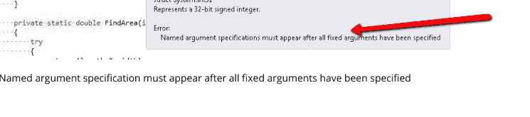

命名参数指定必须出现在所有固定参数指定之后


### 第74.2节：变体

泛型接口和委托可以使用 out 和 in 关键字分别将其类型参数标记为协变或逆变。随后，这些声明在类型转换（包括隐式和显式转换）以及编译时和运行时都会得到遵循。

例如，现有接口 IEnumerable<T> 已被重新定义为协变：

```csharp
interface IEnumerable<out T>
{
    IEnumerator<T> GetEnumerator();
}
```

现有接口 IComparer 已被重新定义为逆变：

```csharp
public interface IComparer<in T>
{
    int Compare(T x, T y);
}
```

### 第74.3节：动态成员查找

C# 类型系统中引入了一种新的伪类型 dynamic。它被视为 System.Object，但除此之外，对此类类型的值进行任何成员访问（方法调用、字段、属性或索引器访问，或委托调用）或应用运算符时，都允许不进行任何类型检查，并且其解析会推迟到运行时。这称为鸭子类型或后期绑定。例如：

```csharp
// Returns the value of Length property or field of any object
int GetLength(dynamic obj)
{
    return obj.Length;
}

GetLength("Hello, world");      // a string has a Length property,
GetLength(new int[] { 1, 2, 3 }); // and so does an array,
GetLength(42);                  // but not an integer - an exception will be thrown
                                // in GetLength method at run-time
```

在此情况下，使用 dynamic 类型可以避免更冗长的反射。它底层仍然使用反射，但得益于缓存，通常更快。

此特性主要面向与动态语言的互操作性。

```csharp
// Initialize the engine and execute a file
var runtime = ScriptRuntime.CreateFromConfiguration();
dynamic globals = runtime.Globals;
runtime.ExecuteFile("Calc.rb");

// Use Calc type from Ruby
dynamic calc = globals.Calc.@new();
calc.valueA = 1337;
calc.valueB = 666;
dynamic answer = calc.Calculate();
```

dynamic 类型甚至在大多数为静态类型的代码中也有应用，例如，它无需实现访问者模式即可实现双重分派。

### 第74.4节：使用 COM 时可选 ref 关键字

在调用 COM 接口提供的方法时，方法的调用方现在可以省略 ref 关键字。给定具有以下签名的 COM 方法

```csharp
void Increment(ref int x);
```

现在调用可以写成以下任一形式

```csharp
Increment(0); // no need for "ref" or a place holder variable any more
```

## 第75章：C# 3.0 特性

### 第75.1节：隐式类型变量（var）

var 关键字允许程序员在编译时隐式确定变量类型。var 声明与显式声明的变量具有相同类型。

```csharp
var squaredNumber = 10 * 10;
var squaredNumberDouble = 10.0 * 10.0;
var builder = new StringBuilder();
var anonymousObject = new
{
    One = SquaredNumber,
    Two = SquaredNumberDouble,
    Three = Builder
}
```

上述变量的类型分别为 int、double、StringBuilder 和匿名类型。

需要注意的是，var 变量不是动态类型。SquaredNumber = Builder 无效，因为您试图将 int 设置为 StringBuilder 的实例

### 第75.2节：语言集成查询（LINQ）

```csharp
//Example 1
int[] array = { 1, 5, 2, 10, 7 };

// Select squares of all odd numbers in the array sorted in descending order
IEnumerable<int> query = from x in array
                         where x % 2 == 1
                         orderby x descending
                         select x * x;

// Result: 49, 25, 1
```

示例来自维基百科关于 C# 3.0 的文章的 LINQ 小节

示例1使用查询语法，该语法设计为看起来类似于 SQL 查询。

```csharp
//Example 2
IEnumerable<int> query = array.Where(x => x % 2 == 1)
    .OrderByDescending(x => x)
    .Select(x => x * x);
// Result: 49, 25, 1 using 'array' as defined in previous example
```

示例来自维基百科关于 C# 3.0 的文章的 LINQ 小节

示例2使用方法语法实现与示例1相同的结果。

需要注意的是，在 C# 中，LINQ 查询语法是 LINQ 方法语法的语法糖。编译器在编译时将查询转换为方法调用。有些查询必须用方法语法表达。来自 MSDN：“例如，必须使用方法调用来表达检索符合指定条件的元素数量的查询。”

### 第75.3节：Lambda 表达式

Lambda 表达式是匿名方法的扩展，允许隐式类型参数和返回值。其语法比匿名方法更简洁，并遵循函数式编程风格。

```csharp
using System;
using System.Collections.Generic;
using System.Linq;

public class Program
{
    public static void Main()
    {
        var numberList = new List<int> {1, 2, 3, 4, 5, 6, 7, 8, 9, 10};
        var sumOfSquares = numberList.Select( number => number * number )
            .Aggregate( (int first, int second) => { return first + second; } );
        Console.WriteLine( sumOfSquares );
    }
}
```

上述代码将把数字1到10的平方和输出到控制台。

第一个 Lambda 表达式对列表中的数字求平方。由于只有一个参数，可以省略括号。如果愿意，也可以包含括号：

```csharp
.Select( (number) => number * number );
```

或显式指定参数类型，但此时必须使用括号：

```csharp
.Select( (int number) => number * number );
```

Lambda 主体是一个表达式，并具有隐式返回。如果需要，也可以使用语句体。这对于更复杂的 Lambda 很有用。

```csharp
.Select( number => { return number * number; } );
```

Select 方法返回包含计算值的新 IEnumerable。

第二个 Lambda 表达式对 Select 方法返回的列表中的数字求和。由于有多个参数，必须使用括号。参数类型是显式指定的，但并非必需。下面的方法等效。

```csharp
.Aggregate( (first, second) => { return first + second; } );
```

下面这个也同样等效：

```csharp
.Aggregate( (int first, int second) => first + second );
```

### 第75.4节：匿名类型

匿名类型提供一种便捷方式，将一组只读属性封装到单个对象中，而无需先显式定义类型。类型名由编译器生成，在源代码级别不可用。每个属性的类型由编译器推断。

可以通过使用 new 关键字后跟花括号（{}）来创建匿名类型。在花括号内，可以像下面代码那样定义属性。

```csharp
var v = new { Amount = 108, Message = "Hello" };
```

也可以创建匿名类型数组。见下面代码：

```csharp
var a = new[] {
    new {
        Fruit = "Apple",
        Color = "Red"
    },
    new {
        Fruit = "Banana",
        Color = "Yellow"
    }
};
```

或将其与 LINQ 查询一起使用：

```csharp
var productQuery = from prod in products
    select new { prod.Color, prod.Price };
```

## 第76章：异常处理

### 第76.1节：创建自定义异常

可以像任何其他异常一样实现并引发自定义异常。当你希望让异常在运行时与其他错误区分开时，这很有意义。

在本例中，我们将创建一个自定义异常，以便清晰处理应用程序在解析复杂输入时可能遇到的问题。

### 创建自定义异常类

要创建自定义异常，请创建 Exception 的子类：

```csharp
public class ParserException : Exception
{
    public ParserException() :
        base("The parsing went wrong and we have no additional information.") { }
}
```

当你想要向捕获方提供额外信息时，自定义异常非常有用：

```csharp
public class ParserException : Exception
{
    public ParserException(string fileName, int lineNumber) :
        base($"Parser error in {fileName}: {lineNumber}")
    {
        FileName = fileName;
        LineNumber = lineNumber;
    }
    public string FileName { get; private set; }
    public int LineNumber { get; private set; }
}
```

现在，当你 catch(ParserException x) 时，将拥有额外语义来微调异常处理。

自定义类可以实现以下特性以支持其他场景。

### 重新引发

在解析过程中，原始异常仍然值得关注。在此示例中，它是一个 FormatException，因为代码尝试解析一段本应是数字的字符串。在这种情况下，自定义异常应支持包含“InnerException”：

```csharp
//new constructor:
ParserException(string msg, Exception inner) : base(msg, inner) { }
```

### 序列化

在某些情况下，异常可能必须跨 AppDomain 边界。如果你的分析器运行在自己的 AppDomain 中以支持新分析器配置的热重载，就属于这种情况。在 Visual Studio 中，可以使用异常模板生成如下代码。

```csharp
[Serializable]
public class ParserException : Exception
{
}
```


// 无参数构造函数允许在不提供任何信息（包括错误消息）的情况下抛出异常。如果异常在没有额外细节的情况下是有意义的，则应包含此构造函数。应通过调用基构造函数设置消息（默认消息没有帮助）。
public ParserException()
    : base("Parser failure.")
{}

// 带有消息参数的构造函数允许覆盖默认错误消息。如果用户可以提供比通用自动生成消息更有帮助的消息，则应包含此构造函数。
public ParserException(string message)
    : base(message)
{}

// 用于序列化支持的构造函数。如果异常包含自定义属性，请在此处读取其值。
protected ParserException(SerializationInfo info, StreamingContext context)
    : base(info, context)
{}

## 使用 ParserException

```
try
{
    Process.Start(fileName)
}
catch (ParserException ex)
{
    Console.WriteLine($"{ex.Message} in {ex.FileName}:{ex.LineNumber}");
}
catch (PostprocessException x)
{
    ...
}
```

你也可以使用自定义异常来捕获和包装异常。这样，许多不同的错误可以转换为对应用程序更有用的单一错误类型：

```
try
{
    int foo = int.Parse(token);
}
catch (FormatException ex)
{
    //Assuming you added this constructor
    throw new ParserException(
        $"Failed to read {token} as number.",
        FileName,
        LineNumber,
        ex);
}
```

在通过引发自己的自定义异常来处理异常时，你通常应在 InnerException 属性中包含对原始异常的引用，如上所示。

## 安全问题

如果公开异常原因可能会损害安全性，从而允许用户查看应用程序的内部工作原理，那么包装内部异常可能是一个坏主意。如果你在创建将被他人使用的类库，则可能适用这种情况。

以下是如何在不包装内部异常的情况下引发自定义异常的方法：

```
try
{
    // ...
}
catch (SomeStandardException ex)
{
    // ...
    throw new MyCustomException(someMessage);
}
```

## 结论

在引发自定义异常（无论是包装还是未包装的新异常）时，你应引发对调用方有意义的异常。例如，类库的用户可能对该库如何执行其内部工作知之甚少。类库依赖项抛出的异常没有意义。相反，用户希望得到一个与类库以错误方式使用这些依赖项相关的异常。

```
try
{
    // ...
}
catch (IOException ex)
{
    // ...
    throw new StorageServiceException("@The Storage Service encountered a problem saving your data. Please consult the inner exception for technical details.
If you are not able to resolve the problem, please call 555-555-1234 for technical assistance.", ex);
}
```

## 第 76.2 节：Finally 块

```
try
{
    /* code that could throw an exception */
}
catch (Exception)
{
    /* handle the exception */
}
finally
{
    /* Code that will be executed, regardless if an exception was thrown / caught or not */
}
```

try / catch / finally 块在读取文件时非常方便。

例如：

```
FileStream f = null;

try
{
    f = File.OpenRead("file.txt");
    /* process the file here */
}
finally
{
    f?.Close(); // f may be null, so use the null conditional operator.
}
```

try 块必须后跟 catch 块或 finally 块。但是，由于没有 catch 块，执行将导致终止。在终止之前，finally 块中的语句将被执行。

在文件读取中，我们本可以使用 using 块，因为 FileStream（OpenRead 的返回值）实现了 IDisposable。

即使在 try 块中有 return 语句，finally 块通常也会执行；有少数情况不会执行：

- 当发生 StackOverflow 时。
- Environment.FailFast
- 应用程序进程被杀死，通常由外部来源引起。

## 第 76.3 节：最佳实践

### 速查表

| 应做 | 不应做 |
|---|---|
| 使用控制语句进行流程控制 | 使用异常进行流程控制 |
| 通过日志记录被忽略（吸收）的异常 | 忽略异常 |
| 使用 throw 重复抛出异常 | 重新抛出异常 - throw new ArgumentNullException() 或 throw ex |
| 抛出预定义的系统异常 | 抛出与预定义系统异常类似的自定义异常 |
| 如果对应用程序逻辑至关重要，则抛出自定义/预定义异常 | 为在流程中发出警告而抛出自定义/预定义异常 |
| 捕获你想要处理的异常 | 捕获所有异常 |

不要使用异常管理业务逻辑。

不应使用异常进行流程控制。改用条件语句。如果可以用 if-else 语句清楚地完成控制，就不要使用异常，因为它会降低可读性和性能。

请考虑以下由不良实践先生提供的代码片段：

// This is a snippet example for DO NOT
object myObject;
void DoingSomethingWithMyObject()
{
    Console.WriteLine(myObject.ToString());
}
```

当执行到达 Console.WriteLine(myObject.ToString()); 时，应用程序将抛出 NullReferenceException。不良实践先生意识到 myObject 为空，并编辑了他的片段以捕获并处理 NullReferenceException：

// This is a snippet example for DO NOT
object myObject;
void DoingSomethingWithMyObject()
{
try
{
    Console.WriteLine(myObject.ToString());
}
catch (NullReferenceException ex)
{
    // Hmmm, if I create a new instance of object and assign it to myObject:
    myObject = new object();
    // Nice, now I can continue to work with myObject
    DoSomethingElseWithMyObject();
}
}
```

由于之前的片段只涵盖了异常的逻辑，如果此时 myObject 不为空，我该怎么办？这部分逻辑应该放在哪里？在 Console.WriteLine(myObject.ToString()) 之后吗？在 try...catch 块之后呢？

那最佳实践先生呢？他会如何处理这个问题？

// This is a snippet example for DO
object myObject;
void DoingSomethingWithMyObject()
{
    if(myObject == null)
        myObject = new object();

    // When execution reaches this point, we are sure that myObject is not null
    DoSomethingElseWithMyObject();
}
```

最佳实践先生用更少的代码和清晰易懂的逻辑实现了相同的逻辑。

### 不要重新抛出异常

重新抛出异常代价昂贵。它会负面影响性能。对于经常失败的代码，你可以使用设计模式来最大限度地减少性能问题。本主题描述了两种在异常可能显著影响性能时有用的设计模式。

### 不要在不记录日志的情况下吸收异常

```
try
{
    //Some code that might throw an exception
}
catch(Exception ex)
{
    //empty catch block, bad practice
}
```

永远不要吞掉异常。忽略异常会暂时解决问题，但以后会为维护带来混乱。在记录异常时，你应始终记录异常实例，以便记录完整的堆栈跟踪，而不是仅记录异常消息。

```
try
{
    //Some code that might throw an exception
}
catch(NullReferenceException ex)
{
    LogManager.Log(ex.ToString());
}
```

### 不要捕获你无法处理的异常

许多资源，例如本文，强烈敦促你考虑在捕获异常的位置捕获异常的原因。只有在该位置可以处理异常时才应捕获异常。如果你在那里可以做一些事情来帮助减轻问题，例如尝试替代算法，连接到备份数据库，尝试另一个文件名，等待 30 秒后重试，或通知管理员，你可以捕获错误并执行这些操作。如果没有合理且可行的事情可做，就“放手”，让异常在更高层级处理。如果异常足够严重，以至于整个程序崩溃是唯一合理的选择，那么就让它崩溃。

```
try
{
    //Try to save the data to the main database.
}
catch(SqlException ex)
{
    //Try to save the data to the alternative database.
}
//If anything other than a SqlException is thrown, there is nothing we can do here. Let the exception bubble up to a level where it can be handled.
```

## 第 76.4 节：异常反模式

### 吞掉异常

应始终以以下方式重新抛出异常：

```
try
{
    ...
}
catch (Exception ex)
{
    ...
    throw;
}
```

像下面这样重新抛出异常会混淆原始异常并丢失原始堆栈跟踪。绝不应该这样做！在 catch 和重新抛出之前堆栈跟踪将会丢失。

```
try
{
    ...
}
catch (Exception ex)
{
    ...
    throw ex;
}
```

### 棒球异常处理

不应使用异常作为 if-then 语句和 while 循环等正常流程控制构造的替代品。这种反模式有时被称为棒球异常处理。


下面是一个反模式的示例：

```
try
{
    while (AccountManager.HasMoreAccounts())
    {
        account = AccountManager.GetNextAccount();
        if (account.Name == userName)
        {
            //We found it
            throw new AccountFoundException(account);
        }
    }
}
catch (AccountFoundException found)
{
    Console.Write("Here are your account details: " + found.Account.Details.ToString());
}
```

下面是更好的做法：

```
Account found = null;
while (AccountManager.HasMoreAccounts() && (found==null))
{
    account = AccountManager.GetNextAccount();
    if (account.Name == userName)
    {
        //We found it
        found = account;
    }
}
Console.Write("Here are your account details: " + found.Details.ToString());
```

catch (Exception)

几乎没有任何（有人说没有！）理由在代码中捕获通用异常类型。你应该只捕获你预期会发生的异常类型，否则会隐藏代码中的 bug。

```
try
{
    var f = File.Open(myfile);
    // do something
}
catch (Exception x)
{
    // Assume file not found
    Console.Write("Could not open file");
    // but maybe the error was a NullReferenceException because of a bug in the file handling code?
}
```

更好的做法是：

```
try
{
    var f = File.Open(myfile);
    // do something which should normally not throw exceptions
}
catch (IOException)
{
    Console.Write("File not found");
}
```
}
// Unfortunately, this one does not derive from the above, so declare separately
catch (UnauthorizedAccessException)
{
    Console.Write("Insufficient rights");
}
```

如果发生任何其他异常，我们故意让应用程序崩溃，这样它会直接进入调试器，我们可以修复问题。我们无论如何都不应该发布一个会发生这些之外的任何其他异常的程序，所以崩溃不是问题。

下面也是一个坏例子，因为它使用异常来绕过编程错误。这不是异常的设计用途。

```
public void DoSomething(String s)
{
    if (s == null)
        throw new ArgumentNullException(nameof(s));
    // Implementation goes here
}
try
{
    DoSomething(myString);
}
catch(ArgumentNullException x)
{
    // if this happens, we have a programming error and we should check
    // why myString was null in the first place.
}
```

## Section 76.5: 基本异常处理

```
try
{
    /* code that could throw an exception */
}
catch (Exception ex)
{
    /* handle the exception */
}
```

注意，用相同的代码处理所有异常通常不是最佳方法。
这通常用于任何内部异常处理例程失败时，作为最后的手段。

## Section 76.6: 处理特定异常类型

```
try
{
    /* code to open a file */
}
catch (System.IO.FileNotFoundException)
{
    /* code to handle the file being not found */
}
catch (System.IO.UnauthorizedAccessException)
{
    /* code to handle not being allowed access to the file */
}
```
}
catch (System.IO.IOException)
{
    /* code to handle IOException or its descendant other than the previous two */
}
catch (System.Exception)
{
    /* code to handle other errors */
}
```

请注意，异常按顺序评估，并应用继承关系。因此，你需要从最具体的异常开始，以其祖先结束。在任何给定时刻，只会执行一个 catch 块。

## Section 76.7: 聚合异常 / 一个方法中的多个异常

谁说不能在一个方法中抛出多个异常。如果你不习惯使用 AggregateException，你可能会想创建自己的数据结构来表示多个出错的情况。当然，在某些情况下，非异常的其他数据结构会更理想，例如验证结果。即使你确实使用 AggregateException，你也可能处于接收方，总是处理它们却没有意识到它们对你有用。

一个方法执行时，即使整体上会失败，你也可能希望在抛出的异常中突出多个出错的地方，这是很合理的。例如，Parallel 方法的工作方式就体现了这种行为：一个任务被拆分为多个线程，其中任意数量的线程都可能抛出异常，并且需要报告这些异常。下面是一个愚蠢的示例，说明你可以如何从中受益：

```csharp
public void Run()
{
    try
    {
        this.SillyMethod(1, 2);
    }
    catch (AggregateException ex)
    {
        Console.WriteLine(ex.Message);
        foreach (Exception innerException in ex.InnerExceptions)
        {
            Console.WriteLine(innerException.Message);
        }
    }
}

private void SillyMethod(int input1, int input2)
{
    var exceptions = new List<Exception>();

    if (input1 == 1)
    {
        exceptions.Add(new ArgumentException("I do not like ones"));
    }
    if (input2 == 2)
    {
        exceptions.Add(new ArgumentException("I do not like twos"));
    }
    if (exceptions.Any())
    {
        throw new AggregateException("Funny stuff happened during execution", exceptions);
    }
}
```

## Section 76.8: 抛出异常

当发生不寻常的事情时，你的代码可以并且经常应该抛出异常。

```
public void WalkInto(Destination destination)
{
    if (destination.Name == "Mordor")
    {
        throw new InvalidOperationException("One does not simply walk into Mordor.");
    }
    // ... Implement your normal walking code here.
}
```

## Section 76.9: 未处理和线程异常

**AppDomain.UnhandledException** 此事件提供未捕获异常的通知。它允许应用程序在系统默认处理程序向用户报告异常并终止应用程序之前，记录有关异常的信息。如果有关应用程序状态的足够信息可用，则可以采取其他操作——例如保存程序数据以供以后恢复。建议谨慎，因为未处理异常时程序数据可能会损坏。

```
/// <summary>
/// The main entry point for the application.
/// </summary>
[STAThread]
private static void Main(string[] args)
{
    AppDomain.CurrentDomain.UnhandledException += new UnhandledExceptionEventHandler(UnhandledException);
}
```

**Application.ThreadException** 此事件允许你的 Windows Forms 应用程序处理 Windows Forms 线程中发生的其他未处理异常。将事件处理程序附加到 ThreadException 事件以处理这些异常，否则这些异常会使应用程序处于未知状态。在可能的情况下，应通过结构化异常处理块来处理异常。

```
/// <summary>
/// The main entry point for the application.
/// </summary>
[STAThread]
private static void Main(string[] args)
{
    AppDomain.CurrentDomain.UnhandledException += new UnhandledExceptionEventHandler(UnhandledException);
    Application.ThreadException += new ThreadExceptionEventHandler(ThreadException);
}
```

最后是异常处理

```
static void UnhandledException(object sender, UnhandledExceptionEventArgs e)
{
    Exception ex = (Exception)e.ExceptionObject;
    // your code
}
```

```csharp
static void ThreadException(object sender, ThreadExceptionEventArgs e)
{
    Exception ex = e.Exception;
    // your code
}
```

## Section 76.10: 为 WCF 服务实现 IErrorHandler

为 WCF 服务实现 IErrorHandler 是集中处理错误和日志记录的好方法。此处展示的实现应捕获因调用你的某个 WCF 服务而抛出的任何未处理异常。此示例还展示了如何返回自定义对象，以及如何返回 JSON 而不是默认的 XML。

实现 IErrorHandler：

```csharp
using System.ServiceModel.Channels;
using System.ServiceModel.Dispatcher;
using System.Runtime.Serialization.Json;
using System.ServiceModel;
using System.ServiceModel.Web;

namespace BehaviorsAndInspectors
{
    public class ErrorHandler : IErrorHandler
    {
        public bool HandleError(Exception ex)
        {
            // Log exceptions here

            return true;
        } // end

        public void ProvideFault(Exception ex, MessageVersion version, ref Message fault)
        {
            // Get the outgoing response portion of the current context
            var response = WebOperationContext.Current.OutgoingResponse;

            // Set the default http status code
            response.StatusCode = HttpStatusCode.InternalServerError;

            // Add ContentType header that specifies we are using JSON
            response.ContentType = new MediaTypeHeaderValue("application/json").ToString();

            // Create the fault message that is returned (note the ref parameter) with BaseDataResponseContract
            fault = Message.CreateMessage(
                version,
                string.Empty,
                new CustomReturnType { ErrorMessage = "An unhandled exception occurred!" },
                new DataContractJsonSerializer(typeof(BaseDataResponseContract), new List<Type> {
                typeof(BaseDataResponseContract) }));

            if (ex.GetType() == typeof(VariousExceptionTypes))
            {
                // You might want to catch different types of exceptions here and process them differently
            }
        }
    }
}
```


```csharp
// Tell WCF to use JSON encoding rather than default XML
var webBodyFormatMessageProperty = new
WebBodyFormatMessageProperty(WebContentFormat.Json);
fault.Properties.Add(WebBodyFormatMessageProperty.Name, webBodyFormatMessageProperty);

} // end

} // end class

} // end namespace
```

在此示例中，我们将处理程序附加到服务行为。你也可以用类似方式将其附加到 IEndpointBehavior、IContractBehavior 或 IOperationBehavior。

### 附加到服务行为：

```csharp
using System;
using System.Collections.ObjectModel;
using System.ServiceModel;
using System.ServiceModel.Channels;
using System.ServiceModel.Configuration;
using System.ServiceModel.Description;
using System.ServiceModel.Dispatcher;

namespace BehaviorsAndInspectors
{
    public class ErrorHandlerExtension : BehaviorExtensionElement, IServiceBehavior
    {
        public override Type BehaviorType
        {
            get { return GetType(); }
        }

        protected override object CreateBehavior()
        {
            return this;
        }

        private IErrorHandler GetInstance()
        {
            return new ErrorHandler();
        }

        void IServiceBehavior.AddBindingParameters(ServiceDescription serviceDescription,
ServiceHostBase serviceHostBase, Collection<ServiceEndpoint> endpoints, BindingParameterCollection
bindingParameters) { } // end

        void IServiceBehavior.ApplyDispatchBehavior(ServiceDescription serviceDescription,
ServiceHostBase serviceHostBase)
        {
            var errorHandlerInstance = GetInstance();

            foreach (ChannelDispatcher dispatcher in serviceHostBase.ChannelDispatchers)
            {
                dispatcher.ErrorHandlers.Add(errorHandlerInstance);
            }
        }

        void IServiceBehavior.Validate(ServiceDescription serviceDescription, ServiceHostBase
serviceHostBase) { } // end

} // end class

} // end namespace
```

Web.config 中的配置：

```
...
<system.serviceModel>
    <services>
        <service name="WebServices.MyService">
            <endpoint binding="webHttpBinding" contract="WebServices.IMyService" />
        </service>
    </services>
    <extensions>
        <behaviorExtensions>
            <!-- This extension if for the WCF Error Handling-->
            <add name="ErrorHandlerBehavior" type="WebServices.BehaviorsAndInspectors.ErrorHandlerExtensionBehavior, WebServices, Version=1.0.0, Culture=neutral, PublicKeyToken=null" />
        </behaviorExtensions>
    </extensions>
    <behaviors>
        <serviceBehaviors>
            <behavior>
                <serviceMetadata httpGetEnabled="true"/>
                <serviceDebug includeExceptionDetailInFaults="true"/>
                <ErrorHandlerBehavior />
            </behavior>
        </serviceBehaviors>
    </behaviors>
</system.serviceModel>
...
```

以下是几个可能对该主题有帮助的链接：

https://msdn.microsoft.com/en-us/library/system.servicemodel.dispatcher.ierrorhandler(v=vs.100).aspx

http://www.brainthud.com/cards/5218/25441/which-four-behavior-interfaces-exist-for-interacting-with-a-service-or-client-description-what-methods-do-they-implement-and

其他示例：

当 HTTP 状态码为 401 Unauthorized 时，IErrorHandler 返回了错误的消息正文

IErrorHandler 似乎没有在 WCF 中处理我的错误……有什么想法吗？

如何让自定义 WCF 错误处理程序返回带有非 OK HTTP 状态码的 JSON 响应？

如何为 HttpClient 请求设置 Content-Type 标头？

### 第76.11节：使用异常对象

你可以在自己的代码中创建并抛出异常。实例化异常的方式与任何其他 C# 对象相同。

```
Exception ex = new Exception();

// constructor with an overload that takes a message string
Exception ex = new Exception("Error message");
```

然后可以使用 throw 关键字来引发异常：

```
try
{
    throw new Exception("Error");
}
catch (Exception ex)
{
    Console.Write(ex.Message); // Logs 'Error' to the output window
}
```

注意：如果你在 catch 块内抛出新异常，请确保将原始异常作为“内部异常”传入，例如：

```
void DoSomething()
{
    int b=1; int c=5;
    try
    {
        var a = 1;
        b = a - 1;
        c = a / b;
        a = a / c;
    }
    catch (DivideByZeroException dEx) when (b==0)
    {
        // we're throwing the same kind of exception
        throw new DivideByZeroException("Cannot divide by b because it is zero", dEx);
    }
    catch (DivideByZeroException dEx) when (c==0)
    {
        // we're throwing the same kind of exception
        throw new DivideByZeroException("Cannot divide by c because it is zero", dEx);
    }
}

void Main()
{
    try
    {
        DoSomething();
    }
    catch (Exception ex)
    {
        // Logs full error information (incl. inner exception)
        Console.Write(ex.ToString());
    }
}
```

在这种情况下，假定该异常无法被处理，但会在消息中添加一些有用信息（并且外部异常块仍可通过 ex.InnerException 访问原始异常）。

它将显示类似如下内容：

```
System.DivideByZeroException: Cannot divide by b because it is zero ---> System.DivideByZeroException:
Attempted to divide by zero.
 at UserQuery.g__DoSomething0_0() in C:[...]\LINQPadQuery.cs:line 36
--- End of inner exception stack trace ---
 at UserQuery.g__DoSomething0_0() in C:[...]\LINQPadQuery.cs:line 42
 at UserQuery.Main() in C:[...]\LINQPadQuery.cs:line 55
```

如果你在 LinqPad 中尝试此示例，你会注意到行号并不太有意义（它们并不总能帮到你）。但如上所述传入有帮助的错误文本，通常能显著减少定位错误位置所需的时间，在本示例中，错误显然位于以下行

```
c = a / b;
```

在 DoSomething() 函数中。

[在 .NET Fiddle 中试试](https://dotnetfiddle.net)

### 第76.12节：异常的嵌套与 try catch 块

可以将一个异常/try catch 块嵌套在另一个异常/try catch 块中。

这样，你就可以管理小型代码块，使它们能够正常工作而不会破坏整个机制。

```
try
{
//some code here
    try
    {
        //some thing which throws an exception. For Eg : divide by 0
    }
    catch (DivideByZeroException dzEx)
    {
        //handle here only this exception
        //throw from here will be passed on to the parent catch block
    }
    finally
    {
        //any thing to do after it is done.
    }
    //resume from here & proceed as normal;
}
catch(Exception e)
{
    //handle here
}
```

**注意：** 在向父 catch 块抛出异常时，避免吞掉异常

## 第77章：NullReferenceException

### 第77.1节：NullReferenceException 详解

当你尝试访问引用对象的非静态成员（属性、方法、字段或事件）而该对象为 null 时，就会抛出 NullReferenceException。

```
Car myFirstCar = new Car();
Car mySecondCar = null;
Color myFirstColor = myFirstCar.Color; // No problem as myFirstCar exists / is not null
Color mySecondColor = mySecondCar.Color; // Throws a NullReferenceException
// as mySecondCar is null and yet we try to access its color.
```

要调试此类异常相当容易：在抛出异常的那一行，你只需查看每个“.”或“[”之前；少数情况下查看“(”之前。

```
myGarage.CarCollection[currentIndex.Value].Color = theCarInTheStreet.Color;
```

我的异常来自哪里？可能是以下之一：

- myGarage 为 null
- myGarage.CarCollection 为 null
- currentIndex 为 null
- myGarage.CarCollection[currentIndex.Value] 为 null
- theCarInTheStreet 为 null

在调试模式下，你只需将鼠标光标放在这些元素中的每一个上，就能找到空引用。然后，你只需弄清楚它为什么没有值。修正方式完全取决于你的方法的目标。

你是否忘记实例化/初始化它了？

```
myGarage.CarCollection = new Car[10];
```

如果对象为 null，你是否应该做其他事情？

```
if (myGarage == null)
{
    Console.WriteLine("Maybe you should buy a garage first!");
}
```

或者也许有人给了你一个 null 参数，而本不应如此：

```
if (theCarInTheStreet == null)
{
    throw new ArgumentNullException("theCarInTheStreet");
}
```

无论如何，请记住方法绝不应抛出 NullReferenceException。如果抛出了，就意味着你忘记检查某些内容。


## 第78章：将字符串转换为其他类型时处理 FormatException

### 第78.1节：将字符串转换为整数

有多种方法可用于将字符串显式转换为整数，例如：

- 1. Convert.ToInt16();
- 2. Convert.ToInt32();
- 3. Convert.ToInt64();
- 4. int.Parse();

但是，如果输入字符串包含非数字字符，所有这些方法都会抛出 FormatException。为此，我们需要编写额外的异常处理（try..catch），以便在这种情况下处理它们。

### 示例说明：

因此，假设我们的输入为：

```csharp
string inputString = "10.2";
```

### 示例 1：Convert.ToInt32()

```csharp
int convertedInt = Convert.ToInt32(inputString); // Failed to Convert
// Throws an Exception "Input string was not in a correct format."
```

注意：其他提到的方法也同样如此，即 Convert.ToInt16(); 和 Convert.ToInt64();

### 示例 2：int.Parse()

```csharp
int convertedInt = int.Parse(inputString); // Same result "Input string was not in a correct format."
```

### 我们如何规避这个问题？

如前所述，为了处理异常，我们通常需要如下所示的 try..catch：

```csharp
try
{
    string inputString = "10.2";
    int convertedInt = int.Parse(inputString);
}
catch (Exception Ex)
{
    //Display some message, that the conversion has failed.
}
```

但是，在所有地方都使用 try..catch 并不是一个好做法，而且可能存在这样的场景：如果输入错误，我们希望给出 0（如果遵循上述方法，就需要从 catch 块中为 convertedInt 赋值为 0）。为了处理这类场景，我们可以使用一个特殊方法 .TryParse()。

TryParse() 方法具有内部异常处理，它会将输出提供给 out 参数，并返回一个布尔值来指示转换状态（如果转换成功则为 true；如果失败则为 false）。根据返回值，我们可以确定转换状态。让我们看一个示例：

### 用法 1：将返回值存储在布尔变量中

```csharp
int convertedInt; // Be the required integer
bool isSuccessConversion = int.TryParse(inputString, out convertedInt);
```

执行后，我们可以检查变量 isSuccessConversion 来确认转换状态。如果它为 false，那么 convertedInt 的值将为 0（如果你希望在转换失败时得到 0，则无需检查返回值）。

### 用法 2：使用 if 检查返回值

```csharp
if (int.TryParse(inputString, out convertedInt))
{
    // convertedInt will have the converted value
    // Proceed with that
}
else
{
    // Display an error message
}
```

### 用法 3：如果不关心返回值，可以不检查返回值，直接使用以下代码

（无论是否转换成功，0 都可以接受）

```csharp
int.TryParse(inputString, out convertedInt);
// use the value of convertedInt
// But it will be 0 if not converted
```

## 第79章：阅读并理解堆栈跟踪

调试程序时，堆栈跟踪是一个极大的帮助。当程序抛出异常时，你会得到堆栈跟踪；有时程序异常终止时也会得到堆栈跟踪。

### 第79.1节：Windows Forms 中一个简单 NullReferenceException 的堆栈跟踪

让我们创建一小段会抛出异常的代码：

```csharp
private void button1_Click(object sender, EventArgs e)
{
    string msg = null;
    msg.ToCharArray();
}
```

如果执行这段代码，我们会得到以下异常和堆栈跟踪：

```
System.NullReferenceException: "Object reference not set to an instance of an object."
    at WindowsFormsApplication1.Form1.button1_Click(Object sender, EventArgs e) in
    F:\WindowsFormsApplication1\WindowsFormsApplication1\Form1.cs:line 29
    at System.Windows.Forms.Control.OnClick(EventArgs e)
    at System.Windows.Forms.Button.OnClick(EventArgs e)
    at System.Windows.Forms.Button.OnMouseUp(MouseEventArgs mevent)
```

堆栈跟踪会继续这样下去，但对我们而言，这部分已经足够了。

在堆栈跟踪的顶部，我们看到这一行：

> 位于 WindowsFormsApplication1.Form1.button1_Click(Object sender, EventArgs e)，文件
> F:\WindowsFormsApplication1\WindowsFormsApplication1\Form1.cs:第 29 行

这是最重要的部分。它告诉我们异常发生的准确行：Form1.cs 中的第 29 行。因此，这就是你开始查找的位置。

第二行是

> 位于 System.Windows.Forms.Control.OnClick(EventArgs e)

这是调用 button1_Click 的方法。所以现在我们知道，发生错误的 button1_Click 是从 System.Windows.Forms.Control.OnClick 调用的。

由此，你可以弄清楚代码在遇到问题之前遵循了哪条执行路径！

请注意，堆栈跟踪包含来自 .Net 系统的调用；通常你不需要追踪所有 Microsoft 的 System.Windows.Forms 代码来找出问题所在，只需要追踪属于你自己应用程序的代码。

那么，为什么这被称为“堆栈跟踪”呢？

因为每当程序调用一个方法时，它都会记录自己当时所在的位置。它有一个称为“栈”的数据结构，用来保存上一次的位置。

如果方法执行完毕，它会查看栈，以确定在调用该方法之前所在的位置，并从那里继续执行。

因此，栈让计算机知道在调用新方法之前它在哪里暂停。

但它也可以作为调试的帮助。就像侦探追踪罪犯作案时采取的步骤一样，程序员可以使用栈来追踪程序崩溃之前所采取的步骤。

## 第80章：诊断

### 第80.1节：使用 TraceListeners 重定向日志输出

通过向 Debug.Listeners 集合添加 TextWriterTraceListener，可以将调试输出重定向到文本文件。

```csharp
public static void Main(string[] args)
{
    TextWriterTraceListener myWriter = new TextWriterTraceListener(@"debug.txt");
    Debug.Listeners.Add(myWriter);
    Debug.WriteLine("Hello");
    
    myWriter.Flush();
}
```

可以使用 ConsoleTraceListener 将调试输出重定向到控制台应用程序的 out 流。

```csharp
public static void Main(string[] args)
{
    ConsoleTraceListener myWriter = new ConsoleTraceListener();
    Debug.Listeners.Add(myWriter);
    Debug.WriteLine("Hello");
}
```

### 第80.2节：Debug.WriteLine

当应用程序以调试配置编译时，写入 Listeners 集合中的跟踪侦听器。

```csharp
public static void Main(string[] args)
{
    Debug.WriteLine("Hello");
}
```

在 Visual Studio 或 Xamarin Studio 中，这会显示在“应用程序输出”窗口中。这是因为 TraceListenerCollection 中存在默认的跟踪侦听器。

## 第81章：溢出

### 第81.1节：整数溢出

整数能够存储的容量是有上限的。当超过该限制时，它会回绕到负数一侧。对于 int，这个上限是 2147483647

```csharp
int x = int.MaxValue; //MaxValue is 2147483647
x = unchecked(x + 1); //make operation explicitly unchecked so that the example also works when the check for arithmetic overflow/underflow is enabled in the project settings
Console.WriteLine(x); //Will print -2147483648
Console.WriteLine(int.MinValue); //Same as Min value
```

对于超出此范围的任何整数，请使用 System.Numerics 命名空间，它包含 BigInteger 数据类型。更多信息请查看以下链接：https://msdn.microsoft.com/en-us/library/system.numerics.biginteger(v=vs.110).aspx

### 第81.2节：运算过程中的溢出

运算过程中也会发生溢出。在以下示例中，x 是 int，而 1 默认是 int。因此加法是 int 加法，结果也会是 int，并且会发生溢出。

```csharp
int x = int.MaxValue; //MaxValue is 2147483647
long y = x + 1; //It will be overflow
Console.WriteLine(y); //Will print -2147483648
Console.WriteLine(int.MinValue); //Same as Min value
```

可以通过使用 1L 来防止这种情况。现在 1 将是 long，加法也将是 long 加法

```csharp
int x = int.MaxValue; //MaxValue is 2147483647
long y = x + 1L; //It will be OK
Console.WriteLine(y); //Will print 2147483648
```

### 第81.3节：顺序很重要

以下代码会发生溢出

```csharp
int x = int.MaxValue;
Console.WriteLine(x + x + 1L); //prints -1
```

而以下代码不会溢出

```csharp
int x = int.MaxValue;
Console.WriteLine(x + 1L + x); //prints 4294967295
```

这是由于运算从左到右的顺序。在第一段代码中，x + x 会溢出，之后结果变为 long。另一方面，x + 1L 会变为 long，之后再将 x 加到该值上。


## 第 82 章：入门：使用 C# 的 Json

以下主题将介绍使用 C# 语言以及序列化与反序列化概念处理 Json 的一种方法。

### 第 82.1 节：简单 Json 示例

```
{
  "id": 89,
  "name": "Aldous Huxley",
  "type": "Author",
  "books": [{
    "name": "Brave New World",
    "date": 1932
  }, {
    "name": "Eyeless in Gaza",
    "date": 1936
  }, {
    "name": "The Genius and the Goddess",
    "date": 1955
  }]
}
```

如果你刚接触 Json，这里有一个示例教程。

### 第 82.2 节：首先：用于处理 Json 的库

使用 C# 处理 Json，需要使用 Newtonsoft（.net 库）。该库提供了允许程序员序列化和反序列化对象等的方法。如果想了解其方法和用法的详细信息，这里有一个教程。

如果你使用 Visual Studio，请转到 Tools/Nuget Package Manager/Manage Package to Solution/，在搜索栏中输入“Newtonsoft”并安装该包。如果你没有 NuGet，这个详细教程可能会帮助你。

### 第 82.3 节：C# 实现

在阅读代码之前，了解将有助于使用 json 编程应用程序的主要概念很重要。

> **Serialization:** 将对象转换为可通过应用程序发送的字节流的过程。以下代码可以被序列化并转换为之前的 json。

> **Deserialization:** 将 json/字节流转换为对象的过程。它正是序列化的相反过程。之前的 json 可以反序列化为 C# 对象，如下面的示例所示。

要实现这一点，将 json 结构转换为类以使用前面描述的过程非常重要。如果你使用 Visual Studio，可以通过选择“Edit/Paste Special/Paste JSON as Classes”并粘贴 json 结构，自动将 json 转换为类。

```
using Newtonsoft.Json;

class Author
{
    [JsonProperty("id")] // Set the variable below to represent the json attribute
    public int id;    //"id"
    [JsonProperty("name")]
    public string name;
    [JsonProperty("type")]
    public string type;
    [JsonProperty("books")]
    public Book[] books;

    public Author(int id, string name, string type, Book[] books) {
        this.id = id;
        this.name = name;
        this.type= type;
        this.books = books;
    }
}

class Book
{
    [JsonProperty("name")]
    public string name;
    [JsonProperty("date")]
    public DateTime date;
}
```

### 第 82.4 节：序列化

```
static void Main(string[] args)
{
    Book[] books = new Book[3];
    Author author = new Author(89,"Aldous Huxley","Author", books);
    string objectDeserialized = JsonConvert.SerializeObject(author);
    //Converting author into json
}
```

方法“.SerializeObject”接收一个类型对象作为参数，因此你可以放入任何内容。

### 第 82.5 节：反序列化

你可以从任何地方接收 json，例如文件或服务器，因此它未包含在以下代码中。

```
static void Main(string[] args)
{
    string jsonExample; // Has the previous json
    Author author = JsonConvert.DeserializeObject<Author>(jsonExample);
}
```

方法“.DeserializeObject”将‘jsonExample’反序列化为“Author”对象。这就是为什么在类定义中设置 json 变量很重要，以便方法访问它以填充它。

### 第 82.6 节：序列化与反序列化通用工具函数

此示例对所有类型对象的序列化和反序列化使用通用函数。

```
using System.Runtime.Serialization.Formatters.Binary;
using System.Xml.Serialization;

namespace Framework
{
    public static class IGUUtilities
    {
        public static string Serialization<T>(this T obj)
        {
            string data = JsonConvert.SerializeObject(obj);
            return data;
        }

        public static T Deserialization<T>(this string JsonData)
        {
            T copy = JsonConvert.DeserializeObject<T>(JsonData);
            return copy;
        }

        public static T Clone<T>(this T obj)
        {
            string data = JsonConvert.SerializeObject(obj);
            T copy = JsonConvert.DeserializeObject<T>(data);
            return copy;
        }
    }
}
```

## 第 83 章：使用 json.net

使用 JSON.net JsonConverter 类。

### 第 83.1 节：在简单值上使用 JsonConverter

示例使用 JsonConverter 将 api 响应中的 runtime 属性反序列化为 Movies 模型中的 Timespan 对象

JSON (http://www.omdbapi.com/?i=tt1663662)

```json
{
    Title: "Pacific Rim",
    Year: "2013",
    Rated: "PG-13",
    Released: "12 Jul 2013",
    Runtime: "131 min",
    Genre: "Action, Adventure, Sci-Fi",
    Director: "Guillermo del Toro",
    Writer: "Travis Beacham (screenplay), Guillermo del Toro (screenplay), Travis Beacham (story)",
    Actors: "Charlie Hunnam, Diego Klattenhoff, Idris Elba, Rinko Kikuchi",
    Plot: "As a war between humankind and monstrous sea creatures wages on, a former pilot and a trainee are paired up to drive a seemingly obsolete special weapon in a desperate effort to save the world from the apocalypse.",
    Language: "English, Japanese, Cantonese, Mandarin",
    Country: "USA",
    Awards: "Nominated for 1 BAFTA Film Award. Another 6 wins & 46 nominations.",
    Poster: "https://images-na.ssl-images-amazon.com/images/M/MV5BTY3MTI5NjQ4Nl5BMl5BanBnXkFtZTCw0TU10TUBQQ@._V1_SX300.jpg",
    Ratings: [{
        Source: "Internet Movie Database",
        Value: "7.0/10"
    },{
        Source: "Rotten Tomatoes",
        Value: "71%"
    },{
        Source: "Metacritic",
        Value: "64/100"
    }],
    Metascore: "64",
    imdbRating: "7.0",
    imdbVotes: "398,198",
    imdbID: "tt1663662",
    Type: "movie",
    DVD: "15 Oct 2013",
    BoxOffice: "$101,785,482.00",
    Production: "Warner Bros. Pictures",
    Website: "http://pacificrimmovie.com",
    Response: "True"
}
```

### Movie Model

```csharp
using Project.Serializers;
using Newtonsoft.Json;
using System;
using System.Collections.Generic;
using System.Linq;
using System.Runtime.Serialization;
using System.Threading.Tasks;

namespace Project.Models
{
    [DataContract]
    public class Movie
    {
        public Movie() { }

        [DataMember]
        public int Id { get; set; }

        [DataMember]
        public string ImdbId { get; set; }

        [DataMember]
        public string Title { get; set; }

        [DataMember]
        public DateTime Released { get; set; }

        [DataMember]
        [JsonConverter(typeof(RuntimeSerializer))]
        public TimeSpan Runtime { get; set; }
    }
}
```

### RuntimeSerializer

```csharp
using Newtonsoft.Json;
using Newtonsoft.Json.Linq;
using System;
using System.Collections.Generic;
using System.Linq;
using System.Text.RegularExpressions;
using System.Threading.Tasks;

namespace Project.Serializers
{
    public class RuntimeSerializer : JsonConverter
    {
        public override bool CanConvert(Type objectType)
        {
            return objectType == typeof(TimeSpan);
        }

        public override object ReadJson(JsonReader reader, Type objectType, object existingValue, JsonSerializer serializer)
        {
            if (reader.TokenType == JsonToken.Null)
                return null;

            JToken jt = JToken.Load(reader);
            String value = jt.Value<String>();

            Regex rx = new Regex(@"\s*min$");
            value = rx.Replace(value, (m) => "");

            int timespanMin;
            if (!Int32.TryParse(value, out timespanMin))
            {
                throw new NotSupportedException();
            }
            return new TimeSpan(0, timespanMin, 0);
        }
        public override void WriteJson(JsonWriter writer, object value, JsonSerializer serializer)
        {
            serializer.Serialize(writer, value);
        }
    }
}
```

### Calling It

```
Movie m = JsonConvert.DeserializeObject<Movie>(apiResponse);
```

### 第 83.2 节：收集 JSON 对象的全部字段

```
using Newtonsoft.Json.Linq;
using System.Collections.Generic;

public class JsonFieldsCollector
{
    private readonly Dictionary<string, JValue> fields;

    public JsonFieldsCollector(JToken token)
    {
        fields = new Dictionary<string, JValue>();
        CollectFields(token);
    }

    private void CollectFields(JToken jToken)
    {
        switch (jToken.Type)
        {
            case JTokenType.Object:
                foreach (var child in jToken.Children<JProperty>())
                    CollectFields(child);
                break;
            case JTokenType.Array:
                foreach (var child in jToken.Children())
                    CollectFields(child);
                break;
            case JTokenType.Property:
                CollectFields(((JProperty) jToken).Value);
                break;
            default:
                fields.Add(jToken.Path, (JValue)jToken);
                break;
        }
    }

    public IEnumerable<KeyValuePair<string, JValue>> GetAllFields() => fields;
}
```

用法：

```
var json = JToken.Parse(/* JSON string */);
var fieldsCollector = new JsonFieldsCollector(json);
```


```
var fields = fieldsCollector.GetAllFields();
foreach (var field in fields)
    Console.WriteLine($"'{field.Key}': '{field.Value}'");
```

## 演示

对于此 JSON 对象

```
{
  "User": "John",
  "Workdays": {
    "Monday": true,
    "Tuesday": true,
    "Friday": false
  },
  "Age": 42
}
```

预期输出为：

```
User: 'John'
Workdays.Monday: 'True'
Workdays.Tuesday: 'True'
Workdays.Friday: 'False'
Age: '42'
```

## 第84章：Lambda 表达式

### 第84.1节：Lambda 表达式作为委托初始化的简写

```
public delegate int ModifyInt(int input);
ModifyInt multiplyByTwo = x => x * 2;
```

上述 Lambda 表达式语法等价于以下冗长的代码：

```
public delegate int ModifyInt(int input);

ModifyInt multiplyByTwo = delegate(int x){
    return x * 2;
};
```

### 第84.2节：Lambda 表达式作为事件处理程序

Lambda 表达式可用于处理事件，这在以下情况很有用时：

- 处理程序很短。
- 处理程序永远不需要取消订阅。

下面给出了可能使用 lambda 事件处理程序的良好情况：

```
smtpClient.SendCompleted += (sender, args) => Console.WriteLine("Email sent");
```

如果在代码的某个未来点需要取消注册已注册的事件处理程序，则应将事件处理程序表达式保存到变量中，并通过该变量进行注册/取消注册：

```
EventHandler handler = (sender, args) => Console.WriteLine("Email sent");

smtpClient.SendCompleted += handler;
smtpClient.SendCompleted -= handler;
```

这样做而不是简单地逐字重写 lambda 表达式以取消订阅它 (-=) 的原因是 C# 编译器不一定会认为这两个表达式相等：

```
EventHandler handlerA = (sender, args) => Console.WriteLine("Email sent");
EventHandler handlerB = (sender, args) => Console.WriteLine("Email sent");
Console.WriteLine(handlerA.Equals(handlerB)); // May return "False"
```

请注意，如果向 lambda 表达式添加额外语句，则所需的 surrounding 大括号可能会被意外省略，而不会导致编译时错误。例如：

```
smtpClient.SendCompleted += (sender, args) => Console.WriteLine("Email sent");
emailSendButton.Enabled = true;
```

这将编译，但会导致将 lambda 表达式 (sender, args) => Console.WriteLine("Email sent"); 添加为事件处理程序，并立即执行语句 emailSendButton.Enabled = true;。要修复此问题，必须在大括号中包围 lambda 的内容。可以通过从开始就使用大括号，在向 lambda 事件处理程序添加额外语句时保持谨慎，或从开始就用圆括号包围 lambda 来避免这种情况：

```
smtpClient.SendCompleted += ((sender, args) => Console.WriteLine("Email sent"));
//Adding an extra statement will result in a compile-time error
```

### 第84.3节：Lambda 表达式具有多个参数或无参数

使用 => 运算符左侧的括号来表示多个参数。

```
delegate int ModifyInt(int input1, int input2);
ModifyInt multiplyTwoInts = (x,y) => x * y;
```

同样，空的一组括号表示该函数不接受参数。

```
delegate string ReturnString();
ReturnString getGreeting = () => "Hello world.";
```

### 第84.4节：Lambdas 可同时作为 `Func` 和 `Expression` 发出

假设以下 Person 类：

```
public class Person
{
    public string Name { get; set; }
    public int Age { get; set; }
}
```

以下 lambda：

```
p => p.Age > 18
```

可以作为参数传递给以下两种方法：

```
public void AsFunc(Func<Person, bool> func)
public void AsExpression(Expression<Func<Person, bool>> expr)
```

因为编译器能够将 lambda 既转换为委托又转换为 Expressions。

显然，LINQ 提供程序严重依赖 Expressions（主要通过 IQueryable<T> 接口公开），以便能够解析查询并将其转换为存储查询。

### 第84.5节：在语句 Lambda 中放置多个语句

与表达式 lambda 不同，语句 lambda 可以包含多个由分号分隔的语句。

```
delegate void ModifyInt(int input);

ModifyInt addOneAndTellMe = x =>
{
    int result = x + 1;
    Console.WriteLine(result);
};
```

请注意，语句被大括号 {} 包围。

请记住，语句 lambda 不能用于创建表达式树。

### 第84.6节：Lambdas 同时用于 `Func` 和 `Action`

通常 lambda 用于定义简单函数（通常在 linq 表达式的上下文中）：

```
var incremented = myEnumerable.Select(x => x + 1);
```

这里返回是隐式的。

然而，也可以用 lambda 传递操作：

```
myObservable.Do(x => Console.WriteLine(x));
```

### 第84.7节：使用 lambda 语法创建闭包

请参阅有关闭包的讨论的备注。假设我们有一个接口：

```
public interface IMachine<TState, TInput>
{
    TState State { get; }
    public void Input(TInput input);
}
```

然后执行以下操作：

```
IMachine<int, int> machine = ...;
Func<int, int> machineClosure = i => {
    machine.Input(i);
    return machine.State;
};
```

现在 machineClosure 引用一个从 int 到 int 的函数，其幕后使用 machine 引用的 IMachine 实例来进行计算。即使 machine 引用超出作用域，只要 machineClosure 对象被维护，原来的 IMachine 实例将被保留为 'closure' 的一部分，由编译器自动定义。

警告：这可能意味着相同的函数调用在不同时间返回不同的值（例如，在此示例中如果机器保持其输入的总和）。在许多情况下，这可能是意外的，并且应避免在任何函数式风格的代码中使用 - 意外和意外的闭包可能是错误的来源。

### 第84.8节：将 Lambda 表达式作为参数传递给方法

```
List<int> l2 = l1.FindAll(x => x > 6);
```

这里 x => x > 6 是一个 lambda 表达式，充当谓词，确保只返回大于 6 的元素。

### 第84.9节：基本 lambda 表达式

```
Func<int, int> add1 = i => i + 1;
Func<int, int, int> add = (i, j) => i + j;
```

```
~~~csharp
// Behaviourally equivalent to:

int Add1(int i)
{
    return i + 1;
}

int Add(int i, int j)
{
    return i + j;
}

...

Console.WriteLine(add1(42)); //43
Console.WriteLine(Add1(42)); //43
Console.WriteLine(add(100, 250)); //350
Console.WriteLine(Add(100, 250)); //350
~~~
```

### 第84.10节：使用 LINQ 的基本 lambda 表达式

```
~~~csharp
// assume source is {0, 1, 2, ..., 10}

var evens = source.Where(n => n%2 == 0);
// evens = {0, 2, 4, ... 10}

var strings = source.Select(n => n.ToString());
// strings = {"0", "1", ..., "10"}
~~~
```

### 第84.11节：具有语句块体的 Lambda 语法

```
~~~csharp
Func<int, string> doubleThenAddElevenThenQuote = i => {
    var doubled = 2 * i;
    var addedEleven = 11 + doubled;
    return $"{addedEleven}'";
};
~~~
```

### 第84.12节：使用 System.Linq.Expressions 的 Lambda 表达式

```
~~~csharp
Expression<Func<int, bool>> checkEvenExpression = i => i%2 == 0;
// lambda expression is automatically converted to an Expression<Func<int, bool>>
~~~
```

## 第85章：通用 Lambda 查询构建器

### 第85.1节：QueryFilter 类

此类保存谓词过滤器值。

```
public class QueryFilter
{
    public string PropertyName { get; set; }
    public string Value { get; set; }
    public Operator Operator { get; set; }
    // In the query {a => a.Name.Equals("Pedro")}
    // Property name to filter - propertyName = "Name"
    // Filter value - value = "Pedro"
    // Operation to perform - operation = enum Operator.Equals
    public QueryFilter(string propertyName, string value, Operator operatorValue)
    {
        PropertyName = propertyName;
        Value = value;
        Operator = operatorValue;
    }
}
```

枚举以保存操作值：

```
public enum Operator
{
    Contains,
    GreaterThan,
    GreaterThanOrEqual,
    LessThan,
    LessThanOrEqualTo,
    StartsWith,
    EndsWith,
    Equals,
    NotEqual
}
```

### 第85.2节：GetExpression 方法

```
public static Expression<Func<T, bool>> GetExpression<T>(IList<QueryFilter> filters)
{
    Expression exp = null;
    // Represents a named parameter expression. {parm => parm.Name.Equals()}, it is the parm part
    // To create a ParameterExpression need the type of the entity that the query is against and a name
    // The type is possible to find with the generic T and the name is fixed parm
    ParameterExpression param = Expression.Parameter(typeof(T), "parm");
    // It is good practice never trust in the client, so it is wise to validate.
    if (filters.Count == 0)
        return null;
    // The expression creation differ if there is one, two or more filters.
    if (filters.Count != 1)
    {
```

```
if (filters.Count == 2)
    // It is result from direct call.
    // For simplicity's sake the private overloads will be explained in another example.
    exp = GetExpression<T>(param, filters[0], filters[1]);
else if (filters.Count > 2)
{
    // As there is no method for more than two filters,
    // I iterate through all the filters and put it in the query two at a time
    while (filters.Count > 0)
    {
        // Retrieve the first two filters
        var f1 = filters[0];
        var f2 = filters[1];

        // To build an expression with a conditional AND operation that evaluates
        // the second operand only if the first operand evaluates to true.
        // It needed to use the BinaryExpression an Expression derived class
        // That has the AndAlso method that joins two expressions together
        exp = exp == null ? GetExpression<T>(param, filters[0], filters[1]) :
Expression.AndAlso(exp, GetExpression<T>(param, filters[0], filters[1]));

        // Remove the two just used filters, for the method in the next iteration to find the next filters
        filters.Remove(f1);
        filters.Remove(f2);

        // If it is that last filter, add the last one and remove it
        if (filters.Count == 1)
        {
            exp = Expression.AndAlso(exp, GetExpression<T>(param, filters[0]));
            filters.RemoveAt(0);
        }
    }
}
else
    // It is result from direct call.
    exp = GetExpression<T>(param, filters[0]);

    // converts the Expression into Lambda and returns the query
return Expression.Lambda<Func<T, bool>>(exp, param);
}
```

## 第 85.3 节：GetExpression 私有重载

### 对于单个过滤器：

这里创建查询，它接收一个表达式参数和一个过滤器。

```
private static Expression GetExpression<T>(ParameterExpression param, QueryFilter queryFilter)
{
    // Represents accessing a field or property, so here we are accessing for example:
    // the property "Name" of the entity
    MemberExpression member = Expression.Property(param, queryFilter.PropertyName);

    //Represents an expression that has a constant value, so here we are accessing for example:
    // the values of the Property "Name".
    // Also for clarity sake the GetConstant will be explained in another example.
    ConstantExpression constant = GetConstant(member.Type, queryFilter.Value);

    // With these two, now I can build the expression
// every operator has it one way to call, so the switch will do.
switch (queryFilter.Operator)
{
    case Operator.Equals:
        return Expression.Equal(member, constant);

    case Operator.Contains:
        return Expression.Call(member, ContainsMethod, constant);

    case Operator.GreaterThan:
        return Expression.GreaterThan(member, constant);

    case Operator.GreaterThanOrEqual:
        return Expression.GreaterThanOrEqual(member, constant);

    case Operator.LessThan:
        return Expression.LessThan(member, constant);

    case Operator.LessThanOrEqualTo:
        return Expression.LessThanOrEqual(member, constant);

    case Operator.StartsWith:
        return Expression.Call(member, StartsWithMethod, constant);

    case Operator.EndsWith:
        return Expression.Call(member, EndsWithMethod, constant);
}

    return null;
}
```

### 对于两个过滤器：

它返回 BinaryExpression 实例而不是简单的 Expression。

```
private static BinaryExpression GetExpression<T>(ParameterExpression param, QueryFilter filter1, QueryFilter filter2)
{
    // Built two separated expression and join them after.
    Expression result1 = GetExpression<T>(param, filter1);
    Expression result2 = GetExpression<T>(param, filter2);
    return Expression.AndAlso(result1, result2);
}
```

## 第 85.4 节：ConstantExpression 方法

ConstantExpression 必须与 MemberExpression 具有相同的类型。此示例中的值是一个字符串，在创建 ConstantExpression 实例之前会对其进行转换。

```
private static ConstantExpression GetConstant(Type type, string value)
{
    // Discover the type, convert it, and create ConstantExpression
    ConstantExpression constant = null;
    if (type == typeof(int))
    {
        int num;
        int.TryParse(value, out num);
        constant = Expression.Constant(num);
    }
    else if(type == typeof(string))
    {
constant = Expression.Constant(value);
}
else if (type == typeof(DateTime))
{
    DateTime date;
    DateTime.TryParse(value, out date);
    constant = Expression.Constant(date);
}
else if (type == typeof(bool))
{
    bool flag;
    if (bool.TryParse(value, out flag))
    {
        flag = true;
    }
    constant = Expression.Constant(flag);
}
else if (type == typeof(decimal))
{
    decimal number;
    decimal.TryParse(value, out number);
    constant = Expression.Constant(number);
}
return constant;
}
```

## 第 85.5 节：用法

Collection filters = new List(); QueryFilter filter = new QueryFilter("Name", "Burger", Operator.StartsWith); filters.Add(filter);

```
Expression<Func<Food, bool>> query = ExpressionBuilder.GetExpression<Food>(filters);
```

在这种情况下，这是一个针对 Food 实体的查询，想要查找名称以 "Burger" 开头的所有食物。

**输出：**

```
query = {parm => a.parm.StartsWith("Burger")}
Expression<Func<T, bool>> GetExpression<T>(IList<QueryFilter> filters)
```

## 第 86 章：属性

### 第 86.1 节：自动实现的属性

自动实现的属性是在 C# 3 中引入的。

自动实现的属性使用空的 getter 和 setter（访问器）声明：

```
public bool IsValid { get; set; }
```

当在代码中编写自动实现的属性时，编译器会创建一个只能通过属性的访问器访问的私有匿名字段。

上述自动实现的属性语句等价于编写以下冗长的代码：

```
private bool _isValid;
public bool IsValid
{
    get { return _isValid; }
    set { _isValid = value; }
}
```

自动实现的属性在其访问器中不能有任何逻辑，例如：

```
public bool IsValid { get; set { PropertyChanged("IsValid"); } } // Invalid code
```

自动实现的属性也可以为其访问器具有不同的访问修饰符：

```
public bool IsValid { get; private set; }
```

C# 6 允许自动实现的属性完全没有 setter（使其不可变，因为其值只能在构造函数内部或硬编码时设置）：

```
public bool IsValid { get; }
public bool IsValid { get; } = true;
```

有关初始化自动实现属性的更多信息，请阅读 Auto-property initializers 文档。

### 第 86.2 节：属性的默认值

设置默认值可以通过使用 Initializers（C#6）完成

```
public class Name
{
    public string First { get; set; } = "James";
    public string Last { get; set; } = "Smith";
}
```

如果它是只读的，你可以这样返回值：

```
public class Name
{
    public string First => "James";
    public string Last => "Smith";
}
```

```
this.DOB = dob;
}
public int Id
{
    get;
    private set;
}
public string Name
{
    get { return this.name; }
    set
    {
        if (string.IsNullOrWhiteSpace(value)) throw new InvalidNameException(value);
        this.name = value.Trim();
    }
}
public DateTime DOB
{
    get { return this.dob; }
    set
    {
        if (value < DateTime.UtcNow.AddYears(-200) || value > DateTime.UtcNow) throw new InvalidDobException(value);
        this.dob = value;
    }
}
public int GetAgeInYears()
{
    DateTime today = DateTime.UtcNow;
    int offset = HasHadBirthdayThisYear() ? 0 : -1;
    return today.Year - this.dob.Year + offset;
}
private bool HasHadBirthdayThisYear()
{
    bool hasHadBirthdayThisYear = true;
    DateTime today = DateTime.UtcNow;
    if (today.Month > this.dob.Month)
    {
        hasHadBirthdayThisYear = true;
    }
    else
    {
        if (today.Month == this.dob.Month)
        {
            hasHadBirthdayThisYear = today.Day > this.dob.Day;
        }
        else
        {
            hasHadBirthdayThisYear = false;
        }
    }
    return hasHadBirthdayThisYear;
}

public class InvalidNameException : ApplicationException
{
    const string InvalidNameExceptionMessage = "'{0}' is an invalid name.";
    public InvalidNameException(string value):
    base(string.Format(InvalidNameExceptionMessage,value)){}
}
public class InvalidDobException : ApplicationException
```


```
{
    const string InvalidDobExceptionMessage = "{0:yyyy-MM-dd} is an invalid DOB. The date must not be in the future, or over 200 years in the past.";
    public InvalidDobException(DateTime value):
    base(string.Format(InvalidDobExceptionMessage,value))}
}
```

### 第86.6节：只读属性

### 声明

一个常见的误解，尤其是初学者常有的误解，是认为只读属性就是用 `readonly` 关键字标记的属性。这是不正确的，事实上以下代码会导致编译时错误：

```
public readonly string SomeProp { get; set; }
```

属性只有在仅具有 getter 时才是只读的。

```
public string SomeProp { get; }
```

### 使用只读属性创建不可变类

```
public class Address
{
    public string ZipCode { get; }
    public string City { get; }
    public string StreetAddress { get; }

    public Address(
        string zipCode,
        string city,
        string streetAddress)
    {
        if (zipCode == null)
            throw new ArgumentNullException(nameof(zipCode));
        if (city == null)
            throw new ArgumentNullException(nameof(city));
        if (streetAddress == null)
            throw new ArgumentNullException(nameof(streetAddress));

        ZipCode = zipCode;
        City = city;
        StreetAddress = streetAddress;
    }
}
```

### 第86.7节：上下文中的各种属性

```
public class Person
{
    //Id property can be read by other classes, but only set by the Person class
    public int Id {get; private set;}
    //Name property can be retrieved or assigned
    public string Name {get; set;}

    private DateTime dob;
    //Date of Birth property is stored in a private variable, but retrieved or assigned through the public property.
    public DateTime DOB
{
    get { return this.dob; }
    set { this.dob = value; }
}
//Age property can only be retrieved; it's value is derived from the date of birth
public int Age
{
    get
    {
        int offset = HasHadBirthdayThisYear() ? 0 : -1;
        return DateTime.UtcNow.Year - this.dob.Year + offset;
    }
}

//this is not a property but a method; though it could be rewritten as a property if desired.
private bool HasHadBirthdayThisYear()
{
    bool hasHadBirthdayThisYear = true;
    DateTime today = DateTime.UtcNow;
    if (today.Month > this.dob.Month)
    {
        hasHadBirthdayThisYear = true;
    }
    else
    {
        if (today.Month == this.dob.Month)
        {
            hasHadBirthdayThisYear = today.Day > this.dob.Day;
        }
        else
        {
            hasHadBirthdayThisYear = false;
        }
    }
    return hasHadBirthdayThisYear;
}
```

## 第87章：初始化属性

### 第87.1节：C# 6.0：初始化自动实现的属性

创建具有 getter 和/或 setter 的属性，并在一行中完成全部初始化：

```
public string Foobar { get; set; } = "xyz";
```

### 第87.2节：使用支持字段初始化属性

```
public string Foobar {
    get { return _foobar; }
    set { _foobar = value; }
}
private string _foobar = "xyz";
```

### 第87.3节：对象实例化期间的属性初始化

可以在实例化对象时设置属性。

```
var redCar = new Car
{
    Wheels = 2,
    Year = 2016,
    Color = Color.Red
};
```

### 第87.4节：在构造函数中初始化属性

```
class Example
{
    public string Foobar { get; set; }
    public List<string> Names { get; set; }
    public Example()
    {
        Foobar = "xyz";
        Names = new List<string>(){"carrot","fox","ball"};
    }
}
```

## 第88章：INotifyPropertyChanged 接口

### 第88.1节：在 C# 6 中实现 INotifyPropertyChanged

INotifyPropertyChanged 的实现可能容易出错，因为该接口要求将属性名指定为字符串。为了使实现更健壮，可以使用 `CallerMemberName` 特性。

```csharp
class C : INotifyPropertyChanged
{
    // backing field
    int offset;
    // property
    public int Offset
    {
        get
        {
            return offset;
        }
        set
        {
            if (offset == value)
                return;
            offset = value;
            RaisePropertyChanged();
        }
    }

    // helper method for raising PropertyChanged event
    void RaisePropertyChanged([CallerMemberName] string propertyName = null) =>
        PropertyChanged?.Invoke(this, new PropertyChangedEventArgs(propertyName));

    // interface implementation
    public event PropertyChangedEventHandler PropertyChanged;
}
```

如果有多个类实现 INotifyPropertyChanged，你可能会发现将接口实现和辅助方法重构到公共基类中会很有用：

```csharp
class NotifyPropertyChangedImpl : INotifyPropertyChanged
{
    protected void RaisePropertyChanged([CallerMemberName] string propertyName = null) =>
        PropertyChanged?.Invoke(this, new PropertyChangedEventArgs(propertyName));

    // interface implementation
    public event PropertyChangedEventHandler PropertyChanged;
}
```

```csharp
class C : NotifyPropertyChangedImpl
{
    int offset;
    public int Offset
    {
        get { return offset; }
        set { if (offset != value) { offset = value; RaisePropertyChanged(); } }
    }
}
```

```csharp
}

private readonly SomeViewModel _vm;
}
```

## 第89章：事件

| 参数 | 详情 |
|---|---|
| EventArgsT | 从 EventArgs 派生并包含事件参数的类型。 |
| EventName | 事件的名称。 |
| HandlerName | 事件处理程序的名称。 |
| SenderObject | 引发事件的对象。 |
| EventArguments | EventArgsT 类型的实例，包含事件参数。 |

事件是一种通知，表示某事已经发生（例如鼠标单击），或者在某些情况下即将发生（例如价格变动）。

类可以定义事件，其实例（对象）可以引发这些事件。例如，Button 可能包含一个 Click 事件，当用户单击它时会引发该事件。

事件处理程序则是当相应事件引发时被调用的方法。例如，窗体可以为其包含的每个 Button 都包含一个 Clicked 事件处理程序。

### 第89.1节：声明和引发事件

### 声明事件

可以使用以下语法在任何类或结构上声明事件：

```
public class MyClass
{
    // Declares the event for MyClass
    public event EventHandler MyEvent;

    // Raises the MyEvent event
    public void RaiseEvent()
    {
        OnMyEvent();
    }
}
```

有一种扩展语法可用于声明事件，其中你持有事件的私有实例，并使用 add 和 set 访问器定义公共实例。该语法与 C# 属性非常相似。在所有情况下，都应优先使用上面演示的语法，因为编译器会生成代码来帮助确保多个线程可以安全地向你的类上的事件添加和移除事件处理程序。

### 引发事件

版本 ≥ 6.0

```
private void OnMyEvent()
{
    EventName?.Invoke(this, EventArgs.Empty);
}
```

版本 < 6.0

```
private void OnMyEvent()
{
    // Use a local for EventName, because another thread can modify the
    // public EventName between when we check it for null, and when we
    // raise the event.
    var eventName = EventName;
    // If eventName == null, then it means there are no event-subscribers,
    // and therefore, we cannot raise the event.
    if(eventName != null)
        eventName(this, EventArgs.Empty);
}
```

请注意，事件只能由声明类型引发。客户端只能订阅/取消订阅。

对于 6.0 之前的 C# 版本，不支持 EventName?.Invoke，最好在调用前将事件分配给临时变量，如示例所示，这可以在多个线程执行同一代码的情况下确保线程安全。否则，在多个线程使用同一对象实例的某些情况下，可能会引发 NullReferenceException。在 C# 6.0 中，编译器生成的代码与 C# 6 的代码示例中所示的代码类似。

### 第89.2节：事件属性

如果一个类引发大量事件，每个委托一个字段的存储开销可能无法接受。.NET Framework 为这些情况提供了事件属性。这样，你可以使用另一种数据结构（如 EventHandlerList）来存储事件委托：

```
public class SampleClass
{
    // Define the delegate collection.
    protected EventHandlerList eventDelegates = new EventHandlerList();

    // Define a unique key for each event.
    static readonly object someEventKey = new object();

    // Define the SomeEvent event property.
    public event EventHandler SomeEvent
    {
        add
        {
            // Add the input delegate to the collection.
            eventDelegates.AddHandler(someEventKey, value);
        }
        remove
        {
            // Remove the input delegate from the collection.
            eventDelegates.RemoveHandler(someEventKey, value);
        }
    }

    // Raise the event with the delegate specified by someEventKey
    protected void OnSomeEvent(EventArgs e)
    {
        var handler = (EventHandler)eventDelegates[someEventKey];
        if (handler != null)
            handler(this, e);
    }
}
```

这种方法广泛用于 GUI 框架（如 WinForms），其中控件可以有几十个甚至数百个事件。

请注意，EventHandlerList 不是线程安全的，因此如果你预计你的类会被多个线程使用，则需要添加 lock 语句或其他同步机制（或使用提供线程

### 第89.4节：标准事件声明

事件声明：

```
public event EventHandler<EventArgsT> EventName;
```

事件处理程序声明：

```
public void HandlerName(object sender, EventArgsT args) { /* Handler logic */ }
```

订阅事件：

动态方式：

```
EventName += HandlerName;
```

通过设计器：

- 1. 单击控件属性窗口上的事件按钮（闪电图标）
- 2. 双击事件名称：

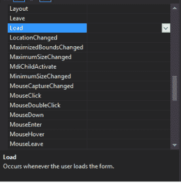

- 3. Visual Studio 将生成事件代码：

```
private void Form1_Load(object sender, EventArgs e)
{
}
```

调用方法：

```
EventName(SenderObject, EventArguments);
```

### 第89.5节：匿名事件处理程序声明

事件声明：

```
public event EventHandler<EventArgsType> EventName;
```

使用 lambda 运算符 => 声明事件处理程序并订阅该事件：

```
EventName += (obj, eventArgs) => { /* Handler logic */ };
```

使用委托匿名方法语法声明事件处理程序：

```
EventName += delegate(object obj, EventArgsType eventArgs) { /* Handler Logic */ };
```

声明并订阅不使用事件参数的事件处理程序，因此可以使用上述语法而无需指定参数：

```
EventName += delegate { /* Handler Logic */ }
```

调用事件：

```
EventName?.Invoke(SenderObject, EventArguments);
```

### 第89.6节：非标准事件声明

事件可以是任何委托类型，而不仅仅是 EventHandler 和 EventHandler<T>。例如：

```
//Declaring an event
public event Action<Param1Type, Param2Type, ...> EventName;
```

其用法与标准 EventHandler 事件类似：

```
//Adding a named event handler
public void HandlerName(Param1Type parameter1, Param2Type parameter2, ...) {
    /* Handler logic */
}
EventName += HandlerName;

//Adding an anonymous event handler
EventName += (parameter1, parameter2, ...) => { /* Handler Logic */ };

//Invoking the event
EventName(parameter1, parameter2, ...);
```

可以在单个语句中声明多个相同类型的事件，类似于字段和局部变量（不过这通常可能不是个好主意）：

```
public event EventHandler Event1, Event2, Event3;
```

这声明了三个独立的事件（Event1、Event2 和 Event3），它们都是 EventHandler 类型。

注意：尽管某些编译器可能会在接口和类中接受此语法，但 C# 规范（v5.0 §13.2.3）为接口提供的语法不允许这样做，因此在接口中使用它可能在不同

```
}
```

你可以通过允许使用者更改新值来增强示例，然后该值将用于属性。为此，只需在类中应用这些更改即可。

将 NewPrice 的定义更改为可设置：

```
public int NewPrice { get; set; }
```

更改 Price 的定义，使其在调用 OnPriceChanging 之后使用 e.NewPrice 作为属性值：

```
int price;
public int Price
{
    get { return price; }
    set
    {
        var e = new PriceChangingEventArgs(price, value);
        OnPriceChanging(e);
        price = e.NewPrice;
    }
}
```

## 第90章：表达式树

| 参数 | 详细信息 |
|---|---|
| TDelegate | 用于表达式的委托类型 |
| lambdaExpression | lambda 表达式（例如 num => num < 5） |

表达式树是以树状数据结构排列的表达式。树中的每个节点都是一个表达式的表示，而表达式就是代码。Lambda 表达式的内存中表示就是表达式树，它保存查询的实际元素（即代码），但不保存其结果。表达式树使 lambda 表达式的结构变得透明且明确。

### 第90.1节：使用 lambda 表达式创建表达式树

以下是由 lambda 创建的最基本的表达式树。

```
Expression<Func<int, bool>> lambda = num => num == 42;
```

要“手动”创建表达式树，应使用 Expression 类。

上面的表达式等价于：

```
ParameterExpression parameter = Expression.Parameter(typeof(int), "num"); // num argument
ConstantExpression constant = Expression.Constant(42, typeof(int)); // 42 constant
BinaryExpression equality = Expression.Equals(parameter, constant); // equality of two expressions (num == 42)
Expression<Func<int, bool>> lambda = Expression.Lambda<Func<int, bool>>(equality, parameter);
```

### 第90.2节：使用 API 创建表达式树

```
using System.Linq.Expressions;

// Manually build the expression tree for
// the lambda expression num => num < 5.
ParameterExpression numParam = Expression.Parameter(typeof(int), "num");
ConstantExpression five = Expression.Constant(5, typeof(int));
BinaryExpression numLessThanFive = Expression.LessThan(numParam, five);
Expression<Func<int, bool>> lambda1 = Expression.Lambda<Func<int, bool>>(
    numLessThanFive,
    new ParameterExpression[] { numParam });
```

### 第90.3节：编译表达式树

```
// Define an expression tree, taking an integer, returning a bool.
Expression<Func<int, bool>> expr = num => num < 5;

// Call the Compile method on the expression tree to return a delegate that can be called.
Func<int, bool> result = expr.Compile();

// Invoke the delegate and write the result to the console.
Console.WriteLine(result(4)); // Prints true

// Prints True.

// You can also combine the compile step with the call/invoke step as below:
```

```
Console.WriteLine(expr.Compile()());
```

### 第90.4节：解析表达式树

```
using System.Linq.Expressions;

// Create an expression tree.
Expression<Func<int, bool>> exprTree = num => num < 5;

// Decompose the expression tree.
ParameterExpression param = (ParameterExpression)exprTree.Parameters[0];
BinaryExpression operation = (BinaryExpression)exprTree.Body;
ParameterExpression left = (ParameterExpression)operation.Left;
ConstantExpression right = (ConstantExpression)operation.Right;

Console.WriteLine("Decomposed expression: {0} => {1} {2} {3}",
    param.Name, left.Name, operation.NodeType, right.Value);

// Decomposed expression: num => num LessThan 5
```

### 第90.5节：表达式树基础

表达式树以树状数据结构表示代码，其中每个节点都是一个表达式

表达式树支持对可执行代码进行动态修改、在各种数据库中执行 LINQ 查询以及创建动态查询。你可以编译并运行由表达式树表示的代码。

它们还用于动态语言运行时（DLR），以提供动态语言与 .NET Framework 之间的互操作性，并使编译器编写者能够发出表达式树而不是 Microsoft 中间语言（MSIL）。

表达式树可以通过以下方式创建

- 1. 匿名 lambda 表达式，
- 2. 使用 System.Linq.Expressions 命名空间手动创建。

### 通过 Lambda 表达式创建表达式树

当 lambda 表达式被赋给 Expression 类型变量时，编译器会发出代码来构建表示该 lambda 表达式的表达式树。

以下代码示例展示了如何让 C# 编译器创建表示 lambda 表达式 num => num < 5 的表达式树。

```
Expression<Func<int, bool>> lambda = num => num < 5;
```

### 使用 API 创建表达式树

表达式树也可以使用 Expression 类创建。该类包含用于创建特定类型表达式树节点的静态工厂方法。

以下是几种类型的树节点。

- 1. ParameterExpression
- 2. MethodCallExpression

以下代码示例展示了如何使用 API 创建表示 lambda 表达式 num => num < 5 的表达式树。

```
```csharp
ParameterExpression numParam = Expression.Parameter(typeof(int), "num");
ConstantExpression five = Expression.Constant(5, typeof(int));
BinaryExpression numLessThanFive = Expression.LessThan(numParam, five);
Expression<Func<int, bool>> lambda1 = Expression.Lambda<Func<int, bool>>(numLessThanFive, new
ParameterExpression[] { numParam });
```
```

### 第90.6节：使用访问者检查表达式的结构

通过重写 ExpressionVisitor 的一些方法来定义新的访问者类：

```
```csharp
class PrintingVisitor : ExpressionVisitor {
    protected override Expression VisitConstant(ConstantExpression node) {
        Console.WriteLine("Constant: {0}", node);
        return base.VisitConstant(node);
    }
    protected override Expression VisitParameter(ParameterExpression node) {
        Console.WriteLine("Parameter: {0}", node);
        return base.VisitParameter(node);
    }
    protected override Expression VisitBinary(BinaryExpression node) {
        Console.WriteLine("Binary with operator {0}", node.NodeType);
        return base.VisitBinary(node);
    }
}
```
```

调用 Visit 以在现有表达式上使用此访问者：

```
```csharp
Expression<Func<int,bool>> isBig = a => a > 1000000;
var visitor = new PrintingVisitor();
visitor.Visit(isBig);
```
```

### 第90.7节：了解表达式 API

我们将使用表达式树 API 创建 CalculateSalesTax 树。用通俗的话说，以下是创建该树所需步骤的摘要。

- 1. 检查产品是否应纳税
- 2. 如果应纳税，则将行总计乘以适用税率并返回该金额
- 3. 否则返回 0

```
```csharp
//For reference, we're using the API to build this lambda expression
orderLine => orderLine.IsTaxable ? orderLine.Total * orderLine.Order.TaxRate : 0;

//The orderLine parameter we pass in to the method. We specify it's type (OrderLine) and the name of the parameter.
ParameterExpression orderLine = Expression.Parameter(typeof(OrderLine), "orderLine");

//Check if the parameter is taxable; First we need to access the is taxable property, then check if it's true
PropertyInfo isTaxableAccessor = typeof(OrderLine).GetProperty("IsTaxable");
MemberExpression getIsTaxable = Expression.MakeMemberAccess(orderLine, isTaxableAccessor);
UnaryExpression isLineTaxable = Expression.IsTrue(getIsTaxable);
```
```


```csharp
//Before creating the if, we need to create the braces
    //If the line is taxable, we'll return the total times the tax rate; get the total and tax rate, then multiply
    //Get the total
    PropertyInfo totalAccessor = typeof(OrderLine).GetProperty("Total");
    MemberExpression getTotal = Expression.MakeMemberAccess(orderLine, totalAccessor);

    //Get the order
    PropertyInfo orderAccessor = typeof(OrderLine).GetProperty("Order");
    MemberExpression getOrder = Expression.MakeMemberAccess(orderLine, orderAccessor);

    //Get the tax rate - notice that we pass the getOrder expression directly to the member access
    PropertyInfo taxRateAccessor = typeof(Order).GetProperty("TaxRate");
    MemberExpression getTaxRate = Expression.MakeMemberAccess(getOrder, taxRateAccessor);

    //Multiply the two - notice we pass the two operand expressions directly to multiply
    BinaryExpression multiplyTotalByRate = Expression.Multiply(getTotal, getTaxRate);

//If the line is not taxable, we'll return a constant value - 0.0 (decimal)
    ConstantExpression zero = Expression.Constant(0M);

//Create the actual if check and branches
    ConditionalExpression ifTaxableTernary = Expression.Condition(isLineTaxable,
multiplyTotalByRate, zero);

//Wrap the whole thing up in a "method" - a LambdaExpression
    Expression<Func<OrderLine, decimal>> method = Expression.Lambda<Func<OrderLine,
decimal>>(ifTaxableTernary, orderLine);
```

```
{
    object[] objectArray = new object[5];
    Method(objectArray);
    Method(objectArray, objectArray);
    Method(objectArray, objectArray, objectArray);
}
```

将打印：

```
5
two
3
```

调用表达式 Method(objectArray) 可以有两种解释：一个恰好是数组的单个 Object 参数（因此程序会输出 1，因为那将是参数的数量），或作为参数数组，以常规形式给出，就好像方法 Method 没有 params 关键字一样。在这些情况下，常规的非展开形式始终具有优先权。因此，程序输出 5。

在第二个表达式 Method(objectArray, objectArray) 中，第一种方法的展开形式和传统的第二种方法都适用。在这种情况下，非展开形式同样具有优先权，因此程序打印 two。

在第三个表达式 Method(objectArray, objectArray, objectArray) 中，唯一的选择是使用第一种方法的展开形式，因此程序打印 3。

### Section 91.3: 作为其中一个参数传递 null

如果有

```
void F1(MyType1 x) {
    // do something
}

void F1(MyType2 x) {
    // do something else
}
```

而由于某种原因你需要调用 F1 的第一个重载但 x = null，那么简单地执行

```
F1(null);
```

将无法编译，因为调用存在歧义。为了解决这个问题，你可以这样做

```
F1(null as MyType1);
```

## Chapter 93: 预处理器指令

### Section 93.1: 条件表达式

编译以下内容时，其返回值将取决于定义了哪些指令。

// Compile with /d:A or /d:B to see the difference
string SomeFunction()
{
#if A
    return "A";
#elif B
    return "B";
#else
    return "C";
#endif
}

条件表达式通常用于在调试构建中记录额外信息。

```
void SomeFunc()
{
    try
    {
        SomeRiskyMethod();
    }
    catch (ArgumentException ex)
    {
        #if DEBUG
        log.Error("SomeFunc", ex);
        #endif

        HandleException(ex);
    }
}
```

### Section 93.2: 其他编译器指令

### Line

#line 控制编译器在输出警告和错误时报告的行号和文件名。

```
void Test()
{
    #line 42 "Answer"
    #line filename "SomeFile.cs"
    int life; // compiler warning CS0168 in "SomeFile.cs" at Line 42
    #line default
    // compiler warnings reset to default
}
```

### Pragma Checksum

#pragma checksum 允许为调试生成的程序数据库（PDB）指定特定的校验和。

```
#pragma checksum "MyCode.cs" {00000000-0000-0000-0000-000000000000} {0123456789A}
```

### Section 93.3: 定义和取消定义符号

编译器符号是在编译时定义的关键字，可以检查它以有条件地执行代码的特定部分。

有三种方法可以定义编译器符号。它们可以通过代码定义：

```
#define MYSYMBOL
```

它们可以在 Visual Studio 中定义，路径为 项目属性 > 构建 > 条件编译符号：

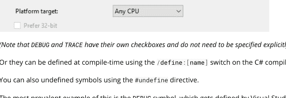

（请注意，DEBUG 和 TRACE 有各自的复选框，无需显式指定。）

或者它们可以在编译时使用 C# 编译器 csc.exe 上的 /define:[name] 开关来定义。

你也可以使用 #undef 指令取消定义符号。

最常见的例子是 DEBUG 符号，当应用程序以 Debug 模式（相对于 Release 模式）编译时，Visual Studio 会定义它。

```
public void DoBusinessLogic()
{
    try
    {
        AuthenticateUser();
        LoadAccount();
        ProcessAccount();
        FinalizeTransaction();
    }
    catch (Exception ex)
    {
#if DEBUG
        System.Diagnostics.Trace.WriteLine("Unhandled exception!");
        System.Diagnostics.Trace.WriteLine(ex);
        throw;
#else
        LoggingFramework.LogError(ex);
        DisplayFriendlyErrorMessage();
#endif
    }
}
```

在上面的示例中，当应用程序业务逻辑中发生错误时，如果应用程序以 Debug 模式编译（并且设置了 DEBUG 符号），错误将被写入跟踪日志，并且异常将被重新抛出以进行调试。但是，如果应用程序以 Release 模式编译（并且未设置 DEBUG 符号），则会使用日志框架 quietly 记录错误，并向最终用户显示友好的错误消息。

### Section 93.4: 区域块

使用 #region 和 #endregion 来定义可折叠的代码区域。

```csharp
#region Event Handlers

public void Button_Click(object s, EventArgs e)
{
    // ...
}

public void DropDown_SelectedIndexChanged(object s, EventArgs e)
{
    // ...
}
#endregion
```

这些指令只有在使用支持可折叠区域的 IDE（如 Visual Studio）编辑代码时才有益。

### Section 93.5: 禁用和恢复编译器警告

你可以使用 #pragma warning disable 禁用编译器警告，并使用 #pragma warning restore 恢复它们：

```csharp
#pragma warning disable CS0168

// Will not generate the "unused variable" compiler warning since it was disabled
var x = 5;

#pragma warning restore CS0168

// Will generate a compiler warning since the warning was just restored
var y = 8;
```

允许使用逗号分隔的警告编号：

```csharp
#pragma warning disable CS0168, CS0219
```

CS 前缀是可选的，甚至可以混合使用（尽管这不是最佳实践）：

```csharp
#pragma warning disable 0168, 0219, CS0414
```

### Section 93.6: 生成编译器警告和错误

编译器警告可以使用 #warning 指令生成，错误也可以使用 #error 指令生成。

```csharp
#if SOME_SYMBOL
#error This is a compiler Error.
#elif SOME_OTHER_SYMBOL
#warning This is a compiler Warning.
#endif
```

### Section 93.7: 项目级别的自定义预处理器

当某些操作需要跳过（例如用于测试）时，在项目级别设置自定义条件预处理很方便。

转到 解决方案资源管理器 -> 在要设置变量的项目上单击 `Right Mouse` -> 属性 -> 构建 -> 在“常规”中查找字段 条件编译符号 并在此处输入你的条件变量

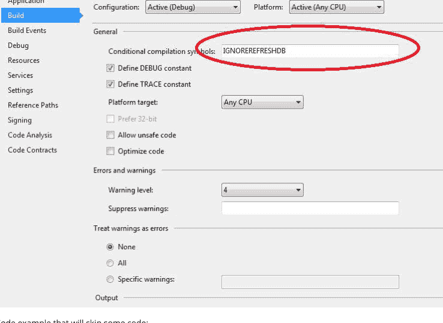

将跳过某些代码的代码示例：

~~~csharp
public void Init()
{
    #if !IGNOREREFRESHDB
    // will skip code here
    db.Initialize();
    #endif
}
~~~

### Section 93.8: 使用 Conditional 属性

向方法添加来自 System.Diagnostics 命名空间的 Conditional 属性是一种干净的方式来控制在构建中调用哪些方法以及不调用哪些方法。

~~~
#define EXAMPLE_A
~~~

using System.Diagnostics;
class Program
{
    static void Main()
    {
        ExampleA(); // This method will be called
        ExampleB(); // This method will not be called
    }

    [Conditional("EXAMPLE_A")]
    static void ExampleA() {...}

    [Conditional("EXAMPLE_B")]
    static void ExampleB() {...}
}

一个结构体可以声明类可以声明的所有内容，但有少数例外：

- 结构体不能声明无参构造函数。结构体实例字段可以通过带参构造函数设置，或在结构体构造后单独设置。私有成员只能由构造函数初始化。
- 结构体不能将成员声明为 protected，因为它隐式密封。
- 结构体字段只有在为 const 或 static 时才能初始化。

### 第 94.2 节：结构体使用

**使用构造函数：**

```
Vector v1 = new Vector();
v1.X = 1;
v1.Y = 2;
v1.Z = 3;

Console.WriteLine("X = {0}, Y = {1}, Z = {2}",v1.X,v1.Y,v1.Z);
// Output X=1,Y=2,Z=3

Vector v1 = new Vector();
//v1.X is not assigned
v1.Y = 2;
v1.Z = 3;

Console.WriteLine("X = {0}, Y = {1}, Z = {2}",v1.X,v1.Y,v1.Z);
// Output X=0,Y=2,Z=3

Point point1 = new Point();
point1.x = 0.5;
point1.y = 0.6;

Point point2 = new Point(0.5, 0.6);
```

**不使用构造函数：**

```
Vector v1;
v1.Y = 2;
v1.Z = 3;

Console.WriteLine("X = {0}, Y = {1}, Z = {2}",v1.X,v1.Y,v1.Z);
//Output ERROR "Use of possibly unassigned field 'X'

Vector v1;
v1.X = 1;
v1.Y = 2;
v1.Z = 3;

Console.WriteLine("X = {0}, Y = {1}, Z = {2}",v1.X,v1.Y,v1.Z);
// Output X=1,Y=2,Z=3

Point point3;
point3.x = 0.5;
point3.y = 0.6;
```

如果我们使用其构造函数的结构体，就不会出现未分配字段的问题（每个未分配字段都有 null 值）。

## 第 95 章：特性

### 第 95.1 节：创建自定义特性

```
//1) All attributes should be inherited from System.Attribute
//2) You can customize your attribute usage (e.g. place restrictions) by using System.AttributeUsage Attribute
//3) You can use this attribute only via reflection in the way it is supposed to be used
//4) MethodMetadataAttribute is just a name. You can use it without "Attribute" postfix - e.g. [MethodMetadata("This text could be retrieved via reflection")].
//5) You can overload an attribute constructors
[System.AttributeUsage(System.AttributeTargets.Method | System.AttributeTargets.Class)]
public class MethodMetadataAttribute : System.Attribute
{
    //this is custom field given just for an example
    //you can create attribute without any fields
    //even an empty attribute can be used - as marker
    public string Text { get; set; }

    //this constructor could be used as [MethodMetadata]
    public MethodMetadataAttribute ()
    {
    }

    //This constructor could be used as [MethodMetadata("String")]
    public MethodMetadataAttribute (string text)
    {
        Text = text;
    }
}
```

### 第 95.2 节：读取特性

方法 GetCustomAttributes 返回应用于该成员的自定义特性数组。检索到该数组后，您可以搜索一个或多个特定特性。

```
var attribute = typeof(MyClass).GetCustomAttributes().OfType<MyCustomAttribute>().Single();
```

或遍历它们

```
foreach(var attribute in typeof(MyClass).GetCustomAttributes()) {
    Console.WriteLine(attribute.GetType());
}
```

来自 System.Reflection.CustomAttributeExtensions 的 GetCustomAttribute 扩展方法检索指定类型的自定义特性，它可以应用于任何 MemberInfo。

```
var attribute = (MyCustomAttribute) typeof(MyClass).GetCustomAttribute(typeof(MyCustomAttribute));
```

GetCustomAttribute 也有泛型签名来指定要搜索的特性类型。

```
var attribute = typeof(MyClass).GetCustomAttribute<MyCustomAttribute>();
```

布尔参数 inherit 可以传递给这两个方法。如果将此值设置为 true，则也会检查元素的祖先。

callerMemberName 参数将接收值 "Save" - 调用方法的名称。

callerLineNumber 参数将接收 LogException 方法调用所写的那一行的行号。

而 'callerFilePath' 参数将接收声明 Save 方法的文件的完整路径。

### 第 95.6 节：Obsolete 特性

System.Obsolete 是一个特性，用于标记具有更好版本的类型或成员，因此不应使用。

```
[Obsolete("This class is obsolete. Use SomeOtherClass instead.")]
class SomeClass
{
    //
}
```

如果使用上面的类，编译器将给出警告 "This class is obsolete. Use SomeOtherClass instead."

### 第 95.7 节：从接口读取特性

由于类不会从接口继承特性，因此没有简单的方法从接口获取特性。无论是实现接口还是在派生类中重写成员，都需要重新声明特性。因此在下面的示例中，输出在三种情况下都将为 True。

```
using System;
using System.Linq;
using System.Reflection;

namespace InterfaceAttributesDemo {
    [AttributeUsage(AttributeTargets.Interface, Inherited = true)]
    class MyCustomAttribute : Attribute {
        public string Text { get; set; }
    }

    [MyCustomAttribute(Text = "Hello from interface attribute")]
    interface IMyClass {
        void MyMethod();
    }

    class MyClass : IMyClass {
        public void MyMethod() { }
    }

    public class Program {
        public static void Main(string[] args) {
            GetInterfaceAttributeDemo();
        }

        private static void GetInterfaceAttributeDemo() {
            var attribute1 = (MyCustomAttribute)
            typeof(MyClass).GetCustomAttribute(typeof(MyCustomAttribute), true);
            Console.WriteLine(attribute1 == null); // True

            var attribute2 =
typeof(MyClass).GetCustomAttributes(true).OfType<MyCustomAttribute>().SingleOrDefault();
            Console.WriteLine(attribute2 == null); // True

            var attribute3 = typeof(MyClass).GetCustomAttribute<MyCustomAttribute>(true);
            Console.WriteLine(attribute3 == null); // True
        }
    }
}
```

一种检索接口特性的方法是通过类实现的所有接口来搜索它们。

```
var attribute = typeof(MyClass).GetInterfaces().SelectMany(x =>
x.GetCustomAttributes().OfType<MyCustomAttribute>()).SingleOrDefault();
Console.WriteLine(attribute == null); // False
Console.WriteLine(attribute.Text); // Hello from interface attribute
```

相反，使用不变的泛型类型：

```csharp
public delegate void EventHandler<TEventArgs>(object sender, TEventArgs e);
```

还支持某些参数通过 ref 或 out 修改的委托，如下所示：

```csharp
public delegate bool TryParser<T>(string input, out T result);
```

(sample use TryParser<decimal> example = decimal.TryParse;)，以及最后一个参数具有 params 修饰符的委托。委托类型可以具有可选参数（提供默认值）。委托类型可以在其签名或返回类型中使用指针类型，如 int* 或 char*（使用 unsafe 关键字）。委托类型及其参数可以携带自定义特性。

### 第 96.2 节：Func<T, TResult>、Action<T> 和 Predicate<T> 委托类型

System 命名空间包含 Func<..., TResult> 委托类型，具有 0 到 15 个泛型参数，返回类型为 TResult。

```csharp
private void UseFunc(Func<string> func)
{
    string output = func(); // Func with a single generic type parameter returns that type
    Console.WriteLine(output);
}
```

```csharp
private void UseFunc(Func<int, int, string> func)
{
    string output = func(4, 2); // Func with multiple generic type parameters takes all but the first as parameters of that type
    Console.WriteLine(output);
}
```

System 命名空间还包含 Action<...> 委托类型，具有不同数量的泛型参数（从 0 到 16）。它与 Func<T1, ..., Tn> 类似，但始终返回 void。

```csharp
private void UseAction(Action action)
{
    action(); // The non-generic Action has no parameters
}
```

```csharp
private void UseAction(Action<int, string> action)
{
    action(4, "two"); // The generic action is invoked with parameters matching its type arguments
}
```

Predicate<T> 也是 Func 的一种形式，但它始终返回 bool。谓词是一种指定自定义条件的方式。根据输入的值和谓词中定义的逻辑，它将返回 true 或 false。因此 Predicate<T> 的行为与 Func<T, bool> 相同，两者都可以以相同的方式初始化和使用。

```csharp
Predicate<string> predicate = s => s.StartsWith("a");
Func<string, bool> func = s => s.StartsWith("a");

// Both of these return true
var predicateReturnsTrue = predicate("abc");
var funcReturnsTrue = func("abc");
```

// Both of these return false
var predicateReturnsFalse = predicate("xyz");
var funcReturnsFalse = func("xyz");

选择使用 Predicate<T> 还是 Func<T, bool> 其实更多是个人偏好问题。Predicate<T> 可以更明确地表达作者的意图，而 Func<T, bool> 可能对更大比例的 C# 开发者来说更为熟悉。

此外，在某些情况下只有其中一个选项可用，尤其是在与其他 API 交互时。例如，List<T> 和 Array<T> 通常在其方法中使用 Predicate<T>，而大多数 LINQ 扩展仅接受 Func<T, bool>。

## Section 96.3: 组合委托（多播委托）

加法 + 和减法 - 操作可用于组合委托实例。委托包含已分配委托的列表。

```
using System;
using System.Reflection;
using System.Reflection.Emit;

namespace DelegatesExample {
    class MainClass {
        private delegate void MyDelegate(int a);
        private static void PrintInt(int a) {
            Console.WriteLine(a);
        }

        private static void PrintType<T>(T a) {
            Console.WriteLine(a.GetType());
        }

        public static void Main (string[] args)
        {
            MyDelegate d1 = PrintInt;
            MyDelegate d2 = PrintType;

            // Output:
            // 1
            d1(1);

            // Output:
            // System.Int32
            d2(1);

            MyDelegate d3 = d1 + d2;
            // Output:
            // 1
            // System.Int32
            d3(1);

            MyDelegate d4 = d3 - d2;
            // Output:
            // 1
            d4(1);

            // Output:
            // True
            Console.WriteLine(d1 == d4);
        }
    }
}
```

在此示例中，d3 是 d1 和 d2 委托的组合，因此调用时程序会同时输出 1 和 System.Int32 字符串。

### 具有非 void 返回类型的委托组合：

如果多播委托具有非 void 返回类型，调用者将收到最后被调用方法的返回值。之前的方法仍会被调用，但其返回值会被丢弃。

```
class Program
{
    public delegate int Transformer(int x);

    static void Main(string[] args)
    {
        Transformer t = Square;
        t += Cube;
        Console.WriteLine(t(2));  // O/P 8
    }

    static int Square(int x) { return x * x; }

    static int Cube(int x) { return x*x*x; }
}
```

t(2) 会先调用 Square 然后调用 Cube。Square 的返回值会被丢弃，而最后方法即 Cube 的返回值会被保留。

## Section 96.4: 安全调用多播委托

是否曾想调用一个多播委托，但希望即使链中任一处发生异常，整个调用列表仍会被调用？那你运气不错，我创建了一个扩展方法正好实现这一点，仅在整个列表执行完成后才抛出 AggregateException：

```
public static class DelegateExtensions
{
    public static void SafeInvoke(this Delegate del, params object[] args)
    {
        var exceptions = new List<Exception>();

        foreach (var handler in del.GetInvocationList())
        {
            try
            {
                handler.Method.Invoke(handler.Target, args);
            }
            catch (Exception ex)
            {
                exceptions.Add(ex);
            }
        }

        if(exceptions.Any())
        {
            throw new AggregateException(exceptions);
        }
    }
}
```

```
public class Test
{
    public delegate void SampleDelegate();

    public void Run()
    {
        SampleDelegate delegateInstance = this.Target2;
        delegateInstance += this.Target1;

        try
        {
            delegateInstance.SafeInvoke();
        }
        catch(AggregateException ex)
        {
            // Do any exception handling here
        }
    }

    private void Target1()
    {
        Console.WriteLine("Target 1 executed");
    }

    private void Target2()
    {
        Console.WriteLine("Target 2 executed");
        throw new Exception();
    }
}
```

输出如下：

```
Target 2 executed
Target 1 executed
```

直接调用，而不使用 SafeInvoke，则只会执行 Target 2。

## Section 96.5: 委托相等性

对委托调用 .Equals() 时按引用相等进行比较：

```
Action action1 = () => Console.WriteLine("Hello delegates");
Action action2 = () => Console.WriteLine("Hello delegates");
Action action1Again = action1;

Console.WriteLine(action1.Equals(action1)) // True
Console.WriteLine(action1.Equals(action2)) // False
Console.WriteLine(action1Again.Equals(action1)) // True
```

这些规则在对多播委托执行 += 或 -= 时同样适用，例如在订阅和取消订阅事件时。

## Section 96.6: 命名方法的底层引用

### delegates

将命名方法分配给委托时，如果满足以下条件，它们将引用同一个底层对象：

- 它们是同一个类实例上的同一个实例方法
- 它们是类上的同一个静态方法

```
~~~csharp
public class Greeter
{
    public void WriteInstance()
    {
        Console.WriteLine("Instance");
    }

    public static void WriteStatic()
    {
        Console.WriteLine("Static");
    }
}

// ...

Greeter greeter1 = new Greeter();
Greeter greeter2 = new Greeter();

Action instance1 = greeter1.WriteInstance;
Action instance2 = greeter2.WriteInstance;
Action instance1Again = greeter1.WriteInstance;

Console.WriteLine(instance1.Equals(instance2)); // False
Console.WriteLine(instance1.Equals(instance1Again)); // True

Action @static = Greeter.WriteStatic;
Action staticAgain = Greeter.WriteStatic;

Console.WriteLine(@static.Equals(staticAgain)); // True
~~~
```

## Section 96.7: 将命名方法分配给委托

命名方法可以分配给具有匹配签名的委托：

```
~~~csharp
public static class Example
{
    public static int AddOne(int input)
    {
        return input + 1;
    }
}
~~~
```

```
`Func<int, int> addOne = Example.AddOne`
```

Example.AddOne 接受一个 `int` 并返回一个 `int`，其签名与委托 `Func<int, int>` 匹配。由于签名匹配，Example.AddOne 可以直接分配给 addOne。

## Section 96.8: 通过 lambda 为委托赋值

Lambda 表达式可用于创建匿名方法以分配给委托：

```
Func<int,int> addOne = x => x+1;
```

请注意，以这种方式创建变量时需要显式声明类型：

```
var addOne = x => x+1; // Does not work
```

## Section 96.9: 在 func 中封装转换

```
public class MyObject{
    public DateTime? TestDate { get; set; }

    public Func<MyObject, bool> DateIsValid = myObject => myObject.TestDate.HasValue &&
myObject.TestDate > DateTime.Now;

    public void DoSomething(){
        //We can do this:
        if(this.TestDate.HasValue && this.TestDate > DateTime.Now){
            CallAnotherMethod();
        }

        //or this:
        if(DateIsValid(this)){
            CallAnotherMethod();
        }
    }
}
```

秉承整洁代码的精神，将如上所示的检查和转换封装为 Func 可以使代码更易于阅读和理解。虽然上面的示例非常简单，如果存在多个 DateTime 属性，每个属性都有各自不同的验证规则，而我们想要检查不同的组合怎么办？简单的一行 Func，每个都有确定的返回逻辑，既可读又能降低代码的表面复杂性。请考虑下面的 Func 调用，并想象方法中会多出多少杂乱的代码：

```
public void CheckForIntegrity(){
    if(ShipDateIsValid(this) && TestResultsHaveBeenIssued(this) && !TestResultsFail(this)){
        SendPassingTestNotification();
    }
}
```

## Section 96.10: 将委托作为参数传递

委托可作为类型化的函数指针使用：

```
class FuncAsParameters
{
    public void Run()
    {
        DoSomething(ErrorHandler1);
        DoSomething(ErrorHandler2);
    }

    public bool ErrorHandler1(string message)
    {

## 第97章：文件和流 I/O

| 参数 | 详情 |
|---|---|
| path | 文件的位置。 |
| append | 如果文件存在，true 会将数据添加到文件末尾（追加），false 会覆盖文件。 |
| text | 要写入或存储的文本。 |
| contents | 要写入的字符串集合。 |
| source | 你想要使用的文件的位置。 |
| dest | 你希望文件去到的位置。 |

管理文件。

### 第97.1节：使用 System.IO.File 类从文件读取

你可以使用 System.IO.File.ReadAllText 函数将文件的全部内容读入一个字符串。

```
string text = System.IO.File.ReadAllText(@"C:\MyFolder\MyTextFile.txt");
```

你也可以使用 System.IO.File.ReadAllLines 函数将文件作为行数组读取：

```
string[] lines = System.IO.File.ReadAllLines(@"C:\MyFolder\MyTextFile.txt");
```

### 第97.2节：通过 IEnumerable 惰性逐行读取文件

处理大文件时，你可以使用 System.IO.File.ReadLines 方法将文件的所有行读入 IEnumerable<string>。这与 System.IO.File.ReadAllLines 类似，不同之处在于它不会一次性将整个文件加载到内存中，从而在处理大文件时更高效。

```
IEnumerable<string> AllLines = File.ReadLines("file_name.txt", Encoding.Default);
```

*File.ReadLines 的第二个参数是可选的。当需要指定编码时，你可以使用它。*

需要注意的是，调用 ToArray、ToList 或其他类似函数会强制一次性加载所有行，这意味着使用 ReadLines 的好处将被抵消。如果使用此方法，最好使用 foreach 循环或 LINQ 对 IEnumerable 进行枚举。

### 第97.3节：使用 StreamWriter 异步写入文件文本

```
// filename is a string with the full path
// true is to append
using (System.IO.StreamWriter file = new System.IO.StreamWriter(filename, true))
{
    // Can write either a string or char array
    await file.WriteAsync(text);
}
```

### 第97.4节：复制文件

### File 静态类

File 静态类可以轻松用于此目的。

```
~~~csharp
File.Copy(@"sourcePath\abc.txt", @"destinationPath\abc.txt");
File.Copy(@"sourcePath\abc.txt", @"destinationPath\xyz.txt");
~~~
```

**备注：** 通过此方法，文件将被复制，这意味着它将从源读取然后写入目标路径。这是一个资源消耗的过程，其耗时与文件大小相关，如果不使用线程，可能会导致你的程序冻结。

### 第97.5节：使用 System.IO.StreamWriter 类向文件写入行

The `System.IO.StreamWriter` class:

> 用于以特定编码向流写入字符的 TextWriter 的实现。

使用 `WriteLine` 方法，你可以逐行向文件写入内容。

注意 `using` 关键字的用法，它确保 StreamWriter 对象在超出作用域后立即被释放，从而关闭文件。

```
~~~csharp
string[] lines = { "My first string", "My second string", "and even a third string" };
using (System.IO.StreamWriter sw = new System.IO.StreamWriter(@"C:\MyFolder\OutputText.txt"))
{
    foreach (string line in lines)
    {
        sw.WriteLine(line);
    }
}
~~~
```

请注意，StreamWriter 的构造函数可以接收第二个 `bool` 参数，允许追加到文件而不是覆盖文件：

```
~~~csharp
bool appendExistingFile = true;
using (System.IO.StreamWriter sw = new System.IO.StreamWriter(@"C:\MyFolder\OutputText.txt", appendExistingFile))
{
    sw.WriteLine("This line will be appended to the existing file");
}
~~~
```

### 第97.6节：使用 System.IO.File 类写入文件

你可以使用 `System.IO.File.WriteAllText` 函数将字符串写入文件。

```
~~~csharp
string text = "String that will be stored in the file";
System.IO.File.WriteAllText(@"C:\MyFolder\OutputFile.txt", text);
~~~
```

你也可以使用 `System.IO.File.WriteAllLines` 函数，它接收 `IEnumerable<String>` 作为第二个参数（与前一个示例中的单个字符串相反）。这让你可以从行数组写入内容。

```
~~~csharp
string[] lines = { "My first string", "My second string", "and even a third string" };
System.IO.File.WriteAllLines(@"C:\MyFolder\OutputFile.txt", lines);
~~~
```

## 第98章：网络

### 第98.1节：基本 TCP 通信客户端

此代码示例创建一个 TCP 客户端，通过套接字连接发送 "Hello World"，然后在关闭连接之前将服务器响应写入控制台。

```csharp
// Declare Variables
string host = "stackoverflow.com";
int port = 9999;
int timeout = 5000;

// Create TCP client and connect
using (var _client = new TcpClient(host, port))
using (var _netStream = _client.GetStream())
{
    _netStream.ReadTimeout = timeout;

    // Write a message over the socket
    string message = "Hello World!";
    byte[] dataToSend = System.Text.Encoding.ASCII.GetBytes(message);
    _netStream.Write(dataToSend, 0, dataToSend.Length);

    // Read server response
    byte[] recvData = new byte[256];
    int bytes = _netStream.Read(recvData, 0, recvData.Length);
    message = System.Text.Encoding.ASCII.GetString(recvData, 0, bytes);
    Console.WriteLine(string.Format("Server: {0}", message));
}// The client and stream will close as control exits the using block (Equivalent but safer than calling Close());
```

### 第98.2节：从 Web 服务器下载文件

从互联网下载文件是几乎每个你可能构建的应用程序都需要的非常常见的任务。

要实现此目的，你可以使用 "System.Net.WebClient" 类。

使用 "using" 模式的最简单用法如下所示：

```csharp
using (var webClient = new WebClient())
{
    webClient.DownloadFile("http://www.server.com/file.txt", "C:\\file.txt");
}
```

此示例的作用是使用 "using" 确保在完成时你的 Web 客户端被正确清理，并简单地将第一个参数中 URL 的命名资源传输到第二个参数中本地硬盘上的命名文件。

第一个参数的类型为 "System.Uri"，第二个参数的类型为 "System.String"

你也可以将此函数用作异步形式，以便它在后台执行下载，而你的应用程序可以继续做其他事情，在现代应用程序中以这种方式调用非常重要，因为它有助于保持用户界面的响应性。

当你使用 Async 方法时，你可以挂钩事件处理程序以允许你监控进度，以便

### 第98.4节：基本 UDP 客户端

此代码示例创建一个 UDP 客户端然后向预期接收者跨网络发送 "Hello World"。监听器不必处于活动状态，因为 UDP 是无连接的并且无论如何都会广播消息。一旦消息发送，客户端的工作就完成了。

```
byte[] data = Encoding.ASCII.GetBytes("Hello World");
string ipAddress = "192.168.1.141";
string sendPort = 55600;
try
{
    using (var client = new UdpClient())
    {
        IPEndPoint ep = new IPEndPoint(IPAddress.Parse(ipAddress), sendPort);
        client.Connect(ep);
        client.Send(data, data.Length);
    }
}
catch (Exception ex)
{
    Console.WriteLine(ex.ToString());
}
```

下面是一个 UDP 监听器的示例，可补充上述客户端。它将不断坐在给定端口上监听流量并简单地将数据写入控制台。此示例包含一个控制标志 'done'，该标志在内部未设置并依赖于某些东西来设置它以允许结束监听器并退出。

```
bool done = false;
int listenPort = 55600;
using(UdpClient listener = new UdpClient(listenPort))
{
    IPEndPoint listenEndPoint = new IPEndPoint(IPAddress.Any, listenPort);
    while(!done)
    {
        byte[] receivedData = listener.Receive(ref listenPort);

        Console.WriteLine("Received broadcast message from client {0}", listenEndPoint.ToString());

        Console.WriteLine("Decoded data is:");
        Console.WriteLine(Encoding.ASCII.GetString(receivedData)); //should be "Hello World" sent from above client
    }
}
```


## 第99章：执行 HTTP 请求

### 第99.1节：创建并发送 HTTP POST 请求

```
using System.Net;
using System.IO;

...

string requestUrl = "https://www.example.com/submit.html";
HttpWebRequest request = HttpWebRequest.CreateHttp(requestUrl);
request.Method = "POST";

// Optionally, set properties of the HttpWebRequest, such as:
request.AutomaticDecompression = DecompressionMethods.Deflate | DecompressionMethods.GZip;
request.ContentType = "application/x-www-form-urlencoded";
// Could also set other HTTP headers such as Request.UserAgent, Request.Referer,
// Request.Accept, or other headers via the Request.Headers collection.

// Set the POST request body data. In this example, the POST data is in
// application/x-www-form-urlencoded format.
string postData = "myparam1=myvalue1&myparam2=myvalue2";
using (var writer = new StreamWriter(request.GetRequestStream()))
{
    writer.Write(postData);
}

// Submit the request, and get the response body from the remote server.
string responseFromRemoteServer;
using (HttpWebResponse response = (HttpWebResponse)request.GetResponse())
{
    using (StreamReader reader = new StreamReader(response.GetResponseStream()))
    {
        responseFromRemoteServer = reader.ReadToEnd();
    }
}
```

### 第99.2节：创建并发送 HTTP GET 请求

```
using System.Net;
using System.IO;

...

string requestUrl = "https://www.example.com/page.html";
HttpWebRequest request = HttpWebRequest.CreateHttp(requestUrl);

// Optionally, set properties of the HttpWebRequest, such as:
request.AutomaticDecompression = DecompressionMethods.GZip | DecompressionMethods.Deflate;
request.Timeout = 2 * 60 * 1000; // 2 minutes, in milliseconds

// Submit the request, and get the response body.
string responseBodyFromRemoteServer;
using (HttpWebResponse response = (HttpWebResponse)request.GetResponse())
{
    using (StreamReader reader = new StreamReader(response.GetResponseStream()))
    {
        responseBodyFromRemoteServer = reader.ReadToEnd();
    }
}
```

### 第99.3节：特定 HTTP 响应代码（如 404 Not Found）的错误处理

```
using System.Net;

...

string serverResponse;
try
{
    // Call a method that performs an HTTP request (per the above examples).
    serverResponse = PerformHttpRequest();
}
catch (WebException ex)
{
    if (ex.Status == WebExceptionStatus.ProtocolError)
    {
        HttpWebResponse response = ex.Response as HttpWebResponse;
        if (response != null)
        {
            if ((int)response.StatusCode == 404) // Not Found
            {
                // Handle the 404 Not Found error
                // ...
            }
            else
            {
                // Could handle other response.StatusCode values here.
                // ...
            }
        }
    }
    else
    {
        // Could handle other error conditions here, such as WebExceptionStatus.ConnectFailure.
        // ...
    }
}
```

### 第99.4节：检索网页 HTML（简单）

```
string contents = "";
string url = "http://msdn.microsoft.com";

using (System.Net.WebClient client = new System.Net.WebClient())
{
    contents = client.DownloadString(url);
}

Console.WriteLine(contents);
```

### 第99.5节：发送带有 JSON 正文的异步 HTTP POST 请求

```
public static async Task PostAsync(this Uri uri, object value)
{
    var content = new ObjectContent(value.GetType(), value, new JsonMediaTypeFormatter());

    using (var client = new HttpClient())
    {
        return await client.PostAsync(uri, content);
    }
}

...

var uri = new Uri("http://stackoverflow.com/documentation/c%23/1971/performing-http-requests");
await uri.PostAsync(new { foo = 123.45, bar = "Richard Feynman" });
```

## 第100章：读取和写入 .zip 文件

| 参数 | 详细信息 |
|---|---|
| archiveFileName | 归档文件的路径，指定为相对或绝对路径。相对路径解释为相对于当前工作目录。 |

### 第100.1节：写入 zip 文件

创建新的 .zip 文件：

System.IO.Compression
System.IO.Compression.FileSystem

```csharp
using (FileStream zipToOpen = new FileStream(@"C:\temp", FileMode.Open))
{
    using (ZipArchive archive = new ZipArchive(zipToOpen, ZipArchiveMode.Update))
    {
        ZipArchiveEntry readmeEntry = archive.CreateEntry("Readme.txt");
        using (StreamWriter writer = new StreamWriter(readmeEntry.Open()))
        {
            writer.WriteLine("Information about this package.");
            writer.WriteLine("============================");
        }
    }
}
```

### 第100.2节：在内存中写入 Zip 文件

以下示例将返回包含所提供文件的压缩文件的 byte[] 数据，而无需访问文件系统。

```csharp
public static byte[] ZipFiles(Dictionary<string, byte[]> files)
{
    using (MemoryStream ms = new MemoryStream())
    {
        using (ZipArchive archive = new ZipArchive(ms, ZipArchiveMode.Update))
        {
            foreach (var file in files)
            {
                ZipArchiveEntry orderEntry = archive.CreateEntry(file.Key); //create a file with this name
                using (BinaryWriter writer = new BinaryWriter(orderEntry.Open()))
                {
                    writer.Write(file.Value); //write the binary data
                }
            }
            //ZipArchive must be disposed before the MemoryStream has data
            return ms.ToArray();
        }
    }
}
```

### 第100.3节：从 Zip 文件获取文件

此示例从提供的 zip 归档二进制数据中获取文件列表：

```csharp
public static Dictionary<string, byte[]> GetFiles(byte[] zippedFile)
{
    using (MemoryStream ms = new MemoryStream(zippedFile))
    using (ZipArchive archive = new ZipArchive(ms, ZipArchiveMode.Read))
    {
        return archive.Entries.ToDictionary(x => x.FullName, x => ReadStream(x.Open()));
    }
}

private static byte[] ReadStream(Stream stream)
{
    using (var ms = new MemoryStream())
    {
        stream.CopyTo(ms);
        return ms.ToArray();
    }
}
```

### 第100.4节：以下示例展示如何打开 zip 归档并将所有 .txt 文件提取到文件夹

```csharp
using System;
using System.IO;
using System.IO.Compression;

namespace ConsoleApplication1
{
    class Program
    {
        static void Main(string[] args)
        {
            string zipPath = @"c:\example\start.zip";
            string extractPath = @"c:\example\extract";

            using (ZipArchive archive = ZipFile.OpenRead(zipPath))
            {
                foreach (ZipArchiveEntry entry in archive.Entries)
                {
                    if (entry.FullName.EndsWith(".txt", StringComparison.OrdinalIgnoreCase))
                    {
                        entry.ExtractToFile(Path.Combine(extractPath, entry.FullName));
                    }
                }
            }
        }
    }
}
```

## 第101章：FileSystemWatcher

**路径**
要监视的目录，采用标准或通用命名约定（UNC）表示法。

**过滤器**
要监视的文件类型。例如，“*.txt”监视所有文本文件的更改。

### 第101.1节：IsFileReady

许多刚开始使用 FileSystemWatcher 的人常犯的一个错误是没有考虑到 FileWatcher 事件会在文件创建时立即触发。然而，完成文件可能需要一些时间。

*示例：*

例如，文件大小为 1 GB。文件似乎已被另一个程序（Explorer.exe 从某处复制它）创建，但完成该过程可能需要几分钟。事件在创建时触发，你需要等待文件准备好才能复制。

这是一个用于检查文件是否就绪的方法。

```
public static bool IsFileReady(String sFilename)
{
    // If the file can be opened for exclusive access it means that the file
    // is no longer locked by another process.
    try
    {
        using (FileStream inputStream = File.Open(sFilename, FileMode.Open, FileAccess.Read, FileShare.None))
        {
            if (inputStream.Length > 0)
            {
                return true;
            }
            else
            {
                return false;
            }
        }
    }
    catch (Exception)
    {
        return false;
    }
}
```

### 第101.2节：基本 FileWatcher

以下示例创建 FileSystemWatcher 以监视运行时指定的目录。该组件设置为监视目录中文本文件的 LastWrite 和 LastAccess 时间更改，以及创建、删除或重命名操作。如果文件被更改、创建或删除，则文件路径会打印到控制台。当文件被重命名时，旧路径和新路径会打印到控制台。

使用 System.Diagnostics 和 System.IO 命名空间进行此示例。

```
FileSystemWatcher watcher;
```


```csharp
private void watch()
{
    // Create a new FileSystemWatcher and set its properties.
    watcher = new FileSystemWatcher();
    watcher.Path = path;

    /* Watch for changes in LastAccess and LastWrite times, and
       the renaming of files or directories. */
    watcher.NotifyFilter = NotifyFilters.LastAccess | NotifyFilters.LastWrite
        | NotifyFilters.FileName | NotifyFilters.DirectoryName;

    // Only watch text files.
    watcher.Filter = "*.txt*";

    // Add event handler.
    watcher.Changed += new FileSystemEventHandler(OnChanged);
    // Begin watching.
    watcher.EnableRaisingEvents = true;
}

// Define the event handler.
private void OnChanged(object source, FileSystemEventArgs e)
{
    //Copies file to another directory or another action.
    Console.WriteLine("File: " + e.FullPath + " " + e.ChangeType);
}
```

## 第102章：使用用户名和密码访问网络共享文件夹

使用 PInvoke 访问网络共享文件。

### 第102.1节：访问网络共享文件的代码

```csharp
public class NetworkConnection : IDisposable
{
    string _networkName;

    public NetworkConnection(string networkName,
        NetworkCredential credentials)
    {
        _networkName = networkName;

        var netResource = new NetResource()
        {
            Scope = ResourceScope.GlobalNetwork,
            ResourceType = ResourceType.Disk,
            DisplayType = ResourceDisplayType.Share,
            RemoteName = networkName
        };

        var userName = string.IsNullOrEmpty(credentials.Domain)
            ? credentials.UserName
            : string.Format(@"@{}\{}", credentials.Domain, credentials.UserName);

        var result = WNetAddConnection2(
            netResource,
            credentials.Password,
            userName,
            0);

        if (result != 0)
        {
            throw new Win32Exception(result);
        }
    }

    ~NetworkConnection()
    {
        Dispose(false);
    }

    public void Dispose()
    {
        Dispose(true);
        GC.SuppressFinalize(this);
    }

    protected virtual void Dispose(bool disposing)
    {
        WNetCancelConnection2(_networkName, 0, true);
    }

    [DllImport("mpr.dll")]
    private static extern int WNetAddConnection2(NetResource netResource,
        string password, string username, int flags);
    [DllImport("mpr.dll")]
    private static extern int WNetCancelConnection2(string name, int flags,
    bool force);
}
```

```csharp
[StructLayout(LayoutKind.Sequential)]
public class NetResource
{
    public ResourceScope Scope;
    public ResourceType ResourceType;
    public ResourceDisplaytype DisplayType;
    public int Usage;
    public string LocalName;
    public string RemoteName;
    public string Comment;
    public string Provider;
}

public enum ResourceScope : int
{
    Connected = 1,
    GlobalNetwork,
    Remembered,
    Recent,
    Context
};

public enum ResourceType : int
{
    Any = 0,
    Disk = 1,
    Print = 2,
    Reserved = 8,
}

public enum ResourceDisplaytype : int
{
    Generic = 0x0,
    Domain = 0x01,
    Server = 0x02,
    Share = 0x03,
    File = 0x04,
    Group = 0x05,
    Network = 0x06,
    Root = 0x07,
    Sharedadmin = 0x08,
    Directory = 0x09,
    Tree = 0x0a,
    Ndscontainer = 0x0b
}
```

## 第103章：异步套接字

通过使用异步套接字，服务器可以监听传入连接，同时执行其他逻辑；与之相反，同步套接字在监听时会阻塞主线程，导致应用程序无响应，并在客户端连接之前冻结。

### 第103.1节：异步套接字（客户端/服务器）示例

### 服务器端示例

### 为服务器创建监听器

首先创建一个服务器来处理连接的客户端和将要发送的请求。因此创建一个 Listener 类来处理此事。

```csharp
class Listener
{
    public Socket ListenerSocket; //This is the socket that will listen to any incoming connections
    public short Port = 1234; // on this port we will listen

    public Listener()
    {
        ListenerSocket = new Socket(AddressFamily.InterNetwork, SocketType.Stream,
ProtocolType.Tcp);
    }
}
```

首先我们需要初始化 Listener 套接字，以便可以监听任何连接。我们将使用 Tcp 套接字，因此使用 SocketType.Stream。并且我们指定服务器应监听的端口

然后我们开始监听任何传入连接。

**我们在此使用的三个方法有：**

- 1. ListenerSocket.Bind():
- 
- 此方法将套接字绑定到 IPEndPoint。此类包含应用程序连接到主机上服务所需的主机和本地或远程端口信息。
- 
- 2. ListenerSocket.Listen(10):
- 
- backlog 参数指定可排队等待接受的传入连接数。
- 
- 3. ListenerSocket.BeginAccept():
- 
- 服务器将开始监听传入连接并继续执行其他逻辑。当有连接时，服务器将切换回此方法并运行 AcceptCallback 方法

```csharp
public void StartListening()
{
try
{
    MessageBox.Show($"Listening started port:{Port} protocol type: {ProtocolType.Tcp}");
    ListenerSocket.Bind(new IPEndPoint(IPAddress.Any, Port));
    ListenerSocket.Listen(10);
    ListenerSocket.BeginAccept(AcceptCallback, ListenerSocket);
}
catch(Exception ex)
{
    throw new Exception("listening error" + ex);
}
}
```

因此当客户端连接时，我们可以通过此方法接受它们：

### 我们在此使用的三个方法有：

- 1. ListenerSocket.EndAccept()
- 
- 我们使用 Listener.BeginAccept() 启动了回调，现在必须结束该回调。EndAccept() 方法接受一个 IAsyncResult 参数，它将存储异步方法的状态，从该状态我们可以提取传入连接来源的套接字。
- 
- 2. ClientController.AddClient()
- 
- 使用从 EndAccept() 获取的套接字，我们使用自制方法创建一个客户端（代码 ClientController 在服务器示例下方）。
- 
- 3. ListenerSocket.BeginAccept()
- 
- 当套接字处理完新连接后，我们需要再次开始监听。传入将捕获此回调的方法。并且传入 Listener 套接字，以便我们可以重用该套接字用于即将到来的连接。

```csharp
public void AcceptCallback(IAsyncResult ar)
{
    try
    {
        Console.WriteLine($"Accept CallBack port:{Port} protocol type: {ProtocolType.Tcp}");
        Socket acceptedSocket = ListenerSocket.EndAccept(ar);
        ClientController.AddClient(acceptedSocket);

        ListenerSocket.BeginAccept(AcceptCallback, ListenerSocket);
    }
    catch (Exception ex)
    {
        throw new Exception("Base Accept error"+ ex);
    }
}
```

现在我们有一个监听套接字，但如何接收客户端发送的数据，这就是下一段代码要展示的内容。

### 为每个客户端创建服务器接收器

首先创建一个接收类，其构造函数接受 Socket 作为参数：

```csharp
public class ReceivePacket
{
    private byte[] _buffer;
    private Socket _receiveSocket;

    public ReceivePacket(Socket receiveSocket)
    {
        _receiveSocket = receiveSocket;
    }
}
```

在下一个方法中，我们首先将缓冲区的大小设为 4 字节（Int32），因为数据包包含两部分（长度、实际数据）。因此我们将前 4 个字节保留用于数据的长度，其余用于实际数据。

接下来我们使用 BeginReceive() 方法。此方法用于开始从已连接客户端接收数据，并在接收到数据时运行 ReceiveCallback 函数。

```csharp
public void StartReceiving()
{
    try
    {
        _buffer = new byte[4];
        _receiveSocket.BeginReceive(_buffer, 0, _buffer.Length, SocketFlags.None,
ReceiveCallback, null);
    }
    catch {}
}

private void ReceiveCallback(IAsyncResult AR)
{
    try
    {
        // if bytes are less than 1 takes place when a client disconnect from the server.
        // So we run the Disconnect function on the current client
        if (_receiveSocket.EndReceive(AR) > 1)
        {
            // Convert the first 4 bytes (int 32) that we received and convert it to an Int32
(this is the size for the coming data).
            _buffer = new byte[BitConverter.ToInt32(_buffer, 0)];
            // Next receive this data into the buffer with size that we did receive before
            _receiveSocket.Receive(_buffer, _buffer.Length, SocketFlags.None);
            // When we received everything it's up to you to convert it into the data that you've
sent.
            // For example string, int etc... in this example I only use the implementation for
sending and receiving a string.

            // Convert the bytes to string and output it in a message box
            string data = Encoding.Default.GetString(_buffer);
            MessageBox.Show(data);
            // Now we have to start all over again with waiting for a data to come from the
socket.

            StartReceiving();
        }
        else
        {
            Disconnect();
        }
    }
    catch {}
}
```

```csharp
        }
    }
    catch
    {
        // if exception is thrown check if socket is connected because then you can startreceive again else Disconnect
        if (!_receiveSocket.Connected)
        {
            Disconnect();
        }
        else
        {
            StartReceiving();
        }
    }
}

private void Disconnect()
{
    // Close connection
    _receiveSocket.Disconnect(true);
    // Next line only apply for the server side receive
    ClientController.RemoveClient(_clientId);
    // Next line only apply on the Client Side receive
    Here you want to run the method TryToConnect()
}
```

我们已经设置了一个可以接收并监听传入连接的服务器。当客户端连接时，它将被添加到客户端列表中，并且每个客户端都有自己的接收类。要使服务器监听：

```csharp
Listener listener = new Listener();
listener.StartListening();
```

## 本示例中我使用的一些类

```csharp
class Client
{
    public Socket _socket { get; set; }
    public ReceivePacket Receive { get; set; }
    public int Id { get; set; }

    public Client(Socket socket, int id)
    {
        Receive = new ReceivePacket(socket, id);
        Receive.StartReceiving();
        _socket = socket;
        Id = id;
    }
}

static class ClientController
{
    public static List<Client> Clients = new List<Client>();

    public static void AddClient(Socket socket)
    {
        Clients.Add(new Client(socket,Clients.Count));
    }

    public static void RemoveClient(int id)
    {
        Clients.RemoveAt(Clients.FindIndex(x => x.Id == id));
    }
}
```

## 客户端示例

### 连接到服务器

首先我们想要创建一个连接到服务器的类，我们给它的名字是：Connector：

```csharp
class Connector
{
    private Socket _connectingSocket;
}
```

此类的下一个方法是 TryToConnect()

此方法有一些有趣的事情：

- 1. 创建套接字；
- 2. 接下来我循环直到套接字已连接
- 3. 每次循环它只是让线程等待1秒，我们不想对服务器进行DOS XD
- 4. 使用 Connect() 它将尝试连接到服务器。如果失败它会抛出异常，但 while 会让程序保持尝试连接到服务器。你可以为此使用 Connect CallBack 方法，但我只是选择在套接字连接时调用一个方法。
- 5. 注意客户端现在正尝试连接到你的本地电脑的 1234 端口。

```csharp
public void TryToConnect()
{
    _connectingSocket = new Socket(AddressFamily.InterNetwork, SocketType.Stream, ProtocolType.Tcp);

    while (!_connectingSocket.Connected)
    {
        Thread.Sleep(1000);

        try
        {
            _connectingSocket.Connect(new IPEndPoint(IPAddress.Parse("127.0.0.1"), 1234));
        }
        catch { }
    }
    SetupForReceiving();
}

private void SetupForReceiving()
{
    // View Client Class bottom of Client Example
    Client.SetClient(_connectingSocket);
    Client.StartReceiving();
}
```

### 向服务器发送消息

所以现在我们有一个几乎完成的 Socket 应用程序。我们唯一还没有的是一个用于向服务器发送消息的类。

```csharp
public class SendPacket
{
    private Socket _sendSocket;

    public SendPacket(Socket sendSocket)
    {
        _sendSocket = sendSocket;
    }

    public void Send(string data)
    {
        try
        {
            /* what happens here:
                1. Create a list of bytes
                2. Add the length of the string to the list.
                   So if this message arrives at the server we can easily read the length of the coming message.
                3. Add the message(string) bytes
            */

            var fullPacket = new List<byte>();
            fullPacket.AddRange(BitConverter.GetBytes(data.Length));
            fullPacket.AddRange(Encoding.Default.GetBytes(data));

            /* Send the message we are currently connected to.
               Or package structure is {length of data 4 bytes (int32), actual data}*/
            _sendSocket.Send(fullPacket.ToArray());
        }
        catch (Exception ex)
        {
            throw new Exception();
        }
    }
}
```

最后创建两个按钮，一个用于连接，另一个用于发送消息：

```csharp
private void ConnectClick(object sender, EventArgs e)
{
    Connector tpp = new Connector();
    tpp.TryToConnect();
}

private void SendClick(object sender, EventArgs e)
{
    Client.SendString("Test data from client");
}
```

### 本示例中我使用的客户端类

```csharp
public static void SetClient(Socket socket)
{
    Id = 1;
    Socket = socket;
    Receive = new ReceivePacket(socket, Id);
    SendPacket = new SendPacket(socket);
}
```

## 通知

服务器的 Receive 类与客户端的 receive 类相同。

## 结论

你现在有一个服务器和一个客户端。你可以完善这个基本示例。例如让服务器也可以接收文件或其他东西。或者向客户端发送消息。在服务器中你有一个客户端列表，所以当你接收到某些内容时，你会知道它来自哪个客户端。

## 最终结果：

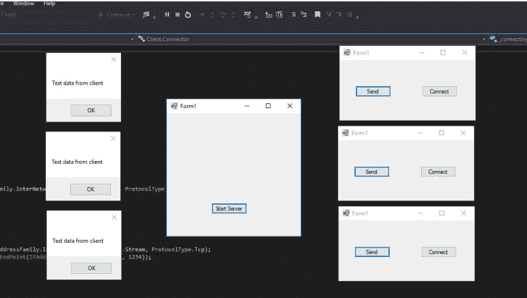

## 第104章：动作过滤器

### 第104.1节：自定义动作过滤器

我们出于各种原因编写自定义动作过滤器。我们可能有一个用于日志记录的自定义动作过滤器，或在任何动作执行之前将数据保存到数据库。我们也可以有一个用于从数据库获取数据并将其设置为应用程序的全局值的过滤器。

要创建自定义动作过滤器，我们需要执行以下任务：

- 1. 创建一个类
- 2. 让它继承自 ActionFilterAttribute 类

**至少重写以下方法之一：**

**OnActionExecuting** – 此方法在控制器操作执行之前被调用。

**OnActionExecuted** – 此方法在控制器操作执行之后被调用。

**OnResultExecuting** – 此方法在控制器操作结果执行之前被调用。

**OnResultExecuted** – 此方法在控制器操作结果执行之后被调用。

过滤器可以按如下所示的列表创建：

```csharp
using System;

using System.Diagnostics;

using System.Web.Mvc;

namespace WebApplication1
{
    public class MyFirstCustomFilter : ActionFilterAttribute
    {
        public override void OnResultExecuting(ResultExecutingContext filterContext)
        {
            //You may fetch data from database here
            filterContext.Controller.ViewBag.GreetMessage = "Hello Foo";
            base.OnResultExecuting(filterContext);
        }

        public override void OnActionExecuting(ActionExecutingContext filterContext)
        {
            var controllerName = filterContext.RouteData.Values["controller"];
            var actionName = filterContext.RouteData.Values["action"];
            var message = String.Format("{0} controller:{1} action:{2}", "onactionexecuting", controllerName, actionName);
            Debug.WriteLine(message, "Action Filter Log");
            base.OnActionExecuting(filterContext);
        }
    }
}
```

## 第105章：多态

### 第105.1节：多态的类型

多态意味着一个操作也可以应用于某些其他类型的值。

有多重多态类型：

- - **特设多态：**
- 包含函数重载。目标是方法可以在不同类型中使用而无需泛型。
- - **参数化多态：**
- 是使用泛型类型。参见 Generics
- - **子类型：**
- 目标是继承一个类以概括相似的功能

### 特设多态

特设多态的目标是创建一个方法，该方法可以由不同的数据类型调用，而无需在函数调用中进行类型转换或泛型。以下方法 sumInt(par1, par2) 可以使用不同的数据类型调用，并且对于每种类型的组合都有自己的实现：

```csharp
public static int sumInt( int a, int b)
{
    return a + b;
}

public static int sumInt( string a, string b)
{
    int _a, _b;

    if(!Int32.TryParse(a, out _a))
        _a = 0;

    if(!Int32.TryParse(b, out _b))
        _b = 0;

    return _a + _b;
}

public static int sumInt(string a, int b)
{
    int _a;

    if(!Int32.TryParse(a, out _a))
        _a = 0;

    return _a + b;
}

public static int sumInt(int a, string b)
{
    return sumInt(b,a);
}
```

这是一个示例调用：

```csharp
public static void Main()
{
    Console.WriteLine(sumInt( 1 , 2 )); //  3
    Console.WriteLine(sumInt("3","4")); //  7
    Console.WriteLine(sumInt("5", 6 )); // 11
    Console.WriteLine(sumInt( 7 ,"8")); // 15
}
```

### Subtyping

子类型化是通过从基类继承来概括相似行为的使用：

```csharp
public interface Car{
    void refuel();
}

public class NormalCar : Car
{
    public void refuel()
    {
        Console.WriteLine("Refueling with petrol");
    }
}

public class ElectricCar : Car
{
    public void refuel()
    {
        Console.WriteLine("Charging battery");
    }
}
```

两个类 NormalCar 和 ElectricCar 现在都有一个 refuel 方法，但各自的实现。以下是一个示例：

```csharp
public static void Main()
{
    List<Car> cars = new List<Car>(){
        new NormalCar(),
        new ElectricCar()
    };

    cars.ForEach(x => x.refuel());
}
```

输出如下：

> Refueling with petrol
> Charging battery

## Section 105.2: Another Polymorphism Example

多态是 OOP 的支柱之一。Poly 源自希腊语，意为“多种形式”。

下面是一个体现多态的示例。类 Vehicle 作为基类具有多种形式。

派生类 Ducati 和 Lamborghini 继承自 Vehicle 并重写基类的 Display() 方法，以显示其自己的 NumberOfWheels。

```csharp
public class Vehicle
{
    protected int NumberOfWheels { get; set; } = 0;
    public Vehicle()
    {
    }

    public virtual void Display()
    {
        Console.WriteLine($"The number of wheels for the {nameof(Vehicle)} is {NumberOfWheels}");
    }
}

public class Ducati : Vehicle
{
    public Ducati()
    {
        NumberOfWheels = 2;
    }

    public override void Display()
    {
        Console.WriteLine($"The number of wheels for the {nameof(Ducati)} is {NumberOfWheels}");
    }
}

public class Lamborghini : Vehicle
{
    public Lamborghini()
    {
        NumberOfWheels = 4;
    }

    public override void Display()
    {
        Console.WriteLine($"The number of wheels for the {nameof(Lamborghini)} is {NumberOfWheels}");
    }
}
```

下面是体现多态的代码片段。在第 1 行，使用变量 vehicle 为基类型 Vehicle 创建对象。它在第 2 行调用基类方法 Display() 并显示如图所示的输出。

```csharp
static void Main(string[] args)
{
    Vehicle vehicle = new Vehicle();    //Line 1
    vehicle.Display();                  //Line 2
    vehicle = new Ducati();             //Line 3
    vehicle.Display();                  //Line 4
    vehicle = new Lamborghini();        //Line 5
    vehicle.Display();                  //Line 6
}
```

第 3 行，vehicle 对象指向派生类 Ducati 并调用其 Display() 方法，显示如图所示的输出。这里出现了多态行为，即使 vehicle 对象的类型是 Vehicle，它也会调用派生类方法 Display()，因为类型 Ducati 重写了基类 Display() 方法，因为

## Chapter 106: Immutability

### Section 106.1: System.String class

在 C#（和 .NET）中，字符串由类 System.String 表示。string 关键字是该类的别名。

System.String 类是不可变的，即一旦创建，其状态就无法更改。

因此，你对字符串执行的所有操作，如 Substring、Remove、Replace、使用 + 运算符连接等，都会创建一个新的字符串并返回它。

请参阅以下程序进行演示 -

```csharp
string str = "mystring";
string newString = str.Substring(3);
Console.WriteLine(newString);
Console.WriteLine(str);
```

这将分别打印 string 和 mystring。

### Section 106.2: Strings and immutability

不可变类型是指在更改时会在内存中创建对象的新版本，而不是更改内存中现有对象的类型。最简单的例子就是内置的字符串类型。

下面是以下代码，将 " world" 追加到单词 "Hello"

```csharp
string myString = "hello";
myString += " world";
```

在这种情况下内存中发生的情况是，在第二行追加字符串时，会创建一个新对象。如果你在大型循环中执行此操作，则可能会导致应用程序出现性能问题。

字符串的可变等价物是 StringBuilder

下面是以下代码

```csharp
StringBuilder myStringBuilder = new StringBuilder("hello");
myStringBuilder.Append(" world");
```

运行此代码时，你是在内存中修改 StringBuilder 对象本身。

### Section 107.3: Indexer with 2 arguments and interface

```csharp
interface ITable {
    // an indexer can be declared in an interface
    object this[int x, int y] { get; set; }
}

class DataTable : ITable
{
    private object[,] cells = new object[10, 10];

    /// <summary>
    /// implementation of the indexer declared in the interface
    /// </summary>
    /// <param name="x">X-Index</param>
    /// <param name="y">Y-Index</param>
    /// <returns>Content of this cell</returns>
    public object this[int x, int y]
    {
        get
        {
            return cells[x, y];
        }
        set
        {
            cells[x, y] = value;
        }
    }
}
```

## Chapter 108: Checked and Unchecked

### Section 108.1: Checked and Unchecked

C# 语句在 checked 或 unchecked 上下文中执行。在 checked 上下文中，算术溢出会引发异常。在 unchecked 上下文中，算术溢出会被忽略，结果会被截断。

```csharp
short m = 32767;
short n = 32767;
int result1 = checked((short)(m + n));  //will throw an OverflowException
int result2 = unchecked((short)(m + n)); // will return -2
```

如果未指定其中任何一个，则默认上下文将依赖于其他因素，例如编译器选项。

### Section 108.2: Checked and Unchecked as a scope

这些关键字还可以创建作用域以（取消）检查多个操作。

```csharp
short m = 32767;
short n = 32767;
checked
{
    int result1 = (short)(m + n); //will throw an OverflowException
}
unchecked
{
    int result2 = (short)(m + n); // will return -2
}
```

```csharp
sw.Close();
//fs.Close(); There is no need to close fs. Closing sw will also close the stream it contains.
```

### StreamReader:

```csharp
using (var ms = new MemoryStream())
{
    StreamWriter sw = new StreamWriter(ms);
    sw.Write(123);
    //sw.Close();    This will close ms and when we try to use ms later it will cause an exception
    sw.Flush();     //You can send the remaining data to stream. Closing will do this automatically
    // We need to set the position to 0 in order to read
    // from the beginning.
    ms.Position = 0;
    StreamReader sr = new StreamReader(ms);
    var myStr = sr.ReadToEnd();
    sr.Close();
    ms.Close();
}
```

由于类 Stream、StreamReader、StreamWriter 等实现了 IDisposable 接口，我们可以对这些类的对象调用 Dispose() 方法。

## Chapter 110: Timers

### Section 110.1: Multithreaded Timers

System.Threading.Timer - 最简单的多线程定时器。包含两个方法和一个构造函数。

示例：定时器调用 DataWrite 方法，在经过五秒后写入 "multithread executed..."，然后每隔一秒写入一次，直到用户按下 Enter：

```csharp
using System;
using System.Threading;
class Program
{
    static void Main()
    {
        // First interval = 5000ms; subsequent intervals = 1000ms
        Timer timer = new Timer(DataWrite, "multithread executed...", 5000, 1000);
        Console.ReadLine();
        timer.Dispose(); // This both stops the timer and cleans up.
    }

    static void DataWrite(object data)
    {
        // This runs on a pooled thread
        Console.WriteLine(data); // Writes "multithread executed..."
    }
}
```

注意：将另起一节介绍多线程定时器的释放。

Change - 当你想更改定时器间隔时可以调用此方法。

Timeout.Infinite - 如果你只想触发一次。将此指定为构造函数的最后一个参数。

System.Timers - .NET Framework 提供的另一个定时器类。它封装了 System.Threading.Timer。

### Features:

- IComponent - 允许将其放置在 Visual Studio 设计器的组件托盘中
- Interval 属性代替 Change 方法
- Elapsed 事件代替回调委托
- Enabled 属性用于启动和停止定时器（默认值 = false）
- Start 和 Stop 方法，以防你对 Enabled 属性（上一点）感到困惑
- AutoReset - 用于指示重复事件（默认值 = true）
- SynchronizingObject 属性，带 Invoke 和 BeginInvoke 方法，用于安全地在 WPF 元素和 Windows Forms 控件上调用方法

表示上述所有功能的示例：

```csharp
using System;
using System.Timers; // Timers namespace rather than Threading
class SystemTimer
{
    static void Main()
    {
        Timer timer = new Timer(); // Doesn't require any args
        timer.Interval = 500;
    }
}
```


```csharp
timer.Elapsed += timer_Elapsed; // Uses an event instead of a delegate
timer.Start(); // Start the timer
Console.ReadLine();
timer.Stop(); // Stop the timer
Console.ReadLine();
timer.Start(); // Restart the timer
Console.ReadLine();
timer.Dispose(); // Permanently stop the timer
}

static void timer_Elapsed(object sender, EventArgs e)
{
    Console.WriteLine ("Tick");
}
```

多线程计时器 - 使用线程池允许少数线程为许多计时器服务。这意味着回调方法或 Elapsed 事件每次被调用时可能在不同的线程上触发。

Elapsed - 此事件始终准时触发——无论之前的 Elapsed 事件是否已执行完毕。因此，回调或事件处理程序必须是线程安全的。多线程计时器的精度取决于操作系统，通常在 10–20 ms。

interop - 当你需要更高的精度时使用此方法并调用 Windows 多媒体计时器。其精度可达 1 ms，并在 winmm.dll 中定义。

timeBeginPeriod - 首先调用此函数以通知操作系统你需要高计时精度

timeSetEvent - 在 timeBeginPeriod 之后调用此函数以启动多媒体计时器。

timeKillEvent - 完成后调用此函数，这会停止计时器

timeEndPeriod - 调用此函数以通知操作系统你不再需要高计时精度。

你可以在互联网上找到使用多媒体计时器的完整示例，搜索关键词 dllimport winmm.dll timesetevent 即可。

## 第 110.2 节：创建计时器的实例

计时器用于在特定时间间隔执行任务（每 Y 秒执行 X）。下面是创建计时器新实例的示例。

**注意：** 这适用于使用 WinForms 的计时器。如果使用 WPF，你可能需要查看 DispatcherTimer

```csharp
using System.Windows.Forms; //Timers use the Windows.Forms namespace

public partial class Form1 : Form
{
    Timer myTimer = new Timer(); //create an instance of Timer named myTimer

    public Form1()
    {
        InitializeComponent();
    }
}
```

## 第 110.3 节：为计时器分配“Tick”事件处理程序

计时器中执行的所有操作都在“Tick”事件中处理。

```
public partial class Form1 : Form
{
    Timer myTimer = new Timer();

    public Form1()
    {
        InitializeComponent();
        myTimer.Tick += myTimer_Tick; //assign the event handler named "myTimer_Tick"
    }

    private void myTimer_Tick(object sender, EventArgs e)
    {
        // Perform your actions here.
    }
}
```

## 第 110.4 节：示例：使用计时器执行简单倒计时

```
public partial class Form1 : Form
{
    Timer myTimer = new Timer();
    int timeLeft = 10;

    public Form1()
    {
        InitializeComponent();

        //set properties for the Timer
        myTimer.Interval = 1000;
        myTimer.Enabled = true;

        //Set the event handler for the timer, named "myTimer_Tick"
        myTimer.Tick += myTimer_Tick;

        //Start the timer as soon as the form is loaded
        myTimer.Start();

        //Show the time set in the "timeLeft" variable
        lblCountDown.Text = timeLeft.ToString();
    }

    private void myTimer_Tick(object sender, EventArgs e)
    {
        //perform these actions at the interval set in the properties.
        lblCountDown.Text = timeLeft.ToString();
        timeLeft -= 1;

        if (timeLeft < 0)
        {
            myTimer.Stop();
        }
    }
}
```

```
}
}
```

结果为...

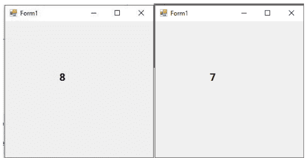

等等...

## 第 111 章：秒表

### 第 111.1 节：IsHighResolution

- IsHighResolution 属性指示计时器是基于高分辨率性能计数器还是基于 DateTime 类。
- 此字段为只读。

```csharp
// Display the timer frequency and resolution.
if (Stopwatch.IsHighResolution)
{
    Console.WriteLine("Operations timed using the system's high-resolution performance counter.");
}
else
{
    Console.WriteLine("Operations timed using the DateTime class.");
}

long frequency = Stopwatch.Frequency;
Console.WriteLine("  Timer frequency in ticks per second = {0}",
    frequency);
long nanosecPerTick = (1000L*1000L*1000L) / frequency;
Console.WriteLine("  Timer is accurate within {0} nanoseconds",
    nanosecPerTick);
}
```

https://dotnetfiddle.net/crKWUo

Stopwatch 类使用的计时器取决于系统硬件和操作系统。如果 Stopwatch 计时器基于高分辨率性能计数器，则 IsHighResolution 为 true。否则，IsHighResolution 为 false，这表明 Stopwatch 计时器基于系统计时器。

Stopwatch 中的刻度取决于机器/操作系统，因此你永远不应指望 Stopwatch 刻度与秒的比例在两个系统之间相同，甚至在同一系统重启后也可能不同。因此，你永远不能指望 Stopwatch 刻度与 DateTime/TimeSpan 刻度为同一间隔。

为了获得与系统无关的时间，请确保使用 Stopwatch 的 Elapsed 或 ElapsedMilliseconds 属性，这些属性已考虑 Stopwatch.Frequency（每秒刻度数）。

对于计时过程，应始终使用 Stopwatch 而非 DateTime，因为它更轻量，并且如果可以使用高分辨率性能计数器，则会使用 DateTime。

来源

### 第 111.2 节：创建秒表实例

Stopwatch 实例可以在多个间隔上测量经过的时间，总经过时间为所有单个间隔的总和。这提供了一种可靠的方法来测量两个或多个事件之间的经过时间。

```csharp
Stopwatch stopWatch = new Stopwatch();
stopWatch.Start();

double d = 0;
for (int i = 0; i < 1000 * 1000 * 1000; i++)
{
d += 1;
}

stopWatch.Stop();
Console.WriteLine("Time elapsed: {0:hh\\:mm\\:ss\\.fffffff}", stopWatch.Elapsed);
```

Stopwatch 在 System.Diagnostics 中，因此你需要在文件中添加 using System.Diagnostics;

## 第 112 章：线程

### 第 112.1 节：避免同时读取和写入数据

有时，你希望线程同时共享数据。发生这种情况时，重要的是要意识到代码并锁定可能出错的任何部分。下面展示了两个线程计数的简单示例。

这是一些危险（不正确）的代码：

```csharp
using System.Threading;

class MainClass
{
    static int count { get; set; }

    static void Main()
    {
        for (int i = 1; i <= 2; i++)
        {
            var thread = new Thread(ThreadMethod);
            thread.Start(i);
            Thread.Sleep(500);
        }
    }

    static void ThreadMethod(object threadNumber)
    {
        while (true)
        {
            var temp = count;
            System.Console.WriteLine("Thread " + threadNumber + ": Reading the value of count.");
            Thread.Sleep(1000);
            count = temp + 1;
            System.Console.WriteLine("Thread " + threadNumber + ": Incrementing the value of count to:" + count);
            Thread.Sleep(1000);
        }
    }
}
```

你会注意到，而不是计数 1,2,3,4,5... 我们计数 1,1,2,2,3...

为了解决这个问题，我们需要 **锁定** count 的值，以便多个不同的线程不能同时对其进行读写。通过添加锁和键，我们可以防止线程同时访问数据。

```csharp
using System.Threading;

class MainClass
{
    static int count { get; set; }
    static readonly object key = new object();

    static void Main()
    {
        for (int i = 1; i <= 2; i++)
{
    var thread = new Thread(ThreadMethod);
    thread.Start(i);
    Thread.Sleep(500);
}
}
static void ThreadMethod(object threadNumber)
{
    while (true)
    {
        lock (key)
        {
            var temp = count;
            System.Console.WriteLine("Thread " + threadNumber + ": Reading the value of count.");
            Thread.Sleep(1000);
            count = temp + 1;
            System.Console.WriteLine("Thread " + threadNumber + ": Incrementing the value of count to:" + count);
        }
        Thread.Sleep(1000);
    }
}
}
```

### 第 112.2 节：创建并启动第二个线程

如果你正在进行多个长时间计算，你可以在计算机的不同线程上同时运行它们。为此，我们创建一个新的 **线程** 并让它指向不同的方法。

```csharp
using System.Threading;

class MainClass {
    static void Main() {
        var thread = new Thread(Secondary);
        thread.Start();
    }

    static void Secondary() {
        System.Console.WriteLine("Hello World!");
    }
}
```

### 第 112.3 节：Parallel.ForEach 循环

如果你有一个 foreach 循环想要加速，并且不介意输出的顺序，你可以通过以下方式将其转换为并行 foreach 循环：

```csharp
using System;
using System.Threading;
using System.Threading.Tasks;

public class MainClass {

    public static void Main() {
        int[] Numbers = new int[] { 1, 2, 3, 4, 5, 6, 7, 8, 9, 10 };
        // Single-threaded
        Console.WriteLine("Normal foreach loop: ");


```csharp
foreach (var number in Numbers) {
    Console.WriteLine(longCalculation(number));
}
// This is the Parallel (Multi-threaded solution)
Console.WriteLine("Parallel foreach loop: ");
Parallel.ForEach(Numbers, number => {
    Console.WriteLine(longCalculation(number));
});
}
private static int longCalculation(int number) {
    Thread.Sleep(1000); // Sleep to simulate a long calculation
    return number * number;
}
}
```

## 第 112.4 节：死锁（持有资源并等待）

死锁是指当两个或多个线程相互等待对方完成或释放资源，以至于永远等待下去时发生的现象。

如果 thread1 持有资源 A 的锁并等待资源 B 被释放，而 thread2 持有资源 B 并等待资源 A 被释放，它们就会发生死锁。

点击以下示例代码的 button1 将导致你的应用程序进入上述死锁状态并挂起

```csharp
private void button_Click(object sender, EventArgs e)
{
    DeadlockWorkers workers = new DeadlockWorkers();
    workers.StartThreads();
    textBox.Text = workers.GetResult();
}

private class DeadlockWorkers
{
    Thread thread1, thread2;

    object resourceA = new object();
    object resourceB = new object();

    string output;

    public void StartThreads()
    {
        thread1 = new Thread(Thread1DoWork);
        thread2 = new Thread(Thread2DoWork);
        thread1.Start();
        thread2.Start();
    }

    public string GetResult()
    {
        thread1.Join();
        thread2.Join();
        return output;
    }

    public void Thread1DoWork()
    {
        Thread.Sleep(100);
        lock (resourceA)
        {
            Thread.Sleep(100);
            lock (resourceB)
            {
                output += "T1#";
            }
        }
    }

    public void Thread2DoWork()
    {
        Thread.Sleep(100);
        lock (resourceB)
        {
            Thread.Sleep(100);
            lock (resourceA)
            {
                output += "T2#";
            }
        }
    }
}
```

为了避免以这种方式发生死锁，可以使用 Monitor.TryEnter(lock_object, timeout_in_milliseconds) 来检查对象是否已被锁定。如果 Monitor.TryEnter 在 timeout_in_milliseconds 时间内未能获取 lock_object 上的锁，它将返回 false，从而给线程一个机会释放其他已持有的资源并让出执行权，进而给其他线程完成的机会，如下所示的稍作修改的版本：

```csharp
private void button_Click(object sender, EventArgs e)
{
    MonitorWorkers workers = new MonitorWorkers();
    workers.StartThreads();
    textBox.Text = workers.GetResult();
}

private class MonitorWorkers
{
    Thread thread1, thread2;

    object resourceA = new object();
    object resourceB = new object();

    string output;

    public void StartThreads()
    {
        thread1 = new Thread(Thread1DoWork);
        thread2 = new Thread(Thread2DoWork);
        thread1.Start();
        thread2.Start();
    }

    public string GetResult()
    {
        thread1.Join();
        thread2.Join();
        return output;
    }

    public void Thread1DoWork()
    {
        bool mustDoWork = true;
        Thread.Sleep(100);
        while (mustDoWork)
        {
            lock (resourceA)
            {
                Thread.Sleep(100);
                if (Monitor.TryEnter(resourceB, 0))
                {
                    output += "T1#";
                    mustDoWork = false;
                    Monitor.Exit(resourceB);
                }
            }
            if (mustDoWork) Thread.Yield();
        }
    }

    public void Thread2DoWork()
    {
        Thread.Sleep(100);
        lock (resourceB)
        {
            Thread.Sleep(100);
            lock (resourceA)
            {
                output += "T2#";
            }
        }
    }
}
```

请注意，此变通方法依赖于 thread2 对其锁的固执以及 thread1 愿意让出执行权，使得 thread2 始终具有优先权。另请注意，当 thread1 让出执行权时，它必须重做在锁定资源 A 之后所做的工作。因此，在使用多个让出执行权的线程实现此方法时要小心，因为你可能会冒进入所谓的活锁的风险——这种状态会发生在两个线程不断执行其工作的第一部分然后相互让出执行权，反复重新开始时。

## 第 112.5 节：简单完整线程演示

```csharp
class Program
{
    static void Main(string[] args)
    {
        // Create 2 thread objects.  We're using delegates because we need to pass
        // parameters to the threads.
        var thread1 = new Thread(new ThreadStart(() => PerformAction(1)));
        var thread2 = new Thread(new ThreadStart(() => PerformAction(2)));

        // Start the threads running
        thread1.Start();
        // NB: as soon as the above line kicks off the thread, the next line starts;
        // even if thread1 is still processing.
        thread2.Start();

        // Wait for thread1 to complete before continuing
        thread1.Join();
        // Wait for thread2 to complete before continuing
        thread2.Join();

        Console.WriteLine("Done");
        Console.ReadKey();
    }

    // Simple method to help demonstrate the threads running in parallel.
    static void PerformAction(int id)
    {
        var rnd = new Random(id);
        for (int i = 0; i < 100; i++)
        {
            Console.WriteLine("Thread: {0}: {1}", id, i);
            Thread.Sleep(rnd.Next(0, 1000));
        }
    }
}
```

## 第 112.6 节：为每个处理器创建一个线程

> Environment.ProcessorCount 获取当前机器上 **逻辑** 处理器的数量。

然后 CLR 将把每个线程调度到一个逻辑处理器，理论上这可能意味着每个线程都在不同的逻辑处理器上，所有线程都在单个逻辑处理器上，或其他某种组合。

```csharp
using System;
using System.Threading;

class MainClass {
    static void Main() {
        for (int i = 0; i < Environment.ProcessorCount; i++) {
            var thread = new Thread(Secondary);
            thread.Start(i);
        }
    }

    static void Secondary(object threadNumber) {
        System.Console.WriteLine("Hello World from thread: " + threadNumber);
    }
}
```

## 第 112.7 节：使用任务的简单完整线程演示

```csharp
class Program
{
    static void Main(string[] args)
    {
        // Run 2 Tasks.
        var task1 = Task.Run(() => PerformAction(1));
        var task2 = Task.Run(() => PerformAction(2));

        // Wait (i.e. block this thread) until both Tasks are complete.
        Task.WaitAll(new [] { task1, task2 });

        Console.WriteLine("Done");
        Console.ReadKey();
    }

    // Simple method to help demonstrate the threads running in parallel.
    static void PerformAction(int id)
    {
        var rnd = new Random(id);
        for (int i = 0; i < 100; i++)
        {
            Console.WriteLine("Task: {0}: {1}", id, i);
            Thread.Sleep(rnd.Next(0, 1000));
        }
    }
}
```

## 第 112.8 节：死锁（两个线程相互等待）

死锁是指当两个或多个线程相互等待对方完成或释放资源，以至于永远等待下去时发生的现象。

两个线程相互等待完成的典型场景是 Windows Forms GUI 线程等待工作线程，而工作线程尝试调用由 GUI 线程管理的对象。请注意，使用此代码示例，点击 button1 将导致程序挂起。

```csharp
private void button1_Click(object sender, EventArgs e)
{
    Thread workerthread= new Thread(dowork);
    workerthread.Start();
    workerthread.Join();
    // Do something after
}

private void dowork()
{
    // Do something before
    textBox1.Invoke(new Action(() => textBox1.Text = "Some Text"));
    // Do something after
}
```

`workerthread.Join()` 是一个调用，它会阻塞调用线程，直到 workerthread 完成。
`textBox1.Invoke(invoke_delegate)` 是一个调用，它会阻塞调用线程，直到 GUI 线程处理完 invoke_delegate，但如果 GUI 线程已经在等待调用线程完成，则此调用会导致死锁。

为了解决这个问题，可以改用非阻塞的方式调用文本框：

```csharp
private void dowork()
{
    // Do work
    textBox1.BeginInvoke(new Action(() => textBox1.Text = "Some Text"));
    // Do work that is not dependent on textBox1 being updated first
}
```

然而，如果你需要运行依赖于文本框先被更新的代码，这就会造成问题。在这种情况下，将其作为 invoke 的一部分运行，但请注意，这会使其在 GUI 线程上运行。

```csharp
private void dowork()
{
    // Do work
    textBox1.BeginInvoke(new Action(() => {
        textBox1.Text = "Some Text";
    }));
}
```


~~~csharp
    // Do work dependent on textBox1 being updated first,
    // start another worker thread or raise an event
});
// Do work that is not dependent on textBox1 being updated first
}
~~~

或者启动一个全新的线程，让它在 GUI 线程上进行等待，以便 workerthread 能够完成。

~~~csharp
private void dowork()
{
    // Do work
    Thread workerthread2 = new Thread(() =>
    {
        textBox1.Invoke(new Action(() => textBox1.Text = "Some Text"));
        // Do work dependent on textBox1 being updated first,
        // start another worker thread or raise an event
    });
    workerthread2.Start();
    // Do work that is not dependent on textBox1 being updated first
}
~~~

为了最大限度地降低出现相互等待死锁的风险，在可能的情况下始终避免线程之间的循环引用。 在较低等级的线程只向较高等级的线程发送消息并且从不等待它们的线程层级中，不会出现此类问题。 然而，它仍然容易受到基于资源锁定的死锁的影响。

## Section 112.9: 显式任务并行

~~~csharp
private static void explicitTaskParallism()
{
    Thread.CurrentThread.Name = "Main";

    // Create a task and supply a user delegate by using a lambda expression.
    Task taskA = new Task(() => Console.WriteLine($"Hello from task {nameof(taskA)}."));
    Task taskB = new Task(() => Console.WriteLine($"Hello from task {nameof(taskB)}."));

    // Start the task.
    taskA.Start();
    taskB.Start();

    // Output a message from the calling thread.
    Console.WriteLine("Hello from thread '{0}'.",
                      Thread.CurrentThread.Name);
    taskA.Wait();
    taskB.Wait();
    Console.Read();
}
~~~

## Section 112.10: 隐式任务并行

~~~csharp
private static void Main(string[] args)
{
    var a = new A();
    var b = new B();
    //implicit task parallelism
    Parallel.Invoke(
        () => a.DoSomeWork(),
        () => b.DoSomeOtherWork()
    );
}
~~~

## Section 112.11: 使用参数启动线程

using System.Threading;

```csharp
class MainClass {
    static void Main() {
        var thread = new Thread(Secondary);
        thread.Start("SecondThread");
    }

    static void Secondary(object threadName) {
        System.Console.WriteLine("Hello World from thread: " + threadName);
    }
}
```

## Chapter 113: Async/await、Backgroundworker、Task 和 Thread 示例

### Section 113.1: ASP.NET Configure Await

当 ASP.NET 处理请求时，会从线程池分配一个线程并创建请求上下文。 请求上下文包含有关当前请求的信息，可通过静态 HttpContext.Current 属性访问。 然后将该请求的请求上下文分配给处理该请求的线程。

给定的请求上下文在同一时间只能在一个线程上处于活动状态。

当执行到达 await 时，处理请求的线程会被返回到线程池，而异步方法正在运行，请求上下文可供另一个线程使用。

```
public async Task<ActionResult> Index()
{
    // Execution on the initially assigned thread
    var products = await dbContext.Products.ToListAsync();
    // Execution resumes on a "random" thread from the pool
    // Execution continues using the original request context.
    return View(products);
}
```

当任务完成时，线程池会分配另一个线程来继续执行请求。 然后请求上下文会被分配给该线程。 这可能是也可能不是原始线程。

# 阻塞

当同步等待异步方法调用的结果时，可能会出现死锁。 例如，当调用 IndexSync() 时，以下代码将导致死锁：

```
public async Task<ActionResult> Index()
{
    // Execution on the initially assigned thread
    List<Product> products = await dbContext.Products.ToListAsync();
    // Execution resumes on a "random" thread from the pool
    return View(products);
}
public ActionResult IndexSync()
{
    Task<ActionResult> task = Index();
    // Block waiting for the result synchronously
    ActionResult result = task.Result;
    return result;
}
```

这是因为，默认情况下，被等待的任务，在本例中为 db.Products.ToListAsync()，会捕获上下文（在 ASP.NET 的情况下为请求上下文），并在完成后尝试使用它。

当整个调用堆栈都是异步时，没有问题，因为一旦到达 await，原始线程就会被释放，从而释放请求上下文。

当我们使用 Task.Result 或 Task.Wait()（或其他阻塞方法）进行同步阻塞时，原始线程仍然处于活动状态并保留请求上下文。 被等待的方法仍异步运行，一旦回调尝试运行，即被等待的任务返回后，它会尝试获取请求上下文。

因此，死锁出现的原因是：拥有请求上下文的阻塞线程正在等待异步操作完成，而异步操作正试图获取请求上下文以完成操作。

# ConfigureAwait

默认情况下，对被等待任务的调用会捕获当前上下文，并在完成后尝试在该上下文上恢复执行。

通过使用 ConfigureAwait(false) 可以防止这种情况并避免死锁。

```csharp
public async Task<ActionResult> Index()
{
    // Execution on the initially assigned thread
    List<Product> products = await dbContext.Products.ToListAsync().ConfigureAwait(false);

    // Execution resumes on a "random" thread from the pool without the original request context
    return View(products);
}
public ActionResult IndexSync()
{
    Task<ActionResult> task = Index();

    // Block waiting for the result synchronously
    ActionResult result = task.Result;

    return result;
}
```

这可以在有必要对异步代码进行阻塞时避免死锁，但代价是在 continuation（await 调用之后的代码）中丢失上下文。

在 ASP.NET 中，这意味着如果在 await someTask.ConfigureAwait(false); 调用之后的代码尝试访问上下文中的信息，例如 HttpContext.Current.User，则信息会丢失。 在这种情况下 HttpContext.Current 为 null。 例如：

```csharp
public async Task<ActionResult> Index()
{
    // Contains information about the user sending the request
    var user = System.Web.HttpContext.Current.User;

    using (var client = new HttpClient())
    {
        await client.GetAsync("http://google.com").ConfigureAwait(false);
    }

    // Null Reference Exception, Current is null
    var user2 = System.Web.HttpContext.Current.User;

    return View();
}
```

如果使用 ConfigureAwait(true)（相当于根本没有 ConfigureAwait），则 user 和 user2 都将被相同的数据填充。

因此，通常建议在不再使用上下文的库代码中使用 ConfigureAwait(false)。

### Section 113.2: Task "run and forget" 扩展

在某些情况下（例如日志记录），运行任务而不等待结果可能很有用。 以下扩展允许运行任务并继续执行剩余代码：

```
public static class TaskExtensions
{
    public static async void RunAndForget(
        this Task task, Action<Exception> onException = null)
    {
        try
        {
            await task;
        }
        catch (Exception ex)
        {
            onException?.Invoke(ex);
        }
    }
}
```

结果仅在扩展方法内部被等待。 由于使用了 async/await，因此可以捕获异常并调用可选的处理方法。

使用该扩展的示例：

```
var task = Task.FromResult(0); // Or any other task from e.g. external lib.
task.RunAndForget(
    e =>
    {
        // Something went wrong, handle it.
    });
```

### Section 113.3: Async/await

请参阅下面的简单示例，了解如何使用 async/await 在后台进程中执行一些耗时操作，同时保留执行不需要等待耗时操作完成的其他操作的选项。

但是，如果你以后需要使用耗时方法的结果，可以通过等待执行来实现。

```
public async Task ProcessDataAsync()
{
    // Start the time intensive method
    Task<int> task = TimeintensiveMethod(@"PATH_TO_SOME_FILE");

    // Control returns here before TimeintensiveMethod returns
    Console.WriteLine("You can read this while TimeintensiveMethod is still running.");


// Wait for TimeintensiveMethod to complete and get its result
int x = await task;
Console.WriteLine("Count: " + x);
}

private async Task<int> TimeintensiveMethod(object file)
{
    Console.WriteLine("Start TimeintensiveMethod.");

    // Do some time intensive calculations...
    using (StreamReader reader = new StreamReader(file.ToString()))
    {
        string s = await reader.ReadToEndAsync();

        for (int i = 0; i < 1000; i++)
            s.GetHashCode();
    }
    Console.WriteLine("End TimeintensiveMethod.");

    // return something as a "result"
    return new Random().Next(100);
}

### 第 113.4 节：BackgroundWorker

以下是一个简单的示例，说明如何使用 BackgroundWorker 对象在后台线程中执行耗时操作。

你需要：

- 1. 定义一个执行耗时工作的 worker 方法，并从 BackgroundWorker 的 DoWork 事件的处理程序中调用它。
- 2. 使用 RunWorkerAsync 启动执行。DoWork 附加的工作方法所需的任何参数都可以通过 RunWorkerAsync 的 DoWorkEventArgs 参数传入。

除了 DoWork 事件之外，BackgroundWorker 类还定义了两个用于与用户界面交互的事件。这些是可选的。

- RunWorkerCompleted 事件在 DoWork 处理程序完成时触发。
- ProgressChanged 事件在调用 ReportProgress 方法时触发。

```
public void ProcessDataAsync()
{
    // Start the time intensive method
    BackgroundWorker bw = new BackgroundWorker();
    bw.DoWork += BwDoWork;
    bw.RunWorkerCompleted += BwRunWorkerCompleted;
    bw.RunWorkerAsync("@PATH_TO_SOME_FILE");

    // Control returns here before TimeintensiveMethod returns
    Console.WriteLine("You can read this while TimeintensiveMethod is still running.");
}

// Method that will be called after BwDoWork exits
private void BwRunWorkerCompleted(object sender, RunWorkerCompletedEventArgs e)
{
    // we can access possible return values of our Method via the Parameter e
    Console.WriteLine("Count: " + e.Result);
}
```

```
// execution of our time intensive Method
private void BwDoWork(object sender, DoWorkEventArgs e)
{
    e.Result = TimeintensiveMethod(e.Argument);
}

private int TimeintensiveMethod(object file)
{
    Console.WriteLine("Start TimeintensiveMethod.");

    // Do some time intensive calculations...
    using (StreamReader reader = new StreamReader(file.ToString()))
    {
        string s = reader.ReadToEnd();

        for (int i = 0; i < 10000; i++)
            s.GetHashCode();
    }
    Console.WriteLine("End TimeintensiveMethod.");

    // return something as a "result"
    return new Random().Next(100);
}
```

### 第 113.5 节：Task

以下是一个简单的示例，说明如何使用 Task 在后台进程中执行一些耗时操作。

你需要做的就是将耗时方法包装在 Task.Run() 调用中。

```
public void ProcessDataAsync()
{
    // Start the time intensive method
    Task<int> t = Task.Run(() => TimeintensiveMethod(@"PATH_TO_SOME_FILE"));

    // Control returns here before TimeintensiveMethod returns
    Console.WriteLine("You can read this while TimeintensiveMethod is still running.");

    Console.WriteLine("Count: " + t.Result);
}
```

```
private int TimeintensiveMethod(object file)
{
    Console.WriteLine("Start TimeintensiveMethod.");

    // Do some time intensive calculations...
    using (StreamReader reader = new StreamReader(file.ToString()))
    {
        string s = reader.ReadToEnd();

        for (int i = 0; i < 10000; i++)
            s.GetHashCode();
    }
    Console.WriteLine("End TimeintensiveMethod.");

    // return something as a "result"
    return new Random().Next(100);
}
```

### 第 113.6 节：Thread

以下是一个简单的示例，说明如何使用 Thread 在后台进程中执行一些耗时操作。

```
public async void ProcessDataAsync()
{
    // Start the time intensive method
    Thread t = new Thread(TimeintensiveMethod);

    // Control returns here before TimeintensiveMethod returns
    Console.WriteLine("You can read this while TimeintensiveMethod is still running.");
}

private void TimeintensiveMethod()
{
    Console.WriteLine("Start TimeintensiveMethod.");

    // Do some time intensive calculations...
    using (StreamReader reader = new StreamReader(@"PATH_TO_SOME_FILE"))
    {
        string v = reader.ReadToEnd();

        for (int i = 0; i < 10000; i++)
            v.GetHashCode();
    }
    Console.WriteLine("End TimeintensiveMethod.");
}
```

如你所见，我们无法从 TimeIntensiveMethod 返回值，因为 Thread 要求其参数为 void 方法。

要从 Thread 获取返回值，请使用事件或以下方法：

```
int ret;
Thread t = new Thread(() =>
{
    Console.WriteLine("Start TimeintensiveMethod.");

    // Do some time intensive calculations...
    using (StreamReader reader = new StreamReader(file))
    {
        string s = reader.ReadToEnd();

        for (int i = 0; i < 10000; i++)
            s.GetHashCode();
    }
    Console.WriteLine("End TimeintensiveMethod.");

    // return something to demonstrate the coolness of await-async
    ret = new Random().Next(100);
});

t.Start();
t.Join(1000);
Console.WriteLine("Count: " + ret);
```

## 第 114 章：Async-Await

在 C# 中，声明为 async 的方法在同步进程中不会阻塞，前提是使用基于 I/O 的操作（例如网络访问、工作文件等）。此类标记为 async 的方法的结果可以通过 await 关键字进行等待。

### 第 114.1 节：Await 运算符和 async 关键字

await 运算符和 async 关键字一起使用：

> 使用 await 的异步方法必须由 async 关键字修饰。

反之则不总是成立：你可以在方法体中不使用 await 的情况下将其标记为 async。

await 实际做的是暂停代码的执行，直到被等待的任务完成；任何任务都可以被等待。

注意：你不能等待返回 nothing（void）的 async 方法。

实际上，“暂停”这个词有点误导，因为不仅执行停止，而且线程可能被释放以执行其他操作。在内部，await 是通过编译器的一些魔法实现的：它将方法拆分为两部分——await 之前和之后。后一部分在被等待的任务完成后执行。

如果忽略一些重要细节，编译器大致会为你执行以下操作：

```
public async Task<TResult> DoIt()
{
    // do something and acquire someTask of type Task<TSomeResult>
    var awaitedResult = await someTask;
    // ... do something more and produce result of type TResult
    return result;
}
```

becomes:

```
public Task<TResult> DoIt()
{
    // ...
    return someTask.ContinueWith(task => {
        var result = ((Task<TSomeResult>)task).Result;
        return DoIt_Continuation(result);
    });
}
private TResult DoIt_Continuation(TSomeResult awaitedResult)
{
    // ...
}
```

任何普通方法都可以通过以下方式转换为 async：

```
await Task.Run(() => YourSyncMethod());
```

当你需要在 UI 线程上执行长时间运行的方法而不冻结

UI 时，这可能很有优势。

但这里有一个非常重要[content]
// Wait for TimeintensiveMethod to complete and get its result
int x = await task;
Console.WriteLine("Count: " + x);
}

private async Task<int> TimeintensiveMethod(object file)
{
    Console.WriteLine("Start TimeintensiveMethod.");

    // Do some time intensive calculations...
    using (StreamReader reader = new StreamReader(file.ToString()))
    {
        string s = await reader.ReadToEndAsync();

        for (int i = 0; i < 1000; i++)
            s.GetHashCode();
    }
    Console.WriteLine("End TimeintensiveMethod.");

    // return something as a "result"
    return new Random().Next(100);
}

### 第 113.4 节：BackgroundWorker

以下是一个简单的示例，说明如何使用 BackgroundWorker 对象在后台线程中执行耗时操作。

你需要：

- 1. 定义一个执行耗时工作的 worker 方法，并从 BackgroundWorker 的 DoWork 事件的处理程序中调用它。
- 2. 使用 RunWorkerAsync 启动执行。DoWork 附加的工作方法所需的任何参数都可以通过 RunWorkerAsync 的 DoWorkEventArgs 参数传入。

除了 DoWork 事件之外，BackgroundWorker 类还定义了两个用于与用户界面交互的事件。这些是可选的。

- RunWorkerCompleted 事件在 DoWork 处理程序完成时触发。
- ProgressChanged 事件在调用 ReportProgress 方法时触发。

```
public void ProcessDataAsync()
{
    // Start the time intensive method
    BackgroundWorker bw = new BackgroundWorker();
    bw.DoWork += BwDoWork;
    bw.RunWorkerCompleted += BwRunWorkerCompleted;
    bw.RunWorkerAsync("@PATH_TO_SOME_FILE");

    // Control returns here before TimeintensiveMethod returns
    Console.WriteLine("You can read this while TimeintensiveMethod is still running.");
}

// Method that will be called after BwDoWork exits
private void BwRunWorkerCompleted(object sender, RunWorkerCompletedEventArgs e)
{
    // we can access possible return values of our Method via the Parameter e
    Console.WriteLine("Count: " + e.Result);
}
```

```
// execution of our time intensive Method
private void BwDoWork(object sender, DoWorkEventArgs e)
{
    e.Result = TimeintensiveMethod(e.Argument);
}

private int TimeintensiveMethod(object file)
{
    Console.WriteLine("Start TimeintensiveMethod.");

    // Do some time intensive calculations...
    using (StreamReader reader = new StreamReader(file.ToString()))
    {
        string s = reader.ReadToEnd();

        for (int i = 0; i < 10000; i++)
            s.GetHashCode();
    }
    Console.WriteLine("End TimeintensiveMethod.");

    // return something as a "result"
    return new Random().Next(100);
}
```

### 第 113.5 节：Task

以下是一个简单的示例，说明如何使用 Task 在后台进程中执行一些耗时操作。

你需要做的就是将耗时方法包装在 Task.Run() 调用中。

```
public void ProcessDataAsync()
{
    // Start the time intensive method
    Task<int> t = Task.Run(() => TimeintensiveMethod(@"PATH_TO_SOME_FILE"));

    // Control returns here before TimeintensiveMethod returns
    Console.WriteLine("You can read this while TimeintensiveMethod is still running.");

    Console.WriteLine("Count: " + t.Result);
}
```

```
private int TimeintensiveMethod(object file)
{
    Console.WriteLine("Start TimeintensiveMethod.");

    // Do some time intensive calculations...
    using (StreamReader reader = new StreamReader(file.ToString()))
    {
        string s = reader.ReadToEnd();

        for (int i = 0; i < 10000; i++)
            s.GetHashCode();
    }
    Console.WriteLine("End TimeintensiveMethod.");

    // return something as a "result"
    return new Random().Next(100);
}
```

### 第 113.6 节：Thread

以下是一个简单的示例，说明如何使用 Thread 在后台进程中执行一些耗时操作。

```
public async void ProcessDataAsync()
{
    // Start the time intensive method
    Thread t = new Thread(TimeintensiveMethod);

    // Control returns here before TimeintensiveMethod returns
    Console.WriteLine("You can read this while TimeintensiveMethod is still running.");
}

private void TimeintensiveMethod()
{
    Console.WriteLine("Start TimeintensiveMethod.");

    // Do some time intensive calculations...
    using (StreamReader reader = new StreamReader(@"PATH_TO_SOME_FILE"))
    {
        string v = reader.ReadToEnd();

        for (int i = 0; i < 10000; i++)
            v.GetHashCode();
    }
    Console.WriteLine("End TimeintensiveMethod.");
}
```

如你所见，我们无法从 TimeIntensiveMethod 返回值，因为 Thread 要求其参数为 void 方法。

要从 Thread 获取返回值，请使用事件或以下方法：

```
int ret;
Thread t = new Thread(() =>
{
    Console.WriteLine("Start TimeintensiveMethod.");

    // Do some time intensive calculations...
    using (StreamReader reader = new StreamReader(file))
    {
        string s = reader.ReadToEnd();

        for (int i = 0; i < 10000; i++)
            s.GetHashCode();
    }
    Console.WriteLine("End TimeintensiveMethod.");

    // return something to demonstrate the coolness of await-async
    ret = new Random().Next(100);
});

t.Start();
t.Join(1000);
Console.WriteLine("Count: " + ret);
```

## 第 114 章：Async-Await

在 C# 中，声明为 async 的方法在同步进程中不会阻塞，前提是使用基于 I/O 的操作（例如网络访问、工作文件等）。此类标记为 async 的方法的结果可以通过 await 关键字进行等待。

### 第 114.1 节：Await 运算符和 async 关键字

await 运算符和 async 关键字一起使用：

> 使用 await 的异步方法必须由 async 关键字修饰。

反之则不总是成立：你可以在方法体中不使用 await 的情况下将其标记为 async。

await 实际做的是暂停代码的执行，直到被等待的任务完成；任何任务都可以被等待。

注意：你不能等待返回 nothing（void）的 async 方法。

实际上，“暂停”这个词有点误导，因为不仅执行停止，而且线程可能被释放以执行其他操作。在内部，await 是通过编译器的一些魔法实现的：它将方法拆分为两部分——await 之前和之后。后一部分在被等待的任务完成后执行。

如果忽略一些重要细节，编译器大致会为你执行以下操作：

```
public async Task<TResult> DoIt()
{
    // do something and acquire someTask of type Task<TSomeResult>
    var awaitedResult = await someTask;
    // ... do something more and produce result of type TResult
    return result;
}
```

becomes:

```
public Task<TResult> DoIt()
{
    // ...
    return someTask.ContinueWith(task => {
        var result = ((Task<TSomeResult>)task).Result;
        return DoIt_Continuation(result);
    });
}
private TResult DoIt_Continuation(TSomeResult awaitedResult)
{
    // ...
}
```

任何普通方法都可以通过以下方式转换为 async：

```
await Task.Run(() => YourSyncMethod());
```

当你需要在 UI 线程上执行长时间运行的方法而不冻结

UI 时，这可能很有优势。

但这里有一个非常重要[content]
// Wait for TimeintensiveMethod to complete and get its result
int x = await task;
Console.WriteLine("Count: " + x);
}

private async Task<int> TimeintensiveMethod(object file)
{
    Console.WriteLine("Start TimeintensiveMethod.");

    // Do some time intensive calculations...
    using (StreamReader reader = new StreamReader(file.ToString()))
    {
        string s = await reader.ReadToEndAsync();

        for (int i = 0; i < 1000; i++)
            s.GetHashCode();
    }
    Console.WriteLine("End TimeintensiveMethod.");

    // return something as a "result"
    return new Random().Next(100);
}

### 第 113.4 节：BackgroundWorker

以下是一个简单的示例，说明如何使用 BackgroundWorker 对象在后台线程中执行耗时操作。

你需要：

- 1. 定义一个执行耗时工作的 worker 方法，并从 BackgroundWorker 的 DoWork 事件的处理程序中调用它。
- 2. 使用 RunWorkerAsync 启动执行。DoWork 附加的工作方法所需的任何参数都可以通过 RunWorkerAsync 的 DoWorkEventArgs 参数传入。

除了 DoWork 事件之外，BackgroundWorker 类还定义了两个用于与用户界面交互的事件。这些是可选的。

- RunWorkerCompleted 事件在 DoWork 处理程序完成时触发。
- ProgressChanged 事件在调用 ReportProgress 方法时触发。

```
public void ProcessDataAsync()
{
    // Start the time intensive method
    BackgroundWorker bw = new BackgroundWorker();
    bw.DoWork += BwDoWork;
    bw.RunWorkerCompleted += BwRunWorkerCompleted;
    bw.RunWorkerAsync("@PATH_TO_SOME_FILE");

    // Control returns here before TimeintensiveMethod returns
    Console.WriteLine("You can read this while TimeintensiveMethod is still running.");
}

// Method that will be called after BwDoWork exits
private void BwRunWorkerCompleted(object sender, RunWorkerCompletedEventArgs e)
{
    // we can access possible return values of our Method via the Parameter e
    Console.WriteLine("Count: " + e.Result);
}
```

```
// execution of our time intensive Method
private void BwDoWork(object sender, DoWorkEventArgs e)
{
    e.Result = TimeintensiveMethod(e.Argument);
}

private int TimeintensiveMethod(object file)
{
    Console.WriteLine("Start TimeintensiveMethod.");

    // Do some time intensive calculations...
    using (StreamReader reader = new StreamReader(file.ToString()))
    {
        string s = reader.ReadToEnd();

        for (int i = 0; i < 10000; i++)
            s.GetHashCode();
    }
    Console.WriteLine("End TimeintensiveMethod.");

    // return something as a "result"
    return new Random().Next(100);
}
```

### 第 113.5 节：Task

以下是一个简单的示例，说明如何使用 Task 在后台进程中执行一些耗时操作。

你需要做的就是将耗时方法包装在 Task.Run() 调用中。

```
public void ProcessDataAsync()
{
    // Start the time intensive method
    Task<int> t = Task.Run(() => TimeintensiveMethod(@"PATH_TO_SOME_FILE"));

    // Control returns here before TimeintensiveMethod returns
    Console.WriteLine("You can read this while TimeintensiveMethod is still running.");

    Console.WriteLine("Count: " + t.Result);
}
```

```
private int TimeintensiveMethod(object file)
{
    Console.WriteLine("Start TimeintensiveMethod.");

    // Do some time intensive calculations...
    using (StreamReader reader = new StreamReader(file.ToString()))
    {
        string s = reader.ReadToEnd();

        for (int i = 0; i < 10000; i++)
            s.GetHashCode();
    }
    Console.WriteLine("End TimeintensiveMethod.");

    // return something as a "result"
    return new Random().Next(100);
}
```

### 第 113.6 节：Thread

以下是一个简单的示例，说明如何使用 Thread 在后台进程中执行一些耗时操作。

```
public async void ProcessDataAsync()
{
    // Start the time intensive method
    Thread t = new Thread(TimeintensiveMethod);

    // Control returns here before TimeintensiveMethod returns
    Console.WriteLine("You can read this while TimeintensiveMethod is still running.");
}

private void TimeintensiveMethod()
{
    Console.WriteLine("Start TimeintensiveMethod.");

    // Do some time intensive calculations...
    using (StreamReader reader = new StreamReader(@"PATH_TO_SOME_FILE"))
    {
        string v = reader.ReadToEnd();

        for (int i = 0; i < 10000; i++)
            v.GetHashCode();
    }
    Console.WriteLine("End TimeintensiveMethod.");
}
```

如你所见，我们无法从 TimeIntensiveMethod 返回值，因为 Thread 要求其参数为 void 方法。

要从 Thread 获取返回值，请使用事件或以下方法：

```
int ret;
Thread t = new Thread(() =>
{
    Console.WriteLine("Start TimeintensiveMethod.");

    // Do some time intensive calculations...
    using (StreamReader reader = new StreamReader(file))
    {
        string s = reader.ReadToEnd();

        for (int i = 0; i < 10000; i++)
            s.GetHashCode();
    }
    Console.WriteLine("End TimeintensiveMethod.");

    // return something to demonstrate the coolness of await-async
    ret = new Random().Next(100);
});

t.Start();
t.Join(1000);
Console.WriteLine("Count: " + ret);
```

## 第 114 章：Async-Await

在 C# 中，声明为 async 的方法在同步进程中不会阻塞，前提是使用基于 I/O 的操作（例如网络访问、工作文件等）。此类标记为 async 的方法的结果可以通过 await 关键字进行等待。

### 第 114.1 节：Await 运算符和 async 关键字

await 运算符和 async 关键字一起使用：

> 使用 await 的异步方法必须由 async 关键字修饰。

反之则不总是成立：你可以在方法体中不使用 await 的情况下将其标记为 async。

await 实际做的是暂停代码的执行，直到被等待的任务完成；任何任务都可以被等待。

注意：你不能等待返回 nothing（void）的 async 方法。

实际上，“暂停”这个词有点误导，因为不仅执行停止，而且线程可能被释放以执行其他操作。在内部，await 是通过编译器的一些魔法实现的：它将方法拆分为两部分——await 之前和之后。后一部分在被等待的任务完成后执行。

如果忽略一些重要细节，编译器大致会为你执行以下操作：

```
public async Task<TResult> DoIt()
{
    // do something and acquire someTask of type Task<TSomeResult>
    var awaitedResult = await someTask;
    // ... do something more and produce result of type TResult
    return result;
}
```

becomes:

```
public Task<TResult> DoIt()
{
    // ...
    return someTask.ContinueWith(task => {
        var result = ((Task<TSomeResult>)task).Result;
        return DoIt_Continuation(result);
    });
}
private TResult DoIt_Continuation(TSomeResult awaitedResult)
{
    // ...
}
```

任何普通方法都可以通过以下方式转换为 async：

```
await Task.Run(() => YourSyncMethod());
```

当你需要在 UI 线程上执行长时间运行的方法而不冻结

UI 时，这可能很有优势。

但这里有一个非常重要[content]
// Wait for TimeintensiveMethod to complete and get its result
int x = await task;
Console.WriteLine("Count: " + x);
}

private async Task<int> TimeintensiveMethod(object file)
{
    Console.WriteLine("Start TimeintensiveMethod.");

    // Do some time intensive calculations...
    using (StreamReader reader = new StreamReader(file.ToString()))
    {
        string s = await reader.ReadToEndAsync();

        for (int i = 0; i < 1000; i++)
            s.GetHashCode();
    }
    Console.WriteLine("End TimeintensiveMethod.");

    // return something as a "result"
    return new Random().Next(100);
}

### 第 113.4 节：BackgroundWorker

以下是一个简单的示例，说明如何使用 BackgroundWorker 对象在后台线程中执行耗时操作。

你需要：

- 1. 定义一个执行耗时工作的 worker 方法，并从 BackgroundWorker 的 DoWork 事件的处理程序中调用它。
- 2. 使用 RunWorkerAsync 启动执行。DoWork 附加的工作方法所需的任何参数都可以通过 RunWorkerAsync 的 DoWorkEventArgs 参数传入。

除了 DoWork 事件之外，BackgroundWorker 类还定义了两个用于与用户界面交互的事件。这些是可选的。

- RunWorkerCompleted 事件在 DoWork 处理程序完成时触发。
- ProgressChanged 事件在调用 ReportProgress 方法时触发。

```
public void ProcessDataAsync()
{
    // Start the time intensive method
    BackgroundWorker bw = new BackgroundWorker();
    bw.DoWork += BwDoWork;
    bw.RunWorkerCompleted += BwRunWorkerCompleted;
    bw.RunWorkerAsync("@PATH_TO_SOME_FILE");

    // Control returns here before TimeintensiveMethod returns
    Console.WriteLine("You can read this while TimeintensiveMethod is still running.");
}

// Method that will be called after BwDoWork exits
private void BwRunWorkerCompleted(object sender, RunWorkerCompletedEventArgs e)
{
    // we can access possible return values of our Method via the Parameter e
    Console.WriteLine("Count: " + e.Result);
}
```

```
// execution of our time intensive Method
private void BwDoWork(object sender, DoWorkEventArgs e)
{
    e.Result = TimeintensiveMethod(e.Argument);
}

private int TimeintensiveMethod(object file)
{
    Console.WriteLine("Start TimeintensiveMethod.");

    // Do some time intensive calculations...
    using (StreamReader reader = new StreamReader(file.ToString()))
    {
        string s = reader.ReadToEnd();

        for (int i = 0; i < 10000; i++)
            s.GetHashCode();
    }
    Console.WriteLine("End TimeintensiveMethod.");

    // return something as a "result"
    return new Random().Next(100);
}
```

### 第 113.5 节：Task

以下是一个简单的示例，说明如何使用 Task 在后台进程中执行一些耗时操作。

你需要做的就是将耗时方法包装在 Task.Run() 调用中。

```
public void ProcessDataAsync()
{
    // Start the time intensive method
    Task<int> t = Task.Run(() => TimeintensiveMethod(@"PATH_TO_SOME_FILE"));

    // Control returns here before TimeintensiveMethod returns
    Console.WriteLine("You can read this while TimeintensiveMethod is still running.");

    Console.WriteLine("Count: " + t.Result);
}
```

```
private int TimeintensiveMethod(object file)
{
    Console.WriteLine("Start TimeintensiveMethod.");

    // Do some time intensive calculations...
    using (StreamReader reader = new StreamReader(file.ToString()))
    {
        string s = reader.ReadToEnd();

        for (int i = 0; i < 10000; i++)
            s.GetHashCode();
    }
    Console.WriteLine("End TimeintensiveMethod.");

    // return something as a "result"
    return new Random().Next(100);
}
```

### 第 113.6 节：Thread

以下是一个简单的示例，说明如何使用 Thread 在后台进程中执行一些耗时操作。

```
public async void ProcessDataAsync()
{
    // Start the time intensive method
    Thread t = new Thread(TimeintensiveMethod);

    // Control returns here before TimeintensiveMethod returns
    Console.WriteLine("You can read this while TimeintensiveMethod is still running.");
}

private void TimeintensiveMethod()
{
    Console.WriteLine("Start TimeintensiveMethod.");

    // Do some time intensive calculations...
    using (StreamReader reader = new StreamReader(@"PATH_TO_SOME_FILE"))
    {
        string v = reader.ReadToEnd();

        for (int i = 0; i < 10000; i++)
            v.GetHashCode();
    }
    Console.WriteLine("End TimeintensiveMethod.");
}
```

如你所见，我们无法从 TimeIntensiveMethod 返回值，因为 Thread 要求其参数为 void 方法。

要从 Thread 获取返回值，请使用事件或以下方法：

```
int ret;
Thread t = new Thread(() =>
{
    Console.WriteLine("Start TimeintensiveMethod.");

    // Do some time intensive calculations...
    using (StreamReader reader = new StreamReader(file))
    {
        string s = reader.ReadToEnd();

        for (int i = 0; i < 10000; i++)
            s.GetHashCode();
    }
    Console.WriteLine("End TimeintensiveMethod.");

    // return something to demonstrate the coolness of await-async
    ret = new Random().Next(100);
});

t.Start();
t.Join(1000);
Console.WriteLine("Count: " + ret);
```

## 第 114 章：Async-Await

在 C# 中，声明为 async 的方法在同步进程中不会阻塞，前提是使用基于 I/O 的操作（例如网络访问、工作文件等）。此类标记为 async 的方法的结果可以通过 await 关键字进行等待。

### 第 114.1 节：Await 运算符和 async 关键字

await 运算符和 async 关键字一起使用：

> 使用 await 的异步方法必须由 async 关键字修饰。

反之则不总是成立：你可以在方法体中不使用 await 的情况下将其标记为 async。

await 实际做的是暂停代码的执行，直到被等待的任务完成；任何任务都可以被等待。

注意：你不能等待返回 nothing（void）的 async 方法。

实际上，“暂停”这个词有点误导，因为不仅执行停止，而且线程可能被释放以执行其他操作。在内部，await 是通过编译器的一些魔法实现的：它将方法拆分为两部分——await 之前和之后。后一部分在被等待的任务完成后执行。

如果忽略一些重要细节，编译器大致会为你执行以下操作：

```
public async Task<TResult> DoIt()
{
    // do something and acquire someTask of type Task<TSomeResult>
    var awaitedResult = await someTask;
    // ... do something more and produce result of type TResult
    return result;
}
```

becomes:

```
public Task<TResult> DoIt()
{
    // ...
    return someTask.ContinueWith(task => {
        var result = ((Task<TSomeResult>)task).Result;
        return DoIt_Continuation(result);
    });
}
private TResult DoIt_Continuation(TSomeResult awaitedResult)
{
    // ...
}
```

任何普通方法都可以通过以下方式转换为 async：

```
await Task.Run(() => YourSyncMethod());
```

当你需要在 UI 线程上执行长时间运行的方法而不冻结

UI 时，这可能很有优势。

但这里有一个非常重要[content]
// Wait for TimeintensiveMethod to complete and get its result
int x = await task;
Console.WriteLine("Count: " + x);
}

private async Task<int> TimeintensiveMethod(object file)
{
    Console.WriteLine("Start TimeintensiveMethod.");

    // Do some time intensive calculations...
    using (StreamReader reader = new StreamReader(file.ToString()))
    {
        string s = await reader.ReadToEndAsync();

        for (int i = 0; i < 1000; i++)
            s.GetHashCode();
    }
    Console.WriteLine("End TimeintensiveMethod.");

    // return something as a "result"
    return new Random().Next(100);
}

### 第 113.4 节：BackgroundWorker

以下是一个简单的示例，说明如何使用 BackgroundWorker 对象在后台线程中执行耗时操作。

你需要：

- 1. 定义一个执行耗时工作的 worker 方法，并从 BackgroundWorker 的 DoWork 事件的处理程序中调用它。
- 2. 使用 RunWorkerAsync 启动执行。DoWork 附加的工作方法所需的任何参数都可以通过 RunWorkerAsync 的 DoWorkEventArgs 参数传入。

除了 DoWork 事件之外，BackgroundWorker 类还定义了两个用于与用户界面交互的事件。这些是可选的。

- RunWorkerCompleted 事件在 DoWork 处理程序完成时触发。
- ProgressChanged 事件在调用 ReportProgress 方法时触发。

```
public void ProcessDataAsync()
{
    // Start the time intensive method
    BackgroundWorker bw = new BackgroundWorker();
    bw.DoWork += BwDoWork;
    bw.RunWorkerCompleted += BwRunWorkerCompleted;
    bw.RunWorkerAsync("@PATH_TO_SOME_FILE");

    // Control returns here before TimeintensiveMethod returns
    Console.WriteLine("You can read this while TimeintensiveMethod is still running.");
}

// Method that will be called after BwDoWork exits
private void BwRunWorkerCompleted(object sender, RunWorkerCompletedEventArgs e)
{
    // we can access possible return values of our Method via the Parameter e
    Console.WriteLine("Count: " + e.Result);
}
```

```
// execution of our time intensive Method
private void BwDoWork(object sender, DoWorkEventArgs e)
{
    e.Result = TimeintensiveMethod(e.Argument);
}

private int TimeintensiveMethod(object file)
{
    Console.WriteLine("Start TimeintensiveMethod.");

    // Do some time intensive calculations...
    using (StreamReader reader = new StreamReader(file.ToString()))
    {
        string s = reader.ReadToEnd();

        for (int i = 0; i < 10000; i++)
            s.GetHashCode();
    }
    Console.WriteLine("End TimeintensiveMethod.");

    // return something as a "result"
    return new Random().Next(100);
}
```

### 第 113.5 节：Task

以下是一个简单的示例，说明如何使用 Task 在后台进程中执行一些耗时操作。

你需要做的就是将耗时方法包装在 Task.Run() 调用中。

```
public void ProcessDataAsync()
{
    // Start the time intensive method
    Task<int> t = Task.Run(() => TimeintensiveMethod(@"PATH_TO_SOME_FILE"));

    // Control returns here before TimeintensiveMethod returns
    Console.WriteLine("You can read this while TimeintensiveMethod is still running.");

    Console.WriteLine("Count: " + t.Result);
}
```

```
private int TimeintensiveMethod(object file)
{
    Console.WriteLine("Start TimeintensiveMethod.");

    // Do some time intensive calculations...
    using (StreamReader reader = new StreamReader(file.ToString()))
    {
        string s = reader.ReadToEnd();

        for (int i = 0; i < 10000; i++)
            s.GetHashCode();
    }
    Console.WriteLine("End TimeintensiveMethod.");

    // return something as a "result"
    return new Random().Next(100);
}
```

### 第 113.6 节：Thread

以下是一个简单的示例，说明如何使用 Thread 在后台进程中执行一些耗时操作。

```
public async void ProcessDataAsync()
{
    // Start the time intensive method
    Thread t = new Thread(TimeintensiveMethod);

    // Control returns here before TimeintensiveMethod returns
    Console.WriteLine("You can read this while TimeintensiveMethod is still running.");
}

private void TimeintensiveMethod()
{
    Console.WriteLine("Start TimeintensiveMethod.");

    // Do some time intensive calculations...
    using (StreamReader reader = new StreamReader(@"PATH_TO_SOME_FILE"))
    {
        string v = reader.ReadToEnd();

        for (int i = 0; i < 10000; i++)
            v.GetHashCode();
    }
    Console.WriteLine("End TimeintensiveMethod.");
}
```

如你所见，我们无法从 TimeIntensiveMethod 返回值，因为 Thread 要求其参数为 void 方法。

要从 Thread 获取返回值，请使用事件或以下方法：

```
int ret;
Thread t = new Thread(() =>
{
    Console.WriteLine("Start TimeintensiveMethod.");

    // Do some time intensive calculations...
    using (StreamReader reader = new StreamReader(file))
    {
        string s = reader.ReadToEnd();

        for (int i = 0; i < 10000; i++)
            s.GetHashCode();
    }
    Console.WriteLine("End TimeintensiveMethod.");

    // return something to demonstrate the coolness of await-async
    ret = new Random().Next(100);
});

t.Start();
t.Join(1000);
Console.WriteLine("Count: " + ret);
```

## 第 114 章：Async-Await

在 C# 中，声明为 async 的方法在同步进程中不会阻塞，前提是使用基于 I/O 的操作（例如网络访问、工作文件等）。此类标记为 async 的方法的结果可以通过 await 关键字进行等待。

### 第 114.1 节：Await 运算符和 async 关键字

await 运算符和 async 关键字一起使用：

> 使用 await 的异步方法必须由 async 关键字修饰。

反之则不总是成立：你可以在方法体中不使用 await 的情况下将其标记为 async。

await 实际做的是暂停代码的执行，直到被等待的任务完成；任何任务都可以被等待。

注意：你不能等待返回 nothing（void）的 async 方法。

实际上，“暂停”这个词有点误导，因为不仅执行停止，而且线程可能被释放以执行其他操作。在内部，await 是通过编译器的一些魔法实现的：它将方法拆分为两部分——await 之前和之后。后一部分在被等待的任务完成后执行。

如果忽略一些重要细节，编译器大致会为你执行以下操作：

```
public async Task<TResult> DoIt()
{
    // do something and acquire someTask of type Task<TSomeResult>
    var awaitedResult = await someTask;
    // ... do something more and produce result of type TResult
    return result;
}
```

becomes:

```
public Task<TResult> DoIt()
{
    // ...
    return someTask.ContinueWith(task => {
        var result = ((Task<TSomeResult>)task).Result;
        return DoIt_Continuation(result);
    });
}
private TResult DoIt_Continuation(TSomeResult awaitedResult)
{
    // ...
}
```

任何普通方法都可以通过以下方式转换为 async：

```
await Task.Run(() => YourSyncMethod());
```

当你需要在 UI 线程上执行长时间运行的方法而不冻结

UI 时，这可能很有优势。

但这里有一个非常重要[content]
// Wait for TimeintensiveMethod to complete and get its result
int x = await task;
Console.WriteLine("Count: " + x);
}

private async Task<int> TimeintensiveMethod(object file)
{
    Console.WriteLine("Start TimeintensiveMethod.");

    // Do some time intensive calculations...
    using (StreamReader reader = new StreamReader(file.ToString()))
    {
        string s = await reader.ReadToEndAsync();

        for (int i = 0; i < 1000; i++)
            s.GetHashCode();
    }
    Console.WriteLine("End TimeintensiveMethod.");

    // return something as a "result"
    return new Random().Next(100);
}

### 第 113.4 节：BackgroundWorker

以下是一个简单的示例，说明如何使用 BackgroundWorker 对象在后台线程中执行耗时操作。

你需要：

- 1. 定义一个执行耗时工作的 worker 方法，并从 BackgroundWorker 的 DoWork 事件的处理程序中调用它。
- 2. 使用 RunWorkerAsync 启动执行。DoWork 附加的工作方法所需的任何参数都可以通过 RunWorkerAsync 的 DoWorkEventArgs 参数传入。

除了 DoWork 事件之外，BackgroundWorker 类还定义了两个用于与用户界面交互的事件。这些是可选的。

- RunWorkerCompleted 事件在 DoWork 处理程序完成时触发。
- ProgressChanged 事件在调用 ReportProgress 方法时触发。

```
public void ProcessDataAsync()
{
    // Start the time intensive method
    BackgroundWorker bw = new BackgroundWorker();
    bw.DoWork += BwDoWork;
    bw.RunWorkerCompleted += BwRunWorkerCompleted;
    bw.RunWorkerAsync("@PATH_TO_SOME_FILE");

    // Control returns here before TimeintensiveMethod returns
    Console.WriteLine("You can read this while TimeintensiveMethod is still running.");
}

// Method that will be called after BwDoWork exits
private void BwRunWorkerCompleted(object sender, RunWorkerCompletedEventArgs e)
{
    // we can access possible return values of our Method via the Parameter e
    Console.WriteLine("Count: " + e.Result);
}
```

```
// execution of our time intensive Method
private void BwDoWork(object sender, DoWorkEventArgs e)
{
    e.Result = TimeintensiveMethod(e.Argument);
}

private int TimeintensiveMethod(object file)
{
    Console.WriteLine("Start TimeintensiveMethod.");

    // Do some time intensive calculations...
    using (StreamReader reader = new StreamReader(file.ToString()))
    {
        string s = reader.ReadToEnd();

        for (int i = 0; i < 10000; i++)
            s.GetHashCode();
    }
    Console.WriteLine("End TimeintensiveMethod.");

    // return something as a "result"
    return new Random().Next(100);
}
```

### 第 113.5 节：Task

以下是一个简单的示例，说明如何使用 Task 在后台进程中执行一些耗时操作。

你需要做的就是将耗时方法包装在 Task.Run() 调用中。

```
public void ProcessDataAsync()
{
    // Start the time intensive method
    Task<int> t = Task.Run(() => TimeintensiveMethod(@"PATH_TO_SOME_FILE"));

    // Control returns here before TimeintensiveMethod returns
    Console.WriteLine("You can read this while TimeintensiveMethod is still running.");

    Console.WriteLine("Count: " + t.Result);
}
```

```
private int TimeintensiveMethod(object file)
{
    Console.WriteLine("Start TimeintensiveMethod.");

    // Do some time intensive calculations...
    using (StreamReader reader = new StreamReader(file.ToString()))
    {
        string s = reader.ReadToEnd();

        for (int i = 0; i < 10000; i++)
            s.GetHashCode();
    }
    Console.WriteLine("End TimeintensiveMethod.");

    // return something as a "result"
    return new Random().Next(100);
}
```

### 第 113.6 节：Thread

以下是一个简单的示例，说明如何使用 Thread 在后台进程中执行一些耗时操作。

```
public async void ProcessDataAsync()
{
    // Start the time intensive method
    Thread t = new Thread(TimeintensiveMethod);

    // Control returns here before TimeintensiveMethod returns
    Console.WriteLine("You can read this while TimeintensiveMethod is still running.");
}

private void TimeintensiveMethod()
{
    Console.WriteLine("Start TimeintensiveMethod.");

    // Do some time intensive calculations...
    using (StreamReader reader = new StreamReader(@"PATH_TO_SOME_FILE"))
    {
        string v = reader.ReadToEnd();

        for (int i = 0; i < 10000; i++)
            v.GetHashCode();
    }
    Console.WriteLine("End TimeintensiveMethod.");
}
```

如你所见，我们无法从 TimeIntensiveMethod 返回值，因为 Thread 要求其参数为 void 方法。

要从 Thread 获取返回值，请使用事件或以下方法：

```
int ret;
Thread t = new Thread(() =>
{
    Console.WriteLine("Start TimeintensiveMethod.");

    // Do some time intensive calculations...
    using (StreamReader reader = new StreamReader(file))
    {
        string s = reader.ReadToEnd();

        for (int i = 0; i < 10000; i++)
            s.GetHashCode();
    }
    Console.WriteLine("End TimeintensiveMethod.");

    // return something to demonstrate the coolness of await-async
    ret = new Random().Next(100);
});

t.Start();
t.Join(1000);
Console.WriteLine("Count: " + ret);
```

## 第 114 章：Async-Await

在 C# 中，声明为 async 的方法在同步进程中不会阻塞，前提是使用基于 I/O 的操作（例如网络访问、工作文件等）。此类标记为 async 的方法的结果可以通过 await 关键字进行等待。

### 第 114.1 节：Await 运算符和 async 关键字

await 运算符和 async 关键字一起使用：

> 使用 await 的异步方法必须由 async 关键字修饰。

反之则不总是成立：你可以在方法体中不使用 await 的情况下将其标记为 async。

await 实际做的是暂停代码的执行，直到被等待的任务完成；任何任务都可以被等待。

注意：你不能等待返回 nothing（void）的 async 方法。

实际上，“暂停”这个词有点误导，因为不仅执行停止，而且线程可能被释放以执行其他操作。在内部，await 是通过编译器的一些魔法实现的：它将方法拆分为两部分——await 之前和之后。后一部分在被等待的任务完成后执行。

如果忽略一些重要细节，编译器大致会为你执行以下操作：

```
public async Task<TResult> DoIt()
{
    // do something and acquire someTask of type Task<TSomeResult>
    var awaitedResult = await someTask;
    // ... do something more and produce result of type TResult
    return result;
}
```

becomes:

```
public Task<TResult> DoIt()
{
    // ...
    return someTask.ContinueWith(task => {
        var result = ((Task<TSomeResult>)task).Result;
        return DoIt_Continuation(result);
    });
}
private TResult DoIt_Continuation(TSomeResult awaitedResult)
{
    // ...
}
```

任何普通方法都可以通过以下方式转换为 async：

```
await Task.Run(() => YourSyncMethod());
```

当你需要在 UI 线程上执行长时间运行的方法而不冻结

UI 时，这可能很有优势。

但这里有一个非常重要[content]
// Wait for TimeintensiveMethod to complete and get its result
int x = await task;
Console.WriteLine("Count: " + x);
}

private async Task<int> TimeintensiveMethod(object file)
{
    Console.WriteLine("Start TimeintensiveMethod.");

    // Do some time intensive calculations...
    using (StreamReader reader = new StreamReader(file.ToString()))
    {
        string s = await reader.ReadToEndAsync();

        for (int i = 0; i < 1000; i++)
            s.GetHashCode();
    }
    Console.WriteLine("End TimeintensiveMethod.");

    // return something as a "result"
    return new Random().Next(100);
}

### 第 113.4 节：BackgroundWorker

以下是一个简单的示例，说明如何使用 BackgroundWorker 对象在后台线程中执行耗时操作。

你需要：

- 1. 定义一个执行耗时工作的 worker 方法，并从 BackgroundWorker 的 DoWork 事件的处理程序中调用它。
- 2. 使用 RunWorkerAsync 启动执行。DoWork 附加的工作方法所需的任何参数都可以通过 RunWorkerAsync 的 DoWorkEventArgs 参数传入。

除了 DoWork 事件之外，BackgroundWorker 类还定义了两个用于与用户界面交互的事件。这些是可选的。

- RunWorkerCompleted 事件在 DoWork 处理程序完成时触发。
- ProgressChanged 事件在调用 ReportProgress 方法时触发。

```
public void ProcessDataAsync()
{
    // Start the time intensive method
    BackgroundWorker bw = new BackgroundWorker();
    bw.DoWork += BwDoWork;
    bw.RunWorkerCompleted += BwRunWorkerCompleted;
    bw.RunWorkerAsync("@PATH_TO_SOME_FILE");

    // Control returns here before TimeintensiveMethod returns
    Console.WriteLine("You can read this while TimeintensiveMethod is still running.");
}

// Method that will be called after BwDoWork exits
private void BwRunWorkerCompleted(object sender, RunWorkerCompletedEventArgs e)
{
    // we can access possible return values of our Method via the Parameter e
    Console.WriteLine("Count: " + e.Result);
}
```

```
// execution of our time intensive Method
private void BwDoWork(object sender, DoWorkEventArgs e)
{
    e.Result = TimeintensiveMethod(e.Argument);
}

private int TimeintensiveMethod(object file)
{
    Console.WriteLine("Start TimeintensiveMethod.");

    // Do some time intensive calculations...
    using (StreamReader reader = new StreamReader(file.ToString()))
    {
        string s = reader.ReadToEnd();

        for (int i = 0; i < 10000; i++)
            s.GetHashCode();
    }
    Console.WriteLine("End TimeintensiveMethod.");

    // return something as a "result"
    return new Random().Next(100);
}
```

### 第 113.5 节：Task

以下是一个简单的示例，说明如何使用 Task 在后台进程中执行一些耗时操作。

你需要做的就是将耗时方法包装在 Task.Run() 调用中。

```
public void ProcessDataAsync()
{
    // Start the time intensive method
    Task<int> t = Task.Run(() => TimeintensiveMethod(@"PATH_TO_SOME_FILE"));

    // Control returns here before TimeintensiveMethod returns
    Console.WriteLine("You can read this while TimeintensiveMethod is still running.");

    Console.WriteLine("Count: " + t.Result);
}
```

```
private int TimeintensiveMethod(object file)
{
    Console.WriteLine("Start TimeintensiveMethod.");

    // Do some time intensive calculations...
    using (StreamReader reader = new StreamReader(file.ToString()))
    {
        string s = reader.ReadToEnd();

        for (int i = 0; i < 10000; i++)
            s.GetHashCode();
    }
    Console.WriteLine("End TimeintensiveMethod.");

    // return something as a "result"
    return new Random().Next(100);
}
```

### 第 113.6 节：Thread

以下是一个简单的示例，说明如何使用 Thread 在后台进程中执行一些耗时操作。

```
public async void ProcessDataAsync()
{
    // Start the time intensive method
    Thread t = new Thread(TimeintensiveMethod);

    // Control returns here before TimeintensiveMethod returns
    Console.WriteLine("You can read this while TimeintensiveMethod is still running.");
}

private void TimeintensiveMethod()
{
    Console.WriteLine("Start TimeintensiveMethod.");

    // Do some time intensive calculations...
    using (StreamReader reader = new StreamReader(@"PATH_TO_SOME_FILE"))
    {
        string v = reader.ReadToEnd();

        for (int i = 0; i < 10000; i++)
            v.GetHashCode();
    }
    Console.WriteLine("End TimeintensiveMethod.");
}
```

如你所见，我们无法从 TimeIntensiveMethod 返回值，因为 Thread 要求其参数为 void 方法。

要从 Thread 获取返回值，请使用事件或以下方法：

```
int ret;
Thread t = new Thread(() =>
{
    Console.WriteLine("Start TimeintensiveMethod.");

    // Do some time intensive calculations...
    using (StreamReader reader = new StreamReader(file))
    {
        string s = reader.ReadToEnd();

        for (int i = 0; i < 10000; i++)
            s.GetHashCode();
    }
    Console.WriteLine("End TimeintensiveMethod.");

    // return something to demonstrate the coolness of await-async
    ret = new Random().Next(100);
});

t.Start();
t.Join(1000);
Console.WriteLine("Count: " + ret);
```

## 第 114 章：Async-Await

在 C# 中，声明为 async 的方法在同步进程中不会阻塞，前提是使用基于 I/O 的操作（例如网络访问、工作文件等）。此类标记为 async 的方法的结果可以通过 await 关键字进行等待。

### 第 114.1 节：Await 运算符和 async 关键字

await 运算符和 async 关键字一起使用：

> 使用 await 的异步方法必须由 async 关键字修饰。

反之则不总是成立：你可以在方法体中不使用 await 的情况下将其标记为 async。

await 实际做的是暂停代码的执行，直到被等待的任务完成；任何任务都可以被等待。

注意：你不能等待返回 nothing（void）的 async 方法。

实际上，“暂停”这个词有点误导，因为不仅执行停止，而且线程可能被释放以执行其他操作。在内部，await 是通过编译器的一些魔法实现的：它将方法拆分为两部分——await 之前和之后。后一部分在被等待的任务完成后执行。

如果忽略一些重要细节，编译器大致会为你执行以下操作：

```
public async Task<TResult> DoIt()
{
    // do something and acquire someTask of type Task<TSomeResult>
    var awaitedResult = await someTask;
    // ... do something more and produce result of type TResult
    return result;
}
```

becomes:

```
public Task<TResult> DoIt()
{
    // ...
    return someTask.ContinueWith(task => {
        var result = ((Task<TSomeResult>)task).Result;
        return DoIt_Continuation(result);
    });
}
private TResult DoIt_Continuation(TSomeResult awaitedResult)
{
    // ...
}
```

任何普通方法都可以通过以下方式转换为 async：

```
await Task.Run(() => YourSyncMethod());
```

当你需要在 UI 线程上执行长时间运行的方法而不冻结

UI 时，这可能很有优势。

但这里有一个非常重要[content]
// Wait for TimeintensiveMethod to complete and get its result
int x = await task;
Console.WriteLine("Count: " + x);
}

private async Task<int> TimeintensiveMethod(object file)
{
    Console.WriteLine("Start TimeintensiveMethod.");

    // Do some time intensive calculations...
    using (StreamReader reader = new StreamReader(file.ToString()))
    {
        string s = await reader.ReadToEndAsync();

        for (int i = 0; i < 1000; i++)
            s.GetHashCode();
    }
    Console.WriteLine("End TimeintensiveMethod.");

    // return something as a "result"
    return new Random().Next(100);
}

### 第 113.4 节：BackgroundWorker

以下是一个简单的示例，说明如何使用 BackgroundWorker 对象在后台线程中执行耗时操作。

你需要：

- 1. 定义一个执行耗时工作的 worker 方法，并从 BackgroundWorker 的 DoWork 事件的处理程序中调用它。
- 2. 使用 RunWorkerAsync 启动执行。DoWork 附加的工作方法所需的任何参数都可以通过 RunWorkerAsync 的 DoWorkEventArgs 参数传入。

除了 DoWork 事件之外，BackgroundWorker 类还定义了两个用于与用户界面交互的事件。这些是可选的。

- RunWorkerCompleted 事件在 DoWork 处理程序完成时触发。
- ProgressChanged 事件在调用 ReportProgress 方法时触发。

```
public void ProcessDataAsync()
{
    // Start the time intensive method
    BackgroundWorker bw = new BackgroundWorker();
    bw.DoWork += BwDoWork;
    bw.RunWorkerCompleted += BwRunWorkerCompleted;
    bw.RunWorkerAsync("@PATH_TO_SOME_FILE");

    // Control returns here before TimeintensiveMethod returns
    Console.WriteLine("You can read this while TimeintensiveMethod is still running.");
}

// Method that will be called after BwDoWork exits
private void BwRunWorkerCompleted(object sender, RunWorkerCompletedEventArgs e)
{
    // we can access possible return values of our Method via the Parameter e
    Console.WriteLine("Count: " + e.Result);
}
```

```
// execution of our time intensive Method
private void BwDoWork(object sender, DoWorkEventArgs e)
{
    e.Result = TimeintensiveMethod(e.Argument);
}

private int TimeintensiveMethod(object file)
{
    Console.WriteLine("Start TimeintensiveMethod.");

    // Do some time intensive calculations...
    using (StreamReader reader = new StreamReader(file.ToString()))
    {
        string s = reader.ReadToEnd();

        for (int i = 0; i < 10000; i++)
            s.GetHashCode();
    }
    Console.WriteLine("End TimeintensiveMethod.");

    // return something as a "result"
    return new Random().Next(100);
}
```

### 第 113.5 节：Task

以下是一个简单的示例，说明如何使用 Task 在后台进程中执行一些耗时操作。

你需要做的就是将耗时方法包装在 Task.Run() 调用中。

```
public void ProcessDataAsync()
{
    // Start the time intensive method
    Task<int> t = Task.Run(() => TimeintensiveMethod(@"PATH_TO_SOME_FILE"));

    // Control returns here before TimeintensiveMethod returns
    Console.WriteLine("You can read this while TimeintensiveMethod is still running.");

    Console.WriteLine("Count: " + t.Result);
}
```

```
private int TimeintensiveMethod(object file)
{
    Console.WriteLine("Start TimeintensiveMethod.");

    // Do some time intensive calculations...
    using (StreamReader reader = new StreamReader(file.ToString()))
    {
        string s = reader.ReadToEnd();

        for (int i = 0; i < 10000; i++)
            s.GetHashCode();
    }
    Console.WriteLine("End TimeintensiveMethod.");

    // return something as a "result"
    return new Random().Next(100);
}
```

### 第 113.6 节：Thread

以下是一个简单的示例，说明如何使用 Thread 在后台进程中执行一些耗时操作。

```
public async void ProcessDataAsync()
{
    // Start the time intensive method
    Thread t = new Thread(TimeintensiveMethod);

    // Control returns here before TimeintensiveMethod returns
    Console.WriteLine("You can read this while TimeintensiveMethod is still running.");
}

private void TimeintensiveMethod()
{
    Console.WriteLine("Start TimeintensiveMethod.");

    // Do some time intensive calculations...
    using (StreamReader reader = new StreamReader(@"PATH_TO_SOME_FILE"))
    {
        string v = reader.ReadToEnd();

        for (int i = 0; i < 10000; i++)
            v.GetHashCode();
    }
    Console.WriteLine("End TimeintensiveMethod.");
}
```

如你所见，我们无法从 TimeIntensiveMethod 返回值，因为 Thread 要求其参数为 void 方法。

要从 Thread 获取返回值，请使用事件或以下方法：

```
int ret;
Thread t = new Thread(() =>
{
    Console.WriteLine("Start TimeintensiveMethod.");

    // Do some time intensive calculations...
    using (StreamReader reader = new StreamReader(file))
    {
        string s = reader.ReadToEnd();

        for (int i = 0; i < 10000; i++)
            s.GetHashCode();
    }
    Console.WriteLine("End TimeintensiveMethod.");

    // return something to demonstrate the coolness of await-async
    ret = new Random().Next(100);
});

t.Start();
t.Join(1000);
Console.WriteLine("Count: " + ret);
```

## 第 114 章：Async-Await

在 C# 中，声明为 async 的方法在同步进程中不会阻塞，前提是使用基于 I/O 的操作（例如网络访问、工作文件等）。此类标记为 async 的方法的结果可以通过 await 关键字进行等待。

### 第 114.1 节：Await 运算符和 async 关键字

await 运算符和 async 关键字一起使用：

> 使用 await 的异步方法必须由 async 关键字修饰。

反之则不总是成立：你可以在方法体中不使用 await 的情况下将其标记为 async。

await 实际做的是暂停代码的执行，直到被等待的任务完成；任何任务都可以被等待。

注意：你不能等待返回 nothing（void）的 async 方法。

实际上，“暂停”这个词有点误导，因为不仅执行停止，而且线程可能被释放以执行其他操作。在内部，await 是通过编译器的一些魔法实现的：它将方法拆分为两部分——await 之前和之后。后一部分在被等待的任务完成后执行。

如果忽略一些重要细节，编译器大致会为你执行以下操作：

```
public async Task<TResult> DoIt()
{
    // do something and acquire someTask of type Task<TSomeResult>
    var awaitedResult = await someTask;
    // ... do something more and produce result of type TResult
    return result;
}
```

becomes:

```
public Task<TResult> DoIt()
{
    // ...
    return someTask.ContinueWith(task => {
        var result = ((Task<TSomeResult>)task).Result;
        return DoIt_Continuation(result);
    });
}
private TResult DoIt_Continuation(TSomeResult awaitedResult)
{
    // ...
}
```

任何普通方法都可以通过以下方式转换为 async：

```
await Task.Run(() => YourSyncMethod());
```

当你需要在 UI 线程上执行长时间运行的方法而不冻结

UI 时，这可能很有优势。

但这里有一个非常重要[content]
// Wait for TimeintensiveMethod to complete and get its result
int x = await task;
Console.WriteLine("Count: " + x);
}

private async Task<int> TimeintensiveMethod(object file)
{
    Console.WriteLine("Start TimeintensiveMethod.");

    // Do some time intensive calculations...
    using (StreamReader reader = new StreamReader(file.ToString()))
    {
        string s = await reader.ReadToEndAsync();

        for (int i = 0; i < 1000; i++)
            s.GetHashCode();
    }
    Console.WriteLine("End TimeintensiveMethod.");

    // return something as a "result"
    return new Random().Next(100);
}

### 第 113.4 节：BackgroundWorker

以下是一个简单的示例，说明如何使用 BackgroundWorker 对象在后台线程中执行耗时操作。

你需要：

- 1. 定义一个执行耗时工作的 worker 方法，并从 BackgroundWorker 的 DoWork 事件的处理程序中调用它。
- 2. 使用 RunWorkerAsync 启动执行。DoWork 附加的工作方法所需的任何参数都可以通过 RunWorkerAsync 的 DoWorkEventArgs 参数传入。

除了 DoWork 事件之外，BackgroundWorker 类还定义了两个用于与用户界面交互的事件。这些是可选的。

- RunWorkerCompleted 事件在 DoWork 处理程序完成时触发。
- ProgressChanged 事件在调用 ReportProgress 方法时触发。

```
public void ProcessDataAsync()
{
    // Start the time intensive method
    BackgroundWorker bw = new BackgroundWorker();
    bw.DoWork += BwDoWork;
    bw.RunWorkerCompleted += BwRunWorkerCompleted;
    bw.RunWorkerAsync("@PATH_TO_SOME_FILE");

    // Control returns here before TimeintensiveMethod returns
    Console.WriteLine("You can read this while TimeintensiveMethod is still running.");
}

// Method that will be called after BwDoWork exits
private void BwRunWorkerCompleted(object sender, RunWorkerCompletedEventArgs e)
{
    // we can access possible return values of our Method via the Parameter e
    Console.WriteLine("Count: " + e.Result);
}
```

```
// execution of our time intensive Method
private void BwDoWork(object sender, DoWorkEventArgs e)
{
    e.Result = TimeintensiveMethod(e.Argument);
}

private int TimeintensiveMethod(object file)
{
    Console.WriteLine("Start TimeintensiveMethod.");

    // Do some time intensive calculations...
    using (StreamReader reader = new StreamReader(file.ToString()))
    {
        string s = reader.ReadToEnd();

        for (int i = 0; i < 10000; i++)
            s.GetHashCode();
    }
    Console.WriteLine("End TimeintensiveMethod.");

    // return something as a "result"
    return new Random().Next(100);
}
```

### 第 113.5 节：Task

以下是一个简单的示例，说明如何使用 Task 在后台进程中执行一些耗时操作。

你需要做的就是将耗时方法包装在 Task.Run() 调用中。

```
public void ProcessDataAsync()
{
    // Start the time intensive method
    Task<int> t = Task.Run(() => TimeintensiveMethod(@"PATH_TO_SOME_FILE"));

    // Control returns here before TimeintensiveMethod returns
    Console.WriteLine("You can read this while TimeintensiveMethod is still running.");

    Console.WriteLine("Count: " + t.Result);
}
```

```
private int TimeintensiveMethod(object file)
{
    Console.WriteLine("Start TimeintensiveMethod.");

    // Do some time intensive calculations...
    using (StreamReader reader = new StreamReader(file.ToString()))
    {
        string s = reader.ReadToEnd();

        for (int i = 0; i < 10000; i++)
            s.GetHashCode();
    }
    Console.WriteLine("End TimeintensiveMethod.");

    // return something as a "result"
    return new Random().Next(100);
}
```

### 第 113.6 节：Thread

以下是一个简单的示例，说明如何使用 Thread 在后台进程中执行一些耗时操作。

```
public async void ProcessDataAsync()
{
    // Start the time intensive method
    Thread t = new Thread(TimeintensiveMethod);

    // Control returns here before TimeintensiveMethod returns
    Console.WriteLine("You can read this while TimeintensiveMethod is still running.");
}

private void TimeintensiveMethod()
{
    Console.WriteLine("Start TimeintensiveMethod.");

    // Do some time intensive calculations...
    using (StreamReader reader = new StreamReader(@"PATH_TO_SOME_FILE"))
    {
        string v = reader.ReadToEnd();

        for (int i = 0; i < 10000; i++)
            v.GetHashCode();
    }
    Console.WriteLine("End TimeintensiveMethod.");
}
```

如你所见，我们无法从 TimeIntensiveMethod 返回值，因为 Thread 要求其参数为 void 方法。

要从 Thread 获取返回值，请使用事件或以下方法：

```
int ret;
Thread t = new Thread(() =>
{
    Console.WriteLine("Start TimeintensiveMethod.");

    // Do some time intensive calculations...
    using (StreamReader reader = new StreamReader(file))
    {
        string s = reader.ReadToEnd();

        for (int i = 0; i < 10000; i++)
            s.GetHashCode();
    }
    Console.WriteLine("End TimeintensiveMethod.");

    // return something to demonstrate the coolness of await-async
    ret = new Random().Next(100);
});

t.Start();
t.Join(1000);
Console.WriteLine("Count: " + ret);
```

## 第 114 章：Async-Await

在 C# 中，声明为 async 的方法在同步进程中不会阻塞，前提是使用基于 I/O 的操作（例如网络访问、工作文件等）。此类标记为 async 的方法的结果可以通过 await 关键字进行等待。

### 第 114.1 节：Await 运算符和 async 关键字

await 运算符和 async 关键字一起使用：

> 使用 await 的异步方法必须由 async 关键字修饰。

反之则不总是成立：你可以在方法体中不使用 await 的情况下将其标记为 async。

await 实际做的是暂停代码的执行，直到被等待的任务完成；任何任务都可以被等待。

注意：你不能等待返回 nothing（void）的 async 方法。

实际上，“暂停”这个词有点误导，因为不仅执行停止，而且线程可能被释放以执行其他操作。在内部，await 是通过编译器的一些魔法实现的：它将方法拆分为两部分——await 之前和之后。后一部分在被等待的任务完成后执行。

如果忽略一些重要细节，编译器大致会为你执行以下操作：

```
public async Task<TResult> DoIt()
{
    // do something and acquire someTask of type Task<TSomeResult>
    var awaitedResult = await someTask;
    // ... do something more and produce result of type TResult
    return result;
}
```

becomes:

```
public Task<TResult> DoIt()
{
    // ...
    return someTask.ContinueWith(task => {
        var result = ((Task<TSomeResult>)task).Result;
        return DoIt_Continuation(result);
    });
}
private TResult DoIt_Continuation(TSomeResult awaitedResult)
{
    // ...
}
```

任何普通方法都可以通过以下方式转换为 async：

```
await Task.Run(() => YourSyncMethod());
```

当你需要在 UI 线程上执行长时间运行的方法而不冻结

UI 时，这可能很有优势。

但这里有一个非常重要[content]
// Wait for TimeintensiveMethod to complete and get its result
int x = await task;
Console.WriteLine("Count: " + x);
}
private async Task<int> TimeintensiveMethod(object file)
{
    Console.WriteLine("Start TimeintensiveMethod.");
    // Do some time intensive calculations...
    using (StreamReader reader = new StreamReader(file.ToString()))
    {
        string s = await reader.ReadToEndAsync();
        for (int i = 0; i < 1000; i++)
            s.GetHashCode();
    }
    Console.WriteLine("End TimeintensiveMethod.");
    // return something as a "result"
    return new Random().Next(100);
}
### 第 113.4 节：BackgroundWorker
以下是一个简单的示例，说明如何使用 BackgroundWorker 对象在后台线程中执行耗时操作。
你需要：
- 1. 定义一个执行耗时工作的 worker 方法，并从 BackgroundWorker 的 DoWork 事件的处理程序中调用它。
- 2. 使用 RunWorkerAsync 启动执行。DoWork 附加的工作方法所需的任何参数都可以通过 RunWorkerAsync 的 DoWorkEventArgs 参数传入。
除了 DoWork 事件之外，BackgroundWorker 类还定义了两个用于与用户界面交互的事件。这些是可选的。
- RunWorkerCompleted 事件在 DoWork 处理程序完成时触发。
- ProgressChanged 事件在调用 ReportProgress 方法时触发。
```
public void ProcessDataAsync()
{
    // Start the time intensive method
    BackgroundWorker bw = new BackgroundWorker();
    bw.DoWork += BwDoWork;
    bw.RunWorkerCompleted += BwRunWorkerCompleted;
    bw.RunWorkerAsync("@PATH_TO_SOME_FILE");
    // Control returns here before TimeintensiveMethod returns
    Console.WriteLine("You can read this while TimeintensiveMethod is still running.");
}
// Method that will be called after BwDoWork exits
private void BwRunWorkerCompleted(object sender, RunWorkerCompletedEventArgs e)
{
    // we can access possible return values of our Method via the Parameter e
    Console.WriteLine("Count: " + e.Result);
}
```
```
// execution of our time intensive Method
private void BwDoWork(object sender, DoWorkEventArgs e)
{
    e.Result = TimeintensiveMethod(e.Argument);
}
private int TimeintensiveMethod(object file)
{
    Console.WriteLine("Start TimeintensiveMethod.");
    // Do some time intensive calculations...
    using (StreamReader reader = new StreamReader(file.ToString()))
    {
        string s = reader.ReadToEnd();
        for (int i = 0; i < 10000; i++)
            s.GetHashCode();
    }
    Console.WriteLine("End TimeintensiveMethod.");
    // return something as a "result"
    return new Random().Next(100);
}
```
### 第 113.5 节：Task
以下是一个简单的示例，说明如何使用 Task 在后台进程中执行一些耗时操作。
你需要做的就是将耗时方法包装在 Task.Run() 调用中。
```
public void ProcessDataAsync()
{
    // Start the time intensive method
    Task<int> t = Task.Run(() => TimeintensiveMethod(@"PATH_TO_SOME_FILE"));
    // Control returns here before TimeintensiveMethod returns
    Console.WriteLine("You can read this while TimeintensiveMethod is still running.");
    Console.WriteLine("Count: " + t.Result);
}
```
```
private int TimeintensiveMethod(object file)
{
    Console.WriteLine("Start TimeintensiveMethod.");
    // Do some time intensive calculations...
    using (StreamReader reader = new StreamReader(file.ToString()))
    {
        string s = reader.ReadToEnd();
        for (int i = 0; i < 10000; i++)
            s.GetHashCode();
    }
    Console.WriteLine("End TimeintensiveMethod.");
    // return something as a "result"
    return new Random().Next(100);
}
```
### 第 113.6 节：Thread
以下是一个简单的示例，说明如何使用 Thread 在后台进程中执行一些耗时操作。
```
public async void ProcessDataAsync()
{
    // Start the time intensive method
    Thread t = new Thread(TimeintensiveMethod);
    // Control returns here before TimeintensiveMethod returns
    Console.WriteLine("You can read this while TimeintensiveMethod is still running.");
}
private void TimeintensiveMethod()
{
    Console.WriteLine("Start TimeintensiveMethod.");
    // Do some time intensive calculations...
    using (StreamReader reader = new StreamReader(@"PATH_TO_SOME_FILE"))
    {
        string v = reader.ReadToEnd();
        for (int i = 0; i < 10000; i++)
            v.GetHashCode();
    }
    Console.WriteLine("End TimeintensiveMethod.");
}
```
如你所见，我们无法从 TimeIntensiveMethod 返回值，因为 Thread 要求其参数为 void 方法。
要从 Thread 获取返回值，请使用事件或以下方法：
```
int ret;
Thread t = new Thread(() =>
{
    Console.WriteLine("Start TimeintensiveMethod.");
    // Do some time intensive calculations...
    using (StreamReader reader = new StreamReader(file))
    {
        string s = reader.ReadToEnd();
        for (int i = 0; i < 10000; i++)
            s.GetHashCode();
    }
    Console.WriteLine("End TimeintensiveMethod.");
    // return something to demonstrate the coolness of await-async
    ret = new Random().Next(100);
});
t.Start();
t.Join(1000);
Console.WriteLine("Count: " + ret);
```
## 第 114 章：Async-Await
在 C# 中，声明为 async 的方法在同步进程中不会阻塞，前提是使用基于 I/O 的操作（例如网络访问、工作文件等）。此类标记为 async 的方法的结果可以通过 await 关键字进行等待。
### 第 114.1 节：Await 运算符和 async 关键字
await 运算符和 async 关键字一起使用：
> 使用 await 的异步方法必须由 async 关键字修饰。
反之则不总是成立：你可以在方法体中不使用 await 的情况下将其标记为 async。
await 实际做的是暂停代码的执行，直到被等待的任务完成；任何任务都可以被等待。
注意：你不能等待返回 nothing（void）的 async 方法。
实际上，“暂停”这个词有点误导，因为不仅执行停止，而且线程可能被释放以执行其他操作。在内部，await 是通过编译器的一些魔法实现的：它将方法拆分为两部分——await 之前和之后。后一部分在被等待的任务完成后执行。
如果忽略一些重要细节，编译器大致会为你执行以下操作：
```
public async Task<TResult> DoIt()
{
    // do something and acquire someTask of type Task<TSomeResult>
    var awaitedResult = await someTask;
    // ... do something more and produce result of type TResult
    return result;
}
```
becomes:
```
public Task<TResult> DoIt()
{
    // ...
    return someTask.ContinueWith(task => {
        var result = ((Task<TSomeResult>)task).Result;
        return DoIt_Continuation(result);
    });
}
private TResult DoIt_Continuation(TSomeResult awaitedResult)
{
    // ...
}
```
任何普通方法都可以通过以下方式转换为 async：
```
await Task.Run(() => YourSyncMethod());
```
当你需要在 UI 线程上执行长时间运行的方法而不冻结
UI 时，这可能很有优势。
但这里有一个非常重要[content]
### 第 113.4 节：BackgroundWorker
以下是一个简单的示例，说明如何使用 BackgroundWorker 对象在后台线程中执行耗时操作。
你需要：
- 1. 定义一个执行耗时工作的 worker 方法，并从 BackgroundWorker 的 DoWork 事件的处理程序中调用它。
- 2. 使用 RunWorkerAsync 启动执行。DoWork 附加的工作方法所需的任何参数都可以通过 RunWorkerAsync 的 DoWorkEventArgs 参数传入。
除了 DoWork 事件之外，BackgroundWorker 类还定义了两个用于与用户界面交互的事件。这些是可选的。
- RunWorkerCompleted 事件在 DoWork 处理程序完成时触发。
- ProgressChanged 事件在调用 ReportProgress 方法时触发。
```
public void ProcessDataAsync()
{
    // Start the time intensive method
    BackgroundWorker bw = new BackgroundWorker();
    bw.DoWork += BwDoWork;
    bw.RunWorkerCompleted += BwRunWorkerCompleted;
    bw.RunWorkerAsync("@PATH_TO_SOME_FILE");
    // Control returns here before TimeintensiveMethod returns
    Console.WriteLine("You can read this while TimeintensiveMethod is still running.");
}
// Method that will be called after BwDoWork exits
private void BwRunWorkerCompleted(object sender, RunWorkerCompletedEventArgs e)
{
    // we can access possible return values of our Method via the Parameter e
    Console.WriteLine("Count: " + e.Result);
}
```
```
// execution of our time intensive Method
private void BwDoWork(object sender, DoWorkEventArgs e)
{
    e.Result = TimeintensiveMethod(e.Argument);
}
private int TimeintensiveMethod(object file)
{
    Console.WriteLine("Start TimeintensiveMethod.");
    // Do some time intensive calculations...
    using (StreamReader reader = new StreamReader(file.ToString()))
    {
        string s = reader.ReadToEnd();
        for (int i = 0; i < 10000; i++)
            s.GetHashCode();
    }
    Console.WriteLine("End TimeintensiveMethod.");
    // return something as a "result"
    return new Random().Next(100);
}
```
### 第 113.5 节：Task
以下是一个简单的示例，说明如何使用 Task 在后台进程中执行一些耗时操作。
你需要做的就是将耗时方法包装在 Task.Run() 调用中。
```
public void ProcessDataAsync()
{
    // Start the time intensive method
    Task<int> t = Task.Run(() => TimeintensiveMethod(@"PATH_TO_SOME_FILE"));
    // Control returns here before TimeintensiveMethod returns
    Console.WriteLine("You can read this while TimeintensiveMethod is still running.");
    Console.WriteLine("Count: " + t.Result);
}
```
```
private int TimeintensiveMethod(object file)
{
    Console.WriteLine("Start TimeintensiveMethod.");
    // Do some time intensive calculations...
    using (StreamReader reader = new StreamReader(file.ToString()))
    {
        string s = reader.ReadToEnd();
        for (int i = 0; i < 10000; i++)
            s.GetHashCode();
    }
    Console.WriteLine("End TimeintensiveMethod.");
    // return something as a "result"
    return new Random().Next(100);
}
```
### 第 113.6 节：Thread
以下是一个简单的示例，说明如何使用 Thread 在后台进程中执行一些耗时操作。
```
public async void ProcessDataAsync()
{
    // Start the time intensive method
    Thread t = new Thread(TimeintensiveMethod);
    // Control returns here before TimeintensiveMethod returns
    Console.WriteLine("You can read this while TimeintensiveMethod is still running.");
}
private void TimeintensiveMethod()
{
    Console.WriteLine("Start TimeintensiveMethod.");
    // Do some time intensive calculations...
    using (StreamReader reader = new StreamReader(@"PATH_TO_SOME_FILE"))
    {
        string v = reader.ReadToEnd();
        for (int i = 0; i < 10000; i++)
            v.GetHashCode();
    }
    Console.WriteLine("End TimeintensiveMethod.");
}
```
如你所见，我们无法从 TimeIntensiveMethod 返回值，因为 Thread 要求其参数为 void 方法。
要从 Thread 获取返回值，请使用事件或以下方法：
```
int ret;
Thread t = new Thread(() =>
{
    Console.WriteLine("Start TimeintensiveMethod.");
    // Do some time intensive calculations...
    using (StreamReader reader = new StreamReader(file))
    {
        string s = reader.ReadToEnd();
        for (int i = 0; i < 10000; i++)
            s.GetHashCode();
    }
    Console.WriteLine("End TimeintensiveMethod.");
    // return something to demonstrate the coolness of await-async
    ret = new Random().Next(100);
});
t.Start();
t.Join(1000);
Console.WriteLine("Count: " + ret);
```
## 第 114 章：Async-Await
在 C# 中，声明为 async 的方法在同步进程中不会阻塞，前提是使用基于 I/O 的操作（例如网络访问、工作文件等）。此类标记为 async 的方法的结果可以通过 await 关键字进行等待。
### 第 114.1 节：Await 运算符和 async 关键字
await 运算符和 async 关键字一起使用：
> 使用 await 的异步方法必须由 async 关键字修饰。
反之则不总是成立：你可以在方法体中不使用 await 的情况下将其标记为 async。
await 实际做的是暂停代码的执行，直到被等待的任务完成；任何任务都可以被等待。
注意：你不能等待返回 nothing（void）的 async 方法。
实际上，“暂停”这个词有点误导，因为不仅执行停止，而且线程可能被释放以执行其他操作。在内部，await 是通过编译器的一些魔法实现的：它将方法拆分为两部分——await 之前和之后。后一部分在被等待的任务完成后执行。
如果忽略一些重要细节，编译器大致会为你执行以下操作：
```
public async Task<TResult> DoIt()
{
    // do something and acquire someTask of type Task<TSomeResult>
    var awaitedResult = await someTask;
    // ... do something more and produce result of type TResult
    return result;
}
```
becomes:
```
public Task<TResult> DoIt()
{
    // ...
    return someTask.ContinueWith(task => {
        var result = ((Task<TSomeResult>)task).Result;
        return DoIt_Continuation(result);
    });
}
private TResult DoIt_Continuation(TSomeResult awaitedResult)
{
    // ...
}
```
任何普通方法都可以通过以下方式转换为 async：
```
await Task.Run(() => YourSyncMethod());
```
当你需要在 UI 线程上执行长时间运行的方法而不冻结
UI 时，这可能很有优势。
但这里有一个非常重要[content]
### 第 113.4 节：BackgroundWorker
以下是一个简单的示例，说明如何使用 BackgroundWorker 对象在后台线程中执行耗时操作。
你需要：
- 1. 定义一个执行耗时工作的 worker 方法，并从 BackgroundWorker 的 DoWork 事件的处理程序中调用它。
- 2. 使用 RunWorkerAsync 启动执行。DoWork 附加的工作方法所需的任何参数都可以通过 RunWorkerAsync 的 DoWorkEventArgs 参数传入。
除了 DoWork 事件之外，BackgroundWorker 类还定义了两个用于与用户界面交互的事件。这些是可选的。
- RunWorkerCompleted 事件在 DoWork 处理程序完成时触发。
- ProgressChanged 事件在调用 ReportProgress 方法时触发。
```
public void ProcessDataAsync()
{
    // Start the time intensive method
    BackgroundWorker bw = new BackgroundWorker();
    bw.DoWork += BwDoWork;
    bw.RunWorkerCompleted += BwRunWorkerCompleted;
    bw.RunWorkerAsync("@PATH_TO_SOME_FILE");
    // Control returns here before TimeintensiveMethod returns
    Console.WriteLine("You can read this while TimeintensiveMethod is still running.");
}
// Method that will be called after BwDoWork exits
private void BwRunWorkerCompleted(object sender, RunWorkerCompletedEventArgs e)
{
    // we can access possible return values of our Method via the Parameter e
    Console.WriteLine("Count: " + e.Result);
}
```
```
// execution of our time intensive Method
private void BwDoWork(object sender, DoWorkEventArgs e)
{
    e.Result = TimeintensiveMethod(e.Argument);
}
private int TimeintensiveMethod(object file)
{
    Console.WriteLine("Start TimeintensiveMethod.");
    // Do some time intensive calculations...
    using (StreamReader reader = new StreamReader(file.ToString()))
    {
        string s = reader.ReadToEnd();
        for (int i = 0; i < 10000; i++)
            s.GetHashCode();
    }
    Console.WriteLine("End TimeintensiveMethod.");
    // return something as a "result"
    return new Random().Next(100);
}
```
### 第 113.5 节：Task
以下是一个简单的示例，说明如何使用 Task 在后台进程中执行一些耗时操作。
你需要做的就是将耗时方法包装在 Task.Run() 调用中。
```
public void ProcessDataAsync()
{
    // Start the time intensive method
    Task<int> t = Task.Run(() => TimeintensiveMethod(@"PATH_TO_SOME_FILE"));
    // Control returns here before TimeintensiveMethod returns
    Console.WriteLine("You can read this while TimeintensiveMethod is still running.");
    Console.WriteLine("Count: " + t.Result);
}
```
```
private int TimeintensiveMethod(object file)
{
    Console.WriteLine("Start TimeintensiveMethod.");
    // Do some time intensive calculations...
    using (StreamReader reader = new StreamReader(file.ToString()))
    {
        string s = reader.ReadToEnd();
        for (int i = 0; i < 10000; i++)
            s.GetHashCode();
    }
    Console.WriteLine("End TimeintensiveMethod.");
    // return something as a "result"
    return new Random().Next(100);
}
```
### 第 113.6 节：Thread
以下是一个简单的示例，说明如何使用 Thread 在后台进程中执行一些耗时操作。
```
public async void ProcessDataAsync()
{
    // Start the time intensive method
    Thread t = new Thread(TimeintensiveMethod);
    // Control returns here before TimeintensiveMethod returns
    Console.WriteLine("You can read this while TimeintensiveMethod is still running.");
}
private void TimeintensiveMethod()
{
    Console.WriteLine("Start TimeintensiveMethod.");
    // Do some time intensive calculations...
    using (StreamReader reader = new StreamReader(@"PATH_TO_SOME_FILE"))
    {
        string v = reader.ReadToEnd();
        for (int i = 0; i < 10000; i++)
            v.GetHashCode();
    }
    Console.WriteLine("End TimeintensiveMethod.");
}
```
如你所见，我们无法从 TimeIntensiveMethod 返回值，因为 Thread 要求其参数为 void 方法。
要从 Thread 获取返回值，请使用事件或以下方法：
```
int ret;
Thread t = new Thread(() =>
{
    Console.WriteLine("Start TimeintensiveMethod.");
    // Do some time intensive calculations...
    using (StreamReader reader = new StreamReader(file))
    {
        string s = reader.ReadToEnd();
        for (int i = 0; i < 10000; i++)
            s.GetHashCode();
    }
    Console.WriteLine("End TimeintensiveMethod.");
    // return something to demonstrate the coolness of await-async
    ret = new Random().Next(100);
});
t.Start();
t.Join(1000);
Console.WriteLine("Count: " + ret);
```
## 第 114 章：Async-Await
在 C# 中，声明为 async 的方法在同步进程中不会阻塞，前提是使用基于 I/O 的操作（例如网络访问、工作文件等）。此类标记为 async 的方法的结果可以通过 await 关键字进行等待。
### 第 114.1 节：Await 运算符和 async 关键字
await 运算符和 async 关键字一起使用：
> 使用 await 的异步方法必须由 async 关键字修饰。
反之则不总是成立：你可以在方法体中不使用 await 的情况下将其标记为 async。
await 实际做的是暂停代码的执行，直到被等待的任务完成；任何任务都可以被等待。
注意：你不能等待返回 nothing（void）的 async 方法。
实际上，“暂停”这个词有点误导，因为不仅执行停止，而且线程可能被释放以执行其他操作。在内部，await 是通过编译器的一些魔法实现的：它将方法拆分为两部分——await 之前和之后。后一部分在被等待的任务完成后执行。
如果忽略一些重要细节，编译器大致会为你执行以下操作：
```
public async Task<TResult> DoIt()
{
    // do something and acquire someTask of type Task<TSomeResult>
    var awaitedResult = await someTask;
    // ... do something more and produce result of type TResult
    return result;
}
```
becomes:
```
public Task<TResult> DoIt()
{
    // ...
    return someTask.ContinueWith(task => {
        var result = ((Task<TSomeResult>)task).Result;
        return DoIt_Continuation(result);
    });
}
private TResult DoIt_Continuation(TSomeResult awaitedResult)
{
    // ...
}
```
任何普通方法都可以通过以下方式转换为 async：
```
await Task.Run(() => YourSyncMethod());
```
当你需要在 UI 线程上执行长时间运行的方法而不冻结
UI 时，这可能很有优势。
但这里有一个很重要的说明：**异步并不总是意味着并发（并行甚至多线程）**。即使在单线程上，async-await 仍然允许异步代码。例如，参见这个自定义任务调度程序。这种“疯狂”的任务调度程序可以简单地将任务转换为在消息循环处理中调用的函数。
我们需要问自己：我们的 DoIt_Continuation 方法的延续将在哪个线程上执行？
默认情况下，await 运算符会使用当前的 SynchronizationContext 调度延续的执行。这意味着默认情况下，对于 WinForms 和 WPF，延续在 UI 线程上运行。如果出于某种原因需要更改此行为，请使用 Task.ConfigureAwait() 方法：
```
await Task.Run(() => YourSyncMethod()).ConfigureAwait(continueOnCapturedContext: false);
```
### 第 114.2 节：并发调用
可以通过先调用可等待的任务然后再等待它们来并发等待多个调用。
```
public async Task RunConcurrentTasks()
{
    var firstTask = DoSomethingAsync();
    var secondTask = DoSomethingElseAsync();
    await firstTask;
    await secondTask;
}
```
另外，可以使用 Task.WhenAll 将多个任务组合成一个 Task，当其传递的所有任务都完成时完成。
```
public async Task RunConcurrentTasks()
{
    var firstTask = DoSomethingAsync();
    var secondTask = DoSomethingElseAsync();
    await Task.WhenAll(firstTask, secondTask);
}
```
你也可以在循环中这样做，例如：
```
List<Task> tasks = new List<Task>();
while (something) {
    // do stuff
    Task someAsyncTask = someAsyncMethod();
    tasks.Add(someAsyncTask);
}
await Task.WhenAll(tasks);
```
要在使用 Task.WhenAll 等待多个任务后获取任务的结果，只需再次等待该任务即可。由于任务已经完成，它只会返回结果
```
var task1 = SomeOpAsync();
var task2 = SomeOtherOpAsync();
```

await Task.WhenAll(task1, task2);

var result = await task2;

此外，Task.WhenAny 也可以用于并行执行多个任务，如上面的 Task.WhenAll，区别在于此方法会在提供的任务中任意一个完成时完成。

```
public async Task RunConcurrentTasksWhenAny()
{
    var firstTask = TaskOperation("#firstTask executed");
    var secondTask = TaskOperation("#secondTask executed");
    var thirdTask = TaskOperation("#thirdTask executed");
    await Task.WhenAny(firstTask, secondTask, thirdTask);
}
```

RunConcurrentTasksWhenAny 返回的 Task 会在 firstTask、secondTask 或 thirdTask 中任意一个完成时完成。

## 第 114.3 节：Try/Catch/Finally

版本 ≥ 6.0

自 C# 6.0 起，await 关键字现在可以在 catch 和 finally 块中使用。

```
try {
    var client = new AsyncClient();
    await client.DoSomething();
} catch (MyException ex) {
    await client.LogExceptionAsync();
    throw;
} finally {
    await client.CloseAsync();
}
```

版本 ≥ 5.0 版本 < 6.0

在 C# 6.0 之前，你需要做类似以下的操作。注意 6.0 还使用空传播运算符清理了空检查。

```
AsyncClient client;
MyException caughtException;
try {
    client = new AsyncClient();
    await client.DoSomething();
} catch (MyException ex) {
    caughtException = ex;
}

if (client != null) {
    if (caughtException != null) {
        await client.LogExceptionAsync();
    }
    await client.CloseAsync();
    if (caughtException != null) throw caughtException;
}
```

请注意，如果你等待的任务不是由 async 创建的（例如由 Task.Run 创建的任务），某些调试器可能会在任务抛出的异常上中断，即使该异常似乎已被周围的 try/catch 处理。这是因为调试器认为它相对于用户代码未处理。在 Visual Studio 中，有一个名为“Just My Code”的选项，可以将其禁用以防止调试器在这种情况下中断。

## 第 114.4 节：不使用 await 返回 Task

执行异步操作的方法如果满足以下条件则不需要使用 await：

- 方法内部只有一个异步调用
- 异步调用位于方法末尾
- 不需要捕获/处理 Task 中可能发生的异常

考虑以下返回 Task 的方法：

```
public async Task<User> GetUserAsync(int id)
{
    var lookupKey = "Users" + id;

    return await dataStore.GetByKeyAsync(lookupKey);
}
```

如果 GetByKeyAsync 与 GetUserAsync 具有相同的签名（返回 Task<User>），则方法可以简化为：

```
public Task<User> GetUserAsync(int id)
{
    var lookupKey = "Users" + id;

    return dataStore.GetByKeyAsync(lookupKey);
}
```

在这种情况下，即使方法正在执行异步操作，也不需要标记为 async。GetByKeyAsync 返回的 Task 会直接传递给调用方法，在那里会被 await。

Important: Returning the Task instead of awaiting it, changes the exception behavior of the method, as it won't throw the exception inside the method which starts the task but in the method which awaits it.

```
public Task SaveAsync()
{
    try {
        return dataStore.SaveChangesAsync();
    }
    catch(Exception ex)
    {
        // this will never be called
        logger.LogException(ex);
    }
}

// Some other code calling SaveAsync()

// If exception happens, it will be thrown here, not inside SaveAsync()
await SaveAsync();
```

这将提高性能，因为它可以节省编译器生成额外的 async 状态机的开销。

## 第 114.5 节：Async/await 只有在允许机器执行额外工作时才会提高性能

考虑以下代码：

```
~~~csharp
public async Task MethodA()
{
    await MethodB();
    // Do other work
}

public async Task MethodB()
{
    await MethodC();
    // Do other work
}

public async Task MethodC()
{
    // Or await some other async work
    await Task.Delay(100);
}
~~~
```

这不会比以下代码表现更好

```
~~~csharp
public void MethodA()
{
    MethodB();
    // Do other work
}

public void MethodB()
{
    MethodC();
    // Do other work
}

public void MethodC()
{
    Thread.Sleep(100);
}
~~~
```

async/await 的主要目的是允许机器执行额外的工作——例如，在等待某些 I/O 操作的结果时允许调用线程执行其他工作。在这种情况下，调用线程永远不会比原本能够做的更多，所以与简单地同步调用 MethodA()、MethodB() 和 MethodC() 相比，没有性能提升。

## 第 114.6 节：Web.config 设置以针对 4.5 实现正确的 async 行为

web.config 中的 system.web.httpRuntime 必须以 4.5 为目标，以确保在恢复你的 async 方法之前线程会重新进入请求上下文。

```
~~~xml
<httpRuntime targetFramework="4.5" />
~~~
```

在 4.5 之前的 ASP.NET 上，Async 和 await 具有未定义的行为。Async / await 将在任意线程上恢复，该线程可能没有请求上下文。在负载下，应用程序在 await 之后访问 HttpContext 时会随机失败并出现空引用异常。由于 async，在 WebApi 中使用 HttpContext.Current 是危险的

## 第 114.7 节：简单的连续调用

```
~~~csharp
public async Task<JobResult> GetDataFromWebAsync()
{
var nextJob = await _database.GetNextJobAsync();
var response = await _httpClient.GetAsync(nextJob.Uri);
var pageContents = await response.Content.ReadAsStringAsync();
return await _database.SaveJobResultAsync(pageContents);
}
~~~
```

这里需要注意的主要是，虽然每个被 await 的方法都是异步调用的——并且在该调用期间控制权会交还给系统——但方法内部的流程是线性的，不需要因异步而进行特殊处理。如果调用的任何方法失败，异常将被“按预期”处理，在这种情况下意味着方法执行将被中止，异常会沿调用栈向上抛出。

## 第 114.8 节：在 async 代码上阻塞可能导致死锁

在具有同步上下文的环境中阻塞 async 调用是不良做法，因为它可能导致死锁。最佳做法是“全程”使用 async/await。例如，以下 Windows Forms 代码会导致死锁：

```
private async Task<bool> TryThis()
{
    Trace.TraceInformation("Starting TryThis");
    await Task.Run(() =>
    {
        Trace.TraceInformation("In TryThis task");
        for (int i = 0; i < 100; i++)
        {
            // This runs successfully - the loop runs to completion
            Trace.TraceInformation("For loop " + i);
            System.Threading.Thread.Sleep(10);
        }
    });

    // This never happens due to the deadlock
    Trace.TraceInformation("About to return");
    return true;
}

// Button click event handler
private void button1_Click(object sender, EventArgs e)
{
    // .Result causes this to block on the asynchronous call
    bool result = TryThis().Result;
    // Never actually gets here
    Trace.TraceInformation("Done with result");
}
```

本质上，一旦 async 调用完成，它就会等待同步上下文可用。然而，事件处理程序在等待 TryThis() 方法完成的同时“持有”同步上下文，从而导致循环等待。

为修复此问题，代码应修改为

```
private async void button1_Click(object sender, EventArgs e)
{
    bool result = await TryThis();
    Trace.TraceInformation("Done with result");
}
```

Note: event handlers are the only place where async void should be used (because you can't await an async void method).

## 第 115 章：Async-Await 中的同步上下文

### 第 115.1 节：async/await 关键字的伪代码

考虑一个简单的异步方法：

```
async Task Foo()
{
    Bar();
    await Baz();
    Qux();
}
```

简化来说，我们可以说这段代码实际上意味着以下内容：

```
Task Foo()
{
    Bar();
    Task t = Baz();
    var context = SynchronizationContext.Current;
    t.ContinueWith(task => {
        if (context == null)
            Qux();
        else
            context.Post((obj) => Qux(), null);
    }, TaskScheduler.Current);
    return t;
}
```

这意味着 async/await 关键字如果存在则使用当前同步上下文。也就是说，你可以编写在 UI、Web 和控制台应用程序中都能正确工作的库代码。

Source article.

### 第 115.2 节：禁用同步上下文

要禁用同步上下文，你应该调用 ConfigureAwait 方法：

```
async Task Foo()
{
    await Task.Run(() => Console.WriteLine("Test"));
}
```

```
Foo().ConfigureAwait(false);
```

> ConfigureAwait 提供了一种避免默认 SynchronizationContext 捕获行为的方法；将 flowContext 参数传递为 false 可防止在 await 之后使用 SynchronizationContext 恢复执行。


引自《It's All About the SynchronizationContext》。

## 第 115.3 节：为什么 SynchronizationContext 如此重要？

考虑以下示例：

```
private void button1_Click(object sender, EventArgs e)
{
    label1.Text = RunTooLong();
}
```

此方法会冻结 UI 应用程序，直到 RunTooLong 完成。应用程序将无响应。

你可以尝试异步运行内部代码：

```
private void button1_Click(object sender, EventArgs e)
{
    Task.Run(() => label1.Text = RunTooLong());
}
```

但这段代码不会执行，因为内部主体可能在非 UI 线程上运行，并且不应直接更改 UI 属性：

```
private void button1_Click(object sender, EventArgs e)
{
    Task.Run(() =>
    {
        var label1Text = RunTooLong();

        if (label1.InvokeRequired)
            label1.BeginInvoke((Action) delegate() { label1.Text = label1Text; });
        else
            label1.Text = label1Text;
    });
}
```

现在别忘了始终使用此模式。或者，试试 SynchronizationContext.Post，它会为你完成这件事：

```
private void button1_Click(object sender, EventArgs e)
{
    Task.Run(() =>
    {
        var label1Text = RunTooLong();
        SynchronizationContext.Current.Post((obj) =>
        {
            label1.Text = label1Text;
        }, null);
    });
}
```

## 第 116 章：BackgroundWorker

### 第 116.1 节：使用 BackgroundWorker 完成任务

以下示例演示如何使用 BackgroundWorker 更新 WinForms ProgressBar。backgroundWorker 将在不阻塞 UI 线程的情况下更新进度条的值，从而在后台执行工作时显示响应式 UI。

```csharp
namespace BgWorkerExample
{
    public partial class Form1 : Form
    {
        //a new instance of a backgroundWorker is created.
        BackgroundWorker bgWorker = new BackgroundWorker();

        public Form1()
        {
            InitializeComponent();

            prgProgressBar.Step = 1;

            //this assigns event handlers for the backgroundWorker
            bgWorker.DoWork += bgWorker_DoWork;
            bgWorker.RunWorkerCompleted += bgWorker_WorkComplete;

            //tell the backgroundWorker to raise the "DoWork" event, thus starting it.
            //Check to make sure the background worker is not already running.
            if(!bgWorker.IsBusy)
                bgWorker.RunWorkerAsync();
        }

        private void bgWorker_DoWork(object sender, DoWorkEventArgs e)
        {
            //this is the method that the backgroundworker will perform on in the background thread.
            /* One thing to note! A try catch is not necessary as any exceptions will terminate the
            backgroundWorker and report
            the error to the "RunWorkerCompleted" event */
            CountToY();
        }

        private void bgWorker_WorkComplete(object sender, RunWorkerCompletedEventArgs e)
        {
            //e.Error will contain any exceptions caught by the backgroundWorker
            if (e.Error != null)
            {
                MessageBox.Show(e.Error.Message);
            }
            else
            {
                MessageBox.Show("Task Complete!");
                prgProgressBar.Value = 0;
            }
        }

        // example method to perform a "long" running task.
        private void CountToY()
        {
            int x = 0;
int maxProgress = 100;
prgProgressBar.Maximum = maxProgress;

while (x < maxProgress)
{
    System.Threading.Thread.Sleep(50);
    Invoke(new Action(() => { prgProgressBar.PerformStep(); }));
    x += 1;
}
}
}
```

结果如下……

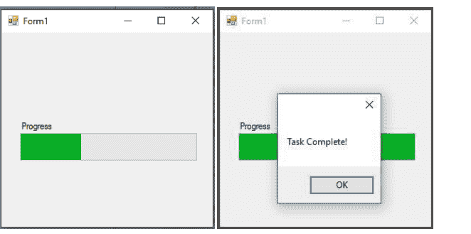

### 第 116.2 节：为 BackgroundWorker 分配事件处理程序

声明 BackgroundWorker 实例后，必须为其执行的任务提供属性和事件处理程序。

```csharp
/* This is the backgroundworker's "DoWork" event handler. This
   method is what will contain all the work you
   wish to have your program perform without blocking the UI. */

bgWorker.DoWork += bgWorker_DoWork;

/*This is how the DoWork event method signature looks like:*/
private void bgWorker_DoWork(object sender, DoWorkEventArgs e)
{
    // Work to be done here
    // ...
    // To get a reference to the current Backgroundworker:
    BackgroundWorker worker = sender as BackgroundWorker;
    // The reference to the BackgroundWorker is often used to report progress
    worker.ReportProgress(...);
}
/*This is the method that will be run once the BackgroundWorker has completed its tasks */
bgWorker.RunWorkerCompleted += bgWorker_CompletedWork;

/*This is how the RunWorkerCompletedEvent event method signature looks like:*/
private void bgWorker_CompletedWork(object sender, RunWorkerCompletedEventArgs e)
{
    // Things to be done after the backgroundworker has finished
}

/* When you wish to have something occur when a change in progress occurs, (like the completion of a specific task) the "ProgressChanged" event handler is used. Note that ProgressChanged events may be invoked by calls to bgWorker.ReportProgress(...) only if bgWorker.WorkerReportsProgress is set to true. */

bgWorker.ProgressChanged += bgWorker_ProgressChanged;

/*This is how the ProgressChanged event method signature looks like:*/
private void bgWorker_ProgressChanged(object sender, ProgressChangedEventArgs e)
{
    // Things to be done when a progress change has been reported
    // The ProgressChangedEventArgs gives access to a percentage, allowing for easy reporting of how far along a process is
    int progress = e.ProgressPercentage;
}
```

### 第 116.3 节：创建新的 BackgroundWorker 实例

BackgroundWorker 通常用于执行任务（有时是耗时的任务），而不会阻塞 UI 线程。

```
// BackgroundWorker is part of the ComponentModel namespace.
using System.ComponentModel;

namespace BGWorkerExample
{
    public partial class ExampleForm : Form
    {
        // the following creates an instance of the BackgroundWorker named "bgWorker"
        BackgroundWorker bgWorker = new BackgroundWorker();

        public ExampleForm() { ...
```

### 第 116.4 节：为 BackgroundWorker 分配属性

这允许在任务之间取消 BackgroundWorker

```
bgWorker.WorkerSupportsCancellation = true;
```

这允许 worker 在任务完成之间报告进度……

```
bgWorker.WorkerReportsProgress = true;

//this must also be used in conjunction with the ProgressChanged event
```

## 第 117 章：任务并行库

### 第 117.1 节：Parallel.ForEach

一个使用 Parallel.ForEach 循环对给定网站 URL 数组执行 ping 的示例。

```csharp
static void Main()
{
    string [] urls =
    {
        "www.stackoverflow.com",
        "www.google.net",
        "www.facebook.com",
        "www.twitter.com"
    };

    System.Threading.Tasks.Parallel.ForEach(urls, url =>
    {
        var ping = new System.Net.NetworkInformation.Ping();

        var result = ping.Send(url);

        if (result.Status == System.Net.NetworkInformation.IPStatus.Success)
        {
            Console.WriteLine(string.Format("{0} is online", url));
        }
    });
}
```

### 第 117.2 节：Parallel.For

一个使用 Parallel.For 循环对给定网站 URL 数组执行 ping 的示例。

```csharp
static void Main()
{
    string [] urls =
    {
        "www.stackoverflow.com",
        "www.google.net",
        "www.facebook.com",
        "www.twitter.com"
    };

    System.Threading.Tasks.Parallel.For(0, urls.Length, i =>
    {
        var ping = new System.Net.NetworkInformation.Ping();

        var result = ping.Send(urls[i]);

        if (result.Status == System.Net.NetworkInformation.IPStatus.Success)
        {
            Console.WriteLine(string.Format("{0} is online", urls[i]));
        }
    });
}
```


### 第 117.3 节：Parallel.Invoke

并行调用方法或操作（并行区域）

```csharp
static void Main()
{
    string[] urls =
    {
        "www.stackoverflow.com",
        "www.google.net",
        "www.facebook.com",
        "www.twitter.com"
    };

    System.Threading.Tasks.Parallel.Invoke(
        () => PingUrl(urls[0]),
        () => PingUrl(urls[1]),
        () => PingUrl(urls[2]),
        () => PingUrl(urls[3])
    );
}

void PingUrl(string url)
{
    var ping = new System.Net.NetworkInformation.Ping();

    var result = ping.Send(url);

    if (result.Status == System.Net.NetworkInformation.IPStatus.Success)
    {
        Console.WriteLine(string.Format("{0} is online", url));
    }
}
```

## 第 118 章：使变量线程安全

### 第 118.1 节：在 Parallel.For 循环中控制对变量的访问

```csharp
using System;
using System.Threading;
using System.Threading.Tasks;

class Program
{
    static void Main( string[] args )
    {
        object sync = new object();
        int sum = 0;
        Parallel.For( 1, 1000, ( i ) => {
            lock( sync ) sum = sum + i; // lock is necessary

            // As a practical matter, ensure this 'parallel for' executes
            // on multiple threads by simulating a lengthy operation.
            Thread.Sleep( 1 );
        } );
        Console.WriteLine( "Correct answer should be 499500.  sum is: {0}", sum );
    }
}
```

仅执行 sum = sum + i 而不使用 lock 是不够的，因为读-改-写操作不是原子的。一个线程会在读取 sum 的当前值之后，但在将修改后的值 sum + i 写回 sum 之前，覆盖 sum 的任何外部修改。

## 第 119 章：Lock 语句

### 第 119.1 节：在 lock 语句中抛出异常

以下代码将释放锁。不会有问题。在幕后，lock 语句的工作方式类似于 `try` `finally`

```csharp
lock(locker)
{
    throw new Exception();
}
```

更多内容可参见 [C# 5.0 规范](#)：

形式为的 lock 语句

```csharp
lock (x) ...
```

其中 x 是 *引用类型* 的表达式，精确等价于

```csharp
bool __lockWasTaken = false;
try {
    System.Threading.Monitor.Enter(x, ref __lockWasTaken);
    ...
}
finally {
    if (__lockWasTaken) System.Threading.Monitor.Exit(x);
}
```

只是 x 只会被求值一次。

### 第 119.2 节：简单用法

`lock` 的常见用法是临界区。

在以下示例中，`ReserveRoom` 应该从不同的线程调用。使用 `lock` 进行同步是在这里防止竞争条件的最简单方法。方法体被 `lock` 包围，这确保了两个或多个线程不能同时执行它。

```csharp
public class Hotel
{
    private readonly object _roomLock = new object();

    public void ReserveRoom(int roomNumber)
    {
        // lock keyword ensures that only one thread executes critical section at once
        // in this case, reserves a hotel room of given number
        // preventing double bookings
        lock (_roomLock)
        {
            // reserve room logic goes here
        }
    }
}
```

如果一个线程在另一个线程正在其中运行时到达 `lock` 块，前者将等待后者退出该块。

> 最佳实践是定义一个私有的用于加锁的对象，或一个私有的静态对象变量来保护所有实例共用的数据。

### 第 119.3 节：在 lock 语句中返回

以下代码将释放锁。

```csharp
lock(locker)
{
    return 5;
}
```

有关详细解释，建议参考此 SO 回答。

### 第 119.4 节：反模式和陷阱

#### 在栈分配的 / 局部变量上加锁

使用 lock 时的一个误区是在函数中使用局部对象作为锁。由于这些局部对象实例在函数的每次调用中都不同，lock 将不会按预期执行。

```csharp
List<string> stringList = new List<string>();

public void AddToListNotThreadSafe(string something)
{
    // DO NOT do this, as each call to this method
    // will lock on a different instance of an Object.
    // This provides no thread safety, it only degrades performance.
    var localLock = new Object();
    lock(localLock)
    {
        stringList.Add(something);
    }
}

// Define object that can be used for thread safety in the AddToList method
readonly object classLock = new object();

public void AddToList(List<string> stringList, string something)
{
    // USE THE classLock instance field to achieve a
    // thread-safe lock before adding to stringList
    lock(classLock)
    {
        stringList.Add(something);
    }
}
```

#### 假设加锁会限制对同步对象本身的访问

如果一个线程调用：lock(obj) 而另一个线程调用 obj.ToString()，第二个线程不会被阻塞。

```csharp
object obj = new Object();

public void SomeMethod()
{
    lock(obj)
    {
        //do dangerous stuff
    }
}

//Meanwhile on other thread
public void SomeOtherMethod()
{
    var objInString = obj.ToString(); //this does not block
}
```

#### 期待子类知道何时加锁

有时基类被设计成其子类在访问某些受保护字段时必须使用锁：

```csharp
public abstract class Base
{
    protected readonly object padlock;
    protected readonly List<string> list;

    public Base()
    {
        this.padlock = new object();
        this.list = new List<string>();
    }

    public abstract void Do();
}

public class Derived1 : Base
{
    public override void Do()
    {
        lock (this.padlock)
        {
            this.list.Add("Derived1");
        }
    }
}

public class Derived2 : Base
{
    public override void Do()
    {
        this.list.Add("Derived2"); // OOPS! I forgot to lock!
    }
}
```

使用模板方法封装加锁要安全得多：

```csharp
public abstract class Base
{
    private readonly object padlock; // This is now private
    protected readonly List<string> list;

    public Base()
    {
        this.padlock = new object();
        this.list = new List<string>();
    }

    public void Do()
    {
        lock (this.padlock) {
            this.DoInternal();
        }
    }

    protected abstract void DoInternal();
}

public class Derived1 : Base
{
    protected override void DoInternal()
    {
        this.list.Add("Derived1"); // Yay! No need to lock
    }
}
```

#### 对装箱的 ValueType 变量加锁不会同步

在以下示例中，一个私有变量在作为对象参数提供给函数时被隐式装箱，期望在该监视器资源上加锁。装箱发生在调用 IncInSync 函数之前，因此每次调用函数时装箱的实例都对应于不同的堆对象。

```csharp
public int Count { get; private set; }

private readonly int counterLock = 1;

public void Inc()
{
    IncInSync(counterLock);
}

private void IncInSync(object monitorResource)
{
    lock (monitorResource)
    {
        Count++;
    }
}
```

装箱发生在 Inc 函数中：

```
BulemicCounter.Inc:
IL_0000: nop
IL_0001: ldarg.0
IL_0002: ldarg.0
IL_0003: ldfld UserQuery+BulemicCounter.counterLock
IL_0008: box System.Int32
IL_000D: call UserQuery+BulemicCounter.IncInSync
IL_0012: nop
IL_0013: ret
```

这并不意味着装箱的 ValueType 完全不能用于监视器加锁：

```csharp
private readonly object counterLock = 1;
```

现在装箱发生在构造函数中，这对于加锁来说是可以的：

```
IL_0001:  ldc.i4.1
IL_0002:  box        System.Int32
IL_0007:  stfld      UserQuery+BulemicCounter.counterLock
```

#### 在存在更安全的替代方案时不必要地使用锁

一个非常常见的模式是在线程安全类中使用私有 List 或 Dictionary，并在每次访问时加锁：

```csharp
public class Cache
{
    private readonly object padlock;
    private readonly Dictionary<string, object> values;

    public WordStats()
    {
        this.padlock = new object();
        this.values = new Dictionary<string, object>();
    }

    public void Add(string key, object value)
    {
        lock (this.padlock)
        {
            this.values.Add(key, value);
        }
    }

    /* rest of class omitted */
}
```

如果有多个方法访问 values 字典，代码会变得很长，更重要的是，始终加锁会掩盖其意图。加锁也很容易忘记，而缺乏适当的加锁会导致难以找到的错误。

通过使用 ConcurrentDictionary，我们可以完全避免加锁：

```csharp
public class Cache
{
    private readonly ConcurrentDictionary<string, object> values;

    public WordStats()
    {
        this.values = new ConcurrentDictionary<string, object>();
    }

    public void Add(string key, object value)
    {
        this.values.Add(key, value);
    }

    /* rest of class omitted */
}
```

使用并发集合还能提高性能，因为它们或多或少都采用了无锁技术。


## 第 119.5 节：使用 Object 实例进行锁定

使用 C# 内置的 lock 语句时需要某个类型的实例，但其状态无关紧要。object 的实例对此非常合适：

```csharp
public class ThreadSafe {
    private static readonly object locker = new object();

    public void SomeThreadSafeMethod() {
        lock (locker) {
            // Only one thread can be here at a time.
        }
    }
}
```

NB. 不应为此使用 Type 的实例（代码中如上 typeof(ThreadSafe)），因为 Type 的实例在 AppDomains 之间共享，因此锁的范围可能会意外包含不应该包含的代码（例如，如果 ThreadSafe 在同一进程中的两个 AppDomains 中加载，则对其 Type 实例的锁定会相互锁定）。

## 第 120 章：yield 关键字

当你在语句中使用 yield 关键字时，表示出现它的 方法、运算符 或 get 访问器 是一个迭代器。使用 yield 定义迭代器时，在为自定义集合类型实现 IEnumerable 和 IEnumerator 模式时，就无需显式额外的类（保存枚举状态的类）。

### 第 120.1 节：简单用法

yield 关键字用于定义一个返回 IEnumerable 或 IEnumerator（以及它们的派生泛型变体）的函数，其值会在调用方遍历返回的集合时按需延迟生成。有关其用途的更多信息，请阅读 remarks 部分。

以下示例中的 yield return 语句位于 for 循环内部。

```csharp
public static IEnumerable<int> Count(int start, int count)
{
    for (int i = 0; i <= count; i++)
    {
        yield return start + i;
    }
}
```

然后你可以这样调用它：

```csharp
foreach (int value in Count(start: 4, count: 10))
{
    Console.WriteLine(value);
}
```

### 控制台输出

```
4
5
6
...
14
```

在 .NET Fiddle 上的实时演示

foreach 语句体的每次迭代都会对 Count 迭代器函数进行一次调用。每次对迭代器函数的调用都会继续执行下一个 yield return 语句，而该语句会在 for 循环的下一次迭代期间执行。

### 第 120.2 节：正确检查参数

迭代器方法要到返回值被枚举时才会被执行。因此，在迭代器外部断言前置条件是有利的。

```csharp
public static IEnumerable<int> Count(int start, int count)
{
    // The exception will throw when the method is called, not when the result is iterated
    if (count < 0)
        throw new ArgumentOutOfRangeException(nameof(count));
    return CountCore(start, count);
}
private static IEnumerable<int> CountCore(int start, int count)
{
    // If the exception was thrown here it would be raised during the first MoveNext()
    // call on the IEnumerator, potentially at a point in the code far away from where
    // an incorrect value was passed.
    for (int i = 0; i < count; i++)
    {
        yield return start + i;
    }
}
```

### 调用方代码（用法）：

```csharp
// Get the count
var count = Count(1,10);
// Iterate the results
foreach(var x in count)
{
    Console.WriteLine(x);
}
```

### 输出：

- 1
- 2
- 3
- 4
- 5
- 6
- 7
- 8
- 9
- 10

在 .NET Fiddle 上的实时演示

当方法使用 yield 生成可枚举对象时，编译器会创建一个状态机，在遍历时它会运行到 yield 之前的代码。然后它返回 yield 的项，并保存其状态。

这意味着你在第一次调用方法时不会发现无效参数（传递 null 等）（因为那时只是创建了状态机），只有在尝试访问第一个元素时才会发现（因为只有此时状态机才会运行方法内的代码）。通过将其包装在先检查参数的普通方法中，你可以在方法调用时检查它们。这是一个快速失败的示例。

使用 C# 7+ 时，CountCore 函数可以方便地作为局部函数隐藏在 Count 函数中。请在此处查看示例。

### 第 120.3 节：提前终止

你可以通过传入一个或多个值或元素来扩展现有 yield 方法的功能，这些值或元素可以在函数内定义终止条件，通过调用 yield break 来停止内部循环的执行。

```csharp
public static IEnumerable<int> CountUntilAny(int start, HashSet<int> earlyTerminationSet)
{
    int curr = start;

    while (true)
    {
        if (earlyTerminationSet.Contains(curr))
        {
            // we've hit one of the ending values
            yield break;
        }

        yield return curr;

        if (curr == Int32.MaxValue)
        {
            // don't overflow if we get all the way to the end; just stop
            yield break;
        }

        curr++;
    }
}
```

上述方法将从给定的起始位置迭代，直到遇到 earlyTerminationSet 中的其中一个值。

```csharp
// Iterate from a starting point until you encounter any elements defined as
// terminating elements
var terminatingElements = new HashSet<int>{ 7, 9, 11 };
// This will iterate from 1 until one of the terminating elements is encountered (7)
foreach(var x in CountUntilAny(1,terminatingElements))
{
    // This will write out the results from 1 until 7 (which will trigger terminating)
    Console.WriteLine(x);
}
```

### 输出：

- 1
- 2
- 3
- 4
- 5
- 6

在 .NET Fiddle 上的实时演示

### 第 120.4 节：更相关的用法

```csharp
public IEnumerable<User> SelectUsers()
{
    // Execute an SQL query on a database.
    using (IDataReader reader = this.Database.ExecuteReader(CommandType.Text, "SELECT Id, Name FROM Users"))
    {
        while (reader.Read())
        {
            int id = reader.GetInt32(0);
            string name = reader.GetString(1);
            yield return new User(id, name);
        }
    }
}
```

当然，从 SQL 数据库获取 IEnumerable<User> 的方法还有其他方式——这只是演示了你可以使用 yield 将任何具有“元素序列”语义的东西转换为可供他人遍历的 IEnumerable<T>。

### 第 120.5 节：延迟求值

只有当 foreach 语句移动到下一个项目时，迭代器块才会求值到下一个 yield 语句。

考虑以下示例：

```csharp
private IEnumerable<int> Integers()
{
    var i = 0;
    while(true)
    {
        Console.WriteLine("Inside iterator: " + i);
        yield return i;
        i++;
    }
}

private void PrintNumbers()
{
    var numbers = Integers().Take(3);
    Console.WriteLine("Starting iteration");

    foreach(var number in numbers)
    {
        Console.WriteLine("Inside foreach: " + number);
    }
}
```

这将输出：

```
Starting iteration
Inside iterator: 0
Inside foreach: 0
Inside iterator: 1
Inside foreach: 1
Inside iterator: 2
Inside foreach: 2
```

查看演示

因此：

- “Starting iteration”最先被打印，即使迭代器方法是在打印它的行之前被调用的，因为行 Integers().Take(3); 实际上并未开始迭代（没有调用 IEnumerator.MoveNext()）
- 打印到控制台的行在迭代器方法内部的行和 foreach 内部的行之间交替，而不是迭代器方法内部的所有行先求值
- 此程序因 .Take() 方法而终止，即使迭代器方法有一个永远不会跳出的 while true。

### 第 120.6 节：Try...finally

如果迭代器方法在 try...finally 内部有 yield，那么返回的 IEnumerator 在对其调用 Dispose 时会执行 finally 语句，前提是当前求值点位于 try 块内部。

给定以下函数：

```csharp
private IEnumerable<int> Numbers()
{
    yield return 1;
    try
    {
        yield return 2;
        yield return 3;
    }
    finally
    {
        Console.WriteLine("Finally executed");
    }
}
```

调用时：

```csharp
private void DisposeOutsideTry()
{
    var enumerator = Numbers().GetEnumerator();

    enumerator.MoveNext();
    Console.WriteLine(enumerator.Current);
    enumerator.Dispose();
}
```

然后它打印：

```
1
```

查看演示

调用时：

```csharp
private void DisposeInsideTry()
{
    var enumerator = Numbers().GetEnumerator();

    enumerator.MoveNext();
    Console.WriteLine(enumerator.Current);
    enumerator.MoveNext();
    Console.WriteLine(enumerator.Current);
}
```


```
enumerator.Dispose();
}
```

然后它打印：

```
1
2
Finally executed
```

查看演示

### 第 120.7 节：急切求值

**yield** 关键字允许集合的延迟求值。强制将整个集合加载到内存中称为 **急切求值**。

以下代码展示了这一点：

```
IEnumerable<int> myMethod()
{
    for(int i=0; i <= 8675309; i++)
    {
        yield return i;
    }
}
...
// define the iterator
var it = myMethod.Take(3);
// force its immediate evaluation
// list will contain 0, 1, 2
var list = it.ToList();
```

调用 ToList、ToDictionary 或 ToArray 将强制枚举立即求值，将所有元素检索到一个集合中。

### 第 120.8 节：使用 yield 在实现 IEnumerable<T> 时创建 IEnumerator<T>

IEnumerable<T> 接口只有一个方法 GetEnumerator()，它返回一个 IEnumerator<T>。

虽然 **yield** 关键字可以直接用来创建 IEnumerable<T>，它也可以以完全相同的方式用来创建 IEnumerator<T>。唯一发生变化的是方法的返回类型。

如果我们想创建自己的实现 IEnumerable<T> 的类，这会很有用：

```
public class PrintingEnumerable<T> : IEnumerable<T>
{
    private IEnumerable<T> _wrapped;

    public PrintingEnumerable(IEnumerable<T> wrapped)
    {
        _wrapped = wrapped;
    }

    // This method returns an IEnumerator<T>, rather than an IEnumerable<T>
    // But the yield syntax and usage is identical.
    public IEnumerator<T> GetEnumerator()
    {
        foreach(var item in _wrapped)
        {
            Console.WriteLine("Yielding: " + item);
            yield return item;
        }
    }

    IEnumerator IEnumerable.GetEnumerator()
    {
        return GetEnumerator();
    }
}
```

（请注意，这个特定示例仅用于说明，并且可以用一个返回 IEnumerable<T> 的单一迭代器方法更干净地实现。）

### 第 120.9 节：延迟求值示例：斐波那契数

```
using System;
using System.Collections.Generic;
using System.Linq;
using System.Numerics; // also add reference to System.Numerics

namespace ConsoleApplication33
{
    class Program
    {
        private static IEnumerable<BigInteger> Fibonacci()
        {
            BigInteger prev = 0;
            BigInteger current = 1;
            while (true)
            {
                yield return current;
                var next = prev + current;
                prev = current;
                current = next;
            }
        }

        static void Main()
        {
            // print Fibonacci numbers from 10001 to 10010
            var numbers = Fibonacci().Skip(10000).Take(10).ToArray();
            Console.WriteLine(string.Join(Environment.NewLine, numbers));
        }
    }
}
```

其内部工作原理（我建议在 IL 反汇编工具中反编译生成的 .exe 文件）：

- 1. C# 编译器生成一个实现 IEnumerable<BigInteger> 和 IEnumerator<BigInteger> 的类（在 ildasm 中为 <Fibonacci>d__0）。
- 2. 该类实现了一个状态机。状态由方法中的当前位置和局部变量的值组成。
- 3. 最有趣的代码在 bool IEnumerator.MoveNext() 方法中。基本上，MoveNext() 的作用是：

```
public static IEnumerable<int> Break()
{
    for (int i = 0; ; i++)
    {
        if (i < 10)
        {
            // Yields a number
            yield return i;
        }
        else
        {
            // Terminates just the loop
            break;
        }
    }
    // Execution continues
    yield return 10;
}
```

### 第 120.11 节：在返回 Enumerable 的方法内返回另一个 Enumerable

```
public IEnumerable<int> F1()
{
    for (int i = 0; i < 3; i++)
        yield return i;

    //return F2(); // Compile Error!!
    foreach (var element in F2())
        yield return element;
}

public int[] F2()
{
    return new[] { 3, 4, 5 };
}
```

## 第 121 章：任务并行库 (TPL) 数据流构造

### 第 121.1 节：ActionBlock<T>

(foreach)

从逻辑上讲，这个类可以被认为是一个用于处理数据的缓冲区，结合用于处理该数据的任务，而“数据流块”管理两者。在最基本的使用中，我们可以实例化一个 ActionBlock 并向其“post”数据；ActionBlock 构造时提供的委托将对每条发布的数据异步执行。

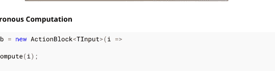

#### 同步计算

```
var ab = new ActionBlock<TInput>(i =>
{
    Compute(i);
});
...
ab.Post(1);
ab.Post(2);
ab.Post(3);
```

#### 将异步下载限制为最多同时 5 个

```
var downloader = new ActionBlock<string>(async url =>
{
    byte [] imageData = await DownloadAsync(url);
    Process(imageData);
}, new DataflowBlockOptions { MaxDegreeOfParallelism = 5 });
downloader.Post("http://website.com/path/to/images");
downloader.Post("http://another-website.com/path/to/images");
```

由 Stephen Toub 撰写的 TPL Dataflow 简介

### 第 121.2 节：BroadcastBlock<T>

(Copy an item and send the copies to every block that it's linked to)

与 BufferBlock 不同，BroadcastBlock 的使命是使从该块链接的所有目标都能获得已发布每个元素的副本，并不断用传播给它的值覆盖“当前”值。

此外，与 BufferBlock 不同，BroadcastBlock 不会不必要地保留数据。在某个数据被提供给所有目标之后，该元素将被队列中下一个数据覆盖（与所有数据流块一样，消息按 FIFO 顺序处理）。该元素将被提供给所有目标，依此类推。

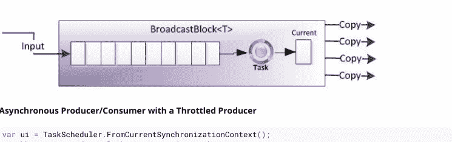

#### 具有受限生产者的异步生产者/消费者

```csharp
var ui = TaskScheduler.FromCurrentSynchronizationContext();
var bb = new BroadcastBlock<ImageData>(i => i);

var saveToDiskBlock = new ActionBlock<ImageData>(item =>
    item.Image.Save(item.Path)
);

var showInUiBlock = new ActionBlock<ImageData>(item =>
    imagePanel.AddImage(item.Image),
    new DataflowBlockOptions { TaskScheduler = TaskScheduler.FromCurrentSynchronizationContext() }
);

bb.LinkTo(saveToDiskBlock);
bb.LinkTo(showInUiBlock);
```

#### 从代理公开状态

```csharp
public class MyAgent
{
    public ISourceBlock<string> Status { get; private set; }

    public MyAgent()
    {
        Status = new BroadcastBlock<string>();
        Run();
    }

    private void Run()
    {
        Status.Post("Starting");
        Status.Post("Doing cool stuff");
        ...
        Status.Post("Done");
    }
}
```

由 Stephen Toub 撰写的 TPL Dataflow 简介

### 第 121.3 节：BufferBlock<T>

(FIFO Queue: The data that comes in is the data that goes out)

简而言之，BufferBlock 为存储 T 的实例提供无界或有界缓冲区。
你可以向该块“post” T 的实例，这会导致发布的数据按先进先出（FIFO）顺序存储。
你可以从该块“receive”，这允许你同步或异步获取先前存储或将来可用的 T 的实例（同样是 FIFO）。

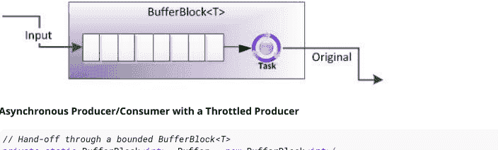

#### 具有受限生产者的异步生产者/消费者

```csharp
// Hand-off through a bounded BufferBlock<T>
private static BufferBlock<int> _Buffer = new BufferBlock<int>(
    new DataflowBlockOptions { BoundedCapacity = 10 });

// Producer
private static async void Producer()
{
    while(true)
    {
        await _Buffer.SendAsync(Produce());
    }
}

// Consumer
private static async Task Consumer()
{
    while(true)
    {
        Process(await _Buffer.ReceiveAsync());
    }
}

// Start the Producer and Consumer
private static async Task Run()
{
    await Task.WhenAll(Producer(), Consumer());
}
```

由 Stephen Toub 撰写的 TPL Dataflow 简介

### 第 121.4 节：JoinBlock<T1, T2,...>

(Collects 2-3 inputs and combines them into a Tuple)

与 BatchBlock 类似，JoinBlock<T1, T2, ...> 能够从多个数据源对数据进行分组。事实上，这就是 JoinBlock<T1, T2, ...> 的主要目的。

例如，JoinBlock<string, double, int> 是一个 ISourceBlock<Tuple<string, double, int>>。

与 BatchBlock 一样，JoinBlock<T1, T2, ...> 能够在贪婪和非贪婪模式下运行。

- 在默认的贪婪模式下，所有提供给目标的数据都会被接受，即使其他目标没有形成元组所需的必要数据。
- 在非贪婪模式下，块的目标会推迟数据，直到所有目标都被提供创建元组所需的必要数据，此时块将参与两阶段提交协议，以原子方式从源检索所有必要项。这种推迟使得另一个实体可以在此期间消费数据，从而使整个系统能够向前推进。


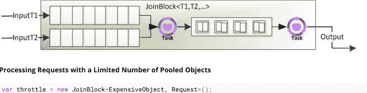

## 使用有限数量的池化对象处理请求

```
var throttle = new JoinBlock<ExpensiveObject, Request>();
for(int i=0; i<10; i++)
{
    requestProcessor.Target1.Post(new ExpensiveObject());
}

var processor = new Transform<Tuple<ExpensiveObject, Request>, ExpensiveObject>(pair =>
{
    var resource = pair.Item1;
    var request = pair.Item2;

    request.ProcessWith(resource);

    return resource;
});

throttle.LinkTo(processor);
processor.LinkTo(throttle.Target1);
```

Stephen Toub 的 TPL Dataflow 介绍

## 第 121.5 节：WriteOnceBlock<T>

(只读变量：记住其第一个数据项并将其副本作为输出传递。忽略所有其他数据项)

如果 BufferBlock 是 TPL Dataflow 中最基础的块，那么 WriteOnceBlock 就是最简单的。
它最多存储一个值，一旦该值被设置，就永远不会被替换或覆盖。

你可以将 WriteOnceBlock 视为类似于 C# 中的只读成员变量，只是与仅在构造函数中可设置然后不可变不同，它只能设置一次，然后就不可变了。

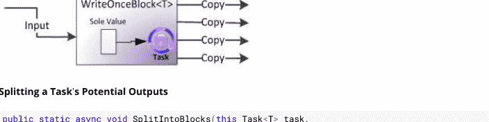

### 拆分任务的潜在输出

```
public static async void SplitIntoBlocks(this Task<T> task,
    out IPropagatorBlock<T> result,
    out IPropagatorBlock<Exception> exception)
{
    result = new WriteOnceBlock<T>(i => i);
    exception = new WriteOnceBlock<Exception>(i => i);
    try
    {
        result.Post(await task);
    }
    catch (Exception ex)
    {
        exception.Post(ex);
    }
}
```

Stephen Toub 的 TPL Dataflow 介绍

## 第 121.6 节：BatchedJoinBlock<T1, T2,...>

(从 2-3 个输入中收集一定数量的总项，并将它们分组为数据项集合的 Tuple)

BatchedJoinBlock<T1, T2,...> 在某种意义上是 BatchBlock 和 JoinBlock<T1, T2,...> 的组合。JoinBlock<T1, T2,...> 用于将每个目标的一个输入聚合为一个元组，而 BatchBlock 用于将 N 个输入聚合为一个集合，BatchedJoinBlock<T1, T2,...> 用于从所有目标中收集 N 个输入并形成集合的元组。

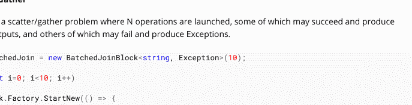

### 散布/收集

考虑一个散布/收集问题，其中启动了 N 个操作，其中一些可能成功并产生字符串输出，而另一些可能失败并产生 Exceptions。

```
var batchedJoin = new BatchedJoinBlock<string, Exception>(10);

for (int i=0; i<10; i++)
{
    Task.Factory.StartNew(() => {
        try { batchedJoin.Target1.Post(DoWork()); }
        catch(Exception ex) { batchedJoin.Target2.Post(ex); }
    });
}

var results = await batchedJoin.ReceiveAsync();

foreach(string s in results.Item1)
{
    Console.WriteLine(s);
}

foreach(Exception e in results.Item2)
{
    Console.WriteLine(e);
}
```

Stephen Toub 的 TPL Dataflow 介绍

## 第 121.7 节：TransformBlock<TInput, TOutput>

(Select，一对一)

与 ActionBlock 类似，TransformBlock<TInput, TOutput> 允许执行委托为每个输入数据执行某些操作；与 ActionBlock 不同，此处理有输出。该委托可以是 Func<TInput, TOutput>，在这种情况下，当委托返回时，该元素的处理被认为已完成；也可以是 Func<TInput,Task<>>，在这种情况下，该元素的处理被认为已完成的时间不是委托返回时，而是返回的 Task 完成时。对于熟悉 LINQ 的人来说，它有点类似于 Select()，即它接收输入，以某种方式转换该输入，然后产生输出。

默认情况下，TransformBlock<TInput, TOutput> 以 MaxDegreeOfParallelism 等于 1 的方式顺序处理其数据。除了接收缓冲输入并处理它之外，此块还会将所有已处理的输出进行缓冲（未处理的数据和已处理的数据）。

它有两个任务：一个用于处理数据，一个用于将数据推送到下一个块。

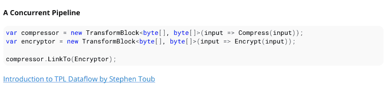

### 一个并发管道

```
var compressor = new TransformBlock<byte[], byte[]>(input => Compress(input));
var encryptor = new TransformBlock<byte[], byte[]>(input => Encrypt(input));

compressor.LinkTo(encryptor);
```

Stephen Toub 的 TPL Dataflow 介绍

## 第 121.8 节：TransformManyBlock<TInput, TOutput>

(SelectMany，1-m：此映射的结果会被“展平”，就像 LINQ 的 SelectMany 一样)

TransformManyBlock<TInput, TOutput> 与 TransformBlock<TInput, TOutput> 非常相似。关键区别在于，TransformBlock<TInput, TOutput> 为每个输入产生一个且仅一个输出，而 TransformManyBlock<TInput, TOutput> 为每个输入产生任意数量（零个或多个）输出。与 ActionBlock 和 TransformBlock<TInput, TOutput> 一样，此处理可以使用委托指定，既可用于同步处理，也可用于异步处理。

同步使用 Func<TInput, IEnumerable<>>，异步使用 Func<TInput, Task<IEnumerable<>>>。与 ActionBlock 和 TransformBlock<TInput, TOutput> 一样，TransformManyBlock<TInput, TOutput> 默认按顺序处理，但也可以另行配置。

映射委托返回一个项目集合，这些项目会单独插入到输出缓冲区中。

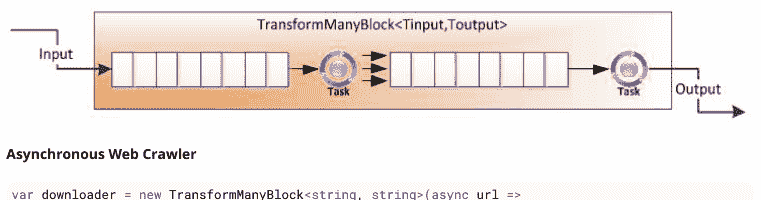

### 异步网络爬虫

```
var downloader = new TransformManyBlock<string, string>(async url =>
{
    Console.WriteLine("Downloading " + url);
    try
    {
        return ParseLinks(await DownloadContents(url));
    }
    catch()
    {
        return Enumerable.Empty<string>();
    }
});
downloader.LinkTo(downloader);
```

### 将可枚举对象扩展为其组成元素

```
var expanded = new TransformManyBlock<T[], T>(array => array);
```

### 通过从 1 到 0 或 1 个元素进行过滤

```
public IPropagatorBlock<T> CreateFilteredBuffer<T>(Predicate<T> filter)
{
    return new TransformManyBlock<T, T>(item =>
        filter(item) ? new [] { item } : Enumerable.Empty<T>());
}
```

Stephen Toub 的 TPL Dataflow 介绍

## 第 121.9 节：BatchBlock<T>

(将一定数量的顺序数据项分组为数据项集合)

BatchBlock 将 N 个单项组合成一个批项，以元素数组表示。实例使用特定的批大小创建，然后块在收到该数量的元素后立即创建一批，并异步将其输出到输出缓冲区。

BatchBlock 能够以贪婪和非贪婪两种模式执行。

- 在默认的贪婪模式下，从任意数量的源提供给块的所有消息都被接受并缓冲以转换为批。
- 在非贪婪模式下，所有消息都从源推迟，直到有足够多的源向块提供消息以创建一批。因此，BatchBlock 可用于从 N 个源各接收 1 个元素、从 1 个源接收 N 个元素，以及两者之间的多种选项。

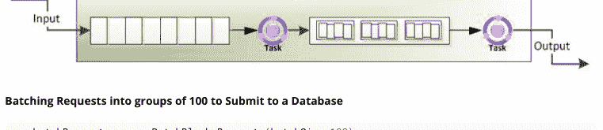

### 将请求批量处理为 100 个一组以提交到数据库

```
var batchRequests = new BatchBlock<Request>(batchSize:100);
var sendToDb = new ActionBlock<Request[]>(reqs => SubmitToDatabase(reqs));

batchRequests.LinkTo(sendToDb);
```

### 每秒创建一次批

```
var batch = new BatchBlock<T>(batchSize:Int32.MaxValue);
new Timer(() => { batch.TriggerBatch(); }).Change(1000, 1000);
```

Stephen Toub 的 TPL Dataflow 介绍

## 第 122 章：函数式编程

### 第 122.1 节：Func 和 Action

**Func** 提供参数化匿名函数的持有者。领先的类型是输入，最后一个类型始终是返回值。

```
// square a number.
Func<double, double> square = (x) => { return x * x; };

// get the square root.
// note how the signature matches the built in method.
Func<double, double> squareroot = Math.Sqrt;

// provide your workings.
Func<double, double, string> workings = (x, y) =>
    string.Format("The square of {0} is {1}.", x, square(y))
```

**Action** 对象类似于 void 方法，因此它们只有输入类型。没有结果被放置在求值栈上。

```
// right-angled triangle.
class Triangle
{
    public double a;
    public double b;
    public double h;
}

// Pythagorean theorem.
Action<Triangle> pythagoras = (x) =>
    x.h = squareroot(square(x.a) + square(x.b));

Triangle t = new Triangle { a = 3, b = 4 };
pythagoras(t);
Console.WriteLine(t.h); // 5.
```

### 第 122.2 节：高阶函数

高阶函数是指接受另一个函数作为参数或返回一个函数（或两者兼有）的函数。

这通常使用 lambda 完成，例如在将谓词传递给 LINQ Where 子句时：

```
var results = data.Where(p => p.Items == 0);
```

Where() 子句可以接收许多不同的谓词，这使其具有相当大的灵活性。

在实现策略设计模式时，也会看到将方法传递给另一个方法。例如，可以根据运行时需求从各种排序方法中选择并将其传递给对象上的 Sort 方法。

### 第 122.3 节：避免空引用

C# 开发者要处理大量空引用异常。F# 开发者则不需要，因为他们有 Option 类型。Option<> 类型（有些人更喜欢 Maybe<> 作为名称）提供 Some 和 None 返回类型。它明确表示一个方法可能即将返回一个空记录。


例如，你无法阅读以下内容并知道是否需要处理空值。

```
var user = _repository.GetUser(id);
```

如果你确实知道可能存在空值，你可以引入一些样板代码来处理它。

```
var username = user != null ? user.Name : string.Empty;
```

如果我们返回的是 Option<> 呢？

```
Option<User> maybeUser = _repository.GetUser(id);
```

代码现在明确表示我们可能返回一个 None 记录，并且需要样板代码来检查 Some 或 None：

```
var username = maybeUser.HasValue ? maybeUser.Value.Name : string.Empty;
```

以下方法展示了如何返回一个 Option<>

```
public Option<User> GetUser(int id)
{
    var users = new List<User>
    {
        new User { Id = 1, Name = "Joe Bloggs" },
        new User { Id = 2, Name = "John Smith" }
    };

    var user = users.FirstOrDefault(user => user.Id == id);

    return user != null ? new Option<User>(user) : new Option<User>();
}
```

以下是 Option<> 的最小实现。

```
public struct Option<T>
{
    private readonly T _value;

    public T Value
    {
        get
        {
            if (!HasValue)
                throw new InvalidOperationException();

            return _value;
        }
    }

    public bool HasValue
    {
        get { return _value != null; }
    }

    public Option(T value)
    {
        _value = value;
    }
}
```

```csharp
public static implicit operator Option<T>(T value)
{
    return new Option<T>(value);
}
}
```

要演示上述内容，可以使用 C# REPL 运行 avoidNull.csx。

如所述，这是一个最小实现。搜索 "Maybe" NuGet 包会找到一些不错的库。

### Section 122.4: 不可变性

不可变性在函数式编程中很常见，在面向对象编程中则很少见。

例如，创建一个具有可变状态的地址类型：

```csharp
public class Address ()
{
    public string Line1 { get; set; }
    public string Line2 { get; set; }
    public string City { get; set; }
}
```

任何代码片段都可能修改上述对象中的任何属性。

现在创建不可变的地址类型：

```csharp
public class Address ()
{
    public readonly string Line1;
    public readonly string Line2;
    public readonly string City;

    public Address(string line1, string line2, string city)
    {
        Line1 = line1;
        Line2 = line2;
        City = city;
    }
}
```

请记住，只读集合并不保证不可变性。例如，

```csharp
public class Classroom
{
    public readonly List<Student> Students;

    public Classroom(List<Student> students)
    {
        Students = students;
    }
}
```

不是不可变的，因为对象的用户可以修改集合（向其中添加或删除元素）。为了使其不可变，可以使用像 IEnumerable 这样的接口，它不公开添加方法，或者将其设为 ReadOnlyCollection。

```csharp
public class Classroom
{
    public readonly ReadOnlyCollection<Student> Students;

    public Classroom(ReadOnlyCollection<Student> students)
    {
        Students = students;
    }
}
```

```csharp
List<Student> list = new List<Student>();
// add students
Classroom c = new Classroom(list.AsReadOnly());
```

使用不可变对象，我们有以下好处：

-   它将处于已知状态（其他代码无法更改它）。
-   它是线程安全的。
-   构造函数提供了单一的验证位置。
-   知道对象无法被修改使得代码更容易理解。

### Section 122.5: 不可变集合

`System.Collections.Immutable` NuGet 包提供了不可变集合类。

**创建和添加项目**

```csharp
var stack = ImmutableStack.Create<int>();
var stack2 = stack.Push(1); // stack is still empty, stack2 contains 1
var stack3 = stack.Push(2); // stack2 still contains only one, stack3 has 2, 1
```

**使用构建器创建**

某些不可变集合具有 Builder 内部类，可用于廉价地构建大型不可变实例：

```csharp
var builder = ImmutableList.CreateBuilder<int>(); // returns ImmutableList.Builder
builder.Add(1);
builder.Add(2);
var list = builder.ToImmutable();
```

**从现有的 IEnumerable 创建**

```csharp
var numbers = Enumerable.Range(1, 5);
var list = ImmutableList.CreateRange<int>(numbers);
```

所有不可变集合类型的列表：

-   `System.Collections.Immutable.ImmutableArray<T>`
-   `System.Collections.Immutable.ImmutableDictionary<TKey,TValue>`
-   `System.Collections.Immutable.ImmutableHashSet<T>`
-   `System.Collections.Immutable.ImmutableList<T>`
-   `System.Collections.Immutable.ImmutableQueue<T>`
-   `System.Collections.Immutable.ImmutableSortedDictionary<TKey,TValue>`
-   `System.Collections.Immutable.ImmutableSortedSet<T>`
-   `System.Collections.Immutable.ImmutableStack<T>`

## Chapter 123: Func 委托

| 参数 | 详情 |
|---|---|
| arg or arg1 | 方法的（第一个）参数 |
| arg2 | 方法的第二个参数 |
| arg3 | 方法的第三个参数 |
| arg4 | 方法的第四个参数 |
| T or T1 | 方法的（第一个）参数的类型 |
| T2 | 方法的第二个参数的类型 |
| T3 | 方法的第三个参数的类型 |
| T4 | 方法的第四个参数的类型 |
| TResult | 方法的返回类型 |

### Section 123.1: 无参数

本示例展示了如何创建一个委托，该委托封装返回当前时间的方法

```csharp
static DateTime UTCNow()
{
    return DateTime.UtcNow;
}

static DateTime LocalNow()
{
    return DateTime.Now;
}

static void Main(string[] args)
{
    Func<DateTime> method = UTCNow;
    // method points to the UTCNow method
    // that returns current UTC time
    DateTime utcNow = method();

    method = LocalNow;
    // now method points to the LocalNow method
    // that returns local time

    DateTime localNow = method();
}
```

### Section 123.2: 多个变量

```csharp
static int Sum(int a, int b)
{
    return a + b;
}

static int Multiplication(int a, int b)
{
    return a * b;
}

static void Main(string[] args)
{
    Func<int, int, int> method = Sum;
    // method points to the Sum method
    // that returns 1 int variable and takes 2 int variables
    int sum = method(1, 1);

    method = Multiplication;
    // now method points to the Multiplication method

    int multiplication = method(1, 1);
}
```

### Section 123.3: Lambda 与匿名方法

匿名方法可以在期望委托的任何地方赋值：

```
Func<int, int> square = delegate (int x) { return x * x; }
```

Lambda 表达式可用于表达相同的意思：

```
Func<int, int> square = x => x * x;
```

在任何一种情况下，我们现在都可以像这样调用存储在 square 中的方法：

```
var sq = square.Invoke(2);
```

或作为简写：

```
var sq = square(2);
```

请注意，为了使赋值类型安全，匿名方法的参数类型和返回类型必须与委托类型匹配：

```
Func<int, int> sum = delegate (int x, int y) { return x + y; } // error
Func<int, int> sum = (x, y) => x + y; // error
```

### Section 123.4: 协变与逆变类型参数

Func 也支持协变和逆变

```csharp
// Simple hierarchy of classes.
public class Person { }
public class Employee : Person { }

class Program
{
    static Employee FindByTitle(String title)
    {
        // This is a stub for a method that returns
        // an employee that has the specified title.
        return new Employee();
    }

    static void Test()
    {
        // Create an instance of the delegate without using variance.
        Func<String, Employee> findEmployee = FindByTitle;

        // The delegate expects a method to return Person,
        // but you can assign it a method that returns Employee.
        Func<String, Person> findPerson = FindByTitle;

        // You can also assign a delegate
        // that returns a more derived type
        // to a delegate that returns a less derived type.
        findPerson = findEmployee;
    }
}
```

```
AddOrMult(a, b, ref add, ref mult); //AddOrMult(a, b, out add, out mult);
Console.WriteLine(add); //5
Console.WriteLine(mult); //6
}

private static void AddOrMult(int a, int b, ref int add, ref int mult) //AddOrMult(int a, int b,
out int add, out int mult)
{
    add = a + b;
    mult = a * b;
}
```

## 第125章：二进制序列化

### 第125.1节：使用属性控制序列化行为

如果使用 [NonSerialized] 属性，则该成员在反序列化后将始终具有其默认值（例如 int 为 0，string 为 null，bool 为 false 等），无论对象本身进行的任何初始化（构造函数、声明等）。为弥补这一点，提供了属性 [OnDeserializing]（在反序列化前调用）和 [OnDeserialized]（在反序列化后调用）以及其对应属性 [OnSerializing] 和 [OnSerialized]。

假设我们想为 Vector 添加一个 "Rating"，并且希望该值始终从 1 开始。如下所示编写，反序列化后它将为 0：

```
[Serializable]
public class Vector
{
    public int X;
    public int Y;
    public int Z;

    [NonSerialized]
    public decimal Rating = 1M;

    public Vector()
    {
        Rating = 1M;
    }

    public Vector(decimal initialRating)
    {
        Rating = initialRating;
    }
}
```

为修复此问题，我们只需在类内部添加以下方法将其设为 1：

```
[OnDeserializing]
void OnDeserializing(StreamContext context)
{
    Rating = 1M;
}
```

或者，如果我们想将其设为计算值，可以等待其完成反序列化后再设置：

```
[OnDeserialized]
void OnDeserialized(StreamContext context)
{
    Rating = 1 + ((X+Y+Z)/3);
}
```

同样，我们可以使用 [OnSerializing] 和 [OnSerialized] 来控制如何写入内容。

### 第125.2节：序列化绑定器

绑定器使你有机会检查在应用程序域中加载的类型

创建一个继承自 SerializationBinder 的类

```csharp
class MyBinder : SerializationBinder
{
    public override Type BindToType(string assemblyName, string typeName)
    {
        if (typeName.Equals("BinarySerializationExample.Item"))
            return typeof(Item);
        return null;
    }
}
```

现在我们可以检查正在加载的类型，并据此决定我们真正想要接收的内容

使用绑定器时，必须将其添加到 BinaryFormatter。

```csharp
object DeserializeData(byte[] bytes)
{
    var binaryFormatter = new BinaryFormatter();
    binaryFormatter.Binder = new MyBinder();

    using (var memoryStream = new MemoryStream(bytes))
        return binaryFormatter.Deserialize(memoryStream);
}
```

完整的解决方案

```csharp
using System;
using System.IO;
using System.Runtime.Serialization;
using System.Runtime.Serialization.Formatters.Binary;

namespace BinarySerializationExample
{
    class MyBinder : SerializationBinder
    {
        public override Type BindToType(string assemblyName, string typeName)
        {
            if (typeName.Equals("BinarySerializationExample.Item"))
                return typeof(Item);
            return null;
        }
    }

    [Serializable]
    public class Item
    {
        private string _name;
        public string Name
        {
            get { return _name; }
            set { _name = value; }
        }
    }

    class Program
    {
        static void Main(string[] args)
        {
            var item = new Item
            {
                Name = "Orange"
            };

            var bytes = SerializeData(item);
            var deserializedData = (Item)DeserializeData(bytes);
        }

        private static byte[] SerializeData(object obj)
        {
            var binaryFormatter = new BinaryFormatter();
            using (var memoryStream = new MemoryStream())
            {
                binaryFormatter.Serialize(memoryStream, obj);
                return memoryStream.ToArray();
            }
        }

        private static object DeserializeData(byte[] bytes)
        {
            var binaryFormatter = new BinaryFormatter
            {
                Binder = new MyBinder()
            };

            using (var memoryStream = new MemoryStream(bytes))
                return binaryFormatter.Deserialize(memoryStream);
        }
    }
}
```

### 第125.3节：向后兼容性中的一些陷阱

这个小示例展示了如果不提前注意这个问题，你的程序如何会失去向后兼容性。以及获得更多序列化过程控制的方法

首先，我们将编写程序第一个版本的示例：

版本 1

```
[Serializable]
class Data
{
    [OptionalField]
    private int _version;

    public int Version
    {
        get { return _version; }
        set { _version = value; }
    }
}
```

现在，假设在程序的第二个版本中添加了一个新类。我们需要在数组中存储它。

现在代码将如下所示：

版本 2

```csharp
[Serializable]
class NewItem
{
    [OptionalField]
    private string _name;

    public string Name
    {
        get { return _name; }
        set { _name = value; }
    }
}

[Serializable]
class Data
{
    [OptionalField]
    private int _version;

    public int Version
    {
        get { return _version; }
        set { _version = value; }
    }

    [OptionalField]
    private List<NewItem> _newItems;

    public List<NewItem> NewItems
    {
        get { return _newItems; }
        set { _newItems = value; }
    }
}
```

用于序列化和反序列化的代码

```csharp
private static byte[] SerializeData(object obj)
{
    var binaryFormatter = new BinaryFormatter();
    using (var memoryStream = new MemoryStream())
    {
        binaryFormatter.Serialize(memoryStream, obj);
        return memoryStream.ToArray();
    }
}

private static object DeserializeData(byte[] bytes)
{
    var binaryFormatter = new BinaryFormatter();
    using (var memoryStream = new MemoryStream(bytes))
    {
        return binaryFormatter.Deserialize(memoryStream);
    }
}
```

那么，当你在 v2 程序中序列化数据并尝试在 v1 程序中反序列化它们时会发生什么？

你会得到一个异常：

System.Runtime.Serialization.SerializationException was unhandled
Message=The ObjectManager found an invalid number of fixups. This usually indicates a problem in the Formatter.Source=mscorlib
StackTrace:
at System.Runtime.Serialization.ObjectManager.DoFixups()
at System.Runtime.Serialization.Formatters.Binary.ObjectReader.Deserialize(HeaderHandler handler, __BinaryParser serParser, Boolean fCheck, Boolean isCrossAppDomain, IMethodCallMessage methodCallMessage)
at System.Runtime.Serialization.Formatters.Binary.BinaryFormatter.Deserialize(Stream serializationStream, HeaderHandler handler, Boolean fCheck, Boolean isCrossAppDomain, IMethodCallMessage methodCallMessage)
at System.Runtime.Serialization.Formatters.Binary.BinaryFormatter.Deserialize(Stream serializationStream)
at Microsoft.Samples.TestV1.Main(String[] args) in c:\Users\andrew\Documents\Visual Studio 2013\Projects\vs\CSV1 Application\TestV1Part2\TestV1Part2.cs:line 29
at System.AppDomain._nExecuteAssembly(Assembly assembly, String[] args)
at Microsoft.VisualStudio.HostingProcess.HostProc.RunUsersAssembly()
at System.Threading.ExecutionContext.Run(ExecutionContext executionContext, ContextCallback callback, Object state)
at System.Threading.ThreadHelper.ThreadStart()

### 为什么？

ObjectManager 对于数组和引用类型与值类型的依赖解析有不同的逻辑。我们添加了一个新引用类型的数组，而该类型在我们的程序集中不存在。

当 ObjectManager 尝试解析依赖关系时，它会构建图。当它看到数组时，无法立即修复它，因此它会创建一个虚拟引用，然后稍后修复数组。

由于该类型不在程序集中，依赖关系无法修复。出于某种原因，它没有从修复元素列表中删除数组，最后抛出异常 "IncorrectNumberOfFixups"。

这是序列化过程中的一些 'gotchas'。出于某种原因，它仅对新引用类型的数组不起作用。

注意：
如果不使用包含新类的数组，类似的代码将能正常工作

那么第一种修复并保持兼容的方法是什么？

- 使用新的结构集合而不是类，或使用字典（可能包含类），因为字典是 KeyValuePair 的集合（它是结构）
- 如果无法更改旧代码，使用 ISerializable

### 第125.4节：使对象可序列化

添加 [Serializable] 属性以标记整个对象进行二进制序列化：

```csharp
[Serializable]
public class Vector
{
    public int X;
    public int Y;
    public int Z;

    [NonSerialized]
    public decimal DontSerializeThis;
}
```


```
[OptionalField]
public string Name;
}
```

所有成员都将被序列化，除非我们使用 [NonSerialized] 属性显式选择退出。在我们的示例中，X、Y、Z 和 Name 都将被序列化。

反序列化时，所有成员都必须存在，除非标记为 [NonSerialized] 或 [OptionalField]。在我们的示例中，X、Y 和 Z 都是必需的，如果它们不存在于流中，反序列化将失败。DontSerializeThis 将始终设置为默认值(decimal)（即 0）。如果流中存在 Name，则它将被设置为该值，否则将被设置为默认值(string)（即 null）。[OptionalField] 的目的是提供一点版本容差。

### Section 125.5: 序列化代理（实现 ISerializationSurrogate）

实现一个序列化代理选择器，允许一个对象执行另一个对象的序列化和反序列化

同时允许正确地序列化和反序列化一个本身不可序列化的类

实现 ISerializationSurrogate 接口

```
public class ItemSurrogate : ISerializationSurrogate
{
    public void GetObjectData(object obj, SerializationInfo info, StreamingContext context)
    {
        var item = (Item)obj;
        info.AddValue("_name", item.Name);
    }

    public object SetObjectData(object obj, SerializationInfo info, StreamingContext context, ISurrogateSelector selector)
    {
        var item = (Item)obj;
        item.Name = (string)info.GetValue("_name", typeof(string));
        return item;
    }
}
```

然后你需要通过定义和初始化一个 SurrogateSelector 并将其分配给你的 IFormatter，让你的 IFormatter 知道这些代理

```
var surrogateSelector = new SurrogateSelector();
surrogateSelector.AddSurrogate(typeof(Item), new StreamingContext(StreamingContextStates.All), new ItemSurrogate());
var binaryFormatter = new BinaryFormatter
{
    SurrogateSelector = surrogateSelector
};
```

即使该类未标记为可序列化。

//this class is not serializable
public class Item
{
    private string _name;
}
```
```
public string Name
{
    get { return _name; }
    set { _name = value; }
}
}
```

完整解决方案

```
using System;
using System.IO;
using System.Runtime.Serialization;
using System.Runtime.Serialization.Formatters.Binary;

namespace BinarySerializationExample
{
    class Item
    {
        private string _name;

        public string Name
        {
            get { return _name; }
            set { _name = value; }
        }
    }

    class ItemSurrogate : ISerializationSurrogate
    {
        public void GetObjectData(object obj, SerializationInfo info, StreamingContext context)
        {
            var item = (Item)obj;
            info.AddValue("_name", item.Name);
        }

        public object SetObjectData(object obj, SerializationInfo info, StreamingContext context, ISurrogateSelector selector)
        {
            var item = (Item)obj;
            item.Name = (string)info.GetValue("_name", typeof(string));
            return item;
        }
    }

    class Program
    {
        static void Main(string[] args)
        {
            var item = new Item
            {
                Name = "Orange"
            };

            var bytes = SerializeData(item);
            var deserializedData = (Item)DeserializeData(bytes);
        }

        private static byte[] SerializeData(object obj)
        {
            var surrogateSelector = new SurrogateSelector();
            surrogateSelector.AddSurrogate(typeof(Item), new
StreamingContext(StreamingContextStates.All), new ItemSurrogate());

    var binaryFormatter = new BinaryFormatter
    {
        SurrogateSelector = surrogateSelector
    };

    using (var memoryStream = new MemoryStream())
    {
        binaryFormatter.Serialize(memoryStream, obj);
        return memoryStream.ToArray();
    }

    private static object DeserializeData(byte[] bytes)
    {
        var surrogateSelector = new SurrogateSelector();
        surrogateSelector.AddSurrogate(typeof(Item), new StreamingContext(StreamingContextStates.All), new ItemSurrogate());

        var binaryFormatter = new BinaryFormatter
        {
            SurrogateSelector = surrogateSelector
        };

        using (var memoryStream = new MemoryStream(bytes))
            return binaryFormatter.Deserialize(memoryStream);
    }
}
```

### Section 125.6: 通过实现 ISerializable 增加更多控制

这将获得对序列化的更多控制，如何保存和加载类型

实现 ISerializable 接口并创建一个空构造函数以便编译

```
[Serializable]
public class Item : ISerializable
{
    private string _name;

    public string Name
    {
        get { return _name; }
        set { _name = value; }
    }

    public Item ()
    {
    }

    protected Item (SerializationInfo info, StreamingContext context)
    {
        _name = (string)info.GetValue("_name", typeof(string));
    }

    public void GetObjectData(SerializationInfo info, StreamingContext context)
```
```
{
    info.AddValue("_name", _name, typeof(string));
}
}
```

对于数据序列化，你可以指定所需名称和所需类型

```
info.AddValue("_name", _name, typeof(string));
```

当数据被反序列化时，你将能够读取所需类型

```
_name = (string)info.GetValue("_name", typeof(string));
```

## Chapter 126: ICloneable

### Section 126.1: 在类中实现 ICloneable

以一种变体方式在类中实现 ICloneable。公开一个类型安全的公共 Clone() 并私有地实现 object Clone()。

```
public class Person : ICloneable
{
    // Contents of class
    public string Name { get; set; }
    public int Age { get; set; }
    // Constructor
    public Person(string name, int age)
    {
        this.Name=name;
        this.Age=age;
    }
    // Copy Constructor
    public Person(Person other)
    {
        this.Name=other.Name;
        this.Age=other.Age;
    }

    #region ICloneable Members
    // Type safe Clone
    public Person Clone() { return new Person(this); }
    // ICloneable implementation
    object ICloneable.Clone()
    {
        return Clone();
    }
    #endregion
}
```

稍后按如下方式使用：

```
{
    Person bob=new Person("Bob", 25);
    Person bob_clone=bob.Clone();
    Debug.Assert(bob_clone.Name==bob.Name);

    bob.Age=56;
    Debug.Assert(bob_clone.Age!=bob.Age);
}
```

请注意，更改 bob 的年龄不会改变 bob_clone 的年龄。这是因为设计使用克隆而不是（引用）变量的赋值。

### Section 126.2: 在结构体中实现 ICloneable

对于结构体，ICloneable 的实现通常不需要，因为结构体使用赋值运算符 = 进行逐成员复制。但设计可能需要实现继承自 ICloneable 的另一个接口。

另一个原因可能是如果结构体包含引用类型（或数组），这些也需要复制。

```
```csharp
// Structs are recommended to be immutable objects
[ImmutableObject(true)]
public struct Person : ICloneable
{
    // Contents of class
    public string Name { get; private set; }
    public int Age { get; private set; }
    // Constructor
    public Person(string name, int age)
    {
        this.Name=name;
        this.Age=age;
    }
    // Copy Constructor
    public Person(Person other)
    {
        // The assignment operator copies all members
        this=other;
    }

    #region ICloneable Members
    // Type safe Clone
    public Person Clone() { return new Person(this); }
    // ICloneable implementation
    object ICloneable.Clone()
    {
        return Clone();
    }
    #endregion
}
```
```

稍后按如下方式使用：

```
```csharp
static void Main(string[] args)
{
    Person bob=new Person("Bob", 25);
    Person bob_clone=bob.Clone();
    Debug.Assert(bob_clone.Name==bob.Name);
}
```
```

## Chapter 127: IComparable

### Section 127.1: 排序版本

类：

```
public class Version : IComparable<Version>
{
    public int[] Parts { get; }

    public Version(string value)
    {
        if (value == null)
            throw new ArgumentNullException();
        if (!Regex.IsMatch(value, @"^[0-9]+(\.[0-9]+)*$"))
            throw new ArgumentException("Invalid format");
        var parts = value.Split('.');
        Parts = new int[parts.Length];
        for (var i = 0; i < parts.Length; i++)
            Parts[i] = int.Parse(parts[i]);
    }

    public override string ToString()
    {
        return string.Join(".", Parts);
    }

    public int CompareTo(Version that)
    {
        if (that == null) return 1;
        var thisLength = this.Parts.Length;
        var thatLength = that.Parts.Length;
        var maxLength = Math.Max(thisLength, thatLength);
        for (var i = 0; i < maxLength; i++)
        {
            var thisPart = i < thisLength ? this.Parts[i] : 0;
            var thatPart = i < thatLength ? that.Parts[i] : 0;
            if (thisPart < thatPart) return -1;
            if (thisPart > thatPart) return 1;
        }
        return 0;
    }
}
```

测试：

```
Version a, b;

a = new Version("4.2.1");
b = new Version("4.2.6");
a.CompareTo(b); // a < b : -1

a = new Version("2.8.4");
b = new Version("2.8.0");
a.CompareTo(b); // a > b : 1

a = new Version("5.2");
b = null;
a.CompareTo(b); // a > b : 1
```


## 第 128 章：访问数据库
### 第 128.1 节：连接字符串
连接字符串是一个字符串，用于指定特定数据源的信息以及如何通过存储凭据、位置和其他信息来连接它。

```
Server=myServerAddress;Database=myDataBase;User Id=myUsername;Password=myPassword;
```

### 存储您的连接字符串
通常，连接字符串会存储在配置文件中（例如 ASP.NET 应用程序中的 app.config 或 web.config）。以下是在这些文件之一中本地连接可能的样子：

```
<connectionStrings>
  <add name="WidgetsContext" providerName="System.Data.SqlClient" connectionString="Server=.\SQLEXPRESS;Database=Widgets;Integrated Security=True;"/>
</connectionStrings>
```

```
<connectionStrings>
  <add name="WidgetsContext" providerName="System.Data.SqlClient" connectionString="Server=.\SQLEXPRESS;Database=Widgets;Integrated Security=SSPI;"/>
</connectionStrings>
```

这将允许您的应用程序通过 WidgetsContext 以编程方式访问连接字符串。虽然 Integrated Security=SSPI 和 Integrated Security=True 执行相同的功能；Integrated Security=SSPI 是首选，因为它同时适用于 SQLClient 和 OleDb 提供程序，而 Integrated Security=True 在与 OleDb 提供程序一起使用时会引发异常。

### 不同提供程序的不同连接
每个数据提供程序（SQL Server、MySQL、Azure 等）都有其连接字符串的语法风格，并公开不同的可用属性。ConnectionStrings.com 是一个非常有用的资源，如果您不确定自己的应该是什么样的话。

### 第 128.2 节：Entity Framework 连接
Entity Framework 公开了抽象类，用于以 DbContext 等类的形式与底层数据库交互。这些上下文通常由 DbSet<T> 属性组成，这些属性公开可查询的可用集合：

```
public class ExampleContext : DbContext
{
  public virtual DbSet<Widgets> Widgets { get; set; }
}
```

DbContext 本身将处理与数据库的连接，并且通常会从配置中读取适当的连接字符串数据以确定如何建立连接：

```
public class ExampleContext : DbContext
{
  // The parameter being passed in to the base constructor indicates the name of the
  // connection string
}
```

```
public ExampleContext() : base("ExampleContextEntities")
{
}

public virtual DbSet<Widgets> Widgets { get; set; }
}
```

### 执行 Entity Framework 查询
实际执行 Entity Framework 查询可能非常简单，只需创建上下文的实例，然后使用其上的可用属性来提取或访问您的数据即可

```
using(var context = new ExampleContext())
{
    // Retrieve all of the Widgets in your database
    var data = context.Widgets.ToList();
}
```

Entity Framework 还提供了一个广泛的更改跟踪系统，可通过简单地调用 SaveChanges() 方法将更改推送到数据库来处理数据库中条目的更新：

```
using(var context = new ExampleContext())
{
    // Grab the widget you wish to update
    var widget = context.Widgets.Find(w => w.Id == id);
    // If it exists, update it
    if(widget != null)
    {
        // Update your widget and save your changes
        widget.Updated = DateTime.UtcNow;
        context.SaveChanges();
    }
}
```

### 第 128.3 节：ADO.NET 连接
ADO.NET 连接是从 C# 应用程序连接到数据库的最简单方法之一。它们依赖于提供程序和指向数据库以执行查询的连接字符串。

### 常见的数据提供程序类
以下许多类是常用的用于查询数据库及其相关命名空间的类：

- SqlConnection,SqlCommand,SqlDataReader 来自 System.Data.SqlClient
- OleDbConnection,OleDbCommand,OleDbDataReader 来自 System.Data.OleDb
- MySqlConnection, MySqlCommand, MySqlDataReader 来自 MySql.Data

所有这些通常用于通过 C# 访问数据，并且在构建以数据为中心的应用过程中会经常遇到。许多未提及但实现相同 FooConnection,FooCommand,FooDataReader 类的类可以预期行为相同。

### ADO.NET 连接的常见访问模式
当通过 ADO.NET 连接访问数据时，可以使用的一种常见模式可能如下所示：

```
~~~csharp
// This scopes the connection (your specific class may vary)
using(var connection = new SqlConnection("{your-connection-string}"))
{
    // Build your query
    var query = "SELECT * FROM YourTable WHERE Property = @property";
    // Scope your command to execute
    using(var command = new SqlCommand(query, connection))
    {
        // Open your connection
        connection.Open();

        // Add your parameters here if necessary

        // Execute your query as a reader (again scoped with a using statement)
        using(var reader = command.ExecuteReader())
        {
            // Iterate through your results here
        }
    }
}
~~~
```

或者如果您只是执行简单的更新并且不需要读取器，相同的概念也适用：

```
~~~csharp
using(var connection = new SqlConnection("{your-connection-string}"))
{
    var query = "UPDATE YourTable SET Property = Value WHERE Foo = @foo";
    using(var command = new SqlCommand(query,connection))
    {
        connection.Open();

        // Add parameters here

        // Perform your update
        command.ExecuteNonQuery();
    }
}
~~~
```

您甚至可以针对一组通用接口进行编程，而不必担心提供程序特定的类。ADO.NET 提供的核心接口是：

- IDbConnection - 用于管理数据库连接
- IDbCommand - 用于运行 SQL 命令
- IDbTransaction - 用于管理事务
- IDataReader - 用于读取命令返回的数据
- IDataAdapter - 用于在数据集之间传输数据

```
~~~csharp
var connectionString = "{your-connection-string}";
var providerName = "{System.Data.SqlClient}"; //for Oracle use "Oracle.ManagedDataAccess.Client"
//most likely you will get the above two from ConnectionStringSettings object

var factory = DbProviderFactories.GetFactory(providerName);

using(var connection = new factory.CreateConnection()) {
    connection.ConnectionString = connectionString;
    connection.Open();

    using(var command = new connection.CreateCommand()) {
        command.CommandText = "{sql-query}";    //this needs to be tailored for each database system

        using(var reader = command.ExecuteReader()) {
~~~
```

```csharp
        while (reader.Read()) {
            ...
        }
    }
}
```

## 第 129 章：在 C# 中使用 SQLite
### 第 129.1 节：使用 SQLite 在 C# 中创建简单的 CRUD
首先我们需要在应用程序中添加 SQLite 支持。有两种方法可以做到这一点

- 从 SQLite 下载页面下载适合您系统的 DLL，然后手动添加到项目中
- 通过 NuGet 添加 SQLite 依赖项

我们采用第二种方式

首先打开 NuGet 菜单

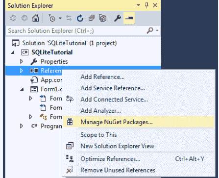

并搜索 System.Data.SQLite，选择它并点击安装

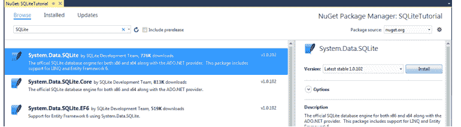

安装也可以通过程序包管理器控制台完成：

```
PM> Install-Package System.Data.SQLite
```

或者仅用于核心功能

```
PM> Install-Package System.Data.SQLite.Core
```

下载就到此为止，所以我们可以直接进入编码。

首先使用此表创建一个简单的 SQLite 数据库，并将其作为文件添加到项目中

```
CREATE TABLE User(
    Id INTEGER PRIMARY KEY AUTOINCREMENT,
    FirstName TEXT NOT NULL,
    LastName TEXT NOT NULL
);
```

另外，请不要忘记根据需要将文件的“复制到输出目录”属性设置为“如果较新则复制”或“始终复制”


创建一个名为 User 的类，它将是我们数据库的基础实体

```
private class User
{
    public string FirstName { get; set; }
    public string Lastname { get; set; }
}
```

我们将编写两个用于查询执行的方法，首先是用于向数据库插入、更新或删除的方法

```
private int ExecuteWrite(string query, Dictionary<string, object> args)
{
    int numberOfRowsAffected;

    //setup the connection to the database
    using (var con = new SQLiteConnection("Data Source=test.db"))
    {
        con.Open();

        //open a new command
        using (var cmd = new SQLiteCommand(query, con))
        {
            //set the arguments given in the query
            foreach (var pair in args)
            {
                cmd.Parameters.AddWithValue(pair.Key, pair.Value);
            }

            //execute the query and get the number of row affected
            numberOfRowsAffected = cmd.ExecuteNonQuery();
        }
    }

    return numberOfRowsAffected;
}
```


and the second one for reading from database

```
private DataTable Execute(string query)
{
    if (string.IsNullOrEmpty(query.Trim()))
        return null;

    using (var con = new SQLiteConnection("Data Source=test.db"))
    {
        con.Open();
        using (var cmd = new SQLiteCommand(query, con))
        {
            foreach (KeyValuePair<string, object> entry in args)
            {
                cmd.Parameters.AddWithValue(entry.Key, entry.Value);
            }

            var da = new SQLiteDataAdapter(cmd);

            var dt = new DataTable();
            da.Fill(dt);

            da.Dispose();
            return dt;
        }
    }
}
```

现在让我们进入我们的 CRUD 方法

### 添加用户

```
private int AddUser(User user)
{
    const string query = "INSERT INTO User(FirstName, LastName) VALUES(@firstName, @lastName)";

    //here we are setting the parameter values that will be actually
    //replaced in the query in Execute method
    var args = new Dictionary<string, object>
    {
        {@"firstName", user.FirstName},
        {@"lastName", user.Lastname}
    };

    return ExecuteWrite(query, args);
}
```

### 编辑用户

```
private int EditUser(User user)
{
    const string query = "UPDATE User SET FirstName = @firstName, LastName = @lastName WHERE Id = @Id";

    //here we are setting the parameter values that will be actually
    //replaced in the query in Execute method
    var args = new Dictionary<string, object>
    {
        {"@id", user.Id},
        {"@firstName", user.FirstName},
        {"@lastName", user.Lastname}
    };

    return ExecuteWrite(query, args);
}
```

### 删除用户

```
private int DeleteUser(User user)
{
    const string query = "Delete from User WHERE Id = @id";

    //here we are setting the parameter values that will be actually
    //replaced in the query in Execute method
    var args = new Dictionary<string, object>
    {
        {"@id", user.Id}
    };

    return ExecuteWrite(query, args);
}
```

### 根据 Id 获取用户

```
private User GetUserById(int id)
{
    var query = "SELECT * FROM User WHERE Id = @id";

    var args = new Dictionary<string, object>
    {
        {"@id", id}
    };

    DataTable dt = ExecuteRead(query, args);

    if (dt == null || dt.Rows.Count == 0)
    {
        return null;
    }

    var user = new User
    {
        Id = Convert.ToInt32(dt.Rows[0]["Id"]),
        FirstName = Convert.ToString(dt.Rows[0]["FirstName"]),
        Lastname = Convert.ToString(dt.Rows[0]["LastName"])
    };

    return user;
}
```

### Section 129.2: 执行查询

```
using (SQLiteConnection conn = new SQLiteConnection(@"Data Source=data.db;Pooling=true;FailIfMissing=false"))
{
    conn.Open();
    using (SQLiteCommand cmd = new SQLiteCommand(conn))
    {
        cmd.CommandText = "query";
        using (SQLiteDataReader dr = cmd.ExecuteReader())
        {
            while(dr.Read())
            {
                //do stuff
            }
        }
    }
}
```

注意：将 FailIfMissing 设置为 true 会在缺失时创建文件 data.db。但是，该文件将为空。因此，任何必需的表都必须重新创建。

## Chapter 130: 缓存

### Section 130.1: 内存缓存

```
//Get instance of cache
using System.Runtime.Caching;

var cache = MemoryCache.Default;

//Check if cache contains an item with
cache.Contains("CacheKey");

//get item from cache
var item = cache.Get("CacheKey");

//get item from cache or add item if not existing
object list = MemoryCache.Default.AddOrGetExisting("CacheKey", "object to be stored",
DateTime.Now.AddHours(12));

//note if item not existing the item is added by this method
//but the method returns null
```

## Chapter 131: 代码契约

### Section 131.1: 后置条件

```csharp
public double GetPaymentsTotal(string name)
{
    Contract.Ensures(Contract.Result<double>() >= 0);

    double total = 0.0;

    foreach (var payment in this._payments) {
        if (string.Equals(payment.Name, name)) {
            total += payment.Amount;
        }
    }

    return total;
}
```

### Section 131.2: 不变量

```csharp
namespace CodeContractsDemo
{
    using System;
    using System.Diagnostics.Contracts;

    public class Point
    {
        public int X { get; set; }
        public int Y { get; set; }

        public Point()
        {
        }

        public Point(int x, int y)
        {
            this.X = x;
            this.Y = y;
        }

        public void Set(int x, int y)
        {
            this.X = x;
            this.Y = y;
        }

        public void Test(int x, int y)
        {
            for (int dx = -x; dx <= x; dx++) {
                this.X = dx;
                Console.WriteLine("Current X = {0}", this.X);
            }

            for (int dy = -y; dy <= y; dy++) {
                this.Y = dy;
                Console.WriteLine("Current Y = {0}", this.Y);
            }
        }
    }
}
```

```
Console.WriteLine("X = {0}", this.X);
Console.WriteLine("Y = {0}", this.Y);
}

[ContractInvariantMethod]
private void ValidateCoordinates()
{
    Contract.Invariant(this.X >= 0);
    Contract.Invariant(this.Y >= 0);
}
}
```

### Section 131.3: 在接口上定义契约

```
[ContractClass(typeof(ValidationContract))]
interface IValidation
{
    string CustomerID {get;set;}
    string Password {get;set;}
}

[ContractClassFor(typeof(IValidation))]
sealed class ValidationContract: IValidation
{
    string IValidation.CustomerID
    {
        [Pure]
        get
        {
            return Contract.Result<string>();
        }
        set
        {
            Contract.RequiresArgumentNullException(!string.IsNullOrEmpty(value), "Customer ID cannot be null!!");
        }
    }

    string IValidation.Password
    {
        [Pure]
        get
        {
            return Contract.Result<string>();
        }
        set
        {
            Contract.RequiresArgumentNullException(!string.IsNullOrEmpty(value), "Password cannot be null!!");
        }
    }
}

class Validation: IValidation
{
    public string GetCustomerPassword(string customerID)
    {
        Contract.Requires(!string.IsNullOrEmpty(customerID),"Customer ID cannot be Null");
        Contract.RequiresArgumentNullException(!string.IsNullOrEmpty(customerID), "Exception!!");
        Contract.Ensures(Contract.Result<string>() != null);

        string password="AAA@1234";
        if (customerID==null)
        {
            return password;
        }
        else
        {
            return null;
        }
    }

    private string m_custID, m_PWD;

    public string CustomerID
    {
        get
        {
            return m_custID;
        }
        set
        {
            m_custID = value;
        }
    }

    public string Password
    {
        get
        {
            return m_PWD;
        }
        set
        {
            m_PWD = value;
        }
    }
}
```

在上面的代码中，我们定义了一个名为 IValidation 的接口，并使用 [ContractClass] 属性。该属性接收一个类的地址，我们在该类中为接口实现了契约。类 ValidationContract 使用接口中定义的属性，并使用 Contract.Requires<T> 检查空值。T 是一个异常类。

我们还使用 [Pure] 属性标记了 get 访问器。pure 属性确保方法或属性不会更改实现 IValidation 接口的类实例状态。

### Section 131.4: 前置条件

```
namespace CodeContractsDemo
{
    using System;
    using System.Collections.Generic;
    using System.Diagnostics.Contracts;

    public class PaymentProcessor
    {
        private List<Payment> _payments = new List<Payment>();

        public void Add(Payment payment)
        {
            Contract.Requires(payment != null);
            Contract.Requires(!string.IsNullOrEmpty(payment.Name));
            Contract.Requires(payment.Date <= DateTime.Now);
            Contract.Requires(payment.Amount > 0);

            this._payments.Add(payment);
        }
    }
}
```

## Chapter 132: 代码契约和断言

### Section 132.1: 用于检查逻辑始终为真的断言

断言不是用于执行输入参数的测试，而是用于验证程序流程是否正确——即在特定时间点你可以对代码做出某些假设。换句话说：使用 Debug.Assert 进行的测试应始终假设所测试的值为真。

Debug.Assert 仅在 DEBUG 构建中执行；在 RELEASE 构建中会被过滤掉。它应被视为调试工具，除单元测试之外，还应被视为调试工具，而不是代码契约或输入验证方法的替代品。

例如，这是一个好的断言：

```csharp
var systemData = RetrieveSystemConfiguration();
Debug.Assert(systemData != null);
```

这里断言是一个不错的选择，因为我们可以假设 RetrieveSystemConfiguration() 将返回有效值并且永远不会返回 null。

这里是另一个好的例子：

```csharp
UserData user = RetrieveUserData();
Debug.Assert(user != null);
Debug.Assert(user.Age > 0);
int year = DateTime.Today.Year - user.Age;
```

首先，我们可以假设 RetrieveUserData() 将返回有效值。然后，在使用 Age 属性之前，我们验证假设（应始终为真）即用户的年龄严格为正。

这是一个糟糕的断言示例：

```csharp
string input = Console.ReadLine();
int age = Convert.ToInt32(input);
Debug.Assert(age > 16);
Console.WriteLine("Great, you are over 16");
```

断言不适用于输入验证，因为不正确地假设此断言将始终为真。你必须为此使用输入验证方法。在上面的情况下，你还应该首先验证输入值是否为数字。


## 第 133 章：结构型设计模式

结构型设计模式是描述对象和类如何组合并形成大型结构，以及通过识别实现实体之间关系的一种简单方式来简化设计的模式。描述了七种结构型模式。它们如下：Adapter, Bridge, Composite, Decorator, Facade, Flyweight 和 Proxy

### 第 133.1 节：适配器设计模式

"Adapter" 如其名所示，是让两个相互不兼容的接口能够相互通信的对象。

**例如：** 如果你买了一部 iPhone 8（或其他任何 Apple 产品）你需要很多适配器。因为默认接口不支持音频插孔或 USB。有了这些适配器，你就可以使用有线耳机或使用普通的以太网线。所以“两个相互不兼容的接口相互通信”。

**所以在技术术语中这意味着：** 将一个类的接口转换为客户端期望的另一个接口。Adapter 使原本因接口不兼容而无法协同工作的类能够一起工作。参与此模式的类和对象是：

### 适配器模式由 4 个元素组成

- 1. **ITarget:** 这是客户端用来实现功能的接口。
- 2. **Adaptee:** 这是客户端期望的功能，但其接口与客户端不兼容。
- 3. **Client:** 这是想要通过使用 adaptee 的代码来实现某些功能的类。
- 4. **Adapter:** 这是会实现 ITarget 并调用客户端想要调用的 Adaptee 代码的类。

### UML


### 第一个代码示例（理论示例）。

```
public interface ITarget
{
    void MethodA();
}

public class Adaptee
{
    public void MethodB()
    {
        Console.WriteLine("MethodB() is called");
    }
}

public class Client
{
    private ITarget target;

    public Client(ITarget target)
    {
        this.target = target;
    }

    public void MakeRequest()
    {
        target.MethodA();
    }
}

public class Adapter : Adaptee, ITarget
{
    public void MethodA()
    {
        MethodB();
    }
}
```

### 第二个代码示例（实际实现）

```
/// <summary>
/// Interface: This is the interface which is used by the client to achieve functionality.
/// </summary>
public interface ITarget
{
    List<string> GetEmployeeList();
}

/// <summary>
/// Adaptee: This is the functionality which the client desires but its interface is not compatible
with the client.
/// </summary>
public class CompanyEmployees
{
    public string[][] GetEmployees()
    {
        string[][] employees = new string[4][];

        employees[0] = new string[] { "100", "Deepak", "Team Leader" };
        employees[1] = new string[] { "101", "Rohit", "Developer" };
        employees[2] = new string[] { "102", "Gautam", "Developer" };
        employees[3] = new string[] { "103", "Dev", "Tester" };

return employees;
    }
}

/// <summary>
/// Client: This is the class which wants to achieve some functionality by using the adaptee's code (list of employees).
/// </summary>
public class ThirdPartyBillingSystem
{
    /*
     * This class is from a third party and you don't have any control over it.
     * But it requires a Employee list to do its work
     */

    private ITarget employeeSource;

    public ThirdPartyBillingSystem(ITarget employeeSource)
    {
        this.employeeSource = employeeSource;
    }

    public void ShowEmployeeList()
    {
        // call the client list in the interface
        List<string> employee = employeeSource.GetEmployeeList();
        Console.WriteLine("######## Employee List ########");
        foreach (var item in employee)
        {
            Console.Write(item);
        }
    }
}

/// <summary>
/// Adapter: This is the class which would implement ITarget and would call the Adaptee code which the client wants to call.
/// </summary>
public class EmployeeAdapter : CompanyEmployees, ITarget
{
    public List<string> GetEmployeeList()
    {
        List<string> employeeList = new List<string>();
        string[][] employees = GetEmployees();
        foreach (string[] employee in employees)
        {
            employeeList.Add(employee[0]);
            employeeList.Add(",");
            employeeList.Add(employee[1]);
            employeeList.Add(",");
            employeeList.Add(employee[2]);
            employeeList.Add("\n");
        }

        return employeeList;
    }
}

/// 
/// Demo
///
class Programs
{
    static void Main(string[] args)
    {
        ITarget Itarget = new EmployeeAdapter();
        ThirdPartyBillingSystem client = new ThirdPartyBillingSystem(Itarget);
        client.ShowEmployeeList();
        Console.ReadKey();
    }
}
```

### 何时使用

- 允许系统使用与其不兼容的另一个系统的类。
- 允许新系统和已存在的、相互独立的系统之间进行通信
- Ado.Net SqlAdapter, OracleAdapter, MySqlAdapter 是适配器模式的最佳示例。

## 第 134 章：创建型设计模式

### 第 134.1 节：单例模式

单例模式旨在将类的创建限制为恰好一个单一实例。

此模式用于在只存在一个实例是有意义的场景中，例如：

- 一个协调其他对象交互的单一类，例如 Manager 类
- 或一个代表唯一、单一资源的类，例如 Logging 组件

实现单例模式最常见的方法之一是通过静态工厂方法，例如 CreateInstance() 或 GetInstance()（或 C# 中的静态属性 Instance），该方法被设计为始终返回相同的实例。

第一次调用该方法或属性时会创建并返回单例实例。此后，该方法始终返回相同的实例。这样，单例对象永远只有一个实例。

通过将类构造函数设为私有，可以防止通过 new 创建实例。

以下是 C# 中实现单例模式的典型代码示例：

```csharp
class Singleton
{
    // Because the _instance member is made private, the only way to get the single
    // instance is via the static Instance property below. This can also be similarly
    // achieved with a GetInstance() method instead of the property.
    private static Singleton _instance = null;

    // Making the constructor private prevents other instances from being
    // created via something like Singleton s = new Singleton(), protecting
    // against unintentional misuse.
    private Singleton()
    {
    }

    public static Singleton Instance
    {
        get
        {
            // The first call will create the one and only instance.
            if (_instance == null)
            {
                _instance = new Singleton();
            }

            // Every call afterwards will return the single instance created above.
            return _instance;
        }
    }
}
```

为了进一步说明此模式，下面的代码检查在多次调用 Instance 属性时是否返回单例的相同实例。

```csharp
class Program
{
static void Main(string[] args)
{
    Singleton s1 = Singleton.Instance;
    Singleton s2 = Singleton.Instance;

    // Both Singleton objects above should now reference the same Singleton instance.
    if (Object.ReferenceEquals(s1, s2))
    {
        Console.WriteLine("Singleton is working");
    }
    else
    {
        // Otherwise, the Singleton Instance property is returning something
        // other than the unique, single instance when called.
        Console.WriteLine("Singleton is broken");
    }
}
```
```

注意：此实现不是线程安全的。

要查看更多示例，包括如何使其线程安全，请访问：Singleton Implementation

从概念上讲，单例与全局值相似，并会引起类似的设计缺陷和问题。因此，单例模式被广泛认为是一种反模式。

访问 "What is so bad about Singletons?" 了解使用它们时出现的问题的更多信息。

在 C# 中，你可以将类设为 static，这会使所有成员都为 static，并且该类无法被实例化。鉴于此，常见的做法是用静态类代替单例模式。

有关两者之间关键差异，请访问 C# Singleton Pattern Versus Static Class。

### 第 134.2 节：工厂方法模式

工厂方法是一种创建型设计模式。它用于处理在不指定确切结果类型的情况下创建对象的问题。本文档将教你如何正确使用工厂方法 DP。

让我用一个简单的例子向你解释它的想法。想象你在为一家生产三种类型设备的工厂工作——Ammeter、Voltmeter 和电阻表。你正在为中央计算机编写程序，该程序将创建选定的设备，但你不知道老板最终决定生产什么。

让我们创建一个 IDevice 接口，其中包含所有设备共有的一些常用函数：

```
public interface IDevice
{
    int Measure();
    void TurnOff();
    void TurnOn();
}
```

现在，我们可以创建代表我们设备的类。那些类必须实现 IDevice 接口：

```
public class AmMeter : IDevice
{
    private Random r = null;
    public AmMeter()
    {
```


```csharp
r = new Random();
}
public int Measure() { return r.Next(-25, 60); }
public void TurnOff() { Console.WriteLine("AmMeter flashes lights saying good bye!"); }
public void TurnOn() { Console.WriteLine("AmMeter turns on..."); }
}
public class OhmMeter : IDevice
{
    private Random r = null;
    public OhmMeter()
    {
        r = new Random();
    }

    public int Measure() { return r.Next(0, 100000); }
    public void TurnOff() { Console.WriteLine("OhmMeter flashes lights saying good bye!"); }
    public void TurnOn() { Console.WriteLine("OhmMeter turns on..."); }
}
public class VoltMeter : IDevice
{
    private Random r = null;
    public VoltMeter()
    {
        r = new Random();
    }

    public int Measure() { return r.Next(-230, 230); }
    public void TurnOff() { Console.WriteLine("VoltMeter flashes lights saying good bye!"); }
    public void TurnOn() { Console.WriteLine("VoltMeter turns on..."); }
}
```

现在我们需要定义工厂方法。让我们创建包含静态方法的 DeviceFactory 类：

```csharp
public enum Device
{
    AM,
    VOLT,
    OHM
}
public class DeviceFactory
{
    public static IDevice CreateDevice(Device d)
    {
        switch(d)
        {
            case Device.AM: return new AmMeter();
            case Device.VOLT: return new VoltMeter();
            case Device.OHM: return new OhmMeter();
            default: return new AmMeter();
        }
    }
}
```

太好了！让我们测试我们的代码：

```csharp
public class Program
{
    static void Main(string[] args)
    {
        IDevice device = DeviceFactory.CreateDevice(Device.AM);
        device.TurnOn();
        Console.WriteLine(device.Measure());
        Console.WriteLine(device.Measure());
    }
}
```

```
Console.WriteLine(device.Measure());
Console.WriteLine(device.Measure());
Console.WriteLine(device.Measure());
device.TurnOff();
Console.WriteLine();

device = DeviceFactory.CreateDevice(Device.VOLT);
device.TurnOn();
Console.WriteLine(device.Measure());
Console.WriteLine(device.Measure());
Console.WriteLine(device.Measure());
Console.WriteLine(device.Measure());
Console.WriteLine(device.Measure());
device.TurnOff();
Console.WriteLine();

device = DeviceFactory.CreateDevice(Device.OHM);
device.TurnOn();
Console.WriteLine(device.Measure());
Console.WriteLine(device.Measure());
Console.WriteLine(device.Measure());
Console.WriteLine(device.Measure());
Console.WriteLine(device.Measure());
device.TurnOff();
    Console.WriteLine();
}
}
```

这是运行此代码后您可能会看到的示例输出：

AmMeter turns on...

36

6

33

43

24

AmMeter flashes lights saying good bye!

VoltMeter turns on...

102

-61

85

138

36

VoltMeter flashes lights saying good bye!

OhmMeter turns on...

723828

368536

685412

800266

578595

OhmMeter flashes lights saying good bye!

## 第 134.3 节：抽象工厂模式

提供一个接口用于在不指定其具体类的情况下创建相关或依赖对象的族。

此示例演示了使用不同工厂为计算机游戏创建不同的动物世界。

虽然大陆工厂创建的动物不同，但动物之间的交互保持不变。

```
using System;

namespace GangOfFour.AbstractFactory
{
    /// <summary>
    /// MainApp startup class for Real-World
    /// Abstract Factory Design Pattern.
    /// </summary>
    class MainApp
    {
        /// <summary>
        /// Entry point into console application.
        /// </summary>
        public static void Main()
        {
            // Create and run the African animal world
            ContinentFactory africa = new AfricaFactory();
            AnimalWorld world = new AnimalWorld(africa);
            world.RunFoodChain();

            // Create and run the American animal world
            ContinentFactory america = new AmericaFactory();
            world = new AnimalWorld(america);
            world.RunFoodChain();

            // Wait for user input
            Console.ReadKey();
        }
    }

    /// <summary>
    /// The 'AbstractFactory' abstract class
    /// </summary>
    abstract class ContinentFactory
    {
        public abstract Herbivore CreateHerbivore();
        public abstract Carnivore CreateCarnivore();
    }
```

```
/// <summary>
/// The 'ConcreteFactory1' class
/// </summary>
class AfricaFactory : ContinentFactory
{
    public override Herbivore CreateHerbivore()
    {
        return new Wildebeest();
    }
    public override Carnivore CreateCarnivore()
    {
        return new Lion();
    }
}

/// <summary>
/// The 'ConcreteFactory2' class
/// </summary>
class AmericaFactory : ContinentFactory
{
    public override Herbivore CreateHerbivore()
    {
        return new Bison();
    }
    public override Carnivore CreateCarnivore()
    {
        return new Wolf();
    }
}

/// <summary>
/// The 'AbstractProductA' abstract class
/// </summary>
abstract class Herbivore
{
}

/// <summary>
/// The 'AbstractProductB' abstract class
/// </summary>
abstract class Carnivore
{
    public abstract void Eat(Herbivore h);
}

/// <summary>
/// The 'ProductA1' class
/// </summary>
class Wildebeest : Herbivore
{
}

/// <summary>
/// The 'ProductB1' class
/// </summary>
class Lion : Carnivore
{
    public override void Eat(Herbivore h)
    {
        // Eat Wildebeest
        Console.WriteLine(this.GetType().Name +
```

```
  " eats " + h.GetType().Name);
}
}
```

```
/// <summary>
/// The 'ProductA2' class
/// </summary>
class Bison : Herbivore
{
}

/// <summary>
/// The 'ProductB2' class
/// </summary>
class Wolf : Carnivore
{
    public override void Eat(Herbivore h)
    {
        // Eat Bison
        Console.WriteLine(this.GetType().Name +
            " eats " + h.GetType().Name);
    }
}

/// <summary>
/// The 'Client' class
/// </summary>
class AnimalWorld
{
    private Herbivore _herbivore;
    private Carnivore _carnivore;

    // Constructor
    public AnimalWorld(ContinentFactory factory)
    {
        _carnivore = factory.CreateCarnivore();
        _herbivore = factory.CreateHerbivore();
    }

    public void RunFoodChain()
    {
        _carnivore.Eat(_herbivore);
    }
}
```

输出：

Lion eats Wildebeest

Wolf eats Bison

## 第 134.4 节：建造者模式

将复杂对象的构建与其表示分离，以便相同的构建过程可以创建不同的表示，并提供对对象组装的高级控制。

此示例演示了建造者模式，其中不同的车辆以逐步的方式组装。Shop 使用 VehicleBuilders 在一系列顺序步骤中构建各种车辆。

```csharp
using System;
using System.Collections.Generic;

namespace GangOfFour.Builder
{
    /// <summary>
    /// MainApp startup class for Real-World
    /// Builder Design Pattern.
    /// </summary>
    public class MainApp
    {
        /// <summary>
        /// Entry point into console application.
        /// </summary>
        public static void Main()
        {
            VehicleBuilder builder;

            // Create shop with vehicle builders
            Shop shop = new Shop();

            // Construct and display vehicles
            builder = new ScooterBuilder();
            shop.Construct(builder);
            builder.Vehicle.Show();

            builder = new CarBuilder();
            shop.Construct(builder);
            builder.Vehicle.Show();

            builder = new MotorCycleBuilder();
            shop.Construct(builder);
            builder.Vehicle.Show();

            // Wait for user
            Console.ReadKey();
        }
    }

    /// <summary>
    /// The 'Director' class
    /// </summary>
    class Shop
    {
        // Builder uses a complex series of steps
        public void Construct(VehicleBuilder vehicleBuilder)
        {
            vehicleBuilder.BuildFrame();
            vehicleBuilder.BuildEngine();
            vehicleBuilder.BuildWheels();
            vehicleBuilder.BuildDoors();
        }
    }

    /// <summary>
    /// The 'Builder' abstract class
    /// </summary>
    abstract class VehicleBuilder
    {
        protected Vehicle vehicle;
```


```csharp
{
    vehicle["engine"] = "2500 cc";
}

public override void BuildWheels()
{
    vehicle["wheels"] = "4";
}

public override void BuildDoors()
{
    vehicle["doors"] = "4";
}

// <summary>
// The 'ConcreteBuilder3' class
// </summary>
class ScooterBuilder : VehicleBuilder
{
    public ScooterBuilder()
    {
        vehicle = new Vehicle("Scooter");
    }

    public override void BuildFrame()
    {
        vehicle["frame"] = "Scooter Frame";
    }

    public override void BuildEngine()
    {
        vehicle["engine"] = "50 cc";
    }

    public override void BuildWheels()
    {
        vehicle["wheels"] = "2";
    }

    public override void BuildDoors()
    {
        vehicle["doors"] = "0";
    }
}

// <summary>
// The 'Product' class
// </summary>
class Vehicle
{
    private string _vehicleType;
    private Dictionary<string,string> _parts = new Dictionary<string,string>();

    // Constructor
    public Vehicle(string vehicleType)
    {
        this._vehicleType = vehicleType;
    }

    // Indexer
```
public string this[string key]
{
    get { return _parts[key]; }
    set { _parts[key] = value; }
}

public void Show()
{
    Console.WriteLine("\n-------------------------------");
    Console.WriteLine("Vehicle Type: {0}", _vehicleType);
    Console.WriteLine(" Frame : {0}", _parts["frame"]);
    Console.WriteLine(" Engine : {0}", _parts["engine"]);
    Console.WriteLine(" #Wheels : {0}", _parts["wheels"]);
    Console.WriteLine(" #Doors : {0}", _parts["doors"]);
}
}
```

输出

Vehicle Type: Scooter Frame : Scooter Frame
Engine : none
#Wheels: 2
#Doors : 0

Vehicle Type: Car
Frame : Car Frame
Engine : 2500 cc
#Wheels: 4
#Doors : 4

Vehicle Type: MotorCycle
Frame : MotorCycle Frame
Engine : 500 cc
#Wheels: 2
#Doors : 0

### Section 134.5: 原型模式

指定使用原型实例创建对象的种类，并通过复制该原型创建新对象。

在此示例中演示了原型模式，其中通过复制预先存在的、用户定义的相同类型的 Color 对象来创建新的 Color 对象。

```
using System;
using System.Collections.Generic;

namespace GangOfFour.Prototype
{
    /// <summary>
    /// MainApp startup class for Real-World
    /// Prototype Design Pattern.
    /// </summary>
    class MainApp
    {
        /// <summary>
```
/// Entry point into console application.
/// </summary>
static void Main()
{
    ColorManager colormanager = new ColorManager();

    // Initialize with standard colors
    colormanager["red"] = new Color(255, 0, 0);
    colormanager["green"] = new Color(0, 255, 0);
    colormanager["blue"] = new Color(0, 0, 255);

    // User adds personalized colors
    colormanager["angry"] = new Color(255, 54, 0);
    colormanager["peace"] = new Color(128, 211, 128);
    colormanager["flame"] = new Color(211, 34, 20);

    // User clones selected colors
    Color color1 = colormanager["red"].Clone() as Color;
    Color color2 = colormanager["peace"].Clone() as Color;
    Color color3 = colormanager["flame"].Clone() as Color;

    // Wait for user
    Console.ReadKey();
}

/// <summary>
/// The 'Prototype' abstract class
/// </summary>
abstract class ColorPrototype
{
    public abstract ColorPrototype Clone();
}

/// <summary>
/// The 'ConcretePrototype' class
/// </summary>
class Color : ColorPrototype
{
    private int _red;
    private int _green;
    private int _blue;

    // Constructor
    public Color(int red, int green, int blue)
    {
        this._red = red;
        this._green = green;
        this._blue = blue;
    }

    // Create a shallow copy
    public override ColorPrototype Clone()
    {
        Console.WriteLine(
            "Cloning color RGB: {0,3},{1,3},{2,3}",
            _red, _green, _blue);

        return this.MemberwiseClone() as ColorPrototype;
    }
}
```
/// <summary>
/// Prototype manager
/// </summary>
class ColorManager
{
    private Dictionary<string, ColorPrototype> _colors =
        new Dictionary<string, ColorPrototype>();

    // Indexer
    public ColorPrototype this[string key]
    {
        get { return _colors[key]; }
        set { _colors.Add(key, value); }
    }
}
```

输出:
- Cloning color RGB: 255, 0, 0
- Cloning color RGB: 128,211,128
- Cloning color RGB: 211, 34, 20

```
    else return "Topping";
}
}
```

现在我们可以创建我们最喜欢的咖啡：

```
public class Program
{
    public static void Main(string[] args)
    {
        AbstractCoffee coffee = null; //we cant create instance of abstract class
        coffee = new Topping(coffee); //passing null
        coffee = new Sugar(coffee); //passing topping instance
        coffee = new Milk(coffee); //passing sugar
        Console.WriteLine("Coffee with " + coffee.ShowCoffee());
    }
}
```

运行代码将产生以下输出：

> > Coffee with Topping with Sugar with Milk

## Chapter 136: 实现享元设计模式

### Section 136.1: 在 RPG 游戏中实现地图

享元是结构型设计模式之一。它用于通过尽可能共享相似对象的尽可能多的数据来减少使用的内存量。本文档将教你如何正确使用享元 DP。

让我用一个简单的例子向你解释它的想法。想象一下，你正在开发一款 RPG 游戏，需要加载一个包含一些字符的巨大文件。例如：

- # 是草地。你可以在上面行走。
- $ 是起点
- @ 是岩石。你不能在上面行走。
- % 是宝箱

地图示例：

@@@@@@@@@@@@@@@@@@@@@@@@@@@@@@@
@#################@#####@###$@@@
@#################@#####@###@@@
@#########@########@########@@@
@##############################
@@@@@@@@@@@@@@@@@@@@@@@@@@@@@@@

由于这些对象具有相似的特征，你不需要为每个地图字段创建单独的对象。我将向你展示如何使用享元。

让我们定义一个接口，我们的字段将实现它：

```
public interface IField
{
    string Name { get; }
    char Mark { get; }
    bool CanWalk { get; }
    FieldType Type { get; }
}
```

现在我们可以创建表示我们字段的类。我们还必须以某种方式标识它们（我使用了枚举）：

```
public enum FieldType
{
    GRASS,
    ROCK,
    START,
    CHEST
}
public class Grass : IField
{
    public string Name { get { return "Grass"; } }
    public char Mark { get { return '#'; } }
```
public bool CanWalk { get { return true; } }
public FieldType Type { get { return FieldType.GRASS; } }
}
public class StartingPoint : IField
{
    public string Name { get { return "Starting Point"; } }
    public char Mark { get { return '$'; } }
    public bool CanWalk { get { return true; } }
    public FieldType Type { get { return FieldType.START; } }
}
public class Rock : IField
{
    public string Name { get { return "Rock"; } }
    public char Mark { get { return '@'; } }
    public bool CanWalk { get { return false; } }
    public FieldType Type { get { return FieldType.ROCK; } }
}
public class TreasureChest : IField
{
    public string Name { get { return "Treasure Chest"; } }
    public char Mark { get { return '%'; } }
    public bool CanWalk { get { return true; } } // you can approach it
    public FieldType Type { get { return FieldType.CHEST; } }
}
```

正如我所说，我们不需要为每个字段创建单独的实例。我们必须创建一个字段存储库。享元 DP 的精髓在于，我们仅在需要时并且该对象尚不存在于我们的存储库中时才动态创建对象，或者如果它已存在则返回它。让我们编写一个简单的类来为我们处理这个问题：

```
public class FieldRepository
{
    private List<IField> lstFields = new List<IField>();

    private IField AddField(FieldType type)
    {
        IField f;
        switch(type)
        {
            case FieldType.GRASS: f = new Grass(); break;
            case FieldType.ROCK: f = new Rock(); break;
            case FieldType.START: f = new StartingPoint(); break;
            case FieldType.CHEST:
            default: f = new TreasureChest(); break;
        }
        lstFields.Add(f); //add it to repository
        Console.WriteLine("Created new instance of {0}", f.Name);
        return f;
    }
    public IField GetField(FieldType type)
    {
        IField f = lstFields.Find(x => x.Type == type);
        if (f != null) return f;
        else return AddField(type);
    }
}
```

太好了！现在我们可以测试我们的代码：

```
public class Program
{
```


```csharp
public static void Main(string[] args)
{
    FieldRepository f = new FieldRepository();
    IField grass = f.GetField(FieldType.GRASS);
    grass = f.GetField(FieldType.ROCK);
    grass = f.GetField(FieldType.GRASS);
}
```

控制台中的结果应为：

> > Created a new instance of Grass
> > Created a new instance of Rock

但为什么草只出现一次，如果我们想获取它两次呢？那是因为第一次调用 GetField 时，草实例在我们的存储库中不存在，所以它被创建了，但下一次我们需要草时它已经存在，所以我们只返回它。

## 第 137 章：System.Management.Automation

### 第 137.1 节：调用简单同步管道

获取当前日期和时间。

```csharp
public class Program
{
    static void Main()
    {
        // create empty pipeline
        PowerShell ps = PowerShell.Create();

        // add command
        ps.AddCommand("Get-Date");

        // run command(s)
        Console.WriteLine("Date: {0}", ps.Invoke().First());

        Console.ReadLine();
    }
}
```


## 第 138 章：System.DirectoryServices.Protocols.LdapConnection

### 第 138.1 节：经过身份验证的 SSL LDAP 连接，SSL 证书与反向 DNS 不匹配

设置服务器和身份验证信息的某些常量。假设使用 LDAPv3，但更改起来很容易。

```csharp
// Authentication, and the name of the server.
private const string LDAPUser = "cn=example:app:mygroup:accts,ou=Applications,dc=example,dc=com";
private readonly char[] password = { 'p', 'a', 's', 's', 'w', 'o', 'r', 'd' };
private const string TargetServer = "ldap.example.com";

// Specific to your company. Might start "cn=manager" instead of "ou=people", for example.
private const string CompanyDN = "ou=people,dc=example,dc=com";
```

实际上使用三部分创建连接：LdapDirectoryIdentifier（服务器）和 NetworkCredentials。

```csharp
// Configure server and port. LDAP w/ SSL, aka LDAPS, uses port 636.
// If you don't have SSL, don't give it the SSL port.
LdapDirectoryIdentifier identifier = new LdapDirectoryIdentifier(TargetServer, 636);

// Configure network credentials (userid and password)
var secureString = new SecureString();
foreach (var character in password)
{
    secureString.AppendChar(character);
}
NetworkCredential creds = new NetworkCredential(LDAPUser, secureString);

// Actually create the connection
LdapConnection connection = new LdapConnection(identifier, creds)
{
    AuthType = AuthType.Basic,
    SessionOptions =
    {
        ProtocolVersion = 3,
        SecureSocketLayer = true
    };
};

// Override SChannel reverse DNS lookup.
// This gets us past the "The LDAP server is unavailable." exception
// Could be
// connection.SessionOptions.VerifyServerCertificate += { return true; };
// but some certificate validation is probably good.
connection.SessionOptions.VerifyServerCertificate +=
(sender, certificate) => certificate.Subject.Contains(string.Format("CN={0},", TargetServer));
```

使用 LDAP 服务器，例如通过 userid 搜索所有 objectClass 值的人员。objectClass 的存在是为了演示复合搜索：与号是两个查询子句的布尔“与”运算符。

```csharp
SearchRequest searchRequest = new SearchRequest(
    CompanyDN,
    string.Format("(&(objectClass=*)(uid={0}))", uid),
    SearchScope.Subtree,
    null
);

// Look at your results
foreach (SearchResultEntry entry in searchResponse.Entries) {
    // do something
}
```

### 第 138.2 节：超级简单的匿名 LDAP

假设使用 LDAPv3，但更改起来很容易。这是匿名、未加密的 LDAPv3 LdapConnection 创建。

```csharp
private const string TargetServer = "ldap.example.com";
```

实际上使用三部分创建连接：LdapDirectoryIdentifier（服务器）和 NetworkCredentials。

```csharp
// Configure server and credentials
LdapDirectoryIdentifier identifier = new LdapDirectoryIdentifier(TargetServer);
NetworkCredential creds = new NetworkCredential();
LdapConnection connection = new LdapConnection(identifier, creds)
{
    AuthType=AuthType.Anonymous,
    SessionOptions =
    {
        ProtocolVersion = 3
    }
};
```

要使用连接，像这样就可以获取姓氏为 Smith 的人员

```csharp
SearchRequest searchRequest = new SearchRequest("dn=example,dn=com", "(sn=Smith)",
SearchScope.Subtree,null);
```

## 第 139 章：C# Authentication handler

### 第 139.1 节：身份验证处理程序

```csharp
public class AuthenticationHandler : DelegatingHandler
{
    /// <summary>
    /// Holds request's header name which will contains token.
    /// </summary>
    private const string securityToken = "__RequestAuthToken";

    /// <summary>
    /// Default overridden method which performs authentication.
    /// </summary>
    /// <param name="request">Http request message.</param>
    /// <param name="cancellationToken">Cancellation token.</param>
    /// <returns>Returns http response message of type <see cref="HttpResponseMessage"/> class asynchronously.</returns>
    protected override Task<HttpResponseMessage> SendAsync(HttpRequestMessage request, CancellationToken cancellationToken)
    {
        if (request.Headers.Contains(securityToken))
        {
            bool authorized = Authorize(request);
            if (!authorized)
            {
                return ApiHttpUtility.FromResult(request, false, HttpStatusCode.Unauthorized, MessageTypes.Error, Resource.UnAuthenticatedUser);
            }
            else
            {
                return ApiHttpUtility.FromResult(request, false, HttpStatusCode.BadRequest, MessageTypes.Error, Resource.UnAuthenticatedUser);
            }
        }

        return base.SendAsync(request, cancellationToken);
    }

    /// <summary>
    /// Authorize user by validating token.
    /// </summary>
    /// <param name="requestMessage">Authorization context.</param>
    /// <returns>Returns a value indicating whether current request is authenticated or not.</returns>
    private bool Authorize(HttpRequestMessage requestMessage)
    {
        try
        {
            HttpRequest request = HttpContext.Current.Request;
            string token = request.Headers[securityToken];
            return SecurityUtility.IsTokenValid(token, request.UserAgent, HttpContext.Current.Server.MapPath("~/Content/"), requestMessage);
        }
        catch (Exception)
        {
            return false;
        }
    }
}
```

## 第 140 章：Pointers

### 第 140.1 节：用于数组访问的指针

此示例演示了指针如何用于对 C# 数组进行类似 C 的访问。

```csharp
unsafe
{
    var buffer = new int[1024];
    fixed (int* p = &buffer[0])
    {
        for (var i = 0; i < buffer.Length; i++)
        {
            *(p + i) = i;
        }
    }
}
```

需要 unsafe 关键字，因为指针访问不会发出在常规方式访问 C# 数组时通常发出的任何边界检查。

fixed 关键字告诉 C# 编译器发出指令以异常安全的方式固定对象。固定是必需的，以确保垃圾收集器不会在内存中移动数组，否则会使指向数组内的任何指针失效。

### 第 140.2 节：指针算术

指针中的加法和减法与整数的工作方式不同。当指针递增或递减时，它指向的地址会根据引用类型的大小而增加或减少。

例如，类型 int（System.Int32 的别名）大小为 4。如果 int 可以存储在地址 0，则后续 int 可以存储在地址 4，以此类推。在代码中：

```csharp
var ptr = (int*)IntPtr.Zero;
Console.WriteLine(new IntPtr(ptr)); // prints 0
ptr++;
Console.WriteLine(new IntPtr(ptr)); // prints 4
ptr++;
Console.WriteLine(new IntPtr(ptr)); // prints 8
```

类似地，类型 long（System.Int64 的别名）大小为 8。如果 long 可以存储在地址 0，则后续 long 可以存储在地址 8，以此类推。在代码中：

```csharp
var ptr = (long*)IntPtr.Zero;
Console.WriteLine(new IntPtr(ptr)); // prints 0
ptr++;
Console.WriteLine(new IntPtr(ptr)); // prints 8
ptr++;
Console.WriteLine(new IntPtr(ptr)); // prints 16
```

void 类型是特殊的，void 指针也是特殊的，它们用作万能指针，当类型未知或无关紧要时使用。由于其与大小无关的特性，void 指针不能递增或递减：

```csharp
var ptr = (void*)IntPtr.Zero;
```

```
Console.WriteLine(new IntPtr(ptr));
ptr++; // compile-time error
Console.WriteLine(new IntPtr(ptr));
ptr++; // compile-time error
Console.WriteLine(new IntPtr(ptr));
```

### 140.3节：星号是类型的一部分

在 C 和 C++ 中，指针变量声明中的星号是被声明表达式的一部分。在 C# 中，声明中的星号是类型的一部分。

在 C、C++ 和 C# 中，以下代码片段声明一个 int 指针：

```
int* a;
```

在 C 和 C++ 中，以下代码片段声明一个 int 指针和一个 int 变量。在 C# 中，它声明两个 int 指针：

```
int* a, b;
```

在 C 和 C++ 中，以下代码片段声明两个 int 指针。在 C# 中，这是无效的：

```
int *a, *b;
```

### 140.4节：void*

C# 继承了 C 和 C++ 中将 void* 用作与类型无关、与大小无关的指针的用法。

```
void* ptr;
```

任何指针类型都可以通过隐式转换赋给 void*：

```
int* p1 = (int*)IntPtr.Zero;
void* ptr = p1;
```

反向操作需要显式转换：

```
int* p1 = (int*)IntPtr.Zero;
void* ptr = p1;
int* p2 = (int*)ptr;
```

### 140.5节：使用 -> 进行成员访问

C# 继承了 C 和 C++ 中将符号 -> 用作通过类型化指针访问实例成员的手段的用法。

考虑以下结构体：

```
struct Vector2
{
    public int X;
    public int Y;
}
```

以下是使用 -> 访问其成员的示例：

```
Vector2 v;
v.X = 5;
v.Y = 10;

Vector2* ptr = &v;
int x = ptr->X;
int y = ptr->Y;
string s = ptr->ToString();

Console.WriteLine(x); // prints 5
Console.WriteLine(y); // prints 10
Console.WriteLine(s); // prints Vector2
```

### 140.6节：泛型指针

类型为支持指针而必须满足的条件（参见备注）无法用泛型约束来表达。因此，任何尝试声明指向通过泛型类型参数提供的类型的指针都会失败。

```
void P<T>(T obj)
    where T : struct
{
    T* ptr = &obj; // compile-time error
}
```

## 第141章：指针与不安全代码

### 141.1节：不安全代码简介

当代码块由 unsafe 修饰符标记时，C# 允许在函数中使用指针变量。不安全代码或非托管代码是使用指针变量的代码块。

指针是一个变量，其值是另一个变量的地址，即内存位置的直接地址。与任何变量或常量类似，必须先声明指针，然后才能使用它存储任何变量地址。

指针声明的一般形式为：

```
type *var-name;
```

以下是有效的指针声明：

```
int *ip;    /* pointer to an integer */
double *dp;  /* pointer to a double */
float *fp;   /* pointer to a float */
char *ch;    /* pointer to a character */
```

以下示例演示在 C# 中使用 unsafe 修饰符来使用指针：

```
using System;
namespace UnsafeCodeApplication
{
    class Program
    {
        static unsafe void Main(string[] args)
        {
            int var = 20;
            int* p = &var;
            Console.WriteLine("Data is: {0} ", var);
            Console.WriteLine("Address is: {0}", (int)p);
            Console.ReadKey();
        }
    }
}
```

编译并执行上述代码时，产生以下结果：

```
Data is: 20
Address is: 99215364
```

除了将整个方法声明为 unsafe，也可以将一部分代码声明为 unsafe：

```
// safe code
unsafe
{
    // you can use pointers here
}
// safe code
```

### 141.2节：使用指针访问数组元素

在 C# 中，数组名和指向与数组数据相同数据类型的指针不是同一种变量类型。例如，`int *p` 和 `int[] p` 不是同一类型。可以递增指针变量 p，因为它在内存中不是固定的；但数组地址在内存中是固定的，不能递增。

因此，如果需要像在 C 或 C++ 中传统做法那样使用指针变量访问数组数据，则需要使用 fixed 关键字固定指针。

以下示例演示了这一点：

```csharp
using System;
namespace UnsafeCodeApplication
{
    class TestPointer
    {
        public unsafe static void Main()
        {
            int[]  list = {10, 100, 200};
            fixed(int *ptr = list)

            /* let us have array address in pointer */
            for ( int  i = 0; i < 3; i++)
            {
                Console.WriteLine("Address of list[{0}]={1}", i,(int)(ptr + i));
                Console.WriteLine("Value of list[{0}]={1}", i, *(ptr + i));
            }

            Console.ReadKey();
        }
    }
}
```

编译并执行上述代码时，产生以下结果：

```text
Address of list[0] = 31627168
Value of list[0] = 10
Address of list[1] = 31627172
Value of list[1] = 100
Address of list[2] = 31627176
Value of list[2] = 200
```

### 141.3节：编译不安全代码

要编译不安全代码，必须在命令行编译器中指定 `/unsafe` 命令行开关。

例如，要从命令行编译名为 prog1.cs 且包含不安全代码的程序，请使用以下命令：

```bash
csc /unsafe prog1.cs
```

如果使用 Visual Studio IDE，则需要在项目属性中启用不安全代码的使用。


为此：
- 双击解决方案资源管理器中的“属性”节点，打开项目属性。
- 单击“生成”选项卡。
- 选择“允许不安全代码”选项

### 141.4节：使用指针检索数据值

可以使用 ToString() 方法检索存储在指针变量所引用位置的数据。以下示例演示了这一点：

```
using System;
namespace UnsafeCodeApplication
{
    class Program
    {
        public static void Main()
        {
            unsafe
            {
                int var = 20;
                int* p = &var;
                Console.WriteLine("Data is: {0} ", var);
                Console.WriteLine("Data is: {0} ", p->ToString());
                Console.WriteLine("Address is: {0} ", (int)p);
            }
            Console.ReadKey();
        }
    }
}
```

编译并执行上述代码时，产生以下结果：

```
Data is: 20
Data is: 20
Address is: 77128984
```

### 141.5节：将指针作为参数传递给方法

可以将指针变量作为参数传递给方法。以下示例说明了这一点：

```
using System;
namespace UnsafeCodeApplication
{
    class TestPointer
    {
        public unsafe void swap(int* p, int *q)
        {
            int temp = *p;
            *p = *q;
            *q = temp;
        }

        public unsafe static void Main()
        {
            TestPointer p = new TestPointer();
            int var1 = 10;
            int var2 = 20;
            int* x = &var1;
            int* y = &var2;

            Console.WriteLine("Before Swap: var1:{0}, var2: {1}", var1, var2);
            p.swap(x, y);

            Console.WriteLine("After Swap: var1:{0}, var2: {1}", var1, var2);
            Console.ReadKey();
        }
    }
}
```

编译并执行上述代码时，产生以下结果：

```
Before Swap: var1: 10, var2: 20
After Swap: var1: 20, var2: 10
```

## 第142章：如何使用 C# 结构体创建联合类型（类似于 C 联合体）

### 142.1节：C# 中的 C 风格联合体

多种语言（例如 C 语言）使用联合类型来包含若干可以“重叠”的不同类型。换句话说，它们可能包含不同字段，这些字段都从同一内存偏移量开始，即使它们可能具有不同的长度和类型。这具有节省内存和进行自动转换的优点。

以 IP 地址为例。在内部，IP 地址表示为整数，但有时我们希望访问不同的字节分量，例如 Byte1.Byte2.Byte3.Byte4。这适用于任何值类型，无论是像 Int32 或 long 这样的基元类型，还是你自己定义的其他结构体。

在 C# 中，我们可以通过使用显式布局结构体来实现相同的效果。

```
using System;
using System.Runtime.InteropServices;

// The struct needs to be annotated as "Explicit Layout"
[StructLayout(LayoutKind.Explicit)]
struct IpAddress
{
    // The "FieldOffset" means that this Integer starts, an offset in bytes.
    // sizeof(int) 4, sizeof(byte) = 1
    [FieldOffset(0)] public int Address;
    [FieldOffset(0)] public byte Byte1;
    [FieldOffset(1)] public byte Byte2;
    [FieldOffset(2)] public byte Byte3;
    [FieldOffset(3)] public byte Byte4;

    public IpAddress(int address) : this()
    {
        // When we init the Int, the Bytes will change too.
        Address = address;
    }

    // Now we can use the explicit layout to access the
    // bytes separately, without doing any conversion.
    public override string ToString() => $"{Byte1}.{Byte2}.{Byte3}.{Byte4}";
}
```

以这种方式定义结构体后，我们就可以像在 C 中使用联合体那样使用它。例如，让我们创建一个由随机整数表示的 IP 地址，然后通过将地址中的第一个标记从 'A.B.C.D' 改为 '100.B.C.D'，将其修改为 '100'：

```
var ip = new IpAddress(new Random().Next());
Console.WriteLine($"{ip} = {ip.Address}");
ip.Byte1 = 100;
Console.WriteLine($"{ip} = {ip.Address}");
```

输出：

75.49.5.32 = 537211211
100.49.5.32 = 537211236

查看演示


### 第142.2节：C# 中的联合类型也可以包含结构体字段

除了基元类型之外，C# 中的显式布局结构体（联合体）也可以包含其他结构体。只要字段是值类型而不是引用类型，就可以包含在联合体中：

```
using System;
using System.Runtime.InteropServices;

// The struct needs to be annotated as "Explicit Layout"
[StructLayout(LayoutKind.Explicit)]
struct IPAddress
{
    // Same definition of IPAddress, from the example above
}

// Now let's see if we can fit a whole URL into a long

// Let's define a short enum to hold protocols
enum Protocol : short { Http, Https, Ftp, Sftp, Tcp }

// The Service struct will hold the Address, the Port and the Protocol
[StructLayout(LayoutKind.Explicit)]
struct Service
{
    [FieldOffset(0)] public IPAddress Address;
    [FieldOffset(4)] public ushort Port;
    [FieldOffset(6)] public Protocol AppProtocol;
    [FieldOffset(0)] public long Payload;

    public Service(IPAddress address, ushort port, Protocol protocol)
    {
        Payload = 0;
        Address = address;
        Port = port;
        AppProtocol = protocol;
    }

    public Service(long payload)
    {
        Address = new IPAddress(0);
        Port = 80;
        AppProtocol = Protocol.Http;
        Payload = payload;
    }

    public Service Copy() => new Service(Payload);

    public override string ToString() => $"{AppProtocol}//{Address}:{Port}/";
}
```

现在我们可以验证整个 Service 联合体能够放入 long（8 字节）的大小中。

```
var ip = new IPAddress(new Random().Next());
Console.WriteLine($"Size: {Marshal.SizeOf(ip)} bytes. Value: {ip.Address} = {ip}.");

var s1 = new Service(ip, 8080, Protocol.Https);
var s2 = new Service(s1.Payload);
s2.Address.Byte1 = 100;
s2.AppProtocol = Protocol.Ftp;
```

```
Console.WriteLine($"Size: {Marshal.SizeOf(s1)} bytes. Value: {s1.Address} = {s1}.");
Console.WriteLine($"Size: {Marshal.SizeOf(s2)} bytes. Value: {s2.Address} = {s2}.");
```

查看演示

## 第143章：响应式扩展 (Rx)

### 第143.1节：观察 TextBox 上的 TextChanged 事件

从 TextBox 的 TextChanged 事件创建一个可观察对象。此外，仅当输入与上一次输入不同，且 0.5 秒内没有输入时，才会选择任何输入。此示例中的输出会发送到控制台。

```
Observable
.FromEventPattern(textBoxInput, "TextChanged")
.Select(s => ((TextBox) s.Sender).Text)
.Throttle(TimeSpan.FromSeconds(0.5))
.DistinctUntilChanged()
.Subscribe(text => Console.WriteLine(text));
```

### 第143.2节：使用 Observable 从数据库流式传输数据

假设有一个返回 IEnumerable<T> 的方法，例如

```
private IEnumerable<T> GetData()
{
    try
    {
        // return results from database
    }
    catch(Exception exception)
    {
        throw;
    }
}
```

创建一个 Observable 并异步启动一个方法。SelectMany 会展平集合，并且通过 Buffer 每 200 个元素触发一次订阅。

```
int bufferSize = 200;

Observable
.Start(() => GetData())
.SelectMany(s => s)
.Buffer(bufferSize)
.ObserveOn(SynchronizationContext.Current)
.Subscribe(items =>
{
    Console.WriteLine("Loaded {0} elements", items.Count);
    // do something on the UI like incrementing a ProgressBar
},
() => Console.WriteLine("Completed loading"));
```

## 第144章：AssemblyInfo.cs 示例

### 第144.1节：全局和局部 AssemblyInfo

使用全局 AssemblyInfo 可以更好地遵循 DRY 原则，对于存在差异的项目，你只需将不同的值放入 AssemblyInfo.cs 中。这种用法假设你的产品有多个 Visual Studio 项目。

GlobalAssemblyInfo.cs

```csharp
using System.Reflection;
using System.Runtime.InteropServices;
//using Stackoverflow domain as a made up example

// It is common, and mostly good, to use one GlobalAssemblyInfo.cs that is added
// as a link to many projects of the same product, details below
// Change these attribute values in local assembly info to modify the information.
[assembly: AssemblyProduct("Stackoverflow Q&A")]
[assembly: AssemblyCompany("Stackoverflow")]
[assembly: AssemblyCopyright("Copyright © Stackoverflow 2016")]

// The following GUID is for the ID of the typelib if this project is exposed to COM
[assembly: Guid("4e4f2d33-aaab-48ea-a63d-1f0a8e3c935f")]
[assembly: ComVisible(false)] //not going to expose ;)

// Version information for an assembly consists of the following four values:
// roughly translated from I reckon it is for SO, note that they most likely
// dynamically generate this file
//      Major Version  - Year 6 being 2016
//      Minor Version  - The month
//      Day Number     - Day of month
//      Revision       - Build number
// You can specify all the values or you can default the Build and Revision Numbers
// by using the '*' as shown below: [assembly: AssemblyVersion("year.month.day.*")]
[assembly: AssemblyVersion("2016.7.00.00")]
[assembly: AssemblyFileVersion("2016.7.27.3839")]
```

AssemblyInfo.cs - 每个项目一个

```csharp
//then the following might be put into a separate Assembly file per project, e.g.
[assembly: AssemblyTitle("Stackoverflow.Redis")]
```

你可以使用以下过程将 GlobalAssemblyInfo.cs 添加到本地项目：

- 1. 在项目的上下文菜单中选择“添加/现有项...”
- 2. 选择 GlobalAssemblyInfo.cs
- 3. 单击右侧的小向下箭头展开“添加”按钮
- 4. 在按钮下拉列表中选择“添加为链接”

### 第144.2节：[AssemblyVersion]

此特性将版本应用到程序集。

```csharp
[assembly: AssemblyVersion("1.0.*")]
```

每次编译时，* 字符用于自动递增版本的一部分（通常用于“build”编号）

### 第144.3节：自动版本控制

源代码管理中的代码具有版本号，这些版本号可以是默认的（SVN ID 或 Git SHA1 哈希），也可以是显式的（Git 标签）。你可以使用构建时过程将源代码管理系统中的版本写入 AssemblyInfo.cs 文件，从而写入程序集，而不是手动更新 AssemblyInfo.cs 中的版本。

GitVersionTask 或 SemVer.Git.Fody NuGet 包就是上述方法的示例。例如，要使用 GitVersionTask，在项目中安装该包后，从 AssemblyInfo.cs 文件中移除 Assembly*Version 特性。这样就会由 GitVersionTask 负责为程序集设置版本。

请注意，语义化版本控制正日益成为事实上的标准，因此这些方法建议使用遵循 SemVer 的源代码管理标签。

### 第144.4节：常用字段

完善 AssemblyInfo 的默认字段是一种良好实践。安装程序可能会读取这些信息，随后在使用“程序和功能”（Windows 10）卸载或更改程序时会显示这些信息。

至少应包含：

- AssemblyTitle - 通常是命名空间，即 MyCompany.MySolution.MyProject
- AssemblyCompany - 法律实体的完整名称
- AssemblyProduct - 营销方面可能对此有看法
- AssemblyCopyright - 保持更新，否则看起来会很不整洁

在查看 DLL 的“属性”的“详细信息”选项卡时，“AssemblyTitle”会成为“文件说明”。

### 第144.5节：[AssemblyTitle]

此特性用于为这个特定程序集指定名称。

```csharp
[assembly: AssemblyTitle("MyProduct")]
```

### 第144.6节：[AssemblyProduct]

此特性用于描述这个特定程序集所属的产品。多个程序集可以是同一产品的组件，在这种情况下，它们都可以共享此特性的相同值。

```csharp
[assembly: AssemblyProduct("MyProduct")]
```

### 第144.7节：[InternalsVisibleTo]

如果你想让另一个程序集能够访问某个程序集的内部类或函数，可以通过 InternalsVisibleTo 以及允许访问的程序集名称来声明这一点。

在此示例中，MyAssembly.UnitTests 程序集中的代码可以调用 MyAssembly 中的内部元素。

```csharp
[assembly: InternalsVisibleTo("MyAssembly.UnitTests")]
```

这对于单元测试尤其有用，可以避免不必要的公共声明。


### Section 14 4.8: [程序集配置]

程序集配置：AssemblyConfiguration 属性必须具有用于构建程序集的配置。使用条件编译以正确包含不同的程序集配置。使用与下面示例类似的代码块。添加您常用的任意多种不同的配置。

```
#if (DEBUG)

[assembly: AssemblyConfiguration("Debug")]

#else

[assembly: AssemblyConfiguration("Release")]

#endif
```

### Section 14 4.9: [程序集密钥文件]

每当我们想要将程序集安装到 GAC 时，就必须拥有强名称。为了对程序集进行强命名，我们必须创建一个公钥。生成 .snk 文件。

创建强名称密钥文件

- 1. 为 VS2015 打开开发者命令提示符（需要管理员权限）
- 2. 在命令提示符下，键入 cd C:\Directory_Name 然后按 ENTER。
- 3. 在命令提示符下，键入 sn -k KeyFileName.snk，然后按 ENTER。

一旦在指定目录创建了 keyFileName.snk，然后在您的项目中引用它。给 AssemblyKeyFileAttribute 属性提供 snk 文件的路径，以便在我们构建类库时生成密钥。

Properties -> AssemblyInfo.cs

```
[assembly: AssemblyKeyFile(@"c:\Directory_Name\KeyFileName.snk")]
```

这将在构建后创建一个强名称程序集。创建强名称程序集后，您就可以将其安装到 GAC 中

快乐编码 :)

### Section 14 4.10: 读取程序集属性

使用 .NET 强大的反射 API，您可以访问程序集的元数据。例如，您可以使用以下代码获取此程序集的标题属性

```csharp
using System.Linq;
using System.Reflection;

...

Assembly assembly = typeof(this).Assembly;
var titleAttribute = assembly.GetCustomAttributes<AssemblyTitleAttribute>().FirstOrDefault();
Console.WriteLine($"This assembly title is {titleAttribute?.Title}");
```

## Chapter 145: 使用纯文本编辑器和 C# 编译器 (csc.exe) 创建控制台应用程序

### Section 145.1: 使用纯文本编辑器和 C# 编译器创建控制台应用程序

为了使用纯文本编辑器创建用 C# 编写的控制台应用程序，您需要 C# 编译器。C# 编译器 (csc.exe) 可以在以下位置找到：
%WINDIR%\Microsoft.NET\Framework64\v4.0.30319\csc.exe

N.B. 根据系统上安装的 .NET Framework 版本，您可能需要相应地更改上面的路径。

### 保存代码

本主题的目的是不是教您如何编写控制台应用程序，而是教您如何仅使用 C# 编译器和任何纯文本编辑器（如记事本）对其进行编译 [以生成单个可执行文件]。

- 1. 使用键盘快捷键 Windows 键 + R 打开运行对话框
- 2. 输入 notepad，然后按 Enter
- 3. 将下面的示例代码粘贴到记事本中
- 4. 通过转到文件 → 另存为...，然后在“文件名”文本字段中输入 ConsoleApp.cs，然后选择“所有文件”作为文件类型，将文件另存为 ConsoleApp.cs
- 5. 单击保存

### 编译源代码

- 1. 使用 Windows 键 + R 打开运行对话框
- 2. 输入：

```
%WINDIR%\Microsoft.NET\Framework64\v4.0.30319\csc.exe /t:exe
/out:"C:\Users\yourUserName\Documents\ConsoleApp.exe"
"C:\Users\yourUserName\Documents\ConsoleApp.cs"
```

现在，返回您最初保存 ConsoleApp.cs 文件的位置。您现在应该会看到一个可执行文件（ConsoleApp.exe）。双击 ConsoleApp.exe 以打开它。

就这样！您的控制台应用程序已编译。已创建可执行文件，您现在拥有一个可工作的控制台应用程序。

```csharp
using System;

namespace ConsoleApp
{
    class Program
    {
        private static string input = String.Empty;

        static void Main(string[] args)
        {
            goto DisplayGreeting;
        DisplayGreeting:
        {
            Console.WriteLine("Hello! What is your name?");

            input = Console.ReadLine();

            if (input.Length >= 1)
            {
                Console.WriteLine(
                    "Hello, " +
                    input +
                    ", enter 'Exit' at any time to exit this app.");

                goto AwaitFurtherInstruction;
            }
            else
            {
                goto DisplayGreeting;
            }
        }

        AwaitFurtherInstruction:
        {
            input = Console.ReadLine();

            if(input.ToLower() == "exit")
            {
                input = String.Empty;

                Environment.Exit(0);
            }
            else
            {
                goto AwaitFurtherInstruction;
            }
        }
    }
}
```

## Chapter 146: CLSCompliantAttribute

### Constructor

### Parameter

CLSCompliantAttribute(Boolean) 初始化 CLSCompliantAttribute 类的实例，并使用布尔值指示指定的程序元素是否符合 CLS。

### Section 146.1: CLS 规则适用的访问修饰符

```csharp
using System;

[assembly:CLSCompliant(true)]
namespace CLSDoc
{
    public class Cat
    {
        internal UInt16 _age = 0;
        private UInt16 _daysTillVaccination = 0;

        //Warning CS3003  Type of 'Cat.DaysTillVaccination' is not CLS-compliant
        protected UInt16 DaysTillVaccination
        {
            get { return _daysTillVaccination; }
        }

        //Warning  CS3003  Type of 'Cat.Age' is not CLS-compliant
        public UInt16 Age
        { get { return _age; } }

        //valid behaviour by CLS-compliant rules
        public int IncreaseAge()
        {
            int increasedAge = (int)_age + 1;
            return increasedAge;
        }
    }
}
```

CLS 合规性规则仅适用于公共/受保护的组件。

### Section 146.2: CLS 规则违规：无符号类型 / sbyte

```csharp
using System;

[assembly:CLSCompliant(true)]
namespace CLSDoc
{
    public class Car
    {
        internal UInt16 _yearOfCreation = 0;
        //Warning CS3008  Identifier '_numberOfDoors' is not CLS-compliant
        //Warning CS3003  Type of 'Car._numberOfDoors' is not CLS-compliant
        public UInt32 _numberOfDoors = 0;
    }

    //Warning CS3003 Type of 'Car.YearOfCreation' is not CLS-compliant
    public UInt16 YearOfCreation
    {
        get { return _yearOfCreation; }
    }

    //Warning CS3002 Return type of 'Car.CalculateDistance()' is not CLS-compliant
    public UInt64 CalculateDistance()
    {
        return 0;
    }

    //Warning CS3002 Return type of 'Car.TestDummyUnsignedPointerMethod()' is not CLS-compliant
    public UIntPtr TestDummyUnsignedPointerMethod()
    {
        int[] arr = { 1, 2, 3, 4, 5, 6, 7, 8, 9, 10 };
        UIntPtr ptr = (UIntPtr)arr[0];

        return ptr;
    }

    //Warning CS3003 Type of 'Car.age' is not CLS-compliant
    public sbyte age = 120;
}
}
```

### Section 146.3: CLS 规则违规：相同命名

```csharp
using System;

[assembly:CLSCompliant(true)]
namespace CLSDoc
{
    public class Car
    {
        //Warning CS3005 Identifier 'Car.CALCULATEAge()' differing only in case is not CLS-compliant
        public int CalculateAge()
        {
            return 0;
        }

        public int CALCULATEAge()
        {
            return 0;
        }
    }
}
```

Visual Basic 不区分大小写

### Section 146.4: CLS 规则违规：标识符 _

```csharp
using System;

[assembly:CLSCompliant(true)]
namespace CLSDoc
{
    public class Car
    {
        //Warning CS3008 Identifier '_age' is not CLS-compliant
        public int _age = 0;
    }
}
```

您不能以 _ 开头变量名

### Section 146.5: CLS 规则违规：继承自非 CLSCompliant 类

```csharp
using System;

[assembly:CLSCompliant(true)]
namespace CLSDoc
{
    [CLSCompliant(false)]
    public class Animal
    {
        public int age = 0;
    }

    //Warning CS3009 'Dog': base type 'Animal' is not CLS-compliant
    public class Dog : Animal
    {
    }
}
```

## Chapter 147: ObservableCollection<T>

### Section 147.1: 初始化 ObservableCollection<T>

ObservableCollection 是类型为 T 的集合，如 List<T>，这意味着它保存类型为 T 的对象。

从文档中我们读到：

> ObservableCollection 表示一个动态数据集合，当项目被添加、删除或整个列表被刷新时提供通知。

与其他集合的关键区别在于 ObservableCollection 实现接口 INotifyCollectionChanged 和 INotifyPropertyChanged，并在新对象被添加或删除以及集合被清空时立即引发通知事件。

这对于在无需编写额外代码的情况下连接应用程序的 UI 和后端特别有用，因为当对象被添加到可观察集合或从中移除时，UI 会自动更新。

使用它的第一步是包含

```
using System.Collections.ObjectModel
```

您可以创建一个空的集合实例，例如字符串类型

```
ObservableCollection<string> collection = new ObservableCollection<string>();
```

或一个填充了数据实例

```
ObservableCollection<string> collection = new ObservableCollection<string>(
{
"First_String", "Second_String"
});
```

请记住，如同所有 IList 集合，索引从 0 开始（IList.Item 属性）。


## 第 148 章：哈希函数

### 第 148.1 节：用于密码哈希的 PBKDF2

PBKDF2（“基于密码的密钥派生函数 2”）是用于密码哈希的推荐哈希函数之一。它属于 RFC 2898 的一部分。

.NET 的 Rfc2898DeriveBytes 类基于 HMACSHA1。

```csharp
using System.Security.Cryptography;

...

public const int SALT_SIZE = 24; // size in bytes
public const int HASH_SIZE = 24; // size in bytes
public const int ITERATIONS = 100000; // number of pbkdf2 iterations

public static byte[] CreateHash(string input)
{
    // Generate a salt
    RNGCryptoServiceProvider provider = new RNGCryptoServiceProvider();
    byte[] salt = new byte[SALT_SIZE];
    provider.GetBytes(salt);

    // Generate the hash
    Rfc2898DeriveBytes pbkdf2 = new Rfc2898DeriveBytes(input, salt, ITERATIONS);
    return pbkdf2.GetBytes(HASH_SIZE);
}
```

PBKDF2 需要盐和迭代次数。

### 迭代次数：

较高的迭代次数会降低算法速度，从而使密码破解困难得多。因此建议使用较高的迭代次数。例如，PBKDF2 比 MD5 慢几个数量级。

### 盐：

盐可以防止在彩虹表中查找哈希值。它必须与密码哈希一起存储。建议每个密码使用一个盐（而不是一个全局盐）。

### 第 148.2 节：使用 Pbkdf2 的完整密码哈希解决方案

```csharp
using System;
using System.Linq;
using System.Security.Cryptography;

namespace YourCryptoNamespace
{
    /// <summary>
    /// Salted password hashing with PBKDF2-SHA1.
    /// Compatibility: .NET 3.0 and later.
    /// </summary>
    /// <remarks>See http://crackstation.net/hashing-security.htm for much more on password hashing.</remarks>
    public static class PasswordHashProvider
{
    /// <summary>
    /// The salt byte size, 64 length ensures safety but could be increased / decreased
    /// </summary>
    private const int SaltByteSize = 64;
    /// <summary>
    /// The hash byte size,
    /// </summary>
    private const int HashByteSize = 64;
    /// <summary>
    /// High iteration count is less likely to be cracked
    /// </summary>
    private const int Pbkdf2Iterations = 10000;

    /// <summary>
    /// Creates a salted PBKDF2 hash of the password.
    /// </summary>
    /// <remarks>
    /// The salt and the hash have to be persisted side by side for the password. They could be
    persisted as bytes or as a string using the convenience methods in the next class to convert from
    byte[] to string and later back again when executing password validation.
    /// </remarks>
    /// <param name="password">The password to hash.</param>
    /// <returns>The hash of the password.</returns>
    public static PasswordHashContainer CreateHash(string password)
    {
        // Generate a random salt
        using (var csprng = new RNGCryptoServiceProvider())
        {
            // create a unique salt for every password hash to prevent rainbow and dictionary based
            attacks
            var salt = new byte[SaltByteSize];
            csprng.GetBytes(salt);

            // Hash the password and encode the parameters
            var hash = Pbkdf2(password, salt, Pbkdf2Iterations, HashByteSize);

            return new PasswordHashContainer(hash, salt);
        }
    }

    /// <summary>
    /// Recreates a password hash based on the incoming password string and the stored salt
    /// </summary>
    /// <param name="password">The password to check.</param>
    /// <param name="salt">The salt existing.</param>
    /// <returns>The generated hash based on the password and salt</returns>
    public static byte[] CreateHash(string password, byte[] salt)
    {
        // Extract the parameters from the hash
        return Pbkdf2(password, salt, Pbkdf2Iterations, HashByteSize);
    }

    /// <summary>
    /// Validates a password given a hash of the correct one.
    /// </summary>
    /// <param name="password">The password to check.</param>
    /// <param name="salt">The existing stored salt.</param>
    /// <param name="correctHash">The hash of the existing password.</param>
    /// <returns><c>true</c> if the password is correct. <c>false</c> otherwise.</returns>
    public static bool ValidatePassword(string password, byte[] salt, byte[] correctHash)
    {
        // Extract the parameters from the hash
byte[] testHash = Pbkdf2(password, salt, Pbkdf2Iterations, HashByteSize);
return CompareHashes(correctHash, testHash);
}
/// <summary>
/// Compares two byte arrays (hashes)
/// </summary>
/// <param name="array1">The array1.</param>
/// <param name="array2">The array2.</param>
/// <returns><c>true</c> if they are the same, otherwise <c>false</c></returns>
public static bool CompareHashes(byte[] array1, byte[] array2)
{
    if (array1.Length != array2.Length) return false;
    return !array1.Where((t, i) => t != array2[i]).Any();
}
/// <summary>
/// Computes the PBKDF2-SHA1 hash of a password.
/// </summary>
/// <param name="password">The password to hash.</param>
/// <param name="salt">The salt.</param>
/// <param name="iterations">The PBKDF2 iteration count.</param>
/// <param name="outputBytes">The length of the hash to generate, in bytes.</param>
/// <returns>A hash of the password.</returns>
private static byte[] Pbkdf2(string password, byte[] salt, int iterations, int outputBytes)
{
    using (var pbkdf2 = new Rfc2898DeriveBytes(password, salt))
    {
        pbkdf2.IterationCount = iterations;
        return pbkdf2.GetBytes(outputBytes);
    }
}
/// <summary>
/// Container for password hash and salt and iterations.
/// </summary>
public sealed class PasswordHashContainer
{
    /// <summary>
    /// Gets the hashed password.
    /// </summary>
    public byte[] HashedPassword { get; private set; }
    /// <summary>
    /// Gets the salt.
    /// </summary>
    public byte[] Salt { get; private set; }

    /// <summary>
    /// Initializes a new instance of the <see cref="PasswordHashContainer" /> class.
    /// </summary>
    /// <param name="hashedPassword">The hashed password.</param>
    /// <param name="salt">The salt.</param>
    public PasswordHashContainer(byte[] hashedPassword, byte[] salt)
    {
        this.HashedPassword = hashedPassword;
        this.Salt = salt;
    }
}
/// <summary>
/// Convenience methods for converting between hex strings and byte array.
/// </summary>
```

```csharp
public static class ByteConverter
{
    /// <summary>
    /// Converts the hex representation string to an array of bytes
    /// </summary>
    /// <param name="hexedString">The hexed string.</param>
    /// <returns></returns>
    public static byte[] GetHexBytes(string hexedString)
    {
        var bytes = new byte[hexedString.Length / 2];
        for (var i = 0; i < bytes.Length; i++)
        {
            var strPos = i * 2;
            var chars = hexedString.Substring(strPos, 2);
            bytes[i] = Convert.ToByte(chars, 16);
        }
        return bytes;
    }
    /// <summary>
    /// Gets a hex string representation of the byte array passed in.
    /// </summary>
    /// <param name="bytes">The bytes.</param>
    public static string GetHexString(byte[] bytes)
    {
        return BitConverter.ToString(bytes).Replace("-", "").ToUpper();
    }
}
```

```csharp
/*
 * Password Hashing With PBKDF2 (http://crackstation.net/hashing-security.htm).
 * Copyright (c) 2013, Taylor Hornby
 * All rights reserved.
 *
 * Redistribution and use in source and binary forms, with or without
 * modification, are permitted provided that the following conditions are met:
 *
 * 1. Redistributions of source code must retain the above copyright notice,
 * this list of conditions and the following disclaimer.
 *
 * 2. Redistributions in binary form must reproduce the above copyright notice,
 * this list of conditions and the following disclaimer in the documentation
 * and/or other materials provided with the distribution.
 *
 * THIS SOFTWARE IS PROVIDED BY THE COPYRIGHT HOLDERS AND CONTRIBUTORS "AS IS"
 * AND ANY EXPRESS OR IMPLIED WARRANTIES, INCLUDING, BUT NOT LIMITED TO, THE
 * IMPLIED WARRANTIES OF MERCHANTABILITY AND FITNESS FOR A PARTICULAR PURPOSE
 * ARE DISCLAIMED. IN NO EVENT SHALL THE COPYRIGHT HOLDER OR CONTRIBUTORS BE
 * LIABLE FOR ANY DIRECT, INDIRECT, INCIDENTAL, SPECIAL, EXEMPLARY, OR
 * CONSEQUENTIAL DAMAGES (INCLUDING, BUT NOT LIMITED TO, PROCUREMENT OF
 * SUBSTITUTE GOODS OR SERVICES; LOSS OF USE, DATA, OR PROFITS; OR BUSINESS
 * INTERRUPTION) HOWEVER CAUSED AND ON ANY THEORY OF LIABILITY, WHETHER IN
 * CONTRACT, STRICT LIABILITY, OR TORT (INCLUDING NEGLIGENCE OR OTHERWISE)
 * ARISING IN ANY WAY OUT OF THE USE OF THIS SOFTWARE, EVEN IF ADVISED OF THE
 * POSSIBILITY OF SUCH DAMAGE.
 */
```

请参阅这个优秀的资源 [Crackstation - 加盐密码哈希 - 正确做法](http://crackstation.net/hashing-security.htm) 以了解更多信息。
此解决方案的一部分（哈希函数）基于该站点的代码。


## 第 148.3 节：MD5

哈希函数将任意长度的二进制字符串映射为固定长度的短二进制字符串。

MD5 算法是一种广泛使用的哈希函数，可生成 128 位哈希值（16 字节，32 个十六进制字符）。

`System.Security.Cryptography.MD5` 类的 `ComputeHash` 方法将哈希作为 16 字节的数组返回。

### 示例：

```
using System;
using System.Security.Cryptography;
using System.Text;

internal class Program
{
    private static void Main()
    {
        var source = "Hello World!";

        // Creates an instance of the default implementation of the MD5 hash algorithm.
        using (var md5Hash = MD5.Create())
        {
            // Byte array representation of source string
            var sourceBytes = Encoding.UTF8.GetBytes(source);

            // Generate hash value(Byte Array) for input data
            var hashBytes = md5Hash.ComputeHash(sourceBytes);

            // Convert hash byte array to string
            var hash = BitConverter.ToString(hashBytes).Replace("-", string.Empty);

            // Output the MD5 hash
            Console.WriteLine("The MD5 hash of " + source + " is: " + hash);
        }
    }
}
```

输出：Hello World! 的 MD5 哈希为：ED076287532E86365E841E92BFC50D8C

### 安全问题：

与大多数哈希函数一样，MD5 既不是加密也不是编码。它可以通过暴力攻击被逆向，并且存在大量针对碰撞和原像攻击的漏洞。

## 第 148.4 节：SHA1

```
using System;
using System.Security.Cryptography;
using System.Text;

namespace ConsoleApplication1
{
    class Program
    {
        static void Main(string[] args)
        {
            string source = "Hello World!";
            using (SHA1 sha1Hash = SHA1.Create())
            {
                //From String to byte array
                byte[] sourceBytes = Encoding.UTF8.GetBytes(source);
                byte[] hashBytes = sha1Hash.ComputeHash(sourceBytes);
                string hash = BitConverter.ToString(hashBytes).Replace("-", String.Empty);

                Console.WriteLine("The SHA1 hash of " + source + " is: " + hash);
            }
        }
    }
}
```

输出：

Hello World! 的 SHA1 哈希为：2EF7BDE608CE5404E97D5F042F95F89F1C232871

## 第 148.5 节：SHA256

```
using System;
using System.Security.Cryptography;
using System.Text;

namespace ConsoleApplication1
{
    class Program
    {
        static void Main(string[] args)
        {
            string source = "Hello World!";
            using (SHA256 sha256Hash = SHA256.Create())
            {
                //From String to byte array
                byte[] sourceBytes = Encoding.UTF8.GetBytes(source);
                byte[] hashBytes = sha256Hash.ComputeHash(sourceBytes);
                string hash = BitConverter.ToString(hashBytes).Replace("-", String.Empty);

                Console.WriteLine("The SHA256 hash of " + source + " is: " + hash);
            }
        }
    }
}
```

输出：

Hello World! 的 SHA256 哈希为：
7F83B1657FF1FC53B92DC18148A1D65DFC2D4B1FA3D67728A4DDD200126D9069

## 第 148.6 节：SHA384

```
using System;
using System.Security.Cryptography;
using System.Text;

namespace ConsoleApplication1
{
    class Program
    {
        static void Main(string[] args)
        {
            string source = "Hello World!";
            using (SHA384 sha384Hash = SHA384.Create())
            {
                //From String to byte array
                byte[] sourceBytes = Encoding.UTF8.GetBytes(source);
                byte[] hashBytes = sha384Hash.ComputeHash(sourceBytes);
                string hash = BitConverter.ToString(hashBytes).Replace("-", String.Empty);

                Console.WriteLine("The SHA384 hash of " + source + " is: " + hash);
            }
        }
    }
}
```

**输出：**

Hello World! 的 SHA384 哈希为：
BFD76C0EBBD006FEE583410547C1887B0292BE76D582D96C242D2A792723E3FD6FD061F9D5CFD13B8F961358E6ADBA4A

## 第 148.7 节：SHA512

```
using System;
using System.Security.Cryptography;
using System.Text;

namespace ConsoleApplication1
{
    class Program
    {
        static void Main(string[] args)
        {
            string source = "Hello World!";
            using (SHA512 sha512Hash = SHA512.Create())
            {
                //From String to byte array
                byte[] sourceBytes = Encoding.UTF8.GetBytes(source);
                byte[] hashBytes = sha512Hash.ComputeHash(sourceBytes);
                string hash = BitConverter.ToString(hashBytes).Replace("-", String.Empty);

                Console.WriteLine("The SHA512 hash of " + source + " is: " + hash);
            }
        }
    }
}
```

**输出：** Hello World! 的 SHA512 哈希为：

861844D6704E8573FEC34D967E20BCFEF3D424CF48BE04E6DC08F2BD58C729743371015EAD891CC3CF1C9DC34B49264B510751B1FF9E537937BC46B5D6FF4ECC8

## 第 149 章：在 C# 中生成随机数

| 参数 | 详情 |
|---|---|
| 种子 | 用于生成随机数的值。如果未设置，默认值由当前系统时间确定。 |
| minValue | 生成的数不会小于此值。如果未设置，默认值为 0。 |
| maxValue | 生成的数将小于此值。如果未设置，默认值为 Int32.MaxValue。 |
| 返回值 | 返回一个具有随机值的数字。 |

### 第 149.1 节：生成随机整数

此示例生成 0 到 2147483647 之间的随机值。

```
Random rnd = new Random();
int randomNumber = rnd.Next();
```

### 第 149.2 节：在给定范围内生成随机整数

生成介于 minValue 和 maxValue - 1 之间的随机数。

```
Random rnd = new Random();
var randomBetween10And20 = rnd.Next(10, 20);
```

### 第 149.3 节：反复生成相同的随机数序列

当使用相同种子创建 Random 实例时，将生成相同的数字。

```
int seed = 5;
for (int i = 0; i < 2; i++)
{
    Console.WriteLine("Random instance " + i);
    Random rnd = new Random(seed);
    for (int j = 0; j < 5; j++)
    {
        Console.Write(rnd.Next());
        Console.Write(" ");
    }
    Console.WriteLine();
}
```

输出：

```
Random instance 0
726643700 610783965 564707973 1342984399 995276750
Random instance 1
726643700 610783965 564707973 1342984399 995276750
```

### 第 149.4 节：同时创建多个具有不同种子的 Random 类

同时创建的两个 Random 类将具有相同的种子值。

使用 System.Guid.NewGuid().GetHashCode() 即使在相同时间也能获得不同的种子。

```
Random rnd1 = new Random();
Random rnd2 = new Random();
Console.WriteLine("First 5 random number in rnd1");
for (int i = 0; i < 5; i++)
    Console.WriteLine(rnd1.Next());
Console.WriteLine("First 5 random number in rnd2");
for (int i = 0; i < 5; i++)
    Console.WriteLine(rnd2.Next());

rnd1 = new Random(Guid.NewGuid().GetHashCode());
rnd2 = new Random(Guid.NewGuid().GetHashCode());
Console.WriteLine("First 5 random number in rnd1 using Guid");
for (int i = 0; i < 5; i++)
    Console.WriteLine(rnd1.Next());
Console.WriteLine("First 5 random number in rnd2 using Guid");
for (int i = 0; i < 5; i++)
    Console.WriteLine(rnd2.Next());
```

实现不同种子的另一种方法是使用另一个 Random 实例来获取种子值。

```
Random rndSeeds = new Random();
Random rnd1 = new Random(rndSeeds.Next());
Random rnd2 = new Random(rndSeeds.Next());
```

这也使得仅通过为 rndSeeds 设置种子值，就能控制所有 Random 实例的结果。所有其他实例都将由该单个种子值确定性地派生。

### 第 149.5 节：生成随机 double

生成介于 0 和 1.0 之间的随机数（不包括 1.0）。

```
Random rnd = new Random();
var randomDouble = rnd.NextDouble();
```

### 第 149.6 节：生成随机字符

通过使用针对给定数字范围的 Next() 重载生成 a 到 z 之间的随机字母，然后将得到的 int 转换为 char

```
Random rnd = new Random();
char randomChar = (char)rnd.Next('a','z');
// 'a' and 'z' are interpreted as ints for parameters for Next()
```

### 第 149.7 节：生成某个最大值百分比的数字

随机数的一种常见需求是生成某个最大值的 X% 的数字。这可以通过将 NextDouble() 的结果视为百分比来实现：

```
var rnd = new Random();
var maxValue = 5000;
var percentage = rnd.NextDouble();
var result = maxValue * percentage;
//suppose NextDouble() returns .65, result will hold 65% of 5000: 3250.
```

## 第150章：密码学（System.Security.Cryptography）

### 150.1节：字符串对称认证加密的现代示例

密码学非常困难；在花了很多时间阅读不同的示例，并看到引入某种形式漏洞有多么容易之后，我找到了一个最初由 @jbtule 编写的答案，我认为它非常好。请阅读：

> “对称加密的一般最佳实践是使用带关联数据的认证加密（AEAD），但这并不是标准 .NET 加密库的一部分。因此第一个示例使用 AES256 和 HMAC256，即两步的“先加密后 MAC”，这需要更多开销和更多密钥。
> 
> 第二个示例使用更简单的 AES256-GCM 实践，借助开源 Bouncy Castle（通过 nuget）。
> 
> 两个示例都有一个主函数，接收秘密消息字符串、一个或多个密钥以及可选的非秘密负载，并返回经过认证的加密字符串，可选择在前面附加非秘密数据。理想情况下，你会将这些与随机生成的 256 位密钥一起使用，参见 NewKey()。
> 
> 两个示例还都有一个辅助方法，使用字符串密码生成密钥。提供这些辅助方法是为了方便与其他示例保持一致，但它们的安全性要低得多，因为密码的强度将远弱于 256 位密钥。”

更新：添加了 byte[] 重载；由于 StackOverflow 回答限制，只有 Gist 包含使用 4 个空格缩进的完整格式和 API 文档。

## .NET 内置的 Encrypt(AES)-Then-MAC(HMAC) [Gist]

```
/*
 * This work (Modern Encryption of a String C#, by James Tuley),
 * identified by James Tuley, is free of known copyright restrictions.
 * https://gist.github.com/4336842
 * http://creativecommons.org/publicdomain/mark/1.0/
 */

using System;
using System.IO;
using System.Security.Cryptography;
using System.Text;

namespace Encryption
{
    public static class AESthenHMAC
    {
        private static readonly RandomNumberGenerator Random = RandomNumberGenerator.Create();

        //Preconfigured Encryption Parameters
        public static readonly int BlockBitSize = 128;
        public static readonly int KeyBitSize = 256;

        //Preconfigured Password Key Derivation Parameters
        public static readonly int SaltBitSize = 64;
        public static readonly int Iterations = 10000;
        public static readonly int MinPasswordLength = 12;
/// <summary>
/// Helper that generates a random key on each call.
/// </summary>
/// <returns></returns>
public static byte[] NewKey()
{
    var key = new byte[KeyBitSize / 8];
    Random.GetBytes(key);
    return key;
}

/// <summary>
/// Simple Encryption (AES) then Authentication (HMAC) for a UTF8 Message.
/// </summary>
/// <param name="secretMessage">The secret message.</param>
/// <param name="cryptKey">The crypt key.</param>
/// <param name="authKey">The auth key.</param>
/// <param name="nonSecretPayload">(Optional) Non-Secret Payload.</param>
/// <returns>
/// Encrypted Message
/// </returns>
/// <exception cref="System.ArgumentException">Secret Message Required!;secretMessage</exception>
/// <remarks>
/// Adds overhead of (Optional-Payload + BlockSize(16) + Message-Padded-To-Blocksize + HMac-Tag(32)) * 1.33 Base64
/// </remarks>
public static string SimpleEncrypt(string secretMessage, byte[] cryptKey, byte[] authKey,
    byte[] nonSecretPayload = null)
{
    if (string.IsNullOrEmpty(secretMessage))
        throw new ArgumentException("Secret Message Required!", "secretMessage");

    var plainText = Encoding.UTF8.GetBytes(secretMessage);
    var cipherText = SimpleEncrypt(plainText, cryptKey, authKey, nonSecretPayload);
    return Convert.ToBase64String(cipherText);
}

/// <summary>
/// Simple Authentication (HMAC) then Decryption (AES) for a secrets UTF8 Message.
/// </summary>
/// <param name="encryptedMessage">The encrypted message.</param>
/// <param name="cryptKey">The crypt key.</param>
/// <param name="authKey">The auth key.</param>
/// <param name="nonSecretPayloadLength">Length of the non secret payload.</param>
/// <returns>
/// Decrypted Message
/// </returns>
/// <exception cref="System.ArgumentException">Encrypted Message Required!:encryptedMessage</exception>
public static string SimpleDecrypt(string encryptedMessage, byte[] cryptKey, byte[] authKey,
    int nonSecretPayloadLength = 0)
{
    if (string.IsNullOrWhiteSpace(encryptedMessage))
        throw new ArgumentException("Encrypted Message Required!", "encryptedMessage");

    var cipherText = Convert.FromBase64String(encryptedMessage);
    var plainText = SimpleDecrypt(cipherText, cryptKey, authKey, nonSecretPayloadLength);
    return plainText == null ? null : Encoding.UTF8.GetString(plainText);
}

/// <summary>
/// Simple Encryption (AES) then Authentication (HMAC) of a UTF8 message
public static byte[] SimpleDecrypt(byte[] encryptedMessage, byte[] cryptKey, byte[] authKey,
int nonSecretPayloadLength = 0)
{
    //Basic Usage Error Checks
    if (cryptKey == null || cryptKey.Length != KeyBitSize / 8)
        throw new ArgumentException(String.Format("CryptKey needs to be {0} bit!", KeyBitSize),
"cryptKey");

    if (authKey == null || authKey.Length != KeyBitSize / 8)
        throw new ArgumentException(String.Format("AuthKey needs to be {0} bit!", KeyBitSize),
"authKey");

    if (encryptedMessage == null || encryptedMessage.Length == 0)
        throw new ArgumentException("Encrypted Message Required!", "encryptedMessage");

    using (var hmac = new HMACSHA256(authKey))
    {
        var sentTag = new byte[hmac.HashSize / 8];
        //Calculate Tag
        var calcTag = hmac.ComputeHash(encryptedMessage, 0, encryptedMessage.Length -
        sentTag.Length);
        var ivLength = (BlockBitSize / 8);

        //if message length is to small just return null
        if (encryptedMessage.Length < sentTag.Length + nonSecretPayloadLength + ivLength)
            return null;

        //Grab Sent Tag
        Array.Copy(encryptedMessage, encryptedMessage.Length - sentTag.Length, sentTag, 0,
        sentTag.Length);

        //Compare Tag with constant time comparison
        var compare = 0;
        for (var i = 0; i < sentTag.Length; i++)
            compare |= sentTag[i] ^ calcTag[i];

        //if message doesn't authenticate return null
        if (compare != 0)
            return null;

        using (var aes = new AesManaged
        {
            KeySize = KeyBitSize,
            BlockSize = BlockBitSize,
            Mode = CipherMode.CBC,
            Padding = PaddingMode.PKCS7
        })
        {
            //Grab IV from message
            var iv = new byte[ivLength];
            Array.Copy(encryptedMessage, nonSecretPayloadLength, iv, 0, iv.Length);

            using (var decryptor = aes.CreateDecryptor(cryptKey, iv))
            using (var plainTextStream = new MemoryStream())
            {
                using (var decrypterStream = new CryptoStream(plainTextStream, decryptor,
                CryptoStreamMode.Write))
                using (var binaryWriter = new BinaryWriter(decrypterStream))
                {
                    //Decrypt Cipher Text from Message
binaryWriter.Write(
    encryptedMessage,
    nonSecretPayloadLength + iv.Length,
    encryptedMessage.Length - nonSecretPayloadLength - iv.Length - sentTag.Length
);
}
//Return Plain Text
return plainTextStream.ToArray();
}
}
}

public static byte[] SimpleEncryptWithPassword(byte[] secretMessage, string password, byte[]
nonSecretPayload = null)
{
    nonSecretPayload = nonSecretPayload ?? new byte[] {};

    //User Error Checks
    if (string.IsNullOrWhiteSpace(password) || password.Length < MinPasswordLength)
        throw new ArgumentException(String.Format("Must have a password of at least {0} characters!", MinPasswordLength), "password");

    if (secretMessage == null || secretMessage.Length ==0)
        throw new ArgumentException("Secret Message Required!", "secretMessage");

    var payload = new byte[(SaltBitSize / 8 * 2) + nonSecretPayload.Length];

    Array.Copy(nonSecretPayload, payload, nonSecretPayload.Length);
    int payloadIndex = nonSecretPayload.Length;

    byte[] cryptKey;
    byte[] authKey;
    //Use Random Salt to prevent pre-generated weak password attacks.
    using (var generator = new Rfc2898DeriveBytes(password, SaltBitSize / 8, Iterations))
    {
        var salt = generator.Salt;

        //Generate Keys
        cryptKey = generator.GetBytes(KeyBitSize / 8);

        //Create Non Secret Payload
        Array.Copy(salt, 0, payload, payloadIndex, salt.Length);
        payloadIndex += salt.Length;
    }

    //Deriving separate key, might be less efficient than using HKDF,
    //but now compatible with RNEncryptor which had a very similar wireformat and requires less
    code than HKDF.
    using (var generator = new Rfc2898DeriveBytes(password, SaltBitSize / 8, Iterations))
    {
        var salt = generator.Salt;

        //Generate Keys
        authKey = generator.GetBytes(KeyBitSize / 8);

        //Create Rest of Non Secret Payload
        Array.Copy(salt, 0, payload, payloadIndex, salt.Length);
    }

    return SimpleEncrypt(secretMessage, cryptKey, authKey, payload);
}
```


```csharp
public static byte[] SimpleDecryptWithPassword(byte[] encryptedMessage, string password, int nonSecretPayloadLength = 0)
{
    //User Error Checks
    if (string.IsNullOrWhiteSpace(password) || password.Length < MinPasswordLength)
        throw new ArgumentException(String.Format("Must have a password of at least {0} characters!", MinPasswordLength), "password");

    if (encryptedMessage == null || encryptedMessage.Length == 0)
        throw new ArgumentException("Encrypted Message Required!", "encryptedMessage");

    var cryptSalt = new byte[ SaltBitSize / 8 ];
    var authSalt = new byte[ SaltBitSize / 8 ];

    //Grab Salt from Non-Secret Payload
    Array.Copy(encryptedMessage, nonSecretPayloadLength, cryptSalt, 0, cryptSalt.Length);
    Array.Copy(encryptedMessage, nonSecretPayloadLength + cryptSalt.Length, authSalt, 0, authSalt.Length);

    byte[] cryptKey;
    byte[] authKey;

    //Generate crypt key
    using (var generator = new Rfc2898DeriveBytes(password, cryptSalt, Iterations))
    {
        cryptKey = generator.GetBytes(KeyBitSize / 8);
    }
    //Generate auth key
    using (var generator = new Rfc2898DeriveBytes(password, authSalt, Iterations))
    {
        authKey = generator.GetBytes(KeyBitSize / 8);
    }

    return SimpleDecrypt(encryptedMessage, cryptKey, authKey, cryptSalt.Length + authSalt.Length + nonSecretPayloadLength);
}
```

## Bouncy Castle AES-GCM [代码片段]

```csharp
/*
 * This work (Modern Encryption of a String C#, by James Tuley),
 * identified by James Tuley, is free of known copyright restrictions.
 * https://gist.github.com/4336842
 * http://creativecommons.org/publicdomain/mark/1.0/
 */

using System;
using System.IO;
using System.Text;
using Org.BouncyCastle.Crypto;
using Org.BouncyCastle.Crypto.Engines;
using Org.BouncyCastle.Crypto.Generators;
using Org.BouncyCastle.Crypto.Modes;
using Org.BouncyCastle.Crypto.Parameters;
using Org.BouncyCastle.Security;
namespace Encryption
{
    public static class AESGCM
    {
        private static readonly SecureRandom Random = new SecureRandom();

        //Preconfigured Encryption Parameters
        public static readonly int NonceBitSize = 128;
        public static readonly int MacBitSize = 128;
        public static readonly int KeyBitSize = 256;

        //Preconfigured Password Key Derivation Parameters
        public static readonly int SaltBitSize = 128;
        public static readonly int Iterations = 10000;
        public static readonly int MinPasswordLength = 12;

        /// <summary>
        /// Helper that generates a random new key on each call.
        /// </summary>
        /// <returns></returns>
        public static byte[] NewKey()
        {
            var key = new byte[KeyBitSize / 8];
            Random.NextBytes(key);
            return key;
        }

        /// <summary>
        /// Simple Encryption And Authentication (AES-GCM) of a UTF8 string.
        /// </summary>
        /// <param name="secretMessage">The secret message.</param>
        /// <param name="key">The key.</param>
        /// <param name="nonSecretPayload">Optional non-secret payload.</param>
        /// <returns>
        /// Encrypted Message
        /// </returns>
        /// <exception cref="System.ArgumentException">Secret Message Required!;secretMessage</exception>
        /// <remarks>
        /// Adds overhead of (Optional-Payload + BlockSize(16) + Message + HMac-Tag(16)) * 1.33 Base64
        /// </remarks>
        public static string SimpleEncrypt(string secretMessage, byte[] key, byte[] nonSecretPayload = null)
        {
            if (string.IsNullOrEmpty(secretMessage))
                throw new ArgumentException("Secret Message Required!", "secretMessage");

            var plainText = Encoding.UTF8.GetBytes(secretMessage);
            var cipherText = SimpleEncrypt(plainText, key, nonSecretPayload);
            return Convert.ToBase64String(cipherText);
        }

        /// <summary>
        /// Simple Decryption & Authentication (AES-GCM) of a UTF8 Message
        /// </summary>
        /// <param name="encryptedMessage">The encrypted message.</param>
        /// <param name="key">The key.</param>
        /// <param name="nonSecretPayloadLength">Length of the optional non-secret payload.</param>
        /// <returns>Decrypted Message</returns>
        public static string SimpleDecrypt(string encryptedMessage, byte[] key, int nonSecretPayloadLength = 0)
        {
            if (string.IsNullOrEmpty(encryptedMessage))
                throw new ArgumentException("Encrypted Message Required!", "encryptedMessage");

            var cipherText = Convert.FromBase64String(encryptedMessage);
            var plainText = SimpleDecrypt(cipherText, key, nonSecretPayloadLength);
            return plainText == null ? null : Encoding.UTF8.GetString(plainText);
        }

        /// <summary>
        /// Simple Encryption And Authentication (AES-GCM) of a UTF8 String
        /// using key derived from a password (PBKDF2).
        /// </summary>
        /// <param name="secretMessage">The secret message.</param>
        /// <param name="password">The password.</param>
        /// <param name="nonSecretPayload">The non secret payload.</param>
        /// <returns>
        /// Encrypted Message
        /// </returns>
        /// <remarks>
        /// Significantly less secure than using random binary keys.
        /// Adds additional non secret payload for key generation parameters.
        /// </remarks>
        public static string SimpleEncryptWithPassword(string secretMessage, string password,
            byte[] nonSecretPayload = null)
        {
            if (string.IsNullOrEmpty(secretMessage))
                throw new ArgumentException("Secret Message Required!", "secretMessage");

            var plainText = Encoding.UTF8.GetBytes(secretMessage);
            var cipherText = SimpleEncryptWithPassword(plainText, password, nonSecretPayload);
            return Convert.ToBase64String(cipherText);
        }

        /// <summary>
        /// Simple Decryption and Authentication (AES-GCM) of a UTF8 message
        /// using a key derived from a password (PBKDF2)
        /// </summary>
        /// <param name="encryptedMessage">The encrypted message.</param>
        /// <param name="password">The password.</param>
        /// <param name="nonSecretPayloadLength">Length of the non secret payload.</param>
        /// <returns>
        /// Decrypted Message
        /// </returns>
        /// <exception cref="System.ArgumentException">Encrypted Message Required!</exception>
        /// <remarks>
        /// Significantly less secure than using random binary keys.
        /// </remarks>
        public static string SimpleDecryptWithPassword(string encryptedMessage, string password,
            int nonSecretPayloadLength = 0)
        {
            if (string.IsNullOrWhiteSpace(encryptedMessage))
                throw new ArgumentException("Encrypted Message Required!", "encryptedMessage");

            var cipherText = Convert.FromBase64String(encryptedMessage);
            var plainText = SimpleDecryptWithPassword(cipherText, password, nonSecretPayloadLength);
            return plainText == null ? null : Encoding.UTF8.GetString(plainText);
        }

        public static byte[] SimpleEncrypt(byte[] secretMessage, byte[] key, byte[] nonSecretPayload =
        null)
        {
            //User Error Checks
            if (key == null || key.Length != KeyBitSize / 8)
                throw new ArgumentException(String.Format("Key needs to be {0} bit!", KeyBitSize), "key");

            if (secretMessage == null || secretMessage.Length == 0)
                throw new ArgumentException("Secret Message Required!", "secretMessage");

            //Non-secret Payload Optional
            nonSecretPayload = nonSecretPayload ?? new byte[] { };

            //Using random nonce large enough not to repeat
            var nonce = new byte[NonceBitSize / 8];
            Random.NextBytes(nonce, 0, nonce.Length);

            var cipher = new GcmBlockCipher(new AesFastEngine());
            var parameters = new AeadParameters(new KeyParameter(key), MacBitSize, nonce,
            nonSecretPayload);
            cipher.Init(true, parameters);

            //Generate Cipher Text With Auth Tag
            var cipherText = new byte[cipher.GetOutputSize(secretMessage.Length)];
            var len = cipher.ProcessBytes(secretMessage, 0, secretMessage.Length, cipherText, 0);
            cipher.DoFinal(cipherText, len);

            //Assemble Message
            using (var combinedStream = new MemoryStream())
            {
                using (var binaryWriter = new BinaryWriter(combinedStream))
                {
                    //Prepend Authenticated Payload
                    binaryWriter.Write(nonSecretPayload);
                    //Prepend Nonce
                    binaryWriter.Write(nonce);
                    //Write Cipher Text
                    binaryWriter.Write(cipherText);
                }
                return combinedStream.ToArray();
            }
        }

        public static byte[] SimpleDecrypt(byte[] encryptedMessage, byte[] key, int nonSecretPayloadLength = 0)
        {
            //User Error Checks
            if (key == null || key.Length != KeyBitSize / 8)
                throw new ArgumentException(String.Format("Key needs to be {0} bit!", KeyBitSize), "key");

            if (encryptedMessage == null || encryptedMessage.Length == 0)
                throw new ArgumentException("Encrypted Message Required!", "encryptedMessage");

            using (var cipherStream = new MemoryStream(encryptedMessage))
            using (var cipherReader = new BinaryReader(cipherStream))
            {
                //Grab Payload
                var nonSecretPayload = cipherReader.ReadBytes(nonSecretPayloadLength);

                //Grab Nonce
                var nonce = cipherReader.ReadBytes(NonceBitSize / 8);

                var cipher = new GcmBlockCipher(new AesFastEngine());
                var parameters = new AeadParameters(new KeyParameter(key), MacBitSize, nonce,
                nonSecretPayload);
                cipher.Init(false, parameters);
```


```csharp
//Decrypt Cipher Text
var cipherText = cipherReader.ReadBytes(encryptedMessage.Length - nonSecretPayloadLength - nonce.Length);
var plainText = new byte[cipher.GetOutputSize(cipherText.Length)];

try
{
    var len = cipher.ProcessBytes(cipherText, 0, cipherText.Length, plainText, 0);
    cipher.DoFinal(plainText, len);
}
catch (InvalidCipherTextException)
{
    //Return null if it doesn't authenticate
    return null;
}

return plainText;
}

public static byte[] SimpleEncryptWithPassword(byte[] secretMessage, string password, byte[] nonSecretPayload = null)
{
    nonSecretPayload = nonSecretPayload ?? new byte[] {};

    //User Error Checks
    if (string.IsNullOrWhiteSpace(password) || password.Length < MinPasswordLength)
        throw new ArgumentException(String.Format("Must have a password of at least {0} characters!", MinPasswordLength), "password");

    if (secretMessage == null || secretMessage.Length == 0)
        throw new ArgumentException("Secret Message Required!", "secretMessage");

    var generator = new Pkcs5S2ParametersGenerator();

    //Use Random Salt to minimize pre-generated weak password attacks.
    var salt = new byte[SaltBitSize / 8];
    Random.NextBytes(salt);

    generator.Init(
        PbeParametersGenerator.Pkcs5PasswordToBytes(password.ToCharArray()),
        salt,
        Iterations);

    //Generate Key
    var key = (KeyParameter)generator.GenerateDerivedMacParameters(KeyBitSize);

    //Create Full Non Secret Payload
    var payload = new byte[salt.Length + nonSecretPayload.Length];
    Array.Copy(nonSecretPayload, payload, nonSecretPayload.Length);
    Array.Copy(salt,0, payload,nonSecretPayload.Length, salt.Length);

    return SimpleEncrypt(secretMessage, key.GetKey(), payload);
}

public static byte[] SimpleDecryptWithPassword(byte[] encryptedMessage, string password, int nonSecretPayloadLength = 0)
{
    //User Error Checks
    if (string.IsNullOrWhiteSpace(password) || password.Length < MinPasswordLength)
        throw new ArgumentException(String.Format("Must have a password of at least {0} characters!", MinPasswordLength), "password");

    if (encryptedMessage == null || encryptedMessage.Length == 0)
        throw new ArgumentException("Encrypted Message Required!", "encryptedMessage");

    var generator = new Pkcs5S2ParametersGenerator();

    //Grab Salt from Payload
    var salt = new byte[SaltBitSize / 8];
    Array.Copy(encryptedMessage, nonSecretPayloadLength, salt, 0, salt.Length);

    generator.Init(
        PbeParametersGenerator.Pkcs5PasswordToBytes(password.ToCharArray()),
        salt,
        Iterations);

    //Generate Key
    var key = (KeyParameter)generator.GenerateDerivedMacParameters(KeyBitSize);

    return SimpleDecrypt(encryptedMessage, key.GetKey(), salt.Length + nonSecretPayloadLength);
}
}
```

## 第 150.2 节：对称加密和非对称加密简介

通过实施加密技术，可以提高数据传输或存储的安全性。基本上在使用 System.Security.Cryptography 时有两种方法：对称加密和非对称加密。

### 对称加密

此方法使用私有密钥来执行数据转换。

优点：

- 对称算法消耗的资源更少，且比非对称算法更快。
- 可以加密的数据量是无限的。

缺点：

- 加密和解密使用相同的密钥。如果密钥被泄露，某人将能够解密您的数据。
- 如果您为不同数据选择不同的密钥进行管理，最终可能会出现许多不同的密钥。

在 System.Security.Cryptography 下，您有不同的类执行对称加密，它们被称为分组密码：

- AesManaged（AES 算法）。
- AesCryptoServiceProvider（AES 算法）符合 FIPS 140-2。
- DESCryptoServiceProvider（DES 算法）。
- RC2CryptoServiceProvider（Rivest Cipher 2 算法）。
- RijndaelManaged（AES 算法）。注意：RijndaelManaged 不符合 FIPS-197。
- TripleDES（TripleDES 算法）。

### 非对称加密

此方法使用公钥和私钥的组合来执行数据转换。

优点：

- 其使用的密钥比对称算法更大，因此更不易被暴力破解。
- 更容易保证谁能够加密和解密数据，因为它依赖于两个密钥（公钥和私钥）。

缺点：

- 可以加密的数据量是有限的。限制因算法而异，通常与算法的密钥大小成比例。例如，密钥长度为 1,024 位的 RSA CryptoServiceProvider 对象只能加密小于 128 字节的消息。
- 与对称算法相比，非对称算法非常慢。

在 System.Security.Cryptography 下，您可以访问执行非对称加密的不同类：

- DSACryptoServiceProvider（Digital Signature Algorithm algorithm）
- RSACryptoServiceProvider（RSA Algorithm algorithm）

## 第 150.3 节：简单对称文件加密

以下代码示例演示了使用 AES 对称加密算法快速轻松地加密和解密文件的方法。

代码在每次加密文件时随机生成盐值和初始化向量，这意味着使用相同密码加密相同文件时总是会得到不同的输出。盐值和 IV 被写入输出文件，因此解密时只需要密码。

```
public static void ProcessFile(string inputPath, string password, bool encryptMode, string outputPath)
{
    using (var cypher = new AesManaged())
    using (var fsIn = new FileStream(inputPath, FileMode.Open))
    using (var fsOut = new FileStream(outputPath, FileMode.Create))
    {
        const int saltLength = 256;
        var salt = new byte[saltLength];
        var iv = new byte[cypher.BlockSize / 8];

        if (encryptMode)
        {
            // Generate random salt and IV, then write them to file
            using (var rng = new RNGCryptoServiceProvider())
            {
                rng.GetBytes(salt);
                rng.GetBytes(iv);
            }
            fsOut.Write(salt, 0, salt.Length);
            fsOut.Write(iv, 0, iv.Length);
        }
        else
        {
            // Read the salt and IV from the file
            fsIn.Read(salt, 0, saltLength);
            fsIn.Read(iv, 0, iv.Length);
        }

        // Generate a secure password, based on the password and salt provided
        var pdb = new Rfc2898DeriveBytes(password, salt);
        var key = pdb.GetBytes(cypher.KeySize / 8);

        // Encrypt or decrypt the file
        using (var cryptoTransform = encryptMode
            ? cypher.CreateEncryptor(key, iv)
            : cypher.CreateDecryptor(key, iv))
        using (var cs = new CryptoStream(fsOut, cryptoTransform, CryptoStreamMode.Write))
        {
            fsIn.CopyTo(cs);
        }
    }
}
```

## 第 150.4 节：密码学安全随机数据

有时，框架的 Random() 类可能不被认为足够随机，因为它基于伪随机数生成器。然而，框架的 Crypto 类确实提供了更强大的 RNGCryptoServiceProvider。

以下代码示例演示如何生成密码学安全的字节数组、字符串和数字。

### 随机字节数组

```
public static byte[] GenerateRandomData(int length)
{
    var rnd = new byte[length];
    using (var rng = new RNGCryptoServiceProvider())
        rng.GetBytes(rnd);
    return rnd;
}
```

### 随机整数（均匀分布）

```
public static int GenerateRandomInt(int minVal=0, int maxVal=100)
{
    var rnd = new byte[4];
    using (var rng = new RNGCryptoServiceProvider())
        rng.GetBytes(rnd);
    var i = Math.Abs(BitConverter.ToInt32(rnd, 0));
    return Convert.ToInt32(i % (maxVal - minVal + 1) + minVal);
}
```

### 随机字符串

```
public static string GenerateRandomString(int length, string allowableChars=null)
{
    if (string.IsNullOrEmpty(allowableChars))
        allowableChars = "@ABCDEFGHIJKLMNOPQRSTUVWXYZ";

    // Generate random data
    var rnd = new byte[length];
    using (var rng = new RNGCryptoServiceProvider())
        rng.GetBytes(rnd);
```

// Generate the output string
var allowable = allowableChars.ToCharArray();
var l = allowable.Length;
var chars = new char[length];
for (var i = 0; i < length; i++)
    chars[i] = allowable[rnd[i] % l];

return new string(chars);
}

## Section 150.5: 密码哈希

密码绝不能以明文形式存储！它们应使用随机生成的盐（用于防御彩虹表攻击）进行哈希，并采用慢速密码哈希算法。可以使用较高的迭代次数（> 10k）来减缓暴力破解攻击。约 100ms 的延迟对于登录用户来说是可以接受的，但会使破解长密码变得困难。在选择迭代次数时，您应使用应用程序可容忍的最大值，并在计算机性能提升时增加该值。您还需要考虑阻止重复请求，因为这些请求可能被用作 DoS 攻击。

首次进行哈希时可以为您生成盐，然后可以将生成的哈希值和盐存储到文件中。

```
private void firstHash(string userName, string userPassword, int numberOfIterations)
{
    Rfc2898DeriveBytes PBKDF2 = new Rfc2898DeriveBytes(userPassword, 8, numberOfIterations);
    //Hash the password with a 8 byte salt
    byte[] hashedPassword = PBKDF2.GetBytes(20);    //Returns a 20 byte hash
    byte[] salt = PBKDF2.Salt;
    writeHashToFile(userName, hashedPassword, salt, numberOfIterations); //Store the hashed password with the salt and number of iterations to check against future password entries
}
```

检查现有用户的密码时，从文件中读取其哈希值和盐，并与输入密码的哈希值进行比较

```
private bool checkPassword(string userName, string userPassword, int numberOfIterations)
{
    byte[] usersHash = getUserHashFromFile(userName);
    byte[] userSalt = getUserSaltFromFile(userName);
    Rfc2898DeriveBytes PBKDF2 = new Rfc2898DeriveBytes(userPassword, userSalt, numberOfIterations);    //Hash the password with the users salt
    byte[] hashedPassword = PBKDF2.GetBytes(20);    //Returns a 20 byte hash
    bool passwordsMatch = comparePasswords(usersHash, hashedPassword);    //Compares byte arrays
    return passwordsMatch;
}
```

## Section 150.6: 快速非对称文件加密

非对称加密通常被认为比对称加密更适合向其他方传输消息。这主要是因为它消除了与共享密钥交换相关的许多风险，并确保虽然任何拥有公钥的人都可以为预期接收者加密消息，但只有该接收者可以解密。不幸的是，非对称加密算法的主要缺点是它们明显比对称加密算法慢。因此，对文件（尤其是大文件）进行非对称加密通常是一个非常计算密集的过程。

为了兼顾安全性和性能，可以采用混合方法。这涉及为对称加密密码学随机生成密钥和初始化向量。这些值随后使用非对称算法加密并写入输出文件，然后用于对称加密源数据并将其附加到输出中。

这种方法在性能和安全性方面都提供了高度保障，因为数据使用对称算法（快速）加密，而密钥和 iv（均随机生成，安全）则由非对称算法（安全）加密。它还有一个额外的优点，即在不同场合加密的相同有效负载会产生非常不同的密文，因为对称密钥每次都是随机生成的。

以下类演示了字符串和字节数组的非对称加密，以及混合文件加密。

```csharp
public static class AsymmetricProvider
{
    #region Key Generation
    public class KeyPair
    {
        public string PublicKey { get; set; }
        public string PrivateKey { get; set; }
    }

    public static KeyPair GenerateNewKeyPair(int keySize = 4096)
    {
        // KeySize is measured in bits. 1024 is the default, 2048 is better, 4096 is more robust but takes a fair bit longer to generate.
        using (var rsa = new RSACryptoServiceProvider(keySize))
        {
            return new KeyPair {PublicKey = rsa.ToXmlString(false), PrivateKey = rsa.ToXmlString(true)};
        }
    }

    #endregion

    #region Asymmetric Data Encryption and Decryption

    public static byte[] EncryptData(byte[] data, string publicKey)
    {
        using (var asymmetricProvider = new RSACryptoServiceProvider())
        {
            asymmetricProvider.FromXmlString(publicKey);
            return asymmetricProvider.Encrypt(data, true);
        }
    }

    public static byte[] DecryptData(byte[] data, string publicKey)
    {
        using (var asymmetricProvider = new RSACryptoServiceProvider())
        {
            asymmetricProvider.FromXmlString(publicKey);
            if (asymmetricProvider.PublicOnly)
                throw new Exception("The key provided is a public key and does not contain the private key elements required for decryption");
            return asymmetricProvider.Decrypt(data, true);
        }
    }

    public static string EncryptString(string value, string publicKey)
    {
        return Convert.ToBase64String(EncryptData(Encoding.UTF8.GetBytes(value), publicKey));
    }

    public static string DecryptString(string value, string privateKey)
    {
        return Encoding.UTF8.GetString(EncryptData(Convert.FromBase64String(value), privateKey));
    }

    #endregion

    #region Hybrid File Encryption and Decryption

    public static void EncryptFile(string inputFilePath, string outputFilePath, string publicKey)
    {
        using (var symmetricCypher = new AesManaged())
        {
            // Generate random key and IV for symmetric encryption
            var key = new byte[symmetricCypher.KeySize / 8];
            var iv = new byte[symmetricCypher.BlockSize / 8];
            using (var rng = new RNGCryptoServiceProvider())
            {
                rng.GetBytes(key);
                rng.GetBytes(iv);
            }

            // Encrypt the symmetric key and IV
            var buf = new byte[key.Length + iv.Length];
            Array.Copy(key, buf, key.Length);
            Array.Copy(iv, 0, buf, key.Length, iv.Length);
            buf = EncryptData(buf, publicKey);

            var bufLen = BitConverter.GetBytes(buf.Length);

            // Symmetrically encrypt the data and write it to the file, along with the encrypted key and iv
            using (var cypherKey = symmetricCypher.CreateEncryptor(key, iv))
            using (var fsIn = new FileStream(inputFilePath, FileMode.Open))
            using (var fsOut = new FileStream(outputFilePath, FileMode.Create))
            using (var cs = new CryptoStream(fsOut, cypherKey, CryptoStreamMode.Write))
            {
                fsOut.Write(bufLen, 0, bufLen.Length);
                fsOut.Write(buf, 0, buf.Length);
                fsIn.CopyTo(cs);
            }
        }
    }

    public static void DecryptFile(string inputFilePath, string outputFilePath, string privateKey)
    {
        using (var symmetricCypher = new AesManaged())
        using (var fsIn = new FileStream(inputFilePath, FileMode.Open))
        {
            // Determine the length of the encrypted key and IV
            var buf = new byte[sizeof(int)];
            fsIn.Read(buf, 0, buf.Length);
            var bufLen = BitConverter.ToInt32(buf, 0);

            // Read the encrypted key and IV data from the file and decrypt using the asymmetric algorithm
            buf = new byte[bufLen];
            fsIn.Read(buf, 0, buf.Length);
            buf = DecryptData(buf, privateKey);

            var key = new byte[symmetricCypher.KeySize / 8];
            var iv = new byte[symmetricCypher.BlockSize / 8];
            Array.Copy(buf, key, key.Length);
            Array.Copy(buf, key.Length, iv, 0, iv.Length);

            // Decrypt the file data using the symmetric algorithm
            using (var cipherKey = symmetricCypher.CreateDecryptor(key, iv))
            using (var fsOut = new FileStream(outputFilePath, FileMode.Create))
            using (var cs = new CryptoStream(fsOut, cipherKey, CryptoStreamMode.Write))
            {
                fsIn.CopyTo(cs);
            }
        }
    }

    #endregion

    #region Key Storage

    public static void WritePublicKey(string publicKeyFilePath, string publicKey)
    {
        File.WriteAllText(publicKeyFilePath, publicKey);
    }
    public static string ReadPublicKey(string publicKeyFilePath)
    {
        return File.ReadAllText(publicKeyFilePath);
    }

    private const string SymmetricSalt = "Stack_Overflow!"; // Change me!

    public static string ReadPrivateKey(string privateKeyFilePath, string password)
    {
        var salt = Encoding.UTF8.GetBytes(SymmetricSalt);
        var cypherText = File.ReadAllBytes(privateKeyFilePath);

        using (var cypher = new AesManaged())
        {
            var pdb = new Rfc2898DeriveBytes(password, salt);
            var key = pdb.GetBytes(cypher.KeySize / 8);
            var iv = pdb.GetBytes(cypher.BlockSize / 8);

            using (var decryptor = cypher.CreateDecryptor(key, iv))
            using (var msDecrypt = new MemoryStream(cypherText))
            using (var csDecrypt = new CryptoStream(msDecrypt, decryptor, CryptoStreamMode.Read))
            using (var srDecrypt = new StreamReader(csDecrypt))
            {
                return srDecrypt.ReadToEnd();
            }
        }
    }

    public static void WritePrivateKey(string privateKeyFilePath, string privateKey, string password)
    {
        var salt = Encoding.UTF8.GetBytes(SymmetricSalt);
        using (var cypher = new AesManaged())
        {
            var pdb = new Rfc2898DeriveBytes(password, salt);
            var key = pdb.GetBytes(cypher.KeySize / 8);
            var iv = pdb.GetBytes(cypher.BlockSize / 8);

            using (var encryptor = cypher.CreateEncryptor(key, iv))
```


```csharp
using (var fsEncrypt = new FileStream(privateKeyFilePath, FileMode.Create))
using (var csEncrypt = new CryptoStream(fsEncrypt, encryptor, CryptoStreamMode.Write))
using (var swEncrypt = new StreamWriter(csEncrypt))
{
    swEncrypt.Write(privateKey);
}
}

#endregion
}
```

使用示例：

```csharp
private static void HybridCryptoTest(string privateKeyPath, string privateKeyPassword, string inputPath)
{
    // Setup the test
    var publicKeyPath = Path.ChangeExtension(privateKeyPath, ".public");
    var outputPath = Path.Combine(Path.ChangeExtension(inputPath, ".enc"));
    var testPath = Path.Combine(Path.ChangeExtension(inputPath, ".test"));

    if (!File.Exists(privateKeyPath))
    {
        var keys = AsymmetricProvider.GenerateNewKeyPair(2048);
        AsymmetricProvider.WritePublicKey(publicKeyPath, keys.PublicKey);
        AsymmetricProvider.WritePrivateKey(privateKeyPath, keys.PrivateKey, privateKeyPassword);
    }

    // Encrypt the file
    var publicKey = AsymmetricProvider.ReadPublicKey(publicKeyPath);
    AsymmetricProvider.EncryptFile(inputPath, outputPath, publicKey);

    // Decrypt it again to compare against the source file
    var privateKey = AsymmetricProvider.ReadPrivateKey(privateKeyPath, privateKeyPassword);
    AsymmetricProvider.DecryptFile(outputPath, testPath, privateKey);

    // Check that the two files match
    var source = File.ReadAllBytes(inputPath);
    var dest = File.ReadAllBytes(testPath);

    if (source.Length != dest.Length)
        throw new Exception("Length does not match");

    if (source.Where((t, i) => t != dest[i]).Any())
        throw new Exception("Data mismatch");
}
```

## 第151章：ASP.NET Identity

关于ASP.NET Identity的教程，例如用户管理、角色管理、创建令牌等。

### 151.1节：如何在ASP.NET Identity中使用用户管理器实现密码重置令牌

- 1. 创建一个名为MyClasses的新文件夹，并创建和添加以下类

```csharp
public class GmailEmailService : SmtpClient
{
    // Gmail user-name
    public string UserName { get; set; }

    public GmailEmailService() :
        base(ConfigurationManager.AppSettings["GmailHost"],
   Int32.Parse(ConfigurationManager.AppSettings["GmailPort"]))
    {
        //Get values from web.config file:
        this.UserName = ConfigurationManager.AppSettings["GmailUserName"];
        this.EnableSsl = Boolean.Parse(ConfigurationManager.AppSettings["GmailSsl"]);
        this.UseDefaultCredentials = false;
        this.Credentials = new System.Net.NetworkCredential(this.UserName,
   ConfigurationManager.AppSettings["GmailPassword"]);
    }
}
```

- 2. 配置你的Identity类

```csharp
public async Task SendAsync(IdentityMessage message)
{
    MailMessage email = new MailMessage(new MailAddress("youremailaddress@domain.com", "(any subject here)"),
        new MailAddress(message.Destination));
    email.Subject = message.Subject;
    email.Body = message.Body;

    email.IsBodyHtml = true;

    GmailEmailService mailClient = new GmailEmailService();
    await mailClient.SendMailAsync(email);
}
```

- 3. 将你的凭据添加到web.config中。我在这里没有使用Gmail，因为在我的工作场所Gmail被屏蔽了，但它仍然完美运行。

```xml
<add key="GmailUserName" value="youremail@yourdomain.com"/> <add key="GmailPassword" value="yourPassword"/> <add key="GmailHost" value="yourServer"/> <add key="GmailPort" value="yourPort"/> <add key="GmailSsl" value="chooseTrueOrFalse"/> <!--Smtp Server (confirmations emails)-->
```

- 4. 对你的Account Controller进行必要的更改。添加以下高亮显示的代码。

```csharp
using Microsoft.AspNet.Identity;
using Microsoft.AspNet.Identity.EntityFramework;
using Microsoft.AspNet.Identity.Owin;
using Microsoft.Owin.Security;
using Microsoft.Owin.Security.DataProtection;
using System;
using System.Linq;
using System.Threading.Tasks;
using System.Web;
using System.Web.Mvc;
using MYPROJECT.Models;

namespace MYPROJECT.Controllers
{
    [Authorize]
    public class AccountController : Controller
    {
        private ApplicationSignInManager _signInManager;
        private ApplicationUserManager _userManager;
        ApplicationDbContext _context;
        DpapiDataProtectionProvider provider = new DpapiDataProtectionProvider("MYPROJECT");
        EmailService EmailService = new EmailService();

        public AccountController()
            : this(new UserManager<ApplicationUser>(new UserStore<ApplicationUser>(new ApplicationDbContext())))
        {
            _context = new ApplicationDbContext();
        }

        public AccountController(UserManager<ApplicationUser> userManager, ApplicationSignInManager signInManager)
        {
            UserManager = userManager;
            SignInManager = signInManager;
            UserManager.UserTokenProvider = new DataProtectorTokenProvider<ApplicationUser>(
                provider.Create("EmailConfirmation"));
        }

        private AccountController(UserManager<ApplicationUser> userManager)
        {
            UserManager = userManager;
            UserManager.UserTokenProvider = new DataProtectorTokenProvider<ApplicationUser>(
                provider.Create("EmailConfirmation"));
        }

        public UserManager<ApplicationUser> UserManager { get; private set; }

        public ApplicationSignInManager SignInManager
        {
            get
            {
                return _signInManager ?? HttpContext.GetOwinContext().Get<ApplicationSignInManager>();
            }
            private set
            {
                _signInManager = value;
            }
        }
    }
}
```

```csharp
// GET: /Account/ForgotPassword
[AllowAnonymous]
public ActionResult ForgotPassword()
{
    return View();
}

// POST: /Account/ForgotPassword
[HttpPost]
[AllowAnonymous]
[ValidateAntiForgeryToken]
public async Task<ActionResult> ForgotPassword(ForgotPasswordViewModel model)
{
    if (ModelState.IsValid)
    {
        var user = await UserManager.FindByNameAsync(model.UserName);
        if (user == null || !(await UserManager.IsEmailConfirmedAsync(user.Id)))
        {
            // Don't reveal that the user does not exist or is not confirmed
            return View("ForgotPasswordConfirmation");
        }

        // For more information on how to enable account confirmation and password reset please visit http://go.microsoft.com/fwlink/?LinkID=320771
        // Send an email with this link
        string code = await UserManager.GeneratePasswordResetTokenAsync(user.Id);
        code = HttpUtility.UrlEncode(code);
        var callbackUrl = Url.Action("ResetPassword", "Account", new { userId = user.Id, code = HttpUtility.UrlDecode(code) }, protocol: Request.Url.Scheme);
        await EmailService.SendAsync(new IdentityMessage
        {
            Body = "Please reset your password by clicking <a href='" + callbackUrl + "'>here</a>",
            Destination = user.Email,
            Subject = "Reset Password"
        });
        await UserManager.SendEmailAsync(user.Id, "Reset Password", "Please reset your password by clicking <a href='" + callbackUrl + "'>here</a>");
        return RedirectToAction("ForgotPasswordConfirmation", "Account");
    }
    // If we got this far, something failed, redisplay form
    return View(model);
}
```

编译并运行。恭喜！

## 第152章：.NET中的不安全代码

### 152.1节：使用unsafe处理数组

当使用指针访问数组时，没有边界检查，因此不会抛出IndexOutOfRangeException。这使得代码运行得更快。

使用指针为数组赋值：

```csharp
class Program
{
    static void Main(string[] args)
    {
        unsafe
        {
            int[] array = new int[1000];
            fixed (int* ptr = array)
            {
                for (int i = 0; i < array.Length; i++)
                {
                    *(ptr+i) = i; //assigning the value with the pointer
                }
            }
        }
    }
}
```

而安全且常规的对应写法是：

```csharp
class Program
{
    static void Main(string[] args)
    {
        int[] array = new int[1000];

        for (int i = 0; i < array.Length; i++)
        {
            array[i] = i;
        }
    }
}
```

不安全部分通常运行得更快，性能差异可能因数组中元素的复杂度以及应用于每个元素的逻辑而异。尽管它可能更快，但应谨慎使用，因为它更难维护且更容易出错。

### 152.2节：使用unsafe处理字符串

```csharp
var s = "Hello";        // The string referenced by variable 's' is normally immutable, but
                        // since it is memory, we could change it if we can access it in an
                        // unsafe way.

unsafe                   // allows writing to memory; methods on System.String don't allow this
{
    fixed (char* c = s) // get pointer to string originally stored in read only memory
    for (int i = 0; i < s.Length; i++)
        c[i] = 'a';      // change data in memory allocated for original string "Hello"
}
```


```
}
Console.WriteLine(s); // The variable 's' still refers to the same System.String
// value in memory, but the contents at that location were
// changed by the unsafe write above.
// Displays: "aaaaa"
```

### 第 152.3 节：不安全数组索引

```
void Main()
{
    unsafe
    {
        int[] a = {1, 2, 3};
        fixed(int* b = a)
        {
            Console.WriteLine(b[4]);
        }
    }
}
```

运行此代码会创建一个长度为 3 的数组，但随后尝试获取第 5 个元素（索引 4）。在我机器上，这打印出了 1910457872，但行为未定义。

如果没有 unsafe 块，就无法使用指针，因此无法在不引发异常的情况下访问数组末尾之后的值。

## 第 153 章：C# 脚本

### 第 153.1 节：简单代码求值

你可以求值任何有效的 C# 代码：

```
int value = await CSharpScript.EvaluateAsync<int>("15 * 89 + 95");
var span = await CSharpScript.EvaluateAsync<TimeSpan>("new DateTime(2016,1,1) - DateTime.Now");
```

如果未指定类型，结果为 object：

```
object value = await CSharpScript.EvaluateAsync("15 * 89 + 95");
```

## 第 154 章：运行时编译

### 第 154.1 节：RoslynScript

Microsoft.CodeAnalysis.CSharp.Scripting.CSharpScript 是一个新的 C# 脚本引擎。

```csharp
var code = "(1 + 2).ToString()";
var run = await CSharpScript.RunAsync(code, ScriptOptions.Default);
var result = (string)run.ReturnValue;
Console.WriteLine(result); //output 3
```

你可以编译并运行任何语句、变量、方法、类或任何代码片段。

### 第 154.2 节：CSharpCodeProvider

Microsoft.CSharp.CSharpCodeProvider 可用于编译 C# 类。

```csharp
var code = @"
    public class Abc {
        public string Get() { return "abc"; }
    }
";

var options = new CompilerParameters();
options.GenerateExecutable = false;
options.GenerateInMemory = false;

var provider = new CSharpCodeProvider();
var compile = provider.CompileAssemblyFromSource(options, code);

var type = compile.CompiledAssembly.GetType("Abc");
var abc = Activator.CreateInstance(type);

var method = type.GetMethod("Get");
var result = method.Invoke(abc, null);

Console.WriteLine(result); //output: abc
```

## 第 155 章：互操作性

### 第 155.1 节：从非托管 C++ DLL 导入函数

以下是如何导入在非托管 C++ DLL 中定义的函数的示例。在 "myDLL.dll" 的 C++ 源代码中，函数 add 被定义为：

```cpp
extern "C" __declspec(dllexport) int __stdcall add(int a, int b)
{
    return a + b;
}
```

然后它可以按如下方式包含到 C# 程序中：

```csharp
class Program
{
    // This line will import the C++ method.
    // The name specified in the DllImport attribute must be the DLL name.
    // The names of parameters are unimportant, but the types must be correct.
    [DllImport("myDLL.dll")]
    private static extern int add(int left, int right);

    static void Main(string[] args)
    {
        //The extern method can be called just as any other C# method.
        Console.WriteLine(add(1, 2));
    }
}
```

请参阅 Calling conventions 和 C++ name mangling 以了解为何 extern "C" 和 __stdcall 是必要的。

### 查找动态库

当首次调用 extern 方法时，C# 程序会搜索并加载适当的 DLL。有关在何处搜索 DLL 以及如何影响搜索位置的更多信息，请参阅此 stackoverflow 问题。

### 第 155.2 节：调用约定

有几种调用函数的约定，指定谁（调用方或被调用方）从栈中弹出参数、参数如何传递以及传递顺序。C++ 默认使用 Cdecl 调用约定，但 C# 期望 StdCall，这通常由 Windows API 使用。你需要更改其中之一：

- 在 C++ 中将调用约定更改为 StdCall：
```cpp
extern "C" __declspec(dllexport) int __stdcall add(int a, int b)
```
[DllImport("myDLL.dll")]
- 或者，在 C# 中将调用约定更改为 Cdecl：
```cpp
extern "C" __declspec(dllexport) int /*__cdecl*/ add(int a, int b)
```
[DllImport("myDLL.dll", CallingConvention = CallingConvention.Cdecl)]

如果你想使用具有 Cdecl 调用约定且名称被修饰的函数，你的代码将如下所示：

```
__declspec(dllexport) int add(int a, int b)
```

```
[DllImport("myDLL.dll", CallingConvention = CallingConvention.Cdecl, EntryPoint = "?add@@YAHHH@Z")]
```

- thiscall(__thiscall) 主要用于类成员函数中。
- 当函数使用 thiscall(__thiscall) 时，会将指向该类的指针作为第一个参数传递下去。

### 第 155.3 节：C++ 名称修饰

C++ 编译器会在导出的函数名称中编码额外信息，例如参数类型，以便使具有不同参数的重载成为可能。此过程称为名称修饰。这会导致在 C# 中导入函数（以及与其他语言的互操作）时出现问题，因为 int add(int a, int b) 函数的名称不再是 add，它可能是 ?add@YAHHH@Z、_add@8 或其他任何内容，具体取决于编译器和调用约定。

有几种解决名称修饰问题的方法：

- 使用 extern "C" 导出函数以切换到 C 外部链接，该链接使用 C 名称修饰：
```
extern "C" __declspec(dllexport) int __stdcall add(int a, int b)
```

```
[DllImport("myDLL.dll")]
```

函数名仍会被修饰（_add@8），但 C# 编译器可以识别 StdCall+extern "C" 名称修饰。

- 在 myDLL.def 模块定义文件中指定导出的函数名称：
```
EXPORTS
add
```

```
int __stdcall add(int a, int b)
```

```
[DllImport("myDLL.dll")]
```

在这种情况下，函数名将为纯 add。

- 导入被修饰的名称。你需要一些 DLL 查看器来查看被修饰的名称，然后可以显式指定它：
```
__declspec(dllexport) int __stdcall add(int a, int b)
```

```
[DllImport("myDLL.dll", EntryPoint = "?add@YAHHH@Z")]
```

### 第 155.4 节：动态加载和卸载非托管 DLL

使用 DllImport 属性时，你必须在编译时知道正确的 dll 和方法名称。如果你想更灵活并在运行时决定加载哪个 dll 和方法，可以使用 Windows API 方法 LoadLibrary()、GetProcAddress() 和 FreeLibrary()。如果要使用的库取决于运行时条件，这会很有帮助。

GetProcAddress() 返回的指针可以使用 [Marshal.GetDelegateForFunctionPointer()]() 转换为委托。

以下代码示例使用前面的示例中的 myDLL.dll 演示了这一点：

```csharp
class Program
{
    // import necessary API as shown in other examples
    [DllImport("kernel32.dll", SetLastError = true)]
    public static extern IntPtr LoadLibrary(string lib);
    [DllImport("kernel32.dll", SetLastError = true)]
    public static extern void FreeLibrary(IntPtr module);
    [DllImport("kernel32.dll", SetLastError = true)]
    public static extern IntPtr GetProcAddress(IntPtr module, string proc);

    // declare a delegate with the required signature
    private delegate int AddDelegate(int a, int b);

    private static void Main()
    {
        // load the dll
        IntPtr module = LoadLibrary("myDLL.dll");
        if (module == IntPtr.Zero) // error handling
        {
            Console.WriteLine($"Could not load library: {Marshal.GetLastWin32Error()}");
            return;
        }

        // get a "pointer" to the method
        IntPtr method = GetProcAddress(module, "add");
        if (method == IntPtr.Zero) // error handling
        {
            Console.WriteLine($"Could not load method: {Marshal.GetLastWin32Error()}");
            FreeLibrary(module);  // unload library
            return;
        }

        // convert "pointer" to delegate
        AddDelegate add = (AddDelegate)Marshal.GetDelegateForFunctionPointer(method, typeof(AddDelegate));

        // use function
        int result = add(750, 300);

        // unload library
        FreeLibrary(module);
    }
}
```

### 第 155.5 节：使用 Marshal 读取结构

Marshal 类包含一个名为 **PtrToStructure** 的函数，该函数使我们能够通过非托管指针读取结构。

**PtrToStructure** 函数有许多重载，但它们都具有相同的意图。

泛型 **PtrToStructure**：

```
public static T PtrToStructure<T>(IntPtr ptr);
```

T - 结构类型。

ptr - 指向非托管内存块的指针。

示例：

```
NATIVE_STRUCT result = Marshal.PtrToStructure<NATIVE_STRUCT>(ptr);
```

- 如果在读取本机结构时处理托管对象，别忘了固定你的对象 :)

```
T Read<T>(byte[] buffer)
{
    T result = default(T);
    var gch = GCHandle.Alloc(buffer, GCHandleType.Pinned);
    try
    {
        result = Marshal.PtrToStructure<T>(gch.AddrOfPinnedObject());
    }
    finally
    {
        gch.Free();
    }
    return result;
}
```

### 第155.6节：处理 Win32 错误

使用互操作方法时，你可以使用 GetLastError API 获取有关 API 调用的附加信息。

### DllImport 特性与 SetLastError 特性

SetLastError=true

表示被调用方将调用 SetLastError（Win32 API 函数）。

SetLastError=false

表示被调用方不会调用 SetLastError（Win32 API 函数），因此你将无法获取错误信息。

- 未设置 SetLastError 时，它会被设为 false（默认值）。
- 你可以使用 Marshal.GetLastWin32Error 方法获取错误代码：

示例：

```
[DllImport("kernel32.dll", SetLastError=true)]
public static extern IntPtr OpenMutex(uint access, bool handle, string lpName);
```

如果你尝试打开不存在的互斥体，GetLastError 将返回 ERROR_FILE_NOT_FOUND。

```
var lastErrorCode = Marshal.GetLastWin32Error();
```

```
if (lastErrorCode == (uint)ERROR_FILE_NOT_FOUND)
{
    //Deal with error
}
```

系统错误代码可在此处找到：

https://msdn.microsoft.com/en-us/library/windows/desktop/ms681382(vs=85).aspx

### GetLastError API

还有一个原生 GetLastError API 也可以使用：

```
[DllImport("coredll.dll", SetLastError=true)]
static extern Int32 GetLastError();
```

- 从托管代码调用 Win32 API 时，必须始终使用 Marshal.GetLastWin32Error。

原因如下：

在你的 Win32 调用（设置错误，即调用 SetLastError）与后续操作之间，CLR 可能会调用其他 Win32 调用，而这些调用也可能调用 SetLastError；这种行为可能会覆盖你的错误值。在这种情况下，如果你调用 GetLastError，你可能会获得无效的错误。

设置 SetLastError = true 可确保 CLR 在执行其他 Win32 调用之前检索错误代码。

### 第155.7节：固定对象

GC（垃圾回收器）负责清理我们的垃圾。

GC 在清理垃圾时，会从托管堆中移除未使用的对象，这些对象会导致堆碎片化。GC 完成移除后，会执行堆压缩（碎片整理），这涉及在堆上移动对象。

### 固定对象

固定对象是不允许被 GC 移动的对象。

### GC 固定句柄

你可以使用 GCHandle.Alloc 方法创建固定对象

```
GCHandle handle = GCHandle.Alloc(yourObject, GCHandleType.Pinned);
```

- 为托管对象获取固定的 GCHandle 会将特定对象标记为在释放该句柄之前不能被 GC 移动的对象

示例：

```
[DllImport("kernel32.dll", SetLastError = true)]
```

```
public int StopTime()
{
    return (int)stopWatch.ElapsedMilliseconds;
}
}
```

## 第157章：ILGenerator

### 第157.1节：创建包含 UnixTimestamp 辅助方法的 DynamicAssembly

本示例通过生成代码来展示 ILGenerator 的用法，这些代码使用了已有成员和新创建的成员，以及基本的异常处理。以下代码会生成一个 DynamicAssembly，其中包含与此 C# 代码等效的内容：

```
public static class UnixTimeHelper
{
    private readonly static DateTime EpochTime = new DateTime(1970, 1, 1);

    public static int UnixTimestamp(DateTime input)
    {
        int totalSeconds;
        try
        {
            totalSeconds = checked((int)input.Subtract(UnixTimeHelper.EpochTime).TotalSeconds);
        }
        catch (OverflowException overflowException)
        {
            throw new InvalidOperationException("It's too late for an Int32 timestamp.", overflowException);
        }
        return totalSeconds;
    }
}

//Get the required methods
var dateTimeCtor = typeof (DateTime)
    .GetConstructor(new[] {typeof (int), typeof (int), typeof (int)});
var dateTimeSubtract = typeof (DateTime)
    .GetMethod(nameof(DateTime.Subtract), new[] {typeof (DateTime)});
var timeSpanSecondsGetter = typeof (TimeSpan)
    .GetProperty(nameof(TimeSpan.TotalSeconds)).GetGetMethod();
var invalidOperationCtor = typeof (InvalidOperationException)
    .GetConstructor(new[] {typeof (string), typeof (Exception)});

if (dateTimeCtor == null || dateTimeSubtract == null ||
    timeSpanSecondsGetter == null || invalidOperationCtor == null)
{
    throw new Exception("Could not find a required Method, can not create Assembly.");
}

//Setup the required members
var an = new AssemblyName("UnixTimeAsm");
var dynAsm = AppDomain.CurrentDomain.DefineDynamicAssembly(an, AssemblyBuilderAccess.RunAndSave);
var dynMod = dynAsm.DefineDynamicModule(an.Name, an.Name + ".dll");

var dynType = dynMod.DefineType("UnixTimeHelper",
    TypeAttributes.Abstract | TypeAttributes.Sealed | TypeAttributes.Public);

var epochTimeField = dynType.DefineField("EpochStartTime", typeof (DateTime),
    FieldAttributes.Private | FieldAttributes.Static | FieldAttributes.InitOnly);

var cctor =
    dynType.DefineConstructor(
```
```csharp
MethodAttributes.Private | MethodAttributes.HideBySig | MethodAttributes.SpecialName |
MethodAttributes.RTSpecialName | MethodAttributes.Static, CallingConventions.Standard,
Type.EmptyTypes);

var cctorGen = cctor.GetILGenerator();
cctorGen.Emit(OpCodes.Ldc_I4, 1970); //Load the DateTime constructor arguments onto the stack
cctorGen.Emit(OpCodes.Ldc_I4_1);
cctorGen.Emit(OpCodes.Ldc_I4_1);
cctorGen.Emit(OpCodes.Newobj, dateTimeCtor); //Call the constructor
cctorGen.Emit(OpCodes.Stsfld, epochTimeField); //Store the object in the static field
cctorGen.Emit(OpCodes.Ret);

var unixTimestampMethod = dynType.DefineMethod("UnixTimestamp",
    MethodAttributes.Public | MethodAttributes.HideBySig | MethodAttributes.Static,
    CallingConventions.Standard, typeof (int), new[] { typeof (DateTime) });

unixTimestampMethod.DefineParameter(1, ParameterAttributes.None, "input");

var methodGen = unixTimestampMethod.GetILGenerator();
methodGen.DeclareLocal(typeof (TimeSpan));
methodGen.DeclareLocal(typeof (int));
methodGen.DeclareLocal(typeof (OverflowException));

methodGen.BeginExceptionBlock(); //Begin the try block
methodGen.Emit(OpCodes.Ldarga_S, (byte) 0); //To call a method on a struct we need to load the
//address of it
methodGen.Emit(OpCodes.Ldsfld, epochTimeField);
    //Load the object of the static field we created as argument for the following call
methodGen.Emit(OpCodes.Call, dateTimeSubtract); //Call the subtract method on the input DateTime
methodGen.Emit(OpCodes.Stloc_0); //Store the resulting TimeSpan in a local
methodGen.Emit(OpCodes.Ldloca_S, (byte) 0); //Load the locals address to call a method on it
methodGen.Emit(OpCodes.Call, timeSpanSecondsGetter); //Call the TotalSeconds Get method on the
TimeSpan
methodGen.Emit(OpCodes.Conv_Ovf_I4); //Convert the result to Int32; throws an exception on overflow
methodGen.Emit(OpCodes.Stloc_1); //store the result for returning later
//The leave instruction to jump behind the catch block will be automatically emitted
methodGen.BeginCatchBlock(typeof (OverflowException)); //Begin the catch block
//When we are here, an OverflowException was thrown, that is now on the stack
methodGen.Emit(OpCodes.Stloc_2); //Store the exception in a local.
methodGen.Emit(OpCodes.Ldstr, "It's too late for an Int32 timestamp.");
    //Load our error message onto the stack
methodGen.Emit(OpCodes.Ldloc_2); //Load the exception again
methodGen.Emit(OpCodes.Newobj, InvalidOperationCtor);
    //Create an InvalidOperationException with our message and inner Exception
methodGen.Emit(OpCodes.Throw); //Throw the created exception
methodGen.EndExceptionBlock(); //End the catch block
//When we are here, everything is fine
methodGen.Emit(OpCodes.Ldloc_1); //Load the result value
methodGen.Emit(OpCodes.Ret); //Return it

dynType.CreateType();

dynAsm.Save(an.Name + ".dll");
```
```

### 第157.2节：创建方法重写

本示例展示如何在生成的类中重写 ToString 方法

```
```csharp
// create an Assembly and new type
var name = new AssemblyName("MethodOverriding");
var dynAsm = AppDomain.CurrentDomain.DefineDynamicAssembly(name, AssemblyBuilderAccess.RunAndSave);
```


```csharp
var dynModule = dynAsm.DefineDynamicModule(name.Name, $"{name.Name}.dll");
var typeBuilder = dynModule.DefineType("MyClass", TypeAttributes.Public | TypeAttributes.Class);

// define a new method
var toString = typeBuilder.DefineMethod(
    "ToString", // name
    MethodAttributes.Public | MethodAttributes.Virtual, // modifiers
    typeof(string), // return type
    Type.EmptyTypes); // argument types
var ilGen = toString.GetILGenerator();
ilGen.Emit(OpCodes.Ldstr, "Hello, world!");
ilGen.Emit(OpCodes.Ret);

// set this method as override of object.ToString
typeBuilder.DefineMethodOverride(toString, typeof(object).GetMethod("ToString"));
var type = typeBuilder.CreateType();

// now test it:
var instance = Activator.CreateInstance(type);
Console.WriteLine(instance.ToString());
```

## 第158章：T4代码生成

### 158.1 节：运行时代码生成

```
<%@ template language="C#" %> //Language of your project
<%@ assembly name="System.Core" %>
<%@ import namespace="System.Linq" %>
<%@ import namespace="System.Text" %>
<%@ import namespace="System.Collections.Generic" %>
```

## 第159章：在Windows窗体应用程序中创建自己的MessageBox

首先，我们需要了解什么是MessageBox……

MessageBox控件显示带有指定文本的消息，并且可以通过指定自定义图像、标题和按钮集来进行定制（这些按钮集允许用户选择不仅仅是基本的“是/否”答案）。

通过创建我们自己的MessageBox，我们可以在任何新应用程序中重用该MessageBox控件，只需使用生成的dll，或复制包含该类的文件即可。

### 159.1 节：如何在另一个Windows窗体应用程序中使用自己创建的MessageBox控件

若要查找现有的 .cs 文件，请在 Visual Studio 实例中右键单击项目，然后在文件资源管理器中单击“打开文件夹”。

- 1. Visual Studio --> 当前项目（Windows窗体）--> 解决方案资源管理器 --> 项目名称 --> 右键单击 --> 添加 --> 现有项 --> 然后找到现有的 .cs 文件。
- 2. 现在要使用该控件，还有最后一件事要做。在代码中添加一条 using 语句，以便程序集知道其依赖项。
- 3. 要显示消息框，只需使用以下代码……

```
using System;
using System.Collections.Generic;
using System.ComponentModel;
using System.Data;
using System.Drawing;
...
...
using CustomMsgBox; //Here's the using statement for our dependency.
```

```
CustomMsgBox.Show("Your Message for Message Box...","MSG","OK");
```

### 159.2 节：创建自己的MessageBox控件

要创建我们自己的MessageBox控件，只需遵循下面的指南……

- 1. 打开 Visual Studio (VS 2008/2010/2012/2015/2017) 实例
- 2. 转到顶部工具栏，单击“文件”->“新建项目”-->“Windows 窗体应用程序”--> 为项目命名，然后点击“确定”。
- 3. 加载完成后，从工具箱（位于左侧）拖放一个按钮控件到窗体上（如下所示）。


- 4. 双击按钮，集成开发环境将自动为你生成单击事件处理程序。
- 5. 编辑窗体的代码，使其看起来如下所示（你可以右键单击窗体，然后点击“编辑代码”）：

```csharp
namespace MsgBoxExample {
    public partial class MsgBoxExampleForm : Form {
        //Constructor, called when the class is initialised.
        public MsgBoxExampleForm() {
            InitializeComponent();
        }

        //Called whenever the button is clicked.
        private void btnShowMessageBox_Click(object sender, EventArgs e) {
            CustomMsgBox.Show($"I'm a {nameof(CustomMsgBox)}!", "MSG", "OK");
        }
    }
}
```

- 6. 解决方案资源管理器 -> 右键单击你的项目 --> 添加 --> Windows 窗体，并将名称设置为“CustomMsgBox.cs”
- 7. 从工具箱中将一个按钮和标签控件拖到窗体上（完成后的效果大致如下）：


- 8. 现在将下面的代码写入新创建的窗体：

```csharp
private DialogResult result = DialogResult.No;
public static DialogResult Show(string text, string caption, string btnOkText) {
    var msgBox = new CustomMsgBox();
    msgBox.lblText.Text = text; //The text for the label...
    msgBox.Text = caption; //Title of form
    msgBox.btnOk.Text = btnOkText; //Text on the button
    //This method is blocking, and will only return once the user
    //clicks ok or closes the form.
    msgBox.ShowDialog();
    return result;
}

private void btnOk_Click(object sender, EventArgs e) {
    result = DialogResult.Yes;
    msgBox.Close();
}
```

- 9. 现在只需按 F5 键运行程序。恭喜，你已经制作了一个可重用的控件。

## 第160章：包含字体资源

| 参数 | 详情 |
|-----------|---------|
| fontbytes | 来自二进制 .ttf 的字节数组 |

### 160.1 节：从资源实例化 'Fontfamily'

```
public FontFamily Maneteke = GetResourceFontFamily(Properties.Resources.manteka);
```


### 160.2 节：集成方法

```csharp
public static FontFamily GetResourceFontFamily(byte[] fontbytes)
{
    PrivateFontCollection pfc = new PrivateFontCollection();
    IntPtr fontMemPointer = Marshal.AllocCoTaskMem(fontbytes.Length);
    Marshal.Copy(fontbytes, 0, fontMemPointer, fontbytes.Length);
    pfc.AddMemoryFont(fontMemPointer, fontbytes.Length);
    Marshal.FreeCoTaskMem(fontMemPointer);
    return pfc.Families[0];
}
```

### 160.3 节：与 'Button' 一起使用

```csharp
public static class Res
{
    /// <summary>
    /// URL: https://www.behance.net/gallery/2846011/Manteka
    /// </summary>
    public static FontFamily Maneteke = GetResourceFontFamily(Properties.Resources.manteka);

    public static FontFamily GetResourceFontFamily(byte[] fontbytes)
    {
        PrivateFontCollection pfc = new PrivateFontCollection();
        IntPtr fontMemPointer = Marshal.AllocCoTaskMem(fontbytes.Length);
        Marshal.Copy(fontbytes, 0, fontMemPointer, fontbytes.Length);
        pfc.AddMemoryFont(fontMemPointer, fontbytes.Length);
        Marshal.FreeCoTaskMem(fontMemPointer);
        return pfc.Families[0];
    }
}
```

```csharp
public class FlatButton : Button
{
    public FlatButton() : base()
    {
        Font = new Font(Res.Maneteke, Font.Size);
    }

    protected override void OnFontChanged(EventArgs e)
    {
        base.OnFontChanged(e);
        this.Font = new Font(Res.Maneteke, this.Font.Size);
    }
}
```

## 第161章：导入Google联系人

### 161.1 节：要求

要在ASP.NET MVC应用程序中导入Google(Gmail)联系人，首先下载“Google API设置”，这将授予以下引用：

```
using Google.Contacts;
using Google.GData.Client;
using Google.GData.Contacts;
using Google.GData.Extensions;
```

将这些添加到相应的应用程序中。

### 161.2 节：控制器中的源代码

```
using Google.Contacts;
using Google.GData.Client;
using Google.GData.Contacts;
using Google.GData.Extensions;
using Newtonsoft.Json;
using System;
using System.Collections.Generic;
using System.IO;
using System.Linq;
using System.Net;
using System.Text;
using System.Web;
using System.Web.Mvc;

namespace GoogleContactImport.Controllers
{
    public class HomeController : Controller
    {
        public ActionResult Index()
        {
            return View();
        }

        public ActionResult Import()
        {
            string clientId = ""; // here you need to add your google client id
            string redirectUrl = "http://localhost:1713/Home/AddGoogleContacts"; // here your redirect action method NOTE: you need to configure same url in google console
            Response.Redirect("https://accounts.google.com/o/oauth2/auth?redirect_uri=" +
            redirectUrl + "&amp;response_type=code&amp;client_id=" + clientId +
            "&amp;scope=https://www.google.com/m8/feeds&amp;approval_prompt=force&amp;access_type=offline");
            return View();
        }

        public ActionResult AddGoogleContacts()
        {
            string code = Request.QueryString["code"];
            if (!string.IsNullOrEmpty(code))
            {
                var contacts = GetAccessToken().ToArray();
                if (contacts.Length > 0)
                {
```


```
RequestSettings settings = new RequestSettings("App Name", oAuthparameters);
ContactsRequest cr = new ContactsRequest(settings);
ContactsQuery query = new ContactsQuery(ContactsQuery.CreateContactsUri("default"));
query.NumberToRetrieve = 5000;
Feed<Contact> ContactList = cr.GetContacts();

List<GmailContacts> olist = new List<GmailContacts>();
foreach (Contact contact in ContactList.Entries)
{
    foreach (Email email in contact.Emails)
    {
        GmailContacts gc = new GmailContacts();
        gc.EmailID = email.Address;
        var a = contact.Name.FullName;
        olist.Add(gc);
    }
    return olist;
}

public class GmailContacts
{
    public string EmailID
    {
        get { return _EmailID; }
        set { _EmailID = value; }
    }
    private string _EmailID;
}

public class GooglePlusAccessToken
{
    public GooglePlusAccessToken()
    { }

    public string access_token
    {
        get { return _access_token; }
        set { _access_token = value; }
    }
    private string _access_token;

    public string token_type
    {
        get { return _token_type; }
        set { _token_type = value; }
    }
    private string _token_type;

    public string expires_in
    {
        get { return _expires_in; }
        set { _expires_in = value; }
    }
    private string _expires_in;
}
}
```

### 第161.3节：视图中的源代码

唯一需要添加的操作方法，是添加下面显示的操作链接

```
<a href='@Url.Action("Import", "Home")'>Import Google Contacts</a>
```

## 第162章：.NET 中的垃圾回收器

### 第162.1节：弱引用

在 .NET 中，当对象不再有任何引用时，GC 会回收这些对象。因此，只要对象仍可从代码访问（即存在对其的强引用），GC 就不会回收该对象。如果存在大量大型对象，这可能成为问题。

弱引用是一种引用，它允许 GC 回收对象，同时仍允许访问该对象。弱引用仅在不确定的时间内有效，直到在没有强引用存在时对象被回收。使用弱引用时，应用程序仍可获取对该对象的强引用，从而阻止其被回收。因此，弱引用可用于持有初始化开销很大的大型对象，但如果这些对象未被积极使用，则应可供垃圾回收。

简单用法：

```
WeakReference reference = new WeakReference(new object(), false);

GC.Collect();

object target = reference.Target;
if (target != null)
    DoSomething(target);
```

因此，弱引用可用于维护例如对象缓存。但是，必须记住，始终存在这样的风险：垃圾回收器会在重新建立强引用之前回收该对象。

弱引用还便于避免内存泄漏。一个典型用例是事件。

假设我们有一个用于源上某个事件的处理程序：

```
Source.Event += new EventHandler(Handler)
```

此代码注册事件处理程序，并创建从事件源到侦听对象的强引用。如果源对象的生存期比侦听器长，并且当侦听器没有其他引用时不再需要该事件，那么使用普通的 .NET 事件会导致内存泄漏：源对象会在内存中保留本应被垃圾回收的侦听器对象。

在这种情况下，使用弱事件模式可能是个好主意。

类似如下：

```
public static class WeakEventManager
{
    public static void SetHandler<S, TArgs>(
        Action<EventHandler<TArgs>> add,
        Action<EventHandler<TArgs>> remove,
        S subscriber,
        Action<S, TArgs> action)
        where TArgs : EventArgs
        where S : class
    {
        var subscrWeakRef = new WeakReference(subscriber);
        EventHandler<TArgs> handler = null;
```

```csharp
class ExchangeManager
{
    private ExchangeService Service;

    public ExchangeManager()
    {
        var password = WebConfigurationManager.ConnectionStrings["Password"].ConnectionString;
        Connect("exchangeadmin", password);
    }
    private void Connect(string username, string password)
    {
        var service = new ExchangeService(ExchangeVersion.Exchange2010_SP2);
        service.Credentials = new WebCredentials(username, password);
        service.AutodiscoverUrl("autodiscoveremail@domain.com", RedirectionUrlValidationCallback);

        Service = service;
    }
    private static bool RedirectionUrlValidationCallback(string redirectionUrl)
    {
        return redirectionUrl.Equals("https://mail.domain.com/autodiscover/autodiscover.xml");
    }
    /// <summary>
    /// Updates the given user's Oof settings with the given details
    /// </summary>
    public void UpdateUserOof(int oofstate, DateTime starttime, DateTime endtime, int externalaudience, string internalmsg, string externalmsg, string emailaddress)
    {
        var newSettings = new OofSettings
        {
            State = (OofState)oofstate,
            Duration = new TimeWindow(starttime, endtime),
            ExternalAudience = (OofExternalAudience)externalaudience,
            InternalReply = internalmsg,
            ExternalReply = externalmsg
        };

        Service.SetUserOofSettings(emailaddress, newSettings);
    }
}
```

使用以下代码更新用户设置：

```csharp
var oofState = 1;
var startDate = new DateTime(01,08,2016);
var endDate = new DateTime(15,08,2016);
var externalAudience = 1;
var internalMessage = "I am not in the office";
var externalMessage = "I am not in the office <strong>and neither are you!</strong>"
var theUser = "theuser@domain.com";

var em = new ExchangeManager();
em.UpdateUserOof(oofstate, startDate, endDate, externalAudience, internalMessage, externalMessage, theUser);
```

请注意，你可以使用标准 HTML 标签来格式化消息。

## 第164章：Windows Communication Foundation

Windows Communication Foundation（WCF）是用于构建面向服务应用程序的框架。使用 WCF，你可以将数据作为异步消息从一个服务终结点发送到另一个服务终结点。服务终结点可以是由 IIS 承载的持续可用服务的一部分，也可以是在应用程序中承载的服务。这些消息既可以简单到以 XML 发送的单个字符或单词，也可以复杂到二进制数据流。

### 第164.1节：入门示例

服务在服务协定中描述其执行的操作，并作为元数据公开该协定。

```csharp
// Define a service contract.
[ServiceContract(Namespace="http://StackOverflow.ServiceModel.Samples")]
public interface ICalculator
{
    [OperationContract]
    double Add(double n1, double n2);
}
```

服务实现会计算并返回相应结果，如下面的示例代码所示。

```csharp
// Service class that implements the service contract.
public class CalculatorService : ICalculator
{
    public double Add(double n1, double n2)
    {
        return n1 + n2;
    }
}
```

该服务公开一个用于与服务通信的终结点，该终结点使用配置文件（Web.config）定义，如下面的示例配置所示。

```xml
<services>
    <service
        name="StackOverflow.ServiceModel.Samples.CalculatorService"
        behaviorConfiguration="CalculatorServiceBehavior">
        <!-- ICalculator is exposed at the base address provided by host: http://localhost/servicemodelsamples/service.svc. -->
        <endpoint address=""
            binding="wsHttpBinding"
            contract="StackOverflow.ServiceModel.Samples.ICalculator" />
        ...
    </service>
</services>
```

默认情况下，框架不公开元数据。因此，该服务启用 ServiceMetadataBehavior，并在 http://localhost/servicemodelsamples/service.svc/mex 公开一个元数据交换（MEX）终结点。以下配置演示了这一点。

```xml
<system.serviceModel>
    <services>
        <service
            name="StackOverflow.ServiceModel.Samples.CalculatorService"
```


| 姓名 | 章节 |
|---|---|
| Braydie | 第38章 |
| Brendan L | 第15章 |
| brijber | 第52章 |
| BrunoLM | 第12章和第114章 |
| Bryan Crosby | 第10章和第62章 |
| bumbeshvili | 第66章 |
| BunkerMentality | 第52章 |
| BurnsBA | 第52章 |
| C4u | 第18章和第19章 |
| Callum Watkins | 第13章、第48章、第55章、第72章和第86章 |
| Carlos Muñoz | 第39章 |
| Carmine | 第129章 |
| Carsten | 第59章 |
| cbale | 第66章 |
| Chad | 第9章 |
| Chad Levy | 第1章和第72章 |
| Chad McGrath | 第48章和第66章 |
| CharithJ | 第11章 |
| Charlie H | 第72章 |
| Chawin | 第23章 |
| Chief Wiggum | 第11章 |
| Chris | 第52章 |
| Chris H. | 第66章 |
| Chris Jester | 第3章 |
| Chris Marisic | 第60章 |
| Chris Oldwood | 第22章 |
| Christopher Currens | 第119章 |
| Christopher Ronning | 第1章 |
| ChrisWue | 第60章和第62章 |
| Chronocide | 第48章 |
| Chuu | 第52章 |
| Cigano Morrison Mendez | 第63章 |
| Cihan Yakar | 第49章、第52章和第119章 |
| codeape | 第115章 |
| CodeCaster | 第26章 |
| codekaizen | 第152章 |
| CodeWarrior | 第96章 |
| Configure | 第1章 |
| coyote | 第20章和第66章 |
| Craig Brett | 第31章和第114章 |
| Crowcoder | 第70章 |
| cubrr | 第16章和第48章 |
| CyberFox | 第26章和第41章 |
| cyberj0g | 第11章 |
| Dale Chen | 第71章 |
| Dan Hulme | 第39章 |
| Daniel | 第52章 |
| Daniel Argüelles | 第66章 |
| Daniel J.G. | 第52章 |
| Daniel Stradowski | 第72章 |
| Danny Chen | 第9章和第49章 |
| Danny Varod | 第152章 |
| Darren Davies | 第52章 |
| Daryl | 第35章和第52章 |
| dasblinkenlight | 第90章 |
| das_keyboard | 第20章 |
| Dave Zych | 第15章 |
| David | 第35章、第52章、第66章、第72章、第94章和第125章 |
| David Pine | 第7章、第48章、第52章、第66章、第71章、第72章、第84章和第120章 |
| David Stockinger | 第60章 |
| dav_i | 第60章 |
| DAXaholic | 第1章和第52章 |
| dazerdude | 第8章和第60章 |
| da_sann | 第63章和第162章 |
| dbmuller | 第97章 |
| dcastro | 第89章 |
| deadManN | 第52章 |
| Deepak gupta | 第48章和第72章 |
| delete me | 第145章 |
| deloreyk | 第11章和第58章 |
| demonplus | 第7章 |
| Denis Elkhor | 第7章和第67章 |
| Dialecticus | 第28章 |
| Didgeridoo | 第71章 |
| die maus | 第66章 |
| Dileep | 第90章 |
| Diligent Key Presser | 第22章、第71章和第119章 |
| Disk Crasher | 第43章 |
| DividedByZero | 第1章 |
| DJCubed | 第28章和第97章 |
| dlatikay | 第22章 |
| DLeh | 第3章、第8章、第10章、第15章、第26章、第39章、第48章、第100章、第142章和第149章 |
| Dmitry Bychenko | 第22章、第48章、第52章、第60章和第66章 |
| Dmitry Egorov | 第12章和第66章 |
| DmitryG | 第38章 |
| docesam | 第31章 |
| Dodoz Dzakuma | 第144章 |
| Donald Webb | 第114章 |
| Doruk | 第13章和第95章 |
| dotctor | 第3章、第66章、第111章和第120章 |
| dove | 第22章和第144章 |
| DPenner1 | 第52章 |
| Draken | 第116章 |
| Drew Kennedy | 第52章 |
| DrewJordan | 第52章 |
| Droritos | 第121章 |
| Dunno | 第91章 |
| Durgpal Singh | 第1章和第124章 |
| DVJex | 第63章 |
| Dweeberly | 第13章 |
| DWright | 第1章、第48章和第134章 |
| Eamon Charles | 第7章和第162章 |
| ebattulga | 第12章 |
| Ed Gibbs | 第16章 |
| EFrank | 第23章 |
| Ehsan Sajjad | 第1章、第7章、第10章、第15章、第36章、第39章、第43章、第48章、第52章、第58章、第59章、第62章、第63章、第66章、第72章和第120章 |
| EjoshuaS | 第4章、第52章和第114章 |
| ekolis | 第48章 |
| el2iot2 | 第48章 |
| Elad Lachmi | 第52章和第94章 |
| Eldar Dordzhiev | 第112章 |
| elibyy | 第24章 |
| Elton | 第48章 |
| enrico.bacis | 第48章和第72章 |
| eouww0o83hf | 第7章 |
| ephtee | 第54章、第110章和第116章 |
| Erick | 第66章 |
| Erik Schierboom | 第60章、第66章和第72章 |
| EvenPrime | 第52章、第66章和第148章 |
| fabriciorissetto | 第15章和第66章 |
| Facebamm | 第160章 |
| fahadash | 第48章 |
| faso | 第66章和第72章 |
| Federico Allocati | 第84章 |
| Feebad Soussi Wolfgun DZ | 第97章 |
| Felipe Oriani | 第19章 |
| fernacolo | 第52章 |
| Fernando Matsumoto | 第3章、第20章、第34章、第48章和第52章 |
| Finickyflame | 第66章 |
| Florian Koch | 第1章 |
| Florin M | 第66章 |
| flq | 第76章 |
| forsvarir | 第52章 |
| FortyTwo | 第65章 |
| Freelex | 第28章 |
| fubo | 第47章和第66章 |
| F_V | 第32章、第47章和第52章 |
| G | 第1章 |
| Gajendra | 第120章和第155章 |
| ganchito55 | 第94章、第105章和第148章 |
| Gavin Greenwalt | 第52章和第111章 |
| gbellmann | 第66章 |
| gdyrrahitis | 第114章 |
| gdziadkiewicz | 第48章 |
| George Duckett | 第8章、第76章、第90章、第119章和第120章 |
| GeralexGR | 第147章 |
| Gilad Green | 第66章 |
| Gilad Naaman | 第52章和第76章 |
| GingerHead | 第72章 |
| glaubergft | 第150章 |
| Gordon Bell | 第1章和第99章 |
| goric | 第34章 |
| granmirupa | 第20章 |
| GregC | 第59章 |
| Guilherme de Jesus Santos | 第19章 |
| gunbert | 第114章 |
| H_Pauwelyn | 第4章、第12章、第15章、第22章、第40章、第72章和第75章 |
| haim770 | 第84章 |
| John | 第40章和第86章 |
| John Meyer | 第76章 |
| John Peters | 第48章 |
| John Slegers | 第48章和第52章 |
| Johnbot | 第72章 |
| JohnLBevan | 第3章、第61章、第86章和第112章 |
| Johny Skovdal | 第63章 |
| Jojodmo | 第72章 |
| Jon Bates | 第66章 |
| Jon Erickson | 第48章 |
| Jon Ericson | 第58章 |
| Jon G | 第66章 |
| Jon Schneider | 第7章、第11章、第13章、第14章、第17章、第20章、第22章、第27章、第28章、第38章、第47章、第52章、第66章、第70章和第99章 |
| Jon Skeet | 第52章和第60章 |
| Jonas S | 第3章、第10章、第26章、第45章、第48章和第72章 |
| Jonesopolis | 第7章和第60章 |
| JoshuaBehrens | 第52章 |
| JT. | 第60章 |
| juergen d | 第11章 |
| Juha Palomäki | 第27章 |
| Julien Roncaglia | 第39章和第120章 |
| just.another.programmer | 第90章 |
| just.ru | 第120章 |
| kamilk | 第39章 |
| Kane | 第9章 |
| karaken12 | 第66章 |
| Karthik | 第105章 |
| Ken Keenan | 第60章 |
| ken2k | 第1章和第72章 |
| Kevin DiTraglia | 第48章 |
| Kevin Green | 第65章 |
| Kevin Montrose | 第1章和第114章 |
| Kilazur | 第10章和第35章 |
| Kimmax | 第3章和第71章 |
| Kit | 第61章 |
| Kjartan | 第52章 |
| Kobi | 第8章、第40章和第60章 |
| Konamiman | 第11章、第39章、第52章、第58章、第63章和第72章 |
| Konstantin Vdovkin | 第38章 |
| Koopakiller | 第66章 |
| Krikor Ailanjian | 第72章 |
| krimog | 第77章 |
| Kritner | 第1章和第71章 |
| Kroltan | 第46章 |
| Krzyserious | 第1章 |
| Krzysztof Branicki | 第43章 |
| Kyle Trauberman | 第60章 |
| Kyrylo M | 第113章 |
| Lasse Vågsæther Karlsen | 第60章和第72章 |
| LegionMammal978 | 第60章 |
| leondepedlaw | 第112章 |
| levininja | 第52章 |
| Lijo | 第29章和第36章 |
| lloyd | 第158章 |
| LMK | 第48章 |
| Lohitha Palagiri | 第66章 |
| Lokesh_Ram | 第104章 |
| lokusking | 第3章和第52章 |
| Lorentz Vedeler | 第60章 |
| LosManos | 第95章 |
| lothlarias | 第43章和第48章 |
| Lovy | 第63章 |
| Itiveron | 第39章 |
| Lukáš Lánský | 第48章和第156章 |
| Lukas Kolletzki | 第95章 |
| Luke Ryan | 第30章和第80章 |
| M Monis Ahmed Khan | 第1章 |
| MadddinTribeD | 第76章 |
| maf | 第71章 |
| mafii | 第52章、第66章和第72章 |
| Makyen | 第72章 |
| Mamta D | 第52章和第112章 |
| Mango Wong | 第52章 |
| Maniero | 第11章 |
| ManselD | 第159章 |
| Marc Gravell | 第71章 |
| Marc Wittmann | 第155章 |
| MarcE | 第41章和第48章 |
| Marcinjuraszek | 第52章、第71章和第72章 |
| Marco | 第47章 |
| Marco Scabbiolo | 第52章 |
| Marek Musielak | 第12章 |
| Mark Shevchenko | 第12章、第43章、第72章、第99章、第115章和第134章 |
| Martin | 第52章 |
| Martin Klinke | 第52章 |
| Martin Zikmund | 第7章、第22章、第48章、第52章、第60章和第66章 |
| Matas Vaitkevicius | 第3章、第12章、第19章、第48章、第52章、第58章、第59章、第62章、第63章、第66章、第72章、第76章、第84章、第90章和第93章 |
| Mateen Ulhaq | 第1章、第52章和第66章 |
| Mathieu Guindon | 第52章 |
| Matt | 第1章、第1章、第66章、第72章、第76章和第96章 |
| Matt Rowland | 第71章 |
| Matt Thomas | 第71章 |
| matteeyah | 第76章、第89章和第90章 |
| Matthew Whited | 第52章 |
| Matthijs Wessels | 第112章 |
| Max | 第8章和第52章 |
| Maxim | 第125章 |
| Maxime | 第22章、第51章、第62章和第66章 |
| Maximilian Ast | 第38章、第52章和第105章 |
| mbrdev | 第72章和第88章 |
| mburleigh | 第66章 |
| MCronin | 第42章 |
| MDTech.us_MAN | 第48章 |
| Medeni Baykal | 第52章 |
| mehrandvd | 第49章和第153章 |
| meljustAndrew | 第3章、第6章、第48章、第59章、第89章和第90章 |


| 姓名 | 章节 |
|---|---|
| Mellow | 第72章和第112章 |
| MGB | 第12章 |
| Michael B | 第1章 |
| Michael Benford | 第48章 |
| Michael Brandon Morris | 第54章 |
| Michael Mairegger | 第22、27、31和52章 |
| Michael Richardson | 第27、39、48、52、72、114和120章 |
| Michael Sorens | 第87章 |
| Michele Ceo | 第31章 |
| Michiel van Oosterhout | 第64章 |
| mike z | 第72章 |
| MikeS159 | 第150章 |
| Mikko Vaitala | 第3、38、51、66、97、119和137章 |
| Millan Sanchez | 第1章 |
| Milton Hernandez | 第142章 |
| Mitch Talmadge | 第72章 |
| Moe Farag | 第31章 |
| Mohsin khan | 第102章 |
| mok | 第66章 |
| Mokhtar Ashour | 第117章 |
| Mostafiz | 第19章 |
| MotKohn | 第9章和第71章 |
| Mourndark | 第63章 |
| Mr. Mindor | 第72章 |
| MrDKOz | 第57章 |
| MSE | 第37、41和152章 |
| MSL | 第47章 |
| Muhammad Albarmawi | 第23章 |
| MuiBienCarlota | 第72章和第147章 |
| Mujassir Nasir | 第59章 |
| Mulder | 第54章 |
| Murtuza Vohra | 第117章 |
| mybirthname | 第146章 |
| Nate Barbetini | 第3、15、35、66、72和114章 |
| Nathan Tuggy | 第90章 |
| Naveen Gogineni | 第100章 |
| Neha Jain | 第66章 |
| Neo Vijay | 第82章 |
| Nicholas Sizer | 第8章和第52章 |
| Nicholaus Lawson | 第52章和第98章 |
| Nick | 第1章 |
| Nick Larsen | 第48章 |
| nickguletksii | 第114章 |
| Nico | 第3、48、66和71章 |
| nietras | 第71章 |
| nik | 第113章 |
| nikchi | 第12章 |
| Nikhil Vartak | 第86章 |
| Nikita | 第23章和第27章 |
| NikolayKondratyev | 第22、71、90、94、95、96和129章 |
| Noctis | 第66章 |
| nollidge | 第72章 |
| NotEnoughData | 第2、52、84和89章 |

| 姓名 | 章节 |
|---|---|
| NotMyself | 第1章 |
| NtFrex | 第164章 |
| numaroth | 第52章 |
| Nuri Tasdemir | 第48、52、61、63、71、72、81、109和119章 |
| Ogglas | 第150章 |
| Ogoun | 第20章 |
| Ojen | 第1章 |
| Oliver Mellet | 第72章 |
| Olivier De Meulder | 第30章 |
| Oluwafemi | 第13、19、28、106和119章 |
| Oly | 第3、39、59和84章 |
| Orlando William | 第72章 |
| Pan | 第54章 |
| Parth Patel | 第48、72、87和134章 |
| pascalhein | 第3章和第52章 |
| Patrick Hofman | 第32章和第38章 |
| Paul Weil and | 第11章 |
| paulius_1 | 第89章 |
| Pavel Durov | 第155章 |
| Pavel Mayorov | 第66章和第71章 |
| Pavel Pája Halbich | 第52章和第76章 |
| Pavel Sapehin | 第39章和第95章 |
| Pavel Voronin | 第3、59、72、76和114章 |
| Pavel Yermalovich | 第19章和第52章 |
| Paweł Hemerek | 第66章 |
| Paweł Mach | 第52章 |
| Pedro | 第66章 |
| PedroSouki | 第85章和第134章 |
| Pete | 第150章 |
| Pete Uh | 第58章 |
| petelids | 第3章和第7章 |
| Peter Gordon | 第16章 |
| Peter Hommel | 第39章 |
| Peter K | 第60章 |
| Peter L | 第52章 |
| Petr Hudeček | 第16章和第91章 |
| petrjuni or | 第23章 |
| Philip C | 第9章和第12章 |
| pid | 第60章 |
| Pierre Theate | 第134章 |
| pinkfloy dx33 | 第9、38、39、48、66和114章 |
| PMF | 第41、52、55和76章 |
| Prateek | 第1章 |
| Proxima | 第74章 |
| PSGuy | 第89章 |
| Pushpendra | 第109章 |
| Pyr ite | 第71章 |
| qlake | 第66、71、72和93章 |
| Rémi | 第66章 |
| Racil Hilan | 第2、3、9、11、28、66和72章 |
| Rahul Nikate | 第7、12、33、45和108章 |
| raidensan | 第76章 |
| Raidri | 第12章 |

- Raj Rao：第1章
- Rajput：第1章和第96章
- Rakitić：第1章和第52章
- Ralf Bönning：第144章
- Raphael Pantaleão：第65章
- ravindra：第128章
- RaYell：第23章
- Razan：第52章
- RBT：第52章
- rdans：第66章和第72章
- recursive：第22章
- René Vogt：第63章和第155章
- Renan Gemignani：第52章
- Reza Aghaei：第89章
- Rhyso：第3章
- Ricardo Amores：第10章和第120章
- Richa Garg：第22、59、72和96章
- Richard：第12、12、72和119章
- richard：第122章
- Ringil：第52章
- Rion Williams：第1、7、10、12、15、48、52、58、60、66、72、120和128章
- Rob：第26、52、72和119章
- Robban：第72章
- Robert Columbia：第3、9、17、20、39、48、52、54、58、72和76章
- RobSiklos：第52章
- rocky：第120章
- Roelf：第11章
- Rokey Ge：第69章
- Roman Marusyk：第131章
- RomCoo：第1、52和155章
- Roy Dictus：第54章和第132章
- RubberDuck：第13章
- Rubens Farias：第69章
- Ryan Abbott：第60章
- Ryan Hilbert：第72章
- ryanyuyu：第12、52和72章
- S. Rangelay：第66章
- S.Akbari：第66章
- S.Dav：第47章
- S.L. Barth：第79章和第84章
- Sachin Chavan：第63章
- Salvador Rubio Martinez：第66章
- Sam：第3、52和59章
- Sam Axe：第72章
- samuelesque：第71章
- Sanjay Radadiya：第52章和第66章
- Satish Yadav：第66章
- scher：第6章
- Scott：第52章
- Scott Koland：第60章和第76章
- Sean：第60章
- sebingel：第113章
- SeeuD1：第1章

| 用户名 | 章节 |
| --- | --- |
| th1rdey3 | 第10、52、66、129和130章 |
| Thaoden | 第40章 |
| the8 | 第93章 |
| thehennyy | 第157章 |
| theinarasu | 第19章 |
| Thennarasen | 第62章和第110章 |
| Theodoros Chatzigiannakis | 第22、31、52、59、66、74、123、140和144章 |
| The_Outsider | 第11、13、14、20、24、25、42、50、51和128章 |
| Thomas Weller | 第20章 |
| Thorsten Dittmar | 第52章 |
| Thriggle | 第63章和第84章 |
| Thulani Chivandikwa | 第19、76和96章 |
| tiedied61 | 第11章 |
| Tim Ebenezer | 第24、52和106章 |
| Tim Iles | 第66章 |
| Tim Medora | 第39章 |
| Timon Post | 第69、103和133章 |
| Timothy Rascher | 第48章 |
| Timothy Shields | 第8章 |
| TKharaishvili | 第48章和第95章 |
| Tofix | 第1章 |
| Tolga Evcimen | 第28、97和124章 |
| Tom Bowers | 第1章 |
| Tom Droste | 第60章和第72章 |
| Tommy | 第154章 |
| tonirush | 第16、20、52和81章 |
| topolm | 第52章 |
| Tormod Haugene | 第20章 |
| Tot Zam | 第52章 |
| Travis J | 第1、66和72章 |
| Trent | 第72章 |
| Tseng | 第114章 |
| tsjnsn | 第56章 |
| Tushar patel | 第1、15、48、72和134章 |
| TyCobb | 第3章 |
| Uali | 第67章 |
| un | 第11、47和78章 |
| undefined | 第141章 |
| Underscore | 第113章 |
| Urill | 第71章和第72章 |
| user2321864 | 第71、114和128章 |
| user3185569 | 第1、48、52、59、66和71章 |
| user5389107 | 第48章和第72章 |
| usr | 第39章 |
| uTeIsT | 第71章和第72章 |
| Vadim Martynov | 第5章 |
| Vaibhav_Welcomes_You | 第159章 |
| Valentin | 第52、66和123章 |
| varocarbas | 第66章 |
| vbnet3d | 第89章 |
| vcsjones | 第52章和第72章 |
| Ven | 第1、48和72章 |

- vesi — 第76章
- Victor Tomaili — 第1章和第48章
- VictorB — 第59章和第66章
- viggity — 第1、6、48和72章
- VirusParadox — 第58章
- Vitaliy Fedorchenko — 第38章和第66章
- VitorCioletti — 第82章
- Vlad — 第88章和第120章
- void — 第24、52和66章
- volvis — 第93章
- wablab — 第63章
- Wai Ha Lee — 第32、71和72章
- Wasabi Fan — 第8、9、15、20、22、52、71、97和120章
- wertzui — 第27章
- Wiktor Dębski — 第44章
- Will — 第116章
- Will Ray — 第7、27和51章
- WizardOfMenlo — 第11章
- Woodchipper — 第52章
- Wouter — 第39章
- WQYeo — 第20章
- Wyck — 第118章
- Xander Luciano — 第98章
- Xandrmoro — 第52章
- Xiaoy312 — 第3、42和66章
- Yaakov Ellis — 第66章
- Yanai — 第22章
- Yashar Aliabasi — 第53章
- Yotam Salmon — 第20章
- yumalkas — 第92章
- Yves Schelpe — 第54章
- Zalomon — 第52章
- ZenLulz — 第108章
- Ziad Akiki — 第1章
- Zoba — 第112章
- Zohar Peled — 第52章和第86章


## 你可能也喜欢


