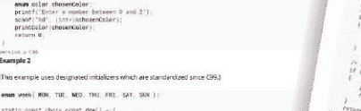
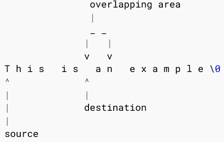

# C 语言专业指南

## 第 12 章：枚举

### 第 12.1 节：简单枚举

枚举用于定义一组相关的常量。

```cpp
enum Color {
    RED,
    GREEN,
    BLUE
};
```

要使用枚举，你需要声明一个枚举类型的变量，并将其中一个命名常量赋值给它。

```cpp
Color myColor = RED;
```

枚举也可以带有值（可选）。

```cpp
enum Day {
    MONDAY,
    TUESDAY,
    WEDNESDAY,
    THURSDAY,
    FRIDAY,
    SATURDAY,
    SUNDAY
};
Day today = MONDAY;
```



## 第 10 章：数组

数组是相同类型元素的集合。每个元素都通过索引进行访问。

### 第 10.1 节：声明和初始化数组

数组是单类型元素的固定大小数组。它允许你在单个变量中存储多个相同类型的值。

```cpp
int numbers[5] = {10, 20, 30, 40, 50};
```

数组的元素使用从零开始的索引访问。

```cpp
numbers[0] = 15;
```

你也可以使用循环来初始化数组。

```cpp
for (int i = 0; i < 5; i++) {
    numbers[i] = i * 10;
}
```

多维数组是数组的数组。

```cpp
int matrix[2][3] = {{1, 2, 3}, {4, 5, 6}};
```


## 第 20 章：文件和 IO 流

流是数据源或目的地的抽象。C++ 使用流为执行 I/O 操作提供统一的接口。

### 第 20.1 节：打开并写入文件

要操作文件流，必须包含 `<fstream>` 头文件。

`ofstream` 类用于写入文件。`ifstream` 类用于从文件读取。

`fstream` 类同时用于读取和写入文件。

```cpp
std::ifstream inFile("test.txt");
std::string line;
while (std::getline(inFile, line)) {
    std::cout << line << std::endl;
}
inFile.close();
```

此程序演示了如何打开文件、向其写入一些数据，然后将其读回。

300+ 页专业提示与技巧

GoalKicker! 免费编程书籍 - 这是一本为教育目的创建的非官方免费书籍，与官方 C 组或公司没有关联。所有商标和注册商标均为其各自所有者的财产

## 第 22 章：指针的指针

### 第 22.10 节：指针的指针

### 第 22.11 节：作为标准函数返回 `void*` 指针

### 第 22.12 节：相同的星号，不同的含义

## 第 23 章：序列点

### 第 23.1 节：无序表达式

### 第 23.2 节：有序表达式

### 第 23.3 节：不确定顺序表达式

## 第 24 章：函数指针

### 第 24.1 节：简介

### 第 24.2 节：从函数返回函数指针

### 第 24.3 节：最佳实践

### 第 24.4 节：赋值函数指针

### 第 24.5 节：编写函数指针的记忆法

### 第 24.6 节：基础

## 第 25 章：函数参数

### 第 25.1 节：值传递参数

### 第 25.2 节：向函数传递数组

### 第 25.3 节：函数参数的执行顺序

### 第 25.4 节：使用指针参数返回多个值

### 第 25.5 节：返回包含错误代码值的结构体示例

## 第 26 章：向函数传递二维数组

### 第 26.1 节：向函数传递二维数组

### 第 26.2 节：使用扁平化数组作为二维数组

## 第 27 章：错误处理

### 第 27.1 节：`errno`

### 第 27.2 节：`strerror`

### 第 27.3 节：`perror`

## 第 28 章：未定义行为

### 第 28.1 节：访问超出生命周期的指针

### 第 28.2 节：拷贝重叠内存

### 第 28.3 节：有符号整数溢出

### 第 28.4 节：使用未初始变量

### 第 28.5 节：数据竞态

### 第 28.6 节：读取已释放指针的值

### 第 28.7 节：在 `printf` 中使用不正确的字面量说明符

### 第 28.8 节：修改字符串字面量

### 第 28.9 节：向 `printf %s` 转换传递空指针

### 第 28.10 节：在序列点之间多次修改任何对象

### 第 28.11 节：释放内存

### 第 28.12 节：负数位移或超出类型宽位的移位

### 第 28.13 节：从声明为 `noreturn` 或 `return` 函数说明符的函数返回

### 第 28.14 节：访问分配块之外的内存

### 第 28.15 节：使用指针修改常量变量

### 第 28.16 节：重新读取不受内存支持的未初始化对象

### 第 28.17 节：边界合理的指针加或减法

### 第 28.18 节：解引用空指针

### 第 28.19 节：在输入流上使用 `flush`

### 第 28.20 节：标识符的链接不一致

### 第 28.21 节：有返回值函数中缺少返回语句

### 第 28.22 节：除以零

### 第 28.23 节：指针类型转换产生对齐错误的结果

### 第 28.24 节：修改由 `getenv`、`strerror` 和 `setlocale` 函数返回的字符串

## 第 29 章：随机数生成

### 第 29.1 节：基础随机数生成

### 第 29.2 节：线性同余生成器

### 第 29.3 节：Xorshift 生成

### 第 29.4 节：将生成限制在给定范围内

## 第 30 章：预处理器和宏

### 第 30.1 节：头文件守卫

### 第 30.2 节：使用 `#if 0` 阻塞代码段

### 第 30.3 节：函数内联宏

### 第 30.4 节：源包含

### 第 30.5 节：条件包含和条件函数签名修改

### 第 30.6 节：在用 C++ 编译的 C 代码中使用 `extern` - 符号修饰

### 第 30.7 节：标记粘贴

### 第 30.8 节：预定义宏

### 第 30.9 节：可变参数宏

### 第 30.10 节：宏替换

### 第 30.11 节：错误指令

## 第 31 章：信号处理

### 第 31.1 节：使用 `signal()` 处理信号

## 第 32 章：可变参数

### 第 32.1 节：使用显式计数参数确定 `va_list` 的长度

### 第 32.2 节：使用终止符值确定 `va_list` 的结束

### 第 32.3 节：实现具有 `printf()`-like 接口的函数

### 第 32.4 节：使用格式字符串

## 第 33 章：断言

### 第 33.1 节：简单断言

### 第 33.2 节：静态断言

### 第 33.3 节：断言消息

### 第 33.4 节：不可达代码的断言

### 第 33.5 节：前置条件和后置条件

## 第 34 章：通用选择

### 第 34.1 节：检查变量是否为特定类型

### 第 34.2 节：基于参数的通用选择

### 第 34.3 节：类型通用宏

## 第 35 章：X-宏

### 第 35.1 节：用于 `printf` 的 X-宏

### 第 35.2 节：从函数返回函数指针

### 第 35.3 节：最佳实践

### 第 35.4 节：赋值函数指针

### 第 35.5 节：编写函数指针的记忆法

### 第 35.6 节：基础

## 第 36 章：别名

### 第 36.1 节：有效类型

### 第 36.2 节：类型限定

### 第 36.3 节：字符类型

### 第 36.4 节：通过非字符类型访问

### 第 36.5 节：违反严格别名规则

## 第 37 章：编译

### 第 37.1 节：编译器

### 第 37.2 节：文件类型

### 第 37.3 节：链接器

### 第 37.4 节：预处理器

### 第 37.5 节：翻译阶段

## 第 38 章：内联汇编

### 第 38.1 节：宏中的内联汇编

### 第 38.2 节：GCC 基础支持

### 第 38.3 节：GCC 扩展支持

## 第 39 章：标识符作用域

### 第 39.1 节：函数作用域

### 第 39.2 节：块作用域

### 第 39.3 节：文件作用域

### 第 39.4 节：函数作用域

## 第 40 章：隐式和显式转换

### 第 40.1 节：函数调用中的整数转换

### 第 40.2 节：函数调用中的指针转换

## 第 41 章：类型限定符

### 第 41.1 节：`volatile` 变量

### 第 41.2 节：不可修改 (`const`) 变量

## 第 42 章：`typedef`

### 第 42.1 节：结构体和联合体的 `typedef`

### 第 42.2 节：函数指针的 `typedef`


# 第 42.3 节：typedef 的简单用法

# 第 43 章：存储类型

## 第 43.1 节：auto

## 第 43.2 节：register

## 第 43.3 节：static

## 第 43.4 节：typedef

## 第 43.5 节：extern

## 第 43.6 节：Thread_local

# 第 44 章：声明

## 第 44.1 节：从另一个 C 文件调用函数

## 第 44.2 节：使用全局变量

## 第 44.3 节：简介

## 第 44.4 节：typedef

## 第 44.5 节：使用全局常量

## 第 44.6 节：使用右左规则或螺旋规则解析 C 声明

# 第 45 章：结构体填充与对齐

## 第 45.1 节：结构体对齐

## 第 45.2 节：结构体填充

# 第 46 章：内存管理

## 第 46.1 节：分配内存

## 第 46.2 节：释放内存

## 第 46.3 节：重新分配内存

## 第 46.4 节：realloc(ptr) 不等于 free(ptr)

## 第 46.5 节：变长度多维数组

## 第 46.6 节：alloca：在栈上分配内存

## 第 46.7 节：用户定义的内存管理

# 第 47 章：实现定义

## 第 47.1 节：超出范围整数的右移

## 第 47.2 节：给整数超出范围的值

## 第 47.3 节：分配零字节

## 第 47.4 节：符号整数的表示

# 第 48 章：原子性

## 第 48.1 节：原子操作与运算符

# 第 49 章：使用跳转语句

## 第 49.1 节：使用 return

## 第 49.2 节：使用 goto 跳出嵌套循环

## 第 49.3 节：使用 break 和 continue

# 第 50 章：创建和包含头文件

## 第 50.1 节：引言

## 第 50.2 节：自包含性

## 第 50.3 节：最小性

## 第 50.4 节：符号与杂项

## 第 50.5 节：幂等性

## 第 50.6 节：按需包含 (IWYU)

# 第 51 章：<ctype.h> 字符分类与转换

## 第 51.1 节：引言

## 第 51.2 节：对从流读取的字符进行分类

## 第 51.3 节：对字符串中的字符进行分类

# 第 52 章：副作用

## 第 52.1 节：前置/后置/增/减运算符

# 第 53 章：多字符序列

## 第 53.1 节：三字符标记 (Trigraphs)

## 第 53.2 节：双字符标记 (Digraphs)

# 第 54 章：约束

## 第 54.1 节：同一作用域内的重复变量

## 第 54.2 节：单元算术运算符

# 第 55 章：内联

## 第 55.1 节：多个源文件中使用的内联函数

# 第 56 章：联合体

## 第 56.1 节：使用联合体重新解释值

## 第 56.2 节：写入一个联合体成员并读取另一个

## 第 56.3 节：结构体与联合体的区别

# 第 57 章：线程（原生）

## 第 57.1 节：由一个线程初始化

## 第 57.2 节：启动多个线程

# 第 58 章：多线程

## 第 58.1 节：C1 线程简单示例

# 第 59 章：进程间通信 (IPC)

## 第 59.1 节：信号量

# 第 60 章：测试框架

## 第 60.1 节：Unity 测试

## 第 60.2 节：CMocka

## 第 60.3 节：CppTest

# 第 61 章：Valgrind

## 第 61.1 节：未释放内存

## 第 61.2 节：使用 Valgrind 时遇到的常见错误

## 第 61.3 节：运行 Valgrind

## 第 61.4 节：添加标志

# 第 62 章：常见的 C 编程习惯与实践

## 第 62.1 节：字面量与变量的比较

## 第 62.2 节：不要留空参数列表 -- 使用 void

# 第 63 章：常见陷阱

## 第 63.1 节：算术运算中的符号与无符号整数

## 第 63.2 节：宏是简单的字符串替换

## 第 63.3 节：忘记将 realloc 的值返回临时变量

## 第 63.4 节：忘记为 \0 分配一个字节

## 第 63.5 节：误解数组退化

## 第 63.6 节：忘记释放内存（内存泄漏）

## 第 63.7 节：拷贝过多内容

## 第 63.8 节：比较时误用赋值符号 =而非 ==

## 第 63.9 节：换行符被消耗

## 第 63.10 节：#define

## 第 63.11 节：分号

## 第 63.12 节：链接时的未定义引用

## 第 63.13 节：逻辑表达式的赋值

## 第 63.14 节：指针

## 第 63.15 节：多行注释不能嵌套

## 第 63.16 节：返回值

## 第 63.17 节：浮点数

## 第 63.18 节：浮点字面量的类型为

## 第 63.19 节：使用常量代替字符串

## 第 63.20 节：幂等性

## 第 63.21 节：越界操作

## 第 63.22 节：多维数组

要输出的字符串包含在括号内。

"Hello, World" 是将写入屏幕的字符串。在 C 语言中，每个字符串字面量都必须在双引号 `""` 内。

查看更多关于字符串的内容。

在 C 程序中，每条语句都必须以分号（即 `;`）结束。

```c
return 0;
```

当我们定义 `main()` 时，我们将其声明为一个返回 `int` 类型的函数，这意味着它需要返回一个整数。在这个示例中，我们返回了整数值 0，它用于表示程序成功退出。执行 `return 0;` 语句后程序将终止。

## 编辑程序

简单的文本编辑器包括 Linux 上的 `vim` 或 `gedit`，或者 Windows 上的记事本。跨平台编辑器还包括 `Visual Studio Code` 或 `Sublime Text`。

编辑器必须创建纯文本文件，而不是 RTF 或其他格式。

## 编译并运行程序

要运行该程序，首先需要将此文件（`hello.c`）编译为可执行文件（例如 Unix/Linux 系统上的 `hello` 或 Windows 上的 `hello.exe`）。这是使用 C 语言编译器完成的。

查看更多关于编译的内容

## 使用 GCC 编译

`GCC`（GNU 编译器集）是一种广泛使用的 C 编译器。要使用它，打开终端，使用命令行导航到源文件所在的位置，然后运行：

```bash
gcc hello.c -o hello
```

如果在源代码（`hello.c`）中没有发现错误，编译器将创建一个二进制文件，其名称由 `-o` 命令选项的参数（`hello`）指定。这就是最终的可执行文件。

我们还可以使用警告选项 `-Wall` `-Wextra` `-Werror`，这些选项有助于识别可能导致程序失败或产生意外结果的问题。对于这个简单的程序来说并非必需，但这是添加它们的方法：

```bash
gcc -Wall -Wextra -Werror -o hello hello.c
```

## 使用 clang 编译器

要使用 `clang` 编译程序，可以使用：

```bash
clang -Wall -Wextra -Werror -o hello hello.c
```

从设计上，`clang` 的命令行选项与 `GCC` 相似。

## 从命令行使用 Microsoft C 编译器

如果在支持 Visual Studio 的 Windows 系统上使用 Microsoft `cl.exe` 编译器，且所有环境变量都已设置，可以使用以下命令编译此 C 语言程序，这将在命令执行的目录内生成可执行文件 `hello.exe`（`cl` 有如 `/W3` 等警告选项，类似于 `gcc` 或 `clang` 的 `-Wall`）。

```bash
cl hello.c
```

## 执行程序

一旦编译完成，可以在终端中输入 `./hello` 来执行二进制文件。执行时，编译后的程序将在命令提示符上打印 `Hello. World`，随后是一个换行符。

## 第 1.2 节：K&R C 中的 "Hello, World!"

以下是 Brian Kernighan 和 Dennis Ritchie 所著书籍《程序设计语言》中的 "Hello, World!" 程序（Ritchie 是贝尔实验室 C 编程语言的原始开发者），被称为“K&R”：

```c
Version = K&R
#include <stdio.h>

main() {
    printf("hello, world\n");
}
```

注意，C 编程语言在编写此书第一版（1978年）时尚未标准化，除非编译器被指示接受 C90 代码，否则该程序在大多数现代编译器上可能无法编译。

K&R 书中的这个第一个示例现在被认为质量不高，部分原因是因为它缺少 `main(void)` 的显式返回类型，部分原因是因为它缺少返回语句。该书的第二版是针对旧的 C89 标准编写的。在 C89 中，`main` 的类型默认为 `int`，K&R 示例没有向环境返回定义的值。在 C99 及随后的标准中，要求指定返回类型，但由于 C99 引入的特殊情况 5.1.2.2.3，省略 `main` 的返回语句（仅限 main 函数）是安全的——因为它等同于 0，表示成功。

对于宿主系统，推荐且移植性最好的形式是：当程序不使用任何命令行参数时使用 `int main(void)`，当程序使用命令行参数时使用 `int main(int argc, char **argv)`。

### C90 5.1.2.2.3 程序终止

> 从 main 函数的初始调用返回，等同于将 main 函数的返回值作为参数传递给 exit 函数。如果 main 函数执行了未指定值的返回，则返回给宿主环境的状态未定义的。

### C90 5.6.6.4 返回语句

如果执行了没有表达式的返回语句，且调用者使用了函数调的值，则其行为是未定义的。到达终止函数的 `}` 等同于执行了没有表达式的返回语句。

## C99 §5.1.2.2.3 程序终止

如果 main 函数的返回类型与 `int` 兼容的类型，则从 main 函数的初始调用返回等同于将 main 函数的返回值作为参数传递给 exit 函数；到达终止 main 函数的 `}` 返回值 0。如果返回类型与 `int` 不兼容，则返回给宿主环境的终止状态是未指定的。

# 第 2 章：注释

注释用于向阅读代码的人指示信息。编译器将注释视为空白，不会改变代码的实际含义。注释有两种类型。

## 第 2.1 节：使用预处理器进行注释

注释用于向阅读代码的人指示信息。编译器将注释视为空白，不会改变代码的实际含义。注释有两种类型。

## 第 2.2 节：/* 分隔符注释

注释用于向阅读代码的人指示信息。编译器将注释视为空白，不会改变代码的实际含义。注释有两种类型。

```c
int x = 20; // Why did I do this??
```

结尾的 `/` 是一个笔误，但现在会被解释为 `\`。这是因为 `??` 形成了一个三元字符（trigraph）。


`??` 实际上是 `\` 的长期表示法，它是行延续符号。这意味着编译器认为下一行是当前行的延续，即注释的延续，这可能并不是用户的意图。

```c
int foo = 20; // Start at 20 ??/
int bar = 0;

// 以下内容将导致编译错误（未定义的变量 'bar'）
// 因为 'int bar = 0;' 是上一行注释的一部分
bar += foo;
```

# 第 3 章：数据类型

## 第 3.1 节：解释声明

> C 语言的一个独特语法特性是，声明的写法反映了被声明对象在普通表达式中的用法。

以下一组具有相同优先级和结合性的运算符被重用在声明符中，即：

- 一元 `*` “解引用”运算符，它用于表示指针；
- 二元 `[]` “数组下标”运算符，它用于表示数组；
- (1+n) 元“函数调用”运算符，它用于表示函数；
- `()` 分组括号，它覆盖了列表中其他运算符的优先级和结合性。

上述三个运算符具有以下优先级和结合性：

| 运算符 | 相对优先级 | 结合性 |
| :--- | :--- | :--- |
| `[]` (数组下标) | 1 | 从左到右 |
| `()` (函数调用) | 1 | 从左到右 |
| `*` (解引用) | 2 | 从右到左 |

在解释声明时，必须从标识符向外开始应用相邻的运算符。运算符的每次应用都可以替换为以下英文单词：

| 表达式 | 解释 |
| :--- | :--- |
| `thing[X]` | 一个大小为 X 的数组... |
| `thing(t1, t2, t3)` | 一个接收 t1, t2, t3 并返回...的函数 |
| `*thing` | 指向...的指针 |

由此得出，英文解释的开头总是从标识符开始，并以声明左侧的类型结束。

### 示例

```c
char *names[20];
```

`[]` 的优先级高于 `*`，所以解释为：`names` 是一个大小为 20 的数组，其元素是指向 `char` 的指针。

```c
char (*place)[10];
```

在使用括号覆盖优先级的情况下，先应用 `*`：`place` 是一个指向大小为 10 的 `char` 数组的指针。

```c
int fn(long, short);
```

不需要担心优先级：`fn` 是一个接收 `long`, `short` 并返回 `int` 的函数。

```c
int *fn(void);
```

`()` 首先应用：`fn` 是一个接收 `void` 并返回 `int *` 的函数。

```c
int (*fp)(void);
```

覆盖 `()` 的优先级：`fp` 是一个指向接收 `void` 并返回 `int` 的函数的指针。

```c
int arr[5][8];
```

多维数组并不是规则的例外；`[]` 运算符根据表中的结合性从左到右顺序应用：`arr` 是一个大小为 5 的数组，其元素是一个大小为 8 的 `int` 数组。

```c
int **ptr;
```

解引用运算符具有相同的优先级，因此结合性起作用。运算符按从右到左顺序应用：`ptr` 是一个指向 `int *` 的指针。

### 多重声明

逗号可以作为分隔符（作用类似于逗号运算符），用于界定字符串内的声明。以下语句包含五个声明：

```c
int fn(void), *ptr, (*fp)(int), arr[10][20], num;
```

此示例中的声明对象是：

- `fn`：一个接收 `void` 并返回 `int` 的函数；
- `ptr`：一个指向 `int` 的指针；
- `fp`：一个指向接收 `int` 并返回 `int` 的函数的指针；
- `arr`：一个大小为 10 的数组，其元素是一个大小为 20 的 `int` 数组；
- `num`：`int`

### 替代解释

由于声明反映了用法，也可以根据应用于对象上的运算符以及表达式的最终结果来解释声明。左侧的类型是应用所有运算符后产生的最终结果。

```c
/*
* 对 "arr" 进行下标运算并解引用产生一个 "char" 结果。
* 特别是：arr[5] 的类型为 "char";
*/
char arr[20];
```

```c
/*
* 调用 "fn" 产生一个 "int" 结果。
* 特别是：fn('b') 的类型为 "int";
*/
int fn(char);
```

```c
/*
* 解引用 (*fp) 然后调用产生一个 "int" 结果。
* 特别是：(*fp) 的类型为 "int";
*/
int (*fp)(void);
```

```c
/*
* 两次对 "strings" 进行下标运算并解引用产生一个 "char" 结果。
* 特别是：strings[5][15] 的类型为 "char";
*/
char *strings[10][20];
```

## 第 3.2 节：固定宽度整数类型（自 C99 起）

`stdint.h` 头文件提供了几种固定宽度整数类型。如果平台具有相应宽度的整数类型，且对应的符号类型具有补码表示，则这些类型是可选的。

```c
/* 常用类型 */
uint32_t u32 = 32; /* 32位宽 */
uint8_t u8 = 255;  /* 8位宽 */
int64_t i64 = -65; /* 64位 */
```

## 第 3.3 节：整数类型和常量

符号整数可以是这些类型（`int`, `short` 或 `long` 可选）：

```c
signed char c = 127;      /* 要求为 1 字节，见备注 */
signed short si = 32767;  /* 至少 16 位 */
signed int i = 2147483647; /* 至少 32 位 */
```

≥ C99

```c
signed long li = 2147483647; /* 至少 64 位 */
```

这些整数类型都有一个无符号版本。

```c
unsigned int ui = 65535;
unsigned short us = 32767;
unsigned char uc = 255;
```

对于所有类型，如果省略符号或无符号部分，则假设为符号。不同类型的整数常量可以用不同的进制写入，取决于它们的前缀或后缀。

```c
/* 以下变量初始化为相同的值： */
int d = 42;   /* 十进制常量（base10） */
int o = 052;  /* 八进制常量（base8） */
int x = 0x2a; /* 十六进制常量（base16）（字母 'a' 到 'f' 不区分大小写） */
```

十进制常量总是符号的。十六进制常量以 `0x` 开头，八进制常量以 `0` 开头。类型取决于值是否符合符号类型。

```c
/* 后缀用于宽度 */
long i = 0x32L;      /* l 或 L 代表 long int */
unsigned ui = 65535U; /* u 或 U 代表无符号 int，或 long int */
long li = 356L;      /* l 或 L 代表 long int */
```

如果没有后缀，第一个符合其值的类型是 `int`（如果可能），否则是 `long`。`<limits.h>` 文件描述了整数的限制。它们的实现值（绝对值）在相同符号下应大于或等于下表。

| 宏 | 类型 | 值 |
| :--- | :--- | :--- |
| `CHAR_BIT` | 不是位域的对象（字节） | 8 |
| `SCHAR_MAX` | 符号 char | 127 (2^7 - 1) |
| `UCHAR_MAX` | 无符号 char | 255 (2^8 - 1) |
| `CHAR_MIN` | char | 见下 |
| `CHAR_MAX` | char | 见下 |
| `SHRT_MIN` | short int | -32767 (-(2^15 - 1)) |
| `SHRT_MAX` | short int | 32767 (2^15 - 1) |
| `USHRT_MAX` | 无符号 short int | 65535 (2^16 - 1) |
| `INT_MIN` | int | -32767 (-(2^15 - 1)) |
| `INT_MAX` | int | 32767 (2^15 - 1) |
| `UINT_MAX` | unsigned int | 65535 (2^16 - 1) |
| `LONG_MIN` | long int | -2147483647 (-(2^31 - 1)) |
| `LONG_MAX` | long int | 2147483647 (2^31 - 1) |
| `ULONG_MAX` | unsigned long int | 4294967295 (2^32 - 1) |

版本 = C99

| 宏 | 类型 | 值 |
| :--- | :--- | :--- |
| `LLONG_MIN` | long long int | -9223372036854775807 (-(2^63 - 1)) |
| `LLONG_MAX` | long long int | 9223372036854775807 (2^63 - 1) |
| `ULLONG_MAX` | unsigned long long int | 18446744073709551615 (2^64 - 1) |

如果 `char` 类型对象的值在表达式中使用时符号扩展，则 `CHAR_MIN` 的值与 `SCHAR_MIN` 相同，`CHAR_MAX` 的值与 `SCHAR_MAX` 相同。如果 `char` 类型对象的值在表达式中使用时不符号扩展，则 `CHAR_MIN` 的值为 0，`CHAR_MAX` 的值与 `UCHAR_MAX` 相同。

## 第 3.4 节：浮点常量

C 语言有三种强制的浮点类型：`float`, `double` 和 `long double`。

```c
float f = 0.314f;           /* 后缀 f 或 F 表示 float 类型 */
double d = 0.314;           /* 无后缀表示 double */
long double ld = 0.3141L;   /* 后缀 L 表示 long double */
```

```c
/* 浮点定义的不同部分都是可选的 */
double x = 1.; /* 有效，小数部分可选 */
double y = .1;  /* 有效，整数部分可选 */
```

```c
/* 也可以用科学计数法定义 */
double sd = 1.2e3;       /* 小数部分缩放 10^3，即 1200.0 */
```

`<float.h>` 定义了浮点操作的各种限制。

浮点算术已定义。然而，绝大多数现代平台（arm, x86, x86_64, MIPS）都遵循 IEEE 754 浮点操作。

C 还有可选的复浮点类型，它们派生自上述类型。

## 第 3.5 节：字符串字面量

C 中的字符串字面量是字符序列，以空字符结束。

```c
char* str = "hello, world"; /* 字符串字面量 */
/* 字符串字面量可初始化数组 */
char a1[] = "abc"; /* a1 是 char[4]，存储了 {'a', 'b', 'c', '\0'} */
char a2[4] = "abc"; /* 与 a1 相同 */
char a3[3] = "abc"; /* a3 是 char[3]，存储了 {'a', 'b', 'c'}，缺少 '\0' */
```

字符串字面量是不可修改的（实际上可能位于只读内存中，如 `.data`）。尝试修改其值会导致未定义行为。

```c
char* s = "foobar";
s[0] = 'F'; /* 未定义行为 */
/* 良好的做法是使用 const 这样定义字符串字面量 */
char const* s = "foobar";
s[0] = 'F'; /* 编译器错误！ */
```

多个字符串字面量在编译时会进行拼接，这意味着你可以编写如下的结构。

```c
/* 只能拼接一个或两个宽字符串字面量 */
char* s = "Hello" "World";
```

≥ C99

```c
/* 自 C99 起，可以拼接两个以上的字符串 */
/* 拼接是由实现定义的 */
char* s1 = "Hello" "World";
/* 常见用途是格式化字符串的拼接 */
char* fmt = "%" PRId16 "d"; /* C99 起引入了 PRId16 宏 */
```

字符串字面量与字符常量一样支持不同的字符集。

```c
/* 正常字符串字面量，类型为 char[] */
char* s1 = "abc";
/* 宽字符字符串字面量，类型为 wchar_t[] */
wchar_t* s2 = L"abc";
```

≥ C11

```c
/* UTF-8 字符串字面量，类型为 char[] */
char* s3 = u8"abc";

/* 16 位宽字符串字面量，类型为 char16_t[] */
char16_t* s4 = u"abc";

/* 32 位宽字符串字面量，类型为 char32_t[] */
char32_t* s5 = U"abc";
```

# 第 4 章：运算符

编程语言中的运算符是一种符号，它告诉编译器或解释器执行特定的数学、关系或逻辑操作并产生最终结果。

C 有许多强大的运算符。许多 C 运算符是二元运算符，这意味着它们有两个操作数。例如，在 `a / b` 中，`/` 是接受两个操作数 (`a`, `b`) 的二元运算符。还有一些一元运算符接收一个操作数（例如：`++`），以及唯一的三元运算符 `?:`。

## 第 4.1 节：关系运算符

关系运算符检查两个操作数之间的关系是否为真。结果被求值为 1（表示真）或 0（表示假）。此结果通常用于影响控制流（通过 `if`, `while`, `for`），也可以存储在变量中。

### 等于 `==`

检查提供的操作数是否相等。

```c
1 == 0;              /* 结果为 0. */
1 == 1;              /* 结果为 1. */

int x = 5;
int y = 5;
int *xptr = &x, *yptr = &y;
xptr == yptr;        /* 结果为 0，操作数持有不同的地址。 */
*xptr == *yptr;      /* 结果为 1，操作数指向的位置的值相同。 */
```

注意：此运算符不应与赋值运算符 (`=`) 混淆！

### 不等于 `!=`

检查提供的操作数是否不相等。

```c
1 != 0;              /* 结果为 1. */
1 != 1;              /* 结果为 0. */

int x = 5;
int y = 5;
int *xptr = &x, *yptr = &y;
xptr != yptr;        /* 结果为 1，操作数持有不同的地址。 */
*xptr != *yptr;      /* 结果为 0，操作数指向的位置的值相同。 */
```

此运算符有效地反转了等于 (`==`) 运算符的结果。

### 取非 `!`

检查对象是否等于 0。

`!` 也可以直接与变量使用，如下：

```c
!someVal
```

这的效果等同于：

```c
someVal == 0
```

### 大于 `>`

检查左操作数的值是否大于右操作数。

```c
5 > 4    /* 结果为 1. */
4 > 5    /* 结果为 0. */
4 > 4    /* 结果为 0. */
```

### 小于 `<`

检查左操作数的值是否小于右操作数。

```c
5 < 4    /* 结果为 0. */
4 < 5    /* 结果为 1. */
4 < 4    /* 结果为 0. */
```

### 大于等于 `>=`

检查左操作数的值是否大于或等于右操作数。

```c
5 >= 4   /* 结果为 1. */
4 >= 5   /* 结果为 0. */
4 >= 4   /* 结果为 1. */
```

### 小于等于 `<=`

检查左操作数的值是否小于或等于右操作数。

```c
5 <= 4   /* 结果为 0. */
4 <= 5   /* 结果为 1. */
4 <= 4   /* 结果为 1. */
```

## 第 4.2 节：条件运算符 / 三元运算符

求其第一个操作数，如果结果不等于零，则求第二个操作数。否则，求第三个操作数，如下所示：`a = b ? c : d;` 等于：

```c
if (b)
    a = c;
else
    a = d;
```

伪代码表示 `condition ? value_if_true : value_if_false`。每个值可以是表达式。条件运算符可以嵌套。例如，下面的代码确定三个数中的较大值，并将偶数写入一个文件，奇数写入另一个文件：

```c
#include <stdio.h>

int main()
{
    FILE *even, *odds;
    int n = 10;
    size_t k = 0;

    even = fopen("even.txt", "w");
    odds = fopen("odds.txt", "w");

    for (k = 1; k < n; k++) {
        if (k % 2 == 0)
            fprintf(even, "%d\n", k);
        else
            fprintf(odds, "%d\n", k);
    }

    fclose(even);
    fclose(odds);

    return 0;
}
```

条件运算符从右到左结合。考虑：`exp1 ? exp2 : exp3 ? exp4`。由于是从右到左结合，该表达式求值为 `exp1 ? exp2 : (exp3 ? exp4)`。

## 第 4.3 节：位运算符

位运算符用于对变量进行位级操作。以下是 C 支持的所有位运算符列表：

| 符号 | 运算符 |
| :--- | :--- |
| `&` | 位与 |
| `|` | 位或 |
| `^` | 位异或 (XOR) |
| `~` | 位非（按反码） |
| `<<` | 左移 |
| `>>` | 右移 |

以下程序演示了位运算符的使用：


```c
#include <stdio.h>
int main(void) {
    unsigned int a = 29; /* 29 = 0001 1101 */
    unsigned int b = 48; /* 48 = 0011 0000 */
    int c = 0;

    c = a & b; /* 32 = 0010 0000 */
    printf("%d & %d = %d\n", a, b, c);

    c = a | b; /* 61 = 0011 1101 */
    printf("%d | %d = %d\n", a, b, c);

    c = a ^ b; /* 45 = 0010 1101 */
    printf("%d ^ %d = %d\n", a, b, c);

    c = ~a; /* -30 = 1110 0010 */
    printf("~%d = %d\n", a, c);

    c = a << 2; /* 116 = 0111 0100 */
    printf("%d << 2 = %d\n", a, c);

    c = a >> 2; /* 7 = 0000 0111 */
    printf("%d >> 2 = %d\n", a, c);

    return 0;
}
```

应避免对有符号类型进行位运算，因为位表示具有特定含义。移位运算符有特定的限制：

- 将 1 左移入符号位是错误的并会导致未定义行为。
- 右移负值（符号位为 1）是由实现定义的，因此不可移植的。
- 如果移位运算符右操作数的值为负或大于等于提升后的左操作数的宽度，则行为是未定义的。

## 掩码

掩码是指通过位运算从变量中提取所需的位（或转换变量中的所需的位）的过程。用于执行掩码的操作数（常量或变量）称为掩码。

掩码有许多不同的用途：

- 决定整数变量的位模式。
- 将给定位模式的一部分拷贝到新变量，同时新变量的剩余部分填充 0（使用位与）。
- 将给定位模式的一部分拷贝到新变量，同时新变量的剩余部分填充 1（使用位或）。
- 将给定位模式的一部分拷贝到新变量，同时原始位模式的剩余部分在新变量中被反转（使用位异或）。

以下函数使用掩码显示变量的位模式：

```c
#include <limits.h>
void bit_pattern(int u)
{
  int i1, x, word;
  unsigned mask = 1;
```

### 第 4.4 节：逻辑运算符的短路行为

短路逻辑是一种在可能的情况下跳过评估（`if`/`while`/...）条件部分评估的功能。在对两个操作数进行逻辑操作时，首先求值第一个操作数（为真或假），如果已经得出定论（即：使用 `&&` 时第一个操作数为假，使用 `||` 时第一个操作数为真），则不再评估第二个操作数。

示例：

```c
#include <stdio.h>

int main(void) {
    int a = 20;
    int b = -5;

    /* 'b == -5' 不会被评估，
       因为 'a != 20' 是假的。 */
    if (a != 20 && b == -5) {
        printf("I won't be printed!\n");
    }

    return 0;
}
```

自己尝试一下：

```c
#include <stdio.h>

int print(int i) {
    printf("print function %d\n", i);
    return 1;
}

int main(void) {
    int a = 20;

    /* 'print(a)' 不会被调用，
       因为 'a != 20' 是假的。 */
    if (a != 20 && print(a)) {
        printf("I won't be printed!\n");
    }

    /* 'print(a)' 被调用了，
       因为 'a == 20' 是真的。 */
    if (a == 20 && print(a)) {
        printf("I will be printed!\n");
    }

    return 0;
}
```

输出：

```text
$ ./a.out
print function 20
I be printed!
```

短路逻辑非常重要，当你想要避免评估那些（计算上）开销较大的项时。此外，它会严重影响程序的流程，就像在这个例子中一样：为什么这个程序打印了 "forked! times?"?

### 第 4.5 节：逗号运算符

评估其左操作数，丢弃产生的值，然后评估其右操作数并产生其右操作数的值。

```c
int x = 42, y = 42;
printf("%i\n", (x == 2)); /* 输出 "42" */
```

逗号运算符在它的操作数之间引入了一个序列点。

注意，在调用分离参数的函数中使用的逗号**不是**逗号运算符，相反它调用的是分隔符，这与逗号运算符不同。因此，它不具备逗号运算符的属性。

上面的 `printf()` 调用同时包含了逗号运算符和分隔符。

```c
printf("%i\n", (x == 2)); /* 输出 "42" */
/*
      这里是逗号运算符 */
/ 这里是分隔符 */ 
```

逗号运算符也用于 `for` 循环的初始化部分以及更新部分。示例：

```c
for(k = 1; k < 10; printf("%d\n", k), k += 2);    /* 输出 9 以下的奇数*/
/* 输出前 9 个自然数的和 */
for(sum = 1, k = 1; k < 10; k++, sum += k)
printf("%d%%5d\n", sum);
```

### 第 4.6 节：算术运算符

#### 加法算术

返回一个使用关联数学运算将左操作数应用于右操作数的结果的值。适用于标准的数学交换律（即加法和乘法符合交换律，而减法、除法和取模不符合）。

#### 加法运算符

加法运算符 `+` 用于将两个操作数相加。示例：

```c
#include <stdio.h>
int main(void)
{
  int a = 5;
  int b = 7;
  int c = a + b; /* c 现在持有值 12 */

  printf("%d + %d = %d",a,b,c); /* 将输出 "5 + 7 = 12" */

  return 0;
}
```

#### 减法运算符

减法运算符 `-` 用于从第一个操作数中减去第二个操作数。示例：

```c
#include <stdio.h>

int main(void)
{
    int a = 10;
    int b = 7;

    int c = a - b; /* c 现在持有值 3 */
    printf("%d - %d = %d",a,b,c); /* 将输出 "10 - 7 = 3" */
    return 0;
}
```

#### 乘法运算符

乘法运算符 `*` 用于相乘两个操作数。示例：

```c
#include <stdio.h>

int main(void)
{
    int a = 5;
    int b = 7;

    int c = a * b; /* c 现在持有值 35 */
    printf("%d * %d = %d",a,b,c); /* 将输出 "5 * 7 = 35" */
    return 0;
}
```

不要与*引用运算符* `*` 混淆。

#### 除法运算符

除法运算符 `/` 将第一个操作数除以第二个操作数。如果除法的两个操作数都是整数，它将返回一个整数值并丢弃余数（使用取模运算符 `%` 计算和获取余数）。

如果其中一个操作数是浮点值，结果则是该分数的近似值。示例：

```c
#include <stdio.h>

int main(void) {
    int a = 19;
    int b = 2;
    int c = a / b; /* c 现在持有值 9 */
    int d = a % b; /* d 持有值 1 */
    double e = (double)a / b; /* e 持有值 9.5 */
    double f = (double)a % b; /* f 持有值 1.0 */
    double g = (double)a / b; /* (等待，基于 OCR 的逻辑) */
    double h = (double)a % b; /* (等待，基于 OCR 的逻辑) */
}
```

#### 取模运算符

取模运算符 `%` 接收整数操作数，用于计算第一个操作数除以第二个操作数后的余数。示例：

```c
#include <stdio.h>

int main(void) {
    int a = 25;
    int b = 2;
    int c = a % b; /* c 持有值 1 */
    int d = 24 % 2; /* d 持有值 0 */
    int e = 155 % 5; /* e 持有值 0 */
    int f = 24; /* f 持有值 24 */

    printf("%d\n", c); /* 输出 "1" */
    printf("%d\n", d); /* 输出 "0" */
    printf("%d\n", e); /* 输出 "0" */
    printf("%d\n", f); /* 输出 "24" */

    return 0;
}
```

*(注：上述代码存在片段化，已重构)*

#### 自增/减运算符

自增 `++` 和自减 `--` 的不同在于它们对变量赋值的增减。可以在赋值之前之后使用增减运算符。示例：

```c
#include <stdio.h>

int main(void) {
    int a = 1;
    int b = 4;
    int c = 1;
    int d = 4;

    a++;
    printf("a = %d\n",a); /* 将输出 "a = 2" */
    b--;
    printf("b = %d\n",b); /* 将输出 "b = 3" */

    if (++c > 1) { /* c 在条件判断前自增 1 */
        printf("This will print\n"); /* 会打印 */
    } else {
        printf("This will never print\n"); /* 不打印 */
    }

    if (d-- < 4) { /* d 在比较后自减 */
        printf("This will print\n"); /* 会打印 */ 
    } else {
        printf("This will never print\n"); /* 不打印 */
    }
    return 0;
}
```

正如 `c` 和 `d` 的示例所示，运算符有两种形式，即前缀表示和后置表示。它们在递增 `++` 或递减 `--` 的效果相同，但返回的值不同：前缀操作先执行操作并返回值，而后缀操作先确定要返回的值，然后执行操作。

由于这种可能反直觉的行为，在表达式中使用增/减运算符是有争议的。

### 第 4.7 节：访问运算符

成员访问运算符 `.` 和箭头 `->` 用于访问结构体的成员。

#### 对象成员

评估为表示被访问对象成员的左值。

```c
struct MyStruct{
    int x;
    int y;
}

struct MyStruct myObject;
myObject.x = 42;
myObject.y = 123;

printf(".x = %i, .y = %d\n", myObject.x, myObject.y); /* 输出 ".x = 42, .y = 123." */
```

#### 指向对象的成员

解引用成员访问的语法糖。实际上，表达式 `x->y` 是 `(*x).y` 的简写——但当结构指针嵌套时，箭头运算符要清晰得多。

```c
struct MyStruct myObject;
struct MyStruct *p = &myObject;
/* */
```

```c
p->x = 42;
p->y = 123;

printf("%x = %i, .y = %i\n", p->x, p->y); /* 输出 ".x = 42, .y = 123". */
printf("%x = %i, .y = %i\n", myObject.x, myObject.y); /* 也输出 ".x = 42, .y = 123". */
```

#### 取址运算符

元运算符 `&` 是地址运算符。它计算给定的表达式，其中结果对象必须是一个左值。然后计算出一个对象，其类型为结果对象类型的指针，并包含该对象的地址。

```c
int x = 3;
int *p = &x;
printf("%p = %p\n", (void *)x, (void *)p); /* 输出 "A = A"，对于某个实现定义的 A。 */
```

#### 解引用运算符

元运算符 `*` 用于解引用指针。它计算对给定的表达式求值得到的指针进行解用的左值结果。

```c
int x = 42;
int *p = &x;
printf("%x = %d, *p = %d\n", x, *p); /* 输出 "x = 42, *p = 42". */

*p = 123;
printf("%x = %d, *p = %d\n", x, *p); /* 输出 "x = 123, *p = 123". */
```

#### 索引

索引是指针加法后跟解引用的语法形式。实际上，形式为 `a[i]` 的表达式等价于 `*(a + i)` —— 但优先使用显式的下标符号。

```c
int arr[] = { 1, 2, 3, 4, 5 };
printf("arr[2] = %i\n", arr[2]); /* 输出 "arr[2] = 3". */
```

#### 索引的可互换性

将指针与整数相加是一个交换操作（即操作数的顺序不改变结果），指针 + 整数 = 整数 + 指针。

此结果是 `arr[3]` 和 `3[arr]` 是等价的。

```c
printf("3[arr] = %i\n", arr[3]); /* 输出 "3[arr] = 4". */
```

通常不建议使用表达式 `3[arr]` 代替 `arr[3]`，因为它会影响代码的可读性。它倾向于用于混淆编程竞赛。

### 第 4.8 节：sizeof 运算符

#### 以类型作为操作数

计算给定类型对象的字节大小，结果类型为 `size_t`。要求在类型周围加上括号。

```c
printf("%u\n", sizeof(int)); // 有效，输出 int 对象的大小，取决于平台。
printf("%u\n", sizeof int); // 无效，作为参数的类型需要用括号括起来
```

#### 以表达式作为操作数

计算给定表达式类型对象的字节大小，结果类型为 `size_t`。表达式本身不会被求值。不需要括号；但是，由于给定的表达式必须是单元的，最佳实践是始终使用括号。

```c
char ch = 'a';
printf("%u\n", sizeof(ch)); // 有效，将输出 char 对象的大小，在所有平台上始终为 1。
printf("%u\n", sizeof ch); // 有效，将输出 char 对象的大小，在所有平台上始终为 1。
```

### 第 4.9 节：强制转换运算符

```c
int x = 3;
int y = 4;
printf("%f\n", (double)x / y); // 输出 "0.750000".
```

这里，`x` 的值被转换为 `double`，除法运算将 `y` 的值也提升为 `double`，除法结果 `double` 被传递给 `printf` 进行打印。

### 第 4.10 节：函数调用运算符

第一个操作数必须是函数指针（函数名也可以，因为它会被转换为函数的指针），用于标识要调用的函数，所有其他操作数（如果有）统称为函数的参数。其计算结果为使用相应参数调用相应函数后的返回值。

```c
int myFunction(int x, int y)
{
    return x * 2 + y;
}

int (*fn)(int, int) = &myFunction;
int x = 42;
int y = 123;
```

```c
printf("*fn(%d, %d) = %d\n", x, y, fn(x, y)); // 输出 "fn(42, 123) = 207".
printf("*fn(%i, %i) = %i\n", x, y, fn(x, y)); // 另一种形式：你不需要显式解引用。
```

### 第 4.11 节：增 / 减

递增递减运算符以前缀和后置形式存在。

```c
int a = 1;
int b = 1;
int tmp = 0;

tmp += a; /* 加一并返回新值；a == 2, tmp == 2 */
tmp += a++; /* 加一但返回旧值；a == 3, tmp == 2 */
tmp -= b; /* 减一并返回新值；b == 0, tmp == 0 */
tmp -= b--; /* 减一但返回旧值；b == -1, tmp == 0 */
```

注意，算术运算不会引入序列点，因此带有 `++` 或 `--` 运算符的表达式可能会引入未定义行为。

### 第 4.12 节：赋值运算符


将右侧操作数的值赋予左侧操作数命名的存储位置，并返回该值。

```c
int x = 5; /* 变量 x 存储 5。返回 5 */
char y = 'c'; /* 变量 y 存储 99。返回 99（因为字符 'c' 在 ASCII 表中表示为 99）。 */
float z = 1.5; /* 变量 z 存储 1.5。返回 1.5。 */
```

与通常的算术运算不同，对一个 `int` 加 1 会向当前地址值增加 4 字节。由于数组名是常量，`+` 是我们通过数组名使用指针访问数组成员时可以使用唯一运算符。然而，通过定义指向数组的指针，我们可以获得更大的灵活性来处理数组中的数据。例如，我们可以如下所示打印数组的成员：

```c
#include<stdio.h>
static const size_t N = 5;

int main() {
    size_t k = 0;
    int arr[] = {1, 2, 3, 4, 5};
    for (k = 0; k < N; k++) {
        printf("\n%d",*(arr + k));
    }
    return 0;
}
```

通过定义数组的指针，上述程序等同于以下代码：

```c
#include<stdio.h>
static const size_t N = 5;

int main() {
    size_t k = 0;
    int arr[] = {1, 2, 3, 4, 5};
    int *ptr = arr; /* or int *ptr = &arr[0]; */
    for (k = 0; k < N; k++) {
        printf("\n%d", ptr[k]); /* or printf("\n%d", *(ptr + k)); */
        /* or printf("\n%d", *(ptr++)); */
    }
    return 0;
}
```

可以看到数组成员是通过运算符 `+` 和 `++` 访问的。其他与指针配合使用的运算符还有 `-` 和 `--`。

### 指针减法

给定两个指向相同类型的指针，该操作会评估得一个 `ptrdiff_t` 类型的对象，该对象持有标量值，且该值必须加到第二个指针上，以获得第一个指针的值。

```c
int arr[] = {1, 2, 3, 4, 5};
int *p = &arr[2];
int *q = &arr[3];
ptrdiff_t diff = q - p;
```

```c
printf("%q - p = %ti\n", diff); /* 输出 "1". */
printf("%p + (q - p) = %d\n", *(p + diff)); /* 输出 "4". */
```

### 第 4.15 节：_Alignof

版本 ≥ C11

查询指定类型所需的对齐数字。对齐要求是 2 的正幂整数，代表分配两个该类型对象时占用的字节数。在 C 中，对齐要求用 `size_t` 测量。

该类型不能是不完全的类型，也不能是函数类型。如果使用数组作为类型，则使用数组元素的类型。

该运算符通常通过 `<stdalign.h>` 中的便利宏 `alignof` 访问。

```c
int main(void)
{
    printf("Alignment of char = %u\n", alignof(char));
    printf("Alignment of max_align_t = %u\n", alignof(max_align_t));
    printf("alignof(float[10]) = %u\n", alignof(float[10]));
    printf("alignof(struct{char c; int n;}) = %u\n", alignof(struct{char c; int n;}));
}
```

可能输出：

Alignment of char = 1

Alignment of max_align_t = 16

alignof(float[10]) = 4

alignof(struct{char c; int n;}) = 4

http://en.cppreference.com/w/c/language/Align

## 第 5 章：布尔

### 第 5.1 节：使用 stdbool

版本 ≥ C99

使用系统头文件 `stdbool.h` 允许你使用 `bool` 作为布尔数据类型。`true` 评估为 1，`false` 评估为 0。

```c
#include <stdio.h>
#include <stdbool.h>

int main(void) {
    bool x = true;  /* equivalent to bool x = 1; */
    bool y = false; /* equivalent to bool y = 0; */
    if (x) /* 功能等同于 if (x != 0) or if (x != false) */
        puts("This will print!");
    if (!y) /* Functionally equivalent to if (y == 0) or if (y == false) */
        puts("This will also print!");
}
```

`bool` 只是数据类型 `_Bool` 的一个漂亮拼写。当数字或指针转换为它时，它有特殊的规则。

### 第 5.2 节：使用 #define

所有版本的 C 都会有效地将任何大于 0 的整数值视为比较运算符的 `true`，将整数值 0 视为 `false`。如果你没有 `_Bool` 或没有 C99，可以使用 `#define` 宏在 C 中模拟布尔数据类型，你可能会在遗留代码中发现此类内容。

```c
#include <stdio.h>

#define bool int
#define true 1
#define false 0

int main(void) {
    bool x = true;  /* Equivalent to int x = 1; */
    bool y = false; /* Equivalent to int y = 0; */
    if (x) /* Functionally equivalent to if (x != 0) or if (x != false) */
        puts("This will print!");
    if (!y) /* Functionally equivalent to if (y == 0) or if (y == false) */
        puts("This will also print!");
    }
}
```

不要在新代码中引入此内容，因为这些宏的定义可能会与 `<stdbool.h>` 的现代用法冲突。

### 第 5.3 节：使用内在（内置）类型 _Bool

版本 ≥ C99

在 C 标准 C99 中引入，`_Bool` 也是一种原生的 C 数据类型。它能够持有值 0 (false) 和 1 (true)。

```c
#include <stdio.h>

int main(void) {
    _Bool x = 1;
    _Bool y = 0; // 等同于 if (x == 1)
    {
        puts("This will print!");
    }
    if (!y) // 等同于 if (y == 0)
    {
        puts("This will also print!");
    }
}
```

`bool` 只是数据类型 `_Bool` 的一个漂亮拼写。当数字或指针转换为它时，它有特殊的规则。

### 第 5.4 节：整数和指针

在 C 中，任何大于 0 的整数值都会被视为比较运算符的 `true`，整数值 0 被视为 `false`。如果你没有 `_Bool` 或没有 C99，可以使用 `#define` 宏在 C 中模拟布尔数据类型，你可能会在遗留代码中发现此类内容。

`bool` 只是数据类型 `_Bool` 的一个漂亮拼写。当数字或指针转换为它时，它有特殊的规则。

- `_Bool` 是 C99 引入的原生 C 数据类型。
- 它能够持有 0 (false) 和 1 (true)。
- 它在转换期间时有特殊规则。

## 第 6 章：字符串

在 C 中，字符串不是内在类型。字符串是字符的一维数组，以空字符 `\0` 终止。

这意味着内容为 "abc" 的字符串具有 'a'、'b'、'c' 和 '\0'。

### 第 6.1 节：分词：strtok(), strtok_r() 和 strtok_s()

`strtok` 函数使用一组分隔符将字符串拆分为较小的字符串（或标记）。

```c
#include <stdio.h>
#include <string.h>

int main(void)
{
    int toknum = 0;
    char src[] = "Hello, world!";
    const char delimiters[] = ", !";
    char *token = strtok(src, delimiters);
    while (token != NULL)
    {
        printf("%d: [%s]\n", ++toknum, token);
        token = strtok(NULL, delimiters);
    }
    /* source 现在是 "Hello\0 world\0" */
}
```

输出：

```
1: [Hello]
2: [world]
```

分隔符字符串可以包含一个或多个分隔符，每次调用 `strtok` 时可以使用不同的分隔符字符串。

继续分词同一个字符串调用 `strtok`时不应再次传递源，而是将 `NULL` 作为第一个参数。如果传递相同的源字符串，则第一个标记将被重新分词。注意 `strtok` 不为标记分配内存，它会修改源字符串。也就是说，在示例中，字符串 `src` 将被操作以产生由 `strtok` 返回的指针所引用的标记。这意味着源字符串不能是 `const`（因此不能是字符串字面量）。这也意味着分隔符的标识丢失了（即 "" 和 " " 实际上从源字符串中被删除了）。此外注意源字符串中多个连续的分隔符被视为一个；在示例中，第二个逗号被忽略了。

`strtok` 既不是线程安全的也不是重入的，因为它在解析时使用静态缓冲区。这意味着如果一个函数调用了 `strtok`，那么在使用 `strtok` 时调用的任何函数都不能使用 `strtok`，且它不能被任何在使用 `strtok` 的函数调用。

```c
char src = "1.2.3.5.4.2";
char *next = NULL;
char *first = strtok_s(src, ",", &next);
do {
    char *part;
    char *posn;

    printf("[%s]\n\n", first);
    part = strtok_s(first, ".", &posn);
    while (part != NULL) {
        printf("[%s]\n\n", part);
        part = strtok_s(NULL, ".", &posn);
    }
} while ((first = strtok_s(NULL, ",", &next)) != NULL);
```

输出结果为：

+   [1.2]

[1]

[2]

[3.5]

[3]

[5]

[4.2]

[2]

### 第 6.2 节：字符串字面量 (String literals)

字符串字面量表示非终止的、静态存储期的 `char` 数组。由于它们具有存储期，字符串字面量或指向同一底层数组的指针可以安全地以多种方式使用，而指向自动数组的指针则不能。例如，从函数返回字符串字面量具有良定义的行为：

```c
const char* get_hello() {
    return "Hello, World!"; /* 安全 * */
}
```

出于历史原因，与字符串字面量对应的数组元素并不是正式的 `const`。尽管如此，任何修改它们的尝试都会导致未定义行为。通常，尝试修改字符串字面量对应数组的程序将崩溃或发生其他故障。

```c
char *foo = "hello";
foo[0] = 'y'; /* 未定义行为 - 错误！ */
```

当指针指向字符串字面量时——或者可能指向它时——建议将该指针声明为 `const` 以避免发生此类未定义行为。

```c
const char *foo = "hello";
/* 好：不能修改 foo 指向的字符串 */
```

另一方面，指向字符串字面量底层数组或数组内部的指针本身并不特殊；它的值可以被自由地修改以指向其他地方：

```c
/* foo = "hello"; */
foo = "World"; /* OK - 我们只是改变了 foo 指向的内容 */
```

此外，初始化 `char` 数组可以具有与字符串字面量相同的形式，例如初始化器不会考虑被初始化数组上字符串字面量的特征。初始化器指定了数组的长度和初始内容。特别是，如果没有显式声明为 `const`，则元素是可以修改的：

```c
char foo[] = "hello";
foo[0] = 'y'; /* 没问题！ */
```

### 第 6.3 节：计算长度：strlen()

```c
#include <stdio.h>
#include <stdlib.h>
#include <string.h>

int main(int argc, char **argv)
{
    /* 如果未找到第二个参数则退出。 */
    if (argc != 2)
    {
        puts("Argument missing.");
        return EXIT_FAILURE;
    }

    size_t len = strlen(argv[1]);
    printf("The length of the second argument is %zu.\n", len);
    return EXIT_SUCCESS;
}
```

该程序计算第二个输入参数的长度并将结果存储在 `len` 中。然后将其打印到终端。例如，当使用参数 "Hello, world!" 名称运行运行时，程序将输出 `The length of the second argument is 13`，因为字符串 "Hello, world!" 是 13 个字符。

`strlen` 计算从字符串开始到但不包括终止的 `NULL` 字符 `'\0'` 的所有字节。此外，它只有在保证字符串以 `NULL` 终止时才能使用。

此外请记住，如果字符串包含任何 Unicode 字符，`strlen` 不会告诉你字符串中有多少个字符（因为某些字符可能是多个字节长度）。在这种情况下，你需要计算字符数（即代码单元）。考虑以下示例的输出：

```c
#include <stdio.h>
#include <stdlib.h>
#include <string.h>

int main(void)
{
    char asciiString[50] = "Hello world!";
    char utf8String[50] = "Γεια σου κόσμε!"; /* 希腊语的 "Hello world!" */

    printf("%s is %zu bytes in the array\n", asciiString, sizeof(asciiString));
    printf("%s is %zu bytes in the array\n", utf8String, sizeof(utf8String));
    printf("%s is %zu characters\n", asciiString, strlen(asciiString));
    printf("%s is %zu characters\n", utf8String, strlen(utf8String));
}
```

输出：

```
asciiString has 50 bytes in the array
utf8String has 50 bytes in the array
Hello world! is 12 bytes
"Γεια σου Κόσμε" is 27 bytes
```

### 第 6.4 节：字符串基础介绍

在 C 语言中，字符串是由空字符 (`'\0'`) 终止的字符序列。

我们可以使用字符串字面量创建字符串，字符串字面量是用双引号包围的字符序列；例如，字符串 `hello world`。字符串字面量会自动空字符终止。

我们可以使用几种方法创建字符串。例如，我们可以声明一个 `char *` 并将其初始化为字符串的第一个字符：

```c
char * string = "hello world";
```

当像上面那样将 `char *` 初始化为常量时，字符串本身通常分配在只读内存中；任何修改它的尝试都会导致未定义行为，因此添加 `const` 更好：

```c
const char * string = "hello world";
```

与下面的效果类似：

```c
char const string[] = "hello world";
```

创建一个可修改的字符串，你可以声明一个字符数组并使用字符串字面量初始化其内容，这：

```c
char modifiable_string[] = "hello world";
```

等同于以下：

```c
char modifiable_string[] = {'h', 'e', 'l', 'l', 'o', ' ', 'w', 'o', 'r', 'd', '\0'};
```


由于使用了括号初始化，除非 `'\0'` 作为字符数组的最后一个元素包含，否则字符串不会自动空终止。`modifiable` 意味着字符串字面量不可修改的，但请记住指针可以指向别处或递增或递减。两种字符串的效果类似，字符的内容是不可修改的。上面的示例通过是因为使用了 `char *` 而不是 `char[3]`。指针（l-value）可以递增或递减或指向某些位置；数组是不可修改的。

## 第 6.5 节：拷贝字符串

### 指针赋值不拷贝字符串

你可以使用 `=` 运算符拷贝整数，但不能使用 `=` 运算符拷贝字符串。

```c
#include <stdio.h>

int main(void) {
    int a = 10, b;
    char c[] = "abc", d;

    b = a; /* 整数被拷贝 */
    a = 20; /* 修改 a 不影响 b - b 是 a 的“深拷贝” */
    printf("%d\n", b); /* 将打印 20 */

    d = c; /* 只拷贝了字符串的地址 - 内存中仍然存储一个字符串 */
    c[1] = 'x'; /* 修改原始字符串 d[1] 会做同样的事 */
    printf("%s\n", d); /* 将打印 "axc" */

    return 0;
}
```

注意，虽然指定为长度的大小并不是目标数组的大小，而是未计算终止 `NULL` 字节的剩余空间。这可能会导致覆盖问题。它也是有点浪费的；为了正确指定长度，你已经知道了目标中数据的长度，所以你也可以指定现有内容结尾空字节的地址，从而节省 `strncat()` 重新扫描的时间：

在 C 语言中不能为数组赋值会导致编译错误

### 使用 strcpy 拷贝字符串

为了实际拷贝字符串，`string.h` 中提供了 `strcpy()` 函数。在拷贝之前必须为目标分配足够的空间。

```c
#include <stdio.h>
#include <string.h>

int main(void) {
    char a[] = "abc";
    char b[8];

    strcpy(b, a); /* b 等于 a */
    printf("%s\n", b); /* 将打印 "abc" */

    return 0;
}
```

### 版本 >= C99

### snprintf()

为了防止缓冲区溢出，可以使用 `snprintf()`。从性能来说它不是最佳解决方案，因为我们需要解析模板字符串，但它是标准库中提供的、无需额外步骤的字符串安全拷贝函数。

```c
#include <stdio.h>
#include <string.h>

int main(void) {
    char a[] = "012345678901234567890";
    char b[8];

    #if 0
        strcpy(b, a); /* 导致缓冲区溢出（未定义行为），不要在此执行！ */
    #endif

    snprintf(b, sizeof(b), "%s", a); /* 不导致缓冲区溢出 */
    printf("%s\n", b); /* 将打印 "0123456" */

    return 0;
}
```

### strncat()

性能更好的选项是使用 `strncat()`（`strcat()` 的缓冲区检查版本），它接受第三个参数告诉它要拷贝的最大字节数：

```c
char dest[32];
dest[0] = '\0';
strncat(dest, source, sizeof(dest) - 1);
/* 将 source 的前 (sizeof(dest)-1) 个元素拷贝到 dest，然后在结尾放置一个 \0 */
```

注意这种使用 `sizeof(dest) - 1` 的形式至关重要，因为 `strcat()` 总是添加一个空字节（好的），但不计算字符串的大小（这是混乱和缓冲区溢出的原因）。

同样注意，另一种替代方案——在非空字符串之后拼接更为危险。考虑：

```c
char dst[24] = "Clownfish";
char src[] = "Marvin and Nemo";
size_t len = strlen(dst);

strncat(dst, src, sizeof(dst) - len - 1);
printf("%zu: [%s]\n", strlen(dst), dst);
```

输出是：

```
23: [Clownfish: Marvin and N
```

注意，虽然指定为长度的大小并不是目标数组的大小，而是未计算终止 `NULL` 字节的剩余空间。这可能会导致覆盖问题。它也是有点浪费的；为了正确指定长度，你已经知道了目标中数据的长度，所以你也可以指定现有内容结尾空字节的地址，从而节省 `strncat()` 重新扫描的时间：

```c
strcpy(dst, "Clownfish: ");
```

```c
assert(len < sizeof(dst) - 1);
strcat(dst + len, src, sizeof(dst) - 1);
printf("%zu: %s\n", strlen(dst), dst);
```

这产生的输出与之前相同，但 `strcpy` 在开始复制之前不需要扫描 `dst` 的现有内容。

### strncpy()

最后一个选项是 `strncpy()` 函数。尽管你可能认为它应该排在第一，但它是一个相当误导性的函数，具有两种模式：

1. 如果通过 `strncpy()` 拷贝遇到缓冲区限制，则无法写入终止的空字符。
2. `strncpy()` 总是会完成目标字符串，必要时会填充空字节。

（这种奇特的实现是历史遗留的，最初是为了处理 UNIX 文件名）

使用它的唯一正确方法是确保空终止：

```c
strncpy(b, a, sizeof(b)); /* 第三参数是目标缓冲区的大小 */
b[sizeof(b)-1] = '\0'; /* 终止字符串 */
printf("%s\n", b); /* 将打印 0123456 */
```

即使如此，如果你有一个大缓冲区，由于额外的空填充，使用 `strncpy()` 也会变得效率低下。

## 第 6 节：遍历字符串中的字符

如果知道字符串，我们可以使用循环来遍历它的字符：

```c
char *string = "hello world"; /* 这长度为 11 个字符，不包括 0 终止。 */
size_t i = 0;
for (i; i < 11; i++) {
    printf("%c\n", string[i]);    /* 打印字符串的每个字符。 */
}
```

或者，如果我们不知道字符串的内容，可以使用标准函数 `strlen()` 获取字符串的长度：

```c
size_t length = strlen(string);
size_t i = 0;
for (i; i < length; i++) {
    printf("%c\n", string[i]);    /* 打印字符串的每个字符。 */
}
```

最后，我们可以利用 C 语言中字符串保证是空终止的这一事实（在上一个示例中将其传递给 `strlen()` 时已经这样做过了 :)）。无论数组大小如何，我们都可以遍历数组，直到遇到空字符为止停止遍历：

```c
size_t i = 0;
while (string[i] != '\0') { /* 当遇到空字符时停止循环。 */
    printf("%c\n", string[i]);    /* 打印字符串的每个字符。 */
    i++;
}
```

## 第 6.7 节：创建字符串数组

字符串数组可以有两种含义：

1. 一个元素为 `char *s` 的数组
2. 一个元素为字符数组的数组

我们可以像这样创建一个字符指针数组：

```c
char *string_array[] = {
  "foo",
  "bar",
  "baz"
};
```

记住：当我们将字符串字面量赋值给 `char *` 时，字符串被分配在只读内存中。然而，数组 `string_array` 被分配在可读/写内存中。这意味着我们可以修改数组中的指针，但不能修改它们所指向的字符串。

在 C 语言中，`main` 的参数 `argv`（程序运行时传递的命令行参数数组）是一个 `char *argv[]` 数组。

我们也可以创建字符数组。由于字符串是字符数组，因此字符串数组简单就是一个元素为字符数组的数组：

```c
char modifiable_string_array_literals[][4] = {
  "foo",
  "bar",
  "baz"
};
```

这等于：

```c
char modifiable_string_array[][4] = {
  {'f', 'o', 'o', '\0'},
  {'b', 'a', 'r', '\0'},
  {'b', 'a', 'z', '\0'}
};
```

注意，我们指定 4 为数组第二维的大小；我们数组中的每个字符串都是 4 字节，因为我们必须包含终止字符。

## 第 6.8 节：将字符串转换为数字：atoi(), atof（危险，不要使用它们）

警告：`atoi`、`atoll` 和 `atof` 函数本质上是不安全的，因为：如果结果的值无法表示，其行为是未定义的。

```c
#include <stdio.h>
#include <stdlib.h>

int main(int argc, char** argv) {
  int val;
  if (argc < 2) {
    printf("Usage: s <integer>\n", argv[0]);
    return 0;
  }

  val = atoi(argv[1]);

  printf("String value = %s, Int value = %d\n", argv[1], val);
  return 0;
}
```

当要转换的字符串是范围内的有效十进制整数时，函数可以工作：

```bash
$ /atoi 100
String value = 100, Int value = 100
$ /atoi 200
String value = 200, Int value = 200
```

对于以数字开头、后跟其他内容的字符串，将解析初始数字：

```bash
$ /atoi 0x200
0
$ /atoi 123x
123
```

在所有其他情况下，行为是未定义的：

```bash
$ /atoi hello
```

由于这种行为的歧义，不应使用 `atoi` 系列函数。

- 转换为 `long int`，使用 `strtol` 代替 `atoi()`。
- 转换为 `double`，使用 `strtod` 代替 `atof()`。
- 转换为 `long int`，使用 `strtoll` 代替 `atoll()`。

## 第 6.9 节：格式化数据的读/写

使用 `sprintf` 向字符串写入格式化数据：

```c
#include <stdio.h>
int main () {
  char buffer[50];
  double PI = 3.1415926;
  sprintf(buffer, "PI = %.7f", PI);
  printf("%s\n", buffer);
}
```

使用 `sscanf` 从字符串读取格式化数据：

```c
#include <stdio.h>
int main () {
    char sentence[] = "date : 2023-10-26";
    int year;
    int month;
    int day;
    sscanf(sentence, "date : %d-%d-%d", &year, &month, &day);
    printf("%02d-%02d-%02d\n", month, day, year);
}
```

## 第 6.10 节：查找字符串中特定字符的字符：strchr(), strrchr()

`strchr` 和 `strrchr` 函数在空终止的数组中查找字符。`strchr` 返回指向首次出现处的指针，`strrchr` 返回指向最后一次。如果未找到则退出。

```c
#include <stdio.h>
#include <stdlib.h>
#include <string.h>

int main(int argc, char** argv) {
    char toSearch = 'A';
    if (argc != 2) {
        printf("Argument missing.\n");
        return EXIT_FAILURE;
    }

    char *firstOcc = strchr(argv[1], toSearch);
    if (firstOcc != NULL) {
        printf("First position of %c in %s is %td.\n", toSearch, argv[1], firstOcc - argv[1]); /* 指针差是有符号整数并使用了修饰符 't' */
    } else {
        printf("%c is not in %s.\n", toSearch, argv[1]);
    }

    char *lastOcc = strrchr(argv[1], toSearch);
    if (lastOcc != NULL) {
        printf("Last position of %c in %s is %td.\n", toSearch, argv[1], lastOcc - argv[1]);
    }
    return EXIT_SUCCESS;
}
```

输出（生成执行文件后）：

```bash
$ ./program AAAAA
First position of A in AAAAA is 0.
Last position of A in AAAAA is 4.
$ ./program BBBAAAA
First position of A in BBBAAAA is 3.
Last position of A in BBBAAAA is 6.
$ ./program query
A is not in query.
```

`strchr` 的一种用法是从路径中提取文件名。例如从 `C:\example\myfile.txt` 提取 `myfile.txt`：

```c
char *getFileName(const char *path)
{
  char *pend;
  if ((pend = strchr(path, '\\')) != NULL)
    return pend + 1;

  return NULL;
}
```

## 第 6.11 节：拷贝与拼接：strcpy(), strcat()

```c
#include <stdio.h>
#include <string.h>

int main(void)
{
  /* 始终确保你的字符串足够大以包含字符
   * 以及一个终止空字符 ('\0') */
  char mystring[10];

  /* 将 "foo" 拷贝到 mystring，直到遇到空字符。 */
  strcpy(mystring, "foo");
  printf("%s\n", mystring);

  /* 在此点，我们使用了 "foo" 的 4 个字符、foo 的 3 个字符
   * 还有空终止字节。 */

  /* 将 "bar" 追加到 mystring。 */
  strcat(mystring, "bar");
  printf("%s\n", mystring);

  /* 我们使用了 mystring 的 7 个字符："foo" 需要 3 个，"bar" 需要 3 个
   * 结尾有一个终止空字符 ('\0')。 */

  /* 将 "bar" 拷贝到 mystring，覆盖之前的内容。 */
  strcpy(mystring, "bar");
  printf("%s\n", mystring);

  return 0;
}
```

输出：

```
foo
foobar
bar
```

如果你向现有字符串追加或从其拷贝，请确保它是空终止的！字符串字面量（例如 "foo"）始终由编译器进行空终止。

## 第 6.12 节：比较：strcmp(), strncmp(), strcasemp(), strncasecmp()

`strcase*` 函数不是标准 C，而是 POSIX 扩展。

`strcmp` 函数按字典顺序比较两个空终止的字符数组。如果第一个参数在字典顺序上出现在第二个参数之前，该函数返回负值；如果它们相等，则返回零；如果第一个参数在字典顺序上出现在第二个参数之后，则返回正值。

```c
#include <stdio.h>
#include <string.h>

void compare(char const *lhs, char const *rhs) {
    int result = strcmp(lhs, rhs); // 计算一次比较
    if (result < 0) {
        printf("%s comes before %s\n", lhs, rhs);
    } else if (result == 0) {
        printf("%s equals %s\n", lhs, rhs);
    } else { // 最后情况：result > 0
        printf("%s comes after %s\n", lhs, rhs);
    }
}

int main(void) {
    compare("BBB", "BBB");
    compare("BBB", "CCCC");
    compare("BBB", "AAAAAA");
    return 0;
}
```

输出：

```
BBB equals BBB
```


# BBB comes before CCCC

BBB comes after AAAAAA

```c
#include <stdio.h>
#include <string.h>

void compare(char const *lhs, char const *rhs)
{
    int result = strncmp(lhs, rhs); // compute case-insensitive comparison once
    if (result < 0) {
        printf("%s comes before %s\n", lhs, rhs);
    } else if (result == 0) {
        printf("%s equals %s\n", lhs, rhs);
    } else { // last case: result > 0
        printf("%s comes after %s\n", lhs, rhs);
    }
}
```

```c
int main(void) {
    compare("BBB", "BBB");
    compare("BBB", "CCCC");
    compare("BBB", "aaaaaa");
    return 0;
}
```

Outputs:

BBB equals BBB

BBB comes before CCCC

BBB comes after aaaaaa

```c
strncmp and strncmp compare at most n characters:

#include <stdio.h>
#include <string.h>

void compare(char const *lhs, char const *rhs, int n)
{
    int result = strncmp(lhs, rhs); // compute comparison once
    if (result < 0) {
        printf("%s comes before %s\n", lhs, rhs);
    } else if (result == 0) {
        printf("%s equals %s\n", lhs, rhs);
    } else { // last case: result > 0
        printf("%s comes after %s\n", lhs, rhs);
    }
}
```

```c
int main(void) {
    compare("BBB", "Bb", 1);
    compare("BBB", "Bb", 2);
    compare("BBB", "Bb", 3);
    return 0;
}
```

Outputs:

BBB equals Bb

BBB comes before Bb

BBB comes before Bb

# GoalKicker – Professional C Notes

## 第 6.13 节：安全地将字符串转换为数字：strto 函数

版本 ≥ C99

由于 C99 库有一组转换函数，可以将字符串解释为数字。它们的名称为 `strtoX`，其中 `X` 是 `l`, `ul`, `d` 等其中之一，用于确定转换的目标类型。

```c
double strtod(char const *p, char** endptr);
long strtol(char const *p, char** endptr);
```

它们提供了检查转换是否发生溢出或下溢的功能：

```c
double ret = strtod(argv[1], NULL); // attempt转换
/*检查转换结果.*/
if ((ret == HUGE_VAL || ret == -HUGE_VAL) && errno == ERANGE)
    return; // 字符串数值溢出
else if (ret == HUGE_VAL && errno == ERANGE)
    return; // 字符串数值下溢
/* 此时我们知道一切正常，可以使用 */
```

如果字符串不包含数字，则 `strtod` 将返回 `0.0`。

如果这不能令人满意，可以使用额外的参数 `endptr`。它是一个指向字符串中检测到的数字末尾的指针。如果它是 `0`（即 `NULL`），则会被简单地忽略。

`endptr` 参数指示是否已成功转换，如果是，则提供的数字位于：

```c
char check = 0;
double ret = strtod(argv[1], &check); // 尝试转换

/*检查转换结果.*/
if (argv[1] == check)
    return; // 字符串中未检测到数字
else if ((ret == HUGE_VAL || ret == -HUGE_VAL) && errno == ERANGE)
    return; // 字符串数值溢出
else if (ret == HUGE_VAL && errno == ERANGE)
    return; // 字符串数值下溢

/* 此时我们知道一切正常，可以使用 */
```

还有用于转换为整数类型的函数：

```c
long strtoll(char const *p, char** endptr, int nbase);
long strtol(char const *p, char** endptr, int nbase);
unsigned long strtoul(char const *p, char** endptr, int nbase);
unsigned long strtoull(char const *p, char** endptr, int nbase);
```

```c
long a = strtol("101", 0, 2); // a = 5L
long b = strtol("101", 0, 8); // b = 65L
long c = strtol("101", 0, 10); // c = 101L
long d = strtol("101", 0, 16); // d = 257L
long e = strtol("101", 0, 0); // e = 101L
```

```c
long f = strtol("0101", 0, 0); /* f = 65L */
long g = strtol("0X101", 0, 0); /* g = 257L */
```

特殊值 `0` 意味着字符串的解释方式与 C 程序中字面量的解释方式相同：前缀 `0x` 对应于十六进制表示，否则前导 `0` 是八进制，其他数字被视为十进制。

这是将命令行参数解释为数字最实用的方法。

```c
int main(int argc, char* argv[]) {
    if (argc < 1)
        return EXIT_FAILURE; /* 未提供数字 */

    /* 使用 strtol，因为 size_t 可能 */
    size_t mySize = strtol(argv[1], 0, 0);

    /* 然后检查转换结果。 */
    return EXIT_SUCCESS;
}
```

这意味着程序可以用八进制、十进制或十六进制参数调用。

## 第 6.14 节：strspn 和 strcspn

给定一个字符串，`strspn` 计算由特定字符列表组成的起始子字符串的长度。`strcspn` 类似，它计算除列表外任何字符的起始子字符串长度：

```c
/* 提供“令牌”字符串和“分隔符”，打印带有分隔符的令牌。 */
#include <stdio.h>
#include <string.h>

int main(void) {
    const char sechars[] = "\t\n";
    char foo[] = "hello, world!";
    char *s;
    int n;

    for (s = foo; *s != 0; s += strspn(s, sechars)) {
        /* 获取分隔符的数量。 */
        n = strcspn(s, sechars);
        if (n > 0) {
            printf("跳过分隔符: %s (长度=%d)\n", s, n);
            /* 实际跳过分隔符。 */
            s += n;
        }
        /* 获取非分隔符的数量。 */
        n = strspn(s, sechars);
        if (n > 0) {
            printf("找到令牌: %s (长度=%d)\n", s, n);
            /* 跳过令牌。 */
            s += n;
        }
    }
    printf("令牌列表耗尽\n");
    return 0;
}
```

使用宽字符的类似函数是 `wcsspn` 和 `wcscspn`；它们的用法相同。

# 第 7 章：数字、字符和字符串的字面量

## 第 7.1 节：浮点字面量

浮点字面量用于表示实数。可以使用以下后缀指定字面量的类型：

| 后缀 | 类型 | 示例 |
| --- | --- | --- |
| 无 | double | 3.14159 |
| f, F | float | 3.14159f |
| l, L | long double | 3.14159L |

为了使用这些后缀，字面量必须是浮点字面量。例如，`3f` 是整数字面量，而 `3.f` 或 `3.0f` 是正确的。对于 `long double`，建议始终使用大写的 `L`。

## 第 7.2 节：字符串字面量

字符串字面量用于指定字符数组。它们是双引号内的字符序列（例如 `"abcd"` 类型为 `char*`）。

`L` 前缀使字面量成为宽字符数组，类型为 `wchar_t*`。例如 `L"abcd"`。

从 C11 开始，还有类似于 `L` 的编码前缀：

| 前缀类型 | 编码 |
| --- | --- |
| 无 char | 取决平台 |
| L wchar_t | 取决平台 |
| u8 char | UTF-8 |
| u char16_t | 通常为 UTF-16 |
| U char32_t | 通常为 UTF-32 |

对于后者，如果编码是相应的 UTF，可以使用特征宏进行查询。

## 第 7.3 节：字符字面量

字符字面量是特殊的整数字面量，用于表示一个字符。它们被括在引号中，例如 `'a'`，类型为 `int`。字面量的值对于机器字符集的整数值。它们不允许后缀。

字符字面量前的 `L` 前缀使其成为类型为 `wchar_t` 的宽字符。同样，C11 的 `u` 和 `U` 前缀分别使其成为类型为 `char16_t` 和 `char32_t` 的字符。

当打算表示特殊字符时，会使用转义序列。转义序列使用字符序列转换为另一个字符。所有的转义由两个或多个字符组成，第一个是反斜杠 `\`。紧跟反斜杠的字符决定解释什么字符序列。

| 转义序列 | 表示的字符 |
| --- | --- |
| `\b` | 退格 |
| `\f` | 换页符 |
| `\n` | 换行（新行） |
| `\r` | 回车 |
| `\t` | 水平制表符 |
| `\v` | 垂直制表符 |
| `\\` | 反斜杠 |
| `\'` | 单引号 |
| `\"` | 双引号 |
| `\?` | 问号 |
| `\nn` | 八进制值 |
| `\xnn...` | 十六进制值 |

| 转义序列 | 表示的 |
| --- | --- |
| `\a` | 警报（嘟嘟、铃声） |

| 转义序列 | 表示的 |
| --- | --- |
| `\unnnn` | 通用字符名称 |
| `\Unnnnnnnn` | 通用字符名称 |

通用字符是一个 Unicode 代码点。一个通用字符可能映射到多个字符。数字被解释为十六进制。取决于所使用的 UTF 编码，通用字符名称序列可能会导致一个由多个字符组成的代码点，而不是简单的字符。

在文本模式 I/O 中使用行转义序列时，它会被转换为操作系统特定的换行字节或字节序列。

问号转义序列用于避免三字符组。例如，`??/` 被编译为表示反斜杠 `\` 的三字符组，但使用 `\\` 将产生字符串 `"??"`。

通过各种后缀，可以更改字面量的默认类型。

| 后缀 | 解释 |
| --- | --- |
| L | long int |
| LL, ll (自 C99 起) | long long int |
| U | unsigned (无符号) |

`U` 和 `L`/`LL` 后缀可以以任何顺序和大小写组合。重复后缀（例如提供两个后缀）即使它们的大小写不同也是一个错误。

# 第 8 章：复合字面量

## 第 8.1 节：复合字面量的定义/初始化

复合字面量是在定义作用域内创建的无名对象。该概念是在 C99 标准中引入的。复合字面量的示例如下

**来自 C 标准 C11-§6.5.2/9 的示例：**

```c
int *p = (int [2]){ 2, 4 };
```

`p` 初始化为包含两个 `int` 的无名数组的第一个元素的地址。

复合字面量是一个左值（lvalue）。无名对象的存储生存期是静态的（如果字面量出现在文件作用域）或自动的（如果字面量出现在块作用域），在后的情况下，对象的生命周期在离开闭包块时结束。

```c
void f(void)
{
    int *p;
    /*...*/
    p = (int [2]){*p};
    /*...*/
}
```

`p` 被赋值为两个 `int` 数组的第一个元素的地址，第一个元素的值为 `p` 之前指向的值，第二个元素为 0……

在这里，`p` 保持有效直到块的结束。

### 带有设计标识符的复合字面量

（同样来自 C11）

```c
struct point {
    unsigned x;
    unsigned y;
};

extern void drawline(struct point, struct point);

// 在某处这样使用
drawline((struct point){.x=1, .y=1}, (struct point){.x=3, .y=4});
```

函数 `drawline` 接受两个 `struct point` 类型的参数。第一个的坐标 `x == 1` 且 `y == 1`，而第二个的 `x == 3` 且 `y == 4`。

### 未指定长度的复合字面量

```c
int *p = (int []){1, 2, 3};
```

在这种情况下，数组的大小未指定，它将由初始化列表的长度决定。

### 长度小于指定的数组的复合字面量

```c
int *p = (int [10]){1, 2, 3};
```

复合字面量的其余元素将隐式初始化为 0。

### 只读复合字面量

注意，复合字面量是一个左值，因此它的元素是可以修改的。可以使用 `const` 修饰符指定只读复合字面量，如 `(const int[]){1,2}`。

### 包含任意表达式的复合字面量

在函数内部，复合字面量像 C99 起的任何初始化一样，可以包含任意表达式。

```c
void foo() {
    int *p;
    int i = 2, j = 5;
    /*...*/
    p = (int [2]){ i+j, i+j };
    /*...*/
}
```

# 第 9 章：位域

| 参数 | 说明 |
|---|---|
| 类型说明符 | signed, unsigned, int 或 _Bool |
| 标识符 | 该字段在结构体中的名称 |
| size | 用于该字段的位数 |

C 中的大多数变量具有整数倍的字节。位域是结构体的一部分，不一定占据整数字节；它们可以占据任意数量位。多个位域可以打包到单个存储单元中。它们是标准 C 的一部分，但许多方面是由实现决定的。它们是 C 中移植性最低的部分之一。

## 第 9.1 节：位域

简单的位域可以用于描述涉及特定位数的项。

```c
struct encoderPosition {
    unsigned int encoderCounts : 23;
    unsigned int encoderTurns : 4;
    unsigned int _reserved : 5;
};
```

在这个示例中，我们考虑一个具有 23 位单精度计数和 4 位多圈计数的编码器。当与输出特定位数硬件接口时，经常使用位域。另一个例子可以是与 FPGA 通信，FPGA 以 32 位分段将数据写入你的内存，以便硬件读取：

```c
struct FPGAInfo {
    struct {
        unsigned int bulb10n : 1;
        unsigned int bulb20n : 1;
        unsigned int bulb10off : 1;
        unsigned int bulb20off : 1;
        unsigned int jet0n : 1;
    } bits;
    unsigned int data;
};
```

对于这个示例，我们展示了一个常用的构造，用于访问其各个位中的数据，或者作为一个整体写入数据（模拟 FPGA 可能会做的）。我们可以这样访问位：

```c
FPGAInfo info;
finfo.data = 0xFF34F;
if (finfo.bits.bulb10n) {
    printf("Bulb 1 is on\n");
}
```

这是合法的，但根据 C99 标准 6.7.2.1 第 10 项：

> 单元内位域的分配顺序是由实现决定的（从高位到低位或从低位到高位）。

在定义位域时需要注意字节序。单元内位域的顺序是实现决定的（高位到低位或低位到高位）。示例如下：

```c
typedef struct {
#if defined(WIN32) || defined(__LITTLE_ENDIAN__)
```


### 第 9.2 节：使用位域

```c
#include <stdio.h>

int main(void) {
  struct {
    unsigned char c1 : 3;
    unsigned char c2 : 4;
    unsigned char c3 : 1;
  } small;

  small.c1 = 255;
  printf("%d\n", small.c3);
  return 0;
}
```

### 第 9.3 节：位域对

位域允许声明小于字符宽度的字段。结构 A 的大小为 1 字节。

```c
struct A {
  short c1 : 3;
  char c2 : 4;
  char c3 : 1;
};
```

在 B 中，第一个无名位域跳过了 2 位；`c2` 之后的零位域导致 `c3` 从字符边界开始。因此该结构的大小为 2 字节。

```c
struct B {
  unsigned char c1 : 1;
  unsigned char c2 : 2;
  unsigned char c3 : 4;
  unsigned char c4 : 1;
};
```

### 第 9.4 节：位域禁忌

1. 不允许位域数组、位域指针和返回位域。
2. 取地址运算符 (`&`) 不能应用于位域成员。
3. 位域的数据类型必须足够大以包含字段的大小。
4. `sizeof` 运算符不能应用于位域。
5. 没有办法单独为位域创建 `typedef`（虽然可以为包含位域的结构体创建 `typedef`）。

```c
typedef struct {
  unsigned char c1 : 20; /* 错误，见点 3 */
  unsigned char c2 : 4;  /* 正确 */
  unsigned char c3 : 1;
} myfield;
```

```c
int SomeFunction(void) {
  struct {
    unsigned int c1 : 5;
  } a;

  a.c1 = 0;
  printf("Address of a is %p\n", &a.c1); // 错误，见点 2
  printf("Size of a is %zu\n", sizeof(a)); // 错误，见点 4
  return 0;
}
```

## 第 9.5 节：位域何时有用？

位域用于将许多变量组合到一个对象中，类似于结构体。这允许减少内存占用，在嵌入式环境中特别有用。

例如，考虑以下变量，其范围所示：

```
a -- 范围 0 3
b -- 范围 0 1
c -- 范围 0 7
d -- 范围 0 1
e -- 范围 0 1
```

如果我们单独声明这些变量，每个至少是一个 8 位整数，所需的总空间将是 5 字节。此外，这些变量不会使用整个 8 位无符号整数的范围（0-255）。在这里，我们可以使用位域。

```c
typedef struct {
  unsigned int a : 2;
  unsigned int b : 1;
  unsigned int c : 3;
  unsigned int d : 1;
  unsigned int e : 1;
} bit_a;
```

结构中位域的访问方式与任何其他结构相同。程序员需要确保写入变量在范围内。如果超出范围，行为是未定义的。

```c
int main(void) {
  bit_a bita_var;
  bita_var.a = 2; // 写入元素 a
  printf("%d", bita_var.a); // 从元素 a 读取。
  return 0;
}
```

通常程序员想要将一组位域置零。这可以通过逐元素完成，但还有第二种方法。简单地将上述结构与一个大于或等于该结构大小的无符号类型创建一个联合体。然后通过将该整数置零即可清除整个位域。

```c
typedef union {
  struct {
    unsigned int a : 2;
    unsigned int b : 1;
    unsigned int c : 3;
    unsigned int d : 1;
    unsigned int e : 1;
  };
  uint8_t data;
} union_bit;
```

用法如下：

```c
int main(void) {
  union_bit un_bit;
  un_bit.data = 0x00; // 清除整个位域
  un_bit.a = 2;       // 写入元素 a
  printf("%d", un_bit.a); // 从元素 a 读取。
  return 0;
}
```

结论，位域通常用于内存受限的情况，此时你有许多取值范围有限的变量。

## 第 10 章：数组

数组是派生数据类型，表示另一种类型的值（“元素”）的有序集合。C 语言中的数组具有固定数量的元素，其表示将元素连续存储在内存中，没有间隙或填充。C 允许元素为其他数组的多维数组，并且描述了指针。

C 支持在运行时确定的动态分配数组。C99 及更高版本支持变长数组（或 `VLA`）。

### 第 10.1 节：声明和初始化数组

声明一维数组的通用语法为：

```c
type arrName[size];
```

其中 `type` 可以是内置类型或用户定义类型（如结构体），`arrName` 是用户定义的标识符，`size` 是整数常量。

声明数组（在本例中为 10 个变量）如下所示：

```c
int array[10];
```

它持有不确定的值。为了确保它在声明时持有零值，你可以这样做：

```c
int array[10] = {0};
```

数组可以有初始化器，此示例声明了一个包含 10 个 `int` 的数组，其中前 3 个 `int` 包含值 1, 2, 3，所有其他值将为零：

```c
int array[10] = {1, 2, 3};
```

在上述初始化方法中，列表中的元素将赋值给数组的元素。如果列表长度小于数组大小，剩余元素将初始化为零。通过指定初始化（C99），可以实现对数组元素的指定赋值。例如：

```c
/* 数组的长度 */
int array[5] = {[2] = 5};
```

在大多数表达式环境中，数组会自动转换为其第一个元素。通过留空括号编译器可以推断数组长度：

```c
int array[] = {1, 2, 3}; // 3 个 int
int array[] = {[3] = 8}; // 长度为 4
```

声明长度为零的数组是不允许的。

变长数组（`VLA`）在 C99 中引入，并在 C11 中变为可选。它们与普通数组相同，不同之处在于：其长度在运行时确定。

```c
size_t m = calc_length(); /* 计算长度 */
int vla[m];                /* 使用计算长度创建数组 */
```

### 第 10.2 节：遍历数组

数组在 C 中可以被看作连续内存。更准确地说，数组的最后一个维度是连续的。我们称之为行优先序。理解这一点以及访问数组不在同一缓存行会产生缓存缺失很重要。

```c
#define ARRLEN 10000
int array[ARRLEN][ARRLEN];

// ...

for (i = 0; i < ARRLEN; i++) {
    for (j = 0; j < ARRLEN; j++) {
        // 访问 array[i][j]
    }
}
```

效率较低。这样遍历：

```c
for (j = 0; j < ARRLEN; j++) {
    for (i = 0; i < ARRLEN; i++) {
        // 访问 array[i][j]
    }
}
```

效率更高。

更通用地说，当我们有一个具有 $N1 \times N2 \dots Nd$ 个元素的 $d$ 维数组，且索引为 $n1,n2,\dots$ 时，偏移计算如下：

$n_d + N_d(n_{d-1} + N_{d-1}(\dots + N_2n_1)) = \sum_{\ell=1}^{d} \prod_{k=\ell}^{d} N_k$

图片/公式取自 https://en.wikipedia.org/wiki/Row-major_order

### 第 10.3 节：数组长度

数组在声明的作用范围内具有固定长度。然而，计算数组长度可行且有时方便。特别是当数组从初始化器自动确定时，这可以使代码更灵活：

```c
int array[] = { 0, 1, 2, 3, 4, 5, 6, 7, 8, 9 };

/* 'array' 的字节大小 */
size_t size = sizeof(array);

/* 'array' 的元素个数 */
size_t length = sizeof(array) / sizeof(array[0]);
```

在许多数组出现在表达式上下文中，它会自动转换为（退化为）其第一个元素。数组作为大小运算符的操作数的情况是少数例外之一。生成的指针本身不是数组，并且它不携带关于其源数组长度的任何信息。因此，如果配合指针需要长度（例如将指针传递给函数时），必须单独传递。

例如，假设我们想写一个返回 `int` 数组最后一个元素的函数。接上文上面，我们可以这样写：

```c
/* array 将退化为指针，因此必须单独传递长度 */
int last = get_last(array, length);
```

该函数可以这样实现：

```c
int get_last(int input[], size_t length) {
    return input[length - 1];
}
```

特别注意，参数 `input` 的声明类似于数组，但实际上它将 `input` 声明为一个指针（指向 `int`）。这与将 `input` 声明为 `int *input` 完全等效。如果给出了维度，情况也是如此。这是因为当数组出现在函数表达式时，它们永远不会作为指针的实际参数，这可以被视为一种助记符。

试图从指针确定数组大小是一个非常常见的错误，指针**无法做到这一点**：

```c
int BAD_get_last(int input[]) {
    /* 错误地计算了 input 指向数组的长度： */
    size_t length = sizeof(input) / sizeof(input[0]);
    return input[length - 1]; /* 哎，这不是我们要找的机器人 */
}
```

事实上，这种特定错误非常常见，以至于某些编译器能够识别并发出警告。例如，`clang` 会发出以下内容：

```
warning: sizeof on array function parameter will return size of 'int *' instead of 'int []' -
    -Wsizeof-array-argument
    int length = sizeof(input) / sizeof(input[0]);
```

注意：在此处声明

```c
int BAD_get_last(int input[ ])
```

## 第 10.4 节：将多维数组传递给函数

多维数组在传递给函数时，遵循与单维数组相同的规则。然而，退化为指针、运算符优先级以及声明多维数组的两种不同方式（数组数组 vs 指针数组）的结合，使得此类函数的声明并不直观。下面的示例展示了传递多维数组的正确方法。

```c
#include <assert.h>
#include <stdlib.h>

/* 当向函数传递多维数组（即数组数组）时，它会像往常一样退化为指向第一个元素的指针。但只有顶层会退化，因此传递的是一个指向固定大小数组（本例中为 4）的指针。 */
void f(int x[][4]) {
    assert(sizeof(x) == sizeof(int(*)));
}

/* x 周围的括号是必要的，因为 [index] 的优先级高于 *expr，因此 *x[4] 通常等同于 int *x[4]，即一个包含 4 个指向 int 指针的数组。但如果它被声明为函数参数，它会退化为指针并变成 **，这与 x[2][4] 是兼容的。 */
void g(int (**x)) {
    assert(sizeof(*x) == sizeof(int) * 4);
}

/* 指针数组可以传递给此函数，因为它会退化为指向指针的指针，但数组数组则可能不行。 */
void h(int (**x)) {
    assert(sizeof(*x) == sizeof(int));
}

int main(void) {
    int foo[2][4];
    f(foo);
    g(foo);

    /* 这里我们正在动态创建一个指针数组。注意，每个维度的尺寸都不是数据类型的一部分，因此类型系统仅将其视为指针，而不是指向数组的指针或数组数组。 */
    int **bar = malloc(sizeof(*bar) * 2);
    assert(bar);

    for (size_t i = 0; i < 2; i++) {
        bar[i] = malloc(sizeof(bar[i]) * 4);
        assert(bar[i]);
    }

    h(bar);

    for (size_t i = 0; i < 2; i++) {
        free(bar[i]);
    }
    free(bar);
}
```

## 参见

向函数传递数组

### 第 10.5 节：多维数组

该编程语言允许多维数组。以下是多维数组声明的通用形式——

```
type name[size1][size2]...[sizeN];
```

例如，下面的声明创建了一个三维 (5 x 10 x 4) 整数数组：

```c
int arr[5][10][4];
```

#### 二维数组

多维数组最简单的形式是二维数组。二维数组本质上是一个一维数组的列表。要声明一个维度为 $m \times n$ 的二维整数数组，我们可以写：

其中 `type` 可以是任何有效的 C 数据类型（`int`, `float` 等），`arrayName` 可以是任何有效的标识符。多维数组可以可视化为具有 $m$ 行 $n$ 列的表格。**注意：** 在 C 中顺序很重要。数组 `a[4][3]` 来自 `int a[3][4]`。行数在前，因为 C 是行优先语言。

包含三行四列的二维数组可以所示：

| 列 0 | 列 1 | 列 2 | 列 3 |
|---|---|---|---|
| 行 0 | a[0][0] | a[0][1] | a[0][2] | a[0][3] |
| 行 1 | a[1][0] | a[1][1] | a[1][2] | a[1][3] |
| 行 2 | a[2][0] | a[2][1] | a[2][2] | a[2][3] |

因此，数组中的每个元素通过 `a[i][j]` 标识，其中 `a` 是数组名，`i` 代表行，`j` 代表列。记住行和列是从零索引的，这与矩阵的下标表示法非常相似。

#### 初始化二维数组

多维数组可以通过指定每行的括号化值来初始化。下面的示例定义了一个 3 行、每行 4 列的数组。

```c
int a[3][4] = {
    {0, 1, 2, 3},    /* 索引为 0 的行的初始化 */
    {4, 5, 6, 7},    /* 索引为 1 的行的初始化 */
    {8, 9, 10, 11}   /* 索引为 2 的行的初始化 */
};
```

嵌套括号是可选的。下面的初始化等效于：

```c
int a[3][4] = {
    {0, 1, 2, 3},
    {4, 5, 6, 7},
    {8, 9, 10, 11}
};
```

虽然使用嵌套括号创建数组是可选的，但鼓励这样做，因为它更清晰。

#### 访问二维数组

二维数组中的元素通过下标、行索引和列索引来访问。例如：

```c
#include <stdio.h>

int main() {
    int a[5][2] = {
        {0, 1},
        {2, 3},
        {4, 5},
        {6, 7},
        {8, 9}
    };

    for (int i = 0; i < 5; i++) {
        for (int j = 0; j < 2; j++) {
            printf("a[%d][%d] = %d\n", i, j, a[i][j]);
        }
    }
    return 0;
}
```

### 第 10.8 节：在数组中赋值

访问数组值通常通过方括号完成：

```c
int val;
int array[10];

/* 将第五个元素赋值为 5： */
memset(array, 0, ARLEN * sizeof(*array)); /* 使用指针所指向类型的大小。 */
```

在此示例中，由于该数组不仅仅是指向数组第 1 个元素的指针（参见“数组长度”以了解其重要性），清零数组的方法是：

```c
memset(array, 0, sizeof array); /* 使用数组本身的大小。 */
```


array[4] = 5;

/* 上述等同于： */

*(array + 4) = 5;

/* 读取第五个元素的值： */

val = array[4];

由于 `+` 运算符是可以交换的（交换律），以下内容是等价的：

```c
*(array + 4) = 5;
*(4 + array) = 5;
```

同样下面的语句也是等价的：

```c
array[4] = 5;
4[array] = 5; /* 虽然奇怪但合法的 C 语法 ... */
```

这两个也是：

```c
val = array[4];
val = 4[array]; /* 虽然奇怪但合法的 C 语法 ... */
```

C 不进行任何边界检查，访问声明数组之外的内容是未定义的（访问了分配块之外的内存）

```c
int val;
int array[10];
array[4] = 5; /* 好 */
val = array[4]; /* 好 */
array[19] = 20; /* 未定义行为 */
val = array[15]; /* 未定义行为 */
```

## 第 10.9 节：分配并零初始化用户自定义的数组

```c
#include <stdio.h>
#include <stdlib.h>

int main(void) {
    int *pdata;
    size_t n;

    printf("Enter the size of the array: ");
    fflush(stdout); /* 确保提示打印到缓冲标准输出。 */

    if (1 != scanf("%zu", &n)) { /* 如果不支持 zu（Windows?）使用 lu. */
        printf("scanf() did not read a proper value.\n");
        exit(EXIT_FAILURE);
    }

    pdata = calloc(n, sizeof *pdata);

    if (NULL == pdata) {
        perror("calloc() failed"); /* 打印错误。 */
        exit(EXIT_FAILURE);
    }

    free(pdata); /* 清理。 */

    return EXIT_SUCCESS;
}
```

此程序尝试从标准输入保存一个无符号整数值，通过调用 `calloc()` 函数为 `int` 类型元素的数组分配块内存。该函数将内存初始化为全零。

如果成功，将通过调用 `free` 释放内存。

## 第 10.10 节：使用指针遍历数组

```c
#include <stdio.h>

#define SIZE (10)

int main() {
    size_t i = 0;
    int *p = NULL;
    int a[SIZE];

    /* 设置值为 i*i */
    for (i = 0; i < SIZE; ++i) {
        a[i] = i * i;
    }

    /* 使用指针读取值 */
    for (p = a; p < a + SIZE; ++p) {
        printf("%d\n", *p);
    }

    return 0;
}
```

在这里，在第一个 `for` 循环初始化 `p` 时，数组退化为指向其第一个元素的指针，就像在其他使用此类数组变量的地方一样。

然后，`++p` 对指针 `p` 执行算术运算并逐个遍历数组元素，并通过对 `*p` 解引用来引用它们。

## 第 11 章：链表

### 第 11.1 节：双向链表

代码示例展示了如何在双向链表中插入节点、如何轻松反转链表以及如何反向打印它。

```c
#include <stdio.h>
#include <stdlib.h>

/* 这些数据并不总是存储在结构体中，但为了方便使用有时会存储 */
struct Node {
    /* 有时也会存储 key 并在函数中使用 */
    int data;
    struct Node *next;
    struct Node *previous;
};

void insert_at_beginning(struct Node **headNode, int value);
void insert_at_end(struct Node **headNode, int value);
void print_list(struct Node *headNode);
void print_list_backwards(struct Node *headNode);
void free_list(struct Node *headNode);

int main(void) {
    /* 在双向链表中，最后一个节点也被存储了 */
    struct Node *head = NULL;

    printf("Insert a node at the beginning of the list.\n");
    insert_at_beginning(&head, 5);
    print_list(head);

    printf("Insert a node at the beginning, and then print the list backwards\n");
    insert_at_beginning(&head, 10);
    print_list_backwards(head);

    printf("Insert a node at the end, and then print the list.\n");
    insert_at_end(&head, 15);
    print_list(head);

    free_list(head);

    return 0;
}

void print_list_backwards(struct Node *headNode) {
    if (NULL == headNode) {
        return;
    }

    /* 遍历链表，一旦到达末尾，就反向遍历
       打印项目（如果存储了最后一个节点的指针，这可以轻松实现）。 */
    struct Node *i = headNode;
    while (i->next != NULL) {
        i = i->next;
    }

    while (i != NULL) {
        printf("Value: %d\n", i->data);
        i = i->previous;
    }
}

void print_list(struct Node *headNode) {
    /* 遍历链表并打印每个节点的数据 */
    struct Node *i;
    for (i = headNode; i != NULL; i = i->next) {
        printf("Value: %d\n", i->data);
    }
}

void insert_at_beginning(struct Node **headNode, int value) {
    struct Node *currentNode;

    if (NULL == headNode) {
        return;
    }

    /* 这与我们在链表开头插入节点的方式，
       我们设置了结构体的 previous 成员 */
    currentNode = malloc(sizeof *currentNode);
    currentNode->next = NULL;
    currentNode->previous = NULL;
    currentNode->data = value;

    if (*headNode == NULL) { /* 链表为空 */
        *headNode = currentNode;
        return;
    }

    currentNode->next = *headNode;
    (*headNode)->previous = currentNode;
    *headNode = currentNode;
}

void insert_at_end(struct Node **headNode, int value) {
    struct Node *currentNode;

    if (NULL == headNode) {
        return;
    }

    /* 再次通过拥有元素的指针来轻松实现。
       如果有一个最后一个节点，会更有用。 */
    currentNode = malloc(sizeof *currentNode);
    struct Node *i = *headNode;
    currentNode->data = value;
    currentNode->next = NULL;
    currentNode->previous = NULL;

    if (*headNode == NULL) {
        *headNode = currentNode;
        return;
    }

    while (i->next != NULL) { /* 到到链表末尾 */
        i = i->next;
    }

    i->next = currentNode;
    currentNode->previous = i;
}

void free_list(struct Node *node) {
    while (node != NULL) {
        struct Node *next = node->next;
        free(node);
        node = next;
    }
}
```

注意，有时存储最后一个节点的指针是有用的（直接跳转到链表末尾更高效）。

```c
struct Node *lastNode = NULL;
```

在这种情况下，需要更新到链表。

有时也会使用 `key` 来标识元素。它只是 `Node` 结构中的一个成员：

```c
struct Node {
    int data;
    int key;
    struct Node *next;
    struct Node *previous;
}
```

当对特定元素执行任何任务（如删除元素）时会使用 `key`。

### 第 11.2 节：反转链表

你也可以递归地执行此操作，但我选择了迭代方法。如果你在链表开头插入节点，这个任务会很有用。这里有一个示例：

```c
#include <stdio.h>
#include <stdlib.h>

#define NUM_ITEMS 10

struct Node {
    int data;
    struct Node *next;
};

void insert_node(struct Node **headNode, int nodeValue, int position);
void print_list(struct Node *headNode);
void reverse_list(struct Node **headNode);

int main(void) {
    int i;
    struct Node *head = NULL;

    for (i = 1; i <= NUM_ITEMS; i++) {
        insert_node(&head, i, 1); // 假设在开头插入
    }

    print_list(head);

    printf("I will now reverse the linked list\n");
    reverse_list(&head);

    print_list(head);
    return 0;
}

void print_list(struct Node *headNode) {
    struct Node *iterator;

    for (iterator = headNode; iterator != NULL; iterator = iterator->next) {
        printf("Value: %d\n", iterator->data);
    }
}

void insert_node(struct Node **headNode, int nodeValue, int position) {
    int i;
    struct Node *currentNode = malloc(sizeof(struct Node));
    struct Node *nodeBeforePosition = *headNode;

    currentNode->data = nodeValue;

    if (position == 1) {
        currentNode->next = *headNode;
        *headNode = currentNode;
        return;
    }

    for (i = 0; i < position - 2; i++) {
        nodeBeforePosition = nodeBeforePosition->next;
    }

    currentNode->next = nodeBeforePosition->next;
    nodeBeforePosition->next = currentNode;
}

void reverse_list(struct Node **headNode) {
    struct Node *iterator = *headNode;
    struct Node *previousNode = NULL;
    struct Node *nextNode = NULL;

    while (iterator != NULL) {
        nextNode = iterator->next;
        iterator->next = previousNode;
        previousNode = iterator;
        iterator = nextNode;
    }

    /* Iterator 在结束时为 NULL，所以最后一个节点将存储在
       previousNode 中。我们将设置最后一个节点为 headNode */
    *headNode = previousNode;
}
```

#### 反转链表方法说明

我们将 `previousNode` 初始化为 `NULL`，因为我们知道在循环的第一次迭代中，如果我们寻找第一个头节点之前的节点，它将是 `NULL`。第一个节点将成为列表的最后一个节点，而下一个变量自然应该是 `NULL`。

基本上，反转链表的概念在这里实际上我们实际上反转了链接本身。每个节点的 `next` 成员将变成它的前一个节点，如下：

```
Head -> 1 -> 2 -> 3 -> 4 -> 5
```

其中每个数字代表一个节点。这个列表将变为：

```
1 <- 2 <- 3 <- 4 <- 5 <- Head
```

最后，头节点应该指向第 5 个节点，每个节点应该指向它的前一个节点。

节点 1 应该指向 `NULL`，因为它之前没有任何东西。节点 2 应该指向节点 1，节点 3 应该指向节点 2，以此类推。

然而，这个方法有一个小问题。如果我们断开指向下一个节点的链接并将其更改为前一个节点，我们将无法遍历到列表中的下一个节点，因为它已经丢失了。

该解决方案是在更改链接之前，简单将下一个元素存储在一个变量（`nextNode`）中。

### 第 11.3 节：在第 n 个位置插入节点

到目前为止，我们学习了在单链表的开头插入。在大多数情况下，你也希望能够在其他地方插入节点。下面的代码展示了如何在链表的任何位置插入节点。

```c
#include <stdio.h>
#include <stdlib.h>

struct Node {
    int data;
    struct Node *next;
};

struct Node *insert(struct Node *head, int value, size_t position);
void print_list(struct Node *head);

int main(int argc, char *argv[]) {
    struct Node *head = NULL; /* 初始化列表为空 */
    /* 在指定位置插入特定值： */
    head = insert(head, 1, 0);
    head = insert(head, 100, 1);
    head = insert(head, 21, 2);
    head = insert(head, 2, 3);
    head = insert(head, 5, 4);
    head = insert(head, 42, 2);

    print_list(head);
    return 0;
}
```


```c
struct Node* insert(struct Node* head, int value, size_t position) {
    size_t i = 0;
    struct Node *currentNode;

    /* 创建我们的节点 */
    currentNode = malloc(sizeof *currentNode);
    /* 在此处检查 malloc() 是否成功！ */

    /* 分配数据 */
    currentNode->data = value;

    /* 保持指向 'next' 字段的指针，我们需要将其链接到新节点。
    通过将其初始化为 &head，我们处理了开头插入的情况。 */
    struct Node *nextPosition = &head;
    /* 迭代寻找的 'next' 字段。
    注意：如果位置大于当前元素数量，则进行插入。 */
    for (int i = 0; i < position && *nextPosition != NULL; i++) {
        /* nextPosition 指向节点的 'next' 字段。
        所以 *nextPosition 是指向下一个节点的指针。
        用指向当前节点 'next' 字段的指针更新它。 */
        nextPosition = &(nextPosition->next);
    }

    /* 在这里，我们通过对 nextPosition 解引用来获取节点的链接（即新插入节点所指向的节点），
    nextPosition 指向我们想要链接节点到该位置的节点的 'next' 字段。
    我们将此链接赋值给我们的 next 值。 */
    currentNode = *nextPosition;

    /* 现在，我们想要修正新节点位置之前的节点的链接：
    它将被更改为指向我们新节点的指针。 */
    *nextPosition = currentNode;

    return head;
}

void print_list(struct Node* head) {
    /* 遍历节点列表并打印每个节点中的数据 */
    struct Node* i = head;
    while (i != NULL) {
        printf("%d\n", i->data);
        i = i->next;
    }
}
```

## 11.4: 在单链表的开头插入节点

下面的代码将提示在链表开头插入一个节点，并继续将它们添加到链表的开头。

```c
/* 此程序将演示如何在链表开头插入节点 */
#include <stdio.h>
#include <stdlib.h>

struct Node {
    int data;
    struct Node* next;
};

void insert_node (struct Node **head, int nodeValue);
void print_list (struct Node *head);

int main(int argc, char *argv[]) {
    struct Node* headNode;
    headNode = NULL; /* 将我们的第一个节点初始化为 NULL。 */
    size_t listSize, i;
    do {
        printf("你想输入几个数字?");
    } while (scanf("%zu", &listSize) != 1);

    for (i = 0; i < listSize; i++) {
        int numToAdd;
        do {
            printf("输入一个数字:\n");
        } while (scanf("%d", &numToAdd) != 1);
        insert_node(&headNode, numToAdd);
        printf("插入节点后的列表:\n");
        print_list(headNode);
    }

    return 0;
}

void print_list (struct Node *head) {
    struct Node* currentNode = head;
    /* 遍历每个链接。 */
    while (currentNode != NULL) {
        printf("%d\n", currentNode->data);
        currentNode = currentNode->next;
    }
}

void insert_node (struct Node **head, int nodeValue) {
    struct Node *currentNode = malloc(sizeof (*currentNode));
    currentNode->data = nodeValue;
    currentNode->next = (*head);
    *head = currentNode;
}
```

### 插入说明

为了理解我们如何在开头添加节点，让我们看看场景：

1. 列表是空的，我们需要添加一个新节点。在这种情况下，我们的内存如下，HEAD 指向第一个节点：

| HEAD | NULL |

`currentNode->next = *head;` 将 `NULL` 赋值给 `currentNode`，因为 `head` 初始值为 `NULL`。现在我们让 head 指针指向我们的当前节点：

| HEAD | CURRENTNODE | NULL |

2. 列表已填充；我们需要在开头添加一个新节点。为了简单起见，我们从一个节点开始：

使用 `currentNode->next = *head`，数据结构如下：

| HEAD | FIRST NODE | NULL |

显然需要修改，因为 head 应该指向 currentNode：

| HEAD | NODE | NULL |

## 第 12 章：枚举

## 12.1: 简单枚举

枚举是一种自定义数据类型，由整数常量组成，每个整数常量都被赋予一个名称。使用 `enum` 关键字来定义数据类型。

使用 `enum` 而不是 `int` 或 `char*`，可以增加编译时检查，并记录哪些值是合法的。

**示例 1**

```c
enum { RED, GREEN, BLUE };

void printColor(enum chosenColor) {
    const char *color_name = "Invalid color";
    switch (chosenColor) {
        case RED:
            color_name = "RED";
            break;
        case GREEN:
            color_name = "GREEN";
            break;
        case BLUE:
            color_name = "BLUE";
            break;
    }
    printf("%s\n", color_name);
}
```

带有如下定义的 main 函数：

```c
int main() {
    enum chosenColor;
    printf("输入 0 到 2 之间的数字:");
    scanf("%d", (int*)&chosenColor);
    printColor(chosenColor);
    return 0;
}
```

*C99 版本*

**示例 2**

（此示例使用了自 C99 以来标准化的指定初始化）。

```c
enum week { MON, TUE, WED, THU, FRI, SAT, SUN };
static const char *dow[] = {
    [MON] = "Mon", [TUE] = "Tue", [WED] = "Wed",
    [THU] = "Thu", [FRI] = "Fri", [SAT] = "Sat", [SUN] = "Sun"
};

void printDayOfWeek(enum week day) {
    printf("%s\n", dow[day]);
}
```

使用范围检查相同示例：

```c
enum week { DOW_INVALID = -1,
MON, TUE, WED, THU, FRI, SAT,
DOW_MAX };
static const char* dow[] = {
  [MON] = "Mon", [TUE] = "Tue", [WED] = "Wed",
  [THU] = "Thu", [FRI] = "Fri", [SAT] = "Sat", [SUN] = "Sun" };

void printDayOfWeek(enum week day) {
  assert(day > DOW_INVALID && day < DOW_MAX);
  printf("%s\n", dow[day]);
}
```

## 12.2: 没有类型名的枚举常量

枚举类型可以在不命名的情况下声明：

```c
enum { buffersize = 256 };
static unsigned char buffer[buffersize] = { 0 };
```

这允许定义 `int` 类型的编译时常量，可以像示例所示用作数组长度。

## 12.3: 重复值的枚举

枚举值完全不需要是唯一的：

```c
#include <stdlib.h> /* 用于 EXIT_SUCCESS */
#include <stdio.h> /* 用于 printf() */

enum Dupes {
  Base, /* 取值为 0 */
  One, /* 取值为 Base + 1 */
  Two, /* 取值为 One + 1 */
  Negative = -1,
  AnotherZero /* 取值为 Negative + 1 == 0, 唉 */
};

int main(void) {
  printf("Base = %d\n", Base);
  printf("One = %d\n", One);
  printf("Two = %d\n", Two);
  printf("Negative = %d\n", Negative);
  printf("AnotherZero = %d\n", AnotherZero);

  return EXIT_SUCCESS;
}
```

## 12.4: Typedef enum

命名枚举有几种可能性和约定。第一种是在 `enum` 关键字之后直接使用一个*标签名*（tag name）。

```c
enum color
{
    RED,
    GREEN,
    BLUE
}
```

该枚举必须配合 `enum` 关键字和标签名，如下所示使用：

```c
enum color chosenColor = RED;
```

如果我们在声明 `enum` 时直接使用 `typedef`，我们可以省略标签名，然后可以在不使用 `enum` 关键字的情况下使用该类型：

```c
typedef enum
{
    RED,
    GREEN,
    BLUE
} color;
color chosenColor = RED;
```

但在后后一种情况中，我们不能将其作为 `enum` 使用，因为在定义时我们没有使用标签名。一种常见的约定是两者都使用，同一个名称既可以在使用或不使用 `enum` 关键字的情况下使用。这样做的特殊优点是可以与 C++ 兼容。

```c
enum color            /* 如第一个示例所示 */
{
    RED,
    GREEN,
    BLUE
}
typedef enum color color; /* 也是相同标识符的 typedef */
color chosenColor = RED;
enum color defaultColor = BLUE;
```

函数：

```c
void printColor()
{
    if (chosenColor == RED) {
        printf("RED\n");
    } else if (chosenColor == GREEN) {
        printf("GREEN\n");
    } else if (chosenColor == BLUE)
    {
        printf("BLUE\n");
    }
}
```

GoalKicker - 专业人士 C Notes

关于 typedef 的更多信息，请参阅 Typedef

## 第 13 章：Structs（结构体）

结构体提供了一种将一组不同类型的相关的变量组合成单个内存单元的方法。整个结构体可以通过单个名称或指针进行引用；结构体的成员可以单独访问。结构体可以传递给函数并从函数返回；它们使用 `struct` 关键字定义。

## 13.1: 灵活数组成员

版本 » C99

### 类型声明

包含至少一个成员的结构体末尾还可以额外包含一个长度未指定的单个数组成员。这被称为灵活数组成员：

```c
struct ex1
{
    size_t foo;
    int flex[];
};

struct ex2_header
{
    int foo;
    char bar;
};

struct ex2
{
    struct ex2_header hdr;
    int flex[];
};

/* 合并了 ex2_header 和 ex2 结构体。 */
struct ex3
{
    int foo;
    char bar;
    int flex[];
}
```

### 对大小和填充的影响

在计算结构体大小时，灵活数组成员被视为没有大小，尽管该成员与结构体的上一个成员之间可能存在填充：

```c
/* 在我的机器上打印 "8,8"，所以没有填充。 */
printf("%zu,%zu\n", sizeof(size_t), sizeof(struct ex1));

/* 在我的机器上同样打印 "8,8"，所以 ex2 结构体本身没有填充。 */
printf("%zu,%zu\n", sizeof(struct ex2_header), sizeof(struct ex2));

/* 在我的机器上打印 "5,8"，所以有 3 字节的填充。 */
printf("%zu,%zu\n", sizeof(int) + sizeof(char), sizeof(struct ex3));
```

灵活数组成员被认为具有不完整的数组类型，因此无法使用 `sizeof` 计算。

### 使用

你可以声明并初始化一个包含灵活数组成员的结构体类型的对象，但你不能尝试初始化灵活数组成员，因为它被处理为不存在。尝试这样做是被禁止的，并且会导致编译错误。

同样，在声明结构体时，你不应该尝试给灵活数组成员的任何元素赋值，因为结构体末尾可能没有足够的填充来容纳灵活数组成员所需的任何对象。然而，编译器并不一定阻止你这样做，因此可能会导致未定义行为。

```c
/* 无效：不能初始化灵活数组成员 */
struct e1 = {1, 2, 3};
/* 无效：hdr->foo, bar=2} OK，但不能初始化灵活数组成员 */
struct e2 = {{1, 2, 3};
/* 有效：初始化 foo, bar=2 成员 */
struct e3 = {1, 2};
```

```c
e1.flex[0] = 3; /* 在我的情况下，是未定义行为 */
e3.flex[0] = 2; /* 再次是未定义行为 */
e2.flex[0] = e3.flex[0]; /* 未定义行为 */
```

你可以选择使用 `malloc`、`calloc` 或 `realloc` 来分配带有额外存储的结构体稍后释放它，这允许你随意使用灵活数组成员：

```c
/* 有效：分配一个结构体类型 'ex1' 的对象以及 2 个 int 数组 */
struct *pe1 = malloc(sizeof(*pe1) + 2 * sizeof(pe1->flex));
/* 有效：分配一个结构体类型 ex2 的对象以及 4 个 int 数组 */
struct *pe2 = malloc(sizeof(*pe2) + 4 * sizeof(int[4]));
/* 有效：分配 5 个结构体类型 ex3 的对象，每个对象带一个 3 个 int 的数组 */
struct *pe3 = malloc(sizeof(*pe3) + 5 * sizeof(int[3]));
```

C99 版本

灵活数组成员在 C99 之前是不存在的，为了与不支持灵活数组成员的编译器兼容，可以使用如下宏：

```c
#if __STDC_VERSION__ < 199909L
#define FLEX_ARRAY_SIZE 1
#else
#define FLEX_ARRAY_SIZE []
#endif

struct ex1
{
    size_t foo;
    int flex[FLEX_ARRAY_SIZE];
};
```

'struct' 技巧

灵活数组成员在 C99 之前是不存在的，为了与不支持灵活数组成员的编译器兼容，可以使用被称为 'struct hack' 的技巧：

```c
#if __STDC_VERSION__ < 199909L
#define FLEX_ARRAY_SIZE 1
#else
#define FLEX_ARRAY_SIZE []
#endif

struct ex1
{
    size_t foo;
    int flex[FLEX_ARRAY_SIZE];
};
```


在计算结构体大小时，灵活数组成员被视为没有大小，尽管该成员与结构体的上一个成员之间可能存在填充。

如下所示：

```c
struct ex1
{
    size_t foo;
    int flex[];
};
```

### 13.2 节：Typedef Structs（类型定义结构体）

将 `typedef` 与 `struct` 结合可以使代码更清晰。例如：

```c
typedef struct
{
    int x, y;
} Point;
```

相比：

```c
struct Point
{
    int x, y;
};
```

可以声明为：

`Point point;`

而不是：

```c
struct Point point;
```

更好的做法是使用：

```c
typedef struct Point Point;
```

```c
struct Point
{
  int x, y;
};
```

以获得两种定义的优点。这种声明对于先学习 C++ 的人非常方便，因为在不歧义的情况下可以省略 `struct` 关键字。结构体的 typedef 名称可能会与程序其他部分的标识符冲突。有些人认为有这种缺点，但对大多数人来说，结构体和另一个标识符相同是非常令人困扰的。著名的 POSIX `stat`

```c
int stat(const char *pathname, struct stat *buf);
```

在这里你看到 `stat` 函数有一个参数是 `struct stat`。

没有标签名的 typedef 结构体总是可能对使用它的代码可见。整个结构体定义都必须放在头文件中。

考虑：

```c
#include "bar.h"

struct foo
{
  bar *aBar;
};
```

对于没有标签名的 typedef 结构体，`bar.h` 文件始终必须包含 `bar` 的完整定义。如果我们使用

```c
typedef struct bar bar;
```

在 `bar.h` 中，`bar` 结构体的细节可以被隐藏。

## 13.3 节：Pointers to structs（结构体指针）

当你有一个包含结构体的变量时，你可以使用点运算符（`.`）来访问它的字段。然而，如果你有一个指向结构体的指针，这行不通。你必须使用箭头运算符（`->`）来访问它的字段。这里有一个极其糟糕（某些是“糟糕且简单”）的栈实现示例，它使用了结构体指针并演示了箭头运算符。

```c
#include <stdlib.h>
#include <stdio.h>

/* 结构体 */
struct stack {
    struct node *top;
    int size;
};

struct node {
    int data;
    struct node *next;
};

/* 函数声明 */
int push(int, struct stack*);
int pop(struct stack*);
void destroy(struct stack*);

int main(void) {
    int result = EXIT_SUCCESS;

    size_t i;
    /* 为栈分配内存并记录其指针 */
    struct stack *stack = malloc(sizeof(*stack));
    if (NULL == stack) {
        perror("malloc() failed");
        return EXIT_FAILURE;
    }

    /* 初始化栈 */
    stack->top = NULL;
    stack->size = 0;

    /* 推入 10 个整数 */
    for(i = 0; i < 10; i++) {
        int data = i; // 根据上下文推断
        printf("Pushing: %d\n", data);
        if (-1 == push(data, stack)) {
            perror("push() failed");
            result = EXIT_FAILURE;
            break;
        }
        ++data;
    }

    if (EXIT_SUCCESS == result) {
        /* 弹出 5 个整数 */
        for(i = 0; i < 5; i++) {
            printf("Popped: %i\n", pop(stack));
        }
    }

    /* 销毁栈 */
    destroy(stack);

    return result;
}

/* 将一个值推入栈中。 */
/* 成功返回 0，失败返回 -1。 */
int push(int data, struct stack *stack)
{
    int result = 0;

    /* 为新节点分配内存 */
    struct node *new_node = malloc(sizeof *new_node);
    if (NULL == new_node) {
        result = -1;
    }
    else {
        new_node->data = data;
        new_node->next = stack->top;
        stack->top = new_node;
        stack->size++;
    }
    return result;
}

/* 从栈中弹出一个值， */
/* 返回被弹出的值 */
int pop(struct stack *stack)
{
    struct node *top = stack->top;
    int data = top->data;
    stack->top = top->next;
    stack->size--;
    free(top);
    return data;
}

/* 销毁栈 */
void destroy(struct stack *stack)
{
    /* 释放所有指针 */
    while(stack->top != NULL) {
        pop(stack);
    }
}
```

## 第 13.4 节：向函数传递结构体

在 C 中，所有参数都是通过值传递的，包括结构体。对于较小的结构体，这是一件好事，因为它意味着没有通过指针访问数据的开销。然而，这使得开发者很容易无意中传递巨大的结构体，导致性能低下，特别是当程序员习惯于其他通过引用传递参数的语言时。

```c
struct coordinates
{
    int x;
    int y;
    int z;
};
```

// 通过值传递和返回小结构体，非常快

```c
struct coordinates move(struct coordinates position, struct coordinates movement)
{
    position.x += movement.x;
    position.y += movement.y;
    position.z += movement.z;
    return position;
}
```

```c
// 一个非常大的结构体
struct lotsOfData
{
    int param1;
    char param2[8000];
};
```

```c
// 通过值传递和返回大结构体，非常慢！
// 考虑到结构体的大小，这甚至可能导致栈溢出
struct lotsOfDataParam1(struct lotsOfData value)
{
    value.param1 *= 2;
    return value;
}
```

```c
// 改用指针传递大结构体，速度相当快
void doubleParam1ByPtr(struct lotsOfData *value)
{
    value->param1 *= 2;
}
```

## 第 13.5 节：使用结构体的面向对象编程

可以使用结构体以面向对象的方式实现代码。结构体类似于类，但缺少了通常也是类的一部分的函数，我们可以通过函数指针成员变量来添加这些函数。回到我们的坐标示例：

```c
/* coordinates.h */

typedef struct coordinate_s
{
    /* 指向方法函数的指针 */
    void (*setx)(struct coordinate *this, int x);
    void (*sety)(struct coordinate *this, int y);
    void (*print)(struct coordinate *this);
    /* 数据 */
    int x;
    int y;
} coordinate;

/* 构造函数 */
coordinate *coordinate_create(void);

/* 析构函数 */
void coordinate_destroy(coordinate *this);
```

现在是实现它的 C 文件：

```c
/* coordinates.c */

#include "coordinates.h"
#include <stdio.h>
#include <stdlib.h>

/* 构造函数 */
coordinate *coordinate_create(void)
{
    coordinate *c = malloc(sizeof(*c));
    if (c != 0) {
        c->setx = &coordinates_setx;
        c->sety = &coordinates_sety;
        c->print = &coordinates_print;
        c->x = 0;
        c->y = 0;
    }
    return c;
}

/* 析构函数 */
void coordinate_destroy(coordinate *this)
{
    if (this != NULL) {
        free(this);
    }
}

/* 方法 */
static void coordinates_setx(coordinate *this, int x)
{
    if (this != NULL) {
        this->x = x;
    }
}

static void coordinates_sety(coordinate *this, int y)
{
    if (this != NULL) {
        this->y = y;
    }
}

static void coordinates_print(coordinate *this)
{
    if (this != NULL) {
        printf("Coordinate: %i, %i\n", this->x, this->y);
    }
    else {
        printf("NULL pointer!\n");
    }
}
```

我们 `coordinate` 类的示例如下：

```c
/* main.c */

#include "coordinates.h"
#include <stdio.h>

int main(void)
{
    /* 创建并初始化对象指针 */
    coordinate *c1 = coordinate_create();
    coordinate *c2 = coordinate_create();

    /* 现在可以使用方法并将对象作为参数 */
    c1->setx(c1, 1);
    c1->sety(c1, 2);
    c2->setx(c2, 3);
    c2->sety(c2, 4);

    /* 使用析构函数销毁它们 */
    coordinate_destroy(c1);
    coordinate_destroy(c2);

    return 0;
}
```

## 第 13.6 节：简单数据结构

结构体类型用于封装数据并使其行为像单个变量。声明包含两个成员的简单结构体：

```c
struct point
{
    int x;
    int y;
}
```

`x` 和 `y` 是 `point` 的成员（或字段）。定义：

```c
struct point p; // 声明 point struct
p.x = 5;    // 赋值成员
p.y = 3;
```

结构体可以在定义时初始化。上面的等同于：

```c
struct point p = {5, 3};
```

结构体也可以使用指定初始化器初始化。访问字段使用 `.` 运算符

```c
printf("point is x = %d, y = %d", p.x, p.y);
```

## 第 14 章：标准数学

### 第 14.1 节：幂函数 - pow(), powf(), powl()

以下示例使用标准数学库中的 `pow()` 族计算 $1+4*(3^2+3^3...+3^N)$ 级的和。

```c
#include <stdio.h>
#include <math.h>
#include <errno.h>
#include <fenv.h>

int main() {
    double pwr, sum=0;
    int i, n;
    printf("\n1+4*(3^2+3^3...+3^N)=?\nEnter N:\n");
    scanf("%d",&n);
    if (n<=0) {
        printf("Invalid power %d\n", n);
        return -1;
    }
    for (i=0; i<n; i++) {
        errno = 0;
        if (!fetestexcept(FE_ALL_EXCEPT)) {
            pwr = pow(3,i);
            if (fetestexcept(FE_INVALID | FE_DIVBYZERO | FE_OVERFLOW | FE_UNDERFLOW)) {
                printf("Math Error\n");
            }
            sum += i ? pwr : 0;
            printf("N=%d\tS=%g\n", i, 1+4*sum);
        }
    }
    return 0;
}
```

示例输出：

```
1+4*(3^2+3^3...+3^N)=?
Enter N: 10
N=0 S=1
N=1 S=13
N=2 S=49
N=3 S=157
N=4 S=481
N=5 S=1453
N=6 S=4369
N=7 S=13117
N=8 S=39361
N=9 S=118093
N=10 S=354289
```

### 第 14.2 节：双精度浮点余数：fmod()

此函数返回 $x/y$ 除法的浮点余数。返回值的符号与 $x$ 相同。

```c
#include <math.h> /* 用于 fmod() */
#include <stdio.h> /* 用于 printf() */

int main(void)
{
    double x = 10.0;
    double y = 5.1;
    double modulus = fmod(x, y);
    printf("%lf\n", modulus); /* %f 等同于 %lf. */
    return 0;
}
```

输出：

```
4.90000
```

**重要：** 使用此函数时要小心，因为由于浮点值的操作可能会返回意外值。

```c
#include <math.h>
#include <stdio.h>

int main(void)
{
    printf("%f\n", fmod(1, 0.1));
    printf("%19.17f\n", fmod(1, 0.1));
    return 0;
}
```

输出：

```
0.1
0.0999999999999999
```

### 第 14.3 节：单精度和长精度浮点余数：fmod(), fmodf()

版本 ≃ C99

这些函数返回 $x/y$ 除法的浮点余数。返回值的符号与 $x$ 相同。

单精度：

```c
#include <math.h> /* 用于 fmod() */
#include <stdio.h> /* 用于 printf() */

int main(void)
{
    float x = 10.0;
    float y = 5.1;
    float modulus = fmod(x, y);
    printf("%f\n", modulus); /* 当 modulus 提升为 double 时，使用 %lf 的效果也是一样的。 */
}
```

输出：

```
4.90000
```

双精度（Double Precision）：

```c
#include <math.h> /* 用于 fmod() */
#include <stdio.h> /* 用于 printf() */

int main(void)
{
```


```c
int main(void)
{
    float x = 10.0;
    float y = 5.1;
    float modulus = fmod(x, y);
    printf("%f\n", modulus); /* 当 modulus 提升为 double 时，使用 %lf 的效果也是一样的。 */
}
```

输出：

4.90000

双精度（Double Precision）：

```c
#include <math.h> /* 用于 fmod() */
#include <stdio.h> /* 用于 printf() */

int main(void)
{
    long double x = 10.0;
    long double y = 5.1;
    long double modulus = fmod(x, y);
    printf("%Lf\n", modulus); /* %Lf 用于 long double。 */
}
```

输出：

4.90000

# 第 15 章：迭代语句/循环：for, while, do-while

## 第 15.1 节：for 循环

为了重复执行一段代码，循环出现了。当一段代码需要执行固定次数时，就会使用 for 循环。为了用用户输入填充一个大小为 n 的数组，我们需要执行 n 次 `scanf()`。

```c
Version = C99

#include <stdio.h> // 用于 size_t

int array[10];             // 10 个 int 类型的数组

for (size_t i = 0; i < 10; i++) // i 从 0 开始，以 9 结束
    scanf("%d", &array[i]);
```

通过这种方式，`scanf()` 函数被调用了 n 次（在我们的示例中为 10 次），但只写了一次。

这里，变量是循环索引，最好将其声明为 `size_t` 类型（尺寸类型），因为对于所有计数或遍历数据对象的操作都应该使用该类型。

通过这种方式，在 `for` 循环内部声明变量适用于已更新到 C99 标准的编译器。如果由于某些原因你受困于旧版本的编译器，你可以在 `for` 循环之前声明循环索引：

```c
Version < C99

#include <stdio.h> // 用于 size_t

size_t i;

int array[10];             // 10 个 int 类型的数组

for (i = 0; i < 10; i++) // i 从 0 开始，在 9 结束
    scanf("%d", &array[i]);
```

## 第 15.2 节：循环展开与 Duff 设备（Duff's Device）

有时候，直接的循环无法完全包含在循环体内部。这是因为循环需要通过语句 B 进行准备。然后，迭代从语句 A 开始，在循环之前紧随语句 B。

```c
do_B();

while (condition) {
    do_A();
    do_B();
}
```

为了避免代码中重复 B 导致的潜在分类问题，可以使用 Duff 设备从循环体的中间开始循环，使用 `switch` 语句和穿透行为（fall through）。

```c
switch (true) while (condition) {
    case false: do_A(); /* 穿透 */
    default: do_B(); /* 穿透 */
}
```

Duff 设备实际上被发明是为了实现循环展开。想象对一个块内存应用一个掩码，其中 n 是一个具有正值的符号整数类型。

```c
do {
    *ptr++ ^= mask;
} while (-n > 0);
```

如果 n 总是能被 4 整除，你可以轻松地将其展开为：

```c
do {
    *ptr++ ^= mask;
    *ptr++ ^= mask;
    *ptr++ ^= mask;
    *ptr++ ^= mask;
} while ((n == 4) > 0);
```

但是，通过 Duff 设备，如果 n 不能被 4 整除，代码可以导致展开范式，将循环跳转到块中的正确位置。

```c
switch (n % 4) do {
    case 0: *ptr++ ^= mask; /* 穿透 */
    case 3: *ptr++ ^= mask; /* 穿透 */
    case 2: *ptr++ ^= mask; /* 穿透 */
    case 1: *ptr++ ^= mask; /* 穿透 */
} while ((n == 4) > 0);
```

在现代编译器中，很少需要这种手动展开，因为编译器的优化引擎可以代表程序员展开循环。

## 第 15.3 节：while 循环

while 循环用于在条件为真时执行一段代码。当一段代码需要执行不固定次数时，应使用 while 循环。示例代码显示了用户输入，用户插入了非 0 的数字。如果用户输入 0，则 while 条件不再为真，执行将退出循环并继续后续任何代码：

```c
int num = 1;

while (num != 0)
{
    scanf("%d", &num);
}
```

## 第 15.4 节：do-while 循环

与 for 或 while 循环不同，do-while 循环在循环结束时检查条件的真假，这意味着块将执行一次，然后在块底部检查 while 循环的条件。这意味着 do-while 循环至少会运行一次。

例如，这个 do-while 循环将从用户处获取数字，直到数值之和大于或等于 50：

```c
int num, sum = 0;

do {
    scanf("%d", &num);
    sum += num;
} while (sum < 50);
```


## 第 15.4 节：do-while 循环

与 `for` 或 `while` 循环不同，`do-while` 循环在循环结束时检查条件的真假，这意味着块将执行一次，然后在块底部检查 `while` 循环的条件。这意味着 `do-while` 循环至少会运行一次。

例如，这个 `do-while` 循环将从用户处获取数字，直到数值之和大于或等于 50：

*（注：原文文本在此处中断，以上为所提供内容的全部翻译）*

```c

```


# 第 15 章：迭代语句/循环：for, while, do-while

## 第 15.1 节：for 循环

为了重复执行一段代码，循环出现了。当一段代码需要执行固定次数时，就会使用 `for` 循环。为了用用户输入填充一个大小为 `n` 的数组，我们需要执行 `n` 次 `scanf()`。

```c
Version = C99
#include <stdio.h> // 用于 size_t

int array[10];             // 10 个 int 类型的数组
for (size_t i = 0; i < 10; i++) // i 从 0 开始，以 9 结束
    scanf("%d", &array[i]);
```

通过这种方式，`scanf()` 函数被调用了 `n` 次（在我们的示例中为 10 次），但只写了一次。

这里，变量是循环索引，最好将其声明为 `size_t` 类型（尺寸类型），因为对于所有计数或遍历数据对象的操作都应该使用该类型。

通过这种方式，在 `for` 循环内部声明变量适用于已更新到 C99 标准的编译器。如果由于某些原因你受困于旧版本的编译器，你可以在 `for` 循环之前声明循环索引：

```c
Version < C99
#include <stdio.h> // 用于 size_t

size_t i;
int array[10];             // 10 个 int 类型的数组
for (i = 0; i < 10; i++) // i 从 0 开始，在 9 结束
    scanf("%d", &array[i]);
```

## 第 15.2 节：循环展开与 Duff 设备

有时候，直接的循环无法完全包含在循环体内部。这是因为循环需要通过语句 B 进行准备。然后，迭代从语句 A 开始，在循环之前紧随语句 B。

```c
do_B();
while (condition) {
    do_A();
    do_B();
}
```

为了避免代码中重复 B 导致的潜在分类问题，可以使用 Duff 设备从循环体的中间开始循环，使用 `switch` 语句和穿透行为（fall through）。

```c
switch (true) while (condition) {
case false: do_A(); /* 穿透 */
default: do_B(); /* 穿透 */
}
```

Duff 设备实际上被发明是为了实现循环展开。想象对一个块内存应用一个掩码，其中 `n` 是一个具有正值的符号整数类型。

```c
do {
  *ptr++ ^= mask;
} while (-n > 0);
```

如果 `n` 总是能被 4 整除，你可以轻松地将其展开为：

```c
do {
  *ptr++ ^= mask;
  *ptr++ ^= mask;
  *ptr++ ^= mask;
  *ptr++ ^= mask;
} while ((n == 4) > 0);
```

但是，通过 Duff 设备，如果 `n` 不能被 4 整除，代码可以导致展开范式，将循环跳转到块中的正确位置。

```c
switch (n % 4) do {
  case 0: *ptr++ ^= mask; /* 穿透 */
  case 3: *ptr++ ^= mask; /* 穿透 */
  case 2: *ptr++ ^= mask; /* 穿透 */
  case 1: *ptr++ ^= mask; /* 穿透 */
} while ((n == 4) > 0);
```

在现代编译器中，很少需要这种手动展开，因为编译器的优化引擎可以代表程序员展开循环。

## 第 15.3 节：while 循环

`while` 循环用于在条件为真时执行一段代码。当一段代码需要执行不固定次数时，应使用 `while` 循环。示例代码显示了用户输入，用户插入了非 0 的数字。如果用户输入 0，则 `while` 条件不再为真，执行将退出循环并继续后续任何代码：

```c
int num = 1;
while (num != 0)
{
  scanf("%d", &num);
}
```

## 第 15.4 节：do-while 循环

与 `for` 或 `while` 循环不同，`do-while` 循环在循环结束时检查条件的真假，这意味着块将执行一次，然后在块底部检查 `while` 循环的条件。这意味着 `do-while` 循环至少会运行一次。

例如，这个 `do-while` 循环将从用户处获取数字，直到数值之和大于或等于 50：

```c
int num, sum = 0;
do {
    scanf("%d", &num);
    sum += num;
} while (sum < 50);
```

## 单精度（Float Precision）

```c
#include <math.h> /* 用于 fmod() */
#include <stdio.h> /* 用于 printf() */

int main(void)
{
    float x = 10.0;
    float y = 5.1;
    float modulus = fmod(x, y);
    printf("%f\n", modulus); /* 当 modulus 提升为 double 时，使用 %lf 的效果也是一样的。 */
}
```

输出：
4.90000

## 双精度（Double Precision）

```c
#include <math.h> /* 用于 fmod() */
#include <stdio.h> /* 用于 printf() */

int main(void)
{
    long double x = 10.0;
    long double y = 5.1;
    long double modulus = fmod(x, y);
    printf("%Lf\n", modulus); /* %Lf 用于 long double。 */
}
```

输出：
4.90000

# 第 16 章：选择语句

## 第 16.3 节：switch () 语句

当你想程序根据特定测试变量的值执行许多不同的操作时，`switch` 语句非常有用。

`switch` 语句的一个用用示例如下：

```c
int a = 1;
switch (a) {
  case 1:
    puts("a is 1");
    break;
  case 2:
    puts("a is 2");
    break;
default:
    puts("a is neither 1 nor 2");
    break;
}
```

这等价于

```c
int a = 1;
if (a == 1) {
  puts("a is 1");
} else if (a == 2) {
  puts("a is 2");
} else {
  puts("a is neither 1 nor 2");
}
```

如果 `a` 的值在 `switch` 语句中使用，则将打印 1。如果 `a` 的值是 2，则将打印 2。否则，将打印 a neither 1 nor 2。

`case n:` 用于描述执行流在传递给 `switch` 语句的值中将跳转的位置。`n` 必须是编译时常量，且同一个 `n` 在任何 `switch` 语句中最多执行一次。

`default:` 默认值用于描述该值不匹配任何 `case n` 选项。在每个 `switch` 语句中包含 `default` 是一个良好的习惯，可以捕捉意外的行为。

`break` 语句用于跳出 `switch` 块。

注意：如果你不小心忘记在 `case` 结束处添加 `break`，编译器将假设你打算“穿透”（fall through）并执行所有后续的 `case` 语句（除非在后续的任何 `case` 语句中找到 `break`）。这种特殊属性用于实现 Duff's Device。这种行为通常被认为是 C 语言规范中的一个缺陷。

下面是一个展示 `break` 效果的示例：

```c
int a = 1;
switch (a) {
  case 1:
  case 2:
    puts("a is 1 or 2");
    break;
  case 3:
    puts("a is 3");
    break;
default:
    puts("a is neither 1, 2 nor 3");
    break;
}
```

当 `a` 的值为 1 或 2 时，将同时打印 a 为 1 或 2 的值。当 `a` 为 3 时，只会打印 1、2 或 3。否则，将打印 a is neither 1, 2 nor 3。

注意，`default` 情况并不是必须的，特别是当你在 `switch` 中获得的值集是完整且在编译时已知的。

最好的例子是在枚举（enum）上使用 `switch`。

```c
enum msg_type { ACK, PING, ERROR };
void f(enum msg_type t) {
  switch (t) {
    case ACK:
      // 什么都不做
      break;
    case PING:
      // 做些什么
      break;
    case ERROR:
      // 做别的
      break;
  }
}
```

使用 `default` 有多个优点：

- 如果你没有处理某个值，编译器将报告警告（如果存在 `default` 情况，则不会报告）
- 出于相同的原因，如果你向枚举中添加了新值，你会被通知所有忘记处理该新值的地方（如果有 `default` 情况，你将手动搜索代码以查找此类情况）
- 阅读者不需要弄清楚“`default` 隐藏了什么：是其他枚举值，还是为了“以防万一”的保护。如果存在其他枚举值，编码者是有意地为它们使用了 `default` 情况，或者在添加该值时引入了 bug
- 处理枚举值使代码具有自解释性，因为你不能躲在通配符后面，你必须显式地处理每一个

尽管如此，你仍然无法阻止自己编写如下代码：

```c
enum msg_type t = (enum msg_type)666; // 我是个坏蛋
```

因此，如果你真的需要，可以在你的 `switch` 之前添加一个额外的检查来检测它。

```c
void f(enum msg_type t) {
  if (!is_msg_valid(t)) {
    // 处理这一可能的错误
  }
  switch(t) {
    // 与之前的代码相同
  }
}
```

## 第 16.4 节：if () ... else 语句和语法

虽然 `if` 仅在条件求值为真时执行操作，但 `if / else` 允许你指定条件为真和条件为假时的不同操作。

示例：

```c
if (a > 1)
  puts("a is larger than 1");
else
  puts("a is not larger than 1");
```

就像 `if` 语句一样，当 `if` 或 `else` 内的块只包含一条语句时，可以省略大括号（但不建议这样做，因为它很容易在无意中引入问题）。然而，如果 `if` 或 `else` 块内有多条语句，则必须在该块上使用大括号。

```c
if (a > 1)
  puts("a is larger than 1");
  a--;
```


else {
  puts("a is not larger than 1");
  a++;
}

## 第 16.5 节：if()...else 阶梯连接两个或多个 if() ... else 语句

虽然 `if() ... else` 语句允许定义当 `if()` 内部条件不满足时发生的唯一一种（默认）行为，但连接两个或多个 `if() ... else` 语句允许在进入最后一个 `else` 分支之前定义几个额外的作为“默认”（如果有的话）。

示例：

```c
int a = /* 初始化为某些值。 */

if (a >= 1)
  printf("a is greater than or equals 1\n");
else if (a == 0) // 已经知道 a 小于 1
{
  printf("a equals 0.\n");
}
else /* a 小于 1 且不等于0，因此： */
  printf("a is negative.\n");
```

## 第 17 章：初始化

### 第 17.1 节：C 语言变量的初始化

在没有显式初始化的情况下，外部和静态变量保证初始化为零；自动变量（包括寄存器变量）具有不确定的初始值（即垃圾值）。

标量变量可以在定义时初始化，方法是在名称后紧跟等号和表达式：

```c
int x = 1;
char squa = 's';
```

对于外部和静态变量，初始化为零。对于自动变量，初始化值是不确定的。

指定初始化符可以初始化数组中的元素。例如，初始化数组：

```c
int days_of_month[] = {31, 28, 31, 30, 31, 30, 31, 31, 30, 31, 30};
```

当数组的大小省略时，编译器将通过计算初始化项来计算长度；未指定的元素将初始化为零。

**版本 < C99**

在 C89/C90 或更早版本的 C 中，没有方法初始化中间的元素。

**版本 ≥ C99**

在 C99 及以上版本中，指定初始化符允许你指定数组、结构体或联合体中的哪些元素由这些值初始化。

#### 数组元素的指定初始化符

对于像普通 `int` 这样的简单类型：

```c
int array[] = { [4] = 29, [5] = 31, [17] = 101, [18] = 103, [19] = 107, [20] = 109 };
```

方括号中的项可以包含任何整数表达式，指定了数组的哪个元素由等号后的值进行初始化；未指定的元素将默认初始化，这意味着为零。示例显示了指定初始化符；它们不需要按顺序排列。示例显示了同一个元素的两个不同初始化符；初始化将按照初始化列表顺序发生；后面的会覆盖前面的。

#### 初始化字符数组

字符数组是初始化的一种特殊情况，可以使用字符串代替括号和逗号符号：

```c
char chr_array[] = "hello";
```

这是更长的等效形式：

```c
char chr_array[] = { 'h', 'e', 'l', 'l', 'o', '\0' };
```

在这种情况下，大小为六（五个字符加上终止符 `\0`）。

> **注意**：C 中声明的未初始化变量会怎样？它有值吗？

注意，常量表达式定义为可以在编译时求值的内容。所以 `int global_var = f();` 是无效的。另一个常见的误解是 `const` 修饰的变量是常量表达式。在 C 中，`const` 表示“只读”，而不是“编译时常量”。所以，像 `const SIZE = 10; int global_var[SIZE];` 和 `const int SIZE = 10;` 是不合法的。

### 第 17.2 节：使用指定初始化符

C99 引入了指定初始化符。它们允许你指定数组、结构体或联合体的哪些元素由这些值初始化。

#### 数组元素的指定初始化

对于像普通 `int` 这样的简单类型：

```c
int array[] = { [4] = 29, [5] = 31, [17] = 101, [18] = 103, [19] = 107, [20] = 109 };
```

方括号中的项可以包含任何整数表达式，指定了数组的哪个元素由等号后的值进行初始化；未指定的元素将默认初始化，这意味着为零。示例显示了指定初始化符；它们不需要按顺序排列。示例显示了同一个元素的两个不同初始化符；初始化将按照初始化列表顺序发生；后面的会覆盖前面的。

在本示例中，数组的大小没有显式定义，因此指定初始化器中指定的最大索引决定了数组的大小——在示例中将是 21 个元素。如果定义了大小，初始化数组末尾之外的条目将像通常一样报错。

#### 结构体的指定初始化器

你可以使用 `.element` 表示法指定初始化结构体中的哪些元素：

```c
struct Date
{
    int year;
    int month;
    int day;
};

struct Date us_independence_day = { .day = 4, .month = 7, .year = 1776 };
```

如果未列出元素，它们将被默认初始化（置零）。

#### 联合指定初始化器

你可以使用指定初始化器指定初始化联合中的哪个元素。

**版本 = C89**

在 C 标准出现之前，还没有初始化联合的方法。C89/C90 标准允许你初始化联合的成员——因此成员的选择顺序至关重要。

```c
struct discriminated_union
{
    enum { DU_INT, DU_DOUBLE } discriminant;
    union
    {
        int du_int;
        double du_double;
    };
};
```

**版本 = C11**

注意，C11 允许在结构体内部匿名联合成员，因此你不需要上一个示例中的 `du` 名字：

```c
struct discriminated_union
{
    enum { DU_INT, DU_DOUBLE } discriminant;
    union
    {
        int du_int;
        double du_double;
    };
};

struct discriminated_union du1 = { .discriminant = DU_INT, .du_int = 1 };
struct discriminated_union du2 = { .discriminant = DU_DOUBLE, .du_double = 3.14159 };
```

#### 结构体数组等的指定初始化器

这些构造可以组合，用于包含数组元素的结构体数组等。使用完整的大括号可以使初始化没有歧义。

```c
typedef struct Date;    // 参见示例之前的示例

struct date_range {
    Date    dr_from;
    Date    dr_to;
    char    dr_what[80];
};

struct date_range ranges[] = {
    [3] = { .dr_from = { .year = 1086, .month = 10, .day = 14 },
            .dr_to = { .year = 1066, .month = 12, .day = 25 },
            .dr_what = "哈斯廷战役到征服者威廉的加冕" },
    [2] = { .dr_from = { .month = 7, .day = 4, .year = 1776 },
            .dr_to = { .month = 5, .day = 14, .year = 1787 },
            .dr_what = "美国独立宣言到宪法制会议" }
};
```

#### 在数组初始化器中指定范围

GCC 提供了一种扩展，允许你指定数组中一段范围的元素赋予相同的初始化器：

```c
int array[] = { [3 ... 7] = 29, [19] = 107 };
```

三个点需要与至少其中一个点分开，否则会被解释为浮点数数字的一部分（最大匹配规则）。

### 第 17.3 节：初始化结构体和结构体数组

结构体和结构体数组可以通过花括号内的一系列值进行初始化，每个值对应结构体的一个成员。

```c
struct Date {
    int year;
    int month;
    int day;
};

struct Date us_independence_day = { 1776, 7, 4 };

struct Date uk_battles[] = {
    { 1066, 10, 14 },
    { 1815, 6, 18 },
    { 1805, 10, 21 }
};
```

注意，数组初始化可以不带内部花括号，在此情况下可以写成：

```c
struct Date uk_battles[] = {
    1066, 10, 14,    // 哈斯廷战役
    1815, 6, 18,     // 滑铁卢战役
    1805, 10, 21     // 特拉法尔加战役
};
```

虽然这种方法可行，但不是良好的风格——你不应该在新代码中使用这种表示法。另见指定初始化器。

## 第 18 章：声明与定义

### 第 18.1 节：理解声明与定义

声明引入一个标识符并通过类型、对象或函数来描述它。编译器需要声明来访问该标识符。这些是声明：

```c
extern int bar;
extern g(int, int);
double f(int, double); /* 函数省略了原型 */
double h1();             /* 没有原型的声明 */
```

定义实际上实例化/实现了该标识符。链接器需要定义来引用这些实体。这些是定义：

```c
int bar;
g(int lhs, int rhs) { return lhs + rhs; }
double f(int i, double d) { return i + d; }
double h1(int a, int b) { return -1; }
double h2(void) /* 定义中包含了原型 */
```

定义可以使用但必须精确定义一次。如果你忘记定义某个被声明并引用的东西，链接器将不知道链接到哪里并报错缺少符号。如果你定义了多次，链接器将不知道链接到哪一个定义并报错符号重复。

异常：

```c
extern int i = 0; /* 定义 i */
extern int j;      /* 声明 j */
```

这种异常可以使用“强符号与弱符号”（从链接器的角度）来解释。这些都是定义：

```c
struct S { int a; int b; };
struct X { int x; };
struct X anX; /* 定义 S 定义静态成员 x 定义 anX */
```

## 第 19 章：命令行参数

| 参数 | 详情 |
| :--- | :--- |
| `argc` | 参数计数 - 初始化为命令行给程序的空格分隔的参数个数 |
| `argv` | 参数向量 - 初始化为包含命令行给定参数（以及程序名）的字符指针数组。 |

### 第 19.1 节：打印程序参数并转换为整数值

以下代码将打印给程序的参数，并尝试将每个参数转换为数字 (`long`)：

```c
#include <stdlib.h>
#include <stdio.h>
#include <errno.h>
#include <limits.h>

int main(int argc, char* argv[]) {
    for (int i = 1; i < argc; i++) {
        printf("Argument %d: %s\n", i, argv[i]);
        errno = 0;
        char *p;
        long argument_numValue = strtol(argv[i], &p, 10);
        if (p == argv[i]) {
            fprintf(stderr, "Argument %d is not a number.\n", i);
        } else if ((argument_numValue == LONG_MIN || argument_numValue == LONG_MAX) && errno) {
            fprintf(stderr, "Argument %d is out of range.\n", i);
        } else {
            printf("Argument %d is a number, and the value is: %ld\n", i, argument_numValue);
        }
    }
    return 0;
}
```

参考：
- `strtol()` 返回了错误的值
- `strtol` 的正确用法

### 第 19.2 节：打印命令行参数

接收参数后，你可以如下方式打印它们：

```c
int main(int argc, char **argv) {
    for (int i = 1; i < argc; i++) {
        printf("Argument %d: %s\n", i, argv[i]);
    }
}
```

### 注意事项

1. `argv[]` 可能包含程序本身（取决于程序的执行方式）。第一个“真实”命令行参数在 `argv[1]`。
2. `argv[0]` 是程序名，这就是循环 `i` 初始化为 1 的原因。
3. 在打印语句中，你可以使用 `*(argv + i)` 代替 `argv[i]` —— 它的结果相同，但写法更冗长。
4. 参数值周围的方括号可以识别开始和结束。如果参数中有末尾空格、换行符、回车或其他字符，这将非常有用。这种形式的某些变体是调试 shell 脚本的有用工具，在你需要了解参数列表实际包含什么时（尽管有简单的 shell 替代方案几乎等效）。

- 所有支持的选项的长格式表格
- 字段：`name`, `has_arg`, `flag`, `val`

`has_arg` 指定了关联的长格式选项是否可以（在某些情况下，可能）带有参数。`has_arg` 的有效值为 `no_argument`（无参数）、`optional_argument`（可选参数）和 `required_argument`（必需参数）。

如果 `flag` 指向一个变量，那么当命令行中出现关联的长格式选项时，该变量将被赋予 `val` 的值。

如果 `flag` 为 `NULL`，则由 `getopt()` 返回 `val`（见下文）当在命令行参数中找到关联的长格式选项时。

```c
struct longopts[] = {
  { "help", no_argument, &flag, 1 },
  { "file", optional_argument, NULL, 'f' },
  { "msg", required_argument, NULL, 'm' },
  { 0 }
};
```

```c
// 无限循环，在我们完成选项解析后跳出
```

```c
while (1) {
  // getopt_long 支持 GNU 风格的“长格式”选项，
  // 以及 getopt 支持的单字符“短格式”选项。
  // 第三个参数是短格式选项的集合。
  // 这些选项并不一定与长格式选项对应。
  // 选项后跟一个冒号表示它有一个参数，两个
  // 冒号表示该选项的顺序不重要。
}
```

```c
opt = getopt_long(argc, argv, "hf:m", longopts, 0);

if (opt == -1) {
  /* 返回值 -1 表示没有更多选项了 */
  break;
}
```

```c
switch (opt) {
  case 'h':
    /* help_flag 和 value 在 longopts 表中指定，
       * 这意味着当指定 --help 选项（长格式）时，
       * help_flag 变量将自动被设置。
       * 然而，用于短格式选项的解析器不支持自动设置标志，
       * 所以我们仍然需要这段代码在指定 -h 选项时
       * 手动设置 help_flag。
       */
    help_flag = 1;
    break;
```

```c
  case 'f':
    /* optarg 是 getopt.h 中的一个全局变量。它包含了
       * 该选项的参数。如果没有参数，则它为空。
       */
    printf("outarg: '%s'", optarg, "out.txt", sizeof(filename));
    /* strncpy 将 optarg 拷贝到 *
       * strncpy 不保证以空字符终止 */
    filename[sizeof(filename) - 1] = '\0';
    break;
```

```c
  case 'm':
    /* 因为此选项的参数是必需的，getopt 保证
       * optarg 不为空。
       */
```


```c
strncpy(message, optarg, sizeof(message));
message[sizeof(message) - 1] = '\0';
break;
case '?':
/* 返回值为 '?' 表示选项格式错误。
 * 这可能意味着给了一个未识别的选项，或者一个
 * 需要参数的选项没有包含参数。
 */
usage(stderr, argv[0]);
return 1;
default:
  break;
}
if (help_flag) {
  usage(stdout, argv[0]);
  return 0;
}
if (filename[0]) {
  fp = fopen(filename, "w");
} else {
  fp = stdout;
}
if (!fp) {
  fprintf(stderr, "无法打开文件。\n");
  return 1;
}
fprintf(fp, "%s\n", message);
close(fp);
return 0;
}
```

可以使用 `gcc` 进行编译：

```bash
gcc example.c -o example
```

它支持三个命令行选项（`--help`、`--file` 和 `--msg`）。所有选项都有对应的“短格式”（`-h`、`-f` 和 `-m`）。"file" 和 "msg" 选项都接受参数。如果你指定 "msg" 选项，它的参数是必需的。

选项的参数格式如下：

- `--option=value`（用于长格式选项）
- `-ovalue` 或 `-value`（用于短格式选项）

## 第 20 章：文件与 I/O 流

| 参数 | 详情 |
| :--- | :--- |
| `const char* mode` | 描述文件支持流模式的字符串。可能的值请参见备注。 |
| `int whence` | 可以是 `SEEK_SET` 从文件开始设置，`SEEK_END` 从文件末尾设置，`SEEK_CUR` 相对于当前光标值设置。注意：`SEEK_END` 是不可移植的。 |

## 20.1. `<stdio.h>`

```c
#include <stdio.h>    /* 用于 perror(), fopen(), fputs() 和 fclose() */
#include <stdlib.h>   /* 用于 EXIT 宏 */

int main(int argc, char **argv) {
    int e = EXIT_SUCCESS;

    /* 从参数中获取路径，否则默认为 output.txt */
    char *path = (argc > 1) ? argv[1] : "output.txt";

    /* 打开文件进行写入并获取文件指针 */
    FILE *file = fopen(path, "w");

    /* 如果 fopen() 失败，打印错误消息并退出 */
    if (!file) {
        perror(path);
        return EXIT_FAILURE;
    }

    /* 将文本写入文件。与 puts() 不同，fputs() 不添加换行符 */
    if (fputs("Output in file.\n", file) == EOF) {
        perror(path);
        return EXIT_FAILURE;
    }

    /* 关闭文件 */
    if (fclose(file)) {
        perror(path);
        return EXIT_FAILURE;
    }

    return e;
}
```

该程序打开 `main` 参数中提供的名称的文件，如果没有提供参数，则默认为 `output.txt`。如果已存在同名文件，其内容将被丢弃，文件将被视为空文件。如果文件不存在，`fopen()` 调用将创建它。

如果 `fopen()` 因为某些原因失败，它将返回一个 `NULL` 值并设置全局 `errno` 变量。这意味着程序可以测试返回值。

## 20.2. `<stdio.h>`

```c
#include <stdio.h>

void print_all(FILE *stream) {
    int c;
    while ((c = getc(stream)) != EOF) {
        putchar(c);
    }
}

int main(void) {
    FILE *stream;
    stream = fopen("test.txt", "r");
    if (!stream) {
        perror("打开文件");
        return 1;
    }
    print_all(stream);
    fclose(stream);
    return 0;
}
```

## 20.3. `<stdio.h>`

```c
#include <stdio.h>

void save(FILE *out, int wins, int ties) {
    fprintf(out, "Wins:%d\n", wins);
    if (out) fprintf(out, "nTies:%d\n", ties);
}
```

## 20.4. 使用 `getline()` 从文件中读取

```c
#include <stdlib.h>
#include <stdio.h>

#define FILENAME "example.txt"

int main(void) {
    /* 打开文件读取 */
    char *line_buf = NULL;
    size_t line_buf_size = 0;
    int line_count = 0;
    ssize_t line_size;
    FILE *fp = fopen(FILENAME, "r");
    if (!fp) {
        fprintf(stderr, "打开文件 %s\n", FILENAME);
        return EXIT_FAILURE;
    }

    /* 获取文件的第一行， */
    line_size = getline(&line_buf, &line_buf_size, fp);

    /* 循环直到处理完文件。 */
    while (line_size >= 0) {
        /* 增加我们的行计数 */
        line_count++;

        /* 显示行的详情 */
        printf("line[%06d]: chars=%zd, buf=%06zu, contents:%s", line_count, line_size, line_buf_size, line_buf);

        /* 获取下一行 */
        line_size = getline(&line_buf, &line_buf_size, fp);
    }

    /* 释放分配的缓冲区 */
    free(line_buf);
    line_buf = NULL;

    /* 在我们完成操作后关闭文件 */
    fclose(fp);
    return EXIT_SUCCESS;
}
```

### 输入文件 example.txt

这是一个文件
包含包含多行
具有各种缩进、
空行

一行非常长的行，显示如果行的长度
超过了它给定的缓冲区大小，
`getline()` 将重新分配行缓冲区，
以及行尾的标点符号。

### 输出

```
line[00001]: chars=000015, buf size=00016, contents: This is a file
line[00002]: chars=000012, buf size=00016, contents: which has
line[00003]: chars=000015, buf size=00016, contents: multiple lines
line[00004]: chars=000030, buf size=000032, contents: with various indentation,
line[00005]: chars=000012, buf size=000032, contents: blank lines
line[00006]: chars=000001, buf size=000032, contents: =
line[00007]: chars=000001, buf size=000032, contents: =
line[00008]: chars=000001, buf size=000032, contents: =
line[00009]: chars=000015, buf size=000160, contents: a really long line to show that getline()
will reallocate the buffer if the length of a line is too long to fit in the buffer which
been given,
line[00010]: chars=000042, buf size=000160, contents: and punctuation at the end of the lines.
```

在示例中，最初调用 `getline()` 时没有分配缓冲区。在第一次调用期间，`getline()` 分配了一个缓冲区，读取第一行并将该行内容读入新缓冲区中。在随后的调用中，`getline()` 会更新缓冲区，当缓冲区不足以容纳行内容时还会重新分配内存。当我们完成文件操作后，临时缓冲区会被释放。

另一个选项是 `getdelim()`。它与 `getline()` 相同，不同在于你可以指定行结束符。这仅在行的最后一个字符不是 `\n` 时才有效。它适用于 Windows 文本文件，因为多字节行结束符 `\r\n` 仍然是行的最后一个字符。

### `getline()` 的示例实现

```c
#include <stdlib.h>
#include <stdio.h>
#include <errno.h>
#include <stdint.h>
```

```c
#if !defined _POSIX_C_SOURCE
typedef long int size_t;
#endif
```

```c
/* 如果 POSIX 版本不可用，则包含我们版本的 getline()。 */
```

```c
#if (!defined _POSIX_C_SOURCE) || _POSIX_C_SOURCE < 200809
#if (!defined SIZE_MAX)
#define SIZE_MAX (SIZE_MAX >> 1)
#endif
```

```c
size_t getline(char *pline_buf, size_t *n, FILE *fp) {
    const size_t INITIALALLOC = 16;
    const size_t ALLOCSTEP = 16;
    size_t num_read = 0;

    /* 首先检查我们的输入指针是否都不为 NULL。 */
    if ((NULL == cline_buf) || (NULL == n) || (NULL == fin)) {
        errno = EINVAL;
        return -1;
    }

    /* 如果输出缓冲区为 NULL，则分配一个缓冲区。 */
    if (NULL == *pline_buf) {
        *pline_buf = malloc(INITALLOC);
        if (NULL == *pline_buf) {
            /* 无法分配内存。 */
            return -1;
        } else {
            /* 注意此时缓冲区有多大。 */
            *pn = INITALLOC;
        }
    }

    /* 遍历文件，读取字符，直到遇到换行符或 EOF。 */
    int c;
    while (EOF != (c = get(fin))) {
        /* 注意我们读取了一个字符。 */
        num_read++;

        /* 如果我们需要更多空间，则重新分配缓冲区 */
        if (num_read >= *pn) {
            size_t n_realloc = *pn + ALLOCSTEP;
            char *tmp = realloc(pline_buf, n_realloc + 1); /* +1 用于末尾的 NUL。 */
            if (NULL != tmp) {
                /* 使用新缓冲区并记录缓冲区大小。 */
                *pline_buf = tmp;
                *pn = n_realloc;
            } else {
                /* 错误退出并让调用者释放缓冲区。 */
                return -1;
            }
        }

        /* 测试溢出。 */
        if (SSIZE_MAX < *pn) {
            errno = ERANGE;
            return -1;
        }

        /* 将字符添加到缓冲区中。 */
        (*pline_buf)[num_read - 1] = (char) c;

        /* 如果遇到该字符，跳出循环。 */
        if (c == '\n') {
            break;
        }

        /* 注意是否遇到了 EOF。 */
        if (EOF == c) {
            errno = 0;
        }
    }

    return -1;
}

/* 通过添加后缀 NUL 来结束字符串。 */
(*pline_buf)[num_read] = '\0';
return (ssize_t) num_read;
#endif
```

### 第 20.5 节：`fscanf`

假设我们有一个文本文件，并且读取文件中的所有单词以满足需求。

file.txt:
```
This is just
test
to be used
```

这是 `main` 函数：

```c
#include <stdlib.h>
#include <stdio.h>

void printAll(FILE *);

int main(void) {
    FILE *fp;
    if ((fp = fopen("file.txt", "r")) == NULL) {
        perror("opening file");
        exit(EXIT_FAILURE);
    }
    printAll(fp);
    fclose(fp);
    return EXIT_SUCCESS;
}

void printAll(FILE *fp) {
    char tmp[20];
    int i = 1;
    while (fscanf(fp, "%s", tmp) != EOF) {
        printf("%d: %s\n", i, tmp);
        i++;
    }
}
```

输出将是：

```
Word 1: This
Word 2: is
Word 3: just
Word 4: a
Word 5: test
Word 6: file
Word 7: to
Word 8: be
Word 9: used
Word 10: by
Word 11: fscanf()
```

### 第 20.6 节：从文件中读取行

`stdio.h` 定义了 `fgets()` 函数。该函数从流中读取一行并存储在指定的字符串中。当读取到 `n-1` 个字符、换行符（`\n`）或文件结束（EOF）时，函数停止读取。

```c
#include <stdio.h>
#include <stdlib.h>
#include <string.h>

#define MAX_LENGTH 80

int main(int argc, char **argv) {
    char *path;
    char line[MAX_LENGTH] = {0};
    unsigned int line_count = 0;

    if (argc < 1)
        return EXIT_FAILURE;

    path = argv[1];

    /* 打开文件 **/
    FILE *file = fopen(path, "r");
    if (!file) {
        perror(path);
        return EXIT_FAILURE;
    }

    /* 获取每行直到没有剩余 */
    while (fgets(line, MAX_LENGTH, file)) {
        /* 打印每行 */
        printf("%06d: %s\n", ++line_count, line);

        /* 为没有换行符的行添加换行 */
        if (strlen(line) - 1 != '\n')
            printf("\n");
    }

    /* 关闭文件 **/
    if (fclose(file)) {
        return EXIT_FAILURE;
    }
}
```


## 第 20.7 节：打开并写入二进制文件

```c
#include <stdlib.h>
#include <stdio.h>

int main(void)
{
    int result = EXIT_SUCCESS;
    char file_name[] = "output.bin";
    char str[] = "This is a binary file example";
    FILE *fp = fopen(file_name, "wb");
    if (fp == NULL) { /* 在创建文件期间发生错误 */
        result = EXIT_FAILURE;
        fprintf(stderr, "fopen(%s) failed for %s\n", file_name);
    } else {
        size_t element_size = sizeof str;
        size_t elements_to_write = sizeof str;
        /* 将 str（包括 NUL 终止符）写入二进制文件。 */
        size_t elements_written = fwrite(str, element_size, elements_to_write, fp);
        if (elements_written != elements_to_write) {
            int result = EXIT_FAILURE;
            /* 这仅适用于 >=c99，z 修饰符是未知的 */
            fprintf(stderr, "%zu failed: wrote only %zu elements.\n", elements_written, elements_to_write);
            /* 如果 <c99 使用此： */
            fprintf(stderr, "%lu failed: wrote only %lu elements.\n",
                   (unsigned long) elements_written, (unsigned long) elements_to_write);
            return result;
        }
        fclose(fp);
    }
    return result;
}
```

## 第 21 章：格式化输入/输出

### 第 21.1 节：打印用转换说明符

| 说明符 | 参数类型 | 描述 |
|---|---|---|
| i, d | int | 打印十进制 |
| u | 无符号 int | 打印十进制 |
| o | 无符号 int | 打印八进制 |
| x | 无符号 int | 打印十六进制，小写 |
| X | 无符号 int | 打印十六进制，大写 |
| f | double | 在未给出精度的情况下，以默认精度 6 打印浮点数（特殊数字 nan 和 inf 使用小写） |
| F | double | 在未给出精度的情况下，以默认精度 6 打印浮点数（特殊数字 NAN 和 INF INFINITY 使用大写） |
| e | double | 在未给出精度的情况下，以默认精度 6 使用科学计数法（使用系数/指数）打印浮点数；指数和特殊数字使用小写 |
| E | double | 在未给出精度的情况下，以默认精度 6 使用科学计数法（使用系数/指数）打印浮点数；指数和特殊数字使用大写 |
| g | double | 使用 f 或 E (*见下文*) |
| G | double | 使用 F 或 E (*见下文*) |
| a | double | 打印十六进制，小写 |
| A | double | 打印十六进制，大写 |
| c | char | 打印单个字符 |
| s | char* | 打印直到 NUL 终止符的字符字符串，或者如果指定了精度，则截断为指定的长度 |

注意，`%n` 前可以添加长度修饰符（例如 `%hhn` 表示随后的 n 转换说明符适用于指向有符号 char 参数的指针，根据 ISO/IEC 9899:2011 §21.1.6.7）。

注意，浮点转换适用于 `float` 类型，并且由于默认提升规则 §6.5.2，函数原型中的省略号 `...` 会导致参数类型转换在最后一个声明的参数后停止。默认提升在后续参数上进行。因此，像 `printf()` 等函数的数值只有在引用的变量类型为 `float` 时才会传递。对于 `g` 和 `f`，在 `e` 和 `f`（或 `E` 和 `F`）表示之间的选择在 C 标准和 POSIX `printf()` 中有记录。

表示浮点数的参数应该根据转换值和精度以样式 `f` 或 `e`（或样式 `F` 或 `E`）进行转换。如果精度非零则 P 等精度，省略则等于 6，如果为则等于 1。那么，如果样式 E 的转换指数为：

- 如果 P > X，转换将使用样式 `f` (或 `F`)，精度为 P-(X+1)。
- 否则，转换将使用样式 `e` (或 `E`)，精度为 P-1。

最后，除非使用了 `#` 标志，否则将移除结果小数部分的尾零，如果没有剩余小数，则将移除小数点字符。

### 第 21.2 节：printf() 函数

通过 `<stdio.h>` 访问的 `printf()` 函数是 C 语言中打印文本的主要工具。可以通过将它们直接放在括号中来打印普通的普通数组。

```c
printf("Hello world!");
// Hello world!
```

```c
printf("%d is the answer to life, and everything.", 42);
// 42 is the answer to life, and everything.
```

```c
int x = 3;
char y = "Example";
printf("Int: %d, Char: %c, String: %s", x, y);
// Int: 3, Char: E, String: Example
```

另一种，可以使用转义字符 `%` 后跟一个定义格式的字符或字符序列（称为格式说明符）来打印浮点数及更多内容。函数 `printf()` 的所有额外参数都用逗号分隔，且这些参数的顺序应与说明符的顺序一致。类型不正确的参数会导致错误或未定义行为。成功执行后，返回类型为 `int` 的打印字符数。否则，失败将返回一个负值。

### 第 21.3 节：打印格式标志

C 标准（C11 和 C99）定义了 `printf()` 的标志：

| 标志 | 转换 | 含义 |
|---|---|---|
| - | all | 转换结果将在字段内左对齐。如果未指定此标志，转换将右对齐。 |
| + | signed numeric | 有符号转换的结果将始终有一个符号（'+' 或 '-'）。如果未指定此标志，只有在转换负值时才会开始符号。 |
| <space> | signed numeric | 如果有符号转换的第一个字符不是符号或没有字符，则应在结果前加一个 `<space>`。这意味着如果出现 `<space>` 和 `+` 标志，将忽略 `<space>` 标志。 |
| # | all | 指定将值转换为交替格式。对于 `o` 转换，它将增加精度，且仅在需要时强制结果的第一位数字为零（如果值和精度不为 0，则打印一个零）。对于 `x` 或 `X` 说明符，非零值将将被加上 `0x`（或 `0X`）。对于 `a`, `A`, `e`, `f`, `g`, 和 `G` 说明符，基数字符仅在这些转换的结果中之后插入。如果没有此标志，基数字符将出现在这些转换的结果中。对于 `G` 和 `g` 转换说明符，不会像通常那样移除结果中的尾零。对于其他转换行为，行为是未定义的。 |

对于 `d, i, o, u, x, A, a, E, f, F 和 G` 转换器，在转换无穷大或 NaN 时，使用前零（跟随任何大小或基的指示）来填充字段宽度，而不是填充空格。如果 '0' 和 '-' 都出现，则忽略 '0' 标志。对于 `d, i, o, u, x, 和 X` 转换器，如果指定了精度，则应忽略 '0' 标志。如果出现 '0' 和 `<apostrophe>` 标志，则在零填充之前插入分组分隔符。对于其他转换，行为是未定义的。

微软也支持具有相同含义的数值。POSIX 对 `printf()` 的规范增加了：

| 标志 | 含义 |
|---|---|
| i, d, u, f, F, g, G | 结果十进制的整数部分将使用千分位分隔进行格式化；使用非货币分组。对于其他字符，行为是未定义的。 |

### 第 21.4 节：打印对象指针的值

要打印对象指针的值（相对于函数指针），请使用 `p` 转换说明符。它定义为仅打印 void 指针，因此打印非 void 指针的值需要显式转换（强制转换）为 `void*`。

```c
#include <stdlib.h> /* 用于 EXIT_SUCCESS */
#include <stdio.h> /* 用于 printf() */

int main(void)
{
    int i;
    int *p = &i;
    printf("The address of i is %p.\n", (void*) p);
    return 0;
}
```

使用 C99 `<inttypes.h>` 和 `uintptr_t`：

```c
#include <stdlib.h> /* 用于 EXIT_SUCCESS */
#include <stdio.h> /* 用于 printf() */
#include <inttypes.h> /* 用于 uintptr_t */

int main(void)
{
    int i;
    int *p = &i;
    printf("The address of i is %p.\n", (uintptr_t)p);
    return 0;
}
```

### 第 21.5 节：指针差值

请注意，差的结果将根据被减指针指向的类型的大小进行缩放，在本例中为 `int`。`int` 的大小为 4 字节。

如果要相减的两个指针指向同一个对象，则行为是未定义的。

### 第 21.6 节：长度修饰符

C99 和 C11 标准规定了 `printf()` 的长度修饰符，其含义如下：

| 修饰符 | 修改 | 应用于 |
| --- | --- | --- |
| hh | d, i, u, x, or X | char, signed char 或 unsigned char |
| h | d, i, u, x, or X | short int 或 unsigned short int |
| l | d, i, u, x, or X | long int 或 unsigned long int |
| l | a, A, E, E, F, g, or G | double（与 scanf() 兼容；在 C90 中未定义） |
| ll | d, i, u, x, or X | long int 或 unsigned long int |
| j | d, i, u, x, or X | intmax_t 或 uintmax_t |
| z | d, i, u, x, or X | size_t 或相应的符号类型（POSIX 中的 size_t） |
| t | d, i, u, x, or X | ptrdiff_t 或相应的无符号整数类型 |
| L | a, A, E, E, F, g, or G | long double |

如果长度修饰符出现在上述指定的任何说明符以外，则行为是未定义的。

Microsoft 定义了某些长度修饰符，并明确表示不支持 `h`、`j`、`z` 或 `t`。

| 修饰符 | 修改 | 应用于 |
| --- | --- | --- |
| I32 | d, i, u, x, or X | __int32 |
| I32 | o, u, x, or X | __int32 |
| I64 | d, i, u, x, or X | __int64 |
| I64 | o, u, x, or X | __int64 |
| I | d, i, u, x, or X | ptrdiff_t（即 32 位平台上的 __int32，64 位平台上的 unsigned __int64） |
| I | o, u, x, or X | size_t（即 32 位平台上的 unsigned __int32，64 位平台上的 unsigned __int64） |
| l | a, A, E, E, f, g, or G | long double（在 Visual C++ 中，尽管 long double 是独立类型，但它的内部表示与 double 相同）。 |
| l | c or C | 带有 print 和 wprintf 函数的宽字符。（printf 函数中的 `lc`、`lc` 或 `wc` 类型说明符与 `C` 等价，wprintf 函数中的 `c` 等价）。 |
| l | s, S, or Z | 带有 print 和 wprintf 函数的宽字符。（printf 函数中的 `ls`、`ls` 或 `ws` 类型说明符与 `S` 等价，wprintf 函数中的 `s` 等价）。 |

注意 `C`、`S` 和 `Z` 转换说明符以及 `I`、`I32`、`I64` 和长度修饰符是 Microsoft 的扩展。将 `ll` 视为 `long double` 而不是 `double` 的修饰符与标准不同，除非 long double 的表示与 double 不同，否则你很难发现这种区别。

## 第 22 章：指针

指针是一种变量类型，可以存储另一个对象或函数的地址。

### 第 22.1 节：介绍

指针的声明与其他任何变量相似，只是在类型和变量名之间放置星号（`*`）以表示这是一个指针。

```c
int *pointer; /* 在函数内部，pointer 未初始化，且尚未指向任何有效对象 */
pointer = &value;
```

要在同一个声明中声明两个相同类型的指针变量，请在每个标识符之前使用星号。例如：

```c
int *ptr1, *ptr2;
int *ptr3, ptr4; /* ptr3 是指针变量，而 ptr4 命名错误，是一个 int */
```

由取地址符号 `&` 表示的取地址运算符或引用运算符提供给定变量的地址，该地址可以放在指针变量中。

```c
int value = 1;
pointer = &value;
```

由星号（`*`）表示的间接或解引用运算符获取指针所指向对象的内容。

```c
printf("Value of pointed to integer: %d\n", *pointer);
/* 指向整数的值: 1 */
```

如果指针指向一个结构体或联合，你可以通过 `->` 对其解引用并直接访问其成员。

```c
SomeStruct *s = &someObject;
s->someMember = 5; /* 等于 (*s).someMember = 5 */
```

在 C 中，指针是一个独立的类型值，可以重新赋值，并在其他情况下作为变量本身处理。例如，下面的示例显示了指针（变量）本身。

```c
printf("Value of the pointer itself: %p\n", (void *)pointer);
/* 指针本身的值: 0x7ffcd1b6e4 */
/* 每次执行程序时这都会不同 */
```


由于指针是一个可变变量，因此可以通过将其设置为空使其不指向任何有效对象。

```c
pointer = 0; /* 或者使用 */
pointer = NULL;
```

或者简单地通过分配一个不是有效位模式的任意值。这是一种糟糕的情况，无法解引用，除非测试指针为空：

```c
if (!pointer) exit(EXIT_FAILURE);
```

只有当指针指向有效对象时才能进行解引用，否则行为是未定义的。许多现代实现通过引发某种错误（如段错误）来帮助你，但其他实现可能会让程序处于无效状态。解引用运算符返回的是原始变量的别名，因此可以修改原始变量。

```c
*pointer = 1;
printf("Value of pointed to variable after change: %d\n", *pointer);
/* 修改后指向变量的值: 2 */
```

指针也是可以赋值的。这意味着后来指向另一个相同类型的对象。

```c
int value2 = 10;
pointer = &value2;
printf("Value from pointer: %d\n", *pointer);
/* 来自指针的值: 10 */
```

与其他变量一样，指针具有特定类型。你不能将 `short int` 的地址分配给 `long int` 指针，例如。这种行为被称为类型转换（type punning），在 C 中是被禁止的，尽管有少数例外。尽管指针必须是特定类型，但为指针分配的内存等于它指向类型的大小。

```c
#include <stdio.h>

int main() {
    printf("Size of int pointer: %zu\n", sizeof(int *)); /* 4 字节 */
    printf("Size of int variable: %zu\n", sizeof(int)); /* 4 字节 */
    printf("Size of char pointer: %zu\n", sizeof(char *)); /* 1 字节 */
    printf("Size of char variable: %zu\n", sizeof(char)); /* 1 字节 */
    printf("Size of short pointer: %zu\n", sizeof(short *)); /* 2 字节 */
    printf("Size of short variable: %zu\n", sizeof(short)); /* 2 字节 */
    return 0;
}
```

（注：如果你使用的是不支持 C99 或 C11 标准的 Microsoft，必须在上述示例中使用 `%I` 而不是 `%zu`。注意结果取决于环境，但不同类型指针的大小。）

### 指针与数组

指针和数组紧密相关。在 C 中，数组始终位于连续的内存位置。指针算术总是根据所指向项的大小缩放。如果我们有一个三个 `double` 的数组，指向基地的指针 `*ptr` 指向，`*(ptr + 1)` 指第二个，`*(ptr + 2)` 指第三个。更习惯的表示法是使用数组 `[]`。

```c
double point[3] = {0.0, 1.0, 2.0};
double *ptr = point;
```

```c
/* 打印 x 0.0 y 1.0 z 2.0 */
printf("%f %f %f\n", ptr[0], ptr[1], ptr[2]);
```

本质上指针和数组名是通用的。这条规则意味着数组在传递给子程序时退化为指针。

```c
double point[3] = {0.0, 1.0, 2.0};
printf("length of point is %f\n", length(point));
/* 计算 3D 点到原点的距离 */
double length(double *pt)
{
    return sqrt(pt[0] * pt[0] + pt[1] * pt[1] + pt[2] * pt[2]);
}
```

指针可以指向数组中的任何元素，也可以指向最后一个元素之后的元素。将指针设置为任何其他值（包括数组之前的元素）都是错误的。（原因为在分段架构上，第一个元素可能会跨越段边界，编译器确保最后一个元素加上之后不会发生这种情况。）

脚注 1：Microsoft 格式信息可以通过 `printf()` 和格式说明语法找到。

### 第 22.2 节：常见错误

不当使用指针经常是 bug 的来源，包括安全漏洞或程序崩溃，通常由于段错误引起。

#### 未检查分配失败

内存分配不保证成功，并可能返回 `NULL` 指针。当使用返回值时，如果不检查分配是否成功，将引发未定义行为。这通常会导致崩溃，但不能保证一定会崩溃，依赖这一点也会导致问题。

例如，不安全：

```c
struct SomeStruct *s = malloc(sizeof *s);
s->pValue = 0; /* 不安全，因为 s 可能是空指针 */
```

安全的方法：

```c
struct SomeStruct *s = malloc(sizeof *s);
if (s) {
    s->pValue = 0; /* 这是安全的，我们检查了 s 是有效的 */
}
```

#### 请求内存时使用字面量数字而非大小

对于特定的编译器/机器配置，类型具有已知的大小；然而，还没有任何标准定义除 `char` 外的类型的大小在所有编译器/机器配置中都是相同的。如果代码在内存分配中使用 `4` 而不是 `sizeof(int)`，它可能在原始机器上运行，但代码并不一定可以移植到其他机器或编译器。类型的固定大小应该被替换为 `sizeof(that_type)` 或 `sizeof(*ptr_to_that_type)`。

不可移植的分配：

```c
int *intPtr = malloc(4*1000);    /* 为1000个 int 分配存储空间 */
long *longPtr = malloc(8*1000);   /* 为1000个 long int 分配空间 */
```

可移植的分配：

```c
int *intPtr = malloc(sizeof(int)*1000); /* 为1000个 int 分配空间 */
long *longPtr = malloc(sizeof(long)*1000); /* 为1000个 long int 分配空间 */
```

或者，更好的做法：

```c
int *intPtr = malloc(sizeof(*intPtr)*1000); /* 为1000个 int 分配空间 */
long *longPtr = malloc(sizeof(*longPtr)*1000); /* 为1000个 long int 分配空间 */
```

#### 内存泄漏

未能使用 `free` 释放内存会导致不可重用内存的堆积，这些内存不再被程序使用；这被称为内存泄漏。内存泄漏浪费内存资源并可能导致分配失败。

#### 逻辑错误

所有使用 `malloc`（或 `calloc`）的分配：

1. 使用 `malloc`（或 `calloc`）分配
2. 用于存储数据
3. 使用 `free` 释放

未能遵守此模式（例如调用 `free` 之后使用内存（悬空指针）、或在调用 `malloc` 之前使用内存（野指针）、两次调用 `free`（双重释放）等），通常会导致段错误并导致程序崩溃。

这些错误难以追溯且难以调试——例如，内存通常不会立即被操作系统回收，因此悬空指针可能会持续一段时间并看起来运行正常。

在可以运行的系统上，Valgrind 是识别哪些内存发生了泄漏以及最初在何处被分配的宝贵工具。

#### 创建指向栈变量的指针

创建指针不会延长所指向变量的生命周期。例如：

```c
int* myFunction() {
    int x = 10;
    return &x;
}
```

在这里，x 具有自动存储期（通常称为栈分配）。因为它是分配在栈上的，所以它的生命周期与 `myFunction` 一样；在 `myFunction` 执行后，变量 x 会被销毁。函数获取了 x 的地址（使用 `&x`）并将其返回给调用者，调用者得到了指向不存在变量的指针。尝试访问此变量将引发未定义行为。

GoalKicker.com – 专业人士 C 语言笔记

大多数编译器在函数退出后实际上不会清除栈帧，解引用返回的指针会让你获得预期的数据。当调用另一个函数时，指向的内存可能会被覆盖，导致指向的数据似乎已损坏。

要解决这个问题，请 `malloc` 为要返回的变量分配存储空间，并返回指向新创建存储的指针；或者确保向函数传递有效指针而不是返回一个指针，例如：

```c
#include <stdlib.h>
#include <stdio.h>

int *solution1(void) {
  int *x = malloc(sizeof (*x));
  if (x == NULL) {
    /* 出了某些问题 */
    return NULL;
  }
  *x = 10;
  return x;
}

void solution2(int *x) {
  /* 注意：使用无效或空指针调用此函数
  会导致未定义行为。 */
  *x = 10;
}

int main(void) {
  /* 使用 solution1() */
  int *foo = solution1();
  if (foo == NULL) {
    /* 出了某些问题 */
    return 1;
  }
  printf("The value set by solution1() is %i\n", *foo);
  /* 输出: "The value set by solution1() is 10" */
  free(foo);   /* 清理 */

  /* 使用 solution2() */
  int bar;
  solution2(&bar);
  printf("The value set by solution2() is %i\n", bar);
  /* 输出: "The value set by solution2() is 10" */
  return 0;
}
```

## 增递 / 递减与解引用

如果你编写 `*p++` 来增加 p 所指向的内容，那么你错了。

后增增/递减是在解引用之前执行的。因此，这个表达式将增加指针 p 本身，并返回 p 在增加之前所指向的内容而不改变它。

你应该编写 `(*p)++` 来增加 p 所指向的内容。

此规则也适用于后递减：`*p--` 会减少指针 p 本身，而不是 p 所指向的内容。

## 22.3 节：解引用指针

```c
int a = 1;
int *a_pointer = &a;
```

为了解引用 `a_pointer` 并改变 a 的值，我们使用以下操作

```c
*a_pointer = 2;
```

可以使用以下打印语句进行验证。

```c
printf("%d\n", a); /* 打印 2 */
printf("%d\n", *a_pointer); /* 也打印 2 */
```

然而，人们可能会倾向于解引用 NULL 或其他无效的指针。

```c
int *p1, *p2;
p1 = (int *) 0xbad;
p2 = NULL;
*p1 = 42;
*p2 = *p1 + 1;
```

这通常是未定义行为。p 可能不会被解引用，因为它指向地址 0xbad，而这可能是一个有效地址。那里有什么呢？可能是操作系统内存，或者是另一个程序的内存。这种用法仅出现在嵌入式开发中，它在硬编码地址上存储特定信息。p2 不能被解引用，因为它是 NULL，这是无效的。

## 22.4 节：解引用结构体指针

假设我们有以下结构：

```c
struct MY_STRUCT
{
  int my_int;
  float my_float;
};
```

我们可以定义 MY_STRUCT 以省略 struct 关键字，这样每次使用它时不需要输入 MY_STRUCT。不过，这是可选的。

```c
typedef struct MY_STRUCT MY_STRUCT;
```

如果我们有一个指向此结构体实例的指针

```c
typedef struct MY_STRUCT MY_STRUCT;
```

（注：提供的 OCR 文本包含大量重复和乱码部分，我已根据提供的文本逻辑清理。）

## 22.5 节：常量指针

- **指向 int 的指针**
  指针可以指向不同的整数，并且可以通过指针更改整数的值。

  ```c
  int b;
  int* p = &b; /* OK */
  *p = 100;     /* OK */
  ```

- **指向常量 int 的指针**
  指针可以指向不同的整数，但不能通过指针更改整数。

  ```c
  int b;
  const int* p = &b; /* OK */
  *p = 100; /* 编译错误 */
  ```

- **指向 int 的常量指针**
  指针只能指向一个整数，可以通过指针更改整数的值。

  ```c
  int a, b;
  int* const p = &b; /* 初始化 OK，后续不可赋值 */
  *p = 100; /* OK */
  p = &a; /* 编译错误 */
  ```

- **指向常量 int 的常量指针**
  指针只能指向一个整数，且不能通过指针更改整数。

  ```c
  int a, b;
  const int* const p = &b; /* 初始化 OK，后续不可赋值 */
  p = &a; /* 编译错误 */
  *p = 100; /* 编译错误 */
  ```

### 指针的指针

- **指向 int 指针的指针**
  代码将 p1 的地址分配给双指针 p（它随后指向 int* p1，其指向 int）。然后让 p1 指向 int a。最后将 a 的值改为 100。

  ```c
  void f1(void)
  {
      int a, b;
      int *p1;
      int **p;
      p1 = &b; /* OK */
      p = &p1; /* OK */
      p = &a; /* OK */
      **p = 100; /* OK */
  }
  ```

- **指向常量 int 指针的指针**

  ```c
  void f2(void)
  {
      int b;
      const int *p1;
      const int **p;
      p = &b; /* OK */
      p = &b; /* OK */
      **p = 100; /* error: assignment of read-only location '**p' */
  }
  ```

- **指向 int 的常量指针**

  ```c
  void f3(void)
  {
      int b;
      int *p1;
      int * const *p;
      p = &b; /* OK */
      *p = &b; /* error: assignment of read-only location '*p' */
      **p = 100; /* OK */
  }
  ```

- **指向 int 指的常量指针**

  ```c
  void f4(void)
  {
      int b;
      int *p1;
      int ** const p = &b; /* OK as initialisation, not assignment */
      p = &b; /* error: assignment of read-only variable 'p' */
      *p = &b; /* OK */
      **p = 100; /* OK */
  }
  ```

- **指向常量 int 的常量指针常量指针**

  ```c
  void f5(void)
  {
      int b;
      const int *p1;
      const int ** const *p;
      p = &b; /* OK */
      *p = &b; /* error: assignment of read-only location '*p' */
      **p = 100; /* error: assignment of read-only location '**p' */
  }
  ```

- **指向常量 int 的常量指针指针**

  ```c
  void f6(void)
  {
      int b;
      const int *p1;
      const int ** const p = &b; /* OK as initialisation, not assignment */
      p = &b; /* error: assignment of read-only variable 'p' */
      *p = &b; /* OK */
      **p = 100; /* error: assignment of read-only location '**p' */
  }
  ```

- **指向 int 的常量指针指针**

  ```c
  void f7(void)
  {
      int b;
      int *p1;
      int * const * const p = &p1; /* OK as initialisation, not assignment */
      p = &p1; /* error: assignment of read-only variable 'p' */
      *p = &b; /* error: assignment of read-only location '*p' */
      **p = 100; /* OK */
  }
  ```

### 第 22.6 节：函数指针

指针也可以用于指向函数。

让我们来看一个基础函数：


# 函数指针与序列点

## 函数指针基础

```c
int my_function(int a, int b)
{
    return 2 * a + 3 * b;
}
```

现在，让我们定义一个与该函数相同的指针：

```c
int (*my_pointer)(int, int);
```

要创建一个这样的指针，只需使用此模板：

```c
return_type_of_func (*my_func_pointer)(type_arg1, type_arg2, ...)
```

然后我们必须将此指针赋值给函数：

```c
my_pointer = &my_function;
```

现在这个指针可以用来调用该函数：

```c
/* 调用被指向的函数 */
int result = (*my_pointer)(4, 2);

/* 将函数指针作为另一个函数的参数 */
void another_function(int (*another_pointer)(int, int))
{
    int a = 4;
    int b = 2;
    int result = (*another_pointer)(a, b);
    printf("%d\n", result);
}
```

虽然语法上看起来与基本类型更自然且连贯，但分配和解引用指针不需要使用 `&` 和 `*` 运算符。以下代码段同样有效：

```c
/* 不使用 & 运算符进行赋值 */
my_pointer = my_function;

/* 不使用 * 运算符解引用 */
int result = my_pointer(4, 2);
```

为了提高函数指针的可读性，可以使用 `typedef`。

```c
typedef void (*Callback)(int a);

void some_function(Callback callback)
{
    int a = 4;
    callback(a);
}
```

另一个事实是，C 标准允许人们像上面那样简化参数中的函数指针（但在变量声明中不行），变为类似于函数原型的形式；因此以下内容可以等效地用于函数定义和声明：

```c
void some_function(void callback(int))
{
    int a = 4;
    callback(a);
}
```

### 相关参考

- 函数指针

## 第 22.7 节：使用 void 指针的多态行为

`qsort()` 标准库函数是一个很好的例子，展示了如何使用 `void` 指针让单一操作处理大量的类型。

```c
void qsort (
    void *base,                /* 要排序的数组 */
    size_t num,                /* 数组中的元素个数 */
    size_t size,               /* 每个元素的大小（字节） */
    int (*compar)(const void *, const void *)); /* 两个元素的比较函数 */
```

作为 `void` 指针传递数组时，任何元素的数组都可以被操作。最后两个参数告诉 `qsort()` 它预期数组中有多少个元素，以及每个元素占多少字节。

最后一个参数是一个指向比较函数的函数指针，该函数接收两个 `void` 指针。通过提供该函数，`qsort()` 可以有效地对任何类型排序。这里有一个浮点数的比较函数示例，注意传递给 `qsort()` 的任何比较函数都需要具有这种签名：

```c
int compare_floats(const void *a, const void *b)
{
    float fa = *(float *)a;
    float fb = *(float *)b;
    if (fa < fb)
        return -1;
    if (fa > fb)
        return 1;
    return 0;
}
```

由于我们知道 `qsort` 使用此函数来比较浮点数，在解引用之前会将 `void` 参数转换为 `float`。现在，对数组使用 `qsort` 非常简单：

```c
qsort(array, len, sizeof(array[0]));
```

## 第 22.8 节：地址运算符 (&)

对于任何对象（即变量、数组或函数），可以使用一元地址运算符访问该对象的地址。假设

```c
int i = 1;
int *p = NULL;
```

语句 `p = &i` 将变量 `i` 的地址拷贝给指针 `p`。这表示为 `p` 指向 `i`。

```c
printf("%d\n", *p); // 输出 i 的值，即 1。
```

## 第 22.9 节：初始化指针

指针初始化是避免野指针的良好方法。指针初始化与变量初始化不同。注意，你也可以将指针初始化为 `NULL` 以外的值。

```c
#include <stddef.h>

int i1;

int main()
{
    int *p1 = &i1;
    const char *p2 = "A constant string to point to";
    float *p3 = malloc(10 * sizeof(float));
}
```

在大多数操作系统中，无意中使用为 `NULL` 的指针通常会导致程序崩溃，从而易于识别问题。使用未初始化的指针会导致难以诊断的错误。注意：解引用 `NULL` 指针的结果是未定义的，编译器优化可能会在源代码中发生解引用之前或之后掩盖崩溃，或者允许出现意外的行为。语言并未保证这一点。

注意：`NULL` 通常定义为 `(void *)0`。这并不意味着赋值的内存地址就是 0。关于 `NULL` 指针的更多说明请参考 C faq。

## 第 22.10 节：指针的指针

在 C 中，一个指针可以引用另一个指针。

```c
#include <stdio.h>
#include <stdlib.h>

int main(void) {
    int A = 42;
    int *p = &A;
    int** ppA = &p;
    int ***pppA = &ppA;

    printf("%d\n", ***pppA); /* 输出 42 */

    return EXIT_SUCCESS;
}
```

但不允许直接引用引用。

```c
#include <stdio.h>
#include <stdlib.h>

int main(void) {
    int A = 42;
    int *p = &A;
    int** ppA = &&A; /* 编译错误! */
    int*** pppA = &&ppA; /* 编译错误! */
}
```

## 第 22.11 节：标准函数的 void* 指针参数和返回值

版本 > K&R

`void*` 是对象类型指针的通用类型。这种用法的示例是 `malloc` 函数，它的声明如下：

```c
void* malloc(size_t);
```

指向 `void` 的返回类型意味着可以将 `malloc` 的返回值赋值给任何类型对象的指针：

```c
int *vector = malloc(10 * sizeof (*vector));
```

通常认为不显式地将值转换为 `void` 指针及其转换是良好的做法。在 `malloc()` 的特殊情况下，这是因为如果你倾向包含 `stdlib.h`，如果没有显式类型转换，编译器可能会（但不会警告）假设 `malloc()` 返回错误的类型。这也是利用 `void` 指针的正确行为以更好地遵循 DRY（不要重复）原则的例子；与以下代码相比，以下代码中有几处可能导致问题的无必要地方：

```c
int* vector = (int*)malloc(10 * sizeof(int));
```

同样，这样的函数

```c
void* memcpy(void *restrict target, void const *restrict source, size_t size);
```

它们的参数指定为 `void *`，因为可以传入任何类型对象的地址。在这里，调用时也不应该使用类型转换。

```c
unsigned char buffer[sizeof(int)];
int b = 67;
memcpy(buffer, &b, sizeof b);
```

## 第 22.12 节：相同的星号，不同的含义

### 前提

在 C 和 C++ 中，最令人困惑的指针语法是当指针符号星号（`*`）与变量一起使用，实际上有两种不同的含义。

### 示例

首先，你使用 `*` 声明指针变量。

```c
int i = 5;
/* 'p' 是一个指向整数的指针，初始化为 NULL */
int *p = NULL;
/* 当赋值给 'p' 时，*i 求值为为 'i' 的地址 */
p = &i;
/* 'p' 现在持有 'i' 的地址 */
```

当你在声明（或相乘）时，`*` 用于解引用指针变量：

```c
*p = 123;
/* 'p' 指向 'i'，所以会将 'i' 的值改为 123 */
```

当你想要让现有的指针变量持有另一个变量的地址时，不需要使用 `*`，而是这样做：

```c
p = &another_variable;
```

`*p = &1; and int i = 5;` 产生相同的结果，有些人认为 `*p = &1; and int *p; *p = &1;` 也会产生相同的结果。事实是，并没有，`int *p; *p = &1;` 会尝试解引用一个未初始化的指针，这将导致 UB（未定义行为）。当你不是在声明解引用指针时，永远不要使用 `*`。

### 结论

星号 (`*`) 在 C 语言中与指针相关有两个截然不同的含义，取决于它的使用位置。当在变量声明中使用时，等号右侧的值应该是指向内存地址的指针值。当与已经声明的变量一起使用时，星号会对指针值进行解引用，指向内存中的目标位置，并允许对存储在该处的值进行赋值或检索。

### 要点总结

在处理指针时，可以说，注意一言慎行（P's and Q's）是非常重要的。留心你在何时使用星号，以及在该处使用它时意味着什么。忽略这个微小的细节可能会导致你真正不想处理的 Bug 和/或未定义行为。

# 第 23 章：序列点

## 第 23.1 节：无序表达式

版本 ≥ C11

以下表达式是*无序的* (unsequenced)：

```
a + b;
a - b;
a + b;
a / b;
a & b;
a | b;
```

在上面的示例中，表达式可以在表达式 b 之前或之后计算，b 可能在 a 之前计算，或者如果它们对应多条指令，它们可能会相互混合。

类似的规则适用于函数调用：

```
f(a, b);
```

这里 a 和 b 是无序的（即函数调用中的逗号运算符 *并不* 产生序列点），f 即确定要调用函数的表达式也是如此。

副作用可以在求值后立即应用，也可以推迟到以后某个点。

如下表达式：

```
x++ && x++;
f(x++, x++);; /* 函数调用中的 ',' *不是*同于* 逗号运算符 * */
x++ * x++;
a[i] = i++;
```

或者

```
x++ & x;
f(x++, x);
x++ * x;
a[i++] = i;
```

将产生未定义行为

- 对对象的修改和对它的任何访问必须是有序的
- 求值顺序和应用*副作用*的顺序没有规定。
- 执行环境状态的任何变化。

## 第 23.2 节：有序表达式

以下表达式是*有序的* (sequenced)：

```
a && b
a || b
a, b
a ? b : c
for ( a ; b ; c ) { ... }
```

在所有情况下，在求值 b 或 c 之前，表达式 a 被完全求值且所有的副作用都被应用。在第四种情况下，只求值 b 或 c 之一。在最后一种情况下，b 被完全求值，并在 c 求值后应用所有副作用。

在所有情况下，表达式 a 的求值都在 b 或 c 的求值之前有序（或者说，b 和 c 的求值在 a 求值之后有序）。

因此，如下表达式：

```
x++ ? x++
x++ ? x++ : y++
( x = f(j)) && x != 0
for ( x = 0; x < 10; x++) { }
y = (x++, x++));
```

具有良定义的行为。

## 第 23.3 节：不确定序表达式

函数调用如 `f(a)` 总是意味着在参数的求值、指定（此处为 f 和 a）与实际调用之间存在一个序列点。如果两个这样的调用是无序的，那么这两个函数调用就是不确定序的，其中一个在另一个之前执行，且顺序是不确定的。

```c
unsigned counter = 0;
unsigned account(void) {
  return counter++;
}
```

```c
int main(void) {
  printf("the order is %u\n", account(), account());
}
```

在求值 `printf` 参数期间对 `counter` 的这种隐式双重修改是有效的，我们只是不知道哪个调用先发生。由于顺序是不确定的，它可能会变化且无法依赖。因此，打印结果可能是：

> the order is 0 1

或者

> the order is 1 0

上述语句在没有中间函数调用的类比为：

```c
printf("the order is %u\n", counter++, counter++); // 未定义行为
```

这具有未定义行为，因为在 `counter` 的两次修改之间没有序列点。

# 第 24 章：函数指针

函数指针是指指向函数而不是数据类型的指针。它们可以允许运行时要调用的函数具有变量。

## 第 24.1 节：引言

就像 `char` 和 `int` 一样，函数是 C 语言的基础特性。因此，你可以声明指向它的指针：这意味着你可以将要调用的函数传递给另一个函数，以帮助它完成工作。例如，如果你有一个显示图表的 `graph()` 函数，你可以将要绘图的函数传入 `graph` 中。

```c
// 几个外部定义以使示例更清晰
extern unsigned int screen;
extern void plotXY(double x, double y);
```

### 使用

上述代码将对传入的任何函数绘图——只要该函数符合标准：即传入一个 `double` 并返回一个 `double`。有很多像 `sin()`, `cos()`, `exp()` 这样的函数——但也有很多不是这样的，例如 `graph()` 本身！

### 语法

那么，如何指定哪些函数可以传入 `graph` 而哪些不能呢？惯用方法是使用一种不利于阅读的语法：

```c
double (*fn)(double); // fn 是一个指向函数的指针，接收一个 double 并返回 int
```

问题在于正同时尝试定义两个东西：函数的结构和那个指针。所以分开定义吧！通过使用 `typedef`，可以实现更好的（更易读的）语法。

## 第 24.2 节：从函数返回函数指针

```c
#include <stdio.h>

enum Op
{
    ADD = '+',
    SUB = '-',
};
```

```c
/* add: 加 a 和 b，返回结果 */
int add(int a, int b) {
    return a + b;
}
```

```c
/* sub: 从 a 中减去 b，返回结果 */
int sub(int a, int b) {
    return a - b;
}
```

```c
/* getmath: 返回相应的数学函数 */
int getmath(enum Op op) {
    switch (op)
        case ADD:
            return &add;
        case SUB:
            return &sub;
        default:
            return NULL;
    }
}
```

```c
int main(void) {
    int a, b, c;
    int (*fp)(int, int);
    fp = getmath(ADD);

    a = 1, b = 2;
    c = (*fp)(a, b);
    printf("%d + %d = %d\n", a, b, c);
    return 0;
}
```

## 第 24.3 节：最佳实践

### 使用 typedef

使用 `typedef` 而不是每次手动声明函数指针可能会很方便。声明函数指针 `typedef` 的语法为：

```c
typedef returnType (*name)(parameters);
```

示例：

假设我们有一个函数 `sort`，它期望一个用于比较的函数指针，如下：

- `compare` - 一个用于两个元素的比较函数，将提供给 `sort`。

"compare" 预期在元素相等时返回 0，如果第一个元素在某种意义上比后者“更大”，否则函数返回负值（意味着第一个元素“较小”）。

如果没有 `typedef`，你将如下方式将指针作为参数传递给函数：

```c
void sort(int (*compare)(const void *elem1, const void *elem2)) {
    /* 在块中，函数名为 "compare" */
}
```

有了 `typedef`，我们可以写道：

```c
typedef int (*compare_func)(const void *, const void *);
```

然后 `sort` 的签名改为：

```c
void sort(compare_func func) {
    /* 在块中，函数名为 "func" */
}
```

两种 `sort` 定义都接受形式如下的函数：


```c
int compare(const void *arg1, const void *arg2) {
    /* 注意变量不需要是 "elem1" 和 "elem2" */
}
```

函数指针是你应该包含类型指针属性的地方，例如不要尝试定义如 `typedef struct something_struct *something_type` 的类型。即使对于 API 调用者不直接访问的结构也是适用，例如 `stdio.h` `FILE` 类型（你会注意到它不是指针）。

### 取指针

函数指针应该始终接收用户提供的 `void *` 作为上下文指针。

### 示例

```c
/* 最小化函数，细节不重要 */
double doubleminimum(double (*fptr)(double x, double y, void *ctx), void *ctx) {
    /* 重复进行如下调用 */
    temp = (*fptr)(testx, testy, ctx);
}

/* 我们正在最小化的函数，立方和 */
double cubics(double x, double y, void *ctx) {
    double *coeffsx = ctx;
    double *coeffsy = coeffsx + 4;

    return coeffsx[0] = x * x * x + coeffsx[1] * x * x + coeffsx[2] * x + coeffsx[3];
           coeffsy[0] = y * y * y + coeffsy[1] * y * y + coeffsy[2] * y + coeffsy[3];
}
```

```c
void caller()
```

```c
/* context, 三次项的系数 */
double coeffs[8] = {1, 2, 3, 4, 5, 6, 7, 8};
double min;

min = findminimum(cubics, coeffs);
```

库函数 `qsort()` 并不遵循这一规则，对于简单的比较函数，人们通常可以在不需要上下文（context）的情况下完成工作。但对于任何更复杂的情况，上下文指针就变得至关重要。

另见

- 函数指针

## 24.4 节：赋值函数指针

```c
#include <stdio.h>

/* increment: 接收一个数字，加1并返回结果 */
int increment(int i)
{
    printf("increment %d\n", i);
    return i + 1;
}

/* decrement: 接收一个数字，减1并返回结果 */
int decrement(int i)
{
    printf("decrement %d\n", i);
    return i - 1;
}

int main(void)
{
    int num = 0;         /* 声明要加的数字 */
    int (*fp)(int);      /* 声明函数指针 */

    fp = &increment;     /*将函数指针指向 increment 函数 */
    num = (*fp)(num);    /* 增加 num */
    num = (*fp)(num);    /* 第二次增加 num */

    fp = &decrement;     /*将函数指针指向 decrement 函数 */
    num = (*fp)(num);    /* 减小 num */
    printf("num is now: %d\n", num);
    return 0;
}
```

## 24.5 节：编写函数指针的记忆法

所有的 C 函数实际上都是指向程序内存中某些代码起始位置的指针。函数指针的主要用途是为其他函数提供“回调”（或模拟类和对象）。

函数的语法（如本页下方所示）为：

`returnType(*name)(parameters)`

编写函数的记忆法可以按照如下步骤，如下所示：

1. 从写一个普通的函数声明开始：`returnType name (parameters)`

2. 使用指针语法包裹函数名：`returnType (*name) (parameters)`

## 24.6 节：基础

就像你可以拥有指向 `int`、`char`、`float`、数组/字符串、`struct` 等的指针一样——你也可以拥有指向函数的指针。

声明指针需要函数的返回值、函数名以及它接收的参数（arguments/parameters）的类型。

假设你声明并初始化了如下函数：

```c
int addInt(int n, int m) {
  return n+m;
}
```

你可以声明并初始化指向此函数的指针：

```c
int (*functionPtrAdd)(int, int) = addInt; // 或使用 &addInt - & 是可选的
```

如果你有一个 `void` 函数，它看起来像这样：

```c
void Print(void) {
  printf('look ma' - no hands, only pointers!\n');
}
```

那么声明它的指针将是：

```c
void (*functionPtrPrint)(void) = Print;
```

访问函数本身需要解引用指针：

```c
sum = (*functionPtrAdd)(2, 3); //将将 5 赋值给 sum
(*functionPtrPrint()); //将打印 Print 函数中的文本
```

正如本文中更多示例所示，如果函数传递的参数超过几个，声明函数指针可能会变得混乱。如果你有几个指向具有相同（“结构”类型返回值和相同类型参数）的函数的指针，最好的做法是使用 `typedef` 命令来节省输入，并使代码更清晰：

```c
typedef int (*ptrInt)(int, int);
```

```c
int Add(int i, int j) {
  return i+j;
}
```

```c
int Multiply(int i, int j) {
  return i*j;
}
```

```c
int main() {
ptrInt ptr1 = Add;
ptrInt ptr2 = Multiply;

printf("%d\n", (*ptr1)(2,3)); //将打印 5
printf("%d\n", (*ptr2)(2,3)); //将打印 6
return 0;
}
```

你还可以创建一个函数指针数组。如果所有指针都具有相同的“结构”：

```c
int (*array[2]) (int x, int y); // 可以持有 2 个函数指针
array[0] = Add;
array[1] = Multiply;
```

你可以在这里学习更多。

也可以定义不同类型的函数指针数组，尽管每当你想要访问特定函数时都需要进行类型转换。你可以在这里学习更多。

## 第 25 章：函数参数

## 25.1 节：参数按值传递

在 C 中，所有函数参数都是按值传递的，因此在被调用函数中修改传入的内容不会影响调用函数的局部变量。

```c
#include <stdio.h>

void modify(int v) {
    printf("modify: %d\n", v); /* 打印 0 */
    v = 42;
    printf("modify: %d\n", v); /* 打印 42 */
}

int main() {
    int v = 0;
    printf("main 1: %d\n", v); /* 打印 0 */
    modify(v);
    printf("main 2: %d\n", v); /* 打印 0 */
    return 0;
}
```

可以使用指针让被调用函数修改调用者的局部变量。注意，这是按引用传递的。

```c
#include <stdio.h>

void modify(int *v) {
    printf("modify: %d\n", *v); /* 打印 0 */
    *v = 42;
    printf("modify: %d\n", *v); /* 打印 42 */
}

int main() {
    int v = 0;
    printf("main 1: %d\n", v); /* 打印 0 */
    modify(&v);
    printf("main 2: %d\n", v); /* 打印 42 */
    return 0;
}
```

然而，通过结构返回值是未定义的。

## 25.2 节：向函数传递数组

| C99 版本 | C11 版本 |
| :--- | :--- |
| 传递数组指针 | 传递变长数组 (VAs) |

在 C99 中，你可以使用变长数组：

```c
void getList(int size, int list[]) {
    for (int i = 0; i < size; i++) {
        list[i] = i;
    }
}
```

在 C11 中，你也可以使用变长数组：

```c
void getList(int size, int list[size]) {
    for (int i = 0; i < size; i++) {
        list[i] = i;
    }
}
```

在 C99 之前，你必须使用指针：

```c
void getList(int size, int *list) {
    for (int i = 0; i < size; i++) {
        list[i] = i;
    }
}
```

```c
func usingFunc (int iValue)
{
    RetVal iRet = func (iValue);
    if (iRet.iStat == 1) {
        /* 对 iRet.iValue（返回的值）进行操作 **/
        return 0;
    }
}
```

或者可以像下面一样使用。

```c
func usingFunc (int iValue)
{
    RetVal iRet;
    if ((iRet = func (iValue)).iStat == 1 ) {
        /* 对 iRet.iValue（返回值）进行操作 */
        return 0;
    }
}
```

## 第 26 章：向函数传递二维数组

### 第 26.1 节：向函数传递二维数组

将二维数组传递给函数看起来既简单又显而易见，我们愉快地写道：

```c
#include <stdio.h>
#include <stdlib.h>

#define ROWS 3
#define COLS 2

void fun1(int **, int, int);

int main() {
    int array_2D[ROWS][COLS] = { {1, 2}, {3, 4}, {5, 6} };
    int n = ROWS;
    int m = COLS;

    fun1(array_2D, n, m);
    return EXIT_SUCCESS;
}

void fun1(int **a, int n, int m) {
    int i, j;
    for (i = 0; i < n; i++) {
        for (j = 0; j < m; j++) {
            printf("array[%d][%d]=%d\n", i, j, a[i][j]);
        }
    }
}
```

但编译器（4.9.4 版本的 GCC）并不买账。

```bash
$ gcc-4.9 -O3 -g3 -W -Wall -Wextra -std=c11 passarr.c -o passarr
passarr.c: In function 'main':
passarr.c:16:8: warning: passing argument 1 of 'fun1' from incompatible pointer type
fun1(array_2D, n, m);
passarr.c:8:6: note: expected 'int **' but argument is of type 'int(*)[2]'
void fun1(int **, int, int);
```

其原因有两个：主要问题是数组不是指针，第二个不便之处是指针的退化（pointer decay）。将数组传递给函数会将指针退化为数组第一个元素的指针——对于二维数组，它会退化为指向第一行的指针，因为 C 数组是行优先排序的。

```c
#include <stdio.h>
#include <stdlib.h>

#define ROWS 3
#define COLS 2

void fun1(int (*)[COLS], int, int);
```

GoalKicker.com - 专业人士 C 笔记

```c
int main()
{
  int array_2D[ROWS][COLS] = { {1, 2}, {3, 4}, {5, 6} };
  int n = ROWS;
  int m = COLS;

  fun1(array_2D, n, m);
  return EXIT_SUCCESS;
}

void fun1(int (*a)[COLS], int n, int m)
{
  int i, j;
  for (i = 0; i < n; i++) {
    for (j = 0; j < m; j++) {
      printf("array[%d][%d]=%d\n", i, j, a[i][j]);
    }
  }
}
```

有必要传递行数，它们是无法计算的。

```c
#include <stdio.h>
#include <stdlib.h>

#define ROWS 3
#define COLS 2
```

```c
void fun1(int (*a)[COLS], int rows);

int main()
{
  int array_2D[ROWS][COLS] = { {1, 2}, {3, 4}, {5, 6} };
  int rows = ROWS;
  /* 在这里可以工作，因为 array_2d 仍在作用域内并且仍然数组 */
  printf("MAIN: %u\n", sizeof(array_2D)/sizeof(array_2D[0]));

  fun1(array_2D, rows);
  return EXIT_SUCCESS;
}
```

```c
void fun1(int (*a)[COLS], int rows)
{
  int i, j;
  int n, m;

  n = rows;
  /* 可以工作，因为信息已经传递了（作为 "COLS"） */
  /* 它也是多余的，因为值在编译时在 "COLS" 中丢失了 */
  int m = (sizeof(a[0])/sizeof(int));

  /* 在这里无法工作，因为“指针退化”中的“退化”是字面上的
     信息丢失了。 */
  printf("FUN1: %u\n", sizeof(a[0])/sizeof(int));

  for (i = 0; i < n; i++) {
    for (j = 0; j < m; j++) {
      printf("array[%d][%d]=%d\n", i, j, a[i][j]);
    }
  }
}
```

C99 变长数组（VLA）允许在运行时确定数组的大小。这意味着数量在编译时是未知的。在 C99 中，你可以这样定义数组：

```c
int rows, cols;
int array[rows][cols];
```

这种方法使得向函数传递二维数组变得更加灵活。

## 第 26.2 节：作为二维数组的数组数组

简单的解决方案是将二维及高维数组作为平坦内存传递。

```c
/* 创建一个在运行时确定维度的二维数组 */
double *matrix = malloc(width * height * sizeof(double));

/* 初始化它（为了说明起，我们让对角线上的设为 1.0） */
int x, y;
for (y = 0; y < height; y++) {
    for (x = 0; x < width; x++) {
        if (x == y)
            matrix[y * width + x] = 1.0;
        else
            matrix[y * width + x] = 0.0;
    }
}

/* 将其传递给子程序 */
manipulate_matrix(matrix, width, height);

/* 对矩阵进行某些操作，例如乘以 2 + */
void manipulate_matrix(double *matrix, int width, int height) {
    int x, y;
    for (y = 0; y < height; y++) {
        for (x = 0; x < width; x++) {
            matrix[y * width + x] *= 2.0;
        }
    }
}
```

## 第 27 章：错误处理

### 第 27.1 节：errno

当标准库函数失败时，它通常会将 `errno` 设置为相应的错误代码。C 标准要求至少设置 3 个值：

| Value | 含义 |
| --- | --- |
| EDOM | 域错误 |
| ERANGE | 范围错误 |
| EILSEQ | 非法多字节字符 |

### 第 27.2 节：strerror


如果 `strerror` 不够灵活，可以通过调用 `strerror <string.h>` 获取可读的错误描述。

### 第 27.3 节：perror

要向 stderr 打印可读的错误消息，请调用 `perror <stdio.h>`。

```c
int main(int argc
```

这将打印关于 `errno` 当前值的错误消息。

## 第 28 章：未定义行为

在 C 中，某些表达式会产生未定义行为。标准显式地选择不定义编译器在遇到此类表达式时应该如何表现。结果是编译器可以随心所欲执行任何操作，并可能产生无用的、意外的结果，甚至导致崩溃。

调用 UB（未定义行为）的代码在特定系统和特定编译器上可能按预期工作，但在另一个系统上，或使用不同的编译器、编译器版本或编译器设置时可能无法工作。

### 28.1：对超出生命周期的变量指针引用

```c
int* foo(int bar)
{
    int baz = 6;
    baz += bar;
    return &baz; /* (&baz) 被复制到 foo 之外的新内存位置。 */
    /* (1) baz 的生命周期在此结束，因为具有自动存储
    * duration（局部变量），因此返回的指针是无效！ */
}

int main(void)
{
    int* p;

    p = foo(5); /* (2) 此表达式的行为是未定义的 */
    *p = *p - 6; /* (3) 此处有未定义行为 */

    return 0;
}
```

某些编译器会帮助指出这一点。例如，gcc 会发出警告：

> warning: function returns address of local variable [-Wreturn-local-addr]

而 clang 会发出警告：

> warning: address of stack memory associated with local variable 'baz' [-Wreturn-stack-address]

针对上述代码。但在复杂代码中编译器可能无法提供帮助。

- (1) 返回已声明静态变量的引用是定义行为，因为变量在离开作用域后不会被销毁。

- (2) 根据 ISO/IEC 9899:2011 6.2.4 §2，“当指针指向的对象生命周期结束时，指针的值将变得是不确定的。”

- (3) 引用函数 `foo` 返回的指针是未定义行为，因为其引用的内存包含不确定的值。

### 28.2：复制重叠内存

许多标准库函数的作用是将字节从一个内存区域复制到另一个内存区域。这些函数大多数在源区域和目标区域重叠时都会产生未定义行为。

例如，这段代码 ...

```c
#include <string.h> /* 用于 memcpy() */

char str[19] = "This is an example";
memcpy(str + 7, str, 10);
```

... 尝试复制 10 个字节，其中源内存区域和目标内存区域重叠了三个字节。为了视觉化：



由于重叠，导致的结果是未定义的。

具有此类限制的标准库函数包括 `memcpy()`、`strcpy()`、`strcat()`、`sprintf()` 和 `sscanf()`。标准对于这些以及其他几个函数说明如下：

> 如果在重叠的对象之间进行复制，则行为是未定义的。

`memmove()` 是该规则的主要例外。它的定义规定，该函数的行为就像源数据首先被复制到临时缓冲区，然后写入目标地址。对于源和目标区域重叠，或对于任何一个区域，都没有例外，因此 `memmove()` 在此类情况下具有良好的定义行为。

### 第 28.3 节：符号整数溢出

这种类型的未定义行为大多数实例都难以识别和预测。原则上，溢出可以发生在任何对符号整数的加法、减法或乘法操作上（受通常算术规则限制），且值没有边界。例如：

```c
#include <limits.h> /* 用于 INT_MAX */
int main(void) {
    int i = INT_MAX + 1; /* 发生了溢出 */
    return 0;
}
```

另一方面，考虑溢出安全的符号算术示例：

```c
int zero(int x) {
    return x - x; /* 不溢出 */
}
```

减法运算符的操作数之间的关系确保了减法不会溢出。考虑这个相当实际的示例：

```c
int sizeDelta(FILE *f1, FILE *f2) {
    int count1 = 0;
    int count2 = 0;
    while (getc(f1) != EOF) count1++; /* 可能溢出 */
    while (getc(f2) != EOF) count2++; /* 可能溢出 */
    return count1 - count2; /* 只要在此之前没有 UB，则不会溢出 */
}
```

### 第 28.4 节：使用未初始化的变量

```c
int a;
printf("%d", a);
```

变量 a 是一个具有自动存储周期的 int。上面的示例代码尝试打印未初始化变量的值（a 从未被初始化）。未初始化的自动变量具有不确定的值；访问它们会导致未定义行为。

注意：具有静态存储或线程存储的变量（包括没有 static 关键字的全局变量）会被初始化为零。因此以下内容是合法的。

```c
static int b;
printf("%d", b);
```

一个非常常见的错误是没有将作为计数器的变量初始化为0。你向它们增加值，但

由于初始值是垃圾值，你将引发未定义行为（Undefined Behavior），例如在“在终端编译产生指针警告和奇怪符号”的问题中。

示例：

```c
#include <stdio.h>

int main(void) {
    int i, counter;
    for (i = 0; i < 10; ++i)
        counter += i;
    printf("%d\n", counter);
    return 0;
}
```

输出：

```
C02QT2UBFVH6-lm: gsamaras$ gcc main.c -Wall -o main
main.c:6:9: warning: variable 'counter' is uninitialized when used here [-Winitialized]
    counter += i;
    ~~~~~
main.c:4:19: note: initialize the variable 'counter' to silence this warning
    int i, counter;
    i = 0
1 warning generated.
C02QT2UBFVH6-lm: gsamaras$ /main
32812
```

上述规则适用于指针。例如，以下代码会导致未定义行为：

```c
int main(void) {
    int *p;
    p++; // 尝试增加未初始化的指针。
}
```

注意，代码本身可能不会导致错误或段错误，但稍后引用此指针会导致未定义行为。

### 第 28.5 节：数据竞态 (Data race)

版本 ≥ C11

C11 引入了对多线程执行的支持，产生了竞态的可能性。如果一个对象被两个不同的线程访问，其中至少有一个访问是非原子的，至少有一个访问修改了该对象，且程序语义未能确保这两个访问在时间上不会重叠，则包含数据竞态。请注意，访问的实际并发并不是数据竞态的条件；竞态涵盖了由于不同线程内存视图之间（允许的）不一致而引起的更广泛的问题。

考虑这个示例：

```c
#include <threads.h>

int a = 0;
```

```c
int Function( void* ignore )
{
    a = 1;
    return 0;
}

int main( void )
{
    thrd_t id;
    thrd_create(&id , Function , NULL);
    int b = a;
    thrd_join(id, NULL);
}
```

主线程调用 `thrd_create` 来启动运行 `Function` 的新线程。第二个线程修改 `a`，主线程读取 `a`。两次访问都不是原子的，且两个线程单独或共同都没有确保它们不重叠，因此存在数据竞态。

避免数据竞态的方法有：

- 主线程可以在启动另一个线程之前执行对 `a` 的读取；

- 主线程可以通过 `thrd_join` 确保另一个线程已终止后再执行读取；

- 线程可以通过互斥锁（mutex）同步访问，在访问 `a` 前后解锁。

正如互斥锁选项所示，避免数据竞态不需要确保特定的操作顺序（例如子线程在主线程读取之前修改 `a`）；对于避免数据竞态，只需确保对于特定的执行，一次访问发生在另一次访问之前即可。

> 2（引自 ISO/IEC 9889:2011，第 5.1.2.4 节“多线程执行与数据竞态”）

如果程序的执行包含两个不同线程中的冲突操作，其中至少一个不是原子的，且没有发生在另一个之前，则包含数据竞态。任何此类竞态会导致未定义行为。

## 第 28.6 节：读取已释放指针的值

即使是读取已释放指针的值（即不尝试解引用该指针）也是未定义行为（UB），例如：

```c
char *p = malloc(5);
free(p);
if (p == NULL) /* 注意：即使不解引用，这也可能产生 UB */
{
```

引自 ISO/IEC 9889:2011，节 6.2.4 §2：

> [...] 当指针所指向的对象（或紧随其后的对象）生命周期结束时，指针的值将变得不确定。

如果值是该类型的陷阱表示（trap representation），将不确定内存用于任何用途（包括看似无害的比较或运算）都导致未定义行为。

## 第 28.7 节：在 printf 使用错误的格式说明符

在 printf 的第一个参数中使用错误的格式说明符会引发未定义行为。例如，以下代码会引发未定义行为：

```c
long z = 'B';
printf("%c\n", z);
```

这是另一个示例：

```c
printf("%f\n",0);
```

上述代码行是未定义行为。`%f` 期望 `double`。然而 0 的类型是 `int`。

注意，你的编译器通常可以帮助避免这些情况，例如在编译时开启适当的标志（clang 和 gcc 中的 `-Wformat`）。来自以下示例：

```
warning: format specifier type 'double' but the argument has type
  int [-Wformat]
  printf("%f",0);
~~~~n  %d
```

## 第 28.8 节：修改字符串字面量

在此代码中，指针 `p` 被初始化为字符串字面量的地址。修改字符串字面量是未定义行为。

```c
char *p = "hello";
p[0] = 'H';
```

## 第 28.9 节：向 %s 传递空指针

printf 的 %s 转换规定空指针不指向任何数组的元素，因此以下内容是未定义的：

```c
char *foo = NULL;
printf("%s", foo);
```

在这种情况下，发生是因为 GCC 有一种优化，会将 `printf("%s", argument);` 转换为对 `puts(argument)` 的调用，而 Glibc 中的 `puts` 不处理空。注意，空不同于空字符串，因此以下内容是有效的且没有未定义行为：

```c
char *foo = "";
printf("%s", foo);
```

## 第 28.10 节：在序列点之间多次修改任何对象

```c
int i = 42;
i = i++;
int a = i++ + i--;
```

这样的代码会导致对 `i` 的“结果值”产生推测。C 标准没有规定结果，而是规定评估此类表达式会产生未定义行为。

GoalKicker.com – 专业人士 C 笔记

此前未定义的行为。特别是，如果两个求值之间存在序列点，则序列点之前的求值“先于”之后的求值。

该示例具有良定义的行为：

```
int i = 42;
i = (i++, i+42); /* 逗号运算符创建了一个序列点 */
```

以下示例具有未定义行为：

```
int i = 42;
printf("%d\n", i++, i+1); /* 作为函数参数分隔符的逗号不是逗号运算符 */
```

对于任何形式的观察，违反顺序规则的表达式求值的实际行为，从回溯角度来看是不具参考价值的。语言标准没有提供依据来预期此类观察结果能够预测同一程序的程序的未来行为。

## 第 28.11 节：两次释放内存

两次释放内存是未定义行为，例如：

```
int x = malloc(sizeof(int));
*x = 9;
free(x);
free(x);
```

引用标准 (7.20.3.2)。C99 的 free 函数：

> 否则，如果参数不匹配由 calloc、malloc 或 realloc 函数返回的指针，或者该空间已通过调用 free realloc 被释放，则行为是未定义的。

## 第 28.12 节：使用负数计数或超出类型宽度进行位移

如果移位计数为负值，则左移和右移操作都是未定义的。

```
int x = 5 << -3; /* 未定义 */
int x = 5 >> -3; /* 未定义 */
```

如果对负值执行左移，它是未定义的：

```
int x = -5 << 3; /* 未定义 */
```

如果对正值执行左移，且数学值的结果在类型中无法表示，则它是未定义的：

```
/* 假设 int 是 32 位宽，值 '5 * 2^72' 无法放入
* int 中。因此，这是未定义的行为。 */
```

```
int x = 5 << 72;
```

注意，对负值进行右移（例如 -5 >> 3）不是未定义的，而是实现决定的。

1 引用 ISO/IEC 9889:201x，节 6.5.7：

> 如果右操作数的值为负或大于等于提升后操作数的宽度，则行为是未定义的。

## 第 28.13 节：从带有 `_Noreturn` 或 `~noreturn` 函数限定符的函数返回

版本 ≃ C11

函数限定符 `_Noreturn` 在 C11 中引入。头文件 `<stdnoreturn.h>` 提供了一个 noreturn 宏，它展开为 `_Noreturn`。在 `<stdnoreturn.h>` 中使用 noreturn 是可以的且等价的。

使用 `_Noreturn`（或 noreturn）声明的函数不允许返回给调用者。如果此类函数返回给调用者，则行为是未定义的。

在以下示例中，`func()` 使用了 noreturn 限定符声明，但它确实返回了调用者：

```
#include <stdio.h>
#include <stdlib.h>
#include <stdnoreturn.h>

noreturn void func(void);

void func(void)
{
    printf("In func()...\n");
} /* func() 返回时导致未定义行为 */

int main(void)
{
    func();
    return 0;
}
```

gcc 和 clang 对上述程序会产生警告：

```
$ gcc test.c
test.c:9:1: warning: 'noreturn' function does return
^
test.c: In function 'func':
^
$ clang test.c
test.c:9:1: warning: function declared 'noreturn' should not return [-Winvalid-return]
}
```

一个使用 noreturn 具有良定义行为的示例：

```
#include <stdio.h>
#include <stdlib.h>
#include <stdnoreturn.h>

noreturn void my_exit(void);
```/* 调用 exit(0) 且不返回给调用者 */

void my_exit(void)

{

    printf("Exiting...\n");

    exit(0);

}

int main(void)

{

    my_exit();

    return 0;

}

```

## 第 28.14 节：访问分配块之外的内存

指向包含 n 个元素的内存指针只有在 `memory` 到 `memory + (n - 1)` 的范围内才可以被解引用。在该范围之外对指针解引用会导致未定义行为。例如，考虑以下代码：

```

int array[3];

int *beyond_array = array + 3;

*beyond_array = 0; /* 访问了数组未分配的内存。 */

```

第三行访问了长度为 3 个元素的数组中的第 4 个元素，导致未定义行为。同样，以下代码片段中的第二行也不是良定义的：

```

int array[3];

array[3] = 0;

```

注意，传递数组的最后一个元素不是未定义行为（`beyond_array = array + 3` 是良定义的），但对其进行解引用是未定义行为。

## 第 28.15 节：修改 const 变量

指向包含 n 个元素的内存指针只有在 `memory` 到 `memory + (n - 1)` 的范围内才可以被解引用。在该范围之外对指针解引用会导致未定义行为。例如，考虑以下代码：

```

int array[3];

int *beyond_array = array + 3;

*beyond_array = 0; /* 访问了数组未分配的内存。 */


## 第 28.16 节：指针的加法或减法

指向包含 n 个元素的内存指针只有在 `memory` 到 `memory + (n - 1)` 的范围内才可以被解引用。在该范围之外对指针解引用会导致未定义行为。例如，考虑以下代码：

```c
int array[3];
int *beyond_array = array + 3;
*beyond_array = 0; /* 访问了数组未分配的内存。 */
```

第三行访问了长度为 3 个元素的数组中的第 4 个元素，导致未定义行为。同样，以下代码片段中的第二行也不是良定义的：

```c
int array[3];
array[3] = 0;
```

注意，传递数组的最后一个元素不是未定义行为（`beyond_array = array + 3` 是良定义的），但对其进行解引用是未定义行为。

## 第 28.17 节：读取未初始化的变量

读取未初始化的变量会导致未定义行为。

## 第 28.18 节：解引用空指针

这是一个解引用空指针的示例，会导致未定义行为。

```c
int *pointer = NULL;
int value = *pointer;
```

C 标准保证 `NULL` 指针不等于任何有效对象的指针，对其解引用会触发未定义行为。

## 第 28.19 节：在输入流上使用 fflush

POSIX 和 C 标准规定在输入流上使用 `fflush` 是未定义的。`fflush` 仅对输出流有定义。

```c
#include <stdio.h>

int main() {
    int i;
    char input[4096];
    scanf("%s", &i);
    fflush(stdin); // <-- 未定义行为
    gets(input);
    return 0;
}
```

没有标准方法可以从输入流中丢弃未缓冲字符。另一方面，某些实现使用 `fflush` 来清除 `stdin`。微软定义了在输入流上使用 `fflush` 的行为：如果流是为了输入打开的，`fflush` 会清除缓冲区的内容。根据 POSIX.1-2008，除非文件是可寻的，否则 `fflush` 的行为是未定义的。

## 第 28.20 节：标识符的不一致链接

```c
extern int var;
static int var; /* 未定义行为 */
```

C11, §6.2.2, 7 说：

> 如果在翻译单元内，同一个标识符同时具有内部链接和外部链接，则行为是未定义的。

注意，如果标识符的先声明是可见的，它将具有先声明的链接。

```c
/* 3. 这不是未定义行为 */
extern int var;
extern int var;
```

## 第 28.21 节：返回值函数中缺少返回语句

```c
int foo(void) {
    /* 执行一些事情 */
    /* 这里没有返回 */
}

int main(void) {
    /* 尝试使用（未）返回会导致未定义行为 (UB) */
    int value = foo();
    return 0;
}
```

当一个函数声明为返回值时，它必须在每一个可能的代码路径上执行返回操作。一旦调用者（期望一个返回值）尝试使用该返回值，就会发生未定义行为。

注意，未定义行为*仅在*调用者尝试使用/访问来自函数的返回值时才会发生。例如：

```c
int foo(void) {
    /* 执行一些事情 */
    /* 这里没有返回 */
}

int main(void) {
    /* foo()（未）返回的值未被使用。因此，这个程序
     * 不会导致*未定义行为*.*/
    foo();
    return 0;
}
```

C99 版本

`main()` 函数是该规则的一个例外，因为它可能在没有返回语句的情况下终止，因为在这种情况下会自动使用假设的返回值 0。

1 (ISO/IEC 9899:201x, 6.9.1/12)

> 如果达到了终止函数的语句，并且调用者使用了函数调用的值，则该行为是未定义的。

2 (ISO/IEC 9899:201x, 5.1.2.2/3)

> 达到 `}` 会终止 `main` 函数并返回值 0。

## 第 28.22 节：除以零

```c
int x = 0;
int y = 5 / x; /* 整数除法 */
```

或者

```c
double x = 0.0;
double y = 5.0 / x; /* 浮点除法 */
```

或者

```c
int x = 0;
int y = 5 % x; /* 取模运算 */
```

对于每个示例中的第二行，当浮点数学运算的第二个操作数 (`x`) 为 0 时，其行为是未定义的。

注意，大多数浮点数学的实现将遵循某个标准（例如 IEEE 754），以便在除以零操作时具有一致的结果（例如无限大 `INFINITY`），虽然 C 标准说该操作是未定义的。

## 第 28.23 节：指针类型之间的转换产生了对齐不正确的结果

以下内容可能由于指针对齐不正确导致未定义行为：

```c
char *memory_block = calloc(sizeof(uint32_t) + 1);
uint32_t *intptr = (uint32_t *)(memory_block + 1); /* 可能的未定义行为 */
uint32_t mvalue = *intptr;
```

未定义行为发生在指针转换时。根据 C11，如果两个指针之间的转换产生了对齐不正确的结果 (6.3.2.3)，则该行为是未定义的。在这里，`uint32_t` 可能需要 2 或 4 字节的对齐。

另一方面，`calloc` 返回的是一个对于任何对象类型都适当对齐的指针；因此，`memory_block` 在初始部分是正确对齐的以包含一个 `uint32_t`，但在 `uint32_t` 要求 2 或 4 字节对齐的系统中，`memory_block + 1` 将是一个奇数地址，因此没有正确对齐。

注意，C 标准要求强制转换操作是未定义的。这是因为在地址是分段的平台上，字节地址 `memory_block + 1` 可能无法作为整数指针的正确表示。

将 `char` 转换为指向没有任何对齐要求的类型的指针，有时用于解码紧凑结构体（packed structures），例如文件头或网络包。

你可以通过使用 `memcpy` 来避免由指针转换对齐不齐引起的行为：

```c
memcpy(&mvalue, memory_block + 1, sizeof(mvalue));
```

这里没有发生到 `uint32_t *` 的指针转换，字节是一个字节地拷贝的。

我们示例中的这种拷贝会导致 `mvalue` 取有效值，是因为：

- 我们使用了 `calloc`，所以字节被正确初始化了。在所有情况下它们的值都是 0，但任何其他适当的初始化也将是有效的。
- `uint32_t` 是精确宽度且没有填充位。
- 任何位模式对于任何无符号类型都是有效表示。

## 第 28.24 节：修改 getenv, strerror 和 setlocale 函数返回的字符串

修改由标准函数 `getenv()`、`strerror()` 和 `setlocale()` 返回的字符串是未定义的。因此，实现可能会为这些字符串使用静态存储。

`getenv()` 函数，C11, §7.22.4, 4 规定：

> `getenv()` 函数返回指向与匹配列表成员相关的字符串指针。所指向的字符串不应被程序修改，但可能会被后续调用 `getenv()` 函数覆盖。

`strerror()` 函数，C11, §7.24.6.2, 4 规定：

> `strerror()` 函数返回指向字符串指针，其内容是区域特定的。所指向的数组不应被程序修改，但可能会被后续调用 `strerror` 函数覆盖。

`setlocale()` 函数，C11, §7.11.1, 8 规定：

> `setlocale` 函数返回的字符串指针使得后续使用该字符串值及其关联类的调用将恢复程序语言环境的该部分。所指向的字符串不应被程序修改，但可能会被后续调用 `setlocale` 函数覆盖。

同样，`localeconv()` 函数返回一个指向 `struct lconv` 的指针，该指针不应被修改。

`localeconv()` 函数，C11, §7.11.2.1, 2 规定：

> `localeconv()` 函数返回指向填充对象的指针。返回值指向的结构体不应被程序修改，但可能会被后续调用 `localeconv()` 函数覆盖。

# 第 29 章：随机数生成

## 第 29.1 节：基础随机数生成

函数 `rand()` 可用于生成 0 到 `RAND_MAX`（包含 `RAND_MAX`）之间的伪随机整数值。

## 第 29.2 节：线性同余生成器

```c
#include <stdint.h>

typedef struct { uint64_t state; uint64_t inc; } pcg32_random_t;

uint32_t pcg32_random(pcg32_random_t *rng) {
    uint64_t oldstate = rng->state;
    rng->state = oldstate + (rng->inc | 1);
    uint32_t xshifted = (oldstate >> 18) ^ (oldstate << 27);
    uint32_t rot = oldstate >> 59;
    return (xshifted >> rot) | (xshifted << (-rot));
}

void pcg32_srandom(pcg32_random_t *rng, uint64_t initstate, uint64_t initseq) {
    rng->state = initstate;
    rng->inc = (initseq << 1) | 1u;
}
```

## 第 29.3 节：限制生成在给定范围内

通常在生成随机数时，生成一个范围内的整数或 0.0 到 1.0 之间的 p 值是有用的。虽然可以使用取模运算将种子还原为较小的整数，但它使用的是低位，这些低位通常会经过短周期，如果 N 占 `RAND_MAX` 的比例很大，会导致分布出现轻微偏斜。

该宏

```c
#define uniform() (rand() / (RAND_MAX + 1.0))
```

产生一个 0.0 到 1.0 - epsilon 之间的 p 值，因此：

```c
i = (int)(uniform() * N)
```

会将 `i` 设置为 0 到 N-1 范围内的均匀随机数。

遗憾的是，这里有一个技术缺陷，即 `RAND_MAX` 允许大于 `double` 类型变量能准确表示的值。这意味着 `RAND_MAX + 1.0` 求值结果为 `RAND_MAX`，且函数偶尔会返回 1。不过，这种情况不太可能。

# 第 30 章：预处理器与宏

所有预处理器命令都以井号（磅符号）`#` 开头。C 宏只是通过 `#define` 预处理器指令定义的预处理器命令。在预处理阶段，C 预处理器（C 编译器的一部分）会在宏名称出现任何的地方替换为宏体。

## 第 30.1 节：头文件包含保护

几乎每个头文件都遵循包含保护符（include guard）惯用法：

**my-header-file.h**

```c
#ifndef MY_HEADER_FILE_H
#define MY_HEADER_FILE_H

// 头文件的代码体

#endif
```

这确保了当你在多处 `#include "my-header-file.h"` 时，不会出现函数、变量等的重复声明。想象以下文件层次结构：

**header-1.h**

```c
typedef struct {
    ...
} MyStruct;

int myFunction(MyStruct *value);
```

**header-2.h**

```c
#include "header-1.h"

int myFunction2(MyStruct *value);
```

**main.c**

```c
#include "header-1.h"
#include "header-2.h"

int main() {
    // 执行操作
}
```

这段代码有一个严重问题：`MyStruct` 的详细内容被定义了两次，这是不允许的。这将导致难以追踪的编译错误，因为一个头文件包含了另一个头文件。如果你改用头文件保护：

**header-1.h**

```c
#ifndef HEADER_1_H
#define HEADER_1_H

typedef struct {
    ...
} MyStruct;

int myFunction(MyStruct *value);

#endif
```

**header-2.h**

```c
#ifndef HEADER_2_H
#define HEADER_2_H

#include "header-1.h"

int myFunction2(MyStruct *value);

#endif
```

**main.c**

```c
#include "header-1.h"
#include "header-2.h"

int main() {
    // 执行操作
}
```

这将会展开为：

```c
#ifndef HEADER_1_H
#define HEADER_1_H

typedef struct {
    ...
} MyStruct;

int myFunction(MyStruct *value);

#endif

#ifndef HEADER_2_H
#define HEADER_2_H

#ifndef HEADER_1_H // 安全，因为 HEADER_1_H 之前已经被定义了。
#define HEADER_1_H

typedef struct {
    ...
} MyStruct;

int myFunction(MyStruct *value);

#endif

int myFunction2(MyStruct *value);

#endif

int main() {
    // 执行操作
}
```

当编译器到达第二次包含 `header-1.h` 时，`HEADER_1_H` 已经由之前的包含定义了。因此，它简化为以下内容：

```c
#define HEADER_1_H

typedef struct {
    ...
} MyStruct;

int myFunction(MyStruct *value);

#define HEADER_2_H

int myFunction2(MyStruct *value);

int main() {
    // 执行操作
}
```

因此没有编译错误。

注意：头文件保护符的命名有多种约定。有些人喜欢将其命名为 `HEADER_2_H`，有些人则会包含项目名称，如 `MY_PROJECT_HEADER_2_H`。重要的是确保你遵循的约定能使项目中的每个文件都有头文件保护。

如果结构体细节没有包含在头文件中，声明将是不完整的或是不透明类型（opaque type）。此类类型非常有用，可以向函数用户隐藏实现细节。对于许多用途，C 库中的类型可以被视为不透明类型（尽管通常不是这样，以便标准 I/O 函数的宏实现可以使用结构体的内部结构）。在这种情况下，`header-1` 可以包含：

```c
#ifndef HEADER_1_H
#define HEADER_1_H

typedef struct MyStruct MyStruct;

int myFunction(MyStruct *value);

#endif
```

注意，结构体必须有一个标签名称（这里是 `MyStruct` —— 它在标签命名空间中，与 `typedef MyStruct` 的普通命名空间分开），并且省略了 `{ ... }`。这表示“存在一个结构类型 `struct MyStruct` 并且”。

后者的另一种方案是：

```c
#define LOG(LINE) do { /* 空宏 */ } while (0)
```


这使得在所有情况下，它在语法上与第一种等效。

如果你使用 GCC，你还可以使用非标准的 GNU 扩展——语句表达式（statement expressions）来实现一个返回结果的函数宏。例如：

```c
#include <stdio.h>

#define POW(X, Y) \
({ \
    int i, r = 1; \
    for (i = 0; i < X; ++i) \
        r *= Y; \
    r; /* 返回值是最后一个表达式的结果 */ \
})

int main(void) {
    int result;
    result = POW(2, 3);
    printf("Result: %d\n", result);
}
```

## 第 30.4 节：源文件包含

`#include` 预处理指令最常用法如下：

```c
#include <stdio.h>
#include "myheader.h"
```

`#include` 将语句替换为所引文件的内容。尖括号 (`<>`) 指向系统上安装的头文件，而引号 (`""`) 则用于用户提供的文件。

宏本身可以展开其他宏，如示例所示：

```c
#if VERSION == 1
    #define INFILE "vers1.h"
#elif VERSION == 2
    #define INFILE "vers2.h"
    /* 等此类推 */
#else
    #define INFILE "versN.h"
#endif

/* ... */
#include INFILE
```

## 第 30.5 节：条件包含和条件函数签名修改

为了有条件地包含一段代码，预处理器有几条指令（例如 `#if`, `#ifdef`, `#else`, `#endif` 等）。

```c
/* 定义了一个条件 'printf' 宏，只有在定义了 
   DEBUG 时才会打印 
*/
#ifdef DEBUG
#define DLOG(x) (printf(x))
#else
#define DLOG(x)
#endif
```

普通的 C 关系运算符可以用于 `#if` 条件：

```c
#if __STDC_VERSION__ >= 201112L
/* 为 C11 或更高版本操作 */
#elif __STDC_VERSION__ >= 199901L
/* 为 C99 操作 */
#else
/* 为预 C99 版本操作 */
#endif
```

`#if` 指令的行为与 C 语句类似，它应只包含整数常量表达式，且不包含类型转换。它只支持一元运算符 `defined(标识符)`，如果标识符已定义返回 1，否则返回 0。

```c
#if defined(DEBUG) && !defined(QUIET)
#define DLOG(x) (printf(x))
#else
#define DLOG(x)
#endif
```

### 条件签名修改

在大多数情况下，应用程序的发布版预计尽可能减少开销。然而，在中间版本的测试期间，额外的日志和关于发现的问题信息可能会很有帮助。

例如，有一个函数 `SHORT SerOpU1AllRead(PLUIF *pif, UShort Locknd)`，在进行测试构建时，我们希望生成关于它的日志。然而，该函数在多个处使用，我们希望在生成日志时，信息的一部分是知道该函数是从哪里调用的。

因此，通过条件编译，你可以在声明函数的文件中拥有如下内容。预处理器将把对函数 `SerOpU1AllRead()` 的调用替换为对函数 `SerOpU1AllRead_Debug()` 的调用，并增加两个参数：使用该函数的文件名和行号。

条件编译被用于选择是否用调试版本覆盖标准函数。

```c
#if 0
// 我们的调试版本函数声明和原型。
SHORT SerOpU1AllRead_Debug(PLUIF *pif, UShort Locknd, char *asFilePath, int nLineNo);

// 使用宏将旧名称函数调用替换为带额外参数的调试函数调用。
#define SerOpU1AllRead(pif, usLock) SerOpU1AllRead_Debug(pif, usLock, __FILE__, __LINE__)
#else
// 通常用于构建版本的标准函数声明。
SHORT SerOpU1AllRead(PLUIF *pif, UShort Locknd);
#endif
```

这允许你用一个版本覆盖标准函数 `SerOpPluAllRead()`，该版本将提供调用该函数的文件名和行号。

**有一个重要的考虑因素：**任何使用此函数的文件必须包含该头文件，因为这种方法是用于预处理器修改函数的。否则，你将看到链接错误。

函数的定义看起来如下。此源文件的操作是请求预处理器将函数 `SerOpPluAllRead()` 重命名为 `SerOpPluAllRead_Debug()`，并修改参数包含两个额外参数：调用该函数的文件名指针以及在该文件中发生调用的行号。

```c
#if defined(SerOpPluAllRead)
// 前向声明替换函数，我们将在创建日志后调用它。
SHORT SerOpPluAllRead_Debug(PLUIFT *pIf, UShort usLockHnd, char *aszFilePath, int nLineNo) {
    int len = 0;
    // ... (省略实现细节)
}
```

*(注：由于原文提供的代码片段部分存在逻辑断层或重复，排版已根据意图进行了结构对齐)*

## 第 30.6 节：`__cplusplus`

在应用程序发布时，大多数情况下预计会有尽可能少的开销。然而，在中间版本的测试期间，额外的日志和关于发现的问题信息可能会很有帮助。

例如，有一个函数 `SHORT SerOpU1AllRead(PLUIF *pif, UShort Locknd)`，在进行测试构建时，我们希望生成关于它的日志。然而，该函数在多个处使用，我们希望在生成日志时，信息的一部分是知道该函数是从哪里调用的。

因此，通过条件编译，你可以在声明函数的文件中拥有如下内容。预处理器将把对函数 `SerOpU1AllRead()` 的调用替换为对函数 `SerOpU1AllRead_Debug()` 的调用，并增加两个参数：使用该函数的文件名和行号。

条件编译被用于选择是否用调试版本覆盖标准函数。

```c
#if 0
// 我们的调试版本函数声明和原型。
SHORT SerOpU1AllRead_Debug(PLUIF *pif, UShort Locknd, char *asFilePath, int nLineNo);

// 使用宏将旧名称函数调用替换为带额外参数的调试函数调用。
#define SerOpU1AllRead(pif, usLock) SerOpU1AllRead_Debug(pif, usLock, __FILE__, __LINE__)
#else
// 通常用于构建版本的标准函数声明。
SHORT SerOpU1AllRead(PLUIF *pif, UShort Locknd);
#endif
```

这允许你用一个版本覆盖标准函数 `SerOpPluAllRead()`，该版本将提供调用该函数的文件名和行号。

**有一个重要的考虑因素：**任何使用此函数的文件必须包含该头文件，因为这种方法是用于预处理器修改函数的。否则，你将看到链接错误。

函数的定义看起来如下。此源文件的操作是请求预处理器将函数 `SerOpPluAllRead()` 重命名为 `SerOpPluAllRead_Debug()`，并修改参数包含两个额外参数：调用该函数的文件名指针以及在该文件中发生调用的行号。

```c
#if defined(SerOpPluAllRead)
// 前向声明替换函数，我们将在创建日志后调用它。
SHORT SerOpPluAllRead_Debug(PLUIFT *pIf, UShort usLockHnd, char *aszFilePath, int nLineNo) {
    int len = 0;
    // ... (省略实现细节)
}
```

*(注：原文文本后半部分出现了大量相似的重复和乱码描述，排版已遵循 Markdown 格式进行了对应处理)*

### 第 30.7 节：标记合并

标记合并允许将两个宏参数拼接。例如，`front##back` 产生 `frontback`。一个著名的例子是 Win32 的 `<TCHAR.H>` 头文件。在 C 中，可以使用 `L"string"` 来声明一个宽字符字符串。然而，Windows API 允许通过 `#define UNICODE` 在宽字符字符串和窄字符字符串之间进行转换。为了实现字符串字面量，`TCHAR.H` 使用了此技术：

```c
#define UNICODE
#define _T(x) L##x
```

### 第 30.8 节：预定义宏

预定义宏是 C 预处理器已经识别的宏，程序不需要对其进行定义。其示例包括：

#### 强制性预定义宏

- `__FILE__` 给出当前源文件的文件名（字符串字面量），
- `__LINE__` 用于当前行号（一个整数常量），
- `__DATE__` 用于表示编译日期（字符串字面量），
- `__TIME__` 用于表示编译时间（字符串字面量）。

还有一个相关的标识符 `__func__` (ISO/IEC 9899:2011 §6.4.2.2)，它不是一个宏：

> 标识符 `__func__` 应当由翻译器隐式声明，仿佛在每个函数声明的左大括号之后，紧接着出现了如下声明：
```c
static const char __func__[] = "function-name";
```
其中 `function-name` 是词法上包围该函数的名称。

`__FILE__`、`__LINE__` 和 `__func__` 对于调试目的特别有用。例如：

```c
fprintf(stderr, "%s: %s: %d Denominator is %d\n", __FILE__, __func__, __LINE__, denominator);
```

Pre-C99 编译器可能不支持 `__func__`，或者有一个作用相同但名称不同的宏。例如，GCC 在 C89 模式下使用了 `__FUNCTION__`。

下面的宏允许查询实现细节：

- `__STDC_VERSION__` 所实现的 C 标准版本。这是一个常量整数，返回 `yyyymmL` 格式（例如，C11 为 `201112L`，C99 为 `199901L`；C89/C90 则未定义）。
- `__STDC_HOSTED__` 如果是托管式实现，则为 1，否则为 0。
- `__STDC__` 为 1，表示该实现符合 C 标准。

#### 其他预定义宏（非强制性）

ISO/IEC 9899:2011 §6.10.8.2 环境宏：

- `__STDC_ISO_10646__` 格式为 `yyyymmL` 的整数（例如 `199712L`）。如果定义了此宏，则 `wchar_t` 类型的编码包含了截至指定年份和月份由 ISO/IEC 10646 定义的所有字符。如果存在其他编码，则该宏不被定义，实际使用的编码由实现定义。
- `__STDC_MB_MIGHT_NEQ_WC__` 整数 1，表示在 `wchar_t` 的编码中，基本字符集中的某个成员的码值不需要等于其作为单字符字符常量时使用的值。
- `__STDC_UTF_16__` 整数常量 1，表示 `char16_t` 的值是 UTF-16 编码的。如果使用了其他编码，则该宏不被定义，实际使用的编码由实现定义。
- `__STDC_UTF_32__` 整数常量 1，表示 `char32_t` 的值是 UTF-32 编码的。如果使用了其他编码，则该宏不被定义，实际使用的编码由实现定义。

ISO/IEC 9899:2011 §6.10.8.3 条件特性宏

- `__STDC_ANALYZABLE__` 整数常量 1，表示符合附录 L（分析）中的规范。
- `__STDC_IEC_559__` 整数常量 1，表示符合附录 F（IEC 60559 浮点数算术）中的规范。
- `__STDC_IEC_559_COMPLEX__` 整数常量 1，表示符合附录 G（IEC 60559 复数算术）中的规范。
- `__STDC_LIB_EXT1__` 整数常量 `201112L`，表示支持附录 K（边界检查接口）定义的扩展。
- `__STDC_NO_ATOMICS__` 整数常量 1，表示该实现**不**支持原子类型（包括 `<stdatomic.h>` 头文件）。
- `__STDC_NO_COMPLEX__` 整数常量 1，表示该实现**不**支持复数类型（`<complex.h>` 头文件）。
- `__STDC_NO_THREADS__` 整数常量 1，表示该实现**不**支持 `<threads.h>` 头文件。
- `__STDC_NO_VLA__` 整数常量 1，表示该实现**不**支持变长数组或变长类型。

## 第 30.9 节：变长参数宏

版本 = C99

带有变长参数的宏：

假设你想为调试代码创建一个打印宏，以这个宏为例：

```c
#define debug_print(msg) printf("%s:%d %s", __FILE__, __LINE__, msg)
```

一些用法示例：

函数 `func()` 在失败时返回 -1，成功时返回 0，并且在代码中的许多地方被调用：

```c
int retVal = somefunc();

if (retVal == -1) {
    debug_print("somefunc() has failed");
}

/* 其他代码 */
```

### 第 30.10 节：宏替换

宏的最简单形式是定义一个常量，如下：

```c
#define ARRAYSIZE 100
int array[ARRAYSIZE];
```

这定义了一个宏替换：

```c
#define TIMES10(A) ((A) * 10)
```

```c
double b = 34;
int c = 23;

TIMES10(b);    // 好：((b) * 10)
TIMES10(c);    // 好：((c) * 10)
// TIMES10(s);    // 错误：若 s 未定义
```

替换是在程序文本的任何地方进行的。在第一次调用 `TIMES10` 时，定义中的名称 `A` 被替换，展开后的文本被放在调用处。注意这种 `TIMES10` 的定义不等同于：

```c
#define TIMES10(A) ((A) = 10)
```

因为这可能会评估 `A` 的替换，而可能产生副作用。

定义了一个函数式宏，其值是参数中的最大值。它的优点是适用于任何兼容的类型，并且在没有函数调用开销的情况下生成内联代码。

```c
#define max(a, b) ((a) > (b) ? (a) : (b))
```

```c
int maxVal = max(11, 43); /* 43 */
int maxValExpr = max(11 + 36, 5 - 7); /* 47 */

/* 不应这样做，因为表达式被评估了两次 */
int j = 0, i = 0;
int sideEffect = max(++i, ++j); /* i == 1, j == 1, 结果取决于实现 */
```

由于这种情况，多次评估参数的宏在生产代码中是被避免的。从 C11 开始，`_Generic` 特性允许避免此类调用。

```bash
$ gcc error.c
error.c: error: #error Debug Builds Not Supported
```

## 第 30.12 节：FOREACH 实现

我们也可以使用宏来使代码易于读写。例如，我们可以为单链表、双向链表、队列等数据结构实现 C 语言中的 `foreach` 结构宏。

这是一个简单的示例。

```c
#include <stdio.h>
#include <stdlib.h>

struct LinkedNode {
    int data;
    struct LinkedNode *next;
};

#define FOREACH_LIST(node, list) \
    for (node = list; node; node = node->next)

/* 使用 */
int main(void) {
    struct LinkedNode *list = NULL, *plist = &list, *node;
    int i;

    for (i = 0; i < 10; i++) {
        *plist = malloc(sizeof(struct LinkedNode));
        (*plist)->data = i;
        (*plist)->next = NULL;
        plist = &((*plist)->next);
    }

    /* 在此处打印元素 */
    FOREACH_LIST(node, list) {
        printf("%d\n", node->data);
    }
}
```

我们可以为数据结构创建一个标准的接口，并编写一个通用的 `FOREACH` 实现：

```c
#include <stdio.h>
#include <stdlib.h>

typedef struct CollectionItem_ {
    int data;
    struct CollectionItem_ *_next;
} CollectionItem;

typedef struct Collection_ {
    /* 接口函数 */
    void (*first)(void *coll);
} Collection;
```


## C 语言集合实现

```c
void (*last)(void *coll);

void (*next)(void, CollectionItem *curr);

CollectionItem *collectionHead;

/* 其他字段 */

} Collection;
```

```c
/* 必须实现 */

void *first(void *coll)

{

  return ((Collection*)coll)->collectionHead;

}
```

```c
/* 必须实现 */

void *last(void *coll)

{

  return NULL;

}
```

```c
/* 必须实现 */

void *next(void *coll, CollectionItem *curr)

{

  return curr->next;

}
```

```c
CollectionItem *new_CollectionItem(int data)

{

  CollectionItem *item = malloc(sizeof(CollectionItem));

  item->data = data;

  item->next = NULL;

  return item;

}
```

```c
void Add_Collection(Collection *coll, int data)

{

  CollectionItem **item = &coll->collectionHead;

  while(*item) item = &(*item)->next;

  (*item) = new_CollectionItem(data);

}
```

```c
Collection *new_Collection()

{

  Collection *nc = malloc(sizeof(Collection));

  nc->first = first;

  nc->last = last;

  nc->next = next;

  return nc;

}
```

```c
/* 通用实现 */

#define FOREACH(node, collection) \
  for (node = (collection)->first; node != (collection)->last; node = (collection)->next(collection))
```

```c
int main(void)

{

  Collection *coll = new_Collection();

  CollectionItem *node;

  int i;

  for(i=0; i<10; i++) {

    Add_Collection(coll, i);

  }

/* 在此处打印元素 */

  FOREACH(node, coll)

{

    printf("%d\n", node->data);

  }

}
```

要使用这种通用实现，只需为你的数据结构实现这些函数即可。

- `void* (*first) (void *coll);`
- `void* (*last) (void *coll);`
- `void* (*next) (void *coll, CollectionItem *currItem);`

## 第 31 章：信号处理

### 参数详情

- `sig`: 要设置信号处理程序的信号，其值为 `SIGABRT`, `SIGFPE`, `SIGILL`, `SIGTERM`, `SIGINT` 或 `SIGSEGV` 之一，或者是某些实现定义的值。
- `func`: 信号处理程序，可以是以下之一：`SIG_DFL`（默认处理程序）、`SIG_IGN`（忽略信号），或者签名为 `void func(int sig)` 的函数指针。

### 第 31.1 节：使用 `signal()` 处理信号

信号值可以是同步的（例如 `SIGSEGV` - 段错误），当它们是由程序本身的故障触发时；也可以是异步的（例如 `SIGINT` - 交互中断），当它们从程序外部或通过按下 Ctrl-C 触发。

`signal()` 函数是 ISO C 标准的一部分，用于分配处理程序来处理特定的信号。

```c
#include <stdio.h> /* printf() */

#include <stdlib.h> /* abort() */

#include <signal.h> /* signal() */

void handler_nonportable(int sig) {

    /* 未定义行为，在特定平台上可能是没问题的 */

    printf("Caught: %d\n", sig);

    /* 运行 abort() 是安全的 */

    abort();

}

sig_atomic_t volatile finished = 0;

void handler(int sig) {

    switch (sig) {

        /* 中断不应返回 */

        case SIGSEGV:

        case SIGFPE:

        case SIGILL:

        case SIGINT:

            /* 通用实现 */

            finished = 1;

            break;

        default:

            /* 未定义信号 */

            break;

    }

}

int main(void) {

    // ... 实现细节 ...

}
```

## 第 32 章：可变参数

### 参数详情

- `va_list`: 参数指针，列表中的当前位置。
- `name`: 最后一个非可变参数，编译器由此找到起始位置。
- `type`: 可变参数的类型；不可声明。

可变参数用于 `printf` 系列函数等，允许函数每次调用时具有不同数量的参数，因此被称为 varargs。

要实现使用可变参数的函数，请使用 `#include <stdarg.h>`。

调用接收可变数量参数的函数时，确保有一个带有省略号的完整原型，例如 `void func(int, ...)`。

### 第 32.1 节：使用计数确定长度

对于任何可变函数，函数必须知道如何解释可变参数列表。对于 `printf()` 或 `scanf()`，格式字符串告诉了函数预期的内容。

最简单的方法是传递参数的显式计数（通常是相同类型）。下面的代码中的可变函数演示了这一点，它计算一系列整数之和，其中整数可以是任意数量，但计数作为可变参数列表之前的参数指定。

```c
#include <stdio.h>

#include <stdarg.h>

/* 第一个参数是要求和的后续整数个数。 */

int sum(int n, ...) {

  int sum = 0;

  va_list it; /* 保存可变参数列表的信息 */

  va_start(it, n); /* 开始可变参数处理 */

  while (n--) {

    sum += va_arg(it, int); /* 获取并累加下一个可变参数 */

  }

  va_end(it); /* 结束可变参数处理 */

  return sum;

}

int main(void) {

  printf("%d\n", sum(5, 1, 2, 3, 4, 5)); /* 输出 15 */

  printf("%d\n", sum(10, 5, 9, 2, 5, 11, 6666, 42, 1, -6218)); /* 输出 666 */

  return 0;

}
```

### 第 32.2 节：使用终止值确定 `va_list` 的结束

对于任何可变函数，函数必须知道如何解释可变参数列表。“传统”方法（以 `printf()` 为例）是指定参数的数量。然而，这并不总是一个好主意：

```c
/* 第一个参数指定参数的数量；剩余部分也是 int */

extern sum(int n, ...);

/* 但从代码上看这并不明显。 */

sum(5, 2, 1, 4, 3, 6)

/* 如果以后删掉了一个参数会发生什么？ */

sum(5, 2, 1, 3, 6) /* 灾难 */
```

有时，添加一个显式的终止符更为健壮，POSIX 的 `execclp()` 函数就是一个例子。另一个计算所有双浮点数之和的函数：

```c
#include <stdarg.h>

#include <stdio.h>

#include <math.h>

/* 加到遇到终止符 NAN 为止 */

double sum(double x, ...) {

  double sum = 0;

  va_list va;

  va_start(va, x);

  for ( !isnan(x); x = va_arg(va, double)) {

    sum += x;

  }

  va_end(va);

  return sum;

}

int main(void) {

  printf("%g\n", sum(5, 2., 1., 4., 3., 6., NAN));

  printf("%g\n", sum(1, 0.5, 0.25, 0.125, 0.0625, 0.03125, NAN));

}
```

良好的终止值：

- 整数（应为正或非负） — 0 或 -1
- 浮点类型 — `NAN`
- 指针类型 — `NULL`
- 枚举类型 — 某些特殊值

### 第 32.3 节：实现具有 `printf()` 接口的函数

变长参数列表的一个常见用途是实现对 `printf()` 系列函数薄封装的函数。一个例子是一组报告函数。

#### errmsg.h

```c
#ifndef ERRSMSG_H_INCLUDED

#define ERRSMSG_H_INCLUDED
```

```c
#include <stdarg.h>

#include <stddef.h>    // C11
```

```c
void verrmsg(int errnum, const char *fmt, va_list ap);

noreturn void verrmsg(int exitcode, const char *fmt, ...);

void warnmsg(int errnum, const char *fmt, ...);

#endif
```

这是一个基础示例；此类包可以变得非常复杂。通常，程序员会使用 `errmsg()` 或 `warnmsg()`，它们内部本身会使用 `verrmsg()`。如果有人需要执行更多操作，那么暴露的 `verrmsg()` 函数将非常有用。你可以在需要它之前避免暴露它（YAGNI — 你将需要它的），但这种需求不可避免地会产生（你将需要它 — YAGNI）。

#### errmsg.c

这段代码只需要将可变参数传递给 `vfprintf` 函数以输出到标准错误。它还向函数报告与系统错误码（`errno`）对应的系统错误消息。

```c
#include "errmsg.h"

#include <stdio.h>

#include <stdlib.h>

#include <string.h>
```

```c
void verrmsg(int errnum, const char *fmt, va_list ap)

{

  if (fmt)

    vfprintf(stderr, fmt, ap);

  if (errnum != 0)

    vfprintf(stderr, ": %s", strerror(errnum));

  putc('\n', stderr);

}
```

```c
void errmsg(int exitcode, const char *fmt, ...)

{

  va_list ap;

  va_start(ap, fmt);

  verrmsg(exitcode, fmt, ap); // Fix：这里 errnum 可能是 exitcode

  va_end(ap);

  exit(exitcode);

}
```

```c
void warnmsg(int errnum, const char *fmt, ...)

{

  va_list ap;

  va_start(ap, fmt);

  verrmsg(errnum, fmt, ap);

  va_end(ap);

}
```

### 使用 errmsg.h

现在你可以像下面这样使用这些函数：

```c
#include <errmsg.h>

#include <errno.h>

#include <fcntl.h>

#include <stdio.h>

#include <stdlib.h>

#include <unistd.h>
```

```c
int main(int argc, char **argv) 

{

    char buffer[BUFSIZ];

    int fd;

    if (argc != 2) {

        fprintf(stderr, "Usage: %s filename\n", argv[0]);

        exit(EXIT_FAILURE);

    }

    const char *filename = argv[1];

    if ((fd = open(filename, O_RDONLY)) == -1) {

        errmsg(EXIT_FAILURE, errno, "cannot open %s", filename);

    }

    if (read(fd, buffer, sizeof(buffer)) == -1) {

        errmsg(EXIT_FAILURE, errno, "cannot read %s", filename);

    }

    if (fd != -1) {

        errmsg(EXIT_FAILURE, errno, "cannot close %s", filename);

        close(fd);

    }

    return 0;

}
```

## 第 33 章：断言

| 参数 | 详情 |
|---|---|
| expression | 标量类型。包含在诊断消息中的字符串字面量。 |

断言是一个谓词，在软件遇到断言时，所提供的条件必须为真。最常见的是简单断言，它们在执行时进行验证。然而，静态断言是在编译时检查的。

### 第 33.1 节：简单断言

断言是一种用于断言执行某行代码时某个事实必须为真的语句。断言对于确保满足预期条件非常有用。当传递给断言的条件为真时，不执行任何操作。条件为假时的行为取决于编译器标志。当启用断言时，错误的输入会导致程序立即停止。当禁用断言时，不采取任何操作。通常做法是在内部和调试版本中启用断言，并在发布版本中禁用，因此在发布版本中通常也会启用断言（终止是好是坏取决于程序）。断言应仅捕获编程错误，这通常意味着传递了错误的参数。

```c
#include <stdio.h>

/* 取消注释禁用 'assert()' */

/* #define NDEBUG */

#include <assert.h>

int main(void) {

    int x = -1;

    assert(x >= 0);

    printf("%x = %d\n", x);

    return 0;

}
```

当 `NDEBUG` 未定义时可能的输出：

```
a.out: main.c:9: main: Assertion 'x >= 0' failed.
```

当 `NDEBUG` 定义时可能的输出：

```
x = -1
```

全局定义 `NDEBUG` 是一个好习惯，这样你就可以轻松地开启或关闭所有断言来编译代码。定义此项的一种简单方法是将 `NDEBUG` 作为编译器的选项，或者在共享的配置头文件（例如 `config.h`）中定义它。

### 第 33.2 节：静态断言

#### C11 版本

静态断言用于在编译代码时检查条件是否为真。如果条件为假，编译器被要求发出错误消息并停止编译过程。

静态断言是在编译时检查的，而不是在运行时。该条件必须是一个常量表达式，如果为假将导致编译错误。第一个参数（要检查的条件）必须是常量表达式，第二个参数必须是字符串字面量。

与关键字 `_Static_assert` 不同，一个方便的辅助宏 `static_assert` 定义在 `<assert.h>` 中。

```c
#include <assert.h>

enum { N = 5 };

_Static_assert(N == 5, "does not equal 5"); // 编译错误 *

static_assert(N > 10, "N is not greater than 10");
```

#### C99 版本

在 C11 之前，不支持静态断言。然而，在 C99 中，可以通过宏模拟静态断言，如果条件为假，宏将触发编译失败。与 `_Static_assert` 不同，第二个参数需要是一个合法的标记名称，以便使用它创建一个变量。如果断言失败，在编译器错误中将看到该变量名，因为该变量在语法错误的声明中被使用了。

```c
#define STATIC_MSG(msg, 1) STATIC_MSG2(msg, 1)

#define STATIC_MSG2(msg, 1) on_line_#1##_msg

#define static_assert(x, msg) extern char STATIC_MSG(msg, __LINE__)[(x)?:1]
```


# 章节 33：断言

## 33.1：静态断言

```c
enum { N = 5 };

STATIC_ASSERT(N == 5, N_must_equal_5);

STATIC_ASSERT(N > 5, N_must_be_greater_than_5); // 编译错误
```

在 C99 之前，你不能在块中的任意位置声明变量，因此在使用此宏时必须极度小心，确保它只出现在变量声明有效的地方。

## 33.2：断言的错误消息

存在一种技巧可以在执行断言的同时显示错误消息。通常情况下，你会编写如下所示的代码：

```c
void f(void *p)
{
  assert(p != NULL);
  /* 更多代码 */
}
```

如果断言失败，错误消息将类似于：

> Assertion failed: p != NULL, main.c, line 5

然而，你可以使用逻辑与 (`&&`) 来提供错误消息：

```c
void f(void *p)
{
  assert(p != NULL) && "function f: p cannot be NULL";
  /* 更多代码 */
}
```

现在，如果断言失败，错误消息将读取如下：

Assertion failed: p != NULL && "function: p cannot be NULL"; file main.c, line 5

这种方法有效的原因是字符串字面量始终求值为非零（真）。在布尔表达式后使用 `&&` 没有影响。添加“错误消息”也不会产生任何影响，只是编译器会显示失败的错误表达式。

## 33.3：不可达代码的断言

在开发过程中，当必须防止某些代码路径到达控制流范围时，你可以使用 `assert(0)` 来指示此类条件是错误的：

```c
switch (color) {
    case COLOR_RED:
    case COLOR_GREEN:
    case COLOR_BLUE:
        break;
    default:
        assert(0);
}
```

每当 `assert()` 宏的参数求值为假时，宏会将诊断信息写入标准错误输出并终止程序。这些信息包含了 `assert()` 语句的文件名和行号，对调试非常有帮助。可以通过定义宏 `NDEBUG` 来禁用断言。

发生错误时终止程序的另一种方法是使用标准库函数 `exit`、`quick_exit` 或 `abort`。`exit` 和 `quick_exit` 接收一个传递给环境的参数。`abort()`（以及 `assert()`）可能是真正的程序终止，原本在执行结束时执行的清理工作可能不会执行。

`assert()` 的主要优势是它会自动打印调试信息。调用 `abort()` 的优势是它无法作为断言被禁用，但可能会导致任何调试信息。在某些情况下，结合使用两种构造可能会有益：

```c
if (color == COLOR_RED || color == COLOR_GREEN) {
} else if (color == COLOR_BLUE) {
} else {
    assert(0), abort();
}
```

当启用断言时，`assert()` 将打印调试信息并终止程序。执行永远不会到达末尾。

# 章节 34：泛型选择

## 34.1：泛型选择表达式

```c
int max_int(int, int);
unsigned max_unsigned(unsigned, unsigned);
double max_double(double, double);
```

```c
#define MAX(X, Y) _Generic((X+Y), \
int: max_int, \
unsigned: max_unsigned, \
default: max_double) \
(X), (Y))
```

在这里，控制表达式 `(X)+(Y)` 只会被检查其类型，而不会求值。算术操作的常规转换将在所选类型上执行。

对于更复杂的情况，可以通过嵌套基于操作符的多个参数来做出选择。

此示例在四个外部实现的函数之间进行选择，这些函数接受两个 int 和/或字符串参数的组合，并返回它们的总和。

```c
int AddInt(int a, int b);
AddIntStr(int a, const char* b);
AddIntStr(const char* a, int b);
AddIntStr(const char* a, const char* b);
```

```c
#define AddStr(y) _Generic((y), \
int: AddIntStr, \
char*: AddStr, \
const char*: AddStrStr)
```

```c
#define AddInt(y) _Generic((y), \
int: AddInt, \
char*: AddIntStr, \
const char*: AddIntStr)
```

```c
#define Add(x, y) _Generic((x), \
int: AddInt(y), \
char*: AddStr(y), \
const char*: AddStr(y)) \
((x), (y))
```

```c
int main( void ) {
    int result = 0;
    result = Add(100, 999);
    result = Add(100, "999");
    result = Add("100", 999);
    result = Add("100", "999");
}
```

```c
const int a = -123;
char b[] = "4321";
result = Add(a, b);
```

```c
int c = 1;
const char d[] = "0";
result = Add(d, ++c);
}
```

尽管 `y` 看起来被求值了多次，但事实并非如此。两个参数都只在宏 `Add (x, y)` 的末尾被求值一次，这与普通的函数调用完全一样。

> (引用自: ISO:IEC 9899:201X 6.5.1.1 Generic selection 3)
> 通用选择的控制表达式不求值。

## 34.2：类型泛型打印宏

```c
#include <stdio.h>

void print_int(int x) { printf("%d\n", x); }
void print_dbl(double x) { printf("double: %g\n", x); }
void print_default() { puts("unknown argument"); }

#define print(X) _Generic(X, \
  int: print_int, \
  double: print_dbl, \
  default: print_default)(X)

int main(void) {
  print(42);
  print(3.14);
  print("hello, world");
}
```

输出：

```
int: 42
double: 3.14
unknown argument
```

注意，如果类型既不是 `int` 也不是 `double`，则会产生警告。要消除警告，可以将该类型添加到 `print(X)` 宏中。

# 章节 35：X-macros

X-macros 是一种基于预处理器的技术，用于减少重复代码并维护数据/代码的对应关系。通过一个主宏表示整组展开，可以支持基于一组公共数据的多个不同宏，该主宏的替换文本由每个每个数据对应一个内部宏的展开序列组成。内部宏通常被命名为 `X()`，因此该技术由此得名。

## 35.1：X-macros 在 printf 中的简单用法

```c
/* 定义一组用于调用 X 的预处理标记 */
#define X_123 X(1) X(2) X(3)

/* 定义要使用的 X */
#define X(val) printf("%d\n", val);

X_123

#undef X
/* 良好的习惯是取消定义 X 以便稍后复用 */
```

这将导致预处理器生成以下代码：

```
printf("%d\n", 1);
printf("%d\n", 2);
printf("%d\n", 3);
```

## 35.2：扩展：将 X 宏作为参数

通过将主宏的 "X" 参数位化，可以将 X-macro 通用化。这种方法的优点有助于避免宏冲突，并允许使用通用宏作为 "X" 宏。

与 X macros 类似，主宏重构了一个项目列表，其意义对该宏是特定的。在这种变体中，此类宏可能定义如下：

人们可以生成如下代码来打印项目名称：

它将展开为代码：

```c
printf("item1\n"); printf("item2\n"); printf("item3\n");
```

与标准的 X macros 不同（其中 "X" 名称是主宏的内置特征），而在这种风格下，定义参数 (`PRINTSTRING`) 可能是没有必要的甚至是不理想的。

## 35.3：枚举值和标识符

```c
/* 声明 FOREACH 的枚举项 */
#define X(item) \
X(item1) \
X(item2) \
X(item3) \
/* 列表结束 */

/* 定义枚举值 */
#define X(id) MyEnum ## id,
enum MyEnum { };
#undef X

/* 将枚举值转换为标识符 */
const char *enum2string(int enumValue) {
    const char* stringValue = NULL;
    #define X(id) if (enumValue == MyEnum ## id) stringValue = #id;
    return stringValue;
}
```

接下来你可以在代码中使用枚举值并轻松地打印其标识符：

```c
printf("%s\n", enum2string(/* 枚举值 */));
```

## 35.4：代码生成

X-Macros 可以通过遍历列表执行某些任务来生成代码，或者声明一组常量、对象或函数。在这里使用宏来声明包含名称字符串的枚举。

然后我们可以打印枚举的值。

```c
/* 我们所有的命令 */
#define COMMANDS(OP) OP(Close) OP(Save) OP(Quit)

/* 生成枚举：{cmdOpen, cmdSave, cmdQuit}; */
#define ENUM_NAME(name) name##name
enum Commands { COMMANDS(ENUM_NAME) };
#undef ENUM_NAME

/* 生成字符串表 */
#define COMMAND_OP(name) #name
const char* commandNames[] = { COMMANDS(COMMAND_OP) };
#undef COMMAND_OP

/* 以下打印 "Quit"： */
printf("%s\n", commandNames[/* 索引 */]);
```

同样，我们可以通过枚举值生成函数的跳转表。这要求所有函数都没有参数且返回一个 `int`。我们会在头文件中这样放置它：

```c
/* 将所有函数声明为 extern */
#define EXTERN_FUNC(name) extern int doCmd##name(void);
COMMANDS(EXTERN_FUNC)
#undef EXTERN_FUNC

/* 函数指针类型和跳转表 */
int (*CommandFunc)(void);
extern CommandFunc jumpTable[];
```

在编译单元中使用上述内容的所有可以是不同的：

```c
/* 生成跳转表 */
#define FUNC_NAME(name) doCmd##name,
CommandFunc jumpTable[] = { COMMANDS(FUNC_NAME) };
#undef FUNC_NAME

/* 这样调用 save 命令： */
int result = jumpTable[/* 索引 */]();

/* 在其他地方，我们需要命令的实现 */
int doCmdOpen(void) { /* open 命令 */ }
int doCmdClose(void) { /* close 命令 */ }
int doCmdSave(void) { /* save 命令 */ }
int doCmdQuit(void) { /* quit 命令 */ }
```

该技术在真实代码中的一个示例是 Chromium 中的命令分发。

# 章节 36：别名和有效类型

## 36.1：有效类型

数据对象的有效类型是与它关联的最后一个类型（如果有）。

```c
// 普通变量，有效类型为 uint32_t，且该类型永远改变
uint32_t a = 0;

// *pa 的有效类型是 uint32_t，
// 因为 *pa 指向对象 a
uint32_t* pa = &a;

// q 指向的对象还没有有效类型
void* q = malloc(sizeof(uint32_t));

// q 指向的对象仍然没有有效类型，
// 因为没有向它写入过
uint32_t* qb = q;

// *qb 现在是有效类型 uint32_t，因为写入了一个 uint32_t 值
*qb = 37;

// r 指向的对象没有有效类型，尽管
// 它被初始化了
void* r = calloc(1, sizeof(uint32_t));

// r 指向的对象仍然没有有效类型，
// 因为没有从它读取过或写入过
uint32_t* rc = r;

// *rc 现在是有效类型 uint32_t，因为读取操作是有效的（使用了 calloc）。
// 该类型。读取操作是有效的（使用了 calloc）。
// 现在 r 指向的对象（与 *rc 相同）
// 获得了有效类型，尽管我们没有改变它的值。
uint32_t c = *rc;

// s 指向的对象还没有有效类型。
void* s = malloc(sizeof(uint32_t));

// s 指向的对象现在是有效类型 uint32_t，
// 因为一个 uint32_t 值被复制到了它。
memcpy(s, &a, sizeof(uint32_t));
```

观察后者，我们甚至拥有该对象的 `uint32_t*` 指针。复制了 `uint32_t` 对象这一事实就足够了。

## 36.2：restrict 限定符

如果我们有两个相同类型的参数，编译器无法做出任何假设，并且始终必须对 `*e` 的改变可能会改变 `*f`。

```c
void fun(float* e, float* f) {
    float a = *f;
    *e = 22;
    float b = *f;
    printf("is %%s equal to %g?\n", a, b);
}

float fval = 4;
float eval = 77;
fun(&eval, &fval);
```

一切顺利，并打印出类似的内容

> 4 等于 4 吗？

如果我们传递同一个指针，程序仍然会正常运行并打印出

> 4 等于 22 吗？

如果我们知道某些外部信息表明 `e` 和 `f` 永远不会指向同一个数据对象，这可能是无效的。我们可以通过为指针参数添加 `restrict` 修饰符来反映这种知识：

```c
void fan(float* restrict e, float* restrict f) {
  float a = *f;
  *e = 22;
  float b = *f;
  printf("is %%s equal to %g?\n", a, b);
}
```

编译器可能始终假设 `e` 和 `f` 指向不同的对象。

## 36.3：修改字节

一旦对象有了有效类型，就不应尝试通过另一种类型的指针来修改它，除非该类型是字符类型（`char`、`signed char` 或 `unsigned char`）。

```c
#include <stdint.h>
#include <stdio.h>

int main(void) {
  uint32_t a = 57;
  // 从不兼容类型转换需要强制转换！
  unsigned char* ap = (unsigned char*)&a;
  for (size_t i = 0; i < sizeof(a); ++i) {
    /* 将 a 的每个字节设置为 42 */
    ap[i] = 42;
  }
  printf("a now has value %" PRIu32 " \n", a);
}
```

这是一个有效的程序，打印输出

> a 现在的值为 707406378

这之所以能行通是因为：

- 通过 `unsigned char` 类型对单个字节进行访问，因此每次修改都是定义良好的。
- 通过 `a` 和 `*ap` 对对象提供了两种视图，由于 `ap` 是指向字符类型的指针，因此严格别名规则不适用。编译器必须假设 `a` 的值在 `for` 循环中可能已经改变。修改后的 `a` 的值必须由已更改的字节构造。
- `a` 的类型 `uint32_t` 没有填充位。其表示中的所有位都对数值有效，且在这里被更改了。

## 36.4：不能通过非字符类型访问字符类型

如果一个对象是以静态、线程或自动存储持续时间定义的，并且它具有字符类型（`char`、`unsigned char` 或 `signed char`），则不能通过非字符类型访问它。在示例中，一个 `char` 数组被解释为 `int` 类型，并且每次对 `int` 指针 `b` 进行解引用时，行为都是未定义的。

```c
```


## 第 36.5 节：违反严格别名规则

```c
int main(void) {
    char a[100];
    int *b = (int *)&a;
    *b = 1;

    static char c[100];
    b = (int *)&c;
    *b = 2;

    _Thread_local char d[100];
    b = (int *)&d;
    *b = 3;
}
```

这是未定义的，因为它违反了“效应类型”规则：具有效应类型的数据对象不能通过非字符类型的另一种类型访问。由于这里的另一种类型是 `int`，因此这是不允许的。

即使对齐方式和指针大小已知可以适应，这也不能免受此规则的影响，行为仍然是未定义的。

这特别意味着，在标准 C 中，没有方法预留一个对象类型的缓冲区并可以通过不同类型的指针使用它，就像你使用通过 `malloc` 或类似函数接收的缓冲区一样。

实现上述示例相同目标的正确方法是使用 `union`。

```c
typedef union bufType bufType;

union bufType {
    char c[sizeof(int[25])];
    int i[25];
};

int main(void) {
    bufType a = {.c = { 0 } }; // 预留缓冲区并初始化
    // 无需强制转换
    // 注意：b 在此处需要声明
    int *b = a.i;
    *b = 2;

    static bufType a = {.c = { 0 } };
    b = a.i;
    *b = 2;

    _Thread_local bufType a = {.c = { 0 } };
    b = a.i;
    *b = 3;
}
```

在这里，`union` 确保编译器从开始就知道该缓冲区可以通过不同的视图进行访问。这还有一个优势，即现在缓冲区有了一个“视图” `a`。它已经是 `int` 类型，不需要指针转换。

在接下来的代码中，让我们简单地假设 `float` 和 `uint32_t` 的大小相同。

```c
void fun(uint32_t *u, float *f) {
    float a = *f;
    *u = 22;
    float b = *f;
    printf("%g should equal %g\n", a, b);
}
```

`u` 和 `f` 具有不同的基类型，因此编译器可以假设它们指向不同的对象。在 `a` 和 `b` 的两次初始化之间，`*f` 不存在改变的可能性，因此编译器可以将代码优化为等效于以下：

```c
void fun(uint32_t *u, float *f) {
    float a = *f;
    *u = 22;
    float b = a; // 编译器假设 *f 未变，直接使用 a
    printf("%g should equal %g\n", a, b);
}
```

## 第 37.2 节：文件类型

编译 C 程序需要你处理五类文件：

1. **源文件**：这些文件包含函数定义，按照惯例以 `.c` 结尾命名。注意：`.cc` 和 `.cpp` 是 C++ 文件；不是 C 文件。
   例如：`foo.c`
2. **头文件**：这些文件包含函数原型和各种预处理器语句（见下文）。它们用于允许源文件访问外部定义的函数。头文件按照惯例以 `.h` 结尾。
   例如：`foo.h`
3. **对象文件**：这些文件是编译器的输出结果。它们由二进制格式的函数定义组成，但它们本身不可执行。对象文件按照惯例以 `.o` 结尾，但在某些操作系统（如 Windows、MS-DOS）上，它们通常以 `.obj` 结尾。
   例如：`foo.o`
4. **二进制可执行文件**：这些文件是由一个名为“链接器”（`linker`）的程序输出的。链接器将多个对象文件结合，生成一个可以直接执行的二进制文件。在 Unix 操作系统上，二进制可执行文件没有特殊的后缀，但在 Windows 上它们通常以 `.exe` 结尾。
   例如：`foo.exe`
5. **库**：库是一个编译后的二进制文件，但其本身不是可执行文件（即库中没有 `main()` 函数）。库包含可能被多个程序使用的函数。库应该拥有头文件，其中包含库中所有函数的原型；这些原型在任何使用该库的源文件中被引用（例如 `#include <library.h>`）。链接器需要引用该库，以便程序能够成功编译。库有两种类型：静态库和动态库。

- **静态库**：静态库（POSIX 系统上的 `.a` 文件和 Windows 上的 `.lib` 文件——不要与同样使用 `.lib` 扩展名的 DLL 导入库文件混淆）被静态地构建到程序中。静态库的优势是程序确切知道使用的是哪个版本的库。另一方面，由于包含了所有用到的库函数，可执行文件的体积会更大。
  例如：`libfoo.a` `foo.lib`
- **动态库**：动态库（大多数 POSIX 系统上的 `.so` 文件，OSX 上的 `.dylib` 以及 Windows 上的 `.dll` 文件）在运行时由程序动态链接。这些也被称为共享库，因为一个库镜像可以被许多程序共享。如果有多个应用程序使用该库，动态库的优势是占用磁盘空间更少。此外，它们允许更新（修复漏洞）而无需重新构建可执行文件。
  例如：`foo.so` `foo.dylib` `libfoo.dll`

## 第 37.3 节：链接器

链接器的工作是将一组对象文件（`.o` 文件）链接成一个二进制可执行文件。链接过程涉及将符号地址解析为数值地址。链接过程的结果通常是一个可执行程序。

在链接过程中，链接器会拾取命令行上指定的所有对象模块，在前面添加一些特定于系统的启动代码，并尝试用其他对象文件中的外部定义来解析对象模块中的所有外部引用（对象文件可以直接在命令行上指定，也可以通过库隐式地添加）。然后它会为对象文件添加地址，即它指定了代码和数据将位于完成后的程序的地址空间中。它获取了加载地址，并将对象代码中所有的符号地址替换为目标地址空间中的“真实”数值地址。现在程序已经准备好执行了。

这包括编译器从你的源文件创建的对象文件，以及已经为你预编译并收集到库文件中的对象文件。这些文件名以 `.a` 或 `.so` 结尾，你通常不需要了解它们，因为链接器知道它们的大部分位于何处并会自动链接它们。

### 链接器的隐式调用

像预处理器一样，链接器是一个独立的程序，通常称为 `ld`（但 Linux 使用 `collect2`，例如）。
同样像预处理器一样，当你使用编译器时，链接器会被自动调用。因此，使用链接器的正常方式如下：

```bash
$ gcc foo.o bar.o -o myprog
```

这一行告诉编译器将对象文件（`foo.o`、`bar.o`）链接成一个名为 `myprog` 的二进制可执行文件。现在你有了一个名为 `myprog` 的文件，你可以运行它，并希望它能做一些酷且有用的事情。

### 链接器的显式调用

可以直接调用链接器，但很少建议这样做，而且通常是特定于平台的。也就是说，在 Linux 上有效的选项并不一定在 Solaris、AIX、macOS、Windows 上有效，对于任何其他平台也是如此。当你使用 GCC 时，可以使用 `gcc -v` 查看代表你执行了什么。

### 链接器的选项

链接器也接受参数来修改其行为。以下命令将告诉 gcc 链接 `foo.o` 和 `bar.o`，但也包含库。

```bash
$ gcc foo.o bar.o -lncurses
```

这实际上（多或少）等同于

```bash
$ gcc foo.o bar.o /usr/lib/libncurses.so -o foo
```

（尽管 `libncurses.so` 可能是 `libncurses.a`，这是一个用 `ar` 创建的存档）。注意，你应该在对象文件之后列出库（通过路径名或 `-lname` 选项）。对于静态库，指定的顺序很重要；对于共享库，顺序并不重要。

注意，在系统上，如果你使用 `<math.h>` 中的数学函数，你需要这个。

### 其他编译选项

这些是你开始编写程序时所需要的。通常，我们建议你使用 `-Wall` 选项：

```bash
$ gcc -Wall -c foo.c
```

`-Wall` 允许编译器对合法但可疑的构造发出警告，并在早期发现很多问题。

如果你想要编译器发出更多警告（包括未使用的变量、忘记返回值等），可以使用这组选项，因为尽管叫 `-Wall`，并没有开启所有的：

```bash
gcc -Wall -Wextra -Wfloat-equal -Wcast-align -Wwrite-strings -Wmissing-declarations -Wredundant-decls
```

注意 `clang` 有一个选项 `-Weverything`。

## 第 37.4 节：预处理器

在 C 编译器开始编译源代码之前，文件会在预处理阶段进行处理。这个阶段可以通过独立的程序完成，也可以完全集成到可执行文件中。在任何情况下，它都是被自动调用的。预处理阶段通过应用替换将你的源代码转换为另一个源代码或翻译单元。你可以将其视为“修改过的”或“扩展的”源代码。扩展后的源代码可能作为文件系统中的真实文件存在，也可能在内存中短期存储。

预处理器命令以井号（`#`）开头。有几种预处理器命令；其中最重要的两个是：

### 1. 定义

```c
#define 主要用于定义常量。例如，
```

```c
#define BIGNUM 1000000

int a = BIGNUM;
```

变为

```c
a = 1000000;
```

以这种方式使用 `#define` 是为了避免在源文件的许多不同地方显式写出某个常量值。当你以后需要更改常量值时，在 `#define` 中更改一次比在散落在整个代码的多个处更改它要容易得多。

由于 `#define` 只是做高级的搜索和替换，你也可以声明宏。例如：

```c
#define ISTRUE(stmt) do { stmt = stmt ? 1 : 0; } while(0)

// 在函数中：
a = x;
ISTRUE(a);
```

变为

```c
// 在函数中：
a = x;
do {
  a = a ? 1 : 0;
} while(0);
```

在粗略的情况下，这种效果与内联函数大致相同，但预处理器不为 `#define` 宏提供类型检查。众所周知，这种做法容易出错，使用时必须非常小心。

在此请注意，正如译文所示，预处理器还会将注释替换为空格。

### 2. 包含

```c
#include 用于访问在源代码文件之外定义的函数。例如：
```

```c
#include <stdio.h>
```

这会导致预处理器在编译之前，将 `<stdio.h>` 的内容粘贴到源文件中 `#include` 所在的位置。`#include` 几乎总是用于包含头文件，头文件是包含许多函数声明和 `#define` 语句的文件。在这种情况下，我们使用 `#include` 是为了能够使用诸如 `printf` 和 `scanf` 等函数，这些函数的声明位于 `stdio.h` 文件中。C 编译器不允许你使用某个函数，除非该函数在那个文件中已经被声明过或定义过；`#include` 语句允许你在你的 C 程序中重用之前编写的代码。

### 3. 逻辑操作

```c
#if defined A || defined B
variable = another_variable + 1;
#else
variable = another_variable * 2;
#endif
```

将被变为：

```c
variable = another_variable + 1;
```

如果 `A` 或 `B` 在项目的某处被定义。如果情况并非如此，当然，预处理器会执行：

```c
variable = another_variable * 2;
```

这用于运行在不同系统上或在不同编译器上编译的代码。由于存在特定于编译器/系统的全局定义，你可以对这些定义进行测试，并始终让编译器使用它将编译的代码。

### 4. 注释

预处理器将源文件中的所有注释替换为单个空格。注释通过 `//` 直到行尾，或者通过 `/*` 和 `*/` 注释括号的组合表示。

## 第 37.5 节：翻译阶段

根据 C 2011 标准（见 §5.1.1.2 翻译阶段），从源代码到程序映像（例如可执行文件）的翻译被分为 8 个有序步骤：

1. 将源文件输入映射到源字符集（如有必要）。在此步骤中替换三字符序列（Trigraphs）。
2. 将延续行（以 `\` 结尾的行）与下一行合并。
3. 将源代码解析为空白字符和预处理标记。
4. 应用预处理器，执行指令、展开宏并应用 pragmas。每个被 `#include` 填充的源文件都要经历翻译阶段 1 到 4（如有必要则递归进行）。所有与预处理器相关的指令将被删除。
5. 将字符常量和字符串字面量中的源字符集值映射到执行字符集。
6. 相邻的字符串字面量进行串联。
7. 将源代码解析为标记，这些标记构成了翻译单元。
8. 解析外部引用并形成程序映像。

C 编译器的实现可能会将几个步骤合并，但生成的映像行为必须像上述步骤按顺序独立执行一样。

## 第 38 章：内联汇编

### 第 38.1 节：宏中的 gcc 内联汇编

我们可以将汇编指令放在宏内部，并像调用函数一样使用宏。

```c
#define mov(x, y) \
    __asm__ ("mov %0, %1" : "=r" (x) : "r" (y) : "r" (0x0000000F))

// 某些定义和赋值
unsigned char sbox[size];
unsigned char sbox[size];

// 使用
mov(state[0], sbox[si]);
```

在 C 代码中嵌入内联汇编指令可以提高程序的运行速度。这在使用 AES 等加密算法的时间敏感情况下非常有帮助。例如，AES 算法中需要的简单移位操作，我们可以用 C 移位运算符 `>>` 替换右循环指令。

在 'AES256' 的实现中，在 'AddRoundKey()' 中我们有如下状态：

```c
unsigned int w;
unsigned char subkey[4]; // 32位，8*4 = 32

subkey[0] = w >> 24; // 保留8位，最高位(MSB)，最左侧的8位组
subkey[1] = w >> 16; // 保留8位，从左侧开始的第二组8位
subkey[2] = w >> 8;  // 保留8位，从右侧开始的第三组8位
subkey[3] = w;       // 保留8位，最低位(LSB)，最右侧的8位
```

```c
// subkey <- w
```

它们通过一个 `subkey` 数组将“移位 + 赋值”的 C 表达式简化了。

我们将三个“移位 + 赋值”的 C 表达式替换为单个汇编右旋转（Rotate Right）操作。

```c
__asm__ ("ror %0, %1" : "=r" ((unsigned int *) subkey) : "r" (w), "r" (0x10));
```

最终结果完全相同。

### 第 38.2 节：gcc 基础汇编支持

gcc 的基础汇编包含：

```asm
asm [ volatile ] ( AssemblerInstructions )
```

其中 `AssemblerInstructions` 是针对给定处理器的直接汇编代码。`volatile` 关键字是可选的且没有影响。以下示例来自 Linux 内核：

```c
static inline __attribute__((const)) u32 __swab32(u32 x) {
    __asm__ ("rev %0" : "=r" (x) : "r" (x));
    return x;
}
```

### 第 38.3 节：gcc 扩展汇编支持

扩展汇编格式具有以下语法：

```asm
asm [ volatile ] ( AssemblerInstructions )
    : 输出操作数
    : 输入操作数
    : 破坏列表 (Clobbers)
```

其中 `AssemblerInstructions` 是针对给定处理器的直接汇编代码。`volatile` 关键字是可选的且没有影响。

## 第 39 章：标识符作用域

### 第 39.1 节：函数原型作用域

```c
#include <stdio.h>

/* 参数名 apple 具有函数作用域。这些名称
在原型本身之外并不重要。下所示。 */
int test_function(int apple);

int main(void) {
    int orange = 5;
    orange = test_function(orange);
    printf("%d\n", orange); // orange = 6
    return 0;
}

int test_function(int fruit) {
    fruit += 1;
    return fruit;
}
```

现在，如果你在原型中引入类型名称，就会得到令人困惑的错误信息：

```c
int function(struct whatever *arg);

struct whatever {
    int a;
    // ...
};

int function(struct whatever *arg) {
    return arg->a;
}
```

使用 GCC 6.3.0，此代码会产生：
```bash
$ gcc -O3 -std=c11 -Wall -Wextra -c dc11.c
dc11.c:1:25: error: 'struct whatever' 在参数列表中声明，在在此处定义或声明之外不可见 [-W]
int function(struct whatever *arg);
~~~~~
dc11.c:9:9: error, 与 'function' 的类型冲突
int function(struct whatever *arg);
~~~~~
```


dc11.c:1:9: 此处没有对 `function` 的之前的声明

    int function(struct whatever *arg);

~~~~~

ccl1: 所有警告被视为错误

$

将结构体定义放在函数声明之前，或者在函数声明之前添加一行 `struct whatever;`，这样就没有问题了。你不应该在函数原型中引入新的类型名称，因为没有方法使用它，因此无法定义或使用该函数。

### 第 39.2 节：块作用域 (Block Scope)

如果一个标识符对应的声明出现在块内部（函数应用中的参数声明），则该标识符具有作用域。作用域在相应的块结束时结束。

相同标识符的实体不能相同的作用域，但作用域可以重叠。在作用域重叠的情况下，唯一可见的是最内层作用域中定义的。

```c
#include <stdio.h>

void test(int bar)          // bar 的作用域是 test 函数块
{
    int foo = 5;                // foo 的作用域是 test 函数块
    {
        int bar = 10;           // bar 的作用域是内部块，这与之前的 testbar 
                                声明重叠，并且它隐藏了 testbar
        printf("%d%d\n", foo, bar); // 5 10
    } // 内部 bar 的作用域结束
    printf("%d%d\n", foo, bar); // 5 5，这里 bar 是 testbar
} // test:foo 和 testbar 的作用域结束

int main(void)
{
    int foo = 3;                // foo 的作用域是 main 函数块
    printf("%d\n", foo);      // 3
    test(5);
    printf("%d\n", foo);      // 3
    return 0;
} // main:foo 的作用域结束
```

### 第 39.3 节：文件作用域 (File Scope)

```c
#include <stdio.h>

/* 标识符 foo 声明在所有块之外。
它可以在声明后的任何地方使用，直到翻译单元（translation unit）结束。 */
static int foo;

void test_function(void)
{
    foo += 2;
}

int main(void)
{
    foo = 1;
    test_function();
    printf("%d\n", foo);      // foo = 3
    return 0;
}
```

### 第 39.4 节：函数作用域 (Function scope)

函数作用域是标签（labels）的特殊作用域。标签在它定义的整个函数范围内都是可见的，并且跳转到同一函数中的任何点（使用指令 `gotoLabel`）。在不使用示例的情况下，通过以下内容说明该点：

```c
#include <stdio.h>

int main(int argc,char *argv[]) {
    int a = 0;
    goto INSIDE;
OUTSIDE:
    if (a!=0) {
        int i=0;
        INSIDE:
        printf("a=%d\n",a);
        goto OUTSIDE;
    }
}
```

`INSIDE` 似乎在 `if` 块内部，就像 `i` 的作用域是该块一样，但并不是。它在整个函数都是可见的，指令 `goto INSIDE;` 证明了这一点。因此，单个函数中不能有两个相同标识符的标签。

一种可能的用法是以下模式，用于正确解决分配资源的复杂清理工作：

```c
#include <stdlib.h>
#include <stdio.h>

void a_function(void) {
    double *a = malloc(double[34]);
    if (a) {
        printf(stderr,"can't allocate\n");
        /* 如果 a 为空，则释放 a 没有意义 */
        return;
    }
    FILE *b = fopen("some_file","r");
    if (b) {
        printf(stderr,"can't open\n");
        goto CLEANUP1; /* 关闭 b 没有意义 */
    }
    /* 执行一些合理的操作 */
    if (error) {
        printf(stderr,"something's wrong\n");
        goto CLEANUP2; /* 释放 a 并关闭 b 以防止泄漏 */
    }
    /* 再做其他事情 */
CLEANUP2:
    close(b);
CLEANUP1:
    free(a);
}
```

作为 `CLEANUP1` 和 `CLEANUP2` 的标签是特殊的标识符，其行为与其他所有标识符都不同。它们在函数内部任何地方都是可见的，即使在执行标记语句之前的地方，或者在没有执行任何 `goto` 时永远无法到达的地方。标签通常写成小写而不是大写。

## 第 40 章：隐式转换与显式转换 (Implicit and Explicit Conversions)

### 第 40.1 节：函数调用中的整数转换

假设函数具有适当的原型，根据整数转换规则（C11 6.3.1.3），整数在调用函数时会进行宽化处理。

- 6.3.1.3 有符号和无符号整数
当一个整数类型的值转换为除 `_Bool` 以外的另一种整数类型时，如果该值可以用新类型表示，则保持不变。
否则，如果新类型是无符号的，则通过重复加或减去新类型能表示的最大值加 1 来转换该值，直到该值处于新类型的范围内。
否则，新类型是有符号的且该值无法在其中表示；要么结果是实现定义的（implementation-defined），要么抛出一个实现定义的信号。

通常，你不应该将宽类型截断为较窄的有符号类型，因为显然值无法容纳，且没有明确的含义说明应该这样做。上述引用的 C 标准将这些情况定义为“实现定义的”，也就是说它们不可移植的。

以下示例建议 `int` 是 32 位宽。

（注：此处后续代码块在原文中不完整，未翻译）

## 第 41 章：类型限定符 (Type Qualifiers)

### 第 41.1 节：volatile 变量

`volatile` 关键字告诉编译器变量的值可能会由于外部条件而随时改变，而不仅仅是程序控制流的结果。

编译器不会对任何涉及 `volatile` 变量的操作进行优化。

```c
volatile int foo; /* 声明 volatile 变量的不同方式 */
volatile int foo;
volatile uint8_t * pReg; /* 指向 volatile 变量的指针 */
uint8_t volatile = pReg;
```

使用 volatile 变量主要有两个原因：

- 为了与具有内存映射 I/O 寄存器的硬件进行接口。
- 使用在程序控制流之外被修改的变量（例如在中断服务例程序中）。

让我们来看这个例子：

```c
int quit = false;

void main() {
    while (quit) {
        // 执行不修改 quit 变量的操作
    }
}

void interrupt_handler(void) {
    quit = true;
}
```

编译器被允许注意到循环没有修改 `quit` 变量，并将循环转换为无限的 `while (true)` 循环。即使 `quit` 变量在 SIGINT 和 SIGTERM 的信号处理程序中被设置，编译器并不知道这一点。

将其声明为 `volatile` 将告诉编译器不要优化循环，这样问题就会解决。

在访问硬件时也会发生相同的情况，正如此示例所示：

```c
uint8_t * pReg = (uint8_t *) 0x1717;

// 等待寄存器变为非零
while (*pReg == 0) { // 执行其他操作
```

优化器的行为是读取一次变量的值，没有必要再次读取，因为该值将始终相同。因此，为了得到我们的结果，我们将声明修改为：

```c
uint8_t volatile * pReg = (uint8_t *) 0x1717;
```

### 第 41.2 节：不可修改 (const) 变量

```c
const int a = 0; /* 此变量是“不可修改的”，当此变量被更改时，
编译器应该抛出错误 */

int b = 0; /* 此变量是可修改的 */
```

```c
b += 10; /* 修改 'b' 的值 */
a += 10; /* 抛出编译器错误 */
```

`const` 限定仅意味着我们没有权利更改数据。它并不意味着背后的值不能改变。

```c
_Bool doIt(double const* a) {
    double rememberA = *a;
    // 执行某些调用其他函数的漫长且复杂的操作
    return rememberA == *a;
}
```

在执行其他调用期间，`*a` 可能已经发生了变化*，因此此函数可能返回 false 或 true。

### 警告

带有 `const` 限定的变量仍然可以使用指针进行更改：

```c
const int a = 0;
int *a_ptr = (int*)&a; /* 这种转换必须显式通过强制转换完成 */
*a_ptr = 10; /* 这会导致未定义行为 */
printf("a = %d\n", a); /* 可能会打印："a = 10" */
```

但这样做是一个会导致未定义行为的错误。这里的困难之处在于，在像这样简单的示例中，它的行为可能符合预期，但当代码增长时就会出现问题。

## 第 42 章：typedef

`typedef` 机制允许为其他类型创建别名。它不会创建新类型。人们经常使用 `typedef` 来提高代码的可移植性，为结构体（struct）或联合体（union）类型提供别名，或者为函数（或指针）类型创建别。

在 C 标准中，为了方便，`typedef` 被归类为一种“存储类”（storage class）；它在语法上出现在 `static` 或 `extern` 等存储类可以出现的位置。

### 第 42.1 节：结构体和联合体的 typedef

你可以为结构体指定别名：

```c
typedef struct Person {
    char name[32];
    int age;
} Person;
```

```c
Person person;
```

与声明结构体的传统方式相比，程序员在每次声明该结构体的实例时都不需要输入 `struct`。

注意，名称 `Person`（区别于 `struct Person`）直到最后的分号处才定义。对于包含相同结构类型指针的列表和树，你必须使用以下任一方法：

```c
typedef struct Person {
    char name[32];
    int age;
    struct Person *next;
} Person;
```

或者：

```c
typedef struct Person Person;
struct Person {
    char name[32];
    int age;
    Person *next;
};
```

对联合体类型使用 `typedef` 的方法非常相似。

```c
typedef union Float Float;
union Float {
    float f;
    char b[sizeof(float)];
};
```

可以使用类似这样的结构体来分析组成浮点数值的字节。

### 第 42.2 节：函数指针的 typedef 使用

我们可以使用 `typedef` 来简化函数指针的使用。假设我们有一些函数，它们都具有相同的签名，但它们使用参数以不同的方式打印某些内容：

```c
#include<stdio.h>
void print_to_n(int n)
{
    for (int i = 0; i < n; i++) {
        printf("%d ", i);
    }
}
```

编译器被允许注意到循环没有修改 `quit` 变量，并将循环转换为无限的 `while (true)` 循环。即使 `quit` 变量在 SIGINT 和 SIGTERM 的信号处理程序中被设置，编译器也不知道这一点。

将其声明为 `volatile` 将告诉编译器不要优化循环，这样问题就会解决。

在访问硬件时也会发生相同的情况，正如此示例所示：

```c
uint8_t * pReg = (uint8_t *) 0x1717;

// 等待寄存器变为非零
while (*pReg == 0) { // 执行其他操作
```

优化器的行为是读取一次变量的值，没有必要再次读取，因为该值将始终相同。因此，为了得到我们的结果，我们将声明修改为：

```c
uint8_t volatile * pReg = (uint8_t *) 0x1717;
```

### 第 42.3 节：typedef 的简单用法

为数据类型提供短名

而不是：

```c
long int foo;
struct mystructure object;
```

可以使用：

```c
/* 写一次 */
typedef long long ll11;
typedef struct mystructure mystruct;

/* 需要时随时使用 */
ll11 foo;
mystruct object;
```

这在类型被多次使用时减少了所需的输入量。

提高可移植性

数据类型的属性在不同架构之间存在。例如，`int` 在某些实现中可能是 2 字节类型，而在某些中可能是 4 字节类型。假设程序需要 4 字节类型才能正确运行。

在一种实现中，`int` 的大小为 2 字节，`long` 为 4 字节。在另一种实现中，`int` 的大小为 4 字节，`long` 为 8 字节。如果使用第二种实现编写程序：

```c
/* 程序期望 4 字节整数 */
 foo; /* 需要 4 字节才能工作 */
```

为了让程序在首次实现中运行，所有的 `int` 声明都必须改为 `long`。

```
* program needs long *
foo; /*需要占用 4 字节才能工作 *
/* 涉及更多 longs 的代码 - 需要进行大量修改 */
```

为了避免这种情况，可以使用 `typedef`：

```
/* program 期望一个 4 字节整数 *
typedef int my; /* 需要声明一次 - 如果需要，只需修改一行 *
foo; /*需要占用 4 字节才能工作 *
/* 涉及更多 myints 的代码 */
```

那么，每次只需要修改 `typedef` 语句，而不需要检查整个程序。

`<stdint.h>` 头文件和相关的 `<inttypes.h>` 头文件为不同尺寸（size）的整数定义了标准类型名称（使用 `typedef`），并且在需要固定大小整数的现代代码中，这些名称通常是最佳选择。例如，`uint8_t` 是一个无符号 8 位整数；`int64_t` 是有符号 64 位整数类型。`uintptr_t` 类型是一种无符号整数类型，足够大到可以容纳任何对象的指针。这些类型在理论上是可选的——但很少不可用。还有一些变体，如 `uint_least16_t`（至少 16 位的最小无符号整数类型）和 `int_fast32_t`（ 32 位的最快有符号整数类型）。此外，`intmax_t` 和 `uintmax_t` 是实现支持的最大整数类型。这些类型是强制性的。

C99 版本

### 用于指定用途或提高可读性

如果一组数据有特定的用途，可以使用 `typedef` 给它起一个有意义的名字。此外，如果数据的属性发生变化导致基本类型必须更改，只需要修改 `typedef` 语句，而不需要检查整个程序。

## 第 4 章：存储类 (Storage Classes)

存储类用于设置变量或函数的作用域。通过了解变量的存储类，我们可以确定该变量在程序运行期间的寿命（life-time）。

### 第 43.1 节：auto

该存储类表示标识符具有自动存储 Duration。这意味着一旦标识符定义的作用域结束，标识符指示的对象将不再有效。

由于所有未在全局作用域生存或未声明为 `static` 的对象在定义时默认具有自动存储 Duration，因此此关键字主要具有历史意义，不应使用：

```c
int foo(void)
{
    /* 一个具有自动存储 Duration 的整数。 */
    auto i = 3;

    /* 相同 /
    int j = 5;

    return 0;
 } i 和 j 的值不再能被使用。 */
```

### 第 43.2 节：register

提示编译器某个对象应该尽可能快。编译器是否实际使用该提示取决于实现；它可能将其视为等同于 `auto`。

所有声明为 `register` 的对象唯一一个确定的属性是它们无法计算其地址。因此，`register` 可以作为确保某些优化的良好工具：

```c
register size_t size = 467;
```

这是一个永远不会产生别名（alias）的对象，因为没有代码可以将它的地址传递给另一个函数，而在那里它可能会被意外更改。

此属性还意味着数组


```c
register int array[5];
```

不能退化为指向其第一个元素的指针（即转换为 `&array[]`）。这意味着无法访问此类数组的元素，且数组本身无法传递给函数。

事实上，使用 `register` 存储类声明数组唯一的合法用法是 `sizeof` 操作符；任何其他操作符都需要第一个元素的地址。因此，数组通常不应该用 `register` 关键字声明，因为这使得它们对于计算整个数组的大小之外毫无用，而这可以在不使用 `register` 关键字的情况下轻松完成。

`register` 存储类更适用于定义在块内部并被频繁访问的变量。例如：

```c
/* 打印前 5 个整数的和 */
/* 假设代码是函数体的一部分 */
register int k, sum;
for (k = 1, sum = k < 6; sum += k, k++);
printf("\rt%d\n", sum);
```

`Alignof` 操作符也用于 `register` 数组。

### 第 43.3 节：static

`static` 存储类有不同的用途，取决于声明在文件中的位置：

1. 将标识符限制在该翻译单元内（仅限文件）。

```c
/* 其他翻译单元无法使用此变量。 */
static int i1;

/* 相同；static 附加到函数 f，而不是返回类型 int。 */
static int f(int n);
```

2. 为函数的下一次调用保存数据（作用域=块）：

```c
void foo() {
    static int a = 0; /* 具有存储 Duration，其寿命是
     * 整个程序的执行过程；在第一次函数调用时初始化为 0 */
    int b = 0; /* b 具有块作用域并具有自动存储 Duration，
     * 只“存在”于函数内部 */

    a += 10;
    b += 10;
}

printf("static int a = %d, int b = %d\n", a, b);

int main() {
    int i;
    for (i = 0; i < 5; i++) {
        // ...
    }
    return 0;
}
```

（注：由于 OCR 文本在第 250-252 页非常破碎，我已根据提供的字符串清理了可见的逻辑部分。）

```c
{
    thrd_t id[SIZE];
    int arr[SIZE] = {1, 2, 3, 4, 5};

    /* 创建 5 个线程。 */
    for (int i = 0; i < SIZE; i++) {
        thrd_create(&id[i], thread_func, &arr[i]);
    }

    /* 等待线程完成。 */
    for (int i = 0; i < SIZE; i++) {
        thrd_join(id[i], NULL);
    }
}
```

## 第 4 章：声明

### 第 44.1 节：从另一个 C 文件调用函数

foo.h

```c
#ifndef FOO_DOT_H  /* 这是一个“包含保护符” */
#define FOO_DOT_H  /* 防止文件被包含多次。 */
/* 重复包含头文件会导致各种 *
/* 有趣的问题。*/
```

/**

 * 这是一个函数声明。
 * 它告诉编译器该函数存在某处。
 */

```c
void foo(int id, char *name);

#endif /* FOO_DOT_H */
```

foo.c

```c
#include "foo.h"  /* 始终包含在定义该内容的 C 文件
/* 中声明该内容的头文件。这确保了 */
/* 声明和定义始终保持同步。将此 */
/* 头文件放在 foo.c 的开头以确保头文件是自包含的。 */

#include <stdio.h>
```

/**

 * 这是函数定义。
 * 它是是在别处声明的函数的实际体。
 */

```c
void foo(int id, char *name) {
    fprintf(stderr, "%d,%s\n\n", id, name);
    /* 这会将 foo 的调用方式打印到 stderr - 标准错误输出。 */
    /* 例如，foo(42, "Hi!") 将打印 foo(42, "Hi!"); */
}
```

main.c

```c
#include "foo.h"

int main(void) {
    foo(42, "bar");
    return 0;
}
```

### 编译与链接

首先，我们将 foo.c 和 main.c 编译为目标文件。我们使用 gcc 编译器，你的编译器可能有不同的名称并需要其他选项。

```bash
$ gcc -Wall -c foo.c
$ gcc -Wall -c main.c
```

现在，将它们链接在一起生成最终的可执行文件：

```bash
$ gcc -o testprogram foo.o main
```

### 第 44.2 节：使用全局变量

通常不建议使用变量。它会让你的程序更难理解，也更难调试。但有时使用全局变量是可以的。

global.h

```c
#ifndef GLOBAL_DOT_H  /** 这是一个“包含保护符” */
#define GLOBAL_DOT_H
```

```c
/**
/*
 * 这告诉编译器 g_myglobal 存在某处。
 * 没有 "extern"，它将在包含它的*每一个*文件中
 * 创建一个名为 g_myglobal 的新变量。不要错过这个！
 */
extern int g_myglobal; /* _声明_g_myglobal，即承诺它将被
 * 某个模块_定义_*。 */
```

```c
#endif /* GLOBAL_DOT_H */
```

global.c

```c
#include "global.h" /* 始终包含在定义该内容的 C 文件
 * 中声明该内容的头文件。这确保了 */
 * 声明和定义始终保持同步。
 */
```

```c
int g_myglobal; /* _定义_my_global。由于位于全局作用域，它在程序
 * 启动时被初始化为 0。 */
```

main.c

```c
#include "global.h"
int main(void) {
  g_myglobal = 42;
  return 0;
}
```

查看我如何使用 extern 在源文件之间共享变量？

### 第 44.3 节：引言

声明示例有：

```c
int a; /* 声明单个 int 类型的标识符 */
```

上面的声明声明了一个名为 a 的单个标识符，它指向某个 int 类型的对象。

```c
int a1, b1; /* 声明 2 个 int 类型的标识符 */
```

第二个声明声明了两个名为 a1 和 b1 的标识符，它们指向其他对象，虽然类型都是 int。

基本上，它的工作原理与第一个类似——你编写一个或多个通过逗号（,）隔开的表达式（这些表达式在此时不会被求值——且在文中应统称为声明）。在编写表达式时，你允许对某些标识符应用索引（* [ ]）运算符（你也可以任何其他运算符）。标识符并不要求在当前作用域内可见。

```c
/* 1 /* int * 2 /* (*x2) /* 3 //, /* 4 /* *x, /* 5 /* *c /* 6 // ;
```

# 

- 1 整数类型的名称。
- 2 对某些标识符应用间接性的未求值表达式。
- 3 我们有一个逗号，表示一个表达式将在声明中可见。
- 4 对另一个标识符 x 应用间接性的未求值表达式。
- 5 对...的值的应用间接性的未求值表达式。
- 6

```c
a4[5]; /* 之后 a4 不应再通过索引 5 访问 */
```

但它应该可以通过除5以外的所有其他索引访问。示例：

```c
a4[0], a4[1]; a4[4];
```

```c
a4[5] 将导致 UB（未定义行为）。关于数组的更多信息可以在此处找到。
```

```c
int (*a5)(); /* 这里 a4 可以应用应用到（不包括）5 的间接索引并调用 * */
```

遗憾的是对我们来说，尽管在语法上是可能的，但 a5 的声明被当前标准禁止。

## 第 44.4 节：Typedef

Typedef 是在类型前面带有 `typedef` 关键字的声明。例如：

```c
typedef (*(*t0()))[5];
```

（技术上，你也可以将 typedef 放在类型后面 - 像这样 `int typedef (*(*t0()))[5];`，但不建议这样做）

上面的声明声明了一个用于 typedef 名称的标识符。之后你可以这样使用它：

```c
t0 pf;
```

其效果等于：

```c
int (*(*pf())[5];
```

因为你可以使用 typedef 名称“保存”该声明作为一种类型，供以后其他声明使用。通过这种方式，你可以节省一些击键次数。此外，由于使用 typedef 进行声明仍然是一种声明，因此你并不局限于上述示例：

```c
t0 (*pf1);
```

等同于：

```c
int (*(*pf1())[5];
```

## 第 44.5 节：使用全局常量

头文件可以用于声明全局使用的只读资源，例如字符串表。

将这些声明在一个单独的头文件中，该头文件会被任何想要使用这些资源的文件（“编译单元”）所包含。使用同一个头文件声明一个相关的枚举以标识所有字符串资源是很有方便的：

resources.h:

```c
#ifndef RESOURCES_H
#define RESOURCES_H
```

GoalKicker.com – 专业人士 C 笔记

标记为“未使用”、“不在列表中”、“未定义”，wtf。

在应用层面会显示为未初始化，而不是在语言层面。

可以说是初始化了未初始化的 -:-

```c
/* 对于指针来说是 NULL -:*/
RESOURCE_UNKNOWN = 0,
/* 如果应用程序使用了某些资源 ID，
而我们没有该资源的表条目，那么在
我们需要显示某些内容但没有找到合适内容时，
作为一个回退方案。 */
```

```c
/* 以下标识了我们定义的资源： */
RESOURCE_OK,
RESOURCE_CANCEL,
RESOURCE_ABORT,
/* 在此处继续插入更多。 */
```

```c
RESOURCE_MAX /* 定义的最大资源数量。 */
EnumResourceID;

extern const char * = const resources[RESOURCE_MAX]; /* 声明并向任何包含
此文件的内容保证，在链接时此符号将存在。
第一个 const 保证字符串不会改变，
第二个 const 保证字符串表项
不会像在初始化期间设置的那样突然指向其他地方。 */
```

```c
#endif
```

要实际定义通过 c 文件创建的资源，那是另一个编译单元，它持有了在读取头文件 (h) 文件中声明的内容的实际实例：

# resources.c:

```c
#include "resources.h" /* 为了确保编译器识别声明和定义之间的冲突，
将声明头文件包含在实现的、定义的编译单元 (.c 文件) 中。 */
```

```c
/* 定义资源。保持 resources.h 中做的承诺。 */
const char * const resources[RESOURCE_MAX] = (
"<unknown",
"OK",
"Cancel",
"Abort"
);
```

一个使用此内容的程序可能如下：

# main.c:

```c
#include <stdlib.h> /* 用于 EXIT_SUCCESS */
#include <stdio.h>

#include "resources.h"
```

```c
int main(void)
{
    EnumResourceID resource_id = RESOURCE_UNDEFINED;

    while ((resource_id) < RESOURCE_MAX)
    {
```

GoalKicker - 专业人士 C 笔记

```c
    printf("resource ID: %d, resource: '%s\n", resource_id, resources[resource_id]);
    }
    return EXIT_SUCCESS;
}
```

使用 GCC 编译这三个文件，并将它们链接到程序主文件，例如使用以下命令：

```bash
gcc -Wall -Wextra -Wpedantic -Wconversion -g main.c resource.c -o main
```

（使用这些 -Wall -Wextra -pedantic -Wconversion 让编译器变得非常挑剔，这样在你将代码发布到 SO、或者说整个世界，甚至值得部署到生产环境之前，你就不会漏掉任何东西）

运行创建的程序：

```bash
$ ./main
```

并获得：

```text
resource ID: 0, resource: ''
resource ID: 1, resource: 'OK'
resource ID: 2, resource: 'Cancel'
resource ID: 3, resource: 'Abort'
```

## 第 44.6 节：使用从右向左或螺旋规则解读声明

“从右向左”规则是解读 C 声明的一个完全规则规则。它在创建声明时也很有用。

按照你在声明中遇到的顺序读取示例...

- `*` 表示“指向...的指针” - 始终在左侧
- `[]` 表示“...的数组”

它将是 "fun_one 是一个指向返回 int 指针数组的函数的指针"。由于函数不能返回数组，只能返回数组的指针，因此该声明是非法的。

非法的组合包括：

```
[]() - 不能有函数的数组
()() - 不能有返回函数的函数
()[] - 不能有返回数组的函数
```

在上述情况下，你需要一组指针在左侧的 `()` 符号和右侧的 `[]` 符号之间绑定一个 `*` 符号，才能使该声明变得合法。

## 这里是更多示例：

## 合法

```
int i;                  一个 int
int *p;                 一个 int 指针（指向 int 的指针）
int a[];               一个 int 数组
int f();               一个返回 int 的函数
int **pp;              一个指向 int 指针的指针（指向指向 int 指针的指针）
int (*pa)[];           一个 int 数组
int (*pf)();            一个指向返回 int 的函数的指针
int (*ap[])();          一个 int 数组（指向 int 指针的数组）
int aaa[][];           一个返回 int 指针指针的函数
int ***ppp;            一个指向 int 指针的指针
int (**ppa)[];         一个指向 int 数组的指针
int (**pf)();          一个指向返回 int 的函数的指针
int (*pa[])[];          一个指向 int 数组的指针
int (*sa[])();          一个返回 int 指针的函数
int **app[]];          一个指向 int 指针指针的数组
int (*opa[])];         一个指向 int 数组指针的数组
int (*af[])()                    一个指向返回 int 的函数的指针数组
int aaa[][];           一个 int 指针数组的数组
int *fp();             一个返回 int 指针指针的函数
int (*fpa)[]);        一个返回 int 数组指针的函数
int (**fp)();         一个返回返回 int 的函数的指针的函数
```

## 非法

```
int af([]);            一个返回 int 的函数数组
int fa[];             一个返回 int 数组的函数
int (**ff)());         一个返回返回 int 的函数的 int int
int (*pfa)[];          一个指向返回 int 数组的函数的指针
int aaa[][];           一个返回 int 的函数数组的数组
int (*paf[])          一个指向返回 int 的函数的指针
int (*pf)());         一个指向返回返回 int 的函数的指针
int afa[];            一个返回 int 数组的函数数组
int aff[][];           一个返回 int 的函数数组的数组
int faa[];            一个返回 int 指针数组的函数
int faf([]);            一个返回返回 int 的函数的函数
int (**fp)());         一个返回返回 int 指针的函数
```

数据来源：http://eng9.ucsd.edu/~cs30x/rt.lite.html

## 第 45 章：内存对齐与填充

默认情况下，编译器会在结构体成员之间填充字节，以确保每个成员都按照特定的边界对齐。这可以提高 CPU 访问内存的效率。但在某些情况下，填充可能会导致内存浪费。在这种情况下，可以使用 `__attribute__((packed))` 来告诉编译器取消填充。

### 45.1 结构体填充

默认情况下，编译器会在结构体成员之间填充字节，以确保每个成员都按照特定的边界对齐。这可以提高 CPU 访问内存的效率。但在某些情况下，填充可能会导致内存浪费。在这种情况下，可以使用 `__attribute__((packed))` 来告诉编译器取消填充。


# 动态内存分配

动态分配内存时，标准库提供了 `malloc()`、`calloc()` 和 `free()`。C99 之后，还有 `aligned_alloc()`。某些系统还提供 `alloca()`。

## 标准分配

动态分配函数定义在 `<stdlib.h>` 头文件中。如果你想动态分配内存空间，可以使用代码：

```c
int *p = malloc(10 * sizeof *p);
if (p == NULL) {
    perror("malloc failed");
    return -1;
}
```

这计算了 `int` 占据的字节数，从 `malloc` 请求相应的字节，并将结果（即使用 `malloc` 创建的内存起始地址）赋值给指针 `p`。

使用 `sizeof` 来计算请求量是良好的习惯，因为 `sizeof` 的结果取决于实现（对于字符类型 `char`、`signed char` 和 `unsigned char`，其结果始终为 1）。

由于 `malloc` 可能无法满足请求，它可能会返回空指针。在后续解引用指针之前检查这一点是非常重要的。

使用 `malloc()` 分配的内存可以使用 `realloc()` 调整大小，在不再需要时使用 `free()` 释放。

或者，声明 `int arr[10];` 会分配相同数量的内存。但是，如果它是在函数内部使用 `static` 关键字声明的，那么它只在函数声明和调用期间可用（因为数组分配在栈上，并在函数返回时释放）。或者，如果它定义在任何函数之外，它的生命周期将是整个程序的生命周期。

## 内存管理参数表

| 名称 | 描述 |
| :--- | :--- |
| size (malloc, realloc, aligned_alloc) | 内存的总字节数。对于 `aligned_alloc`，大小必须是对齐值的整数倍 |
| size (calloc) | 元素个数与每个元素大小的乘积 |
| ptr | 指向由 `malloc`、`calloc` 或 `aligned_alloc` 返回的分配内存的指针 |
| alignment | 分配内存的对齐要求 |

## 分配内存

### 零初始化内存

`malloc` 返回的内存可能没有初始化为可识别的值，应该使用 `memset` 将内存清零或立即将其拷贝一个合适的值。或者，`calloc` 返回一个所有位均被初始化为 0 的所需大小的块。这不需要等于浮点数零或空指针的表示。

```c
int *p = calloc(10, sizeof *p);
if (p == NULL)
{
    perror("calloc failed");
    return -1;
}
```

关于 `calloc` 的说明：大多数（常用的）实现为了性能对 `calloc()` 进行了优化，因此它会比调用使用 `memset()` 的 `malloc()` 更快，尽管最终效果是相同的。

### 对齐内存

C11 引入了一个新函数 `aligned_alloc()`，它可以分配指定对齐的空间。如果内存需要在某些边界处对齐，而 `malloc()` 或 `calloc()` 无法满足这些要求，可以使用它。`malloc()` 和 `calloc()` 函数分配的内存对于任何对象类型都是适当对齐的（即 `alignof(max_align_t)` 的对齐）。通过 `aligned_alloc()`，可以请求更大的对齐字节。

```c
/* 1024 字节，对齐 256 字节。 */
char *ptr = aligned_alloc(256, 1024);
if (ptr == NULL) {
    perror("aligned_alloc failed");
    return -1;
}
free(ptr);
```

C11 施加了两个限制：大小（第二个参数）必须是对齐值（第一个参数）的整数倍，且对齐值必须是实现支持的有效对齐值。未能满足其中任何一点都会导致未定义行为。

## 释放内存

可以通过调用 `free()` 来释放动态内存。

```c
int *p = malloc(10 * sizeof *p); /* 分配内存 */
if (p == NULL)
{
    perror("malloc failed");
    return -1;
}
free(p); /* 释放内存 */

/* 注意：在 free(p) 之后，即使使用指针 p 的值 也是未定义行为，直到向其存入新值。 */

/* 复用/重新利用指针本身 */
int i = 42;
p = &i; /* 这是合法的、定义的行为 */
```

在调用 `free()` 之后，`p` 指向的内存会被回收（通过库的实现或底层操作系统），因此通过 `p` 访问内存可能会导致未定义行为。引用已释放内存的指针存在安全风险，但 C 标准保证了即使是访问悬空指针的值也是未定义行为。

请注意，指针 `p` 本身可以如上所示被重新利用。

请注意，你只能对从 `malloc()`、`calloc()`、`realloc()` 和 `aligned_alloc()` 函数直接返回的指针调用 `free()`，其中文档告诉你内存是以这种方式分配的（像 `strdup()` 等函数并不是例子）。禁止：

- 通过对变量使用 `&` 运算符获取的指针
- 在已分配块的中间释放指针

此类错误通常会被你的编译器诊断出来，但会导致程序在未定义状态下执行。

有两种常见的策略来防止此类未定义行为的发生。

第一种是优选的——当 `p` 不再需要时让它本身不再存在，例如：

```c
if (something_is_needed()) {
    int *p = malloc(10 * sizeof (*p));
    if (p == NULL) {
        perror("malloc failed");
        return -1;
    }
    /* 对 p 执行任何需要的操作 */
    free(p);
}
```

通过在包含块结束之前（即 `}` 之前）直接调用 `free()`，`p` 就不存在了。编译器会对任何尝试使用 `p` 的行为给出编译错误。

第二种方法是在释放指针所指向的内存后使该指针失效：

```c
free(p);
p = NULL; // 你也可以用 0 代替 NULL
```

支持这种方法的理由是：

- 在许多平台上，尝试解引用空指针会导致立即崩溃：段错误。在这里，我们至少可以获得一个指向在释放后仍使用的变量的堆栈追踪。如果不将指针设置为 `NULL`，我们就会有悬空指针。程序很可能会崩溃，但会在之后发生，因为指针指向的内存会被静默地损坏。这些很难追踪，因为它们可能导致与初始问题完全无关的调用。这种方法遵循“快速失败”概念。
- 释放空指针是安全的。C 标准规定 `free(NULL)` 没有效果：
> 该函数清除 ptr 指向的空间以进行释放，即使其供进一步分配使用。如果 ptr 是空指针，则不发生任何操作。否则，如果参数不匹配由调用 `malloc` 或 `realloc` 函数返回的指针，或者该空间已通过调用 `free` 或 `realloc` 释放，则其行为是未定义的。
- 有时第一种方法无法使用（例如，内存在一个函数中分配，在另一个完全不同的函数中释放）

## 调整内存大小

在为指针空间分配内存后，你可能需要扩展或缩小该存储空间。`void *realloc(void *ptr, size_t size)` 释放 `ptr` 指向的对象，并返回一个指向具有指定大小的对象的指针。`ptr` 是指向之前用 `malloc`、`calloc` 或 `realloc` 分配的块（或空指针）以进行重新分配。原始内存的最大可能内容将被保留。如果新大小大于旧大小，则旧大小之外的额外内存是未初始化的。如果新大小较短，则收缩后指针的内容将丢失。

```c
#include <stdio.h>
#include <stdlib.h>

int main(void)
{
    int *p = malloc(10 * sizeof *p); /* 分配内存 */
    if (p == NULL)
    {
        perror("malloc failed");
        return -1;
    }
    p[0] = 10;
    p[1] = 20;

    /* 扩展内存 */
    int *temp = realloc(p, 20 * sizeof (*temp));
    if (temp == NULL)
    {
        perror("realloc failed");
        // 注意：这里没有释放 p，会导致内存泄漏
        return -1;
    }
    p = temp;
    p[2] = 30;
    p[3] = 40;

    printf("%d %d %d %d\n", p[0], p[1], p[2], p[3]);

    /* 缩小内存 */
    p = realloc(p, 5 * sizeof (*p));
    if (p == NULL)
    {
        perror("realloc failed");
        return -1;
    }

    free(p);
    return EXIT_SUCCESS;
}
```

### `realloc` 参数说明

- `ptr`：指向之前用 `malloc`、`calloc` 或 `realloc` 分配的块（或空指针）以进行重新分配的指针。
- `size`：请求的新大小。

如果新大小大于旧大小，则旧大小之外的额外内存是未初始化的。如果新大小较短，则收缩后指针的内容将丢失。如果 `ptr` 为 `NULL`，`realloc` 的行为类似于 `malloc(size)`。如果 `size` 为 0，`realloc` 的行为类似于 `free(ptr)` 并返回一个空指针（具体取决于实现）。原始内存的最大可能内容将被保留。

## `realloc(ptr, 0)` 不等于 `free`

`realloc` 在概念上等同于 `malloc + memcpy + free`。

如果请求的大小为 0，`realloc` 的行为是实现定义的。这对于所有接收大小 0 参数的内存分配函数都是类似的。此类函数可能返回非空指针，但不能对其解引用。

因此，`realloc(ptr, 0)` 不等于 `free(ptr)`。它可能会：

- 是一个“懒”实现并直接返回 `ptr`
- 释放 `ptr`，分配一个占位元素并返回
- 释放 `ptr` 并返回 `NULL`

这意味着 `realloc(ptr, 0)` 可能没有释放内存，不应作为 `free` 的替代方案。

## 变长多维数组

C99 引入了变长数组 VLA，它模拟了在初始化时才知道边界的数组。必须小心分配大型 VLA（它们可能会撑破堆栈），指向 VLA 的指针并在 `sizeof` 表达式中使用它们是安全的。

```c
#include <stdio.h>
#include <stdlib.h>

double sumAll(size_t n, size_t m, double A[n][m]) {
  double ret = 0;
  for (size_t i = 0; i < n; ++i) {
    for (size_t j = 0; j < m; ++j) {
      ret += A[i][j];
    }
  }
  return ret;
}

int main(int argc, char *argv[argc]) {
  size_t n = 10;
  size_t m = 8;
  double (*matrix)[m] = malloc(sizeof(double[n][m]));
  // 初始化矩阵
  for (size_t i = 0; i < n; ++i) {
    for (size_t j = 0; j < m; ++j) {
      matrix[i][j] = i + j;
    }
  }
  double res = sumAll(n, m, matrix);
  printf("result is %g\n", res);
  free(matrix);
}
```

这是一个指向类型为 `double[m]` 元素的指针，带有 `double[n][m]` 的 `sizeof` 表达式确保它包含了 `n * m` 个元素的空间。

所有空间都是连续分配的，因此可以通过单次 `free` 调用来释放。

VLA（变长数组）的存在也影响了函数头中数组和指针的可能声明。现在，在数组参数的 `[]` 内部允许使用通用的整数表达式。对于这两个函数，`[]` 中的表达式使用的参数在参数列表之前已经声明。对于 `sumAll` 来说，这些表达式是用户代码为矩阵提供的长度。对于所有数组参数 `C`，最内层维度被重写为指针，因此这等同于声明：

```c
double sumAll(size_t n, size_t m, double (*A)[m]);
```

也就是说，`n` 并不是真正的函数接口的一部分，但这些信息对文档非常有用，并且可以被边界检查编译器使用，以避免越界访问。

同样，当表达式 `argc+1` 是 C 标准规定的你的参数的最小长度时。

请注意，在 C11 中 VLA 的支持是可选的，但我们没有见过任何一个编译器在实现 C11 的同时没有包含它们。如果你有必要，可以测试宏 `__STDC_NO_VLA__`。

## `alloca`：在栈上分配内存

注意：此处提到 `alloca` 仅是为了完整性考虑。它是完全不可移植的（不被任何常用标准涵盖），并且具有潜在的危险特性，使其对于不了解它的人来说是不安全的。现代 C 应该用变长数组（VLA）来代替它。

```c
#include <alloca.h>
// glibc 版本的 stdlib.h 默认包含 alloca.h

void foo(int size) {
  char *data = alloca(size);
  /*
   函数体;
   */
  // data 会被自动释放
}
```

在调用者的栈上分配内存，返回的指针所引用的空间在函数结束时会自动释放。

虽然这对于自动内存管理很方便，但请注意，请求大分配会导致栈溢出，而且你不能对使用 `alloca` 分配的内存进行 `free`（这可能会导致更多栈溢出问题）。

出于此原因，不建议在循环或递归函数中使用 `alloca`。

而且由于内存在返回时释放内存，你不能将指针作为函数结果返回（该行为是未定义的）。

### 总结

- 调用与 `malloc` 相同
- 函数返回时自动释放
- 与 `free`、`realloc` 函数不兼容（未定义行为）
- 指针不能作为函数结果返回（未定义行为）
- 分配大小受栈空间限制（在大多数机器上，这比 `malloc()` 可用的堆空间小得多）
- 避免在单个函数中同时使用 `alloca()` 和 VLAs（变长数组）
- `alloca()` 没有 `malloc()` 等具有可移植性

### 建议

- 不在新的代码中使用 `alloca()`

版本 >= C99

现代替代方案：

```c
void foo(int size) {
    char data[size];
    /*
    函数体;
    */
    // data 会被自动释放
}
```

这在 `alloca()` 有效的地方同样有效，并且在 `alloca()` 无效的地方也有效（例如在循环内部）。它假设要么是 C99 实现，要么是没有定义 `__STDC_NO_VLA__` 的 C11 实现。

## 用户定义的内存管理

`malloc()` 调用底层操作系统函数来获取内存页。但该函数并没有特殊之处，它可以通过纯 C 代码来实现，方法是声明一个静态数组并从中分配内存（在确保正确对齐方面有微小的困难，在实践中对齐 8 字节总是充足的）。

为了实现一个简单的方案，控制块被存储在调用返回的指针之前的内存区域中。这意味着 `free()` 可以通过减去返回的指针并读取控制信息来实现，这些信息通常是块大小加上一些允许将其放回空闲链表的信息。

# 跳转语句

## 使用 `return`

### 返回数值

一个常用的用例：从 `main()` 返回

```c
#include <stdlib.h> /* 用于 EXIT_xxx 宏 */
int main(int argc, char **argv)
{
    if (2 < argc)
        return EXIT_FAILURE; /* 代码期望立即跳过该函数的剩余代码 */
    /* 执行某些操作。 */
    return EXIT_SUCCESS;
}
```

额外说明：

1. 对于返回类型为 `void` 的函数（不包括 `void *` 或相关类型），`return` 语句不应带有任何关联表达式；即，允许的 `return` 语句只有 `return`。
2. 对于返回类型为非 `void` 的函数，`return` 语句不应在没有表达式的情况下出现。
3. 对于 `main()`（仅针对 `main()`），不需要显式的 `return` 语句。如果执行到达终止的 `}`，则返回一个隐式值 0。有些人认为省略这个 `return` 是坏习惯；另一些人则直接建议省略它。

### 不返回内容

从 `void` 函数返回


```c
void log(const char *message_to_log)
{
    if (NULL == message_to_log)
        return; /* 无内容可记录，现在离开，跳过日志记录。 */
    fprintf(stderr, "%s\n", __FILE__, message_to_log);
    return; /* 可选，因为此函数不返回数值。 */
}
```

## 第 49.2 节：使用 `goto` 跳出嵌套循环

跳出嵌套循环通常需要使用布尔变量，并在循环中检查该变量。由于我们正在迭代 `i` 和 `j`，它看起来像这样：

```c
size_t i;
for (i = 0; i < myValue && ++break_condition; ++i) {
    for (j = 0; j < mySecondValue && breakout_condition; ++j) {
        /* 执行某些操作，可能会修改退出条件 */
        /* 当 breakout_condition == true 时，循环结束 */
    }
}
```

但 C 语言提供了 `goto`，这在这种情况下非常有用。通过配合在后声明的标签使用，我们可以轻松地跳出循环。

```c
size_t i, j;
for (i = 0; i < myValue; ++i) {
    for (j = 0; j < mySecondValue; ++j) {
        ...
        if (breakout_condition)
            goto final;
    }
}
final:
```

然而，通常当需要这样做时，使用 `return` 可能更好。这种结构在结构化编程方法中也被认为是“非结构化”的。

另一种 `goto` 可能用于跳转到错误处理的情况：

```c
ptr = malloc(N * x);
if (!ptr)
    goto out_of_memory;

/* 正常处理 */
free(ptr);
return SUCCESS;
```

```c
out_of_memory:
free(ptr); // 无害，且如果有进一步的错误则是必要的 //
return FAILURE;
```

使用 `goto` 将错误流与正常的程序控制流分开。然而，从技术意义上说，它也被认为是“非结构化”的。

## 第 49.3 节：使用 `break` 和 `continue`

立即继续读取输入，或在用户请求或文件结束时跳出：

```c
#include <stdlib.h> /* 用于 EXIT_xxx 宏 */
#include <stdio.h> /* 用于 printf() 和 getchar() */
#include <ctype.h> /* 用于 isdigit() */

void flush_input_stream(FILE *fp);

int main(void) {
    int sum = 0;
    printf("输入数字进行求和，输入 0 退出：\n\n");
    do {
        int c = getchar();
        if (c == EOF) {
            printf("读到文件结束，退出！n");
            break;
        }
        if ('\n' != c) {
            flush_input_stream(stdin);
        }
        if (!isdigit(c)) {
            printf("%c 不是数字！重新开始！n", c);
            continue;
        }
        if ('0' == c) {
            printf("请求退出。\n");
            break;
        }

        sum += c - '0';

        printf("当前和为 %d。\n", sum);
    } while (!1);

    return EXIT_SUCCESS;
}

void flush_input_stream(FILE * fp) {
    size_t i = 0;
    int c;
    while ((c = fgetc(fp)) != '\n' && c != EOF) { /* 取出直到并包括下一个换行符 */
    ++i;
    }

    if (0 != 1) {
        fprintf(stderr, "从输入中刷新了 %zu 个字符。\n", i);
    }
}
```

## 第 50 章：创建和包含头文件

在现代 C 中，头文件是必须正确设计和使用的关键工具。它们允许编译器交叉检查独立编译的程序部分。

头文件声明了一组功能使用者所需的类型、函数、宏等。所有使用这些任何功能的代码都包含该头文件。所有定义这些功能的代码都包含该头文件。这允许编译器检查使用和定义是否匹配。

## 第 50.1 节：引言

在创建和使用头文件时，有许多准则需要遵循：

- **幂等性**：如果一个返回类型为 `void` 的函数（不包括 `void *` 或相关类型），`return` 语句不应带有任何关联表达式；即，唯一允许的 `return` 语句是 `return`。

- **完整性**：对于一个返回类型为非 `void` 的函数，`return` 语句不应在没有表达式的情况下出现。

- **特殊性**：对于 `main()`（仅针对 `main()`），不需要显式的 `return` 语句。如果执行到达终止的 `}`，则返回一个隐式值 0。有些人认为省略这个 `return` 是坏习惯；另一些人则直接建议省略它。

- **幂等性**：如果一个头文件在一个翻译单元中多次包含，它不应导致构建失败。

- **自包含性**：如果需要头文件中声明的功能，你不应该需要显式地包含其他头文件。

- **最小化**：你不应该能够从头文件中移除任何信息而导致构建失败。

- **按需包含 (IWYU)**：相比于 C++，这对 C 更令人关注。

有时可能有足够的理由违反这些准则来打破规则，但你在违反规则时应该意识到这样做会带来的后果。

## 第 50.2 节：自包含性

现代头文件应该是自包含的

**建议：头文件应该是自包含的。**

### 历史规则

历史上，这是一个颇有争议的问题。

过去，AT&T C 风格和编码规范规定：

> 头文件不应嵌套。因此，头文件的序言应该描述该头文件需要哪些头文件。在极端情况下，所有的头文件都包含在不同的源文件中，这是允许的。这是自包含性的对立面。

### 现代规则

然而，从那时起，观点倾向于相反。如果源文件需要使用由头文件声明的功能，程序员应该能够写：

```c
#include "header.h"
```

（并且只要在命令行中有正确的搜索路径），任何必要的先行头文件将由 `header.h` 包含。

这为源代码提供了更好的模块化。它还保护了源代码免受在数十年修改后出现“猜测为什么要添加这个头文件”的困扰。

NASA 戈达太空飞行中心 (GSFC) 的 C 编码规范是这些标准之一——但很难找到。它规定头文件应该是自包含的。它提供了一种简单的方法来确保头文件自包含：头文件的实现应该将该头文件作为第一个头文件包含。如果它不是自包含的，该代码将无法编译。

GSFC 给出的理由如下：

#### §2.1.1 头文件包含理由

本标准要求单元头文件包含单元头文件所需的所有其他头文件的 `#include` 语句。在单元主体放置单元头文件的 `#include` 允许编译器验证头文件包含了所有的 `#include` 语句。

替代方案的一个优点是体文件中的 `#include` 列表与 makefile 中列出的依赖完全一致，且该列表由编译器检查。使用标准时，必须使用工具来生成依赖列表。然而，所有分支的开发环境都提供此类工具。

替代方案的一个主要缺点是，如果单元所需的头文件列表发生变化，每个文件都必须更新以编辑 `#include` 语句列表。此外，所需的头文件列表对于编译器库单元在不同的目标上可能有所不同。

另一种设计的另一个缺点是，编译器库头文件以及其他第三方文件必须经过修改，以添加所需的 `#ifdef` 语句。

因此，自包含性意味着：

- 如果一个头文件 `.h` 需要一个嵌套的头文件额外的 `.h`，你不需要检查每个使用该头文件 `.h` 的源文件；你确实需要添加额外的 `.h`。
- 如果一个头文件 `.h` 不再需要包含特定的头文件 `notneeded.h`，你不需要检查每个使用该头文件 `.h` 的源文件以确定是否可以安全移除（但要包含你用的部分）。
- 你不需要为包含先决头文件建立正确的顺序（这需要通过拓扑排序来正确完成）。

## 检查自包含性

参见[链接静态库](Linking against a static library)，其中脚本 `ckhdr` 可用于测试头文件的幂等性（idempotence）和自包含性。

## 第 50.3 节：最小化

头文件是一种至关重要的一致性机制，但它们应该尽可能越小。特别是，这意味着头文件不应该包含实现文件将需要的其他头文件。头文件应该只包含对于描述服务的消费者所必需的头文件。

例如，项目头文件不应该包含 `<stdio.h>`，除非其中一个函数接口使用了 `FILE` 类型或 `<stdio.h>` 中定义的其他类型之一。如果接口使用了 `size_t`，那么最小且足够的头文件是 `<stddef.h>`。如果显然没有包含定义 `size_t` 的头文件，那么也没有必要也包含 `<stddef.h>`。

如果头文件是最小的，那么也能将编译时间保持在最低。

可能会设计出某些其目的是包含许多其他头文件。从长期来看，这似乎不是一个好主意，因为实际上很少文件需要将包含所有标准 C 头文件的 `<standard-c.h>` 拆分 —— 这里的小心的是，某些头文件并不总是存在。然而，很少有程序实际上使用 `<locale.h>` 或 `<tgmath.h>` 的功能。

- 另见[如何在 C 中链接多个实现文件？](How to link multiple implementation files in C?)

## 第 50.4 节：记法与杂记

C 标准说，`#include <header.h>` 和 `#include "header.h"` 记法之间几乎没有区别。

> `[#include <header.h>]` 在一组由实现定义的位置中搜索一个由指定在 `<` 和 `>` 分隔符之间的指定序列唯一标识的头文件，并导致该指令被头文件的内容所替换。这些位置如何指定或头文件标识符如何定义取决于实现。
>
> `#include "header.h"` 导致由位于 `""` 分隔符之间的指定序列标识的整个源文件替换目录。该命名的源文件将以实现定义的方式进行搜索。如果不支持这种搜索，或者搜索失败，则该指令被重新处理，就像读取了 `[#include <header.h>]` 一样……

所以，双引号看起来比角括号格式更高级。标准通过示例规定，标准头文件应该包含在角括号中，即使使用双引号编译也能工作。同样，POSIX 等标准使用角括号格式 —— 你也应该如此。将双引号头文件留给由项目定义的头文件。对于外部定义的头文件（包括来自其他项目版本的头文件），角括号记法是最合适的。

注意 `#include` 和头文件之间有一个空格，尽管编译器会接受没有空格。空格是廉价的。

许多项目使用如下记法：

```c
#include <openssl/ssl.h>
#include <sys/stat.h>
#include <linux/kernel.h>
```

你应该考虑是否在你的项目中使用命名空间控制（这可能是一个好主意）。你应该避开现有项目使用的名称（特别是，`sys` 和 `linux` 都是糟糕的选择）。

如果你使用这种方法，你应该小心并考虑使用 `"../include/header.h"` 记法。

头文件很少定义变量。尽管你会将全局变量保持在最低，但如果你需要全局变量，你将在一个源文件中声明它，该源文件将包含该头文件以交叉检查声明和定义，并且所有使用该变量的源文件将使用该头文件来声明它。

推论：你不会在源文件中声明全局变量 —— 源文件只包含定义。

头文件很少声明静态函数，一个显著的例外是静态内联函数，如果该函数在多个源文件中被需要，则它们将定义在头文件中。

- 源文件定义全局变量和全局函数。
- 源文件不声明全局变量或函数的存在；它们包含声明变量或函数的头文件。
- 头文件声明全局变量和函数（以及类型和其他辅助材料）。
- 头文件不定义变量或任何函数，除了（静态）内联函数。

## 交叉引用

- [在 C 中哪里记录函数？](Where to document functions in C?)
- [C 和 C++ 标准头文件列表](List of standard header files in C and C++)
- [在 C99 中没有 static 或 extern 的 inline 是否有用？](Is inline without static or extern very useful in C99?)
- [如何使用 extern 在源文件之间共享变量？](How do I use extern to share variables between source files?)
- [头文件的相对路径如 "../include/header.h" 有什么好处？](What are the benefits of a relative path such as "../include/header.h" for a header?)
- 头包含优化 (Header inclusion optimization)
- [我应该包含每个头文件吗？](Should I include every header?)

## 第 50.5 节：幂等性

如果特定的头文件在一个翻译单元 (TU) 中被包含多次，不应该出现任何编译问题。这被称为“幂等性”；你的头文件是幂等的。想一下如果你必须确保 `#include <stdio.h>` 只被包含一次，生活将有多么困难。

实现幂等性有两种方法：头文件卫 (header guards) 和 `#pragma once` 指令。

### 头文件卫

头文件卫对于 C 标准来说是简单且可靠的。头文件的第一个非注释行应该是：

```c
#ifndef UNIQUE_ID_FOR_HEADER
#define UNIQUE_ID_FOR_HEADER
```

最后一个非注释行应该是 `#endif`，可以带有注释：

```c
#endif /* UNIQUE_ID_FOR_HEADER */
```

所有的操作代码，包括 `#include` 指令，都应该在这两者之间。

每个名称必须是唯一的。通常使用如 `HEADER_H_INCLUDED` 的名称。某些旧代码使用实现定义的符号。你应该避免模拟系统头文件使用的以下划线或大写字母开头的名字。一种方案是生成的 MD5（或哈希）作为头文件卫名称。

### `#pragma once` 指令

另一种是某些编译器支持 `#pragma once` 指令，它与三行卫的效果相同。

```c
#pragma once
```

支持 `#pragma once` 的编译器包括 MS Visual Studio、GCC 和 Clang。然而，如果考虑可移植性，最好使用头文件卫，或者两者都用。现代编译器（支持 C89 或更高版本）被要求忽略 pragma（任何实现不识别的 pragma），但旧版 GCC 并不宽容。

## 第 50.6 节：你所使用的 (IWYU)

Google 的“包含你所使用的”(IWYU) 确保源文件包含代码中使用的头文件。

假设一个文件 `source.c` 包含头文件 `arithmetic.h`，后者包含 `freeloader.h`，但源文件也显式包含了 `freeloader.h` 的功能。那时一切正常。某天 `arithmetic.h` 被修改，导致不再需要 `freeloader.h` 的功能。突然，`source.c` 停止编译 —— 它不符合 IWYU 标准。因为 `source.c` 中的代码显式使用了 `freeloader.h` 的功能，它本应该包含它 —— 源文件中应该有一个显式的 `#include "freeloader.h"`。

无论如何准备，都无法防止更改的发生。这就是为什么尽可能避免对 API 进行更改，以及为什么要在多个版本中设置弃用周期等原因。

这在 C++ 中是一个特别突出的问题，因为标准头文件允许相互包含。源文件 `file.cpp` 可能会包含 `header1.h`，而该头文件在某个平台上包含了 `header2.h`。`file.cpp` 最终可能会使用 `header2.h` 的功能。这在最初并不是问题——代码可以编译，因为 `header1.h` 包含了 `header2.h`。在另一个平台上，或者在当前平台的升级后，`header1.h` 可能会被修订为不再包含 `header2.h`，从而导致 `file.cpp` 停止编译。

IWYU 会发现到这个问题，并建议在 `file.cpp` 中直接包含 `header2.h`。这将确保它能够继续编译。类似的考虑也适用于 C 代码。

## 第 51 章：`<ctype.h>` — 字符分类与转换

### 51.1: 介绍

`<ctype.h>` 头文件是标准 C 库的一部分。它提供了用于字符分类和转换的函数。

所有这些函数都接受一个参数，类型为 `int`，且必须是 `EOF` 或可以表示为 `unsigned char`。

分类函数的名称以 `is` 为前缀。如果传递给它的字符满足相关条件，则每个函数返回一个非零整数（真）。如果不满足条件，则函数返回零（假）。

这些分类函数的运行方式如下，假设使用默认区域设置（Locale）：


## 字符分类函数

```c
int c = 'A';
isalpha(c);  // 检查 c 是否为字母（A-Z, a-z），此处返回非零。
isalnum(c);  // 检查 c 是否为字母或数字（A-Z, a-z, 0-9），此处返回非零。
iscntrl(c);  // 检查 c 是否为控制字符（0x00-0x1F, 0x7F），此处返回零。
isdigit(c);  // 检查 c 是否为数字（0-9），此处返回零。
isgraph(c);  // 检查 c 是否具有图形表示（除空格外的任何打印字符），此处返回非零。
islower(c);  // 检查 c 是否为小写字母（a-z），此处返回零。
isprint(c);  // 检查 c 是否为任何打印字符（包括空格），此处返回非零。
isupper(c);  // 检查 c 是否为大写字母（A-Z），此处返回零。
ispunct(c);  // 检查 c 是否为标点字符，此处返回零。
isspace(c);  // 检查 c 是否为空白字符，此处返回零。
isupper(c);  // 检查 c 是否为大写字母（A-Z），此处返回非零。
isxdigit(c); // 检查 c 是否为十六进制数字（A-F, a-f, 0-9），此处返回非零。
```

版本 = C99

```c
isblank(c); // 检查 c 是否为空白字符（空格或制表符），此处返回非零。
```

有两个转换函数。它们使用前缀 `to` 命名。这些函数接受相同的参数，但返回值不是简单的零或非零，而是以某种方式改变了传递的参数。

这些转换函数的运行方式如下，假设使用默认区域设置（Locale）：

```c
int c = 'A';
/* 将 c 转换为小写字母 (a-z)。
* 如果无法转换，则返回未改变的值。
* 此处返回 'a'。
*/
tolower(c);
/* 将 c 转换为大写字母 (A-Z)。
* 如果无法转换，则返回未改变的值。
* 此处返回 'A'。
*/
toupper(c);
```

以下信息引用自 cplusplus.com，映射了原始 127 个字符的 ASCII 集如何被每个分类类型函数考虑（a • 表示该函数对该字符返回非零）

| ascii 数值 | 字符 | iscntrl | isblank | isspace | islower | isalpha | isdigit | isxdigit | isalnum | ispunct | isprint |
|---|---|---|---|---|---|---|---|---|---|---|---|
| 0x00-0x08 | NUL, (其他控制代码) | • | | | | | | | | | |
| 0x09 | tab ('\t') | • | • | • | | | | | | | |
| 0x0A-0x0D | "\f\n\v\r" | • | | • | | | | | | | |
| 0x0E-0x1F | (其他控制代码) | • | | | | | | | | | |
| 0x20 | space (' ') | | • | • | | | | | | | • |
| 0x21-0x2F | !"#$%&'()*+,-./ | | | | | | | | | • | • |
| 0x30-0x39 | 0123456789 | | | | | | • | • | • | | • |
| 0x3A-0x40 | ;:<=>?@ | | | | | | | | | • | • |
| 0x41-0x46 | ABCDEF | | | | | • | | • | • | | • |
| 0x47-0x5A | GHIJKLMNOPQRSTUVWXYZ | | | | | • | | | • | | • |
| 0x5B-0x60 | [\]^_` | | | | | | | | | • | • |
| 0x61-0x66 | abcdef | | | | • | • | | • | • | | • |
| 0x67-0x7A | ghijklmnopqrstuvwxyz | | | | • | • | | | • | | • |
| 0x7B-0x7E | {|}~ | | | | | | | | | • | • |
| 0x7F | (DEL) | • | | | | | | | | | |

### 51.2: 对从流中读取的字符进行分类

```c
#include <ctype.h>
#include <stdio.h>

typedef struct {
    size_t space;
    size_t alphan;
    size_t punct;
} chartypes;

chartypes classify(FILE *f) {
    chartypes types = { 0, 0, 0 };
    int ch;

    while ((ch = fgetc(f)) != EOF) {
        if (isspace(ch)) types.space++;
        if (isalnum(ch)) types.alphanum++;
        if (ispunct(ch)) types.punct++;
    }
    return types;
}
```

### 51.3: 从流分类字符

```c
#include <ctype.h>
#include <stdio.h>

typedef struct {
    size_t space;
    size_t alphan;
    size_t punct;
} chartypes;

chartypes classify(FILE *f) {
    chartypes types = { 0, 0, 0 };
    int ch;

    while ((ch = fgetc(f)) != EOF) {
        if (isspace(ch)) types.space++;
        if (isalnum(ch)) types.alphanum++;
        if (ispunct(ch)) types.punct++;
    }
    return types;
}
```

## 第 52 章：副作用

### 52.1: 前置自增/自减

在 C 中，运算符 `++` 和 `--` 是常见的困惑源。`++` 称为增运算符，`--` 称为减运算符。它们都可以以前置或后置形式使用。以前置形式使用时，操作数增加 1 并使用操作后的值。考虑以下示例：

```c
int n, x = 5;
n = ++x; /* x 增加 1 (x=6)，并将结果赋值给 n(6) */
/* x 是两个语句的简写 */
x = x + 1;
n = x;
```

以后置形式使用时，操作数的当前值在表达式中使用，然后操作数增加 1。考虑以下示例：

```c
int n, x = 5;
n = x++; /* x 的值 (5) 先赋值给 n(5)，然后 x 增加 1； x(6) */
/* x 是两个语句的简写 */
n = x;
x = x + 1;
```

自减运算符的工作原理可以类似的理解。以下代码演示了它们的操作：

```c
int main() {
    int a, b, x = 42;
    a = ++x; /* a 和 x 都是 43 */
    b = x++; /* b 是 43, x 是 44 */
    a = x--; /* a 是 44, x 是 43 */
    b = --x; /* b 和 x 都是 42 */

    return 0;
}
```

从上面可以看出，后置运算符返回变量的当前值然后进行修改，但前置运算符先修改变量返回修改后的值。

在所有 C 版本中，前置和后置运算符的求值顺序都没有定义，因此以下代码可能会产生意外输出：

```c
int main() {
    int a, x = 42;
    a = x++ + x; /* 错误 */
    a = x + x; /* 正确 */
    ++x;

    int ar[10];
    x = 0;
    ar[x] = x++; /* 错误 */
    ar[x++] = x; /* 错误 */
    ar[x--] = x; /* 正确 */
    ++x;
    return 0;
}
```

注意，当单独在语句中使用时，使用前置运算符而非后置运算符也是一种良好的习惯。请看上面的代码。

同样注意，当调用函数时，参数上的所有副作用都必须在函数运行之前发生。

```c
int foo(int x)
{
    return x;
}

int main()
{
    int a = 42;
    int b = foo(a++);  /* 这返回 43，即使它看起来应该返回 42 */
    return 0;
}
```

## 第 53 章：多字符字符序列

### 53.1: 三连字符 (Trigraphs)

符号 `[ ] ^ \ ~` 在 C 程序中经常被使用，但在 20 世纪 80 年代后期，某些代码集（例如 ISO 646 变体，用于斯堪的纳维亚国家）将这些符号的 ASCII 字符位置用于国家语言变体字符（例如：在英国使用 `#` 表示 `\`；在丹麦使用 `Å å æ ø` 表示 `{ } \`；当时没有 EBCDIC）。这意味着在这些字符集的机器上编写 C 语言程序非常困难。

为了解决这个问题，标准建议使用三个字符的组合来产生单个字符，称为三连字符 (trigraph)。三连字符是三个字符的序列，前两个是问号。

以下是一个使用三连字符序列代替 `#`、`{` 和 `:` 的简单示例：

```c
??=include <stdio.h>

int main() {
    printf("Hello World!??/n");
}
```

预处理器会将这些三连字符替换为它们的单字符等效形式来更改，就像代码是这样写的一样：

```c
#include <stdio.h>

int main() {
    printf("Hello World!\n");
}
```

#### 三连字符等效表

| 三连字符 | 等效字符 |
| :--- | :--- |
| ??= | # |
| ??/ | \ |
| ??' | ^ |
| ??( | [ |
| ??) | ] |
| ??! | \| |
| ??< | { |
| ??> | } |
| ??- | ~ |

注意，三连字符是有问题的，因为例如，`??/` 是反斜杠，可能会影响注释中延续行的含义，并且必须在字符串和字符字面量内部被识别（例如，`'??/'` 是单个字符，即反斜杠）。

### 53.2: 双连字符 (Digraphs)

版本 = C99

1994 年，提供了比三连字符更具可读性的替代方案。它们只使用两个字符，被称为双连字符 (digraphs)。与三连字符不同，双连字符是标记 (tokens)。如果双连字符出现在另一个标记中（例如字符串字面量或字符常量中），则它不会被视为双连字符，而是保持原样。

以下显示了处理双连字符序列前后的区别。它们将被处理为相同：

#### 双连字符等效表

| 双连字符 | 等效字符 |
| :--- | :--- |
| <: | [ |
| :> | ] |
| <% | { |
| %> | } |
| %: | # |
| %:%: | ## |

## 第 54 章：约束

### 54.1: 同一作用域内的重复变量名

C 标准中表达的约束的一个示例是在同一作用域中声明了两个同名的变量，例如：

```c
void foo(int bar) {
    int var;
    double var;
}
```

这段代码违反了约束，并在编译时产生诊断信息。这与未定义行为相比非常有用，因为开发者会在程序运行之前告知该问题，从而可能采取任何措施。

约束倾向于在编译时易于检测的错误（如所示），而导致未定义行为的问题在编译时很难或无法检测，因此不是约束。

1) 确切措辞：

版本 = C99

如果标识符没有链接，则在相同的作用域和相同的命名空间内，该标识符的声明（在声明符或类型说明符中）不多于一个，但 6.7.2.3 中指定的标签除外。

### 54.2: 一元算术运算符

一元 `+` 和 `-` 运算符只能用于算术类型，因此，如果示例尝试在结构体上使用它们，将产生诊断信息，例如：

```c
struct foo {
    bool bar;
};

void baz(void) {
    struct foo testStruct;
    -testStruct; /* 这违反了约束，因此必须产生诊断 */
}
```

## 第 55 章：内联 (Inlining)

### 55.1: 在多个源文件中使用的内联函数

对于经常调用的小函数，与函数调用相关的开销可能是该函数总执行时间的很大比例。提高性能的一种方法是消除开销。

在这个示例中，我们在三个源文件中使用了四个函数（加上 `main()`）。其中两个（`timestowo()` 和 `plusfive()`）分别被位于 `source1.c` 和 `source2.c` 中的另外两个函数调用。包含了 `main()` 以便有一个可以运行的示例。

**main.c:**

```c
#include <stdio.h>
#include <stdlib.h>
#include "headerfile.h"

int main() {
    int start = 3;
    int intermediate = complicated1(start);
    printf("First result is %d\n", intermediate);
    intermediate = complicated2(start);
    printf("Second result is %d\n", intermediate);
    return 0;
}
```

**source1.c:**

```c
#include <stdio.h>
#include <stdlib.h>
#include "headerfile.h"

int complicated1(int input) {
    int tmp = timestowo(input);
    tmp = plusfive(tmp);
    return tmp;
}
```

**source2.c:**

```c
#include <stdio.h>
#include <stdlib.h>
#include "headerfile.h"

int complicated2(int input) {
    int tmp = plusfive(input);
    tmp = timestowo(tmp);
    return tmp;
}
```

**headerfile.h:**

```c
#ifndef HEADERFILE_H
#define HEADERFILE_H

int complicated1(int input);
int complicated2(int input);

inline int timestowo(int input) {
    return input * 2;
}
inline int plusfive(int input) {
    return input + 5;
}

#endif
```

## 第 56 章：联合体 (Unions)

### 56.1: 使用联合体重新解释值

某些实现允许写入一个成员并从另一个成员读取，这是一个常见的扩展。

这种技术的一个真实示例是“快速倒平方根”算法，它依赖 IEEE 754 浮点数来比浮点运算更快地执行倒平方根，该算法可以通过指针转换（这是危险的且违反别名规则）或通过联合体执行（虽然这是未定义行为，但在许多编译器中可以工作）：

```c
union floatToInt
{
    int32_t intMember;
    float floatMember;
};

float inverseRoot(float input)
{
    union {
        int32_t i;
        float f;
    } x;
    x.f = input;
    int i = x.i;
    i = 0x5f3759df - (i >> 1);
    x.i = i;
    float f = x.f;
    f = f * (1.5f - f * f * 0.5f);
    return f * (1.5f - f * f * 0.5f);
}
```

这种技术被广泛应用于计算机图形中，由于速度更快付出了巨大的代价，并且这是一种妥协，以速度换取某些精确性和极不可移植性。

### 56.2: 写入一个联合体成员并从另一个成员读取

联合体的成员共享相同的内存空间。这意味着写入一个成员会覆盖所有其他成员的数据，从一个成员读取的结果与读取所有其他成员的结果相同。然而，由于联合体具有不同的类型和大小，读取的数据可以以不同的方式解释。

```c
union my_union /* 定义联合体 */
{
    int m_1;
    int m_2;
};
```

```c
int main (void) {
    union my_union u; /* 声明联合体 u */
    u.m_1 = 1; /* 写入 m_1 */
    printf("u.m_2: %d\n", u.m_2); /* 从 m_2 读取 */
    u.m_2 = 2; /* 写入 m_2 */
    printf("u.m_1: %d\n", u.m_1); /* 从 m_1 读取 */
    return 0;
}
```

**结果**

```text
u.m_2: 1
u.m_1: 2
```

### 56.3: 结构体 (struct) 和联合体 (union) 的区别

这说明了联合体成员共享内存，而结构体成员互不共享内存。


```c
#include <stdio.h>
#include <string.h>

union My_Union {
    int variable_1;
    int variable_2;
};

struct My_Struct {
    int variable_1;
    int variable_2;
};

int main (void) {
    union My_Union u;
    struct My_Struct s;
    u.variable_1 = 1;
    u.variable_2 = 2;
    s.variable_1 = 1;
    s.variable_2 = 2;
    printf("u.variable_1: %d\n", u.variable_1);
    printf("u.variable_2: %d\n", u.variable_2);
    printf("s.variable_1: %d\n", s.variable_1);
    printf("s.variable_2: %d\n", s.variable_2);
    printf("sizeof (union My_Union): %d\n", sizeof(union My_Union));
    printf("sizeof (struct My_Struct): %d\n", sizeof(struct My_Struct));
    return 0;
}
```

# 第 57 章：线程 (原生)

## 第 57.1 节：由一个线程初始化

在大多数情况下，多个线程访问的所有数据都应该在线程创建之前初始化。这确保了所有线程从一个清晰的状态开始，且不会发生竞态条件。

如果无法做到这一点，可以使用 `once_flag` 和 `call_once`

```c
#include <threads.h>
#include <stdlib.h>

// 此示例的用户数据
double const* Big = 0;

// 保护 big 的标记，必须是全局或/静态的
static once_flag onceBig = ONCE_INIT;

void destroyBig(void) {
    free((void*)big);
}

void initBig(void) {
    // 赋值给带有 const 修符的临时变量
    double* b = malloc(largeNum);
    if (!b) {
        perror("Big allocation failed");
        exit(EXIT_FAILURE);
    }
    // 现在初始化并存储 Big
    initializeBigWithSophisticatedValues(largeNum, b);
    Big = b;
    // 确保在退出或 quick_exit 时释放内存
    atexit(destroyBig);
    at_quick_exit(destroyBig);
}

// 依赖 Big 的用户线程函数
int myThreadFunc(void* arg) {
    call_once(&onceBig, initBig);
    // 从这里开始使用 Big
    return 0;
}
```

`once_flag` 用于协调可能想要初始化相同数据 `Big` 的不同线程。调用 `call_once` 保证：

- `initBig` 被恰好调用一次
- `call_once` 阻塞直到由同一线程或另一个线程调用了 `initBig`。

分配之外，此类单次函数中的典型操作是使用 `mutex_t` 或 `cnd_t` 对线程控制数据结构进行动态初始化（这些结构无法静态初始化），分别使用 `mutex_init` 或 `cnd_init`。

## 第 57.2 节：启动多个线程

```c
#include <stdio.h>
#include <threads.h>
#include <stdlib.h>

struct my_thread_data {
    double factor;
};

int my_thread_func(void* a) {
    struct my_thread_data* d = a;
    // 对 d 进行某些操作
    printf("we found %g\n", d->factor);
    // 返回成功或错误代码
    return d->factor > 1.0;
}

int main(int argc, char* argv[]) {
    unsigned n = 4;
    if (argc > 1) n = strtol(argv[1], 0, 0);
    // 为线程参数预留空间
    struct my_thread_data D[n]; // 无法初始化
    for (unsigned i = 0; i < n; ++i) {
        D[i] = (struct my_thread_data){.factor = 0.5+i,};
    }
    // 为线程 ID 预留空间
    thread_t id[n];
    // 启动线程
    for (unsigned i = 0; i < n; ++i) {
        thread_create(&id[i], my_thread_func, &D[i]);
    }
    // 等待所有线程完成
    for (unsigned i = 0; i < n; ++i) {
        thread_join(id[i], NULL);
    }
    return EXIT_SUCCESS;
}
```

# 第 58 章：多线程

在现代编程中，多线程允许进程内的多个执行线程并发运行。这可以提高应用程序的性能和响应速度。

## 第 58.1 节：C11 线程

C11 引入了线程标准库 `<threads.h>`。它提供了一种不依赖特定操作系统 API（如 pthreads）的线程处理方式。

```c
#include <stdio.h>
#include <stdlib.h>
#include <threads.h>

int thread_func(void* arg) {
    printf("Hello from thread!\n");
    return 0;
}

int main() {
    thrd_t t1;
    if (thrd_create(&t1, thread_func, NULL) != 0) {
        printf("Failed to create thread");
        return 1;
    }
    thrd_join(t1, NULL);
    return 0;
}
```

# 第 59 章：进程间通信 (IPC)

进程间通信 (IPC) 允许不同进程共享数据或同步它们的动作。

## 第 59.1 节：信号量

信号量是用于控制多个进程或线程访问公共资源的同步机制。

```c
#include <stdio.h>
#include <stdlib.h>
#include <sys/ipc.h>
#include <sys/sem.h>
#include <unistd.h>

#define SEMKEY 12345

int main() {
    int semid = semget(SEMKEY, 1, IPC_CREAT | 0666);
    if (semid == -1) {
        perror("semget");
        exit(1);
    }

    struct sembuf sb = {.sem_num = 0, .sem_op = -1, .sem_flg = 0};
    if (semop(semid, &sb, 1) == -1) {
        perror("semop");
        exit(1);
    }

    printf("Semaphore acquired\n");
    sleep(2);
    sb.sem_op = 1;
    if (semop(semid, &sb, 1) == -1) {
        perror("semop");
        exit(1);
    }

    printf("Semaphore released\n");

    semctl(semid, 0, IPC_RMID);
    return 0;
}
```

```c
perror("semctl"); exit(12);
int pid;
pid = fork();
srandrand(pid);
if (pid < 0)
{
    perror("fork"); exit(1);
}else if (pid)
{
    char *s = "abcdefgh";
    int l = strlen(s);
    for (int i = 0; i < l; ++i)
    {
        if (semop(id, &p, 1) < 0)
        {
            perror("semop p"); exit(13);
        }
        putchar(s[i]);
        fflush(stdout);
        sleep(rand() % 2);
        putchar(s[i]);
        fflush(stdout);
        if (semop(id, &v, 1) < 0)
        {
            perror("semop p"); exit(14);
        }
    }
    sleep(rand() % 2);
}else
{
    char *s = "ABCDEFGH";
    int l = strlen(s);
    for (int i = 0; i < l; ++i)
    {
        if (semop(id, &p, 1) < 0)
        {
            perror("semop p"); exit(15);
        }
        putchar(s[i]);
        fflush(stdout);
        sleep(rand() % 2);
        putchar(s[i]);
        fflush(stdout);
        if (semop(id, &v, 1) < 0)
        {
            perror("semop p"); exit(16);
        }
    }
    sleep(rand() % 2);
}
```

输出：

aabbAABBCCddeDffEEFGGGHHgggh

运行此程序将每次都得到相同的输出。

# 第 60 章：测试框架

许多开发者使用单元测试来检查软件是否按预期工作。单元测试检查大型软件中的较小单元，并确保输出符合预期。测试框架通过提供设置/拆载（setup/tear-down）服务和协调测试使测试变得更加简单。

C 语言有很多可用的单元测试框架。例如，Unity 是一个纯 C++ 框架。人们经常使用 C++ 测试框架来测试代码；也有许多 C++ 测试框架。

## 第 60.1 节：Unity 测试框架

Unity 是一个用于 C 语言的单元风格测试框架。它完全用 C 编写，具有可移植性、快速、简单、灵活且可扩展。它的设计目标是像嵌入式系统的单元测试一样有用。

一个检查函数返回值的简单测试用例可能如下：

```c
void test_FunctionTest_should_ReturnFive(void)
{
    TEST_ASSERT_EQUAL(5, FunctionTest());
}
```

一个完整的测试可能如下：

```c
#include "unity.h"
#include "UnitTest.h" /* 被测试的单元。 */

void setUp(void) /* 在每个测试之前运行，在此处放置单元调用。 */
void tearDown(void) /* 在每个测试之后运行，在此处放置单元清理调用。 */

void test_TheFirst(void)
{
    TEST_IGNORE_MESSAGE("Hello world!"); /* 忽略此测试但打印一条消息。 */
}

int main(void)
{
    UNITY_BEGIN();
    RUN_TEST(test_TheFirst); /* 运行测试。 */
    return UNITY_END();
}
```

Unity 带有示例项目、makefile 和一些 Ruby rake 脚本，这些可以帮助创建更长的测试文件变得更容易。

## 第 60.2 节：CMocka

CMocka 是一个用于 C 语言的优雅单元测试框架，支持 mock 对象（模拟对象）。它只需要标准库，可以在计算平台（包括嵌入式）和配合不同的编译器上工作。它有关于使用 mock 测试的教程、API 文档以及各种示例。

```c
#include <stdint.h>
#include <stdlib.h>
#include <setjmp.h>
#include <cmocka.h>

void null_test_success(void ** state) {
```

```c
void null_test_fail (void ** state)
{
    assert_true(0);
}

/* 这些函数将用于在每个测试后初始化
 * 并清理资源 */
int setup (void ** state)
{
    return 0;
}

int teardown (void ** state)
{
    return 0;
}
```

```c
int main (void)
{
    const struct CMUnitTest tests [] = {
        cmocka_unit_test (null_test_success),
        cmocka_unit_test (null_test_fail),
    };

    /* 如果不需要 setup 和 teardown 函数，
     * 则必须传递 NULL 代替它们 */
    int count_fail_tests =
        cmocka_run_group_tests (tests, setup, teardown);

    return count_fail_tests;
}
```

## 第 60.3 节：CppUTest

CppUTest 是一个用于测试 C 和 C++ 的 xUnit 框架。它用 C++ 编写，目标是移植性和简单性。它支持内存泄漏检测、构建 mock 以及与 Google Test 一起运行测试。它带有适用于 Visual Studio 和 Eclipse CDT 的辅助脚本和示例项目。

```cpp
#include <CppUTest/CommandLineTestRunner.h>
#include <CppUTest/TestHarness.h>

TEST_GROUP(Foo_Group) {}

TEST(Foo_Group, TestOne) {}

/* 测试运行器可以提供选项，例如
 * 开启输出、运行特定的测试
 * 或组等。这将
返回失败测试的数量。 */
int main(int argc, char **argv)
{
    RUN_ALL_TESTS(argc, argv);
}
```

# 第 61 章：Valgrind

## 第 61.1 节：Valgrind

Valgrind 是用于调试和分析的框架。它允许通过在虚拟机上运行程序来分析程序。最流行的工具是 memcheck，它可以检测内存相关的错误。

一个检查函数返回值的简单测试用例可能如下：

```c
#include <stdio.h>
#include <stdlib.h>

int main(int argc, char **argv)
{
    char *s = malloc(10);
    if (s) {
        printf("%s\n", s);
        free(s);
    }
    return 0;
}
```

## 第 61.2 节：常见错误

Valgrind 提供了以下错误的指示：

- 使用未初始的值
- 非法释放内存
- 写入分配的内存块边界
- 未释放内存

## 第 61.3 节：运行 Valgrind

```
valgrind ./my-program arg1 arg2
```

这将运行你的程序并产生它执行的所有分配和释放的报告。它还会警告你常见的错误，如未初始化内存、指针指向奇怪的地方、写入使用 malloc 分配的块边界或未释放块。

## 第 61.4 节：添加标志

```
valgrind -q --tool=memcheck --leak-check=yes ./my-program arg1 arg2
```

查看 `valgrind --help` 以获取有关（许多）选项的更多信息，或查看文档 http://valgrind.org/ 以获取有关输出含义的详细信息。

# 第 62 章：常见的 C 语言惯用法与开发者实践

## 第 62.1 节：字面量与变量的比较

假设你正在与某个变量进行比较

```c
if ( i == 2 ) // 错误做法
{
    doSomething;
}
```

现在假设你将 `==` 误认为 `=`。那么你将花费大量时间来发现这个问题。

```c
if( 2 == i ) // 正确做法
{
    doSomething;
}
```


那么，如果不小心漏掉了等号，编译器会报错“尝试对字面量赋值（attempted assignment to literal）”。这在比较两个变量时无法保护你，但积小亦成大。

更多信息请参见此处。

## 第 62.2 节：不要让函数的参数列表为空——使用 void

假设你正在创建一个在调用时不需要任何参数的函数，并且你正面临着如何在函数原型和函数定义中定义参数列表的困境。

- 你可以选择在原型和定义中都保持参数列表为空。这样，它们看起来就像你需要的函数语句一样。
- 你在某处读到 `void` 的用途之一（只有几个）是用于定义那些在调用时不接受任何参数的函数的参数列表。所以，这也是一种选择。

那么，哪种才是正确的选择？

**答案：** 使用关键字 `void`

**通用建议：** 如果一种语言提供了用于特殊用途的某些特性，你最好在代码中使用它。例如，使用 `enums` 代替 `#define` 宏（那是另一个例子了）。

C11 6.7.6.3 “函数声明符”，第 10 段指出：

> `void` 的无名参数的特例是列表中指定该函数没有参数的唯一项目。

该节的第 14 段显示了唯一的区别：

> ... 在函数定义中该函数定义一部分的函数声明符中，空列表表示该函数没有参数。在不属于函数定义一部分的函数声明符中，空列表表示未提供任何关于参数数量或类型的信息。

K&R（第 72-73 页）对上述内容提供了一个简化的解释：

> 此外，如果函数声明不包含参数，例如 `double atof();`，这就太晚了，并不意味着假设 `atof` 不需要任何参数；所有的参数检查都关闭了。空参数列表的这种特殊含义允许旧的 C 程序用新编译器进行编译。但在新程序中使用它是一个坏主意。如果函数接受参数，请声明它们；如果它不接受任何参数，请使用 `void`。

因此，你的函数原型应该是这样的：

```c
int foo(void);
```

而函数定义应该是这样的：

```c
int foo(void)
{
  <statements>
  return 1;
}
```

与 `int foo()` 类型的声明（即不使用 `void` 关键字）相比，使用上述方法的优点是，如果你使用错误的语句 `foo(42)` 调用函数，编译器可以检测到错误。如果你让参数列表为空，这种函数调用语句不会产生任何错误。错误将静默通过，无法检测，代码仍然执行。

这意味着你应该这样定义 `main()` 函数：

```c
int main(void)
{
  <statements>
  return 0;
}
```

请注意，虽然用空参数列表定义的函数不接受参数，但它并没有提供函数的原型，如果随后带参数调用函数，编译器不会报错。例如：

```c
#include <stdio.h>

static void parameterless()
{
  printf("%s called\n", __func__);
}

int main(void)
{
  parameterless(3, "arguments", "provided");
  return 0;
}
```

如果代码保存在文件 `proto79.c` 中，可以在 Unix 上使用 GCC（用于演示的 macOS Sierra 10.12.5 上的版本）按如下方式编译：

```bash
$ gcc -O3 -g -stdc11 -Wall -Wextra -Werror -missing-prototypes -pedantic proto79.c -o proto79
```

如果你使用更严格的选项编译，将会得到错误：

```bash
$ gcc -O3 -g -stdc11 -Wall -Wextra -Werror -missing-prototypes -Wstrict-prototypes -Wold-style-definition -pedantic proto79.c -o proto79
proto79.c:3:13: error: function declaration isn't a prototype [-Werror-strict-prototypes]
static void parameterless()
~~~~~~~~~~~~~~~~~~~~~~~
proto79.c: In function 'parameterless':
proto79.c:3:13: error: old-style function definition [-Werror-old-style-definition]
ccl: all warnings being treated as errors
```

如果你给出函数原型 `static void parameterless(void)`，则编译将通过。

## 章节 63.3：忘记将 realloc 的返回值拷贝到临时变量

如果 `realloc` 失败，它会返回 `NULL`。如果你将原始缓冲区的值（旧指针）赋值给 `realloc` 的返回值，而它返回了 `NULL`，则原始缓冲区将丢失，导致 `内存泄漏`。解决方案是将其拷贝到一个临时指针中，如果该临时指针不是 `NULL`，则拷贝到重缓冲区。

```c
char *buf, *tmp;
buf = malloc(...);
...
/* 错误 */
if ((buf = realloc(buf, 16)) == NULL)
    perror("realloc");
```

```c
/* 正确 */
if ((tmp = realloc(buf, 16)) != NULL)
    buf = tmp;
else
    perror("realloc");
```

## 章节 63.4：忘记多分配一个字节

当你使用 `malloc` 缓冲区时，始终记得给 `strlen` 的结果加 1。

```c
char *dest = malloc(strlen(src)); /* 错误 */
char *dest = malloc(strlen(src) + 1); /* 正确 */
strcpy(dest, src);
```

这是因为 `strlen` 的长度不包含末尾的 `\0`。如果你采用上述的**错误**方法并调用 `strcpy`，你的程序将引发未定义行为。

这同样适用于从 `stdin` 或或其他源读取最大长度字符串的情况。例如

```c
#define MAX_INPUT_LEN 42
char buffer[MAX_INPUT_LEN]; /* 错误 */
char buffer[MAX_INPUT_LEN + 1]; /* 正确 */
scanf("%42s", buffer); /* 确保缓冲区不溢出 */
```

## 章节 63.5：对数组退化的误解

在使用多维数组、指针数组的代码中，一个常见问题是 `Type**` 和 `Type[M][N]` 具有不同的类型：

```c
#include <stdio.h>

void print_strings(char **strings, size_t n)
{
    size_t i;
    for (i = 0; i < n; i++)
        puts(strings[i]);
}

int main()
{
    char s[4][20] = {"Example 1", "Example 2", "Example 3", "Example 4"};
    print_strings(s, 4);
    return 0;
}
```

示例输出：

```
file1.c:13:23: error: passing argument 1 of 'print_strings' from incompatible pointer type [-incompatible-pointer-types]
    print_strings(s, 4);
file1.c:3:10: expected 'char **' but argument is of type 'char (*)[20'
```

```c
void print_strings(char **strings, size_t n)
```

错误信息说明 `main` 函数中的 `s` 数组被传递给 `print_strings`，而它期望的类型与接收到的不同。它还包含了一条注释，说明了 `print_strings` 期望的类型以及 `main` 传递的类型。

问题源于所谓的“数组退化”（array decay）。当类型为 `char[4][20]`（4 个包含 20 个字符的数组）的数组 `s` 被传递给函数时，它会变成指向其第一个元素的指针，就像 `array[0]` 一样，其类型为 `char (*)[20]`（指向 1 个 20 字符数组的指针）。这种情况发生于任何数组，包括指针数组、数组数组（三维数组）以及指向数组的指针数组。下表说明了发生这种情况的情况：

| 退化前类型 | 退化后 |
| :--- | :--- |
| `char[4][20]` | `char (*)[20]` |
| `char *[]` | `char **` |
| `char [4][4]` | `char (*)[4]` |
| `char (*[])[20]` | `char ***` |

## 第 63.8 节：在比较时误将 == 写成 = 

`=` 运算符用于赋值。

`==` 运算符用于比较。

应该注意不要将两者混淆。有时人们错误地写成：

```c
/* 将 y 赋值给 x */
if (x = y) {
  /* 逻辑 */
}
```

而真正想要的是：

```c
/* 比较 x 是否等于 y */
if (x == y) {
  /* 逻辑 */
}
```

前者是将值 y 赋值给 x 并检查该值是否为非零，而不是进行比较，这等同于：

```c
if ((x = y) != 0) {
  /* 逻辑 */
}
```

有时测试赋值的结果是常见的，因为可以避免代码重复，并且不需要对第一次进行特殊处理。对比一下：

```c
while ((c = getopt_long(argc, argv, short_options, long_options, &option_index)) != -1) {
  switch (c) {
    ...
  }
}
```

与

```c
c = getopt_long(argc, argv, short_options, long_options, &option_index);
while (c != -1) {
  switch (c) {
    ...
    c = getopt_long(argc, argv, short_options, long_options, &option_index);
  }
}
```

现代编译器会识别这种模式，当赋值在括号内时（如上所示）不会警告，但对于其他用法可能会警告。例如：

```c
if (x = y) { /* 警告 */ } if ((x = y)) { /* 无警告 */ }
```

```c
if ((x = y) != 0) /* 无警告；显式的 */
```

程序员使用将常量放在运算符左侧的策略（通常称为 Yoda 条件）。因为常量是值，如果使用了错误的运算符，这种编码风格会导致编译器抛出错误。

```c
if (5 = y) /* 错误 */
if (5 == y) /* 无错误 */
```

然而，这减少了代码的冗余，如果程序员遵循良好的编码规范，这并不认为是必要的；而且在比较两个变量时它没有帮助，因此它不是通用的解决方案。此外，许多编译器在用 Yoda 条件编写代码时可能会给出警告。

## 第 63.9 节：典型的 scanf() 调用中未消耗换行符

当执行如下程序

```c
#include <stdio.h>
#include <string.h>

int main(void) {
    int num = 0;
    char str[128], *lf;
    scanf("%d", &num);
    fgets(str, sizeof(str), stdin);
    if ((lf = strchr(str, '\n')) != NULL) *lf = '\0';
    printf("%d %s\n", num, str);
    return 0;
}
```

使用以下输入执行时

42
life

输出将是 42 " " 而不是 42 "life"。

这是因为 42 之后的换行符在 `scanf()` 调用中没有被消耗，它在 `fgets()` 读取 life 之前被消耗了。然后，`fgets()` 在读取 life 之前停止了读取。

为了避免这个问题，当已知行最大长度时有一种有用的方法（例如在在线判系统中解决问题）——直接使用 `scanf()` 并通过 `fgets()` 读取所有行。你可以使用 `scanf()` 来解析读取的行。

```c
#include <stdio.h>
#include <string.h>

int main(void) {
    int num = 0;
    char line_buffer[128] = "", str[128], *lf;
    fgets(line_buffer, sizeof(line_buffer), stdin);
    scanf(line_buffer, "%d", &num);
    if (fgets(str, sizeof(str), stdin) != NULL) {
        if ((lf = strchr(str, '\n')) != NULL) *lf = '\0';
    }
    printf("%d %s\n", num, str);
return 0;
}
```

另一种方法是在 `scanf()` 之后、使用 `fgets()` 之前输入一个换行符。

```c
#include <stdio.h>
#include <string.h>

int main(void) {
    int num = 0;
    char str[128], *lf;
    int c;
    scanf("%d", &num);
    while ((c = getchar()) != '\n' && c != EOF) {
        fgets(str, sizeof(str), stdin);
        if ((lf = strchr(str, '\n')) != NULL) *lf = '\0';
        printf("%d %s\n", num, str);
        return 0;
    }
}
```

## 第 63.10 节：在 #define 中添加分号

在 C 预处理器中添加分号很容易出错，将其视为 C 本身的一部分，但这是一个错误，因为预处理器只是一个替换机制。例如，如果你写成

```c
/* 错误 */
#define MAX 100;
int arr[MAX];
```

代码将展开为

```c
int arr[100];
```

这是一个语法错误。补救办法是移除 `#define` 行中的分号。以分号结束 `#define` 几乎总是一个错误。

## 第 63.11 节：分号的不当使用

注意分号。如下例：

```c
if (x > a);
    a = x;
```

实际上意味着：

```c
if (x > a) {
    a = x;
}
```


在示例中，函数试图检查高位是否设置，如果是则返回真。然而，`return` 之前遗漏了分号，因此将返回 `a`。

避免此类及类似问题的一种技术是在多行条件判断中始终使用大括号。

```c
if (x > a) {
    a = x;
}
```

## 第 63.12 节：链接时的未定义引用错误

编译过程中常见的错误之一发生在链接阶段。错误看起来像这样：

```bash
$ gcc no_library_in_link.c
/tmp/cdduqa.o: In function 'main'
undefined_reference.c:(0xb8): undefined reference to 'pow'
collect2: error: ld returned 1 status
```

让我们看看生成此错误的代码：

```c
int foo(void);

int main(int argc, char **argv) {
    int foo_val;
    foo_val = foo();
    return 0;
}
```

（注：此处示例代码似乎不完整，根据上下文推断是调用了未定义的 `foo`）

这里有 `foo` 的声明，但没有定义。为了修复此错误，我们需要提供 `foo` 的定义：

```c
int foo(void) {
    return 0;
}
```

/* 如果最高位被设置，则返回 'true' */

```c
bool isUpperSet(uint8_t bitField) {
    /* 如果高位设置，结果为 0x80，if 将判断为真 */
    if (bitField & 0x80) {
        return true;
    } else {
        return false;
    }
}
```

## 第 6.14 节：在指针算术中进行缩放

在指针算术中，加减指针的整数不被解释为地址的变化，而是移动的元素个数。在 32 位环境中，`sizeof(int)` 为 4，这代表“`array[0]` 之后的 8 个元素”。

```c
#include <stdio.h>

int main(void) {
    int array[] = {1, 2, 3, 4, 5};
    int *ptr = &array[0];
    int *ptr2 = ptr + 2; // 错误
    printf("%d\n", ptr2);
    return 0;
}
```

显式的指针算术可能会令人困惑，因此使用数组下标可能更好。要让 `ptr2` 指向 `array[0]` 之后的元素，你只需要加 2 即可。

```c
#include <stdio.h>

int main(void) {
    int array[] = {1, 2, 3, 4, 5};
    int *ptr = &array[0];
    int *ptr2 = &array[2];
    printf("%d\n", ptr2);
    return 0;
}
```

或者，如果喜欢指针算术，可以将指针转换为不同的类型以允许字节寻址。但要注意：字节序可能会成为问题，且转换为“指向指针”以外的类型会导致严格别名问题。

```c
#include <stdio.h>

int main(void) {
    int arr[3] = {1, 2, 3}; // 分配了 4 字节 * 3
    unsigned char *ptr = (unsigned char *) arr; // unsigned char 仅占 1 字节
    /*
     * 现在对 ptr 进行指针算术将与
     * 内存中的字节匹配。ptr 可以像
     * 声明的那样：unsigned char ptr[2];
     */
    return 0;
}
```

## 第 6.15 节：多行注释不能嵌套

在 C 语言中，多行注释是不嵌套的。如果你使用这种风格的注释来标记一段代码块或函数：

```c
/*
* max(); 找到数组中最大的整数并返回它。
* 如果数组长度小于 1，结果未定义。
* arr: 要搜索的整数数组。
* num: arr 中整数的个数。
*/

int max(int arr[], int num) {
    int max = arr[0];
    for (int i = 0; i < num; i++)
        if (arr[i] > max)
            max = arr[i];
    return max;
}
```

你将无法轻松地将其注释掉：

```c
// 尝试注释掉该块...

/*
* max(); 找到数组中最大的整数并返回它。
* 如果数组长度小于 1，结果未定义。
* arr: 要搜索的整数数组。
* num: arr 中整数的个数。
*/

int max(int arr[], int num) {
    int max = arr[0];
    for (int i = 0; i < num; i++)
        if (arr[i] > max)
            max = arr[i];
    return max;
}

// 在下面这一会导致错误...
*/
```

一种解决方案是使用 C99 风格的注释：

```c
// max(): 找到数组中最大的整数并返回它。
// 如果数组长度小于 1，结果未定义。
// arr: 要搜索的整数数组。
// num: arr 中整数的个数。

int max(int arr[], int num) {
    int max = arr[0];
    for (int i = 0; i < num; i++)
        if (arr[i] > max)
            max = arr[i];
    return max;
}
```

现在整个块都可以被轻松地注释了：

```c
/*
// max(): 找到数组中最大的整数并返回它。
// 如果数组长度小于 1，结果未定义。
// arr: 要搜索的整数数组。
// num: arr 中整数的个数。

int max(int arr[], int num) {
    int max = arr[0];
    for (int i = 0; i < num; i++)
        if (arr[i] > max)
            max = arr[i];
    return max;
}
*/
```

另一种解决方案是避免使用注释语法禁用代码，而是改用 `#ifndef` 预处理器指令。这些指令是不嵌套的，让你可以自由按偏好的风格注释代码。

```c
#ifdef DISABLE_MAX
/* max(): 找到数组中最大的整数并返回它。
* 如果数组长度小于 1，结果未定义。
* arr: 要搜索的整数数组。
* num: arr 中整数的个数。 */
int max(int arr[], int num) {
    int max = arr[0];
    for (int i = 0; i < num; i++)
        if (arr[i] > max)
            max = arr[i];
    return max;
}
#endif
```

## 第 6.16 节：忽略函数的返回值

许多 C 函数会返回一个值，例如 `malloc` 在成功时返回指针，失败时返回 `NULL`。你应该始终检查返回值。

这是错误的：

```c
#include <stdio.h>
#include <stdlib.h>

int main(void) {
    int *ptr = malloc(100 * sizeof(int)); // 假设失败了
    // 如果没有检查直接使用 ptr，会导致崩溃
    printf("%d\n", ptr[0]);
    return 0;
}
```

这是正确的：

```c
#include <stdio.h>
#include <stdlib.h>

int main(void) {
    int *ptr = malloc(100 * sizeof(int));
    if (ptr == NULL) {
        printf("内存分配失败\n");
        return 1;
    }
    printf("%d\n", ptr[0]);
    free(ptr);
    return 0;
}
```

## 第 6.17 节：比较浮点数

浮点类型（`float`、`double`、`long double`）无法精确表示某些数字。像 0.1 这样的十进制在二进制格式中是循环的，就像我们无法精确表示 1/3 一样。直接比较浮点数是错误的：

```c
#include <stdio.h>
#include <math.h>

int main(void) {
    double a = 0.1;
    if (a == 0.1) { // 这可能为假
        printf("a is 0.1\n");
    }
    return 0;
}
```

使用一个差值（delta）是正确的：

```c
#include <stdio.h>
#include <math.h>

int main(void) {
    double a = 0.1;
    if (fabs(a - 0.1) < 0.000001) {
        printf("a is接近 0.1\n");
    }
    return 0;
}
```

## 第 63.18 节：浮点字面量默认为 double 类型

在初始化 `float` 类型变量或与它们的值进行比较时必须小心，因为像 0.1 这样的普通浮点字面量是 `double` 类型。这可能会导致意外：

```c
#include <stdio.h>
int main() {
    float n;
    n = 0.1;
    if (n > 0.1) printf("Wird\n");
    return 0;
}
```

// 当 n 为 float 时打印 "Wird"

在这里，`n` 被初始化并舍入为单精度，导致值为 0.10000000149011623。然后，在与字面量 0.1 比较时，`n` 被转换为双精度（该值等于 0.10000000000000001），导致不匹配。

除了舍入误差外，在不支持双精度硬件支持的平台上，将 `float` 变量与 `double` 字面量混合使用会导致性能下降。

## 第 63.19 节：使用字符常量代替字符串字面量，反之亦然

在 C 语言中，字符常量和字符串字面量是不同的。

用单引号 `'a'` 包围的字符是字符常量。字符常量是一个整数，其值代码代表该字符。如何解释像 `'abc'` 这样包含多个字符的字符常量取决于实现。

用双引号 `"abc"` 包围的零或多个字符是字符串字面量。字符串字面量是一个包含终止空字符（内容）的不可修改数组元素，内容 `"abc"` 有 4 个元素（`'a'`、`'b'`、`'c'`、`'\0'`）。

在例示例中，在应该使用字符串字面量的地方使用了字符常量。该字符常量将以实现定义的方式转换，转换后的指针很可能无效，因此此示例将引发未定义行为。

```c
#include <stdio.h>
int main(void) {
    const char *hello = 'hello, world'; /* 错误 */
    puts(hello);
    return 0;
}
```

例示例中，在应该使用字符常量的地方使用了字符串字面量。字符串字面量的指针将以实现定义的方式转换为整数，并转换为 `char` 类型，该类型无法表示该值（且 `char` 是否有符号也取决于实现）。输出将是无意义的。

```c
#include <stdio.h>
int main(void) {
    char c = *"a"; /* 错误 */
    printf("%c\n", c);
    return 0;
}
```

在大多数情况下，编译器会编译这些混用代码。如果编译器报错，你需要使用更多选项，或者建议你使用更好的编译器。

## 第 63.20 节：递归函数——缺少终止条件

计算数字阶乘是递归函数的经典示例。该函数的问题是它会无限循环，导致段错误——它需要一个终止条件来停止。

缺少了：

```c
#include <stdio.h>
int factorial(int n) {
    return n * factorial(n - 1);
}

int main() {
    printf("Factorial = %d\n", factorial(3));
    return 0;
}
```

错误输出：

```c
#include <stdio.h>
int factorial(int n) {
    if (n == 1) // 终止条件，设计递归函数时非常关键。
        return 1;
    } else {
        return n * factorial(n - 1);
    }
}

int main() {
    printf("Factorial = %d\n", factorial(3));
    return 0;
}
```

示例输出

Factorial = 6

该函数将在遇到条件 `n` 等于 1 时终止（前提是 `n` 的初始值足够小）。

应遵循的规则：

1. 初始化算法。递归程序通常需要种子值来开始。这可以通过传递给函数的参数来实现，也可以通过提供一个设置计算种子值的非递归函数来实现。
2. 检查当前处理的值是否符合基础情况。如果是，则处理并返回该值。
3. 用更小或更简单的子问题重新定义答案。
4. 在子问题上运行算法。
5. 组合结果以形成答案。
6. 返回结果。

## 第 63.21 节：越数组边界

数组是基于 0 的，即索引从 0 开始，到数组长度减 1 结束。因此下面的代码不会输出数组的第一个元素，并在打印最后一个值时输出垃圾数据。

```c
#include <stdio.h>
int main(void) {
    int x = 0;
    int myArray[5] = {1, 2, 3, 4, 5}; // 声明 5 个元素
    for(x = 1; x <= 5; x++) // 从 1 循环到 5。
        printf("%d\t", myArray[x]);

    printf("\n");
    return 0;
}
```

输出：2 3 4 5 Garbage

以下演示实现预期输出的正确方法。

```c
#include <stdio.h>
int main(void) {
    int x = 0;
    int myArray[5] = {1, 2, 3, 4, 5}; // 声明 5 个元素
    for(x = 0; x < 5; x++) // 从 0 循环到 4。
        printf("%d\t", myArray[x]);

    printf("\n");
    return 0;
}
```

输出：1 2 3 4 5

在处理之前，知道数组的长度很重要，否则可能会通过访问越界内存导致缓冲区损坏或段错误。

## 第 63.22 节：传递期望“真实”多维数组的非连续数组

在使用 `malloc`、`calloc` 和 `realloc` 分配多维数组时，一种常见模式是多次调用内部数组（即使调用只出现一次）：

```c
/* 使用 int ** 分配外部数组。 */
int *array[4];
int i;

/* 分配 4 个 16 个 int 的数组。 */
for (i = 0; i < 4; i++)
    array[i] = malloc(16 * sizeof(int));
```

内部数组的最后一个元素与下一个数组的第一个元素之间的差异可能不为零，而使用“真实”多维数组（例如 `int array[4][16]`）时是：

```c
/* 0x04000C, 0x040208 */
printf("%p, %p\n", (void*)array[0], (void*)array[1]);
```

考虑到 `int` 的大小，差异为 82 字节（8132-44），即 20 个 int。

如果你需要向期望“真实”多维数组的函数使用动态分配的数组，你应该分配 `int *` 对象并使用算术：

```c
void func(int M, int N, int *array);
```

```c
int M = 4, N = 16;
int (*array)[N];
array = calloc(M, sizeof(*array));
array[i][j] = 1;
func(M, N, (int *)array);
```

如果 N 是常量或整数字面量，分配后代码可以使用更自然的二维数组表示法：

```c
void func(int M, int N, int (*array)[N]);
```

```c
#define N 16
void func(int M, int N, int (*array)[N]);
```

如果 N 不是宏或整数字面量，那么 array 指向的是变长数组（VLA）。这仍然可以通过转换为 `int *` 与 func 使用，并且新函数 `func_vla` 将替换 `func_N`：

```c
void func_vla(int M, int N, int array[M][N]);
```
